# 从 Photoshop 到 HTML：如何像专业人士一样切片你的设计

## 前言

我相信你以前肯定听过。“CSS 很简单。任何人都能学会！”诚然，它或许不是火箭科学，但 CSS 的强大足以让你抓狂。

每天——如果你仔细倾听——全世界都能听到开发者们在无法成功将设计定位到位时发出的尖叫声。这不仅仅是学习这门语言的问题；死记硬背是件容易的事。真正让人抓狂的时刻，是你在十种不同的浏览器中查看你的网站，而每种浏览器对你的网站的渲染效果都不尽相同。当这种情况发生时，你该如何解决？

这正是业余爱好者与专业人士的区别所在。读完本书，你将成为后者中的一员。

这将不是一项简单的任务。事实上，我将要教你使用一些看似毫无道理的技术。你不会后悔买了这本书吧？说正经的，你会发现问题：仅仅因为它“应该”奏效，并不意味着它就真的奏效。仅仅因为你的设计在 Firefox 中看起来很棒，并不意味着它在 Internet Explorer 中也一样——事实上，情况通常恰恰相反。为了补偿这一点，我们将研究每个浏览器中独特的“缺陷”，这些缺陷无疑会给你带来麻烦。当你读到最后一页时，你将拥有与这些邪恶势力战斗的工具，并能驾驭浏览器——即使是那些年代久远的——让它们为你所用，而不是与你作对。

> Jeffery Way

## 简介

### 本书包含的内容

随书附带，你会发现：

1. 一个供你参考的**示例文件目录**。这些文件对应本书中使用的设计示例和 HTML，包含：**Light Box 设计的 Photoshop 文件以及 Light Box 主题的 HTML/CSS 文件**。这些文件和主题可以在你的项目中自由使用，无论是商业还是非商业项目。但不得以任何形式重新分发或转售。在学习本书的过程中，你可以选择从头开始构建自己的一组文件，或者将示例文件作为指导。

2. 一系列**六个屏幕录制视频**，涵盖从头到尾的整个项目。

**要访问这些文件，请使用本书最后一页提供的链接。**

### 本书的预设前提

你应该至少具备 HTML 和 CSS 的基础知识。你应该熟悉 HTML 标签和最常见的 CSS 属性。例如，我们将预设你理解以下 HTML 和 CSS 代码片段的语法及其关系：

#### HTML

```html
<div id="myDiv">
…some text goes here
</div>
```

#### CSS

```css
#myDiv {
    width: 500px;
    margin: auto;
    background: red;
}
```

此外，你还应该对 Photoshop 有基本的了解。

### 本书不预设的内容

除了对这两种语言语法的基础理解外，不预设其他任何知识。

### 所需工具

在将 PSD 转换为 HTML 和 CSS 时，拥有合适的工具将使你事半功倍。幸运的是，除了 Photoshop，还有大量可用的程序和扩展，其中大部分是免费的。在本书中，我们将使用以下工具：

#### Komodo Edit

<https://www.activestate.com/komodo_edit/downloads/>

针对 Mac 和 PC 平台，有各种免费的代码编辑器。简单的 Google 搜索就能找到多种选择。Komodo Edit 是一个能很好地服务两个平台用户的工具。

#### Firefox 的 Web Developer 扩展

<https://addons.mozilla.org/en-US/firefox/addon/60>

这个巧妙的扩展允许你在浏览器内编辑 CSS、禁用 JS、应用标尺、验证 HTML 和 CSS 等等。几乎所有开发者都会安装这个必备工具。你也应该安装。

#### IE Tester

<http://www.my-debugbar.com/wiki/IETester/HomePage>

不幸的是，即使过了十年，在转换设计时，我们仍然需要为旧版浏览器——主要是 Internet Explorer 6——做出补偿。不过，你很可能已经安装了 IE7 或 IE8。为了在这种浏览器中预览你的设计，PC 用户的一个选择是 IE Tester。它允许你在 IE5 到 IE8 中查看任何网站。

#### BrowserShots.org

<http://browsershots.org/>

如果你使用 Mac 工作（或者需要在更多种类的浏览器中测试），第二个选择是使用一个名为 Browsershots 的网站，它可以在所有浏览器中为你的设计拍摄快照。

#### VMWare Fusion

<http://www.vmware.com/products/fusion/>

尤其是在设计领域，Mac 用户正在迅速成为主流。尽管 Browsershots 确实很有帮助，但当需要在 IE6 中测试时，最好的选择有时是使用像 VMWare Fusion 这样的程序。正如他们所说，“在 Mac 上运行 Windows 甚至更好！”。一旦加载完成，你就可以轻松地运行 IE Tester。

## 编写 HTML

虽然立刻开始处理网站的视觉效果看起来很自然，但事实恰恰相反。相反，我们必须先构建我们的基础，即标记语言（mark-up），只有在完成之后，我们才能转向视觉设计。

在本节中，我们将分析设计，然后将结构转换为 HTML 标记语言。

考虑以下布局：

我们将把这个确切的设计转换成一个完整的 HTML/CSS 网站！在查看这样的设计时，我们必须从 HTML 的角度开始在脑海中构建布局。经过一些观察，你可能会想象出如下的布局：

你在查看每个设计时都应该开始这样思考。这个布局本质上分为三个部分：

1. 头部（Header）
2. 主要内容（Main Content）
3. 页脚（Footer）

你会发现大多数网站都有类似的结构。有些可能会多几列，但总的来说，你总会找到这三个组成部分。

### 创建基本结构

现在我们已经从开发者的角度可视化了我们的设计，让我们创建基本的 HTML 格式。

我们首先创建一个“容器”分区（division）。这样，如果需要，我们只需更改一个 `div` 就可以定位整个网站。

> **ROCK* 提示**
>
> 把一个 `div` 想象成一个盒子。在这个 `div` 内部，我们可以插入一堆东西（元素）。然后，如果我们需要移动所有这些东西，我们只需拿起我们的盒子并重新定位它！

```html
<div id="container">
...stuff
</div>
```

接下来，添加更多的分区。暂时忽略具体内容，只关注包裹元素，让我们添加我们的三个组成部分：

```html
<div id="container">
	<div id="header">
		header content goes here
	</div>
	<div id="main">
		main body goes here
	</div>
	<div id="footer">
		footer info goes here
	</div>
</div>
```

#### 编写 HTML 代码

回顾一下我们的设计，我们可以开始插入正确的元素：这里放一张图片，那里放一个引用块。如果你之前从未进行过 PSD 转 HTML，那么你已经上路了！**这很简单，只需从开发者的视角来可视化布局，并创建与之匹配的标记即可。**

#### 标记结构

现在让我们进一步深入这个过程。在我们的 `#main` `div` 中，我们需要为“我们的工作”区域以及侧边栏插入额外的包裹 `div`。

如果愿意的话，我们可以简单地将这两个 `div` 命名为 `whatWeDo` 和 `right-sidebar`。然而，这种方法可能会带来潜在的问题。如果在将来，我们决定改为展示一个最新产品的列表呢？在这种情况下，我们就必须重命名这个 `div` 以及样式表中所有引用它的部分。显然，`whatWeDo` 就不再合适了！

如果我们决定把侧边栏换到左侧呢？作为一般准则，请记住根据元素是什么来命名，避免使用呈现性的具体描述。这就是所谓的“语义化”。例如，考虑 `<i>` 和 `<em>` HTML 标签。它们本质上执行完全相同的任务：使文字变为斜体。尽管如此，它们的含义却大不相同。`<i>` 代表“italic（斜体）”，而 `<em>` 代表“emphasis（强调）”。注意到区别了吗？一个元素指的是样式（或呈现），而另一个仅仅描述了文字应该是什么——被强调的。

> **实用技巧**
>
> *作为一条经验法则，如果你在调整页面样式时需要同时编辑 HTML 和 CSS，那就是做错了。*
>
> *始终将表现与内容分离开来。*

回到我们的项目，我们将简单地使用 `primaryContent` 和 `secondaryContent`。

```html
<div id="container">
    <div id="header"></div>
    <div id="main">
        <div id="primaryContent"></div>
        <div id="secondaryContent"></div>
    </div><!-- end main-->
</div><!--end continer-->
<div id="footer"></div>
```

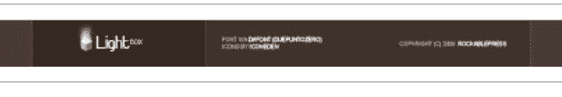

另外，请注意我们的 `footer` `div` 是 `container` `div` 的兄弟元素，而不是子元素（嵌套在另一个元素内部的元素）。原因是我们要让棕色背景延伸到用户浏览器窗口的整个宽度。当它嵌套在具有设定宽度的 `div` 中时，这是无法实现的。如果这一点令人困惑，不用担心；我们将在后面的章节中更详细地讨论。

> **实用技巧**
>
> *在完成标记之前，不要触碰你的 CSS 文件。*

### 头部区域

现在我们已经有了基本结构，让我们开始充实每个部分。我们从头部开始。

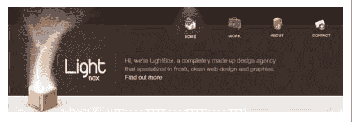

我们立刻注意到屏幕右上角有一个导航链接的“列表”。因为它是一个列表，使用无序列表似乎是合适的选择！

```html
<div id="container">
<div id="header">
<ul id="nav">
<li id="li_home"><a href="index.html">Home</a></li>
<li id="li_work"><a href="work.html">Work</a></li>
<li id="li_about"><a href="about.html">About</a></li>
<li id="li_contact"><a href="contact.htm">Contact</a></li>
</ul>
</div>
```

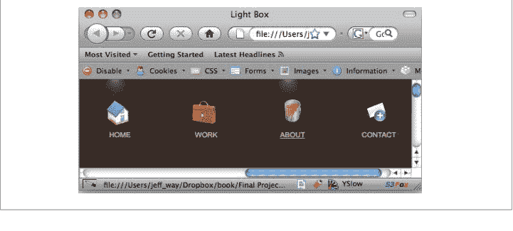

注意到每个列表项都被赋予了唯一的 `id` 吗？这是一个不得已的必要措施，因为我们的导航具有独特性。返回演示页面并将鼠标悬停在每个链接上；你会注意到这样做时每个图标周围会出现温暖的发光效果。为了实现这个效果，我们将使用背景图片。我们需要一种方法来定位每个列表项，以便应用其相应的背景图片——因此有了唯一的 `id`。

继续往下看，我们现在来到 logo 和标语部分。我们也应该将这一部分包裹在它自己的 `div` 中。

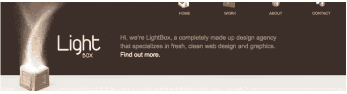

```html
<div id="header">
    <ul id="nav">
        <li id="li_home" class="selected"><a href="index.html">Home</a></li>
        <li id="li_work"><a href="work.html">Work</a></li>
        <li id="li_about"><a href="about.html">About</a></li>
        <li id="li_contact"><a href="contact.html">Contact</a></li>
    </ul>

    <div id="slogan">
        <h1><a href="index.html">Light Box</a></h1>
        
        <p>Hi, we're LightBox, a completely made up design agency that specializes in fresh, clean web design
and graphics.
<a href="about.html">Find out more.</a></p>
</div><!-- end slogan-->
</div><!-- end header-->
```

我们首先将网站名称放在一个一级标题标签中。为了提高可用性，让 logo 链接回首页被认为是最佳实践。这可以通过将文字包裹在锚点标签中来轻松实现。

接下来，我们有那个大大的发光方块图形，最后是我们的标语，它被恰当地包裹在段落标签中。暂时不要担心实际的图片，一旦我们切割完 PSD，它就会可用。目前，我们**只**关注标记结构。

### 主要内容区域

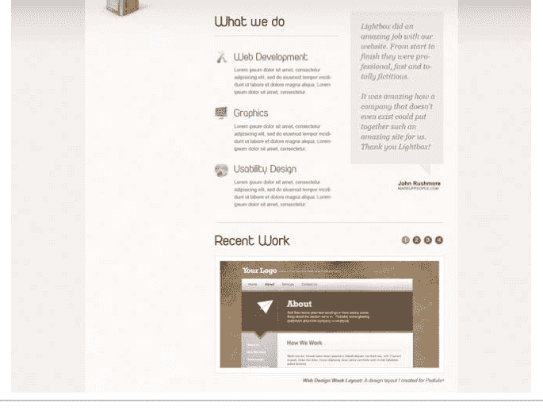

```html
<div id="primaryContent">
    <h2 id="whatWeDo">What We Do</h2>
    <ul>
        <li id="first">
            <h3>Web Development</h3>
            <p> ... generic text ... </p>
        </li>
        <li id="second">
            <h3>Graphics</h3>
            <p> ... generic text ... </p>
        </li>
        <li id="third">
            <h3>Usability Design</h3>
            <p> ... generic text ... </p>
        </li>
    </ul>
</div><!-- end primaryContent-->
```

在这个阶段，我们将“我们的工作”标题包裹在 `h2` 标签中。接下来，我们有三个不同的部分：

1. Web Development
2. Graphics
3. Usability Design

初学者可能会假设这里使用三个 `div` 是合适的——然而，那将是错误的选择。

> **实用技巧**
>
> *如果有人问你这部分是什么，你可能会回答说这是我们虚构公司提供的“服务列表”。这里的关键词是“列表”。因此，我们应该使用无序列表。*

每个列表项包含一个 `H3` 标签和通用的“lorem”虚拟文本（由 `... generic text ...` 表示）。我们将在 CSS 文件中使用 `background` 属性来添加图标和独特的字体。这就是给列表项添加 `first`、`second` 和 `third` `id` 的原因。我们需要一种方法，能够从样式表中单独定位到每一个。

### 次要内容区域

在我们的 `primaryContent` `div` 之后，我们需要添加一个 `blockquote` 元素，它将显示一条随机的客户评价。

> Lightbox did an amazing job with our website. From start to finish they were professional, fast and totally fictitious.
>
> It was amazing how a company that doesn't even exist could put together such an amazing site for us.
>
> Thank you Lightbox!
>
> — John Rushmore, MADEUPPEOPLE.COM

```html
<div id="secondaryContent">
    <blockquote>
        <p>Lightbox did an amazing job with our website.
From start to finish they were professional, fast and
totally fictitious. </p>
        <p>It was amazing how a company that doesn't
even exist could put together such an amazing site for us.
Thank you Lightbox!</p>
    </blockquote>
    <cite title="MadeUpPeople.com">John Rushmore
<span>MADEUPPEOPLE.COM</span></cite>
    <div class="arrow"></div>
</div><!-- end secondaryContent-->
```

有人可能会认为我们可以完全移除这个 `div`，然后将 `blockquote` 浮动到右侧。在任何时候，我们都应该评估我们的代码。从技术上讲，那样做是可以接受的；然而，我们必须始终考虑未来。如果几个月后，我们决定网站需要一个带有两栏布局的新页面呢？我们就不幸需要返回到 HTML 文件来修改标记。为了防止这种情况，我们应该先创建好第二栏。然后，我们可以使用一个“body”技巧来确定每个新页面应该由一栏还是两栏组成。你很快就会学到这个技巧！

这段代码中有两点值得注意：

1. `cite` 标签可能对你来说比较陌生。幸运的是，它非常简单。`cite` 标签的用法完全如你所想——用来表示引用。是的，我们可以使用诸如 `span` 标签之类的元素来替代，但如果有一个标签是专门为这种目的而创建的，那么使用它会更符合语义化。

#### 24 编写 HTML 代码


## 近期作品

与任何作品集一样，我们需要创造一种流畅的方式来展示我们的作品样本。现在，我们将创建一个基本的框架，它将包含：

1. 一个可供浏览的项目列表。
2. 每个网站的图像。
3. 每项工作的简要描述。

因为我们不希望图像使页面溢出，我们最终会使用 JavaScript 来创建过渡效果。当用户点击编号列表中的某个项目时，图像会淡出，切换到选中的图像，然后淡入。你将在“附加章节”中学习如何做到这一点——因为本书的主要目标是教授 CSS 和切片技术。

### 编写 HTML 代码

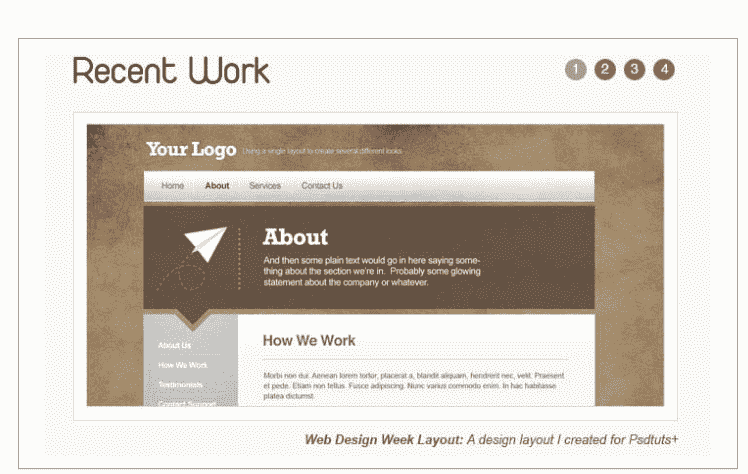

```html
<div id="recentWork">
    <h2>Recent Work</h2>
    <ol>
        <li class="chosen"><a href="images/recentWork/recentWork1.jpg" title="A design layout I created for Psdtuts+">1</a></li>
        <li><a href="images/recentWork/recentWork2.jpg" title="A pastel layout I created for Psdtuts+">2</a></li>
        <li><a href="images/recentWork/recentWork3.jpg" title="A grass layout I created for Psdtuts+">3</a></li>
        <li><a href="images/recentWork/recentWork4.jpg" title="A dark layout I created for Psdtuts+">4</a></li>
    </ol>
    <div class="image_display">
        
    </div>
    <p><strong>Web Design Week Layout:</strong> A design layout I created for Psdtuts+</p>
</div><!-- end recent work-->
```

### 编写 HTML 代码

这个“近期作品”`div`需要更多的工作。它实际上占据了主内容的全部宽度。考虑到这一点，它不能被放置在主要内容或次要内容`div`中。

1. 像往常一样，我们从`H2`标签开始。
2. 接下来，我们使用有序列表来创建圆形按钮。在这个列表中，我们添加一个嵌套的锚标签，该标签链接到下一张图像。
3. 我们插入主图像。乍一看，似乎没必要将图像包裹在这个`image_display` `div`中。但这实际上是必要的。如果你仔细观察图像，你可能会注意到它有一个 1px 的边框，一些内边距，然后是内边距周围的另一个 1px 边框。不幸的是，如果不创建一个包裹`div`，我们就无法实现这种效果。很遗憾，但为了美观，有时必须做出牺牲。
4. 最后，在`div`之后，我们添加一个简单的段落标签来描述上面的图像。

## 页脚

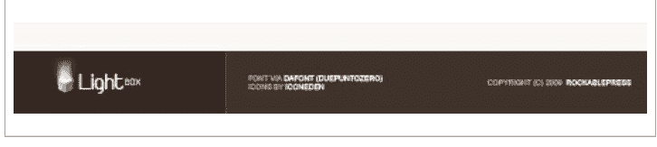

在本章前面，我提到过我们希望棕色背景延伸到用户屏幕的整个宽度。为了实现这种效果，我们将不得不使用一些技巧。

### 编写 HTML 代码

```html
<div id="footerWrap">
    <div id="footer">
        <div id="footerLogo">
            <a href=""></a>
        </div>
        Font via <strong><a href="http://www.dafont.com/duepuntozero.font">dafont (Duepuntozero)</a></strong><br />
        ICONS by <strong><a href="http://iconeden.com/icon/bright-free-stock-iconset.html">iconeden</a></strong>
        <p id="footerInfo">&copy; 2009 <a href="http://rockablepress.com/">rockablepress</a></p>
    </div><!-- end footer -->
</div><!-- end footerWrap-->
```

我们添加了一个名为`footerWrap`的额外包裹`div`。这个`div`最终会将其宽度设置为 100%（或浏览器窗口的宽度）。添加一个重复的背景图像，我们就有了我们的平铺效果。然而，页脚内的文本仍然需要与我们的容器`div`对齐。这就是我们保留`#footer` `div`的原因。就像容器一样，我们可以设置一个特定的宽度并在页面上居中。我们将在 CSS 章节中完成这个。

在页脚内部，我们放置了一个包含 Light Box 标志的图像，以及一些署名图标和标题字体创作者的链接。

### 标记完成！

首页的编写到此结束！这并不太难！如果你正在同步操作——我希望你是这样——你的最终代码应该看起来像这样：

### 编写 HTML 代码

```html
<div id="container">
    <div id="header">
        <ul id="nav">
            <li id="li_home" class="selected"><a href="index.html">Home</a></li>
            <li id="li_work"><a href="work.html">Work</a></li>
            <li id="li_about"><a href="about.html">About</a></li>
            <li id="li_contact"><a href="contact.html">Contact</a></li>
        </ul>

        <div id="slogan">
            <h1><a href="index.html">Light Box</a></h1>
            
            <p>Hi, we're LightBox, a completely made up design agency that specializes in fresh, clean web design and graphics. <a href="about.html">Find out more.<a></p>
        </div><!-- end slogan-->
    </div><!-- end header-->

    <div id="main">
        <div id="primaryContent">
            <h2 id="whatWeDo">What We Do</h2>
            <ul>
                <li id="first">
                    <h3>Web Development</h3>
                    <p> … filler text … </p>
                </li>

                <li id="second">
                    <h3>Graphics</h3>
                    <p> ... filler text ... </p>
                </li>

                <li id="third">
                    <h3>Usability Design</h3>
                    <p> ... filler text ...</p>
                </li>
            </ul>
        </div><!-- end primaryContent-->

        <div id="secondaryContent">
            <blockquote>
                <p>Lightbox did an amazing job with our website. From start to finish they were professional, fast and totally fictitious. </p>
                <p>It was amazing how a company that doesn't even exist could put together such an amazing site for us. Thank you Lightbox!</p>
            </blockquote>
            <cite title="MadeUpPeople.com">John Rushmore <span>MADEUPPEOPLE.COM</span></cite>
            <div class="arrow"></div>
        </div><!-- end secondaryContent-->

        <div id="recentWork">
            <h2>Recent Work</h2>
            <ol>
                <li class="chosen"><a href="images/recentWork/recentWork1.jpg" title="A design layout I created for Psdtuts+">1</a></li>
                <li><a href="images/recentWork/recentWork2.jpg" title="A pastel layout I created for Psdtuts+">2</a></li>
                <li><a href="images/recentWork/recentWork3.jpg" title="A grass layout I created for Psdtuts+">3</a></li>
```

### 编写 HTML 代码

```html
                <li><a href="images/recentWork/recentWork4.jpg" title="A dark layout I created for Psdtuts+">4</a></li>
            </ol>

            <div class="image_display">
                
            </div>
            <p>
                <strong>Web Design Week Layout:</strong>
                A design layout I created for Psdtuts+
            </p>
        </div><!-- end recent work-->
    </div><!-- end main-->
</div><!--end container-->

<div id="footerWrap"><!-- needed to extend the brown background for the entire screen -->
    <div id="footer">
        <div id="footerLogo">
            <a href=""></a>
        </div>
        Font via <strong><a href="http://www.dafont.com/duepuntozero.font">dafont (Duepuntozero)</a></strong><br />
        ICONS by <strong><a href="http://iconeden.com/icon/bright-free-stock-iconset.html">iconeden</a></strong>
        <p id="footerInfo">&copy; 2009 <a href="http://rockablepress.com/">rockablepress</a></p>
    </div><!-- end footer -->
</div><!-- end footerWrap-->
```

## 切割 PSD 文件

我们终于准备好开始切割我们的 PSD 文件了。花点时间在 Photoshop 中查看一下设计。尝试定位每个需要的图像。记住，许多功能可以用 CSS 重新创建；所以要富有创造力。

### 切割 PSD 文件

#### 计划安排

在我看来，我们需要以下素材：

1. 导航图标
2. 标志（Logo）
3. 灯箱图片
4. 所有标题及其相应图标
5. “近期作品”快照
6. 页脚中的小标志
7. 背景渐变

除了上面列出的七项，其他所有内容都可以用简单的 CSS 重新创建！

#### Photoshop

让我们打开 Photoshop 开始工作！在处理 PSD“切割”时，有两种公认的做法：

1. 第一种认为应该使用 Photoshop 的“切片”工具来完成任务。它就是为此功能设计的，为何不用呢？
2. 第二种则倾向于结合使用裁剪和复制/粘贴方法，因为他们觉得这样速度更快。

两种方法都完全可行。我建议你都尝试一下，然后选择对你来说最快的那种……我通常使用第二种方法。因此，在本书中你也将使用这种方法！

> **ROCK\* 技巧**
>
> 选定特定图层的一个简便方法是开启“自动选择”。
>
> a) 点击移动工具（`V`）。
>
> b) 确保勾选了“自动选择”复选框。它位于屏幕的左上侧。
>
> c) 点击标志。注意它如何立即选中了相应的图层？

我们将从获取标志开始。在图层面板中，打开“Lightbox”文件夹，找到“Light”和“Box”图层。

好了，接下来请务必跟着操作。这是你记住后续步骤的唯一方法。

1. 你会看到标志被分成了两个图层。点击第一个图层中的小方形图标。你会立即看到蚂蚁线。
2. 在按住 **Command/Ctrl** 的同时，按住 Shift 键，然后点击下一个图层的方形图标内部。
3. 在按住 **Command/Ctrl** 和 Shift 的同时，按字母“C”复制图层。
4. 松开 Shift，然后按“N”。这将创建一个新文档。
5. 一个新文档对话框将出现，其宽度和高度值已根据你的选区尺寸特别设定。按 **Enter**，最后按 **Command/Ctrl + V**，将内容粘贴到新文档中。搞定！

### “存储为 Web 所用格式”模式

如果你对 Photoshop 有些陌生，这些键盘快捷键可能会有点让人望而生畏。我们本可以同样轻松地使用工具栏上的每个命令位置。但是，这种方式更好，而且是专业人士的工作方式！

现在是花点时间记住这个模式的绝佳时机。你将多次使用它。从这一页开始，这一系列命令将被称为“该模式”：

1. 找到你想要的图层。
2. 按住 Control 或 Command。
3. 点击图层中的方形图标内部。
4. 如果你需要复制多个图层，按住 Shift 并点击下一个图层的方形图标。根据需要重复。
5. 按 `Command/Ctrl + Shift + C` 复制图层。
6. 按 `Command/Ctrl + N` 创建新文档。
7. 按 `Command/Ctrl + V` 粘贴新图层。

练习几次，直到这个模式牢记于心。完成后，继续。

回到我们的项目，你现在应该有一个包含标志置于白色背景之上的新文档。

我们显然不想要那个难看的白色背景；所以点击“背景”图层旁边的眼睛图标取消其显示。要保存此图像，请转到 *文件 > 存储为 Web 和设备所用格式* ——或者像个专业人士一样，按 *Control + Shift + Alt + S*（或 Mac 用户按 *Command + Shift + Option + S*）。

为了保存具有部分或完全透明度的图像，我们有两个选择：GIF 和 PNG。多年前，GIF 是标准选择。然而，近年来，PNG 已被证明是最明智的决定，原因如下：

- 压缩效率远高于 GIF。
- PNG-24 格式提供可变（Alpha）透明度，而不是 100% 透明或完全不透明的像素。


在本例中，我们希望确保标志周围的边缘完美无缺。`PNG-24` 是正确的选择。另一方面，如果你不需要渲染透明度，`PNG-8` 将是更明智（且更轻量）的选择。

### 图像类型的最佳实践

1. **JPEG** – 照片和带有渐变的图像。
2. **GIF** – 仅当图像为动画时需要。
3. **PNG-8** – 无透明度图形的最佳选择。
4. **PNG-24** – 文件较大，但能完美渲染透明度和图像质量。IE6 及以下版本不支持透明度。

> **ROCK\* 技巧**
>
> 如果图像需要透明背景，请始终使用 `PNG-24` 格式。

将图像命名为“`logo.png`”，并将其保存到项目的“`images`”文件夹中。恭喜；完成一个！

接下来，让我们获取所有导航图标。

同样，在启用“自动选择”的情况下，点击微小的“房子”图标，然后完全按照“该模式”（第 36 页）中列出的相同步骤操作。就是这么简单。因为你花了几分钟记住这些键盘操作，你会发现自己的切割速度创下新纪录！

使用相同的技术，将剩余的导航图标保存到你的 `images` 文件夹。

### CSS 精灵图

虽然并非完全必要，但尽可能使用 CSS“精灵图”被认为是最佳实践。如果你还不知道它们是什么，请不要担心。虽然我们稍后会更详细地介绍它们，但这里有一个快速定义：

> 精灵图允许我们将多个图像组合成一个。然后，当浏览器加载页面时，它只需要加载一个大图像，而不是几个小图像。更少的 HTTP 请求意味着更快的页面加载速度！

使用精灵图图像，我们可以结合背景定位和宽度/高度属性来“框出”我们想要的图像部分。最终，这意味着我们的页面加载更快！现在，让我们继续处理主页的“我们做什么”部分。

### 我们做什么

1. 点击“Web Development”标题。在这个例子中，我们需要同时获取标题和其左侧的图标。为此，再次按住 Command / Control 并点击图层以选择文本。
2. 接下来，按住“Shift”键并同时点击图标图层（就在文本图层下方）。现在，两个图层将同时被选中。
3. 重复“该模式”（第 36 页）以创建一个新文档并粘贴标题。
4. 在保存之前，我们还需要添加另外两个标题。这就是它成为精灵图的原因。
5. 在菜单栏中，转到 *图像 > 画布大小*。
6. 勾选“相对”，并将测量单位更改为“百分比”。
7. 将锚点设置为上居中。
8. 在“高度”文本框中，输入 `200`。这将拉伸我们的画布，使其大小变为当前尺寸的两倍。这将使我们能够方便地放置另外两个标题。
9. 返回到你原来的 PSD 选项卡，并对“Graphics”标题和图标执行相同的步骤。然而，这次不是创建一个新文档，而是简单地复制它们，然后返回到你的精灵图 PSD 并粘贴。对“Usability Design”标题和图标重复此过程最后一次。

完成后，你应该得到这个：

不要忘记适当地定位你的标题，确保每个标题都正确地位于前一个的下方。使用方向键相应地定位每个图像。完成后，存储为 Web 所用格式并将其放入你的 `images` 文件夹。做得好——你的第一个精灵图！

## 页脚

接下来，让我们获取页脚中的标志。

## 切割 PSD

你现在应该已经是这方面的行家了。只需自动选择图层，然后按照“通用模式”操作即可。非常简单！

### 背景

既然我们已经收集了大部分图像，现在只需要获取背景部分，就大功告成了。

1. 选择矩形选框工具，或按下 `M` 键。
2. 开启所有图层，然后选择“图层 > 拼合图像”。
3. 选择一个长条状的背景区域。它只需要几个像素的宽度即可。我们将使用 CSS 将这个图案重复铺满整个窗口宽度。完成操作后，再次按照“通用模式”（第 36 页）保存为 Web 格式。
4. 我们需要的另一个背景来自“容器”部分。它可能看起来像纯色，但实际上是由微妙的渐变组成的。记住——关键在于微妙！与之前一样，选取一个细长的条状区域，并按照“通用模式”操作。

## 暂告一段落

信不信由你，我们已经完成了大部分的切割工作。虽然还需要回来处理一些收尾工作，但剩下的工作都可以用 CSS 完成！

## 修订我们的 HTML

现在我们已经掌握了所有这些图像，需要相应地更新我们的 `index.html` 文档。我们将主要使用 `background` CSS 属性来放置图像，但确实需要直接在标记中插入两个图像标签。

找到 `id` 为 `slogan` 的 `div`。此部分需要更新以包含 Light Box 的图像。

```html
<div id="slogan">
    <h1><a href="index.html">Light Box</a></h1>
    
    <p>Hi, we're LightBox, a completely made up design
    agency that specializes in fresh, clean web design and
    graphics. <a href="about.html">Find out more.</a></p>
</div><!-- end slogan-->
```

接下来，我们必须包含“最近作品”图像。将新切割的图像添加到 `image_display` `div` 中。

```html
<div class="image_display"><!-- needed to apply a border to
both the image and the edges around the padding-->
    
</div>
```

最后，我们必须在页脚中添加 logo 的来源。

```html
<div id="footerLogo">
    <a href=""></a>
</div>
```

至此，我们完成了主页的标记工作！

### 在浏览器中查看

在浏览器中查看，你会看到：

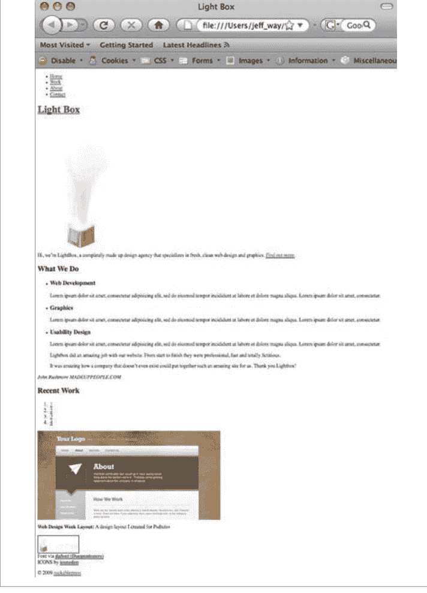

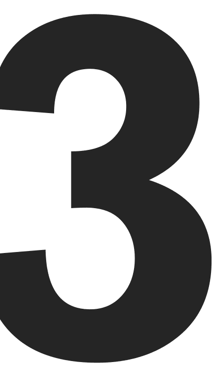

### 编写 CSS

每个开发者在为网站编写代码时都有自己的偏好。例如，许多人倾向于使用 CSS 重置样式表，而另一些人则认为这是浪费时间。本人倾向于前者。因此，你也将这样做——至少在本书中如此。

### CSS 重置

创建一个新的 HTML 文档并粘贴任何你喜欢的代码。添加几个段落，也许一两个标题——任何你想要的东西。然后，在浏览器中查看这个页面。以下是我最终得到的结果：

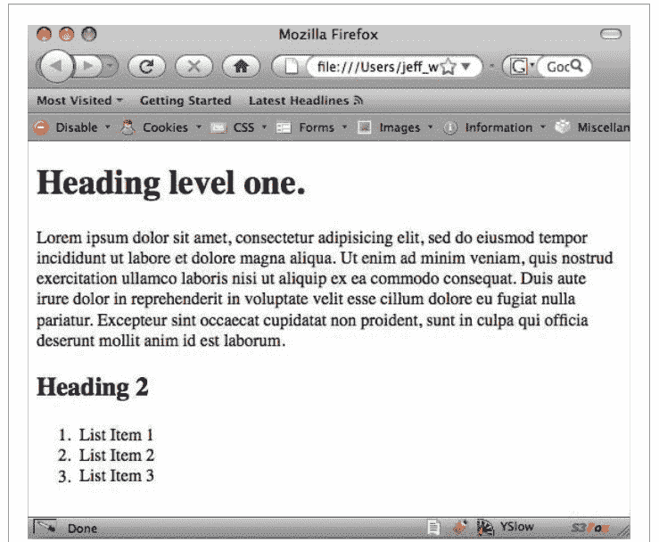

要知道，我们还没有添加一丁点 CSS：

1. 你是否想过为什么标题标签是粗体？
2. 段落周围的微小边距是怎么回事？
3. 浏览器窗口周围的细微间距从何而来？为什么会有这个？难道文本不应该紧贴边缘吗？

每个浏览器都使用一些“默认 CSS”来自动样式化你的标记。乍一看，你可能会认为这非常有帮助。事实上，许多专业人士都会这样认为。然而，我以及许多人倾向于认为这些默认样式弊大于利。如果每个浏览器都以完全相同的方式实现它们，这本不会是个问题。遗憾的是，事实并非如此。

如果 IE 和 Firefox 对列表项的解释不同，我们如何才能创建一个在所有浏览器中看起来都一样的网站？

### 解决方案是什么？

为了解决这个问题（在初学阶段肯定会给你带来巨大的头痛），我们将创建自己的“重置”样式表，为所有浏览器创造一个公平的竞争环境。这样，我们就能 100% 地控制样式。

> **Rock\* 技巧**
>
> *如果“重置”听起来很复杂，别担心。它其实很简单。主要就是将边距和内边距归零。*

创建一个名为“`reset.css`”的新 CSS 文件，并将其保存在项目根目录下的新 CSS 文件夹中。在这个文件中，首先添加最基本的内容。

```css
body, h1, h2, h3, h4, h5, p, ul, ol, li, blockquote, form, input {
    margin: 0; padding: 0;
}
```

保存文件，将其导入你的测试文档，然后重新加载浏览器。注意到区别了吗？现在，没有应用任何格式。尝试在你计算机上的每个浏览器中查看此页面——它看起来一样，对吧？这就是目的！

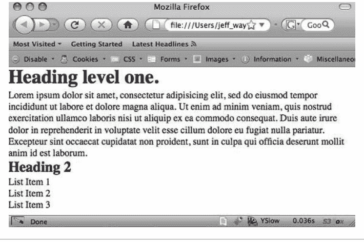

虽然这肯定会有所帮助，但我们需要让我们的“`reset.css`”样式表更加强大。删除你当前的内容，并粘贴以下代码：

```css
html, body, div, span, object, iframe, h1, h2, h3, h4, h5,
h6, p, blockquote, pre, a, code, del, em, font, img, small,
strike, strong, dl, dt, dd, ol, ul, li, fieldset, form,
label, table, caption, tbody, tfoot, thead, tr, th, td {
    margin: 0;
    padding: 0;
    border: 0;
    outline: 0;
    font-size: 100%;
    vertical-align: baseline;
    background: transparent;
}

body {
    line-height: 1;
}

ol, ul {
    list-style: none;
}

blockquote, q {
    quotes: none;
}

blockquote:before, blockquote:after, q:before, q:after {
    content: '';
    content: none;
}
```

你不需要太担心这个。只需相信这段代码能移除所有浏览器样式即可。这样，你就能 100% 掌控你的代码——理应如此！除了将边距和内边距归零，我们还将所有元素的字体大小设置为 100%，移除 Firefox 可能添加的任何轮廓，移除列表项的项目符号，等等。

由于我们将在所有项目中使用此文件，请务必备份一份并将其存储在“web dev 文件夹”或类似的地方以备后用。

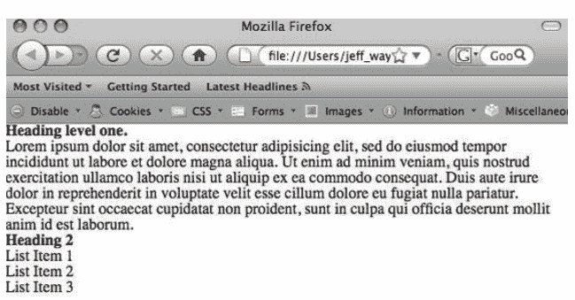

### DEFAULT.CSS

现在，我们需要创建我们的主力样式表。在你的文本编辑器中创建一个新文件，并将其保存为 CSS 文件夹中的“`default.css`”。粘贴以下内容：

```css
/*
    Theme Name: Light Box
    Description: Training for Rockable Press.
    Slicer: Jeffrey Way
    Designer: Collis Ta’eed


    Colors:

    text:                #745459
    dark brown:      #251b17
    light brown:     #3b2c25
    white:              #eldedb

*/

/* Generic Styles */

body {
    background: #flefee url(images/bg.png) repeat-x;
    text-align: center;
    font-family: helvetica, arial, sans-serif;
    line-height: 25px;
}
```

我们应始终包含主题的简要概述。在本例中，我添加了四个部分：“主题名称、描述、设计师和切割者”。从技术上讲，此部分并非必需，但通常认为包含它是良好的实践。

### 记住你的颜色

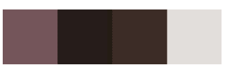

我发现将主要颜色以注释形式硬编码到样式表中很有帮助。这样，如果我忘记了所需的十六进制值，我可以滚动到文件顶部获取相应的值，而不是返回 Photoshop 使用吸管工具。

### Body 标签

通常，“body”标签将是你样式化的第一个元素。

1. 首先，我们将背景属性设置为我们切割的 `bg.png` 图像。记住——如果我们不同时包含背景颜色，当图像结束时，我们的网站看起来会非常奇怪。为了创建平滑的过渡，我们将背景颜色设置为 `bg.jpg` 图像最底部的颜色——在我的案例中，是 `#f1efee`。你的可能略有不同。
2. 接下来，我们将文本居中对齐。这已经成为我的一个习惯，此时确实可以移除它。最初，它被用作在 Internet Explorer 5 中居中网站的技巧。通过对 `body` 居中，在该浏览器中，它会错误地将所有内容居中，而不仅仅是文本。现在它已经不是 100% 必要了，但我仍然通常会包含它——至少出于习惯。
3. 最后，我们将字体指定为“Helvetica”（以及一些备选方案），并设置合适的行高，这将为我们的文本提供一些呼吸空间。为什么是 Helvetica？因为这是我们的 PSD 中使用的字体，当然。

### 通用样式

由于我们已经重置了所有元素，因此需要为一些常用元素设置自己的值。回到 Photoshop 中检查文字大小、颜色和行高，然后就可以在样式表中使用这些精确的值。在 Photoshop 中，只需转到 *窗口 > 字符*。

```css
h1, h2, h3, h4, h5 {
    margin: 25px 0;
}

h2 {
    font-size: 41px;
    color: #2f231e;
    padding-bottom: 25px;
    margin-top: 45px;
    border-bottom: 1px solid #cec5c0;
}

h3 {
    color: #745459;
    font-size: 30px;
    line-height: 33px;
}

.single h3 {
    font-size: 24px;
}

h4 {
    color: #2f231e;
    line-height: 20px;
    font-size: 16px;
    text-transform: uppercase;
}

p {
    color: #b45a5b;
    font-size: 13px;
    font-family: arial;
}

a {
    text-decoration: none;
    color: black;
}

a:hover {
    text-decoration: underline;
}
```

这些值直接取自 PSD 中对应的元素。为了验证，打开字符窗口后，点击几个标题进行对比。

### 编写 CSS

#### 容器

通用样式设置完成后，我们现在需要处理“容器” `div`。这个 `div` 将作为我们整个网站的包装器。

```css
#container {
    width: 1002px;
    margin: 0px auto;
    text-align: left;
    position: relative;
    background: #f7f5f4 url(../images/containerBG.png) repeat-x;
}
```

如果你回到 PSD，使用标尺工具测量网站的宽度，会得到 `1002px`。要使这个 `div` 在页面居中，我们将外边距设置为 `auto`。这实质上意味着该 `div` 的左右外边距必须是相同的值。唯一可能的情况就是这个 `div` 在浏览器窗口中完美居中。此外，我们将文本重新左对齐，创建新的定位上下文，并添加容器背景图片。

#### 页头

让我们开始设置页头的样式。添加以下代码：

```css
#header {
    border-left: 1px solid #5e4b3c;
    border-right: 1px solid #5e4b3c;
    overflow: hidden;
}
```


```css
/* 导航 */

#container ul#nav {
    overflow: hidden;
    float: right;
    height: 111px;
    margin: 0;
    margin-top: -13px;
}

#nav li {
    float: left;
    font-size: 11px;
    font-family: arial;
    text-align: center;
    width: 112px;
    height: 111px;
    margin-right: 20px;
    list-style-type: none;
}

#nav li a {
    color: #c7b1cd;
    height: 111px;
    display: block;
    padding-top: 8px;
    text-transform: uppercase;
    text-align: center;
    padding-left: 10px;
}

/* 导航图标 */

#nav li#li_home {
    background: url(../images/icons/home.png);
}

#nav li#li_work {
    background: url(../images/icons/work.png);
}

#nav li#li_about {
    background: url(../images/icons/about.png);
}

#nav li#li_contact {
    background: url(../images/icons/contact.png);
}
```

虽然一开始看起来可能有些令人困惑，但大多数情况下，我们只是从 PSD 中获取值并粘贴到 CSS 文件中。例如，在 PSD 中，页头左右两侧有浅棕色的边框。

使用吸管工具获取该十六进制值，然后使用`border`属性进行设置。就这么简单。

为了让每个导航项排成一行，我们将`float`属性设置为`left`。现在，它们会并排显示。接下来，我们设置字体属性，添加一些右边距以提供呼吸空间，并将列表样式设为`none`。

通常，我们不会在这里硬编码宽度和高度值。然而，由于我们使用了导航图标，需要回到 PSD 中测量这些图片的宽度和高度。我发现它们是 112px 宽和 111px 高。

还记得我们给每个列表项应用了唯一的 id 吗？

```html
<ul id="nav">
    <li id="li_home" class="selected"><a href="index.html">Home</a></li>
    <li id="li_work"><a href="work.html">Work</a></li>
    <li id="li_about"><a href="about.html">About</a></li>
    <li id="li_contact"><a href="contact.html">Contact</a></li>
</ul>
```

现在这将会派上用场。要定位每个特定的导航项，我们只需使用其 id，并应用相应的背景图标。

注意：你可以想象，如果我逐一解释每个属性，那对你来说会相当乏味。相反，下载 Chris Pederick 为 Firefox 创建的“Web Developer Extension”。

> “Web Developer 扩展程序为浏览器添加了菜单和工具栏，包含各种 Web 开发工具。” – http://chrispederick.com/work/web-developer/。

安装该扩展程序后，开始尝试移除某个属性以查看网站的变化。例如，如果我们完全移除`#nav li`的`width`和`height`属性会发生什么？我就是这么学习的，建议你也要这样做。

### 设置主横幅样式

让我们继续处理主横幅，或者说标语。

```html
<div id="slogan">
    <h1><a href="index.html">Light Box</a></h1>
    
    <p>Hi, we're LightBox, a completely made up design agency that specializes in fresh, clean web design and graphics. <a href="about.html">Find out more.</a></p>
</div><!-- end slogan-->
```

将以下代码追加到你的样式表中：

```css
#slogan {
    height: 168px; /* 通常不建议设置高度。但在这种情况下，这是必要的。 */
    clear: both;
}

/* 标志 */

#slogan h1 {
    background: url(../images/logo.png) no-repeat;
    width: 124px;
    height: 67px;
    margin: 0 0 0 165px;
    position: relative;
    text-indent: -9999px;
    top: 50px;
}

#slogan h1 a {
    display: block;
    width: 124px;
    height: 67px;
}

/* 大灯箱图片 */

#slogan img {
    position: absolute;
    top: -87px;
    left: -40px;
}

#slogan p {
    margin: -27px 200px 0 319px;
    padding-left: 27px;
    padding-top: 5px;
    padding-bottom: 5px;
    font-size: 18px;
    color: #ab8a7d;
    border-left: 1px solid #4f3b33;
}

#slogan a {
    color: white;
}
```

我们首先为标语`div`指定高度。通常不希望这样做，但在这个例子中，它让我们的工作变得更加容易。接下来，我们使用`clear`属性确保我们的`div`清除（或在下方开始）上方任何浮动元素。为了更好地理解，使用 Web Developer 工具栏移除这个属性，观察差异。

“Light Box”标志包含在`h1`标签中。我们不必在 HTML 中硬编码图片，可以使用一种背景技巧。

### Fahrner 的图片替换技术

这种技术以 Todd Fahrner（用户界面技术顾问）命名。要实现我们想要的效果，必须执行以下步骤：

1. 使用 Photoshop 中的标尺工具测量图片的宽度和高度——在本例中为 124x67。
2. 将`background`属性设置为我们图片的 URL。
3. 将`width`和`height`值设置为我们刚刚测量的值。
4. 将`text-indent`设置为一个极大的负数，即 -9999px。这会将`h1`标签内的任何文本移出甚至最大的屏幕，只留下我们的图片。

你通常会发现这种技术用于使用并非所有计算机上都可用的特定字体。通过将标题保存为图片，我们可以将其设置为背景并将文本移出屏幕。

继续处理我们的 Light Box 图片，我们使用绝对定位将其放置在精确的坐标位置。

通过将其从文档流中移出，我们可以使用`left`、`top`、`right`和`bottom`属性来定位我们的元素，而不会影响布局。

### 绝对定位和相对定位有什么区别？

或许比其他任何主题都更甚，定位可能被证明是 CSS 初学者不必要地感到困惑的话题。最好的学习方法是先攻克绝对定位。假设我们有一个空白的 HTML 和 CSS 文档。如果我们要在页面上绝对放置一张图片——比如说距离

### 66

## 编写 CSS

要让它距离窗口顶部和左侧边缘各 100px，我们可以编写以下样式：

```css
img {
    position: absolute;
    top: 100px;
    left: 100px;
}
```

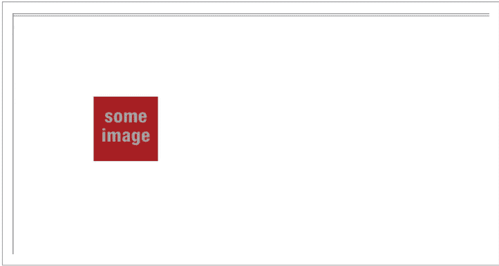

绝对定位的元素是根据其最近的已定位父元素进行定位的。在这种情况下，由于页面上没有相对定位的元素，该图片将根据窗口进行定位。

现在，想象一下我们用一个相对定位的`div`包裹住我们的图片。

### 67 编写 CSS

```html
<body>
  <div id="wrapper">
    
  </div>
</body>
```

为了设置定位上下文，我们必须为父`div`的样式添加`position: relative`。

```css
div#wrapper {
    position: relative;
    background: gray; /* 仅为查看边界。 */
    height: 600px;    /* 因为图片是绝对定位的，我们需要强制设置高度。 */
    width: 770px;
    margin: auto;
}
```

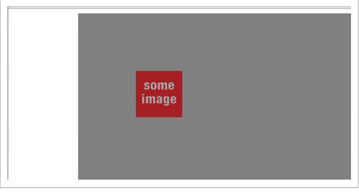

### 68 编写 CSS

现在，当我们对图片进行绝对定位时，它将相对于`wrapper` `div`进行定位。请记住，如果我们移除这个属性，图片将再次根据浏览器窗口定位。这里的`position`属性是关键。

回到我们的项目——我们现在需要定位我们的标语。

```css
#slogan p {
    margin: -27px 200px 0 319px;
    padding: 5px 0 5px 27px;
    font-size: 18px;
    color: #a68a7d;
    border-left: 1px solid #4f3b33;
}
```

字体大小、颜色和边框颜色都取自我们的 PSD，如前所述。这部分很简单。为了精确设置边距，我们必须使用 Photoshop 中的标尺工具来测量网站边缘到文本起始位置之间的距离——每一侧都要测量。这样做之后——对我来说——得出的值是 -27px、200px、0 和 319px（上、右、下、左）。

## 主要内容

现在是时候开始为我们的主要内容，或者`#main` `div`中的信息设置样式了。

```css
/***** 主要内容部分 ******/

#main {
    padding: 0 36px 100px 347px;
    overflow: hidden;
    border-left: 1px solid white;
    border-right: 1px solid white;
}

#main #primaryContent {
    float: left;
    width: 334px;
}

#main div#secondaryContent {
    float: right;
    padding-top: 45px;
    width: 249px;
    position: relative;
}
```

注意到我们网站的左侧有很多空白区域吗？为了模拟这一点，我们将使用`padding`属性。再次回到你的 PSD，用标尺工具测量网站每一侧边缘之间的间距。根据我的测量，我发现左侧有 347px。通过将这个值添加到我们的`padding-left`属性中，我们将创建一个不错的开放空间，很好地衬托我们的网站。

对于我们的主页，我们使用一个简单的两栏布局。为了实现这个效果，我们将`primaryContent` `div`向左浮动，将`secondaryContent`向右浮动。通过指定取自 PSD 的特定宽度，我们的两栏将适当地并排排列。

### 实用示例：栏

在这个快速示例中，我们将构建一个极其简单的模拟布局，包含页眉、主体部分和页脚。在主体部分内，我们将嵌套两个额外的`div`，它们将作为我们的两栏。

### 70 编写 CSS

在你的代码编辑器中，创建一个基本的 HTML 框架，然后粘贴以下代码：

```html
<div id="container">
    <div id="header">

    </div>
    <div id="main">
        <!-- 主要内容-->
    </div>
    <div id="footer">
        <p>My footer info.</p>
    </div>
</div><!--end container-->
```

如上面的代码所示，每个部分都有自己的`div`。此外，我们还将整个网站包裹在一个`container` `div`中。这样，如果我们需要拿起网站或盒子并移动它，我们只需要操作一个`div`。

### 创建栏

为了简单起见，假设我们已经为网站插入了必要的文本和图像。

下一步是创建我们的两个浮动栏。在`main` `div`内，插入以下代码：

```html
<div id="main">

    <div id="primary">
        <p>在此处插入通用文本。 </p>
    </div>
    <div id="secondary">
        <p>在此处插入通用文本。 </p>
    </div>
</div>
```

### 71 编写 CSS

在外部 CSS 文件或文档的`head`标签内，添加以下样式：

```css
#container {
    width: 960px;
    margin: auto;
    background: red; // 注意这个。
}

#header {
    min-height: 200px;
    background: yellow;
}

#main {
    background: green;
}

#primary {
    float: left;
    background: orange;
    width: 70%;
    margin-right: 5%;
}

#secondary {
    float: right;
    background: brown;
    width: 20%;
    margin-left: 5%;
}

#footer {
    background: black;
}
```

通过为每个`div`应用背景颜色，我们将准确了解它们如何对齐。有些人更喜欢使用边框；然而，由于额外的像素，这可能会改变你的布局。为了安全起见，请使用背景颜色。

注意到`primary`和`secondary` `div`分别向左和向右浮动了吗？正是这个属性（`float`）被用来创建我们的栏。

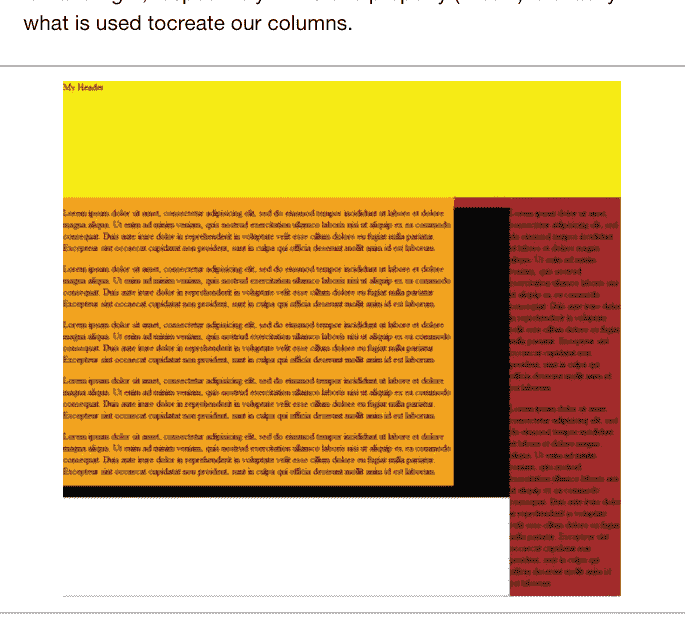

### 它是如何工作的？

`div`在自然状态下是贪婪的。它们会占据尽可能多的空间，除非明确被告知要怎么做（通过使用`width`属性）。

通过使用`float`属性，我们可以强制我们的`div`只占据我们希望它们占据的宽度——在这种情况下，分别是 70% 和 20%。

### 三栏

现在，我们将更进一步，在组合中添加一个额外的栏。返回到你的结构并修改`primary` `div`，如下所示：

```html
<div id="primary">
    <div id="col1">
         在此处插入通用文本
    </div>
    <div id="col2">
         在此处插入通用文本。
    </div>
</div><!--end primary-->
```

我们不是将内容直接放入`primary` `div`，而是将文本插入其子`div`中。现在返回到你的样式表并添加以下内容：

```css
#primary {
    float: left;
    background: orange;
    width: 70%;
    margin-right: 5%;
}

#col1 {
    float: left;
    background: gray;
    width: 50%;
}

#col2 {
    float: right;
    background: #e3e3e3;
    width: 50%;
}
```

刷新你的浏览器，你将看到三个并排的栏。

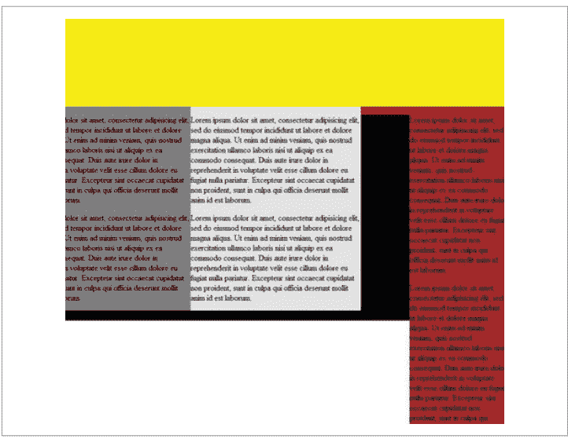

### 75 编写 CSS

如果你和我一样，在这种情况下，最初的本能反应可能只是简单地创建第三个`div`，或者`#primary`、`#secondary`、`#thirdly` `div`。虽然这种方法确实有效，但你会发现要让它们完美对齐可能有点困难。这是因为浮动是非常棘手的东西。即使是增加一个像素也可能破坏布局。考虑到这一点，在大多数情况下，上面演示的方法将是你的最佳选择。

### 关于浮动的要点

现在你一定已经注意到，一旦开始浮动`div`，就发生了奇怪的事情。当我们浮动其子元素时，容器`div`的红色背景发生了什么？为什么红色在页眉下方突然结束了？既然容器是一个包裹器，我们难道不应该看到红色背景而不是白色吗？

其次，为什么页脚（黑色）占据了这么多空间，为什么它在错误的位置？黑色应该在主要内容下方吗？问题出在哪里？

当你浮动一个元素时，你就把它从文档流中移除了。在我们的例子中，我们浮动了`main` `div`内的两个元素。换句话说，它们基本上不占据任何空间。因此，红色背景过早结束，页脚跳到了顶部。

### 修复方法

多年来，针对这个问题已经有了许多修复方法，其中大多数至今仍在使用。让我们回顾一下三种最常见的方法：

### 编写 CSS 代码

### 修复方法一：使用 `clear: both`

回到你的 HTML 结构。就在闭合的`main` `div`之前，添加以下空`div`：


```html
<div style="clear: both;" />
</div><!--end main-->
```

通过应用`clear`属性，我们可以强制`main` div 清除（或包含）其浮动的子元素。这个方法绝对有效，但有一个问题：我们添加了一些无语义的标记。有没有办法在不添加无用 div 的情况下实现这一点呢？当然有！

### 修复方法二：Clearfix 技巧

这第二种修复方法使用了一些高级的 CSS 来清除任何浮动。请看以下样式：

```css
#main:after {
    content: ".";
    display: block;
    height: 0;
    clear: both;
    visibility: hidden;
}
```

这里，我们使用了`after`伪类，在它所引用的元素（本例中是`main` div）之后追加内容。最重要的是，注意`content`属性。它起初可能看起来有点复杂，但实际上相当简单。我们只是添加了一个句点。当然，我们不希望这个句点显示在页面上。为此，我们将`visibility`属性设置为`hidden`。现在我们在`main` div 之后添加了一些内容，我们可以模拟修复方法一的操作：将`clear`设置为`both`，将`display`设置为`block`。然而，请注意，诸如`:after`之类的伪类，Internet Explorer 6 及更低版本将无法识别。

这就是全部内容。这个方法有效，但它仍然有些繁琐。幸运的是，我们可以通过添加一个样式来完全解决整个问题！令人惊讶的是，这最后一种方法直到几年前才流行起来。

### 修复方法三：使用 Overflow: Hidden

删除你在修复方法一和修复方法二中的所有代码——我们将不再需要它。在它们的位置，为`main` div 添加一个属性。

```css
#main {
    ..other styles
    overflow: hidden;
}
```

信不信由你，这一个属性就解决了我们的问题。如果你还记得本书的前几页，我提到过，有时，一个解决方案可能没什么道理，甚至完全没道理。在这种情况下，这绝对是事实。尽管如此，它确实有效。

> **ROCK\* 小贴士**
>
> *如果你在父元素内浮动了多个元素，请在父元素的样式中添加`overflow: hidden;`。这将强制包裹元素包含浮动的元素。*

### 三个标题

如果你已经读到了这里，你做得非常棒！这些东西很棘手！我们现在必须为三个标题设置样式。当我们转换 PSD 文件时，我们将它们保存为一张大图。现在，当我们使用 CSS 雪碧图只显示我们想要的图像部分时，这就会派上用场。

### 编写 CSS 代码

```css
#primaryContent ul h3 {
    text-indent: -9999px;
    height: 34px;
    margin-bottom: 13px;
}

/* 这里使用了雪碧图。同一张图像包含了所有标题。
我们使用 background-position 属性将图像向上移动。 */

/* What We Do */
#primaryContent li#first h3 {
    background: url(../images/whatWeDoHeadings.png) no-repeat 0 0;
}

/* Graphics */
#primaryContent li#second h3 {
    background: url(../images/whatWeDoHeadings.png) no-repeat 0 -34px;
}

/* Usability Design */
#primaryContent li#third h3 {
    background: url(../images/whatWeDoHeadings.png) no-repeat 0 -68px
}
```

```css
#first p, #second p, #third p {
    padding-left: 50px;
}
```

我们将使用之前学到的相同背景技术。最重要的是，注意我们将 h3 标签的高度设置为`34px`，即整个图像高度的三分之一。这实际上将切断其他标题。此外，我们设置了 13px 的下边距来增加一些呼吸空间。

接下来，我们需要单独针对每个标题。因为我们在创建标记时为这些标题创建了唯一的 id，所以我们能够做到这一点。每个标题都将使用完全相同的图像作为其背景，但浏览器只需要加载它一次。这就是我们节省带宽的方式。关键在于我们使用背景定位来移动图像。注意图形是如何向上移动了 -34px —— 或者说正好是我们的 h3 标签的高度。"Usability Design" 标题的相应数字将加倍到 68px。就这么简单。如果你读到这里眼睛都花了一点，我不怪你！使用 Web 开发者扩展，然后尝试调整定位以更好地理解。

最后，我们需要为段落添加 50px 的左内边距，以便将它们移动足够远，使其直接位于标题下方，而不是在图标下方。

### 引用块

现在让我们为推荐语部分设置样式。这应该不会太困难。这是 HTML 代码：

```html
<div id="secondaryContent">
    <blockquote>
        <p>Lightbox 为我们的网站做得非常出色。从开始到结束，他们都表现得专业、迅速，而且完全是虚构的。</p>
        <p>令人惊讶的是，一家甚至不存在的公司竟然能为我们搭建如此出色的网站。谢谢 Lightbox！</p>
    </blockquote>
    <cite title="MadeUpPeople.com">John Rushmore
<span>MADEUPPEOPLE.COM</span></cite>
<div class="arrow"></div>
</div><!-- end secondaryContent-->
```

现在将以下 CSS 粘贴到你的样式表中。

```css
blockquote {
    background: #e6e2df;
    color: #7fb357;
    padding: 23px;
    font: italic 20px/27px georgia;
}

blockquote p {
    font-size: 20px;
    margin-bottom: 1em;
    color: #7fb357;
    font-family: georgia;
}

#secondaryContent cite {
    font: bold normal 15px arial;
    color: #2f231e;
    float: right;
    padding-right: 20px;
    padding-top: 35px;
    font-weight: bold;
}

#secondaryContent cite span {
    font-size: 10px;
    line-height: 10px;
    display: block;
    color: #89451f;
}
```

### 编写 CSS 代码

希望你开始明白，将设计从 PSD 转换为可工作的网站，部分是一个复制粘贴的过程。以引用块为例；背景色、文字颜色、字体大小、字体族和内边距都是 100% 从 PSD 中获取的。这只是一个使用吸管工具、尺子和文本工具的简单事情。

我们必须单独设置作者网站 URL 的样式。这就是为什么地址被包裹在 span 标签中。我们可以通过使用以下选择器轻松地定位到特定的文本并相应地设置样式：`#secondaryContent cite span`——或者，找到在 cite 内的 span 标签，而 cite 又在一个 id 为`secondaryContent`的元素内。再次强调，这些值都是直接从 PSD 中对应的元素获取的。

### CSS 形状

你知道吗？可以使用 100% 的 CSS 来创建形状的错觉？我们将使用这种技术来创建引用块底部的箭头。

关键在于我们添加到标记中的那个额外的 div。

```html
<div class="arrow"></div>
```

回到你的样式表，就在引用块选择器下方，添加以下内容：

### 编写 CSS 代码

```css
/* CSS 箭头！ */

.arrow {
    width: 0;
    height: 0;
    line-height: 0;
    border-top: 30px solid #e3e3e3;
    border-left: 60px solid #f7f5f4;
    border-right: 10px solid #f7f5f4;
    position: absolute;
    right: 30px;
}
```

在浏览器中重新加载`index.html`，你就会看到你的箭头了！实际上，我们仍然在处理一个正方形；什么都没变。然而，通过将`width`和`height`属性设置为零，我们就可以使用边框属性来创建三角形。如果我们把边框的颜色设置得和页面的背景色一样，这些部分就会看起来不存在，从而创造出形状的错觉。

为了更好地理解，看看当我们改变边框颜色时会发生什么。

它仍然是一个矩形，但当我们把蓝色和红色改成与页面背景色相同的米白色时，它们就仿佛消失了。要了解更多这个巧妙的技巧，我制作了一个深入的视频教程。如果你感兴趣，一定要看看。（`http://net.tutsplus.com/videos/screencasts/fun-with-css-shapes/`）

**注意：**这在 Internet Explorer 6 中无法工作。正如我们所了解的，一个网站不需要在每个浏览器中都看起来完全一样。对于这些用户，我们会直接隐藏箭头——这没什么大不了的。

## 最新作品集

是时候开始为我们的最新作品项目设置样式了。这是 HTML 代码：

```html
<div id="recentWork">
    <h2>Recent Work</h2>
    <ol>
        <li class="chosen"><a href="images/recentWork/recentWork1.jpg" title="A design layout I created for Psdtuts+">1</a></li>
        <li><a href="images/recentWork/recentWork2.jpg" title="A pastel layout I created for Psdtuts+">2</a></li>
        <li><a href="images/recentWork/recentWork3.jpg" title="A grass layout I created for Psdtuts+">3</a></li>
        <li><a href="images/recentWork/recentWork4.jpg" title="A dark layout I created for Psdtuts+">4</a></li>
    </ol>

    <div class="image_display">
        
    </div>
    <p><strong>Web Design Week Layout:</strong> A design layout I created for Psdtuts+</p>
</div><!-- end recent work-->
```

### 修改前

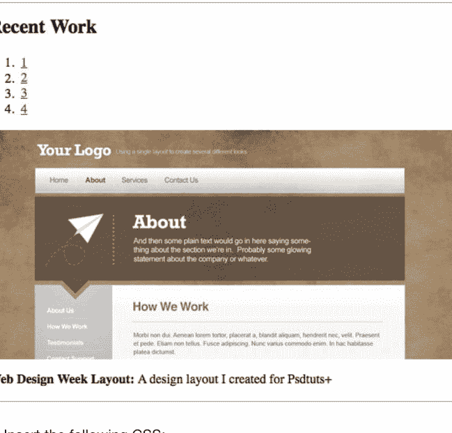

插入以下 CSS：

```css
#main div#recentWork {
    clear: both;
    position: relative;
    border-top: 1px solid #cec5c0;
}
```

### 编写 CSS

```css
#subpage #container #recentWork {
    border-top: none;
}

#subpage #recentWork h3 {
    font-size: 24px;
    color: #2f231e;
}

#recentWork h2 {
    border: none;
    margin-bottom: 0;
    padding: 28px;
    margin-top: 11px;
}

#recentWork ol {
    position: absolute;
    right: 0;
    top: 45px;
}

#subpage #recentWork ol {
    top: 0;
}

#recentWork ol li {
    width: 16px;
    height: 16px;
    display: inline;
}

#recentWork ol li a {
    color: white;
    background: #bc535a;
    width: 100%;
    height: 100%;
    padding: 5px 10px;
    -moz-border-radius: 100px;
    -webkit-border-radius: 13px;
}

#recentWork ol li.chosen a, #recentWork ol li a:hover {
    background: #a37a7e;
}

#recentWork ol li a:hover {
    text-decoration: none;
}

#recentWork p {
    text-align: right;
    font-size: 13px;
    font-style: italic;
    color: #4e4d4d;
    margin-top: 10px;
}

#subpage #recentWork p {
    text-align: left;
    line-height: 18px;
}

div.image_display {
    padding: 11px;
    border: 1px solid #dbcec9;
    background: white;
}

.image_display img {
    border: 1px solid #dbcec9;
}
```

我们首先为包裹性的`#recentWork` div 设置样式。因为上面的 blockquote 浮动到了右边，我们必须先清除上方的元素。接下来，为包裹性 div 创建一个新的定位上下文通常是一个明智的做法。最后，我们设置一个 1px 的上边框——颜色当然是从 PSD 文件中获取的。

接着处理我们的二级标题“Recent Work”，我们再次应用 Fahrner 的背景技巧（第 64 页），并将我们的图片设为背景。

有序列表将用于容纳带编号的项目。当用户点击一个数字时，我们最终会使用 jQuery 来更换图片。为了将它们精确定位到我们想要的位置，我们再次使用“绝对”定位。值得庆幸的是，我们之前创建了一个新的定位上下文——否则，我们的 top、right、bottom 和 left 值将相对于`#main` div 来定位。快速使用“标尺工具”显示，我们需要从顶部边框留出 45px 的间距。

### 修改后

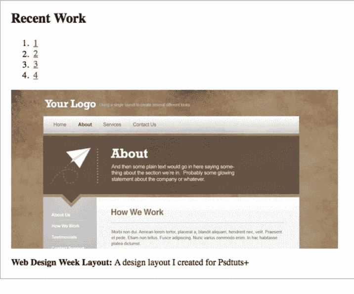

#### 圆角

虽然我们本可以使用背景图片来创建棕色的圆形背景，但我们将使用一个巧妙的浏览器样式技巧来实现这个效果。请注意，这只在 Firefox、Safari 和 Chrome 中有效——在 Internet Explorer 中不行。在那个浏览器中，圆圈会变成方块，这是可以接受的变化。

> **ROCK\* 提示**
>
> *你的网站在每个浏览器中看起来不 100% 相同也没关系。*

### 编写 CSS

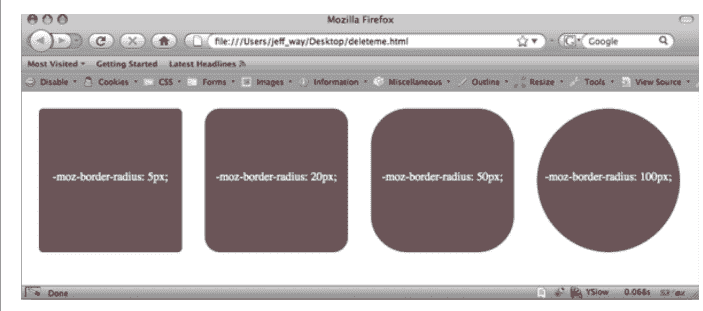

要创建圆角，我们使用`-moz-border-radius`和`-webkit-border-radius`属性来分别针对 Firefox 和 Safari / Chrome。这两个值的设置略有不同。通常，这些属性用于为元素应用微妙的曲线。在我们的例子中，我们希望创建一个完整的圆。Firefox 用 100px，Safari 用 13px 应该就能达到效果。很棒，对吧？我们还添加了一些 padding 来给我们的数字一些呼吸空间。

## 页脚

我们主页的最后一步是设置页脚的样式。

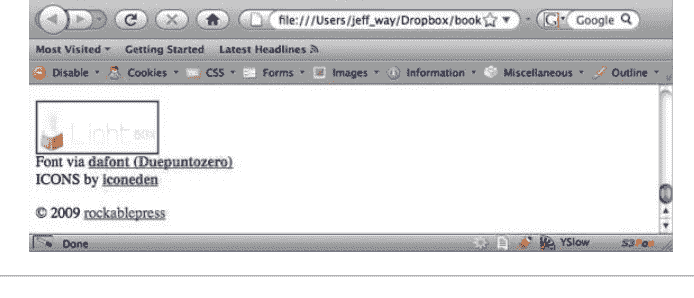

### HTML


```html
</div><!--end container-->
<div id="footerWrap"><!-- needed to extend the brown
background for the entire screen -->
    <div id="footer">
        <div id="footerLogo">
            <a href=""></a>
        </div>
        Font via <strong><a href="http://www.dafont.com/duepuntozero.font">dafont (Duepuntozero)</a></strong><br />
        ICONS by <strong><a href="http://iconeden.com/icon/bright-free-stock-iconset.html">iconeden</a></strong>
        <p id="footerInfo">&copy; 2009  <a href="http://rockablepress.com/">rockablepress</a></p>
    </div><!-- end footer -->
</div><!-- end footerWrap-->
```

### CSS

```css
/* Footer */

/* The footer div must be wrapped with this #footerWrap
div in order to extend the brown background for the entire
width of the screen. */
#footerWrap {
    border-top: 1px solid white;
    background: #32251f;
}

#footer {
    overflow: hidden;
    color: #ab8a7d;
    width: 1002px;
    margin: auto;
    text-align: left;
    padding-top: 35px;
    font-size: 11px;
    line-height: 17px;
    text-transform: uppercase;
    border-right: 1px solid #483b2d;
    border-left: 1px solid #483b2d;
}

#footer p {
    color: #ab8a7d;
    font-size: 11px;
}

#footer #footerLogo {
    float: left;
    background: #291e18;
    width: 348px;
    text-align: center;
    padding-top: 2.5em;
    padding-bottom: 3em;
    margin-right: 32px;
    margin-top: -35px;
    border-right: 1px solid #483b2d;
}

#footer strong a, #footer p a {
    color: white;
    font-weight: bold;
}

#footer p#footerInfo {
    float: right;
    padding-right: 45px;
    margin-top: -17px;
}
```

为了在网站底部获得重复的棕色背景，我们不能将页脚放在`container` div 内部。如果那样做，它会被切断，因为网站的宽度是 1004px。然而，我们仍然希望页脚看起来像是连接着网站的。解决方案是为我们的页脚添加一个包裹层，在代码中称为`footerWrap`。我们将设置背景颜色，但不设置宽度。这允许背景在整个窗口宽度上重复。然后，对于`#footer`子 div，我们将应用与`#container`元素完全相同的值。

```css
#footer {
    overflow: hidden;
    color: #ab8a7d;
    width: 1002px;
    margin: auto;
    text-align: left;
    padding-top: 35px;
    font-size: 11px;
    line-height: 17px;
    text-transform: uppercase;
    border-right: 1px solid #483b2d;
    border-left: 1px solid #483b2d; }
```

剩下的属性再次直接取自我们的 PSD 文件。你应该已经是这方面的专家了。

### 粘性页脚

有一个小问题。如果你在 Firefox 中查看网站，请按 Control 或 Command –（减号）缩小几次。注意到页脚是如何向上跳动的吗？

这不是什么大问题，但我们绝对应该修复它。**“锁定”在浏览器窗口底部的页脚被称为“粘性页脚”。**

为了实现这种效果，我们只需要在 CSS 文件中添加几个额外的样式。

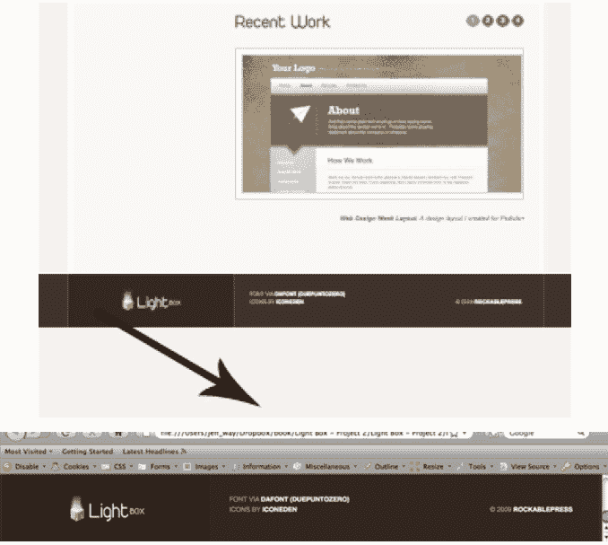

在“body”选择器的开头之前，追加以下代码：

```css
html, body {
    height: 100%;
}
```

这会指示浏览器确保`html`和`body`元素占据用户屏幕的整个高度。

找到你的“container”选择器，并插入这些新样式。

```css
#container {
    ... 其他样式
    min-height: 100%;
    height: auto !important; /* 针对 IE 6 */
    height: 100%;  /* 针对 IE 6 */
}
```

就是这么简单。保存文件，回到你的浏览器，然后刷新页面。瞧！

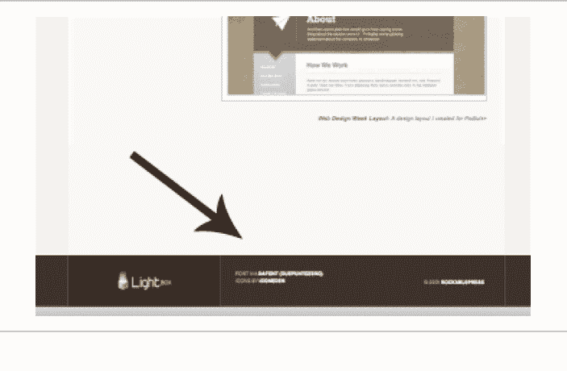

### 编写 CSS

## 关于页面

既然我们已经完成了首页，那么为其余页面设置样式应该会简单得多。大部分代码都已经完成了！只需要替换文本即可。我们将从“关于”页面开始。


### 标记

```html
<!DOCTYPE html PUBLIC "-//W3C//DTD XHTML 1.0 Transitional//EN" "http://www.w3.org/TR/xhtml1/DTD/xhtml1-transitional.dtd">
<html xmlns="http://www.w3.org/1999/xhtml">
<head>
<meta http-equiv="Content-Type" content="text/html; charset=iso-8859-1" />
<link rel="shortcut icon" href="images/favicon.ico" />
<link rel="stylesheet" href="css/reset.css" />
<link rel="stylesheet" href="css/default.css" />
</head>
<body id="subpage">

<div id="container">
    <div id="header">
        <ul id="nav">
            <li id="li_home"><a href="index.html">Home</a></li>
            <li id="li_work"><a href="work.html">Work</a></li>
            <li id="li_about" class="selected"><a href="about.html">About</a></li>
            <li id="li_contact"><a href="contact.html">Contact</a></li>
        </ul>

        <div id="slogan">
            <h1><a href="index.html">Light Box</a></h1>
            
        </div><!-- end slogan-->
    </div><!-- end header-->

    <div id="main">

        <div id="primaryContent">
            <h2 id="aboutUs">About Us</h2>

            <p>
                ... filler text
            </p>

            <h4>Heading</h4>

            <p>
                ... filler text
            </p>
            <h4>Heading</h4>

            <p>
                ... filler text
            </p>

            <ul>
                <li><span>Bullet Point</span>And then some information about that bullet point.</li>
                <li><span>Bullet Point</span>And then some information about that bullet point.</li>
                <li><span>Bullet Point</span>And then some information about that bullet point.</li>
            </ul>
            <p>
                ... filler text
            </p>

        </div> <!-- end primaryContent-->

        <div id="secondaryContent">
            <blockquote>
                <p>Lightbox did an amazing job with our website. From start to finish they were professional, fast and totally fictitious.</p>

                <p>It was amazing how a company that doesn't even exist could put together such an amazing site for us. Thank you Lightbox!</p>
            </blockquote>
            <cite>John Rushmore <span>MADEUPPEOPLE.COM</span></cite>
            <div class="arrow"></div>
        </div><!-- end secondaryContent-->

    </div><!-- end main-->
</div><!--end container-->

<div id="footerWrap"><!-- needed to extend the brown background for the entire screen -->
    <div id="footer">
        <div id="footerLogo">
            <a href=""></a>
        </div>
        Font via <strong><a href="http://www.dafont.com/duepuntozero.font">dafont (Duepuntozero)</a></strong><br />

        ICONS by <strong><a href="http://iconeden.com/icon/bright-free-stock-iconset.html">iconeden</a></strong>
        <p id="footerInfo">&copy; 2009 <a href="http://rockablepress.com/">rockablepress</a></p>
    </div><!-- end footer -->
</div><!-- end footerWrap-->

</body>
</html>
```

### 编写 CSS

乍一看，这可能会让人有点不知所措。别担心，它基本上和首页的代码相同。除了文字之外，只有两点不同：

1. 我们移除了首页上的“Recent Work”部分。在这里它并不需要。
2. 我们为`body`标签添加了一个`id`：`"subpage"`。

注意到子页面的背景有什么不同了吗？它短得多。

#### 关于页面头部（子页面）


#### 首页头部


#### body ID 技巧

快速浏览一下我们 CSS 文件中的“body”选择器，可以看到以下内容：

```css
body {
    background: #f1eefe url(../images/bg.png) repeat-x;
    text-align: center;
    font-family: helvetica, arial, sans-serif;
    line-height: 25px;
}
```

最值得注意的是，我们在这里添加了一个背景图片。那么如何在首页设置一个背景图片，而在其他页面设置不同的背景图片呢？最高效的方法是使用“body id”技巧。

> **ROCK* 技巧**
>
> 通过在 body 标签上应用唯一的 id，我们可以逐页为元素设置不同的样式。

回到你的`default.css`文件，在“body”样式的正下方，追加以下规则：

```css
body#subpage {
    background: #f1eefe url(../images/bg_alt.jpg) repeat-x;
}
```

保存文件，然后刷新你的`about.html`页面。此时，背景应该完全是白色的。那是因为我们需要切出我们的新图片！

### 编写 CSS

回到 Photoshop 并打开“about.psd”。和之前一样：

1. 扁平化 PSD（图层 > 拼合图像）。
2. 选择一条狭长的背景条。


3. 重复“图案”的步骤（第 36 页），并将其保存到你的`images`文件夹中，命名为“bg_alt.jpg”。
4. 回到你的浏览器并刷新页面！

因为我们为“关于页面，并在我们的 CSS 文件中定位了该相应的 id，所以我们可以随心所欲地为其设置样式。

### 编写 CSS

我们已经完成了大部分样式设置。这样一来，我们的“关于”页面现在就完成了。

## 作品页面


接下来是“作品”页面。在你的项目中创建一个新文件，命名为`"work.html"`。粘贴以下 html：


```html
<!DOCTYPE html>
<html lang="en">
<head>
    <meta http-equiv="Content-Type" content="text/html; charset=utf-8">
    <title>Light Box</title>
    <link rel="stylesheet" href="css/reset.css" />
    <link rel="stylesheet" href="css/default.css" />
</head>
<body id="subpage" class="single">
  <div id="container">
    <div id="header">
          <ul id="nav">
                <li id="li_home" class="selected">
    <a href="index.html">Home</a></li>
                <li id="li_work"><a href="work.html">Work</a></li>
                <li id="li_about"><a href="about.html">About</a></li>
                <li id="li_contact"><a href="contact.html">Contact</a></li>
          </ul>
          <div id="slogan">
                <h1><a href="index.html">Light Box</a></h1>
                
          </div> <!-- end slogan-->
    </div> <!-- end header-->
    <div id="main">
        <div id="primaryContent">

<h2> Our Work </h2>

<p>
View samples of our work by scrolling down through the projects. Each project includes multiple screenshots and images, so be sure to click on the numbers to the top right.
</p>

<div id="recentWork">
<h3>Project 1 Title</h3>

<ol>
<li class="chosen"><a href="images/recentWork/recentWork1.jpg" title="Web Design Week Layout: A design layout I created for Psdtuts+">1</a></li>
<li><a href="images/re课间休息/recentWork2.jpg" title="Web Design Week Layout: A design layout I created for Psdtuts+">2</a></li>
<li><a href="images/recentWork/recentWork3.jpg" title="Web Design Week Layout: A design layout I created for Psdtuts+">3</a></li>
<li><a href="images/recentWork/recentWork4.jpg" title="Web Design Week Layout: A design layout I created for Psdtuts+">4</a></li>
</ol>

<div class="image_display">

</div> <!-- end image_display-->
</div>
```

## 编写 CSS

Class aptent taciti sociosqu ad litora torquent per conubia nostra, per inceptos himenaeos. Aenean odio ligula, luctus sed, auctor vel, faucibus at, ipsum. Sed vel risus. Nunc placerat nisi sagittis est. Nam euismod suscipit sem. Phasellus convallis condimentum quam. Phasellus accumsan metus at tortor. Suspendisse potenti.

## 项目 2 标题

- [Web Design Week Layout: A design layout I created for Psonuts+](images/recentWork/recentWork1.jpg)
- [Web Design Week Layout: A design layout I created for Psonuts+](images/recentWork/recentWork2.jpg)
- [Web Design Week Layout: A design layout I created for Psonuts+](images/recentWork/recentWork3.jpg)
- [Web Design Week Layout: A design layout I created for Psdtuts+](images/recentWork/recentWork4.jpg)


## 编写 CSS

Class aptent taciti sociosqu ad litora torquent per conubia nostra, per inceptos himenaeos. Aenean odio ligula, luctus sed, auctor vel, faucibus at, ipsum. Sed vel risus. Nunc placerat nisi sagittis est. Nam euismod suscipit sem. Phasellus convallis condimentum quam. Phasellus accumsan metus at tortor. Suspendisse potenti.

[Light Box](index.html)

字体来自 [dafont (Duepuntozero)](http://www.dafont.com/duepuntozero.font)

图标由 [iconeden](http://www.iconeden.com/) 提供

版权所有 (c) 2009 [rockablepress](http://www.rockablepress.com)

## 编写 CSS

```html
<script src="http://ajax.googleapis.com/ajax/libs/jquery/1.4/jquery.min.js" type="text/javascript" charset="utf-8"></script>

<script type="text/javascript" src="js/scripts.js"></script>

<script type="text/javascript">

  Cufon.now();

</script>

</body>

</html>
```

“作品”页面带来了新的挑战。到目前为止，我们的页面在主内容区都有两列。然而，现在我们只有一列。因此，我们需要重新查看 CSS 文件并进行一些更新和修改。

我们必须找到一种方法，让`primaryContent` div 在主页和关于页面具有指定的宽度，但在单列页面中宽度为 100%。

**注意：** 请注意我们并没有返回 HTML 去调整页面的“呈现”效果。那是 CSS 的工作！

让我们再次使用`body`技巧！找到`body`标签并添加一个新的 class 属性。

```html
<body id="subpage" class="single">
```

接下来，打开你的 CSS 文件，找到`#primaryContent`声明，并在它下面追加一个新的样式。

## 编写 CSS

```css
#main #primaryContent {
    float: left;
    width: 334px;
}

/* 此规则适用于主区域只有一列的页面。 */
body.single #main #primaryContent {
    width: 100%;
}
```

通过定位位于 class 为“single”的`body`标签内的`primaryContent`元素，我们可以只针对此页面调整`width`属性。非常简单。

正如我之前建议的，值得花点时间在你的浏览器中直接使用 Firefox 的 Web 开发者扩展来尝试删除这些样式。这将帮助你更好地理解每个声明的作用。大多数情况下，我们只是根据 PSD 匹配间距。

## 联系页面

如果你已经走到这一步，那么你做得很好。我们现在必须创建我们的最后一个页面：`contact.html`。

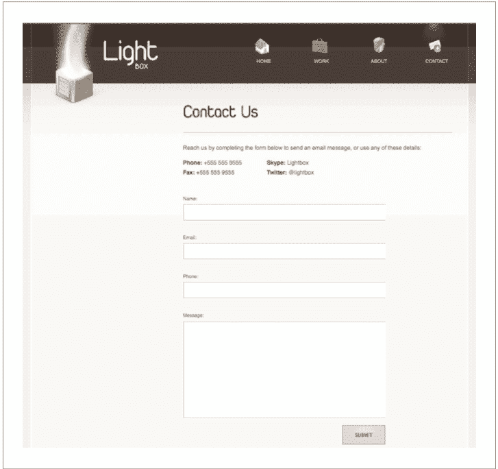

像往常一样，粘贴以下代码：

## 编写 CSS

```html
<!DOCTYPE html PUBLIC "-//W3C//DTD XHTML 1.0 Transitional//EN" "http://www.w3.org/TR/xhtml1/DTD/xhtml1-transitional.dtd">
<html xmlns="http://www.w3.org/1999/xhtml">
<head>
<meta http-equiv="Content-Type" content="text/html; charset=iso-8859-1" />
<link rel="shortcut icon" href="images/favicon.ico" />
<link rel="stylesheet" href="css/reset.css" />
<link rel="stylesheet" href="css/default.css" />

<title>Light Box</title>
</head>

<body id="subpage" class="single">

<div id="container">
    <div id="header">
            <ul id="nav">
                    <li id="li_home"><a href="index.html">Home</a></li>
                    <li id="li_work"><a href="work.html">Work</a></li>
                    <li id="li_about"><a href="about.html">About</a></li>
                    <li id="li_contact" class="selected"><a href="contact.html">Contact</a></li>
            </ul>

        <div id="slogan">
                <h1><a href="index.html">Light Box</a></h1>
                
        </div><!-- end slogan-->
    </div><!-- end header-->

<div id="main">

    <div id="primaryContent">
        <h2 id="contactUs">Contact Us</h2>

        <p>
            Reach us by completing the form below to send an email message, or use any of these details:
        </p>

        <ul id="info">
            <li><strong>Phone: </strong> +555 555 9555</li>
            <li><strong>Skype: </strong> Lightbox</li>
            <li><strong>Fax: </strong> +555 555 9555</li>
            <li><strong>Twitter: </strong> @lightbox</li>
        </ul>
        <form action="contact.html" method="get" accept-charset="utf-8">
            <label for="name">Name: </label>
            <input type="text" name="name" value="" id="name" />

            <label for="email">Email: </label>
            <input type="text" name="email" value="" id="email" />
            <label for="phone">Phone: </label>
            <input type="text" name="phone" value="" id="phone" />
            <label for="message">Message: </label>
            <textarea name="message" id="message" rows="2" cols="45"></textarea>

            <input type="submit" name="submit" value="Submit" />
        </form>

    </div><!--end primaryContent-->

</div><!-- end main-->

</div><!--end container-->

<div id="footerWrap"><!-- needed to extend the brown background for the entire screen -->
    <div id="footer">
            <div id="footerLogo">
                    <a href=""></a>
            </div>
            Font via <strong><a href="http://www.dafont.com/duepuntozero.font">dafont (Duepuntozero)</a></strong><br />
            ICONS by <strong><a href="http://iconeden.com/icon/bright-free-stock-iconset.html">iconeden</a></strong>
            <p id="footerInfo">&copy; 2009  <a href="http://rockablepress.com/">rockablepress</a></p>
    </div><!-- end footer -->
</div><!-- end footerWrap-->

</body>
</html>
```

## 编写 CSS

与主页相比，我们的标记中唯一独特的部分是我们的表单。由于我们尚未为表单元素提供样式，页面目前看起来是这样的：

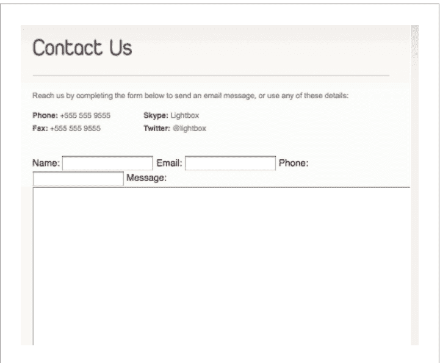

我们必须解决这个问题！

因此在你的样式表中，添加以下内容：


```css
/********* FORMS *********************/

form {
    width: 464px;
    overflow: hidden;
}

label {
    display: block;
    font-size: 11px;
    color: #645a5b;
}

input[type=text],
textarea {
    width: 452px;
    height: 27px;
    border: 1px solid #cec5bf;
    margin-bottom: 27px;
    color: #645a5b;
    font-size: 17px;
    padding: 7px 0 0 10px;
    font-family: helvetica, arial;
}

input[type=text]:hover,
textarea:hover,
input:focus,
textarea:focus {
    background: #eecec;
    outline: none;
}

#container textarea {
    height: 212px;
}

input[type=submit] {
    border: 1px solid #aba199;
    text-align: center;
    color: #30241f;
    font-size: 11px;
```

## 编写 CSS

```css
width: 100px;
padding: 12px;
text-transform: uppercase;
float: right;
margin-top: -12px;
background: #d5ceca url(../images/submitButtonBG.jpg) repeat-x;
cursor: pointer;
}

input[type=submit]:hover {
    background: #c8c0bd url(../images/submitButtonBG.jpg) repeat-x -100px 0;
}

/*********** END FORMS ***********/
```

根据我对`contact.psd`文件的测量，上面列出的数值似乎是准确的。你的可能会有细微不同，这完全没有问题。

对于`input[type=text]`语法，你可能会有些困惑。除了通过`id`和`class`来定位元素外，我们还可以基于它们的`type`来定位某些元素。在这些例子中，我选择了所有`type`属性等于`text`的`input`，也就是所有标准文本框。这个选择器不会定位密码输入框或文本区域。

请注意，这种高级语法在 Internet Explorer 6 及以下版本中不起作用。不过，我们很快就会通过导入 Dean Edwards 创建的 JavaScript 文件来解决这个问题（`http://dean.edwards.name`）。

我们再次使用这种语法来定位我们的“提交”按钮，以及鼠标悬停时的状态。当然，我们仍然可以使用`id`，但这更有趣！

> **ROCK\* 提示**
>
> 永远不要让浏览器的缺陷阻碍你使用高级选择器。有很多 JavaScript 可以解决 IE6 的不足。

```css
input[type=submit] {
    border: 1px solid #aba199;
    text-align: center;
    color: #30241f;
    font-size: 11px;
    width: 100px;
    padding: 12px;
    text-transform: uppercase;
    float: right;
    margin-top: -12px;
    background: #d5ceca url(../images/submitButtonBG.jpg) repeat-x;
    cursor: pointer;
}

input[type=submit]:hover {
    background: #c8c0bd url(../images/submitButtonBG.jpg) repeat-x -100px 0;
}
```

### Cufón 字体替换

实际上，有几十种方法可以在你的项目中使用独特的字体。话虽如此，它们都有一个共同点：它们并不完美。有些工具使用 Flash `.swf` 文件来完成工作，有些使用 Canvas（允许渲染位图图像的 HTML5 特性），有些甚至渲染无法选中的文本。底线是，你需要权衡你的选择，为手头的任务选择最简单和最佳的解决方案。

考虑到我们正在开发一个相对简单的网站，我选择使用 Cufón（`http://wiki.github.com/sorccu/cufon`）。如果你之前用过 sIFR，也就是可缩放的 Inman Flash 替换（`http://www.mikeindustries.com/blog/sifr/`），你无疑会在某个时刻捶胸顿足。幸运的是，使用 Cufón，它就能直接工作！让我们看看怎么做。

1. 访问 Cufón 的网站（[cufon.shoqolate.com](http://cufon.shoqolate.com)），右键点击顶部的“Download”按钮。选择“另存为”，并将其保存到你的桌面。

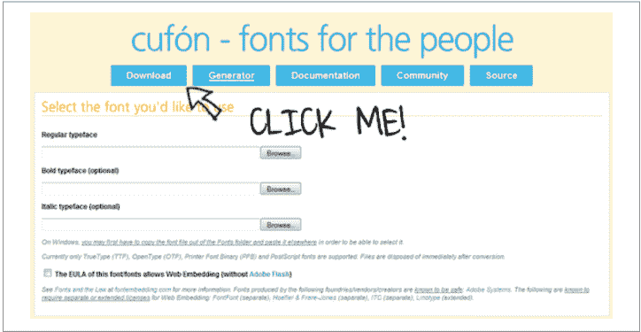

2. 为了使其工作，我们需要使用 Cufón 网站上的字体转换工具。参考此页面：[http://cufon.shoqolate.com/generate/](http://cufon.shoqolate.com/generate/)。

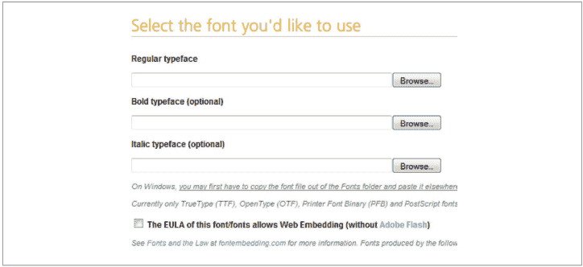

### 编写 CSS

3. 找到你想要的字体。在我们的例子中，它位于`Final Project > Assets > Fonts > duepuntozero.ttf`。

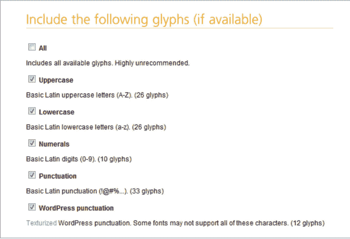

4. 仅包含大写字母、小写字母、数字和标点符号字形。其他字符不是必需的，只会增加你的文件大小。

5. Cufón 允许你为你的文件指定特定的 URL，以提高安全性。确保你拥有使用字体的适当权限是极其重要的。我们使用的字体是免费的。将你网站的 URL 输入到“Security”文本框中。

由于我们才刚刚开始，你可以将最后两部分保留为默认值。接受条款，然后点击“Let's Do This”。随后会弹出一个下载框，询问你要将生成的脚本保存到哪里。再次将其保存到桌面，以便轻松获取。

### 编写 CSS

6. 在你的项目中创建一个新文件夹，命名为`js`。

7. 将`Cufon.yui.js`和你新创建的`Duepuntozero_400.font.js`文件放入其中。

8. 在每个页面的`head`标签中，追加以下代码：

```html
<script type="text/javascript" src="js/cufon-yui.js"></script>
<script type="text/javascript" src="js/Duepuntozero_400.font.js"></script>
<script type="text/javascript">
    Cufon.replace('h2');
</script>
```

信不信由你，就这么简单！通过在`Cufon.replace`中调用所有`h2`标签，我们告诉引擎找到页面上所有二级标题标签，并用我们的新字体替换它们！唯一的缺点是最终渲染的文本无法选中。

说实话，我们本可以对副标题使用同样的方法，比如“Web Development, Graphics”等，但我想向你展示如何使用 CSS 精灵！任一方法都能很好地工作。两者各有优点。

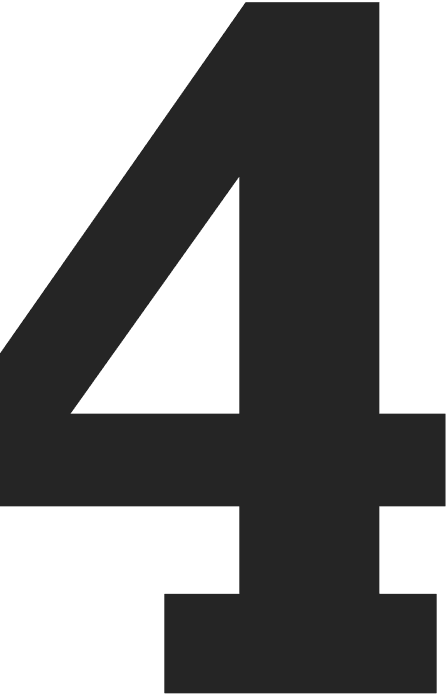

### 兼容旧版浏览器

总有一天，网页设计师可以欢欣地忽略像 Internet Explorer 6 这样的古老浏览器，希望还有 7！不幸的是，我们还没有完全到那个地步。事实上，在撰写本文时，根据 [w3schools.com](http://www.w3schools.com/browsers/browsers_stats.asp) 的数据，仍有 13.6% 的用户在使用这款十年前的浏览器。

| 2009 | IE7 | IE6 | IE8 | Firefox | Chrome | Safari | Opera |
|------|-----|-----|-----|---------|--------|--------|-------|
| August | 15.1% | 13.6% | 10.6% | 47.4% | 7.0% | 3.3% | 2.1% |
| July | 15.9% | 14.4% | 9.1% | 47.9% | 6.5% | 3.3% | 2.1% |
| June | 18.7% | 14.9% | 7.1% | 47.3% | 6.0% | 3.1% | 2.1% |
| May | 21.3% | 14.5% | 5.2% | 47.7% | 5.5% | 3.0% | 2.2% |
| April | 23.2% | 15.4% | 3.5% | 47.1% | 4.9% | 3.0% | 2.2% |
| March | 24.9% | 17.0% | 1.4% | 46.5% | 4.2% | 3.1% | 2.3% |

### 令人皱眉的时刻

第一次在 Internet Explorer 7 及以下版本中查看你的网站会让你皱眉。你可能运气好，但大多数时候，你会发现需要修复的诸多问题。

那么让我们来看看我们还需要做多少工作。

### 工具

要在 IE6–IE8 中查看你的网站，你有几个选择。

1. 在 PC 上，下载 IE Tester。这个程序将允许你在每个 IE 浏览器中查看你的网站：`http://www.my-debugbar.com/wiki/IETester/HomePage`。

2. 有很多在线网站可以对你的网站在几十种浏览器中进行截图。我个人最喜欢的是`http://www.browsershots.org`。要使用这些服务，网站需要已经上线——不能只在你的开发服务器上。

对于本书，我们将使用第一个选项。然而，如果你是 Mac 用户（比如我自己），可以随意使用 browsershots.org，或者设置虚拟机来运行 Windows。在 Mac 上测试 IE6 时，你会发现最好的选择么是临时借用一台 PC，要么是使用类似 Vmware Fusion 的程序（`http://www.vmware.com/products/fusion/`）。

### 兼容旧版浏览器

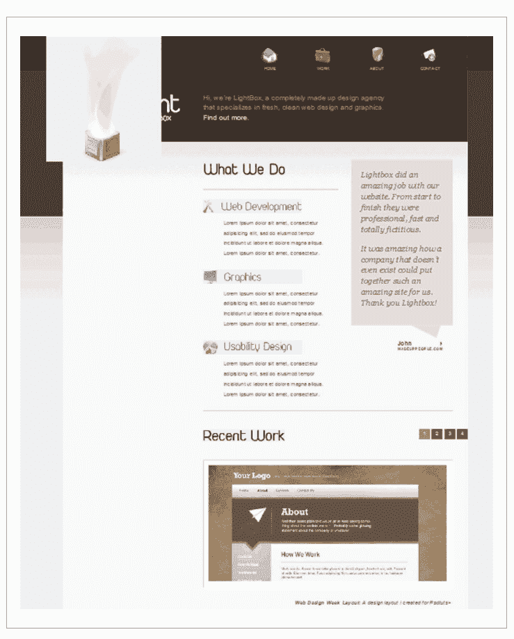

哎呀！说实话，与某些网站相比，这还不算太糟。主要是，我们需要修复一些间距问题。Internet Explorer 6 已经有十年历史了。我们在某种程度上还在兼容它已经够好了！不必头疼。

### 兼容旧版浏览器

虽然这些不一致性可能会让初学者望而生畏，但你会很快学会一些额外的属性就可以修复巨大的布局问题。大多数这些问题都可以通过给元素“layout”来解决。

> “Layout”是 IE/Win 专有的概念，它决定了元素如何绘制和界定其内容、如何与其他元素交互和关联，以及如何响应和传递应用程序/用户事件。”
>
> 出自 On Having Layout：`http://www.satzansatz.de/cssd/onhavinglayout.html`。

#### 为什么“Having Layout”是必要的？

这很重要，因为它强制元素拥有矩形形状。这意味着元素的内容不能围绕其他框流动，这通常会导致网站的重大布局问题。

当微软的专有属性`hasLayout`等于`true`时，该元素就“具有 layout”了。幸运的是，我们可以通过向选择器添加特定属性来触发这一点。就我个人而言，我最喜欢的方法是将元素的高度设置为`100%`。其他可能性包括指定宽度和高度、创建定位上下文，以及将`zoom`属性设置为`1`。

## 兼容旧版浏览器

#### 针对特定版本的 Internet Explorer

要针对特定版本的 IE，我们在 HTML 文档的`head`标签内使用条件语句。将以下代码添加到每个页面：

```html
<!--[if lt IE 8]>
<script src="http://ie7-js.googlecode.com/svn/version/2.0(beta3)/IE8.js" type="text/javascript"></script>
<![endif]-->

<!--[if lte IE 6]>
<link rel="stylesheet" type="text/css" href="css/ie6.css" />
<![endif]-->
```

第一块代码的含义是：“如果访问者使用低于 Internet Explorer 8 的版本，则导入以下脚本，否则不执行任何操作”。我们链接到一个广受欢迎的脚本，名为 IE8.js，由 Dean Edwards 创建（`http://code.google.com/p/ie7-js/`）。该脚本允许我们在样式表中使用许多高级选择器，而无需担心 IE6 无法识别它们。更多详情请访问`http://code.google.com/p/ie7-js/`。

第二块代码专门针对 IE6 用户。注意第一行：“if lte IE 6”。这表示“如果用户使用的是 IE6 或更低版本，则导入包含的样式表”。在这些标签内，我们链接到`ie6.css`。现在就去创建这个文件，并将其保存在你的 CSS 文件夹中。现在，我们可以放心，此文件中的任何代码仅在用户使用 IE6 或更低版本浏览时才会运行。

在此文件中粘贴以下代码：

```css
#container #nav li a {
    float: left;
}

#container ul#nav,
#slogan {
    overflow: hidden;
}

.arrow {
    display: none;
}

#secondaryContent cite {
    margin-top: -25px;
}

#recentWork ol {
    padding-right: 36px;
}

#main {
    height: 100%;
}
```

我将完全坦诚地告诉你。有时候，我们只能接受 IE6 确实很奇特这一事实。当我们遇到奇怪的定位问题时，我们有两个选择：

1. 花费数小时精确计算这个问题是如何以及为何发生的。

2. 省点心，“凭感觉”处理。如果你搞不懂为什么 IE6 需要那额外的 27px 内边距，别担心！只需补偿一下，然后继续。你可能轻易就会浪费大量时间试图理解 IE6，但最终你学到的将是一个正在逐渐退出使用的浏览器。最好还是把精力集中在符合标准的浏览器上。

> **ROCK\* 提示**
>
> 你会逐渐接受，有时候似乎需要一些随机的属性才能让 IE6 满意！

#### IE6 中的 PNG-24 透明度

注意到我们的 Light Box 背后那片难看的灰色背景了吗？这是因为 IE6 原生不支持 PNG-24 格式。因此，它不是显示透明效果，而是渲染出难看的灰色背景。

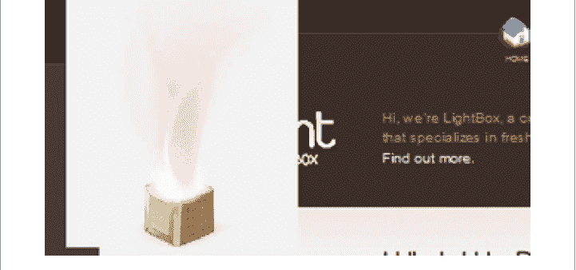

幸运的是，有几种解决方案：

- **Unit PNG Fix**
  - **下载**：[http://labs.unitinteractive.com/unitpngfix.php](http://labs.unitinteractive.com/unitpngfix.php)
  - **问题**：它无法正确平铺透明的背景图片。相反，它会拉伸你的图片。这不是什么大问题，但要注意。除了这个小怪癖，这个方法效果很好。我发现自己比其他方法更常使用它。

- **DD_BelatedPNG Fix**
  - **下载**：[http://www.dillerdesign.com/experiment/DD_belatedPNG/](http://www.dillerdesign.com/experiment/DD_belatedPNG/)
  - **问题**：每种修复方法都有一些小怪癖，但这个效果不错，只是设置起来可能有点棘手。

- **IE8.js Fix**
  - **下载**：[http://code.google.com/p/ie7-js/](http://code.google.com/p/ie7-js/)
  - **问题**：你会发现这个文件比其他文件大。这是因为修复透明度问题只是它功能的一部分！它还能将许多其他 IE6 的不足之处提升到现代标准。选择时请牢记这一点。如果你只想显示透明效果，这可能不是最佳选择。

- **Twin Helix Fix（来自 Angus Turnbull）**
  - **下载**：[http://www.twinhelix.com/css/iepngfix/](http://www.twinhelix.com/css/iepngfix/)
  - **问题**：Angus 在过去六个月内更新了这个文件——它现在正确实现了`background-repeat/position`！与引用 Javascript 文件不同，这个修复需要使用`behavior` CSS 属性。

我们将使用最后一个选项：“Twin Helix Fix”。只需从上面的链接下载`iepngfix.htc`文件，并将其拖入你的项目中。接下来，我们使用`behavior`属性来引用该文件。

我们需要修复两张图片：Light Box 和页脚中的 logo。


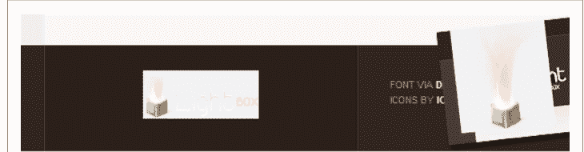

将以下内容追加到你的 IE6 样式表中：

```css
#footer img, #slogan img {
    behavior: url(../iepngfix.htc);
}
```

现在保存页面，刷新你的浏览器。简单！

注意，你还可以使用我们之前导入的`IE8.js`脚本来实现这一点。但是，你必须更改所有使用透明效果的图片的名称。只需在文件名末尾追加`-trans`，其余的事情就会自动完成！

使用你觉得最舒适的方法。

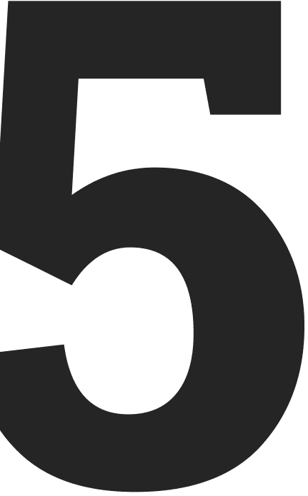

## Bonus 章节：jQuery 初体验

在本书的前面，我答应过要向你展示如何在首页创建“过渡”效果。

使用`jQuery`，这样的任务变得轻而易举。由于我们在此项目中不会使用太多`JavaScript`，如果你愿意，可以将它内联。不过，在源代码中，我会将这个脚本移到独立的外部文件中。让我们开始吧。

### 脚本

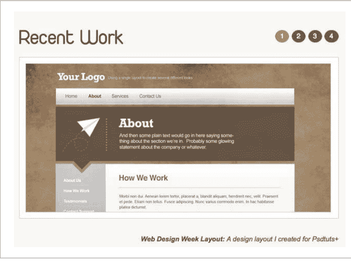

1. 在`</body>`结束标签之前，引用 Google 的 CDN 来导入`jQuery`库。

```html
<script src="http://ajax.googleapis.com/ajax/libs/jquery/1.4/jquery.min.js" type="text/javascript" charset="utf-8"></script></body>
```

2. 在`script`标签内，追加以下代码：

```javascript
$(`#recentWork li a`).click(function() {
    var $this = $(this);
    if ( !$this.parent(`li`).hasClass(`chosen`) ) {
        var url = this.href,
            height = $(`.image_display img`).css(`height`);

        $(this)
            .parents(`ol`)
            .find(`li.chosen`)
            .removeClass(`chosen`);

        $(this.parent(`li`).addClass(`chosen`);

        $(`.image_display`)
            .css(`height`, height)
            .children(`img`)
            .fadeOut(400, function() {
                $(this).attr(`src`, url).load(function() {
                    $(this).fadeIn(400);
                });
            });

        $(this.parents(`#recentWork`)
            .find(`p:last`)
            .empty()
            .html(`<p>` + $(this.attr(`title`) + `</p>`);
    });
    }

    return false;
});
```

### 解析脚本

```javascript
$('#recentWork li a').click(function() {
```

在`recentWork` div 中找到锚点标签，并监听用户点击它的事件。

```javascript
[替换为]
var $this = $(this);
if ( !$this.parent('li').hasClass('chosen') ) {
    var url = this.href,
        height = $('.image_display img').css('height');
    $this
        .parents('ol')
        .find('li.chosen')
        .removeClass('chosen');
}
$this.parent('li').addClass('chosen');
```

创建一个名为`$this`的新变量，并将其设为被点击的锚点标签。这将“缓存”`this`的位置，以便每次引用时不必重新搜索 DOM。

如果锚点标签的父元素——列表项——没有`chosen`类，则添加一个，并确保没有其他列表项具有相同的类。添加这个类将允许我们更改所选项目的背景色。我们只需要返回样式表并添加一个额外的样式。

```css
#recentWork ol li.chosen a, .ourWork ol li.chosen a {
    background: #a37a7e;
}
```

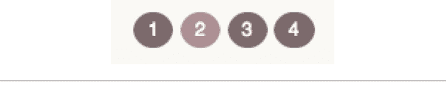

```javascript
$this
    .parents('ol')
    .find('li.chosen')
    .removeClass('chosen');

$this.parent('li').addClass('chosen');

$('.image_display')
    .css('height', height)
    .children('img')
    .fadeOut(400, function() {
        $(this).attr('src', url).load(function() {
            $(this).fadeIn(400);
        });
    });

$this.parents('#recentWork')
    .find('p:last')
    .empty()
    .html('<p>' + $this.attr('title') + '</p>');
});
```

### jQuery 小试牛刀

获取 class 为“image_display”的包裹 div，并调整其 CSS 以修复一个怪异的 IE6 兼容性问题。

接下来，淡出主图像，将其源地址更改为被点击的锚标签的 URL，然后加载这个新图像。加载完成后，在半秒钟的时间内将其淡入。最后，清空描述中的当前文本，并将其替换为最初被点击的锚标签的`title`属性中的内容。

最后，`return false`以禁用锚标签的默认行为。

就这样，大功告成！

## 结论

恭喜你完成了！在 100 多页之后，我们与各种问题搏斗，将我们的第一个设计成功转化成了符合标准的 HTML 和 CSS 网站。然而，书本的篇幅有限，无法涵盖所有内容，因此我鼓励你以任何可能的方式继续学习。常去书店，阅读博客，撰写教程。前途无量！

感谢阅读！

## 附录

### 关于作者

Jeffrey Way 是 [Envato](https://envato.com) 团队的一员。他是 [Nettuts+](https://net.tutsplus.com)（一个拥有超过 5 万日读者的网页开发教程博客）的编辑，同时他也是两个面向网页开发者的市场：[ThemeForest](https://themeforest.net) 和 [CodeCanyon](https://codecanyon.net) 的经理。他在网络行业已有超过 5 年的经验，专长领域包括`HTML`、`CSS`、`PHP`、`JavaScript`、`jQuery`、`CodeIgniter`、数据库开发和`WordPress`。

Jeffrey 与他的未婚妻 Allie 以及他们的小腊肠犬住在美国田纳西州。“我在电脑前花了太多时间，”他说，“而且我发现自己对未婚妻说‘我们5分钟后就走！’的次数太多了。我简直无法在还在产生`FireBug`错误的时候出门吃晚饭……这让我抓狂。”

在业余时间，除了其他事情——比如写这本书——他也会为自己的个人博客（[www.Jeffrey-way.com](http://www.Jeffrey-way.com)）撰写文章。

### 关于作者

Jeffrey Way 是 [Envato](https://envato.com) 团队的一员。他是 [Nettuts+](https://net.tutsplus.com)（一个拥有超过 5 万日读者的网页开发教程博客）的编辑，同时他也是两个面向网页开发者的市场：[ThemeForest](https://themeforest.net) 和 [CodeCanyon](https://codecanyon.net) 的经理。他在网络行业已有超过 5 年的经验，专长领域包括`HTML`、`CSS`、`PHP`、`JavaScript`、`jQuery`、`CodeIgniter`、数据库开发和`WordPress`。

Jeffrey 与他的未婚妻 Allie 以及他们的小腊肠犬住在美国田纳西州。“我在电脑前花了太多时间，”他说，“而且我发现自己对未婚妻说‘我们5分钟后就走！’的次数太多了。我简直无法在还在产生`FireBug`错误的时候出门吃晚饭……这让我抓狂。”

在业余时间，除了其他事情——比如写这本书——他也会为自己的个人博客（[www.Jeffrey-way.com](http://www.Jeffrey-way.com)）撰写文章。

在《Photoshop to HTML》中，Nettuts+ 编辑兼作者 Jeffrey Way 将带你完成将设计从 Photoshop 转化为完整的`HTML`/`CSS`网站的整个过程！

这本书还附带了完成的演示网站，你可以根据自己的意愿在项目中自由使用。不仅如此，你还将获得额外的系列屏幕录像，其中 Jeffrey Way 涵盖了整个项目从开始到结束的过程。所以，你既可以阅读，也可以观看！

那么，你还在等什么？！开始切图吧！
