# 前端性能：SitePoint


# 第10章：什么是 CDN 及其工作原理？

- CDN 基础 [103]
- CDN 类型 [104]
- 主要服务商 [106]
- 实施流程 [108]
- 总结 [109]

## 前言

性能至关重要。技术或许让我们能“做得更大”，但在性能方面未必能“做得更好”。服务器和互联网连接正变得日益强大，结果是我们总觉得需要不断填满它们。然而，现在不是懈怠的时候。现在是利用那些现成工具让网站变得更快的时候，也是学习如何提升用户体验和满意度的时候。

这是一本为网站开发者编写的、关于前端网站性能的实用教程集。书中充满了实用的、来自现实世界的提示和技巧，你可以立即在你的网站上应用。

## 本书适合谁阅读？

本书面向所有希望建构运行更快的网站和应用的前端开发者。为了跟上讨论，你需要熟悉 HTML 和 CSS，并对 JavaScript 有相当程度的理解。

## 本书约定

你会注意到我们在整本书中使用了特定的排版和布局样式来表示不同类型的信息。请注意以下各项。

## 代码示例

本书中的代码使用等宽字体显示，如下所示：

```html
<h1>A Perfect Summer's Day</h1>
<p>It was a lovely day for a walk in the park.
The birds were singing and the kids were all back at school.</p>
```

当需要上下文中的现有代码时，为避免重复，会显示 `⋮`：

```javascript
function animate() {
    :
new_variable = "Hello";
}
```

有些代码行本应写在一行，但由于页面限制不得不换行。`↵` 表示仅出于格式目的的换行符，应忽略：

```javascript
URL.open("http://www.sitepoint.com/responsive-web-↵design-real-user-testing/?responsive1");
```

### 提示、说明和警告

#### 嘿，你！

提示提供有用的简短提示。

#### 嗯，打扰一下……

说明是与主题相关但并非至关重要的有用旁注。可以把它们看作额外的信息花絮。

#### 务必记住要……

……关注这些要点。

#### 注意！

警告会突出显示那些可能在过程中让你绊倒的潜在问题。

# 你的网站应该支持哪些浏览器？

克雷格·巴克勒

第 1 章

“我的网站/应用应该支持哪些浏览器？”这个问题经常被客户和开发者提出。简单的答案是列出排名前 N 的主流应用程序。但这种策略是否已经过时了？

## 使用率最高的浏览器有哪些？

根据 `StatCounter` 的数据，2017 年 5 月桌面端使用率最高的十款浏览器是：

1. Chrome — 59.37% 市场份额
2. Firefox — 12.76%
3. Safari — 10.55%
4. IE — 8.32%
5. Edge — 3.42%
6. Opera — 1.99%
7. Android（平板）— 1.24%
8. Yandex Browser — 0.48%
9. UC Browser — 0.41%
10. Coc Coc — 0.33%

移动端现在占所有网络使用的 54.25%，因此我们也需要审视排名前十的手机浏览器：

1. Chrome — 49.23%
2. Safari — 17.73%
3. UC Browser — 15.89%
4. Samsung Internet — 6.58%
5. Opera — 5.03%
6. Android — 3.75%
7. IEMobile — 0.68%
8. BlackBerry — 0.26%
9. Edge — 0.15%
10. Nokia — 0.12%

全球统计数据并不能说明全部情况：

- 不同地区的模式差异显著。例如，Yandex 是俄罗斯使用率第二高的浏览器（12.7% 份额）。搜狗是中国使用率第三高的浏览器（6.5%）。Opera Mobile/Mini 在非洲的份额为 28%。
- 新的浏览器版本定期发布。Chrome、Firefox 和 Opera 每六周更新一次；检查几个月前的版本是不切实际的。
- 同一款浏览器在不同设备和操作系统上的工作方式可能不同。Chrome 有适用于 Windows、macOS、Linux、Android、iOS 和 ChromeOS 各个版本的，但在所有地方它都不是同一个应用程序。
- 在各种设备上存在着一个非常长的、包含老旧和新奇、古怪和优秀浏览器的长尾，包括游戏机、电子书阅读器和智能电视。
- 你网站的分析数据永远不会与全球统计数据完全匹配。

## 浏览器差异如此之大吗？

尽管应用程序多种多样，但所有浏览器都有相同的目标：渲染网页。它们通过渲染引擎实现这一点，并且存在一定的交融：

1. Webkit 用于 macOS 和 iOS 上的 Safari。
2. Blink 是 Webkit 的一个分支，现在用于 Chrome、Opera、Vivaldi 和 Brave。
3. Gecko 用于 Firefox。
4. Trident 用于 Internet Explorer。
5. EdgeHTML 是 Trident 的升级版，用于 Edge。

大多数浏览器使用这些引擎中的一种。它们是拥有不同团队的独立项目，但公司（主要）通过 W3C 合作，确保每个人都以相同的方式采用新技术。浏览器比以往任何时候都更接近，现代智能手机应用程序与其桌面端对应物不相上下。然而，没有任何两个浏览器的渲染方式完全相同。大多数差异是微妙的，但当你转向尖端技术时，它们变得更加明显。某个特定功能可能在一个浏览器中完全实现，在另一个浏览器中部分实现，而在其他浏览器中则不存在。

## 我的网站能在所有浏览器中工作吗？

可以。渐进增强（PE）等技术建立了一个基线（可能只是 HTML），然后在支持的情况下用 CSS 和 JavaScript 进行增强。现代浏览器会获得现代布局、动画效果和交互式小部件。古老的浏览器可能只获得无样式的 HTML。其他浏览器则介于两者之间。PE 对于内容网站和具有基本表单功能的应用程序效果很好。随着你转向具有丰富自定义界面的应用程序，它变得不那么实用。你新的协作视频编辑应用程序不太可能在十年前的 IE7 上运行。它可能无法在通过 3G 网络连接的小屏幕设备上工作。也许可以提供替代界面，但结果可能是一个笨重的、独立的应用程序，很少有人愿意使用。考虑到遗留浏览器用户的规模，成本将是难以承受的。

## 网站所有者建议

网站所有者应了解以下网络的基本原则和限制。

- **网络不是印刷品！** 你的网站/应用不会在所有地方看起来都一样。每个设备都有不同的操作系统、浏览器、屏幕尺寸、功能等。
- **功能可能不同。** 你的网站可以为所有人工作，但体验和设施会有所不同。即使是像日期输入字段这样基础的东西，也可能有多种多样的可能性，但理想情况下，核心应用程序将保持可操作性。
- **评估你的项目。** 务实一点。这是内容网站、简单应用程序、类似桌面端的应用程序、快速动作游戏等等。建立浏览器兼容性的基本水平。例如，它必须在大多数两年内的浏览器上、在 600 像素屏幕宽度下、通过快速 Wi-Fi 连接时能工作。
- **评估你的受众。** 不要依赖全球浏览器统计数据。主要用户是谁？他们是 IT 新手还是高度技术化的？是个人、小公司还是政府组织？他们是坐在办公桌前还是在移动中？没有应用程序适用于所有人——首先专注于核心用户。尽可能检查你现有系统的分析数据，但要理解底层数据。如果你的应用在 Opera Mini 中无法工作，你不太可能拥有 Opera Mini 用户。你是否屏蔽了市场中相当大的一部分？
- **变化是常态。** 令人惊奇的是，二十年前编写的网页今天仍然可以工作。它不一定美观或易用，但浏览器仍然保持向后兼容。（大部分是这样。`<blink>` 标签可以继续沉寂！）然而，技术在不断演进。你的网站或应用程序越复杂，就越可能需要持续维护。

## 网站开发者建议

只要稍加注意，就有可能支持各种各样的浏览器。

- **拥抱网络！** 网络是一个与设备无关的平台。内容和更简单的接口可以在任何地方工作：现代笔记本电脑、功能手机、游戏主机、IE6 等。学习渐进增强的基础知识。即使你不打算将其应用于整个应用，也会有一些功能模块让你受益匪浅。

## 采用防御性开发技术

在使用现成的预制模块、库或框架之前，先考虑问题所在。在开始之前，了解该技术的后果。框架应该提供浏览器支持列表，因为它们只在有限的应用中进行了测试。了解浏览器的限制和怪癖。例如，如果你正在考虑使用 SVG 图表，请注意它在 IE9 到 11 中可能显示异常，在 IE8 及以下版本中会完全失效。但这并不意味着你要么拒绝 SVG，要么放弃支持 IE。总有不会显著增加开发负担的折中方案。例如：

- 接受 SVG 渲染怪异但仍可用；
- 仅在 IE 中显示数据表格；或者
- 提供 SVG 下载，让 IE 用户可以在其他软件中打开。

## 尽早测试，频繁测试

你不可能测试每台设备，但只为单一浏览器开发是徒劳的。持续在各种应用中测试你的项目。将测试留到最后将带来灾难性的后果。我们很容易归咎于工具和浏览器的不足，但大多数问题如果能在开发早期发现，都可以得到纠正。这并不是说所有浏览器中的功能都必须完全一致。功能退化是不可避免的。例如：

- 渐进式 Web 应用无法在 iPhone 和 iPad 上离线工作——但在线运行是正常的。
- CSS Grid 在 IE 中不受支持——但 float、flexbox 或全宽块级回退应该是可以接受的。
- Firefox 桌面版不会为日期字段显示日历——但用户仍然可以输入日期。

在你的开发 PC 上安装多款浏览器。Mac 和 Linux 用户可以在 `developer.microsoft.com/microsoft-edge/` 获取 Microsoft Edge 和 IE 测试工具。Windows 和 Linux 用户测试 Safari 则更为困难；BrowserStack 等在线测试服务是最简单的选择。现代浏览器都有出色的移动端模拟功能，但还是要用一些真实设备来体验触控操作以及在较慢硬件和网络上的性能表现。

**在终端使用 HTTPS**

网络正逐渐将 HTTPS 作为首选协议，这一趋势还将继续。Google Chrome 甚至开始将非 HTTPS 网站标记为不安全，这也是你配置网站使用 HTTPS 的一个好理由。我们的网站托管合作伙伴 [SiteGround](https://www.siteground.com/)，例如，让他们的客户轻松迁移到 HTTPS。为此，他们为所有新的 WordPress 账户自动安装了 Let's Encrypt SSL 证书，对于现有账户，他们也只需点击一下即可切换到 HTTPS。

## 你还没回答问题！

“应该支持哪些浏览器？”这个问题已经变得过于局限。假设你的答案只是“Chrome”：

- 它在哪些设备和操作系统上运行？
- 将支持哪些范围的屏幕尺寸？
- 你指的是哪个版本？最新的？Chrome 10 及以上？
- 当 Chrome 的新版本发布时会发生什么？
- 当 Chrome 实际上成为你应用的运行时时，其他浏览器会发生什么？

提供浏览器支持列表对于面向客户的项目来说已经变得不切实际。也许最好的答案是：“我们将根据假设的目标受众来开发项目，然后根据预算和时间限制，在尽可能多的设备、操作系统、浏览器和版本上进行测试”。即便如此，你还是会遗漏那位 CEO 坚持使用的旧款黑莓。为网络开发——而不是为浏览器开发。

# 你的 WordPress 主题是灵活的还是快速的？

Maria Antonietta Perna

*本文是与 [SiteGround](https://www.siteground.com/) 合作创建的系列文章的一部分。感谢支持使 SitePoint 成为可能的合作伙伴们。*

如果你曾为大规模分发开发过 WordPress 主题，你可能会遇到在构建高性能主题和构建功能丰富、媒体密集的产品之间找到完美平衡的问题。

让我们更深入地了解这种紧张关系的本质，以及如何在创建快速加载的主题和赋予用户喜爱并期望的灵活性和简单自定义选项之间找到妥协之道。

## 在编写 WordPress 主题时，灵活性和性能是否矛盾？

我首先要说的是，我的讨论不会涉及整个 WordPress 网站的性能，这可能包括许多不同的因素，如找到[优秀的主机提供商](https://www.siteground.com/wordpress-hosting.htm)、实施缓存机制、利用后端和前端技术等。

此外，这个话题也不是关于为自己使用或为特定客户从头开始编写的 WordPress 主题的性能。在这些特定情况下，你根据你自己或个别客户的具体需求来定制主题，这应该使性能优化易于实现。

相反，我的重点将放在你为大众编写的 WordPress 主题上，这些主题将在 WordPress.org 或在线市场上分发。在这种情况下，作为主题开发者的你无法控制主题将如何被使用和定制。

但是，为什么为性能编码可能会与为公众编码主题产生冲突呢？

总体而言，性能要求你：

- 坚持简洁的设计；
- 在主题中包含有限数量的功能（更多功能可能需要更多的处理能力和资源，所有这些都会影响主题性能）；
- 添加主题运行所需的最少页面模板数量（更少的模板需要更少的资源，这对性能有利）；
- 尽可能少地执行数据库查询（查询数据库需要时间）；
- 限制图像和其他媒体的数量和大小，这些文件 notoriously 体积庞大；
- 最小化 HTTP 请求的数量（每次与服务器的往返都需要时间，显然会对性能产生负面影响）。

另一方面，你的相当一部分主题用户可能更具创业精神而不是技术思维。因此，他们可能正在寻找一款无需编写一行代码就能变成几乎任何样子的产品，具有丰富的开箱即用功能、令人惊叹的照片和视频资源、超级令人愉悦的视差和其他动画效果等等。

为主题用户提供他们想要的所有灵活性可能会带来一些性能成本。但让我们深入几个具体要点，说明这种情况如何发生，以及你如何为成功结果找到一些中间地带。

## 主题负责外观，插件负责功能

尽管一些知名的 WordPress 专家已经提出了一些有理有据的[对所谓厨房水槽主题的批评](kitchen sink themes)——即那些通过提供各种功能来满足任何人的多功能主题——但对它们的需求仍然强劲。

让用户能够轻松添加社交媒体按钮、SEO 功能、联系表单、价格表等的主题，虽然吸引了大量买家的关注，但并非没有一些严重的缺点。

特别是，这类 WordPress 主题与专门为它构建的插件紧密耦合，甚至直接集成到主题中。这种做法因以下原因而广受诟病：

- 与主题捆绑的一些插件可能存在漏洞，使主题用户面临风险。如果主题没有预装特定插件，则面临此类风险的可能性较小。
- 主题与插件之间紧密集成的一个超级重要的缺点是 Ren Ventura 所说的主题锁定。以下是他对这个问题的解释：

> 主题锁定发生在 WordPress 用户无法在不破坏网站大部分功能的情况下更换主题时。一旦主题被停用，它会停用由主题注册的短代码和自定义文章类型等功能。如果没有用户已深度整合到网站中的这些功能，一切都会崩溃。

因此，当你更换主题时，很多你以为是网站内容一部分的东西会随旧主题一起消失。例如，如果你的主题提供了向网站添加客户评价的功能，一旦你更换主题，所有与客户评价相关的内容都会消失。这可不太妙。

- 当然，还有臃肿及其性能成本。假设你的网站不需要客户评价部分。然而，使该功能在主题中运行的所有代码仍然存在：它占用服务器空间，最终耗费金钱。

主题审核团队（即审查提交到 WordPress.org 主题仓库的主题的志愿者）正确执行的一条伟大格言是：**将功能与外观分离。插件处理功能，**

## 你的用户不需要大量的主题选项（但他们可能自己并不知道）

就在不久前，WordPress 主题还包含相当复杂的主题选项页面，让用户可以通过一次点击进行各种修改。

如今，得益于 WordPress.org 主题审核团队在 2015 年做出的一项重大决定，大多数主题都通过 WordPress 自定义器（Customizer）来提供主题选项，这使得用户在修改时能够实时预览效果。

不幸的是，曾经主导旧版主题选项页面的“大杂烩”心态已开始迁移到自定义器中，你可能现在看到它也开始被各种设置塞满。

尽管非技术型客户喜欢用主题选项来修改他们的主题，但有时过多的选项带来的问题似乎比它们解决的更多：

- 过多的选项可能会让那些不太熟悉网站设计核心原则的用户感到无所适从。
- 设置和配置一个主题可能比预期花费更多时间。
- 很容易犯错，比如选错颜色、导致文本难以阅读等。
- 用户可能会在他们的主题中添加过多字体，从而破坏设计并拖慢网站速度。
- 更多的选项意味着为主题添加更多功能，从而影响其性能。

尽管你的客户起初可能不接受这一点，但你是主题设计师，因此你才是最适合为你的主题做出重要设计决策的人。

一个经过精心调校的主题选项数量应该足以让你的客户进行一些有针对性且经过（你）预先定义的修改，以个性化主题并使其成为他们自己的。

## 实施智能的图形优化技术

与模板文件、脚本和样式相比，图像很可能是对主题性能影响最大的因素。只需用 Pingdom 的速度测试工具测试任何一个主题即可验证这一点。

然而，大量使用全屏、醒目的图片也并不奇怪。图片为主题增添了巨大的美学价值，客户在很大程度上是基于视觉冲击力来选择主题的。

尽管很难抗拒精美图形的魅力，但以下指导原则可以帮助你编码出更快的主题，而不必牺牲（太多）美学：

- 尽可能少地使用图像始终是一个好的指导原则。
- 利用 CSS 混合模式、滤镜和低分辨率图像上的半透明叠加层来掩盖像素化并增强其视觉外观。你也可以尝试在 HTML 元素和文本上（而不是图像上）使用 CSS 混合模式和滤镜进行实验，以在可能的情况下创造出惊人的视觉效果。
- 确保图像格式合适并针对网页进行了优化。
- 在适当的地方，使用 CSS 雪碧图将你的图像组合成一张大图，从而减少 HTTP 请求。


- 尝试为图像实现延迟加载。这样做可以实现更快的页面加载，并且如果用户没有滚动到 `` 标签的位置，图像就完全不需要下载。要在 WordPress 中延迟加载图像，你可以选择许多优秀的插件，例如 Lazy Load、a3 Lazy Load 和 Rocket Lazy Load。

## 将客户支持和教育作为你的支柱

与其给你的客户提供大量令人困惑且耗时的主题选项，不如尝试提供全面的支持和教育，教他们如何使用你的主题、图像优化、WordPress 基础知识等。

你可以通过以下方式实现：

- 博客文章
- 可下载的指南
- 视频教程
- 你网站上的常见问题解答（FAQ）
- 用于解决使用你的主题时可能出现的更具体问题的工单系统

分享关于你的产品和你为其构建平台的基础知识，是让你的主题易于客户使用的绝佳方式，并有助于建立高度的信任感，而这正是健康且成功业务的核心。

## 有时灵活性胜过性能

可能存在少数情况，你认为为了获得微小的性能提升而牺牲一些灵活性并不是个好主意。

我想到了几个例子。

## 编写 DRY 代码可能会让你的客户不开心

第一个例子来自汤姆·麦克法兰（Tom McFarlin），他是一位著名的 WordPress 主题开发者和作家。

在他的博客中，他解释了为什么在开发他的主题 `Meyer` 时，他决定包含大量的 WordPress 模板文件，从而违反了 DRY（不要重复自己）编码原则（并且在一定程度上对性能也产生了负面影响）。

`Meyer` 的目标用户是那些不太懂 WordPress 技术知识的博主和数字出版商。知道缺乏编码经验并不会阻止这类人群去摆弄他的主题，汤姆·麦克法兰想了一个办法让他们更轻松。他向客户提供了大量的模板文件，他们可以轻松地将这些文件复制粘贴到 WordPress 子主题中进行自定义，而无需修改原始主题。

麦克法兰写道：

> 如果模板是在基础主题中定义的——而不是，比如说，一堆开发者式的条件判断语句——用户将更容易基于已有的东西来创建他们的模板……
>
> 所以如果我必须以某种简洁的方式总结这一点，我会说，我——像许多开发者一样——希望尽可能保持我的代码符合 DRY 原则，但在 WordPress 主题开发的背景下这样做会有一个权衡。
>
> 如果你打算将产品面向广泛的受众营销，我认为保持 DRY 并不是最好的方式。
>
> **了解你的客户——博主。**

## 静态源代码对性能更好，但不要在你的公开主题中使用

我的第二个关于何时不应为了某些性能提升而牺牲灵活性的例子，基于《Codex》中的性能建议。

你会发现一些很好的性能提示，但有一个我不建议你使用，至少如果你打算将你的主题发布给普通公众的话。

它是这样说的：

> 静态值能否硬编码到你的主题中？这意味着每次更改时你都必须编辑代码，但对于通常是静态的区域，这可能是一个很好的权衡。
>
> 例如，你的网站字符集、网站标题等等。
>
> 你能硬编码那些很少更改的菜单吗？避免使用像 `wp_list_pages()` 这样的函数。
>
> **Codex — WordPress 优化/WordPress 性能**

避免不必要的数据库调用和优化你的 SQL 查询是每个主题都应遵循的优秀实践。

如果你的主题运行有点慢，尝试寻找执行时间过长的数据库查询问题。你可以在开发环境中使用像 Query Monitor 这样的插件来帮助你完成这项任务。

然而，将网站标题、菜单项等信息硬编码进去是绝对不行的。即使你的用户在设置后从未更改过这些信息，他们也至少需要设置一次，并且他们理所当然地期望通过 WordPress 的动态功能来完成。

此外，即使你的主题用户愿意深入研究源代码，他们也必须修改主题文件来添加所需的数据。这几乎从来都不是一个好主意，不仅因为所有更改都会在下次主题更新时被覆盖。

### 结论

为普通用户开发 WordPress 主题可能需要满足多样化且有时相互冲突的需求：你的客户群体需求、网站性能需求（即使用你主题的网站访客的需求），甚至作为 WordPress 主题设计师和创建者你自身的需求。

在本文中，我阐述了关于 WordPress 主题开发者如何在灵活性与性能要求之间寻求平衡的观点。

# 第三章

## 五种提升网站性能的图片延迟加载技术

玛丽亚·安东妮塔·佩尔纳

*本文是与 [SiteGround](https://www.siteground.com/) 合作创建的系列文章之一。感谢支持 SitePoint 的合作伙伴。*

**图片占网页内容总量的 <u>65%</u>，因此网站的页面加载时间很容易成为问题。**

即使经过<u>适当优化</u>，图片体积仍然可能相当大。这会影响访客访问网站内容前的等待时间。除非你找到一种不影响速度感知的图片加载解决方案，否则访客很可能因不耐烦而转向其他网站。

本文将介绍五种图片延迟加载方法，你可以将其加入网页优化工具箱，以改善网站用户体验。

### 什么是延迟加载？

图片延迟加载是指异步加载网站图片——即在首屏内容完全加载后加载图片，甚至仅在图片进入浏览器视口时才条件性加载。这意味着如果用户没有滚动到底部，页面底部的图片甚至不会被加载。

许多网站采用这种方式，在图片密集型网站上尤为明显。尝试浏览你喜爱的高分辨率图片网站，你会发现网站仅加载有限数量的图片。随着页面滚动，占位符图片会迅速被真实预览图片填充。例如，注意 [Unsplash.com](https://unsplash.com/) 的加载指示器：滚动该页面区域时，占位符会被高分辨率照片替换。


3-1. Unsplash.com 上的延迟加载实践

### 为什么应该关注图片延迟加载？

至少有两个充分的理由让你考虑为网站实现图片延迟加载：

- 如果你的网站使用 JavaScript 显示内容或为用户提供功能，快速加载 DOM 变得至关重要。通常脚本会等待 DOM 完全加载后才开始运行。对于图片数量较多的网站，延迟加载（或异步加载图片）可能影响用户留在网站还是离开。
- 由于大多数延迟加载方案仅在用户滚动到图片在视口中可见的位置时才加载图片，如果用户从未滚动到该位置，这些图片永远不会被加载。这意味着可以显著节省带宽，特别是对于通过移动设备和慢速连接访问网络的用户，他们会对此心怀感激。

虽然延迟加载图片有助于提升网站性能，但最佳实现方式是什么？

并没有完美的方案。

如果你精通 JavaScript，实现自定义的延迟加载方案应该不成问题。没有什么比自己编码更能掌控全局。

或者，你可以浏览网络寻找可行方案并开始尝试。我正是这样做了，并发现了这五种有趣的技术。

### 1. David Walsh 的简单图片延迟加载与淡入效果

David Walsh 提出了自定义的图片延迟加载脚本。这是一个简化版本：

在标记中，`img` 标签的 `src` 属性被替换为 `data-src` 属性：

```html

```

在 CSS 中，带有 `data-src` 属性的 `img` 元素被隐藏。加载完成后，图片将使用 CSS 过渡效果淡入显示：

```css
img { opacity: 1; transition: opacity 0.3s; }
img[data-src] { opacity: 0; }
```

JavaScript 为每个 `img` 元素添加 `src` 属性，并赋予其对应的 `data-src` 属性值。图片加载完成后，脚本会移除 `img` 元素的 `data-src` 属性：

```javascript
.forEach.call(document.querySelectorAll('img[data-src]'), function(img) {
    img.setAttribute('src',
    img.getAttribute('data-src'));
    img.onload = function() {
    img.removeAttribute('data-src');
    };
});
```

David Walsh 还提供了一个备选方案来处理 JavaScript 失效的情况，你可以在[他的博客](https://davidwalsh.name)了解更多。

该方案的优点：实现简单且效果显著。

另一方面，这种方法不包含滚动时加载功能。换言之，无论用户是否滚动到图片位置，所有图片都会被浏览器加载。因此，虽然页面加载速度快（因为图片在 HTML 内容之后加载），但无法通过阻止不必要的图片数据加载来节省带宽。

### 2. Robin Osborne 的渐进增强式延迟加载

Robin Osborne 提出了一种基于[渐进增强](https://en.wikipedia.org/wiki/Progressive_enhancement)的巧妙方案。在这里，通过 JavaScript 实现的延迟加载本身被视为对常规 HTML 和 CSS 的增强。

为什么选择渐进增强？如果你使用基于 JavaScript 的方案显示图片，当 JavaScript 被禁用或脚本因错误无法正常工作时会发生什么？在这种情况下，没有渐进增强的话，用户很可能看不到任何图片。这可不太好。

你可以在 [CodePen](https://codepen.io) 查看 Osborne 方案的基础版本详情，在[另一个 CodePen](https://codepen.io) 查看更全面的版本（考虑了 *JavaScript 失效* 的情况）。

这项技术具有多重优势：

- 渐进增强方法确保用户始终能访问内容。
- 不仅处理了 JavaScript 不可用的情况，还考虑了 JavaScript *失效* 的场景：我们都知道脚本容易出错，尤其是在多个脚本同时运行的环境中。
- 它在滚动时延迟加载图片，因此如果用户没有滚动到图片位置，就不会加载所有图片。
- 不依赖任何外部依赖，无需框架或插件。

你可以在 [Robin Osborne 的博客](https://osborne.io) 学习该方案的全部细节。

### 3. Lazy Load XT jQuery 插件

实现图片延迟加载的一个快速简便的替代方案是使用 JavaScript/jQuery 插件来处理繁重的工作。

Lazy Load XT 是一个功能丰富的 jQuery 插件。你可以选择名为 `jquery.LazyLoadxt.js` 的简化版本，它仅支持图片延迟加载。或者，你可以使用 `jquery.LazyLoadxt.extra.js`，这是插件的扩展版本。通过扩展版本，你可以延迟加载 iframe、视频以及所有使用 `src` 属性的标签。

要在项目中使用 Lazy Load XT，请在 HTML 页面底部 `</body>` 标签前添加 [jQuery 库](https://jquery.com/)，然后添加上述两种 Lazy Load XT 版本之一。例如：

```html
<script src="jquery.js"></script>
<script src="jquery.lazyloadxt.js"></script>
```

如果你不想使用 jQuery，Lazy Load XT 提供了一个更轻量的选择：一个名为 `jqlight.LazyLoadxt.min.js` 的小脚本：

```html
<script src="jqlight.lazyloadxt.js"></script>
<script src="jquery.lazyloadxt.js"></script>
```

在 HTML 文档中，使用 `data-src` 属性标记图片，而不是常规的 `src` 属性，如下所示：

```html

```

然后你可以让插件自行初始化，或手动初始化。例如，要初始化选定元素，可编写：

```javascript
$(elements).lazyLoadXT();
```

该插件提供了大量扩展插件以增强功能。仅举几例：

- 通过添加 `jquery.lazyloadxt.spinner.css`，可以在图片加载时显示动画旋转指示器。
- 只需在项目中包含 `animate.min.css` 并在 JavaScript 文件中添加这行代码：`$.LazyLoadXT.onLoad.addClass = 'animated bounceOutLeft';`，即可为图片加载添加所有 [Animate.css](https://daneden.github.io/animate.css/) 的趣味效果。当然，你可以将 `bounceOutLeft` 替换为 Animate.css 提供的任何效果。

Lazy Load XT 及其插件的优势包括：

- 支持 CDN 托管，因此你无需将 Lazy Load XT 脚本下载到自己的服务器。
- 支持广泛的浏览器，包括 IE6-11 和 Opera Mini。
- 你可以在页面上、可滚动容器中、垂直和水平滚动布局中，以及无限滚动场景中对图片进行懒加载。
- 使用插件你可以创建出色的过渡效果、实现视网膜屏幕支持、懒加载背景图片等等。
- 你可以对不同类型的媒体进行懒加载。
- 文档中展示了如何应对浏览器禁用 JavaScript 的情况。
- 你无需引入完整的 jQuery 库即可使用此插件进行图片懒加载。

有关完整的选项和插件列表，请访问 [GitHub 上的 Lazy Load XT 仓库](https://github.com)。

### 4. bLazy.js — 原生 JavaScript 插件

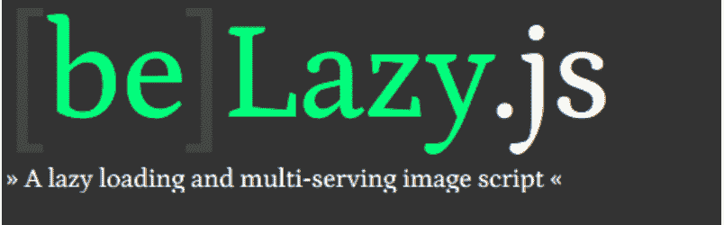

3-2. 用于懒加载图片的 bLazy jQuery 插件。

bLazy 是一个智能的原生 JavaScript 懒加载图片插件。更具体地说：

> bLazy 是一个轻量级的懒加载图片脚本（压缩并 gzip 后小于 1.2KB）。它可以让你懒加载和多尺寸提供图片，从而节省带宽和服务器请求。用户将获得更快的加载时间，并且如果他们没有浏览整个页面，还能节省加载的数据。
>
> **bLazy 官网**

这个小巧、无依赖的插件让你可以：

- 懒加载嵌入式图片和背景图片
- 根据屏幕尺寸和高分辨率屏幕提供不同的图片
- 懒加载任何带有 `src` 属性的内容，例如 iframe、HTML5 视频、脚本、Unity 游戏等
- 在滚动容器内部懒加载图片
- 支持旧版浏览器，兼容至 IE7 和 IE8
- 使用 CDN，因此你无需将 bLazy 托管在自己的服务器上

下面是一个基本实现。

HTML 标记：

```html

```

你需要按如下方式修改常规的 `img` 标签：

- 添加 `.b-Lazy` 类。
- 使用占位图片作为 `src` 属性的值。为了减少 HTTP 请求，你也可以使用内联的 [base64 编码的透明 gif](base64-encoded transparent gif)。但要注意，这样做将无法享受在后续页面使用相同图片时的缓存优势。
- `data-src` 属性指向你要懒加载的图片。

JavaScript：只需简单调用 bLazy，并通过选项映射进行微调：

```javascript
var bLazy = new Blazy({
    //options here
});
```

要了解更多关于 bLazy 及其可用选项的信息，请访问以下链接：

- [bLazy.js – A lazyload image script](https://b-lazy.io)
- [bLazy.js 官网](https://b-lazy.io)
- [bLazy.js 示例](https://b-lazy.io/demo/)
- [GitHub 上的 bLazy.js 项目](https://github.com/dinbror/blazy)

### 5. 使用模糊图片效果的懒加载

如果你是 Medium 的读者，你一定注意到该网站是如何加载文章中的主图的。

你首先看到的是一张模糊的、低分辨率图片副本，而其高分辨率版本正在被懒加载：


3-3. Medium 网站上的模糊占位图片。

Medium 网站上的模糊占位图片。

40 前端性能


3-4. Medium 网站上的高分辨率懒加载图片。

Medium 网站上的高分辨率懒加载图片。

你可以通过多种方式实现这种有趣的模糊效果的图片懒加载。

我最喜欢的技术是 Craig Buckler 的方法。以下是这个方案的所有优点：

- 性能：仅 463 字节的 CSS 和 1,007 字节的压缩后 JavaScript 代码
- 支持视网膜屏幕
- 无依赖：无需 jQuery 或其他库和框架
- 渐进增强，以应对旧版浏览器和 JavaScript 失败的情况

你可以在[如何构建你自己的渐进式图片加载器](link)中阅读全部内容，并在项目的 [GitHub 仓库](link)中下载代码。

### 结论

以上就是五种图片懒加载的方法，你可以开始在你的项目中进行实验和测试。

# 第 4 章：优化 CSS：ID 选择器及其他误区

Ivan Ćurić

在当下的典型场景中，普通网站会加载 500KB 的 gzip 压缩 JavaScript 和 1.5MB 的图片，运行在中端 Android 设备上，通过 3G 网络，往返时间为 400ms，CSS 选择器性能根本算不上我们应该担心的问题。

不过，这个话题仍然值得一提，特别是要清除围绕它的一些神话和传说。那我们就直接开始吧。

## CSS 解析基础


首先，让我们达成共识——本文不涉及 CSS 属性和值的性能。我们这里讨论的是选择器本身的性能开销。我将聚焦于 Blink 渲染引擎，具体是 Chrome 62。

选择器可以分为几个组，并按（大致）从最快到最慢的顺序排列：

| 排名 | 类型 | 示例 |
|---|---|---|
| 1. | ID | `#classID` |
| 2. | 类 | `.class` |
| 3. | 标签 | `div` |
| 4. | 通用和相邻兄弟 | `div ~ a, div + a` |
| 5. | 子和后代 | `div > a, div a` |
| 6. | 通用 | `*` |
| 7. | 属性 | `[type="text"]` |
| 8. | 伪类和伪元素 | `a:first-of-type, a:hover` |

这是否意味着你应该只使用 ID 和类？嗯……不一定。这要看情况。首先，我们来了解一下浏览器如何解析 CSS 选择器。

浏览器从右向左读取 CSS。复合选择器中最右边的选择器被称为**关键**选择器。例如，在`#id .class > ul a`中，关键选择器是`a`。浏览器首先匹配所有关键选择器。在这个例子中，它先找到页面上所有匹配`a`选择器的元素。然后它找到页面上所有`ul`元素，并将`a`元素筛选出仅那些是`ul`后代的元素——依此类推，直到最左边的选择器。

因此，选择器越短越好。如果可能，确保关键选择器是类或 ID，以保持快速和具体。

### 性能测量

Ben Frain 在 2014 年创建了[一系列测试](series of tests)来测量选择器性能。该测试包含一个由 1000 个相同元素组成的庞大 DOM，并测量解析各种选择器的速度，从 ID 到一些非常复杂和长的复合选择器。他发现最慢和最快选择器之间的差异约为 15ms。

不过，那是在 2014 年。从那以后情况发生了很大变化，在不断变化的浏览器环境中，死记硬背规则几乎是没用的。务必记住要进行自己的测试，尤其是在涉及性能时。

我自己去做了测试，为此我使用了 Paul Lewis 的测试，该测试在 [Paul Irish 的评论](Paul Irish's comment)中提到，表达了对有用但复杂的"[数量选择器](quantity selectors)"的担忧：

> 这些选择器是最慢的选择器之一。比类似`div.box:not(:empty):last-of-type .title`这样的选择器慢约 500 倍。测试页面 [http://jsbin.com/gozula/1/quiet](http://jsbin.com/gozula/1/quiet)

测试规模有所提升，达到 50000 个元素，你可以[亲自测试](link)。我在 2014 款 MacBook Pro 上进行了 10 次运行取平均值，结果如下：

| 选择器 | 查询时间 (ms) |
|---|---:|
| `div` | 4.8740 |
| `.box` | 3.625 |
| `.box > .title` | 4.4587 |
| `.box .title` | 4.5161 |
| `.box ~ .box` | 4.7082 |
| `.box + .box` | 4.6611 |
| `.box:last-of-type` | 3.944 |
| `.box:nth-of-type(2n - 1)` | 16.8491 |
| `.box:not(:last-of-type)` | 5.8947 |
| `.box:not(:empty):last-of-type .title` | 8.0202 |
| `.box:nth-last-child(n+6) ~ div` | 20.8710 |

结果当然会因你使用`querySelector`还是`querySelectorAll`，以及页面上匹配节点的数量而有所不同，但`querySelectorAll`更接近 CSS 的真实用例，即定位所有匹配元素。

即使在如此极端的情况下，有 50000 个元素需要匹配，并使用像最后一个那样疯狂的选择器，我们发现最慢的约为 20ms，而最快的简单类选择器约为 3.5ms。差距并不是那么大。在一个现实、更"温和"的 DOM 中，大约有 1000–5000 个节点，你可以预期这些结果会降低 10 倍，达到亚毫秒级的解析速度。

从这个测试中我们可以看到，没有必要过于担心 CSS 选择器性能。只要不过度使用伪选择器和超长的选择器就好。我们还可以看到 Blink 引擎在过去两年中有了多么大的改进。对于“数量选择器”（`.box:nth-last-child(n+6) ~ div`）与“疯狂选择器”（`.box:not(:empty):last-of-type .title`）相比，之前约 500 倍的性能下降，现在只看到了约 1.5 倍的下降。这是一个惊人的改进，而且浏览器只会越来越好，CSS 选择器性能的影响也将越来越小。

不过，你*应该*尽可能坚持使用类（class），并采用某种命名空间约定，如 BEM、SMACSS 或 OOCSS，因为这不仅有助于提升网站性能，还能极大地帮助代码的可维护性。过度限定的复合选择器，尤其是与标签选择器和通配选择器一起使用时——例如`.header nav ul > li a > .inner`——非常脆弱，是许多意外错误的根源。它们的维护也是一场噩梦，尤其是当你从别人那里继承代码时。

### 质量重于数量

比单纯拥有昂贵选择器更大的问题是拥有*大量*选择器。这就是所谓的"样式膨胀"，你可能已经见过很多次了。典型的例子是网站导入了整个 CSS 框架如 Bootstrap 或 Foundation，却只使用了不到 10% 的传输 CSS。另一个例子出现在那些老旧、从未重构的项目中，其 CSS 已经退化为我称之为"时间顺序样式表"的东西——随着项目的变更和增长，大量类被追加到文件末尾，现在看起来更像是一个杂草丛生的花园。

庞大的 CSS 文件不仅需要更长时间来传输（而网络是网站性能中*最大*的瓶颈），它们还需要更长时间来解析。除了从 HTML 构建 DOM 之外，浏览器还需要构建 CSSOM（CSS 对象模型）来与 DOM 进行比较并匹配选择器。

所以，保持你的样式精简且 DRY（Don't Repeat Yourself），不要什么都塞进去，按需加载，需要时可以使用 [UNCSS](https://github.com/uncss/uncss)。

如果你想更深入地了解浏览器如何解析 CSS，可以查看 [Nicole Sullivan 关于 WebKit 的文章](http://www.stubbornella.org/content/2009/09/22/reflow-repaint-css-performance-making-your-javascript-slow/)、[Ilya Grigorik 关于 Blink 如何工作的文章](https://www.igvita.com/2012/02/12/high-performance-networking-in-google-chrome/)，或者 [Lin Clark 关于 Mozilla 新 Stylo CSS 引擎的文章](https://hacks.mozilla.org/2017/08/inside-a-super-fast-css-engine-quantum-css-aka-stylo/)。

### 房间里的大象：样式失效

到目前为止我们讨论的内容都不错，但我们只讨论了单次渲染过程。如今的网站不再是静态文档，而更像用户可以与之交互的、带有动态内容的应用。

这使问题复杂化了，因为解析 CSS 只是浏览器渲染管线中的单一步骤。以下是浏览器如何将单帧渲染到屏幕上的以渲染为中心的视图（来源：[Google](https://developers.google.com/web/fundamentals/performance/rendering)）：


我们不会深入讨论 JavaScript 性能和合成，而是将聚焦于紫色部分——样式解析和对元素的布局。

在构建 DOM 和 CSSOM 之后，浏览器需要将两者合并为渲染树，最后将其绘制到屏幕上。在这一步中，浏览器需要为每个匹配元素计算 CSS。你可以在开发者工具的**元素 > 样式**面板中亲眼看到这个。它获取所有匹配的样式、层叠以及浏览器特定的用户代理样式，来构建元素的最终计算 CSS。

然后它才能进入布局（也称为回流）步骤，在那里计算几何信息，构建页面的盒模型，将每个元素放置到视口中的相应位置。布局是这个过程中计算量最大的部分。

最后，浏览器在绘制阶段将渲染树中的每个节点转换为屏幕上的实际像素。

现在，当我们通过*更改*页面上的某些类、添加或移除某些节点、修改某些属性，或以任何方式操作 HTML（或样式表本身）来改变 DOM 时，会发生什么？

我们使计算样式失效，浏览器需要使匹配选择器树下的所有内容失效。虽然如今的浏览器已经聪明得多，但过去的情况是，如果你更改了`body`元素上的类，所有后代元素都需要重新计算它们的样式。

避免这个问题的一种方法是降低选择器的复杂度。不要写`#nav > .list > li > a`，而是使用单一的选择器，如`.nav-link`。这样，你就减少了样式失效的范围，因为如果你修改`#nav`内部的任何内容，不会触发整个节点的重新计算。

另一种方法是缩小范围——例如减少失效元素的数量。让你的 CSS 更具体。特别是在动画中要记住这一点，因为浏览器只有约 10 毫秒的时间来完成所有必要的工作。

如果你想深入了解样式失效的细节，我推荐阅读 [Blink 中的样式失效](link)。

### 结论

总而言之，你不应该担心选择器性能，除非你*真的*做过头了。虽然这个话题在 2012 年风靡一时，但自那以后浏览器已经变得*快得多*、*聪明得多*了。甚至 Google 也不再为此担心了。如果你查看 Google 的 [Page Speed Insights 页面](https://developers.google.com/speed/pagespeed/insights/)，你不会看到"使用高效的 CSS 选择器"这一规则——它在 2013 年就被移除了。

相反，专注于让你的 CSS 可维护和可读。你的同事和未来的你都会为此感谢你。尝试通过只包含已使用的样式来优化 CSS 交付。之后，去了解渲染管线。与选择器不同，样式本身*可能*是昂贵的，[一个卡顿的网站和一个流畅的网站之间的区别](https://developers.google.com/web/fundamentals/performance/rendering/stick-to-compositor-only-properties-and-manage-layer-count)往往就在于 CSS 的实现方式。

最后一点：始终进行你自己的测试。

不要仅仅相信几年前有人在互联网上的说法。技术环境正在以惊人的速度发生翻天覆地的变化。今天相关的东西可能比你想象的更快就会变得过时。

## 第 5 章：优化 CSS：使用 DevTools 调整动画性能

Maria Antonietta Perna

> 本文是与 <u>SiteGround</u> 合作创建的系列文章之一。感谢支持使 SitePoint 成为可能的合作伙伴。

**CSS 动画以其超高性能而闻名。虽然对于少量元素的简单动画来说确实如此，但如果你在设计动画时没有考虑性能并增加更多复杂性，网站用户很快就会注意到并可能感到厌烦。**

在本文中，我将介绍一些有用的浏览器 DevTools 功能，让你能够检查使用 CSS 动画时底层发生了什么。这样，当动画看起来有点卡顿时，你就能更好地了解原因以及可以如何修复。

## 用于 CSS 性能的开发者工具

你的动画需要达到 60 fps（每秒帧数）才能在浏览器中流畅运行。帧率越低，动画效果就越差。这意味着浏览器处理每一帧的时间不超过约 16 毫秒。但在这段时间里它做了什么工作？你又怎么知道浏览器是否跟上了期望的帧率？

我认为在评估动画质量方面，没有什么能比得上用户体验。然而，现代浏览器中的开发者工具虽然并非总是 100% 可靠，但已经变得越来越智能，而且你可以用它们来审查、编辑和调试代码。

检查帧率和 CSS 动画性能时也是如此。以下是具体做法。

## 探索 Firefox 中的性能工具

在本文中，我使用 Firefox 性能工具。另一个重要竞争者是 Chrome 性能工具。你可以随意选择，因为两个浏览器都提供了强大的性能功能。

### 性能工具

要在 Firefox 中打开开发者工具，请选择以下任一选项：

1. 在网页上右键单击，并在上下文菜单中选择*检查元素*。
2. 如果使用键盘，在 Windows 和 Linux 上按`Ctrl + Shift + I`，在 macOS 上按`Cmd + Opt + I`。

接下来，点击*性能*标签页。在这里，你会找到一个按钮，可以启动网站性能录制：

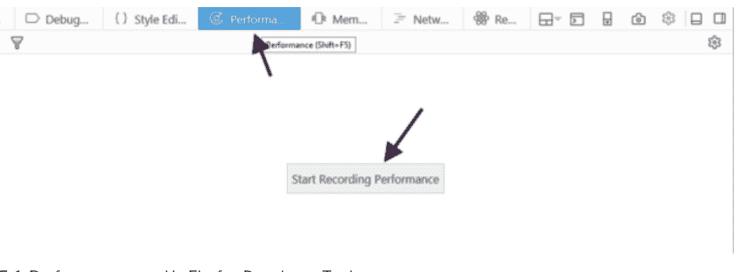

点击该按钮并等待几秒钟，或在页面上执行一些操作。完成后，点击*停止录制性能*按钮：

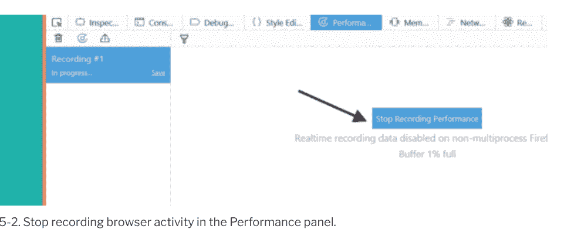

Firefox 几乎会立刻为你呈现大量组织良好的数据，这些数据将帮助你理解代码遇到了哪些问题。

*性能*面板中的录制结果大致如下所示：

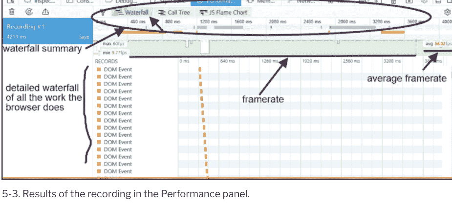

*瀑布图*部分非常适合检查与 CSS 过渡和关键帧动画相关的问题。其他部分是*调用树*和*火焰图*，你可以用它们来找出 JavaScript 代码中的瓶颈。

瀑布图顶部有一个概览部分和一个详细分解部分。在这两部分中，数据都用颜色编码：

- 黄色条代表 JavaScript 操作。
- 紫色条代表计算 HTML 元素的 CSS 样式（重计算样式）和页面布局（布局）。布局操作对浏览器来说执行成本很高，因此如果你动画化涉及重复布局（也称为*重排*——例如`margin`、`padding`、`top`、`left`等）的属性，结果可能会卡顿。
- 绿色条代表将元素绘制到一个或多个位图中（绘制）。动画化`color`、`background-color`、`box-shadow`等属性涉及昂贵的绘制操作，这可能是动画卡顿和用户体验不佳的原因。

你也可以过滤要检查的数据类型。例如，我只对与 CSS 相关的数据感兴趣，因此我可以点击屏幕左上角的过滤器图标来取消选择其他所有内容：

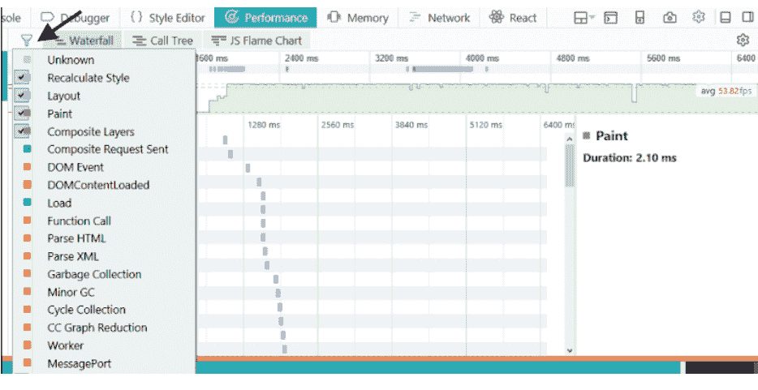

5-4. Firefox 性能开发者工具中的过滤功能。

瀑布图概览下方的大绿条代表帧率信息。

健康的帧率表现应该相当高，但最重要的是要稳定——即没有太多深度的间隙。

让我们用一个例子来说明。

### 性能工具实战

这是一个使用`@keyframes`关键字的简单 [CSS 动画](https://developer.mozilla.org/en-US/docs/Web/CSS/@keyframes)。测试页面如下所示：

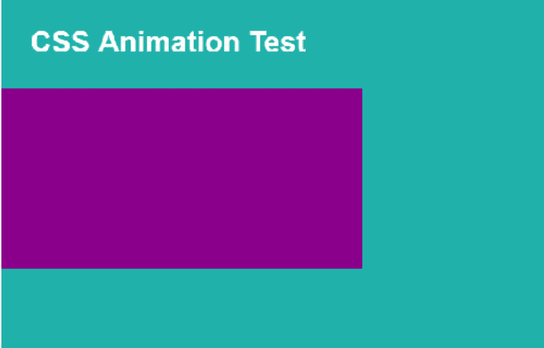

5-5. 可见矩形框的演示页面。

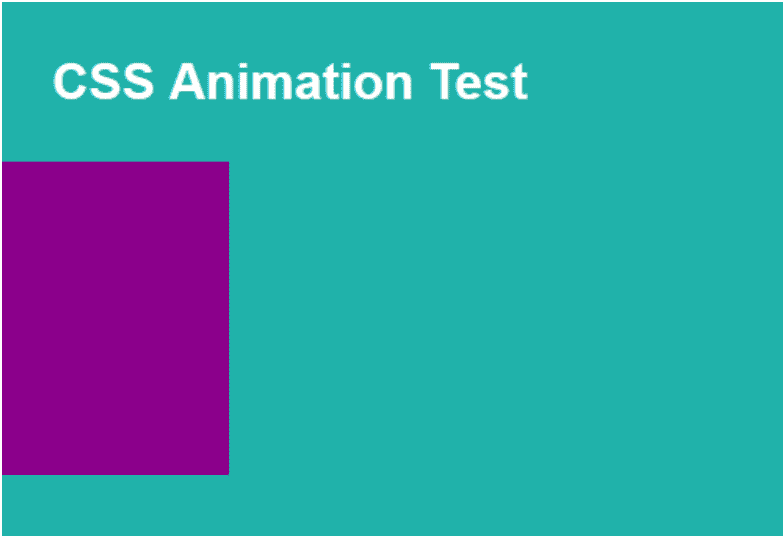

5-6. 矩形框即将滑出的演示页面。

这个紫色的矩形框在视野中无限循环地滑入滑出。

这是通过动画化代表屏幕上矩形框的`<div>`元素的`margin-left`属性实现的。`@keyframes`动画块如下所示：

```
@keyframes slide-margin {
  100% {
    margin-left: 0;
  }
}
```

我从这个动画中获得的性能数据如下所示：

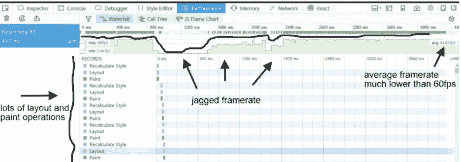

5-7. 在 Firefox 开发者工具的性能面板中录制使用`margin`进行动画的结果。

帧率可视化图看起来有点参差不齐，平均帧率为 44.82 fps，有点低。

另外，请注意动画过程中发生的所有布局和绘制操作。这些是浏览器在其主线程上执行的昂贵操作，会对性能产生负面影响。

最后，如果你访问`检查器`工具，点击`动画`部分并将鼠标悬停在动画名称上，会弹出一个信息框，显示有关当前动画的所有相关数据。如果你的动画已经过优化，会有一条消息说明这一事实。在这种情况下，没有消息：

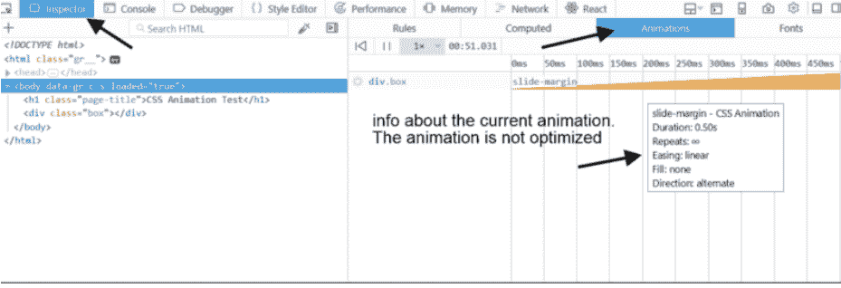

5-8. 检查器工具中的动画面板，显示有关当前动画的信息。

现在，我将更改我的代码，并在浏览器使用此`@keyframes`块动画化 CSS `translate3d()`属性时进行新的录制：

```
@keyframes slide-three-d {
  100% { transform: translate3d(0, 0, 0); }
}
```

性能录制结果如下所示：

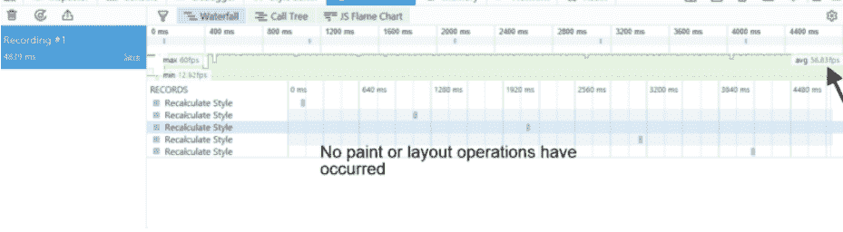

5-9. 使用`translate3d`进行动画的录制结果。

现在帧率更高了（56.83 fps），瀑布图中没有显示昂贵的布局和绘制操作。

另外，如果你打开开发者工具的*检查器*标签页，访问*动画*面板并将鼠标悬停在动画名称上，你可以看到类似这样的内容：

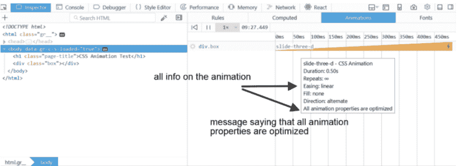

5-10. Firefox 开发者工具检查器中的动画面板。

相对于动画名称的信息框指出所有动画都已优化，这对你的网站访问者来说是个好消息。

### 只动画化 CSS *不透明度*、*变换*和*滤镜*


你可能以前听过这个建议，但以防万一，值得再强调一遍：如果你想让动画运行流畅，请只动画化 CSS 不透明度、变换和滤镜。动画化其他所有内容会让你的浏览器在很短的时间内承受执行昂贵任务的压力，这通常无法产生最佳效果。

正如浏览器中的性能工具所确认的那样，重复的布局和绘制操作不是你的朋友。

然而，每个浏览器处理 CSS 属性的方式略有不同。如果你想确切知道哪个浏览器为哪些属性触发布局和绘制操作（特别是在更新这些属性的值时，这正是网络动画所涉及的），请访问 [CSS Triggers](https://csstriggers.com)。

为了确保动画性能，一种流行的方法是强制浏览器将更改某些属性的工作交给 GPU（图形处理单元），这减轻了浏览器主线程的一些压力，并利用了硬件加速。你可以通过使用 `will-change` CSS 属性，或者 `translateZ(0)` 和 `translate3d(0,0,0)` 技巧来实现。所有这些技巧都有效，但如果你过度使用，实际上可能会得到你试图避免的结果，即动画卡顿。

我不会深入探讨用于网络动画性能的硬件加速细节，但如果你想深入研究，请查看下面列出的资源。

## 资源

- [高性能动画](https://aerotwist.com/blog/performant-css-animations/) 作者：Paul Lewis 和 Paul Irish
- [CSS 动画和过渡性能：深入浏览器内部](https://aerotwist.com/blog/css-animations-and-transitions-performance-looking-inside-the-browser/) 作者：Max Vujovic
- [动画与性能](https://aerotwist.com/blog/animations-and-performance/) 作者：Paul Lewis 和 Sam Thorogood
- [坚持使用仅限合成器的属性并管理层数](https://csstriggers.com/) 作者：Paul Lewis
- [GPU 合成 CSS 的技巧](https://saraoueidan.com/blog/css-gpu-hack-explained/) 作者：Sara Soueidan
- [CSS `will-change` 属性简介](https://dev.opera.com/articles/css-will-change-property/) 作者：Nick Salloum
- [动画化 CSS 属性](https://developer.mozilla.org/en-US/docs/Web/CSS/CSS_animated_properties) 作者：MDN

## 通过预取实现闪电般快速的网站

Maria Antonietta Perna

第 6 章

本文是与 [SiteGround](https://www.siteground.com/) 合作创建的系列文章的一部分。感谢支持 SitePoint 的合作伙伴。

**在本文中，我将讨论预取、它是什么，以及开发者如何利用它来用高性能网站给访客留下深刻印象。**

### 什么是预取？

虽然为网站的初始页面加载进行优化很棒，但对于当今用户所期望的高交互性网站来说，这可能还不够。

如果浏览器知道用户即将点击哪个链接，或者接下来要访问哪个页面，以便内容能够自动以光速出现在他们的屏幕上，那会怎样？

嗯，浏览器现在*确实*可以做到这一点。事实上，一些主要的浏览器足够智能，可以根据访客的浏览模式、文档标记和结构、用户的设备、连接情况等进行此类猜测。因此，浏览器已经在尝试预判构建访客可能访问的页面所需的资源，准备好这些资源，并在用户请求时以极快的速度显示页面。然而，开发者可以利用他们对网站或网络应用的了解，帮助浏览器更准确地找出这些关键资源。

这就是预取，一个提示浏览器预见用户的每一个浏览愿望并立即实现它的提示。

你可以在 Ilya Grigorik 领导的 [资源提示](https://w3c.github.io/resource-hints/) 规范中找到预取。

在下文中，我将讨论：

- DNS 预取
- 链接/资源预取
- 预渲染（页面预取）

### DNS 预解析

互联网是一个由计算机可读的 [IP 地址](例如，87.87.87.87) 组成的网络，这些地址通过人类可读的主机名（例如，yoursite.com）来引用。DNS 就是将主机名转换为 IP 地址的协议。

每次浏览器向不同域上的资源发出 HTTP 请求时，它都会花费几毫秒的时间将域解析为关联的 IP 地址。

如果一个网站有 Twitter 或 Facebook 小部件、Google Analytics，以及可能一两个自定义网络字体，那么它必然有指向其他域的链接。这使得 DNS 查询不可避免。

DNS 预解析有助于减少访问者的等待时间，因为浏览器会在发送位于其他域上的资源请求之前执行 DNS 查询。

所以，假设开发人员知道某个网站将向 `somewidget.example.com` 发出请求。他们可以给浏览器一个提示，建议它继续预取该主机名的 DNS，方法是在链接中添加一个值为 `dns-prefetch` 的 `rel` 属性，如下所示：

```html
<link rel="dns-prefetch" href="//somewidget.example.com">
```

现在，当向 `somewidget.example.com` 发出请求时，浏览器已经提前执行了 DNS 查找，用户能够更快地获得结果。

[DNS 预解析的浏览器支持](https://caniuse.com/#feat=dns-prefetch) 目前已存在于所有主流桌面浏览器中。当缺乏 DNS 预解析支持时，浏览器只会以通常方式检索资源。没什么大不了的。

如果浏览器从不请求 DNS 预解析的资源怎么办？幸运的是，DNS 预解析并不是一项昂贵的操作，因为它通过网络发送的数据不会超过几百字节。再次强调，不会造成任何损害。

### 链接预取

根据 [规范](https://example.com/spec)，链接预取……

> 用于识别下一导航可能需要的资源，用户代理应该获取该资源，以便在将来请求该资源时能够提供更快的响应。

换句话说，如果开发人员有理由假设用户可能会访问某个特定网页，并且知道浏览器需要一些关键资源来交付该页面，他们可以使用 `prefetch` 指令。这引导浏览器在用户实际导航到该页面之前获取它应该获取的资源。

请记住，预取仅适用于可缓存的资源，例如 JavaScript、图像等。代码如下所示：

```html
<link rel="prefetch" href="//example.com/future-image.jpg">
```

浏览器现在知道 `future-image.jpg` 图像很快就会被需要，因此它可以预取该图像并将其本地存储在缓存中。此时，由于浏览器已经完成了在后台下载资源这一耗时工作，该技术的好处在于用户点击访问需要 `future-image.jpg` 的相关页面时能够实现超快速渲染。

链接预取在创建网站快速加载的感知方面表现出色，但它比 DNS 预解析要昂贵得多。如果用户从不访问需要预取资源的页面，浏览器将下载不必要的数据并堵塞其缓存。

在撰写本文时，链接预取<u>受 Chrome、Firefox、IE/Edge 和 Opera 的最新版本支持</u>。不支持的浏览器将简单地忽略该提示。

### 页面预取/预渲染

实现页面预取或预渲染只需在链接的 `rel` 属性中添加 `prerender` 指令，如下所示：

```html
<link rel="prerender" href="//example.com/future-page.html">
```

预渲染更进一步，它 literally 创建了一个用户可能访问的预制页面的隐形版本，包括应用 CSS 和执行 JavaScript。一旦用户点击相关链接，幽灵页面就会立即在他们眼前具体化，取代旧内容。

如果说链接预取可能是一项昂贵的操作，那么预渲染则更加如此。在这种情况下，浏览器基于用户将访问该页面的预期下载整个网页及其所有资源，而这最终可能会发生也可能不会发生。

目前，预渲染<u>在 IE/Edge、Chrome 和 Opera 中得到支持</u>。

### 链接预取和预渲染的用例

由于链接预取和（更大程度上的）预渲染都不便宜，明确了解在网页上何时适合实现它们很重要。

计划使用资源提示的开发人员应该在有充分理由假设要预取或预渲染哪些资源时这样做，这些假设基于网站内容、用户行为、分析等。

资源提示规范指出了许多[用例](https://resourcehints.github.io/#use-cases)，在这些用例中链接预取可以改善用户体验：

- **搜索结果** — 可以合理地假设用户对这些结果感兴趣，因此他们很可能会点击链接以找到他们想要的内容。
- **分页内容** — 一旦用户正在阅读多页文章的第一页，假设他们会点击链接进入下一页并不为过。
- **图片库** — Google 开发人员在 Picasa 网络相册上使用预取。如果用户正在查看一张照片，开发人员有理由猜测下一张照片也会被访问，因此他们指示浏览器尽快下载它。

同样，Santiago Valdarrama 提供了一些[有用的提示](https://santoshyadav.dev/how-can-i-make-my-website-faster-with-prefetching)，说明开发人员何时可以合理地考虑在网站上实现预渲染：

> 在决定是否提前预渲染整个页面时，考虑到 Google 会预渲染其搜索页面上的顶部结果，Chrome 会根据用户的历史导航模式预渲染页面。使用相同的原理，您可以检测常见的使用模式并相应地预渲染目标页面。您也可以像资源预取一样，在问卷或调查中使用它，您知道用户将以特定顺序完成工作流程。

## 资源

如果您想深入了解，以下资源是必读的：

- [资源提示规范](https://www.w3.org/TR/resource-hints/)
- [Web 性能技巧 — 超越基础](https://www.smashingmagazine.com/2016/12/)
- [预取资源](https://developer.mozilla.org/en-US/docs/Web/HTTP/Link_prefetching_FAQ)
- [预取、预加载、预浏览](https://css-tricks.com/prefetching-preloading-prebrowsing/)
- [领先一步：通过预浏览提高性能](https://medium.com/@luisvieira_gmr/one-step-ahead-improving-performance-with-prebrowsing-8baedb7937f4)
- [面向网页设计师和前端开发人员的前端性能](https://developer.yahoo.com/performance/rules.html)

### 结论

DNS 预解析、链接预取和预渲染是强大的优化技术。如果**负责任地实施**，基于开发人员对网页内容和用户行为的了解，预取可以显著改善用户体验。

# 优化 Web 字体性能：最新技术

## 第 7 章

Maria Antonietta Perna

**67% 的网页现在使用自定义字体。** 然而，普及和广泛采用并非没有带来一些与性能和用户体验相关的问题。

在本文中，我将介绍 Web 字体常见使用和加载方式的不足之处，并为您指向经过充分测试的变通方法和基于标准的未来解决方案。

### 为什么选择自定义 Web 字体？

用户访问您的网站是为了内容。因此，出色的排版在网上至关重要：可读性、易读性和精心设计的排版对于品牌识别和您信息的成功必不可少。

实现精美排版的最佳方式是加载自定义 Web 字体 — 即，尚未安装在用户设备上的字体文件。

由于浏览器对 CSS `@font-face` 规则的支持已变得广泛，在网站中使用自定义 Web 字体已经大幅增长。然而，字体可能具有较大的文件大小，在您的网站上加载额外资源不可避免地会对性能产生一些负面影响。

由于文件大小确实可能是一个问题，关注自定义 Web 字体的加载方式变得至关重要。

### 什么是不可见文本闪烁（FOIT）？

使用自定义 Web 字体最常见的方式是在 CSS `@font-face` 声明中指定使用的字体，并让浏览器使用其默认行为。这并不理想。由于字体信息位于 CSS 中，默认情况下浏览器会延迟加载字体，直到 CSS 被解析。这还不是全部。正如 [Zach Leatherman](https://zachleat.com/) 已经充分阐明的，要触发字体下载，除了有效的 `@font-face` 声明外，还必须满足许多条件：

- 一个 HTML 节点，其使用了在 `@font-face` 中指定的相同 `font-family`
- 在 Webkit 和 Blink 浏览器中，该节点不能是空的
- 在 [支持 unicode 范围描述符](https://) 的浏览器中，`@font-face` 内的内容也必须匹配指定的 unicode 范围。

如果以上各点都满足，浏览器就会开始下载字体。这意味着浏览器不仅要解析 CSS 代码，还要解析网站的文本内容，才能触发字体下载。然而，**正是字体开始加载时，网页用户很可能会遇到令人困扰的不可见文字闪烁**，简称 **FOIT**。


7-1. FOIT：在 Firefox v.52 上加载字体时，http://blog.instagram.com/ 页面。文字不可见。


7-2. FOIT：在 Firefox v.52 上字体加载完成后，http://blog.instagram.com/ 页面。文字已变为可见

换句话说，一旦浏览器开始下载字体，所有文字都会变得不可见。因此用户会在一段时间内看着没有文字的屏幕，在网络条件不佳的情况下，这感觉就像永远等不到头。此外，不同浏览器处理 FOIT 的方式也有所不同：

- Blink 和 Firefox 浏览器通过引入三秒超时来解决 FOIT：文字在字体加载期间会消失最多三秒钟。如果字体在此期间未能加载完成，网站会显示备用字体，随后在自定义字体完全加载后替换为自定义字体。这种行为产生了一个新名词 **FOUT**（又一个缩写）：**未样式化文字闪烁**。
- Safari、默认 Android 浏览器和 Blackberry 不使用超时，而是等到自定义字体加载完成才显示文字。如果发生任何问题导致字体未能加载，用户就只能看到屏幕上的隐形文字。
- IE/Edge 浏览器不会隐藏文字，而是立即显示备用字体，这似乎是微软做出的更好设计决策。

虽然在网站上阅读文字时字体突然变化并非最佳用户体验，但在加载字体时盯着空白屏幕看要糟糕得多。理想情况下，一个可行的方法应该同时克服 FOUT 和 FOIT。不过，尽管这是一个尚未解决的问题，但许多专家已有一些共识，认为 FOUT 比 FOIT 好得多。

解决字体加载相关问题，需要同时优化文件大小和控制浏览器默认行为，以消除 FOIT 并尽量减少 FOUT 的突兀影响。

让我们逐一详细看看每个任务。

### 优化自定义字体文件的建议

你可以采取一些措施，确保字体文件不会过于臃肿。

#### #1 尽量减少项目中的字体种类

不要以为因为可以从大量精美的字体中选择，就需要用许多不同的字体来拖累网站。事实恰恰相反。

在大多数情况下，几种精心搭配的字体就能为你的设计带来奇效，同时对网站性能的影响也更小。

#### #2 根据浏览器支持提供网页字体格式

主要有四种字体格式：

- **True Type Font (TTF)**，一种自 80 年代末就存在的常见字体格式
- **Web Open Font Format (WOFF)**，2009 年开发的格式，基于 Open Type 或 True Type，但具有压缩和额外的元数据
- **Web Open Font Format (WOFF2)**，比 WOFF 压缩率更高的格式
- **Embedded Open Type (EOT)**，微软设计的用于网页嵌入式字体的格式。

虽然你可以在 `@font-face` 声明中指定所有这些格式，但只用其中两种就可以了。方法如下：

```css
@font-face {
    font-family: 'Open Sans';
    src: local('Open Sans'),
    local('OpenSans'),
    url('fonts/open-sans.woff2')
    format('woff2'),
    url('fonts/open-sans.woff') format('woff');
}
```

你向浏览器建议的第一种格式是 woff2，它提供了额外压缩的优势。如果你的浏览器不支持 woff2，它会选择 woff，这种格式压缩效果良好，且 [所有主流浏览器的最新版本都支持](https://caniuse.com/woff2)。只有 Opera Mini 不支持，此外还有 IE8 和较旧的 Android Mobile 浏览器。如果你在网页开发中采用渐进增强的方法，可以简单让这些旧浏览器回退到系统字体，例如 Arial、Verdana 等。

#### #3 只加载你需要的样式

字体通常有不同的变体——斜体、粗体等。每种字体变体都会增加文件大小，因此如果网站上不会使用到某个字体变体，尽量避免将其添加到 `@font-face` 代码中。请记住，如果你使用 `<i>` 标签来添加图标，这是非常常见的做法，这就足以让浏览器加载斜体字体变体（[Zack Leatherman 2015 年 Santa Clara Velocity 演讲中的第 77 张幻灯片](https://vimeo.com/133446040)）。如果那是你页面中唯一使用 `<i>` 的地方，改用 `<span>` 标签来放置图标，或将 `<i>` 元素的 `font-style` 设置为 `normal`，就可以避免浏览器下载不必要的资源。

#### #4 精简你的字符集


避免加载所选字体提供的所有字符、数字和符号。相反，只选择网页实际使用的字符集。

你可以在 Dudley Storey 的[用 CSS 字体子集化削减页面加载时间](https://www.smashingmagazine.com/2014/11/slash-page-load-times-css-font-subsetting/)中了解关于字体子集化的全部内容。

### 应对 FOIT

让我们看看如今有哪些处理 FOIT 的替代方案。我从有效且推荐的做法中选出了最简单的实现方式。不过，你可以在 Zach Leatherman 的[字体加载策略全面指南](https://www.zachleat.com/web/comprehensive-webfonts/)中了解更复杂的方法。

#### 不使用自定义字体

如果你无法忍受用户盯着隐形文字或字体替换闪烁的想法，最简单的选择就是放弃自定义字体，仅依赖网页安全字体。

这些字体预先安装在用户设备上，因此浏览器无需加载它们。即使决定使用自定义字体，网页安全字体通常也会作为备用字体添加到[字体栈](https://www.fontstacks.com/)中。

放弃为设计选择完美的自定义字体并不是一个令人兴奋的方案，但这是一个完全可行的选择——尤其是如果你将其视为一种过渡策略，直到已经初现曙光的前沿解决方案获得广泛的浏览器支持。

选择这种方法不需要你使用`@font-face`。你只需将字体栈添加到 CSS 的`font-family`属性即可。以下是今天你实施方案的方法：

```css
body {
    font-family: -apple-system, BlinkMacSystemFont,
    "Segoe UI", Roboto, Oxygen-Sans, Ubuntu, Cantarell,
    "Helvetica Neue", sans-serif;
}
```

Aderinokun 的[新的系统字体栈？](https://www.webdesignerdepot.com/2015/01/the-new-system-font-stack/)提供了更多关于现代字体栈的信息。

#### Web Font Loader

一个长期的解决方案是[Web Font Loader](https://github.com/typekit/webfontloader)，这是一个由 Google 和[Typekit](https://typekit.com/)开发的 JavaScript 库，可以与来自多个来源的字体配合使用——例如 Google Fonts、Typekit、你自托管的字体文件等。

Web Font Loader 将自定义字体作为后台进程加载，同时向用户显示备用字体，从而避免 FOIT。你可以设置一个时间限制，字体必须在此期限内加载。如果请求超过此限制，用户将只能看到以备用字体显示的文本。一旦自定义字体加载完成，脚本会将页面上的备用字体替换为自定义字体。

以下是两个学习如何使用 Web Font Loader 的精彩教程：

- [如何使用字体加载器提升页面性能](https://www.udacity.com/blog/improving-web-font-performance-with-webfontloader-20731a4a230b)
- [使用 Web Font Loader 加载网页字体](https://www.html5rocks.com/en/tutorials/webfont/performance/)

#### CSS Font Loading API

[CSS Font Loading API](https://drafts.csswg.org/css-font-loading-3/)是一种基于标准的方式来加载和控制网页字体。

整体推荐的方法仍然是避免 FOIT 并尽可能管理 FOUT。这个 API 可以跟踪字体加载的每个阶段。你可以利用这些信息来使用网页安全字体 while 字体不可用时使用备用样式文本，并在自定义字体完全加载后使用这些字体。

截至撰写本文时，[Chrome、Firefox、Safari 和 Opera 的最新版本支持此 API](https://example.com)，而 IE/Edge 尚未提供支持。不过，你可以使用一个小型的 JavaScript 库——[Font Face Observer](https://example.com)——来为原生的 CSS Font Loading API 提供 polyfill，或者让不支持的浏览器优雅地降级到网络安全字体。

关于如何使用 CSS Font Loading API 的简短教程，请前往 Manuel Matuzovic 的[CSS 字体加载入门](https://example.com)，并查看他的[CodePen 演示](https://example.com)。

### 未来：CSS `font-display` 属性

自首次出现以来，你一直使用 CSS `@font-face` 和`font-family`来处理自定义字体。期待 CSS 来解决与下载自定义字体相关的任何问题，这是完全合理的。但目前，只有基于 JavaScript 的解决方案可用。

然而，这种情况不会无限期持续下去。一个智能的 CSS 属性即将到来，那就是`font-display`，它是[CSS Font Rendering Controls Module Level 1](https://example.com)的一部分。

`font-display`允许你：

- 决定在字体加载期间是要使用备用字体显示文本，还是将其隐藏。
- 控制字体加载完成后要执行的操作，即继续显示备用字体，还是将其替换为自定义字体。你还可以按元素级别进行设置。
- 为每种字体甚至特定元素指定自己的超时值。

以下是该属性在代码中的样子：

```css
@font-face {
  font-family: Lato;
  src: url('/web/css/fonts/lato/lato-regular-webfont.woff2') format('woff2'),
       url('/web/css/fonts/lato/lato-regular-webfont.woff') format('woff');
  font-weight: 400;
  font-style: normal;
  font-display: swap;
}

body {
  font-family: Lato, sans-serif;
  font-weight: 400;
  font-style: normal;
}
```

该属性的可接受值包括：

- `auto`：浏览器仅实现其默认行为。
- `block`：字体加载期间浏览器绘制不可见文本，并在字体加载完成后立即将其替换为目标字体。
- `swap`：自定义字体不可用时，浏览器使用备用字体，但自定义字体一旦加载就立即替换。
- `fallback`：行为与`swap`类似。但是，如果自定义字体加载耗时过长，浏览器将在页面生命周期内使用备用字体。
- `optional`：这个超智能的值让浏览器仅在自定义字体已经可用时才使用它。如果不可用，浏览器将在页面生命周期内使用备用字体。自定义字体仍可能在后台下载，以便在后续页面加载时使用。但是，如果浏览器检测到用户设备带宽有限，它们可能根本不会加载自定义字体。

从这些简短的描述中，你已经可以看到`swap`和`optional`有多么有用。

目前`font-display`的浏览器支持尚不存在，但可以在 Chrome（通过“Experimental Web Platform features”标志）和 Firefox（通过`layout.css.font-display.enabled`标志）中启用。

### FOUT 怎么办？

尽管上述所有方法都能消除 FOIT，要么在稍后将自定义字体换入，要么只显示备用字体，但它们对 FOUT 却无能为力。

尽管 FOUT 仍然使用户可以访问文本，但它确实可能令人烦恼，尤其是当备用字体比它临时替换的自定义字体更宽和/或更高时，这通常会导致页面内容发生偏移。

你可以通过调整备用字体的 x 高度和宽度，使其尽可能接近目标自定义字体的 x 高度和宽度，来减轻这种替换带来的突兀效果。

你可以通过多种方式实现这一点，但我发现 Monica Dinculescu 的这款小巧[Font Style Matcher 工具](https://www.x-height.net/)非常有帮助。

### 结论

在本文中，我概述了在网站上使用自定义字体相关的文件大小和文本不可见闪烁（Flash of Invisible Text）问题。

我介绍了最新的方法，并为你指引了更多资源，你可以在其中阅读更多内容，并学习如何在你的项目中实施这些技术。

# 第 8 章

## JavaScript 性能优化技巧：概述

Ivan Ćurić

在本章中，有很多内容要涵盖，而且涉及的范围广泛且变化迅速。这也是一个涵盖每个人最喜欢的主题：本月 JS 框架™。

我们将尽量坚持“工具，而非规则”的座右铭，并尽量减少 JS 流行语的使用。由于我们无法在一两章中涵盖有关 JS 性能的所有内容，请确保你阅读参考资料并在之后进行自己的研究。

但在深入细节之前，让我们通过回答以下问题来更广泛地理解这个问题：什么被认为是高性能的 JavaScript，它如何融入更广泛的 Web 性能指标范畴？

### 设定舞台

首先，让我们把以下问题放在一边：如果你仅在桌面设备上进行测试，你就排除了[超过 50%](https://example.com)的用户。

#### 全球桌面、移动与平板市场份额

2016 年 10 月 – 2017 年 10 月

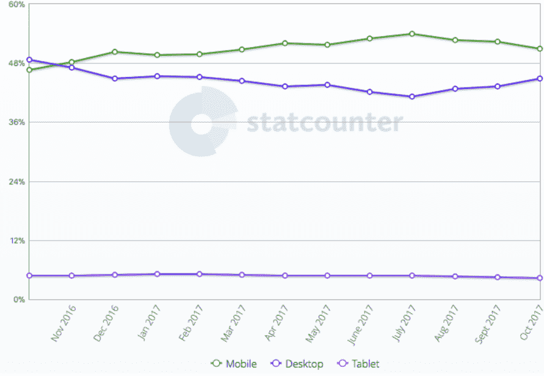

8-1. 移动用户数量在 2016 年 11 月超过了桌面用户数量

这一趋势只会继续增长，因为新兴市场的首选网络接入设备是低于 100 美元的 Android 设备。桌面作为访问互联网的主要设备的时代已经结束，下一个十亿互联网用户将主要通过移动设备访问你的网站。

在 Chrome DevTools 的设备模式下测试不能替代在真实设备上的测试。使用 CPU 和网络节流会有所帮助，但这本质上是两码事。在真实设备上进行测试。

即使你*确实*在真实的移动设备上测试，你可能也是在用你的全新 600 美元旗舰手机上进行的。问题是，这不是你的用户拥有的设备。中位数设备类似于 Moto G1——一款内存不足 1GB、CPU 和 GPU 非常弱的设备。

让我们看看它在[解析平均 JS 包](https://example.com)时的表现如何。

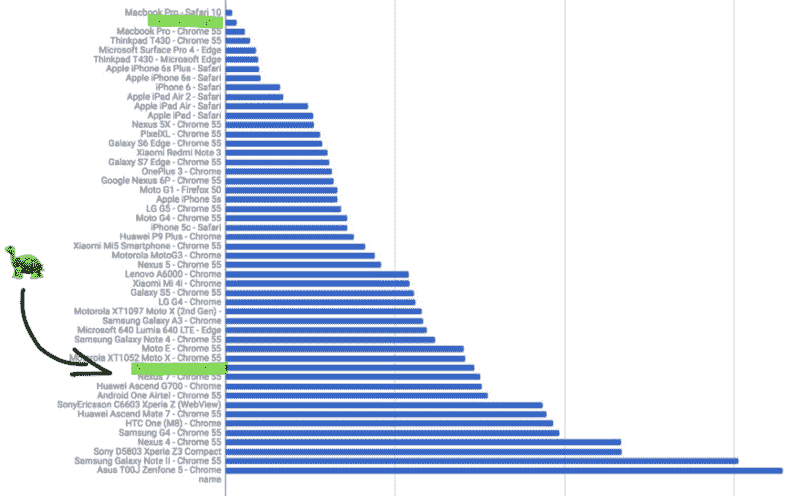

来源：Addy Osmani - [Time spent in JS parse & eval for average JS](https://example.com)

哎哟。虽然这张图片只涵盖了 JS 的解析和编译时间（稍后会详细说明），而非一般性能，但它们强烈相关，可以作为一般 JS 性能的指标。

引用 Bruce Lawson 的话说，“[这是万维网，不是富裕的西方网络](https://example.com)”。因此，你的 Web 性能目标设备比你的 MacBook 或 iPhone**慢大约 25 倍**。让这一点在你脑海中沉淀一下。但情况更糟。让我们看看我们实际追求的目标是什么。

### 究竟什么是高性能的 JS 代码？

既然我们知道了自己的目标平台是什么，我们就可以回答下一个问题了：*什么*是高性能的 JS 代码？

尽管对于什么定义高性能代码没有绝对的分类，但我们确实有一个以用户为中心的性能模型可以作为参考：[RAIL 模型](https://web.dev/rail/)。

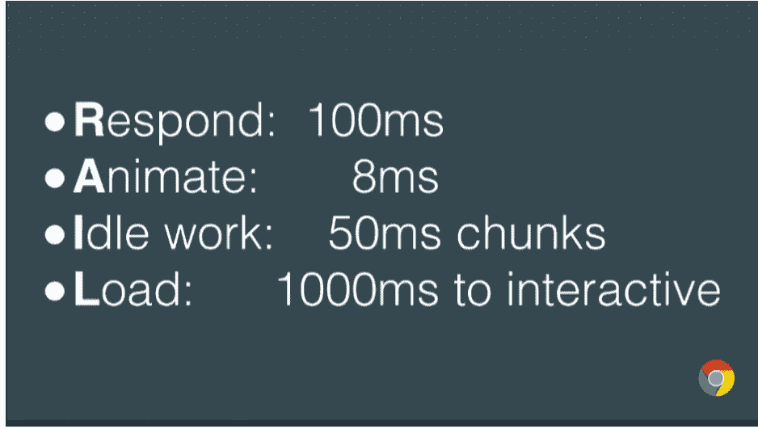

8-3. RAIL：响应/动画/空闲工作/加载

来源：Sam Saccone - [Planning for Performance: PRPL](https://www.youtube.com/watch?v=4bZ3yQJxkfk)

#### 响应（Respond）

如果你的应用对用户操作的响应时间在 100ms 以内，用户会感知到响应是即时的。这适用于可点击的元素，但不适用于滚动或拖动时。

#### 动画（Animate）

在 60Hz 的显示器上，我们希望在动画和滚动时保持恒定的 60 帧每秒。这意味着每帧大约 16ms。在这 16ms 的预算中，你实际上有 8–10ms 来完成所有工作，其余部分被浏览器内部机制和其他变量占用。

#### 空闲工作（Idle work）

如果你有一个昂贵的、持续运行的任务，请确保将其分割成更小的块，以允许主线程响应用户输入。你不应该有延迟用户输入超过 50ms 的任务。

#### 加载（Load）

你应该以在 1000ms 内完成页面加载为目标。超过这个时间，你的用户就会开始焦躁不安。这在移动设备上是一个相当困难的目标，因为它关系到页面的可交互性，而不仅仅是将其绘制在屏幕上并可以滚动。实际上，它甚至更少：

### 我们 1000 毫秒预算的（短暂）一生

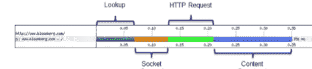

| | 3G (200 ms RTT) | 4G (100 ms RTT) |
| --- | --- | --- |
| 控制平面 | (200-2500 ms) | (50-100 ms) |
| DNS 查询 | 200 ms | 100 ms |
| TCP 连接 | 200 ms | 100 ms |
| TLS 握手 | (200-400 ms) | (100-200 ms) |
| HTTP 请求 | 200 ms | 100 ms |
| **剩余预算** | **0-400 ms** | **300-700 ms** |

单个 HTTP 请求的网络开销！

### 8-4. JavaScript 1000 毫秒预算

默认快速：现代加载最佳实践（Chrome Dev Summit 2017）

实际上，目标应该是达到 5 秒的可交互时间。这也是 Chrome 在其 Lighthouse 审计中使用的标准。

既然我们已经了解了这些指标，让我们来看一些统计数据：

- 如果移动网站加载时间超过三秒，53% 的访问会被放弃。
- 一半的人期望页面在 2 秒内加载完成。
- 77% 的移动网站在 3G 网络上加载时间超过 10 秒。
- 移动网站在 3G 网络上的平均加载时间为 19 秒。

还有更多来自 Addy Osmani 的数据：

- 桌面端（使用有线网络）应用中位交互时间为 8 秒，移动端（Moto G4 通过 3G）为 16 秒，开发者为页面交付了 410KB 的 gzip 压缩 JS。

感到足够沮丧了吗？很好。让我们开始行动，修复 Web。

### 上下文决定一切

你可能已经注意到，主要瓶颈是网站加载所需的时间。具体来说，是 JavaScript 的下载、解析、编译和执行时间。除了加载更少的 JavaScript 以及更智能地加载之外，别无他法。

但是，除了启动网站之外，你的代码实际做的工作呢？那里肯定也有一些性能提升空间，对吧？

在深入优化代码之前，先考虑一下你在构建什么。你是在构建框架还是 VDOM 库？你的代码需要每秒执行数千次操作吗？你是在做处理用户输入和/或动画的时间关键型库吗？如果不是，你可能想把时间和精力花在更有影响力的地方。

不是说编写高性能代码不重要，但通常在宏观层面上影响甚微或没有影响，尤其是谈到微优化时。所以，在你因为比较`JSperf.com`上的结果而陷入关于`.map`与`.forEach`与`for`循环的 Stack Overflow 争论之前，确保你能看到森林而不仅仅是树木。50k ops/s 在纸面上可能比 1k ops/s 好 50 倍，但在大多数情况下这不会有什么区别。

### 解析、编译与执行

从根本上说，大多数非高性能 JS 的问题不在于运行代码本身，而在于代码开始执行*之前*必须采取的所有步骤。

我们在这里谈论的是抽象层次。你电脑中的 CPU 运行的是机器码。你电脑上运行的大多数代码都是编译后的二进制格式。（我说的是*代码*而不是*程序*，考虑到如今各种 Electron 应用。）这意味着，除了所有操作系统层面的抽象之外，它直接在你的硬件上运行，不需要任何准备工作。

JavaScript 不是预编译的。它通过（相对较慢的）网络到达你的浏览器，以可读代码的形式存在，而浏览器实际上就是 JS 程序的“操作系统”。

这段代码首先需要被解析——也就是说，被读取并转换成计算机可索引的结构，用于编译。然后它被编译成字节码，最后编译成机器码，之后才能被你的设备/浏览器执行。

另一个*非常*重要的点需要提及：JavaScript 是单线程的，运行在浏览器的主线程上。这意味着一次只能运行一个进程。如果你的 DevTools 性能时间线充满了黄色峰值，CPU 运行在 100%，你就会遇到长帧/掉帧、卡顿滚动以及各种其他糟糕的问题。

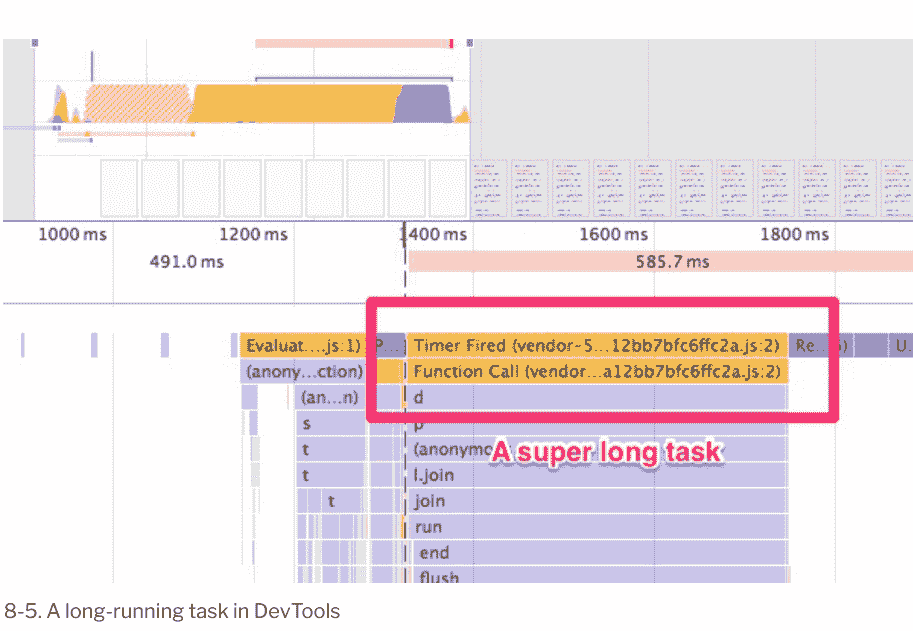

8-5. DevTools 中的一个长时运行任务

来源：Paul Lewis - [When everything's important, nothing is!](https://medium.com/@paul_lewis/when-every-things-important-nothing-is-35890f28c7f5)。

所以，在 JS 开始工作之前，有这么多工作需要完成。在 Chrome 的 V8 引擎中，解析和编译占据了 JS 总执行时间的高达 50%。

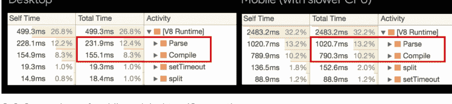


## 8-6. 移动和桌面端 JS 解析时间对比

来源：Addy Osmani - [JavaScript Start-up Performance](https://medium.com/reloading/javascript-start-up-performance-69200f43b201)。

你应该从本节中记住两点：

1. 虽然不是严格线性的，但 JS 解析时间随包体大小而增长。你交付的 JS 越少越好。
2. 你使用的每一个 JS 框架（React、Vue、Angular、Preact……）都是另一层抽象（除非它是预编译的，比如 [Svelte](https://svelte.dev/)）。这不仅会增加你的包体大小，还会降低代码速度，因为你没有直接与浏览器对话。

有一些方法可以缓解这个问题，比如使用 service worker 在后台和另一个线程中工作，使用 asm.js 编写更容易编译为机器指令的代码，但那是另一个话题了。

然而，你可以做的是避免对所有事情都使用 JS 动画框架，并[了解什么会触发重绘和重排](https://csstriggers.com/)。只有在绝对无法用常规 CSS 过渡和动画实现动画时，才使用库。

即使它们可能在使用 CSS 过渡、合成属性和`requestAnimationFrame()`，它们仍然在主线程上的 JS 中运行。它们基本上只是每 16 毫秒用内联样式猛烈敲打你的 DOM，因为除此之外它们能做的并不多。你需要确保所有 JS 在每帧 8 毫秒内完成执行，以保持动画流畅。

另一方面，CSS 动画和过渡则在主线程之外运行——在 GPU 上，如果实现得高效，不会引起重布局/重排。

考虑到大多数动画要么在加载期间运行，要么在用户交互期间运行，这可以为你的 Web 应用提供急需的喘息空间。

[Web Animations API](https://developer.mozilla.org/en-US/docs/Web/API/Web_Animations_API) 是一套即将推出的功能集，将允许你在主线程之外执行高性能的 JS 动画，但目前，还是坚持使用 CSS 过渡和 [FLIP](https://aerotwist.com/blog/flip-your-animations/) 等技术。

### 包体大小决定一切

如今一切都是关于包体的。Bower 和在`</body>`标签前放置几十个`<script>`标签的时代已经过去了。

现在一切都是`npm install`你在 NPM 上发现的任何闪亮新玩具，用 Webpack 把它们打包成一个巨大的 1MB JS 文件，让你的用户浏览器爬行，同时耗尽他们的数据流量。

尝试交付更少的 JS。你的项目可能不需要[整个 Lodash 库](https://www.npmjs.com/package/lodash)。你真的需要使用 JS 框架吗？如果是，你是否考虑过使用 React 以外的其他框架，比如 [Preact](https://preactjs.com/) 或 [HyperHTML](https://viperhtml.js.org/hyper.html)，它们的大小不到 React 的 1/20？你真的需要 [TweenMax](https://greensock.com/tweenmax) 来做那个回到顶部动画吗？npm 的便利性和框架中的隔离组件带来了一个副作用：开发者对问题的第一反应变成了用更多的 JS 来解决它。当你只有一把锤子时，一切看起来都像钉子。

当你完成了修剪杂草并交付更少的 JS 之后，尝试更智能地交付它。在需要时，交付你需要的东西。

Webpack 3 有一个令人惊叹的功能叫做[代码分割](https://webpack.js.org/guides/code-splitting/)和[动态导入](https://webpack.js.org/guides/code-splitting/#dynamic-imports)。与其将所有 JS 模块打包成一个庞大的`app.js`包，它可以自动使用`import()`语法分割代码并异步加载。

你也不需要使用框架、组件和客户端路由来获得这些好处。假设你有一段复杂的代码驱动着你的`.mega-widget`，它可能出现在任意数量的页面上。你可以在你的主 JS 文件中简单地写以下内容：

## 92 前端性能

如果你的应用发现了页面上的小组件，它会动态加载所需的支持代码。否则，一切正常。

此外，Webpack 需要自己的运行时才能工作，它会将其注入到它生成的所有`.js`文件中。如果你使用`commonChunks`插件，可以使用以下方式将运行时提取到它自己的区块中：

```javascript
new webpack.optimize.CommonsChunkPlugin({
    name: 'runtime',
}),
```

它会将运行时从你的所有其他区块中剥离出来，放到它自己的文件中，在本例中命名为`runtime.js`。确保在你的主 JS 包之前加载它。例如：

```html
<script src="runtime.js"></script>
<script src="main-bundle.js"></script>
```

然后是关于转译代码和 polyfill 的话题。如果你在编写现代（ES6+）JavaScript，你可能正在使用 Babel 将其转译成与 ES5 兼容的代码。转译不仅会因为所有的冗余代码而增加文件大小，还会增加复杂性，而且与原生 ES6+ 代码相比，通常会有性能倒退。

除此之外，你可能还在使用`babel-polyfill`包和`whatwg-fetch`来修补旧浏览器中缺失的功能。然后，如果你使用`async/await`编写代码，你还需要通过生成器来转译它，这就需要包含`regenerator-runtime`……

重点是，你为你的 JS 包增加了将近 100 千字节，这不仅具有巨大的文件大小，还有巨大的解析和执行成本，仅仅为了支持旧浏览器。

不过，惩罚使用现代浏览器的人是没有意义的。我使用的一种方法，也是 Philip Walton 在[这篇文章](https://philipwalton.com/articles/the-cost-of-javascript-in-2019/)中介绍过的，是创建两个独立的包并有条件地加载它们。Babel 通过`babel-preset-env`使这变得简单。例如，你有一个包用于支持 IE 11，另一个没有 polyfill 的包用于最新版本的现代浏览器。

一个简单粗暴但高效的方法是将以下内容放在内联脚本中：

```javascript
(function() {
    try {
        new Function('async () => {}')();
    } catch (error) {
        // create script tag pointing to legacy-bundle.js;
        return;
    }
    // create script tag pointing to modern-bundle.js;
})();
```

如果浏览器无法评估`async`函数，我们假设它是旧浏览器，直接发送包含 polyfill 的包。否则，用户将得到简洁的现代版本。

### 结论

我们希望你能从这篇文章中了解到，JS 是昂贵的，应该谨慎使用。

确保你在低端设备上测试你的网站性能，在真实的网络条件下。你的网站应该快速加载，并尽快实现交互。这意味着要减少 JS 的交付，并通过一切必要手段更快地交付。你的代码应该始终被压缩，分成更小、更易管理的包，并尽可能异步加载。在服务器端，确保启用 HTTP/2 以加快并行传输，并使用 gzip/Brotli 压缩来大幅减少 JS 的传输大小。

说了这么多，我想用以下推文来结束：

> 所以要我达到这一步需要很多。但说真的 folks，是时候扔掉你们的框架，看看浏览器能有多快了。
>
> — Alex Russell (@slightlylate) 2016 年 9 月 15 日

# 第 9 章

## 7 个实现流畅 JavaScript 动画的性能技巧

Maria Antonietta Perna

网页动画的角色已经从纯粹的装饰性点缀演变为在用户体验的情境中[服务于具体目的](https://link)——例如在用户与你的应用交互时提供视觉反馈、引导用户的注意力以实现你应用的目标、提供视觉线索来帮助用户理解你应用的界面，等等。

为了确保网页动画能够胜任如此关键的任务，重要的是运动要在正确的时间以流畅平滑的方式发生，以便用户将其视为对他们的帮助，而不是阻碍他们试图在应用上进行的任何操作。

设计不当的动画最令人恐惧的效果之一是卡顿（jank），[jankfree.org](https://jankfree.org) 对此是这样解释的：

> 现代浏览器尝试与设备的刷新率同步刷新屏幕上的内容。对于今天的大多数设备，屏幕每秒刷新 60 次，即 60Hz。如果屏幕上有某种运动（如滚动、过渡或动画），浏览器应该每秒创建 60 帧以匹配刷新率。卡顿是用户看到网站或应用跟不上刷新率时出现的任何卡顿、抖动或干脆停止的现象。

如果动画卡顿，用户最终会越来越少地与你的应用交互，从而对其成功产生负面影响。显然，没有人希望那样。

在这篇文章中，我收集了一些性能技巧来帮助你解决 JavaScript 动画的问题，并使你更容易达到 60fps（每秒帧数）的目标，以实现网页上的流畅运动。

### 1. 避免对昂贵的 CSS 属性进行动画

无论你是计划使用 [CSS 过渡/CSS 关键帧](https://developer.mozilla.org/en-US/docs/Web/CSS/CSS_Transitions/Using_CSS_transitions) 还是 JavaScript 来对 CSS 属性进行动画，了解哪些属性会导致页面几何结构（布局）的变化是很重要的——这意味着页面上其他元素的位置将不得不重新计算，或者会涉及绘制操作。布局和绘制任务对浏览器来说处理起来非常昂贵，尤其是当你的页面上有多个元素时。因此，如果你避免对触发布局或绘制操作的 CSS 属性进行动画，而坚持使用 transforms 和 opacity 等属性，你会看到动画性能显著提高，因为现代浏览器在优化它们方面表现出色。

在 [CSS Triggers](https://csstriggers.com/) 上，你可以找到最新的 CSS 属性列表，其中包含关于它们在每个现代浏览器中触发的工作的信息，包括第一次更改和后续更改。

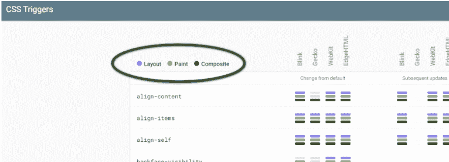

仅更改触发合成操作的 CSS 属性是一个简单且有效的步骤，你可以用来优化网页动画的性能。

### 2. 将你想要动画的元素提升到它们自己的层（谨慎使用）

如果你想要动画的元素位于它自己的合成器层上，一些现代浏览器通过将工作卸载到 GPU 来利用硬件加速。如果审慎使用，这一举措可以对你的动画性能产生积极影响。

要让元素位于它自己的层上，你需要将其提升。你可以通过使用 [CSS will-change 属性](https://developer.mozilla.org/en-US/docs/Web/CSS/will-change)来实现。该属性允许开发者向浏览器警告他们想要对元素进行的一些更改，以便浏览器可以事先进行所需的优化。

然而，不建议你将太多元素提升到它们自己的层，或者过度这样做。实际上，浏览器创建的每个层都需要内存和管理，这可能是昂贵的。

你可以在 Nick Salloum 的[《CSS will-change 属性简介》](https://css-tricks.com/an-introduction-to-the-css-will-change-property/)中了解如何使用`will-change`、它的优缺点的详细信息。

### 3. 用`requestAnimationFrame`替换`setTimeout`/`setInterval`

JavaScript 动画通常使用 [setInterval()](https://developer.mozilla.org/en-US/docs/Web/API/setInterval) 或 [setTimeout()](https://developer.mozilla.org/en-US/docs/Web/API/setTimeout) 来编写。

代码看起来像这样：

```javascript
var timer;
function animateElement() {
    timer = setInterval( function() {
```

虽然这种方法可行，但卡顿的风险很高，因为回调函数会在帧中的某个时刻运行，可能在末尾，这可能导致错过一帧或多帧。如今，你可以使用一种原生的 JavaScript 方法，它专为流畅的 Web 动画（DOM 动画、canvas 等）而设计，称为 [requestAnimationFrame()]。

`requestAnimationFrame()`会在浏览器最合适的时间执行你的动画代码，通常是在帧的开始处。

你的代码可能看起来像这样：

```javascript
function makeChange(time) {
    // Animation logic here

    // Call requestAnimationFrame recursively inside the callback function
    requestAnimationFrame(makeChange);
}

// Call requestAnimationFrame again outside the callback function
requestAnimationFrame(makeChange);
```


Tim Evko 在 SitePoint 上发表的 [Performance with requestAnimationFrame](link) 提供了一个关于`requestAnimationFrame()`编程的精彩视频介绍。

### 4. 在代码中将事件与动画解耦

在每秒 60 帧的情况下，浏览器每帧只有 16.67 毫秒来完成工作。

时间不多，因此保持代码精简可能会影响动画的流畅度。

将处理滚动、调整大小、鼠标事件等的代码，与使用`requestAnimationFrame()`处理屏幕更新的代码分离，是优化动画代码性能的好方法。

有关此优化技巧和相关示例代码的深入讨论，请查看 Paul Lewis 的 [Leaner, Meaner, Faster Animations with requestAnimationFrame](https://www.smashingmagazine.com/2013/05/optimizing-javascript-for-animation-performance/)。

### 5. 避免运行时间过长的 JavaScript 代码

浏览器使用主线程来运行 JavaScript，同时处理样式计算、布局和绘制操作等其他任务。运行时间过长的 JavaScript 代码可能会对这些任务产生负面影响，导致跳帧和卡顿的动画。因此，简化代码可能是确保动画流畅运行的好方法。

对于不需要访问 DOM 的复杂 JavaScript 操作，可以考虑使用 [Web Workers](https://developer.mozilla.org/en-US/docs/Web/API/Web_Workers_API)。工作线程执行任务时不会影响用户界面。

### 6. 利用浏览器的开发者工具来监控性能问题

浏览器的开发者工具提供了一种方法，可以监控浏览器运行 JavaScript 代码或第三方库代码时的工作量。它们还提供有关帧率和其他有用信息。

你可以通过在网页上右键单击，然后在上下文菜单中选择`Inspect`来访问 Chrome 开发者工具。例如，使用性能工具录制网页可以洞察该页面的性能瓶颈：

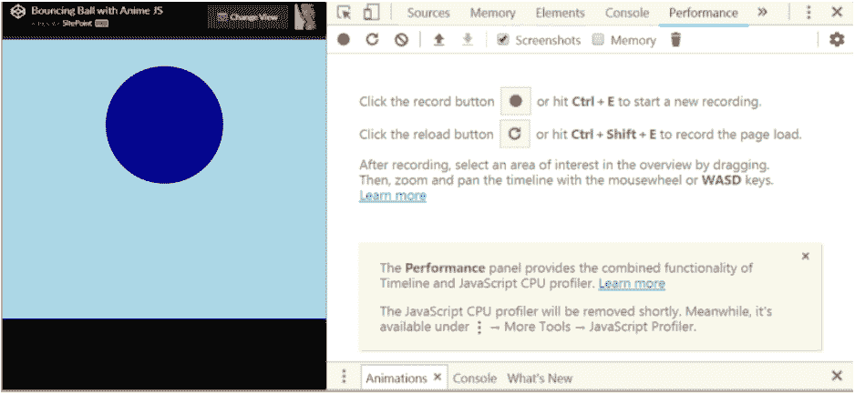

9-2. Chrome 开发者工具中的 Performance 标签页

点击`record`按钮，几秒钟后停止录制：

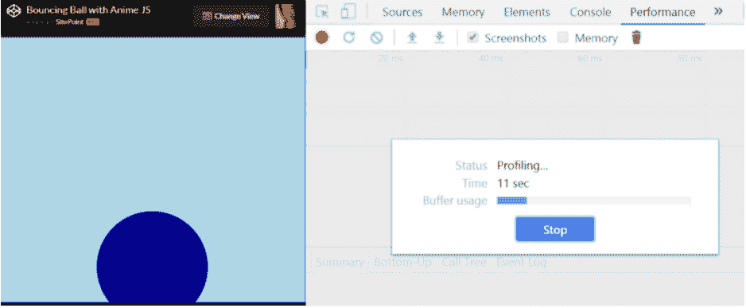

9-3. 动画停止后

此时，你应该有大量数据来帮助你分析页面的性能：

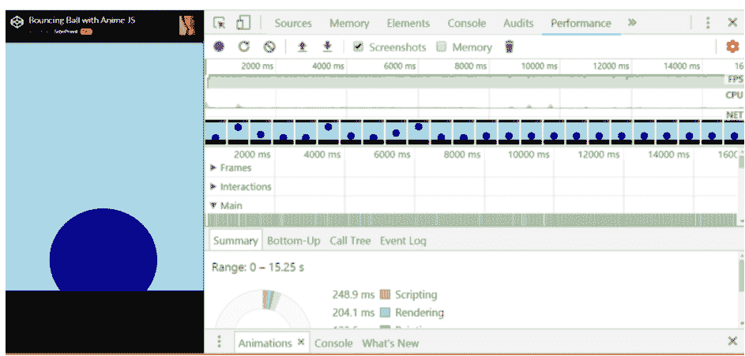

这份 [Chrome DevTools 指南](https://developer.chrome.com/docs/devtools/) 将帮助你充分利用 Chrome 浏览器中的 DevTools 来分析性能和各种其他数据。如果 Chrome 不是你的首选浏览器，也没关系，因为如今大多数现代浏览器都配备了功能强大的开发者工具，你可以利用它们来优化代码。

### 7. 使用离屏 Canvas 进行复杂的绘制操作

此技巧专门用于优化 [HTML5 Canvas](https://developer.mozilla.org/en-US/docs/Web/API/Canvas_API) 代码。

如果你的帧涉及复杂的绘制操作，一个好方法是创建一个离屏 canvas，在其中执行所有绘制操作（只做一次或仅在发生变化时），然后在每一帧中只需绘制这个离屏 canvas。

你可以在 MDN 的 [Optimizing Canvas](https://developer.mozilla.org/en-US/docs/Web/API/Canvas_API/Tutorial/Optimizing_canvas) 文章中找到与此技巧相关的详细信息和代码示例。

### 结论

如果你不想辜负当今 Web 用户的期望，优化代码性能是一项必要任务，但它并不总是容易或直接的。动画性能不佳可能有多种原因，但如果你尝试我上面列出的技巧，你将大大避免最常见的动画性能陷阱，从而改善你的网站或应用的用户体验。

# 什么是 CDN 以及它是如何工作的？

第十章

Bruno Škvorc

CDN——你一直看到这个缩写。可能在 URL 中，可能在着陆页上，但你始终不太明白——什么是内容分发网络，它们到底是做什么的？

我们将在本概述文章中解释，并在后续文章中用两个流行的 CDN 进行演示。


## CDN 基础知识

CDN 是一个用于分发内容的计算机网络。

更具体地说，它是一些服务器，地理位置上介于某些 Web 内容的源服务器和请求该内容的用户之间，目的都是通过减少延迟来更快地交付内容。这是它们的主要目的。

这些地理位置更近的服务器，也称为 PoP（接入点），还会缓存可缓存的内容，从而大大减轻源服务器的负担。不同类型的 CDN 提供不同种类的服务，它们可能有不同的网络拓扑结构：分散式 CDN 旨在全球范围内拥有尽可能多的服务器。Akamai 就是这样的 CDN。集中式 CDN 则拥有更少的节点，但更大的节点是为了网络性能、吞吐量和 DDoS 抗性而构建的。

## CDN 的类型

我们说过，它们的主要目的是减少延迟和加速渲染。但在如今这个 2MB 图片和 500KB JavaScript 库的网站启动需要 3 分钟的世界里，这种延迟影响很小。但 CDN 也有其他用途，这些用途是随着时间演变而来的。

### 内容导向型 CDN

最初，CDN 只用于静态内容（JS、CSS、HTML）。你需要在创建/上传内容时将其推送到 CDN（它们不知道需要更新缓存你的内容，甚至不是当有人请求时）。

后来，它们增加了源站拉取，使事情更加自动化——这意味着用户请求 CDN 的 URL，然后 CDN 自动请求源网站的 URL，缓存它收到的任何内容。此外，可用性成为重要因素。许多 CDN 现在会缓存网站的“最后存活”状态，如果源站宕机，CDN 缓存的内容对用户仍然可用，营造出稳定的假象，直到一切恢复正常。

此外，现代 CDN 通常提供自动优化层，会根据请求的图片尺寸自动调整图片大小并保存以备将来使用。这意味着，如果你的网站有一张 2MB 的头部图片，有人在 300px 宽的屏幕上请求它，CDN 会创建一个 30KB、300px 宽的副本，并在将来为所有移动用户提供服务，自动使网站更快。

### 安全导向型 CDN

CDN 增加的最后一层实用性是 DDoS 和机器人保护。像 Incapsula 这样的 CDN 专门提供此类服务。

由于 CDN 是网站基础设施的最外层，也是流量的第一个接收者，它可以早期检测 DDoS 攻击，并使用称为清洗器的特殊 DDoS 保护服务器将其阻止，使其永远无法到达源服务器并使其崩溃。

此外，通过从众多客户那里众包知识，CDN 可以学习可疑 IP、垃圾邮件发送者、机器人操作者，甚至爬虫的类型和行为。例如，一个在某网站 A 上工作的爬虫，一旦被识别，在受同一 CDN 保护的网站 B 上也将停止工作，因为流量过滤器会识别它之前见过的模式。


10-2. 德国牧羊犬守卫

更重要的是，虽然 CDN 确实允许客户上传自定义`证书`，它们还提供自己的证书。这有两个好处：

1. 当证书出现重大漏洞时，CDN 通常会迅速响应，因为他们损失最大（所有客户）。因此，修复通常在大多数人知道这个安全漏洞之前就已经到位。
2. 连接速度更快，因为如果许多网站使用同一个 CDN，那么你已经通过其 SSL 证书与该 CDN 建立了有效的连接和互信，因此不必为使用该 CDN 证书的每个网站重复此过程。这对整个互联网的影响比对单个网站的影响更大。

### 主要玩家

CDN 领域的一些主要玩家包括 Akamai、AWS Cloudfront、Cloudinary、Incapsula、MaxCDN、Fastly 等公司。

我们不会[全面比较它们](https://example.com)，而是列出每个 CDN 可以成为冠军的类别：

#### 爬虫和 DDoS 防护

虽然 Incapsula 在其他方面也很出色，但在爬虫和 DDoS 防护方面无人能敌。凭借庞大的数据库，不仅包含恶意代理 IP 地址，还包括机器人和爬虫的鼠标行为和浏览模式，Incapsula 能将大多数自动化攻击扼杀在萌芽状态。

**适合选择如果你：**你是一家网店，不想让竞争对手抓取你的商品目录

#### 速度和全球覆盖

Akamai 是连 Facebook 都在使用的 CDN，拥有经过验证的全球可用性记录。其分散的网络拓扑模型以及在世界较贫困地区（其他 CDN 所缺乏的）的可用性，使得通过 Akamai 提供的内容即使在连接较差的地区也能流畅加载。紧随其后的是 Amazon 的 AWS Cloudfront。

**适合选择如果你：**你追求全球覆盖，从中国到美国，从芬兰到南极洲。

#### 性价比

Amazon Cloudfront 是付费计划中最便宜的（我们不计算免费计划，因为它们通常缺少重要功能），而且覆盖面可以说仅次于 Akamai（Akamai 的价格并不便宜——分散的拓扑结构维护成本很高）。

**适合选择如果你：**价格是个问题。

#### 盗链防护

盗链是指有人在你的网站上托管的图片上选择“复制图片地址”，然后直接将其嵌入自己的页面中，保留原始 URL 不变。这通常是内容窃取者的偷懒行为，但如果模仿者成功在 Facebook 或 Reddit 等高影响力的社交媒体网站上分享其网站，你的服务器就会因此承受巨大开销。MaxCDN 和 KeyCDN 都提供非常出色的盗链保护。

**适合选择如果你：**你有一个图片库、旅游博客或任何其他图片丰富的网站，存在被盗链的风险。

#### 其他

我们鼓励你亲自去调查研究。有无数的文章逐一比较各个 CDN，每个 CDN 的每个计划在提供的功能上也各不相同。要全部涵盖它们极其困难，而且这个领域一直在变化。

### 实施过程

实施 CDN 通常需要在注册商（租用你域名的公司）的控制面板中更改一些 DNS 记录。这会导致所有流量先经过 CDN，然后再到达你的网站。由于这一切都在后台（通过 IP）完成，所以整个过程对用户来说是透明的。

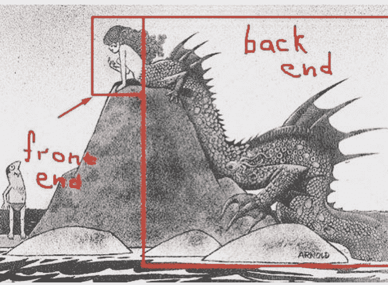

### 10-3. 前端与后端

有时，网站会在其主域名上添加一个特殊的子域名，用于托管图片、JavaScript、CSS 和其他静态内容。如果你打开浏览器开发者控制台的网络选项卡，或者在 Facebook 等网站加载时留意浏览器的状态栏，你会注意到许多 URL 中包含`cdn`——那就是该网站仅从 CDN 请求其部分内容。

为什么不通过 CDN 请求所有内容？因为静态内容通常很大——2MB 的图片、500kb 的 JS 等。这些内容值得快速提供，因为 a) 它们不经常变化，可以长时间缓存，以及 b) 大大减轻了应用主服务器的负担，而主服务器可能需要处理动态内容。

### 结论

在本文中，你了解了 CDN 是什么以及它如何运作。你了解了不同类型的 CDN 及其潜在工作范围，以及该领域的主要玩家。
