# 前端响应式架构：使用响应式 JavaScript 框架和库探索前端未来

## 关于作者


`Luca Mezzalira` 是一位拥有 15 年经验的系统架构师、Google Web 技术领域开发专家，以及伦敦 JavaScript 社区经理（[`www.londonjs.uk`](http://www.londonjs.uk)）。

他曾有机会为移动设备、桌面、Web、电视、机顶盒和嵌入式设备开发尖端项目。

他也是一位技术会议的国际化演讲者，在不到 10 年的时间里完成了超过 100 场演讲。

Luca 认为使用任何编程语言的最佳方式是掌握它们的模型；这就是为什么他花费大量时间研究 OOP、函数式编程和响应式编程等主题。

凭借这些技能，Luca 能够轻松运用所学到的最佳实践，并带领任何团队取得成功。

他也是一位天生的领导者，以交付为导向，善于解决问题，能够改变游戏规则；他的热情是任何活动的驱动力，而且他能够在许多情况下发挥重要作用。

在业余时间，Luca 为国内外技术杂志和出版社撰稿，同时还是 Apress、Manning Publications、Packt Publishing、Pragmatic Bookshelf 和 O'Reilly 的技术审稿人。

### 关于技术审校者

`Antonio DeLuca` 是极简软件开发、精确数据库设计和细致业务分析的狂热爱好者。他专注于函数式/面向对象范式和面向服务架构。他在各种背景和层次下工作过，使用 JavaScript/PHP、Java/C# 和其他编程语言为 Web 及其他目的开发应用。他常驻伦敦，是 DAZN（Perform Group 旗下部门）的首席软件开发工程师。


`Massimo Nardone` 在安全、Web/移动开发、云和 IT 架构方面拥有超过 23 年的经验。他真正的 IT 热情在于安全和 Android。

他使用 Android、Perl、PHP、Java、VB、Python、C/C++ 和 MySQL 进行编程和教学已超过 20 年。

他拥有意大利萨勒诺大学计算机科学硕士学位。

Massimo 多年来曾担任项目经理、软件工程师、研究工程师、首席安全架构师、信息安全经理、PCI/SCADA 审计员以及高级 IT 安全/云/SCADA 架构师主管。

技术技能包括以下方面：安全、Android、云、Java、MySQL、Drupal、Cobol、Perl、Web 和移动开发、MongoDB、D3、Joomla、Couchbase、C/C++、WebGL、Python、Pro Rails、Django CMS、Jekyll、Scratch 等。

他曾在赫尔辛基理工大学（阿尔托大学）网络实验室担任客座讲师和练习主管。他拥有四项国际专利（涉及 PKI、SIP、SAML 和代理领域）。

目前他担任 Cargotec Oyj 的首席信息安全官（CISO），并且是 ISACA 芬兰分会董事会成员。

Massimo 为不同出版公司审校了超过 40 本 IT 书籍，并是《Pro Android Games》（Apress，2015）的合著者。

### 致谢

我要感谢的人太多了，恐怕一页都装不下！

不过我认为最重要的是提及我的女朋友 Maela，她总是在我身边，是我们家庭幸福的关键。

有时候灵感会以奇怪的方式出现。我曾经读到过 UFC 冠军 Conor McGregor 的故事：他是一个真正有趣的人，个性有时过于张扬，但我认为这是他选择扮演角色或戴上面具的一部分。

McGregor 的这句话让我深思：

> “这里没有什么天赋，这是努力工作。这是一种痴迷。天赋并不存在，作为人类我们都是平等的。只要付出时间，你可以成为任何人。你会到达顶峰，就是这样。我不是有天赋，我是痴迷的。”

老实说，我完全同意。每个人都可以成为他或她想成为的人；这很难，而且我们经常快要放弃梦想，但我们的痴迷真的可以决定从失败到成功的差异。

几年前，我从未想过我能够用英语写一整本书，并在我的国家之外作为软件架构师取得成功——显然是我的痴迷赢了。

# 第 1 章

## 什么是响应式编程？

> 千里之行，始于足下。
>
> ——老子，《道德经》

你有没有听说过 `Reactive Programming` 或 `Reactive Systems`？你认为 `React.js` 是一个响应式库吗？你有没有想过为什么要在 `Angular` 项目中使用 `RxJS`？`Rx.JS` 是新的 `Lodash` 吗？

如果这些问题中至少有一个经常出现在你的脑海中，那么这正是找到答案的合适书籍！

在这些页面中，你将有机会了解更多关于前端开发的响应式编程和响应式架构：这是一种在前端社区中越来越流行的编程范式；但如今它可能是最被误解和滥用的范式之一。

本书的主要目标是提供对什么是响应式编程、如何在我们的项目中使用它，特别是如何创建完全响应式架构以创建有弹性和可维护项目的良好理解。

在这段旅程中，你将学到以下内容：

- 什么是响应式编程以及为什么它很重要
- 这种编程范式的最佳用例是什么
- 如何使用不同的框架构建完全响应式架构
- 响应式编程在前端生态系统中的未来将会是什么

如果你想知道本书中学到的概念是否也适用于后端架构，我的答案是：是的，或者至少，其中大部分可以应用于你的后端架构。

请记住，本书将注意力集中在使用 JavaScript 的前端架构上，但所说明的一些概念应该可以轻松移植到其他后端编程语言，例如 Node.js。

本书假设你已经对 JavaScript 有良好的理解，特别是 ECMAScript 6 和 7 语法、面向对象编程，以及可能还有一些函数式编程的知识，但不是强制的。让旅程开始吧！

## 什么是响应式编程？

每天当我们打开编辑器或 IDE 开发程序时，我们使用自己喜欢的编程语言；有时我们学习一种新的，但有意识地或无意识地，我们正在决定将要使用哪种编程范式。

响应式编程并不是一种新的范式：它是过去一年左右我们在 JavaScript 社区中经常听到的一个流行词，而且在未来它将不仅仅是一个流行词。

我不想立即开始使用太多技术术语，因为我们在阅读本书的过程中将有足够的时间来学习它们，但重要的是你要理解以“响应式方式”工作的好处是什么。

如果你在网上阅读博客文章或文章，其中很少会用电子表格单元格的例子来解释响应式编程，即电子表格单元格在用户输入后对其他单元格中的变化做出反应。这肯定是一个好例子，但我们可以做得更好。

我相信你熟悉依赖注入模式，即通过构造函数或类/模块公开的公共方法注入对象。这种模式利用了多种好处，如两个对象之间的解耦以及可以在不创建依赖的情况下隔离测试宿主对象的可能性等等。

在某些编程语言中，当我们使用依赖注入时，我们将在宿主对象中将接口定义为函数的参数，然后我们可以与注入对象中可用的方法进行交互。

在这种情况下，注入的对象被用作交互对象，因为宿主清楚地知道契约是什么以及如何使用它。

而在响应式编程中，宿主对象只会订阅注入的对象，并在应用程序生命周期内对变化的传播作出反应。参见图 1-1。

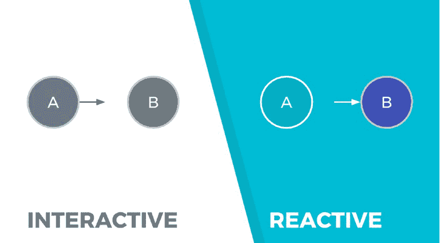

*图 1-1。交互式编程与响应式编程：在响应式编程中，生产者是 A，消费者是 B*

观察上图，我们可以立即理解这两种方法的主要区别：

- 在交互式示例中，对象 A 知道要调用哪些方法，因为它清楚地知道 B 对象的契约，而且如果我们需要理解是谁影响了注入对象的状态，我们需要在所有正在交互的项目中进行搜索。
- 在响应式示例中，契约是标准的，并且对象 A 是对发生在对象 B 中的变化作出反应。更重要的是，我们确信任何操作都发生在注入对象内部；因此，对象之间将实现更强的关注点分离。
- 由于宿主对象会对注入对象内部传播的任何值作出反应，我们的程序将保持最新，而无需实现任何额外的逻辑。

在继续探讨其他概念之前，让我们看一个简单的例子。假设我们有一个名为 `Calculator` 的类，其中包含一个 `sum` 方法，以及一个名为 `Receipt` 的类，其中包含一个 `print` 方法，如代码清单 1-1 所示。

*代码清单 1-1。查看 `Snippet1.js`*

```javascript
class Calculator {
    sum(a, b){
        return a + b;
    }
}

class Receipt {
    constructor(calculator){
        this.calc = calculator;
    }
    print(itemA, itemB){
        const total = this.calc.sum(itemA, itemB);
        console.log(`total receipt £${total}`);
    }
}

const pizza = 6.00;
const beer = 5.00;

const calc = new Calculator();
const receipt = new Receipt(calc);

receipt.print(pizza, beer);
```

可以想象，程序输出“`total receipt £11.`”。我们在这个示例中做的是创建一个 `Calculator` 对象和一个 `Receipt` 对象，然后我们将名为 `calc` 的 `Calculator` 实例注入 `Receipt`，并使用一些参数从 `receipt` 实例调用 `print` 方法。

在 `print` 方法内部，我们正在将传递的元素的总价写入控制台。

检查 `Receipt` 类的实现，你可以在 `print` 方法中发现，我们正在与 `Calculator` 类的 `sum` 方法进行交互，然后获取最终结果。

现在让我们尝试在代码清单 1-2 中以响应式方式实现相同的示例。

## 代码清单 1-2。查看 `Snippet2.js`

```javascript
class Calculator {
  constructor(itemA, itemB){
    const obs = Rx.Observable.of(itemA, itemB);
    const sum$ = obs.reduce((acc, item) => (acc + item));

    return {
      observable: sum$
    }
  }
}

class Receipt {
  constructor(observable$){
    observable$.subscribe(value => console.log(`total receipt: £${value}`))
  }
}

const pizza = 6.00;
const beer = 5.00;

const calc = new Calculator(pizza, beer);
const receipt = new Receipt(calc.observable);
```

正如你在这个例子中看到的，`Receipt` 类正在订阅一个名为 `observable` 的对象，该对象通过构造函数注入，所有关于如何对价格求和并传播它们的逻辑都委托给了 `Calculator` 类。因此，`Receipt` 类只是对在程序生命周期的某个时刻发生的变化作出反应，在控制台中显示由 `Calculator` 实例发出的值。

这里需要强调的另一件事是对象之间的契约：我们不是确切地知道应该调用什么方法，而是传递一个具有默认契约的对象，并在其内部发生变化时作出反应。

总的来说，这是一个非常简单的例子，但我希望它能帮助你理解我们在使用响应式编程时将要进行的思维方式转变；在接下来的几章中，我们将看到更多像这样的响应式示例。

## 编程范式

现在花些时间谈谈编程范式，以阐明响应式概念，并将其与函数式和命令式编程进行比较。

### 命令式编程

命令式编程可能是最著名的编程范式之一。

通常，这是我们学习理解计算机如何处理程序的第一个范式：它为我们提供了所有工具，以便深入定义实现细节，并精确指定程序应如何一步一步地运行。

让我们看一个命令式编程的例子：

```javascript
class Calculator {
    constructor(){
        this.VAT = 22;
    }
    sum(...items){
        let total = 0;
        let i = 0;
        for(i; i < items.length; i++){
            total = total + items[i];
            total = total + items[i] * this.VAT/100;
        }
        return total;
    }
}

class Receipt {
    constructor(calculator){
        this.calc = calculator;
    }
    print(...items){
        let total = this.calc.sum(...items);
        console.log(`total receipt £${total.toFixed(2)}`);
    }
}
```

```javascript
const JEANS = 80.00;
const SHIRT = 35.00;
const SHOES = 90.00;
const COAT = 140.00;
const HAT = 29.00;

const calc = new Calculator();
const receipt = new Receipt(calc);

receipt.print(JEANS, SHIRT, SHOES, COAT, HAT); //"total receipt £456.28"
```

与之前讨论的示例类似，计算器对象的 `sum` 方法接受多个参数，而不仅仅是两个，我们将它们全部求和，并对每个项目应用计算出的增值税值。

正如你所看到的，我们正在描述我们想要执行的精确实现：从定义一个 `for` 语句来遍历数组中的值，直到表达每个单项的增值税计算。

基本上，我们所做的是关注每一个实现细节；我们可能会改变遍历数组元素的方式，从数组中的最后一个元素开始而不是第一个，或者使用不同于“i”的变量名；这些是我们通常在命令式编程中处理的细节层次。

现在来看看这个例子在函数式和响应式编程中将如何处理。

### 函数式编程

函数式编程日益普及。许多语言涌现出来拥抱这种范式，许多现有语言也为了可读性、可维护性和可测试性的改进而拥抱它。

如果你问自己为什么函数式编程变得如此流行，答案可以在这种范式背后的概念中找到。

当我们谈论函数式编程时，我们谈论的是函数：特别是我们谈论的是纯函数。

纯函数是一个函数，给定一个参数，总是返回相同的结果；它是可预测的、易于测试的，并且不会在程序内产生任何副作用。

与函数式编程相关的另一个重要主题是不可变性的概念。

不可变性意味着一个特定的值在其生命周期内永远不会改变，但如果我们需要操作它，我们将创建一个包含原始对象操作版本的新实例。

即使你不熟悉这个概念或从未处理过，我也希望你至少看一个具体的例子。

通常，当你处理一个数组并希望以命令式编程的方式遍历值并与之交互时，你会这样写：

```javascript
const originalArray = [1, 4, 8, 12];

for(let i = 0; i < originalArray.length; i++){
  originalArray[i] = originalArray[i] + 1;
}

console.log(originalArray) //[2, 5, 9, 13]
```

在这个阶段，我们已经完全失去了名为 `originalArray` 的数组的初始值；如果我们想要初始值的副本，我们需要创建一个包含修改后值的新数组，然后检查那个数组。

而在函数式编程中，我们默认处理的是不可变对象；因此，我们需要应用的任何修改都不会影响原始值，而是生成一个新值。

考虑前面的例子，我们可以用函数式编程的方式这样写：

```javascript
const originalArray = [1, 4, 8, 12];
const finalArray = originalArray.map(value => value+1);
console.log(finalArray); //[2, 5, 9, 13]
```

从这些简单的例子中可以看出，函数式编程更关注你试图实现的目标，而不是其实现细节。

这是与命令式编程的一个根本区别。事实上，使用函数式编程，我们是在描述我们的程序，关注每一个操作；我们需要描述我们程序的数据流，而不是关注每一个单一细节，比如我们必须定义哪个变量来遍历数组，或者如何在 `for` 语句中递增变量。

软件编程的另一个重要方面是如何处理状态管理。

在面向对象编程中，我们习惯于将状态封装在一个对象内部，并通过同一对象中描述的不同方法来改变它。但在函数式编程中，我们试图通过纯函数来组合状态，这些函数接受状态作为参数，并返回新的状态。

`Redux`（[`http://redux.js.org/`](http://redux.js.org/)）是 React 社区中一个非常知名的库，它通过实现状态机模式来解决状态管理的问题。

在 `Redux` 中，当我们想要改变应用状态时，我们需要调用一个方法，该方法接受两个参数：先前的应用状态和一个动作（action）。它返回新的状态，而不改变先前的状态。

> 动作（Action）是一个简单的对象，用于标识应用应转变到哪种状态。

依赖纯函数将使我们的代码更加模块化、可复用、产生更少的 bug，并且突然间变得更容易测试！

让我们尝试将之前的命令式示例转换为函数式编程。参见清单 1-3。

**清单 1-3。查看 `Snippet3.js`**


```javascript
class Calculator {
  getTotal(...items){
    const total = items.map(::this.addVAT)
                   .reduce(this.sumElements);
    return total;
  }
  addVAT(itemValue){
    return itemValue + this.calculateVAT(itemValue);
  }
  calculateVAT(value){
    const VAT = 22;
    return value * VAT/100;
  }
  sumElements(accumulator, value){
    return accumulator + value
  }
}
```

```javascript
class Receipt {
  print(total){
    console.log(`total receipt £${total.toFixed(2)}`);
  }
}

const JEANS = 80.00;
const SHIRT = 35.00;
const SHOES = 90.00;
const COAT = 140.00;
const HAT = 29.00;

const calc = new Calculator();
const receipt = new Receipt();

receipt.print(calc.getTotal(JEANS, SHIRT, SHOES, COAT, HAT)); // "total receipt £456.28"
```

正如我们在`sum`方法实现中看到的，我们更关注想要实现的操作，而不是如何应用它们；因此，我们首先知道需要为每个元素计算增值税值（`map`方法），然后对项目求和以获取总额（`reduce`方法）。

在这个实现中，我们不需要指定如何遍历数组元素或指定变量来保持迭代状态；我们只关注我们的目标。

在这个实现中需要注意的另一件事是，我们如何将函数作为其他函数的参数；这种机制被称为高阶函数，它是函数式编程的另一个基石。

显然，函数式编程不止于此：它是一个广泛的主题，有许多其他模式需要考虑，如柯里化、实际应用、记忆化等等，但这不是本书的主要主题。

记住这些概念，可能在网上阅读一些文章来掌握不同的实现，因为熟悉函数式编程将使您更容易拥抱响应式编程。

如果您不习惯函数式思维，我强烈建议您浏览一本用您喜欢的语言描述这种范式的书；这是一项很棒的时间投资，您不会后悔的。

## 响应式编程

我们刚刚简要介绍了命令式编程和函数式编程，那么响应式编程呢？

响应式编程不是一个新概念——它在服务器端编程中已经使用了一段时间——但它在前端生态系统中也变得非常流行。

我们已经看到了如何轻松地将一个快速示例转换为响应式编程，但它不止于此。

使用响应式编程，我们可以轻松地将代码转换为命令式响应式编程或函数式响应式编程。

这种范式背后的主要概念是数据流，以及对象如何观察并响应应用程序生命周期中发生的变化。

让我们开始定义什么是响应式编程：

> 响应式编程是一种基于异步数据流的范式，它在应用程序生命周期中传播变化。

这在实践中意味着什么？假设我们必须开发一个财务仪表盘，所有数据都来自一个为客户端可视化聚合数据的服务器。

对于客户端，我们需要建立一个轮询机制或打开一个`WebSocket`通信来获取这些信息，然后我们需要将它们转换成一个漂亮的用户界面，供我们的用户使用。

尝试分解我们要实现的挑战，以及在没有响应式编程的情况下我们如何推理，请考虑以下几点：

1. 我们需要创建一个代理、一个动作或一个命令来每几秒从服务器检索数据，触发轮询机制。
2. 检索到数据后，我们需要分析这些数据，可能修改或分析它们以提供更友好的可视化。
3. 然后我们通过中介者、存储、控制器或任何其他与视图耦合的层将这些数据传递给不同的组件以更新视图。
4. 在最后部分，我们将从视图更新DOM，也许只突出显示自上次更改以来已更改的数据（在这种情况下，虚拟DOM机制可以出手相救，最大限度地减少工作量）。

[PAGE 21]

有很多部分需要注意，还有很多事件、命令或信号需要使用，以便使这些数据从应用程序的不同部分流动并在视图中显示它们。

如果你知道有一种更好的方法，你会怎么说？这是一种范式，它将允许我们编写更少的代码，并在我们当前的应用程序中更具表现力和可插拔性。

显然，我并不是说我们不会实现所有这些任务——响应式编程不是万能药或魔杖——但我们很快就会了解到，这种范式在其简单性和表现力方面可能会带来相当多的惊喜。

响应式编程中另一个重要的概念是我们如何在对象之间通信。

如果你还记得，几段文字之前，我展示了一个例子，说明我们如何通过注入一个可观察实例而不是特定类或模块的实例来解决对象之间通信的简单问题。

这可能会导致许多有趣的场景，这些场景在前端领域尚未被完全探索。

如果对象之间的契约成为一个标准，而我们注入的实例将有一个预定义的契约，允许宿主对象订阅来自注入实例的变化，你会怎么说？

这也不是一个新概念：一个类似的想法在1978年随着通信顺序进程（`CSP`）被创建。

尽管名称如此，`CSP`允许你处理顺序和并行进程；进程不过是一个用于对象之间异步通信的“通道”。

通过这种方式，你通过一个通道来解耦对象进行通信；这个通道不仅允许你传递数据，还允许你执行以下操作：

- 聚合数据
- 转换数据
- 归约数据
- 装饰数据

最重要的是，我们将能够操作通道（分割、管道连接、合并等），以创建对象之间的复杂交互（图`1-2`）。

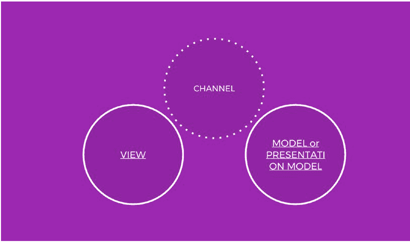

**图1-2。** 在这个图中，我们将一个通道注入到视图和控制器、表示模型、中介者或模型中，以便在主要状态发生变化时允许视图更新

`CSP`是我们将在响应式世界中探索的内容的细粒度实现。如果你有兴趣花一些时间研究`CSP`，我建议你查看一个叫做`CSP-JS`（`https://github.com/ubolonton/js-csp`）的库。

理解`CSP`的工作原理将加速你在响应式编程方面的学习过程。

经过这番简短的离题，我们可以回到本书的主要话题；现在是时候看看响应式编程与命令式编程和函数式编程相结合的实践了。

让我们从清单1-4所示的命令式示例开始。

**清单1-4。查看`Snippet4.js`**

```javascript
class Calculator {
    constructor(){
        this.VAT = 22;
    }
    sum(items){
        const items$ = Rx.Observable.from(items);
        const total$ = items$.map(value => value + (value * this.VAT/100))
                              .reduce((acc, value) => acc + value);
        return total$;
    }
}

class Receipt {
  constructor(calculator){
    this.calc = calculator;
  }
  print(...items){
    const total$ = this.calc.sum(items);
    total$.subscribe(total => console.log(`total receipt £${total.toFixed(2)}`));
  }
}
```

```javascript
const JEANS = 80.00;
const SHIRT = 35.00;
const SHOES = 90.00;
const COAT = 140.00;
const HAT = 29.00;

const calc = new Calculator();
const receipt = new Receipt(calc);

receipt.print(JEANS, SHIRT, SHOES, COAT, HAT);
```

在这个例子中，与命令式编程相比，我们没有做太多改动，但让我们来分析一下我们所做的：

- 在`Receipt`对象的`print`方法中，我们将参数转换为了一个`observable`。
- 我们将这个`observable`注入到计算器类的`sum`方法中。
- 在那里，我们首先通过`map`方法对每个元素应用增值税（VAT）。
- 然后我们对这些值求和，并返回另一个`observable`对象。
- 最后但同样重要的是，我们订阅了`sum`方法返回的`observable`对象，并在控制台中显示总价。

在这个阶段，我不想对响应式术语进行过于深入的讲解；但目前请将`observable`理解为一种包装数据的对象，它公开了一些用于操作值的方法——某种数据在其中流动的通道，我们可以对这些数据应用转换。

在了解了如何为命令式编程添加一些响应式特性之后，让我们看看函数式示例会是什么样子，如清单1-5所示。

```javascript
class Calculator {
    getTotal(...items){
        const items$ = Rx.Observable.from(items);
        const total$ = items$.map(::this.addVAT)
                              .reduce(this.sumElements);
        return total$;
    }

    addVAT(itemValue){
        return itemValue + this.calculateVAT(itemValue);
    }

    calculateVAT(value){
        const VAT = 22;
        return value * VAT/100;
    }

    sumElements(accumulator, value){
        return accumulator + value
    }
}
```

```javascript
class Receipt {
  print(total$){
    total$.subscribe(total => console.log(`total receipt £${total.toFixed(2)}`));
  }
}

const JEANS = 80.00;
const SHIRT = 35.00;
const SHOES = 90.00;
const COAT = 140.00;
const HAT = 29.00;

const calc = new Calculator();
const receipt = new Receipt();

receipt.print(calc.getTotal(JEANS, SHIRT, SHOES, COAT, HAT));
```

同样，在这个例子中，情况几乎相同，但现在`Receipt`使用的是名为`total$`的`observable`，它的签名与之前例子中仅获得简单数字的情况不同。

再次强调，`observable`允许订阅它并检索其中流动的值。

乍看之下，这些概念可能显得不重要，但当我们尝试构建完整的响应式架构时，它们将会带来极大的帮助。

## 何时应该使用响应式编程？

通常，当一种新趋势兴起时，很多开发者会滥用新技术或框架（炒作驱动开发）。正如我们在本章中所理解的，响应式编程用于处理应用程序生命周期中的数据传播。因此，这种范式的完美应用场景是实时数据应用程序，例如金融仪表板或任何监控系统。简而言之，我们可以说任何数据密集型的应用程序都非常适合采用响应式编程。

显然，这并不意味着你不能在其他应用程序中使用这种范式，但实时 Web 应用以及具有大量异步事务和变更的应用程序才是响应式编程真正大放异彩的地方。

如果我们决定在现有架构中使用响应式编程，例如`Angular`或`Redux`，这可能是一个好的设计决策，因为它可以促进视图的更新或状态在组件内部的传播。

如今，网络上充斥着大量响应式示例，库和框架正在成功地推广它们，接受它们需要在思维方式上做出转变，以便真正掌握这种范式的强大力量。

响应式编程的另一个巨大优势是测试代码的简单性，以及以简洁而清晰的方式描述数据流。

响应式编程已经在多家大型组织的生产环境中实施，例如`Netflix`、`Google`和`Microsoft`。

例如，`Microsoft`和`Google`是响应式编程运动的重要贡献者（`http://reactivex.io/`）。

`Netflix`也同样为这种范式的发展做出了重大贡献，特别是`Rx.JS 5`，响应式编程目前已应用于多个生产环境中的实现。

## 如何编写完全响应式的应用程序？

一天晚上，我去伦敦参加了一个聚会，讨论2017年的JavaScript趋势。有趣的是，响应式编程正是这些趋势之一，主持人向所有与会者提出了一个问题：“你们当中现在有多少人在使用响应式编程？”房间里有一半人举手表示肯定。在这个问题之后，主持人又问了下一个问题：“你们当中有多少人仅将`React.js`用作响应式库？”然后，超过85%在之前问题中举手的人再次举起了手。

这对我来说并不惊讶，因为这说明了很少有人以正确的方式理解响应式编程。

我们可以决定用完全响应式的架构来组织我们的项目，其中对象之间的通信/交互、状态管理以及与端点的交互全部以响应式范式来处理。

前端和后端的响应式编程带来了不同的架构和实现，这些虽然有趣，但同时也与我们习惯处理的有所不同。

在本书中，我们将探索前端响应式社区中目前可用的不同方法。

# 第2章

## 架构比较

> 如果你认为好的架构很昂贵，那就试试糟糕的架构吧。

——Brian Foote

在本章中，我们将探讨前端架构的当前现状。当我们为项目选择框架时，其他人已经为我们做出了如何构建架构的决策，遵循最佳实践和设计模式，给予我们自由来做出设计决策，主要关注我们的应用程序应该实现什么，而不是如何构建它们。

在这里，强调架构和设计之间的区别很重要，因为这两个术语经常被误解。

当我们谈论架构时，我们是在定义系统如何在不同元素之间进行交互。例如，考虑模型和视图之间的通信。通常，当我们定义架构时，我们是在定义对象之间的关系、它们如何相互通信等等。架构决策很难改变，因为它们通常会将项目推向特定方向，如果要将其转向不同方向将需要巨大的努力。

相反，设计决策是选择特定库、算法或设计模式来解决项目中问题的局部决策。

当我们在项目中做出设计决策时，通常不需要花费巨大努力去挽回，但在某些情况下，糟糕的设计决策将导致系统的长期重构。假设我们需要解决这样一个问题：每隔几分钟我们需要刷新特定视图中的数据，而不刷新整个页面，只刷新需要改变的元素；我们可以决定使用`React.js`及其`diff`算法，或者创建我们自己的算法，在其中可以更有控制权地定义符合我们需求的`diff`算法。

## 第二章架构比较

梳理了架构与设计决策之间的区别之后，现在来看看本章将要探讨的内容。

前端生态系统一直在持续演进，尤其是在过去几年里，我们经历了各种根本性的变革，这些变革正在提升项目的创建效率与可维护性。

我们或许正经历过去十年中最激动人心的十年，各种具有革命性的概念令人应接不暇——它们往往源自过去，却又被赋予了新的视角，转化为实用的方法，用于解决我们日常面临的挑战。

前端架构在过去三十年里发生了巨大变化，从经典的`MVC`（模型-视图-控制器）模式演进到当今许多现代框架中广泛使用的更实际的架构。

这可能是这一演进过程在时间线上的一个呈现。在本章中，我们将实际应用这些最著名的架构，并对它们进行比较。

图2-1展示了一条时间线，其中标注了我们将要探讨的所有架构及其首次出现的年份。你会发现，许多源自1980或1990年代的概念至今仍非常前沿，并被广泛应用于当前JavaScript生态系统中最著名的框架实现中。

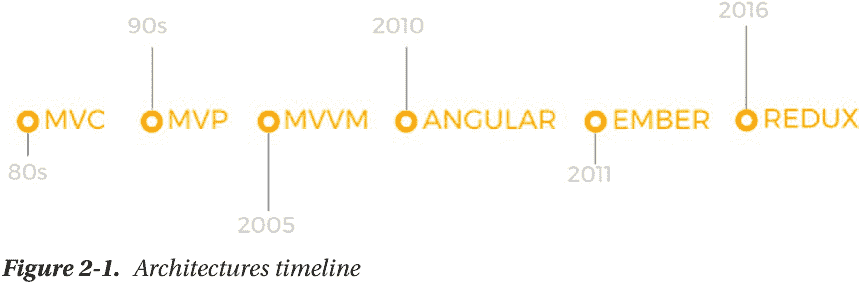

最重要的是要记住，这些架构并非已经过时，它们依然是有效的理念，在项目中应用能极大简化开发与维护过程，从而为项目带来巨大价值。构建结构良好、灵活的架构，不仅能让我们轻松应对设计层面的变更，也能更好地拥抱架构层面的调整。

## MV*架构

同时，我们还需牢记：如果以恰当的方式应用响应式概念，这些架构可以被转换为响应式架构。因此，即使我们的项目当前采用的是其中某一种，我们依然可以通过引入一些改进，逐步迁移到更具响应性的范式。

在本节中，我们将深入探讨`MV*`架构的核心概念。为此，我们将以一个简单的项目（基础计算器）为例，理解这些架构的组成方式，以及对象之间如何通过遵循`SOLID`原则进行通信——任何项目要保持可维护性与可扩展性，都应考虑这些原则。

本节将探讨的三种架构是`MVC`、`MVP`和`MVVM`。让我们从最古老的`MVC`开始！

### SOLID原则

`SOLID`是由“Bob大叔”提出的一组设计原则。`SOLID`是以下五个原则的首字母缩写：

- S – 单一职责原则
- O – 开闭原则
- L – 里氏替换原则
- I – 接口隔离原则
- D – 依赖倒置原则

如果你想了解更多细节，建议观看Bob大叔的这个演讲：`https://www.youtube.com/watch?v=t86v3N40shQ`

请注意，本章中展示的所有代码仅为最终示例的片段。因此，如果你在阅读代码时感到困难，请先下载本章的示例文件，然后切换到你喜欢的编辑器或IDE中查看完整代码。

首先，运行以下命令安装所有依赖项：

```bash
npm install
```

然后，你可以通过以下方式运行名为`build`的npm脚本：

```bash
npm run build
```

## Model View Control（MVC）

`MVC`（模型-视图-控制器）是一种架构模式，由Trygve Reenskaug于1980年代末在`Smalltalk`中首次提出。它可能是过去30年中最流行的架构，被数百万开发者应用于各类项目中，无论使用何种编程语言（图2-2）。


MVC的核心特征是关注点分离与职责单一。该模式最重要的创新在于将数据与其可视化表示彻底分离，这一概念在此之前并未被充分探索。

实际上，模型对象与其表示层完全分离，模型内部不包含任何关于视图的信息。

当多个视图或控制器需要访问相同数据时，这一细节变得尤为重要——因为我们的模型对象可以轻松地在不同屏幕间复用。

MVC基于三个基本原则：

- Model（模型）：存储应用状态和领域数据
- View（视图）：与用户交互的应用界面
- Controller（控制器）：连接模型与视图的桥梁，通常负责协调应用内的通信流程

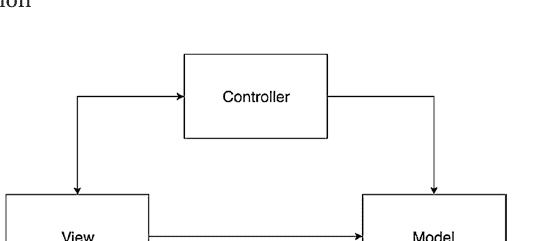

### MVC的工作原理

通常，控制器会在其构造函数中实例化视图和模型，或者在某些实现中通过依赖注入由主应用类注入。控制器与视图之间可以是一对多的关系，即一个控制器可以处理多个视图；模型与视图之间也存在类似的关系。

当我们将此架构扩展至大型项目时，通常会尝试拆分这些关系，以实现三个对象之间近乎一对一的映射，从而能够复用自包含的组件——这些组件的构建方式与整个应用的架构保持一致，如同俄罗斯套娃般层层嵌套。

如前所述，模型的主要职责是存储应用状态以及所有需要在多个视图间保持持久化的数据。通常，每当应用状态发生变化或数据更新时，模型就会触发一个事件来通知视图进行更新。

在绝大多数实现中，监听状态或数据变化的对象是视图；但在某些实现中，模型与视图也可能完全分离——由控制器监听变化，并将信息传递给视图。

视图仅负责显示应用数据并监听用户交互。

图2-3展示了MVC在一个JavaScript计算器实现中的工作流程。

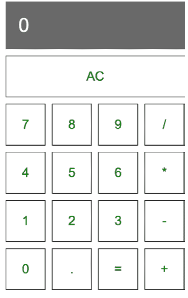

**图2-3.** 这是我们计算器应用的输出结果。

这就是我们最终想要实现的效果。这是一个简单的计算器，每次点击按钮时，会将显示区域的数字相加；当用户点击“=”按钮时，将显示计算结果。现在，让我们从控制器开始探索MVC示例。参见代码清单2-1。

**代码清单2-1.** `CalculatorController.js`

```javascript
initialize(){
    const emitter = this.initEmitter();
    this.model = this.initModel(emitter);
    this.initView(emitter, this.model);
}
```

在我们的实现中，控制器负责实例化视图和模型，并注入一个事件发射器（event emitter）用于通过事件实现对象间通信。这立即提升了对象之间的解耦程度——未来若想在其他项目中复用这些对象，只需复制相关对象本身，因为它们通过事件通信；只要遵守约定，代码就能保持可复用性和灵活性。

我们将使用React.js来处理项目中的视图。

React通常在属性更新时重新渲染组件，但在我们的实现中，是通过事件总线通知视图需要在计算器显示屏上渲染新结果，然后视图从模型获取数据，并用新字符串更新显示区域。

为此，我们需要将模型和发射器实例注入视图中。参见代码清单2-2。

**代码清单2-2.** `CalculatorController.js`

```javascript
initView(emitter, model){
    const cont = document.getElementById("app");
    ReactDOM.render(<Calculator emitter={emitter} model={model} />,
        cont);
}
```

接着，我们将使用React组件的生命周期方法，在本地存储这两个对象，并监听模型的任何变化；当变化发生时，我们会更新React组件内部的状态属性，以显示正确的值。参见代码清单2-3。

**代码清单2-3.** `Calculator.jsx`

```javascript
componentWillMount(){
    this.model = this.props.model;
    this.emitter = this.props.emitter;
    this.emitter.on("TotalChanged", _ => this.setState({displayValue:
        this.model.total}));
    this.setState({displayValue: this.model.total})
}
```

因此，每当`displayValue`属性更新时，都会触发渲染函数；随后视图将以新的结果进行更新，如代码清单2-4所示。

## 第二章 架构对比

**清单2-4.** `Calculator.jsx`

```jsx
render() {
    return (
        <div>
            <div style={displayStyle}>{this.state.displayValue}</div>
            {this.createRow("row1", "AC")}
            {this.createRow("row2", "7", "8", "9", "/")}
            {this.createRow("row3", "4", "5", "6", "*")}
            {this.createRow("row4", "1", "2", "3", "-")}
            {this.createRow("row5", "0", ".", "=", "+")}
        </div>
    );
}
```

而在模型内部，我们将保存应用程序状态，处理视图中应显示的内容，并执行一些计算。我们的模型由几个方法组成，允许控制器在每次点击计算器键盘按钮时进行调用，正如你将在以下清单2-5和2-6的代码中看到的那样。

**清单2-5.** `CalculatorController.js`

```javascript
initEmitter() {
    let emitter = new LiteEventEmitter();
    emitter.on("CalculateEvent", _ => {
        this.model.calculate();
    });

    emitter.on("AddValueEvent", content => {
        this.model.addValue(content.value, content.type);
    });

    emitter.on("ResetEvent", _ => {
        this.model.reset();
    });

    return emitter;
}
```

**清单2-6.** `CalculatorModel.js`

```javascript
calculate() {
    this.totalOperation = math.eval(this.totalOperation);
    this.state = FIRST_OPERATION;
    this.emitter.emit("TotalChanged");
}

addValue(value, type) {
    if (type === NUMERIC) {
        this.totalOperation = this.getValue(value);
    } else if (type === SYMBOL) {
        this.totalOperation = this.checkSymbol(value);
    }

    this.state = IN_PROGRESS_OPERATION;
    this.emitter.emit("TotalChanged");
}

reset() {
    this.totalOperation = 0;
    this.state = FIRST_OPERATION;
    this.emitter.emit("TotalChanged");
}
```

控制器通过`emitter`对象监听视图触发的任何事件，并请求模型执行一些操作，如重置、计算或添加新值。

另一方面，模型每次`totalOperation`值发生变化时，都通过事件总线通知我们的视图，视图将通过更新React组件的`state`属性来显示新值，从而触发渲染函数。

MVC是一个非常简单直接的模式：它实现了良好的关注点分离，每个对象都有唯一的职责，并且所有信息都得到了良好的封装。

## 模型-视图-展示器

模型-视图-展示器（MVP）是一种在20世纪90年代创建的架构，它最早出现在IBM的软件中（图2-4）。在我看来，当我们需要在不同项目或同一应用程序的不同区域重用视图或行为时，MVP架构尤为出色；通过这种架构，我们开始更加重视前端应用程序的模块化，并提供专为前端设计的架构，而不是像MVC那样可以适用于后端或前端应用程序的通用架构。

MVP非常有用，特别是在我们开发跨平台应用程序，并希望重用应用程序数据、通信层和行为时，或者当我们希望在运行时或编译/转译时切换视图，更改它们时。

MVP和MVC之间的主要区别可以总结在以下列表中：

- 使用展示器而非控制器，我们稍后会看到展示器带来的好处。
- 视图与展示器之间的关系不是像MVC中那样一对多，而始终是一对一。
- 为了实现可重用组件，最佳的MVP实现方式是将我们的视图设计为被动视图，因为只要展示器与视图之间的契约得到遵守，交换它们就会变得更加容易。


### MVP的工作原理

展示器对象的设计灵感源自展示模型模式，我最喜欢的实现方式是将展示器设计为监督控制器，它从模型中获取视图所需的所有数据，同时它还应该处理任何用户交互并更新模型。如前所述，视图是被动的，或者你可以说是“愚蠢”的，它们只知道渲染逻辑如何工作、可能的动画、与CSS样式的集成等等。

除此之外，展示器还负责更新模型和获取渲染视图所需的信息。通常，在复杂的应用程序中，你可能会有一个持久化模型（或者可能通过外观模式暴露多个模型）贯穿整个应用程序生命周期，以及多个展示器从模型中获取和更新应用程序数据。

另一个需要强调的重点是模型和视图彼此不应该知道对方的存在；保持这两者彼此完全隔离，在大型应用程序或需要切换视图以针对不同设备时将大有帮助。

想象一下，我们的任务是一个需要针对不同设备（如浏览器、移动设备和智能电视）的项目——正是同一个应用程序，但针对不同的目标设备有不同的UI，考虑到每个目标设备都有不同的输入方法和UI模式。

采用MVP架构，将行为保持在展示器中，将业务领域放在模型中，并且只拥有用于UI的被动视图，将使我们能够在整个应用程序中拥有类似的行为，重用相同的模型代码，并更改视图——无需太多努力即可将其调整为我们目标设备所需的视图。

**被动视图**

被动视图是一个不知道系统如何工作，仅依赖另一个对象来处理与系统通信的视图。被动视图甚至不会通过从模型检索数据来更新自己；这个视图是完全被动的，其主要范围是在控制器或展示器调用特定渲染函数时，专注于在屏幕上渲染什么内容。

**监督控制器**

监督控制器是一种特定类型的控制器，它处理用户交互并操作视图以进行更新。当架构中存在监督控制器时，视图只需将用户事件重定向到监督控制器（在MVP中，展示器就是我们的监督控制器），它将负责处理逻辑并用新数据更新视图。监督控制器负责系统中的通信，并负责更新与其关联的视图。

现在是时候看看MVP在上文讨论的计算器示例中的实际应用了，但这次我们以模型-视图-展示器的视角来看。

我们可以从`App.js`文件开始，在构造函数中我们将创建模型和展示器，并导入名为`Calculator.jsx`的视图。然后我们将React组件和模型注入展示器中，如清单2-7所示。

**清单2-7.** `App.js`

```javascript
export default class App {
    constructor() {
        const mainModel = new CalculatorModel();
        const mainPresenter = new CalculatorPresenter();
        mainPresenter.init(mainModel, Calculator);
    }
}
```

然后我们可以进入展示器内部，在那里我们将所有注入的对象存储在变量中，然后渲染注入的React组件。参见清单2-8。

**清单2-8.** `CalculatorPresenter.js`

```javascript
initialize(model, view) {
    this.model = model;
    this.view = view;
    this.cont = document.getElementById("app");
    this.renderView();
}
renderView() {
    const component = React.createElement(this.view, {result: this.model.total, onBtnClicked: ::this.onBtnClicked});
    ReactDOM.render(component, this.cont);
}
```

在我们的展示模型中，我们注入模型和视图以拥有对它们的完全控制；然后我们调用`renderView`方法，它将作为我们的触发器，通知React组件重新渲染，因为应用程序内部发生了某些事情，UI应该被更新。

## 第2章 架构比较

如您所见，视图对模型一无所知，但我们通过React暴露的`props`对象将要显示的结果传递给计算器。现在让我们来看看视图；正如我们在本节开头所定义的，视图应该是一个被动视图，因此在这种情况下，它只负责渲染什么以及如何渲染，不应将任何其他内容集成到被动视图中。与Presenter的通信通过`props`对象传递的方法进行。正如我们在`renderView`方法中看到的，Presenter传递了一个回调函数，该函数应在用户每次选择计算器按钮时被调用。请参见代码清单2-9。

### 代码清单2-9. `Calculator.jsx`

```jsx
import React from "react";
import ReactDOM from "react-dom";
import {ulStyle, acStyle, btnStyle, displayStyle} from "./Calculator.css";

export default class Calculator extends React.Component{
    constructor(props){
        super(props);
    }

    componentWillMount(){
        this.btnClicked = this.props.onBtnClicked;
    }

    onButtonClicked(evt){
        evt.preventDefault();
        this.btnClicked(evt.target.innerHTML);
    }

    createRow(id, ...labels){
        const items = labels.map((value, index) => {
            return <li key={`${id}_${index}`}
                        style={value === "AC"? acStyle : btnStyle}
                        onClick={::this.onButtonClicked}>
                        {value}
                    </li>;
        })
        return(
            <ul key={id} style={ulStyle}>
                {items}
            </ul>
        )
    }

    render(){
        return(
            <div>
                <div style={displayStyle}>{this.props.result}</div>
                {this.createRow("row1", "AC")}
                {this.createRow("row2", "7", "8", "9", "/")}
                {this.createRow("row3", "4", "5", "6", "*")}
                {this.createRow("row4", "1", "2", "3", "-")}
                {this.createRow("row5", "0", ".", "=", "+")}
            </div>
        );
    }
}
```

React组件中的所有方法都是为了渲染正确的按钮或显示区而定义的，而`this.props.onBtnClicked`是Presenter传递的方法。此方法标识哪个按钮被选中，以便Presenter可以捕获用户交互，并调用主模型中暴露的正确方法，如代码清单2-10中所示。

### 代码清单2-10. `CalculatorPresenter.js`


```javascript
onBtnClicked(value){
    switch (value) {
        case "AC":
            this.model.reset();
            break;
        case "=":
            this.model.calculate(value);
            break;
        case "+":
        case "-":
        case "/":
        case "*":
        case ".":
            this.model.addValue(value, SYMBOL);
            break;
        default:
            this.model.addValue(value, NUMERIC);
            break;
    }
    this.renderView();
}
```

现在来看看模型做了什么；在这种情况下，模型负责所有计算和维护应用程序状态。这将有助于调试我们的应用程序，因为我们知道视图仅处理应用程序的UI，Presenter处理用户交互，而模型保持应用程序状态和缓存应用程序数据。让我们看看代码清单2-11中所示的模型。

### 代码清单2-11. CalculatorModel.js

```javascript
export default class CalculatorModel{
    constructor(){
        this.totalOperation = 0;
    }

    calculate(){
        this.totalOperation = math.eval(this.totalOperation);
        this.state = FIRST_OPERATION;
    }

    addValue(value, type){
        if(type === NUMERIC){
            this.totalOperation = this.getValue(value);
        } else if(type === SYMBOL){
            this.totalOperation = this.checkSymbol(value);
        }
        this.state = IN_PROGRESS_OPERATION;
    }

    checkSymbol(value){
        const str = this.totalOperation;
        if(this.state === FIRST_OPERATION){
            return str + value;
        }
        return !isNaN(str.charAt(str.length - 1)) ? str + value : str.substr(0, str.length - 1) + value;
    }

    getValue(value){
        return (this.totalOperation == 0 || this.state === FIRST_OPERATION) ? value : this.totalOperation + value;
    }

    reset(){
        this.totalOperation = 0;
        this.state = FIRST_OPERATION;
    }

    get total(){
        return this.totalOperation;
    }
}
```

正如您在模型中看到的，有所有被Presenter调用的方法，如`reset`或`calculate`，以及其他一些用于处理应用程序逻辑的方法，如`checkSymbol`和`getValue`。

MVP中的关注点分离非常强，如果我们正确应用这些简单的概念，任何应用程序都将更易于调试和维护；它绝对是一种在很大程度上改进了10年前创建的MVC概念的架构。

## Model View View-Model

Model View View-Model (MVVM) 是微软在2005年创建的一种架构，用于处理使用Windows Presentation Foundation (WPF) 的GUI管理。它坚持视图和模型之间的真正分离，就像我们在MVP架构中看到的那样，但与其他架构相比，MVVM封装了一些差异（图2-5）。

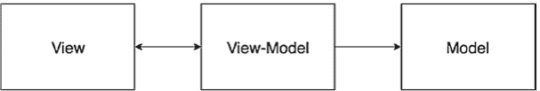

*图2-5. MVVM图，类似于MVP，但视图不再是被动的*

### MVVM如何工作

第一个区别是我们有一个ViewModel而不是Presenter；这个特定对象将成为存储在模型中的数据和视图之间的桥梁。

简而言之，ViewModel负责将模型中存在的数据暴露给视图，还负责以视图期望的方式准备数据，因此您可以立即理解ViewModel的逻辑与视图应该渲染的内容紧密耦合。

例如，让我们想象一下，我们在模型中存储了一个以美元计价的股票价值，但视图需要以欧元显示它。在MVVM中，模型存储原始数据，即美元价值，ViewModel将负责将价值转换为给定货币，在这种情况下是欧元。

ViewModel的另一个重要方面是它与视图的关系是一对多：因此我们可以有一个ViewModel处理多个视图或组件。

ViewModel和视图之间的通信通常通过绑定进行；因此，每次视图或ViewModel中的值更新时，该值都会被传递给另一个对象以保持同步。

非常重要的是要理解，在MVP中我们强制执行了模型和视图之间完全分离的概念，而在MVVM中，这个强有力的概念完全没有改变。

模型非常简单；我们以原始格式存储数据，没有任何特殊更改，在这种情况下，我们甚至应该避免在模型中保持状态，并将此信息移动到ViewModel，或者如果它是一个小组件，则甚至移动到视图。

现在让我们看看我们的计算器如何在MVVM架构下工作。

App.js文件正在实例化MVVM架构的所有对象：模型、视图模型和视图；在ViewModel构造函数中，我们将注入模型和视图实例，以便它能够从模型检索数据并向视图提供正确的显示值。请参见代码清单2-12。

### 代码清单2-12. App.js

```javascript
export default class App{
    constructor(){
        const model = new CalculatorModel();
        const emitter = new LiteEventEmitter();
        const vm = new CalculatorViewModel(model, emitter);

        const cont = document.getElementById("app");
        ReactDOM.render(<Calculator emitter={emitter}
        initValue={model.total} />, cont);
    }
}
```

Calculator视图是一个React组件，它有两个关键概念：从视图向视图模型分发数据，以及从视图模型检索数据。

为此，我们可以使用数据绑定库或简单的事件，因为MVVM架构两者都接受，因此我们使用在视图和视图模型实例化时注入的事件发射器来处理这两个对象之间的通信，如代码清单2-13所示。

### 清单 2-13. Calculator.jsx

```
componentWillMount(){
    this.setState({displayValue: this.props.initValue})
    this.emitter = this.props.emitter;
    this.emitter.on("UpdateDisplayValue", value => this.setState({displayValue: value}));
}
manageDisplayState(value){
    switch (value) {
        case "AC":
            this.emitter.emit("ResetEvent")
            break;
        case "=":
            this.emitter.emit("CalculateEvent")
            break;
        case "+":
        case "-":
        case "/":
        case "*":
        case ".":
            this.emitter.emit("AddValueEvent", {value: value, type: SYMBOL})
            break;
        default:
            this.emitter.emit("AddValueEvent", {value: value, type: NUMERIC})
            break;
    }
}
```

在`manageDisplayState`中，我们包含了所有需要与视图模型通信的事件，但在`componentWillMount`中，我们只定义了需要监听的用于更新计算器显示的事件。

视图的其余部分与前面示例中讨论的其他视图非常相似。

## 第 2 章 架构对比

现在轮到我们的视图模型了。在这里，我们需要做的与在视图中处理事件的方式完全相反；因此，我们将监听视图发出的所有事件，并在每次值发生变化时派发用于更新视图显示的事件。参见清单 2-14。

### 清单 2-14. CalculatorViewModel.js

```
initialize(){
        this.emitter.on("CalculateEvent", _ => {
            this.calculate()
        });

        this.emitter.on("AddValueEvent", content => {
            this.addValue(content.value, content.type);
        });

        this.emitter.on("ResetEvent", _ => {
            this.reset();
        })
}

updateDisplayAndState(state){
        this.state = state;
        this.emitter.emit("UpdateDisplayValue", this.model.total);
}
```

视图模型负责检索和更新存储在模型中的数据，因此每次用户在视图中点击按钮时，我们都会更新模型中的值，然后调用`updateDisplayAndState`方法将此更改派发到视图。

我们在视图模型内部维护一个状态，以确定在计算过程中需要调用哪个方法；因此当状态发生变化时，我们需要更新它。

例如，让我们看看我们为处理这些操作而创建的三个方法是如何处理变化的，如清单 2-15 所示。

### 清单 2-15. CalculatorViewModel.js

```
addValue(value, type){
    let valueToAdd;
    if(type === NUMERIC){
        valueToAdd = this.getValue(value);
    } else if(type === SYMBOL){
        valueToAdd = this.checkSymbol(value);
    }

    this.model.add(valueToAdd)
    this.updateDisplayAndState(IN_PROGRESS_OPERATION)
}

reset(){
    this.model.reset();
    this.updateDisplayAndState(FIRST_OPERATION)
}

calculate(value){
    this.model.calculate(value);
    this.updateDisplayAndState(FIRST_OPERATION)
}
```

它们都在执行两个主要操作：

1. 它们正在更新模型。
2. 它们正在向视图派发要显示的新值。

现在可以清楚地看到，大部分应用程序业务逻辑存在于视图模型中；因此如果我们想重用特定的组件或应用程序的一部分，我们需要保持视图和视图模型之间的事件或绑定契约不变。所以我们可以说，与它们在MVP架构中的关系相比，这两个对象之间的耦合变得更加紧密了。

最后同样重要的是，现在来讨论模型。如你所见，模型只暴露了几个方法来更新要显示的值；它没有任何数据操作或状态，在这种情况下，模型只是主应用程序的数据表示，因此如果需要将它与另一个视图模型结合使用，模型将提供预期的数据，仅此而已。参见清单 2-16。

### 清单 2-16. CalculatorModel.js

```
export default class CalculatorModel{
    constructor(){
        this.totalOperation = 0;
    }

    calculate(operation){
        this.totalOperation = math.eval(this.totalOperation);
    }

    add(value){
        this.totalOperation = value;
    }

    reset(){
        this.totalOperation = 0;
    }

    get total(){
        return this.totalOperation;
    }
}
```

# JavaScript 框架

既然我们已经探索了 MV* 架构的基础知识，了解了每种架构的优势和问题，现在是时候回顾 JavaScript 生态系统提供了什么，以及这些架构是如何实现的。

我相信你很快就会意识到，理解前面提到的三种架构将帮助你掌握 Angular、Ember 或 Redux 等知名框架提供的技术方法。

在本节中，我们将用另外三种方式重新创建我们的计算器应用程序：第一次使用 Angular，然后使用 Ember，最后以 React 和 Redux 的组合作为这段旅程的结束。

## Angular

Angular 是由 Google 创建和维护的开源框架。它自 2010 年以来一直存在，最近已达到版本 5，但从现在起 Google 解释说我们应该直接称它为 Angular。

这个框架在过去几年中经历了不同的阶段，从版本 1 发布时的巨大炒作；然后，在宣布版本 2 与以前版本不向后兼容之后，许多开发者决定放弃它并拥抱其他框架——特别是 React 和 Flux 或 Redux 或类似的组合。

最近，也就是 2017 年，Google 发布了一个新版本，应该能够增强 JavaScript 开发者使用 Angular 的体验，提供了一整套工具和模式的完整生态系统，以便更轻松地使用这个框架，而无需在网上搜罗多个库组装到同一个项目中。

从版本 2 开始，Angular 采用 TypeScript 作为其主要语言；JavaScript ES6 和 Dart 也受支持，但 Angular 网站上的绝大多数资源都是使用 TypeScript 编写的。

Angular 作为一个框架提供了完整的架构和开箱即用的工具，还有一个有趣的 CLI 工具来提高开发者的生产力。

### TypeScript

TypeScript 是 JavaScript 的类型化超集，它通过添加枚举、泛型、抽象和接口来增强该语言，这些特性在 Java 等严格类型语言中非常常见。

更多信息请访问官方网站：[https://www.typescriptlang.org](https://www.typescriptlang.org)

### Angular 的工作原理

本节中我们将评估的架构与 Angular 2 及更高版本相关（图 2-6），因此我们不会考虑之前的版本，因为它的工作方式不同。

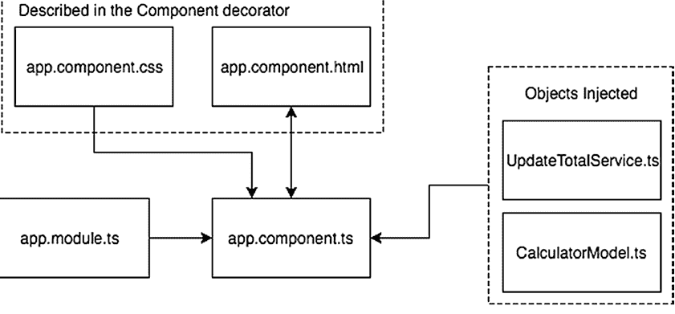

*图 2-6. Angular 架构示例*

Angular 架构引入了四个有趣的概念：

- 依赖注入
- 使用 NgModule 和组件的模块化
- 模板与组件之间的数据绑定
- 大量使用装饰器来定义组件或模块等对象

我们现在将深入研究这个架构，分析构成 Angular 项目的不同部分。任何 Angular 应用程序至少有一个称为根模块的`NgModule`；`NgModule`不像普通的 JavaScript 模块。`NgModule`的特殊之处在于元数据；在每个`NgModule`（包括根模块）中，我们将描述模块是如何组成的，特别是我们将定义哪些组件属于该模块，模块是否依赖于其他模块、指令或组件；我们还描述了模块中组件使用的服务。如前所述，任何 Angular 应用程序至少包含一个称为根模块的模块。

例如，这是我们为 Angular 中的 Calculator 项目创建的根模块：


```typescript
import { BrowserModule } from '@angular/platform-browser';
import { NgModule } from '@angular/core';

import { AppComponent } from './app.component';

@NgModule({
  declarations: [
    AppComponent
  ],
  imports: [
    BrowserModule
  ],
  providers: [],
  bootstrap: [AppComponent]
})
export class AppModule { }
```

如你在这段代码片段中所见，Angular 主要由装饰器（`@NgModule`）构成，用于将我们的代码包装在 Angular 框架内部。

### 装饰器

JavaScript 中的装饰器实际上正处于提案阶段（第2阶段），有望成为语言的一部分（有关该提案的更多信息，请访问此链接：[`https://github.com/tc39/proposal-decorators`](https://github.com/tc39/proposal-decorators)）。

它们基于一个简单的概念：装饰器包装一个函数，增强其功能，而不操作被装饰的函数。

通常，在装饰器中极其，我们会添加一些在运行时项目中应该通用的方法或属性；这就是 Angular 大量使用它们的原因。这样我们就可以编写逻辑，而无需从某些基类继承，从而在它们之间创建紧耦合的连接，并使用框架中可用的内置功能进行装饰。

下一个要介绍的主题是 Angular 组件。自 Angular 2 起，我们可以创建组件，我们可以将它们视为 Angular 中现有模板系统与我们可以从 REST API 或特定端点检索的数据之间的桥梁。它们的主要作用是检索数据，并通过 Angular 2 中内置的绑定系统用新数据填充模板。

Angular 组件是我们在展示器（presenter）和视图模型（view-model）中可以找到的属性混合体。事实上，以下几点是成立的：

- 组件像视图模型对象一样通过绑定更新视图。
- 组件与模板之间的关系始终是1对1的，就像展示器一样。
- 组件处理模板中发生的所有用户交互，就像展示器一样。

为了在 Angular 中定义组件，我们需要指定另一个装饰器 `@Component`。对于我们的计算器示例，考虑到应用程序的简单性，我们只定义了一个组件；但原则上我们可以将它们拆分为多个部分，如清单 2-17 所示。

### 清单 2-17. App.component.ts

```typescript
const ON_SCREEN_KEYBOARD = [
  ['7', '8', '9', '/'],
  ['4', '5', '6', '*'],
  ['1', '2', '3', '-'],
  ['0', '.', '=', '+']
];

@Component({
  selector: 'app-root',
  templateUrl: './app.component.html',
  styleUrls: ['./app.component.css'],
  providers: [UpdateTotalService, CalculatorModel]
})

export class AppComponent implements OnInit {
  onScreenKeyboard = ON_SCREEN_KEYBOARD;
  total:string;

constructor(private updateTotalService:UpdateTotalService){}

ngOnInit(): void {
  this.total = this.updateTotalService.reset();
}

updateTotal(value: string){
  switch (value) {
    case 'AC':
      this.total = this.updateTotalService.reset();
      break;
    case '=':
      this.total = this.updateTotalService.calculate();
      break;
    case '+':
    case '-':
    case '/':
    case '*':
    case '.':
      this.total = this.updateTotalService.addSymbol(value);
      break;
    default:
      this.total = this.updateTotalService.addValue(value);
      break;
  }
}
```

如你在装饰器（`@Component`）中所见，我们指定了与组件关联的 HTML 模板和 CSS。要注入的对象将在组件内部可访问，但它们将由 Angular 实例化，而 `selector` 只是一个用于识别组件的 ID。

关于 Angular 组件，最后要提到的是，我们可以使用生命周期钩子，如 `ngOnInit` 方法，它在组件初始化时触发，在我们的例子中，我们用它来设置计算器显示屏中的第一个值。

现在是时候看看组件如何与模板交互了。Angular 有自己的方式来处理 HTML 标记；我们可以使用一些指令来遍历数据结构以显示多个 HTML 元素，或者当代码中发生某些特定条件时添加特定属性。

> **指令** Angular 中的指令是 HTML 模板关于如何处理 DOM 的指令。

在我们的示例中，我们将 `app.component.html` 模板与上述描述的 `app.component.ts` 关联起来，这是用于模板的代码：

```html
<div class="displayStyle">{{total}}</div>
<div class="acStyle" (click)="updateTotal('AC')">AC</div>

<ul *ngFor="let row of onScreenKeyboard">
    <li *ngFor="let value of row"
        class="btnStyle"
        (click)="updateTotal(value)">
        {{value}}
    </li>
</ul>
```

在这段代码中，有几个概念需要重点强调。第一个概念是，与 `total` 属性的绑定是在组件内部创建的，因此每当我们更新此值时，新值将自动显示在我们的模板中。

另一个有趣的事情是我们如何创建计算器中的按钮；我们正在遍历组件对象中存在的数组，并使用 `*ngFor` 指令创建具有不同值的多个标签；然后，当用户点击按钮时，我们调用 `updateTotal` 方法，传递按钮的标签；同样在这种情况下，我们使用 Angular 标记来触发用户交互（`(click)="updateTotal(value)"`）。

有趣的是，仅凭几行代码，Angular 就提供了一种简单但非常强大的数据绑定、模板化和视图样式化机制。

现在是时候谈谈依赖注入部分了；正如我们在组件装饰器中所见，我们正在定义一个提供者（`providers`）数组。基本上，我们将 `UpdateTotalService` 和 `CalculatorModel` 注入到组件中。

`CalculatorModel` 不会被组件使用，但如果我们想在这个服务内部注入此对象，我们需要在那里指定它。

Angular 中的服务是什么？服务受到命令模式（Command Pattern）的启发，用于从端点获取数据，或像我们的情况一样，用于向模型检索/传递数据。

## 命令模式

命令模式是一种行为模式。命令包含当应用程序中发生特定事件（如用户交互、数据获取等）时执行操作所需的所有对象。

通常，命令模式有一个接口，其中只有一个名为 `execute` 的公共方法；在实例化之后，我们可以注入执行操作所需的对象，然后我们可以调用此方法来执行命令内部描述的逻辑。

通常，命令模式用于解耦对象之间的交互，如控制器和模型或展示器和模型，从而使它们保持完全解耦。

这是我们的 `UpdateTotalService` 类，如清单 2-18 所示。

### 清单 2-18. UpdateTotalService.ts

```typescript
@Injectable()
export class UpdateTotalService{
    constructor(private model:CalculatorModel){}

    calculate(){
        this.model.calculate();
        return this.model.total;
    }

    addValue(value){
        this.model.add(value, VALUE);
        return this.model.total;
    }

addSymbol(value){
    this.model.add(value, SYMBOL);
    return this.model.total;
}

reset(){
    this.model.reset();
    return this.model.total;
}
}
```

此服务公开了一些方法，用于以特定方式操作模型。

模型通过框架注入到构造函数中；因此，当我们从组件类调用 `this.updateTotalService.reset();` 时，我们不需要对模型有任何了解，但服务将返回从模型检索到的值，将视图与模型隔离，就像我们在 MVVM 模式中所见的那样。

另一个需要注意的重要事项是此类中由 Angular 提供的 `injectable` 装饰器，用于描述被注入组件内部的类；只需添加此装饰器，框架就知道何时实例化和注入。

最后要描述的部分是我们的模型，这是一个非常基础的模型，具有一些关于如何操作要存储的数据的知识。这里我们再次使用 `@injectable` 装饰器，以便被 Angular 注入。参见清单 2-19。

### 清单 2-19. CalculatorModel.ts

```typescript
@Injectable()
export class CalculatorModel{
    private state:string;
    private totalOperation:string;

    constructor(){
        this.state = FIRST_OPERATION;
        this.totalOperation = '0';
    }

    get total(){
        return this.totalOperation;
```

## 第2章 架构比较

我们的模型是一个简单的对象，包含了应用程序的**数据源**，维护着状态以及视图中应显示的值。简单概括一下 Angular 计算器的例子：我们已经了解了 Angular 的核心概念，还注意到它与 MVVM 和 MVP 架构有许多相似之处，比如视图与模板之间的关系，以及谁来处理用户交互。最后值得一提的是，Angular 能够**轻松地**转变为一个响应式架构，因为它在框架内部集成了 Rx.js 库；因此，在一定程度上，我们可以几乎*开箱即用*地将这个架构改造为响应式架构。

## Ember

Ember 是一个面向 Web 应用的框架。它在 JavaScript 社区中广为人知，并被 Netflix、Groupon 等大型组织所采用。Ember 拥有一个有趣的生态系统，包括 EmberCLI、EmberData 以及作为 JavaScript 框架的 Ember 本身。Ember 背后的范式与其他框架略有不同，但如果应用程序符合这一范式，其生产力会非常高。Ember 推崇**约定优于配置**；需要记住的关键一点是，要拥抱 EmberCLI 工具，因为它会让你的生活更轻松、生产力更高。CLI 负责生成特定视图（模板、路由、单元测试文件等）、模型、路由甚至控制器所需的所有文件。Ember 框架在具有“胖服务器 — 瘦客户端”架构的项目中表现优异，即大部分逻辑在服务器端处理；客户端应尽可能简单，而且它应该是**多页应用程序**而非单页应用程序（SPA）。

### Ember 的工作原理

Ember 架构（图 2-7）基于 MVVM 架构，构成这个框架有几个关键元素：

- 路由（Routes）
- 模板（Templates）
- 组件（Components）
- 控制器（Controllers）
- 模型（Models）

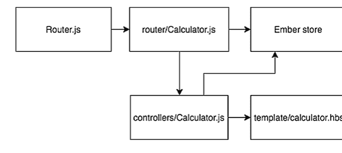

图 2-7. *Ember 架构示例*

在 Ember 中，一切都从**路由模块**开始，并且每个视图都与关联的端点**紧密耦合**。默认情况下，任何 Ember 应用程序都有一个主路由系统，我们在其中定义所有应用路由；例如，在我们的计算器应用中，我们定义了如清单 2-20 所示的路由。

### 清单 2-20. Router.js

```javascript
Router.map(function() {
  this.route('calculator', {path: "/"});
});
```

这意味着我们 Web 应用程序的根路径将被路由到计算器路由。由于 Ember 按照约定工作，我们需要将模块保存在正确的文件夹中以便被识别。但幸运的是，Ember CLI 提供了一些有用的命令来拯救我们，它能准备所有开箱即用的必要文件：

`Ember generate route <name>`

CLI 会自动生成一个路由文件、相关的测试文件和模板，然后它还会将新路由的代码插入到应用程序的路由系统中。

我们创建的计算器路由将模型暴露给模板；在 Ember 中，只有路由和控制器才能访问模型。因此，在 MVVM 架构中，视图和模型之间存在着严格的**关注点分离**。

```javascript
export default Ember.Route.extend({
    model(){
        this.store.push({
            data:[{
                id: 1,
                type: "calculator",
                attributes: {
                    total: "0",
                    state: AppState.FIRST_OPERATION
                },
                relationships: {}
            }]
        });
        return this.store.peekRecord('calculator', 1);
    }
});
```

Ember 中**模型**的概念与我们习惯的不同；`Model` 类定义了值将存在于 `store`（具体模型）中，便于数据到达 Ember 应用程序客户端时进行数据验证。如果我们查看位于 `models` 文件夹中的模型类，可以看到我们定义了两个属性，都是字符串类型，一个名为 `total`，另一个名为 `state`。参见清单 2-21。

### 清单 2-21. models/calculator.js

```javascript
import DS from 'ember-data';

export default DS.Model.extend({
    total: DS.attr("string"),
    state: DS.attr("string")
});
```

从上面的路由代码可以看出，`store` 是一个为整个应用程序集中化的数据结构（可以将其视为**单例模式**），路由和控制器都可以访问它，因此无论我们的应用程序由多少个模板、路由或控制器组成，我们都有一个**唯一的数据源**来获取或缓存数据。

`store` 对象非常有趣，因为它允许数据自动化并从端点获取，然后它会将响应直接存储在 `store` 对象内部，而无需处理定义这类操作的所有代码。

`store` 使用记录（record）工作；记录是一个具体的模型，包含从 REST 端点获取的数据或像我们这样缓存在应用程序内部的数据。

非常重要的是要注意存储在记录中的对象结构，如清单 2-22 所示。

### 清单 2-22. routes/calculator.js

```javascript
{
    id: 1,
    type: "calculator",
    attributes: {
        total: "0",
        state: AppState.FIRST_OPERATION
    },
    relationships: {}
}
```

在 `store` 中，我们需要用唯一 ID 定义数据对象；一个 `type` 值，用于后续检索；以及我们需要存储在其中的属性，对于我们的应用程序来说是 `total` 值和应用程序状态。

由于我们不是从任何远程端点获取数据，我们使用 `peekRecord` 方法，它会跳过服务器请求并直接从具体模型中检索数据。

相反，如果我们需要从特定的 REST 端点检索数据，我们可以使用 `findRecord`，它会向指定的端点执行请求，并将响应存储在 `store` 对象内部。

我们的应用程序逻辑位于**控制器**中，我们在其中为视图提供可调用的公共方法，并处理与模型之间数据的设置和获取。

当我们从 Ember 框架扩展基础控制器时，我们有一个名为 `actions` 的对象，我们可以在其中向模板暴露所有方法；在我们的例子中，我们只有一个名为 `updateTotal` 的方法：


```javascript
export default Ember.Controller.extend({
    onScreenKeyboard: [
        ["7", "8", "9", "/"],
        ["4", "5", "6", "*"],
        ["1", "2", "3", "-"],
        ["0", ".", "=", "+"]
    ],
    actions: {
        updateTotal(value) {
            let result;
            let model = this.store.peekRecord('calculator', 1);

            switch (value) {
                case "AC":
                    model.set("total", 0);
                    model.set("state", AppState.FIRST_OPERATION);
                    break;
                case "=":
                    result = math.eval(model.get("total"));
                    model.set("total", result);
                    model.set("state", AppState.FIRST_OPERATION);
                    break;
                case "+":
                case "-":
                case "/":
                case "*":
                case ".":
                    result = checkSymbol(model.get("total"), value, model.get("state"));
                    model.set("total", result);
                    model.set("state", AppState.CALCULATING);
                    break;
                default:
                    result = getValue(model.get("total"), value, model.get("state"));
                    model.set("total", result);
                    model.set("state", AppState.CALCULATING);
                    break;
            }
        }
    }
});
```

在每种情况下，我们都是从 store 中获取当前值并进行操作，但令人烦恼的是 Ember 大量使用字符串来标识特定的对象或值。因此我们的编辑器无法提供代码补全功能，并且如果没有正确地将其包裹在常量语句中，很容易出错。

最后要讨论的是模板。Ember 默认使用 Handlebars；因此如果我们熟悉这个著名的模板库，就能很快上手。

Handlebars 有一些特定的标记语法，类似于 Angular，用于标识特定的行为，如过滤、创建由控制器或路由中检索到的数据填充的类似标签等等。

以下是渲染计算器所需的 Handlebars 代码：

```html
<div class="displayStyle">{{model.total}}</div>

<div class="acStyle" {{action "updateTotal" 'AC' on="mouseDown"}}>AC</div>

{{#each onScreenKeyboard as |row|}}
<ul>
    {{#each row as |value|}}
        <li class="btnStyle" {{action "updateTotal" value on="mouseDown"}}>{{value}}</li>
    {{/each}}
</ul>
{{/each}}
```

## 第 2 章 架构比较

值得一提的是我们如何通过 action 命令来处理控制器暴露的方法：

```html
{{action "updateTotal" value on="mouseDown"}}
```

我们通过传递一个名为 value 的参数来标识方法名称，并指定何时调用该方法：在本例中是在鼠标按下时调用。

总结一下，Ember 是一个非常高效的框架，基于 MVVM 架构，提供了大量开箱即用的通用功能。它倾向于约定优于配置，拥有由各种工具和库组成的丰富生态系统，而且文档非常详尽。

## React + Redux

React 和 Redux 是一组库的组合，它们结合在一起可以类似于一个最小化的框架，拥有庞大的生态系统。与 Ember 或 Angular 不同，它不会在一开始就强加给你全部内容，而是更倾向于插件式系统，我们可以根据实际需要使用所需的模块，而无需预先导入所有内容。

React 是一个用于操作 DOM 的库，以组件为核心概念；它只负责架构中的视图部分，实现了诸如 reconciliation（调和）这样的智能算法——一种仅渲染需要更改的 DOM 部分的 diff 算法。

React 引入了一个非常强大的概念，如今已被许多其他库所采用：虚拟 DOM（Virtual DOM）。虚拟 DOM 是 DOM 的一种表示形式，diff 算法首先在其中运行，React 通过它来判断什么应该改变以及何时改变，从而最大限度地减少对真实 DOM 的修改，提升我们 Web 应用程序的性能。

> **Reconciliation（调和）** Reconciliation 是 React 的一个核心概念。如果你想了解更多，我建议阅读该主题的官方文档：https://react-cn.github.io/react/docs/reconciliation.html

其中最有趣的部分是它利用了 2015 年由 Facebook 创建的另一个库 Flux 所引入的概念——**单向数据流**。

单向数据流是一个强大但简单的概念：应用程序内部的对象通信应该是单向的，结合良好的封装，将使任何应用程序更容易调试，更容易被任何团队接手，因为即使是复杂的应用程序也易于理解和调试，从而提高代码质量和扩展性。

Redux 的范式非常简洁，仅由三个核心元素组成：

- Action（动作）
- Reducer（归约器）
- Store（仓库）

Action 只是一个普通的 JavaScript 对象，包含应用程序内部发生了什么的信息。

Reducer 从 action 中获取应用程序中发生的交互信息，并知道根据分发的 action 如何改变状态。

最后，Store 是将所有内容整合在一起的对象；Store 将当前的状态树和 action 传递给 Reducer，然后等待 Reducer 返回新的状态，接着 Store 会将其附加到状态树上，所有监听变化的对象都会收到通知。

Redux 建立在三个核心概念之上：

- 单一数据源：应用程序的状态被表示为一棵定义在名为 store 的单一对象中的树。
- 状态是只读的：使用 Redux 改变状态的唯一方式是通过 action。
- 变更只能通过纯函数进行：Reducer 是纯函数，接收当前状态树和 action，它们知道应用程序将如何转换到下一个状态。如果我们始终传递相同的参数，就能预知纯函数的输出；在这种情况下，Reducer 的结果总是相同的。

让我们通过最后一次用不同架构编写的计算器示例来了解 React 和 Redux 的实际应用。

## 第 2 章 架构比较

### Redux 的工作原理

任何 Redux 项目（图 2-8）的起点通常是一个主应用程序，我们在其中创建 store 对象，并将主视图包裹在 Redux 库提供的 Provider 对象中。参见清单 2-23。

***清单 2-23.** App.js*

```javascript
export default class App {
    constructor() {
        const store = createStore(CalculatorReducer);
        const cont = document.getElementById("app");

        ReactDOM.render(
            <Provider store={store}>
                <CalculatorContainer />
            </Provider>,
            cont
        );
    }
}

let app = new App();
```

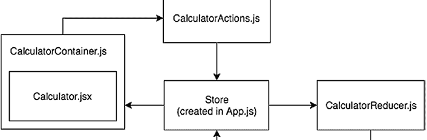

***图 2-8.** Redux 项目架构图*

如前所述，在创建 store 并将其关联到特定的 Reducer（Calculator Reducer）之后，我们将主视图（Calculator Container）包裹在 redux 库提供的 **Provider 对象**中。

可以将 Provider 理解为一个接收 store 作为输入的对象，它将 store 传播给应用程序中的所有容器组件，以便它们能够完全访问它。

## 第 2 章 架构比较

既然我们已经提到了容器组件，现在是时候转向视图部分了，我们需要区分展示组件和容器组件。

Redux 的创建者 Dan Abramov 在 Medium.com 上写了一篇关于这个主题的文章，解释了两种类型组件之间的区别。

总结 Dan 的观点，在 Redux 中，我们将展示组件定义为仅负责管理视图外观的组件，或多或少类似于本章中描述的**被动视图（Passive View）**。同时我们将容器组件定义为能够处理展示组件逻辑的组件，例如处理用户交互、访问 Store，以及通过 props 对象将 Store 的值映射到 React 组件，类似于 MVP 架构中的**监督控制器（Supervising controller）**。

这种方法将带来更好的关注点分离和组件在不同项目之间的可复用性。

> **展示组件与容器组件** 在 Redux 中这是一个非常重要的话题。我强烈建议阅读此链接中 Dan Abramov 关于**展示组件和容器组件**的 Medium 文章：[http://bit.ly/1N83Oov](http://bit.ly/1N83Oov)

根据我们刚才的描述，现在来看看展示组件是什么样子的，以及我们如何处理与 Redux 框架的通信。

在计算器示例中，我们的展示组件代码如清单 2-24 所示。

***清单 2-24.** Calculator.jsx*

```javascript
export default class Calculator extends React.Component {
    constructor(props) {
        super(props);
        this.onBtnClicked = this.props.onButtonClicked;
    }

    createRow(id, ...labels) {
        let items = labels.map((value, index) => {
            return (
                <li
                    key={`${id}_${index}`}
                    style={value === "AC" ? acStyle : btnStyle}
                    onClick={::this.onBtnClicked}
                >
                    {value}
                </li>
            );
        });

        return (
            <ul key={id} style={ulStyle}>
                {items}
            </ul>
        );
    }

    render() {
        return (
            <div>
                <div style={displayStyle}>{this.props.result}</div>
                {this.createRow("row1", "AC")}
                {this.createRow("row2", "7", "8", "9", "/")}
                {this.createRow("row3", "4", "5", "6", "*")}
                {this.createRow("row4", "1", "2", "3", "-")}
                {this.createRow("row5", "0", ".", "=", "+")}
            </div>
        );
    }
}
```

我们可以立即发现，我们更关注组件的**外观**，而非其**功能**。唯一会用到的方法是从 props 对象中获取的`onButtonClicked`方法，以及用于在计算器显示 div 元素内显示计算结果的`result`属性。

该组件的全部逻辑以及与应用程序其他部分的通信，都包含在容器组件中，如代码清单 2-25 所示。

### 代码清单 2-25. CalculatorContainer.js

```javascript
const mapDispatchToProps = (dispatch) => {
    return {
        onButtonClicked: (evt) => {
            evt.preventDefault();

            let value = evt.target.innerHTML;
            manageDisplayState(value, dispatch);
        }
    };
};

const manageDisplayState = (value, dispatch) => {
    switch (value) {
        case "AC":
            dispatch(reset());
            break;
        case "=":
            dispatch(calculate());
            break;
        case "+":
        case "-":
        case "/":
        case "*":
        case ".":
            dispatch(appendValue(value));
            break;
        default:
            dispatch(appendValue(value));
            break;
    }
};
```

```javascript
const mapStateToProps = (state) => {
    return {
        result: state.result
    };
};

export default connect(mapStateToProps, mapDispatchToProps)(Calculator);
```

在这个模块中，我们可以发现许多有趣的事情，例如：

- 展示组件是在调用`connect`方法后创建的。该方法用于将 store "连接"到组件，它返回一个高阶 React 组件类，该类将 state 和 action 作为属性传递给我们基于传入参数派生的组件。
- `mapStateToProps`是我们用来将 store 传递的新 state 转换为将在展示组件中渲染的属性的方法。
- `mapDispatchToProps`是我们用来触发容器组件内所有`dispatch` action 的方法。`dispatch`方法接受一个 action，该 action 将被触发、加入 store，并传递给 reducer。

在继续讲解 reducer 之前，我们先来理解一下什么是 action。基本上，action 就是一个普通的 JavaScript 对象。检查`CalculatorAction`模块，我们可以在代码清单 2-26 中清晰地看到它。

### 代码清单 2-26. CalculatorActions.js

```javascript
export function calculate() {
    return {
        type: CALCULATE
    };
}

export function reset() {
    return {
        type: INIT,
        result: 0
    };
}

export function appendValue(value) {
    return {
        type: APPEND,
        toAppend: value
    };
}
```


`Action` 类似于命令，它们携带了 `reducer` 所需的信息，以便将当前状态更改为新状态。通常它们有一个 `type` 属性，用于定义从 `store.dispatch` 方法调用的 action 类型。

最后，轮到 `reducer` 了。当我们需要更改应用程序状态时，会使用 `reducer`，因为 `action` 只是通知我们应用程序内部发生了某些事情，但它并不知道应用程序应如何改变——这正是 `reducer` 的职责。请看代码清单 2-27。

### 代码清单 2-27. CalculatorReducer.js

```javascript
const calculation = (state = reset(), action) => {
    switch (action.type) {
        case CALCULATE:
            return {
                type: action.type,
                result: math.eval(state.result)
            }
            break;

        case APPEND:
            return {
                type: action.type,
                result: resultHandler(state, action.toAppend)
            }
            break;

        case INIT:
            return {
                type: action.type,
                result: resultHandler(state, action.toAppend)
            }
            break;

        default:
            return state;
            break;
    }
}
```

在我们的 `reducer` 中，我们将默认状态设置为 `reset` action，它以初始状态（即我们 `switch` 语句中的 `INIT`）启动应用程序。

每次 `dispatch` 一个 `action` 时，`store` 都会调用 `reducer`，传入当前状态和 `dispatch` 的 `action`，然后 `reducer` 将该 `action` 映射为应用程序的下一个状态。

`Redux` 是一个非常简单但有效的状态管理库，有趣的是它与 MVP 架构有许多相似之处——特别是 `Redux` 中展示组件与其容器之间的关系，类似于 MVP 中的视图与 `presenter` 的关系。

在 `Redux` 生态系统中，还有其他一些库可以与 `Rx.js` 或其他响应式库结合使用。

## 总结

在本章中，我们评估了不同的架构，从最古老的 MVC 到最新的 `Redux`。我们看到了它们清晰的演进过程，但其中也蕴含了许多对过去原则的借鉴。我们常常花费大量时间在一个框架上，却不去思考作者为何做出这样而不是那样的选择。我希望这次对前端开发中可用的最著名架构/框架的探索，能为你的未来项目提供一些帮助，因为我坚信，拥有扎实的架构知识对于为特定项目选择合适的架构至关重要。我见过太多开发者和架构师总是将同一套架构生搬硬套到任何项目中，而不是“为合适的任务选择合适的工具”。

从下一章开始，我们将开启响应式之旅，这将带领我们从不同角度学习响应式架构的工作原理，并探索更多关于 `Cycle.js`、`MobX` 和 `SAM` 的内容。

# 第3章 响应式编程

> 所有生活都是一场实验。你做的实验越多，结果就越好。
>
> —拉尔夫·沃尔多·爱默生

在了解了最著名的前端架构及其实现之后，现在是时候深入探讨本书的主要主题：使用 `JavaScript` 进行响应式编程了。

我看过很多视频，也读过很多相关的文章和书籍，我必须承认，我常常感觉遗漏了什么，仿佛我们只是在浅尝辄止，而没有深入响应式生态系统的核心。

本章的主要目标是提供理解响应式编程所需的所有工具，而不仅仅是专注于某个单一的库，更要拥抱这种编程范式背后的理念。这将使我们能够轻松上手任何响应式库，而无需花费太多时间来转换思维模式。

我经常看到开发者精通某个特定的库或框架，成为其中的“忍者”，但一旦转向其他技术，他们在学习不同的实现时就会感到吃力——主要原因是他们不理解实现背后的原理。

理解响应式范式的核心原则，将使你能够掌握任何库或框架，而无论其实现细节如何，将其视为一个“黑箱”来使用。

开源生态系统中有许多响应式库，我们将讨论最著名的 `Rx.JS` 和 `XStream`。之后，我们将理解响应式编程的关键原则，例如什么是流、热 observable 和冷 observable 之间的区别，以及背压。

不幸的是，响应式编程的学习曲线很陡峭，主要是因为它所依赖的概念较为复杂，但一旦你习惯了它们，你就会开始自然而然地以响应式的方式思考一切。

## 响应式编程入门

首先，实现响应式编程主要意味着与事件流打交道，但为了理解什么是事件流，我们应该从一个简单的示意图开始，以便更好地理解流的工作原理。

图 3-1 被称为弹珠图，用于表示事件流。


**图 3-1.** 弹珠图表示示例

理解它的工作原理非常重要，因为在文档中，你常常只需看图就能理解 API 的工作方式，而无需阅读完整的解释。

此外，弹珠图在测试阶段也很有用，因为当我们需要模拟事件流时，会将其与我们的事件流实现进行对比。

但让我们先看看它们是什么，以便更好地理解事件流的概念。

在弹珠图中，我们可以看到一条代表时间（我们的流）的水平线，彩色圆圈内的值是在我们应用程序中特定时间点发生的事件（事件）。

而垂直线则代表流的结束，过了那个点流就完成了。

因此，如果我们想描述这个图，可以很容易地这样做：

- 应用程序启动后，一个流发出值 4。
- 经过一段时间后，流发出值 1，紧接着发出值 3。
- 在所有这些事件之后，流完成了。

流也可能在发生错误后结束，在这种情况下，我们看到的将不是垂直线，弹珠图（图 3-2）会显示一个 `X` 符号，指示错误在流中发生的时间点。

最后要提到的是，当我们通过操作符对流中的值进行转换时。

操作符是一种允许我们操作流中的数据或流本身的方法。

在这种情况下，弹珠图可以展示值是如何被转换的，就像这个使用 `map` 操作符的例子，我们将顶部流发出的每个数字加 1，并创建一个包含操作后数据的第二个流（图 3-3）。

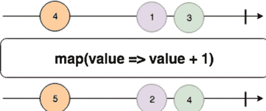

*图 3-3. 对初始流应用 map 操作符后返回包含操作后数据的新流的弹珠图*

到现在为止，我们明白了事件流是在特定时间段（流）内传递的值（事件）序列。

然后我们可以推断，**应用程序内部的一切都可以是一个流**，在某种程度上，这正是响应式范式所利用的：我们可以将带有回调的监听器转换为事件流，可以将 HTTP 请求包装在流中，并在更新视图之前通过操作数据来处理响应，还可以使用流作为两个或多个对象之间传递数据的通信通道，以及许多其他用例。

在响应式全景图中，我们需要介绍一种特殊类型的流：**可观察对象**。

`Rx.JS 5` 文档中有一个很好的可观察对象定义：

> 可观察对象是一个惰性求值的计算，可以从调用它开始，同步或异步地返回零个到（潜在）无限多个值。（http://bit.ly/2sWVEAf）

为了消费可观察对象发出的数据，我们需要创建一个观察者（消费者）；它订阅可观察对象，并在可观察对象（生产者）每次发出值时做出反应。

**如果我们想用技术术语总结什么是可观察对象，我们可以说可观察对象是一个包装了某些数据的对象，这些数据由观察者（一个具有特定契约的对象）消费，一旦实例化，就提供了一个取消函数。**

观察者是一个允许我们检索可观察对象发出的值的对象，并具有特定的契约，公开三个方法：`next`、`error` 和 `complete` 函数。

当你处理可观察对象和观察者时，请记住两个众所周知的设计模式，以充分理解它们的机制：观察者模式和迭代器模式。

## 观察者模式

观察者模式是一种行为模式，其中一个称为主题的对象维护着一个其他对象（观察者）的列表，这些对象希望在程序内部发生变化时得到通知。

观察者通常订阅一个变化，然后每次收到通知时，它们会在内部验证是否需要处理该通知。

通常，在强类型语言中，观察者模式由一个主题和一个或多个观察者组成。

主题处理订阅、取消订阅以及向观察者的通知；然后每个观察者实现一个特定的接口，该接口包含一个发布方法（`update`），用于响应由另一个对象或用户交互发起并通过主题共享的通知（图 3-4）。

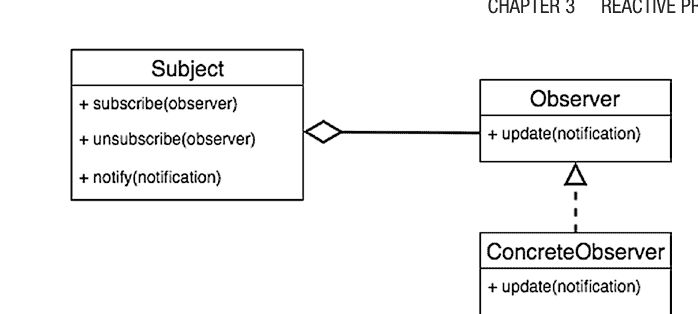

**图 3-4.** 观察者模式 UML

## 迭代器模式

迭代器模式是一种行为模式，用于遍历数据容器，例如数组或对象。

作为 `JavaScript` 开发者，我们应该熟悉这种模式，考虑到它是在 `ECMA Script 2015` 中添加的。

这种模式允许通过调用一个方法（`next`）来遍历对象，以从当前值获取后续值（如果存在）。迭代器模式通常暴露 `next` 方法和 `hasNext` 方法，后者返回一个布尔值，用于检查被遍历的对象是否包含更多值。

在 MDN 上，我们可以找到更多关于 `ECMA Script 2015` 中官方 JavaScript 实现的信息：https://mzl.la/2sfrMxJ（图 3-5）。

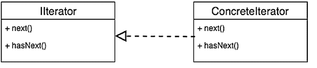

**图 3-5.** 迭代器模式 UML

## 将代码付诸实践

让我们通过代码示例来更好地理解可观察对象/观察者关系在实践中是如何工作的：

```javascript
const observable = Observable.range(1, 10);

const observer = observable.subscribe(onData, onError, onComplete);

function onData(value) {
    console.log(value);
}

function onError(err) {
    console.error(err);
}

function onComplete() {
    console.log("stream complete!");
}
```

正如你从第一个例子中看到的，第一行我们创建了一个包含从 1 到 10 的值范围的可观察对象；这意味着当观察者订阅它时，这些值就可以被发出了。

在第二行，我们订阅了可观察对象；`subscribe` 方法在许多库中都有三个参数，分别对应于当可观察对象发出值、错误或完成信号时被调用的回调函数。

在代码的其余部分，我们只是对可观察对象发出的信息做出反应，将输出打印到控制台，输出可能是来自流的事件、错误或完成信号。

当可观察对象接收事件时，它还可以让我们操作数据以提供不同的输出，就像我们之前在弹珠图中看到的，我们对每个发出的值进行映射，将每个值增加 1。

不同的响应式库提供不同的工具集，但在本书撰写时，毫无疑问最完整的是 `Rx.js`。这个库提供了一套操作符，不仅可以操作可观察对象发出的事件，还可以操作其他可观察对象；将可观察对象的可观察对象转换为扁平可观察对象是很常见的：可以把它们想象成数组的数组。这些操作符将使我们能够展平对象嵌套，直接访问可观察对象中的值，而无需处理迭代的复杂性。

我们将在下一节探索不同的响应式库时，了解操作符提供的可能性，以便我们能在实践中理解如何使用它们以及能做什么。显然，我们将只回顾最常用的操作符，因为确实有数百个，而我们的重点是理解它们背后的机制，而不是探索整个库。

## 流的实现

现在我们已经理解了流是什么，是时候更好地了解前端响应式生态系统中有哪些可用了。我们要考虑的第一个库是 `Rx.JS 5`。

## Rx.JS

`Rx.JS` 是目前最著名和使用最广泛的响应式库；它几乎无处不在，从 `Angular 2`（库集成在框架内）到许多其他拥抱这个库并利用其强大功能的大小框架。

它是最完整的响应式库之一，拥有许多操作符和优秀的文档，`Rx.JS` 是 `Reactive Extensions`（http://reactivex.io）的一部分。学习它意味着能够使用相同的范式（通常是相同的 API）从一种语言切换到另一种语言。

`Rx.JS` 可以用于前端应用程序，也可以与 `Node.js` 一起用于后端应用程序；显然，其异步特性将有助于应用程序开发的双方。

有两个主要版本可用。版本 4 是 `Reactive Extension` 的第一个 JavaScript 移植版本，最近另一个实现开始兴起，即版本 5。这两个库在我们的示例中有几个不同之处，所以我们将使用版本 5。

在本节中，我们无法使用 `Rx.JS` 上所有可用的操作符，因为这个库非常广泛，足以拥有自己的书（事实上，有许多可用的书，我强烈建议你尝试一下）。我们的主要目标是掌握一些关键概念，考虑到我们将在本章和下一章的许多其他示例中使用它。

因此，我们将在三个不同的场景中实践 `Rx.JS`：

- 当我们需要对数据进行规约以获取最终值时。
- 当我们从 HTTP 端点检索数据时。
- 当我们需要通过可观察对象与多个对象进行通信时。

考虑到 `Rx.JS` 的庞大，我们将介绍另一个重要概念，例如冷热可观察对象之间的区别，以帮助更好地理解其他库的工作原理。

让我们从一个简单的例子开始：对一个数据数组进行规约，在过滤掉原始数组中存在的重复项后，获取值的总和。

```javascript
import Rx from "rxjs"

const data = [1,2,10,1,3,9,6,13,11,10,10,3,19,18,17,15,4,8,4];

const onData = (value) => console.log(`current sum is ${value}`);

const onError = _ => console.log("stream error");

const onComplete = _ => console.log("stream completed");

const obs = Rx.Observable.from(data)
    .filter(value => value % 2 === 0)
    .distinct()
    .reduce((acc, value) => acc + value);

obs.subscribe(onData, onError, onComplete);
```

如上例所示，我们将一个数字数组转换为一个可观察对象（`Rx.Observable.from(data)`），然后我们开始一步步地转换数组中的值，应用多个转换操作。

实际上，我们首先通过过滤值创建了一个只包含偶数的新数组，然后使用 `Rx.JS` 提供的 `distinct` 操作符移除数组中的所有重复项；最后，我们使用 `reduce` 操作符对数组中的值求和。

图 [3-6](#) 展示了浏览器控制台中的最终输出。

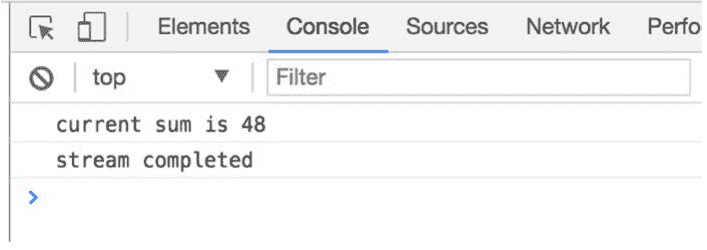

### 图 3-6. 使用上一代码片段通过 Rx.JS 返回的最终结果

每次我们通过操作符应用转换时，我们都会创建一个在操作结束时返回的新可观察对象。

这意味着我们可以通过对同一数据源应用多次转换来串联多个操作符。

为了输出可观察对象的最终结果，我们使用 `subscribe` 方法订阅了该可观察对象，这个方法接受三个函数。第一个函数在可观察对象每次发出数据时触发，第二个在可观察对象发出错误时触发，最后一个函数在可观察对象从生产者（在我们的例子中，是数组的末尾）接收到完成信号时触发。

请记住，这些回调函数并非都是必须的；如果我们不需要对这些事件做出反应，我们完全可以省略声明错误和完成回调。

试想一下，如果你用命令式编程来实现同样的逻辑……想好了吗？

现在，你可能已经理解了函数式和响应式范式如何帮助我们仅用几行代码就能表达复杂的操作，清楚地了解发生了什么，无需在任何地方存储临时值，也不会产生任何副作用。一切都包含在可观察对象内部，无法通过外部操作进行修改。

而下一个例子则旨在从网络上的 API 检索响应，然后将结果传播到一个假想的视图。

在本例中，我们将不会使用任何特定的架构，但我们将遵循单一职责原则和良好的封装性。

```javascript
import Rx from "rxjs";

const URL = "https://jsonplaceholder.typicode.com/users";

const simplifyUserData = (user) => {
    return {
        name: user.name,
        email: user.email,
        website: user.website
    }
}

const intervalObs = Rx.Observable.interval(1000)
    .take(2)
    .mergeMap(_ => fetch(URL))
    .mergeMap(data => data.json())
    .mergeAll()
    .map(simplifyUserData)

intervalObs.subscribe(user => {
```


```javascript
console.log(`user name is ${user.name}`);

console.log(`user email is ${user.email}`);

console.log(`user website is ${user.website}`);

console.log('------------------------------');

},

error => console.error("error", error),

complete => console.log("completed"))
```

在创建包含要调用的 URL 的常量之后，我们创建了一个方法（`simplifyUserData`）来过滤我们想要在应用中使用的数据，仅返回从该 URL 检索到的完整记录的一个信息子集。

使用的端点是一个公共端点，通常用于模拟数据，但在我们的例子中，我们将接收到一个如下所示的对象数组：

```json
{
  "id": 1,
  "name": "Leanne Graham",
  "username": "Bret",
  "email": "Sincere@april.biz",
  "address": {
    "street": "Kulas Light",
    "suite": "Apt. 556",
    "city": "Gwenborough",
    "zipcode": "92998-3874"
  }
}
```

我们希望每秒调用一次这个端点，但在应用生命周期内只调用两次。

为此，我们创建了一个间隔为一秒的可观察对象（`Rx.Observable.interval`），指定了我们要执行此操作的次数（`take` 操作符），然后我们想要从一个 URL 获取数据（第一个 `mergeMap`），再将获取到的数据作为 JSON 返回，拆分检索到的对象（`mergeAll` 操作符；我们也可以使用其他操作符，比如 `concatAll`，以获得相同的结果），以便每次发出一个值，而不是一次性发出整个数组。最后，我们使用脚本开头创建的方法（`map` 操作符）来简化数据。

这个例子的最终输出应该类似于图 3-7。

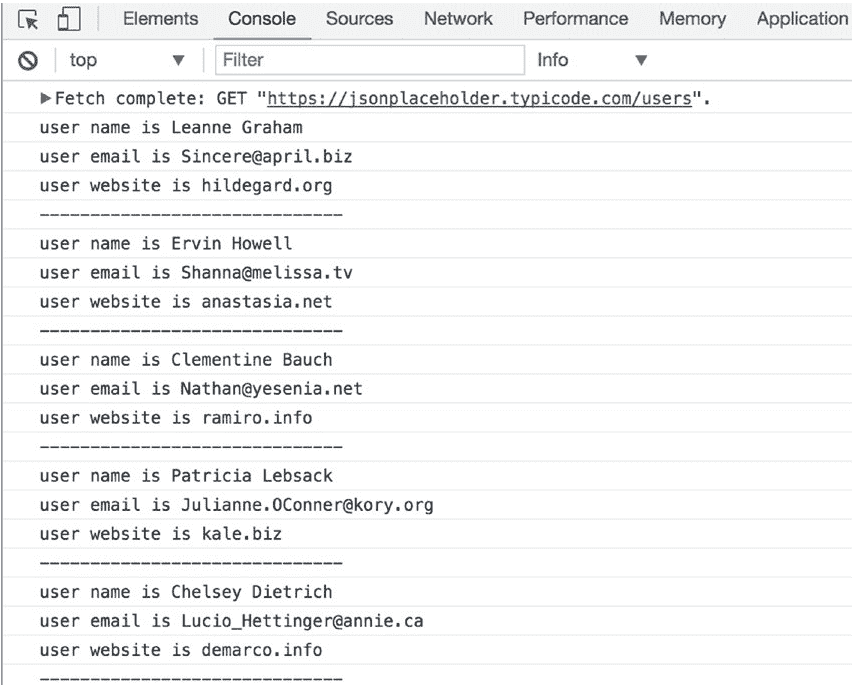

### 图 3-7. 使用上一 Rx.JS 示例的输出

现在，我们需要深入理解我们为什么要做所有这些操作来处理数据，以获得截图中显示的结果。

创建间隔可观察对象后，我们在每个时间点执行一次 `fetch` 操作。`fetch` 不是一个可观察对象，但正如你从示例中看到的，我们没有通过操作符将其转换为可观察对象，而是使用了 `mergeMap` 操作符，并在其中执行了 `fetch` 操作。

- 这是因为 `fetch` 是一个 Promise A+，这些 Promise 被 Rx.JS 识别。因此，无需像处理标准 Promise 那样使用 `fromPromise` 操作符，我们可以直接在由 `mergeMap` 操作符创建的可观察对象中使用它们。
- `MergeMap` 是一个执行两项任务的操作符。第一项是将两个流合并为一个唯一的流，然后遍历流中发出的值：在本例中，它展平了 Promise，以便仅返回一个包含服务响应的流。
- 第二个 `mergeMap` 操作符与另一个 Promise 一起使用，我们指定该流中发出的返回值应该是从端点获取的数据的 JSON 表示。
- 这第二个 Promise 是由于 `fetch` API 的约定，你可以在 MDN 规范中看到：http://bit.ly/2sWVEAf。
- 最后一个操作符是 `mergeAll`，它通常应用于合并可观察对象中的可观察对象（observable of observables），但在这个例子中，它展平了包含检索到的数据的数组的最后一个 Promise，并以迭代方式发出数组中的每个单个值，而不是作为唯一值发出整个数组。这使得我们可以使用最后一个操作符（`map`）来简化发出的数据。
- 很容易理解，在像这样的场景中，Rx.JS 有多么通用和强大。显然，现阶段我们知道要熟悉 Rx.JS 提供的所有不同操作符还需要一些工作，但不要太沮丧，因为这是在掌握响应式范式之前我们所有人都经历过的一个阶段。
- 在审查另一段代码之前，我们需要解释可观察对象的另一个关键概念：当一个可观察对象是热的或冷的是什么意思。

## 冷热可观察对象

我们可以有两种不同类型的可观察对象：热的和冷的。

冷可观察对象本质上是惰性的和单播的；它只有在有人订阅时才开始发出值。

相反，热可观察对象可能在有人监听之前就发出事件，无需等待触发来开始其动作；并且它们在设计上是多播的。

## 冷 Observable

理解冷 Observable 的最佳方式是观察它的实际运行：

```javascript
import Rx from "rxjs";

const source = Rx.Observable.interval(2000).startWith(123);

source.subscribe(value => console.log("first observer", value));

setTimeout(_ => {
  source.subscribe(value => console.log("second observer", value));
}, 5000);

setTimeout(_ => {
  source.subscribe(value => console.log("third observer", value));
}, 8000);
```

这个小示例的输出如图 3-8 所示。

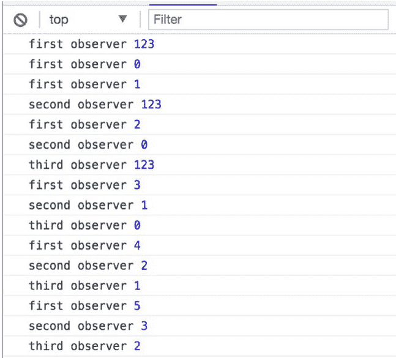

在这个示例中，我们创建了一个每 2 秒发射一个顺序值的 Observable：由于我们没有指定在事件流完成之前要发射多少个值，因此它将从 0 开始直到无限。

当我们希望在用户界面中显示初始值，或者在不等待异步传递的值的情况下启动事件序列时，我们会使用 `startWith` 运算符。

在冷 Observable 中，我们有生产者——在本例中是发射顺序数字的 Observable——它被实例化了三次，基本上每次有消费者订阅它时都会如此。在上图中，你可以清楚地看到每次有消费者订阅生产者时，数字序列都会重新开始。

我们可以得出结论：冷 Observable 在每次有消费者订阅时都会重新实例化生产者，并且它是**单播（unicast）**的，因此产生的值每次只被一个消费者监听；同时，我们也可以有多个消费者订阅同一个生产者。

默认情况下，我们在 Rx.JS 中创建的所有 Observable 都是冷的，但我们有不同的方法可以将它们转换为热 Observable。

### 热 Observable

让我们看看热 Observable 的样子：

```javascript
import Rx from "rxjs";

const source = Rx.Observable.interval(2000)
  .startWith(123)
  .publish()
  .refCount();

source.subscribe(value => console.log("first observer", value));

setTimeout(_ => {
  source.subscribe(value => console.log("second observer", value));
}, 5000);

setTimeout(_ => {
  source.subscribe(value => console.log("third observer", value));
}, 8000);
```

输出如图 3-9 所示。这个示例与冷 Observable 的示例非常相似，但在这种情况下，我们使用了另外两个运算符：`publish` 和 `refCount`。

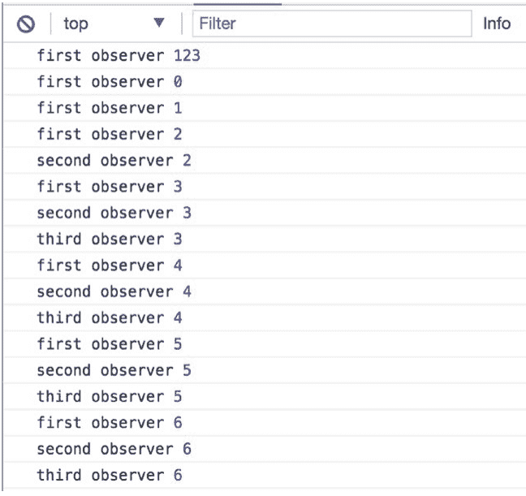

**Publish** 运算符对于将我们的冷 Observable 转换为热 Observable 很有用，因为它返回的是一个 `ConnectableObservable`，而不是 Observable 对象。

`ConnectableObservable` 只有在调用 `connect` 方法时，或者像我们的示例中那样使用 `refCount` 运算符时，才开始发射值。

**RefCount** 运算符用于我们不需要控制 `ConnectableObservable` 的启动和停止，而是将这个过程自动化的情况；当消费者订阅 `ConnectableObservable` 时，正是 `refCount` 提供的逻辑将触发 `connect` 方法，以便向订阅者发射值。

此外，一旦没有任何订阅者准备好接收新值，`refCount` 逻辑将会取消订阅。

当我们有一个热 Observable 时，生产者变为**多播（multicast）**，发射的值会被所有订阅者共享，但同时我们需要记住，默认情况下，它不会等待任何消费者订阅。相反，它在 `connect` 方法被调用后立即发射值。

有些运算符可以让你控制热 Observable 何时开始发射值，比如 `multicast` 和 `connect`，而不是自动执行这些步骤的 `refCount`。在使用 Rx.JS 时要记住这一点，因为这个强大的库提供了许多机会，所以请留意文档，实现过程将会非常顺畅。

理解我们正在订阅的是什么，以及热 Observable 或冷 Observable 的特性和优势，可以节省大量的调试时间，并且避免我们的代码进入生产阶段后出现许多令人头疼的问题。

我认为很明显，Rx.JS 不仅仅是这样——远不止如此，但通过这些简单的示例，我们试图记住一些有用的关键概念，这将促进将这一库集成到我们现有的或新的应用程序中。

现在是时候看看另一种响应式库风格 XStream 了。重要的是要理解，Rx.JS 部分中展示的概念在其他库中也非常相似；因此掌握它们将允许你为项目选择合适的库。

## XStream

XStream 是 André Staltz 创建的最新响应式库之一，旨在提供一种简化的方式来处理响应式编程，专门针对 Cycle.js。

XStream 利用了一些我们已经在 Rx.JS 中见过的概念，比如 Observable，但通过简化流背后的核心概念。所有流都是热 Observable，而且没有办法用这个库创建冷 Observable。

我个人认为，作者在开发这个库时考虑了响应式编程的学习曲线，并试图平滑入门级别，以便对新手和专家都更加友好。

此外，XStream 非常快，仅次于 Most.js（另一个响应式库），而且非常轻量，大约 30kb；只有不到 30 个可用运算符，它代表了一个处理 Observable 的超级基础库，非常适合任何需要使用 Observable 但不需要其他提供大量运算符的库的“全套功能”的原型或项目。

XStream 使用的不是 Observable，而是**流（streams）**概念，流是具有多个监听器的事件发射器。**监听器（listener）**是一个具有特定契约的对象，它有三个公共方法：`next`、`error` 和 `complete`；顾名思义，监听器对象正在监听流发射的事件。

将流和监听器与 Rx.JS 的 Observable 和 Observer 进行比较，我们可以说流的作用类似于热 Observable，而监听器则类似于 Observer，模拟相同的实现。

最后但同样重要的是，在 XStream 中，我们可以使用**生产者（producers）**来生成通过流广播给多个对象的事件。生产者控制流的生命周期，在方便时发射值。生产者具有特定的签名，并暴露两个主要方法：`start` 和 `stop`。稍后我们将看到一个引入生产者概念的示例。

现在是时候看看 XStream 的实际运行了，移植我们之前在 Rx.JS 部分中接触过的示例。

第一个示例与减少数值数组有关，该示例仅提取偶数，去除重复项并计算它们的总和：

```javascript
import xs from 'xstream';

const data = [1, 2, 10, 1, 3, 9, 6, 13, 11, 10, 10, 3, 19, 18, 17, 15, 4, 8, 4];

const filterEven = value => value % 2 === 0;

const removeDuplicates = inputStream => {
  const buffer = [];
  const outputStream = xs.fromArray(buffer);

  inputStream.addListener({
    next(value) {
      if (buffer.length === 0 || buffer.indexOf(value) < 0) {
        buffer.push(value);
      }
    }
  });

  return outputStream;
};

const sumValues = (acc, value) => acc + value;

const listener = {
  next(value) {
    console.log(`current sum is ${value}`);
  },

  error() {
    console.error("stream error");
  },

  complete() {
    console.log("stream completed");
  }
};

const stream = xs.fromArray(data)
  .filter(filterEven)
  .compose(removeDuplicates)
  .fold(sumValues, 0);

stream.addListener(listener);
```

# 第3章 响应式编程

`data` 对象包含一个无序整数数组，其中有重复值以及偶数和奇数。本练习的目标是筛选数组仅保留偶数，在第一次转换后去除重复项，最后计算总和。

在实例化数组源之后，我们定义将要应用的转换；第一个是使用方法 `filterEven` 从初始数组中筛选偶数。

在此方法中，我们检查接收到的每个值是否能被 2 整除。如果可以，则意味着该值是偶数，我们将其保留，否则将其跳过（请记住，流每次会发出 1 个值）。

第二个方法是 `removeDuplicates`，但在 XStream 中并没有像 Rx.JS 那样可以自动去重的运算符。正如我们在开篇所说，XStream 的设计初衷是为了学习如何处理流，而非提供包含大量运算符的完整库。

因此，我们将使用 `compose` 运算符，它返回一个流并期望一个新的流作为输入。`outputStream` 将成为由下一个运算符使用的新流，发出在 `removeDuplicates` 方法内部生成的数组。

在 `removeDuplicates` 内部，我们创建一个数组用于存储唯一值，并且仅在值不在数组中时才将其推入。

本练习的最后一次转换是计算前面步骤中筛选出的值的总和。我们将使用 `fold` 运算符，它需要一个带有两个参数的函数：一个累加器和当前要计算的值，以便得出最终结果，这与您想要计算数组内部数值时所使用的 `reduce` 方法非常相似。

最后，我们可以使用 `xs.fromArray` 创建流，传入初始数组，这将产生一个初始流，发出数组的值。之后，我们通过 XStream 的运算符如 `filter`、`compose` 和 `fold` 应用所有不同的转换。请记住，`fold` 运算符的第二个参数是累加器的初始值，在本例中，我们希望从零开始，然后将所有其他值相加。

最后一步是创建监听器来监听流。正如我们在本节开头所说，监听器只是一个具有特定签名（`next`、`error`、`complete`）的对象，在本例中，我们将流内部所做的转换输出到控制台。打开您常用浏览器的开发者工具，您应该会看到类似图 3-10 的内容。

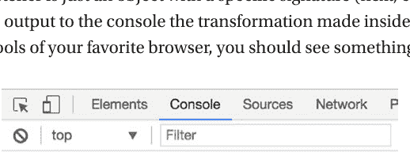

*图 3-10. XStream 示例的输出，与 Rx.JS 示例略有不同，原因是使用了 `fold` 运算符*

如我们所见，这个用 XStream 制作的示例与我们之前用 Rx.JS 做的非常相似。这里的关键要点是，理解可观察对象的工作原理有助于我们在不同的响应式库之间切换，而无需投入时间学习新概念，只需将一些基本概念应用到不同的语法和运算符即可。

我们的第二个示例是基于每隔几秒从 REST 端点获取一些数据。

在这种情况下，我们可以利用 XStream 中可用的生产者对象的功能来获取远程数据，并将结果发出到流中。

考虑到我们希望在一定次数内每隔几秒获取一次数据，我们可以使用间隔流，而不是像在普通 JavaScript 中那样使用 `setInterval`。

这是我们的代码示例：

```javascript
import xs from "xstream";
import fetch from "fetch";

const URL = "https://jsonplaceholder.typicode.com/users";

const producer = {
  emitter() {
    const that = this;

    return {
      next() {
        emitUserData(listener);
      },

      complete() {
        that.stop();
```


```javascript
}

},

start(listener){

    xs.periodic(5000).take(2).addListener(this.emitter())

},

stop(){

    listener.complete();

}

}

const emitUserData = (listener) => {

    fetch.fetchUrl(URL, (error, meta, body) => {

        if(error) return;

        const data = JSON.parse(body.toString());

        data.forEach(user => {

            listener.next(user)

        }, this);

    })

}

const simplifyUserData = (user) => {

    return {

        name: user.name,

        email: user.email,

        website: user.website

    }

}

const listener = {

    next(user){

        console.log(`user name is ${user.name}`);

        console.log(`user email is ${user.email}`);

        console.log(`user website is ${user.website}`);

        console.log('-----------------------------------');

    },

    error(){

        console.error("stream error");

    },

    complete(){

        console.log("stream completed");

    }

}

const userStream = xs.create(producer).map(simplifyUserData);

userStream.addListener(listener);

```

如您在上述示例中所见，我们开始定义生产者对象；请记住，生产者只是一个需要两个方法的对象：`start` 和 `stop`。`start` 方法将在第一个消费者订阅流时被调用。

请记住，一个生产者每次只能有一个监听器；因此，为了将结果广播给多个监听器，我们必须创建一个使用生产者来发出值的流。

我们的生产者还包含另一个名为 `emitter` 的方法，它返回一个监听器对象，我们将在 `start` 方法中创建的间隔流内部使用该方法。

`start` 方法使用 `xs.periodic` 运算符，该运算符接受一个时间间隔作为参数，表示流发出事件的时间间隔；所以在本例中，每 5 秒将发出一个新事件。

我们还使用了 `take` 运算符，用于从该流中获取一定数量的值，忽略所有其他发出的值。

最后要做的事情是用监听器订阅该流，并在每次触发（`next` 方法）时从端点获取数据。

该端点与前面 Rx.JS 示例中的相同，因此我们可以预期从端点获取到相同的 JSON 对象。

本示例的主要目标是将该数据的简化版本输出，这可以在我们应用程序的某个假设视图中使用。

当我们创建 `simplifyUserData` 方法时，用于从流中发出的值提取我们需要的唯一信息；此函数返回一个经过筛选的对象，仅包含少数几个字段，而非整个集合。

之后，我们创建监听器对象，使用典型的签名 `next`、`error` 和 `complete` 方法来处理流发出的值。

最后，我们通过创建流 `xs.create` 并传入生产者作为参数，来建立流与监听器对象之间的关联。

然后，我们遍历所有发出的值，筛选用户数据，并在脚本最后一行将监听器与流关联，这将触发生产者开始发出值。

在本例中，与 Rx.JS 示例相比存在一些差异，但关键概念依然存在。

XStream 库的最后一个示例重点介绍如何向多个监听器对象广播值；在这种情况下，XStream 为我们提供了帮助，因为所有流都是热的，因此本质上是多播的。

我们不需要执行任何操作或了解我们正在处理的是哪种流。这也是为什么我建议总是从 XStream 这样简单的库入手，它包含我们开始接触流所需的一切，然后再转向更完整的工具库，如 Rx.JS 或 Most.js。

```javascript
import xs from "xstream";

const periodicStream = xs.periodic(1000)
    .map(_ => Math.floor(Math.random() * 1000) + 100);

periodicStream.addListener({

    next(value){

        console.log("first listener", value);

    }

})

setTimeout(_ => {

    periodicStream.addListener({

        next(value){

            console.log("second listener", value);

        }

    })

}, 3000);

setTimeout(_ => {

    periodicStream.addListener({

        next(value){

            console.log("third listener", value);

        }

    })

}, 6000);

```

## 第三章 响应式编程

首先，创建一个流（`periodicStream` 常量），它每秒发出一个随机数。

然后，每次我们向主监听器流添加一个新的监听器，每个监听器都会接收到 `periodicStream` 发出的值。

通过检查浏览器控制台的输出，我们可以观察流的工作方式；请记住，我们之前说过 XStream 中的任何流都是热流并且是多播的。因此，我们只有一个生产者，它不会被重新创建，但每次新的监听器订阅时，我们从那个时刻起接收到发出的值（图 3-11）。

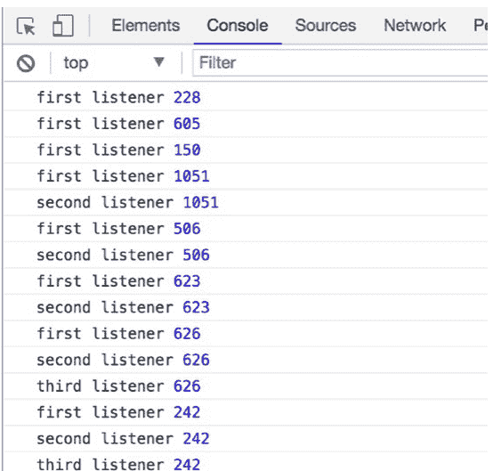

图 3-11. XStream 热流示例输出

现在我们可以看到，当第二个和第三个监听器订阅该流时，它们接收到了发出的值，而没有任何关于之前值的信息，这与我们在 Rx.JS 冷可观察对象示例中看到的情况不同。

从最后一个例子可以清楚地看出，如果在项目中需要以特定的粒度管理流的类型，Rx.JS 将是正确的选择。否则，XStream 可以简化和加速你的开发，因为它相当直接明了。

## 背压

另一个重要的响应式编程概念是背压，以及我们如何利用它来改进我们的响应式应用程序。

当我们处理多个流时，它们可能在短时间内发出大量事件。因此，如果我们实际上不需要所有这些数据，或者处理这些数据的过程计算量太大，导致消费者无法跟上，我们就需要一种方法来减轻观察者消费的数据量。

通常，我们有两种处理应用程序中背压的可能性：第一，我们可以将值排队，创建一个缓冲区并处理所有接收到的值，这样我们就不会错过发出的值。这种策略称为**无损策略**。

另一种策略可能是跳过一些事件，仅在一段时间后做出反应，过滤我们接收到的内容，因为这些信息可能对消费者需要做的事情不是关键的；在这种情况下，我们称这种策略为**有损策略**。

例如，想象一下，我们使用 `zip` 操作符合并两个可观察对象。第一个可观察对象每秒提供一些大写字母，第二个可观察对象每 200 毫秒发出一个小写字母。

在这种情况下，`zip` 操作符将创建一个新的可观察对象，其值是两个流耦合在一起，但因为它需要耦合来自不同流的字母（这些流以不同的速度发出值），所以在 `zip` 操作符内部，我们有一个缓冲区用于存储第二个可观察对象的值，直到第一个可观察对象发出下一个值。

图 3-12 应该能阐明我们的最终目标。

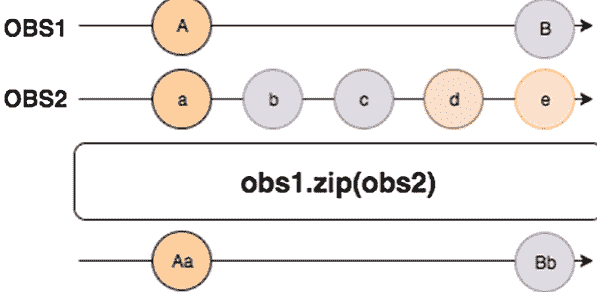

图 3-12. 背压示例

从上面的弹珠图中可以看出，第二个流在相同时间内产生的值是第一个流的 5 倍，因此新的可观察对象需要在缓冲区中保持数据，以便在将它们发送给消费者之前进行匹配。

不幸的是，响应式编程中的这类场景并不少见，在这种情况下，背压操作符就派上用场了。

这些操作符允许我们通过简单地停止对可观察对象发出的值的反应来减轻观察者的压力，暂停接收值，直到我们确定何时恢复接收值。

让我们用 Rx.JS 写一个具体的例子，以更好地理解所描述的概念。

我们将使用 Rx.JS 和 React 创建的是一个简单的方框，模拟一个实时接收数据的股票，并且需要在组件内显示股票价值（图 3-13）。

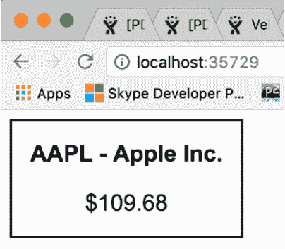

图 3-13. 我们下一个关于背压的练习的结果

这个小例子由两个文件组成：主应用程序和 React 组件。

主应用程序将生成一个可观察对象，该对象将在特定范围内产生随机值，准备好在组件内显示。

```javascript
import React from "react";

import ReactDOM from "react-dom";

import Rx from "rxjs";

import Stock from "./Stock.jsx";

export default class App{

    constructor(){

        const cont = document.getElementById("app");

        const observable = this.generateProducer();

        const AAPL = "AAPL - Apple Inc.";

        ReactDOM.render(<Stock producer$={observable} title={AAPL} />, cont);

    }

    generateProducer(){

        const stockValuesProducer = Rx.Observable.interval(50)
            .map(value => {

                return (Math.random() * 50 + 100).toFixed(2);

            });

        return stockValuesProducer;

    }

}

let app = new App();

```

在主应用程序文件中发生的事情是，我们正在生成一个生产者（`generateProducer` 方法），它应该模拟与数据源的持续交互，并且每 50 毫秒发出一个介于 100 到 150 之间且带有 2 位小数的值。

这是一个背压操作符可以提供帮助的典型例子；我们实际上不需要每 50 毫秒更新一次 UI，因为这不仅不是有用的体验，反而会创建一个用户不会喜欢的持续刷新，并且在低端机器上会非常耗时。那么，我们可以做些什么来减轻接收这些值的观察者的压力呢？

如果在 `generateProducer` 方法中，不是直接返回可观察对象，而是像这样添加一个背压操作符：

```javascript
generateProducer(){

    const stockValuesProducer = Rx.Observable.interval(50)
        .map(value => {

            return (Math.random() * 50 + 100).toFixed(2);

        });

    return stockValuesProducer.sampleTime(500);

}

```

在这种情况下，`sampleTime` 操作符将仅每 500 毫秒发出一次值，忽略在此期间接收到的其他值。

为了更好地巩固这个概念，图 3-14 展示了它在弹珠图中的工作原理。

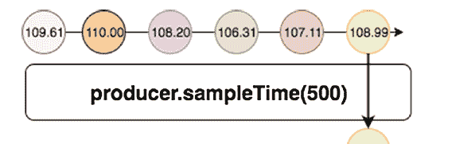

图 3-14. 显示 `sampleTime` 操作符的弹珠图，具有半秒防抖

在组件代码中，我们将订阅从 `producer` 属性接收到的可观察对象，并在 UI 中显示值：

```javascript
import React from "react";

export default class Stock extends React.Component{

    constructor(){

        super();

        this.state = {stockValue: 0};

    }

    componentDidMount(){

        this.props.producer$.subscribe(this.setStockValue.bind(this));

    }

    setStockValue(value){

        this.setState({stockValue: value});

    }

    render(){

        return (

            <div className="stock">

                <h2>{this.props.title}</h2>

                <p>${this.state.stockValue}</p>

            </div>

        )

    }

}
```


正如我们可以在 React 组件生命周期提供的 `componentDidMount` 方法中注意到的那样，我们正在订阅生产者（之前在主应用程序中创建的可观察对象），然后在 React 状态对象中设置股票值，以便在段落元素中显示它。

在 Rx.JS 中，我们可以使用多种背压操作符，例如 `debounce` 或 `throttle`，还有许多其他操作符可以正确处理背压。重要的是要记住，当生产者发出大量数据时，不要创建巨大的数据缓冲区。因此，作为一个经验法则，请记住，当我们不需要可观察对象发出的所有数据时，我们应该对其进行过滤，以向用户提供更好的用户体验并提高响应式应用程序的性能。

## 总结

在本章中，我们解释了如何处理一些关键的响应式概念；特别是，我们介绍了 Rx.JS 中的流、可观察对象和观察者的概念，以及 XStream 中的流和监听器的概念。我们还回顾了最著名的库实现，以及我们如何使用它们来操作我们的流。

我们已经发现了什么是热可观察对象和冷可观察对象，以及当接收到大量数据时如何处理背压，而不需要在流中共享所有这些数据。

现在我们拥有了所有需要的工具，可以看到具体的实现，以及不同的框架/库如何在前端世界中引入响应式编程。

显然，本书的目的不是深入探讨每个特定的运算符或某个特定的库，而是提供足够的知识，让你可以毫不费力地从一个库切换到另一个库。

本章中没有提到的其他一些库也可以替代 Rx.JS 和 XStream，例如，Most.js（https://github.com/cujojs/most）或 IxJS（https://github.com/ReactiveX/IxJS）或 Kefir（https://rpominov.github.io/kefir/）或 FlyD（https://github.com/paldepind/flyd）或 Bacon.js（https://baconjs.github.io/）。

它们都有各自的优缺点，我强烈建议查看每一个，并为你的项目选择合适的库。

## 第三章 响应式编程

在接下来的几章中，我们将见证响应式编程的实际应用。具体而言，我们将深入探讨 Cycle.js 以及这个简洁的库如何通过其名为 MVI（Model-View-Intent）的创新架构来处理函数式响应式编程。接着，我们将介绍 MobX，这个在响应式前端领域声名鹊起、日益流行的库，它以一种简单易用的响应式方式解决了应用状态管理问题。最后，我们将以 SAM Pattern（SAM 模式）结束本书，这是一种完全与框架无关的架构模式，它提供了一种响应式结构，使我们能够将其集成到任何现有或全新的项目中。

# 第四章

## Cycle.js 与 MVI

> 我们无法用制造问题时的同一思维层次来解决问题。  
> —阿尔伯特·爱因斯坦

在本章中，我们将介绍 Cycle.js，这是一个函数式响应式框架。它在前端领域引起广泛关注，原因在于其创造者和 Cycle 社区将来自不同语言的众多概念移植并巧妙地融合在一起。

Cycle.js（cycle.js.org）由 André Staltz 创建，他是前端响应式领域最著名和最活跃的倡导者之一；事实上，André 是 Rx.JS 的贡献者，也是 XStream 库的幕后设计者。

正如我们将在本章中看到的，Cycle.js 可以通过多种方式使用。其模块化特性确保了在任何项目中都能取得出色成果，它提供了高度的封装性，并增强了组件在不同项目间的可复用性，无需像其他框架实现那样需要“复制粘贴”来自不同文件的特定流程部分。

### Cycle.js 简介

Cycle.js 的核心关注点在于计算机与用户之间的交互，它充分考虑了人机交互领域的研究成果以及专注于人机界面的各类研究。

这种交互是输入与输出之间的循环过程，如图 4-1 所示。

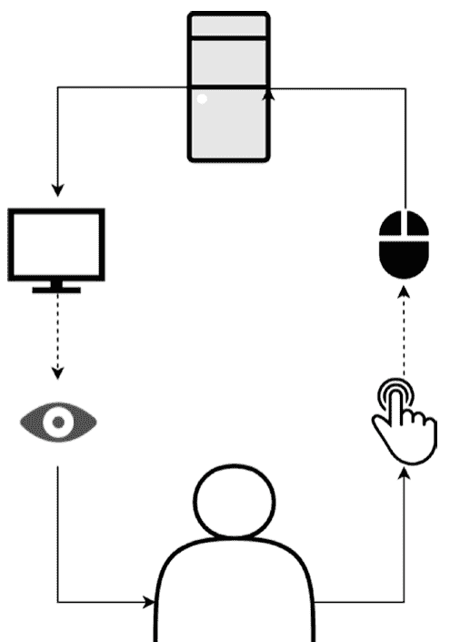

图 4-1. 人机交互示意图

如图所示，一个人可以通过其输入方式（鼠标、键盘、麦克风、触摸板……）与计算机进行交互；为此，该人将使用手或声音作为输出。

当计算机接收到用户的输入时，它将根据接收到的输入信息处理并生成新的输出，然后将其显示在屏幕上。

用户随后能够通过其输入感官（例如眼睛或耳朵）来识别和理解计算机的输出，明白他们的交互如何影响计算机的输出，从而事实上在计算机和用户之间创造了一种循环交互：这正是 Cycle.js 名称的由来。

我们可以这样总结这种交互：在人类和计算机之间存在着一场对话，两个主要参与者相互作用，对输入做出反应并提供新的输出。

正如我们所理解的，这个框架采用了一种不同于我们习惯的其他框架（其中图形用户界面 GUI 是核心）的方法；相反，Cycle.js 更侧重于交互方面，而非图形表现。

为了实现这一点，Cycle.js 引入了一种消息传递架构，我们向一个对象发送一条消息，该对象根据接收到的输入信息来决定运行哪部分代码。

这种高度解耦的架构与更多传统架构（其中大量使用依赖注入，并且我们更倾向于对象交互而非响应性）处于频谱的对立端。

Cycle 并非唯一一个利用消息传递架构的框架；在 Akka 的 actor 模型架构或 CSP（通信顺序进程）的 channel 中也可以找到其他例子。

在本章中，我们将发现使用这种方法将使 Cycle.js 项目实现更好的关注点分离和封装，从而有利于组件在项目间的更好复用。

不过，是时候看看 Cycle 的实际运作了，让我们通过一些具体的例子来真正欣赏这个响应式框架背后的理念。

### 构建一个简单的 Cycle.js 应用

当使用 Cycle.js 时，我们需要牢记的第一个关键概念是：这个框架明确地将应用逻辑与副作用分离开来。

例如，假设我们希望在用户点击界面上的某个按钮后从某个端点加载一些数据。

Cycle.js 将 DOM 渲染和远程数据获取，与准备 HTTP 请求和处理要在 DOM 中展示的数据的逻辑完全分离开来；这样我们就可以专注于应用内部真正重要的事情，事实上将操作 DOM 或通过 HTTPRequest 对象获取远程数据的实际操作委托出去。

在研究一个简单的 Cycle 应用之前，我们需要先了解这个框架是如何构成的。

在 Cycle.js 中，有三个关键概念需要记住：

- 纯函数
- 流
- 驱动程序

纯函数是一个函数式概念，如果一个函数在程序内部不产生任何副作用，那么它就可以被定义为纯函数，因此当我们传入特定参数时，它总是返回相同的输出。我们可以将纯函数的概念概括为：其输出仅由输入值决定。一个例子可以是：

```
function add(a, b) {
  return a + b;
}
```

在这种情况下，当我调用函数 `add` 时，我得到的结果是基于函数的参数（`a` 和 `b`），并且考虑到我们的纯函数完全独立于它运行的应用程序，外部状态或变量不可能影响最终结果。

另一个关键概念是流，但考虑到我们在前面的章节中已经广泛讨论过它们，我们可以继续讨论下一个概念：驱动程序。

为了更好地理解驱动程序，我们需要分析 Cycle.js 的构成方式；否则我们将难以理解为什么在这个框架中使用驱动程序。

Cycle.js 是一个模块化架构，由多个库组成。核心库非常小，它仅暴露一个方法，该方法用于创建应用逻辑与副作用（如 DOM 状态渲染或远程数据连接）之间的粘合剂。

默认情况下，Cycle.js 使用 XStream 作为主要的流处理库，但它也允许我们使用其他库，如 Rx.JS、Most.js，甚至是我们自己创建的自定义库。

我们已经讨论了 Cycle.js 如何将应用逻辑与副作用分离开来：这是理解驱动程序的关键部分。在 Cycle 应用中，所有的副作用都由驱动程序处理，例如，最常用的驱动程序之一是 DOM 驱动程序，它执行由应用逻辑传递过来的 DOM 操作，而应用逻辑则准备一个虚拟 DOM 表示，而不是直接与 DOM 交互。

驱动程序与应用程序之间的通信总是通过可观察对象进行的；驱动程序可以是读写型，也可以是只读型。

这里的经验法则是：驱动程序的输入始终是一个可观察对象，但可能返回也可能不返回输出。

如果我们想绘制一个 Cycle 应用程序的解剖结构，可以参考这个示例作为骨架：

```
import xs from 'xstream';
import {run} from '@cycle/run';
import {makeDOMDriver, p} from '@cycle/dom';

const main = sources => {
  const sinks = {
    DOM: xs.periodic(1000).map(v => p(`seconds: ${v}`))
  };

  return sinks;
};

const drivers = {
  DOM: makeDOMDriver('#app')
};

run(main, drivers);
```

让我们分析一下这个基础示例中的内容。

在导入了 XStream、Cycle `run` 函数以及 DOMDriver 之后，所有的 Cycle.js 应用都有一个 `run` 函数；一个纯函数，由一个 `sources` 对象构成；以及一个 `sink` 对象作为输出，其中包含在应用程序完成处理后要应用的副作用逻辑。

例如，在这个示例中，我们有一个流，它每秒递增一个变量并返回一个虚拟 DOM，这里是一个虚拟段落对象。

看一下 DOM 驱动程序，我们可以看到作为 DOMDriver 方法的参数，我们需要传递一个 HTML 元素，用于附加我们 Cycle.js 应用程序动态创建的未来 DOM 元素。

最后，但至关重要的一点是，调用框架提供的 `run` 方法，以创建 `main` 函数和驱动程序之间的粘合。

`run` 方法的作用很简单；这个方法在 `main` 函数和驱动程序之间创建了一个循环依赖，它检索每个函数的输出，并将其作为另一个函数的源返回，正如我们在本章开头所解释的那样。

## 第四章 CYCLE.JS 与 MVI

显然，输入和输出始终是包含可观察对象的对象，而这正是 Cycle 架构真正大放异彩的地方。

我们之前未提及的一个重要信息是 Cycle.js 中使用的虚拟 DOM 库。

Cycle 开箱即用，使用了 Snabbdom（http://bit.ly/2gtpUKP），这是一个 JavaScript 库，它利用了与 React.js 类似的概念，如虚拟 DOM 和高效的差异算法。此外，与 React 相比，Snabbdom 提供了模块化且精简的实现（仅 200 行代码）。

在性能方面，Snabbdom 比 React.js 15 及以下版本更快、性能更高；它主要基于函数式编程，如果我们熟悉 React.js，可以通过 Babel 使用 JSX 语法。

Snabbdom 需要另一章来深入讲解这个虚拟 DOM 库的精妙之处，但由于它不是本章的主要主题，我们可以通过以下资源获取更多信息：

- **Snabbdom 在 GitHub 上**：http://bit.ly/2gtpUKP
- **Snabbdom JSX**：http://bit.ly/2wxqDSE
- **使用 Snabbdom 实现无 React 的虚拟 DOM**：http://bit.ly/1QFVayF

现在让我们来看一个更完整的例子，我们将创建一个简单的天气预报应用程序。该应用允许用户搜索特定城市并获取未来五天的天气预报，其界面如图 4-2 所示。

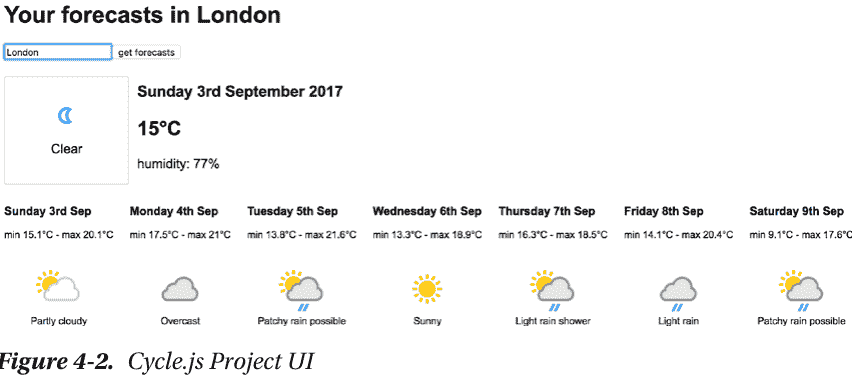

本例将贯穿整个章节，我们将用两种不同的方法来完善它，以便充分探索 Cycle.js 提供的各种可能性。

让我们开始列出使用 Cycle.js 创建天气应用需要做的事情：

- 我们需要使用两个驱动：一个用于 DOM 操作，另一个用于从远程 REST 服务获取数据。
- 我们需要创建一个带有按钮的输入框，允许用户搜索特定城市。
- 我们需要向天气预报服务（本例中为第三方服务）请求数据进行渲染。
- 我们需要创建一个界面，顶部有标题，高亮显示当天的预报，并列出未来几天的预报。

首先要创建的是典型的 Cycle 骨架应用，包含 `run` 方法、驱动和主函数：

```
const main = sources => {
  // 我们的应用逻辑将放在这里
};

const drivers = {
  DOM: makeDOMDriver('#app'),
  HTTP: makeHTTPDriver()
};

run(main, drivers);
```

如计划所示，我们有一个 DOM 驱动（`makeDOMDriver`），它将操作 id 为 `app` 的 div 内部的 DOM；还有一个 HTTP 驱动，它将执行对天气预报端点的请求。

这意味着在我们的主函数中，我们将返回一个包含两个可观察对象的对象：一个用于端点请求，提供用户感兴趣的城市；另一个是页面的虚拟 DOM。然后驱动将负责为我们执行操作。

让我们继续创建应用程序视图。例如，如果我们想创建如上图所示的带有按钮的输入框，我们需要创建一个名为 `getForm` 的函数，该函数将为我们返回元素的虚拟 DOM 版本：

```
const getForm = () => div(".form", [
  input("#location-input"),
  button("#location-btn", "获取预报")
]);
```

现在我们可以观察这两个交互元素发生的变化，以便捕获用户在输入框中输入的文本，以及用户点击按钮获取预报的时刻。

为此，我们将在主函数中添加以下几行代码：

```
const input$ = sources.DOM.select("#location-input").events("focusout")
  .map(evt => evt.target.value);

const btn$ = sources.DOM.select("#location-btn").events("mousedown");
```

记住，当我们进行响应式编程时，一切都可以是流。因此，一旦驱动将我们的交互元素渲染到真实的 DOM 中，它将使我们能够访问 DOM 对象中可用的真实 DOM，借助 DOM 驱动提供的 API，我们就可以观察用户的交互。

每次用户点击按钮时，我们需要获取他输入的内容，准备请求 URL 和查询字符串，以便 HTTP 驱动执行实际的请求。

由于我们需要在用户点击按钮时做出反应，同时也要理解用户在输入框中写了什么，我们将把这两个流合并成一个流，并在生产者产生新值时使用新参数准备 URL。因此，在主函数中我们将添加：

```
const merged$ = xs.combine(input$, btn$);

const request$ = merged$
  .map(([city, mouseEvt]) => getRequest(city))
  .startWith(getRequest(INIT_CITY));
```

然后我们创建 `getRequest` 函数，返回组合好的 URL：

```
const getRequest = city => {
  return {
    url: `http://api.apixu.com/v1/forecast.json?key=04ca1fa2705645e4830214415172307&q=${city}&days=7`,
    category: CATEGORY
  };
};
```

`request$` 流就是我们将传递给 HTTP 驱动的流，它将为我们执行实际的 HTTP 请求。你可以看到，Cycle 将应用逻辑与副作用分离，定义了应用应该做什么，以及如何执行实际效果。

在合并的流中，我们可以发现一个 `startWith` 方法，它返回一个默认城市，在我们的例子中是伦敦，这是为了在用户首次访问我们的天气应用且尚未与输入框交互时提供一些信息。

现在是处理 HTTP 驱动收到响应的时候了；再次进入我们的主函数，我们将检索驱动暴露的 HTTP 对象，并准备数据给一系列函数，用于根据 HTTP 驱动检索的数据生成虚拟 DOM。

```
const response$ = sources.HTTP.select(CATEGORY)
  .flatten();

const vdom$ = response$
  .map(parseResponse)
  .map(simplifyData)
  .map(generateVDOM)
  .startWith(h1("加载中..."));
```

在主函数之外，我们创建生成界面所需的函数：

```
const parseResponse = response => JSON.parse(response.text);

const simplifyData = data => {
  return {
    city: data.location.name,
    current: data.current,
    forecast: data.forecast.forecastday
  };
};

const generateVDOM = data => div(".main-container", [
  h1(`您的 ${data.city} 预报`),
  getForm(),
  generateCurrentForecast(data.current),
  generateNext5Days(data.forecast)
]);
```


如你在主函数中所见，一旦我们收到响应，我们需要选择处理哪一个，在本例中是应用开头描述的 `CATEGORY`。然后我们需要将结果扁平化，因为 HTTP 驱动总是返回流的流，所以如果我们想操作这个复杂结构中的数据，我们需要创建一个扁平的流（`flatten` 方法）。

为了创建将传递给 DOM 驱动的虚拟 DOM，我们现在需要执行以下操作：

1. 解析响应并返回一个 JSON 对象（`parseResponse` 方法）。
2. 只提取界面渲染最终结果所需的数据（`simplifyData` 方法）。
3. 传递处理过的数据以生成虚拟 DOM（`generateVDOM` 方法）。

这三个操作生成了一个包含虚拟 DOM 的最终流，该流将通过 DOM 驱动进行渲染。

我们主函数的最后一部分是它的返回值，即一个包含两个流的 sink 对象：一个用于 DOM 驱动，一个用于 HTTP 驱动，它们代表了 Cycle 应用的输出。

这是我们第一个 Cycle 示例的最终实现：

```javascript
import xs from 'xstream';

import {run} from '@cycle/run';

import {makeDOMDriver, div, h1, h2, h3, img, p, input, button} from '@cycle/dom';

import {makeHTTPDriver} from '@cycle/http';
```

## 第四章：CYCLE.JS 与 MVI

```javascript
import debounce from 'xstream/extra/debounce'

import moment from 'moment';

const CATEGORY = "forecast";

const INIT_CITY = "London";

const getForm = () => div(".form", [

    input("#location-input"),

    button("#location-btn", "get forecasts")

])

const generateNext5Days = forecasts => {

    const list = forecasts.map(forecast => {

        return div(".forecast-box", [

            h3(moment(forecast.date).format("dddd Do MMM")),

            p(`min ${forecast.day.mintemp_c}°C - max ${forecast.day.maxtemp_c}°C`),

            img(".forecast-img", {

                props: {

                    src: `http:${forecast.day.condition.icon}`

                }

            }),

            p(".status", forecast.day.condition.text)

        ])

    });

    return div(".forecasts-container", list)

}

const generateCurrentForecast = forecast => div(".current-forecast-container", [

    div(".today-forecast", [

        img(".forecast-img", {

            props: {

                src: `http:${forecast.condition.icon}`

            }

        }),

        p(".status", forecast.condition.text)

    ]),

    h3(moment(forecast.last_updated).format("dddd Do MMMM YYYY")),

    h2(`${forecast.temp_c}°C`),

    p(`humidity: ${forecast.humidity}%`)

])
```

```javascript
const parseResponse = response => JSON.parse(response.text);

const simplifyData = data => {

    return {

        city: data.location.name,

        current: data.current,

        forecast: data.forecast.forecastday

    }

}
```

```javascript
const generateVDOM = data => div(".main-container", [

    h1(`Your forecasts for ${data.city}`),

    getForm(),

    generateCurrentForecast(data.current),

    generateNext5Days(data.forecast)

])
```

```javascript
const getRequest = city => {

    return {

        url: `http://api.apixu.com/v1/forecast.json?key=04ca1fa2705645e4830

        214415172307&q=${city}&days=7`,

        category: CATEGORY

    }

}
```

```javascript
const main = sources => {

    const input$ = sources.DOM.select("#location-input").events("focusout")

                  .map(evt => evt.target.value);

    const btn$ = sources.DOM.select("#location-btn").events("mousedown");

    const merged$ = xs.combine(input$, btn$);

    const request$ = merged$.map(([city, mouseEvt]) => getRequest(city))

                     .startWith(getRequest(INIT_CITY))

    const response$ = sources.HTTP.select(CATEGORY)

                     .flatten()

    const vdom$ = response$.map(parseResponse)

                        .map(simplifyData)

                        .map(generateVDOM)

                        .startWith(h1("Loading..."))

    return {

        DOM: vdom$,

        HTTP: request$

    }

}

const drivers = {

    DOM: makeDOMDriver('#app'),

    HTTP: makeHTTPDriver()

};

run(main, drivers);
```

在此示例中，有几个要点需要重点说明。首先，在我们的 `main` 函数中，我们处理的是应用程序的输入和输出；我们并不直接操作任何真实的副作用，而是将其委托给驱动程序。

驱动程序与主应用程序之间通过流进行通信；请记住，Cycle.js 是一种消息传递架构，这种方法促进了我们应用程序的数据流，保持了应用逻辑与副作用之间的高度分离以及强大的封装性。

在本书中，我们第一次审视一种响应式实现，其中架构中不同部分之间的通信通过流进行完成；有趣的是，我们的应用程序对于驱动程序将如何处理副作用一无所知，我们也没有调用驱动程序暴露的任何特定方法。主函数与驱动程序之间只存在循环依赖关系，它们之间仅通过流进行通信。

重复这些概念很重要，因为从现在开始它们将变得非常有用，因为我们即将探索 MVI（模型-视图-意图），这是一种严重依赖这些概念的响应式架构。

### 模型-视图-意图架构

如果你熟悉 ELM 语言及其架构，MVI 不会给你带来任何惊喜，但我们必须承认，这确实是我们过去使用的架构以及其他著名框架（如 Redux 或 Angular）的一个巨大进步。

但是，首先，让我们看看什么是模型-视图-意图，以及它与其他框架有何不同。

该架构的第一个特点是它遵循单向数据流，就像 Facebook 在 React.js 之后引入的 Flux 模式一样，单向数据流正成为许多前端响应式架构中的一个常态。

这意味着数据流总是朝着一个单一的方向流动，并且永远不会改变；这有助于调试你的应用程序，并且允许在不需要长时间的入门培训来解释你的应用程序架构或系统如何工作的情况下，为团队引入新成员。

> **FLUX 模式**
>
> Flux 是由 Facebook 引入的一种模式，它在 Web 应用程序中强制执行单向通信流（图 4-3）。
>
> 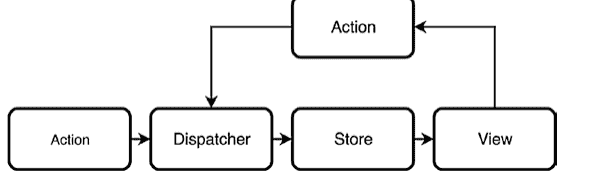
>
> 从上面的示意图可以看出，每次用户与视图中的一个元素进行交互时，该元素就会派发一个动作，该动作被一个全局分发器捕获。分发器的主要目的是触发存储已注册的回调，以便监听它们感兴趣的那些动作。一旦存储接收到由执行动作产生的数据，视图所需的更改就会向视图发出一个变更事件，视图将从存储中检索数据，然后通过更新组件的状态来渲染这些更改。
>
> 欲了解更多信息，请访问：[http://bit.ly/2rHN8F0](http://bit.ly/2rHN8F0)。

我们之前提到的另一个特点是，模型、视图和意图之间的通信完全通过流进行；因此，不同模块之间没有任何直接控制，只有一条作为输入的流和一条作为输出的流，就像我们在 Cycle.js 应用程序逻辑和驱动程序之间的通信中看到的那样。

MVI 由三个主要模块组成：

- **模型**：我们在此处理用户交互并保持应用程序状态。
- **视图**：我们将 UI 与模型提供的状态进行绑定。
- **意图**：我们在此订阅用户交互或输入，并将它们提供给模型，以将状态更改为新的状态。

图 4-4 展示了这种架构。

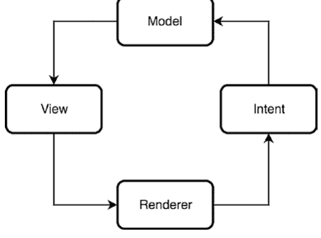

渲染器部分在这种情况下代表 DOM 驱动程序。

现在让我们看看如何使用模型-视图-意图架构来修改我们简单的 Cycle.js 示例。

我们将要探索的代码与前面的示例非常相似，因此我们将只强调关键部分，而不会在如何解析从 HTTP 驱动程序检索的数据或如何组合虚拟 DOM 元素（稍后由 DOM 驱动程序渲染）上花费太多时间。

第一件事是在我们之前的示例中识别出 `main` 函数中应分配给 MVI 架构不同部分的代码部分。

最初，我们的 `main` 函数是以下方式实现的：

```javascript
const main = sources => {

    const input$ = sources.DOM.select("#location-input").events("focusout")

                              .map(evt => evt.target.value);

    const btn$ = sources.DOM.select("#location-btn").events("mousedown");

    const merged$ = xs.combine(input$, btn$);

    const request$ = merged$.map(([city, mouseEvt]) => getRequest(city))

                        .startWith(getRequest(INIT_CITY))

    const response$ = sources.HTTP.select(CATEGORY)

                        .flatten()

    const vdom$ = response$.map(parseResponse)

                      .map(simplifyData)

                      .map(generateVDOM)

                      .startWith(h1("Loading..."))

    return {

        DOM: vdom$,

        HTTP: request$

    }

}
```

我们可以立即在实现的前几行中识别出意图部分。正如我们所说，意图部分负责捕获用户意图，因此也就是所有 DOM 交互。事实上，意图接收渲染后的真实 DOM 作为输入，并将用户意图作为流输出：

```javascript
const intent = DOM => {

    const input$ = DOM.select("#location-input").events("focusout")

                              .map(evt => evt.target.value);

    const btn$ = DOM.select("#location-btn").events("mousedown");

    return xs.combine(input$, btn$)

           .map(([city, mouseEvt])=> getRequest(city))

           .startWith(getRequest(INIT_CITY))

}
```

带有请求的流将被传递给模型和 HTTP 驱动程序，以执行对远程端点的请求。然后我们需要处理从 HTTP 驱动程序接收到的响应，在这种情况下，模型将负责准备用于视图的数据：

```javascript
const model = (actions$, HTTP) => {

    return HTTP.select(CATEGORY)

               .flatten()

               .map(parseResponse)

               .map(simplifyData)

}
```

正如我们所见，模型接收 `actions$` 流和 `HTTP` 对象，在这种情况下，我们不需要对用户输入的数据执行任何操作，因为端点的响应提供了我们需要的所有数据，但潜在地，我们可以结合接收到的数据和用户操作，以便为视图准备新的状态。

最后一部分是将模型准备好的数据与视图合并，并生成将传递给 DOM 驱动程序的虚拟 DOM 元素：

```javascript
const view = state$ => {

    return state$.map(generateVDOM)

               .startWith(h1("Loading..."))

}
```

因此，我们的 `main` 函数现在看起来像这样：

```javascript
const main = sources => {

    const actions$ = intent(sources.DOM);

    const state$ = model(actions$, sources.HTTP)

    const vdom$ = view(state$);

    return {

        DOM: vdom$,

        HTTP: actions$

    }

}
```

## 第 4 章：CYCLE.JS 与 MVI

然后我们可以查看应用了 MVI 的完整示例：

```javascript
import xs from 'xstream';

import {run} from '@cycle/run';

import {makeDOMDriver, div, h1, h2, h3, img, p, input, button} from '@cycle/dom';

import {makeHTTPDriver} from '@cycle/http';

import moment from 'moment';

const CATEGORY = "forecast";

const INIT_CITY = "London";

const getForm = () => div(".form", [

    input("#location-input"),

    button("#location-btn", "get forecasts")

])

const generateNext5Days = forecasts => {

    const list = forecasts.map(forecast => {

        return div(".forecast-box", [

            h3(moment(forecast.date).format("dddd Do MMM")),

            p(`min ${forecast.day.mintemp_c}℃- max ${forecast.day.maxtemp_c}℃`),

            img(".forecast-img", {

                props: {
```


```javascript
src: `http:${forecast.day.condition.icon}`
```

```javascript
}

}),
p(".status", forecast.day.condition.text)
])
});
return div(".forecasts-container", list)
}
```

```javascript
const generateCurrentForecast = forecast => div(".current-forecast-container", [
    div(".today-forecast", [
        img(".forecast-img", {
            props: {
                src: `http:${forecast.condition.icon}`
            }
        }),
        p(".status", forecast.condition.text)
    ]),
    h3(moment(forecast.last_updated).format("dddd Do MMMM YYYY")),
    h2(`${forecast.temp_c}℃`),
    p(`humidity: ${forecast.humidity}%`)
])
```

```javascript
const generateVDOM = data => div(".main-container", [
    h1(`Your forecasts in ${data.city}`),
    getForm(),
    generateCurrentForecast(data.current),
    generateNext5Days(data.forecast)
])
```

```javascript
const parseResponse = response => JSON.parse(response.text);

const simplifyData = data => {
    return {
        city: data.location.name,
        current: data.current,
        forecast: data.forecast.forecastday
    }
}
```

```javascript
const getRequest = city => {
    return {
        url: `http://api.apixu.com/v1/forecast.json?key=04ca1fa2705645e4830214415172307&q=${city}&days=7`,
        category: CATEGORY
    }
}
```

```javascript
const model = (actions$, HTTP) => {
    return HTTP.select(CATEGORY)
        .flatten()
        .map(parseResponse)
        .map(simplifyData)
}
```

```javascript
const intent = DOM => {
    const input$ = DOM.select("#location-input").events("focusout")
        .map(evt => evt.target.value);

    const btn$ = DOM.select("#location-btn").events("mousedown");

    return xs.combine(input$, btn$)
        .map(([city, mouseEvt]) => getRequest(city))
        .startWith(getRequest(INIT_CITY))
}
```

```javascript
const view = state$ => {
    return state$.map(generateVDOM)
        .startWith(h1("Loading..."))
}
```

```javascript
const main = sources => {
    const actions$ = intent(sources.DOM);
    const state$ = model(actions$, sources.HTTP)
    const vdom$ = view(state$);

    return {
        DOM: vdom$,
        HTTP: actions$
    }
}
```

```javascript
const drivers = {
    DOM: makeDOMDriver('#app'),
    HTTP: makeHTTPDriver()
};
```

```javascript
run(main, drivers);
```

MVI 并不像看起来那么复杂；我们只需要习惯它。

我想强调几个关键概念，在 Cycle.js 应用程序中集成此架构时需要牢记：

- 首先，我们将 Cycle.js 项目转换为一个结构化的项目，其中每个部分都可以单独重用和测试。
- 这种架构甚至允许我们更进一步，将 MVI 架构应用于每个单一组件：一个应用于表单的 MVI 架构，一个应用于当前日期，一个应用于工作日列表，这是由其性质决定的。
- 与流进行通信使整个架构更加灵活，并增强了关注点的分离。

在本章结束前概述 Cycle.js 为响应式编程世界带来的贡献之前，我们需要再次增强这个示例，引入 Cycle.js 官方的状态管理方案 Onionify。

## Cycle.js 与状态管理

在了解了 MVI 的实际应用之后，我们的旅程继续与 Onionify 同行，这是一个为在 Cycle.js 中管理应用程序状态而创建的库。

众所周知，处理状态是任何 Web 应用程序的关键部分。Cycle.js 提供了一种独特的方法，与我们在 Angular 或 Redux 中常见的略有不同。

Onionify 是一个小型库（仅 2KB），只有一个目的：管理 Cycle 应用程序中的应用程序状态。

这个库不提供驱动程序，正如我们在其他场合看到的那样，但 Onionify 是用唯一的状态包裹整个 Cycle.js 应用程序，该状态被注入到多个组件中。

应用程序状态是由 Onionify 内部管理的流，每个组件可以通过 reducer 操作自己的状态以及父组件的状态。

组件需要与同名的 `isolate` 库进行"隔离"。

Isolate 是 Cycle.js 提供的一个实用工具，它允许我们字面意义上隔离一个组件，仅共享主应用程序提供的源；或者一个父组件，并返回一个可以与主应用程序和/或其他组件共享的 sink 对象。

# 第 4 章 CYCLE.JS 与 MVI

让我们在此暂停片刻，尝试总结到目前为止关于 Cycle.js 所学到的知识：

- 我们知道可以使用 MVI 架构创建应用程序。
- MVI 不仅可以应用于整个 Cycle 应用程序，还可以应用于组件。
- 这使得相同的架构可以应用到我们架构的所有层级，其中 sink 和 source 是对象之间唯一的通信方式。

考虑到所有这些事实，我们可以说，在 Cycle.js 中应用 MVI，我们可以创建一种**分形架构**，它将允许我们总是使用"片段"（模型 视图 意图）来生成由相同片段多次应用组成的更大组合。

> **分形架构**  
> 分形架构在软件开发中并非新概念。这种具有相同子系统结构的架构允许高度的关注点分离，以便塑造一个大型项目，在其中修改、删除或创建新部分不会影响整个应用程序，考虑到子系统存在的隔离性。

Onionify 与 MVI 架构结合应用，有助于创建一个具有强关注点分离和良好封装的坚固且可重用的架构。

因此，只要我们遵守组件所需的约定，就应该能够在其他应用中重用 Cycle.js 应用程序的部分，即使用正确的源（驱动程序和流）并与它们返回的 sink 进行交互。

为了看到 Onionify 的实际应用，我们将再次修改我们的天气应用程序，将 MVI 应用程序拆分为多个组件，并使用 Onionify 来改变状态。

图 4-5 展示了引入 Onionify 后我们的 Cycle.js 应用程序的样子。

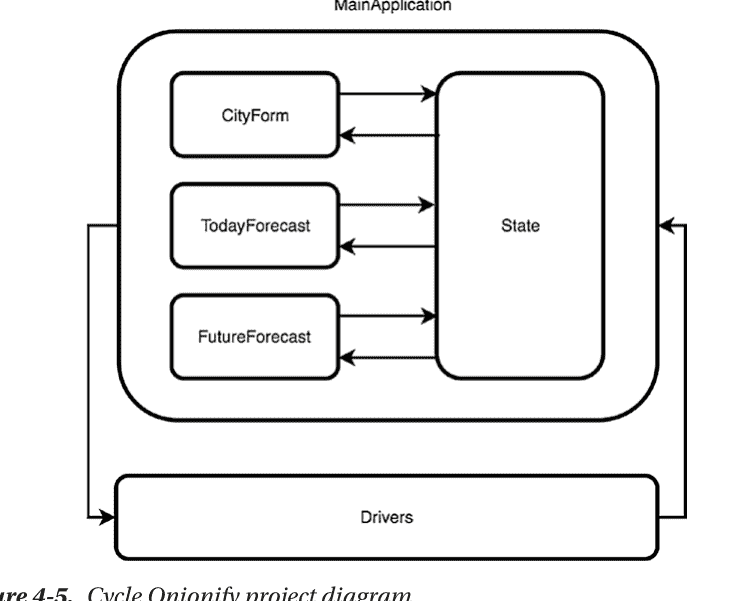

## 图 4-5. Cycle Onionify 项目示意图

让我们分析一下，与之前的应用相比，这里我们有什么新内容：

- 我们有三个组件：`CityForm`、`TodayForecast` 和 `FutureForecast`。
- 我们有一个状态，由我们的主应用程序通过 Onionify 包装器传递给由状态可观察对象构成的组件。
- 我们与驱动器的通信方式与之前一样；因此我们仍然拥有 HTTP 和 DOM 驱动器。

`CityForm` 是包含主要逻辑的组件，它负责获取用户在输入框中输入的内容，并准备随后由 HTTP 驱动器执行的请求。

# 第 4 章 CYCLE.JS 与 MVI

```javascript
import onionify from 'cycle-onionify';
import xs from 'xstream';
import {div, input, button, h1} from '@cycle/dom';
```

```javascript
const INIT_CITY = "London";
const CITY_SEARCH = "citySearchAction";
const CATEGORY = "forecast";
```

```javascript
const getRequest = city => ({
    type: CITY_SEARCH,
    city: city,
    url: `http://api.apixu.com/v1/forecast.json?key=04ca1fa2705645e4830214415172307&q=${city}&days=7`,
    category: CATEGORY
})
```

```javascript
const getForm = location => div(".form", [
    h1(`Your forecasts in ${location.city}`),
    input("#location-input", {props: {value: `${location.city}`}}),
    button("#location-btn", "get forecasts")
])
```

```javascript
const parseResponse = response => JSON.parse(response.text);

const simplifyData = data => function changeState(prevState) {
    return {
        city: data.location.name,
        current: data.current,
        forecasts: data.forecast.forecastday
    }
}
```

```javascript
const model = (actions$, HTTP) => {
    const reducer$ = HTTP.select(CATEGORY)
        .flatten()
        .map(parseResponse)
        .map(simplifyData)

    return reducer$
}
```

```javascript
const intent = DOM => {
    const input$ = DOM.select("#location-input").events("focusout")
        .map(evt => evt.target.value);

    const btn$ = DOM.select("#location-btn").events("mousedown");

    return xs.combine(input$, btn$)
        .map(([city, mouseEvt]) => getRequest(city))
        .startWith(getRequest(INIT_CITY))
}

const view = state$ => state$.map(state => getForm(state))

export const CityForm = sources => {
    const state$ = sources.onion.state$;
    const actions$ = intent(sources.DOM);
    const reducer$ = model(actions$, sources.HTTP);
    const vdom$ = view(state$);

    return {
        DOM: vdom$,
        onion: reducer$,
        HTTP: actions$
    }
}
```

正如我们立即可以识别出的，我们从 sources 中得到了一个新的参数，它由 Onionify 包装器提供；这个库提供了一个包含状态流的 onion 对象，基于此我们可以与父状态流进行交互，对其做出反应，或者同样地操纵内部组件状态。

总体而言，这个组件与我们在前一个应用中的非常相似，唯一的改变与应用程序状态相关，该状态表示来自天气 API 的响应，因此 `CityForm` 使用状态流仅仅是为了获取用户选择的位置。

最后需要提及的是理解这个组件作为 sink 返回了什么，以及我们如何能立即发现包含 HTTP 响应作为应用程序状态的 onion 属性。

正如我们所识别出的，这个组件是自包含的，因此如果我们想在另一个应用中重用它，我们能够做到而无需改变任何东西：这就是使用分形架构工作的力量，其中可重用性、关注点分离和封装是架构中的一等公民。

在研究我们需要如何修改 `App.js` 以处理 Onionify 库之前，让我们快速浏览一下另外两个被动组件：`TodayForecast` 和 `FutureForecast`。

这两个组件是被动的，因为它们只需要渲染由状态提供的一些内容；它们没有用户交互，并且不会操纵任何父状态或执行新的 HTTP 请求。

这是 `TodayForecast` 组件：

```javascript
import {div, h2, h3, img, p} from '@cycle/dom';
import moment from 'moment';

const generateCurrentForecast = forecast => div(".current-forecast-container", [
    div(".today-forecast", [
        img(".forecast-img", {
            props: {
                src: `http:${forecast.condition.icon}`
            }
        }),
        p(".status", forecast.condition.text)
    ]),
    h3(moment(forecast.last_updated).format("dddd Do MMMM YYYY")),
    h2(`${forecast.temp_c}°C`),
    p(`humidity: ${forecast.humidity}%`)
])

const view = state$ => state$.map(state => generateCurrentForecast(state.current))

export const TodayForecast = sources => {
    const state$ = sources.onion.state$;
    const vdom$ = view(state$)

    return {
        DOM: vdom$
    }
}
```

在这段代码中，我们可以在 `TodayForecast` 函数中找到用于渲染视图的状态流，该视图对应于用户请求预报时特定时刻的天气数据表示。

考虑到这是一个被动组件，它的唯一职责是为 DOM 驱动器提供虚拟 DOM 以进行视图渲染。

显然，如果存在任何可能改变应用程序状态的用户交互，这将反映在 sink 中，并且它将能够通过我们 sink 的 `onionify` 属性共享新的状态——同样地，如果它需要触发对天气预报端点的新 HTTP 请求。

那么，让我们来看看 `FutureForecast` 组件：

```javascript
import {div, h3, img, p} from '@cycle/dom';
import moment from 'moment';

const generateNext5Days = forecasts => {
    const list = forecasts.map(forecast => div(".forecast-box", [
        h3(moment(forecast.date).format("dddd Do MMM")),
        p(`min ${forecast.day.mintemp_c}°C - max ${forecast.day.maxtemp_c}°C`),


```javascript
img(".forecast-img", {
    props: {
        src: `http:${forecast.day.condition.icon}`
    }
}),
p(".status", forecast.day.condition.text)
])
);
return div(".forecasts-container", list)
}
const view = state$ => state$.map(state => generateNext5Days(state.forecasts))
```

```javascript
export const FutureForecast = sources => {
    const state$ = sources.onion.state$;
    const vdom$ = view(state$)
    return {
        DOM: vdom$
    }
}
```

同样地，这个组件与前一个非常相似，它不需要共享任何状态更新。它只是消费状态流以渲染新的虚拟 DOM 提供给 DOM 驱动器。

最后，轮到`App.js`了，在那里我们可以找到我们"洋葱化应用程序"的粘合剂：

```javascript
import xs from 'xstream';
import {run} from '@cycle/run';
import {makeDOMDriver, div, h1} from '@cycle/dom';
import {makeHTTPDriver} from '@cycle/http';
import isolate from '@cycle/isolate';
import onionify from 'cycle-onionify';
import {CityForm} from './CityForm';
import {TodayForecast} from './TodayForecast';
import {FutureForecast} from './FutureForecast';
```

```javascript
const generateVDOM = ([formVNode, todayVNode, futureVNode]) => div(".main-container", [
    formVNode,
    todayVNode,
    futureVNode
])
```

```javascript
const view = (locationDOM$, todayForecastDOM$, futureForecastDOM$) => {
    return xs.combine(locationDOM$, todayForecastDOM$, futureForecastDOM$)
        .map(combinedStreams => generateVDOM(combinedStreams))
        .startWith(h1("Loading..."));
}
```

```javascript
const main = sources => {
    const cityLens = {
        get: state => state,
        set: (state, childState) => childState
    }
    const locationSink = isolate(CityForm, {onion: cityLens})(sources);
    const todayForecastSink = isolate(TodayForecast, {onion: cityLens})(sources);
    const futureForecastSink = isolate(FutureForecast, {onion: cityLens})(sources);
    const locationReducer$ = locationSink.onion;
    const httpRequest$ = locationSink.HTTP;
    const vdom$ = view(locationSink.DOM,
                        todayForecastSink.DOM,
                        futureForecastSink.DOM);
    return {
        DOM: vdom$,
        HTTP: httpRequest$,
        onion: locationReducer$
    }
}
const drivers = {
    DOM: makeDOMDriver('#app'),
    HTTP: makeHTTPDriver()
};
const mainOnionified = onionify(main);
run(mainOnionified, drivers);
```

在这里，我们可以发现相当多有趣的新概念，所以让我们从 JavaScript 文件的末尾开始描述我们正在做什么。正如我们提到的，`Onionify`不是一个驱动器，而是我们应用程序周围的包装器；因此我们用它来包装我们的`main`函数，并将我们`main`函数的装饰版或洋葱化版本传递给`run`方法。

## 第四章 CYCLE.JS 与 MVI

这使我们能够通过`source`和`sink`中的`onionify`属性在不同组件间传递状态。

现在让我们看看主函数长什么样。我们从一个名为`cityLens`的透镜开始。透镜用于组件需要访问其父级的同一对象（例如我们当前的情况），也用于在状态进入特定组件之前对其进行操作。

从技术角度讲，透镜是一个包含 getter 和 setter 的对象，并不复杂，但它们在函数式编程中非常有用，特别是当我们使用它们来组合对象时。透镜在 Haskell 语言中也很知名；在 JavaScript 世界中，它们与 Immutable.js 配合使用，并且肯定存在于 Ramda（例如`lensProp`方法）中——一个 JavaScript 函数式库。

在定义了允许我们与其他组件共享组件内数据的透镜之后，我们使用 Cycle.js 提供的`isolate`工具实例化了三个自定义组件。

我们将透镜和`sources`传递给每个组件，这使我们能够在每个组件内部与父组件进行交互。在这种情况下，它指的是应用程序本身的父组件，但很明显，通过这种方式工作，我们可以包装我们的组件，定义一个标准的输入/输出契约，并轻松地在相同应用程序的不同部分甚至其他应用程序中重用它。

在创建组件实例之后，就该将操作过的状态和 HTTP 请求传递给`sink`对象中的相应属性了。

在这种情况下，我们需要强调几点。在这个项目中，状态由端点响应处理，没有来自其他组件的任何操作，这些组件仅用于渲染阶段。

显然，如果我们查看`Onionify`仓库（`http://bit.ly/2eQXh9S`）中存在的其他示例，我们可以看到，不是像我们这样只传递一个流作为应用状态，我们可以组合来自不同组件的多个流，以存储更复杂的应用状态。

最后一部分是检索由不同组件准备的包含虚拟 DOM 的所有流，并将它们全部组合在一起，以生成我们 Cycle 应用程序的外观和感觉。

为此，我们创建了一个`view`方法，该方法收集所有流并将它们组合成一个唯一的流，该流将生成包含虚拟 DOM 的最终流，由 DOM 驱动程序进行渲染。

我想请大家注意我们这样做的方式，因为正如您所看到的，它有点冗长，特别是当应用程序增长并且我们需要合并多个组件时。

在这些情况下，我们应该准备一些实用方法来处理这些情况（包装在一个或多个函数中会有所帮助）。Cycle.js 没有开箱即用的任何有用功能，但确实有一些库旨在实现这一点。然而，目前还没有官方的方法来实现更具可读性和灵活性的方式。

## 总结

在本章中，我们评估了第一个完全响应式的框架，理解了 Cycle.js 带来了什么，以及为实现这一目标所采用的不同架构方法。

Cycle 由一个小型但非常有才华的社区维护，他们正在将许多来自其他语言的响应式和函数式概念移植到 JavaScript 社区。

我认为它是目前我们在前端响应式架构生态系统中可以找到的最具创新性的方法之一。在我看来，MVI 融合了旧架构（例如 MVP）的优点，以及最新前端架构（如 Redux）的单向数据流特性。

在我们的响应式旅程中仍有很多工作要做，因此是时候继续前进，讨论我们的下一个函数式响应状态管理库：MobX。

# 第五章

## MobX：简单的状态管理

> 做，或者不做。没有‘试试看’。
>
> ——尤达大师

在深入探讨了第一个响应式框架之后，我们可以继续探索其他响应式架构的旅程，审视一个灵活且易于使用的状态管理系统，如 MobX。

MobX 是一个简单但非常有效的状态管理系统，我们可以将其集成到许多项目中，与我们使用的技术栈无关。

显然，简单并不意味着不完整；我们确实可以在 MobX 状态树的帮助下构建复杂的应用程序：一个基于意见的、事务性的、由 MobX 驱动的状态容器，主要基于树数据结构来处理应用状态。

在本章中，我们将回顾几个示例，这些示例将让我们了解如何构建一个 MobX 应用程序，以及在我们的项目中使用它有什么好处。

### MobX 简介

MobX 背后的哲学非常简单：

> *任何可以从应用状态派生出来的东西，都应该被派生出来。自动地。*

通常，当我们有一个非响应式应用程序并且想要更新其状态时，我们会创建方法来手动操作模型的特定部分并更新视图，这可能会导致两者之间不一致，有时会增加它们之间的耦合度。

使用 MobX，我们试图通过自动订阅（观察者）到应用状态级别（可观察对象）发生的反应来最小化这些情况。

MobX 有几个关键概念需要记住，以便正确理解该库：

- **可观察对象**用于派生应用状态；这里的经验法则是，可观察对象应该存储一个值，该值定义了我们应用程序中的一个状态。
- **计算值**是属性，用于使用函数以同步方式从应用状态自动派生出复杂的值；这种机制允许更好的可预测性和对计算值的调试。计算值是懒更新的。
- **反应**类似于计算值，因为它们从应用状态生成新值，但在这种情况下，它们用于生成副作用。
- **动作**是用于更改应用状态的方法；如果我们指定在严格模式下使用 MobX，那么动作是更新应用状态的唯一方式。
- **观察者**用于视图中，以响应任何状态变化。

仅通过这些概念，我们就可以开始构建一个简单的 MobX 应用程序来熟悉它。

MobX 与像 React.js 这样的虚拟 DOM 库完美契合；实际上，React 和 MobX 是创建响应式应用程序的绝佳组合，但这显然并不意味着其他框架不在考虑范围内，但 React 与 MobX 哲学完美结合。

在继续之前，让我们通过一个简单的计数器来实际看看 MobX：

```javascript
import React from 'react';
import ReactDOM from 'react-dom';
import {observable} from 'mobx';
import {observer} from 'mobx-react';
```

```javascript
const counterState = observable({
    value: 0,
    inc: function(){
        counter.value++
    },
    dec: function(){
        counter.value--
    }
});
```

```javascript
@observer
export class Counter extends React.Component{
    render(){
        return (<div>
            {this.props.state.value}
            <div>
                <button type="button" onClick={this.props.state.inc}>
                increment</button>
                <button type="button" onClick={this.props.state.dec}>
                decrement</button>
            </div>
        </div>)
    }
}
```

```javascript
ReactDOM.render(
    <Counter state={counterState}></Counter>,
    document.getElementById("app")
);
```


在这个例子中，我们使用 React.js 创建了一个名为 `Counter` 的组件，并传递了一个名为 `counterState` 的外部对象，它代表应用状态。

`counterState` 是一个可观察对象，它包含一个名为 `value` 的属性，该属性通过两个动作（`inc` 和 `dec` 函数）进行更新。以这种方式创建的可观察对象会自动将更新可观察对象的方法视为动作。

# 第 5 章 MOBX：简单的状态管理

每当用户界面触发这些操作中的任何一个时，`value` 属性就会被更新，并且作为反应，观察应用状态的视图也会随之更新。

如果我们现在检查 React 组件，我们可以立即发现一个 `@observer`——这是一个装饰器，它将我们的组件包装在一个函数中，使我们能够在 React 组件中观察到的内容与应用状态中的 MobX 可观察对象之间创建反应。

## ES7 装饰器和 MOBX 项目设置

装饰器模式用于用简单的语法表达高阶函数；实际上，使用 `@decoratorName` 语法表示的装饰器，它代表一个包装另一个函数的函数，扩展其行为。

JavaScript 中的装饰器随 ES7 引入；因此，它们是 JavaScript 规范中相对较新的补充，我们在示例中使用的任何装饰器都可以移除，如果你更愿意直接使用函数工作的话，因为它们只是 MobX 开箱即提供的一种便捷方式，省去你编写大量代码的麻烦。

在我们的示例中，我们装饰了一个 React 组件，以增强其行为并观察计算值或可观察对象发生的任何变化。

当我们使用装饰器并使用 Babel 等转译器时，我们需要记住使用 Babel 插件正确设置 MobX 项目：`babel-plugin-transform-decorators-legacy` 和 `babel-plugin-transform-decorators`。

这两个插件使我们的 MobX 项目能够正确转译，没有任何问题。

无论如何，你可以查阅我们示例的设置，因为它们都使用 Babel 与 webpack 结合，并且我保留了最低限度的模块来严格转译项目。

用几行代码，我们就能够创建一个简单的 MobX–React 应用，将应用状态及其行为与用户界面完全分离，使我们有可能重用这两个元素，或者在不引入任何由更改引起的潜在错误的情况下更改它们。

此外，MobX 完全拥抱了响应式范式，其中应用状态通过可观察对象更新，实际上通过通用契约将视图与模型解耦，这个契约可以被两个主要参与者理解。

值得强调的一个优点是 MobX 如何在后台优化计算值的更新；这个响应式库负责只更新与特定状态相关的计算值，而且只在它们变化时更新，不会计算应用中存在的其他所有计算值。

这个机制与 React.js 在协调阶段所做的非常相似：检查依赖树内部的差异，并通过差异算法，只更新应该更改的值，即使树很深很复杂（如在大型应用中），也能保持高性能。

> ## REACT 协调和 MOBX 差异算法

React 和 MobX 共享一些概念，如差异算法。理解这些算法的工作原理非常重要，因为我们可以通过遵循文档中描述的最佳实践来提高应用的性能。因此，我认为分享一些深入了解这个话题的链接会有所帮助：

- React 协调：[http://bit.ly/2xHYifx](http://bit.ly/2xHYifx)
- MobX 深入解释：[http://bit.ly/2g2fYIW](http://bit.ly/2g2fYIW)
- MobX 背后的基本原理：[http://bit.ly/2x7YcJL](http://bit.ly/2x7YcJL)

在对 MobX 背后关键元素的这一介绍之后，是时候看看现实世界中的 MobX 应用了，所以在这种情况下，我们将基于图片库构建一个 MobX 和 React 应用，以及另一个使用 MobX 状态树的相同应用。通过这种方式，我们可以比较两种方法，理解两者的优缺点，并描述不同的架构方法。

## 我们与 MobX 和 React 的第一个应用

在本章的项目中，我们探索四个关键架构领域，以涵盖这类前端应用中的大多数需求：

- 应用内部的数据流如何管理。
- 如何处理用户交互。
- 如何使用远程端点。
- 如何管理应用状态。

我们要构建的应用是一个类似于图 5-1 的图片库。


*图 5-1. 项目 UI*

它可以被解释为更大应用的一个组件，但重要的是涵盖上面列出的概念，然后我们将能够在可扩展的项目中复制它们。

我们将要使用的用于搜索图片的服务是 Flickr API。Flickr 允许我们基于特定的搜索词在其目录上执行搜索。

图 5-2 展示了我们的 MobX 应用是如何构建的。

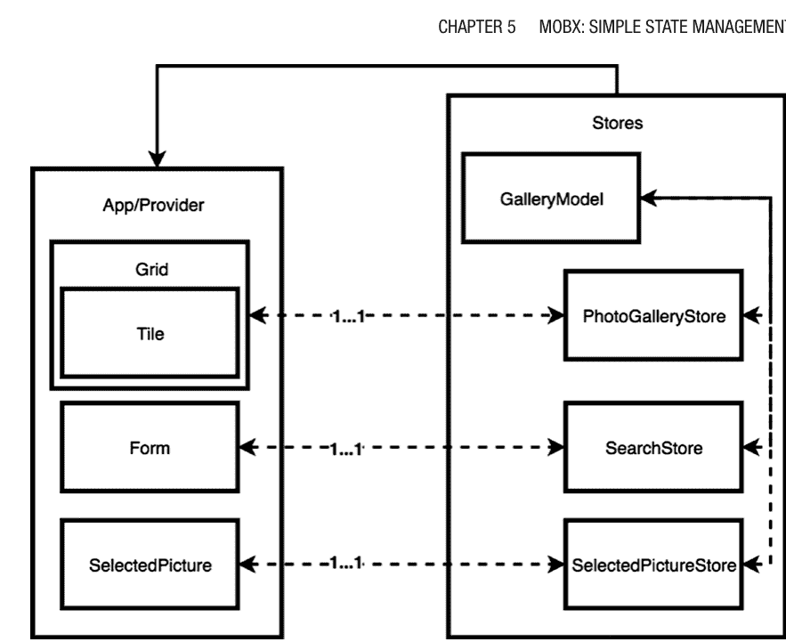

*图 5-2. MobX 项目架构图*

在图的左侧，我们有所有视图，在我们的例子中是被动视图，仅用于渲染用户界面和收集由存储处理的交互。

每个视图与存储有一对一的关系；这与我们在第二章分析 MVP 架构时所做的非常相似。

这样做将保证良好的关注点分离（视图表示和应用行为分离）和组件可重用性（我们可以完全更改视图而不影响应用行为，反之亦然）——任何软件架构中都需要考虑的两个重要原则。

在右侧，我们有从存储对象实例化的所有存储。在每个存储中，我们将注入一个名为 `GalleryModel` 的应用模型。

这不是 MobX 要求的概念，但我们希望创建具有高度灵活性和高代码标准的健壮架构，创建一个模型，使我们能够将所有应用状态或组件状态收集到一个独特的对象中，该对象将对所有存储可见。

这样，更容易维护不同的存储之间的分离，它们彼此不知道对方的存在，而且还将促进应用调试，因为应用状态存在于一个独特的位置，而不是分散在不同的存储中。

考虑到 MobX 使用可观察对象来存储应用状态，这意味着在模型中我们将有可观察对象，并且可能有一些用于更改可观察对象的操作，但所有计算值将更接近视图，位于存储级别。

让我们现在看看这个项目使用的文件夹结构。

## 检查文件夹结构

显然，这个项目也在本书的 GitHub 仓库中可用，所以请随意下载它，以更好地帮助你遵循接下来的步骤。

如图 5-3 所示，文件夹结构类似于我们的架构，按文件类型分离（存储、模型、组件等），而不是按领域方法（搜索文件夹、图片库文件夹……）。

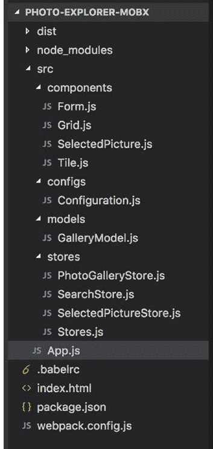

*图 5-3. MobX 项目结构*

在大型应用中，我通常更喜欢将文件收集在领域文件夹中，这真的可以帮助更好地理解应用，特别是对于第一次接触应用的新开发者来说。这样，当名称足够有意义时，更容易找到我们在屏幕上看到的内容与文件夹名称之间的关联。

是时候编写我们的 MobX 应用了，但我们要做的第一件事是构建应用的整体结构，在 `App.js` 文件中定义它。我们需要创建三个主要的 React 组件：一个用于执行搜索的文本输入框、一个图片网格，以及一个用于更好查看图片的选中图片组件。

```jsx
@observer

export class App extends React.Component{

    render(){

        return (

            <Provider {...stores}>

                <MuiThemeProvider>

                    <div>

                        <Form/>

                        <Grid style={style.child}/>

                        <SelectedPicture style={style.child}/>

                    </div>

                </MuiThemeProvider>

            </Provider>)

    }

}

ReactDOM.render(

    <App/>,

    document.getElementById("app")

);
```

在这段代码中，有几个要点值得强调：首先是**观察者**装饰器。我们已经在第一个 MobX 示例中见过它；这个装饰器使我们能够对状态变化做出反应，触发 React 组件内的 `render` 函数，就像我们更改 `props` 或 `state` 属性时会发生的情况一样。

组件的另一个关键部分叫做 `Provider`，它包裹了我们整个用户界面。这是由 MobX-React 库提供的，它是一个工具，用于指定一个上下文，该上下文将可被应用程序的任何部分访问。

在这种情况下，MobX 使用它来提供对存储对象的访问，通过我们将在讨论存储时看到的**依赖注入**机制，在我们的任何组件内访问这些对象。

`Provider` 对象包含一个名为 `stores` 的属性，我们在其中提供组成此应用程序的所有存储：

```javascript
const model = new Model();

const photoGallery = new PhotoGalleryStore(model);

const search = new SearchStore(model);

const selectedPicture = new SelectedPictureStore(model);

export {

    photoGallery,

    search,

    selectedPicture

}
```

在 `stores` 对象中，我们刚刚暴露了三个与它们链接的视图交互的存储。

正如我们之前在项目架构图中看到的，我们希望视图和存储之间存在一对一的对应关系；这将有助于我们在未来将 MobX 应用程序的特定部分重用于其他项目。

一个需要描述的重要事项是 `Model` 对象的作用，在 MobX 架构的传统中，我们没有一个状态分散在多个存储中的模型概念。

而在我们的应用程序中，我们使用它来包装所有表示应用程序状态的可观察对象，将特定于领域的可观察对象、计算值和操作留在存储中。

我们使用这种技术是因为，否则，为了更改值或观察另一个存储中存在的特定可观察对象，我们需要访问和了解其他存储，这不仅会暴露可观察对象，还可能有机会调用存储本身中可用的操作或其他方法。

这样，我们有了在模型内部表示的应用程序状态，该模型被注入到每个存储中，它们可以直接观察或更改应用程序状态。这与反应式范式相结合，将触发更新所有观察特定可观察对象的计算值，并更新相关的视图。

搜索领域由一个带有按钮的输入文本框组成：

```jsx
@inject('search')

@observer

export default class Form extends React.Component{

    setSearchTerm(evt){

        this.props.search.changeSearchTerm(evt.target.value)

    }

    search(){

        this.props.search.requestPics();

    }

    getButton(){

        return (

            <RaisedButton label="SEARCH" primary={true} style={style}

            onClick={this.search.bind(this)}/>

        )

    }

    getSpinner(){

        return (

            <CircularProgress size={35} thickness={5}/>

        )

    }

    render(){

        return (

            <div>

                <TextField hintText="e.g. Bear" onBlur={this.setSearchTerm.

                bind(this)}/>

                {

                    this.props.search.isSearching ? this.getSpinner() :

                    this.getButton()

                }

            </div>

        )

    }

}
```

```jsx
</div>

    )

    }

}
```

在 React 组件中，我们也可以注入我们的存储以便与它们交互；这里的经验法则始终是将组件的行为与其外观**解耦**；事实上，是将它们的逻辑委托给存储，该存储将负责与应用程序的其余部分交互；从远程端点检索；或操作应用程序状态。

这种方法允许我们在不引入行为错误的情况下更改视图，并且它绝对有助于测试组件及其行为，因为定义两个世界之间的边界变得非常容易。

MobX 提供了一个 `inject` 装饰器来实现依赖注入；因此我们可以使用这个装饰器将存储注入到 React 组件中。

该存储可通过任何 React 组件中可用的 `props` 属性访问，因此我们可以通过简单地编写 `this.props.store.method` 来调用一个方法，其中 `store` 是我们分配给存储的名称，`method` 是我们想要调用的方法的名称。

此组件的最后一个值得注意的重要点是变量 `isSearching`，显然这是一个布尔值，它是一个具有特定于此组件而非整个应用程序的领域的可观察对象。此属性不会在其他存储之间共享，因此我们可以将其定义在专用于 Form 组件的存储中，而不是将其定义为应用程序状态。

作为一个可观察对象，每次值发生变化时，订阅到可观察属性的视图将自动对变化做出反应，再次调用 `render` 函数。

让我们看看 Form 的存储是如何实现的：

```javascript
import {observable, computed, action} from 'mobx';

import Config from '../configs/Configuration';

export default class SearchStore{

    @observable isSearching = false;

    constructor(model){

        this.model = model;

    }

}
```

```javascript
@computed get url(){

    return Config.getSearchURL(this.model.searchTerm);

}

@action changeSearchTerm(term){

    this.model.searchTerm = term;

}

@action requestPics(){

    this.isSearching = true;

    fetch(this.url)

        .then(this.onData)

        .then(this.onResult.bind(this))

}

@action onData(response){

    return response.json();

}

@action onResult(response){

    this.isSearching = false;

    this.model.picsList = response.photos.photo.map(value => {

        return {

            id: value.id,

            title: value.title,

            image: Config.getPicURL(value),

            large_image: Config.getLargePicURL(value)

        }

    });

}
```

在构造函数中，我们在实例化存储时注入了模型，并且我们还有之前描述的作为可观察对象的 `isSearching` 属性。最后，我们看到了本章开头提到的计算值和操作的实际应用。

在这个存储中，我们有一个用于在 Flickr 上搜索图像的 URL 的 getter，这个计算值将在每次 `searchTerm`（模型中存在的可观察对象）更改时返回一个新的 URL。我们将在本描述的末尾查看主要模型。

我想请您注意 `Config` 对象；它被用作静态对象来组合应用程序内的 URL，在这种情况下，我们只是在需要它的存储中导入 `Config` 对象，但在下一个 MobX 状态树示例中，我们将看到一种更优雅的不同方法。

每次文本输入触发模糊事件时，我们都在调用存储中的 `changeSearchTerm` 方法，更新模型中的可观察对象。

相反，一旦用户在 UI 中单击搜索按钮，我们正在执行搜索方法（`requestPics` 方法），在那里我们立即更改 `isSearching` 可观察对象，强制组件更新，将按钮替换为旋转指示器，防止向服务器发出额外请求的可能性。

之后，我们正在对 Flickr API 层执行真实的请求，一旦我们检索到响应，我们就将接收到的数据的过滤版本存储在应用程序模型中，同时为小图片和大图片组合 URL（`onResult` 方法）。

正如我们目前所见，我们已经更新了一些表示应用程序状态的可观察对象，位于模型对象内部；现在是时候看看模型是什么样子了：

```javascript
import {autorun, observable} from 'mobx'

export default class GalleryModel{

    @observable searchTerm = "";

    @observable picsList = [];

    @observable selectedPictureURL = null;

    constructor(){

        autorun(()=> {
```


```javascript
if (this.picsList.length > 0) {
    this.selectedPictureURL = this.picsList[0].large_image;
}
```

# 第五章 MOBX：简易状态管理

我们的模型由一系列可观察对象组成，这些对象可被所有存储（stores）访问；因此，任何使用这些对象的计算值（computed values）都会对其变化作出响应。

在构造函数中，我们还能看到另一个 MobX 方法：`autorun`，它用于处理副作用。在本例中，每当我们修改 `picsList` 数组时，它都会定义首张选中的图片，这样用户无需与网格交互即可看到图片。

在这种情况下，我们无法使用计算值，因为计算值只能是与特定可观察值相关的 getter；因此 `autorun` 派上用场，它会观察其主体内表达的任何值，并在该值每次更新时作出反应。

`autorun` 与计算值类似，仅在可观察对象发生变化时作出响应。在需要创建副作用的场景中（如本例）它非常方便，因为替代方案将在不应知晓此值存在的存储内部修改 `selectedPictureURL`——毕竟该存储本身并未使用此值。

相反，借助 `autorun`，我们可以将更新逻辑封装在模型内部，维持每个存储与其视图一对一关联的契约，在无需知晓其他可观察对象存在的情况下更新与自身相关的应用程序状态。

在 `SearchStore` 中，我们更新主模型内 `picsList` 可观察对象的值。现在轮到网格组件渲染从远程服务检索到的结果了。

```javascript
...

@inject('photoGallery')
@observer
export default class Grid extends React.Component {
    render() {
        const tiles = this.props.photoGallery.pics.map(pic => {
            return (
                <Tile key={pic.id} data={pic} />
            );
        });

        return (
            <div style={styles.root}>
                <Chip style={styles.chip}>
                    {`total images: ${this.props.photoGallery.totalPics}`}
                </Chip>

                <GridList
                    cellHeight={180}
                    cols={3}
                    padding={5}
                    style={styles.gridList}
                >
                    {tiles}
                </GridList>
            </div>
        );
    }
}
```

`Grid` 组件拥有自己的存储 `photoGallery`，并从中获取两个主要值：图片数组和名为 `totalPics` 的属性（用于显示从服务检索到的图片数量）。

另一值得注意的是，我们动态创建 `Tile` 组件以填充 `GridList` 组件，且每次从存储更新 `pics` 属性时都会重新创建这些 `Tile`。

网格组件的存储如下所示：

```javascript
import { observable, computed, action, autorun } from 'mobx';

export default class PhotoGalleryStore {
    constructor(model) {
        this.model = model;
    }

    @computed get pics() {
        return this.model.picsList;
    }

    @computed get totalPics() {
        return this.model.picsList.length;
    }

    @action selectedPicture(url) {
        this.model.selectedPictureURL = url;
    }
}
```

我们可以立即注意到，`pics` 属性是一个计算值。这是我提供的一个建议：如果出于任何原因需要修改模型或存储，只要对象间的契约保持不变，我们就能在不影响视图的情况下重构所需内容，从而避免与视图产生耦合。

此外，模型与视图完全解耦，类似于 MVP 架构，以简单的方式拥抱应用程序未来的变更，使其更健壮且易于测试。

每次用户点击图片时，我们需要更改选中的图片，但为此需先查看是谁在调用 `PhotoGalleryStore` 中的 `selectedPicture` 方法。

```javascript
...

@inject('photoGallery')
@observer
export default class Tile extends React.Component {
    selectedPic(e) {
        this.props.photoGallery.selectedPicture(
            this.props.data.large_image
        );
    }

    render() {
        return (
            <GridTile
                style={styles.gridTile}
                onClick={this.selectedPic.bind(this)}
                title={this.props.data.title}
            >
                
            </GridTile>
        );
    }
}
```

在 `Tile` 组件中，我们注入了 `photoGallery` 存储实例；这使我们能够通过简单提供单个 `Tile` props 对象中的大图 URL 来更改大图。

`selectedPicture` 方法随后会更新模型中的可观察对象，该对象存储用于检索大图的图片 URL。因此本示例的最后部分是引入 `SelectedPicture` 组件。

```javascript
...

@inject('selectedPicture')
@observer
export default class SelectedPicture extends React.Component {
    render() {
        const url = this.props.selectedPicture.picPath;

        return (
            <Card style={style}>
                <CardMedia>
                    {url ?  : ""}
                </CardMedia>
            </Card>
        );
    }
}
```

此组件非常简单；我们仅在 `url` 属性每次变化时显示不同的图片。这里我们同样能看到 MobX 注入存储（`selectedPicture` 存储）并观察计算值或可观察对象任何变化的模式。

`SelectedPicture` 组件的存储构成如下：

```javascript
import { computed, action } from 'mobx';

export default class SelectedPictureStore {
    constructor(model) {
        this.model = model;
    }

    @computed get picPath() {
        return this.model.selectedPictureURL || "";
    }
}
```

同样在此例中，我们并未将可观察对象直接提供给视图，而是通过 getter 提供一个计算值。

图 5-4 展示了本应用程序中的数据流。

1. 用户与 UI 交互，调用存储中的一个动作（action）。
2. 该动作更新主模型中的一个可观察对象。
3. 所有订阅该可观察对象的计算值都会更新其值。
4. 视图中存在的计算值或可观察对象导致组件以新状态重新渲染。

这是一个简单的 MobX 示例，展示了该框架如何通过可观察对象运用响应式编程范式。

如我们所见，单一职责原则得到遵循，并且在某种程度上由可观察对象、计算值和动作强制执行。

同时我们也能注意到某种自由度，这在大型团队中可能不太有利，因为开发者可能将这种灵活性视为必要时走捷径的方式。

不仅出于此原因，也为大型应用程序提供更结构化的编写方式，我们可以考虑使用 MobX State Tree——一个具有明确观点的库，它围绕应用程序结构创建清晰边界，并有助于构建坚实且可扩展的架构，以有效方式强制执行自动派生和不可变状态的概念。

## MobX State Tree

顾名思义，MobX State Tree 基于不可变树结构。该库提供的优势主要包括：

- 编写“命令式”代码的同时隐藏响应式实现的可能性，使得接触响应式范式的新开发者学习曲线更为平缓。
- 可变数据结构，其底层由库本身创建和维护不可变树快照，同时也支持在同构应用程序中良好工作——我们可以为特定状态注入树，应用程序将对此作出响应。
- 开箱即用的存储类型系统，可指定基本类型和自定义值。
- 存储级别的生命周期钩子，类似于 React 组件中的钩子。
- 对如何构建存储及如何更新应用程序状态有清晰的边界规定。

这些只是 MobX State Tree 提供的部分关键特性。

MobX State Tree 的有趣之处在于我们处理的是树结构，类似于我们在 UI 中操作 DOM 时的习惯。

同时这意味着我们需要处理强大的层次结构。因此在构建状态树时，我们需要更关注如何封装数据以及如何处理树不同分支间的依赖关系。

理解使用 MobX State Tree 可能遇到的问题的最佳方式，是尝试将其应用于我们之前的项目以寻找可能的解决方案和新方法。

重构之前的项目无需太多改动；事实上视图将保持几乎不变。深入代码前，请参阅图 5-5 以获取我们架构的概览。

与之前架构对比，我们立即注意到一些差异：

## 第 5 章 MOBX：简洁的状态管理

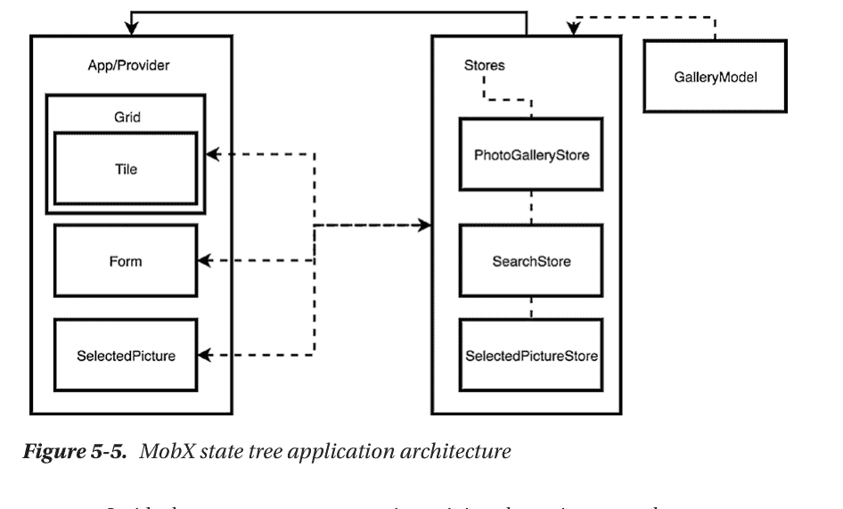

**图 5-5.** *MobX 状态树应用架构*

- 在组件内部，我们将注入整个树，而不仅仅是像之前实现中的某个特定 store。
- `GalleryModel` 并非在 store 内部创建的对象，而是与应用树组合而成。
- 各个 store 之间存在着层级关系，包含一个根节点和多个子节点（`PhotoGalleryStore`、`SearchStore` 和 `SelectedPictureStore`），因此我们可以跨 store 双向遍历数据。

从某种意义上说，这最后一项特性可能是最难以驾驭的，因为如果我们无法以尊重领域的方式来智能地构建 store，那么最终可能会导致大型应用中存在大量 store 之间的依赖关系，从而引入不必要的耦合，并使项目演进或特定设计实现的重构变得更加复杂。

我觉得有必要分享的一个建议是，我们应该使用多个树来构建大型应用，这将有助于我们更好地维护并潜在地重用代码。诀窍始终是根据领域来划分我们的应用；当我们能够清楚识别特定领域的边界时，构建状态树就会变得更加容易。

在对 MobX 状态树架构进行简要概述之后，是时候看看如何将其应用到我们的图片库项目中了，因此我们将分析与之前仅使用 MobX 并采用自定义架构的项目之间的差异。

`App.js` 引入了一些与 MobX 状态树库严格相关的新概念：

```javascript
const augmentedStore = types.compose(GalleryModel, Stores);

const PicsGalleryStore = augmentedStore.create({
    picsList: [],
    searchTerm: "",
    selectedPictureURL: ""
}, { config: Config });

@observer
export class App extends React.Component {
    render() {
        return (
            <Provider store={PicsGalleryStore}>
                <MuiThemeProvider>
                    <div>
                        <Form />
                        <Grid style={style.child} />
                        <SelectedPicture style={style.child} />
                    </div>
                </MuiThemeProvider>
            </Provider>
        );
    }
}

ReactDOM.render(
    <App />,
    document.getElementById("app")
);
```

应用结构保持不变，但在定义组件之前，我们使用 MobX 状态树提供的 `types` 对象来组合主应用模型与不同的 store。这使我们可以从源头访问模型中的应用状态，而无需创建额外的嵌套节点。

MobX 状态树提供了组合树的能力，这是一项非常有趣的特性，主要是因为我们的应用可能会随着时间的推移变得相当庞大，而使用组合而非继承将使我们在重构、添加新功能或进行重大变更时保持足够的灵活性。

另一件需要强调的是，在我们的组合树变量中，我们定义了应用状态的初始值。

这是 MobX 状态树的另一个特性：它强制我们为必填对象设置默认值，比如本例中的 `searchTerm`、`picsList` 和 `selectedPictureURL`。

这个特性属于 MobX 状态树在运行时执行检查的一部分；如果不定义这些值，应用将触发一个有意义的错误，指出问题的根本原因，这得益于库内部存在的类型系统检查。

最后，一旦我们创建了 `augmentedStore` 节点，传递第三个参数作为配置对象，这就是 MobX 状态树将对象注入 store 的方式；它只是一个简单的依赖注入机制。

这个机制非常实用，因为它为我们提供了灵活性，可以在树中注入多个对象，而无需维护单例或实例化不同的对象。

在本例中，我们将依赖注入用于配置工具，但原则上我们可以将其用于日志对象或任何其他我们希望在应用中使用的工具。

我们在主应用中看到的这些变化导致 store 对象也发生了变化：

```javascript
import { types } from "mobx-state-tree";

import PhotoGalleryStore from './PhotoGalleryStore';
import SearchStore from './SearchStore';
import SelectedPictureStore from './SelectedPictureStore';

const stores = types.model({
    photoGallery: types.optional(PhotoGalleryStore, {}),
    search: types.optional(SearchStore, {}),
    selectedPicture: types.optional(SelectedPictureStore, {})
});

export default stores;
```

我们所做的是描述一个由多个节点组成的树，其中我们将 store 描述为可选值，并将它们附加到我们的状态树根节点。

`types.model` 表示对象的形状，我们将在其他 store 中看到如何修改它们以适配上一节描述的 MobX 核心部分。

考虑到 React 组件保持了与前面示例相同的结构，我们将集中注意力于 MobX 状态树如何处理 store 以及我们自定义添加的模型。我们从 `GalleryModel` 开始：

```javascript
import { types } from 'mobx-state-tree';

const Picture = types.model("Picture", {
    id: types.identifier(),
    title: types.string,
    image: types.string,
    large_image: types.string
});

const model = types.model({
    searchTerm: types.string,
    picsList: types.array(Picture),
    selectedPictureURL: types.string
}).actions(self => ({
    setPicsList(arr) {
        self.picsList = arr;
    },

    setSelectedPictureURL(url) {
        self.selectedPictureURL = url;
    },
```


```javascript
setSearchTerm(value){

    self.searchTerm = value;

}

}

}))

export default model;
```

在这个对象中，我们可以开始看到一个树节点的更完整结构。在本例中，我们定义了应用的状态，这将在模型中的值每次发生变化时保证响应：紧跟在`types.model`定义之后的第一个对象表示可观察对象，正如我们在前面的 MobX 示例中所见。

它们中的每一个都需要用特定的基础类型或复杂类型来标注类型，比如`picsList`的情况，我们定义了`Picture`模型来表示数组中每个元素的所包含的数据结构。

这个特性将为我们节省大量调试时间，因为我们确信模型内部不会出现数据不一致的情况。这正是我们所期望的：否则应用将无法正常工作。

这也是我最初建议你投入时间定义应用领域的另一个原因；这样做将使你免于以错误的方式构建模型的可能性，从而事实上产生一个有助于解决应用内部问题的系统。

因此，我们应该始终在项目开始时定义我们的模型及其与主树的交互，然后再专注于应用的 UI。

MobX 状态树的另一个限制是我们不能直接更新可观察对象，而只能通过`action`来更新。这些界限在大型应用中帮助很大，因为它们提供了明确的方向，避免了为达成相同结果而出现不同的实现方式。因此，我们定义了多个`action`来提供更新应用状态的能力。

在`action`对象的实现中，我们添加了参数`self`：它是由 MobX 定义的，使我们能够保持正确的作用域而无需手动绑定。`self`将在本章后面声明计算值时可用。

现在我们可以在 MobX 状态树的知识体系中再添加一块拼图，在模型中引入计算值，正如我们在`SearchStore`中所做的：

```javascript
import { types, getParent, getEnv} from "mobx-state-tree";

const searchStore = types.model({

    isSearching: false,
```

## 第5章 MobX：简易状态管理

```javascript
}).views(self => ({

    get url(){

        return getEnv(self).config.getSearchURL(getParent(self).searchTerm);

    }

})).actions(self => ({

    requestPics(){

        self.isSearching = true;

        fetch(self.url)

            .then(self.onData)

            .then(self.onResult.bind(this))

            .catch((err) => console.log(err))

    },

    onData(response){

        return response.json();

    },

    onResult(response){

        const configuration = getEnv(self).config;

        const model = getParent(self);

        self.isSearching = false;

        const picsArr = response.photos.photo.map(value => {

            return {

                id: value.id,

                title: value.title,

                image: configuration.getPicURL(value),

                large_image: configuration.getLargePicURL(value)

            }

        })

        model.setPicsList(picsArr);

        model.setSelectedPictureURL(picsArr[0].large_image);

    },

    changeSearchTerm(term){

        getParent(self).setSearchTerm(term);

    },

}))

export default searchStore;
```

在这个例子中，我们向模型添加了另一个名为`views`的元素。视图使用对象字面量表示，它们是 MobX 状态树模型对象中计算值的体现。

视图的行为方式与计算值完全相同：它们对状态的任何变化都会做出反应。因此，我们对这个概念应该已经很熟悉了。

现在，让我们回顾一下 MobX 状态树模型的组成部分，因为我们已经探索了其关键部分：

- **模型**需要一个对象来描述模型状态（类似于 MobX 中的可观察值）。
- **视图**需要一个对象来指定与应用程序状态相关联并对其做出反应的计算值。
- **动作**是 UI 用于与应用程序状态交互的方法。

基于此，我们可以继续分析其余的 store。在`SearchStore`中，还有几个重要的事情需要强调，让我们看看`views`对象内部计算值的实现：

```javascript
get url(){

    return getEnv(self).config.getSearchURL(getParent(self).searchTerm);

}
```

`getEnv`和`getParent`是 MobX 状态树提供的另外两个方法。第一个用于获取注入到主树中的对象，在我们的例子中是用于创建消费 Flickr API 时最终 URL 的配置实用对象。

而`getParent`则允许我们检索树的父节点，在我们的例子中是由主`GalleryModel`组合而成的根节点；`searchTerm`是在主模型中描述的一个可观察值。

正如我们所看到的，这种方法可能导致维护困难，尤其是在树有很多嵌套节点时。这就是为什么我们需要三思而后行：关键在于保持树的嵌套层级不要太多，并通过更好地封装应用程序组件来工作。

`SearchStore`中的功能与之前的示例完全相同，只是以 MobX 状态树的方式表达。

接下来，我们可以简要看看另外两个 store。`PhotoGalleryStore`是这样实现的：

```javascript
import { types, getParent } from 'mobx-state-tree'

const photoGalleryStore = types.model("Gallery", {

}).views(self => ({

    get totalPics(){

        return getParent(self).picsList.length;

    }

})).actions(self =>({

    setPictures(arr){

        getParent(self).setPicsList(arr);

    }

}))

export default photoGalleryStore;
```

我们再次通过`getParent`方法与`GalleryModel`进行通信，因为主模型是组合在状态树根节点中的。

对于`SelectedPictureStore`，其实现如下：

```javascript
import { types, getParent } from "mobx-state-tree";

const selectedPictureStore = types.model({

}).actions(self => ({

    setPictureURL(url){

        getParent(self).setSelectedPictureURL(url);

    }

}))

export default selectedPictureStore;
```

同样，在这种情况下，我们只是设置了最终要显示的 URL，组件会自动对主模型中`selectedPictureURL`可观察值的变化做出反应。

总体而言，从 MobX 项目迁移到状态树项目并不需要太多精力，但由于其固执己见的做事方式和强制执行更好应用结构的规则，它提供了很多价值。

## 总结

在本章中，我们评估了 MobX 如何在现实世界中作为响应式状态管理使用，它提供了自动化和优化的派生，以提高我们的应用程序性能并提供可预测性。

我们发现 MobX 可以与 React 结合使用，但也存在针对其他虚拟 DOM 库（如 Vue.js 或 Snabbdom）的多种实现。

同样重要的是，我们评估了两个例子：一个仅使用 MobX；另一个使用 MobX 状态树，这是一个固执己见的库，它为我们的应用程序状态提供了一个树状结构，反映了 DOM 树背后的概念，并为组合和装饰我们的应用程序状态提供了多种实用工具。

从架构上讲，MobX 提供了一种其他框架难以企及的灵活性，它是将现有应用程序迁移到响应式范式以提高可预测性的完美伴侣，也适合任何想要快速拥抱响应式范式的人。

使用 MobX 状态树开发新应用程序或概念验证，可以提供快速且设计良好的结构，提高我们的生产力，而不会牺牲质量。

最后同样重要的一点是，在这两个例子中，我们都将应用程序状态从 store 中提取出来，确保了更好的关注点分离和更少的耦合，各个 store 不需要知道其他 store 的存在，从而适当地维持了它们的有界上下文。

# 第6章 SAM：一种函数式响应式模式

> 因为，你知道，韧性——如果你用淘金热来思考它，那么你现在会非常沮丧，因为最后一块金块已经没了。但好消息是，有了创新，就不存在最后一块金块。
>
> 每一个新事物都会产生两个新问题和两个新机会。
>
> ——杰夫·贝佐斯

在本章中，我们将探索 SAM 模式，它在社区中使用较少，但仍然是函数式/响应式家族的一部分。

SAM 代表**状态-动作-模型**，这是我们在其他框架中已经遇到过的三个参与者，但通过 SAM 模式，我们将发现它们的不同用途。

首先，SAM 遵循单向数据流模式，并且重度依赖函数式概念；事实上，函数是实现最终架构的一等公民。

因为 SAM 是一种模式，它完全与框架无关，可以与 MobX、Cycle.js、Angular 或我们任何项目中使用的其他框架一起使用，甚至可以在我们的原生 JavaScript 项目中使用（如果我们想的话）。

在本章中，我们将探讨 SAM 的一个“原生”实现，以理解该模式如何使用响应式范式来管理对象之间的数据流。

## SAM 简介

SAM 的创建有着明确的目标，我们可以这样总结：

- **组合**：在 SAM 中，我们大量使用组合和纯函数；这减少了对象之间的耦合，并允许我们轻松地独立测试模式的不同部分。
- **单向数据流**：正如我们在 Cycle.js 中看到的，SAM 也利用了通过高阶函数实现的单向数据流概念，在应用程序的不同部分之间创建了一个响应式循环。
- **框架无关**：SAM 与框架无关，因此不仅可以在客户端使用，如果需要，也可以在服务器端使用。
- **被动视图**：使用 SAM 可以让我们拥有被动视图，它们与行为完全解耦，允许我们独立测试特定视图，并可能在运行时或编译时更改它们，同时保持相同的行为。
- **分形架构**：我们在之前的旅程中已经遇到过拥抱分形架构范式的 Cycle.js。SAM 也在做同样的事情：提供了灵活性，可以使用封装良好的组件，并遵循相同的架构原则将它们组合在一起。

图 6-1 提供了一个理解此模式的示意图。

## 第六章 SAM：一种函数式响应模式

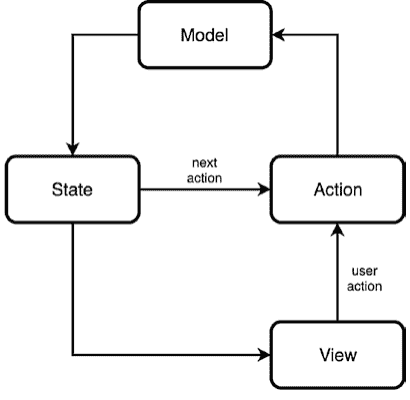

图6-1。SAM模式示意图

如前所述，SAM由状态、动作和模型组成，SAM项目的流程如下：

- 动作由用户交互触发，其主要职责是将用户意图转换为需要在模型内验证的数据。
- 模型需要评估从动作接收的数据，可以接受或拒绝。

如果数据不符合预期，模型可以决定触发错误或静默失败。

模型还负责维护应用程序状态并触发状态表示。

在此模式中实现模型的最佳方式是使用单一状态树。

- 状态，与名称暗示的不同，是一个从模型计算状态表示并通知视图需要渲染新内容的函数。

状态还负责调用下一个动作谓词（next-action-predicate），这个称为`nap`的函数将调用任何需要被调用的自动动作。

此模式中的响应性由主要参与者的循环组成，它们在每次调用动作后改变状态表示。

SAM模式可以用一个数学公式来概括：

`View = Stateêmisrówað(Modeî.p«esent(Action(data))),nextAction Predicate(Model)`

SAM的灵感来源于 React 组件实现，其中 React 引入了待表示数据与视图本身的强解耦；因此，任何虚拟 DOM 库都非常适合 SAM 模式。

事实上，状态表示只是提供一个输出，该输出将由 React、Vue.js 或 Snabbdom 等虚拟 DOM 库计算。

显然，我们也可以考虑使用模板库，但虚拟 DOM 库更符合该模式的目的。

状态表示并非用于保存状态，而是将数据与虚拟 DOM 或模板合并，从模型中检索状态并将其与特定接口组合。

如上所述，模型必须评估动作提供的值；它仅暴露`present`函数，并且可以决定接受或拒绝接收到的数据，触发错误或静默停止特定场景的循环。

动作非常类似于 Cycle.js 中的`intent`的作用：它们准备向模型提议的数据。动作可以通过 UI 上的用户交互或通过`nap`方法调用，该方法在状态表示之后被调用，用于自动更改模型并触发视图的另一次渲染。

### SAM模式数据流

如果我们要用代码来概括 SAM 模式的数据流，我们可以用这样一个骨架来实现：

```javascript
const model = {

    status: STATUS.INIT,

    present: data => {

        if(model.status === STATUS.INIT){

            model.status = STATUS.STATE1;

        }

        if(Array.isArray(data)){

            model.status = STATUS.INIT;

        }

        state.render(model)

    }

};

const actions = {

    state1: (value, present) => {

        present({data: value});

    }

}

const nap = model => {

    if (model.status === STATUS.INIT) {

        actions.state1(value, model.present);

    }

}

const view = {

    init: model => {

        return <div> This is the initial view </div>

    },

    state1: model => {

        return <div> This is the state1 view </div>

    }

}

const state = {

    init: model => (model.status === STATUS.INIT),

    state1: model => (model.status === STATUS.ANOTHER_STATUS),

    render: model => {

        stateRepresentation(model);

        nap(model);

    }

}

const stateRepresentation = model => {

    let representation = <div>something went wrong!</div>

    if(state.state1(model))

        representation = view.state1(model);

    if(state.init(model))

        representation = view.init(model);

    display(representation);

};

const display = view => {

    //将视图附加到DOM

}
```


从我们的骨架顶部开始，我们可以立即看到模型只暴露`present`方法，并且它正在验证任何动作提议的数据。当验证成功时，`present`方法调用状态渲染函数。

`state`对象负责根据模型提供的应用程序状态准备要显示的视图，并调用`nap`方法以根据应用程序状态执行其他自动动作。

状态表示的目标是将从模型检索的应用程序状态与视图（无论是模板还是虚拟DOM）组合；一旦所有内容都被计算出来，此函数调用`display`函数，我们将UI附加到DOM中。

之后，下一个动作谓词（next-action-predicate）检查在应用程序的特定状态下，它是否需要自动调用下一个动作，而无需模型实现复杂的逻辑。

要启动我们的应用程序，我们可以调用一个动作，例如，消费一个远程端点；或者显示一个静态视图，用户可以在其中进行交互（在输入字段中搜索、与按钮交互等）。让我们看看如何使用SAM和React.js实现一个简单的项目，以便阐明这个响应式模式。

## SAM的基本实现

这次我们想构建一个类似于图6-2的界面。


这个界面有一些特点，所以首先要做的就是加载由开放API提供的国家数据。然后我们需要在上面地图的左侧生成列表，每次用户点击国家名称时，我们希望在界面的右侧显示一些信息，比如国家名称、国旗、人口规模、首都，以及显示该国坐标的交互式地图。

考虑到我们在没有任何用户交互的情况下启动应用程序，我们将立即设置一个默认国家，以便填充空间并向最终用户提供有关如何使用我们应用程序的信息。在这种情况下，下一个动作谓词将帮助我们完成此任务。

我们现在将基于之前探讨的骨架来创建应用程序；记住，SAM模式拥抱了简洁、健壮的架构以及函数式和响应式两种编程范式的力量。

### 复习示例

让我们从头开始分析我们的示例。首先要做的就是等待第一个动作来消费远程端点，检索为显示所选国家详情而请求的特定数据：

```javascript
document.addEventListener("DOMContentLoaded", function(event) {
    actions.getCountries(REGION, model.present)
});
```

我们可以立即看到，我们正在将默认国家和模型的`present`方法传递给`getCountries`动作，一旦动作内的Promise完成，该方法将被调用：

```javascript
getCountries: (region, present) => {
    fetch(URL + region)
        .then(response => response.json())
        .then(data => {
            const countries = normaliseData(data);
            present(countries);
        })
}
```

一旦我们收到响应并规范化数据，仅过滤视图需要的内容，我们就调用作为参数注入的`present`方法，该方法负责接受或拒绝动作准备的数据。因此我们可以说，这些动作负责准备模型消费并用于渲染新状态的数据。

让我们看看我们的模型是什么样的：

```javascript
const model = {
    status: STATUS.INIT,
    selectedCountryID: "",
    countries: [],
    present: data => {
        if(data.selectedID !== "" || model.status === STATUS.INIT){
            model.status = STATUS.SELECT_COUNTRY;
            model.selectedCountryID = data.selectedID;
        }
```

该模型是一个包含`status`属性的对象，我们用它来存储当前的应用状态，以及一些用于渲染新状态的参数（例如`countries`和`selectedCountryID`），最后是`present`方法，它每次仅由`actions`调用。

在`present`方法内部，我们可以看到对每个可能从`actions`接收到的值的检查。这可能会变成一个很长的检查列表，因此在大型应用中，我们需要将这些语句封装在外部文件中，以使代码更具可读性和易于管理。

检查通过后，`present`函数会调用状态对象的`render`方法：

```javascript
if(Array.isArray(data)){
    model.status = STATUS.INIT;
    model.countries = data;
}

state.render(model)
}
};
```

该模型是一个包含`status`属性的对象，我们用它来存储当前的应用状态，以及一些用于渲染新状态的参数（例如`countries`和`selectedCountryID`），最后是`present`方法，它每次仅由`actions`调用。

在`present`方法内部，我们可以看到对每个可能从`actions`接收到的值的检查。这可能会变成一个很长的检查列表，因此在大型应用中，我们需要将这些语句封装在外部文件中，以使代码更具可读性和易于管理。

检查通过后，`present`函数会调用状态对象的`render`方法：

```javascript
const state = {
    init: model => (model.status === STATUS.INIT && model.countries.length
> 0 && model.selectedCountryID == ""),
    selectCountry: model => (model.status === STATUS.SELECT_COUNTRY &&
model.selectedCountryID !== ""),
    render: model => {
        stateRepresentation(model);
        nap(model);
    }
}
```

在状态对象中，我们有一些用于理解应用处于哪个状态的方法，例如`init`和`selectCountry`方法，以及`render`方法，它被分为准备状态表示和调用`nap`函数。

## 第 6 章 SAM：一种函数式响应模式

状态表示使用应用状态将存储在模型中的数据与要显示的UI进行合并：

```javascript
const stateRepresentation = model => {
  let representation = <div>something went wrong!</div>

  if(state.selectCountry(model))
      representation = view.selectCountry(model);

  if(state.init(model))
      representation = view.init(model);

  display(representation);
};
```

在上面的代码片段中，我们可以看到每次调用该函数时，我们都会对不同的应用状态进行一些检查，当识别出我们处于哪个状态时，我们就可以检索到正确的视图并传递给`display`方法。我们的视图对象如下所示：

```javascript
const view = {
  init: model => {
    return <div>
      <CountriesList data={model.countries}/>
      <SelectedCountry/>
    </div>
  },

  selectCountry: model => {
    const index = model.countries.findIndex( contry => contry.id === model.selectedCountryID);
    const country = model.countries[index];

    return <div>
      <CountriesList data={model.countries} action={actions.selectCountry} present={model.present}/>
      <SelectedCountry country={country}/>
    </div>
  }
}
```

因为我们决定使用React，所以UI由一堆自定义组件组成，我们从模型中注入一些检索到的属性，例如用于渲染国家列表的`countries`，以及`actions`和`present`方法。因此，当用户点击一个国家名称时，我们调用操作，传递所选国家的唯一标识符以及在定义组件时注入的模型`present`方法。

让我们看一下完整的示例：

```javascript
import React from "react";
import ReactDOM from "react-dom";
import SelectedCountry from "./components/SelectedCountry";
import CountriesList from "./components/CountriesList";
import {STATUS, URL, REGION, INIT_COUNTRY} from "./configurations/Config";

const model = {
    status: STATUS.INIT,
    selectedCountryID: "",
    countries: [],

    present: data => {
        if(data.selectedID !== "" || model.status === STATUS.INIT){
            model.status = STATUS.SELECT_COUNTRY;
            model.selectedCountryID = data.selectedID;
        }

        if(Array.isArray(data)){
            model.status = STATUS.INIT;
            model.countries = data;
        }

        state.render(model)
    }
};

const normaliseData = data => {
    return data.map(country => {
        return {
            id: country.alpha2Code,
            name: country.name,
            lat: country.latlng[0],
            lng: country.latlng[1],
            flag: country.flag,
            capital: country.capital,
            population: country.population
          }
      })
}
```

```javascript
const actions = {
    selectCountry: (id, present) => {
        present({selectedID: id});
    },

    getCountries: (region, present) => {
        fetch(URL + region)
            .then(response => response.json())
            .then(data => {
                const countries = normaliseData(data);
                present(countries);
            })
    }
}
```

```javascript
const nap = model => {
    if (model.status === STATUS.INIT) {
        actions.selectCountry(INIT_COUNTRY, model.present);
    }
}
```

```javascript
const view = {
    init: model => {
        return <div>
            <CountriesList data={model.countries}/>
            <SelectedCountry/>
        </div>
    },

    selectCountry: model => {
        const index = model.countries.findIndex( contry => contry.id === model.selectedCountryID);
        const country = model.countries[index];

        return <div>
            <CountriesList data={model.countries} action={actions.selectCountry} present={model.present}/>
            <SelectedCountry country={country}/>
        </div>
    }
}
```

```javascript
const state = {
    init: model => (model.status === STATUS.INIT && model.countries.length
> 0 && model.selectedCountryID == ""),

    selectCountry: model => (model.status === STATUS.SELECT_COUNTRY &&
model.selectedCountryID !== ""),

    render: model => {
        stateRepresentation(model);
        nap(model);
    }
}
```

```javascript
const stateRepresentation = model => {
    let representation = <div>something went wrong!</div>

    if(state.selectCountry(model))
        representation = view.selectCountry(model);

    if(state.init(model))
        representation = view.init(model);

    display(representation);
};
```

```javascript
const display = view => {
    const app = document.getElementById("app");
    ReactDOM.render(view, app);
}
```

```javascript
document.addEventListener("DOMContentLoaded", function(event) {
    actions.getCountries(REGION, model.present)
});
```


如果我们想总结这个 SAM 应用的流程，可以得出以下列表：

- 一旦用户与国家列表中的某个元素交互，就会触发一个操作，该操作将国家 ID 提供给模型的`present`方法。
- 模型检查从操作接收到的数据类型，并将操作提供的 ID 存储在`selectedCountryID`中。
- 然后，模型触发状态表示，我们根据模型数据组装新的视图。
- 视图被推送到`display`方法，该方法将新的视图状态附加到 DOM 中。
- 最后，我们调用`nap`函数，它检查在特定的应用状态下是否需要触发任何自动操作。

SAM 是一个有趣的模式，因为它将 S.O.L.I.D. 原则与不同的编程范式结合在一起。当我们在实际项目中实现它时，我们需要意识到这个模式提供的自由度，考虑到目前没有太多框架强制执行 SAM 规则。

同时，SAM 为我们提供了一个良好的结构、强大的封装，并很好地应用了单一职责原则到模式的每个主要部分。

这使我们能够快速且完全隔离地测试我们的项目，并且考虑到它严重依赖于纯函数，我们不会从它们中产生任何副作用。因此，这种模式的结果可预测性非常高。

正如我在本章开头所说，我们可以在现有的架构中实现 SAM，或者我们可以使用一个基于 SAM 的架构，为我们的应用程序提供一个坚实的结构来优雅地处理数据流。

## 总结

本章我们探讨了响应式架构的另一种实现路径。正如我们所了解的，目前存在多种解读方式，每种方式都有其优缺点需要权衡。

SAM 模式尤其具有扎实的理论基础，其设计原则值得借鉴，而其简洁的实现特性使我们能够在任何项目（无论是现有项目还是全新项目）中应用 SAM 模式，无需依赖特定框架。

现在让我们展望响应式范式的未来，特别是未来几年前端领域将如何发展这一范式。但这次我将不再独自前行，让我们进入本书的最后一章。

## 响应式的未来

> 未来属于那些今天就开始为之准备的人。  
> ——马尔科姆·X

这真的是响应式架构探索之旅的终点吗？我必须说这绝非终点，很可能只是真正的开始！

在本书中，我尝试收集了一些能让响应式编程真正发挥生产力的信息。通常你能找到许多讲解如何使用`Rx.JS`进行响应式编程的资料，但鲜有资料清晰展示如何在实践中构建响应式架构的实例。

响应式架构与响应式编程都处于其生命周期的初期，仍有大量领域有待探索：从不同角度审视响应式概念，并从探索初期的失误中学习。

当下拥抱响应式架构，可能会为你的项目和/或职业生涯带来竞争优势。

我个人认为响应式编程将深刻影响我们思考软件编程的方式。这一范式的学习曲线虽非最平缓，但一旦掌握几个核心概念，我们编写的每一行代码都将日益精进。

响应式编程的另一重要价值在于，它能与现有架构“混合搭配”，从而提升项目水平，推动项目迈向新阶段，同时强化对象封装与单一职责原则。

我不想用整章篇幅讲述我如何接纳响应式范式，因为这已不言自明。但我认为，分享响应式生态中活跃开发者们的见解将大有裨益。因此，我邀请他们进行访谈，分享他们对该范式在前端开发中未来的展望。

接下来，你将阅读到以下两位受访者对我准备的问卷的回应：

- Ben Lesh – `Rx.JS 5` 创建者
- Michel Weststrate – `MobX` 创建者

希望这些行业大咖的见解能让你有所收获，也期盼你在响应式前端架构的探索之旅中获得乐趣。

## Ben Lesh

**能否简单介绍一下你自己？**

我叫 Ben Lesh，目前在 Google 担任工程师，此前在 Netflix 工作，我是`RxJS`的开发负责人。

**你为响应式社区做出了哪些贡献？**

我致力于让`RxJS`变得更小、更快、更符合人体工程学。

**为什么企业或开发者应该拥抱响应式编程？**

响应式编程通过简洁的声明式语法快速定义各种行为，为代码带来了极大的灵活性。

**你认为响应式编程有哪些优点和缺点？**

最大优点在于拥有单一类型就能表示几乎所有情况：同步或异步值、单个值、多个值或无值。由于该类型表示集合，因此可以对其实现大量转换、连接和查询操作。

最大缺点则是为了实现上述功能，需要学习响应式编程特有的术语体系，例如`mergeMap`、`switchMap`等概念。

**响应式编程最重要的价值是什么？**

其最大价值在于能够将应用程序分解为彼此真正独立的更小工作单元。

**谈到响应式架构，你认为其会从当前状态继续发展吗？如果会，将如何发展？**

我认为我们即将见证大量响应式语言的涌现。据我所知已有两个正在开发中：一个是 Facebook 正在研发的服务端响应式编程语言，另一个是我的同事正在开发的客户端响应式编程语言。

**你在响应式项目中通常使用哪种框架或架构？为什么？**

过去三年我使用过 Ember、React 和 Angular。Angular 对`rxjs observable`提供了一流支持。由于我在 Google 参与项目收尾工作，所以使用 Angular，但我没有特别偏好的框架。不过 Angular 团队本身是我最欣赏的团队之一，所以可能带有些许个人倾向。

**响应式生态还存在哪些不足？**

我们需要更多浏览器端的调试工具。库本身的能力有限，如果 Chrome 能内置更好的工具来诊断`rxjs`中一些复杂场景就更好了。

**你希望改变响应式生态的哪些方面？**

我希望有更多贡献者加入，特别是更多元化的贡献者群体。这里说的贡献者涵盖工程人才到社区组织等各个方面。尽管`RxJS`被广泛使用，但响应式编程社区依然很小众。

**入门响应式编程的最佳路径是什么？**

最好的方式是直接在`jsbin`等平台实践操作。从`filter`、`map`、`scan`等基础操作符开始，逐步尝试`mergeMap`等进阶用法。

**关于你创建的库，能否分享对其未来的愿景？**

在不远的将来，我们将逐步淘汰原型补丁方式，转向基于函数式的操作符。届时将出现高阶函数，返回可用于`let`操作符的函数，并配套更多实用工具。这种改进将优化 tree shaking 效果，意味着使用`webpack`等打包工具的`rxjs`项目体积将更小。

同时我正全力缩减库的体积。

**如果此刻可以改变库的某一方面，你会选择什么？**

我其实已经在进行相关改进了。主要希望减少工作量，这样就能早点完成啦（笑）。

**能否分享一个开发者容易忽视或尚未充分利用的库技巧？**

我在去年 AngularConnect 演讲中提过这点。重要的是理解我们正在建立观察者链，每个观察者都确保一旦触发`error`或`complete`事件，就不能再调用`next`。因此若要在处理错误的同时保持`observable`存活，需要用`merge map`隔离观察者链，并配合`catch`或`retry`操作符。

**预测十年后的响应式编程发展？**

我认为它将比现在更普及。这类理念具有感染力，虽然难以向人解释，但一旦理解就会不由自主地向他人传播。

**还有其他要补充的吗？**

特别感谢 Eric Meijer 和 Matt Podwysocki 创建了`RxJS`，也感谢 Rx 社区这些年对`RxJS`的支持。

## Michel Weststrate

**能否简单介绍一下你自己？**

我编程近 20 年，其中 10 年是专业开发。从少年时期使用 Pascal/Object Pascal，到后来的 C# 和 Java，最终主要专注于 JavaScript/TypeScript 开发。JavaScript 和 TypeScript 领域的创新速度使其成为极具吸引力的开发环境。

**你为响应式社区做出了哪些贡献？**

一年多前我开源了`MobX`响应式编程库。该库最初为 Mendix 开发，但解决了 React 社区存在的许多问题（尽管它具有通用性，也应用于 React 生态之外）。

**为什么企业或开发者应该拥抱响应式编程？**

正确应用响应式编程能提升代码解耦度和声明式特性。这是因为响应式编程将行为描述与行为执行分离：行为只需声明一次，就能确保值的持续响应性。

## 你认为响应式编程的优缺点是什么？

该行为的执行由响应式编程库强制执行。我经常将其与民法与自然法则进行比较。前者陈述了一种愿望，但需要执法机构来确保该行为在大多数情况下得到应用。另一方面，自然法则不能被故意或意外违反。系统只是保证一致性。

例如，`MobX`保证任何渲染数据的 React 组件都会在该数据更改时更新。组件如何获取数据并不重要。它会更新。就像用小车拖着滑板；如果小车开始移动，滑板也会移动。只是因为你引入了一根绳子将两者绑在一起。你不需要强制执行这种关系。这种关系不再是一个关系的概念，而是一个实际的关系。而自然，或者`MobX`，总会完成它的工作。

- 优点：本质上更具声明性。你只需指定应该发生什么。然后由系统来决定它何时应该发生。
- 优点：控制反转：你不必关心谁在监听你正在发出的事件，或者你正在改变的值。这大大增加了耦合性。简化了重构等。
- 优点：更好的可扩展架构：因为生产者和消费者被严格分离，你在更改其中任何一个时都更加灵活。它避免了与更新值时需要发生的所有效果相关的意大利面条式代码，这在大型命令式项目中非常典型。
- 缺点：控制反转也意味着额外的间接层。因此，在使用响应式编程时，在发出的事件或更改的值之间，你总是需要通过一些库内部机制进行调试，然后才能到达它们引起的效果。（一些库甚至会在不同的栈上运行效果，这会使调试变得更加困难。）
- 缺点：响应式编程代码通常更难理解。特别是在使用可观察流时，你需要了解一系列特定于流的运算符的含义，才能理解其意图。

## 响应式编程提供的最重要的好处是什么？

解耦，然后是声明性。

## 谈到响应式架构，你认为我们从现在的位置会有所演进吗？如果是，哪一种？

我认为跨系统边界的响应式将在未来得到显著发展。Meteor 过去在这方面做了一些开创性的工作，我们在 HorizonDB、Firebase 和 GraphQL 订阅中仍然能看到这一理念。我认为未来我们将像响应客户端状态中的事件一样轻松地消费和响应数据库中的事件。

我的另一个梦想是引入一个响应式（虚拟的？）文件系统，并在此基础上构建我们的构建工具。如果每个文件只是一个响应式的数据流，我们将能够结合 Makefile 的效率和我们已经开始非常欣赏的文件监视器的实时更新功能。通过适当的依赖关系分析，我们将消除所有链式监视器构建过多、过早或顺序错误的怪异问题。

**你通常为你的响应式项目使用哪个框架或架构，为什么？**

响应式有两个主流类别：响应式流和响应式值（或单元）。如果值的推导需要了解过去或时间，响应式流非常强大。这方面的例子包括事件去抖动、网络请求等，从过去的值的滑动窗口生成值等。在这些情况下，`Rx*`系列提供了非常强大的工具。

然而，当推导值时，如果只需要了解当前状态，使用响应式数据单元会方便得多。这就是使电子表格如此流行的机制。使用响应式数据单元，人们通常不需要设置显式订阅，并且可以使用语言的所有一等操作符，而不是必须使用特定于流的库。这种机制使得像 Knockout、Meteor、Vuejs 和`MobX`这样的库如此易于上手。

**响应式全景中缺少什么？**

响应式文件系统交互。

**你会在响应式生态系统中改变什么？**

响应式系统有两个重要的主流类别：响应式流和（透明的）响应式单元（或值）。它们都解决了相当不同的问题，但未能认识到这种区别会导致相当多的困惑。

**开始使用响应式编程的最佳方法是什么？**

使用 React 构建一个 Web 应用程序，并使用`MobX`管理客户端状态。然后添加`RxJS`来对搜索查询和网络请求进行去抖动。

**谈到你创建的库，你能与我们分享你对它未来的愿景吗？**

`MobX`在你的代码中几乎不可见；它主要存在于后台。当浏览器中的代理标准化后，我想让它变得更加不可见。

**如果你能现在改变你库中的一个东西，那会是什么？**

将响应式算法和核心 API 与可观察数据集合分离。这将更容易针对不同的环境（例如，ES3 或支持代理的环境），并使`MobX`对那些不喜欢它在对象上进行属性包装的用户更易于接受。

**你能分享你库的一个小技巧吗，目前很少有开发者理解或正在使用？**

保持副作用非常小。但尽可能多地推导数据。通常令人惊讶的是，我们可以从状态中推导出多少东西。它将命令式代码保持在最低限度。

**十年后的响应式编程，你的预测是什么？**

更紧密连接的前端/后端架构，其中客户端状态的概念对于领域数据在很大程度上消失。

**还有其他需要补充的吗？**

你能寄给我一本这本书吗 :)

## 索引

### A

- Angular
  - `App.component.ts`, 44
  - 架构视图, 42
  - `CalculatorModel.ts`, 48
  - 计算器项目, 43
  - 命令模式, 47
  - 概念, 42
  - 含义, 41
  - `NgModule`, 42
  - 属性, 44
  - 模板系统, 44
  - `UpdateTotalService.ts`, 47
- 架构
  - 定义, 19
  - 设计决策, 19–20
  - 前端生态系统, 20
  - JavaScript（参见 JavaScript）
  - MV* 架构（参见 MV* 架构）
  - 时间线, 20
  - 有损策略, 91
  - 主应用程序, 92
  - React 组件, 92
  - `sampleTime`操作符, 94
  - 股票价值, 92
  - `zip`操作符, 91

### B

- 背压, 90
  - 组件代码, 94
  - `componentDidMount`方法, 95
  - 最终输出, 91
  - `generateProducer`方法, 93
  - 无损策略, 91

### C

- 冷可观察对象
  - 定义, 77
  - 输出, 78–79
  - 重新实例化, 80
  - 使用`RxJS`, 78
  - `startWith`操作符, 79
- 命令模式, 47
- 通信顺序进程 (CSP), 12
- Cycle.js
  - 循环依赖, 101, 109
  - 通过流进行通信, 109
  - 计算机与用户的输入感知, 98
  - DOM 驱动, 100–101, 103, 106
  - 扁平流（`flatten`方法）, 106
  - `getRequest`函数, 105
  - HTTP 驱动, 105
  - 实现, 106
  - 交互, 97
  - 关键概念, 100
  - 库, 100
  - `main`函数, 103, 104
  - 消息传递架构, 99
  - MVI（参见模型-视图-意图（MVI））
  - 操作, 106
  - 输出结果, 101
  - 项目 UI, 102
  - 纯函数, 100
  - `request$`流, 105
  - `run`方法, 103
  - 副作用, 100
  - Snabbdom, 102
  - 状态管理
    - `App.js`, 122
    - `CityForm`, 119
    - 比较, 119
    - 组件, 121–122, 126
    - 分形架构, 118
    - `FutureForecast`组件, 123
    - `Immutable.js`, 126
    - 隔离, 117
    - 透镜定义, 126
    - 洋葱化应用, 124
    - Onionify 项目图, 119
    - 微型库, 117
    - `TodayForecast`组件, 122
    - 独特方法, 117
  - 流, 100
  - UI 创建, 105
  - 虚拟 DOM 版本, 104
  - 天气应用程序, 103

### D

- 装饰器, 43
  - 模式, 132
- 指令, 46

### E

- Ember
  - 架构, 51
  - 定义, 50
  - `EmberCLI`工具, 50
  - `handlebars`代码, 55
  - 关键元素, 50
  - `models/calculator.js`, 52
  - MVVM 架构, 51
  - `Router.js`, 51
  - `routes/calculator.js`, 53
  - 单页应用程序, 50
  - `updateTotal`, 54

### F

- Flux 模式, 110
- 分形架构, 118
- 函数式编程
  - 数组概念, 8
  - 高阶函数, 10
  - 不可变性, 8
  - 纯函数, 7
  - 源代码, 9
  - 状态管理, 8–9

### G

- `generateProducer`方法, 93

### H

- 热可观察对象
  - `ConnectableObservable`, 81
  - 定义, 78
  - 输出, 81
  - 发布, 80
  - `refCount`操作符, 80, 81
  - 源代码, 80

### I

- `Imperative programming`, 6
- `Iterator pattern`, 69

### J, K

- JavaScript
  - Angular
    - `App.component.ts`, 44
    - architecture view, 42
    - `CalculatorModel.ts`, 48
    - calculator project, 43
    - command pattern, 47
    - concepts, 42
    - definition, 41
    - `NgModule`, 42
    - properties, 44
    - template system, 44
    - `UpdateTotalService.ts`, 47
  - Ember, 50
  - frameworks, 40
  - React and Redux, 56

### L

- Lesh, B., 176

### M, N

- `mapDispatchToProps`方法, 62
- `mapStateToProps`方法, 62
- MobX
  - actions, 130
  - architecture diagram, 135
  - computed values, 130
  - counter, 130
  - `counterState`, 131
  - ES7 decorators, 132
  - folder structure
    - `changeSearchTerm`方法, 143
    - component, 141
    - data flow diagram, 148
    - `GridList`组件, 145
    - image component, 137
    - input text, 140
    - `isSearching`属性, 142
    - model object, 139, 143
    - observables, 139
    - `onResult`方法, 143
    - `PhotoGalleryStore`方法, 146
    - project structure, 137
    - provider object, 138
    - React components, 141
    - `SearchStore`, 144
    - `searchTerm`方法, 143
    - `selectedPicture`方法, 146, 147
    - store implementation, 141
    - stores object, 139
    - `totalPics`方法, 145
  - front-end applications, 133
  - `GalleryModel`, 135
  - key concepts, 130
  - observables, 130
  - observers, 130
  - philosophy, 129
  - React
    - project UI, 134
    - reconciliation, 133
  - reactions, 130
  - reactive paradigm, 132
  - state tree
    - `App.js`文件, 151
    - application architecture, 150
    - `augmentedStore`节点, 152
    - benefits, 149
    - clear boundaries, 149
    - constrain, 154
    - differences, 149
    - feature, 152
    - `GalleryModel`方法, 153
    - `getEnv`和`getParent`方法, 156
    - imperative code, 149
    - key parts, 156
    - life-cycle hooks, 149
    - mutable data structure, 149
    - `PhotoGalleryStore`方法, 157
    - `SearchStore`方法, 154, 156
    - `SelectedPictureStore`方法, 157
    - stores object, 152
    - store type system, 149
    - `types.model`定义, 154
  - subscription (observer), 130
- Model View Control (MVC), 20
  - calculator application, 24
  - characteristics, 22
  - principles, 22
  - Smalltalk, 22
  - working process, 23
- Model View Intent (MVI)
  - architecture, 111
  - communication, 111
  - data flow diagram, 111
  - DOM driver, 113
  - DOM interactions, 112
  - Flux pattern, 110
  - HTTP driver, 113
  - key concepts, 117
  - main function, 112
  - modules, 111
  - source code, 114
  - unidirectional flow, 110
- Model View Presenter (MVP)
  - `App.js`, 30
  - `Calculator.jsx`, 31
  - `CalculatorModel.js`, 33
  - `CalculatorPresenter.js`, 30, 32
  - 跨平台应用, 28
  - 图示, 28
  - 差异（MVP 与 MVC）, 28
  - 工作流程, 28

### M, N（续）

- Model View ViewModel (MVVM)
  - `App.js`文件, 36
  - `Calculator.jsx`, 37
  - `CalculatorModel.js`, 40
  - `CalculatorViewModel.js`, 38–39
  - 差异, 35
  - 模型概念, 36
  - 操作, 39
  - 视图模型, 35
- MV* 架构
  - MVC（参见模型-视图-控制器（MVC））
  - MVP（参见模型-视图-展示器（MVP））
  - MVVM（参见模型-视图-视图模型（MVVM））

### O

- 观察者模式, 68
- Onionify, 117, 119

### P, Q

- 被动视图, 29
- 展示组件 vs. 容器组件, 59
- 编程范式
  - 函数式, 7
  - 命令式, 6
  - 响应式, 11

### R

- React and Redux
  - 架构图, 58
  - `CalculatorActions.js`, 62
  - `CalculatorContainer.js`, 61
  - `Calculator.jsx`, 59
  - `CalculatorReducer.js`, 63
  - 核心概念, 57
  - 生态系统, 64
  - 关键元素, 57
  - 库, 56
  - 模块, 62
  - 被动视图, 59
  - 展示组件, 62
  - provider 对象, 58
  - 监督控制器, 59
  - 单向流, 57
  - 虚拟 DOM, 56
- 响应式编程
  - 应用, 17
  - 方法, 3
  - 黑盒, 65
  - 流行词, 2
  - `calculator`类和`sum`方法, 4
  - 通道通信, 12
  - CSP-JS, 13
  - CSP 进程, 12–13
  - 定义, 11
  - 依赖注入模式, 2
  - 事件流, 66
  - 函数式程序, 15
  - 实现, 11
  - 交互, 12–13
  - 与交互式对比, 3
  - 迭代器模式, 69
  - 库/框架, 65
  - 弹珠图
    - 错误, 67
    - 水平线, 66
    - `map`操作符, 67
    - 可观察对象定义, 68
    - 表示, 66
    - 测试阶段, 66
    - 转换, 66
  - 对象通信, 12
  - 可观察对象/观察者关系, 70
  - 观察者模式, 68
  - 概述, 1
  - 生产环境, 17
  - `receipt`类实现, 4
  - Rx.JS（参见 Rx.JS）
  - 顺序和并行进程, 12
  - 源代码, 70
  - 电子表格单元格, 2
  - 流实现, 71
  - 测试和数据流, 17
  - 用途, 16
- 协调机制, 56
- 根模块, 42
- Rx.JS
  - 冷可观察对象, 77
  - `fetch`操作, 76
    - MDN 规范, 77
  - `mergeAll`, 77
  - `mergeMap`操作符, 77
  - 最终结果, 73
  - 热可观察对象, 78, 80
  - 初始数组, 72
  - `Node.js`, 71
  - 可观察对象, 75
  - 输出, 76
  - 原理和封装, 74
  - 公共端点, 75
  - 响应式库, 71
  - 场景, 72
  - 版本, 71
  - `XStream`, 82

### S

- Snabbdom, 102
- 状态-动作-模型（SAM）
  - 组合, 160
  - 分形架构范式, 160
  - 框架无关性, 160
  - 目标, 160
  - 实现
    - `actions`和`present`方法, 169
    - 应用, 172
    - 细节, 166
    - `display`方法, 168
    - `getCountries`方法, 166
    - 接口, 165
    - 模型, 166
    - `render`方法, 167
    - 状态表示, 168
    - 视图对象, 168
  - 数学公式, 162
  - 被动视图, 160
  - 模式数据流, 162
  - 模式示意图, 161
  - 状态、动作和模型, 161
  - 状态表示, 162
  - 单向数据流, 160
- 监督控制器, 29

### T, U

- TypeScript, 41

### V

- 虚拟 DOM, 56

### W

- Weststrate, M., 178
- Windows Presentation Foundation (WPF), 35

### X, Y, Z

- XStream
  - 参数, 84
  - commodities, 82
  - 概念, 82
  - 数据对象, 84
  - 发射器, 87
  - `filterEven`方法, 84
  - 热流, 90
  - 间隔流, 85
  - 监听器对象, 82
  - Most.js, 82
  - 输出, 85
  - producer 控制, 83
  - `removeDuplicates`方法, 84
  - REST 端点, 85
  - Rx.JS/Most.js, 88
  - `simplifyUserData`方法, 88
  - 源代码, 83, 86
  - `start`和`stop`方法, 87
  - 流概念, 82
  - `xs.create`, 88
  - `xs.fromArray`, 85
