# 前端 Web 开发：大牧场指南（大牧场指南系列）


# 献词

> *献给爸爸妈妈，感谢你们给我们买了那台电脑。献给 Dave 和 Glenn，让你们的小弟弟完全霸占了它。献给 Angela，给了我远离屏幕的生活。*

—— C.A.

> *献给我的爸爸妈妈，感谢你们给我空间去寻找自己的路。献给我的妻子，感谢你爱上了一个书呆子。*

—— T.G.

# 致谢

作为作者，我们可以完全归咎于打字和绘制图表。（耶，我们！）但完整的事实是，如果没有众多贡献者、协作者和导师的努力，我们仍将面对一张白纸。

- Aaron Hillegass，因为你相信我们两人能够创作出一部配得上 Big Nerd Ranch 名字的作品。感谢你不可估量的信任和支持。
- Matt Mathias，感谢你指导本书的开发，尤其是在关键的最后阶段。你确保了我们本可能用于观看猫咪视频或《唐顿庄园》重播的时间，转而用于写作。
- Brandy Porter，感谢你多次悉心照料（字面意义上的）作者们的饮食起居。你在幕后施展魔法， orchestrating 一系列事件，使本书得以完成。谢谢你。
- Jonathan Martin，我们的合作讲师和语言专家。感谢你热情地讲授本书所基于的课程教材，并在多次修订中提供深思熟虑的批评意见。
- 我们的校稿人、技术审稿人和实验对象：Mike Zorneck、Jeremy Sherman、Josh Justice、Jason Reece、Garry Smith、Andrew Jones、Stephen Christopher 和 Bill Phillips。感谢你们自愿充当贡品。
- Elizabeth Holaday，我们无限耐心和令人安心的编辑。感谢你帮我们打破回音室，成为理性的声音，并始终提醒我们关注读者。
- Ellie Volckhausen，她设计了我们的封面。
- Simone Payment，我们的校稿人，她保持了一切的一致性。
- IntelligentEnglish.com 的 Chris Loper，他设计并制作了本书的印刷版和电子版。他的 DocBook 工具链也让工作轻松了许多。

最后，感谢无数参加过为期一周培训的学员们。没有你们的好奇心和提问，这一切都没有意义。本书反映了你们在那些漫长周数中给予我们的见解和灵感。我们希望水獭让培训变得轻松了一些。


## 简介

## 学习前端 Web 开发

进行前端 Web 开发可能需要转变视角，因为它与其他平台的开发截然不同。在学习过程中，请记住以下几点。

*浏览器是一个平台。*

也许你曾进行过 iOS 或 Android 的原生开发；用 Ruby 或 PHP 编写过服务器端代码；或者为 OS X 或 Windows 构建过桌面应用程序。作为前端开发者，你的代码将面向浏览器——一个几乎存在于全球每一部手机、平板电脑和个人电脑上的平台。

*前端开发包含一个光谱。*

光谱的一端是网页的外观和感觉：圆角、阴影、颜色、字体、空白等。另一端则是掌控网页复杂行为的逻辑：在交互式照片图库中切换图片、验证表单中输入的数据、通过聊天网络发送消息等。你需要精通这个光谱上的所有核心技术，并且经常需要协同使用多种技术来创建优秀的 Web 应用。

*Web 技术是开放的。*

没有一家公司能够控制浏览器的工作方式。这意味着前端开发者不会获得包含未来十二个月所有变更的年度 SDK 版本发布。原生平台是你能舒适滑行的冰冻池塘。而 Web 是一条河流——它蜿蜒曲折、流动迅速，某些地方布满礁石——但这正是它的魅力所在。Web 是发展最迅速的平台。适应变化是前端开发者的生存之道。

本书旨在教你如何面向浏览器进行开发。在跟随本指南的过程中，你将经历构建一系列项目的过程。每个项目都需要前端光谱上不同技术组合的调配。由于前端工具、库和框架数量众多，本书将聚焦于最核心、最通用的模式和技术。

## 先决条件

本书不是编程入门教程。它假设你已具备编写代码的基础经验。你需要熟悉基本类型、函数和对象。

话虽如此，本书也不假设你已了解 JavaScript。它会在你需要时，结合上下文向你介绍 JavaScript 的相关概念。


- 青铜挑战：默认导入名称
- 白银挑战：连接关闭警告
- 延伸阅读：提升（Hoisting）
- 延伸阅读：箭头函数


## 本书的组织结构

本书将带你完成编写四个不同的 Web 应用程序。每个应用程序都有各自的章节。每个章节都会为正在构建的应用程序添加新功能。

构建这四个应用程序的工作将带你从前端开发的一个极端走向另一个极端。

***Ottergram*** 在你的第一个项目中，你将创建一个基于 Web 的照片画廊。构建 Ottergram 将教你使用 HTML、CSS 和 JavaScript 进行浏览器编程的基础知识。你将手动构建用户界面，学习浏览器如何加载和渲染内容。

***CoffeeRun*** 兼有咖啡订单表单和清单的功能，CoffeeRun 将带你学习多种 JavaScript 技术，包括编写模块化代码、利用闭包以及使用 Ajax 与远程服务器通信。你的重点将从手动创建 UI 转移到以编程方式创建和操作它。

***Chattrbox*** Chattrbox 的章节最短，也是所有应用中最独特的。你将使用 JavaScript 构建一个聊天系统，编写基于 Node.js 的聊天服务器以及基于浏览器的聊天客户端。

***Tracker*** 你的最终项目使用 Ember.js，这是前端开发中最强大的框架之一。你将创建一个用于记录稀有、异域和神话生物目击信息的应用程序。在此过程中，你将了解 Ember.js 框架背后的丰富生态系统。

在你完成这些应用程序的过程中，你将接触到许多工具，包括：

- Atom 文本编辑器以及一些实用的代码编写插件
- Mozilla 开发者网络等文档资源
- 命令行，使用 OS X 终端应用或 Windows 命令提示符
- browser-sync
- Google Chrome 的开发者工具
- normalize.css
- Bootstrap
- jQuery 以及 crypto-js 和 moment 等库
- Node.js、Node 包管理器（npm）和 nodemon
- WebSockets 和 wscat 模块
- Babel、Babelify、Browserify 和 Watchify
- Ember.js 以及 Ember CLI、Ember Inspector、Ember CLI Mirage 和 Handlebars 等插件
- Bower
- Homebrew
- Watchman

## 如何使用本书

本书不是参考书。它的目标是帮助你跨越最初的障碍，以便从现有的参考书和配方书中获得最大收益。本书基于我们在 Big Nerd Ranch 的五天课程，因此建议从头开始逐步完成。各章节相互关联，跳过任何部分都将效果不佳。

在我们的课程中， SALES students 通过努力学习这些材料，但也得益于正确的环境——专用的教室、美味的食物和舒适的住宿、一群积极的同伴，以及可以回答问题的讲师。

作为读者，你希望拥有类似的环境。这意味着要保证充足的睡眠，并找一个安静的地方工作。以下事项也能有所帮助：

- 与朋友或同事组建读书小组。
- 安排专注的时间块来完成章节。
- 参与本书在 forums.bignerdranch.com 上的论坛，在那里你可以讨论本书，查找勘误和解决方案。
- 找一个了解前端 Web 开发的人来帮助你。

## 挑战

本书大多数章节最后至少会有一个挑战。挑战是回顾所学内容并将章节工作更进一步的机会。我们建议尽可能多地完成这些挑战，以巩固你的知识，从向我们学习 JavaScript 开发过渡到独立进行 JavaScript 开发。

挑战分为三个难度级别：

- **青铜挑战**通常要求你完成与章节中非常相似的内容。这些挑战可以强化你在章节中学到的知识，并迫使你在没有现成代码展示的情况下输入类似的代码。熟能生巧。
- **白银挑战**需要你做更多的挖掘和思考。有时你需要使用之前未见过的函数、事件、标记和样式，但任务仍然与章节中的类似。
- **黄金挑战**难度较大，可能需要数小时才能完成。它们要求你理解章节中的概念，然后自己进行高质量的思考和解决问题。攻克这些挑战将为 JavaScript 开发的实际工作做好准备。

在开始任何章节的挑战之前，你应该复制一份代码。否则，你所做的更改可能与后续练习不兼容。

如果你遇到困难，可以随时访问 forums.bignerdranch.com 寻求帮助。

# 引言

## 供好奇者阅读

许多章节还有"供好奇者阅读"部分。这些部分对章节中介绍的主题提供更深入的解释或额外信息。这些部分中的信息并非绝对必要，但我们希望你会认为它们有趣且有用。

# 第一部分

## 核心浏览器编程

## 搭建开发环境

前端开发的工具和资源数不胜数，而且还在不断增多。选择最佳工具对所有技能水平的开发者来说都是挑战。在本书的项目中，我们将指导你使用一些我们最喜欢的工具。

首先，你需要三个基本工具：浏览器、文本编辑器以及用于前端开发中许多技术的良好参考文档。此外，还有一些额外的工具——虽然并非必需——但会让你的开发体验更加顺畅和愉快。

就本书而言，我们建议你使用与我们相同的软件，以便从我们的指导和截图中获得最大收益。本章将带你安装和配置 Google Chrome 浏览器、Atom 文本编辑器、Node.js 以及一些插件和额外工具。你还将了解良好的文档选项，并快速学习在 Mac 和 Windows 上使用命令行。在下一章中，你将开始使用这些资源来完成你的第一个项目。

### 安装 Google Chrome

你的电脑应该已经预装了浏览器，但用于前端开发的最佳选择是 Google Chrome。如果你还没有最新版本的 Chrome，可以从 www.google.com/chrome/browser/desktop 获取（图 1.1）。

# 第 1 章 搭建开发环境


### 安装和配置 Atom

在众多文本编辑器程序中，最适合前端开发的之一是 GitHub 的 Atom 编辑器。它是一个不错的选择，因为它高度可配置，有许多帮助编写代码的插件，而且可以免费下载和使用。

你可以从 atom.io 下载适用于 Mac 或 Windows 的 Atom（图 1.2）。

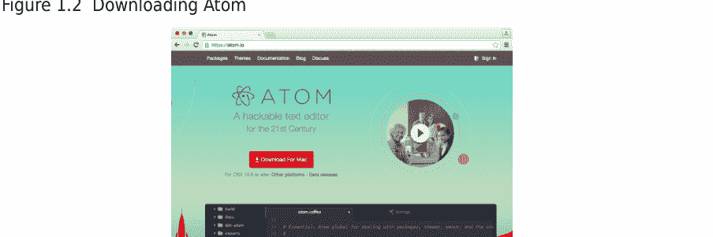

按照你所在平台的安装说明进行操作。安装 Atom 后，还有一些插件需要安装。

### Atom 插件

你对文本编辑器的主要需求是文档查阅、自动补全、代码格式化和代码检查（稍后会详细介绍）。Atom 默认提供了其中一些功能，但安装几个插件会让它变得更好。

打开 Atom 并显示其设置屏幕。在 Mac 上，可以通过选择 Atom → 偏好设置... 或使用键盘快捷键 Command-,（即 Command 键加逗号）来完成。在 Windows 上，可以通过文件 → 设置或使用键盘快捷键 Ctrl-,

在设置屏幕的左侧，点击 + 安装（图 1.3）。

### 图 1.3  Atom 的安装包屏幕

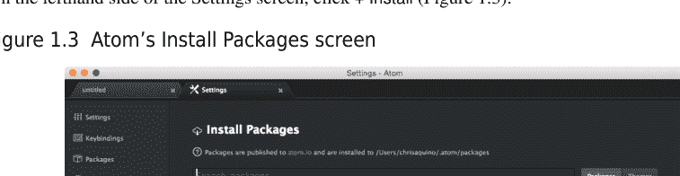

在这里，你可以按名称搜索插件包。首先搜索"emmet"。

编写大量 HTML 可能非常繁琐且容易出错。emmet 插件（图 1.4）让你可以使用便捷的简写来编写格式良好的 HTML。点击安装按钮来安装 emmet。

### 图 1.4  安装 emmet

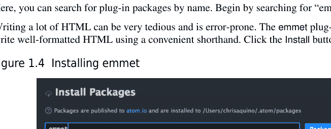

接下来，搜索"atom-beautify"。atom-beautify 插件（图 1.5）有助于代码的缩进，这有助于提高可读性。同样，点击安装来获取这个插件。

### 图 1.5  安装 atom-beautify

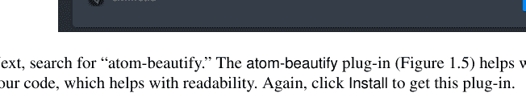


## 第1章 搭建你的开发环境

搜索并安装 autocomplete-paths 插件（图1.6）。很多时候，你的代码需要引用项目中的其他文件和文件夹。这个插件会在你输入时提供文件名自动补全菜单，非常方便。

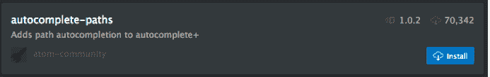

下一个要安装的插件是 api-docs 包（图1.7），它可以让你根据关键词查找文档。它会在编辑器的单独标签页中显示文档。

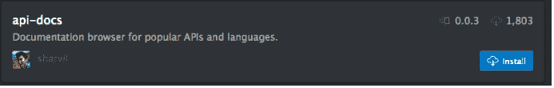

接下来，搜索并安装 linter 包（图1.8）。*linter*（代码检查器）是一个检查代码语法和风格的程序。请确保你找到并安装的包名称就是"linter"。这是一个基础代码检查器，需要与特定语言的插件配合使用。你需要先安装它，才能使用下面提到的其他代码检查插件。

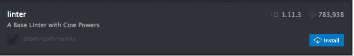

有三款 linter 的配套插件需要安装，用于检查你的 CSS、HTML 和 JavaScript 代码。首先是 linter-csslint（图1.9），它能确保你的 CSS 语法正确，还会提供关于编写高性能 CSS 的建议。

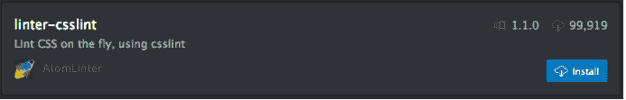

下一个要安装的代码检查配套插件是 linter-htmlhint（图1.10），它会验证你的 HTML 格式是否正确。当 HTML 标签不匹配时，它会发出警告。

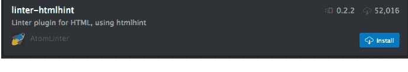

最后一个要安装的代码检查配套插件是 linter-eslint（图1.11）。这个插件会检查你的 JavaScript 语法，并可以配置为检查代码的风格和格式（例如，行缩进多少空格，注释前后有多少空行）。

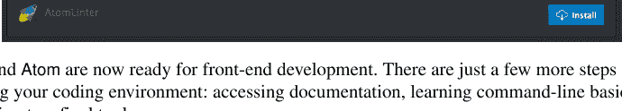

现在 Chrome 和 Atom 已经准备好进行前端开发了。要完成你的开发环境配置，还需要几个步骤：访问文档资源、学习命令行基础知识，以及下载最后两个工具。

### 文档与参考资源

前端开发与 iOS 和 Android 等平台的编程不同。除了明显的差异外，前端技术没有官方的开发人员文档，只有技术规范。这意味着你需要到其他渠道寻找指导。我们建议你熟悉以下资源，并在学习本书的过程中以及日后从事前端开发时经常查阅。

Mozilla 开发者网络（MDN）是有关 HTML、CSS 和 JavaScript 的最佳参考资料。访问方式之一是通过 devdocs.io，这是一个优秀的文档界面（图1.12）。它从 MDN 提取核心前端技术的文档，而且可以离线工作，即使你没有网络连接时也能查阅。

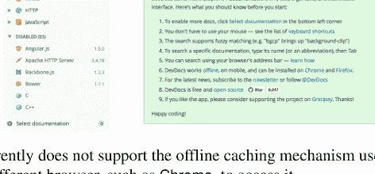

请注意，Safari 目前不支持 devdocs.io 使用的离线缓存机制。你需要使用其他浏览器（如 Chrome）来访问它。

你也可以使用 MDN 的网站 developer.mozilla.org/en-US（图1.13），或者直接将"MDN"添加为搜索引擎关键词来查找所需信息。

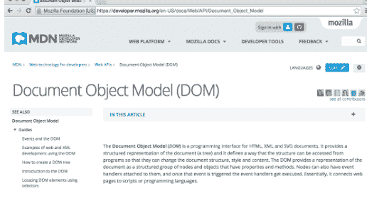

另一个需要了解的网站是 stackoverflow.com（图1.14）。严格来说，这不是一个文档来源，而是开发人员互相询问代码问题的平台。回答的质量参差不齐，但通常非常详尽且很有帮助。因此它是一个有用的资源——只要你记住，由于其众包性质，这些回答并非权威答案。

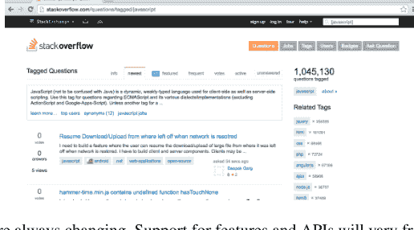

Web 技术总是在不断变化。特性和 API 的支持情况会因浏览器和时间而异。有两个网站可以帮助你确定哪些浏览器（以及各个浏览器的哪些版本）支持哪些特性：html5please.com 和 caniuse.com。当你需要了解特性支持情况时，我们建议先从 html5please.com 开始，了解某个特性是否推荐使用。如需了解哪个浏览器版本支持特定特性的详细信息，请访问 caniuse.com。

### 命令行速成课

在整本书中，你都需要使用*命令行*或*终端*。你将使用的许多工具都是作为命令行程序运行的。

在 Mac 上访问命令行，请打开 Finder，进入"应用程序"文件夹，然后进入"实用工具"文件夹。找到并打开名为"终端"的程序（图1.15）。

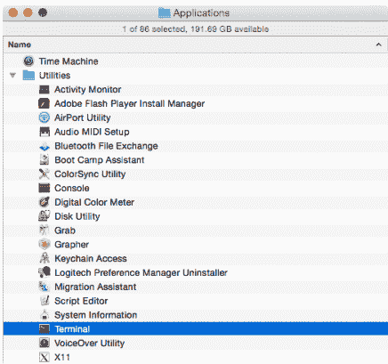

你应该会看到一个类似图1.16的窗口。

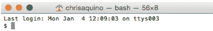

在 Windows 上访问命令行，请打开"开始"菜单并搜索"cmd"。找到并打开名为"命令提示符"的程序（图1.17）。

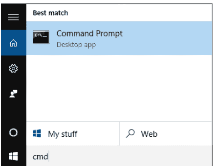

点击它以运行标准的 Windows 命令行界面，看起来像图1.18。

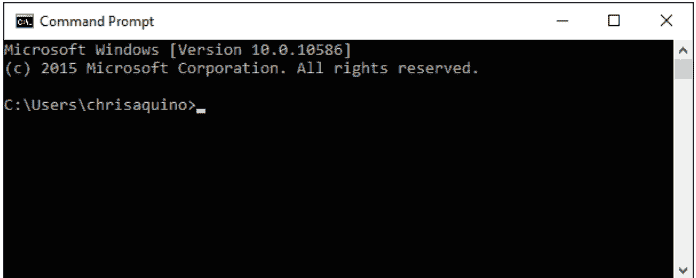

从现在开始，我们将用"终端"或"命令行"来同时指代 Mac 的终端和 Windows 的命令提示符。如果你不熟悉命令行的使用，下面是一些常见任务的简短教程。所有命令都是在提示符处输入后按回车键执行的。

#### 查看当前所在目录

命令行是基于位置的。这意味着在任何时候，它都位于文件结构中的某个特定目录内，你输入的任何命令都会在该目录中执行。命令行提示符显示的是当前目录的缩写版本。要在 Mac 上查看完整路径，请输入命令 `pwd`（代表"print working directory"，即打印工作目录），如图1.19所示。

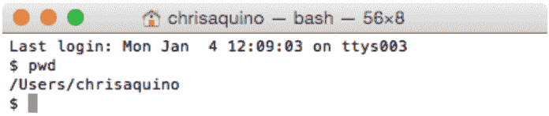

在 Windows 上，使用命令 `echo %cd%` 来查看路径，如图1.20所示。

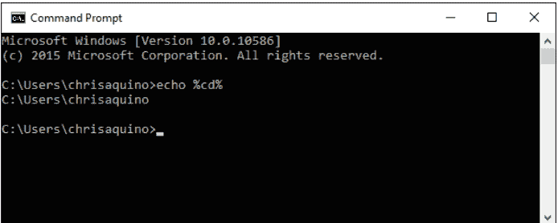

#### 创建目录

前端项目的目录结构很重要。你的项目可能会快速增长，最好从一开始就将它们组织结构好。在开发过程中，你会经常创建新目录。这可以使用 `mkdir` 或"make directory"命令来完成，后面跟上新目录的名称。

要查看这个命令的实际效果，请为你在学习本书过程中将要构建的项目设置一个目录。输入以下命令：

```
mkdir front-end-dev-book
```

接下来，为你的第一个项目 Ottergram 创建一个新目录，你将在下一章开始这个项目。你希望这个新目录是你刚刚创建的 `front-end-dev-book` 目录的子目录。你可以从主目录出发，在新目录名称前加上项目目录的名称，在 Mac 上使用斜杠：

```
mkdir front-end-dev-book/ottergram
```

在 Windows 上，则使用反斜杠：

```
mkdir front-end-dev-book\ottergram
```

#### 切换目录

要在文件结构中移动，需要使用命令 `cd`，即"change directory"（切换目录），后面跟上你要进入的目录路径。

在 `cd` 命令中，你并不总是需要使用完整的目录路径。例如，要进入当前目录的任意子目录，只需使用该子目录的名称即可。所以当你在 `front-end-dev-book` 目录中时，`ottergram` 文件夹的路径就是 `ottergram`。

移动到你的新项目目录：

```
cd front-end-dev-book
```


## 第1章 搭建你的开发环境

现在，你可以进入 ottergram 目录了：

```
cd ottergram
```

要返回上一级目录，请使用命令 `cd ..`（也就是 `cd` 后面跟一个空格和两个句点）。这两个句点代表父目录的路径。

```
cd ..
```

记住，你可以通过 `pwd` 命令（在 Windows 上是 `echo %cd%`）来查看当前目录。图 1.21 展示了作者创建目录、在目录间切换以及检查当前目录的过程。

**图 1.21 更改和检查目录**

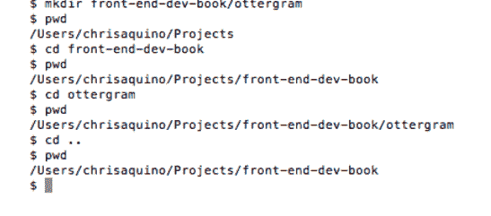

你并不局限于一次只能向上或向下移动一个目录。假设你有一个更复杂的目录结构，如图 1.22 所示。

**图 1.22 示例文件结构**

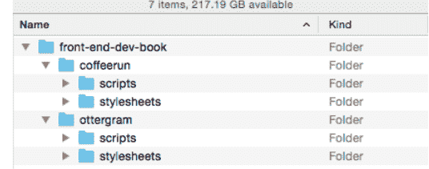

假设你在 ottergram 目录中，想要直接进入 coffeerun 里面的 stylesheets 目录。你可以使用 `cd` 加上一个路径来实现，这个路径的意思是"我现在所在位置的父目录下的 coffeerun 目录中的 stylesheets 目录"：

```
cd ../coffeerun/stylesheets
```

在 Windows 上，你需要使用相同的命令，但使用反斜杠：

```
cd ..\coffeerun\stylesheets
```

### 列出目录中的文件

你可能需要查看当前目录中的文件列表。在 Mac 上，你可以使用 `ls` 命令（图 1.23）。如果你想列出其他目录中的文件，可以提供一个路径：

```
ls
ls ottergram
```

**图 1.23 使用 `ls` 列出目录中的文件**

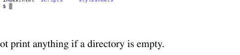

默认情况下，如果目录为空，`ls` 不会输出任何内容。

在 Windows 上，命令是 `dir`（图 1.24），你也可以选择性地提供一个路径：

```
dir
dir ottergram
```

**图 1.24 使用 `dir` 列出目录中的文件**

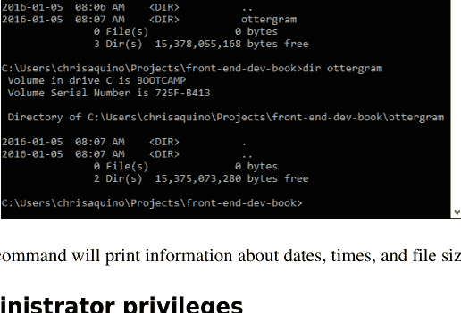

默认情况下，`dir` 命令会输出日期、时间和文件大小等信息。

### 获取管理员权限

在某些版本的 OS X 和 Windows 上，你需要*超级用户*或管理员权限才能运行某些命令，例如安装软件或修改受保护文件的命令。

在 Mac 上，你可以在命令前加上 `sudo` 来获取权限。第一次使用 `sudo` 时，Mac 会给你一个严肃的警告，如图 1.25 所示。

**图 1.25 sudo 警告**

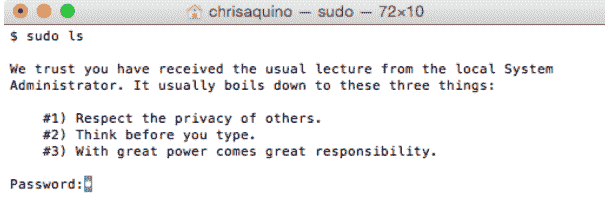

`sudo` 会在以超级用户身份运行命令之前提示你输入密码。输入时，你的按键不会显示在屏幕上，所以要小心输入。

在 Windows 上，如果你需要获取权限，需要在打开命令行界面的过程中进行。在 Windows 开始菜单中找到命令提示符，右键点击它，然后选择"以管理员身份运行"（图 1.26）。在这个命令提示符中运行的任何命令都将以超级用户身份执行，所以要谨慎。

**图 1.26 以管理员身份打开命令提示符**


### 退出程序

随着你在本书中的学习，你会从命令行运行许多应用程序。有些程序会完成工作并自动退出，但其他程序会一直运行，直到你停止它们。要退出命令行程序，请按 Control-C。

### 安装 Node.js 和 browser-sync

在开始你的第一个项目之前，还有最后一个设置步骤。

Node.js（或简称"Node"）让你能够在命令行中使用 JavaScript 编写的程序。大多数前端开发工具都是为配合 Node.js 使用的。你将在第15章中了解更多关于 Node.js 的知识，但你会立即开始使用一个依赖于它的工具：browser-sync。

从 nodejs.org 下载安装程序来安装 Node（图 1.27）。本书使用的 Node.js 版本是 5.11.1，你可能会看到不同的可下载版本。

**图 1.27 下载 Node.js**

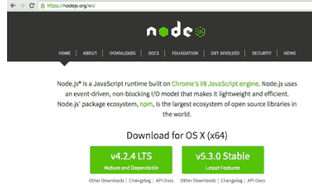

双击安装程序并按照提示进行操作。

安装 Node 时，它会提供两个命令行程序：`node` 和 `npm`。`node` 程序负责运行 JavaScript 编写的程序。直到第15章你才会需要用它。另一个程序是 Node 包管理器 `npm`，用于从互联网安装开源开发工具。

browser-sync 就是这样一个工具，在整本书中它对你来说都是无价之宝。它能让你更轻松地在浏览器中运行示例代码，并在保存代码更改时自动刷新浏览器。

在命令行中使用以下命令安装 browser-sync：

```
npm install -g browser-sync
```

（命令中的 `-g` 代表"全局"。全局安装意味着你可以在任何目录中运行 browser-sync。）

运行此命令时你所在的目录并不重要，但你可能需要超级用户权限。如果是这样，在 Mac 上使用 `sudo` 运行该命令：

```
sudo npm install -g browser-sync
```

如果你在 Windows 上，首先按照上面的说明以管理员身份打开命令提示符。

当你启动 browser-sync 时，就像你在下一章中将要做的那样，它会一直运行，直到你按 Control-C。当你完成项目工作一段时间后，退出 browser-sync 是个好主意。这意味着你需要在本书的前两个项目（Ottergram 和 CoffeeRun）中每次开始工作时都启动 browser-sync。

至此，你已经拥有了开始 Ottergram 项目所需的工具！

### 给更好奇的你：Atom 的替代品

有很多很多文本编辑器可供选择。如果你对 Atom 不太感兴趣，在完成本书的项目后，你可能想尝试以下两个选项之一。两者都可以免费在 Mac 和 Windows 上使用，并且都有大量的插件来自定义你的开发体验。此外，和 Atom 一样，它们都是使用 HTML、CSS 和 JavaScript 构建的，但作为桌面应用程序运行。

Visual Studio Code 是微软的开源文本编辑器，专门为开发 Web 应用程序而设计。可以从 code.visualstudio.com 下载（图 1.28）。

**图 1.28 Visual Studio Code 网站**

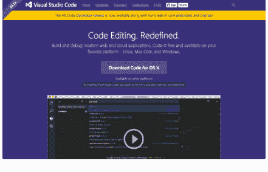

Adobe 的 Brackets 文本编辑器特别适合使用 HTML 和 CSS 构建用户界面。事实上，它提供了一个扩展来帮助你处理 Adobe 的分层 PSD 图像文件。Brackets 可从 brackets.io 获取（图 1.29）。

**图 1.29 Adobe Brackets 网站**

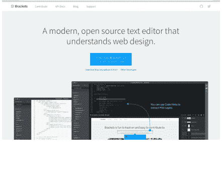

## 第2章 搭建你的第一个项目

当你访问一个网站时，你的浏览器会与服务器（互联网上的另一台计算机）进行对话。

浏览器："嘿！能把名为 cat-videos.html 的文件内容给我吗？"

服务器："当然可以。让我找一下……找到了！"

浏览器："啊，它告诉我需要另一个名为 styles.css 的文件。"

服务器："没问题。让我找一下……找到了！"

浏览器："好的，那个文件说我需要另一个名为 animated-background.gif 的文件。"

服务器："没问题。让我找一下……找到了！"

这段对话会持续一段时间，有时会持续数千毫秒（图 2.1）。

**图 2.1 浏览器发送请求，服务器响应**

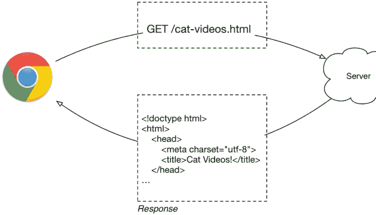

17

浏览器的职责是向服务器发送请求；解释从服务器接收到的 HTML、CSS 和 JavaScript；并将结果呈现给用户。这三种技术各自在用户体验网站时发挥着作用。如果你的应用是一个生物，HTML 就是它的骨骼和器官（机械结构），CSS 就是它的皮肤（可见层），JavaScript 就是它的个性（行为方式）。

在本章中，你将为你的第一个项目 Ottergram 设置基本的 HTML。在下一章中，你将设置 CSS，并在第4章中进一步完善。在第6章中，你将开始添加 JavaScript。

### 设置 Otter Vernacular

在第1章中，你为本书的项目创建了一个文件夹，也为 Ottergram 创建了一个文件夹。启动你的 Atom 文本编辑器，通过点击 File → Open（在 Windows 上是 File → Open Folder…）来打开 ottergram 文件夹。在对话框中，导航到 front-end-dev-book 文件夹并选择 ottergram 文件夹。点击 Open 让 Atom 使用这个文件夹（图 2.2）。

**图 2.2 在 Atom 中打开你的项目文件夹**

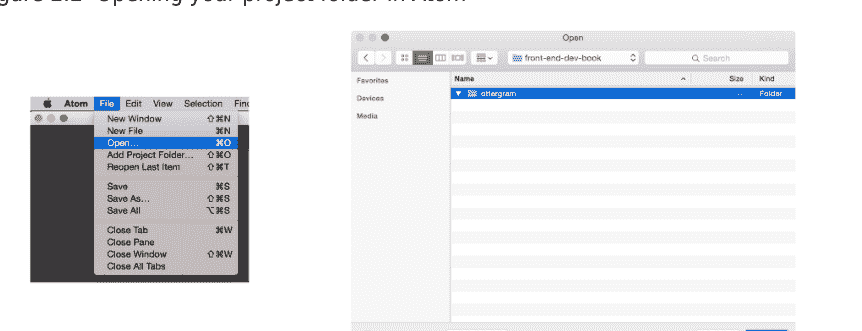

你会在 Atom 的左侧面板中看到 ottergram 文件夹。这个面板用于在你的项目中导航文件和文件夹。

你将使用 Atom 在 ottergram 项目文件夹中创建一些文件和文件夹。按住 Control 键点击（右键点击）左侧面板中的 ottergram，然后在弹出菜单中点击 New File。系统会提示你输入新文件的名称。输入 index.html 并按回车键（图 2.3）。

**图 2.3 在 Atom 中创建新文件**


你可以使用相同的过程在 Atom 中创建文件夹。再次在左侧面板中右键点击 ottergram，但这次在弹出菜单中点击“新建文件夹”。在出现的提示框中输入文件夹名称 `stylesheets`（图 2.4）。

### 图 2.4 在 Atom 中新建文件夹

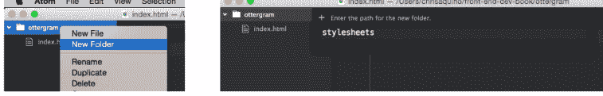

最后，在 stylesheets 文件夹中创建一个名为 `styles.css` 的文件：右键点击左侧面板中的 `stylesheets` 并选择“新建文件”。提示框会预先填入文本 “stylesheets/”。之后，输入 `styles.css` 并按回车键（图 2.5）。

### 图 2.5 在 Atom 中新建 CSS 文件

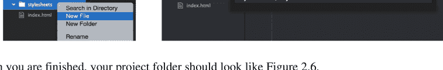

完成后，你的项目文件夹应如图 2.6 所示。

### 图 2.6 Ottergram 的初始文件和文件夹

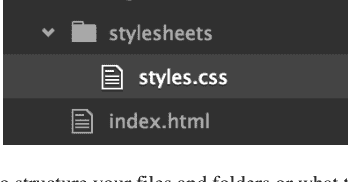

关于如何组织文件和文件夹或如何命名它们，没有固定规则。然而，Ottergram（与本书中的其他项目一样）遵循了许多前端开发者使用的惯例。你的 `index.html` 文件将包含你的 HTML 代码。将主 HTML 文件命名为 `index.html` 可以追溯到 Web 的早期，这个惯例沿用至今。

顾名思义，stylesheets 文件夹将包含一个或多个存储 Ottergram 样式信息的文件。这些将是 CSS（即“层叠样式表”）文件。有时开发者会用描述页面或网站哪个部分相关的名称来命名他们的 CSS 文件，例如 `header.css` 或 `blog.css`。Ottergram 是一个简单的项目，只需要一个 CSS 文件，因此你将其命名为 `styles.css` 以反映其全局作用。

## 第 2 章 设置你的第一个项目

### 初始 HTML

开始编码吧。在 Atom 中打开 index.html 并添加一些基本的 HTML 作为开始。

首先输入 `html`。Atom 会提供一个自动补全选项，如图 2.7 所示。（如果没有，请确保你已按照第 1 章的说明安装了 emmet 插件。）

### 图 2.7 Atom 的自动补全菜单

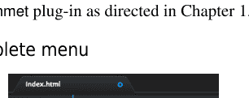

按下回车键，Atom 将提供基本的 HTML 元素让你开始（图 2.8）。

### 图 2.8 使用自动补全创建的 HTML

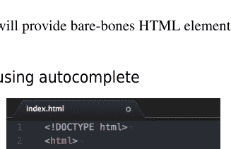

你的光标位于 `<title>` 和 `</title>`（开始和结束标题标签）之间。输入 “ottergram” 为项目命名。现在，点击将光标放在开始和结束 body 标签之间的空行。在那里，输入 “header” 并按回车键。Atom 会将文本 “header” 转换为包含空行的开始和结束 header 标签（图 2.9）。

### 图 2.9 使用自动补全创建的 header 标签

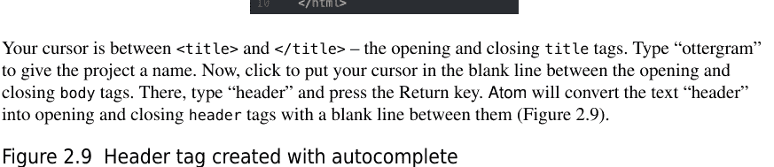

20

接下来，输入 “h1” 并按回车。同样，你的文本被转换为标签，这次没有空行。再次输入文本 “ottergram”。这将是你的网页上出现的标题。

你的文件应该如下所示：

```html
<!doctype html>
<html>
    <head>
        <meta charset="utf-8">
        <title>ottergram</title>
    </head>
    <body>
        <header>
            <h1>ottergram</h1>
        </header>
    </body>
</html>
```

Atom 和 emmet 一起为你节省了一些输入，并帮助你构建了格式良好的初始 HTML。

让我们来检查一下你的代码。第一行 `<!doctype html>` 定义了文档类型——它告诉浏览器文档是用哪个版本的 HTML 编写的。浏览器可能会根据文档类型稍微不同地渲染或绘制页面。这里，文档类型指定了 HTML5。

早期版本的 HTML 通常有冗长、复杂且难以记忆的文档类型，例如：

```html
<!DOCTYPE html PUBLIC "-//W3C//DTD XHTML 1.0 Transitional//EN"
"http://www.w3.org/TR/xhtml1/DTD/xhtml1-transitional.dtd">
```

通常，人们每次创建新文档时都必须查阅文档类型。

使用 HTML5，文档类型简短而精炼。它将在本书的所有项目中使用，你也应该将其用于你的应用程序。

文档类型之后是基本的 HTML 标记，包括 head 和 body。

head 将包含关于文档的信息以及浏览器应如何处理文档。例如，文档的标题、页面使用了哪些 CSS 或 JavaScript 文件，以及文档最后修改的时间都包含在 head 中。

这里，head 包含一个 `<meta>` 标签。`<meta>` 标签为浏览器提供有关文档本身的信息，例如文档作者的名称或搜索引擎的关键词。Ottergram 中的 `<meta>` 标签 `<meta charset="utf-8">` 指定文档使用 UTF-8 字符集编码，该字符集包含所有 Unicode 字符。在你的文档中使用此标签，以便最广泛的浏览器能够正确解释它们，特别是如果你预期有国际流量。

body 将包含代表页面内容的所有 HTML 代码：所有将出现在页面上的图片、链接、文本、按钮和视频。

## 第 2 章 设置你的第一个项目

大多数标签都包含一些其他内容。看看你包含的 h1 标题；它的结构如图 2.10 所示。

### 图 2.10 简单 HTML 标签的结构

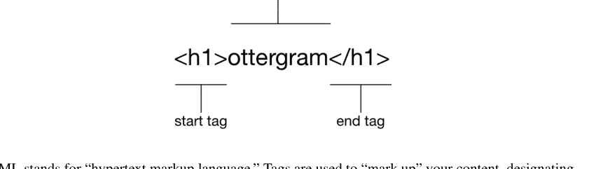

HTML 代表“超文本标记语言”。标签用于“标记”你的内容，指明它们的用途——例如标题、列表项和链接。

一组标签包含的内容也可以包括其他 HTML。例如，请注意 `<header>` 标签包含了上面所示的 `<h1>` 标签（而 `<body>` 标签包含了 `<header>`！）。

有很多标签可供选择——超过 140 个。要查看它们的列表，请访问位于 developer.mozilla.org/en-US/docs/Web/HTML/Element 的 MDN HTML 元素参考。此参考包括每个元素的简要描述，并按用途对元素进行分组（例如，文本内容、内容分节或多媒体）。

### 链接样式表

在第 3 章中，你将在你的样式表 styles.css 中编写样式规则。但还记得本章开头浏览器和服务器之间的对话吗？浏览器只有在被告知文件存在时才会知道向服务器请求该文件。你必须链接到你的样式表，以便浏览器知道要请求它。用指向你的 `styles.css` 文件的链接更新 `index.html` 的 head 部分。

```html
<!doctype html>
<html>
  <head>
    <meta charset="utf-8">
    <title>ottergram</title>
    <link rel="stylesheet" href="stylesheets/styles.css">
  </head>
  <body>
    ...
```

`<link>` 标签是你将外部样式表附加到 HTML 文档的方式。它有两个 *属性*，为浏览器提供有关标签用途的更多信息（图 2.11）。（HTML 属性的顺序无关紧要。）

### 图 2.11 带有属性的标签结构

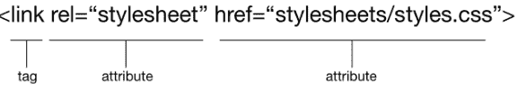

你将 `rel`（或“关系”）属性设置为 `"stylesheet"`，这告诉浏览器链接的文档提供样式信息。`href` 属性告诉浏览器向位于 `stylesheets` 文件夹中的 `styles.css` 文件发送请求。请注意，此文件路径是相对于当前文档的。

在继续之前保存 `index.html`。

### 添加内容

没有内容的网页就像没有咖啡的一天。在你的 header 之后添加一个列表，给你的项目一个存在的理由。

你将使用 `<ul>` 标签添加一个 *无序列表*（即带项目符号的列表）。在列表中，你将使用 `<li>` 标签包含五个列表项，并在每个列表项中包含一些被 `<span>` 标签包围的文本。

更新后的 `index.html` 如下所示。请注意，在本书中，我们以粗体显示你正在添加的新代码。你将删除的代码以删除线显示。现有代码以纯文本显示，以帮助你定位文件中的更改。

我们鼓励你利用 Atom 的自动补全和自动格式化功能。将光标放在适当位置，输入 “ul” 并按回车。接下来，输入 “li” 并按两次回车，然后输入 “span” 并按一次回车。输入一个海獭的名字，然后以同样的方式再创建四个列表项和 span。


## 第2章  设置你的第一个项目

```html
<!doctype html>
<html>
  <head>
    <meta charset="utf-8">
    <title>ottergram</title>
    <link rel="stylesheet" href="stylesheets/styles.css">
  </head>
  <body>
    <header>
      <h1>ottergram</h1>
    </header>
    <ul>
      <li>
        <span>Barry</span>
      </li>
      <li>
        <span>Robin</span>
      </li>
      <li>
        <span>Maurice</span>
      </li>
      <li>
        <span>Lesley</span>
      </li>
      <li>
        <span>Barbara</span>
      </li>
    </ul>
  </body>
</html>
```

嵌套在每个 `<li>` 标签内的 `<span>` 标签没有特殊含义。它们是用于其他内容的通用容器。你将在 Ottergram 中使用它们进行样式设置，并且在阅读本书后续内容时，你会看到其他容器元素的示例。

接下来，你将为输入的名称添加水獭的图片。

### 添加图片

本书所有项目的资源文件位于 `www.bignerdranch.com/downloads/front-end-dev-resources.zip`。它们包括五张由 Michael L. Baird、Joe Robertson 和 Agunther 拍摄、在 `commons.wikimedia.org` 上找到的、采用知识共享许可的水獭图片。

下载并解压资源。在 `ottergram-resources` 文件夹中，找到 `img` 文件夹。将 `img` 文件夹复制到你的 `ottergram/` 项目目录中。（.zip 文件还包含其他资源，但目前你只需要 `img` 文件夹。）

你希望你的列表除了标题外，还包括可点击的缩略图。你将通过向 `ul` 中的每个项目添加锚点标签和图像标签来实现这一点。在你输入这些标签后，我们将更详细地解释这些更改。（如果你使用自动补全，请注意你需要移动 `</a>` 标签，使其位于 span 标签之后。）

```html
...
<ul>
  <li>
    <a href="#">
      
      <span>Barry</span>
    </a>
  </li>
  <li>
    <a href="#">
      
      <span>Robin</span>
    </a>
  </li>
  <li>
    <a href="#">
      
      <span>Maurice</span>
    </a>
  </li>
  <li>
    <a href="#">
      
      <span>Lesley</span>
    </a>
  </li>
  <li>
    <a href="#">
      
      <span>Barbara</span>
    </a>
  </li>
</ul>
...
```

如果你的代码行没有很好地缩进，你可以利用之前安装的 atom-beautify 插件。点击 Packages → Atom Beautify → Beautify，你的代码就会自动对齐和缩进。

让我们看看你添加了什么。

`<a>` 标签是 *锚点* 标签。锚点标签使页面上的元素可点击，从而让用户跳转到另一个页面。它们通常被称为“链接”，但要注意：它们与你之前使用的 `<link>` 标签不同。

锚点标签有一个 `href` 属性，用于指示锚点指向的资源。通常，其值是一个网络地址。但有时，你并不希望链接跳转到任何地方。目前就是这种情况，因此你将 `href` 属性设置为“虚拟”值 `#`。这将使浏览器在点击图像时滚动到页面顶部。稍后，你将使用锚点标签，在点击缩略图时打开图像的较大版本。

在锚点标签内部，你添加了带有 `src` 属性的 `` 或 *图像* 标签，该属性指向你之前添加的 `img` 目录中的文件名。你还为图像标签添加了一个描述性的 `alt` 属性。`alt` 属性包含在图像无法加载时替代图像的文本。`alt` 文本也是屏幕阅读器用于向视力受损用户描述图像的内容。

图像标签与大多数其他元素不同，它们不包裹其他元素，而是引用一个资源。当浏览器遇到 `` 标签时，它会在页面上绘制图像。这被称为 *替换元素*。其他替换元素包括嵌入式文档和小程序。

因为它们不包裹内容或其他元素，`` 标签没有对应的结束标签。这使得它们成为 *自闭合* 标签（也称为 *空* 标签）。有时你会看到自闭合标签在右尖括号前写有一个斜杠，例如 ``。是否包含斜杠取决于个人喜好，对浏览器没有影响。在本书中，自闭合标签不带斜杠书写。

保存 `index.html`。稍后，你将看到你的编码结果。

### 在浏览器中查看网页

要查看你的网页，你需要运行在第1章中安装的 browser-sync 工具。

打开终端，并切换到你的 `ottergram` 文件夹目录。回顾第1章，你可以使用 `cd` 命令后跟要进入的文件夹路径来切换目录。获取 `ottergram` 路径的一个简单方法是，在 Atom 左侧面板中 Control-click（右键点击）`ottergram` 文件夹，然后选择 Copy Full Path（图2.12）。然后，在命令行中，输入 `cd`，粘贴路径，并按回车键。

图2.12  从 Atom 复制 ottergram 文件夹路径

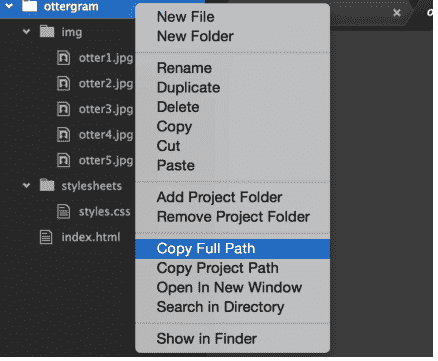

你输入的路径可能类似于这样：

```bash
cd /Users/chrisaquino/Projects/front-end-dev-book/ottergram
```

进入 `ottergram` 目录后，运行以下命令在 Chrome 中打开 Ottergram。（我们将命令分成了两行以适应页面宽度。你应该在单行中输入它。）

```bash
browser-sync start --server --browser "Google Chrome" --files "stylesheets/*.css, *.html"
```

如果 Chrome 是你的默认浏览器，你可以省略命令中的 `--browser "Google Chrome"` 部分：

```bash
browser-sync start --server --files "stylesheets/*.css, *.html"
```

此命令以服务器模式启动 `browser-sync`，使其能够在浏览器发送获取文件的请求（例如你创建的 `index.html` 文件）时发送响应。

你输入的命令还告诉 `browser-sync` 在任何 HTML 或 CSS 文件更改时自动重新加载浏览器。这使得开发体验更加友好。在 `browser-sync` 这类工具出现之前，每次更改后你都必须手动重新加载页面。

图2.13 显示了在 Mac 上输入此命令的结果。

图2.13  在 OS X 终端中启动 browser-sync

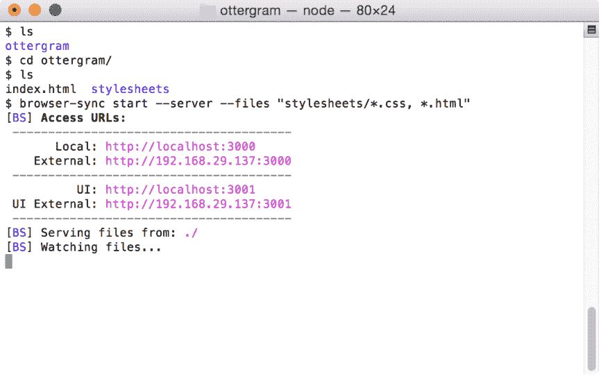

你应该在 Windows 上看到相同的输出（图2.14）。

图2.14  在 Windows 命令提示符中启动 browser-sync

```
Select Command Prompt - browser-sync start --server --files "stylesheets/*.css, *.html"
Microsoft Windows [Version 10.0.10240]
(c) 2015 Microsoft Corporation. All rights reserved.

C:\Users\chrisaquino>cd Projects

C:\Users\chrisaquino\Projects>cd front-end-dev-book

C:\Users\chrisaquino\Projects\front-end-dev-book>dir
 Volume in drive C is BOOTCAMP
 Volume Serial Number is 725F-B413

 Directory of C:\Users\chrisaquino\Projects\front-end-dev-book

2015-10-22  12:05 AM    <DIR>          .
2015-10-22  12:05 AM    <DIR>          ..
2015-10-23  03:21 AM    <DIR>          ottergram
               0 File(s)              0 bytes
               3 Dir(s)  21,512,392,704 bytes free

C:\Users\chrisaquino\Projects\front-end-dev-book>cd ottergram

C:\Users\chrisaquino\Projects\front-end-dev-book\ottergram>browser-sync start --server --files "stylesheets/*.css, *.html"
[BS] Access URLs:
 -----------------------------------
        Local: http://localhost:3000
    External: http://192.168.29.104:3000
 -----------------------------------
          UI: http://localhost:3001
 UI External: http://192.168.29.104:3001
 -----------------------------------
[BS] Serving files from: ./
[BS] Watching files...
```

一旦 Ottergram 页面在 Chrome 中加载完成，你应该能看到你的页面，其中包含“ottergram”标题、“ottergram”作为标签页标签，以及一系列水獭照片和名称（图2.15）。

图2.15  在浏览器中查看 Ottergram

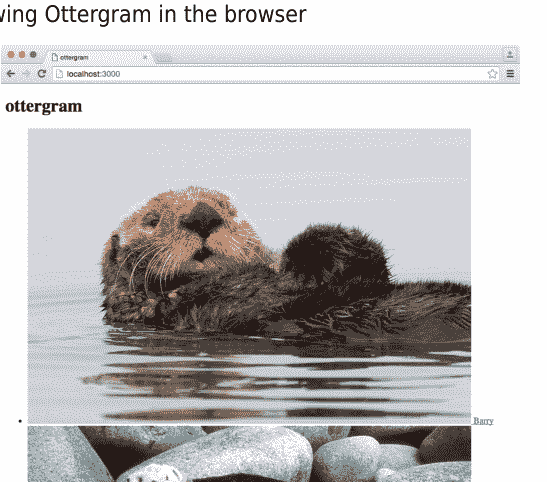


## Chrome 开发者工具

Chrome 浏览器内置了开发者工具（通常称为"DevTools"），它们是目前测试样式、布局等问题的最佳工具之一。使用开发者工具比在代码中尝试各种修改要高效得多。这些工具功能强大，将成为你前端开发过程中的得力助手。

你将在下一章开始使用开发者工具。现在，请先打开窗口，熟悉一下它的主要区域。

要打开开发者工具，请点击 Chrome 地址栏右侧的 ☰ 图标，然后点击"更多工具 → 开发者工具"（图 2.16）。

图 2.16 打开开发者工具

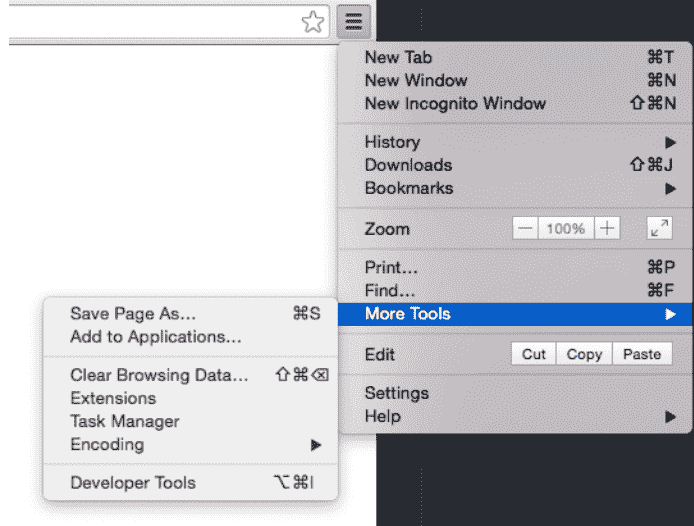

## 第 2 章  设置你的第一个项目

Chrome 默认将开发者工具显示在右侧。你的屏幕看起来会类似于图 2.17。

### 图 2.17  显示元素面板的开发者工具

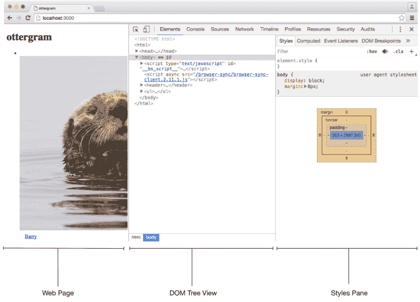

开发者工具展示了代码与生成的页面元素之间的关系。它们允许你检查单个元素的属性和样式，并立即查看浏览器如何解释你的代码。理解这种关系对于开发和调试都至关重要。

在图 2.17 中，你可以看到开发者工具位于网页旁边，显示着元素面板。该面板分为左右两部分。左侧是 *DOM 树视图*。这是对 HTML 的一种表示，将其解析为 DOM 元素。（在接下来的章节中，你将更深入地了解 DOM，它代表"文档对象模型"。）元素面板的右侧是样式窗格。这里显示了应用于各个元素的所有视觉样式。

在工作时，将开发者工具停靠在屏幕右侧通常比较方便。如果你想更改开发者工具的位置，可以点击右上角附近的 ⚙️ 按钮。这会显示一个选项菜单，包括用于选择停靠边的按钮，它们可以更改开发者工具的锚定位置（图 2.18）。

### 图 2.18  更改开发者工具的停靠侧

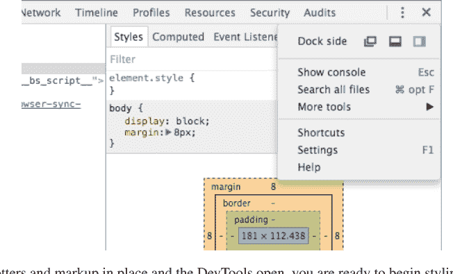

现在，你的水獭图片和标记都已就位，开发者工具也已打开，你已经准备好在下一章开始为你的项目添加样式了。

### 进阶探索：CSS 版本

CSS 的版本历史包括标准版本 1、2 和 2.1。在 2.1 版本之后，人们认为标准需要拆分，因为它变得过于庞大。

没有所谓的版本 3。相反，CSS3 是对一系列模块的统称，每个模块都有自己独立的版本号。

表 2.1  CSS 版本，真实与虚构

| 版本号 | 发布年份 | 主要特性 |
|---|---|---|
| 1 | 1996 | 基本字体属性（font-family, font-style）、前景色和背景色、文本对齐、外边距、边框和内边距。 |
| 2 | 1998 | 绝对定位、相对定位和固定定位；新增字体属性。 |
| 2.1 | 2011 | 移除了浏览器支持不佳的功能。 |
| "3" | 各年份 | 一系列不同规范的集合，例如媒体查询、新选择器、半透明颜色、@font-face。 |

### 进阶探索：favicon.ico 文件

你是否注意到，访问大多数网站时，浏览器地址栏左端会出现一个小图标？有时它们也会出现在浏览器标签页中，如图 2.19 所示。

### 图 2.19  bignerdranch.com 的 favicon.ico


这就是 favicon.ico 图像文件。许多网站都有这个文件，浏览器默认会请求它。因为 Ottergram 项目还没有这个文件，所以你可能会在开发者工具中看到如图 2.20 所示的错误。

### 图 2.20  关于缺少 favicon.ico 的错误

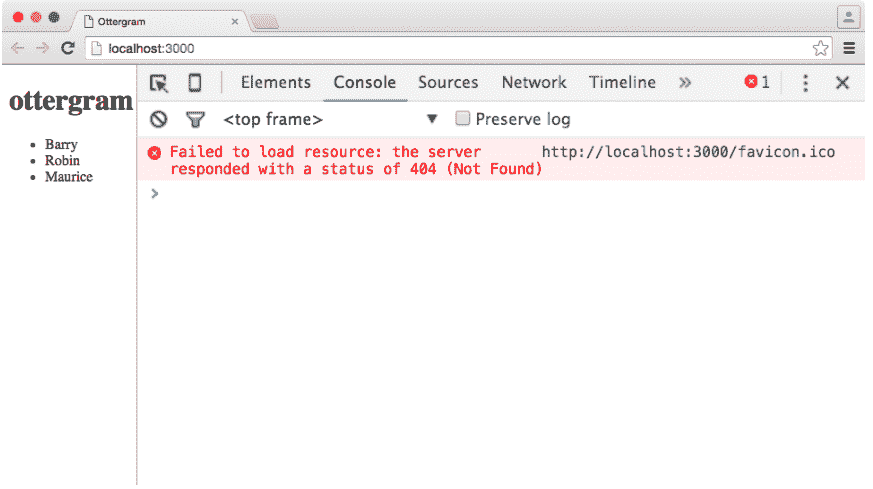

如果出现这个错误，请不用担心。它不会影响你的项目。不过，你可以轻松添加一个 favicon.ico 图像——这正是你的第一个挑战。

### 银级挑战：添加 favicon.ico

你决定，比起看到 favicon.ico 错误提示，你更喜欢水獭。你将使用其中一张水獭图片来创建一个 favicon.ico 文件。

搜索"favicon generator"，你会看到一系列可以为你进行文件转换的网站。大多数网站会允许你上传一张图像，然后提供给你一个 favicon.ico 版本。

选择其中一个，上传任意一张水獭图片。

将生成的 favicon.ico 文件保存到与 index.html 文件相同的文件夹中。最后，刷新你的浏览器。你的浏览器标签页看起来会类似于图 2.21。

### 图 2.21  添加了 favicon.ico 的 Ottergram

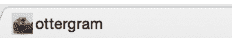

## 第 3 章  样式

在本章中，你将为 Ottergram 设计一个静态版本。在接下来的章节中，你将让 Ottergram 变得可交互。

当你学完本章时，你的网站将看起来像图 3.1。

图 3.1  Ottergram：时尚版

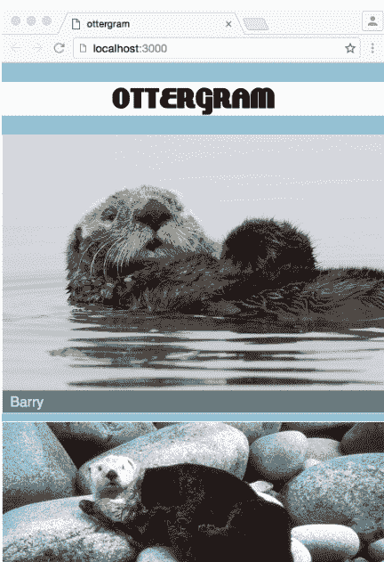

本章介绍了许多概念和示例。如果你在本章结尾时觉得没有掌握所有内容，请不要担心。随着你继续阅读本书，你会反复遇到这些知识，而你本章的工作将为你打下坚实的基础，助你真正理解它们。

当然，我们只能向你介绍 CSS 中所有可用样式中的一小部分。你需要查阅 MDN 来获取关于所有属性及其完整值的信息。

前端开发者在网站样式设计上需要在两种方法之间做出选择：从整体布局开始，逐步细化到最小的细节；或者从最小的细节开始，逐步构建到整体布局。

从细节到全局不仅能产生更清晰、更可重用的代码，而且它还有一个很酷的名字：*原子样式*。当你首先为水獭缩略图设置样式，然后再处理缩略图列表布局时，你就会使用这种方法。在下一章中，你将着手处理整个网站的布局。

### 创建样式基线

你将首先把 `normalize.css` 文件添加到你的项目中。`normalize.css` 有助于你编写的 CSS 在不同浏览器间保持一致的显示效果。所有浏览器都自带一套默认样式，但不同浏览器的默认值是不同的。`normalize.css` 为你开发网站或 Web 应用程序的自定义 CSS 提供了一个良好的起点。

`normalize.css` 在网上可以免费获取。你不需要下载它。要将其添加到 Ottergram 中，你只需要在 `index.html` 中链接它。

为确保你使用的是最新版本的 `normalize.css`，你将从一个内容共享网站获取它的地址。前往 cdnjs.com/libraries/normalize，找到文件名以 `.min.css` 结尾的版本。（这个版本比其他版本文件更小，因为它去掉了多余的空格。）点击复制按钮复制其地址（图 3.2）。

在撰写本文时，当前版本是 3.0.3，但你使用的版本可能更新。

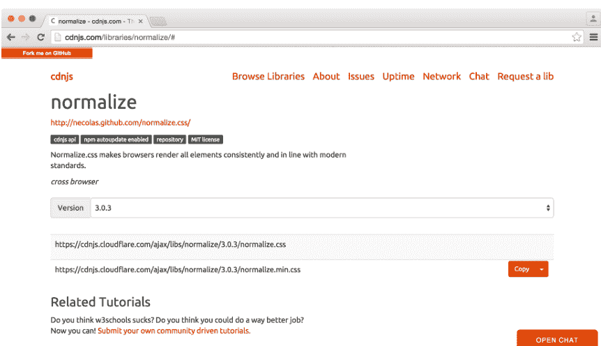

在 Atom 中打开你的 Ottergram 文件夹，然后打开 index.html。添加一个新的 `<link>` 标签，并粘贴地址。（在下面的代码中，`<link>` 被分成两行以适应页面宽度。你可以将其保持在一行。）

```
<!doctype html>
<html>
  <head>
    <meta charset="utf-8">
    <title>ottergram</title>
    <link rel="stylesheet"
      href="https://cdnjs.cloudflare.com/ajax/libs/normalize/3.0.3/normalize.min.css">
    <link rel="stylesheet" href="stylesheets/styles.css">
  </head>
  ...
```

请确保将 normalize.css 的 `<link>` 标签放在 styles.css 的 `<link>` 标签 *之前*。浏览器需要在读取你自定义的样式之前，先读取 normalize.css 中的样式。

就这样，你的项目就可以利用这个有用的工具了。不需要其他设置。

你可能想知道，为什么你要链接一个位于完全不同的服务器上的地址。事实上，HTML 文件指定位于不同服务器上的资源是很常见的（图 3.3）。

### 图 3.3  从不同服务器请求资源

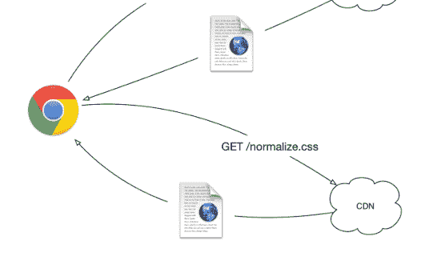

在这种情况下，normalize.css 托管在 cdnjs.com 上，这是一个公共服务器，属于 *内容分发网络*（CDN）的一部分。CDN 在全球各地设有服务器，每台服务器都存储着相同文件的副本。当用户请求一个文件时，他们会从一个附近的服务器接收该文件，从而减少该文件的加载时间。cdnjs.com 托管了许多流行前端库和框架的多个版本。


### 为样式准备 HTML

在上一章中，你创建了一个名为 *styles.css* 的样式表，而本章你将向其中添加一些 CSS *样式规则*。但在开始添加样式之前，你需要设置好 HTML，为你的样式规则提供可以引用的目标。

你将要添加类属性，用于将水獭名字所在的 span 元素标识为“缩略图标题”。类属性是识别一组 HTML 元素的一种方式，通常用于样式设置。你的“缩略图标题”类将允许你轻松地一次性设置所有名字的样式。

在 *index.html* 中，为 li 元素内的 span 元素添加类名 *thumbnail-title* 作为属性，如图所示：

```
...
	<ul>
		<li>
			<a href="#">
				
				<span>Barry</span>
				<span class="thumbnail-title">Barry</span>
			</a>
		</li>
		<li>
			<a href="#">
				
				<span>Robin</span>
				<span class="thumbnail-title">Robin</span>
			</a>
		</li>
		<li>
			<a href="#">
				
				<span>Maurice</span>
				<span class="thumbnail-title">Maurice</span>
			</a>
		</li>
		<li>
			<a href="#">
				
				<span>Lesley</span>
				<span class="thumbnail-title">Lesley</span>
			</a>
		</li>
		<li>
			<a href="#">
				
				<span>Barbara</span>
				<span class="thumbnail-title">Barbara</span>
			</a>
		</li>
	</ul>
...
```

稍后，你将使用这个类名来设置所有图片标题的样式。

### 样式的剖析

当你创建单个样式时，你是通过编写样式规则来实现的，样式规则由两个主要部分组成：*选择器* 和 *声明*（图 3.4）。

图 3.4 样式规则的剖析

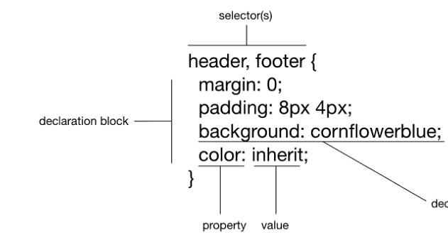

样式规则的第一部分是一个或多个选择器。选择器描述了应该应用样式的元素，例如 h1、span 或 img。但选择器不仅限于标签名称。你可以通过增加选择器的*特异性*来编写应用于更特定元素集合的选择器。

例如，你可以基于属性编写选择器——比如你刚刚添加到 `<span>` 标签上的 thumbnail-title 类属性。基于属性的选择器比基于元素名称的选择器更具特异性。

除了确保样式仅应用于有限的一组元素（例如，应用于类名为 thumbnail-title 的元素与应用于所有 `<span>` 元素）之外，特异性还决定了选择器的相对优先级。如果样式表包含多个可能应用于同一元素的样式，那么具有更高特异性选择器的样式将被使用，而不是特异性较低的选择器的样式。你可以在本章末尾的“延伸阅读”部分阅读更多关于特异性的内容。

在本章中，你将了解到几种不同种类的选择器，它们的特异性各不相同。虽然针对同一元素进行样式设置通常有多种方法，但理解特异性是选择最佳选择器以确保样式可维护性的关键。

样式规则的第二部分是声明块，它包含在花括号中，用于定义要应用的样式。块内的每个声明都包含一个属性名和该属性的一个值。

### 你的第一个样式规则

在你的第一个样式规则中，你将使用刚刚添加的类属性作为选择器，围绕水獭的名字应用样式。

要在样式规则中使用类作为选择器，你需要在类名前加一个点（句号），例如 .thumbnail-title。你将要添加的首批样式将为 .thumbnail-title 类设置背景色和前景色。

打开 styles.css 并添加你的样式规则：

```
.thumbnail-title {
    background: rgb(96, 125, 139);
    color: rgb(202, 238, 255);
}
```

你将在本章后面了解更多关于颜色的知识。现在，只需查看一下你的更改。保存 styles.css 并确保 browser-sync 正在运行。如果需要重新启动，命令如下：

```
browser-sync start --server --browser "Google Chrome" --files "stylesheets/*.css, *.html"
```

这将在 Chrome 中打开你的网页（图 3.5）。

图 3.5 稍微多彩一点的 Ottergram

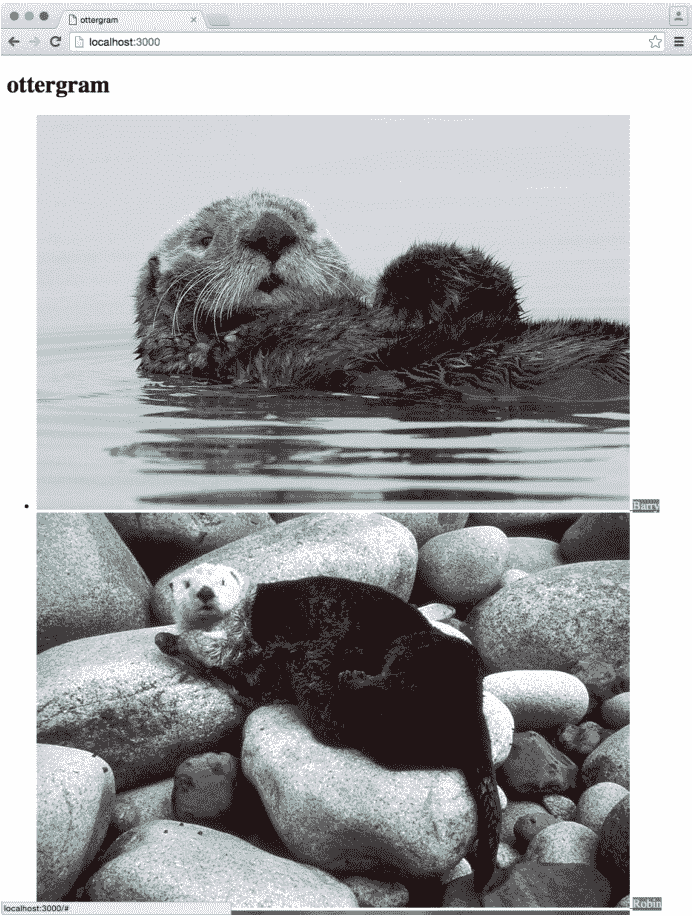

你可以看到，你已将缩略图标题的背景设置为深灰蓝色，字体颜色设置为浅蓝色。不错。

继续设置缩略图标题的样式：返回 `styles.css` 并在你现有的 `.thumbnail-title` 类样式规则中添加内容，如图所示：

```
.thumbnail-title {
  display: block;
  margin: 0;
  padding: 4px 10px;

  background: rgb(96, 125, 139);
  color: rgb(202, 238, 255);
}
```

你添加的三个声明都影响了元素的*盒模型*。对于每个具有视觉表示的 HTML 标签，浏览器都会在页面上绘制一个矩形。浏览器使用一种称为*标准盒模型*（或简称“盒模型”）的方案来确定该矩形的尺寸。

### 盒模型

要理解盒模型，你将在开发者工具中查看它的表示。保存 `styles.css`，切换到 Chrome，并确保开发者工具已打开（图 3.6）。

图 3.6 探索盒模型


点击元素面板左上角的  按钮。这是*检查元素*按钮。现在将鼠标悬停在网页上的“ottergram”这个词上。当你将鼠标悬停在该词上时，开发者工具会用一个蓝桃相间的矩形框围绕标题（图 3.7）。

图 3.7 悬停在标题上


点击网页上的“ottergram”这个词。虽然你不再看到彩色的叠加层，但该元素现在已被选中，并且元素面板中的 DOM 树视图将展开以显示并突出显示相应的 `<h1>` 标签。

元素面板右下角的矩形图代表了 h1 元素的盒模型。你可以看到，图表中的一些区域与你检查标题时看到的叠加矩形具有相同的颜色（图 3.8）。

图 3.8 查看元素的盒模型


盒模型包含了为元素绘制的矩形的四个方面（开发者工具在图中用四种不同的颜色渲染）。

-   content（内容，显示为蓝色）：视觉内容——这里是文本
-   padding（内边距，显示为绿色）：内容周围的透明空间
-   border（边框，显示为黄色）：围绕内容和内边距的边框，可以设置为可见
-   margin（外边距，显示为桃色）：边框周围的透明空间

图 3.8 中的数字是*像素*值；像素是一个单位，对应于计算机屏幕上可以显示单一颜色的最小矩形区域。就 h1 元素而言，内容区域被分配了 197 像素乘以 54 像素的区域（你的值可能不同，取决于浏览器窗口的大小）。左侧有 40 像素的内边距。边框设置为 0，元素的上方和下方有 16 像素的外边距。

这个外边距值从哪里来的？每个浏览器都提供一个默认样式表，称为*用户代理样式表*，以防 HTML 文件没有指定样式表。你指定的样式会覆盖默认样式。因为你还没有为 h1 元素的盒子指定值，所以应用了默认样式。

现在你准备好理解你添加的样式声明了：

```
.thumbnail-title {
  display: block;
  margin: 0;
  padding: 4px 10px;

  background: rgb(96, 125, 139);
  color: rgb(202, 238, 255);
}
```


## 第3章 样式

`display: block`声明将所有属于`.thumbnail-title`类的元素的盒子更改为占据其容器元素允许的全部宽度。（请注意，在图3.6中，标题的背景色现在覆盖了更广泛的区域。）其他显示值，例如稍后你会看到的`display: inline`属性，会使元素的宽度适应其内容。

你还为缩略图标题设置了外边距为0，内边距为两个不同的值：`4px`和`10px`（`px`是"像素"的缩写）。这将内边距设置为特定的像素值，覆盖用户代理样式表中设置的默认大小。

内边距、外边距以及某些其他样式可以写成*简写属性*，即一个值应用于多个属性。你在这里就利用了这一点：当为内边距提供两个值时，第一个应用于两个垂直值（顶部和底部），第二个应用于两个水平值（左侧和右侧）。当然，也可以提供一个值应用于四个方向，或者为每个方向指定单独的值。

总之，你的新声明表示，所有属于`.thumbnail-title`类的元素的盒子将填充其容器的宽度，没有外边距，内边距为顶部和底部4像素、左侧和右侧10像素。

### 样式继承

接下来，你将添加样式来更改文本的大小和外观。

在`styles.css`中添加一个新的样式规则，为`body`元素设置字体大小。为此，你将使用一种不同类型的选择器——*元素选择器*——只需使用元素的名称。

```
body {
    font-size: 10px;
}

.thumbnail-title {
    display: block;
    margin: 0;
    padding: 4px 10px;

    background: rgb(96, 125, 139);
    color: rgb(202, 238, 255);
}
```

这条样式规则将`body`元素的`font-size`设置为`10px`。

你很少会在样式表中使用元素选择器，因为你不会经常想要将完全相同的样式应用于某个标签的每次出现。此外，元素选择器限制了你重用样式的能力；使用它们意味着你可能需要在整个样式表中重复输入相同的声明。如果你需要修改这些样式，这对维护来说并不理想。

但是，在这种情况下，定位`body`元素恰好具有恰到好处的特异性。`<body>`元素只能有一个，你不会重用它的一的样式。

保存`styles.css`，在Chrome中查看你的网页（图3.9）。

#### 图3.9 设置body字体大小后


你的标题和缩略图标题变小了。你可能——也可能没有——预料到这一点。虽然标题直接位于你声明了`font-size`属性的body元素内，但缩略图标题却不是。它们嵌套在好几层深处。然而，许多样式，包括字体大小，会应用于样式规则所指定的元素以及这些元素的*后代*元素。

你的文档结构可以用树形图来描述，如图3.10所示。将元素表示为树是可视化DOM的好方法。

#### 图3.10 Ottergram的简化结构


包含在另一个元素中的元素被称为其*后代*。在这种情况下，你的所有span都是body的后代（同时也是ul和它们各自的li的后代），因此它们继承了body的`font-size`样式。

在DevTools的DOM树视图中，找到并选择其中一个`span`元素。在样式面板中，注意标记为Inherited from a、Inherited from li和Inherited from ul的方框。这三个区域如标记所示，展示了从用户代理样式表在每一级继承的样式。在Inherited from body下，你可以看到`font-size`属性已从`styles.css`中为body元素设置的样式继承而来（图3.11）。

#### 图3.11 从祖先元素继承的样式


如果另一级设置了不同的字体大小，例如`ul`，会怎样呢？更靠近的祖先的样式优先，因此在`styles.css`中为`ul`设置的字体大小会覆盖为`body`设置的字体大小，而为`span`元素本身设置的字体大小则会覆盖两者。

要看到这个效果，请在DOM树视图中点击`ul`元素。这将允许你即时尝试样式。你在这里添加的样式会立即反映在网页视图中，但不会添加到你的实际项目文件中。

在元素面板样式面板的顶部，你会看到一个标记为`element.style`的部分。在`element.style`的花括号之间的任意位置点击，DevTools会给你一个提示（图3.12）。

#### 图3.12 样式规则提示


开始输入`font-size`，DevTools会建议可能的补全选项（图3.13）。

#### 图3.13 样式面板中的自动补全选项


选择`font-size`，然后按Tab键。输入一个较大的值，例如`50px`，然后按Return键。你可能需要滚动页面，但你会看到`ul`的`font-size`已经覆盖了body的（图3.14）。

#### 图3.14 为`ul`设置`font-size`为`50px`


并非所有样式属性都会被继承——例如，border就不会。要了解某个属性是否会被继承，请参阅该属性的MDN参考页面。

回到styles.css，更新`.thumbnail-title`类的声明块，以覆盖body的font-size并改用更大的字体。

```
body {
    font-size: 10px;
}

.thumbnail-title {
    display: block;
    margin: 0;
    padding: 4px 10px;

    background: rgb(96, 125, 139);
    color: rgb(202, 238, 255);

    font-size: 18px;
}
```

对于`.thumbnail-title`类的元素，你将字体大小更改为18像素。

保存styles.css，在Chrome中欣赏你的缩略图标题（图3.15）。

#### 图3.15 样式化后的缩略图标题


它们看起来不错，但用户代理样式表正在为`.thumbnail-title`元素添加下划线。这是因为您用锚点标签将它们（连同`.thumbnail-image`元素）包裹起来，使它们继承了下划线样式。

你不需要下划线，因此要通过更改styles.css中锚点标签的text-decoration属性来移除它们。应该为这个规则使用什么选择器呢？

如果你确信想要从缩略图标题以及Ottergram中任何其他锚点元素中移除下划线，你可以简单地使用元素选择器：

```
a {
    /* style声明 */
}
```

（`/* */`标记之间的文本是CSS注释。代码注释被浏览器忽略；它们允许开发者在代码中做笔记以供将来参考。）

如果你认为自己可能会将锚点用于其他用途（并希望以不同方式设置它们的样式），你可以将元素选择器与*属性选择器*配对，如下所示：

```
a[href] {
    /* 样式声明 */
}
```

此选择器将匹配任何具有href属性的锚点元素。当然，锚点元素通常都有href属性，所以这可能不够有针对性，无法仅匹配缩略图和标题。要使属性选择器更精确，你还可以指定属性的值，如下所示：

```
a[href="#"] {
    /* 样式声明 */
}
```

此选择器将仅匹配那些href属性值为#的锚点元素。

顺便说一下，你也可以单独使用属性选择器，无论是否带有值，例如：

```
[href] {
    /* 样式声明 */
}
```

碰巧，Ottergram是一个相当简单的项目，实际上你不会将锚点标签用于除缩略图及其标题之外的任何东西。因此，使用元素选择器是安全的，你应该这样做，因为它是最直接的解决方案，具有恰到好处的特异性。

将新的样式声明添加到styles.css：

```
body {
    font-size: 10px;
}

a {
    text-decoration: none;
}

.thumbnail-title {
    ...
}
```

保存你的文件并检查浏览器。下划线消失了，你的缩略图标题样式美观（图3.16）。

#### 图3.16 将text-decoration设置为none后


请注意，你不应移除普通文本中链接的下划线——即不是明显标题、题名或说明文字的文本。链接文本的下划线是用户所期望的重要视觉指示器。你在这里这样做是因为缩略图不需要相同的视觉提示。用户可以合理地期望它们是可点击的。


## 第3章 样式

在本章的剩余部分，你将使用类选择器来设置缩略图图片、无序图片列表、列表项（包含缩略图图片及其标题）以及页眉的样式。现在，请在 `index.html` 中为 `h1`、`ul`、`li` 和 `img` 元素添加类名，以便在需要时使用。

```html
...
</head>
<body>
  <header>
    <h1>ottergram</h1>
    <h1 class="logo-text">ottergram</h1>
  </header>
  <ul>
  <ul class="thumbnail-list">
    <li>
    <li class="thumbnail-item">
      <a href="#">
        
        
        <span class="thumbnail-title">Barry</span>
      </a>
    </li>
    </li>
    <li>
    <li class="thumbnail-item">
      <a href="#">
        
        
        <span class="thumbnail-title">Robin</span>
      </a>
    </li>
    </li>
    <li>
    <li class="thumbnail-item">
      <a href="#">
        
        
        <span class="thumbnail-title">Maurice</span>
      </a>
    </li>
    </li>
    <li>
    <li class="thumbnail-item">
      <a href="#">
        
        
        <span class="thumbnail-title">Lesley</span>
      </a>
    </li>
    </li>
    <li>
    <li class="thumbnail-item">
      <a href="#">
        
        
        <span class="thumbnail-title">Barbara</span>
      </a>
    </li>
    </li>
  </ul>
  ...
```

通过为这些元素添加类名，你为自己即将添加的样式提供了目标。

我们倾向于使用类选择器，而不是其他类型的选择器，你也应该这样做。你可以编写描述性很强的类名，使你的代码易于开发和维护。此外，你可以为一个元素添加多个类名，使其成为样式设计中灵活而强大的工具。

在继续之前，请务必保存 `index.html`。

### 让图片适应窗口

遵循原子样式模式，接下来轮到图片进行样式设置了。这些图片太大，除非浏览器窗口也很大，否则它们会被裁剪掉。在 `styles.css` 中为 `.thumbnail-image` 添加样式规则，使缩略图适应窗口：

```css
...
a {
    text-decoration: none;
}

.thumbnail-image {
    width: 100%;
}

.thumbnail-title {
    ...
}
```

你将宽度设置为 `100%`，这将其限制在其容器的宽度内。这意味着当你扩大浏览器窗口时，图片会按比例变大。来看看效果：保存 `styles.css`，切换到浏览器，然后放大和缩小浏览器窗口。图片会随着浏览器窗口一起增长和收缩，始终保持其比例。图3.17展示了在较窄和较宽的浏览器窗口中的 Ottergram。

#### 图3.17 通过宽度适配图片


如果你仔细观察，`.thumbnail-title` 周围的间距有问题，导致标题看起来像是与它们下方的图片相关联。在 `styles.css` 中通过将 `.thumbnail-image` 的 `display` 属性设置为 `block` 来解决这个问题。

```css
...
.thumbnail-image {
  display: block;
  width: 100%;
}
...
```

现在图片与其标题之间的空隙消失了（图3.18）。

#### 图3.18 设置 .thumbnail-image 为 display: block 之后


为什么这能奏效？图片默认是 `display: inline`。它们受类似于文本的渲染规则约束。当文本被渲染时，字母是沿着一条共同的基线绘制的。一些字符，如 `p`、`q` 和 `y`，有一个降部——就是低于这条基线的尾巴。为了容纳它们，在基线下方有一些空白。

将 `display` 属性设置为 `block` 会移除这个空白，因为不需要容纳任何文本（或任何可能与图片一起渲染的其他 `display: inline` 元素）。

### 颜色

现在是时候更深入地探索颜色了。在 `styles.css` 中为 `body` 元素和 `.thumbnail-item` 类添加以下颜色样式。

```css
body {
  font-size: 10px;
  background: rgb(149, 194, 215);
}

a {
  text-decoration: none;
}

.thumbnail-item {
  border: 1px solid rgb(100%, 100%, 100%);
  border: 1px solid rgba(100%, 100%, 100%, 0.8);
}

...
```

你为 `.thumbnail-item` 的边框声明了两次值。为什么？注意这两个声明使用了略有不同的颜色函数：`rgb` 和 `rgba`。`rgba` 颜色函数接受第四个参数，即不透明度。然而，一些浏览器不支持 `rgba`，因此同时提供这两个声明是一种提供*回退*值的技巧。

所有浏览器都会看到第一个声明（`rgb`）并记录其边框属性的值。当不支持 `rgba` 的浏览器看到第二个声明时，它们将无法理解它，并会简单地忽略它，使用第一个声明的值。而*支持* `rgba` 的浏览器将使用第二个声明中的值，并丢弃第一个声明中的值。

（想知道为什么 `body` 的背景色用整数定义，而 `.thumbnail-item` 的边框颜色用百分比定义吗？我们稍后会回到这个问题。）

保存 `styles.css` 并切换到浏览器（图3.19）。

#### 图3.19 背景色和边框


在开发者工具中，你可以看到 Chrome 支持 `rgba`。它通过划掉样式来表示 `rgb` 颜色未被使用（图3.20）。

#### 图3.20 当浏览器支持时使用 rgba


现在，仍然在开发者工具中，选择 `body`。在样式窗格中，注意你刚刚添加的背景色声明。在 RGB 值的左侧有一个小方块，向你展示该颜色的外观。

点击该方块，会打开一个颜色选择器（图3.21）。颜色选择器允许你选择一种颜色，并将以多种不同的格式为你提供 CSS 颜色值。

#### 图3.21 样式窗格中的颜色选择器


要查看不同颜色格式的背景色，请点击 RGBA 值右侧的上下箭头。你可以在 HSLA、HEX 和 RGBA 格式之间循环。

HSLA 格式（代表“色相、饱和度、亮度、alpha”）的使用频率低于其他格式，部分原因是一些最流行的设计工具不提供适用于 CSS 的准确 HSLA 值。如果你对 HSLA 感兴趣，可以访问 css-tricks.com/examples/HSLaExplorer 上的 HSLA 探索器。

看看背景色的 HEX 值：`#95C2D7`。HEX，即十六进制，是最古老的颜色规范格式。每个数字代表一个从 0 到 15 的值。（如果你不熟悉十六进制数，这是通过包含字符 A 到 F 作为数字来实现的。）因此，每对数字可以表示一个从 0 到 255 的值。从左到右，数字对对应于所指定颜色的红色、绿色和蓝色的强度（图3.22）。

**图3.22 HEX 值对应红色、绿色和蓝色值**


许多人觉得 HEX 颜色不直观。一个现代的替代方案是使用 RGB（红、绿、蓝）值。在这种模型中，每种颜色也被分配一个从 0 到 255 的值，但这些值以更熟悉的十进制数字表示，并用颜色分隔。如前所述，对于功能更强大的浏览器，第四个值可以指定所指定颜色的不透明度或透明度，范围从 0.0（完全透明）到 1.0（完全不透明）。不透明度正式称为 *alpha* 值——因此有 RGBA 中的 A。`body` 背景色的 RGBA 值是 `(149, 194, 215, 1)`。

作为声明整数形式的红色、绿色和蓝色值的替代方案，你也可以使用百分比，就像你为 `.thumbnail-item` 边框所做的那样。这两种选项在功能上没有区别。只是不要在同一个声明中混合使用百分比和整数。

顺便提一下，Adobe 在 color.adobe.com 提供了一个免费的在线工具，可以帮助选择令人愉悦的调色板。

### 调整项目间的间距

Ottergram 现在有了一些令人联想到水獭海洋家园的漂亮颜色。但添加颜色暴露了 `.thumbnail-item` 元素边框内一些不需要的空白。此外，那些讨厌的项目符号也分散了对水獭光辉的注意力。


## 第3章 样式

要移除项目符号，请在 styles.css 中将 `.thumbnail-list` 的 `list-style` 属性设为 `none`：

```
...
.thumbnail-item {
    border: 1px solid rgb(100%, 100%, 100%);
    border: 1px solid rgba(100%, 100%, 100%, 0.8);
}

.thumbnail-list {
    list-style: none;
}

.thumbnail-image {
    ...
}
```

要消除空白，你需要使用与处理 `.thumbnail-image` 时相同的技巧。每个 `.thumbnail-item` 默认带有空白间距以适应列表中的各项，就像 `.thumbnail-image` 元素带有空白以容纳相邻文本一样。为 `.thumbnail-item` 添加 `display: block` 声明即可移除它。

```
...
.thumbnail-item {
    display: block;
    border: 1px solid rgb(100%, 100%, 100%);
    border: 1px solid rgba(100%, 100%, 100%, 0.8);
}
...
```

通过这些添加，项目符号和图片上方的多余空白消失了，呈现出如图 3.23 所示的更精美的布局。

### 图 3.23 改进后的布局


如果你不想要项目符号，为什么还要使用项目符号列表呢？最好根据 HTML 标签的语义来选择使用它们，而不是根据浏览器的默认样式。在这种情况下，你需要一个无序的图片列表，所以 `ul` 是最佳选择。当你在第4章中为项目添加详情图片时，图片的 `ul` 容器将允许你将其样式化为滚动列表。浏览器默认用项目符号表示 `ul` 并不重要，因为它们很容易移除。

接下来，你将调整列表中各项的间距。各个 `.thumbnail-item` 元素之间目前没有间距。你将为相邻的缩略图添加外边距。

然而，你不想给*所有*列表项都添加外边距。为什么呢？因为标题已经有外边距了，所以第一个列表项不需要。这意味着你不能使用 `.thumbnail-item` 类选择器，至少不能单独使用。相反，你将使用基于元素之间关系来定位元素的选择器语法。

### 关系选择器

再次查看图 3.10 中的项目结构图。它看起来很像一棵家谱树，对吗？这种相似性赋予了关系选择器这套名称：*后代选择器*、*子元素选择器*、*兄弟选择器*和*相邻兄弟选择器*。

关系选择器语法包含两个选择器（如类选择器或元素选择器），由一个称为*组合符*的符号连接，该符号决定了它们之间的目标关系。要理解关系选择器的工作原理，记住浏览器是从*右到左*读取选择器语法这一点非常重要。让我们来看一些例子。

后代选择器定位属于另一个指定元素后代的任何指定类型的元素。例如，要选择 `body` 元素的后代中的任何 `span` 元素，语法如下：

```
body span {
    /* style declarations */
}
```

此语法不使用组合符。由于它是从右到左读取的，它定位从 `body` 派生的任何 `span`，在当前代码中这意味着缩略图标题。它也会影响可能添加在 header 或 body 内其他位置的任何 span。

请注意，你也可以在关系选择器中使用类选择器（或属性选择器，或任何类型的选择器），因此上面的选择器也可以写成：

```
body .thumbnail-title {
    /* style declarations */
}
```

子元素选择器定位作为另一个指定元素的直接子元素的指定类型元素。子元素选择器语法使用组合符 `>`。要使用子元素选择器语法来定位 Ottergram 中目前所有的 span，语法如下：

```
li > span {
  /* style declarations */
}
```

从右到左读取，此选择器定位作为 `li` 元素直接子元素的任何 `span`——同样是缩略图标题。

兄弟选择器语法使用组合符 `~`。正如你所料，此语法定位具有相同父元素的元素。然而，由于关系选择器的方向性，结果可能并不完全如你所预期。看这个例子：

```
header ~ ul {
  /* style declarations */
}
```

此选择器定位任何在代码中被同一父元素中的 `header` *之前*的 `ul`。此选择器实际上会定位 Ottergram 的 `ul`，因为它在代码中有一个在其前面的兄弟 `header`。然而，反转语法（`ul ~ header`）将不会选中任何元素，因为没有 `header` 被一个兄弟 `ul` 放在前面。

最后一种关系选择器类型是相邻兄弟选择器，它定位*紧接*在指定类型兄弟元素之后的元素。相邻兄弟组合符是 `+`：

```
li + li {
  /* style declarations */
}
```

此语法将选择所有紧接在兄弟 `li` 之后的 `li` 元素。结果是声明的样式将应用于第二个到第五个 `li`——但不包括第一个，因为它前面没有紧接的兄弟 `li`。（请注意，由于 Ottergram 的结构相对简单，通用兄弟选择器和相邻兄弟选择器目前的效果是一样的。）

回到当前的任务：为除第一个以外的每个列表项添加顶部外边距。如果你使用后代选择器或子元素选择器来定位 `.thumbnail-item` 类或 `span` 或 `li` 元素，外边距将应用于所有五个缩略图。由于你只想为除第一个以外的所有缩略图添加样式，请在 styles.css 中使用相邻兄弟选择器语法，仅为那些紧接在另一个缩略图之后的缩略图添加顶部外边距。

```
...
a {
  text-decoration: none;
}

.thumbnail-item + .thumbnail-item {
  margin-top: 10px;
}

.thumbnail-item {
  ...
}
```

保存文件并在浏览器中查看结果（图 3.24）。

### 图 3.24 相邻 `.thumbnail-item` 元素之间的间距


请注意，DevTools 提供了一种简便的方式来查找元素的嵌套路径，这有助于编写关系选择器。如果你点击 `<li>` 元素内的某个 `span` 元素，可以在元素面板底部看到其路径（图 3.25）。

### 图 3.25 元素面板中显示的嵌套路径


对缩略图列表的外观做最后的调整，返回 styles.css 并覆盖 `<ul>` 从用户代理样式表继承的 padding，使图片不再缩进。

```
...
.thumbnail-list {
    list-style: none;
    padding: 0;
}
...
```

照常保存文件并切换到浏览器查看结果（图 3.26）。

### 图 3.26 移除 padding 后的 `ul`


Ottergram 开始看起来精美了。只需对标题添加一些样式，你就能拥有一个漂亮的静态网页。

### 添加字体

之前，你已将 `.logo-text` 类添加到了 `h1` 元素中。将该类作为新样式规则的选择器添加到 styles.css 中。将其插入到锚标签的样式之后。（一般来说，样式的顺序只有在你为同一个选择器设置多组规则时才重要。在 Ottergram 中，样式的大致排列顺序与它们在代码中出现的顺序相同。这取决于个人偏好，你可以自由地按自己认为合适的方式组织样式。）

```
...
a {
  text-decoration: none;
}

.logo-text {
  background: white;

  text-align: center;
  text-transform: uppercase;
  font-size: 37px;
}

.thumbnail-item + .thumbnail-item {
  ...
}
```

首先，你给标题设置了白色背景。然后你将 `.logo-text` 元素内的文本居中，并使用 `text-transform` 属性将其格式化为大写。最后，你设置了字体大小。你的结果将如图 3.27 所示。


## 第 3 章  样式

#### 图 3.27  设置标题样式


Ottergram 看起来很棒。很棒……但对于一个以*水獭*为主题的网站来说，有点朴素了。要增加一些活力，你可以为标题使用用户代理样式表提供的默认字体以外的字体。

我们在你我已经下载并添加到项目目录中的资源文件里包含了一些字体。要使用它们，你需要将 fonts 文件夹复制到你的项目中。将它放在 `stylesheets` 文件夹*内部*（图 3.28）。

#### 图 3.28  `stylesheets` 文件夹内的 `fonts` 文件夹


现在你只需要将一些样式指向这些字体即可。

资源文件中包含了每种字体的多种格式。像往常一样，不同的浏览器厂商支持不同种类的字体。为了支持最广泛的浏览器，你需要在项目中包含所有格式。是的，所有格式。

为了帮助你，`@font-face` 语法允许你为一系列字体指定一个自定义名称，然后你就可以在其余样式中使用这个名称。

`@font-face` 代码块与你一直在使用的声明块略有不同。在 `@font-face` 代码块内部有三个主要部分：

-   首先，`font-family` 属性，其值是一个字符串，用于标识你可以在整个 CSS 文件中使用的自定义字体名称。
-   接下来，多个 `src` 声明，指定不同的字体文件。（注意——顺序很重要！）
-   最后，一些修改字体呈现效果的声明，例如 `font-weight` 和 `font-style`。

在 `styles.css` 顶部添加一个针对 lakeshore 字体族的 `@font-face` 声明，并添加一个样式声明，为 `.logo-text` 类使用这个新字体。

```
@font-face {
    font-family: 'lakeshore';
    src: url('fonts/LAKESHOR-webfont.eot');
    src: url('fonts/LAKESHOR-webfont.eot?#iefix') format('embedded-opentype'),
         url('fonts/LAKESHOR-webfont.woff') format('woff'),
         url('fonts/LAKESHOR-webfont.ttf') format('truetype'),
         url('fonts/LAKESHOR-webfont.svg#lakeshore') format('svg');
    font-weight: normal;
    font-style: normal;
}

body {
    font-size: 10px;
    background: rgb(149, 194, 215);
}

a {
    text-decoration: none;
}

.logo-text {
    background: white;
    text-align: center;
    text-transform: uppercase;
    font-family: lakeshore;
    font-size: 37px;
}
...
```

诚然，正确编写 `@font-face` 声明可能有些棘手，因为各个 url 值的顺序很重要。保留一份声明副本作为参考是个好主意。你也可以查看 Atom 的片段文档 flight-manual.atom.io/using-atom/sections/snippets，了解如何创建自己的代码"片段"或模板。

在声明自定义 `@font-face` 之后，CSS 的其余部分就可以访问 `font-family` 属性的新 lakeshore 值了。在 `.logo-text` 声明中，你设置了 `font-family: lakeshore` 来应用新字体。

保存 `styles.css`，切换到 Chrome，感受一下拥有一个像水獭一样时尚的网页是多么美好（图 3.29）。

#### 图 3.29  为标题应用自定义字体


你在这一章中完成了大量的样式工作，Ottergram 看起来很棒！在下一章中，你将通过添加交互功能让它变得更好。

### 青铜挑战：改变颜色

改变 `body` 的背景颜色样式。使用 DevTools 中的颜色选择器（图 3.21）来帮助你选择颜色。

对于更精致的配色方案，请访问 `color.adobe.com`，为 `body` 和 `.thumbnail-title` 的背景颜色创建你自己的方案。

### 给更好奇的你：特异性！当选择器冲突时……

你已经看到过如何覆盖样式。例如，你在 `styles.css` 的链接之前包含了 `normalize.css` 的链接。这使得浏览器将 `normalize.css` 的样式作为基线，而你的样式优先于基线样式。

这是浏览器选择将哪些样式应用到页面元素的基本概念之一，前端开发者称之为*新近性*：当浏览器处理 CSS 规则时，它们可以覆盖之前处理的规则。你可以通过更改 `<link>` 标签的顺序来控制浏览器处理 CSS 的顺序。

当规则具有相同的选择器时，这很简单（例如，如果你的 CSS 和 `normalize.css` 为 `body` 元素声明了不同的 `margin`）。在这种情况下，浏览器选择更新的声明。但是，对于匹配多个选择器的元素呢？

假设你在 Ottergram CSS 中有以下两条规则：

```
.thumbnail-item {
  background: blue;
}

li {
  background: red;
}
```

这两条规则都匹配你的 `<li>` 元素。你的 `<li>` 元素会是什么背景颜色呢？尽管 `li { background: red; }` 规则更新，但会使用 `.thumbnail-item { background: blue; }`。为什么？因为它使用了类选择器，而类选择器比元素选择器更具体（即，被分配了更高的特异性值）。

类选择器和属性选择器具有相同的特异性程度，而且两者都比元素选择器具有更高的特异性。最高特异性程度属于*ID 选择器*，你还没有见过。如果你给元素一个 `id` 属性，你可以编写一个比其他任何选择器都更具体的 ID 选择器。

ID 属性看起来与其他属性相似。例如：

```
<li class="thumbnail-item" id="barry-otter">
```

要在选择器中使用 ID，你需要在它前面加上 `#`：

```
.thumbnail-item {
  background: blue;
}

#barry-otter {
  background: green;
}

li {
  background: red;
}
```

在这个例子中，`<li>` 被所有三个选择器匹配，但它会有绿色背景，因为 ID 选择器具有最高的特异性。你的规则集顺序在这里无关紧要，因为每个规则集都有不同的特异性。

关于使用 ID 选择器的一点说明：最好避免使用它们。ID 值在文档中必须唯一，因此你不能在文档中的任何其他元素上使用 `id="barry-otter"` 属性。尽管 ID 选择器具有最高的特异性，但它们相关的样式无法重用，这使它们成为维护上的"最差实践"。

要了解更多关于特异性的信息，请访问 MDN 页面 [developer.mozilla.org/en-US/docs/Web/CSS/Specificity](https://developer.mozilla.org/en-US/docs/Web/CSS/Specificity)。

[specificity.keegan.st](https://specificity.keegan.st) 的特异性计算器是一个比较不同选择器特异性的好工具。查看它，以便更精确地理解特异性是如何计算的。

## 第 4 章  使用 Flexbox 的响应式布局

前端开发人员的职责之一是为用户提供最佳体验，无论他们使用什么设备或浏览器。

这并非一直是主流态度，浏览器制造公司对此负有一定责任。在网络的早期，浏览器制造商之间有一场战争。每家都会发明新的非标准功能，试图超越其他公司。作为回应，网页开发者想出了检测哪个浏览器正在请求文档以及使用什么屏幕尺寸的方案。基于这些信息，提供不同版本的文档。

遗憾的是，这意味着前端开发背负着为网站上每个页面创建多个副本的重担，每个副本都使用适用于特定浏览器版本在特定屏幕大小下运行的标记和样式构建。维护所有这些副本既耗时又令人沮丧。

幸运的是，浏览器战争已经结束，浏览器制造商现在努力遵守同一套标准功能——现代前端开发者可以专注于网站的单一代码库。不再需要创建特定于浏览器的页面版本的日子已经一去不复返了。但这并不意味着开发者不能再根据不同的屏幕尺寸或方向提供定制页面。新技术——比如*弹性盒子*（flexbox），你将在本章学习——允许布局根据用户屏幕尺寸进行调整，而无需重复的文档。

在本章中，你将把 Ottergram 从简单的图片列表扩展为适合交互内容的完整用户界面。使用 flexbox 和 CSS 定位，你将构建一套界面组件，这些组件可以根据浏览器窗口大小的变化自动调整，同时保持整体布局。在本章末尾，Ottergram 将展示一个可滚动的缩略图图像列表，以及一个显示单个图像的大尺寸详细版本的区域（图 4.1）。


## 第4章 使用 Flexbox 实现响应式布局

图4.1 采用灵活布局的 Ottergram


你将分两部分完成此任务。首先，你将添加最少的标记和样式，以便在页面上显示大图，并使缩略图变小且可滚动。然后，你将添加样式，使页面的部分内容能够随着窗口大小变化或适应不同尺寸的屏幕而伸缩。

### 扩展界面

自从 iPhone 推出以来，通过智能手机而非台式机或笔记本电脑访问互联网的趋势一直在稳步增长。

对于前端开发者而言，这一趋势意味着*移动优先开发*已被证明是最佳的设计方法：先为小屏幕设计，然后在此基础上为平板电脑尺寸的屏幕构建，最后扩展至台式机尺寸的设计。

Ottergram 的简单布局已经具有移动端友好性。它以适合较小屏幕尺寸的比例显示文本和图像。因此，你可以直接开始为布局添加下一级的复杂性。

垂直滚动的水獭列表虽然不错，但如果用户还能看到更大尺寸的图像版本，体验会更好。Ottergram 的计划是让缩略图列表水平滚动，同时突出显示一个较大的详情图。目前，详情图将位于列表下方。此计划如图4.2所示。

### 添加详情图

图4.2 Ottergram 的新布局


你将从添加详情图开始。

### 添加详情图

目前，你的详情图将固定为单张图片。在第6章中，你将添加功能，使用户可以点击缩略图，将任何图片设为详情图。

在 `index.html` 中添加一段新代码来创建详情图：

```
...
    <li class="thumbnail-item">
      <a href="#">
        
        <span class="thumbnail-title">Barbara</span>
      </a>
    </li>
  </ul>

  <div class="detail-image-container">
    
    <span class="detail-image-title">Stayin' Alive</span>
  </div>

</body>
</html>
```

你添加了一个带有 `detail-image-container` 类的 `<div>`。`<div>` 是一个通用的内容容器——通常用于对包含的内容应用样式，这正是你要使用它的方式。

在 `<div>` 内部，你添加了一个 `` 标签来显示水獭图片的更大版本。你还添加了一个 `<span>`，它包裹着详情图的标题文本。你为 `` 和 `<span>` 标签分别指定了类名 `detail-image` 和 `detail-image-title`。

保存 `index.html`，切换到 `styles.css`，并在末尾限制新的 `.detail-image` 类的宽度。

```
...
.thumbnail-title {
  ...
}

.detail-image {
  width: 90%;
}
```

保存 `styles.css` 并启动 `browser-sync`，在 Chrome 中打开你的项目（图4.3）。（命令是 `browser-sync start --server --browser "Google Chrome" --files "stylesheets/*.css, *.html"`。）

图4.3 详情图的初始样式


你的 `.detail-image` 将出现在页面底部，宽度比缩略图稍窄。通过将详情图设置为其容器宽度的90%，你在其旁边留下了一小块空间。浏览器将 `.detail-image-title` 的文本放在该空间中。（你将在本章后面为该文本设置样式。）

如果你调整页面大小，会发现一个错误：详情图可能会被缩略图在适应新宽度时挤出可视区域。你将在本章后面解决这个问题。

### 缩略图的水平布局

接下来，你将更新 `.thumbnail-list` 和 `.thumbnail-item` 类，使图像可以水平滚动。

为了帮助你测试滚动，将 `index.html` 中的所有五个 `<li>` 元素复制一份。这将为你提供大量可滚动的内容。要执行此操作，只需选中 `<ul class="thumbnail-list">` 和 `</ul>` 之间的所有行，复制它们，然后将结果粘贴到 `</ul>` 正上方。最终你应该得到10个列表项，其中包含两次 otter1.jpg 到 otter5.jpg 的图像。

完成操作后，务必保存 `index.html`。在开发过程中复制内容是模拟更健壮项目的好技巧。它允许你查看代码如何处理真实情况。

对于水平滚动的缩略图列表，每个缩略图必须限制在特定宽度内，并且缩略图应排列在单行中。

你已多次使用的 `display: block` 属性不会产生所需效果。它会导致浏览器在元素前后渲染换行符。然而，一个相关的样式 `display: inline-block` 非常适合这种情况。使用 `inline-block`，元素的盒子绘制方式如同声明了 `display: block`，但没有换行符——允许你的缩略图保持在一行中。

在 `styles.css` 中为 `.thumbnail-item` 类添加一个 `width` 声明并更改 `display` 声明。

```
...
.thumbnail-item {
    display: block;
    display: inline-block;
    width: 120px;
    border: 1px solid rgb(100%, 100%, 100%, 0.8);
    border: 1px solid rgba(100%, 100%, 100%, 0.8);
}
...
```

（请注意，Atom 的 linter 可能会警告你“使用 width 和 border 有时会使元素大于你的预期。”这是因为 `width` 属性仅适用于元素盒子的内容部分——不包括内边距或边框——你无需对此警告采取任何操作。）

由于 `.thumbnail-item` 元素的宽度设置为绝对值 120px，`.thumbnail-image` 实际上也被固定了，因为 `.thumbnail-image` 会调整为其容器的宽度。

为什么不直接将 `.thumbnail-image` 设置为 `width: 120px`？你希望 `.thumbnail-image` 和 `.thumbnail-title` 具有相同的宽度。你不是为每个元素单独设置 width 属性，而是将它们设置在其共同的父元素上。这样，如果你需要更改宽度，只需在一个地方修改即可。通常，让内部元素适应其容器是一个好习惯。

保存 `styles.css` 并在 Chrome 中检查你的页面。你可以看到 `.thumbnail-item` 元素并排排列——但当它们填满容器的宽度时，它们会换行（图4.4）。

图4.4 inline-block 创建会换行的行


要获得所需的滚动行为，请在 `styles.css` 中将 `.thumbnail-list` 设置为防止换行并允许滚动。

```
...
.thumbnail-list {
  list-style: none;
  padding: 0;

  white-space: nowrap;
  overflow-x: auto;
}
...
```

`white-space: nowrap` 声明防止 `.thumbnail-item` 元素换行。`overflow-x: auto` 告诉浏览器，它应该在 `.thumbnail-list` 元素的水平空间（x轴）上添加一个滚动条，以容纳溢出（即无法容纳在 `.thumbnail-list` 内）的内容。没有这个声明，你将不得不滚动整个网页才能看到额外的缩略图。

再次保存文件并在浏览器中查看结果。缩略图现在在一行中，你应该能够水平滚动浏览它们（图4.5）。

图4.5 水平滚动的缩略图


这是增强版 Ottergram 界面的一个良好开端。对于某些屏幕尺寸，它运行良好。然而，它并不完美，因为它不能很好地适应各种尺寸——特别是那些比你当前使用的计算机大得多或小得多的尺寸。

在接下来的两节中，你将添加代码，为 Ottergram 提供更流畅的布局，并使其*用户界面*能够在不同布局之间切换，以适应不同的屏幕尺寸范围。

### Flexbox

你已经看到 display 样式指定了 `block` 和 `inline` 属性。内联元素，如你新滚动列表中的缩略图项目，并排排列，而块元素占据自己的水平行。

另一种思考方式是，块元素*流动*方向是从上到下，而内联元素的流动方向是从左到右（图4.6）。

图4.6 块元素与内联元素


 ## 第4章  使用 Flexbox 实现响应式布局

`display` 属性告诉浏览器元素在布局中应如何流动。对于博客或在线百科全书来说，`inline` 和 `block` 值效果很好。但对于应用程序风格的布局（如基于 Web 的电子邮件和社交媒体网站），有一种新的 CSS 规范可以让元素更动态地流动。这就是*弹性盒子模型*，即 flexbox。

Flexbox CSS 属性可以确保缩略图区域和详情区域填满屏幕，并保持彼此之间的比例关系。这正是 Ottergram 所需要的。你还可以使用 flexbox 属性将详情区域的内容水平和垂直居中，而使用标准盒子模型属性实现这一点是出了名的困难。

### 创建弹性容器

在添加第一个 flexbox 属性之前，请在 `styles.css` 中将 `<html>` 和 `<body>` 元素设置为 `height: 100%`。`<html>` 元素是 DOM 树的根元素，`<body>` 是绘制在其内部的子元素。将两者的高度都设置为 `100%` 可以让内容填满浏览器或设备窗口。

```
@font-face {
  ...
}

html, body {
  height: 100%;
}

body {
  font-size: 10px;
  background: rgb(149, 194, 215);
}
...
```

请注意，在这个样式规则中，你将两个选择器用逗号分隔进行分组。任何类型的选择器都可以这样组合来设置公共样式。

还要注意，现在你有两个使用 body 元素选择器的样式规则。当浏览器看到某个选择器的额外样式声明时，它会简单地将这些样式信息添加到该选择器已有的样式信息中。在这种情况下，它首先看到 `<body>` 应该有 100% 的高度并存储该信息。当它读取到 `<body>` 的下一条样式规则时，它会将 `background` 和 `font-size` 信息与 `height` 样式一起存储。

现在你可以创建你的第一个*弹性容器*了。当一个元素成为弹性容器时，它可以控制其子元素（即它的*弹性项目*）如何布局。在弹性容器内部，弹性项目的大小和放置沿着*主轴*和*交叉轴*进行（图 4.7）。

图 4.7 弹性容器的主轴和交叉轴


在 `styles.css` 中，通过向 `<body>` 元素的样式规则添加 `display: flex` 声明，使其成为弹性容器。

```
body {
  display: flex;

  font-size: 10px;
  background: rgb(149, 194, 215);
}
```

如果你现在保存，浏览器会显示一个看起来相当简陋的 Ottergram，如图 4.8 所示。这是因为主轴是从左到右的，将弹性项目（`<body>` 的所有子元素）排成一行。

图 4.8 沿着主轴排列的弹性项目


但是，你可以看到各个项目会收缩以适应空间，而不是换行。这是第一个好消息。第二个好消息是，你只需一个样式就可以修复布局。（好吧，几乎只需一个。）

### 更改 flex-direction

为了修复布局，在 styles.css 中将 `<body>` 元素的 flex-direction 设置为 column：

```
body {
  display: flex;
  flex-direction: column;

  font-size: 10px;
  background: rgb(149, 194, 215);
}
```

这会交换弹性容器的主轴和交叉轴，如图 4.9 所示。

图 4.9 flex-direction: column 时的主轴和交叉轴


将 flex-direction 改为 column 后，Ottergram 恢复正常了——差不多吧。当浏览器窗口的宽度远大于高度时，布局中会出现一个视觉 bug，如图 4.10 所示。

图 4.10 页面横向拉伸时缩略图消失


你将通过添加一个包装元素并应用新的 flexbox 属性来解决这个问题。

### 在弹性项目中对元素进行分组

`<body>` 有三个弹性项目：`<header>`、`.thumbnail-list` 和 `.detail-image-container`。无论在 Ottergram 的开发（和使用）过程中发生什么，`<header>` 的布局或复杂度都不太可能改变太多。它将位于页面顶部，显示文本。仅此而已。

另一方面，随着 Ottergram 的开发，`.thumbnail-list` 和 `.detail-image-container` 及其内容的布局和复杂度很可能会发生变化。而且，对其中一个项目的更改很可能会影响另一个。

因此，你要将 `.thumbnail-list` 和 `.detail-image-container` 放在它们自己的弹性容器中。为此，你将用带有类名 `.main-content` 的 `<main>` 标签将它们包裹起来（图 4.11）。

图 4.11 包裹 .thumbnail-list 和 .detail-image-container


在 index.html 中实现：给 `<header>` 元素添加 main-header 类，然后将 `.thumbnail-list`（`<ul>`）和 `.detail-image-container`（`<div>`）包裹在带有 main-content 类的 `<main>` 元素中。

```
...\n<body>\n  <header class="main-header">\n    <h1 class="logo-text">ottergram</h1>\n  </header>\n  <main class="main-content">\n    <ul class="thumbnail-list">\n      ...\n    </ul>\n    <div class="detail-image-container">\n      \n      <span class="detail-image-title">Stayin' Alive</span>\n    </div>\n  </main>\n...
```

`.main-header` 和 `.main-content` 现在是 `<body>` 内部的两个弹性项目。

通过将 `.thumbnail-list` 和 `.detail-image-container` 包裹在 `.main-content` 元素中，你现在可以自由地为 `<header>` 声明高度，将 `<body>` 的其余垂直空间留给 `.main-content` 占据。这样，`.main-content` 内部的空间可以分配给 `.thumbnail-list` 和 `.detail-image-container`，而不会影响标题。

保存 index.html。既然已经有了 body 内两个弹性项目的标记，你就可以使用 flex 属性设置它们彼此之间的相对大小了。

### flex 简写属性

弹性容器会将其空间分配给内部的弹性项目。如果弹性项目没有指定沿主轴的大小，那么容器会根据弹性项目的数量均匀分配空间，每个弹性项目沿主轴获得同等份额的空间。这是默认值，如图 4.12 所示。

图 4.12  三个弹性项目之间的均等空间分配


但想象一下，图 4.12 中的三个弹性项目之一比其他项目更"贪婪"，占用了两份总空间。在这种情况下，弹性容器会沿主轴将空间分成四份。贪婪的项目占据其中两份（一半空间），其他项目各得一份（图 4.13）。

图 4.13  三个弹性项目之间的不均等空间分配


在 Ottergram 中，你希望 `.main-content` 元素成为贪婪的元素，沿主轴尽可能多地占用空间。另一方面，`.main-header` 应该尽可能少地占用空间。

`flex` 属性让弹性项目指定它们将占用多少可用空间。它是一个简写属性，如图 4.14 所示。

图 4.14  `flex` 简写属性及其值


我们强烈建议你使用 flex，而不是它所代表的各个单独属性。这样可以防止你不小心遗漏某个属性而得到意外结果。

第一个值是目前要重点关注的，因为它决定了弹性项目可以增长多少。默认情况下，弹性项目根本不会增长。你希望 `.main-header` 保持这种默认行为，但 `.main-content` 不行。

在 styles.css 中，为 `.main-header` 类选择器添加声明块，指定带有默认值的 flex 简写属性：`0 1 auto`。

```
...
a {
  text-decoration: none;
}

.main-header {
  flex: 0 1 auto;
}

.logo-text {
  background: white;
  ...
}
```

值 `0 1 auto` 可以理解为："我不想再变大了；我会根据需要收缩；请帮我计算我的大小。"最终结果将是 `.main-header` 只占用它所需的空间，不会更多。

接下来，为 `.main-content` 添加声明块，将其 flex 设置为 `1 1 auto`。

```
...
.logo-text {
  ...
}

.main-content {
  flex: 1 1 auto;
}

.thumbnail-item + .thumbnail-item {
  ...
}
```

`.main-content` 的 flex 声明中的第一个值对应于 flex-grow 属性。值为 1 告诉容器："我想尽可能大地增长。"因为它的唯一兄弟元素已经声明它不会增长，所以 `.main-content` 元素将增长到占用 `.main-header` 不需要的所有空间。

`<body>` 的两个弹性项目——`.main-header` 和 `.main-content` 元素——根据它们的需求占据弹性空间。现在是时候调整 `.main-content` 元素的布局了。

### 弹性项目的排序、对齐与分布

Flexbox 还允许你将弹性项目细分为弹性容器。这种技术让你可以专注于层级。稍后，你将让 `.main-content` 成为一个弹性容器。

使用嵌套弹性容器是一种例外情况，它不同于创建视觉组件外观的原子样式方法。与先对最小、最内层的元素进行样式设置，然后逐步向外处理最大元素不同，在使用 flexbox 进行布局时，从外层的元素开始，逐步向内处理会更有用。


# 第四章 使用Flexbox实现响应式布局

接下来你将处理以下内容。你需要将`.main-content`更改为一个具有垂直主轴的flex容器。同时，你需要为`.main-content`的flex项目指定flex属性，使`.thumbnail-list`占据默认空间，而`.detail-image-container`则增长以填充剩余空间。最后，你需要将`.thumbnail-list`移动到`.detail-image-container`下方（图4.15）。

### 图4.15 使.main-content成为一个flex容器


在`styles.css`中进行这些更改：在`.main-content`的声明块中添加`display: flex`和`flex-direction: column`，在`.thumbnail-list`的声明块中添加flex属性，并为`.detail-image-container`类编写一个新的声明块。

```
...
.main-content {
  flex: 1 1 auto;
  display: flex;
  flex-direction: column;
}

...

.thumbnail-list {
  flex: 0 1 auto;
  list-style: none;
  padding: 0;

  white-space: nowrap;
  overflow-x: auto;
}

...

.thumbnail-title {
  ...
}

.detail-image-container {
  flex: 1 1 auto;
}

.detail-image {
  ...
```

你可能想知道，为什么不像定义`.detail-image`的宽度那样，用百分比来定义`.thumbnail-list`和`.detail-image-container`盒子的高度。例如，将`.thumbnail-list`的高度设置为25%，将`.detail-image-wrapper`的高度设置为75%，这看起来合乎逻辑——但这并不能按你期望的方式工作。与`.detail-image`的`width`属性的交互会导致`.detail-image-container`变得过大，而`.thumbnail-list`最终会变得过小或过大，这取决于窗口大小。

简而言之，使用`flex`属性来设置flex项目的大小，并结合你关心的那个固定尺寸——`.detail-image`的宽度——才是正确的方法。

现在将缩略图列表移动到详情图下方。默认情况下，flex项目按照它们在HTML中出现的顺序绘制。这被称为*源顺序*，是开发者控制元素绘制顺序的主要方式。

将详情图上移的一个选项是剪切并粘贴详情图的标记，使其位于`.thumbnail-list`的标记之前——即更改源顺序。然而，也可以使用一个新的flexbox属性来实现。

要使用flexbox更改顺序，请在`styles.css`中的`.thumbnail-list`选择器添加一个`order`声明。

```
...
.thumbnail-list {
  flex: 0 1 auto;
  order: 2;
  list-style: none;
  padding: 0;

  white-space: nowrap;
  overflow-x: auto;
}
...
```

`order`属性可以被赋予任何整数值。默认值为`0`，告诉浏览器使用源顺序。任何其他值，包括负数，告诉浏览器在绘制flex项目时将其放在其他flex项目的前面或后面。给`.thumbnail-list`声明`order: 2`告诉浏览器将其绘制在*之后*任何具有较低`order`值的兄弟元素——例如使用默认值的`.detail-image-container`。

保存`styles.css`并切换到Chrome。你将看到缩略图沿页面底部渲染（图4.16）。

### 图4.16 更改元素绘制顺序


接下来，你将继续在Ottergram UI的布局工作中应用`display: flex`。到目前为止，你已经使用过只包含几个flex项目的flex容器。将`.thumbnail-list`设为一个flex容器，以便你进一步探索flexbox能为你提供什么。

```
... 
.thumbnail-list {
  flex: 0 1 auto;
  order: 2;
  display: flex;
  list-style: none;
  padding: 0;

  white-space: nowrap;
  overflow-x: auto;
}
...
```

如果你保存更改后看到缩略图渲染得很奇怪，如图4.17所示，不要惊慌。

### 图4.17 水獭，歪了


要修复此问题，请将`.thumbnail-item`的`width`声明替换为一对声明，一个用于`min-width`，另一个用于`max-width`。这将消除导致布局异常的尺寸变化。

你也可以删除为`.thumbnail-item + .thumbnail-item`元素设置`margin-top`的声明块。此布局不再需要它。

```
.thumbnail-item + .thumbnail-item {
  margin-top: 10px;
}

.thumbnail-item {
  display: inline-block;
  width: 120px;
  min-width: 120px;
  max-width: 120px;
  border: 1px solid rgb(100%, 100%, 100%);
  border: 1px solid rgba(100%, 100%, 100%, 0.8);
}
```

接下来，你将处理`.thumbnail-list`内部flex项目的间距。在`styles.css`中，为`.thumbnail-list`选择器添加一个`justify-content`声明。

```
.thumbnail-list {
  flex: 0 1 auto;
  order: 2;
  display: flex;
  justify-content: space-between;
  list-style: none;
  padding: 0;

  white-space: nowrap;
  overflow-x: auto;
}
```

`justify-content`属性允许flex容器控制flex项目在主轴上的绘制方式。你使用了`space-between`作为值，以确保每个flex项目周围都有均匀的间距。

你可以为`justify-content`指定五个不同的值。图4.18说明了每个值的工作原理。

### 图4.18 `justify-content`属性的值


你已经处理了`.thumbnail-list`的布局。接下来，你将处理`.detail-image-container`及其内容。

### 居中显示详情图

详情图应该是Ottergram的焦点。它应该位于最前方和中心位置，以确保用户能够欣赏到水獭的雄姿。它还应该配有一个时髦的标题。

要居中显示详情图，你将首先将图像及其标题包裹在一个容器中，然后在`.detail-image-container`内居中*包装器*。这个想法如图4.19所示。

### 图4.19 为`.detail-image`和`.detail-image-title`添加边框


虽然你可以将`.detail-image`本身在`.detail-image-container`内居中，但很难正确偏移`.detail-image-title`，因为`.detail-image`和`.detail-image-container`都是动态调整大小的。

在这种情况下，一个中间包装器元素是一个有用的技术。它将限制`.detail-image`的大小，并作为定位`.detail-image-title`的参考。

在`index.html`中，首先添加一个类名为`detail-image-frame`的`<div>`：

```
...
        </ul>

        <div class="detail-image-container">
            <div class="detail-image-frame">
                
                <span class="detail-image-title">Stayin' Alive</span>
            </div>
        </div>
    </main>
</body>
</html>
```

保存`index.html`。现在，在`styles.css`中，为`.detail-image-frame`添加一个声明块，包含一个样式声明：`text-align: center`。这是在不使用flexbox的情况下居中内容的一种方法，但请注意它只适用于水平方向。

```
...
.detail-image-container {
    flex: 1 1 auto;
}

.detail-image-frame {
    text-align: center;
}

.detail-image {
    width: 90%;
}
```

接下来，为了在`.detail-image-container`内居中`.detail-image-frame`，请更新`styles.css`使`.detail-image-container`成为一个flex容器。使用`justify-content: center`将其flex项目绘制在主轴的中心（在这种情况下是水平方向——默认方向），并添加一个新的flexbox属性`align-items: center`，将其flex项目绘制在交叉轴的中心（垂直方向）。

```
...
.detail-image-container {
    flex: 1 1 auto;
    display: flex;
    justify-content: center;
    align-items: center;
}
...
```


保存你的更改，然后欣赏那只骄傲的水獭，它高贵地居中在`.detail-image-container`中（图4.20）。

### 图4.20 将`.detail-image-frame`在`.detail-image-container`内居中后


### 绝对定位和相对定位

有时你需要将一个元素精确放置在另一个元素内部的特定位置。CSS提供了一种使用*绝对定位*来实现这一点的方法。

你将使用绝对定位将`detail-image-title`放置在`.detail-image-frame`的左下角，如图4.21所示。

图4.21 绝对定位的`.detail-image-title`


绝对定位有三个要求。绝对定位的元素必须：

- 属性`position: absolute`，以告诉浏览器将其从*正常流*中移除，而不是与它的兄弟元素一起布局

- 坐标，使用`top`、`right`、`bottom`和`left`属性中的一个或多个提供；绝对长度（如像素）或相对长度（如百分比）可以用作值

- 一个具有显式声明的`position`属性（值为`relative`或`absolute`）的祖先元素；这一点很重要——如果没有祖先声明`position`属性，绝对定位的元素将相对于`<html>`元素（浏览器窗口）定位。

提个醒：你可能很想在所有地方都使用`position: absolute`，但应该谨慎使用。整个布局都使用绝对定位几乎无法维护，并且在除其开发所用屏幕尺寸之外的任何屏幕上都会显得很糟糕。

在指定坐标时，你实际上是指定元素边缘到其容器边缘的距离，如图4.22所示。

### 图4.22 元素根据其边缘进行绝对定位

元素位置：200px, 50px

```
position: absolute;
top: 50px;
left: 200px;
```

```
position: absolute;
bottom: 50px;
left: 200px;
```

元素位置：200px, 50px

图4.22有两个绝对定位的例子。在第一个例子中，元素的上边缘距离其容器的上边缘50px，左边缘距离其容器的左边缘200px。第二个例子展示了一种变化，其中元素根据其下边缘和左边缘定位。

要定位`.detail-image-title`，首先在`styles.css`中声明`.detail-image-frame`具有`position: relative`。你将相对于它来定位`.detail-image-title`。

```
.detail-image-frame {
  position: relative;
  text-align: center;
}
```

你对`.detail-image-frame`使用了`position: relative`，因为你希望它保留在正常流中。你也希望它作为绝对定位后代的容器，因此其`position`属性必须被显式定义。

## 第4章 使用Flexbox实现响应式布局

在`styles.css`的末尾，为`.detail-image-title`选择器添加一个声明块。目前，将标题设为白色，并将字体大小设为默认大小的四倍。

```
...
.detail-image {
  width: 90%;
}

.detail-image-title {
  color: white;
  font-size: 40px;
}
```

目前还不错（图4.23）。但太基础了。

### 图4.23 `.detail-image-title`的基本文本样式


为了增加一点风格，让我们为`.detail-image-title`添加一些文本效果。在定位样式化文本元素时，请记住，由于自定义字体的视觉特性或其他效果，元素的框可能会发生变化。在这个例子中，你将在设置其位置之前完成`.detail-image-title`的所有文本样式设置。在`styles.css`中为`.detail-image-title`添加一个`text-shadow`属性。

```
...
.detail-image-title {
  color: white;
  text-shadow: rgba(0, 0, 0, 0.9) 1px 2px 9px;
  font-size: 40px;
}
```

顾名思义，`text-shadow`属性为文本添加阴影。它接受一个阴影颜色、一对长度值作为*偏移*（即阴影是在文本上方还是下方，左边还是右边），以及一个长度值作为*模糊半径*——`text-shadow`声明的一个可选部分，它使阴影随着值的增大而变得更大、颜色更浅。

你将阴影的颜色属性设为`rgba(0, 0, 0, 0.9)`，使其成为稍微透明的黑色。它相对于文本向右偏移`1px`，向下偏移`2px`（负值会将其放在文本的左边或上方）。最后一个值`9px`是模糊半径。图4.24展示了你的新阴影。

### 图4.24 `.detail-image-title`的`text-shadow`


尝试在DevTool的元素面板的样式窗格中调整`text-shadow`值，以了解它们的工作原理（图4.25）。

## 第4章 使用Flexbox实现响应式布局

### 图4.25 使用DevTools夸大文本阴影


当你准备好后，用一个自定义字体来完成最后的润色。就像你在第3章所做的那样，在`styles.css`中添加一个`@font-face`声明，将Airstream字体添加到你的项目中。为`.detail-image-title`添加一个`font-family: airstreamregular`声明来使用它。

```
@font-face {
    font-family: 'airstreamregular';
    src: url('fonts/Airstream-webfont.eot');
    src: url('fonts/Airstream-webfont.eot?#iefix') format('embedded-opentype'),
         url('fonts/Airstream-webfont.woff') format('woff'),
         url('fonts/Airstream-webfont.ttf') format('truetype'),
         url('fonts/Airstream-webfont.svg#airstreamregular') format('svg');
    font-weight: normal;
    font-style: normal;
}

@font-face {
    font-family: 'lakeshore';
    ...
}
```

```
.detail-image-title {
  font-family: airstreamregular;
  color: white;
  text-shadow: rgba(0, 0, 0, 0.9) 1px 2px 9px;
  font-size: 40px;
}
```

目前为止，相当有型（图4.26）！

### 图4.26 我必须来点更花哨的


现在你已经完成了`.detail-image-title`的样式设置，给它一个`position: absolute`声明，这样浏览器就会将其放置在`.detail-image-frame`内的精确位置。指定该位置为`bottom: -16px`和`left: 4px`，将其恰好放在`.detail-image-frame`底边的*下方*，并稍微靠进左边缘。（负值坐标是可以的。）

```
...
.detail-image-title {
    position: absolute;
    bottom: -16px;
    left: 4px;

    font-family: airstreamregular;
    color: white;
    text-shadow: rgba(0, 0, 0, 0.9) 1px 2px 9px;
    font-size: 40px;
}
```

保存`styles.css`，你会在浏览器中看到`.detail-image-title`现在位于水獭照片的下方并靠近左侧。你现在在浏览器中拥有了一个绝对时尚的Ottergram（图4.27）。

## 第4章 使用Flexbox实现响应式布局

### 图4.27 你好，漂亮！


退后一步，享受你的劳动成果。由于在你的样式中添加了flexbox，Ottergram拥有了动态、流畅的布局。在下一章中，你将使布局适应不同的浏览器窗口大小。

### 使用媒体查询的自适应布局

在本章中，你将探索一种根据浏览器窗口大小和其他特征来开启和关闭样式的技术。你将使用最少的代码为更大的屏幕提供备用布局。浏览器将能够在窗口大小改变时实时切换不同的布局——无需重新加载页面。图5.1展示了原始布局和备用布局。

#### 图5.1 两种Ottergram布局


这种行为的行业术语是*响应式网站*。不幸的是，这个术语常常令人困惑。有些人认为它意味着“快速网站”或“带有视觉动画的网站”。我们更喜欢称之为*自适应布局*。

有几种方法可以包含基于当前浏览器条件使用的备用样式。推荐的方法是为最小的屏幕编写样式，然后在*媒体查询*中提供覆盖样式，当*视口*——浏览器的可查看区域——大于设定的阈值时触发这些媒体查询。

在传统浏览器中（比如你开发Ottergram时使用的浏览器），视口是浏览器窗口显示的区域。这相当直观。在移动浏览器上，情况变得更为复杂。移动浏览器有多个视口，每个视口在页面渲染方式中都扮演着角色。

# 第5章  使用媒体查询实现自适应布局

前端开发者需要关注*布局视口*（有时也称为*实际视口*）。布局视口告诉浏览器：“请假装我的实际宽度是980像素，然后绘制页面。”

用户更关心移动浏览器的*视觉视口*。这就是他们可以捏合缩放页面的那个区域（图5.2）。

### 图5.2  视觉视口与布局视口


如果你现在在智能手机上查看Ottergram，你会看到类似图5.2的内容，浏览器放大了页面的左上角。不用说，即使移动用户可以手动缩小，你也不希望Ottergram默认就这样显示。

之前我们提到，你正在采用移动优先的方法来开发Ottergram。这基本属实。你的标记和样式是以移动友好的方式编写的——使用最少量的标记，并首先为最小的元素设置样式。现在，你只需要告诉浏览器它应该使用的布局视口信息。

### 重置视口

在第3章中，你将`normalize.css`添加到了Ottergram中。这确保了任何查看Ottergram的浏览器都具有一套相同的默认样式。在这些默认样式的基础上，你可以放心地添加自己的CSS，知道它会跨浏览器一致地工作。

你将为布局视口做类似的事情。就像每个浏览器可能有不同的用户代理样式表一样，每个浏览器也可能有不同的默认布局视口。然而，与使用normalize.css不同，你不会将所有浏览器的视口重置为相同的值。相反，你将使用一个`<meta>`标签来告诉所有浏览器，以适合设备物理屏幕的最佳尺寸显示Ottergram。

在index.html中，添加一个`<meta>`标签，告诉浏览器布局视口的宽度与设备的屏幕宽度相同。确保通过设置initial-scale为1来将缩放设置为100%。

```
<!doctype html>
<html>
  <head>
    <meta charset="utf-8">
    <meta name="viewport" content="width=device-width, initial-scale=1">
    <link rel="stylesheet"
      href="https://cdnjs.cloudflare.com/ajax/libs/normalize/3.0.3/normalize.min.css">
    <link rel="stylesheet" href="stylesheets/styles.css">
    <title>Ottergram</title>
  </head>
  ...
```

保存你的更改。此技术将布局视口设置为理想视口。理想视口是浏览器制造商为特定设备推荐的最佳视口大小。由于存在大量不同的设备和相当数量不同的浏览器，因此差异很大。

表5.1总结了不同类型的视口。

#### 表5.1  不同视口的总结

| 视口 | 描述 | 设备 |
| :--- | :--- | :--- |
| 视口 | 等于浏览器窗口的区域。它作为`<html>`元素的容器。 | 桌面电脑、笔记本电脑 |
| 布局视口 | 一个虚拟屏幕，比实际设备屏幕大，用于计算页面布局。 | 移动设备 |
| 视觉视口 | 用户在设备屏幕上可以看到的可缩放区域。缩放不会影响页面布局。 | 移动设备 |
| 理想视口 | 特定设备上特定浏览器的最佳尺寸。 | 移动设备 |

启动browser-sync并确保Chrome中打开了DevTools。在“Elements”菜单项的左侧找到“切换设备模式”按钮，它看起来像这样： 。它在图5.3的上下文中显示。

### 图5.3  切换设备模式按钮


点击此按钮以激活设备模式。你会看到网页视图现在显示了模拟智能手机屏幕上的Ottergram。有一个菜单可以根据流行的设备选择不同的屏幕尺寸。你也可以点击预设下方的灰色栏，在小、中、大屏幕尺寸之间切换。还有一个菜单可以快速选择横向或纵向的屏幕方向。

纵向。图5.4显示了撰写本文时设备模式的屏幕截图。你的可能看起来大不相同，因为DevTools会定期更新。

### 图5.4  使用设备模式进行响应式测试


你可以看到，得益于你新的`<meta>`元素，Ottergram在小屏幕（如智能手机）上显示良好。对于屏幕较大的设备（如平板电脑或笔记本电脑），稍微不同的布局可能更合适。接下来，你将使用flexbox和媒体查询的组合来应用不同的布局样式。

在继续之前，再次点击  按钮以停用设备模式。

### 添加媒体查询

媒体查询允许你将CSS声明块分组，并指定应用它们的条件。这些条件可能是“如果屏幕至少640像素宽”或“如果屏幕宽度大于高度并且具有高像素密度”。

语法以`@media`开头，后跟要匹配的条件。然后是一对花括号，包裹整个声明块。让我们看看这是什么样子。

在styles.css的末尾开始你的第一个媒体查询。你将创建一个媒体查询，当在任何类型的设备上查看且视口至少为768像素宽（这是平板电脑的常见设备宽度）时激活样式。

```
...
.detail-image-title {
    ...
}

@media all and (min-width: 768px) {
    /* 样式将放在这里 */
}
```

@media后面跟着媒体类型all。媒体类型最初旨在区分设备，例如智能电视和手持设备。不幸的是，浏览器没有准确实现这一点，所以你应该始终指定all。唯一可能不使用all的时候是你想为打印指定样式，那时你可以安全地使用媒体类型print。

在媒体类型之后，你编写应用样式的条件。这里，你使用的是有用的条件min-width。你可以看到条件看起来类似于样式声明。

为了实现图5.1所示的效果，你需要更改.main-content元素的flex-direction。这将让缩略图和详情图像并排放置。你不希望缩略图导致浏览器滚动。相反，它们应该独立于浏览器窗口继续滚动。为此，你将添加overflow: hidden。

在styles.css末尾的媒体查询中添加这些样式。

```
...
@media all and (min-width: 768px) {
    /* 样式将放在这里 */
    .main-content {
        flex-direction: row;
        overflow: hidden;
    }
}
```

如果你保存后将浏览器宽度拉伸到足以触发你的媒体查询，你会大吃一惊。目前，你的页面如图5.5所示。别担心。你只需要再添加几行代码就可以解决这个问题。

### 图5.5  混乱的水獭


97

缩略图需要以列而不是行显示。这很容易做到，因为你使用了flexbox来布局它们。在styles.css的媒体查询主体内添加一个声明块，将.thumbnail-list的flex-direction设置为column。

```
...
@media all and (min-width: 768px) {
  .main-content {
    flex-direction: row;
    overflow: hidden;
  }

  .thumbnail-list {
    flex-direction: column;
  }
}
```

保存styles.css。这显著改善了情况（图5.6）！

### 图5.6  设置flex-direction为column之后


根据你的设计，缩略图应该放在左边。你可以通过更改.thumbnail-list的顺序来解决这个问题。之前，你将其设置为2，以便在.detail-image-container之后绘制。现在，在styles.css的媒体查询中将其设置为0，使其遵循源顺序并在.detail-image-container之前绘制。

```
...
@media all and (min-width: 768px) {
  .main-content {
    flex-direction: row;
    overflow: hidden;
  }

  .thumbnail-list {
    flex-direction: column;
    order: 0;
  }
}
```

保存你的更改，并确认缩略图绘制在页面的左侧。


### 添加媒体查询

就快完成了！在 `styles.css` 中为 `.thumbnail-list` 和 `.thumbnail-item` 添加更多样式，使尺寸和间距更加美观。

```css
...
@media all and (min-width: 768px) {
  .main-content {
    flex-direction: row;
    overflow: hidden;
  }

  .thumbnail-list {
    flex-direction: column;
    order: 0;
    margin-left: 20px;
  }

  .thumbnail-item {
    max-width: 260px;
  }

  .thumbnail-item + .thumbnail-item {
    margin-top: 20px;
  }
}
```

再次保存 `styles.css` 并切换到浏览器。无论视口是窄还是宽，你的布局现在看起来都很棒（图 5.7）。

### 图 5.7 响应式水獭


Ottergram 正在稳步推进！你已经创建了一个外观漂亮的网站，其布局能够适应多种屏幕尺寸。在下一章中，你将开始使用 JavaScript 为 Ottergram 添加交互功能。

### 铜牌挑战：纵向模式

你当前的媒体查询根据视口宽度来更改布局。你可以换一种思路来思考这个问题：一种是视口高度大于宽度的情况，另一种是视口宽度大于高度的情况。这是你的视口可以处于的两种*方向*模式。

查阅 MDN 上关于媒体查询的文档，更新你的媒体查询，使布局根据方向而非宽度来变化。

### 好奇探索：Flexbox 布局的常见解决方案（及 Bug）

Philip Walton 是一位维护着两个非常重要 flexbox 资源的开发者。第一个是 Solved by Flexbox 网站（philipwalton.github.io/solved-by-flexbox），它提供了使用 flexbox 实现的常见布局演示，以及你自行创建这些布局所需的全部信息。有些布局在没有 flexbox 的情况下很难实现。

第二个资源是 Flexbugs 页面，地址为 github.com/philipwalton/flexbugs。Flexbox 很棒，但它并不完美。Flexbugs 提供了开发者在使用 flexbox 时遇到的常见问题的解决方案和变通办法。这些信息由遇到过这些 bug 的开发社区成员提供，并且该列表维护得非常好。

### 金牌挑战：圣杯布局

在尝试此挑战之前，请务必复制一份你的代码！它需要对标记和样式进行大量修改。请使用你的副本进行挑战，保持原始文件不动以便开始下一章。

以 Solved by Flexbox 为参考，在 Ottergram 中实现圣杯布局。创建第二个包含缩略图的导航栏，但将其放置在视口的另一侧。

确保在页面底部添加一个 footer 元素。使用 `<footer>` 标签，并在其中放置一个 `<h1>`。

## 6 使用 JavaScript 处理事件

你知道水獭有什么酷的地方吗？它们在睡觉时会手牵手，这样就不会漂走。在学习 JavaScript 中的事件回调时，请记住这个画面。

JavaScript 是一种通过操作页面上的 DOM 元素和 CSS 样式来为网站添加交互性的编程语言。它最初是为非专业程序员创建的。它在功能和人气上不断增长，现在被用于各种类型的应用开发。当你使用 Gmail 或 Netflix 等网站时，你就是在与用 JavaScript 编写的程序交互。事实上，Atom 文本编辑器实际上就是一个用 JavaScript 编写的桌面应用程序。

尽管功能强大且应用广泛，但像任何编程语言一样，JavaScript 也有它的怪异之处。在继续开发 Ottergram 和本书中的其他项目时，你将学会驾驭这门语言的不足之处，并利用它的优势部分。

JavaScript 有多个版本，你将在本书的项目中使用其中三个。它们都是名为 ECMAScript（或"ES"）的标准规范的修订版。表 6.1 对此进行了总结。

### 表 6.1 本书使用的 JavaScript 版本

| ECMAScript 版本 | 发布日期 | 备注 |
| --- | --- | --- |
| 3 | 1999 年 12 月 | 支持最广泛的版本；涵盖了你将使用的大部分语言特性，如变量、类型和函数。 |
| 5 | 2009 年 12 月 | 向后兼容，提供可选的增强功能，如*严格模式*，可防止使用语言中更容易出错的部分。 |
| 6 | 2015 年 6 月 | 包含新的语法和语言特性；在撰写本文时，大多数浏览器尚不支持 ES6，但 ES6 代码可以转换为 ES5，从而被大多数浏览器使用。 |

在本章中，你将使用 JavaScript 使 Ottergram 具有交互性：当用户点击或轻触某个缩略图时，详情图片和详情标题将会改变。

为此，你将编写一个 JavaScript *函数*——一组浏览器需要遵循的步骤——来读取图片的 URL 并将其显示在详情区域。然后你将确保在点击缩略图时运行此函数。你还将编写一个单独的函数来隐藏详情区域，并在按下 Escape 键时运行该函数。

## 第 6 章 使用 JavaScript 处理事件

在本章结束时，Ottergram 将能够在详情图片中展示任意水獭（图 6.1）。

图 6.1 点击缩略图可更改详情图片和标题


在编写这些函数时，你将使用浏览器内置的一组预定义接口与页面交互。这些接口数量众多，代码只会引导你完成当前任务所需的那些。如果你感兴趣，可以在 MDN（developer.mozilla.org/en-US/docs/Web/API/Element）上找到更多深入信息。

### 准备锚标签投入使用

在开始使用 JavaScript 添加交互功能之前，你需要对标记进行一些更新。你的缩略图图像被包裹在锚标签中，但这些标签实际上并没有链接到任何资源。它们在 href 属性中使用了 `#` 值，这告诉浏览器停留在当前页面。为了使点击缩略图能执行任何有意义的操作，你需要修复这个问题。

首先，在 `index.html` 中，删除多余的 `.thumbnail-item` 元素，只保留五个。你不再需要重复项，因为你的布局已经很好了。

然后，更改锚标签的 href 属性，不再使用占位符值 `#`。取而代之的是，将值设置为与每个 `` 标签的 src 值相同。

Atom 可以帮助你进行这些更改，免去处理 HTML 的繁琐。和任何文本编辑器一样，它具有查找和替换文本的功能。选择 Find → Find in Buffer 或使用快捷键 Command-F（Ctrl-F）。这将在编辑器窗口底部打开 Find in Buffer 面板（图 6.2）。

图 6.2 使用 Atom 的查找和替换功能


在 Find in current buffer 文本框中输入 `#`，在 Replace in current buffer 文本框中输入 `img/otter.jpg`。然后点击右下角的 Replace All。

这会将所有 `<a href="#">` 标签更改为 `<a href="img/otter.jpg">`。现在只需为每个标签手动添加相应的编号（img/otter1.jpg、img/otter2.jpg 等）即可。

按 Escape 键关闭 Find in Buffer 面板。`index.html` 应该如下所示：

```html
...
<ul class="thumbnail-list">
  <li class="thumbnail-item">
    <a href="#">
      <a href="img/otter1.jpg">
        
        <span class="thumbnail-title">Barry</span>
      </a>
    </a>
  </li>
  <li class="thumbnail-item">
    <a href="#">
      <a href="img/otter2.jpg">
        
        <span class="thumbnail-title">Robin</span>
      </a>
    </a>
  </li>
  <li class="thumbnail-item">
    <a href="#">
      <a href="img/otter3.jpg">
        
        <span class="thumbnail-title">Maurice</span>
      </a>
    </a>
  </li>
  <li class="thumbnail-item">
    <a href="#">
      <a href="img/otter4.jpg">
        
        <span class="thumbnail-title">Lesley</span>
      </a>
    </a>
  </li>
  <li class="thumbnail-item">
    <a href="#">
      <a href="img/otter5.jpg">
        
        <span class="thumbnail-title">Barbara</span>
      </a>
    </a>
  </li>
</ul>
...
```

接下来，你需要为锚元素添加额外的属性，以便使用 JavaScript 访问它们。在使用 CSS 进行样式设置时，你使用类名选择器来引用页面上的元素。而对于 JavaScript，你使用的是 *data 属性*。

Data 属性与你之前使用的其他 HTML 属性类似，不同之处在于，与 `src` 或 `href` 等属性不同，data 属性对浏览器没有特殊含义。唯一的要求是属性名以 `data-` 开头。使用自定义 data 属性可以指定页面上哪些 HTML 元素与你的 JavaScript 进行交互。

从技术上讲，在 JavaScript 中，你可以使用类名来访问页面上的元素。同样，你也可以在样式选择器中使用 data 属性。但你不应该这样做。如果 JavaScript 和 CSS 不依赖相同的属性，你的代码将更易维护。

使用 data 属性更新 `index.html` 中的锚标签。请注意，下面代码中的换行是为了确保所有内容在页面上整齐显示而添加的。你可以自由选择是否添加，这对浏览器没有任何影响。


## 第6章 使用 JavaScript 处理事件

```html
...
    <li class="thumbnail-item">
 ugA      <a href="img/otter1.jpg" data-image-role="trigger"
                 data-image-title="Stayin' Alive"
                 data-image-url="img/otter1.jpg">
        
        <span class="thumbnail-title">Barry</span>
      </a>
    </li>
    <li class="thumbnail-item">
      <a href="img/otter2.jpg" data-image-role="trigger"
                 data-image-title="How Deep Is Your Love"
                 data-image-url="img/otter2.jpg">
        
        <span class="thumbnail-title">Robin</span>
      </a>
    </li>
    <li class="thumbnail-item">
      <a href="img/otter3.jpg" data-image-role="trigger"
                 data-image-title="You Should Be Dancing"
                 data-image-url="img/otter3.jpg">
        
        <span class="thumbnail-title">Maurice</span>
      </a>
    </li>
    <li class="thumbnail-item">
      <a href="img/otter4.jpg" data-image-role="trigger"
                 data-image-title="Night Fever"
                 data-image-url="img/otter4.jpg">
        
        <span class="thumbnail-title">Lesley</span>
      </a>
    </li>
    <li class="thumbnail-item">
      <a href="img/otter5.jpg" data-image-role="trigger"
                 data-image-title="To Love Somebody"
                 data-image-url="img/otter5.jpg">
        
        <span class="thumbnail-title">Barbara</span>
      </a>
    </li>
...
```

同时，为详情图片添加 data 属性：

```html
...
    <div class="detail-image-container">
      <div class="detail-image-wrapper">
        
        <span class="detail-image-title" data-image-role="title">Stayin' Alive</span>
      </div>
    </div>
...
```

你的 JavaScript 代码可以通过这些数据属性来访问页面上的特定元素，因为浏览器允许你使用 JavaScript 对网页内容进行查询。例如，你可以查询与某个选择器匹配的任何元素，比如 `data-image-role="trigger"`。如果查询找到匹配项，它将返回*引用*指向匹配的元素。

当你获得对某个元素的引用后，就可以对该元素做各种事情。你可以读取或修改它的属性值，更改其中的文本，甚至可以访问它周围的其他元素。当你通过引用对某个元素进行更改时，浏览器会立即更新页面。

在本章中，你将编写 JavaScript 代码来获取对锚点元素和详情图片元素的引用，读取锚点元素 data 属性的值，然后更改详情图片的 `src` 属性值。这就是让 Ottergram 实现交互功能的方法。

你可能已经注意到，锚点标签和详情图片的 `` 标签都有一个 `data-image-role` 属性，但它们的值不同。

为锚点和 `` 标签使用相同的数据属性名称并非必需，但这是一个良好的实践。它提醒你这名开发者，这些元素将参与同样的 JavaScript 行为。

在开始编写 JavaScript 之前，还需要对 HTML 做最后一处更改：你需要告诉 HTML 去运行 JavaScript。为此，在 `index.html` 中添加一个 `<script>` 标签。这个 `<script>` 标签将引用文件 `scripts/main.js`，你马上就会创建它。

```html
    </div>
    </div>
  </main>
  <script src="scripts/main.js" charset="utf-8"></script>
</body>
</html>
```

当浏览器看到 `<script>` 标签时，它会立即开始运行所引用文件中的代码。JavaScript 无法在浏览器渲染 HTML 元素之前访问该元素，因此将 `<script>` 标签放在 body 的底部可以确保你的 JavaScript 在所有标记被解析完成后才会运行。

你的 HTML 现在已经准备好与你即将编写的 JavaScript 进行连接了。在继续之前，请务必保存 `index.html`。

### 你的第一个脚本

现在是时候创建 `scripts` 文件夹和 `main.js` 文件了。回想一下，你可以直接从 Atom 编辑器内部创建文件夹。在左侧面板中按住 Control 键点击（右键点击）`ottergram`，然后在弹出菜单中点击"新建文件夹"。在出现的提示框中输入名称 `scripts`。

然后，在左侧面板中按住 Control 键点击（右键点击）`scripts`，并选择"新建文件"。提示框会预先填充文本 `scripts/`。之后，输入 `main.js` 并按回车键。

确保你的文件夹结构如图 6.3 所示。

图 6.3 Ottergram 的文件夹结构


名称 `main.js` 对浏览器来说并没有特殊的含义，但这是许多前端开发者常用的惯例。

在开始深入 JavaScript 之前，还有最后一件事。你需要启动 browser-sync，为此你需要稍微修改一下之前一直使用的命令：

```
browser-sync start --server --browser "Google Chrome" \
                    --files "*.html, stylesheets/*.css, scripts/*.js"
```

你在文件列表中添加了路径 `scripts/*.js`，这样 browser-sync 会同时监视 JavaScript、HTML 和 CSS 的更改。

### Ottergram 的 JavaScript 概览

在开始编码之前，有一个计划总是好的。以下是你需要让 Ottergram 实现的功能的通俗描述。

1. 获取所有缩略图。
2. 为每一个缩略图添加点击事件监听。
3. 如果发生点击，用该缩略图的信息更新详情图片。

你可以将第 3 步进一步分解为三个子步骤：

a. 从缩略图的 data 属性中获取图片 URL。
b. 从缩略图的 data 属性中获取标题文本。
c. 在详情图片上设置图片和标题。

以下是同一计划的图示（图 6.4）。

图 6.4 Ottergram 的执行计划

获取所有缩略图，添加点击事件处理程序。


本章将从最后一步开始带你创建代码。这是"自下而上"的方法，在编写 JavaScript 时效果很好。

### 声明字符串变量

你的第一个 JavaScript 任务是为添加到标记中的每个数据属性创建字符串变量。（如果这些术语不熟悉，别担心——我们马上就会解释。）

在 `main.js` 的顶部，首先添加一个名为 `DETAIL_IMAGE_SELECTOR` 的变量，并将字符串 `'[data-image-role="target"]'` 赋值给它。

```js
var DETAIL_IMAGE_SELECTOR = '[data-image-role="target"]';
```

这段代码可能不多，但值得仔细看看。让我们从中间开始，也就是 `=` 符号。这是*赋值运算符*。与数学中不同，JavaScript 中的 `=` 符号并不意味着两个事物相等。相反，它的含义是"将右侧的值赋予左侧的名称"。

在这次赋值的右侧是一个*字符串*：`'[data-image-role="target"]'`。字符串只是代表文本的字符序列，由单引号分隔。单引号内的文本恰好是你的详情图片的属性选择器。这暗示了你将使用这个字符串来访问该元素。

在赋值的左侧是一个*变量声明*。你可以把变量想象成一个标签，用来引用某个值——这个值可能是数值、字符串（如本例）或其他类型的值。通过使用 `var` 关键字，你创建了一个名为 `DETAIL_IMAGE_SELECTOR` 的变量。

接下来，在 `main.js` 中为详情标题选择器和缩略图锚点选择器声明变量。为这些选择器赋予相应的字符串。

```js
var DETAIL_IMAGE_SELECTOR = '[data-image-role="target"]';
var DETAIL_TITLE_SELECTOR = '[data-image-role="title"]';
var THUMBNAIL_LINK_SELECTOR = '[data-image-role="trigger"]';
```

正如*变量*这个名称所暗示的，它们的值可以被重新赋值——它们是可以变化的。将变量名全部写成大写字母是开发者在值不应改变时有时使用的一种约定。其他语言有*常量*来实现这个目的。JavaScript 正处于过渡期：ES5 没有常量；ES6 有——但正如我们之前所说，它尚未得到完全支持。在常量得到良好支持之前，你可以遵循这个约定来标记一个不应改变的值。

顺便一提，字符串可以用单引号或双引号分隔。你可以自由使用任何一种，但这本书将使用单引号作为约定，我们建议你至少在本书的项目中遵循这个约定。

如果你想使用双引号，你必须对字符串中原本的双引号进行*转义*，这样浏览器才不会错误地将它们解析为代码的一部分。要对字符进行转义，你需要在它前面加上反斜杠，像这样：

```js
var DETAIL_IMAGE_SELECTOR = "[data-image-role=\"target\"]";
```

使用单引号并不能保证你不需要转义字符。如果由单引号分隔的字符串中包含单引号——或者撇号——你就必须对它们进行转义。

保存 `main.js`。有了这些变量，让我们在 Chrome 的开发者工具中试试它们。

### 在控制台中工作

开发者工具中最有用的部分之一是控制台，它允许你输入 JavaScript 代码并立即执行。这对于迭代开发能够更改页面的 JavaScript 代码特别有用。

在开发者工具中，点击 Elements 标签页右侧的 Console 标签页（图 6.5）。

图 6.5 选择控制台标签页


控制台有一个提示符，你可以在那里输入代码行。点击 `>` 符号的右侧，这样控制台就准备好接收输入了（图6.6）。

### 图6.6 准备就绪的控制台


在控制台中输入以下数学表达式：

```
137 + 349
```

按下回车键。控制台将打印出结果（图6.7）。

### 图6.7 计算一个数学表达式


控制台的主要工作是以最简单的方式告诉你输入代码的值。

和生活中的许多事情一样，顺序很重要。如果你需要将某些项作为一组进行计算，可以将它们用括号括起来。（这比记住 JavaScript 在没有括号时执行计算的顺序要容易得多。）在控制台中输入以下表达式。

```
3 * ( (2 * 4) + (3 + 5) )
```

按下回车键，控制台将按正确的顺序进行计算（图6.8）。（顺便说一下，虽然为了可读性我们在数字和运算符之间添加了空格，但你不需要包含它们。控制台并不在意。）

### 图6.8 计算一个更复杂的数学表达式


# 第6章 使用JavaScript处理事件

现在，让我们来使用你的变量。你可以通过点击控制台面板左上角的 🗑 图标，或者使用键盘快捷键 Command-K（Ctrl-K）来清空控制台的内容。

开始输入 DETAIL_IMAGE_SELECTOR。当你输入前几个字母时，你会看到控制台已经知道你创建的变量，并提供了一个自动完成建议列表（图6.9）。

图6.9 控制台的自动完成菜单


按下 Tab 键，让控制台为你自动完成变量名。当你按下回车键时，控制台会报告 DETAIL_IMAGE_SELECTOR 的值是字符串 "[data-image-role=\"target\"]"。

图6.10 控制台打印一个变量的值


（控制台总是用双引号打印字符串，即使你在 main.js 中实际上使用的是单引号。）

字符串是 JavaScript 中五种*原始*值类型之一。（数字和布尔值是另外两种。）它们是“原始的”，因为它们代表简单的值。这与 JavaScript 中更复杂的值形成对比，你接下来会了解到这些复杂的值。

#### 访问 DOM 元素

你刚刚看到，控制台让你能够访问你创建的变量。之前我们说过，这些变量可以用来访问页面上的元素。你现在可以试一试。在控制台中输入以下内容：

```
document.querySelector(DETAIL_IMAGE_SELECTOR);
```

按下回车键。它将显示详情图片的 HTML。将鼠标悬停在此 HTML 上。你会看到详情图片在页面上被高亮显示，就像你在元素面板中点击 HTML 一样（图6.11）。

#### 访问 DOM 元素

图6.11 控制台中的 HTML 对应页面上的一个元素


在你于控制台中编写的这行代码中，`document` 这个词是浏览器内置的变量，它让你能够访问网页。它的值不是原始类型之一。它是一个复杂值，其类型是 **object**。

`document` 对象对应于整个网页。它为你提供了许多*方法*，用于获取页面上元素的引用。方法是一种函数（它们是具有明确指定所有者的函数，但现在你不需要担心这个细节）——一组浏览器要遵循的步骤。你在控制台输入的代码行中使用了 **querySelector** 方法。**document.querySelector** 中的*点运算符*（即句点）是你访问对象方法的方式。

你要求 `document` 使用其 **querySelector** 方法来查找与字符串 '[data-image-role="target"]' 匹配的任何元素。**querySelector** 返回了对找到的元素（详情图片）的引用（图6.12）。

# 第6章 使用JavaScript处理事件

### 图6.12 由 document 和 document.querySelector 提供的页面访问


现在，说一点术语。你并没有真正“要求”页面寻找匹配的元素。你*调用*了 `document` 的 **querySelector** 方法，并*传递*给它一个字符串。该方法*返回*了对详情图片元素的引用。

当你调用一个方法时，你是在让它运行其设计来执行的任务。你通常需要传递它完成任务所需的信息，这些信息放在方法名称后面的括号中。然后，除了其指定的任务外，该方法可能还会返回一个你可以使用的值。

记住，DETAIL_IMAGE_SELECTOR 被赋值为 '[data-image-role="target"]'，这意味着这就是传递给 **querySelector** 的内容。

在幕后，**querySelector** 使用这个字符串来搜索任何匹配该选择器的元素。当它搜索时，`document` 并不是在搜索页面，而是在搜索*文档对象模型*，即 DOM。DOM 是浏览器对 HTML 文档的内部表示。它通过读取和解释 HTML 来构建此表示。

在 JavaScript 中，你可以使用 `document` 对象及其方法（如 **querySelector**）与 DOM 进行交互。对于每个 HTML 标签，DOM 中都有一个对应的元素，你可以使用 JavaScript 与任何这些元素进行交互。（通常，当我们提到“元素”时，我们指的是“DOM 元素”。）

在控制台中，再次调用 **document.querySelector**，传递给它 DETAIL_IMAGE_SELECTOR 以获取详情图片元素的引用。但这一次，将引用赋值给一个名为 `detailImage` 的新变量：

```
var detailImage = document.querySelector(DETAIL_IMAGE_SELECTOR);
```

按下回车，控制台将打印 `undefined`（图6.13）。不要惊慌！这不是一个错误。

#### 访问 DOM 元素

图6.13 在控制台中声明一个变量


控制台只是在做它的工作，告诉你声明变量没有产生结果值。在 JavaScript 中，没有值的情况用关键字 `undefined` 表示。

这并不意味着你的 `detailImage` 变量没有被赋值。要检查它，只需在控制台中输入 `detailImage` 并按回车。你会看到详情图片的 HTML 表示，就像你输入 `document.querySelector(DETAIL_IMAGE_SELECTOR)` 时看到的一样（图6.14）。

图6.14 检查 detailImage 的值


这一切的意义是什么？通过将引用赋值给一个变量，你可以在任何时候想要引用该元素时使用变量名。现在，你不必每次都输入 `document.querySelector(DETAIL_IMAGE_SELECTOR)`，只需输入 `detailImage` 即可。

# 第6章 使用JavaScript处理事件

当你有了详情图片的引用，就可以很容易地更改其 `src` 属性的值。在控制台中，将 `detailImage.src` 赋值为字符串 'img/otter2.jpg'。

```
detailImage.src = 'img/otter2.jpg';
```

使用点运算符，你访问了 `detailImage` 对象的 `src` 属性。属性就像一个变量，但它属于一个特定的对象。当你将 `src` 赋值（或设置）为字符串 'img/otter2.jpg' 时，你会看到一只不同的水獭占据了详情图片区域（图6.15）。

### 图6.15 设置详情图片的 src 属性


`src` 属性对应于 index.html 中 `` 标签的 `src` 属性。由于这种关系，实现相同结果的另一种方法是使用 `detailImage` 的 **setAttribute** 方法。

在控制台中调用此方法，并传递两个字符串：属性的名称和新的值。

```
detailImage.setAttribute('src', 'img/otter3.jpg');
```

详情图片再次发生变化（图6.16）。


### 图 6.16 使用 `setAttribute` 更改图片


你现在已掌握了创建自动化方式来更改详情图片所需的所有知识。准备好编写你的第一个函数吧！

### 编写 `setDetails` 函数

你一直在使用方法，并且已经看到它们可以被调用来执行一段代码。函数和方法实际上就是你希望反复使用的步骤列表。调用函数就像说“做个三明治”，而不是说“拿出两片面包。在一片上放上意大利熏火腿、萨拉米香肠和波萝伏洛干酪。把另一片面包盖在上面。”

你将在本章为 Ottergram 编写七个函数。你的第一个函数将做两件事：更改详情图片和详情图片标题。将这个*函数声明*添加到 `main.js` 中。

```
var DETAIL_IMAGE_SELECTOR = '[data-image-role="target"]';
var DETAIL_TITLE_SELECTOR = '[data-image-role="title"]';
var THUMBNAIL_LINK_SELECTOR = '[data-image-role="trigger"]';

function setDetails() {
  'use strict';
  // Code will go here
}
```

你使用 `function` 关键字声明了一个名为 `setDetails` 的函数。声明函数时，名称后面总是跟着一对括号。然而，它们并不是名称的一部分——你很快就会知道它们的用途。

括号之后是一对花括号。花括号内是函数的*主体*。主体将包含函数需要执行的步骤。这些步骤更正式地被称为*语句*。

## 第 6 章 使用 JavaScript 处理事件

你函数的第一行是字符串 'use strict';。你将在所有函数的开头使用这个字符串，告诉浏览器它们符合最新版本的 JavaScript 标准。（关于严格模式的更多信息，请参阅本章末尾的“进一步探索”部分。）

**setDetails** 函数中的另一行是一个注释。与 CSS 注释类似，JavaScript 注释会被浏览器忽略，但对开发者很有用。单行 JavaScript 注释可以这样写，使用 //。对于多行注释，你可以使用 `/* */` 风格。这两种方式在 JavaScript 中都是正确的。

在控制台中，你已经尝试了所有更改详情图片中照片所需的语句。回到控制台，按向上箭头键。你将看到你最近输入的语句被复制在提示符处。向上和向下箭头允许你浏览你的历史语句。

使用箭头键，找到获取详情图片引用的语句：`var detailImage = document.querySelector(DETAIL_IMAGE_SELECTOR);`。从控制台复制这行并将其粘贴到 `main.js` 中替换注释。然后，复制并粘贴控制台中调用 `detailImage.setAttribute` 方法的那行代码：`detailImage.setAttribute('src', 'img/otter3.jpg');`。

你 `main.js` 中的 **setDetails** 函数应该如下所示：

```
...
function setDetails() {
  'use strict';
  ~~// Code will go here~~
  var detailImage = document.querySelector(DETAIL_IMAGE_SELECTOR);
  detailImage.setAttribute('src', 'img/otter3.jpg');
}
```

保存 `main.js` 并返回控制台。输入以下内容并按回车键运行你的 **setDetails** 函数。

```
setDetails();
```

输入 – 或调用 – 一个函数的名称后立即跟上括号，会使函数执行其主体中的所有代码。你应该会看到 `img/otter3.jpg` 现在作为详情图片显示（图 6.17）。

### 图 6.17 运行 **setDetails** 更改图片


**setDetails** 已经更改了详情图片，但没有更改详情图片标题。你希望它同时完成这两件事。就像处理详情图片一样，你将添加语句来获取元素的引用并更改其属性。

在你 `main.js` 中的 **setDetails** 函数里，再次调用 **document.querySelector**，并传入 `DETAIL_TITLE_SELECTOR`。将结果赋值给一个名为 `detailTitle` 的新变量。然后，将其 `textContent` 属性设置为 'You Should Be Dancing'。

```
...
function setDetails() {
    'use strict';
    var detailImage = document.querySelector(DETAIL_IMAGE_SELECTOR);
    detailImage.setAttribute('src', 'img/otter3.jpg');

    var detailTitle = document.querySelector(DETAIL_TITLE_SELECTOR);
    detailTitle.textContent = 'You Should Be Dancing';
}
```

`textContent` 属性是元素内部的文本（不包括 HTML 标签）。

保存你的更改并在控制台中运行 **setDetails**。现在图像*和*标题都改变了（图 6.18）。

### 图 6.18 使用 **setDetails** 更改图像和标题


### 通过声明参数接受参数

**setDetails** 完成了更改详情图像和标题的工作。但每次运行它时，它都会将图像的 `src` 设置为 `img/otter3.jpg`，并将标题的 `textContent` 设置为 `'You Should Be Dancing'`。如果你想使用其他图像和文本怎么办？

你需要一种方法来告诉 **setDetails** 在调用时使用*哪个*图像和*什么*文本。

为此，你需要你的函数能够接受*参数* - 传递给函数并可供其使用的值。为此，你必须在函数声明中指定*参数*。

在 `main.js` 中的 **setDetails** 函数中添加两个参数：

```
...
function setDetails(imageUrl, titleText) {
  'use strict';
  var detailImage = document.querySelector(DETAIL_IMAGE_SELECTOR);
  detailImage.setAttribute('src', 'img/otter3.jpg');

  var detailTitle = document.querySelector(DETAIL_TITLE_SELECTOR);
  detailTitle.textContent = 'You Should Be Dancing';
}
```

现在，使用这些参数代替 `'img/otter3.jpg'` 和 `'You should Be Dancing'`：

```
...
function setDetails(imageUrl, titleText) {
  'use strict';
  var detailImage = document.querySelector(DETAIL_IMAGE_SELECTOR);
  detailImage.setAttribute('src', imageUrl);

  var detailTitle = document.querySelector(DETAIL_TITLE_SELECTOR);
  detailTitle.textContent = titleText;
}
```

你的两个参数 `imageUrl` 和 `titleText` 被用作分配给传递给 **setDetails** 的值的标签。保存 `main.js` 并在控制台中试用以查看其工作效果。

调用 **setDetails** 并传入值 `'img/otter4.jpg'` 和 `'Night Fever'`。（确保它们之间有一个逗号。）

```
setDetails('img/otter4.jpg', 'Night Fever');
```

你应该会看到新的图像和标题文本，如图 6.19 所示。

### 图 6.19 将值传递给 **setDetails**


参数和实参之间有一个重要的区别。*参数是作为函数定义的一部分定义的。* 在 JavaScript 中，参数就像在函数体内部声明的变量。*实参是你在调用函数时提供给函数的值。*

## 第 6 章 使用 JavaScript 处理事件

另外，请注意，无论你使用什么变量名作为实参，它们的值总是映射到参数名称，以便可以在函数体内使用。例如，假设你使用变量来存储图像 URL 和标题文本。当你调用 `setDetails` 时，你将这两个变量作为实参传入。

```
var otterOneImage = 'img/otter1.jpg';
var otterOneTitle = 'Stayin\' Alive';

setDetails(otterOneImage, otterOneTitle);
```

`setDetails` 函数接受这些值，用参数名称 `imageUrl` 和 `titleText` 为它们贴上标签，然后运行其主体内的代码。该代码使用 `imageUrl` 和 `titleText`，并将它们作为实参传递给 `document.querySelector`。

就像变量名一样，参数名称只是值的标签。你可以使用任何你喜欢的参数名称，但使用描述性名称是一个好习惯，就像你在这里所做的那样，可以使你的代码更易于阅读和维护。

### 从函数返回值

你已经完成了计划上的第一个（或者更确切地说，最后一个）项目，并在此过程中掌握了一些 JavaScript 知识。现在你将着手处理清单上的接下来两项：从缩略图中获取图像和标题。对于这些，你将编写一个新函数。

在 `main.js` 中为 `imageFromThumb` 添加一个函数声明。它将接受一个参数 `thumbnail`，这是对缩略图锚元素的引用。它将检索并返回 `data-image-url` 属性的值。

```
function setDetails(imageUrl, titleText) {
  ...
}

function imageFromThumb(thumbnail) {
  'use strict';
  return thumbnail.getAttribute('data-image-url');
}
```

`getAttribute` 方法的作用与你在 `setDetails` 函数中使用的 `setAttribute` 方法相反。它只接受一个参数，即属性的名称。

与 `setDetails` 不同，`imageFromThumb` 函数使用了 `return` 关键字。当你调用一个有返回语句的函数时，它会给你返回一个值。`querySelector` 就是一个例子。当你调用它时，它返回了一个值，然后你将该值赋给了一个变量。

保存 `main.js` 并在控制台中尝试以下操作，在每行之间按回车键。

```
var firstThumbnail = document.querySelector(THUMBNAIL_LINK_SELECTOR);
imageFromThumb(firstThumbnail);
```


控制台报告返回的值是字符串 `img/otter1.jpg`，因为 **imageFromThumb** 返回的是缩略图的 **data-image-url**。

### 图 6.20 **imageFromThumb** 返回的值

请注意，`return` 语句之后的任何语句都不会被执行。`return` 语句实际上会终止正在运行的函数。

接下来要编写的一个函数是：接受一个缩略图元素引用，并返回其标题文本。请在 **main.js** 中为 **titleFromThumb** 添加一个函数声明，该函数有一个 **thumbnail** 参数。它将返回 **data-image-title** 属性的值。

```
...
function imageFromThumb(thumbnail) {
    ...
}

function titleFromThumb(thumbnail) {
    'use strict';
    return thumbnail.getAttribute('data-image-title');
}
```

保存 **main.js**，并在控制台中也尝试一下这个函数：

```
var firstThumbnail = document.querySelector(THUMBNAIL_LINK_SELECTOR);
titleFromThumb(firstThumbnail);
```

### 图 6.21 `titleFromThumb` 返回的值

## 第 6 章 使用 JavaScript 处理事件

接下来要编写的函数将另外三个函数组合在一起以方便使用，这样你就不需要单独调用它们。它将接受一个缩略图元素的引用，然后调用 **setDetails**，并将调用 **imageFromThumb** 和 **titleFromThumb** 获得的值作为参数传入。

在 main.js 中添加 **setDetailsFromThumb**。

```
...
function titleFromThumb(thumbnail) {
  ...
}

function setDetailsFromThumb(thumbnail) {
  'use strict';
  setDetails(imageFromThumb(thumbnail), titleFromThumb(thumbnail));
}
```

请注意，**setDetails** 被调用时传递了两个参数——而这些参数本身也是函数调用。这是如何工作的呢？

在 **setDetails** 实际被调用之前，它的参数会被计算为最简的值。首先，**imageFromThumb(thumbnail)** 运行并返回一个值。然后，**titleFromThumb(thumbnail)** 运行并返回一个值。最后，使用 **imageFromThumb(thumbnail)** 和 **titleFromThumb(thumbnail)** 返回的值来调用 **setDetails**。图 6.22 展示了这个过程。

### 图 6.22 作为参数的函数调用


保存 main.js。你已经完成了所有代码，用于从缩略图中检索 data-attribute 值，并使用这些值更新详情图和标题中显示的内容。

从底层操作向上移动，接下来要做的是编写代码，以便在用户点击缩略图时执行从缩略图到详情的数据传输。

### 添加事件监听器

浏览器是非常繁忙的软件。每一次轻触、点击、滚动和按键都会被浏览器注意到。这些中的每一个都是浏览器可能响应的 *事件*。为了使网站更具动态性和交互性，你可以在这些事件发生时触发你自己的代码。在本节中，你将为每个缩略图添加 *事件监听器*。

事件监听器是一个对象，顾名思义，它“监听”特定的事件，例如鼠标点击。当其指定的事件发生时，事件监听器会触发一个函数调用来响应事件。

（像点击和双击这样的鼠标事件，以及像按键这样的键盘事件是最常见的事件类型之一。要查看完整的事件列表，请在 MDN 的事件参考中查看：`developer.mozilla.org/en-US/docs/Web/Events`。）

**addEventListener** 方法在每个 DOM 元素上都可用，包括 document。像之前一样，你将先在控制台中试验一些代码，然后使用测试过的代码在 `main.js` 中编写函数。

切换到 Chrome 并在控制台中输入以下代码。你需要按 Shift-Return 来输入换行符。在完成所有代码的输入后按 Return。

```
document.addEventListener('click', function () {
  console.log('you clicked!');
});
```

你输入的代码为 document 对象添加了一个事件监听器，它正在监听页面上发生的任何点击。当点击发生时，事件监听器将使用内置的 **console.log** 方法将 "you clicked!" 打印到控制台（图 6.23）。

### 图 6.23 为点击事件添加监听器


## 第 6 章 使用 JavaScript 处理事件

点击标题、详情图片或背景。你应该会看到文本 "you clicked!" 出现在控制台中。（不要点击缩略图——那些会将你带离 Ottergram 的 `index.html` 页面。当你不在 `index.html` 页面时，你的标记、CSS 或 JavaScript 都不会在浏览器中加载和运行。）

**`addEventListener`** 接受两个参数：一个包含事件名称的字符串和一个函数。这个函数将由 **`addEventListener`** 在元素上发生该事件时运行。这个函数的写法起初可能看起来有点奇怪。它是一个 *匿名函数*。

到目前为止，你一直在使用 *命名函数*，比如 **`setDetails`** 和 **`titleFromThumb`**。命名函数有名称——这并不奇怪——并且使用函数声明来创建。

你也可以编写函数字面量，就像编写数字字面量如 `42` 和字符串字面量如 `"Barry the Otter"` 一样。函数字面量的另一个名称是 *匿名函数*。

匿名函数经常用作其他函数的参数，就像你传递给 **`document.addEventListener`** 的第二个参数一样。这种将函数作为参数传递给另一个函数的做法在 JavaScript 中很常见，被称为 *回调模式*，因为你作为参数传递进去的函数将在未来的某个时刻被“回调”。

使用命名函数作为回调是完全可以的，但许多前端开发者会使用匿名函数，因为它们比命名函数提供更多的灵活性。你很快就会看到这是如何工作的。

现在你将为单个缩略图添加一个事件监听器。在控制台中输入以下内容。（记得在 **`firstThumbnail.addEventListener`** 的调用中使用 Shift-Return 进行换行。）

```
var firstThumbnail = document.querySelector(THUMBNAIL_LINK_SELECTOR);
firstThumbnail.addEventListener('click', function () {
  console.log('you clicked!');
});
```

如果你尝试点击第一个缩略图（最左边的水獭 Barry），你的浏览器将带你进入 Barry 的大图。发生了什么？请记住，每个缩略图都包含在一个锚标签中，其 `href` 指向一个图像，如 `img/otter1.jpg`。这是当用户点击链接时浏览器的正常行为：它打开了 `href` 属性指定的文件。

但你不希望在点击缩略图时离开 Ottergram，而且你也不应该不得不将你的锚标签更改为其他东西。幸运的是，你可以从回调函数中处理所有这些问题。

回顾本章前面的内容，函数执行它们的任务时，你不必担心细节。通常你只需要知道要传递什么信息作为参数以及将返回什么信息。当你传递一个回调函数作为参数时，还有一件事你需要知道：将有什么信息传递给你的回调。

当你调用 **`addEventListener`** 时，你是在告诉浏览器：“当 `firstThumbnail` 被点击时，调用这个函数”——然后浏览器会耐心等待该元素被点击。如果点击发生，浏览器会记录关于该事件的所有细节（例如鼠标的精确位置、是左键还是右键单击，以及是单击还是双击）。然后浏览器将一个包含这些信息的对象传递给你的函数。这个对象是一个 *事件对象*。

这种关系在图 6.24 中通过一个假设的 **addEventListener** 实现进行了图解。

### 图 6.24 传递一个期望一个参数的匿名函数


稍后，你将像之前一样传递一个匿名函数给 **addEventListener**。但是，这一次，你的匿名函数将期望接收一个参数。确保 Ottergram 在 index.html 页面上，并在控制台中输入以下内容：

```
var firstThumbnail = document.querySelector(THUMBNAIL_LINK_SELECTOR);
firstThumbnail.addEventListener('click', function (event) {
  event.preventDefault();
  console.log('you clicked!');
  console.log(event);
});
```

每次 **firstThumbnail** 被点击时，浏览器都会调用你的匿名函数，并将事件对象传递给你的匿名函数。使用这个对象（你已将其标记为 **event**），你调用它的 **preventDefault** 方法。这个方法将阻止链接将浏览器带到不同的页面。最后，你对事件对象调用 **console.log**，以便你可以在 DevTools 中检查它。


# 第6章 使用JavaScript处理事件

现在点击第一个缩略图。你的浏览器会停留在Ottergram页面，并且事件被记录到控制台：MouseEvent {isTrusted: true}。如果你点击MouseEvent旁边的展开箭头，你会看到关于该事件的相当多信息（图6.25），包括页面上的鼠标坐标、点击了哪个鼠标按钮，以及点击时是否按下了任何特殊的修饰键。

### 图6.25 阻止事件默认行为并记录事件对象


目前，不要关注事件对象的不同属性。只需知道它携带了大量关于触发的浏览器事件的信息。

顺便说一下，并不要求回调函数的参数必须命名为event——无论你给它起什么名字，它都会被映射到传入的值。你可以使用任何你喜欢的参数名称，但使用描述性名称是一个好习惯，就像你在这里做的那样，这样可以使你的代码更容易阅读和维护。

你现在有一个接受缩略图并添加事件监听器的函数。在main.js中为**addThumbClickHandler**添加一个函数声明。它应该定义一个名为thumb的参数。

你可以从控制台复制你实验性的**addEventListener**代码，并将其粘贴到**addThumbClickHandler**的函数体中。修改它，使其调用**thumb.addEventListener**。目前，你只需要在事件回调中调用event.preventDefault。

```
...
function setDetailsFromThumb(thumbnail) {
  ...
}

function addThumbClickHandler(thumb) {
  'use strict';
  thumb.addEventListener('click', function (event) {
    event.preventDefault();
  });
}
```

在事件回调内部，你可以访问作为**addThumbClickHandler**一部分声明的thumb参数。将其传递给对**setDetailsFromThumb**的调用。

```
...
function addThumbClickHandler(thumb) {
  'use strict';
  thumb.addEventListener('click', function (event) {
    event.preventDefault();
    setDetailsFromThumb(thumb);
  });
}
```

JavaScript，像许多其他编程语言一样，有关于定义和访问变量和函数的规则。你传递给**addEventListener**的匿名函数能够访问**setDetailsFromThumb**函数，因为**setDetailsFromThumb**是在*全局作用域*中声明的。这意味着它可以从任何其他函数或控制台访问。像DETAIL_IMAGE_SELECTOR这样的变量也是如此，它也是在全局作用域中声明的。

然而，你在**setDetails**内部声明的变量`detailImage`和`detailTitle`只在**setDetails**的函数体内可用。你无法从控制台或其他函数访问它们。这些变量是在**setDetails**的*函数作用域*（或*局部作用域*）中声明的。函数的参数工作方式与函数内部声明的变量非常相似。它们也是该函数作用域的一部分。

通常，函数无法访问属于另一个函数作用域的变量或参数。**addThumbClickHandler**很有趣，因为它定义了参数`thumb`，该参数被另一个函数访问——即你传递给**addEventListener**的回调函数。这是可能的，因为回调函数是**addThumbClickHandler**作用域的一部分。

你可以在本章末尾的“进一步探索”部分阅读更多关于这一切如何工作的内容。

### 访问所有缩略图

在控制台中，你为第一个缩略图添加了一个事件监听器。现在你将使用一个新的DOM方法为所有缩略图添加事件监听器。

当你检索详细图像和详细标题时，你使用了**document.querySelector**方法在DOM中搜索与传入选择器匹配的元素。**document.querySelector**只会返回一个值，即使你传入的选择器匹配多个元素。

另一方面，**document.querySelectorAll**方法将返回所有匹配元素的列表。在控制台中调用document.querySelectorAll(THUMBNAIL_LINK_SELECTOR)并检查结果。你应该会看到锚点元素结果的列表（图6.26）。

### 图6.26 `document.querySelectorAll`返回多个匹配元素


知道这一点，你就可以正确地测试**setDetailsFromThumb**了。在控制台中，将调用`document.querySelectorAll(THUMBNAIL_LINK_SELECTOR)`的结果赋给一个名为`thumbnails`的变量。使用*方括号语法*从`thumbnails`列表中检索第五个元素，并将其传递给**setDetailsFromThumb**。方括号语法允许你通过数值索引指定列表中的项。索引从0开始，所以第五项在索引4处。

这是你在控制台中的代码：

```
var thumbnails = document.querySelectorAll(THUMBNAIL_LINK_SELECTOR);
setDetailsFromThumb(thumbnails[4]);
```

在控制台中运行此代码后，你可以看到`thumbnails`列表中的一项可以被传递给**setDetailsFromThumb**，成功更新详细图像和标题（图6.27）。

### 图6.27 将`querySelectorAll`中的一项传递给**setDetailsFromThumb**


在main.js中，添加一个名为**getThumbnailsArray**的函数，并粘贴获取THUMBNAIL_LINK_SELECTOR所有匹配元素并将结果赋给thumbnails变量的代码。

```
function addThumbClickHandler(thumb) {
    ...
}

function getThumbnailsArray() {
    'use strict';
    var thumbnails = document.querySelectorAll(THUMBNAIL_LINK_SELECTOR);
}
```

在继续之前，使用DOM方法时有一个小“陷阱”。返回元素列表的方法不会返回*数组*。相反，它们返回*NodeLists*。数组和NodeLists都是项目列表，但数组拥有许多用于处理项目集合的强大方法，其中一些是你在Ottergram中会用到的。

你需要使用一段看起来有点奇怪的JavaScript代码将**querySelectorAll**返回的NodeList转换为数组。现在不用担心这个语法。这是一种向后兼容的方式，用于将NodeList转换为数组。在main.js中进行此更改：

```
function getThumbnailsArray() {
    'use strict';
    var thumbnails = document.querySelectorAll(THUMBNAIL_LINK_SELECTOR);
    var thumbnailArray = [].slice.call(thumbnails);
    return thumbnailArray;
}
```

现在，有了所有水獭缩略图，你可以将它们连接到你的事件监听代码，该代码将在响应点击时更改详细图像和标题。

## 遍历缩略图数组

将缩略图连接到你的事件处理代码将是简短而愉快的。你将编写一个函数，它将成为所有Ottergram逻辑的起点。其他编程语言有一个内置的启动应用程序的机制，而JavaScript缺乏这一点。但不用担心——手动实现起来很容易。

首先在main.js的末尾添加一个**initializeEvents**函数。这个方法将把使Ottergram具有交互性的所有步骤联系在一起。首先，它将获取缩略图数组。然后，它将遍历该数组，为每个缩略图添加点击处理程序。在你编写完该函数后，你将在main.js的最末尾添加对**initializeEvents**的调用以运行它。

在你的新函数体内，添加对**getThumbnailsArray**的调用，并将结果（缩略图数组）赋给一个名为thumbnails的变量。

```
function getThumbnailsArray() {
    ...
}

function initializeEvents() {
    'use strict';
    var thumbnails = getThumbnailsArray();
}
```

接下来，你需要逐个遍历缩略图数组。当你访问每一个时，你将调用**addThumbClickHandler**并将缩略图元素传递给它。这看起来可能需要几个步骤，但由于thumbnails是一个正规的数组，你可以用一次方法调用完成所有这些操作。

在main.js中添加对thumbnails.forEach方法的调用，并将**addThumbClickHandler**函数作为回调传递给它。

```
...
function initializeEvents() {
  'use strict';
  var thumbnails = getThumbnailsArray();
  thumbnails.forEach(addThumbClickHandler);
}
```

注意你正在传递一个命名函数作为回调。正如你稍后将读到的，这并不总是一个好的选择。然而，在这种情况下它运行良好，因为**addThumbClickHandler**只需要在**forEach**调用它时传递给它的信息——来自thumbnails数组的一个项。

最后，为了看到一切运行起来，在main.js的最末尾添加对**initializeEvents**的调用。

```
...
function initializeEvents() {
  'use strict';
  var thumbnails = getThumbnailsArray();
  thumbnails.forEach(addThumbClickHandler);
}

initializeEvents();
```

请记住，当浏览器逐行读取你的JavaScript代码时，它会执行该代码。对于main.js的大部分内容，它只运行变量和函数声明。但当它到达initializeEvents();这一行时，它将运行该函数。

保存并返回浏览器。点击几个不同的缩略图，看看你努力的成果（图6.28）。


## 遍历缩略图数组


请坐好，放松，享受点击水獭的乐趣！在构建网站的交互层时，有很多内容需要消化吸收。在下一章中，你将通过添加视觉效果让 Ottergram 更具吸引力，从而完成这个项目。

### 银级挑战：链接劫持

Chrome 开发者工具赋予你强大的能力，可以随意摆弄你访问的页面。接下来的挑战是更改搜索结果页面上的所有链接，使它们不再跳转到任何地方。

前往你最喜欢的搜索引擎，搜索“otters”。打开开发者工具，进入控制台。以你在 Ottergram 中编写的函数为参考，为所有链接附加事件监听器，并禁用它们的默认点击功能。

### 金级挑战：随机水獭

编写一个函数，随机更改一个不熟悉的缩略图的 `data-image-url`，使其对应的详情图片不再与该缩略图匹配。请使用你选择的图片 URL（不过，搜索“tacocat”应该能找到不错的图片）。

作为额外挑战，请编写一个函数，将你的水獭缩略图重置为原始的 `data-image-url` 值，并随机更改另一个缩略图。

### 延伸阅读：严格模式

什么是严格模式？它为什么存在？它被创建为一种更规范的 JavaScript 模式，可以捕获某些类型的编码错误（比如变量名的拼写错误），引导开发者避开语言中一些容易出错的部分，并禁用一些本身就很糟糕的语言特性。

严格模式提供了许多好处。它：

- 强制使用 `var` 关键字
- 不要求 `with` 语句
- 对 `eval` 函数的使用方式施加限制
- 将函数参数中的重复名称视为语法错误

所有这些只需要在函数顶部添加 `'use strict'` 指令。作为额外的好处，旧版浏览器会忽略不支持它的 `'use strict'` 指令。（这些浏览器只是将该指令视为一个字符串。）

你可以在 MDN 上阅读更多关于严格模式的内容：[developer.mozilla.org/en-US/docs/Web/JavaScript/Reference/Strict_mode](https://developer.mozilla.org/en-US/docs/Web/JavaScript/Reference/Strict_mode)。

### 延伸阅读：闭包

前面我们提到，开发者通常更喜欢使用匿名函数作为回调，而不是具名函数。`addThumbClickHandler` 说明了为什么匿名函数是更好的解决方案。

假设你尝试使用一个具名函数 `clickFunction` 作为回调。在该函数内部，你可以访问事件对象，因为 `addEventListener` 会传入它。但是 `clickFunction` 的函数体无法访问 `thumb` 对象。该参数只在 `addThumbClickHandler` 函数*内部*可访问。

```
function clickFunction (event) {
  event.preventDefault();

  setDetailsFromThumb(thumb); // <--- 这将导致一个错误
}

function addThumbClickHandler(thumb) {
  thumb.addEventListener('click', clickFunction);
}
```

另一方面，使用匿名函数确实可以访问 `thumb` 参数，因为它同样位于 `addThumbClickHandler` 内部。当一个函数定义在另一个函数内部时，它可以使用外部函数的任何变量和参数。在计算机科学中，这被称为*闭包*。

当 `addThumbClickHandler` 函数运行时，它调用 `addEventListener`，该方法将回调函数与点击事件关联起来。浏览器会跟踪这些关联，在内部保存对回调函数的引用，并在事件发生时运行该回调。

从技术上讲，当回调最终执行时，`addThumbClickHandler` 的变量和参数已不复存在。它们在 `addThumbClickHandler` 运行结束时就消失了。但是，回调函数“捕获”了 `addThumbClickHandler` 的变量和参数的值。回调在运行时使用这些捕获的值。

要深入了解，请在 MDN 上阅读关于闭包的内容。

### 延伸阅读：NodeList 与 HTMLCollection

有两种方法可以获取 DOM 中的元素列表。第一种是 **document.querySelectorAll**，它返回一个 NodeList。另一种是 **document.getElementsByTagName**，它与 **document.querySelectorAll** 的区别在于，你只能向它传递一个包含标签名的字符串，比如 `"div"` 或 `"a"`，而且它返回的是一个 *HTMLCollection*。

NodeList 和 HTMLCollection 都不是真正的数组，因此它们缺少像 **forEach** 这样的数组方法，但它们具有一些非常有趣的属性。

HTMLCollection 是*活的节点列表*。这意味着当 DOM 发生更改时，HTMLCollection 的内容可能会发生变化，而你无需再次调用 **document.getElementsByTagName**。

要了解这是如何工作的，请在控制台中尝试以下操作。

```
var thumbnails = document.getElementsByTagName("a");
thumbnails.length;
```

获取所有锚点元素作为 HTMLCollection 后，你将该列表的 `length` 打印到控制台。

现在，使用开发者工具中的元素面板从页面上移除一些锚点标签：按住 Ctrl 键单击（或右键单击）其中一个列表项，然后选择“Delete element”（图 6.29）。

图 6.29 使用开发者工具删除一个 DOM 元素


多次执行此操作，然后在控制台中再次输入 thumbnails.length。你应该会看到长度已经不同（图 6.30）。

图 6.30 删除元素后长度值发生变化


将 NodeList 和 HTMLCollection 转换为数组不仅使它们更便于通过数组方法操作，还能保证数组中的元素不会改变，即使 DOM 发生修改。

### 延伸阅读：JavaScript 类型

在本章中，你创建了变量以便在函数中引用某些数据。早期我们告诉你，字符串、数字和布尔值是五种*基本数据类型*中的三种。另外两种是 null 和 undefined。

表 6.2 总结了五种基本类型的属性。

表 6.2  JavaScript 中的基本数据类型

| 类型 | 示例 | 描述 |
|------|------|------|
| string | "And you get $100! And you get $100! And…!" | 用匹配引号括起来的字母、数字或符号。 |
| number | 42, 3.14159, -1 | 整数和小数。 |
| Boolean | true, false | 关键字 `true` 和 `false`，对应逻辑真和逻辑假。 |
| null | null | 表示无效值的值。 |
| undefined | undefined | 未被赋值的变量的值。 |

JavaScript 中所有其他类型都被视为*复合类型*或*复杂类型*。这些包括数组和对象，它们可以包含其他类型。例如，你编写了一个函数，该函数生成一个缩略图对象的数组。数组也有属性（如 `length`）和方法（如 `forEach`）。

你将在本书后续内容中继续使用基本数据类型和复杂数据类型。

## 7 使用 CSS 实现视觉效果

在上一章中，你让 Ottergram 能够响应用户交互，当用户点击缩略图时更改详情图片。在本章中，你将在此基础上为 Ottergram 添加三种不同的视觉效果。

第一种效果是一个简单的布局变化，涉及隐藏详情图片并让缩略图占据页面的宽度。当用户点击缩略图时，你将使详情图片重新出现，并将缩略图恢复到之前的大小。

另外两种效果将使用 CSS 为缩略图和详情图片创建视觉动画（图 7.1）。

图 7.1 带有过渡效果的 Ottergram


## 第7章 使用CSS实现视觉效果

### 隐藏与显示详情图片

Ottergram的用户可能希望能够在滚动缩略图时，页面上不显示详情图片（图7.2）。

图7.2 详情图片可见与隐藏状态


要实现这一功能，你需要能够根据网站使用过程中开/关的条件，为`.thumbnail-list`和`.detail-image-container`应用样式。你可以通过创建新的类选择器，如`.thumbnail-list-no-detail`和`.hidden-detail-image-container`，并使用JavaScript将这些类添加到目标元素来实现。但这种方法的问题在于效率低下。

导致详情图片隐藏的事件会*同时*导致缩略图列表重新定位。这是一个单一事件。分别向`<ul>`和`<div>`元素添加类并不能反映这一点。

更好的方法是使用JavaScript添加一个影响整体布局的*单一*类选择器。然后，当`.thumbnail-list`和`.detail-image-container`是该新选择器的后代元素时，你就可以针对它们进行样式设置。

你将动态地向`<body>`元素添加一个类名，以隐藏详情图片并放大缩略图，然后动态地移除该类名，以恢复当前样式（图7.3）。

### 图7.3 通过更改祖先元素的类来重新设置后代元素的样式


这项技术在两方面与你使用媒体查询时类似。首先，它涉及当祖先元素满足特定条件时激活的样式。在媒体查询中，这个祖先元素是视口，条件是最小宽度。在这段新代码中，祖先元素将是你选择的、目标元素所共享的任何元素，条件是该祖先元素具有特定的类名。第二个相似之处是，你必须将条件样式*放在*样式表中受影响元素的其他声明之后，因为这些条件样式在激活时需要覆盖之前的声明。

你将分三步进行：

1.  在CSS中，定义能产生你想要达到的视觉效果的样式。同时，在DevTools中测试你的样式。
2.  编写JavaScript函数，为`<body>`元素添加和移除类名。
3.  添加事件监听器以触发你的JavaScript函数。

### 创建隐藏详情图片的样式

要隐藏`.detail-image-container`，你需要添加一条声明，为该元素设置`display: none`。`display: none`告诉浏览器不应渲染该元素。

你将动态添加到`<body>`的类名为`hidden-detail`。因此，你只想在`.detail-image-container`是`.hidden-detail`的后代元素时，才对其应用`display: none`。

在`styles.css`中添加隐藏详情图片的样式：

```css
...
.detail-image-title {
  ...
}

.hidden-detail .detail-image-container {
  display: none;
}

@media all and (min-width: 768px) {
  ...
}
```

现在，思考一下你的`.thumbnail-list`会是什么样子。根据当前样式，在较宽的屏幕上，它将是一个位于左侧的列；在较窄的屏幕上，它将是一个位于顶部的水平行。无论屏幕尺寸如何，当详情图片隐藏时，居中的列会更好。

在`styles.css`中，当`.thumbnail-list`和`.thumbnail-item`是`.hidden-detail`的后代元素时，为它们添加样式。

```css
...
.hidden-detail .detail-image-container {
  display: none;
}

.hidden-detail .thumbnail-list {
  flex-direction: column;
  align-items: center;
}

.hidden-detail .thumbnail-item {
  max-width: 80%;
}

@media all and (min-width: 768px) {
  ...
}
```

现在，当`.detail-image-container`被隐藏时，`.thumbnail-list`将始终显示为列。

你还添加了一条声明，当详情图片隐藏时，将`.thumbnail-item`元素的宽度设置为`max-width: 80%`。这会覆盖为`.thumbnail-item`设置的其他地方的`max-width`样式，使它们成为页面的焦点。

当`.detail-image-container`、`.thumbnail-list`和`.thumbnail-item`元素嵌套在任何具有`hidden-detail`类的元素内部时，这些新样式就会被激活。

注意，你是在媒体查询*之前*添加这些样式的。如你所知，CSS代码的顺序很重要，文件中靠后的样式会覆盖靠前的样式。通常，对于相同的选择器，浏览器会使用它最近看到的样式。然而，在这种情况下，你的新选择器比媒体查询中出现的选择器更具特异性，而特异性优先于近似性。

通常，最好将媒体查询放在文件的末尾。你的媒体查询通常会重用现有样式中的相同选择器，因此将它们放在末尾可以确保你的媒体查询覆盖这些现有样式。同时，这使得媒体查询更容易定位，因为它们始终在文件末尾。

保存文件。在编写依赖于你添加的样式的JavaScript之前，最好先测试一下它们。启动browser-sync（使用 `browser-sync start --server --browser "Google Chrome" --files "*.html, stylesheets/*.css, scripts/*.js"`）并打开DevTools。在元素面板中，Control-click（右键单击）`<body>`元素，然后从出现的菜单中选择添加属性（图7.4）。

### 图7.4 选择添加属性菜单项


DevTools提供了一个空间，让你可以在`<body>`标签内开始输入。输入`class="hidden-detail"`并按回车键（图7.5）。

### 图7.5 添加hidden-detail类属性


在DevTools中为`<body>`添加`hidden-detail`类后，详情图片消失，缩略图变得更大——正如你所预期的那样（图7.6）。

### 图7.6 应用`hidden-detail`类后的布局变化


### 编写隐藏详情图片的JavaScript

接下来，你将编写JavaScript，为`<body>`元素切换`.hidden-detail`类。

在`main.js`中，添加一个名为`HIDDEN_DETAIL_CLASS`的变量。

```javascript
var DETAIL_IMAGE_SELECTOR = '[data-image-role="target"]';
var DETAIL_TITLE_SELECTOR = '[data-image-role="title"]';
var THUMBNAIL_LINK_SELECTOR = '[data-image-role="trigger"]';
var HIDDEN_DETAIL_CLASS = 'hidden-detail';
...
```

现在，在`main.js`中编写一个名为`hideDetails`的新函数。它的作用是为`<body>`元素添加类名。你将使用`classList.add`这个DOM方法来操作类名。

```javascript
...
function getThumbnailsArray() {
  ...
}

function hideDetails() {
  'use strict';
  document.body.classList.add(HIDDEN_DETAIL_CLASS);
}

function initializeEvents() {
  ...
}
...
```

你使用`document.body`属性访问了`<body>`元素。这个DOM元素对应于你的标记中的`<body>`标签。像所有DOM元素一样，它提供了一种方便的方式来操作其类名。

你还在`document.body`上调用了**add**方法，将`hidden-detail`类添加到`<body>`。

### 监听按键事件

现在你需要一种方法来触发详情图片的隐藏。和之前一样，你将使用事件监听器，但这次你的事件监听器将监听按键事件而不是点击事件。

我们使用“按键”这一术语通常表示按下并释放一个键，但这个简单的过程实际上会触发多个事件。当键首次被按下时，会发送`keydown`事件。如果它是一个字符键（与修饰键如Shift相对），那么也会发送`keypress`事件。当键被释放时，会发送`keyup`事件。

对于Ottergram，这些差异很小。你将使用`keyup`事件。

在`main.js`中，添加一个名为`addKeyPressHandler`的函数，该函数调用`document.body.addEventListener`，传递字符串`'keyup'`和一个声明了名为`event`的参数的匿名函数。在这个匿名函数的函数体内，确保为事件调用`preventDefault`，然后`console.log`该事件的`keyCode`。

```javascript
function hideDetails() {
    ...
}

function addKeyPressHandler() {
    'use strict';
    document.body.addEventListener('keyup', function (event) {
        event.preventDefault();
        console.log(event.keyCode);
    });
}

function initializeEvents() {
    ...
}
```

所有的按键事件都有一个名为`keyCode`的属性，它对应于触发事件的键。`keyCode`是一个整数，例如13对应回车键，32对应空格键，38对应向上箭头键。

更新`main.js`中的`initializeEvents`函数，使其调用`addKeyPressHandler`。你需要这样做，以便`<body>`元素在页面加载时能够监听键盘事件。

```javascript
function initializeEvents() {
    'use strict';
    var thumbnails = getThumbnailsArray();
    thumbnails.forEach(addThumbClickHandler);
    addKeyPressHandler();
}

initializeEvents();
```

保存并切换回浏览器。确保控制台可见，然后点击页面以确保焦点不在DevTools上——否则，事件监听器将不会被触发。现在按一些键盘键。你会在控制台看到打印出的数字（图7.7）。


## 第7章 使用CSS实现视觉效果

图7.7 将按键代码记录到控制台


你希望在按下Esc键时隐藏详情图片，而不是任意按键。如果你按下Esc键，你会看到对应的 `event.keyCode` 值为27。你将利用这一点使你的事件监听器更具针对性。

在 `main.js` 的顶部添加一个变量，用于存储Esc键的值。

```
var DETAIL_IMAGE_SELECTOR = '[data-image-role="target"]';
var DETAIL_TITLE_SELECTOR = '[data-image-role="title"]';
var THUMBNAIL_LINK_SELECTOR = '[data-image-role="trigger"]';
var HIDDEN_DETAIL_CLASS = 'hidden-detail';
var ESC_KEY = 27;
...
```

现在，更新你的 `keyup` 事件监听器，当 `event.keyCode` 的值与 `ESC_KEY` 的值匹配时调用 **hideDetails**。

```
function addKeyPressHandler() {
    'use strict';
    document.body.addEventListener('keyup', function (event) {
        event.preventDefault();
        console.log(event.keyCode);
        if (event.keyCode === ESC_KEY) {
            hideDetails();
        }
    });
}
```

你使用了 *严格相等运算符* (===) 来比较 `event.keyCode` 和 `ESC_KEY` 的值。当这些值相同时，你调用 **hideDetails**。

你本可以使用 *宽松相等运算符* (==) 来比较这些值，但通常最好使用严格相等运算符。相等运算符之间的主要区别在于，宽松相等运算符会自动从一种类型的值转换为另一种类型。严格相等运算符则不会进行这种转换。使用严格相等时，如果类型不同，那么比较的结果总是 `false`。

许多前端开发人员将这种自动类型转换称为 *类型强制转换*。当需要比较值（使用相等运算符时）、相加数字时，或拼接字符串时，就会执行这种转换。

由于这种自动转换，如果你尝试将字符串 "27" 与数字42相加，不会产生语法错误——不过结果可能不是你期望的那样（图7.8）。

### 图7.8 JavaScript将自动在类型之间进行转换


在处理用户提供的数据时，这一点非常重要，你将在第10章中做到这一点。

保存 `main.js`，并在浏览器中测试你的新功能（图7.9）。

图7.9 噗！按下Esc键隐藏详情图片和标题


## 再次显示详情图片

还有一个小但重要的部分需要添加：让详情图片重新可见。这将在点击缩略图时触发。

你使用了 **classList.add** 来为 `<body>` 元素添加一个类名。你将使用 **classList.remove** 来在点击缩略图时移除该类名。在 `main.js` 中添加一个名为 **showDetails** 的新函数。

```
...
function hideDetails() {
  ...
}

function showDetails() {
  'use strict';
  document.body.classList.remove(HIDDEN_DETAIL_CLASS);
}

function addKeyPressHandler() {
  ...
}
```

现在，在你的 **addThumbClickHandler** 函数中添加对 **showDetails** 的调用——无需添加新的事件监听器。

```
...
function addThumbClickHandler(thumb) {
  'use strict';
  thumb.addEventListener('click', function (event) {
    event.preventDefault();
    setDetailsFromThumb(thumb);
    showDetails();
  });
}
...
```

保存 `main.js` 并切换到你的浏览器。尝试你的新功能：隐藏详情图片，然后点击缩略图将其重新显示（图7.10）。这些水獭看起来像是表示赞同，不是吗？

### 图7.10 Esc键隐藏详情；点击显示详情


现在，Ottergram可以根据视口动态调整其布局，使用媒体查询，同时也能响应用户输入。

目前，布局的变化是突然发生的。在下一节中，你将使用CSS过渡来平滑这一效果。

## 使用CSS过渡实现状态变化

CSS过渡在一种视觉状态和另一种视觉状态之间创建渐进的变化，这正是你需要的，可以使Ottergram的显示/隐藏效果更加精致。

当你创建一个CSS过渡时，你是在告诉浏览器：“我希望这个元素的样式改变为这些新属性，并且我希望这种变化恰好花费我指定的时间长度。”

一个常见的例子是在许多网站上看到的弹出式菜单，例如 `bignerdranch.com` 的小屏幕版本。在视口较窄的浏览器中，点击菜单图标会使导航菜单从顶部出现——但它不是立即出现的。相反，它从页头向下滑动，从初始状态（隐藏）视觉动画地过渡到结束状态（可见）（图7.11）。再次点击菜单图标会导致导航菜单向上滑动，直到再次隐藏。

### 图7.11 `bignerdranch.com` 上的弹出式导航


在为显示和隐藏详情图片创建过渡效果之前，你将为你的缩略图构建一个更简单的过渡。

通常，你应该分三步创建过渡：

1.  决定结束状态应该是什么样子。一个好的方法是将结束状态的CSS声明添加到目标元素上。这允许你在浏览器中查看它们，并确保它们看起来是你想要的样子。
2.  将这些声明从目标元素现有的声明块移动到一个新的CSS声明块中。你可能需要为新的声明块选择器使用一个新的类。
3.  向目标元素添加一个过渡声明。`transition` 属性告诉浏览器，它需要将视觉动画从当前的CSS值变化到结束状态的CSS值，并且这种过渡应该在特定的时间段内发生。

## 使用transform属性

你的第一个过渡将在鼠标悬停在缩略图上时增加其大小（图7.12）。但是，你不会直接改变宽度或高度样式。你将使用 `transform` 属性，它可以在不中断周围元素流动的情况下改变元素的形状、大小、旋转和位置。

图7.12 带有缩放效果的缩略图


此过渡的目标元素是 `.thumbnail-item`。你将首先直接在 `.thumbnail-item` 元素上添加一个 `transform` 声明。

在测试并确认它按你的预期工作后，你将把这个变换移动到一个新的 `.thumbnail-item:hover` 声明块中。最后，你将向 `.thumbnail-item` 添加一个过渡声明。

在 `styles.css` 中，首先向 `.thumbnail-item` 添加一个 `transform` 声明。

```
...
.thumbnail-item {
    display: inline-block;
    min-width: 120px;
    max-width: 120px;
    border: 1px solid rgb(100%, 100%, 100%);
    border: 1px solid rgba(100%, 100%, 100%, 0.8);

    transform: scale(2.2);
}
...
```

`transform: scale(2.2)` 告诉浏览器，该元素应该以其原始尺寸的220%绘制。`transform` 可以使用许多值，包括高级的3D效果。MDN在 developer.mozilla.org/en-US/docs/Web/CSS/transform 上对它们有很好的介绍。

保存并在浏览器中查看更改（图7.13）。

### 图7.13 显著放大的水獭缩略图


你可以看到缩略图现在比以前大了很多。事实上，它们太大了。更改这个值，使它们只比原来稍大一点：

```
...
.thumbnail-item {
  display: inline-block;
  min-width: 120px;
  max-width: 120px;
  border: 1px solid rgb(100%, 100%, 100%);
  border: 1px solid rgba(100%, 100%, 100%, 0.8);

  transform: scale(1.2);
}
...
```

保存后，你应该看到水獭缩略图只比它们原来的尺寸稍大一点（图7.14）。

### 图7.14 大小合适的水獭缩略图


这个缩略图的比例看起来不错，所以你可以进入下一步了。


### 添加CSS过渡效果

现在是时候将结束状态的样式移动到一个新的样式声明中，并为`.thumbnail-item`元素设置过渡效果了。

当用户将鼠标光标悬停在缩略图上时，该缩略图应将其缩放比例增加120%。在`styles.css`中添加一个声明块，使用修饰符`:hover`来指定仅在用户将鼠标悬停在元素上时应用的样式。

```
...
.thumbnail-item {
  display: inline-block;
  min-width: 120px;
  max-width: 120px;
  border: 1px solid rgb(100%, 100%, 100%);
  border: 1px solid rgba(100%, 100%, 100%, 0.8);

  ~~transform: scale(1.2);~~
}

.thumbnail-item:hover {
  transform: scale(1.2);
}
...
```

这个修饰符的正式名称是*伪类*。伪类`:hover`在用户将鼠标光标悬停在元素上时与该元素匹配。有许多伪类关键字描述了元素可能处于的各种状态。你将在本书后面处理表单时遇到一些，你也可以在MDN上搜索了解更多。

接下来，通过在`styles.css`的`.thumbnail-item`中添加`transition`声明，使这个变化作为过渡发生。你需要指定要动画化的属性以及动画应持续多长时间。

```
...
.thumbnail-item {
  display: inline-block;
  min-width: 120px;
  max-width: 120px;
  border: 1px solid rgb(100%, 100%, 100%);
  border: 1px solid rgba(100%, 100%, 100%, 0.8);

  **transition: transform 133ms;**
}

.thumbnail-item:hover {
  transform: scale(1.2);
}
...
```

你为`transform`属性设置了一个过渡。这告诉浏览器它需要对变化进行动画处理，但仅针对`transform`属性。你还指定了过渡应在133毫秒的时间段内发生。

保存并尝试你的新过渡。你应该会看到，当鼠标悬停在每个缩略图上时，它会放大。当你移开鼠标时，过渡会反向运行，缩略图返回其原始大小（图7.15）。

图7.15 悬停时发生过渡，鼠标移出时反向


开发者工具提供了一种方便的方式来测试伪类状态。转到元素面板并展开标签，直到显示其中一个`<li>`标签。点击该标签使其高亮显示，你会看到左侧有一个省略号。点击该省略号，在弹出的上下文菜单中，从伪类列表中选择`:hover`（图7.16）。

图7.16 在元素面板中切换伪类状态


在元素面板的`<li>`标签左侧会出现一个橙色圆圈，告诉你其中一个伪类已通过开发者工具激活。相应的缩略图将保持在`:hover`状态，即使你将鼠标移过它然后又移开。

再次点击橙色圆圈打开上下文菜单，并在继续之前禁用`:hover`状态。

## 第7章 使用CSS实现视觉效果

你的过渡效果很不错，但有一个小错误。目前，悬停效果导致缩略图的某些部分被裁剪。这是因为应用于`.thumbnail-item`的transform不会导致其父元素调整其大小。解决方案是为`.thumbnail-list`添加一些内边距。在`styles.css`中更改`.thumbnail-list`的垂直内边距。

```
...
.thumbnail-list {
    flex: 0 1 auto;
    order: 2;
    display: flex;
    justify-content: space-between;
    list-style: none;
    padding: 20px 0;
    white-space: nowrap;
    overflow-x: auto;
}
...
```

你使用了padding属性的简写形式。第一个值`20px`应用于顶部和底部内边距，而第二个值应用于左右内边距。在你的`@media`查询中进行类似的调整，但为左右添加额外的35px内边距。

```
...
@media all and (min-width: 768px) {
    .main-content {
        ...
    }

    .thumbnail-list {
        flex-direction: column;
        order: 0;
        margin-left: 20px;
        padding: 0 35px;
    }
}
...
```

保存并在浏览器中检查结果。这为缩略图产生了更好的效果（图7.17）。

图7.17 为悬停效果在纵向和横向中提供了额外空间


### 使用时序函数

你的悬停效果看起来不错！但它缺少那种能让它真正变得特别的视觉*冲击感*。通过CSS过渡，你不仅可以指定过渡应花费多长时间，还可以使其在该时间内以不同的速度过渡。

有几个时序函数可以与过渡一起使用。默认使用的是*线性*时序函数，它使过渡以单一、恒定的速度动画化。其他的更有趣，让过渡有加速或减速的感觉。

更新`styles.css`中的过渡，使其使用`ease-in-out`时序函数。这将使过渡在开始和结束时较慢，在中间较快。

```
...
.thumbnail-item {
  display: inline-block;
  min-width: 120px;
  max-width: 120px;
  border: 1px solid rgb(100%, 100%, 100%);
  border: 1px solid rgba(100%, 100%, 100%, 0.8);

  transition: transform 133ms ease-in-out;
}
...
```

保存，然后将鼠标悬停在其中一个缩略图上。效果很微妙，但很明显。

有许多可用的时序函数。请参阅MDN上的列表：developer.mozilla.org/en-US/docs/Web/CSS/transition-timing-function。

你的`transition`对过渡*到*结束状态和*从*结束状态使用了相同的持续时间值和时序函数。这不一定必须如此——你可以根据过渡方向使用不同的值。如果在开始状态声明和结束状态声明上都指定了`transition`属性，浏览器将使用它正移向的那个声明的值。

在实际操作中看这个可能更容易理解。为了快速演示，在`styles.css`的`.thumbnail-item:hover`中添加一个`transition`声明。（在浏览器中尝试后，你将删除它。）

```
...
.thumbnail-item:hover {
  transform: scale(1.2);
  transition: transform 1000ms ease-in;
}
...
```

保存，然后再次将鼠标悬停在浏览器中的一个缩略图上。缩放效果将非常慢，需要整整一秒才能完成。这是因为使用了为`.thumbnail-item:hover`声明的值。现在，将鼠标从缩略图上移开。这次过渡需要133毫秒，这是为`.thumbnail-item`声明的值。

## 第7章 使用CSS实现视觉效果

在继续之前，从`.thumbnail-item:hover`中移除`transition`声明。

```
...
.thumbnail-item:hover {
  transform: scale(1.2);
  ~~transition: transform 1000ms ease-in;~~
}
...
```

### 类变化时的过渡

你的第二个过渡将使`.detail-image-frame`看起来像是从非常远的地方缩放进来。

这次，你将使用JavaScript添加和移除类名来触发过渡，而不是使用伪类选择器来触发过渡。为什么？因为没有与单击事件对应的伪类。使用JavaScript可以让你对如何以及何时触发这些UI变化有更大的控制。

此外，你将为过渡的开始和结束设置不同的持续时间。最终结果是，当你点击一个缩略图时，相应的水獭图像将用于详细图像。它会立即缩小为一个位于详细区域中心的微小点，然后过渡到其完整大小（图7.18）。

图7.18 点击缩略图使其从非常小缩放到完整大小


首先在`styles.css`中为一个名为`is-tiny`的新类添加样式声明。

```
...
.detail-image-frame {
  ...
}

.is-tiny {
  transform: scale(0.001);
  transition: transform 0ms;
}

.detail-image {
  ...
```

你为`.is-tiny`添加了两个样式。第一个将元素缩小为其原始大小的一小部分。第二个指定`transform`属性的任何过渡都应持续0毫秒，立即应用样式变化。换句话说，朝着`.is-tiny`类


### 使用 JavaScript 触发过渡效果

既然你的过渡样式已经就位，就需要用 JavaScript 来触发它们。为了给 JavaScript 提供一个“钩子”，请在 index.html 中的 `.detail-image-frame` 元素上添加一个 data 属性。

```
<div class="detail-image-container">
  <div class="detail-image-frame" data-image-role="frame">
    
    <span class="detail-image-title" data-image-role="title">Stayin' Alive</span>
  </div>
</div>
```

保存 index.html。现在，在 main.js 中，你只需为 `.is-tiny` 类和 `data-image-role="frame"` 选择器添加变量，然后更新 `showDetails` 函数来执行触发过渡的类名更改。

首先从变量开始。为选择器字符串 `[data-image-role="frame"]` 添加一个 `DETAIL_FRAME_SELECTOR` 变量。同时，为 `is-tiny` 类名添加一个 `TINY_EFFECT_CLASS` 变量。

```
var DETAIL_IMAGE_SELECTOR = '[data-image-role="target"]';
var DETAIL_TITLE_SELECTOR = '[data-image-role="title"]';
var DETAIL_FRAME_SELECTOR = '[data-image-role="frame"]';
var THUMBNAIL_LINK_SELECTOR = '[data-image-role="trigger"]';
var HIDDEN_DETAIL_CLASS = 'hidden-detail';
var TINY_EFFECT_CLASS = 'is-tiny';
var ESC_KEY = 27;
```

你不必按照这个顺序来放置变量。（这对浏览器来说没有区别。）但最好保持它们组织有序。在 main.js 中，所有的选择器变量被分组在一起，后面是类变量，最后是 Esc 键的数字代码。

样式，详情图片实际上将没有过渡效果。因为它持续时间为 0 毫秒，所以无需指定计时函数。

接下来，你将添加另一个过渡声明，持续时间为 333 毫秒。这个值将用于从 `.is-tiny` 类过渡开的情况，使详情图片在三分之一秒的时间内增长到正常大小。将这个过渡声明添加到 styles.css 中的 `.detail-image-frame`。

```
.detail-image-frame {
  position: relative;
  text-align: center;

  transition: transform 333ms;
}
```

在继续之前保存 styles.css。

现在，更新 main.js 中的 **showDetails** 函数，使其获取对 `[data-image-role="frame"]` 元素的引用。为了触发过渡，你需要添加 `TINY_EFFECT_CLASS` 然后移除它。

```
...
function showDetails() {
  'use strict';
  var frame = document.querySelector(DETAIL_FRAME_SELECTOR);
  document.body.classList.remove(HIDDEN_DETAIL_CLASS);
  frame.classList.add(TINY_EFFECT_CLASS);
  frame.classList.remove(TINY_EFFECT_CLASS);
}
...
```

如果你保存并尝试在浏览器中查看，你将看不到过渡效果发生。为什么？因为 `TINY_EFFECT_CLASS` 被添加后又立即被移除了。最终结果是没有实际的类更改需要渲染。这是浏览器的一种优化。

你需要在移除 `TINY_EFFECT_CLASS` 之前添加一个短暂的延迟。然而，JavaScript 没有像某些其他语言那样的内置延迟或 sleep 函数。是时候用变通方法了！

你将使用 **setTimeout** 方法，它接受一个函数和一个延迟（以毫秒为单位指定）。延迟后，该函数将被浏览器排队执行。

在 main.js 中调用 **frame.classList.add** 之后，添加一个对 **setTimeout** 的调用。传递两个参数：一个包含要执行的步骤列表的函数，以及在调用该函数参数之前等待的毫秒数。只有一个步骤需要执行，那就是移除 `TINY_EFFECT_CLASS`。

```
...
function showDetails() {
  'use strict';
  var frame = document.querySelector(DETAIL_FRAME_SELECTOR);
  document.body.classList.remove(HIDDEN_DETAIL_CLASS);
  frame.classList.add(TINY_EFFECT_CLASS);
  setTimeout(function () {
    frame.classList.remove(TINY_EFFECT_CLASS);
  }, 50);
}
...
```

让我们仔细看看这段代码的作用。首先，它将 `.is-tiny` 类添加到 frame 元素。这会应用你的 **transform: scale(0.001)**。

然后，浏览器被告知等待 50 毫秒，之后它将一个匿名函数添加到其执行队列中。**showDetails** 函数执行完毕。五十毫秒后，匿名函数被排队执行。（基本上，它加入 CPU 队列，排在任何已经排在前面的其他函数之后。）

## 第 7 章 使用 CSS 实现视觉效果

### 自定义计时函数

现在，为你的 Ottergram 蛋糕加上糖霜：你可以为过渡创建自定义计时函数，而不是局限于内置的。

计时函数可以通过图形来显示过渡随时间的进展情况。图 7.19 显示了内置计时函数的图形（来自网站 `cubic-bezier.com`）。

#### 图 7.19 内置计时函数


这些图形中的形状被称为 *三次贝塞尔曲线*。图中的线条描述了动画随时间的行为。它们由四个点定义。你可以通过指定定义曲线的四个点来创建自定义过渡。尝试将以下 `cubic-bezier` 作为你在 `styles.css` 中为 `.detail-image-frame` 的 `transition` 声明的一部分。

```
.detail-image-frame {
  position: relative;
  text-align: center;

  transition: transform 333ms cubic-bezier(1,.06,.28,1);
}
```

保存它，然后在浏览器中点击一些缩略图，看看过渡效果的差异。

感谢开发者 Lea Verou 和她的网站 `cubic-bezier.com`，创建自定义计时函数变得轻而易举（图 7.20）。

#### 图 7.20 使用 cubic-bezier.com 创建自定义计时函数


左侧是一条带有红色和蓝色拖动柄的曲线。该曲线是过渡过程中已完成部分的图形表示。点击并拖动柄以更改曲线。随着曲线的变化，页面顶部的十进制值也会改变。

右侧是内置的计时函数：ease、linear、ease-in、ease-out 和 ease-in-out。点击其中一个，然后点击 Preview & compare 旁边的 GO! 按钮。代表两种计时函数（自定义 cubic-bezier 和内置函数）的图标将进行动画演示，让你能够看到自定义计时的效果并与内置选项进行比较。

创建一个自定义计时函数，当你满意后，将网站上的值复制并粘贴到你的 styles.css 代码中：

```
...
.detail-image-frame {
  position: relative;
  text-align: center;

  transition: transform 333ms cubic-bezier(your values here);
}
...
```

恭喜！Ottergram 的功能已全部完成！保存你的文件，欣赏你的成品。你已将 Ottergram 从一个简单、静态的网页变成了一个具有动画视觉效果的交互式、响应式页面。

你已经走了很长一段路，希望你喜欢学习前端开发的基础知识。是时候向水獭们说再见了，因为你将在下一章开始一个新项目。

158

### 进阶探索：类型强制转换规则

如第 6 章所述，JavaScript 最初是为让非专业程序员也能为网页添加交互性而创建的。人们认为这些“普通人”不应该需要担心一个值是数字、对象还是香蕉。（开个玩笑——JavaScript 中没有香蕉类型。）

实现这一点的方法之一是通过类型强制转换。使用类型强制转换，你可以使用 `==` 运算符比较两个值，无论它们的类型如何，并使用 `+` 运算符连接两个值。当你这样做时，JavaScript 会找到一种方法让它工作——即使它需要做一些有点奇怪的事情，比如将字符串 "2" 转换为数字 2。

这让程序员和非程序员都感到困惑。大多数程序员同意最好使用 `===` 运算符进行严格比较。然而，类型强制转换的规则在语言中有非常明确的定义，并且值得了解。

假设你试图比较两个变量：`x == y`。如果它们是同一类型且具有相同的值，比较结果将为布尔值 true。唯一的例外是：如果 x 或 y 的值为 `NaN`（语言常量，表示“非数字”），则结果为 false。

然而，如果 x 和 y 是不同类型，事情就变得有点棘手了。以下是 JavaScript 应用的一些规则：

-   这些比较结果为 true：`null == undefined` 和 `undefined == null`。

-   当比较字符串和数字时，首先将字符串转换为其数值等价物。这意味着 `"3" == 3` 为 true，而 `"dog" == 20` 为 false。

-   当比较布尔值与其他类型时，首先将布尔值转换为数字：true 转换为数字 1，false 转换为数字 0。这意味着 `false == 0` 为 true，`true == 1` 也为 true。

-   最后，如果你将字符串或数字与对象进行比较，首先尝试将对象转换为原始值。如果该转换不起作用，然后尝试将对象转换为字符串。

要获取更多信息，请查看 MDN 在 developer.mozilla.org/en-US/docs/Web/JavaScript/Equality_comparisons_and_sameness 上的讨论。


## 第二部分

## 模块、对象与表单

# 8 模块、对象与方法

在接下来的七章中，你将构建一个名为 CoffeeRun 的购物车式应用程序，用于管理餐车的咖啡订单。你将通过三层代码来创建 CoffeeRun：用户界面（UI）、内部逻辑和服务器通信。

本章中，你将创建内部逻辑，并通过开发者工具控制台与其交互，如图 8.1 所示。

### 图 8.1 CoffeeRun 的内部结构


## 模块

CoffeeRun 比 Ottergram 更复杂，因此组织代码使其更易于调试和扩展非常重要。CoffeeRun 将以组件的形式构建，其结构如图 8.2 所示。

图 8.2 CoffeeRun 中的组件及交互概览


应用程序的每个部分都将专注于一个职责领域。应用程序内部逻辑的代码将管理数据。UI 代码将处理事件和 DOM 操作（与 Ottergram 的代码非常相似）。服务器通信代码将与远程服务器通信，通过网络保存和检索数据。

JavaScript 的初衷是编写非常小的脚本，为页面添加微量的交互性，而非用于编写复杂的应用程序。CoffeeRun 并非极其复杂，但它已经突破了应由单个脚本文件完成的任务的上限。

为了使代码保持整洁的分离，你将为应用程序内的功能子集创建三个 JavaScript 文件。你的内部逻辑、UI 和服务器通信代码将分别放在不同的文件中。通过将代码编写在独立的单元或模块中，你将实现这种分离。

如何将代码分组到模块中完全由开发者决定。通常，代码围绕概念分组，例如“库存”或“食品菜单”。在代码层面，模块将相关的函数组合在一起。其中一些函数将对外可用，而另一些则仅供模块内部使用。

想想一家餐厅。厨房内部有许多工具和食材，但顾客只能看到菜单上列出的几道菜。这份菜单就是顾客与名为厨房的食品制作模块之间的接口。

同样，如果餐厅有酒吧，调酒工具和食材都是内部使用的；顾客只能访问酒单上的物品，这就是他们与名为酒吧的调酒模块之间的接口。

作为顾客，你不能从厨房借走屠夫的刀，也不能使用酒吧的搅拌机。你不能从冰箱里多拿一块黄酒，也不能在你的鸡尾酒里多加一盎司酒。你只能受限于厨房和酒吧模块提供的接口。

同样，CoffeeRun 的每个模块都将保留其部分功能为私有。只有一部分功能将公开，以便其他模块可以与之交互。

对于 CoffeeRun，你将继续使用 ES5 进行开发，这是本书撰写时得到最广泛支持的 JavaScript 版本。（你的下一个项目 Chattrbox 将使用最新版本 ES6）。ES5 没有将代码组织成自包含模块的正式方法，但你可以通过将相关代码（变量和函数）放在函数体内来实现类似的组织结构。

### 模块模式

代码可以使用函数来组织，但一种常见的做法是使用常规函数的一个变体来实现此目的。在开始你的新项目之前，让我们简要了解一下用于组织代码的*模块模式*，并研究如何将 Ottergram 中的一个函数重写为模块。

这是一个基本模块的代码：

```
(function () {
  'use strict';
  // Code will go here
})();
```

如果这是你第一次看到这种模式，它可能看起来相当奇怪。这被称为*立即调用函数表达式*（或 IIFE），最好从内向外分析它。

它的主要部分是一个匿名函数：

```
function () {
  'use strict';
  // Code will go here
}
```

你在 Ottergram 中使用过匿名函数，所以这应该很熟悉。

然而，在这里，匿名函数被括号括了起来：

```
(function () {
  'use strict';
  // Code will go here
})
```

这些外层括号非常重要，因为它们告诉浏览器：“请不要将此代码解释为函数声明。”

浏览器看到括号会说：“啊。好的。我知道我正在看的是一个匿名函数。我会暂缓对它做任何操作。”

大多数情况下，你通过将匿名函数作为参数传递来使用它。但在这个例子中，你是立即调用它。这是通过一对空括号完成的：

```
(function () {
  'use strict';
  // Code will go here
})()
```

当浏览器看到空括号时，它意识到你希望它调用括号前面的内容，并说：“哦！我看到我有一个可以运行的匿名函数！”

第 8 章 模块、对象与方法

你可能会想，“这既疯狂又没用。”实际上，你已经编写过类似工作方式的代码了。回想一下 Ottergram 的 `initializeEvents` 函数。在声明它之后，你立即调用了它，并且再也没有调用过它。以下是供参考的代码。

```
function initializeEvents() {          // Function declared
  'use strict';
  var thumbnails = getThumbnailsArray();
  thumbnails.forEach(addThumbClickHandler);

  addKeyPressHandler();
}

initializeEvents();                      // Function called
```

这个函数的目的是将一些步骤打包在一起，并在页面加载时运行它们。以下是相同的代码，重写为 IIFE。（你不需要更改你的 Ottergram 代码；这仅用于说明概念。）

```
function initializeEvents() {
(function () {
  'use strict';
  var thumbnails = getThumbnailsArray();
  thumbnails.forEach(addThumbClickHandler);

  addKeyPressHandler();
}
})();

initializeEvents();
```

IIFEs 在你希望运行一些代码一次，而不创建任何额外的全局变量或函数时非常有用。要理解为什么这很重要，请考虑你为 Ottergram 编写的变量和函数。

在 Ottergram 中，你构建了一组有用的函数，然后在需要时调用它们。这些函数的名称如 `getThumbnailsArray` 和 `addKeyPressHandler`。幸运的是，这些名称是唯一的。如果你试图定义两个同名的函数，第一个函数会被第二个函数简单地替换掉。

当你定义函数或变量时，它们默认被添加到*全局命名空间*中。这是浏览器为你 JavaScript 程序的所有函数和变量名称建立的注册表，以及任何内置函数和变量。更一般地说，*命名空间*是代码组织的方式：代码在命名空间中组织，就像你计算机上的文件在文件夹中组织一样。

在 CoffeeRun 中，你可能会有一些合理地拥有相同名称的函数，比如 `add` 或 `addClickHandler`。与其将它们添加到全局命名空间（在那里它们可能会被意外覆盖），你可以在函数内部声明它们。这可以保护它们免受函数外部代码的访问或覆盖。

当你将代码组合到一个模块中时，你会希望使模块外部世界可以访问部分（但不是全部）功能。为此，你将利用 IIFE（就像任何函数一样）可以接受参数这一事实。

### 使用 IIFE 修改对象

IIFEs 不仅适用于运行设置代码，如 Ottergram 的 `initializeEvents`。它们也适用于运行增强对象的代码，该对象通常作为参数传入。为了说明这是如何工作的，我们的朋友 `initializeEvents` 将再次使用。

这是 `initializeEvents` 的一个版本，其工作是通过添加单击处理程序来修改缩略图。（为简化起见，`addKeyPressHandler` 调用已被移除。）

```
function initializeEvents() {
  'use strict';
  var thumbnails = getThumbnailsArray();
  thumbnails.forEach(addThumbClickHandler);
}

initializeEvents();
```

在这种形式下，`initializeEvents` 使用 `addThumbClickHandler` 修改缩略图数组。但它也可以将该数组作为参数接收。为此，你需要在函数定义中声明一个参数。然后，在调用它时，传入数组，像这样：

```
function initializeEvents(thumbnails) {
  'use strict';
  thumbnails.forEach(addThumbClickHandler);
}

var thumbnails = getThumbnailsArray();
initializeEvents(thumbnails);
```

要将其重写为 IIFE，你需要移除函数名称，将函数包裹在括号中，并添加一对空括号来调用该函数：

```
(function (thumbnails) {
  'use strict';
  thumbnails.forEach(addThumbClickHandler);
})();

var thumbnails = getThumbnailsArray();
```

然而，你仍然需要将缩略图数组作为参数传入。你可以通过将 `getThumbnailsArray` 的调用移动来实现这一点。与其将结果赋值给变量，不如将结果传递给你的 IIFE：

```
(function (thumbnails) {
  'use strict';
  thumbnails.forEach(addThumbClickHandler);
})(getThumbnailsArray());
```


# 第8章 模块、对象和方法

在本版代码中，一个数组（由调用 `getThumbnailsArray` 生成）被传递给IIFE。IIFE接收此数组并为其添加标签 `thumbnails`。在IIFE的主体内部，事件监听器被附加到数组中的每个项目（图8.3）。

### 图8.3 IIFE修改其参数


*带有事件监听器的缩略图数组*

任何东西都可以传递给IIFE进行修改。你的CoffeeRun IIFE将被传递window对象。但它们不会直接将其模块代码附加到全局命名空间，而是将代码附加到全局命名空间*内部*的单个App属性上。每个CoffeeRun模块将包含在自己的文件中，并通过单独的`<script>`标签加载到浏览器中。此过程的概览如图8.4所示。

### 图8.4 `<script>`标签加载模块，修改`window.App`


### 设置CoffeeRun

理论说够了——让我们开始工作。因为这是一个新项目，首先创建一个新目录。打开Atom并选择File → Add Project Folder...。选择你的`front-end-dev-book`目录并点击New Folder。将新文件夹命名为`coffeerun`，然后点击Open。

接下来，在Atom的导航面板中，Control-click（右键点击）你的新`coffeerun`文件夹。选择New File并输入`index.html`作为文件名。再次Control-click（右键点击）`coffeerun`并选择New Folder。将文件夹命名为`scripts`。

现在，你的`front-end-dev-book`文件夹中应该有一个用于每个项目的文件夹，`ottergram`和`coffeerun`，具有类似的文件结构（图8.5）。

图8.5 为CoffeeRun创建文件和文件夹


如果你已经有一个正在运行browser-sync的终端会话，请使用Control-C关闭browser-sync。如果没有，打开一个新的终端窗口。无论哪种方式，切换到你的新coffeerun目录（如果不确定如何操作，请参考第1章的命令）并重新启动browser-sync。作为提醒，启动它的命令是`browser-sync start --server --files "stylesheets/*.css, scripts/*.js, *.html"`。

在`index.html`中，添加文档的基本骨架。（记住，Atom的自动完成会为你完成大部分工作；只需开始输入"html"即可。）

```
<!doctype html>
<html>
  <head>
    <meta charset="utf-8">
    <title>coffeerun</title>
  </head>
  <body>

  </body>
</html>
```

你现在准备好创建你的第一个模块了！

### 创建DataStore模块

你将编写的第一个模块将把咖啡订单信息存储在一个简单的数据库中，这与手写下订单没有什么不同。每个订单将按客户的电子邮件地址存储。首先，你将只跟踪订单的文本描述，如“四倍浓缩咖啡”（图8.6）。

图8.6 CoffeeRun数据库的初始结构

| email | order |
|---|---|
| caquino@bignerdranch.com | quadruple espresso |
| tgandee@bignerdranch.com | black coffee |
| jreece@bignerdranch.com | grayish brown smoothie |

稍后，你还将跟踪每份咖啡订单的大小、风味和咖啡因强度。客户的电子邮件地址将作为整个订单的唯一标识符，因此所有订单详细信息都将与单个电子邮件地址相关联。（抱歉，咖啡成瘾者！每位客户只有一个订单。）

创建一个名为`scripts/datastore.js`的新文件。接下来，在`index.html`中，添加`<script>`标签以将新文件包含在你的项目中。

```
<!doctype html>
<html>
  <head>
    <meta charset="utf-8">
    <title>coffeerun</title>
  </head>
  <body>
    <script src="scripts/datastore.js" charset="utf-8"></script>
  </body>
</html>
```

保存`index.html`。在`scripts/datastore.js`中，从模块结构的基本IIFE开始：

```
(function (window) {
  'use strict';
  // Code will go here
})(window);
```

现在模块的骨架已经存在，并且有相应的`<script>`标签，是时候将其附加到应用程序的命名空间了。

### 将模块添加到命名空间

许多其他编程语言有用于创建模块并将其打包在一起的特殊语法。ES5没有。相反，你可以使用对象来获得相同类型的组织。

你可以使用对象将任何类型的数据与键名关联。事实上，这正是你组织模块的方式。具体来说，你将使用单个对象作为CoffeeRun应用程序的命名空间。此命名空间是各个模块注册自身的场所，这使得它们可被其他应用程序代码使用。

使用IIFE在命名空间中注册模块有三个步骤：

1. 获取对命名空间的引用（如果存在）。
2. 创建模块代码。
3. 将模块代码附加到命名空间。

让我们看看实际操作是什么样子。如所示更新`datastore.js`中的IIFE。我们将在你输入代码后进行解释。

```
(function (window) {
  'use strict';
  // Code will go here
  var App = window.App || {};

  function DataStore() {
    console.log('running the DataStore function');
  }

  App.DataStore = DataStore;
  window.App = App;
})(window);
```

在IIFE的主体中，你声明了一个名为`App`的局部变量。如果`window`已经有一个`App`属性，你将局部`App`赋值给它。如果没有，标签`App`将指代一个新的空对象，用`{}`表示。`||`是默认运算符，也称为逻辑或运算符。它可以用于在第一个选择（`window.App`）尚未创建时提供有效值（在这种情况下是`{}`）。

你的每个模块都会进行相同的检查。这就像说“谁先到：继续并开始一个新对象。其他人将使用该对象。”

接下来，你声明了一个名为`DataStore`的函数。你将很快为此函数添加更多代码。

最后，你将`DataStore`附加到`App`对象，并将全局`App`属性重新分配给你新修改的`App`。（如果它不存在并且你必须将其创建为空对象，你必须附加它。）

保存文件并切换到浏览器。打开DevTools，点击控制台选项卡，并使用以下代码调用你的`DataStore`函数：

```
App.DataStore();
```

`DataStore`运行并将一些文本打印到控制台（图8.7）。

### 图8.7 运行App.DataStore函数


请注意，你不需要写`window.App.DataStore();`。这是因为`window`对象是全局命名空间。它的所有属性都可用于你编写的任何JavaScript代码，包括控制台中的代码。

## 构造函数

IIFE让你利用函数作用域来创建命名空间，以组织大块代码。函数的另一个用途是使它们像工厂一样，生产所有具有相似属性和方法的对象。在其他语言中，你可能会使用类来进行这种组织。严格来说，JavaScript没有类，但它确实提供了一种创建自定义类型的方法。

你已经开始创建**DataStore**类型。现在你将分两步自定义它。第一步，你将给它一个用于内部存储数据的属性。第二步，你将给它一组用于与该数据交互的方法。你不需要让其他对象直接访问该数据，因此这种类型将通过一组方法提供外部接口。

在JavaScript中，对象工厂函数被称为*构造函数*。

在`datastore.js`的**DataStore**函数主体中添加以下代码。

```
(function (window) {
  'use strict';
  var App = window.App || {};

  function DataStore() {
    console.log('running the DataStore function');
    this.data = {};
  }

  App.DataStore = DataStore;
  window.App = App;
})(window);
```

构造函数的工作是创建并自定义一个新对象。在构造函数的主体内部，你可以使用关键字`this`来引用该新对象。你使用点运算符在新对象上创建了一个名为`data`的属性，并将一个空对象赋值给`data`。

你可能已经注意到，你将**DataStore**的首字母大写了。这是JavaScript中命名构造函数的惯例。这不是必需的，但这是一个好习惯，可以告诉其他开发人员该函数应该用作构造函数。

要区分构造函数和普通函数，在调用时使用关键字`new`。这告诉JavaScript创建一个新对象，设置从`this`到该新对象的引用，并*隐式*返回该对象。这意味着它将返回该对象，而无需在构造函数中显式使用`return`语句。

保存并返回控制台。要学习如何使用构造函数，你将创建两个**DataStore**对象（*或实例*）并向它们添加值。首先创建实例。

```
var dsOne = new App.DataStore();
var dsTwo = new App.DataStore();
```

你通过调用**DataStore**构造函数创建了这些**DataStore**实例。此时，每个实例都有一个空的`data`属性。向它们添加一些值：

```
dsOne.data['email'] = 'james@bond.com';
dsOne.data['order'] = 'black coffee';
dsTwo.data['email'] = 'moneypenny@bond.com';
dsTwo.data['order'] = 'chai tea';
```


### 图 8.8 将值保存到 `DataStore` 构造函数的实例中

然后检查这些值：

```
dsOne.data;
dsTwo.data;
```

结果显示每个实例保存了不同的信息（图 8.8）。

### 构造函数的原型

使用 `DataStore` 实例，你可以手动存储和检索数据。但是，就其当前形式而言，`DataStore` 只是创建对象字面量的一种迂回方式，而且任何使用 `DataStore` 实例的模块都必须直接针对 data 属性进行编码。

这不是良好的软件设计。如果 `DataStore` 能提供一个公共接口来添加、删除和检索数据——同时将内部实现细节保密——那将会更好。

创建自定义 `DataStore` 类型的第二部分是为与数据交互提供这些方法。目标是让这些方法成为其他模块与 `DataStore` 实例交互时使用的接口。为了实现这一点，你将利用 JavaScript 函数的一个非常酷的特性：*prototype* 属性。

JavaScript 中的函数也是对象。这意味着它们可以拥有属性。在 JavaScript 中，所有由构造函数创建的实例都可以访问一个共享的属性和方法仓库：构造函数的 `prototype` 属性。

要创建这些实例，你在调用构造函数时使用了 new 关键字。`new` 关键字不仅创建你的实例并返回它，还会创建一个从实例到构造函数 `prototype` 属性的特殊链接。这个链接存在于使用 `new` 关键字创建构造函数时所创建的任何实例中。

## 第八章 模块、对象和方法

当你向原型添加一个属性并为其分配一个函数时，你用该构造函数创建的每个实例都将能够访问该函数。你可以在函数体内使用 this 关键字，它将指向该实例。

要看到这个效果，在 datastore.js 中将 add 函数作为原型的属性创建出来。你也可以删除对 console.log 的调用。

```
(function (window) {
    'use strict';
    var App = window.App || {};

    function DataStore() {
        this.data = {};
    }

    DataStore.prototype.add = function (key, val) {
        this.data[key] = val;
    };

    App.DataStore = DataStore;
    window.App = App;
})(window);
```

你给了 DataStore.prototype 一个名为 add 的属性，并向其分配了一个函数。该函数接受两个参数：key 和 val。在函数体内，你使用这些参数来修改实例的 data 属性。

就 DataStore 如何处理咖啡订单而言，它将使用客户的电子邮件地址（key）来存储订单信息（val）。

你并没有设置真正的数据库，但 DataStore 对于 CoffeeRun 来说已经足够好用了。它能够保存一些信息 val，存放在由 key 指定的唯一标识符下。因为你使用的是 JavaScript 对象来存储，所以每个 key 都能保证在数据库中是唯一的条目。（在 JavaScript 对象中，属性名始终是唯一的，就像命名空间中的函数名一样。如果你尝试使用相同的 key 存储不同的值，你只会覆盖该 key 之前的任何值。）

JavaScript 对象的这一特性满足了任何数据库的一个主要要求：将各个数据片段分开保存。

保存你的代码并切换回浏览器。在控制台中创建一个 DataStore 实例，并使用其 add 方法存储一些信息。

```
var ds = new App.DataStore();
ds.add('email', 'q@bond.com');
ds.add('order', 'triple espresso');
ds.data;
```

检查 data 属性以确认它是否有效（图 8.9）。

### 图 8.9 调用原型方法

### 向构造函数添加方法

接下来要做的是创建用于访问数据的方法。在 datastore.js 中，添加一个根据给定 key 查找值的方法，以及一个查找所有 key 和值的方法。

```
...
DataStore.prototype.add = function (key, val) {
  this.data[key] = val;
};

DataStore.prototype.get = function (key) {
  return this.data[key];
};

DataStore.prototype.getAll = function () {
  return this.data;
};

App.DataStore = DataStore;
window.App = App;
})(window);
```

你创建了一个 **get** 方法，它接受一个 key，在实例的 data 属性中查找该 key 对应的值，并将其返回。你还创建了一个 **getAll** 方法。它几乎相同，但不是查找单个 key 的值，而是返回 data 属性的引用。

你现在可以向 **DataStore** 实例添加和检索信息了。为了完成整个循环，你需要添加一个删除信息的方法。现在将它添加到 datastore.js 中。

```
...
DataStore.prototype.getAll = function () {
  return this.data;
};

DataStore.prototype.remove = function (key) {
  delete this.data[key];
};

App.DataStore = DataStore;
window.App = App;
})(window);
```

当你的新 **remove** 方法被调用时，delete 运算符会从对象中删除一个 key/value 对。

## 第八章 模块、对象和方法

至此，你已经完成了 **DataStore** 模块，它提供了 CoffeeRun 应用程序最重要的部分。它可以存储数据，响应查询提供已存储的数据，并根据命令删除不必要的数据。

要查看所有方法的实际效果，保存你的代码，并在 browser-sync 重新加载浏览器后转到控制台。输入以下代码，它测试 **DataStore** 的所有方法：

```
var ds = new App.DataStore();
ds.add('m@bond.com', 'tea');
ds.add('james@bond.com', 'eshpressho');
ds.getAll();
ds.remove('james@bond.com');
ds.getAll();
ds.get('m@bond.com');
ds.get('james@bond.com');
```

如图 8.10 所示，**DataStore** 的实例方法现在应该按预期工作。这些方法正是其他模块将与你应用程序的数据库进行交互的方式。

### 图 8.10 仅使用 **DataStore** 的原型方法进行操作

你的下一个模块将使用相同的结构：一个带有命名空间参数的 IIFE，用于修改命名空间。但它将提供与 **DataStore** 完全不同的功能。

### 创建 Truck 模块

接下来你要编写的模块是 **Truck** 模块，它将提供管理餐车的所有功能。它将拥有用于创建和交付订单以及打印待处理订单列表的方法。图 8.11 展示了 **Truck** 模块将如何与 **DataStore** 模块一起工作。

### 图 8.11 **Truck** 模块与 **DataStore** 模块交互

当创建 **Truck** 实例时，会向其提供一个 **DataStore** 对象。**Truck** 拥有处理咖啡订单的方法，但它不需要担心如何存储和管理这些信息。相反，**Truck** 只是将这些职责交给 **DataStore**。例如，当你调用 **Truck** 的 **createOrder** 方法时，它会调用 **DataStore** 的 **add** 方法。

创建 `scripts/truck.js` 文件，并在 `index.html` 中添加一个 `<script>` 标签来引用它。

```
<!doctype html>
<html>
  <head>
    <meta charset="utf-8">
    <title>coffeerun</title>
  </head>
  <body>
    <script src="scripts/datastore.js" charset="utf-8"></script>
    <script src="scripts/truck.js" charset="utf-8"></script>
  </body>
</html>
```

保存 `index.html`。在 `truck.js` 中，使用 IIFE 和 **Truck** 类型的构造函数来设置你的模块。

```
(function (window) {
  'use strict';
  var App = window.App || {};

  function Truck() {
  }

  App.Truck = Truck;
  window.App = App;

})(window);
```

## 第八章 模块、对象和方法

接下来，你将为构造函数添加参数，使每个实例都有一个唯一标识符和属于自己的 DataStore 实例。标识符只是用于区分不同 Truck 实例的名称。DataStore 实例将发挥更重要的作用。

在 truck.js 中添加新的参数。

```
(function (window) {
  'use strict';
  var App = window.App || {};

  function Truck(truckId, db) {
    this.truckId = truckId;
    this.db = db;
  }

  App.Truck = Truck;
  window.App = App;

})(window);
```

你声明了 truckId 和 db 的参数，然后将它们各自作为属性分配给新构造的实例。

Truck 实例将需要管理咖啡订单的方法，接下来你将添加这些方法。订单数据将包括电子邮件地址和饮品规格。

### 添加订单

第一个要添加的方法是 **createOrder**。当调用此方法时，**Truck** 实例将通过其 db 属性与你之前声明的 DataStore 方法进行交互。具体来说，你将调用 DataStore 的 add 方法来存储咖啡订单，使用与订单关联的电子邮件地址。

在 truck.js 中声明这个新的原型方法。

```
...
function Truck(truckId, db) {
  this.truckId = truckId;
  this.db = db;
}

Truck.prototype.createOrder = function (order) {
  console.log('Adding order for ' + order.emailAddress);
  this.db.add(order.emailAddress, order);
};

App.Truck = Truck;
window.App = App;

})(window);
```

你在 **createOrder** 中向控制台记录一条消息，然后使用 db 的 **add** 方法存储订单信息。

使用 **add** 方法就像引用 Truck 的 db 实例变量并调用 **add** 一样简单。你不需要指定 App.DataStore 命名空间或在此模块的任何地方提及 DataStore 构造函数。Truck 的实例被设计为与任何具有与 DataStore 相同方法名称的对象一起工作。Truck 不需要知道除此之外的任何细节。


### 图 8.12 测试 `Truck.prototype.createOrder`

保存文件，并在控制台中使用以下条目测试 `createOrder`：

```
var myTruck = new App.Truck('007', new App.DataStore());
myTruck.createOrder({ emailAddress: 'dr@no.com', coffee: 'decaf'});
myTruck.createOrder({ emailAddress: 'me@goldfinger.com', coffee: 'double mocha'});
myTruck.createOrder({ emailAddress: 'm@bond.com', coffee: 'earl grey'});
myTruck.db;
```

你的结果应该如图 8.12 所示。

当控制台打印 `myTruck.db` 的值时，你需要点击 ▶ 图标，以便查看嵌套属性（例如 data 对象中的 `dr@no.com` 属性）。

## 第 8 章 模块、对象和方法

### 移除订单

当订单送达时，**Truck** 实例应该从数据库中移除该订单。在 truck.js 中的 Truck.prototype 对象上添加一个新的 **deliverOrder** 方法。

```
...
Truck.prototype.createOrder = function (order) {
  console.log('Adding order for ' + data.emailAddress);
  this.db.add(data.emailAddress, order);
};

Truck.prototype.deliverOrder = function (customerId) {
  console.log('Delivering order for ' + customerId);
  this.db.remove(customerId);
};

App.Truck = Truck;
window.App = App;

})(window);
```

你将一个函数表达式赋值给了 **Truck.prototype.deliverOrder**。该函数接受一个 customerId 参数，然后将其传递给 **this.db.remove**。customerId 的值应该是与订单关联的电子邮件地址。

与 **createOrder** 一样，**deliverOrder** 只关心调用 **this.db** 的 **remove** 方法。它不需要了解 **remove** 实际是如何工作的。

保存文件并切换到控制台。创建一个 **Truck** 实例，使用 **createOrder** 添加几个订单，然后确保 **deliverOrder** 将它们从实例的 db 中移除。（你可以在每次调用 **createOrder** 和 **deliverOrder** 后按 Return 或 Shift-Return，但确保在每次 myTruck.db 输入后按 Return。）

```
var myTruck = new App.Truck('007', new App.DataStore());
myTruck.createOrder({ emailAddress: 'm@bond.com', coffee: 'earl grey'});
myTruck.createOrder({ emailAddress: 'dr@no.com', coffee: 'decaf'});
myTruck.createOrder({ emailAddress: 'me@goldfinger.com', coffee: 'double mocha'});
myTruck.db;
myTruck.deliverOrder('m@bond.com');
myTruck.deliverOrder('dr@no.com');
myTruck.db;
```

当你输入这些测试命令时，你会看到调用 **deliverOrder** 后 myTruck.db 中的订单信息发生了变化（图 8.13）。

### 图 8.13 使用 **Truck.prototype.deliverOrder** 移除订单数据

请注意，控制台显示的是*你点击 ▶ 图标时*的数据状态。如果你直到调用 **deliverOrder** 后才查看 myTruck.db 中的值，那么看起来数据似乎从未被添加过（图 8.14）。

### 图 8.14 控制台显示点击箭头图标时的值

控制台显示的是你点击展开箭头时对象的状态，而不是它们被打印时的状态。

### 调试

你要添加到 Truck.prototype 对象的最后一个方法是 **printOrders**。该方法将获取所有客户电子邮件地址的数组，遍历该数组，并用 **console.log** 输出订单信息。

这个方法的代码与你已经编写的其他函数和方法非常相似。但它一开始会有一个 bug，你将使用 Chrome 的调试工具来找到它。

让我们一步一步来。首先在 truck.js 中创建 **printOrders** 的基础版本。在方法体中，你将从 db 对象中检索所有咖啡订单。然后使用 **Object.keys** 方法获取包含订单电子邮件地址的数组。最后，遍历电子邮件地址数组，并对数组中的每个元素运行回调函数。

```
...
Truck.prototype.deliverOrder = function (customerId) {
  console.log('Delivering order for ' + customerId);
  this.db.remove(customerId);
};

Truck.prototype.printOrders = function () {
  var customerIdArray = Object.keys(this.db.getAll());

  console.log('Truck #' + this.truckId + ' has pending orders:');
  customerIdArray.forEach(function (id) {
    console.log(this.db.get(id));
  });
};

App.Truck = Truck;
window.App = App;

})(window);
```

在新的 **printOrders** 方法中，你调用 **this.db.getAll** 以键值对的形式检索所有订单，并将其传递给 **Object.keys**，它返回一个仅包含键的数组。你将此数组赋值给变量 customerIdArray。

遍历此数组时，你向 **forEach** 传递一个回调函数。在该回调函数体中，你尝试 **get** 与 id（客户电子邮件地址）关联的订单。

保存文件并返回控制台。创建一个新的 Truck 实例并添加一些咖啡订单。然后尝试你新的 **printOrders** 方法。

```
var myTruck = new App.Truck('007', new App.DataStore());
myTruck.createOrder({ emailAddress: 'm@bond.com', coffee: 'earl grey'});
myTruck.createOrder({ emailAddress: 'dr@no.com', coffee: 'decaf'});
myTruck.createOrder({ emailAddress: 'me@goldfinger.com', coffee: 'double mocha'});
myTruck.printOrders();
```

你将不会看到咖啡订单列表，而是会看到错误 Uncaught TypeError: Cannot read property 'db' of undefined（图 8.15）。

### 图 8.15 运行 **printOrders** 时的错误

这是编写 JavaScript 时最常见的错误之一。许多开发者发现它特别令人沮丧，因为很难找到根本原因。知道如何使用调试器（正如你即将要做的）是定位问题的关键。

### 使用 DevTools 定位 bug

调试要求你在逐步隔离有 bug 的代码的同时重现错误。Chrome 调试器使这个过程（几乎）变得愉快。

当发生错误时，控制台会显示导致错误的代码的文件名和行号。（在图 8.15 中，引用的是 `truck.js:30`；你的行号可能不同。）点击该文本可在调试工具中打开有问题的代码行（图 8.16）。

### 图 8.16 在调试工具中查看错误

你现在正在查看 DevTools 的 sources 面板。点击问题行中的红色图标以查看错误信息（图 8.17）。

### 图 8.17 sources 面板中标出的错误行

此错误消息表明浏览器认为你正在尝试读取名为 `db` 的属性，但该属性所属的对象不存在。

下一步是运行代码直到导致错误的那一行，然后检查该对象的值。在 sources 面板中，点击带有错误标志的行左侧的行号。这会为调试器设置一个*断点*，告诉浏览器在尝试运行此行之前暂停。设置断点时，左侧的行号变为蓝色，并向右侧的断点面板添加一个条目（图 8.18）。

### 图 8.18 设置断点

按 Escape 键以在 sources 面板底部显示控制台（图 8.19）。这也被称为*抽屉*。你需要能够同时查看 sources 面板中的代码并与控制台交互。

### 图 8.19 显示控制台抽屉

在控制台中再次运行 `myTruck.printOrders();`。浏览器将激活调试器，你的代码将在断点处暂停（图 8.20）。


 # Figure 8.20 调试器在断点处暂停


当调试器暂停时，你可以访问在该点可用的所有变量。使用控制台，你可以检查变量的值，寻找问题的迹象。

尝试通过在控制台中评估带有错误标记的代码行的各个部分来重现错误。从最内层嵌套的括号内的代码开始。在本例中，那是`id`变量。当你在控制台中输入它时，它会报告值为`m@bond.com`（图 8.21）。

### Figure 8.21 检查最内层的值


由于这没有重现错误，请尝试那组括号外面的代码，`this.db.get(id)`。在控制台中评估它。你应该会看到报告了错误（图 8.22）。

### Figure 8.22 重现错误


现在你可以进一步隔离原因。开始评估那同一段代码，但从右边开始逐步移除部分代码。你要一直这样做，直到错误不再被打印出来。从`this.db.get`开始。之后，输入`this.db`。控制台继续报告错误（图 8.23）。

### Figure 8.23 搜索继续

```
> this.db.get
(arrow) Uncaught TypeError: Cannot read property 'db' of undefined(...)
> this.db
(arrow) Uncaught TypeError: Cannot read property 'db' of undefined(...)
```

最后，输入`this`。你现在到达了错误不再发生的点（图 8.24）。

### Figure 8.24 缩减代码以找出错误原因

```
> this.db.get
(arrow) Uncaught TypeError: Cannot read property 'db' of undefined(...)
> this.db
(arrow) Uncaught TypeError: Cannot read property 'db' of undefined(...)
> this
< undefined
(arrow)
```

为什么`this`在你的回调函数内部的值是`undefined`？在回调函数内部，`this`没有被赋值为一个对象。你需要显式地指定一个。

这种情况与你的**Truck.prototype**方法不同，在那些方法中`this`指的是**Truck**的实例。即使回调函数在**Truck.prototype.printOrder**内部，它也有自己的`this`变量，该变量*没有*被赋值，因此是 undefined。

在修复代码之前，你应该熟悉另外两种可以找到 bug 的方法。如果你在源代码面板中将鼠标悬停在代码的不同部分上方，调试器会向你显示它们的值。当鼠标悬停在`this`上方时，它显示其值是`undefined`（图 8.25）。

### Figure 8.25 鼠标悬停显示值


在代码右侧是作用域面板，其中包含可用变量的列表。你可以看到显示了`id`和`this`的值——而且，再次看到`this`是 undefined（图 8.26）。

### Figure 8.26 作用域面板中显示的变量值


点击右侧面板顶部的蓝色 ▶ 按钮（图 8.27）。这会取消暂停你的代码，允许它继续执行。

### Figure 8.27 调试器控制面板


在继续之前，通过再次点击蓝色的行号来移除断点。蓝色指示器将消失（图 8.28）。

### Figure 8.28 点击行号切换断点


现在，是时候修复那个烦人的 bug 了！

### 使用 bind 设置 this 的值

在 JavaScript 中，当你调用函数时，函数内部的关键字 this 会自动被赋值。对于构造函数和原型方法，this 的值是实例对象。该实例被称为函数调用的*所有者*。使用关键字 this 可以让你访问所有者的属性。

正如我们之前所说，对于回调函数，this 不会自动赋值为一个对象。你可以通过使用函数的 **bind** 方法来手动指定哪个对象应该作为所有者。（记住，JavaScript 函数实际上是对象，可以拥有自己的属性和方法，例如 **bind**。）

**bind** 方法接受一个对象参数，并返回该函数的一个新版本。当你调用新版本时，它将传入 **bind** 的对象参数作为函数体内 this 的值。

在 **forEach** 回调内部，this 是 undefined，因为该回调没有所有者。通过调用 **bind** 并传入对 **Truck** 实例的引用来修复这个问题。

在 truck.js 中添加 **bind** 调用。

```
...
  Truck.prototype.printOrders = function () {
    var customerIdArray = Object.keys(this.db.getAll());

    console.log('Truck #' + this.truckId + ' has pending orders:');
    customerIdArray.forEach(function (id) {
      console.log(this.db.get(id));
    }.bind(this));
  };
...
```

在 **forEach** 回调体外部，关键字 this 指的是 **Truck** 实例。通过在匿名函数之后立即添加 `.bind(this)`——但在 **forEach** 调用的括号内部——你正在向 **forEach** 传递该匿名函数的一个修改版本。这个修改版本使用 **Truck** 实例作为其所有者。

保存并确认订单被正确打印。你需要重新声明 myTruck 并再次运行 **createOrder**。

你的输出应该如图 8.29 所示。

**图 8.29** 使用 **bind(this)** 后 **printOrders** 可以正常工作


### 页面加载时初始化 CoffeeRun

你的 **DataStore** 和 **Truck** 模块可以正常工作了。你之前在控制台实例化了一个新的 **Truck**，并在创建它时提供了一个新的 **DataStore**。

现在，你将创建一个模块，在页面加载时执行这些相同的步骤。创建一个 scripts/main.js 文件，并在 index.html 中添加一个 `<script>` 标签。

```
<!doctype html>
<html>
    <head>
        <meta charset="utf-8">
        <title>coffeerun</title>
    </head>
    <body>
        <script src="scripts/datastore.js" charset="utf-8"></script>
        <script src="scripts/truck.js" charset="utf-8"></script>
        <script src="scripts/main.js" charset="utf-8"></script>
    </body>
</html>
```

保存 index.html。你将向 main.js 添加一个 IIFE，就像你对其他模块所做的那样，但这次不需要向 window.App 导出任何新属性。按如下方式设置 main.js：

```
(function (window) {
    'use strict';
    var App = window.App;
    var Truck = App.Truck;
    var DataStore = App.DataStore;
})(window);
```

这个模块的作用是接收 window 对象以供函数体内使用。它还检索了你定义为 window.App 命名空间一部分的构造函数。

从技术上讲，你可以直接使用完整的名称编写所有代码（例如，App.Truck 和 App.DataStore），但当你有更短的名称时，代码更易读。

### 创建 Truck 实例

现在，就像你在控制台所做的那样，你将创建一个 Truck 的实例，为它提供一个 id 和一个 DataStore 的实例。

在 main.js 中调用 Truck 构造函数，传入 id 为 ncc-1701 和一个新的 DataStore 实例。

```
(function (window) {
    'use strict';
    var App = window.App;
    var Truck = App.Truck;
    var DataStore = App.DataStore;
    var myTruck = new Truck('ncc-1701', new DataStore());
})(window);
```

这与你之前在控制台输入的代码几乎相同，但你不需要在 Truck 或 DataStore 前面加上 App 前缀，因为你创建了指向 App.Truck 和 App.DataStore 的局部变量。

此时，你的应用程序代码几乎完成了。然而，你仍然无法与 Truck 的实例进行交互。为什么不能？这个变量是在函数内部声明的，即主模块中。函数保护它们的变量不被函数外部的代码访问，包括你在控制台中编写的代码。

为了能够与 Truck 的实例进行交互，在 main.js 中将其导出到全局命名空间。

```
(function (window) {
    'use strict';
    var App = window.App;
    var Truck = App.Truck;
    var DataStore = App.DataStore;
    var myTruck = new Truck('ncc-1701', new DataStore());
    window.myTruck = myTruck;
})(window);
```

保存你的工作并返回控制台。手动重新加载页面，以确保你在控制台中之前的任何工作都已被清除。

开始输入 myTruck，你应该看到控制台正在尝试自动补全它（图 8.30）。这意味着它找到了你作为 window 对象属性导出的 myTruck 变量。


## 第8章 模块、对象与方法

图8.30 控制台在全局命名空间中找到myTruck


多次调用 **myTruck.createOrder**，并提供一些测试数据。你可以通过让控制台自动补全你之前对 **createOrder** 的调用来轻松完成此操作（图8.31）。

图8.31 控制台自动补全之前对 `createOrder` 的调用


或者，输入以下代码以确认一切功能正常。

```
myTruck.createOrder({ emailAddress: 'me@goldfinger.com', coffee: 'double mocha'});
myTruck.createOrder({ emailAddress: 'dr@no.com', coffee: 'decaf'});
myTruck.createOrder({ emailAddress: 'm@bond.com', coffee: 'earl grey'});
myTruck.printOrders();
myTruck.deliverOrder('dr@no.com');
myTruck.deliverOrder('m@bond.com');
myTruck.printOrders();
```

在练习了 `createOrder`、`printOrders` 和 `deliverOrder` 方法后，你应该会看到类似图8.32所示的内容。

### 图8.32 一辆繁忙的咖啡车


恭喜！你已经完成了CoffeeRun的基础部分。它还没有用户界面，但你将在接下来的章节中添加。而且你不需要修改核心部分，因为用户界面将简单地调用你已经编写并测试过的 `Truck.prototype` 方法。

这就是模块化方法的优势：你可以分层构建应用程序，知道每一个新层都是建立在底层模块中已能工作的代码之上。

### 铜级挑战：为非星际迷航粉丝准备的卡车ID

在 main.js 中，为 truckId 传入一个不同的字符串。

（一些不错的选择包括“Serenity”、“KITT”或“Galactica”。“HAL”可能不是一个好主意。）

### 好奇者进阶：私有模块数据

在模块内部，你的构造函数和原型方法可以访问在 IIFE 内声明的任何变量。作为向原型添加属性的替代方法，这是一种在实例之间共享数据但对外部代码隐藏数据的方式。它看起来像这样：

```
(function (window) {
  'use strict';
  var App = window.App || {};
  var launchCount = 0;

  function Spaceship() {
    // Initialization code goes here
  }

  Spaceship.prototype.blastoff = function () {
    // Closure scope allows access to the launchCount variable
    launchCount++;
    console.log('Spaceship launched!')
  }

  Spaceship.prototype.reportLaunchCount = function () {
    console.log('Total number of launches: ' + launchCount);
  }

  App.Spaceship = Spaceship
  window.App = App;
})(window);
```

其他语言提供了一种将变量声明为 *私有* 的方式，但JavaScript没有。你可以利用闭包作用域（一个函数使用在外层作用域中声明的变量）来模拟私有变量。

### 银级挑战：使数据私有化

更新你的 **DataStore** 模块，使 data 属性对该模块而言是私有的。

你有什么理由*不想*这样做吗？如果你声明多个 **DataStore** 实例会发生什么？

### 好奇者进阶：在forEach的回调中设置this

我们之前撒了一个小谎。使用 **bind** 并不是为 **forEach** 的回调设置 this 值的*唯一*方式。

查看 MDN 上关于 **Array.prototype.forEach** 的文档（developer.mozilla.org/en-US/docs/Web/JavaScript/Reference/Global_Objects/Array/forEach）。你可以看到 **forEach** 接受一个可选的第二个参数，它将用作回调中的 this 值。

这意味着你也可以这样编写 **printOrders** 方法：

```
...
Truck.prototype.printOrders = function () {
  var customerIdArray = Object.keys(this.db.getAll());

  console.log('Truck #' + this.truckId + ' has pending orders:');
  customerIdArray.forEach(function (id) {
    console.log(this.db.get(id));
  }, this);
};
...
```

然而，**bind** 是一个有用的方法，你将在接下来的章节中再次见到它。**Truck.prototype.printOrders** 提供了一个很好的机会来向你介绍这种语法。

# 第9章 Bootstrap入门

在本章中，你将为你的用户界面创建HTML标记。你将使用流行的Bootstrap CSS框架提供的样式来为你的用户界面增添一些光彩，而无需自己创建CSS。这样，你就可以专注于JavaScript中的应用逻辑，这将在第10章进行。

你将分两部分创建CoffeeRun应用的用户界面。第一部分是一个表单，用户可以输入包含所有详细信息的咖啡订单（图9.1）。第二部分，现有的咖啡订单将显示在检查清单中。每一部分都将有一个相应的JavaScript模块来处理用户交互。

图9.1 使用Bootstrap样式的CoffeeRun


### 添加Bootstrap

Bootstrap CSS库提供了一系列可用于你的网站和应用程序的样式。由于其流行度，你可能不想在未进行一些自定义的情况下将Bootstrap用于面向用户的生产环境网站。否则，你的网站最终可能看起来和所有人的都一样。然而，Bootstrap非常适合快速创建美观的原型。

就像你在Ottergram中使用normalize.css一样，你将通过从cdnjs.com加载来获取Bootstrap。使用Bootstrap版本3.3.6，它位于cdnjs.com/libraries/twitter-bootstrap/3.3.6。（要为你的项目找到最新版本，请在cdnjs.com上搜索“twitter bootstrap”。）

确保获取bootstrap.min.css的链接（图9.2），而不是主题或字体的链接。

图9.2 cdnjs.com上twitter-bootstrap的页面


复制链接后，打开index.html并添加一个带有该URL的<link>标签。（虽然我们不得不将href属性换行以适应页面，但你应该在一行中输入它。）

```
...
<head>
  <meta charset="utf-8">
  <title>coffeerun</title>
  <link rel="stylesheet" href="https://cdnjs.cloudflare.com/ajax/libs/twitter-bootstrap/3.3.6/css/bootstrap.min.css">
</head>
...
```

### Bootstrap的工作原理

Bootstrap可以为你的网站或网络应用程序提供开箱即用的响应式样式。大多数时候，你只需要包含CSS文件，然后在你的标记中添加类。你将使用的主要类之一是container类。

在index.html中，将container类添加到你的<body>元素中。同时，也为你页面添加一个页眉。

```
...
		<title>coffeerun</title>
		<link rel="stylesheet" href="https://cdnjs.cloudflare.com/ajax/libs/twitter-bootstrap/3.3.6/css/bootstrap.min.css">
	</head>
	<body>
		<body class="container">
			<header>
				<h1>CoffeeRun</h1>
			</header>
			<script src="scripts/datastore.js" charset="utf-8"></script>
			<script src="scripts/truck.js" charset="utf-8"></script>
			<script src="scripts/main.js" charset="utf-8"></script>
	</body>
</html>
```

container类充当所有需要适应视口大小的内容的包装器。这为布局提供了基本的响应式行为。

保存index.html，确保browser-sync正在运行，然后查看你的页面。它应该类似于图9.3。

图9.3 使用Bootstrap样式的页眉


虽然你的页面目前内容不多，但请注意页眉周围已经有了舒适的留白，并且已经应用了字体样式。

Bootstrap为大量不同的视觉元素提供了样式。CoffeeRun将只是浅尝辄止，但你将在后面的章节中有机会探索更多样式。现在，是时候为订单表单添加标记了。

### 创建订单表单

在你刚刚创建的 `<header>` 元素下方，向 `index.html` 添加一个 `<section>` 标签、两个 `<div>` 和一个 `<form>`。

```
<header>
  <h1>CoffeeRun</h1>
</header>
<section>
  <div class="panel panel-default">
    <div class="panel-body">
      <form data-coffee-order="form">
        <!-- Input elements will go here -->
      </form>
    </div>
  </div>
</section>
<script src="scripts/datastore.js" charset="utf-8"></script>
```

`<form>` 标签将是所有重要功能发生的地方。你给了它一个值为 `form` 的 `data-coffee-order` 属性。在CoffeeRun中，你将使用数据属性从JavaScript访问DOM元素，就像在Ottergram中一样。

对于布局，你添加了两个 `<div>` 标签。具体使用 `<div>` 标签并不重要。重要的是你正在为它们应用 `panel`、`panel-default` 和 `panel-body` 类。这些是Bootstrap类，将为你触发样式。

请记住，`<div>` 只是其他标记的通用块级容器。它们占据其包含父元素提供的全部水平空间。它们将在CoffeeRun中经常使用，你将在Bootstrap文档的示例中随处可见。

你可能想知道为什么 `<section>` 标签包裹着你的 `<div>` 和 `<form>` 标签。`<div>` 没有语义含义。`<section>` 有：它们在逻辑上将其他标记分组。这个 `<section>` 将包含表单的用户界面。你很容易会有另一个页面 `<section>` 用于其他部分的用户界面。


### 添加文本输入框

你最关心的主要信息就是咖啡订单本身。如果你在过去十年里去过咖啡店，就知道订单可以有多复杂。现在，你将使用单行文本来表示一个订单。稍后你将添加更多字段来获取订单的更多信息。

当你使用 Bootstrap 来构建表单时，需要添加额外的 `<div>` 元素，这些元素仅用于应用 Bootstrap 库中定义的样式。

在 index.html 中添加另一个带有 `form-group` 类的 `<div>`。`form-group` 这个 Bootstrap 类为表单元素提供一致的垂直间距。然后添加 `<label>` 和 `<input>` 元素。

```html
...
<div class="panel panel-default">
    <div class="panel-body">
        <form data-coffee-order="form">
            <!-- Input elements will go here -->
            <div class="form-group">
                <label>Coffee Order</label>
                <input class="form-control" name="coffee">
            </div>
        </form>
    </div>
</div>
...
```

`form-control` 类是 Bootstrap 定义的另一个类，它为你的表单元素提供布局和排版样式。

保存 index.html 并在浏览器中查看结果（图 9.4）。


你的 `<input>` 元素默认是一个单行文本字段。除了 `form-control` 类之外，它还有一个属性：`name`。当表单被提交时，数据将被发送到服务器，`name` 属性将随数据一起发送。如果你将表单数据视为键/值对，那么 `name` 属性就是键，而用户在字段中输入的数据就是值。

### 关联 label 和表单元素

`<label>` 标签是增强表单元素可用性的重要方式。你可以通过将 `<label>` 的 `for` 属性设置为与表单元素的 `id` 属性相匹配，来指定它所标记的表单元素。

在 index.html 中，分别为你的 `<label>` 和 `<input>` 表单元素添加 `for` 和 `id` 属性。将两个属性都设置为相同的 `coffeeOrder` 值。

```html
    <div class="panel panel-default">
        <div class="panel-body">
            <form data-coffee-order="form">
                <div class="form-group">
                    <label for="coffeeOrder">Coffee Order</label>
                    <input class="form-control" name="coffee" id="coffeeOrder">
                </div>
            </form>
        </div>
    </div>
```

当 `<label>` 与表单元素关联后，你可以点击页面上的 `<label>` 文本，它会使关联的表单元素获得焦点。你应该始终将 `<label>` 与对应的表单元素关联起来。

要查看实际效果，保存 index.html，切换到浏览器，然后点击 Coffee Order 标签文本。`<input>` 应该会获得焦点，准备让你开始输入（图 9.5）。

#### 图 9.5 点击关联的 label 会使 input 获得焦点


### 添加自动聚焦

因为这是屏幕上的第一个字段，你希望用户在页面加载后就能直接在其中输入文本，而不需要点击。

为此，在 index.html 中的 `<input>` 上添加 `autofocus` 属性。

```html
                <div class="form-group">
                    <label for="coffeeOrder">Coffee Order</label>
                    <input class="form-control" name="coffee" id="coffeeOrder" autofocus>
                </div>
```

保存对 index.html 的更改并返回浏览器。你会看到文本输入框在页面加载后立即显示了光标和高亮（图 9.6）。

#### 图 9.6 页面加载时自动聚焦的输入框


注意 `autofocus` 属性没有值。它不需要值。只要 `<input>` 标签中存在 `autofocus` 属性，浏览器就会激活该字段。`autofocus` 属性是一个*布尔*属性，这意味着它唯一可能的值是 `true` 和 `false`。你只需要在标签中添加属性名称即可设置其值。当它存在时，值为 `true`。当它不存在时，该属性被视为 `false`。

### 添加电子邮件输入框

当你创建 Truck 和 DataStore 模块时，你通过客户的电子邮件地址来跟踪订单。现在你将使用另一个 `<input>` 元素来获取该信息。

在 index.html 中添加另一个 `.form-group` 元素，包含一个 `<label>` 和一个 `<input>`。对于 `<input>` 元素，将 `type` 设置为 `email`，`name` 设置为 `emailAddress`，`id` 设置为 `emailInput`。同时，添加一个 `value` 属性，设置为空字符串。这确保了页面加载时该字段为空。最后，使用 `id` 将 `<input>` 和 `<label>` 关联起来。

```html
...
        <form data-coffee-order="form">
            <div class="form-group">
                <label for="coffeeOrder">Coffee Order</label>
                <input class="form-control" name="coffee" id="coffeeOrder" autofocus>
            </div>
            <div class="form-group">
                <label for="emailInput">Email</label>
                <input class="form-control" type="email" name="emailAddress"
                       id="emailInput" value="">
            </div>
        </form>
...
```

保存 index.html 并在浏览器中查看你的新表单字段（图 9.7）。

#### 图 9.7 电子邮件地址输入框


### 使用占位符文本显示示例输入

有时用户需要一些提示来了解应该在文本字段中输入什么。要创建示例文本，请使用 `placeholder` 属性。
在 index.html 中为你的新 `<input>` 元素添加 `placeholder` 属性。

```html
...
      <div class="form-group">
        <label for="emailInput">Email</label>
        <input class="form-control" type="email" name="emailAddress"
          id="emailInput" value="" placeholder="dr@who.com">
      </div>
...
```

保存文件。结果将如图 9.8 所示。

#### 图 9.8 邮件输入框中的占位符文本


`placeholder` 属性的值会显示在文本字段中，直到用户输入一些文本为止，此时它会消失。如果用户删除了字段中的所有文本，占位符文本会再次出现。

### 使用单选按钮提供选择

接下来，你希望用户能够指定他们咖啡饮品的大小。他们应该能够在 short、tall 和 grande 之间进行选择——而且不应该能够选择多个尺寸。对于这种数据输入，你可以使用 `type` 属性设置为 `radio` 的 `<input>` 字段。

单选按钮的标记将与其他 `<input>` 字段不同。每个单选按钮都有一个 `<input>` 字段，*包裹*在一个 `<label>` 元素中。而 `<label>` 又被包裹在一个 class 同样为 `radio` 的 `<div>` 中。

`<label>` 元素不需要像你为咖啡订单和电子邮件的 `<label>` 那样添加 `for` 属性。因为 `<input>` 被 `<label>` 包裹，它们会自动关联。

如果你好奇为什么单选按钮的 HTML 不同，那是因为 Bootstrap 对它们的样式处理与其他表单元素不同。

在编写自己的代码时，你可以选择将 `<input>` 元素包裹在 `<label>` 中，或者使用 `for` 属性——两种方式都是正确的。但是，当你使用 Bootstrap 时，必须遵循它的模式和惯例，样式才能按预期生效。请参阅 Bootstrap 文档获取 HTML 结构的示例（getbootstrap.com/css/#forms）。

在 index.html 中，在电子邮件 `<input>` 之后添加单选按钮的标记。

```html
...
    <div class="form-group">
        <label for="emailInput">Email</label>
        <input class="form-control" type="email" name="emailAddress"
            id="emailInput" value="" placeholder="dr@who.com">
    </div>
    <div class="radio">
        <label>
            <input type="radio" name="size" value="short">
            Short
        </label>
    </div>
    <div class="radio">
        <label>
            <input type="radio" name="size" value="tall" checked>
            Tall
        </label>
    </div>
    <div class="radio">
        <label>
            <input type="radio" name="size" value="grande">
            Grande
        </label>
    </div>
</form>
...
```

你给所有三个单选按钮的 `name` 属性设置了相同的值（*size*）。这告诉浏览器同一时间只能选择（或"选中"）其中一个。你给 Tall 单选按钮添加了一个名为 *checked* 的布尔属性。它的工作方式与 `autofocus` 相同：当它存在时，属性值为 `true`，当它不存在时，值为 `false`。

保存 index.html 并查看你的新单选按钮（图 9.9）。


## 第9章 Bootstrap 简介

图 9.9 咖啡尺寸的单选按钮


尝试点击任一单选按钮或其旁边的文本。无论点击何处，该单选按钮都应显示为选中状态。

### 添加下拉菜单

有些人对风味咖啡情有独钟。你需要让他们从几种不同的风味中选择。默认情况下，不会添加任何风味配料。你可以为此使用一组单选按钮，但风味列表可能会增加很多。为了确保风味选择不会使用户界面显得杂乱，你将使用下拉菜单。

要创建一个使用 Bootstrap 样式的下拉菜单，请在 index.html 中添加一个带有 `form-group` 类的 `<div>`。创建一个带有 `form-control` 类的 `<select>` 元素。Bootstrap 将把这个元素样式化为下拉菜单。用 `id` `flavorShot` 将其与对应的 `<label>` 关联起来。在 `<select>` 内部，为每个要显示的菜单项添加一个 `<option>` 元素，并为它们设置相应的 `value`。

```
...
<div class="radio">
  <label>
    <input type="radio" name="size" value="grande">
    Grande
  </label>
</div>
<div class="form-group">
  <label for="flavorShot">Flavor Shot</label>
  <select id="flavorShot" class="form-control" name="flavor">
    <option value="">None</option>
    <option value="caramel">Caramel</option>
    <option value="almond">Almond</option>
    <option value="mocha">Mocha</option>
  </select>
</div>
</form>
</div>
</div>
...
```

206

每个 `<option>` 元素提供一个可能的值，而 `<select>` 元素则指定了该表单控件的名称。

保存 `index.html`，并检查你的下拉菜单是否显示了所有添加的选项（图 9.10）。

图 9.10 咖啡风味下拉菜单


默认情况下，第一个 `<option>` 元素被选中。你也可以通过在选项元素上添加 `selected` 布尔属性，来自动选择第一个以外的其他选项。

你为第一个下拉项将 `value` 属性设置为空字符串。如果完全省略 `value` 属性，浏览器会使用字符串 "None" 作为值。最好还是设置 `value` 属性，因为你绝不应该假设浏览器会完全按照你的预期行事。

### 添加范围滑块

并非每个人都想要强烈的咖啡因冲击。你想让用户在 0 到 100 之间选择咖啡浓度值。另一方面，你又不想让他们必须输入一个精确的数值。

为此，请在 `index.html` 中添加一个 `type` 为 `range` 的 `<input>` 元素。这会创建一个*范围滑块*。`<input>` 和 `<label>` 应该关联起来，并包裹在一个带有 `form-group` 类的 `<div>` 中。对你的咖啡客户宽容一些，提供一个默认值 30。

```
...
        <option value="mocha">Mocha</option>
      </select>
    </div>
    <div class="form-group">
      <label for="strengthLevel">Caffeine Rating</label>
      <input name="strength" id="strengthLevel" type="range" value="30">
    </div>
  </form>
...
```

保存 index.html 并在浏览器中尝试你的新滑块。它看起来会像图 9.11 那样。

图 9.11 咖啡因强度滑块


### 添加提交和重置按钮

在标记语言中要做的最后一件事是添加一个提交按钮。为了方便使用，你还应该添加一个重置按钮来清除表单，以防用户想重新开始。

通常，提交按钮只是一个 `type` 为 submit 的 `<input>` 元素。同样，重置按钮是 `type` 为 reset 的 `<input>` 元素。然而，为了利用 Bootstrap 的 CSS，你将使用一个 `<button>` 元素代替。

在 index.html 中，添加两个带有类名 `btn btn-default` 的 `<button>` 元素。将第一个的 `type` 设置为 submit，将第二个的 `type` 设置为 reset。在开始和结束标签之间，放入 Submit 和 Reset 作为描述性文本。

```
...
    <div class="form-group">
      <label for="strengthLevel">Caffeine Rating</label>
      <input name="strength" id="strengthLevel" type="range" value="30">
    </div>
    <button type="submit" class="btn btn-default">Submit</button>
    <button type="reset" class="btn btn-default">Reset</button>
  </form>
...
```

当你保存更改时，浏览器会将按钮添加在表单底部（图 9.12）。

208

### 图 9.12 提交和重置按钮


你的提交按钮目前还不会做任何事。这将在下一章实现。然而，你的重置按钮会将值重置为默认值。

这些按钮有一对看起来可能有些冗余的类。这是 Bootstrap 的惯例，纯粹是为了样式化。`btn` 类提供了 Bootstrap 按钮的所有标准视觉属性，包括圆角和内边距。`btn-default` 类添加了白色背景色。

你已经使用 Bootstrap UI 框架为你的 CoffeeRun 应用程序添加了样式。通过应用 Bootstrap 的标记和类名模式，你的应用将在各种屏幕尺寸和浏览器版本中拥有一致的外观和感觉。

要了解更多 Bootstrap 提供的内容，请查阅 getbootstrap.com/css 上的优秀文档。

Bootstrap 尤其擅长在你专注于应用逻辑时快速设计应用样式。在接下来的章节中，你将正是这样做。

[第 228 页]

<!-- 无内容 -->

# 10

# 使用 JavaScript 处理表单

CoffeeRun 有一个良好的开端。它有两个处理内部逻辑的 JavaScript 模块，以及一个使用 Bootstrap 样式的 HTML 表单。在本章中，你将编写一个更复杂的模块，将表单连接到逻辑，允许你使用表单来输入咖啡订单。

回顾第 2 章，浏览器通过向特定 URL 发送信息请求来与服务器通信。具体来说，对于浏览器需要加载的每个文件，它都会向服务器发送一个 GET 请求。

当浏览器需要向服务器发送*信息*时，例如用户填写并提交表单时，浏览器会获取表单数据并将其放入一个 POST 请求中。服务器接收请求，处理数据，然后发回响应（图 10.1）。

### 图 10.1 传统的服务器端表单处理


第 10 章 使用 JavaScript 处理表单

在 CoffeeRun 中，你不需要将表单数据发送到服务器进行处理。你的 **Truck** 和 **DataStore** 模块起到了与传统服务器端代码相同的作用。它们的工作是处理应用程序的业务逻辑和数据存储。

因为这段代码运行在浏览器中而不是服务器上，你需要在数据发送出去之前捕获表单中的数据。在本章中，你将创建一个名为 **FormHandler** 的新模块来完成这项工作。此外，你还将向 CoffeeRun 添加 jQuery 库来帮助你完成工作。在接下来的几章中构建 CoffeeRun 时，你将使用更多 jQuery 强大的功能。

### 创建 FormHandler 模块

**FormHandler** 模块将阻止浏览器尝试将表单数据发送到服务器。相反，当用户点击提交按钮时，它将从表单中读取值。然后，它将使用你在第 8 章编写的 **createOrder** 方法，将该数据发送到 **Truck** 实例（图 10.2）。

图 10.2 包含 **App.FormHandler** 的 CoffeeRun 应用程序架构


在你的 scripts 文件夹中创建一个名为 formhandler.js 的新文件，并在 index.html 中为其添加一个 `<script>` 标签。

```
...
</form>
</div>
</div>
</section>
<script src="scripts/formhandler.js" charset="utf-8"></script>
<script src="scripts/datastore.js" charset="utf-8"></script>
<script src="scripts/truck.js" charset="utf-8"></script>
<script src="scripts/main.js" charset="utf-8"></script>
</body>
</html>
```

像你的其他模块一样，**FormHandler** 将使用 IIFE 来封装代码，并将一个构造函数附加到 window.App 属性上。

打开 scripts/formhandler.js 并创建一个 IIFE。在 IIFE 内部，创建一个 App 变量。将 window.App 的现有值赋给它。如果 window.App 尚不存在，则将其赋值为空对象字面量。声明一个 **FormHandler** 构造函数，并将其导出到 window.App 属性。

212


### jQuery 简介

jQuery 库由 John Resig 于 2006 年创建。它是最受欢迎的通用开源 JavaScript 库之一。除了其他功能外，它还为 DOM 操作、元素创建、服务器通信和事件处理提供了便捷的简写方式。

熟悉 jQuery 是有益的，因为使用它编写的代码非常多。此外，许多库也复制了 jQuery 的惯例。事实上，jQuery 直接影响了标准 DOM API（`document.querySelector` 和 `document.querySelectorAll` 就是两个受其影响的例子）。

目前不会深入介绍 jQuery。相反，将根据需要介绍其某些方面，以帮助你构建 CoffeeRun 的更复杂部分。如果你想进一步探索 jQuery，请查阅 [jquery.com](http.jquery.com) 上的文档。

就像你对 Bootstrap 所做的那样，你将从 [cdnjs.com](http://cdnjs.com) 为项目添加一份 jQuery 的副本。前往 [cdnjs.com/libraries/jquery](http://cdnjs.com/libraries/jquery) 查找 2.1.4 版本并复制其地址。（可能有更新的版本可用，但为了 CoffeeRun 的兼容性，你应该使用 2.1.4 版本以避免任何兼容性问题。）

在 `index.html` 中，通过一个 `<script>` 标签添加 jQuery。

```
    ...
      </div>
    </section>
    <script src="https://cdnjs.cloudflare.com/ajax/libs/jquery/2.1.4/jquery.min.js"
      charset="utf-8"></script>
    <script src="scripts/formhandler.js" charset="utf-8"></script>
    <script src="scripts/datastore.js" charset="utf-8"></script>
    <script src="scripts/truck.js" charset="utf-8"></script>
    <script src="scripts/main.js" charset="utf-8"></script>
    ...
```

保存 `index.html`。

## 第 10 章 使用 JavaScript 处理表单

#### 导入 jQuery

**FormHandler** 将以与导入 App 相同的方式导入 jQuery。这样做的原因是明确你的模块正在使用在其他地方定义的代码。这是与团队成员协作和未来维护的最佳实践。

在 formhandler.js 中，创建一个名为 $ 的局部变量，然后将 `window.jQuery` 的值赋给它。

```
(function (window) {
    'use strict';
    var App = window.App || {};
    var $ = window.jQuery;

    function FormHandler() {
        // Code will go here
    }

    App.FormHandler = FormHandler;
    window.App = App;

})(window);
```

当你添加 jQuery 的 `<script>` 标签时，它创建了一个名为 **jQuery** 的函数以及一个指向该函数的变量 $。大多数开发者更喜欢在他们的代码中使用 $。遵循这一惯例，你导入 `window.jQuery` 并将其赋值给局部变量 $。

想知道为什么使用 $ 作为变量名吗？JavaScript 变量名可以包含字母、数字、下划线（_）或美元符号（$）。（但是，它们只能以字母、下划线或美元符号*开头*，而不能以数字开头。）jQuery 的创建者选择 $ 作为变量名，因为它简短且不太可能被项目中的任何其他代码使用。

#### 使用选择器配置 FormHandler 实例

你的 **FormHandler** 模块应该适用于任何 `<form>` 元素。为了实现这一点，**FormHandler** 构造函数将被传入一个与 index.html 中 `<form>` 元素匹配的选择器。

更新 formhandler.js，为 **FormHandler** 构造函数添加一个名为 selector 的参数。如果未传入该参数，则抛出一个 **Error**。

```
(function (window) {
    'use strict';
    var App = window.App || {};
    var $ = window.jQuery;

    function FormHandler(selector) {
        // Code will go here
        if (!selector) {
            throw new Error('No selector provided');
        }
    }

    App.FormHandler = FormHandler;
    window.App = App;

})(window);
```

**Error** 是一种内置类型，它允许你正式地表明你的代码中存在意外的值或条件。目前，你的 **Error** 实例只会在控制台上打印你的消息。

保存并尝试在不传入参数的情况下实例化一个新的 **FormHandler** 对象（图 10.3）。（如果浏览器同步（browser-sync）尚未运行，请记得启动它。）

##### 图 10.3 在不传入参数的情况下实例化 FormHandler 对象

这是使 **FormHandler** 更具可复用性的第一步。在 Ottergram 中，你为 DOM 代码中使用的选择器创建了变量。你不会在 **FormHandler** 模块中这样做。相反，你将使用传入构造函数的选择器，并使用 jQuery 查找匹配的元素。

jQuery 最常用于在 DOM 中查找元素。为此，你调用 jQuery $ 函数并传入一个字符串形式的选择器。事实上，你使用它的方式与使用 **document.querySelectorAll** 相同（尽管 jQuery 在底层的工作方式不同，我们稍后会解释）。通常将此称为使用 jQuery “从 DOM 中选择元素”。

在 formhandler.js 中声明一个名为 `$formElement` 的实例变量。然后使用该选择器在 DOM 中查找匹配的元素，并将结果赋值给 `this.$formElement`。

```
(function (window) {
  'use strict';
  var App = window.App || {};
  var $ = window.jQuery;

  function FormHandler(selector) {
    if (!selector) {
      throw new Error('No selector provided');
    }

    this.$formElement = $(selector);
  }

  App.FormHandler = FormHandler;
  window.App = App;

})(window);
```

在变量名前加上 $ 前缀，表示该变量引用使用 jQuery 选择的元素。使用 jQuery 时，此前缀不是必需的，但这是许多前端开发者常用的惯例。

当你使用 jQuery 的 $ 函数选择元素时，它返回的不是对 DOM 元素的引用，就像 **document.querySelectorAll** 那样。相反，它返回一个单一的对象，而该*对象*包含了对所选元素的引用。该对象还具有用于操作引用集合的特殊方法。这个对象被称为“jQuery 包装的选择”或“jQuery 包装的集合”。

接下来，你想确保选择成功从 DOM 中检索到了一个元素。如果 jQuery 找不到任何东西，它会返回一个空的选择——如果选择器不匹配任何内容，它不会抛出错误。你需要手动检查，因为 **FormHandler** 没有元素就无法工作。

jQuery 包装选择的 `length` 属性告诉你匹配了多少个元素。更新 `formhandler.js` 以检查 `this.$formElement` 的 `length` 属性。如果为 0，则抛出一个错误。

```
(function (window) {
  'use strict';
  var App = window.App || {};
  var $ = window.jQuery;

  function FormHandler(selector) {
    if (!selector) {
      throw new Error('No selector provided');
    }

    this.$formElement = $(selector);
    if (this.$formElement.length === 0) {
      throw new Error('Could not find element with selector: ' + selector);
    }
  }

  App.FormHandler = FormHandler;
  window.App = App;

})(window);
```

你的 **FormHandler** 构造函数可以根据传入的选择器配置为适用于任何 `<form>` 元素。此外，它将对该 `<form>` 元素的引用保存为一个实例变量。这确保你的代码不会不必要地访问 DOM。这是一个性能最佳实践。（另一种选择是反复调用 `$`，这会在每次重新选择相同的元素。）

#### 添加提交处理程序

下一步是让 **FormHandler** 监听 `<form>` 元素上的提交事件，并在事件发生时运行一个回调函数。

为了使 **FormHandler** 模块更具可复用性，你不会硬编码提交处理程序代码。相反，你将编写一个方法，该方法接受一个函数参数，添加提交监听器，然后在该监听器内部调用该函数参数。

首先，向 `formhandler.js` 添加一个名为 `addSubmitHandler` 的原型方法。

```
...
    if (this.$formElement.length === 0) {
      throw new Error('Could not find element with selector: ' + selector);
    }
  }

  FormHandler.prototype.addSubmitHandler = function () {
    console.log('Setting submit handler for form');
    // More code will go here
  };

  App.FormHandler = FormHandler;
...
```

不用像在 Ottergram 中那样使用 addEventListener 方法，你将使用 jQuery 的 on 方法。它与 addEventListener 类似，但提供了更多的便利功能。不过，目前你会像使用 addEventListener 一样来使用它。（你将在下一章中利用一些额外的便利功能。）

```
if (this.$formElement.length === 0) {
    throw new Error('Could not find element with selector: ' + selector);
}

FormHandler.prototype.addSubmitHandler = function () {
    console.log('Setting submit handler for form');
    // More code will go here
    this.$formElement.on('submit', function (event) {
        event.preventDefault();
    });
};
```

on 方法接受事件名称和一个回调函数，当事件触发时运行该回调函数。其回调函数应当预期接收事件对象。你调用 event.preventDefault 来确保提交表单不会将用户带离 CoffeeRun 页面。（你在 Ottergram 中对缩略图链接做了同样的事情。）

### 提取数据

当表单提交时，你的代码应该从表单中读取用户输入，然后对这些数据进行处理。在 formhandler.js 的提交处理程序中，创建一个名为 data 的新变量。给它分配一个字面量对象。它将保存表单每个元素的值。

```
FormHandler.prototype.addSubmitHandler = function () {
    console.log('Setting submit handler for form');
    this.$formElement.on('submit', function (event) {
        event.preventDefault();

        var data = $(this).serializeArray();
        console.log(data);

    });
};
```

在提交处理程序的回调函数内部，this 对象是对表单元素的引用。jQuery 提供了一个便利方法（serializeArray）用于获取表单的值。为了使用 serializeArray，你需要用 jQuery "包裹" 表单。调用 $(this) 会得到一个包裹后的对象，它可以访问 serializeArray 方法。

serializeArray 将表单数据作为对象数组返回。你将其赋值给一个名为 data 的临时变量，并将其记录到控制台。要了解 serializeArray 的输出形式，保存你的文件并在控制台中运行以下代码：

```
var fh = new App.FormHandler('[data-coffee-order="form"]');
fh.addSubmitHandler();
```

接下来，用一些测试数据填写表单并点击提交按钮。你应该会看到数组被打印到控制台。点击数组中几个对象项旁边的 ▶。你应该会看到类似图 10.4 的内容。

### 图 10.4 `serializeArray` 将表单数据作为对象数组返回


你可以看到数组中的每个对象都有一个键，对应于 `<form>` 元素的 `name` 属性以及用户提供的该元素的 `value`。

现在你可以遍历数组并复制每个元素的值。在 `formhandler.js` 中对 `serializeArray` 调用 `forEach` 方法，并给它传递一个回调函数。当回调函数为数组中的每个对象运行时，它将使用对象的 `name` 和 `value` 在 data 对象上创建一个新属性。

```
...
  FormHandler.prototype.addSubmitHandler = function () {
    console.log('Setting submit handler for form');
    this.$formElement.on('submit', function (event) {
      event.preventDefault();

      var data = {};
      $(this).serializeArray().forEach(function (item) {
        data[item.name] = item.value;
        console.log(item.name + ' is ' + item.value);
      });
      console.log(data);

    });
  };
...
```

要查看实际效果，保存你的更改并在填写表单之前再次在控制台中运行你的测试代码：

218

```
var fh = new App.FormHandler('[data-coffee-order="form"]');
fh.addSubmitHandler();
```

当你填写表单并点击提交按钮时，你应该会看到输入的信息被复制到 data 对象并记录到控制台（图 10.5）。

### 图 10.5 表单数据在迭代器回调中被复制


### 接受并调用回调

现在你已经将表单数据作为单个对象，你需要将该对象传递给 **Truck** 实例的 **createOrder** 方法。但 **FormHandler** 无法访问 **Truck** 实例。（而且在这里创建一个新的 **Truck** 实例也无济于事。）

你可以通过让 **addSubmitHandler** 接受一个函数参数来解决这个问题，它可以在事件处理程序内部调用该函数。

在 **formhandler.js** 中，添加一个名为 **fn** 的参数。

```
...
FormHandler.prototype.addSubmitHandler = function (fn) {
  console.log('Setting submit handler for form');
  this.$formElement.on('submit', function (event) {
    event.preventDefault();
...
```

提交处理程序回调将在浏览器的表单提交事件触发时被调用。当这种情况发生时，你希望调用 **fn** 函数。

在 **formhandler.js** 的提交处理程序回调内部调用 **fn**，并向它传递包含用户输入的 data 对象。

219

```
...
    FormHandler.prototype.addSubmitHandler = function (fn) {
        ...
        console.log(data);
        fn(data);
    });
};
...
```

现在，当创建 **FormHandler** 实例时，任何回调都可以传递给 **addSubmitHandler**。从那时起，当表单提交时，回调将被调用，并传递用户在表单中输入的任何数据。

### 使用 FormHandler

在 main.js 中，你需要实例化一个 **FormHandler** 实例，并向它传递 `<form>` 元素的选择器：`[data-coffee-order="form"]`。在 main.js 顶部创建一个变量来存储此选择器，以便在需要时可以重复使用。

```
(function (window) {
    'use strict';
    var FORM_SELECTOR = '[data-coffee-order="form"]';
    var App = window.App;
    ...
```

接下来，创建一个名为 **FormHandler** 的局部变量，并将其赋值为 App.FormHandler。

```
(function (window) {
    'use strict';
    var FORM_SELECTOR = '[data-coffee-order="form"]';
    var App = window.App;
    var Truck = App.Truck;
    var DataStore = App.DataStore;
    var FormHandler = App.FormHandler;
    var myTruck = new Truck('ncc-1701', new DataStore());
    ...
```

在 main.js 模块的末尾，调用 **FormHandler** 构造函数并向它传递 FORM_SELECTOR 变量。这将确保 **FormHandler** 的实例会与匹配该选择器的 DOM 元素一起工作。将实例赋值给一个名为 **formHandler** 的新变量。

```
...
    var Truck = App.Truck;
    var DataStore = App.DataStore;
    var FormHandler = App.FormHandler;
    var myTruck = new Truck('ncc-1701', new DataStore());
    window.myTruck = myTruck;
    var formHandler = new FormHandler(FORM_SELECTOR);

    formHandler.addSubmitHandler();
    console.log(formHandler);
})(window);
```

当你保存代码并返回浏览器时，控制台应该会报告 Setting submit handler for form，显示 **addSubmitHandler** 在页面加载时被调用。但是，如果你填写并提交表单，就会收到一个错误（图 10.6）。

220

### 注册 createOrder 作为提交处理程序

### 图 10.6 在页面加载时调用 **addSubmitHandler**


这是因为你没有向 **addSubmitHandler** 传递任何东西。你将在下一节中纠正这个问题。

你希望在每次提交事件发生时调用 **createOrder**。但你不能简单地将 **createOrder** 的引用传递给 **formHandler.addSubmitHandler**。这是因为当 createOrder 在事件处理回调内部被调用时，它的*所有者*会发生变化。有了不同的所有者，**createOrder** 主体内部 **this** 的值就不会是 **Truck** 实例，从而导致 createOrder 运行时出错。

相反，你将向 **formHandler.addSubmitHandler** 传递 *一个绑定的引用* 给 **myTruck.createOrder**。

用此更改更新 formhandler.js。确保**绑定**方法引用，以使其所有者保证为 myTruck。

```
...
    window.myTruck = myTruck;
    var formHandler = new FormHandler(FORM_SELECTOR);

    formHandler.addSubmitHandler(myTruck.createOrder.bind(myTruck));
    console.log(formHandler);
})(window);
```

你能否将 **bind** 添加到原始原型方法的定义中？在定义原型方法时，你可以访问实例，但只*在方法体内部*。**bind** 要求你对调用的预期所有者有一个引用——一个必须在方法体外部可用的引用。由于你无法从方法体外部引用实例，因此你不能**绑定**原始原型方法。


## 第10章 使用 JavaScript 处理表单

保存并填写表单。提交后，你应该能调用 `myTruck.printOrders` 并看到你输入的表单数据已被添加到待处理订单列表中，如图10.7所示。

图10.7 提交表单时会调用 **createOrder**


### UI 增强

如果表单在提交后能清除旧数据，让用户能立即开始输入下一个订单，那就更好了。重置表单很简单，只需调用 `<form>` 元素的 **reset** 方法即可。

在 `formhandler.js` 中找到 `FormHandler.prototype.addSubmitHandler` 方法。在 `this.$formElement.on('submit'...)` 回调的末尾，添加对表单 **reset** 方法的调用：

```
...
    FormHandler.prototype.addSubmitHandler = function (fn) {
        console.log('Setting submit handler for form');
        this.$formElement.on('submit', function (event) {
            event.preventDefault();

            var data = {};
            $(this).serializeArray().forEach(function (item) {
                data[item.name] = item.value;
                console.log(item.name + ' is ' + item.value);
            });
            console.log(data);
            fn(data);
            this.reset();
        });
    };
...
```

222

保存并在表单中输入一些数据。提交表单时，你应该看到数据已被清除。

最后，对 UI 进行最后一处微调。当表单字段准备好接收输入时，它会获得焦点，正如你在上一章中看到的。要将焦点设置在特定的表单字段上，你可以调用其 **focus** 方法。（你之前添加到咖啡订单字段上的 `autofocus` 属性仅在页面首次加载时生效。）

你可以通过表单的 `elements` 属性方便地访问各个表单字段。`elements` 属性是一个包含表单各字段的数组，你可以通过从0开始的索引来引用它们。

在 `formhandler.js` 中，紧接提交处理回调中 **this.reset** 调用之后，对第一个字段调用 **focus** 方法。

```
...
FormHandler.prototype.addSubmitHandler = function (fn) {
  console.log('Setting submit handler for form');
  this.$formElement.on('submit', function (event) {
    event.preventDefault();

    var data = {};
    $(this).serializeArray().forEach(function (item) {
      data[item.name] = item.value;
      console.log(item.name + ' is ' + item.value);
    });
    console.log(data);
    fn(data);
    this.reset();
    this.elements[0].focus();
  });
};
...
```

CoffeeRun 现在由 jQuery 驱动，可以接受用户输入了！你已经打通了 HTML 和 JavaScript 模块之间的桥梁。在下一章中，你将通过创建基于表单捕获数据的交互式 DOM 元素来完善整个体系。

### 铜牌挑战：超大杯

- 为咖啡订单添加另一个尺寸选项——一个听起来令人振奋的超大名称，比如"Coffee-zilla"。
- 使用这个超大尺寸添加一个新订单，并在控制台中检查你的应用数据，确保它被正确保存了。

### 银牌挑战：滑块变化时显示值

- 为滑块的 `change` 事件创建一个处理程序。当滑块的值发生变化时，在滑块标签旁边显示该数字。
- 作为额外挑战，更改数字（或标签）的颜色以反映咖啡因浓度的强度。较淡的咖啡用绿色，正常浓度的咖啡用黄色，非常浓的咖啡用红色。

### 金牌挑战：添加成就

- 当用户提交最大杯、最强浓度并加风味浓缩的订单时，解锁一项成就：弹出一个 Bootstrap 模态框，通知他们惊人的强度和对风味的执着追求。
- 询问他们是否想要使用这项成就，如果是，则添加一个额外的表单字段，该字段仅在 `email` 字段中输入了电子邮件地址时才可见。该字段应让他们为咖啡选择一个或多个增强选项，如时间旅行、读心术或无 bug 代码。

请参阅 `getbootstrap.com/javascript` 上的文档，了解如何引入和触发 Bootstrap 的模态框行为。（你需要从 `cdnjs.com` 添加 Bootstrap JavaScript 代码的 `<script>` 标签。）

## 第11章 从数据到 DOM

在上一章中，你构建了 **FormHandler** 模块。它充当用户交互的表单与你其余代码之间的桥梁。通过拦截表单的 `submit` 事件，你将用户的输入提供给 **Truck** 模块，后者将其保存到 **DataStore** 实例中。

在本章中，你将构建另一部分 UI 代码——**CheckList** 模块。与 **Truck** 模块一样，它将从 **FormHandler** 接收数据，但它的任务是将待处理订单的清单添加到页面上。当清单项被点击时，**CheckList** 会将其从页面上移除，并通知 **Truck** 从 **DataStore** 中删除它。图11.1展示了配备待处理订单清单的 CoffeeRun。

图11.1 让订单源源不断！


### 设置清单

你将继续使用 Bootstrap 类来设置表单元素的样式。首先在 `index.html` 中添加一对带有 Bootstrap 类名 `panel`、`panel-default` 和 `panel-body` 的 `<div>` 元素，就像你为咖啡订单表单所做的那样。在它们内部，添加一个标题和另一个 `<div>` 来容纳实际的清单项。这段标记应添加在存放表单的 `<div>` 之后。

```
...
<header>
  <h1>CoffeeRun</h1>
</header>
<section>
  <div class="panel panel-default">
    <div class="panel-body">
      <form data-coffee-order="form">
        ...
      </form>
    </div>
  </div>

  <div class="panel panel-default">
    <div class="panel-body">
      <h4>Pending Orders:</h4>
      <div data-coffee-order="checklist"></div>
    </div>
  </div>
</section>
...
```

与之前一样，你添加了 `<div>` 来承载 Bootstrap 提供的样式。清单的主要部分是 `[data-coffee-order="checklist"]` 元素。它将成为创建各个咖啡订单清单项并将其添加到 DOM 中的 JavaScript 代码的目标。

保存 `index.html`，启动 `browser-sync`，确保 CoffeeRun 显示一个空的"待处理订单"区域（图11.2）。

图11.2 添加清单项标记后


现在你准备好重新进入 JavaScript 世界了。

### 创建 CheckList 模块

在 scripts 文件夹中创建一个名为 `checklist.js` 的新文件，并在 `index.html` 中添加对它的引用：

```
...
<script src="https://cdnjs.cloudflare.com/ajax/libs/jquery/2.1.4/jquery.js" charset="utf-8"></script>
<script src="scripts/checklist.js" charset="utf-8"></script>
<script src="scripts/formhandler.js" charset="utf-8"></script>
<script src="scripts/datastore.js" charset="utf-8"></script>
<script src="scripts/truck.js" charset="utf-8"></script>
<script src="scripts/main.js" charset="utf-8"></script>
...
```

保存 `index.html`。在 `checklist.js` 中，使用 IIFE 添加标准模块代码。导入 `App` 命名空间和 jQuery，将它们分别赋值给局部变量。为 **CheckList** 创建一个构造函数，确保确认传入了选择器，并且该选择器匹配 DOM 中的至少一个元素。在 IIFE 的末尾，将 **CheckList** 构造函数作为 `App` 命名空间的一部分导出。

```
(function (window) {
  'use strict';

  var App = window.App || {};
  var $ = window.jQuery;

  function CheckList(selector) {
    if (!selector) {
      throw new Error('No selector provided');
    }

    this.$element = $(selector);
    if (this.$element.length === 0) {
      throw new Error('Could not find element with selector: ' + selector);
    }
  }

  App.CheckList = CheckList;
  window.App = App;
})(window);
```

**CheckList** 模块需要三个方法来完成工作。一个方法将创建清单项，包括复选框和文本描述。你可以把这组元素想象成表格中的一行。

另一个方法将从表格中删除一行。第三个方法将添加点击事件的监听器，这样你的代码就能知道*何时*移除一行。


## 第11章 从数据到DOM

你将要学习的第一个方法是为新订单创建行。图11.3展示了当订单表单提交时，**CheckList**如何将清单项添加到页面。

图11.3 订单表单提交时的事件顺序


### 创建行构造函数

你不能在index.html中为清单项创建标记，因为它们需要在页面渲染完成后，根据表单提交动态添加。相反，你将在**CheckList**模块中添加一个**Row**构造函数。

**Row**构造函数将负责创建表示单个咖啡订单所需的所有DOM元素，包括复选框和文本描述。但是**Row**构造函数不会导出到App命名空间，它只会被CheckList.prototype方法内部使用。

在checklist.js中，就在App.CheckList = CheckList;语句之前添加**Row**构造函数。它应接受一个名为coffeeOrder的参数，该参数与发送给**Truck.prototype.createOrder**的数据相同。

```
...
    this.$element = $(selector);
    if (this.$element.length === 0) {
        throw new Error('Could not find element with selector: ' + selector);
    }
}

function Row(coffeeOrder) {
    // 构造函数代码将放在这里
}

App.CheckList = CheckList;
window.App = App;
})(window);
```

### 使用jQuery创建DOM元素

你的**Row**构造函数将使用jQuery来构建DOM元素。你将为构成清单项的各个元素声明变量。然后构造函数会将它们一起附加到一个DOM元素的*子树*中，如图11.4所示。**CheckList**将获取该子树，并将其作为[data-coffee-order="checklist"]元素的子节点附加到页面的DOM树上。

图11.4 **CheckList**创建一行并附加其DOM元素


（订单描述中的"[39x]"表示咖啡因强度。）

图11.4中**Row**构造函数创建的DOM子树等同于以下标记：

```
<div data-coffee-order="checkbox" class="checkbox">
  <label>
    <input type="checkbox" value="chewie@rrwwgg.com">
    tall mocha iced coffee, (chewie@rrwwgg.com) [39x]
  </label>
</div>
```

一个带有checkbox类的`<div>`用于容纳你的`<label>`和`<input>`元素。checkbox类将为`<div>`应用适当的Bootstrap样式。data-coffee-order属性将在你的JavaScript中用于需要在复选框上触发点击操作时。

注意，你的`<input>`的type属性也是checkbox。这告诉浏览器将该输入绘制为复选框表单元素。订单的纯文本描述紧跟在`<input>`之后。`<label>`同时包裹复选框输入和纯文本描述。这将文本和输入转换为复选框的点击目标。

你将逐一创建`<label>`、`<div>`和`<input>`元素。然后你会手动将这些元素相互放置，以创建一个DOM子树，你将把该子树附加到活动DOM（当前页面显示的DOM树）上。你还会创建一个字符串，用于保存订单的文本描述，例如"tall mocha iced coffee, (chewie@rrwwgg.com) [39x]."

要创建这些元素，你将使用jQuery的`$`函数。到目前为止，你只使用`$`函数从DOM中选择元素，但它也可以用来创建元素。

首先，你将在checklist.js的Row构造函数中调用`$`函数来创建`<div>`。传递两个参数来描述你希望它创建的DOM元素。第一个参数是一个字符串，包含DOM元素的HTML标签，在这个例子中是`<div></div>`。第二个参数是一个对象，用于指定jQuery应添加到`<div>`的属性。对象字面量的键/值对被转换为新元素的属性。

结果是一个由jQuery创建的DOM元素，你将其分配给一个名为$div的新变量。这不是一个实例变量（即，它只是$div，而不是this.$div）。它以`$`为前缀，表示它不是普通的DOM元素，而是jQuery创建的一个引用。

在checklist.js中实现这一点。

```
...
    function Row(coffeeOrder) {
        // 构造函数代码将放在这里
        var $div = $('<div></div>', {
            'data-coffee-order': 'checkbox',
            'class': 'checkbox'
        });
    }
...
```

注意，你的两个属性名都使用了单引号。你可能会据此认为在使用jQuery创建DOM元素时，应始终在属性名周围使用单引号，但实际上并非如此。包含特殊字符（如连字符）的属性名需要用引号括起来，否则会被视为语法错误。可以在属性名（或变量名）中有效使用而无需单引号的字符是字母、数字、下划线(_)和美元符号($)。

'class'使用单引号是因为"class"是JavaScript的保留字，因此需要用单引号将其括起来，以防止浏览器将其读作JavaScript（这也会导致语法错误）。

接下来，在checklist.js中使用`$`函数但不带对象参数来创建`<label>`元素。它不需要任何额外的属性。

```
...
    function Row(coffeeOrder) {
        var $div = $('<div></div>', {
            'data-coffee-order': 'checkbox',
            'class': 'checkbox'
        });

        var $label = $('<label></label>');
    }
...
```

现在，通过调用`$`函数并传递一个`<input>`标签的HTML来创建复选框的<input>元素。对于第二个参数，指定type应为checkbox，value应为客户的电子邮件地址。由于这些属性名都不使用特殊字符，你不需要将它们放在单引号中。

```
...
    function Row(coffeeOrder) {
      var $div = $('<div></div>', {
        'data-coffee-order': 'checkbox',
        'class': 'checkbox'
      });

      var $label = $('<label></label>');

      var $checkbox = $('<input></input>', {
        type: 'checkbox',
        value: coffeeOrder.emailAddress
      });
    }
    ...
```

通过将value设置为客户的电子邮件地址，你将复选框与客户的咖啡订单关联起来。以后，当你添加点击处理程序时，你可以根据value属性中的电子邮件地址来识别被点击的是哪个咖啡订单。

最后需要创建的是将显示在复选框旁边的文本描述。你将通过使用+=运算符连接各个部分来构建一个字符串。

在checklist.js中创建一个名为description的变量。将其设置为订单的size属性，然后添加一个逗号和一个空格。如果提供了flavor，则使用+=将其连接起来。然后连接coffee、emailAddress和strength值。emailAddress应用圆括号括起来，strength应放在方括号中，后跟字母"x"。（圆括号和方括号不是为了语法目的，只是为了格式化文本。）

```
...
    function Row(coffeeOrder) {
      ...

      var $checkbox = $('<input></input>', {
        type: 'checkbox',
        value: coffeeOrder.emailAddress
      });

      var description = coffeeOrder.size + ' ';
      if (coffeeOrder.flavor) {
        description += coffeeOrder.flavor + ' ';
      }

      description += coffeeOrder.coffee + ', ';
      description += ' (' + coffeeOrder.emailAddress + ')';
      description += ' [' + coffeeOrder.strength + 'x]';
    }
    ...
```

+=连接运算符在一步中完成加法和赋值。这意味着以下两行代码是等价的：

```
description += coffeeOrder.flavor + ' ';
description = description + coffeeOrder.flavor + ' ';
```

你现在拥有了清单项的所有独立部分，准备好将它们相互附加（图11.5）。

图11.5 将各个DOM元素组装成一个子树


你将分三步来完成：

1.  将 $checkbox 追加到 $label 中
2.  将描述文本追加到 $label 中
3.  将 $label 追加到 $div 中

更一般地说，你将通过从左到右、从下到上的方式来构建子树。这种方法类似于你在第3章为 Ottergram 开发 CSS 时的方式——从最小的、最内层的元素开始，逐步向外构建。

在 checklist.js 中，使用 jQuery 的 **append** 方法将元素连接在一起。该方法接受一个 DOM 元素或一个 jQuery 包装的集合作为参数，并将其作为子元素添加。

```
...
function Row(coffeeOrder) {
    ...
    description += coffeeOrder.coffee + ', ';
    description += ' (' + coffeeOrder.emailAddress + ')';
    description += ' [' + coffeeOrder.strength + 'x]';

    $label.append($checkbox);
    $label.append(description);
    $div.append($label);
}
...
```

你的 **Row** 构造函数现在可以使用传入的咖啡订单数据来创建和组装元素子树。然而，由于 **Row** 将被用作构造函数而非普通函数，它不能简单地返回这个子树。（实际上，构造函数应该*永远*不要有 return 语句；当你使用 new 关键字调用构造函数时，JavaScript 会自动为你返回一个值。）

取而代之的是，通过在 checklist.js 中将其赋值给 this.$element，使子树作为实例的一个属性可用。（选择这个名称只是为了遵循其他构造函数的命名约定；它本身并没有任何特殊含义。）

```
...
function Row(coffeeOrder) {
    ...
    $label.append($checkbox);
    $label.append(description);
    $div.append($label);

    this.$element = $div;
}
...
```

**Row** 构造函数已准备就绪。它可以构建表示单个咖啡订单及其复选框所需的 DOM 子树，并将该 DOM 表示保存在一个实例变量中。

## 第11章 从数据到 DOM

### 提交时创建 CheckList 行

接下来，你将向 **CheckList** 添加一个方法，该方法将使用 **Row** 构造函数来创建 **Row** 实例，并将每个 **Row** 实例的 $element 追加到页面的实时 DOM 中。

在 checklist.js 中，向 CheckList.prototype 添加一个名为 **addRow** 的方法。它应该接受一个名为 coffeeOrder 的参数，该参数是一个包含单个咖啡订单所有数据的对象。

在这个新方法中，通过调用 **Row** 构造函数并传入 coffeeOrder 对象来创建一个新的 **Row** 实例。将新实例赋值给变量 rowElement。然后，将 rowElement 的 $element 属性（包含 DOM 子树）追加到 **CheckList** 实例的 $element 属性（即对清单项容器的引用）中。

```
...
function CheckList(selector) {
  ...
}

CheckList.prototype.addRow = function (coffeeOrder) {
  // 使用咖啡订单信息创建一个新的行实例
  var rowElement = new Row(coffeeOrder);

  // 将新行实例的 $element 属性添加到清单中
  this.$element.append(rowElement.$element);
};

function Row(coffeeOrder) {
  ...
}
```

这就是将 **Row** 的 DOM 子树添加到页面所需的全部操作。保存 checklist.js。

在 main.js 中，添加一个用于匹配整个清单区域的变量 `[data-coffee-order="checklist"]`。然后，将 **CheckList** 模块从 App 命名空间导入到一个局部变量 CHECKLIST_SELECTOR 中。

```
(function (window) {
  'use strict';
  var FORM_SELECTOR = '[data-coffee-order="form"]';
  var CHECKLIST_SELECTOR = '[data-coffee-order="checklist"]';
  var App = window.App;
  var Truck = App.Truck;
  var DataStore = App.DataStore;
  var FormHandler = App.FormHandler;
  var CheckList = App.CheckList;
  var myTruck = new Truck('ncc-1701', new DataStore());
  ...
}
```

现在你可以实例化一个 **CheckList** 实例来添加清单项。

你可能会想直接再调用一次 **formHandler.addSubmitHandler**，但这不会达到你预期的效果。为什么呢？因为每次调用 **addSubmitHandler** 时，它都会注册一个新的回调函数，该回调会重置表单（通过调用 **this.reset**）。

考虑以下代码：

```
...
// 实例化一个新的 CheckList
var checkList = new CheckList(CHECKLIST_SELECTOR);

var formHandler = new FormHandler(FORM_SELECTOR);
formHandler.addSubmitHandler(myTruck.createOrder.bind(myTruck));

// 这不会达到你想要的效果！
formHandler.addSubmitHandler(checkList.addRow.bind(checkList));
...
```

这段代码注册了两个回调函数，它们将在表单提交时运行。在第一个提交处理函数（**myTruck.createOrder**）被调用后，表单会被重置。当第二个提交处理函数（**checkList.addRow**）被调用时，表单中已经没有数据了。结果是数据被添加到了 **DataStore** 中，但页面上并没有添加清单项。

为了解决这个问题，你需要将一个匿名函数传递给 **formHandler.addSubmitHandler**，并在该匿名函数中调用 **myTruck.createOrder** 和 **checkList.addRow**。

此外，每个方法都需要绑定到特定的实例（意味着它的 `this` 关键字需要被正确设置）。你之前一直使用 **bind** 来设置 `this` 的值，但这里将使用不同的技巧。

### 使用 call 操作 this

**call** 方法的工作方式与 **bind** 类似，都可以设置 `this` 的值。两者的区别在于，**bind** 返回函数或方法的新版本但不会调用它，而 **call** 实际调用函数或方法，并允许你将 `this` 的值作为第一个参数传入。（如果需要向函数传递其他参数，只需将它们添加到参数列表中即可。）**call** 会执行函数体并返回通常会被返回的任何值。

你需要在这里使用 **call** 而不是 **bind**，因为你不仅需要设置 `this` 的值，还需要调用 **myTruck.createOrder** 和 **checkList.addRow**。

```
var myTruck = new Truck('ncc-1701', new DataStore());
window.myTruck = myTruck;
var checkList = new CheckList(CHECKLIST_SELECTOR);
var formHandler = new FormHandler(FORM_SELECTOR);

formHandler.addSubmitHandler(myTruck.createOrder.bind(myTruck));

console.log(formHandler);
myTruck.createOrder.call(myTruck, data);
checkList.addRow.call(checkList, data);
    });
})(window);
```

在 **main.js** 中，移除现有的 `formHandler.addSubmitHandler` 调用。添加一个新的 `formHandler.addSubmitHandler` 调用，并传入一个期望单个参数 `data` 的匿名函数。在该匿名函数内部，使用 **`myTruck.createOrder`** 和 **`checkList.addRow`** 的 **`call`** 方法来设置 `this` 的值，并将 `data` 对象作为第二个参数传入。

你已经创建了一个单独的提交处理函数，它可以同时调用 **`createOrder`** 和 **`addRow`**。在调用它们时，它传递了正确的 `this` 值和表单中的数据。

保存你的更改，然后在浏览器中通过输入一些数据并提交表单来测试你的清单功能。当你提交每个订单时，你会看到它被添加到待处理订单清单中，如图11.6所示。

#### 图11.6 提交表单会向清单中添加一个项目


### 通过点击行来交付订单

你快要完成了！CoffeeRun 的用户可以填写表单来添加订单。当他们提交表单时，订单信息会被添加到应用程序的数据库中，并为该订单绘制一个清单项。

接下来，用户应该能够勾选清单项。当一个清单项被点击时，表示该订单已交付，订单信息应从数据库中删除，同时该清单项应从页面上移除。图11.7展示了这个过程。

#### 图11.7 时序图：点击清单项


首先，你将创建从页面上移除清单项的功能。


### 创建 `CheckList.prototype.removeRow` 方法

当你创建一个 **Row** 时，`<input>` 的值会被设置为客户的电子邮件地址。**removeRow** 方法将使用这个电子邮件地址参数来查找并移除 UI 中对应的 **CheckList** 项。它将通过创建一个属性选择器来查找 `value` 属性与该电子邮件地址匹配的 `<input>` 元素来实现这一点。

找到匹配的元素后，它会向上遍历 DOM，直到找到 `[data-coffee-order="checkbox"]`。

这个 `<div>` 包裹了作为一行一部分的所有元素。最后，使用 jQuery 选中该 `<div>` 后，就可以调用其 **.remove** 方法，从 DOM 中移除该元素，并清理附加在该 DOM 子树中任何元素上的所有事件监听器。

在 `checklist.js` 中添加 **removeRow** 方法，并指定一个 `emailAddress` 参数。使用 `this.$element` 实例属性来搜索任何 `value` 属性与 `email` 参数匹配的后代元素。从该匹配元素出发，调用 **closest** 来搜索 `data-coffee-order` 属性等于 "checkbox" 的祖先元素。最后，在该元素上调用 **remove**。（你会注意到代码中有一些新语法，我们将在你输入后进行解释。）

```
...
CheckList.prototype.addRow = function (coffeeOrder) {
  ...
};

CheckList.prototype.removeRow = function (email) {
  this.$element
    .find('[value="' + email + '"]')
    .closest('[data-coffee-order="checkbox"]')
    .remove();
};

function Row(coffeeOrder) {
  ...
}
```

在这里，你将几个方法调用 *链接* 在了一起。jQuery 的设计允许你像编写一系列步骤一样为一个对象编写多个方法调用。你只需要在最后一个方法调用的末尾加上分号。

链接调用的要求是，方法必须返回一个 jQuery 包装的选择集，以便可以将另一个方法调用链接到它。**find** 返回一个 jQuery 包装的选择集，**closest** 也是如此。这使你能够将三个方法调用链接在一起。

请注意，你使用了 **this.$element.find**。这执行了一个 *作用域内* 的选择：它没有搜索整个 DOM，而只搜索清单的后代元素，你通过 `this.$element` 引用了它。

### 移除被覆盖的条目

保存文件并切换到浏览器。使用你的表单，为同一电子邮件地址输入两个订单。为第一个 "订单 1" 和第二个 "订单 2" 制作咖啡。提交两个订单后，在控制台中调用 **myTruck.printOrders**。图 11.8 显示了结果。

**图 11.8** 相同电子邮件地址的订单仍显示在 UI 中


你很早就决定每位客户只允许有一个未完成的订单。因为你使用简单的键/值存储来保存数据，所以任何针对同一客户电子邮件地址的后续订单都会覆盖现有订单。因此，如控制台所示，“订单 2”是唯一的待处理订单。“订单 1”已被覆盖。

但清单并没有反映出这一点——它仍然显示“订单 1”和“订单 2”的行。当你为订单添加一行时，需要确保移除与相同客户电子邮件地址关联的任何现有行。

既然你可以根据客户的电子邮件地址移除行，这就变得简单了。在 `checklist.js` 中，更新 `addRow` 原型方法，使其首先调用 **removeRow**，并传入客户的电子邮件地址。

```
...
CheckList.prototype.addRow = function (coffeeOrder) {
  // 移除任何与电子邮件地址匹配的现有行
  this.removeRow(coffeeOrder.emailAddress);

  // 使用咖啡订单信息创建一个新的行实例
  var rowElement = new Row(coffeeOrder);

  // 将新行实例的 $element 属性添加到清单中
  this.$element.append(rowElement.$element);
};
...
```

保存 `checklist.js` 并在浏览器中验证，当提交相同电子邮件的第二个订单时，第一个订单的清单项会被移除。

既然你可以从 UI 中移除清单行，现在请将注意力转向处理清单的点击事件。

### 编写 `addClickHandler` 方法

为了处理清单的点击事件，你将使用与 **FormHandler** 相同的事件处理程序注册技术。

**FormHandler.prototype.addSubmitHandler** 接受一个函数参数 `fn`，然后注册一个匿名函数来处理 `this.$formElement` 的 `submit` 事件。在该匿名函数内部，会调用 `fn`。以下是该方法定义供参考：

```
FormHandler.prototype.addSubmitHandler = function (fn) {

    console.log('Setting submit handler for form');
    this.$formElement.on('submit', function (event) {
        event.preventDefault();

        var data = {};
        $(this).serializeArray().forEach(function (item) {
            data[item.name] = item.value;
            console.log(item.name + ' is ' + item.value);
        });
        console.log(data);

        fn(data);
        this.reset();
        this.elements[0].focus();
    });
};
```

这使得 **FormHandler.prototype.addSubmitHandler** 很灵活，因为它可以传递任何需要在表单提交时运行的函数。这样，**FormHandler.prototype.addSubmitHandler** 就不需要知道该函数的细节或它执行的步骤。

你将向 **CheckList** 添加一个名为 **addClickHandler** 的原型方法，它的工作方式将与 **FormHandler** 的 **addSubmitHandler** 相同。也就是说，它将：

+   1. 接受一个函数参数。
    2. 注册一个事件处理程序回调。
    3. 在事件处理程序回调内部调用该函数参数。

**CheckList.prototype.addClickHandler** 与 **FormHandler.prototype.addSubmitHandler** 的不同之处在于，它将监听 *click* 事件，并将回调函数 *绑定* 到 **CheckList** 实例。

在 *checklist.js* 中，添加 **addClickHandler** 方法并指定一个名为 `fn` 的参数。使用 jQuery 的 **on** 方法监听 *click* 事件。

在事件处理函数内部，声明一个名为 `email` 的局部变量，并将其赋值为 `event.target.value`，即客户的电子邮件地址。然后调用 **removeRow**，并传递 `email`。之后，调用 `fn` 并同样传递 `email`。确保使用 **bind(this)** 来设置事件处理函数的上下文对象。

```
...
function CheckList(selector) {
    ...
}

CheckList.prototype.addClickHandler = function (fn) {
    this.$element.on('click', 'input', function (event) {
        var email = event.target.value;
        this.removeRow(email);
        fn(email);
    }.bind(this));
};

CheckList.prototype.addRow = function (coffeeOrder) {
    ...
}
```

当你使用 `this.$element.on` 注册事件处理程序回调时，你指定了 *click* 作为事件名称。但你还将一个过滤选择器作为第二个参数传入。该过滤选择器告诉事件处理程序，*仅* 当事件是由 `<input>` 元素触发时，才运行回调函数。

这种模式称为 *事件委托*。它之所以有效，是因为某些事件，如点击和按键，会 *传播* 通过 DOM，这意味着每个祖先元素都会被告知该事件的发生。

任何时候你需要监听动态创建和移除的元素（如清单项）上的事件，都应该使用事件委托。向动态元素的容器添加单个监听器，然后根据触发事件的元素来运行处理函数，这样更简单且性能更高。

请注意，你 *没有* 在事件处理程序内部调用 `event.preventDefault`。为什么？如果你调用了 `event.preventDefault`，复选框实际上不会改变其视觉状态以在框中显示勾选标记。

另外，请注意你将事件处理程序回调 *绑定* 到了 `this`，它指的是 **CheckList** 的实例。

### 调用 `addClickHandler`

**addClickHandler** 需要连接到 **deliverOrder**。前往 `main.js` 建立连接。将 **deliverOrder** 的一个绑定版本传递给 `checkList.addClickHandler`。

```
var myTruck = new Truck('ncc-1701', new DataStore());
window.myTruck = myTruck;
var checkList = new CheckList(CHECKLIST_SELECTOR);
checkList.addClickHandler(myTruck.deliverOrder.bind(myTruck));
var formHandler = new FormHandler(FORM_SELECTOR);
```

保存你的更改并在表单中添加一些咖啡订单。点击一个清单项的复选框或文本，它就会被移除（图 11.9）！

**图 11.9** 点击清单项会将其移除


你已经学会了如何创建动态表单元素以及处理它们生成的事件。你能够通过使用电子邮件地址作为标识符，将每个元素与特定的咖啡订单关联起来。使用这些技术，你完成了管理 UI 的模块，将原本仅限于控制台的应用程序转变为可用于现实世界任务的应用程序。你已经完成了 CoffeeRun 三大主要部分中的两部分。内部逻辑管理应用程序中的数据。表单元素、**FormHandler** 和 **CheckList** 提供了交互式 UI。接下来的章节将处理与远程服务器准备和交换数据。


### 铜牌挑战：在描述中加入浓度信息

你已认定咖啡的浓度是更重要的信息，应成为描述的首要部分。

请更改订单描述的书写方式，将咖啡浓度置于描述文本的开头。

### 银牌挑战：按风味糖浆颜色编码

根据风味糖浆为你的订单设置颜色编码。根据每杯咖啡选择的选项，在检查清单中用不同的背景色显示该行。

请确保文本与背景色有足够的对比度。

### 金牌挑战：允许编辑订单

允许编辑现有订单。你需要更改检查清单的工作方式。

如果用户双击一个订单，将其重新加载到表单中进行编辑。如果用户只单击一次，则将该行灰显处理。几秒钟后，将其视为已交付，并从检查清单和应用程序数据中移除。

额外奖励：确保用户编辑完成后，现有行在原地更新，而不是被移除并替换为新行。

## 第12章 表单验证

CoffeeRun 项目正顺利推进！用户可以在表单中输入咖啡订单，订单信息得到处理并存储。但是，如果有人提交了信息缺失或不可用的订单，你的应用——以及你的咖啡车——会发生什么？

别担心。你可以通过少量代码轻松处理这些场景，以确保数据适合你的应用程序使用。事实上，如果你要将数据发送回服务器，这将是一个必不可少的步骤。几乎所有现代浏览器都准备好在表单提交时验证表单数据。你只需要提供验证规则。

在本章中，你将学习两种表单验证技术。第一种技术是向 HTML 添加验证属性，让浏览器内置的验证机制生效。第二种是使用约束验证 API 在 JavaScript 中编写自己的验证代码。

#### required 属性

最基本的验证形式是检查字段是否有值且不完全为空。对于有默认值的字段，如你的 size、flavor 和 strength 字段，这种检查没有意义。但它正好适用于你的 order 和 email 字段——你绝对不希望提交的订单中这些字段留空。

在 index.html 中，为 order 和 email 字段添加 required 布尔属性。

```
...
<div class="form-group">
    <label for="coffeeOrder">Order</label>
    <input class="form-control" name="coffee" id="coffeeOrder"
        autofocus required />
</div>

<div class="form-group">
    <label for="emailInput">Email</label>
    <input class="form-control" type="email" name="emailAddress"
        id="emailInput" value="" placeholder="dr@who.com"
        required />
</div>
...
```

记住，布尔属性不应被赋值。如果你错误地写成 required="false" 这样的形式，其值将是 true，而该字段将变为必填项！浏览器只关心属性是否存在，而忽略分配给它的任何值。

## 第12章 表单验证

这一点值得重复：如果元素存在布尔属性，浏览器将认为其值为 true，无论你设置什么值。

保存 index.html，确保 browser-sync 正在运行，并在浏览器中加载 CoffeeRun。尝试在未填写任一或两个必填字段的情况下提交表单。你将看到如图 12.1 所示的警告。

图 12.1 必填字段为空时的错误


另外，请注意你的提交处理程序没有控制台消息输出。提交事件仅在浏览器验证你的表单*之后*触发（图 12.2）。

图 12.2 表单验证时两种可能的事件序列


#### 使用正则表达式进行验证

使字段*必填*是确保用户不会留空该字段的一种简单方法。但如果你想明确指定字段中应填入什么内容呢？这种验证需要使用 pattern 属性。

在你的 order `<input>` 的 required 属性之后，添加一个 `pattern` 属性。为其赋值一个特殊格式的字符串，称为*正则表达式*，我们稍后会解释。

```
...
    <div class="form-group">
        <label for="coffeeOrder">Order</label>
        <input class="form-control" name="coffee" id="coffeeOrder"
               autofocus required **pattern="[a-zA-Z\s]+"** />
    </div>
...
```

正则表达式是用于模式匹配的字符序列。正则表达式 `[a-zA-Z\s]+` 匹配由小写字母 (a–z)、大写字母 (A–Z) 和空白字符 (\s) 组成的集合中的任何字符，重复一次或多次 (+)。

简而言之，当你提交表单时，此字段仅在包含字母或空格时才有效。

保存并重新加载。看看如果在 order 字段中放入符号或数字并尝试提交表单会发生什么。

#### 约束验证 API

在浏览器中验证表单字段最稳健的方法是编写一个验证函数。你可以将验证函数与约束验证 API 结合使用来触发内置的验证行为。

但有一个问题，而且不小：约束验证 API 在 Apple 的 Safari 浏览器中支持不佳。

尽管如此，编写针对标准行为的代码仍然很重要，然后添加一个 JavaScript 库来为不符合标准的浏览器提供支持。（你可以在本章末尾的*延伸阅读：Webshims 库*部分阅读更多相关信息。）

假设你的咖啡车仅面向你公司的员工，因此你想确保客户是员工。一种方法是确保提交的电子邮件地址来自你公司的域名。

你*可以*为 `emailAddress` 字段使用 `pattern` 属性。但这个问题很适合用来学习约束验证 API。（此外，在你完成下一章的学习后，你可以扩展超出简单的电子邮件域名检查，查询远程服务器以确认电子邮件地址是否真实存在。）

## 第12章 表单验证

创建一个新文件 scripts/validation.js 来存放你的验证函数。在 index.html 中为你新模块添加一个 <script> 标签。

```
...
</div>
</section>
<script src="https://cdnjs.cloudflare.com/ajax/libs/jquery/2.1.4/jquery.js" charset="utf-8"></script>
<script src="scripts/validation.js" charset="utf-8"></script>
<script src="scripts/checklist.js" charset="utf-8"></script>
<script src="scripts/formhandler.js" charset="utf-8"></script>
<script src="scripts/datastore.js" charset="utf-8"></script>
<script src="scripts/truck.js" charset="utf-8"></script>
<script src="scripts/main.js" charset="utf-8"></script>
</body>
</html>
```

保存 index.html。在 validation.js 中，添加一个 IIFE 模块，该模块创建一个空对象字面量，将其赋值给一个名为 Validation 的变量，然后将该变量导出到 App 命名空间。

```
(function (window) {
  'use strict';
  var App = window.App || {};

  var Validation = {

  };

  App.Validation = Validation;
  window.App = App;
})(window);
```

你的新 Validation 模块仅用于组织函数，因此它不需要是一个构造函数。

添加一个名为 isCompanyEmail 的方法。此方法将使用正则表达式测试电子邮件地址，并返回 true 或 false。（你可以随意更改指定的电子邮件域名。）

```
(function () {
  'use strict';
  var App = window.App || {};

  var Validation = {
    isCompanyEmail: function (email) {
      return /.+@bignerdranch\.com$/.test(email);
    }
  };

  App.Validation = Validation;
  window.App = App;
})(window);
```

你通过将模式放在两个斜杠 // 之间来创建了一个字面量正则表达式。在斜杠内部，你指定一个由一个或多个字符 (.+) 组成的字符串，后跟 “@bignerdranch.com”——你还使用了反斜杠来表示 bignerdranch.com 中的句点应被视为字面量句点。（通常，正则表达式中的句点是一个通配符，匹配任何字符。）正则表达式末尾的 “$” 表示 “@bignerdranch.com” 应位于字符串的末尾——之后不应出现任何其他字符。


这个正则表达式是一个对象，并且有一个 **test** 方法。你可以将字符串传给 **test** 方法，它会返回一个布尔值——如果正则表达式与字符串匹配则返回 true，否则返回 false。（关于其他正则表达式方法，请参见 developer.mozilla.org/en-US/docs/Web/JavaScript/Reference/Global_Objects/RegExp。）

在控制台中测试你的 **App.Validation.isCompanyEmail** 函数（图 12.3）。


你现在有了一个可以检查有效电子邮件地址的函数。接下来要做的是将它与表单关联起来。

### 监听 input 事件

应该在何时使用这个函数？用户在填写表单时，输入字段可能会触发多个事件。一个是在用户输入每个字符时触发。另一个是在用户移出字段焦点时触发。或者你可以在提交表单时运行这个函数。

约束验证 API 要求在提交之前标记无效字段。如果有任何字段无效，浏览器会在触发 submit 事件之前停止。所以在提交时检查为时已晚。

用户移出字段焦点时触发的事件被称为 *blur* 事件。这也不是验证的好选择。假设用户的游标在电子邮件输入框中，因此该字段有焦点。如果用户随后按下回车键，这将触发表单提交，但 *blur* 事件不会被触发，与之关联的任何验证也不会执行。

因此，验证检查需要在用户输入每个字符时进行。在 *formhandler.js* 中更新 **FormHandler** 模块，添加一个 **addInputHandler** 原型方法。它应该为表单的 input 事件添加监听器。与 **addSubmitHandler** 方法一样，它应该接受一个函数参数。

```
...
    FormHandler.prototype.addSubmitHandler = function (fn) {
        ...
    };

    FormHandler.prototype.addInputHandler = function (fn) {
        console.log('Setting input handler for form');
    };

    App.FormHandler = FormHandler;
    window.App = App;
...
```

使用 jQuery 的 **on** 方法来附加 input 事件的监听器。确保使用事件委托模式，以过滤掉除 `[name="emailAddress"]` 字段之外的事件。

```
...
FormHandler.prototype.addInputHandler = function (fn) {
  console.log('Setting input handler for form');
  this.$formElement.on('input', '[name="emailAddress"]', function (event) {
    // 事件处理代码将放在这里
  });
};

App.FormHandler = FormHandler;
window.App = App;
...
```

在事件处理程序内部，从 event.target 对象中提取电子邮件字段的值。然后使用 console.log 输出运行 **addInputHandler** 的函数参数 fn 的结果，并将电子邮件字段的值传给它。

```
...
FormHandler.prototype.addInputHandler = function (fn) {
  console.log('Setting input handler for form');
  this.$formElement.on('input', '[name="emailAddress"]', function (event) {
    var emailAddress = event.target.value;
    console.log(fn(emailAddress));
  });
};

App.FormHandler = FormHandler;
window.App = App;
...
```

保存 formhandler.js。

### 将验证检查与 input 事件关联

在 main.js 中，从 App 命名空间导入 **Validation** 并将其赋值给局部变量。

```
...
var Truck = App.Truck;
var DataStore = App.DataStore;
var FormHandler = App.FormHandler;
var Validation = App.Validation;
var CheckList = App.CheckList;
var myTruck = new Truck('ncc-1701', new DataStore());
...
```

导入 **Validation** 对象后，你可以将它与 **FormHandler** 的新 **addInputHandler** 方法连接起来。

在 main.js 的末尾，将 **Validation.isCompanyEmail** 传给 formHandler 实例的 **addInputHandler** 方法：

```
...
    formHandler.addSubmitHandler(function (data) {
      myTruck.createOrder.call(myTruck, data);
      checkList.addRow.call(checkList, data);
    });

    formHandler.addInputHandler(Validation.isCompanyEmail);

})(window);
```

保存并重新加载。填写电子邮件字段，看看控制台中出现了什么。在你输入有效的电子邮件地址时，控制台会显示一些 false 结果，这是由 **FormHandler.prototype.addInputHandler** 中的 `console.log(fn(emailAddress));` 这一行打印的。当你完成输入有效的电子邮件地址后，你会在控制台中看到 true（图 12.4）。

图 12.4 记录电子邮件验证检查


每次在电子邮件字段中输入（或删除）字符时，都会运行你的验证函数。当你确认它正确检查了你的输入后，你可以用它来显示自定义错误消息。

### 触发动态验证

现在你可以可靠地测试电子邮件地址是否来自公司域名，如果验证失败，你应该通知用户。你将使用 event.target 的 **setCustomValidity** 方法将其标记为无效。

在 formhandler.js 中，删除 console.log 语句，替换为一个警告消息变量和一个 if/else 子句。如果 fn(emailAddress) 调用返回 true，清除字段的自定义有效性。如果返回 false，将消息变量赋值为包含警告消息的字符串，并将自定义有效性设置为 message。

```
...
FormHandler.prototype.addInputHandler = function (fn) {
  console.log('Setting input handler for form');
  this.$formElement.on('input', '[name="emailAddress"]', function (event) {
    var emailAddress = event.target.value;
    var message = '';
    if (fn(emailAddress)) {
      event.target.setCustomValidity('');
    } else {
      message = emailAddress + ' is not an authorized email address!'
      event.target.setCustomValidity(message);
    }
  });
};
...
```

你传入了应该显示给用户的错误消息。如果没有错误，你仍然需要调用 **setCustomValidity**，但参数为空字符串。这会将字段标记为有效。

输入时发生的验证检查只将字段标记为有效或无效。它不会显示错误消息。当你按下提交按钮时，浏览器会检查无效字段，如果找到任何无效字段，则显示验证消息。

要尝试一下，在输入了不匹配域名的电子邮件地址后提交表单。在你按下提交按钮后，你应该会看到自定义验证消息以警告形式出现在字段旁边（图 12.5）。

图 12.5 只允许有效的电子邮件地址！


### 为有效和无效元素设置样式

CoffeeRun 现在验证了订单字段和电子邮件地址。现在是时候通过视觉标记无效字段来增强 UI 了。对于这个非常简短的 CSS，你将在 index.html 的 `<head>` 中的 `<style>` 标签里添加一条规则。

```
...
<head>
    <meta charset="utf-8">
    <title>coffeerun</title>
    <link rel="stylesheet" href="https://cdnjs.cloudflare.com/ajax/libs/twitter-bootstrap/3.3.6/css/bootstrap.min.css">
    <style>
        form :invalid {
            border-color: #a94442;
        }
    </style>
</head>
...
```

这为表单内任何具有 :invalid 伪类的字段添加了边框。此伪类由浏览器在运行其验证检查时自动添加。

保存并返回到浏览器。按几次 Tab 键（或点击文本输入框之外）将焦点放在订单或电子邮件字段之外的表单元素上。两个必填字段将显示红棕色边框（图 12.6）。

图 12.6 相信我们：这些边框是红色的


这些确实具有 #a94442 边框颜色。

边框更合适地只出现在具有焦点且为必填的无效字段上。在 index.html 的选择器中添加两个更多伪类：

```
<head>
  <meta charset="utf-8">
  <title>coffeerun</title>
  <link rel="stylesheet" href="https://cdnjs.cloudflare.com/ajax/libs/twitter-bootstrap/3.3.6/css/bootstrap.min.css">
  <style>
    form :focus:required:invalid {
      border-color: #a94442;
    }
  </style>
</head>
...
```

你已经指定了具有 :focus、:required 和 :invalid 三个伪类的字段将获得新的边框颜色（图 12.7）。

图 12.7 仅对具有焦点的字段显示 :invalid 边框颜色


#a94442 边框颜色跟随焦点。保证。

CoffeeRun 正在发展成为一个功能完备的 Web 应用。在接下来的两章中，你将使用 Ajax 将数据同步到远程服务器。

### 白银挑战：无咖啡因的自定义验证

向你的 Validation 模块添加另一个函数。它应该接受两个参数：一个字符串和一个整数。如果字符串包含单词 "decaf" 且整数大于 20，该函数应返回 false。

为咖啡订单文本字段和咖啡因强度滑块添加监听器。对当前正在编辑并导致验证失败的字段触发自定义验证。


# 给好奇心更强的人：Webshims 库

如前所述，一个不支持约束验证 API 的著名浏览器是苹果的 Safari 浏览器。如果你需要支持 Safari，可以使用一个库，或者说 *polyfill*，来为那些未实现该 API 的浏览器模拟这一功能。

有一个可以为 Safari 提供约束验证功能的库是 Webshims Lib，你可以从 github.com/aFarkas/webshim 下载。

实际上，Webshims 库可以作为很多很多功能的 polyfill。设置和使用它都很简单。（不过，它的功能非常多，很容易在文档中迷失方向。）

以下是如何在 CoffeeRun 中使用它，以便 Safari 能与你的 **Validation** 模块协同工作。首先，从项目页面下载一个 zip 文件：github.com/aFarkas/webshim/releases/latest。解压文件，并将 js-webshim/webshim 文件夹放入你的 coffeerun 目录中（放在 index.html 和你的 scripts 文件夹旁边）。

在 index.html 中添加一个 `<script>` 标签，引用 webshim/polyfiller.js 文件。

```
...
    </div>
  </section>
  <script src="https://cdnjs.cloudflare.com/ajax/libs/jquery/2.1.4/jquery.js" charset="utf-8"></script>
  <script src="webshim/polyfiller.js" charset="utf-8"></script>
  <script src="scripts/validation.js" charset="utf-8"></script>
  <script src="scripts/checklist.js" charset="utf-8"></script>
  <script src="scripts/formhandler.js" charset="utf-8"></script>
  <script src="scripts/datastore.js" charset="utf-8"></script>
  <script src="scripts/truck.js" charset="utf-8"></script>
  <script src="scripts/main.js" charset="utf-8"></script>
</body>
</html>
```

然后，将这些行添加到 main.js 中：

```
...
var Validation = App.Validation;
var CheckList = App.CheckList;
var webshim = window.webshim;
var myTruck = new Truck('ncc-1701', new DataStore());

...

formHandler.addInputHandler(Validation.isCompanyEmail);

webshim.polyfill('forms forms-ext');
webshim.setOptions('forms', { addValidators: true, lazyCustomMessages: true });

}(window));
```

这会导入 webshim 库，然后将其配置为与表单一起使用。

## 第 12 章 表单验证

最后，这个库有一个你需要知道的怪癖。任何使用 **setCustomValidity** 的地方，你都必须用 jQuery 包装对象。对于 CoffeeRun，你需要在 formhandler.js 的 **addInputHandler** 函数中包装 event.target 对象：

```
...
FormHandler.prototype.addInputHandler = function (fn) {
    console.log('Setting input handler for form');
    this.$formElement.on('input', '[name="emailAddress"]', function (event) {
        var emailAddress = event.target.value;
        var message = '';
        if (fn(emailAddress)) {
            $(event.target).setCustomValidity('');
        } else {
            message = emailAddress + ' is not an authorized email address!'
            $(event.target).setCustomValidity(message);
        }
    });
};
...
```

Webshim 的作者选择完全以 jQuery 扩展的形式来实现 polyfill 功能。除了这个包装之外，你不需要修改其他代码。

保存更改后，你可以在 Safari 中测试验证功能。你应该会发现，如果忘记填写咖啡订单，或者输入了无效的电子邮件地址，它也会报告问题（图 12.8）。

### 图 12.8 使用 Webshim 作为 Safari 的 polyfill


Webshim 远不止提供表单验证功能。你应该浏览一下文档，看看它还能为你的项目做些什么。

## 第 13 章 Ajax

在上一章中，你使用了浏览器内置的验证来确保用户输入的数据符合 CoffeeRun 的参数要求。完成这些检查后，你就可以放心地将数据发送到服务器了。

目前，`FormHandler.prototype.addSubmitHandler` 方法调用事件对象的 **preventDefault** 方法来阻止浏览器向服务器发送请求。通常情况下，服务器会返回一个响应，导致页面重新加载。而你现在是用 JavaScript 提取用户在表单中输入的数据，并更新表单和清单。

在本章中，你将创建一个 `RemoteDataStore` 模块，它向服务器发送请求并处理响应（图 13.1）。但它是通过 *Ajax* 在后台完成这些操作的，不会导致浏览器重新加载。

#### 图 13.1 本章结束时的 CoffeeRun


Ajax 是一种通过 JavaScript 与远程服务器通信的技术。JavaScript 通常使用服务器返回的数据来更改网页内容，而无需重新加载浏览器。这可以改善使用 Web 应用程序的体验。

最初，术语"Ajax"是"asynchronous JavaScript and XML"（异步 JavaScript 和 XML）的首字母缩写，但现在它被泛指这种异步数据通信的风格，无论实际涉及什么技术。（异步通信意味着应用程序在发送请求后，不必等待服务器响应就可以继续执行其他任务。）Ajax 现在已成为在后台发送和接收数据的标准机制。

### XMLHttpRequest 对象

Ajax 的核心是 `XMLHttpRequest` API。在现代浏览器中，你可以实例化新的 `XMLHttpRequest` 对象，它们允许你向服务器发送请求而不会导致页面重新加载。它们在后台完成工作。

使用 `XMLHttpRequest` 对象，你可以为请求/响应周期的不同阶段附加回调函数，这与监听 DOM 对象上的事件非常相似。你还可以检查 `XMLHttpRequest` 对象的属性来访问有关请求/响应周期状态的信息。两个有用的属性是 `response` 和 `status`，它们会在任何变化发生时立即更新。`response` 属性包含服务器返回的数据（如 HTML、XML、JSON 或其他格式）。`status` 是一个数字代码，告诉你 HTTP 响应是否成功。这些 officially 被称为 *HTTP 状态码*。

状态码按范围分组，这些范围具有基本含义。例如，200-299 范围内的状态码是成功代码，而 500-599 范围内的状态码表示服务器出错。你经常会看到这些范围被泛指，如"2xx"或"3xx"状态。

表 13.1 展示了一些更常见的代码。

**表 13.1 常见的 HTTP 状态码**

| 状态码 | 状态文本 | 描述 |
|---|---|---|
| 200 | OK | 请求成功。 |
| 400 | Bad Request | 服务器无法理解请求。 |
| 404 | Not Found | 找不到资源，通常是因为文件名或路径名与服务器上的任何内容都不匹配。 |
| 500 | Internal Server Error | 服务器遇到错误，例如服务器端代码中出现未处理的异常。 |
| 503 | Service Unavailable | 服务器无法处理请求，通常是因为它过载或正在进行维护。 |

jQuery 有许多方法来创建和管理 `XMLHttpRequest` 对象，并提供了一个简洁、向后兼容、跨浏览器的 API。它不是唯一可用于管理 Ajax 请求的库，但许多其他库都只是效仿 jQuery 的做法。你将使用 jQuery 的 **`get`** 和 **`post`** 方法来处理 Ajax `GET` 和 `POST` 请求，以及 jQuery 的 **`ajax`** 方法来处理 `DELETE` 请求。

### RESTful Web 服务

你将通过使用远程 Web 服务来存储应用程序数据，从而增强 CoffeeRun。你将使用的服务器是专门为本书创建的。

CoffeeRun 服务器提供了一个 RESTful Web 服务。"REST"代表"representational state transfer"（表述性状态传递），这是一种依赖于 HTTP 动词（GET、POST、PUT、DELETE）和用于标识服务器上资源的 URL 的 Web 服务风格。

通常，URL 路径（服务器名称之后的部分）要么指代一组事物（如 /coffeeorders），要么指代由 ID 指定的单个事物（如 /coffeeorders/[customer email]）。

这种区别会影响 HTTP 动词的应用方式。例如，在处理集合时，GET 请求检索集合中的所有项目列表。对于单个项目，GET 请求检索该项目的所有详细信息。

URL 和 HTTP 动词模式总结在表 13.2 中。

**表 13.2 RESTful URL 和 HTTP 动词模式示例**

| URL 路径 | GET | POST | PUT | DELETE |
|---|---|---|---|---|
| /coffeeorders | 列出所有记录 | 创建一条记录 | - | 删除所有记录 |
| /coffeeorders/a@b.com | 获取该记录 | - | 更新该记录 | 删除该记录 |

### RemoteDataStore 模块

接下来，你将创建一个新的模块，名为 **RemoteDataStore**。**RemoteDataStore** 的任务是代表应用程序的其余部分与服务器通信。它将拥有与 **DataStore** 相同的方法——`add`、`get`、`getAll` 和 `remove`——用于与服务器通信（图 13.2）。

#### 图 13.2 DataStore 与 RemoteDataStore 的比较


## 第 13 章 Ajax

你将能够直接使用 **RemoteDataStore** 的实例来替代 **DataStore**，而无需更改 **Truck**、**FormHandler** 或 **CheckList** 模块。（不过，你不会删除 **DataStore** 模块。你可能希望创建一个未来的增强功能，让 CoffeeRun 能够根据应用是在线还是离线运行来切换这两个存储模块。）

**RemoteDataStore** 的方法将通过在后台发送网络请求来与服务器进行异步通信。当浏览器收到服务器的响应时，它有机会调用回调函数。

**RemoteDataStore** 的每个方法都将接受一个函数参数，该函数将在响应到达并携带来自服务器的任何数据时被调用。

创建一个新的 `scripts/remotedatastore.js` 文件，并在 `index.html` 中添加一个 `<script>` 标签来引用它。

```
...
<script src="scripts/validation.js" charset="utf-8"></script>
<script src="scripts/checklist.js" charset="utf-8"></script>
<script src="scripts/formhandler.js" charset="utf-8"></script>
<script src="scripts/remotedatastore.js" charset="utf-8"></script>
<script src="scripts/datastore.js" charset="utf-8"></script>
<script src="scripts/truck.js" charset="utf-8"></script>
<script src="scripts/main.js" charset="utf-8"></script>
</body>
</html>
```

保存 `index.html`。在 `remotedatastore.js` 中，导入 App 命名空间和 jQuery，然后创建一个 IIFE 模块，其中包含一个名为 **RemoteDataStore** 的构造函数。该构造函数应接受一个远程服务器 URL 的参数，如果没有传入 URL 则抛出错误。在模块定义的末尾，将 **RemoteDataStore** 导出到 App 命名空间：

```
(function (window) {
  'use strict';
  var App = window.App || {};
  var $ = window.jQuery;

  function RemoteDataStore(url) {
    if (!url) {
      throw new Error('No remote URL supplied.');
    }

    this.serverUrl = url;
  }

  App.RemoteDataStore = RemoteDataStore;
  window.App = App;

})(window);
```

### 向服务器发送数据

你要创建的第一个方法是 `add` 方法，用于将客户订单数据存储到远程 Web 服务上。

为 **RemoteDataStore** 添加一个原型方法。与 **DataStore** 的 `add` 方法类似，它将接受名为 key 和 val 的参数。注意，你不必使用相同的参数名称，但保持它们一致是个好习惯。

```
...
function RemoteDataStore(url) {
  ...
}

RemoteDataStore.prototype.add = function (key, val) {
  // 代码将放在这里
};

App.RemoteDataStore = RemoteDataStore;
window.App = App;
...
```

### 使用 jQuery 的 $.post 方法

在 **RemoteDataStore** 模块内部，你将使用 jQuery 的 **$.post** 方法。该方法作为 XMLHttpRequest 对象在后台发送 POST 请求（图 13.3）。

#### 图 13.3 RemoteDataStore 使用 jQuery 进行 Ajax


**$.post** 方法只需要两条信息：要发送请求的服务器 URL 和要包含的数据。

在 remotedatastore.js 中，更新 **add** 方法的主体，使其调用 **$.post**，传入 `this.serverUrl` 和 `val`。

```
RemoteDataStore.prototype.add = function (key, val) {
  // 代码将放在这里
  $.post(this.serverUrl, val);
};

App.RemoteDataStore = RemoteDataStore;
window.App = App;
...
```

注意，key 参数没有被使用。保留它作为方法声明的一部分，是为了让 **RemoteDataStore** 的 **add** 方法与 **DataStore** 的 **add** 方法保持一致。两者都将咖啡订单信息作为第二个参数。对于 **RemoteDataStore** 来说，这是至关重要的部分。

### 添加回调

与许多 jQuery 方法一样，**$.post** 可以接受额外的可选参数。你将向它传递一个回调函数作为第三个参数。当服务器的响应到达时，这个函数将被调用，响应中的数据将被传递给它。

这与你之前编写的事件处理代码类似——你注册一个函数在某个未来时刻运行。处理事件时，这个时刻是鼠标点击或表单提交之类的操作。处理远程数据时，这个时刻是服务器响应的到达。

将一个匿名函数作为第三个参数传给 **$.post**。这个匿名函数应期望一个参数，你将把它标记为 `serverResponse`。使用 `console.log` 将这个 `serverResponse` 打印到控制台。

```
...
RemoteDataStore.prototype.add = function (key, val) {
    $.post(this.serverUrl, val, function (serverResponse) {
        console.log(serverResponse);
    });
};

App.RemoteDataStore = RemoteDataStore;
window.App = App;
...
```

现在 **$.post** 知道了三件事：与谁通信、说什么、以及如何处理响应中返回的信息。

将这些更改保存到 `remotedatastore.js` 后，启动 browser-sync 并在浏览器中打开控制台。使用下面所示的 URL 实例化一个 **RemoteDataStore** 对象，这是本书创建的测试服务器的地址。（这行代码为了适配页面宽度而被断开；请在一行中输入。）

```
var remoteDS = new App.RemoteDataStore
    ("http://coffeerun-v2-rest-api.herokuapp.com/api/coffeeorders");
```

现在调用它的 **add** 方法，传入一些测试数据：

```
remoteDS.add('a@b.com', {emailAddress: 'a@b.com', coffee: 'espresso'});
```

在控制台中，查看你的 `console.log` 语句打印的内容（图 13.4）。

#### 图 13.4 控制台显示调用 **RemoteDataStore.add** 的结果


控制台日志语句中的对象包含服务器在其响应中发送回的一些信息：`coffee` 和 `emailAddress` 信息，以及一些因服务器而异的簿记数据。

### 检查 Ajax 请求和响应

在 DevTools 中，点击顶部菜单中的 Network（在 Sources 和 Timeline 之间）打开网络面板。该面板显示浏览器发出的请求列表，并允许你检查每个请求的更多信息（图 13.5）。

#### 图 13.5 在网络面板中查看 Ajax 请求


你的网络面板可能会有很多网络请求。点击 DevTools 左上方附近的图标清除它们。然后激活底部的控制台抽屉，这样你就可以同时看到控制台和网络面板。你可以按键盘上的 Escape 键，或点击右上角的图标来实现。这将打开一个菜单，其中包含"Show console"选项。

控制台抽屉将出现在 DevTools 的底部（图 13.6）。

#### 图 13.6 网络面板下方打开的控制台抽屉


在控制台中，输入以下内容：

```
var remoteDS = new App.RemoteDataStore
("http://coffeerun-v2-rest-api.herokuapp.com/api/coffeeorders");
remoteDS.add('a@b.com', {emailAddress: 'a@b.com', coffee: 'espresso'});
```

你会在网络面板中看到一条新条目（图 13.7）。

#### 图 13.7 网络面板中的 Ajax 请求


1 个请求 | 453B 已传输


要了解更多关于该请求的信息，点击其条目（图 13.8）。隐藏控制台抽屉可能会让你更容易查看详细信息。

#### 图 13.8 请求详情


详情包括顶部关于请求的一些一般信息，以及底部的表单数据。中间是显示请求和响应 *headers* 的面板。Headers 是为请求和响应指定的元数据和选项。

在所有这些数据中，状态码（在 General 窗格中）和 Form Data 窗格通常在开发和调试 Ajax 请求时最有用。


 第 13 章 Ajax

### 从服务器检索数据

你的 **RemoteDataStore** 模块可以将单个咖啡订单保存到服务器。接下来要做的是添加一个 **getAll** 原型方法，使其能够从服务器检索所有订单。在 remotedatastore.js 中开始编写：

```
...
RemoteDataStore.prototype.add = function (key, val) {
    ...
};

RemoteDataStore.prototype.getAll = function () {
    // Code will go here
};

App.RemoteDataStore = RemoteDataStore;
window.App = App;
...
```

接下来你将添加对 jQuery 的 **$.get** 方法的调用。与 **$.post** 一样，你需要传入服务器 URL。但你不需要传入任何数据，因为你是在检索信息而不是保存信息。你需要传入一个函数参数，以便它知道当数据从服务器返回后该如何处理。

在 **RemoteDataStore.prototype.getAll** 中调用 **$.get**。

```
...
RemoteDataStore.prototype.getAll = function () {
    // ~~Code will go here~~
    $.get(this.serverUrl, function (serverResponse) {
        console.log(serverResponse);
    });
};

App.RemoteDataStore = RemoteDataStore;
window.App = App;
...
```

保存文件并返回浏览器的开发者工具。

266

### 检查响应数据

在控制台中，使用与之前相同的 URL 实例化一个 **RemoteDataStore**。（专业提示：你可以使用上下方向键来循环浏览之前在控制台中输入的语句，而无需重新输入带有 URL 的很长一行。）然后调用它的 **getAll** 方法：

```
var remoteDS = new App.RemoteDataStore
    ("http://coffeerun-v2-rest-api.herokuapp.com/api/coffeeorders");
remoteDS.getAll();
```

在开发者工具的网络面板中，你会看到 GET 请求已经发出。它应该在几十毫秒内返回。一些咖啡订单信息（来自服务器上预加载的数据）将出现在控制台中（图 13.9）。

图 13.9 检查 **getAll** 的响应


根据服务器上已添加的数据，你可能会看到略有不同的结果。然而，获得任何结果都表明你已成功从服务器检索到数据。

### 添加回调参数

你可以从服务器检索数据，但无法从 **getAll** 中返回数据。这是因为 **getAll** 只是发起了初始的 Ajax 请求；它并不处理响应。

相反，你向 **$.get** 传入一个响应回调函数。你的响应回调函数的工作方式与你编写的事件处理回调类似——在这两种情况下，回调都应该期望接收一个参数。这意味着响应数据只在回调函数体内才可访问。你如何在该回调之外访问它呢？

如果你向 **getAll** 传入一个函数参数，你就可以在 **$.get** 回调函数*内部*调用该函数。在那里，你既可以访问函数参数，*也可以*访问服务器响应。

在 *remotedatastore.js* 中添加函数参数和调用：

```
...
RemoteDataStore.prototype.getAll = function (cb) {
  $.get(this.serverUrl, function (serverResponse) {
    console.log(serverResponse);
    cb(serverResponse);
  });
};

App.RemoteDataStore = RemoteDataStore;
window.App = App;
...
```

**getAll** 方法检索远程服务器上所有的咖啡订单，并将它们传递给传入的回调函数 **cb**。

你还需要实现 **get** 方法，它通过客户邮箱地址检索单个咖啡订单。与 **getAll** 类似，它将接受一个函数参数，并调用该函数传入检索到的咖啡订单。

将 **get** 的实现添加到 *remotedatastore.js* 中：

```
...
RemoteDataStore.prototype.getAll = function (cb) {
  ...
};

RemoteDataStore.prototype.get = function (key, cb) {
  $.get(this.serverUrl + '/' + key, function (serverResponse) {
    console.log(serverResponse);
    cb(serverResponse);
  });
};

App.RemoteDataStore = RemoteDataStore;
window.App = App;
...
```

保存对 *remotedatastore.js* 的更改。在控制台中输入以下代码，向 **remoteDS.get** 传入一个空的匿名函数。（它需要一个函数参数，但你只想进行快速测试。）

268

```
var remoteDS = new App.RemoteDataStore
    ("http://coffeerun-v2-rest-api.herokuapp.com/api/coffeeorders");
remoteDS.get('a@b.com', function () {});
```

你的控制台将如图 13.10 所示。

### 图 13.10 测试 `RemoteDataStore.prototype.get`


### 从服务器删除数据

使用 Ajax，你现在可以将订单保存到服务器并从服务器检索订单。最后要做的事情是在订单送达时从服务器删除订单。

为此，你需要向单个订单的 URL 发送一个 HTTP 请求。就像你在 `RemoteDataStore.prototype.get` 中所做的那样，你将使用服务器 URL，但会附加一个斜杠和客户的邮箱地址。

你将向服务器发送一个 DELETE 请求。DELETE 是 HTTP 方法之一。服务器知道如果在该 URL 收到 DELETE 请求，就删除与该客户邮箱地址相关的数据。

### 使用 jQuery 的 $.ajax 方法

jQuery 提供了 `$.get` 和 `$.post` 方法作为便捷方法，因为这两个是使用最频繁的 HTTP 方法。例如，每当浏览器请求 HTML、CSS、JavaScript 或图像文件（以及其他文件）时，都会使用 GET 请求。POST 请求最常在表单提交时使用。

jQuery 没有提供通过 Ajax 发送 DELETE 请求的便捷方法。因此，你需要使用 `$.ajax` 方法。（`$.get` 和 `$.post` 实际上会为你调用 `$.ajax`，并分别指定 GET 和 POST 作为 HTTP 方法。）

在 remotedatastore.js 中，添加 **remove** 原型方法。在其中调用 `$.ajax` 方法，传入两个参数。第一个参数是单个咖啡订单的 URL，由服务器 URL、一个斜杠和键（客户的邮箱地址）组成。第二个参数是一个对象，包含 Ajax 请求的选项或设置。对于 **remove** 方法，你唯一需要指定的选项是 type 为 DELETE。

```
RemoteDataStore.prototype.get = function (key, cb) {
  ...
};

RemoteDataStore.prototype.remove = function (key) {
  $.ajax(this.serverUrl + '/' + key, {
    type: 'DELETE'
  });
};

App.RemoteDataStore = RemoteDataStore;
window.App = App;
```

（Ajax 请求有许多可用选项，你可以在 api.jquery.com/jquery.ajax 上阅读相关内容。）

保存文件并返回控制台。实例化一个新的 **RemoteDataStore** 并调用 **remove** 方法。传入你创建的测试订单的邮箱地址。最后，调用 **getAll** 以确认该订单不再包含在服务器返回的订单中。

```
var remoteDS = new App.RemoteDataStore
  ("http://coffeerun-v2-rest-api.herokuapp.com/api/coffeeorders");
remoteDS.remove('a@b.com');
remoteDS.getAll();
```

如果你检查 DELETE 请求的服务器响应，可以看到服务器发回了关于它所做操作的信息（图 13.11）。（正如我们之前提到的，其他服务器可能会在响应中提供不同的信息。）


### 用 RemoteDataStore 替换 DataStore

你的 **RemoteDataStore** 模块已经完成。是时候用 **RemoteDataStore** 实例替换你的 **DataStore** 实例了。

打开 main.js。首先从 App 命名空间导入 RemoteDataStore。

```
(function (window) {
  'use strict';
  var FORM_SELECTOR = '[data-coffee-order="form"]';
  var CHECKLIST_SELECTOR = '[data-coffee-order="checklist"]';
  var App = window.App;
  var Truck = App.Truck;
  var DataStore = App.DataStore;
  var RemoteDataStore = App.RemoteDataStore;
  var FormHandler = App.FormHandler;
  ...
```

同时，添加一个名为 SERVER_URL 的新变量，并赋值为 CoffeeRun 测试服务器 URL 的字符串。

```
(function (window) {
  'use strict';
  var FORM_SELECTOR = '[data-coffee-order="form"]';
  var CHECKLIST_SELECTOR = '[data-coffee-order="checklist"]';
  var SERVER_URL = 'http://coffeerun-v2-rest-api.herokuapp.com/api/coffeeorders';
  var App = window.App;
  var Truck = App.Truck;
  var DataStore = App.DataStore;
  var RemoteDataStore = App.RemoteDataStore;
...
```

接下来，创建一个新的 **RemoteDataStore** 实例，传入 SERVER_URL。

```
...
  var RemoteDataStore = App.RemoteDataStore;
  var FormHandler = App.FormHandler;
  var Validation = App.Validation;
  var CheckList = App.CheckList;
  var remoteDS = new RemoteDataStore(SERVER_URL);
  var webshim = window.webshim;
  var myTruck = new Truck('ncc-1701', new DataStore());
  window.myTruck = myTruck;
...
```

最后，不再向 **Truck** 构造函数传入 **DataStore** 的新实例，而是传入 remoteDS。由于 **DataStore** 和 **RemoteDataStore** 拥有相同名称的方法并接受（大部分）相同的参数，这个更改将无缝运行。

```
...
  var RemoteDataStore = App.RemoteDataStore;
  var FormHandler = App.FormHandler;
  var Validation = App.Validation;
  var CheckList = App.CheckList;
  var remoteDS = new RemoteDataStore(SERVER_URL);
  var webshim = window.webshim;
  var myTruck = new Truck('ncc-1701', ~~new DataStore()~~ remoteDS);
  window.myTruck = myTruck;
...
```


保存你的更改，然后返回浏览器。输入一些咖啡订单信息并提交表单。在此过程中保持网络面板打开。你应该会看到每次通过表单添加的咖啡订单或通过清单交付的订单所产生的网络事务（图 13.12）。

### 图 13.12 将咖啡订单保存到远程服务器


恭喜！CoffeeRun 现已完全可用，并与远程 Web 服务集成完毕。下一章是 CoffeeRun 的最后一章。它不会添加任何新功能，而是专注于重构你现有的代码，以便让你学习一种处理异步代码的新模式。

### 白银挑战：针对远程服务器进行验证

你目前的验证代码仅执行简单的域检查。更新你的验证代码，使其还能检查某个电子邮件地址是否已被用于服务器上已存在的订单。如果该地址已被使用，阻止表单提交，并提供适当的验证警告。

你可能需要打开第二个浏览器窗口来运行 CoffeeRun，并在两个窗口中输入不同的咖啡订单。

请注意在进行此验证检查时向服务器发送请求的频率。（你可以在 DevTools 网络面板中查看这些请求。）你能找到一种好方法来尽量减少请求数量吗？

### 供好奇者参考：Postman

向服务器发送测试请求的最佳工具之一是 Postman，这是一款适用于 Chrome 的免费插件。它可以让你构建 HTTP 请求，并指定 HTTP 动词、表单数据、请求头和用户凭据（图 13.13）。

图 13.13 Postman


Postman 是在编写服务器通信代码之前探索 API 的必备工具。从 Chrome 网上应用店 chrome.google.com/webstore 下载它。（搜索"Postman"即可找到。）

## Deferred 与 Promise

在 CoffeeRun 中，你的模块化代码帮助你避免了可怕的"面条代码"——这种代码很容易在将事件处理（UI）代码与应用程序内部逻辑混合时产生。

你的模块通过函数参数进行交互，这也被称为回调。回调对于代码仅依赖于单个异步步骤的情况来说是一个不错的解决方案。图 14.1 展示了 CoffeeRun 中一个简化版本的异步流程。

### 图 14.1 添加咖啡订单的异步流程


当你有许多相互依赖的异步步骤时该怎么办？一种选择是嵌套大量回调，但这很快就会变得难以驾驭且危险。用一个简化版本的提交处理程序代码来做额外的错误检查，那种方法可能看起来像这样：

```javascript
formHandler.addSubmitHandler(function (data) {
  try {
    myTruck.createOrder(function (error) {
      if (error) {
        throw new Exception(error)
      } else {
        try {
          saveOnServer(function (error) {
            if (error) {
              throw new Exception({message: 'server error'});
            } else {
              try {
                checkList.addRow();
              } catch (e2) {
                handleDomError(e2);
              }
            }
          })
        } catch (e) {
          handleServerError(e, function () {
            // Try adding the row again
            try {
              checkList.addRow();
            } catch (e3) {
              handleDomError(e3);
            }
          });
        }
      }
    });
  } catch (e) {
    alert('Something bad happened.');
  }
});
```

*Promises*（你将在本章中学习）是一个更好的解决方案。同样的这一系列步骤可以用 *Promise 链* 来表达，如下所示：

```javascript
formHandler.addSubmitHandler()
  .then(myTruck.createOrder)
  .then(saveOnServer)
  .catch(handleServerError)
  .then(checkList.addRow)
  .catch(handleDomError);
```

Promises 提供了一种以可管理的方式架构复杂异步代码的方法，在本章中，你将使用它们来简化 CoffeeRun 的架构。Promises 是一个相对较新的特性，但它们在最新的浏览器中得到了很好的支持，包括 Chrome。

在 CoffeeRun 中，你主要关心的是在当前步骤成功且无错误的情况下执行下一步。Promises 使这变得简单。你将不再依赖回调参数，而是返回 Promise 对象，这将使你进一步解耦模块。

### Promises 与 Deferreds

Promise 对象始终处于以下三种状态之一：*pending*（待定）、*fulfilled*（已完成）或 *rejected*（已拒绝）（图 14.2）。

图 14.2 Promise 对象的三种状态


每个 Promise 对象都有一个 **then** 方法，当 Promise 变为 fulfilled 状态时会被触发。你可以调用 **then** 并传递一个回调函数；当 Promise fulfilled 时，该回调函数会被调用，并接收 Promise 在执行其异步工作时获得的数据值。

你还可以将多个 **then** 调用链接在一起。与其编写接受并调用回调函数的函数，不如返回 Promise 对象，让调用者在该 Promise 上链式调用 **then**。

你将从 jQuery 的 Deferred 对象开始，它在简单用例中的工作方式与 Promise 类似。

jQuery 的 **$.ajax** 方法（包括 **$.post** 和 **$.get**）返回一个 Deferred。Deferred 对象具有用于注册其两种状态回调的方法：*fulfilled* 和 *rejected*。你将从更新 **RemoteDataStore** 开始，使其返回由 jQuery 的 Ajax 方法生成的 Deferred。稍后，你将修改其他模块以向 Deferred 注册回调。

### 返回 Deferred

利用 jQuery 的 `$.ajax` 方法返回的 Deferred 对象。在 remotedatastore.js 中，更新原型方法，使它们返回调用 `$.get`、`$.post` 和 `$.ajax` 的结果。

```javascript
...
RemoteDataStore.prototype.add = function (key, val) {
    return $.post(this.serverUrl, val, function (serverResponse) {
        console.log(serverResponse);
    });
};

RemoteDataStore.prototype.getAll = function (cb) {
    return $.get(this.serverUrl, function (serverResponse) {
        console.log(serverResponse);
        cb(serverResponse);
    });
};

RemoteDataStore.prototype.get = function (key, cb) {
    return $.get(this.serverUrl + '/' + key, function (serverResponse) {
        console.log(serverResponse);
        cb(serverResponse);
    });
};

RemoteDataStore.prototype.remove = function (key) {
    return $.ajax(this.serverUrl + '/' + key, {
        type: 'DELETE'
    });
};
...
```

由于它们现在返回由 jQuery 的 Ajax 方法生成的 Deferred，`get` 和 `getAll` 不一定需要接受回调。为了应对可能没有回调的情况，添加一个 if 语句来检查是否传入了 cb，然后再调用它。

```javascript
...
RemoteDataStore.prototype.getAll = function (cb) {
    return $.get(this.serverUrl, function (serverResponse) {
        if (cb) {
            console.log(serverResponse);
            cb(serverResponse);
        }
    });
};

RemoteDataStore.prototype.get = function (key, cb) {
    return $.get(this.serverUrl + '/' + key, function (serverResponse) {
        if (cb) {
            console.log(serverResponse);
            cb(serverResponse);
        }
    });
};
...
```

### 使用 then 注册回调

保存 remotedatastore.js。由于 **RemoteDataStore** 方法返回 Deferred，你需要更新 **Truck** 方法以执行相同的操作。目前，你将专注于 **createOrder** 和 **deliverOrder**。

打开 truck.js 并在这两个方法中调用 this.db 的地方添加 return。

```javascript
...
    Truck.prototype.createOrder = function (order) {
        console.log('Adding order for ' + order.emailAddress);
        return this.db.add(order.emailAddress, order);
    };

    Truck.prototype.deliverOrder = function (customerId) {
        console.log('Delivering order for ' + customerId);
        return this.db.remove(customerId);
    };
...
```

保存 truck.js。**Truck** 现在返回 **RemoteDataStore** 生成的 Deferred。在使用 Promises 和 Deferreds 时，最佳实践是从函数中返回它们。返回它们可以让任何调用 **createOrder** 或 **deliverOrder** 的对象注册在异步工作完成时触发的回调。

在下一节中，你将执行此操作。

### 使用 then 注册回调

**$.ajax** 返回一个 Deferred，它有一个 **then** 方法。**then** 方法注册一个回调，当 Deferred resolved 时运行。当回调被调用时，它会接收到服务器响应中返回的数据值（图 14.3）。

### 图 14.3 使用 **then** 注册回调的 Deferred 对象调用


## 第14章 Deferred与Promise

首先来看**then**的简单用法。在main.js中，你的提交处理函数会调用**createOrder**和**addRow**。现在进行修改，让**addRow**作为**createOrder**的回调函数被注册。

打开main.js，更新对**formHandler.addSubmitHandler**的调用。在**createOrder**调用后链式调用一个**.then**，并传入一个回调函数来执行**checkList.addRow**。

```
...
formHandler.addSubmitHandler(function (data) {
    myTruck.createOrder.call(myTruck, data)
        .then(function () {
            checkList.addRow.call(checkList, data);
        });
});
...
```

这样，**addRow**不再在**createOrder**之后立即调用，而是依赖于**createOrder**无错误或异常地完成。

### 使用then处理失败情况

**then**接受第二个参数，该参数在Deferred转换为拒绝状态时被调用。为查看实际效果，在main.js的**formHandler.addSubmitHandler**中添加第二个函数参数（确保两个函数参数之间用逗号分隔）。在此函数内，显示一个包含简单错误信息的警报框。

```
...
formHandler.addSubmitHandler(function (data) {
    myTruck.createOrder.call(myTruck, data)
        .then(function () {
            checkList.addRow.call(checkList, data);
        },
        function () {
            alert('Server unreachable. Try again later.');
        });
});
...
```

在main.js顶部，故意拼错服务器名称，使Ajax请求失败。（此更改仅为临时操作，因此你可能只需删除URL中的某个部分，以便稍后粘贴回去。）

```
(function (window) {
    'use strict';
    var FORM_SELECTOR = '[data-coffee-order="form"]';
    var CHECKLIST_SELECTOR = '[data-coffee-order="checklist"]';
    var SERVER_URL = 'http://coffeerun-v2-rest-api.herokuapp.com/api/coffeeorders/';
    var App = window.App;
    ...
```

保存更改，确保browser-sync正在运行，并在浏览器中打开CoffeeRun。填写表单。提交时，你应该会看到一个警报框弹出（图14.4）。

### 图14.4 Ajax调用失败时显示的警报


将SERVER_URL恢复为 http://coffeerun-v2-rest-api.herokuapp.com/api/coffeeorders/。你也可以删除显示**alert**的函数参数。

```
(function (window) {
  'use strict';
  var FORM_SELECTOR = '[data-coffee-order="form的高品质": "form"]';
  var CHECKLIST_SELECTOR = '[data-coffee-order="checklist"]';
  var SERVER_URL = 'http://coffeerun-v2-rest-api.herokuapp.com/api/coffeeorders/';

  ...

  formHandler.addSubmitHandler(function (data) {
    myTruck.createOrder.call(myTruck, data)
      .then(function () {
        checkList.addRow.call(checkList, data);
      })
      .catch(function () {
        alert('Server unreachable. Try again later.');
      });
  });
  ...
}
```

使用**then**注册回调函数的方式与Promise的工作方式相对应。如果Promise状态变为已 fulfilled，则运行一组回调函数。如果Promise状态变为已 rejected，则运行另一组回调函数。

### 在仅支持回调的API中使用Deferred

有时你需要将基于Deferred的代码与仅支持回调的API（如事件监听器）进行协调。

目前，无论Ajax请求结果如何，**formHandler.addSubmitHandler**都会重置表单并聚焦于第一个元素。然而，你只希望在Ajax请求成功时才执行这些操作。换句话说，你只希望在Deferred fulfilled时才执行这些操作。

如何知道Deferred是否 fulfilled？你可以让传递给**addSubmitHandler**的函数参数返回Deferred对象，然后在**addSubmitHandler**内部链式调用该Deferred的**.then**。

在main.js的回调函数中添加return关键字。

```
...
formHandler.addSubmitHandler(function (data) {
    return myTruck.createOrder.call(myTruck, data)
        .then(function () {
            checkList.addRow.call(checkList, data);
        });
});
...
```

保存main.js。接下来，打开formhandler.js，找到**addSubmitHandler**方法，定位到对匿名函数`fn`的调用。由于该匿名函数现在返回一个Deferred，你可以在其末尾链式调用一个**.then**。使用**.then**注册一个回调函数，该函数将重置表单并聚焦于第一个元素。

```
...
FormHandler.prototype.addSubmitHandler = function (fn) {
    console.log('Setting submit handler for form');
    this.$formElement.on('submit', function (event) {
        event.preventDefault();

        var data = {};
        $(this).serializeArray().forEach(function (item) {
            data[item.name] = item.value;
            console.log(item.name + ' is ' + item.value);
        });
        console.log(data);
        fn(data)
            .then(function () {
                this.reset();
                this.elements[0].focus();
            });
    });
};
...
```

之前，你有三个顺序执行的语句：调用回调函数、重置表单、聚焦于第一个表单元素。现在，你有一条依赖于前一条语句结果的语句。你调用回调函数，如果所承诺的工作正常完成，没有遇到异常——*那么*你就重置表单并聚焦于第一个表单元素。

这里有一个注意事项。当你使用**.then**注册回调函数时，该回调函数拥有一个新的作用域。你需要使用**.bind**绑定该匿名函数，以便将**this**的值设置为**FormHandler**实例。

在**formhandler.js**中进行此更改。

```
...
FormHandler.prototype.addSubmitHandler = function (fn) {
  ...
  fn(data)
    .then(function () {
      this.reset();
      this.elements[0].focus();
    }.bind(this));
});
};
...
```

保存**formhandler.js**。

同样，你只希望在调用**Truck.prototype.deliverOrder**成功时才从检查列表中移除一个项目。

在**checklist.js**中传递给**addClickHandler**的函数上链式调用一个**.then**。记得为匿名函数使用**.bind**绑定**this**的值。

```
...
CheckList.prototype.addClickHandler = function (fn) {
  this.$element.on('click', 'input', function (event) {
    var email = event.target.value;
    ~~this.removeRow(email);~~
    fn(email)
      .then(function () {
        this.removeRow(email);
      }.bind(this));
  }.bind(this));
};
...
```

保存**checklist.js**。回想一下，你在**main.js**中调用**addClickHandler**：

```
checkList.addClickHandler(myTruck.deliverOrder.bind(myTruck));
```

无需对此方法调用进行任何更改。因为**Truck.prototype.deliverOrder**返回了Deferred对象，所以**addClickHandler**将按原样正常工作。

你所有的数据都是远程的，这意味着你需要加载它们并为每个咖啡订单绘制检查列表项。你可以使用**Truck.prototype.printOrders**方法以及**CheckList.prototype.addRow**方法来完成此操作。

你将对**printOrders**进行两项更改。首先，你将更新**printOrders**以支持Deferred。然后，你将为**printOrders**添加一个函数参数，它在遍历数据进行打印时将调用此函数。

在truck.js中，你当前的**Truck.prototype.printOrders**代码如下：

```
...
Truck.prototype.printOrders = function () {
  var customerIdArray = Object.keys(this.db.getAll());

  console.log('Truck #' + this.truckId + ' has pending orders:');
  customerIdArray.forEach(function (id) {
    console.log(this.db.get(id));
  }.bind(this));
};
...
```

更新此实现，调用并返回**this.db.getAll**，并为其链式调用一个**.then**。将一个匿名函数传递给**.then**，并使用**.bind**设置其this关键字：

```
...
Truck.prototype.printOrders = function () {
  return this.db.getAll()
    .then(function (orders) {
      var customerIdArray = Object.keys(this.db.getAll());

      console.log('Truck #' + this.truckId + ' has pending orders:');
      customerIdArray.forEach(function (id) {
        console.log(this.db.get(id));
      }.bind(this));
    }.bind(this));
};
...
```

你的匿名函数期望接收一个包含从服务器检索到的所有咖啡订单数据的对象。从该对象中提取键，并将其分配给名为customerIdArray的变量。

```
...
Truck.prototype.printOrders = function () {
  return this.db.getAll()
    .then(function (orders) {
      var customerIdArray = Object.keys(~~this.db.getAll()~~ orders);

      console.log('Truck #' + this.truckId + ' has pending orders:');
      customerIdArray.forEach(function (id) {
        console.log(this.db.get(id));
      }.bind(this));
    }.bind(this));
};
...
```


同样地，修改 **console.log** 语句，使其不再调用 **this.db.get(id)**。它应该使用 allData 对象，该对象已包含所有咖啡订单。对于需要打印的每一项，你不应该发出额外的 Ajax 请求。

```
...
  Truck.prototype.printOrders = function () {
    return this.db.getAll()
      .then(function (orders) {
        var customerIdArray = Object.keys(orders);

        console.log('Truck #' + this.truckId + ' has pending orders:');
        customerIdArray.forEach(function (id) {
          console.log(orders[id]);
        }.bind(this));
      }.bind(this));
  };
...
```

**printOrders** 应该接受一个可选的函数参数。你需要检查它是否被传入，如果是，则调用它。调用时，你将把当前的咖啡订单 **allData[id]** 传递给它。

```
...
  Truck.prototype.printOrders = function (printFn) {
    return this.db.getAll()
      .then(function (orders) {
        var customerIdArray = Object.keys(orders);

        console.log('Truck #' + this.truckId + ' has pending orders:');
        customerIdArray.forEach(function (id) {
          console.log(orders[id]);
          if (printFn) {
            printFn(orders[id]);
          }
        }.bind(this));
      }.bind(this));
  };
...
```

保存 **truck.js**。在 **main.js** 中，调用 **printOrders** 并传递 **checkList.addRow**。确保 **addRow** 绑定到 **CheckList** 实例。

```
...
  formHandler.addInputHandler(Validation.isCompanyEmail);

  myTruck.printOrders(checkList.addRow.bind(checkList));

  webshim.polyfill('forms forms-ext');
  webshim.setOptions('forms', { addValidators: true, lazyCustomMessages: true });

})(window);
```

## 第 14 章 Deferreds 与 Promises

保存并返回浏览器。CoffeeRun 应该在清单中显示现有的咖啡订单。手动刷新以确认清单每次都会重新填充。检查网络面板，可以看到 Ajax 请求正在进行（图 14.5）。

#### 图 14.5 页面加载时绘制订单


### 为 DataStore 赋予 Promise 能力

通过从 **RemoteDataStore** 的方法返回 **Deferreds**，你有了一种灵活的方式来处理服务器返回的数据。

但你可能已经注意到 **RemoteDataStore** 的方法现在与 **DataStore** 的方法的工作方式大相径庭。如果你换回一个普通的 **DataStore**，你会看到它不再能与你的应用程序一起工作（图 14.6）。

#### 图 14.6 糟糕。DataStore 不再兼容


在图 14.6 中，你可以看到，用普通的 **DataStore** 实例化 **Truck** 会抛出错误，并且无法与 UI 正确配合工作。CoffeeRun 期望一个基于 Promise 的 **DataStore** 才能正常运行。

为了补救这种情况，你将更改 **DataStore** 的四个方法，使它们返回 Promises。

jQuery 的 Deferred 对象对你帮助很大。然而，由于 **DataStore** 没有使用你一直用来访问 Deferreds 的 jQuery **$.ajax** 方法，你将需要使用原生的 **Promise** 构造函数来创建和返回 Promises。

### 创建和返回 Promises

在 datastore.js 中，你将更新 **add** 方法。但首先，创建一个 Promise 变量并将其赋值为 window.Promise。虽然不是绝对必要的，但继续这种从全局作用域导入模块内部所需任何内容的模式是个好主意。

在 **add** 方法内部，创建一个名为 promise 的新变量。将其赋值为 **Promise** 的一个新实例。确保在 **add** 的末尾返回 promise 变量。

```
(function (window) {
  'use strict';
  var App = window.App || {};
  var Promise = window.Promise;

  function DataStore() {
    this.data = {};
  }

  DataStore.prototype.add = function (key, val) {
    this.data[key] = val;
    var promise = new Promise();

    return promise;
  };
...
```

**Promise** 构造函数需要一个函数参数。传递给它一个匿名函数，该函数接受两个函数参数：resolve 和 reject。

```
...DataStore.prototype.add = function (key, val) {
  this.data[key] = val;
  var promise = new Promise(function (resolve, reject) {
  });

  return promise;
};
...
```

当 **Promise** 执行其工作时，它将调用匿名函数参数并传递给它两个值：resolve 和 reject。resolve 函数被调用以将 Promise 对象的状态更改为已 fulfilled。reject 函数被调用以将 Promise 对象的状态更改为已 rejected。

接下来，将数据存储行（this.data[key] = val;）移入匿名函数体中。为确保 this.data 正确引用 **DataStore** 的 data 实例变量，请使用 **bind** 将匿名函数绑定到 this。

```
...DataStore.prototype.add = function (key, val) {
  ~~this.data[key] = val;~~
  var promise = new Promise(function (resolve, reject) {
    this.data[key] = val;
  }.bind(this));

  return promise;
};
...
```

### 解析 Promise

在匿名函数的最末尾，调用 resolve，不传递参数。

```
...
DataStore.prototype.add = function (key, val) {
  var promise = new Promise(function (resolve, reject) {
    this.data[key] = val;
    resolve(null);
  }.bind(this));

  return promise;
};
...
```

为什么使用 **null** 作为参数？向 **DataStore** 添加一个值不会产生一个值，所以它没有东西可以解析到。当你需要显式地返回一个非值时，应该使用 null。（你也可以使用 resolve(val) 来让链中的下一个函数访问新存储的值。对于 **CoffeeRun**，这不是必需的，因此不作为示例的一部分包含在内。）

### 为其他 DataStore 方法赋予 Promise 能力

你可以使用相同的代码模式手动更新其他三个方法。但不必重新输入所有这些代码，而是创建一个名为 **promiseResolvedWith** 的辅助函数来创建一个 **Promise**，解析它，并返回它。更新 **DataStore.prototype.add** 以使用此辅助函数。

```
...
function DataStore() {
  this.data = {};
}

function promiseResolvedWith(value) {
  var promise = new Promise(function (resolve, reject) {
    resolve(value);
  });
  return promise;
}

DataStore.prototype.add = function (key, val) {
  this.data[key] = val;
  return promiseResolvedWith(null);
};
...
```

**promiseResolvedWith** 是你在 **add** 方法中编写的 Promise 代码的可重用形式。它接受一个名为 value 的参数，创建一个名为 promise 的新变量，并将其赋值为 **Promise** 的一个新实例。它将一个匿名函数传递给 **Promise** 构造函数，该函数接受两个参数：resolve 和 reject。在匿名函数内部，你调用 resolve 并传递 value 参数给它。

## 第 14 章 Deferreds 与 Promises

在 **promiseResolvedWith** 中，你不需要将函数参数 **bind** 到 **this**，因为没有需要维护的 **this** 引用。

更新其他方法以使用 **promiseResolvedWith**。将 **get** 和 **getAll** 传递为非 Promise 版本中返回的值。将 **null** 传递给 **remove**。

```
...
DataStore.prototype.get = function (key) {
    ~~return this.data[key];~~
    return promiseResolvedWith(this.data[key]);
};

DataStore.prototype.getAll = function () {
    ~~return this.data;~~
    return promiseResolvedWith(this.data);
};

DataStore.prototype.remove = function (key) {
    delete this.data[key];
    return promiseResolvedWith(null);
};
...
```

最后，更新 main.js 以使用 **DataStore** 代替 **RemoteDataStore**。

```
...
var remoteDS = new RemoteDataStore(SERVER_URL);
var webshim = window.webshim;
var myTruck = new Truck('ncc-1701', ~~remoteDS~~, new DataStore());
window.myTruck = myTruck;
...
```

进行这些更改后，保存你的代码并再次运行 CoffeeRun。你应该看到它使用 **DataStore** 可以正常工作，但不会发出 Ajax 请求（图 14.7）。


### 银牌挑战：回退到 DataStore

图 14.7 CoffeeRun 完成了！


CoffeeRun 带你经历了一段相当长的旅程！一路上，你使用 IIFE、回调和 Promise 编写了一些相当严肃的 JavaScript。你还初步体验了 jQuery，用它来操作 DOM 元素以及与 RESTful Web 服务通信。

是时候与 CoffeeRun 道别，继续前进了。下一个应用 Chatrbox 是一个*全栈*聊天应用。你不仅要创建前端代码，还要编写服务器。如果这是你第一次编写服务器应用，也不用担心。你仍将使用 JavaScript，只是不再用于浏览器。准备好使用 Node.js 吧！

### 银牌挑战：回退到 DataStore

如果你运气好，网络连接会一直稳定。但如果使用 CoffeeRun 时网络连接中断，你应该做好准备。

更新 CoffeeRun，使其在 Ajax 请求无法连接到服务器时使用 **DataStore**。
为了确保这能正常工作，在加载和保存咖啡订单时关闭你电脑的网络连接。

# 第三部分

## 实时数据

## 15 Node.js 简介

Node.js 是一个开源项目，让你可以编写在浏览器外部运行的 JavaScript。

当你为浏览器编写 JavaScript 时，你的代码可以访问 document 和 window 等全局对象，以及其他 API 和库。使用 Node，你的代码可以访问硬盘、数据库和网络（图 15.1）。

图 15.1 在浏览器中运行的 JavaScript 与通过 Node 运行的对比


使用 Node，你可以从命令行工具到 Web 服务器创建任何东西。在接下来的四章中，你将使用 Node 来帮助创建一个名为 Chattrbox 的实时聊天应用（图 15.2）。

图 15.2 Chattrbox：专用于重要对话


Chattrbox 将由两部分组成：一个 Node.js 服务器和一个在浏览器中运行的 JavaScript 应用。浏览器将连接到 Node 服务器并接收 HTML、CSS 和 JavaScript 文件。此时，浏览器中的 JavaScript 应用将开始通过 WebSockets 处理实时通信。这个过程在图 15.3 中展示。

图 15.3 Chattrbox 应用的网络示意图


你将在下一章学习 WebSockets。本章的重点是让你熟悉 Node。

### Node 与 npm

在第 1 章安装 Node.js 时，你获得了两个命令行程序的访问权限：node 和 Node 包管理器 npm。你可能记得 npm 允许你安装开源开发工具，比如 browser-sync。node 程序负责运行用 JavaScript 编写的程序。

本章你的大部分工作将使用 npm。npm 命令行工具可以执行各种任务，比如安装你可以整合到项目中的第三方代码，以及管理项目的流程和外部依赖。在本章中，你将使用 npm 来：

- 使用 `npm init` 创建 package.json 文件
- 使用 `npm install --save` 添加第三方模块
- 运行保存在 package.json 的 scripts 部分中的常用工具

Node 远不止 node 和 npm 命令。它还包括许多有用的模块，这些模块提供构造函数来帮助你完成诸如处理文件和文件夹、通过网络通信以及处理事件等任务。此外，为 Node 编写 JavaScript 时，你将可以访问一些实用函数，它们促进 JavaScript 与 Node 模块生态系统的交互。例如，Node 提供了一种比你在 CoffeeRun 中使用的 IIFE 简单得多的模块模式。

上面提到的 package.json 文件是作为你 Node 项目清单的文件。它保存了你项目的名称、版本号、描述和其他信息。更重要的是，你可以在其中存储配置设置和命令，供 npm 在测试和构建应用时使用。

你可以手动创建这个文件，但让 npm 为你创建要容易得多。

#### npm init

在你的项目文件夹中创建一个名为 chatterbox 的目录。在你的终端程序中，切换到该目录并运行 `npm init`，让 npm 创建 package.json。

npm 会提示你输入关于项目的信息。它也会提供默认答案，这些答案目前都可以接受。按回车键接受默认值（图 15.4）。

图 15.4 运行 npm init


在 Atom 中打开 chattrbox 项目文件夹。你会看到 package.json 文件确实已经为你创建好了（图 15.将他们在这里采取的步骤非常相似。15.5）。

图 15.5 npm init 后的 package.json 内容


#### npm scripts

在 package.json 中，注意标有 "scripts" 的部分。这是用于你工作时可能需要一遍又一遍运行的命令。

在构建 Chattrbox 的过程中，你将向 package.json 的 "scripts" 部分添加内容，使你的开发流程更加高效。通过添加一个 "start" 脚本来创建你的第一个 npm 工作流脚本（注意你必须在 "test" 行的末尾添加一个逗号）：

```
...
  "scripts": {
    "test": "echo \"Error: no test specified\" && exit 1",
    "start": "node index.js"
  },
...
```

这使你可以通过从命令行运行 `npm start` 来启动你的 Node 服务器。

#### Hello, World

为了向你介绍在浏览器外部编写 JavaScript 的世界，我们将从一个经典的 Hello, World 程序开始。在你的 chattrbox 文件夹中创建一个名为 index.js 的新文件，并输入以下内容，我们将在你输入后进行解释：

```javascript
var http = require('http');

var server = http.createServer(function (req, res) {
  console.log('Responding to a request.');
  res.end('<h1>Hello, World</h1>');
});
server.listen(3000);
```

在第一行，你使用了 Node 内置的 **require** 函数来访问 Node 附带的 http 模块。这个模块提供了许多用于处理 HTTP 请求和响应的工具，比如 **http.createServer** 函数。

**http.createServer** 接受一个参数，一个函数。这个函数会在每个 HTTP 请求时被调用。你可能认出这是你与浏览器事件一起使用的回调模式——只是在这种情况下，触发回调的是服务器端事件（接收 HTTP 请求）。

在你的回调中，你将一条消息记录到控制台，并将一些 HTML 文本写入响应。在 Node 中，通常使用 req 和 res 作为 HTTP 请求和响应对象的变量名。

最后，你使用 **server.listen** 告诉服务器在 3000 端口监听。这通常被称为"绑定到端口"。

保存你的文件。要看到你的 Node 服务器运行，运行命令 `npm start`。终端结果如图 15.6 所示。

图 15.6 通过 npm start 运行 index.js


接下来，在浏览器中打开 http://localhost:3000。你的结果将如图 15.7 所示。（注意，在 Chrome 以外的某些浏览器中，你可能会看到你的 HTML 显示为纯文本。这些浏览器期望响应中要么有 doctype，要么有额外的一段元数据声明该响应应被解释为 HTML。你将在本章末尾的挑战中解决这个问题。）

图 15.7 在浏览器中访问你的 Node 服务器


与你运行 Ottergram 和 CoffeeRun 时不同，浏览器中没有任何 JavaScript 可见。当你看到这个页面时，你的 JavaScript 代码已经在服务器上完成了它的工作。

返回你的终端。你应该会看到当请求被接收时，**console.log** 打印了 "Responding to a request"（图 15.8）。

图 15.8 请求到达时的 **console.log**


### 添加 npm 脚本

除了让你编写命令行 JavaScript 程序外，Node 还提供了一种在开发过程中编排工作流的方法。这是一个你应该充分利用的强大功能。为了了解其工作原理，我们将为你的项目添加一些自动化。

以运行你的服务器为例。每次你想在代码中尝试新内容时，都必须重复几个步骤：

-   在编辑器中修改代码
-   切换到你的终端
-   按 Control-C 停止程序
-   运行 `npm start` 重新启动程序

你可以编写一个程序来自动完成重启服务的工作。不过你很幸运——已经有人为你编写了这样一个模块，叫做 nodemon。尽早将 nodemon 集成到你的工作流中，会让你的编程体验更加顺畅。

在终端中，停止你的程序并运行以下命令来安装 nodemon 模块：

```
npm install --save-dev nodemon
```

你会看到以下几行信息，npm 在警告你的 `package.json` 文件中有一些空白字段。不要惊慌——只需知道 npm 对细节非常讲究即可。

```
npm WARN chattrbox@1.0.0 No description
npm WARN chattrbox@1.0.0 No repository field.
```

注意你在本次 `npm install` 命令中使用的 `--save-dev` 选项。它告诉 npm 帮你维护一个列表，记录你的应用程序所依赖的所有第三方模块。该列表存储在你的 `package.json` 文件中。如有必要，运行 `npm install` 命令（不带参数）即可安装该列表中的所有依赖项。这意味着当你分享代码时，无需同时包含所有第三方模块。

如果你查看 `package.json` 文件，会发现 npm 为你创建了一个新的 "devDependencies" 部分，其中包含 nodemon 的条目。

```
"author": "",
"license": "ISC",
"devDependencies": {
    "nodemon": "^1.9.1"
}
```

现在，更新你的 `package.json`，在 "scripts" 部分添加另一个条目：

```
"scripts": {
    "test": "echo \"Error: no test specified\" && exit 1",
    "start": "node index.js",
    "dev": "nodemon index.js"
}
```

## 第 15 章 Node.js 简介

在终端中，使用命令 `npm run dev` 通过你新的 npm 脚本重新启动你的 node 程序。请注意，该命令不是简单的 `npm dev`。这与 `npm start` 不同，因为 npm 假定某些命令（如 `start`）会存在。对于自定义 npm 脚本，你必须指定要运行它们。

你应该看到 nodemon 现在正在管理你的 node 程序（图 15.9）。

图 15.9 通过 `npm run dev` 运行


在 `index.js` 中，将 "Hello, World" 改为 "Hello, World!" 并保存更改。nodemon 会注意到并自动重启你的 node 程序（图 15.10）。

图 15.10 nodemon 在代码更改时重启


在接下来的章节中，当你继续使用 node 和 npm 工作时，会周期性地引入新的模块来辅助开发。

### 从文件提供服务

能够在服务器上编写和运行 JavaScript 很不错。大多数服务器还希望提供和处理存储在文件中的内容。你接下来的任务是让你的服务器从子文件夹读取文件，并在响应中将它们发送回浏览器。这与前面章节中 browser-sync 所做的事情类似。

在你的 `chattrbox` 项目文件夹内创建一个名为 `app` 的新文件夹。在其中创建一个 `index.html` 文件，包含以下文本：

**你好，文件！**

这个文件不需要任何实际的 HTML——它只需要一些可以读取的内容。你的项目文件夹应如图 15.11 所示。

### 使用 fs 模块读取文件

在 `index.js` 中，导入 Node.js 文件系统模块 `fs`，并调用其 `readFile` 方法。

```
var http = require('http');
var fs = require('fs');

var server = http.createServer(function (req, res) {
  console.log('Responding to a request.');
  res.end('<h1>Hello, World</h1>');
  fs.readFile('app/index.html', function (err, data) {
    res.end(data);
  });
});
server.listen(3000);
```

**readFile** 方法接受一个文件名和一个回调函数。在你的回调函数中，你发送文件的内容而不是使用 `res.end` 发送 HTML 文本。

请注意，你的回调函数除了接收读取到的数据外，还接受一个 `err` 参数。这是 Node.js 的一个编程惯例，我们将在本章稍后讨论。

nodemon 应该已经重启了你的程序，所以你可以直接打开浏览器并刷新。在浏览器中，你应该看到你在 `index.html` 文件中写的内容：

```
你好，文件！
```

这是一个良好的开端，但你的聊天应用程序需要做的不仅仅是提供单个 HTML 文件。该 HTML 文件可能请求其他 CSS 或 JavaScript 文件。为了满足这些请求，你的 node 程序需要理解被请求的文件是什么，以及在哪里查找该文件。接下来你将处理这个问题。

#### 图 15.11 Chattrbox 项目布局


### 处理请求 URL

首先，你需要从请求对象中获取 URL 路径。如果路径只是 '/'，最好返回 `index.html` 文件。这是 Web 早期时代的一个常见惯例。

否则，你应该尝试返回请求对象所请求的文件。

在 `index.js` 中，更新你的回调函数以检查浏览器请求的是哪个文件。

```
var http = require('http');
var fs = require('fs');

var server = http.createServer(function (req, res) {
  console.log('Responding to a request.');
  var url = req.url;

  var fileName = 'index.html';
  if (url.length > 1) {
    fileName = url.substring(1);
  }
  console.log(fileName);
  fs.readFile('app/index.html', function (err, data) {
    res.end(data);
  });
});
server.listen(3000);
```

通过使用请求对象的 `url` 属性，你可以查看浏览器是请求默认文件（index.html）还是其他文件。如果是其他文件，你调用 `url.substring(1)` 去掉第一个字符，即 '/'。

目前，你只是将文件名记录到控制台。

nodemon 重启你的程序后，尝试访问 `http://localhost:3000/woohoo` 或任何其他路径，包括默认的 '/' 路径。终端中的结果将类似图 15.12。

#### 图 15.12 记录请求的文件路径

```
$ npm run dev

> node-the-things@0.0.0 dev /Users/chrisaquino/Projects/Tinkerings/class/node-things
> nodemon index.js

8 Sep 17:07:58 - [nodemon] v1.4.1
8 Sep 17:07:58 - [nodemon] to restart at any time, enter `rs`
8 Sep 17:07:58 - [nodemon] watching: *.*
8 Sep 17:07:58 - [nodemon] starting `node index.js`
8 Sep 17:08:04 - [nodemon] restarting due to changes...
8 Sep 17:08:04 - [nodemon] starting `node index.js`
Responding to a request.
woohoo
Responding to a request.
awwww/yeaaaaah
Responding to a request.
play/some/skynyrd
Responding to a request.
index.html
```

（回想第 2 章，浏览器会自动请求 `favicon.ico` 文件，因此你可能也会在终端中看到针对它的请求日志。）

现在是时候利用这个路径信息了。

### 使用 path 模块

你可以直接将 `fileName` 传递给 **fs.readFile**，但最好使用 path 模块，它提供了处理和转换文件路径的实用工具。使用该模块的一个小但重要的原因是，某些操作系统使用正斜杠，而另一些使用反斜杠。path 模块可以轻松处理这些差异。

更新 `index.js`，导入 path 模块并使用它来查找请求的文件。

```
var http = require('http');
var fs = require('fs');
var path = require('path');

var server = http.createServer(function (req, res) {
  console.log('Responding to a request.');
  var url = req.url;

  var fileName = 'index.html';
  if (url.length > 1) {
    fileName = url.substring(1);
  }
  console.log(fileName);
  var filePath = path.resolve(__dirname, 'app', fileName);
  fs.readFile(filePath, function (err, data) {
    res.end(data);
  });
});
server.listen(3000);
```

在浏览器中测试几个文件路径，确保你的应用程序仍然按预期工作。默认路径应返回 `index.html`，而不存在的路径（如 '/woohoo/'）应显示无内容并记录其文件名。

接下来，在 `app` 文件夹中创建一个 `test.html` 文件。在其中写入以下内容：

**你好，Node！**

尝试在浏览器中访问它。你的 node 程序应该能毫无问题地返回它（图 15.13）。

#### 图 15.13 检索 test.html


你已经添加了能够根据 URL 路径成功提供特定文件的代码。接下来要做的是将该功能抽象成一个独立的模块。


### 创建自定义模块

你的回调函数有（至少）两项工作：确定请求的是哪个文件，以及读取该文件并将其作为响应返回。为了让代码更具模块化和可维护性，其中一项职责应该被移入它自己的模块中。

在 CoffeeRun 中，你在一个 IIFE 中声明模块，并将值赋给全局命名空间的一个属性。Node 程序中的模块工作方式不同。你仍然将模块代码单独写在一个文件中，但不需要 IIFE。

在与你的 `index.js` 相同的目录下（不是在 app 目录中）创建一个名为 `extract.js` 的新文件。添加一个名为 `extractFilePath` 的函数，用于找到合适的文件。（这段代码与你已经在 `index.js` 中编写的代码非常相似。）

```
var path = require('path');

var extractFilePath = function (url) {
  var filePath;
  var fileName = 'index.html';

  if (url.length > 1) {
    fileName = url.substring(1);
  }
  console.log('The fileName is: ' + filePath);

  filePath = path.resolve(__dirname, 'app', fileName);
  return filePath;
};
```

你已经从 `index.js` 中取出大部分代码，并将其放入名为 `extractFilePath` 的独立函数中。接下来，让 `extractFilePath` 函数可以被其他模块使用 `require` 导入。为此，将 `extractFilePath` 赋给一个名为 `module.exports` 的全局变量。这是 Node 提供的一个特殊变量。赋给它的值就是其他模块能够导入的值。任何其他变量或函数对其他模块都不可见。

```
  ...
  filePath = path.resolve(__dirname, 'app', fileName);
  return filePath;
};

module.exports = extractFilePath;
```

这一行新代码告诉 Node，当你通过调用 `require('./extract')` 导入 extract 模块时，返回的值就是 `extractFilePath` 函数。现在就在 `index.js` 中这样做。

### 使用你的自定义模块

更新 index.js 以使用你新的 extract 模块，而不是自己处理这些职责。

```
var http = require('http');
var fs = require('fs');
var extract = require('./extract');

var server = http.createServer(function (req, res) {
  console.log('Responding to a request.');
  var filePath = extract(req.url);
  fs.readFile(filePath, function (err, data) {
    res.end(data);
  });
});
server.listen(3000);
```

你使用 require 函数导入了你的自定义模块。你将模块的值赋给了新变量 extract。现在你可以像使用 extractFilePath 函数一样使用 extract 函数。

在 nodemon 重新加载你的代码后，测试一些 URL 路径，确认默认的 index.html 和 test.html 仍然能够加载。同时，确保不存在的路径显示为空白页面且没有错误。

### 错误处理

还有最后一项工作。当找不到文件时，返回错误代码比默默假装一切正常要好。要做到这一点，你需要检测 **fs.readFile** 返回的是错误而不是文件时的情况。

在 JavaScript 中，将回调函数传递给 API 方法是常见的做法。Node.js 也是如此，回调函数通常将错误作为第一个参数传入。因为错误在结果之前，所以你被迫至少要看到错误，无论你是否处理它。

在 index.js 中，检查文件错误，如果发现错误则写入 404 错误码：

```
var http = require('http');
var fs = require('fs');
var extract = require('./extract');

var handleError = function (err, res) {
  res.writeHead(404);
  res.end();
};

var server = http.createServer(function (req, res) {
  console.log('Responding to a request.');
  var filePath = extract(req.url);
  fs.readFile(filePath, function (err, data) {
    if (err) {
      handleError(err, res);
      return;
    } else {
      res.end(data);
    }
  });
});
server.listen(3000);
```

保存你的更改。在 nodemon 重启后，访问一个不存在的路径，例如 http://localhost:3000/woohoo。在 DevTools 中打开网络面板，你应该能看到错误代码，如图 15.14 所示。

#### 图 15.14 网络面板中的 404 状态码


在你的回调函数中，你首先做的就是检查这个 `err` 参数的值是否不为 null 或 undefined，并对其做相应处理。在这个例子中，你将错误信息传递给 `handleError` 函数，然后 `return` 退出匿名回调函数。

错误永远不应该被默默丢弃。一个简单的 404 目前就够了，这正是 `handleError` 所做的。

这种模式——"错误优先，尽早返回"——是 Node 生态系统中最佳实践之一。Node 自带的所有模块都遵循这一模式，大多数开源模块也是如此。

你只用了几十行 JavaScript 就构建了一个可用的 Web 服务器，使用的是你已经熟悉的模式（例如回调函数）。

Node 提供了丰富的模块集用于处理网络和文件，例如你在这个项目中使用的 `http` 和 `fs` 模块。得益于 Node 的 `require` 和 `module.exports` 关键字，你可以非常容易地使自己的代码模块化。

在接下来的三章中，你将继续构建 Chattrbox 服务器以及一个可用的前端。

### 深入了解：npm 模块注册表

有大量可用的包可以通过 npm 安装。你可以在模块注册表 www.npmjs.com 中搜索或浏览这些包。

务必查看 npm 的文档 `docs.npmjs.com`。你可能也有兴趣创建自己的模块供他人使用。如果是这样，请参阅 `docs.npmjs.com/getting-started/creating-node-modules`。

### 青铜挑战：创建自定义错误页面

当你访问一个不存在的文件路径时，目前会看到一个空白的浏览器页面和 404 状态码。

在这个挑战中，创建一个特殊的错误页面显示给用户，而不是仅以状态码形式返回错误。

### 深入了解：MIME 类型

你有没有想过，计算机是如何知道用视频播放器打开电影文件、用文档查看器打开 PDF 的？你的计算机维护着一个文件类型表以及与这些文件类型关联的程序。它通过查看文件扩展名（例如 `.html` 或 `.pdf`）来推断文件类型。

浏览器也需要这些关联，以便知道是将响应渲染为 HTML、使用插件播放音乐，还是将文件下载到硬盘。但 HTTP 响应没有文件扩展名。相反，服务器必须告诉浏览器响应中包含什么类型的信息。

它通过响应的 `Content-Type` 头中指定 *MIME 类型* 或 *媒体类型* 来实现这一点。例如，图 15.15 展示了如果你在 DevTools 的网络面板中检查 `www.bignerdranch.com` 的响应时会看到的内容。

#### 图 15.15 在 `www.bignerdranch.com` 上检查 Content-Type 请求头


Content-Type 请求头设置为 text/html——这是 HTML 的 MIME 类型。你可以在你的项目中设置这个请求头。对于 Chattrbox 来说，这样做：

```
...
var server = http.createServer(function (req, res) {
    console.log('Responding to a request.');
    var filePath = extract(req.url);
    fs.readFile(filePath, function (err, data) {
        if (err) {
            handleError(err, res);
            return;
        } else {
            res.setHeader('Content-Type', 'text/html');
            res.end(data);
        }
    });
});
server.listen(3000);
```

（注意，你必须在结束响应之前设置请求头。）

要了解有关 MIME 类型的更多一般信息，请访问 en.wikipedia.org/wiki/Media_type。有关在 Node 程序中设置请求头的更多内容，请访问 nodejs.org/api/http.html#http_response_setheader_name_value。

### 白银挑战：动态提供 MIME 类型

根据文件类型动态地为你的响应提供 MIME 类型。为了帮助你完成这个任务，使用 npm 安装 mime 模块。mime 模块的信息和文档可在 github.com/broofa/node-mime 获取。

向你的 app 文件夹添加不同的文件，包括纯文本、PDF、音频文件和视频。确保你的浏览器正确显示每种类型。

### 黄金挑战：将错误处理移入独立模块

将执行文件读取和错误处理的代码移入它自己的模块中。同时，让该模块可配置，以便在你导入它时可以指定静态 HTML、CSS 和 JavaScript 所在的基础文件夹。


### 使用 WebSockets 进行实时通信

对于常规的 GET 和 POST 请求，浏览器必须为每次与服务器的数据交换发起新的请求并等待响应。正如你在前几章所学到的，Ajax 请求也是如此。虽然 Ajax 请求不会导致页面重新加载，但它们同样会产生大量网络流量，每个请求和响应都需要一定的开销来产生和处理。

另一方面，WebSockets 通过 HTTP 提供双向通信协议。它创建一个单独的连接并保持开放状态，以实现实时通信（图 16.1）。

图 16.1 多个 Ajax 请求与单个 WebSockets 连接的对比


借助 WebSockets，Web 应用程序可以超越保存和加载远程数据的范畴。推送通知、协同文档编辑和实时聊天只是开始。WebSockets 使服务器能够处理物联网（例如，智能灯、智能锁、智能汽车）的负载。像 Ajax 轮询这样的传统技术在协调如此密集的流量方面效果不佳。

## 第 16 章 使用 WebSockets 进行实时通信

在本章中，你将构建一个聊天客户端和服务器。如果你要使用 Ajax 来构建它，你至少需要处理两个连接——一个用于轮询新消息，另一个用于发送消息。使用 WebSockets，你可以用单个连接完成同样的事情。

当你到达本章末尾时，Chattrbox 将能够处理多个同时进行的聊天客户端，将新消息发送给每个客户端（图 16.2）。

图 16.2 Pirate chat-arr


#### 设置 WebSockets

要为 Chattrbox 设置 WebSockets，你需要：

- 1. 安装 ws 模块
- 2. 创建 WebSockets 服务器
- 3. 为服务器添加聊天功能
- 4. 让服务器向新用户发送消息历史，以容纳新用户

从最基础的开始。

Node.js 自带的 http 模块为你提供了一种简单的方式来启动 HTTP 服务器，以便浏览器可以与服务器通信。

同样，ws 模块为你的 Node.js 程序提供了一种通过 WebSockets 进行通信的简便方法。有多个模块为 Node.js 实现了 WebSockets，但 ws 是标准实现，并且性能良好。

首先在 Chattrbox 目录中安装 ws WebSockets 模块。（如果你看到 npm 关于项目缺少描述或仓库字段的警告，请不要惊慌。）

```
npm install --save ws
```

接下来，在 Chattrbox 的根文件夹中创建一个名为 websockets-server.js 的文件。添加以下代码以导入 ws 模块并开始监听。

```
var WebSocket = require('ws');
var WebSocketServer = WebSocket.Server;
var port = 3001;
var ws = new WebSocketServer({
    port: port
});

console.log('websockets server started');
```

你使用 require 语句导入了 ws 模块。该模块包含一个 Server 属性，你需要它来创建一个可正常工作的 WebSockets 服务器。

代码 `var ws = new WebSocketServer(/*…*/);` 正是这样做的。当这行代码运行时，WebSockets 服务器就建立起来了，并绑定到指定的端口（此处为 3001）。

与你在 extract.js 中创建的模块不同，你不需要 module.exports 赋值。websockets-server.js 中的代码在导入时就会运行。它处理与 WebSocket 相关的所有初始化和事件。

既然你已经有了 WebSockets 服务器，你首先要做的是处理连接。在 websockets-server.js 中，为 WebSockets 服务器的任何连接事件建立一个回调：

```
var WebSocket = require('ws');
var WebSocketServer = WebSocket.Server;
var port = 3001;
var ws = new WebSocketServer({
    port: port
});

console.log('websockets server started');

ws.on('connection', function (socket) {
    console.log('client connection established');
});
```

事件处理语法与 jQuery 的类似。你会注意到许多 JavaScript 库（在 Node 中和浏览器中）都使用这种风格。

你的事件处理回调接受一个名为 socket 的单一参数。当客户端与你的 WebSockets 服务器建立连接时，你可以通过这个 socket 对象访问该连接。

在编写聊天服务器代码之前，你将设置服务器以重复发送给它的任何消息。这通常被称为*回显服务器*。

通过在 `websockets-server.js` 中为客户端连接产生的任何消息事件注册回调来添加回显功能。

```
...
console.log('websockets server started');

ws.on('connection', function (socket) {
  console.log('client connection established');

  socket.on('message', function (data) {
    console.log('message received: ' + data);
    socket.send(data);
  });
});
```

你直接在 socket 对象上注册了事件处理程序。你的消息事件回调会接收客户端发送的任何信息。目前，你只是将其发送回同一个 socket 连接。

你很快就会看到它的实际效果。

你可以通过命令 `node websockets-server.js` 单独运行你的 WebSockets 服务器，但将它连接到 `index.js` 也同样简单。这样做的好处是可以利用 nodemon 在你更改 `websockets-server.js` 或 `index.js` 时自动重新加载代码。

在 `index.js` 的顶部，添加一个 require 语句来导入 `websockets-server` 模块。

```
var http = require('http');
var fs = require('fs');
var extract = require('./extract');
var wss = require('./websockets-server');
...
```

保存你的文件，nodemon 将重新加载你的代码，使其准备好供你尝试。

#### 测试你的 WebSockets 服务器

一种轻松测试服务器的方法是使用 `wscat` npm 模块。`wscat` 是一个用于连接 WebSockets 服务器并与之通信的工具。该模块提供了一个命令行程序，你将用它作为聊天客户端。

打开第二个终端窗口并全局安装 `wscat`。你可能需要使用管理员权限运行此命令。（如果你需要复习，请参阅第 1 章。）

在第二个终端窗口中，在提示符处输入一些文本。每次你输入一些文本并按 Return 键时，你的文本都会被 WebSockets 服务器重复，如图 16.3 所示。

图 16.3 使用 wscat 测试服务器


既然你已经确认能够通过 WebSockets 与服务器通信，现在是时候添加将为 Chattrbox 聊天系统提供动力的真正功能了。

#### 创建聊天服务器功能

随着 WebSockets 服务器的启动和运行，你现在准备好构建你的聊天服务器了。你的聊天服务器需要做几件事：

- 保留到目前为止发送到服务器的消息日志
- 向加入聊天的新用户广播较旧的消息
- 向所有客户端广播新消息

保留用户发送的消息日志是为了向新用户发送消息历史，所以你将首先处理这个问题。

在 websockets-server.js 中，创建一个数组来保存消息。

```
var WebSocket = require('ws');
var WebSocketServer = WebSocket.Server;
var port = 3001;
var ws = new WebSocketServer({
    port: port
});
var messages = [];

console.log('websockets server started');
...
```

如果你要创建一个更健壮的聊天系统，你可能会将消息存储在数据库中。目前，一个简单的数组就足够了。

接下来，当每条新消息到达时，调用 **messages.push(data)** 将其添加到你的数组中。

```
...
ws.on('connection', function (socket) {
  console.log('client connection established');

  socket.on('message', function (data) {
    console.log('message received: ' + data);
    messages.push(data);
    socket.send(data);
  });
});
```

就这样，你获得了聊天服务器收到的所有消息的数组。下一步是让新用户能够看到所有先前的消息。更新 websockets-server.js 中的连接事件处理程序，以便在每个新连接到达时将所有旧消息发送出去。

```
...
ws.on('connection', function (socket) {
  console.log('client connection established');

  messages.forEach(function (msg) {
    socket.send(msg);
  });

  socket.on('message', function (data) {
    console.log('message received: ' + data);
    messages.push(data);
    socket.send(data);
  });
});
```

一旦建立连接，服务器就会遍历消息并将每条消息发送给新连接。


### 首次聊天！

让我们测试一下新功能。确保 nodemon 已经重新加载了你的代码。（如果需要，你可以用 Control-C 手动停止 nodemon，然后用 `npm run dev` 重新启动。）

打开第三个终端窗口，运行命令 `wscat -c http://localhost:3001`。（你应该有一个终端运行 nodemon，两个运行 wscat。）在连接到服务器的两个窗口中输入一些聊天消息。

和自己聊了一会儿之后，打开第四个终端，运行 `wscat -c http://localhost:3001`。这个聊天客户端应该会收到所有之前的消息。

如果一切顺利，你应该会看到类似图 16.4 的内容。


恭喜你！你已经用 WebSockets 编写了一个功能完整的聊天服务器——而且只用了不到二十行 JavaScript。

### 给好奇者：socket.io WebSockets 库

`ws` npm 模块是一个相当不错的 WebSockets 实现。但不得不承认，它在某些方面还有不足。例如，WebSockets 连接有时会断开，但 `ws` 模块没有提供自动重连的功能。

另一个问题是 `ws` 存在于 Node.js 中。这意味着它只在服务器端可用。在你的客户端 JavaScript 中，你需要学习一个完全不同的库来完成本质上相同的任务。

除此之外，在客户端你可能还有其他挑战：如果你的浏览器较旧，不支持 WebSockets 怎么办？你需要提供某种回退机制。

socket.io (socket.io) 为这些问题提供了解决方案。对于浏览器，它提供了向后兼容的回退方案，包括 Flash 实现。此外，它还被移植到了许多其他平台，包括 iOS 和 Android。

### 给好奇者：WebSockets 即服务

如果你对实时平台即服务感兴趣，可以了解一下 firebase (www.firebase.com)。如果说 socket.io 试图让编写服务器更简单，firebase 则更进一步：它为你提供了完整的服务器，包括客户端共享和同步数据的机制。firebase 为 Web、iOS 和 Android 提供解决方案。

## 第16章 使用 WebSockets 进行实时通信

#### 青铜挑战：我在重复自己吗？

更新你的 `message` 处理程序，使收到的每条消息都向每个用户发送两次。

使用 `wscat` 测试，确认每条消息都被重复。

为了获得更有趣的效果，每次发送新消息时，将重复次数增加一。

#### 白银挑战：地下酒吧

在美国，1920 年代生产或销售酒精是违法的。作为回应，"地下酒吧"应运而生：秘密场所销售酒精饮料，顾客需要输入密码才能进入。

创建一个地下酒吧版本的聊天程序——但不要酒精。在用户提供秘密密码之前，隐藏所有消息。（"Swordfish" 是个不错的选择，出于历史原因。）

当用户输入密码后，向他们发送所有之前的消息，并允许他们查看新消息。

#### 黄金挑战：聊天机器人

你使用 `WebSocket.Server` 属性创建了聊天服务器。你也可以通过将 `WebSocket` 用作构造函数来以编程方式创建聊天客户端。

以下是一个示例：

```
var chatClient = new WebSocket('http://localhost:3001');
```

`github.com/websockets/ws` 的文档中有发送和接收文本数据的简单示例。

创建一个自动连接到聊天服务器的聊天机器人。它应该向每位新用户打招呼，但除非被直接点名，否则保持沉默。例如，如果你的聊天机器人叫 "Jinx"，你可以输入 "Jinx, put Max in space"，你的聊天机器人会做出适当的回应。（适当的回应由你决定。）

确保聊天机器人的代码放在单独的模块中，不要直接内嵌在聊天服务器代码中。

## 第17章 使用 Babel 配合 ES6

JavaScript 语言于 1994 年创建，1999 年进行了几次更新，但从 1999 年到 2009 年一直没有变化。2009 年引入了一组小改动， resulting in the version of JavaScript known as ES5, or the fifth edition of the standard.

2015 年，作为标准的第六版，许多语言改进被加入。其中许多新语言特性受到 Ruby 和 Python 等语言的影响。从技术上讲，这第六版名为 ES2015，但更常见的称呼是 ES6。

ES6 在 Google Chrome、Mozilla Firefox 和 Microsoft Edge 中得到了良好的支持。这些是*常青*浏览器，意味着它们会自动更新，无需用户手动下载和安装最新版本。随着 Google、Mozilla 和 Microsoft 在其浏览器中不断增加对 ES6 的兼容性，他们能够迅速将这些增强功能推送给用户。

然而，非常青浏览器和大多数移动浏览器对 ES6 的支持较差。图 17.1 显示了桌面和移动浏览器最新版本对 ES6 特性的支持百分比。（在图中，IE = Internet Explorer，FF = Mozilla Firefox，CH = Google Chrome，SF = Safari，KQ = Konqueror，AN = Android。）

图 17.1 截至 2016 年春季的 ES6 特性支持情况


如果你想更近距离或更及时地了解浏览器对 ES6 的支持情况，请访问 kangax.github.io/compat-table/es6/ 查看最新信息。该表格的创建者 Juriy Zaytsev 经常更新数据。

旧版浏览器的支持可能参差不齐，但我们非常、非常、非常喜欢 ES6。它是一件美好的事物，值得尽早切换过来，而不是等到支持普及。

在本章中，你将开始使用 ES6 特性编写 Chattrbox 的用户面向部分。为了确保你的应用程序在所有浏览器上都能工作，你将使用开源工具 Babel 来处理兼容性问题。

在开始之前，有一项事务需要处理。为了让你专注于学习 ES6 和使用 Babel，Chattrbox 的 index.html 和 stylesheets/styles.css 文件已在 www.bignerdranch.com/downloads/front-end-dev-resources.zip 提供。下载该 .zip 文件并将内容（包括整个 stylesheets/ 文件夹）解压到你的 chattrbox/app 目录中。（index.html 将替换你现有的 index.html。）

另外，请注意：在本章中处理代码时，你可能会在控制台看到关于 CSS 文件 MIME 类型的警告。可以安全地忽略此警告。

继续前进！在本章结束时，Chattrbox 将通过 WebSockets 与你的聊天服务器通信（图 17.2）。

图 17.2 本章结束时的 Chattrbox


 # 编译 JavaScript 的工具

Babel 是一个编译器。它的任务是将 ES6 语法翻译成等效的 ES5 代码，以便在浏览器的 JavaScript 引擎中运行（图 17.3）。

图 17.3 从 ES6 文件构建 ES5 代码


为了有效使用 Babel，你需要安装几个 npm 模块来创建自动化的构建流程。你将使用 Babel 将 ES6 代码编译为 ES5，使用 Browserify 将模块打包成单个文件，使用 Babelify 让两者协同工作。此外，你还将使用 Watchify 在每次保存代码更改时触发构建过程（图 17.4）。

图 17.4 编译工作流程


首先，你需要安装 Babel。根据你的需求，它有几个不同的组成部分。在你的情况下，你需要两种编译能力：命令行编译和程序化编译。`babel-cli` 和 `babel-core` 这两个工具分别满足这些需求。你还需要安装一个适合编译 ES6 标准的 Babel 配置，叫做 `babel-preset-es2015`。

在你的 chatterbox 目录中运行以下 npm 命令来安装适当的 Babel 工具。（如果你需要复习如何使用管理员权限运行 `npm install -g`，请参阅第 1 章。）

```
npm install -g babel-cli
npm install --save-dev babel-core
npm install --save-dev babel-preset-es2015
```

# 第 17 章 使用 Babel 进行 ES6 开发

现在你需要配置 Babel，使用你安装的 es2015 预设来编译。在 chattrbox 根文件夹中创建一个名为 .babelrc 的文件，并在其中添加以下配置信息：

```
{
  "presets": [
    "es2015"
  ],
  "plugins": []
}
```

最后，将 Babelify、Browserify 和 Watchify 安装到 chattrbox/node_modules/ 目录：

```
npm install --save-dev browserify babelify watchify
```

你将在本章稍后使用这三个工具，在你将 Babel 启动并运行起来之后。

## Chattrbox 客户端应用程序

你已经构建好了 Chattrbox 服务器，它负责提供静态文件和处理 WebSocket 通信。客户端应用程序将通过 WebSocket 向服务器发送和接收消息。它将定义单个消息的格式。用户将能够在一个列表中查看消息，并通过在表单中输入文本来创建新消息。

这些职责将由三个模块来处理：

- ws-client 模块将管理客户端的 WebSocket 通信
- dom 模块将向 UI 显示数据并处理表单提交
- app 模块将定义消息的结构，并在 ws-client 和 dom 之间传递消息

图 17.5 展示了这三个模块之间的关系。

### 图 17.5 Chattrbox 应用程序模块


在你的 `chattrbox/app` 文件夹中，创建 `scripts`、`scripts/dist` 和 `scripts/src` 子文件夹，如图 17.6 所示。

### 图 17.6 `chattrbox/app` 文件夹结构


现在，在 scripts/src 中创建四个 JavaScript 文件：

- app.js
- dom.js
- main.js
- ws-client.js

你的文件结构应该如图 17.7 所示。


app.js、dom.js 和 ws-client.js 对应于图 17.5 中所示的模块。main.js 文件将包含初始化应用程序的代码。

## Babel 入门

既然你已经安装好了工具并且文件也已就位，是时候开始使用 ES6 了。目前，你将从命令行使用 Babel。稍后，你会将 Babel 添加到你的 npm 脚本中，以便编译自动进行。这样，当你使用新的 ES6 特性时，可以专注于新语法，而无需担心在终端中运行额外的命令。

### 类语法

你用于构建 Chattrbox 客户端的第一个 ES6 特性是 `class` 关键字。需要牢记的是，ES6 的 `class` 关键字与其他编程语言中的类并不完全相同。相反，ES6 类只是为构造函数和原型方法提供了一种更简短的语法。

打开 `app.js` 并定义一个名为 `ChatApp` 的新类。

```
class ChatApp {
}
```

在本章中，`ChatApp` 不会做太多事情。但最终，`ChatApp` 将负责你的大部分应用程序逻辑。

328

类定义目前是空的。添加一个 **constructor** 方法，其中包含一条 **console.log** 语句：

```
class ChatApp {
  constructor() {
    console.log('Hello ES6!');
  }
}
```

**constructor** 是一个方法，每当你创建类的新实例时都会运行。通常，构造函数会为属于该实例的属性设置值。

接下来，在 app.js 中创建 **ChatApp** 的一个实例，放在类声明之后：

```
class ChatApp {
  constructor() {
    console.log('Hello ES6!');
  }
}
new ChatApp();
```

让我们来测试一下你的代码。打开第二个终端窗口并切换到 Chattrbox 的根目录，那里存放着 package.json、index.js 和 app/。你将用这个窗口来运行构建命令，另一个窗口保持开启以运行服务器。

要测试你的代码，使用 Babel 编译 app/scripts/src/app.js，并将结果输出到 app/scripts/dist/main.js：

```
babel app/scripts/src/app.js -o app/scripts/dist/main.js
```

如果你在终端中没有看到任何反应，那是正常的——而且是个好消息。除非出现错误，否则 Babel 不会在命令行中报告任何内容（图 17.8）。

### 图 17.8 Babel 静默工作


确保你的 Node 服务器正在另一个终端中运行（使用 `npm run dev`），并在浏览器中打开 http://localhost:3000。现在你会看到结果（图 17.9）。

图 17.9 Hello, ES6!


你的 app/index.html 引用了你从 app.js 生成的 main.js。而且由于 app.js 创建了一个新的 **ChatApp**，**ChatApp** 构造函数中的代码被执行，输出了 "Hello ES6！"

既然你已经确认 Babel 可以处理单个 JavaScript 文件，是时候开始处理多个模块了。

## 使用 Browserify 打包模块

ES5 没有内置的模块系统。当你构建 CoffeeRun 时，你使用了一种变通方法来编写模块化代码——但依赖于修改全局变量。

ES6 提供了真正的模块，与许多其他编程语言中的模块类似。Babel 理解 ES6 模块语法，但没有等效的 ES5 代码可供转换。这就是需要 Browserify 的原因。

图 17.10 展示了 Browserify 和 Babel 将如何协同工作。

图 17.10 使用 Babel 和 Browserify 将 ES6 模块转换为 ES5 模块


330

默认情况下，Babel 将 ES6 模块语法转换为等效的 Node.js 风格的 require 和 module.exports 语法。然后 Browserify 将 Node.js 模块代码转换为 ES5 兼容的函数。打开 package.json 并为 Browserify 添加一个配置部分：

```
...
"scripts": {
    "test": "echo \"Error: no test specified\" && exit 1",
    "start": "node index.js",
    "dev": "nodemon index.js"
},
"browserify": {
    "transform": [
        ["babelify", {"presets": ["es2015"], "sourceMap": true}]
    ]
}
...
```

这告诉 Browserify 使用 Babelify 作为插件。它向 Babelify 传递两个选项：首先，它激活 ES2015 编译器选项。它还打开了 sourceMap 选项，这有助于调试。当你构建 Chattrbox 的其余部分时，你将学习如何使用 source maps 进行调试。你还想把一些常用 Browserify 任务的脚本写进 package.json 的 "scripts" 部分中，就像你为 nodemon 所做的那样。（记得在 "dev": "nodemon index.js" 末尾加上逗号。）

```
...
"scripts": {
    "test": "echo \"Error: no test specified\" && exit 1",
    "start": "node index.js",
    "dev": "nodemon index.js",
    "build": "browserify -d app/scripts/src/main.js -o app/scripts/dist/main.js",
    "watch": "watchify -v -d app/scripts/src/main.js -o app/scripts/dist/main.js"
},
"browserify": {
    "transform": [
        ["babelify", {"presets": ["es2015"], "sourceMap": true}]
    ]
}
...
```

第一个脚本 build 直接使用 browserify 命令。第二个脚本 watch 使用 watchify 在代码更改时重新运行 browserify。（它的用途类似于 nodemon。）现在来使用 ES6 模块系统。

在 ES6 模块中，你必须显式导出希望他人使用的模块部分。更新 app.js 以导出你的 ChatApp 类，而不是简单地创建一个实例。

```
class ChatApp {
    constructor() {
        console.log('Hello ES6!');
    }
}
new ChatApp();
export default ChatApp;
```


 # 第 17 章 使用 Babel 编译 ES6

您指定了 **ChatApp** 是 app 模块中可用的默认值。您的其他一些模块将会导出多个值。当您只需要导出单个值时，最好使用 export default。

在 main.js 中，导入 **ChatApp** 类并创建它的一个新实例。

```
import ChatApp from './app';
new ChatApp();
```

main.js 正在导入 app.js 导出的 **ChatApp** 类。导入之后，您创建了 **ChatApp** 类的一个新实例。

这里有一点需要注意：**ChatApp** 这个名称在 main.js 中并不重要。因为 **ChatApp** 是 app.js 的默认导出，例如，写 `import MyChatApp from './app'` 会将默认导出值赋给本地的 **MyChatApp** 名称。然而，将其命名为 **ChatApp** 是最佳实践，因为这就是它在 app.js 内部的名称。

### 运行构建过程

接下来，打开终端并运行您的构建脚本：

```
npm run build
```

npm 将会运行您的构建命令，然后运行 browserify。在它运行每个命令时，它会向您显示正在执行的操作。不过，Browserify 本身不会输出任何信息，除非出现错误（图 17.11）。

图 17.11 通过 npm run build 运行 Browserify


当 Browserify 成功运行时，它会将经过 Babel 编译的 main.js 打包到您的 app/dist/ 文件夹中，正如您之前手动所做的那样。

现在重新加载浏览器并查看输出。您没有添加任何新功能，只是重构了调用 ChatApp 构造函数的位置。因此，您应该在控制台中看到与之前相同的消息（图 17.12）。

图 17.12 再次问候！


下一步要集成的是 Watchify。Watchify 将为运行您的 Browserify 构建所做的事情，就像 nodemon 为运行您的 Node.js 服务器所做的事情一样：每当您修改其中一个源文件时，它会自动触发重新构建。

启动 Watchify，以便在您更改代码时随时开始构建过程：

```
npm run watch
```

Watchify 会确认它正在运行（图 17.13）。

图 17.13 通过 npm run watch 运行 Watchify


Watchify 比 Browserify 更健谈一些。每次运行 Browserify 时，它都会告诉您向文件写入了多少字节。这并不算特别有趣，但它确实能告诉您输出何时发生了变化。让 Watchify 在您继续处理 Chattrbox 时一直运行在其中一个终端中。（您的服务器应该仍在另一个终端中运行。）

### 添加 ChatMessage 类

在两个终端之间聊天很有趣（而且让您在咖啡厅看起来很酷），但现在是时候升级从浏览器向浏览器发送消息了。您将编写一个辅助类来处理构建和格式化消息数据。

对于每条消息，您需要跟踪三条信息。您需要知道消息的文本内容、发送者以及发送时间。

JavaScript 对象表示法——更常被称为 JSON（按照创建者 Douglas Crockford 的说法，发音为"Jason"）——是一种轻量级的数据交换格式。您已经在 `package.json` 文件中使用过 JSON 了。它是人类可读的，与语言无关，非常适合用于发送和接收您想要与 Chattrbox 交换的那种数据。

以下是一个格式化为 JSON 的示例消息：

```
{
  "message": "I'm Batman",
  "user": "batman",
  "timestamp": 614653200000
}
```

Chattrbox 的消息数据将来自两个不同的来源。一个来源是客户端，当用户填写表单时。另一个来源是服务器，当消息通过 WebSocket 连接发送到其他客户端时。

当消息数据来自表单时，您需要在发送到服务器之前添加用户名和时间戳。当数据来自服务器时，所有三条信息都应该包含在内。您应该如何处理这种差异呢？有多种选择。让我们简要地看一下其中的一些，包括一些利用便捷的 ES6 特性的方案。

在 `app.js` 中创建一个类来表示单独的聊天消息。

```
class ChatApp {
  constructor() {
    console.log('Hello ES6!');
  }
}

class ChatMessage {
  constructor(data) {
  }
}

export default ChatApp;
```

第一种处理这个问题的方式是简单的构造函数，它接受消息文本、用户名和时间戳。（不要在您的文件中进行此更改。这只是一个示例。）

```
class ChatMessage {
  constructor(message, user, timestamp) {
    this.message = message;
    this.user = user || 'batman';
    this.timestamp = timestamp || (new Date()).getTime();
  }
}
```

您已经多次见过这种模式。您将参数值赋给实例属性，使用 `||` 运算符为 username 和 timestamp 提供后备默认值。

这没问题，但 ES6 提供了一种更紧凑的方式来编写相同的模式，即使用 *默认参数*。

```
class ChatMessage {
  constructor(message, user='batman', timestamp=(new Date()).getTime()) {
    this.message = message;
    this.user = user;
    this.timestamp = timestamp;
  }
}
```

这种语法清晰地表明了哪些值必须传入，哪些是可选的。您可以看到只有 message 参数是必需的。其他参数都有默认值。

这个版本的构造函数可以处理从服务器接收的消息或表单创建的消息。但它要求调用者知道参数的顺序，这对于有三个或更多参数的函数和方法来说可能会很麻烦。

一种替代方案是让构造函数接收单个对象作为参数，使用键值对来指定 message、user 和 timestamp 的值。为此，您可以使用 *解构赋值语法*。

```
class ChatMessage {
  constructor({message: m, user: u, timestamp: t}) {
    this.message = m;
    this.user = u;
    this.timestamp = t;
  }
}
```

解构可能看起来有点奇怪，但以下是它的工作原理。您可以这样调用构造函数：

```
new ChatMessage({message: 'hello from the outside',
                  user: 'adele25@bignerdranch.com', timestamp: 1462399523859});
```

解构语法会在参数中查找键 message。它找到值 'hello from the outside' 并将其赋给一个新的局部变量 m。这个变量随后可以在构造函数体内使用。username 和 timestamp 属性也是如此处理。

但使用这种语法，您就失去了默认参数的便利性。幸运的是，您可以结合这两种技术。这个最终版本的构造函数是您应该添加到 app.js 中的：

```
class ChatMessage {
  constructor({
    message: m,
    user: u='batman',
    timestamp: t=(new Date()).getTime()
  }) {
    this.message = m;
    this.user = u;
    this.timestamp = t;
  }
}
```

在这个版本中，您从传递给构造函数的对象中提取值。对于任何不存在的值，都提供了默认值。

虽然默认参数只能作为函数（或构造函数）定义的一部分存在，但解构可以作为赋值的一部分来使用。您也可以这样编写构造函数：

```
…
class ChatMessage {
  constructor(data) {
    var {message: m, user: u='batman', timestamp: t=(new Date()).getTime()} = data;
    this.message = m;
    this.user = u;
    this.timestamp = t;
  }
}
…
```

好了，绕路结束。是时候回到构建 Chattrbox 了！

您的 **ChatMessage** 类将所有重要信息存储为属性，但它的实例也会继承 **ChatMessage** 的方法和其他信息。这使得 **ChatMessage** 实例不适合通过 WebSockets 发送。需要该信息的一个精简版本。

在 app.js 中编写一个 **serialize** 方法，将 **ChatMessage** 属性中的数据表示为普通的 JavaScript 对象。

```
…
class ChatMessage {
  constructor({
    message: m,
    user: u='batman',
    timestamp: t=(new Date()).getTime()
  }) {
    this.user = u;
    this.message = m;
    this.timestamp = t;
  }
  serialize() {
    return {
      user: this.user,
      message: this.message,
      timestamp: this.timestamp
    };
  }
}

export default ChatApp;
```

您的 **ChatMessage** 类现在可以使用了。是时候继续前往 Chattrbox 的下一个模块了。


### 创建 ws-client 模块

ws-client.js 模块将负责与你的 Node WebSocket 服务器通信。

它将承担四项职责：

- 连接到服务器
- 在连接首次打开时执行初始设置
- 将传入消息转发给它们的处理程序
- 发送传出消息

了解这些职责如何与其他组件关联（图 17.14）。

图 17.14 ws-client 的接口


在构建客户端的过程中，你还将了解一些新的 ES6 特性。

### 连接处理

首先，构建你的连接处理。从打开 ws-client.js 并为 WebSocket 连接声明一个变量开始。

```
let socket;
```

此声明使用了一种在 ES6 中定义变量的新方式，称为 *let 作用域*。如果你使用 let 作用域来声明变量——使用关键字 `let` 而不是 `var`——你的变量将不会被*提升*。

提升意味着变量声明会被移动到创建它们的函数作用域的顶部。这是 JavaScript 解释器在幕后执行的操作。不幸的是，这可能导致难以发现的错误。

你将在本章末尾阅读更多关于提升的内容。现在，要知道在 if/else 子句和循环体内，`let` 是一种更安全的声明变量的方式。

现在，向 `ws-client.js` 添加一个方法来初始化你的连接。

```
let socket;

function init(url) {
  socket = new WebSocket(url);
  console.log('connecting...');
}
```

**init** 函数连接到 WebSockets 服务器。接下来，你希望将 `ws-client.js` 连接到 `app.js` 中的 **ChatApp**。

要成为一个功能模块，`ws-client.js` 需要指定它导出什么。你需要导出一个值：一个对象，其中包含作为其属性的导出函数。你将使用本章开头使用过的 `export default` 语法——加上一些 ES6 的便捷特性。

将导出添加到 `ws-client.js` 的末尾，如下所示。

```
...
function init(url) {
  socket = new WebSocket(url);
  console.log('connecting...');
}

export default {
  init,
}
```

注意，你不必指定属性名称。这种语法快捷方式等同于：

```
export default {
  init: init
}
```

如果键和值具有相同的名称，ES6 允许你省略冒号和值。键将自动成为变量名，值将自动成为与该名称关联的值。ES6 的这个特性是*增强的对象字面量*语法。

现在你已经设置了 ws-client 模块，是时候在 `app.js` 中导入它提供的值了。首先在 `app.js` 的顶部添加一条导入语句：

```
import socket from './ws-client';

class ChatApp {
  constructor() {
    console.log('Hello ES6!');
  }
}
...
```

`socket` 将是你从 `ws-client.js` 导出的对象。

接下来，在 **ChatApp** 构造函数中，使用 WebSocket 服务器的 URL 调用 **socket.init**。

```
import socket from './ws-client';

class ChatApp {
  constructor() {
    console.log('Hello ES6!');
    socket.init('ws://localhost:3001');
  }
  ...
}
```

你的 npm 脚本应该会为你重建代码。（如果 `npm run watch` 或 `npm run dev` 中的一个或两个已停止，你可能需要在单独的窗口中重新启动它们。）重新加载浏览器，你应该会在控制台看到“connecting...”被记录下来，如图 17.15 所示。

图 17.15 WebSocket 初始化时记录的消息


至此，你的应用框架已经启动并运行。

### 处理事件和发送消息

当你的 App 模块调用 **init** 时，会实例化一个新的 **WebSocket** 对象并与服务器建立连接。但是，你的 App 模块需要知道此过程何时完成，以便可以对连接执行某些操作。

**WebSocket** 对象有一组用于处理事件的特殊属性。其中之一是 `onopen` 属性。任何分配给此属性的函数将在与 WebSocket 服务器建立连接时被调用。在此函数内，你可以执行连接后需要执行的任何步骤。

为了使 ws-client 模块灵活且可重用，你不会硬编码 App 模块在连接时需要执行的步骤。相反，你将使用与在 CoffeeRun 中注册点击和提交处理程序相同的模式。

向 ws-client.js 添加一个名为 **registerOpenHandler** 的函数。**registerOpenHandler** 将接受一个回调，将一个函数分配给 `onopen`，然后在 `onopen` 函数内调用该回调。

```
let socket;

function init(url) {
    socket = new WebSocket(url);
    console.log('connecting...');
}

function registerOpenHandler(handlerFunction) {
    socket.onopen = () => {
        console.log('open');
        handlerFunction();
    };
}
...
```

此函数定义与你以前编写的函数不同。这是一种称为*箭头函数*的新 ES6 语法。箭头函数是编写匿名函数的简写形式。除了编写起来稍微容易一些之外，箭头函数的工作方式与匿名函数完全相同。

**registerOpenHandler** 接受一个函数参数（**handlerFunction**），并将一个匿名函数分配给套接字连接的 `onopen` 属性。在此匿名函数内部，你调用传入的 **handlerFunction**。

（使用匿名函数比编写 `socket.onopen = handlerFunction` 更复杂。当你需要响应一个事件，但在转发之前必须执行中间步骤时——比如像你在这里所做的那样编写日志消息——这种模式将非常有用。）

接下来，你需要编写一个接口来处理通过你的 WebSockets 连接传入的消息。在 ws-client.js 中编写一个名为 **registerMessageHandler** 的新方法。将一个箭头函数分配给套接字的 `onmessage` 属性；这个箭头函数应该期望接收一个事件参数。

```
...
function registerOpenHandler(handlerFunction) {
  socket.onopen = () => {
    console.log('open');
    handlerFunction();
  };
}

function registerMessageHandler(handlerFunction) {
  socket.onmessage = (e) => {
    console.log('message', e.data);
    let data = JSON.parse(e.data);
    handlerFunction(data);
  };
}
...
```

箭头函数参数放在括号内，就像普通函数一样。

Chattrbox 客户端在其 **registerMessageHandler** 内的 **onmessage** 回调中从服务器接收一个对象。此对象代表事件，并具有一个 `data` 属性，其中包含来自服务器的 JSON 字符串。每次你收到一个字符串，你都会将其转换为一个 JavaScript 对象。然后你将其转发给 **handlerFunction**。

最后一部分是实际将消息发送到你的 WebSocket 的代码。在 ws-client.js 中将其编写为名为 **sendMessage** 的函数。你将分两部分完成此操作。首先，你将把你的消息负载（包含消息、用户名和时间戳）转换为 JSON 字符串。然后你将该 JSON 字符串发送到 WebSocket 服务器。

```
...
function registerMessageHandler(handlerFunction) {
  socket.onmessage = (e) => {
    console.log('message', e.data);
    let data = JSON.parse(e.data);
    handlerFunction(data);
  };
}

function sendMessage(payload) {
  socket.send(JSON.stringify(payload));
}
...
```

最后，使用增强的对象字面量语法为你的新方法添加导出。

```
...
function sendMessage(payload) {
  socket.send(JSON.stringify(payload));
}

export default {
  init,
  registerOpenHandler,
  registerMessageHandler,
  sendMessage
}
```

至此，ws-client.js 已具备与服务器进行双向通信所需的一切。你在 ws-client.js 中的最后一项工作将是通过发送消息来对其进行测试。

### 发送和回显消息

更新 app.js 中的 **ChatApp** 构造函数。在调用 **socket.init** 之后，调用 **registerOpenHandler** 和 **registerMessageHandler**，并向它们传递箭头函数。

```
import socket from './ws-client';

class ChatApp {
    constructor() {
        socket.init('ws://localhost:3001');
        socket.registerOpenHandler(() => {
            let message = new ChatMessage({ message: 'pow!' });
            socket.sendMessage(message.serialize());
        });
        socket.registerMessageHandler((data) => {
            console.log(data);
        });
    }
}
...
```

当连接打开时，你立即发送一条虚拟消息。当收到消息时，你将其记录到控制台。

保存你的代码，并在构建过程完成后重新加载浏览器。你应该看到一条消息被发送并回显（图 17.16）。

图 17.16 使用 WebSockets 进行呼叫和响应


干得漂亮！你已经让 Chattrbox 的三个主要模块中的两个工作起来了。你将在下一章中完成 Chattrbox，方法是创建一个将你现有模块连接到 UI 的模块。此模块会将新消息绘制到消息列表，并在表单提交时发送消息。


### 进阶探索：从其他语言编译到 JavaScript

有相当多的语言可以编译到 JavaScript。以下是一个简短的列表：

- CoffeeScript：coffeescript.org
- TypeScript：www.typescriptlang.org
- C/C++：kripken.github.io/emscripten-site

其中最著名的是 CoffeeScript，它为一些最常见的模式提供了简写语法（例如，匿名函数的箭头语法）。事实上，CoffeeScript 对 ES6 产生了重大影响。

Google、Mozilla 和微软等公司正在合作一个名为 WebAssembly 的项目，旨在为 JavaScript 引擎标准化一种汇编语言。目标是创建一种高性能、低级的语言，可以从许多不同的语言编译而来。

WebAssembly 的意图是补充 JavaScript——而不是取代它——并利用多种语言的优势。例如，JavaScript 擅长创建基于浏览器的应用程序，但不擅长渲染计算密集型的游戏图形。而 C 和 C++ 则擅长渲染游戏代码。与其将 C++ 代码移植到 JavaScript 并可能引入错误，不如将其编译到 WebAssembly。

WebAssembly 项目源于一个名为 asm.js 的早期项目，该项目为编写高性能代码定义了 JavaScript 语言的一个子集。

有关 asm.js 和 WebAssembly 的更多信息，请查看 JavaScript 的创始人撰写的这篇博文：brendaneich.com/2015/06/from-asm-js-to-webassembly。

### 青铜挑战：默认导入名称

在 `main.js` 中，你的 `import` 语句创建了一个名为 `ChatApp` 的局部变量。如果你将其改为 `ApplicationForChatting` 会发生什么？

试一试（确保你也更改了下一行的 `new` 语句），看看它是否仍然有效。如果有效，为什么？如果无效，为什么？

### 白银挑战：关闭连接警报

在 `ws-client` 模块中，添加另一个名为 `registerCloseHandler` 的函数。它应该接受一个回调函数，该函数在 socket 触发 `close` 事件时被调用。

在 `main.js` 中，使用 `registerCloseHandler` 来提醒用户连接已关闭。然后，测试它以确保它工作正常。

你如何测试它？显然，你无法关闭浏览器外部窗口。你需要关闭连接的另一端。

作为额外奖励，编写一个尝试重新连接的函数。你可以使用 `setTimeout` 或者提示用户确认（在 MDN 上搜索详细信息）。

### 进阶探索：变量提升

JavaScript 被创建出来是为了让非专业程序员能够创建具有一些基本交互性的网页内容。尽管该语言具有旨在使代码防错的特性，但其中一些特性在实践中最终会导致错误。其中一个特性就是变量提升。

当 JavaScript 引擎解释你的代码时，它会找到所有变量和函数声明，并将它们移动到它们所在函数的顶部。（或者，如果它们不在函数中，它们会在其余代码之前被求值。）

最好用一个例子来说明。当你编写这段代码时：

```
function logSomeValues () {
  console.log(myVal);
  var myVal = 5;
  console.log(myVal);
}
```

它被解释为好像你写了：

```
function logSomeValues () {
  var myVal;
  console.log(myVal);
  myVal = 5;
  console.log(myVal);
}
```

如果你从控制台调用 `logSomeValues`，你会看到：

```
> logSomeValues();
undefined
5
```

注意，只有*声明*被提升了。赋值操作保持不变。自然，这可能会导致混淆，特别是如果你尝试在 `if` 语句或循环内部声明变量。在其他语言中，花括号表示一个*块*，它有自己的作用域。在 JavaScript 中，花括号块不会创建作用域。只有函数才会创建作用域。

看另一个例子：

```
var myVal = 11;
function doNotWriteCodeLikeThis() {
    if (myVal > 10) {
        var myVal = 0;
        console.log('myVal was greater than 10; resetting to 0');
    } else {
        console.log('no need to reset.');
    }
    return myVal;
}
```

你可能期望“myVal was greater than 10; resetting to 0”被打印到控制台，并返回值 0。相反，打印的结果是：

```
> doNotWriteCodeLikeThis();
no need to reset.
undefined
```

声明 `var myVal` 被移动到函数的顶部，因此在 `if` 子句被求值之前，`myVal` 的值是 `undefined`。赋值操作留在 `if` 块内部。

函数声明也会被提升，但是是完整的提升。这意味着以下代码工作正常：

```
boo();
```

```
// 声明在调用之后：
function boo() {
    console.log('BOO!!');
}
```

JavaScript 将整个函数声明块移动到顶部，允许对 `boo` 的调用没有任何问题地发生：

```
> boo();
BOO!!
```

`let` 语句对提升免疫。`const` 语句允许你声明不能重新赋值的变量，它们也对提升免疫。

### 进阶探索：箭头函数

我们撒了谎。箭头函数的工作原理并不*完全*像匿名函数。在某些情况下，它们*更好*。

除了提供更短的语法外，箭头函数：

- 的行为就像你写了 `function () {}.bind(this)`，使得 `this` 在箭头函数体内能按预期工作
- 允许你省略花括号，如果只有一个语句
- 当省略花括号时，返回单个语句的结果

例如，这是 CoffeeRun 的 **CheckList.prototype.addClickHandler** 方法：

```
CheckList.prototype.addClickHandler = function(fn) {
  this.$element.on('click', 'input', function (event) {
    var email = event.target.value;
    fn(email)
      .then( function () {
        this.removeRow(email);
      }.bind(this));
  }.bind(this));
};
```

用箭头函数替换匿名函数使这段代码更清晰一些：

```
CheckList.prototype.addClickHandler = (fn) => {
  this.$element.on('click', 'input', (event) => {
    let email = event.target.value;
    fn(email)
      .then(() => this.removeRow(email));
  });
};
```

**addClickHandler** 所做的工作在没有 `function` 和 `.bind(this)` 的额外噪音下变得更加明显。

# 18
## ES6，冒险继续

Chattrbox 是一个可运行的应用程序，但目前它专注于“底层”的业务逻辑。它连接到 WebSocket 服务器。它定义了一种消息格式，并能够发送和接收消息。

在本章中，你将通过连接用户界面层来完成 Chattrbox。你将继续使用 Node 和 npm 来管理构建过程并充当服务器，在本章结束时，你将拥有一个功能齐全的基于网络的聊天应用程序（图 18.1）。

图 18.1 完成的 Chattrbox


## 第 18 章 ES6，冒险继续

当你构建 CoffeeRun 时，你创建了与表单和列表区域相对应的 `FormHandler` 和 `CheckList` 模块。你将在 Chattrbox 中使用相同的模式来创建 `ChatForm` 和 `ChatList` 模块。

你还将创建一个 `UserStore` 模块，用于保存当前聊天用户的信息。这些将使 Chattrbox 更加健壮，并使其主要模块更可重用。

### 将 jQuery 作为 Node 模块安装

Chattrbox 将使用 jQuery 进行 DOM 操作。但你不会像为 CoffeeRun 那样从 cdnjs.com 加载 jQuery，也不会像你一直集成客户端依赖项那样在 HTML 中使用 `<script>` 标签。

有了 Browserify，这不再必要。Browserify 会自动将你的 JavaScript 依赖项构建到你的应用程序包中，以便在你的浏览器中使用。因此，你集成 jQuery 所需要做的就是通过 `import` 包含它，Browserify 会处理其余的事情。

首先将 jQuery 库安装到 `node_modules` 文件夹：

```
npm install --save-dev jquery
```

打开 `dom.js` 开始编写此模块。`dom.js` 模块将使用 jQuery，因此添加一个 `import` 语句来包含它。

```
import $ from 'jquery';
```

在本章后面，你将安装并使用另一个第三方库。当你这样做时，你将遵循相同的步骤来安装和导入它。

### 创建 ChatForm 类

正如你在 CoffeeRun 中所做的那样，你将创建一个对象来管理 DOM 中的表单元素。这就是 `ChatForm` 类。使用 ES6 类将使你的代码比 CoffeeRun 中的代码更具可读性。

创建 `ChatForm` 实例并初始化其事件处理程序将分为两个单独的步骤，因为构造函数的任务应该只是设置实例的属性。其他工作（如附加事件监听器）应在其他方法中完成。

在 `dom.js` 中定义 `ChatForm`，其构造函数接受选择器。在构造函数中，为实例需要跟踪的元素添加属性。

```
import $ from 'jquery';

class ChatForm {
  constructor(formSel, inputSel) {
    this.$form = $(formSel);
    this.$input = $(inputSel);
  }
}
```


### 创建 ChatForm 类

接下来，添加一个 init 方法，将一个回调函数与表单的 submit 事件关联起来。

```
class ChatForm {
  constructor(formSel, inputSel) {
    this.$form = $(formSel);
    this.$input = $(inputSel);
  }

  init(submitCallback) {
    this.$form.submit((event) => {
      event.preventDefault();
      let val = this.$input.val();
      submitCallback(val);
      this.$input.val('');
    });

    this.$form.find('button').on('click', () => this.$form.submit());
  }
}
```

在 init 方法中，你使用箭头函数作为提交处理程序。在箭头函数内部，你阻止了默认的表单操作，从输入字段检索值，然后将该值传递给 submitCallback。最后，你重置了输入的值。

为确保在点击按钮时提交表单，你添加了一个点击处理程序，使表单触发其 submit 事件。你通过 jQuery 获取表单元素，然后调用 jQuery 的 submit 方法来实现这一点。你使用了箭头函数的单表达式版本，从而可以省略花括号。

要使此模块有用，你需要导出 ChatForm。在上一章中，你使用了 export default 来达到这个目的。这允许你为模块导出单个值。在某些情况下，你使用普通 JavaScript 对象将多个值打包在这个单个默认值中。

在本章中，你将使用命名导出来导出多个命名值，而不是单个默认值。

通过在类声明前添加 export 关键字，将 ChatForm 作为命名值导出给此模块的使用者。

```
export class ChatForm {
  constructor(formSel, inputSel) {
    this.$form = $(formSel);
    this.$input = $(inputSel);
  }
  ...
}
```

这很简单。现在要在 app.js 中导入 ChatForm。

## 第 18 章 ES6，冒险继续

在 Ottergram 和 CoffeeRun 中，你使用 `var` 关键字来声明选择器字符串。在 ES6 中，你可以为此目的声明常量，因为字符串的值不会改变。与 `let` 类似，`const` 具有块级作用域，这意味着它在同一组花括号内的任何代码中都可见。当它在所有花括号之外时（这里将是这种情况），它在同一文件中的任何代码中都可见。

在 `app.js` 中，导入 **ChatForm** 类，并为表单选择器和消息输入选择器创建常量。同时，在 **ChatApp** 的构造函数中创建一个 **ChatForm** 实例。

```
import socket from './ws-client';
import {ChatForm} from './dom';

const FORM_SELECTOR = '[data-chat="chat-form"]';
const INPUT_SELECTOR = '[data-chat="message-input"]';

class ChatApp {
  constructor() {
    this.chatForm = new ChatForm(FORM_SELECTOR, INPUT_SELECTOR);

    socket.init('ws://localhost:3001');
    socket.registerOpenHandler(() => {
      let message = new ChatMessage('pow!');
      socket.sendMessage(message.serialize());
    });
    socket.registerMessageHandler((data) => {
      console.log(data);
    });
  }
}
...
```

当你导入 **ChatForm** 时，你用花括号将其括起来：`{ChatForm}`。这表示一个*命名导入*。**ChatForm** 的命名导入声明了一个名为 `ChatForm` 的局部变量，并将其绑定到来自同名 `dom` 模块的值。

#### 将 ChatForm 连接到套接字

在上一章中，你发送了一个虚拟消息："pow!"。现在你已准备好从 **ChatForm** 发送真实的表单数据。

在 `socket.registerOpenHandler` 回调内部，你将初始化 **ChatForm** 实例。重要的是要在套接字打开*之后*执行此操作，而不是在创建实例后立即初始化。通过等待，你防止了用户在聊天消息能够实际发送到服务器之前输入消息。（那将是糟糕的事情。）

记住 **ChatForm** 的 `init` 方法接受一个回调。这个回调将用于处理表单提交。

在 app.js 中，删除你的虚拟消息代码，并用对 ChatForm.init 的调用替换它，传入一个回调，将来自 **ChatForm** 的消息数据发送到你的套接字。

```
...
class ChatApp {
  constructor() {
    this.chatForm = new ChatForm(FORM_SELECTOR, INPUT_SELECTOR);

    socket.init('ws://localhost:3001');
    socket.registerOpenHandler(() => {
      let message = new ChatMessage('pow!');
      socket.sendMessage(message.serialize());
      this.chatForm.init((data) => {
        let message = new ChatMessage(data);
        socket.sendMessage(message.serialize());
      });
    });
    socket.registerMessageHandler((data) => {
      console.log(data);
    });
  }
}
...
```

让我们看看 **ChatApp** 现在正在做什么。首先，它打开与服务器的套接字连接。当连接打开时，**ChatApp** 使用表单提交回调初始化你的 **ChatForm** 实例。

现在，当用户在表单中提交消息时，**ChatForm** 实例会获取该数据并将其发送到 **ChatApp** 的回调，然后回调将其打包为 **ChatMessage** 并将其发送到 WebSockets 服务器。

### 创建 ChatList 类

这处理了发送出站聊天消息。你的下一个工作是在服务器接收到新消息时将其显示出来。为此，你将在 dom.js 中创建第二个类，代表用户看到的聊天消息列表。

**ChatList** 将为每条消息创建 DOM 元素，这些元素将显示发送消息的用户名和消息文本。在 dom.js 中，创建并导出一个名为 **ChatList** 的新类定义，以履行此角色：

```
import $ from 'jquery';

export class ChatForm {
  ...
}

export class ChatList {
  constructor(listSel, username) {
    this.$list = $(listSel);
    this.username = username;
  }
}
```

**ChatList** 接受属性选择器和用户名。它需要属性选择器以便知道将创建的消息列表元素附加到哪里。它还需要用户名，以便了解哪些消息是由你的用户发送的，哪些是由其他人发送的。（你的消息将与其他用户发送的消息显示不同。）

既然 ChatList 有一个构造函数，它还需要能够为消息创建 DOM 元素。
向 ChatList 添加一个 drawMessage 方法。它期望接收一个对象参数，该参数将被解构为与消息相关的用户名、时间戳和文本的局部变量。（为了更清楚地展示解构赋值的作用，使用了单字符局部变量。）

```
...
export class ChatList {
    constructor(listSel, username) {
        this.$list = $(listSel);
        this.username = username;
    }

    drawMessage({user: u, timestamp: t, message: m}) {
        let $messageRow = $('<li>', {
            'class': 'message-row'
        });

        if (this.username === u) {
            $messageRow.addClass('me');
        }

        let $message = $('<p>');

        $message.append($('<span>', {
            'class': 'message-username',
            text: u
        }));

        $message.append($('<span>', {
            'class': 'timestamp',
            'data-time': t,
            text: (new Date(t)).getTime()
        }));

        $message.append($('<span>', {
            'class': 'message-message',
            text: m
        }));

        $messageRow.append($message);
        $(this.listId).append($messageRow);
        $messageRow.get(0).scrollIntoView();
    }
}
```

你的 drawMessage 方法为消息创建一行，其中显示了用户名、时间戳和消息本身。如果你是消息的发送者，它会添加一个额外的 CSS 类用于样式设置。然后，它将你的消息行附加到 ChatList 的列表元素，并将新消息行滚动到视图中。

至此，ChatList 已准备就绪。是时候将其集成到 ChatApp 中了。

在 app.js 中，更新 dom 导入语句，使其也导入 **ChatList**。为列表选择器添加一个 const，然后在构造函数中实例化一个新的 **ChatList**。

```
import socket from './ws-client';
import {ChatForm, ChatList} from './dom';

const FORM_SELECTOR = '[data-chat="chat-form"]';
const INPUT_SELECTOR = '[data-chat="message-input"]';
const LIST_SELECTOR = '[data-chat="message-list"]';

class ChatApp {
  constructor() {
    this.chatForm = new ChatForm(FORM_SELECTOR, INPUT_SELECTOR);
    this.chatList = new ChatList(LIST_SELECTOR, 'wonderwoman');

    socket.init('ws://localhost:3001');
    ...
  }
}
```

你几乎可以运行了。实现基本聊天功能的最后一步是在消息到达时通过调用 **chatList.drawMessage** 来绘制新消息。在 app.js 的 **registerMessageHandler** 中执行此操作：

```
...
class ChatApp {
  ...
  socket.registerMessageHandler((data) => {
    console.log(data);
    let message = new ChatMessage(data);
    this.chatList.drawMessage(message.serialize());
  });
  }
}
...
}
```

你使用传入的数据创建一个新的 **ChatMessage**，然后**序列化**消息。这是一个预防性步骤，用于剥离可能已添加到数据中的额外元数据。从套接字数据创建新的 **ChatMessage** 为你提供了你的消息，而 **this.chatList.drawMessage** 将该**序列化**的消息绘制到你的浏览器中。

是时候试一下了。如果你还没有，请启动 Watchify（使用 npm run watch）和 nodemon（使用 npm run dev）。打开或刷新浏览器，输入一条消息（图 18.2）。

图 18.2 查看你自己的聊天消息


第18章 ES6，冒险继续

太好了！你现在拥有一个可以正常运行的聊天应用了。只需稍作设计润色即可。

### 使用 Gravatars

Gravatar 是一项免费服务，可让你将个人头像与电子邮件地址关联起来。Gravatar 通过一个特殊格式的 URL 提供每个用户的头像。例如，图18.3展示了我们某个测试账户的 Gravatar。

图18.3 Gravatar 图片示例


看到 URL 末尾了吗？那是从用户电子邮件地址生成的唯一标识符。这个标识符称为哈希值，借助名为 crypto-js 的第三方库可以轻松生成。

使用 npm 将 crypto-js 添加到你的项目中：

```
npm install --save-dev crypto-js
```

crypto-js 现在已安装在你项目的本地 node_modules 文件夹中，可以使用了。

在 JavaScript 中创建字符串时，你经常需要将字符串与其他值连接起来。ES6 提供了一种更好的方式来创建包含表达式和变量值的字符串，称为**模板字符串**。你将使用此功能来创建访问 Gravatar 图片的 URL。

在 dom.js 中，为 crypto-js 库的 md5 子模块添加另一个 import 语句，使用 `/` 分隔主模块名称和子模块名称。然后，编写一个 **createGravatarUrl** 函数，该函数接受一个用户名，生成 MD5 哈希值，并返回 Gravatar 的 URL。

```
import $ from 'jquery';
import md5 from 'crypto-js/md5';

function createGravatarUrl(username) {
    let userhash = md5(username);
    return `http://www.gravatar.com/avatar/${userhash.toString()}`;
}
...
```

注意：在 `return http://www.gravatar.com/avatar/${userhash.toString()}` 中，那些不是单引号字符。它们是反引号，在大多数美式键盘布局中位于 Esc 键正下方。

在反引号内部，你可以使用 `${userhash.toString()}` 语法将 JavaScript 表达式的值直接嵌入到字符串中。这里，你引用了变量 userhash 并调用其 toString 方法，但任何表达式在括号内都是有效的。

接下来，使用此函数在新消息中显示 Gravatar。在 **ChatList** 的 **drawMessage** 方法底部（仍在 dom.js 中），创建一个新的 image 元素并将其 src 属性设置为用户 Gravatar。

```
...
    $message.append($('<span>', {
        class: 'message-message',
        text: m
    }));

    let $img = $('', {
        src: createGravatarUrl(u),
        title: u
    });

    $messageRow.append($img);
    $message(Global $messageRow);
    $(this.listId).append($messageRow);
    $messageRow.get(0).scrollIntoView();
...
```

运行你的聊天应用，这次你应该能看到一个 Gravatar 弹出来了（图18.4）。

图18.4 显示 Gravatar


遗憾的是，wonderwoman 用户名没有 Gravatar。因此，你得到的是平淡无奇的默认 Gravatar。

### 提示输入用户名

成为神奇女侠确实很酷。但更酷的是成为使用 Chattrbox 的 JavaScript 开发者。（尤其是因为真实用户确实有 Gravatars。）为了知道谁在使用 Chattrbox，你需要提示用户输入他们的用户名。

与 UI 交互是 dom 模块的职责，因此在 dom.js 中创建一个 **promptForUsername** 函数。将其添加到 exports 中，而不是作为 **ChatForm** 或 **ChatList** 的一部分。

```
...
function createGravatarUrl(username) {
  let userhash = md5(username);
  return `http://www.gravatar.com/avatar/${userhash.toString()}`;
}

export function promptForUsername() {
  let username = prompt('Enter a username");
  return username.toLowerCase();
}
...
```

在 **promptForUsername** 函数中，你创建了一个 let 变量来保存用户输入的文本。（**prompt** 函数内置于浏览器中，返回一个字符串。）然后你返回该文本的小写版本。

接下来，你需要更新 app.js 以使用这个新函数。更新 dom 模块的 import 语句，并调用 **promptForUsername** 函数来获取 username 变量的值：

```
import socket from './ws-client';
import {ChatForm, ChatList, promptForUsername} from './dom';

const FORM_SELECTOR = '[data-chat="chat-form"]';
const INPUT_SELECTOR = '[data-chat="message-input"]';
const LIST_SELECTOR = '[data-chat="message-list"]';

let username = '';
username = promptForUsername();

class ChatApp {
  ...
```

现在，更新 **ChatMessage** 以使用该用户名作为默认值。请记住，只有从服务器接收到的消息才有 data.user 值。

```
...
class ChatMessage {
  constructor({
    message: m,
    user: u='batman", username,
    timestamp: t=(new Date()).getTime()
  ...
```

最后，将 username 传递给 **ChatList** 构造函数：

```
...
class ChatApp {
  constructor() {
    this.chatForm = new ChatForm(FORM_SELECTOR, INPUT_SELECTOR);
    this.chatList = new ChatList(LIST_SELECTOR, 'wonderwoman" username);
    ...
```

构建过程完成后，重新加载浏览器并在提示框中输入用户名（图18.5）。

图18.5 提示输入用户名


现在，尝试发送消息。你应该能看到你选择的用户名被回显给你，以及与该用户名关联的 Gravatar（图18.6）。

图18.6 你的用户名


Gravatars 是通过电子邮件地址分配的。如果你的电子邮件地址没有关联 Gravatar，可以尝试 diana.prince@bignerdranch.com 或 clark.kent@bignerdranch.com。

### 用户会话存储

每次重新加载页面都输入用户名会变得很繁琐。最好将用户名存储在浏览器中。对于简单存储，浏览器提供了两个用于存储键/值对的 API（有一个限制——值必须是字符串）。它们是 localStorage 和 sessionStorage。存储在 localStorage 和 sessionStorage 中的数据与你的 Web 应用的服务器地址相关联。来自不同网站的代码无法访问彼此的数据。

使用 localStorage 也可以。但你可能只想在关闭标签页或窗口之前保留用户名，因此在这里你将使用 sessionStorage API。它与 localStorage 类似，但当浏览会话结束时（关闭浏览器标签页或窗口），数据会被清除。

你将创建一组新类来管理你的 sessionStorage 信息。

在 app/scripts/src 文件夹中创建一个名为 storage.js 的新文件，并添加一个类定义：

```
class Store {
  constructor(storageApi) {
    this.api = storageApi;
  }
  get() {
    return this.api.getItem(this.key);
  }

  set(value) {
    this.api.setItem(this.key, value);
  }
}
```

你的新 Store 类是通用的，可以与 localStorage 或 sessionStorage 一起使用。它是 Web Storage API 的一个薄封装层。在实例化时，你指定要使用哪个存储 API。

注意其中有对 this.key 的引用，而它在构造函数中并未设置。Store 的这种实现并非打算单独使用。相反，你通过构建定义了 key 属性的子类来使用它。

使用 extends 关键字创建一个子类，用于将用户名存储在 sessionStorage 中：

```
class Store {
  constructor(storageApi) {
    this.api = storageApi;
  }
  get() {
    return this.api.getItem(this.key);
  }

  set(value) {
    this.api.setItem(this.key, value);
  }
}

export class UserStore extends Store {
  constructor(key) {
    super(sessionStorage);
    this.key = key;
  }
}
```

UserStore 只定义了一个构造函数，执行两个操作。首先，它调用 super，这会调用 Store 的构造函数，向其传递 sessionStorage 的引用。其次，它设置 this.key 的值。

现在 api 的值已为 Store 设置好，key 的值也已在 UserStore 实例上设置好。这意味着 UserStore 实例调用 get 和 set 方法的所有条件都已具备。

UserStore 将是 app.js 使用的对象，因此这就是你在此处导出的内容。


现在来使用你新建的 **UserStore**。将 **UserStore** 导入 app.js，创建一个实例，并用它来保存用户名：

```
import socket from './ws-client';
import {UserStore} from './storage';
import {ChatForm, ChatList, promptForUsername} from './dom';

const FORM_SELECTOR = '[data-chat="chat-form"]';
const INPUT_SELECTOR = '[data-chat="message-input"]';
const LIST_SELECTOR = '[data-chat="message-list"]';

let username = '';
let userStore = new UserStore('x-chattrbox/u');
let username = userStore.get();
if (!username) {
    username = promptForUsername();
    userStore.set(username);
}

class ChatApp {
    ...
```

在浏览器中再次运行 Chattrbox。这一次，你应该只在首次加载页面时被要求输入用户名。之后的刷新应该会保留你最初输入的用户名。

要确认你的用户名已存储在 sessionStorage 中，你可以使用 DevTools 中的资源面板。点击激活资源面板后，你会在左侧看到一个列表。点击列表中 Session Storage 项旁边的三角符号，展开 http://localhost:3000。点击此 URL 即可查看 **UserStore** 存储的数据（图 18.7）。

图 18.7 DevTools 中的资源面板


在这组键值对列表的底部，有刷新列表和删除列表项的按钮。如果你需要手动修改存储的数据，可以使用这些按钮。

### 格式化和更新消息时间戳

你消息中的时间戳对用户来说不太友好。（说真的，谁会用自 1970 年 1 月 1 日以来的毫秒数来计时呢？）为了提供更友好的时间戳（例如"10 分钟前"），你将添加一个名为 moment 的模块。使用 npm 安装它并将其保存为开发依赖：

```
npm install --save-dev moment
```

你的每条消息都将其时间戳存储为数据属性。为 **ChatList** 编写一个 **init** 方法，调用内置函数 **setInterval**，它接受两个参数：要运行的函数和运行频率。你的函数将用人类可读的时间戳更新每条消息。

要设置时间戳字符串，请在 dom.js 中使用 jQuery 查找所有带有 data-time 属性的元素，其值为数字时间戳。使用该数字时间戳创建一个新的 **Date** 对象，并将该对象传递给 **moment**。然后调用 **fromNow** 方法生成最终的时间戳字符串，并将该字符串设置为元素的 HTML 文本。

```
...
drawMessage({user: u, timestamp: t, message: m}) {
  ...
}

init() {
  this.timer = setInterval(() => {
    $('[data-time]').each((idx, element) => {
      let $element = $(element);
      let timestamp = new Date().setTime($element.attr('data-time'));
      let ago = moment(timestamp).fromNow();
      $element.html(ago);
    });
  }, 1000);
}
```

你每 1,000 毫秒运行一次此函数。为了确保立即显示可读的时间戳，请更新 **drawMessage**。在消息首次绘制到聊天列表时使用 **moment** 创建格式化的时间戳字符串。

```
...
drawMessage({user: u, timestamp: t, message: m}) {
    ...
    $message.append($('<span>', {
        'class': 'timestamp',
        'data-time': t,
        text: moment(t).fromNow()
    }));
    ...
}
```

最后，更新 app.js，在 socket.registerOpenHandler 回调中添加对 this.chatList.init 的调用：

```
...
class ChatApp {
    constructor () {
        this.chatForm = new ChatForm(FORM_SELECTOR, INPUT_SELECTOR);
        this.chatList = new ChatList(LIST_SELECTOR, username);

        socket.init('ws://localhost:3001');
        socket.registerOpenHandler(() => {
            this.chatForm.init((text) => {
                let message = new ChatMessage({message: text});
                socket.sendMessage(message.serialize());
            });
            this.chatList.init();
        });
        ...
    }
}
```

## 第 18 章 ES6，冒险继续

保存并让你的 npm 脚本编译你的更改。刷新浏览器并开始聊天。你应该会看到新的时间戳伴随消息文本一起出现。几分钟后，你会发现消息时间戳会自动更新（图 18.8）。

图 18.8 不太隐蔽的身份


Chattrbox 的旅程到此结束了。虽然只跨越了几章，但它包含了相当多的组件。你学习了如何在 Node.js 中编写两种服务器：一个基本的 Web 服务器和一个 WebSocket 服务器。你使用 ES6 构建了客户端应用，利用 Babel 和 Browserify 将代码编译为 ES5，以便 Chattrbox 可以在旧版浏览器中使用，还通过 npm 脚本实现了工作流自动化。

Chattrbox 是你迄今为止所学技术的集大成之作。下一个应用 Tracker 将带你进入 Ember.js 的世界，这是一个用于构建大型应用的框架。它将建立在你辛苦掌握的模块化、异步编程和工作流工具知识之上。

### 铜牌挑战：为消息添加视觉效果

为新消息添加视觉效果。你可以让它们淡入或滑入。（查看 jQuery 的 *Effects* 文档了解选项。）

作为进阶挑战，仅对真正的新消息应用此效果——而不是用户首次登录或刷新浏览器时应用加载的已有聊天消息。

你如何区分旧消息和新消息？每条消息都有一个数据属性，可以帮助你判断它是否超过了一两秒。

### 银牌挑战：缓存消息

如果你正在聊天中途需要刷新浏览器，所有消息都会消失。你的 **UserStore** 能记住用户名是件好事——但如果你也能有一个类似的机制来缓存聊天消息就更好了。

创建一个继承 **Store** 的 **MessageStore**。它应该在消息到来时存储消息，确保同一条消息不会被存储两次。

页面加载时，Chattrbox 应该从 **MessageStore** 获取所有缓存的消息。考虑你是否希望即使浏览器标签页关闭并重新打开后消息仍然保留。（如果是的话，你会使用 sessionStorage 的什么替代方案？）

### 金牌挑战：独立聊天室

这个挑战需要你同时修改服务器和客户端应用。

为你的用户添加独立的聊天室。用户输入用户名后，提示他们输入想要使用的聊天室名称。

当用户登录到聊天室后，他们应该只通过 WebSocket 连接接收该房间的消息。你可能需要更改服务器上存储消息的方式、向客户端发送消息的方式，或两者都需要修改。

作为进阶挑战，在客户端界面中显示可用聊天室的下拉列表，以便用户可以在不同房间之间切换。切换到另一个房间时，确保从服务器接收并显示新房间的消息到聊天列表中。

# 第四部分

## 应用架构

### MVC 和 Ember 入门

模型-视图-控制器（MVC）是一种非常有用的软件设计模式。它在 Web 应用中表现出色，允许你在独立的层中构建结构。本章介绍 MVC 模式，并带你完成 Ember 的安装和设置，Ember 是一个 MVC 框架。接下来的几章将聚焦于该模式的各个组成部分，你将逐层创建一个新应用。

MVC 有许多不同的解读，尤其是在前端领域。图 19.1 展示了我们将要采用的解读方式。

图 19.1 模型-视图-控制器模式


以下是各层功能的分解：

- *模型*管理数据。当数据发生变化时，模型会通知所有监听者。
- *视图*管理用户界面。它们负责模型的呈现并监听任何变化。同时，当 UI 事件因用户输入而触发时，它们会调用控制器中的处理函数。
- *控制器*持有应用逻辑。它们获取模型实例并将其传递给视图。它们还包含对模型实例进行更改的处理函数。


## 第19章 MVC与Ember入门

如果这看起来像是循环的，那确实是。这三个部分协同工作。应用程序数据从模型流向视图。事件数据从视图流向控制器。控制器根据UI事件触发模型中的数据变更。

你可能会想，那么如何进入MVC的循环模式呢？在第8章中，你创建了CoffeeRun应用程序，并将所有需要的功能封装在`Window.App`对象中。每个添加的模块在应用程序中都有特定的角色，并按其功能命名。MVC模式需要一个初始设置函数，例如创建一个新的`Truck`，来加载控制器。控制器进而加载模型和视图。

你的下一个应用程序名为Tracker，将在HTML文件中加载初始DOM状态，此时仅包含一个空的`<body>`标签。初始化应用程序的脚本也将从该HTML文件加载。在MVC模式中，视图（HTML内容）根据路径和数据状态（模型）动态渲染。

你将要构建的应用程序将需要超过CoffeeRun的七个模块。MVC模式帮助你按功能将模块拆分为特定文件，并保持一致的目录结构——无论你有一打模块还是一百个模块。

## Tracker

你的Tracker应用程序将包含*URL路由*，这是Web应用程序的最佳功能之一。它将有定义数据的模型、处理用户动作的控制器、定义UI的模板，以及将模型分配给模板的路径。在构建应用程序的过程中，你将掌握一些新的模式和技术，使你的代码轻量而优雅。

Tracker应用程序的客户是一位神秘动物学家，环游世界寻找像大脚怪、卓柏卡布拉、尼斯湖水怪和独角兽这样的动物。这位客户想要一个应用程序来追踪这些神秘生物并记录任何目击信息。需求可能会发生变化（通常都会），但最开始用户应该能够：

- 列出已有目击记录
- 添加新的目击记录
- 将生物与目击记录关联
- 通过闪存消息查看最新目击记录

每次目击记录应包含以下模型数据和关联：

| 目击记录模型属性 | 属性类型 |
| --- | --- |
| 目击日期 | date对象 |
| 地点 | string |
| 生物 | creature model键 |
| 目击者 | 目击者键的数组 |

每个生物应包含以下模型数据：

| 生物模型属性 | 属性类型 |
| --- | --- |
| 名称 | string |
| 类型 | string |
| 图片路径 | string |

每个目击者应包含以下模型数据和关联：

| 目击者模型属性 | 属性类型 |
| --- | --- |
| 名字 | string |
| 姓氏 | string |
| 全名 | string：名字和姓氏的拼接 |
| 邮箱 | string |
| 目击记录 | 目击记录键的数组 |

构建Tracker将与构建本书中之前的应用程序略有不同。它会更接近真实的应用程序开发。代码会更分散，即时反馈会减少。然而，你将获得真实的应用开发体验，并构建一个相当复杂的应用程序（图19.2）。

### 图19.2 完成的Tracker应用程序


## Ember：一个MVC框架

在构建Tracker的过程中，你将学习使用Ember进行Web应用程序开发的基本模式，Ember是主流的MVC框架之一。Ember融合了各种概念和命名约定，支持快速开发。在构建应用程序的过程中，你将学习Ember的基础知识。

正如Ember主页（emberjs.com）所述，Ember是"用于构建雄心勃勃的Web应用程序的框架"。与jQuery这样的库相比，像Ember这样的框架会规范你的应用程序结构，并通常包含*搭建工具*，这些工具可以在正确的目录中创建样板文件。自2011年诞生以来，Ember社区一直在构建丰富多样的库和工具生态系统，以加速开发。

你将从Ember CLI开始你的Ember之旅，Ember CLI是Ember用于搭建、开发、测试和构建的工具。如果你不熟悉*CLI*这个术语，它代表"命令行界面"。你将使用这个工具创建新项目、加载依赖、生成Ember对象，以及构建和运行你的Tracker应用程序。

### 安装Ember

要开始，你需要安装一些工具。

首先，确保你使用的是最新版本的Node.js（>0.12.0）。你可以通过终端命令`node --version`检查版本。在本书撰写时，Node的版本是5.5.0。（是的，这与最低要求0.12.0相差很大。关于Node何时以及为何从版本0.12.0跳到4.x的更多历史，请查看Wikipedia的文章`en.wikipedia.org/wiki/Node.js`。）

如有必要，从nodejs.org下载更新版本的Node.js。

Node更新就绪后，你可以使用以下终端命令安装Ember CLI：

```
npm install -g ember-cli@2.4
```

安装可能需要几分钟。如果你收到这样的错误：Please try running this command again as root/Administrator，则说明存在所有者权限问题。**不要**使用sudo重新运行安装命令，因为npm和sudo无法良好协作。而是运行这个命令：sudo chown -R $USER /usr/local。然后重新运行原始安装命令（不带sudo）。

安装Ember CLI时你可能会遇到其他错误，这些错误与现有系统的不兼容有关。大多数错误都附带有修复安装过程的说明。一些安装错误需要通过基本的网络搜索来更新计算机上运行的现有程序。如果你需要更多信息，Ember CLI网站有一个常见问题页面，地址是ember-cli.com/user-guide/#commonissues。

接下来，安装Bower，另一个资产管理工具。

```
npm install -g bower
```

创建Ember应用程序需要Bower和npm。

接下来，为Chrome安装Ember Inspector插件。为此，打开Chrome，在地址栏输入chrome://extensions/。在扩展程序页面底部，点击**获取更多扩展程序**。搜索"Ember Inspector"（图19.3），点击**添加至Chrome**，然后按照提示安装扩展程序。

图19.3 为Chrome安装Ember Inspector扩展程序


Ember CLI运行时使用一个名为Watchman的程序。Watchman是一个命令行工具，与浏览器集成以实现应用程序的实时重新加载。

在Mac上，你可以通过Homebrew安装Watchman。Homebrew是OS X的包管理器，可以从其网站brew.sh复制终端命令下载。Homebrew安装完成后，使用此终端命令安装Watchman（3.0.0或更高版本）：

```
brew install watchman
```

在Windows上安装Watchman的说明可以在facebook.github.io/watchman/docs/install.html找到。

至此，你已经拥有了开始Ember项目Tracker所需的工具。

### 创建Ember应用程序

Ember对约定和模式的强调让你可以用最少的代码创建应用程序。框架在后台完成大量工作，在应用程序启动时生成大量对象和事件。随着你构建更多Tracker应用，你将使用自己的对象替代Ember为你创建的对象。

在终端中，导航到你的项目文件夹。命令`ember new [project name]`将创建目录，并搭建开始开发所需的全部文件。

创建一个名为`tracker`的新Ember应用程序：

```
ember new tracker
```

创建新的Ember应用程序可能需要几分钟。从终端输出中（部分如下所示）可以看出，`ember new`命令创建基础项目文件和目录结构。此外，它使用npm和Bower加载外部库资源。这些库对运行Ember应用程序以及运行编译、构建和测试应用程序的服务器至关重要。

```
installing app
  create .bowerrc
  create .editorconfig
  create .ember-cli
  create .jshintrc
  create .travis.yml
  create .watchmanconfig
  create README.md
  create app/app.js
  create app/components/.gitkeep
  create app/controllers/.gitkeep
  create app/helpers/.gitkeep
  create app/index.html
  create app/models/.gitkeep
  create app/router.js
  create app/routes/.gitkeep
  create app/styles/app.css
  create app/templates/application.hbs
  . . .
Successfully initialized git.
Installed packages for tooling via npm.
Installed browser packages via Bower.
```


### 启动服务器

当 Ember 完成 Tracker 应用的设置后，通过启动本地服务器来验证一切是否正常工作。

稍后，你将使用命令 `ember server`（或者 `ember s`，如果你想少敲几个按键的话）来构建应用并启动服务器，以便在本地访问。为了方便起见，`ember server` 会监视文件变更并自动重启构建/服务/监视流程，确保你在浏览器中始终看到最新的代码（就像你在 Ottergram 和 CoffeeRun 中使用的 browser-sync 工具一样）。

Ember CLI 使用 Broccoli 程序进行编译。如果你曾经用 Java 或 Objective-C 等语言编程，你对"编译"的理解可能与 JavaScript 中的含义有所不同。在这种情况下，Broccoli 会将运行应用所需的所有 JavaScript 文件合并在一起，同时确保所有依赖项都已满足。

是时候*为用户而战*了。切换到 Tracker 文件夹并启动服务器：

```
cd tracker
ember server
```

在 Chrome 中，打开一个新的浏览器窗口并访问 http://localhost:4200 ，查看你的新 Ember 应用的实际运行效果（图 19.4）。你还需要打开开发者工具中的 Ember 标签页，如图所示。

### 图 19.4 Ember 服务器


如上所述，当你对应用文件进行修改时，Ember CLI 会重新加载浏览器页面。这被称为 Livereload，你会在终端输出中看到如下信息：

Livereload server on http://localhost:49152

在图 19.4 中，请注意控制台和 Ember Inspector 都列出了为你生成的各种组件及其版本号。本书使用的是 Ember 和 Ember Data 的 2.4 版本。在出版时，Ember CLI 生成的是 2.x 版本的 Ember 应用，如图中的版本号所示。如果你看到以 1.x.x 开头的版本号，可能是你跳过了安装或更新 Ember CLI 的步骤。

（请注意，你在终端启动服务器后看到的 Version 是 Ember CLI 的版本，而不是你实际启动的 Ember 应用的版本。）

### 外部库和插件

Ember CLI 在多种方式上为开发者提供速度优势，包括从开源社区引入代码。在前面的章节中，你通过 npm 将 node 模块添加到本地环境。在本章前面，我们讨论了通过 Bower（另一个包管理器）加载外部库。

Ember CLI 与这两个包管理器都能很好地配合使用。安装库或工具只需使用简单的命令，例如：

- npm install [package name] --save-dev
- npm install [package name] --save
- bower install [package name] --save

使用外部库时，这些命令行工具会将文件加载到 bower_components 和 node_modules 目录中。

你在 CoffeeRun 中使用了 Bootstrap，现在也将用它来启动 Tracker。要通过 Bower 添加 Bootstrap，请在终端中输入以下命令：

```
bower install bootstrap-sass --save
```

你现在已经在本地加载了 Bootstrap 库，包括其所有的 JavaScript 和样式文件。你将把这个库整合到 Ember CLI 的构建过程中，以便你的应用能够包含所需的 Bootstrap 资源。

现代 Web 开发脚本和样式的工作流程包括编译。你将添加一个工具来帮助降低编译的复杂性：ember-cli-sass 将在 Ember CLI 构建过程中处理将 SCSS 样式表转换为 CSS 的工作。SCSS 通常被称为"Sass"，它为你的样式表添加了许多熟悉的编程构造，如变量、函数、循环和键/值对——同时不会丢失你所熟悉和喜爱的 CSS 语法。

从终端安装 ember-cli-sass：

```
ember install ember-cli-sass
```

ember-cli-sass 是 Ember 插件的一个示例。插件（www.emberaddons.com）是为项目添加了外部库或配置代码、创建了辅助工具或组件，或为你完成了其他类型繁琐工作的项目。Ember CLI 使得通过 ember install 命令将这些现有项目添加到你的项目中变得非常简单。

请注意，Ember CLI 是一个相对较新的工具，插件可能会出现版本不同步的问题。如果你在使用特定插件时遇到问题，请访问该插件 GitHub 仓库的 issues 页面。

你刚刚添加了编译 SCSS 文件的能力。现在你需要将 app/styles/app.css 改为 .scss 文件。将 app/styles/app.css 重命名为 app/styles/app.scss。完成后重启 Ember 服务器，以便新的 CLI 工具能够初始化。

要测试新的 CLI 工具，你将在样式表中添加一个 SCSS 变量。以 `$` 为前缀，创建一个名称/值对来测试 app/styles/app.scss 中的 SCSS 编译：

```
$bg-color: coral;
html {
  background: $bg-color;
}
```

检查你的浏览器。你的页面现在显示了背景颜色（图 19.5）。

### 图 19.5 编译 SCSS：测试


接下来，你将把 Bootstrap 的样式和脚本添加到项目中。之前你通过 bower install bootstrap-sass 添加了 Bootstrap 的 SCSS 版本。要将该库添加到你的样式表中，你需要将样式库导入到你的文件中，并配置 Ember CLI 以使用这些资源来构建你的应用。

### 配置

我们之前提到的编译引擎 Broccoli 在添加新的 JavaScript 和样式资源时需要一些配置。

Ember-CLI 会生成一个名为 ember-cli-build.js 的配置文件。在这个文件中，你可以注入依赖并配置应用的输出结构。对于 Tracker，你只需添加外部库和 SCSS 编译设置。

打开 ember-cli-build.js，将 bootstrap 的目录路径赋值给一个变量，并将 Bootstrap 的样式表目录添加到 sassOptions 的 includePaths 键中：

```
...
var EmberApp = require('ember-cli/lib/broccoli/ember-app');

module.exports = function(defaults) {

  var bootstrapPath = 'bower_components/bootstrap-sass/assets/';

  var app = new EmberApp(defaults, {
    // Add options here
    sassOptions: {
      includePaths: [
        bootstrapPath + 'stylesheets'
      ]
    }
  });

  // ... Template comments ...

  // Create paths to bootstrap assets
  // Add assets to app with import
  app.import(bootstrapPath + 'javascripts/bootstrap.js');

  return app.toTree();
};
```

你已经添加了一个配置，让 Ember CLI 在 bower_components/bootstrap-sass/assets/stylesheets 目录中查找 *.scss 文件。保存文件并重启 Ember 服务器，以便新的配置能够随应用一起加载。

现在你可以在 app.scss 文件中使用 @import 指令来导入 Bootstrap 的样式：

```
$bg-color: coral;
html {
  background: $bg-color;
}

// -------------------------
// bootstrap variable overrides
// -------------------------

// end bootstrap variable overrides
@import 'bootstrap';
```

@import 指令将 bootstrap.scss 的内容添加到 app.scss 中，该文件将由 Ember CLI 构建过程生成。Bootstrap 的文件位于 bower_components/bootstrap-sass/assets/stylesheets/ 目录中。

在 ember-cli-build.js 中，你通过 `app.import(bootstrapPath + 'javascripts/bootstrap.js');` 将 Bootstrap 的 JavaScript 组件添加到了应用的构建过程中。在 CLI 构建配置中的 import 会将该文件添加到要合并为单个 dist/assets/vendor.js 文件的资源列表中。Bootstrap 的 bootstrap.js 将折叠 DOM 元素、模态框、选项卡、下拉菜单等众多功能的独立 JavaScript 模块全部包含在一个文件中。添加所有 JavaScript 组件可能有些过度，但在未来你可以调整 ember-cli-build.js 的配置，只添加你需要的特定组件。

添加资源后，你应该在继续之前确保它们正常工作。在 app 目录中有一个 index.html 文件——但这不是测试你的新 Bootstrap 代码的地方。这个文件主要用于构建过程。

相反，你所有的 HTML 元素都将添加到应用*模板*中，即 app/templates 目录。你将在第 23 章更详细地了解模板。


## 第19章 MVC与Ember入门

现在，将Bootstrap导航栏组件添加到app/templates/application.hbs中：

```
<h2 id="title">Welcome to Ember</h2>

{{outlet}}
<header>
  <nav class="navbar navbar-default">
    <div class="container-fluid">
      <!-- Brand and toggle get grouped for better mobile display -->
      <div class="navbar-header">
        <button type="button" class="navbar-toggle collapsed"
          data-toggle="collapse" data-target="#top-navbar-collapse">
          <span class="sr-only">Toggle navigation</span>
          <span class="icon-bar"></span>
          <span class="icon-bar"></span>
          <span class="icon-bar"></span>
        </button>
        <a class="navbar-brand">Tracker</a>
      </div>

      <!-- Collect the nav links, forms, and other content for toggling -->
      <div class="collapse navbar-collapse" id="top-navbar-collapse">
        <ul class="nav navbar-nav">
          <li>
            <a href="#">Test Link</a>
          </li>
          <li>
            <a href="#">Test Link</a>
          </li>
        </ul>
      </div><!-- /.navbar-collapse -->
    </div><!-- /.container-fluid -->
  </nav>
</header>
<div class="container">
  {{outlet}}
</div>
```

你已经添加了Bootstrap的NavBar组件，并指定了特定的HTML属性：ID、类名和data属性。同时，现有的`{{outlet}}`已从主容器元素移动到了一个`<div>`元素内部。这段代码展示了模板如何嵌套子模板。你将在下一章中了解更多关于`{{outlet}}`的内容。

你的代码结果如图19.6所示。

### 图19.6 Bootstrap NavBar


NavBar组件具有响应式特性，当浏览器窗口宽度小于768像素时会显示一个折叠按钮。该按钮通过响应点击事件来打开和关闭链接列表（图19.7）。折叠功能的事件监听器设置代码位于bootstrap.js文件中。

图19.7 测试Bootstrap NavBar的折叠组件


恭喜——你的Ember应用已经运行起来了！你安装了用于生成代码、编译资源、加载依赖和提供应用服务的工具。现在你有了一个坚实的起点，可以在接下来的章节中构建应用的其余部分。

### 更进一步：npm和Bower安装

命令`npm install`和`bower install`末尾的选项`--save-dev`和`--save`会将库名称和版本的键值对添加到每个工具对应的JSON文件中。对于Bower，这个JSON文件是`bower.json`；对于npm——正如你在Chattrbox项目中所见——是`package.json`。

例如，在本章中添加到`bower.json`的键值对如下所示：

```
{
    "name": "tracker",
    "dependencies": {
        "ember": "~2.4.3"
    }
}
```

文件`bower.json`列出了依赖项`ember.js`及其最低版本号。列出的库和资源不会保存到你的开发项目仓库或版本控制系统中，只有`bower.json`文件会被保存。其他开发者检出代码后，可以运行`bower install`和`npm install`来创建本地开发环境。

### 铜牌挑战：限制导入

修改`ember-cli-build.js`，使其只导入`collapse.js`和`transition.js`文件。这样做后，你的`vendor.js`文件会变小，而NavBar组件仍然可以正常工作。

在进行任何更改之前，找到`dist/assets/vendor.js`并记录代码行数（或文件大小）。进行更改后，比较新文件的大小。

### 银牌挑战：添加Font Awesome

Font Awesome是一个UI库，用于向你的项目添加常用图标。这些图标可以像字体一样缩放。使用Ember CLI插件添加Font Awesome，并向`app/templates/application.hbs`添加一个图标。请查看该插件的GitHub仓库以获取更多信息。

### 金牌挑战：自定义NavBar

Bootstrap使用SCSS编写，并大量使用了变量和函数。当你在项目中使用SCSS版本时，你可以控制库如何编译其样式规则。你甚至可以创建Bootstrap主题来修改默认变量。

只需在`app/stylesheets/app.scss`中添加或修改变量，即可更改NavBar的背景颜色、边框半径和内边距值。

## 20 路由、路由与模型

至此，你已经有了Tracker应用的框架。现在，你需要决定应用包含哪些页面——或者说*路由*。

路由就像一个交通指挥官：当用户访问一个特定的URL时，路由会将用户引导到构成该页面的数据。在之前的项目中，你为表单提交和按钮点击构建了事件监听器。路由类似于事件监听器，但它监视的是当前URL的变化。

每个网站都使用某种形式的路由。例如，如果你访问www.bignerdranch.com/we-teach/，服务器会将路由`/we-teach/`映射到服务器上名为`we-teach`的文件夹中的HTML文件。其他服务器的处理方式可能不同：它们不是获取静态HTML文件，而是可能运行一个输出某些HTML的函数。

Ember应用可以做同样的事情，但无需向服务器请求HTML。当你的应用需要切换到不同的屏幕时，它会使用新的路由名称更新URL。路由器是主应用程序对象的子对象，它包含用于URL变化的事件监听器和处理器。使用新的路由，路由器会在其路由表中查找并找到一个Ember.Route对象。然后，路由器会从这个路由对象调用一系列方法，从而启动获取下一个屏幕所需数据的过程。这个回调过程被称为*路由生命周期钩子*。

创建路由是Ember开发的基础。Ember的命名约定假设你会创建与路由名称匹配的控制器和模板。因此，例如，当你创建一个名为`sightings`的路由时，路由器会将`/sightings`的请求映射到SightingsRoute，该路由又会设置一个SightingsController，最后渲染一个`app/templates/sightings.hbs`模板。

在本章中，你将了解Ember应用的结构，并使用Ember CLI创建Tracker的路由模块文件和模板。路由是Ember应用的关键，本章的工作将为你在接下来的五章中开发应用打下基础。

图20.1展示了本章结束时的Tracker应用。

### 图20.1 Tracker应用


#### ember generate

Ember CLI提供了一个名为`generate`的脚手架工具，当你学习Ember的约定和命名模式时会很有用。你将使用`ember generate`（或简写为`ember g`）来创建文件并为项目添加样板代码。

回顾一下，Tracker的目的是记录对神秘生物——如大脚怪——的目击事件。它将跟踪有关目击事件、神秘生物和目击者的信息。它需要相当多的路由：

| 路由 | 路由路径 | 路由数据 |
|---|---|---|
| index | /index | 无数据 - 重定向到sightings |
| sightings | /sightings | 目击列表 |
| cryptids | /cryptids | 神秘生物列表 |
| witnesses | /witnesses | 目击者列表 |
| sighting | /sighting | 单个目击详情 |
| cryptid | /cryptid | 单个神秘生物详情 |
| witness | /witness | 单个目击者详情 |
| sightings index | /sightings/index | 目击列表着陆页 |
| sightings new | /sightings/new | 创建新目击的表单 |
| sighting index | /sighting/:sighting_id/index | 单个目击着陆页 |
| sighting edit | /sighting/:sighting_id/edit | 编辑单个目击的表单 |

你将使用`ember generate`创建所有这些。打开终端并导航到你的tracker目录。运行以下命令（每次一行）来生成你的路由：

```
ember g route index
ember g route sightings
ember g route sightings/index
ember g route sightings/new
ember g route sighting
ember g route sighting/index
ember g route sighting/edit
ember g route cryptids
ember g route cryptid
ember g route witnesses
ember g route witness
```

执行结果将类似于图20.2。

图20.2 生成路由


## 第20章 路由、路由与模型

现在，让我们看看 `ember g` 为你创建了哪些内容。你应该能在 `routes/` 和 `templates/` 目录下找到新文件。

打开 `app/routes/index.js`，注意该模块导入了 Ember 并导出了一个 `Ember.Route`：

```
import Ember from 'ember';

export default Ember.Route.extend({
});
```

`.extend` 方法创建了一个 `Ember.Route` 的新子类，并接受一个 JavaScript 对象作为其参数。使用 ES6 模块语法，你可以为每个路由创建单独的模块。

无论你是使用 `generate` 命令（就像你刚才做的那样），还是手动创建模块，Ember CLI 都会自动找到你刚创建的 `Ember.Route` 模块并将其导入到你的应用中。`generate` 命令很方便，因为它会向文件中添加一些样板代码。

打开 `app/templates/index.hbs`，这也是 Ember CLI 为你生成的。这个模板将被用于 `IndexRoute`。里面只有一行代码：`{{outlet}}`。

你可能还记得上一章编辑 `templates/application.hbs` 文件时见过的这段代码。这个辅助函数允许模板在路由之间嵌套内容。我们很快会更详细地介绍 `{{outlet}}` 辅助函数。

现在，请保持 `app/templates/index.hbs` 中的这一行不变，并在其上方添加一个 HTML `<h1>` 元素：

```
<h1>Index Route</h1>
{{outlet}}
```

现在，使用 `ember server` 启动应用。在项目开发期间，请保持服务器运行。如果你需要与 Ember CLI 交互（例如，生成更多模块），只需打开第二个终端窗口即可。服务器会将新模块加载到你的 Ember 应用中，并刷新你的浏览器。

在 Chrome 中，导航到 http://localhost:4200。你的应用应该看起来像图 20.3。

#### 图 20.3 Index 路由


你应该能看到来自 `app/templates/application.hbs` 的 NavBar 元素和来自 `app/templates/index.hbs` 的 `<h1>` 元素。这个元素是怎么出现在这里的？

当你创建你的应用时，系统为你生成了多个文件，包括 `app.js` 和 `router.js`。`app.js` 文件是你应用的入口点，它处理初始化等事务。它包含创建新 Ember 应用的函数，就像在 CoffeeRun 中创建一辆新的 **卡车** 一样。

特别是在应用加载或重新启动时，Ember 应用会实例化一个 **Router** 对象和一个 **ApplicationRoute** 对象。这两个 Ember 对象控制着你的应用。

在你的 `router.js` 文件中，你将注册路由以将 URL 与特定页面关联起来。每个路由都可以用一些选项进行配置。你甚至可以创建嵌套路由。Ember 的这个强大功能允许你在不同的屏幕上重用内容和逻辑。

打开 `router.js` 并查看注册路由的方法：

```
import Ember from 'ember';
import config from './config/environment';

const Router = Ember.Router.extend({
  location: config.locationType
});

Router.map(function() {
  this.route('sightings', function() {
    this.route('new');
  });
  this.route('sighting', function() {
    this.route('edit');
  });
  this.route('cryptids');
  this.route('cryptid');
  this.route('witnesses');
  this.route('witness');
});

export default Router;
```

**Router.map** 接收一个回调函数。在这个回调函数内部，**route** 方法注册了你的路由。该方法也接受回调函数。Ember 将这些嵌套的回调函数转换成一个路由层次结构。这个层次结构的顶层是 `ApplicationRoute`。

当你访问一个嵌套路由的 URL 时，Ember 会使用父模板的 HTML。在那个父模板内部，它会寻找一个 `{{outlet}}` 辅助函数，这表示“你应该将子模板的 HTML 放在这里”。

让我们看看这在你的应用中是如何工作的。

Ember 渲染 `ApplicationRoute` 的内容，并将 `IndexRoute` 的内容嵌套在其中。在幕后，Ember 会检查你项目 `routes/` 文件夹中是否存在名为 `index.js` 的文件。你可以在对应的文件夹中创建一个 `index.js` 来为任何路由创建一个登陆页面。事实上，这是你应该在自己的 Ember 应用中使用的一个常见做法。

你可能已经注意到 `router.js` 中没有提到 index 路由。Ember 会为所有具有嵌套子路由的父路由自动生成 index 路由，就好像它们出现在 `router.js` 中一样：

```
...
Router.map(function() {
  this.route('index');
  this.route('sightings', function() {
    this.route('index');
    this.route('new');
  });
  this.route('sighting', function() {
    this.route('index');
    this.route('edit');
  });
  this.route('cryptids');
  this.route('cryptid');
  this.route('witnesses');
  this.route('witness');
});
...
```

### 嵌套路由

路由允许你在视图中构建数据结构。像文件夹一样，嵌套路由将相关的路由分组在某个基础 URL 下。将父路由视为代表名词，将子路由视为代表动词或形容词，会很有帮助：

```
// 父路由是名词
this.route('sightings', function() {
  // 子路由是动词或形容词
  this.route('new');
});
```

*sightings* 是一个代表 *目击事件* 的父路由，它是名词（things），而 *new* 是一个嵌套路由，代表 *创建* 一个目击事件的动作（动词）。**this.route** 用于构建包含父级和子级的 URL。

通过模板嵌套，你网站的一部分可以在所有路由上渲染（例如导航），而其他部分只会在更特定的路由上显示（例如根 URL 上的 `IndexRoute`）。你将通过回调函数来指示每个路由如何检索其数据。

现在，你将编辑一些随路由一起生成的模板文件，并导航到应用的不同页面。你在本节中添加的代码是临时的，但它将使你能够看到路由之间的关系。

首先，打开 `app/templates/sightings.hbs` 模板文件，并在现有的 `{{outlet}}` 辅助函数上方添加一个 `<h1>` 元素。

```
<h1>Sightings</h1>
{{outlet}}
```

接下来，编辑 `app/templates/sightings/index.hbs` 模板。添加另一个 `<h1>` 元素，这次删除 `{{outlet}}` 辅助函数。父模板使用 `{{outlet}}` 来嵌套子视图。`app/templates/sightings/index.hbs` 是一个没有任何嵌套路由的子模板，因此它不需要 `{{outlet}}` 辅助函数。

```
~~{{outlet}}~~
<h1>Index Route</h1>
```

保存你的文件，并将浏览器指向 http://localhost:4200/sightings/ 以查看结果（图 20.4）。

#### 图 20.4 目击事件：嵌套路由


接下来，编辑 `app/templates/sightings/new.hbs`。这个路由树也以这个子路由结束，因此删除 `{{outlet}}` 并添加一个 `<h1>` 元素。

```
~~{{outlet}}~~
<h1>New Route</h1>
```

现在，将浏览器中的 URL 更改为 http://localhost:4200/sightings/new（图 20.5）。

#### 图 20.5 目击事件：新建路由


你的 Tracker 应用现在有了嵌套路由，为父 `app/templates/sightings.hbs` 文件以及每个子路由：`app/templates/sightings/index.hbs` 和 `app/templates/sightings/new.hbs` 渲染模板。父模板使用 `{{outlet}}` 来嵌套视图。

### Ember Inspector

Ember Inspector 为你提供了一种查看所有应用路由的简便方法。点击 Ember Inspector 中的 Routes 菜单项即可查看它们（图 20.6）。

#### 图 20.6 路由结构


这里有很多路由！甚至比你生成的还要多。注意有许多路由以 `loading` 和 `error` 结尾。这些是用于路由中数据加载生命周期状态的自动生成路由。与 index 路由类似，这些对象由 Ember 创建以填补从一个路由状态到另一个路由状态之间的空缺。

### 为路由分配模型

下一步是使用路由的 `model` 回调将数据传递给每个路由。每个 `Ember.Route` 都有一个方法，用于将一个模型（记住，这是支撑模板的数据）分配给一个控制器。这个名为 **model** 的方法以 Promise 的形式返回数据。

在底层，当 URL 发生变化时，Ember 应用会初始化 Route 对象。这个 Route 对象有四个 *钩子* 用于自我设置：**beforeModel**、**model**、**afterModel** 和 **setupController**。

我们现在将重点关注 **model** 回调。


# 分配模型

在 SightingsRoute 的 **model** 回调中添加一些虚拟数据，`app/routes/sightings.js`：

```
import Ember from 'ember';

export default Ember.Route.extend({
  model(){
    return [
      {
        id: 1,
        location: 'Asilomar',
        sightedAt: new Date('2016-03-07')
      },
      {
        id: 2,
        location: 'Asilomar',
        sightedAt: new Date('2016-03-07')
      },
      {
        id: 3,
        location: 'Asilomar',
        sightedAt: new Date('2016-03-07')
      },
      {
        id: 4,
        location: 'Asilomar',
        sightedAt: new Date('2016-03-07')
      },
      {
        id: 5,
        location: 'Asilomar',
        sightedAt: new Date('2016-03-07')
      },
      {
        id: 6,
        location: 'Asilomar',
        sightedAt: new Date('2016-03-07')
      }
    ];
  }
});
```

注意 **model** 钩子的语法：

```
model() {
  [your code goes here]
}
```

这是 ES6 的简写形式，等价于：

```
model: function() {
  [your code goes here]
}
```

在接下来的章节中，你将使用这种语法来定义 Ember 中的对象方法。

# 第 20 章 路由、路由与模型

**model** 回调是用来获取渲染模板所需数据的地方。`Ember.Route` 中的路由生命周期方法会为每个钩子返回对象。**model** 钩子最终会将数据返回给 **setupController** 钩子，该钩子会在 `SightingsController` 上设置一个名为 `model` 的属性。你可以在模板中访问这些数据：`app/templates/sightings.hbs` 和 `app/templates/sightings/index.hbs`。

按如下所示编辑 `app/templates/sightings/index.hbs`。输入代码后我们会进行解释。

```
<h1>Index Route</h1>
<div class="panel panel-default">
  <ul class="list-group">
    {{#each model as |sighting|}}
      <li class="list-group-item">
        {{sighting.location}} - {{sighting.sightedAt}}
      </li>
    {{/each}}
  </ul>
</div>
```

如果你从未使用过模板语言，这段代码可能看起来很奇怪。双花括号（`{{ }}`）中的内容本质上是被伪装成语句的 JavaScript 函数。用英文来说，这些行的意思是："对于 `model` 属性中的每个 `sighting`（预期为一个数组），渲染一个 `<li>` 元素，显示该 `sighting` 的 `location` 和 `sightedAt` 日期。"

你将在第 23 章学习 `{{ }}` 语法的一般知识，以及 `{{#each}}` 的具体用法。

在浏览器中切换到 `http://localhost:4200/sightings`，你的应用应该如图 20.7 所示。

### 图 20.7 索引模型列表


现在你已经完成了路由周期的前半部分，将数据传递给模板进行显示。在下一章中，你将探索 Handlebars 模板语言。这种语言允许你使用控制器中的属性来表示应用的状态，只在应用状态变化时渲染必要的 DOM 元素。

## beforeModel

如上所述，路由对象会调用一系列函数，首先从 **beforeModel** 开始。这个函数是在获取数据之前检查应用状态的好地方。它也是将不应访问某页面的用户重定向到其他地方的好地方，例如检查用户身份验证。

你将使用 **beforeModel** 无条件地将用户 transition 到新页面。IndexRoute 是一个很好的选择。你可能希望将来添加一个仪表盘，但目前着陆页将是 sightings。

在 `app/routes/index.js` 中，添加 **beforeModel** 回调：

```
import Ember from 'ember';

export default Ember.Route.extend({
  beforeModel(){
    this.transitionTo('sightings');
  }
});
```

现在，当你导航到 `http://localhost:4200/` 时，URL 会变为 `http://localhost_family/sightings`，你应该能看到来自 `app/templates/sightings/index.hbs` 的目击列表。

最后两个路由钩子 **afterModel** 和 **setupController** 将不会在 Tracker 中使用。当你创建路由文件时，你正在克隆 `Ember.Route` 对象并覆盖其方法，很像 Java 等语言中的接口。**setupController** 钩子会默认运行，以在路由对象的控制器上设置 `model` 属性。

此时，你的应用已经有了一些勾勒出其基本功能的路由：一个着陆页、一个目击列表页，以及一个添加新目击的路由。你为这个路由创建了模板，并在 `sightings` 路由中添加了模型数据。你将索引路由重定向到了目击索引页面。你已经有了良好的开端！

在下一章中，你将学习 `Ember.Models`、适配器、计算属性和存储机制。

# 第 20 章 路由、路由与模型

### 进一步了解：setupController 和 afterModel

**setupController** 钩子用于在控制器上设置将要渲染这些属性的属性。可以使用 **this._super** 在运行设置控制器 **model** 属性的默认行为的同时，设置其他活动控制器属性：

```
setupController(controller, model) {
  this._super(controller, model);
  // this.controllerFor('[other controller]').set("[property name]", [value]);
}
```

**afterModel** 钩子在 **model** 钩子（它是一个 Promise）被 resolve 之后运行。请注意，在某些特殊情况下，由于 Promise 已经 resolve，**model** 钩子不会被调用。在这些情况下，**afterModel** 在 **setupController** 之前被调用，可以用作在将模型数据传递给控制器之前测试其完整性的方法。

# 模型与数据绑定

对于 Tracker 应用的下一部分，你将只关注数据层。

你已经以对象字面量的形式处理了大量数据。你已经创建并修改了对象及其属性，还创建了函数来快速创建具有默认值的对象。你知道如何在 `localStorage` 和 `sessionStorage` 中存储数据。

在 Tracker 中，你将以模型的形式处理数据。模型本质上是创建具有特定属性和方法的对象的函数。它们是流经应用的数据的架构。

Ember 有一个对象类可以满足你定义应用数据架构的初始需求：**Ember.Object**。所有 Ember 类都继承自这个类。通过简单的定义和命名模式，Ember 赋予你在应用运行期间创建、检索、更新和销毁模型实例的能力。

然而，对于你的现代应用来说，你需要的不止 **Ember.Object** 提供的功能。你的模型需要能够在业务逻辑要求它们从数据源检索或保存数据时，自行持久化。

这就是 *Ember Data*，一个构建在 **Ember.Object** 之上的 JavaScript 库，它将帮助你添加特定于模型的功能。Ember Data 添加了基于 **Ember.Object** 构建的类，抽象了处理各种数据源的复杂性：RESTful API、localStorage，甚至是静态的 fixture 数据。

Ember Data 还添加了一个用于数据的内存存储。数据存储是你创建、检索、更新和删除模型实例的地方。

## 模型定义

Ember CLI 已经加载了 Ember Data 库，因此你已经准备好构建模型了。

在上一章中，你使用了 `ember g route [route name]` 让 Ember CLI 为你创建路由文件。你也可以使用 `ember generate` 创建模型文件，命令为 `ember g model [model name]`。

创建 backing 你的 cryptids、sightings 和 witnesses 路由所需的模型文件：

```
ember g model cryptid
ember g model sighting
ember g model witness
```

# 第 21 章 模型与数据绑定

Cryptids 将在文件 `app/models/cryptid.js` 中有一个模型定义。打开这个文件，为 `cryptid` 模型添加 name、cryptid type（物种）、profile image 和 sightings 属性：

```
import DS from 'ember-data';

export default DS.Model.extend({
  name: DS.attr('string'),
  cryptidType: DS.attr('string'),
  profileImg: DS.attr('string'),
  sightings: DS.hasMany('sighting')

});
```

Ember Data，这里引用为 DS（代表 "data store"），有一个 `attr` 方法用于指定模型属性。当数据从源解析时，`attr` 会返回值。如果你给 `attr` 一个属性类型，它会被强制转换为该类型。如果你不设置属性类型，你的数据将原样传递到相应的键。

有几种内置的属性类型：`string`、`number`、`boolean` 和 `date`。你也可以使用 `transforms` 创建自定义模型属性，这将在第 22 章中学习。

`attr` 还可以接受第二个参数来指定默认值。这个可选参数是一个带有单个键 `defaultValue` 的哈希。以下是一些示例：

```
name: DS.attr('string', {defaultValue: 'Bob'}),
isNew: DS.attr('boolean', {defaultValue: true}),
createdAt: DS.attr('date', {defaultValue: new Date()}),
numOfChildren: DS.attr('number', {defaultValue: 1})
```

在 cryptid 定义中，你使用了 `string` 属性类型来定义 `name`、`cryptidType` 和 `profileImg` 属性。（为什么 `profileImg` 使用 string 类型？它将引用图像路径，而不是图像本身。）

`sightings` 属性使用不同的方法来定义其数据：`hasMany`。这个方法是 Ember Data 关系方法的一部分。当你查询 RESTful API 获取 cryptid 时，它会有相关联的 sightings。该关联将作为一组 sighting id 返回，引用 sighting 模型的一个实例。

Ember Data 有处理一对一、一对多和多对多关系类型的方法：

| 关系 | "拥有"模型 | "被拥有"模型 |
|------|-----------|-------------|
| 一对一 | DS.hasOne | DS.belongsTo |
| 一对多 | DS.hasMany | DS.belongsTo |
| 多对多 | DS.hasMany | DS.hasMany |


## 第21章 模型与数据绑定

第一个参数是要关联的模型。在你的应用中，一种神秘生物（cryptid）会有多个`sighting`实例（你会惊讶于人们看到这些生物的频率之高）。第二个参数是一个可选的哈希对象，类似于`attr`的第二个参数，它是一个配置对象，用于在函数求值时设置值。它包含一个`async`键及其对应的值（默认值为`true`）。

模型关系可能需要向服务器发送请求以检索其他模型数据。对于神秘生物而言，需要向`sightings`发起请求才能显示每种神秘生物的目击数据。目击事件*属于*某种神秘生物这一反向关系也是如此。默认值`async: true`需要单独的请求和 API 端点来检索关联数据。

如果你的 API 能够一次性发送所有数据，你可以将`async`值设置为`false`。对于 Tracker 应用，请保持默认值为`true`。

接下来，打开`app/models/witness.js`中的目击者模型，并为目击者的名、姓、电子邮件地址以及记录的目击事件添加属性：

```
import DS from 'ember-data';

export default DS.Model.extend({
  fName: DS.attr('string'),
  lName: DS.attr('string'),
  email: DS.attr('string'),
  sightings: DS.hasMany('sighting')
});
```

你将目击者定义为一个包含名字（`fName`）、姓氏（`lName`）、电子邮件地址（`email`）以及与目击事件的多对多关系（`sightings`）的对象。

最后，打开你的第三个模型文件：`app/models/sighting.js`。为`sightings`模型添加属性，包括目击事件的谁、什么、何地、何时以及记录日期：

```
import DS from 'ember-data';

export default DS.Model.extend({
  location: DS.attr('string'),
  createdAt: DS.attr('date'),
  sightedAt: DS.attr('date'),
  cryptid: DS.belongsTo('cryptid'),
  witnesses: DS.hasMany('witness')
});
```

目击事件的定义与目击者和神秘生物类似，基本属性都定义为字符串。`location`是用户在应用中输入的值，而`createdAt`和`sightedAt`将在目击事件添加到数据库时由服务器端添加。

属性`cryptid`的关系是一个新内容，`DS.belongsTo('cryptid')`。这个方法是一种一对多关系，将神秘生物实例与`sighting`实例关联起来——之所以是一对多，是因为每种神秘生物会有多个目击事件。

# createRecord

当应用初始化时，Ember Data 会创建一个 store，即本地存储对象。`this.store`是用于创建、检索、更新和删除 Tracker 应用所有模型记录的对象。Ember 会在所有 Routes、Controllers 和 Components 中注入 store 对象。在路由方法的作用域内，你可以通过`this`访问 store。

要创建记录，你需要调用`this.store.createRecord`。这个方法需要两个参数：一个是字符串形式的模型名称，另一个是作为对象的记录数据。

打开`app/routes/sightings.js`。删除你的虚拟目击数据，并创建三个新的目击记录，每个记录都有一个字符串形式的 location 值和一个`new Date`形式的`sightedAt`值：

```
import Ember from 'ember';

export default Ember.Route.extend({
  model() {
    // ... (删除了虚拟数据)
    let record1 = this.store.createRecord('sighting', {
      location: 'Atlanta',
      sightedAt: new Date('2016-02-09')
    });

    let record2 = this.store.createRecord('sighting', {
      location: 'Calloway',
      sightedAt: new Date('2016-03-14')
    });

    let record3 = this.store.createRecord('sighting', {
      location: 'Asilomar',
      sightedAt: new Date('2016-03-21')
    });

    return [record1, record2, record3];
  }
});
```

在第 20 章中，目击路由模型返回的是一个数组。现在你不是返回 JavaScript 对象，而是创建了三个目击记录并将这些记录返回到数组中。如果尚未运行，请执行`ember server`，在目击路由`http://localhost:4200/sightings`上查看你的新记录（图 21.1）。

### 图 21.1 创建目击记录


这个例子表明，创建 Ember Data 模型与创建 JavaScript 对象非常相似。拥有 Ember Data 模型对象的优势在于这些对象为你提供的所有方法。让我们从**get**和**set**开始。

# get 和 set

Ember Data 模型记录的核心是**Ember.Object**。这个对象定义包含了方法**get**和**set**。与大多数语言不同，JavaScript 并不强制在对象实例上使用 getter 和 setter。Ember 通过这些方法应用了 getter 和 setter 的概念，在更改对象属性时强制运行一个函数。这使得 Ember 能够为**set**添加事件触发器，并让程序员在获取属性时保持明确意图。

**get**方法接受一个参数，即属性名称，用于检索属性值。在`app/routes/sightings.js`的模型回调中试用一下。

```
import Ember from 'ember';

export default Ember.Route.extend({
  model() {
    let record1 = this.store.createRecord('sighting', {
      location: 'Atlanta',
      sightedAt: new Date('2016-02-09')
    });
    console.log("Record 1 location: " + record1.get('location') );
    ...
    return [record1, record2, record3];
  }
});
```

重新加载浏览器。确保 DevTools 已打开并选择 JavaScript 控制台选项卡。你应该能看到来自 Ember 的日志记录，最后一行是："Record 1 location: Atlanta."

接下来，回到`app/routes/sightings.js`，在创建记录之后、记录属性之前，**set** record1 的 location 值。

```
import Ember from 'ember';

export default Ember.Route.extend({
  model() {
    let record1 = this.store.createRecord('sighting', {
      location: 'Atlanta',
      sightedAt: new Date('2016-02-09')
    });
    record1.set('location', 'Paris, France');
    console.log("Record 1 location: " + record1.get('location'));
    ...
    return [record1, record2, record3];
  }
});
```

重新加载浏览器，你会看到控制台反映了**set**的值："Record 1 location: Paris, France"（图 21.2）。

### 图 21.2 **set** location


这些是**get**和**set**的基本示例。在模型记录上设置属性时，你也可以将其他模型记录分配给该记录属性，以便为使用**hasMany**或**belongsTo**定义的两个模型记录之间创建关系。

# 计算属性

计算属性是管理模板和组件模型属性的重要组成部分。**Ember.computed**是一个方法，它接收作用域属性的值，并在方法结束时返回一个值。例如，调用以下内容会给你一个计算属性，将对象的 first_name 属性转换为小写：

```
Ember.computed('first_name', function(){
  return this.get('first_name').toLowerCase();
});
```

在这个例子中，**Ember.computed**充当 first_name 变化的事件监听器。你不必更改`set`方法来触发事件，不必添加事件监听器，也不必更改`first_name`属性。你所做的只是创建一个新属性，返回你想要的值。

计算属性的使用在 Ember 中相当普遍。在第 25 章中，你还将为组件创建计算属性。计算属性既可以作为视图或组件的*装饰器*，如上面的例子所示，也可以用于检索嵌套在模型对象深处的特定数据。

"装饰"数据意味着以某种方式格式化它——比如将字符串转换为小写。来自 API 的数据并不总是按照你想要的方式格式化。装饰器是输入参数并输出对象或数组的函数，专门用于应用的表现层。新装饰数据的格式化或构造通常不会返回到数据库。因此，装饰器通常添加到控制器中，除非每个页面渲染的数据都来自数据库中未格式化的模型。

在`app/models/witness.js`中为目击者模型添加一个 fullName 计算属性。

```
import DS from 'ember-data';

export default DS.Model.extend({
  fName: DS.attr('string'),
  lName: DS.attr('string'),
  email: DS.attr('string'),
  sightings: DS.hasMany('sighting'),
  fullName:  Ember.computed('fName', 'lName', function(){
    return this.get('fName') + ' ' + this.get('lName');
  })
});
```

（如果自动重启的服务器报错，请确保你在 sightings 属性声明后添加了末尾的逗号。这个很容易遗漏。）

你添加到目击者模型的属性是一个函数，每次 fName 和 lName 发生变化时都会调用。计算属性可以接受任意数量的参数作为被观察的属性，最后一个参数是返回值的函数。每个作为属性的参数都会触发函数参数的调用。


# 第 21 章 模型与数据绑定

打开 app/routes/witnesses.js 并创建一个新的证人记录，以测试证人模型的计算属性：

```javascript
import Ember from 'ember';

export default Ember.Route.extend({
    model() {
        let witnessRecord = this.store.createRecord('witness', {
            fName: "Todd",
            lName: "Gandee",
            email: "fake@bignerdranch.com"
        });
        return [witnessRecord];
    }
});
```

为了在屏幕上显示证人数据，请编辑 app/templates/witnesses.hbs，使用与 app/templates/sightings/index.hbs 中相同的 `{{#each}}` 迭代器：

```handlebars
{{outlet}}
<h1>Witnesses</h1>
<div class="row">
    {{#each model as |witness|}}
        <div class="col-xs-12 col-sm-6 col-md-4">
            <div class="well">
                <div class="thumbnail">
                    <div class="caption">
                        <h3>{{witness.fullName}}</h3>
                        <div class="panel panel-danger">
                            <div class="panel-heading">Sightings</div>
                        </div>
                    </div>
                </div>
            </div>
        </div>
    {{/each}}
</div>
```

导航到 http://localhost:4200/witnesses 并查看结果（图 21.3）。

### 图 21.3 证人列表


在此视图中，你添加了证人列表（目前仅包含一名证人），并使用计算属性来显示证人的 fullName 属性。该属性是根据创建证人记录时添加的值生成的。使用 `witnessRecord.set`，你可以在模型回调返回记录之前提供不同的名字或姓氏，以查看属性的变化。

在关于 Ember 的前几章中，你已经取得了相当大的进展！你现在可以定义数据模型、创建记录、创建计算属性以及获取和设置属性值。稍后，你将了解如何使用 API 来检索、更新和销毁记录。

在下一章中，你将学习如何使用适配器、序列化器和转换器将你的数据模型与网络上的数据链接起来。

### 好奇者专区：检索数据

如上所述，数据存储管理模型数据并知道如何检索它。在上一章中，你在 SightingRoute 的模型回调中返回了包含数组的数据。在第 22 章中，你将在此路由中检索模型数据，并使用 `this.store.findAll` 和其他数据检索方法将数据作为 Promise 返回。

下表列出了 Ember Data 的 store 对象可用于从 API 检索数据、将其存储在内存中并返回给请求者的方法。

| 请求类型 | 检索所有记录 | 检索单条记录 |
|---|---|---|
| 查找持久化和本地记录 | findAll | findRecord |
| 仅查找本地记录 | peekAll | peekRecord |
| 查找过滤后的记录 | query | queryRecord |

检索方法分为几种类型：持久化和本地、仅本地，以及过滤后的持久化和本地。大多数用例需要 **findAll** 和 **findRecord**。每个方法的参数与 Ember Data 为从 API 请求数据而创建的 API 端点密切相关。

对于 **findAll**，唯一必需的参数是模型名称。例如，请求所有证人将是 `findAll('witness')`。注意是单数名称？请记住，此参数是模型名称。Ember Data 在构建 Ajax URL `/witnesses/` 时会确保请求使用复数名称。

对于 **findRecord**，需要一个额外的参数来指示特定记录。此参数是标识符，通常是记录的 id，例如 `this.store.findRecord('witness', 5)`。调用时，`findRecord('witness', 5)` 将创建对 `/witnesses/5` 的数据请求。

对于 **peekAll** 和 **peekRecord**，检索数据需要相同的参数。调用这些方法将立即返回数据，而不是作为 Promise。

查询 API 以获取数据是另一种形成请求的方式。如果你的 API 为单个端点支持查询参数或 *params*，Ember Data 的 **query** 和 **queryRecord** 是很好的选择。与其他 store 方法一样，这些方法将模型名称作为第一个参数。最后一个参数是查询对象，其键/值对将转换为查询字符串值。对于 **query**，请求将查找按键和值过滤的所有记录。**queryRecord** 用于你知道请求将返回单条记录时。

例如，调用

```javascript
this.store.query('user', {fName: "todd"})
```

将产生此请求：`/users/?f_name=todd`。或者，

```javascript
this.store.queryRecord('user', {email: 'me@test.com'})
```

将产生此请求：`/users?email=me@test.com`。

所有这些 store 方法都利用适配器，你将在下一章中读到。

### 好奇者专区：保存和销毁数据

更新（即保存）和销毁记录是创建和检索之后的下一个逻辑步骤。（有一个助记符：CRUD，代表"创建、读取、更新、销毁"。）**save** 和 **destroyRecord** 方法可直接在模型实例上使用。这些方法通过适配器触发请求以更新数据存储。它们返回 Promise 对象，因此你可以使用 `.then` 链式回调来处理返回的数据。

如你在本章中所见，**set** 是更改模型记录属性值的方法。如果你在应用中本地更改值，数据将与持久化源不同。因此，在使用 **set** 更改值后，你应该保存数据。你可以通过 `modelRecord.save` 来执行此操作。保存模型将告诉存储向 API 发出 POST 或 PUT 请求，具体取决于记录的状态。

虽然上文未提及，但在检索数据时，存储将发出 **get** 请求来获取数据。在保存数据时，当数据在持久化源中不存在时，请求将以 POST 类型发送；当数据存在且正在更新时，请求将以 PUT 类型发送。

如前所述，当你调用 **createRecord** 时，你并没有将数据保存到数据库。你只是创建了一个内存中的对象。调用 **save** 用于创建和更新。

销毁记录是最后一步。与检索和更新记录的方法一样，`modelRecord.destroyRecord` 使用请求方法——在本例中是 DELETE——从持久化源中删除记录。然后存储从内存中删除该记录。与 **save** 类似，**destroyRecord** 实际上是两个函数调用合二为一，即 `deleteRecord` 和 **save**，因为 `deleteRecord` 仅在本地删除记录。**destroyRecord** 更常用，因为它将这些步骤合并为单个操作。

### 青铜挑战：更改计算属性

`fullName` 计算属性目前使用 `fName` 和 `lName`。将绑定的属性更改为 `email` 和 `fName`，以创建一个显示为 Todd – tgandee@bignerdranch.com 的 `fullName`。

### 白银挑战：标记新目击记录

为 sightings 添加一个新的布尔属性 `isNew`。将此属性的 `defaultValue` 设置为 `false`。将此属性添加到你创建的某条记录中，并将其设置为 `true`。导航到 sightings 路由，并使用 Chrome 中的 Ember Inspector 查看该路由的数据。应该只有一条目击实例的 `isNew` 属性设置为 `true`。

### 黄金挑战：添加头衔

证人需要适当的头衔，例如 *Mr.* Gandee。为模型添加一个 `title` 属性，然后为每个证人记录设置它，但保留一个不设置。为没有指定头衔的实例添加一个带有 `defaultValue` 的对象参数。为没有指定头衔的实例选择一个有趣的默认头衔。在创建 `title` 属性并为创建的记录提供一些新数据后，添加一个计算属性来显示 `titleName`。

尽情享受你的默认头衔吧。Wikipedia 上有一份不错的头衔列表（en.wikipedia.org/wiki/Title）。"Mahatma Gandee" 听起来不错……


### 数据 – 适配器、序列化器与转换器

应用程序需要处理进出界面的数据。连接到数据源是开发应用程序的重要环节。否则，你将拥有一套复杂的表单、事件和列表系统，却无数据可展示。

在本章中，你将学习在 Ember 中连接数据源的一些基础知识。你将使用为本书创建的 API，并为你的应用程序创建一个适配器。

本章与书中其他章节略有不同。它包含更多说明性内容，编码实践较少。然而，本章将为你提供一个重要的现实视角：在开发应用程序时，服务器和数据库可能并不完全由你掌控。在下一章，你将回归常规的编码实践。

如第 21 章所述，适配器是你的应用程序的“翻译器”。当与数据源通信时，你的应用程序需要以多种方式请求和发送数据。Ember Data 内置了适配器对象来处理一些最常见的数据场景：JSONAPI 和通用的 "RESTful" API。

你将使用 `JSONAPIAdapter` 对象连接数据源并返回 JSONAPI 格式的数据。`RESTAdapter` 对象则是一组方法，用于处理从 Rails 生成的 API 及其 ActiveRecord 插件格式化的数据。

JSONAPI 规范的创建旨在为 API 消费者提供一个可预测且可扩展的模式，用于与服务器之间发送和接收数据。虽然存在众多服务器语言——每种语言都有其 API 对象模式约定——但 JSONAPI 旨在成为任何语言都能使用的模式，从而使前端应用程序不受服务器技术变更的影响。你可以在其网站 jsonapi.org 上了解更多关于 JSONAPI 的信息。

在本章中，你还将了解安全问题，以及*序列化器*——它们是适配器流程中的转换层。最后，你将被介绍*转换器*——这是一种将你的数据强制转换为模型所需类型的工具。适配器、序列化器和转换器协同工作，如图 22.1 所示。

图 22.1 适配器、序列化器和转换器


在本章结束时，Tracker 应用程序将呈现图 22.2 所示的样子。

图 22.2 本章结束时的 Tracker


# 适配器

Ember 团队在构建其框架时，考虑了特定的约定。适配器是这些约定的重要组成部分。`JSONAPIAdapter` 将与 REST API 进行通信，以处理所有源自存储的请求。每个请求会将模型名称和相应的属性数据添加到域的相对路径中。

为了生成 Ajax 请求的特定 URL，适配器需要 `host` 和 `namespace` 属性。适配器会发出 Ajax 请求，并期望 JSON 响应遵循特定的结构。例如，`JSONAPIAdapter` 期望针对 `witnesses` 的 GET 请求的响应如下所示：

```json
{
  "links": {
    "self": "http://bnr-tracker-api.herokuapp.com/api/witnesses"
  },
  "data": [
    {
      "id": "5556013e89ad2a030066f6e0",
      "type": "witnesses",
      "attributes": {
        "lname": "Gandee",
        "fname": "Todd"
      },
      "links": {
        "self": "/api/witnesses/5556013e89ad2a030066f6e0"
      },
      "relationships": {
        "sightings": {
          "data": [],
          "links": {
            "self": "/api/witnesses/5556013e89ad2a030066f6e0/relationships/sightings"
          }
        }
      }
    }
  ]
}
```

对于每个响应，例如，每个对象的 `type` 预期应为所请求的模型名称，以便解析该模型类型的所有记录。同时，`id` 预期应为每个独立模型对象的主键。

首先，生成一个应用程序适配器：

```
ember g adapter application
```

你的应用程序将向 Big Nerd Ranch Tracker API 发送请求。如前所述，`JSONAPIAdapter` 属性值需要一个 `host` URL 和一个 `namespace`，后者会在为模型数据发出 Ajax 请求时添加到主机地址的末尾。打开 `app/adapters/application.js` 并声明 `host` 和 `namespace`。

```javascript
import JSONAPIAdapter from 'ember-data/adapters/json-api';

export default DS.JSONAPIAdapter.extend({
  host: 'https://bnr-tracker-api.herokuapp.com',
  namespace: 'api'
});
```

与其他 Ember 类一样，命名模式也适用于适配器——并且可以创建适配器来定制任何模型的 API 需求。服务器上数据结构的不规则性可以包含在单个适配器中，而不是强制所有模型都遵循边缘情况。

你在 `app/adapters/application.js` 中添加的是所有数据请求的全局设置。对于 Tracker 来说，这已经足够了，因为 API 从同一个主机和命名空间发送所有 JSON 响应。但是，例如，如果 `witness` 模型需要不同的命名空间或主机，你可以创建一个 `app/adapters/witness.js` 文件，并为 `witness` 请求配置那个特定的适配器。

接下来，你需要通过存储从 API 检索数据。API 中已经准备好了 `cryptids` 和 `witnesses` 数据。

打开 `app/routes/witnesses.js`。删除虚拟数据，用你在第 21 章学到的检索方法调用来替换它。

```javascript
...
model() {
    let witnessRecord = this.store.createRecord('witness', {
        fname: "Todd",
        lname: "Gandee",
        email: "fake@bignerranch.com"
    });
    return [witnessRecord];
    return this.store.findAll('witness');
}
});
```

现在，在终端使用 `ember server` 重启你的应用程序，并将浏览器指向 `http://localhost:4200/witnesses`（图 22.3）。

图 22.3 目击者列表


像 Ember 中大多数生命周期流程一样，适配器拥有许多方法，用于将数据从 API 获取到存储，再到你的路由、控制器和模板。特定适配器（如 `JSONAPIAdapter`）的目的是处理广泛的模式，并为每个模型处理预期的输入/输出。我们的示例使用了一个由 MongoDB 数据库支持的 Node.js 服务器，该服务器使用了一个 `json-api` 的 Node 模块，以拥有与符合 JSONAPI 规范的数据配合工作的 API 端点。

与遵循特定模式的 API（即使存在少量不规则的边缘情况）一起工作，会让程序员感到愉快。你可能还需要处理请求中的一些额外数据，例如认证或请求头。适配器可以定制以处理任何场景。

Ember 之前内置了其他数据源场景的适配器，例如 localStorage 和固定数据（fixture data）。这些适配器以及其他适配器现在都是插件（addons）。当你的模型数据需要与其他源同步时，可以通过 Ember CLI 添加它们。

如果你发现自己不得不临时拼凑一个适配器，请深入研究文档以找到答案。一些值得注意的方法和属性包括：`ajaxOptions`、`ajaxError`、`handleResponse` 和 `headers`。

此时，你的应用程序正在向服务器发送请求以接收一组目击者记录。在你继续阅读有关内容安全策略、序列化器和转换器之前，你将使用相同的方法 `this.store.findAll` 来从 API 检索所有 `cryptid` 记录。由于 `cryptid` 没有视图模板，你将使用 Ember Inspector 来检查返回的记录。

在 `app/routes/cryptids.js` 中添加该方法调用：

```javascript
import Ember from 'ember';

export default Ember.Route.extend({
  model(){
    return this.store.findAll('cryptid');
  }
});
```

现在数据已经返回，在浏览器中重新加载应用程序并导航到 http://localhost:4200/cryptids。使用 Ember Inspector 来检查返回的数据：在 DevTools 中，选择 Ember 选项卡并点击 Data，然后点击 `cryptid(4)`（图 22.4）。


# 适配器

图 22.4 Cryptid 数据


到目前为止，我们还没有深入使用过 Ember Inspector。这里将用它来向你展示如何检查内存中的数据。Ember 从 API 获取数据，并使用正确的模型数据填充存储。在调试模型数据问题时，追踪请求路径可能很繁琐。当你遇到这类问题时，Ember Inspector 应该是首要查看的地方。

### 内容安全策略

Ember 利用 JavaScript 中的一个新安全层，在跨域请求到达你的服务器之前对其进行检测。这个工作标准被称为内容安全策略。Ember CLI 有一个 `contentSecurityPolicy` 对象用于添加相关信息。当涉及从你的应用域外请求数据、脚本、图片、样式和其他文件类型时，其默认设置相当严格。

有一个插件可用于设置一些默认值并将安全策略集成到你的应用中：`ember-cli-content-security-policy`。对于 Tracker 来说你不需要它，但了解一下是有好处的。这个插件使得添加环境变量以设置安全策略变得更加容易。该安全策略对象将与浏览器规范 `content-security-policy` 配合使用。这个浏览器规范在某些较新的浏览器中可用，它是一项旨在防止跨站脚本和因执行恶意内容而导致的其他代码注入攻击的标准。

以下是 `contentSecurityPolicy` 对象的一个示例：

```javascript
module.exports = function(environment) {
  ...
  // config/environment.js
  ENV.contentSecurityPolicy = {
    'default-src': "",
    'script-src': "",
    'font-src': "",
    'connect-src': "",
    'img-src': "",
    'style-src': "",
    'media-src': null
  }
  ...
}
```

安全策略的每一行为每种类型的请求创建一个白名单——一组安全的路径。`default-src` 是一个通用设置，最初设置为 `null` 以强制程序员将他们需要的设置加入白名单。其他设置，如 `script-src` 和 `connect-src`，用于应用域外的请求，例如 `https://bnr-tracker-api.herokuapp.com`。

更多信息，请参阅 MDN 内容安全策略页面和 Ember CLI 插件的 GitHub 仓库。

### 序列化器

当数据传入和传出时，JSON 结构会被序列化和反序列化。适配器使用序列化器将数据存入和取出存储，以构建和解析请求/响应数据。

你可以使用 `ember g serializer [application or model name]` 创建一个序列化器，这将创建一个包含模板代码的序列化器文件，如下所示：

```javascript
import DS from 'ember-data';

export default DS.JSONAPISerializer.extend({
});
```

序列化器是一个被赋给适配器中 `serializer` 属性的对象。如果你的应用中没有特定的序列化器文件，Ember 将使用默认的适配器和序列化器，即 `JSONAPIAdapter` 和 `JSONAPISerializer`。

当你为应用包含一个新的序列化器时，该序列化器将被用作相应 `app/adapters/application.js` 文件的 `defaultSerializer`。在 `ember g serializer` 命令中使用模型名称作为命令选项，允许你为特定模型自定义数据序列化。

与 `JSONAPIAdapter` 一样，配置只应在你的 API 不符合 JSONAPI 规范或你有奇怪的边缘情况时才更改。如果你在自己的项目中需要更改请求或响应数据，以下是 Ember Data 文档中可以研究的一些方法：**keyForAttribute**、**keyForRelationship**、**modelNameFromPayloadKey** 和 **serialize**。

**keyForAttribute** 是一个将模型中的属性名称转换为请求中发送的键名的方法。此方法需要三个参数：`key`、`typeClass` 和 `method`。对于 `JSONAPISerializer`，此方法返回的键是*短横线连接*的，意味着键名中的任何下划线或驼峰命名都会被转换为短横线。例如，如果模型有一个属性 `first_name`，请求对象中的键将是 `first-name`。如果你的 API 期望的是 `first_name`，你需要更改 **keyForAttribute** 方法来解决命名问题。

**keyForRelationship** 遵循相同的过程，只是针对关系键。如果你的模型名称包含下划线，并且你有使用 `belongsTo` 或 `hasMany` 关系的关联模型，则需要在 `JSONAPISerializer` 中编辑此方法。一些 API 期望这些关系添加 `_id` 或 `_ids` 后缀。这个方法就是用来做这个更改的。

你用于 Tracker 的 `bnr-tracker-api` 使用了带有短横线的适当 JSONAPI 键名，例如 `cryptid-type`。你不需要在应用中添加序列化器。然而，为了说明目的，这里有一个使用 Ember 工具方法 **Ember.String.underscore** 来更改传入和传出 JSON 数据的属性键的示例。

```javascript
import Ember from 'ember';
import DS from 'ember-data';
var underscore = Ember.String.underscore;
export default DS.JSONAPISerializer.extend({
  keyForAttribute(attr) {
    return underscore(attr);
  },
  keyForRelationship(rawKey) {
    return underscore(rawKey);
  }
});
```

Ember 在 **Ember.String** 对象上提供了许多字符串操作方法。**Ember.String.underscore** 将带有短横线或驼峰命名的字符串转换为使用下划线分隔单词的格式。

序列化器方法在数据请求的生命周期中被调用，例如 `this.store.findAll('witness')`。一种检查数据请求回调流程的方法是在此代码中添加一个 `debugger` 语句，以查看进出方法的内容。

以下是一个示例：

```javascript
import Ember from 'ember';
import DS from 'ember-data';

var underscore = Ember.String.underscore;

export default DS.JSONAPISerializer.extend({
  keyForAttribute(attr) {
    let returnValue = underscore(attr);
    debugger;
    return returnValue;
  },
  keyForRelationship(rawKey) {
    return underscore(rawKey);
  }
});
```

在使用新的 API 时，这种调试方式非常方便。当你需要操作 `attr` 参数以序列化你的键名时，你可以访问 `Ember.String` 对象。值得庆幸的是，Ember 和 Ember 社区为众多 API 模式构建了适配器和序列化器。

### 转换器

Ember Data 使你能够转换来自 API 的数据以满足应用的需求。你已经在第 21 章中看到，Ember Data 有内置的转换器——`DS.attr('string')`、`DS.attr('boolean')`、`DS.attr('number')` 和 `DS.attr('date')` 等方法。

当你在应用中添加一个转换器时，你可以使用你的目标属性类型调用 `DS.attr`。转换器类似于 JavaScript 的强制类型转换——它们接受一个值并返回指定类型的值。

以下是一个基本的 `DS.attr('object')` 转换器的示例：

```javascript
export default DS.Transform.extend({
  deserialize(value) {
    if (!Ember.$.isPlainObject(value)) {
      return {};
    } else {
      return value;
    }
  },
  serialize(value) {
    if (!Ember.$.isPlainObject(value)) {
      return {};
    } else {
      return value;
    }
  }
});
```

转换器有两个方法：**deserialize** 和 **serialize**。第一个，**deserialize**，测试传入的数据是否是对象并返回它。否则，它返回一个空对象。第二个，**serialize**，如果传出的数据是对象则返回它，否则返回一个空对象。转换器确保从 API 返回和发送到 API 的数据是模型中定义的类型。

### 好奇者之选：Ember CLI Mirage

前端应用程序开发最常见的障碍之一就是 API。可能出现许多问题：API 可能尚未创建，API 可能正在开发中，或者当你在开发时 API 可能位于防火墙之后。

解决无法访问的 API 最简单的方法是使用静态文本或固定数据。但这个解决方案可能会引入许多其他问题，比如更改应用逻辑以适应无法访问的数据、更改 `this.store` 的请求，或者更改适配器或序列化器。

Ember CLI Mirage 是一个插件，它可以将请求代理到特定的 API 路由。你可以设置模型以建立关系，设置工厂来生成数据，为特定响应创建固定数据，并定义 CRUD 路由来拦截对 API 的特定请求。一旦这些设置好，你就可以像 API 已经就位一样进行开发。

当 Mirage 启用时，所有请求都将被转移到本地 Mirage 设置。

截至发稿时，`ember-cli-mirage` 的版本为 `0.2.0-beta.8`。你即将作为挑战的一部分探索 Mirage。要了解更多关于 Ember CLI Mirage 的信息，请访问 [www.ember-cli-mirage.com](http://www.ember-cli-mirage.com)。

在下一章中，你将综合最近三章的概念，创建一个能路由请求和显示数据的可工作的应用程序。在第 24 章中，你将创建、编辑和删除内容。当你能对模型调用 **save** 和 **destroyRecord** 而你的数据能毫无困难地发送到 API 时，你将看到 Ember Data、适配器和序列化器的强大之处。

### 银色挑战：内容安全

在应用程序中添加安全层总是很重要的。如上所述，有一个新的浏览器 API 用于内容安全策略，Ember 有一个环境对象来处理配置你的应用程序的白名单策略。安装该插件并遵循控制台错误，以确保你的应用程序的外部请求端点已添加到策略中。

### 金色挑战：Mirage

Ember CLI Mirage 是你开发武器库中的一个强大补充。它允许你在后端团队完成他们的技术栈之前开发你的应用程序的 API 需求。

从你的终端安装 `ember-cli-mirage` 以开始使用它：

```bash
ember install ember-cli-mirage
```

接下来，要启用和禁用 Mirage，在 `config/environment.js` 中添加一个环境变量：

```javascript
if (environment === 'development') {
  // ENV.APP.LOG_RESOLVER = true;
  // ENV.APP.LOG_ACTIVE_GENERATION = true;
  // ENV.APP.LOG_TRANSITIONS = true;
  // ENV.APP.LOG_TRANSITIONS_INTERNAL = true;
  // ENV.APP.LOG_VIEW_LOOKUPS = true;
  ENV['ember-cli-mirage'] = {
    enabled: true
  }
}
```


## 第22章 数据 – 适配器、序列化器与转换

最后，以*工厂*的形式为你的目击事件和神秘生物端点添加模拟数据。

要使用你的 Tracker 应用程序，你可以从 Tracker/Data_Chapter/mirage-example 中提供的示例资源中检索到一个配置好的 app/mirage 目录。我们将使该示例与插件的当前版本保持同步。

## 第23章 视图与模板

MVC 中的 V 代表*视图*。在 Tracker 中，视图将是模板。模板通过 JavaScript 处理以创建 HTML 元素。这允许你在不向服务器发送新请求的情况下更改 DOM。

在本章中，你将创建模板文件，并添加在路由 **model** 钩子中检索到的数据。Ember 内置的模板语言和辅助函数将允许你以超出常规 HTML 语法的最小努力来创建模板。

在本章结束时，你将创建如图 23.1 所示的列表。

图 23.1 目击事件列表


#### Handlebars

你将使用 Handlebars，这是一种用于创建动态模板的强大语言。它类似于服务器端模板语言，如 PHP、JSP、ASP 和 ERB。它包括 HTML 元素标签和用于处理数据对象的分隔符。

在 Handlebars 中，分隔符是双花括号，如 `{{}}`。在“双花括号”内，你可以渲染数据字符串并使用辅助方法执行有限的逻辑。你已经见过两个这样的辅助方法：`{{outlet}}` 和 `{{#each}}`。

Ember 对 Handlebars 的实现最近过渡到了一个新机制，绰号为“HTMLBars”。本章中的一些语言细节来自 HTMLBars，但也适用于旧版本的 Ember（至少可以追溯到 1.13.x 版本）。

#### 模型

在 Ember 中，模板始终由模型支持。这意味着当模板被渲染为 HTML 字符串并附加到 DOM 时，一个对象（或对象数组）将作为参数传递。

模型对象可以具有包含字符串、数组或其他对象的属性。使用 Ember 和 Handlebars 编写模板时，你使用双花括号访问此对象。

当你要显示模型属性的值时，你编写 `{{model.name}}`，其中 `name` 是 `model` 对象上的一个属性。点语法应该很熟悉，但不要误以为任何 JavaScript 代码都可以放在花括号内。

#### 辅助函数

Handlebars 模板是由 JavaScript 函数插值的字符串。当函数遇到双花括号时，它会尝试用对象属性解析分隔符实例，或调用嵌套函数返回字符串。这些嵌套函数称为*辅助函数*，是在应用程序中创建的。Handlebars 库内置了一些辅助函数，Ember 也添加了一些自己的。

辅助函数有两种形式。第一种是内联辅助函数，使用语法 `{{[helper name] [arguments]}}`。参数可以包含一个选项哈希，例如：

```
{{input type="text" value=firstName disabled=entryNotAllowed size="50"}}
```

更复杂的辅助函数使用块语法：

```
{{#[helper name] [arguments]}}
  [block content]
{{/[helper name]}}
```

例如，如果你想仅向尚未登录的用户显示登录链接，你可以使用如下所示的代码块：

```
{{#if notSignedIn}}
  <a href="/">Sign In</a>
{{/if}}
```

对于块辅助函数，可以将内容传递给块以用动态段增强输出。Handlebars 的内置条件语句（在下一节描述）就是块辅助函数。

你将使用辅助函数来渲染你的目击事件和神秘生物以及 NavBar 的模板部分。

#### 条件语句

条件语句允许你将基本控制流引入 Handlebars 模板。它们的语法如下所示：

```
{{#if argument}}
  [render block content]
{{else}}
  [render other content]
{{/if}}
```

或者，或者，像这样：

```
{{#unless argument}}
  [render block content]
{{/unless}}
```

条件语句接受一个参数，该参数解析为真值或假值。（这些不是拼写错误。真值是在布尔上下文中评估为 true 的值。除定义为假值的值外，所有值都是真值：值 false、0、""、null、undefined 和 NaN。）

是时候开始工作了。打开 `app/templates/sightings/index.hbs` 并添加一个条件语句，以便目击事件条目显示位置，或者如果没有位置数据，则显示关于缺失数据的礼貌警告。

```
<div class="panel panel-default">
  <ul class="list-group">
    {{#each model as |sighting|}}
      <li class="list-group-item">
        {{sighting.location}} - {{sighting.sightedAt}}
      </li>
    {{/each}}
  </ul>
</div>

<div class="row">
  {{#each model as |sighting|}}
    <div class="col-xs-12 col-sm-3 text-center">
      <div class="media well">
        <div class="caption">
          {{#if sighting.location}}
            <h3>{{sighting.location}} - {{sighting.sightedAt}}</h3>
          {{else}}
            <h3 class="text-danger">Bogus Sighting</h3>
          {{/if}}
        </div>
      </div>
    </div>
  {{/each}}
</div>
```

你更改了目击事件模板的 DOM 结构，开始以使用 Bootstrap wells 样式的样式化元素形式输出目击事件信息。使用 `{{#if}}` 和 `{{else}}` 允许你在未添加目击事件位置时渲染不同的 HTML。

现在你需要更改从路由发送到模板的数据，以查看新条件的结果。在你的 `app/routes/sightings.js` 中的目击事件路由模型中，将一个目击事件的 `location` 属性设置为空字符串。

```
model(){
  ...
  let record3 = this.store.createRecord('sighting', {
    location: 'Asilomar',
    sightedAt: new Date('2016-03-21')
  });

  return [record1, record2, record3];
 }
});
```

启动你的服务器并将浏览器指向 `http://localhost:4200/sightings` 以查看新的目击事件列表（图 23.2）。

图 23.2 虚假目击事件


条件语句评估了最后一个目击事件实例的空字符串的真值。因此，模板渲染了带有文本“Bogus Sighting”的块内容。

#### 使用 {{#each}} 进行循环

你已经在索引模板中使用了 `{{#each}}` 块辅助函数。此辅助函数将数组中的每个对象渲染为块内容的实例。`{{#each}}` 的参数是作为 `|instance|` 包含在块参数中的数组。仅当传递给 `{{#each}}` 的参数是包含至少一个元素的数组时，块才会渲染。

与 `{{#if}}` 块辅助函数类似，此辅助函数支持一个 `{{else}}` 块，当数组参数为空时将渲染该块。

使用 `{{#each}} {{else}} {{/each}}` 在 `app/templates/cryptids.hbs` 中创建一个所有已记录神秘生物的列表 – 或者，如果没有，则显示文本“No Creatures”：

```
{{outlet}}
<div class="row">
  {{#each model as |cryptid|}}
    <div class="col-xs-12 col-sm-3 text-center">
      <div class="media well">
        <div class="caption">
          <h3>{{cryptid.name}}</h3>
        </div>
      </div>
    </div>
  {{else}}
    <div class="jumbotron">
      <h1>No Creatures</h1>
    </div>
  {{/each}}
</div>
```

与目击事件类似，你正在以样式化的 wells 中列出神秘生物。`{{else}}` 块允许你在模板中包含一个条件，当你要列出的数组中没有项目时生效。你的应用程序可以为空模型数组的此条件渲染不同的元素。

导航到 `http://localhost:4200/cryptids` 以查看你的新神秘生物列表（图 23.3）。

图 23.3 神秘生物列表


现在，在 `app/routes/cryptids.js` 中，通过注释掉 return 语句来移除 model 回调，以测试你的条件语句的 else 部分。

```
...
  model(){
    // return this.store.findAll('cryptid');
  }
});
```

重新加载 `http://localhost:4200/cryptids`。你的神秘生物列表现在是空的（图 23.4）。

图 23.4 空的神秘生物列表


使用 `{{#each}} {{else}} {{/each}}`，你可以基于数据的存在性拥有条件视图，而只需极少的条件逻辑。既然你已经看到（并测试了）条件迭代器的奇妙之处，请将 `app/routes/cryptids.js` 恢复到之前的状态：

```
...
  model(){
    return this.store.findAll('cryptid');
  }
});
```

#### 绑定元素属性

元素属性值可以从控制器属性渲染，就像元素内容在 DOM 元素标签之间渲染一样。在早期版本的 Ember 中，有一个用于绑定属性的辅助函数 `{{bind-attr}}`。现在，多亏了 HTMLBars，你可以直接使用 `{{}}` 将属性绑定到属性。


## 第23章 视图和模板

属性绑定在 `class` 和 `src` 等元素属性中很常见。你的cryptid数据中有图片路径，因此你可以将 `src` 属性动态绑定到模型属性。

在 `app/templates/cryptids.hbs` 中为cryptid列表添加一张图片：

```
<div class="row">
  {{#each model as |cryptid|}}
    <div class="col-xs-12 col-sm-3 text-center">
      <div class="media well">
        
        <div class="caption">
          <h3>{{cryptid.name}}</h3>
        </div>
      </div>
    </div>
  {{else}}
    <div class="jumbotron">
      <h1>No Creatures</h1>
    </div>
  {{/each}}
</div>
```

你需要将课程资源中的cryptid图片添加到 `tracker/public/assets/image/cryptids` 目录。当 Ember 服务器运行时，`public` 目录是资源的根目录。对于生产应用，你可能需要配置这些路径，但对于开发来说，`public/assets` 是一个很好的工作目录。这些文件会被复制到编译和提供应用的 `dist` 目录中。

在部署应用到服务器并将图片添加到持久化数据中时，你需要关注实际图片文件的路径。在我们的示例中，图片从与应用相同的目录提供，数据库存储的是图片相对于应用的路径。

在 HTMLBars 之前，`{{{bind-attr}}}` 辅助函数可以作为内联三元操作来根据布尔属性分配属性。现在，你可以使用内联 `{{if}}` 辅助函数。当你的 UI 有表示特定属性的真假状态的样式时，这很常见。

在 `app/templates/cryptids.hbs` 中使用三元形式来处理缺失的图片：

```
<div class="row">
  {{#each model as |cryptid|}}
    <div class="col-xs-12 col-sm-3 text-center">
      <div class="media well">
        
        <div class="caption">
          ...
```

与块级 `{{#if}}` 辅助函数不同，内联 `{{if}}` 辅助函数不会产生块内容。内联辅助函数将第一个参数作为布尔值求真值，并输出第二个或第三个参数。

在这里，你将 `{{cryptid.profileImg}}` 作为第一个参数求真值。如果为真，输出的是cryptid的图片路径。否则，指定一个占位符图片。

你可以将动态值作为参数传递给所有内联辅助函数。你也可以传递任何 JavaScript 原始类型作为参数，例如字符串、数字或布尔值。

在查看条件结果之前，在 `app/routes/cryptids.js` 的 **beforeModel** 钩子中创建一个没有图片路径的cryptid：

```
import Ember from 'ember';

export default Ember.Route.extend({
  beforeModel(){
    this.store.createRecord('cryptid', {
      "name": "Charlie",
      "cryptidType": "unicorn"
    });
  },
  model(){
    return this.store.findAll('cryptid');
  }
});
```

现在重新加载 `http://localhost:4200/cryptids` 并查看你的新图片（图23.5）。

##### 图23.5 带图片的Cryptids列表


#### 链接

如第20章所述，路由是基于浏览器应用特有的。Ember 监听几个事件钩子来管理应用中的路由。因此，你应该使用 `{{#link-to}}` 块级辅助函数创建链接。此辅助函数接受路由（用字符串表示）作为第一个参数来创建锚元素。例如，`{{#link-to 'index'}}Home{{/link-to}}` 会创建一个链接到根索引页面。

为了了解这是如何工作的，你将使用 `{{#link-to}}` 辅助函数更新主导航中的链接。

从 `app/templates/application.hbs` 开始。将导航栏的测试链接替换为指向 sightings、cryptids 和 witnesses 的链接：

```
...
```

```
<div class="collapse navbar-collapse" id="top-navbar-collapse">
  <ul class="nav navbar-nav">
    <li>
      <a href="#">Test Link</a>
    </li>
    <li>
      <a href="#">Test Link</a>
    </li>
    <li>
      {{#link-to 'sightings'}}Sightings{{/link-to}}
    </li>
    <li>
      {{#link-to 'cryptids'}}Cryptids{{/link-to}}
    </li>
    <li>
      {{#link-to 'witnesses'}}Witnesses{{/link-to}}
    </li>
  </ul>
</div><!-- /.navbar-collapse -->
```

现在你有了指向列表页面的链接，重新加载应用并测试它们。点击浏览。点击后退按钮。你拥有了一个可以工作的 web 应用！花点时间庆祝一下。

你的下一个任务是让cryptids页面上的图片链接到每个生物的单独页面。为此，你可以利用 `{{#link-to}}` 辅助函数可以接受多个参数来自定义链接这一事实。在 `app/templates/cryptids.hbs` 中，用指向特定cryptid的链接包裹 `` 标签，使用 `cryptid.id` 作为第二个参数：

```
...
```

```
<div class="media well">
  {{#link-to 'cryptid' cryptid.id}}
    
  {{/link-to}}
  <div class="caption">
    <h3>{{cryptid.name}}</h3>
  </div>
</div>
```

```
...
```

现在你有了指向cryptid路由的链接，并且锚元素有一个指向 `cryptids/[cryptid_id]` 的路径，你需要编辑 `router.js` 以便 `CryptidRoute` 知道期望一个动态值。

```
Router.map(function() {
  this.route('sightings', function() {
    this.route('new');
  });
  this.route('sighting', function() {
    this.route('edit');
  });
  this.route('cryptids');
  this.route('cryptid', {path: 'cryptids/:cryptid_id'});
  this.route('witnesses');
  this.route('witness');
});
```

试试看。点击cryptid图片后你应该看到一个空白页面。这是正常的。你的应用将你路由到 `CryptidRoute`，它渲染的是 `app/templates/cryptid.hbs`（单数）。该文件目前是空白的。

如果你点击了 Charlie 那只独角兽的图片，你可能得到了一个错误。回想一下，它的记录是在 **beforeModel** 钩子中创建的，没有 id。这意味着它尝试传递给 `{{#link-to}}` 辅助函数的值是 `null`。

这是一个移除 **beforeModel** 钩子的好时机。创建操作应该保留给创建新cryptid的页面，我们将在第24章介绍。

从 `app/routes/cryptids.js` 中移除该钩子。

```
beforeModel(){
  ~~this.store.createRecord('cryptid', {
    ~~"name": "Charlie",
    ~~"cryptidType": "unicorn"
  ~~});
}
model(){
  return this.store.findAll('cryptid');
}
```

接下来，在 `app/routes/cryptid.js`（单数）中添加cryptid数据的请求。

```
import Ember from 'ember';

export default Ember.Route.extend({
  model(params){
    return this.store.findRecord('cryptid', params.cryptid_id);
  }
});
```

`cryptid_id` 动态路由参数作为参数传递给路由的 `model` 钩子。你使用此参数调用 store 的 **findRecord** 方法。

现在，编辑单个cryptid的模板 `app/templates/cryptid.hbs`，以显示cryptid的图片和名称。

```
{{outlet}}
<div class="container text-center">
  
  <h3>{{model.name}}</h3>
</div>
```

传递给此模板的模型是一个单个对象，而不是要迭代的对象数组。**this.store.findRecord** 方法返回单个 `cryptid` 实例。在模板中，`model` 就是这个实例，属性通过 `{{model.[property-name]}}` 来获取。

在浏览器中，使用导航栏导航到 Cryptids，然后点击一张cryptid图片来查看其详情页（图23.6）。

##### 图23.6 Cryptid详情页


你将在后续章节中进一步探索 `{{#link-to}}`。记住，辅助函数是在模板渲染时调用的函数。Ember 自带了一些辅助函数，但你不局限于内置的辅助函数。


## 第23章 视图与模板

### 自定义助手

目击事件的 `sightedAt` 日期属性显示为一个难看的原始日期字符串。为了更美观地格式化日期，你将使用在 Chattrbox 中使用过的同一个 moment 库。

在终端中添加 moment：

```
bower install moment --save
```

然后，使用 `app.import` 将 moment 添加到你的 vendor 资源中，在 `ember-cli-build.js` 中：

```
...
// 使用 import 将资源添加到应用
app.import(bootstrapPath + 'javascripts/bootstrap.js');
app.import('bower_components/moment/moment.js');

return app.toTree();
};
```

服务器配置的更改需要重启，所以在修改 `ember-cli-build.js` 之后，停止你的 Ember 服务器（Control+C），然后重新启动（`ember server`）。

现在你需要从终端生成助手模块：

```
ember g helper moment-from
```

接下来，你将创建一个函数，该函数将返回 HTML 字符串。这个函数将以日期作为参数，并使用 moment.js 库处理该日期。你将用 HTML `<span>` 标签包围日期，并为该元素应用 Bootstrap 文本工具类。

打开生成的文件 `app/helpers/moment-from.js`，创建这个新函数：

```
import Ember from 'ember';

export function momentFrom(params/*, hash*/) {
  return params;
}
export function momentFrom(params) {
  var time = window.moment(...params);
  var formatted = time.fromNow();
  return new Ember.Handlebars.SafeString(
    '<span class="text-primary">'
    + formatted + '</span>'
  );
}

export default Ember.Helper.helper(momentFrom);
```

现在你已经创建了助手，在你的 `app/templates/sightings/index.hbs` 模板中使用它：

```
...
      {{#if sighting.location}}
        <h3>{{sighting.location}} — {{sighting.sightedAt}}</h3>
        <p>{{moment-from sighting.sightedAt}}</p>
      {{else}}
...
```

`moment-from` 助手接受单个参数，并返回格式化后的日期作为 HTML 字符串。当你使用自定义助手来渲染 HTML 元素时，Ember 提供了 `Ember.Handlebars.SafeString` 方法来输出干净的标记。

查看你新格式化的日期（图 23.7）。

### 图 23.7 使用 moment.js 的目击日期


`moment.js` 库获取日期对象并将其格式化为类似"2 个月前"的形式。这比 "Tue Feb 9 2016 19:00:00 GMT-0500 (EST)" 看起来好得多！（`moment.js` 有许多格式化日期的选项——访问 `momentjs.com` 了解更多。）

通过创建助手来输出特定文本，你可以从模板中移除一些逻辑。自定义助手可以帮助你减少重复，并将 UI 格式化集中管理。这是将代码抽象为 Ember 组件的第一步，你将在第 25 章中学习组件。

在本章中，你学会了显示基本模型属性，并使用条件语句和循环自定义模板。你将 HTML 元素属性绑定到属性，并创建了带有动态属性的新路由来加载单个记录作为模板的后台模型。最后，你使用了用于链接到页面的助手，并通过构建自己的日期格式化助手来完善了对助手的理解。

在下一章中，你将通过使用控制器创建和编辑数据来完成应用生命周期。你将学习动作、从数据存储中检索多个集合，以及创建装饰器。

### 青铜挑战：添加链接悬停效果

你创建的链接需要一些悬停内容。为此，向你的 `{{#link-to}}` 助手添加 `title` 属性。标题应为目击事件的神秘生物名称。

### 白银挑战：更改日期格式

`{{moment-from}}` 助手已经让日期不那么笨拙了，但现在它应该提供的信息还不够充分。查看 moment 文档，将助手的输出更改为格式 "Sunday May 31, 2016"。

### 黄金挑战：创建自定义缩略图助手

神秘生物缩略图的标记似乎有点长。创建一个自定义助手，通过将图片路径传递给助手来显示神秘生物缩略图。清理你的代码，在所有出现神秘生物图片的地方使用该助手。

## 24 控制器

控制器是 MVC 模式的最后一块拼图。正如你在第 19 章中学到的，控制器持有应用逻辑，获取模型实例并传递给视图，还包含用于更改模型实例的处理函数。

你将在本章中构建的控制器不会特别大段代码。这就是 MVC 的理念：将应用的复杂性分配到它所属的地方。管理数据是模型的工作，处理 UI 是视图的领域。控制器只需要，嗯，*控制* 模型和视图。

在你不知情的情况下，Ember 在应用运行时已经为你添加了控制器对象。控制器是路由对象和模板之间的代理，传递模型数据。当你没有添加控制器对象时，Ember 知道模型数据足以传递给模板，它会自动为你完成。

在 Ember 中创建控制器允许你定义当路由激活时要监听的事件或动作。它还允许你定义装饰器属性来增强你想要显示但不持久化的模型数据。

Tracker 应用的目标之一是使用户能够创建新的目击事件。为了实现这一目标，你需要创建路由、控制器、控制器属性和控制器动作。

你已经创建了新的目击路由 `app/routes/sightings/new.js`。对于这个页面，你将创建一个新的目击记录，并加载神秘生物和目击证人的集合。每个新的目击事件都需要属于某个神秘生物以及拥有一个或多个目击证人的关系。你将创建的表单如图 24.1 所示。

### 第 24 章 控制器

### 图 24.1 Tracker 的新增目击表单


当你设置好所有内容后，你将创建一个控制器来管理来自新增目击表单的事件。你还将扩展工作以允许编辑和删除现有的目击事件。

### 新增目击

你已经设置的 `SightingsRoute` 的模型返回所有目击事件。对于新增目击的模型，你将返回创建单个新的空目击事件的结果。此外，你将返回一组关于神秘生物和目击证人的 Promise。为此，你将返回 `Ember.RSVP.hash({})`。

让我们开始吧。打开 `app/routes/sightings/new.js` 并添加一个模型钩子，以 **Ember.RSVP.hash** 的形式返回一组 Promise：

```
...
export default Ember.Route.extend({
  model() {
    return Ember.RSVP.hash({
      sighting: this.store.createRecord('sighting')
    });
  }
});
```

当这个路由激活时，会返回一个新的目击记录。如果你返回到目击列表，你会看到一个空白条目，因为你创建了一条新记录。你将在本章末尾处理 *脏记录*（已被更改但未保存到持久源的模型数据）。目前，要知道 `createRecord` 已经向本地集合添加了一个新的目击记录。

在创建新的目击事件时，你需要神秘生物和目击证人的列表。这里使用 `Ember.RSVP.hash({})` 表示你正在返回一组 Promise。唯一的键是 `sighting`，这意味着你在模板中的模型引用需要通过 `model.sighting` 来查找你创建的目击记录。

将获取神秘生物和目击证人的方法添加到这个哈希中（不要忘记在 `this.store.createRecord('sighting')` 后面加上逗号）。

```
export default Ember.Route.extend({
  model() {
    return Ember.RSVP.hash({
      sighting: this.store.createRecord('sighting'),
      cryptids: this.store.findAll('cryptid'),
      witnesses: this.store.findAll('witness')
    });
  }
})
```

接下来，你将在新增目击模板中使用 `<select>` 标签来向用户展示神秘生物和目击证人的列表。但在你用新的模型数据设置模板之前，你需要一个 Ember CLI 插件，它可以让你轻松使用带有绑定属性的 `<select>` 标签。

从命令行安装 emberx-select：

```
ember install emberx-select
```

你将在模板中使用这个组件，通常称为 `x-select`。这避免了为每个 `<select>` 标签编写 `onchange` 动作。

在使用 `x-select` 组件之前重启 `ember server`。

所有模型数据都设置好后，你现在可以编辑模板 `app/templates/sightings/new.hbs` 来创建新增目击表单：

```
<h1>New Sighting</h1>
<form>
  <div class="form-group">
    <label for="name">Cryptid</label>
    {{#x-select value=model.sighting.cryptid class="form-control"}}
      {{#x-option}}Select Cryptid{{/x-option}}
      {{#each model.cryptids as |cryptid|}}
        {{#x-option value=cryptid}}{{cryptid.name}}{{/x-option}}
      {{/each}}
    {{/x-select}}
  </div>
  <div class="form-group">
    <label>Witnesses</label>
    {{#x-select value=model.sighting.witnesses multiple=true class="form-control"}}
      {{#x-option}}Select Witnesses{{/x-option}}
      {{#each model.witnesses as |witness|}}
        {{#x-option value=witness}}{{witness.fullName}}{{/x-option}}
      {{/each}}
    {{/x-select}}
  </div>
  <div class="form-group">
    <label for="location">Location</label> {{input value=model.sighting.location type="text" class="form-control" name="location" required=true}}
  </div>
</form>
```


## 第24章 控制器

哇！这包含了你一直在做的所有内容——甚至更多。路由使用了新的 **Ember.RSVP** 方法，模板使用了辅助函数，并且使用了新的 {{x-select}} 和 {{x-option}} 组件。

{{x-select}} 组件利用 `<select>` 元素来为属性赋值。它的设计目标是在 Ember 数据绑定环境中像 `<select>` 元素一样工作。你将值赋给 sightings 模型的 cryptid 属性，当选择新选项时，组件会处理 onchange 事件。这之所以能工作，是因为 cryptid 属性的值需要一个 cryptid 模型记录。

对于 witnesses，有一个额外的属性 `multiple=true`，它允许用户为一次目击事件选择多个目击者。多重选择将转换为 **hasMany** 目击者的集合。

在继续之前，你需要在 sightings 路由模板中添加一个链接，以便能够进入 sightings.new 路由。打开 `app/templates/sightings.hbs` 并处理这件事。

```
<h1>Sightings</h1>
<div class="row">
  <div class="col-xs-6">
    <h1>Sightings</h1>
  </div>
  <div class="col-xs-6 h1">
    {{#link-to "sightings.new" class="pull-right btn btn-primary"}}
      New Sighting
    {{/link-to}}
  </div>
</div>
{{outlet}}
```

你的链接利用 Bootstrap 格式的简洁性来创建一个按钮。加载 `http://localhost:4200/sightings` 即可看到它（图 24.2）。

### 图 24.2 "新建目击事件"按钮


现在你可以导航到 sightings.new 路由了。这个新按钮在 sightings 路由树结构的任何位置都添加了创建新目击事件的链接。

另外，注意当你在 sightings.new 路由时，按钮处于激活状态。Ember 已经考虑周全，即使当前路由就是链接的目标路由，它也会为链接添加 active 类。在按钮或链接上具有激活状态，以 UI 提示的形式表示当前路由。

操作是处理表单事件——或应用程序中任何其他事件——的关键。actions 属性是一个哈希，你在其中将函数分配给键。这些键将在模板中用于触发回调。

你已准备好为 sightings.new 路由创建控制器，使用这个终端命令：

```
ember g controller sightings/new
```

Ember 创建了 `app/controllers/sightings/new.js` 文件。打开它并添加创建和取消操作，你需要这些操作来创建目击事件：

```
import Ember from 'ember';

export default Ember.Controller.extend({
  actions: {
    create() {
    },
    cancel() {
    }
  }
});
```

创建表单元素时，action 属性通常有一个提交表单的 URL。而在 Ember 中，表单元素只需要一个要运行的函数名称。

在 `app/templates/sightings/new.hbs` 中，让表单元素为 submit 设置 action。同时，添加"创建"和"取消"按钮：

```
<h1>New Sighting</h1>
<form {{action "create" on="submit"}}>
...
  <div class="form-group">
    <label for="location">Location</label> {{input value=model.location
    type="text" class="form-control" name="location" required=true}}
  </div>
  <button type="submit" class="btn btn-primary btn-block">Create</button>
  <button {{action 'cancel'}} class="btn btn-link btn-block">Cancel</button>
</form>
```

Atom 可能会抱怨带有 {{action}} 辅助函数行的语法。你可以忽略它的抱怨。（你也可以安装 Language-Mustache 并在 Atom 的首选项中启用它，这样 Atom 就能识别这种语法。该包可以在 `atom.io/packages/language-mustache` 找到。）

两个 {{action}} 辅助函数的字符串参数与你在 `app/controllers/sightings/new.js` 中创建的操作相匹配。操作绑定到事件处理程序。{{action}} 辅助函数接受一个参数 `on`，操作将被分配给它。如果不向辅助函数添加 `on` 参数，则会为操作分配一个 click 事件监听器。

在新的目击事件表单中，你添加了 `on="submit"` 来指定在提交时调用 create 操作。另一方面，你没有为取消按钮提供 `on` 参数，因此与操作绑定的事件将是 click。

你的表单现在可以使用控制器操作来提交和取消了，但这些操作需要一些代码。从 create 操作开始。更新 `app/controllers/sightings/new.js` 来完成目击事件，保存它，并返回到目击事件列表。

```
...
actions: {
  create() {
    var self = this;
    this.get('model.sighting').save().then(function() {
      self.transitionToRoute('sightings');
    });
  },
  cancel() {
  }
}
});
```

当表单提交时，**create** 被调用。首先，你设置了一个对控制器的引用 **self**。接下来，你获取 sighting 模型并调用 **save**。

最后一步是保存到持久化源。模型上有一个 `hasDirtyAttributes` 标志，当模型被保存时，该标志设置为 false。

保存模型返回一个 Promise。你用 `then` 链式连接了这个 Promise，它接受一个函数，在模型成功保存后被调用。最后，你用 **transitionToRoute** 返回到目击事件列表。

在 `http://localhost:4200/sightings/new` 查看你的表单（图 24.3）。

### 图 24.3 "新建目击事件"表单


填写表单并点击 Create。虽然你成功添加了一个新的目击事件，但你的目击事件列表路由模型仍在返回内联创建的记录。打开 `app/routes/sightings.js`，删除虚拟数据，并将其替换为调用 store 来获取目击事件。

```
import Ember from 'ember';

export default Ember.Route.extend({
  model() {
    let record1 = this.store.createRecord('sighting', {
      location: 'Atlanta',
      sightedAt: new Date('2016-02-09')
    });
    record1.set('location', 'Paris, France');
    console.log("Record 1 location: " + record1.get('location'));

    let record2 = this.store.createRecord('sighting', {
      location: 'Calloway',
      sightedAt: new Date('2016-03-14')
    });

    let record3 = this.store.createRecord('sighting', {
      location: '',
      sightedAt: new Date('2016-03-21')
    });

    return [record1, record2, record3];
    return this.store.findAll('sighting', {reload: true});
  }
});
```

现在你的应用程序具有创建和检索功能。

注意 **findAll** 的第二个参数，即带有单个键 `reload` 的对象字面量。这个参数告诉 store 在每次调用路由模型时从 API 请求新数据。添加这个参数明确表示你每次查看列表时都想要最新的数据。

接下来，cancel 操作需要删除内存中的、脏的 sighting 实例。你将使用 **model.deleteRecord**，就像你在第21章中所做的那样。将其添加到 `app/controllers/sightings/new.js`。

```
...
actions: {
  create() {
    var self = this;
    this.get('model.sighting').save().then(function() {
      self.transitionToRoute('sightings');
    });
  },
  cancel() {
    this.get('model.sighting').deleteRecord();
    this.transitionToRoute('sightings');
  }
}
...
```

删除记录后，用户将返回到列表。这种情况在用户点击取消按钮时有效，但如果使用顶部导航返回列表或另一个路由，会发生什么呢？

如果不销毁脏记录，它将一直保留在内存中，直到用户的会话处于活动状态。为了销毁记录，你将使用路由中的一个操作。

在路由的生命周期中，有不同的状态和转换时会调用操作。你可以覆盖这些操作，以便为路由转换的不同阶段自定义回调。

打开 `app/routes/sightings/new.js` 并覆盖 `willTransition` 操作，以确保脏记录被删除：

```
...
model(){
  return Ember.RSVP.hash({
    sighting: this.store.createRecord('sighting'),
    cryptids: this.store.findAll('cryptid'),
    witnesses: this.store.findAll('witness')
  });
},
actions: {
  willTransition() {
    var sighting = this.get('controller.model.sighting');
    if(sighting.get('hasDirtyAttributes')){
      sighting.deleteRecord();
    }
  }
}
});
```

当路由改变时，`willTransition` 操作将被触发。使用 **deleteRecord** 将销毁模型对象，但仅当模型属性 `hasDirtyAttributes` 为 true 时才会执行。


### 编辑目击记录

在完成数据的创建和读取之后，CRUD 告诉我们下一步是更新。你已经为目击记录设置了编辑路由，但需要将其投入使用——在目击列表中添加一个按钮以导航到编辑路由。此外，还需要在编辑模板中添加一个带有目击字段的表单；让编辑路由的 **model** 检索目击者、神秘生物和目击记录；并在 app/router.js 中的编辑路由对象中添加路由参数。最后，你需要创建一个控制器，为编辑表单添加动作。

首先，在 app/templates/sightings/index.hbs 中添加一个编辑按钮。为了给列表提供更多上下文，同时添加被目击的神秘生物的名称和图片。

```
... <div class="media well">  <div class="caption"> <h3>{{sighting.cryptid.name}}</h3> {{#if sighting.location}} <h3>{{sighting.location}}</h3> <p>{{moment-from sighting.sightedAt}}</p> {{else}} <h3 class="text-danger">虚假目击</h3> {{/if}} </div> {{#link-to 'sighting.edit' sighting.id tagName="button" class="btn btn-success btn-block"}} 编辑 {{/link-to}} </div> ...
```

## 第24章 控制器

访问 http://localhost:4200/sightings 并查看你的新编辑按钮（图 24.4）。

图 24.4 带有编辑按钮的目击列表


现在，在 router.js 中为编辑路由添加动态参数。

```
this.route('sighting', function() {
  this.route('edit', {path: "sightings/:sighting_id/edit"});
});
```

将目击记录、神秘生物和目击者的检索方法添加到 app/routes/sighting/edit.js 中的路由：

```
export default Ember.Route.extend({
  model(params) {
    return Ember.RSVP.hash({
      sighting: this.store.findRecord('sighting', params.sighting_id),
      cryptids: this.store.findAll('cryptid'),
      witnesses: this.store.findAll('witness')
    });
  }
});
```

接下来，按照创建新目击记录时的方式，将表单元素添加到 app/templates/sighting/edit.hbs。

444

```
{{outlet}}
<h1>编辑目击记录：
  <small>
    {{model.sighting.location}} -
    {{moment-from model.sightin.sightedAt}}
  </small>
</h1>
<form {{action "update" model on="submit"}}>
  <div class="form-group">
    <label for="name">神秘生物</label>
    {{input value=model.sighting.cryptid.name type="text" class="form-control"
      name="location" disabled=true}}
  </div>
  <div class="form-group">
    <label>目击者</label>
    {{#each model.sighting.witnesses as |witness|}}
      {{input value=witness.fullName type="text" class="form-control"
        name="location" disabled=true}}
    {{/each}}
  </div>
  <div class="form-group">
    <label for="location">地点</label>
    {{input value=model.sighting.location type="text" class="form-control"
      name="location" required=true}}
  </div>
  <button type="submit" class="btn btn-info btn-block">更新</button>
  <button {{action 'cancel'}} class="btn btn-block">取消</button>
</form>
```

就快完成了：控制器是最后一步。你需要将表单的 {{action}} 设置为 update。另外，由于 Tracker 目前只允许更改地点，你将在禁用的输入字段中渲染神秘生物和目击者信息。

创建控制器：

```
ember g controller sighting/edit
```

打开 app/controllers/sighting/edit.js 并添加 update 和 cancel 动作：

```
import Ember from 'ember';

export default Ember.Controller.extend({
  sighting: Ember.computed.alias('model.sighting'),
  actions: {
    update() {
      if(this.get('sighting').get('hasDirtyAttributes')){
        this.get('sighting').save().then(() => {
          this.transitionToRoute('sightings');
        });
      }
    },
    cancel() {
      if(this.get('sighting').get('hasDirtyAttributes')){
        this.get('sighting').rollbackAttributes();
      }
      this.transitionToRoute('sightings');
    }
  }
});
```

## 第24章 控制器

与创建模型记录类似，更新只需调用 **save** 即可。你只希望记录发生变化时才调用 API，因此使用了 `sighting.get('hasDirtyAttributes')`。Ember 已经为你考虑周全了！

注意 `Ember.computed.alias` 的使用。这是一个计算属性，设置后你就不用在调用当前目击记录时输入那么多字符了。你可以为任何属性创建别名以快速访问，特别是当属性嵌套较深时。

### 删除目击记录

有时，报告的神秘生物目击记录最终会被证实是场骗局。虽然这种情况可能很少见，但你确实需要一种方法来删除旧的或被揭穿的数据。回想第21章，销毁记录是通过调用 `record.destroyRecord` 实现的。很简单。

开始操作：在 `app/templates/sighting/edit.hbs` 模板中添加一个删除按钮。

```
<button type="submit" class="btn btn-info btn-block">更新</button>
<button {{action 'cancel'}} class="btn btn-block">取消</button>
</form>

<hr>
<button {{action 'delete'}} class="btn btn-block btn-danger">
  删除
</button>
```

除了新按钮之外，你还添加了一条水平线（一条简单的线）来分隔表单元素，将更新和取消按钮与新的删除按钮分开。`<hr>` 是你用来表明删除目击记录与编辑目击记录是不同过程的 UI 工具。

接下来，将 delete 动作添加到控制器 `app/controllers/sighting/edit.js`：

```
...,
cancel() {
  if(this.get('sighting').get('hasDirtyAttributes')){
    this.get('sighting').rollbackAttributes();
  }
  this.transitionToRoute('sightings');
},
delete() {
  var self = this;
  if (window.confirm("确定要删除这条目击记录吗？")) {
    this.get('sighting').destroyRecord().then(() => {
      self.transitionToRoute('sightings');
    });
  }
}
});
```

delete 动作添加了一个 `window.confirm` 来获取用户确认。除了条件判断外，这个动作与其他的类似：获取模型，调用方法，并添加一个异步的 then 在 API 请求完成后调用。

446

现在访问 http://localhost:4200/sightings 并点击某个目击记录的编辑按钮，查看 app/templates/sightings/edit.hbs 及其新的删除按钮（图 24.5）。

图 24.5 编辑目击记录表单


现在周期已经完成：从创建到销毁。

动作不仅仅适用于控制器。路由可以为模板声明动作并重写生命周期动作。当动作被调用时，它会从模板冒泡到控制器，再到路由以及父路由。

因此，当不需要控制器定义时，路由可以作为控制器。这在我们谈论了那么多关于分离应用关注点的内容之后，可能看起来有些矛盾，但 Ember 实际上是将控制器的工作分成了两个单元：路由信息和控制器逻辑。有时路由文件逻辑更多，有时控制器逻辑更多。文件分离允许在另一个文件包含大量动作或装饰器时，保持代码小块化、易于理解。

要了解这是如何工作的，你需要将 `create` 和 `cancel` 动作从 `app/controllers/sightings/new.js` 移动到 `app/routes/sightings/new.js`。进行此更改还将拓宽你对这些文件之间传递的方法和对象的理解——而且当你只想要一个路由文件和组件来控制应用视图时，这也是很好的练习。（你将在下一章学习组件。）

首先，将动作添加到 `app/routes/sightings/new.js`：

```
import Ember from 'ember';

export default Ember.Route.extend({
  model() {
    ...
  },
  sighting: Ember.computed.alias('controller.model.sighting'),
  actions: {
    willTransition() {
      var sighting = this.get('controller.model.sighting');
      if(sighting.get('hasDirtyAttributes')) {
        sighting.deleteRecord();
      }
    },
    create() {
      var self = this;
      this.get('sighting').save().then(function(data) {
        self.transitionTo('sightings');
      });
    },
    cancel() {
      this.get('sighting').deleteRecord();
      this.transitionToRoute('sightings');
    }
  }
});
```

你还在路由中为目击记录对象创建了一个 `Ember.computed.alias`。从路由访问控制器的 `model.sighting` 对象的主要区别在于该对象所在的位置。"new" 路由上的模型与 "new" 控制器上的模型不同。要访问 `sighting` 对象，你需要使用 `get('controller.model.sighting')`。为此对象创建别名将避免你每次都要输入那么长。


## 第24章 控制器

#### 青铜挑战：目击详情页

使用 app/templates/sighting/index.hbs 和 app/routes/sighting.js 创建一个目击详情页，用于显示神秘生物图片、地点和目击者列表。额外添加一个编辑按钮。（提示：你可以在路由上添加动作。）

#### 白银挑战：目击日期

在创建和编辑目击记录时，向控制器添加一个 sightingDate 属性，并添加一个绑定到该属性的输入框。使用基本文本输入框或 input [type="date"] 来捕获目击日期。使用 moment 将日期转换为 ISO8601 字符串，并将该日期字符串设置到目击属性的 sightingAt 上。

#### 黄金挑战：添加和移除目击者

在创建新的目击记录时，通过 select 的 onchange 动作来构建目击者列表。为目击者列表创建一个新属性。在创建时，将这些对象添加到目击记录的 witnesses 属性中。

在页面上，将选中的目击者集合渲染为带有移除按钮的列表。使用 select 元素作为添加到列表的方式，同时从 select 元素中移除选项。你需要两个动作：addWitness 和 removeWitness。

现在，删除 app/controllers/sightings/new.js 中的动作：

```
import Ember from 'ember';

export default Ember.Controller.extend({
  actions: {
    create() {
      var self = this;
      this.get('model.sighting').save().then(function() {
        self.transitionToRoute('sightings');
      });
    },
    cancel() {
      this.get('model.sighting').deleteRecord();
      this.transitionToRoute('sightings');
    }
  }
});
```

确保你的应用已重新加载（或重启 ember 服务器）。导航到 http://localhost:4200/sightings/new 并创建一个新的目击记录，以确保你仍然可以运行路由动作。

此时，app/controllers/sightings/new.js 已经无关紧要。你可以删除这个文件。Ember 仍会在应用运行时创建控制器对象，但你不需要这个空文件 cluttering up 应用目录。

本章聚焦于 Ember 控制器，向你展示如何为模板创建动作和属性、在保存数据后过渡到新路由，以及在取消或路由更改时销毁记录。动作允许你通过简单的回调来更改支持应用的数据模型。控制器属性允许你在添加关系到数据模型之前拥有页面特定的属性。最后，你已经完成了基本的 CRUD 动作——从编辑路由更新和删除记录。

Ember 通过将控制器的创建设为可选，从而实现快速开发，仅在需要这些特定细节用于路由时才创建。除了这些功能，控制器还允许你微调视图并对数据模型有控制权。动作是用户交互的关键。此外，动作可以存在于路由、控制器和组件上——这是下一章（也是最后一章）的主题。

## 第25章 组件

组件是 Ember 中持有控制器和视图属性的对象。组件背后的概念是拥有具有自己上下文或作用域的可重用 DOM 元素。组件接受属性来自定义其模板内渲染的内容。此外，组件允许将动作分配给来自父控制器或父路由的属性（图 25.1）。

在评估应用的架构时，你会开始看到在许多路由和模板中，元素以细微差别分组在一起。如果一组元素可以从模板中移除，并用描述元素状态的变量来描述，那么它就是成为组件的最佳候选。

本章将向你展示相对简单的示例，将 DOM 元素包装在 JavaScript 对象中，以便在多个路由中使用。与你在第 23 章中看到的辅助函数类似，组件以属性的形式接收参数来生成 HTML。它们还具有自己的动作和作用域属性的附加功能，以便在用户交互时更新自身。

本章仅向你展示可扩展应用开发的冰山一角。生产环境中的 Ember 应用严重依赖组件来创建一致的用户界面和可维护的代码库，有时甚至跨越数百个路由。然而，你在这里看到的示例将为你未来的项目提供理解基础，让你能够将路由模板转换为可重用的页面或单个元素。

## 将迭代项作为组件

可以经常成为组件的分组元素的一个例子是在 `{{#each}}` 迭代器中渲染的元素。可能有一个基于迭代器对象的特定 `className` 的 `<div>` 容器元素、标题、图片路径、带有动作的按钮，和/或基于对象属性状态的样式。为了使这些易于重用，你可以将所有 DOM 代码包装在组件模板中，并创建一个组件 JavaScript 文件来处理通常由控制器处理的装饰器和动作。

你的目击列表是用 `{{#each}}` 迭代器构建的，你将创建你的第一个组件来表示目击列表项。首先在终端中通过 Ember CLI 生成组件：

```
ember g component listing-item
```

这会创建三个文件：`app/components/listing-item.js`、`app/templates/components/listing-item.hbs`，以及测试文件 `tests/integration/components/listing-item-test.js`。

现在组件已创建，你需要找到希望组件替换的代码。打开 `app/templates/sightings/index.hbs` 并找到这段代码。你很快就会将这部分代码移动到组件中。现在，只需看一下它。

```
<div class="row">
  {{#each model as |sighting|}}
    <div class="col-xs-12 col-sm-3 text-center">
      <div class="media well">
        
        <div class="caption">
          <h3>{{sighting.cryptid.name}}</h3>
          {{#if sighting.location}}
            <h3>{{sighting.location}}</h3>
            <p>{{moment-from sighting.sightedAt}}</p>
          {{else}}
            <h3 class="text-danger">Bogus Sighting</h3>
          {{/if}}
        </div>
        {{#link-to 'sighting.edit' sighting.id tagName="button"
          class="btn btn-success btn-block"}}
          Edit
        {{/link-to}}
      </div>
    </div>
  {{/each}}
</div>
```

带有 col-xs-12 类的容器 `<div>`（即阴影 `<div>`）需要在这个特定页面上。它是布局的视觉容器，指定其内容的大小。如果你将这个容器添加到你的目击列表组件中，容器大小将在整个站点的每个组件实例中固定不变。

然而，`<div class="media well">` 容器及其内容可以移动到一个组件中。这个组件随后可以添加到任何大小的容器中，同时保持列表中单个项目的特性。该组件将包含被列出的项目的主要元素——主要是媒体容器和图片、标题和编辑按钮。

打开 app/templates/components/listing-item.hbs，首先添加图片和神秘生物名称：

```

<div class="caption">
  <h3>{{name}}</h3>
  {{yield}}
</div>
```

组件代表单个 DOM 元素。因此，组件模板中的所有内容都是该 DOM 元素的子元素。默认情况下，Ember 的 HTMLBars 使用 JavaScript 创建 `<div>` 元素，并在其中渲染组件模板。

你刚刚编写的代码为 `{{#listing-item}}` 组件创建的 `<div>` 元素添加了一张图片和带有名称的标题。与其他模板一样，组件有动态部分是你要传递的变量。（我们稍后讨论 `{{yield}}`。）

当你将这个组件添加到路由模板时，它会渲染为：

```
<div>
  
  <div class="caption">
    <h3>[神秘生物的 name 字符串]</h3>
    {{yield}}
  </div>
</div>
```

模板的动态部分 `{{name}}` 和 `{{imagePath}}` 将作为属性提供给组件。`{{yield}}` 是你向组件传递子元素以在 DOM 节点结构的特定位置渲染的地方。组件模板文件充当布局或主元素集，`{{yield}}` 用于你需要在每个组件实例中添加的元素。你将在本章后面使用它。

虽然这并不完全是你正在 app/templates/sightings/index.hbs 中替换的标记，但它是一个良好的开端。


# 第 25 章 组件

用组件替换 `app/templates/sightings/index.hbs` 中的现有代码。

```
<div class="row">
  {{#each model as |sighting|}}
  <div class="col-xs-12 col-sm-3 text-center">
    {{#listing-item imagePath=sighting.cryptid.profileImg
      name=sighting.cryptid.name}}
    {{/listing-item}}
  </div>
  {{/each}}
</div>
```

你用一行代码替换了大量代码。在此过程中移除了一些功能，但你很快就会修复它。下一步是将容器样式重新添加到组件元素上。它缺少 `"media"` 和 `"well"` 这两个 Bootstrap 样式。

打开 `app/components/listing-item.js`，为 listing-item 组件添加 classNames 属性：

```
import Ember from 'ember';

export default Ember.Component.extend({
  classNames: ["media", "well"]
});
```

classNames 属性将其值传递给组件创建的 `<div>` 元素的 classNames 属性。

现在渲染后的组件如下所示：

```
<div class="media well">
  
  <div class="caption">
    <h3>[name string]</h3>
    {{yield}}
  </div>
</div>
```

## 将迭代项作为组件

接下来，你将向组件模板的 `{{yield}}` 部分添加元素，使该组件实例的实现专门用于 sightings 路由。首先，在 `app/templates/sightings/index.hbs` 中，添加将在 `{{yield}}` 中渲染的组件上下文内容：

```
...
    {{#listing-item imagePath=sighting.cryptid.profileImg
        name=sighting.cryptid.name}}
        {{#if sighting.location}}
            <h3>{{sighting.location}}</h3>
            <p>{{moment-from sighting.sightedAt}}</p>
        {{else}}
            <h3 class="text-danger">Bogus Sighting</h3>
        {{/if}}
        {{#link-to 'sighting.edit' sighting.id tagName="button"
            class="btn btn-success btn-block"}}
            Edit
        {{/link-to}}
    {{/listing-item}}
```

这段代码看起来应该很熟悉，它恢复了 sightings 的位置、时间以及编辑按钮。

## 用组件实现 DRY 代码

是时候对你的代码进行 DRY 了。

什么？DRY 是一个编程原则，全称是 "don't repeat yourself"（不要重复自己）。换句话说，如果你写了某些东西，就只写在一个地方。

sightings 和 cryptids 的列表都使用了带有 `class="media well"` 的元素以及图片和标题。所以这些代码是可以进行 DRY 化的。该组件并不完全匹配 cryptid 列表项，但这正是 `{{yield}}` 发挥作用的地方。

将新的 `{{#listing-item}}` 组件添加到 cryptids 列表中。在 `app/templates/cryptids.hbs` 中，替换 `<div class="media well">` 元素及其子元素：

```
<div class="row">
  {{#each model as |cryptid|}}
    <div class="col-xs-12 col-sm-3 text-center">
      {{#link-to 'cryptid' cryptid.id}}
        {{listing-item imagePath=cryptid.profileImg name=cryptid.name}}
      {{/link-to}}
    </div>
  {{else}}
    <div class="jumbotron">
      <h1>No Creatures</h1>
    </div>
  {{/each}}
</div>
```

你是否注意到在两个模板中引用组件的方式存在差异？sightings 迭代器使用 `{{yield}}` 在 `<div class="caption">` 内添加元素，而 cryptids 模板则没有。当你希望一个组件只使用组件模板文件中的代码时，可以使用*内联组件*，写法不带井号（#）—— `{{listing-item}}` ——就像你在这里做的那样。使用这种语法时，没有闭合的 HTMLBars 元素（`{{/listing-item}}`）。

要为组件添加链接，你用 `{{#link-to}}` 包裹了该组件。在旧的迭代元素中，只有图片链接到 cryptid 详情页。现在整个元素都链接到了 cryptid 详情页。这个示例展示了组件在渲染相似内容的同时，能够灵活适配不同路由模板上下文的能力。你还可以为组件添加更多属性，以满足在组件模板内添加链接的需求。

## 数据向下，动作向上

接下来，你将添加一个由应用中状态变化控制的组件。具体来说，你将创建一个 flash 提示，在创建新的列表项时显示消息。

组件的原则之一是"数据（或状态）向下，动作向上"。与控制器不同，组件不应改变应用的状态；它们应该通过动作将变化向上传递。而组件的状态则应从父模板传入——即数据向下（图 25.2）。

### 图 25.2 组件数据向下，动作向上


通过将路由的 model 直接传递给组件，组件可以轻松替代控制器，而无需控制器的装饰器或动作。

你将创建一个新组件和动作，并将该组件添加到 `app/templates/application.hbs` 文件中，以便在创建新的 sighting 时渲染全局消息。

首先，在终端中生成新组件：

```
ember g component flash-alert
```

`{{flash-alert}}` 组件将作为 <strong> 警告标题和文本消息的容器元素。

打开并编辑 `app/templates/components/flash-alert.hbs`，使其如下所示：

```
{{yield}}
<strong>{{typeTitle}}</strong> {{message}}
```

编辑组件文件 `app/components/flash-alert.js`，添加 classNames：

```
import Ember from 'ember';

export default Ember.Component.extend({
  classNames: ["alert"]
});
```

现在组件将渲染以下元素：

```
<div class="alert">
  <strong>{{typeTitle}}!</strong> {{message}}
</div>
```

# 类名绑定

这个容器给人的印象是它会显示正确的消息，但样式不会提供关于其警告类型上下文的信息。Bootstrap 为警告组件提供了状态变体样式：`"alert-success"`、`"alert-info"`、`"alert-warning"` 和 `"alert-danger"`。

为了设置正确的警告类型，你将使用计算属性和类名绑定来添加其中一个类。

首先在 `app/components/flash-alert.js` 中添加计算属性：

```
...
export default Ember.Component.extend({
  classNames: ["alert"],
  typeClass: Ember.computed('alertType', function() {
    return "alert-" + this.get('alertType');
  })
});
```

在这里，你添加了一个 `typeClass` 计算属性，它将用于向组件的 `<div>` 元素添加 `className`。该计算属性期望一个名为 `alertType` 的属性（你稍后会添加），并返回一个以 `"alert-"` 为前缀拼接 `"alertType"` 的字符串。这样你就可以传入一个值为 `"success"`、`"info"`、`"warning"` 或 `"danger"` 的属性来提供警告的上下文。你将在另一个计算属性中使用这个 `alertType` 属性。

最后，在 `app/components/flash-alert.js` 文件中添加 `className` 绑定，将 `classNames` 与组件属性绑定：

```
...
export default Ember.Component.extend({
  classNames: ["alert"],
  classNameBindings: ['typeClass'],
  typeClass: Ember.computed('alertType', function() {
    return "alert-" + this.get('alertType');
  })
});
```

这将计算属性 `typeClass` 的值作为 `className` 添加到 `classNames` 数组中。当你设置 `alertType` 属性时，组件上的样式会发生变化。

使用 `classNameBindings` 是针对元素的 `classNames` 属性的。Ember 组件还有一个对应的属性用于其他属性的绑定：`attributeBindings`。你可以将组件属性绑定到组件元素的属性上。一个基本示例是将链接的 `href` 设置为一个 `computedProperty`。例如：

```
export default Ember.Component.extend({
  attributeBindings: ['href', 'customHREF:href'],
  href: "http://www.mydomain.com",
  customHREF: "http://www.mydomain.com"
});
```


# 类名绑定

通过属性绑定，你可以使用传入组件的状态数据来设置组件的所有属性。要进一步了解这一点，请查看 [Ember 官方在线文档](https://emberjs.com/)。

接下来，添加一个计算属性来将警报类型显示为字符串。组件模板期望一个 `typeTitle` 属性，因此你需要在 `app/components/flash-alert.js` 中添加这个计算属性：

```javascript
import Ember from 'ember';

export default Ember.Component.extend({
  ...,
  typeClass: Ember.computed('alertType', function() {
    return "alert-" + this.get('alertType');
  }),
  typeTitle: Ember.computed('alertType', function() {
    return Ember.String.capitalize(this.get('alertType'));
  })
});
```

现在，你在消息中有一个与警报类型绑定的字符串，它经过首字母大写处理，并且在模板中是一个 `<strong>` 元素。你已经通过从传入组件的 `alertType` 属性数据计算各自值的方式，将一个类名和一个装饰属性绑定到了组件上。

接下来，你需要在 `app/templates/application.hbs` 中将组件添加到你的页面：

```html
<header>
  ...
</header>
<div class="container">
  {{flash-alert}}
  {{outlet}}
</div>
```

这个组件是一个行内组件，这意味着 `{{yield}}` 中不会有任何元素需要渲染，组件模板也不需要一个 `{{yield}}`。

# 第 25 章 组件

# 数据向下传递

此时，警报没有任何状态数据来渲染内容和 classNames，只有容器。在 `app/templates/application.hbs` 中传入组件的状态：

```html
...
{{flash-alert message="This is the Alert Message" alertType="success"}}
{{outlet}}
</div>
```

启动服务器，打开浏览器访问 `http://localhost:4200/sightings`，查看 `{{flash-alert}}` 组件渲染出你提供的内联数据（图 25.3）。

# 图 25.3 闪存警示


现在警报已经显示在屏幕上，你想要动态设置 `message` 和 `alertType` 属性。你需要一个应用控制器来实现这一点。使用 Ember CLI 生成器添加控制器：

```bash
ember g controller application
```

应用控制器将维护 `{{flash-alert}}` 组件的动态状态。控制器需要属性来维护警报的状态。将以下属性添加到 `app/controllers/application.js`：

```javascript
import Ember from 'ember';

export default Ember.Controller.extend({
  alertMessage: null,
  alertType: null,
  isAlertShowing: false
});
```

你添加了将由动作设置的属性。现在你有控制器属性可以传递给 `flash-alert` 组件了，在 `app/templates/application.hbs` 中：

```html
...
</header>
<div class="container">
  {{#if isAlertShowing}}
    {{flash-alert message=alertMessage alertType=alertType}}
  {{/if}}
  {{outlet}}
</div>
```

控制器的属性现在可以从一个动作来设置。只有当 `isAlertShowing` 属性设置为 `true` 且其他属性有值时，应用才需要渲染该组件。设置这些属性的动作将来自应用各处的控制器。你如何将这些动作向上冒泡呢？Ember 为你代劳了（图 25.4）。

# 图 25.4 闪存警示流程


你需要在路由上添加一个动作。你可以从控制器调用一个动作，它会先触及当前控制器，然后是当前路由，再是父路由，最后是应用路由。

因为你的 `flash-alert` 在 `app/templates/application.hbs` 中，所以你需要一个应用路由。创建一个：

```bash
ember g route application
```

你会在命令行中看到如下返回消息：

```
[?] Overwrite app/templates/application.hbs?
```

输入 `n` 或 `no` 继续。你不想覆盖刚刚创建的模板文件。你只想添加 JavaScript 文件 `app/routes/application.js`。

接下来，你需要编辑 `app/routes/application.js` 中的路由：

```javascript
import Ember from 'ember';

export default Ember.Route.extend({
  actions: {
    flash(data){
      this.controller.set('alertMessage', data.message);
      this.controller.set('alertType', data.alertType);
      this.controller.set('isAlertShowing', true);
    }
  }
});
```

# 动作向上传递

现在你已经有一个动作来设置 `flash-alert` 显示适当的讯息。你只需要向该动作传递一些数据。这些数据将是一个带有 `alertType` 和 `message` 键的对象。

`alertType` 将成为 Bootstrap 警示变体中讯息和样式的一部分："success"、"warning"、"info" 或 "danger"。从控制器调用该动作看起来像这样：

```javascript
this.send('flash', {alertType: "success", message: "You Did It! Hooray!"});
}

在创建新的 sighting 后，你将添加对应用动作的调用。在 `app/routes/sightings/new.js` 中，添加以下内容：

```javascript
...
  create() {
    var self = this;
    this.get('sighting').save().then(function(data){
      self.send('flash', {alertType: "success", message: "New sighting."});
      self.transitionTo('sightings');
    });
  }
...
```

现在通过点击 "**New Sighting**" 按钮导航到创建新的 sighting。选择一个 cryptid 和一个 witness，输入一个新的位置，然后点击 "**Save**"。一旦 sighting 保存到数据库，应用将路由你到 sightings 列表，并在列表顶部显示一个新的闪存讯息（图 25.5）。

# 图 25.5 闪存警示 — 新建 sighting


最后一步是添加从屏幕上移除警报的动作和事件。你只希望在创建新讯息后显示 `flash-alert`，所以当你移除它时需要切换开关来隐藏警报。

在 `app/controllers/application.js` 中，添加一个名为 `removeAlert` 的动作：

```javascript
...
export default Ember.Controller.extend({
    alertMessage: null,
    alertType: null,
    isAlertShowing: false,
    actions: {
        removeAlert(){
            this.set('alertMessage', "");
            this.set('alertType', "success");
            this.set('isAlertShowing', false);
        }
    }
});
```

这将把 `isAlertShowing` 设置为 `false`，把 `alertMessage` 设置为空字符串，并把 `alertType` 设置为 "success"。

接下来，将 `removeAlert` 动作传递给组件。将以下内容添加到 `app/templates/application.hbs`：

```html
...
</header>
<div class="container">
  {{#if isAlertShowing}}
    {{flash-alert message=alertMessage alertType=alertType
      close=(action "removeAlert")}}
  {{/if}}
  {{outlet}}
</div>
```

语法 `close=(action "removeAlert")` 可能看起来很奇怪。这是 Ember 2.0 的新特性，称为 **闭包动作（closure action）**。函数字面量被传递过去，作为名为 `close` 的属性从组件中调用，类似于别名。

旧版本的 Ember 有更复杂版本的这种流程。闭包动作不仅仅是底层从对象作为参数传递的函数。要了解更多关于闭包动作的信息，请访问 EmberJS 博客上关于 1.13 和 2.0 版本功能的文章 `emberjs.com/blog/2015/06/12/ember-1-13-0-released.html`。

接下来，你需要从组件中调用这个动作。组件是 DOM 元素的实例；因此，它们有表示 DOM 元素事件的键值对。你可以添加一个点击事件监听器声明，Ember 会将监听器添加到包裹模板的 `<div>` 元素上。将以下内容添加到 `app/components/flash-alert.js`：

```javascript
import Ember from 'ember';

export default Ember.Component.extend({
  ...
  typeTitle: Ember.computed('alertType', function() {
    return Ember.String.capitalize(this.get('alertType'));
  }),
  click() {
    this.get('close')();
  }
});
```

当调用 `close` 属性时，它会执行在应用控制器上定义的 `"removeAlert"` 动作。通过使用闭包动作，你已经将组件的属性分配为在父控制器中定义的函数，并将组件的功能与其父级的作用域绑定在一起。你可以在任何层级添加 `flash-alert`，并根据其上下文为 `close` 分配不同的功能。

你已经添加了一个组件，它可以响应向下传递的数据来自定义组件，也可以响应向上传递的动作来从父控制器设置组件的外部状态。这就是组件的生命周期：数据向下，动作向上。在创建组件时请记住这个模式。

在应用架构章节中，你已经学习了使用 Ember 构建现代应用的结构。你已经学习了 MVC 模式以及该框架如何帮助你使用预构建的 JavaScript 对象来分离关注点。它还通过命名模式、脚手架、构建工具和约定来帮助你保持条理。从这里开始，你可以自信地使用 `ember new` 创建新应用。你可以直接深入应用需求，建模数据、创建路由和构建组件。


## 后记

恭喜你！你已经完成了本指南的学习。并非所有人都具备你所展现的自律性来完成学习。请花片刻时间为自己鼓掌。

你的辛勤付出得到了回报：你现在是一名前端开发者了。

## 最后的挑战

我们为你准备了最后一个挑战：成为一名*优秀*的前端开发者。优秀的开发者各有其长，因此你必须从现在开始找到自己的道路。

从何开始？以下是一些思路：

- *编写代码。* 现在就开始。如果你不应用所学知识，很快就会忘记。为项目贡献代码或自己编写一个简单的应用程序。无论做什么，别浪费时间：编写代码。

- *学习。* 你在本书中已涉猎了许多领域的基础知识。其中是否有激发你想象力的内容？编写一些代码来实践你最感兴趣的部分。查找并阅读更多相关文档——如果有的话，甚至可以阅读整本书。此外，可以收听 JavaScript Jabber 播客，获取关于前端开发最新动态的深度且有趣的讨论（`devchat.tv/js-jabber`）。

- *结识同行。* 本地的技术聚会是结识志同道合开发者的好地方。许多顶尖的前端开发者在 Twitter 上活跃。你也可以参加前端开发者大会来结识其他开发者（甚至可能遇到我们！）。

- *探索开源社区。* 前端开发在 `www.github.com` 上正如火如荼。当你发现一个很棒的库时，可以查看其贡献者的其他项目。也分享你自己的代码——你永远不知道谁会觉得它有用或有趣。我们认为 WDRL（Web Development Reading List）邮件列表是了解前端社区动态的一个绝佳途径（`wdrl.info`）。

## 厚颜推荐

你可以在 Twitter 上找到我们。Chris 是 @radishmouse，Todd 是 @tgandee。

如果你喜欢这本书，请查看 `www.bignerdranch.com/books` 上的其他《大型书呆子牧场指南》。我们还为开发者提供了为期一周的多种课程，让你能在一周内轻松学完一本书的知识量。当然，如果你只是需要有人来编写优秀的代码，我们也提供合同编程服务。更多信息，请访问 `www.bignerdranch.com`。

## 致谢

没有像你这样的读者，我们的工作便毫无意义。感谢你购买并阅读我们的书。

## 索引

### 符号

| 符号 | 描述 | 页码 |
|--------|-------------|------|
| += (连接运算符) | | 232 |
| . (点运算符) | | 111, 114 |
| :focus 伪类 | | 254 |
| :hover 伪类 | | 150 |
| :invalid 伪类 | | 253 |
| :required 伪类 | | 254 |
| <a> 标签 | | 25 |
| <body> 标签 | | 21 |
| <div> 标签 | 关于 | 67, 200 |
| | 用于 Bootstrap 样式 | 201 |
| <form> 标签 | | 200 |
| <h1> 标签 | | 21 |
| <head> 标签 | | 21 |
| <hr> 标签 | | 446 |
|  标签 | | 25 |
| <input> 标签 | 用于复选框 | 230 |
| | 用于单选按钮 | 205 |
| | 用于范围滑块 | 207 |
| | 用于重置按钮 | 208 |
| | 用于提交按钮 | 208 |
| | 用于文本输入 | 201 |
| | 链接到 <label> 标签 | 202, 205 |
| <label> 标签 | 关于 | 202 |
| | 链接到 <input> 标签 | 202, 205 |
| <link> 标签 | | 23 |
| <meta> 标签 | | 21 |
| <option> 标签 | | 206 |
| <script> 标签 | | 105 |
| <section> 标签 | | 200 |
| <select> 标签 | | 206 |
| <span> 标签 | | 24 |
| <style> 标签 | | 253 |
| <title> 标签 | | 20 |
| <ul> 标签 | | 23 |
| = (赋值运算符) | | 107 |
| == (宽松相等运算符) | | 145 |
| === (严格相等运算符) | | 145 |
| @font-face 声明 | | 60 |
| @import 指令 | | 377 |
| @media 声明 | | 96 |
| {{#each}} 辅助函数 | | 424 |
| {{#if}} 辅助函数 | | 423 |
| {{#link-to}} 辅助函数 | | 429 |
| {{action}} 辅助函数 | | 440 |
| {{if}} 辅助函数 | | 427 |
| {{outlet}} 辅助函数 | | 388, 389 |
| {{x-select}} 组件 | | 438 |
| {{yield}} 辅助函数 | | 453 |
| \|\| (默认/逻辑或运算符) | | 171 |

### A

- <a> 标签, 25
- 绝对定位, 86
- {{action}} 辅助函数, 440
- 实际视口（参见布局视口）
- add 方法, 142
- addEventListener 方法, 123, 124
- afterModel 方法, 396
- Ajax
  - 关于, 258
  - 与 jQuery, 258
  - XMLHttpRequest API, 258
- align-items flexbox 属性, 84
- alt 属性, 25
- 锚点标签（参见 <a> 标签）
- 匿名函数
  - 关于, 124
  - 回调中的命名函数与匿名函数对比, 133
- 参数, 118
- 箭头函数
  - 关于, 340
  - 与匿名函数对比, 346
- 赋值运算符 (=), 107
- 异步通信
  - 关于, 258
  - 回调中的, 268
- Atom
  - 使用 emmet 自动补全, 20, 23
  - 复制项目路径, 26
  - 创建文件, 18
  - 创建文件夹, 19
  - 查找与替换文本, 102
  - 安装, 4
  - 打开项目, 18
  - 插件, 4-7
  - 代码片段, 61
- 原子化样式, 34
- flexbox 作为其例外, 78
- **attr** 方法, 398, 418
- 属性选择器, 47
- 属性
  - 关于, 23
  - alt, 25
  - autofocus, 203, 223
  - 布尔型, 203, 245
  - checked, 205
  - class, 36
  - data, 103, 104
  - for, 202
  - href, 23, 25
  - id, 202
  - name, 201
  - pattern, 247
  - placeholder, 204
  - rel, 23
  - required, 245
  - src, 25
  - type, 205
- autofocus 属性, 203, 223

### B

- Babel
  - 关于, 325
  - 用于编译, 329
  - 安装, 325
- Babelify
  - 关于, 325
  - 安装, 326
- **beforeModel** 方法, 395
- **belongsTo** 方法, 398
- **bind** 方法
  - 关于, 189, 221
  - 与 **call** 对比, 235
- 绑定到端口, 299
- blur 事件, 249
- <body> 标签, 21
- 布尔型属性, 203, 245
- 布尔值, 136
- Bootstrap
  - 添加, 198
  - btn 类, 209
  - btn-default 类, 209
  - checkbox 类, 229
  - container 类, 199
  - 文档, 209
  - form-control 类, 201, 206
  - form-group 类, 201
  - 使用 Bower 安装, 374
- 边框, 41
- Bower, 安装, 371
- 盒模型, 40-42
- 括号语法, 128
- Brackets, 16
- 断点
  - 移除, 189
  - 重启暂停的代码, 189
  - 设置, 186
- browser-sync
  - 安装, 15
  - 运行, 26, 27
- Browserify
  - 关于, 325
  - 与 JavaScript 依赖, 348
  - 安装, 326
- 浏览器
  - 与服务器通信, 17
  - 对 JavaScript 版本的支持, 323
  - 对 Web 技术的支持, 8
  - 用户代理样式表, 41
- 项目符号列表（参见 <ul> 标签）

### C

- **call** 方法与 **bind** 对比, 235
- 回调
  - 关于, 124
  - 回调中的匿名函数, 124
  - 回调中的命名函数, 130
  - 回调中的命名函数与匿名函数对比, 133
- caniuse.com, 8
- cdnjs.com, 35
- change 事件, 224
- 复选框（参见 <input> 标签）
- checked 属性, 205
- 子代选择器, 55
- Chrome（参见 Google Chrome）
- class 属性
  - （另见各个类名）
  - 关于, 36
  - 动态添加, 142
  - 作为选择器, 38
  - 动态移除, 146
  - 与 data 属性对比, 103
- 类选择器, 38
- JavaScript 中的类, 328
- **classList.add** 方法, 142
- **classList.remove** 方法, 146
- click 事件, 123
- close 事件, 344
- 闭包, 133
- 代码注释
  - CSS, 46
  - HTML, 116
  - JavaScript, 116
- 颜色格式, 52
- 颜色函数, 51
- 命令行（参见终端命令）
- 复合（或复杂）类型, 136
- 连接运算符 (+=), 232
- 连接事件, 315
- 控制台
  - 关于, 108-110
  - 输入换行符, 123
  - 日志语句, 123
  - 在抽屉中打开, 186, 263
- **console.log** 方法, 123
- 常量, 108, 350
- **constructor** 方法, 329
- 构造函数
  - 关于, 172, 348
  - 隐式返回, 172
  - 命名约定, 172
  - 原型属性, 173
- 内容分发网络, 35
- MVC 中的控制器, 367
- **create** 方法, 440
- **createRecord** 方法, 400
- crypto-js, 354
- CSS
  - 关于, 19
  - 历史, 31
  - 属性（参见属性）
  - 选择器（参见选择器（CSS 中））
  - 样式规则, 37
- CSS 过渡
  - 创建, 148
  - 使用 JavaScript 触发, 155
- cubic-bezier 属性, 157
- cubic-bezier.com, 157

### D

- data 属性
  - 关于, 103
  - 使用 data 属性访问 DOM 元素, 104
  - 与 class 属性对比, 103
- 调试
  - 断点, 186
  - （另见断点）
  - Chrome 调试器, 185
- 声明块, 37
- 默认（逻辑或）运算符 (||), 171
- Deferred 对象
  - 关于, 277
  - 使用 **then** 的回调, 279-283
- DELETE 请求, 259, 269, 270
- 后代选择器, 55
- **deserialize** 方法, 418
- **destroyRecord** 方法, 407
- devdocs.io, 7
- 开发者工具（参见 DevTools）
- DevTools
  - 关于, 29, 30
  - 为元素添加伪类, 151
  - 为元素添加属性, 141
  - 控制台（参见控制台）
  - 设备模式, 95
  - Ember Inspector, 371, 373, 392
  - 打开, 29
  - 查看 Ajax 请求, 262-265
- display: block 属性, 42, 50, 71
- display: flex 属性, 73
- display: inline 属性, 50
- display: inline-block 属性, 69, 71
- display: none 属性, 140
- **<div>** 标签
  - 关于, 67, 200
  - 用于 Bootstrap 样式, 201
- 文档类型声明, 21
- 文档对象, 111
- 文档对象模型 (DOM), 43, 112
- 文档资源
  - caniuse.com, 8
  - html5please.com, 8
  - Mozilla 开发者网络, 7
  - stackoverflow.com, 8
- 点运算符 (.), 111, 114
- 下拉菜单表单字段（参见 **<select>** 标签）


## 索引

**DS.attr** 方法，398，418  
**DS.belongsTo** 方法，398  
**DS.hasMany** 方法，398  
**DS.hasOne** 方法，398  
JSONAPIAdapter 对象，409，411  
**model** 方法，392-394  
模型，397  
命名规范，383  
嵌套路由，389  
嵌套模板，389  

## E

{{#each}} 辅助函数，424  
ease-(in/out/in-out) 时间函数，157  
元素选择器，42  
elements 属性，223  
Ember  
- **peekAll** 方法，406  
- **peekRecord** 方法，406  
- **query** 方法，406  
- **queryRecord** 方法，406  
- 路由生命周期钩子，383  
- 关于，370  
- **route** 方法，388，389  
- actions 属性，439  
Route 对象，392  
- 适配器，409  
Router 对象，383，387  
- 插件，374  
- **Router.map** 方法，388  
- **afterModel** 方法，396  
- **save** 方法，407  
- ApplicationRoute 对象，387  
- **serialize** 方法，418  
- 属性绑定，458  
序列化器，409，416，418  
- **beforeModel** 方法，395  
- **set** 方法，401  
- 构建和运行项目，373  
- **setupController** 方法，394-396  
- 类名绑定，458  
- store 对象，400  
- 闭包动作，464  
- 模板，377，421  
- 组件，451  
- 转换，409  
- 计算属性，403  
- **transitionToRoute** 方法，440  
- 内容安全策略，416  
- URL 路由，387，389  
- 控制器，435  
- x-select，437  
- **create** 方法，440  
- {{outlet}} 辅助函数，388，389  
- **createRecord** 方法，400  
- Ember CLI Mirage，419  
- 创建项目，372  
- Ember CLI，安装，371  
- **deserialize** 方法，418  
- Ember Inspector  
- **destroyRecord** 方法，407  
- 关于，373，392  
- **DS.attr** 方法，398，418  
- 安装，371  
- **DS.belongsTo** 方法，398  
- **Ember.computed** 方法，403  
- **DS.hasMany** 方法，398  
- **Ember.computed.alias** 属性，446  
- **DS.hasOne** 方法，398  
**Ember.Object** 类，397，401  
- Ember Data，397，409  
- 增强对象字面量，338  
- **.extend** 方法，386  
**Error** 类型，214  
- **findAll** 方法，406  
- 转义字符，108  
- **findRecord** 方法，406  
- 事件委托，241  
- 生成适配器，412  
- 事件监听器，123，143  
- 生成组件，452  
- 事件对象，124  
- 生成控制器，439  
- 事件  
- 生成自定义辅助函数，432  
- 关于，123  
- 生成模型，397  
- blur，249  
- 生成路由，385  
- 生成序列化器，416  
- change，224  
- **get** 方法，401  
- click，123  
- input，249  
- keydown，143  
- keypress，143  
- keyup，143  
- message，316  
- onchange，438  
- submit，216  

export 关键字，用于命名导出，349  
.extend 方法，386  
extends 关键字，358  

## F

favicon.ico，32  
过滤选择器，241  
findAll 方法，406  
findRecord 方法，406  
firebase，321  
弹性盒子布局  
- 关于，65  
- display: flex 属性，73  
- 弹性容器，72，78  
- 弹性项目，72  
- flex 简写属性，77，78  
- flex-basis 属性，77  
- flex-direction 属性，74  
- flex-grow 属性，77  
- flex-shrink 属性，77  
- Flexbugs 资源，100  
- 主轴与交叉轴，72  
- order 属性，80  
- Solved by Flexbox 资源，100  
弹性盒子模型（参见 弹性盒子布局）  
focus 方法，223  
:focus 伪类，254  
Font Awesome，381  
@font-face 声明，60  
字体，添加，60  
for 属性，202  
forEach 方法，130，195  
<form> 标签，200  
函数作用域，127  
函数  
- 关于，101，115  
- 匿名，124  
- 回调中的匿名函数与命名函数，130，133  
- 参数与形参，118-120  
- 箭头函数，340，346  
- 作为参数，122  
- 作为对象，173  
- 回调，124  
- 调用，116  
- 声明，115  
- 导出实例到全局命名空间，191  
- 命名函数，124  
- 属性，173  
- 返回值，120  

## G

get 方法，401  
GET 请求，259，270  
getAttribute 方法，120  
全局命名空间，166  
全局作用域，127  
Google Chrome  
- 开发者工具（参见 DevTools）  
- 安装，3  
Gravatars，354  

## H

<h1> 标签，21  
Handlebars  
- 关于，422  
- 绑定元素属性，426  
- 条件判断，423  
- 创建自定义辅助函数，432  
- 辅助函数，422  
- 链接，429  
- 循环，424  
hasMany 方法，398  
hasOne 方法，398  
<head> 标签，21  
Homebrew，安装，372  
水平线（参见 <hr> 标签）  
<hr> 标签，446  
href 属性，23，25  
HTML，22  
HTML 属性（参见 属性）  
HTML 元素  
- 在 JavaScript 中访问，142  
- 列表，22  
- 替换元素，26  
HTML 标签  
- `<a>`，25  
- `<body>`，21  
- `<div>`，67，200  
- `<form>`，200  
- `<h1>`，21  
- `<head>`，21  
- `<hr>`，446  
- ``，25  
- `<input>`，201，205  
- `<label>`，202  
- `<link>`，23  
- `<meta>`，21  
- `<option>`，206  
- `<script>`，105  
- `<section>`，200  
- `<select>`，206  
- `<span>`，24  
- `<style>`，253  
- `<title>`，20  
- `<ul>`，23  
- 关于，22  
- 列表，22  
- 自闭合标签，26  

html5please.com，8  
HTMLCollections，134  
HTTP 状态码，258  
HTTP 方法  
- 关于，259  
- 与 URL 路径，259  

## I

id 属性，202  
ID 选择器，63  
理想视口，95  
{{if}} 辅助函数，427  
{{#if}} 辅助函数，423  
图片标签（参见 `` 标签）  
 标签，25  
立即调用函数表达式 (IIFE)  
- 关于，165，166  
- 用于修改对象，167  
隐式返回，172  
@import 指令，377  
import 关键字，用于命名导入，350  
input 事件，249  
<input> 标签  
- 用于复选框，230  
- 用于单选按钮，205  
- 用于范围滑块，207  
- 用于重置按钮，208  
- 用于提交按钮，208  
- 用于文本输入，201  
- 链接到 `<label>` 标签，202，205  
:invalid 伪类，253  

## J

JavaScript  
- 类，328  
- 将 ES6 编译为 ES5，325  
- 从其他语言编译，343  
- 默认参数，335  
- 解构赋值语法，335  
- 函数，101  
- 类型（参见 类型）  
- 变量命名规范，214  
- 版本，101，323  
jQuery  
- $ 变量，214  
- $.ajax 方法，270  
- $.get 方法，266  
- $.post 方法，261，262  
- 关于，213  
- 添加，213  
- append 方法，233  
- Deferred 对象，277  
- 用于管理 Ajax 请求，258  
- length 属性，216  
- on 方法，217  
- serializeArray 方法，217  
jQuery 包装的选择集，215，217  
JSON，334  
JSONAPI，409  
justify-content 属性，82，84  

## K

keyCode 属性，143  
keydown 事件，143  
keypress 事件，143  
keyup 事件，143  

## L

<label> 标签  
- 关于，202  
- 链接到 `<input>` 标签，202，205  
布局视口，94，95  
线性时间函数，153，157  
<link> 标签，23  
{{#link-to}} 辅助函数，429  
代码检查，6  
list-style 属性，54  
局部作用域，127  
localStorage 与 sessionStorage，357  
逻辑或（默认）运算符 (||)，171  
宽松相等运算符 (==)，145  

## M

Mac 终端，打开，8  
margin 属性，42  
外边距，41  
MDN（参见 Mozilla 开发者网络）  
@media 声明，96  
媒体查询  
- 关于，96  
- 在样式表中的位置，141  
- 媒体类型，97，311  
message 事件，316  
<meta> 标签，21  
方法，111，115  
（另见 函数，各方法名称）  
MIME 类型，311  
移动优先开发，66  
**model** 方法，392-394  
模型-视图-控制器 (MVC)，367  
MVC 中的模型，367  
模块  
- 关于，164  
- 导出，331  
- 导入，332  
- 模式，165  
moment，360  
Mozilla 开发者网络，7  
MVC（参见 模型-视图-控制器 (MVC)）  

## N

name 属性，201  
命名导出，349  
命名函数  
- 关于，124  
- 与回调中的匿名函数，130，133  
命名导入，350  
命名空间  
- 关于，166  
- 向命名空间添加模块，170  
- 使用对象作为命名空间，170  
new 关键字，172，173  

### Node.js

- 关于，295  
- 自定义模块，307  
- 错误处理，309  
- fs 模块，303  
- **fs.readFile** 方法，303  
- http 模块，299  
- **http.createServer** 函数，299  
- 安装，15  
- module.exports，307  
- nodemon 模块，301  
- npm install --save-dev 选项，301  
- npm 模块注册表，310  
- path 模块，306  
- **require** 函数，299  
- **server.listen** 函数，299  
- 启动 Node 服务器，299  
- ws 模块，315  
NodeLists，129，134  
normalize.css，安装，34  
null 类型，136  
数字，136  

## O

对象，111  
onchange 事件，438  
<option> 标签，206  
order 弹性盒子属性，80  
{{outlet}} 辅助函数，388，389  
overflow 属性，97  
overflow-x 属性，70  

## P

package.json  
- 关于，297  
- 创建，297  
内边距，41  
padding 属性，42  
参数（JavaScript 函数中），118  
pattern 属性，247  
**peekAll** 方法，406  
**peekRecord** 方法，406  
像素 (px)，41  
placeholder 属性，204  
475


## 索引

- position: absolute 属性，86
- position: relative 属性，87
- POST 请求，259、270
- Postman，274
- **preventDefault**，217
- 基本类型，110、136
- Promise
  - 概述，277
  - 创建，288
- **prompt** 函数，356
- 属性
  - 概述，37
  - align-items，84
  - border，41
  - cubic-bezier，157
  - display: block，42、50、71
  - display: flex，73
  - display: inline，50
  - display: inline-block，69、71
  - display: none，140
  - elements，223
  - flex，77、78
  - flex-basis，77
  - flex-direction，74
  - flex-grow，77
  - flex-shrink，77
  - justify-content，82、84
  - list-style，54
  - margin，41、42
  - order，80
  - overflow，97
  - overflow-x: auto，70
  - padding，41、42
  - position: absolute，86
  - position: relative，87
  - prototype，173
  - 简写形式，42
  - text-align，84
  - text-decoration，46
  - text-shadow，89
  - textContent，117
  - transform，148
  - white-space，70
  - width，49
- prototype 属性，173
- 伪类
  - :focus，254
  - :hover，150
  - :invalid，253
  - :required，254
  - 概述，150
  - 在 DevTools 中测试，151
- **push** 方法，318
- PUT 请求，259

## Q

- **query** 方法，406
- **queryRecord** 方法，406
- **querySelector** 方法，111
- **querySelectorAll** 方法，127

## R

- 单选按钮表单字段（参见 `<input>` 标签）
- 范围滑块表单字段（参见 `<input>` 标签）
- 最近性（CSS 中），63
- 正则表达式，247、248
- rel 属性，23
- 关系选择器，55
- **remove** 方法，146
- 替换元素，26
- required 属性，245
- :required 伪类，254
- 重置按钮（参见 `<input>` 标签）
- **reset** 方法，222
- 资源文件，24
- RESTful Web 服务，259
- return 语句，120
- rgb 和 rgba，51
- **route** 方法，388、389
- **Router.map** 方法，388

## S

- **save** 方法，407
- `<script>` 标签，105
- 滚动，70
- `<section>` 标签，200
- `<select>` 标签，206
- 选择器（CSS 中）
  - 概述，37
  - 属性，47
  - 子级，55
  - 类，38
  - 后代，55
  - 元素，42
  - 分组，72
  - ID，63
  - 使用伪类进行修改，150
  - 关系，55
  - 兄弟级，56
  - 特异性，37、63、64
  - 特异性与最近性的比较，141
- 自闭合标签，26
- **serialize** 方法，418
- sessionStorage 与 localStorage，357
- **set** 方法，401
- **setAttribute** 方法，114
- **setCustomValidity** 方法，252
- **setTimeout** 方法，156
- **setupController** 方法，394-396
- 简写属性，42
- 兄弟级选择器，56
- `<span>` 标签，24
- 特异性计算器，64
- src 属性，25
- stackoverflow.com，8
- 严格相等运算符（===），145
- 严格模式，132
- 字符串，108、136
- 样式继承
  - 概述，43-46
  - 覆盖，41
- `<style>` 标签，253
- 样式表
  - 概述，19
  - 链接，22
  - 用户代理样式表，41
- 样式规则（CSS 中），37
- 子类，358
- 提交按钮（参见 `<input>` 标签）
- 提交事件，216
- **super** 方法，358
- 使用管理员权限，13
- 文本输入表单字段（参见 `<input>` 标签）
- text-align 属性，84
- text-decoration 属性，46
- text-shadow，89
- textContent 属性，117
- **then** 方法，279-283
- this 关键字
  - 概述，172、174
  - 在回调函数中，188
  - 使用 **bind** 设置值，189
  - 使用 **call** 设置值，235
- 时间函数
  - 概述，153、157
  - 自定义，157、158
  - ease-(in/out/in-out)，157
  - linear，153、157
- `<title>` 标签，20
- transform 属性，148
- transition 声明，150
- **transitionToRoute** 方法，440
- type 属性，205
- 类型强制转换，145、159
- 类型
  - Boolean，136
  - 复合（或复杂）类型，136
  - null，136
  - 数字，136
  - 基本类型，110、136
  - 字符串，136
  - undefined，136

## T

- 模板字符串，354
- 终端命令
  - 概述，8-15
  - 更改目录，11
  - 创建目录，11
  - 使用 npm 安装工具，15
  - 列出文件，13
  - 退出程序，15
  - 显示当前目录，10

## U

- `<ul>` 标签，23
- 未捕获的 TypeError，185
- undefined 类型，136
- 无序列表（参见 `<ul>` 标签）
- URL 路径与 HTTP 方法，259
- URL 路由
  - 概述，383
  - 与 Ember 路由，387、389
- 用户代理样式表，41

## V

- 验证
  - 与事件处理，246
  - 使用 pattern，247
  - 使用 required，245
  - 使用验证函数，247-252
- 变量
  - 概述，108
  - 声明，108
  - 变量提升，337、344
  - let 作用域，337、345
- 视口
  - 概述，93、95
  - 实际视口（参见布局视口）
  - 理想视口，95
  - 布局视口，94、95
  - 重置，95
  - 可视视口，94、95
- MVC 中的视图，367
- Visual Studio Code，16
- 可视视口，94、95

## W

- Watchify
  - 概述，325
  - 安装，326
- Watchman，安装，372
- Web Storage API，357
- WebAssembly，343
- WebSocket
  - 概述，313
  - 处理连接，315
  - 安装，315
  - npm ws 模块，315
  - onopen 属性，340
  - socket.io，321
- white-space 属性，70
- width 属性，49
- Windows 命令提示符，打开，9
- wscat 模块，316

## X

- {{x-select}} 组件，438

## Y

- {{yield}} 辅助函数，453
