# 前端 Web 开发：Big Nerd Ranch 指南

# 献词

> 致爸爸妈妈，感谢你们为我们买了那台电脑。致 Dave 和 Glenn，感谢你们让弟弟完全霸占它。致 Angela，感谢你给了我屏幕之外的生活。
>
> — C.A.

> 致我的爸爸妈妈，感谢你们给我空间让我找到自己的路。致我的妻子，感谢你爱一个书呆子。
>
> — T.G.

## 致谢

作为作者，我们可以完全归功于自己打字和绘制图表。（耶，我们做到了！）但事实是，如果没有众多贡献者、合作者和导师的努力，我们可能还在面对空白页面。

- Aaron Hillegass，感谢你相信我们两人能够创作出配得上 Big Nerd Ranch 名声的作品。感谢你无与伦比的信任和支持。
- Matt Mathias，感谢你在本书开发过程中给予的指导，尤其是在关键的最后一英里。你确保我们本应用于看猫视频或重播《唐顿庄园》的时间，都投入到了写作中。
- Brandy Porter，感谢你在多次场合中对作者的照顾和（字面意义上的）喂养。你在幕后施展魔法，安排了一系列事件，使完成本书成为可能。谢谢你。
- Jonathan Martin，我们的联合讲师和语言专家。感谢你热情地教授本书所依据的进行中的课程材料，并在多次修订中提供深思熟虑的批评。
- 我们的校对员、技术审阅者和“小白鼠”：Mike Zornek、Jeremy Sherman、Josh Justice、Jason Reece、Garry Smith、Andrew Jones、Stephen Christopher 和 Bill Phillips。感谢你们自愿作为“贡品”。
- Elizabeth Holaday，我们无比耐心且令人安心的编辑。感谢你让我们走出“回音室”，成为理性的声音，并始终提醒我们读者的存在。
- Ellie Volckhausen，封面设计师。
- Simone Payment，我们的校对员，确保内容的一致性。
- IntelligentEnglish.com 的 Chris Loper，负责本书印刷版和电子版的设计与制作。他的 DocBook 工具链也让工作轻松了许多。

最后，感谢无数参加为期一周培训的学生。没有你们的好奇心和问题，这一切都毫无意义。本书反映了你们在那些周里给予我们的洞察和灵感。希望水獭让培训变得轻松一些。

# 引言

## 学习前端 Web 开发

进行前端 Web 开发可能需要转变视角，因为它与其他平台的开发截然不同。以下是学习过程中需要牢记的几点。

**浏览器是一个平台。**

也许你曾为 iOS 或 Android 进行原生开发；用 Ruby 或 PHP 编写过服务器端代码；或者为 OS X 或 Windows 构建过桌面应用。作为前端开发者，你的代码将面向浏览器——这个平台几乎存在于世界上每一部手机、平板和个人电脑中。

**前端开发是一个光谱。**

光谱的一端是网页的外观与感觉：圆角、阴影、颜色、字体、空白等。光谱的另一端是控制网页复杂行为的逻辑：在交互式图片库中切换图片、验证表单输入的数据、通过聊天网络发送消息等。你需要熟练掌握这个光谱上的所有核心技术，并且常常需要协同使用多种技术来构建优秀的 Web 应用。

**Web 技术是开放的。**

没有哪家公司能控制浏览器的工作方式。这意味着前端开发者不会像原生平台开发者那样，每年收到一份包含未来十二个月所有变更的 SDK 更新。原生平台就像一片结冰的池塘，你可以舒适地在上面滑行。而 Web 则是一条河流：它蜿蜒曲折、水流湍急，有些地方还布满岩石——但这正是它的魅力所在。Web 是现有平台中进化最快的。适应变化是前端开发者的生存之道。

本书旨在教你如何为浏览器进行开发。跟随本指南，你将逐步构建一系列项目。每个项目都会用到前端领域不同的技术组合。由于前端工具、库和框架数量庞大，本书将聚焦于最核心、最具可移植性的模式和技巧。

## 先决条件

本书并非编程入门教程。它假设你已具备编写代码的基础经验。你需要熟悉基本类型、函数和对象。

不过，本书也不要求你事先掌握 JavaScript。它会在你需要时，结合上下文介绍 JavaScript 概念。

## 本书的组织方式

本书将引导你编写四个不同的 Web 应用程序。每个应用对应书中的一个部分。每个部分中的章节会为你正在构建的应用添加新功能。

通过构建这四个应用，你将从前端领域的一个极端走向另一个极端。

- Ottergram
- CoffeeRun
- Chattrbox
- Tracker

在完成这些应用的过程中，你将接触到许多工具，包括：

- Atom 文本编辑器及一些实用的代码插件
- 文档资源，如 Mozilla 开发者网络（MDN）
- 命令行，使用 OS X 的终端应用或 Windows 的命令提示符
- `browser-sync`
- Google Chrome 的开发者工具
- `normalize.css`
- Bootstrap
- jQuery 以及 `crypto-js` 和 `moment` 等库
- Node.js、Node 包管理器（npm）和 `nodemon`
- WebSockets 和 `wscat` 模块
- Babel、Babelify、Browserify 和 Watchify
- Ember.js 及 Ember CLI、Ember Inspector、Ember CLI Mirage 和 Handlebars 等插件
- Bower
- Homebrew
- Watchman

## 如何使用本书

本书不是一本参考手册。它的目标是帮你跨过最初的难关，让你能够充分利用现有的参考书和食谱类书籍。本书基于我们在 Big Nerd Ranch 的五天课程编写，因此建议从头开始学习。各章节内容层层递进，跳跃式阅读会事倍功半。

在我们的课堂上，学生们会学习这些材料，但他们也得益于合适的环境——专门的教室、美味的食物和舒适的住宿、一群积极进取的同学，以及随时答疑的讲师。

作为读者，你也希望拥有类似的环境。这意味着要保证充足的睡眠，找一个安静的地方工作。以下方法也会有所帮助：

- 与朋友或同事组建读书小组。
- 安排整块的时间专注于学习各章节。
- 参与本书的论坛 [`forums.bignerdranch.com`](http://forums.bignerdranch.com)，在那里你可以讨论本书、查找勘误和解决方案。
- 找一位熟悉前端 Web 开发的人来帮助你。

## 挑战

本书大部分章节末尾至少会有一个挑战。挑战是回顾所学知识、将章节内容向前推进一步的机会。我们建议你尽可能多地完成挑战，以巩固知识，从跟随我们学习 JavaScript 开发过渡到独立进行 JavaScript 开发。

挑战分为三个难度等级：

- 青铜挑战通常要求你完成与章节中非常相似的任务。这些挑战能巩固你在本章学到的内容，并迫使你在没有现成代码的情况下输入类似的代码。熟能生巧。
- 白银挑战要求你进行更多的探索和思考。有时你需要使用之前未见过的函数、事件、标记和样式，但任务仍然与章节中的内容类似。
- 黄金挑战难度较高，可能需要数小时才能完成。它们要求你理解章节中的概念，然后独立进行高质量的思考和问题解决。完成这些挑战将为你应对 JavaScript 开发的实际工作做好准备。

在开始任何章节的挑战之前，你应该先复制一份代码。否则，你所做的更改可能与后续练习不兼容。

如果你遇到困难，可以随时访问 [`forums.bignerdranch.com`](http://forums.bignerdranch.com) 寻求帮助。

## 给好奇者的更多内容

许多章节还包含“给好奇者的更多内容”部分。这些部分对章节中介绍的主题提供了更深入的解释或补充信息。这些内容并非绝对必要，但我们希望你会觉得它们有趣且有用。

## 使用电子书

如果你在电子阅读器上阅读本书，有时阅读代码可能会有些棘手。根据你选择的字体大小，较长的代码行可能会换行。

本书中最长的代码行是 86 个等宽字符，例如：

```html
<link href="https://cdnjs.cloudflare.com/ajax/libs/normalize/3.0.3/normalize.min.css">
```

你可以调整电子阅读器的设置，找到最适合查看长代码行的方式。

如果你在 iPad 上使用 iBooks 阅读，建议你前往“设置”应用，选择 iBooks，然后关闭“全双齐”和“自动断字”。

当你开始实际输入代码时，我们建议你在 Mac（或 PC）上使用 Adobe Digital Editions 打开本书。（Adobe Digital Editions 是一款免费的电子阅读器应用，你可以从 [`www.adobe.com/products/digitaleditions`](http://www.adobe.com/products/digitaleditions/) 下载。）将应用窗口调整到足够大，以便看到没有换行的代码。你还可以看到完整的插图细节。

# 第一部分：核心浏览器编程

## 1 搭建开发环境

前端开发有数不清的工具和资源，而且新的工具还在不断涌现。对于所有技能水平的开发者来说，选择最佳工具都是一项挑战。在本书的项目中，我们将指导你使用一些我们最喜爱的工具。

首先，你需要三个基本工具：一个浏览器、一个文本编辑器，以及一份关于前端开发中众多技术的优秀参考文档。此外，还有一些非必需但能让你的开发体验更顺畅、更愉快的额外工具。

为了充分利用本书的指导与截图，我们建议你使用与我们相同的软件。本章将引导你安装和配置 Google Chrome 浏览器、Atom 文本编辑器、Node.js 以及一系列插件和附加工具。你还会了解优秀的文档资源，并在 Mac 和 Windows 系统上快速学习命令行基础。在下一章中，你将运用所有这些资源开始你的第一个项目。

### 安装 Google Chrome

你的电脑默认应该已经安装了浏览器，但前端开发的最佳选择是 Google Chrome。如果你尚未安装最新版 Chrome，可以从 [`www.google.com/chrome/browser/desktop`](https://www.google.com/chrome/browser/desktop/) 下载（图 1.1）。

**图 1.1 下载 Google Chrome**


### 安装与配置 Atom

在众多文本编辑器中，GitHub 出品的 Atom 编辑器是前端开发的最佳选择之一。它高度可配置、拥有大量辅助编写代码的插件，并且免费下载使用。

你可以从 [`atom.io`](https://atom.io) 下载适用于 Mac 或 Windows 的 Atom（图 1.2）。

**图 1.2 下载 Atom**

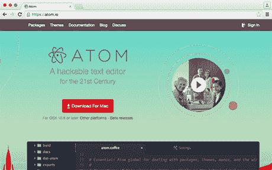

请根据你的平台按照安装说明进行操作。Atom 安装完成后，你还需要安装几个插件。

#### Atom 插件

你对文本编辑器的主要需求包括文档查询、自动补全、代码格式化和代码检查（稍后会详细介绍）。Atom 默认提供其中一些功能，但安装几个插件会让它更加强大。

打开 Atom 并显示其设置界面。在 Mac 上，可以通过选择 Atom → Preferences... 或使用快捷键 Command-,（即 Command 键加逗号）完成。在 Windows 上，可以通过 File → Settings 或使用快捷键 Ctrl-, 访问。

在设置界面的左侧，点击 + Install（图 1.3）。

**图 1.3 Atom 的安装包界面**

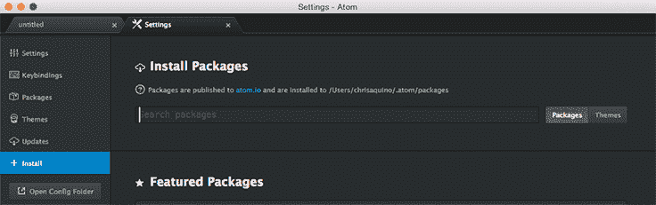

在这里，你可以按名称搜索插件包。首先搜索“emmet”。

编写大量 HTML 可能非常繁琐且容易出错。`emmet` 插件（图 1.4）允许你使用便捷的简写方式编写格式良好的 HTML。点击 Install 按钮安装 `emmet`。

**图 1.4 安装 emmet**

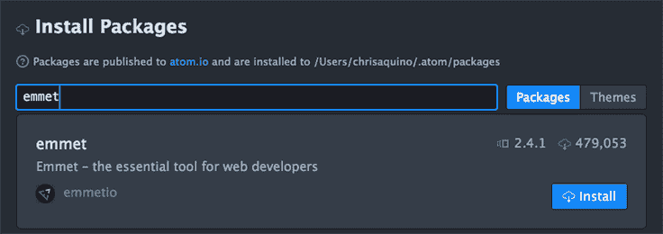

接下来，搜索“atom-beautify”。`atom-beautify` 插件（图 1.5）有助于代码缩进，从而提高可读性。再次点击 Install 安装此插件。

**图 1.5 安装 atom-beautify**

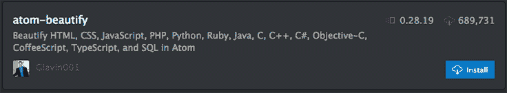

搜索并安装 `autocomplete-paths` 插件（图 1.6）。你的代码经常需要引用项目中的其他文件和文件夹。此插件会在你输入时通过自动补全菜单提供文件名，从而提供帮助。

**图 1.6 安装 autocomplete-paths**

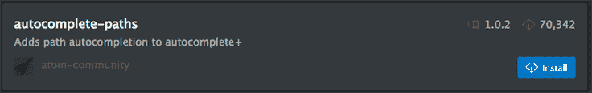

下一个要安装的插件是 `api-docs` 包（图 1.7），它允许你根据关键字查找文档，并在编辑器的单独标签页中显示文档。

**图 1.7 安装 api-docs**

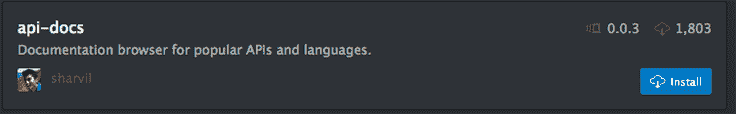

接下来，搜索并安装 `linter` 包（图 1.8）。`linter` 是一种检查代码语法和风格的程序。请确保找到并安装名为“linter”的包。这是一个基础 linter，可与特定语言的插件配合使用。你需要它才能使用下面其他的 linter 插件。

**图 1.8 安装 linter**

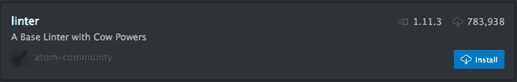

为了检查你的 CSS、HTML 和 JavaScript 代码，你还需要安装 linter 的三个配套插件。首先是 `linter-csslint`（图 1.9），它确保你的 CSS 语法正确，并提供关于编写高性能 CSS 的建议。

**图 1.9 安装 linter-csslint**

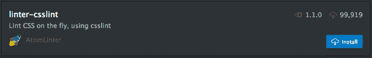

下一个要安装的 linter 配套插件是 `linter-htmlhint`（图 1.10），它确认你的 HTML 格式良好，并会警告不匹配的 HTML 标签。

**图 1.10 安装 linter-htmlhint**

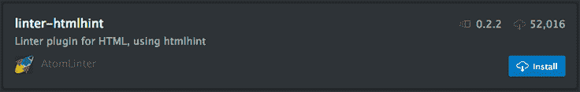

最后一个要安装的 linter 配套插件是 `linter-eslint`（图 1.11）。此插件检查你的 JavaScript 语法，并可配置为检查代码的风格和格式（例如，每行缩进多少个空格，注释前后有多少空行）。

**图 1.11 安装 linter-eslint**

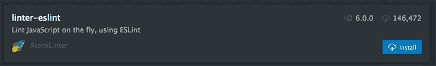

现在 Chrome 和 Atom 已为前端开发准备就绪。完成编码环境只需再走几步：访问文档、学习命令行基础以及下载最后两个工具。

### 文档与参考来源

前端开发不同于 iOS 和 Android 等平台的编程。除了明显的差异外，前端技术除了技术规范外没有官方的开发者文档。这意味着你需要从其他地方寻找指导。我们建议你熟悉以下资源，并在阅读本书及继续前端开发的过程中定期查阅它们。

Mozilla 开发者网络（MDN）是与 HTML、CSS 和 JavaScript 相关的最佳参考资料。访问它的方式之一是 [`devdocs.io`](http://devdocs.io)，这是一个出色的文档界面（图 1.12）。它从 MDN 拉取核心前端技术的文档——并且可以离线工作，因此即使没有网络连接，你也可以查阅。

**图 1.12 通过 `devdocs.io` 访问文档**

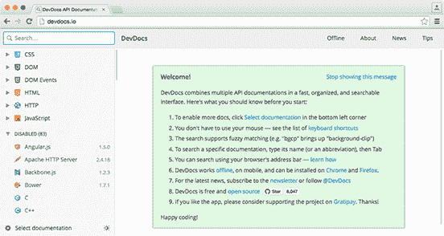

请注意，Safari 目前不支持 [`devdocs.io`](http://devdocs.io) 使用的离线缓存机制。你需要使用其他浏览器（如 Chrome）来访问它。

你也可以使用 MDN 的网站 [`developer.mozilla.org/en-US`](https://developer.mozilla.org/en-US/)（图 1.13），或者直接将“MDN”添加为搜索引擎关键字来查找所需信息。

**图 1.13 Mozilla 开发者网络网站**

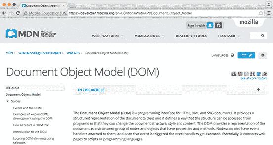

另一个值得了解的网站是 [`stackoverflow.com`](http://stackoverflow.com)（图 1.14）。严格来说，这并不是一个文档来源。它是一个开发者可以互相询问代码问题的地方。答案质量参差不齐，但通常非常详尽且相当有用。因此它是一个有用的资源——只要你记住，由于其众包性质，答案并非权威。

**图 1.14 Stack Overflow 网站**

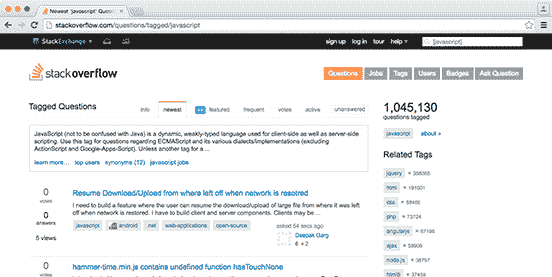

Web 技术总是在变化。对特性和 API 的支持会因浏览器和时间而异。有两个网站可以帮助你确定哪些浏览器（以及各个浏览器的哪些版本）支持哪些特性，它们是 [`html5please.com`](http://html5please.com) 和 [`caniuse.com`](http://caniuse.com)。当你需要了解特性支持情况时，我们建议先从 [`html5please.com`](http://html5please.com) 开始，了解某个特性是否推荐使用。如需更详细地了解哪些浏览器版本支持特定特性，请访问 [`caniuse.com`](http://caniuse.com)。

### 命令行速成课程

在本书中，你将被告知使用命令行或终端。你将使用的许多工具都只能作为命令行程序运行。

在 Mac 上访问命令行：打开 Finder，进入“应用程序”文件夹，然后进入“实用工具”文件夹。找到并打开名为“终端”的程序（图 1.15）。

**图 1.15 在 Mac 上找到终端应用**


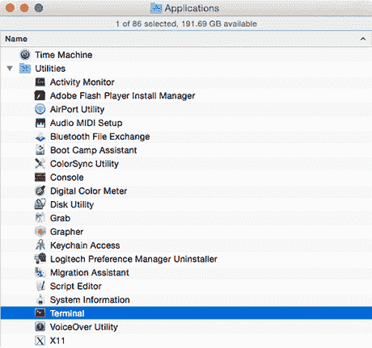

你应该会看到一个类似图 1.16 的窗口。

**图 1.16 Mac 命令行**

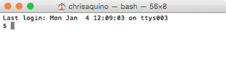

在 Windows 上访问命令行：转到“开始”菜单，搜索“cmd”。找到并打开名为“命令提示符”的程序（图 1.17）。

**图 1.17 在 Windows 上找到命令提示符程序**

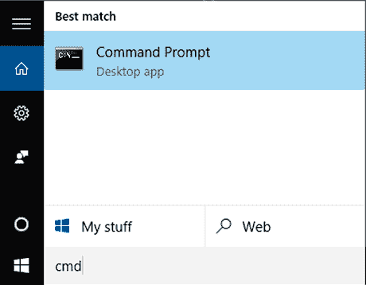

点击它以运行标准的 Windows 命令行界面，它看起来像图 1.18。

**图 1.18 Windows 命令行**

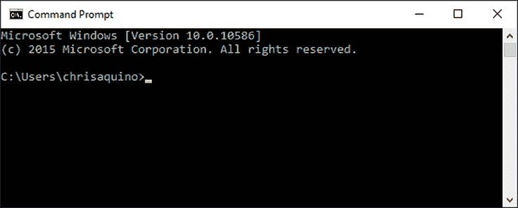

从现在开始，我们将用“终端”或“命令行”来指代 Mac 终端和 Windows 命令提示符。如果你不熟悉命令行的使用，这里有一个常见任务的简短演练。所有命令都是在提示符后输入并按回车键执行。

#### 查看当前所在目录

命令行是基于位置的。这意味着在任何给定时刻，它都“位于”文件结构中的某个特定目录内，你输入的任何命令都将应用于该目录。命令行提示符会显示当前目录的缩写版本。在 Mac 上查看完整路径，输入命令`pwd`（代表“print working directory”），如图 1.19 所示。

**图 1.19 在 Mac 上使用 `pwd` 显示当前路径**

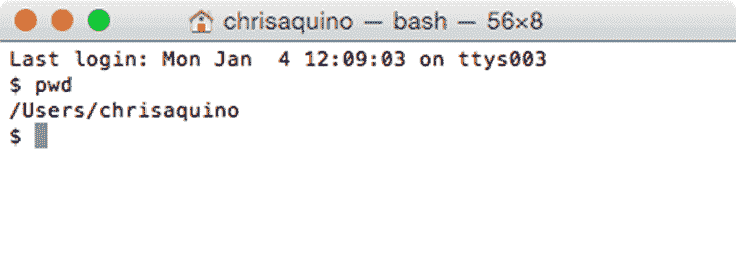

在 Windows 上，使用命令`echo %cd%`查看路径，如图 1.20 所示。

**图 1.20 在 Windows 上使用 `echo %cd%` 显示当前路径**

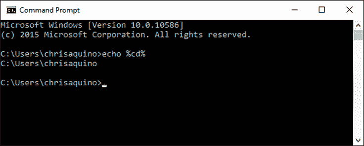

#### 创建目录

前端项目的目录结构很重要。你的项目可能会迅速增长，最好从一开始就保持组织有序。在开发过程中，你会定期创建新目录。这通过使用`mkdir`（或“make directory”）命令后跟新目录名称来完成。

要查看此命令的实际效果，请为你在学习本书过程中将要构建的项目创建一个目录。输入以下命令：

```
mkdir front-end-dev-book
```

接下来，为你的第一个项目 Ottergram 创建一个新目录，你将在下一章开始该项目。你希望这个新目录是你刚刚创建的`front-end-dev-book`目录的子目录。你可以从你的主目录中通过在新目录名称前加上项目目录名称（在 Mac 上使用斜杠）来完成此操作：

```
mkdir front-end-dev-book/ottergram
```

在 Windows 上，使用反斜杠代替：

```
mkdir front-end-dev-book\ottergram
```

#### 切换目录

要在文件结构中移动，使用命令`cd`（或“change directory”），后跟要进入的目录路径。

你并不总需要在`cd`命令中使用完整的目录路径。例如，要向下进入当前目录的任何子目录，只需使用子目录的名称。因此，当你在`front-end-dev-book`目录中时，`ottergram`文件夹的路径就是`ottergram`。

进入你的新项目目录：

```
cd front-end-dev-book
```

现在，你可以进入`ottergram`目录：

```
cd ottergram
```

要向上移动到父目录，使用命令`cd ..`（即`cd`后跟一个空格和两个句点）。这两个句点代表父目录的路径。

```
cd ..
```

请记住，你可以使用`pwd`命令（或在 Windows 上使用`echo %cd%`）检查当前目录。图 1.21 展示了作者创建目录、在目录之间移动以及检查当前目录的过程。

**图 1.21 切换和检查目录**

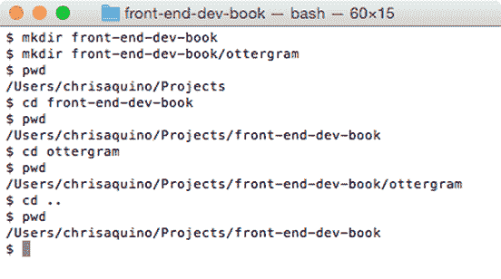

**图 1.21 切换和查看目录**


你不必每次只向上或向下移动一层目录。假设你有一个更复杂的目录结构，比如图 1.22 中所示的那样。

**图 1.22 一个示例文件结构**

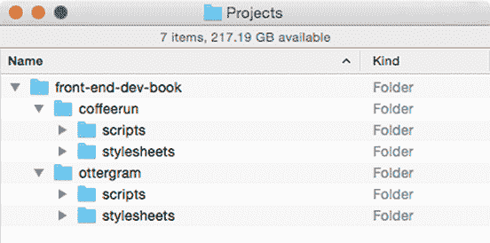

假设你当前在`ottergram`目录中，想要直接跳转到`coffeerun`目录下的`stylesheets`目录。你可以使用`cd`命令，后跟一个路径，该路径表示“当前目录的父目录下的`coffeerun`目录中的`stylesheets`目录”：

```
cd ../coffeerun/stylesheets
```

在 Windows 上，你可以使用相同的命令，但使用反斜杠：

```
cd ..\coffeerun\stylesheets
```

#### 列出目录中的文件

你可能需要查看当前目录中的文件列表。在 Mac 上，你可以使用`ls`命令来实现（图 1.23）。如果你想列出其他目录中的文件，可以提供一个路径：

```
ls
ls ottergram
```

**图 1.23 使用 `ls` 列出目录中的文件**

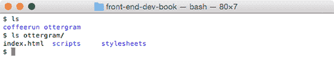

默认情况下，如果目录为空，`ls`不会输出任何内容。

在 Windows 上，命令是`dir`（图 1.24），你可以选择性地提供一个路径：

```
dir
dir ottergram
```

**图 1.24 使用 `dir` 列出目录中的文件**

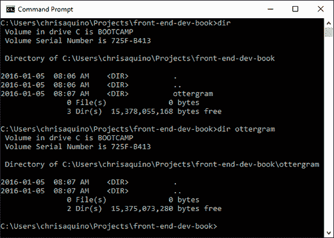

默认情况下，`dir`命令会输出日期、时间和文件大小的信息。

#### 获取管理员权限

在某些版本的 OS X 和 Windows 上，你需要超级用户或管理员权限才能运行某些命令，例如安装软件或修改受保护文件的命令。

在 Mac 上，你可以通过在命令前加上`sudo`来赋予自己权限。第一次在 Mac 上使用`sudo`时，它会显示一个严厉的警告，如图 1.25 所示。

**图 1.25 `sudo`警告**

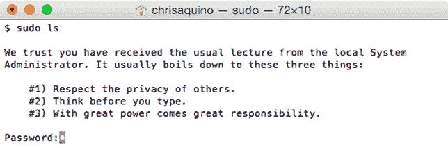

`sudo`会提示你输入密码，然后以超级用户身份运行命令。输入时，你的按键不会回显，所以请小心输入。

在 Windows 上，如果你需要赋予自己权限，可以在打开命令行界面时进行。在 Windows 开始菜单中找到命令提示符，右键单击它，然后选择“以管理员身份运行”（图 1.26）。在此命令提示符中运行的任何命令都将以超级用户身份运行，因此请小心。

**图 1.26 以管理员身份打开命令提示符**

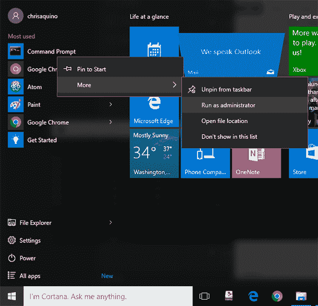

#### 退出程序

在阅读本书的过程中，你将通过命令行运行许多应用程序。其中一些程序会完成工作后自动退出，但另一些会一直运行直到你停止它们。要退出命令行程序，请按 Control-C。

### 安装 Node.js 和 browser-sync

在开始第一个项目之前，还有最后一个设置步骤。

`Node.js`（或简称为“`Node`”）允许你从命令行运行用 JavaScript 编写的程序。大多数前端开发工具都是为与`Node.js`一起使用而编写的。你将在第 15 章中了解更多关于`Node.js`的内容，但你现在就可以开始使用一个依赖它的工具`browser-sync`。

通过从[`nodejs.org`](https://nodejs.org/en/)下载安装程序来安装`Node`（图 1.27）。本书使用的`Node.js`版本是 5.11.1，你可能会看到可供下载的不同版本。

**图 1.27 下载 Node.js**

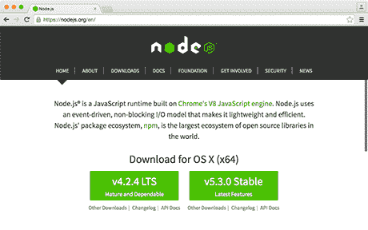

双击安装程序并按照提示操作。

安装`Node`时，它会提供两个命令行程序：`node`和`npm`。`node`程序负责运行用 JavaScript 编写的程序。直到第 15 章你才需要使用它。另一个程序是`Node`包管理器`npm`，用于从互联网安装开源开发工具。

`browser-sync`就是这样一个工具，它在整本书中对你来说将非常宝贵。它使你的示例代码更容易在浏览器中运行，并在你保存代码更改时自动重新加载浏览器。

在命令行中使用以下命令安装`browser-sync`：

```
npm install -g browser-sync
```

（命令中的`-g`代表“全局”。全局安装包意味着你可以从任何目录运行`browser-sync`。）

运行此命令时，你所在的目录无关紧要，但你可能需要超级用户权限。如果是这种情况，请在 Mac 上使用`sudo`运行该命令：

```
sudo npm install -g browser-sync
```

如果你使用的是 Windows，请先以管理员身份打开命令提示符，如上所示。

当你启动`browser-sync`时（正如你将在下一章中做的那样），它会一直运行直到你按 Control-C。当你暂时完成一个项目的工作时，最好退出`browser-sync`。这意味着你需要在每次开始本书前两个项目（Ottergram 和 CoffeeRun）的工作时启动`browser-sync`。

至此，你已经拥有了开始 Ottergram 项目所需的工具！

### 更多探索：Atom 的替代品

有很多很多文本编辑器可供选择。如果你对`Atom`不太感兴趣，那么在完成本书中的项目后，你可能想尝试以下两个选项之一。两者均可免费用于 Mac 和 Windows，并且都有大量插件可自定义你的开发体验。此外，与`Atom`一样，它们都是使用 HTML、CSS 和 JavaScript 构建的，但作为桌面应用程序运行。

`Visual Studio Code`是微软的开源文本编辑器，专门用于开发 Web 应用程序。可以从[`code.visualstudio.com`](https://code.visualstudio.com/)下载（图 1.28）。

**图 1.28 Visual Studio Code 网站**

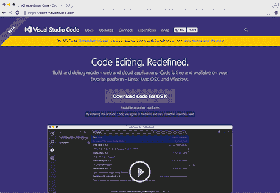

Adobe 的`Brackets`文本编辑器特别适合使用 HTML 和 CSS 构建用户界面。事实上，它提供了一个扩展，可帮助你处理 Adobe 的分层 PSD 图像文件。`Brackets`可从[`brackets.io`](http://brackets.io/)获取（图 1.29）。

**图 1.29 Adobe Brackets 网站**

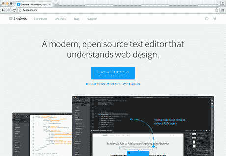

# 2 设置你的第一个项目

当你访问一个网站时，你的浏览器会与服务器（互联网上的另一台计算机）进行对话。

浏览器：“你好！能给我一个名为`cat-videos.html`的文件内容吗？”

服务器：“当然。让我找找……给你！”

浏览器：“啊，它告诉我还需要一个名为`styles.css`的文件。”

服务器：“没问题。让我找找……给你！”

浏览器：“好的，那个文件说我还需要一个名为`animated-background.gif`的文件。”

服务器：“没问题。让我找找……给你！”

这段对话会持续一段时间，有时长达数千毫秒（图 2.1）。

**图 2.1 浏览器发送请求，服务器响应**

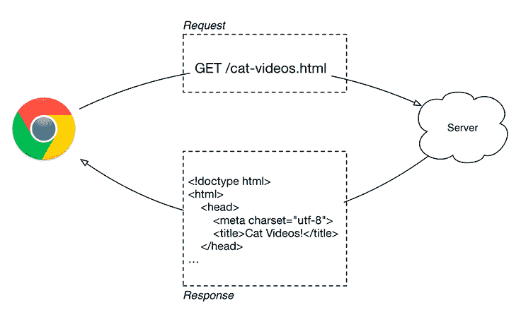

浏览器的任务是向服务器发送请求；解释从服务器响应中接收到的 HTML、CSS 和 JavaScript；并将结果呈现给用户。这三种技术各自在用户对网站的体验中发挥作用。如果你的应用是一个生物，那么 HTML 就是它的骨骼和器官（结构），CSS 是它的皮肤（可见层），而 JavaScript 则是它的个性（行为方式）。

在本章中，你将为你第一个项目 Ottergram 设置基本的 HTML。在下一章中，你将设置 CSS，并在第 4 章中进一步完善。在第 6 章中，你将开始添加 JavaScript。

### 设置 Ottergram

在第 1 章中，你为本书的项目创建了一个文件夹，并为 Ottergram 创建了一个子文件夹。启动你的`Atom`文本编辑器，通过点击`File` → `Open`（在 Windows 上是`File` → `Open Folder...`）打开`ottergram`文件夹。在对话框中，导航到`front-end-dev-book`文件夹，选择`ottergram`文件夹。点击`Open`告诉`Atom`使用这个文件夹（图 2.2）。

**图 2.2 在 Atom 中打开项目文件夹**

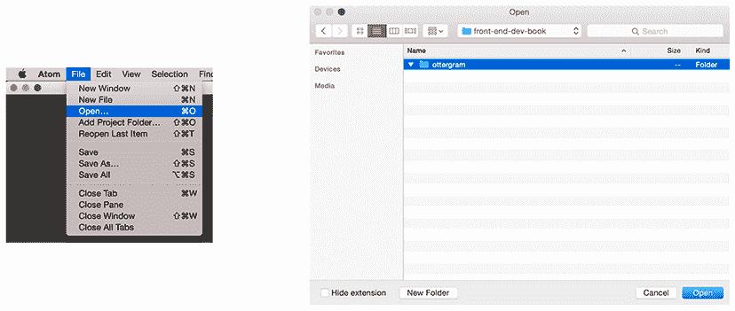

你会在`Atom`的左侧面板中看到`ottergram`文件夹。这个面板用于在项目中的文件和文件夹之间导航。

你将使用`Atom`在`ottergram`项目文件夹中创建一些文件和文件夹。按住 Control 键并点击（右键点击）左侧面板中的`ottergram`，然后在弹出菜单中点击`New File`。系统会提示你为新文件命名。输入`index.html`并按回车键（图 2.3）。

**图 2.3 在 Atom 中创建新文件**

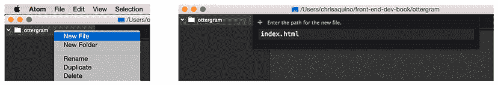

你可以使用同样的过程在`Atom`中创建文件夹。再次按住 Control 键并点击（右键点击）左侧面板中的`ottergram`，但这次在弹出菜单中点击`New Folder`。在出现的提示中输入名称`stylesheets`（图 2.4）。

**图 2.4 在 Atom 中创建新文件夹**

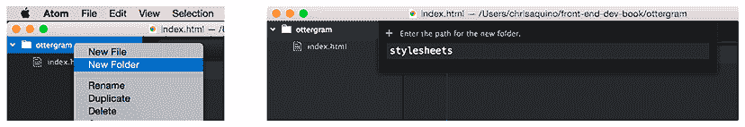

最后，在`stylesheets`文件夹中创建一个名为`styles.css`的文件：按住 Control 键并点击（右键点击）左侧面板中的`stylesheets`，选择`New File`。提示会预先填入文本“stylesheets/”。之后，输入`styles.css`并按回车键（图 2.5）。

**图 2.5 在 Atom 中创建新的 CSS 文件**

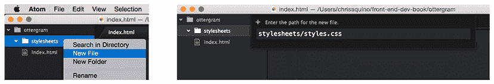

完成后，你的项目文件夹应该像图 2.6 所示。

**图 2.6 Ottergram 的初始文件和文件夹**

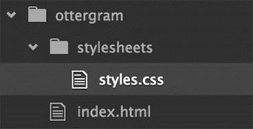

关于如何组织文件和文件夹或如何命名，并没有硬性规定。不过，Ottergram（以及本书中的其他项目）遵循了许多前端开发者使用的惯例。你的`index.html`文件将存放 HTML 代码。将主 HTML 文件命名为`index.html`可以追溯到互联网早期，这一惯例沿用至今。

`stylesheets`文件夹，顾名思义，将存放一个或多个包含 Ottergram 样式信息的文件。这些文件是 CSS（层叠样式表）文件。有时开发者会根据 CSS 文件所描述的页面或网站部分来命名，例如`header.css`或`blog.css`。Ottergram 是一个简单的项目，只需要一个 CSS 文件，因此你将其命名为`styles.css`，以体现其全局作用。

#### 初始 HTML

是时候开始编码了。在`Atom`中打开`index.html`，添加一些基本的 HTML 来开始。

首先输入`html`。`Atom`会提供一个自动补全选项，如图 2.7 所示。（如果没有出现，请确保你已按照第 1 章的指示安装了`emmet`插件。）

**图 2.7 Atom 的自动补全菜单**

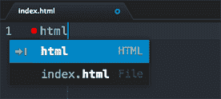

按回车键，`Atom`会提供最基本的 HTML 元素供你开始使用（图 2.8）。

**图 2.8 使用自动补全创建的 HTML**

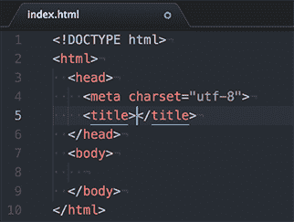

你的光标位于`<title>`和`</title>`之间——即`title`的开始和结束标签。输入“ottergram”为项目命名。然后，点击将光标放在`body`开始和结束标签之间的空白行。在那里输入“header”并按回车键。`Atom`会将文本“header”转换为`header`的开始和结束标签，并在它们之间留出一个空白行（图 2.9）。

**图 2.9 使用自动补全创建的 header 标签**

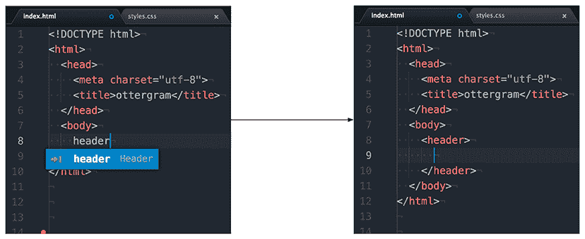

接下来，输入`h1`并按回车。你的文本再次被转换为标签，这次没有空行。再次输入文本`ottergram`。这将是你网页上显示的标题。

你的文件应该如下所示：

```
<!doctype html>
<html>
  <head>
    <meta charset="utf-8">
    <title>ottergram</title>
  </head>
  <body>
    <header>
      <h1>ottergram</h1>
    </header>
  </body>
</html>
```

`Atom`和`emmet`共同为你节省了输入时间，并帮助你构建了格式良好的初始 HTML。


让我们检查一下你的代码。第一行 `<!doctype html>` 定义了 `doctype`——它告诉浏览器文档使用的是哪个版本的 HTML。浏览器可能会根据 `doctype` 以略微不同的方式渲染（或绘制）页面。这里，`doctype` 指定了 HTML5。

早期版本的 HTML 通常有冗长、复杂且难以记忆的 `doctype`，例如：

```
<!DOCTYPE html PUBLIC "-//W3C//DTD XHTML 1.0 Transitional//EN"
"http://www.w3.org/TR/xhtml1/DTD/xhtml1-transitional.dtd">
```

通常，人们每次创建新文档时都需要查找 `doctype`。

在 HTML5 中，`doctype` 简短而精炼。本书所有项目都将使用这个 `doctype`，你也应该在你的应用中使用它。

`doctype` 之后是一些基本的 HTML 标记，包括一个 `head` 和一个 `body`。

`head` 将包含关于文档以及浏览器应如何处理文档的信息。例如，文档的标题、页面使用的 CSS 或 JavaScript 文件、文档的最后修改时间等，都包含在 `head` 中。

这里，`head` 包含一个 `<meta>` 标签。`<meta>` 标签向浏览器提供关于文档本身的信息，例如文档作者的姓名或搜索引擎的关键词。Ottergram 中的 `<meta>` 标签 `<meta charset="utf-8">` 指定文档使用 UTF-8 字符集编码，该字符集涵盖了所有 Unicode 字符。在你的文档中使用这个标签，以便最广泛的浏览器能够正确解释它们，特别是如果你期望有国际访问量的话。

`body` 将包含代表页面内容的所有 HTML 代码：页面上出现的所有图像、链接、文本、按钮和视频。

大多数标签会包含其他内容。看看你包含的 `h1` 标题；它的结构如图 2.10 所示。

**图 2.10 简单 HTML 标签的结构**

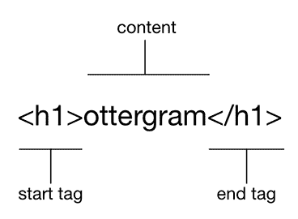

HTML 代表“超文本标记语言”。标签用于“标记”你的内容，指明它们的用途——例如标题、列表项和链接。

一组标签所包含的内容也可以包含其他 HTML。例如，请注意 `<header>` 标签包含了上面显示的 `<h1>` 标签（而 `<body>` 标签又包含了 `<header>`！）。

可供选择的标签有很多——超过 140 个。要查看它们的列表，请访问 MDN 的 HTML 元素参考，网址为 [developer.mozilla.org/en-US/docs/Web/HTML/Element](https://developer.mozilla.org/en-US/docs/Web/HTML/Element)。该参考包含每个元素的简要描述，并按用途分组（例如，文本内容、内容分区或多媒体）。

### 链接样式表

在第 3 章中，你将在样式表 `styles.css` 中编写样式规则。但还记得本章开头浏览器和服务器之间的对话吗？浏览器只有在被告知文件存在时，才会知道向服务器请求该文件。你必须链接到你的样式表，以便浏览器知道要请求它。更新 `index.html` 的 `head`，添加一个指向你的 `styles.css` 文件的链接。

```
<!doctype html>
<html>
  <head>
    <meta charset="utf-8">
    <title>ottergram</title>
    <link rel="stylesheet" href="stylesheets/styles.css">
  </head>
  <body>
...
```

`<link>` 标签是将外部样式表附加到 HTML 文档的方式。它有两个属性，向浏览器提供关于标签用途的更多信息（图 2.11）。（HTML 属性的顺序无关紧要。）

**图 2.11 带属性的标签结构**

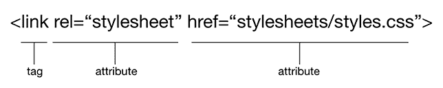

你将 `rel`（或“关系”）属性设置为 `"stylesheet"`，这告诉浏览器链接的文档提供样式信息。`href` 属性告诉浏览器向服务器发送请求，获取位于 `stylesheets` 文件夹中的 `styles.css` 文件。请注意，此文件路径是相对于当前文档的。

在继续之前，保存 `index.html`。

### 添加内容

没有内容的网页就像没有咖啡的一天。在 `header` 之后添加一个列表，让你的项目有存在的理由。

你将使用 `<ul>` 标签添加一个无序列表（即项目符号列表）。在列表中，你将使用 `<li>` 标签包含五个列表项，并在每个列表项中使用 `<span>` 标签包含一些文本。

更新后的 `index.html` 如下所示。请注意，在本书中，我们以粗体显示你正在添加的新代码。要删除的代码以删除线显示。现有代码以普通文本显示，以帮助你定位文件中的更改。

我们鼓励你使用 `Atom` 的自动补全和自动格式化功能。将光标放在适当位置，输入 `ul` 并按回车。接下来，输入 `li` 并按两次回车，然后输入 `span` 并按一次回车。输入一只水獭的名字，然后以同样的方式再创建四个列表项和 `span`。

```
<!doctype html>
<html>
  <head>
    <meta charset="utf-8">
    <title>ottergram</title>
    <link rel="stylesheet" href="stylesheets/styles.css">
  </head>
  <body>
    <header>
      <h1>ottergram</h1>
    </header>
    <ul>
      <li>
        <span>Barry</span>
      </li>
      <li>
        <span>Robin</span>
      </li>
      <li>
        <span>Maurice</span>
      </li>
      <li>
        <span>Lesley</span>
      </li>
      <li>
        <span>Barbara</span>
      </li>
    </ul>
  </body>
</html>
```

嵌套在每个 `<li>` 标签内的 `<span>` 标签没有任何特殊含义。它们是其他内容的通用容器。你将在 Ottergram 中使用它们进行样式设置，并且在继续阅读本书的过程中，你还会看到其他容器元素的示例。

接下来，你将添加水獭的图片，与你输入的名字相对应。

### 添加图片

本书所有项目的资源文件位于 [www.bignerdranch.com/downloads/front-end-dev-resources.zip](http://www.bignerdranch.com/downloads/front-end-dev-resources.zip)。其中包括五张采用知识共享许可的水獭图片，由 Michael L. Baird、Joe Robertson 和 Agunther 拍摄，可在 [commons.wikimedia.org](https://commons.wikimedia.org) 上找到。

下载并解压资源。在 `ottergram-resources` 文件夹中，找到 `img` 文件夹。将 `img` 文件夹复制到你的 `ottergram/` 项目目录中。（.zip 文件中包含其他资源，但目前你只需要 `img` 文件夹。）

你希望列表除了标题之外，还能包含可点击的缩略图。为此，你需要在 `ul` 的每个列表项中添加锚标签和图片标签。我们将在你输入这些内容后更详细地解释这些更改。（如果你使用自动补全功能，请注意你需要移动 `</a>` 标签，使其跟在 `span` 后面。）

```
...
    <ul>
      <li>
        <a href="#">
          
          <span>巴里</span>
        </a>
      </li>
      <li>
        <a href="#">
          
          <span>罗宾</span>
        </a>
      </li>
      <li>
        <a href="#">
          
          <span>莫里斯</span>
        </a>
      </li>
      <li>
        <a href="#">
          
          <span>莱斯利</span>
        </a>
      </li>
      <li>
        <a href="#">
          
          <span>芭芭拉</span>
        </a>
      </li>
    </ul>
...
```

如果你的代码缩进不整齐，可以利用你之前安装的 `atom-beautify` 插件。点击 Packages → Atom Beautify → Beautify，你的代码就会自动对齐并缩进。

让我们看看你添加了什么。

`<a>` 标签是锚标签。锚标签使页面上的元素可点击，从而将用户带到另一个页面。它们通常被称为“链接”，但要注意：它们与你之前使用的 `<link>` 标签不同。

锚标签有一个 `href` 属性，用于指示锚点指向的资源。通常该值是一个网址。但有时，你并不希望链接跳转到任何地方。目前就是这种情况，因此你为 `href` 属性赋予了“虚拟”值 `#`。这会使浏览器在点击图片时滚动到页面顶部。稍后，你将使用锚标签在点击缩略图时打开图片的更大副本。

在锚标签内部，你添加了 ``（即图片）标签，其 `src` 属性指向你之前添加的 `img` 目录中的文件名。你还在图片标签中添加了描述性的 `alt` 属性。`alt` 属性包含的文本会在图片无法加载时替代显示。屏幕阅读器也会使用 `alt` 文本向视障用户描述图片。

图片标签与大多数其他元素不同，它们不包裹其他元素，而是引用一个资源。当浏览器遇到 `` 标签时，它会将图片绘制到页面上。这被称为替换元素。其他替换元素包括嵌入文档和小程序。

由于它们不包裹内容或其他元素，`` 标签没有对应的结束标签。这使得它们成为自闭合标签（也称为空标签）。你有时会看到自闭合标签在右尖括号前带有斜杠，例如 ``。是否包含斜杠取决于个人偏好，对浏览器没有影响。在本书中，自闭合标签不带斜杠。

保存 `index.html`。稍后，你将看到编码的结果。

### 在浏览器中查看网页

要查看你的网页，你需要运行你在第 1 章中安装的 `browser-sync` 工具。

打开终端，并将目录切换到你的 `ottergram` 文件夹。回顾第 1 章，你使用 `cd` 命令后跟要进入的文件夹路径来切换目录。获取 `ottergram` 路径的一个简单方法是：在 Atom 左侧面板中按住 Control 键并单击（右键单击）`ottergram` 文件夹，然后选择“复制完整路径”（图 2.12）。然后在命令行中输入 `cd`，粘贴路径，并按回车键。

**图 2.12 从 Atom 复制 `ottergram` 文件夹路径**

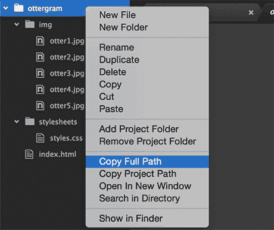

你输入的路径可能类似于：

```
cd /Users/chrisaquino/Projects/front-end-dev-book/ottergram
```

进入 `ottergram` 目录后，运行以下命令在 Chrome 中打开 Ottergram。（为了适应页面，我们将命令分成了两行。你应该在一行中输入。）

```
browser-sync start --server --browser "Google Chrome"
                   --files "stylesheets/*.css, *.html"
```

如果 Chrome 是你的默认浏览器，你可以省略命令中的 `--browser "Google Chrome"` 部分：

```
browser-sync start --server --files "stylesheets/*.css, *.html"
```

此命令以服务器模式启动 `browser-sync`，使其能够在浏览器发送请求获取文件（例如你创建的 `index.html` 文件）时发送响应。

你输入的命令还告诉 `browser-sync`，如果任何 HTML 或 CSS 文件发生更改，则自动重新加载浏览器。这大大改善了开发体验。在 `browser-sync` 这类工具出现之前，每次更改后你都必须手动重新加载页面。

图 2.13 显示了在 Mac 上输入此命令的结果。

**图 2.13 在 OS X 终端中启动 `browser-sync`**

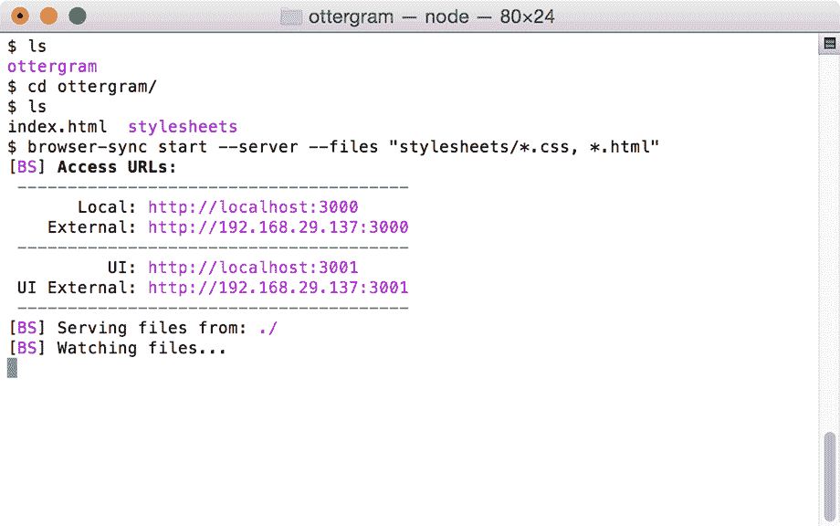

你应该在 Windows 上看到相同的输出（图 2.14）。

**图 2.14 在 Windows 命令提示符中启动 `browser-sync`**

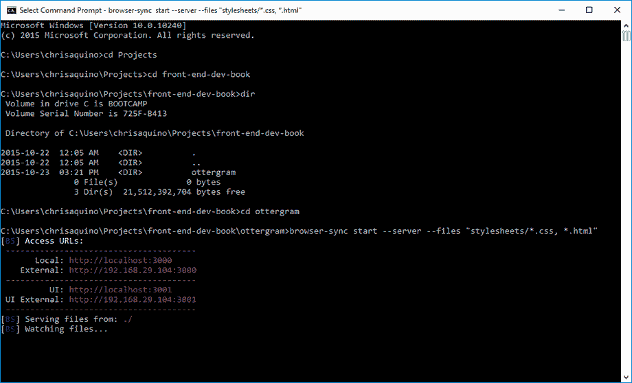

一旦 Ottergram 页面在 Chrome 中加载完成，你应该会看到你的页面，其中包含“ottergram”标题、标签栏显示“ottergram”，以及一系列水獭照片和名称（图 2.15）。

**图 2.15 在浏览器中查看 Ottergram**

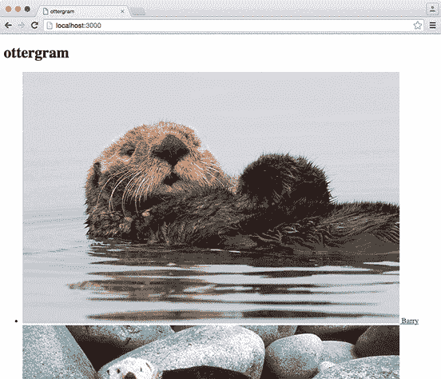

### Chrome 开发者工具

Chrome 内置了开发者工具（通常称为“DevTools”），它们是用于实时测试样式、布局等的最佳工具之一。使用 DevTools 比在代码中尝试要高效得多。DevTools 非常强大，在你进行前端开发时将是你的常伴伙伴。

你将在下一章开始使用 DevTools。现在，先打开该窗口，熟悉其主要区域。

要打开 DevTools，请点击 Chrome 地址栏右侧的  图标。然后点击“更多工具”→“开发者工具”（图 2.16）。

**图 2.16 打开开发者工具**

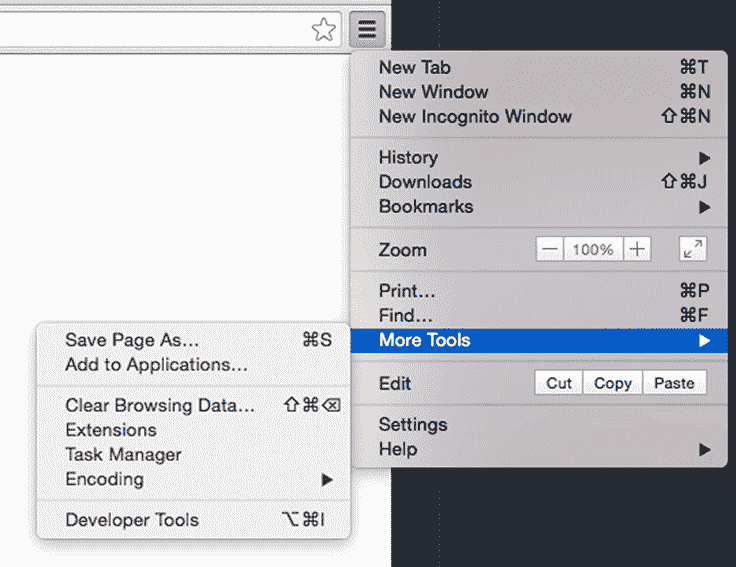

Chrome 默认将 DevTools 显示在右侧。你的屏幕看起来会像图 2.17。

**图 2.17 DevTools 显示元素面板**

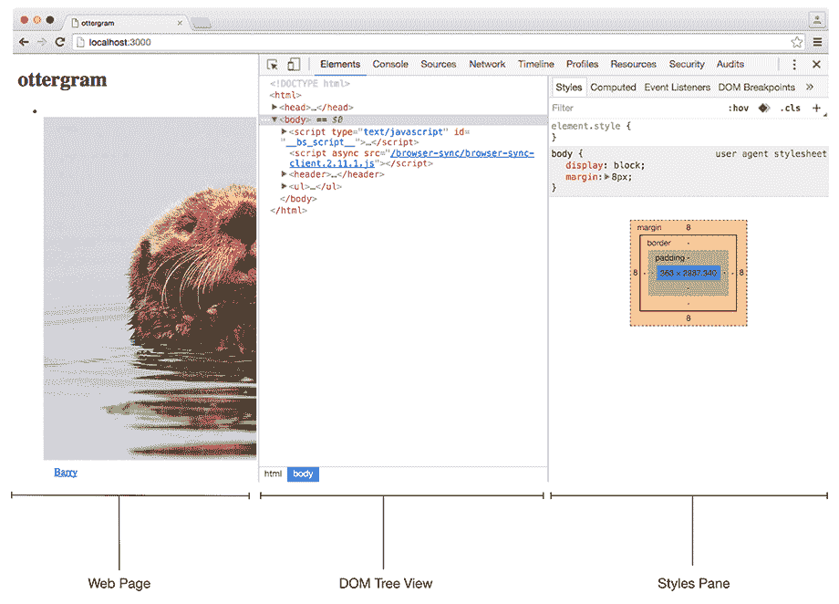

DevTools 展示了代码与生成的页面元素之间的关系。你可以检查单个元素的属性和样式，并立即看到浏览器如何解释你的代码。理解这种关系对于开发和调试都至关重要。

在图 2.17 中，你可以看到 DevTools 位于网页旁边，显示元素面板。元素面板分为两个部分。左侧是 DOM 树视图，这是 HTML 的表示形式，被解释为 DOM 元素。（你将在后续章节中了解更多关于 DOM（即“文档对象模型”）的内容。）元素面板的右侧是样式窗格，显示应用于单个元素的所有视觉样式。

工作时将 DevTools 固定在屏幕右侧通常很方便。如果你想更改 DevTools 的位置，可以点击右上角附近的  按钮。这将显示一个选项菜单，包括用于更改 DevTools 停靠位置的按钮（图 2.18）。

**图 2.18 更改 DevTools 的停靠侧**

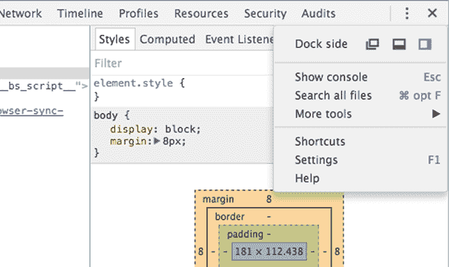

有了水獭图片和标记，并打开了 DevTools，你就可以在下一章开始为项目添加样式了。

### 更多探索：CSS 版本

CSS 的版本历史包括标准版本 1、2 和 2.1。在 2.1 之后，由于标准变得过于庞大，决定将其拆分为多个模块。

没有版本 3。相反，CSS3 是许多模块的总称，每个模块都有自己的版本号。

**表 2.1 CSS 版本，真实与想象**

| 版本号 | 发布年份 | 显著特性 |
| --- | --- | --- |
| 1 | 1996 | 基本字体属性（`font-family`、`font-style`）、前景色和背景色、文本对齐、外边距、边框和内边距。 |
| 2 | 1998 | 绝对、相对和固定定位；新的字体属性。 |
| 2.1 | 2011 | 移除了浏览器支持不佳的特性。 |
| “3” | 多个年份 | 不同规范的集合，例如媒体查询、新选择器、半透明颜色、`@font-face`。 |

### 更多探索：`favicon.ico`

你是否注意到，访问大多数网站时，浏览器地址栏左端会出现一个小图标？有时它们也会出现在浏览器标签页中，如图 2.19 所示。

**图 2.19 `bignerdranch.com` 的 `favicon.ico`**

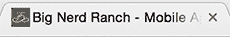

这就是 `favicon.ico` 图像文件。许多网站都有这个文件，浏览器默认会请求它。由于 Ottergram 没有这个文件，你可能会在 DevTools 中看到类似图 2.20 的错误。


**图 2.20 缺少 `favicon.ico` 的错误**

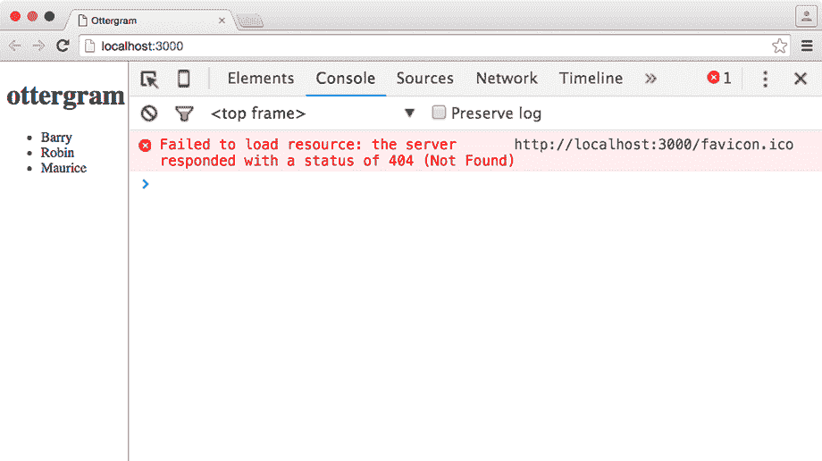

如果出现这个错误，不必担心。它不会影响你的项目。不过，你可以轻松添加一个 `favicon.ico` 图像——这也是你的第一个挑战。

### 银牌挑战：添加 `favicon.ico`

你决定更喜欢水獭，而不是看到 `favicon.ico` 错误消息。你将使用其中一张水獭图片创建一个 `favicon.ico` 文件。

在网上搜索“favicon generator”，你会看到一系列提供文件转换的网站。大多数网站允许你上传图像，然后为你提供 `favicon.ico` 版本。

选择一个网站，上传任意一张水獭图片。

将生成的 `favicon.ico` 文件保存到与 `index.html` 相同的文件夹中。最后，重新加载浏览器。你的浏览器标签页看起来会像图 2.21。

**图 2.21 带有 `favicon.ico` 的 Ottergram**


## 3 样式

在本章中，你将设计 Ottergram 的静态版本。在后续章节中，你将使 Ottergram 具有交互性。

当你完成本章时，你的网站将看起来像图 3.1。

**图 3.1 Ottergram：有样式的**

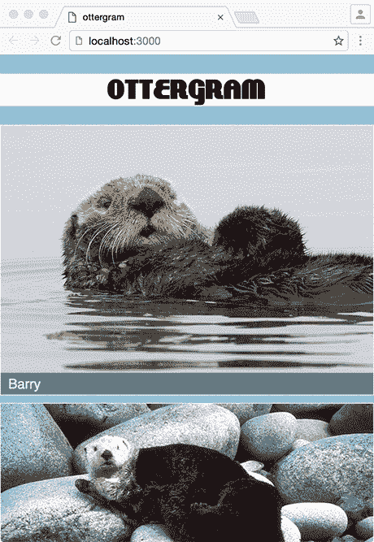

本章介绍许多概念和示例。如果你在结束时觉得自己没有完全掌握所有内容，不必担心。随着你学习本书的深入，你会反复遇到这些概念，而本章的工作将为你打下坚实的基础，帮助你建立真正的理解。

当然，我们只能向你介绍 CSS 中可用样式的一小部分。你需要查阅 MDN 以获取完整的属性及其值的相关信息。

前端开发人员在设计网站样式时需要在两种方法之间做出选择：从整体布局开始，逐步细化到最小细节；或者从最小细节开始，逐步构建整体布局。

从细节到整体不仅会产生更干净、更可重用的代码，而且还有一个很酷的名字：原子样式。你将使用这种方法，首先为水獭缩略图添加样式，然后为缩略图列表布局添加样式。在下一章中，你将处理整个网站的布局。

### 创建样式基线

首先，将 `normalize.css` 文件添加到你的项目中。`normalize.css` 有助于你编写的 CSS 在不同浏览器中显示一致。所有浏览器都带有一组默认样式，但不同浏览器的默认样式各不相同。`normalize.css` 为你开发网站或 Web 应用的自定义 CSS 提供了一个良好的起点。

`normalize.css` 可在线免费获取。你无需下载它。要将其添加到 Ottergram，你只需在 `index.html` 中链接它即可。

为了确保你使用的是最新版本的 `normalize.css`，你需要从内容共享网站获取其地址。访问 [cdnjs.com/libraries/normalize](http://cdnjs.com/libraries/normalize/)，找到以 `.min.css` 结尾的文件版本。（这个版本比其他版本下载量更小，因为它去掉了多余的空白。）点击“复制”按钮复制其地址（图 3.2）。

**图 3.2 从 `cdnjs.com` 获取 `normalize.css` 的链接**

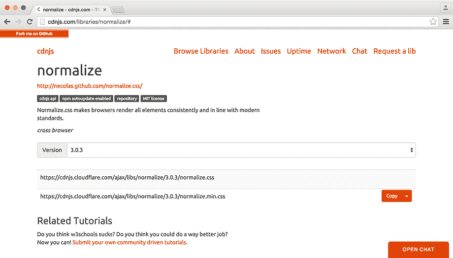

撰写本文时的当前版本是 3.0.3，但你使用的版本可能更新。

在 Atom 中打开你的 Ottergram 文件夹，然后打开 `index.html`。添加一个新的 `<link>` 标签并粘贴地址。（在下面的代码中，`<link>` 被分成两行以适应页面。你可以保留在一行。）

```html
<!doctype html>
<html>
  <head>
    <meta charset="utf-8">
    <title>ottergram</title>
    <link rel="stylesheet"
      href="https://cdnjs.cloudflare.com/ajax/libs/normalize/3.0.3/normalize.min.css">
    <link rel="stylesheet" href="stylesheets/styles.css">
  </head>
...
```

确保你在 `styles.css` 的 `<link>` 标签之前添加了 `normalize.css` 的 `<link>` 标签。浏览器需要在读取你的样式之前先读取 `normalize.css` 中的样式。

就这样，你的项目就可以利用这个有用的工具了。无需其他设置。

你可能想知道为什么你要链接到一个完全不同的服务器上的地址。实际上，HTML 文件指定位于不同服务器上的资源并不罕见（图 3.3）。

**图 3.3 从不同服务器请求资源**


在这种情况下，`normalize.css` 托管在 [cdnjs.com](https://cdnjs.com/) 上，这是一个公共服务器，属于内容分发网络（CDN）。CDN 在世界各地都有服务器，每台服务器都保存着相同文件的副本。当用户请求文件时，他们会从附近的服务器接收文件，从而减少该文件的加载时间。[cdnjs.com](https://cdnjs.com/) 托管了许多流行前端库和框架的多个版本。

### 为样式化准备 HTML

在上一章中，你创建了一个名为 `styles.css` 的样式表，在本章中，你将向其中添加许多 CSS 样式规则。但在开始添加样式之前，你需要设置好 HTML，为样式规则提供目标。

你将添加 `class` 属性，将带有水獭名字的 `span` 元素标识为“缩略图标题”。`class` 属性是一种标识一组 HTML 元素的方式，通常用于样式化。你的“缩略图标题” `class` 将允许你一次性轻松地样式化所有名字。

在 `index.html` 中，将类名 `thumbnail-title` 作为 `li` 元素内 `span` 的属性添加，如下所示：

```html
...
    <ul>
      <li>
        <a href="#">
          
          <span>巴里</span>
          <span class="thumbnail-title">巴里</span>
        </a>
      </li>
      <li>
        <a href="#">
          
          <span>罗宾</span>
          <span class="thumbnail-title">罗宾</span>
        </a>
      </li>
      <li>
        <a href="#">
          
          <span>莫里斯</span>
          <span class="thumbnail-title">莫里斯</span>
        </a>
      </li>
      <li>
        <a href="#">
          
          <span>莱斯利</span>
          <span class="thumbnail-title">莱斯利</span>
        </a>
      </li>
      <li>
        <a href="#">
          
          <span>芭芭拉</span>
          <span class="thumbnail-title">芭芭拉</span>
        </a>
    </ul>
...
```

稍后，你将使用这个类名来样式化所有图片标题。

### 样式的结构

当你创建单个样式时，通过编写样式规则来实现，样式规则由两个主要部分组成：选择器和声明（图 3.4）。

**图 3.4 样式规则的结构**


样式规则的第一部分是一个或多个选择器。选择器描述样式应应用于哪些元素，例如 `h1`、`span` 或 `img`。但选择器不限于标签名。你可以通过提高选择器的特异性来编写应用于更精确元素集的选择器。

例如，你可以基于属性编写选择器——比如你刚刚添加到 `<span>` 标签中的 `thumbnail-title` 类属性。基于属性的选择器比基于元素名称的选择器更具体。

除了确保样式仅应用于有限的元素集（例如，具有类名 `thumbnail-title` 的元素，而不是所有 `<span>` 元素）之外，特异性还决定了选择器的相对优先级。如果样式表中包含多个可能应用于同一元素的样式，则具有更高特异性选择器的样式将优先于具有较低特异性选择器的样式。你可以在本章末尾的“更多好奇”部分阅读更多关于特异性的内容。

在本章中，你将接触到许多不同特异性的选择器。尽管通常有多种方法可以定位同一元素进行样式化，但理解特异性是选择最佳选择器的关键，以便你的样式易于维护。

样式规则的第二部分是声明块，用花括号括起来，定义了要应用的样式。块内的每个声明都包含一个属性名和该属性的值。

在你的第一个样式规则中，你将使用刚刚添加的 `class` 属性作为选择器，为水獭名字周围应用样式。

### 你的第一个样式规则

要在样式规则中使用 `class` 作为选择器，你需要在类名前加上一个点（句点），例如 `.thumbnail-title`。你要添加的第一个样式将为 `.thumbnail-title` 类设置背景色和前景色。

打开 `styles.css` 并添加你的样式规则：

```css
.thumbnail-title {
  background: rgb(96, 125, 139);
  color: rgb(202, 238, 255);
}
```

你将在本章后面了解更多关于颜色的信息。现在，先看看你的更改。保存 `styles.css` 并确保 `browser-sync` 正在运行。如果需要重新启动，命令是：

```bash
browser-sync start --server --browser "Google Chrome"
                   --files "stylesheets/*.css, *.html"
```

这将在 Chrome 中打开你的网页（图 3.5）。

**图 3.5 色彩更丰富的 Ottergram**


你可以看到，你已经为缩略图标题设置了深灰蓝色背景和浅蓝色字体颜色。不错。

继续样式化缩略图标题：返回 `styles.css`，并向现有的 `.thumbnail-title` 类样式规则中添加内容，如下所示：

```css
.thumbnail-title {
  display: block;
  margin: 0;
  padding: 4px 10px;

  background: rgb(96, 125, 139);
  color: rgb(202, 238, 255);
}
```

你添加的三个声明都会影响元素的盒子。对于每个具有视觉表现的 HTML 标签，浏览器都会在页面上绘制一个矩形。浏览器使用一种称为标准盒模型（或简称“盒模型”）的方案来确定该矩形的尺寸。

#### 盒模型

要理解盒模型，你需要查看它在开发者工具中的表示。保存 `styles.css`，切换到 Chrome，并确保开发者工具已打开（图 3.6）。

**图 3.6 探索盒模型**


点击元素面板左上角的  按钮。这是检查元素按钮。现在将光标移到网页上的“ottergram”一词上。当鼠标悬停在该词上时，开发者工具会用蓝色和桃色的矩形包围标题（图 3.7）。

**图 3.7 悬停在标题上**


点击网页上的“ottergram”一词。虽然你不再看到彩色叠加层，但该元素已被选中，元素面板中的 DOM 树视图会展开并显示和突出显示对应的 `<h1>` 标签。

元素面板右下角的矩形图表示 `h1` 元素的盒模型。你可以看到图中的区域颜色与你检查标题时看到的叠加矩形颜色部分相同（图 3.8）。

**图 3.8 查看元素的盒模型**


盒模型包含为元素绘制的矩形的四个方面（开发者工具在图中用四种不同颜色渲染）。

- content（蓝色显示）：视觉内容——此处为文本
- padding（绿色显示）：内容周围的透明空间
- border（黄色显示）：边框，可以设置为可见，位于内容和内边距周围
- margin（桃色显示）：边框周围的透明空间

图 3.8 中的数字是像素值；像素是一个单位，对应计算机屏幕上能显示单一颜色的最小矩形区域。对于 `h1` 元素，内容区域被分配了 197 像素宽、54 像素高的区域（你的值可能不同，取决于浏览器窗口的大小）。左侧有 40 像素的内边距。边框设置为 0，元素上下各有 16 像素的外边距。

这个外边距值从何而来？每个浏览器都提供一个默认样式表，称为用户代理样式表，以防 HTML 文件未指定样式表。你指定的样式会覆盖默认值。由于你没有为 `h1` 元素的盒子指定值，因此应用了默认样式。

现在你可以理解你添加的样式声明了：

```css
.thumbnail-title {
  display: block;
  margin: 0;
  padding: 4px 10px;

  background: rgb(96, 125, 139);
  color: rgb(202, 238, 255);
}
```

`display: block` 声明将 `.thumbnail-title` 类的所有元素的盒子改为占据其包含元素允许的整个宽度。（注意在图 3.6 中，标题的背景色现在覆盖了更宽的区域。）其他 `display` 值，例如你稍后会看到的 `display: inline` 属性，会使元素的宽度适应其内容。

你还将缩略图标题的外边距设置为 0，内边距设置为两个不同的值：4px 和 10px（px 是“像素”的缩写）。这将内边距设置为特定的像素值，覆盖了用户代理样式表设置的默认大小。

内边距、外边距和某些其他样式可以写成简写属性，其中一个值应用于多个属性。你在这里利用了这一点：当为内边距提供两个值时，第一个值应用于垂直方向（顶部和底部），第二个值应用于水平方向（左侧和右侧）。也可以提供一个值应用于所有四个边，或者为每个边指定单独的值。

总结一下，你的新声明表示：所有 `.thumbnail-title` 类的元素的盒子将填充其容器的宽度，没有外边距，内边距为上下 4 像素、左右 10 像素。

### 样式继承

接下来，你将添加样式来改变文本的大小和外观。

在 `styles.css` 中添加一条新样式规则，为 `body` 元素设置字体大小。为此，你将使用一种不同类型的选择器——元素选择器——只需使用元素名称即可。

```css
body {
  font-size: 10px;
}

.thumbnail-title {
  display: block;
  margin: 0;
  padding: 4px 10px;

  background: rgb(96, 125, 139);
  color: rgb(202, 238, 255);
}
```

这条样式规则将 `body` 元素的 `font-size` 设置为 `10px`。

你很少会在样式表中使用元素选择器，因为你通常不会希望将完全相同的样式应用于某个特定标签的每一次出现。此外，元素选择器限制了你重用样式的能力；使用它们意味着你可能最终会在样式表中重复输入相同的声明。如果需要修改这些样式，这对维护来说并不理想。

但在本例中，针对 `body` 元素恰好具有合适的特异性。只能有一个 `<body>` 元素，而且你不会重用它的样式。

保存 `styles.css` 并在 Chrome 中查看你的网页（图 3.9）。

**图 3.9 设置 `body` 字体大小后**


你的标题和缩略图标题变小了。你可能预料到了，也可能没有。虽然标题直接位于你声明 `font-size` 属性的 `body` 元素内，但缩略图标题并不在其中。它们嵌套了好几层。然而，许多样式（包括字体大小）不仅应用于样式规则指定的元素，还应用于这些元素的后代元素。

你的文档结构可以用树形图来描述，如图 3.10 所示。将元素表示为树是可视化 DOM 的好方法。

**图 3.10 Ottergram 的简化结构**


包含在另一个元素内的元素被称为该元素的后代。在本例中，你的 `span` 都是 `body` 的后代（以及 `ul` 和它们各自的 `li`），因此它们继承了 `body` 的 `font-size` 样式。


在 DevTools 的 DOM 树视图中，定位并选中其中一个 `span` 元素。在样式窗格中，注意标记为“继承自 a”、“继承自 li”和“继承自 ul”的方框。这三个区域显示了从用户代理样式表逐层继承的样式。在“继承自 body”下，你可以看到 `font-size` 属性是从 `styles.css` 中为 `body` 元素设置的样式继承而来的（图 3.11）。

**图 3.11 从祖先元素继承的样式**


如果在另一层级（例如 `ul`）设置了不同的字号会怎样？来自更近祖先的样式优先级更高，因此 `styles.css` 中为 `ul` 设置的字号会覆盖为 `body` 设置的字号，而 `span` 元素自身设置的字号则会覆盖两者。

要查看效果，请点击 DOM 树视图中的 `ul` 元素。这将允许你即时尝试样式。你在此处添加的样式会立即在网页视图中反映出来，但不会添加到实际的项目文件中。

在元素面板的样式窗格顶部，你会看到一个标记为 `elements.style` 的区域。点击 `elements.style` 花括号之间的任意位置，DevTools 会给出一个提示（图 3.12）。

**图 3.12 提示输入样式规则**


开始输入 `font-size`，DevTools 会建议可能的补全项（图 3.13）。

**图 3.13 样式窗格中的自动补全选项**


选择 `font-size`，然后按 Tab 键。输入一个较大的值，例如 `50px`，然后按回车键。你可能需要滚动页面，但你会看到 `ul` 的 `font-size` 已经覆盖了 `body` 的（图 3.14）。

**图 3.14 为 `ul` 设置 `font-size` 为 50px**


并非所有样式属性都会被继承——例如 `border` 就不会。要了解某个属性是否可继承，请查阅该属性的 MDN 参考页面。

回到 `styles.css`，更新 `.thumbnail-title` 类的声明块，以覆盖 `body` 的 `font-size` 并使用更大的字号。

```css
body {
  font-size: 10px;
}

.thumbnail-title {
  display: block;
  margin: 0;
  padding: 4px 10px;

  background: rgb(96, 125, 139);
  color: rgb(202, 238, 255);

  font-size: 18px;
}
```

对于类名为 `.thumbnail-title` 的元素，你将字号改为了 18 像素。

保存 `styles.css`，并在 Chrome 中欣赏你的缩略图标题（图 3.15）。

**图 3.15 样式化后的缩略图标题**


它们看起来不错，但用户代理样式表为 `.thumbnail-title` 元素添加了下划线。这是因为你将它们（连同 `.thumbnail-image` 元素）包裹在了一个锚点标签中，使它们继承了下划线样式。

你不需要下划线，因此你将在 `styles.css` 中通过一个新的样式规则更改锚点标签的 `text-decoration` 属性来移除它们。你应该为这个规则使用什么选择器？

如果你确信要移除 Ottergram 中缩略图标题以及任何其他锚点元素的下划线，你可以直接使用元素选择器：

```css
a {
  /* 样式声明 */
}
```

（`/* */` 之间的文本是 CSS 注释。代码注释会被浏览器忽略；它们允许开发者在代码中做笔记以供将来参考。）

如果你可能将锚点用于其他目的（并希望以不同方式设置样式），你可以将元素选择器与属性选择器结合使用，如下所示：

```css
a[href] {
  /* 样式声明 */
}
```

这个选择器会匹配任何带有 `href` 属性的锚点元素。当然，锚点元素通常都有 `href` 属性，所以这可能不够精确，无法只匹配缩略图图片和标题。要使属性选择器更精确，你还可以指定属性的值，如下所示：

```css
a[href="#"] {
  /* 样式声明 */
}
```

这个选择器只会匹配那些 `href` 属性值为 `#` 的锚点元素。

顺便提一下，你也可以单独使用属性选择器（带或不带值），例如：

```css
[href] {
  /* 样式声明 */
}
```

事实上，Ottergram 是一个相当简单的项目，你实际上只会将锚点标签用于缩略图及其标题。因此，使用元素选择器是安全的，而且你应该这样做，因为它是最直接的解决方案，且具有适当的特异性。

将新的样式声明添加到 `styles.css`：

```css
body {
  font-size: 10px;
}

a {
  text-decoration: none;
}

.thumbnail-title {
  ...
}
```

保存文件并检查浏览器。下划线消失了，你的缩略图标题样式美观（图 3.16）。

**图 3.16 将 `text-decoration` 设置为 `none` 之后**


请注意，你不应该移除普通文本（即不是明显的标题、标题或说明文字）中链接的下划线。链接文本的下划线是用户习惯的重要视觉指示器。你在这里这样做是因为缩略图不需要相同的视觉提示。用户会合理地期望它们是可点击的。

在本章的剩余部分，你将使用类选择器来设置缩略图图片、无序图片列表、列表项（包括缩略图图片及其标题）以及页眉的样式。继续在 `index.html` 中为 `h1`、`ul`、`li` 和 `img` 元素添加类名，以便在需要时它们已准备就绪。

```html
...
  </head>
  <body>
    <header>
      <h1>ottergram</h1>
      <h1 class="logo-text">ottergram</h1>
    </header>
    <ul>
    <ul class="thumbnail-list">
      <li>
      <li class="thumbnail-item">
        <a href="#">
          
          
          <span class="thumbnail-title">Barry</span>
        </a>
      </li>
      <li>
      <li class="thumbnail-item">
        <a href="#">
          
          
          <span class="thumbnail-title">Robin</span>
        </a>
      </li>
      <li>
      <li class="thumbnail-item">
        <a href="#">
          
          
          <span class="thumbnail-title">Maurice</span>
        </a>
      </li>
      <li>
      <li class="thumbnail-item">
        <a href="#">
          
          
          <span class="thumbnail-title">Lesley</span>
        </a>
      </li>
      <li>
      <li class="thumbnail-item">
        <a href="#">
          
          
          <span class="thumbnail-title">Barbara</span>
        </a>
      </li>
    </ul>
...
```

通过为这些元素添加类名，你为自己将要添加的样式提供了目标。

我们更倾向于使用类选择器而非其他类型的选择器，你也应该这样做。你可以编写描述性很强的类名，使代码易于开发和维护。此外，你可以为一个元素添加多个类名，使其成为灵活且强大的样式工具。

在继续之前，请确保保存了 `index.html`。

### 让图片适应窗口

按照原子化样式模式，接下来要对图片进行样式设置。它们太大了，除非浏览器窗口也很大，否则会被截断。在 `styles.css` 中为 `.thumbnail-image` 添加一条样式规则，使缩略图适应窗口：

```css
...
a {
  text-decoration: none;
}

.thumbnail-image {
  width: 100%;
}

.thumbnail-title {
  ...
}
```

你将 `width` 设置为 `100%`，这将其限制在其容器的宽度内。这意味着当你拉宽浏览器窗口时，图片会按比例变大。试试看：保存 `styles.css`，切换到浏览器，然后放大和缩小浏览器窗口。图片会随着浏览器窗口一起变大变小，始终保持比例。图 3.17 展示了 Ottergram 在一个窄浏览器窗口和一个宽浏览器窗口中的效果。

**图 3.17 按宽度适应图片**


如果仔细观察，你会发现 `.thumbnail-title` 周围的间距不对，看起来标题像是和下方的图片连在一起。在 `styles.css` 中通过将 `.thumbnail-image` 的 `display` 属性设置为 `block` 来修复这个问题。

```css
...
.thumbnail-image {
  display: block;
  width: 100%;
}
...
```

现在图片和标题之间的间距消失了（图 3.18）。

**图 3.18 将 `.thumbnail-image` 设置为 `display: block` 之后**


为什么这样有效？图片默认是 `display: inline`。它们遵循与文本类似的渲染规则。当渲染文本时，字母沿着共同的基线绘制。有些字符，如 `p`、`q` 和 `y`，有 `descender`（下降部分）——即基线下方延伸的尾巴。为了容纳它们，基线下方会留有一些空白。

将 `display` 属性设置为 `block` 会移除这些空白，因为不需要容纳任何文本（或任何可能与图片并排渲染的 `display: inline` 元素）。

### 颜色

现在是时候更深入地探索颜色了。在 `styles.css` 中为 `body` 元素和 `.thumbnail-item` 类添加以下颜色样式。

```css
body {
  font-size: 10px;
  background: rgb(149, 194, 215);
}

a {
  text-decoration: none;
}

.thumbnail-item {
  border: 1px solid rgb(100%, 100%, 100%);
  border: 1px solid rgba(100%, 100%, 100%, 0.8);
}
...
```

你为 `.thumbnail-item` 的边框声明了两次值。为什么？注意这两个声明使用了略有不同的颜色函数：`rgb` 和 `rgba`。`rgba` 颜色函数接受第四个参数，即不透明度。然而，有些浏览器不支持 `rgba`，因此同时提供两个声明是一种提供“回退”值的技术。

所有浏览器都会看到第一个声明（`rgb`）并将其值注册到 `border` 属性。当不支持 `rgba` 的浏览器看到第二个声明时，它们无法理解并会直接忽略它，从而使用第一个声明的值。而支持 `rgba` 的浏览器则会使用第二个声明的值，并丢弃第一个声明的值。

（想知道为什么 `body` 的背景颜色用整数定义，而 `.thumbnail-item` 的边框颜色用百分比定义吗？我们稍后会回到这个问题。）

保存 `styles.css` 并切换到浏览器（图 3.19）。

**图 3.19 背景颜色和边框**


在开发者工具中，你可以看到 `Chrome` 支持 `rgba`。它通过划掉样式来表示 `rgb` 颜色未被使用（图 3.20）。

**图 3.20 浏览器支持时使用 rgba**


现在，仍在开发者工具中，选择 `body`。在样式面板中，注意你刚刚添加的背景颜色声明。在 RGB 值的左侧有一个小方块，显示该颜色看起来的样子。

点击那个方块，会打开一个颜色选择器（图 3.21）。颜色选择器允许你选择颜色，并以多种不同格式提供 CSS 颜色值。

**图 3.21 样式面板中的颜色选择器**


要查看不同颜色格式下的背景颜色，请点击 RGBA 值右侧的上下箭头。你可以在 HSLA、HEX 和 RGBA 格式之间循环切换。

HSLA 格式（代表“色相饱和度明度透明度”）使用频率低于其他格式，部分原因是某些最流行的设计工具提供的 HSLA 值并不适用于 CSS。如果你对 HSLA 感到好奇，请访问 [`css-tricks.com/examples/HSLaExplorer`](https://css-tricks.com/examples/HSLaExplorer/)。

查看背景颜色的十六进制值：`#95C2D7`。十六进制（HEX）是最古老的色彩规范格式。每个数字代表 0 到 15 之间的值。（如果你不熟悉十六进制数，这是通过将字符 A 到 F 作为数字来实现的。）因此，每对数字可以表示 0 到 255 之间的值。从左到右，每对数字对应所指定颜色中红色、绿色和蓝色的强度（图 3.22）。

**图 3.22 HEX 值对应红、绿、蓝值**


许多人觉得 HEX 颜色不够直观。一种现代替代方案是使用 RGB（红、绿、蓝）值。在这种模型中，每种颜色也被分配一个 0 到 255 之间的值，但这些值以更熟悉的十进制数字表示，并按颜色分隔。如前所述，对于功能更强的浏览器，第四个值可以指定所指定颜色的不透明度或透明度，范围从 0.0（完全透明）到 1.0（完全不透明）。不透明度正式称为 `alpha` 值——因此 RGBA 中有 A。`body` 背景颜色的 RGBA 值为 `(149, 194, 215, 1)`。

作为为红、绿、蓝声明整数值的替代方案，你也可以使用百分比，就像你为 `.thumbnail-item` 边框所做的那样。这两种选项在功能上没有区别。只是不要在同一个声明中混合使用百分比和整数。

顺便提一下，为了帮助你选择悦目的配色方案，Adobe 在 [color.adobe.com](https://color.adobe.com/) 提供了一个免费在线工具。

### 调整项目之间的间距

Ottergram 现在拥有了一些令人愉悦的颜色，让人联想到水獭的海洋家园。但添加颜色后，`.thumbnail-item` 元素的边框内部出现了一些不需要的空白。此外，那些烦人的项目符号也分散了对水獭风采的注意力。

要去掉项目符号，请在 `styles.css` 中将 `.thumbnail-list` 的 `list-style` 属性设置为 `none`：

```css
...
.thumbnail-item {
  border: 1px solid rgb(100%, 100%, 100%);
  border: 1px solid rgba(100%, 100%, 100%, 0.8);
}

.thumbnail-list {
  list-style: none;
}

.thumbnail-image {
  ...
}
```


要去掉空白，你将使用与`.thumbnail-image`相同的技术。每个`.thumbnail-item`默认都有该空白，以容纳列表中的项目，就像`.thumbnail-image`元素有空白以容纳相邻文本一样。为`.thumbnail-item`添加`display: block`声明以移除它。

```
...
.thumbnail-item {
  display: block;
  border: 1px solid rgb(100%, 100%, 100%);
  border: 1px solid rgba(100%, 100%, 100%, 0.8);
}
...
```

添加这些内容后，项目符号和图像上方的多余空白消失了，从而得到了如图3.23所示的更精致的布局（图3.23）。

**图3.23  改进后的布局**


如果你不想要项目符号，为什么还要使用项目列表呢？最好根据 HTML 标签的本质而不是浏览器默认的样式来选择它们。在这种情况下，你想要一个无序的图像列表，因此使用`ul`是合适的。当你将在第4章中向项目添加详情图像时，你的图像`ul`容器将允许你将它们样式化为滚动列表。浏览器默认用项目符号表示`ul`这一事实并不重要，因为它们很容易被移除。

接下来，你将调整列表中项目的间距。目前，各个`.thumbnail-item`元素之间没有间距。你将在相邻的缩略图之间添加外边距。

但是，你不想为所有列表项添加外边距。为什么？因为标题已经有外边距，所以第一个列表项不需要。这意味着你不能使用`.thumbnail-item`类选择器，至少不能单独使用。相反，你将使用基于元素与其他元素关系来定位元素的选择器语法。

#### 关系选择器

再次查看图3.10中项目的结构图。它看起来很像家谱，不是吗？这种相似性赋予了一组关系选择器它们的名称：`后代选择器`、`子选择器`、`兄弟选择器`和`相邻兄弟选择器`。

关系选择器语法包含两个选择器（如类选择器或元素选择器），它们由一个称为`组合符`的符号连接，该符号决定了它们之间的目标关系。要理解关系选择器的工作原理，重要的是要记住浏览器从右到左读取选择器语法。让我们看一些例子。

后代选择器定位一个指定类型的元素，该元素是另一个指定元素的后代。例如，要选择作为`body`元素后代的任何`span`元素，语法为：

```
body span {
  /* 样式声明 */
}
```

此语法不使用组合符。由于它是从右到左读取的，它定位任何从`body`后代下来的`span`，在当前代码中这意味着缩略图标题。它也会影响可能添加到`header`或`body`内其他位置的任何`span`。

请注意，你也可以在关系选择器中使用类选择器（或属性选择器，实际上任何类型的选择器），因此上面的选择器也可以写成：

```
body .thumbnail-title {
  /* 样式声明 */
}
```

子选择器定位指定类型的元素，这些元素是另一个指定元素的直接子元素。子选择器语法使用组合符`>`。要使用子选择器语法定位 Ottergram 中当前所有的`span`，语法为：

```
li > span {
  /* 样式声明 */
}
```

从右到左读取，此选择器定位任何作为`li`元素直接子元素的`span`——再次是缩略图标题。

兄弟选择器语法使用组合符`~`。正如你所料，此语法定位具有相同父元素的元素。然而，由于关系选择器的方向性，结果可能并不完全如你所料。以这个例子为例：

```
header ~ ul {
  /* 样式声明 */
}
```

此选择器定位任何前面有具有相同父元素的`header`的`ul`。此选择器将有效地定位 Ottergram 的`ul`，因为它在代码中有一个位于其前面的兄弟`header`。但是，颠倒语法（`ul ~ header`）将导致没有元素被选中，因为没有`header`前面有兄弟`ul`。

最后一种关系选择器类型是相邻兄弟选择器，它定位那些紧接在指定类型的兄弟元素之前的元素。相邻兄弟组合符是`+`：

```
li + li {
  /* 样式声明 */
}
```

此语法将选择所有紧接在兄弟`li`之前的`li`元素。结果是声明的样式将应用于第二个到第五个`li`——但不包括第一个，因为它前面没有紧邻的另一个`li`。（请注意，由于 Ottergram 的结构相对简单，目前通用兄弟选择器和相邻兄弟选择器的工作方式相同。）

回到手头的任务：为除第一个外的每个列表项顶部添加外边距。如果你使用后代选择器或子选择器来定位`.thumbnail-item`类或`span`或`li`元素，那么所有五个缩略图都会应用该外边距。由于你只想为除第一个外的所有项设置样式，请在`styles.css`中使用相邻兄弟选择器，只为那些紧跟在另一个缩略图后面的缩略图添加顶部外边距。

```
...
a {
  text-decoration: none;
}

.thumbnail-item + .thumbnail-item {
  margin-top: 10px;
}

.thumbnail-item {
  ...
```

保存文件并在浏览器中查看结果（图3.24）。

**图3.24 相邻`.thumbnail-item`元素之间的间距**


请注意，开发者工具提供了一种简便的方法来查找元素的嵌套路径，这有助于编写关系选择器。如果你点击某个`li`元素内的一个`span`元素，可以在元素面板底部看到它的路径（图3.25）。

**图3.25 元素面板显示的嵌套路径**


对缩略图列表外观进行最后一项调整：回到`styles.css`，覆盖`ul`从用户代理样式表中继承的内边距，使图片不再缩进。

```
...
.thumbnail-list {
  list-style: none;
  padding: 0;
}
...
```

像往常一样，保存文件并切换到浏览器查看结果（图3.26）。

**图3.26 移除内边距后的`ul`**


Ottergram 开始变得精致了。为页眉添加一些样式后，你将得到一个漂亮的静态网页。

### 添加字体

之前，你为`h1`元素添加了`.logo-text`类。在`styles.css`中使用该类作为新样式规则的选择器。将其插入到锚点标签样式之后。（通常，只有当同一选择器有多个规则集时，样式的顺序才重要。在 Ottergram 中，样式大致按照它们在代码中出现的顺序排列。这取决于个人偏好，你可以自由地按自己认为合适的方式组织样式。）

```
...
a {
  text-decoration: none;
}

.logo-text {
  background: white;

  text-align: center;
  text-transform: uppercase;
  font-size: 37px;
}

.thumbnail-item + .thumbnail-item {
  ...
```

首先，你为页眉设置了白色背景。然后，你将`.logo-text`元素内的文本居中，并使用`text-transform`属性将其格式化为大写。最后，你设置了字体大小。结果将如图3.27所示。

**图3.27 设置页眉样式**


Ottergram 看起来很棒。很棒……但对于一个关于水獭的网站来说，有点平淡。为了增添一些趣味，你可以为页眉使用一种不同于用户代理样式表提供的默认字体。

我们在你已下载并添加到项目目录的资源文件中包含了一些字体。要使用它们，你需要将`fonts`文件夹复制到你的项目中。将其放置在`stylesheets`文件夹内部（图3.28）。

**图3.28 `stylesheets`文件夹内的`fonts`文件夹**


现在你只需要将一些样式指向这些字体。

资源文件包含每种字体的多种格式。和往常一样，不同的浏览器供应商支持不同的字体类型。为了支持最广泛的浏览器，你需要将它们全部包含在你的项目中。是的，全部。

为了帮助你，`@font-face`语法允许你为字体族自定义一个名称，然后可以在其余样式中使用该名称。

一个`@font-face`块与你一直在使用的声明块略有不同。在`@font-face`块内部，有三个主要部分：

- 首先，`font-family`属性，其值是一个字符串，标识你可以在整个 CSS 文件中使用的自定义字体名称。
- 其次，多个`src`声明，指定不同的字体文件。（注意——顺序很重要！）
- 最后，修改字体呈现方式的声明，例如`font-weight`和`font-style`。

在`styles.css`顶部为`lakeshore`字体族添加一个`@font-face`声明，并为`.logo-text`类添加一个使用新字体的样式声明。

```
@font-face {
    font-family: 'lakeshore';
    src: url('fonts/LAKESHOR-webfont.eot');
    src: url('fonts/LAKESHOR-webfont.eot?#iefix') format('embedded-opentype'),
         url('fonts/LAKESHOR-webfont.woff') format('woff'),
         url('fonts/LAKESHOR-webfont.ttf') format('truetype'),
         url('fonts/LAKESHOR-webfont.svg#lakeshore') format('svg');
    font-weight: normal;
    font-style: normal;
}

body {
  font-size: 10px;
  background: rgb(149, 194, 215);
}

a {
  text-decoration: none;
}

.logo-text {
 background: white;

 text-align: center;
 text-transform: uppercase;
 font-family: lakeshore;
 font-size: 37px;
}
...
```

不可否认，正确编写`@font-face`声明可能有点棘手，因为各个`url`值的顺序很重要。最好保留一份声明副本以供参考。你也可以查看 Atom 的代码片段文档，网址为[`flight-manual.atom.io/using-atom/sections/snippets`](http://flight-manual.atom.io/using-atom/sections/snippets/)，了解如何创建自己的代码“片段”或模板。

声明自定义`@font-face`后，CSS 的其余部分就可以访问`font-family`属性的新值`lakeshore`。在`.logo-text`声明中，你设置了`font-family: lakeshore`来应用新字体。

保存`styles.css`，切换到 Chrome，看看拥有一个像水獭一样时尚的网页感觉有多棒（图3.29）。

**图3.29 为页眉应用自定义字体**


你在本章中做了大量的样式工作，Ottergram 看起来很棒！在下一章中，你将通过添加交互功能使其变得更好。

### 青铜挑战：更改颜色

更改`body`的背景颜色样式。使用开发者工具中的颜色选择器（图3.21）来帮助你选择一种颜色。

要获得更精致的配色方案，请访问[`color.adobe.com`](https://color.adobe.com/)并为`body`和`.thumbnail-title`背景颜色创建你自己的方案。

### 更深入探究：特异性！当选择器冲突时……

你已经看到了如何覆盖样式。例如，你在`styles.css`之前引入了`normalize.css`的链接。这使得浏览器以`normalize.css`的样式作为基准，而你的样式则优先于基准样式。

这是浏览器如何选择应用于页面元素的样式的第一个基本概念，前端开发者称之为“就近原则”：当浏览器处理 CSS 规则时，后处理的规则可以覆盖先处理的规则。你可以通过改变`<link>`标签的顺序来控制浏览器处理 CSS 的顺序。

当规则具有相同的选择器时（例如，如果你的 CSS 和`normalize.css`都为`body`元素声明了不同的`margin`），这很简单。在这种情况下，浏览器会选择较新的声明。但是，当元素被多个选择器匹配时，情况又如何呢？

假设你在 Ottergram 的 CSS 中有以下两条规则：

```
.thumbnail-item {
  background: blue;
  }

li {
  background: red;
}
```

这两条规则都匹配你的`<li>`元素。你的`<li>`元素会是什么背景颜色？尽管`li { background: red; }`规则更新，但实际会使用`.thumbnail-item { background: blue; }`。为什么？因为它使用了类选择器，其特异性（即被赋予的特异性值）高于元素选择器。

类选择器和属性选择器具有相同的特异性，并且两者的特异性都高于元素选择器。特异性最高的是 ID 选择器，你还没有见过。如果你给一个元素添加了`id`属性，你可以编写一个比任何其他选择器都更具体的 ID 选择器。

ID 属性看起来与其他属性类似。例如：

```
<li class="thumbnail-item" id="barry-otter">
```

要在选择器中使用 ID，你需要在其前面加上`#`：

```
.thumbnail-item {
  background: blue;
}

#barry-otter {
  background: green;
}

li {
  background: red;
}
```

在这个例子中，`<li>`被所有三个选择器匹配，但它会显示绿色背景，因为 ID 选择器的特异性最高。这里规则集的顺序无关紧要，因为每个选择器的特异性都不同。

关于使用 ID 选择器的一点说明：最好避免使用它们。ID 值在文档中必须是唯一的，因此你不能在文档中的任何其他元素上使用`id="barry-otter"`属性。尽管 ID 选择器的特异性最高，但它们关联的样式无法重用，这使得它们成为一种维护上的“不良实践”。

要了解更多关于特异性的信息，请访问 MDN 页面[developer.mozilla.org/en-US/docs/Web/CSS/Specificity](https://developer.mozilla.org/en-US/docs/Web/CSS/Specificity)。

[specificity.keegan.st](http://specificity.keegan.st/)上的特异性计算器是一个比较不同选择器特异性的好工具。去看看，以便更精确地理解特异性是如何计算的。

## 4 使用 Flexbox 实现响应式布局

前端开发者的职责之一，是无论用户使用什么设备或浏览器，都能提供最佳体验。

这种态度并非一直盛行，浏览器制造商也难辞其咎。在互联网早期，浏览器制造商之间展开了一场战争。每家都试图通过发明新的非标准功能来超越对手。作为回应，Web 开发者设计出各种方案来检测请求文档的是哪种浏览器以及屏幕尺寸是多少。基于这些信息，他们会提供不同版本的文档。

遗憾的是，这意味着前端开发不得不为网站上的每个页面创建多个副本，每个副本都使用针对特定屏幕尺寸下特定浏览器版本而构建的标记和样式。维护所有这些副本既耗时又令人沮丧。

值得庆幸的是，浏览器战争已经结束，浏览器制造商现在努力遵循同一套标准功能——现代前端开发者可以专注于为网站维护单一的代码库。不再需要为不同浏览器创建特定版本的页面。但这并不意味着开发者不能再根据不同的屏幕尺寸或方向提供定制页面。新技术——比如你将在本章学习的`flexbox`——允许布局根据用户的屏幕尺寸进行调整，而无需重复文档。

在本章中，你将把 Ottergram 从一个简单的图片列表扩展为一个适合交互内容的完整用户界面。通过使用`flexbox`和 CSS 定位，你将构建一组界面组件，这些组件能够根据需要适应浏览器窗口大小的变化，同时保持整体布局。在本章结束时，Ottergram 将包含一个可滚动的缩略图列表和一个显示单张图片大尺寸详细版本的区域（图4.1）。

**图4.1  具有灵活布局的 Ottergram**


你将分两部分完成这项工作。首先，你将添加在页面上显示大图以及使缩略图更小且可滚动所需的最小标记和样式。然后，你将添加样式，使页面的某些部分能够随着窗口大小变化或适应不同尺寸的屏幕而拉伸和收缩。

### 扩展界面

自从 iPhone 问世以来，通过智能手机（而非台式机或笔记本电脑）访问互联网的趋势稳步增长。

对于前端开发者来说，这一趋势意味着移动优先开发已被证明是最佳设计方法：首先为小屏幕设计，然后在此基础上为平板尺寸的屏幕进行设计，最后再构建到桌面尺寸的设计。

Ottergram 的简单布局已经对移动设备友好。它以适合较小屏幕尺寸的比例显示文本和图片。因此，你可以直接进入下一步，为布局增加新的复杂度。


一个垂直滚动的水獭列表固然不错，但如果用户还能看到图片的更大版本，那就更好了。Ottergram 的计划是让缩略图列表水平滚动，同时展示一张更大的细节图片。目前，细节图片将位于列表下方。这个计划如图 4.2 所示。

**图 4.2 Ottergram 的新布局**


你将首先添加细节图片。

### 添加细节图片

目前，你的细节图片将固定为一张图片。在第 6 章中，你将添加功能，使用户可以点击缩略图将任意图片设为细节图片。

在`index.html`中添加一段新代码来创建细节图片：

```
...
      <li class="thumbnail-item">
        <a href="#">
          
          <span class="thumbnail-title">Barbara</span>
        </a>
      </li>
    </ul>

    <div class="detail-image-container">
      
      <span class="detail-image-title">Stayin' Alive</span>
    </div>

  </body>
</html>
```

你添加了一个带有`detail-image-container`类的`<div>`元素。`<div>`是一个通用的内容容器——通常用于对包含的内容应用样式，这正是你将要用到它的方式。

在`<div>`内部，你添加了一个``标签来显示水獭图片的大图版本。你还添加了一个`<span>`标签，它包裹着详情图片的标题文本。你分别给``和`<span>`标签添加了`detail-image`和`detail-image-title`类名。

保存`index.html`，切换到`styles.css`，并在文件末尾限制新`.detail-image`类的宽度。

```
...
.thumbnail-title {
  ...
}

.detail-image {
  width: 90%;
}
```

保存`styles.css`并启动`browser-sync`，在 Chrome 中打开你的项目（图 4.3）。（命令是`browser-sync start --server --browser "Google Chrome" --files "stylesheets/*.css, *.html"`。）

**图 4.3 详情图片的初始样式**


你的`.detail-image`会出现在页面底部，比缩略图略窄。通过将详情图片设置为其容器宽度的 90%，你在它旁边留下了一点空间。浏览器会将`.detail-image-title`的文本放置在那个空间中。（你将在本章后面部分对该文本进行样式设置。）

如果你调整页面大小，会发现一个 bug：当缩略图适应新宽度时，详情图片可能会被推出视图。你将在本章后面部分解决这个问题。

### 缩略图的水平布局

接下来，你将更新`.thumbnail-list`和`.thumbnail-item`类，使图片水平滚动。

为了帮助你测试滚动，在`index.html`中复制所有五个`<li>`元素。这将为你提供大量可滚动的内容。为此，只需选中`<ul class="thumbnail-list">`和`</ul>`之间的所有行，复制它们，然后将结果粘贴到`</ul>`上方。最终你应该得到 10 个列表项，包含图片`otter1.jpg`到`otter5.jpg`各两次。

完成后请务必保存`index.html`。在开发过程中复制内容是一种模拟更健壮项目的好技巧。它让你能够看到代码如何处理真实场景。

对于水平滚动的缩略图列表，每个缩略图必须限制为特定宽度，并且缩略图应水平排列在一行上。

你多次使用过的`display: block`属性不会产生期望的效果。它会导致浏览器在元素前后渲染换行。然而，一个相关的样式`display: inline-block`非常适合这种情况。使用`inline-block`，元素的盒子会像声明了`display: block`一样绘制，但没有换行——这样你的缩略图就能保持在一行上。

在`styles.css`中为`.thumbnail-item`类添加一个`width`声明并更改`display`声明。

```
...
.thumbnail-item {
  display: block;
  display: inline-block;
  width: 120px;
  border: 1px solid rgb(100%, 100%, 100%, 0.8);
  border: 1px solid rgba(100%, 100%, 100%, 0.8);
}
...
```

（注意：Atom 的 linter 可能会警告你“使用 width 和 border 有时会使元素比你预期的更大。”这是因为`width`属性仅适用于元素盒子的内容部分——而不是内边距或边框。你无需对此警告做任何处理。）

将`.thumbnail-item`元素的宽度设置为绝对值`120px`后，`.thumbnail-image`实际上也被固定了，因为`.thumbnail-image`会适应其容器的宽度。

为什么不直接将`.thumbnail-image`设置为`width: 120px`？因为你希望`.thumbnail-image`和`.thumbnail-title`具有相同的宽度。与其分别为它们设置`width`属性，不如在它们的共同父元素上设置。这样，如果你需要更改宽度，只需在一个地方修改。通常，让内部元素适应其容器是一种良好的实践。

保存`styles.css`并在 Chrome 中检查页面。你可以看到`.thumbnail-item`元素并排排列——但当它们填满容器的宽度时，会换行（图 4.4）。

**图 4.4 `inline-block`创建换行的行**


为了获得你想要的滚动行为，在`styles.css`中设置`.thumbnail-list`以防止换行并允许滚动。

```
...
.thumbnail-list {
  list-style: none;
  padding: 0;

  white-space: nowrap;
  overflow-x: auto;
}
...
```

`white-space: nowrap`声明防止`.thumbnail-item`元素换行。`overflow-x: auto`告诉浏览器，它应该在`.thumbnail-list`元素的水平空间（x 轴）上添加一个滚动条，以容纳溢出的内容——即不适合`.thumbnail-list`的内容。如果没有这个声明，你将不得不滚动整个网页才能看到额外的缩略图。

再次保存文件并在浏览器中查看结果。缩略图现在位于一行中，你应该能够水平滚动它们（图 4.5）。

**图 4.5 水平滚动的缩略图**


这是增强版 Ottergram 界面的良好开端。对于某些屏幕尺寸来说，它运行良好。然而，它并不完美，因为它不能很好地适应各种尺寸——尤其是那些比你当前使用的电脑大得多或小得多的尺寸。

在接下来的两节中，你将添加代码，使 Ottergram 具有更流畅的布局，并允许其 UI（用户界面）在不同布局之间切换，以适应不同的屏幕尺寸范围。

## Flexbox

你已经见过指定`block`和`inline`属性的`display`样式。内联元素（如你新创建的滚动列表中的缩略图项）彼此相邻排列，而块级元素则占据自己的水平行。

另一种理解方式是：块级元素从上到下流动，内联元素从左到右流动（图 4.6）。

**图 4.6 块级元素与内联元素**


`display`属性告诉浏览器元素在布局中应如何流动。对于博客或在线百科全书来说，`inline`和`block`值效果很好。但对于应用风格的布局（如基于网页的电子邮件和社交媒体网站），有一种新的 CSS 规范允许元素更动态地流动。这就是弹性盒模型，即 flexbox。

Flexbox CSS 属性可以确保缩略图和详情区域填满屏幕，并保持彼此之间的比例。这正是 Ottergram 所需要的。你还可以使用 flexbox 属性将详情区域的内容在水平和垂直方向上居中，而使用标准盒模型属性完成这一任务通常非常困难。

### 创建弹性容器

在添加第一个弹性盒属性之前，先在`styles.css`中将`<html>`和`<body>`元素设置为`height: 100%`。`<html>`元素是 DOM 树的根元素，`<body>`作为其子元素绘制在其中。将两者的`height`设置为`100%`可以让内容填满浏览器或设备窗口。

```
@font-face {
  ...
}

html, body {
  height: 100%;
}

body {
  font-size: 10px;
  background: rgb(149, 194, 215);
}
...
```

注意，在此样式规则中，你通过逗号分隔将两个选择器组合在一起。任何类型的选择器都可以这样组合，以设置共同的样式。

另外注意，你现在有两个使用`body`元素选择器的样式规则。当浏览器看到某个选择器有额外的样式声明时，它只会将该选择器的现有样式信息追加进去。在这种情况下，它首先看到`<body>`应该具有`height: 100%`，并存储该信息。当它读取`<body>`的下一条样式规则时，它会将`background`和`font-size`信息与`height`样式一起存储。

现在你已经准备好创建第一个`弹性容器`。当一个元素是`弹性容器`时，它可以控制其子元素（即`弹性项目`）的布局方式。在`弹性容器`内部，`弹性项目`的大小和位置沿着`主轴`和`交叉轴`进行（图 4.7）。

**图 4.7 弹性容器的主轴和交叉轴**


通过在`styles.css`中为`<body>`的样式规则添加`display: flex`声明，使其成为一个`弹性容器`。

```
...
body {
  display: flex;

  font-size: 10px;
  background: rgb(149, 194, 215);
}
...
```

如果现在保存，浏览器会显示一个相当难看的 Ottergram，如图 4.8 所示。这是因为`主轴`从左到右，将`弹性项目`（`<body>`的所有子元素）排成一行。

**图 4.8 弹性项目沿主轴排列**


不过，你可以看到各个项目会缩小以适应空间，而不是换行。这是第一个好消息。第二个好消息是，你只需一条样式就能修复布局。（嗯，差不多。）

### 更改`flex-direction`

要修复布局，请在`styles.css`中将`<body>`元素的`flex-direction`设置为`column`：

```
...
body {
  display: flex;
  flex-direction: column;

  font-size: 10px;
  background: rgb(149, 194, 215);
}
...
```

这会交换`弹性容器`的`主轴`和`交叉轴`，如图 4.9 所示。

**图 4.9 使用`flex-direction: column`时的主轴和交叉轴**


将`flex-direction`改为`column`后，Ottergram 恢复正常——几乎正常。当浏览器窗口远宽于高时，布局会出现一个视觉错误，如图 4.10 所示。

**图 4.10 页面被拉宽时缩略图缺失**


你将通过添加一个包装元素并应用新的弹性盒属性来解决这个问题。

### 在弹性项目内对元素进行分组

`<body>`有三个`弹性项目`：`<header>`、`.thumbnail-list`和`.detail-image-container`。无论在 Ottergram 的开发（和使用）过程中发生什么，`<header>`的布局或复杂度都不太可能发生太大变化。它将位于页面顶部，显示文本。仅此而已。

另一方面，随着你开发 Ottergram，`.thumbnail-list`和`.detail-image-container`及其内容的布局和复杂度很可能会发生变化。此外，其中一个项目的更改很可能会影响另一个。

基于这些原因，你将把`.thumbnail-list`和`.detail-image-container`分组到它们自己的`弹性容器`中。为此，你将它们包装在一个带有`.main-content`类名的`<main>`标签中（图 4.11）。

**图 4.11 包装`.thumbnail-list`和`.detail-image-container`**


在`index.html`中实现：为`<header>`元素添加类`main-header`，然后将`.thumbnail-list`（`<ul>`）和`.detail-image-container`（`<div>`）包装在一个带有类`main-content`的`<main>`元素中。

```
...
  <body>
    <header>
    <header class="main-header">
      <h1 class="logo-text">ottergram</h1>
    </header>
    <main class="main-content">
      <ul class="thumbnail-list">
      ...
      </ul>

      <div class="detail-image-container">
        
        <span class="detail-image-title">Stayin' Alive</span>
      </div>
    </main>
...
```

现在`.main-header`和`.main-content`是`<body>`内的两个`弹性项目`。

通过将`.thumbnail-list`和`.detail-image-container`包装在`.main-content`元素中，你现在可以自由地为`<header>`声明一个`height`，将`<body>`的其余垂直空间留给`.main-content`占据。这样，`.main-content`内部的空间就可以分配给`.thumbnail-list`和`.detail-image-container`，而不会影响头部。

保存`index.html`。现在你已经在`body`内部有了两个`弹性项目`的标记，可以使用`flex`属性设置它们相对于彼此的大小。

### `flex`简写属性

一个`弹性容器`将其空间分配给内部的`弹性项目`。如果`弹性项目`没有指定它们沿`主轴`的大小，那么容器会根据`弹性项目`的数量均匀分配空间，每个`弹性项目`沿`主轴`获得相同份额的空间。这是默认情况，如图 4.12 所示。

**图 4.12 三个弹性项目之间的空间均匀分配**


但想象一下，图 4.12 中的三个`弹性项目`中有一个比其他项目更贪婪，它要求占据总空间的两份。在这种情况下，`弹性容器`将沿`主轴`的空间分成四份。贪婪的项目占据其中两份（一半空间），其他项目各得一份（图 4.13）。

**图 4.13 三个弹性项目之间的空间不均匀分配**


在 Ottergram 中，你希望`.main-content`元素成为“贪婪”元素，沿主轴占据尽可能多的空间。而`.main-header`则应占据尽可能少的空间。

`flex`属性允许你的弹性项目指定它们将占据多少可用空间。它是一个简写属性，如图 4.14 所示。

**图 4.14 `flex`简写属性及其值**


我们强烈建议你使用`flex`而不是它所代表的各个独立属性。这可以防止你不小心遗漏某个属性而得到意外结果。


第一个值是当前需要关注的重点，因为它决定了弹性项目可以增长多少。默认情况下，弹性项目根本不会增长。你希望`.main-header`保持这种默认行为，但`.main-content`则不然。

在`styles.css`中，为`.main-header`类选择器添加一个声明块，指定一个带有默认值的`flex`简写属性：`0 1 auto`。

```css
...
a {
  text-decoration: none;
}

.main-header {
  flex: 0 1 auto;
}

.logo-text {
  background: white;
  ...
```

值`0 1 auto`可以理解为：“我不想再变大；我会根据需要收缩；请为我计算尺寸。”最终结果是`.main-header`只会占据它所需的空间，不会更多。

接下来，为`.main-content`添加一个声明块，将其`flex`设置为`1 1 auto`。

```css
...
.logo-text {
  ...
}

.main-content {
  flex: 1 1 auto;
}

.thumbnail-item + .thumbnail-item {
  ...
```

`.main-content`的`flex`声明中的第一个值对应`flex-grow`属性。值为`1`告诉容器：“我想尽可能多地增长。”因为它的唯一兄弟元素声明了不增长，所以`.main-content`元素将增长以占据`.main-header`不需要的所有空间。

`<body>`的两个弹性项目——`.main-header`和`.main-content`元素——根据各自需求占据弹性空间。现在该调整`.main-content`元素的布局了。

#### 排序、对齐与排列弹性项目

Flexbox还允许你将弹性项目细分为弹性容器。这种技术让你能够专注于各层。接下来，你将把`.main-content`变成一个弹性容器。

处理嵌套弹性容器是创建视觉组件外观与感觉的原子化样式方法的一个例外。在使用 flexbox 进行布局时，不是先样式化最小、最内层的元素，然后逐步向外到最大元素，而是从最外层元素开始，逐步向内工作更有用。

接下来你要处理的是：将`.main-content`改为一个主轴方向为垂直的弹性容器。同时，为`.main-content`的弹性项目指定`flex`属性，使`.thumbnail-list`占据默认空间，而`.detail-image-container`增长以填满剩余空间。最后，将`.thumbnail-list`移动到`.detail-image-container`下方（图 4.15）。

**图 4.15 将`.main-content`设为弹性容器**


在`styles.css`中进行这些更改：在`.main-content`的声明块中添加`display: flex`和`flex-direction: column`，在`.thumbnail-list`的声明块中添加`flex`属性，并为`.detail-image-container`类编写一个新的声明块。

```css
...
.main-content {
  flex: 1 1 auto;
  display: flex;
  flex-direction: column;
}

...

.thumbnail-list {
  flex: 0 1 auto;
  list-style: none;
  padding: 0;

  white-space: nowrap;
  overflow-x: auto;
}

...

.thumbnail-title {
  ...
}

.detail-image-container {
  flex: 1 1 auto;
}

.detail-image {
  ...
```

你可能会疑惑，为什么不像定义`.detail-image`的宽度那样，用百分比来定义`.thumbnail-list`和`.detail-image-container`盒子的高度。例如，将`.thumbnail-list`的高度设为`25%`，`.detail-image-wrapper`设为`75%`看起来合乎逻辑——但实际效果并非你所愿。与`.detail-image`的`width`属性交互会导致`.detail-image-container`过大，而`.thumbnail-list`则会根据窗口大小变得过小或过大。

简而言之，使用`flex`属性来设置弹性项目的大小，并结合你关心的唯一固定尺寸——`.detail-image`的宽度——才是正确的方法。

现在将缩略图列表移动到详情图片下方。默认情况下，弹性项目按照它们在 HTML 中出现的顺序绘制。这被称为源顺序，是开发者控制元素绘制顺序的主要方式。

将详情图片上移的一个选项是剪切并粘贴详情图片的标记，使其出现在`.thumbnail-list`的标记之前——即改变源顺序。然而，也可以使用一个新的 flexbox 属性来实现。

要使用 flexbox 改变顺序，在`styles.css`中为`.thumbnail-list`选择器添加一个`order`声明。

```css
...
.thumbnail-list {
  flex: 0 1 auto;
  order: 2;
  list-style: none;
  padding: 0;

  white-space: nowrap;
  overflow-x: auto;
}
...
```

`order`属性可以赋值为任意整数。默认值为`0`，告诉浏览器使用源顺序。任何其他值（包括负数）告诉浏览器在其它弹性项目之前或之后绘制该弹性项目。给`.thumbnail-list`声明`order: 2`告诉浏览器在它的兄弟元素（如使用默认值的`.detail-image-container`）之后绘制它。

保存`styles.css`并切换到 Chrome。你会看到缩略图渲染在页面底部（图 4.16）。

**图 4.16 改变元素绘制顺序**


接下来，你将继续应用`display: flex`来布局 Ottergram 用户界面。到目前为止，你处理的弹性容器只包含几个弹性项目。将`.thumbnail-list`设为弹性容器，以便进一步探索 flexbox 的功能。

```css
...
.thumbnail-list {
  flex: 0 1 auto;
  order: 2;
  display: flex;
  list-style: none;
  padding: 0;

  white-space: nowrap;
  overflow-x: auto;
}
...
```

如果保存更改后看到缩略图渲染得奇怪，如图 4.17 所示，请不要惊慌。

**图 4.17 歪斜的水獭**


要修复此问题，将`.thumbnail-item`的`width`声明替换为一对声明：一个用于`min-width`，另一个用于`max-width`。这将消除导致奇怪布局的尺寸变化。

你还可以移除为`.thumbnail-item + .thumbnail-item`元素设置`margin-top`的声明块。此布局不再需要它。

```css
...
.thumbnail-item + .thumbnail-item {
  margin-top: 10px;
}

.thumbnail-item {
  display: inline-block;
  width: 120px;
  min-width: 120px;
  max-width: 120px;
  border: 1px solid rgb(100%, 100%, 100%);
  border: 1px solid rgba(100%, 100%, 100%, 0.8);
}
...
```

接下来，你将处理`.thumbnail-list`中弹性项目的间距。在`styles.css`中，为`.thumbnail-list`选择器添加一个`justify-content`声明。

```css
...
.thumbnail-list {
  flex: 0 1 auto;
  order: 2;
  display: flex;
  justify-content: space-between;
  list-style: none;
  padding: 0;

  white-space: nowrap;
  overflow-x: auto;
}
...
```

`justify-content`属性允许弹性容器控制弹性项目在主轴上如何绘制。你使用了`space-between`作为值，以确保每个弹性项目周围有均匀的间距。

你可以为`justify-content`指定五个不同的值。图 4.18 展示了每个值的作用方式。

**图 4.18 `justify-content`属性的值**


你已经处理了`.thumbnail-list`的布局。接下来，你将处理`.detail-image-container`及其内容。

#### 居中显示详情图片

详情图片应该是 Ottergram 的主要焦点。它应该位于正中央，以确保用户欣赏水獭的威严。它还应该配上一个时髦的标题。

为了居中显示详情图片，你首先将图片及其标题包裹在一个容器中，然后将这个`wrapper`居中在`.detail-image-container`内部。这个想法在图 4.19 中进行了说明。

**图 4.19 框定`.detail-image`和`.detail-image-title`**


虽然你可以直接将`.detail-image`居中在`.detail-image-container`内部，但正确偏移`.detail-image-title`会很困难，因为`.detail-image`和`.detail-image-container`都在动态调整大小。

对于这种情况，使用一个中间包装元素是一种有用的技术。它将约束`.detail-image`的大小，并作为定位`.detail-image-title`的参考。

在`index.html`中，首先添加一个类名为`detail-image-frame`的`<div>`：

```html
...
      </ul>

      <div class="detail-image-container">
        <div class="detail-image-frame">
          
          <span class="detail-image-title">Stayin' Alive</span>
        </div>
      </div>
    </main>
  </body>
</html>
```

保存`index.html`。现在，在`styles.css`中，为`.detail-image-frame`添加一个声明块，其中包含一个样式声明：`text-align: center`。这是一种不使用 flexbox 居中内容的方法，但请注意它只适用于水平方向。

```css
...
.detail-image-container {
  flex: 1 1 auto;
}

.detail-image-frame {
  text-align: center;
}

.detail-image {
  width: 90%;
}
```

接下来，为了将`.detail-image-frame`居中在`.detail-image-container`内部，更新`styles.css`，使`.detail-image-container`成为一个弹性容器。使用`justify-content: center`将其弹性项目绘制在主轴上居中（在本例中为水平方向，默认值），并添加一个新的 flexbox 属性`align-items: center`，将其弹性项目绘制在交叉轴上居中（垂直方向）。

```css
...
.detail-image-container {
  flex: 1 1 auto;
  display: flex;
  justify-content: center;
  align-items: center;
}
...
```

保存你的更改，欣赏这只骄傲的水獭，它高贵地居中在`.detail-image-container`中（图 4.20）。

**图 4.20 将`.detail-image-frame`居中在`.detail-image-container`内部之后**


### 绝对定位与相对定位

有时你需要将一个元素精确地放置在另一个元素内部的某个位置。CSS 提供了一种使用绝对定位来实现这一点的方法。

你将使用绝对定位将`detail-image-title`放置在`.detail-image-frame`的左下角，如图 4.21 所示。

**图 4.21 绝对定位的`.detail-image-title`**


绝对定位有三个要求。绝对定位的元素必须具有：

- `position: absolute`属性，告诉浏览器将其从正常文档流中移除，而不是与其兄弟元素一起布局。
- 坐标，通过一个或多个`top`、`right`、`bottom`和`left`属性提供；可以使用绝对长度（如像素）或相对长度（如百分比）作为值。
- 一个祖先元素，其`position`属性显式声明为`relative`或`absolute`；这一点很重要——如果没有祖先元素声明了`position`属性，绝对定位的元素将相对于`<html>`元素（浏览器窗口）进行定位。

警告：你可能会倾向于对所有内容使用`position: absolute`，但应谨慎使用。完全使用绝对定位的布局几乎无法维护，并且在除开发时使用的屏幕尺寸之外的任何屏幕尺寸上都会显得非常糟糕。

在指定坐标时，实际上是在指定从元素边缘到其容器边缘的距离，如图 4.22 所示。

**图 4.22 元素根据其边缘进行绝对定位**


图 4.22 展示了两个绝对定位的例子。在第一个例子中，元素被定位为其顶部边缘距离容器顶部边缘`50px`，左侧边缘距离容器左侧边缘`200px`。第二个例子展示了一种变体，元素通过其底部和左侧边缘进行定位。

为了定位`.detail-image-title`，首先在`styles.css`中声明`.detail-image-frame`具有`position: relative`。你将相对于它来定位`.detail-image-title`。

```css
...
.detail-image-frame {
  position: relative;
  text-align: center;
}
...
```

你对`.detail-image-frame`使用了`position: relative`，因为你希望它保持在正常文档流中。同时，你也希望它作为绝对定位后代元素的容器，因此必须显式定义其`position`属性。

在`styles.css`的末尾，为`.detail-image-title`选择器添加一个声明块。暂时将标题设置为白色，并将字体大小设置为默认大小的四倍。

```css
...
.detail-image {
  width: 90%;
}

.detail-image-title {
  color: white;
  font-size: 40px;
}
```

到目前为止，一切顺利（图 4.23）。但还非常基础。

**图 4.23 `.detail-image-title`的基本文本样式**


为了增添一点风格，让我们为`.detail-image-title`添加一些文字效果。在定位带有样式的文本元素时，请记住，由于自定义字体或其他效果的视觉特性，元素的盒子可能会发生变化。在本例中，你将在设置`.detail-image-title`的位置之前，先完成其所有文本样式。在`styles.css`中为`.detail-image-title`添加一个`text-shadow`属性。

```css
...
.detail-image-title {
  color: white;
  text-shadow: rgba(0, 0, 0, 0.9) 1px 2px 9px;
  font-size: 40px;
}
```


顾名思义，`text-shadow` 属性为文本添加阴影。它接受一个阴影颜色、一对偏移长度（即阴影位于文本的上方或下方、左侧或右侧），以及一个模糊半径长度——这是 `text-shadow` 声明中的可选部分，值越大，阴影越大且颜色越浅。

你为阴影指定了颜色属性 `rgba(0, 0, 0, 0.9)`，使其成为略带透明的黑色。它向右偏移 `1px`，向下偏移 `2px`（负值会将其置于文本的左侧或上方）。最后一个值 `9px` 是模糊半径。图 4.24 展示了你的新阴影。

**图 4.24 `.detail-image-title` 的 `text-shadow`**


尝试在 DevTools 元素面板的样式窗格中调整 `text-shadow` 的值，以感受它们的工作原理（图 4.25）。

**图 4.25 使用 DevTools 夸张显示文本阴影**


准备好后，使用自定义字体添加最后一点修饰。就像你在第 3 章中所做的那样，在 `styles.css` 中添加一个 `@font-face` 声明，将 Airstream 字体添加到你的项目中。为 `.detail-image-title` 添加 `font-family: airstreamregular` 声明以使用它。

```css
@font-face {
    font-family: 'airstreamregular';
    src: url('fonts/Airstream-webfont.eot');
    src: url('fonts/Airstream-webfont.eot?#iefix') format('embedded-opentype'),
         url('fonts/Airstream-webfont.woff') format('woff'),
         url('fonts/Airstream-webfont.ttf') format('truetype'),
         url('fonts/Airstream-webfont.svg#airstreamregular') format('svg');
    font-weight: normal;
    font-style: normal;
}

@font-face {
    font-family: 'lakeshore';
    ...
}

...

.detail-image-title {
  font-family: airstreamregular;
  color: white;
  text-shadow: rgba(0, 0, 0, 0.9) 1px 2px 9px;
  font-size: 40px;
}
```

到目前为止，一切都很时尚（图 4.26）！

**图 4.26 我需要更多花哨**


现在你已经完成了 `.detail-image-title` 的样式设置，给它一个 `position: absolute` 声明，这样浏览器就会将其放置在 `.detail-image-frame` 内的精确位置。使用 `bottom: -16px` 和 `left: 4px` 指定该位置，使其位于 `.detail-image-frame` 底部边缘下方，并稍微靠近其左边缘。（坐标值可以为负数。）

```css
...
.detail-image-title {
  position: absolute;
  bottom: -16px;
  left: 4px;

  font-family: airstreamregular;
  color: white;
  text-shadow: rgba(0, 0, 0, 0.9) 1px 2px 9px;
  font-size: 40px;
}
```

保存 `styles.css`，你将在浏览器中看到 `.detail-image-title` 现在位于水獭照片的下方并靠近左侧。现在你的浏览器中有了一个非常别致的 Ottergram（图 4.27）。

**图 4.27 你好，华丽！**


退后一步，享受你的劳动成果。得益于在样式中添加了 flexbox，Ottergram 拥有了动态、流畅的布局。在下一章中，你将使布局适应不同的浏览器窗口大小。

## 5 使用媒体查询的自适应布局

在本章中，你将探索一种根据浏览器窗口大小和其他特性来开启或关闭样式的技术。你将使用最少的代码为更大的屏幕提供一种替代布局。浏览器将能够在浏览器窗口大小变化时实时切换不同的布局——无需重新加载页面。图 5.1 展示了原始布局和替代布局。

**图 5.1 两种 Ottergram 布局**


这种行为的行业术语是响应式网站。不幸的是，这个术语常常令人困惑。有些人认为它意味着“快速网站”或“带有视觉动画的网站”。我们更喜欢称之为自适应布局。

有几种方法可以根据当前浏览器条件包含替代样式。推荐的方法是为最小屏幕编写样式，然后在媒体查询中提供覆盖样式，当视口（浏览器的可视区域）大于设定的阈值时触发这些样式。

在传统浏览器（比如你开发 Ottergram 时使用的浏览器）中，视口是浏览器窗口显示的区域。这相当直观。在移动浏览器上，情况就复杂了。移动浏览器有多个视口，每个视口在页面渲染中都扮演着角色。

前端开发人员需要关注布局视口（有时称为实际视口）。布局视口告诉浏览器：“假装我实际上是 980 像素宽，然后绘制页面。”

用户更关心移动浏览器的视觉视口。这是他们可以通过捏合来放大和缩小页面的东西（图 5.2）。

**图 5.2 视觉视口与布局视口**


如果你现在在智能手机上查看 Ottergram，你会看到类似图 5.2 的样子，浏览器放大了页面的左上角。不用说，即使移动用户可以手动缩小，你也不希望 Ottergram 默认如此。

之前我们提到过，你正在采用移动优先的方法开发 Ottergram。这基本正确。你的标记和样式是以移动友好的方式编写的——使用最少的标记，并首先为最小的元素设置样式。现在，你只需要向浏览器提供关于它应该使用的布局视口的信息。

### 重置视口

在第 3 章中，你为 Ottergram 添加了 `normalize.css`。这确保了任何浏览器在查看 Ottergram 时都拥有相同的默认样式。在这些默认样式的基础上，你可以放心地添加自己的 CSS，因为你知道它在不同浏览器之间会表现一致。

你将对布局视口做类似的处理。就像每个浏览器可能有不同的用户代理样式表一样，每个浏览器也可能有不同的默认布局视口。然而，与使用 `normalize.css` 不同，你并不是要将所有浏览器的视口重置为相同的值。相反，你将使用一个 `<meta>` 标签来告诉所有浏览器，以设备物理屏幕的最佳尺寸显示 Ottergram。

在 `index.html` 中，添加一个 `<meta>` 标签，告诉浏览器布局视口的 `width` 与设备的屏幕宽度相同。确保通过将 `initial-scale` 设置为 `1` 来将缩放比例设为 100%。

```html
<!doctype html>
<html>
  <head>
    <meta charset="utf-8">
    <meta name="viewport" content="width=device-width, initial-scale=1">
    <link rel="stylesheet"
      href="https://cdnjs.cloudflare.com/ajax/libs/normalize/3.0.3/normalize.min.css">
    <link rel="stylesheet" href="stylesheets/styles.css">
    <title>Ottergram</title>
  </head>
...
```

保存你的更改。这种技术将布局视口设置为理想视口。理想视口是特定设备的最佳视口尺寸，由浏览器制造商推荐。由于存在许多不同的设备和相当多的不同浏览器，这个值会有显著差异。

表 5.1 总结了不同类型的视口。

**表 5.1 不同视口总结**

| 视口 | 描述 | 设备 |
| --- | --- | --- |
| 视口 | 等于浏览器窗口的区域。它是 `<html>` 元素的容器。 | 桌面电脑、笔记本电脑 |
| 布局视口 | 一个虚拟屏幕，比实际设备屏幕大，用于计算页面布局。 | 移动设备 |
| 可视视口 | 用户可以在设备屏幕上看到的可缩放区域。缩放对页面布局没有影响。 | 移动设备 |
| 理想视口 | 特定设备上特定浏览器的最佳尺寸。 | 移动设备 |

启动 `browser-sync`，并确保 Chrome 的 DevTools 已打开。查看 `Elements` 菜单项的左侧，找到 `Toggle Device Mode` 按钮，它看起来像这样：。它在图 5.3 中展示了上下文。

**图 5.3 切换设备模式按钮**


点击此按钮激活设备模式。你会看到网页视图现在在模拟的智能手机屏幕上显示 Ottergram。有一个菜单可以根据流行设备选择不同的屏幕尺寸。你还可以点击预设下方的灰色条，在小、中、大屏幕尺寸之间切换。还有一个菜单可以快速选择横向或纵向的屏幕方向。图 5.4 显示了撰写本文时设备模式的截图。你的可能看起来大不相同，因为 DevTools 会定期更新。

**图 5.4 使用设备模式进行响应式测试**


你可以看到，得益于你新增的 `<meta>` 元素，Ottergram 在小屏幕（如智能手机）上显示良好。对于屏幕较大的设备（如平板电脑或笔记本电脑），稍微不同的布局可能更合适。接下来，你将结合 flexbox 和媒体查询来应用不同的布局样式。

在继续之前，再次点击  按钮以停用设备模式。

### 添加媒体查询

媒体查询允许你对 CSS 声明块进行分组，并指定应用它们的条件。这些条件可以是“如果屏幕宽度至少为 640 像素”或“如果屏幕宽度大于高度且具有高像素密度”等。

语法以 `@media` 开头，后跟要匹配的条件。接下来是一组花括号，包裹整个声明块。让我们看看它是什么样子。

在 `styles.css` 的末尾开始你的第一个媒体查询。你将创建一个媒体查询，当在任何类型的设备上查看且视口宽度至少为 768 像素（这是平板电脑常见的设备宽度）时，激活样式。

```css
...
.detail-image-title {
  ...
}

@media all and (min-width: 768px) {
  /* 样式将放在这里 */
}
```

`@media` 后面跟着媒体类型 `all`。媒体类型最初是为了区分设备（如智能电视和手持设备）而设计的。不幸的是，浏览器并没有准确实现这一点，所以你应该始终指定 `all`。唯一可能不使用 `all` 的情况是当你想要指定打印样式时，此时可以安全地使用媒体类型 `print`。

在媒体类型之后，你编写应用样式的条件。这里，你使用了有用的条件 `min-width`。你可以看到条件看起来类似于样式声明。

为了实现图 5.1 所示的效果，你需要更改 `.main-content` 元素的 `flex-direction`。这将让缩略图和详情图片并排显示。你不希望缩略图导致浏览器滚动。相反，它们应该独立于浏览器窗口滚动。为此，你将添加 `overflow: hidden`。

将这些样式添加到 `styles.css` 末尾的媒体查询中。

```css
...
@media all and (min-width: 768px) {
  /* 样式将放在这里 */
  .main-content {
    flex-direction: row;
    overflow: hidden;
  }
}
```

如果你保存并将浏览器窗口拉宽到足以触发媒体查询，你会大吃一惊。目前，你的页面看起来像图 5.5。别担心。你只需再添加几行代码就能修复这个问题。

**图 5.5 混乱的水獭**


缩略图需要以列而不是行的形式显示。这很容易做到，因为你使用了 flexbox 来布局它们。在 `styles.css` 的媒体查询体内添加一个声明块，将 `.thumbnail-list` 的 `flex-direction` 设置为 `column`。

```css
...
@media all and (min-width: 768px) {
  .main-content {
    flex-direction: row;
    overflow: hidden;
  }

  .thumbnail-list {
    flex-direction: column;
  }
}
```

保存 `styles.css`。这显著改善了情况（图 5.6）！

**图 5.6 将 `flex-direction` 设置为 `column` 之后**


根据你的设计，缩略图应该放在左侧。你可以通过修改 `.thumbnail-list` 的 `order` 属性来解决这个问题。之前你将其设置为 `2`，以便它在 `.detail-image-container` 之后绘制。现在，在 `styles.css` 的媒体查询中将其设置为 `0`，这样它会遵循源顺序，并在 `.detail-image-container` 之前绘制。

```css
...
@media all and (min-width: 768px) {
  .main-content {
    flex-direction: row;
    overflow: hidden;
  }

  .thumbnail-list {
    flex-direction: column;
    order: 0;
  }
}
```

保存更改，并确认缩略图显示在页面左侧。

你快要完成了！在 `styles.css` 中为 `.thumbnail-list` 和 `.thumbnail-item` 添加一些样式，让尺寸和间距更美观。

```css
...
@media all and (min-width: 768px) {
  .main-content {
    flex-direction: row;
    overflow: hidden;
  }

  .thumbnail-list {
    flex-direction: column;
    order: 0;
    margin-left: 20px;
  }

  .thumbnail-item {
    max-width: 260px;
  }

  .thumbnail-item + .thumbnail-item {
    margin-top: 20px;
  }
}
```

再次保存 `styles.css` 并切换到浏览器。无论视口是窄还是宽，你的布局现在看起来都很棒（图 5.7）。

**图 5.7 响应式水獭**


Ottergram 正在稳步前进！你已经创建了一个外观漂亮的网站，其布局可以适应多种屏幕尺寸。在下一章中，你将开始使用 JavaScript 为 Ottergram 添加交互层。

### 青铜挑战：竖屏

你当前的媒体查询根据视口宽度改变布局。你可以换一种方式来看待这个问题。一种是针对高度大于宽度的视口，另一种是针对宽度大于高度的视口。这是视口可以处于的两种 `orientation` 模式。

查看 MDN 上关于媒体查询的文档，并更新你的媒体查询，使布局根据方向而不是宽度来改变。

### 好奇心进阶：Flexbox 布局的常见解决方案（和 Bug）

Philip Walton 是一位开发者，他维护着两个非常重要的 flexbox 资源。第一个是 Solved by Flexbox 网站（[`philipwalton.github.io/​solved-by-flexbox`](https://philipwalton.github.io/solved-by-flexbox/)），该网站提供了使用 flexbox 实现的常见布局演示，以及你自己创建这些布局所需的所有信息。如果没有 flexbox，其中一些布局很难实现。

第二个资源是 Flexbugs 页面，位于 [`github.com/​philipwalton/​flexbugs`](https://github.com/philipwalton/flexbugs)。Flexbox 很棒，但它并不完美。Flexbugs 为开发人员在使用 flexbox 时遇到的常见问题提供了解决方案和变通方法。这些信息由遇到这些 bug 的开发社区成员提供，并且列表维护得很好。

### 黄金挑战：圣杯布局

在尝试这个挑战之前，请务必复制一份你的代码！它需要对标记和样式进行重大更改。使用副本进行挑战，保留原始代码以便开始下一章。

以 Solved by Flexbox 为参考，在 Ottergram 中实现圣杯布局。创建一个带有缩略图的第二个导航栏，但将其放置在视口的另一侧。


确保在页面底部添加一个页脚元素。使用 `<footer>` 标签，并在其中放置一个 `<h1>`。

## 6 使用 JavaScript 处理事件

你知道水獭有什么酷的地方吗？其中之一是，它们睡觉时会手拉手，以免漂走。在学习如何使用 JavaScript 中的事件回调时，请记住这个画面。

JavaScript 是一种编程语言，通过操作页面上的 DOM 元素和 CSS 样式来为网站添加交互性。它最初是为非专业程序员使用而创建的。如今，它的功能和流行度都在增长，并被用于多种应用程序开发。当你使用 Gmail 或 Netflix 等网站时，你就是在与用 JavaScript 编写的程序进行交互。事实上，`Atom` 文本编辑器就是一个用 JavaScript 编写的桌面应用程序。

尽管它功能强大且使用广泛，但像任何编程语言一样，它也有自己的怪癖。当你继续在 Ottergram 和本书的其他项目上工作时，你将学会驾驭这门语言的棘手之处，并利用其最佳部分。

JavaScript 有多个版本，你将在本书的项目中使用其中三个。它们都是名为 ECMAScript（或“ES”）的标准规范的修订版。表 6.1 总结了它们。

**表 6.1  本书使用的 JavaScript 版本**

| ECMAScript 版本 | 发布日期 | 说明 |
| --- | --- | --- |
| 3 | 1999 年 12 月 | 最广泛支持的版本；涵盖了你将使用的大部分语言特性，如变量、类型和函数。 |
| 5 | 2009 年 12 月 | 向后兼容，并提供了可选的增强功能，例如 `strict mode`，它可以防止使用语言中更容易出错的部分。 |
| 6 | 2015 年 6 月 | 包含新的语法和语言特性；在撰写本文时，大多数浏览器尚未支持 ES6，但 ES6 代码可以转换为 ES5，从而使其能被大多数浏览器使用。 |

在本章中，你将使用 JavaScript 让 Ottergram 具有交互性：当用户点击或轻触某个缩略图时，详情图像和详情标题将发生变化。

为此，你将编写一个 JavaScript `函数`（一组供浏览器遵循的步骤），该函数读取图像的 URL 并将其显示在详情区域中。然后，你将确保在点击缩略图时运行此函数。你还将编写一个单独的函数来隐藏详情区域，并在按下 Escape 键时运行该函数。

在本章结束时，Ottergram 将能够在详情图像中展示任何一只水獭（图 6.1）。

**图 6.1  点击缩略图可更改详情图像和标题**


在编写这些函数时，你将使用浏览器内置的一组预定义接口与页面进行交互。这些接口数量众多，代码只会带你了解当前任务所需的那些。如果你好奇，可以在 MDN 上找到关于它们的更深入信息：[`developer.mozilla.org/​en-US/​docs/​Web/​API/​Element`](https://developer.mozilla.org/en-US/docs/Web/API/Element)。

### 准备锚标签以履行职责

在开始使用 JavaScript 添加交互功能之前，你需要对标记进行一些更新。你的缩略图图像包裹在锚标签中，但这些标签实际上并没有链接到任何资源。相反，它们使用 `#` 作为 `href` 属性的值，这告诉浏览器停留在同一页面上。为了让点击缩略图产生有趣的效果，你需要解决这个问题。

首先，在 `index.html` 中，删除除五个 `.thumbnail-item` 元素之外的所有元素。你不再需要重复的元素，因为你的布局已经调整好了。

然后，将锚标签的 `href` 属性改为不再使用占位值 `#`，而是将每个值设置为与对应 `` 标签的 `src` 值相同。

Atom 可以帮助你完成这些修改，省去处理 HTML 时的繁琐工作。与任何文本编辑器一样，它提供了查找和替换文本的功能。选择“查找 → 在缓冲区中查找”或使用快捷键 Command-F（Windows 上为 Ctrl-F）。这将在编辑器窗口底部打开“在缓冲区中查找”面板（图 6.2）。

**图 6.2  使用 Atom 的查找与替换功能**


在“在当前缓冲区中查找”文本框中输入 `#`，在“在当前缓冲区中替换为”文本框中输入 `img/otter.jpg`。然后点击右下角的“全部替换”。

这将把所有 `<a href="#">` 标签改为 `<a href="img/otter.jpg">`。接下来只需手动为每个标签添加适当的数字（如 `img/otter1.jpg`、`img/otter2.jpg` 等）。

按 Escape 键关闭“在缓冲区中查找”面板。`index.html` 应如下所示：

```html
...
      <ul class="thumbnail-list">
        <li class="thumbnail-item">
          <a href="#">
          <a href="img/otter1.jpg">
            
            <span class="thumbnail-title">Barry</span>
          </a>
        </li>
        <li class="thumbnail-item">
          <a href="#">
          <a href="img/otter2.jpg">
            
            <span class="thumbnail-title">Robin</span>
          </a>
        </li>
        <li class="thumbnail-item">
          <a href="#">
          <a href="img/otter3.jpg">
            
            <span class="thumbnail-title">Maurice</span>
          </a>
        </li>
        <li class="thumbnail-item">
          <a href="#">
          <a href="img/otter4.jpg">
            
            <span class="thumbnail-title">Lesley</span>
          </a>
        </li>
        <li class="thumbnail-item">
          <a href="#">
          <a href="img/otter5.jpg">
            
            <span class="thumbnail-title">Barbara</span>
          </a>
        </li>
      </ul>
...
```

接下来，你需要为锚元素添加额外的属性，以便能够通过 JavaScript 访问它们。在使用 CSS 进行样式设计时，你会使用类名选择器来引用页面上的元素。而对于 JavaScript，则使用数据属性。

数据属性与你一直在使用的其他 HTML 属性类似，但不同的是，像 `src` 或 `href` 这样的属性对浏览器有特殊含义，而数据属性则没有。唯一的要求是属性名必须以 `data-` 开头。使用自定义数据属性可以让你指定 JavaScript 与页面上的哪些 HTML 元素进行交互。

从技术上讲，在 JavaScript 中你可以使用类名来访问页面上的元素。同样，你也可以在样式选择器中使用数据属性。但你不应该这样做。如果 JavaScript 和 CSS 不依赖相同的属性，你的代码将更易于维护。

在 `index.html` 中为锚标签添加数据属性。请注意，下面代码中的换行是为了确保内容在页面上整齐显示。你可以根据自己的喜好选择是否添加这些换行，它们对浏览器没有影响。

```html
...
        <li class="thumbnail-item">
          <a href="img/otter1.jpg" data-image-role="trigger"
                                   data-image-title="Stayin' Alive"
                                   data-image-url="img/otter1.jpg">
            
            <span class="thumbnail-title">Barry</span>
          </a>
        </li>
          <li class="thumbnail-item">
            <a href="img/otter2.jpg" data-image-role="trigger"
                                     data-image-title="How Deep Is Your Love"
                                     data-image-url="img/otter2.jpg">
            
            <span class="thumbnail-title">Robin</span>
          </a>
        </li>
        <li class="thumbnail-item">
          <a href="img/otter3.jpg" data-image-role="trigger"
                                   data-image-title="You Should Be Dancing"
                                   data-image-url="img/otter3.jpg">
            
            <span class="thumbnail-title">Maurice</span>
          </a>
        </li>
        <li class="thumbnail-item">
          <a href="img/otter4.jpg" data-image-role="trigger"
                                   data-image-title="Night Fever"
                                   data-image-url="img/otter4.jpg">
            
            <span class="thumbnail-title">Lesley</span>
          </a>
        </li>
        <li class="thumbnail-item">
          <a href="img/otter5.jpg" data-image-role="trigger"
                                   data-image-title="To Love Somebody"
                                   data-image-url="img/otter5.jpg">
            
            <span class="thumbnail-title">Barbara</span>
          </a>
        </li>
...
```

同时，为详情图片也添加数据属性：

```html
...
      <div class="detail-image-container">
        <div class="detail-image-wrapper">
    
    <span class="detail-image-title" data-image-role="title">Stayin' Alive</span>
        </div>
      </div>
...
```

你的 JavaScript 代码可以引用这些数据属性来访问页面上的特定元素，因为浏览器允许你使用 JavaScript 查询网页内容。例如，你可以查询任何匹配选择器（如 `data-image-role="trigger"`）的元素。如果查询找到匹配项，它将返回对这些匹配元素的引用。

当你拥有对某个元素的引用时，你可以对该元素执行各种操作。你可以读取或更改其属性的值，更改其中的文本，甚至可以访问其周围的元素。当你通过引用对元素进行更改时，浏览器会立即更新页面。

在本章中，你将编写 JavaScript 代码，获取对锚元素和详情图片元素的引用，从锚元素的数据属性中读取值，然后更改详情图片的 `src` 属性值。这就是让 Ottergram 实现交互的方式。

你可能已经注意到，锚标签和详情图片的 `` 标签都有一个 `data-image-role` 属性，但它们的值不同。

对锚标签和 `` 标签使用相同的数据属性名称并非必需，但这是一个好习惯。它可以提醒你（开发者）这些元素将属于同一个 JavaScript 行为。

在开始编写 JavaScript 之前，还需要对 HTML 做最后一处修改：你需要告诉 HTML 运行 JavaScript。通过在 `index.html` 中添加一个 `<script>` 标签来实现。这个 `<script>` 标签将引用你即将创建的 `scripts/main.js` 文件。

```html
...
        </div>
      </div>
    </main>
    <script src="scripts/main.js" charset="utf-8"></script>
  </body>
</html>
```

当浏览器遇到 `<script>` 标签时，它会立即开始运行所引用文件中的代码。JavaScript 无法访问浏览器尚未渲染的 HTML 元素，因此将 `<script>` 标签放在 `body` 的底部可以确保 JavaScript 在所有标记解析完毕后才运行。

现在，你的 HTML 已经准备好与你即将编写的 JavaScript 连接。在继续之前，请务必保存 `index.html`。

### 你的第一个脚本

是时候创建一个 `scripts` 文件夹和 `main.js` 文件了。回想一下，你可以在 Atom 编辑器中创建文件夹。在左侧面板中按住 Control 键并单击（右键单击）`ottergram`，然后在弹出菜单中点击“新建文件夹”。在出现的提示框中输入名称 `scripts`。

然后，在左侧面板中按住 Control 键并单击（右键单击）`scripts`，选择“新建文件”。提示框会自动填入文本 `scripts/`。接着，输入 `main.js` 并按回车键。

确保你的文件夹结构如图图 6.3 所示。

**图 6.3  Ottergram 文件夹结构**


`main.js` 这个名称对浏览器来说没有任何特殊意义，但它是许多前端开发者常用的约定。

在深入 JavaScript 之前，还有最后一件事。你需要启动 `browser-sync`，为此需要稍微修改一下你一直在使用的命令：

```bash
browser-sync start --server --browser "Google Chrome"
                   --files "*.html, stylesheets/*.css, scripts/*.js"
```

你将路径 `scripts/*.js` 添加到了文件列表中，这样 `browser-sync` 就会监视 JavaScript 以及 HTML 和 CSS 的变化。

### Ottergram 的 JavaScript 概览

在开始编码之前，制定一个计划总是好的。以下是 Ottergram 需要完成的任务的通俗英文描述。

1. 获取所有缩略图。
2. 监听每个缩略图的点击事件。
3. 如果发生点击，则用该缩略图的信息更新详情图片。

你可以将第 3 步分解为三个子步骤：

1. 从缩略图的数据属性中获取图片 URL。


2. 从缩略图的 `data` 属性中获取标题文本。

3. 在详情图片上设置图片和标题。

以下是用图表表示的相同计划（图 6.4）。

**图 6.4 Ottergram 攻击计划**


本章将从最后一步开始，引导你创建代码。这是“自底向上”的方法，在编写 JavaScript 时效果很好。

### 声明字符串变量

你的第一个 JavaScript 任务是为你添加到标记中的每个 `data` 属性创建字符串变量。（如果这些术语不熟悉，别担心——我们马上就会解释。）

在 `main.js` 的顶部，首先添加一个名为 `DETAIL_IMAGE_SELECTOR` 的变量，并将其赋值为字符串 `'[data-image-role="target"]'`。

```javascript
var DETAIL_IMAGE_SELECTOR = '[data-image-role="target"]';
```

这段代码虽然不多，但值得仔细看看。让我们从中间开始，关注 `=` 符号。这是赋值运算符。与数学不同，JavaScript 中的 `=` 符号并不表示两个事物相等。相反，它的意思是“将右侧的值赋予左侧的名称”。

在这个特定赋值的右侧是一个文本字符串：`'[data-image-role="target"]'`。字符串就是表示文本的字符序列，由单引号分隔。单引号内的文本恰好是你的详情图片的属性选择器。这暗示你将使用这个字符串来访问该元素。

在赋值的左侧是一个变量声明。将变量视为一个标签可能会有所帮助，你可以用它来引用某个值，这个值可以是数值、字符串（就像本例中）或其他类型的值。使用 `var` 关键字，你创建了一个名为 `DETAIL_IMAGE_SELECTOR` 的变量。

接下来，在 `main.js` 中为详情标题选择器和缩略图锚点选择器声明变量。同时为这些选择器分配字符串。

```javascript
var DETAIL_IMAGE_SELECTOR = '[data-image-role="target"]';
var DETAIL_TITLE_SELECTOR = '[data-image-role="title"]';
var THUMBNAIL_LINK_SELECTOR = '[data-image-role="trigger"]';
```

正如变量名称所暗示的，它们的值可以被重新赋值——它们是可以变化的。当变量的值不应改变时，开发者有时会使用全大写字母的变量名作为约定。其他语言有常量来达到这个目的。JavaScript 正处于过渡期：ES5 没有常量；ES6 有——但正如我们之前所说，它还没有得到完全支持。在常量得到良好支持之前，你可以遵循这个约定来标记不应改变的值。

顺便提一下，字符串可以用单引号或双引号分隔。你可以自由选择使用哪一种，但本书将使用单引号作为约定，我们建议你至少在本书的项目中遵循这一点。

如果你想使用双引号，你必须转义字符串中的任何双引号，以免浏览器错误地将它们解析为代码的一部分。要转义一个字符，你可以在它前面加上反斜杠，像这样：

```javascript
var DETAIL_IMAGE_SELECTOR = "[data-image-role=\"target\"]";
```

使用单引号并不能保证你不需要转义字符。如果一个由单引号分隔的字符串包含单引号（或撇号），你必须转义它们。

保存 `main.js`。有了这些变量，让我们在 Chrome 的 DevTools 中试试它们。

### 在控制台中工作

DevTools 中最有用的部分之一是控制台，它允许你输入 JavaScript 代码并立即执行。这对于迭代开发对页面进行更改的 JavaScript 代码特别有用。

在 DevTools 中，点击“控制台”选项卡，它位于“元素”选项卡的右侧（图 6.5）。

**图 6.5 选择控制台选项卡**


控制台有一个提示符，你可以在其中输入代码行。点击  符号的右侧，使控制台准备好输入（图 6.6）。

**图 6.6 控制台，准备输入**


在控制台中输入以下数学表达式：

```javascript
137 + 349
```

按下回车键。控制台将输出结果（图 6.7）。

**图 6.7 计算数学表达式**


控制台的主要工作是以最简单的方式告诉你所输入代码的值。

与生活中的许多事情一样，顺序很重要。如果你需要将某些项作为一个整体进行计算，可以用括号将它们括起来。（这比记住 JavaScript 在没有括号时的运算顺序要容易得多。）在控制台中输入以下表达式。

```javascript
3 * ( (2 * 4) + (3 + 5) )
```

按下回车键，控制台会按正确顺序计算数字（图 6.8）。（顺便说一句，虽然为了可读性我们在数字和运算符之间添加了空格，但你不必包含它们。控制台并不在意。）

**图 6.8 计算更复杂的数学表达式**


现在，开始使用你的变量。你可以通过点击控制台面板左上角的  图标或使用键盘快捷键 Command-K（Ctrl-K）来清除控制台的内容。

开始输入 `DETAIL_IMAGE_SELECTOR`。当你输入前几个字母时，可以看到控制台已经知道你创建的变量，并提供了一个自动补全建议列表（图 6.9）。

**图 6.9 控制台的自动补全菜单**


按下 Tab 键，让控制台自动补全变量名。当你按下回车键时，控制台会报告 `DETAIL_IMAGE_SELECTOR` 的值是字符串 `"[data-image-role="target"]"`。

**图 6.10 控制台打印变量的值**


（控制台总是用双引号打印字符串，即使你在 `main.js` 中实际使用的是单引号。）

字符串是 JavaScript 中五种原始值类型之一。（数字和布尔值是另外两种。）它们之所以是“原始”的，是因为它们表示简单的值。这与 JavaScript 中更复杂的值形成对比，你将在接下来学习这些内容。

### 访问 DOM 元素

你刚刚看到控制台允许你访问创建的变量。之前我们说过，这些变量可用于访问页面上的元素。现在你可以尝试一下。在控制台中输入以下内容：

```javascript
document.querySelector(DETAIL_IMAGE_SELECTOR);
```

按下回车键。它将显示详情图片的 HTML。将鼠标悬停在控制台中的这个 HTML 上。你会看到详情图片在页面上被高亮显示，就像你在元素面板中点击 HTML 一样（图 6.11）。

**图 6.11 控制台中的 HTML 对应页面上的一个元素**


在你写在控制台的那行代码中，`document` 这个词是浏览器内置的变量，它让你能够访问网页。它的值不是原始类型之一，而是一个复杂值，其类型是对象。

`document` 对象对应整个页面。它提供了许多方法，用于获取对页面元素的引用。方法是一种函数（它们是具有明确所有者的函数，但你现在不必担心这个细节）——是浏览器要执行的一系列步骤。你在控制台输入的那行代码中使用了 `querySelector` 方法。`document.querySelector` 中的点运算符（即句点）就是你访问对象方法的方式。

你要求 `document` 使用它的 `querySelector` 方法来查找任何匹配字符串 `'[data-image-role="target"]'` 的元素。`querySelector` 返回了对它找到的元素（即详情图片）的引用（图 6.12）。

**图 6.12 通过 `document` 和 `document.querySelector` 访问页面**


现在，来点术语。你实际上并没有“要求”页面提供匹配的元素。你调用了 `document` 的 `querySelector` 方法，并向它传递了一个字符串。该方法返回了对详情图片元素的引用。

当你调用一个方法时，你是在让它执行它被设计要执行的任务。你通常需要向它传递执行该任务所需的信息，这些信息放在方法名后面的括号中。然后，除了执行分配的任务外，该方法可能会返回一个你可以使用的值。

记住，`DETAIL_IMAGE_SELECTOR` 被赋值为 `'[data-image-role="target"]'`，这意味着这就是传递给 `querySelector` 的内容。

在幕后，`querySelector` 使用这个字符串来搜索任何匹配该选择器的元素。当它搜索时，`document` 实际上并不是在搜索页面，而是在搜索文档对象模型，即 DOM。DOM 是浏览器对 HTML 文档的内部表示。浏览器在读取和解释 HTML 时构建这个表示。

在 JavaScript 中，你可以使用 `document` 对象及其方法（如 `querySelector`）与 DOM 进行交互。每个 HTML 标签在 DOM 中都有一个对应的元素，你可以使用 JavaScript 与这些元素中的任何一个进行交互。（通常，当我们提到“元素”时，我们指的是“DOM 元素”。）

在控制台中，再次调用 `document.querySelector`，并向它传递 `DETAIL_IMAGE_SELECTOR` 以获取对详情图片元素的引用。但这次，将引用赋值给一个名为 `detailImage` 的新变量：

```javascript
var detailImage = document.querySelector(DETAIL_IMAGE_SELECTOR);
```

按下回车键，控制台会打印出 `undefined`（图 6.13）。不要惊慌！这不是错误。

**图 6.13 在控制台中声明变量**


控制台只是在履行它的职责，告诉你声明变量没有产生结果值。在 JavaScript 中，没有值的情况由关键字 `undefined` 表示。

这并不意味着你的 `detailImage` 变量没有被赋值。要检查它，只需在控制台中输入 `detailImage` 并按回车键。你会看到详情图片的 HTML 表示，就像你输入 `document.querySelector(DETAIL_IMAGE_SELECTOR)` 时看到的那样（图 6.14）。

**图 6.14 检查 `detailImage` 的值**


这一切的意义何在？通过将引用赋值给变量，你可以在任何时候使用变量名来引用该元素。现在，你只需输入 `detailImage`，而不必每次都输入 `document.querySelector(DETAIL_IMAGE_SELECTOR)`。

当你拥有对详情图片的引用后，更改其 `src` 属性的值就变得很容易了。在控制台中，将 `detailImage.src` 赋值为字符串 `'img/otter2.jpg'`。

```javascript
detailImage.src = 'img/otter2.jpg';
```

使用点运算符，你访问了 `detailImage` 对象的 `src` 属性。属性类似于变量，但它属于特定的对象。当你将 `src` 赋值（或设置）为字符串 `'img/otter2.jpg'` 时，你会看到另一只水獭占据了详情图片区域（图 6.15）。

**图 6.15 设置详情图片的 `src` 属性**


`src` 属性对应于 `index.html` 中 `` 标签的 `src` 属性。由于这种关系，另一种实现相同结果的方法是使用 `detailImage` 的 `setAttribute` 方法。

在控制台中调用此方法，并传入两个字符串：属性名称和新值。

```javascript
detailImage.setAttribute('src', 'img/otter3.jpg');
```

详情图片再次发生变化（图 6.16）。

**图 6.16 使用 `setAttribute` 更改图片**


现在你已经拥有了创建自动更改详情图片所需的所有要素。准备好编写你的第一个函数吧！

### 编写 `setDetails` 函数

你一直在使用方法，并且已经看到它们可以被调用来执行一段代码。函数和方法实际上就是一系列你希望反复使用的步骤。调用函数就像说“做三明治”，而不是说“拿出两片面包。在一片上放上帕尔马火腿、萨拉米香肠和波罗伏洛奶酪。把另一片面包盖在上面。”

在本章中，你将编写七个用于 Ottergram 的函数。你的第一个函数将做两件事：更改详情图片和详情图片标题。将以下函数声明添加到 `main.js` 中。

```javascript
var DETAIL_IMAGE_SELECTOR = '[data-image-role="target"]';
var DETAIL_TITLE_SELECTOR = '[data-image-role="title"]';
var THUMBNAIL_LINK_SELECTOR = '[data-image-role="trigger"]';

function setDetails() {
  'use strict';
  // 代码将放在这里
}
```

你使用 `function` 关键字声明了一个名为 `setDetails` 的函数。声明函数时，名称后面总是跟着一对圆括号。不过它们不是名称的一部分——你很快就会知道它们的用途。

圆括号后面是一对花括号。花括号内部是函数的主体。主体将包含函数需要执行的步骤。这些步骤更正式地称为语句。

函数的第一行是字符串 `'use strict';`。你将在所有函数的开头使用这个字符串，以告知浏览器它们符合最新版本的 JavaScript 标准。（关于严格模式的更多内容，请参见本章末尾的“更多好奇”部分。）

`setDetails` 函数中的另一行是注释。与 CSS 注释类似，JavaScript 注释会被浏览器忽略，但对开发者很有用。单行 JavaScript 注释可以这样写，使用 `//`。对于多行注释，可以使用 `/* */` 风格。两者在 JavaScript 中都是正确的。

在控制台中，你已经尝试了更改详情图片所需的所有语句。回到控制台，按向上箭头键。你会看到最近输入的语句被复制到提示符处。向上和向下箭头键允许你在语句历史记录中前后移动。

使用箭头键，找到获取详情图片引用的语句：`var detailImage = document.querySelector(DETAIL_IMAGE_SELECTOR);`。从控制台复制这一行，粘贴到 `main.js` 中替换注释。然后，复制并粘贴控制台中调用 `detailImage.setAttribute` 方法的行：`detailImage.setAttribute('src', 'img/otter3.jpg');`。

你的 `main.js` 中的 `setDetails` 函数应该如下所示：

```javascript
...
function setDetails() {
  'use strict';
  // 代码将放在这里
  var detailImage = document.querySelector(DETAIL_IMAGE_SELECTOR);
  detailImage.setAttribute('src', 'img/otter3.jpg');
}
```

保存 `main.js` 并返回控制台。输入以下内容并按回车键运行你的 `setDetails` 函数。

```javascript
setDetails();
```

输入——或者说调用——函数名并紧跟一对圆括号，会使函数执行其主体中的所有代码。你应该会看到 `img/otter3.jpg` 现在显示为详情图片（图 6.17）。

**图 6.17 运行 `setDetails` 更改图片**


`setDetails` 已经更改了详情图片，但没有更改详情图片标题。你希望它同时完成这两件事。就像对详情图片所做的那样，你将添加语句来获取元素的引用并更改元素的属性。

在 `main.js` 的 `setDetails` 函数中，再次调用 `document.querySelector`，传入 `DETAIL_TITLE_SELECTOR`。将结果赋值给一个名为 `detailTitle` 的新变量。然后，将其 `textContent` 属性设置为 `'You Should Be Dancing'`。

```javascript
...
function setDetails() {
  'use strict';
  var detailImage = document.querySelector(DETAIL_IMAGE_SELECTOR);
  detailImage.setAttribute('src', 'img/otter3.jpg');

  var detailTitle = document.querySelector(DETAIL_TITLE_SELECTOR);
  detailTitle.textContent = 'You Should Be Dancing';
}
```


`textContent` 属性是元素内部的文本（不包括 HTML 标签）。

保存更改并在控制台中运行 `setDetails`。现在图片和标题都发生了变化（图 6.18）。

**图 6.18 使用 `setDetails` 更改图片和标题**


#### 通过声明参数来接受参数

`setDetails` 完成了更改详情图片和标题的工作。但每次运行它时，它都会将图片的 `src` 设置为 `'img/otter3.jpg'`，并将标题的 `textContent` 设置为 `'You Should Be Dancing'`。如果你想使用其他图片和文本呢？

你需要一种方法，在调用 `setDetails` 时告诉它使用*哪张*图片和*什么*文本。

为此，你需要让函数接受*参数*——传递给函数并可供其使用的值。而要做到这一点，你必须在函数声明中指定*形参*。

在 `main.js` 中为 `setDetails` 添加两个参数：

```
...
function setDetails(imageUrl, titleText) {
  'use strict';
  var detailImage = document.querySelector(DETAIL_IMAGE_SELECTOR);
  detailImage.setAttribute('src', 'img/otter3.jpg');

  var detailTitle = document.querySelector(DETAIL_TITLE_SELECTOR);
  detailTitle.textContent = 'You Should Be Dancing';
}
```

现在，用这些参数替换 `'img/otter3.jpg'` 和 `'You Should Be Dancing'`：

```
...
function setDetails(imageUrl, titleText) {
  'use strict';
  var detailImage = document.querySelector(DETAIL_IMAGE_SELECTOR);
  detailImage.setAttribute('src', 'img/otter3.jpg');
  detailImage.setAttribute('src', imageUrl);

  var detailTitle = document.querySelector(DETAIL_TITLE_SELECTOR);
  detailTitle.textContent = 'You Should Be Dancing';
  detailTitle.textContent = titleText;
}
```

你的两个参数 `imageUrl` 和 `titleText` 被用作传递给 `setDetails` 的值的标签。保存 `main.js` 并在控制台中尝试，看看效果。

调用 `setDetails` 并传递值 `'img/otter4.jpg'` 和 `'Night Fever'`。（确保它们之间有一个逗号。）

```
setDetails('img/otter4.jpg', 'Night Fever');
```

你应该会看到新的图片和标题文本，如图 6.19 所示。

**图 6.19 向 `setDetails` 传递值**


参数（arguments）和形参（parameters）之间有一个重要的区别。*形参是函数定义的一部分。* 在 JavaScript 中，形参就像在函数体内声明的变量一样。*参数（arguments）是你调用函数时提供给函数的值。*

另外，请注意，无论你为参数使用什么变量名，它们的值总是映射到形参名称上，以便在函数体内使用。例如，假设你为图片 URL 和标题文本使用了变量。当你调用 `setDetails` 时，你将这两个变量作为参数传递。

```
var otterOneImage = 'img/otter1.jpg';
var otterOneTitle = 'Stayin\' Alive';

setDetails(otterOneImage, otterOneTitle);
```

`setDetails` 函数接受这些值，用形参名 `imageUrl` 和 `titleText` 标记它们，然后运行其体内的代码。该代码使用 `imageUrl` 和 `titleText`，将它们作为参数传递给 `document.querySelector`。

与变量名一样，形参名只是值的标签。你可以使用任何你喜欢的形参名，但使用描述性名称是一种好习惯，就像你在这里所做的那样，可以使代码更易于阅读和维护。

### 从函数返回值

你已经完成了计划中的第一个（或者说最后一个）项目，并在此过程中掌握了一些 JavaScript 知识。现在，你将进入列表中的接下来两个项目：从缩略图中获取图片和标题。对于每一项，你都将编写一个新函数。

在 `main.js` 中为 `imageFromThumb` 添加一个函数声明。它将接受一个参数 `thumbnail`，该参数是对缩略图锚点元素的引用。它将检索并返回 `data-image-url` 属性的值。

```
...
function setDetails(imageUrl, titleText) {
  ...
}

function imageFromThumb(thumbnail) {
  'use strict';
  return thumbnail.getAttribute('data-image-url');
}
```

`getAttribute` 方法与你在 `setDetails` 函数中使用的 `setAttribute` 方法相反。它只接受一个参数，即属性的名称。

与 `setDetails` 不同，`imageFromThumb` 函数使用了 `return` 关键字。当你调用一个包含 `return` 语句的函数时，它会返回一个值。`querySelector` 就是一个例子。当你调用它时，它返回一个值，然后你将该值赋给一个变量。

保存 `main.js` 并在控制台中尝试以下操作，每行之间按回车键。

```
var firstThumbnail = document.querySelector(THUMBNAIL_LINK_SELECTOR);
imageFromThumb(firstThumbnail);
```

控制台报告返回的值是字符串 `"img/otter1.jpg"`，因为 `imageFromThumb` 返回了缩略图的 `data-image-url`。

**图 6.20 从 `imageFromThumb` 返回的值**


请注意，`return` 语句之后的任何语句都不会被执行。`return` 语句实际上会停止正在运行的函数。

接下来要编写的函数是接受一个缩略图元素引用并返回标题文本的函数。

在 `main.js` 中为 `titleFromThumb` 添加一个函数声明，带有一个 `thumbnail` 参数。它将返回 `data-image-title` 属性的值。

```
...
function imageFromThumb(thumbnail) {
  ...
}

function titleFromThumb(thumbnail) {
  'use strict';
  return thumbnail.getAttribute('data-image-title');
}
```

保存 `main.js` 并在控制台中尝试这个函数：

```
var firstThumbnail = document.querySelector(THUMBNAIL_LINK_SELECTOR);
titleFromThumb(firstThumbnail);
```

**图 6.21 从 `titleFromThumb` 返回的值**


接下来要编写的函数将其他三个函数整合在一起，方便使用，这样你就不需要分别调用它们了。它将接受一个对缩略图元素的引用，然后调用 `setDetails`，并传入调用 `imageFromThumb` 和 `titleFromThumb` 得到的值。

在 `main.js` 中添加 `setDetailsFromThumb`。

```
...
function titleFromThumb(thumbnail) {
  ...
}

function setDetailsFromThumb(thumbnail) {
  'use strict';
  setDetails(imageFromThumb(thumbnail), titleFromThumb(thumbnail));
}
```

注意，`setDetails` 被调用时带有两个参数——而这些参数本身也是函数调用。这是如何工作的呢？

在 `setDetails` 实际被调用之前，它的参数会被简化为最简值。首先，`imageFromThumb(thumbnail)` 执行并返回一个值。然后，`titleFromThumb(thumbnail)` 执行并返回一个值。最后，`setDetails` 被调用，传入 `imageFromThumb(thumbnail)` 和 `titleFromThumb(thumbnail)` 返回的值。图 6.22 展示了这一过程。

**图 6.22 函数调用作为参数**


保存 `main.js`。你已经完成了从缩略图中检索数据属性值，并使用这些值更新详情图片和标题显示的所有代码。

从底层操作向上看，下一步要编写代码，当用户点击缩略图时，执行从缩略图到详情的数据传输。

### 添加事件监听器

浏览器是忙碌的软件。每一次点击、滚动和按键都会被浏览器捕捉。这些都是浏览器可能响应的 `事件`。为了让网站更具动态性和交互性，你可以在这些事件发生时触发自己的代码。在本节中，你将向每个缩略图添加 `事件监听器`。

顾名思义，事件监听器是一个“监听”特定事件（如鼠标点击）的对象。当指定的事件发生时，事件监听器会触发一个函数调用来响应事件。

（鼠标事件，如点击和双击，以及键盘事件，如按键，是最常见的事件类型。有关事件的完整列表，请查看 MDN 上的事件参考：[`developer.mozilla.org/en-US/docs/Web/Events`](https://developer.mozilla.org/en-US/docs/Web/Events)。）

每个 DOM 元素（包括 `document`）上都有 `addEventListener` 方法。和之前一样，你首先在控制台中试验一些代码，然后使用测试过的代码在 `main.js` 中编写函数。

切换到 `Chrome`，在控制台中输入以下代码。你需要按 Shift-Return 来输入换行。输入完所有代码后按 Return。

```
document.addEventListener('click', function () {
  console.log('you clicked!');
});
```

你输入的代码为 `document` 对象添加了一个事件监听器，该监听器会监听页面上发生的任何点击。当点击发生时，事件监听器会使用内置的 `console.log` 方法在控制台中打印“you clicked!”（图 6.23）。

**图 6.23 为点击事件添加监听器**


点击标题、详情图片或背景。你应该会看到控制台中打印出“you clicked!”文本。（不要点击缩略图——它们会带你离开 Ottergram 的 `index.html` 页面。当你不处于 `index.html` 页面时，你的标记、CSS 或 JavaScript 都不会在浏览器中加载和运行。）

`addEventListener` 接受两个参数：一个包含事件名称的字符串和一个函数。每当元素上发生该事件时，`addEventListener` 都会运行这个函数。这个函数的写法一开始可能看起来有点奇怪。它是一个 `匿名函数`。

到目前为止，你一直在使用 `命名函数`，比如 `setDetails` 和 `titleFromThumb`。命名函数有名字——这并不意外——并且是通过函数声明创建的。

你也可以编写字面量函数值，就像你可以编写字面量数字值（如 `42`）和字面量字符串值（如 `"Barry the Otter"`）一样。字面量函数值的另一个名称是 `匿名函数`。

匿名函数经常被用作其他函数的参数，就像你作为第二个参数传递给 `document.addEventListener` 的那个函数一样。这种将函数传递给另一个函数的做法在 JavaScript 中非常常见，被称为 `回调模式`，因为你传入的参数函数会在未来的某个时刻被“回调”。

使用命名函数作为回调是完全可行的，但许多前端开发者会使用匿名函数，因为它们比命名函数提供更大的灵活性。你很快就会看到这是如何工作的。

现在，你将为一个单独的缩略图添加事件监听器。在控制台中输入以下代码。（记得在调用 `firstThumbnail.addEventListener` 时使用 Shift-Return 来换行。）

```
var firstThumbnail = document.querySelector(THUMBNAIL_LINK_SELECTOR);
firstThumbnail.addEventListener('click', function () {
  console.log('you clicked!');
});
```

如果你尝试点击第一个缩略图（最左边的 Barry the Otter），你的浏览器会带你到 Barry 的大图。发生了什么？记住，每个缩略图都被包裹在一个带有 `href` 属性的锚标签中，该属性指向一张图片，比如 `img/otter1.jpg`。这是浏览器在用户点击链接时的正常行为：它打开了 `href` 属性指定的文件。

但是，你不希望在点击缩略图时离开 Ottergram，而且你也不应该将锚标签改成其他东西。幸运的是，你可以从回调函数中处理这一切。

回想本章前面提到的，函数会执行它们的任务，而你无需担心细节。通常你只需要知道要传递什么信息作为参数，以及会返回什么信息。当你将回调函数作为参数传递时，还有一件事需要知道：什么信息会被传递给你的回调。

当你调用 `addEventListener` 时，你是在告诉浏览器：“当 `firstThumbnail` 被点击时，调用这个函数”——然后浏览器会耐心等待该元素被点击。如果发生点击，浏览器会记录下关于该事件的所有细节（例如鼠标的确切位置、是左键还是右键、是单击还是双击）。然后浏览器会将一个包含这些信息的对象传递给你的函数。这个对象就是 `事件对象`。

这种关系在图 6.24 中进行了示意，使用了 `addEventListener` 的一个虚构实现。

**图 6.24 传递一个期望接收参数的匿名函数**


接下来，你将像之前一样向 `addEventListener` 传递一个匿名函数。但这一次，你的匿名函数将期望接收一个参数。确保 Ottergram 处于 `index.html` 页面，然后在控制台中输入以下代码：

```
var firstThumbnail = document.querySelector(THUMBNAIL_LINK_SELECTOR);
firstThumbnail.addEventListener('click', function (event) {
  event.preventDefault();
  console.log('you clicked!');
  console.log(event);
});
```

每次点击 `firstThumbnail` 时，浏览器都会调用你的匿名函数，并将事件对象传递给该函数。利用这个对象（你将其命名为 `event`），你可以调用它的 `preventDefault` 方法。该方法会阻止链接将浏览器导航到其他页面。最后，你在 `event` 对象上调用 `console.log`，以便在开发者工具中检查它。

现在点击第一个缩略图。浏览器会停留在 Ottergram 页面，并且事件会被记录到控制台：`MouseEvent {isTrusted: true}`。如果你点击 `MouseEvent` 旁边的展开箭头，应该会看到关于该事件的相当多的信息（图 6.25），包括页面上的鼠标坐标、点击了哪个鼠标按钮，以及点击时是否按下了任何特殊修饰键。

**图 6.25 阻止事件默认行为并记录事件对象**


目前，不要关注事件对象的不同属性。只需知道它携带了大量关于触发的浏览器事件的信息。

顺便提一下，回调函数的参数不一定要命名为 `event`——无论你如何命名，它都会被映射到传入的值。你可以使用任何你喜欢的参数名，但使用描述性名称是一种好习惯，就像你在这里所做的那样，以使代码更易于阅读和维护。

现在你有了一个接受缩略图并添加事件监听器的函数。在 `main.js` 中添加一个名为 `addThumbClickHandler` 的函数声明。它应该定义一个名为 `thumb` 的参数。


你可以从控制台复制你实验性的 `addEventListener` 代码，并将其粘贴到 `addThumbClickHandler` 的函数体中。修改它，使其调用 `thumb.addEventListener`。目前，你只需要在事件回调中调用 `event.preventDefault`。

```javascript
...
function setDetailsFromThumb(thumbnail) {
  ...
}

function addThumbClickHandler(thumb)
  'use strict';
  thumb.addEventListener('click', function (event) {
    event.preventDefault();
  });
}
```

在事件回调内部，你可以访问作为 `addThumbClickHandler` 一部分声明的 `thumb` 参数。将其传递给对 `setDetailsFromThumb` 的调用。

```javascript
...
function addThumbClickHandler(thumb) {
  'use strict';
  thumb.addEventListener('click', function (event) {
    event.preventDefault();
    setDetailsFromThumb(thumb);
  });
}
```

JavaScript 与许多其他编程语言一样，对变量和函数的定义与访问有相应的规则。你传递给 `addEventListener` 的匿名函数能够访问 `setDetailsFromThumb` 函数，因为 `setDetailsFromThumb` 是在全局作用域中声明的。这意味着它可以从任何其他函数或控制台中访问。对于像 `DETAIL_IMAGE_SELECTOR` 这样的变量也是如此，它也是在全局作用域中声明的。

然而，你在 `setDetails` 内部声明的变量 `detailImage` 和 `detailTitle` 仅在 `setDetails` 的函数体内可用。你不能从控制台或其他函数中访问它们。这些变量是在 `setDetails` 的函数作用域（或局部作用域）中声明的。函数的参数与函数内部声明的变量非常相似。它们也是该函数作用域的一部分。

通常，函数无法访问属于另一个函数作用域的变量或参数。`addThumbClickHandler` 之所以有趣，是因为它定义了参数 `thumb`，而该参数被另一个函数——你传递给 `addEventListener` 的回调函数——所访问。这是可能的，因为回调函数是 `addThumbClickHandler` 作用域的一部分。

你可以在本章末尾的“更多好奇”部分中阅读更多关于这一切如何工作的内容。

### 访问所有缩略图

在控制台中，你为第一个缩略图添加了一个事件监听器。现在，你将使用一个新的 DOM 方法为所有缩略图添加事件监听器。

当你获取详情图片和详情标题时，你使用了 `document.querySelector` 方法来搜索 DOM 中与传入选择器匹配的元素。`document.querySelector` 只会返回单个值，即使你传入的选择器匹配了多个元素。

另一方面，`document.querySelectorAll` 方法会返回所有匹配元素的列表。在控制台中调用 `document.querySelectorAll(THUMBNAIL_LINK_SELECTOR)` 并检查结果。你应该会看到锚点元素结果的列表（图 6.26）。

**图 6.26 `document.querySelectorAll` 返回多个匹配元素**


知道了这一点，你可以正确地测试 `setDetailsFromThumb`。在控制台中，将调用 `document.querySelectorAll(THUMBNAIL_LINK_SELECTOR)` 的结果赋值给一个名为 `thumbnails` 的变量。使用方括号语法从 `thumbnails` 列表中检索第五个元素，并将其传递给 `setDetailsFromThumb`。方括号语法允许你通过数字索引指定列表中的项。索引从 0 开始，因此第五项位于索引 4。

以下是你在控制台中的代码：

```javascript
var thumbnails = document.querySelectorAll(THUMBNAIL_LINK_SELECTOR);
setDetailsFromThumb(thumbnails[4]);
```

在控制台中运行此代码后，你可以看到 `thumbnails` 列表中的一项可以传递给 `setDetailsFromThumb`，成功更新详情图片和标题（图 6.27）。

**图 6.27 将 `querySelectorAll` 中的项传递给 `setDetailsFromThumb`**


在 `main.js` 中，添加一个名为 `getThumbnailsArray` 的函数，并粘贴用于检索 `THUMBNAIL_LINK_SELECTOR` 所有匹配元素并将结果赋值给 `thumbnails` 变量的代码。

```javascript
...
function addThumbClickHandler(thumb) {
  ...
}

function getThumbnailsArray() {
  'use strict';
  var thumbnails = document.querySelectorAll(THUMBNAIL_LINK_SELECTOR);
}
```

在进一步操作之前，使用 DOM 方法时有一个小小的“陷阱”。返回元素列表的方法并不会返回一个数组，而是返回 `NodeList`。数组和 `NodeList` 都是元素列表，但数组拥有许多强大的方法来处理元素集合，其中一些方法正是 Ottergram 所需要的。

你需要使用一段看起来有点奇怪的 JavaScript 代码，将 `querySelectorAll` 返回的 `NodeList` 转换为数组。现在不必担心这段语法，它是一种向后兼容的从 `NodeList` 转换为数组的方式。请在 `main.js` 中进行如下修改：

```javascript
...
function getThumbnailsArray() {
  'use strict';
  var thumbnails = document.querySelectorAll(THUMBNAIL_LINK_SELECTOR);
  var thumbnailArray = [].slice.call(thumbnails);
  return thumbnailArray;
}
```

现在，拥有了所有水獭缩略图后，你可以将它们连接到事件监听代码上，从而在点击时更改详情图片和标题。

### 遍历缩略图数组

将缩略图连接到事件处理代码的过程将简短而优雅。你将编写一个函数，作为 Ottergram 所有逻辑的起点。其他编程语言有内置的启动应用程序机制，而 JavaScript 没有。但别担心——手动实现起来也很简单。

首先，在 `main.js` 末尾添加一个 `initializeEvents` 函数。该方法将整合使 Ottergram 具有交互性的所有步骤。首先，它会获取缩略图数组。然后，它会遍历该数组，为每个缩略图添加点击处理程序。编写完函数后，你将在 `main.js` 的最末尾添加对 `initializeEvents` 的调用来运行它。

在新函数体中，添加对 `getThumbnailsArray` 的调用，并将结果（缩略图数组）赋值给名为 `thumbnails` 的变量。

```javascript
...
function getThumbnailsArray() {
  ...
}

function initializeEvents() {
  'use strict';
  var thumbnails = getThumbnailsArray();
}
```

接下来，你需要逐个遍历缩略图数组。每访问一个缩略图，就调用 `addThumbClickHandler` 并将该缩略图元素传递给它。这看起来可能需要多个步骤，但由于 `thumbnails` 是一个真正的数组，你可以通过一次方法调用完成所有操作。

在 `main.js` 中添加对 `thumbnails.forEach` 方法的调用，并将 `addThumbClickHandler` 函数作为回调传递给它。

```javascript
...
function initializeEvents() {
  'use strict';
  var thumbnails = getThumbnailsArray();
  thumbnails.forEach(addThumbClickHandler);
}
```

请注意，你传递的是一个具名函数作为回调。稍后你会读到，这并不总是一个好选择。不过，在这种情况下它运行良好，因为 `addThumbClickHandler` 只需要 `forEach` 调用它时传递的信息——即 `thumbnails` 数组中的一个元素。

最后，为了看到一切生效，在 `main.js` 的最末尾添加对 `initializeEvents` 的调用。

```javascript
...
function initializeEvents() {
  'use strict';
  var thumbnails = getThumbnailsArray();
  thumbnails.forEach(addThumbClickHandler);
}

initializeEvents();
```

请记住，当浏览器逐行读取你的 JavaScript 代码时，它会执行这些代码。对于 `main.js` 的大部分内容，它只运行变量和函数声明。但当它到达 `initializeEvents();` 这一行时，它会运行该函数。

保存并返回浏览器。点击几个不同的缩略图，看看你的劳动成果（图 6.28）。

**图 6.28 你确实应该跳舞**


放松一下，享受点击水獭的乐趣吧！在构建网站交互层的过程中，有很多内容需要学习和吸收。下一章中，你将通过添加视觉效果来为 Ottergram 增添更多亮点，从而完成它。

### 银级挑战：链接劫持

`Chrome` 开发者工具赋予你很大的能力来摆弄你访问的页面。下一个挑战是更改搜索结果页面上所有链接，使它们无法跳转到任何地方。

前往你最喜欢的搜索引擎，搜索“otters”。打开开发者工具的控制台。以你在 Ottergram 中编写的函数为参考，为所有链接附加事件监听器，并禁用它们的默认点击功能。

### 金级挑战：随机水獭

编写一个函数，更改随机一个水獭缩略图的 `data-image-url`，使详情图片不再与缩略图匹配。使用你选择的图片 URL（不过，在网上搜索“tacocat”应该能找到一个不错的图片）。

作为额外挑战，编写一个函数，将水獭缩略图重置为原始的 `data-image-url` 值，并随机更改另一个缩略图。

### 更多探索：严格模式

什么是严格模式，它为什么存在？它是作为 JavaScript 的一种更清洁的模式而创建的，能够捕获某些类型的编码错误（如变量名拼写错误），引导开发者远离语言中一些容易出错的部分，并禁用一些完全糟糕的语言特性。

严格模式提供了许多好处。它：

- 强制使用 `var` 关键字
- 不允许使用 `with` 语句
- 限制 `eval` 函数的使用方式
- 将函数参数中的重复名称视为语法错误

所有这些只需在函数顶部添加 `'use strict'` 指令即可。作为额外奖励，不支持严格模式的旧浏览器会忽略 `'use strict'` 指令。（这些浏览器只是将该指令视为一个字符串。）

你可以在 MDN 上阅读更多关于严格模式的内容：[`developer.mozilla.org/en-US/docs/Web/JavaScript/Reference/Strict_mode`](https://developer.mozilla.org/en-US/docs/Web/JavaScript/Reference/Strict_mode)

### 更多探索：闭包

之前我们提到，开发者通常更喜欢使用匿名函数作为回调，而不是具名函数。`addThumbClickHandler` 说明了为什么匿名函数是更好的解决方案。

假设你尝试使用一个具名函数 `clickFunction` 作为回调。在该函数内部，你可以访问 `event` 对象，因为它会由 `addEventListener` 传入。但 `clickFunction` 的函数体无法访问 `thumb` 对象。该参数只能在 `addThumbClickHandler` 函数内部访问。

```javascript
function clickFunction (event) {
  event.preventDefault();

  setDetailsFromThumb(thumb); // <--- 这会导致错误
}

function addThumbClickHandler(thumb) {
  thumb.addEventListener('click', clickFunction);
}
```

另一方面，使用匿名函数确实可以访问 `thumb` 参数，因为它也在 `addThumbClickHandler` 内部。当一个函数在另一个函数内部定义时，它可以访问外部函数的任何变量和参数。用计算机科学的术语来说，这被称为 `闭包`。

当 `addThumbClickHandler` 函数运行时，它会调用 `addEventListener`，将回调函数与点击事件关联起来。浏览器会跟踪这些关联，在内部持有对回调函数的引用，并在事件发生时执行该回调。

从技术上讲，当回调最终被执行时，`addThumbClickHandler` 的变量和参数已经不存在了。它们在 `addThumbClickHandler` 运行完毕后就被销毁了。但是，回调会“捕获” `addThumbClickHandler` 的变量和参数的值。回调在执行时会使用这些捕获到的值。

如需深入了解，请阅读 MDN 上关于闭包的内容。

### 更多探索：NodeList 与 HTMLCollection

有两种方法可以获取 DOM 中的元素列表。第一种是 `document.querySelectorAll`，它返回一个 `NodeList`。另一种是 `document.getElementsByTagName`，它与 `document.querySelectorAll` 的不同之处在于，你只能向它传递一个包含标签名称的字符串，例如 `"div"` 或 `"a"`，并且它返回的是一个 `HTMLCollection`。

`NodeList` 和 `HTMLCollection` 都不是真正的数组，因此它们缺少诸如 `forEach` 之类的数组方法，但它们确实有一些非常有趣的特性。

`HTMLCollection` 是动态节点。这意味着当 DOM 发生更改时，`HTMLCollection` 的内容可能会发生变化，而无需你再次调用 `document.getElementsByTagName`。

要了解其工作原理，请在控制台中尝试以下操作。

```javascript
var thumbnails = document.getElementsByTagName("a");
thumbnails.length;
```

在将所有锚点元素作为 `HTMLCollection` 获取后，你将打印该列表的 `length` 到控制台。

现在，使用 DevTools 中的元素面板从页面中删除一些锚点标签：按住 Control 键并单击（右键单击）其中一个列表项，然后选择“删除元素”（图 6.29）。

**图 6.29 使用 DevTools 删除 DOM 元素**


重复此操作几次，然后再次在控制台中输入 `thumbnails.length`。你应该会看到 `length` 发生了变化（图 6.30）。

**图 6.30 删除元素后 length 值发生变化**


将 `NodeList` 和 `HTMLCollection` 转换为数组，不仅可以通过数组方法更方便地操作它们，而且还能保证数组中的项不会改变，即使 DOM 被修改也是如此。

### 更多探索：JavaScript 类型

在本章中，你创建了变量，以便在函数中引用某些数据。在早期，我们告诉你字符串、数字和布尔值是五种基本数据类型中的三种。另外两种类型是 `null` 和 `undefined`。

表 6.2 总结了这五种基本类型的属性。

**表 6.2 JavaScript 中的基本数据类型**

| 类型 | 示例 | 描述 |
| --- | --- | --- |
| string | “And you get $100! And you get $100! And…!” | 用匹配的引号括起来的字母、数字或符号。 |
| number | 42, 3.14159, -1 | 整数和小数。 |
| Boolean | `true`, `false` | 关键字 `true` 和 `false`，对应逻辑真和假。 |
| `null` | `null` | 表示无效值的值。 |
| `undefined` | `undefined` | 未赋值的变量的值。 |

JavaScript 中的所有其他类型都被视为复合类型或复杂类型。这些类型包括数组和对象，它们内部可以包含其他类型。例如，你编写了一个生成缩略图对象数组的函数。数组也有属性（如 `length`）和方法（如 `forEach`）。

在本书中，你将继续使用基本数据类型和复杂数据类型。

## 7 使用 CSS 实现视觉效果


在上一章中，你为 Ottergram 添加了响应用户交互的能力，当用户点击缩略图时，详情图片会随之改变。在本章中，你将在此基础上为 Ottergram 添加三种不同的视觉效果。

第一个效果是一个简单的布局变化，涉及隐藏详情图片，让缩略图占据页面的宽度。当用户点击缩略图时，你将让详情图片重新出现，并将缩略图恢复到之前的大小。

另外两种效果将使用 CSS 为缩略图和详情图片创建视觉动画（图 7.1）。

**图 7.1 带有过渡效果的 Ottergram**


### 隐藏和显示详情图片

Ottergram 的用户可能希望能够在没有详情图片的情况下滚动浏览缩略图（图 7.2）。

**图 7.2 详情图片可见与隐藏**


要实现这一点，你需要能够根据一个条件对`.thumbnail-list`和`.detail-image-container`应用样式，该条件会在网站使用过程中开启和关闭。你可以通过创建新的类选择器（如`.thumbnail-list-no-detail`和`.hidden-detail-image-container`）并使用 JavaScript 将这些类添加到目标元素来实现。这种方法的缺点是效率低下。

导致详情图片隐藏的事件将*同时*导致缩略图列表重新定位。这是一个单一事件。分别向`<ul>`和`<div>`元素添加类并不能反映这一点。

更好的方法是使用 JavaScript 添加一个*单一*的类选择器，该选择器会影响整个布局。然后，你可以针对作为新选择器后代的`.thumbnail-list`和`.detail-image-container`设置样式。

你将动态地向`<body>`元素添加一个类名，以隐藏详情图片并放大缩略图，然后动态地移除该类名以恢复到当前的样式（图 7.3）。

**图 7.3 通过更改祖先的类来重新设置后代的样式**


这种技术与你之前使用媒体查询的技术在两个方面相似。

首先，它涉及在祖先满足特定条件时激活的样式。对于媒体查询，祖先是指视口，条件是视口的最小宽度。在这段新代码中，祖先将是你选择的任何目标元素共享的元素，条件是祖先具有特定的类名。

第二个相似之处是，你必须将条件样式放置在样式表中受影响元素的其他声明**之后**，因为这些条件样式在激活时需要覆盖之前的声明。

你将分三步进行：

1. 在 CSS 中，定义能产生你想要视觉效果的那些样式。同时，在 DevTools 中测试你的样式。
2. 编写 JavaScript 函数，为`<body>`元素添加和移除一个类名。
3. 添加一个事件监听器来触发你的 JavaScript 函数。

#### 创建隐藏细节图像的样式

要隐藏`.detail-image-container`，你需要添加一条声明，为该元素设置`display: none`。`display: none`告诉浏览器该元素不应被渲染。

你将动态添加到`<body>`的类名称为`hidden-detail`。因此，只有当`.detail-image-container`是`.hidden-detail`的后代元素时，才对其应用`display: none`。

在`styles.css`中添加隐藏细节图像的样式：

```css
...
.detail-image-title {
  ...
}

.hidden-detail .detail-image-container {
  display: none;
}

@media all and (min-width: 768px) {
  ...
}
```

现在，思考一下你的`.thumbnail-list`会是什么样子。根据当前样式，在较宽的屏幕上它会是一列位于左侧，在较窄的屏幕上则是一行位于顶部。当细节图像被隐藏时，无论屏幕尺寸如何，居中的列会更好。

在`styles.css`中，为作为`.hidden-detail`后代元素的`.thumbnail-list`和`.thumbnail-item`添加样式。

```css
...
.hidden-detail .detail-image-container {
  display: none;
}

.hidden-detail .thumbnail-list {
  flex-direction: column;
  align-items: center;
}

.hidden-detail .thumbnail-item {
  max-width: 80%;
}

@media all and (min-width: 768px) {
  ...
}
```

现在，当`.detail-image-container`被隐藏时，`.thumbnail-list`将始终显示为一列。

你还添加了一条声明，当细节图像被隐藏时，将`.thumbnail-item`元素的宽度设置为`max-width: 80%`。这会覆盖其他地方为`.thumbnail-item`设置的`max-width`样式，使它们成为页面的焦点。

当`.detail-image-container`、`.thumbnail-list`和`.thumbnail-item`元素嵌套在带有`hidden-detail`类的元素内的任何位置时，这些新样式将被激活。

注意，你将它们添加在了媒体查询**之前**。正如你所知，CSS 代码的顺序很重要，文件中后出现的样式会覆盖之前的样式。通常，对于相同的选择器，浏览器会使用它最近看到的样式。然而，在这种情况下，你的新样式使用的选择器比媒体查询中的选择器更具体，而特异性优先于最近性。

一般来说，最好将媒体查询放在文件的末尾。你的媒体查询通常会重用现有样式中的相同选择器，因此将它们放在末尾可以确保媒体查询覆盖那些现有样式。此外，这也使媒体查询更容易定位，因为它们总是在文件末尾。

保存你的文件。在编写依赖于你添加的样式的 JavaScript 之前，最好先测试它们。启动`browser-sync`（使用`browser-sync start --server --browser "Google Chrome" --files "*.html, stylesheets/*.css, scripts/*.js"`）并打开 DevTools。在元素面板中，按住 Control 键并单击（右键单击）`<body>`元素，然后从出现的菜单中选择 <samp class="guimenuitem">添加属性</samp>（图 7.4）。

**图 7.4 选择“添加属性”菜单项**


DevTools 提供了一个空间，让你可以在`<body>`标签内开始输入。输入`class="hidden-detail"`并按回车键（图 7.5）。

**图 7.5 添加`hidden-detail`类属性**


在 DevTools 中为`<body>`添加`hidden-detail`类后，细节图像消失，缩略图变得更大——正如你所期望的那样（图 7.6）。

**图 7.6 应用`hidden-detail`类后的布局变化**


#### 编写 JavaScript 来隐藏细节图像

接下来，你将编写 JavaScript，用于切换`<body>`元素的`.hidden-detail`类。

在`main.js`中，添加一个名为`HIDDEN_DETAIL_CLASS`的变量。

```javascript
var DETAIL_IMAGE_SELECTOR = '[data-image-role="target"]';
var DETAIL_TITLE_SELECTOR = '[data-image-role="title"]';
var THUMBNAIL_LINK_SELECTOR = '[data-image-role="trigger"]';
var HIDDEN_DETAIL_CLASS = 'hidden-detail';
...
```

现在，在`main.js`中编写一个名为`hideDetails`的新函数。它的任务是为`<body>`元素添加一个类名。你将使用`classList.add` DOM 方法来操作类名。

```javascript
...
function getThumbnailsArray() {
  ...
}

function hideDetails() {
  'use strict';
  document.body.classList.add(HIDDEN_DETAIL_CLASS);
}

function initializeEvents() {
  ...
}
...
```

你通过`document.body`属性访问了`<body>`元素。这个 DOM 元素对应着你标记中的`<body>`标签。与所有 DOM 元素一样，它提供了一种便捷的方式来操作其类名。

你还调用了`document.body`上的`add`方法，为`<body>`添加了`hidden-detail`类。

#### 监听按键事件

现在你需要一种触发隐藏细节图像的方式。和之前一样，你将使用事件监听器，但这次的事件监听器将监听按键事件而不是点击事件。

我们通常用“按键”泛指按下并释放一个键，但这一简单过程实际上会触发多个事件。当键首次被按下时，会发送`keydown`事件。如果是字符键（与修饰键如 Shift 相对），则还会发送`keypress`事件。当键被释放时，会发送`keyup`事件。

对于 Ottergram 来说，这些差异很小。你将使用`keyup`事件。

在`main.js`中，添加一个名为`addKeyPressHandler`的函数，该函数调用`document.body.addEventListener`，传入字符串`'keyup'`和一个匿名函数，该匿名函数声明一个名为`event`的参数。在这个匿名函数体内，确保对`event`调用`preventDefault`，然后`console.log`输出`event`的`keyCode`。

```javascript
...
function hideDetails() {
  ...
}

function addKeyPressHandler() {
  'use strict';
  document.body.addEventListener('keyup', function (event) {
    event.preventDefault();
    console.log(event.keyCode);
  });
}

function initializeEvents() {
  ...
}
...
```

所有按键事件都有一个名为`keyCode`的属性，它对应于触发该事件的键。`keyCode`是一个整数，例如 13 代表回车键，32 代表空格键，38 代表上箭头键。

更新`main.js`中的`initializeEvents`函数，使其调用`addKeyPressHandler`。这样做是为了让`<body>`元素在页面加载时能够监听键盘事件。

```javascript
...
function initializeEvents() {
  'use strict';
  var thumbnails = getThumbnailsArray();
  thumbnails.forEach(addThumbClickHandler);
  addKeyPressHandler();
}

initializeEvents();
```

保存并切换回浏览器。确保控制台可见，然后点击页面，确保焦点不在开发者工具上——否则事件监听器不会被触发。现在按下键盘上的几个键。你会看到数字打印到控制台（图 7.7）。

**图 7.7 将`keyCode`记录到控制台**


你希望在按下 Esc 键时隐藏详情图片，而不仅仅是任意键。如果你按下 Esc 键，你会看到对应的`event.keyCode`值是 27。你将利用这个值来让你的事件监听器更具体。

在`main.js`的顶部添加一个变量，用于存储 Esc 键的值。

```javascript
var DETAIL_IMAGE_SELECTOR = '[data-image-role="target"]';
var DETAIL_TITLE_SELECTOR = '[data-image-role="title"]';
var THUMBNAIL_LINK_SELECTOR = '[data-image-role="trigger"]';
var HIDDEN_DETAIL_CLASS = 'hidden-detail';
var ESC_KEY = 27;
...
```

现在，更新你的`keyup`事件监听器，当`event.keyCode`的值与`ESC_KEY`匹配时，调用`hideDetails`。

```javascript
...
function addKeyPressHandler() {
  'use strict';
  document.body.addEventListener('keyup', function (event) {
    event.preventDefault();
    console.log(event.keyCode);
    if (event.keyCode === ESC_KEY) {
      hideDetails();
    }
  });
}
...
```

你使用了**严格相等运算符**（`===`）来比较`event.keyCode`和`ESC_KEY`的值。当这些值相同时，你调用`hideDetails`。

你也可以使用**宽松相等运算符**（`==`）来比较这些值，但通常最好使用严格相等运算符。这两个相等运算符的主要区别在于，宽松相等运算符会自动将一种类型的值转换为另一种类型。严格相等运算符不会进行转换。使用严格相等时，如果类型不同，比较的结果始终是`false`。

许多前端开发者将这种自动类型转换称为**类型强制转换**。当需要比较值（使用相等运算符时）、相加（对于数字）或拼接（对于字符串）时，就会执行这种转换。

由于这种自动转换，如果你尝试将字符串`"27"`与数字 42 相加，不会出现语法错误——尽管结果可能不是你期望的（图 7.8）。

**图 7.8 JavaScript 会自动在类型之间转换**


这在处理用户提供的数据时非常重要，你将在第 10 章中处理这些数据。

保存`main.js`并在浏览器中测试你的新功能（图 7.9）。

**图 7.9 噗！按下 Esc 键隐藏详情图片和标题**


#### 再次显示详情图片

还有一个小但重要的部分需要添加：让详情图片再次可见。这将在点击缩略图时触发。

你之前使用`classList.add`向`<body>`元素添加了一个类名。当点击缩略图时，你将使用`classList.remove`移除该类名。在`main.js`中添加一个名为`showDetails`的新函数。

```javascript
...
function hideDetails() {
  ...
}

function showDetails() {
  'use strict';
  document.body.classList.remove(HIDDEN_DETAIL_CLASS);
}

function addKeyPressHandler() {
  ...
}
...
```

现在，在你的`addThumbClickHandler`函数中添加对`showDetails`的调用——无需添加新的事件监听器。

```javascript
...
function addThumbClickHandler(thumb) {
  'use strict';
  thumb.addEventListener('click', function (event) {
    event.preventDefault();
    setDetailsFromThumb(thumb);
    showDetails();
  });
}
...
```

保存`main.js`并切换到浏览器。尝试你的新功能：隐藏详情图片，然后点击缩略图将其恢复（图 7.10）。水獭们看起来表示赞同，不是吗？

**图 7.10 Esc 隐藏详情；点击显示详情**


现在，Ottergram 可以根据视口动态调整布局，使用媒体查询，以及响应用户输入。

目前，布局变化是突然发生的。在下一节中，你将使用 CSS 过渡来平滑这些变化。

### 使用 CSS 过渡实现状态变化

CSS 过渡创建从一个视觉状态到另一个视觉状态的渐变变化，这正是你需要的，以使 Ottergram 的显示/隐藏效果更加精致。

当你创建 CSS 过渡时，你是在告诉浏览器：“我希望这个元素的样式改变为这些新属性，并且我希望这个改变花费我指定的时间。”


一个常见的例子是许多网站上看到的弹出菜单，例如[`bignerdranch.com`](http://www.bignerdranch.com)的小屏幕版本。在窄视口的浏览器中，点击菜单图标会使导航菜单从顶部出现——但它不会一下子全部出现。相反，它会从页眉向下滑动，从初始状态（隐藏）动画到结束状态（可见）（图 7.11）。再次点击菜单图标会使导航菜单向上滑动，直到再次隐藏。

**图 7.11 bignerdranch.com 上的弹出导航**


在创建显示和隐藏详情图片的过渡效果之前，你将先为缩略图构建一个更简单的过渡。

通常，创建过渡需要三个步骤：

1. 确定结束状态应该是什么。一个好的方法是将结束状态的 CSS 声明添加到目标元素中。这让你可以在浏览器中看到它们，并确保它们看起来符合你的意图。
2. 将声明从目标元素的现有声明块移动到一个新的 CSS 声明块中。你可能需要为新块的选择器使用一个新类。
3. 向目标元素添加一个`transition`声明。`transition`属性告诉浏览器，它需要从当前的 CSS 值到结束状态的 CSS 值进行视觉动画，并且过渡应该在特定的时间段内发生。

### 使用`transform`属性

当您将光标悬停在缩略图上时，第一个过渡效果会放大缩略图（图 7.12）。不过，您不会直接修改`width`或`height`样式，而是使用`transform`属性，该属性可以在不打断周围元素布局的情况下改变元素的形状、大小、旋转角度和位置。

**图 7.12 具有缩放效果的缩略图**


此过渡的目标元素是`.thumbnail-item`。您将首先直接在`.thumbnail-item`元素上添加一个`transform`声明。

在测试并确认其按预期工作后，您会将变换移到一个新的`.thumbnail-item:hover`声明块中。最后，您会在`.thumbnail-item`中添加一个`transition`声明。

在`styles.css`中，首先向`.thumbnail-item`添加一个`transform`声明。

```css
...
.thumbnail-item {
  display: inline-block;
  min-width: 120px;
  max-width: 120px;
  border: 1px solid rgb(100%, 100%, 100%);
  border: 1px solid rgba(100%, 100%, 100%, 0.8);

  transform: scale(2.2);
}
...
```

`transform: scale(2.2)`告诉浏览器该元素应以原始尺寸的 220% 进行绘制。`transform`可以接受许多值，包括高级的 3D 效果。MDN 在[developer.mozilla.org/en-US/docs/Web/CSS/transform](https://developer.mozilla.org/en-US/docs/Web/CSS/transform)上有详细介绍。

保存并在浏览器中查看更改（图 7.13）。

**图 7.13 巨大的水獭缩略图**


您可以看到缩略图现在比以前大得多。实际上，它们太大了。更改数值，使其只稍微大一点：

```css
...
.thumbnail-item {
  display: inline-block;
  min-width: 120px;
  max-width: 120px;
  border: 1px solid rgb(100%, 100%, 100%);
  border: 1px solid rgba(100%, 100%, 100%, 0.8);

  transform: scale(2.2);
  transform: scale(1.2);
}
...
```

保存后，您应该会看到水獭缩略图只比原始尺寸稍大一点（图 7.14）。

**图 7.14 大小适中的水獭缩略图**


这个缩略图的缩放比例看起来不错，因此您可以进入下一步。

### 添加 CSS 过渡

现在，将结束状态的样式移动到一个新的样式声明中，并为`.thumbnail-item`元素设置过渡。

当用户将鼠标光标悬停在缩略图上时，该缩略图的`scale`应增加 120%。在`styles.css`中添加一个声明块，使用修饰符`:hover`来指定仅在用户悬停在元素上时才应用的样式。

```css
...
.thumbnail-item {
  display: inline-block;
  min-width: 120px;
  max-width: 120px;
  border: 1px solid rgb(100%, 100%, 100%);
  border: 1px solid rgba(100%, 100%, 100%, 0.8);

  transform: scale(1.2);
}

.thumbnail-item:hover {
  transform: scale(1.2);
}
...
```

这个修饰符的正确名称是伪类。伪类`:hover`在用户将鼠标光标悬停在元素上时匹配该元素。有许多伪类关键字描述了元素可能处于的各种状态。在本书后面处理表单时，您会遇到一些，您也可以搜索 MDN 了解更多信息。

接下来，通过在`styles.css`的`.thumbnail-item`中添加一个`transition`声明，使此更改以过渡的形式发生。您需要指定要动画化的属性以及动画应持续的时间。

```css
...
.thumbnail-item {
  display: inline-block;
  min-width: 120px;
  max-width: 120px;
  border: 1px solid rgb(100%, 100%, 100%);
  border: 1px solid rgba(100%, 100%, 100%, 0.8);

  transition: transform 133ms;
}

.thumbnail-item:hover {
  transform: scale(1.2);
}
...
```

您为`transform`属性设置了一个`transition`。这告诉浏览器它需要动画化这个变化，但仅限于`transform`属性。您还指定了过渡应在 133 毫秒内完成。

保存并尝试您的新过渡。您应该会看到每个缩略图在悬停时放大。当您移开鼠标时，过渡反向运行，缩略图恢复到原始大小（图 7.15）。

**图 7.15 悬停时发生过渡，鼠标移出时反向**


DevTools 为您提供了一种方便的方法来测试伪类状态。转到元素面板，展开标签直到显示其中一个`<li>`标签。单击该标签使其高亮，您会看到左侧出现一个省略号。单击省略号，在出现的上下文菜单中，从伪类列表中选择`:hover`（图 7.16）。

**图 7.16 在元素面板中切换伪类**


元素面板中`<li>`标签左侧会出现一个橙色圆圈，表示已通过 DevTools 激活了其中一个伪类。相应的缩略图将保持在`:hover`状态，即使您将鼠标悬停在其上然后移开。

再次打开上下文菜单（单击橙色圆圈），在继续之前禁用`:hover`状态。

您的过渡效果不错，但有一个小错误。目前，悬停效果会导致缩略图的部分被裁剪。这是因为应用于`.thumbnail-item`的`transform`不会导致其父元素调整大小。解决方案是给`.thumbnail-list`添加一些内边距。更改`styles.css`中`.thumbnail-list`的垂直内边距。

```css
...
.thumbnail-list {
  flex: 0 1 auto;
  order: 2;
  display: flex;
  justify-content: space-between;
  list-style: none;
  padding: 0;
  padding: 20px 0;

  white-space: nowrap;
  overflow-x: auto;
}
...
```

您使用了`padding`属性的简写形式。第一个值`20px`应用于顶部和底部内边距，第二个值应用于左侧和右侧内边距。在您的`@media`查询中进行类似的调整，但为左侧和右侧添加额外的`35px`内边距。

```css
...
@media all and (min-width: 768px) {
  .main-content {
  ...
  }

  .thumbnail-list {
    flex-direction: column;
    order: 0;
    margin-left: 20px;

    padding: 0 35px;
  }
  ...
```

保存并在浏览器中检查结果。这为缩略图产生了更好的效果（图 7.17）。

**图 7.17 在竖屏和横屏中为悬停效果留出额外空间**


### 使用计时函数

你的悬停效果看起来不错！但缺少那种能让它真正特别的视觉冲击力。借助 CSS 过渡，你不仅可以指定过渡所需的时间，还可以让它在不同时间段以不同速度进行过渡。

有几种时间函数可用于过渡。默认情况下，使用`linear`时间函数，它使过渡以单一恒定速率进行动画。其他函数则更有趣，能让过渡产生加速或减速的感觉。

更新`styles.css`中的过渡，使其使用`ease-in-out`时间函数。这将使过渡在开始和结束时速度较慢，在中间速度较快。

```css
...
.thumbnail-item {
  display: inline-block;
  min-width: 120px;
  max-width: 120px;
  border: 1px solid rgb(100%, 100%, 100%);
  border: 1px solid rgba(100%, 100%, 100%, 0.8);

  transition: transform 133ms ease-in-out;
}
...
```

保存，然后将鼠标悬停在一个缩略图上。效果很微妙，但可以察觉。

有许多时间函数可用。请参阅 MDN 上的列表：[developer.mozilla.org/en-US/docs/Web/CSS/transition-timing-function](https://developer.mozilla.org/en-US/docs/Web/CSS/transition-timing-function)。

你的`transition`在过渡到结束状态和过渡从结束状态返回时使用了相同的持续时间和时间函数。但并非必须如此——你可以根据过渡方向使用不同的值。如果你在起始状态声明和结束状态声明上都指定了`transition`属性，浏览器会使用它正在过渡到的那个声明的值。

通过实际操作可能更容易理解。为了快速演示，在`styles.css`的`.thumbnail-item:hover`中添加一个`transition`声明。（在浏览器中测试后你会删除它。）

```css
...
.thumbnail-item:hover {
  transform: scale(1.2);
  transition: transform 1000ms ease-in;
}
...
```

保存，然后再次将鼠标悬停在浏览器中的一个缩略图上。缩放效果会非常慢，需要整整一秒才能完成。这是因为它使用了为`.thumbnail-item:hover`声明的值。现在，将鼠标移出缩略图。这次，过渡只用了 133 毫秒，这是为`.thumbnail-item`声明的值。

在继续之前，从`.thumbnail-item:hover`中删除`transition`声明。

```css
...
.thumbnail-item:hover {
  transform: scale(1.2);
  transition: transform 1000ms ease-in;
}
...
```

### 类名变化时的过渡

你的第二个过渡将使`.detail-image-frame`看起来像是从很远的地方放大而来。

这次，你将使用 JavaScript 添加和删除类名来触发过渡，而不是使用伪类选择器。为什么？因为没有与点击事件对应的伪类。使用 JavaScript 可以让你更好地控制这些 UI 变化的触发方式和时机。

此外，你将为过渡的开始和结束设置不同的持续时间。最终效果是，当你点击一个缩略图时，对应的水獭图像将用于详情图像。它会立即缩小到详情区域中心的一个小点，然后过渡到完整大小（图 7.18）。

**图 7.18 点击缩略图会将其从非常小缩放到完整大小**


首先，在`styles.css`中为名为`is-tiny`的新类添加样式声明。

```css
...
.detail-image-frame {
  ...
}

.is-tiny {
  transform: scale(0.001);
  transition: transform 0ms;
}

.detail-image {
  ...
```

你为`.is-tiny`添加了两个样式。第一个将元素缩小到原始尺寸的一小部分。第二个指定`transform`属性的任何`transition`应持续 0 毫秒，立即应用样式更改。换句话说，当过渡到`.is-tiny`类样式时，详情图像实际上没有过渡。由于持续时间为 0 毫秒，因此无需指定时间函数。

接下来，你将添加另一个`transition`声明，持续时间为 333 毫秒。这个值将在从`.is-tiny`类过渡出去时使用，使详情图像在三分之一秒内增长到正常大小。将此`transition`声明添加到`styles.css`的`.detail-image-frame`中。

```css
...
.detail-image-frame {
  position: relative;
  text-align: center;

  transition: transform 333ms;
}
...
```

在继续之前保存`styles.css`。

### 使用 JavaScript 触发过渡

现在过渡样式已经就位，你需要使用 JavaScript 来触发它们。为了让 JavaScript 有一个钩子，在`index.html`的`.detail-image-frame`元素上添加一个 data 属性。

```html
...
      <div class="detail-image-container">
        <div class="detail-image-frame" data-image-role="frame">
    
    <span class="detail-image-title" data-image-role="title">Stayin' Alive</span>
        </div>
      </div>
...
```

保存`index.html`。现在，在`main.js`中，你只需要为`.is-tiny`类和`data-image-role="frame"`选择器添加变量，然后更新`showDetails`以执行类名更改，从而触发过渡。

从变量开始。为选择器字符串`'[data-image-role="frame"]'`添加一个`DETAIL_FRAME_SELECTOR`变量。同时，为`is-tiny`类名添加一个`TINY_EFFECT_CLASS`变量。

```javascript
var DETAIL_IMAGE_SELECTOR = '[data-image-role="target"]';
var DETAIL_TITLE_SELECTOR = '[data-image-role="title"]';
var DETAIL_FRAME_SELECTOR = '[data-image-role="frame"]';
var THUMBNAIL_LINK_SELECTOR = '[data-image-role="trigger"]';
var HIDDEN_DETAIL_CLASS = 'hidden-detail';
var TINY_EFFECT_CLASS = 'is-tiny';
var ESC_KEY = 27;
...
```

不要求你按此顺序放置变量（对浏览器来说没有区别）。但保持它们有序是个好主意。在`main.js`中，所有选择器变量放在一起，然后是类变量，最后是 Escape 键的数字代码。

现在，更新`main.js`中的`showDetails`，使其获取对`[data-image-role="frame"]`元素的引用。为了触发`transition`，你需要添加`TINY_EFFECT_CLASS`并移除它。


```js
...
function showDetails() {
  'use strict';
  var frame = document.querySelector(DETAIL_FRAME_SELECTOR);
  document.body.classList.remove(HIDDEN_DETAIL_CLASS);
  frame.classList.add(TINY_EFFECT_CLASS);
  frame.classList.remove(TINY_EFFECT_CLASS);
}
...
```

如果你保存并在浏览器中尝试，你不会看到过渡发生。为什么？因为`TINY_EFFECT_CLASS`被添加后立即被移除。最终结果是实际上没有类名变化需要渲染。这是浏览器的一种优化。

你需要在移除`TINY_EFFECT_CLASS`之前添加一个小的延迟。然而，JavaScript 不像其他语言那样有内置的延迟或睡眠函数。是时候找个变通方法了！

你将使用`setTimeout`方法，该方法接受一个函数和一个延迟时间（以毫秒为单位）。延迟结束后，该函数会被加入浏览器的执行队列。

在`main.js`中调用`frame.classList.add`之后，添加一个`setTimeout`调用。传入两个参数：一个包含一系列步骤的函数，以及调用该函数参数前等待的毫秒数。这里只需要执行一个步骤，即移除`TINY_EFFECT_CLASS`。

```js
...
function showDetails() {
  'use strict';
  var frame = document.querySelector(DETAIL_FRAME_SELECTOR);
  document.body.classList.remove(HIDDEN_DETAIL_CLASS);
  frame.classList.add(TINY_EFFECT_CLASS);
  setTimeout(function () {
    frame.classList.remove(TINY_EFFECT_CLASS);
  }, 50);
}
...
```

让我们仔细看看这段代码的作用。首先，它向`frame`元素添加了`.is-tiny`类。这会应用你的`transform: scale(0.001)`。

然后，浏览器被告知等待 50 毫秒，之后会将一个匿名函数添加到其执行队列中。`showDetails`函数执行完毕。50 毫秒后，匿名函数被排入执行队列。（基本上，它会在 CPU 前排队，等待排在它前面的其他函数执行完毕。）

当这个匿名函数运行时，它会从`frame`的类列表中移除`TINY_EFFECT_CLASS`。这会导致`transform`过渡在 333 毫秒内执行，使`frame`放大到正常尺寸。

保存你的更改并欣赏效果。点击缩略图，享受那些滑稽的水獭放大进入视野的动画。

### 自定义计时函数

现在，为你的 Ottergram 锦上添花：你可以为过渡创建自定义计时函数，而不局限于内置的那些。

计时函数可以用图表表示，以显示过渡随时间推进的进度。内置计时函数的图表（来自网站[`cubic-bezier.com`](http://cubic-bezier.com)）如图 7.19 所示。

**图 7.19 内置计时函数**


这些图表中的形状被称为三次贝塞尔曲线。图表中的线条描述了动画随时间变化的行为。它们由四个点定义。你可以通过指定定义曲线的四个点来创建自定义过渡。在`styles.css`中为`.detail-image-frame`的`transition`声明尝试以下`cubic-bezier`。

```css
...
.detail-image-frame {
  position: relative;
  text-align: center;

  transition: transform 333m cubic-bezier(1,.06,.28,1);
}
...
```

保存文件，在浏览器中点击一些缩略图，看看过渡效果的区别。

感谢开发者 Lea Verou 和她的网站[`cubic-bezier.com`](http://cubic-bezier.com)，创建自定义计时函数变得轻松无痛（图 7.20）。

**图 7.20 使用`cubic-bezier.com`创建自定义计时函数**


左侧是一条带有红色和蓝色拖拽手柄的曲线。该曲线是一个图表，显示了过渡在持续时间内完成了多少。点击并拖拽手柄可以改变曲线。随着曲线的变化，页面顶部的十进制数值也会改变。

右侧是内置的计时函数：`ease`、`linear`、`ease-in`、`ease-out`和`ease-in-out`。点击其中一个，然后点击“预览与比较”旁边的 GO！按钮。代表两个计时函数（自定义`cubic-bezier`和内置函数）的图标会开始动画，让你看到自定义计时效果，并与内置选项进行比较。

创建一个自定义计时函数，当你满意时，将网站上的值复制并粘贴到`styles.css`的代码中：

```css
...
.detail-image-frame {
  position: relative;
  text-align: center;

  transition: transform 333m cubic-bezier(在此处填入你的值);
}
...
```

恭喜！Ottergram 功能完整了！保存文件并欣赏你的成品。你已经将 Ottergram 从一个简单的静态网页变成了一个具有动画视觉效果的交互式响应式页面。

你已经走了很长的路，希望你喜欢学习前端开发的基础知识。是时候向水獭们挥手告别了，因为你将在下一章开始一个新项目。

### 给更好奇的人：类型强制转换规则

正如第 6 章所述，JavaScript 最初是为了让非专业程序员也能为网页添加交互性而创建的。当时认为这些“普通人”不需要担心一个值是数字、对象还是香蕉。（开个玩笑——JavaScript 中没有香蕉类型。）

实现这一点的方法之一就是类型强制转换。通过类型强制转换，你可以使用`==`运算符比较两个值（无论其类型如何），并使用`+`运算符连接两个值。当你这样做时，JavaScript 会想办法让它工作——即使它需要做一些有点奇怪的事情，比如将字符串`"2"`转换为数字`2`。

这让程序员和非程序员都感到困惑。大多数程序员认为最好使用`===`运算符进行严格比较。然而，类型强制转换的规则在语言中定义得非常明确，值得了解。

假设你试图比较两个变量：`x == y`。如果它们类型相同且值相等，则比较结果为布尔值`true`。唯一的例外是：如果`x`或`y`中的任何一个值为`NaN`（语言常量，表示“不是数字”），则结果为`false`。

但是，如果`x`和`y`类型不同，事情就有点棘手了。以下是 JavaScript 应用的一些规则：

- 以下比较结果为`true`：`null == undefined`和`undefined == null`。
- 当比较字符串和数字时，首先将字符串转换为其数值等价物。这意味着`"3" == 3`为`true`，而`"dog" == 20`为`false`。
- 当比较布尔值与其他类型时，首先将布尔值转换为数字：`true`转换为数字`1`，`false`转换为数字`0`。这意味着`false == 0`为`true`，`true == 1`也为`true`。
- 最后，如果你比较字符串或数字与对象，首先尝试将对象转换为原始值。如果转换失败，则尝试将对象转换为字符串。

更多信息，请查看 MDN 的讨论：[`developer.mozilla.org/zh-CN/docs/Web/JavaScript/Equality_comparisons_and_sameness`](https://developer.mozilla.org/zh-CN/docs/Web/JavaScript/Equality_comparisons_and_sameness)。

# 第二部分

## 模块、对象和表单

# 8 模块、对象和方法

在接下来的七章中，你将构建一个名为 CoffeeRun 的购物车风格应用程序，用于管理一辆食品卡车的咖啡订单。你将通过三层代码创建 CoffeeRun：UI、内部逻辑和服务器通信。

在本章中，你将创建内部逻辑并通过 DevTools 控制台与之交互，如图 Figure 8.1 所示。

**图 8.1 CoffeeRun 内部结构**


## 模块

CoffeeRun 比 Ottergram 更复杂，因此组织代码以便于调试和扩展非常重要。CoffeeRun 将按组件进行结构化，如图 Figure 8.2 所示。

**图 8.2 CoffeeRun 组件与交互概览**


应用程序的每个部分将专注于一个职责领域。内部逻辑代码将管理数据。UI 代码将处理事件和 DOM 操作（与 Ottergram 的代码类似）。服务器通信代码将与远程服务器通信，通过网络保存和检索数据。

JavaScript 最初是为编写非常小的脚本而创建的，这些脚本添加少量交互性，而不是用于编写复杂应用程序。CoffeeRun 虽然不算极其复杂，但它突破了单个脚本文件应完成任务的阈值。

为了保持代码的清晰分离，你将创建三个 JavaScript 文件，分别对应应用程序中的功能子集。你将拥有不同的文件来处理内部逻辑、UI 和服务器通信代码。通过将代码编写在独立的单元（即模块）中来实现这种分离。

如何将代码分组到模块中完全由开发者决定。通常，代码会围绕概念进行分组，例如“库存”或“食品菜单”。在代码层面，模块将相关函数组合在一起。其中一些函数将对外部可用，而另一些则仅供模块内部使用。

想象一家餐厅。厨房内部有很多工具和食材，但顾客只能看到包含少量菜品的菜单。这个菜单就是顾客与名为“厨房”的食品制作模块之间的接口。

同样，如果餐厅设有吧台，调酒工具和食材是内部的；顾客只能访问酒水单上的项目，这是他们与名为“吧台”的调酒模块之间的接口。

作为顾客，你不能从厨房借用菜刀，也不能从吧台使用搅拌机。你不能从冰箱里多拿一块黄油，也不能在自己的鸡尾酒里多倒一杯酒。你只能使用厨房和吧台模块提供的接口。

类似地，CoffeeRun 的每个模块都会将部分功能设为私有。只有一部分功能会被公开访问，以便其他模块与之交互。

对于 CoffeeRun，你将继续使用 ES5 进行开发，这是截至撰写本文时支持度最好的 JavaScript 版本。（你的下一个项目 Chattrbox 将使用最新版本 ES6）。ES5 没有正式的方法将代码组织成自包含的模块，但你可以通过将相关代码（变量和函数）放入函数体内部来实现类似的组织方式。

### 模块模式

代码可以通过函数来组织，但通常的做法是使用常规函数的变体来实现这一目的。在开始新项目之前，让我们简要了解一下用于组织代码的模块模式，看看如何将 Ottergram 中的一个函数重写为模块。

以下是一个基本模块的代码：

```js
(function () {
  'use strict';
  // 代码将放在这里
})();
```

如果你是第一次看到这种模式，它可能看起来相当奇怪。这被称为立即调用函数表达式（IIFE），最好从内向外理解它。

其主要部分是匿名函数：

```js
function () {
  'use strict';
  // 代码将放在这里
}
```

你在 Ottergram 中已经使用过匿名函数，所以这应该很熟悉。

然而，这里的匿名函数被括在圆括号中：

```js
(function () {
  'use strict';
  // 代码将放在这里
})
```

这些括起来的圆括号非常重要，因为它们告诉浏览器：“请不要将此代码解释为函数声明。”

浏览器看到圆括号后会说：“啊，好的。我知道这是一个匿名函数。我先不对它做任何操作。”

大多数情况下，你通过将匿名函数作为参数传递来使用它。而在这里，你立即调用它。这是通过一对空圆括号实现的：

```js
(function () {
  'use strict';
  // 代码将放在这里
})()
```

当浏览器看到空圆括号时，它会意识到你想要调用它前面的内容，并说：“哦！我发现有一个可以运行的匿名函数！”

你可能会想：“这既疯狂又无用。”实际上，你已经写过类似工作的代码。回想一下 Ottergram 的`initializeEvents`函数。在声明它之后，你立即调用它，并且再也没有调用过它。以下是供参考的代码。

```js
function initializeEvents() {                 // 函数声明
  'use strict';
  var thumbnails = getThumbnailsArray();
  thumbnails.forEach(addThumbClickHandler);

  addKeyPressHandler();
}

initializeEvents();                          // 函数调用
```

这个函数的目的是将一些步骤捆绑在一起，并在页面加载时运行它们。以下是相同的代码，重写为 IIFE。（你不需要修改 Ottergram 的代码；这仅用于说明概念。）

```js
function initializeEvents() {
(function () {
  'use strict';
  var thumbnails = getThumbnailsArray();
  thumbnails.forEach(addThumbClickHandler);

  addKeyPressHandler();
}
})();

initializeEvents();
```

当你希望运行一次代码而不创建任何额外的全局变量或函数时，IIFE 非常有用。要理解为什么这很重要，请考虑你在 Ottergram 中编写的变量和函数。

在 Ottergram 中，你构建了一组有用的函数，然后根据需要调用它们。这些函数有诸如`getThumbnailsArray`和`addKeyPressHandler`之类的名称。幸运的是，这些名称是唯一的。如果你试图定义两个同名的函数，第一个函数会被第二个函数直接替换。

当你定义函数或变量时，它们默认会被添加到全局命名空间中。这是浏览器为你的 JavaScript 程序以及所有内置函数和变量维护的注册表。更一般地说，命名空间是组织代码的方式：代码在命名空间中组织，就像计算机上的文件在文件夹中组织一样。

在 CoffeeRun 中，你可能会有一些函数可以合理地具有相同的名称，例如`add`或`addClickHandler`。为了避免它们被意外覆盖，你可以将它们声明在函数内部，而不是添加到全局命名空间中。这可以保护它们不被函数外部的代码访问或覆盖。

当你将代码分组到一个模块中时，你希望让模块外部的世界可以访问部分（而非全部）功能。为此，你将利用 IIFE 可以像任何函数一样接受参数这一事实。

### 使用 IIFE 修改对象

IIFE 不仅适合运行设置代码（如 Ottergram 的`initializeEvents`），也适合运行增强对象的代码，这些对象通常作为参数传入。为了说明其工作原理，我们将再次使用`initializeEvents`这个老朋友。

下面是一个`initializeEvents`的版本，其任务是通过添加点击处理程序来修改缩略图。（为简化起见，已移除`addKeyPressHandler`调用。）

```js
function initializeEvents() {
  'use strict';
  var thumbnails = getThumbnailsArray();
  thumbnails.forEach(addThumbClickHandler);
}

initializeEvents();
```

在这种形式下，`initializeEvents`使用`addThumbClickHandler`修改缩略图数组。但它也可以将数组作为参数接收。为此，你需要在函数定义中声明一个参数。然后，在调用时传入数组，如下所示：

```js
function initializeEvents(thumbnails) {
  'use strict';
  var thumbnails = getThumbnailsArray();
  thumbnails.forEach(addThumbClickHandler);
}

var thumbnails = getThumbnailsArray();
initializeEvents(thumbnails);
```

要将其重写为 IIFE，你需要移除函数名，将函数包裹在括号中，并添加一对空括号来调用该函数：

```js
(function initializeEvents(thumbnails) {
  'use strict';
  thumbnails.forEach(addThumbClickHandler);
})();

var thumbnails = getThumbnailsArray();
initializeEvents(thumbnails);
```

不过，你仍然需要将缩略图数组作为参数传入。你可以通过移动对`getThumbnailsArray`的调用来实现这一点。不再将结果赋值给变量，而是将结果直接传递给 IIFE：

```js
(function (thumbnails) {
  'use strict';
  thumbnails.forEach(addThumbClickHandler);
})(getThumbnailsArray());

var thumbnails = getThumbnailsArray();
```


在这个版本的代码中，一个数组（通过调用`getThumbnailsArray`得到）被传入 IIFE。IIFE 接收该数组并为其贴上`thumbnails`标签。在 IIFE 内部，事件监听器被附加到数组中的每个元素上（图 8.3）。

**图 8.3  IIFE 修改其参数**


任何内容都可以传递给 IIFE 进行修改。你的 CoffeeRun IIFE 将接收`window`对象。但模块代码不会直接附加到全局命名空间，而是附加到全局命名空间内的单个`App`属性上。每个 CoffeeRun 模块都将包含在自己的文件中，并通过单独的`<script>`标签加载到浏览器中。该过程的概述如图 8.4 所示。

**图 8.4  `<script>` 标签加载模块，这些模块修改 `window.App`**


### 设置 CoffeeRun

理论够了——开始干活吧。由于这是一个新项目，首先创建一个新目录。打开`Atom`，选择`File` → `Add Project Folder...`。选择你的`front-end-dev-book`目录，点击`New Folder`。将新文件夹命名为`coffeerun`，然后点击`Open`。

接下来，在`Atom`的导航面板中按住 Control 键并单击（右键单击）你的新`coffeerun`文件夹。选择`New File`，输入`index.html`作为文件名。再次按住 Control 键并单击（右键单击）`coffeerun`，选择`New Folder`。将文件夹命名为`scripts`。

现在，在你的`front-end-dev-book`文件夹中，应该为每个项目（`ottergram`和`coffeerun`）都有一个文件夹，且文件结构类似（图 8.5）。

**图 8.5  为 CoffeeRun 创建文件和文件夹**


如果你已经打开了一个终端会话并正在运行`browser-sync`，请使用 Control-C 关闭`browser-sync`。如果没有，则打开一个新的终端窗口。无论哪种方式，切换到你的新`coffeerun`目录（如果不确定如何操作，请参考第 1 章中的命令），然后重新启动`browser-sync`。提醒一下，启动命令是`browser-sync start --server --files "stylesheets/*.css, scripts/*.js, *.html"`。

在`index.html`中添加文档的基本骨架。（记住，`Atom`的自动补全功能会帮你完成大部分工作；只需开始输入“html”即可。）

```html
<!doctype html>
<html>
  <head>
    <meta charset="utf-8">
    <title>coffeerun</title>
  </head>
  <body>

  </body>
</html>
```

现在，你已经准备好创建第一个模块了！

### 创建 DataStore 模块

你将编写的第一个模块将把咖啡订单信息存储在一个简单的数据库中，就像手工记录订单一样。每个订单将按客户的电子邮件地址存储。开始时，你只需记录订单的文本描述，例如“四份浓缩咖啡”（图 8.6）。

**图 8.6  CoffeeRun 数据库的初始结构**


稍后，你还会记录每个咖啡订单的尺寸、口味和咖啡因强度。客户的电子邮件地址将作为整个订单的唯一标识符，因此所有订单详情都将与一个电子邮件地址关联。（抱歉，咖啡爱好者们！每位顾客只能下一份订单。）

创建一个名为`scripts/datastore.js`的新文件。接下来，在`index.html`中添加`<script>`标签，将新文件包含到项目中。

```html
<!doctype html>
<html>
  <head>
    <meta charset="utf-8">
    <title>coffeerun</title>
  </head>
  <body>
    <script src="scripts/datastore.js" charset="utf-8"></script>
  </body>
</html>
```

保存`index.html`。在`scripts/datastore.js`中，以模块结构的基本 IIFE 开始：

```javascript
(function (window) {
  'use strict';
  // 代码将放在这里
})(window);
```

现在，模块的骨架已经存在，并且有对应的`<script>`标签，是时候将其附加到应用程序的命名空间了。

### 将模块添加到命名空间

许多其他编程语言都有创建模块并将其打包在一起的特殊语法。ES5 没有。不过，你可以使用对象来实现同样的组织方式。

你可以使用对象将任何类型的数据与键名关联起来。事实上，这正是你组织模块的方式。具体来说，你将使用一个单一对象作为 CoffeeRun 应用程序的命名空间。这个命名空间是各个模块注册自身的地方，从而使它们可供其他应用程序代码使用。

使用 IIFE 在命名空间中注册模块有三个步骤：

1. 获取对命名空间的引用（如果存在）。
2. 创建模块代码。
3. 将你的模块代码附加到命名空间。

让我们看看实际效果。按如下所示更新`datastore.js`中的 IIFE。输入代码后，我们将进行解释。

```javascript
(function (window) {
  'use strict';
  // Code will go here
  var App = window.App || {};

  function DataStore() {
    console.log('running the DataStore function');
  }

  App.DataStore = DataStore;
  window.App = App;
})(window);
```

在 IIFE 的函数体内，你声明了一个名为`App`的局部变量。如果`window`已经存在`App`属性，则将局部变量`App`赋值为该属性；否则，`App`将引用一个新的空对象，用`{}`表示。`||`是默认运算符，也称为逻辑或运算符。如果第一个选择（`window.App`）尚未创建，它可以用来提供一个有效值（此处为`{}`）。

你的每个模块都会执行同样的检查。这就像在说：“谁先到达，谁就创建一个新对象。其他人都使用那个对象。”

接下来，你声明了一个名为`DataStore`的函数。稍后你将向此函数添加更多代码。

最后，你将`DataStore`附加到`App`对象，并将全局的`App`属性重新赋值为你新修改的`App`。（如果它原本不存在，你必须将其创建为空对象并附加。）

保存文件并切换到浏览器。打开开发者工具，点击控制台选项卡，然后用以下代码调用你的`DataStore`函数：

```javascript
App.DataStore();
```

`DataStore`运行并在控制台打印一些文本（图 8.7）。

**图 8.7  运行 `App.DataStore` 函数**


注意，你不需要写`window.App.DataStore();`。这是因为`window`对象是全局命名空间。它的所有属性对你编写的任何 JavaScript 代码（包括控制台中的代码）都是可用的。

### 构造函数

IIFE 让你利用函数作用域来创建命名空间，以组织大型代码。函数还有另一种用途，即充当对象工厂，生成具有相似属性和方法的对象。在其他语言中，你可能会使用类来进行这种组织。严格来说，JavaScript 没有类，但它提供了一种创建自定义类型的方式。

你已经开始创建`DataStore`类型。现在，你将分两步对其进行定制。第一步，你将为其添加一个用于内部存储数据的属性。第二步，你将为其添加一组用于与该数据交互的方法。你不需要让其他对象直接访问这些数据，因此该类型将通过一组方法提供外部接口。

在 JavaScript 中，对象工厂函数被称为构造函数。

将以下代码添加到`datastore.js`中`DataStore`函数的函数体内。

```javascript
(function (window) {
  'use strict';
  var App = window.App || {};

  function DataStore() {
    console.log('running the DataStore function');
    this.data = {};
  }

  App.DataStore = DataStore;
  window.App = App;
})(window);
```

构造函数的工作是创建并定制一个新对象。在构造函数体内，你可以使用关键字`this`来引用该新对象。你使用点运算符在新对象上创建了一个名为`data`的属性，并将一个空对象赋值给`data`。

你可能已经注意到，你将`DataStore`的首字母大写。这是 JavaScript 中命名构造函数时的约定。虽然不是必须的，但这是一个好习惯，可以告诉其他开发者该函数应作为构造函数使用。

为了区分构造函数和普通函数，你在调用它时使用关键字`new`。这告诉 JavaScript 创建一个新对象，将`this`的引用指向该新对象，并隐式地`return`该对象。这意味着它会在没有显式`return`语句的情况下返回该对象。

保存并返回控制台。为了学习如何使用构造函数，你将创建两个`DataStore`对象（或实例）并向它们添加值。首先创建实例。

```javascript
var dsOne = new App.DataStore();
var dsTwo = new App.DataStore();
```

你通过调用`DataStore`构造函数创建了这些`DataStore`实例。此时，每个实例都有一个空的`data`属性。向它们添加一些值：

```javascript
dsOne.data['email'] = 'james@bond.com';
dsOne.data['order'] = 'black coffee';
dsTwo.data['email'] = 'moneypenny@bond.com';
dsTwo.data['order'] = 'chai tea';
```

然后检查这些值：

```javascript
dsOne.data;
dsTwo.data;
```

结果告诉你每个实例保存了不同的信息（图 8.8）。

**图 8.8  向 `DataStore` 构造函数的实例保存值**


#### 构造函数的原型

使用`DataStore`实例，你可以手动存储和检索数据。但在当前形式下，`DataStore`只是创建对象字面量的一种迂回方式，任何使用`DataStore`实例的模块都必须直接编码使用`data`属性。

这不是好的软件设计。更好的做法是让`DataStore`提供一个用于添加、删除和检索数据的公共接口，同时将内部工作细节隐藏起来。

创建自定义`DataStore`类型的第二部分是提供这些与数据交互的方法。目标是让这些方法作为其他模块与`DataStore`实例交互时的接口。为此，你将利用 JavaScript 函数的一个非常酷的特性：`prototype`属性。

JavaScript 中的函数也是对象。这意味着它们可以拥有属性。在 JavaScript 中，由构造函数创建的所有实例都可以访问一个共享的属性和方法仓库：构造函数的`prototype`属性。

为了创建这些实例，你在调用构造函数时使用了`new`关键字。`new`关键字不仅创建实例并返回它，还会在实例与构造函数的`prototype`属性之间建立一个特殊的链接。对于使用`new`关键字创建的构造函数所生成的任何实例，这个链接都存在。

当你向`prototype`添加一个属性并将其赋值为一个函数时，你用构造函数创建的每个实例都可以访问该函数。你可以在函数体内使用关键字`this`，它将指向该实例。

要查看实际效果，请在`datastore.js`中将`add`函数创建为原型的一个属性。你也可以删除对`console.log`的调用。

```javascript
(function (window) {
  'use strict';
  var App = window.App || {};

  function DataStore() {
    console.log('running the DataStore function');
    this.data = {};
  }

  DataStore.prototype.add = function (key, val) {
    this.data[key] = val;
  };

  App.DataStore = DataStore;
  window.App = App;
})(window);
```

你为`DataStore.prototype`赋予了属性`add`，并为其分配了一个函数。该函数接受两个参数：`key`和`val`。在函数体内，你使用这些参数对实例的`data`属性进行了修改。

就`DataStore`如何处理咖啡订单而言，它将使用客户的电子邮件地址（`key`）来存储订单信息（`val`）。

你并没有建立一个真正的数据库，但`DataStore`对于 CoffeeRun 来说已经足够好用了。它能够将一些信息（`val`）保存在由`key`指定的唯一标识符下。因为你使用的是 JavaScript 对象进行存储，所以每个`key`都保证是数据库中的唯一条目。（在 JavaScript 对象中，属性名总是唯一的，就像命名空间中的函数名一样。如果你尝试使用相同的键存储不同的值，只会覆盖该键之前的任何值。）

JavaScript 对象的这一特性满足了任何数据库的一个主要要求：保持各个数据片段相互独立。

保存你的代码，然后切换回浏览器。在控制台中创建一个`DataStore`实例，并使用它的`add`方法存储一些信息。

```javascript
var ds = new App.DataStore();
ds.add('email', 'q@bond.com');
ds.add('order', 'triple espresso');
ds.data;
```

检查`data`属性以确认其工作正常（图 8.9）。

**图 8.9  调用原型方法**


#### 向构造函数添加方法

接下来要做的是创建用于访问数据的方法。在`datastore.js`中，添加一个根据给定键查找值的方法，以及一个查找所有键和值的方法。

```javascript
...
  DataStore.prototype.add = function (key, val) {
    this.data[key] = val;
  };

  DataStore.prototype.get = function (key) {
    return this.data[key];
  };

  DataStore.prototype.getAll = function () {
    return this.data;
  };

  App.DataStore = DataStore;
  window.App = App;
})(window);
```

你创建了一个`get`方法，它接受一个`key`，在实例的`data`属性中查找对应的值，并`return`它。你还创建了一个`getAll`方法。它几乎相同，但不是查找单个键的值，而是返回对`data`属性的引用。

现在你可以从`DataStore`实例中添加和检索信息了。为了完善整个流程，你需要添加一个用于删除信息的方法。现在将其添加到`datastore.js`中。

```javascript
...
  DataStore.prototype.getAll = function () {
    return this.data;
  };

  DataStore.prototype.remove = function (key) {
    delete this.data[key];
  };

  App.DataStore = DataStore;
  window.App = App;
})(window);
```

当调用新的`remove`方法时，`delete`运算符会从对象中移除一个键/值对。

至此，你已经完成了`DataStore`模块，它提供了 CoffeeRun 应用程序最重要的部分。它可以存储数据，响应查询提供存储的数据，并根据命令删除不必要的数据。

要查看所有方法的效果，请保存代码，并在`browser-sync`重新加载浏览器后进入控制台。输入以下代码，它将执行`DataStore`的所有方法：

```javascript
var ds = new App.DataStore();
ds.add('m@bond.com', 'tea');
ds.add('james@bond.com', 'eshpressho');
ds.getAll();
ds.remove('james@bond.com');
ds.getAll();
ds.get('m@bond.com');
ds.get('james@bond.com');
```

如图 图 8.10 所示，`DataStore`的实例方法现在应该按预期工作。这些方法正是其他模块与应用程序数据库交互的方式。


**图 8.10 仅使用原型方法与 `DataStore` 交互**


你的下一个模块将使用相同的结构：一个 IIFE，带有一个用于修改命名空间的参数。但它将提供与 `DataStore` 完全不同的功能。

### 创建 Truck 模块

接下来要编写的模块是 `Truck` 模块，它将提供管理食品卡车的所有功能。它将包含用于创建和交付订单以及打印待处理订单列表的方法。图 8.11 展示了 `Truck` 模块如何与 `DataStore` 模块协同工作。

**图 8.11 `Truck` 模块与 `DataStore` 模块交互**


当创建一个 `Truck` 实例时，它会获得一个 `DataStore` 对象。`Truck` 拥有处理咖啡订单的方法，但它不需要关心如何存储和管理这些信息。相反，`Truck` 只是将这些职责传递给 `DataStore`。例如，当你调用 `Truck` 的 `createOrder` 方法时，它会调用 `DataStore` 的 `add` 方法。

创建 `scripts/truck.js` 文件，并在 `index.html` 中为其添加一个 `<script>` 标签。

```html
<!doctype html>
<html>
  <head>
    <meta charset="utf-8">
    <title>coffeerun</title>
  </head>
  <body>
    <script src="scripts/datastore.js" charset="utf-8"></script>
    <script src="scripts/truck.js" charset="utf-8"></script>
  </body>
</html>
```

保存 `index.html`。在 `truck.js` 中，使用 IIFE 和 `Truck` 类型的构造函数来设置你的模块。

```javascript
(function (window) {
  'use strict';
  var App = window.App || {};

  function Truck() {
  }

  App.Truck = Truck;
  window.App = App;

})(window);
```

接下来，你将向构造函数添加参数，以便每个实例都有一个唯一的标识符和它自己的 `DataStore` 实例。标识符只是一个用于区分不同 `Truck` 实例的名称。`DataStore` 实例将扮演更重要的角色。

在 `truck.js` 中添加新参数。

```javascript
(function (window) {
  'use strict';
  var App = window.App || {};

  function Truck(truckId, db) {
    this.truckId = truckId;
    this.db = db;
  }

  App.Truck = Truck;
  window.App = App;

})(window);
```

你为 `truckId` 和 `db` 声明了参数，然后将它们分别作为属性赋值给新构造的实例。

`Truck` 实例需要用于管理咖啡订单的方法，接下来你将添加这些方法。订单数据将包含一个电子邮件地址和一个饮品规格。

#### 添加订单

要添加的第一个方法是 `createOrder`。当调用此方法时，`Truck` 实例将通过你之前声明的 `DataStore` 方法与其 `db` 属性进行交互。具体来说，你将调用 `DataStore` 的 `add` 方法来存储咖啡订单，并使用与订单关联的电子邮件地址。

在 `truck.js` 中声明这个新的原型方法。

```javascript
...
  function Truck(truckId, db) {
    this.truckId = truckId;
    this.db = db;
  }

  Truck.prototype.createOrder = function (order) {
    console.log('Adding order for ' + order.emailAddress);
    this.db.add(order.emailAddress, order);
  };

  App.Truck = Truck;
  window.App = App;

})(window);
```

你在 `createOrder` 中向控制台记录一条消息，然后使用 `db` 的 `add` 方法存储订单信息。

使用 `add` 方法很简单，只需引用 `Truck` 的 `db` 实例变量并调用 `add`。你无需在此模块中指定 `App.DataStore` 命名空间或提及 `DataStore` 构造函数。`Truck` 的实例被设计为能与任何具有与 `DataStore` 相同方法名的对象协同工作。`Truck` 无需了解除此之外的任何细节。

保存文件，并使用以下条目在控制台中测试 `createOrder`：

```javascript
var myTruck = new App.Truck('007', new App.DataStore());
myTruck.createOrder({ emailAddress: 'dr@no.com', coffee: 'decaf'});
myTruck.createOrder({ emailAddress: 'me@goldfinger.com', coffee: 'double mocha'});
myTruck.createOrder({ emailAddress: 'm@bond.com', coffee: 'earl grey'});
myTruck.db;
```

你的结果应类似于图 8.12。

**图 8.12 试驾 `Truck.prototype.createOrder`**


当控制台打印 `myTruck.db` 的值时，你需要点击  图标，以便查看嵌套属性（例如 `data` 对象中的 `dr@no.com` 属性）。

#### 移除订单

当订单送达时，`Truck` 实例应从其数据库中移除该订单。在 `truck.js` 中为 `Truck.prototype` 对象添加一个新的 `deliverOrder` 方法。

```javascript
...
  Truck.prototype.createOrder = function (order) {
    console.log('Adding order for ' + data.emailAddress);
    this.db.add(data.emailAddress, order);
  };

  Truck.prototype.deliverOrder = function (customerId) {
    console.log('Delivering order for ' + customerId);
    this.db.remove(customerId);
  };

  App.Truck = Truck;
  window.App = App;

})(window);
```

你为 `Truck.prototype.deliverOrder` 赋值了一个函数表达式。该函数接受一个 `customerId` 参数，然后将其传递给 `this.db.remove`。`customerId` 的值应为与订单关联的电子邮件地址。

与 `createOrder` 类似，`deliverOrder` 只关心调用 `this.db` 的 `remove` 方法。它不需要了解 `remove` 实际工作的任何细节。

保存并切换到控制台。创建一个 `Truck` 实例，使用 `createOrder` 添加几个订单，然后确保 `deliverOrder` 将它们从实例的 `db` 中移除。（你可以在每次调用 `createOrder` 和 `deliverOrder` 后按回车或 Shift+回车，但确保在每次输入 `myTruck.db` 后按回车。）

```javascript
var myTruck = new App.Truck('007', new App.DataStore());
myTruck.createOrder({ emailAddress: 'm@bond.com', coffee: 'earl grey'});
myTruck.createOrder({ emailAddress: 'dr@no.com', coffee: 'decaf'});
myTruck.createOrder({ emailAddress: 'me@goldfinger.com', coffee: 'double mocha'});
myTruck.db;
myTruck.deliverOrder('m@bond.com');
myTruck.deliverOrder('dr@no.com');
myTruck.db;
```

当你输入这些测试命令时，你会看到 `myTruck.db` 中的订单信息在调用 `deliverOrder` 后发生了变化（图 8.13）。

**图 8.13 使用 `Truck.prototype.deliverOrder` 移除订单数据**


请注意，控制台显示的是你点击  图标时的数据状态。如果你在调用 `deliverOrder` 之后才检查 `myTruck.db` 中的值，那么数据看起来就像从未添加过一样（图 8.14）。

**图 8.14 控制台显示点击箭头图标时的值**


### 调试

你要添加到 `Truck.prototype` 对象的最后一个方法是 `printOrders`。此方法将获取所有客户电子邮件地址的数组，遍历该数组，并通过 `console.log` 输出订单信息。

此方法的代码与你之前编写的其他函数和方法非常相似。但它一开始会有一个 bug，你将使用 Chrome 的调试工具找到它。

让我们一步一步来。首先在 `truck.js` 中创建 `printOrders` 的基本版本。在方法体中，你将检索 `db` 对象中的所有咖啡订单。然后使用 `Object.keys` 方法获取包含订单电子邮件地址的数组。最后，遍历电子邮件地址数组，并为数组中的每个元素运行一个回调函数。

```javascript
...
  Truck.prototype.deliverOrder = function (customerId) {
    console.log('Delivering order for ' + customerId);
    this.db.remove(customerId);
  };

  Truck.prototype.printOrders = function () {
    var customerIdArray = Object.keys(this.db.getAll());

    console.log('Truck #' + this.truckId + ' has pending orders:');
    customerIdArray.forEach(function (id) {
      console.log(this.db.get(id));
    });
  };

  App.Truck = Truck;
  window.App = App;

})(window);
```

在新的 `printOrders` 方法内部，你调用 `this.db.getAll` 来获取所有订单的键值对，并将其传递给 `Object.keys`，后者返回一个仅包含键的数组。你将这个数组赋值给变量 `customerIdArray`。

当你遍历这个数组时，你向 `forEach` 传递了一个回调函数。在该回调函数的主体中，你尝试 `get` 与某个 `id`（客户电子邮件地址）关联的订单。

保存并返回控制台。创建一个新的 `Truck` 实例，并添加一些咖啡订单。然后尝试你的新 `printOrders` 方法。

```javascript
var myTruck = new App.Truck('007', new App.DataStore());
myTruck.createOrder({ emailAddress: 'm@bond.com', coffee: 'earl grey'});
myTruck.createOrder({ emailAddress: 'dr@no.com', coffee: 'decaf'});
myTruck.createOrder({ emailAddress: 'me@goldfinger.com', coffee: 'double mocha'});
myTruck.printOrders();
```

你不会看到咖啡订单列表，而是会看到错误 `Uncaught TypeError: Cannot read property 'db' of undefined`（图 8.15）。

**图 8.15 运行 `printOrders` 时的错误**


这是编写 JavaScript 时最常见的错误之一。许多开发者觉得它特别令人沮丧，因为很难定位原因。了解如何使用调试器（正如你即将要做的那样）是定位问题的关键。

#### 使用 DevTools 定位错误

调试需要你在逐步隔离有问题的代码时重现错误。Chrome 调试器让这个过程（几乎）变得愉快。

当错误发生时，控制台会显示导致错误的代码的文件名和行号。（在图 8.15 中，引用的是 `truck.js:30`；你的行号可能不同。）点击该文本，在调试工具中打开有问题的代码行（图 8.16）。

**图 8.16 在调试工具中查看错误**


你现在正在查看 DevTools 的源代码面板。点击问题行中的红色图标以查看错误信息（图 8.17）。

**图 8.17 在源代码面板中标注的错误行**


此错误消息表明浏览器认为你正在尝试读取名为 `db` 的属性，但该属性所属的对象不存在。

下一步是运行代码直到导致错误的行，然后检查该对象的值。在源代码面板中，点击带有错误标志的行左侧的行号。这将为调试器设置一个断点，告诉浏览器在尝试运行此行之前暂停。当你设置断点时，左侧的行号变为蓝色，并且右侧的断点面板中会添加一个条目（图 8.18）。

**图 8.18 设置断点**


按 Escape 键在源代码面板底部显示控制台（图 8.19）。这也被称为抽屉。你需要能够同时看到源代码面板中的代码并与控制台交互。

**图 8.19 显示控制台抽屉**


在控制台中再次运行 `myTruck.printOrders();`。浏览器将激活调试器，你的代码将在断点处暂停（图 8.20）。

**图 8.20 调试器在断点处暂停**


当调试器暂停时，你可以访问该点所有可用的变量。使用控制台，你可以检查变量的值，寻找问题的迹象。

尝试通过评估带有错误标志的代码行的各个部分来重现错误。从嵌套在最内层括号内的代码开始。在这种情况下，是 `id` 变量。当你在控制台中输入它时，它报告值为 `m@bond.com`（图 8.21）。

**图 8.21 检查最内层的值**


由于这没有重现错误，尝试该组括号外部的代码 `this.db.get(id)`。在控制台中评估它。你应该会看到错误被报告（图 8.22）。

**图 8.22 重现错误**


现在你可以进一步隔离原因。开始评估同一段代码，但从右侧开始移除部分内容。你将这样做直到错误不再出现。从 `this.db.get` 开始。之后，输入 `this.db`。控制台继续报告错误（图 8.23）。

**图 8.23 搜索继续**


最后，输入 `this`。你现在到了错误不再发生的地方（图 8.24）。

**图 8.24 缩减代码以找到错误原因**


为什么 `this` 在你的回调函数内部的值是 `undefined`？在回调函数内部，`this` 没有被赋值给任何对象。你需要显式地赋值一个。

这种情况与你的 `Truck.prototype` 方法不同，在那些方法中，`this` 指向 `Truck` 的实例。尽管回调函数位于 `Truck.prototype.printOrder` 内部，但它有自己的 `this` 变量，该变量没有被赋值，因此是 `undefined`。

在修复你的代码之前，你应该熟悉另外两种定位错误的方法。如果你将鼠标悬停在源代码面板中代码的不同部分上，调试器会显示它们的值。将鼠标悬停在 `this` 上，它会显示其值为 `undefined`（图 8.25）。

**图 8.25 鼠标悬停显示值**


代码右侧是作用域面板，其中包含可用变量的列表。你可以看到 `id` 和 `this` 的值被显示——并且再次看到 `this` 是 `undefined`（图 8.26）。

**图 8.26  作用域面板中显示的变量值**


点击右侧面板顶部的蓝色按钮（图 8.27）。这将取消暂停你的代码，使其继续执行。

**图 8.27  调试器控制面板**


在继续之前，再次点击蓝色行号以移除断点。蓝色指示器将消失（图 8.28）。

**图 8.28  点击行号切换断点**


现在，是时候修复那个烦人的 bug 了！

#### 使用 `bind` 设置 `this` 的值

在 JavaScript 中，当你调用函数时，函数内部的 `this` 关键字会自动被赋予一个值。对于构造函数和原型方法，`this` 的值是实例对象。该实例被称为函数调用的 `owner`。使用 `this` 关键字可以让你访问 `owner` 的属性。

正如我们之前所说，对于回调函数，`this` 不会自动分配给某个对象。你可以通过使用函数的 `bind` 方法手动指定哪个对象应该成为 `owner`。（请记住，JavaScript 函数实际上是对象，可以拥有自己的属性和方法，例如 `bind`。）

`bind` 方法接受一个对象参数，并返回该函数的一个新版本。当你调用这个新版本时，它会将传递给 `bind` 的对象参数作为函数体内的 `this` 值。

在 `forEach` 回调内部，`this` 是 `undefined`，因为该回调没有 `owner`。通过调用 `bind` 并传入对 `Truck` 实例的引用来修复这个问题。

在 `truck.js` 中添加对 `bind` 的调用。

```
...
  Truck.prototype.printOrders = function () {
    var customerIdArray = Object.keys(this.db.getAll());

    console.log('Truck #' + this.truckId + ' has pending orders:');
    customerIdArray.forEach(function (id) {
      console.log(this.db.get(id));
    }.bind(this));
  };
...
```

在 `forEach` 回调的函数体外部，关键字 `this` 指向 `Truck` 实例。通过在匿名函数之后、`forEach` 调用的括号内立即添加 `.bind(this)`，你向 `forEach` 传递了一个修改后的匿名函数版本。这个修改后的版本将 `Truck` 实例作为其 `owner`。

保存并确认订单能够正确打印。你需要重新声明 `myTruck` 并再次运行 `createOrder`。

你的输出应该类似于图 8.29 后 `printOrders` 正常工作。

**图 8.29  使用 `bind(this)` 后 `printOrders` 正常工作**


### 在页面加载时初始化 CoffeeRun

你的 `DataStore` 和 `Truck` 模块工作正常。你已经在控制台上实例化了一个新的 `Truck`，并在创建时为其提供了一个新的 `DataStore`。

现在，你将创建一个模块，在页面加载时执行相同的步骤。创建一个 `scripts/main.js` 文件，并在 `index.html` 中添加一个 `<script>` 标签。

```
<!doctype html>
<html>
  <head>
    <meta charset="utf-8">
    <title>coffeerun</title>
  </head>
  <body>
    <script src="scripts/datastore.js" charset="utf-8"></script>>
    <script src="scripts/truck.js" charset="utf-8"></script>>
    <script src="scripts/main.js" charset="utf-8"></script>
  </body>
</html>
```

保存 `index.html`。你将像处理其他模块一样，在 `main.js` 中添加一个 IIFE，但这次你不需要向 `window.App` 导出任何新属性。按如下所示设置 `main.js`：

```
(function (window) {
  'use strict';
  var App = window.App;
  var Truck = App.Truck;
  var DataStore = App.DataStore;
})(window);
```

这个模块的任务是接收 `window` 对象，以便在函数体内使用。它还检索了你定义为 `window.App` 命名空间一部分的构造函数。

从技术上讲，你可以直接使用完整名称编写所有代码（例如 `App.Truck` 和 `App.DataStore`），但使用较短的名称时代码更易读。

#### 创建 `Truck` 实例

现在，就像你在控制台上所做的那样，你将创建一个 `Truck` 实例，为其提供一个 `id` 和一个 `DataStore` 实例。

在 `main.js` 中调用 `Truck` 构造函数，向其传递一个 `id` 为 `ncc-1701` 和一个新的 `DataStore` 实例。

```
(function (window) {
  'use strict';
  var App = window.App;
  var Truck = App.Truck;
  var DataStore = App.DataStore;
  var myTruck = new Truck('ncc-1701', new DataStore());
})(window);
```

这与你之前在控制台中输入的代码几乎相同，但你不必在 `Truck` 或 `DataStore` 前加上 `App.`，因为你已经创建了指向 `App.Truck` 和 `App.DataStore` 的局部变量。

此时，你的应用程序代码几乎完成了。然而，你仍然无法与 `Truck` 实例进行交互。为什么？因为该变量是在函数（即 `main` 模块）内部声明的。函数会保护其变量不被函数外部的代码访问，包括你在控制台上编写的代码。

为了能够与 `Truck` 实例交互，将其导出到 `main.js` 中的全局命名空间。

```
(function (window) {
  'use strict';
  var App = window.App;
  var Truck = App.Truck;
  var DataStore = App.DataStore;
  var myTruck = new Truck('ncc-1701', new DataStore());
  window.myTruck = myTruck;
})(window);
```

保存你的工作并返回控制台。手动重新加载页面，以确保之前在控制台中做的任何工作已被清除。

开始输入 `myTruck`，你应该会看到控制台正在尝试自动补全它（图 8.30）。这意味着它找到了你作为 `window` 对象属性导出的 `myTruck` 变量。

**图 8.30  控制台在全局命名空间中找到了 `myTruck`**


调用 `myTruck.createOrder` 几次，为其提供一些测试数据。你可以通过让控制台自动补全之前对 `createOrder` 的调用来轻松完成此操作（图 8.31）。

**图 8.31  控制台自动补全之前对 `createOrder` 的调用**


或者，输入以下代码以确认一切按预期运行。

```
myTruck.createOrder({ emailAddress: 'me@goldfinger.com', coffee: 'double mocha'});
myTruck.createOrder({ emailAddress: 'dr@no.com', coffee: 'decaf'});
myTruck.createOrder({ emailAddress: 'm@bond.com', coffee: 'earl grey'});
myTruck.printOrders();
myTruck.deliverOrder('dr@no.com');
myTruck.deliverOrder('m@bond.com');
myTruck.printOrders();
```

在练习了 `createOrder`、`printOrders` 和 `deliverOrder` 方法之后，你应该会看到类似图 8.32 的内容。

**图 8.32  一辆忙碌的咖啡车**


恭喜！你已经完成了 CoffeeRun 的基础部分。它还没有用户界面，但你将在接下来的章节中添加它。而且你不需要对核心代码进行修改，因为用户界面将直接调用你已经编写并测试过的 `Truck.prototype` 方法。

这就是模块化方法的优势：你可以分层开发应用程序，知道每一层都建立在底层模块的可用代码之上。

### 青铜挑战：非《星际迷航》粉丝的卡车 ID

在 `main.js` 中，为 `truckId` 传入一个不同的字符串。

（一些不错的选择包括“Serenity”、“KITT”或“Galactica”。“HAL”可能是个坏主意。）

### 更多探索：模块私有数据

在模块内部，构造函数和原型方法可以访问 IIFE 中声明的任何变量。作为向 `prototype` 添加属性的替代方案，这是一种在实例之间共享数据但对外部代码隐藏数据的方法。如下所示：

```
(function (window) {
  'use strict';
  var App = window.App || {};
  var launchCount = 0;

  function Spaceship() {
    // 初始化代码写在这里
  }

  Spaceship.prototype.blastoff = function () {
    // 闭包作用域允许访问 launchCount 变量
    launchCount++;
    console.log('Spaceship launched!')
  }

  Spaceship.prototype.reportLaunchCount = function () {
    console.log('Total number of launches: ' + launchCount);
  }

  App.Spaceship = Spaceship
  window.App = App;
})(window);
```

其他语言提供了将变量声明为私有的方法，但 JavaScript 没有。你可以利用闭包作用域（函数使用外部作用域中声明的变量）来模拟私有变量。

### 银牌挑战：使数据私有化

更新你的 `DataStore` 模块，使 `data` 属性对模块私有。

有什么理由你不想这样做吗？如果声明了多个 `DataStore` 实例会发生什么？

### 更多探索：在 `forEach` 的回调中设置 `this`

我们之前撒了个小谎。使用 `bind` 并不是为 `forEach` 的回调设置 `this` 值的唯一方法。

查看 MDN 上关于 `Array.prototype.forEach` 的文档（[`developer.mozilla.org/en-US/docs/Web/JavaScript/Reference/Global_Objects/Array/forEach`](https://developer.mozilla.org/en-US/docs/Web/JavaScript/Reference/Global_Objects/Array/forEach)）。你可以看到 `forEach` 接受一个可选的第二个参数，该参数将用作回调中 `this` 的值。

这意味着你也可以这样编写 `printOrders` 方法：

```
...
Truck.prototype.printOrders = function () {
  var customerIdArray = Object.keys(this.db.getAll());

  console.log('Truck #' + this.truckId + ' has pending orders:');
  customerIdArray.forEach(function (id) {
    console.log(this.db.get(id));
  }, this);
};
...
```

然而，`bind` 是一个有用的方法，你将在接下来的章节中再次看到它。`Truck.prototype.printOrders` 提供了一个很好的机会来向你介绍这种语法。

# `9` Bootstrap 简介

在本章中，你将创建用户界面的 HTML 标记。你将使用流行的 Bootstrap CSS 框架提供的样式，为你的用户界面增添一些精致感，而无需自己创建 CSS。这样，你就可以专注于 JavaScript 中的应用程序逻辑，这将在第 10 章中完成。

你将分两部分创建 CoffeeRun 应用程序的用户界面。第一部分包含一个表单，用户可以在其中输入咖啡订单及其所有详细信息（图 9.1）。第二部分将显示现有咖啡订单的清单。每个部分都将有一个相应的 JavaScript 模块来处理用户交互。

**图 9.1  使用 Bootstrap 样式化的 CoffeeRun**


### 添加 Bootstrap

Bootstrap CSS 库提供了一系列样式，可用于你的网站和应用程序。由于其流行性，你可能不希望在不进行自定义的情况下，将 Bootstrap 用于面向用户的生产站点。否则，你的网站可能会看起来和其他人的一样。然而，Bootstrap 非常适合快速创建外观漂亮的原型。

就像你在 Ottergram 中使用 `normalize.css` 一样，你将通过从 [`cdnjs.com`](http://cdnjs.com) 加载来获取 Bootstrap。使用 Bootstrap 3.3.6 版本，该版本位于 [`cdnjs.com/libraries/twitter-bootstrap/3.3.6`](https://cdnjs.com/libraries/twitter-bootstrap/3.3.6)。（要为你自己的项目找到最新版本，请在 [`cdnjs.com`](http://cdnjs.com) 上搜索“twitter bootstrap”。）

确保获取 `bootstrap.min.css` 的链接（图 9.2），而不是主题或字体的链接。

**图 9.2  `cdnjs.com` 上 `twitter-bootstrap` 的页面**


复制链接后，打开 `index.html` 并添加一个包含该 URL 的 `<link>` 标签。（尽管为了适应页面，我们不得不将 `href` 属性换行到第二行，但你应该在一行内输入。）

```
...
  <head>
    <meta charset="utf-8">
    <title>coffeerun</title>
    <link rel="stylesheet" href="https://cdnjs.cloudflare.com/ajax/libs/twitter-bootstrap/3.3.6/css/bootstrap.min.css">
  </head>
...
```

#### Bootstrap 的工作原理

Bootstrap 可以为你的网站或 Web 应用程序提供开箱即用的响应式样式。大多数情况下，你只需要包含 CSS 文件，然后在标记中添加类即可。你将使用的主要类之一是 `container` 类。

在 `index.html` 中，将 `container` 类添加到你的 `<body>` 元素中。同时，为页面添加一个标题。

```
...
    <title>coffeerun</title>
    <link rel="stylesheet" href="https://cdnjs.cloudflare.com/ajax/libs/twitter-bootstrap/3.3.6/css/bootstrap.min.css">
  </head>
  <body>
  <body class="container">
    <header>
      <h1>CoffeeRun</h1>
    </header>
    <script src="scripts/datastore.js" charset="utf-8"></script>
    <script src="scripts/truck.js" charset="utf-8"></script>
    <script src="scripts/main.js" charset="utf-8"></script>
  </body>
</html>
```


`container`类作为所有需要适应视口大小的内容的包装器。这为布局提供了基本的响应式行为。

保存`index.html`，确保`browser-sync`正在运行，然后查看页面。它应该类似于图9.3。

**图9.3 使用 Bootstrap 样式化的标题**


虽然你的页面内容还不多，但请注意标题周围已经有舒适的间距，并且应用了字体样式。

Bootstrap 为大量不同的视觉元素提供了样式。CoffeeRun 只是浅尝辄止，但你将在后面的章节中有机会探索更多样式。现在，是时候为订单表单添加标记了。

### 创建订单表单

在你刚刚创建的`<header>`元素下方，向`index.html`添加一个`<section>`标签、两个`<div>`和一个`<form>`。

```
...
    <header>
      <h1>CoffeeRun</h1>
    </header>
    <section>
      <div class="panel panel-default">
        <div class="panel-body">
          <form data-coffee-order="form">
            <!-- 输入元素将放在这里 -->
          </form>
        </div>
      </div>
    </section>
    <script src="scripts/datastore.js" charset="utf-8"></script>
...
```

`<form>`标签将是所有重要操作发生的地方。你为它添加了一个值为`form`的`data-coffee-order`属性。在 CoffeeRun 中，你将像在 Ottergram 中一样，使用数据属性从 JavaScript 访问 DOM 元素。

为了布局，你添加了两个`<div>`标签。具体使用`<div>`标签并不重要，重要的是你为它们应用了`panel`、`panel-default`和`panel-body`类。这些是 Bootstrap 类，会为你触发样式。

请记住，`<div>`只是其他标记的通用块级容器。它们会占据其父元素提供的水平空间。在 CoffeeRun 中会经常使用它们，你也会在 Bootstrap 文档的示例中看到它们。

你可能想知道为什么`<section>`标签包裹了你的`<div>`和`<form>`标签。`<div>`没有语义含义，而`<section>`有：它们逻辑上分组其他标记。这个`<section>`将容纳表单的用户界面。你可以轻松地在页面中添加另一个用于其他 UI 部分的`<section>`。

#### 添加文本输入字段

你关心的主要信息是咖啡订单本身。如果你在过去十年中去过咖啡店，你就会知道订单可能变得多么复杂。现在，你将使用单行文本字段来表示一个订单。稍后你将添加更多字段来捕获关于订单的更多信息。

当你使用 Bootstrap 创建表单时，你会添加额外的`<div>`元素，这些元素仅用于应用 Bootstrap 库中定义的样式。

向`index.html`添加另一个带有`form-group`类的`<div>`。`form-group` Bootstrap 类为表单元素提供一致的垂直间距。然后添加`<label>`和`<input>`元素。

```
...
      <div class="panel panel-default">
        <div class="panel-body">
          <form data-coffee-order="form">
            <!-- 输入元素将放在这里 -->
            <div class="form-group">
              <label>咖啡订单</label>
              <input class="form-control" name="coffee">
            </div>
          </form>
        </div>
      </div>
...
```

`form-control`类是 Bootstrap 定义的另一个类。它为你的表单元素提供布局和排版样式。

保存`index.html`并在浏览器中检查结果（图9.4）。

**图9.4 咖啡订单的输入字段**


你的`<input>`元素默认为单行文本字段。除了它的`form-control`类之外，它还有一个属性：`name`。当表单提交时，数据将被发送到服务器，并且`name`属性将随数据一起发送。如果你将表单数据视为键/值对，那么`name`属性就是键，用户在字段中输入的数据就是值。

##### 将标签与表单元素关联

`<label>`标签是表单元素重要的可用性增强。你通过将`<label>`的`for`属性设置为表单元素的`id`属性，来告诉`<label>`它标记的是哪个表单元素。

在`index.html`中，分别为你的`<label>`和`<input>`表单元素添加`for`和`id`属性。将两个属性都设置为相同的`coffeeOrder`值。

```
...
      <div class="panel panel-default">
        <div class="panel-body">
          <form data-coffee-order="form">
            <div class="form-group">
              <label for="coffeeOrder">咖啡订单</label>
              <input class="form-control" name="coffee" id="coffeeOrder">
            </div>
          </form>
        </div>
      </div>
...
```

当`<label>`与表单元素关联后，你可以点击页面上`<label>`的文本，它会使关联的表单元素变为活动状态。你应该始终将`<label>`与其表单元素关联。

要查看效果，保存`index.html`，切换到浏览器，然后点击**咖啡订单**标签文本。`<input>`应该获得焦点，准备让你开始输入（图9.5）。

**图9.5 点击关联的标签使输入获得焦点**


##### 添加自动聚焦

因为这是屏幕上的第一个字段，你希望用户在页面加载后就能立即在其中输入文本，而不是必须点击。

为此，在`index.html`的`<input>`中添加一个`autofocus`属性。

```
...
            <div class="form-group">
              <label for="coffeeOrder">咖啡订单</label>
              <input class="form-control" name="coffee" id="coffeeOrder" autofocus>
            </div>
...
```

保存对`index.html`的更改并返回浏览器。你会看到文本输入字段在页面加载后立即显示光标和高亮（图9.6）。

**图9.6 页面加载时自动聚焦的输入字段**


请注意，`autofocus`属性没有值。它不需要值。只要在`<input>`标签中出现了`autofocus`属性，浏览器就会激活该字段。`autofocus`属性是一个`Boolean`属性，这意味着它唯一可能的值是`true`和`false`。你只需在标签中添加属性名即可设置其值。当该属性存在时，其值为`true`；当不存在时，该属性被视为`false`。

##### 添加电子邮件输入字段

在创建`Truck`和`DataStore`模块时，你通过客户的电子邮件地址来跟踪订单。现在，你将使用另一个`<input>`元素来捕获该信息。

在`index.html`中添加另一个`.form-group`元素，其中包含一个`<label>`和一个`<input>`。对于`<input>`元素，将`type`设置为`email`，`name`设置为`emailAddress`，`id`设置为`emailInput`。另外，添加一个`value`属性，并将其设置为空字符串。这可以确保页面加载时该字段为空。最后，使用`id`将`<input>`和`<label>`关联起来。

```
...
          <form data-coffee-order="form">
            <div class="form-group">
              <label for="coffeeOrder">Coffee Order</label>
              <input class="form-control" name="coffee" id="coffeeOrder" autofocus>
            </div>
            <div class="form-group">
              <label for="emailInput">Email</label>
              <input class="form-control" type="email" name="emailAddress"
                id="emailInput" value="">
            </div>
          </form>
...
```

保存`index.html`并在浏览器中查看新的表单字段（图9.7）。

**图9.7 电子邮件地址的输入字段**


###### 使用占位符文本显示示例输入

有时用户希望获得关于应在文本字段中输入什么内容的建议。要创建示例文本，请使用`placeholder`属性。

在`index.html`中，为新的`<input>`元素添加一个`placeholder`属性。

```
...
            <div class="form-group">
              <label for="emailInput">Email</label>
              <input class="form-control" type="email" name="emailAddress"
                id="emailInput" value="" placeholder="dr@who.com">
            </div>
...
```

保存文件。结果将如图图9.8所示。

**图9.8 电子邮件输入中的占位符文本**


`placeholder`属性的值会显示在文本字段中，直到用户输入一些文本，此时它会消失。如果用户删除了字段中的所有文本，占位符文本会再次出现。

#### 使用单选按钮提供选择

接下来，你需要让用户能够指定他们咖啡饮品的杯型。他们应该能够在短杯、中杯和大杯之间进行选择——并且不能选择多个杯型。对于这种数据输入，你可以使用`type`属性设置为`radio`的`<input>`字段。

单选按钮的标记将与其他`<input>`字段不同。每个单选按钮都有一个`<input>`字段，包裹在`<label>`元素中。而`<label>`则包裹在一个`class`为`radio`的`<div>`中。

`<label>`元素不需要像咖啡订单和电子邮件那样添加`for`属性。因为`<input>`被包裹在`<label>`中，它们会自动关联。

如果你想知道为什么单选按钮的 HTML 不同，那是因为 Bootstrap 对它们的样式处理与其他表单元素不同。

在编写自己的代码时，你可以选择将`<input>`元素包裹在`<label>`中，或者使用`for`属性——两种方式都是正确的。但是，当你使用 Bootstrap 时，必须遵循其模式和约定，样式才能按预期工作。请参考 Bootstrap 文档，了解如何构建 HTML 的示例（[getbootstrap.com/css/#forms](http://getbootstrap.com/css/#forms)）。

在`index.html`中，在电子邮件`<input>`之后添加单选按钮的标记。

```
...
              <div class="form-group">
                <label for="emailInput">Email</label>
                <input class="form-control" type="email" name="emailAddress"
                  id="emailInput" value="" placeholder="dr@who.com">
              </div>
              <div class="radio">
                <label>
                  <input type="radio" name="size" value="short">
                  Short
                </label>
              </div>
              <div class="radio">
                <label>
                  <input type="radio" name="size" value="tall" checked>
                  Tall
                </label>
              </div>
              <div class="radio">
                <label>
                  <input type="radio" name="size" value="grande">
                  Grande
                </label>
              </div>
            </form>
...
```

你为三个单选输入设置了相同的`name`属性值（`size`）。这告诉浏览器一次只能选择（或“选中”）其中一个。你为中杯单选按钮添加了一个名为`checked`的布尔属性。它的工作方式与`autofocus`相同：当该属性存在时，其值为`true`；当不存在时，其值为`false`。

保存`index.html`并查看新的单选按钮（图9.9）。

**图9.9 咖啡杯型的单选按钮**


尝试点击单选按钮或旁边的文本。无论哪种方式，该单选按钮都应指示它已被选中。

#### 添加下拉菜单

有些人喜欢风味咖啡。你想让他们能够从几种不同的风味中选择。默认情况下，不会添加任何风味糖浆。

你可以为此使用一组单选按钮，但你可能还会在列表中添加更多风味。为了确保风味选择不会使界面变得杂乱，你将使用下拉菜单。

要创建使用 Bootstrap 样式的下拉菜单，请在`index.html`中添加一个`class`为`form-group`的`<div>`。创建一个`class`为`form-control`的`<select>`元素。Bootstrap 会将其样式化为下拉菜单。使用`id``flavorShot`将其与`<label>`关联。在`<select>`内部，为每个要显示的菜单项添加一个`<option>`元素，并为每个选项设置匹配的`value`。


```html
...
            <div class="radio">
              <label>
                <input type="radio" name="size" value="grande">
                Grande
              </label>
            </div>
            <div class="form-group">
              <label for="flavorShot">Flavor Shot</label>
              <select id="flavorShot" class="form-control" name="flavor">
                <option value="">None</option>
                <option value="caramel">Caramel</option>
                <option value="almond">Almond</option>
                <option value="mocha">Mocha</option>
              </select>
            </div>
          </form>
        </div>
      </div>
...
```

每个`<option>`元素都提供了可能的`value`值之一，而`<select>`元素则指定了`name`。

保存`index.html`并检查你的下拉菜单是否显示了你添加的所有`options`（图 9.10）。

**图 9.10 咖啡风味下拉菜单**


默认情况下，第一个`<option>`元素会被选中。如果你希望自动选中第一个以外的某个选项，也可以向`option`元素添加`selected`布尔属性。

你将第一个下拉项的`value`属性设置为空字符串。如果你完全省略`value`属性，浏览器会使用字符串`"None"`作为值。最好设置`value`属性，因为你永远不应假设浏览器会按你的预期行事。

### 添加范围滑块

并非每个人都想要强烈的咖啡因刺激。你希望让用户为咖啡的浓度选择 0 到 100 之间的值。另一方面，你又不希望他们必须输入精确值。

为此，在`index.html`中添加一个`type`为`range`的`<input>`元素。这将创建一个范围滑块。`<input>`和`<label>`应关联起来，并包裹在带有`form-group`类的`<div>`中。对你的咖啡顾客好一点，提供一个默认`value`为`30`。

```html
...
                <option value="mocha">Mocha</option>
              </select>
            </div>
            <div class="form-group">
              <label for="strengthLevel">Caffeine Rating</label>
              <input name="strength" id="strengthLevel" type="range" value="30">
            </div>
          </form>
...
```

保存`index.html`并在浏览器中测试你的新滑块。它将看起来像图 9.11。

**图 9.11 咖啡因强度滑块**


### 添加提交和重置按钮

标记中最后要做的事情是添加一个**提交**按钮。作为可用性上的便利，你还应添加一个**重置**按钮来清除表单，以防用户想要重新开始。

通常，**提交**按钮只是一个`type`为`submit`的`<input>`元素。同样，**重置**按钮是`type`为`reset`的`<input>`元素。然而，为了利用`Bootstrap`的 CSS，你将改用`<button>`元素。

在`index.html`中，添加两个带有类名`btn btn-default`的`<button>`元素。将第一个的`type`设置为`submit`，第二个的`type`设置为`reset`。在开始和结束标签之间，放入`Submit`和`Reset`作为描述性文本。

```html
...
            <div class="form-group">
              <label for="strengthLevel">Caffeine Rating</label>
              <input name="strength" id="strengthLevel" type="range" value="30">
            </div>
            <button type="submit" class="btn btn-default">Submit</button>
            <button type="reset" class="btn btn-default">Reset</button>
          </form>
...
```

保存更改后，浏览器会在表单底部添加按钮（图 9.12）。

**图 9.12 提交和重置按钮**


你的**提交**按钮暂时还不会执行任何操作。这将在下一章实现。不过，你的**重置**按钮会将值重置为默认值。

这些按钮有一对看似冗余的类。这是`Bootstrap`的惯例，纯粹用于样式设计。`btn`类提供了`Bootstrap`按钮的所有标准视觉属性，包括圆角和内边距。`btn-default`类添加了白色背景色。

你已经使用`Bootstrap` UI 框架来为你的 CoffeeRun 应用设置样式。通过应用`Bootstrap`的标记和类名模式，你的应用将在各种屏幕尺寸和浏览器版本中具有一致的外观和感觉。

要了解更多关于`Bootstrap`提供的内容，请查阅[`getbootstrap.com/css`](http://getbootstrap.com/css/)上的优秀文档。

`Bootstrap`特别适合在你专注于应用逻辑时快速为应用设置样式。在接下来的章节中，你将正是这样做。

## 10 使用 JavaScript 处理表单

CoffeeRun 有了一个良好的开端。它有两个处理内部逻辑的 JavaScript 模块，以及一个使用`Bootstrap`设置样式的 HTML 表单。在本章中，你将编写一个更复杂的模块，将表单与逻辑连接起来，从而能够使用表单输入咖啡订单。

回顾第 2 章，浏览器通过向特定 URL 发送信息请求来与服务器通信。具体来说，对于浏览器需要加载的每个文件，它都会向服务器发送一个`GET`请求。

当浏览器需要向服务器发送信息时（例如用户填写并提交表单），浏览器会获取表单数据并将其放入`POST`请求中。服务器接收请求，处理数据，然后发回响应（图 10.1）。

**图 10.1 传统的服务器端表单处理**


在 CoffeeRun 中，你不需要将表单数据发送到服务器进行处理。你的`Truck`和`DataStore`模块与传统的服务器端代码具有相同的目的。它们的工作是处理应用程序的业务逻辑和数据存储。

由于这些代码存在于浏览器中而非服务器上，你需要在表单数据发送出去之前捕获它。在本章中，你将创建一个名为`FormHandler`的新模块来实现这一点。此外，你还会将 jQuery 库添加到 CoffeeRun 中以协助你的工作。在接下来的几章中构建 CoffeeRun 时，你将使用更多 jQuery 的强大功能。

### 创建 FormHandler 模块

`FormHandler`模块将阻止浏览器尝试将表单数据发送到服务器。相反，当用户点击**提交**按钮时，它会读取表单中的值。然后，它会使用你在第 8 章中编写的`createOrder`方法，将这些数据发送给`Truck`实例（图 10.2）。

**图 10.2 带有`App.FormHandler`的 CoffeeRun 应用架构**


在你的`scripts`文件夹中创建一个名为`formhandler.js`的新文件，并在`index.html`中添加一个`<script>`标签引用它。

```html
...
          </form>
        </div>
      </div>
    </section>
    <script src="scripts/formhandler.js" charset="utf-8"></script>
    <script src="scripts/datastore.js" charset="utf-8"></script>
    <script src="scripts/truck.js" charset="utf-8"></script>
    <script src="scripts/main.js" charset="utf-8"></script>
  </body>
</html>
```

与其他模块一样，`FormHandler`将使用一个 IIFE 来封装代码，并将一个构造函数附加到`window.App`属性上。

打开`scripts/formhandler.js`并创建一个 IIFE。在 IIFE 内部，创建一个`App`变量。将其赋值为`window.App`的现有值。如果`window.App`尚不存在，则将其赋值为一个空对象字面量。声明一个`FormHandler`构造函数，并将其导出到`window.App`属性。

```javascript
(function (window) {
  'use strict';
  var App = window.App || {};

  function FormHandler() {
    // 代码将放在这里
  }

  App.FormHandler = FormHandler;
  window.App = App;

})(window);
```

到目前为止，这段代码遵循了你在`Truck`和`DataStore`模块中使用的熟悉模式。不过，它很快就会有所不同，因为它将导入并使用 jQuery 来完成工作。

#### jQuery 简介

jQuery 库由 John Resig 于 2006 年创建。它是最流行的通用开源 JavaScript 库之一。除此之外，它还提供了便捷的简写形式，用于 DOM 操作、元素创建、服务器通信和事件处理。

熟悉 jQuery 是很有用的，因为有很多代码都是用 jQuery 编写的。此外，许多库都复制了 jQuery 的约定。事实上，jQuery 直接影响了标准 DOM API（`document.querySelector`和`document.querySelectorAll`就是这种影响的两个例子）。

现在不会深入介绍 jQuery。相反，将根据需要介绍它的各个方面，以帮助你构建 CoffeeRun 更复杂的部分。如果你想进一步探索 jQuery，请查看[`jquery.com`](http://jquery.com)上的文档。

与处理`Bootstrap`一样，你将通过[`cdnjs.com`](http://cdnjs.com)将 jQuery 的副本添加到项目中。前往[`cdnjs.com/libraries/jquery`](https://cdnjs.com/libraries/jquery/)找到版本 2.1.4 并复制其地址。（可能有更新的版本可用，但为了 CoffeeRun 应使用 2.1.4 以避免任何兼容性问题。）

在`index.html`中添加一个`<script>`标签引入 jQuery。

```html
...
      </div>
    </section>
    <script src="https://cdnjs.cloudflare.com/ajax/libs/jquery/2.1.4/jquery.min.js"
      charset="utf-8"></script>
    <script src="scripts/formhandler.js" charset="utf-8"></script>
    <script src="scripts/datastore.js" charset="utf-8"></script>
    <script src="scripts/truck.js" charset="utf-8"></script>
    <script src="scripts/main.js" charset="utf-8"></script>
...
```

保存`index.html`。

#### 导入 jQuery

`FormHandler`将像导入`App`一样导入 jQuery。这样做的目的是明确表明你的模块正在使用其他地方定义的代码。这是与团队成员协调以及未来维护的最佳实践。

在`formhandler.js`中，创建一个名为`$`的局部变量，然后将其赋值为`window.jQuery`。

```javascript
(function (window) {
  'use strict';
  var App = window.App || {};
  var $ = window.jQuery;

  function FormHandler() {
    // 代码将放在这里
  }

  App.FormHandler = FormHandler;
  window.App = App;

})(window);
```

当你添加 jQuery 的`<script>`标签时，它创建了一个名为`jQuery`的函数，以及一个指向该函数的变量`$`。大多数开发者更喜欢在代码中使用`$`。遵循这一实践，你正在导入`window.jQuery`并将其赋值给局部变量`$`。

想知道为什么使用`$`作为变量名？JavaScript 变量名可以包含字母、数字、下划线（`_`）或美元符号（`$`）。（不过，它们只能以字母、下划线或美元符号开头，不能以数字开头。）jQuery 的创建者选择了`$`这个变量名，因为它简短，并且不太可能被项目中的其他代码使用。

#### 使用选择器配置 FormHandler 实例

你的`FormHandler`模块应该能够与任何`<form>`元素一起使用。为了实现这一点，`FormHandler`构造函数将接收一个与`index.html`中的`<form>`元素匹配的选择器。

更新`formhandler.js`，为`FormHandler`构造函数添加一个名为`selector`的参数。如果没有传入该参数，则抛出一个`Error`。

```javascript
(function (window) {
  'use strict';
  var App = window.App || {};
  var $ = window.jQuery;

  function FormHandler(selector) {
    // 代码将放在这里
    if (!selector) {
      throw new Error('No selector provided');
    }
  }

  App.FormHandler = FormHandler;
  window.App = App;

})(window);
```

`Error`是一种内置类型，允许你正式地表示代码中存在意外的值或条件。现在，你的`Error`实例将简单地在控制台上打印出你的消息。

保存并尝试实例化一个新的`FormHandler`对象，而不传递参数（图 10.3）。（如果`browser-sync`尚未运行，请记得启动它。）

**图 10.3 实例化一个不带参数的`FormHandler`对象**


这是使`FormHandler`更具可重用性的第一步。在 Ottergram 中，你为 DOM 代码中使用的选择器创建了变量。在`FormHandler`模块中，你不会这样做。相反，你将使用传入构造函数的选择器，并利用 jQuery 查找匹配的元素。

jQuery 最常用于在 DOM 中查找元素。为此，你调用 jQuery 的`$`函数，并将一个选择器作为字符串传递给它。事实上，它的使用方式与你使用`document.querySelectorAll`的方式相同（尽管 jQuery 在底层的工作方式不同，我们稍后会解释）。通常称之为“使用 jQuery 从 DOM 中选择元素”。

在`formhandler.js`中声明一个名为`$formElement`的实例变量。然后使用该选择器在 DOM 中查找匹配的元素，并将结果赋值给`this.$formElement`。


```javascript
(function (window) {
  'use strict';
  var App = window.App || {};
  var $ = window.jQuery;

  function FormHandler(selector) {
    if (!selector) {
      throw new Error('No selector provided');
    }

    this.$formElement = $(selector);
  }

  App.FormHandler = FormHandler;
  window.App = App;

})(window);
```

在变量前加上`$`表示该变量引用的是使用 jQuery 选中的元素。使用 jQuery 时，这个前缀并非必需，但它是许多前端开发者常用的约定。

当你使用 jQuery 的`$`函数选中元素时，它不会像`document.querySelectorAll`那样返回 DOM 元素的引用。相反，它返回一个单一对象，该对象包含对选中元素的引用。该对象还拥有用于操作引用集合的特殊方法。这个对象被称为“jQuery 包装选择集”或“jQuery 包装集合”。

接下来，你需要确保选择成功从 DOM 中获取了一个元素。如果 jQuery 没有找到任何内容，它会返回一个空的选择集——如果选择器没有匹配到任何元素，它不会抛出错误。你需要手动检查，因为`FormHandler`在没有元素的情况下无法工作。

jQuery 包装选择集的`length`属性告诉你匹配到了多少个元素。更新`formhandler.js`，检查`this.$formElement`的`length`属性。如果它为`0`，则抛出一个`Error`。

```javascript
(function (window) {
  'use strict';
  var App = window.App || {};
  var $ = window.jQuery;

  function FormHandler(selector) {
    if (!selector) {
      throw new Error('No selector provided');
    }

    this.$formElement = $(selector);
    if (this.$formElement.length === 0) {
      throw new Error('Could not find element with selector: ' + selector);
    }
  }

  App.FormHandler = FormHandler;
  window.App = App;

})(window);
```

你的`FormHandler`构造函数可以根据传入的选择器配置为与任何`<form>`元素一起工作。同时，它将对该`<form>`元素的引用保存为实例变量。这确保了你的代码不会不必要地访问 DOM。这是一种性能最佳实践。（另一种做法是反复调用`$`，每次都重新选择相同的元素。）

### 添加提交处理程序

下一步是让`FormHandler`监听`<form>`元素上的`submit`事件，并在事件发生时运行回调。

为了使`FormHandler`模块更具可复用性，你不会硬编码`submit`处理程序代码。相反，你将编写一个接受函数参数的方法，添加`submit`监听器，然后在该监听器内部调用该函数参数。

首先，在`formhandler.js`中添加一个名为`addSubmitHandler`的原型方法。

```javascript
...
    if (this.$formElement.length === 0) {
      throw new Error('Could not find element with selector: ' + selector);
    }
  }

  FormHandler.prototype.addSubmitHandler = function () {
    console.log('Setting submit handler for form');
    // More code will go here
  };

  App.FormHandler = FormHandler;
...
```

与你在 Ottergram 中使用`addEventListener`方法不同，你将使用 jQuery 的`on`方法。它类似于`addEventListener`，但提供了额外的便利。不过现在，你将像使用`addEventListener`一样使用它。（你将在下一章中利用一些额外的便利功能。）

```javascript
...
    if (this.$formElement.length === 0) {
      throw new Error('Could not find element with selector: ' + selector);
    }
  }

  FormHandler.prototype.addSubmitHandler = function () {
    console.log('Setting submit handler for form');
    // More code will go here
    this.$formElement.on('submit', function (event) {
      event.preventDefault();
    });
  };
...
```

`on`方法接受事件名称和事件触发时要运行的回调。其回调应期望接收事件对象。你调用了`event.preventDefault`来确保提交表单不会将用户带离 CoffeeRun 页面。（你在 Ottergram 中对缩略图链接也做了同样的事情。）

#### 提取数据

当表单提交时，你的代码应从表单中读取用户输入，然后对该数据进行处理。在`formhandler.js`的`submit`处理程序中，创建一个名为`data`的新变量。将其赋值为一个对象字面量。它将保存表单每个元素的`value`。

```javascript
...
  FormHandler.prototype.addSubmitHandler = function () {
    console.log('Setting submit handler for form');
    this.$formElement.on('submit', function (event) {
      event.preventDefault();

      var data = $(this).serializeArray();
      console.log(data);

    });
  };
...
```

在你的`submit`处理程序回调内部，`this`对象是对`form`元素的引用。jQuery 提供了一个便利方法（`serializeArray`）用于从表单中获取值。为了使用`serializeArray`，你需要使用 jQuery “包装”表单。调用`$(this)`会给你一个包装后的对象，该对象可以访问`serializeArray`方法。

`serializeArray`将表单数据作为对象数组返回。你将其赋值给一个名为`data`的临时变量，并记录到控制台。为了了解`serializeArray`的样子，保存你的文件并在控制台中运行以下代码：

```javascript
var fh = new App.FormHandler('[data-coffee-order="form"]');
fh.addSubmitHandler();
```

接下来，用一些测试数据填写表单，然后点击**Submit**按钮。你应该会看到数组打印到控制台。点击数组中几个`Object`项旁边的  箭头。你应该会看到类似图 10.4 的内容。

**图 10.4  `serializeArray`将表单数据作为对象数组返回**


你可以看到数组中的每个对象都有一个键，对应于`<form>`元素的`name`属性，以及用户为该元素提供的`value`。

现在你可以遍历数组并复制每个元素的值。在`formhandler.js`中，向`serializeArray`添加一个`forEach`方法的调用，并传入一个回调。当回调为数组中的每个对象运行时，它将使用对象的`name`和`value`在`data`对象上创建一个新属性。

```javascript
...
  FormHandler.prototype.addSubmitHandler = function () {
    console.log('Setting submit handler for form');
    this.$formElement.on('submit', function (event) {
      event.preventDefault();

      var data = $(this).serializeArray(); {};
      $(this).serializeArray().forEach(function (item) {
        data[item.name] = item.value;
        console.log(item.name + ' is ' + item.value);
      });
      console.log(data);

    });
  };
...
```

要查看实际效果，保存你的更改，在填写表单之前再次在控制台中运行测试代码：

```javascript
var fh = new App.FormHandler('[data-coffee-order="form"]');
fh.addSubmitHandler();
```

当你填写表单并点击<samp class="guibutton">提交</samp>按钮时，应该会看到你输入的信息被复制到`data`对象中，并打印到控制台（图 10.5）。

**图 10.5  表单数据在迭代器回调中被复制**


#### 接受并调用回调

现在你已经将表单数据作为一个单一对象，需要将该对象传递给`Truck`实例的`createOrder`方法。但`FormHandler`无法访问`Truck`实例。（而且在这里创建一个新的`Truck`实例也无济于事。）

你可以通过让`addSubmitHandler`接受一个函数参数来解决这个问题，该参数可以在事件处理函数内部被调用。

在`formhandler.js`中，添加一个名为`fn`的参数。

```javascript
...
  FormHandler.prototype.addSubmitHandler = function (fn) {
    console.log('Setting submit handler for form');
    this.$formElement.on('submit', function (event) {
      event.preventDefault();
...
```

每当浏览器中触发表单的`submit`事件时，`submit`处理回调就会被调用。此时，你希望调用`fn`函数。

在`formhandler.js`的`submit`处理回调内部调用`fn`，并将包含用户输入的`data`对象传递给它。

```javascript
...
  FormHandler.prototype.addSubmitHandler = function (fn) {
    ...
      console.log(data);
      fn(data);
    });
  };
...
```

现在，当创建`FormHandler`实例时，任何回调都可以传递给`addSubmitHandler`。此后，当表单提交时，该回调将被调用，并传入用户在表单中输入的任何数据。

### 使用 FormHandler

在`main.js`中，你需要实例化一个`FormHandler`实例，并将`<form>`元素的选择器`[data-coffee-order="form"]`传递给它。在`main.js`顶部为此选择器创建一个变量，以便在需要时可以重复使用。

```javascript
(function (window) {
  'use strict';
  var FORM_SELECTOR = '[data-coffee-order="form"]';
  var App = window.App;
...
```

接下来，创建一个名为`FormHandler`的局部变量，并将其赋值为`App.FormHandler`。

```javascript
(function (window) {
  'use strict';
  var FORM_SELECTOR = '[data-coffee-order="form"]';
  var App = window.App;
  var Truck = App.Truck;
  var DataStore = App.DataStore;
  var FormHandler = App.FormHandler;
  var myTruck = new Truck('ncc-1701', new DataStore());
  ...
```

在`main.js`模块的末尾，调用`FormHandler`构造函数，并将`FORM_SELECTOR`变量传递给它。这将确保`FormHandler`的实例能够与匹配该选择器的 DOM 元素一起工作。将该实例赋值给一个名为`formHandler`的新变量。

```javascript
...
  var Truck = App.Truck;
  var DataStore = App.DataStore;
  var FormHandler = App.FormHandler;
  var myTruck = new Truck('ncc-1701', new DataStore());
  window.myTruck = myTruck;
  var formHandler = new FormHandler(FORM_SELECTOR);

  formHandler.addSubmitHandler();
  console.log(formHandler);
})(window);
```

保存代码并返回浏览器，控制台应该会显示`Setting submit handler for form`，表明页面加载时调用了`addSubmitHandler`。然而，如果你填写并提交表单，将会出现错误（图 10.6）。

**图 10.6  页面加载时调用`addSubmitHandler`**


这是因为你没有向`addSubmitHandler`传递任何参数。你将在下一节中纠正这一点。

#### 将 createOrder 注册为提交处理函数

你希望每次发生`submit`事件时都调用`createOrder`。但你不能直接将`createOrder`的引用传递给`formHandler.addSubmitHandler`。这是因为当`createOrder`在事件处理回调内部被调用时，其所有者会发生变化。所有者不同，`createOrder`函数体内的`this`值将不再是`Truck`实例，从而导致`createOrder`运行时出错。

相反，你将向`formHandler.addSubmitHandler`传递一个绑定了`myTruck.createOrder`的引用。

用此更改更新`formhandler.js`。确保对方法引用使用`bind`，以保证其所有者是`myTruck`。

```javascript
...
  window.myTruck = myTruck;
  var formHandler = new FormHandler(FORM_SELECTOR);

  formHandler.addSubmitHandler(myTruck.createOrder.bind(myTruck));
  console.log(formHandler);
})(window);
```

你能否将`bind`添加到原始原型方法的定义中？在定义原型方法时，你可以访问实例，但只能在方法体内部。`bind`要求你拥有对调用预期所有者的引用——该引用必须在方法体外部可用。由于你无法从方法体外部引用实例，因此不能对原始原型方法进行`bind`。

保存并填写表单。提交后，你应该能够调用`myTruck.printOrders`，并看到你输入表单的数据已添加到待处理订单列表中，如图图 10.7 所示。

**图 10.7  表单提交时调用`createOrder`**


### UI 增强

如果表单在提交后能清除旧数据，那就更好了，这样用户可以立即开始输入下一个订单。重置表单只需调用`<form>`元素的`reset`方法即可。

在`formhandler.js`中找到`FormHandler.prototype.addSubmitHandler`方法。在`this.$formElement.on('submit'...)`回调的末尾，添加对表单`reset`方法的调用：


```javascript
...
  FormHandler.prototype.addSubmitHandler = function (fn) {
    console.log('Setting submit handler for form');
    this.$formElement.on('submit', function (event) {
      event.preventDefault();

      var data = {};
      $(this).serializeArray().forEach(function (item) {
        data[item.name] = item.value;
        console.log(item.name + ' is ' + item.value);
      });
      console.log(data);
      fn(data);
      this.reset();
    });
  };
...
```

保存并在表单中输入一些数据。提交表单后，你应该会看到数据被清除了。

最后，对 UI 做最后一次调整。正如你在上一章中看到的，当表单字段准备好输入时，它会获得焦点。要将焦点设置到特定的表单字段，可以调用其`focus`方法。（你添加到咖啡订单字段的`autofocus`属性仅在页面首次加载时生效。）

您可以通过表单的`elements`属性方便地访问各个表单字段。`elements`属性是一个包含表单字段的数组，您可以通过索引（从 0 开始）来引用它们。

在`formhandler.js`中，紧接在`submit`处理回调中调用`this.reset`之后，对第一个字段调用`focus`方法。

```javascript
...
  FormHandler.prototype.addSubmitHandler = function (fn) {
    console.log('Setting submit handler for form');
    this.$formElement.on('submit', function (event) {
      event.preventDefault();

      var data = {};
      $(this).serializeArray().forEach(function (item) {
        data[item.name] = item.value;
        console.log(item.name + ' is ' + item.value);
      });
      console.log(data);
      fn(data);
      this.reset();
      this.elements[0].focus();
    });
  };
...
```

CoffeeRun 现在已由 jQuery 驱动，并且可以接受用户输入！您已经弥合了 HTML 与 JavaScript 模块之间的鸿沟。在下一章中，您将根据从表单捕获的数据创建交互式 DOM 元素，从而完成整个拼图。

### 青铜挑战：超大杯

为咖啡订单添加另一种尺寸选项——一个听起来气势磅礴的名称，例如“咖啡哥斯拉”。

使用这种超大尺寸添加一个新订单，并在控制台中检查您的应用程序数据，确保它被正确保存。

### 白银挑战：滑块变化时显示数值

为滑块的`change`事件创建一个处理程序。当滑块的值变化时，在滑块标签旁边显示该数值。

作为额外挑战，更改数值（或标签）的颜色以反映咖啡因强度的等级。使用绿色表示较淡的咖啡，黄色表示常规强度的咖啡，红色表示非常浓的咖啡。

### 黄金挑战：添加成就

当用户提交一份最大杯、最浓且添加了风味糖浆的订单时，解锁一项成就：弹出一个`Bootstrap`模态框，告知他们惊人的强度和对风味的执着。询问他们是否要使用该成就，如果是，则添加一个额外的表单字段，该字段仅在`email`字段中输入了电子邮件地址时才可见。该字段应允许他们为咖啡选择一个或多个增强选项，例如时间旅行、读心术或无 bug 代码。

请参考[getbootstrap.com/javascript](http://getbootstrap.com/javascript/)上的文档，了解如何包含和触发`Bootstrap`的模态行为。（您需要从`cdnjs.com`为`Bootstrap`的 JavaScript 代码添加一个`<script>`标签。）

## 11 从数据到 DOM

在上一章中，您构建了`FormHandler`模块。它充当了用户交互的表单与其余代码之间的桥梁。通过拦截其`submit`事件，您将用户的输入提供给`Truck`模块，后者将其保存到`DataStore`实例中。

在本章中，您将构建另一部分 UI 代码——`CheckList`模块。与`Truck`模块类似，它将从`FormHandler`接收数据，但其任务是将待处理订单的清单添加到页面中。当点击清单项时，`CheckList`会将其从页面中移除，并通知`Truck`将其从`DataStore`中删除。图 11.1 展示了配备待处理订单清单的 CoffeeRun。

**图 11.1 让订单源源不断！**


### 设置清单

您将继续使用`Bootstrap`类来为表单元素设置样式。首先在`index.html`中添加一对带有`Bootstrap`类名`panel`、`panel-default`和`panel-body`的`<div>`元素，就像您为咖啡订单表单所做的那样。在它们内部，添加一个标题和另一个用于存放实际清单项的`<div>`。此标记应添加到包含表单的`<div>`之后。

```html
...
    <header>
      <h1>CoffeeRun</h1>
    </header>
    <section>
      <div class="panel panel-default">
        <div class="panel-body">
          <form data-coffee-order="form">
            ...
          </form>
        </div>
      </div>

      <div class="panel panel-default">
        <div class="panel-body">
          <h4>待处理订单：</h4>
          <div data-coffee-order="checklist">
          </div>
        </div>
      </div>
    </section>
...
```

和之前一样，您添加了`<div>`来承载`Bootstrap`提供的样式。清单的主要部分是`[data-coffee-order="checklist"]`元素。它将成为 JavaScript 的目标，用于创建单个咖啡订单清单项并将其添加到 DOM 中。

保存`index.html`，启动`browser-sync`，并确保 CoffeeRun 显示一个空的“待处理订单”区域（图 11.2）。

**图 11.2 添加清单项标记后**


现在您已准备好重新投入 JavaScript 的开发。

### 创建 CheckList 模块

在`scripts`文件夹中创建一个名为`checklist.js`的新文件，并在`index.html`中添加指向它的链接：

```html
...
    <script src="https://cdnjs.cloudflare.com/ajax/libs/jquery/2.1.4/jquery.js"
      charset="utf-8"></script>
    <script src="scripts/checklist.js" charset="utf-8"></script>
    <script src="scripts/formhandler.js" charset="utf-8"></script>
    <script src="scripts/datastore.js" charset="utf-8"></script>
    <script src="scripts/truck.js" charset="utf-8"></script>
    <script src="scripts/main.js" charset="utf-8"></script>
...
```

保存`index.html`。在`checklist.js`中，使用 IIFE 添加标准模块代码。导入`App`命名空间和 jQuery，并将它们分别赋值给局部变量。为`CheckList`创建一个构造函数，确保传入了一个选择器，并且该选择器至少匹配 DOM 中的一个元素。在 IIFE 的末尾，将`CheckList`构造函数作为`App`命名空间的一部分导出。

```javascript
(function (window) {
  'use strict';

  var App = window.App || {};
  var $ = window.jQuery;

  function CheckList(selector) {
    if (!selector) {
      throw new Error('No selector provided');
    }

    this.$element = $(selector);
    if (this.$element.length === 0) {
      throw new Error('Could not find element with selector: ' + selector);
    }
  }

  App.CheckList = CheckList;
  window.App = App;
})(window);
```

`CheckList`模块需要三个方法来执行其工作。一个方法将创建一个清单项，包括复选框和文本描述。可以将这组元素视为表格中的一行。

另一个方法将从表格中移除一行。第三个方法将添加一个`click`事件监听器，以便您的代码知道*何时*移除一行。

你要处理的第一个方法是创建新订单行的方法。图 11.3 展示了当订单表单提交时，`CheckList`如何将待办事项添加到页面中。

**图 11.3 提交订单表单时的事件顺序**


### 创建行构造函数

你不能在`index.html`中为待办事项创建标记，因为它们需要在页面渲染之后，根据表单提交的结果动态添加。相反，你将在`CheckList`模块中添加一个`Row`构造函数。

`Row`构造函数将负责创建表示单个咖啡订单所需的所有 DOM 元素，包括复选框和文本描述。但`Row`构造函数不会导出到`App`命名空间。它只会被`CheckList.prototype`的某个方法内部使用。

在`checklist.js`中，在`App.CheckList = CheckList;`语句之前添加`Row`构造函数。它应该接受一个名为`coffeeOrder`的参数，该参数与发送给`Truck.prototype.createOrder`的数据相同。

```javascript
...
    this.$element = $(selector);
    if (this.$element.length === 0) {
      throw new Error('Could not find element with selector: ' + selector);
    }
  }

  function Row(coffeeOrder) {
    // 构造函数代码将写在这里
  }

  App.CheckList = CheckList;
  window.App = App;
})(window);
```

#### 使用 jQuery 创建 DOM 元素

你的`Row`构造函数将使用 jQuery 构建 DOM 元素。你将声明变量来表示构成待办事项的各个元素。然后构造函数会将它们拼接成一个 DOM 元素子树，如图 11.4 所示。`CheckList`将获取该子树，并将其作为`[data-coffee-order="checklist"]`元素的子节点附加到页面的 DOM 树中。

**图 11.4 `CheckList`创建一行并追加其 DOM 元素**


（订单描述中的“[39x]”代表咖啡因强度。）

图 11.4 中`Row`构造函数创建的 DOM 子树相当于以下标记：

```html
<div data-coffee-order="checkbox" class="checkbox">
  <label>
    <input type="checkbox" value="chewie@rrwwwgg.com">
    tall mocha iced coffee, (chewie@rrwwwgg.com) [39x]
  </label>
</div>
```

一个带有`checkbox`类的`<div>`用于容纳`<label>`和`<input>`元素。`checkbox`类将为`<div>`应用适当的 Bootstrap 样式。`data-coffee-order`属性将在你的 JavaScript 中用于在需要触发复选框的点击操作时使用。

请注意，`<input>`的`type`属性也是`checkbox`。这告诉浏览器将输入绘制为复选框表单元素。订单的纯文本描述紧随`<input>`之后。`<label>`同时包裹了复选框输入和纯文本描述。这使得文本和输入成为复选框的点击目标。

你将逐个创建`<label>`、`<div>`和`<input>`元素。然后手动将这些元素嵌套在一起，创建一个 DOM 子树，并将其附加到活动 DOM（当前显示在页面上的 DOM 树）中。你还需要创建一个字符串，用于保存订单的文本描述，例如“tall mocha iced coffee, (chewie@rrwwwgg.com) [39x]”。

要创建这些元素，你将使用 jQuery 的`$`函数。到目前为止，你只使用`$`函数从 DOM 中选择元素，但它也可以用于创建元素。

首先，你将在`checklist.js`的`Row`构造函数中调用`$`函数来创建`<div>`。传递两个参数来描述你想要创建的 DOM 元素。第一个参数是一个字符串，包含 DOM 元素的 HTML 标签，这里为`'<div></div>'`。第二个参数是一个对象，指定 jQuery 应添加到`<div>`的属性。对象字面量的键/值对将转换为新元素的属性。

结果是由 jQuery 创建的 DOM 元素，你将把它赋值给一个名为`$div`的新变量。这不是实例变量（即只是`$div`，而不是`this.$div`）。它带有`$`前缀，表示它不是普通的 DOM 元素，而是 jQuery 创建了引用的元素。

在`checklist.js`中实现它。

```javascript
...
  function Row(coffeeOrder) {
    // 构造函数代码将写在这里
    var $div = $('<div></div>', {
      'data-coffee-order': 'checkbox',
      'class': 'checkbox'
    });
  }
...
```

注意，你的两个属性名都用单引号括起来了。你可能会由此认为，在使用 jQuery 创建 DOM 元素时，应该始终在属性名周围使用单引号，但实际上并非如此。包含特殊字符（如连字符）的属性名需要用引号括起来，否则会被视为语法错误。可以在属性名（或变量名）中不使用单引号的有效字符包括字母、数字、下划线（`_`）和美元符号（`$`）。

`'class'`用单引号括起来，因为“class”是 JavaScript 的保留字，所以需要使用单引号来防止浏览器将其解读为 JavaScript（这也会导致语法错误）。

接下来，在`checklist.js`中使用`$`函数创建`<label>`元素，但不传入对象参数。它不需要任何额外的属性。

```javascript
...
  function Row(coffeeOrder) {
    var $div = $('<div></div>', {
      'data-coffee-order': 'checkbox',
      'class': 'checkbox'
    });

    var $label = $('<label></label>');
  }
...
```

现在，通过调用`$`函数并传入`<input>`标签的 HTML 来创建复选框的`<input>`元素。对于第二个参数，指定类型应为`checkbox`，并且`value`应为客户的电子邮件地址。由于这些属性名都不包含特殊字符，因此不需要用单引号括起来。


```javascript
...
  function Row(coffeeOrder) {
    var $div = $('<div></div>', {
      'data-coffee-order': 'checkbox',
      'class': 'checkbox'
    });

    var $label = $('<label></label>');

    var $checkbox = $('<input></input>', {
      type: 'checkbox',
      value: coffeeOrder.emailAddress
    });
  }
...
```

通过将`value`设置为客户的电子邮件地址，你将复选框与客户的咖啡订单关联起来。稍后，当你添加`click`处理程序时，你可以根据`value`属性中的电子邮件地址来识别哪个咖啡订单被点击了。

最后要创建的是复选框旁边显示的文本描述。你将通过使用`+=`运算符拼接各个部分来构建一个字符串。

在`checklist.js`中创建一个名为`description`的变量。将其设置为订单的`size`属性，然后添加一个逗号和一个空格。如果提供了口味，则使用`+=`拼接它。然后拼接`coffee`、`emailAddress`和`strength`的值。`emailAddress`应放在圆括号中，`strength`应放在方括号中，并后跟字母“x”。（圆括号和方括号并非语法用途，仅用于格式化文本。）

```javascript
...
  function Row(coffeeOrder) {
    ...

    var $checkbox = $('<input></input>', {
      type: 'checkbox',
      value: coffeeOrder.emailAddress
    });

    var description = coffeeOrder.size + ' ';
    if (coffeeOrder.flavor) {
      description += coffeeOrder.flavor + ' ';
    }

    description += coffeeOrder.coffee + ', ';
    description += ' (' + coffeeOrder.emailAddress + ')';
    description += ' [' + coffeeOrder.strength + 'x]';
  }
...
```

`+=`拼接运算符将加法和赋值合为一步。这意味着以下两行代码是等价的：

```javascript
description += coffeeOrder.flavor + ' ';
description = description + coffeeOrder.flavor + ' ';
```

现在你已经拥有了清单项的所有独立部分，可以准备将它们相互追加（图 11.5）。

**图 11.5 将独立的 DOM 元素组装成子树**


你将分三步完成：

1. 将`$checkbox`追加到`$label`。
2. 将`description`追加到`$label`。
3. 将`$label`追加到`$div`。

更一般地说，你将通过从左到右、从下到上的方式构建子树。这种方法类似于你在第 3 章中为 Ottergram 开发 CSS 的方式，即从最小、最内层的元素开始，逐步向上构建。

在`checklist.js`中，使用 jQuery 的`append`方法将元素连接在一起。该方法接受一个 DOM 元素或一个 jQuery 包装的集合，并将其添加为子元素。

```javascript
...
  function Row(coffeeOrder) {
    ...
    description += coffeeOrder.coffee + ', ';
    description += ' (' + coffeeOrder.emailAddress + ')';
    description += ' [' + coffeeOrder.strength + 'x]';

    $label.append($checkbox);
    $label.append(description);
    $div.append($label);
  }
...
```

现在，你的`Row`构造函数可以使用传入的咖啡订单数据创建并组装元素子树。然而，由于`Row`将作为构造函数而非普通函数使用，它不能简单地返回这个子树。（实际上，构造函数*永远不*应该包含`return`语句；当你使用关键字`new`与构造函数一起使用时，JavaScript 会自动为你返回一个值。）

相反，通过在`checklist.js`中将其赋值给`this.$element`，使该子树作为实例的一个属性可用。（选择这个名称只是为了遵循其他构造函数使用的约定；它本身没有任何特殊含义。）

```javascript
...
  function Row(coffeeOrder) {
    ...
    $label.append($checkbox);
    $label.append(description);
    $div.append($label);

    this.$element = $div;
  }
...
```

`Row`构造函数已准备就绪。它可以构建表示单个咖啡订单（带复选框）所需的 DOM 子树。它将该 DOM 表示保存在一个实例变量中。

### 提交时创建 CheckList 行

接下来，你将向`CheckList`添加一个方法，该方法将使用`Row`构造函数创建`Row`实例。它将每个`Row`实例的`$element`追加到页面上的活动 DOM 中。

在`checklist.js`中，向`CheckList.prototype`添加一个名为`addRow`的方法。它应接受一个名为`coffeeOrder`的参数，该参数是一个包含单个咖啡订单所有数据的对象。

在这个新方法中，通过调用`Row`构造函数并传入`coffeeOrder`对象来创建一个新的`Row`实例。将新实例赋值给变量`rowElement`。然后，将`rowElement`的`$element`属性（包含 DOM 子树）追加到`CheckList`实例的`$element`属性（即清单项容器的引用）中。

```javascript
...
  function CheckList(selector) {
    ...
  }

  CheckList.prototype.addRow = function (coffeeOrder) {
    // 使用咖啡订单信息创建一个新的行实例
    var rowElement = new Row(coffeeOrder);

    // 将新行实例的 $element 属性添加到清单中
    this.$element.append(rowElement.$element);
  };

  function Row(coffeeOrder) {
    ...
```

这就是将`Row`的 DOM 子树添加到页面所需的全部操作。保存`checklist.js`。

在`main.js`中，添加一个变量，用于选择器匹配整个清单区域`[data-coffee-order="checklist"]`。然后，将`App`命名空间中的`CheckList`模块导入到局部变量`CHECKLIST_SELECTOR`中。

```javascript
(function (window) {
  'use strict';
  var FORM_SELECTOR = '[data-coffee-order="form"]';
  var CHECKLIST_SELECTOR = '[data-coffee-order="checklist"]';
  var App = window.App;
  var Truck = App.Truck;
  var DataStore = App.DataStore;
  var FormHandler = App.FormHandler;
  var CheckList = App.CheckList;
  var myTruck = new Truck('ncc-1701', new DataStore());
...
```

现在你可以实例化一个`CheckList`实例来添加清单项。

你可能会想直接再添加一个对`formHandler.addSubmitHandler`的调用，但这可能不会按你预期的方式工作。为什么？每次调用`addSubmitHandler`时，它都会注册一个新的回调函数，该函数会重置表单（通过调用`this.reset`）。

考虑以下代码：

```javascript
...
// 实例化一个新的 CheckList
var checkList = new CheckList(CHECKLIST_SELECTOR);

var formHandler = new FormHandler(FORM_SELECTOR);
formHandler.addSubmitHandler(myTruck.createOrder.bind(myTruck));

// 这不会达到你想要的效果！
formHandler.addSubmitHandler(checkList.addRow.bind(checkList));
...
```

这段代码注册了两个回调函数，它们会在表单提交时运行。在第一个`submit`处理程序（`myTruck.createOrder`）被调用后，表单会被重置。当第二个`submit`处理程序（`checkList.addRow`）被调用时，表单中已经没有信息了。结果是数据被添加到了`DataStore`中，但清单项并没有被添加到页面上。

为了解决这个问题，你需要向`formHandler.addSubmitHandler`传递一个单一的匿名函数，并让这个匿名函数同时调用`myTruck.createOrder`和`checkList.addRow`。

此外，这些方法中的每一个都需要绑定到特定的实例（即需要设置其`this`关键字）。你之前一直使用`bind`来设置`this`的值，但这里将使用一种不同的技术。

#### 使用 call 操作 this

`call`方法的工作方式与`bind`类似，用于设置`this`的值。两者的区别在于：`bind`返回函数或方法的新版本，但不会调用它；而`call`实际上会调用函数或方法，并允许你将`this`的值作为第一个参数传入。（如果需要向函数传递其他参数，只需将它们添加到参数列表中。）`call`会执行函数体，并返回正常情况下会返回的任何值。

这里你需要使用`call`而不是`bind`，因为除了设置`this`的值之外，你还需要调用`myTruck.createOrder`和`checkList.addRow`。

在`main.js`中，移除现有的`formHandler.addSubmitHandler`调用。添加一个新的`formHandler.addSubmitHandler`调用，并向其传递一个匿名函数，该函数期望一个参数`data`。在匿名函数内部，使用`myTruck.createOrder`和`checkList.addRow`的`call`方法来设置`this`的值，并将`data`对象作为第二个参数传入。

```javascript
...
  var myTruck = new Truck('ncc-1701', new DataStore());
  window.myTruck = myTruck;
  var checkList = new CheckList(CHECKLIST_SELECTOR);
  var formHandler = new FormHandler(FORM_SELECTOR);

  formHandler.addSubmitHandler(myTruck.createOrder.bind(myTruck));
                               function (data) {
    console.log(formHandler);
    myTruck.createOrder.call(myTruck, data);
    checkList.addRow.call(checkList, data);
  });
})(window);
```

你已经创建了一个单一的`submit`处理函数，它同时调用了`createOrder`和`addRow`。在调用它们时，它传递了正确的`this`值以及来自表单的`data`。

保存更改，并在浏览器中通过输入一些数据并提交表单来测试你的清单功能。当你提交每个订单时，你会看到它被添加到“待处理订单”清单中，如图 Figure 11.6 所示。

**图 11.6 提交表单会在清单中添加一个项目**


### 通过点击行来交付订单

你快要完成了！CoffeeRun 的用户可以填写表单来添加订单。当他们提交表单时，它会将订单信息添加到应用程序的数据库中，并为该订单绘制一个清单项。

接下来，用户应该能够勾选清单项。当点击一个清单项时（表示订单已交付），订单信息应从数据库中删除，并且清单项应从页面中移除。Figure 11.7 展示了这一过程。

**图 11.7 序列图：点击清单项**


首先，你将创建从页面中移除清单项的功能。

#### 创建 CheckList.prototype.removeRow 方法

当你创建一个`Row`时，`<input>`的`value`被设置为客户的电子邮件地址。`removeRow`将使用电子邮件地址参数来查找要从 UI 中移除的正确`CheckList`项。它将通过创建一个属性选择器来查找`value`属性与电子邮件地址匹配的`<input>`。

当找到匹配的元素后，它将向上遍历 DOM，直到找到`[data-coffee-order="checkbox"]`。

这是一个包裹着行中所有元素的`<div>`。最后，使用 jQuery 选中该`<div>`，可以调用其`.remove`方法，从 DOM 中移除该元素，并清理任何附加到该 DOM 子树中任何元素的事件监听器。

在`checklist.js`中添加`removeRow`方法，并指定一个`emailAddress`参数。使用`$element`实例属性来搜索任何`value`属性与`email`参数匹配的后代元素。从该匹配元素开始，添加一个对`closest`的调用，以搜索`data-coffee-order`属性等于`"checkbox"`的祖先元素。最后，对该元素调用`remove`。（你会注意到这段代码中有一些新语法，我们将在你输入后解释。）

```javascript
...
  CheckList.prototype.addRow = function (coffeeOrder) {
    ...
  };

  CheckList.prototype.removeRow = function (email) {
    this.$element
      .find('[value="' + email + '"]')
      .closest('[data-coffee-order="checkbox"]')
      .remove();
  };

  function Row(coffeeOrder) {
    ...
```

在这里，你`链式`调用了多个方法。jQuery 的设计允许你像一系列步骤一样为对象编写多个方法调用。你只需在最后一个方法调用的末尾加上分号。

链式调用的要求是：方法必须返回一个 jQuery 包装的选择集，以便另一个方法调用可以链式连接到它。`find`返回一个 jQuery 包装的选择集，`closest`也是如此。这允许你将三个方法调用链式连接起来。

注意，你使用了`this.$element.find`。这执行了一个`限定范围`的选择：它不会搜索整个 DOM，而只搜索清单的后代元素，你通过`this.$element`引用了该清单。

#### 移除被覆盖的条目

保存文件并切换到浏览器。使用你的表单，为同一个电子邮件地址输入两个订单。将第一个订单的`coffee`设为“order 1”，第二个设为“order 2”。提交两个订单后，在控制台中调用`myTruck.printOrders`。Figure 11.8 显示了结果。

**图 11.8 同一电子邮件地址的订单仍保留在 UI 中**


你之前决定每个客户只允许一个未完成的订单。因为你使用的是简单的键/值存储来保存数据，所以同一客户电子邮件地址的任何后续订单都会覆盖现有订单。因此，如控制台所示，“order 2”是唯一的待处理订单。“order 1”已被覆盖。

但清单并未反映这一点——它仍然显示“order 1”和“order 2”的行。当你为一个订单添加行时，需要确保任何与同一客户电子邮件地址关联的现有行都被移除。

现在你已经能够根据客户的电子邮件地址删除行，这很简单。在`checklist.js`中，更新`addRow`原型方法，使其首先调用`removeRow`，并传入客户的电子邮件地址。


```javascript
...
  CheckList.prototype.addRow = function (coffeeOrder) {
    // 移除任何与电子邮件地址匹配的现有行
    this.removeRow(coffeeOrder.emailAddress);

    // 使用咖啡订单信息创建新的行实例
    var rowElement = new Row(coffeeOrder);

    // 将新行实例的 $element 属性添加到清单中
    this.$element.append(rowElement.$element);
  };
...
```

保存`checklist.js`并在浏览器中验证：当提交第二个具有相同电子邮件的订单时，第一个订单的清单项会被移除。

现在你已经能够从用户界面中删除清单行，接下来将注意力转向处理清单的`click`事件。

#### 编写`addClickHandler`方法

为了处理清单的点击事件，你将使用与`FormHandler`相同的事件处理程序注册技术。

`FormHandler.prototype.addSubmitHandler`接受一个函数参数`fn`，然后注册一个匿名函数来处理`this.$formElement`的`submit`事件。在该匿名函数内部，调用`fn`。以下是该方法定义的参考：

```javascript
FormHandler.prototype.addSubmitHandler = function (fn) {

  console.log('Setting submit handler for form');
  this.$formElement.on('submit', function (event) {
    event.preventDefault();

    var data = {};
    $(this).serializeArray().forEach(function (item) {
      data[item.name] = item.value;
      console.log(item.name + ' is ' + item.value);
    });
    console.log(data);

    fn(data);
    this.reset();
    this.elements[0].focus();
  });
};
```

这使得`FormHandler.prototype.addSubmitHandler`非常灵活，因为它可以传入任何需要在表单提交时运行的函数。这样，`FormHandler.prototype.addSubmitHandler`无需了解该函数的细节或执行步骤。

你将向`CheckList`添加一个名为`addClickHandler`的原型方法，其工作方式与`FormHandler`的`addSubmitHandler`相同。即：

1. 接受一个函数参数。
2. 注册一个事件处理回调。
3. 在事件处理回调内部调用该函数参数。

`CheckList.prototype.addClickHandler`与`FormHandler.prototype.addSubmitHandler`的不同之处在于，它将监听`click`事件，并将回调`bind`到`CheckList`实例。

在`checklist.js`中，添加`addClickHandler`方法并指定一个名为`fn`的参数。使用 jQuery 的`on`方法监听`click`事件。

在事件处理函数内部，声明一个名为`email`的局部变量，并将其赋值为`event.target.value`，即客户的电子邮件地址。然后调用`removeRow`，传入`email`。之后，调用`fn`并同样传入`email`。确保使用`bind(this)`来设置事件处理函数的上下文对象。

```javascript
...
  function CheckList(selector) {
    ...
  }

  CheckList.prototype.addClickHandler = function (fn) {
    this.$element.on('click', 'input', function (event) {
      var email = event.target.value;
      this.removeRow(email);
      fn(email);
    }.bind(this));
  };

  CheckList.prototype.addRow = function (coffeeOrder) {
    ...
```

当你使用`this.$element.on`注册事件处理回调时，你指定了`click`作为事件名称。但你还传入了一个`过滤选择器`作为第二个参数。过滤选择器告诉事件处理程序，仅当事件由`<input>`元素触发时才运行回调函数。

这是一种称为`事件委托`的模式。它之所以有效，是因为某些事件（如点击和按键）会在 DOM 中`传播`，这意味着每个祖先元素都会收到事件通知。

任何时候你需要监听动态创建和移除的元素（如清单项）上的事件，都应该使用事件委托。在动态元素的容器上添加单个监听器，然后根据触发事件的元素运行处理函数，这样做更简单且性能更高。

注意，你`没有`在事件处理程序内部调用`event.preventDefault`。为什么？如果你调用了`event.preventDefault`，复选框实际上不会改变其视觉状态以显示勾选标记。

另外，注意你将事件处理回调`bind`到了`this`，这里的`this`指的是`CheckList`的实例。

#### 调用`addClickHandler`

`addClickHandler`需要与`deliverOrder`连接。转到`main.js`进行连接。将`deliverOrder`的绑定版本传递给`checkList.addClickHandler`。

```javascript
...
  var myTruck = new Truck('ncc-1701', new DataStore());
  window.myTruck = myTruck;
  var checkList = new CheckList(CHECKLIST_SELECTOR);
  checkList.addClickHandler(myTruck.deliverOrder.bind(myTruck));
  var formHandler = new FormHandler(FORM_SELECTOR);
...
```

保存更改并在表单中添加一些咖啡订单。点击复选框或清单项中的文本，该项将被移除（图 11.9）！

**图 11.9 点击清单项会将其移除**


你已经学会了如何创建动态表单元素并处理它们生成的事件。通过使用电子邮件地址作为标识符，你能够将每个元素与特定的咖啡订单关联起来。

利用这些技术，你完成了管理用户界面的模块，将原本仅限控制台的应用转变为可用于实际任务的应用。

你已经完成了 CoffeeRun 三个主要部分中的两个。内部逻辑管理应用中的数据。表单元素、`FormHandler`和`CheckList`提供了交互式用户界面。接下来的章节将涉及准备数据并与远程服务器交换数据。

### 铜牌挑战：将浓度添加到描述中

你决定咖啡的浓度是更重要的信息，应该放在描述的开头。

更改编写订单描述的方式，使咖啡浓度位于描述文本的开头。

### 银牌挑战：根据风味糖浆进行颜色编码

根据风味糖浆对订单进行颜色编码。根据每杯咖啡选择的选项，在清单中以不同的背景颜色显示该行。

确保文本与背景颜色有足够的对比度。

### 金牌挑战：允许编辑订单

允许编辑现有订单。你需要修改清单的工作方式。

如果用户双击某个订单，则将其重新加载到表单中进行编辑。如果用户只单击一次，则将该行变灰。几秒钟后，将该条目视为已送达，并将其从清单和应用程序数据中移除。

作为额外奖励，确保用户完成编辑后，现有行在原地更新，而不是删除并用新行替换。

## 12 表单验证

CoffeeRun 运行得不错！用户可以在表单中输入咖啡订单，订单信息会被处理并存储。但如果有人提交了缺少信息或信息不可用的订单，你的应用——以及你的咖啡车——会发生什么？

别担心。你可以通过少量代码轻松处理这些情况，确保数据对你的应用来说是有效的。实际上，如果你曾经将数据发送回服务器，这是一个必不可少的步骤。几乎所有现代浏览器都准备好在提交表单时验证表单数据。你只需要提供规则即可。

在本章中，你将学习两种表单验证技术。第一种技术是向 HTML 添加验证属性，让浏览器内置的验证机制生效。第二种是使用约束验证 API 在 JavaScript 中编写自己的验证代码。

### `required`属性

最基本的验证形式是检查字段是否有值且不为空。这种检查对于具有默认值的字段（如大小、口味和浓度字段）没有意义。但它正是你需要的订单和电子邮件字段——你绝对不希望这些字段留空就提交订单。

在`index.html`中，为订单和电子邮件字段添加`required`布尔属性。

```html
...
            <div class="form-group">
              <label for="coffeeOrder">Order</label>
              <input class="form-control" name="coffee" id="coffeeOrder"
                autofocus required />
            </div>

            <div class="form-group">
              <label for="emailInput">Email</label>
              <input class="form-control" type="email" name="emailAddress"
              id="emailInput" value="" placeholder="dr@who.com"
                required />
            </div>
...
```

记住，布尔属性不应被赋值。如果你错误地写了类似`required="false"`的内容，该值将为`true`，并且该字段将是必填的！浏览器只关心属性的*存在*，而忽略你赋予的任何值。

这一点值得重复：如果元素存在布尔属性，浏览器会认为该值为`true`，无论你为其设置什么值。

保存`index.html`，确保`browser-sync`正在运行，并在浏览器中加载 CoffeeRun。尝试在不填写任一或两个必填字段的情况下提交表单。你会看到警告，如图 12.1 所示。

**图 12.1 必填字段为空时的错误**


另外，请注意控制台中没有来自`submit`处理程序的消息。`submit`事件仅在浏览器验证表单*之后*触发（图 12.2）。

**图 12.2 表单验证时两种可能的事件序列**


### 使用正则表达式进行验证

将字段设为`required`是确保用户不将其留空的简单方法。但如果你希望具体规定字段中应包含什么内容呢？这种验证需要用到`pattern`属性。

在订单`<input>`的`required`属性之后，添加一个`pattern`属性。为其分配一个称为*正则表达式*的特殊格式字符串，我们稍后将解释它。

```html
...
            <div class="form-group">
              <label for="coffeeOrder">Order</label>
              <input class="form-control" name="coffee" id="coffeeOrder"
                autofocus required pattern="[a-zA-Z\s]+" />
            </div>
...
```

正则表达式是用于模式匹配的字符序列。正则表达式`[a-zA-Z\s]+`匹配由小写字母（`a-z`）、大写字母（`A-Z`）和空白字符（`\s`）组成的集合中的任意字符，重复一次或多次（`+`）。

简而言之，当你提交表单时，该字段只有在包含字母或空格时才有效。

保存并重新加载。看看如果你在订单字段中输入符号或数字并尝试提交表单会发生什么。

### 约束验证 API

在浏览器中验证表单字段最稳健的方法是编写一个验证函数。你可以将验证函数与约束验证 API 结合使用，以触发内置的验证行为。

但有一个问题，而且不小：约束验证 API 在苹果的 Safari 浏览器中支持不佳。

尽管存在这一缺陷，编写针对标准行为的代码，然后添加一个支持不合规浏览器的 JavaScript 库仍然很重要。（你可以在本章末尾的*更深入探讨：Webshims 库*一节中了解更多信息。）

假设你的咖啡车只面向公司员工，因此你需要确保客户是员工。一种方法是确保提交的电子邮件地址来自公司域名。

你*可以*为`emailAddress`字段使用`pattern`属性。但这个问题很适合用来学习约束验证 API。（此外，在完成下一章后，你可以扩展超出简单的电子邮件域名检查，查询远程服务器以确定电子邮件地址是否实际存在。）

创建一个新文件`scripts/validation.js`来存放你的验证函数。在`index.html`中为你的新模块添加一个`<script>`标签。

```html
...
      </div>
    </section>
    <script src="https://cdnjs.cloudflare.com/ajax/libs/jquery/2.1.4/jquery.js"
      charset="utf-8"></script>
    <script src="scripts/validation.js" charset="utf-8"></script>
    <script src="scripts/checklist.js" charset="utf-8"></script>
    <script src="scripts/formhandler.js" charset="utf-8"></script>
    <script src="scripts/datastore.js" charset="utf-8"></script>
    <script src="scripts/truck.js" charset="utf-8"></script>
    <script src="scripts/main.js" charset="utf-8"></script>
  </body>
</html>
```

保存`index.html`。在`validation.js`中，添加一个 IIFE 模块，该模块创建一个空对象字面量，将其赋值给名为`Validation`的变量，然后将该变量导出到`App`命名空间。

```javascript
(function (window) {
  'use strict';
  var App = window.App || {};

  var Validation = {

  };

  App.Validation = Validation;
  window.App = App;
})(window);
```

你的新`Validation`模块仅用于组织函数，因此它不需要是构造函数。

添加一个名为`isCompanyEmail`的方法。该方法将使用正则表达式测试电子邮件地址，并返回`true`或`false`。（可以随意更改指定的电子邮件域名。）

```javascript
(function () {
  'use strict';
  var App = window.App || {};

  var Validation = {
    isCompanyEmail: function (email) {
      return /.+@bignerdranch\.com$/.test(email);
    }
  };

  App.Validation = Validation;
  window.App = App;
})(window);
```

你通过在正斜杠`//`之间放置模式来创建了一个字面量正则表达式。在斜杠内部，你指定了一个由至少一个字符（`.+`）组成的字符串，后跟`@bignerdranch.com`——你还使用反斜杠来表示`bignerdranch.com`中的句点应被视为字面句点。（通常，正则表达式中的句点是匹配任意字符的通配符。）正则表达式末尾的`$`表示`@bignerdranch.com`应位于字符串的末尾——其后不应再出现任何字符。

这个正则表达式是一个对象，并拥有一个`test`方法。你可以向`test`方法传递一个字符串，它将返回一个布尔值——如果正则表达式匹配该字符串则返回`true`，否则返回`false`。（有关其他正则表达式方法的列表，请参阅[`developer.mozilla.org/​en-US/​docs/​Web/​JavaScript/​Reference/​Global_Objects/​RegExp`](https://developer.mozilla.org/en-US/docs/Web/JavaScript/Reference/Global_Objects/RegExp)。）


在控制台上测试你的`App.Validation.isCompanyEmail`函数（图 12.3）。

**图 12.3  在控制台上测试`App.Validation.isCompanyEmail`**


现在你有了一个可以检查有效电子邮件地址的函数。下一步是将其连接到表单。

#### 监听`input`事件

何时应该使用这个函数？当用户填写表单时，输入字段可能触发多个事件。一个事件发生在用户键入每个字符时。另一个事件是用户将焦点移出字段时。或者你也可以在表单提交时运行该函数。

约束验证 API 要求在提交之前标记无效字段。如果任何字段无效，浏览器会阻止触发`submit`事件。因此，在提交时进行检查为时已晚。

当用户将焦点移出字段时触发的事件称为`blur`事件。它也不是验证的好选择。假设用户的光标位于电子邮件输入中，因此该字段获得焦点。如果用户随后按下回车键，这将触发表单提交，但`blur`事件不会被触发，与之相关的任何验证也不会执行。

因此，验证检查需要在用户输入每个字符时进行。在`formhandler.js`中更新`FormHandler`模块，添加一个`addInputHandler`原型方法。它应该为表单的`input`事件添加一个监听器。与`addSubmitHandler`方法类似，它应该接受一个函数参数。

```javascript
...
  FormHandler.prototype.addSubmitHandler = function (fn) {
    ...
  };

  FormHandler.prototype.addInputHandler = function (fn) {
    console.log('Setting input handler for form');
  };

  App.FormHandler = FormHandler;
  window.App = App;
...
```

使用 jQuery 的`on`方法附加`input`事件的监听器。确保使用事件委托模式来过滤掉除`[name="emailAddress"]`字段之外的其他元素创建的事件。

```javascript
...
  FormHandler.prototype.addInputHandler = function (fn) {
    console.log('Setting input handler for form');
    this.$formElement.on('input', '[name="emailAddress"]', function (event) {
      // 事件处理代码将放在这里
    });
  };

  App.FormHandler = FormHandler;
  window.App = App;
...
```

在事件处理程序内部，从`event.target`对象中提取电子邮件字段的值。然后`console.log`运行`addInputHandler`的函数参数`fn`并将电子邮件字段的值传递给它后的结果。

```javascript
...
  FormHandler.prototype.addInputHandler = function (fn) {
    console.log('Setting input handler for form');
    this.$formElement.on('input', '[name="emailAddress"]', function (event) {
      // 事件处理代码将放在这里
      var emailAddress = event.target.value;
      console.log(fn(emailAddress));
    });
  };

  App.FormHandler = FormHandler;
  window.App = App;
...
```

保存`formhandler.js`。

#### 将验证检查与`input`事件关联

在`main.js`中，从`App`命名空间导入`Validation`并将其赋值给一个局部变量。

```javascript
...
  var Truck = App.Truck;
  var DataStore = App.DataStore;
  var FormHandler = App.FormHandler;
  var Validation = App.Validation;
  var CheckList = App.CheckList;
  var myTruck = new Truck('ncc-1701', new DataStore());
...
```

导入`Validation`对象后，你可以将其连接到`FormHandler`的新`addInputHandler`方法。

在`main.js`的末尾，将`Validation.isCompanyEmail`传递给`formHandler`实例的`addInputHandler`方法：

```javascript
...
  formHandler.addSubmitHandler(function (data) {
    myTruck.createOrder.call(myTruck, data);
    checkList.addRow.call(checkList, data);
  });

  formHandler.addInputHandler(Validation.isCompanyEmail);

})(window);
```

保存并重新加载。填写电子邮件字段，查看控制台上显示的内容。当你输入有效的电子邮件地址时，控制台会显示多个`false`结果，这些结果由`FormHandler.prototype.addInputHandler`中的`console.log(fn(emailAddress));`行打印。当你完成输入有效的电子邮件地址后，你将在控制台上看到`true`被打印出来（图 12.4）。

**图 12.4  记录电子邮件验证检查**


每次在电子邮件字段中输入（或删除）一个字符时，你的验证函数都会运行。当你确认它正确检查了你的输入后，你可以用它来显示自定义错误消息。

#### 触发有效性检查

现在你可以可靠地测试电子邮件地址是否来自公司域名，如果验证失败，你应该通知用户。你将使用`event.target`的`setCustomValidity`方法将其标记为无效。

在`formhandler.js`中，删除`console.log`语句，并用一个警告消息变量和一个`if`/`else`子句替换它。如果`fn(emailAddress)`调用返回`true`，则清除该字段的自定义有效性。如果返回`false`，则将`message`变量赋值为包含警告消息的字符串，并将自定义有效性设置为`message`。

```javascript
...
  FormHandler.prototype.addInputHandler = function (fn) {
    console.log('Setting input handler for form');
    this.$formElement.on('input', '[name="emailAddress"]', function (event) {
      var emailAddress = event.target.value;
      console.log(fn(emailAddress));
      var message = '';
      if (fn(emailAddress)) {
        event.target.setCustomValidity('');
      } else {
        message = emailAddress + ' is not an authorized email address!'
        event.target.setCustomValidity(message);
      }
    });
  };
...
```

你传入了应该向用户显示的错误消息。如果没有错误，你仍然需要调用`setCustomValidity`，但传入一个空字符串作为参数。这会将字段标记为有效。

在输入时进行的验证检查仅将字段标记为有效或无效，并不会显示错误消息。当你按下**提交**按钮时，浏览器会检查无效字段，如果发现任何无效字段，则会显示验证消息。

要尝试一下，请在输入一个不符合域名的电子邮件地址后提交表单。按下**提交**按钮后，你应该会看到自定义验证消息作为警告出现在字段旁边（图 12.5）。

**图 12.5  仅允许有效的电子邮件地址！**


### 样式化有效和无效元素

CoffeeRun 现在同时验证订单字段和电子邮件地址。现在是时候通过视觉标记无效字段来增强用户界面了。对于这段非常简短的 CSS，你将在`index.html`的`<head>`中添加一个`<style>`标签内的规则集。

```html
...
  <head>
    <meta charset="utf-8">
    <title>coffeerun</title>
    <link rel="stylesheet" href="https://cdnjs.cloudflare.com/ajax/libs/twitter-bootst
rap/3.3.6/css/bootstrap.min.css">
    <style>
      form :invalid {
        border-color: #a94442;
      }
    </style>
  </head>
...
```

这为表单内任何具有伪类`:invalid`的字段添加了边框。当表单运行其验证检查时，浏览器会自动添加此伪类。

保存并返回浏览器。按几次 Tab 键（或点击文本输入字段外部）以聚焦到订单或电子邮件字段以外的表单元素。这两个必填字段将显示为红色边框颜色（图 12.6）。

**图 12.6  请相信我们：这些边框是红色的**


更合适的做法是，边框仅出现在必填且获得焦点的无效字段上。在`index.html`的选择器中再添加两个伪类：

```html
 <head>
    <meta charset="utf-8">
    <title>coffeerun</title>
    <link rel="stylesheet" href="https://cdnjs.cloudflare.com/ajax/libs/twitter-bootst
rap/3.3.6/css/bootstrap.min.css">
    <style>
      form :focus:required:invalid {
        border-color: #a94442;
      }
    </style>
  </head>
...
```

你已指定，同时具有`:focus`、`:required`和`:invalid`这三个伪类的字段将获得新的边框颜色（图 12.7）。

**图 12.7  仅对获得焦点的字段应用`:invalid`边框颜色**


CoffeeRun 正在发展成为一个功能齐全的 Web 应用。在接下来的两章中，你将使用 Ajax 将数据同步到远程服务器。

### 银牌挑战：针对低因咖啡的自定义验证

向你的`Validation`模块添加另一个函数。它应接受两个参数：一个字符串和一个整数。如果字符串包含单词 "decaf" 且整数大于 20，则该函数应返回`false`。

为咖啡订单文本字段和咖啡因强度滑块添加监听器。对当前正在编辑且导致验证失败的字段触发自定义验证。

### 更多好奇：Webshims 库

如前所述，一个不支持约束验证 API 的知名浏览器是苹果的**Safari**浏览器。如果你需要支持**Safari**，可以使用一个库（或**polyfill**）来为未实现该 API 的浏览器模拟该 API。

一个可以在**Safari**中提供约束验证的库是 Webshims Lib，你可以从[github.com/aFarkas/webshim](https://github.com/aFarkas/webshim)下载。

实际上，Webshims 库可以作为许多功能的 polyfill。设置和使用它都很简单。（不过，它确实做了很多不同的事情，而且很容易在文档中迷失方向。）

以下是如何将其与 CoffeeRun 一起使用，以便**Safari**能够与你的`Validation`模块配合工作。首先，从项目页面下载一个 zip 文件：[github.com/aFarkas/webshim/releases/latest](https://github.com/aFarkas/webshim/releases/latest)。解压该文件，并将`js-webshim/webshim`文件夹放入你的`coffeerun`目录中（与`index.html`和你的`scripts`文件夹同级）。

在`index.html`中添加一个针对`webshim/polyfiller.js`文件的`<script>`标签。

```html
...
      </div>
    </section>
    <script src="https://cdnjs.cloudflare.com/ajax/libs/jquery/2.1.4/jquery.js"
      charset="utf-8"></script>
    <script src="webshim/polyfiller.js" charset="utf-8"></script>
    <script src="scripts/validation.js" charset="utf-8"></script>
    <script src="scripts/checklist.js" charset="utf-8"></script>
    <script src="scripts/formhandler.js" charset="utf-8"></script>
    <script src="scripts/datastore.js" charset="utf-8"></script>
    <script src="scripts/truck.js" charset="utf-8"></script>
    <script src="scripts/main.js" charset="utf-8"></script>
  </body>
</html>
```

然后，在`main.js`中添加以下行：

```javascript
...
  var Validation = App.Validation;
  var CheckList = App.CheckList;
  var webshim = window.webshim;
  var myTruck = new Truck('ncc-1701', new DataStore());

  ...

  formHandler.addInputHandler(Validation.isCompanyEmail);

  webshim.polyfill('forms forms-ext');
  webshim.setOptions('forms', { addValidators: true, lazyCustomMessages: true });

}(window));
```

这将导入`webshim`库，然后配置它以用于表单。

最后，你需要了解该库的一个怪癖。在任何使用`setCustomValidity`的地方，都必须用 jQuery 包装对象。对于 CoffeeRun，你需要包装`formhandler.js`中`addInputHandler`函数的`event.target`对象：

```javascript
...
  FormHandler.prototype.addInputHandler = function (fn) {
    console.log('Setting input handler for form');
    this.$formElement.on('input', '[name="emailAddress"]', function (event) {
      var emailAddress = event.target.value;
      var message = '';
      if (fn(emailAddress)) {
        $(event.target).setCustomValidity('');
      } else {
        message = emailAddress + ' is not an authorized email address!'
        $(event.target).setCustomValidity(message);
      }
    });
  };
...
```

Webshim 的作者选择将 polyfill 功能完全实现为 jQuery 的一个扩展。除了这一封装外，你无需修改代码。

保存更改后，你可以在 Safari 中测试验证功能。你应该会看到，如果你忘记填写咖啡订单或输入了无效的电子邮件地址，它也会报告问题（图 12.8）。

**图 12.8  使用 Webshim 作为 Safari 的 polyfill**


Webshim 的功能远不止提供表单验证。你应该浏览一下文档，看看它还能在你的项目中为你做些什么。

## 13 Ajax

在上一章中，你使用了浏览器内置的验证功能来确保用户输入的数据符合 CoffeeRun 的参数要求。完成这些检查后，你就可以放心地将数据发送到服务器了。

目前，`FormHandler.prototype.addSubmitHandler` 方法调用了事件对象的 `preventDefault` 方法来阻止浏览器向服务器发送请求。通常，服务器会返回一个响应，导致页面重新加载。相反，你正在提取用户输入到表单中的数据，并通过 JavaScript 更新表单和清单。

在本章中，你将创建一个 `RemoteDataStore` 模块，该模块向服务器发送请求并处理响应（图 13.1）。但它将使用 Ajax 在后台执行此操作，而不会导致浏览器重新加载。

**图 13.1 本章结束时的 CoffeeRun**


Ajax 是一种通过 JavaScript 与远程服务器通信的技术。JavaScript 通常使用服务器返回的数据来更改网页的内容，而无需重新加载浏览器。这可以改善使用 Web 应用程序的体验。

最初，“Ajax”一词是“异步 JavaScript 和 XML”的缩写，但现在它被广泛用于这种异步数据通信风格，无论实际涉及哪些技术。（异步通信意味着应用程序在发送请求后，不必等待服务器的响应即可继续执行其他任务。）Ajax 现在是在后台发送和接收数据的标准机制。

### XMLHttpRequest 对象

Ajax 的核心是 `XMLHttpRequest` API。在现代浏览器中，你可以实例化新的 `XMLHttpRequest` 对象，这些对象允许你向服务器发送请求而无需导致页面重新加载。它们在后台执行工作。

使用 `XMLHttpRequest` 对象，你可以将回调函数附加到请求/响应周期的不同阶段，这与你在 DOM 对象上监听事件的方式非常相似。你还可以检查 `XMLHttpRequest` 对象的属性，以获取有关请求/响应周期状态的信息。两个有用的属性是 `response` 和 `status`，它们会在发生任何更改时立即更新。`response` 属性包含服务器返回的数据（例如 HTML、XML、JSON 或其他格式）。`status` 是一个数字代码，用于指示 HTTP 响应是否成功。这些在官方上被称为 HTTP 状态码。

状态码按范围分组，这些范围具有基本含义。例如，200-299 范围内的状态码是成功代码，而 500-599 范围内的状态码表示服务器错误。你经常会看到这些范围被泛泛地称为“2xx”或“3xx”状态。

表 13.1 显示了一些更常见的代码。

**表 13.1 常见的 HTTP 状态码**

| 状态码 | 状态文本 | 描述 |
| --- | --- | --- |
| 200 | OK | 请求成功。 |
| 400 | Bad Request | 服务器无法理解请求。 |
| 404 | Not Found | 找不到资源，通常是因为文件或路径名与服务器上的任何内容不匹配。 |
| 500 | Internal Server Error | 服务器遇到错误，例如服务器端代码中未处理的异常。 |
| 503 | Service Unavailable | 服务器无法处理请求，通常是因为过载或正在维护。 |

jQuery 有许多方法可以创建和管理 `XMLHttpRequest` 对象，并提供简洁、向后兼容、跨浏览器的 API。它并不是唯一可用于管理 Ajax 请求的库，但许多其他库只是遵循 jQuery 的做法。你将使用 jQuery 的 `get` 和 `post` 方法来处理 Ajax `GET` 和 `POST` 请求，并使用 jQuery 的 `ajax` 方法来处理 `DELETE` 请求。

### RESTful Web 服务

你将通过使用远程 Web 服务来存储应用程序数据，从而增强 CoffeeRun。你将使用的服务器是专门为本书创建的。

CoffeeRun 服务器提供了一个 RESTful Web 服务。“REST”代表“表述性状态转移”，这是一种依赖于 HTTP 动词（`GET`、`POST`、`PUT`、`DELETE`）和标识服务器上资源的 URL 的 Web 服务风格。

通常，URL 路径（服务器名称后面的部分）要么引用一个集合（例如 `/coffeeorders`），要么引用由 ID 指定的单个项目（例如 `/coffeeorders/[客户电子邮件]`）。

这种差异会影响 HTTP 动词的应用方式。例如，在处理集合时，`GET` 请求会检索集合中所有项目的列表。对于单个项目，`GET` 请求会检索该项目的所有详细信息。

URL 和 HTTP 动词模式总结在表 13.2 中。

**表 13.2 RESTful URL 和 HTTP 动词模式示例**

| URL 路径 | `GET` | `POST` | `PUT` | `DELETE` |
| --- | --- | --- | --- | --- |
| `/coffeeorders` | 列出所有记录 | 创建一条记录 | - | 删除所有记录 |
| `/coffeeorders/a@b.com` | 获取该记录 | - | 更新该记录 | 删除该记录 |

### RemoteDataStore 模块

稍后，你将创建一个名为 `RemoteDataStore` 的新模块。`RemoteDataStore` 的工作是代表应用程序的其余部分与服务器通信。它将拥有与 `DataStore` 相同的方法——`add`、`get`、`getAll` 和 `remove`——并将使用这些方法与服务器通信（图 13.2）。

**图 13.2 `DataStore` 与 `RemoteDataStore`**


你将能够使用 `RemoteDataStore` 的实例来替代 `DataStore`，而无需修改 `Truck`、`FormHandler` 或 `CheckList` 模块。（不过，你不需要删除 `DataStore` 模块。你可能会想在未来增强 CoffeeRun，使其能够根据应用是在线还是离线运行，在这两个存储模块之间切换。）

`RemoteDataStore` 的方法将通过后台发送网络请求，与服务器进行异步通信。当浏览器收到服务器的响应时，它有机会调用一个回调函数。

`RemoteDataStore` 的每个方法都将接受一个函数参数，该参数将在响应到达并携带服务器数据后被调用。

创建一个新的 `scripts/remotedatastore.js` 文件，并在 `index.html` 中添加一个 `<script>` 标签。

```html
...
    <script src="scripts/validation.js" charset="utf-8"></script>
    <script src="scripts/checklist.js" charset="utf-8"></script>
    <script src="scripts/formhandler.js" charset="utf-8"></script>
    <script src="scripts/remotedatastore.js" charset="utf-8"></script>
    <script src="scripts/datastore.js" charset="utf-8"></script>
    <script src="scripts/truck.js" charset="utf-8"></script>
    <script src="scripts/main.js" charset="utf-8"></script>
  </body>
</html>
```

保存 `index.html`。在 `remotedatastore.js` 中，导入 `App` 命名空间和 jQuery，然后创建一个带有构造函数 `RemoteDataStore` 的 IIFE 模块。构造函数应接受一个远程服务器 URL 参数，如果未传入 URL，则抛出错误。在模块定义的最后，将 `RemoteDataStore` 导出到 `App` 命名空间：

```javascript
(function (window) {
  'use strict';
  var App = window.App || {};
  var $ = window.jQuery;

  function RemoteDataStore(url) {
    if (!url) {
      throw new Error('No remote URL supplied.');
    }

    this.serverUrl = url;
  }

  App.RemoteDataStore = RemoteDataStore;
  window.App = App;

})(window);
```

### 向服务器发送数据

你要创建的第一个方法是 `add` 方法，用于将客户订单数据存储到远程 Web 服务上。

为 `RemoteDataStore` 添加一个原型方法。与 `DataStore` 的 `add` 方法类似，它将接受名为 `key` 和 `val` 的参数。请注意，你不必使用相同的参数名，但保持一致性是一个好习惯。

```javascript
...
  function RemoteDataStore(url) {
    ...
  }

  RemoteDataStore.prototype.add = function (key, val) {
    // 代码将写在这里
  };

  App.RemoteDataStore = RemoteDataStore;
  window.App = App;
...
```

#### 使用 jQuery 的 `$.post` 方法

在 `RemoteDataStore` 模块内部，你将使用 jQuery 的 `$.post` 方法。该方法会在后台以 `XMLHttpRequest` 对象的形式发送一个 `POST` 请求（图 13.3）。

**图 13.3 `RemoteDataStore` 使用 jQuery 进行 Ajax 通信**


`$.post` 方法只需要两个信息：要发送请求的服务器 URL 以及要包含的数据。

在 `remotedatastore.js` 中，更新 `add` 方法的主体，使其调用 `$.post`，并传入 `this.serverUrl` 和 `val`。

```javascript
...
  RemoteDataStore.prototype.add = function (key, val) {
  // 代码将写在这里
    $.post(this.serverUrl, val);
  };

  App.RemoteDataStore = RemoteDataStore;
  window.App = App;
...
```

注意，`key` 参数没有被使用。它保留在方法声明中，是为了让 `RemoteDataStore` 的 `add` 方法与 `DataStore` 的 `add` 方法保持一致。两者都将咖啡订单信息作为第二个参数。对于 `RemoteDataStore` 来说，这是关键部分。

#### 添加回调函数

与许多 jQuery 方法一样，`$.post` 可以接受额外的可选参数。你将传递一个回调函数作为第三个参数。当服务器的响应到达时，这个函数将被调用，并且响应中的数据将被传递给它。

这与你之前编写的事件处理代码类似——你注册一个函数，让它在未来的某个时刻运行。在处理事件时，这个时刻可能是鼠标点击或表单提交。而在处理远程数据时，这个时刻则是服务器响应的到达。

在 `$.post` 中添加一个匿名函数作为第三个参数。这个匿名函数应期望一个参数，你可以将其命名为 `serverResponse`。使用 `console.log` 将这个 `serverResponse` 打印到控制台。

```javascript
...
  RemoteDataStore.prototype.add = function (key, val) {
    $.post(this.serverUrl, val, function (serverResponse) {
      console.log(serverResponse);
    });
  };

  App.RemoteDataStore = RemoteDataStore;
  window.App = App;
...
```

现在，`$.post` 知道了三件事：与谁通信、发送什么内容、以及如何处理响应中返回的信息。

将这些更改保存到 `remotedatastore.js` 后，启动 `browser-sync` 并打开浏览器的控制台。使用下面显示的 URL（这是本书创建的测试服务器的地址）实例化一个 `RemoteDataStore` 对象。（再次提醒，为了适应页面，这一行被拆分了；请在一行内输入。）

```javascript
var remoteDS = new App.RemoteDataStore
    ("http://coffeerun-v2-rest-api.herokuapp.com/api/coffeeorders");
```

现在调用它的 `add` 方法，传入一些测试数据：

```javascript
remoteDS.add('a@b.com', {emailAddress: 'a@b.com', coffee: 'espresso'});
```

在控制台中，查看从 `console.log` 语句打印出的内容（图 13.4）。

**图 13.4 控制台显示调用 `RemoteDataStore.add` 的结果**


控制台日志语句中的对象包含服务器在其响应中发回的一些信息：`coffee` 和 `emailAddress` 信息，以及一些因服务器而异的记账数据。

#### 检查 Ajax 请求和响应

在开发者工具中，通过点击顶部菜单中的 `Network`（位于 `Sources` 和 `Timeline` 之间）打开网络面板。该面板会显示浏览器发出的请求列表，并允许你检查每个请求以获取更多信息（图 13.5）。

**图 13.5 在网络面板中查看 Ajax 请求**


你的网络面板中可能有很多网络请求。点击 DevTools 左上角附近的  图标来清空列表。然后激活底部的控制台抽屉，这样你就可以同时看到控制台和网络面板。你可以按键盘上的 Escape 键，或者点击右上角的  图标来打开它。这会打开一个菜单，其中包含 `Show console` 选项。

控制台抽屉会出现在 DevTools 的底部（图 13.6）。

**图 13.6 网络面板下方打开的控制台抽屉**


在控制台中输入以下内容：

```javascript
var remoteDS = new App.RemoteDataStore
    ("http://coffeerun-v2-rest-api.herokuapp.com/api/coffeeorders");
remoteDS.add('a@b.com', {emailAddress: 'a@b.com', coffee: 'espresso'});
```

你会在网络面板中看到一个新条目（图 13.7）。

**图 13.7 网络面板中的 Ajax 请求**


要了解更多关于该请求的信息，请点击它的条目（图 13.8）。如果隐藏控制台抽屉，你可能会更容易查看详细信息。

**图 13.8 请求详情**


详细信息包括顶部的请求常规信息以及底部的表单数据。中间是显示请求和响应 `headers` 的面板。标头是为请求和响应指定的元数据和选项。

在这些数据中，状态码（在 `General` 面板中）和 `Form Data` 面板在开发和调试 Ajax 请求时通常最有用。

### 从服务器检索数据

你的 `RemoteDataStore` 模块可以将单个咖啡订单保存到服务器。接下来要做的是添加一个 `getAll` 原型方法，以便它可以从服务器检索所有订单。在 `remotedatastore.js` 中开始编写：

```javascript
...
  RemoteDataStore.prototype.add = function (key, val) {
    ...
  };

  RemoteDataStore.prototype.getAll = function () {
    // 代码将写在这里
  };

  App.RemoteDataStore = RemoteDataStore;
  window.App = App;
...
```

接下来，你将添加对 jQuery 的 `$.get` 方法的调用。与 `$.post` 类似，你将传递服务器 URL。但你不传递任何数据，因为你在检索信息而不是保存信息。你需要传递一个函数参数，以便它知道当数据从服务器返回时如何处理。

在 `RemoteDataStore.prototype.getAll` 中调用 `$.get`。


```javascript
...
  RemoteDataStore.prototype.getAll = function () {
    // 代码将写在这里
    $.get(this.serverUrl, function (serverResponse) {
      console.log(serverResponse);
    });
  };

  App.RemoteDataStore = RemoteDataStore;
  window.App = App;
...
```

保存并返回浏览器中的 DevTools。

#### 检查响应数据

在控制台中，使用与之前相同的 URL 实例化一个`RemoteDataStore`。（专业提示：不必重新输入包含 URL 的很长一行，你可以使用上下箭头键循环浏览你在控制台中输入过的语句。）然后调用它的`getAll`方法：

```javascript
var remoteDS = new App.RemoteDataStore
    ("http://coffeerun-v2-rest-api.herokuapp.com/api/coffeeorders");
remoteDS.getAll();
```

在 DevTools 的网络面板中，你会看到`GET`请求已发出。它应该在几十毫秒内返回。一些咖啡订单信息（来自服务器上预加载的数据）会出现在控制台中（图 13.9）。

**图 13.9 检查`getAll`的响应**


根据服务器上添加的内容，你可能会看到略有不同的结果。但无论如何，得到任何结果都表明你正在成功地从服务器检索数据。

#### 添加回调参数

你可以从服务器检索数据，但无法从`getAll`返回它。这是因为`getAll`只发起初始的 Ajax 请求，并不处理响应。

相反，你将一个响应处理回调传递给`$.get`。你的响应处理回调将像你编写的事件处理回调一样工作——在这两种情况下，回调都应该期望接收一个参数。这意味着响应数据仅在回调体内可用。你如何在回调之外访问它？

如果你向`getAll`传递一个函数参数，你可以在`$.get`回调**内部**调用该函数。在那里，你可以同时访问函数参数**和**服务器响应。

在`remotedatastore.js`中添加函数参数并调用：

```javascript
...
  RemoteDataStore.prototype.getAll = function (cb) {
    $.get(this.serverUrl, function (serverResponse) {
      console.log(serverResponse);
      cb(serverResponse);
    });
  };

  App.RemoteDataStore = RemoteDataStore;
  window.App = App;
...
```

`getAll`方法检索远程服务器上的所有咖啡订单，并将它们传递给传入的回调`cb`函数。

你还需要实现`get`方法，该方法通过客户电子邮件地址检索单个咖啡订单。与`getAll`类似，它将接受一个函数参数，并调用该参数并将检索到的咖啡订单传递给它。

在`remotedatastore.js`中添加`get`的实现：

```javascript
...
  RemoteDataStore.prototype.getAll = function (cb) {
    ...
  };

  RemoteDataStore.prototype.get = function (key, cb) {
    $.get(this.serverUrl + '/' + key, function (serverResponse) {
      console.log(serverResponse);
      cb(serverResponse);
    });
  };

  App.RemoteDataStore = RemoteDataStore;
  window.App = App;
...
```

保存你对`remotedatastore.js`的更改。在控制台中输入以下代码，向`remoteDS.get`传递一个空的匿名函数。（它期望一个函数参数，但你只想快速测试一下。）

```javascript
var remoteDS = new App.RemoteDataStore
    ("http://coffeerun-v2-rest-api.herokuapp.com/api/coffeeorders");
remoteDS.get('a@b.com', function () {});
```

你的控制台将类似于图 13.10。

**图 13.10 测试`RemoteDataStore.prototype.get`**


### 从服务器删除数据

使用 Ajax，你现在可以将订单保存到服务器，并从服务器检索订单。最后要做的是在订单送达时从服务器删除订单。

为此，你需要向单个订单的 URL 发送一个 HTTP 请求。与`RemoteDataStore.prototype.get`类似，你将使用服务器 URL，但会在其后附加一个斜杠和客户的电子邮件地址。

你将向服务器发送一个`DELETE`请求。`DELETE`是 HTTP 动词之一。服务器知道，如果在该 URL 收到`DELETE`请求，就会移除与该客户电子邮件地址关联的数据。

#### 使用 jQuery 的`$.ajax`方法

jQuery 提供了`$.get`和`$.post`方法作为便捷方式，因为这是两种最常用的 HTTP 动词。例如，当浏览器请求 HTML、CSS、JavaScript 或图像文件（以及其他文件）时，会使用`GET`请求。提交表单时最常使用`POST`请求。

jQuery 没有提供通过 Ajax 发送`DELETE`请求的便捷方法。相反，你需要使用`$.ajax`方法。（实际上，`$.get`和`$.post`会为你调用`$.ajax`，并将`GET`和`POST`指定为 HTTP 动词。）

在`remotedatastore.js`中，添加`remove`原型方法。在其中调用`$.ajax`方法，并传入两个参数。第一个参数是单个咖啡订单的 URL，由服务器 URL、一个斜杠和`key`（客户的电子邮件地址）组成。第二个参数是一个对象，包含 Ajax 请求的选项或设置。对于`remove`方法，你唯一需要指定的选项是`type`为`DELETE`。

```javascript
...
  RemoteDataStore.prototype.get = function (key, cb) {
    ...
  };

  RemoteDataStore.prototype.remove = function (key) {
    $.ajax(this.serverUrl + '/' + key, {
      type: 'DELETE'
    });
  };

  App.RemoteDataStore = RemoteDataStore;
  window.App = App;
...
```

（Ajax 请求有许多可用选项，你可以在[`api.jquery.com/jquery.ajax`](http://api.jquery.com/jquery.ajax/)上阅读相关内容。）

保存并返回控制台。实例化一个新的`RemoteDataStore`并调用`remove`方法。传入你创建的测试订单的电子邮件地址。最后，调用`getAll`确认该订单已不再包含在服务器返回的订单中。

```javascript
var remoteDS = new App.RemoteDataStore
    ("http://coffeerun-v2-rest-api.herokuapp.com/api/coffeeorders");
remoteDS.remove('a@b.com');
remoteDS.getAll();
```

如果你检查服务器对`DELETE`请求的响应，可以看到服务器返回了关于其操作的信息（图 13.11）。（正如我们之前提到的，其他服务器可能在响应中提供不同的信息。）

**图 13.11 检查`DELETE`请求的响应**


### 用`RemoteDataStore`替换`DataStore`

你的`RemoteDataStore`模块已经完成。现在是用`RemoteDataStore`实例替换`DataStore`实例的时候了。

打开`main.js`。首先从`App`命名空间导入`RemoteDataStore`。

```javascript
(function (window) {
  'use strict';
  var FORM_SELECTOR = '[data-coffee-order="form"]';
  var CHECKLIST_SELECTOR = '[data-coffee-order="checklist"]';
  var App = window.App;
  var Truck = App.Truck;
  var DataStore = App.DataStore;
  var RemoteDataStore = App.RemoteDataStore;
  var FormHandler = App.FormHandler;
...
```

另外，添加一个名为`SERVER_URL`的新变量，并将其赋值为一个包含 CoffeeRun 测试服务器 URL 的字符串。

```javascript
(function (window) {
  'use strict';
  var FORM_SELECTOR = '[data-coffee-order="form"]';
  var CHECKLIST_SELECTOR = '[data-coffee-order="checklist"]';
  var SERVER_URL = 'http://coffeerun-v2-rest-api.herokuapp.com/api/coffeeorders';
  var App = window.App;
  var Truck = App.Truck;
  var DataStore = App.DataStore;
  var RemoteDataStore = App.RemoteDataStore;
...
```

接下来，创建一个新的`RemoteDataStore`实例，并传入`SERVER_URL`。

```javascript
...
  var RemoteDataStore = App.RemoteDataStore;
  var FormHandler = App.FormHandler;
  var Validation = App.Validation;
  var CheckList = App.CheckList;
  var remoteDS = new RemoteDataStore(SERVER_URL);
  var webshim = window.webshim;
  var myTruck = new Truck('ncc-1701', new DataStore());
  window.myTruck = myTruck;
...
```

最后，不再向`Truck`构造函数传入新的`DataStore`实例，而是传入`remoteDS`。由于`DataStore`和`RemoteDataStore`具有相同名称的方法，并且接受（大部分）相同的参数，这一更改将无缝运行。

```javascript
...
  var RemoteDataStore = App.RemoteDataStore;
  var FormHandler = App.FormHandler;
  var Validation = App.Validation;
  var CheckList = App.CheckList;
  var remoteDS = new RemoteDataStore(SERVER_URL);
  var webshim = window.webshim;
  var myTruck = new Truck('ncc-1701', remoteDS);
  window.myTruck = myTruck;
...
```

保存更改并返回浏览器。输入一些咖啡订单信息并提交表单。操作时保持网络面板打开。你应该会看到每次通过表单添加咖啡订单或通过清单送达订单时的网络事务（图 13.12）。

**图 13.12 将咖啡订单保存到远程服务器**


恭喜！CoffeeRun 已完全功能化，并与远程 Web 服务集成。

下一章是 CoffeeRun 的最后一章。它不会添加任何新功能。相反，它专注于重构现有代码，以便你学习一种处理异步代码的新模式。

### 银牌挑战：针对远程服务器进行验证

你的验证代码目前只进行简单的域名检查。更新你的验证代码，使其同时检查电子邮件地址是否已用于服务器上存在的订单。如果该地址已被使用，则阻止表单提交，并提供适当的验证警告。

你可能需要为 CoffeeRun 打开第二个浏览器窗口，并在两个窗口中输入不同的咖啡订单。

注意在执行此验证检查时向服务器发送请求的频率。（你可以在 DevTools 网络面板中看到这些请求。）你能找到一种好的方法来最小化请求数量吗？

### 更多好奇：Postman

向服务器发送测试请求的最佳工具之一是`Postman`，它是`Chrome`的免费插件。它允许你构建 HTTP 请求，并指定 HTTP 动词、表单数据、标头和用户凭据（图 13.13）。

**图 13.13 Postman**


Postman 是在编写服务器通信代码之前探索 API 不可或缺的工具。你可以从 Chrome 网上应用店[chrome.google.com/webstore](https://chrome.google.com/webstore/)下载它（搜索“Postman”即可找到）。

## 14 Deferred 和 Promise

在 CoffeeRun 中，模块化代码帮助你避免了将事件处理（UI）代码与应用程序内部逻辑混合时容易出现的可怕的“意大利面条式代码”。

你的模块通过函数参数（即回调）进行交互。对于仅依赖单个异步步骤的代码来说，回调是一种不错的解决方案。图 14.1 展示了 CoffeeRun 中一个简化版的异步流程。

**图 14.1 添加咖啡订单的异步流程**


当你有多个相互依赖的异步步骤时会发生什么？一种选择是嵌套大量回调，但这很快就会变得笨拙且危险。以下是你提交处理程序代码的简化版本，其中增加了额外的错误检查，这种写法可能如下所示：

```javascript
formHandler.addSubmitHandler(function (data) {
  try {
    myTruck.createOrder(function (error) {
      if (error) {
        throw new Exception(error)
      } else {
        try {
          saveOnServer(function (error) {
            if (error) {
              throw new Exception({message: 'server error'});
            } else {
              try {
                checkList.addRow();
              } catch (e2) {
                handleDomError(e2);
              }
            }
          })
        } catch (e) {
          handleServerError(e, function () {
            // 再次尝试添加行
            try {
              checkList.addRow();
            } catch (e3) {
              handleDomError(e3);
            }
          });
        }
      }
    });
  } catch (e) {
    alert('Something bad happened.');
  }
});
```

`Promise`（你将在本章中学习）是一种更好的解决方案。同样的步骤序列可以表示为`Promise`链，如下所示：

```javascript
formHandler.addSubmitHandler()
  .then(myTruck.createOrder)
  .then(saveOnServer)
  .catch(handleServerError)
  .then(checkList.addRow)
  .catch(handleDomError);
```

`Promise`提供了一种以可管理的方式构建非常复杂的异步代码的方法，在本章中，你将使用它们来简化 CoffeeRun 的架构。`Promise`是一个相对较新的特性，但在包括 Chrome 在内的现代浏览器中得到了很好的支持。

在 CoffeeRun 中，你主要关心的是在当前步骤成功无错的情况下执行下一步。`Promise`使这变得简单。你将返回`Promise`对象，而不是依赖回调参数，这将使你的模块进一步解耦。


### Promise 和 Deferred

`Promise` 对象始终处于以下三种状态之一：待定（pending）、已完成（fulfilled）或已拒绝（rejected）（图 14.2）。

**图 14.2 `Promise` 对象的三种状态**


每个 `Promise` 对象都有一个 `then` 方法，当 `Promise` 变为已完成时触发。你可以调用 `then` 并传入一个回调；当 `Promise` 完成时，该回调会被调用，并传入 `Promise` 在执行异步工作时接收到的任何值。

你还可以将多个 `then` 调用链式连接。与其编写接受并调用回调的函数，不如返回 `Promise` 对象，让调用者在该 `Promise` 上链式调用 `then`。

我们将从 jQuery 的 `Deferred` 对象开始，它在简单用例中的工作方式与 `Promise` 类似。

jQuery 的 `$.ajax` 方法（包括 `$.post` 和 `$.get`）返回一个 `Deferred`。`Deferred` 对象具有让你为其两种状态（已完成和已拒绝）注册回调的方法。我们将从更新 `RemoteDataStore` 开始，使其返回 jQuery 的 Ajax 方法产生的 `Deferred`。之后，你将修改其他模块，以便使用 `Deferred` 注册回调。

### 返回 Deferred

利用 jQuery 的 `$.ajax` 方法返回的 `Deferred` 对象。在 `remotedatastore.js` 中，更新原型方法，使其返回调用 `$.get`、`$.post` 和 `$.ajax` 的结果。

```javascript
...
  RemoteDataStore.prototype.add = function (key, val) {
    return $.post(this.serverUrl, val, function (serverResponse) {
      console.log(serverResponse);
    });
  };

  RemoteDataStore.prototype.getAll = function (cb) {
    return $.get(this.serverUrl, function (serverResponse) {
      console.log(serverResponse);
      cb(serverResponse);
    });
  };

  RemoteDataStore.prototype.get = function (key, cb) {
    return $.get(this.serverUrl + '/' + key, function (serverResponse) {
      console.log(serverResponse);
      cb(serverResponse);
    });
  };

  RemoteDataStore.prototype.remove = function (key) {
    return $.ajax(this.serverUrl + '/' + key, {
      type: 'DELETE'
    });
  };
...
```

由于现在它们返回 jQuery 的 Ajax 方法产生的 `Deferred`，因此 `get` 和 `getAll` 不再绝对需要接受回调。为了处理可能没有回调的情况，在调用 `cb` 之前添加一个 `if` 语句来检查 `cb` 是否已传入。

```javascript
...
  RemoteDataStore.prototype.getAll = function (cb) {
    return $.get(this.serverUrl, function (serverResponse) {
      if (cb) {
        console.log(serverResponse);
        cb(serverResponse);
      }
    });
  };

  RemoteDataStore.prototype.get = function (key, cb) {
    return $.get(this.serverUrl + '/' + key, function (serverResponse) {
      if (cb) {
        console.log(serverResponse);
        cb(serverResponse);
      }
    });
  };
...
```

保存 `remotedatastore.js`。由于 `RemoteDataStore` 方法返回 `Deferred`，你需要更新 `Truck` 方法以同样返回 `Deferred`。目前，你将专注于 `createOrder` 和 `deliverOrder`。

打开 `truck.js`，在这两个方法中调用 `this.db` 的地方添加 `return`。

```javascript
...
  Truck.prototype.createOrder = function (order) {
    console.log('Adding order for ' + order.emailAddress);
    return this.db.add(order.emailAddress, order);
  };

  Truck.prototype.deliverOrder = function (customerId) {
    console.log('Delivering order for ' + customerId);
    return this.db.remove(customerId);
  };
...
```

保存 `truck.js`。现在 `Truck` 返回 `RemoteDataStore` 产生的 `Deferred` 对象。在使用 `Promise` 和 `Deferred` 时，最佳实践是从函数中返回它们。返回这些对象可以让任何调用 `createOrder` 或 `deliverOrder` 的对象注册回调函数，这些回调会在异步工作完成时被触发。

在下一节中，你将实现这一点。

### 使用 then 注册回调

`$.ajax` 返回一个 `Deferred` 对象，该对象有一个 `then` 方法。`then` 方法用于注册一个回调，当 `Deferred` 被解决（resolved）时执行。当回调被调用时，它会接收到服务器响应中返回的值（图 14.3）。

**图 14.3 `Deferred` 对象调用通过 `then` 注册的回调**


从 `then` 的简单用法开始。在 `main.js` 中，你的提交处理函数调用了 `createOrder` 和 `addRow`。修改这一部分，使 `addRow` 作为 `createOrder` 的回调注册。

打开 `main.js`，更新对 `formHandler.addSubmitHandler` 的调用。在 `createOrder` 的调用后链式调用 `.then`。向它传递一个执行 `checkList.addRow` 的回调。

```javascript
...
  formHandler.addSubmitHandler(function (data) {
    myTruck.createOrder.call(myTruck, data);
      .then(function () {
        checkList.addRow.call(checkList, data);
      });
  });
...
```

现在，你不再是在 `createOrder` 之后立即调用 `addRow`，而是让 `addRow` 依赖于 `createOrder` 无错误或异常地完成。

### 使用 then 处理失败

`then` 接受第二个参数，该参数在 `Deferred` 进入拒绝（rejected）状态时被调用。为了观察这一效果，在 `main.js` 的 `formHandler.addSubmitHandler` 中添加第二个函数参数（确保在两个函数参数之间添加逗号）。在这个函数内部，显示一个包含简单错误信息的警告框。

```javascript
...
  formHandler.addSubmitHandler(function (data) {
    myTruck.createOrder.call(myTruck, data)
      .then(function () {
        checkList.addRow.call(checkList, data);
      },
      function () {
        alert('服务器不可达，请稍后重试。');
      }
      );
  });
...
```

在 `main.js` 的顶部，故意拼错服务器名称，使 Ajax 请求失败。（这个改动只是临时的，因此你可以只从 URL 中剪切一部分，稍后再粘贴回去。）

```javascript
(function (window) {
  'use strict';
  var FORM_SELECTOR = '[data-coffee-order="form"]';
  var CHECKLIST_SELECTOR = '[data-coffee-order="checklist"]';
  var SERVER_URL = 'http://coffeerun-v2-rest-api.herokuapp.com/api/coffeeorders/';
  var App = window.App;
...
```

保存你的更改，确保 `browser-sync` 正在运行，然后在浏览器中打开 CoffeeRun。填写表单。提交时你应该会看到一个警告弹出（图 14.4）。

**图 14.4 Ajax 调用失败时显示的警告**


将 `SERVER_URL` 恢复为 `http://coffeerun-v2-rest-api.herokuapp.com/api/coffeeorders/`。你也可以删除显示 `alert` 的那个函数参数。

```javascript
(function (window) {
  'use strict';
  var FORM_SELECTOR = '[data-coffee-order="form"]';
  var CHECKLIST_SELECTOR = '[data-coffee-order="checklist"]';
  var SERVER_URL = 'http://coffeerun-v2-rest-api.herokuapp.com/api/coffeeorders/';

  ...

  formHandler.addSubmitHandler(function (data) {
    myTruck.createOrder.call(myTruck, data)
      .then(function () {
        checkList.addRow.call(checkList, data);
      },
      function () {
        alert('服务器不可达，请稍后重试。');
      }
      );
  });
...
```

使用 `then` 注册回调的方式与 `Promise` 的工作方式一致。如果 `Promise` 状态变为已完成（fulfilled），则执行一组回调；如果 `Promise` 状态变为已拒绝（rejected），则执行另一组回调。

### 在仅支持回调的 API 中使用 Deferred

有时你需要将基于 `Deferred` 的代码与仅支持回调的 API（如事件监听器）协调起来。

目前，无论 Ajax 请求结果如何，`formHandler.addSubmitHandler` 都会重置表单并将焦点放在第一个元素上。然而，你只希望在 Ajax 请求成功时执行这些操作。换句话说，你只希望在 `Deferred` 被完成（fulfilled）时执行这些操作。

如何知道 `Deferred` 是否已完成？你可以让传递给 `addSubmitHandler` 的函数参数返回 `Deferred`，然后在 `addSubmitHandler` 内部对 `Deferred` 链式调用 `.then`。

在 `main.js` 中，为回调添加 `return` 关键字。

```javascript
...
  formHandler.addSubmitHandler(function (data) {
    return myTruck.createOrder.call(myTruck, data)
      .then(function () {
        checkList.addRow.call(checkList, data);
      });
  });
...
```

保存 `main.js`。接下来，打开 `formhandler.js`，找到 `addSubmitHandler` 方法，定位到对匿名函数 `fn` 的调用。由于该匿名函数现在返回一个 `Deferred`，你可以在其末尾链式调用 `.then`。使用 `.then` 注册一个回调，用于重置表单并将焦点放在第一个元素上。

```javascript
...
  FormHandler.prototype.addSubmitHandler = function (fn) {
    console.log('为表单设置提交处理函数');
    this.$formElement.on('submit', function (event) {
      event.preventDefault();

      var data = {};
      $(this).serializeArray().forEach(function (item) {
        data[item.name] = item.value;
        console.log(item.name + ' 是 ' + item.value);
      });
      console.log(data);
      fn(data);
      .then(function () {
        this.reset();
        this.elements[0].focus();
      });
    });
  };
...
```

之前，你有三个顺序执行的语句：调用回调、重置表单、聚焦到第一个表单元素。现在，你有一个依赖于前一个语句结果的语句。你调用回调，并且——*如果*承诺的工作正常完成，没有遇到异常——*那么*你重置表单并聚焦到第一个表单元素。

只有一个问题。当你使用 `.then` 注册回调函数时，该回调函数拥有一个新的作用域。你需要 `.bind` 该匿名函数，以便 `this` 的值被设置为 `FormHandler` 实例。

在 `formhandler.js` 中进行此更改。

```javascript
...
  FormHandler.prototype.addSubmitHandler = function (fn) {
    ...
      fn(data)
        .then(function () {
          this.reset();
          this.elements[0].focus();
        }.bind(this));
    });
  };
...
```

保存 `formhandler.js`。

类似地，你只希望在 `Truck.prototype.deliverOrder` 调用成功时从清单中移除一个项目。

在 `checklist.js` 中，为传递给 `addClickHandler` 的函数链式调用 `.then`。记得对匿名函数使用 `.bind` 绑定 `this` 的值。

```javascript
...
  CheckList.prototype.addClickHandler = function (fn) {
    this.$element.on('click', 'input', function (event) {
      var email = event.target.value;
      this.removeRow(email);
      fn(email);
        .then(function () {
          this.removeRow(email);
        }.bind(this));
    }.bind(this));
  };
...
```

保存 `checklist.js`。回想一下，你在 `main.js` 中调用了 `addClickHandler`：

```javascript
checkList.addClickHandler(myTruck.deliverOrder.bind(myTruck);
```

无需对此方法调用做任何更改。因为 `Truck.prototype.deliverOrder` 返回了 `Deferred`，`addClickHandler` 将按原样工作。

你的所有数据都是远程的，这意味着你需要加载数据并为每个咖啡订单绘制清单项。你可以使用 `Truck.prototype.printOrders` 方法配合 `CheckList.prototype.addRow` 方法来实现。

你将对 `printOrders` 做两处修改。首先，你将更新 `printOrders` 使其与 `Deferred` 协同工作。然后，你将向 `printOrders` 添加一个函数参数，该参数将在遍历数据以打印时被调用。

在 `truck.js` 中，`Truck.prototype.printOrders` 的代码目前如下所示：


```javascript
...
  Truck.prototype.printOrders = function () {
    var customerIdArray = Object.keys(this.db.getAll());

    console.log('Truck #' + this.truckId + ' has pending orders:');
    customerIdArray.forEach(function (id) {
      console.log(this.db.get(id));
    }.bind(this));
  };
...
```

更新此实现，使其调用并返回`this.db.getAll`，并链式调用`.then`。向`.then`传递一个匿名函数，并使用`.bind`设置其`this`关键字：

```javascript
...
  Truck.prototype.printOrders = function () {
    return this.db.getAll()
      .then(function (orders) {
        var customerIdArray = Object.keys(this.db.getAll());

        console.log('Truck #' + this.truckId + ' has pending orders:');
        customerIdArray.forEach(function (id) {
          console.log(this.db.get(id));
        }.bind(this));
      }.bind(this));
  };
...
```

你的匿名函数期望接收一个包含从服务器检索到的所有咖啡订单数据的对象。从该对象中提取键，并将其赋值给名为`customerIdArray`的变量。

```javascript
...
  Truck.prototype.printOrders = function () {
    return this.db.getAll()
      .then(function (orders) {
        var customerIdArray = Object.keys(this.db.getAll()); orders);

        console.log('Truck #' + this.truckId + ' has pending orders:');
        customerIdArray.forEach(function (id) {
          console.log(this.db.get(id));
        }.bind(this));
      }.bind(this));
  };
...
```

同样，修改`console.log`语句，使其不再调用`this.db.get(id)`。它应该使用已经包含所有咖啡订单的`allData`对象。你不应该为每个需要打印的项额外发起 Ajax 调用。

```javascript
...
  Truck.prototype.printOrders = function () {
    return this.db.getAll()
      .then(function (orders) {
        var customerIdArray = Object.keys(orders);

        console.log('Truck #' + this.truckId + ' has pending orders:');
        customerIdArray.forEach(function (id) {
          console.log(this.db.get(id)); orders[id]);
        }.bind(this));
      }.bind(this));
  };
...
```

`printOrders`应该接受一个可选的函数参数。你需要检查它是否被传入，如果是，则调用它。调用时，你将当前咖啡订单`allData[id]`传递给它。

```javascript
...
  Truck.prototype.printOrders = function (printFn) {
    return this.db.getAll()
      .then(function (orders) {
        var customerIdArray = Object.keys(orders);

        console.log('Truck #' + this.truckId + ' has pending orders:');
        customerIdArray.forEach(function (id) {
          console.log(orders[id]);
          if (printFn) {
            printFn(orders[id]);
          }
        }.bind(this));
      }.bind(this));
  };
...
```

保存`truck.js`。在`main.js`中，调用`printOrders`并传递`checkList.addRow`。确保`addRow`绑定到`CheckList`实例。

```javascript
...
  formHandler.addInputHandler(Validation.isCompanyEmail);

  myTruck.printOrders(checkList.addRow.bind(checkList));

  webshim.polyfill('forms forms-ext');
  webshim.setOptions('forms', { addValidators: true, lazyCustomMessages: true });

})(window);
```

保存并返回浏览器。CoffeeRun应该在清单中显示现有的咖啡订单。手动重新加载以确认每次都会重新填充清单。检查网络面板，可以看到 Ajax 请求正在发生（图 14.5）。

**图 14.5 页面加载时绘制订单**


### 为 DataStore 赋予 Promise

通过从`RemoteDataStore`的方法返回`Deferred`，你拥有了一种灵活的方式来使用服务器返回的数据。

但你可能已经注意到，`RemoteDataStore`的方法现在与`DataStore`的方法工作方式相去甚远。如果你换回常规的`DataStore`，你会发现它不再适用于你的应用程序（图 14.6）。

**图 14.6 哎呀。DataStore 不再兼容**


在图 14.6 中，你可以看到使用常规`DataStore`实例化`Truck`会抛出错误，并且无法与 UI 正确配合。CoffeeRun期望一个基于`Promise`的`DataStore`才能正常运行。

为了解决这个问题，你将修改`DataStore`的四个方法，使它们返回`Promise`。

jQuery的`Deferred`对象一直表现良好。然而，由于`DataStore`没有使用你之前用来访问`Deferred`的 jQuery`$.ajax`方法，你将需要使用原生的`Promise`构造函数来创建并返回`Promise`。

#### 创建并返回 Promise

在`datastore.js`中，你将更新`add`方法。但首先，创建一个`Promise`变量，并将其赋值为`window.Promise`。虽然并非绝对必要，但继续这种从全局作用域导入模块内部所需内容的模式是一个好习惯。

在`add`方法内部，创建一个名为`promise`的新变量。将其赋值为`Promise`的一个新实例。确保在`add`的末尾返回`promise`变量。

```javascript
(function (window) {
  'use strict';
  var App = window.App || {};
  var Promise = window.Promise;

  function DataStore() {
    this.data = {};
  }

  DataStore.prototype.add = function (key, val) {
    this.data[key] = val;
    var promise = new Promise();

    return promise;
  };
...
```

`Promise`构造函数需要一个函数参数。向它传递一个匿名函数，该函数接受两个函数参数：`resolve`和`reject`。

```javascript
...
  DataStore.prototype.add = function (key, val) {
    this.data[key] = val;
    var promise = new Promise(function (resolve, reject) {
    });

    return promise;
  };
...
```

当`Promise`执行其工作时，它会调用匿名函数参数，并向其传递两个值：`resolve`和`reject`。调用`resolve`函数可将`Promise`对象的状态更改为已完成。调用`reject`函数可将`Promise`对象的状态更改为已拒绝。

接下来，将数据存储行（`this.data[key] = val;`）下移到匿名函数体内。为了确保`this.data`正确引用`DataStore`的`data`实例变量，将匿名函数`bind`到`this`。

```javascript
...
  DataStore.prototype.add = function (key, val) {
    this.data[key] = val;
    var promise = new Promise(function (resolve, reject) {
      this.data[key] = val;
    }.bind(this));

    return promise;
  };
...
```

#### 解决 Promise

在匿名函数的最末尾，调用不带参数的`resolve`。

```javascript
...
  DataStore.prototype.add = function (key, val) {
    var promise = new Promise(function (resolve, reject) {
      this.data[key] = val;
      resolve(null);
    }.bind(this));

    return promise;
  };
...
```

为什么使用`null`作为参数？向`DataStore`添加值不会产生一个值，因此没有东西可以`resolve`。当你需要显式返回一个非值时，应该使用`null`。（你也可以使用`resolve(val)`来让链中的下一个函数访问刚存储的值。对于`CoffeeRun`，这不是必需的，因此不作为示例的一部分。）

#### 将其他 DataStore 方法 Promise 化

你可以使用相同的代码模式手动更新其他三个方法。但与其重新输入所有代码，不如创建一个名为`promiseResolvedWith`的辅助函数来创建`Promise`、解决它并返回它。更新`DataStore.prototype.add`以使用这个辅助函数。

```javascript
...
  function DataStore() {
    this.data = {};
  }

  function promiseResolvedWith(value) {
    var promise = new Promise(function (resolve, reject) {
      resolve(value);
    });
    return promise;
  }

  DataStore.prototype.add = function (key, val) {
    var promise = new Promise(function (resolve, reject) {
      this.data[key] = val;
      resolve(null);
    }.bind(this));

    return promise;
    return promiseResolvedWith(null);
  };
...
```

`promiseResolvedWith`是你在`add`方法中编写的`Promise`代码的可重用形式。它接受一个名为`value`的参数，创建一个名为`promise`的新变量，并将其赋值为`Promise`的一个新实例。它向`Promise`构造函数传递一个匿名函数，该函数接受两个参数：`resolve`和`reject`。在匿名函数内部，你调用`resolve`并向其传递`value`参数。

在`promiseResolvedWith`中，你不需要将函数参数`bind`到`this`，因为不需要维护对`this`的引用。

更新其他方法以使用`promiseResolvedWith`。向`get`和`getAll`传递你在非`Promise`版本中返回的值。向`remove`传递`null`。

```javascript
...
  DataStore.prototype.get = function (key) {
    return this.data[key];
    return promiseResolvedWith(this.data[key]);
  };

  DataStore.prototype.getAll = function () {
    return this.data;
    return promiseResolvedWith(this.data);
  };

  DataStore.prototype.remove = function (key) {
    delete this.data[key];
    return promiseResolvedWith(null);
  };
...
```

最后，更新`main.js`以使用`DataStore`而不是`RemoteDataStore`。

```javascript
...
  var remoteDS = new RemoteDataStore(SERVER_URL);
  var webshim = window.webshim;
  var myTruck = new Truck('ncc-1701', remoteDS); new DataStore());
  window.myTruck = myTruck;
...
```

完成这些更改后，保存代码并再次运行CoffeeRun。你应该会看到它使用`DataStore`正常工作，但不会发出任何 Ajax 请求（图 14.7）。

**图 14.7 CoffeeRun 完成了！**


CoffeeRun带你经历了一段相当长的旅程！在此过程中，你使用 IIFE、回调和`Promise`编写了一些相当复杂的 JavaScript。你还体验了 jQuery，用它来操作 DOM 元素并与 RESTful Web 服务通信。

是时候告别 CoffeeRun 并继续前进了。下一个应用 Chattrbox 是一个全栈聊天应用。你不仅会创建前端代码，还会编写服务器。如果这是你的第一个服务器应用，不用担心。你仍然会使用 JavaScript，只是不在浏览器中。准备好与`Node.js`一起工作吧！

### 银牌挑战：回退到 DataStore

如果你幸运的话，你一直拥有稳定良好的网络连接。但你应该做好准备，以防在使用CoffeeRun时连接中断。

更新CoffeeRun，使其在 Ajax 请求无法到达服务器时使用`DataStore`。

为了确保这一点正常工作，请在加载和保存咖啡订单时关闭计算机的网络连接。

# 第三部分

## 实时数据

# 15

## Node.js 简介

`Node.js`是一个开源项目，让你可以编写在浏览器之外运行的 JavaScript。

当你在浏览器中编写 JavaScript 时，你的代码可以访问全局对象，如`document`和`window`，以及其他 API 和库。而使用 Node，你的代码可以访问硬盘、数据库和网络（图 15.1）。

**图 15.1 在浏览器中运行 JavaScript 与通过 Node 运行**


使用 Node，你可以创建从命令行工具到 Web 服务器的任何东西。在接下来的四章中，你将使用 Node 来帮助创建一个名为 Chattrbox 的实时聊天应用程序（图 15.2）。

**图 15.2 Chattrbox：专为重要对话而生**


Chattrbox 将由两部分组成：一个 Node.js 服务器和一个在浏览器中运行的 JavaScript 应用程序。浏览器将连接到 Node 服务器并接收 HTML、CSS 和 JavaScript 文件。此时，浏览器中的 JavaScript 应用程序将开始通过 WebSocket 处理实时通信。这个过程如图 15.3 所示。

**图 15.3 Chattrbox 应用程序的网络图**


你将在下一章学习 WebSocket。本章的重点是让你熟悉 Node。

## Node 和 npm

当你在第 1 章中安装 Node.js 时，你获得了两个命令行程序：`node` 和 Node 包管理器 `npm`。你可能还记得，`npm` 允许你安装开源开发工具，比如 `browser-sync`。而 `node` 程序负责运行用 JavaScript 编写的程序。

本章中你的大部分工作将围绕 `npm` 展开。`npm` 命令行工具可以执行多种任务，例如安装你可以集成到项目中的第三方代码，以及管理项目的工作流和外部依赖。在本章中，你将使用 `npm` 来：

- 使用 `npm init` 创建 `package.json` 文件
- 使用 `npm install --save` 添加第三方模块
- 运行保存在 `package.json` 的 `scripts` 部分中的常用工具

Node 远不止 `node` 和 `npm` 命令。它还包含许多有用的模块，这些模块提供了构造函数，帮助你处理文件和文件夹、通过网络通信以及处理事件等。此外，在为 Node 编写 JavaScript 时，你将能够使用一些实用函数，这些函数有助于 JavaScript 与 Node 模块生态系统的交互。例如，Node 提供了一种比你在 CoffeeRun 中使用的 IIFE 简单得多的模块模式。

上面提到的 `package.json` 文件充当 Node 项目的清单。它包含项目的名称、版本号、描述和其他信息。更重要的是，你可以在此处存储配置设置和命令，供 `npm` 在测试和构建应用程序时使用。

你可以手动创建此文件，但让 `npm` 为你创建要容易得多。

### npm init

在你的项目文件夹中创建一个名为 `chattrbox` 的目录。在终端程序中，切换到该目录并运行 `npm init`，让 `npm` 创建 `package.json`。

`npm` 会提示你输入项目信息。它还会提供默认答案，目前这些默认值就可以了。按回车键接受默认值（图 15.4）。

**图 15.4 运行 `npm init`**


在 Atom 中打开 `chattrbox` 项目文件夹。你会看到 `package.json` 文件确实已经为你创建好了（图 15.5）。

**图 15.5 `npm init` 后的 `package.json` 内容**


### npm 脚本

在 `package.json` 中，注意标记为 `"scripts"` 的部分。这里用于存放你在项目开发过程中可能需要反复运行的命令。

在构建 Chattrbox 时，你将向 `package.json` 的 `"scripts"` 部分添加内容，以使你的开发工作流更高效。通过添加一个 `"start"` 脚本来创建你的第一个 `npm` 工作流脚本（注意，你必须在 `"test"` 行的末尾添加一个逗号）：

```json
...
  "scripts": {
    "test": "echo \"Error: no test specified\" && exit 1",
    "start": "node index.js"
  },
...
```

这样你就可以通过在命令行中运行 `npm start` 来启动你的 Node 服务器。

### Hello, World

为了向你介绍在浏览器之外编写 JavaScript 的世界，我们将从一个经典的 Hello, World 程序开始。在你的 `chattrbox` 文件夹中创建一个名为 `index.js` 的新文件，并输入以下内容（我们将在你输入后解释）：

```javascript
var http = require('http');

var server = http.createServer(function (req, res) {
  console.log('Responding to a request.');
  res.end('<h1>Hello, World</h1>');
});
server.listen(3000);
```

在第一行中，你使用了 Node 内置的 `require` 函数来访问 Node 自带的 `http` 模块。该模块提供了许多用于处理 HTTP 请求和响应的工具，例如 `http.createServer` 函数。

`http.createServer` 接受一个参数，即一个函数。这个函数会在每次 HTTP 请求时被调用。你可能认出这就是你在浏览器事件中使用的回调模式——只不过这次是一个服务器端事件（接收 HTTP 请求）触发了回调。

在你的回调函数中，你向控制台记录了一条消息，并向响应中写入了一些 HTML 文本。在 Node 中，通常使用 `req` 和 `res` 作为 HTTP 请求和响应对象的变量名。

最后，你使用 `server.listen` 告诉服务器监听 3000 端口。这通常被称为“绑定到端口”。

保存你的文件。要查看你的 Node 服务器运行情况，请运行命令 `npm start`。终端结果如图 图 15.6 所示。

**图 15.6 通过 `npm start` 运行 `index.js`**


接下来，在浏览器中打开 [`localhost:3000`](http://localhost:3000)。你的结果将如图 15.7 所示。（注意，在除 Chrome 以外的某些浏览器中，你可能会看到 HTML 以纯文本形式显示。这些浏览器期望在响应中包含一个 `doctype` 或一段额外的元数据，声明该响应应被解释为 HTML。你将在本章末尾的挑战中解决这个问题。）

**图 15.7 在浏览器中访问你的 Node 服务器**


与运行 Ottergram 和 CoffeeRun 时不同，浏览器中看不到任何 JavaScript。当你看到这个页面时，你的 JavaScript 代码已经在服务器上完成了它的工作。

返回终端。你应该会看到，当请求被接收时，`console.log` 打印了 `Responding to a request`（图 15.8）。

**图 15.8 请求到达时的 `console.log`**


### 添加 npm 脚本

除了让你编写命令行 JavaScript 程序之外，Node 还提供了一种在开发这些程序时编排工作流的方法。这是一个你应该充分利用的强大功能。为了了解其工作原理，你将向项目添加一些自动化操作。

以运行服务器为例。每次你想在代码中尝试新内容时，都必须重复几个步骤：

- 在编辑器中修改代码
- 切换到终端
- 按 Control-C 停止程序
- 运行 `npm start` 重新启动程序

你可以编写一个程序来自动化重启服务的工作。不过你很幸运——已经有人为你编写好了，这个模块叫做 `nodemon`。尽早将 `nodemon` 集成到你的工作流中，将使编写程序的过程更加顺畅。

在终端中，停止你的程序并运行以下命令来安装 `nodemon` 模块：

```bash
npm install --save-dev nodemon
```

你会看到下面几行，其中 `npm` 警告你 `package.json` 文件中存在一些空白字段。不必惊慌——只需知道 `npm` 对细节要求严格即可。

```text
npm WARN chattrbox@1.0.0 No description
npm WARN chattrbox@1.0.0 No repository field.
```

注意你在 `npm install` 命令中使用的 `--save-dev` 选项。它告诉 `npm` 帮助你维护应用程序所依赖的所有第三方模块的列表。该列表存储在 `package.json` 文件中。如果需要，可以通过运行 `npm install` 命令（不带参数）来安装该列表中的所有依赖项。这意味着当你共享代码时，无需同时包含所有第三方模块。

如果你查看 `package.json` 文件，你会看到 `npm` 为你创建了一个新的 `"devDependencies"` 部分，其中包含 `nodemon` 的条目。

```json
...
  "author": "",
  "license": "ISC",
  "devDependencies": {
    "nodemon": "¹.9.1"
  }
```

现在，更新你的 `package.json`，在 `"scripts"` 部分添加另一个条目：

```json
...
"scripts": {
  "test": "echo \"Error: no test specified\" && exit 1",
  "start": "node index.js",
  "dev": "nodemon index.js"
},
...
```

在终端中，通过新的 `npm` 脚本使用命令 `npm run dev` 重新启动你的 node 程序。注意，该命令不是简单的 `npm dev`。这与 `npm start` 不同，因为 `npm` 假定某些命令（如 `start`）会存在。对于自定义的 `npm` 脚本，你必须指定要 `run` 它们。

你应该会看到 `nodemon` 现在正在管理你的 node 程序（图 15.9）。

**图 15.9 通过 `npm run dev` 运行**


在 `index.js` 中，将 `"Hello, World"` 改为 `"Hello, World!!"` 并保存更改。`nodemon` 会注意到并自动重启你的 node 程序（图 15.10）。

**图 15.10 代码更改时 `nodemon` 重启**


在接下来的章节中，当你继续使用 node 和 `npm` 时，你会定期引入新的模块来提供帮助。

### 从文件提供服务

能够在服务器上编写和运行 JavaScript 很不错。但大多数服务器还需要提供和处理存储在文件中的内容。你的下一个任务是让服务器从子文件夹中读取文件，并将它们作为响应发送回浏览器。这与前面章节中 `browser-sync` 为你做的事情类似。

在你的 `chattrbox` 项目文件夹中创建一个名为 `app` 的新文件夹。在其中创建一个包含以下文本的 `index.html` 文件：

```html
Hello, File!
```

这个文件中不需要任何实际的 HTML——它只需要一些可读取的内容。你的项目文件夹应如图 15.11 所示。

**图 15.11 Chattrbox 项目布局**


#### 使用 fs 模块读取文件

在 `index.js` 中，导入 Node.js 文件系统模块 `fs`，并调用其 `readFile` 方法。

```javascript
var http = require('http');
var fs = require('fs');

var server = http.createServer(function (req, res) {
  console.log('Responding to a request.');
  res.end('<h1>Hello, World</h1>');
  fs.readFile('app/index.html', function (err, data) {
    res.end(data);
  });
});
server.listen(3000);
```

`readFile` 方法接受一个文件名和一个回调函数。在回调函数中，你使用 `res.end` 发送文件内容，而不是 HTML 文本。

注意，你的回调函数接受一个 `err` 参数以及从文件读取的数据。这是 Node.js 的编程约定，我们将在本章后面讨论。

`nodemon` 应该已经重启了你的程序，因此你可以直接前往浏览器并刷新。在浏览器中，你应该会看到你在 `index.html` 文件中写入的内容：

```text
Hello, File!
```

这是一个好的开始，但你的聊天应用程序需要做的不仅仅是提供单个 HTML 文件。那个 HTML 文件可能会请求其他 CSS 或 JavaScript 文件。为了满足这些请求，你的 node 程序需要理解正在请求哪个文件以及在哪里查找所请求的文件。接下来你将处理这个问题。

#### 处理请求 URL

首先，你需要从请求对象中获取 URL 路径。如果路径只是 `'/'`，最好返回 `index.html` 文件。这是早期 Web 时代的常见约定。

否则，你应该尝试返回请求对象所请求的文件。

在 `index.js` 中，更新你的回调函数以检查浏览器正在请求哪个文件。

```javascript
var http = require('http');
var fs = require('fs');

var server = http.createServer(function (req, res) {
  console.log('Responding to a request.');
  var url = req.url;

  var fileName = 'index.html';
  if (url.length > 1) {
    fileName = url.substring(1);
  }
  console.log(fileName);
  fs.readFile('app/index.html', function (err, data) {
    res.end(data);
  });
});
server.listen(3000);
```

通过请求对象的 `url` 属性，你可以判断浏览器请求的是默认文件（`index.html`）还是其他文件。如果是其他文件，你调用 `url.substring(1)` 来去掉第一个字符，该字符通常是 `'/'`。

目前，你只是将文件名记录到控制台。

在 `nodemon` 重启你的程序后，尝试访问 `http://localhost:3000/woohoo` 或任何其他路径，包括默认的 `'/'` 路径。终端中的结果将类似于图 15.12。

**图 15.12 记录请求的文件路径**


（回想一下第 2 章，浏览器会自动请求 `favicon.ico` 文件，因此你可能会在终端中看到对该文件的请求记录。）

现在是时候利用这些路径信息了。

#### 使用 path 模块

你可以直接将 `fileName` 传递给 `fs.readFile`，但最好使用 `path` 模块，它提供了处理和转换文件路径的工具。使用该模块的一个小而重要的原因是，某些操作系统使用正斜杠，而另一些使用反斜杠。`path` 模块可以轻松处理这些差异。

更新 `index.js`，导入 `path` 模块并使用它来查找请求的文件。

```javascript
var http = require('http');
var fs = require('fs');
var path = require('path');

var server = http.createServer(function (req, res) {
  console.log('Responding to a request.');
  var url = req.url;

  var fileName = 'index.html';
  if (url.length > 1) {
    fileName = url.substring(1);
  }
  console.log(fileName);
  var filePath = path.resolve(__dirname, 'app', fileName);
  fs.readFile('app/index.html'filePath, function (err, data) {
    res.end(data);
  });
});
server.listen(3000);
```

在浏览器中测试几个文件路径，确保你的应用程序仍然正常工作。默认路径应返回 `index.html`，不存在的路径（如 `'/woohoo/'`）应显示空白并记录其文件名。

接下来，在 `app` 文件夹中创建一个 `test.html` 文件。在其中写入以下内容：

```html
Hola, Node!
```

尝试在浏览器中访问它。你的 `node` 程序应该能够毫无问题地返回它（图 15.13）。

**图 15.13 检索 `test.html`**


你已经添加了代码，能够根据 URL 路径成功提供特定文件。下一步是将该功能抽象到它自己的模块中。

#### 创建自定义模块

你的回调函数至少有两个任务：确定请求的是哪个文件，以及读取该文件以在响应中发送回去。为了使代码更具模块化和可维护性，应该将其中一个职责移到它自己的模块中。

在 CoffeeRun 中，你通过 IIFE 声明模块，并将值赋给全局命名空间的属性。`Node` 程序中的模块工作方式不同。你仍然将模块代码写在一个单独的文件中，但不需要 IIFE。


在与`index.js`相同的目录中（而不是在`app`目录中）创建一个名为`extract.js`的新文件。添加一个名为`extractFilePath`的函数，用于查找适当的文件。（这段代码与你已经在`index.js`中编写的代码非常相似。）

```javascript
var path = require('path');

var extractFilePath = function (url) {
  var filePath;
  var fileName = 'index.html';

  if (url.length > 1) {
    fileName = url.substring(1);
  }
  console.log('The fileName is: ' + fileName);

  filePath = path.resolve(__dirname, 'app', fileName);
  return filePath;
};
```

你已经从`index.js`中提取了大量代码，并将其放入自己的函数`extractFilePath`中。接下来，使`extractFilePath`函数可用，以便其他模块可以通过`require`导入它。为此，将`extractFilePath`赋值给一个名为`module.exports`的全局变量。这是`Node`提供的一个特殊变量。赋给它的任何值都是其他模块可以导入的值。任何其他变量或函数对其他模块不可见。

```javascript
...
  filePath = path.resolve(__dirname, 'app', fileName);
  return filePath;
};

module.exports = extractFilePath;
```

这一新行告诉`Node`，当你通过调用`require('./extract')`导入`extract`模块时，返回的值是`extractFilePath`函数。现在在`index.js`中执行此操作。

### 使用你的自定义模块

更新`index.js`，使用新的`extract`模块来处理这些职责，而不是自己处理。

```javascript
var http = require('http');
var fs = require('fs');
var path = require('path');
var extract = require('./extract');

var server = http.createServer(function (req, res) {
  console.log('Responding to a request.');
  var url = req.url;

  var fileName = 'index.html';
  if (url.length > 1) {
    fileName = url.substring(1);
  }
  console.log(fileName);
  var filePath = path.resolve(__dirname, 'app', fileName);
  var filePath = extract(req.url);
  fs.readFile(filePath, function (err, data) {
    res.end(data);
  });
});
server.listen(3000);
```

你使用`require`函数导入了自定义模块。你将模块的值赋给了新变量`extract`。现在你可以像使用`extractFilePath`函数一样使用`extract`函数。

在`nodemon`重新加载你的代码后，测试一些 URL 路径，确认默认的`index.html`和`test.html`仍然可以加载。同时，确保不存在的路径显示为空白页面且没有错误。

### 错误处理

还剩最后一项工作。当找不到文件时，最好返回一个错误代码，而不是默默地假装一切正常。为此，你需要检测`fs.readFile`何时返回错误而不是文件。

在 JavaScript 中，通常将回调传递给 API 方法。`Node.js`也是如此，回调通常将错误作为第一个参数。因为错误出现在结果之前，所以你至少会看到错误，无论你是否处理它。

在`index.js`中，检查文件错误，如果发现错误，则写入一个`404`错误代码：

```javascript
var http = require('http');
var fs = require('fs');
var extract = require('./extract');

var handleError = function (err, res) {
  res.writeHead(404);
  res.end();
};

var server = http.createServer(function (req, res) {
  console.log('Responding to a request.');
  var filePath = extract(req.url);
  fs.readFile(filePath, function (err, data) {
    if (err) {
      handleError(err, res);
      return;
    } else {
      res.end(data);
    }
  });
});
server.listen(3000);
```

保存你的更改。在`nodemon`重启后，访问一个不存在的路径，例如`http://localhost:3000/woohoo`。打开开发者工具中的网络面板，你应该能看到错误码，如图 15.14 所示。

**图 15.14 网络面板中的 404 状态码**


在你的回调函数中，你做的第一件事就是检查`err`参数的值是否不为`null`或`undefined`，并对其进行处理。在这个例子中，你将错误信息传递给函数`handleError`，然后`return`退出匿名回调。

错误永远不应该被静默丢弃。目前简单的`404`就足够了，这正是`handleError`所做的。

这种模式——“错误优先，尽早返回”——是`Node`生态系统中的最佳实践之一。`Node`自带的所有模块都遵循这种模式，大多数开源模块也是如此。

你仅用了几十行 JavaScript 代码就构建了一个可用的 Web 服务器，并且使用了你已经熟悉的模式（例如回调）。

`Node`提供了丰富的模块用于处理网络和文件，比如你在本项目中使用到的`http`和`fs`模块。得益于`Node`的`require`和`module.exports`关键字，你可以非常轻松地将自己的代码模块化。

在接下来的三章中，你将继续构建 Chattrbox 服务器以及一个可用的前端。

### 更多探索：npm 模块注册表

有大量可通过`npm`安装的可用包。你可以在模块注册表 [www.npmjs.com](https://www.npmjs.com) 中搜索或浏览这些包。

请务必查看`npm`的文档，地址为 [docs.npmjs.com](https://docs.npmjs.com)。你可能也有兴趣创建自己的模块供他人使用。如果是这样，请参阅 [docs.npmjs.com/getting-started/creating-node-modules](https://docs.npmjs.com/getting-started/creating-node-modules)。

### 青铜挑战：创建自定义错误页面

当你访问一个不存在的文件路径时，目前你会得到一个空白浏览器页面和一个`404`状态码。

对于这个挑战，请创建一个特殊的错误页面显示给用户，而不是仅返回一个状态码作为错误。

### 更多探索：MIME 类型

你是否曾好奇过，计算机是如何知道用视频播放器打开电影文件、用文档查看器打开 PDF 的？你的计算机会维护一个文件类型表以及与之关联的程序。它通过查看文件扩展名（例如`.html`或`.pdf`）来推断文件类型。

浏览器也需要这些关联，以便知道是将响应渲染为 HTML、使用插件播放音乐，还是将文件下载到硬盘。但 HTTP 响应没有文件扩展名。相反，服务器必须告诉浏览器响应中包含的信息类型。

它通过在响应的`Content-Type`头部中指定 MIME 类型或媒体类型来实现这一点。例如，图 15.15 展示了如果你检查 [www.bignerdranch.com](https://www.bignerdranch.com) 的响应时，在开发者工具网络面板中会看到的内容。

**图 15.15 检查[`www.bignerdranch.com`](http://www.bignerdranch.com)上的 Content-Type 头部**


`Content-Type`头部被设置为`text/html`——这是 HTML 的 MIME 类型。你可以在你的项目中设置这个头部。对于 Chattrbox 来说，代码会是这样：

```javascript
...
var server = http.createServer(function (req, res) {
  console.log('Responding to a request.');
  var filePath = extract(req.url);
  fs.readFile(filePath, function (err, data) {
    if (err) {
      handleError(err, res);
      return;
    } else {
      res.setHeader('Content-Type', 'text/html');
      res.end(data);
    }
  });
});
server.listen(3000);
```

（注意：你必须在结束响应之前设置头部。）

要了解更多关于 MIME 类型的一般信息，请查看 [en.wikipedia.org/wiki/Media_type](https://en.wikipedia.org/wiki/Media_type)。关于在`Node`程序中设置头部的更多信息，请访问 [nodejs.org/api/http.html#http_response_setheader_name_value](https://nodejs.org/api/http.html#http_response_setheader_name_value)。

### 银牌挑战：动态提供 MIME 类型

根据文件类型动态地为你的响应提供 MIME 类型。为了帮助你完成这个任务，请使用`npm`安装`mime`模块。关于`mime`模块的信息和文档可在 [github.com/broofa/node-mime](https://github.com/broofa/node-mime) 获取。

向你的`app`文件夹中添加不同的文件，包括纯文本、PDF、音频文件和视频文件。确保你的浏览器能正确显示每种类型。

### 金牌挑战：将错误处理移至独立模块

将执行文件读取和错误处理的代码移至它自己的模块中。

同时，使该模块可配置，以便在导入时你可以指定静态 HTML、CSS 和 JavaScript 所在的基文件夹。

## 16 使用 WebSockets 实现实时通信

通过常规的`GET`和`POST`请求，浏览器每次与服务器交换数据时都必须发起一个新请求并等待响应。正如你在前几章中学到的，Ajax 请求也是如此。虽然 Ajax 请求不会导致页面重新加载，但它们确实会产生同样多的网络流量，每个请求和响应都需要一点额外的开销来生成和处理。

而 WebSockets 则提供了一种基于 HTTP 的双向通信协议。它创建一个单一的连接并保持打开状态，用于实时通信（图 16.1）。

**图 16.1 多个 Ajax 请求与单个 WebSockets 连接对比**


借助 WebSockets，Web 应用可以超越简单的远程数据保存和加载。推送通知、协作文档编辑和实时聊天只是开始。WebSockets 使得服务器能够处理物联网（例如智能灯、智能锁、智能汽车）的负载。像 Ajax 轮询这样的传统技术在协调如此密集的流量时效率低下。

在本章中，你将构建一个聊天客户端和服务器。如果使用 Ajax 来实现，你需要同时处理至少两个连接——一个用于轮询新消息，另一个用于发送消息。而使用 WebSocket，你可以通过单个连接完成同样的任务。

当你完成本章时，Chattrbox 将能够处理多个同时连接的聊天客户端，并将新消息发送给每个客户端（图 16.2）。

**图 16.2 海盗聊天-arr**


### 设置 WebSocket

要为 Chattrbox 配置 WebSocket，你需要：

1. 安装`ws`模块。
2. 创建一个 WebSocket 服务器。
3. 为服务器添加聊天功能。
4. 通过让服务器向新用户发送消息历史来容纳新用户。

从头开始。

`Node.js`自带的`http`模块提供了一种简单的方式来启动 HTTP 服务器，以便浏览器可以与服务器通信。

类似地，`ws`模块为你的`Node.js`程序提供了一种通过 WebSocket 进行通信的简便方式。有多个模块为`Node.js`实现了 WebSocket，但`ws`是标准实现且性能良好。

首先在你的 Chattrbox 目录中安装`ws` WebSocket 模块。（如果看到`npm`关于项目缺少描述或仓库字段的警告，不必惊慌。）

```bash
npm install --save ws
```

接下来，在 Chattrbox 的根文件夹中创建一个名为`websockets-server.js`的文件。添加以下代码以导入`ws`模块并开始监听。

```javascript
var WebSocket = require('ws');
var WebSocketServer = WebSocket.Server;
var port = 3001;
var ws = new WebSocketServer({
    port: port
});

console.log('websockets server started');
```

你通过`require`语句导入了`ws`模块。该模块包含一个`Server`属性，你需要它来创建一个可工作的 WebSocket 服务器。

代码`var ws = new WebSocketServer(/*...*/);`正是完成了这一操作。当这段代码运行时，WebSocket 服务器被建立并绑定到指定的端口（这里是`3001`）。

与你之前在`extract.js`中创建的模块不同，这里不需要`module.exports`赋值。`websockets-server.js`中的代码在被导入时会运行。它处理所有与 WebSocket 相关的初始化和事件。

现在你已经有了一个 WebSocket 服务器，首先要做的是处理连接。在`websockets-server.js`中，为你的 WebSocket 服务器的任何`connection`事件建立一个回调：

```javascript
var WebSocket = require('ws');
var WebSocketServer = WebSocket.Server;
var port = 3001;
var ws = new WebSocketServer({
    port: port
});

console.log('websockets server started');

ws.on('connection', function (socket) {
  console.log('client connection established');
});
```

事件处理语法类似于 jQuery。你会注意到许多 JavaScript 库（在`Node`和浏览器中）都使用这种风格。

你的事件处理回调接受一个名为`socket`的参数。当客户端连接到你的 WebSocket 服务器时，你可以通过这个`socket`对象访问该连接。

在编写聊天服务器代码之前，你将设置服务器以重复发送给它的任何消息。这通常被称为回声服务器。

通过在`websockets-server.js`中为客户端连接生成的任何`message`事件注册一个回调，来添加回声功能。

```javascript
...
console.log('websockets server started');

ws.on('connection', function (socket) {
  console.log('client connection established');

  socket.on('message', function (data) {
    console.log('message received: ' + data);
    socket.send(data);
  });
});
```

你直接在`socket`对象上注册了事件处理程序。你的`message`事件回调会接收到客户端发送的任何信息。目前，你只是将其`send`回同一个`socket`连接。

稍后你将看到它的实际效果。

你可以通过命令`node websockets-server.js`单独运行你的 WebSocket 服务器，但将其连接到`index.js`也同样简单。这样做的好处是可以利用`nodemon`在你修改`websockets-server.js`或`index.js`时自动重新加载代码。


在`index.js`的顶部，添加一个`require`语句来导入`websockets-server`模块。

```javascript
var http = require('http');
var fs = require('fs');
var extract = require('./extract');
var wss = require('./websockets-server');
...
```

保存文件，`nodemon`将重新加载你的代码，使其准备好供你尝试。

### 测试你的 WebSocket 服务器

一种轻松测试服务器的方法是使用`wscat` `npm`模块。`wscat`是一个用于连接和与 WebSocket 服务器通信的工具。该模块提供了一个命令行程序，你可以将其用作聊天客户端。

打开第二个终端窗口并全局安装`wscat`。你可能需要以管理员权限运行此命令。（如果需要复习，请参考第 1 章。）

```bash
npm install -g wscat
```

安装`wscat`后，你就可以连接到你的 WebSocket 服务器了。

在第二个终端窗口中，运行命令`wscat -c ws://localhost:3001`。你应该会在第二个终端窗口中看到消息`connected (press CTRL+C to quit)`，并在第一个窗口中看到`'client connection established'`。

在第二个终端窗口中，在提示符处输入一些文本。每次你输入一些文本并按回车键时，你的文本将被 WebSocket 服务器重复，如图 16.3 所示。

**图 16.3  使用`wscat`测试服务器**


现在你已经确认能够通过 WebSocket 与服务器通信，是时候添加真正的功能来驱动 Chattrbox 的聊天系统了。

### 创建聊天服务器功能

随着你的 WebSocket 服务器启动并运行，你现在可以构建你的聊天服务器了。你的聊天服务器需要做几件事：

- 记录到目前为止发送到服务器的消息日志
- 向加入聊天的用户广播旧消息
- 向所有客户端广播新消息

为了向新用户发送消息历史，记录用户发送的消息是必要的，因此你将首先处理这一点。

在`websockets-server.js`中，创建一个数组来保存消息。

```javascript
var WebSocket = require('ws');
var WebSocketServer = WebSocket.Server;
var port = 3001;
var ws = new WebSocketServer({
    port: port
});
var messages = [];

console.log('websockets server started');
...
```

如果你正在创建一个更健壮的聊天系统，你可能会将消息存储在数据库中。目前，一个简单的数组就足够了。

接下来，调用`messages.push(data)`将每条新消息在到达时添加到数组中。

```javascript
...
ws.on('connection', function (socket) {
  console.log('client connection established');

  socket.on('message', function (data) {
    console.log('message received: ' + data);
    messages.push(data);
    socket.send(data);
  });
});
```

就这样，你有了一个包含聊天服务器接收到的所有消息的数组。

下一步是允许新用户查看所有之前的消息。更新`websockets-server.js`中的连接事件处理器，使其在新连接建立时发送所有旧消息。

```javascript
...
ws.on('connection', function (socket) {
  console.log('client connection established');

  messages.forEach(function (msg) {
    socket.send(msg);
  });

  socket.on('message', function (data) {
    console.log('message received: ' + data);
    messages.push(data);
    socket.send(data);
  });
});
```

一旦建立连接，服务器就会遍历消息列表，并将每条消息发送给新连接。

最后一项任务是在每条新消息到来时，将其发送给所有用户。WebSockets 会为你跟踪已连接的用户。在`websockets-server.js`中使用这一机制来重新广播接收到的消息。

```javascript
...
ws.on('connection', function (socket) {
  console.log('client connection established');

  messages.forEach(function (msg) {
    socket.send(msg);
  });

  socket.on('message', function (data) {
    console.log('message received: ' + data);
    messages.push(data);
    ws.clients.forEach(function (clientSocket) {
      clientSocket.send(data)
    });

    socket.send(data);
  });
});
```

`ws`对象通过其`clients`属性跟踪所有连接。这是一个可以遍历的数组。在迭代回调中，你只需要调用`send`方法发送消息数据。

最后，由于在遍历所有套接字时，你也会向自己的套接字发送消息，因此不再需要调用`socket.send(data)`。删除它可以让代码更整洁。

### 第一次聊天！

让我们测试新功能。确保`nodemon`已重新加载你的代码。（如果需要，你可以手动按 Control-C 停止`nodemon`，然后用`npm run dev`重新启动。）

打开第三个终端窗口，运行命令`wscat -c http://localhost:3001`。（你应该有一个终端运行`nodemon`，两个终端运行`wscat`。）在两个连接到服务器的窗口中输入一些聊天消息。

在和自己聊了一会儿之后，打开第四个终端，运行`wscat -c http://localhost:3001`。这个聊天客户端应该会收到所有之前的消息。

如果一切顺利，你应该会看到类似图 16.4 的内容。

**图 16.4  与一些朋友聊天**


恭喜！你已经用 WebSockets 编写了一个功能完整的聊天服务器——而且只用了不到二十行 JavaScript 代码。

### 更多探索：socket.io WebSockets 库

`ws`这个`npm`模块是一个相当不错的 WebSockets 实现。但不可否认，它在某些方面有所欠缺。例如，WebSockets 连接有时会断开，但`ws`模块没有提供自动重连的方法。

另一个问题是`ws`运行在`Node.js`中。这意味着它只能在服务器端使用。在你的客户端 JavaScript 中，你需要学习一个完全不同的库来完成基本相同的工作。

除此之外，在客户端你可能还会遇到其他挑战：如果你的浏览器版本较旧，不支持 WebSockets 怎么办？你需要提供某种回退机制。

`socket.io`（[`socket.io`](http://socket.io)）为这些问题提供了解决方案。对于浏览器，它提供了向后兼容的回退方案，包括 Flash 实现。此外，它已被移植到许多其他平台，包括 iOS 和 Android。

### 更多探索：WebSockets 即服务

如果你对实时平台即服务感兴趣，可以了解一下`firebase`（[`www.firebase.com`](https://www.firebase.com/)）。如果说`socket.io`试图让编写服务器变得更简单，那么`firebase`则更进一步：它为你提供了完整的服务器，包括客户端共享和同步数据的机制。`firebase`为 Web、iOS 和 Android 提供了解决方案。

### 青铜挑战：我在重复自己吗？

更新你的`message`处理器，使每条接收到的消息都向每个用户发送两次。

使用`wscat`进行测试，确认每条消息都被重复发送。

为了达到更有趣的效果，每次发送新消息时，将重复次数增加一次。

### 银牌挑战：暗语酒吧

在美国，20 世纪 20 年代生产和销售酒精饮料是非法的。作为回应，“暗语酒吧”（speakeasies）应运而生：这些秘密场所出售酒精饮料，顾客需要输入密码才能进入。

为你的聊天程序创建一个暗语酒吧版本——但不含酒精。在用户输入秘密密码之前，隐藏所有消息。（出于历史原因，“Swordfish”是一个不错的选择。）

当用户输入密码时，向他们发送所有之前的消息，并允许他们看到新消息。

### 金牌挑战：聊天机器人

你使用了`WebSocket.Server`属性来创建聊天服务器。你也可以通过将`WebSocket`作为构造函数来以编程方式创建聊天客户端。

以下是一个示例：

```javascript
var chatClient = new WebSocket('http://localhost:3001');
```

[`github.com/​websockets/​ws`](https://github.com/websockets/ws)上的文档提供了一个发送和接收文本数据的简单示例。

创建一个聊天机器人，自动连接到聊天服务器。它应该向每个新用户打招呼，但除非被直接点名，否则保持沉默。例如，如果你的聊天机器人响应名字“Jinx”，你可以输入“Jinx, put Max in space”，聊天机器人就会做出适当的回应。（适当的回应由你决定。）

确保聊天机器人的代码放在单独的模块中，而不是直接内置于聊天服务器代码中。

## 17 使用 Babel 编写 ES6

JavaScript 语言创建于 1994 年，在 1999 年进行了一些更新，但从 1999 年到 2009 年一直没有变化。2009 年引入了一组小改动，形成了被称为 ES5 的 JavaScript 版本，即标准的第五版。

2015 年，作为标准的第六版，添加了许多语言改进。这些新语言特性中的许多受到了 Ruby 和 Python 等语言的影响。从技术上讲，第六版被命名为 ES2015，但更常见的称呼是 ES6。

`Google Chrome`、`Mozilla Firefox`和`Microsoft Edge`对 ES6 有良好的支持。这些是常青浏览器，意味着它们会自动更新，无需用户手动下载和安装最新版本。随着 Google、Mozilla 和 Microsoft 在其浏览器中不断增加对 ES6 的兼容性，它们能够快速向用户推出这些增强功能。

然而，非常青浏览器和大多数移动浏览器对 ES6 的支持较差。图 17.1 显示了近期桌面和移动浏览器版本对 ES6 特性的支持百分比。（图中，IE =`Internet Explorer`，FF =`Mozilla Firefox`，CH =`Google Chrome`，SF =`Safari`，KQ =`Konqueror`，AN = Android。）

**图 17.1  2016 年春季 ES6 特性支持情况**


如果你想更详细或实时地了解浏览器对 ES6 的支持情况，可以访问[`kangax.github.io/​compat-table/​es6/`](http://kangax.github.io/compat-table/es6/)查看最新信息。该表格的创建者 Juriy Zaytsev 会频繁更新数据。

在较旧的浏览器中，支持情况可能参差不齐，但我们非常非常喜欢 ES6。它是一件美妙的事物，值得尽快切换过去，而不是等到所有浏览器都支持。

在本章中，你将开始编写 Chattrbox 面向用户的部分，并将使用许多 ES6 特性来编写。为了确保你的应用能在所有浏览器上运行，你将使用开源工具`Babel`来处理兼容性问题。

在开始之前，有一项准备工作需要完成。为了让你能专注于学习 ES6 和使用`Babel`，Chattrbox 的`index.html`和`stylesheets/styles.css`文件已为你准备好，可以从[`www.bignerdranch.com/​downloads/​front-end-dev-resources.zip`](http://www.bignerdranch.com/downloads/front-end-dev-resources.zip)下载。下载`.zip`文件并解压内容（包括整个`stylesheets/`文件夹）到你的`chattrbox/app`目录中。（`index.html`将替换你现有的`index.html`副本。）

另外，请注意：在阅读本章代码的过程中，你可能会在控制台中看到关于 CSS 文件 MIME 类型的警告。忽略此警告是安全的。

继续前进！到本章结束时，Chattrbox 将通过 WebSocket 与你的聊天服务器通信（图 17.2）。

**图 17.2  本章结束时的 Chattrbox**


### 编译 JavaScript 的工具

`Babel`是一个编译器。它的任务是将 ES6 语法转换为等效的 ES5 代码，以便由浏览器的 JavaScript 引擎运行（图 17.3）。

**图 17.3  从 ES6 文件构建 ES5 代码**


要有效使用`Babel`，你需要安装一些`npm`模块来创建一个自动化的构建流程。你将使用`Babel`将 ES6 代码编译为 ES5，使用`Browserify`将模块打包成一个文件，并使用`Babelify`让两者协同工作。此外，你还会使用`Watchify`在每次保存代码更改时触发构建流程（图 17.4）。

**图 17.4  编译工作流**


首先，你需要安装`Babel`。根据你的需求，它有几个不同的组成部分。在你的情况下，你需要两种编译方式：命令行方式和编程方式。分别对应工具`babel-cli`和`babel-core`。你还需要安装一个适合编译 ES6 标准的`Babel`配置，名为`babel-preset-es2015`。

在你的`chattrbox`目录中运行以下`npm`命令来安装合适的`Babel`工具。（如果你需要复习如何以管理员权限运行`npm install -g`，请参考第 1 章。）

```bash
npm install -g babel-cli
npm install --save-dev babel-core
npm install --save-dev babel-preset-es2015
```

现在你需要配置`Babel`，使其使用你安装的`es2015`预设进行编译。在你的根目录`chattrbox`文件夹中创建一个名为`.babelrc`的文件，并向其中添加以下配置信息：

```json
{
  "presets": [
    "es2015"
  ],
  "plugins": []
}
```

最后，将`Babelify`、`Browserify`和`Watchify`安装到`chattrbox/node_modules/`目录中：

```bash
npm install --save-dev browserify babelify watchify
```

在本章后面，当你让`Babel`运行起来之后，将会用到这三个工具。

### Chattrbox 客户端应用

你已经构建了 Chattrbox 服务器，它负责提供静态文件并通过 WebSocket 处理通信。客户端应用将通过 WebSocket 与服务器发送和接收消息。它将定义单个消息的格式。用户可以在列表中查看消息，并通过在表单中输入文本来创建新消息。

这些职责将由三个模块处理：

- `ws-client`模块将管理客户端的 WebSocket 通信
- `dom`模块将数据展示到用户界面并处理表单提交
- `app`模块将定义消息的结构，并在`ws-client`和`dom`之间传递消息

图 17.5 展示了这三个模块之间的关系。

**图 17.5  Chattrbox 应用模块**


在你的`chattrbox/app`文件夹中，创建`scripts`、`scripts/dist`和`scripts/src`子文件夹，如图 17.6 所示。

**图 17.6  `chattrbox/app`文件夹结构**


现在，在`scripts/src`中创建四个 JavaScript 文件：

- `app.js`
- `dom.js`
- `main.js`
- `ws-client.js`

你的文件结构应如图 17.7 所示。

**图 17.7  `chattrbox/app`**


`app.js`、`dom.js` 和 `ws-client.js` 对应图 17.5 中所示的模块。`main.js` 文件将包含初始化应用的代码。

### Babel 的第一步

现在你已经安装好了工具，文件也已就位，是时候开始使用 ES6 了。

目前，你将通过命令行使用 `Babel`。稍后，你会将其添加到 `npm` 脚本中，以便自动进行编译。这样，当你使用新的 ES6 特性时，就可以专注于新语法，而无需担心在终端中运行额外的命令。

#### 类语法

你在构建 Chattrbox 客户端时使用的第一个 ES6 特性是 `class` 关键字。需要牢记的是，ES6 的 `class` 关键字并不像其他编程语言中的类那样工作。相反，ES6 类只是为构造函数和 `prototype` 方法提供了一种更简洁的语法。

打开 `app.js` 并定义一个名为 `ChatApp` 的新类。

```javascript
class ChatApp {
}
```

在本章中，`ChatApp` 不会做太多事情。但最终，`ChatApp` 将负责你大部分的应用逻辑。

目前类的定义是空的。添加一个带有 `console.log` 语句的 `constructor` 方法：

```javascript
class ChatApp {
  constructor() {
    console.log('Hello ES6!');
  }
}
```

`constructor` 是一个在你创建类的新实例时都会运行的方法。通常，构造函数会设置实例属性的值。

接下来，在 `app.js` 中，紧跟在类声明之后创建一个 `ChatApp` 的实例：

```javascript
class ChatApp {
  constructor() {
    console.log('Hello ES6!');
  }
}
new ChatApp();
```

让我们测试一下你的代码。打开第二个终端窗口，切换到 Chattrbox 的根目录，即 `package.json`、`index.js` 和 `app/` 所在的目录。你将使用这个窗口来运行构建命令，并保持另一个窗口用于运行服务器。

要测试你的代码，使用 `Babel` 编译 `app/scripts/src/app.js` 并将结果输出到 `app/scripts/dist/main.js`：

```bash
babel app/scripts/src/app.js -o app/scripts/dist/main.js
```

如果你在终端中没有看到任何反应，这是正常的——而且是个好消息。除非出现错误，否则 `Babel` 不会在命令行上报告任何内容（图 17.8）。

**图 17.8 Babel 静默工作**


确保你的 `Node` 服务器在另一个终端中运行（使用 `npm run dev`），然后在浏览器中打开 `http://localhost:3000`。现在你将看到结果（图 17.9）。

**图 17.9 Hello, ES6!**


你的 `app/index.html` 引用了你从 `app.js` 生成的 `main.js`。由于 `app.js` 创建了一个新的 `ChatApp`，因此 `ChatApp` 构造函数中的代码会被执行，输出“Hello ES6!”

现在你已经确认 `Babel` 可以处理单个 JavaScript 文件，是时候开始处理多个模块了。

### 使用 Browserify 打包模块

ES5 没有内置的模块系统。在构建 CoffeeRun 时，你使用了一种变通方法，让你能够编写模块化代码——但这依赖于修改全局变量。

ES6 提供了真正的模块，就像许多其他编程语言一样。`Babel` 理解 ES6 模块语法，但没有对应的 ES5 代码可以转换。这就是为什么需要 `Browserify`。

图 17.10 展示了 `Browserify` 和 `Babel` 将如何协同工作。

**图 17.10 使用 Babel 和 Browserify 将 ES6 模块转换为 ES5 模块**


默认情况下，`Babel` 会将 ES6 模块语法转换为等价的 `Node.js` 风格的 `require` 和 `module.exports` 语法。然后 `Browserify` 将 `Node.js` 模块代码转换为 ES5 兼容的函数。

打开 `package.json` 并为 `Browserify` 添加一个配置部分：

```json
...
  "scripts": {
    "test": "echo \"Error: no test specified\" &&
     exit 1",
    "start": "node index.js",
    "dev": "nodemon index.js",
  },
  "browserify": {
    "transform": [
      ["babelify", {"presets": ["es2015"], "sourceMap": true}]
    ]
  },
...
```

这告诉 `Browserify` 使用 `Babelify` 作为插件。它向 `Babelify` 传递了两个选项：首先，激活 ES2015 编译器选项；其次，开启 `sourceMap` 选项，这有助于调试。在构建 Chattrbox 的其余部分时，你将学习如何使用 source map 进行调试。

你还需要为常见的 `Browserify` 任务编写一些脚本，就像你为 `nodemon` 所做的那样。在 `package.json` 的 `"scripts"` 部分中编写这些脚本。（记得在 `"dev": "nodemon index.js"` 末尾添加逗号。）

```json
...
  "scripts": {
    "test": "echo \"Error: no test specified\" && exit 1",
    "start": "node index.js",
    "dev": "nodemon index.js",
    "build": "browserify -d app/scripts/src/main.js -o app/scripts/dist/main.js",
    "watch": "watchify -v -d app/scripts/src/main.js -o app/scripts/dist/main.js"
  },
  "browserify": {
    "transform": [
      ["babelify", {"presets": ["es2015"], "sourceMap": true}]
    ]
  },
...
```

第一个脚本 `build` 直接使用 `browserify` 命令。第二个脚本 `watch` 使用 `watchify` 在代码发生变化时重新运行 `browserify`。（它的作用类似于 `nodemon`。）

现在开始使用 ES6 模块系统。在 ES6 模块中，你必须显式导出你希望他人使用的模块部分。更新 `app.js`，导出你的 `ChatApp` 类，而不是简单地创建一个实例。

```javascript
class ChatApp {
  constructor() {
    console.log('Hello ES6!');
  }
}
new ChatApp();
export default ChatApp;
```

你指定了 `ChatApp` 是 `app` 模块中可用的默认值。你的一些其他模块会 `export` 多个值。当你只需要导出一个值时，最好使用 `export default`。

在 `main.js` 中，导入 `ChatApp` 类并创建它的一个新实例。

```javascript
import ChatApp from './app';
new ChatApp();
```

`main.js` 正在 `import` 由 `app.js` `export` 的 `ChatApp` 类。导入之后，你创建了一个 `ChatApp` 类的新实例。

这里有一个重要的注意事项：在 `main.js` 中，名称 `ChatApp` 并不重要。因为 `ChatApp` 是 `app.js` 的默认导出，例如，写成 `import MyChatApp from './app'` 会将默认导出的值赋给本地的 `MyChatApp` 名称。然而，将其命名为 `ChatApp` 是最佳实践，因为这是它在 `app.js` 中的名称。

#### 运行构建过程

接下来，前往你的终端并运行构建脚本：

```bash
npm run build
```

`npm` 会运行你的 `build` 命令，该命令随后会运行 `browserify`。在运行每个命令时，它会显示正在执行的操作。不过，`Browserify` 本身会保持静默，除非出现错误（参见图 17.11）。

**图 17.11：通过 `npm run build` 运行 Browserify**


当 `Browserify` 成功运行时，它会将经过 `Babel` 处理的 `main.js` 打包到 `app/dist/` 文件夹中，就像你之前手动操作一样。

现在重新加载浏览器并查看输出。除了重构 `ChatApp` 构造函数调用的位置外，你没有添加任何新功能。因此，你应该能在控制台中看到与之前相同的消息（参见图 17.12）。

**图 17.12：再次问好！**


接下来要集成的是 `Watchify`。`Watchify` 在运行 `Browserify` 构建时，会执行与 `nodemon` 运行 `Node.js` 服务器时相同的操作：每次修改源文件时，它会自动触发重新构建。

启动 `Watchify`，以便在每次修改代码时触发构建过程：

```bash
npm run watch
```

`Watchify` 会确认它正在运行（参见图 17.13）。

**图 17.13：通过 `npm run watch` 运行 Watchify**


`Watchify` 比 `Browserify` 更健谈一些。每次运行 `Browserify` 时，它都会告诉你向文件写入了多少字节。这并不特别有趣，但它确实能告诉你输出何时发生变化。在继续开发 Chattrbox 时，让 `Watchify` 在一个终端中保持运行。（你的服务器应该在另一个终端中继续运行。）

### 添加 ChatMessage 类

在两个终端之间聊天很有趣（而且能让你在咖啡店里看起来很酷），但现在是时候升级到在浏览器之间发送消息了。你将编写一个辅助类，用于处理消息数据的构建和格式化。

每条消息需要跟踪三条信息：消息文本、发送者以及发送时间。

JavaScript 对象表示法（更常称为 JSON，根据创建者 Douglas Crockford 的发音读作“Jason”）是一种轻量级的数据交换格式。你已经在 `package.json` 文件中使用过 JSON。它易于阅读且与语言无关，非常适合发送和接收你希望与 Chattrbox 交换的数据。

以下是一个格式化为 JSON 的示例消息：

```json
{
  "message": "I'm Batman",
  "user": "batman",
  "timestamp": 614653200000
}
```

Chattrbox 的消息数据将来自两个不同的来源。一个来源是客户端，当用户填写表单时。另一个来源是服务器，当消息通过 WebSocket 连接发送到其他客户端时。

当消息数据来自表单时，你需要在发送到服务器之前添加用户名和时间戳。当数据来自服务器时，应该包含所有三条信息。如何处理这种差异？有多种选择。让我们简要地看看其中几种，包括一些利用 ES6 便捷特性的方法。

在 `app.js` 中创建一个表示单个聊天消息的类。

```javascript
class ChatApp {
  constructor() {
    console.log('Hello ES6!');
  }
}

class ChatMessage {
  constructor(data) {
  }
}

export default ChatApp;
```

第一种处理方式是使用一个简单的构造函数，它接受消息文本、用户名和时间戳。（不要在你的文件中进行此更改。这只是一个示例。）

```javascript
...
class ChatMessage {
  constructor(message, user, timestamp) {
    this.message = message;
    this.user = user || 'batman';
    this.timestamp = timestamp || (new Date()).getTime();
  }
}
...
```

你已经多次见过这种模式。你将参数值赋给实例属性，并使用 `||` 运算符为 `username` 和 `timestamp` 提供默认值。

这没问题，但 ES6 提供了一种更简洁的方式来编写相同的模式，即使用**默认参数**。

```javascript
...
class ChatMessage {
  constructor(message, user='batman', timestamp=(new Date()).getTime()) {
    this.message = message;
    this.user = user;
    this.timestamp = timestamp;
  }
}
...
```

这种语法清楚地表明了哪些值必须传入，哪些是可选的。你可以看到只有 `message` 参数是必需的，其他参数都有默认值。

这个版本的构造函数可以处理来自服务器或由表单创建的消息。但它要求调用者知道参数的顺序，对于有三个或更多参数的函数和方法来说，这可能会变得繁琐。

另一种替代方案是让构造函数接收一个对象作为参数，该对象的键/值对指定了 `message`、`user` 和 `timestamp` 的值。为此，你可以使用**解构赋值语法**。

```javascript
...
class ChatMessage {
  constructor({message: m, user: u, timestamp: t}) {
    this.message = m;
    this.user = u;
    this.timestamp = t;
  }
}
...
```

解构可能看起来有点奇怪，但它的工作原理如下。你这样调用构造函数：

```javascript
new ChatMessage({message: 'hello from the outside',
                 user='adele25@bignerdranch.com', timestamp=1462399523859});
```

解构语法会在参数中查找键 `message`，找到值 `'hello from the outside'` 并将其赋给一个新的局部变量 `m`。然后可以在构造函数体内使用这个变量。`username` 和 `timestamp` 属性也是如此。

但这种语法失去了默认参数的便利性。幸运的是，你可以将两种技术结合起来。这个最终版本的构造函数是你应该添加到 `app.js` 中的：

```javascript
...
class ChatMessage {
  constructor(data){
    message: m,
    user: u='batman',
    timestamp: t=(new Date()).getTime()
}) {
    this.message = m;
    this.user = u;
    this.timestamp = t;
  }
}
...
```

在这个版本中，你从传递给构造函数的对象中提取值。对于不存在的值，提供了默认值。

虽然默认参数只能作为函数（或构造函数）定义的一部分存在，但解构可以作为赋值的一部分使用。你也可以这样编写构造函数：

```javascript
...
class ChatMessage {
  constructor(data) {
    var {message: m, user: u='batman', timestamp: t=(new Date()).getTime()} = data;
    this.message = m;
    this.user = u;
    this.timestamp = t;
  }
}
...
```

好了，绕道结束。是时候回到构建 Chattrbox 了！

你的 `ChatMessage` 类将所有重要信息存储为属性，但其实例也会继承 `ChatMessage` 的方法和其他信息。这使得 `ChatMessage` 实例不适合通过 WebSocket 发送。因此，需要这些信息的精简版本。

在 `app.js` 中编写一个 `serialize` 方法，将 `ChatMessage` 属性中的数据表示为普通的 JavaScript 对象。


```
...
class ChatMessage {
  constructor({
    message: m,
    user: u='batman',
    timestamp: t=(new Date()).getTime()
  }) {
    this.user = user;
    this.message = message;
    this.timestamp = timestamp;
  }
  serialize() {
    return {
      user: this.user,
      message: this.message,
      timestamp: this.timestamp
    };
  }
}

export default ChatApp;
```

你的`ChatMessage`类现已准备就绪。接下来可以进入 Chattrbox 的下一个模块。

### 创建`ws-client`模块

`ws-client.js`模块将负责与你的`Node` WebSocket 服务器进行通信。

它将承担四项职责：

- 连接到服务器
- 在连接首次打开时执行初始设置
- 将传入的消息转发给对应的处理程序
- 发送传出消息

看看这些职责如何与其他组件相关联（图 17.14）。

**图 17.14  `ws-client` 的接口**


在构建客户端的过程中，你还会接触到一些新的 ES6 特性。

#### 连接处理

首先，构建你的集合处理。打开`ws-client.js`，为 WebSocket 连接声明一个变量。

```
let socket;
```

这个声明使用了 ES6 中一种新的变量定义方式，称为`let 作用域`。如果你使用`let`作用域来声明变量（使用关键字`let`而不是`var`），你的变量将不会被`提升`。

提升意味着变量声明会被移动到它们所在函数作用域的顶部。这是 JavaScript 解释器在后台执行的操作。不幸的是，这可能导致难以发现的错误。

你将在本章末尾了解更多关于提升的内容。现在，只需知道`let`是在`if/else`子句和循环体内部声明变量的一种更安全的方式。

现在，向`ws-client.js`添加一个方法来初始化连接。

```
let socket;

function init(url)  {
  socket = new WebSocket(url);
  console.log('connecting...');
}
```

`init`函数连接到 WebSocket 服务器。接下来，你需要将`ws-client.js`与`app.js`中的`ChatApp`连接起来。

要成为一个功能完整的模块，`ws-client.js`需要指定它导出的内容。你需要导出一个单一的值：一个对象代码，其属性为导出的函数。你将使用本章开头使用的相同`export default`语法，再加上一些 ES6 的便捷特性。

将导出添加到`ws-client.js`的末尾，如下所示。

```
...
function init(url)  {
  socket = new WebSocket(url);
  console.log('connecting...');
}

export default {
  init,
}
```

注意，你不需要指定属性名称。这个语法快捷方式等价于：

```
export default {
  init: init
}
```

如果键和值名称相同，ES6 允许你省略冒号和值。键将自动成为变量名，值将自动成为与该名称关联的值。ES6 的这个特性称为`增强的对象字面量`语法。

现在你已经设置好了`ws-client`模块，接下来需要在`app.js`中导入它提供的值。首先在`app.js`顶部添加一条`import`语句：

```
import socket from './ws-client';

class ChatApp {
  constructor() {
    console.log('Hello ES6!');
  }
}
...
```

`socket`将是你从`ws-client.js`导出的对象。

接下来，在`ChatApp`构造函数中，使用 WebSocket 服务器的 URL 调用`socket.init`。

```
import socket from './ws-client';

class ChatApp {
  constructor() {
    console.log('Hello ES6!');
    socket.init('ws://localhost:3001');
  }
}
...
```

你的`npm`脚本应该会为你重新构建代码。（如果你让其中一个或两个脚本停止了，可能需要分别在单独的窗口中重启`npm run watch`和`npm run dev`。）刷新浏览器，你应该会在控制台中看到`'connecting...'`被记录，如图 17.15 所示。

**图 17.15  WebSocket 初始化时记录的消息**


至此，你的应用骨架已经搭建并运行起来。

#### 处理事件和发送消息

当你的`App`模块调用`init`时，会实例化一个新的`WebSocket`对象，并与服务器建立连接。但你的`App`模块需要知道这个过程何时完成，以便对连接进行后续操作。

`WebSocket`对象有一组用于处理事件的特殊属性。其中之一是`onopen`属性。当与 WebSocket 服务器的连接建立时，任何分配给该属性的函数都会被调用。在这个函数内部，你可以执行连接后需要进行的任何步骤。

为了使`ws-client`模块灵活且可复用，你不会硬编码`App`模块在连接后需要执行的步骤。相反，你将使用与 CoffeeRun 中注册点击和提交处理程序相同的模式。

在`ws-client.js`中添加一个名为`registerOpenHandler`的函数。`registerOpenHandler`将接受一个回调函数，将一个函数赋值给`onopen`，然后在`onopen`函数内部调用该回调。

```
let socket;

function init(url)  {
  socket = new WebSocket(url);
  console.log('connecting...');
}

function registerOpenHandler(handlerFunction) {
  socket.onopen = () => {
    console.log('open');
    handlerFunction();
  };
}
...
```

这个函数定义与你之前写过的不同。这是一种新的 ES6 语法，称为`箭头函数`。箭头函数是编写匿名函数的简写形式。除了更容易编写之外，箭头函数的工作方式与匿名函数完全相同。

`registerOpenHandler`接受一个函数参数（`handlerFunction`），并将一个匿名函数赋值给 socket 连接的`onopen`属性。在这个匿名函数内部，你调用传入的`handlerFunction`。

（使用匿名函数比直接写`socket.onopen = handlerFunction`更复杂。当你需要响应某个事件，但在转发之前必须执行一些中间步骤（比如记录日志，就像你在这里做的那样）时，这种模式会很有用。）

接下来，你需要编写一个接口，用于处理通过 WebSocket 连接传入的消息。在`ws-client.js`中编写一个名为`registerMessageHandler`的新方法。将一个箭头函数赋值给`socket`的`onmessage`属性；这个箭头函数应期望接收一个事件参数。

```
...
function registerOpenHandler(handlerFunction) {
  socket.onopen = () => {
    console.log('open');
    handlerFunction();
  };
}

function registerMessageHandler(handlerFunction) {
  socket.onmessage = (e) => {
    console.log('message', e.data);
    let data = JSON.parse(e.data);
    handlerFunction(data);
  };
}
...
```

箭头函数的参数放在圆括号内，与普通函数一样。

Chattrbox 客户端在`registerMessageHandler`内部的`onmessage`回调中从服务器接收一个对象。该对象表示事件，并包含一个`data`属性，其中包含来自服务器的 JSON 字符串。每次收到字符串时，你都会将其转换为 JavaScript 对象，然后将其转发给`handlerFunction`。

最后一部分是实际将消息发送到 WebSocket 的代码。在`ws-client.js`中将其编写为一个名为`sendMessage`的函数。你将分两步完成。首先，将消息负载（包含消息、用户名和时间戳）转换为 JSON 字符串。然后，将该 JSON 字符串发送到 WebSocket 服务器。

```
...
function registerMessageHandler(handlerFunction) {
  socket.onmessage = (e) => {
    console.log('message', e.data);
    let data = JSON.parse(e.data);
    handlerFunction(data);
  };
}

function sendMessage(payload) {
  socket.send(JSON.stringify(payload));
}
...
```

最后，使用增强的对象字面量语法为你的新方法添加导出。

```
...
function sendMessage(payload) {
  socket.send(JSON.stringify(payload));
}

export default {
  init,
  registerOpenHandler,
  registerMessageHandler,
  sendMessage
}
```

至此，`ws-client.js`拥有了与服务器进行双向通信所需的一切。你在`ws-client.js`中的最后一项工作是通过发送一条消息来测试它。

#### 发送并回显消息

更新`app.js`中的`ChatApp`构造函数。在调用`socket.init`之后，调用`registerOpenHandler`和`registerMessageHandler`，并传入箭头函数。

```
import socket from './ws-client';

class ChatApp {
  constructor() {
    socket.init('ws://localhost:3001');
    socket.registerOpenHandler(() => {
      let message = new ChatMessage({ message: 'pow!' });
      socket.sendMessage(message.serialize());
    });
    socket.registerMessageHandler((data) => {
      console.log(data);
    });
  }
}
...
```

当连接打开时，你立即发送一条虚拟消息。当收到消息时，你将其记录到控制台。

保存代码，并在构建过程完成后重新加载浏览器。你应该会看到一条消息被发送并回显回来（图 17.16）。

**图 17.16  使用 WebSocket 进行请求与响应**


干得漂亮！Chattrbox 的三个主要模块中你已经完成了两个。你将在下一章中完成 Chattrbox，创建一个将现有模块连接到 UI 的模块。该模块将把新消息绘制到消息列表中，并在提交表单时发送消息。

### 更多探索：从其他语言编译为 JavaScript

有很多语言可以编译为 JavaScript。以下是一个简短列表：

- CoffeeScript：[coffeescript.org](http://coffeescript.org/)
- TypeScript：[www.typescriptlang.org](http://www.typescriptlang.org/)
- C/C++：[kripken.github.io/​emscripten-site](http://kripken.github.io/emscripten-site/)

其中最著名的是 CoffeeScript，它为一些最常见的模式提供了简写语法（例如匿名函数的箭头语法）。事实上，CoffeeScript 对 ES6 产生了重大影响。

Google、Microsoft、Mozilla 等公司正在合作一个项目，旨在标准化 JavaScript 引擎的汇编语言，称为 WebAssembly。其目标是创建一种高性能、低级的语言，可以从多种不同语言编译而来。

WebAssembly 的意图是补充 JavaScript（而非取代它），并利用多种语言的优势。例如，JavaScript 擅长创建基于浏览器的应用程序，但不擅长渲染数学密集型游戏图形。而 C 和 C++ 则擅长渲染游戏代码。与其将 C++ 代码移植到 JavaScript 并可能引入错误，不如将其编译为 WebAssembly。

WebAssembly 项目源于一个名为 asm.js 的早期项目，该项目指定了 JavaScript 语言的一个子集，用于编写高性能代码。

有关 asm.js 和 WebAssembly 的更多信息，请查看 JavaScript 创建者的这篇博客文章：[brendaneich.com/​2015/​06/​from-asm-js-to-webassembly](https://brendaneich.com/2015/06/from-asm-js-to-webassembly/)。

### 铜牌挑战：默认导入名称

在`main.js`中，你的导入语句创建了一个名为`ChatApp`的局部变量。如果将其改为`ApplicationForChatting`会发生什么？

尝试一下（确保同时更改下一行的`new`语句），看看它是否仍然有效。如果有效，为什么？如果无效，又为什么？

### 银牌挑战：连接关闭提醒

在`ws-client`模块中，添加另一个名为`registerCloseHandler`的函数。它应接受一个回调函数，该回调在 socket 上触发`close`事件时被调用。

在`main.js`中，使用`registerCloseHandler`来提醒用户连接已关闭。然后测试它以确保其正常工作。

如何测试？显然，你不能关闭浏览器窗口。你需要关闭连接的另一端。

作为额外奖励，编写一个尝试重新连接的函数。你可以使用`setTimeout`，或者提示用户确认（搜索 MDN 了解详情）。

### 更多探索：变量提升

JavaScript 的设计初衷是让非专业程序员能够创建具有基本交互性的网页内容。尽管该语言具有一些旨在使代码不易出错的功能，但其中一些功能在实践中反而会导致错误。其中之一就是变量提升。

当 JavaScript 引擎解释你的代码时，它会找到所有变量和函数声明，并将它们移动到所在函数的顶部。（或者，如果它们不在函数内，则会在其余代码之前被求值。）

最好通过一个例子来说明。当你编写以下代码时：

```
function logSomeValues () {
  console.log(myVal);
  var myVal = 5;
  console.log(myVal);
}
```

它会被解释为就像你写了：

```
function logSomeValues () {
  var myVal;
  console.log(myVal);
  myVal = 5;
  console.log(myVal);
}
```

如果你在控制台调用`logSomeValues`，你会看到：

```
> logSomeValues();
undefined
5
```

注意，只有*声明*被提升了。赋值操作保留在原位。自然，这可能会引起混淆，尤其是当你试图在`if`语句或循环内部声明变量时。在其他语言中，花括号表示一个*块*，它有自己的作用域。在 JavaScript 中，花括号块不会创建作用域。只有函数会创建作用域。

再看另一个例子：

```
var myVal =  11;
function doNotWriteCodeLikeThis() {
  if (myVal > 10) {
    var myVal = 0;
    console.log('myVal was greater than 10; resetting to 0');
  } else {
    console.log('no need to reset.');
  }
  return myVal;
}
```

你可能期望控制台会打印出`'myVal was greater than 10; resetting to 0'`并返回`0`。但实际上，打印的结果是：

```
> doNotWriteCodeLikeThis();
no need to reset.
undefined
```


声明 `var myVal` 被移到了函数的顶部，因此在 `if` 子句求值之前，`myVal` 的值已经是 `undefined`。赋值操作仍然保留在 `if` 块内部。

函数声明也会被提升，而且是整体提升。这意味着以下代码可以正常工作：

```
boo();

// 在调用之后声明：
function boo() {
  console.log('BOO!!');
}
```

JavaScript 会将整个函数声明块移到顶部，从而允许 `boo` 的调用毫无问题地执行：

```
> boo();
BOO!!
```

`let` 语句不受提升影响。`const` 语句（允许你声明不可重新赋值的变量）也不受提升影响。

### 更多探索：箭头函数

我们之前撒了个小谎。箭头函数并不完全像匿名函数那样工作。在某些情况下，它们更好。

除了提供更简洁的语法外，箭头函数：

- 表现得就像你写了`function () {}.bind(this)`，使得`this`在箭头函数体内按预期工作。
- 如果你只有一条语句，可以省略花括号。
- 当省略花括号时，会返回单条语句的结果。

例如，下面是 CoffeeRun 的`CheckList.prototype.addClickHandler`方法：

```
CheckList.prototype.addClickHandler = function(fn) {
  this.$element.on('click', 'input', function (event) {
    var email = event.target.value;
    fn(email)
      .then( function () {
        this.removeRow(email);
      }.bind(this));
  }.bind(this));
};
```

用箭头函数替换匿名函数后，这段代码变得更清晰了：

```
CheckList.prototype.addClickHandler = (fn) => {
  this.$element.on('click', 'input', (event) => {
    let email = event.target.value;
    fn(email)
      .then(() => this.removeRow(email));
  });
};
```

去掉了`function`和`.bind(this)`这些额外噪音后，`addClickHandler`所做的工作更加明显。

## 18 ES6，冒险继续

Chattrbox 是一个可运行的应用程序，但目前它专注于“底层”业务逻辑。它连接到 WebSockets 服务器，定义了一种消息格式，并能够发送和接收消息。

在本章中，你将通过连接 UI 层来完成 Chattrbox。你将继续使用 Node 和`npm`来管理构建过程并充当服务器。在本章结束时，你将拥有一个功能完整的基于 Web 的聊天应用（图 18.1）。

**图 18.1  完成的 Chattrbox**


在构建 CoffeeRun 时，你创建了与表单和列表区域对应的`FormHandler`和`CheckList`模块。在 Chattrbox 中，你将使用相同的模式来创建`ChatForm`和`ChatList`模块。

你还会创建一个`UserStore`模块，用于保存当前聊天用户的信息。这些将使 Chattrbox 更加健壮，并使其主要模块更具可重用性。

### 将 jQuery 安装为 Node 模块

Chattrbox 将使用 jQuery 进行 DOM 操作。但你不像在 CoffeeRun 中那样从`cdnjs.com`加载 jQuery，也不会像之前集成客户端依赖项那样在 HTML 中使用`<script>`标签。

有了 Browserify，这就不再必要了。Browserify 会自动将你的 JavaScript 依赖项构建到应用程序包中，供浏览器使用。因此，要集成 jQuery，你只需通过`import`引入它，剩下的工作由 Browserify 处理。

首先，将 jQuery 库安装到`node_modules`文件夹中：

```
npm install --save-dev jquery
```

打开`dom.js`开始编写这个模块。`dom.js`模块将使用 jQuery，因此添加一个`import`语句来引入它。

```
import $ from 'jquery';
```

在本章后面，你还会安装并使用另一个第三方库。届时，你将遵循相同的安装和导入步骤。

### 创建 ChatForm 类

与 CoffeeRun 一样，你将创建一个对象来管理 DOM 中的表单元素。这就是`ChatForm`类。使用 ES6 类将使你的代码比 CoffeeRun 中的代码更具可读性。

创建`ChatForm`实例并初始化其事件处理程序将分两步进行，因为构造函数的工作应该只是设置实例的属性。其他工作（如附加事件监听器）应在其他方法中完成。

在`dom.js`中定义`ChatForm`，其构造函数接受选择器。在构造函数中，为实例需要跟踪的元素添加属性。

```
import $ from 'jquery';

class ChatForm {
  constructor(formSel, inputSel) {
    this.$form = $(formSel);
    this.$input = $(inputSel);
  }
}
```

接下来，添加一个`init`方法，该方法会将一个回调函数与表单的`submit`事件关联起来。

```
...
class ChatForm {
  constructor(formSel, inputSel) {
    this.$form = $(formSel);
    this.$input = $(inputSel);
  }

  init(submitCallback) {
    this.$form.submit((event) => {
      event.preventDefault();
      let val = this.$input.val();
      submitCallback(val);
      this.$input.val('');
    });

    this.$form.find('button').on('click', () => this.$form.submit());
  }
}
```

在`init`方法中，你为提交处理程序使用了箭头函数。在箭头函数内部，你阻止了默认的表单行为，从输入字段中获取值，然后将该值传递给`submitCallback`。最后，你重置了输入字段的值。

为了确保点击按钮时表单能够提交，你添加了一个点击处理程序，使表单触发其`submit`事件。你通过 jQuery 获取表单元素，然后调用 jQuery 的`submit`方法实现了这一点。你使用了箭头函数的单表达式版本，从而可以省略花括号。

为了让这个模块变得有用，你需要`export``ChatForm`。在上一章中，你使用了`export default`来实现这一目的。这允许你为模块导出一个单一的值。在某些情况下，你使用了一个普通的 JavaScript 对象来将多个值打包到那个单一的默认值中。

在本章中，你将使用`named exports`（命名导出）来导出多个命名值，而不是一个单一的默认值。

通过在`class`声明之前添加`export`关键字，将`ChatForm`作为命名值导出给该模块的用户。

```
...
export class ChatForm {
  constructor(formSel, inputSel) {
    this.$form = $(formSel);
    this.$input = $(inputSel);
  }
  ...
```

很简单。现在在`app.js`中导入`ChatForm`。

在 Ottergram 和 CoffeeRun 中，你使用了`var`关键字来定义选择器字符串。在 ES6 中，你可以为此声明常量，因为字符串的值不会改变。与`let`一样，`const`是块级作用域的，这意味着它对同一组花括号内的任何代码都是可见的。当它位于所有花括号之外时（这里就是这种情况），它对同一文件中的任何代码都是可见的。

在`app.js`中，导入`ChatForm`类，并为表单的选择器和消息输入选择器创建常量。同时，在`ChatApp`的构造函数中创建一个`ChatForm`实例。

```
import socket from './ws-client';
import {ChatForm} from './dom';

const FORM_SELECTOR = '[data-chat="chat-form"]';
const INPUT_SELECTOR = '[data-chat="message-input"]';

class ChatApp {
  constructor() {
    this.chatForm = new ChatForm(FORM_SELECTOR, INPUT_SELECTOR);

    socket.init('ws://localhost:3001');
    socket.registerOpenHandler(() => {
      let message = new ChatMessage('pow!');
      socket.sendMessage(message.serialize());
    });
    socket.registerMessageHandler((data) => {
      console.log(data);
    });
  }
}
...
```

当你导入`ChatForm`时，你将其包裹在花括号中：`{ChatForm}`。这表示一个`named import`（命名导入）。对`ChatForm`的命名导入声明了一个名为`ChatForm`的局部变量，并将其绑定到`dom`模块中同名的值。

#### 将 ChatForm 连接到 socket

在上一章中，你发送了一条虚拟消息：`"pow!"`。现在你准备好从`ChatForm`发送真实的表单数据了。

在`socket.registerOpenHandler`回调内部，你将初始化`ChatForm`实例。重要的是要在 socket 打开之后执行此操作，而不是在创建实例后立即初始化。通过等待，你可以防止用户在消息实际发送到服务器之前输入聊天消息。（那将是一件坏事。）

请记住，`ChatForm`的`init`方法接受一个回调。这个回调将用于处理表单提交。

在`app.js`中，删除你的虚拟消息代码，并将其替换为对`ChatForm.init`的调用，传入一个回调，该回调将来自`ChatForm`的消息数据发送到你的`socket`。

```
...
class ChatApp {
  constructor() {
    this.chatForm = new ChatForm(FORM_SELECTOR, INPUT_SELECTOR);

    socket.init('ws://localhost:3001');
    socket.registerOpenHandler(() => {
      let message = new ChatMessage('pow!');
      socket.sendMessage(message.serialize());
      this.chatForm.init((data) => {
        let message = new ChatMessage(data);
        socket.sendMessage(message.serialize());
      });
    });
    socket.registerMessageHandler((data) => {
      console.log(data);
    });
  }
}
...
```

让我们看看`ChatApp`现在在做什么。首先，它打开到服务器的 socket 连接。当连接打开时，`ChatApp`使用一个表单提交回调来初始化你的`ChatForm`实例。

现在，当用户在表单中提交一条消息时，`ChatForm`实例将获取该数据并将其发送到`ChatApp`的回调，然后回调将其打包为`ChatMessage`并发送到 WebSockets 服务器。

### 创建 ChatList 类

这样就处理了发送外发聊天消息的问题。你的下一个任务是显示来自服务器的新消息。为此，你将在`dom.js`中创建第二个类，表示用户看到的聊天消息列表。

`ChatList`将为每条消息创建 DOM 元素，这些元素将显示发送消息的用户名和消息文本。在`dom.js`中，创建并`export`一个名为`ChatList`的新类的定义，以承担此角色：

```
import $ from 'jquery';

export class ChatForm {
  ...
}

export class ChatList {
  constructor(listSel, username) {
    this.$list = $(listSel);
    this.username = username;
  }
}
```

`ChatList`接受属性选择器和用户名。它需要属性选择器来知道将创建的消息列表元素附加到哪里。它还需要用户名，以便区分哪些消息是由你的用户发送的，哪些是由其他用户发送的。（你的消息将以不同于其他用户发送的消息的方式显示。）

现在`ChatList`有了构造函数，它还需要能够为消息创建 DOM 元素。

向`ChatList`添加一个`drawMessage`方法。它将期望接收一个对象参数，并将其解构为与消息关联的用户名、时间戳和文本的局部变量。（为了更清楚地说明解构赋值的作用，使用了单字符局部变量。）

```
...
export class ChatList {
  constructor(listSel, username) {
    this.$list = $(listSel);
    this.username = username;
  }

  drawMessage({user: u, timestamp: t, message: m}) {
    let $messageRow = $('<li>', {
      'class': 'message-row'
    });

    if (this.username === u) {
      $messageRow.addClass('me');
    }

    let $message = $('<p>');

    $message.append($('<span>', {
      'class': 'message-username',
      text: u
    }));

    $message.append($('<span>', {
      'class': 'timestamp',
      'data-time': t,
      text: (new Date(t)).getTime()
    }));

    $message.append($('<span>', {
      'class': 'message-message',
      text: m
    }));

    $messageRow.append($message);
    $(this.listId).append($messageRow);
    $messageRow.get(0).scrollIntoView();
  }
}
```

你的`drawMessage`方法为消息创建一行，其中显示用户名、时间戳和消息本身。如果你是消息的发送者，它会添加一个额外的 CSS 类用于样式设置。然后它将消息行附加到`ChatList`的列表元素，并将新消息行滚动到视图中。

至此，`ChatList`已准备就绪。接下来将其集成到`ChatApp`中。

在`app.js`中，更新`dom`的导入语句，使其同时导入`ChatList`。为列表选择器添加一个`const`，然后在构造函数中实例化一个新的`ChatList`。

```
import socket from './ws-client';
import {ChatForm, ChatList} from './dom';

const FORM_SELECTOR = '[data-chat="chat-form"]';
const INPUT_SELECTOR = '[data-chat="message-input"]';
const LIST_SELECTOR = '[data-chat="message-list"]';

class ChatApp {
  constructor() {
    this.chatForm = new ChatForm(FORM_SELECTOR, INPUT_SELECTOR);
    this.chatList = new ChatList(LIST_SELECTOR, 'wonderwoman');

    socket.init('ws://localhost:3001');
    ...
```

你几乎已经可以运行了。实现基本聊天功能的最后一步是通过调用`chatList.drawMessage`来绘制新收到的消息。在`app.js`的`registerMessageHandler`中执行此操作：


```
...
class ChatApp {
  ...
    socket.registerMessageHandler((data) => {
      console.log(data);
      let message = new ChatMessage(data);
      this.chatList.drawMessage(message.serialize());
    });
  }
}
...
```

你使用传入的数据创建一个新的`ChatMessage`，然后对`message`进行`serialize`。这是一个预防性步骤，用于剥离可能添加到数据中的额外元数据。从套接字数据创建新的`ChatMessage`即可获得你的消息，而`this.chatList.drawMessage`会将序列化后的消息绘制到浏览器中。

现在来试试看。如果尚未启动，请启动`Watchify`（使用`npm run watch`）和`nodemon`（使用`npm run dev`）。打开或刷新浏览器，然后输入一条消息（图 18.2）。

**图 18.2 查看自己的聊天消息**


太棒了！你现在有了一个可用的聊天应用程序。只需再做一些设计上的润色即可。

### 使用 Gravatar

Gravatar 是一项免费服务，允许你将个人资料图片与电子邮件地址关联。Gravatar 通过一个特殊格式的 URL 提供每个用户的个人资料图像。例如，图 18.3 显示了我们一个测试账户的 Gravatar。

**图 18.3 Gravatar 图像示例**


看到 URL 末尾了吗？那是根据用户电子邮件地址生成的唯一标识符。这个标识符称为`hash`，借助第三方库`crypto-js`可以轻松生成。

使用`npm`将`crypto-js`添加到你的项目中：

```
npm install --save-dev crypto-js
```

`crypto-js`现已安装到项目的本地`node_modules`文件夹中，随时可用。

在 JavaScript 中创建字符串时，经常需要将字符串与其他值拼接。ES6 提供了一种更好的方式来创建包含表达式和变量值的字符串，称为`模板字符串`。你将使用此功能来创建访问 Gravatar 图像的 URL。

在`dom.js`中，为`crypto-js`库的`md5`子模块添加另一个`import`语句，使用`/`分隔主模块名称和子模块名称。然后，编写一个`createGravatarUrl`函数，该函数接受用户名，生成 MD5 哈希，并返回 Gravatar 的 URL。

```
import $ from 'jquery';
import md5 from 'crypto-js/md5';

function createGravatarUrl(username) {
  let userhash = md5(username);
  return `http://www.gravatar.com/avatar/${userhash.toString()}`;
}
...
```

请注意：在``return `http://www.gravatar.com/avatar/${userhash.toString()}```中，这些不是单引号字符。它们是反引号，位于大多数美式键盘布局中 Escape 键的正下方。

在反引号内部，你可以使用`${userhash.toString()}`语法将 JavaScript 表达式的值直接包含在字符串中。这里，你引用了变量`userhash`并调用了它的`toString`方法，但花括号内任何表达式都是有效的。

接下来，使用此函数在新消息中显示 Gravatar。在`ChatList`的`drawMessage`方法底部（仍在`dom.js`中），创建一个新的图像元素，并将其`src`属性设置为用户的 Gravatar。

```
...
    $message.append($('<span>', {
      class: 'message-message',
      text: m
    }));

    let $img = $('', {
      src: createGravatarUrl(u),
      title: u
    });

    $messageRow.append($img);
    $messageRow.append($message);
    $(this.listId).append($messageRow);
    $messageRow.get(0).scrollIntoView();
...
```

运行你的聊天应用，这次你应该会看到 Gravatar 弹出（图 18.4）。

**图 18.4 显示 Gravatar**


遗憾的是，`wonderwoman`用户名没有对应的 Gravatar。因此，你得到的是平淡无奇的默认 Gravatar。

### 提示输入用户名

成为神奇女侠会很酷。但作为使用 Chattrbox 的 JavaScript 开发者更酷。（尤其是因为真实用户确实有 Gravatar。）为了知道谁在使用 Chattrbox，你需要提示用户输入他们的用户名。

与 UI 交互是`dom`模块的职责，因此在`dom.js`中创建一个`promptForUsername`函数。将其添加到`export`中，而不是作为`ChatForm`或`ChatList`的一部分。

```
...
function createGravatarUrl(username) {
  let userhash = md5(username);
  return `http://www.gravatar.com/avatar/${userhash.toString()}`;
}

export function promptForUsername() {
  let username = prompt('输入用户名');
  return username.toLowerCase();
}
...
```

在`promptForUsername`函数中，你创建了一个`let`变量来保存用户输入的文本。（`prompt`函数内置于浏览器中，返回一个字符串。）然后你返回了该文本的小写版本。

接下来，你需要更新`app.js`以使用这个新函数。更新`dom`模块的`import`语句，并调用`promptForUsername`函数来获取`username`变量的值：

```
import socket from './ws-client';
import {ChatForm, ChatList, promptForUsername} from './dom';

const FORM_SELECTOR = '[data-chat="chat-form"]';
const INPUT_SELECTOR = '[data-chat="message-input"]';
const LIST_SELECTOR = '[data-chat="message-list"]';

let username = '';
username = promptForUsername();

class ChatApp {
  ...
```

现在，更新`ChatMessage`以将该用户名作为默认值。请记住，只有从服务器接收到的消息才具有`data.user`值。

```
...
class ChatMessage {
  constructor({
    message: m,
    user: u='batman', username,
    timestamp: t=(new Date()).getTime()
...
```

最后，将用户名传递给`ChatList`构造函数：

```
...
class ChatApp {
  constructor() {
    this.chatForm = new ChatForm(FORM_SELECTOR, INPUT_SELECTOR);
    this.chatList = new ChatList(LIST_SELECTOR, 'wonderwoman' username);
    ...
```

构建过程完成后，重新加载浏览器并在提示框中输入用户名（图 18.5）。

**图 18.5 提示输入用户名**


现在，尝试发送消息。你应该会看到你选择的用户名被回显，以及与该用户名关联的 Gravatar（图 18.6）。

**图 18.6 你的用户名**


Gravatar 是通过电子邮件地址分配的。如果你的电子邮件地址没有关联的 Gravatar，请尝试`diana.prince@bignerdranch.com`或`clark.kent@bignerdranch.com`。

### 用户会话存储

每次重新加载页面时都输入用户名会变得很繁琐。更好的做法是将用户名存储在浏览器中。对于简单的存储，浏览器提供了两个用于存储键/值对的 API（有一个限制——值必须是字符串）。它们是`localStorage`和`sessionStorage`。存储在`localStorage`和`sessionStorage`中的数据与你的 Web 应用的服务器地址相关联。来自不同站点的代码无法访问彼此的数据。

使用`localStorage`是可行的。但你可能只想在关闭标签页或窗口之前保留用户名，因此在这种情况下，你将使用`sessionStorage` API。它就像`localStorage`一样，但数据会在浏览会话结束时（通过关闭浏览器标签页或窗口）被清除。

你将创建一组新的类来管理你的`sessionStorage`信息。

在`app/scripts/src`文件夹中创建一个名为`storage.js`的新文件，并添加一个类定义：

```
class Store {
  constructor(storageApi) {
    this.api = storageApi;
  }
  get() {
    return this.api.getItem(this.key);
  }

  set(value) {
    this.api.setItem(this.key, value);
  }
}
```

你的新`Store`类是通用的，可以与`localStorage`或`sessionStorage`一起使用。它是 Web Storage API 的一个轻量级封装。你在实例化时指定要使用的存储 API。

注意，这里引用了`this.key`，但它在构造函数中并未设置。这个`Store`的实现并不打算单独使用。相反，你应该通过构建一个定义`key`属性的子类来使用它。

使用`extends`关键字创建一个子类，用于在`sessionStorage`中存储用户名：

```
class Store {
  constructor(storageApi) {
    this.api = storageApi;
  }
  get() {
    return this.api.getItem(this.key);
  }

  set(value) {
    this.api.setItem(this.key, value);
  }
}

export class UserStore extends Store {
  constructor(key) {
    super(sessionStorage);
    this.key = key;
  }
}
```

`UserStore`只定义了一个构造函数，它执行两个操作。首先，它调用`super`，这会调用`Store`的构造函数，并将`sessionStorage`的引用传递给它。其次，它设置`this.key`的值。

现在，`Store`的`api`值已设置，`UserStore`实例的`key`值也已设置。这意味着`UserStore`实例调用`get`和`set`方法所需的所有部分都已就绪。

`UserStore`将是`app.js`使用的类，因此你在这里导出它。

现在来使用你的新`UserStore`。将`UserStore`导入到`app.js`中，创建一个实例，并用它来存储用户名：

```
import socket from './ws-client';
import {UserStore} from './storage';
import {ChatForm, ChatList, promptForUsername} from './dom';

const FORM_SELECTOR = '[data-chat="chat-form"]';
const INPUT_SELECTOR = '[data-chat="message-input"]';
const LIST_SELECTOR = '[data-chat="message-list"]';

let username = '';
let userStore = new UserStore('x-chattrbox/u');
let username = userStore.get();
if (!username) {
  username = promptForUsername();
  userStore.set(username);
}

class ChatApp {
  ...
```

在浏览器中再次运行 Chattrbox。这一次，你应该只在最初加载页面时被提示输入用户名。后续重新加载应该会使用你最初输入的用户名。

要确认你的用户名已存储在`sessionStorage`中，你可以使用 DevTools 中的资源面板。点击激活资源面板后，你会在左侧看到一个列表。点击列表中的 Session Storage 项旁边的箭头，展开后可以看到[`http://localhost:3000`](http://localhost:3000)。点击这个 URL 即可查看`UserStore`存储的数据（图 18.7）。

**图 18.7 DevTools 中的资源面板**


在这个键值对列表的底部，有刷新列表和删除列表中项目的按钮。如果需要手动修改存储的数据，可以使用这些按钮。

### 格式化并更新消息时间戳

你的消息带有时间戳，但这些时间戳对人类不太友好。（说真的，谁会通过自 1970 年 1 月 1 日以来的毫秒数来报时？）为了提供更友好的时间戳（例如“10 分钟前”），你将添加一个名为`moment`的模块。使用`npm`安装它，并将其保存为开发依赖：

```
npm install --save-dev moment
```

你的每条消息都将时间戳存储为一个数据属性。为`ChatList`编写一个`init`方法，该方法调用内置函数`setInterval`，它接受两个参数：要运行的函数以及该函数运行的频率。你的函数将用人类可读的时间戳更新每条消息。

要设置时间戳字符串，在`dom.js`中使用 jQuery 查找所有具有`data-time`属性且属性值为数值时间戳的元素。使用该数值时间戳创建一个新的`Date`对象，并将该对象传递给`moment`。然后调用`fromNow`方法生成最终的时间戳字符串，并将该字符串设置为元素的 HTML 文本。

```
...
  drawMessage({user: u, timestamp: t, message: m}) {
    ...
  }

  init() {
    this.timer = setInterval(() => {
      $('[data-time]').each((idx, element) => {
        let $element = $(element);
        let timestamp = new Date().setTime($element.attr('data-time'));
        let ago = moment(timestamp).fromNow();
        $element.html(ago);
      });
    }, 1000);
  }
}
```

你每 1000 毫秒运行一次这个函数。为了确保人类可读的时间戳立即出现，请更新`drawMessage`。在消息首次绘制到聊天列表时，使用`moment`创建一个格式化的时间戳字符串。

```
...
  drawMessage({user: u, timestamp: t, message: m}) {
    ...
    $message.append($('<span>', {
      'class': 'timestamp',
      'data-time': t,
      text: (new Date(t)).getTime()
      text: moment(t).fromNow()
    }));
    ...
```

最后，更新`app.js`，在`socket.registerOpenHandler`回调中添加对`this.chatList.init`的调用：


```js
...
class ChatApp {
  constructor () {
    this.chatForm = new ChatForm(FORM_SELECTOR, INPUT_SELECTOR);
    this.chatList = new ChatList(LIST_SELECTOR, username);

    socket.init('ws://localhost:3001');
    socket.registerOpenHandler(() => {
      this.chatForm.init((text) => {
        let message = new ChatMessage({message: text});
        socket.sendMessage(message.serialize());
      });
      this.chatList.init();
    });
    ...
```

保存并让`npm`脚本编译你的更改。刷新浏览器并开始聊天。你应该会看到新的时间戳与消息文本一起出现。几分钟后，你会注意到消息时间戳会更新（图 18.8）。

**图 18.8  不那么秘密的身份**


你已经走到了 Chattrbox 的终点。虽然它只跨越了几个章节，但涉及了不少活动部件。你学会了如何在`Node.js`中编写两种服务器：一个基本的 Web 服务器和一个 WebSocket 服务器。你使用 ES6 构建了客户端应用，并利用`Babel`和`Browserify`将代码编译为 ES5，以便 Chattrbox 能在旧版浏览器中使用，同时你还通过`npm`脚本自动化了工作流程。

Chattrbox 是你目前所学技术的集大成者。下一个应用 Tracker 将向你介绍`Ember.js`，这是一个用于构建大型应用的框架。它将建立在你辛苦获得的模块化、异步编程和工作流工具知识之上。

### 铜牌挑战：为消息添加视觉效果

为新消息添加视觉效果。你可以让它们淡入或滑入。（查看 jQuery 的`Effects`文档了解选项。）

作为额外挑战，仅对真正的新消息应用此效果——而不是对用户首次登录或刷新浏览器时应用加载的聊天中已有的消息。

如何区分哪些消息是旧的，哪些是新的？每条消息都有一个数据属性，可以帮助你判断它是否超过一两秒。

### 银牌挑战：缓存消息

如果你在聊天过程中需要重新加载浏览器，所有消息都会消失。`UserStore`能记住你的用户名固然不错——但如果你也有类似的机制来缓存聊天消息就更好了。

创建一个继承自`Store`的`MessageStore`。它应该在消息到达时存储它们，并确保不重复存储同一条消息。

当页面加载时，Chattrbox 应从`MessageStore`获取任何缓存的消息。决定你是否希望消息在浏览器标签页关闭并重新打开后仍然保留。（如果是，你会使用`sessionStorage`的哪种替代方案？）

### 金牌挑战：分离聊天室

这个挑战要求你同时修改服务器和客户端应用。

为你的用户添加独立的聊天室。在他们输入用户名后，提示他们输入想要使用的聊天室名称。

当用户登录到一个聊天室时，他们应该只通过 WebSocket 连接接收该房间的消息。你可能需要更改服务器上存储消息的方式、向客户端发送消息的方式，或者两者都改。

作为额外挑战，在客户端 UI 中显示一个可用聊天室的下拉列表，以便用户可以在房间之间切换。当切换到另一个房间时，确保从服务器接收任何新消息并显示在聊天列表中。

# 第四部分

## 应用架构

# 19

## MVC 与 Ember 简介

模型-视图-控制器（MVC）是一种极其有用的软件设计模式。它在 Web 应用中表现良好，允许你在不同的层中构建结构。本章介绍 MVC 模式，并引导你安装和设置`Ember`（一个用于 MVC 的框架）。接下来的几章将重点介绍该模式的各个部分，同时你将以层为单位创建一个新的应用。

MVC 有许多种解释，尤其是在前端领域。图 19.1 展示了我们将使用的解释。

**图 19.1  模型-视图-控制器模式**


以下是每个层的作用分解：

- *模型*管理数据。当数据发生变化时，模型会通知所有监听者。
- *视图*管理用户界面。它们负责模型的呈现并监听任何变化。此外，当 UI 事件因用户输入而触发时，它们会调用控制器中的处理函数。
- *控制器*持有应用逻辑。它们获取模型实例并将其交给视图。它们还包含对模型实例进行更改的处理函数。

如果这看起来是循环的，那确实如此。这三个部分协同工作。应用数据从模型流向视图。事件数据从视图流向控制器。控制器根据 UI 事件触发模型中的数据更改。

你可能想知道，那么如何进入 MVC 的循环模式呢？在第 8 章中，你创建了 CoffeeRun 应用，并将所有需要的功能封装在`Window.App`对象中。每个添加的模块在应用中都有特定的角色，并根据其功能命名。MVC 模式需要一个初始设置函数，比如创建一个新的`Truck`，来加载控制器。控制器再依次加载模型和视图。

你的下一个应用名为 Tracker，它将在一个 HTML 文件中加载初始 DOM 状态，该文件仅包含一个空的`<body>`标签。初始化应用的脚本也将从这个 HTML 文件加载。在 MVC 模式中，视图（HTML 内容）会根据路由和数据（模型）的状态动态渲染。

你要构建的应用需要的模块数量将超过 CoffeeRun 的七个模块。MVC 模式帮助你按功能将模块拆分为特定文件，并保持一致的组织——无论你有十几个模块还是一百个。

## Tracker

你的 Tracker 应用将包含*URL 路由*，这是 Web 应用的最佳特性之一。它将拥有定义数据的模型、处理用户操作的控制器、定义 UI 的模板以及将模型分配给模板的路由。在构建应用的过程中，你将掌握一些新的模式和技术，使你的代码轻量而优雅。

Tracker 应用的客户是一位神秘动物学家，他周游世界寻找大脚怪、卓柏卡布拉、尼斯湖水怪和独角兽等动物。这位客户想要一个用于追踪这些神秘生物并记录目击信息的应用。需求可能会变化（而且通常如此），但最初用户应该能够：

- 列出已有的目击记录
- 添加新的目击记录
- 将生物与目击记录关联起来
- 通过闪讯消息查看最新目击记录

每个目击记录应包含以下模型数据和关联：

| 目击记录模型属性 | 属性类型 |
| --- | --- |
| 目击日期 | 日期对象 |
| 地点 | 字符串 |
| 生物 | 生物模型键 |
| 目击者 | 目击者键数组 |

每个生物应包含以下模型数据：

| 生物模型属性 | 属性类型 |
| --- | --- |
| 名称 | 字符串 |
| 类型 | 字符串 |
| 图片路径 | 字符串 |

每位目击者应包含以下模型数据和关联：

| 目击者模型属性 | 属性类型 |
| --- | --- |
| 名 | 字符串 |
| 姓 | 字符串 |
| 全名 | 字符串：名和姓的拼接 |
| 电子邮件 | 字符串 |
| 目击记录 | 目击记录键数组 |

构建 Tracker 应用与本书中之前构建的应用略有不同。它将更贴近真实世界的应用开发。代码会分节增多，即时反馈减少。不过，你将获得真实的应用开发体验，并构建一个令人满意的复杂应用（图 19.2）。

**图 19.2  完成的 Tracker 应用**


### Ember：一个 MVC 框架

在构建 Tracker 的过程中，你将学习使用 Ember（领先的 MVC 框架之一）进行 Web 应用开发的基本模式。Ember 融合了便于快速开发的概念和命名约定。在构建应用时，你将掌握 Ember 的基础知识。

正如 Ember 主页（[emberjs.com](http://emberjs.com)）所述，Ember 是“一个用于构建雄心勃勃的 Web 应用的框架”。与 jQuery 这样的库不同，Ember 这样的框架会指导你的应用结构，并且通常包含脚手架工具——即在正确目录中创建样板文件的脚本。自 2011 年诞生以来，Ember 社区一直在构建多样化的库和工具生态系统，以加速开发。

你将通过 Ember CLI 开启 Ember 之旅，这是 Ember 用于脚手架搭建、开发、测试和构建的工具。如果你不熟悉 CLI 这个术语，它代表“命令行界面”。你将使用此工具创建新项目、加载依赖项、生成 Ember 对象，以及构建和运行你的 Tracker 应用。

#### 安装 Ember

首先，你需要安装一些工具。

确保你使用的是最新版本的 Node.js（>0.12.0）。你可以通过终端命令`node --version`检查版本。在撰写本文时，Node 版本为 5.5.0。（是的，这与最低要求 0.12.0 相差甚远。关于 Node 为何从 0.12.0 跳至 4.0.0 的历史，请参阅维基百科文章[en.wikipedia.org/wiki/Node.js](https://en.wikipedia.org/wiki/Node.js)。）

如有必要，请从[nodejs.org](https://nodejs.org)下载更新版本的 Node.js。

Node 更新后，你就可以使用以下终端命令安装 Ember CLI：

```bash
npm install -g ember-cli@2.4
```

安装可能需要几分钟。如果出现错误：`Please try running this command again as root/Administrator`，则说明存在所有者权限问题。**不要**使用`sudo`重新运行安装命令，因为`npm`和`sudo`配合不佳。相反，请运行此命令：`sudo chown -R $USER /usr/local`。然后重新运行原始安装命令（不带`sudo`）。

安装 Ember CLI 时，你可能还会遇到其他与现有系统不兼容的错误。大多数错误都附带了修复安装过程的说明。某些安装错误需要你进行基本的互联网搜索，以更新计算机上运行的程序。如果需要更多信息，Ember CLI 网站有一个常见问题页面：[ember-cli.com/user-guide/#commonissues](http://ember-cli.com/user-guide/#commonissues)。

接下来，安装另一个资产管理工具 Bower。

```bash
npm install -g bower
```

创建 Ember 应用需要 Bower 和`npm`。

接下来，安装 Chrome 的 Ember Inspector 插件。为此，请打开 Chrome，在地址栏中输入`chrome://extensions/`。在扩展页面底部，点击“获取更多扩展”。搜索“Ember Inspector”（图 19.3），点击“添加到 Chrome”，然后按照提示安装扩展。

**图 19.3  为 Chrome 安装 Ember Inspector 扩展**


Ember CLI 在运行时使用一个名为 Watchman 的程序。Watchman 是一个命令行工具，可与浏览器集成，实现应用的实时重载。

在 Mac 上，你可以通过 Homebrew 安装 Watchman。Homebrew 是 OS X 的包管理器，你可以从其网站[brew.sh](http://brew.sh/)复制终端命令进行下载。安装 Homebrew 后，使用以下终端命令安装 Watchman（版本 3.0.0 或更高）：

```bash
brew install watchman
```

在 Windows 上安装 Watchman 的说明可在[facebook.github.io/watchman/docs/install.html](https://facebook.github.io/watchman/docs/install.html)找到。

至此，你已经拥有了开始 Ember 项目 Tracker 所需的工具。

#### 创建 Ember 应用

Ember 强调约定和模式，使你能够用最少的代码创建应用。该框架在后台做了大量工作，在应用启动时生成许多对象和事件。随着你逐步构建 Tracker 应用，你将使用自己的对象替换 Ember 为你创建的对象。

在终端中，导航到你的项目文件夹。命令`ember new [项目名称]`将创建一个目录，并搭建开始开发所需的所有文件。

创建一个名为`tracker`的新 Ember 应用：

```bash
ember new tracker
```

创建新的 Ember 应用程序可能需要几分钟。从终端输出（部分如下所示）可以看出，`ember new`命令会创建基础项目文件和目录结构。此外，它还会使用`npm`和 Bower 加载外部库资源。这些库对于运行 Ember 应用程序以及运行服务器以编译、构建和测试应用程序至关重要。

```text
installing app
  create .bowerrc
  create .editorconfig
  create .ember-cli
  create .jshintrc
  create .travis.yml
  create .watchmanconfig
  create README.md
  create app/app.js
  create app/components/.gitkeep
  create app/controllers/.gitkeep
  create app/helpers/.gitkeep
  create app/index.html
  create app/models/.gitkeep
  create app/router.js
  create app/routes/.gitkeep
  create app/styles/app.css
  create app/templates/application.hbs
  . . .
Successfully initialized git.
Installed packages for tooling via npm.
Installed browser packages via Bower.
```

当 Ember 完成 Tracker 应用的设置后，通过启动本地服务器来验证一切是否正常。

#### 启动服务器

稍后，你将使用`ember server`命令（或者`ember s`，如果你想少敲几个键）来构建你的应用程序并启动服务器，以便在本地访问它。为了方便起见，`ember server`会监视文件的变化，并重新启动构建/服务/监视过程，以确保你在浏览器中只看到最新的代码（很像你在 Ottergram 和 CoffeeRun 中使用的`browser-sync`工具）。

Ember CLI 使用 Broccoli 程序进行编译。如果你曾使用过 Java 或 Objective-C 等语言编程，可能会对“编译”的理解与 JavaScript 中的含义有所不同。在这种情况下，Broccoli 会合并运行应用程序所需的所有 JavaScript 文件，同时确保满足所有依赖关系。

现在是时候*为用户而战*了。切换到 Tracker 文件夹并启动服务器：

```bash
cd tracker
ember server
```

在 Chrome 中，打开一个新的浏览器窗口并访问`http://localhost:4200`，查看你的新 Ember 应用程序的运行情况（图 19.4）。同时，你还需要打开 DevTools 中的 Ember 选项卡，如图所示。

**图 19.4  Ember 服务器**


如上所述，当你对应用程序文件进行更改时，Ember CLI 会重新加载浏览器页面。这被称为`Livereload`，你会在终端输出中看到它被提及：

```text
Livereload server on http://localhost:49152
```

在图 19.4 中，请注意控制台和 Ember Inspector 都列出了为你生成的各种组件及其版本。本书使用的是 Ember 和 Ember Data 的 2.4 版本。在出版时，Ember CLI 会生成一个 2.x 版本的 Ember 应用程序，正如你在图中看到的版本号所示。如果你看到的版本号以 1.x.x 开头，那么你可能跳过了安装或更新 Ember-CLI 的步骤。

（请注意，在终端启动服务器后看到的`Version`是 Ember CLI 的版本，而不是你正在启动的实际 Ember 应用程序的版本。）

### 外部库和插件

Ember CLI 的设置旨在从多个方面为开发者提供速度，包括添加来自开源社区的代码。在前面的章节中，你通过`npm`将`node`模块添加到了本地环境。在本章前面，我们讨论了通过另一个包管理器 Bower 加载外部库。

Ember CLI 与这两个包管理器配合良好。安装库或工具只需使用简单的命令，例如：

```bash
npm install [package name] --save-dev
npm install [package name] --save
bower install [package name] --save
```

使用外部库时，这些命令行工具会将文件加载到`bower_components`和`node_modules`目录中。

你在 CoffeeRun 中使用了 Bootstrap，并且也将用它来启动 Tracker。要通过 Bower 添加 Bootstrap，请在终端中输入以下命令：

```bash
bower install bootstrap-sass --save
```

现在，你已经将 Bootstrap 库及其所有 JavaScript 和样式文件加载到了本地。你将把这个库集成到 Ember CLI 的构建过程中，以便在发布应用程序时包含所需的 Bootstrap 资源。


现代 Web 开发脚本和样式的工作流程包括编译。你将添加一个工具来帮助降低编译的复杂性：`ember-cli-sass` 将在 Ember CLI 构建过程中将 SCSS 样式表转换为 CSS。SCSS（通常称为“Sass”）为你的样式表添加了许多熟悉的编程结构，如变量、函数、循环和键值对——同时保留了你熟悉和喜爱的 CSS 语法。

从终端安装`ember-cli-sass`：

```bash
ember install ember-cli-sass
```

`ember-cli-sass` 是 Ember 插件的一个示例。插件（[www.emberaddons.com](https://www.emberaddons.com)）是那些添加了外部库或配置代码、创建了助手或组件、或者为你完成了其他一些繁重工作的项目。Ember CLI 通过`ember install`命令让你轻松地将这些现有项目添加到你的项目中。

请注意，Ember CLI 是一个相对较新的工具，插件可能会不同步。如果你在使用某个特定插件时遇到问题，请访问该插件 GitHub 仓库的 issues 页面。

你刚刚添加了编译 SCSS 文件的能力。现在你需要将`app/styles/app.css`更改为`.scss`文件。将`app/styles/app.css`重命名为`app/styles/app.scss`。完成后重启 Ember 服务器，以便新的 CLI 工具初始化。

为了测试新的 CLI 工具，你将在样式表中添加一个 SCSS 变量。使用`$`作为前缀，创建一个名称/值对来测试`app/styles/app.scss`中的 SCSS 编译：

```scss
$bg-color: coral;
html {
  background: $bg-color;
}
```

检查你的浏览器。你的页面现在显示了一个背景颜色（图 19.5）。

**图 19.5  编译 SCSS：测试**


接下来，你将为项目添加 Bootstrap 样式和脚本。之前你已通过`bower install bootstrap-sass`添加了 Bootstrap 的 SCSS 版本。要将该库添加到样式表中，你需要将样式库导入到文件中，并配置 Ember CLI，使其在构建应用时包含这些资源。

### 配置

我们之前提到的编译引擎 Broccoli 在添加新的 JavaScript 和样式表资源时需要一些配置。

Ember-CLI 会生成一个名为`ember-cli-build.js`的配置文件。你可以在这个文件中注入依赖项并配置应用的输出结构。对于 Tracker 项目，你只需添加外部库和 SCSS 编译的相关设置。

打开`ember-cli-build.js`，将`bootstrap`的目录路径赋值给一个变量，并将 Bootstrap 的`stylesheets`目录添加到`sassOptions`的`includePaths`键中：

```javascript
...
var EmberApp = require('ember-cli/lib/broccoli/ember-app');

module.exports = function(defaults) {
  var bootstrapPath = 'bower_components/bootstrap-sass/assets/';

  var app = new EmberApp(defaults, {
    // 在此处添加选项
    sassOptions: {
      includePaths: [
        bootstrapPath + 'stylesheets'
      ]
    }
  });

  // ... 模板注释 ...

  // 创建指向 bootstrap 资源的路径
  // 使用 import 将资源添加到应用中
  app.import(bootstrapPath + 'javascripts/bootstrap.js');

  return app.toTree();
};
```

你已为 Ember CLI 添加了配置，使其在`bower_components/bootstrap-sass/assets/stylesheets`目录中查找`*.scss`文件。保存文件并重启 Ember 服务器，以便新配置随应用一起加载。

现在你可以在`app.scss`文件中使用`@import`指令导入 Bootstrap 的样式：

```scss
$bg-color: coral;
html {
  background: $bg-color;
}

// ----------------------------
// bootstrap 变量覆盖
// ----------------------------

// 结束 bootstrap 变量覆盖
@import 'bootstrap';
```

`@import`指令将`bootstrap.scss`的内容添加到`app.scss`中，该文件将由 Ember CLI 构建过程生成。Bootstrap 的文件位于`bower_components/bootstrap-sass/assets/stylesheets/`目录中。

在`ember-cli-build.js`中，你通过`app.import(bootstrapPath + 'javascripts/bootstrap.js');`将 Bootstrap 的 JavaScript 组件添加到了应用构建过程中。CLI 构建配置中的导入操作会将文件添加到资源列表中，这些资源最终会被合并成一个`dist/assets/vendor.js`文件。Bootstrap 的`bootstrap.js`包含了用于折叠 DOM 元素、模态框、标签页、下拉菜单等功能的独立 JavaScript 模块，全部集中在一个文件中。添加所有 JavaScript 组件可能有些过度，但将来你可以调整`ember-cli-build.js`配置，只添加你需要的特定组件。

添加资源后，你应该始终确保它们能正常工作，然后再继续。在`app`目录下有一个`index.html`文件——但这不是测试新 Bootstrap 代码的地方。该文件主要用于构建过程。

相反，所有 HTML 元素都将添加到`app/templates`目录下的应用模板中。你将在第 23 章中详细了解模板。

现在，将 Bootstrap 的`NavBar`组件添加到`app/templates/application.hbs`中：

```html
<h2 id="title">欢迎使用 Ember</h2>

{{outlet}}
<header>
  <nav class="navbar navbar-default">
    <div class="container-fluid">
      <!-- Brand and toggle get grouped for better mobile display -->
      <div class="navbar-header">
        <button type="button" class="navbar-toggle collapsed"
          data-toggle="collapse" data-target="#top-navbar-collapse">
          <span class="sr-only">切换导航</span>
          <span class="icon-bar"></span>
          <span class="icon-bar"></span>
          <span class="icon-bar"></span>
        </button>
        <a class="navbar-brand">Tracker</a>
      </div>

      <!-- Collect the nav links, forms, and other content for toggling -->
      <div class="collapse navbar-collapse" id="top-navbar-collapse">
        <ul class="nav navbar-nav">
          <li>
            <a href="#">测试链接</a>
          </li>
          <li>
            <a href="#">测试链接</a>
          </li>
        </ul>
      </div><!-- /.navbar-collapse -->
    </div><!-- /.container-fluid -->
  </nav>
</header>
<div class="container">
  {{outlet}}
</div>
```

你已添加了 Bootstrap 的`NavBar`组件，其中包含特定的 HTML 属性：ID、类名和 data 属性。此外，原有的`{{outlet}}`已从主容器元素移到了`<div>`元素内部。这段代码展示了模板如何嵌套子模板。你将在下一章中了解更多关于`{{outlet}}`的内容。

代码的运行结果如图 19.6 所示。

**图 19.6  Bootstrap `NavBar`**


`NavBar`组件是响应式的，当浏览器窗口宽度小于 768px 时会显示一个折叠按钮。该按钮通过点击事件来打开和关闭链接列表（图 19.7）。折叠功能的事件监听代码位于`bootstrap.js`文件中。

**图 19.7  测试 Bootstrap `NavBar` 的折叠组件**


恭喜——你已经成功搭建并运行了一个 Ember 应用！你安装了用于生成代码、编译资源、加载依赖项以及提供应用服务的工具。现在你已为后续章节中构建应用的其余部分打下了坚实的基础。

### 更多探索：npm 和 Bower 安装

在`npm install`和`bower install`命令末尾添加的`--save-dev`和`--save`选项，会为每个工具在 JSON 文件中添加库名和版本的键值对。对于 Bower，该 JSON 文件是`bower.json`；对于`npm`——正如你在 Chattrbox 中看到的——是`package.json`。

例如，在`bower.json`中，本章添加的键值对如下：

```json
{
  "name": "tracker",
  "dependencies": {
    "ember": "~2.4.3",
  }
}
```

`bower.json`文件列出了依赖项`ember.js`及其最低版本号。列出的库和资源不会保存到你的开发项目仓库或版本控制系统中，只会保存`bower.json`文件。检出代码的开发者可以运行`bower install`和`npm install`来创建本地开发环境。

### 铜牌挑战：限制导入

修改`ember-cli-build.js`，使其只导入`collapse.js`和`transition.js`文件。完成此操作后，你的`vendor.js`文件体积会变小，而`NavBar`组件仍能正常工作。

在进行任何修改之前，先找到`dist/assets/vendor.js`，并记录其代码行数（或文件大小）。然后进行修改，并对比新文件的大小。

### 银牌挑战：添加 Font Awesome

Font Awesome 是一个 UI 库，用于向项目中添加常用图标。这些图标可以像字体一样缩放。通过`Ember CLI`插件添加 Font Awesome，并在`app/templates/application.hbs`中添加一个图标。更多信息请查看该插件的 GitHub 仓库。

### 金牌挑战：自定义 NavBar

`Bootstrap`使用 SCSS 编写，并大量运用变量和函数。当你在项目中使用 SCSS 版本时，可以控制库如何编译其样式规则。你甚至可以创建`Bootstrap`主题来修改默认变量。

仅通过在`app/stylesheets/app.scss`中添加或修改变量，来更改`NavBar`的`background-color`、`border-radius`和`padding`值。

# 20

## 路由、路由与模型

至此，你已经有了 Tracker 应用的框架。现在你需要决定应用将包含哪些页面——或者说`routes`。

路由就像交通警察：当用户访问某个特定 URL 时，路由会将用户引导至构成该页面的数据。在之前的项目中，你为表单提交和按钮点击构建了事件监听器。路由就像一个事件监听器，但它监听的是当前 URL 的变化。

每个网站都使用某种形式的路由。例如，如果你访问[`www.bignerdranch.com/we-teach/`](https://www.bignerdranch.com/we-teach/)，服务器会将路由`/we-teach/`映射到服务器上名为`we-teach`的文件夹中的 HTML 文件。其他服务器可能采用不同的方式：它们可能运行一个输出 HTML 的函数，而不是获取静态 HTML 文件。

`Ember`应用也能做到同样的事情，但无需向服务器请求 HTML。当你的应用需要切换到不同屏幕时，它会用新的路由名称更新 URL。`Router`是主应用对象的子对象，它拥有用于 URL 变化的事件监听器和处理程序。利用新路由，它会在路由表中进行查找，并找到`Ember.Route`对象。然后`Router`会调用该路由对象的一系列方法，从而启动获取下一个屏幕所需数据的过程。这个回调过程被称为`route lifecycle hooks`。

创建路由是`Ember`开发的基础。`Ember`的命名约定假定你将创建与路由名称匹配的关联控制器和模板。例如，当你创建一个名为`sightings`的路由时，路由器会将`/sightings`的请求映射到`SightingsRoute`，后者进而设置`SightingsController`，最后渲染`app/templates/sightings.hbs`模板。

在本章中，你将学习`Ember`应用的结构，并使用`Ember CLI`创建 Tracker 的路由模块文件和模板。路由是`Ember`应用的关键，本章的工作将为你接下来五章的应用开发奠定基础。

图 20.1 展示了本章结束时 Tracker 的状态。

**图 20.1 Tracker 应用**


## `ember generate`

`Ember CLI`提供了一个名为`generate`的脚手架工具，在你学习`Ember`的约定和命名模式时会很有用。你将使用`ember generate`（或简写`ember g`）来创建文件并向项目添加样板代码。

回顾一下，Tracker 的目的是记录神秘生物（如大脚怪）的目击事件。它将跟踪目击事件、神秘生物和目击者的信息。它需要相当多的路由：

| 路由 | 路由路径 | 路由数据 |
| --- | --- | --- |
| index | `/index` | 无数据 – 重定向到 sightings |
| sightings | `/sightings` | 目击事件列表 |
| cryptids | `/cryptids` | 神秘生物列表 |
| witnesses | `/witnesses` | 目击者列表 |
| sighting | `/sighting` | 单个目击事件详情 |
| cryptid | `/cryptid` | 单个神秘生物详情 |
| witness | `/witness` | 单个目击者详情 |
| sightings index | `/sightings/index` | 目击事件列表的着陆页 |
| sightings new | `/sightings/new` | 创建新目击事件的表单 |
| sighting index | `/sighting/:sighting_id/index` | 单个目击事件的着陆页 |
| sighting edit | `/sighting/:sighting_id/edit` | 编辑单个目击事件的表单 |

你将使用`ember generate`创建所有这些路由。打开终端，导航到你的`tracker`目录。逐行运行以下命令来生成路由：

```bash
ember g route index
ember g route sightings
ember g route sightings/index
ember g route sightings/new
ember g route sighting
ember g route sighting/index
ember g route sighting/edit
ember g route cryptids
ember g route cryptid
ember g route witnesses
ember g route witness
```

这将类似于图 20.2。

**图 20.2 生成路由**


现在，看看`ember g`为你创建了什么。你应该在`routes/`和`templates/`目录下看到新文件。

打开`app/routes/index.js`，注意模块`import`了`Ember`并`export`了一个`Ember.Route`：


```javascript
import Ember from 'ember';

export default Ember.Route.extend({
});
```

方法`.extend`创建了`Ember.Route`的一个新子类，并接受一个 JavaScript 对象作为参数。使用 ES6 模块语法，你可以为每个路由创建独立的模块。

`Ember CLI`会自动找到你刚刚创建的`Ember.Route`模块并将其导入到你的应用中——无论你是像这里一样使用`generate`命令，还是手动创建模块。`generate`很方便，因为它会向文件添加一些样板代码。

打开`app/templates/index.hbs`，这也是`Ember CLI`为你生成的。这个模板将用于`IndexRoute`。它里面只有一行：`{{outlet}}`。

你可能还记得上一章编辑`templates/application.hbs`文件时的这段代码。这个助手允许模板在路由之间嵌套内容。稍后你将了解更多关于`{{outlet}}`助手的信息。

现在，暂时保留`app/templates/index.hbs`中的这一行，并在其上方添加一个 HTML `<h1>`元素：

```html
<h1>Index Route</h1>
{{outlet}}
```

现在使用`ember server`启动应用。在开发项目期间保持服务器运行。如果需要与`Ember CLI`交互（例如，生成更多模块），只需打开第二个终端窗口。服务器会将新模块加载到你的`Ember`应用中，并刷新浏览器。

在 Chrome 中，导航到`http://localhost:4200`。你的应用应该看起来像图 20.3。

**图 20.3 索引路由**


你应该会看到来自`app/templates/application.hbs`的`NavBar`元素，以及来自`app/templates/index.hbs`的`<h1>`元素。这个元素是怎么出现的呢？

当你创建应用时，系统为你生成了许多文件，包括`app.js`和`router.js`。`app.js`文件是应用的起点，负责处理初始化等事务。它包含创建新`Ember`应用的函数，类似于在 CoffeeRun 中创建新`Truck`。

具体来说，当应用加载或重启时，`Ember`应用会实例化一个`Router`对象和一个`ApplicationRoute`对象。这两个`Ember`对象控制着你的应用。

在你的`router.js`文件中，你将注册`routes`，将 URL 与特定页面关联起来。每个`route`都可以配置一些选项。你甚至可以创建嵌套路由。`Ember`的这一强大功能让你能够在不同屏幕上复用内容和逻辑。

打开`router.js`，查看注册路由的方法：

```javascript
import Ember from 'ember';
import config from './config/environment';

const Router = Ember.Router.extend({
  location: config.locationType
});

Router.map(function() {
  this.route('sightings', function() {
    this.route('new');
  });
  this.route('sighting', function() {
    this.route('edit');
  });
  this.route('cryptids');
  this.route('cryptid');
  this.route('witnesses');
  this.route('witness');
});

export default Router;
```

`Router.map`接收一个回调函数。在这个回调函数内部，`route`方法注册你的路由。该方法也接收回调函数。`Ember`将这些嵌套的回调转换为路由层级结构。该层级结构的顶层是`ApplicationRoute`。

当你访问嵌套路由的 URL 时，`Ember`会使用父模板的 HTML。在父模板内部，它会查找`{{outlet}}`助手，该助手表示“你应该在这里放置子模板的 HTML”。

让我们看看这在你的应用中是如何工作的。

`Ember`使用嵌套在内部的`IndexRoute`的内容来渲染`ApplicationRoute`的内容。在幕后，`Ember`会在项目的`routes/`文件夹中查找名为`index.js`的文件。你可以通过在相应文件夹中创建`index.js`来为任何路由创建着陆页。事实上，这是你在自己的`Ember`应用中应该使用的常见做法。

你可能已经注意到`router.js`中没有对`index`路由的引用。`Ember`会自动为所有包含嵌套子路由的父路由生成`index`路由，就像它们出现在`router.js`中一样：

```javascript
...
Router.map(function() {
  this.route('index');
  this.route('sightings', function() {
    this.route('index');
    this.route('new');
  });
  this.route('sighting', function() {
    this.route('index');
    this.route('edit');
  });
  this.route('cryptids');
  this.route('cryptid');
  this.route('witnesses');
  this.route('witness');
});
...
```

### 嵌套路由

路由允许你在视图中结构化数据。就像文件夹一样，嵌套路由将相关路由分组到基础 URL 下。将父路由视为名词，子路由视为动词或形容词会很有帮助：

```javascript
// 父路由是名词
this.route('sightings', function() {
  // 子路由是动词或形容词
  this.route('new');
});
```

`sightings`是一个表示目击事件的父路由（名词），而`new`是一个表示创建目击事件动作的嵌套路由（动词）。`this.route`用于构建包含父路由和子路由的 URL。

通过模板嵌套，你网站的某些部分可以在所有路由上渲染（例如导航），而其他部分则只会在更具体的路由上显示（例如根 URL 上的`IndexRoute`）。你将使用回调函数指示每个路由如何检索其数据。

现在，你将编辑一些与路由一起生成的模板文件，并导航到应用的不同页面。本节中添加的代码是临时的，但它能让你看到路由之间的关系。

首先，打开`app/templates/sightings.hbs`模板文件，在现有的`{{outlet}}`助手上方添加一个`<h1>`元素。

```html
<h1>目击事件</h1>
{{outlet}}
```

接下来，编辑`app/templates/sightings/index.hbs`模板。添加另一个`<h1>`元素，这次删除`{{outlet}}`助手。父模板使用`{{outlet}}`来嵌套子视图。`app/templates/sightings/index.hbs`是一个没有嵌套路由的子模板，因此它不需要`{{outlet}}`助手。

```html
{{outlet}}
<h1>索引路由</h1>
```

保存文件，并将浏览器指向[`http://localhost:4200/sightings/`](http://localhost:4200/sightings/)查看结果（图 20.4）。

**图 20.4 目击事件：嵌套路由**


接下来，编辑`app/templates/sightings/new.hbs`。这个路由树也以这个子路由结束，因此删除`{{outlet}}`并添加一个`<h1>`元素。

```html
{{outlet}}
<h1>新建路由</h1>
```

现在，将浏览器中的 URL 更改为`http://localhost:4200/sightings/new`（图 20.5）。

**图 20.5 目击事件：新建路由**


你的 Tracker 应用现在有了嵌套路由，为父模板`app/templates/sightings.hbs`以及每个子模板`app/templates/sightings/index.hbs`和`app/templates/sightings/new.hbs`渲染模板。父模板使用`{{outlet}}`来嵌套视图。

### Ember Inspector

`Ember Inspector`提供了一种简单的方法来查看应用的所有路由。点击`Ember Inspector`中的`Routes`菜单项即可查看（图 20.6）。

**图 20.6 路由结构**


路由可真多！甚至比你生成的还要多。注意有很多以`loading`和`error`结尾的路由。这些是路由中加载数据生命周期状态的自动生成路由。和`index`路由一样，这些对象由`Ember`创建，用于填补从一个路由状态到另一个路由状态之间的空缺。

### 分配模型

下一步是使用路由的`model`回调为每个路由获取数据。每个`Ember.Route`都有一个方法，用于将模型（记住，模型是模板背后的数据）分配给控制器。这个方法叫做`model`，它返回一个`Promise`形式的数据。

在底层，当 URL 改变时，`Ember`应用会初始化`Route`对象。这个`Route`对象有四个`hooks`来设置自身：`beforeModel`、`model`、`afterModel`和`setupController`。

我们现在先关注`model`回调。

在`SightingsRoute`的`model`回调中添加一些虚拟数据，文件位于`app/routes/sightings.js`：

```javascript
import Ember from 'ember';

export default Ember.Route.extend({
  model(){
    return [
      {
        id: 1,
        location: 'Asilomar',
        sightedAt: new Date('2016-03-07')
      },
      {
        id: 2,
        location: 'Asilomar',
        sightedAt: new Date('2016-03-07')
      },
      {
        id: 3,
        location: 'Asilomar',
        sightedAt: new Date('2016-03-07')
      },
      {
        id: 4,
        location: 'Asilomar',
        sightedAt: new Date('2016-03-07')
      },
      {
        id: 5,
        location: 'Asilomar',
        sightedAt: new Date('2016-03-07')
      },
      {
        id: 6,
        location: 'Asilomar',
        sightedAt: new Date('2016-03-07')
      }
    ];
  }
});
```

注意`model`钩子的语法：

```javascript
model() {
  [你的代码写在这里]
}
```

这是 ES6 的简写形式，相当于：

```javascript
model: function() {
  [你的代码写在这里]
}
```

在接下来的章节中，你将使用这种语法在`Ember`中定义对象方法。

`model`回调是获取渲染模板所需数据的地方。`Ember.Route`中的路由生命周期方法会为每个钩子返回对象。`model`钩子最终会将数据返回给`setupController`钩子，后者会在`SightingsController`上设置一个名为`model`的属性。你可以在模板中访问这些数据：`app/templates/sightings.hbs`和`app/templates/sightings/index.hbs`。

按如下所示编辑`app/templates/sightings/index.hbs`。我们会在你输入代码后解释它。

```handlebars
<h1>Index Route</h1>
<div class="panel panel-default">
  <ul class="list-group">
    {{#each model as |sighting|}}
      <li class="list-group-item">
        {{sighting.location}} - {{sighting.sightedAt}}
      </li>
    {{/each}}
  </ul>
</div>
```

如果你从未使用过模板语言，这段代码可能看起来很奇怪。双花括号（`{{ }}`）中的单词本质上是伪装成语句的 JavaScript 函数。用通俗的话说，这些代码的意思是：“对于`model`属性（预期是一个数组）中的每个`sighting`，渲染一个`<li>`元素，其中包含该`sighting`的`location`和`sightedAt`日期。”

你将在第 23 章中学习`{{ }}`语法的一般用法以及`{{#each}}`的具体用法。

在浏览器中切换到[`http://localhost:4200/sightings`](http://localhost:4200/sightings)，你的应用应该看起来像图 20.7。

**图 20.7 Index 模型列表**


现在你已经完成了路由周期的前半部分，将数据传递给模板进行显示。在下一章中，你将探索`Handlebars`模板语言。这种语言允许你使用控制器中的属性来表示应用的状态，并在应用状态变化时只渲染必要的 DOM 元素。

### beforeModel

如上所述，路由对象会调用一系列函数，从`beforeModel`开始。这个函数是在获取数据之前检查应用状态的好地方。它也是将无法访问某个页面的用户重定向到其他页面的好地方，例如检查用户身份验证。

你将使用`beforeModel`无条件地将用户过渡到新页面。`IndexRoute`是一个适合这样做的地方。将来你可能想添加一个仪表盘，但目前登录页面将是`sightings`。

在`app/routes/index.js`中添加一个`beforeModel`回调：

```javascript
import Ember from 'ember';

export default Ember.Route.extend({
  beforeModel(){
    this.transitionTo('sightings');
  }
});
```

现在，当你导航到[`http://localhost:4200/`](http://localhost:4200/)时，URL 会变为[`http://localhost:4200/sightings`](http://localhost:4200/sightings)，你应该会看到来自`app/templates/sightings/index.hbs`的 sightings 列表。

最后两个路由钩子`afterModel`和`setupController`在 Tracker 中不会用到。创建`route`文件时，你是在克隆`Ember.Route`对象并重写方法，这类似于 Java 等语言中的接口。`setupController`钩子会默认运行，在路由对象的`controller`上设置`model`属性。

至此，你的应用已经有了一些基本路由，勾勒出了它的功能：一个登录页面、一个 sightings 列表以及一个添加新 sighting 的路由。你为路由创建了模板，并向`sightings`路由添加了模型数据。你还将 index 路由重定向到了 sightings index。你已经有了一个很好的开端！

在下一章中，你将学习`Ember.Model`、适配器、计算属性和存储机制。

### 给好奇者的更多内容：setupController 和 afterModel

`setupController`钩子用于在控制器上设置属性，这些属性将被渲染。可以在设置其他活动控制器属性的同时，通过`this._super`运行设置控制器`model`属性的默认行为：

```javascript
setupController(controller, model) {
  this._super(controller, model);
  // this.controllerFor('[其他控制器]').set("[属性名]", [值]);
}
```


`afterModel` 钩子在 `model` 钩子（它是一个 `Promise`）解析后运行。注意，在某些特殊情况下，由于 `Promise` 已经解析，`model` 钩子不会被调用。在这些情况下，`afterModel` 会在 `setupController` 之前被调用，并且可以用作一种方法，在将模型数据传递给控制器之前测试其完整性。

## 21 模型与数据绑定

在 Tracker 应用的下一部分中，你将只关注数据层。

你已经使用对象字面量的形式处理过不少数据了。你创建并修改过对象及其属性，也编写过函数来快速创建带有默认值的对象。你知道如何将数据存储到 `localStorage` 和 `sessionStorage` 中。

在 Tracker 中，你将使用模型（models）的形式来处理数据。模型本质上是创建具有特定属性和方法的对象的函数。它们是应用程序中数据流动的架构。

`Ember` 有一个对象类，可以满足你定义应用数据架构的初始需求：`Ember.Object`。所有 `Ember` 类都继承自这个类。通过简单的定义和命名模式，`Ember` 让你能够在应用运行时创建、检索、更新和销毁模型实例。

然而，对于现代应用来说，`Ember.Object` 提供的能力还不够。你的模型需要能够在业务逻辑要求从数据源检索或保存数据时持久化自身。

这时就需要 `Ember Data` 了，它是一个基于 `Ember.Object` 构建的 JavaScript 库，可以帮助你添加模型特定的功能。`Ember Data` 添加了基于 `Ember.Object` 构建的类，这些类抽象了处理各种数据源（如 `RESTful APIs`、`localStorage`，甚至静态 fixture 数据）的复杂性。

`Ember Data` 还添加了一个内存中的数据存储（store）。数据存储是你创建、检索、更新和删除模型实例的地方。

### 模型定义

`Ember CLI` 已经加载了 `Ember Data` 库，因此你可以开始构建模型了。

在上一章中，你使用 `ember g route [route name]` 让 `Ember CLI` 为你创建路由文件。你也可以使用 `ember generate` 通过命令 `ember g model [model name]` 来创建模型文件。

创建你需要的模型文件，以支持 cryptids、sightings 和 witnesses 的路由：

```bash
ember g model cryptid
ember g model sighting
ember g model witness
```

Cryptids 的模型定义位于文件 `app/models/cryptid.js` 中。打开此文件，为 `cryptid` 模型添加 name、cryptid type（species）、profile image 和 sightings 属性：

```javascript
import DS from 'ember-data';

export default DS.Model.extend({
  name: DS.attr('string'),
  cryptidType: DS.attr('string'),
  profileImg: DS.attr('string'),
  sightings: DS.hasMany('sighting')

});
```

这里用 `DS`（代表“data store”）引用的 `Ember Data` 有一个 `attr` 方法，用于指定模型属性。当从数据源解析数据时，`attr` 会返回对应的值。如果你为 `attr` 指定了属性类型，它会被强制转换为该类型。如果你没有设置属性类型，数据将原样传递到相应的键中。

内置的属性类型有几种：`string`、`number`、`boolean` 和 `date`。你还可以使用 `transforms` 创建自定义模型属性，这将在第 22 章中学习。

`attr` 还可以接受第二个参数来指定默认值。这个可选参数是一个哈希，只有一个键：`defaultValue`。以下是一些示例：

```javascript
name: DS.attr('string', {defaultValue: 'Bob'}),
isNew: DS.attr('boolean', {defaultValue: true}),
createdAt: DS.attr('date', {defaultValue: new Date()}),
numOfChildren: DS.attr('number', {defaultValue: 1})
```

在 cryptid 的定义中，你为 `name`、`cryptidType` 和 `profileImg` 属性使用了 `string` 类型。（为什么 `profileImg` 是 `string` 类型？因为它将引用图片路径，而不是图片本身。）

`sightings` 属性使用了另一种方法来定义其数据：`hasMany`。这个方法是 `Ember Data` 关系方法的一部分。当你向 `RESTful API` 查询一个 cryptid 时，它会有关联的 sightings。该关联将以一个 sighting `id` 数组的形式返回，这些 id 引用了一个 sighting 模型的实例。

`Ember Data` 有处理一对一、一对多和多对多关系类型的方法：

| 关系类型 | “拥有方”模型 | “被拥有方”模型 |
| --- | --- | --- |
| 一对一 | `DS.hasOne` | `DS.belongsTo` |
| 一对多 | `DS.hasMany` | `DS.belongsTo` |
| 多对多 | `DS.hasMany` | `DS.hasMany` |

第一个参数是要关联的模型。在你的应用中，一个 cryptid 会有多个 `sighting` 实例（你会惊讶于人们看到这些生物的频繁程度）。第二个参数是一个可选的哈希，类似于 `attr` 的第二个参数，是一个配置对象，用于在评估函数时设置值。它包含一个 `async` 键和一个值（默认值为 `true`）。

模型关系可能需要向服务器发送请求以检索其他模型数据。对于 cryptid，需要向 `sightings` 发送请求才能显示每个 cryptid 的 sighting 数据。对于 sightings *属于* cryptid 的逆关系也是如此。默认值 `async: true` 需要单独的请求和 API 端点来检索关联数据。

如果你的 API 能够一次性发送所有数据，你可以将 `async` 值设置为 `false`。对于 Tracker 应用，保留默认值 `true`。

接下来，打开 `app/models/witness.js` 中的证人模型，为证人的名、姓、电子邮件地址和记录的 sightings 添加属性：

```javascript
import DS from 'ember-data';

export default DS.Model.extend({
  fName: DS.attr('string'),
  lName: DS.attr('string'),
  email: DS.attr('string'),
  sightings: DS.hasMany('sighting')
});
```

你将证人定义为一个包含名（`fName`）、姓（`lName`）、电子邮件地址（`email`）以及与 sightings 的多对多关系（`sightings`）的对象。

最后，打开你的第三个模型文件：`app/models/sighting.js`。为你的 `sightings` 模型添加属性，包括目击事件的谁、什么、在哪里、何时以及目击记录的日期：

```javascript
import DS from 'ember-data';

export default DS.Model.extend({
  location: DS.attr('string'),
  createdAt: DS.attr('date'),
  sightedAt: DS.attr('date'),
  cryptid: DS.belongsTo('cryptid'),
  witnesses: DS.hasMany('witness')
});
```

Sightings 的定义与 witnesses 和 cryptids 非常相似，基本属性被定义为字符串。`location` 是用户在应用中输入的值，而 `createdAt` 和 `sightedAt` 将在 sighting 被添加到数据库时由服务器端添加。

属性 `cryptid` 的关系是新的，`DS.belongsTo('cryptid')`。这个方法是一种一对多关系，将 `cryptid` 实例链接到 `sighting` 实例——一对多是因为每个 cryptid 会有多个 sightings。

### createRecord

当应用程序初始化时，Ember Data 会创建 `store`，一个本地存储对象。`this.store` 是用于创建、检索、更新和删除 Tracker 应用所有模型记录的对象。Ember 将 `store` 对象注入到所有 `Routes`、`Controllers` 和 `Components` 中。在路由方法的作用域内，你可以通过 `this` 访问 `store`。

要创建一条记录，你需要调用 `this.store.createRecord`。这个方法需要两个参数：模型名称（字符串形式）和记录数据（对象形式）。

打开 `app/routes/sightings.js`。删除你的虚拟 sightings 数据，并创建三条新的 `sighting` 记录，每条记录包含一个字符串类型的 `location` 值和一个 `new Date` 类型的 `sightedAt` 值：

```javascript
import Ember from 'ember';

export default Ember.Route.extend({
  model() {
    return [
      {
        id: 1,
        location: 'Asilomar',
        sighted_at: new Date('2016-03-07')
      },
      ...
      {
        id: 6,
        location: 'Asilomar',
        sightedAt: new Date('2016-03-07')
      }
    ];
    let record1 = this.store.createRecord('sighting', {
      location: 'Atlanta',
      sightedAt: new Date('2016-02-09')
    });

    let record2 = this.store.createRecord('sighting', {
      location: 'Calloway',
      sightedAt: new Date('2016-03-14')
    });

    let record3 = this.store.createRecord('sighting', {
      location: 'Asilomar',
      sightedAt: new Date('2016-03-21')
    });

    return [record1, record2, record3];
  }
});
```

在第 20 章中，`sightings` 路由模型返回了一个数组。现在你没有返回 JavaScript 对象，而是创建了三条 sighting 记录并将它们以数组形式返回。运行 `ember server`（如果尚未运行），在 `sightings` 路由 [`localhost:4200/sightings`](http://localhost:4200/sightings) 上查看你的新记录（图 21.1）。

**图 21.1  `create` sightings**


这个例子表明，创建 Ember Data 模型与创建 JavaScript 对象非常相似。拥有 Ember Data 模型对象的优势在于这些对象提供给你的所有方法。让我们从 `get` 和 `set` 开始。

### get 和 set

Ember Data 模型记录的核心是 `Ember.Object`。这个对象定义包含了 `get` 和 `set` 方法。与大多数语言不同，JavaScript 并不强制在对象实例上使用 getter 和 setter。Ember 通过这两个方法应用了 getter 和 setter 的概念，强制在更改对象属性时运行一个函数。这使得 Ember 能够向 `set` 添加事件触发器，并让程序员在获取属性时更加有意识。

`get` 方法接受一个参数（属性名）来获取属性值。在 `app/routes/sightings.js` 的 `model` 回调中试试看：

```javascript
import Ember from 'ember';

export default Ember.Route.extend({
  model() {
    let record1 = this.store.createRecord('sighting', {
      location: 'Atlanta',
      sightedAt: new Date('2016-02-09')
    });
    console.log("Record 1 location: "  +  record1.get('location') );
    ...
    return [record1, record2, record3];
  }
});
```

重新加载浏览器。确保 DevTools 已打开，并选择 JavaScript 控制台选项卡。你应该会看到来自 Ember 的日志记录，最后一行是：“Record 1 location: Atlanta。”

接下来，回到 `app/routes/sightings.js`，在创建记录之后、记录属性之前，`set` `record1` 的 `location` 值：

```javascript
import Ember from 'ember';

export default Ember.Route.extend({
  model() {
    let record1 = this.store.createRecord('sighting', {
      location: 'Atlanta',
      sightedAt: new Date('2016-02-09')
    });
    record1.set('location', 'Paris, France');
    console.log("Record 1 location: " + record1.get('location'));
    ...
    return [record1, record2, record3];
  }
});
```

重新加载浏览器，你会看到控制台反映了 `set` 的值：“Record 1 location: Paris, France”（图 21.2）。

**图 21.2  `set` location**


这些是 `get` 和 `set` 的基本示例。当设置模型记录的属性时，你还可以将其他模型记录赋值给该记录属性，以便为使用 `hasMany` 或 `belongsTo` 定义的属性创建两个模型记录之间的关系。

### 计算属性

计算属性是管理模板和组件模型属性的重要部分。`Ember.computed` 是一个方法，它接受作用域内属性的值，并在方法结束时返回一个值。例如，调用以下代码会得到一个计算属性，该属性将对象的 `first_name` 属性转换为小写：

```javascript
Ember.computed('first_name', function(){
  return this.get('first_name').toLowerCase();
});
```

在这个例子中，`Ember.computed` 充当了 `first_name` 变化的事件监听器。你不需要修改 `set` 方法来触发事件，不需要添加事件监听器，也不需要修改 `first_name` 属性。你只需要创建一个返回所需值的新属性即可。

计算属性的使用在 Ember 中相当普遍。你还会在第 25 章中为组件创建计算属性。计算属性既可以作为视图或组件的*装饰器*（如上面的例子），也可以用于检索嵌入在模型对象深处的特定数据。

“装饰”数据意味着以某种方式格式化数据——例如将字符串转换为小写。来自 API 的数据并不总是以你想要的格式呈现。装饰器是输入参数并输出对象或数组的函数，专门用于应用程序的视图层。新装饰数据的格式化或构造通常不会返回数据库。因此，装饰器通常添加到控制器中，除非每个页面都在渲染来自数据库中未格式化模型的数据。

在 `app/models/witness.js` 中为你的 witness 模型添加一个 `fullName` 的计算属性：

```javascript
import DS from 'ember-data';

export default DS.Model.extend({
  fName: DS.attr('string'),
  lName: DS.attr('string'),
  email: DS.attr('string'),
  sightings: DS.hasMany('sighting'),
  fullName:  Ember.computed('fName', 'lName', function(){
    return this.get('fName') + ' ' + this.get('lName');
  })
});
```

（如果自动重启服务器报错，请确保你在 `sightings` 属性声明中添加了尾随逗号。这是一个容易遗漏的地方。）


你添加到`witness`模型中的属性是一个函数，每当`fName`和`lName`发生变化时，该函数都会被调用。计算属性可以接受任意数量的参数作为观察属性，最后一个参数是返回值的函数。每个作为属性的参数都会触发函数参数的调用。

打开`app/routes/witnesses.js`并创建一个新的证人记录，以测试`witness`模型的计算属性：

```javascript
import Ember from 'ember';

export default Ember.Route.extend({
  model() {
    let witnessRecord = this.store.createRecord('witness', {
      fName: "Todd",
      lName: "Gandee",
      email: "fake@bignerdranch.com"
    });
    return [witnessRecord];
  }
});
```

为了让证人数据显示在屏幕上，编辑`app/templates/witnesses.hbs`，使用与`app/templates/sightings/index.hbs`中相同的`{{#each}}`迭代器：

```handlebars
{{outlet}}
<h1>证人</h1>
<div class="row">
  {{#each model as |witness|}}
    <div class="col-xs-12 col-sm-6 col-md-4">
      <div class="well">
        <div class="thumbnail">
          <div class="caption">
            <h3>{{witness.fullName}}</h3>
            <div class="panel panel-danger">
              <div class="panel-heading">目击事件</div>
            </div>
          </div>
        </div>
      </div>
    </div>
  {{/each}}
</div>
```

导航到`http://localhost:4200/witnesses`并查看结果（图 21.3）。

**图 21.3 证人列表**


在此视图中，你添加了证人列表（目前只包含一个证人），并使用计算属性来显示证人的`fullName`属性。该属性是根据创建证人记录时添加的值生成的。通过`witnessRecord.set`，你可以在模型回调返回记录之前提供不同的名字或姓氏，以观察属性的变化。

在关于`Ember`的前几章中，你已经取得了相当大的进展！现在你可以定义数据模型、创建记录、创建计算属性以及获取和设置属性值。稍后，你将学习如何使用 API 检索、更新和销毁记录。

在下一章中，你将学习如何使用适配器、序列化器和转换器将数据模型与网络上的数据连接起来。

### 更多探索：检索数据

如上所述，数据存储管理模型数据并知道如何检索它。在上一章中，你在`SightingRoute`模型回调中通过数组返回了数据。在第 22 章中，你将在此路由中检索模型数据，并使用`this.store.findAll`和其他数据检索方法以`Promise`形式返回数据。

下表列出了`Ember Data`的`store`对象可用于从 API 检索数据、将其存储在内存中并返回给请求者的方法。

| 请求类型 | 检索所有记录 | 检索单条记录 |
| --- | --- | --- |
| 查找持久化和本地记录 | `findAll` | `findRecord` |
| 仅查找本地记录 | `peekAll` | `peekRecord` |
| 查找过滤后的记录 | `query` | `queryRecord` |

检索方法有几种类型：持久化和本地、仅本地、以及过滤后的持久化和本地。大多数用例使用`findAll`和`findRecord`。每个方法的参数与`Ember Data`将创建的 API 端点紧密匹配，以从 API 请求数据。

对于`findAll`，唯一必需的参数是模型名称。例如，请求所有证人的方法是`findAll('witness')`。注意是单数名称？记住，这个参数是模型名称。`Ember Data`在构建 Ajax URL`/witnesses/`时会确保请求使用复数名称。

对于`findRecord`，需要额外一个参数来指定特定记录。这个参数是标识符，通常是记录的`id`，例如`this.store.findRecord('witness', 5)`。调用时，`findRecord('witness', 5)`将创建对`/witnesses/5`的数据请求。

对于`peekAll`和`peekRecord`，需要相同的参数来检索数据。调用这些方法会立即返回数据，而不是以`Promise`形式。

查询 API 以获取数据是另一种构建请求的方式。如果你的 API 支持查询参数（或`params`）用于单个端点，那么 Ember Data 的`query`和`queryRecord`是不错的选择。与其他`store`方法一样，这些方法将模型名称作为第一个参数。最后一个参数是查询对象，其键/值对将转换为查询字符串值。对于`query`，请求将查找所有按键和值过滤的记录。`queryRecord`用于当你知道请求将返回单条记录时。

例如，调用：

```javascript
this.store.query('user',{fName: "todd"})
```

将产生请求：`/users/?f_name=todd`。或者：

```javascript
this.store.queryRecord('user', {email: 'me@test.com'})
```

将产生请求：`/users?email=me@test.com`。

所有这些`store`方法都利用了适配器，你将在下一章中了解它们。

### 更多探索：保存和销毁数据

更新（即保存）和销毁记录是创建和检索之后的合理步骤。（有一个助记符：CRUD，代表“创建、读取、更新、销毁”。）`save`和`destroyRecord`方法可直接在模型实例上使用。这些方法通过适配器触发请求以更新数据存储。它们返回`Promise`对象，因此你可以使用`.then`链式回调来处理返回的数据。

正如你在本章中所见，`set`是更改模型记录属性值的方法。如果你在应用中本地更改了某个值，数据将与持久化源不同。因此，在使用`set`更改值后，你应该保存数据。你可以通过`modelRecord.save`来实现。保存模型会告诉`store`根据记录的状态向 API 发送`POST`或`PUT`请求。

虽然上文没有提及，但在检索数据时，`store`会发送`get`请求来获取数据。保存数据时，如果数据在持久化源中不存在，则发送类型为`POST`的请求；如果数据已存在且正在更新，则发送`PUT`请求。

如前所述，当你调用`createRecord`时，并不会将数据保存到数据库，而只是创建一个内存中的对象。`save`方法用于创建和更新操作。

销毁记录是最后一步。与检索和更新记录的方法类似，`modelRecord.destroyRecord`使用一种请求方法——在本例中是`DELETE`——从持久化源中移除记录。然后`store`会从内存中删除该记录。与`save`一样，`destroyRecord`实际上是将两个函数调用合二为一：`deleteRecord`和`save`，因为`deleteRecord`仅会在本地删除记录。`destroyRecord`更常用，因为它将这两个步骤合并为一个操作。

### 铜牌挑战：修改计算属性

当前`fullName`计算属性使用了`fName`和`lName`。请将绑定的属性改为`email`和`fName`，使`fullName`显示为`Todd - tgandee@bignerdranch.com`这样的格式。

### 银牌挑战：标记新目击记录

为目击记录添加一个新的布尔属性`isNew`，并将该属性的`defaultValue`设为`false`。将此属性添加到你创建的某条记录中，并将其值设为`true`。导航到`sightings`路由，使用 Chrome 的 Ember Inspector 查看该路由的数据。应只有一条目击记录的`isNew`属性被设为`true`。

### 金牌挑战：添加称谓

证人需要一个合适的称谓，例如 Gandee 先生。为模型添加一个`title`属性，然后为除一条记录外的所有证人记录设置该属性。添加一个带有`defaultValue`的对象参数。为未指定称谓的实例选择一个有趣的默认称谓。创建`title`属性并为你的记录提供一些新数据后，添加一个计算属性来显示`titleName`。

尽情发挥你的默认称谓创意吧。维基百科上有一个不错的称谓列表（[`en.wikipedia.org/​wiki/​Title`](https://en.wikipedia.org/wiki/Title)）。“Mahatma Gandee”听起来就很不错……

## 22 数据——适配器、序列化器和转换器

应用程序需要数据在界面中进出。连接数据源是开发应用程序的重要方面，否则你只会拥有一个由表单、事件和列表组成的复杂系统，却没有数据可展示。

在本章中，你将学习在 Ember 中连接数据源的一些基础知识。你将使用本书创建的 API，并为你的应用程序创建一个适配器。

本章与书中其他章节略有不同。它包含更多信息，而编码部分较少。不过，本章将为你提供一个重要的现实视角，让你了解如何与可能不受你控制的服务器和数据库进行应用程序开发。在下一章中，你将回到常规的编码节奏。

正如第 21 章中提到的，适配器是应用程序的翻译器。当你与数据源通信时，应用程序需要以多种方式请求和发送数据。Ember Data 内置了适配器对象来处理一些最常见的数据场景：`JSONAPI`和通用的“RESTful”API。

你将使用`JSONAPIAdapter`对象连接到数据源，并返回`JSONAPI`格式的数据。`RESTAdapter`对象是一组方法，用于处理由 Rails 和 Rails 的 ActiveRecord 插件生成的 API 所格式化的数据。

`JSONAPI`规范旨在为 API 消费者提供一种可预测且可扩展的模式，用于从服务器发送和接收数据。尽管存在多种服务器语言以及每种语言对应的 API 对象模式约定，但`JSONAPI`旨在成为一种任何语言都可以使用的模式，这样前端应用程序就不会因服务器技术的变更而受到影响。你可以在其网站[`jsonapi.org`](http://jsonapi.org/)上了解更多关于`JSONAPI`的信息。

在本章中，你还将了解安全问题以及序列化器——它们是适配器流程中的翻译层。最后，你将了解转换器，这是一种将数据强制转换为模型所期望类型的工具。适配器、序列化器和转换器协同工作，如图 22.1 所示。

**图 22.1 适配器、序列化器和转换器**


在本章结束时，Tracker 将如图 22.2 所示。

**图 22.2 本章结束时的 Tracker**


### 适配器

Ember 团队在构建框架时遵循了特定的约定。适配器是这些约定中的重要组成部分。`JSONAPIAdapter`将与`REST` API 通信，处理所有源自`store`的请求。每个请求都会将模型名称和相应的属性数据附加到域名的相对路径中。

为了生成 Ajax 请求的特定 URL，适配器需要`host`和`namespace`属性。适配器发起 Ajax 请求，并期望 JSON 响应具有特定的结构。例如，`JSONAPIAdapter`期望对证人数据的`GET`请求响应如下所示：

```json
{
"links": {
  "self": "http://bnr-tracker-api.herokuapp.com/api/witnesses"
},
"data": [
  {
    "id": "5556013e89ad2a030066f6e0",
    "type": "witnesses",
    "attributes": {
      "lname": "Gandee",
      "fname": "Todd"
    },
    "links": {
      "self": "/api/witnesses/5556013e89ad2a030066f6e0"
    },
    "relationships": {
      "sightings": {
      "data": [],
      "links": {
        "self":
        "/api/witnesses/5556013e89ad2a030066f6e0/relationships/sightings"
        }
      }
    }
  }
]
}
```

在每个响应中，例如，每个对象的`type`应是被请求的模型名称，以便解析该模型类型的所有记录。同时，每个模型对象应有一个`id`作为主键。

首先，生成一个应用程序适配器：

`ember g adapter application`

你的应用程序将向 Big Nerd Ranch Tracker API 发起请求。如前所述，`JSONAPIAdapter`的属性值需要主机 URL 和命名空间，命名空间会在发起模型数据的 Ajax 请求时附加到主机末尾。打开`app/adapters/application.js`，声明主机和命名空间。

```javascript
import JSONAPIAdapter from 'ember-data/adapters/json-api';

export default DS.JSONAPIAdapter.extend({
  host: 'https://bnr-tracker-api.herokuapp.com',
  namespace: 'api'
});
```

与其他`Ember`类一样，命名规则同样适用于适配器——可以创建适配器来自定义任何模型的 API 需求。服务器端数据结构中的不规则性可以封装在单个适配器中，而不必强制所有模型去适应边缘情况。

你在`app/adapters/application.js`中添加的内容是对所有数据请求的全局设置。对于 Tracker 来说，这就足够了，因为 API 从同一主机和命名空间发送所有 JSON 响应。但如果某个模型（例如 witness）需要不同的命名空间或主机，你可以创建一个`app/adapters/witness.js`文件，并为 witness 请求配置该特定适配器。

接下来，你需要通过`store`从 API 检索数据。API 已经准备好了 cryptids 和 witnesses 数据。

打开`app/routes/witnesses.js`。删除虚拟数据，替换为你在第 21 章中学到的检索方法调用。

```javascript
...
  model(){
    let witnessRecord = this.store.createRecord('witness', {
      fname: "Todd",
      lname: "Gandee",
      email: "fake@bignerdranch.com"
    });
    return [witnessRecord];
    return this.store.findAll('witness');
  }
});
```

现在，在终端中使用`ember server`重新启动应用程序，并将浏览器指向[`localhost:4200/witnesses`](http://localhost:4200/witnesses)（图 22.3）。

**图 22.3 Witnesses 列表**


与`Ember`中的大多数生命周期流程一样，适配器有许多方法可以将数据从 API 获取到`store`，再到路由、控制器和模板。特定适配器（如`JSONAPIAdapter`）的目的是处理通用模式，并处理每个模型的预期输入/输出。我们的示例使用了一个由`MongoDB`数据库支持的`Node.js`服务器，并通过`json-api`的`node`模块提供符合`JSONAPI`规范数据的 API 端点。

使用遵循特定模式（仅有少量不规则边缘情况）的 API 会让程序员感到愉快。你可能还需要在请求中处理一些额外数据，例如身份验证或请求头。适配器可以自定义以应对任何场景。

`Ember`之前为其他数据源场景（如`localStorage`和 fixture 数据）内置了适配器。这些适配器以及其他适配器现在已成为插件。当你的模型数据需要与其他源同步时，可以通过`Ember CLI`添加它们。

如果你发现自己需要拼凑一个适配器，请深入文档寻找答案。一些值得注意的方法和属性包括：`ajaxOptions`、`ajaxError`、`handleResponse`和`headers`。

此时，你的应用正在向服务器发送请求以获取 witnesses 集合。在继续阅读内容安全策略、序列化器和转换之前，你将使用相同的方法`this.store.findAll`从 API 检索所有`cryptid`记录。由于没有`cryptids`的视图模板，你将使用`Ember Inspector`检查返回的记录。


在`app/routes/cryptids.js`中添加方法调用：

```javascript
import Ember from 'ember';

export default Ember.Route.extend({
  model(){
    return this.store.findAll('cryptid');
  }
});
```

现在数据已经返回，在浏览器中重新加载应用并导航到[`localhost:4200/cryptids`](http://localhost:4200/cryptids)。使用`Ember Inspector`检查返回的数据：在 DevTools 中，选择`Ember`选项卡，点击`Data`，然后点击`cryptid(4)`（图 22.4）。

**图 22.4  Cryptid 数据**


到目前为止，还没有必要深入使用`Ember Inspector`。这里用它来展示如何检查内存中的数据。`Ember`从 API 检索数据，并用正确的模型数据填充`store`。在调试模型数据问题时，追踪请求路径可能很繁琐。遇到此类问题时，应首先查看`Ember Inspector`。

### 内容安全策略

`Ember`利用 JavaScript 中的新安全层，在跨域请求到达服务器之前检测它们。当前的标准称为`Content Security Policy`。`Ember CLI`提供了一个`contentSecurityPolicy`对象来添加适当的信息。在请求应用域之外的数据、脚本、图像、样式和其他文件类型时，默认设置相当严格。

有一个插件可以设置一些默认值并将安全策略集成到你的应用中：`ember-cli-content-security-policy`。Tracker 不需要它，但了解一下很有好处。该插件可以更轻松地添加环境变量来设置安全策略。安全策略对象将与浏览器规范`content-security-policy`配合使用。这个浏览器规范（在某些较新的浏览器中可用）是一项标准，旨在防止跨站脚本攻击和其他因在应用中执行恶意内容而导致的代码注入攻击。

以下是`contentSecurityPolicy`对象的示例：

```javascript
module.exports = function(environment) {
  ...
  // config/environment.js
  ENV.contentSecurityPolicy = {
    'default-src': "",
    'script-src': "",
    'font-src': "",
    'connect-src': "",
    'img-src': "",
    'style-src': "",
    'media-src': null
  }
  ...
}
```

安全策略的每一行都为每种请求类型创建了一个`whitelist`（一组安全路径）。`default-src`是一个通用设置，最初设置为`null`，以强制程序员白名单他们需要的设置。其他设置，如`script-src`和`connect-src`，用于应用域之外的请求，例如[`bnr-tracker-api.herokuapp.com`](https://bnr-tracker-api.herokuapp.com)。

更多信息，请参阅 MDN 的*Content Security Policy*页面以及`Ember CLI`插件的 GitHub 仓库。

### 序列化器

当数据进出时，JSON 结构会被序列化和反序列化。适配器使用序列化器将数据传入和传出 store，以构建和解析请求/响应数据。

你可以使用`ember g serializer [application 或 model name]`创建序列化器，这将生成一个包含样板代码的序列化器文件，如下所示：

```javascript
import DS from 'ember-data';

export default DS.JSONAPISerializer.extend({
});
```

序列化器是一个分配给适配器中`serializer`属性的对象。如果你的应用中没有特定的序列化器文件，`Ember`将使用默认的适配器和序列化器，即`JSONAPIAdapter`和`JSONAPISerializer`。

当你为应用添加一个新的序列化器时，该序列化器将作为对应`app/adapters/application.js`文件的`defaultSerializer`。使用模型名称作为`ember g serializer`命令的选项，你可以为特定模型自定义数据的序列化方式。

与`JSONAPIAdapter`类似，只有当你的 API 不符合`JSONAPI`规范，或者存在特殊边缘情况时，才需要更改配置。如果你在自己的项目中需要修改请求或响应数据，以下是一些可以在`Ember Data`文档中研究的方法：`keyForAttribute`、`keyForRelationship`、`modelNameFromPayloadKey`和`serialize`。

`keyForAttribute`是一个将模型中的属性名称转换为请求中发送的键名的方法。该方法需要三个参数：`key`、`typeClass`和`method`。对于`JSONAPISerializer`，该方法返回连字符形式的`key`，这意味着键名中的任何下划线或驼峰式写法都将转换为连字符。例如，如果模型有一个属性`first_name`，请求对象将有一个键`first-name`。如果你的 API 期望的是`first_name`，则需要修改`keyForAttribute`方法来解决命名问题。

`keyForRelationship`遵循相同的过程，但仅针对关系键。如果你的模型名称包含下划线，并且你通过`belongsTo`或`hasMany`关系链接了模型，则需要为`JSONAPISerializer`编辑此方法。某些 API 期望在这些关系上添加`_id`或`_ids`后缀。这就是进行该更改的方法。

你为 Tracker 使用的`bnr-tracker-api`采用了适当的`JSONAPI`键名（使用连字符），例如`cryptid-type`。你不需要在应用中添加序列化器。不过，为了说明问题，这里有一个使用`Ember`工具方法`Ember.String.underscore`来更改传入和传出 JSON 数据的属性键的示例。

```javascript
import Ember from 'ember';
import DS from 'ember-data';
var underscore = Ember.String.underscore;
export default DS.JSONAPISerializer.extend({
  keyForAttribute(attr) {
    return underscore(attr);
  },
  keyForRelationship(rawKey) {
    return underscore(rawKey);
  }
});
```

`Ember`在`Ember.String`对象上提供了许多字符串操作方法。`Ember.String.underscore`将包含连字符或驼峰式写法的字符串转换为使用下划线分隔单词。

序列化器方法在数据请求的生命周期中被调用，例如`this.store.findAll('witness')`。检查数据请求回调流程的一种方法是在此代码中添加`debugger`语句，以查看方法的输入和输出。

示例如下：

```javascript
import Ember from 'ember';
import DS from 'ember-data';

var underscore = Ember.String.underscore;

export default DS.JSONAPISerializer.extend({
  keyForAttribute(attr) {
    let returnValue = underscore(rawKey);
    debugger;
    return returnValue;
    return underscore(rawKey);
  },
  keyForRelationship(rawKey) {
    return underscore(rawKey);
  }
});
```

当使用新的 API 时，这种调试方式非常有用。当你需要操作`attr`参数来序列化键名时，可以访问`Ember.String`对象。幸运的是，`Ember`和`Ember`社区为许多 API 模式构建了适配器和序列化器。

### 转换器

`Ember Data`允许你将来自 API 的数据转换为适合应用需求的形式。你已经在第 21 章中看到，`Ember Data`内置了转换器——即`DS.attr('string')`、`DS.attr('boolean')`、`DS.attr('number')`和`DS.attr('date')`方法。

当你为应用添加一个转换器时，可以使用目标属性类型调用`DS.attr`。转换器类似于 JavaScript 的类型强制转换——它们接受一个值，并以指定类型返回该值。

以下是一个基本的`DS.attr('object')`转换器示例：

```javascript
export default DS.Transform.extend({
  deserialize(value) {
    if (!Ember.$.isPlainObject(value)) {
      return {};
    } else {
      return value;
    }
  },
  serialize(value) {
    if (!Ember.$.isPlainObject(value)) {
      return {};
    } else {
      return value;
    }
  }
});
```

转换器有两个方法：`deserialize`和`serialize`。第一个方法`deserialize`检查传入数据是否为对象，如果是则返回它，否则返回空对象。第二个方法`serialize`在传出数据为对象时返回它，否则返回空对象。转换器确保从 API 返回和发送到 API 的数据都是模型中定义的类型。

### 更多探索：Ember CLI Mirage

前端应用开发中最常见的障碍之一就是 API。可能会出现许多问题：API 尚未创建、API 正在开发中，或者开发时 API 位于防火墙之后。

解决 API 不可访问的最简单方法是使用静态文本或 fixture 数据。但这种方法可能会引入其他问题，例如更改应用逻辑以适应不可访问的数据、更改对`this.store`的请求，或更改适配器或序列化器。

`Ember CLI Mirage`是一个插件，它可以将请求代理到特定的 API 路由。你可以设置模型来建立关系，设置工厂来填充数据，为特定响应创建 fixture 数据，并定义 CRUD 路由来拦截对 API 的特定请求。一旦设置完成，你就可以像 API 已经就位一样进行开发。

当`Mirage`启用时，所有请求都将被重定向到本地的`Mirage`设置。

在本书印刷时，`ember-cli-mirage`的版本是`0.2.0-beta.8`。你将在稍后的挑战中探索`Mirage`。要了解更多关于`Ember CLI Mirage`的信息，请访问[www.ember-cli-mirage.com](http://www.ember-cli-mirage.com/)。

在下一章中，你将整合前三章的概念，创建一个能够路由请求并显示数据的可运行应用程序。在第 24 章中，你将创建、编辑和删除内容。当你能够在模型上调用`save`和`destroyRecord`，并且数据无需太多周折就能发送到 API 时，你将体会到`Ember Data`、适配器和序列化器的强大功能。

### 银牌挑战：内容安全

在应用程序中增加安全层始终很重要。如上所述，有一个用于内容安全策略的新浏览器 API，而`Ember`提供了一个环境对象来处理应用程序白名单策略的配置。安装该插件并遵循控制台错误提示，确保将应用程序的外部请求端点添加到策略中。

### 金牌挑战：Mirage

`Ember CLI Mirage`是你开发工具库中的绝佳补充。它允许你在后端团队完成其技术栈之前，就开发出应用程序所需的 API。

从终端安装`ember-cli-mirage`即可开始使用：

```bash
ember install ember-cli-mirage
```

接下来，要开启或关闭`Mirage`，请在`config/environment.js`中添加一个环境变量：

```javascript
if (environment === 'development') {
  // ENV.APP.LOG_RESOLVER = true;
  // ENV.APP.LOG_ACTIVE_GENERATION = true;
  // ENV.APP.LOG_TRANSITIONS = true;
  // ENV.APP.LOG_TRANSITIONS_INTERNAL = true;
  // ENV.APP.LOG_VIEW_LOOKUPS = true;
  ENV['ember-cli-mirage'] = {
    enabled: true
  }
}
```

最后，为你的目击和神秘生物端点以`factories`的形式添加假数据。

要配合你的 Tracker 应用使用，可以从提供的示例资源`Tracker/Data_Chapter/mirage-example`中获取配置好的`app/mirage`目录。我们会保持该示例与插件的最新版本同步。

## 23 视图与模板

MVC 中的 V 代表`视图`。在 Tracker 中，视图就是模板。模板通过 JavaScript 处理生成 HTML 元素。这样你无需向服务器发起新请求就能改变 DOM。

在本章中，你将创建模板文件，并添加在路由`model`钩子中检索到的数据。`Ember`内置的模板语言和辅助函数让你只需在常规 HTML 语法基础上稍加努力，就能创建出模板。

到本章结束时，你将创建出类似图 23.1 的列表。

**图 23.1  目击列表**


### Handlebars

你将使用`Handlebars`，这是一种用于创建动态模板的强大语言。它类似于服务器端模板语言，如`PHP`、`JSP`、`ASP`和`ERB`。它包含 HTML 元素标签和用于处理数据对象的分隔符。

在`Handlebars`中，分隔符是双花括号，例如`{{}}`。在“双花括号”内，你可以渲染数据字符串，并使用辅助方法执行有限的逻辑。你已经见过两个这样的辅助方法：`{{outlet}}`和`{{#each}}`。

`Ember`对`Handlebars`的实现最近过渡到了一种新机制，昵称为“HTMLBars”。本章中该语言的一些细节来自 HTMLBars，但也适用于旧版本的`Ember`（至少可回溯到 1.13.x 版本）。

### 模型

在`Ember`中，模板始终由模型支持。这意味着当模板被渲染为 HTML 字符串并追加到 DOM 时，会有一个对象（或对象数组）作为参数传入。

模型对象可以包含字符串、数组或其他对象的属性。在使用`Ember`和`Handlebars`编写模板时，你可以通过双花括号访问这个对象。

当你想显示模型属性的值时，可以写`{{model.name}}`，其中`name`是`model`对象上的一个属性。点语法应该让你感到熟悉，但不要误以为任何 JavaScript 代码都可以放在花括号内。

### 辅助函数

`Handlebars`模板是由 JavaScript 函数插值的字符串。当函数遇到双花括号时，它会尝试用对象属性解析分隔符的实例，或者调用嵌套函数来返回一个字符串。这些嵌套函数被称为`辅助函数`，并在应用程序中创建。`Handlebars`库内置了一些辅助函数，`Ember`也添加了一些自己的辅助函数。

辅助函数有两种形式。第一种是内联辅助函数，使用语法`{{[辅助函数名] [参数]}}`。参数可以包含选项哈希，例如：

```handlebars
{{input type="text" value=firstName disabled=entryNotAllowed size="50"}}
```

更复杂的辅助函数使用块语法：

```handlebars
{{#[辅助函数名] [参数]}}
  [块内容]
{{/[辅助函数名]}}
```

例如，如果你只想向未登录的用户显示登录链接，可以使用类似下面的块：

```handlebars
{{#if notSignedIn}}
  <a href="/">登录</a>
{{/if}}
```

对于块辅助函数，内容可以传递给块，以动态片段增强输出。下一节描述的`Handlebars`内置条件语句就是块辅助函数。

你将使用辅助函数来渲染目击和神秘生物模板的部分内容，以及`NavBar`。

#### 条件语句

条件语句让你可以在`Handlebars`模板中引入基本的控制流。其语法如下：

```handlebars
{{#if argument}}
  [渲染块内容]
{{else}}
  [渲染其他内容]
{{/if}}
```

或者，也可以这样：

```handlebars
{{#unless argument}}
  [渲染块内容]
{{/unless}}
```

条件语句接受一个解析为真值或假值的参数。（这不是拼写错误。`真值`是指在布尔上下文中计算结果为 true 的值。除了被定义为`假值`的值：`false`、`0`、`""`、`null`、`undefined`和`NaN`之外，所有值都是真值。）

现在开始动手。打开`app/templates/sightings/index.hbs`，添加一个条件语句，使得目击条目要么显示位置，要么在没有位置数据时显示一条关于缺失数据的礼貌警告。


```html
<div class="panel panel-default">
  <ul class="list-group">
    {{#each model as |sighting|}}
      <li class="list-group-item">
        {{sighting.location}} - {{sighting.sightedAt}}
      </li>
    {{/each}}
  </ul>
</div>
<div class="row">
  {{#each model as |sighting|}}
    <div class="col-xs-12 col-sm-3 text-center">
      <div class="media well">
        <div class="caption">
          {{#if sighting.location}}
            <h3>{{sighting.location}} - {{sighting.sightedAt}}</h3>
          {{else}}
            <h3 class="text-danger">虚假目击</h3>
          {{/if}}
        </div>
      </div>
    </div>
  {{/each}}
</div>
```

你修改了`sightings`模板的 DOM 结构，开始使用 Bootstrap 的 wells 样式以样式化元素的形式输出 sightings 信息。使用`{{#if}}`和`{{else}}`可以在 sightings 位置尚未添加时渲染不同的 HTML。

现在你需要修改从路由发送到模板的数据，以查看新条件语句的效果。在`app/routes/sightings.js`的 sightings 路由模型中，将其中一个 sighting 的`location`属性设置为空字符串。

```javascript
...
  model(){
    ...
    let record3 = this.store.createRecord('sighting', {
      location: 'Asilomar',
      sightedAt: new Date('2016-03-21')
    });

    return [record1, record2, record3];
  }
});
```

启动服务器，在浏览器中访问[`localhost:4200/sightings`](http://localhost:4200/sightings)查看新的 sightings 列表（图 23.2）。

**图 23.2 虚假的 sighting**


条件语句对最后一个 sighting 实例的空字符串进行了真值判断。因此，模板渲染了包含文本“Bogus Sighting”的块内容。

#### 使用`{{#each}}`进行循环

你已经在 index 模板中使用过`{{#each}}`块助手。该助手将数组中的每个对象渲染为块内容的一个实例。`{{#each}}`的参数是`array`，以`|instance|`的形式包含在块参数中。只有当传递给`{{#each}}`的参数是至少包含一个元素的数组时，块才会渲染。

与`{{#if}}`块助手类似，该助手支持`{{else}}`块，当数组参数为空时渲染。

使用`{{#each}} {{else}} {{/each}}`在`app/templates/cryptids.hbs`中创建一个所有已记录 cryptids 的列表——如果没有，则显示文本“No Creatures”：

```handlebars
{{outlet}}
<div class="row">
  {{#each model as |cryptid|}}
    <div class="col-xs-12 col-sm-3 text-center">
      <div class="media well">
        <div class="caption">
          <h3>{{cryptid.name}}</h3>
        </div>
      </div>
    </div>
  {{else}}
    <div class="jumbotron">
      <h1>No Creatures</h1>
    </div>
  {{/each}}
</div>
```

与 sightings 类似，你正在以样式化的 wells 列出 cryptids。`{{else}}`块允许你在模板中处理数组中没有项目的情况。当模型数组为空时，你的应用可以渲染不同的元素。

导航到[`localhost:4200/cryptids`](http://localhost:4200/cryptids)查看新的 cryptid 列表（图 23.3）。

**图 23.3 Cryptids 列表**


现在，在`app/routes/cryptids.js`中，通过注释掉`return`语句来移除`model`回调，以测试条件语句的`else`分支。

```javascript
...
  model(){
    // return this.store.findAll('cryptid');
  }
});
```

重新加载[`localhost:4200/cryptids`](http://localhost:4200/cryptids)。你的 cryptid 列表现在为空（图 23.4）。

**图 23.4 空的 cryptids 列表**


使用`{{each}} {{else}} {{/each}}`，你可以根据数据是否存在实现条件视图，而无需太多条件逻辑。现在你已经看到（并测试了）条件迭代器的奇妙之处，将`app/routes/cryptids.js`恢复到之前的状态：

```javascript
...
  model(){
    // return this.store.findAll('cryptid');
  }
});
```

#### 绑定元素属性

元素属性值可以从控制器属性渲染，就像元素内容在 DOM 元素标签之间渲染一样。在 Ember 的早期版本中，有一个用于绑定属性的助手叫做`{{bind-attr}}`。现在，得益于 HTMLBars，你可以直接使用`{{}}`将属性绑定到属性上。

属性绑定常见于`class`和`src`等元素属性。你的 cryptids 数据中包含图片路径，因此你可以动态地将它们的`src`属性绑定到`model`属性。

在`app/templates/cryptids.hbs`的 cryptid 列表中添加一张图片：

```handlebars
<div class="row">
  {{#each model as |cryptid|}}
    <div class="col-xs-12 col-sm-3 text-center">
      <div class="media well">
        
        <div class="caption">
          <h3>{{cryptid.name}}</h3>
        </div>
      </div>
    </div>
  {{else}}
    <div class="jumbotron">
      <h1>No Creatures</h1>
    </div>
  {{/each}}
</div>
```

你需要将课程资源中的 cryptid 图片添加到目录`tracker/public/assets/image/cryptids`中。当 Ember 服务器运行时，`public`目录是资源的根目录。对于生产应用，你可能需要配置这些路径，但对于开发来说，`public/assets`是一个合适的工作目录。这些文件会被复制到`dist`目录，你的应用在那里编译并提供服务。

当将应用部署到服务器并将图片添加到持久化数据时，你需要关注实际图片文件的路径。在我们的示例中，图片与应用位于同一目录，数据库存储的是图片相对于应用的路径。

在 HTMLBars 之前，`{{bind-attr}}`助手可以用作内联三元运算，根据布尔属性分配属性。现在，你可以使用内联的`{{if}}`助手。这在你的 UI 具有表示特定属性真/假状态的样式时很常见。

在`app/templates/cryptids.hbs`中使用三元形式处理缺失的图片：

```handlebars
<div class="row">
  {{#each model as |cryptid|}}
    <div class="col-xs-12 col-sm-3 text-center">
      <div class="media well">
        
        <div class="caption">
        ...
```

与块`{{#if}}`助手不同，内联`{{if}}`助手不会产生块内容。内联助手将第一个参数作为布尔值求值，并输出第二个或第三个参数。

在这里，你正在对`{{cryptid.profileImg}}`进行真值判断作为第一个参数。如果为真，则输出 cryptid 的图片路径。否则，指定一个占位图片。

你可以将动态值作为参数传递给所有内联助手。你也可以传递任何 JavaScript 原始值作为参数，例如字符串、数字或布尔值。

在查看条件语句的结果之前，在`app/routes/cryptids.js`的`beforeModel`钩子中创建一个没有图片路径的 cryptid：

```javascript
import Ember from 'ember';

export default Ember.Route.extend({
  beforeModel(){
    this.store.createRecord('cryptid', {
      "name": "Charlie",
      "cryptidType": "unicorn"
    });
  },
  model(){
    return this.store.findAll('cryptid');
  }
});
```

现在重新加载[`http://localhost:4200/cryptids`](http://localhost:4200/cryptids)并查看你的新图片（图 23.5）。

**图 23.5 带有图片的神秘生物列表**


#### 链接

正如第 20 章中讨论的，路由是浏览器应用独有的特性。`Ember`监听一些事件钩子来管理应用中的路由。因此，你应该使用`{{#link-to}}`块级助手来创建链接。这个助手将路由（以字符串表示）作为第一个参数来创建一个锚点元素。例如，`{{#link-to 'index'}}Home{{/link-to}}`会创建一个指向根索引页面的链接。

为了了解其工作原理，你将使用`{{#link-to}}`助手更新主导航中的链接。

从`app/templates/application.hbs`开始。将`NavBar`中的测试链接替换为指向 sightings、cryptids 和 witnesses 的链接：

```handlebars
...
      <div class="collapse navbar-collapse" id="top-navbar-collapse">
        <ul class="nav navbar-nav">
          <li>
            <a href="#">测试链接</a>
          </li>
          <li>
            <a href="#">测试链接</a>
          </li>
          <li>
            {{#link-to 'sightings'}}目击事件{{/link-to}}
          </li>
          <li>
            {{#link-to 'cryptids'}}神秘生物{{/link-to}}
          </li>
          <li>
            {{#link-to 'witnesses'}}目击者{{/link-to}}
          </li>
        </ul>
      </div><!-- /.navbar-collapse -->
```

现在你已经有了指向列表页面的链接，重新加载应用并测试它们。点击各个链接，尝试后退按钮。你的 Web 应用已经可以工作了！花点时间庆祝一下。

下一个任务是让神秘生物页面上的图片链接到每个生物的单独页面。为此，你将利用`{{#link-to}}`助手可以接受多个参数来定制链接的特性。在`app/templates/cryptids.hbs`中，将``标签包裹在一个指向特定神秘生物的链接中，并使用`cryptid.id`作为第二个参数：

```handlebars
...
    <div class="media well">
      {{#link-to 'cryptid' cryptid.id}}
        
      {{/link-to}}
      <div class="caption">
        <h3>{{cryptid.name}}</h3>
      </div>
    </div>
...
```

现在你已经有了指向`cryptid`路由的链接，并且锚点路径为`cryptids/[cryptid_id]`，你需要编辑`router.js`，让`CryptidRoute`知道要接收一个动态值。

```javascript
...
Router.map(function() {
  this.route('sightings', function() {
    this.route('new');
  });
  this.route('sighting', function() {
    this.route('edit');
  });
  this.route('cryptids');
  this.route('cryptid', {path: 'cryptids/:cryptid_id'});
  this.route('witnesses');
  this.route('witness');
});
...
```

试试看。点击其中一个神秘生物图片后，你应该会看到一个空白页面。这是好事。你的应用正在将你路由到`CryptidRoute`，它渲染的是单数形式的`app/templates/cryptid.hbs`。该文件目前是空白的。

如果你点击了独角兽 Charlie 的图片，可能会遇到错误。回想一下，它的记录是在`beforeModel`钩子中创建的，并且没有`id`。这意味着它尝试传递给`{{#link-to}}`助手的值是`null`。

现在是时候移除那个`beforeModel`钩子了。创建操作应该保留给创建新神秘生物的页面，我们将在第 24 章中介绍。

从`app/routes/cryptids.js`中移除该钩子。

```javascript
...
  beforeModel(){
    this.store.createRecord('cryptid', {
      "name": "Charlie",
      "cryptidType": "unicorn"
    });
  },
  model(){
    return this.store.findAll('cryptid');
  }
...
```

接下来，在`app/routes/cryptid.js`（单数形式）中添加对神秘生物数据的请求。

```javascript
import Ember from 'ember';

export default Ember.Route.extend({
  model(params){
    return this.store.findRecord('cryptid', params.cryptid_id);
  }
});
```

动态路由参数`cryptid_id`作为参数传递给路由的`model`钩子。你使用这个参数来调用`store`的`findRecord`方法。


现在，编辑单个神秘生物的模板`app/templates/cryptid.hbs`，以显示神秘生物的图片和名称。

```
{{outlet}}
<div class="container text-center">
  
  <h3>{{model.name}}</h3>
</div>
```

传递给此模板的`model`是一个单一对象，而不是一个需要迭代的对象数组。`this.store.findRecord`方法返回一个单一的`cryptid`实例。在模板中，`model`就是这个实例，属性通过`{{model.[属性名]}}`获取。

在浏览器中，使用你的`NavBar`导航到`Cryptids`，然后点击其中一个神秘生物图片查看其详情页面（图 23.6）。

**图 23.6 神秘生物详情页面**


你将在后续章节中进一步探索`{{#link-to}}`。记住，助手是在模板渲染时被调用的函数。`Ember`自带了一些助手，但你并不局限于内置的助手。

### 自定义助手

目击事件的`sightedAt`日期属性显示为原始的丑陋日期字符串。为了更美观地格式化日期，你将使用之前在 Chattrbox 中用过的`moment`库。

从终端添加`moment`：

```
bower install moment --save
```

然后，在`ember-cli-build.js`中使用`app.import`将`moment`添加到你的供应商资产中：

```
...
  // 使用 import 向应用添加资产
  app.import(bootstrapPath + 'javascripts/bootstrap.js');
  app.import('bower_components/moment/moment.js');

  return app.toTree();
};
```

对服务器配置的更改需要重启，因此在修改`ember-cli-build.js`后，停止你的`Ember`服务器（Control+C）并重新启动（`ember server`）。

现在你需要从终端生成助手模块：

```
ember g helper moment-from
```

接下来，你将创建一个返回 HTML 字符串的函数。该函数将日期作为参数，并使用`moment.js`库处理日期。你将日期包裹在一个 HTML`<span>`标签中，并对该元素应用`Bootstrap`文本工具类。

打开生成的文件`app/helpers/moment-from.js`，并创建这个新函数：

```
import Ember from 'ember';

export function momentFrom(params/*, hash*/) {
  return params;
}
export function momentFrom(params) {
  var time = window.moment(...params);
  var formatted = time.fromNow();
  return new Ember.Handlebars.SafeString(
    '<span class="text-primary">'
    + formatted + '</span>'
  );
}

export default Ember.Helper.helper(momentFrom);
```

现在你已经创建了助手，在`app/templates/sightings/index.hbs`模板中使用它：

```
...
          {{#if sighting.location}}
            <h3>{{sighting.location}} - {{sighting.sightedAt}}</h3>
            <p>{{moment-from sighting.sightedAt}}</p>
          {{else}}
...
```

`moment-from`助手接收一个参数，并返回格式化的日期作为 HTML 字符串。当你使用自定义助手渲染 HTML 元素时，`Ember`提供了`Ember.Handlebars.SafeString`方法来输出干净的标记。

查看你新格式化的日期（图 23.7）。

**图 23.7 目击事件`moment.js`日期**


`moment.js`库接收日期对象并将其格式化为类似“2 个月前”的形式。这比“Tue Feb 9 2016 19:00:00 GMT-0500 (EST)”看起来好多了！（`moment.js`中有许多格式化日期的选项——请访问[momentjs.com](http://momentjs.com)了解更多。）

通过创建一个助手来输出特定文本，你可以从模板中移除一些逻辑。自定义助手允许你减少重复并集中处理 UI 格式化。这是将代码抽象为`Ember Components`的第一步，你将在第 25 章中学习。

在本章中，你学习了显示基本模型属性，并使用条件语句和循环自定义模板。你将 HTML 元素属性绑定到属性，并创建了带有动态属性的新路由，以加载单个记录作为模板的后台模型。最后，你使用了链接到页面的助手，并通过构建自己的日期格式化助手，全面理解了助手的使用。

在下一章中，你将通过控制器创建和编辑数据来完成应用程序的生命周期。你将学习操作、从数据存储中检索多个集合，以及创建装饰器。

### 铜牌挑战：添加链接悬停效果

你创建的链接需要一些悬停内容。为此，请向你的`{{#link-to}}`助手添加一个 title 属性。标题应为目击事件的 cryptid 名称。

### 银牌挑战：更改日期格式

`{{moment-from}}`助手使日期不再笨重，但现在它不够信息丰富。请查阅`moment`文档，并更改助手的输出，将日期格式化为“2016 年 5 月 31 日星期日”。

### 金牌挑战：创建自定义缩略图助手

cryptid 缩略图的标记似乎有点长。创建一个自定义助手，通过将图像路径传递给助手来显示 cryptid 缩略图。在所有出现 cryptid 图像的地方使用该助手来清理你的代码。

## 24 控制器

控制器是 MVC 模式的最后一部分。正如你在第 19 章中学到的，控制器持有应用程序逻辑，检索模型实例并将其传递给视图，并包含对模型实例进行更改的处理函数。

你在本章中构建的控制器不会特别庞大。这正是 MVC 的理念：将应用程序的复杂性分布到它所属的地方。管理数据是模型的工作，处理 UI 是视图的职责。控制器只需要，嗯，*控制*模型和视图。

在你不知情的情况下，`Ember`在应用程序运行时一直在添加控制器对象。控制器是路由对象和模板之间的代理，负责传递模型。当你没有添加控制器对象时，`Ember`知道模型数据足以传递给模板，它会为你完成这项工作。

在`Ember`中创建控制器允许你定义当路由激活时要监听的事件或操作。它还允许你定义装饰器属性，以增强你想要显示但不持久化的模型数据。

Tracker 应用程序的目标之一是让用户能够创建新的目击事件。为此，你需要创建一个路由、一个控制器、控制器属性和控制器操作。

你已经创建了新的目击事件路由`app/routes/sightings/new.js`。对于这个页面，你将创建一个新的目击事件记录，并加载 cryptid 和目击者的集合。每个新的目击事件都需要与一个 cryptid 以及一个或多个目击者建立关系。你将创建的表单将类似于图 24.1。

**图 24.1 Tracker 的新目击事件表单**


当所有这些设置完成后，你将创建一个控制器来管理来自新目击事件表单的事件。你还将扩展你的工作，允许编辑和删除现有的目击事件。

### 新目击事件

你设置的`SightingsRoute`的模型返回所有目击事件。对于新的目击事件模型，你将返回创建一个新的空目击事件的结果。此外，你将返回一组 cryptid 和目击者的`Promise`。为此，你将返回`Ember.RSVP.hash({})`。

让我们开始吧。打开`app/routes/sightings/new.js`并添加一个模型钩子，以返回一组`Promise`作为`Ember.RSVP.hash`：

```
...
export default Ember.Route.extend({
  model() {
    return Ember.RSVP.hash({
      sighting: this.store.createRecord('sighting')
    });
  }
});
```

当此路由激活时，将返回一个新的目击事件记录。如果你返回到`sightings`，你会看到一个空白条目，因为你创建了一个新记录。你将在本章末尾处理`脏记录`（已更改但未保存到持久化源的模型数据）。现在，只需知道`createRecord`已向本地集合添加了一个新的目击事件。

在创建新目击事件时，你将需要 cryptid 和目击者的列表。这里使用`Ember.RSVP.hash({})`来表示你正在返回一个`Promise`的哈希。唯一的键是`sighting`，这意味着模板中的`model`引用需要通过`model.sighting`来查找你创建的目击事件记录。

将 cryptid 和目击者的检索方法添加到此哈希中（不要忘记在`this.store.createRecord('sighting')`后面加上逗号）。

```
...
export default Ember.Route.extend({
  model() {
    return Ember.RSVP.hash({
      sighting: this.store.createRecord('sighting'),
      cryptids: this.store.findAll('cryptid'),
      witnesses: this.store.findAll('witness')
    });
  }
}
```

接下来，你将在新的目击事件模板中使用`<select>`标签，向用户展示 cryptid 和目击者的列表。但在使用新模型数据设置模板之前，你需要一个`Ember CLI`插件，它可以轻松地将`<select>`标签与绑定属性一起使用。

从命令行安装`emberx-select`：

```
ember install emberx-select
```

你将在模板中使用这个组件，通常称为`x-select`。这可以避免你为每个`<select>`标签编写`onchange`操作。

在使用`x-select`组件之前，请重新启动`ember server`。

所有模型数据设置完毕后，你现在可以编辑模板`app/templates/sightings/new.hbs`，来创建新的目击表单：

```
<h1>New Route</h1>
<h1>New Sighting</h1>
<form>
  <div class="form-group">
    <label for="name">Cryptid</label>
    {{#x-select value=model.sighting.cryptid class="form-control"}}
      {{#x-option}}Select Cryptid{{/x-option}}
      {{#each model.cryptids as |cryptid|}}
        {{#x-option value=cryptid}}{{cryptid.name}}{{/x-option}}
      {{/each}}
    {{/x-select}}
  </div>
  <div class="form-group">
    <label>Witnesses</label>
    {{#x-select value=model.sighting.witnesses multiple=true class="form-control"}}
      {{#x-option}}Select Witnesses{{/x-option}}
      {{#each model.witnesses as |witness|}}
        {{#x-option value=witness}}{{witness.fullName}}{{/x-option}}
      {{/each}}
    {{/x-select}}
  </div>
  <div class="form-group">
    <label for="location">Location</label> {{input value=model.sighting.location
      type="text" class="form-control" name="location" required=true}}
  </div>
</form>
```

哇！这包含了你一直在处理的所有内容——甚至更多。该路由使用了新的`Ember.RSVP`方法，模板使用了助手，并且用到了新的`{{x-select}}`和`{{x-option}}`组件。

`{{x-select}}`组件被设计用来使用`<select>`元素将值赋给某个属性。它的工作方式类似于`Ember`数据绑定环境中的`<select>`元素。你将`value`赋给目击模型的 cryptid 属性，当选择新选项时，组件会处理`onchange`事件。这样做是可行的，因为 cryptid 属性需要一个 cryptid 模型记录作为其值。

对于证人，有一个额外的属性`multiple=true`，它允许用户为一次目击选择多个证人。多选将转化为一个`hasMany`证人的集合。

在继续之前，你需要向目击路由模板添加一个链接，以便能够访问`sightings.new`路由。打开`app/templates/sightings.hbs`并处理它。

```
<h1>Sightings</h1>
<div class="row">
  <div class="col-xs-6">
    <h1>Sightings</h1>
  </div>
  <div class="col-xs-6 h1">
    {{#link-to "sightings.new" class="pull-right btn btn-primary"}}
      New Sighting
    {{/link-to}}
  </div>
</div>
{{outlet}}
```

你的链接利用了`Bootstrap`格式的简洁性来创建一个按钮。加载[`http://localhost:4200/sightings`](http://localhost:4200/sightings)查看它（图 24.2）。

**图 24.2 新建目击按钮**


现在你可以导航到`sightings.new`路由了。这个新按钮添加了一个链接，可以从目击路由树结构中的任何位置创建新的目击。

另外，请注意，当你在`sightings.new`路由上时，该按钮是激活状态的。`Ember`已经考虑周全，即使当前路由就是链接的路由，它也会为链接添加一个 active 类。按钮或链接上的激活状态以 UI 提示的形式表示当前路由。

动作是处理表单事件——或应用中任何其他事件的关键。`actions`属性是一个哈希，你可以在其中将函数分配给键。这些键将在模板中用于触发回调。

现在你可以使用以下终端命令为`sightings.new`路由创建控制器：

```
ember g controller sightings/new
```

`Ember`会创建`app/controllers/sightings/new.js`文件。打开它并添加创建目击所需的`create`和`cancel`动作：

```
import Ember from 'ember';

export default Ember.Controller.extend({
  actions: {
    create() {
    },
    cancel() {
    }
  }
});
```

创建表单元素时，`action`属性通常包含一个提交表单的 URL。在`Ember`中，表单元素只需要一个要运行的函数名称。

在`app/templates/sightings/new.hbs`中，让表单元素为`submit`设置动作。同时，添加`Create`和`Cancel`按钮：


```html
<h1>New Sighting</h1>
<form {{action "create" on="submit"}}>
...
  <div class="form-group">
    <label for="location">Location</label> {{input value=model.location
      type="text" class="form-control" name="location" required=true}}
  </div>
  <button type="submit" class="btn btn-primary btn-block">Create</button>
  <button {{action 'cancel'}} class="btn btn-link btn-block">Cancel</button>
</form>
```

`Atom` 可能会对包含 `{{action}}` 助手的行语法报错。你可以忽略它的抱怨。（你也可以安装 `Language-Mustache` 并在 `Atom` 的首选项中启用它，这样 `Atom` 就能识别这种语法。该包可以在 [`atom.io/packages/language-mustache`](https://atom.io/packages/language-mustache) 找到。）

这两个 `{{action}}` 助手带有字符串参数，与你在 `app/controllers/sightings/new.js` 中创建的动作相匹配。动作绑定到事件处理程序。`{{action}}` 助手接受一个参数 `on`，用于指定动作绑定到哪个事件。如果你没有为助手添加 `on` 参数，则会将点击事件监听器绑定到该动作。

在新的目击表单中，你添加了 `on="submit"` 来指定 `create` 动作将在提交时被调用。另一方面，你没有为取消按钮提供 `on` 参数，因此与该动作绑定的事件将是点击事件。

现在你的表单可以使用控制器动作进行提交和取消了，但这些动作还需要一些代码。从 `create` 动作开始。更新 `app/controllers/sightings/new.js` 以完成目击、保存它，并返回到目击列表。

```javascript
...
  actions: {
    create() {
      var self = this;
      this.get('model.sighting').save().then(function() {
        self.transitionToRoute('sightings');
      });
    },
    cancel() {
    }
  }
});
```

当表单提交时，会调用 `create`。首先，你使用 `self` 设置对控制器的引用。接着，你获取目击模型并调用 `save`。

最后一步是保存到持久化源。模型上有一个 `hasDirtyAttributes` 标志，当模型保存后，该标志会被设置为 false。

保存模型会返回一个 `Promise`。你使用 `then` 链式调用该 `Promise`，`then` 接受一个在模型成功保存后调用的函数。最后，你使用 `transitionToRoute` 返回到目击列表。

在 [`http://localhost:4200/sightings/new`](http://localhost:4200/sightings/new) 查看你的表单（图 24.3）。

**图 24.3 新建目击表单**


填写表单并点击 `Create`。虽然你成功添加了一个新的目击，但你的目击列表路由模型仍然返回的是内联创建的记录。打开 `app/routes/sightings.js`，删除虚拟数据，并替换为调用 `store` 来检索目击记录。

现在你的应用已经具备了创建和检索功能。

注意 `findAll` 的第二个参数，它是一个只包含 `reload` 键的对象字面量。这个参数告诉 `store` 在每次调用路由模型时从 API 请求最新数据。添加这个参数可以明确表示你希望在每次查看列表时都获取最新数据。

接下来，`cancel` 操作需要删除内存中已修改的 `sighting` 实例。你将使用 `model.deleteRecord`，就像你在第 21 章中所做的那样。将其添加到 `app/controllers/sightings/new.js` 中。

```javascript
...
  actions: {
    create() {
      var self = this;
      this.get('model.sighting').save().then(function() {
        self.transitionToRoute('sightings');
      });
    },
    cancel() {
      this.get('model.sighting').deleteRecord();
      this.transitionToRoute('sightings');
    }
  }
...
```

删除记录后，用户将返回到列表页面。当用户点击 `cancel` 按钮时，这个场景可以正常工作，但如果使用顶部导航返回列表或其他路由时会发生什么？

如果你不销毁已修改的记录，它将在用户会话期间一直留在内存中。要销毁记录，你需要在路由中使用一个操作。

在路由的生命周期中，不同状态和转换时会调用一些操作。你可以重写这些操作，为路由转换的不同阶段自定义回调。

打开 `app/routes/sightings/new.js` 并重写 `willTransition` 操作，以确保已修改的记录被删除：

```javascript
...
  model(){
    return Ember.RSVP.hash({
      sighting: this.store.createRecord('sighting'),
      cryptids: this.store.findAll('cryptid'),
      witnesses: this.store.findAll('witness')
    });
  },
  actions: {
    willTransition() {
      var sighting = this.get('controller.model.sighting');
      if(sighting.get('hasDirtyAttributes')){
        sighting.deleteRecord();
      }
    }
  }
});
```

当路由发生变化时，`willTransition` 操作会被触发。使用 `deleteRecord` 会销毁模型对象，但仅在模型属性 `hasDirtyAttributes` 为 true 时执行。

现在你已经处理了创建过程中可能出现的已修改记录。同时，你也做好了准备，只需对控制器进行最小修改即可保存到持久化数据源。

### 编辑一个 Sighting

在创建和读取数据之后，CRUD 告诉我们下一步是更新。你已经有了一个用于编辑 `sighting` 的路由，但你需要通过添加一个按钮来导航到编辑路由，从而将其投入使用。你还需要在编辑模板中添加一个包含 `sighting` 字段的表单；让编辑路由的 `model` 检索 `witnesses`、`cryptids` 和 `sighting`；并在 `app/router.js` 中为编辑路由对象添加路由参数。最后，你需要创建一个控制器来为编辑表单添加操作。

让我们从在 `app/templates/sightings/index.hbs` 中添加一个 `Edit` 按钮开始。为了让列表更丰富，同时添加被目击到的 `cryptid` 的名称和图片。

```handlebars
...
      <div class="media well">
        
        <div class="caption">
          <h3>{{sighting.cryptid.name}}</h3>
          {{#if sighting.location}}
            <h3>{{sighting.location}}</h3>
            <p>{{moment-from sighting.sightedAt}}</p>
          {{else}}
            <h3 class="text-danger">Bogus Sighting</h3>
          {{/if}}
        </div>
        {{#link-to 'sighting.edit' sighting.id tagName="button"
          class="btn btn-success btn-block"}}
          Edit
        {{/link-to}}
      </div>
...
```

加载 [`http://localhost:4200/sightings`](http://localhost:4200/sightings) 并查看新的 `Edit` 按钮（图 24.4）。

**图 24.4 带编辑按钮的目击列表**


现在在 `router.js` 中为编辑路由添加动态参数。

```javascript
...
  this.route('sighting', function() {
    this.route('edit', {path: "sightings/:sighting_id/edit"});
  });
...
```

在 `app/routes/sighting/edit.js` 的路由中添加检索 `sightings`、`cryptids` 和 `witnesses` 的方法：

```javascript
...
export default Ember.Route.extend({
  model(params) {
    return Ember.RSVP.hash({
      sighting: this.store.findRecord('sighting', params.sighting_id),
      cryptids: this.store.findAll('cryptid'),
      witnesses: this.store.findAll('witness')
    });
  }
});
```

接下来，像创建新 `sighting` 时那样，将表单元素添加到 `app/templates/sighting/edit.hbs` 中。

```handlebars
{{outlet}}
<h1>Edit Sighting:
  <small>
    {{model.sighting.location}} -
    {{moment-from model.sightin.sightedAt}}
  </small>
</h1>
<form {{action "update" model on="submit"}}>
  <div class="form-group">
    <label for="name">Cryptid</label>
    {{input value=model.sighting.cryptid.name type="text" class="form-control"
      name="location" disabled=true}}
  </div>
  <div class="form-group">
    <label>Witnesses</label>
    {{#each model.sighting.witnesses as |witness|}}
      {{input value=witness.fullName type="text" class="form-control"
        name="location" disabled=true}}
    {{/each}}
  </div>
  <div class="form-group">
    <label for="location">Location</label>
    {{input value=model.sighting.location type="text" class="form-control"
      name="location" required=true}}
  </div>
  <button type="submit" class="btn btn-info btn-block">Update</button>
  <button {{action 'cancel'}} class="btn btn-block">Cancel</button>
</form>
```

快完成了；控制器是最后一步。你需要将表单的 `{{action}}` 设置为 `update`。另外，由于 Tracker 目前只允许更改位置，你将把 `cryptid` 和 `witnesses` 渲染为禁用的输入字段。

创建控制器：

```bash
ember g controller sighting/edit
```

打开 `app/controllers/sighting/edit.js` 并添加 `update` 和 `cancel` 操作：

```javascript
import Ember from 'ember';

export default Ember.Controller.extend({
  sighting: Ember.computed.alias('model.sighting'),
  actions: {
    update() {
      if(this.get('sighting').get('hasDirtyAttributes')){
        this.get('sighting').save().then(() => {
          this.transitionToRoute('sightings');
        });
      }
    },
    cancel() {
      if(this.get('sighting').get('hasDirtyAttributes')){
        this.get('sighting').rollbackAttributes();
      }
      this.transitionToRoute('sightings');
    }
  }
});
```

与创建模型记录类似，更新操作只需调用 `save` 即可。你只希望在记录发生变化时调用 API，因此使用 `sighting.get('hasDirtyAttributes')`。`Ember` 已经考虑周全了！

注意 `Ember.computed.alias` 的使用。这是一个计算属性，这样你在调用活动的 `sighting` 时就不必输入太多内容。你可以为任何属性创建别名以便快速访问，尤其是当属性嵌套时。

### 删除目击记录

有时，报告的未知生物目击事件会被证实是恶作剧。虽然这种情况可能很少见，但你确实需要一种方法来删除旧的或已被证伪的数据。回顾第 21 章，销毁记录是通过调用 `record.destroyRecord` 实现的。非常简单。

实现它：在模板 `app/templates/sighting/edit.hbs` 中添加一个删除按钮。

```handlebars
 <button type="submit" class="btn btn-info btn-block">Update</button>
  <button {{action 'cancel'}} class="btn btn-block">Cancel</button>
</form>

<hr>
<button {{action 'delete'}} class="btn btn-block btn-danger">
  Delete
</button>
```

除了新按钮外，你还在表单元素之间添加了一条水平线（一条简单的线条），用于将 `Update` 和 `Cancel` 按钮与新的 `Delete` 按钮分隔开。`<hr>` 是一个 UI 工具，用于表示删除目击记录与编辑目击记录是两个不同的过程。

接下来，将 `delete` 动作添加到控制器 `app/controllers/sighting/edit.js` 中：

```javascript
...
    cancel() {
      if(this.get('sighting').get('hasDirtyAttributes')){
        this.get('sighting').rollbackAttributes();
      }
      this.transitionToRoute('sightings');
    },
    delete() {
      var self = this;
      if (window.confirm("Are you sure you want to delete this sighting?")) {
        this.get('sighting').destroyRecord().then(() => {
          self.transitionToRoute('sightings');
        });
      }
    }
  }
});
```


`delete`动作添加了一个`window.confirm`来获取用户的确认。除了条件判断外，这个动作与其他动作类似：获取模型，调用方法，并添加一个异步的`then`，在 API 请求完成时调用。

现在导航到`http://localhost:4200/sightings`，点击某个目击记录的`Edit`按钮，查看`app/templates/sightings/edit.hbs`及其新的`Delete`按钮（图 24.5）。

**图 24.5  编辑目击记录表单**


现在循环完成了：从创建到销毁。

### 路由动作

动作不仅限于控制器。路由可以为模板声明动作，并覆盖生命周期动作。当一个动作被调用时，它会从模板冒泡到控制器，再到路由，最后到父路由。

因此，当不需要控制器定义时，路由可以充当控制器的角色。这似乎与我们之前关于分离应用关注点的讨论相矛盾，但`Ember`实际上将控制器的工作分成了两个单元：路由信息和控制器逻辑。有时路由文件包含更多逻辑，有时控制器包含更多逻辑。文件分离使得当另一个文件包含大量动作或装饰器时，代码块更小、更易于理解。

为了了解其工作原理，你将把`create`和`cancel`动作从`app/controllers/sightings/new.js`移动到`app/routes/sightings/new.js`。这一更改还将拓宽你对这些文件之间传递的方法和对象的理解——并且当你只需要一个路由文件和组件来控制应用视图时，这将是一个很好的练习。（你将在下一章学习组件。）

首先，将动作添加到`app/routes/sightings/new.js`：

```js
import Ember from 'ember';

export default Ember.Route.extend({
  model() {
  ...
  },
  sighting: Ember.computed.alias('controller.model.sighting'),
  actions: {
    willTransition() {
      var sighting = this.get('controller.model.sighting');
      if(sighting.get('hasDirtyAttributes')) {
        sighting.deleteRecord();
      }
    },
    create() {
      var self = this;
      this.get('sighting').save().then(function(data) {
        self.transitionTo('sightings');
      });
    },
    cancel() {
      this.get('sighting').deleteRecord();
      this.transitionToRoute('sightings');
    }
  }
});
```

你还在路由中为目击对象创建了一个`Ember.computed.alias`。从路由访问控制器的`model.sighting`对象的主要区别在于该对象所在的位置。“new”路由上的`model`与“new”控制器上的`model`不同。要访问`sighting`对象，你需要使用`get('controller.model.sighting')`。为此对象创建别名可以避免每次都要输入这么长的代码。

现在，从`app/controllers/sightings/new.js`中删除动作：

```js
import Ember from 'ember';

export default Ember.Controller.extend({
  actions: {
    create() {
      var self = this;
      this.get('model.sighting').save().then(function() {
        self.transitionToRoute('sightings');
      });
    },
    cancel() {
      this.get('model.sighting').deleteRecord();
      this.transitionToRoute('sightings');
    }
  }
});
```

确保你的应用已重新加载（或重新启动`ember server`）。导航到[`http://localhost:4200/sightings/new`](http://localhost:4200/sightings/new)并创建一个新的目击记录，以确保你仍然可以运行路由动作。

此时，`app/controllers/sightings/new.js`已无关紧要。你可以删除这个文件。`Ember`在应用运行时仍然会创建控制器对象，但你不需要这个空文件来弄乱`app`目录。

本章重点介绍了`Ember`控制器，向你展示了如何为模板创建动作和属性，在保存数据后转换到新路由，以及在取消或路由更改时销毁记录。动作允许你通过简单的回调更改支持应用的模型数据。控制器属性允许你在向模型数据添加关系之前拥有页面特定的属性。最后，你完成了从编辑路由更新和删除记录的基本 CRUD 操作。

`Ember`通过使控制器的创建成为可选（当你需要这些特定细节用于路由时）来实现快速开发。除了这些功能之外，控制器还允许你微调视图并控制模型数据。动作是用户交互的关键。此外，动作可以存在于路由、控制器和组件上——这些是下一章（也是最后一章）的主题。

### 青铜挑战：目击详情页面

使用`app/templates/sighting/index.hbs`和`app/routes/sighting.js`创建一个目击详情页面，以显示未知生物图像、位置和目击者列表。为了保险起见，添加一个`Edit`按钮。（提示：你可以将动作添加到路由上。）

### 白银挑战：目击日期

在创建和编辑目击记录时，向控制器添加一个`sightingDate`属性，并添加一个绑定到该属性的输入框。使用基本的文本输入或`input[type="date"]`来捕获目击日期。使用`moment`将日期转换为 ISO8601 字符串，并用该日期字符串设置目击属性`sightingAt`。

### 金牌挑战：添加和移除目击者

在创建新目击记录时，通过`select onchange`操作构建一个目击者列表。为目击者列表创建一个新属性。在创建时，将这些对象添加到目击属性`witnesses`中。

在页面上时，使选中的目击者集合以列表形式呈现，并附带一个“移除”按钮。使用`select`元素作为添加到列表的方式，同时从`select`元素中移除选项。你需要两个操作：`addWitness`和`removeWitness`。

## 25 组件

组件是保存`Ember`中控制器和视图属性的对象。组件背后的概念是拥有可重用的 DOM 元素，这些元素具有自己的上下文或作用域。组件接受属性以自定义在其模板内渲染的内容。此外，组件允许将操作分配给来自父控制器或父路由的属性（图 25.1）。

**图 25.1  组件属性**


当你评估应用程序的架构时，你会开始看到许多路由和模板中元素以微小差异组合在一起。如果一组元素可以从模板中移除，并用描述元素状态的变量来表示，那么它就是一个成为组件的绝佳候选。

本章将向你展示相对简单的示例，将 DOM 元素封装在 JavaScript 对象中，以便在多个路由中使用。就像你在第 23 章中看到的助手一样，组件以属性的形式接受参数来生成 HTML。它们还具有自己的操作和作用域属性，可以在用户交互时更新自身。

本章仅向你展示可扩展应用程序开发的冰山一角。生产环境中的`Ember`应用程序严重依赖组件来创建一致的用户界面和可维护的代码库，这些代码库有时会跨越数百个路由。然而，你在这里看到的示例将为未来的项目提供理解基础，在这些项目中，你可能希望将路由模板转换为可重用的页面或单个元素。

### 迭代器项作为组件

经常可以成为组件的分组元素示例是在`{{#each}}`迭代器中渲染的元素。可能有一个`<div>`容器元素，根据迭代器对象具有特定的`className`、标题、图像路径、带有操作的按钮和/或基于对象属性状态的样式。为了使这些元素易于重用，你可以将所有 DOM 代码包装在组件模板中，并创建一个组件 JavaScript 文件来处理控制器通常处理的装饰器和操作。

你的目击记录列表是用`{{#each}}`迭代器构建的，你将创建第一个组件来表示一个目击列表项。首先，在终端中通过`Ember CLI`生成一个组件：

```bash
ember g component listing-item
```

这将创建三个文件：`app/components/listing-item.js`、`app/templates/components/listing-item.hbs`以及测试文件`tests/integration/components/listing-item-test.js`。

现在组件已创建，你需要找到希望组件替换的代码。打开`app/templates/sightings/index.hbs`并定位到这段代码。稍后你将把部分代码移动到组件中。现在，先看一下它。

```hbs
<div class="row">
  {{#each model as |sighting|}}
    <div class="col-xs-12 col-sm-3 text-center">
      <div class="media well">
        
        <div class="caption">
          <h3>{{sighting.cryptid.name}}</h3>
          {{#if sighting.location}}
            <h3>{{sighting.location}}</h3>
            <p>{{moment-from sighting.sightedAt}}</p>
          {{else}}
            <h3 class="text-danger">虚假目击</h3>
          {{/if}}
        </div>
        {{#link-to 'sighting.edit' sighting.id tagName="button"
          class="btn btn-success btn-block"}}
          编辑
        {{/link-to}}
      </div>
    </div>
  {{/each}}
</div>
```

带有`col-xs-12`类的容器`<div>`（即阴影部分的`<div>`）需要保留在此特定页面上。它是一个用于布局的视觉容器，指定其内容的大小。如果你将此容器添加到目击列表组件中，那么该容器的大小将在整个网站中每个组件实例中固定。

然而，`<div class="media well">`容器及其内容可以移动到组件中。然后，该组件可以添加到任何大小的容器中，同时保持列表中单个项目的特性。该组件将包含列表项的主要元素——主要是`media`容器以及图像、标题和编辑按钮。

打开`app/templates/components/listing-item.hbs`，首先添加图像和神秘生物名称：

```hbs

<div class="caption">
  <h3>{{name}}</h3>
  {{yield}}
</div>
```

一个组件代表一个单独的 DOM 元素。因此，组件模板中的所有内容都是该 DOM 元素的子元素。默认情况下，`Ember`的 HTMLBars 使用 JavaScript 创建`<div>`元素，并在其中渲染组件模板。

你刚刚编写的代码向由`{{#listing-item}}`组件创建的`<div>`元素添加了一个图像和一个带有名称的标题。与其他模板一样，组件具有动态部分，这些部分是你将传入的变量。（我们稍后会讨论`{{yield}}`。）

当你将此组件添加到路由模板时，它将渲染如下内容：

```html
<div>
  
  <div class="caption">
    <h3>[神秘生物的 name 字符串]</h3>
    {{yield}}
  </div>
</div>
```

模板的动态部分`{{name}}`和`{{imagePath}}`将是提供给组件的属性。`{{yield}}`是你可以在其中传递子元素给组件，以便在 DOM 节点结构的特定位置渲染。组件模板文件充当布局或主元素集，而`{{yield}}`用于你需要随每个组件实例添加的元素。本章稍后你将用到它。

虽然这并不完全是你替换`app/templates/sightings/index.hbs`中的标记，但这是一个很好的起点。

用组件替换`app/templates/sightings/index.hbs`中的现有代码。

```hbs
<div class="row">
  {{#each model as |sighting|}}
    <div class="col-xs-12 col-sm-3 text-center">
      <div class="media well">
        
        <div class="caption">
          <h3>{{sighting.cryptid.name}}</h3>
          {{#if sighting.location}}
            <h3>{{sighting.location}}</h3>
            <p>{{moment-from sighting.sightedAt}}</p>
          {{else}}
            <h3 class="text-danger">Bogus Sighting</h3>
          {{/if}}
        </div>
        {{#link-to 'sighting.edit' sighting.id tagName="button"
          class="btn btn-success btn-block"}}
          Edit
        {{/link-to}}
      </div>
      {{#listing-item imagePath=sighting.cryptid.profileImg
        name=sighting.cryptid.name}}
      {{/listing-item}}
    </div>
  {{/each}}
</div>
```

你已经用一行代码替换了大量代码。在此过程中，一些功能被移除了，但你很快就会修复它。下一步是在组件元素上重新添加容器样式。它缺少了 Bootstrap 的`"media"`和`"well"`样式。

打开`app/components/listing-item.js`，并为`listing-item`组件添加一个`classNames`属性：

```js
import Ember from 'ember';

export default Ember.Component.extend({
  classNames: ["media", "well"]
});
```

属性`classNames`将其值传递给组件创建的`<div>`元素的`classNames`属性。

现在渲染后的组件看起来像这样：

```html
<div class="media well">
  
  <div class="caption">
    <h3>[name string]</h3>
    {{yield}}
  </div>
</div>
```


接下来，你将在组件模板的`{{yield}}`部分添加元素，以使该组件实例的实现对`sightings`路由具有唯一性。首先，在`app/templates/sightings/index.hbs`中，添加将在`{{yield}}`中渲染的组件的上下文内容：

```
...
      {{#listing-item imagePath=sighting.cryptid.profileImg
        name=sighting.cryptid.name}}
        {{#if sighting.location}}
          <h3>{{sighting.location}}</h3>
            <p>{{moment-from sighting.sightedAt}}</p>
        {{else}}
          <h3 class="text-danger">Bogus Sighting</h3>
        {{/if}}
        {{#link-to 'sighting.edit' sighting.id tagName="button"
          class="btn btn-success btn-block"}}
          Edit
        {{/link-to}}
      {{/listing-item}}
```

这段代码看起来应该很熟悉，它恢复了`sightings`的位置和时间以及`Edit`按钮。

### 用于 DRY 代码的组件

是时候让你的代码 DRY 起来了。

什么？DRY 是一个编程原则，代表“不要重复自己”。换句话说，如果你写下了某些内容，就只在一个地方写。

`sightings`和`cryptids`的列表都使用了带有`class="media well"`的元素，其中包含图片和标题。因此，这是一段可以 DRY 化的代码。该组件与`cryptid`列表项并不完全匹配，但这就是`{{yield}}`发挥作用的地方。

将新的`{{#listing-item}}`组件添加到`cryptids`列表中。在`app/templates/cryptids.hbs`中，替换`<div class="media well">`元素及其子元素：

```
<div class="row">
  {{#each model as |cryptid|}}
    <div class="col-xs-12 col-sm-3 text-center">
      <div class="media well">
        {{#link-to 'cryptid' cryptid.id}}
          
        {{/link-to}}
        <div class="caption">
          <h3>{{cryptid.name}}</h3>
        </div>
      </div>
      {{#link-to 'cryptid' cryptid.id}}
        {{listing-item imagePath=cryptid.profileImg name=cryptid.name}}
      {{/link-to}}
    </div>
  {{else}}
    <div class="jumbotron">
      <h1>No Creatures</h1>
    </div>
  {{/each}}
</div>
```

你是否注意到，在两个模板中引用组件的方式有所不同？`sightings`迭代器使用`{{yield}}`在`<div class="caption">`内部添加元素，而`cryptids`模板则没有。当你希望组件仅使用组件模板文件中的代码时，可以使用内联组件，写法不带哈希（`#`）——就像这里使用的`{{listing-item}}`。使用这种语法，没有对应的闭合 HTMLBars 元素（`{{/listing-item}}`）。

为了给组件添加链接，你使用`{{#link-to}}`包裹了组件。在旧的迭代元素中，只有图片链接到`cryptid`详情页。现在整个元素都链接到`cryptid`详情。这个例子展示了组件在渲染相似内容时，能够适应不同路由模板上下文的灵活性。你也可以向组件添加更多属性，以应对组件模板内部需要链接的情况。

### 数据向下，动作向上

接下来，你将添加一个由应用程序状态变化控制的组件。具体来说，你将创建一个闪存提示，在创建新列表时显示一条消息。

组件的原则之一是“数据（或状态）向下，动作向上”。与控制器不同，组件不应更改应用程序的状态；它们应通过动作将更改向上传递。另一方面，组件的状态应从父模板传入——数据向下（图 25.2）。

**图 25.2  组件数据向下动作向上**


组件可以通过将路由的模型直接传递给组件，而无需控制器的装饰器或动作，轻松替代控制器。

你将创建一个新组件和动作，并将该组件添加到`app/templates/application.hbs`文件中，以便在创建新`sightings`时渲染全局消息。

首先，在终端中生成新组件：

```
ember g component flash-alert
```

`{{flash-alert}}`组件将是一个容器元素，包含一个`<strong>`提示标题和一条文本消息。

打开并编辑`app/templates/components/flash-alert.hbs`，使其如下所示：

```
{{yield}}
<strong>{{typeTitle}}!</strong> {{message}}
```

编辑组件文件`app/components/flash-alert.js`并添加`classNames`：

```
import Ember from 'ember';

export default Ember.Component.extend({
  classNames: ["alert"]
});
```

现在组件将渲染以下元素：

```
<div class="alert">
  <strong>{{typeTitle}}!</strong> {{message}}
</div>
```

### 类名绑定

这个容器给人的印象是它会显示正确的消息，但样式不会提供其提示类型的上下文。Bootstrap 为提示组件提供了状态变体样式：`"alert-success"`、`"alert-info"`、`"alert-warning"`和`"alert-danger"`。

为了设置正确的提示类型，你将使用计算属性和类名绑定来添加这些类之一。

从`app/components/flash-alert.js`中的计算属性开始：

```
...
export default Ember.Component.extend({
  classNames: ["alert"],
  typeClass: Ember.computed('alertType', function() {
    return "alert-" + this.get('alertType');
  })
});
```

在这里，你为`typeClass`添加了一个计算属性，它将用于为组件的`<div>`元素添加一个`className`。该计算属性期望一个名为`alertType`的属性（稍后你会添加），并返回一个以`"alert-"`为前缀、后接`"alertType"`的字符串。这样你就可以传入值为`"success"`、`"info"`、`"warning"`或`"danger"`的属性，以提供警报的上下文。你将在另一个计算属性中使用相同的`alertType`属性。

最后，在`app/components/flash-alert.js`文件中为绑定到组件属性的`className`添加`className`绑定：

```js
...
export default Ember.Component.extend({
  classNames: ["alert"],
  classNameBindings: ['typeClass'],
  typeClass: Ember.computed('alertType', function() {
    return "alert-" + this.get('alertType');
  })
});
```

这将根据计算属性`typeClass`的值，向`classNames`数组添加一个`className`。当你设置`alertType`属性时，组件的样式会发生变化。

使用`classNameBindings`是针对元素上的`classNames`属性的。对于其他属性，有一个对应的`Ember`组件属性：`attributeBindings`。你可以将组件属性绑定到组件元素的属性上。一个基本示例是设置链接的`href`为一个`computedProperty`。例如：

```js
export default Ember.Component.extend({
  attributeBindings: ['href', 'customHREF:href'],
  href: "http://www.mydomain.com",
  customHREF: "http://www.mydomain.com"
});
```

通过属性绑定，你可以使用传入组件的状态数据设置组件的所有属性。要进一步探索，请查看在线`Ember`文档。

接下来，添加一个计算属性，以字符串形式显示警报类型。组件模板期望一个`typeTitle`属性，因此你需要在`app/components/flash-alert.js`中添加这个计算属性：

```js
import Ember from 'ember';

export default Ember.Component.extend({
  ...
  typeClass: Ember.computed('alertType', function() {
    return "alert-" + this.get('alertType');
  }),
  typeTitle: Ember.computed('alertType', function() {
    return Ember.String.capitalize(this.get('alertType'));
  })
});
```

现在，你有了一个绑定到警报类型的消息字符串，该字符串首字母大写，并且在模板中是一个`<strong>`元素。你通过计算从`alertType`属性传入组件的每个值，将一个类名和一个装饰属性绑定到了组件。

接下来，你需要在`app/templates/application.hbs`中将组件添加到页面中：

```hbs
<header>
  ...
</header>
<div class="container">
  {{flash-alert}}
  {{outlet}}
</div>
```

这个组件是一个内联组件，意味着在`{{yield}}`中不会有要渲染的元素，并且组件模板不需要`{{yield}}`。

### 数据向下传递

此时，警报没有任何状态数据来渲染内容和`classNames`，只有容器。在`app/templates/application.hbs`中传入组件的状态：

```hbs
...
  {{flash-alert message="This is the Alert Message" alertType="success"}}
  {{outlet}}
</div>
```

启动服务器，打开浏览器访问[`localhost:4200/sightings`](http://localhost:4200/sightings)，查看`{{flash-alert}}`组件使用你提供的内联数据渲染的效果（图 25.3）。

**图 25.3  Flash alert**


现在警报显示在屏幕上，你希望动态设置`message`和`alertType`属性。你需要一个应用程序控制器来实现这一点。使用`Ember CLI`生成器添加控制器：

```
ember g controller application
```

应用程序控制器将维护`{{flash-alert}}`组件的动态状态。控制器需要属性来维护警报的状态。将以下属性添加到`app/controllers/application.js`：

```js
import Ember from 'ember';

export default Ember.Controller.extend({
  alertMessage: null,
  alertType: null,
  isAlertShowing: false
});
```

你添加了将由动作设置的属性。现在，你有了要传递给`app/templates/application.hbs`中`flash-alert`组件的控制器属性：

```hbs
...
</header>
<div class="container">
  {{#if isAlertShowing}}
    {{flash-alert message="This is the Alert Message" alertType="success"}}
                          alertMessage alertType=alertType}}
  {{/if}}
  {{outlet}}
</div>
```

现在可以通过动作设置控制器的属性。应用程序只需要在`isAlertShowing`属性设置为`true`且其他属性有值时渲染组件。设置这些属性的动作将来自应用程序中的各个控制器。如何将这些动作向上冒泡？`Ember`会为你处理（图 25.4）。

**图 25.4  Flash alert 过程**


你需要在路由中添加一个动作。你可以从控制器调用动作，它会依次命中当前控制器、当前路由、父路由，最后是应用程序路由。

因为你的`flash-alert`位于`app/templates/application.hbs`中，所以你需要一个应用程序路由。创建一个：

```
ember g route application
```

你会在命令行中看到以下消息：

```
[?] Overwrite app/templates/application.hbs?
```

输入`n`或`no`继续。你不想覆盖刚刚创建的模板文件。你只想添加 JavaScript 文件`app/routes/application.js`。

接下来，你需要在`app/routes/application.js`中编辑路由：

```js
import Ember from 'ember';

export default Ember.Route.extend({
  actions: {
    flash(data){
      this.controller.set('alertMessage', data.message);
      this.controller.set('alertType', data.alertType);
      this.controller.set('isAlertShowing', true);
    }
  }
});
```

### 动作向上传递

现在你有了一个动作来设置`flash-alert`以显示适当的消息。你只需要向该动作传递一些数据。这些数据将是一个包含`alertType`和`message`键的对象。

`alertType`将同时成为`message`的一部分以及使用`Bootstrap`警报变体的样式：`"success"`、`"warning"`、`"info"`或`"danger"`。从控制器调用动作将如下所示：

```js
this.send('flash', {alertType: "success", message: "You Did It! Hooray!"});
```

你将在创建新目击记录后添加对应用程序动作的调用。在`app/routes/sightings/new.js`中，添加以下内容：

```js
...
    create() {
      var self = this;
      this.get('sighting').save().then(function(data){
        self.send('flash', {alertType: "success", message: "New sighting."});
        self.transitionTo('sightings');
      });
...
```

现在，通过点击`New Sighting`按钮导航到创建新目击记录。选择一个神秘生物和一个目击者，输入一个新地点，然后点击`Save`。一旦目击记录保存到数据库，应用程序会将你路由到目击记录列表，并在列表顶部显示一条新的闪存消息（图 25.5）。

**图 25.5  Flash alert – 新目击记录**


最后一步是添加用于从屏幕上移除提醒的动作和事件。你只希望在创建新消息后显示`flash-alert`，因此需要在移除提醒时翻转开关以隐藏它。

在`app/controllers/application.js`中，添加一个名为`removeAlert`的动作：

```javascript
...
export default Ember.Controller.extend({

  alertMessage: null,
  alertType: null,
  isAlertShowing: false,
  actions: {
    removeAlert(){
      this.set('alertMessage', "");
      this.set('alertType', "success");
      this.set('isAlertShowing', false);
    }
 }
});
```

这将把`isAlertShowing`设为`false`，把`alertMessage`设为空字符串，并把`alertType`设为`"success"`。

接下来，将`removeAlert`动作发送给组件。在`app/templates/application.hbs`中添加以下内容：

```handlebars
...
</header>
<div class="container">
  {{#if isAlertShowing}}
    {{flash-alert message=alertMessage alertType=alertType}}
      close=(action "removeAlert")}}
  {{/if}}
  {{outlet}}
</div>
```

语法`close=(action "removeAlert")`可能看起来有些奇怪。这是`Ember` 2.0 的新特性，称为闭包动作。函数字面量被传递，作为名为`close`的属性从组件中调用，类似于别名。

旧版本的`Ember`对此流程有更复杂的实现。闭包动作不仅仅是作为参数从对象传递的函数。要了解更多关于闭包动作的信息，请访问 EmberJS 博客上关于 1.13 和 2.0 版本特性的文章：[emberjs.com/​blog/​2015/​06/​12/​ember-1-13-0-released.html](http://emberjs.com/blog/2014/06/12/ember-1-13-0-released.html)。

接下来，你需要从组件中调用这个动作。组件是 DOM 元素的实例；因此，它们拥有表示 DOM 元素事件的键值对。你可以添加一个`click`事件监听器的声明，`Ember`会将监听器添加到包裹模板的`<div>`元素上。在`app/components/flash-alert.js`中添加以下内容：

```javascript
import Ember from 'ember';

export default Ember.Component.extend({
  ...
  typeTitle: Ember.computed('alertType', function() {
    return Ember.String.capitalize(this.get('alertType'));
  }),
  click() {
    this.get('close')();
  }
});
```

属性`close`在被调用时，会触发在应用控制器上定义的`"removeAlert"`动作。通过使用闭包动作，你将组件的属性分配给了父控制器中定义的函数，并将组件的功能绑定到了其父级的作用域。你可以在任何层级添加`flash-alert`，并根据其上下文为`close`分配不同的功能。

你已经添加了一个组件，它响应向下传递的数据以定制组件，并响应向上传递的动作以从父控制器设置组件的外部状态。这就是组件的生命周期：数据向下，动作向上。在创建组件时请牢记这一模式。

在应用程序架构章节中，你已经了解了使用`Ember`构建的现代应用程序的结构。你已经学习了 MVC 模式，以及这个框架如何通过预构建的 JavaScript 对象帮助你分离关注点。它还通过命名模式、脚手架、构建工具和约定帮助你保持清晰。从现在开始，你可以自信地使用`ember new`创建新应用。你可以直接投入到应用需求中，建模数据、创建路由和构建组件。

`Ember`社区维护着这个出色的框架，并随着 JavaScript 的成熟不断构建效率提升。这个框架是由那些曾与你磨练 JavaScript 技能时面临同样挑战的人构建的。请记住，当某些功能不工作时提出问题，当发现错误时帮助修复，并在力所能及时回馈。你现在已经是更广泛的 JavaScript 社区的一员了。

### 青铜挑战：自定义提醒消息

添加目击记录时触发的`{{flash-alert}}`是通用的。请将目击地点和日期添加到消息中。

### 白银挑战：将导航栏变为组件

将应用模板中的`NavBar`变成一个组件。添加一个属性状态来显示导航的两个版本。在`NavBar`组件中添加条件语句以显示特定链接。

### 黄金挑战：提醒数组

重构`flash-alert`组件，使其接受一个包含不同提醒类型和消息的提醒数组。你可能需要同时在屏幕上显示多个警告。使用`Ember.ArrayProxy`替代单独设置提醒的属性。将消息、类型以及一个新的`index`属性添加到数组中，以便在点击时从数组中移除该项。

## 26 后记

恭喜！你已经读完了本指南。并非每个人都有你这样的毅力去完成你所做的事情并学习你所学的知识。请稍作停顿，给自己一点掌声。

你的努力得到了回报：你现在是一名前端开发者了。

### 最终挑战

我们为你准备了最后一个挑战：成为一名优秀的前端开发者。优秀的开发者各有各的优秀之处，因此你必须从此刻开始找到自己的道路。

你该从哪里开始呢？这里有一些想法：

**写代码。** 立刻开始。如果你不应用所学知识，很快就会忘记在这里学到的东西。为某个项目做贡献，或者自己写一个简单的应用。无论做什么，不要浪费时间：写代码。

**学习。** 在这本书中，你对许多东西都有了一点了解。其中有没有什么激发了你的想象力？写一些代码来玩玩你最喜欢的东西。查找并阅读更多关于它的文档——如果有一本完整的书，那就去读。另外，可以看看 JavaScript Jabber 播客，了解前端开发最新动态的深思熟虑且有趣的讨论（[devchat.tv/​js-jabber](https://devchat.tv/js-jabber)）。

**结识同行。** 本地聚会是结识志同道合开发者的好地方。许多顶尖的前端开发者在 Twitter 上很活跃。你也可以参加前端会议，结识其他开发者（甚至可能包括我们！）。

**探索开源社区。** 前端开发在[www.github.com](http://www.github.com)上蓬勃发展。当你发现一个很酷的库时，去看看其贡献者的其他项目。也分享你自己的代码——你永远不知道谁会觉得它有用或有趣。我们发现 WDRL（Web 开发阅读列表）邮件列表是了解前端社区动态的好方法（[wdrl.info](https://wdrl.info/)）。

### 硬广时间

你可以在 Twitter 上找到我们。Chris 是`@radishmouse`，Todd 是`@tgandee`。

如果你喜欢这本书，请查看 Big Nerd Ranch 的其他指南：[www.bignerdranch.com/​books](http://www.bignerdranch.com/books)。我们还提供广泛的为期一周的开发者课程，让你在一周内轻松学会一本书的内容。当然，如果你只是需要有人来编写优秀的代码，我们也提供合同编程服务。更多信息请访问[www.bignerdranch.com](http://www.bignerdranch.com)。

### 致谢

没有像您这样的读者，我们的作品将不复存在。感谢您购买并阅读我们的书籍。

# 索引

A B C D E F G H I J K L M N O P Q R S T U V W X Y

## 符号

`+=`（连接运算符），使用 jQuery 创建 DOM 元素

`.`（点运算符），访问 DOM 元素

`:focus` 伪类，为有效和无效元素设置样式

`:hover` 伪类，添加 CSS 过渡

`:invalid` 伪类，为有效和无效元素设置样式

`:required` 伪类，为有效和无效元素设置样式

`<a>` 标签，添加图片

`<body>` 标签，初始 HTML

`<div>` 标签

> 关于，添加详情图片，创建订单表单

> 用于 Bootstrap 样式，添加文本输入字段

`<form>` 标签，创建订单表单

`<h1>` 标签，初始 HTML

`<head>` 标签，初始 HTML

`<hr>` 标签，删除目击记录

`` 标签，添加图片

`<input>` 标签

> 用于复选框，使用 jQuery 创建 DOM 元素

> 用于单选按钮，使用单选按钮提供选择

> 用于范围滑块，添加范围滑块

> 用于重置按钮，添加提交和重置按钮

> 用于提交按钮，添加提交和重置按钮

> 用于文本输入，添加文本输入字段

> 链接到`<label>`标签，链接标签和表单元素，使用单选按钮提供选择

`<label>` 标签

> 关于，链接标签和表单元素

> 链接到`<input>`标签，链接标签和表单元素，使用单选按钮提供选择

`<link>` 标签，链接样式表

`<meta>` 标签，初始 HTML

`<option>` 标签，添加下拉菜单

`<script>` 标签，准备锚标签

`<section>` 标签，创建订单表单

`<select>` 标签，添加下拉菜单

`<span>` 标签，添加内容

`<style>` 标签，为有效和无效元素设置样式

`<title>` 标签，初始 HTML

`<ul>` 标签，添加内容

`=`（赋值运算符），声明字符串变量

`==`（宽松相等运算符），监听按键事件

`===`（严格相等运算符），监听按键事件

`@font-face` 声明，添加字体

`@import` 指令，配置

`@media` 声明，添加媒体查询

`{{#each}}` 助手，使用`{{#each}}`循环

`{{#if}}` 助手，条件判断

`{{#link-to}}` 助手，链接

`{{action}}` 助手，新目击记录

`{{if}}` 助手，绑定元素属性

`{{outlet}}` 助手，ember generate，嵌套路由

`{{x-select}}` 组件，新目击记录

`{{yield}}` 助手，将迭代项作为组件

`||`（默认/逻辑或运算符），向命名空间添加模块

## A

`<a>` 标签，添加图片

绝对定位，绝对定位和相对定位

`{{action}}` 助手，新目击记录

实际视口（参见布局视口）

`add` 方法，编写 JavaScript 隐藏详情图片

`addEventListener` 方法，添加事件监听器

`afterModel` 方法，更多探索：setupController 和 afterModel

Ajax

> 关于，Ajax

> 与 jQuery，`XMLHttpRequest` 对象

> `XMLHttpRequest` API，`XMLHttpRequest` 对象

`align-items` flexbox 属性，居中详情图片

`alt` 属性，添加图片

锚标签（参见`<a>`标签）

匿名函数

> 关于，添加事件监听器

> 与回调中的命名函数对比，更多探索：闭包

参数，通过声明参数接受参数

箭头函数

> 关于，处理事件和发送消息

> 与匿名函数对比，更多探索：箭头函数

赋值运算符（`=`），声明字符串变量

异步通信

> 关于，Ajax

> 在回调中，添加回调参数

Atom

> 使用 Emmet 自动补全，初始 HTML，添加内容

> 复制项目路径，在浏览器中查看网页

> 创建文件，设置 Ottergram

> 创建文件夹，设置 Ottergram

> 查找和替换文本，准备锚标签

> 安装，安装和配置 Atom

> 打开项目，设置 Ottergram

> 插件，Atom 插件

> 代码片段，添加字体

原子样式

> 关于，样式

> flexbox 作为例外，排序、对齐和居中 flex 项目

`attr` 方法，模型定义，转换

属性选择器，样式继承

属性

> 关于，链接样式表

> `alt`，添加图片

> `autofocus`，添加自动聚焦，UI 增强

> 布尔值，添加自动聚焦，required 属性

> `checked`，使用单选按钮提供选择

> `class`，准备用于样式化的 HTML

> `data`，准备用于任务的锚标签

> `for`，将标签与表单元素关联

> `href`，链接样式表，添加图片

> `id`，将标签与表单元素关联

> `name`，添加文本输入字段

> `pattern`，使用正则表达式进行验证

> `placeholder`，使用占位符文本显示示例输入

> `rel`，链接样式表

> `required`，required 属性

> `src`，添加图片

> `type`，使用单选按钮提供选择

`autofocus` 属性，添加自动聚焦，UI 增强

## B

Babel

> 关于，编译 JavaScript 的工具

> 用于编译，类语法

> 安装，编译 JavaScript 的工具

Babelify

> 关于，编译 JavaScript 的工具

> 安装，编译 JavaScript 的工具

`beforeModel` 方法，beforeModel

`belongsTo` 方法，模型定义

`bind` 方法

> 关于，使用`bind`设置`this`的值，将`createOrder`注册为提交处理程序

> 与`call`对比，使用`call`操作`this`

绑定到端口，Hello, World

`blur` 事件，监听`input`事件

`<body>` 标签，初始 HTML

`Boolean` 属性，添加自动聚焦，required 属性

`Booleans`，更多探索：JavaScript 类型

Bootstrap

> 添加，添加 Bootstrap

> `btn` 类，添加提交和重置按钮

> `btn-default` 类，添加提交和重置按钮

> `checkbox` 类，使用 jQuery 创建 DOM 元素

> `container` 类，Bootstrap 的工作原理

> 文档，添加提交和重置按钮

> `form-control` 类，添加文本输入字段，添加下拉菜单

> `form-group` 类，添加文本输入字段

> 使用 Bower 安装，外部库和插件

边框，盒模型

Bower，安装，安装 Ember

盒模型，你的第一条样式规则

方括号语法，访问所有缩略图

Brackets，更多探索：Atom 的替代品

断点

> 移除，使用 DevTools 定位 bug

> 重新启动暂停的代码，使用 DevTools 定位 bug

> 设置，使用 DevTools 定位 bug

browser-sync

> 安装，安装 Node.js 和 browser-sync

> 运行，在浏览器中查看网页

Browserify

> 关于，编译 JavaScript 的工具

> 与 JavaScript 依赖，将 jQuery 安装为 Node 模块

> 安装，编译 JavaScript 的工具

浏览器

> 与服务器通信，设置你的第一个项目

> 对 JavaScript 版本的支持，使用 Babel 使用 ES6

> 对 Web 技术的支持，文档和参考来源

> 用户代理样式表，盒模型

无序列表（参见`<ul>`标签）

## C

`call` 方法与`bind`对比，使用`call`操作`this`

回调

> 关于，添加事件监听器

> 中的匿名函数，添加事件监听器

> 中的命名函数，遍历缩略图数组

> 中的命名函数与匿名函数对比，更多探索：闭包

caniuse.com，文档和参考来源

cdnjs.com，创建样式基线

`change` 事件，银牌挑战：滑块变化时显示值

复选框（参见`<input>`标签）

`checked` 属性，使用单选按钮提供选择

子选择器，关系选择器

Chrome（参见 Google Chrome）

`class` 属性

> （另见各个类名）

> 关于，准备用于样式化的 HTML

> 动态添加，编写 JavaScript 隐藏详情图片

> 作为选择器，你的第一条样式规则

> 动态移除，再次显示详情图片

> 与 data 属性对比，准备用于任务的锚标签

类选择器，你的第一条样式规则

JavaScript 中的类，类语法

`classList.add` 方法，编写 JavaScript 隐藏详情图片

`classList.remove` 方法，再次显示详情图片

`click` 事件，添加事件监听器

`close` 事件，银牌挑战：连接关闭警告

闭包，更多探索：闭包

代码注释

> CSS，样式继承

> HTML，编写`setDetails`函数

> JavaScript，编写`setDetails`函数

颜色格式，颜色

颜色函数，颜色

命令行（参见终端命令）

复合（或复杂）类型，更多探索：JavaScript 类型

连接运算符（`+=`），使用 jQuery 创建 DOM 元素

`console`

> 关于，在控制台中工作

> 输入换行，添加事件监听器

> 记录语句，添加事件监听器

> 在抽屉中打开，使用 DevTools 定位 bug，检查 Ajax 请求和响应

`console.log` 方法，添加事件监听器

常量，声明字符串变量，创建`ChatForm`类

`constructor` 方法，类语法

构造函数

> 关于，构造函数，创建`ChatForm`类

> 隐式返回，构造函数


- 命名约定，构造函数
- `prototype` 属性，构造函数的原型

内容分发网络，创建样式基线

MVC 中的控制器，MVC 与 Ember 简介

`create` 方法，新目击事件

`createRecord` 方法，`createRecord`

`crypto-js`，使用 Gravatar

## CSS

- 关于，设置 Ottergram
- 历史，深入探究：CSS 版本
- 属性（参见属性）
- 选择器（参见选择器（CSS 中））
- 样式规则，样式的结构

## CSS 过渡

- 创建，使用 CSS 过渡实现状态变化
- 通过 JavaScript 触发，通过 JavaScript 触发过渡

`cubic-bezier` 属性，自定义计时函数

`cubic-bezier.com`，自定义计时函数

## D

数据属性

- 关于，准备锚标签
- 通过数据属性访问 DOM 元素，准备锚标签
- 与类属性对比，准备锚标签

调试

- 断点
  - （另请参见断点）
- Chrome 调试器，使用 DevTools 定位错误

声明块，样式的结构

默认（逻辑或）运算符（`||`），向命名空间添加模块

Deferred 对象

- 关于，Promise 与 Deferred
- 使用 `then` 的回调，使用 then 注册回调，在仅回调 API 中使用 Deferred

DELETE 请求，RESTful Web 服务，从服务器删除数据，使用 jQuery 的 `$.ajax` 方法

后代选择器，关系选择器

`deserialize` 方法，转换

`destroyRecord` 方法，深入探究：保存与销毁数据

`devdocs.io`，文档与参考来源

开发者工具（参见 DevTools）

## DevTools

- 关于，Chrome 开发者工具
- 为元素添加伪类，添加 CSS 过渡
- 为元素添加属性，创建隐藏详情图片的样式
- 控制台（参见控制台）
- 设备模式，重置视口
- Ember Inspector，安装 Ember，启动服务器，Ember Inspector
- 打开，Chrome 开发者工具
- 查看 Ajax 请求，检查 Ajax 请求与响应

`display: block` 属性，盒模型，让图片适应窗口，Flexbox

`display: flex` 属性，创建弹性容器

`display: inline` 属性，让图片适应窗口

`display: inline-block` 属性，缩略图的水平布局，Flexbox

`display: none` 属性，创建隐藏详情图片的样式

`<div>` 标签

- 关于，添加详情图片，创建订单表单
- 用于 Bootstrap 样式，添加文本输入字段

文档类型，初始 HTML

`document` 对象，访问 DOM 元素

文档对象模型（DOM），样式继承，访问 DOM 元素

文档资源

- `caniuse.com`，文档与参考来源
- `html5please.com`，文档与参考来源
- Mozilla 开发者网络，文档与参考来源
- `stackoverflow.com`，文档与参考来源

点运算符（`.`），访问 DOM 元素

下拉菜单表单字段（参见 `<select>` 标签）

`DS.attr` 方法，模型定义，转换

`DS.belongsTo` 方法，模型定义

`DS.hasMany` 方法，模型定义

`DS.hasOne` 方法，模型定义

## E

`{{#each}}` 助手，使用 `{{#each}}` 循环

`ease-(in/out/in-out)` 计时函数，自定义计时函数

元素选择器，样式继承

`elements` 属性，UI 增强

## Ember

- 关于，Ember：一个 MVC 框架
- `actions` 属性，新目击事件
- 适配器，数据——适配器、序列化器与转换
- 插件，外部库与插件
- `afterModel` 方法，深入探究：setupController 与 afterModel
- `ApplicationRoute` 对象，`ember generate`
- 属性绑定，类名绑定
- `beforeModel` 方法，`beforeModel`
- 构建与运行项目，启动服务器
- 类名绑定，类名绑定
- 闭包动作，动作向上传递
- 组件，组件
- 计算属性，计算属性
- 内容安全策略，内容安全策略
- 控制器，控制器
- `create` 方法，新目击事件
- `createRecord` 方法，`createRecord`
- 创建项目，创建 Ember 应用
- `deserialize` 方法，转换
- `destroyRecord` 方法，深入探究：保存与销毁数据
- `DS.attr` 方法，模型定义，转换
- `DS.belongsTo` 方法，模型定义
- `DS.hasMany` 方法，模型定义
- `DS.hasOne` 方法，模型定义
- Ember Data，模型与数据绑定，数据——适配器、序列化器与转换
- `.extend` 方法，`ember generate`
- `findAll` 方法，深入探究：检索数据
- `findRecord` 方法，深入探究：检索数据
- 生成适配器，适配器
- 生成组件，将迭代项作为组件
- 生成控制器，新目击事件
- 生成自定义助手，自定义助手
- 生成模型，模型定义
- 生成路由，`ember generate`
- 生成序列化器，序列化器
- `get` 方法，get 与 set
- `JSONAPIAdapter` 对象，数据 – 适配器、序列化器和转换，适配器
- `model` 方法，分配模型
- 模型，模型与数据绑定
- 命名约定，路由、路由和模型
- 嵌套路由，嵌套路由
- 嵌套模板，嵌套路由
- `peekAll` 方法，更多探索：检索数据
- `peekRecord` 方法，更多探索：检索数据
- `query` 方法，更多探索：检索数据
- `queryRecord` 方法，更多探索：检索数据
- 路由生命周期钩子，路由、路由和模型
- `route` 方法，`ember generate`，嵌套路由
- `Route` 对象，分配模型
- `Router` 对象，路由、路由和模型，`ember generate`
- `Router.map` 方法，`ember generate`
- `save` 方法，更多探索：保存和销毁数据
- `serialize` 方法，转换
- 序列化器，数据 – 适配器、序列化器和转换，序列化器，转换
- `set` 方法，`get` 和 `set`
- `setupController` 方法，分配模型，`beforeModel`，更多探索：`setupController` 和 `afterModel`
- `store` 对象，`createRecord`
- 模板，配置，视图和模板
- 转换，数据 – 适配器、序列化器和转换
- `transitionToRoute` 方法，新目击事件
- URL 路由，`ember generate`，嵌套路由
- `x-select`，新目击事件
- `{{outlet}}` 助手，`ember generate`，嵌套路由
- Ember CLI Mirage，更多探索：Ember CLI Mirage
- Ember CLI，安装，安装 Ember
- Ember Inspector
  - 关于，启动服务器，Ember Inspector
  - 安装，安装 Ember
- `Ember.computed` 方法，计算属性
- `Ember.computed.alias` 属性，编辑目击事件
- `Ember.Object` 类，模型与数据绑定，`get` 和 `set`
- 增强的对象字面量，连接处理
- `Error` 类型，使用选择器配置 `FormHandler` 实例
- 转义字符，声明字符串变量
- 事件委托，编写 `addClickHandler` 方法
- 事件监听器，添加事件监听器，监听按键事件
- 事件对象，添加事件监听器
- 事件
  - 关于，添加事件监听器
  - `blur`，监听输入事件
  - `change`，银牌挑战：滑块变化时显示值
  - `click`，添加事件监听器
  - `close`，银牌挑战：关闭连接警报
  - `connection`，设置 WebSocket
  - `input`，监听输入事件
  - `keydown`，监听按键事件
  - `keypress`，监听按键事件
  - `keyup`，监听按键事件
  - `message`，设置 WebSocket
  - `onchange`，新目击事件
  - `submit`，添加提交处理程序
- `export` 关键字，用于命名导出，创建 `ChatForm` 类
- `.extend` 方法，`ember generate`
- `extends` 关键字，用户会话存储

## F

- `favicon.ico`，更多探索：favicon.ico
- 过滤选择器，编写 `addClickHandler` 方法
- `findAll` 方法，更多探索：检索数据
- `findRecord` 方法，更多探索：检索数据
- `firebase`，更多探索：WebSocket 即服务
- flexbox
  - 关于，使用 Flexbox 实现响应式布局
  - `display: flex` 属性，创建弹性容器
  - 弹性容器，创建弹性容器，排序、对齐和排列弹性项目
  - 弹性项目，创建弹性容器
  - `flex` 简写属性，flex 简写属性
  - `flex-basis` 属性，flex 简写属性
  - `flex-direction` 属性，更改 flex-direction
  - `flex-grow` 属性，flex 简写属性
  - `flex-shrink` 属性，flex 简写属性
  - Flexbugs 资源，更多探索：Flexbox 布局的常见解决方案（和 Bug）
  - 主轴和交叉轴，创建弹性容器
  - `order` 属性，排序、对齐和排列弹性项目
  - Solved by Flexbox 资源，更多探索：Flexbox 布局的常见解决方案（和 Bug）
- 弹性盒模型（参见 flexbox）
- `focus` 方法，UI 增强
- `:focus` 伪类，样式化有效和无效元素
- Font Awesome，银牌挑战：添加 Font Awesome
- `@font-face` 声明，添加字体
- 字体，添加，添加字体
- `for` 属性，关联标签和表单元素
- `forEach` 方法，遍历缩略图数组，更多探索：在 `forEach` 的回调中设置 this
- `<form>` 标签，创建订单表单
- 函数作用域，添加事件监听器
- 函数
  - 关于，使用 JavaScript 处理事件，编写 `setDetails` 函数
  - 匿名函数，添加事件监听器
  - 回调中的匿名函数与命名函数，遍历缩略图数组，更多探索：闭包
  - 参数和形参，通过声明形参接受参数
  - 箭头函数，处理事件和发送消息，更多探索：箭头函数
  - 作为参数，从函数返回值
  - 作为对象，构造函数的原型
  - 回调函数，添加事件监听器
  - 调用，编写 `setDetails` 函数
  - 声明，编写 `setDetails` 函数
  - 将实例导出到全局命名空间，创建 `Truck` 实例
  - 命名函数，添加事件监听器
  - 函数的属性，构造函数的原型
  - 返回值，从函数返回值

## G

- `get` 方法，`get` 和 `set`

`GET` 请求，RESTful Web 服务，使用 jQuery 的 `$.ajax` 方法

`getAttribute` 方法，从函数返回值

全局命名空间，模块模式

全局作用域，添加事件监听器

## Google Chrome

- 开发者工具（参见 DevTools）
- 安装，安装 Google Chrome

Gravatars，使用 Gravatars

## H

`<h1>` 标签，初始 HTML

## Handlebars

- 关于，Handlebars
- 绑定元素属性，绑定元素属性
- 条件语句，条件语句
- 创建自定义助手，自定义助手
- 助手，助手
- 链接，链接
- 循环，使用 `{{#each}}` 进行循环

`hasMany` 方法，模型定义

`hasOne` 方法，模型定义

`<head>` 标签，初始 HTML

Homebrew，安装，安装 Ember

水平线（参见 `<hr>` 标签）

`<hr>` 标签，删除观测记录

`href` 属性，链接样式表，添加图片

HTML，初始 HTML

HTML 属性（参见属性）

## HTML 元素

- 在 JavaScript 中访问，编写 JavaScript 以隐藏详情图片
- 列表，初始 HTML
- 替换元素，添加图片

## HTML 标签

- `<a>`，添加图片
- `<body>`，初始 HTML
- `<div>`，添加详情图片，创建订单表单
- `<form>`，创建订单表单
- `<h1>`，初始 HTML
- `<head>`，初始 HTML
- `<hr>`，删除观测记录
- ``，添加图片
- `<input>`，添加文本输入字段，使用单选按钮提供选择
- `<label>`，链接标签与表单元素
- `<link>`，链接样式表
- `<meta>`，初始 HTML
- `<option>`，添加下拉菜单
- `<script>`，准备锚标签
- `<section>`，创建订单表单
- `<select>`，添加下拉菜单
- `<span>`，添加内容
- `<style>`，为有效和无效元素设置样式
- `<title>`，初始 HTML
- `<ul>`，添加内容
- 关于，初始 HTML
- 列表，初始 HTML
- 自闭合标签，添加图片

`html5please.com`，文档与参考来源

`HTMLCollections`，进阶阅读：`NodeLists` 与 `HTMLCollections`

HTTP 状态码，`XMLHttpRequest` 对象

## HTTP 动词

- 关于，RESTful Web 服务
- 与 URL 路径，RESTful Web 服务

## I

`id` 属性，链接标签与表单元素

ID 选择器，进阶阅读：特异性！当选择器冲突时……

理想视口，重置视口

`{{if}}` 助手，绑定元素属性

`{{#if}}` 助手，条件语句

图片标签（参见 `` 标签）

`` 标签，添加图片

立即调用函数表达式（IIFE）

- 关于，模块模式
- 使用 IIFE 修改对象，使用 IIFE 修改对象

隐式返回，构造函数

`@import` 指令，配置

`import` 关键字，用于命名导入，创建 ChatForm 类

`input` 事件，监听 `input` 事件

`<input>` 标签

- 用于复选框，使用 jQuery 创建 DOM 元素
- 用于单选按钮，使用单选按钮提供选择
- 用于范围滑块，添加范围滑块
- 用于重置按钮，添加提交和重置按钮
- 用于提交按钮，添加提交和重置按钮
- 用于文本输入，添加文本输入字段
- 链接到 `<label>` 标签，链接标签与表单元素，使用单选按钮提供选择

`:invalid` 伪类，为有效和无效元素设置样式

## J

## JavaScript

- 类，类语法
- 将 ES6 编译为 ES5，编译 JavaScript 的工具
- 从其他语言编译，进阶阅读：从其他语言编译为 JavaScript
- 默认参数，添加 `ChatMessage` 类
- 解构赋值语法，添加 `ChatMessage` 类
- 函数，使用 JavaScript 处理事件
- 类型（参见类型）
- 变量命名约定，导入 jQuery
- 版本，使用 JavaScript 处理事件，使用 Babel 使用 ES6

## jQuery

- `$` 变量，导入 jQuery
- `$.ajax` 方法，使用 jQuery 的 `$.ajax` 方法
- `$.get` 方法，从服务器检索数据
- `$.post` 方法，使用 jQuery 的 `$.post` 方法
- 关于，jQuery 简介
- 添加，jQuery 简介
- `append` 方法，使用 jQuery 创建 DOM 元素
- `Deferred` 对象，Promise 与 Deferred
- 用于管理 Ajax 请求，`XMLHttpRequest` 对象
- `length` 属性，使用选择器配置 `FormHandler` 实例
- `on` 方法，添加提交处理程序
- `serializeArray` 方法，提取数据

jQuery 包装的选择集，使用选择器配置 `FormHandler` 实例，提取数据

JSON，添加 `ChatMessage` 类

JSONAPI，数据 – 适配器、序列化器与转换器

`justify-content` 属性，排序、对齐和排列弹性项目，居中显示详情图片

## K

`keyCode` 属性，监听按键事件

`keydown` 事件，监听按键事件

`keypress` 事件，监听按键事件

`keyup` 事件，监听按键事件

## L

`<label>` 标签

- 关于，关联标签与表单元素
- 关联到 `<input>` 标签，关联标签与表单元素，使用单选按钮提供选择

布局视口，使用媒体查询实现自适应布局，重置视口

线性定时函数，使用定时函数，自定义定时函数

`<link>` 标签，链接样式表

`{{#link-to}}` 助手，链接

代码检查，Atom 插件

`list-style` 属性，调整项目间距

局部作用域，添加事件监听器

`localStorage` 与 `sessionStorage`，用户会话存储


逻辑或（默认）运算符（`||`），向命名空间添加模块

宽松相等运算符（`==`），监听按键事件

## M

Mac 终端，打开，命令行速成课程

`margin` 属性，盒模型

外边距，盒模型

MDN（参见 Mozilla 开发者网络）

`@media` 声明，添加媒体查询

媒体查询

> 关于，添加媒体查询

> 在样式表中的位置，创建隐藏详情图片的样式

媒体类型，添加媒体查询，深入探究：MIME 类型

消息事件，设置 WebSocket

`<meta>` 标签，初始 HTML

方法

> （另见 函数）

> （另见各方法名称）

MIME 类型，深入探究：MIME 类型

移动优先开发，扩展界面

`model` 方法，分配模型

模型-视图-控制器（MVC），MVC 与 Ember 简介

MVC 中的模型，MVC 与 Ember 简介

模块

> 关于，模块

> 导出，使用 Browserify 打包模块

> 导入，使用 Browserify 打包模块

> 模式，模块模式

`moment`，格式化与更新消息时间戳

Mozilla 开发者网络，文档与参考来源

MVC（参见 模型-视图-控制器（MVC））

## N

`name` 属性，添加文本输入字段

命名导出，创建 ChatForm 类

命名函数

> 关于，添加事件监听器

> 与回调中的匿名函数对比，遍历缩略图数组，深入探究：闭包

命名导入，创建 ChatForm 类

命名空间

> 关于，模块模式

> 向命名空间添加模块，向命名空间添加模块

> 使用对象作为命名空间，向命名空间添加模块

`new` 关键字，构造函数，构造函数的原型

Node.js

> 关于，Node.js 简介

> 自定义模块，创建自定义模块

> 错误处理，错误处理

> `fs` 模块，使用 `fs` 模块读取文件

> `fs.readFile` 方法，使用 `fs` 模块读取文件

> `http` 模块，Hello, World

> `http.createServer` 函数，Hello, World

> 安装，安装 Node.js 和 browser-sync

> `module.exports`，创建自定义模块

> `nodemon` 模块，添加 npm 脚本

> `npm install --save-dev` 选项，添加 npm 脚本

> npm 模块注册表，深入探究：npm 模块注册表

> `path` 模块，使用 `path` 模块

> `require` 函数，Hello, World

> `server.listen` 函数，Hello, World

> 启动 Node 服务器，Hello, World

> `ws` 模块，设置 WebSocket

NodeList，访问所有缩略图，深入探究：NodeList 与 HTMLCollection

`normalize.css`，安装，创建样式基线

`null` 类型，深入探究：JavaScript 类型

数字，深入探究：JavaScript 类型

## O

对象，访问 DOM 元素

`onchange` 事件，新发现

`<option>` 标签，添加下拉菜单

`order` 弹性盒属性，排序、对齐和排列弹性项目

`{{outlet}}` 助手，ember generate，嵌套路由

`overflow` 属性，添加媒体查询

`overflow-x` 属性，缩略图的水平布局

## P

`package.json`

> 关于，Node 与 npm

> 创建，npm init

内边距，盒模型

`padding` 属性，盒模型

参数（JavaScript 函数中），通过声明参数接受参数

`pattern` 属性，使用正则表达式验证

`peekAll` 方法，深入探究：检索数据

`peekRecord` 方法，深入探究：检索数据

像素（`px`），盒模型

`placeholder` 属性，使用占位文本显示示例输入

`position: absolute` 属性，绝对定位与相对定位

`position: relative` 属性，绝对定位与相对定位

POST 请求，RESTful Web 服务，使用 jQuery 的 `$.ajax` 方法

Postman，深入探究：Postman

`preventDefault`，添加提交处理程序

原始类型，在控制台中工作，深入探究：JavaScript 类型

Promise

> 关于，Promise 与 Deferred

> 创建，创建并返回 Promise

`prompt` 函数，提示输入用户名

属性

> 关于，样式的构成

> `align-items`，居中显示详情图片

> `border`，盒模型

> `cubic-bezier`，自定义计时函数

> `display: block`，盒模型、让图片适应窗口、Flexbox

> `display: flex`，创建弹性容器

> `display: inline`，让图片适应窗口

> `display: inline-block`，缩略图的水平布局、Flexbox

> `display: none`，创建隐藏详情图片的样式

> `elements`，UI 增强

> `flex`，flex 简写属性

> `flex-basis`，flex 简写属性

> `flex-direction`，更改 flex-direction

> `flex-grow`，flex 简写属性

> `flex-shrink`，flex 简写属性

> `justify-content`，排序、对齐和排列弹性项目、居中详情图片

> `list-style`，调整项目间距

> `margin`，盒模型

> `order`，排序、对齐和排列弹性项目

> `overflow`，添加媒体查询

> `overflow-x: auto`，缩略图的水平布局

> `padding`，盒模型

> `position: absolute`，绝对定位和相对定位

> `position: relative`，绝对定位和相对定位

> `prototype`，构造函数的原型

> `shorthand`，盒模型

> `text-align`，居中详情图片

> `text-decoration`，样式继承

> `text-shadow`，绝对定位和相对定位

> `textContent`，编写 `setDetails` 函数

> `transform`，使用 `transform` 属性

> `white-space`，缩略图的水平布局

> `width`，让图片适应窗口

`prototype` 属性，构造函数的原型

伪类

> `:focus`，为有效和无效元素设置样式

> `:hover`，添加 CSS 过渡

> `:invalid`，为有效和无效元素设置样式

> `:required`，为有效和无效元素设置样式

> 关于，添加 CSS 过渡

> 在 DevTools 中测试，添加 CSS 过渡

`push` 方法，创建聊天服务器功能

`PUT` 请求，RESTful Web 服务

## Q

`query` 方法，更多探索：检索数据

`queryRecord` 方法，更多探索：检索数据

`querySelector` 方法，访问 DOM 元素

`querySelectorAll` 方法，访问所有缩略图

## R

单选按钮表单字段（参见 `<input>` 标签）

范围滑块表单字段（参见 `<input>` 标签）

时效性（在 CSS 中），更多探索：特异性！当选择器冲突时……

正则表达式，使用正则表达式进行验证、约束验证 API

`rel` 属性，链接样式表

关系选择器，关系选择器

`remove` 方法，再次显示详情图片

可替换元素，添加图片

`required` 属性，required 属性

`:required` 伪类，为有效和无效元素设置样式

重置按钮（参见 `<input>` 标签）

`reset` 方法，UI 增强

资源文件，添加图片

RESTful Web 服务，RESTful Web 服务

`return` 语句，从函数返回值

`rgb` 和 `rgba`，颜色

`route` 方法，ember generate、嵌套路由

`Router.map` 方法，ember generate

## S

`save` 方法，更多探索：保存和销毁数据

`<script>` 标签，为锚点标签准备任务

滚动，缩略图的水平布局

`<section>` 标签，创建订单表单

`<select>` 标签，添加下拉菜单

选择器（在 CSS 中）

> 关于，样式的构成

> 属性，样式继承

> 子代，关系选择器

> 类，你的第一条样式规则

> 后代，关系选择器

> 元素，样式继承

> 分组，创建弹性容器

> ID，更多探索：特异性！当选择器冲突时……

> 使用伪类修改，添加 CSS 过渡

> 关系，关系选择器

> 兄弟，关系选择器

> 特异性，样式的构成、更多探索：特异性！当选择器冲突时……

> 特异性 vs 时效性，创建隐藏详情图片的样式

自闭合标签，添加图片

`serialize` 方法，转换

`sessionStorage` vs `localStorage`，用户会话存储

`set` 方法，get 和 set

`setAttribute` 方法，访问 DOM 元素

`setCustomValidity` 方法，触发有效性检查

`setTimeout` 方法，使用 JavaScript 触发过渡

`setupController` 方法，分配模型、beforeModel、更多探索：setupController 和 afterModel

简写属性，盒模型

兄弟选择器，关系选择器

`<span>` 标签，添加内容

特异性计算器，更多探索：特异性！当选择器冲突时……

`src` 属性，添加图片

stackoverflow.com，文档和参考来源

严格相等运算符（`===`），监听 keypress 事件

严格模式，更多探索：严格模式

字符串，声明字符串变量、更多探索：JavaScript 类型

样式继承

> 关于，样式继承

> 覆盖，盒模型

`<style>` 标签，为有效和无效元素设置样式

样式表

> 关于，设置 Ottergram

> 链接，链接样式表

> 用户代理样式表，盒模型

样式规则（CSS 中），样式剖析

子类，用户会话存储

提交按钮（参见 `<input>` 标签）

`submit` 事件，添加提交处理程序

`super` 方法，用户会话存储

## T

模板字符串，使用 Gravatar

终端命令

> 关于，命令行速成课

> 切换目录，切换目录

> 创建目录，创建目录

> 使用 `npm` 安装工具，安装 Node.js 和 browser-sync

> 列出文件，列出目录中的文件

> 退出程序，退出程序

> 显示当前目录，查看当前所在目录

> 使用管理员权限，获取管理员权限

文本输入表单字段（参见 `<input>` 标签）

`text-align` 属性，居中详情图片

`text-decoration` 属性，样式继承

`text-shadow`，绝对定位与相对定位

`textContent` 属性，编写 `setDetails` 函数

`then` 方法，使用 `then` 注册回调，在仅回调 API 中使用 Deferred

`this` 关键字

> 关于，构造函数，构造函数的原型

> 在回调中，使用开发者工具定位 bug

> 使用 `bind` 设置值，使用 `bind` 设置 `this` 的值

> 使用 `call` 设置值，使用 `call` 操作 `this`

计时函数

> 关于，使用计时函数，自定义计时函数

> 自定义，自定义计时函数

> `ease-(in/out/in-out)`，自定义计时函数

> `linear`，使用计时函数，自定义计时函数

`<title>` 标签，初始 HTML

`transform` 属性，使用 `transform` 属性

`transition` 声明，添加 CSS 过渡

`transitionToRoute` 方法，新目击事件

`type` 属性，使用单选按钮提供选择

类型强制转换，监听 keypress 事件，深入探究：类型强制转换规则

类型

> `Boolean`，深入探究：JavaScript 类型

> 复合（或复杂），深入探究：JavaScript 类型

> `null`，深入探究：JavaScript 类型

> `number`，深入探究：JavaScript 类型

> `primitive`，在控制台中工作，深入探究：JavaScript 类型

> `string`，深入探究：JavaScript 类型

> `undefined`，深入探究：JavaScript 类型

## U

`<ul>` 标签，添加内容

`Uncaught TypeError`，使用开发者工具定位 bug

`undefined` 类型，深入探究：JavaScript 类型

无序列表（参见 `<ul>` 标签）

URL 路径与 HTTP 动词，RESTful Web 服务

URL 路由

> 关于，路由、路由与模型

> 与 Ember 路由，ember generate，嵌套路由

用户代理样式表，盒模型

## V

验证

> 与事件处理，required 属性

> 使用模式，使用正则表达式验证

> 使用 required，required 属性

> 使用验证函数，约束验证 API

变量

> 关于，声明字符串变量

> 声明，声明字符串变量

> 提升，连接处理，深入探究：提升

> `let` 作用域，连接处理，深入探究：提升

视口

> 关于，使用媒体查询实现自适应布局，重置视口

> 实际视口（参见 布局视口）

> 理想视口，重置视口

> 布局视口，使用媒体查询实现自适应布局，重置视口

> 重置，重置视口

> 可视视口，使用媒体查询实现自适应布局，重置视口

MVC 中的视图，MVC 与 Ember 简介

Visual Studio Code，深入探究：Atom 的替代品

可视视口，使用媒体查询实现自适应布局，重置视口

## W

Watchify

> 关于，编译 JavaScript 的工具

> 安装，编译 JavaScript 的工具

Watchman，安装，安装 Ember

Web Storage API，用户会话存储

WebAssembly，深入探究：从其他语言编译为 JavaScript

WebSocket

> 关于，使用 WebSocket 实现实时通信

> 处理连接，设置 WebSocket

> 安装，设置 WebSocket

> `npm` `ws` 模块，设置 WebSocket

> `onopen` 属性，处理事件与发送消息

> `socket.io`，深入探究：socket.io WebSocket 库

`white-space` 属性，缩略图的水平布局

`width` 属性，让图片适应窗口

Windows 命令提示符，打开，命令行速成课

`wscat` 模块，测试你的 WebSocket 服务器

## X

`{{x-select}}` 组件，新目击事件

## Y

`{{yield}}` 辅助函数，将迭代项作为组件
