#  javascript 编程完全指南：从零开始学习 javascript


## 第 1 章

### JavaScript 简介

## 1 关键技能与概念

- 使用文本编辑器、所见即所得编辑器和 Web 浏览器
- 定义 JavaScript
- JavaScript 与其他语言的区别

你显然对学习 JavaScript 感兴趣，但也许你不确定使用它需要掌握哪些知识。本章回答一些关于 JavaScript 是什么的基本问题，讨论了它的优势和局限性，解释了如何使用它来创建更具动态性和吸引力的网页，并简要介绍了这门语言的历史。

JavaScript 在万维网上无处不在。你可以使用 JavaScript 来使你的网页更具交互性，使其能够对查看者的操作做出反应，还可以为你的网页添加特殊效果（视觉效果或其他效果）。

JavaScript 通常与超文本标记语言（HTML）和层叠样式表（CSS）一起被列为推荐给初学者的编程语言（无论你是为商业还是个人兴趣构建网站）。当然，你可以只使用 HTML 和 CSS 来构建网页，但 JavaScript 允许你添加静态 HTML 页面在没有某种脚本或编程帮助的情况下无法提供的额外功能。

### 你需要了解什么

在开始学习 JavaScript 之前，你应该具备（或获取）以下基础知识：

- HTML 和层叠样式表（CSS）
- 文本编辑器
- Web 浏览器
- JavaScript 的不同版本

#### 基本的 HTML 和 CSS 知识

虽然你不需要成为 HTML 大师，但你需要知道在哪里放置某些元素（如 head 和 body 元素）以及如何添加自己的属性。本书将引用 head 部分（在 `<head>` 和 `</head>` 标签之间）和 body 部分（在 `<body>` 和 `</body>` 标签之间）的脚本。

有时，你还需要为标签添加一个属性才能使脚本正常运行。例如，你可能需要使用 id 属性为表单元素命名，如下面的代码所示：

```
<input type="text" id="thename">
```

如果你了解使用标签和属性的基础知识，HTML 部分在学习 JavaScript 时就不会有任何问题。

如果你没有 HTML 基础知识，你可以通过多种媒体相当快速地学习它。例如，你可以买一本书或在网上查找一些有帮助的信息。一本好书是 Wendy Willard 所著的 *《HTML 入门指南（第四版）》*（McGraw-Hill Professional，2009）。要在网上查找关于 HTML 的信息，请访问以下网站：www.scripttheweb.com/html 和 www.w3.org/wiki/The_basics_of_HTML。

偶尔，你需要使用 CSS 来添加或更改网页上的表现功能。在本书中，我们主要使用 CSS 通过 JavaScript 动态更改 CSS 属性。学习 CSS 的两个好地方是 www.scripttheweb.com/css/ 和 www.w3.org/wiki/CSS_basics。

#### 基本的文本编辑器和 Web 浏览器知识

在开始编写 JavaScript 之前，你必须能够使用文本编辑器或 HTML 编辑器，以及 Web 浏览器。你将使用这些工具来编写脚本。

##### 文本编辑器

许多文本编辑器和 HTML 编辑器支持 JavaScript。如果你了解 HTML，你可能已经使用 HTML 编辑器创建过 HTML 文件，所以你可能不需要更换。

但是，一些 HTML 编辑器在添加 JavaScript 代码时存在问题（例如在保存文件时更改代码的位置或修改代码本身）。这在使用所见即所得（WYSIWYG）编辑器时更常见。最好使用允许你自己编写代码的 HTML 编辑器（如 Adobe Dreamweaver）、代码编辑器（如 NetBeans）或纯文本编辑器。一些文本编辑器的例子有 Notepad、TextPad 和 Simple Text。

##### Web 浏览器

同样，如果你一直在编写 HTML，你可能不需要更换浏览器。但是，一些浏览器在处理较新版本的 JavaScript 时会有问题。Web 浏览器的选择最终取决于你，只要它与 JavaScript 兼容即可。我推荐以下浏览器之一来测试你的 JavaScript 代码：

- Microsoft Internet Explorer 9.0 或更高版本（或 8，如果你的操作系统无法升级，例如 Windows XP）
- Mozilla Firefox 14.0 或更高版本
- Google Chrome 20.0 或更高版本
- Opera 12.0 或更高版本

这些浏览器的新版本仍在不断推出。最新版本将继续支持更多功能。为了让你了解一些浏览器的样子，图 1-1 显示了在 Microsoft Internet Explorer 中查看网页的效果，图 1-2 显示了在 Mozilla Firefox 中查看同一页面的效果。

如果你有一个较旧的浏览器且无法升级，许多功能（主要在本书后面讨论）在该浏览器中可能无法正常工作。即便如此，本书仍然可以帮助你学习 JavaScript 语言本身，所以即使你使用的是较旧的浏览器也不必放弃。

**注意**

即使你拥有最新版本的浏览器，你的访问者可能没有，因此了解哪些功能可能在旧版浏览器中不受支持总是合适的。本书将介绍如何处理许多此类问题。

##### 哪个版本？

浏览器（或其他软件）使用的 JavaScript 版本可能是一个难以确定的数字，因为不同的浏览器可能对该语言有不同的名称（例如，Microsoft Internet Explorer 中的 JScript），而且每种都有自己的版本号。要了解遵循哪些标准约定，最好查看每个浏览器中支持的 ECMAScript 版本。你可以在 en.wikipedia.org/wiki/ECMAScript#Dialects 上查看每个浏览器支持的版本。

ECMAScript 是用于 JavaScript 语言的国际标准名称和规范，所以它不是一种新语言，而是为 JavaScript、JScript 及该语言的其他实现所设定的标准。有关 ECMAScript 的更多信息，请参阅 www.ecmascript.org/docs.php。

在撰写本文时，本章前面推荐的浏览器应至少支持 ECMAScript 5。

### 记住，它不是 Java

JavaScript 和 Java 是两种不同的语言。Java 是一种编程语言，必须经过编译（通过软件将高级代码转换为机器语言）后才能执行程序。有关 Java 语言的更多信息，请参阅 docs.oracle.com/javase/tutorial/。

### 与其他语言的相似之处

JavaScript 确实与其他编程和脚本语言有相似之处。如果你有 Java、C++ 或 C 的经验，你会注意到语法上的一些相似之处，这可能会帮助你更快地学习。因为它是脚本语言，JavaScript 与 Perl 等语言也有相似之处——这些语言也可以通过解释器运行而无需编译。

如果你有任何编程或脚本语言的经验，它将使学习 JavaScript 更容易——但这并不是必需的。


## 向专家提问

**问：你提到我可以选择使用文本编辑器或HTML编辑器，但我不太确定这是什么意思。什么是文本编辑器，在哪里可以找到？**

**答：** 文本编辑器是一种可用于保存和编辑文本的程序。文本编辑器从简单到复杂不等，有多种选择可供使用：例如记事本、写字板和Simple Text。你也可以从网上购买和下载一些，比如NoteTab或TextPad。

HTML编辑器要么是一种更复杂的文本编辑器，要么是一种允许你通过点击按钮或其他方式添加代码的编辑器——通常被称为所见即所得（WYSIWYG）编辑器。我建议使用纯文本编辑器或一种不会改变你手动添加的任何代码的HTML编辑器。一些HTML编辑器的例子包括Adobe Dreamweaver和Softpress Freeway。

出于JavaScript编码的目的，你可能决定使用一个更面向代码的程序，它可以提供诸如代码高亮、补全、调试工具等功能，例如NetBeans IDE。

**问：关于使用文本编辑器，我到底需要知道什么？**

**答：** 基本上，你只需要知道如何在编辑器中输入纯文本，将文件保存为.html、.css或.js扩展名，并且能够在需要时再次打开和编辑它。不需要特殊功能，因为HTML、CSS和JavaScript文件都是由纯文本组成的。

**问：关于使用浏览器，我需要知道什么？**

**答：** 你绝对需要知道的是如何打开计算机上（或网络上）的本地HTML文件，以及如何重新加载页面。如果你不知道如何从自己的计算机打开HTML文件，请打开浏览器并转到“文件”菜单。查找一个类似“打开”或“打开文件”的选项，然后选择它。你应该能够像使用其他程序一样浏览要打开的文件。下图显示了Microsoft Internet Explorer中该选项的位置：

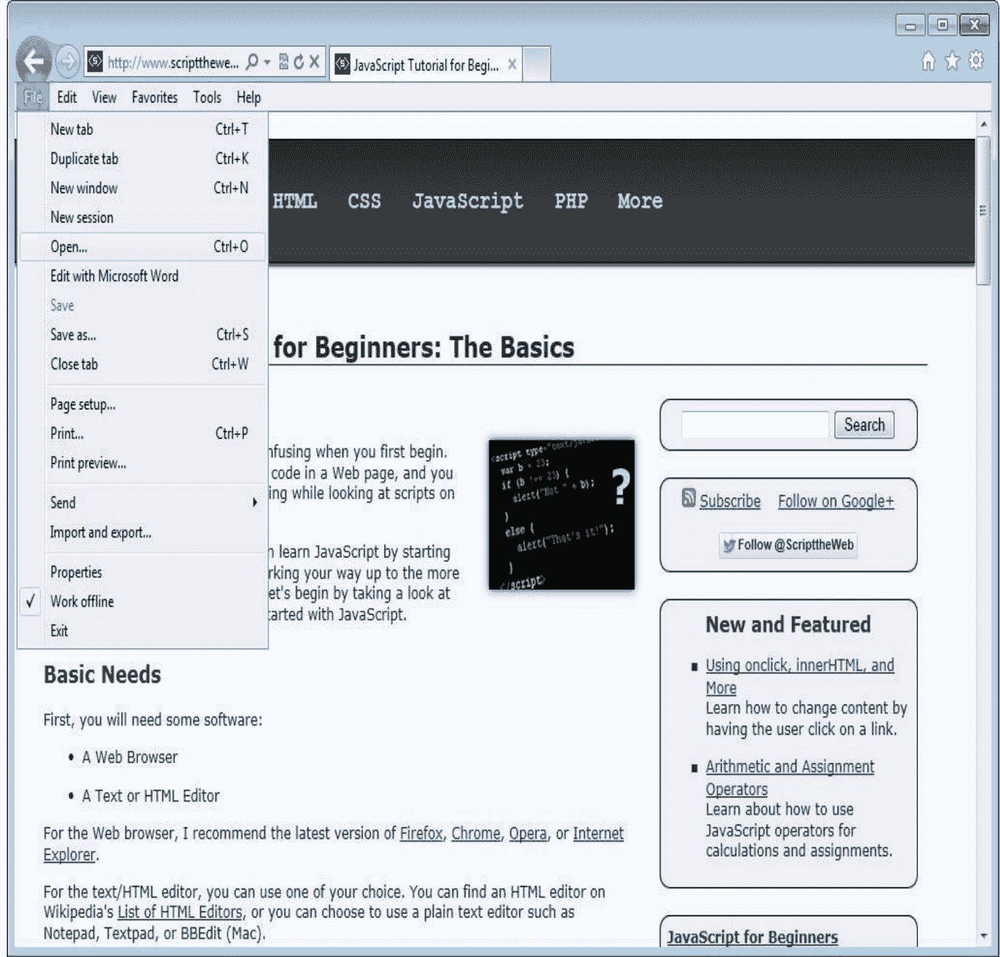

**问：我在哪里可以得到你提到的那些浏览器？**
**答：** 以下是这些浏览器的链接：

* **Microsoft Internet Explorer** www.microsoft.com/ie
* **Mozilla Firefox** www.mozilla.com/firefox
* **Google Chrome** www.google.com/chrome/
* **Opera** www.opera.com

## JavaScript入门

JavaScript是Netscape Communications Corporation和Sun Microsystems, Inc.联合开发的成果。这种新语言的新闻发布于1995年12月4日，当时Netscape Navigator 2.0仍处于测试版。JavaScript 1.0版本随着新浏览器一同发布。（在作为JavaScript发布之前，它被称为LiveScript。）

JavaScript是一种基于原型的、客户端的脚本语言，可在多种环境中使用。为了理解这个定义，让我们逐一看看其重要部分。

### 基于原型

*基于原型*意味着JavaScript是一种面向对象的编程语言，可以使用称为*对象*的元素。然而，这些对象不是*基于类*的，因此不区分类和实例；相反，对象通过原型属性从其他对象继承。你将在第8章学习如何使用JavaScript对象。在你了解这种语言的其他一些特性之前，你不需要详细理解它们。

### 客户端

*客户端*意味着JavaScript运行在观众使用的*客户端*（软件）上，而不是提供该页面的网站的Web服务器上。在这种情况下，客户端通常将是Web浏览器（尽管ECMAScript也可以在其他环境中运行，例如Adobe Acrobat、Adobe Flash等）。为了更清楚地理解这一点，让我们看看服务器端语言和客户端语言是如何工作的。

### 服务器端语言

*服务器端语言*需要从网页或Web浏览器获取信息，将其发送到在主机服务器上运行的程序，然后将信息发送回浏览器。因此，在程序结果在浏览器中显示之前，必须有一个中间步骤从服务器发送和检索信息。

服务器端语言通常提供客户端语言没有的选项，例如将信息保存在Web服务器上以供将来使用，或使用新信息更新网页并保存更新。

然而，服务器端语言在处理客户端特有功能方面的能力可能有限，而这些功能可以通过客户端语言访问（例如浏览器窗口的宽度或表单在提交到服务器之前的内容）。

### 客户端语言

*客户端语言*直接通过观众使用的客户端运行。在JavaScript的情况下，客户端通常是Web浏览器。因此，JavaScript直接在Web浏览器中运行，不需要经过从Web服务器发送和检索信息的额外步骤。

使用客户端语言，浏览器读取并解释代码，结果可以在不先从服务器获取信息的情况下提供给观众。这个过程可以使某些任务运行得更快。

客户端语言还可以访问浏览器窗口的特殊功能，这些功能可能无法通过服务器端语言访问。然而，客户端语言缺乏像服务器端语言那样将文件或文件更新保存到Web服务器上的能力。

> **注意**
使用XMLHttpRequest对象允许JavaScript从服务器发送和请求数据。这将在第15章简要介绍。

客户端语言对于处理文档内容或允许在将信息发送到服务器端程序或脚本之前进行验证的任务很有用。例如，当用户单击链接或按下按钮时，JavaScript可以更改网页上一个或多个元素的内容（也可以激活许多其他用户操作）。

JavaScript也可用于在将表单发送到服务器端程序进行处理之前检查输入到表单中的信息。此信息检查可以通过防止提交不准确或不完整的信息来减轻Web服务器的负担。而不是在服务器上运行程序直到信息正确，这些数据可以只发送一次正确的信息到服务器。

> **注意**
虽然JavaScript能够*帮助*验证发送到服务器的信息，但它不能取代服务器端验证，因为用户可能在设备中禁用或无法使用JavaScript（这允许他们绕过JavaScript验证）。出于安全原因，无论是否包含JavaScript验证，你都应始终使用服务器端验证。

### 脚本语言

脚本语言不需要在运行前编译程序。所有的解释都是由客户端实时完成的。

使用常规编程语言，在运行你编写的程序之前，必须使用特殊的编译器编译它，以确保没有语法错误。使用脚本语言时，代码在客户端加载时就被解释。因此，你可以更快地测试代码结果。但是，错误不会在脚本运行前被捕获，并且如果客户端不能很好地处理错误，可能会导致问题。在JavaScript的情况下，错误处理取决于浏览器或观众使用的其他客户端。

### 综合应用

考虑到所有这些，你可能想知道JavaScript如何在浏览器中运行。你可能想知道在哪里编写你的JavaScript代码，以及是什么告诉浏览器它与网页上的任何其他内容不同。目前的答案是通用的，但下一章提供了更多细节。

JavaScript通过将其添加到现有的HTML文档中（可以直接添加，也可以通过引用外部脚本文件）在浏览器中运行。你可以向HTML代码添加特殊的标签和命令，这些标签和命令将告诉浏览器它需要运行一个脚本。当浏览器看到这些特殊的标签时，它会解释JavaScript命令，并按照你在代码中指定的操作执行。因此，通过简单地编辑HTML文档，你就可以开始在网页上使用JavaScript并看到结果。

例如，以下代码向HTML文件添加了一些JavaScript，用于在网页上写入一些文本。请注意`<script>`和`</script>`标签的添加。它们之间的代码是JavaScript。

```
<html> 此标签告诉浏览器
<body> JavaScript跟随其后
<script>
document.write("This writes text to the page"); </script>
</body> 此行告诉浏览器
</html> 脚本到此结束
此行将引号内的文本写入页面
```

下一章将介绍如何使用`<script>`和`</script>` HTML标签在HTML文件中添加JavaScript。这将是你成为JavaScript编码者的第一步！

## 在线资源

要在线查找帮助你学习JavaScript的额外信息，以下是一些有用的资源：

- 一个可以找到包含实际结果示例的教程的地方：www.scripttheweb.com/js/
- 一个优秀的教程网站，包含可直接复制粘贴的脚本：www.javascriptkit.com
- 一个你可以向其他编码者提出JavaScript问题的地方：www.webxpertz.net/forums

**试一试 1-1** 使用JavaScript编写文本
pr1_1.html
这个项目通过在浏览器中加载HTML文档来向你展示JavaScript的实际应用。该脚本使用JavaScript在浏览器中写入一行文本。
分步操作

**1.** 将此处显示的代码复制并粘贴到你的文本编辑器中：

```
<html>
<body>
<script>
document.write("This text was written with JavaScript!"); </script>
</body>
</html>
```

**2.** 将文件保存为pr1_1.html并在Web浏览器中打开它。你应该会看到一行使用JavaScript编写的文本。（要在Web浏览器中打开文件，请转到“文件”菜单并查找一个类似“打开”或“打开文件”的选项，然后选择它。你应该能够像使用其他程序一样浏览要打开的文件。）

### 试一试总结

在这个项目中，你将一段代码复制并粘贴到文本编辑器中，并保存了文件。当你在Web浏览器中打开保存的文件时，浏览器中显示了一行文本。这段文本是使用JavaScript在浏览器窗口中编写的。你将在第2章中更多地了解这种类型的脚本是如何工作的。


## 第一章 自测

1.  要使用 JavaScript，你必须了解以下哪一项？
    A. Perl
    B. C++
    C. HTML
    D. SGML

2.  使用 JavaScript 时，你应该拥有以下哪一项？
    A. 一个 Web 浏览器
    B. 一个 C++ 编译器
    C. 一个 500GB 硬盘驱动器
    D. 一个 DVD-RW 驱动器

3.  Web 浏览器的选择取决于你自己，只要它与 ______ 兼容。
    A. Flash
    B. VBScript
    C. JavaScript
    D. Windows XP

4.  JavaScript 和 Java 是同一种语言。
    A. 正确
    B. 错误

5.  ______ 是用于 JavaScript 语言的国际标准名称和规范。
    A. JScript
    B. LiveScript
    C. ECMAScript
    D. ActionScript

6.  JavaScript 与其他编程和脚本语言有相似之处。
    A. 正确
    B. 错误

7.  在以 JavaScript 发布之前，JavaScript 被称为 ______。
    A. Java
    B. JavaCup
    C. LiveScript
    D. EasyScript

8.  JavaScript 是 ______。
    A. 基于原型的
    B. 基于类的
    C. 缺乏对象的
    D. 不使用对象的语言

9.  客户端语言直接通过观看者所使用的 ______ 运行。
    A. 服务器
    B. 客户端
    C. 显示器
    D. 律师

10. 在网页上使用表单时，客户端语言如何提供帮助？
    A. 它可以将信息保存在服务器上。
    B. 它可以在信息发送到服务器之前验证信息。
    C. 它可以更新文件并使用新信息保存文件。
    D. 它根本帮不上忙。

11. ______ 语言不需要在运行前编译程序。
    A. 编程语言
    B. 服务器端语言
    C. 脚本语言
    D. 计算机语言

12. 使用脚本语言时，代码在客户端加载时被解释。
    A. 正确
    B. 错误

13. 在 JavaScript 中，什么处理脚本中的错误？
    A. Web 服务器
    B. 编译器
    C. Web 服务器上的程序
    D. 客户端/Web 浏览器

14. 如何将 JavaScript 添加到网页？
    A. 不添加。它必须单独编译和加载。
    B. 从服务器上的编译程序中获取。
    C. 将代码放在一个单独的文件中并打开该文件。
    D. 将其添加到 HTML 文档中。

15. 在网页上插入 JavaScript 代码时添加什么？
    A. `<script>` 和 `</script>` HTML 标签
    B. JavaScript 代码字
    C. `<javascript>` 和 `</javascript>` HTML 标签
    D. `<java>` 和 `</java>` HTML 标签

此页有意留白

## 第二章 在 HTML 文件中放置 JavaScript

### 15 项关键技能与概念

-   使用 HTML Script 标签
-   创建你的第一个脚本
-   使用外部 JavaScript 文件
-   使用 JavaScript 注释

既然你已经了解了 JavaScript，就准备好开始编码了。由于 JavaScript 代码是从 HTML 文档运行的，你需要知道如何告诉浏览器运行你的脚本。最常用的设置脚本的方法是在文档中使用 HTML `<script>` 和 `</script>` 标签。你可以将脚本标签放置在 HTML 文档的头部或主体部分。

本章首先向你展示如何使用脚本标签开始和结束一段 JavaScript 代码。然后，你将开始创建和运行你的第一个脚本。在本章末尾，你将学习如何添加 JavaScript 注释来记录你的脚本。

### 使用 HTML Script 标签

脚本标签用于告诉浏览器 HTML 文档中脚本语言的代码从哪里开始和结束。在最基本的形式中，脚本标签看起来和其他任何 HTML 标签一样：

```html
<script>
// 告诉浏览器脚本代码从哪里开始
*JavaScript 代码在此*
// 告诉浏览器脚本代码在哪里结束
</script>
```

如你所见，有开始的 `<script>` 标签、JavaScript 代码，然后是结束的 `</script>` 标签。当你只使用像这样的基本开始和结束标签时，几乎所有的浏览器都会假定接下来的脚本语言是 JavaScript。

在 HTML 中，脚本标签不区分大小写。然而，在 XHTML 中，脚本标签必须是小写的。JavaScript 在所有版本中都是区分大小写的，所以你需要更加小心。在本书中，我将使用 HTML5 作为 HTML 代码（尽管 HTML5 不区分大小写，我将把标签和属性名称写成小写）。对于 JavaScript 代码，我将使用其正确运行所需的大写形式。

`<script>` 标签有六个可能的属性：*type*、*language*（已弃用）、*charset*、*src*、*defer* 和 *async*。这些属性为浏览器提供有关脚本何时应加载、脚本语言以及外部 JavaScript 文件位置（如果有）的附加信息。

### 识别脚本语言

开始和结束脚本标签之间的脚本语言可以是 JavaScript、VBScript 或其他语言，尽管 JavaScript 几乎总是被设置为浏览器中的默认脚本语言。如果需要，你可以通过向开始脚本标签添加 type 属性（值为 "text/javascript"）来明确标识 JavaScript 作为脚本语言：

```html
<script type="text/javascript">
*JavaScript 代码在此*
</script>
```

> **注意**
> 在 XHTML 中，开始脚本标签中的 type 属性是必需的，以便网页能够验证，但在 HTML 中是可选的。

过去，language 属性用于识别脚本语言，但在现代浏览器中被忽略，并且在 XHTML 和 HTML5 中会导致页面无效。不应再使用它。

charset 属性允许指定 JavaScript 代码的字符集，大多数浏览器不识别它，因此不建议使用。

### 调用外部脚本

脚本标签允许你在文档中调用一个外部 JavaScript 文件。*外部 JavaScript 文件* 是一个只包含 JavaScript 代码的文本文件，并以 .js 文件扩展名保存。通过调用外部文件，你可以节省在每个需要脚本的页面中编码或复制长脚本的时间。相反，你可以在每个页面上使用一行代码，指向包含所有代码的 JavaScript 文件。

你可以通过将 src（源）属性添加到开始脚本标签来调用外部脚本：`<script type="text/javascript" src="yourfile.js"></script>`

此示例从你放置此标签的任何页面调用名为 yourfile.js 的 JavaScript 文件。请确保开始和结束脚本标签之间没有空格或代码，因为这可能导致脚本调用失败。

如果脚本非常长，使用 src 属性将脚本添加到多个页面可能比在每个页面上插入整个代码快得多。此外，浏览器会在第一次加载外部 JavaScript 文件时对其进行缓存，使后续使用该脚本的网页渲染更快。使用外部脚本也有助于处理页面验证，并尝试将脚本代码与标记（HTML）代码分离。

默认情况下，脚本文件按它们在 HTML 代码中放置的顺序（同步）加载。有一些选项可以改变此行为，将在下一节中描述。

### 指定脚本何时加载

最后两个属性 defer 和 async 允许你指定外部脚本何时加载。这些属性并非被旧版浏览器完全支持，或者行为可能不同，因此请注意，旧版浏览器可能不会在预期的时间执行脚本。

#### defer 属性

defer 属性允许你指定外部脚本文件应被加载，但在页面完成解析（`</html>` 标签已加载）之前不应执行。以下 `<script>` 标签将延迟外部 JavaScript 代码的执行。

#### async 属性

当设置了 async 属性时，页面可以继续加载而无需等待脚本加载，并且脚本将在文档完成加载之前执行。以下是一个示例：

```html
<script type="text/javascript" src="file.js" async></script>
```

> **注意**
> 如果你使用 XHTML，请使用 async="async" 设置此属性。Firefox 3.5+ 和 Chrome 7+ 支持此属性。

### 使用 `<noscript>` 标签

为那些没有 JavaScript（或禁用 JavaScript）的观众提供替代内容的一种方法是使用 noscript 标签。`<noscript>` 标签可以放置在 HTML 文档中的任何位置，并且可以包含这些观众在没有 JavaScript 浏览时需要的任何内容。例如：

```html
<script type="text/javascript">
document.write("颜色是红色。");
</script>
<noscript>
颜色是红色。
</script>> 
> 为那些有 JavaScript 的观众显示。
> 为那些没有 JavaScript 的观众开始 noscript 内容。
> 结束 noscript 内容。

此示例通过 JavaScript 或通过 `<noscript>` 标签中的文本向观众显示短语 "颜色是红色。"。

> **注意**
> 一些旧版浏览器可能无法正确处理 noscript 标签，并且不会在任一部分中显示内容。如果你的用户使用的是旧版浏览器，另一种替代方法是在页面上显示内容，然后使用 JavaScript 为那些能够用 JavaScript 显示它的人增强内容。

`<noscript>` 标签有时可能有用，但通常有更好的方法为那些没有 JavaScript 的人提供相同的内容（例如，避免使用 document.write() 方法）。随着你在本书中的学习，你将了解更多关于可访问的 JavaScript。

## 专家问答

**问：** 我是否总是需要使用脚本标签将 JavaScript 添加到页面？
**答：** 可以使用 *事件处理程序*，允许你在 HTML 标签的事件处理属性中编写简短的脚本。你将在第 8 章学习事件处理程序。

**问：** language 属性怎么办？
**答：** language 属性曾经用于指定要使用的脚本语言，并且一度一些浏览器允许指定 JavaScript 版本（例如，language="JavaScript1.2"）。现在不再是这种情况，该属性已被弃用。由于它在现代浏览器中被完全忽略，并且在 XHTML 和 HTML5 中导致页面无法验证，因此不应再使用它。

**问：** 当我向页面添加脚本时，它在 XHTML strict（或 transitional）中无法验证。我如何让页面通过验证？
**答：** 如果脚本包含 XHTML 中使用的字符，例如 <（在 JavaScript 中用于 "小于"，但在 XHTML 中被视为新标签的开头），那么页面在不添加 CDATA 部分的情况下将无法通过脚本直接放在文档中的验证：

```html
<script type="text/javascript">
// <![CDATA[
var x = 5;
var y = 10;
if (x < y) {
    window.alert("x 小于 y");
}
// ]]>
</script>
```

> 开始 CDATA 部分。
> 结束 CDATA 部分。


(续)

这将允许页面通过验证，但由于 `<![CDATA[` 和 `]]>` 字符位于脚本中，脚本将不再有效。要解决此问题，当这些字符位于脚本标签内时，你需要用 JavaScript 注释（`/*` 和 `*/`）将它们包围起来：

```
<script type="text/javascript"> /*<![CDATA[*/
var x = 5;
var y = 10;
if (x < y) {
window.alert("x is less than y"); }
/*]]>*/
</script>
```

- 开放式和闭合式 JavaScript 注释被放置在 `<![CDATA[` 周围。
- 开放式和闭合式 JavaScript 注释被放置在 `]]>` 周围。

如你所见，这很快就会变得相当繁琐！通常，更好的选择是使用外部脚本文件，这可以消除这个问题，因为在 XHTML 文档中只需要脚本标签本身。

## 创建你的第一个脚本

既然你已经知道如何使用 HTML 脚本标签来告诉浏览器文档中的 JavaScript，那么你就准备好学习如何在这些脚本标签之间添加实际的 JavaScript 代码了。教授任何语言时通常给出的第一个编码示例，都是向默认输出区域写入某种文本，通常被称为基本的“Hello World”脚本。遵循这一惯例，你的第一个脚本将向网页写入一串文本。

### 编写一个 "Hello World" 脚本

我们不会写“Hello World”，而是为这个脚本使用另一行文本：“Yes! I am now a JavaScript coder!”。这只需要一行代码，使用 `document.write()` 方法，该方法向文档写入一串文本：

```
<script type="text/javascript">
document.write("Yes! I am now a JavaScript coder!");
</script>
```

注意括号和文本周围的引号。括号是必需的，因为 `document.write()` 方法是一个 JavaScript *函数*，它接受一个包含在括号内的*参数*。你将在第 4 章了解更多关于 JavaScript 函数的知识。

引号表示一串*文本*。字符串是通过将其放在引号内来定义的 JavaScript 变量类型。第 3 章提供了关于字符串和其他 JavaScript 变量类型的详细信息。

关于你的脚本，最后一点需要注意的是行末的分号。分号表示一个 JavaScript 语句的结束。一个*语句*是一部分代码，它不需要添加任何东西就能在语法上（其形式和顺序）完整。一个语句可以用来执行单个任务、执行多个任务，或者调用脚本的其他部分来执行多个语句。大多数 JavaScript 语句以分号结尾，因此养成添加分号的习惯是个好主意。

#### 注意

在后面的章节中，你会看到各种不以分号结尾的行，因为它们打开或关闭一个代码块。此外，你遇到的许多脚本可能不会以分号结束语句。JavaScript 在大多数情况下对分号的使用是宽松的；然而，最好使用分号来结束语句，因为它可以防止可能的错误，并有助于以后调试（排除）脚本中的错误。

所以，要将文本字符串写入页面，你需要使用 `document.write()` 方法，后跟文本，文本用引号括起来并包含在括号中。用分号结束该行（该语句）。JavaScript 将处理剩下的工作。

## 为脚本创建 HTML 文档

为了使此示例完整并测试脚本，你需要将其插入到 HTML 文档中。首先，使用基本标签创建以下 HTML 文档（使用你偏好的任何文本编辑器）：

```
<!DOCTYPE html>
<html>
<head>
<title>Untitled Document</title>
</head>
<body>
</body>
</html>
```

在文本编辑器中将文档另存为 `test1.html`。稍后你将用 Web 浏览器调用它来查看脚本的结果。接下来，你将把这个脚本添加到这个 HTML 文档中，所以请保持文件打开。

### 将脚本插入 HTML 文档

现在你需要将脚本插入文档。应该放在哪里？你可以将脚本放在 `<head>` 和 `</head>` 标签之间，或者放在 `<body>` 和 `</body>` 标签之间。由于此示例直接向页面写入文本字符串，你想将脚本插入到 `<body>` 和 `</body>` 标签之间，放在你希望文本字符串出现的任何地方。它可以出现在页面上任何 HTML 代码的前面、后面或中间。

为了清楚地显示脚本结果，你将添加 HTML 代码，在脚本前后写入文本行。脚本标签和脚本身插入在这些行之间。在 `<body>` 和 `</body>` 标签之间添加如下所示的行：

```
<p>This is the first line, before the script results.</p>
<p>
<script type="text/javascript">

document.write("Yes! I am now a JavaScript coder!");
</script>
</p>
<p>This line comes after the script.</p>
```

再次保存 `test1.html` 文档。现在你应该能在 Web 浏览器中打开文档以查看脚本的结果。图 2-1 显示了加载网页时文本在浏览器中的显示方式。

恭喜，你现在完成了你的第一个脚本！

#### 注意

本节中的示例代码使用了整个 HTML 文档及其所有标签。为了尽可能保持相关性，从这里开始，示例代码将只使用与脚本相关的 HTML 标签，而不是它的所有标签。项目代码可以根据需要使用整个 HTML 文档。

## 专家问答

**问：为什么 `document.write()` 命令中有一个点（`.`）？**

**答：** `Document` 是 JavaScript 的预定义对象之一，`write()` 是 `document` 对象的预定义方法。点号将对象和方法组合在一起以使函数工作。第 9 章解释了 JavaScript 对象，第 10 章专门介绍 `document` 对象。

**问：我怎么知道什么时候把脚本放在 head 部分，什么时候放在 body 部分？**

**答：** 过去，JavaScript 代码几乎总是放在 head 部分，这使其与 HTML 代码的其余部分分开。现代编码实践通常是将所有 JavaScript 代码放在外部 `.js` 文件中，并将 `<script>` 标签放在闭合的 `</body>` 标签之前。这确保了 HTML 页面已在浏览器中加载（因为如果将大脚本放在其他地方，可能会延迟页面的加载），从而为用户提供更好的体验。

### 动手实践 2-1 将脚本插入 HTML 文档

pr2_1.html

本项目让你练习将脚本添加到页面。你将创建一个 HTML 文档并插入一个脚本，该脚本在页面加载时在浏览器窗口中显示一个简短的句子。

## 分步操作

1.  设置一个 HTML 文档，使其成为一个简单的文件，`<body>` 和 `</body>` 标签之间目前没有任何内容。
2.  在网页中的一个段落中放入以下文本行：`I am part of the HTML document!`
3.  在此行之后插入一个 `<p>` 标签。
4.  在 `<p>` 标签之后，插入一个将在页面上写入以下行的脚本：`This came from my script, and is now on the page!`
5.  在脚本之后，添加一个 `</p>` 标签。添加另一个开放的 `<p>` 标签。
6.  在最后一个 `<p>` 标签之后，将以下文本行放入网页，并使其强调显示（使用 `<em> </em>` 标签）：`*I am also part of the HTML document, after the script results!*`
7.  添加一个 `</p>` 标签以完成该段落。
8.  你的 HTML 文档应如下所示：
9.  将文件另存为 `pr2_1.html`，并在浏览器中查看页面以查看结果。*（续）*

```
<!DOCTYPE html>
<html>
<head>
<title>JavaScript Project 2-1</title>
</head>
<body>
<p>I am part of the HTML document!</p>
<p>
<script type="text/javascript">

document.write("This came from my script, and is now on the page!"); </script>
</p>
<p><em>I am also part of the HTML document, after the script results!</em></p> </body>
</html>
```

### 动手实践总结

在本项目中，你创建了一个 HTML 文件。利用你到目前为止在本章中获得的知识，你在 HTML 文件中插入了一个脚本，该脚本在页面上写入特定的文本行。当在 Web 浏览器中打开 HTML 页面时，脚本的结果显示在两行文本之间。

## 使用外部 JavaScript 文件

现在假设你想在多个页面上使用你的“Hello World”脚本（你在本章前面创建的那个），但你不想在每个页面上都写一遍它。你可以通过将脚本放在外部脚本文件中，并使用脚本标签的 `src` 属性来调用它来实现这一点。对于这种方法，你需要创建一个 JavaScript 文本文件来存放你的脚本。你还需要一个或多个 HTML 文件，在其中放置脚本标签来调用你的外部脚本文件。


 ## 创建一个 JavaScript 文件

在本示例中，你将创建一个仅包含一行的 JavaScript 文件。对于实际应用来说，你会用这种方法来编写更长的脚本——脚本越长，这项技术的用处就越大（尤其是当你试图验证自己的网页，或将脚本代码与标记分离时）。

在文本编辑器中打开一个新文件，并只插入 JavaScript 代码（`document.write()` 语句）本身。外部 JavaScript 文件中不需要脚本标签。该文件应如下所示：

```
document.write("Yes! I am now a JavaScript coder!");
```

在文本编辑器中将该文件保存为 jsfile1.js。为此，你可能需要使用文件菜单中的"另存为"选项，并在文件名周围加上引号，如图 2-2 所示（在 Windows 中使用记事本）。

文件保存后，你可以继续下一步，即创建要使用脚本的 HTML 文件。

### 创建 HTML 文件

你将创建两个文件来放置脚本。不过，该技术适用于任意数量的 HTML 文件，只要你在每个文件中添加所需的脚本标签即可。

对于第一个文件，创建基本 HTML 文档，并在文档的主体部分插入脚本标签，使用 `src` 属性指向 jsfile1.js 文件，并在页面主体中添加一些 HTML 文本来标识它是第一个 HTML 文档：

```
<body>
<script type="text/javascript" src="jsfile1.js"></script> <p>
This is page 1, and the script works here!
</p>
</body>
```

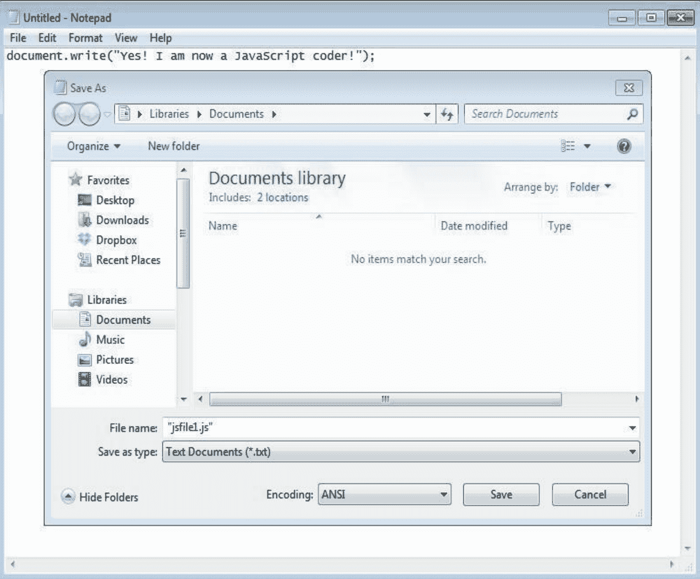

图 2-2 使用引号保存带有 .js 扩展名的文件示例，以便保存为正确的文件扩展名

在文本编辑器中将此文件保存为 jsext1.html。确保将其与你的 jsfile1.js 文件保存在同一目录中。第二个 HTML 文档与第一个看起来相同，只是 HTML 文本说明这是第 2 页：

```
<body>
<script type="text/javascript" src="jsfile1.js"></script> <p>
This is page 2, and the script also works here!
</p>
</body>
```

在文本编辑器中将此文件保存为 jsext2.html。同样，务必将其与其他文件放在同一目录中。

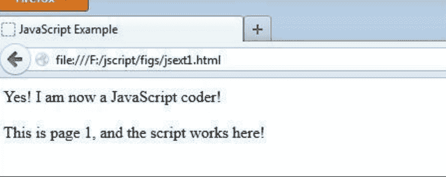

图 2-3 在 jsext1.html 文件（第一个 HTML 页面）中调用脚本的结果

### 在浏览器中查看页面

在网页浏览器中打开 jsext1.html 文件。它应如图 2-3 所示，JavaScript 从外部脚本文件插入到页面中。

接下来，在网页浏览器中打开 jsext2.html 文件。它应如图 2-4 所示，只有你在 HTML 文件中添加的说明这是第 2 页的文本有细微差别。JavaScript 应该向此页面写入与第一个 HTML 页面相同的文本。

虽然我们在本示例中使用了短脚本，但它应该能让你了解，当你有一个大型脚本时，使用外部文件如何能够节省大量时间。

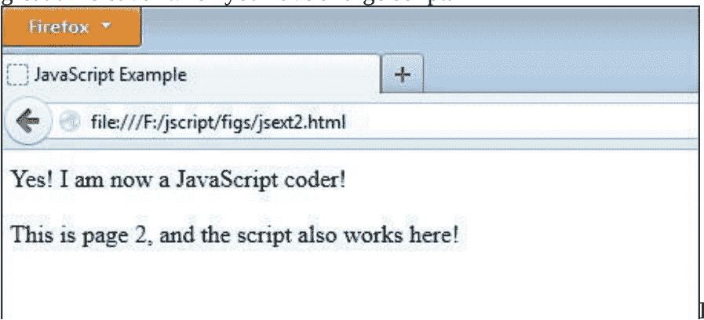

**图 2-4** 在 jsext2.html 文件（第二个 HTML 页面）中调用脚本的结果

### 动手实践 2-2 从 HTML 文档调用外部脚本

#### pr2_2.html

#### prjs2_2.js

本项目将让你练习创建外部 JavaScript 文件，并使用它们将脚本插入到网页中。

#### 分步指南

- 1. 设置一个简单的 HTML 文档，在 `<body>` 和 `</body>` 标签之间不要放任何内容。

- 2. 将以下文本行放在页面的 body 标签之间：

This text is from the HTML document!

- 3. 在此文本后放置一个 `<p>` 标签。

- 4. 将其保存为 pr2_2.html。

- 5. 创建一个外部 JavaScript 文件，当它执行时写入以下行：I love writing JavaScript and using external files!

- 6. 你的 JavaScript 文件应该如下所示：

```
document.write("I love writing JavaScript, and using external files!");
```

- 7. 将 JavaScript 文件保存为 prjs2_2.js。

- 8. 返回 HTML 文档。将脚本标签放在文档中 `<p>` 标签之后，这样外部 JavaScript 文件就会将其句子写入页面。

- 9. 在脚本标签后插入一个 `</p>` 标签。

- 10. 你的 HTML 文档主体应如下所示：

```
<body>
This text is from the HTML document!
<p>
<script type="text/javascript" src="prjs2_2.js"></script> </p>
</body>
```

- 11. 保存 HTML 文件并在浏览器中查看结果。

### 动手实践总结

在本项目中，你创建了一个 HTML 页面。利用你在上一节中关于外部 JavaScript 文件的知识，你创建了一个外部 JavaScript 文件，并将必要的代码放入 HTML 文件中以包含该外部 JavaScript 文件。当 HTML 文件在网页浏览器中显示时，会显示一行纯文本，随后是外部 JavaScript 文件的结果。

## 使用 JavaScript 注释

你可能需要在自己的 JavaScript 代码中做备注，例如描述某行代码的用途。你也可能希望出于某种原因禁用脚本中的某一行。例如，如果你在查找脚本中的错误，可能想要禁用脚本中的某一行，看看是否是这一行导致了错误。你可以通过使用 JavaScript 注释来完成这些任务。你可以插入仅出现在一行上的注释，也可以插入跨越多行的注释。

### 插入单行注释

如果你想在代码中添加单行注释，请在注释文本前放置一对正斜杠：

*// 在此输入你的注释*

在这种格式中，该行上两个斜杠之前的任何内容都是"活动"代码——即会被执行的代码——而该行斜杠之后的任何内容都会被忽略。例如，假设你在代码中写下了这一行：

```
document.write("This is cool!"); // 写出我的看法
```

浏览器将执行 `document.write()` 方法，因此文本 "This is cool!" 将被写入页面。然而，斜杠后的注释将被浏览器忽略。如果你将正斜杠放在行首，浏览器将忽略整行。假设你将前面示例中的斜杠移到了该行的最前面：

```
// document.write("This is cool!"); 写出我的看法
```

在这种格式下，由于整行以代表 JavaScript 注释的两个斜杠开头，因此整行都会被忽略。文本不会被写入页面，因为该代码不会被浏览器执行。实际上，你正在禁用 `document.write()` 语句。如果包含该行的脚本有错误，而你想知道是否是这一行导致了问题，你可能会希望这样做。

### 添加多行注释

由一对正斜杠表示的注释仅适用于它们出现的那一行；它们的效果在行末终止。你可以通过在代码的每一行添加斜杠来使这种注释跨越多行，如下例所示：

```
// 删除了我的注释。
// document.write("This is cool!"); 写出我的看法
// 注释删除结束。
```

要添加跨越多行而不在每行都放置斜杠的注释，你可以使用不同的注释格式：在注释开头使用正斜杠后跟星号，然后是注释文本，最后在注释结尾处使用星号后跟正斜杠。以下是一个示例：

```
/*
我的脚本将向我的 HTML 文档写入一些文本！
所有这些文本都被浏览器忽略。
*/
document.write("You can see me!");
```

使用这种格式，你可以在一行开始注释，在另一行结束注释。多行注释在需要插入更长的描述或其他文本时非常方便，但使用时需要小心。看看这个示例，看看你是否能发现其中的问题：

```
<script type="text/javascript">
/*
这段代码由于某种原因无法工作。
document.write("I want someone to see me!");
</script>
```

你是否注意到 JavaScript 注释的结束符号缺失了？使用多行注释时，你需要小心地将它们关闭。否则，你可能会不小心注释掉需要执行的代码！在此示例中，注释无休止地继续下去，没有结束。要解决这个问题，你需要在使用 `document.write()` 方法之前关闭 JavaScript 注释：

```
<script type="text/javascript">
/*
JavaScript 代码现在正常工作了！这段文本被隐藏了。
*/
document.write("Now everyone can see me!");
</script>
```


 注意，然而，多行注释不能嵌套在其他多行注释中，因为内部注释的结束注释代码会过早地关闭注释。例如，考虑以下代码：

/* 外部注释开始 注释掉一些代码
document.write("我看不到！"); /*
document.write("我也看不到。"); */
document.write("哎呀！我能被看到！");

*/ 这段代码会执行！
如你所见，第一个出现的 */ 会导致整个注释结束，之后的代码可能会被执行。

这段代码不会执行
内部注释开始（不会被识别为新注释，因为它已经被注释掉了）
这段代码也不会执行 这结束了整个注释！

在前面的例子中，你看到了注释如何用于提供每个脚本预期功能的文档说明。在第16章中，你将学习如何使用注释来帮助调试你的 JavaScript 代码。现在，你应该养成添加注释的习惯，作为脚本的简短说明或指令。

## 第2章 自测题

1. `<script>` 和 `</script>` 标签的作用是什么？
   - A. 告诉浏览器脚本从哪里开始到哪里结束
   - B. 让浏览器知道脚本应该何时加载
   - C. 指向一个外部 JavaScript 文件
   - D. 以上所有

2. 为什么要在 script 开始标签中使用 type 属性？
   - A. 让浏览器知道你是什么类型的程序员
   - B. 确保使用 XHTML 时网页能通过验证
   - C. 创建一个打字脚本
   - D. 确保脚本不会出现语法错误

3. JavaScript 代码区分大小写吗？
   - A. 是
   - B. 否

4. noscript 标签为没有 的用户提供支持。

5. 外部 JavaScript 文件通常使用的文件扩展名是 。
   - A. .js
   - B. .html
   - C. .jav
   - D. .java

6. 以下哪个正确地指向名为 yourfile.js 的外部 JavaScript 文件？
   - A. `<extscript type="text/javascript" src="yourfile.js"></extscript>`
   - B. `<script type="text/javascript" src="yourfile.js"> </script>`
   - C. `<script language="yourfile.js"></script>`
   - D. `<scripttype="text/javascript" link="yourfile.js"></script>`

7. 在 HTML 中，script 标签不区分大小写。但是，在 XHTML 中，script 标签必须写成 。

8.  表示 JavaScript 语句的结束。
   - A. 冒号
   - B. 句点
   - C. 问号
   - D. 分号

9. 要在网页上写入一串文本，可以使用 方法。
   - A. document.write()
   - B. document.print()
   - C. document.type()
   - D. window.print()

10. 什么时候使用外部 JavaScript 文件是个好主意？
    - A. 当脚本很短且只在一个 HTML 文档中使用时
    - B. 当你的网站访问者使用较旧的浏览器时
    - C. 当脚本很长或需要放在多个 HTML 文档中时
    - D. 外部文件不是个好主意

11. JavaScript 注释对于 或你的代码来说非常有用。

12. 以下哪个表示 JavaScript 代码中其后将跟随一行注释？
    - A. /*
    - B. /
    - C. //
    - D. <!--

13. 以下哪个表示 JavaScript 代码中其后将跟随多行注释？
    - A. /*
    - B. /
    - C. //
    - D. <!--

14. 以下哪个表示多行 JavaScript 注释的结束？
    - A. \n
    - B. -->
    - C. /*
    - D. */

15. 当你使用多行 JavaScript 注释时，你需要小心 它们。
    - A. 关闭
    - B. 阅读
    - C. 编写
    - D. 编译

## 第3章 使用变量

**33 关键技能与概念**

- 理解变量
- 变量为何有用
- 为脚本定义变量
- 理解变量类型
- 在脚本中使用变量

现在你已经学会了将 JavaScript 添加到网页的基础知识，是时候深入语言的内部工作原理了。由于变量是 JavaScript 编程的重要组成部分，你需要尽可能多地了解它们是什么以及为什么在你的脚本中有用。一旦你理解了变量的工作原理和它们能做什么，你就可以继续学习其他建立在各种类型变量使用基础上的主题。

在本章中，你将首先学习什么是变量以及它们为什么有用。然后你将了解声明变量的方法以及如何为变量赋值。最后，你将看到如何在脚本中使用变量。

### 理解变量

*变量*表示或持有一个值。变量的实际值可以随时更改。要理解什么是变量，考虑一个你可能在代数课上学过的基本语句：

```
x=2
```

字母 x 用作变量的名称。它被赋值为 2。要更改值，你只需给 x 一个新的赋值：

```
x=4
```

变量的名称保持不变，但现在它代表不同的值。将数学课的例子更进一步，你可能需要解决这样一个问题：

如果 x=2，那么 3+x=？

为了得到答案，你将变量 x 的值 2 代入问题中，即 3+2=5。如果 x 的值改变，问题的答案也会改变。所以，如果 x=7，那么计算就变成了 3+7，现在结果是 10。

JavaScript 中的变量与数学中使用的变量非常相似。你给变量一个名称，然后根据需要给它赋值。如果变量的值发生变化，脚本中的某些内容也会随之改变。

#### 变量为何有用

使用变量有以下几个好处：

- 它们可以用在代码编写时值未知的地方。
- 它们可以节省你编写和更新脚本的时间。
- 它们可以使你的代码目的更加清晰。

##### 变量作为未知值的占位符

通常，变量会在内存中为脚本编写时值未知的内容保留位置。变量值可能会根据访问者输入的内容而改变，或者你可能在脚本代码的后面部分更改它。

例如，你可能有一个函数接收基于用户输入的某些值（函数将在第4章中讨论）。由于用户输入的值在编写脚本时是未知的，可以使用变量来保存用户将输入的值。这对于任何类型的用户输入都是如此，无论是 JavaScript 提示/确认框、表单中的输入字段还是其他输入方法。

##### 变量作为节省时间工具

变量加快了脚本编写速度，因为它们的值可以改变。当你在脚本开头给一个变量赋值后，脚本的其余部分可以直接使用该变量来代替它。如果你以后决定更改值，只需在一个地方更改代码——即给变量赋值的地方——而不是在多个地方。

例如，假设回到数学课上，老师让你解决这个问题：如果 x=2，那么 3+x-1+2-x=？

你知道需要将每个出现的 x 替换为值 2，即 3+2–1+2–2=4。现在如果老师让你用不同的 x 值再做一遍这道题，整个问题不需要重写。老师只需给你以下指示：

用 x=4 解上面的问题。

问题越长越复杂，变量就越有用。无需反复重写相同的内容，你可以更改一个变量来得到完全不同的结果。

##### 变量作为代码澄清者

由于变量代表某些内容，而且你可以给它们起有意义的名称，所以当你阅读（和调试）脚本时，它们通常更容易识别。如果只是添加数字，你可能会忘记它们代表什么。例如，考虑这行代码：

```
TotalPrice = 2.42 + 4.33;
```

这里，这些数字几乎可以代表任何东西。相反，你可以将 2.42 赋给名为 CandyPrice 的变量，将 4.33 赋给名为 OilPrice 的变量：

```
TotalPrice = CandyPrice + OilPrice;
```

现在，你不必试图记住数字的含义，而可以看出脚本是在将


## 为脚本定义变量

既然你已经了解了变量是什么以及为什么要使用它们，接下来你需要学习如何在脚本中让它们发挥作用。你通过*声明*来创建变量。然后使用 JavaScript *赋值运算符*为变量赋值。在为变量命名时，你需要遵循 JavaScript 变量命名规则，同时也要考虑名称的意义性。

### 声明变量

要声明一个变量，你需要使用 `var` 关键字，它告诉浏览器接下来的文本将是一个新变量的名称：
`var variablename;`

例如，要将你的变量命名为 `coolcar`，声明如下所示：`var coolcar;`

在这个例子中，你创建了一个名为 `coolcar` 的新变量。分号用于结束语句。变量 `coolcar` 尚未被赋值（JavaScript 会将其值设为 *undefined*）。

要声明多个变量，一种选择是每次都使用 `var` 语句：

```
var coolcar;
var cooltruck;
var coolvan;
```

或者，你可以使用单个 `var` 语句，并用逗号分隔每个变量名，确保最后一个变量名以分号结尾（用于结束 `var` 语句）：

```
var coolcar, cooltruck,
    coolvan;
```

最后一个声明的变量必须以分号而不是逗号结尾。如下一节所述，你可以在声明变量的同时为其赋值，也可以在脚本中稍后为其赋值。

### 为变量赋值

为变量命名的代码很简单，但对变量可以使用的单词和字母大小写有一些限制。要为变量赋值，你需要使用 JavaScript 赋值运算符，即等号 (=)。如果你想在同一行声明一个变量并为其赋值，请使用以下格式：

```
var variablename = variablevalue;
```

例如，要将你的变量命名为 `paycheck` 并赋予其数值 `1200`，请使用此语句：
`var paycheck = 1200;`

该语句以关键字 `var` 开头，后跟变量 `paycheck`，就像上一节描述的普通变量声明一样。接下来是赋值运算符 (=)，它告诉浏览器将运算符右侧的值赋给左侧的变量。赋值运算符的右侧是 `1200`，这是要赋给变量 `paycheck` 的数值。该行以分号结尾，表示语句结束。

> **注意**

小心不要将赋值运算符 (=) 理解为“等于”的含义。此运算符仅用于赋值。“等于”的运算符是两个等号（==），你将在第5章中学习到。

你之前使用的用单个 var 语句声明多个变量的方法，同样也适用于声明和为多个变量赋值。使用逗号分隔每个变量赋值，如下所示：

```
var paycheck = 1200, bonus = 50,
spending = 1500;
```

使用逗号分隔每个变量赋值。最后一个变量赋值以分号结尾。

再次记住，最后一个被声明并赋值的变量将以分号结尾，以完成 var 语句。

你见过的示例展示了正确且安全的变量声明和赋值编码方式。然而，在变量方面，JavaScript 允许一定程度的灵活性。在许多情况下，代码即使不使用精确的编码语法也能工作。例如，你可能会看到一些脚本在第一次使用变量时没有使用 var 关键字。即使变量之前未声明，JavaScript 通常也会在第一次使用时声明它。这里有一个示例：

```
paycheck = 1200;
```

这是有效的，因为变量被赋予了一个值（JavaScript 只是简单地声明变量并为其赋值 1200）。然而，如果你试图声明一个变量而不赋值，那么以下代码将是无效的：

```
paycheck;
```

这个声明仍然需要 var 关键字才能有效，就像下面的代码：`var paycheck;`

你可能还会看到一些脚本省略了结尾的分号：

```
var paycheck = 1200
```

在某些脚本中，变量赋值甚至省略了这两项：

```
paycheck = 1200
```

所有这些快捷方式看起来可能很方便，但最好还是在使用前定义每个变量，使用 var 关键字，并包含分号。不这样做可能会在某些浏览器中导致错误，并可能给人一种代码写得不好的印象。此外，如果你需要调试脚本，任何这些遗漏都可能带来真正的麻烦。给变量正确的声明和赋值可以避免问题，并且你的代码会更容易阅读和理解。

### 变量命名

在你开始为自己命名变量之前，你需要了解 JavaScript 的命名规则。你需要考虑的因素包括大小写敏感性、无效字符以及 JavaScript 保留的名称。此外，你应该尝试给变量起一个既容易记住又有意义的名字。

#### 变量中的大小写使用

JavaScript 变量是区分大小写的——`paycheck`、`PAYCHECK`、`Paycheck` 和 `PaYcHeCk` 是四个不同的变量。当你创建一个变量时，你需要确保在脚本中后续编写该变量名称时使用相同的大小写。如果你改变了大小写，JavaScript 会将其视为一个新变量或返回错误。无论哪种方式，它都可能导致你的脚本出现问题。以下是一些关于在变量名中使用大小写的建议：

- 如果你使用的变量名只包含一个单词，那么整个名称全部使用小写可能是最容易的。这样打字会更快，而且当你稍后使用它时，你会知道要全部小写输入。
- 对于由两个单词组成的变量名，你可能决定将每个单词的首字母大写。例如，你可以将变量命名为 `MyCar` 或 `My_Car`（你将在下一节看到更多关于下划线字符 _ 的内容）。你也可以使用所谓的“驼峰命名法”，其中第一个单词保持小写，每个后续单词首字母大写。例如，你可以将变量命名为 `myCar` 或 `myCoolCar`。

变量的大小写完全取决于你，所以你应该使用你最习惯的风格。最好采用一种惯例并持续使用它。例如，如果你使用全小写字符命名变量，你应该在整个脚本中都这样做，以避免在后续使用变量时意外地切换大小写。在本书中，我只使用小写字符作为变量名，以保持代码清晰。

#### 使用允许的字符

一个需要记住的重要规则是，变量名必须以字母、下划线 ( _ ) 或美元字符 ($) 开头。变量名不能以数字或任何非字母字符（下划线和美元字符除外）开头。变量名中的其他字符可以是字母、数字、下划线和美元字符。变量名中不允许有空格。因此，以下变量名是有效的：

- `paycheck`
- `_paycheck`
- `pay2check`
- `pay_check`
- `$pay_245`

然而，以下变量名是无效的：

- `#paycheck`
- `1paycheck`
- `pay check`
- `pay_check 2`
- `_pay check`

最难记住的规则可能是不能以数字开头（这是我最常忘记的）。虽然这样的名称看起来有效，但 JavaScript 不允许。

#### 避免关键字和保留字

命名变量时需要记住的另一个规则是避免使用 JavaScript 关键字和保留字。关键字是 JavaScript 中用于特定目的的特殊单词。例如，你已经学过保留字 `var` 用于声明 JavaScript 变量。将其用作变量名可能会在你的脚本中引发许多问题，因为这个词本意是以不同方式使用的。保留字是保留供将来用作关键字的特殊单词，因此也不应用作变量名，以防止你的代码将来可能出现问题。

表 3-1 列出了 JavaScript 中的关键字和保留字。请注意，所有这些单词都是全小写字母。在后面的章节中，你将使用许多关键字，因此它们会随着时间的推移变得更加熟悉。

#### 为变量赋予有意义的名称

虽然 *x* 是一个可接受的变量名，但如果以后需要调试程序，你很可能记不住它代表什么。此外，如果其他人试图帮助你调试代码，他们的工作会更加困难。

你应该尽量给变量起一个尽可能清晰地描述其含义的名字。假设你想使用一个变量来保存页面上的示例编号。与其使用 *x*、*ex* 或其他简短的变量，不如使用更具描述性的名称：

```
var examplenumber = 2;
```

- abstract
- boolean
- break
- byte
- case
- catch
- char
- class
- const
- continue
- debugger
- default
- delete
- do
- double
- else
- enum
- export
- extends
- final
- finally
- float
- for
- function
- goto
- if
- implements
- import
- in

 - instanceof int
- interface
- let
- long
- native
- new
- package
- private
- protected
- public
- return
- short
- static
- super
- switch
- synchronized this
- throw

#### 表 3-1 JavaScript 关键字和保留字

- throws
- transient try
- typeof
- var
- void
- volatile
- while
- with
- yield

变量 examplenumber 日后会让你一眼就能认出来，其他程序员也更有可能快速理解它的用途。脚本中使用的变量越多，使用有意义且易记的名称就越重要。

## 理解数据类型

到目前为止，你已经见过一些变量值为数字的示例。在 JavaScript 中，变量值可以是几种数据*类型*之一，包括 number（数字）、string（字符串）、Boolean（布尔值）、null（空值）和 undefined（未定义）。

与更严格的编程语言不同，JavaScript 不强制你在定义变量时声明其类型。相反，JavaScript 允许几乎任何值被赋值给任何变量。它还允许你在更改值时改变数据类型。虽然这给了你编码上的灵活性，但你需要小心，因为你可能会得到一些意想不到的结果——特别是在进行数字相加时（关于这个话题的更多内容，请参阅第 5 章）。

### Number（数字）

Number 变量就是数字。JavaScript 不要求数字被声明为整数、浮点（小数）数或任何其他数字类型。相反，任何数字都被视为一个数字，无论是 7、–2、3.453 还是其他什么。该数字将保持相同的类型，除非你执行计算来改变它。例如，如果你在变量中使用整数，它不会突然拥有小数部分，除非你执行某种计算来改变它（例如，进行除法时不能整除）。

如你所见，使用关键字 var 来定义数字变量：var variablename = number; 以下是一些示例：

```
var paycheck = 1200; var phonebill = 29.99; var savings = 0;
var sparetime = -24.5;
```

如果你需要使用特别长的数字，JavaScript 有指数表示法。要表示指数，在基数后面、指数前面使用字母 *e*。例如，要创建一个名为 bignumber 的变量，并为其赋值 4.52 × 10⁵（452,000），将字母 *e* 放在数字和指数之间（以表示"乘以 10 的……次方"）：

```
var bignumber = 4.52e5;
```

**注意**
JavaScript 可能会使用指数表示法返回计算结果（就像许多计算器一样）。

### String（字符串）

*String 变量*是表示一串文本的变量。字符串可以包含字母、单词、空格、数字、符号或几乎任何你喜欢的内容。字符串的定义方式与数字略有不同，使用如下格式：

```
var variablename = "stringtext";
```

以下是字符串变量的一些示例：

```
var mycar = "Corvette";
var oldcar = "Big Brown Station Wagon";
var mycomputer = "Pentium 3, 500 MHz, 128MB RAM";
var oldcomputer = "386 SX, 40 MHz, 8MB RAM";
var gibberish = "what? cool! I am @ home 4 now. (cool, right?)";
```

如你所见，字符串可以短、可以长，也可以是介于两者之间的任何长度。你可以在字符串变量中放入各种文本和其他字符。但是，引号、一些特殊字符以及字符串的大小写敏感性都需要考虑。

#### 匹配引号

在 JavaScript 中，你将字符串放在引号（简称 quotes）内来定义它，如你在示例中所见。JavaScript 允许你使用双引号或单引号来定义字符串值。关键点是，如果字符串以双引号开头，就必须以双引号结尾：

```
var mycar = "Red Corvette";
```

单引号也是如此：

```
var myhouse = 'small brick house';
```

尝试用不匹配类型的引号来结束字符串，或者遗漏了开头或结尾的引号，都会导致问题。

```
不正确，字符串以双引号开头，以单引号结尾 var mycar = "Red Corvette'; 不正确，字符串以单引号开头，以双引号结尾 var myhouse = 'small brick house"; 
不正确，字符串没有闭合引号 var mycomputer = "Pentium 3, 500 MHz, 128MB RAM; 这些错误将在 Web 浏览器中导致"未终止的字符串"错误。
```

**注意**
如果你使用双引号来包裹字符串，就可以在字符串内部使用单引号，反之亦然。

#### 注意大小写

JavaScript 字符串是*区分大小写*的。现在这可能看起来不重要，但当你需要比较字符串是否匹配时，这就很关键了。只需一个字符的大小写不同，就会使字符串变得不同：

```
"My car is fun to drive!"
"my car is fun to drive!"
```

你将在第 5 章中了解更多关于字符串比较的内容。

#### 使用特殊字符

*特殊字符*让你能够向字符串中添加原本无法添加的内容。例如，假设你需要在字符串中的每个单词之间添加一个制表符。如果你按下键盘上的 Tab 键，JavaScript 可能会将其视为一堆空格。相反，使用特殊字符 \t，它会在字符串中放置一个制表符，如下例所示：

```
var mypets="dog\tcat\tbird";
```

在每个出现特殊字符 \t 的位置，JavaScript 都会将其解释为一个制表符。特殊字符都以反斜杠字符（\）开头。因此，如果你想在字符串中使用单个反斜杠字符，你需要使用反斜杠的特殊代码：\\。
例如，假设你想在网页上写下这句话："Go to the directory c:\javascript on your computer." 如果你按原样使用该字符串，你的代码看起来会是这样：

```
<script type="text/javascript">
document.write("Go to the directory c:\javascript on your computer.");
</script>
```

单个反斜杠不会被打印到浏览器中

问题是单个反斜杠不会显示在网页上。它看起来会是这样：

Go to the directory c:javascript on your computer

除非反斜杠后面跟着特殊字符的代码，否则 JavaScript 会将斜杠后的字符按原样打印出来（你将在下一节讨论的转义技术中看到这一点）。要解决这个问题，使用 \\ 特殊代码来在页面上打印单个反斜杠：

```
<script type="text/javascript">
document.write("Go to the directory c:\\javascript on your computer.");
</script>
```

使用反斜杠字符的特殊代码允许它被打印到浏览器中

现在你得到了想要打印到浏览器的句子，像这样：Go to the directory c:\javascript on your computer。

JavaScript 中使用的特殊字符如表 3-2 所示。

假设你想在网页上打印一句带有加粗强调的句子。JavaScript 允许你将 HTML 代码作为字符串的一部分打印到页面上，使用在 document.write() 方法中（你在第 2 章的第一个脚本中使用过）。为此，你可以从 HTML 中添加 <strong> 和 </strong> 标签，如以下示例代码所示：

```
<script type="text/javascript">
document.write("<strong>JavaScript Rules!</strong> This is fun.");
</script>
```

注意 JavaScript 字符串中的 HTML <strong> 和 </strong> 标签。现在假设你希望代码本身在查看时（通过浏览器中的"查看源代码"）显示为两行，像这样：
<strong>JavaScript Rules!</strong> This is fun.
你可以通过在代码中添加换行特殊字符来实现：

```
<script type="text/javascript">
document.write("<strong>JavaScript Rules!</strong>\n This is fun.");
</script>
```

\n 特殊代码只是 JavaScript 中的换行符；它不会产生 HTML 换行。JavaScript 换行代码不会在浏览器显示中为代码结果添加新行。因此，前面代码的最终结果是一个像这样的句子：

**JavaScript Rules! This is fun.**

如果你想在浏览器显示中添加换行，你需要使用 HTML <br /> 标签来实现。

| 输出字符 | 使用的特殊代码 |
| :--- | :--- |
| 反斜杠 (\\) | \\\\ |
| 双引号 (") | \\" |
| 单引号 (') | \\' |
| 退格 | \\b |
| 换页 | \\f |
| 换行 | \\n |
| 回车 | \\r |
| 制表符 | \\t |
| 垂直制表符 | \\v |

**表 3-2 JavaScript 特殊字符**

请记住，JavaScript 换行只影响源代码的外观；它不是最终结果的因素。但是，当你以后想要格式化 JavaScript 警告框和各种其他 JavaScript 构造的输出时，它确实会派上用场。

#### 转义字符

JavaScript 允许你对某些字符进行*转义*，使它们能够正确显示并避免导致错误。


与特殊字符类似，转义序列也使用反斜杠字符（\），它置于需要转义的字符之前。

如前所述，JavaScript 在渲染之前会检查每个字符串中是否存在特殊字符。如果你想在字符串中包含引号，这就非常有用。例如，假设你想在网页上打印以下句子：

John said, "JavaScript is easy."

如果你直接把它全部放进 document.write() 命令中会发生什么？

```html
<script type="text/javascript">
document.write("John said, "JavaScript is easy."");
</script>
```

这里多出来的一组引号会导致错误。

如果你查看 document.write() 行末尾附近，会发现两个双引号在一起可能会造成问题，但浏览器实际上会在那之前就报错。当双引号用于单词 JavaScript 之前时，浏览器认为你已经关闭了 document.write() 命令中使用的字符串，期待结束括号和分号。然而，后面还有更多文本，浏览器就会困惑。

为了避免引号问题，使用反斜杠字符来转义字符串内部的引号。通过在每一对内部双引号前放置反斜杠，你强制浏览器将它们视为文本字符串的一部分，而不是 JavaScript 语句的一部分。反斜杠使得内部引号标记成为字符串的一部分：

```html
<script type="text/javascript">
document.write("John said, \"JavaScript is easy.\"");
</script>
```

这修复了字符串的问题，句子将会连同引号一起打印出来。

**注意：** 还要注意字符串中的单引号和撇号。对于用单引号括起来的字符串，转义这些是必需的。

转义技术同样适用于需要引号的 HTML 代码。例如，如果你想在页面上放置一个链接，你会使用锚点标签并将 URL 放在引号中。如果你转义锚点标签中的引号，JavaScript 允许你在 document.write() 方法中将 HTML 代码写入页面，如下例所示：

```html
<script type="text/javascript">
document.write("<a href=\"http://someplace.com\">Text</a>");
</script>
```

这能完成工作，但如果你不想一直转义引号，还有一种更简单的方法。为了避免在前面代码中转义引号，你可以在 URL 地址周围使用单引号，如下面的代码所示。双引号内的单引号是可以的：

```html
<script type="text/javascript">
document.write("<a href='http://someplace.com'>Text</a>");
</script>
```

如果你更喜欢在外层使用单引号，也可以反过来做，如下例所示。单引号内的双引号也是可以的：

```html
<script type="text/javascript">
document.write('<a href="http://someplace.com">Text</a>');
</script>
```

这里需要记住的重要一点是，确保不要在字符串内部使用与包围字符串相同类型的引号。如果你需要在引号中嵌套超过一层，就需要开始转义引号了；这是因为如果再切换一次，就会终止字符串。例如，看下面的代码：

```javascript
document.write("John said, 'Jeff says, \"Hi!\" to someone.'");
document.write("John said, 'Jeff says, "Hi!" to someone.'");
```

第一条可以工作，因为引号被转义以保持字符串继续。然而，第二条只在字符串内部的单引号中时切换回双引号。在那里放置未转义的双引号会导致字符串终止并产生错误。

如你所见，当需要在字符串中使用大量引号时，引号可能真的很麻烦。然而，记住在必要时使用反斜杠转义引号，将为你省去不少寻找缺失引号的头痛事。我曾多次不得不在代码中寻找缺失的引号，几次这样的经历后我的头都晕了！在本章稍后，你会看到可以将字符串拼接在一起，这可以简化引号的使用。

### Boolean（布尔值）

*布尔*变量是指值为 true 或 false 的变量。以下是示例：

```javascript
var johncodes = true;
var johniscool = false;
```

注意，单词 *true* 和 *false* 不需要用引号括起来。这是因为它们是 JavaScript 能识别的字面量值。当你需要只能取 true 和 false 值的变量时，布尔变量非常有用，比如在事件处理程序中（在第 7 章中介绍）。

**注意：** 当我们谈论布尔变量的概念时，单词 *Boolean* 的首字母大写（因为它源于数学家*乔治·布尔*的名字）。然而，JavaScript 保留字 boolean 在脚本中使用时全部小写。

### Null（空值）

*Null* 用于表示一个空对象（你将在第 9 章学习对象）。如果你需要定义一个值为 null 的对象，使用如下声明：

```javascript
var variablename = null;
```

与布尔变量一样，你不需要像字符串值那样将这个值用引号括起来，因为 JavaScript 能识别 null 的特殊值。null 数据类型只能有一个值：null。

### Undefined（未定义）

undefined 数据类型与 null 类似，它只有一种可能的值：undefined。这个值出现在变量没有被赋予初始值时，或者使用先前未声明的变量时。例如，以下两个例子都使用了未定义的变量（你将在本章稍后看到更多关于如何使用变量的内容）：

```javascript
var myname;
document.write(myname);
```

变量 myname 已声明，但没有赋值。由于该变量没有赋值，所以它是未定义的，代码将无法按预期工作。

```javascript
document.write(myname);
```

myname 变量之前未声明，所以 myname 是未定义的，代码将无法按预期工作。

## 专家问答

**问：为什么我需要学习变量？难道我不能在我要用的地方直接放入我想用的数字或文本吗？**

**答：** 你可以这样做；然而，这会使较长的脚本更难编写、阅读和调试。这也使得更新脚本更加困难，因为要更改那个数字或文本，你需要更改它出现的每一行。当你使用变量时，只需修改一行代码就能更改变量在每一处使用的地方的值。随着你获得更多 JavaScript 经验，你会看到变量是多么有用。

**问：为什么我在声明数值变量时不需要定义我使用的数字类型（如浮点数或整数）？**

**答：** JavaScript 不要求这样做，根据你的观点，这可能是好也可能是坏。对 JavaScript 来说，任何数字都只是一个数字，可以作为数值变量使用。

**问：为什么我需要用引号将文本括起来形成字符串？**

**答：** 这样做是为了让 JavaScript 知道字符串从哪里开始、到哪里结束。没有它，JavaScript 会不确定什么应该在字符串中，什么不应该。

**问：但是分号不是结束一条语句吗？为什么不使用分号并去掉引号呢？**

**答：** 当使用加法运算符将两个字符串和/或变量连接在一起时，变量声明或任何涉及字符串的命令会变得更加复杂。当这种情况发生时，JavaScript 需要知道同一行上一个字符串在哪里结束，下一个字符串在哪里开始。

**问：反斜杠（\）字符一般有什么作用？**

**答：** 如果反斜杠后面跟着创建特殊字符的代码，则会在其位置渲染该特殊字符。否则，单个反斜杠后的第一个字符会被 JavaScript 按原样看待，并作为其所在字符串的一部分处理。

## 动手实践 3-1 声明变量

**pr3_1.html**

这个项目让你有机会练习声明各种值的变量。它还会在页面上打印一行短文本。

**分步进行**

1. 创建一个 HTML 页面，将 `<body>` 和 `</body>` 标签之间的空间留空。

2. 在 `<body>` 和 `</body>` 标签之间，添加你在第 2 章中学到的 `<script>` 和 `</script>` 标签。

3. 创建一个名为 chipscost 的数值变量，并赋值为 2.59。

4. 创建一个名为 istrue 的布尔变量，并赋值为 false。

5. 创建一个名为 nada 的变量，并赋值为 null。

6. 创建一个 JavaScript 语句，将以下字符串值写入网页。记得在必要时转义引号：John said, "This project is fun!"

7. 完成后，HTML 文档的 body 部分应该如下所示：

```html
<body>
<script type="text/javascript">
var chipscost = 2.59;
var istrue = false;
var nada = null;
document.write("John said, \"This project is fun!\"");
</script>
</body>
```

8. 将文件保存为 pr3_1.html 并在 Web 浏览器中查看。

你应该只会看到你使用 document.write() 命令输出的文本。变量定义不会打印在浏览器屏幕上。你可以查看页面源代码，看看变量定义在代码中是什么样的。

### 实践总结

在这个项目中，你能够运用技能在脚本中声明不同类型的变量。这个项目包括一个数值变量、一个布尔变量和一个值为 null 的变量。你还能够运用第 2 章中学到的技能，用 JavaScript 向页面写入一行文本。

## 在脚本中使用变量

要让变量有用，你只需在脚本中声明它是不够的。你需要在脚本后面的某个地方使用它，也许是打印它的值，甚至只是更改它的值。要使用变量，你需要在声明之后调用它。

### 调用变量

以下代码展示了如何使用 document.write() 方法将变量的值写入 Web 页面：

```html
<script type="text/javascript">
var mycar = "Corvette";
document.write(mycar);
</script>
```

将 mycar 变量的值打印到浏览器。


### 将变量添加到文本字符串中

前面的代码只是在浏览器中打印变量的值。如果你想让该变量与字符串中的其他文本一起打印，`document.write()` 命令会变得更复杂。如果文本字符串尚未定义为变量，则需要用引号将其括起来，而变量需要单独放置。你可以使用加法运算符（`+`）将变量的值添加到字符串中，如下例所示：

```javascript
<script type="text/javascript">
var mycar="Corvette";
document.write("I like driving my "+mycar);
</script>
```

变量被添加到写入浏览器的字符串中。
此代码在浏览器窗口中打印以下句子：
I like driving my Corvette.
注意代码中"my"后面的空格。这确保了在变量被添加到字符串之前出现一个空格。如果你使用以下代码
document.write("I like driving my"+mycar);
结果将是
I like driving myCorvette.
在添加字符串时，你需要小心地添加你想在输出中出现的空格。

加法运算符使你能够将变量放在字符串之前、之后，甚至中间。要将变量插入到字符串中间（使其两侧都有文本显示），只需使用另一个加法运算符将你需要的内容添加到变量的右侧，如下例所示：

```javascript
<script type="text/javascript"> var mycar="Corvette";
变量被添加到两个字符串之间 document.write("I like driving my "+mycar+" every day!"); </script>
```

现在变量位于两个文本字符串之间，将三个部分组合成一个字符串。此代码向浏览器打印以下句子：
I like driving my Corvette every day!

在使用变量时，你需要确保变量和加法运算符不在字符串的引号内。如果在引号内，你将得不到预期的结果。例如，看看这段代码：

```javascript
<script type="text/javascript"> var mycar = "Corvette";
加法运算符也必须在引号外才能工作 document.write("I like driving my +mycar+ every day!");
</script>
```

JavaScript 不会识别这里的运算符和变量；它们只被视为文本字符串的一部分，因为它们在引号内。JavaScript 不会使用变量，而是按字面意思处理所有内容，并在浏览器中打印以下句子：

I like driving my +mycar+ every day!

为了让这段代码更容易编写，你可以将涉及的每个字符串放入变量中，这样你只需要将变量值相加，而不需要处理引号，如下所示：

这会打印相同的句子，但允许你稍后更改其部分，而无需编辑 `document.write()` 命令。

你在本节中学到的技术将在字符串变得更复杂时变得有用，尤其是当你在字符串中使用 HTML 代码时。

### 编写一整页 JavaScript

现在你已经知道如何使用变量以及如何使用 JavaScript 向页面写入基本 HTML 代码，接下来你将创建一个几乎完全由 JavaScript 编写的页面（`<body>` 和 `</body>` 标签内的所有内容），以巩固你到目前为止学到的技术。

#### 创建框架

你首先需要的是页面的基本框架，这样你就知道在哪里插入脚本。由于你是在向页面写入信息，因此脚本标签将放置在 `<body>` 和 `</body>` 标签内。在这种情况下，将使用一个名为 `ch3_code.js` 的外部脚本文件。HTML 文档的 body 部分如下所示：

```html
<body>
<script type="text/javascript" src="ch3_code.js"></script>
</body>
```

脚本标签插入到这里以调用外部 JavaScript 文件。你在 `ch3_code.js` 文件中放置的代码将决定完成后在浏览器中显示的内容。

#### 定义变量

要开始你的脚本文件，使用一些 JavaScript 代码来写入一个 HTML 标题。你可以将代码作为字符串直接写入 `document.write()` 命令中，如下所示：`document.write("<h1>A Page of JavaScript</h1>");`

另一方面，你可以将字符串放入变量中，稍后在脚本中将变量用于 `document.write()` 命令：

```javascript
var headingtext = "<h1>A Page of JavaScript</h1>";
其他代码可以放在这里...
document.write(headingtext);
```

对于本例，你将采用第二种方法，因为它使用了变量。随着脚本的深入，你会看到这是一个多么方便的功能。

事实上，除了 `headingtext` 变量外，你还将创建一组变量来保存要添加到页面中的 HTML 代码字符串。下一个将添加一小段介绍性文字到页面中。介绍的变量声明如下所示：

```javascript
var myintro = "Hello, welcome to my JavaScript page!";
```

接下来，你将为页面添加一个链接。链接的变量声明如下：`var linktag = "<a href=\"http://www.scripttheweb.com\">Link to a Site</a>";` 接下来，你将放入一些红色文本以添加一些色彩。以下是 `redtext` 变量的定义：`var redtext="<span style=\"color:red\">I am so colorful today!</span>";`

最后，你将添加一些变量，它们仅提供开头和结尾的 strong 标签和段落标签：

```javascript
var begineffect = "<strong>";
var endeffect = "</strong>";
var beginpara = "<p>";
var endpara = "</p>";
```

`ch3_code.js` 文件中所有变量的代码如下：

```javascript
var headingtext = "<h1>A Page of JavaScript</h1>";
var myintro = "Hello, welcome to my JavaScript page!";
var linktag = "<a href=\"http://www.scripttheweb.com\">Link to a Site</a>";
var redtext = "<span style=\"color:red\">I am so colorful today!</span>";
var begineffect = "<strong>";
var endeffect = "</strong>";
var beginpara = "<p>";
var endpara = "</p>";
```

#### 添加命令

现在，在变量声明之后，你可以向 `ch3_code.js` 文件添加一些 `document.write()` 命令，将变量的内容写回 HTML 文档：

```javascript
document.write(headingtext);
document.write(begineffect + myintro + endeffect);
document.write(beginpara + linktag + endpara);
document.write(beginpara + redtext + endpara);
```

这将在页面顶部写入标题。在 `myintro` 变量的左右添加 `begineffect` 和 `endeffect` 变量，可以将介绍性文本以粗体显示在标题下方。之后是一个带有链接的新段落，然后是另一个带有红色文本消息的新段落。

以下是到目前为止 `ch3_code.js` 文件的完整代码：

```javascript
var headingtext = "<h1>A Page of JavaScript</h1>";
var myintro = "Hello, welcome to my JavaScript page!";
var linktag = "<a href=\"http://www.scripttheweb.com\">Link to a Site</a>";
var redtext = "<span style=\"color:red\">I am so colorful today!</span>";
var begineffect = "<strong>";
var endeffect = "</strong>";
var beginpara = "<p>";
var endpara = "</p>";
document.write(headingtext);
document.write(begineffect + myintro + endeffect);
document.write(beginpara + linktag + endpara);
document.write(beginpara + redtext + endpara);
```

这里声明并赋值了所有变量。
这里将变量的值打印到浏览器。

保存 `ch3_code.js` 文件，然后加载你的 HTML 文档。此代码在浏览器中的最终结果如图 3-1 所示。注意加粗的介绍性文字以及各部分之间段落的使用。
**图 3-1** JavaScript 代码在 Web 浏览器中的结果

#### 修改页面

现在假设你不喜欢网页上显示的布局。相反，你希望将强强调的引言改为正常强调。如果你是用纯字符串而不是变量来编写 `document.write()` 命令，那么你需要在代码中搜索 `<strong></strong>` 标签并将它们更改为 `<em></em>` 标签。

但是，由于你使用了变量，你只需要更改脚本文件顶部适当变量的值，而无需在一堆代码中查找 strong 标签。

以下代码显示了你可以对脚本文件进行的更改以获得新效果。注意，你只需要更改 `begineffect` 和 `endeffect` 变量的值，就可以更改页面上文本的格式：

```javascript
var headingtext = "<h1>A Page of JavaScript</h1>";
var myintro = "Hello, welcome to my JavaScript page!";
var linktag = "<a href=\"http://www.scripttheweb.com\">Link to a Site</a>";
var redtext = "<span style=\"color:red\">I am so colorful today!</span>";

var begineffect = "<em>"; 更改为 <em>
var endeffect = "</em>";
var beginpara = "<p>"; 更改为 </em>
var endpara = "</p>";

document.write(headingtext);
document.write(begineffect + myintro + endeffect);
document.write(beginpara + linktag + endpara);
document.write(beginpara + redtext + endpara);
```

保存 `ch3_code.js` 文件并重新加载你的 HTML 文档。图 3-2 显示了这些更改如何影响页面在 Web 浏览器中的显示。
**图 3-2** 更改部分 JavaScript 变量后的页面

## 试一试 3-2 使用 JavaScript 创建 HTML 页面

`pr3_2.html` 在本项目中，你将创建一个带有 JavaScript 的 HTML 页面，类似于你在本章中创建的 `prjs3_2.js`。变量将被赋予新的值，差异应该是显而易见的。

**分步操作**

1. 创建一个 HTML 页面，将 `<body>` 和 `</body>` 标签之间的空间留空。
2. 在 `<body>` 和 `</body>` 标签之间，添加 `<script>` 和 `</script>` 标签以链接到名为 `prjs3_2.js` 的文件。将 HTML 文件保存为 `pr3_2.html`。
3. 打开一个文件作为你的 JavaScript 文件。将其保存为文件名 `prjs3_2.js`。使用此文件在步骤 4-10 中添加 JavaScript 代码。
4. 创建一个名为 `myheading` 的变量，并赋予它以下值：
   This is My Web Page!

5. 创建一个名为`linktag`的变量并赋予其如下值：
`<a href="http://www.webxpertz.net">Web Site Link!</a>`
6. 创建一个名为`sometext`的变量并赋予其如下值：
此文本可以受到其他语句的影响。
7. 创建一个名为`begineffect`的变量并赋予其值`<em>`。
8. 创建一个名为`endeffect`的变量并赋予其值`</em>`。
9. 创建一个名为`beginpara`的变量并赋予其值`<p>`。
10. 创建一个名为`endpara`的变量并赋予其值`</p>`。

11. 将所有变量定义放入单个`var`语句中，这样就不需要重复使用`var`关键字（记得在最后一个变量后加上分号）。12. 按以下顺序将每个变量的值写回HTML文档：

`myheading`
`begineffect`
`sometext`
`endeffect`
`beginpara`
`linktag`
`endpara`
`beginpara`
`sometext`
`endpara`（*续*）

完成后，保存`prjs3_2.js`文件。其内容应如下所示：

```javascript
var myheading = "<h1>This is My Web Page!</h1>",
linktag = "<a href=\"http://www.webxpertz.net\">Web Site Link!</a>", sometext = "This text can be affected by other statements.", begineffect = "<em>",
endeffect = "</em>",
beginpara = "<p>",
endpara = "</p>";
document.write(myheading);
document.write(begineffect + sometext + endeffect);
document.write(beginpara + linktag + endpara);
document.write(beginpara + sometext + endpara);
```

13. 在Web浏览器中打开`pr3_2.html`页面并查看结果。
14. 重新打开`prjs3_2.js`文件并执行步骤15-16中的更改。
15. 将`begineffect`的值更改为`<strong>`。
16. 将`endeffect`的值更改为`</strong>`。
17. 完成后，保存`prjs3_2.js`文件。其内容应如下所示：

```javascript
var myheading = "<h1>This is My Web Page!</h1>",
linktag = "<a href=\"http://www.webxpertz.net\">Web Site Link!</a>", sometext = "This text can be affected by other statements.", begineffect = "<strong>",
endeffect = "</strong>",
beginpara = "<p>",
endpara = "</p>";
document.write(myheading);
document.write(begineffect + sometext + endeffect);
document.write(beginpara + linktag + endpara);
document.write(beginpara + sometext + endpara);
```

18. 在Web浏览器中重新加载`pr3_2.html`页面。请注意

### 尝试此总结

在本项目中，你将使用变量的新技能与先前使用JavaScript编写网页的技能相结合。你创建了一个带有脚本的网页，该脚本使用变量将HTML代码写入页面。然后，你更改了两个变量的值并重新保存了脚本文件。对变量的更改在页面上产生了可见的变化。

## 第3章自测

1. 一个变量或一个值。
2. 使用变量的两个好处是什么？
   A. 它们可以在编写和更新时节省你的时间。


要声明一个函数，你需要使用关键字 function，后跟函数名称，然后再跟一组括号：

```
function *functionname*()
```

关键字 function 告诉浏览器你正在声明一个函数，并且后面会有更多信息。接下来的信息就是函数的名称。与变量名一样，你不能使用 JavaScript 关键字或保留字作为函数名（这些关键字和保留字的列表请参阅第3章的表3-1）。之后，括号表示该函数是否接受任何参数。

例如，要将你的函数命名为 reallycool，并表明它不使用任何参数，第一行看起来像这样：

```
function reallycool()
```

由于该函数不使用任何参数，因此括号中为空。

你可能已经注意到，末尾没有分号。缺少分号是因为你使用另一种技术来标示函数代码的开始和结束，这将在下文中介绍。然而，函数内部每一行独立的代码都以分号结尾，如本章示例所示。

## 为函数定义代码

花括号（{ }）包围着函数内部的代码。开头的花括号标示函数代码的开始；然后是代码；最后，结束的花括号标示函数的结束，格式如下：

函数以 reallycool 命名，开头的花括号标示函数内代码的开始

```
function reallycool() { *JavaScript代码写在这里* }
```

结束的花括号结束函数 要执行的 JavaScript 代码放在这里，位于括号之间

当函数被调用时，浏览器将执行花括号内的所有代码（你将在本章后面学习）。当浏览器遇到结束的花括号时，它知道该函数已经结束。浏览器将移动到下一行代码，或者继续执行调用函数之前正在做的任何事情。

放置花括号最常见且推荐的格式是将开头花括号放在函数声明的同一行，如前面的代码示例所示。在这种格式中，代码块的开头括号在右侧，结束括号在左侧。这是一种有用的技术，用于计算某段代码中已打开和/或已关闭的括号数量。

当然，如果你的函数特别短，你也可以将整个函数放在一行，像这样：

```
function reallycool() { *JavaScript代码写在这里* }
```

花括号在这方面很灵活，因为在 JavaScript 中，标记之间的空白、制表符和换行符都会被忽略（标记是指变量名或函数名、关键字或代码的其他必须保持完整的部分）。因此，以下代码是有效的：

```
function reallycool() {
var
a = 5; var b = 3; var c = 6; }
```

尽管这可能更难阅读，也不是推荐的格式，但 JavaScript 仍会将其视为有效代码，因为正确的语法仍然存在。

在本书的示例中，我会将开头花括号放在函数声明的同一行，如果函数特别短，偶尔也会将整个函数放在一行。

### 命名函数

与变量一样，函数需要仔细命名，以避免脚本出现问题。适用于变量的基本规则同样适用于函数命名：区分大小写、使用允许的字符、避免使用关键字和保留字。请参阅第3章了解这些命名规则的列表。

如果你选择能反映其用途的名称，你的函数将更容易记住和调试。正如你在第3章学到的，对于变量，你应该使用一个代表其值的名称，例如 examplenumber 表示页面上某个示例的编号。函数名称应该能告诉你该函数将做什么。例如，假设你创建了一个将某些文本写入页面的函数。它可能包含以下代码行：

```
document.write("<strong>This is a strong statement!</strong>");
```

你可以直接将函数命名为 *text*，但这可能不够描述性，因为你可能会有其他也将文本写入页面的函数。相反，你可以将其命名为类似 show_important_message 的名称，这样你就知道该函数用于向浏览器打印一段强调显示的文本。完整的函数如下所示：

此名称有助于描述函数的目的

```
function show_important_message() {
document.write("<strong>This is a strong statement!</strong>");
}
```

当函数被调用时，这一行代码将被执行 与变量一样，你在脚本中使用的函数越多，为它们使用有意义且易记的名称就变得越重要。

### 为函数添加参数

*参数* 用于允许函数从函数外部导入一个或多个值。参数设置在函数第一行的括号内，格式如下：

```
function *functionname*(*variable1*, *variable2*)
```

任何作为参数传入的值都会成为函数内的变量，使用你在括号内给出的名称。

例如，以下是你如何定义带有参数（变量）coolcar 和 coolplace 的函数 reallycool：

```
function reallycool(coolcar, coolplace) { *JavaScript代码写在这里*
```

参数被添加到第一行的括号内 }

请注意，在 JavaScript 中，你为函数设置参数时不需要使用 var 关键字。JavaScript 在将变量设置为函数参数时会自动声明它们，因此这里不使用 var 关键字。例如，像下面这样的行是无效的：

```
function reallycool(var coolcar, var coolplace)
```

那么参数最初从何而来呢？它们是在你调用函数时从函数外部获取的。你将在本章后面看到这是如何工作的。现在，你只需要知道它们如何被用作 JavaScript 函数的参数。

#### **注意**

在其他语言中，当变量设置为参数时通常需要声明，但 JavaScript 会为你完成这项工作。然而，当你在函数声明之外声明变量时，需要使用 var 关键字。

### 使用函数参数值

当你为函数分配参数后，你可以像使用任何其他变量一样使用它们。例如，你可以使用赋值运算符将 coolcar 变量的值赋给另一个变量，如下例所示：

```
function reallycool(coolcar, coolplace) { var mycar = coolcar;
}
```

coolcar 变量的值被赋给 mycar 变量

这将 coolcar 参数的值赋给名为 mycar 的变量。

与其将值赋给另一个变量，你可以直接在函数中使用 coolcar 参数，如下例所示：

```
function reallycool(coolcar, coolplace) { document.write("My car is a " + coolcar);
```

coolcar 变量的值在 document.write() 命令中使用

```
}
```

如果 coolcar 的值是 Corvette，那么当函数被调用时，它会向浏览器打印以下行：

My car is a Corvette

这里 coolcar 参数的值是凭空给出的。正如你将在本章后面看到的，coolcar 的值是在脚本中其他位置调用函数时设置的。

### 使用多个参数

你可能已经注意到，前面的示例有两个参数，但只使用了一个参数。一个函数可以有任意数量的参数，可多可少。当你为函数分配多个参数时，函数不需要使用所有参数。它可以使用一个参数、几个参数，或者不使用。使用多少取决于函数的功能以及它是如何被调用的。

在前面的示例中，第二个参数未被使用。以下是你如何修改函数以使用两个参数：

```
function reallycool(coolcar, coolplace) {
document.write("My car is a " + coolcar + " and I drive it to " + coolplace);
}
```

两个参数都作为变量在此 document.write() 命令中使用

现在，如果 coolcar 的值是 Corvette，coolplace 的值是 Las Vegas，那么当函数被调用时，它会向浏览器打印以下行：My car is a Corvette and I drive it to Las Vegas

你可以在函数第一行的括号内放置函数需要的任意数量的参数。以下是一个包含四个参数的示例：

```
function reallycool(coolcar, coolplace, coolfood, coolbreeze)
```

当有多个参数时，请记住用逗号分隔每个参数。

### 为函数添加返回语句

return 语句用于返回到调用函数的上下文（目前来说，这是主脚本），并且可以返回一个值。执行时，return 语句会立即返回，因此它通常是函数中的最后一条语句，或者是条件语句的结果（条件语句将在第6章中介绍）。返回的值可以是变量的值或另一个表达式，使用以下格式：

return 变量名或表达式;

例如，要返回变量 cooltext 的值，return 语句如下所示：

```
return cooltext;
```

这将 cooltext 的值返回到调用函数的上下文。假设你想写一个返回两个字符串相加结果的函数。你可以使用 return 语句，如下例所示：

第一个要相加的字符串

```
function get_added_text() {
```

被赋给变量

```
var textpart1 = "This is ";
var textpart2 = "fun!";
var addedtext = textpart1 + textpart2; return addedtext;
```

```
}
```

包含字符串相加结果的变量被返回到脚本

第二个要相加的字符串被赋给变量

两个字符串被相加以组合在一起，并被赋给变量

在这个函数中，前两个变量被赋予字符串值，addedtext 变量被赋予这两个字符串相加后的值。这个新值被发送回调用它的地方。它返回这个字符串：

This is fun!

这个返回值可以在调用函数的上下文中使用。以目前的形式而言，这个函数并不是很有用，因为字符串是在函数内定义的，而不是作为参数传入的。除了返回变量值之外，你还可以返回简单的值，甚至什么都不返回。

以下所有都是有效的 return 语句：

```
return "This is cool"; return 42;
return true;
```


```
return null;
return;
```

返回字符串值，返回数值，返回布尔值，返回 `null` 值，不返回任何值。

这些都会将控制权交还给函数调用后的第一条 JavaScript 语句。不返回任何值时，这一过程不会发送回任何值。

你还可以返回一个表达式，例如数字或字符串的加法（或你决定构建的任何其他表达式）。以下也是合法的 return 语句：`return "This is " + "cool";` 返回两个字符串相加的结果，`return 21+20+1;` 返回三个数字相加的结果。

它们将分别返回值 `"This is cool"` 和 `42`。
你将在下一节中看到更多使用参数和 return 语句的实用函数示例。

## 在脚本中调用函数

现在你已经了解了函数本身的工作方式，接下来需要学习如何在脚本中调用函数。在 JavaScript 中调用函数只需写出函数名，加上括号（括号内可以有参数也可以没有），并以分号结尾，就像普通的 JavaScript 语句一样：

```
functionname();
```

你可以在脚本代码中的任何位置调用函数。你甚至可以在一个函数内部调用另一个函数。实际上，从第 1 章开始你一直在调用函数，因为每次使用 `document.write()` 时，你就是在调用一个函数。

一个好的实践是让函数定义出现在函数调用之前。确保函数定义在函数调用之前的最简单方法是将所有函数定义尽可能靠近脚本的开头（通常紧跟在变量声明之后）。例如：

```
var paycheck = 1200; // 定义一个变量
function send_alert() {
    window.alert("This came from the function!"); // 定义函数
}
send_alert(); // 在函数定义之后调用函数
```

你会注意到这里使用了 `window.alert()` 方法，它本身也是一个函数。该方法会向用户弹出一个提示框，参数中的字符串会显示在提示框中。用户必须点击"确定"按钮才能关闭提示框。这可以用于快速示例或测试代码。

在调用函数之前先定义函数是一种良好的编码实践建议，而非严格规则。由于函数声明提升（function declaration hoisting），函数可以在 JavaScript 中的任何位置被调用。JavaScript 解释器首先会遍历所有 JavaScript 代码，查找所有函数声明。找到的任何函数声明都会被移动（提升）到代码的最前面。然后代码按照新的顺序执行，这使得所有被提升的函数可以在源代码中的任何位置被调用。例如，由于函数声明提升，以下代码可以正常工作：

```
send_alert();
function send_alert() {
    window.alert("This came from the function!");
}
```

**注意**

函数声明提升仅在使用函数声明定义函数时有效。有关更多信息，请参阅本章后面的"其他定义函数的方式"部分。

### Script 标签：Head 部分还是 Body 部分

当直接将脚本添加到网页而不是使用外部文件时，确保变量和函数声明位于 head 部分通常有助于确保它们在脚本于 body 部分调用时是可用的。然而，由于 JavaScript 经常使用可能尚未加载的文档信息，这可能会导致问题。另一方面，将大量 JavaScript 代码放在 body 部分在你需要编辑 HTML 代码时也会带来麻烦（而且如果 JavaScript 代码在 body 部分，它需要放在包含 JavaScript 所需信息的元素之后，以确保必要的信息已加载）。

现代 JavaScript 中常用的做法是将 JavaScript 代码放在外部文件中（将脚本代码与 HTML 代码分离），然后将 script 标签放在 `</body>` 结束标签之前。这样做的原因是它允许页面在尝试加载 JavaScript 文件之前先加载并显示。这使得页面看起来加载更快，并且允许 JavaScript 代码在执行时立即利用文档提供的 HTML 标签和 CSS 信息，而不会导致错误或需要等待页面先加载完成。

作为示例，你将创建一个脚本，在页面加载到浏览器中时立即向用户发送一条提示消息。要让消息弹出在一个小提示框中，你需要使用一个名为 `window.alert()` 的 JavaScript 方法。

首先，你将学习如何创建 JavaScript 提示框，然后你将看到如何构建一个使用该方法的函数，并在脚本中调用该函数。

### 创建 JavaScript 提示框

除了使用 `document.write()` 方法将内容写入屏幕外，你还可以使用 `window.alert()` 方法创建一个弹出提示框的 JavaScript 提示。与 `document.write()` 方法类似，`window.alert()` 方法接受提示框中显示的文本字符串作为参数，使用以下格式：

```
window.alert("alert_text");
```

文本字符串将显示在弹出提示框中。

例如，假设你想在弹出框中显示 "This is an alert!"。你在外部 JavaScript 文件中编写如下命令（本例中使用文件名 `js_alert.js`）：

```
window.alert("This is an alert!");
```

现在你知道了如何让提示框弹出，但如何让它在页面加载完成后才出现呢？你可以通过确保脚本在 HTML 代码中 `</body>` 标签之前被调用来实现：

```
<body> <!-- 这行调用外部 JavaScript 文件 -->
<h1>Hello</h1>
<p>This is some text...</p>
<script type="text/javascript" src="js_alert.js"></script>
</body> <!-- 结束的 </body> 标签 -->
```

将 HTML 文件保存为 `js_alert.html`，然后在 Web 浏览器中查看。如你所见，这确实是页面打开时显示提示框的一种简单方式。然而，由于你正在学习函数，你将采用另一种方法。

### 使用函数创建 JavaScript 提示框

以下代码在你的外部 JavaScript 文件中使用函数来弹出提示框。在你的 `js_alert.js` 文件中，将代码改为以下内容：

```
function show_message() {
    window.alert("This is an alert!");
}
show_message();
```

命名并开始定义函数

函数内部使用了 `window.alert()` 命令

函数被调用并执行，导致提示框弹出

此示例创建了一个名为 `show_message()` 的函数来完成显示提示框的任务。只有在代码中的某处调用 `show_message()` 函数时，提示框才会显示。在这个例子中，函数在定义之后立即被调用。结果是一个显示消息 "This is an alert!" 的小提示框。

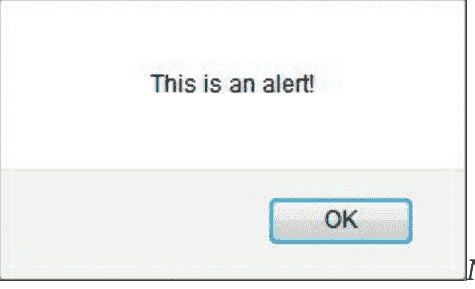

**注意**

当提示框出现时，你可能会看到页面暂停直到你点击"确定"按钮，或者它可能在等待你点击"确定"的同时继续加载。这取决于你的浏览器。

即使函数先被定义，也不意味着它会先被执行。函数在被调用之前不会执行；换句话说，JavaScript 在到达脚本中的函数调用之前不会使用该函数。

函数调用之前的任何命令（且不属于函数定义的部分）都将在函数之前执行。例如，我们可以将 JavaScript 文件中的代码更改如下：

```
// 定义函数

function show_message() {
    window.alert("This is an alert!");
}

window.alert("I am first, ha!");
window.alert("I am second, ha ha!");
show_message();

// 这里调用函数，以便其中的提示框可以显示
```

此示例在第一行定义了相同的函数 `show_message()`。函数之后是两个独立的 `window.alert` 命令，然后是调用函数的行。用这段新代码保存 `js_alert.js` 文件，然后在 Web 浏览器中重新加载 `js_alert.html` 文件。你应该会看到一个有趣的结果！

两个独立的 alert 命令是 JavaScript 首先看到的可执行语句，它们先执行。对函数的调用最后被看到，所以函数最后执行。结果是三个提示框，按以下顺序出现：

- 用户看到一个提示框，显示 "I am first, ha!"，需要点击"确定"按钮关闭它。
- 然后显示 "I am second, ha ha!" 的提示框出现，用户需要再次点击"确定"。
- 最后，函数被执行，用户看到 "This is an alert!" 的提示框，需要第三次点击"确定"来结束这一连串的提示。

虽然这个示例的提示框有些过多，但它有助于你理解函数调用的工作原理。

随着你积累更多编码经验，选择将 script 标签放在 head 还是 body 部分会变得更容易。当脚本使用 HTML 文档 body 部分的信息时，script 标签通常要么放在 head 部分并设置一个函数在页面加载时初始化变量和其他函数（这使用了事件处理，将在第 8 章讨论），要么放在 body 部分中 `</body>` 结束标签之前。本书将使用后一种方法。

### 从一个函数调用另一个函数

在一个函数内部调用另一个函数是组织事件执行顺序的一种有用方式。通常，被调用的函数放在另一个需要完成更大任务的函数内部。

当你将函数调用放在一个函数内部时，你应该在定义调用它的函数之前先定义将被调用的函数，这符合前面提到的函数应在被调用之前先定义的建议。

以下是两个函数的示例，其中第二个函数调用第一个函数：

```
function update_alert(){
    window.alert("Welcome! This site is updated daily!");
}

function call_alert() {
    update_alert();
}

call_alert();

// 此函数调用 update_alert() 函数
// 这里调用 call_alert() 函数来启动整个流程
```

注意 `update_alert()` 函数是所有实际操作发生的地方。其他一切都只是函数调用。`call_alert()` 函数仅仅是调用 `update_alert()` 函数使其执行。最后，你看到启动整个序列的命令，即对 `call_alert()` 函数的调用。由于这是函数外部的第一条 JavaScript 语句，它首先被执行。当它被执行时，它只是调用了 `update_alert()`

 function，负责显示弹出提示。

#### **注意**

由于函数声明提升（hoisting），即使你在调用 update_alert() 函数之后才定义它，大多数浏览器也能正常执行前面的示例。

现在假设你想创建三个函数来执行三个任务。为了确保它们按正确的顺序执行，你可以在另一个函数中按顺序调用它们。下面是这种技巧的一个示例，包含三个用于不同目的的警示框函数：

```
function update_alert() {
window.alert("欢迎！本网站每日更新！");
}
function section_alert() {
window.alert("请访问图片版块！");
}
function links_alert() {
window.alert("另外，别忘了查看我的链接页面！");
}
function get_messages() {
update_alert(); section_alert(); links_alert();
}
get_messages();
```

调用 get_messages() 函数开始整个流程。调用该函数时会弹出提示。调用该函数时也会弹出提示。调用该函数时也会弹出提示。调用该函数时会将其他三个函数触发执行。

代码首先定义了显示各个提示的三个函数。然后定义了 get_messages() 函数，它只是调用前面三个函数。当然，必须调用 get_messages() 函数才能真正执行这一操作。这个调用发生在函数外部的第一条语句处。

当然，创建一个接一个弹出提示的脚本通常不是你想做的事。虽然这个示例演示了函数调用的正确用法，但这样做的脚本很可能会让你的访客感到厌烦！随着你继续阅读本书，你会看到函数的实际应用示例。

## **使用参数调用函数**

前面的示例使用了三个不同的函数来显示三个提示。虽然这样能工作，但如果不需要为每个提示都写一个新函数就更好了。你可以通过使用参数来避免这样做。你可以创建一个函数，多次使用它来执行相同的操作，但每次使用参数提供的新信息。

正如本章前面提到的，变量通常被用作参数。不过，你也可以使用值作为参数。你将先了解不同类型的变量参数，然后再来看值参数。

主要规则是：如果有多个参数，你需要用逗号分隔每个参数，这样浏览器才知道如何处理。此外，参数是按*顺序*读取的，所以如果你向一个可以接收两个参数的函数传递一个参数，它始终会被当作*第一个*参数使用。

如果你想将某些变量的值发送给函数，你必须先声明这些变量，并确保在发送之前它们具有你需要的值。这时，变量的*作用域*就变得重要了。变量的作用域决定了它在何处有定义、在何处没有定义。JavaScript 既有全局变量也有局部变量。

### **使用全局变量**

*全局变量*是你在第 3 章中学过的变量。因为它们是在任何函数外部定义的，所以可以在脚本中的任何地方修改——无论是在函数内部还是外部。全局变量在任何函数外部声明，如下面的代码所示：

```
var mycar = "Honda"; 这是正在声明的
var paycheck = "1200"; 全局变量
```

本示例中的变量可以在脚本中的任何地方修改。这意味着它们甚至可能被函数意外覆盖或更改。

要理解全局变量如何受到函数的影响，考虑一个显示两个提示的示例。你想让其中一个提示告诉你买某辆车需要多少钱，另一个提示告诉你目前有多少钱以及现在拥有什么车。如果你使用以下代码会发生什么？

```
var mycar = "Honda"; 这些是作为全局变量声明的
var paycheck = 1200;
function new_car() {
mycar = "Ferrari"; 糟糕！该函数为
paycheck = 3500; 变量赋了新值
window.alert("你需要 $" + paycheck + " 来买一辆 " + mycar);
}
new_car(); 这里的提示是你预期的结果
window.alert("你赚 $" + paycheck + " 并拥有一辆 " + mycar);
```

这里的提示不是你预期的结果，因为变量被意外更改了。看起来你好像在函数内部创建了新的变量，尽管它们同名。但实际上，脚本会在两个提示中输出以下文本：

你需要 $3500 来买一辆 Ferrari

你赚 $3500 并拥有一辆 Ferrari

显然，这是不对的。

这个示例说明了为什么声明变量时需要使用 var 关键字。没有 var 关键字，你并不是在函数内部创建新变量（那样它们会成为局部变量）。相反，你是在更改全局变量的值——你发出的是重新赋值命令，而不是新变量声明命令。如果变量尚未定义，那么不使用 var 关键字声明它会创建一个同名的全局变量——这也可能引发问题。要解决这个问题，你可以选择更改一组变量名，或者更好的做法是使用局部变量。

### **使用局部变量**

*局部变量*只能在声明它的函数内部使用。它在该函数外部不存在，除非你通过参数将其传递给另一个函数。

在函数中创建局部变量的关键是确保使用 var 关键字声明它。否则，任何同名的全局变量都可能被更改，如你在前面的示例中所见。要声明局部变量，必须将其放在函数内部并使用 var 关键字，如下所示：

```
function new_car() {
var mycar = "Ferrari";
var paycheck = "3500";

}
```

这些变量使用 var 关键字在函数内部声明，是局部变量。

现在 mycar 和 paycheck 变量是局部变量，只能被 new_car() 函数查看和修改。

因此，要修正上一节中的脚本，只需在函数内部添加 var 关键字来声明局部变量，如下所示：

```
var mycar = "Honda";
var paycheck = 1200;
function new_car() {
var mycar = "Ferrari";
var paycheck = 3500; 添加 var 关键字可以确保变量在局部声明，
不会更改同名的全局变量
window.alert("你需要 $" + paycheck + " 来买一辆 " + mycar);

}
new_car();
window.alert("你赚 $" + paycheck + " 并拥有一辆 " + mycar);
```

现在提示应该按你的预期显示：

你需要 $3500 来买一辆 Ferrari

你赚 $1200 并拥有一辆 Honda

如你所见，当你将某些变量作为参数发送给函数时，变量的作用域可能很重要。

### **使用变量作为函数参数**

下面的示例使用变量参数。它将一个全局变量发送给函数。

```
function check_alert(pcheck) { // 该函数接受一个参数
  window.alert("你赚 $" + pcheck);
}
```

```
var paycheck = 1200; // 该变量被赋值为 1200
check_alert(paycheck); // 该值作为参数传递给函数
```

脚本从 check_alert() 函数开始，该函数接受参数 pcheck。然后该函数用于显示一个提示，使用发送给它的参数值（pcheck）。在函数之后的外部脚本中，全局变量 paycheck 被赋值为 1200。然后代码调用 check_alert() 函数，并将 paycheck 变量的值发送给它。

当这段代码调用 check_alert() 函数时，它将 paycheck 变量的值发送给该函数。这是通过括号内的参数名 pcheck 在函数内部获取的。

需要注意的是，pcheck 变量在 check_alert() 函数内部成为局部变量。由于它是参数，所以不需要在括号内使用 var 关键字来使其成为局部变量。由于代码发送的值是 1200，所以进入函数时 pcheck 将是 1200。

### **使用值参数**

你也可以直接发送一个值作为参数。不需要先声明全局变量再发送参数，你可以直接发送一个值，该值会在函数内部被转换为局部变量。这允许你即时发送一个值，并且无需预先准备好全局变量。

需要记住的重要一点是，如果你发送字符串值，需要将其用引号括起来。下面的函数调用将字符串值 "something" 发送给名为 text_alert() 的函数：

```
text_alert("something");
```

例如，上一节的最后一个示例可以通过使用值参数来修改，在添加更多信息的同时减少一行代码：

```
function check_alert(pcheck, car) {
  window.alert("你赚 $" + pcheck + " 并拥有一辆 " + car);
}
```

```
check_alert(1200, "Corvette"); // 该函数被发送了一个数值和一个字符串值，而不是变量值
```

在此示例中，函数调用向函数发送了两个参数。第一个是数值，不需要引号。第二个是字符串，需要用引号括起来。然后这些值被发送给函数，在函数中分别作为局部变量 pcheck 和 car 读取。现在它们可以在函数中使用，在提示中显示以下句子：

你赚 $1200 并拥有一辆 Corvette

参数也可以使用表达式发送，如下所示：

```
check_alert(500+700, "Cor" + "vette");
```

JavaScript 将计算每个表达式并将结果作为参数发送给函数。因此，前面的代码会有相同的最终效果（500 加 700 等于 1200，"Cor" 和 "vette" 连接成 "Corvette"）：

你赚 $1200 并拥有一辆 Corvette

### **参数是可选的**

另外需要提到的一点是，向函数发送参数是可选的。函数将执行其

即使未发送参数，函数也能尽力完成其工作。你可以不带任何参数调用 `check_alert()` 函数：

```
function check_alert(pcheck, car) {
window.alert("You make $" + pcheck + " and have a " + car);
}
check_alert();
```

你的结果将类似于以下文本：

You make $undefined and have a undefined

因此，最好设置一些代码来处理未发送参数的情况。这可以使用条件语句来完成。以下是一种检查参数是否已发送到 `check_alert()` 的方法：

```
function check_alert(pcheck, car) {
if (pcheck && car) {
window.alert("You make $" + pcheck + " and have a " + car); }
else {
window.alert("My arguments are missing!");

}
}
check_alert();
```

这本质上是告诉 JavaScript 在将语句写入页面之前先检查参数是否存在。如果参数存在，语句将使用参数值写入页面。如果参数不存在，则访问者会收到一条提示“My arguments are missing!”的警报。逻辑运算符 `&&` 将在第 5 章中更详细地讨论，而 `if/else` 语句将在第 6 章中更详细地讨论。

## 使用返回语句调用函数

你可以将函数的赋值结果作为变量的值。这样，变量就获得了函数返回的值，并可以在脚本的后续部分使用。以下是声明一个具有函数返回值的变量的格式：

```
var variablename = functionname();
```

考虑这个例子，它有一个函数，该函数返回两个文本字符串相加的值：

```
function get_added_text() {
var textpart1 = "This is ";
var textpart2 = "fun!";
var addedtext = textpart1 + textpart2;
return addedtext; //The result of the added text is returned to the script

}
var alerttext = get_added_text(); //The result of the function is assigned to a variable
window.alert(alerttext); //The value of the variable is used as the text for the alert
```

如你所见，该函数将相加的文本变量的值返回给脚本。通过将 `get_added_text()` 函数的结果赋值给 `alerttext` 变量，你可以在脚本的后续部分使用相加后的文本。该变量用于向用户发送一条包含相加文本结果的警报。警报消息显示

This is fun!

现在，这很有趣吧？随着你在这本书中的深入学习，你将会看到更多关于返回语句的实际应用。

## 定义函数的其他方式

在查看脚本或编写新脚本时，你可能会遇到或发现以下几种定义函数的方式是有用的：函数声明（已讨论）、函数表达式和函数构造器。

### 函数声明

这是你目前一直在使用的方法，也是本书中经常使用的方法。正如你所回忆的，你只需按如下方式声明函数：

```
function functionname() {
  Code for function here
}
```

你也可以像本章前面提到的那样添加参数和/或返回语句。

### 函数表达式

函数表达式与函数声明非常相似，使用以下格式：

```
var variablename = function(arguments) {
  Code for function here
};
```

注意右花括号后面有一个分号（;）。由于函数被赋值给一个变量，分号是完成变量赋值语句所必需的。请注意，在这种情况下，函数本身被赋值给变量，而不是函数的结果（就像你之前所做的那样）。此外，函数在这里没有被调用，只是被赋值。

函数声明和函数表达式之间的主要区别如下：

- 函数表达式将函数赋值给一个变量，并且需要分号来完成语句。
- 由于 `function` 关键字后没有分配名称，它被认为是一个*匿名*函数。变量名可用于调用该函数。
- 函数表达式不使用函数声明提升，因此在代码中定义之前不能调用它。

作为最后一点的一个例子，请看以下代码。它将导致错误：

```
send_alert("This is ", "broken!");
var send_alert = function(textpart1, textpart2) {
  window.alert(textpart1 + textpart2);
};
```

注意函数在定义之前被调用。由于函数被定义为变量赋值，因此在赋值完成之前无法使用它（它不能利用函数声明提升）。图 4-1 显示了在 Mozilla Firefox 中尝试运行此代码时产生的错误。

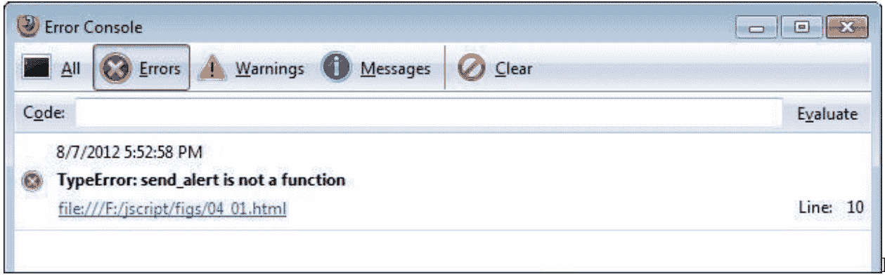

**图 4-1** 函数表达式不能利用声明提升，因此在定义之前调用它会导致错误。

为了使其正常工作，函数调用必须移动到函数定义之后的位置：

```
var send_alert = function(textpart1, textpart2) {
  window.alert(textpart1 + textpart2);
};
send_alert("This is ", "working!");
```

现在函数调用在函数定义之后，代码将按预期工作。使用函数表达式时记住这个重要的区别非常重要，因为它们在定义之前不能执行。图 4-2 显示了现在函数被调用后显示的警报。

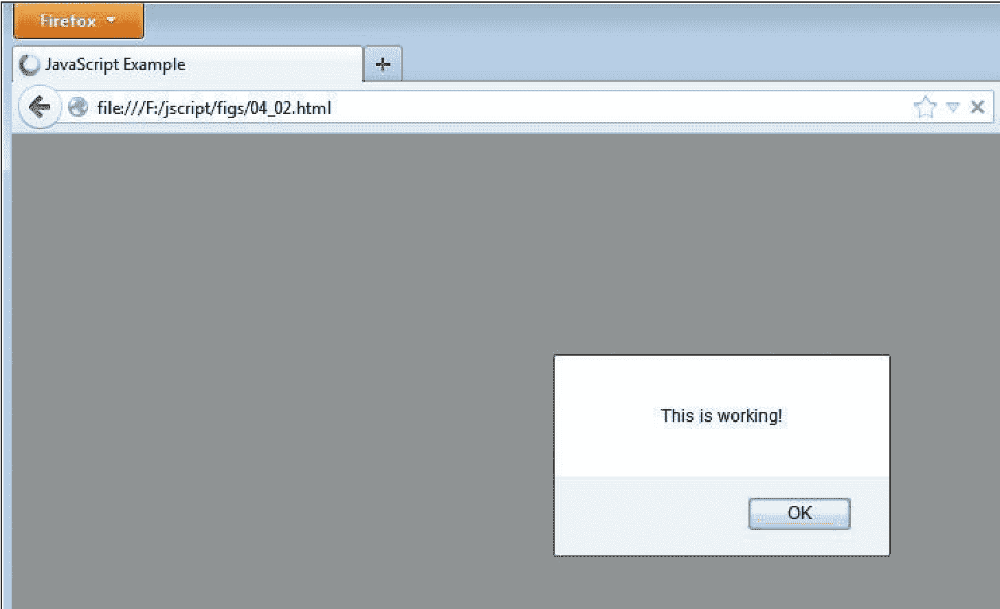

**图 4-2** 警报现在按预期显示。

匿名函数在处理 JavaScript 事件时非常有用。例如——为了响应用户在网页上点击鼠标，你可以为 `document` 上的点击事件编写一个简单的函数，然后调用它，如以下代码所示：

```
function do_not_click() {
  window.alert("Do not click on my page!");
}
document.onclick = do_not_click;
```

这声明了函数，然后（不带括号）调用它来处理点击事件。但是，你可以使用匿名函数将这两个步骤合二为一，如下所示：

```
document.onclick = function() {
  window.alert("Do not click on my page!");
};
```

由于对该事件的反应将只出现在 JavaScript 代码中的一个位置，因此匿名函数是一种处理事件的便捷方式，无需在其他地方声明函数然后调用它。这种技术和用于事件处理（如前面的代码清单中所示）的代码类型将在第 8 章中更详细地讨论。

### 函数构造器

函数构造器以与创建新对象实例相同的方式创建一个函数对象（这将在第 9 章中讨论）：

```
var functionname = new Function (arguments, code for function) ;
```

这将像其他函数一样工作，但这种方法的主要缺点是其性能比其他方法差（它在每次使用时都会被求值，而不是只解析一次）。建议你使用另外两种方法之一来定义函数。

## 专家问答

**问：如果我将一个函数放入脚本中，但决定不在脚本中调用它，会有影响吗？**

答：除非被调用，否则该函数不会被执行。但是，拥有未使用的函数会使代码更难以维护，并且会增加访问者的下载时间（这在拨号等慢速连接上或者在需要优化代码下载时间的情况下可能会产生影响）。此外，如果函数包含语法错误，它可能会向访问者发送 JavaScript 错误，并阻止网页上的其他内容正常工作。

**问：如果我稍后决定从脚本中移除一个函数，会发生什么？**

答：如果你没有同时移除对该函数的所有调用，这可能会导致问题。脚本可能会导致 JavaScript 错误；或者它可能运行但给你带来意外的结果。此外，在移除函数之前，请确保它不会在脚本的其他地方执行必要的任务。

**问：那么，如果我调用一个不存在的函数，会发生什么？**

答：你将收到 JavaScript 错误，或者当函数被调用时浏览器将不做任何事情，因为它找不到该函数。

**问：确定何时使用函数以及何时直接将所需内容编码到脚本中的最佳方法是什么？**

答：在大多数情况下，如果函数内的代码可以以某种方式被重用，你就应该使用函数。例如，执行特定计算的函数可能在脚本的多个位置都有用。此外，如果你想避免使用全局变量，函数为你提供了一种将事物保留在全局上下文之外的方式。随着你在这本书中的深入学习，你会看到更多关于这一点的内容。

## 动手试 4-1 创建带有函数的 HTML 页面

**pr4_1.html**
**prjs4_1.js**

在这个项目中，你将创建一个包含两个 JavaScript 函数的 HTML 页面。一个函数使用发送给它的参数弹出一个包含消息的警报框。另一个函数使用返回语句将一个值发送回脚本。然后，该返回值在向访问者显示的警报消息中使用。

### 逐步操作

1.  创建一个 HTML 页面，将 `<body>` 和 `</body>` 标签之间的空间留空。
2.  创建一个外部 JavaScript 文件，并将其保存为 `prjs4_1.js`。
3.  在 HTML 文档的 `<body>` 和 `</body>` 标签之间添加必要的 `<script>` 标签以包含外部 JavaScript 文件。将 HTML 文件保存为 `pr4_1.html`。
4.  打开 `prjs4_1.js` 外部 JavaScript 文件，并执行步骤 5-10。
5.  创建一个名为 `car_cost()` 的函数，该函数接受两个参数 `mycar` 和 `paycheck`。创建一个 `window.alert()` 命令，该命令将显示一个包含以下消息的警报：You have a <mycar 变量放在这里> and make $<paycheck 变量放在这里>（续）
6.  创建一个名为 `get_added_text()` 的函数，该函数返回函数内两个字符串相加的值。要相加的两个字符串是这两个独立的字符串：This project<在此处放空格> is almost fun!
7.  在主脚本（函数定义之后）中，调用 `car_cost()` 函数，并将 "Mustang" 和 1500 作为参数值发送给它。
8.  在主脚本（函数定义之后）中，将 `get_added_text()` 函数的结果赋值给一个名为 `alerttext` 的变量。创建一个警报，该警报弹出时显示该变量的值。
9.  完成后，你的外部 JavaScript 文件应如下所示：

```
function car_cost(mycar, paycheck) {
window.alert("You have a " + mycar + " and make $" + paycheck);
}
function get_added_text() {
var textpart1 = "This project ";
var textpart2 = "is almost fun!";
var addedtext = textpart1 + textpart2;
return addedtext;
}
```


car_cost("Mustang", 1500);
var alerttext = get_added_text();
window.alert(alerttext);
```

10. 保存外部 JavaScript 文件。
11. 打开 pr4_1.html 文件并在浏览器中查看结果。

当你打开网页时，你应该会看到两条警告消息：

You have a Mustang and make $1500
This project is almost fun!

### 本章练习总结

在这个项目中，你创建了一个使用两个 JavaScript 函数的脚本。第一个函数使用参数，并根据传递给函数的参数创建一个带有消息的警告框。第二个函数在将两个字符串相加后，向脚本返回一个值。脚本在浏览器中的结果是基于发送到第一个函数的信息以及从第二个函数返回给脚本的信息，显示两条警告消息。

## 作用域/上下文基础

在 JavaScript 中，关于作用域（变量或函数可用且有效的上下文），有一些关键点需要记住。例如，你在本章前面已经能够通过在函数内使用 var 关键字声明来创建局部变量。这些局部变量仅在定义它们的函数内有效，这防止了它们被主脚本（*全局*上下文）中的某些内容更改。JavaScript 中的两个主要执行上下文是全局上下文和函数上下文。

### 全局上下文

JavaScript 中的全局上下文包括任何不在函数内的代码。考虑以下代码：

创建一个全局变量

```
var myname = "John";
function say_name() {
  var mydog = "Joey";
  window.alert(myname + " has a dog named " + mydog);
}
```

调用该函数

```
say_name();
window.alert(myname);
window.alert(mydog);
```

警告有效，因为它使用了全局变量 myname
这个函数是在全局作用域中创建的。

在函数内部定义的任何变量都位于函数的局部作用域中，无法从全局作用域访问。

此警告将按预期工作，使用全局变量和函数的局部变量。

此警告会导致错误，因为 mydog 在全局上下文中无法访问。

如示例所示，全局变量 myname 在定义后可在代码中的任何地方使用。say_name() 函数定义在全局作用域中，因此可以从代码中的任何地方调用。然而，mydog 变量仅在 say_name() 函数内可用，不能在此上下文之外的任何地方使用。在脚本末尾尝试在警告中使用它将导致 JavaScript 错误。

通常，脚本变得越复杂，将内容移出全局上下文越好，因为全局变量可能被任何其他上下文意外覆盖。这个概念将在第 9 章进一步讨论。

### 函数上下文

在 JavaScript 中，函数会创建一个新的上下文。正如你所看到的，在函数内用 var 关键字声明的任何变量在函数外部都不可用。但要记住的一件事是，函数内部可以嵌套其他函数。考虑以下代码：

```
var myname = "John";

function say_name() {
  var mydog = "Joey";
  function say_food() {
    var myfood = "Pizza";
    window.alert(myname + " and " + mydog + " like " + myfood);
  }
  window.alert(myname + " has a dog named " + mydog);
  say_food();
}
say_name();
```

调用 say_name() 函数，该函数调用其内部的 say_food() 函数。

say_name() 函数可以从全局上下文调用，但它有一个局部变量 mydog 和一个局部函数 say_food()

这在 say_name() 函数内创建了 say_food() 函数。say_food() 函数可以使用在 say_name() 或全局上下文中定义的任何变量。如你所见，这基于嵌套函数创建了一个作用域链。链中最内层的函数中的变量受到的保护最好，不容易被更改，而全局上下文中的变量保护最少（它们是公共的，甚至可以在最内层的函数中使用）。

示例中的每个上下文及其可以使用的变量/函数如下所示：

**全局上下文：**
- myname
- say_name()

**say_name() 上下文：**
- myname (来自全局)
- mydog
- say_food()

**say_food() 上下文：**
- myname (来自全局)
- mydog (来自 say_name())
- myfood

注意，myname 可以在所有三个上下文中使用，mydog 可以在两个上下文中使用（say_name() 和 say_food() 上下文），而 myfood 只能在一个上下文中使用（say_food() 上下文）。

重要的是要记住这一点的工作原理，因为 JavaScript 只使用函数来创建上下文。其他块级结构，如条件语句和循环，不用于此目的。你将在第 6 章看到更多关于这个主题的内容。

#### 注意

第三种执行上下文类型可以通过调用 eval() 方法创建；但是，eval() 方法可能导致许多问题（例如，速度和安全问题），并且几乎不应该使用。

## 本章练习 4-2 编写自己的函数

pr4_2.html 在这个项目中，你将再次创建一个 HTML 页面，但在这个项目中，你将使用 prjs4_2.js 函数，以尽可能将信息保留在全局上下文之外（你将拥有一个在全局上下文中调用的单一全局函数）。

分步操作

- 1. 创建一个 HTML 文件，将 body 部分的内容留空，并将其保存为 pr4_2.html。
- 2. 创建一个外部 JavaScript 文件并将其保存为 prjs4_2.js。在步骤 3–6 中使用此文件。
- 3. 创建一个名为 display_HTML() 的函数。
- 4. 在函数内部，创建一个名为 myheading 的变量，并使用它来保存以下代码：<h1>Hello, World!</h1>
- 5. 创建一个名为 mytext 的变量，并使用它来保存以下代码：
  <p>While it is nice to know you world, there are only some things that I am comfortable sharing in a global context. You can’t alter the variable that holds this text outside of the function that contains it! Ha!</p>
- 6. 创建一个 document.write() 语句，该语句将在页面上写出两个变量的值，并结束函数。
- 7. 插入将调用该函数的代码。
- 8. 完成后，JavaScript 文件应如下所示：

```
function display_HTML() {
  var myheading = "<h1>Hello, World!</h1>";
  var mytext = "<p>While it is nice to know you world, there are only some things that I am comfortable sharing in a global context. You can't alter the variable that holds this text outside of the function that contains it! Ha!</p>";
  document.write(myheading + mytext);
}
display_HTML();
```

- 9. 在 HTML 页面的 body 部分，在文档中放置 script 标签（指向 prjs4_2.js 文件），以便脚本在页面上显示 HTML 代码。
- 10. 完成后，保存 HTML 和 JavaScript 文件，并在浏览器中查看 HTML 页面以了解其工作原理。

结果应该是一个标题写着“Hello, World!”，后面是一个长段落，脚本在其中解释了它希望将部分信息保密，防止被外部因素更改。

### 本章练习总结

在这个项目中，你运用了函数和上下文的知识来创建一个脚本。脚本的结果是 HTML 页面在显示信息的同时，保护了变量的值免受全局上下文中任何可能变化的影响。

## ✓ 第 4 章自测

- 1. 通常，函数是一个更小程序中的一个小块，用于执行单个或一系列任务。
- 2. 函数有用的两个原因是什么？
  A. 它们使简单的脚本更复杂，并且使非编码人员更难阅读脚本。
  B. 它们提供了一种将脚本的各个部分组织成必须完成的不同任务的方法，并且可以被重用。
  C. 它们使简单的脚本更复杂，并且可以被重用。
  D. 它们提供了一种将脚本的各个部分组织成必须完成的不同任务的方法，并且使非编码人员更难阅读脚本。
- 3. 在函数的第一行，你声明它是否接受任何参数。
- 4. 要声明一个函数，你使用关键字
  **A.** var
  **B.** switch
  **C.** function
  **D.** for
  将其声明为函数，定义它，并指定其参数。
- 5. 什么包围了函数内部的代码？
  **A.** 花括号– {}
  **B.** 冒号– ::
  **C.** 方括号– []
  **D.** 没有
- 6. 函数名区分大小写。
  **A.** 正确
  **B.** 错误
- 7. JavaScript 关键字可以用作函数名。
  **A.** 正确
  **B.** 错误
- 8. 以下哪项在 JavaScript 中是有效的函数名？
  **A.** function my function()
  **B.** function var()
  **C.** function get_text()
  **D.** function 24hours()
- 9. 参数用于允许函数从函数外部的某个地方导入一个或多个值。
- 10. 参数设置在函数的第一行，在一组括号内。
  **A.** 花括号– {}
  **B.** 圆括号– ()


 C. 方括号– []
D. 空

**11.** 多个参数之间用什么符号分隔？
A. 句号
B. 冒号
C. 分号
D. 逗号

**12.** 以下哪项是`window.alert()`方法的合法用法？
A. `win.alt("This is text");`
B. `window.alert("This is text);`
C. `window.alert('This istext');`
D. `window.alert("This istext");`

**13.** 以下哪项正确调用了名为`some_alert()`的函数，并向其传递两个字符串值作为参数？

A. `some_alert();`
B. `some_alert("some", "words");`
C. `some_alert("some", "words);`
D. `SOME_alert("some", "words");`

**14.** 以下哪项正确地将名为`get_something()`的函数的返回值赋值给名为 shopping 的变量？

A. `var shopping = get_something();`
B. `var shopping ="get_something";`
C. `var Shopping = get_Something;`
D. `shopping = getsomething;`

**15.** 变量可以在 JavaScript 中的任何地方使用。

# 第5章 JavaScript 运算符

### 87 关键技能与概念

- 理解运算符类型
- 理解算术（数学）运算符
- 理解赋值运算符
- 理解比较运算符
- 理解逻辑运算符
- 理解运算优先级

运算符在脚本中承担大部分工作。在前面的章节中，你已经看到了赋值（=）和加法（+）运算符的使用示例。JavaScript 还提供了许多其他类型的运算符来执行各种操作。

本章首先向你介绍 JavaScript 不同类型的运算符。然后，你将学习每个运算符及其在脚本中的用法。最后，你将了解运算符的优先级顺序，这决定了哪些操作先于其他操作执行。

### 理解运算符类型

*运算符*是 JavaScript 中的一种符号或关键字，用于对一个或多个值进行某种计算、比较或赋值。在某些情况下，运算符提供了一种快捷方式来缩短代码，从而减少你的输入量。

常见的计算包括求两个数的和、合并两个字符串，或将两个数相除。一些常见的比较可能是判断两个值是否相等，或查看一个值是否大于另一个值。赋值运算符的快捷用法可以用于为变量分配新值，从而不需要将变量名输入两次。

JavaScript 使用几种不同类型的运算符：

- **算术** 这些运算符最常用于对两个值执行数学计算。算术运算符可能是你最熟悉的。它们使用 +、- 和 * 等符号。

- **赋值** 这些运算符用于为变量赋值。正如你在第3章中学到的，赋值运算符之一是符号 =。

- **比较** 这些运算符用于比较两个值、两个变量，或可能是两个更长的语句。它们使用 >（表示"大于"）和 <（表示"小于"）等符号。

- **逻辑** 这些运算符用于比较两个条件语句（或对单个语句进行操作），以确定结果是否为真并相应地继续执行。它们使用 &&（如果运算符两边的语句都为真则返回 true）和 ||（如果运算符任一边的语句为真则返回 true）等符号。

- **位运算** 这些是作为逻辑运算符在比特位级别（一和零）工作的运算符。它们使用 <<（用于左移位）和 >>（用于右移位）等符号。

- **特殊** 这些是执行其他特殊功能的运算符。

在本章中，你将学习这些类型的运算符。这将是对每种类型运算符功能的总体概述，以便你在以后使用它们时能更好地了解所有运算符类型的用途。首先，让我们看看 JavaScript 中的算术运算符。

### 理解算术运算符

对于数学计算，你需要使用算术运算符。你可以使用任何类型的值。例如，你可以使用两个变量、两个数字，或一个变量和一个数字。少数几个运算符能够对单个值执行任务。

作为快速示例，你会记得在前面的章节中使用加法运算符（+）将两个字符串连接在一起。下面是使用加法运算符组合两个字符串值的例子：

```
window.alert("I begin and " + "this is the end.");
```

当一个值是变量时，你也可以使用加法运算符，如这个例子所示：

```
var part2 = "this is the end.";
window.alert("I begin and " + part2);
```

当两个值都是变量时，加法运算符同样有效，如下面这个例子：

```
var part1 = "I begin and ";
var part2 = "this is the end.";
window.alert(part1 + part2);
```

这些示例说明了你如何在许多算术运算中使用多个值和/或变量。这使你在编写脚本时具有一定的灵活性。对单个值起作用的运算符是自增、自减、一元正号和一元否定运算符。自增和自减运算符实际上是加 1 或减 1 的快捷方式，所以学会使用它们可以节省一些编码时间。算术运算符及其功能总结于表 5-1 中。以下各节将更详细地讨论每个运算符。

| 运算符 | 符号 | 功能 |
| --- | --- | --- |
| 加法 | `+` | 将两个值相加 |
| 减法 | `-` | 从一个值中减去另一个值 |
| 乘法 | `*` | 将两个值相乘 |
| 除法 | `/` | 用一个值除以另一个值 |
| 取模 | `%` | 用一个值除以另一个值并返回余数 |
| 自增 | `++` | 给单个数字加 1 的快捷方式 |
| 自减 | `--` | 从单个数字减 1 的快捷方式 |
| 一元正号 | `+` | 保持数值不变，但会尝试将非数值转换为数字 |
| 一元否定 | `-` | 将正数变为负数或将负数变为正数 |

**表 5-1** 算术运算符

#### 加法运算符 (+)

如你所见，加法运算符可用于合并两个字符串。它也用于数学计算中将数字相加。

#### 加法结果的变量

加法运算符的一种用途是将两个数字相加以获得数学结果。当添加数值时，通常会将结果赋值给变量，以便稍后使用变量的值。例如，要计算 4 加 7 的值并显示结果，可以这样编码：

```
var thesum = 4 + 7; // 使用加法运算符将两个数字相加
window.alert(thesum); // 将加法的结果以警告形式展示给查看者
```

结果是一个显示 11 的警告框。

让例子稍微复杂一点，你可以将其中一个数字改为变量：

```
var num1 = 4; // 将一个数字赋值给变量
var thesum = num1 + 7; // 将数字添加到变量中
window.alert(thesum); // 将总和赋值给 ​​给一个新变量
```

结果与前面示例代码相同：一个显示 11 的警告框。再进一步，你可以将两个数字都改为变量：

```
var num1 = 4,
    num2 = 7;
var thesum = num1 + num2; // 使用加法运算符将两个变量相加
window.alert(thesum);
```

这个例子提供了最大的灵活性，因为你可以更改两个数字变量的值并获得新结果，而无需深入脚本内部进行更改。

#### 操作数

与运算符一起使用的每个值称为*操作数*。JavaScript 中的大多数运算符一次使用两个操作数。例如，以下代码包含两个操作数：7 和 4。

```
var thesum = 7 + 4;
```

运算符两侧的值都是操作数。使用其他数据类型或使用变量时也是如此：

```
var num1 = 7,
    mytext = "Hello",
    thesum = num1 + 4, // 变量 num1 和数字 4 是操作数
    txt = mytext + " there!"; // 变量 mytext 和字符串 " there!" 是操作数
```

当在语句中多次使用需要两个操作数的运算符时，JavaScript 将使用运算顺序（这将在本章的"理解运算优先级"部分中解释），一次使用一个运算符和两个操作数来执行任务。对于加法运算符，如果没有其他运算符或括号存在，则运算顺序将从左到右进行。考虑以下代码：

```
var thesum = 2 + 3 + 1;
```

首先，将计算表达式中的 2 + 3 部分，得到结果 5。然后将此结果作为第一个操作数来完成计算，5 + 1，这将给出最终结果 6。一些运算符（称为一元

一元运算符）仅使用一个操作数。运算符直接放置在唯一的操作数之前或之后。例如，看以下代码：var mymoney = 5;
mymoney++; 唯一的操作数是 mymoney 变量。

在此例中，使用了自增运算符，唯一的操作数是 mymoney 变量。随着本章的学习，你将了解更多关于自增运算符及其他一元运算符的内容。

### 计算中的类型转换

需要注意的是，JavaScript 在使用算术运算符时会执行*类型转换*（如果认为必要，会尝试更改值的数据类型）。当你使用加法及其他算术运算符时，你需要意识到 JavaScript 会自动将不同的值，例如整数（非十进制数值）和浮点数（十进制数值），转换为适当的类型。例如，你可能有以下代码：

```
var num1 = 4.73, // 此变量有小数部分
num2 = 7,        // 此变量是整数
thesum = num1 + num2; // 两个变量相加，JavaScript

window.alert(thesum); // 将显示带有小数部分的答案
```
运行脚本时，你会看到一个显示结果的警告框。

JavaScript 将整数和浮点数相加，并返回一个浮点数：11.73。JavaScript 会自动执行此操作，因此你需要确保你使用的值会给你预期的结果。

例如，如果你将一个数字和一个字符串相加，结果将如同你合并了两个字符串一样。看这个例子：

```
var num1 = 4,    // 此变量是一个数字
num2 = "7",      // 糟糕！此变量是一个字符串，不是数字
thesum = num1 + num2;

window.alert(thesum); // 当它们相加时，它们像字符串一样被组合
```

这看起来像是将数字 4 和 7 相加，因为它们看起来都是数字。问题在于，在此例中 7 是一个字符串，不是数字，因为它带有引号。这导致 4 被转换为字符串，然后两个字符串被连接（concatenated）在一起。警告框中显示的结果可能会让你惊讶。

你得到的不是预期的 11，而是 47。当两个值作为字符串相加时，它们是连接在一起而不是进行数学加法。对于字符串，"4"+"7"=47。

其他算术运算符也会进行转换，类似于加法运算符，因此如果在脚本中得到意外结果，请注意这种可能性。

#### 特殊规则

加法运算符在尝试执行计算或连接时使用一些特殊规则。以下是最常遇到的一些情况：

- 如果一个操作数具有特殊值 NaN（非数字），而另一个操作数是数字，则结果将是 NaN。
- 如果一个操作数是字符串，则另一个操作数将被转换为字符串，然后字符串被连接。
- 如果两个操作数都是字符串，则字符串只是被连接。

**注意**

如果你有两个数字然后一个字符串，数字将先相加然后转换。例如，35 + 5 + "th Avenue" 将首先将 35+5 作为数字相加（因为运算符从左到右求值），然后结果（40）将作为字符串与 "th Avenue" 连接，得到 "40th Avenue"。

作为这些规则实际应用的一个例子，如果将 NaN 与一个数字相加，结果将是 NaN。如果将其与一个字符串相加，字符串值 "NaN" 将与另一个字符串值连接：
- 4 + NaN 将是 NaN
- "Hi" + NaN 将是 "HiNaN"

随着你学习本章，你将看到其他运算符也有特殊规则，如果在脚本中遇到意外结果，理解这些规则可能会有所帮助。

### 减法运算符 (–)

减法运算符用于将左侧的值减去右侧的值，如数学中所示。以下是一个示例：

```
var theresult = 10 - 3;
// 使用减法运算符减去两个数字
```

此代码只是将 3（运算符右侧的数字）从 10（运算符左侧的数字）中减去。结果是 7。

#### 特殊规则

与加法运算符一样，有一些特殊规则：

- 如果其中一个操作数是 NaN，则结果将是 NaN。
- 如果其中一个操作数是数字以外的数据类型（例如字符串、布尔值等），则 JavaScript 尝试将该值强制转换为数字并执行减法。如果无法转换该值，则结果将是 NaN。例如，"7" – "3" 将计算为 4，因为这些字符串值将被分别强制转换为数字 7 和 3。

### 乘法运算符 (*)

乘法运算符用于乘以两个操作数。下一个示例展示了该运算符的使用：

```
var num1 = 4 * 5; // 使用乘法运算符将两个数字相乘
```

#### 特殊规则

- 如果其中一个操作数是 NaN，则结果将是 NaN。
- 如果其中一个操作数是数字以外的数据类型，它将尝试转换该值并执行乘法。如果无法转换该值，则结果将是 NaN。

### 除法运算符 (/)

除法运算符用于将左侧的值除以右侧的值。例如，代码 4 / 2 表示 4 除以 2，结果为 2。以下是一个 JavaScript 示例：

```
var num1 = 10 / 2; // 使用除法运算符将两个数字相除。结果为 5，10 除以 2。
```

#### 特殊规则

- 如果其中一个操作数是 NaN，则结果将是 NaN。
- 如果数字零除以数字零，结果将是 NaN。
- 如果任何其他有限数除以数字零，结果将是特殊值 Infinity。
- 如果其中一个操作数是数字以外的数据类型，它将尝试转换该值并执行除法。如果无法转换该值，则结果将是 NaN。

### 除以零

使用除法运算符时，需要小心不要最终以某种方式除以零。如果这样做，结果将是 Infinity。以下代码展示了这种情况的一个示例（尽管不太可能以这种方式发生）：

```
var num1 = 10,
num2 = 0,
theresult = num1 / num2; // `哦不！这一行你在除以零`

window.alert(theresult); // `这个警告框不会是一个数字`
```

如果你将此代码放在文档中，你可能会看到一个类似这样的警告框：

为避免除以零，请注意放在除法运算符右侧的数字或变量。

### 取模运算符 (%)

取模运算符用于将左侧的数字除以右侧的数字，然后给出除法的整数余数。回想一下你学习长除法时，使用余数作为答案的一部分，而不是转换为小数或分数。11 除以 2 得 5 余 1。当你写 11 % 2 时，取模运算符给你的是余数 1。

以下是一个 JavaScript 示例：

```
var num1 = 11 % 2;
window.alert(num1); // `使用取模运算符获取余数`
```

结果是一个显示余数值的警告框，即 1。如果计算没有余数，结果将是 0。

这是最后一个同时作用于两个值的算术运算符。接下来是一次只作用于一个值的一元运算符。

### 自增运算符 (++)

自增运算符是一元运算符，它将唯一的操作数的值增加 1。使用它的效果取决于运算符是放置在操作数之前还是之后。

#### 操作数之前的自增运算符

当自增运算符放置在操作数之前时，它将操作数的值增加 1，然后执行语句的其余部分。以下是一个示例：

```
var num1 = 2,
theresult = ++num1;
```

在此例中，变量 num1 的初始值为 2。但是，当代码将值赋给变量 theresult 时，它在赋值发生之前就增加了 num1 的值。自增首先发生，因为自增运算符在操作数前面。因此，num1 的值被设置为 3 (2+1)，然后被赋给变量 theresult，后者获得值 3。

#### 操作数之后的自增运算符

如果你将自增运算符放置在操作数之后，它将在赋值之后更改操作数的值。考虑这个例子：

```
var num1 = 2,
theresult = num1++;
```

与前面的示例一样，num1 的初始值为 2。在下一行，自增运算符用在操作数之后。这意味着代码将 num1 的当前值赋给变量 theresult，并且在*完成*之后，它才增加 num1 的值。因此，只有在此赋值完成后，你才会有


`num1` 变量的值被赋为 2，随后 `num1` 被更改为 3。如果之后使用 `num1`，其值将是 3。

要理解增量运算符在操作数前后的不同工作方式，另一个方法是在浏览器中运行以下脚本。注意第一个 `alert` 框中的值和第二个 `alert` 框中的值有什么不同。

```
var num1 = 2;
result = ++num1;
alert("num1= " + num1 + " result= " + result);
num1 = 2;
result = num1++;
alert("num1= " + num1 + " result= " + result);
```

在第一个 `alert` 框中，你将看到 `num1= 3 result= 3`。由于此处 `++` 运算符用于操作数之前，`num1` 的值先增加 1，然后才被赋值给 `result` 变量。在第二个 `alert` 框中，你将看到 `num1= 3 result= 2`。这是因为 `++` 运算符用于操作数之后，所以 `num1` 的值是在被赋给 `result` 变量之后才增加的。`result` 变量得到了值 2，但 `num1` 会被增加到 3。

还需注意，使用此运算符不必执行赋值操作。你只需键入 `num1++;` 或 `++num1;`，`num1` 的值就会相应更改，供后续使用。

### 减量运算符（−−）

减量运算符的工作方式与增量运算符相同，但它从操作数中减去 1，而不是加上 1。与增量运算符一样，其放在操作数之前或之后非常重要。

如果将减量运算符放在操作数之前，则操作数会减量，然后执行语句的其余部分。示例如下：

```
var num1 = 2,
theresult = --num1;
```

此处，变量 `num1` 被赋值为 2。在下一行中，代码从 `num1` 中减去 1，然后将结果赋值给变量 `theresult`。因此，变量 `theresult` 最终得到的值为 1（2−1）。

当你将运算符放在操作数之后时，如以下示例所示，会先执行语句的其余部分，然后操作数才减量：

```
var num1 = 2,
theresult = num1--;
```

这次，变量 `theresult` 被赋值为 2，然后 `num1` 减量为 1。如果在此行之后使用 `num1`，其值将是 1。

### 一元加法运算符（+）

一元加法运算符用于尝试将值强制转换为数字。如果无法强制转换该值，则结果将是 `NaN`。当你在本章前面提到的情境中遇到问题时，这个运算符非常方便：

```
var num1 = 4,
num2 = "7",
thesum = num1 + num2;

window.alert(thesum);
```

如你所知，这会返回字符串 "47"。一元 `+` 运算符可用于 `num2` 变量，以将字符串 "7" 强制转换为其数字值，从而允许进行数学加法而不是字符串连接。

```
var num1 = 4,
num2 = "7",
thesum = num1 + (+num2);

window.alert(thesum);
```

括号并非必需，但它们有助于组织代码，使你可以看到这是将 `num1` 与对 `num2` 使用一元加法运算符的结果相加。你也可以这样编写代码：

```
var thesum = num1 + +num2;
```

这看起来不那么美观，但它仍然有效。更新后的代码将返回结果 11 而不是 "47"，因为字符串 "7" 能够被强制转换为数字 7。

### 一元取反运算符（−）

一元取反是仅对单个操作数使用减号。此运算符用于创建负数或反转数字的当前符号（正或负）。以下是为数字赋负值的示例：

```
var negnum = -3;
```

这定义了一个值为负 3 的变量。基本上，此运算符告诉浏览器 3 是“非正数”，因为它通过在数字前放置取反运算符来反转默认的正号。

你也可以使用一元取反运算符来帮助显示负数的加法或减法，如以下示例：

```
var theresult = 4 + (-3);
```

注意语句中 `-3` 部分周围的括号。正如在一元加法运算符中提到的，这是可选的，仅为了提供额外的清晰度。

你可能在想，编写相同内容的更简单方法看起来像这样：`var theresult = 4 - 3;`

你说得对，这是最简单的写法；但它使用的是减法，而不是一元取反。

你也可以对变量值使用此运算符，这仅仅是否定该变量所代表数字的符号：

```
var x = 4;
var y = 3;
var z = -y;
```

这为变量 `z` 赋予了 `y` 的一元取反值，即 –3。

既然你已经了解了算术运算符，现在该转向赋值运算符了。

## 理解赋值运算符

赋值运算符为变量赋值。它们不比较两个项目，也不执行逻辑测试。

当在第 3 章学习变量时，你已经看到基本的赋值运算符——单个等号（`=`）如何用于为变量赋初始值或新值。

其他赋值运算符也为变量赋予新值，但它们这样做的方式略有不同，因为它们还执行一个简单的计算。表 5-2 总结了赋值运算符，后续章节将更详细地讨论。

| 运算符 | 符号 | 功能 |
| --- | --- | --- |
| 赋值 | = | 将运算符右侧的值赋给变量 |
| 加后赋值 | += | 将运算符右侧的值与左侧的变量相加，然后将新值赋给变量 |
| 减后赋值 | – = | 将运算符右侧的值从左侧的变量中减去，然后将新值赋给变量 |
| 乘后赋值 | *= | 将运算符右侧的值与左侧的变量相乘，然后将新值赋给变量 |
| 除后赋值 | /= | 将左侧的变量除以运算符右侧的值，然后将新值赋给变量 |
| 取模后赋值 | %= | 将左侧的变量除以运算符右侧的值，取整数余数，并将新值赋给变量 |

### 表 5-2 赋值运算符

#### 赋值运算符（=）

从第 3 章开始，你就一直在使用直接赋值运算符。它将运算符右侧的值赋给左侧的变量，如以下示例：

```
var population = 4500;
```

这将值 4500 赋给变量 `population`。

#### 加后赋值运算符（+=）

`+=` 运算符将运算符右侧的值加到左侧的变量上，然后将该新值赋给该变量。本质上，它是编写此处所示类型代码的快捷方式：

```
var mymoney = 1000;
mymoney = mymoney + 1;
```

此处，创建了变量 `mymoney` 并赋值为 1000。然后代码通过将其值赋为自身加 1 来更改其值。赋给 `mymoney` 变量的值是 1001。

与其额外写一次变量名，你可以使用加后赋值运算符来缩短代码。以下代码与前面的示例结果相同，但节省了一些输入：

```
var mymoney = 1000;
mymoney += 1;
```

使用加后赋值运算符，此代码将 1（右侧的值）加到 `mymoney`（左侧的变量）上，并将新值 1001 赋给变量 `mymoney`。此运算符可用于添加任何值，而不仅仅是 1。例如，你可以在赋值中加 5，如以下示例：

```
var mymoney = 1000;
mymoney += 5;
```

这次，`mymoney` 最终的值为 1005。

你甚至可以在右侧使用变量而不是普通的数字值，如以下示例：

```
var mymoney = 1000;
var paycheck = 2000;
mymoney += paycheck;
```

最终，`mymoney` 的值为 3000。

#### 乘后赋值运算符（*=）

`*=` 运算符将运算符右侧的值乘以左侧的变量。然后将结果赋给该变量。下一个示例展示了此运算符的工作过程：

```
var mymoney = 1000;
var multby = 2;
mymoney *= multby;
```

此处，变量 `mymoney` 乘以变量 `multby` 的值（即 2）。结果 2000 然后被赋给变量 `mymoney`。

#### 除后赋值运算符（/=）

`/=` 运算符将左侧的变量除以运算符右侧的值。然后将结果赋给该变量。示例如下：

```
var mymoney = 1000;
var cutpayby = 2;
mymoney /= cutpayby;
```

在此示例中，变量 `mymoney` 除以变量 `cutpayby` 的值（即 2）。结果 500 然后被赋给 `mymoney` 变量。

#### 取模后赋值运算符（%=）

与其他执行数学运算的赋值变量一样，`%=` 运算符也为变量赋值执行计算。它将左侧的变量除以右侧的值，取余数，然后将结果赋给变量。以下是如何使用取模后赋值运算符为 `mymoney` 变量赋值的示例：

```
var mymoney = 1000;
var cutpayby = 2;
mymoney %= cutpayby;
```

此处，变量 `mymoney` 除以变量 `cutpayby` 的值（即 2）。结果是 500 余数为 0，这意味着计算的最终结果是 0。因此，赋给变量 `mymoney` 的值是 0。（如果任何地方开始这样削减工资，可能是时候离开了！）

## 动手尝试 5-1 调整变量值

pr5_1.html 在此项目中，你将创建一个页面，使用一些算术和赋值运算符 prjs5_1.js，并将结果写入 HTML 页面。

对于这些步骤中的许多步骤，有不止一种解决方案，因此请随意使用你喜欢的方法。你也可以尝试看看哪种方法需要最少的输入。务必使用 `document.write()` 命令将每次更改的结果写入页面。

## 分步操作

- 1. 创建一个 HTML 页面并将其保存为 `pr5_1.html`。在 `body` 部分内放置 `script` 标签，以指向名为 `prjs5_1.js` 的脚本。
- 2. 创建一个外部 JavaScript 文件并将其保存为 `prjs5_1.js`。使用此文件进行步骤 3–10。
- 3. 创建一个名为 `paycheck` 的变量，并将其初始值设为 2000。
- 4. 使用一个运算符将 `paycheck` 的值增加到 4000。
- 5. 使用一个运算符将 `paycheck` 的值减少到 3500。
- 6. 使用一个运算符将 `paycheck` 的值减少到 0。
- 7. 使用一个运算符将 `paycheck` 的值增加到 500。
- 8. 最后，使用一个运算符将 `paycheck` 的值减少到 420。
- 9. 执行每个操作后，将 `paycheck` 变量的值写入页面。
- 10. 保存 HTML 和 JavaScript 文件，并在浏览器中查看 HTML 文件以查看结果。
- 11. JavaScript 文件的一个可能解决方案如下所示，但请记住，有多种方法可以实现相同的结果：

```
var paycheck = 2000;
```

```
document.write(paycheck + "<br>");
paycheck += 2000;
document.write(paycheck + "<br>");
paycheck -= 500;
document.write(paycheck + "<br>");
paycheck *= 0;
document.write(paycheck + "<br>");
paycheck += 500;
document.write(paycheck + "<br>");
paycheck -= 80;
document.write(paycheck + "<br>");
```

## 尝试这个摘要

在这个项目中，你能够运用你对算术和赋值运算符的知识，在网页上显示多个计算结果。根据你对各种运算符使用的偏好，这个项目可以通过多种方式完成。

## 理解比较运算符

比较运算符通常与条件语句和循环一起使用，以便仅在满足特定条件时执行操作。由于这些运算符比较两个值，它们会返回一个true或false的值，具体取决于运算符两侧的值。在后面的章节中，你将学习如何创建仅在比较返回true时才执行的代码块。

表5-3总结了比较运算符，这些运算符将在以下部分进行更详细的讨论。

### 等于运算符 (==)

要使==运算符返回true，两侧的值或语句必须相等。如果值不相等，==运算符将返回false。但请注意，使用此运算符时，类型强制转换仍然有效，因此像"4" == 4这样的语句将返回true，因为JavaScript会将字符串"4"转换为数字。如果你希望此语句返回false，应使用严格等于运算符（===），这将在本节后面讨论。

#### 特殊规则

由于此运算符执行类型强制转换，因此有一些特殊规则：

-   如果一个操作数是数字，另一个是字符串，它会在测试相等性之前尝试将字符串转换为数字。
-   如果操作数是布尔值，则会在测试相等性之前将其转换为数值（true转换为1，false转换为0）。
-   如果一个操作数是null，另一个是undefined，比较将返回true。
-   如果一个或两个操作数是NaN，比较将返回false。

**表5-3 比较运算符**

| 运算符符号 | 功能 |
|---|---|
| 等于 == | 如果运算符两侧的值彼此相等，则返回true |
| 不等于 != | 如果运算符两侧的值彼此不相等，则返回true |
| 严格等于 === | 如果两侧的值相等且类型相同，则返回true |
| 严格不等于 !== | 如果两侧的值不相等或类型不同，则返回true |
| 大于 > | 如果运算符左侧的值大于右侧的值，则返回true |
| 小于 < | 如果运算符左侧的值小于右侧的值，则返回true |
| 大于或等于 >= | 如果运算符左侧的值大于或等于右侧的值，则返回true |
| 小于或等于 <= | 如果运算符左侧的值小于或等于右侧的值，则返回true |

下表显示了使用等于运算符的语句示例、它们的返回值以及返回true或false的原因。

| 比较 | 返回值 | 原因 |
|---|---|---|
| 4 == 4 | True | 两个相等的数字 |
| (4+2) == (3+3) | True | 两侧结果都是6，且6等于6 |
| "my socks" == "my socks" | True | 两个字符串完全相同 |
| 1 == true | True | 布尔值true被转换为1 |
| 4 == 5 | False | 4和5不相等 |
| (4+3) == (2+2) | False | 左侧结果是7，右侧结果是4，它们不相等 |
| "My socks" == "my socks" | False | 字符串不完全相同（大小写） |
| 1 == false | False | 布尔值false被转换为0 |

> **注意**
>
> 你会注意到在前一个表格以及后面一些表格中，某些语句周围添加了括号。这里它们主要用于提高可读性。你将在本章末尾学习更多关于括号和运算顺序的知识。

与其他运算符一样，你可以将变量与比较运算符一起使用。如果变量的值相等，比较将返回true。否则，它将返回false。假设你已声明了以下变量：

```
var num1 = 2,
    num2 = 5,
    num3 = 5;
```

以下比较将返回true：
`num2 == num3`

以下比较将返回false：
`num1 == num3`

> **警告**
>
> 请记住，等于运算符（==）用于比较。小心不要意外使用赋值运算符（=）代替它，因为那将执行赋值而不是比较，并将返回赋值的结果，因此你可能会得到一些意外的结果。

### 不等于运算符 (!=)

!=运算符是==运算符的相反。!=运算符在运算符两侧的值*不*相等时返回true，而不是在相等时返回true。如果发现运算符两侧的值相等，此运算符将返回false值。

与==运算符一样，!=运算符也进行类型强制转换，并有一些特殊规则：

-   如果一个操作数是数字，另一个是字符串，它会在测试之前尝试将字符串转换为数字。
-   如果操作数是布尔值，则会在测试之前将其转换为数值（true转换为1，false转换为0）。
-   如果一个操作数是null，另一个是undefined，比较将返回false。
-   如果一个或两个操作数是NaN，比较将返回true。

下表显示了一些使用!=运算符的语句示例、它们的返回值以及返回true或false的原因。

| 比较 | 返回值 | 原因 |
|---|---|---|
| 4 != 3 | True | 4和3是不相等的数字 |
| "CooL" != "cool" | True | 字符串大小写不同，所以它们不相等 |
| 4 != 4 | False | 4等于4 |
| "cool" != "cool" | False | 字符串完全相同，所以它们相等 |

### 严格等于运算符 (===)

要使===运算符返回true，两侧的操作数必须相等且类型相同（不执行类型强制转换）。这意味着如果你使用像3 === "3"这样的语句，运算符将返回false，因为左侧的值是数字，右侧的值是字符串。

下表显示了使用===运算符的语句示例。

| 比较 | 返回值 | 原因 |
|---|---|---|
| 4 === 4 | True | 两个相等的数字 |
| (4+2) === (3+3) | True | 两侧结果都是6，且两个值都是数字 |
| "my socks" === "my socks" | True | 两个值都是字符串，且完全相同 |
| 7 === "7" | False | 数字和字符串类型不同 |
| "My socks" === "my socks" | False | 字符串不完全相同（大小写） |
| "2" === (1+1) | False | 值类型不同 |

### 严格不等于运算符 (!==)

要使!==运算符返回true，两侧的值或语句必须不相等或类型不同（不使用类型强制转换）。这意味着如果你使用像3 !== "3"这样的语句，运算符将返回true，因为左侧的值是数字，右侧的值是字符串。

下表显示了一些使用!==运算符的语句示例。

| 比较 | 返回值 | 原因 |
|---|---|---|
| 4 !== 3 | True | 4和3是不相等的数字 |
| "4" !== 4 | True | 两侧值类型不同 |
| 4 !== 4 | False | 4等于4 |
| "cool" !== "cool" | False | 字符串完全相同，所以它们相等 |

### 大于运算符 (>)

当使用大于运算符时，如果运算符左侧的值大于右侧的值，比较将返回true。使用类型强制转换，因此有一些特殊规则：

-   如果两个操作数都是字符串，则通过检查两个字符串中每个字符的字符代码来比较字符串。
-   如果一个操作数是数字，则尝试将另一个操作数强制转换为数字并进行比较。
-   如果操作数是布尔值，则转换为数字（true为1，false为0）。

*注意* 剩余的比较运算符（<, >=, <=）也使用这些相同的规则。

对于字符串，使用每个字符的字符代码。结果是小写字母大于大写字母，大写字母大于数字。要查找字符代码，你可以使用 www.scripttheweb.com/js/ref/javascript-character-codes.html 上的工具。

比较字符串时，JavaScript首先检查字符串的第一个字母是否有差异。如果没有差异，它会继续下一个字符，然后再下一个，依此类推，直到找到差异或到达字符串末尾。

下表显示了一些使用>运算符的语句示例。

| 比较 | 返回值 | 原因 |
|---|---|---|
| 5 > 2 | true | 5大于2 |
| true > 0 | true | 布尔值true被转换为1 |
| "a" > "A" | true | "a"的字符代码是97，"A"的字符代码是65 |
| "A" > "1" | true | "A"的字符代码是65，"1"的字符代码是49 |
| "10" < "2" | true | "1"的字符代码是49，"2"的字符代码是50 |
| 5 > 7 | false | 5小于7，不大于 |
| false > 0 | false | 布尔值false被转换为0 |
| 2 > 2 | false | 它们相等，所以左侧的值不大于 |

### 小于运算符 (<)

小于运算符与大于运算符的工作方式相反。当左侧的值较小时，<运算符返回true，而不是在左侧的值较大时返回true。你可以通过查看下表来看到一些<运算符的示例。

| 比较 | 返回值 | 原因 |
|---|---|---|
| 2 < 10 | true | 2小于10 |
| "A" < "a" | true | "A"的字符代码是65，"a"的字符代码是97 |
| 10 < 2 | false | 10大于2，不是小于 |
```


### 大于或等于运算符（>=）

`>=` 运算符与你之前了解过的比较运算符略有不同。该运算符增加了一个选项：即使运算符两边的值相等，比较结果仍然可以返回 `true`。因此，要返回 `true`，运算符左侧的值必须大于或等于右侧的值。下表展示了使用 `>=` 运算符的一些语句示例。

| 比较 | 返回值 | 原因 |
| :--- | :--- | :--- |
| 5 >= 2 | true | 5 大于 2 |
| 2 >= 2 | true | 2 等于 2 |
| "a" >= "A" | true | "a" 的字符编码为 97，"A" 的字符编码为 65 |
| "A" >= "A" | true | 字符编码均为 65 |
| 1 >= 2 | false | 1 小于 2 |
| "A" >= "a" | false | "A" 的字符编码为 65，"a" 的字符编码为 97 |

### 小于或等于运算符（<=）

与 `>=` 运算符类似，`<=` 运算符也增加了两边值相等的可能性。使用小于或等于运算符时，如果运算符左侧的值小于或等于右侧的值，则返回 `true`。下表展示了使用 `<=` 运算符的语句示例。

| 比较 | 返回值 | 原因 |
| :--- | :--- | :--- |
| 2 <= 5 | True | 2 小于 5 |
| 2 <= 2 | True | 2 等于 2 |
| "A" <= "a" | True | 大写字母小于小写字母 |
| "A" <= "A" | True | 字符串相等 |
| 5 <= 2 | False | 5 大于 2，并非小于或等于 |
| "a" <= "A" | False | 小写字母大于大写字母，并非小于或等于 |

在第 6 章学习条件语句和循环时，你将有机会练习使用比较运算符。接下来介绍的是逻辑运算符，它们在检查条件时很有帮助。

## 理解逻辑运算符

三种逻辑运算符允许你比较两个条件语句，以判断其中一个或两个语句是否为 `true`，并据此执行相应操作。如果你想同时检查多个条件并使用其结果，逻辑运算符会很有用。与比较运算符一样，逻辑运算符根据运算符两边的值返回 `true` 或 `false`。

表 5-4 总结了逻辑运算符，以下各节将对它们进行讨论。

| 运算符 | 符号 | 功能 |
| :--- | :--- | :--- |
| 与 | && | 如果运算符两边的语句均为 `true`，则返回 `true` |
| 或 | \|\| | 如果运算符任意一边的语句为 `true`，则返回 `true` |
| 非 | ! | 如果运算符右侧的语句不为 `true`，则返回 `true` |

**表 5-4** 逻辑运算符

### 与运算符（&&）

逻辑与运算符 `&&` 在运算符两边的比较均为 `true` 时返回 `true`。如果运算符任意一边或两边的比较为 `false`，则返回 `false`。下表展示了使用与运算符的一些语句。

| 语句 | 返回值 | 原因 |
| :--- | :--- | :--- |
| (1==1) && (2==2) | true | 两边的比较均为真：1 等于 1，且 2 等于 2 |
| (2>1) && (3<=4) | true | 两边的比较均为真：2 大于 1，且 3 小于 4 |
| ("A"=="A") && ("c"!="d") | true | 两边的比较均为真："A" 等于 "A"，且 "c" 不等于 "d" |
| (1==1) && (2==3) | false | 右侧的比较为假 |
| ("a"!="a") && ("b"!="q") | false | 左侧的比较为假 |
| (2>7) && (5>=20) | false | 两边的比较均为假 |

## 或运算符（\|\|）

逻辑或运算符在运算符任意一边的比较返回 `true` 时即返回 `true`。因此，要返回 `true`，只需一边的语句求值为 `true` 即可。要返回 `false`，运算符两边的比较都必须返回 `false`。下表展示了使用或运算符的一些比较示例。

| 语句 | 返回值 | 原因 |
| :--- | :--- | :--- |
| (2==2) \|\| (3>5) | True | 左侧的比较为真 |
| (5>17) \|\| (4!=9) | True | 右侧的比较为真 |
| (3==3) \|\| (7<9) | True | 两边的比较均为真 |
| (4<3) \|\| (2==1) | false | 两边的比较均为假 |
| (3!=3) \|\| (4>=8) | false | 两边的比较均为假 |

### 非运算符（!）

逻辑非运算符可用于单个比较，表示"如果情况并非如此，则返回 `true`"。基本上，它可以使原本返回 `false` 的表达式返回 `true`，或使原本返回 `true` 的表达式返回 `false`。下表展示了该运算符的一些使用示例。

| 比较 | 返回值 | 原因 |
| :--- | :--- | :--- |
| !(3 == 3) | false | 3 等于 3 为真，但非运算符使该语句为假 |
| !(2 > 5) | True | 2 大于 5 为假；非运算符使该语句为真 |

现在你已经掌握了常规逻辑运算符，快速了解一下按位逻辑运算符。

## 按位运算符

按位运算符是在位级别工作的逻辑运算符，涉及大量的 1 和 0。你不会在本书给出的示例中使用它们，但可能会在网上的一些脚本中看到。下表列出了部分按位运算符及其符号，有助于你在遇到时识别它们。

| 运算符 | 符号 |
| :--- | :--- |
| 与 | & |
| 异或 | ^ |
| 或 | \| |
| 非 | ~ |
| 左移 | << |
| 有符号右移 | >> |
| 无符号右移 | >>> |

## 特殊运算符

JavaScript 中有许多特殊运算符，用于执行特定任务或帮助简化代码。表 5-5 列出了特殊运算符及其用途。如果表中很多术语看起来不熟悉，请不要气馁。对象、数组和其他不熟悉的术语将在后续章节中讨论。许多运算符会在后面的章节中在合适的时机重新介绍，届时它们的目的可以更清楚地阐明。

| 运算符 | 符号 | 用途 |
| :--- | :--- | :--- |
| 条件 | ?: | 常用作简短的 if/else 语句。问号（?）前放置条件，冒号（:）两边各放置一个值。 |
| 逗号 | , | 对运算符两边的语句求值，并返回第二个语句的值。 |
| 删除 | delete | 用于删除对象、属性或数组中的元素。 |
| 在 | in | 如果属性在指定对象中，则返回 `true`。 |
| 实例 | instanceof | 如果对象属于指定的对象类型，则返回 `true`。 |
| 新建 | new | 创建对象的一个实例。 |
| 此 | this | 引用当前对象。 |
| 类型 | typeof | 返回一个字符串，告知你正在求值的值的类型。 |
| 空 | void | 允许表达式被求值而不返回任何值。 |

**表 5-5** 特殊运算符

## 专家问答

**Q：为什么有这么多种赋值运算符？如果我可以写 `x=x+1` 而不是 `x+=1`，为什么还需要了解额外的赋值运算符？**

**A：** 它们作为快捷方式提供，这样你就不需要在同一行中第二次输入变量名。它们还能在一定程度上减小脚本的整体大小，有助于缩短网页的加载时间。你可以使用任一方法；这取决于你想在多大程度上缩减脚本大小或避免额外输入。此外，了解这些赋值运算符的作用也很重要，这样你就能在脚本中识别它们的用途。

**Q：我可以在一个语句中同时使用多个运算符吗？如果这样做会发生什么？**

**A：** 是的，你可以在单个语句中使用多个运算符。运算符将根据其优先级按运算顺序执行，这将在下一节中介绍。

**Q：这些括号是怎么回事？为什么有些情况使用它们，有些情况不使用？有原因吗？**

**A：** 目前使用的括号是为了增强语句的可读性。在某些情况下，必须使用括号才能获得预期结果。这也是下一节将要涵盖的内容。

**Q：使用这些运算符时，有没有常见的拼写错误？**

**A：** 通常，赋值运算符（`=`）会意外地被用作等于运算符（`==`），因为第二个等号被遗漏了。此外，忘记使用 `&&` 而只输入 `&` 是另一种可能导致脚本出错的常见拼写错误。逻辑或（`||`）和按位或（`|`）运算符之间也可能发生类似的错误。

## 理解运算顺序

在 JavaScript 中，运算符具有一定的优先级。当一个语句中涉及多个运算符时，某个运算符可能会比另一个先执行，即使它们在语句中的顺序并非如此。例如，看这个例子：

```
var answer = 8 + 7 * 2;
```

如果你还记得数学中的运算规则，就会知道在语句的 `7*2` 部分中，乘法会先执行，尽管从左到右阅读时看起来并非如此。乘法先执行的原因是，乘法运算符在运算顺序中的优先级高于加法运算符。因此，语句中的任何乘法都会在加法之前执行，除非你有其他方式覆盖它。

与数学题一样，在 JavaScript 中，覆盖运算顺序的方法是通过使用括号，将应该先执行的部分语句隔开。因此，如果你想确保前面的例子中的加法先执行，你应该这样写：

```
var answer = (8 + 7) * 2;
```

如果你使用多组括号或同一优先级且处于同一级别的运算符，那么它们将从左到右读取，如这个例子所示：

```
var answer = (8 + 7) - (4 * 3) + (8 - 2);
```

由于括号都在同一级别（非嵌套），因此从左到右读取。括号外的加法和减法运算符优先级相同，因此也从左到右读取。


JavaScript 运算符的优先级如表 5-6 所示，按从最高优先级（最先执行）到最低优先级（最后执行）的顺序排列。

正如你在表 5-6 中所看到的，括号可以覆盖其他运算符。当你不确定各种运算符的优先级，或者想提高代码可读性时，括号非常方便。

| 运算符类型 | 运算符示例 |
| :--- | :--- |
| 括号（覆盖其他运算符） | () |
| 一元运算符（数学、逻辑或位运算） | – ++ – – ! ~ typeof void delete |
| 乘法、除法、取模 | * / % |
| 加法、减法 | + – |
| 移位（位运算） | >>> >> << |
| 关系比较 | > >= < <= in instanceof |
| 相等比较 | == != === !== |
| 按位与 | & |
| 按位异或 | ^ |
| 按位或 | \| |
| 逻辑与 | && |
| 逻辑或 | \|\| |
| 条件运算符 | ?: |
| 赋值 | = += -= *= /= %= <<= >>= >>>= &= ^= \|= , |
| 逗号 | , |

**表 5-6 运算符优先级，从高到低**

### 动手试试 5-2 对还是错？

**项目文件 prjs5_2.html** 此项目将让你尝试使用一些比较运算符 **项目文件 prjs5_2.js** 来观察它们的工作方式。你将创建一个脚本，通过警报框显示某个语句或比较是否会返回 true。该脚本将使用条件 if/else 语句，这将在下一章详细解释。

#### 分步指南

1.  创建一个 HTML 文件，并将其保存为 pr5_2.html。
2.  创建一个外部 JavaScript 文件，并将其保存为 prjs5_2.js。在步骤 3–13 中，请使用此文件进行编辑。
3.  将以下代码插入你的 JavaScript 文件：

    ```
    var num1 = 0;
    var num2 = 0;
    if (num1 == num2) {
      window.alert("True");
    }
    else {
      window.alert("False");
    }
    ```

4.  在浏览器中打开 HTML 页面。你应该会立即看到一个警报框显示 "True"。
5.  将变量 num1 的值更改为 5。重新保存 JavaScript 文件并刷新浏览器。你现在应该会看到一个警报框显示 "False"。
6.  在下面的代码行中，将 == 运算符更改为 > 运算符：
    `if (num1 == num2) {`
7.  重新保存 JavaScript 文件并刷新浏览器。你应该会再次得到 "True"。
8.  将变量 num2 的值更改为 7。
9.  重新保存 JavaScript 文件并刷新浏览器。你现在应该会再次得到 "False"。
10. 在下面的行中（你在步骤 4 中更改过的），将运算符更改为 < 运算符：
    `if (num1 > num2) {`
11. 重新保存 JavaScript 文件并刷新浏览器。你应该会再次得到 "True"。
12. 尝试更改 num1 变量的值，以便得到一个显示 "False" 的警报框。
13. 尝试你自己的测试，使用其他比较运算符，看看结果会是什么。

（续）

### 动手试试总结

在这个项目中，你能够运用你对比较运算符的知识，创建了一个根据比较语句返回 true 还是 false 来显示 "True" 或 "False" 的警报框。你也可以尝试测试你自己的值和运算符组合（如果愿意的话）。


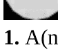

### 第 5 章 自测题

- **1.**  是 JavaScript 中的一个符号或单词，用于对一个或多个值执行某种计算、比较或赋值。
- **2.**  运算符最常用于对两个值执行数学计算。
- **3.**  运算符将两个值相加。
- **4.** 当增量运算符放置在操作数  时，它会将操作数的值增加 1，然后执行语句的其余部分。
- **5.** 以下哪项不是 JavaScript 运算符？
  A. =
  B. ==
  C. &&
  D. $#
- **6.** 赋值运算符的作用是什么？
  A. 将一个新值赋给一个变量
  B. 给变量一个新名称
  C. 执行比较
  D. 没什么用，因为赋值运算符毫无用处
- **7.** 加法赋值 (+=) 运算符将运算符  侧的值加到  侧的变量上，然后将新值赋给该变量。
- **8.** 比较运算符的作用是什么？
  A. 执行数学计算
  B. 处理位，目前不重要
  C. 比较两个值或语句，并返回 true 或 false 的值
  D. 只比较数字，不比较字符串
- **9.** 以下哪个比较会返回 true？
  A. 4 != 3
  B. 4 == 3
  C. 4 < 3
  D. 4 <= 3
- **10.** 以下哪个比较会返回 false？
  A. 4 != 3
  B. 3 == 3
  C. 4 > 3
  D. 4 <= 3
- **11.**  运算符允许你比较两个条件语句，以查看其中一个或两个语句是否为真，并相应地继续执行。
- **12.** 以下哪个语句会返回 true？
  A. (3 == 3) && (5 < 1)
  B. !(17 >= 20)
  C. (3 != 3) || (7 < 2)
  D. (1 == 1) && (2 < 0)
- **13.** 以下哪个语句会返回 false？
  A. !(3 <= 1)
  B. (4 >= 4) && (5 <= 2)
  C. (“a” == “a”) && (“c” != “d”)
  D. (2 < 3) || (3 < 2)
- **14.**  运算符是在位级别工作的逻辑运算符。
- **15.** 在 JavaScript 中，  运算符具有特定的  。

此页有意留白

# 第 6 章 条件语句和循环

### 117 核心技能与概念

- 定义条件语句
- 使用条件语句
- 定义循环
- 使用循环

既然你已经了解了 JavaScript 中各种运算符的工作方式，本章将指导你如何好好利用它们。本章首先向你介绍条件语句，以及它们在脚本中为何对你有用。然后，你将学习所有条件语句块及其使用方法。之后，你将了解什么是循环，并学习如何在脚本中使用各种类型的循环。

### 定义条件语句

为了使用条件语句，你需要知道它们是什么，以及它们在脚本中为何对你有用。

#### 什么是条件语句？

条件语句是一种语句，你可以用它来根据条件执行一段代码，或者在条件不满足时执行其他操作。你可以将条件语句想象成有点像因果关系。一个不错的类比或许是使用家长可能会说的话，就像下面的文本：
“如果你的房间打扫干净了，你就可以吃甜点。否则，你就得早点睡觉。”
第一个原因是房间干净，其效果是得到甜点。第二个原因是房间不干净，其效果是早点睡觉。在你的脚本中，你可能想创建类似的语句。可能更像下面这一行：
“如果名为 mymoney 的变量大于 1000，则发送一个警报，显示我的财务状况良好。否则，发送一个警报，说我需要更多钱！”
在这种情况下，第一个原因是变量的值大于 1000，其效果是一个显示一切正常的警报。第二个原因是变量的值等于 1000 或更小。如果发生这种情况，你会得到一个警报，说你需要更多钱。
正如你所看到的，如果你能在脚本中创建这样的语句，你将能够比以前在脚本中做得更多。

#### 为什么条件语句有用

正如你在上一节所看到的，条件语句对你来说可能非常有用。与其照原样执行脚本中的每一行代码，你可以让脚本的某些部分仅在满足特定条件时执行。你甚至可以将该单个条件扩展为一个需要满足才能运行代码部分的条件组合。

通过条件语句，你可以让 JavaScript 执行以下操作：
- 如果名为 yourname 的变量等于 John，则在页面上写一行问候 John 的话。否则，在页面上写一行问候“未知访客”的话，并将其加粗显示。
- 如果名为 mycar 的变量等于 Corvette 或 Mustang，则向浏览器发送一个警报，显示 "Cool Car"。如果名为 mycar 的变量等于 Corvette，那么如果名为 yourname 的变量等于 Marty，则向浏览器发送一个警报，显示 "Marty is cool and drives a cool car"。否则，向用户发送一个警报，显示 "Unknown Surfer drives a car of some sort"。

我实际上并不开 Corvette 或 Mustang，所以我在这里不属于酷人群；然而，这些例子确实展示了你如何通过在脚本中的操作发生之前添加检查某些条件的方式，使你的脚本更有用。这类语句为你的脚本提供了所谓的“流程控制”。

#### 使用条件语句

既然你已经知道条件语句是什么了，是时候更详细地研究它们并学习如何编写它们了。你将看到 JavaScript 中使用的两种类型的条件语句块：if/else 语句和 switch 语句。你还将学习条件运算符的使用。

### 使用 if/else 语句

在使用条件语句时，你会发现它们具有熟悉的语法。最显著的是围绕将根据给定条件执行的代码部分的花括号 ({ })。

#### if/else 语句块结构

在 if/else 语句中，你必须处理的第一件事是第一行，它告诉浏览器继续执行或跳过。你以 JavaScript 关键字 if 开始一个 if/else 语句，后跟括号中的一个比较。下面的行展示了 if 语句格式的示例：

```
if (comparison here) {
  JavaScript Code
}
```

你将比较 here 文本替换为实际的比较。为此，你需要记住上一章中的比较运算符。假设你想查看一个名为 boats 的变量是否等于 3，并在条件为真时发送警报 "Yes, there are 3 boats"。你可以使用以下代码：

```
if (boats === 3) {
  window.alert("Yes, there are 3 boats");
}
```

记住，比较将返回 true 或 false 的值。这就是返回值变得有用的地方。如果 boats === 3 的比较返回 true，则花括号内的代码将被执行。如果返回 false，则括号内的代码将被忽略，并且将执行右花括号之后的代码行。

如果你希望在比较返回 false 时使用 else 块执行另一组语句，你可以将 else 关键字放在下一行，然后在其后跟自己的花括号，如下面的代码所示：

```
if (boats === 3) {
  // 如果第一行的比较返回 true，则执行此警报
  window.alert("You have the right number of boats");
}
else {
  window.alert("You do not have the right number of boats");
}
```

如果变量 boats 等于 3，此代码将发送一个警报，显示 "You have the right number of boats"。如果它

 not，那么它会发送一条提示"您没有正确数量的船只"。

现在您已经设置好了这些语句，您需要知道比较是否返回 true，以便确定执行哪一块代码。为此，您需要在比较发生之前声明 boats 变量并为其赋值。这将为您提供确定脚本中发生什么所需的值。如果您使用以下代码，请猜猜看哪一块代码会被执行（第一块还是第二块）：

```
var boats = 3;
if (boats === 3) {
  window.alert("You have the right number of boats");
}
else {
  window.alert("You do not have the right number of boats");
}
```

如果您猜的是第一块代码会被执行，那您答对了！由于变量 boats 等于 3，比较 boats === 3 返回 true。由于返回 true，第一块代码被执行，而 else 关键字后面的代码块被忽略。您会收到提示"您有正确数量的船只"，不会再有其他提示。

#### 注意

在输入变量赋值（=）、等于比较（==）和严格等于比较（===）时要小心，因为它们很容易因意外误输入而导致脚本中出现问题或意外结果。

现在来看看如何设置语句以获得相反的结果。以下代码将导致比较返回 false：

```
var boats = 0;
if (boats === 3) {
  // 将变量赋值为 0 将导致比较返回 false
  window.alert("You have the right number of boats");
}
else {
  window.alert("You do not have the right number of boats");
}
```

当变量 boats 的值为 0 时，比较 boats === 3 将返回 false；因此，第一块代码被忽略，而 else 语句后面的代码块被执行。这次您会收到提示"您没有正确数量的船只"，而第一块中的提示被忽略。

现在您已经了解了 if/else 语句块的基本结构，可以进一步学习将一块嵌套在另一块中的技术了。

#### 块嵌套

如果进行嵌套，基本上就是将一种结构放在另一种相同或相似性质的结构内部。使用 if/else 语句块时，您可以将其他 if/else 语句嵌套在比较之后的第一块代码中（"if 块"）或在 else 关键字之后的第二块代码中（"else 块"）。

例如，也许您希望浏览器执行如下语句："如果名为 havecookbook 的变量等于 yes，并且名为 meatloafrecipe 的变量等于 yes，则向浏览器发送提示'找到食谱'。如果 havecookbook 等于 yes，但 meatloafrecipe 不等于 yes，那么向查看者发送提示'有书但没有食谱'；否则，向浏览器发送提示'您需要一本食谱书'。"

这是一个有些冗长且复杂的语句，但您可以通过在另一个 if/else 语句的 if 块中嵌套一个 if/else 语句来实现您的目标。要了解这是如何工作的，请考虑以下示例，它将前面的语句转换为 JavaScript 形式：

```
var havecookbook = "就知道",
    meatloafrecipe = "oh no";
if (havecookbook === "yes") {
  if (meatloafrecipe === "yes") {
    window.alert("Recipe found");
  }
  else {
    window.alert("Have the book but no recipe");
  }
}
else {
  window.alert("You need a cookbook");
}
```

这个 if/else 块嵌套在外部的 if 块中

哦不，嵌套 if 块需要到处使用大括号！为了帮助您理解这段代码的运行原理，我将把它拆解成各个部分。

首先，您看到的是主（第一个，或最外层的）if 块。您用它来查明变量 havecookbook 是否等于 yes。如果此比较返回 true，您就进入 if 块内部；然而，接下来您会发现另一个 if 块！这就是嵌套的 if 块，意味着它位于外部 if 块的内部。在嵌套块中，您检查变量 meatloafrecipe 是否等于 yes。如果这返回 true，您终于可以执行某些操作了，即发送"找到食谱"的提示。

当嵌套的 if 块结束后，您会看到它配有一个 else 块，以防比较 meatloafrecipe === "yes" 返回 false。如果它返回 false，浏览器就会转到这个 else 块并执行其中的代码。在前面的代码示例中，外部块的比较（havecookbook === "yes"）返回 true，但嵌套块的比较（meatloafrecipe === "yes"）返回 false。因此，嵌套的 else 块被执行，发送"有书但没有食谱"的提示。

在这个嵌套的 else 块之后，您会看到看似多余的一个右大括号；然而，这个右大括号实际上是用于关闭包含所有这些嵌套代码的外部 if 块的。查看代码的缩进方式将有助于您看清哪些括号关闭哪些块。这就是在代码中使用缩进或制表符的好处，因为——与代码全部排成一条直线上下排列相比——缩进可以使代码更易读。

**提示**

关于代码缩进，有些人建议使用四个空格，有些人建议两个空格，还有些人建议使用 tab 键。最重要的是选择一种缩进方法，并在代码中始终一致地使用它。这将有助于您在后续阅读脚本或调试时提供帮助。更多信息请参阅以下页面：en.wikipedia.org/wiki/Indent_style，了解编程中空格与制表符的更多信息。

最后，您到达外部的 else 块。仅当第一次比较（havecookbook === "yes"）返回 false 时，此块才会被执行。如果该比较返回 false，则外部 if 块内的所有代码都被忽略（您永远无法到达嵌套的 if/else 块），浏览器转而执行这个外部的 else 块。在这种情况下，您会向查看者发送"您需要一本食谱书"的提示。

以下示例使用了与前面代码示例相同的 if/else 代码，但这次变量的定义不同：两个变量都被赋值为 yes。请尝试跟随代码，说出执行时屏幕上会显示哪个提示。

```
var havecookbook = "yes",
    meatloafrecipe = "yes";
if (havecookbook === "yes") {
  if (meatloafrecipe === "yes") {
    window.alert("Recipe found");
  }
  else {
    window.alert("Have the book but no recipe");
  }
}
else {
  window.alert("You need a cookbook");
}
```

您应该选择的提示是"找到食谱"。当第一次比较返回 true 时，您被送到嵌套的 if 块。由于嵌套 if 块的比较也返回 true，您执行该块内的代码，向浏览器发送"找到食谱"的提示。

关于嵌套，您还应该知道的最后一点是，您可以在其他块内部嵌套任意数量的块。不仅仅是将另一个 if/else 语句嵌套在一个 if/else 语句内部，您还可以在该语句内部进行第二次嵌套、第三次，或尽可能多地嵌套，只要您能跟踪得来而不至于发疯。例如，请考虑以下代码：

```
if (havecookbook === "yes") {
  if (meatloafrecipe === "yes") {
    if (ismomsmeatloaf === "yes") {
      window.alert("Recipe found");
    }
    else {
      window.alert("Recipe found, but not like what mom makes");
    }
  }
  else {
    window.alert("Have the book but no recipe");
  }
}
else {
  if (havewebaccess === "yes") {
    window.alert("Find the recipe on the Web");
  }
  else {
    window.alert("You need a cookbook");
  }
}
```

这个 if/else 块嵌套在一个嵌套的 if 块内部

现在有一个 if/else 块嵌套在一个 if 块内的 if 块中。正如您所看到的，又增加了一个变量 ismomsmeatloaf，用于检查更具体的食谱。您可以一直这样继续下去，直到您再也无法忍受为止；不过，这些应该足以让您在需要时在此基础上进行扩展。

#### 复杂比较

除了进行诸如 x === 2 或 y < 3 这样的简单比较之外，您还可以使用第 5 章讨论的逻辑运算符构建更复杂的比较。您可能还记得，该章以类似于以下示例的形式展示了一些比较：

```
(2 === 2) || (3 < 5)
```

在第 5 章中，唯一关注的是比较会返回 true 还是 false，而不是如何将其添加到 if/else 语句中。请注意每个比较周围的括号。它们主要是为了组织而存在的；但根据运算优先级，您可以将比较写成：

```
2 === 2 || 3 < 5
```

这里的问题是这样更难阅读，所以如果后续需要调试代码，将难以确定是否存在问题。

回想一下，if/else 语句的第一行使用括号来包围比较。如果您像前面的示例那样不使用组织性括号来编写复杂比较，第一行可能如下面的代码所示：

```
if (2===2||3<5)
```

虽然这很容易输入，但非常难读，因为您不确定它应该读作"如果 2 等于 2 或 3 且小于 5"还是"如果（2 等于 2）或（3 小于 5）"。您可以做的第一件事是添加间距，这有助于提高比较的可读性：

```
if (2 === 2 || 3 < 5)
```

如果您为组织添加括号，它会变得更加易读；但您必须小心正确嵌套它们。以下示例代码展示了为组织而添加的括号：

```
if ( (2 === 2) || (3 < 5) )
```

使用哪种形式将取决于个人偏好。目前，本章使用带有额外括号进行组织的方法。这应该会让您更容易阅读书中的代码。


现在你可以创建脚本，允许包含更多值，或者指定一个特定范围，当条件满足时返回 true。假设你希望当名为 `num1` 的变量大于 2 但小于 11 时，显示一个提示框；而当 `num1` 不在该范围内时，显示另一个提示框。你可以使用以下代码：

```
if ( (num1 > 2) && (num1 < 11) ) {
    window.alert("Cool number");
}
else {
    window.alert("Not a cool number");
}
```

你的比较表达式在说：“如果 `num1` 大于 2 **且** `num1` 小于 11”。如果该比较结果为 true，你就会看到“Cool number”提示框。如果结果为 false，则会看到“Not a cool number”提示框。

当然，你可以让比较行变得尽可能复杂。你可以在一行中添加*与*和*或*逻辑运算符，直到满足你的需求……或者把你搞崩溃。以下示例在比较中增加了一个额外条件，以检查 `num1` 是否等于 20：

```
if ( (num1 > 2) && (num1 < 11) || (num1 == 20) ) {
    window.alert("Cool number");
}
window.alert("Not a cool number");
```

现在，该比较允许大于 2 的数、小于 11 的数以及数字 20 触发“Cool number”提示框。该比较现在读作：“如果 `num1` 大于 2 *并且* `num1` 小于 11 *或者* `num1` 等于 20”。你可以继续添加条件，创建更多返回 true 的数字，或者更多返回 true 的数字范围。

当然，要让上述代码生效，你需要声明 `num1` 变量并为其赋值。看看使用以下代码时，哪个提示框会显示：

```
var num1 = 1;
if ( (num1 > 2) && (num1 < 11) || (num1 == 20) ) {
    window.alert("Cool number");
}
else {
    window.alert("Not a cool number");
}
```

是的，你会被“Not a cool number”提示框缠住，因为数字 1 在这里不符合要求（1 不在使条件返回 true 的接受范围内）。当然，你可以将其更改为符合要求的值，以获得“Cool number”提示框。

#### 注意

使用 `&&` 和 `||` 的复杂表达式，如果分组不正确，可能会在脚本中产生意外的结果。例如，比较 `((u===v && w===x) || y===z)` 与 `(u===v && (w===x || y===z))` 的结果是不同的。第一个表达式在 u 等于 v 且 w 等于 x 时，或者在 y 等于 z 时，会返回 true。第二个表达式在 u 等于 v 且（w 等于 x 或 y 等于 z）时，会返回 true。

#### 花括号简写

`if` 语句允许一种简写：如果 `if` 或 `else` 块内只有一条语句，则可以不使用花括号。例如，考虑以下代码：

```
if (num1 === 1) {
    window.alert("The number is 1!");
}
else {
    window.alert("Not 1!");
}
```

由于 `if` 和 `else` 块各只包含一条语句，JavaScript 允许不使用花括号来编写，如以下代码所示：

```
if (num1 === 1)
    window.alert("The number is 1!");
else
    window.alert("Not 1!");
```

虽然在这种情况下确实缩短了代码，但此技术*不推荐使用*，因为它可能导致对条件执行的代码产生混淆。为了向前兼容，最好保留花括号，因为这使得以后更容易向其中一个块添加语句。考虑这段代码：

```
if (num1 === 1)
    window.alert("The number is 1!");
else
    window.alert("Not 1!");
window.alert("Ha Ha"); // 即使条件为 true，此行也会执行！
```

从代码的格式来看，“Ha Ha”提示框似乎只应在 `num1` 不等于 1 时显示。然而，无论条件是 true 还是 false，提示框都会显示。由于省略了花括号，“Ha Ha”提示框不属于 `else` 块，而只是紧随 `if/else` 语句之后并总是执行的第一条语句。

要修复此问题，只需添加花括号以明确代码应执行的操作。以下代码将按预期工作：

```
if (num1 === 1) {
    window.alert("The number is 1!");
}
else {
    window.alert("Not 1!");
    window.alert("Ha Ha");
}
```

有了花括号，“Ha Ha”提示框将仅在 `num1` 不等于 1 时显示。

#### 链式 if/else 语句

在某些情况下，你可能希望设置一个“elseif”类型的语句。虽然 JavaScript 没有 `elseif` 关键字，但它允许你通过链式连接 `if/else` 语句来创建这种类型的语句，如以下代码所示：

```
if (num1 === 1) {
    window.alert("Number 1! Yes!");
}
else if (num1 === 2) {
    window.alert("Number 2.");
}
else {
    window.alert("The number is not 1 or 2.");
}
```

> 一个 `else` 关键字后直接跟一个 `if` 关键字，就创建了一个“elseif”语句

这允许你在执行最终的 `else` 语句作为最后选项之前执行任意数量的测试。这通常可以使用 `switch` 语句进一步简化，下一节将讨论这一点。

### 使用 switch 语句

`switch` 语句允许你获取一个表达式，并根据 `case` 是否等于表达式的值来执行不同的代码块。如果你想检查多个不同的值，这可能比使用一系列链式 `if/else` 语句更容易。

`switch` 语句的第一行语法如下：

```
switch (expression)
```

你可以将 *expression* 替换为一个值、一个变量或其他某种表达式（例如，数值相加或字符串拼接）。在第一个示例中，我们只使用在 `switch` 语句开始前已赋值的变量。

现在，你需要了解完整 `switch` 语句的通用语法。以下代码是 `switch` 语句的示例：

```
var thename = "Fred";

switch (thename) {                    // switch 语句开始，基于
                                      // thename 变量的值
    case "George" :
        window.alert("George is an OK name");
        break;                        // 一个 case，附带代码
                                      // 如果条件为真则执行
    case "Fred" :
        window.alert("Fred is the coolest name!");
        window.alert("Hi there, Fred!");
        break;                        // 这是为真的 case，
                                      // 将被执行
    default :
        window.alert("Interesting name you have there");
                                      // 当没有 case 为真时，
                                      // 使用 default
}                                     // 结束花括号关闭
                                      // switch 语句
```

首先，此示例声明并赋值了一个名为 `thename` 的变量；其值为 "Fred"。接着，`switch` 语句开始，使用变量 `thename` 作为比较的基础。然后，用一个花括号打开代码块，后跟第一个 `case` 语句。这样写的意思是：“如果 `thename` 等于 George，则执行冒号后的命令”。如果 `thename` 等于 George，你会看到一个提示框。

接下来你看到 `break` 语句，它告诉浏览器退出代码块并移动到块之后的下一行代码。你在 `switch` 块中使用 `break` 语句以确保只执行一个 `case` 部分；否则，你就有风险执行所有在返回 true 的 case 之后的 case，因为默认情况下，浏览器会继续到下一个语句（称为 *fall through*），而不是完全退出块，即使它发现其中一个 case 为 true。为了确保浏览器退出块，你添加了 `break` 语句。

回到脚本，我们看到 `thename` 不等于 George，所以这个 case 被跳过；然而，下一个比较返回 true，因为在脚本中 `thename` 等于 Fred。因此，这个 case 块中的语句集将被执行。注意这里 `break` 语句之前有两行 JavaScript 代码。这表明你可以在一个 case 中包含任意数量的行。

最后，你看到 `default` 关键字。这在没有任何 `case` 语句返回 true 的情况下使用。如果发生这种情况，将执行 `default` 部分的代码。注意你不需要在 `default` 部分的代码之后添加 `break` 语句，因为它位于 `switch` 块的末尾，所以浏览器之后会退出该块，因此不需要 `break` 语句。

#### 贯穿（Falling Through）

有时你想执行下一个 case。这称为贯穿（falling through），它将允许你继续到下一个 `case` 语句。这种技术的一个用途是当多个 case 都适用于特定代码段时。你可以让这些 case 贯穿，直到遇到要执行的代码：

```
switch (name) {
    case "Fred" :       // 贯穿
    case "Frederick" :  // 贯穿
    case "Freddie" :
        window.alert("Any version of Fred is a cool name");
        break;
    default:
```


```markdown
这就允许所有名字为 "Fred" 的某种变体的情况都由最后一个 case 中的语句来处理，而不需要在每个 case 中重复这些语句并使用 break。当使用穿透（fall through）时，最好使用注释注明一下，如示例代码所示。

在穿透之前，你仍然可以在某个 case 上执行代码。以下代码展示了这一点：

```
switch (name) {
case "Fred" :
    window.alert("Your name is Fred"); // fall through
case "Frederick" : // fall through
case "Freddie" :
    window.alert("Any version of Fred is a cool name");
    break;
default:
    window.alert("I have not heard that name before");
}
```

这次，如果 name 等于 "Fred"，那么会显示 "Your name is Fred" 警告框。该 case 随后会穿透，并继续显示 "Any version of Fred is a cool name" 警告框。如果 name 等于 "Frederick" 或 "Freddie"，那么只会显示 "Any version of Fred is a cool name" 警告框。

### 使用表达式

到目前为止，你已经在 switch 语句的开头号行中使用了变量值作为表达式。JavaScript 允许你使用任何类型的表达式，当你使用布尔值作为表达式时，这非常有用。这样做允许你编写返回布尔值的条件，从而能够一次性测试多个值。例如，考虑以下代码：

此 case 使用的条件返回 true，这与 switch 语句开头使用的表达式相等

```
var num1 = 17;
switch (true) {
case (num1 < 20) :
    window.alert("The number is less than 20");
    break;
case ( (num1 >= 20) && (num1 <= 100) ) :
    window.alert("The number is somewhere between 20 and 100");
    break;
default :
    window.alert("The number is negative or more than 100");
}
```

通过将布尔值 true 作为表达式，每个 case 都可以是一个条件。如果某个 case 的条件返回 true，那么它就是一个匹配，该 case 就会执行。在前面的代码中，第一个 case 将会执行，因为条件 num1 < 20 将返回 true，与初始表达式形成匹配。

### 使用条件运算符

条件运算符（也称为三元运算符）可以作为一种简短的方式，根据条件来赋值。例如，你可能希望根据条件语句的结果给变量赋值。你可以使用以下代码来实现：

```
var mynum = 1,
    mymessage = "";
if (mynum === 1) {
    mymessage = "You win!";
}
else {
    mymessage = "Sorry! Try again!";
}
```

这可以奏效，并且由于 mynum 等于 1，mymessage 的值被设为 "You win!"。然而，条件运算符允许你将这类测试所需的代码量缩短。它允许你在问号 (?) 之前放置一个条件，在冒号 (:) 的两侧各放置一个可能的值，如下所示：

```
var name = (condition) ? value1 : value2;
```

JavaScript 会评估条件语句，如果该语句返回 true，则将冒号左侧的值（这里的 value1）赋给变量。如果语句返回 false，则将冒号右侧的值（这里的 value2）赋给变量。如你所见，这个运算符需要三个操作数（条件和两个值），因此它有时也被称为三元运算符。

将其应用到我们之前的示例中，我们可以将整个代码重写如下：

```
var mynum = 1,
    mymessage = "";
mymessage = (mynum === 1) ? "You win!" : "Sorry! Try Again!";
```

这与之前的 if/else 代码块工作方式相同，但允许你用更少的输入来编写代码（减小了脚本的大小）。

在本章中学习的条件语句将让你能够在了解如何使用它们之后，用代码做更多事情。在后面的章节中，你将广泛使用这些语句来创建更复杂的脚本。

### 来自提示框的用户输入

获取观众输入的一种方法是使用 window.prompt() 方法。该方法接受两个参数：要显示的提示文本，以及获取观众回复的文本框的默认值。例如，你可以使用以下代码。

```
var username = window.prompt("Give me your name!", "");
```

在这种情况下，提示文本将是 "Give me your name!"，而文本框的默认值将为空。下图展示了在 Mozilla Firefox 中运行此代码时提示对话框的外观。

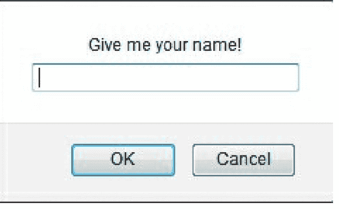

如果用户点击 OK 或按下回车键，window.prompt() 方法将返回文本框的内容。如果点击 Cancel 按钮或以其他方式关闭提示框，则返回的值将为 null。如果使用变量，则返回的值将存储在分配给 window.prompt() 方法的变量中。在这种情况下，返回值将存储在 username 变量中。

为了利用这一点，假设你希望在页面上显示观众的姓名，以使其更具个性。你想在输入了姓名时显示观众的姓名，如果没输入或用户以某种方式取消/关闭提示框，则显示默认消息。以下代码展示了如何实现这一点：

```
var username = window.prompt("Give me your name!", "");
if ( (username === null) || (username === "") ) {
    document.write("Hello, Random Nameless Person!");
}
else {
    document.write("Hello, " + username + "!");
}
```

提示返回的值存储在 username 变量中。使用 if 语句检查该变量的值。如果 username 的值为 null 或空字符串，则页面显示 "Hello, Random Nameless Person!" 消息。否则，观众将收到问候消息。下图展示了在提示文本框中输入 "Brent" 后的结果。

如你所见，if/else 条件语句使你能对用户输入进行一些基本测试。这避免了你显示包含 null 或空字符串作为观众姓名的消息。严格来说，用户仍然可以输入空白字符，但你可以通过在条件语句中使用正则表达式来防止这一点。正则表达式将在第 13 章中更详细地介绍。

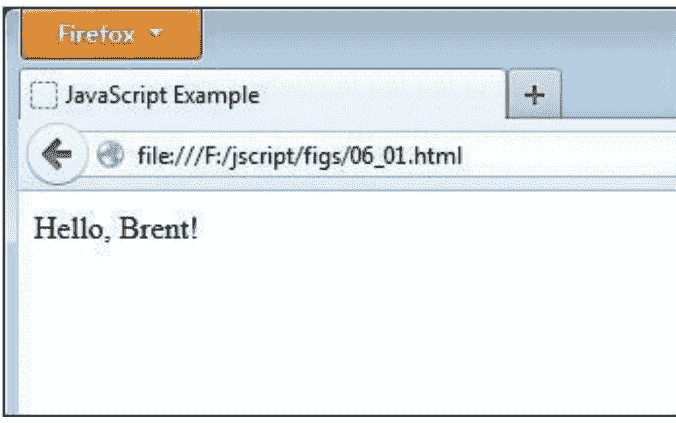

图 6-1 向观众显示的问候语。

## 专家问答

**问：我是否需要在每个 if/else 块中使用花括号？我在网上看到的代码中有些没有使用花括号。为什么？**

**答：** 如果你在 if 块和 else 块中只执行一个 JavaScript 语句，有一个快捷方式可以省略花括号（参见本章"花括号快捷方式"部分），这在网上的免费脚本中可能会使用。如前所述，不推荐这种技术，因为当你查看或调试代码时可能会造成混淆。

**问：如果我只能给变量赋值然后测试它，为什么要麻烦使用条件语句？如果我已经知道变量的值，为什么要使用条件语句？**

**答：** 在下一节中，你将达到从观众那里获取信息的地步。这些信息可能因观众而异（例如，如果观众需要在文本框或提示框中输入他/她的姓名），因此使条件块更有用，因为你将能够为一个观众执行一个操作，而为另一个用户执行另一个任务。有了用户输入，你事先不会知道变量的值，你需要使用条件块来处理各种可能性。另外，你会记得函数可以作为参数传递不同的值，你可能需要在执行代码的某些部分之前用条件语句来测试这些值。

**问：我*需要*使用 switch 语句或条件运算符吗？**

**答：** 虽然使用它们并不是绝对必要的（你可以改用 if/else 语句），但学习它们是个好主意，因为它们可以帮助你节省时间并优化代码。当你阅读其他脚本时，了解它们也有助于理解代码在做什么。

**问：我试着在提示框中输入一个数字并将其与另一个数字相加，但它把两个数字连在一起了，而不是相加。为什么？**

**答：** 在提示文本框中输入的数据将作为字符串返回，无论输入的是什么类型的数据。你可以使用一元加号运算符（参见第 5 章）将字符串强制转换为数值：

```
var num1 = window.prompt("Enter a number","");
num1 = +num1 + 5;
```

如果该值可以被强制转换，它将变为数值，加法将按预期进行。你将在第 13 章中学习更多关于验证输入的内容。

**试一试 6-1** 处理用户输入

**pr6_1.html** 这个项目将帮助你练习使用 window.prompt() 方法、带嵌套的 if/else 语句以及 switch 语句。假设你刚刚开设了一家在线商店，提供产品销售。不幸的是，你的预算很紧张，只能向某些城市配送产品。你想提示
```


## 分步指导

1.  创建一个 HTML 页面，并将其保存为 `pr6_1.html`。添加 `<script>` 标签，指向名为 `prjs6_1.js` 的外部 JavaScript 文件。

2.  创建一个外部 JavaScript 文件，并将其保存为 `prjs6_1.js`。此文件将用于步骤 3 到 6。

3.  创建一个名为 `msg` 的变量，其初始值为空字符串 `""`。此变量将用于存储将要显示给客户的信息。

4.  创建一个名为 `city` 的变量，并将其赋值为 `prompt` 对话框的返回值，该对话框会询问“您所在的城市名称是什么？”

5.  如果 `city` 的值是 `null` 或空字符串 `""`，则将字符串“`No city entered. Cannot determine delivery availability.`”赋值给 `msg` 变量。否则（`else`），创建一个 `switch` 语句（该语句将嵌套在 `else` 代码块内）。

6.  在 `switch` 语句中，根据城市名称为 `msg` 变量分配以下值：
    如果城市是 `Johnstown`，则为“`We can have items delivered to you in 3 days.`”
    如果城市是 `Donville`，则为“`We can have items delivered to you in 1 week.`”
    如果城市是 `Danieltown` 或 `Martyville`，则为“`We can have items delivered to you in 2 weeks.`”
    对于输入的任何其他城市名称，则为“`Sorry! We do not deliver to your city yet.`”

7.  在页面上输出 `msg` 变量的值。

8.  完成后，你的 JavaScript 文件应包含以下代码（也存在其他解决方案）：

```javascript
var msg = "",
    city = window.prompt("What is the name of your city?", "");
if ( (city === null) || (city === "") ) {
    msg = "No city entered. Cannot determine delivery availability.";
}
else {
    switch (city) {
        case "Johnstown" :
            msg = "We can have items delivered to you in 3 days."; break;
        case "Donville" :
            msg = "We can have items delivered to you in 1 week."; break;
        case "Danieltown" : // fall through
        case "Martyville" :
            msg = "We can have items delivered to you in 2 weeks."; break;
        default :
            msg = "Sorry! We do not deliver to your city yet.";
    }
}
document.write(msg);
```

9.  保存 JavaScript 文件和 HTML 文件，并在浏览器中查看 HTML 页面。

10. 尝试输入一个已命名的城市。你应该会看到相应的信息被写入页面。你可以重新加载页面以尝试不同的城市名称。

## 尝试此练习总结

在这个项目中，你运用了新的 `window.prompt()` 方法、`if/else` 语句和 `switch` 语句，创建了一个允许用户输入城市名称，然后查看该城市是否支持配送的脚本。

## 定义循环

要开始使用循环，你需要了解什么是循环，它们能做什么，以及为什么它们在你的脚本中可能很有用。

### 什么是循环？

循环是一段代码块，允许你将一段代码重复执行特定的次数，或许每次执行时都会更改变量的值。通过这样做，你通常可以将某些任务缩短为几行代码，而不是在脚本中一遍又一遍地编写相同的行而累坏你的手指。

### 循环为何有用

循环很有用，因为它们允许你重复代码行而无需重新输入它们，或者在文本编辑器中进行剪切和粘贴。这不仅节省了你重复输入相同代码行的时间和麻烦，还避免了重复行中的输入错误。你还可以在每次浏览器执行循环时更改变量的值，这再次节省了你输入与上一行仅略有不同的行的时间和麻烦。

举一个简单的例子，假设你想使用 JavaScript 在网页上连续写入一个句子十次。通常情况下，你可能需要编写类似以下的内容：

```javascript
document.write("All this typing gets tiring after a while!<br>");
document.write("All this typing gets tiring after a while!<br>");
document.write("All this typing gets tiring after a while!<br>");
document.write("All this typing gets tiring after a while!<br>");
document.write("All this typing gets tiring after a while!<br>");
document.write("All this typing gets tiring after a while!<br>");
document.write("All this typing gets tiring after a while!<br>");
document.write("All this typing gets tiring after a while!<br>");
document.write("All this typing gets tiring after a while!<br>");
document.write("All this typing gets tiring after a while!<br>");
```

哎呀！剪切和粘贴可以使任务更容易，但仍然会有点乏味，特别是如果你决定将句子写50次而不是10次。使用循环，你可以只编写一次 `document.write()` 语句，然后调整你想让它写的次数。它会类似于下面的例子。这不是实际的代码，但当你在下一节“使用循环”中更详细地查看循环结构时，你会看到重复语句多次所需的实际代码。

```
Do this block 10 times {
    document.write("I only had to type this once!<br>");
}
```

当然，你会将“`Do this block 10 times`”文本替换为 JavaScript 能够理解的实际语句。你将在下一节看到可以用来构成循环的语句。

### 使用循环

为了看看循环如何真正对你有帮助，你需要了解可以在 JavaScript 中使用的不同循环结构。本节介绍的循环结构有 *for*、*while* 和 *do while* 循环。

#### for

要在 JavaScript 中使用 `for` 循环，你需要知道如何编写循环的基本结构，以及如何将一个 `for` 循环嵌套在另一个 `for` 循环内。首先，看看 `for` 循环的基本结构。

##### for 循环的结构

`for` 循环的结构与条件块非常相似。主要区别在于循环服务于不同的目的，因此第一行是不同的。之后，你使用熟悉的花括号来包含循环的内容。`for` 循环的第一行将类似于以下行：

```javascript
for (var count = 1; count < 11; count++)
```

你首先看到的是 `for` 关键字。后面跟着一组括号，里面有三条语句。这三条语句通过提供特殊信息来告诉循环它应该重复多少次。

第一条语句 (`var count = 1`) 创建一个名为 `count` 的变量，并为其分配初始值 1。这个初始值可以是任何数字。这个数字用作循环重复次数的起点。使用数字 1 将帮助你更容易地看到循环将重复的次数。上面的代码以 `count` 的值为 1 开始循环。注意，如果 `count` 变量在脚本的早期已经初始化，则这里不需要 `var` 关键字。

下一条语句 (`count < 11`) 告诉循环何时停止运行。循环将根据此条件语句停止运行。这里的条件是在变量 `count` 不再小于 11 时停止。这意味着如果你每次循环时将 `count` 的值加 1，循环的最后一次运行将发生在 `count` 等于 10 时。当 1 加到 10 上时，它变成 11；这没有通过条件测试，所以循环停止运行。

该组中的最后一条语句 (`count++`) 决定了变量变化的速率以及每次是变大还是变小。在上面的代码中，每次你回到循环时都会将变量加 1。记住，第一次循环时，变量已被设置为 1。由于每次加 1，变量在第二次循环时的值为 2，第三次循环时为 3，依此类推，直到变量不再小于 11。

为了完成该结构，你插入花括号来包含你希望在循环中使用的代码。`for` 循环完整结构的示例如以下代码所示：

```javascript
for (var count = 1; count < 11; count++) {
    JavaScript Code Here
}
```

循环的 JavaScript 代码将位于这里的括号内。这一行决定了循环将运行多少次。

现在，你只需要添加一个真正的变量和一些要执行的 JavaScript 代码，你就有了一个完整的 `for` 循环。为此，你将从一个将句子写入页面十次的脚本开始。既然你现在可以使用循环，你只需要编写句子本身一次，而不是连续十次。以下示例代码展示了如何使用 `for` 循环完成此操作：

```javascript
for (var count = 1; count < 11; count++) {
    document.write("I am part of a loop!<br>");
}
```

这行代码将循环十次。

*count* 变量将从 1 开始计数，因为它被分配了初始值 1。你每次循环都给它加 1。当 *count* 变量的值不再小于 11 时，循环将停止。在这种情况下，*count* 将从 1 运行到 10，从而运行循环十次。

当下一次执行 `for` 语句时，*count* 变量的值为 11，这不再小于 11；因此，浏览器将跳过该循环，并继续执行循环结束花括号之后的下一行代码。`document.write` 命令中使用了 `<br>` 标签，以确保每个句子后都有换行符，并且不会在下一行上写下下一个句子。

要查看它在页面上的效果，你可以添加 `<script>` 标签，并在 HTML 页面的主体部分插入一个外部 JavaScript 文件。创建一个名为 `loops01.js` 的 JavaScript 文件，添加以下代码并保存文件。向 HTML 文档添加必要的 `<script>` 标签，并将其另存为 `loops01.html`。

```javascript
document.write("Get ready for some repeated text.<br>");
for (var count = 1; count < 11; count++) {
    document.write("I am part of a loop!<br>");
}
document.write("Now we are back to the plain text.");
```

此循环将在 HTML 文档中重复显示文本。

这里，对递增 *count* 变量做了一个小改动。没有使用 `count += 1`，而是使用了递增运算符 (`++`)。当你只是将变量加一时，递增运算符可以是一种缩短代码的便捷方式。但是，如果你想将变量递增 2 或更多，则仍需要使用加法赋值运算符（即 `count += 2`）。

上面代码表示的页面有一行简短的文本，后面跟着你的重复文本行。页面以注释“Now we are back to the plain text.”结束。图 6-2 显示了在浏览器窗口中查看时的显示效果。注意句子“I am part of a loop!”重复了十次。

**图 6-2** 循环将文本行显示了十次。

既然你可以做一个基本的循环，你就可以准备向它添加一些东西，使循环更加有用。在循环内部，你可以使用 `count` 变量（或使用的任何变量）的值来做各种事情。

你可以做的一件事（这在你以后处理数组时会变得更加明显）是利用变量每次都在变化的事实。随着变量每次循环增加 1，你可以使用一个循环为句子从 1 到 10 编号，使各行更具可读性。以下代码实现了这一点：

```javascript
document.write("Get ready for some repeated text.<br>");
for (var count = 1; count < 11; count++) {
    document.write(count + ". I am part of a loop!<br>");
}
document.write("Now we are back to the plain text.");
```

在上面的代码中，你只是在行首将 `count` 变量的值添加到了字符串中，并添加了一个句点和一个空格以使其看起来更美观。此循环将显示文本行十次，每行从 1 到 10 编号。现在，变量用于在每次代码重复时添加行号。


##### 比较运算

在进行比较时，你不仅可以使用 `<` 运算符。例如，到目前为止你已经循环了十次。虽然有多种方法可以让一个循环执行十次，但有些方法会改变计数变量使用的值（当你不想使用1到10作为计数数字时，这可能很方便）。这里展示了一些例子：

计数从1到10（注意这里使用了 `<=` 而不是 `<`）

```
for (var count = 1; count <= 10; count++)
```

计数从0到9

```
for (var count = 0; count < 10; count++)
```

计数从6到15

```
for (var count = 6; count <= 15; count++)
```

计数从10到1（注意这里使用了 `>` 和 `--`）

```
for (var count = 10; count > 0; count--)
```

计数从5到50，每次递增5

```
for (var count = 5; count <= 50; count += 5)
```

请记住这一点，因为这种灵活性可以帮助你节省时间或避免基于计数变量的额外计算。例如，示例中的第二种方法经常用于数组。你将在第7章中了解更多相关信息。

##### 代码块嵌套

是的，现在你需要处理嵌套循环了。与 if/else 代码块一样，你可以根据自己的处理能力嵌套任意深度的层级。目前，你只需在一个循环内嵌套另一个循环。以下示例展示了一个 for 循环嵌套在另一个 for 循环中：

```
for (var count = 1; count < 11; count++) {
    document.write(count + ". I am part of a loop!<br>");
    for (var nestcount = 1; nestcount < 3; nestcount++) {
        document.write("I keep interrupting in pairs!<br>");
    }
}
```

这个嵌套循环会中断外部循环的执行。

#### 注意

当你嵌套循环时，要确保每个嵌套循环在第一行都有自己的计数器，例如 `for (count = 1; count < 11; count++)`。在大多数情况下，计数器需要对其所在的循环唯一。此外，如果未包含或未正确配对花括号，可能会发生错误。

现在你得到了一个循环，它会用自身的文本来中断外部循环的文本。每次执行外部循环时，你都会输出 "I am part of a loop!" 这行。然后，你会遇到另一个循环，它向屏幕输出 "I keep interrupting in pairs!"。

内部循环被设置为重复两次；因此，每当你有一句来自外部循环的文本时，它后面会立即跟着两句来自内部循环的文本。为了更清楚地看到这一点，请看下面的例子，它更新了你之前在 `loops01.js` 文件中使用的代码：

```
document.write("Get ready for some repeated text.<br>");
for (var count = 1; count < 11; count++) {
    document.write(count + ". I am part of a loop!<br>");
    for (var nestcount = 1; nestcount < 3; nestcount++) {
        document.write("I keep interrupting in pairs!<br>");
    }
}
document.write("Now we are back to the plain text.");
```

图6-4展示了这个嵌套循环在浏览器中如何影响页面的外观。你现在可以看到，如果需要，嵌套循环对于沿途添加更多信息是多么有用。

**图6-4** 嵌套循环在外部循环的文本中插入了文本。更复杂的是，你还可以将不同类型的代码块相互嵌套。例如，你可以将一个 if/else 语句块放在一个循环内，或者将一个循环放在 if/else 语句的 if 块或 else 块内。以下示例在 for 循环中创建了一个 if/else 代码块：

```
for (var count = 1; count < 11; count++) {
    if (count === 5) {
        document.write("The loop is halfway done!<br>");
    } else {
        document.write("I am part of a loop!<br>");
    }
}
```

在这种情况下，浏览器将检查计数变量的值是否为5。如果是，浏览器将向屏幕打印一条与否则会打印的消息不同的消息。你可以通过调整你的 JavaScript 文件，使其包含以下代码，来最好地看到这一点的效果：

```
document.write("Get ready for some repeated text.<br>");
for (var count = 1; count < 11; count++) {
    if (count === 5) {
        document.write("The loop is halfway done!<br>");
    } else {
        document.write("I am part of a loop!<br>");
    }
}
document.write("Now we are back to the plain text.");
```

图6-5展示了这段代码在浏览器中运行时的结果。请注意第五行如何根据循环内的条件语句而与其他行不同。

正如你所见，通过嵌套你可以做很多事情。使用你刚刚学到的相同技术，你可以嵌套本书涵盖的所有其他语句块；因此，对于本书涵盖的其他语句，我将不会像这里这样详细地介绍嵌套技术。

##### 无限循环

在编写任何类型的循环时，都有可能创建一个所谓的 *无限循环*，即一个永不结束的循环。这样的循环可能会持续运行，直到导致用户的计算机崩溃。尽管大多数现代浏览器在一段时间后可以检测到这一点，并提示用户停止执行脚本，但这并不能保证，可能会给运行脚本的用户带来问题。

为了避免编程出现无限循环，你需要确保你设置的条件最终会返回 false。例如，以下 for 循环创建了一个在循环运行时永不返回 false 的条件，从而产生一个无限循环：

```
// **DO NOT USE** - Creates an infinite loop
for (var i = 25; i > 10; i++) {
    // Oops! The variable i will never be less than 10!
    document.write("This sentence can repeat forever...<br>");
}
```

**图6-5** 嵌套的 if/else 代码块导致第五行与其他行不同。

正如你在这里看到的，变量 `i` 被赋予了一个初始值 25，并且在每次循环中递增1。这意味着 `i` 将始终大于10，条件 `i > 10` 将永不返回 false，从而产生一个无限循环。

要修复这个问题，请确保对循环进行调整，以便条件最终会返回 false。以下是修复此循环的两个示例：

```
for (var i = 25; i > 10; i--) {
    document.write("This sentence can be stopped!<br>");
}
```

在这里，`i` 是递减而不是递增，这最终会将 `i` 的值降低到10，使条件为 false。

```
for (var i = 25; i < 50; i++) {
    document.write("This sentence can be stopped<br>");
}
```

在这种情况下，条件被修改为 `i < 50`，同时保持递增不变。当 `i` 到达50时，条件将返回 false 并结束循环。

##### 多条语句

for 循环在初始化时也可以包含多条语句。这使你能够拥有多个用于计数的变量，这些变量可以在循环中被更改。例如，如果你想以10为单位计数，你可以使用以下代码从10计数到100。

```
for (var i = 1, j = 10; i < 11; i++, j += 10) {
    document.write(j + "<br>");
}
```

这里，变量 `i` 和 `j` 都被初始化（`i` 为1，`j` 为10）并递增。`i` 的值每次递增1，而 `j` 每次递增10。条件 `i < 11` 将在循环运行十次后停止。最终结果是，数字10、20、30、40、50、60、70、80、90和100将显示在页面上。

#### while 循环

while 循环测试一个比较，并重复执行直到该比较不再为真。以下代码展示了 while 循环的一般结构：

```
var count = 1; // 赋予一个变量值来计数循环
while (count < 6) { // while 语句以一个比较开始
    // JavaScript 代码放在这里
}
```


#### for 循环和 while 循环

首先，注意在循环开始之前，值 1 被赋给了变量 count。这一步很重要，因为你不能像初始化 for 循环那样在初始化 while 循环时声明变量。根据变量的初始值以及每次循环时变量值增加 1（count++），这个循环被设置为重复五次。

在 while 循环中，你还必须记住改变所使用变量的值，以免陷入永久循环。如果前面的示例循环没有包含 count++ 代码，循环将会无限重复，而你不希望这种情况发生。因此，使用 while 循环时必须记住的主要事项是：在循环前给计数变量一个初始值，并在循环内部调整该变量的值。

下面是 while 循环的实际应用示例，你可以将句子重复脚本重新编写为使用 while 循环：

```javascript
var count = 1;
while (count < 11) {
  document.write(count + ". I am part of a loop!<br>");
  count++;
}
document.write("Now we are back to the plain text.");
```

上述代码将产生与 for 循环相同的结果，只是形式不同，如图 6-6 所示。在许多情况下，你可以根据个人偏好选择使用 for 循环或 while 循环，因为它们可以执行许多相同的任务。

至于 while 循环的嵌套，其工作与 for 循环相同。你可以在 while 循环中插入另一个 while 循环、for 循环或 if/else 块。如果你愿意，也可以将 while 循环插入其他语句块中。

#### do while 循环

do while 循环是一种特殊情况，因为即使比较条件在第一次时返回 false，循环内的代码也会至少执行一次。在其他循环中，第一次尝试就返回 false 的比较会导致它们永远不会被执行。而对于 do while 循环，循环会先执行一次，然后每次之后再检查比较条件以确定是否重复。

下面是运行五次的 do while 循环示例：

```javascript
var count = 1;
do {
  document.write("Hi!");
  count++;
} while (count < 6);
```

- do 关键字开始 do while 循环。
- while 语句在第一次运行后每次执行比较。

注意，在前面的代码中，关键字 do 和左花括号是唯一位于块第一行的内容。然后，当块完成时，你会看到 while 语句和比较。do 关键字确保代码块至少被执行一次。

之后，浏览器会检查比较是否返回 true 才重复。在这种情况下，循环重复五次，因为变量 count 从 1 开始，每次循环增加 1。当 count 的值达到 6 时，循环被跳过并不再执行。还要注意，循环末尾有一个分号来结束语句，这与其他类型的循环不同。

要查看即使初始比较返回 false 也会至少执行一次的 do while 循环示例，请看下面的代码：

```javascript
var count = 11;
do {
  document.write("Hi!");
  count++;
} while (count < 10);
```

上述代码中的循环只会运行第一次。当检查比较时（此时 count 已经是 12，因为在循环执行中加了 1），它返回 false，循环不再运行。

当你有一些需要至少执行一次但仅在满足某些条件时才需要重复的代码时，do while 循环最有用；否则，其他两种循环就足以完成任务。

#### for in 和 for each in

**for in** 循环允许你遍历对象属性的所有名称，而 **for each in** 循环允许你遍历每个属性的值。这些循环将在第 8 章中更详细地介绍。

### 使用 break 和 continue

**break** 和 **continue** 语句允许你停止循环当前正在做的事情，但它们的工作方式不同。正如你将在本章前面回忆起的 switch 块中 break 语句的使用，break 语句在这一点停止循环并完全退出循环，转到循环之后的下一个 JavaScript 语句。例如，可以这样使用 break：

```javascript
var stopnumber = 5;
// This will end the loop when count is equal to 5, rather than allowing the loop to complete
for (var count = 1; count < 11; count++) {
  if (count === stopnumber) {
    document.write("Sorry, the loop stops here!<br>");
    break;
  }
  else {
    document.write(count + ". I am part of a loop!<br>");
  }
}
```

这个循环会正常进行，直到 count 等于 stopnumber 的值（在本例中为 5）。当这种情况发生时，会向页面写入一条特殊消息，并使用 break 语句完全结束循环。因此，循环不会执行十次，而只会执行五次。

如果你决定在这种情况下不想完全离开循环，可以将循环修改为使用 **continue** 语句。**continue** 语句将停止循环在当前遍历中执行其后的任何语句。但是，它会回到循环的开头并从中断处继续，而不是完全退出循环。例如，你可以使用以下代码：

```javascript
var skipnumber = 5;
for (var count = 1; count < 11; count++) {
  if (count === skipnumber) {
    continue; // do nothing
  }
  document.write(count + ". I am part of a loop!<br>");
}
```

这一次，当 count 等于 skipnumber 的值（在本例中为 5）时，不会向页面写入任何内容。相反，循环被指示回到开头并继续。结果是，"I am part of a loop!" 消息只会被写入页面九次（有效地跳过了第五次写入文本并继续第六次）。图 6-7 展示了在浏览器中运行时的效果。

## 专家问答

**Q: 循环除了重复向页面写入一行文本之外还有什么用？**
**A:** 是的，随着你在章节中的进展，你会看到它们更多的用途。在第 7 章中，你会看到它们在处理数组时特别有用。

**Q: 在循环内部使用用于计数的变量真的没问题吗？这不会导致问题吗？**
**A:** 在循环内部使用该变量是可以的，只要你不会在无意给它赋新值。如果你担心会这样做，可以将其值赋给另一个变量并在代码中使用那个变量。例如，请看下面的代码：

```javascript
var thenum = 0;
for (var count = 1; count < 11; count++) {
  thenum = count;
  document.write(thenum + ". I am part of a loop!<br>");
}
```

在这里，你将 count 变量的值赋给了一个名为 thenum 的变量。然后你在代码中使用 thenum 变量而不是 count 变量。但是请注意，如果你打算给 count 变量赋新值，那么这样做是可以的。上述想法只是你在不想改变 count 变量并想确保不会意外改变时可以使用的另一种方法。

**Q: 当我想要使用循环时，应该使用 for 循环还是 while 循环？哪个更好？**
**A:** 使用你个人偏好的循环类型。通常，使用的循环类型取决于手头的情况。在不同情况下，一种循环可能比另一种更有意义。

**Q: do while 循环对我会有用吗？**
**A:** 虽然 do while 循环确实有其用途，但除非你需要使用脚本让循环在检查之前至少运行一次，否则你不太可能经常使用它。不过，你在本章中学到的关于 do while 循环的知识将有助于你遇到在 Web 上或其他地方使用它的脚本。


当遇到需要完全停止循环或停止循环并从开头重新开始的情况时，**break** 和 **continue** 语句将会对你很有帮助。

## 试一试 6-2
pr6_2.html prjs6_2.js
练习使用 for 循环和 while 循环

在这个项目中，你将使用 for 循环为“试一试 6-1”中的脚本添加另一个功能。假设你的在线商店对每个可用城市只能配送一定数量的商品。不幸的是，你的预算仍然很紧张，还没有建立在线订购系统。客户必须打印出表格，填写每个商品编号，然后通过普通邮件寄给你。你希望为客户显示一个可打印的表格，其中有足够的行数，让客户可以订购其所在城市允许的最大数量的商品。

#### 分步指南

1. 创建一个 HTML 页面并保存为 pr6_2.html。添加 script 标签，指向名为 prjs6_2.js 的脚本。
2. 创建一个外部 JavaScript 文件并保存为 prjs6_2.js。使用它来完成第 3–5 步。
3. 将 prjs6_1.js 中的 JavaScript 代码复制并粘贴到 prjs6_2.js 文件中。
4. 在脚本中添加一个名为 items 的新变量，并将其值赋为 0。
5. 在 switch 语句中，添加代码根据城市名称将以下值赋给 items 变量：
- 如果城市是 Johnstown，则为 10。
- 如果城市是 Donville，则为 5。
- 如果城市是 Danieltown 或 Martyville，则为 2。
- 对于输入的其他任何城市名称，则为 0。
6. 在 `document.write(msg)` 语句之后，添加额外的代码，使得如果 items 变量的值大于 0（使用 if 语句），则执行以下 `document.write()` 语句。

```
document.write("<p>We can deliver up to " + items + " items to your city.</p>");
document.write("<p>Print this out, write your item numbers below, and mail it to us to order.</p>");
```

7. 在这些语句之后（仍然在 if 语句内部），创建一个 for 循环，显示一个数字后跟一系列下划线（_），以创建一个填写商品编号的位置。该循环将运行足够的次数，以允许为输入的城市订购最大数量的商品。
8. 完成后，你的 JavaScript 文件应包含以下代码（其他解决方案也是可能的）：

```
var items = 0,
msg = "",
city = window.prompt("What is the name of your city?", "");

if ( (city === null) || (city === "") ) {
msg = "No city entered. Cannot determine delivery availability.";
}
else {
switch (city) {
case "Johnstown" :
msg = "We can have items delivered to you in 3 days."; items = 10;
break;
case "Donville" :
msg = "We can have items delivered to you in 1 week."; items = 5;
break;
case "Danieltown" :
// fall through
case "Martyville" :
msg = "We can have items delivered to you in 2 weeks."; items = 2;
break;
```

```
9. default : msg = "Sorry! We do not deliver to your city yet."; items = 0;
}
}
document.write(msg);
if (items > 0) {
document.write("<p>We can deliver up to " + items + " items to your city.</p>");
document.write("<p>Print this out, write your item numbers below, and mail it to us to order.</p>");
for (var count = 1; count <= items; count++) {
document.write(count + ". <br>");
}
}
```

再次保存 JavaScript 文件，并在浏览器中查看 HTML 页面。输入一个城市并查看结果。你可以重新加载页面来尝试不同的城市名称。

### 试一试总结

在这个项目中，你运用了对循环和 if 语句的知识，通过为不同城市的客户添加定制化的"蜗牛邮件"订购表单，增强了之前的项目。


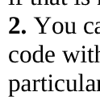

## 第 6 章自测题

1. 条件语句是一种可以根据____执行一段代码，或者在该条件未满足时执行其他操作的语句。
2. 你可以将条件语句想象成有点像____和____。
3. 条件语句不是执行脚本中的每一行代码，而是允许仅在满足特定条件时才执行脚本的某些部分。
A. 正确
B. 错误

4. 以下哪项可以作为 if/else 语句的第一行？
A. if (x=2)
B. if (y<7)
C. else
D. if ((x==2 &&)

5. 在条件语句和循环中，你用什么来包裹代码块？
A. 圆括号
B. 方括号
C. 花括号
D. 小于号和大于号

6. ____语句允许你获取单个变量值，并根据该变量的值执行不同的代码行。

7. ____是一个代码块，允许你将某段代码重复执行一定次数。

8. 循环很有用，因为它强迫你反复输入代码行。
A. 正确
B. 错误

9. 以下哪项可以作为 for 循环的第一行？
A. for (var x = 1; x < 6; x += 1)
B. for (x==1;x<6;x+=1)
C. for (int x=1;x=6;x+=1)
D. for (var x+=1;x<6;x=1)

10. ____循环查看一个比较条件，并重复执行直到该比较条件不再为真。

11. 以下哪项不能作为 while 循环的第一行？
A. while (x<=7)
B. while (x=7)
C. while (x<7)
D. while (x!=7)

12. do while 循环很特殊，因为即使使用的比较条件在第一次就会返回 false，循环内的代码至少也会执行一次。
A. 正确
B. 错误

13. do while 代码块的第一行包含关键字 do 和一个比较条件。
A. 正确
B. 错误

14. do while 代码块的最后一行只包含一个花括号。
A. 正确
B. 错误

15. 你可以将代码块嵌套在另一个代码块中多少次？
A. 无
B. 一次
C. 三次，但不能再多
D. 任意多次（尽管过多的嵌套可能会使浏览器耗尽内存）

本页有意留空

# 第 7 章 JavaScript 数组

### 关键技能与概念

- 定义和访问数组
- 数组的属性和方法
- 将数组与循环配合使用
- 嵌套数组

在本章中，你将学习 JavaScript 数组以及它们如何帮助你改进脚本。你将从数组的基本概述开始，了解什么是数组以及为什么它们很有用，然后学习如何在 JavaScript 中定义和访问数组。之后，你将了解可用于数组的实用属性和方法。最后，你将学习如何嵌套数组以提供额外的组织层次。

### 什么是数组？

*数组*是一种存储数据列表的方式（例如，最喜欢的颜色列表或最喜欢的食物列表）。这些值通过索引编号来访问。

要了解数组的工作原理，假设你有一个满是学生的班级，你希望能够快速显示每个学生的姓名。你可以使用普通变量来保存每个学生的姓名，但在 `document.write()` 语句中逐个输入每个变量名会花费很长时间。相反，你可以将每个学生的姓名存储在数组中，这样你就可以使用几行代码配合循环来更轻松地访问它。

数组允许你将数字和名称组合在一起，如下例所示：

- 学生 0：Thomas
- 学生 1：Roger
- 学生 2：Amber
- 学生 3：Jennifer

以这种方式存储，你可以使用数字来获取每个学生的姓名。这就是数组作为一项存储信息并在之后访问信息的方式而变得有用的原因。

**注意**

注意数组中的第一个学生是"学生 0"而不是"学生 1"。这是因为数组从数字 0 而不是 1 开始存储值。随着你在本章中的深入学习，这一点将被更详细地讨论。

### 为什么数组很有用？

为什么使用数字能让你更容易访问存储的信息？因为借助数字，你可以轻松地使用循环来遍历信息，而不是手动输入每个条目。如果示例中的学生名单变长，当你想要在浏览器中显示所有姓名时，循环可以为你节省相当多的输入工作。


例如，如果你将示例列表中每个学生的名字都赋值给一个变量，然后将名字输出到屏幕上，你将需要在`document.write()`语句中重写每个变量名。以下代码展示了一个示例：

```javascript
var student0 = "Thomas",
student1 = "Roger",
student2 = "Amber",
student3 = "Jennifer";
```

```javascript
document.write(student0 + "<br>");
document.write(student1 + "<br>");
document.write(student2 + "<br>");
document.write(student3 + "<br>");
```

这些变量被赋予了值。每个变量的值被单独写入页面。

如果你能够使用一个循环，为每个学生重复执行单个`document.write()`语句，就可以避免写出四个独立的变量名。数组是存储这些值（学生姓名）的一种便捷方式，因为你可以通过循环遍历这些值，而无需逐个写出——即使你事先不知道学生人数（通过使用数组的`length`属性）。在本章的后续部分，你将看到更多关于此的内容。

## 定义和访问数组

现在你已经知道了什么是数组，准备好学习如何在JavaScript中命名、定义、访问和使用数组。

### 命名数组

你可以使用与命名变量相同的规则来命名数组。有关这些命名规则的列表，请参考第3章。

### 定义数组

JavaScript数组非常灵活。你可以选择是否指定数组中的项目数量，并且可以在数组中的任何位置使用任何数据类型的值（例如，你可以让第一个元素是数字，第二个是字符串，以此类推）。要了解这一切是如何工作的，你将首先学习在JavaScript中定义数组的两种方式：数组构造函数和数组字面量表示法。

#### 数组构造函数

数组构造函数使用以下格式定义数组：

```javascript
var arrayname = new Array();
```

你将`arrayname`替换为你希望赋予数组的名称。你会注意到关键字`new`与`Array()`一起使用。此代码创建一个空数组，但你也可以在括号内放置参数，以提供数组的长度或每个单独数组项的值。

要指定数组的长度，你将一个单独的数字值放在括号内，如以下代码所示：

```javascript
var students = new Array(4); // 创建一个名为students的数组，包含四个项目
```

这个数组被命名为`students`，包含四个项目。所有四个值最初都设置为`undefined`，但每个项目都可以在后续的代码中定义。虽然你可以这样做，但并非必须设置数组长度，因为它在脚本执行期间可以根据需要变化。

要指定数组中每个项目的值，你可以像给函数传递参数一样，将它们作为参数提供：

```javascript
var students = new Array("Thomas", "Roger", "Amber", "Jennifer");
```

这个数组有四个已定义的项目："Thomas"、"Roger"、"Amber"和"Jennifer"。正如你所读到的，JavaScript允许在同一个数组中包含不同的数据类型。

以下代码也会产生一个有效的数组：

```javascript
var answers = new Array(42, "paper", -3, "plastic");
```

这样，你就有很大的灵活性，因为数组中的数据类型不受限制。

> **注意**

使用数组构造函数时，提供单个数字值作为参数总是会创建一个具有该长度的数组，而不是创建一个包含该值作为唯一项目的数组。因此，`var students = new Array(4);`将创建一个包含四个项目的数组，而不是一个包含值为4的单个项目的数组。如果提供了多个参数（无论是数字还是非数字），则所有参数都将按预期用作项目值。

#### 数组字面量表示法

数组字面量表示法提供了一种更简短的方法来定义数组，使用方括号（`[]`）而不是构造函数语法。例如，你可以使用以下代码创建一个空数组：

```javascript
var students = [];
```

你可以通过简单地在以逗号分隔的列表中提供项目来添加它们，就像传递参数一样。以下示例都使用数组字面量表示法创建了有效的数组：

```javascript
var answers = [42, "paper", -3, "plastic"];
var is_true = [true, false];
var nums = [4, 20, 19, 2, 2, 10056, -42, 3];
```

与数组构造函数一样，任何数据类型都可以作为项目的值。在本书中，我在定义数组时最常使用数组字面量表示法。

> **注意**

使用数组字面量表示法时，单个数字值会创建一个包含该值作为唯一项目的数组，而数组构造函数则会创建一个具有该长度的数组。因此，`var students = [4];`将创建一个包含一个值为4的项目的数组，而不是一个包含四个项目的数组。

### 访问数组的元素

要访问数组的元素，你需要使用所谓的“索引”，它允许你通过位置访问数组中的每个项目。例如，考虑以下示例代码：`var students = ["Thomas", "Roger", "Amber", "Jennifer"];`

你可以使用语法`students[0]`访问"Thomas"，使用`students[1]`访问"Roger"，以此类推。请注意，方括号紧跟在数组名称之后，并且包含你希望访问的数组中项目的索引。你还会看到第一个项目是使用0作为索引来访问的。这是因为数组从0开始计数，而不是从1开始；因此，你需要小心不要混淆数组中项目的索引。第一个项目的索引为0，第二个项目的索引为1，第三个项目的索引为2，以此类推。

你可以在代码中像使用变量一样使用数组项目。例如，看看这段代码：

```javascript
var students = ["Thomas", "Roger", "Amber", "Jennifer"];
alert(students[0]);
```

这段代码将向用户显示一个写着"Thomas"的警告框。如果需要，你可以显示数组中的每个学生姓名，如以下代码所示：

```javascript
var students = ["Thomas", "Roger", "Amber", "Jennifer"];
document.write("<p>My Students:</p>");
document.write(students[0] + "<br>"); // 写入第一个项目的值：“Thomas”
document.write(students[1] + "<br>"); // 写入第二个项目的值：“Roger”
document.write(students[2] + "<br>"); // 写入第三个项目：“Amber”
document.write(students[3] + "<br>"); // 写入第四个项目的值：“Jennifer”
```

这将按顺序在网页上显示学生名单。不幸的是，随着列表的增长，你将不得不为每个新项目继续添加代码行。这就是`length`属性和使用循环可以帮助你处理不断增长的数组的地方。

### 使用 length 属性和循环

一个非常有用的值是数组中的项目数量。在JavaScript中，这可以通过使用`length`属性来获得。要访问`length`属性的值，你使用数组的名称，后跟一个点（`.`），然后是`length`，如以下代码所示：

```javascript
var students = ["Thomas", "Roger", "Amber", "Jennifer"];
alert(students.length);
```

这将向用户显示一个写着数字4的警告框，因为数组中有四个项目。由于你的数组随时可能添加更多项目，`length`属性提供了一种了解数组当前有多少个项目的方法。这样做的一个好处是你可以创建一个循环来遍历数组中的每个项目。回想一下上一节中的代码：

```javascript
var students = ["Thomas", "Roger", "Amber", "Jennifer"];
document.write("<p>My Students:</p>");
document.write(students[0] + "<br>");
document.write(students[1] + "<br>");
document.write(students[2] + "<br>");
document.write(students[3] + "<br>");
```

每个数组项的值通过分别输入每个索引来写入页面。

这段代码可以工作，但如果你不需要每次向数组添加项目时都包含新的代码行，那会好得多。既然你现在有了`length`属性，你可以用它来创建一个循环，将每个数组项写入页面，而不管长度如何。以下代码展示了这样一个示例：

```javascript
var students = ["Thomas", "Roger", "Amber", "Jennifer"];
document.write("<p>My Students:</p>");
for (var i = 0; i < students.length; i++) {
    document.write(students[i] + "<br>");
}
```

请注意，`for`语句初始化了一个名为`i`的变量，并赋予它值0。然后在每次循环中将其与`students.length`的值（在本例中为4）进行比较，并每次递增1。这允许循环通过索引遍历每个数组项，从0开始，一直运行到数组中的最后一项（在本例中是`students[3]`，数组中的第四项）。注意使用的是`<`而不是`<=`，因为`<=`会尝试访问`students[4]`，而这不存在，因为计数从0开始。

此代码在浏览器中运行的结果如图7-1所示。

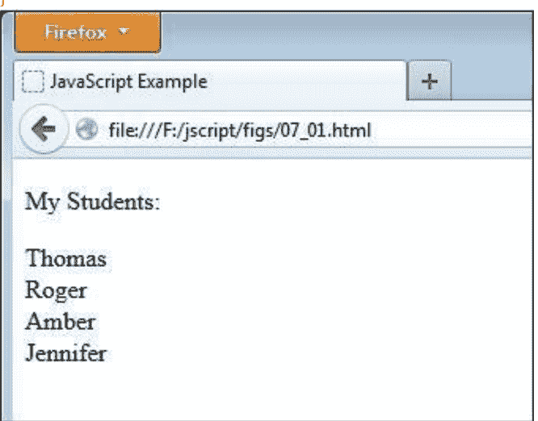

现在，我们可以向数组添加任意数量的项目，脚本仍然会将所有项目写入页面。例如，假设你向数组添加了一些项目，如以下代码所示：

```javascript
var students = ["Thomas", "Roger", "Amber", "Jennifer", "Joe", "Dawn"];
document.write("<p>My Students:</p>");
for (var i = 0; i < students.length; i++) {
    document.write(students[i] + "<br>");
}
```


如你所见，数组和循环配合得非常好，为你提供了一种访问数组中所有项目并执行任何所需任务的方法，而无需重复多次编写相似的代码行。由于项目数量和项目值可以随时更改，因此这种技术尤其有用。

### 更改数组值和更改长度

你可以通过多种方式修改数组。在这里，你将了解两种可以用来更改数组的方法：更改值和更改长度。


图 7-2 添加的数组项已写入页面。

#### 更改值

数组中的每个元素都可以在脚本的任何时候更改其值。与变量类似，只需为数组元素赋予一个新值即可更改其值，如以下代码所示：

```
var students = ["Thomas", "Roger", "Amber", "Jennifer"];
students[2] = "Dawn"; // 第三个数组元素的值被更改
```

这会将第三个数组元素（索引 2）的值从"Amber"更改为"Dawn"。你也可以遍历数组并按需更改每个元素。例如，以下代码会对每个数组元素的值进行相同的修改：

```
var students = ["Thomas", "Roger", "Amber", "Jennifer"]; for (var i = 0; i < students.length; i++) {
students[i] += " Doe");
}
```

这会为所有学生添加姓氏"Doe"：students[0] 的值变为"Thomas Doe"，students[1] 的值变为"Roger Doe"，以此类推。

#### 更改长度

你不仅可以访问 length 属性的值，还可以更改它。这样做会从数组末尾删除元素或在数组末尾添加元素。例如，以下代码会从 students 数组中删除最后两个元素：

```
var students = ["Thomas", "Roger", "Amber", "Jennifer"]; students.length = 2;
```

该数组原本有四个元素，现在只剩前两个："Thomas"和"Roger"。如果你将 length 的值更改为大于数组当前长度的数字，则会在数组末尾添加元素。以下代码展示了这样的示例：

```
var students = ["Thomas", "Roger", "Amber", "Jennifer"]; students.length = 7;
```

该数组现在将有七个元素，在末尾添加了三个元素。最后三个元素（students[4]、students[5] 和 students[6]）在被显式赋值之前，其值为 undefined。

另一种增加数组长度的方法是为大于数组中任何现有索引的索引赋值。例如，考虑以下代码：

```
// 数组有四个元素 var students = ["Thomas", "Roger", "Amber", "Jennifer"]; students[6] = "Marty"; // 数组现在有七个元素，索引 6 处的元素定义为 "Marty"
```

在索引 6 处定义元素会迫使数组扩展以包含新元素。在原数组末尾和新定义的索引之间的元素，在被赋值之前，其值为 undefined。在本例中，students[4] 和 students[5] 的值为 undefined，而 students[6] 的值为代码中定义的"Marty"。

如果你不确定最后一个元素的位置，想要在数组末尾添加元素，可以在方括号中使用数组的长度来实现，如以下代码所示：var students = ["Thomas", "Roger", "Amber", "Jennifer"]; students[students.length] = "Marty";

此处，students[4] 被添加到数组并赋值为"Marty"。还有其他使用数组方法添加或删除元素的方式，你将在本章后面学习到。

### 动手试一试 7-1 使用循环处理数组

pr7_1.html 本项目让你练习使用循环处理数组。假设你的公司正在销售特定的计算机部件，你想展示每个可供销售的部件。你所有的部件名称都存储在一个数组中。

## 分步操作

1. 创建一个 HTML 页面，包含一个标题文本"Computer Parts Available"。添加 script 标签以包含一个名为 prjs7_1.js 的外部 JavaScript 文件。将 HTML 文件保存为 pr7_1.html。
2. 创建一个外部 JavaScript 文件并将其保存为 prjs7_1.js。使用它来完成步骤 3–6。
3. 创建一个名为 computer_parts 的新数组，并将以下部件列表作为数组元素的值进行赋值：
   - Monitors（显示器）
   - Motherboards（主板）
   - Chips（芯片）
   - Hard Drives（硬盘）
   - DVD-ROMs（DVD 光驱）
   - Cases（机箱）
   - Power Supplies（电源）

4. 在浏览器窗口中将每个计算机部件显示在单独的行上（使用循环）。
5. 完成后，你的 JavaScript 文件应包含以下代码（可能存在多种正确的答案）：

```
var computer_parts = ["Monitors", "Motherboards", "Chips", "Hard Drives", "DVD-ROMs", "Cases", "Power Supplies"];
for (var i = 0; i < computer_parts.length; i++) {
document.write(computer_parts[i] + "<br>");
}
```

6. 保存 JavaScript 文件并在浏览器中加载 HTML 文件以查看结果。你应该能看到当前的部件列表。

（续）

#### 动手试一试总结

在本项目中，你运用了循环、数组和 Array 对象属性的知识来创建两个不同的结果。一个结果列出了数组的元素，另一个结果向数组添加了一些元素并按字母顺序列出了这些元素。

## 数组属性和方法

数组有许多属性和方法可在脚本中使用。这些允许你执行诸如添加元素、删除元素、排序元素、合并数组等操作。数组之所以拥有这些属性和方法，是因为数组在 JavaScript 中是对象（你将在第 8 章学习对象）。首先，我们来看数组属性，然后介绍数组方法。

### 属性

表 7-1 列出了 Array 对象的属性并提供了每个属性的简要说明。每个属性将在后续章节中进行更详细的讨论。

#### constructor 和 prototype 属性

constructor 属性包含创建数组原型的函数代码的值。它只是返回这个值：

```
function Array() { [native code] }
```

prototype 属性允许你向已存在的对象（如 Array 对象）的所有实例添加属性和方法。向数组原型添加内容会影响脚本中使用的所有数组，目前最好避免这样做。你将在第 8 章学习更多关于构造函数和原型如何工作的内容。

#### index 和 input 属性

要理解 index 和 input 属性，你首先需要了解正则表达式（用于匹配文本字符串），这需要较长的解释，相关内容在第 13 章中提供。index 和 input 属性的讨论将留到该章节。

| 属性 | 说明 |
|---|---|
| constructor | 引用用于创建 Array 对象实例的构造函数 |
| index | 当数组由正则表达式匹配创建时使用 |
| input | 当数组由正则表达式匹配创建时使用 |
| length | 包含一个数值，等于数组中元素的数量 |
| prototype | 允许向 Array 对象添加属性和方法 |

# 表 7-1

# Array 对象的属性

#### length 属性

如你所见，length 属性返回一个数字，告诉你数组中有多少个元素。由于你已经在使用它，可以参考本章前面的章节获取更多信息。

### 方法

现在你已经了解了 Array 对象的属性，本节介绍你可以用来对数组执行不同操作的方法。表 7-2 列出了这些方法并提供了每个方法的功能描述。在表格之后，将对每个方法进行更详细的介绍。

| 方法 | 说明 |
|---|---|
| join() | 将数组的元素用分隔符组合成一个字符串 |
| pop() | 从数组末尾删除一个元素，然后根据需要返回被删除的元素 |
| push() | 向数组末尾添加元素，然后根据需要返回数组新长度的数值 |
| shift() | 从数组开头删除一个元素，然后根据需要返回该元素 |
| unshift() | 向数组开头添加元素，并根据需要返回新数组长度的数值 |
| reverse() | 反转数组中元素的顺序：第一个元素移到最后一个位置，最后一个元素移到第一个位置，以此类推 |
| sort() | 根据元素的字符串值按字母顺序对数组元素进行排序 |
| concat() | 将两个或多个数组的元素合并为一个新数组 |
| slice() | 从数组中提取指定部分，并将该部分作为新数组返回 |
| splice() | 从数组中删除元素或替换数组中的元素 |
| indexOf() | 查找数组中某项的索引 |
| lastIndexOf() | 查找数组中某项的最后一个索引 |
| every() | |
| filter() | |
| forEach() | |


查找一个项在数组中的最后一个索引。

对数组的每个项执行提供的函数，如果该函数对所有项都返回 true，则返回 true。

对数组的每个项执行提供的函数，并返回函数返回 true 的那些项组成的数组。

对数组的每个项执行提供的函数。

*(续)*

#### 表 7-2 Array 对象的方法

| 方法 | 说明 |
| --- | --- |
| map() | 对数组的每个项执行提供的函数，并返回在每个项上调用该函数的结果组成的数组 |
| some() | 对数组的每个项执行提供的函数，如果该函数对任何一项返回 true，则返回 true |
| reduce() | 对数组的每个项执行提供的函数，并返回最终结果 |
| reduceRight() | 对数组的每个项执行提供的函数，并返回最终结果 |
| toString() | 将数组的元素组合成一个以逗号为分隔符的字符串 |
| toLocaleString() | 将数组的元素组合成一个以逗号为分隔符的字符串 |
| valueOf() | 将数组的元素组合成一个以逗号为分隔符的字符串 |

#### 表 7-2 Array 对象的方法 *(续)*

#### join() 方法

`join([separator])` 方法用于将数组的项组合成一个字符串，各项之间默认以逗号分隔，或者使用作为参数传入的字符串进行分隔。

#### 注意

Internet Explorer 7 及更早版本在参数未提供时会默认使用字符串 "undefined"。为避免出现这种情况，最好始终提供该参数。

要了解此方法的工作原理，请看一段代码。以下示例定义了一个数组，然后在数组名称上调用 `join()` 方法：

```
var fruits = ["oranges", "apples", "pears"];
var fruit_string = fruits.join(",");
```

这段代码将 `join()` 方法的结果赋值给变量 `fruit_string`。注意，该方法是通过数组名称（`fruits`），后跟一个点（`.`），再跟方法名来调用的。`fruit_string` 变量将具有以下字符串值：

oranges,apples,pears

你可以通过将字符串变量写入网页来查看此结果。以下代码将为你完成此操作：创建包含三个项的数组

```
var fruits = ["oranges", "apples", "pears"];
var fruit_string = fruits.join(",");
document.write("The new string is " + fruit_string);
```

数组的项被组合成一个以逗号作为分隔符的字符串。

字符串显示在屏幕上。

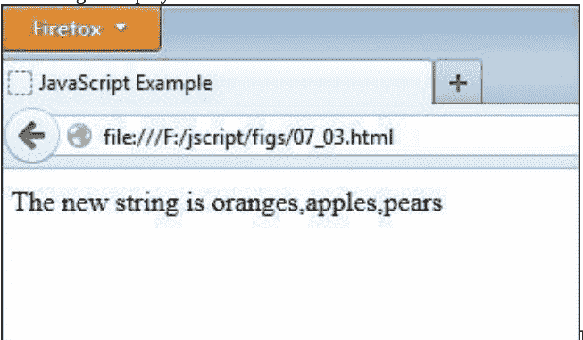

**图 7-3** 新字符串被写入页面。

现在你可以看到 `join()` 方法返回的字符串。图 7-3 展示了此代码在浏览器中运行时的结果。

如果你想用逗号以外的其他内容来分隔新字符串中的项，可以将要用作分隔符的字符串作为参数传入。以下代码使用冒号作为分隔符：创建包含三个项的数组

```
var fruits = ["oranges", "apples", "pears"];
var fruit_string = fruits.join(":");
document.write("The new string is " + fruit_string);
```

数组的项被组合成一个以冒号作为分隔符的字符串。

字符串显示在屏幕上。

这次字符串将与之前的略有不同，因为它用冒号替代了前面示例中的逗号。图 7-4 展示了此字符串在浏览器窗口中的显示效果。

#### pop() 方法

`pop()` 方法用于从数组中移除最后一项。如果你将方法的结果赋值给一个变量，则弹出的元素将被返回并赋值给该变量。

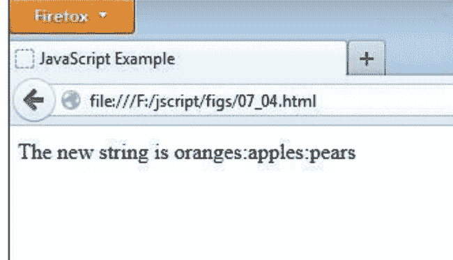

**图 7-4** 新字符串被写入页面，以冒号作为分隔符。

以下代码创建一个数组，然后使用 `pop()` 方法从数组中移除最后一项：

```
var fruits = ["oranges", "apples", "pears"];
fruits.pop();
```

这会创建一个名为 `fruits` 的数组，包含三个项（"oranges"、"apples"、"pears"）。然后，使用 `pop()` 方法移除最后一项，将数组缩短为仅包含前两项（"oranges"、"apples"）。

如果你想移除一项但之后仍以某种方式使用它，可以将方法的结果赋值给一个变量。该变量将被赋值为被弹出项的值。以下示例移除数组的最后一项，然后将弹出的项作为警告发送给查看者：

```
var fruits = ["oranges", "apples", "pears"];
var picked_fruit = fruits.pop();
window.alert("You picked my " + picked_fruit);
```

这将弹出一条警告，对查看者显示 "You picked my pears"。

#### push() 方法

`push([item])` 方法用于在数组末尾添加项。发送给方法的参数是你希望添加到数组的新项。如果赋值给变量，此方法将返回数组的新长度。

例如，看一些在数组末尾添加一项的代码：

```
var fruits = ["oranges", "apples"];
fruits.push("pears");
```

这段代码创建一个名为 `fruits` 的数组，包含两个项（"oranges"、"apples"），然后使用 `push()` 方法添加第三个项 "pears"。该数组现在包含三个项（"oranges"、"apples"、"pears"），其中 "pears" 是数组的最后一项。

你可以通过发送多个参数来添加多个元素。这些项将按照它们在参数列表中的顺序添加。以下代码向 `fruits` 数组添加两个元素：

```
var fruits = ["oranges", "apples"];
fruits.push("pears", "grapes");
```

这段代码向 `fruits` 数组添加两个项。最终，数组包含四个元素（"oranges"、"apples"、"pears"、"grapes"）。

如果你想要方法返回的新长度，可以将结果赋值给一个变量。以下代码执行此操作，然后向查看者发送一条包含返回值的警告：

```
var fruits = ["oranges", "apples"];
var new_length = fruits.push("pears", "grapes");
window.alert("The array now has " + new_length + " items");
```

由于有两个项被添加到数组末尾，数组的新长度将是四，将向查看者发送一条显示 "The array now has 4 items" 的警告。

#### 注意

对于使用其他语言编程过的人来说，`push()` 和 `pop()` 将数组视为栈（后进先出）。结合使用 `shift()` 和 `unshift()` 方法，可以使数组像队列一样工作。

#### shift() 方法

`shift()` 方法用于移除数组的第一项。它返回从数组中移除的项的值。

以下代码使用 `shift()` 方法移除第一个数组项：

```
var fruits = ["oranges", "apples", "pears"];
fruits.shift();
```

这段代码创建一个包含三个项的数组，并使用 `shift()` 方法移除第一项。这使得数组仅剩下两项（"apples"、"pears"）。

要使用被移除元素的值，可以将方法的结果赋值给一个变量。以下代码将被移除的元素赋值给一个变量，然后提醒查看者移除了什么：

```
var fruits = ["oranges", "apples", "pears"];
var picked_fruit = fruits.shift();
window.alert("You picked my " + picked_fruit);
```

这段代码在浏览器窗口中显示警告 "You picked my oranges"。

#### unshift() 方法

`unshift([item])` 方法用于在数组开头添加项。你希望添加到数组中的项作为参数发送。该方法返回的值是数组的新长度。

以下示例在数组开头添加一个新项：

```
var fruits = ["apples", "pears"];
fruits.unshift("oranges");
```

这会创建一个包含两个项的数组，然后使用 `unshift()` 方法在开头添加一个项。该数组随后包含三个项（"oranges"、"apples"、"pears"）。

如果你想一次添加多个项，可以将它们作为参数按你希望添加的顺序发送。以下示例在数组开头添加两个项：

```
var fruits = ["apples", "pears"];
fruits.unshift("oranges", "grapes");
```

这会将初始数组并在开头添加两个元素。调用 `unshift()` 方法后，数组最终包含四个元素（"oranges"、"grapes"、"apples"、"pears"）。

#### reverse() 方法

`reverse()` 方法用于反转数组中项的顺序。为了演示如何使用此方法，以下代码创建一个数组，然后反转各项的顺序：

```
var fruits = ["oranges", "apples", "pears"];
fruits.reverse();
```

数组的初始顺序为 "oranges"、"apples"、"pears"。调用 `reverse()` 方法后，各项的顺序将被反转。


#### sort() 方法

`sort([sort_function])` 方法将每个数组项转换为字符串值，然后根据这些字符串值按升序排列项目。以下代码展示了该方法的一个使用示例：

```javascript
var fruits = ["oranges", "apples", "pears", "grapes"];
fruits.sort();
```

这将重新排序数组，使元素按字母顺序排列："apples", "grapes", "oranges", "pears"。

然而，请记住，字符串是根据其字符编码进行比较的（参见第5章中的"大于运算符（>）"部分）。如果大小写存在差异，这可能会导致返回意外的顺序：

```javascript
var fruits = ["oranges", "apples", "pears", "Grapes"];
fruits.sort();
```

由于最后一项以大写字母开头，排序后的数组顺序为 "Grapes", "apples", "oranges", "pears"。要解决这个问题，您可以使用一个名为 `toLowerCase()` 的字符串方法，确保所有值都以小写形式进行比较，并在排序后返回预期的顺序：

```javascript
var fruits = ["oranges", "apples", "pears", "Grapes"];
for (var i = 0; i < fruits.length; i++) {
  // 创建一个循环来遍历数组
  fruits[i] = fruits[i].toLowerCase();
}
// 数组按预期顺序排序
fruits.sort();
// 通过调用 toLowerCase() 将每个数组项转换为小写
```

这样一来，顺序现在将是 "apples", "grapes", "oranges", "pears"。由于 `sort()` 方法将所有值都转换为字符串，即使只包含数值的数组也会根据它们转换为字符串后的结果进行排序：

```javascript
var fruits = [2, 3, 1, 20];
fruits.sort();
```

排序后，结果不是预期的顺序（数值顺序），而是 1, 2, 20, 3，因为这些值是作为字符串进行比较的。为了解决这个问题，JavaScript 允许您为 `sort()` 方法指定一个*比较函数*作为参数。

比较函数是一个带有两个参数的函数，它根据比较两个参数值的结果返回正数、负数或零。例如，这里展示了一个简单的比较函数：

```javascript
function mysort(first_value, second_value) {
  if (first_value > second_value) {
    return 1;
  } else if (first_value < second_value) {
    return -1;
  } else {
    return 0;
  }
}
```

基本上，比较函数应在第一个参数大于第二个参数时返回正数，第一个参数小于第二个参数时返回负数，两个参数相等时返回零。这将按升序排列项目。将前面代码中所示的函数作为 `sort()` 方法的参数使用，将使数字按预期的数值顺序排列，因为大于运算符会将数字作为数值进行比较，而不是将它们转换为字符串。以下是此方法的一个使用示例：

```javascript
var fruits = [2, 3, 1, 20];
fruits.sort(mysort);
```

比较函数的名称被用作 `sort()` 方法的参数。这样一来，排序将项目按预期的顺序排列：1, 2, 3, 20。

##### concat() 方法

`concat([array])` 方法将数组与传送给它的参数连接起来，并返回一个包含所有项目的新数组。它不会影响原始数组。您可以使用数组名称或单个值作为参数，并按顺序提供它们。

第一个示例合并了两个数组的元素。为此，只需使用一个参数——即要与调用方法的数组相连接的数组名称：

```javascript
var fruits = ["oranges", "apples"];
var veggies = ["corn", "peas"];
var fruits_n_veggies = fruits.concat(veggies);
```

这段代码创建了一个名为 `fruits` 的数组，包含两个元素，以及一个名为 `veggies` 的数组，也包含两个元素。接下来，它定义了 `fruits_n_veggies`，它将接收 `concat()` 方法返回的数组。在这种情况下，`fruits_n_veggies` 数组将包含 "oranges", "apples", "corn", "peas"。

如果您希望 `veggies` 数组中的项目排在前面，可以使用 `veggies` 数组名称调用该方法，并将 `fruits` 数组名称作为参数传入：

```javascript
var fruits = ["oranges", "apples"];
var veggies = ["corn", "peas"];
var fruits_n_veggies = veggies.concat(fruits);
```

现在 `veggies` 数组的项目排在前面，新的 `fruits_n_veggies` 数组包含以下项目："corn", "peas", "oranges", "apples"。

如果您要合并三个数组，调用 `concat()` 方法的数组的项目将排在前面，然后每个作为参数传入的数组的项目将按照它们被发送的顺序添加：

```javascript
var fruits = ["oranges", "apples"];
var veggies = ["corn", "peas"];
var meats = ["fish", "chicken"];
var three_groups = fruits.concat(veggies, meats);
```

现在您正在合并三个数组，新的 `three_groups` 数组中的项目如下："oranges", "apples", "corn", "peas", "fish", "chicken"。

如果您改用以下方式编写代码，您将得到包含相同元素但顺序不同的数组：

```javascript
var fruits = ["oranges", "apples"];
var veggies = ["corn", "peas"];
var meats = ["fish", "chicken"];
var three_groups = meats.concat(veggies, fruits);
```

使用此代码时，新的 `three_groups` 数组中的元素顺序如下："fish", "chicken", "corn", "peas", "oranges", "apples"。

除了连接数组，您还可以连接字符串、数字或其他数据类型。如果需要，这些都可以一起进行：

```javascript
var fruits = ["oranges", "apples"];
var veggies = ["corn", "peas"];
var big_array = fruits.concat(veggies, "cat", 4, ["house", "car"]);
```

这次连接创建了一个名为 `big_array` 的数组。它将 `veggies` 数组、一个字符串、一个数字和另一个数组添加到 `fruits` 数组中。`big_array` 中的最终项目为："oranges", "apples", "corn", "peas", "cat", 4, "house", "car"。

如果您使用不带任何参数的 `concat()`，它将创建原始数组的副本。因此，以下代码将简单地为您提供 `fruits` 数组的副本：

```javascript
var fruits = ["oranges", "apples"];
var same_fruits = fruits.concat();
```

##### slice() 方法

`slice(start, [stop])` 方法用于切出数组的指定部分，然后使用旧数组中切片部分的元素创建一个新数组。

以下是一般的语法使用方法：
`arrayname.slice(start, stop);`

您将 `start` 替换为开始切片的索引，将 `stop` 替换为要切片的最后一项之后的索引。

例如，以下代码从数组中切出两个项目，并用这些项目创建一个新数组：

```javascript
var fruits = ["oranges", "apples", "pears", "grapes"];
var somefruits = fruits.slice(1, 3);
```

这切出数组的第二项（索引 1）和第三项（索引 2）。它不会提取第四项（索引 3）。名为 `somefruits` 的新数组包含切出的项目（"apples", "pears"）。

**注意**
如果未包含第二个参数，则 `slice` 方法将继续到数组的末尾。这使其成为使用 `slice(0)` 复制数组的常用解决方案，例如，`var same_fruits = fruits.slice(0);`。

#### splice() 方法

`splice(begin, num_items, [add_item])` 方法允许您从数组中删除或替换项目。可以传入的参数包括开始拼接的索引、要删除的项目数，以及可选的向数组中添加新项目的选项。

如果您想从数组中删除单个项目，可以使用如下代码：

```javascript
var fruits = ["oranges", "apples", "pears", "grapes"];
var somefruits = fruits.splice(2, 1);
```

这从索引 2 开始删除项目。下一个参数是 1，因此只删除一个项目；因此，这里只删除了索引 2 处的元素（"pears"）。拼接后，数组仅包含三个项目："oranges", "apples", "grapes"。

要删除多个项目，您可以增加第二个参数的值。以下代码从索引 2 开始删除两个项目：

```javascript
var fruits = ["oranges", "apples", "pears", "grapes"];
var somefruits = fruits.splice(2, 2);
```

这次数组缩减为两个项目（"oranges", "apples"），因为最后两个项目被 `splice()` 方法删除了。

您还可以使用 `splice()` 方法替换数组中已拼接的项目，或向数组中添加项目。以下代码通过传入额外的参数，将索引 2 处的已拼接项目替换为一个新项目：

```javascript
var fruits = ["oranges", "apples", "pears", "grapes"];
var somefruits = fruits.splice(2, 1, "watermelons");
```

这次，索引 2 处的项目被删除。由于第二个参数是 1，只删除一个项目。下一个参数被添加到数组中第一个参数指定的索引（2）处。这个值（"watermelons"）替换了被删除的值（"pears"）。数组现在将包含以下项目："oranges", "apples", "watermelons", "grapes"。

如果您想使用 `splice()` 方法向数组中添加一个或多个项目，但不删除任何内容，可以将第二个参数设置为 0（即删除零个元素）。您将第一个参数设置为希望开始添加元素的索引。例如，请看以下代码：

```javascript
var fruits = ["oranges", "apples", "pears", "grapes"];
var somefruits = fruits.splice(2, 0, "watermelons", "plums");
```

项目的添加从索引 2 开始，如第一个参数所指定，并且不删除任何内容，如第二个参数所指定。


#### indexOf() 和 lastIndexOf() 方法

indexOf() 和 lastIndexOf() 方法在 ECMAScript 5 中被添加，提供了一种在数组中搜索项目的方法。indexOf() 方法从前往后搜索数组，而 lastIndexOf() 从后往前搜索。如果找到该项目，则返回该项目的索引。如果未找到，则返回 -1。

以下代码展示了如何使用这两个方法：

```javascript
var fruits = ["oranges", "apples", "pears", "apples"];
var found_apples = fruits.indexOf("apples");
window.alert(found_apples); // 显示 1
found_apples = fruits.lastIndexOf("apples");
window.alert(found_apples); // 显示 3
found_apples = fruits.indexOf("grapes");
window.alert(found_apples); // 显示 -1
```

这里，使用 indexOf() 从前往后搜索项目 "apples" 返回 1，因为它在索引 1 处找到第一个 "apples" 实例。如果使用 lastIndexOf() 从后往前搜索 "apples"，则返回 3，因为 lastIndexOf() 检测到的最后一个 "apples" 实例位于数组末尾的索引 3 处。使用任一方法搜索 "grapes" 都将返回 -1，因为 "grapes" 不是数组中的项目。

请注意，当项目不在数组中时，返回的是 -1 而不是 0，因为 0 是一个有效的索引。因此，您应该避免使用类似 `if(!fruits.indexOf("grapes"))` 的结构。相反，您应该使用 `if(fruits.indexOf("grapes") === -1)` 来判断一个项目是否不在数组中。

可以向任一方法提供第二个参数，以指定开始搜索的索引。这允许 indexOf() 或 lastIndexOf() 跳过项目的先前实例，并仅返回从指定索引开始找到的第一个项目的索引。例如，考虑以下代码：

```javascript
var fruits = ["oranges", "apples", "pears", "apples"];
var found_apples = fruits.indexOf("apples", 2);
window.alert(found_apples); // 显示 3
found_apples = fruits.lastIndexOf("apples", 1);
window.alert(found_apples); // 显示 1
```

在这个例子中，调用 `fruits.indexOf("apples", 2)` 从索引 2 开始从前往后搜索，而不是从索引 0 开始。这意味着它将绕过索引 1 处的第一个 "apples" 实例，从索引 2 开始搜索，并返回 3，因为下一个 "apples" 实例位于索引 3。调用 `lastIndexOf("apples", 1)` 从索引 1 开始向后搜索。在这种情况下，索引 3 处的 "apples" 被跳过，搜索从索引 1 开始，在那里找到 "apples" 并返回 1。

最后，需要注意的是，这两个方法都使用 `===` 运算符而不是 `==` 运算符来判断是否找到项目。因此，不会执行类型强制转换，必须完全匹配才能成功搜索。例如，考虑以下代码：

```javascript
var nums = ["2", 5, 22, 3];
var found_two = nums.lastIndexOf(2);
alert(found_two); // 第一个项目 ("2") 是字符串，与数值 2 不匹配
// 显示 -1。因为 "2" 和 2 不严格相等，所以未找到该项目，返回 -1。
// 在使用这些方法时，请记住这一点，以避免意外结果。
```

#### every()、filter()、forEach()、map() 和 some() 方法

every()、filter()、forEach()、map() 和 some() 方法在 ECMAScript 5 中被添加，提供了一种将函数作为参数传递并在数组中的每个项目上运行的方式。这些函数根据在每个项目上运行参数中指定的函数的结果返回一个值。这些被称为 *迭代* 函数，意味着它们循环（或迭代）数组中的每个项目。以下是每个迭代方法被调用时的作用：

- **every()**：对每个数组项执行提供的函数，如果该函数对 *所有* 项都返回 true，则返回 true。
- **some()**：对每个数组项执行提供的函数，如果函数的执行对 *任何* 项返回 true，则返回 true。
- **filter()**：对每个数组项执行提供的函数，返回一个由函数返回 true 的项组成的数组。
- **map()**：对每个数组项执行提供的函数，返回一个对每个项调用该函数的结果数组。
- **forEach()**：对每个数组项执行提供的函数。不返回任何值。

要使用其中一种方法，您需要调用它并提供一个函数名作为参数，如以下示例：

```javascript
var grades = [94, 65, 71, 84, 99];
var the_result = grades.every(pass_grades);
```

every() 方法迭代所有数组项并运行命名函数 (pass_grades) 后返回的结果将存储在名为 `the_result` 的变量中。

例如，假设名为 `pass_grades()` 的函数用于确定学生是否在所有记录的成绩中都达到 70 分或以上，如以下代码所示。该函数从 every() 方法接收三个参数：

```javascript
function pass_grades(item_value, item_index, arr_name) {
    return (item_value >= 70);
}
var grades = [94, 65, 71, 84, 99];
var the_result = grades.every(pass_grades);
window.alert(the_result); // 显示 false
```

- `return` 语句用于返回一个布尔值。
- 使用 `pass_grades` 函数对 `grades` 数组调用 every() 方法的结果被赋值给名为 `the_result` 的变量。

这将根据分数是否大于或等于 70 返回一个布尔值。您会注意到该函数接受三个参数。第一个是当前数组项的值，第二个是当前数组索引，第三个是数组本身。当调用任何迭代方法时，这些值作为参数传递给指定的函数（这里是 `pass_grades`）。

`pass_grades` 函数在迭代过程中返回以下五个结果：true、false、true、true、true。由于 every() 方法要求 *所有* 返回值都为 true 才能自身返回 true，因此在本例中，由于索引 1 处的低分 (65)，它将返回 false。

在之前的代码中，用每个其他方法替代 every() 将产生以下结果：

- 调用 `some()` 将返回 true，因为它只需要一个返回值为 true（在本例中，五个中有四个为 true）。
- 调用 `filter()` 将返回一个包含所有返回 true 的项的数组。在本例中，该数组将是 [94, 71, 84, 99]。原始数组中索引 1 处的项 (65) 被排除，因为它返回 false。新数组被赋值给变量 `the_result`。
- 调用 `map()` 将返回一个包含每次函数调用结果的数组。在本例中，该数组将是 [true, false, true, true, true]。这个新数组被赋值给变量 `the_result`。
- 调用 `forEach()` 不会返回任何内容。它只是为数组中的每个项运行该函数。

#### reduce() 和 reduceRight() 方法

reduce() 和 reduceRight() 方法也是在 ECMAScript 5 中添加的。这些方法也迭代数组中的项，但它们会构建一个最终返回的值。这些方法与迭代方法一样，使用一个函数作为参数。参数函数本身接收两个参数：前一个值和下一个项。第一次迭代将第一个项和第二个项分别作为 previous 和 next 传递。

例如，考虑以下代码。该函数接收 previous 和 next 值的参数：

```javascript
function sub_values(prev_value, next_value) {
    return (prev_value - next_value);
}
var nums = [2, 4, 8, 16, 32];
var the_result = nums.reduce(sub_values);
```

- 返回 `prev_value` 减去 `next_value` 的结果。

```javascript
window.alert(the_result); // 显示 –58
the_result = nums.reduceRight(sub_values);
window.alert(the_result); // 显示 2
```

当调用 `reduce()` 时，值从前往后迭代，在本例中将产生一个负数 (–58)。第一次循环时，2 和 4 作为参数传递，2–4 = –2。下一次循环时，结果 (–2) 作为 `prev_value`，8 作为 `next_value`，–2–8 = –10。这个模式持续进行，直到达到最终结果 –58。

当调用 `reduceRight()` 时，发生相同的过程，但从后往前移动。在本例中，首先传递 32 和 16 作为参数，32–16 = 16。接下来，16（结果）和 8 作为参数传递，16–8 = 8。这个模式持续进行，直到达到最终结果 2。

#### toString()、toLocaleString() 和 valueOf() 方法

toString()、toLocaleString() 和 valueOf() 方法有效地将数组的元素组合成一个以逗号作为分隔符的单一字符串（就像使用逗号分隔符的 join 方法一样）。toLocaleString() 方法可以根据需要进行调整，以返回本地化的项目值版本。当在第 13 章讨论字符串时，您将了解更多关于 toLocaleString() 方法的信息。

## 专家问答

**问：** 在所有属性中，有哪些对数组特别有用？
**答：** length 属性，正如您所看到的，可能是最常用的属性。index 和 input 属性在处理正则表达式时很方便，这将在第 13 章中讨论。

（续）
**问：** 有没有简单的方法记住所有这些方法？
**答：** 与其他列表一样，您记住它们的程度取决于您使用这些方法的频率。一个有用的方法是寻找成对互补的项，比如 pop() 和 push()，或者 shift() 和 unshift()。

**问：** 那么，reverse() 方法只是将所有东西向后颠倒吗？我为什么会想那样做？
**答：** 您可能想为了数字而反转顺序，以创建一个最高数字显示在前面的列表（例如，成绩或温度）。您也可能在某些情况下决定让字符串按逆字母顺序列出。

**问：** 哪种更好，使用数组构造函数还是数组字面量表示法？
**答：** 通常，在现代 JavaScript 中首选数组字面量表示法，因为语法往往更简单，并且避免了一些潜在的混淆：

```javascript
var nums = new Array(5); // nums[0] = undefined，数组长度为 5
var nums = [5]; // nums[0] = 5
var nums = new Array(4.225); // 尝试设置长度会导致错误
var nums = [4.225]; // nums[0] = 4.225
```

第一个示例创建一个有五个项目的数组，可能被误以为是数组中只有一个项目 5。第二个示例创建一个有一个项目 (5) 的数组。第三个示例看起来可能创建一个只有一个值 4.225 的数组，但这会导致错误，因为浮点数不能用作数组长度。最后一个示例按预期工作。

## 嵌套数组

数组可以嵌套，允许您将一个数组作为另一个数组中的一个项目。这样做提供了创建多维数组的能力。为了了解这可能如何使用，回到之前使用的学生数组：

```javascript
var students = ["Thomas", "Roger", "Amber", "Jennifer"];
```


索引 2 处是平均值。Roger 使用索引 3、4 和 5；Amber 使用 6、7 和 8；Jennifer 使用 9、10 和 11。尝试将这些值与正确的学生关联起来可能会很困难，尤其是当你想要循环遍历数组时。处理哪个值是学生、哪个是成绩会变得很繁琐，因为你需要尝试基于每三个位置为一个新学生来计算，而其后的两个索引则是成绩。

如果每个学生能与他/她自己的成绩一起分组到单独的数组中，每个数组都可以通过主 students 数组访问，那就更好了。这就是嵌套数组的能力可以让你的编程工作变得更轻松的地方。

### 定义嵌套数组

使用数组字面量表示法，你可以通过为每个新数组使用额外的方括号来轻松嵌套数组。以下代码展示了这方面的示例：

开始名为 students 的外部数组，并定义 students[0] 内部数组

```
var students = [ ["Thomas", 92, 90], ["Roger", 87, 78], ["Amber", 81, 85], ["Jennifer", 99, 100]

];
```

定义 students[1] 内部数组 定义 students[2] 内部数组 定义 students[3] 内部数组

这里，外部数组（students）包含四个内部数组。第一个数组位于 students 数组的索引 0 处（students[0]）。你可以通过在第一个方括号后立即添加第二组方括号来访问内部数组中的项目。例如，students[0][0] 的值将是 "Thomas"，students[2][1] 的值将是 81。

请注意，这也可以使用数组构造函数来完成，尽管语法稍长一些：

```
var students = new Array( new Array("Thomas", 92, 90),
new Array("Roger", 87, 78)
new Array("Amber", 81, 85)
new Array("Jennifer", 99, 100) );
```

这与前面的做法相同，但在使用构造函数语法时，你必须小心不要添加只带有单个数字项的数组。请记住，尝试这样做将创建一个具有那么多项的数组，而不是一个以该数字为唯一项的数组（例如，new Array(3) 将创建一个包含三项的数组，而不是一个包含值为 3 的单一项的数组）。

### 循环与嵌套数组

要遍历外部数组中的所有数组，你需要创建一个嵌套循环：一个外部循环来遍历外部数组项，另一个循环来遍历内部数组项。例如，下面显示的代码创建了一个嵌套 for 循环，该循环将遍历嵌套数组结构并显示内部数组中每个项目的值：

```
var students = [ ["Thomas", 92, 90], ["Roger", 87, 78], ["Amber", 81, 85], ["Jennifer", 99, 100]

];
var i = 0; var j = 0; 为循环计数定义变量 for (i = 0; i < students.length; i++) {

for (j = 0; j < students[i].length; j++) {
定义嵌套数组结构 此循环遍历外部数组项 此循环遍历内部数组项
document.write("students[" + i + "][" + j + "] = " + students[i][j] + "<br>");
} 每个内部数组项及其值都被列出}
```

如你所见，length 属性用于确定每个循环将执行多少次。外部循环执行四次（对应 students[0]、students[1]、students[2] 和 students[3]），内部循环在外部循环的每次迭代中执行三次（总共十二次迭代）。图 7-5 显示了在浏览器中运行此脚本的结果。

有了组织好的信息和可随时使用的循环，你现在可以基于数组中的数据生成任意数量的报告。例如，你可以显示每个学生的姓名以及最近获得的成绩（每个内部数组中的最后一项）。以下代码展示了这方面的示例：

```
var students = [ ["Thomas", 92, 90],
["Roger", 87, 78],
["Amber", 81, 85],
["Jennifer", 99, 100]
];
var i = 0; var j = 0;
for (i = 0; i < students.length; i++) {
  for (j = 0; j < students[i].length; j++) {
    if (j === 0) {
      document.write(students[i][j] + ": ");
    } else if (j === students[i].length - 1) {
      document.write(students[i][j] + "<br>");
    } else {
      // do nothing
    }
  }
}
```

显示学生姓名，后跟冒号和空格

检查项目是否位于数组的最后一个索引处，即最新成绩所在的位置

这里，你正在使用内部循环来收集希望显示的数据。if 语句用于确定当前索引是否包含所需的数据。首先需要的是学生的姓名，它位于每个内部数组的索引 0 处。另一个需要的项目是最新的成绩，它将是数组中的最后一项。这是通过检查 j 变量是否等于数组长度减一（这始终是数组中的最后一个索引）来确定的。此时，你可以简单地使用 students[i][2]，但这将无法考虑向数组中添加新成绩的情况。使用 students[i].length–1 可以确保使用数组中添加的最新成绩。你还会发现，最后的 else 语句只是告诉循环继续下一次迭代，因为你在此报告中不需要任何其他数据。图 7-6 显示了在浏览器中运行此脚本的结果。

如你所见，数组对于存储和检索数据非常有帮助，在你继续编程的过程中，你会发现它们的许多用途。

## 试一试 7-2 嵌套数组练习

pr7_2.html 本项目让你练习使用嵌套数组。假设在你的在线 prjs7_2.js 商店中，你决定显示每个电脑配件的功能以及配件名称。嵌套数组将有助于保持你的信息有序。分步指南

1. 创建一个 HTML 页面，标题文本为 "Computer Parts Available"。添加 script 标签以引入名为 prjs7_2.js 的外部 JavaScript 文件。将 HTML 文件保存为 pr7_2.html。

2. 创建一个外部 JavaScript 文件并保存为 prjs7_2.js。在步骤 3–6 中使用它。

3. 创建一个名为 computer_parts 的嵌套数组，内部数组具有以下值：

- 内部数组 0：Monitors, LCD Screens, Vibrant Colors
- 内部数组 1：Motherboards, Fast
- 内部数组 2：Chips, Pentium, Very Fast
- 内部数组 3：Hard Drives, 100-500 GB, Fast Reading
- 内部数组 4：DVD-ROMs, Burn CDs, Burn DVDs, Listen to both!
- 内部数组 5：Cases, All Sizes, Choice of Colors
- 内部数组 6：Power Supplies, We can get one for any computer!

4. 使用嵌套循环在一行上显示每个配件及其功能。配件名称后显示冒号和空格。功能之间显示逗号和空格。最后一个功能的末尾插入换行符。

5. 当你的 JavaScript 代码完成后，你应该有以下内容：

```
var computer_parts = [ ["Monitors", "LCD Screens", "Vibrant Colors"], ["Motherboards", "Fast"],
["Chips", "Pentium", "Very Fast"],
["Hard Drives", "100-500 GB", "Fast Reading"],
["DVD-ROMs", "Burn CDs", "Burn DVDs", "Listen to both!"], ["Cases", "All Sizes", "Choice of Colors"],
["Power Supplies", "We can get one for any computer!" ] ];
var i = 0;
var j = 0;
for (i = 0; i < computer_parts.length; i++) {
for (j = 0; j < computer_parts[i].length; j++) {
if (j === 0) {
document.write(computer_parts[i][j] + ": ");
} else if (j === computer_parts[i].length -1) {
document.write(computer_parts[i][j] + "<br>");
} else {
document.write(computer_parts[i][j] + ", ");
}
}
}
```

6. 保存 JavaScript 文件并在浏览器中查看 HTML 文件。你应该能看到配件和功能列表。

试一试总结

在本项目中，你运用了对嵌套数组和循环的知识，创建了一个显示嵌套数组中项目的页面。


## 第八章 对象

核心技能与概念

-   定义对象
-   创建对象
-   使用原型
-   对象语句
-   理解预定义的 JavaScript 对象

对象为脚本提供了更高的灵活性。它们可以作为存储数据的另一种方式，也可以用来创建可重用的结构。在本章中，你将学习什么是 JavaScript 对象、如何创建对象，以及如何使用一些预定义对象。

### 定义对象

由于 JavaScript 是基于原型的语言，对象的工作方式与基于类的语言不同。

JavaScript 对象本质上是属性和值的集合，在编程中称为 *哈希表*。正是值赋予了 JavaScript 极大的灵活性——一个值可以是任何数据类型，包括函数、数组和其他对象。

你可以使用对象将多个值从一个地方传递到另一个地方（稍后在本书中讨论 JSON 时，你会看到在 JavaScript 和其他语言之间传递数据时，这非常方便）。你也可以用它们来描述一个通用类型的对象，该对象可以有许多具体的 *实例*。例如，你可以有一个通用的汽车对象，它可用于构建特定的汽车类型（例如，跑车、工作车、家用汽车）。每种汽车类型都可以从通用汽车对象继承属性名称，然后拥有自己特定的属性值。

### 创建对象

既然你已经理解了对象是什么及其用途，就可以开始创建自己的 JavaScript 对象了。为此，你将学习命名约定、对象的结构以及如何在对象中包含方法。

#### 命名

与变量和函数一样，在 JavaScript 中为对象命名时，必须遵循某些规则。这些规则与为变量和函数命名的规则相同，你可以在第 3 章中回顾。

#### 单个对象

在 JavaScript 中，有两种创建单个对象的方法：使用对象构造函数或使用对象字面量表示法。单个对象适用于特定目的，例如创建名称-值对，或创建不需要与其他对象共享代码的独特对象，此时你可能更倾向于创建一个可重用的结构。

##### 对象构造函数

对象构造函数看起来很像数组构造函数。你只需为对象命名并将其定义为新对象。以下代码展示了一个示例：

```javascript
var car = new Object();
```

这会创建一个空对象，可以为其分配属性和值，如以下代码所示：

```javascript
// 定义 car 对象
var car = new Object();
car.seats = "cloth";
// car 对象有一个名为 seats 的属性，被赋值为“cloth”
```

这里，定义了一个名为“seats”的属性并被赋值为“cloth”。注意对象名称后面跟着一个点，然后是属性名称。通过这种方式，你可以定义任意数量的属性。你还可以为属性分配一个函数。这会创建所谓的 *方法*（回想一下，你已经在代码中使用过像 document.write() 和 window.alert() 这样的方法）。方法是对象的一部分，必须使用对象的名称来调用。例如，以下代码将创建两个属性（“seats”和“engine”）和一个方法（“show_features”）：

```javascript
var car = new Object();
car.seats = "cloth";
car.engine = "V-6";
car.show_features = function() {
    window.alert("car: " + car.seats + " seats, " + car.engine + " engine");
};
// 使用对象名称、点和方法名称来调用该方法
car.show_features();
```

如你所见，使用函数表达式来定义 car.show_features() 方法。最后一行展示了如何使用对象名称、点和方法名称来调用该方法。注意该方法通过使用对象名称、点和属性名称来访问每个属性的值。当调用该方法时，它会弹出一个警告框，显示“car: cloth seats, V-6 engine”。

如果需要，你也可以将命名函数赋值给一个属性作为方法，如以下代码所示：

```javascript
// 将一个函数赋值给属性，从而创建 car.show_features() 方法
var car = new Object();
car.seats = "cloth";
car.engine = "V-6";
function my_alert() {
    window.alert("car: " + car.seats + " seats, " + car.engine + " engine");
}
car.show_features = my_alert;
car.show_features();
```

如果你使用这种方法，请确保在赋值时不要使用括号，因为你希望将函数本身作为方法赋值，而不是执行它。

##### 对象字面量表示法

对象字面量表示法使用花括号（{}）来包含对象的属性和值。其语法如下所示：

```javascript
var object_name = {
    property_name: value,
    property_name: value
};
```

你可以根据需要拥有任意多的属性-值对；只需确保用逗号分隔每一对。最后一对属性-值对后面不需要加逗号。还要注意，每个属性名称后面跟着一个冒号，以将其与值分隔开。

针对上一节使用的 car 对象，你可以使用以下代码，用对象字面量表示法重写它：

```javascript
var car = {
    seats: "cloth",
    engine: "V-6",
    show_features: function() {
        window.alert("car: " + car.seats + " seats, " + car.engine + " engine");
    }
};
```

如你所见，这一次所有的属性和值都用冒号（:）分隔，包括方法函数。

对象字面量表示法提供了一种直接创建单个对象的方法，并允许将属性和值包含在花括号（{}）内，这与脚本中的其他代码形成了良好的视觉分离。

##### 访问属性值

JavaScript 提供了两种访问对象属性值的方法：点表示法和方括号表示法。

**点表示法** 正如你之前看到的，你可以使用点表示法来访问对象的属性值。你使用对象名称，后跟一个点，然后是属性名称，如以下代码所示：

```javascript
var car = {
    seats: "cloth",
    engine: "V-6"
};
// 将 seats 属性的值警告给查看者
window.alert(car.seats);
```

通过使用对象名称（car），后跟一个点（.），然后是属性名称（seats），来访问 seats 属性的值。查看者会看到一个显示“cloth”的警告框。

**方括号表示法** 方括号表示法允许你使用方括号（[]）来访问属性值。这种表示法类似于用于数组的表示法，但在方括号中使用的是字符串值而不是数字。你使用对象名称，后跟左括号（[），然后是作为字符串的属性名称，最后以右括号（]）结束。

以下代码展示了方括号表示法的一个示例：

```javascript
var car = {
    seats: "cloth",
    engine: "V-6"
};
window.alert(car["seats"]);
```


（在这种情况下使用引号）。由于属性名是作为字符串值插入在括号中的，因此可以通过连接和/或使用变量来组合它。例如，考虑以下代码：

```
var car = {
  seats: "cloth",
  engine: "V-6"
};
var s = "seats";
var start = "sea";
window.alert(car["seats"]);
window.alert(car["sea" + "ts"]);
window.alert(car[s]);
window.alert(car[start + "ts"]);
```

使用变量 `start` 的值（"sea"）与 "ts" 连接来插入字符串 "seats"
定义了变量来保存字符串 "seats" 的全部或部分内容
使用字符串 "seats"
连接 "sea" 和 "ts" 来插入字符串 "seats"
使用变量 `s` 的值来插入字符串 "seats"

如你所见，每种方式都会产生相同的结果，并从 `car` 对象中获取 `seats` 属性的值。将发出四个显示 "cloth" 的警报，因为每种组合的求值结果都是 `car["seats"]`。

当你需要使用一个属性名，但它被存储在一个变量中时（例如，当一个值作为参数发送给函数时），括号表示法的这个特性就变得相当有用。由于点表示法只允许使用裸属性名，因此不能使用变量值：

```
var car = {
  seats: "cloth",
  engine: "V-6"
};
var s = "seats";
function show_seat_type(sts) {
  window.alert(car.sts); // undefined
}
show_seat_type(s);
```

在这里，代码没有使用 `sts` 的值，而是在 `car` 对象中搜索名为 `sts` 的属性。由于该属性不存在，因此返回 `undefined`。使用括号表示法，你可以让它工作：

```
var car = {
  seats: "cloth",
  engine: "V-6"
};
var s = "seats";
function show_seat_type(sts) {
  window.alert(car[sts]); // works
}
show_seat_type(s);
```

这一次，使用了变量 `sts` 的值，即字符串 "seats"，并将 "cloth" 警报给用户。

**应该使用哪种表示法？** 使用的方法取决于具体情况。点表示法最常用，但当你需要组合属性名、使用变量的值，或使用对 JavaScript 不友好的值（如 `seat-type`）时，就应该使用括号表示法来成功访问属性值。

## 动手试试 8-1 创建一个计算机对象

pr8_1.html 在本项目中，你将自己创建对象，并掌握 prjs8_1.js 中涉及的对象创建技巧。该脚本将创建一个计算机对象，然后使用对象的属性、方法和实例来创建不同类型计算机的特性列表和价格列表。

#### 分步指南

1.  创建一个 HTML 页面，并将其保存为 `pr8_1.html`。添加必要的 `<script>` 标签，指向一个名为 `prjs8_1.js` 的外部 JavaScript 文件。

2.  创建一个外部 JavaScript 文件，并将其保存为 `prjs8_1.js`。在步骤 3-5 中使用它。

3.  创建一个名为 `computer` 的对象，它有三个属性：`speed` 的值为 "4GHZ"，`hd` 的值为 "500GB"，`ram` 的值为 "8GB"。使用对象字面量表示法。

4.  以以下格式在页面上显示每个属性的值：

计算机速度：*speed 值*

计算机硬盘：*hd 值*

计算机内存：*ram 值*

完成后，你的 JavaScript 文件应如下所示：

```
var computer = {
  speed: "4GHZ",
  hd: "500GB",
  ram: "8GB"
};
```

```
document.write("计算机速度：" + computer.speed + "<br>");
document.write("计算机硬盘：" + computer.hd + "<br>");
document.write("计算机内存：" + computer.ram);
```

5.  保存 JavaScript 文件，并在浏览器中查看 HTML 文件。你应该会看到你所创建的 `computer` 对象的属性列表。

### 动手试试总结

在本项目中，你能够运用关于对象的新知识，使用对象字面量表示法创建一个具有属性的对象。你能够创建一个网页，在浏览器中显示计算机的属性。

## 对象结构

当你以特定的方式编程对象时，你可以构建一个充当其他对象的结构或模型的对象。为了理解这是如何工作的，你将研究构造函数，并学习原型是如何被使用的。

## 构造函数

构造函数可用于为对象创建可重用的代码。例如，你可以有一个由构造函数创建的 `Car` 对象，该构造函数允许其代码被用于任意数量的汽车类型。你可以有一辆工作车、一辆家庭车和一辆乐趣车，它们都具有在 `car` 构造函数中定义的相同属性和方法名称，同时被赋予不同的值。

例如，要创建一个汽车构造函数，你需要创建一个名为 `Car()` 的函数，然后在该函数内添加你的属性和/或方法。以下示例展示了 `Car()` 构造函数的轮廓：

```
function Car() {
```

定义构造函数

```
*在此处放置属性/方法。*
```

将列出你正在创建的对象的属性和方法

```
}
```

请注意，函数名以大写字母（C）开头。虽然这不是必需的，但习惯上将构造函数的名称以大写字母开头，以帮助将其与其他类型的函数区分开来。要完成前面的函数，你需要向函数添加属性。

假设你想创建一个名为 `car` 的对象，它有 `seats`、`engine` 和 `radio` 属性。以下代码展示了如何实现：

```
function Car(seats, engine, radio) {
```

该函数接受三个参数

```
this.seats = seats;
this.engine = engine;
this.radio = radio;
```

```
}
```

参数值被分配给对象的属性

在这段代码中，在第一行，你看到函数接受三个参数。接下来，你看到参数的值被分配为属性值；然而，这里有一个新的关键字 `this`。JavaScript 中的关键字 `this` 用于表示当前使用的对象，或者说，就是“这个对象”。你将看到它是如何为其他对象创建结构的。请注意，构造函数中不需要 `return` 语句。

一旦你用构造函数设置了对象的属性，你需要创建所谓的对象实例才能使用它，因为构造函数只创建对象的结构，而不是一个可用的对象实例。要创建对象实例，你需要使用另一个 JavaScript 关键字：`new`。你之前在数组构造函数中使用过这个关键字。数组在 JavaScript 中也是对象，因此使用 `new Array()` 会创建一个 JavaScript `Array` 对象的实例。

在以下代码中展示了使用 `new` 关键字创建你的 `Car` 对象实例：

```
var work_car = new Car("cloth", "V-6", "Tape Deck");
```

首先，你看到你正在创建一个名为 `work_car` 的新变量。这个变量将被分配为 `Car` 对象的一个新实例，该实例使用提供的参数作为其属性值。这些是你想用于这个 `Car` 对象实例的值。根据顺序，你是在说你想让 `seats` 为 `cloth`，`engine` 为 `V-6`，`radio` 为 `Tape Deck`。

你现在可以访问 `Car` 对象的 `work_car` 实例了。如果你想知道 `work_car` 使用什么类型的引擎，你可以使用点表示法来访问它，像这样：`var engine_type = work_car.engine;`

这会将 `Car` 对象的 `work_car` 实例的 `engine` 属性的值分配给变量 `engine_type`。由于你向构造函数发送了 `V-6` 作为 `engine` 参数，因此 `engine_type` 变量被分配了值 `V-6`。

## 整合各部分

为了帮助你可视化这个过程，是时候将所有部分组合在一起，以便你看到它是如何工作的。以下代码结合了前面所有示例的代码，使事情更容易看清楚：

```
function Car(seats, engine, radio) {
  this.seats = seats;
  this.engine = engine;
  this.radio = radio;
}

var work_car = new Car("cloth", "V-6", "Tape Deck");
var engine_type = work_car.engine;
```

创建了对象的一个实例，并发送参数用作属性值
将 `Car` 对象的 `work_car` 实例的一个属性分配给一个独立的变量

现在你可以看到构造函数、`Car` 对象实例的创建，以及将对象的一个属性分配给变量的过程。当 `Car` 对象的 `work_car` 实例被设置时，它为属性 `work_car.seats` 获取了值 `cloth`，为属性 `work_car.engine` 获取了值 `V-6`，为属性 `work_car.radio` 获取了值 `Tape Deck`。

为了了解对象实例是如何工作的，你将在代码中添加另一个 `Car` 对象实例。以下代码使用了 `Car` 对象的两个实例，一个名为 `work_car`，另一个新实例名为 `fun_car`：

```
function Car(seats, engine, radio) {
  this.seats = seats;
  this.engine = engine;
  this.radio = radio;
}

var work_car = new Car("cloth", "V-6", "Tape Deck");
var fun_car = new Car("leather", "V-8", "CD Player");

var work_engine_type = work_car.engine;
var fun_engine_type = fun_car.engine;
```

创建了两个对象实例
每个变量都被分配了来自两个不同对象实例的 `engine` 属性的值

请注意新对象实例如何使用相同的构造函数，但使用不同的值。你现在可以访问任一类型汽车的任何特性了。例如，看看以下代码：

```
function Car(seats, engine, radio) {
```


 ```
this.seats = seats;
this.engine = engine;
this.radio = radio;
```

构造函数

Car 对象的新实例被创建。

```
var work_car = new Car("cloth", "V-6", "Tape Deck");
var fun_car = new Car("leather", "V-8", "CD Player");
document.write("I want a car with " + fun_car.seats + " seats.<br>"); 
document.write("It also needs a " + work_car.engine + " engine.<br>"); 
document.write("Oh, and I would like a " + fun_car.radio + " also.");
```

从两个 Car 实例中获取的一些属性值在 `document.write()` 语句中显示。

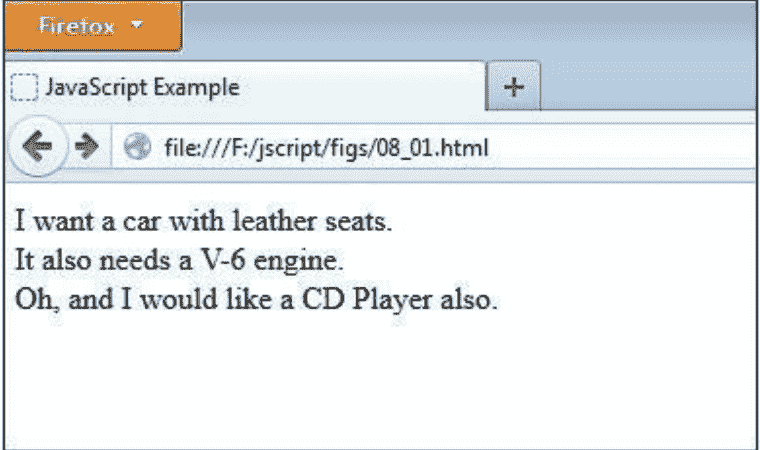

图 8-1 您喜欢的每种汽车的功能显示在浏览器中。

此脚本的结果如图 8-1 所示。

## 属性值

虽然这不是房地产，但你可以改变你的属性值。在你的脚本中，你可以通过赋一个新值，像变量一样，随时更改对象属性的值。例如，如果你想改变前面示例中 `work_car.engine` 属性的值，你只需给它赋一个新的值。下面的示例展示了为 `work_car.engine` 属性赋一个新值：

```
work_car.engine= "V-4";
```

虽然这可能不是一个好的改变，但它可以为你节省保险（和汽油）费用！

重要的是要注意，前面的赋值会更改更改后对 `work_car.engine` 属性的任何调用的值。更改之前使用其值的任何操作都不会受到影响。

例如，下面的代码为 `work_car.engine` 属性提供了一个新的赋值：

```
function Car(seats, engine, radio) {
    this.seats = seats;
    this.engine = engine;
    this.radio = radio;
}
```

`work_car.engine` 的原始值被分配给一个变量。

```
var work_car = new Car("cloth", "V-6", "Tape Deck");
var fun_car = new Car("leather", "V-8", "CD Player");
```

`work_car.engine` 的值被改变。

```
var original_work_car_engine = work_car.engine;
work_car.engine = "V-4";
var new_work_car_engine = work_car.engine;

document.write("I wanted a " + original_work_car_engine + " initially.<br>"); 
document.write("I got a " + new_work_car_engine + " instead to lower gas costs.");
```

`work_car.engine` 的新值被分配给一个变量。原始值和新值在 `document.write()` 语句中显示。

`work_car.engine` 属性最初被设置为 "V-6"，但它被更改为 "V-4"。当它被赋给 `original_work_car_engine` 变量时，它仍然是 "V-6"，该变量保留该值。更改后，新值被赋给 `new_work_car_engine`，它使用新值 "V-4"。图 8-2 显示了在浏览器中运行此脚本的结果。

## 添加方法

要向构造函数添加方法，你可以将一个函数表达式赋值给一个属性名，如以下代码所示：

```
function Car(seats, engine, radio) {
```

一个名为 `describe()` 的方法被添加到 Car 构造函数中。

```
this.seats = seats;
this.engine = engine;
this.radio = radio;
```

```
this.describe = function() {
document.write("This amazing car has these features: ");
document.write(this.seats + " seats, " + this.engine + " engine, ");
document.write(this.radio);
};
}
var work_car = new Car("cloth", "V-6", "Tape Deck"); work_car.describe();
```

使用 `work_car.describe()` 为 Car 对象的 `work_car` 实例调用该方法。

如你所见，一旦你有了一个对象的实例，你就可以使用实例名、点和方法名来调用该方法。当为 `work_car` 实例调用该方法时，字符串 "This amazing car has these features: cloth seats, V-6 engine, Tape Deck" 显示在页面上。

虽然向构造函数添加方法很简单，但在构造函数函数内包含方法有一个缺点。对于每个新对象实例，都会创建一个执行相同操作的新方法函数。实际上，方法被复制了多次，即使它没有在代码中直接看到。

正如你所看到的，构造函数中的方法只是另一个属性。由于每个属性对于每个实例都是唯一的，因此方法函数对于每个实例也是唯一的。如果你有 50 个 Car 对象的实例，那么将创建 50 个函数，消耗资源。

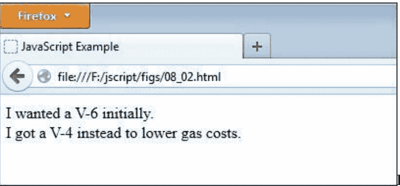

图 8-2 属性值的更改会影响更改后使用它的语句，但不会影响更改前使用它的语句。要使其成为一个简单地重用的单一函数，你可以将方法函数移到构造函数之外，如以下代码所示：

```
function Car(seats, engine, radio) {
this.seats = seats;
this.engine = engine;
this.radio = radio;
this.describe = describe_car;

}
function describe_car() { document.write("This amazing car has these features: ");
document.write(this.seats + " seats, " + this.engine + " engine, ");
document.write(this.radio);
}
var work_car = new Car("cloth", "V-6", "Tape Deck"); 剩余的代码 work_car.describe(); 的工作方式与之前相同。
```

函数 `describe_car` 被赋值给 `describe` 属性。

`describe_car` 函数在构造函数外部定义。

这里，在构造函数外部定义了一个名为 `describe_car` 的函数，允许它被赋值给构造函数内部的 `describe` 属性，使其成为一个方法函数。注意，赋值时没有使用括号 `()`。这样赋值的是函数本身，而不是函数的结果。当实例被创建并且方法运行时，你会得到与之前相同的结果，因此移动是成功的。

然而，这种技术也有一个缺点：方法函数现在是全局的，这可能会用本应在 Car 结构的局部范围内的许多函数来混乱全局范围。为了解决这个问题，你需要学习原型。

### 使用原型

JavaScript 中的每个函数都有一个所谓的 *prototype* 属性，它是一个对象，包含使用该函数创建的每个对象实例始终可用的属性和方法。这使得代码可以轻松地在实例之间共享属性和方法时被重用。

### 使用原型

要了解原型的工作原理，你将使用 Car 对象的 `prototype` 属性。考虑以下代码：

```
function Car(seats, engine, radio) { this.seats = seats;
this.engine = engine;
this.radio = radio;

}
Car.prototype.locks = "automatic";
```

Car 构造函数。

向 Car 函数的原型添加一个属性。

注意函数 `Car` 有一个 `prototype` 属性 (`Car.prototype`)。由于原型本身是一个对象，你可以像对任何其他对象一样向原型添加属性。

这里，一个名为 `locks` 的属性被添加到 Car 原型中，使用 `Car.prototype.lock` 并为其赋值。

那么，这到底做了什么？如果你创建 Car 对象的实例，你会发现每个实例都可以访问 `windows` 属性：

```
function Car(seats, engine, radio) {
this.seats = seats;
this.engine = engine;
this.radio = radio;

}
Car.prototype.locks = "automatic";
var work_car = new Car("cloth", "V-6", "Tape Deck");
var family_car = new Car("cloth", "V-4", "CD Changer"); window.alert(work_car.locks);
window.alert(family_car.locks);
```

两个警告框都将显示值 "automatic"，该值不在 Car 构造函数中，但在 Car 的原型中。

这是怎么发生的？在 JavaScript 中，调用对象的属性或方法会首先检查尝试使用它的对象。如果没有找到该属性或方法，它不会就此放弃。相反，JavaScript 将搜索对象的原型以查看是否有匹配项。如果有，那么该属性或方法就可供尝试使用它的对象使用。例如，图 8-3 显示了如何为 `work_car` 实例搜索 `locks` 属性。

如你所见，它只是检查 `work_car` 实例是否有 `locks` 属性。当它不在那里时，会搜索原型，在那里找到 `locks` 属性，然后它可供 `work_car` 实例使用。注意，原型有一个名为 `constructor` 的属性，它指回构造函数。

构造函数和该构造函数创建的任何实例都将指向原型。在这种情况下，`Car`、`work_car` 和 `family_car` 都指向 Car 原型，并且可以使用 Car 原型中的任何属性或方法。

创建实例时，你可以实际向实例添加一个与原型中属性同名的属性。这将有效地隐藏该属性的值


**图 8-3** 通过在同一实例的原型中查找同名属性，因为该属性始终会在对象中找到，因此不会搜索原型。例如，看看以下代码：


 ```
function Car(seats, engine, radio) {
this.seats = seats;
this.engine = engine;
this.radio = radio;
}
Car.prototype.locks = "automatic";
var work_car = new Car("cloth", "V-6", "Tape Deck");
```

为 work_car 实例添加一个 locks 属性

```
var family_car = new Car("cloth", "V-4", "CD Changer"); work_car.locks = "manual";
window.alert(work_car.locks); window.alert(family_car.locks);
```

提示 "manual"
提示 "automatic"

这里，为 work_car.locks 赋值可以确保在 work_car 实例中找到 locks 属性，而原型将不会被搜索。因此，work_car.locks 的值为 manual。由于这不会影响其他实例，family_car.locks 仍然需要在原型中搜索以找到值，因此它的值仍然是 "automatic"。

### hasOwnProperty() 方法

有时你会想知道正在使用的属性是在对象实例中找到的，还是在原型中找到的。对象的 hasOwnProperty() 方法如果属性在实例中找到则返回 true，否则返回 false。在前面的例子中，work_car 实例有一个 locks 属性，而 family_car 实例没有（它只在原型中有 locks 属性）。考虑以下代码：

```
function Car(seats, engine, radio) {
this.seats = seats;
this.engine = engine;
this.radio = radio;
}
Car.prototype.locks = "automatic";
var work_car = new Car("cloth", "V-6", "Tape Deck");
var family_car = new Car("cloth", "V-4", "CD Changer"); work_car.locks = "manual";
window.alert(work_car.hasOwnProperty("locks")); // true
window.alert(family_car.hasOwnProperty("locks")); // false
```

这里，第一个提示显示 true，而第二个显示 false。在本章后面你会看到，当你使用 for-in 循环且只想使用对象实例中的属性而非其原型中的属性时，这会很有用。

### 使用原型定义方法

由于原型在对象的构造函数之外且不在全局作用域中，它为将被每个对象实例共享的方法函数提供了一个良好的位置。你现在可以在构造函数中为每个对象实例赋予其属性（如果它们具有唯一值），并将其方法放在原型中以供所有实例重用。由于上述原因，这是创建自定义对象的常见模式，通常称为**组合构造函数/原型模式**。

例如，以下代码将继续向 Car 构造函数添加属性，但会将方法添加到 Car 原型：

```
function Car(seats, engine, radio) { this.seats = seats;
this.engine = engine;
this.radio = radio;
}
Car.prototype.describe = function() { document.write("This amazing car has these features: ");
document.write(this.seats + " seats, " + this.engine + " engine, "); document.write(this.radio);
};
var work_car = new Car("cloth", "V-6", "Tape Deck");
work_car.describe();
```

Car 构造函数定义实例属性

describe() 方法现在可以与 Car 对象的任何实例一起使用 describe() 方法在 Car 原型上定义

通过使用组合构造函数/原型模式，代码现在允许实例属性和方法以及共享属性和方法。随着你继续阅读本书，你将看到更多关于原型的内容，以及它们如何用于面向对象编程中的继承。

## 对象的有用语句

JavaScript 允许你使用 for-in 循环来帮助你遍历对象属性，以及使用 with 语句来更轻松地访问特定对象。

### for-in 循环

for-in 循环允许你遍历对象的属性。以下代码显示了 for-in 循环的结构：for (var variable_name in object_name) { *JavaScript 语句*

} JavaScript 语句放在这里 循环开始时命名一个变量来表示对象中的属性名称，同时指定对象的名称

假设你想遍历 Car 对象的 work_car 实例的属性，以便在页面上显示每个属性的值。for-in 循环允许你无需键入每个属性名称即可实现此目的，如以下代码所示：

```
function Car(seats, engine, radio) {
    this.seats = seats;
    this.engine = engine;
    this.radio = radio;
}
var work_car = new Car("cloth", "V-6", "Tape Deck");
for (var prop_name in work_car) {
    document.write(prop_name + ": " + work_car[prop_name] + "<br>");
}
```

不过请注意，这个循环会获取*所有*可用属性，包括对象原型中找到的那些。如果你想确保正在使用的属性属于对象的实例而非原型，你可以使用前面学过的 hasOwnProperty() 方法来检查每个属性，如以下代码所示：

```
function Car(seats, engine, radio) {
    this.seats = seats;
    this.engine = engine;
    this.radio = radio;
}
var work_car = new Car("cloth", "V-6", "Tape Deck");
for (var prop_name in work_car) {
    if (work_car.hasOwnProperty(prop_name)) {
        document.write(prop_name + ": " + work_car[prop_name] + "<br>");
    }
}
```

这里，代码将确保在页面上显示之前，你获取的是来自对象实例而非原型的属性。

### with 语句

with 语句允许你更轻松地访问对象的属性和方法，如果你计划使用大量涉及该对象的语句。例如，如果你想在网页上使用名为 work_car 的对象编写多条语句，你可能会厌倦反复键入对象名称（work_car）、点运算符，然后是属性名称。

**注意**

with 的使用通常不被推荐，因为存在性能缺陷，而且使用此语句时可能会意外赋值或覆盖全局变量。当启用 "use strict" 选项时，它也不被支持。

with 语句允许你在 with 块内的语句中省略对象名称和点运算符，这样你只需键入属性名称即可访问所需的属性。以下代码显示了 with 语句的结构：

```
with (object) { // 对象的名称放在
              // 括号内
  // JavaScript 语句
  // 使用该对象的 JavaScript 语句放在这里
}
```

假设你有一个名为 Car 的构造函数，具有 seats、engine 和 radio 属性，以及一个名为 work_car 的对象实例。你可以使用 with 语句来避免反复键入 work_car 和点运算符，如以下示例所示：

```
function Car(seats, engine, radio) {
  this.seats = seats;
  this.engine = engine; // Car 构造函数
  this.radio = radio;   // 创建 Car 的实例
}

var work_car = new Car("cloth", "V-6", "Tape Deck");
with (work_car) {
  document.write("Seats: " + seats + "<br>");
  document.write("Engine: " + engine + "<br>");
  // with 语句与对象的 work_car 实例一起使用
  document.write("Radio: " + theradio);
} // 现在可以访问对象 work_car 实例的属性，而无需每次使用属性时都键入 work_car 和点运算符
```

此示例在页面上显示 car 对象的 workCar 实例的属性值。注意，在 with 块内部，可以使用属性名称而无需在它们前面键入 work_Car 和点运算符。

Now that you have seen how to create Strange and when A preld and through objece

## 专家问答

**问：当我使用构造函数时，是否真的每次想要对象时都必须创建一个实例？**

**答：** 是的。构造函数只给浏览器提供对象的结构。要使用这个结构，你需要创建一个对象的实例。对于某些预定义的 JavaScript 对象，你也需要创建实例。

**问：那单例对象呢？我不需要为它们创建实例吗？**

**答：** 单例对象不需要创建实例。每个都是唯一的，不在实例之间重用代码。

*(续)*

**问：我可以使用组合构造函数/原型模式来共享属性以及方法吗？**

**答：** 是的，如果你有不想在每个实例中具有唯一值的属性，可以将它们添加到原型中以与其他对象实例共享。

**问：JavaScript 没有类吗？那样不会更简单吗？**

**答：** 在 ECMAScript Harmony 中计划实现 class 关键字，这将允许你构建类并扩展它们。在撰写本文时，它尚未实现，但即将到来。你可以在第十六章中阅读更多关于 ECMAScript Harmony 即将带来的变化。

**动手实践 8-2** 组合构造函数/原型模式的练习
```


 pr8_2.html 原型模式

prjs8_2.js 假设你决定销售某些类型的电脑：办公电脑、家用电脑和游戏电脑。每种电脑都有不同的属性，以及一个用于显示每种电脑属性的方法。

## 分步说明

- 1. 创建一个 HTML 页面并保存为 pr8_2.html。
- 2. 创建一个外部 JavaScript 文件并保存为 prjs8_2.js。在步骤 3–8 中使用它。
- 3. 创建一个 Computer 构造函数，并为其添加 type、processor、ram 和 hd 属性。
- 4. 创建一个名为 work_computer 的 Computer 实例。type 的值为 "Work"，processor 的值为 "2GHZ"，ram 的值为 "8GB"，hd 的值为 "1TB"。
- 5. 创建一个名为 home_computer 的 Computer 实例。type 的值为 "Home"，processor 的值为 "2GHZ"，ram 的值为 "4GB"，hd 的值为 "500GB"。
- 6. 创建一个名为 gaming_computer 的 Computer 实例。type 的值为 "Gaming"，processor 的值为 "4GHZ"，ram 的值为 "16GB"，hd 的值为 "2TB"。
- 7. 在 Computer 原型上创建一个名为 describe 的方法。用它来在页面上显示每个属性的值。
- 8. 完成后，你的 JavaScript 文件应该如下所示：

```
function Computer(type, processor, ram, hd) {
  this.type = type;
  this.processor = processor;
  this.ram = ram;
  this.hd = hd;
}

Computer.prototype.describe = function() {
  document.write("<p>" + this.type + ":<br>");
  document.write("Processor: " + this.processor + "<br>");
  document.write("RAM: " + this.ram + "<br>");
  document.write("Hard Disk: " + this.hd + "</p>");
};

var work_computer = new Computer("Work", "2GHZ", "8GB", "1TB");
var home_computer = new Computer("Home", "2GHZ", "4GB", "500GB");
var gaming_computer = new Computer("Gaming", "4GHZ", "16GB", "2TB");
work_computer.describe();
home_computer.describe();
gaming_computer.describe();
```

- 9. 保存文件并在浏览器中打开 HTML 文件。每个实例的属性应该被显示出来。

#### 动手试一试总结

在这个项目中，你运用了对构造函数和原型的知识，创建了一个可复用的对象，该对象在其原型上有一个方法，用于显示该对象任何属性的值。

## 理解预定义的 JavaScript 对象

在 JavaScript 中，有许多预定义对象可供你使用，以访问某些你可能需要的属性或方法。一旦你掌握了各种对象及其功能，你的脚本将更加交互。

本书将介绍许多主要的预定义对象。在本章中，你将了解 navigator 和 history 对象，以及你可以用它们做什么。

### Navigator 对象

navigator 对象让你可以访问查看者浏览器的各种属性，比如浏览器名称、版本号等。它的名字来源于 Netscape Navigator 浏览器，该浏览器是 Mozilla Firefox 的前身。

navigator 对象是 window 对象的一部分，这意味着你可以使用 window.navigator.property 来访问其属性，但也可以简写为 navigator.property。这甚至适用于 window 对象的直接属性或方法（例如，window.alert("Hi"); 可以简写为 alert("Hi");，并且仍然是有效的）。你经常会看到 window 对象的这类属性和方法被简写，以节省额外的输入或帮助缩短源代码。关于这样做的原因，你将在第 11 章中了解更多。

首先，来看看 navigator 对象的属性。

### 属性

navigator 对象的属性无法更改，因为它们被设置为只读。**表 8-1** 展示了 navigator 对象的属性以及每个属性返回的值。当括号中显示浏览器名称时，表示在撰写本文时，该属性仅已知在指定的浏览器中有效。

以下部分将更详细地了解一些更有用的属性。

| Property | Value |
|----------|-------|
| appCodeName | 浏览器的代码名称 |
| appName | 浏览器的完整名称 |
| appMinorVersion | 一个表示浏览器次要版本的字符串（Internet Explorer 和 Opera） |
| appVersion | 浏览器版本及其他一些信息 |
| browserLanguage | 正在使用的操作系统语言（Internet Explorer 和 Opera） |
| buildID | 正在使用的浏览器的构建标识符（Firefox） |
| cookieEnabled | 指定浏览器是否启用了 cookie |
| cpuClass | 用户计算机的 CPU（Internet Explorer） |
| language | 正在使用的浏览器语言（Firefox、Chrome 和 Opera） |
| mimeTypes | 浏览器支持的 MIME 类型数组 |
| onLine | 指定浏览器是否处于"全局离线模式"（Internet Explorer、Firefox 和 Opera） |
| oscpu | 用户计算机的操作系统和/或 CPU（Firefox） |
| platform | 为其创建浏览器的机器类型 |
| plugins | 浏览器已安装的插件数组 |
| product | 浏览器的产品名称（Firefox 和 Chrome） |
| productSub | 产品的构建编号（Firefox 和 Chrome） |
| securityPolicy | 一个空字符串——此前在 Netscape 4.7 中返回一个值（Firefox） |
| systemLanguage | 操作系统使用的默认语言（Internet Explorer） |
| userAgent | 操作系统的自然语言（Internet Explorer 和 Opera） |
| userProfile | 浏览器的用户代理标头 |
| vendor | 访问用户配置文件中的信息（Internet Explorer） |
| vendorSub | 浏览器的供应商（Firefox 和 Chrome） |

**表 8-1** Navigator 对象的属性

##### appName 属性

此属性允许你确定查看者正在使用的浏览器名称。如果你想知道特定浏览器的值，可以使用以下代码并在所选浏览器中打开页面：

```
window.alert("You have " + navigator.appName);
```

此属性过去常被用于创建一个简单的浏览器检测脚本，如以下代码所示：

```
<script>
if (navigator.appName == "Microsoft Internet Explorer") {
  // Code for IE browsers
}
else {
  document.write("Please get Internet Explorer to run this script");
}
</script>
<noscript>You do not have JavaScript. Get Internet Explorer!</noscript>
```

虽然这在当时可以使用，但有更好的方法来处理你可能遇到的各种浏览器，比如特性检测和渐进增强，随着你继续阅读本书，你将了解更多相关内容。

##### cookieEnabled 属性

此属性在浏览器中启用了 cookie 时返回布尔值 true，在浏览器中未启用 cookie 时返回布尔值 false。你可以使用它来避免在用户未启用 cookie 的情况下运行设置 cookie 的代码：

```
if (navigator.cookieEnabled) {
  // Set cookie
}
```

这使你可以为能够使用 cookie 的查看者设置 cookie，或者如果没有启用则继续执行其他代码。你将在本书后面更详细地了解 cookie。

##### plugins 属性

此数组保存了查看者浏览器中安装的所有插件的值。这可以用于检测查看者是否拥有特定插件可用，然后再运行将使用它的代码。

### 方法

navigator 对象还有许多方法可供你执行各种任务。**表 8-2** 展示了 navigator 对象中的可用方法。

以下部分将介绍 javaEnabled() 方法及其用法。

##### javaEnabled() 方法

此方法在查看者浏览器中启用了 Java 时返回布尔值 true；否则返回 false。如果你想向查看者显示 Java 小程序，但仅当查看者在浏览器中启用了 Java 时，javaEnabled() 方法可能会很有用。

| Method | Purpose |
|--------|---------|
| javaEnabled() | 用于测试浏览器中是否启用了 Java |
| preference() | 允许设置某些浏览器首选项。仅允许在特权模式下使用（Firefox） |
| registerContentHandler() | 允许网站将自己设置为某种 MIME 类型的潜在处理程序 |
| registerProtocolHandler() | 允许网站将自己设置为某种协议的潜在处理程序 |
| taintEnabled() | 返回 false——因为该方法已不再使用。它曾用于指定浏览器中是否启用了数据污染 |

**表 8-2** Navigator 对象的方法

以下代码允许你实现这一点：

```
if (navigator.javaEnabled()) {
  // Insert Java Applet
}
else {
  document.write("No Java? You cannot see my Java Applet!");
}
```

这将测试 navigator.javaEnabled() 方法返回的值，并显示 Java 小程序，或者显示一条消息告知用户 Java 未启用。

### History 对象

history 对象也是 window 对象的一部分，它提供了有关浏览器历史记录的

当前窗口。

### 属性
history 对象只有一个名为 length 的属性（在 Firefox 中可用的属性稍多一些，但不适用于 Web 内容）。此属性返回当前窗口浏览器会话历史中的页面数量，包括当前已加载的页面。其使用方式可类似于以下示例：

```javascript
alert("Your current window has viewed " + history.length + " pages!");
```
这仅仅是向查看者发送一个提醒，告知当前浏览器窗口中已访问的页面数量。

### 方法
history 对象有三个方法，列于表 8-3 中。

| 方法 | 用途 |
| :--- | :--- |
| back() | 将浏览器窗口在历史列表中后退一页 |
| forward() | 将浏览器在历史列表中前进一页 |
| go() | 使用一个整数值将浏览器导航至历史列表中的指定页面 |

以下各节将更详细地讨论每个方法。

##### back() 方法
back() 方法将浏览器导航至历史列表中当前页面的上一个页面，这类似于使用浏览器的“后退”按钮。要使用它，只需在脚本中需要的位置调用此方法：

```javascript
history.back();
```

##### forward() 方法
forward() 方法将浏览器导航至历史列表中当前页面的下一个页面，这类似于使用浏览器的“前进”按钮。要使用它，只需在脚本中需要的位置调用此方法：

```javascript
history.forward();
```

##### go() 方法
go() 方法接受一个整数作为参数。该整数可以是负数，用于在历史列表中后退；也可以是正数，用于在历史列表中前进。例如，以下代码将在窗口历史中后退两页：

```javascript
history.go(-2);
```
以下代码将在历史列表中前进三页：
```javascript
history.go(3);
```

与另外两个方法一样，如果查看者尝试访问的页面不存在（例如，类似 `history.go(15)` 的页面可能不存在于窗口历史中），那么该方法将不会执行任何操作。

预定义的 JavaScript 对象非常有用。正如你将在下一章看到的，document 对象使你能够访问许多用于处理 HTML 文档的额外属性和方法。

## 第 8 章 自测
1.  对象是属性和方法的集合。
2.  创建单个对象时，可以使用对象字面量或对象字面量表示法。
3.  使用对象字面量表示法时，属性和值包含在花括号 ({}) 内。
    A. 正确
    B. 错误
4.  在 JavaScript 中，通常通过使用以下方式访问对象属性
    A. 加法运算符 (+)
    B. 点运算符 (.)
    C. 乘法运算符 (*)
    D. 无法访问对象的属性
5.  当需要使用变量来访问属性名时，可以使用括号表示法。
6.  函数可用于创建对象结构。
7.  可以使用 new 关键字创建对象的实例。
8.  一个对象只能有一个实例。
    A. 正确
    B. 错误
9.  对于以下代码，你怎么看：
    `var x = myhouse.kitchen;`
    A. 它将字符串 myhouse.kitchen 赋值给变量 x。
    B. 它将 myhouse 和 kitchen 的值相加，并将它们赋值给名为 x 的对象。
    C. 假设 myhouse 对象存在，它将 myhouse 对象的 kitchen 属性的值赋值给变量 x。
    D. 假设 kitchen 对象存在，它将 kitchen 对象的 myhouse 属性的值赋值给变量 x。
10. 如果在对象实例中找不到某个属性，JavaScript 将在该对象的原型中查找。
11. 以下哪项会向查看者发送一个提醒，告知正在使用的浏览器的名称？
    A. window.alert(“You are using” + navigator.appVersion);
    B. window.alert(“You are using” + navigator.appName);
    C. window.alert(“You are using” + navigator.javaEnabled());
    D. window.alert(“You are using navigator.appName”);
12. 对于以下代码，你怎么看？
    `myhouse.kitchen = "big";`
    A. 假设 kitchen 对象存在，myhouse 属性被赋予一个新的字符串值。
    B. 假设 myhouse 对象存在，变量 kitchen 的值被添加到字符串 big 中。
    C. 假设 myhouse 对象存在，kitchen 属性被赋予一个新的字符串值 "big"，或者用值 "big" 初始化。
    D. 这不会做任何事。
13. 在 JavaScript 中，有许多对象可用于访问你可能需要的某些属性和方法。
14. navigator 对象使你能够访问查看者浏览器的各种属性。
15. 以下哪项不是 navigator 对象的属性？
    A. appName
    B. appCodeName
    C. appType
    D. appVersion

# 第 9 章 Document 对象

## 关键技能与概念
- 定义 Document 对象
- 使用文档对象模型
- 使用 Document 对象的属性
- 使用 Document 对象的方法
- 使用 DOM 节点
- 创建动态脚本

既然你已经了解了对象的工作原理以及如何使用预定义的 JavaScript 对象，现在是时候了解 JavaScript 中一些主要的预定义对象了。
本章介绍 document 对象，它帮助你收集浏览器中正在查看的页面的信息。正如你将在本章中发现的，document 对象的一些属性和方法可用于获取文档信息或更改文档信息。你还将被介绍文档对象模型，并了解如何将其与样式表结合使用来创建动态脚本。

## 定义 Document 对象

document 对象是由浏览器为查看的每个新 HTML 页面（文档）创建的对象。通过这样做，JavaScript 使你能够访问许多可以以各种方式影响文档的属性和方法。

在本书中，你已经使用 document 对象的 write() 方法很长时间了。此方法允许你将一串文本写入 HTML 文档。
开始探索 document 对象之旅，你将了解文档对象模型 (DOM) 以及通过此对象可以访问的各种属性。在编写脚本时，许多这些属性将变得相当有用。

## 使用文档对象模型

文档对象模型 (DOM) 允许 JavaScript（和其他脚本语言）访问浏览器中文档的结构。每个文档由结构化的节点组成（例如，body 标签将是一个节点，body 元素内的任何元素都将是 body 元素的子节点）。有了这种结构，脚本语言可以通过多种方式访问文档中的元素，从而允许修改文档中的元素。
如果你有以下 HTML 代码，你可以使用 JavaScript 访问其结构：

```html
<body>
<h1>My Page</h1>

</body>
```

图 9-1 显示了 body 元素如何作为一个节点，以及它如何可以有子节点和属性节点。
h1 和 img 元素都是 body 元素的子节点。每个元素也有自己的节点。h1 元素包含一个文本节点作为其子节点（文本 "My Page"），而 img 元素包含两个属性节点（src="myimage.jpg" 和 alt="My Picture"）。这种结构在文档中随处可见，因此虽然这是一个简单的例子，但对于大多数 HTML 页面，可以绘制出更复杂的文档结构树。
你可以编写脚本来在 DOM 中添加、删除或更改节点。你可以使用 `document.getElementById()` 方法通过 id 属性值访问元素，甚至可以使用像 `document.getElementsByTagName()` 或 `document.getElementsByClassName()` 这样的方法获取元素组。
首先，你将了解 document 对象的属性和方法。

## 使用 Document 对象的属性

表 9-1 列出了 document 对象的属性及其简要说明。在表格之后，将更详细地讨论一些特定的属性。

**注意**
并非所有这些属性都跨浏览器工作。你可以通过访问 http://developer.mozilla.org/en/DOM/document#Properties 和 http://msdn.microsoft.com/en-us/library/ms531073(VS.85).aspx 查看更多关于这些属性的信息。

### 集合

许多属性（anchors、embeds、forms、images、links、plugins、scripts、styleSheets 和 styleSheetSets）返回一个数组，该数组保存在文档中找到的元素或值的集合。这些可以像任何数组一样使用索引访问。索引为零的元素或值将是第一个，索引为一的是第二个，依此类推。


| 属性 | 描述 |
| :--- | :--- |
| activeElement | 返回当前获得焦点（激活）的元素 |
| anchors | 返回文档中所有命名锚点的数组 |
| async | 告诉浏览器是使用异步请求还是同步请求加载文档 |
| baseURIObject | 返回一个表示文档 URI 的对象。仅在特权模式下可用。 |
| body | 返回文档的 body 或 frameset 元素 |
| characterSet | 返回文档中使用的字符集 |
| charset | 返回或设置文档中使用的字符集 |
| compatMode | 如果文档以怪异模式（Quirks mode）渲染，则返回字符串“BackCompat”；如果文档以标准模式（Strict mode）渲染，则返回字符串“CSS1Compat” |
| contentType | 返回文档 MIME 头中的 Content-Type 值 |
| cookie | 返回或设置文档中的 JavaScript cookie |
| currentScript | 返回当前正在读取的 script 元素 |
| defaultCharset | 返回区域语言设置中找到的默认字符集 |
| defaultView | 返回文档的 window 对象 |
| designMode | 允许编辑文档 |
| dir | 返回或设置文档的阅读方向 |
| doctype | 返回与文档关联的 doctype 声明 |
| documentElement | 返回表示文档根节点的字符串 |
| documentMode | 返回文档的兼容模式 |
| documentURI | 返回文档的位置 |
| documentURIObject | 返回一个表示文档 URI 的对象（仅对特权 JavaScript 代码可用） |
| domain | 返回文档服务器的域名 |
| embeds | 文档中所有 embed 元素的数组 |
| expando | 返回一个布尔值，指示是否可以在文档中创建任意变量 |
| fileSize | 返回文档的大小（以字节为单位） |
| fileCreatedDate | 返回文档的创建日期 |
| fileModifiedDate | 返回文档的最后修改日期 |
| forms | 返回文档中所有 form 元素的数组 |
| head | 返回文档的 head 元素 |

#### 表 9-1 文档对象的属性

| 属性 | 描述 |
| :--- | :--- |
| images | 文档中所有图像（img）元素的数组 |
| implementation | 返回文档的 implementation 对象 |
| inputEncoding | 返回表示文档编码的字符串 |
| lastModified | 返回文档的最后修改日期 |
| lastStyleSheetSet | 返回使用 selectedStyleSheetSet 属性设置的最新样式表集的名称。 |
| links | 返回文档中所有超链接（<a>）元素的数组 |
| location | 返回文档的 URI |
| namespaceURI | 返回文档的 XML 命名空间 |
| parentWindow | 返回对父窗口（父窗口的 document 对象）的引用 |
| plugins | 返回文档中使用的所有插件的数组 |
| popupNode | 返回在 XUL 文档中调用弹出窗口的元素 |
| preferredStyleSheet | 根据文档中样式表声明的顺序返回首选样式表 |
| protocol | 返回文档 Web 地址（URL）的协议部分 |
| readyState | 返回文档的加载状态 |
| referrer | 返回将查看者引导到当前文档的文档的 URL |
| rootElement | 返回文档的根 SVG 元素 |
| scripts | 返回文档中使用的所有 script 元素的数组 |
| selectedStyleSheetSet | 返回或设置当前样式表集 |
| styleSheets | 返回文档中使用的所有样式表的数组 |
| styleSheetSets | 返回文档中所有样式表集的数组 |
| textContent | 返回或设置文本内容 |
| title | 返回文档 title 标签内使用的文本 |
| tooltipNode | 返回当前工具提示所指向的元素 |
| uniqueID | 返回为文档生成的唯一 ID |
| URL | 返回当前文档的 URL |
| URLUnencoded | 返回未经任何编码的文档 URL |
| xmlEncoding | 返回在 XML 文档声明中找到的字符编码 |
| xmlStandalone | 返回或设置在 XML 文档声明中找到的 standalone 值 |
| xmlVersion | 返回或设置在 XML 文档声明中找到的 version 属性 |
| XSLDocument | 返回 XSL 文档的根元素 |

表 9-1 文档对象的属性（续） 例如，links 属性可用于访问文档中的所有链接。如果需要查找文档中的第一个链接，可以使用 document.links[0] 将该元素作为对象访问。然后，您可以使用 DOM 节点属性或方法（将在本章后面讨论）来获取或设置信息，或在该元素上执行某些任务。

#### cookie 属性

cookie 属性用于设置 JavaScript cookie，以便为查看者存储信息。Cookie 是一个保存到查看者计算机上的小文本文件，会保留特定的时间（设定的日期或浏览器会话）。Cookie 可以帮助网站记住并检索查看者的信息（例如购物车内容、特殊设置或会话信息）。

要设置 cookie，您需要将 document.cookie 属性的值设置为包含要为查看者存储的信息的字符串。语法如下：document.cookie=string;
您需要将 string 替换为包含要使用的信息的文本字符串。通常，其格式类似于以下设置 cookie 的示例：document.cookie = "site=homepage";

您可以看到 cookie 设置了一项内容：site 是 homepage。等号之间的两个值用于在读取 cookie 时帮助区分 site 和 homepage。请注意，设置 cookie 并不会替换整个 cookie；它只是将新字符串添加到其中。

您将在后面的章节中了解如何使用高级字符串处理技术，以及如何更详细地设置和读取 cookie。

#### dir 属性

dir 属性返回一个字符串值，表示文档的阅读方向。该值可以是 ltr（从左到右）或 rtl（从右到左）。此属性对于显示从右向左阅读而非从左向右阅读的语言的网页很有用，只需将值设置为 rtl。为了好玩，您可以使用此属性动态更改页面的外观，如以下示例代码所示：

```
document.dir = "rtl";
```

图 9-2 显示了将 dir 属性设置为“rtl”时页面外观的示例。

#### lastModified 属性

lastModified 属性保存当前文档最后修改的日期和时间值。这主要用于信息目的，例如显示文档的最后修改日期，以便查看者知道您何时更新了页面。此属性的值取决于您的浏览器，因为不同的浏览器在页面上写入最后修改日期时会产生不同的结果。

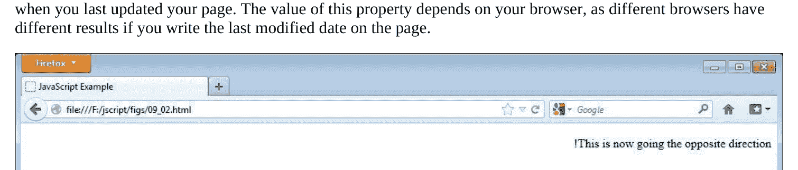

考虑以下代码，它将 document.lastModified 属性的值写入网页以显示最后修改的日期和时间：

```
<body>
<h1>My Always Updated Web Page!</h1>
<script type="text/javascript">
document.write("Last Updated: " + document.lastModified); </script>
</body>
```

图 9-3 显示了在 Mozilla Firefox 中查看此代码的结果。
在页面上写入最后修改日期时，差异仅在页面空间方面有影响。某些布局可能需要为该属性的较长版本安排额外的空间。

#### referrer 属性

referrer 属性用于信息目的，保存查看者到达您页面之前所在页面（引荐页面）的 URL 值。虽然这可能很有用，但查看者并不总是带着引荐 URL 进来（例如使用书签或手动输入地址时），因此该值可能为空。此外，此属性的**图 9-3** 在 Mozilla Firefox 中查看时显示的最后修改日期 值并不总是正确的，因为不同的浏览器可能将不同类型的内容视为将查看者引导至新页面，而不仅仅是链接，并且用户可以隐藏或更改引荐来源。

将以下示例中的代码放入文档中，将向页面的查看者发送一个警报，告诉他们到达您的页面之前所在的位置：window.alert("You came from " + document.referrer + "!"); 因此，如果引荐页面是 http://www.web.com/js/，则会向查看者发送一个警报，内容为“You came from http://www.web.com/js/!”。

#### title 属性

title 属性保存 HTML 文档标题的字符串值。标题在页面的 <title> 和 </title> 标签内设置。

使用 title 属性的一种方法是向查看者显示页面标题，但位置不在窗口的顶部栏中。以下代码允许您执行此操作：

```
<head>
<title>Lions, Tigers and Bears!</title> </head>
<body>
<script type="text/javascript">
document.write("<h1>" + document.title + "</h1>"); </script>
Lions and tigers and bears were what I saw when I went to ... </body>
```

这里设置了文档的标题 标题作为标题显示给查看者
这会将您的标题显示为页面上的标题。图 9-4 显示了在浏览器中查看时的结果。
**图 9-4** 文档的标题作为页面上的标题显示。

#### URL 属性

URL 属性保存当前文档完整 URL 的值。如果您在 HTML 页面底部打印此信息，它将很有用，因为对于任何打印您页面的人来说，它会显示页面 URL。

虽然您可以自己在底部输入 URL，但当需要在许多页面上完成时，这可能会变得乏味。这就是此属性派上用场的地方，因为您可以将一段小脚本复制粘贴到每个页面，而不是每次都输入不同的 URL 地址。以下代码示例显示了在页面上写入 URL 地址：

```
<body>
<h1>Buy Something!</h1>
If you don't buy something I will be really upset so you had better... <br><br>
<script type="text/javascript">
document.write("You are at: " + document.URL);
</script>
</body>
```

图 9-5 显示了上述代码在浏览器中的结果。页面的最后一行告诉查看者当前位置。该图显示的是本地文件地址，但如果页面在线，则会显示常规 URL。

#### URLUnencoded 属性

`URLUnencoded` 属性返回未经任何编码的文档 URL。例如，如果文件名中包含空格，该属性会返回空格本身，而不是将其替换为 `%20`。对于 URL `http://www.scripttheweb.com/my script.html`，`document.URL` 属性会返回 `http://www.scripttheweb.com/my%20script.html`，而 `document.URLUnencoded` 属性则返回 `http://www.scripttheweb.com/my script.html`，即不包含空格编码的 URL。请注意，在撰写本文时，该属性仅在 Microsoft Internet Explorer 中可用。

**图 9-5** 文档的 URL 显示在页面内容的末尾。

## 专家问答

**问：学习 document 对象和 DOM 对我有帮助吗？**

**答：** 是的，因为它们不仅为您处理网页，还为处理其他类型的文档提供了基础。例如，其他类型的文档也使用类似的节点结构，因此学习 HTML 文档中的工作原理，对您需要在其他平台（如用于 PDF 文件的 Adobe Acrobat）上使用 JavaScript 时非常有帮助。

**问：referrer 属性很酷！我是否可以在每次访客访问时将该信息写入文件，以便了解我的访客来自哪里？**

**答：** 客户端 JavaScript 无法独自将信息保存到文件中，但可以将信息发送到服务器端程序，然后在那里存储到文件或数据库中。您将在后续章节中了解更多相关内容（使用 JSON 和/或 AJAX）。

**问：除了包含元素集合的数组之外，还有其他访问文档中元素的方式吗？**

**答：** document 对象的方法（如 `getElementById()`）允许您更精确地选择元素。您将在下一节中学习如何使用这些方法。

## 使用 Document 对象的方法

Document 对象的方法可以让您做一些以前还无法实现的新操作。表 9-2 列出了这些方法及其简短说明。由于其中许多方法是特定于浏览器的（与属性一样），只有部分特定方法会在表格后更详细地描述。

> **注意**
>
> 并非所有这些属性都能跨浏览器工作。您可以访问 http://developer.mozilla.org/en/DOM/document#Methods 和 http://msdn.microsoft.com/en-us/library/ms531073(VS.85).aspx 了解更多信息。

### 元素的 get 方法

有许多方法可以让您获取文档中的一个或多个元素，以便在脚本中使用。每种方法都为您提供了一种独特的方式来访问您可能需要的任何元素。

#### 表 9-2 Document 对象的方法

| 方法 | 说明 |
|------|------|
| `adoptNode()` | 从另一个文档中采用一个节点 |
| `createAttribute()` | 创建一个属性，其名称作为参数传入 |
| `createAttributeNS()` | 在特定命名空间中创建一个新属性 |
| `createCDATASection()` | 创建一个新的 CDATA 节 |
| `createComment()` | 创建一个注释，其值作为参数传入 |
| `createDocumentFragment()` | 创建一个新的文档片段 |
| `createElement()` | 创建一个元素，其类型作为参数传入 |
| `createElementNS()` | 在特定的 URI 中创建一个特定类型的元素，类型作为参数传入 |
| `createEvent()` | 创建一个事件 |
| `createEventObject()` | 创建一个事件对象，用于传递事件信息 |
| `createNodeIterator()` | 创建一个节点迭代器对象 |
| `createNSResolver()` | 创建命名空间解析器 |
| `createProcessingInstruction()` | 创建处理指令 |
| `createRange()` | 创建一个范围对象 |
| `createStyleSheet()` | 为文档创建要使用的样式表（仅 Internet Explorer） |
| `createTextNode()` | 根据作为参数传入的值创建一个文本字符串 |
| `createTreeWalker()` | 创建一个 TreeWalker 对象 |
| `elementFromPoint()` | 返回出现在传入的两个参数值位置（距左侧像素数和距顶部像素数）的元素对象 |
| `evaluate()` | 根据传入的参数返回结果 |
| `execCommand()` | 当文档处于设计模式时，在文档上执行命令 |
| `getElementById()` | 返回具有作为参数传入的 ID 属性的对象的引用 |
| `getElementsByClassName()` | 返回具有作为参数传入的类名的元素的引用 |
| `getElementsByName()` | 返回具有作为参数传入的 name 属性的对象的引用 |
| `getElementsByTagName()` | 返回具有作为参数传入的标签名的元素的引用 |
| `getElementsByTagNameNS()` | 返回具有作为参数传入的标签名和命名空间的元素的引用 |
| `getSelection()` | 返回文档中所选文本字符串的值（*续*） |

#### 表 9-2 Document 对象的方法（*续*）

| 方法 | 说明 |
|------|------|
| `hasFocus()` | 根据文档是否具有焦点返回布尔值 |
| `importNode()` | 返回从另一个文档复制的节点 |
| `isDefaultNameSpace()` | 返回命名空间是否为当前文档的默认命名空间 |
| `isEqualNode()` | 返回两个节点是否相等 |
| `isSameNode()` | 返回两个节点引用是否指向同一节点 |
| `load()` | 加载 XML 文档 |
| `loadOverlay()` | 在 XUL 文档中加载覆盖层 |
| `lookupNameSpaceURI()` | 返回命名空间 URI |
| `lookupPrefix()` | 返回指定前缀的命名空间 |
| `normalize()` | 规范化文档中的节点，使其没有空文本节点，并且没有相邻的多个文本节点（将所有文本节点合并为单个文本节点） |
| `open()` | 打开一个新文档，允许您使用 `write()` 或 `writeln()` 语句写入其内容 |
| `close()` | 关闭使用 `open()` 方法打开的新文档 |
| `queryCommandEnabled()` | 根据作为参数传入的命令是否可以执行返回布尔值 |
| `queryCommandIndeterm()` | 根据作为参数传入的命令是否处于不确定状态返回布尔值 |
| `queryCommandState()` | 根据作为参数传入的命令是否已执行返回布尔值 |
| `queryCommandSupported()` | 根据作为参数传入的命令是否受支持返回布尔值 |
| `queryCommandValue()` | 返回作为参数传入的命令在文档中的当前值 |
| `querySelector()` | 返回与选择器匹配的第一个元素节点 |
| `querySelectorAll()` | 返回与选择器匹配的所有元素节点 |
| `recalc()` | 重新计算文档中的动态属性 |
| `releaseCapture()` | 释放文档上的鼠标捕获 |
| `write()` | 允许您将文本字符串写入 HTML 文档 |
| `writeln()` | 允许您将文本字符串写入 HTML 文档，但以 JavaScript 换行符结束该行 |

#### `getElementById()` 方法

`getElementById()` 方法允许您通过元素的 id 属性值来访问元素。例如，如果您有以下 HTML 代码，可以使用 `getElementById()` 方法访问该 div 元素：

```
<div id="some_text">This is some text.</div>
```

由于 div 元素的 id 属性值为 `some_text`，因此可以使用该值作为参数，通过 `document.getElementById()` 方法来访问该 div 元素：

```
var text_element = document.getElementById("some_text");
```

在本章的学习过程中，您将了解如何使用此方法以及其他选择方法来检索元素信息、修改元素、添加元素或删除元素。

#### `getElementsByClassName()` 方法

此方法允许您获取一个数组，其中包含文档中所有具有指定类名（来自 CSS 类）的元素。例如，要获取所有类名为 `number_one` 的元素，可以使用以下代码：

```
var my_class = document.getElementsByClassName("number_one");
```

#### `getElementsByName()` 方法

此方法允许您获取一个数组，其中包含文档中所有具有指定 name 属性值的元素。在许多情况下，该值对于单个元素是唯一的。但是，同一组中的单选按钮都需要具有相同的 name 值（以便只能选择一项）。在这种情况下，能够检索所有这些元素会非常有用：

```
<fieldset>
<legend>Choose a dinosaur:</legend>
<input type="radio" name="dino" id="dino_enigmo" value="Enigmosaurus"> <label for="dino_enigmo">The mysterious type</label>
```


这段HTML代码包含一组名为“dino”的单选按钮。如果你想获取所有这些元素，可以使用以下代码：

```html
<input type="radio" name="dino" id="dino_spino" value="Spinosaurus"> <label for="dino_spino">拥有大量脊骨的那个</label>
<input type="radio" name="dino" id="dino_xeno" value="Xenotarsosaurus"> <label for="dino_xeno">名字独特的那种</label>
</fieldset>
```

```javascript
var dino_radios = document.getElementsByName("dino");
```

这将以数组形式检索所有名为“dino”的单选按钮元素，然后你可以遍历这个数组来执行任何必要的操作：

```javascript
for (var i = 0; i < dino_radios.length; i++) {
  // 执行一些操作...
}
```

如你所见，你现在可以在循环中处理所有元素，而不是通过每个元素的id来逐个收集它们以执行相同的任务。

### getElementsByTagName() 方法

此方法允许你获取一个数组，其中填充了文档中所有具有指定标签名称的元素。例如，要获取文档中的所有图像元素，你可以使用以下代码：

```javascript
var all_images = document.getElementsByTagName("img");
```

### 获取更具体的元素

一旦你获取了元素，get方法可以与更具体的对象一起使用。例如，假设你有以下HTML代码：

```html
<nav id="sitelinks">
  <a href="page1.html">Page 1</a>
  <a href="page2.html">Page 2</a>
  <a href="page3.html">Page 3</a>
</nav>
<div>
  Here is some content and check out <a href="someplace.com">my other site</a>!
</div>
```

如果你想只获取nav元素内的链接，使用 `document.getElementsByTagName("links")` 是行不通的，因为这样也会获取到div标签内的链接（它仍然是文档的一部分）。要实现这一点，你可以先获取nav元素，然后在为nav元素创建的对象上使用 `getElementsByTagName()` 方法，如以下代码所示：

```javascript
// 通过id获取nav元素
var nav_element = document.getElementById("sitelinks");
// 通过标签名获取nav元素内的每个链接
var nav_links = nav_element.getElementsByTagName("a");
alert("nav元素中有 " + nav_links.length + " 个链接。");
```

导航元素中的链接数量是通过获取nav元素内每个a元素后创建的nav_links数组的长度来显示的。

在这里，你通过其id获取nav元素，创建nav_element对象。此对象用于获取其内的所有链接元素，并将它们放入名为nav_links的数组中。现在可以使用此数组来遍历nav元素中的每个链接，或者找出nav元素中包含多少个链接。在这个例子中，链接的数量是通过nav_links数组的长度（3）来警告显示的。

### open() 和 close() 方法

open() 方法允许你打开一个新文档，并完全使用 `document.write()` 或 `document.writeln()` 语句创建其内容。当调用 open() 方法时，浏览器会查找这些语句以便写入新页面。一旦 write() 和/或 writeln() 语句完成，你需要使用 `document.close()` 来结束新页面。

**注意**

当你向当前正在加载的页面写入内容时，open() 和 close() 方法不是必需的（也不推荐使用）。

要获取 open() 方法使用的示例，假设你想根据观众的名字编写一个新页面。为此，你不仅需要使用 open() 和 close() 方法，还需要创建一个 formName 属性来使用，以便你可以获取观众在文本框中输入的名字。

从初始页面的body部分的代码开始。你需要一个包含文本框的表单，以及一种调用函数来创建新文档的方法。以下代码展示了一种实现方法（将文件保存为 document_open.html）：

```html
<body>
<strong>在下方框中输入你的名字，然后点击按钮查看个性化页面！</strong>
<br>
<form id="newp" onsubmit="newpage();">
  Name: <input type="text" id="yourname" size="25">
  <br><br>
  <input type="submit" value="Submit">
</form>
<script type="text/javascript" src="document_open.js"></script>
</body>
```

这设置了你的脚本，提供了一个id为newp的表单和一个id为yourname的文本框。它还有一个提交按钮来提交表单。当用户点击提交按钮时，onsubmit事件处理程序将被触发，该程序执行 `newpage()` 函数（你将在本章后面以及第10章中了解更多关于事件处理程序的内容）。你现在需要在外部JavaScript文件中创建 `newpage()` 函数，以便此表单能够工作。

`newpage()` 函数需要获取文本框的内容并将其赋值给一个变量。然后它需要在浏览器窗口中打开你的新自定义页面。以下代码展示了如何完成此操作（将文件保存为 document_open.js）：

```javascript
function newpage() {
  var thename = document.getElementById("yourname").value;

  document.open();
  document.write("<h1>欢迎！</h1>");
  document.write("你好，" + thename + "，欢迎来到我的页面！");

  document.close();
}
```

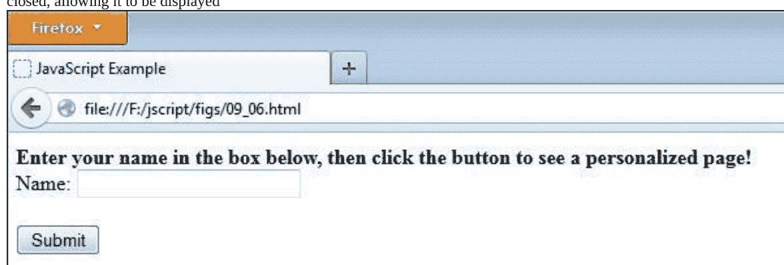

函数做的第一件事就是获取文本框的内容。要获取文本框的内容，你需要使用表单元素可用的 value 属性，在这种情况下，通过 `document.getElementById("yourname").value` 访问。然后将此值赋给 thename 变量，以便在 `document.write()` 命令中轻松使用。

一旦你获得了该值，就可以打开新页面了。为此，你使用 `document.open()` 命令，它允许你使用一系列 `document.write()` 语句，直到使用 `document.close()` 命令为止。你使用 `document.write()` 语句在页面上向观众书写问候语。

你现在可以在浏览器中打开HTML页面来尝试此操作。图9-6显示了带有表单的初始页面（点击表单按钮之前的页面）。这是观众可以输入姓名并点击按钮的地方。

图9-7显示了在文本框中输入名字“John”并点击按钮的结果。新页面出现了问候语！

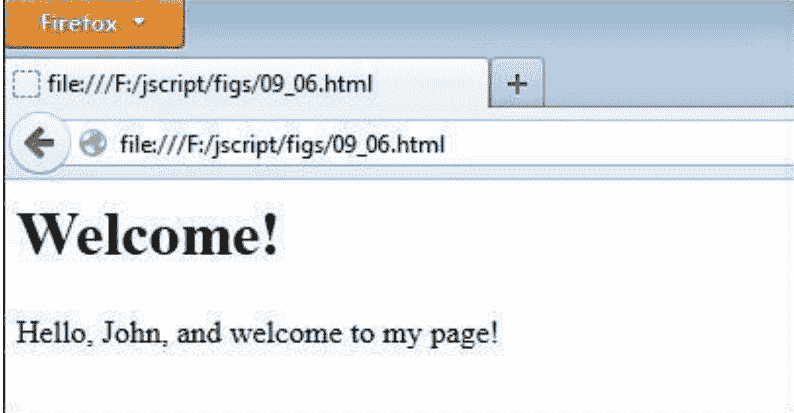

图9-7 一旦按钮被点击，观众将获得类似此页面的页面。

### write() 和 writeln() 方法

你在本书早期就开始使用write()方法，所以你已经知道它的工作原理。`document.write()` 方法用于在调用它的页面上显示一个字符串值。`writeln()` 方法的工作方式相同，但在语句末尾添加了一个换行符（\n）。回想一下第3章讨论过的JavaScript换行符的工作方式——它只在页面源代码中放置一个新行，而不会影响HTML页面的最终显示外观。

**提示**

虽然换行符在使用 `document.write()` 时只影响源代码的外观，但它可用于在由JavaScript创建的显示元素（如alert、prompt和confirm框）中创建新行。

页面本身的外观不受JavaScript换行符的影响。回想一下第3章中使用换行符将代码分成两行的示例：

```html
<body>
<script type="text/javascript">
document.write("<strong>JavaScript Rules!</strong>\n This is fun.");
</script>
</body>
```

由于 `document.writeln()` 方法在语句末尾添加了一个换行符，你可以使用以下 `document.writeln()` 语句重写前面的代码：

```html
<body>
<script type="text/javascript">
document.writeln("<strong>JavaScript Rules!</strong>");
document.writeln(" This is fun.");
</script>
</body>
```

这将在页面源代码中将代码行放在两行上，但不会影响浏览器中页面的外观。

## 使用DOM节点

document对象有一些方法（如 `createElement()`、`createAttribute()` 和 `createTextNode()`），允许你使用JavaScript在页面上创建各种元素或节点。但是，要使用它们，新内容必须作为DOM中现有节点的子节点被追加。这就是需要DOM节点属性和方法的地方。

### DOM节点属性

每个DOM节点都是一个具有可访问属性和方法的对象。DOM节点属性列于表9-3中。

| 属性 | 描述 |
|---|---|
| attributes | 返回指定节点中所有属性的数组 |
| baseURI | 返回节点的基本 URI |
| baseURIObject | 返回表示节点基本 URI 的对象 |
| childElementCount | 返回作为元素节点的子节点数量 |
| childNodes | 返回指定节点所有子节点的数组 |
| children | 返回指定节点所有子元素的数组 |
| classList | 返回元素 class 属性中类的列表 |
| className | 返回元素 class 属性的值 |
| clientHeight | 返回元素的高度（以像素为单位） |
| clientWidth | 返回元素的宽度（以像素为单位） |
| clientLeft | 返回元素左边框的宽度（以像素为单位） |
| clientTop | 返回元素上边框的宽度（以像素为单位） |
| contentEditable | 返回元素是否可编辑 |
| dataset | 提供对元素自定义数据属性的访问 |
| dir | 返回指定节点中文本的方向值 |
| firstChild | 返回指定节点的第一个子节点 |
| firstElementChild | 返回指定元素的第一个直接子元素 |
| id | 返回指定节点的 id |
| innerHTML | 返回或设置指定节点内的 HTML 代码 |
| innerText | 返回或设置指定节点的内部文本 |
| isContentEditable | 返回元素的内容是否可编辑 |
| lang | 返回指定节点的语言值 |
| lastChild | 返回指定节点的最后一个子节点 |
| lastChildElement | 返回指定元素的最后一个直接子元素 |
| localName | 返回节点名称的本地部分 |

表 9-3 DOM 节点属性

| 属性 | 描述 |
|---|---|
| name | |
| namespaceURI | |
| nextSibling | |
| nextElementSibling | |
| nodeName | |
| nodePrincipal | |
| nodeType | |
| nodeValue | |
| offsetHeight | |
| offsetWidth | |
| outerHTML | |
| ownerDocument | |
| parentNode | |
| prefix | |
| previousSibling | |
| scrollLeft | |
| scrollTop | |
| scrollHeight | |
| scrollWidth | |
| style | |

| 属性 | 描述 |
|---|---|
| tabIndex | 返回指定节点的 tab 索引 |
| tagName | 返回指定节点的标签名（大写） |
| textContent | 返回或设置节点的文本内容 |
| title | 返回指定节点 title 属性的值 |

表 9-3 DOM 节点属性（续）

当表 9-3 提到“指定节点”时，节点的工作方式与你在前面章节中处理元素的方式非常相似。例如，你可能有以下 HTML 代码：

```
<body>
<div id="div1" title="All about me!">
This page is about me, me, and... me!
</div>
</body>
```

如果你想获取 div 元素的 title 属性的值，可以使用 document.getElementById() 通过其 id（div1）来获取该 div 元素。这将是 DOM 节点 title 属性的“指定节点”。然后，你可以访问该元素节点的 title 属性，如下列代码所示：

```
Gets the element by its id and assigns it to a variable var me_div = document.getElementById("div1");
window.alert("The title of the div element is " + me_div.title); Alerts the value of the element's title attribute to the viewer
```

这就像你在前一章学到的对象属性一样工作。me_div.title 属性返回字符串值 "All about me!"，这是 div 元素节点 title 属性的值。

了解这一点后，你可以以同样的方式使用 DOM 节点方法。

### DOM 节点方法

表 9-4 列出了 DOM 节点方法。

如前所述，为了使 document 对象的创建方法变得有用，需要将创建的节点添加到文档中，这需要用到 DOM 节点方法，例如 appendChild() 或 insertBefore()，来将新节点添加到文档。

例如，你可能有之前使用过的 HTML 代码，如下所示：

```
<body>
<div id="div1" title="All about me!">
This page is about me, me, and... me!
</div>
</body>
```

这段代码有一个 div 元素节点，它包含一个子文本节点（以及属性节点）。如果你想创建另一个 div 元素作为 div1 元素节点的最后一个子节点，可以结合使用 document.createElement()、document.createTextNode() 和 DOM 节点方法 appendChild()。

每个节点都是一个对象，可以使用所有的节点属性和方法。既然你有一个可用的 div 节点，你可以使用 getElementById() 将其作为对象访问，这将允许你使用 appendChild() 方法在其中添加一个元素。

| 方法 | 描述 |
|---|---|
| addEventListener() | 向指定节点添加事件监听器，以便在发送给它的事件上运行一个函数 |
| appendChild() | 将一个节点追加为指定节点的最后一个子节点 |
| attachEvent() | 向指定节点附加一个事件，以便在发送给它的事件上运行一个函数 |
| blur() | 使指定节点失去焦点 |
| click() | 在指定节点上执行 click 事件 |
| cloneNode() | 创建指定节点的克隆 |
| compareDocumentPosition() | 返回一个数字，表示该节点与作为参数传递的节点相比的位置 |
| detachEvent() | 从指定节点分离一个事件 |
| dispatchEvent() | 在指定节点上执行一个事件 |
| focus() | 使指定节点获得焦点 |
| getAttribute() | 返回指定节点上作为参数传递的属性名的值 |
| getAttributeNS() | 返回指定节点上作为参数传递的属性名和命名空间的值 |
| getAttributeNode() | 返回指定节点上作为参数传递的属性名的属性节点 |
| getAttributeNodeNS() | 返回指定节点上作为参数传递的属性名和命名空间的属性节点 |
| getElementsByTagName() | 返回指定节点中所有具有作为参数传递的标签名的子元素节点的数组 |
| getElementsByTagNameNS() | 返回指定节点中所有具有作为参数传递的标签名和命名空间的子元素节点的数组 |
| hasAttribute() | 如果指定节点上存在作为参数传递的属性名，则返回 true，否则返回 false |
| hasAttributeNS() | 如果指定节点上存在作为参数传递的属性名和命名空间，则返回 true，否则返回 false |
| hasAttributes() | |
| hasChildNodes() | |
| insertBefore() | |
| normalize() | |

如果指定节点定义了任何属性节点，则返回 true，否则返回 false
如果指定节点有任何子节点，则返回 true，否则返回 false 将第一个参数发送给它的节点插入到指定节点中第二个参数发送给它的节点之前
规范化指定节点
（续）

#### 表 9-4 DOM 节点方法

| 方法 | 描述 |
|--------|-------------|
| removeAttribute() | 从指定节点中移除作为参数发送给它的属性名称对应的属性节点 |
| removeAttributeNode() | 从指定节点中移除作为参数发送给它的属性节点对象引用对应的属性节点 |
| removeAttributeNS() | 从指定节点中移除作为参数发送给它的属性名称和命名空间对应的属性节点 |
| removeChild() | 从指定节点中移除作为参数发送给它的子节点 |
| removeEventListener() | 从指定节点中移除事件监听器 |
| replaceChild() | 在指定节点中用作为第一个参数发送给它的子节点替换作为第二个参数发送给它的子节点 |
| scrollIntoView() | 在浏览器窗口中将指定节点滚动到可视区域 |
| setAttribute() | 为指定节点设置属性节点的名称（第一个参数）和值（第二个参数） |
| setAttributeNode() | 为指定节点设置作为参数发送给它的属性节点对象作为属性节点 |
| setAttributeNodeNS() | 为指定节点设置作为参数发送给它的属性节点对象及其命名空间作为属性节点 |
| setAttributeNS() | 为指定节点设置属性节点的命名空间（第一个参数）、名称（第二个参数）和值（第三个参数） |

首先，进入 JavaScript 代码，通过 id 获取 div1 元素并将其赋值给一个变量：

```
var me_div = document.getElementById("div1");
var inner_div = document.createElement("div");
```

之后，使用 document.createTextNode() 方法为 inner_div 节点创建文本节点：

```
var inner_div_text = document.createTextNode("More about me...");
inner_div.appendChild(inner_div_text);
inner_div.title = "More";
me_div.appendChild(inner_div);
```

div1 元素被赋值给 me_div 变量

完整的 JavaScript 代码如下：

创建一个新的 div 元素并赋值给 inner_div 变量

```
var me_div = document.getElementById("div1");
var inner_div = document.createElement("div");
var inner_div_text = document.createTextNode("More about me...");
inner_div.appendChild(inner_div_text);
inner_div.title = "More";
me_div.appendChild(inner_div);
```

使用 appendChild() 将 inner_div 元素正式附加到 me_div 元素内的 DOM 结构中

inner_div 元素的 title 属性被赋值

文本节点（inner_div_text）被添加到 inner_div 元素（新的 div 元素）

创建文本节点并赋值给 inner_div_text 变量

这会在原始 div 元素的末尾添加你的新 div 节点（但在原始元素关闭之前，因为它将是一个子节点）。因此，HTML 代码的文档结构现在如下所示（尽管使用浏览器的"查看源代码"命令时不会显示）：

```
<body>
<div id="div1" title="All about me!">
This page is about me, me, and... me!
<div title="Me">
More about me...
</div>
</div>
</body>
```

如你所见，该 div 被添加了文本 "More about me..." 和一个值为 "Me" 的 title 属性。

**注意**

另一种添加或修改内容的方法是使用 innerHTML 属性，这将在下一节"创建动态脚本"中讨论。

如果你决定要从 DOM 结构中删除一个节点，可以使用 removeChild() DOM 节点方法。例如，如果你想删除上一个示例中添加的 inner_div 节点，可以使用以下代码：

```
me_div.removeChild(inner_div);
```

| 节点 | 节点 |
|------|------|
| nextSibling | previousSibling |

### 图 9-8 DOM 节点关系

这将从 me_div 父节点中移除 inner_div 子节点。

每个节点在 DOM 结构中与其他节点都有一个或多个关系。图 9-8 展示了这些关系是如何关联的。

如你所见，每个关系都有可以使用的属性和方法（例如，previousSibling、parentNode、firstChild 等）。你可以使用这些来访问或修改 DOM 结构中的任何元素。例如，你可能有一个如下所示的 HTML 文档：

```
<body>
<div id="company">
<div id="employee1">Marty</div>
<div id="employee2">John</div>
</div>
</body>
```

其中两个"employee" div 的父节点

外层"company" div 的第一个子节点

外层"company" div 的最后一个子节点

每个 div 元素可以通过不同的方式访问，取决于你从何处开始。例如，你可以使用以下任意路径访问外层 "company" div：

```
document.getElementById("company"); // 直接路径
document.getElementById("employee1").parentNode; // 从第一个子节点
document.getElementById("employee2").parentNode; // 从最后一个子节点
```

同样，"employee1" div 可以通过多种方式访问：

同样，"employee2" div 也是如此：

```
document.getElementById("employee1"); // 直接路径
document.getElementById("company").firstChild; // 从父节点
document.getElementById("employee2").previousSibling; // 从其兄弟节点
```

```
document.getElementById("employee2"); // 直接路径
document.getElementById("company").lastChild; // 从父节点
document.getElementById("employee1").nextSibling; // 从其兄弟节点
```

虽然始终使用直接路径似乎最简单，但有时你可能事先不知道要查找的节点的 id。假设其中一个节点是由另一个脚本添加的？例如，如果你总是想找到最后一个 "employee" div，使用从其父节点的 lastChild 可能更好，这样如果添加了其他员工（例如，"employee3"、"employee4"），你将始终访问最后一个员工：

```
var last_hired = document.getElementById("company").lastChild;
```

这将确保 last_hired 始终指向 "company" div 的最后一个 "employee" 子 div。

## 试一试 9-1 向文档添加 DOM 节点

pr9_1.html

本项目让你练习使用本章新学习的文档和 DOM 节点属性和方法。

prjs9_1.js

分步进行

- 1. 创建一个 HTML 页面，使用以下 body 部分的代码，并将其保存为 pr9_1.html：

```
<body>
<div id="div1" title="Gosh!">
Whatever I feel like I want to write...
</div>
<script type="text/javascript" src="prjs9_1.js"></script>
</body>
```

- 2. 创建一个外部 JavaScript 文件，并将其保存为 prjs9_1.js。用于第 3-5 步。
- 3. 获取 id 为 "div1" 的元素 title 属性的值，并将该值作为警报发送给查看者。
- 4. 创建一个新的 div 元素，文本为 "See you!"，title 属性值为 "Lucky!"。将其作为 id 为 "div1" 的 div 元素的子节点添加到文档结构中。
- 5. 保存 JavaScript 文件并在浏览器中打开 HTML 文件以查看结果。（续）

试一试总结

在本项目中，你运用了对 document 对象和 DOM 节点属性和方法的知识，来提醒一个 DOM 节点属性，并在文档结构中创建一个新的 div 元素。

## 创建动态脚本

如你所见，JavaScript 让你可以使用各种方法访问文档中的所有元素，例如 document.getElementById() 和 document.getElementsByTagName()。

这使你可以获取信息、添加节点、修改节点和删除节点，如你所见。此外，你可以访问元素的 style 属性（通常最初由样式表设置），以更改其位置、颜色、边框、大小或几乎任何其他样式部分，使用 style DOM 节点属性。

### JavaScript 中的样式

在使用层叠样式表（CSS）设置样式时，你可以在 CSS 代码中设置如下内容（将其保存为 dyn_01.css）：

```
#div1 { color:#000000; background-color:#FFFFFF; }
#div2 { border-style:solid; border-width:1px; border-color:#000000; }
```

这为两个 id，div1 和 div2，设置了样式属性。因此，如果你有以下 HTML 代码（保存为 dyn_01.html），div 元素将在网页展示中使用上述样式：

CSS 文件在此处链接到文档

```
<head>
<link rel="stylesheet" type="text/css" href="dyn_01.css">
</head>
<body>
<div id="div1">
I am in div1. It seems like a nice place.
</div>
<div id="div2">
I am in div2. It's a little fancier here.
</div>
<script type="text/javascript" src="dyn_01.js"></script>
</body>
```

JavaScript 文件在此处被调用

HTML 代码通过 link 标签链接到 CSS 代码。因此，div1 元素将显示为简单的黑色文本在白色背景上，div2 元素将围绕它有一个普通的纯黑色边框。

id 为 "div1" 的 div 元素


#### ID 为 "div2" 的 div 元素

如你所见，此页面为每个 div 元素使用了 id——因此，你不仅可以通过 CSS 代码访问这些元素的 id，还可以在 JavaScript 代码中通过其 id 访问这些元素。所以，你可以使用 `document.getElementById()` 方法，在 JavaScript 文件（在前面的 HTML 代码中调用——保存为 dyn_01.js）中编写一些代码来通过 id 抓取两个 div 元素：

```
var d1 = document.getElementById("div1");
var d2 = document.getElementById("div2");
```

现在你就拥有了代表这两个元素的变量。

如果你想通过 JavaScript 修改 CSS 代码中设置的样式，你需要使用每个元素节点都具备的 `style` 属性。然后，JavaScript 使用与 CSS 选择器相同的名称来访问该特定属性。例如，如果你想将 div1 元素中的文本颜色更改为浅灰色，可以使用以下代码：

```
var d1 = document.getElementById("div1");
var d2 = document.getElementById("div2");
d1.style.color = "#DDDDDD";
```

在 CSS 代码中，选择器 `color` 用于更改元素的前景色。在 JavaScript 中，它也是访问元素的 `style` 属性后用于更改该属性的属性名。

如果 CSS 选择器不是一个单独的单词呢？例如，`background-color` 选择器如果像在 CSS 代码中那样使用，在 JavaScript 中将无法工作。以下代码尝试将背景色更改为绿色：

```
var d1 = document.getElementById("div1");
var d2 = document.getElementById("div2");
d1.style.background-color = "#DDDDDD";
```

这行不通，因为 JavaScript 不允许连字符（-）作为属性名的一部分。相反，JavaScript 将两个单词组合在一起，并将第一个单词之后任何附加单词的首字母大写。因此，CSS 选择器 `background-color` 在 JavaScript 中变成了 `backgroundColor`。其他选择器也遵循相同的模式（例如，`border-right-color` 会变成 `borderRightColor`）。

要使更改生效，JavaScript 代码可以重写如下：

```
var d1 = document.getElementById("div1");
var d2 = document.getElementById("div2");
d1.style.backgroundColor = "#DDDDDD";
```

这将把 div1 元素的背景色更改为绿色。现在唯一的问题是，这会在脚本运行时立即发生，而在此情况下，可能在观众甚至注意到 div1 元素最初有另一种背景色之前就已经发生了。为了使其更有用，你需要一种方法，在文档加载或重新加载之外的时间运行脚本的某些部分。

**注意**

读取样式并不像设置样式那样容易，因为存在浏览器差异和其他问题。有关如何获取样式的更多信息和技术，请参阅 www.quirksmode.org/dom/getstyles.html。

### 简单事件处理

到目前为止，你的脚本只是在网页加载（或重新加载）期间运行。这对于许多任务来说很好，但许多任务，如节点和样式更改，如果能响应用户的操作来执行，会更有用。例如，在页面加载时更改元素的背景色可能根本不会被观众注意到，但响应鼠标点击来更改颜色将允许观众看到变化，并可以选择保留原始颜色或通过点击更改为新颜色。

#### click 事件

`click` 事件适用于 DOM 中的大多数元素。当用户在鼠标指针位于特定元素上时点击鼠标主按钮，就会触发此事件。控制 `click` 事件的一种方法是通过 `onclick`，如以下代码所示（其他方法将在下一章介绍）：

```
var d1 = document.getElementById("div1");
var d2 = document.getElementById("div2");
d1.onclick = function() {
    // 元素被点击时执行的代码
};
```

这里，d1 元素的 `onclick` 属性被赋予了一个函数表达式（如果需要复习函数表达式，请参阅第 4 章），该函数随后可以执行代码。因此，当用户点击 d1 元素时，函数内的任何代码都将被执行。所以，你现在可以将之前用于更改样式的代码拿出来，在用户点击元素时执行该任务，而不是在页面加载时执行。以下代码展示了一个示例：

```
var d1 = document.getElementById("div1"); // d1 和 d2 元素
var d2 = document.getElementById("div2");
// 通过 getElementById() 访问
d1.onclick = function() {
    d1.style.backgroundColor = "#DDDDDD"; // 将一个函数表达式分配给
}; // d1 元素的 onclick，以便在元素被点击时才发生
// 在函数内部更改 d1 元素的样式
```

图 9-9 显示了用户点击第一个 div 元素后页面的外观。背景色已从白色变为浅灰色。

**提示**

事件处理将在第 10 章中更详细地介绍。目前，仅将使用简单的 DOM0 事件处理来介绍 `click` 事件。

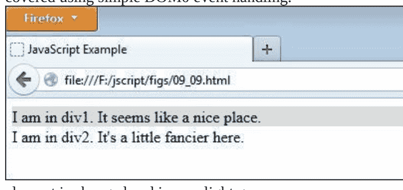

图 9-9 第一个 div 元素的背景色已更改，现在为浅灰色。

### 编写动态脚本

既然你知道如何更改元素的样式属性，就可以通过响应用户事件来更改它们，以创建动态脚本。此外，你可以使用 `innerHTML` 属性更改给定元素内的全部 HTML 代码。

#### innerHTML 属性

`innerHTML` DOM 节点属性允许你更改指定元素内的 HTML 代码。例如，你可以从以下 HTML 代码开始：

```
<body>
<div id="div1">
2+2 等于多少？
</div>
<div id="div2">
<a href="answer.html" id="answer_link">获取答案</a>
</div>
</body>
```

此代码设置了一个 id 为 div1 的 div 元素节点，另一个 id 为 div2 的 div 元素节点，以及一个 id 为 answer_link 的链接。现在，如果你想更改 div1 元素中的 HTML 代码，以便在点击链接时向观众显示答案，你可以使用链接上的 `click` 事件来启动脚本，然后更改 div1 元素节点的 `innerHTML` 属性，将该元素的内容从问题更改为答案：

```
var d1 = document.getElementById("div1");
var answer_link = document.getElementById("answer_link");
answer_link.onclick = function() {
    d1.innerHTML = "这很简单，答案是 <strong>4</strong>！";
    return false;
};
```

请注意，为了防止点击时跳转到此链接，你需要在执行所需操作后添加 `return false` 语句。这将在下一章更详细地讨论。

运行时，此脚本会更改页面上 div1 元素内的内容，因此 HTML 代码现在将是以下内容（尽管使用浏览器的“查看源文件”命令看不到）：

```
<body>
<div id="div1">
这很简单，答案是 <strong>4</strong>！
</div>
<div id="div2">
<a href="answer.html" id="answer_link">获取答案</a>
</div>
</body>
```

### 提示

为了使脚本对没有 JavaScript 的用户也可访问，使用了默认链接目标 (answer.html)。在链接页面上包含答案文本，允许没有 JavaScript 的用户仍然可以点击链接并获得问题的答案。

如你所见，这可以是一种方便地对网页内容进行动态更改的方法。`innerHTML()` 和 `appendChild()` 方法允许你动态地更改页面上显示的信息，而无需重新加载页面。与你到目前为止一直使用的 `document.write()` 相比，这提供了明显的改进，因为 `document.write()` 只能在页面加载或重新加载时更改内容。

既然你知道了更新的方法，在继续本书时，你将利用这些方法而不是 `document.write()`。

使用你在本章中学到的知识来访问 DOM 并使用 `document` 对象和 DOM 节点的属性和方法，你可以构建脚本，对文档的外观或内容进行任何数量的更改。

## 动手实践 9-2 试用属性更改

pr9_2.html 此项目允许你练习使用本章学到的新的 `style` 和 `innerHTML` 属性。
prjs9_2.js

#### 分步指南

**1.** 创建一个 HTML 页面，其中 body 部分包含以下代码，并将其保存为 pr9_2.html：

```
<body>
<div id="div1">
我什么时候更新这个页面？
</div>
<div id="div2">
<a href="answer.html" id="c_link">查看答案！</a>
</div>
<script type="text/javascript" src="prjs9_2.js"></script>
</body>
```

**2.** 创建一个外部 JavaScript 文件并将其保存为 prjs9_1.js。在第 3-5 步中使用它。

**3.** 编写一些代码，使得当链接被点击时，id 为 div1 的 div 元素的背景色变为 #CCCCCC，且同一元素的内容更改为以下内容：

```
<strong>就是现在！</strong> 是不是很快？
```

**4.** 完成后，JavaScript 文件应如下所示：

```
var d1 = document.getElementById("div1");
var c_link = document.getElementById("c_link");
c_link.onclick = function() {
    d1.innerHTML = "<strong>就是现在！</strong> 是不是很快？";
    return false;
};
```

**5.** 保存 JavaScript 文件，并在浏览器中打开 HTML 文件以查看结果。


## 第9章 自我测试

1.  **document**对象是浏览器为每个查看的新HTML页面创建的一个对象。
2.  文档对象的**referrer**属性返回将查看者引导至当前文档的文档的URL。
3.  你可以使用DOM节点的**style**属性来更改元素的样式表属性。
    A. 正确
    B. 错误
4.  文档对象的**getElementById()**方法允许你通过其id属性的值来获取一个元素。
    A. getElementsByClassName()
    B. createElement()
    C. getSelection()
    D. getElementById()
5.  DOM节点的**appendChild()**方法允许你添加一个子节点作为指定节点的第一个子节点。
    A. 正确
    B. 错误
6.  一旦节点被添加到文档中，你就不能将其移除。
    A. 正确
    B. 错误
7.  文档对象的**anchors**属性是一个包含页面上所有锚点（`<a>`）标签的数组。
8.  DOM节点的**innerHTML**属性允许你更改元素节点的HTML内容。
9.  **lastModified**属性保存当前文档最后修改的日期和时间值。
10. 文档对象模型（DOM）允许JavaScript（及其他脚本语言）访问浏览器中的文档结构。
    A. 正确
    B. 错误
11. 你可以使用**title**属性在浏览器窗口顶部栏以外的其他地方显示网页的标题。
    A. 正确
    B. 错误
12. 哪个属性返回当前文档的完整URL？
    A. domain
    B. referrer
    C. URL
    D. title
13. `writeln()`方法与`write()`方法有何不同？
    A. 它在行尾添加等效于HTML `<br />`标签的换行。
    B. 它在行尾添加等效于HTML `<p>`标签的换行。
    C. 它在行尾添加一个JavaScript换行符。
    D. 它与`write()`方法完全相同。
14. `getElementsByName()`方法通常用于获取什么？
    A. 所有你已知名称的元素。
    B. 所有有名称但没有id属性的元素。
    C. 所有name属性值相同的元素（最常见的是单选按钮）。
    D. 所有属性值等于指定名称的元素。
15. 在`document.open()`和`document.close()`语句之间，最常见的是什么语句？
    A. HTML命令
    B. `document.write()`和`document.writeln()`语句
    C. 只有`document.writeln()`语句
    D. 只有`window.alert()`语句

# 第10章 事件处理程序

### 关键技能与概念

-   理解事件处理程序的位置与用途
-   学习事件处理程序
-   注册事件的其他方式
-   事件对象
-   使用事件处理程序创建脚本

创建脚本时，你经常会发现有一些用户“事件”（例如用户将鼠标移动到某个元素上或点击特定元素），你希望你的脚本能对这些事件做出反应。实现这一点的方法是使用事件处理程序。

要学习事件处理程序的工作原理，你需要了解它们是什么以及为什么对你有用。然后，你将学习事件处理程序在文档中的放置位置以及如何使用它们。最后，你将看到JavaScript中的各种事件以及处理每个事件的事件处理程序。为了开始学习，本章对事件处理程序进行概述。

### 什么是事件处理程序？

事件处理程序是对象（在大多数情况下是文档中的一个元素）的一个预定义JavaScript属性，用于处理网页上的事件。

你可能会问“什么是事件？”。事件是在网页查看者执行某种操作时发生的事情，例如点击鼠标按钮、点击页面上的按钮、更改表单元素的内容，或者将鼠标移动到页面上的链接上。事件也可以仅仅因为页面加载或其他类似操作而发生。

当事件发生时，你可以使用JavaScript事件处理程序来识别它们，然后执行特定的任务或一系列任务。JavaScript使你能够响应查看者的操作，并创建交互式、对你和查看者都更有用的脚本。

### 为什么事件处理程序有用

事件处理程序之所以有用，是因为它们使你能够访问页面上可能发生的事件。例如，如果你想在查看者将鼠标移动到链接上时发送一个警报，你可以使用事件处理程序来调用你为响应此事件而编写的JavaScript警报代码。现在，你基于查看者的操作来让事情发生，这使你能够创建更具交互性的网页。

在创造这种交互性时，许多人发现JavaScript开始变得更有趣、更值得编码和使用。通过事件处理程序，你可以创建为页面增加更多功能的脚本。JavaScript可以让网页上发生许多事情，使页面比静态HTML文档更有趣。

### 理解事件处理程序的位置与用途

要了解事件处理程序的工作原理，你需要知道可以在文档中的哪些位置放置它们，以及如何使用它们为事件添加JavaScript代码。

事件处理程序可以在多个位置使用。它们可以直接用在HTML元素中，通过为这些元素添加特殊属性来实现。它们也可以用在`<script>`和`</script>`标签内，或在外部JavaScript文件中。

为了更好地理解事件处理程序的位置，你需要学习如何将事件处理程序添加到你的脚本中。

#### 在HTML元素中使用事件处理程序

要直接在HTML元素中使用事件处理程序，你需要知道事件处理程序的关键字以及在HTML代码中放置事件处理程序的位置。为了给你一个例子，我将介绍`onclick`事件处理程序，它用于在查看者点击文档的特定区域时触发某些操作。

一个可以点击的元素是表单按钮。因此，假设你希望在用户点击表单按钮时提醒查看者某些信息。你可以编写类似以下代码的内容：

```
<input type="button" value="Click Me!" onclick="JavaScript code here">
```

要使用事件处理程序，你需要将其作为额外的属性添加到HTML标签中。事件处理程序“属性”与HTML属性之间的唯一区别在于，你可以在事件处理程序属性内添加JavaScript代码，而不仅仅是属性值。在前面的代码中，你将用一些实际的JavaScript代码替换“JavaScript code here”文本。

因此，为了在用户点击按钮时弹出警报，你可以将必要的JavaScript代码直接添加到`onclick`属性中，如下例所示：

```
<form>
<input type="button" value="Click Me!" onclick="window.alert('Hi!');">
</form>
```

请注意`onclick`事件处理程序的工作方式与HTML属性非常相似。当查看者点击这个普通按钮时，会弹出一个带有问候语的警报。请注意此处引号的使用规则。使用`onclick`事件处理程序作为属性要求你将所有JavaScript代码用双引号括起来，因此当警报需要引号时，你使用单引号以避免可能的错误。

还要注意警报命令以分号结尾。这使你可以在警报之后添加额外的JavaScript代码，从而允许你在点击事件上执行多个操作，而不仅仅是单个JavaScript语句。

如果你想这样做，你可以编写两个警报。你所要做的就是记住包含分号来分隔警报命令。这会有一点不同，因为所有代码都在一行上，而不是像你通常看到的那样在单独的行上：

```
<form>
<input type="button" value="Click Me!"
onclick="window.alert('Hi!'); window.alert('Bye!');">
</form>
```

请注意分号如何分隔JavaScript语句。此示例通过使用分号分隔它们，能够在同一个事件上执行两个JavaScript语句。使用事件处理程序时，你可以通过这种方式执行多个命令。然而，重要的是将事件处理程序关键字（在此例中为`onclick`）和结束引号集合（在此例中为代码中最后一个分号之后）之间的所有内容保持在文本编辑器中的同一行；否则，代码中的换行符可能导致其无法正常运行或产生JavaScript错误。

如果你想使用的代码变得很长，你可能希望将代码放入一个函数中。事件处理程序可以用于任何JavaScript代码，因此你可以使用它来调用你在其他地方定义的函数。例如，你可以将两个警报放在外部JavaScript文件中的一个函数内，并从HTML代码中的事件处理程序调用该函数。首先，将外部JavaScript文件（这里将保存为`js_event_01.js`）编写如下：

```
function hi_and_bye() {
    window.alert('Hi!');
    window.alert('Bye!');
}
```

接下来，将脚本标签和事件处理程序添加到你的HTML代码中：

```
<form>
<input type="button" value="Click Me!" onclick="hi_and_bye();">
</form>
<script type="text/javascript" src="js_event_01.js"></script>
```

请注意函数是如何使用事件处理程序调用的，就像脚本中的普通函数调用一样。这不仅使你能够缩短事件处理程序内的代码，还可以让你在页面后面的另一个按钮点击或事件中重用该函数，而不必再次编写两个警报。使用函数可以帮助你……

 位，尤其是当你想使用的代码变得非常长时。

#### 在脚本代码中使用事件处理器

你也可以在脚本代码中使用事件处理器（无论是在 HTML 文档中使用 script 标签，还是使用外部 JavaScript 文件）。其中一种方法是给元素添加一个 id 属性，然后使用 JavaScript 方法 document.getElementById() 来访问该元素，正如你在第 9 章中学到的那样。

#### 添加 id 属性

要以这种方式使用前面的脚本，你首先需要为输入按钮的 HTML 标签添加一个 id 属性，如下所示：

```
<form>
<input type="button" value="Click Me!" id="say_hi">
</form>
<script type="text/javascript" src="js_event_01.js"></script>
```

注意，按钮输入元素被赋予了 say_hi 这个 id。你将使用它来访问按钮，并在脚本中将其与一个事件关联起来。

#### 访问元素

document.getElementById() 方法允许你使用 id 属性的值来访问 HTML 文档中具有 id 属性的任何元素。为了访问你一直使用的 id 为 say_hi 的按钮输入元素，你可以使用以下代码：

```
var hi_button = document.getElementById("say_hi");
```

现在，你可以将函数代码放入 JavaScript 文件（js_event_01.js）中的函数表达式里，如下所示：

按钮输入元素 **var hi_button = document.getElementById("say_hi");** 通过其 id 访问 **hi_button.onclick = function() {**

```
window.alert("Hi!");
window.alert("Bye!");
```

```
};
```

(say_hi) 并被赋值给一个变量 (hi_button)

onclick 事件处理器用于将函数表达式分配给按钮输入元素的 onclick 事件

该函数表达式（显示两个警告框）被分配来处理输入按钮上的点击事件。因此，当按钮被点击时，用户将看到两个警告框！

这种处理事件的方法允许你将所有 JavaScript 代码放在 HTML 元素之外，这使得你的 HTML 代码更加简洁（尤其是使用外部 JavaScript 文件时）。在本章后面，你将看到也有更新的方法来处理事件。

#### 注意

确保在使用 getElementById() 访问元素之前，该元素已经被添加到页面中。这可以通过将 `<script></script>` 标签放在文档末尾（刚好在闭合的 `</body>` 标签之前），或者使用 load 事件来确定文档已经加载完成后再访问 DOM 元素来实现。

## 专家问答

**问：你的意思是我可以像使用 HTML 属性一样直接使用事件处理器来写一些 JavaScript 吗？**

**答：** 是的，但请记住，给元素添加 id 属性并在 JavaScript 代码中响应事件，将有助于保持你的 HTML 代码更简洁。

**问：我可以在按钮以外的元素上使用事件吗？**

**答：** 是的，几乎所有元素都可以对事件做出反应。你将在下一节中了解更多关于 JavaScript 中使用的事件。

**在：我不是已经在第 9 章学过这个了吗？**

答：**到目前为止，你所看到的内容基本上是对第 9 章中学到的一些内容的复习。接下来的部分将在此基础上进行扩展，为你介绍可用的事件、讨论事件对象、学习新的事件注册技术，并根据你所学到的知识构建示例脚本。** 

## 学习事件

现在你既然已经知道什么是事件处理器以及如何使用它们，你就需要了解在页面上的各种事件中会用到哪些事件处理器。首先请看表 10-1，其中列出了最常见的事件、它们的事件处理器，以及可能触发每个事件的示例操作。

> **注意**
>
> 其中一些事件，例如 copy 事件，只能在某些浏览器中使用（可能需要运行最新版本）。还有一些事件只能在 Internet Explorer 中使用（参见 http://msdn.microsoft.com/en-us/library/ms533051(VS.85).aspx），或者目前还不一定具有跨浏览器兼容性（参见 www.w3.org/TR/DOM-Level-3-Events/events.html#Events-EventTypes-complete）。拖放功能的拖放事件将在第 16 章中讨论。

既然你已经对事件处理器有了大致的了解，接下来你将详细了解一些最常用的处理器，看看它们是如何工作的。

| 事件 | 事件处理器 |
|-------|---------------|
| Abort | onabort |
| Blur | onblur |
| Change | onchange |
| Click | onclick |
| ContextMenu | oncontextmenu |
| Copy | oncopy |
| Cut | oncut |
| Dblclick | ondblclick |
| Error | onerror |
| Focus | onfocus |
| Keydown | onkeydown |
| Keypress | onkeypress |
| Keyup | onkeyup |
| Load | onload |
| Mousedown | onmousedown |
| Mouseenter | onmouseenter |
| Mouseleave | onmouseleave |
| Mousemove | onmousemove |
| Mouseout | onmouseout |
| Mouseover | onmouseover |
| Mouseup | onmouseup |
| Mousewheel | onmousewheel |
| Paste | onpaste |
| Reset | onreset |
| Resize | onresize |
| Scroll | onscroll |
| Select | onselect |
| Submit | onsubmit |
| Unload | onunload |

### 事件触发

| 事件 | 触发条件 |
|-------|---------|
| Abort | 图像在加载完成前被停止 |
| Blur | 用户将焦点从元素上移开 |
| Change | 用户更改表单元素的内容 |
| Click | 用户点击元素 |
| ContextMenu | 用户打开上下文菜单 |
| Copy | 用户对页面的一部分使用复制命令 |
| Cut | 用户对页面的一部分使用剪切命令 |
| Dblclick | 用户在元素上双击鼠标 |
| Error | 用户的浏览器出现 JavaScript 错误或图像不存在 |
| Focus | 用户将焦点放到元素上 |
| Keydown | 用户按下键盘上的某个键 |
| Keypress | 用户按下键盘上的某个键并输入相应字符 |
| Keyup | 用户松开键盘上的某个键 |
| Load | 网页加载完成 |
| Mousedown | 用户按下鼠标按钮 |
| Mouseenter | 用户将鼠标移到元素上（不包括子元素） |
| Mouseleave | 用户将鼠标移开元素（不包括子元素） |
| Mousemove | 用户移动鼠标（移动光标） |
| Mouseout | 用户将鼠标移开元素 |
| Mouseover | 用户将鼠标移到元素上 |
| Mouseup | 用户松开鼠标按钮 |
| Mousewheel | 用户向任意方向滚动鼠标滚轮 |
| Paste | 用户对页面的一部分使用粘贴命令 |
| Reset | 用户重置页面上的表单 |
| Resize | 窗口被调整大小 |
| Scroll | 用户滚动可滚动的区域 |
| Select | 用户进行选择 |
| Submit | 用户提交页面上的表单 |
| Unload | 用户离开当前页面 |

#### 表 10-1 事件和事件处理器

### 点击事件

你已经学习过的点击事件，发生在用户点击网页上的某个元素时。例如，你可以使用一个表单按钮，并在点击时发送一个警告框：

```
<body> 在按钮上使用 onclick 事件处理器<form>

<input type="button" value="Do not Click Here"
onclick="window.alert('I told you not to click me!');">
</form>
</body>
```

这将在按钮被点击后向用户发送一个警告框。图 10-1 展示了当用户点击按钮时这段代码的结果。

如果你想对这个事件处理器使用链接来实现同样的功能，你可能会忍不住做类似下面的事情：

```
哦不！这会给你带来问题，因为
浏览器会尝试跟随链接
<body>
<a href="http://none" onclick="window.alert('Hey! You clicked me!');"> Don't Click Me</a>
</body>
```

这段代码的问题在于，警告框会生效，但浏览器会尝试继续执行链接标签的原始操作，并试图跳转到 http://none。这可能会导致浏览器中出现"找不到服务器"错误。

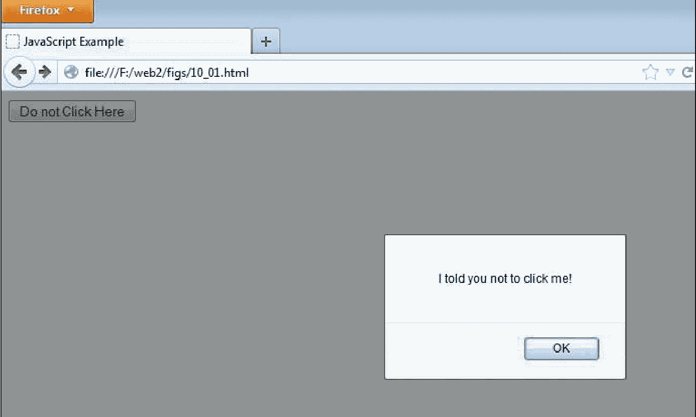

**图 10-1** 当用户点击按钮时，会弹出此警告框。

避免"找不到服务器"错误的一种方法是链接到一个实际的页面（这对无障碍访问有好处）；然而，如果用户启用了 JavaScript，这可能会将用户带离当前页面。为了阻止链接在 JavaScript 启用时被跟随，你需要在点击事件的 JavaScript 中添加额外的语句。你需要告诉浏览器在展示警告框后不要继续执行。为此，你将添加一个 return false 语句，这会在警告框显示后阻止浏览器跟随链接。以下代码展示了如何内联添加 return 语句：

```
<body>
<a href="http://none"
onclick="window.alert('Hey! You clicked me!'); return false;">
Don't Click Me</a>
</body>
```

有了这段代码，点击事件将由 onclick 事件处理器处理，浏览器就不需要尝试跟随 href 属性中的链接了。在本章后面，你将学习如何使用现代方法阻止默认行为，即 event.preventDefault()。

> **注意**
>
> 你也可以使用 javascript: 命令为链接编写 JavaScript，例如，<a href="javascript:window.alert('Hi');">Click</a>，但由于无障碍原因不推荐这种方法（如果 JavaScript 关闭，链接就无法跳转到任何地方）。

### 焦点和失焦事件

焦点事件发生在用户将焦点赋予元素或窗口时。用户通过点击项目内的某个位置、使用键盘移动到项目（通常通过 tab 键）或通过脚本来赋予焦点。例如，用户点击文本输入框（在输入任何内容之前）就给该文本框赋予了焦点。此外，点击非活动窗口并使其成为活动窗口也给该窗口赋予了焦点。焦点事件还有一个相关的方法叫做 focus()，这在第 11 章和第 14 章中会讲到。

要查看焦点事件的实际效果，你可以创建一个文本输入框，这是允许你给元素赋予焦点的表单元素之一。以下示例展示了如何实现这一点，以及如何编写一个提醒警告框


### 焦点和失焦事件

当用户将焦点赋予某个元素（例如文本框）时，就会触发焦点事件。例如，你可以使用警告框提醒用户将名字大写：

```html
<form>
输入你的名字：
<input type="text" onfocus="window.alert('别忘了大写！');">
</form>
```

文本框中的焦点事件

这段代码会在用户开始输入之前给出警告。该警告起到提醒大写名字的作用。图 10-2 展示了当用户将焦点赋予文本框时，上述代码在浏览器中的结果。

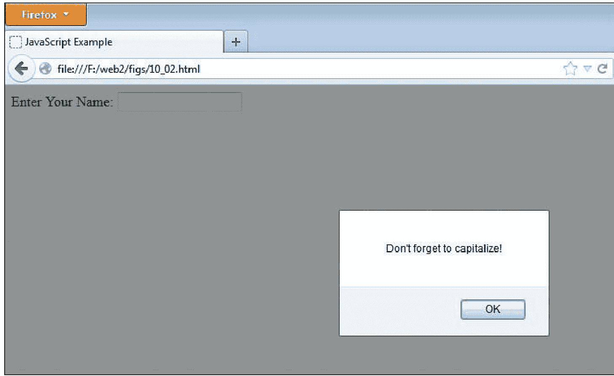

**图 10-2** 当文本框从用户处获得焦点时，此警告框会弹出。

当用户将焦点从某个元素或窗口移开时，会触发失焦事件。要将焦点从某处移开，用户通常会将焦点赋予另一处。例如，用户可能从一个表单元素移动到另一个表单元素，或从一个窗口移动到另一个窗口。失焦事件还有一个相关的方法叫做 `blur()`，这将在第 11 章和第 14 章中介绍。

> 注意
>
> 失焦事件只有在用户将焦点赋予另一区域时才会触发，这是浏览器知晓用户已从第一处释放焦点的唯一方式。例如，当用户在输入字段中按下回车键时，焦点从输入字段转移到文档窗口。

要查看失焦事件的实际效果，以下示例使用了两个文本框：点击第一个文本框使其获得焦点，点击第二个文本框则在第一个文本框中触发失焦事件。

```html
<form>
让此框获得焦点：<br>在文本框中 <input type="text" onblur="window.alert('嘿！回来！');"><br> 然后让此框获得焦点以使第一个失焦：<br>
<input type="text"> 在第一个文本框获得焦点后点击此文本框，将触发第一个文本框上的失焦事件
</form>
```

onblur 事件

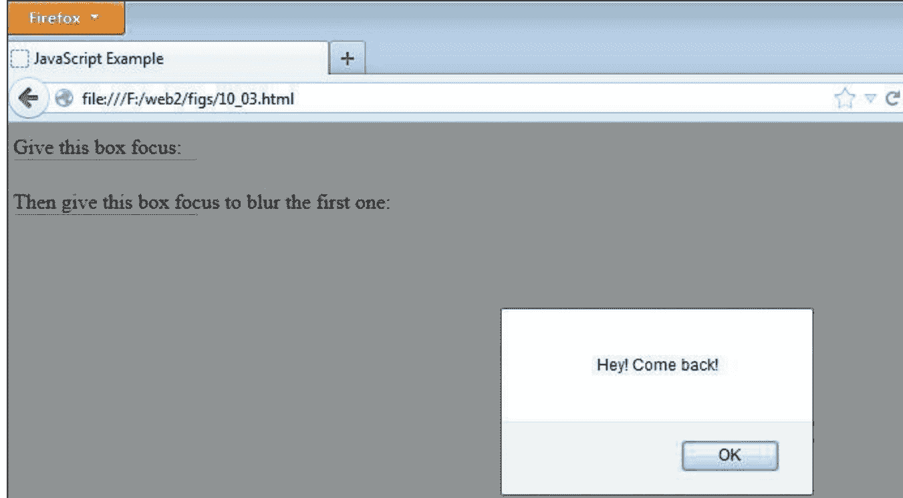

**图 10-3** 当用户将焦点从文本框移开时，此警告框会弹出。当用户点击第二个文本框时，他们会收到第一个文本框的警告，告诉他们回来。

图 10-3 展示了上述代码在浏览器中运行时的结果。请注意，当警告框弹出时，焦点在第二个文本框中。通过点击第二个文本框，用户在第一个文本框中触发了失焦事件。

### 加载和卸载事件

当网页完成加载时，会触发加载事件。如果你想在页面加载完成后显示警告，可以使用以下代码：

```html
<body onload="window.alert('我现在加载完成了！');"> 页面正文内容...</body>
```

注意，onload 事件处理程序是在 body 标签中添加的。

当页面加载完成后，用户会收到一个告知加载完成的警告。图 10-4 展示了上述代码示例在浏览器中的显示效果。如果你想在脚本代码中使用 onload 事件处理程序，而不是在 body 标签中，可以将此代码写入外部 JavaScript 文件（将其保存为 load_alert.js）：

```javascript
window.onload = function() {
  window.alert('我现在加载完成了！');
};
```

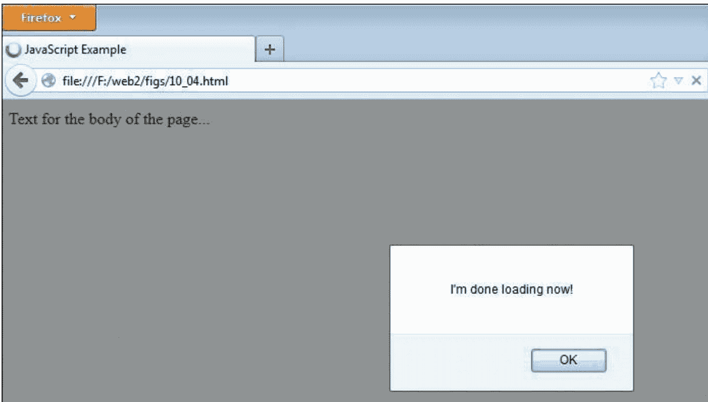

**图 10-4** 页面加载完成后，这会显示在浏览器窗口中。

这将捕获当前窗口的加载事件（窗口对象将在第 11 章中更详细地解释）。你现在可以访问 HTML 代码中的所有元素，并且可以从 `<body>` 开始标签中移除事件处理程序，如下所示：

```html
<body>
<script type="text/javascript" src="load_alert.js"></script> 页面正文内容...
</body>
```

> **注意**
>
> 一旦加载事件发生，你就不能再用 `document.write()` 向文档写入内容了。

当用户离开当前网页时，会触发卸载事件。用户可以通过点击链接、在浏览器中输入其他地址或关闭窗口来离开。

这个事件已知会惹恼用户，因为它使网站所有者能够在访客试图前往另一页面或另一网站时执行某些操作（迫使他们等待）。要在用户离开页面时弹出警告，你可以编写以下代码：

```html
<body onunload="window.alert('一定要回来，好吗？');"> 其他 HTML 代码放在这里...</body>
```

onunload 事件处理程序被添加到 body 标签中。

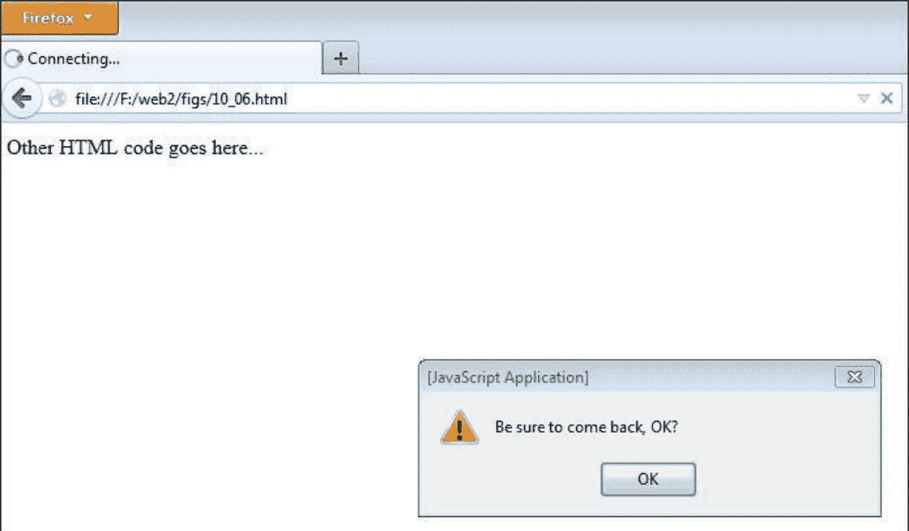

**图 10-5** 当用户试图离开页面时，此警告框会弹出。

图 10-5 展示了上述脚本的结果。当用户试图离开包含此脚本的页面时，会弹出警告框，提醒他们一定要回来。当然，如果这在索引页面或网站中的多个页面上使用，可能会给用户带来相当大的不便。

与 onload 事件处理程序一样，你可以通过使用 `window.onunload`，在脚本代码中使用 onunload 事件处理程序，而不是作为 body 标签的属性。

总体而言，在正式页面上使用卸载事件之前，请务必三思，因为它几乎肯定会惹恼大多数 Web 用户。

> **提示**
>
> 如果 onunload 不能正常工作，你可以尝试使用 onbeforeunload，如果你需要此功能的话。

### 重置和提交事件

当文档中包含一个或多个表单时，会使用重置和提交事件。表单可以重置其内容，也可以提交以供处理。这些事件允许你为其中一种表单操作编写响应程序。

当用户点击表单的重置按钮以重置表单字段时，会触发重置事件。重置事件还有一个相关的方法叫做 `reset()`，这将在第 14 章中介绍。当用户提交表单时，会触发提交事件。提交事件还有一个相关的方法叫做 `submit()`，这将在第  revolves 章中介绍。

要查看提交事件的实际效果，你需要创建一个可以通过提交按钮提交的表单。以下代码会在提交按钮被点击后向用户显示"谢谢"警告：

```html
<form onsubmit="window.alert('谢谢');"> 你叫什么名字？<br>
<input type="text" id="thename"><br>
<input type="submit" value="提交表单">
</form>
```

onsubmit 用于 form 开始标签中。提交按钮在被点击时触发提交事件。

提交事件现在对你帮助不大（尤其是因为表单内容实际上并不会发送到任何地方），但当你学到第 14 章中的表单验证时，这个事件会变得更有用。

### 鼠标事件

有许多可用于涉及鼠标的用户操作的事件。这些事件列举如下。

- **mousedown** 当用户按下鼠标按钮但点击尚未完成（按钮尚未释放）时触发。
- **mouseup** 当用户按下鼠标按钮后释放时触发。
- **mouseenter** 当用户将鼠标光标移动到某个元素上时触发（不包括子元素）。
- **mouseleave** 当用户将鼠标光标从某个元素上移开时触发（不包括子元素）。
- **mouseover** 当用户将鼠标光标移动到某个元素上时触发。
- **mouseout** 当用户将鼠标光标从某个元素上移开时触发。
- **mousemove** 当用户移动鼠标光标时触发。
- **mousewheel** 当用户向上或向下滚动鼠标滚轮时触发。

使用鼠标事件的示例可以通过创建文本链接来展示。当你将 onmouseover 事件处理程序添加到链接时，你可以在用户将光标移动到链接上时执行 JavaScript 命令。因此，如果你想在用户将鼠标移到链接上时弹出警告，可以编写如下代码：

```html
<a href="http://www.pageresource.com"
onmouseover="window.alert('我告诉过你别试图点击我！');">
别试图点击我！</a>
```

链接标签中的 onmouseover 事件处理程序。

这次访客甚至还没点击链接就会收到警告。请记住，如果过度使用，这样的脚本可能会惹恼你的访客。图 10-6 展示了此脚本在浏览器中的结果。当鼠标光标移动到链接上时，警告框就会弹出。

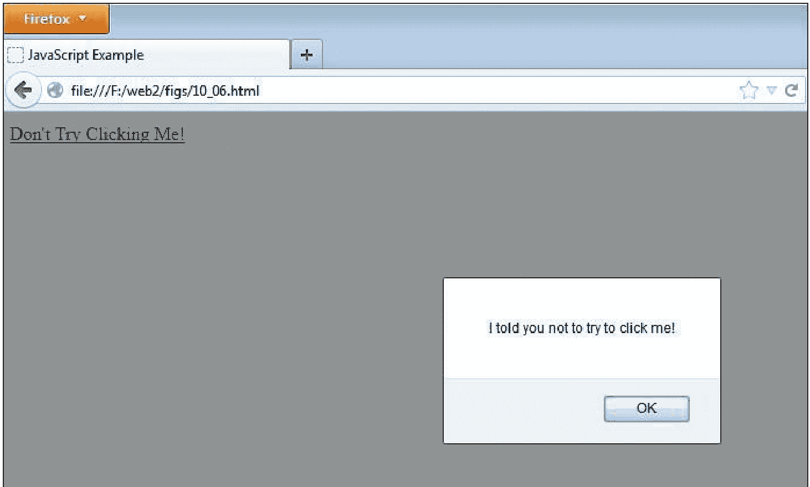

**图 10-6** 当鼠标光标移动到链接上时，此警告框会弹出。

由于不需要点击链接就会发生某些事情，浏览器之后不会尝试访问该链接。事实上，有了这个脚本，点击链接是不可能的，因为当你移动鼠标去点击时，警告框会不断弹出！

### 键盘事件

当用户使用键盘与网页交互时，会触发键盘事件。这些事件允许你对用户按下和释放按键的每个阶段做出反应。键盘事件列举如下：

- **keydown** 当用户按下键盘上的某个键时触发。
- **keypress** 当用户按下键盘上的某个键并输入相应字符时触发。这发生在 keydown 和


keyup 事件。
- **keyup** 当用户松开键盘上的按键时触发。例如，如果您想在每次文本框中输入一个字符时都发送一个警报，可以使用以下代码：

```
<input type="text" id="typing" onkeyup="alert('You typed a character!');">
```

这将在每次字符被输入文本框时提醒用户。在输入几个字符后，这可能会变得相当烦人，但当您在本章后面学习事件对象时，您将了解如何找出按下了哪个键，这将使您对键盘事件有更大的灵活性。

## 动手实践 10-1 聚焦与失焦

pr10_1.html 在这个项目中，您将运用所学的聚焦和失焦事件知识，以及第 9 章的 innerHTML 知识，来创建一个脚本，提醒用户在文本框中输入什么内容。

分步指南

1. 创建一个 HTML 页面，并将其保存为 pr10_1.html。添加必要的 script 标签以指向一个名为 prjs10_1.js 的外部 JavaScript 文件。添加代码，使得有一个 id 为 "pn" 的电话号码文本框和一个地址文本区域。在电话号码文本框旁边，将有一个 id 为 "reminder" 的空 span 标签。完成后的 HTML 文件的 body 部分应如下所示：

```
<form>
Phone Number:
<input type="text" id="pn"> <span id="reminder"></span><br><br> <textarea></textarea>
</form>
```

2. 创建一个外部 JavaScript 文件，并将其保存为 prjs10_1.js。此文件用于步骤 3 和步骤 5。

3. 通过 id 获取 "pn" 和 "reminder" 元素，并将它们分别分配给变量 pn 和 rm。

4. 当 pn 获得焦点时，将 rm 的 innerHTML 更改为文本 "Format: 123-456-7890"。当 pn 失去焦点时，将 rm 的 innerHTML 更改为空字符串 ("")。

5. 完成后的 JavaScript 文件应如下所示：

```
var pn = document.getElementById("pn"),
rm = document.getElementById("reminder");
pn.onfocus = function() {
rm.innerHTML = "Format: 123-456-7890";
};
pn.onblur = function() {
rm.innerHTML = "";
};
```

6. 保存 HTML 和 JavaScript 文件，并在浏览器中加载 HTML 页面。单击文本框内部，旁边应出现提醒消息。之后单击文本区域以使文本框失焦，并使消息消失。

### 动手实践总结

在这个项目中，您运用了新的技能——聚焦和失焦事件，创建了一个可以帮助用户填写表单的脚本。

## 专家问答

> **问：为什么有这么多事件？**
>
> 答：用户（或浏览器本身）在网页上可以做的事情非常多，因此会产生大量可能的事件。

> **问：我需要记住所有这些事件吗？**
>
> 答：您可能只需要在参加考试，或者因为工作需要快速掌握，或者您只是喜欢将事件熟记于心时才需要记住它们；否则，如果您不确定需要使用哪个事件，只需参考本章中的表 10-1 即可。

> **问：在完成本书的项目时，我会用到书中的每一个事件吗？**
>
> 答：由于本书是一本入门指南，您不会达到使用每一个事件的程度。

## 注册事件的其他方式

到目前为止，您一直使用的是所谓的 DOM Level 0 事件处理程序（onclick、onmouseover 等）。除了您使用过的方法外，还有两种其他注册事件的方法：addEventListener() 和 attachEvent()。这些被称为 DOM Level 2 事件处理程序，它们提供了将多个事件附加到元素的能力，而 DOM 0 方法只允许在任何给定元素上注册一个事件。例如，假设您有以下 JavaScript 代码：

```
var mydiv = document.getElementById("mydiv");
mydiv.onclick = function() {
alert("First Click!");
}
mydiv.onclick = function() {
alert("Second Click!");
}
```

在这种情况下，第二次将 onclick 事件处理程序分配给 mydiv 元素将覆盖第一次分配，因此当发生点击时，只会显示 "Second Click!" 警报。DOM Level 2 事件处理程序允许您避免此问题。

### addEventListener() 方法

addEventListener() 方法是 W3C 标准，目前在所有最新浏览器中都受支持（Internet Explorer 需要版本 9+）。它允许您指定一个事件、一个为该事件执行的函数，以及一个 true 或 false 值，具体取决于您希望事件处理函数在捕获（true）或冒泡（false）阶段执行。一般格式如下：

*element.addEventListener("event_type", function_name, true_or_false);*

因此，如果您想创建一个链接输入按钮，就像您之前在本章中所做的那样，您可以调整 JavaScript 代码如下：

```
var web_page1 = "http://www.yahoo.com";
var b1 = document.getElementById("btn1");
b1.addEventListener("click", function() {
window.location = web_page1;
}, false);
```

请注意，此方法不使用事件处理程序，而是使用事件的名称（不是 onclick，而是直接使用 click）。此外，此方法接受一个函数名或一个函数表达式来处理事件（如前所述）。

### 移除事件

要移除事件，您需要使用 removeEventListener() 方法：

*element.removeEventListener("event_type", function_name, true_or_false);*

请注意，如果在 addEventListener() 方法中使用了函数表达式，则无法移除该事件注册（即使它们使用完全相同的代码，函数表达式也会被视为两个不同的参数）。如果以后可能需要移除事件，最好使用一个单独的函数，并在两个方法调用中都使用函数名作为第二个参数。下面是一个示例：

```
var web_page1 = "http://www.yahoo.com",
b1 = document.getElementById("btn1");
function go_to_site() {
window.location = web_page1; // 函数已定义
}
b1.addEventListener("click", go_to_site, false); // 添加了事件监听器
b1.removeEventListener("click", go_to_site, false); // 移除了事件监听器
```

由于这是现代浏览器中注册事件的标准方法，本书的剩余部分将使用这种事件注册方式。

### 捕获与冒泡阶段

当您有嵌套在其他元素内部的元素，并且它们都注册了相同的事件类型时，哪个事件先发生取决于注册事件时使用的是捕获阶段还是冒泡阶段。如果使用捕获，则最外层元素的事件先发生，最内层元素的事件最后发生。如果使用冒泡，则情况相反。最常用的是冒泡阶段，因为它具有最广泛的浏览器兼容性。

### attachEvent() 方法

attachEvent() 方法的工作方式与 addEventListener() 类似。但是，它只适用于事件冒泡，并且目前（在撰写本文时）没有使用事件捕获的方法。它的用法如下：

```
element.attachEvent(event_handler, function_name);
```

因此，如果您想使用与之前相同的脚本，可以这样编写：

```
var web_page1 = "http://www.yahoo.com";
var b1 = document.getElementById("btn1");
b1.attachEvent(onclick, function() { window.location = web_page1; } );
```

请注意，此方法确实使用了事件处理程序的名称（onclick）。此外，它没有第三个选项；它只使用事件冒泡。

要移除事件，您需要使用 detachEvent() 方法：

```
element.detachEvent(event_handler, function_name);
```

### 浏览器支持

事件注册的 attachEvent() 方法用于 Internet Explorer 9 之前的版本（addEventListener() 不可用，但 DOM Level 0 注册可用）。如果您需要支持早期版本的 Internet Explorer，您需要使用一个允许您使用每种浏览器可用的方法来处理事件的函数。如果需要，您可以在 http://dean.edwards.name/weblog/2005/10/add-event2/ 找到一个这样的函数，或者您可以使用 JavaScript 库（如 jQuery，本书后面会讨论）来辅助事件注册。

## 事件对象

当事件发生时，会创建一个名为 *event* 的对象，其中存储了有关该事件的信息。您的脚本可以使用此信息来帮助执行所需的操作。例如，键盘事件将在事件对象中存储有关按下的键的信息。这允许您在按下不同键时编程不同的响应。

事件对象在 Internet Explorer（9 之前的版本）中工作方式略有不同，因此您将首先了解如何在支持它的所有浏览器中使用事件对象。

### DOM 和 Internet Explorer：DOM Level 0 注册

在大多数浏览器中，通过使用名称 *event* 访问事件对象。它可以作为处理事件的函数的唯一参数传递，如以下 DOM Level 0 代码所示：

```
var b1 = document.getElementById("btn1");
b1.onclick = function(event) {
alert("The " + event.type + " event started this!");
};
```

请注意，参数 *event* 被传递给了事件监听器。然后使用事件对象的 *type* 属性（返回事件类型）向用户显示一个警报，告知是点击事件导致了函数运行。

然而，Internet Explorer 使用 *window.event* 来访问事件对象，这意味着 DOM Level 0 事件处理程序将使用以下代码：

```
var b1 = document.getElementById("btn1");
b1.onclick = function() {
alert("The " + window.event.type + " event started this!");
};
```

使用 DOM Level 0 函数时，可以通过将所需的值（基于浏览器支持的内容）分配给一个变量来实现跨浏览器的事件对象，如以下代码所示：

```
var b1 = document.getElementById("btn1");
b1.onclick = function(event) {
var e = event || window.event;
alert("The " + e.type + " event started this!");
};
```

请注意，如果事件对象可用，则将事件对象分配给变量；否则，分配 window.event 对象。使用逻辑或 (||) 允许您提供一个首选值（如果可用），或者在不可用时设置另一个（默认）值。

现在变量`e`将跨浏览器保存正确的值，可以用来提示事件类型。

### 使用现代事件注册中的事件

使用`addEventListener()`或`attachEvent()`时，事件对象可通过`event`访问。这使你可以按照预期使用事件对象。对于`addEventListener()`，你可以使用以下代码：

```javascript
var b1 = document.getElementById("btn1");
b1.addEventListener("click", function(event) {
    alert("The " + event.type + " event started this!");
}, false);
```

对于`attachEvent()`，你可以使用以下代码：

```javascript
var b1 = document.getElementById("btn1");
b1.attachEvent("onclick", function(event) {
    alert("The " + event.type + " event started this!");
});
```

如果需要支持旧版浏览器，可以使用 DOM Level 0 方法。同样，你可以参考本章前面"attachEvent() 方法"部分中提到的资源，因为它们的代码已经处理了各种事件注册模型。

## 属性和方法

你已经见过`type`属性，但事件对象还有其他有用的属性和方法，列于表 10-2 中。

| 属性/方法 | 描述 |
|---|---|
| `bubbles` | 事件是否冒泡 |
| `cancelable` | 事件的默认操作是否可以被取消 |
| `cancelBubble` | 设置为 false 时取消事件冒泡（Internet Explorer） |
| `currentTarget` | 当前正在处理事件的元素 |
| `defaultPrevented` | 是否已调用`preventDefault()` |
| `detail` | 关于事件的附加信息 |
| `eventPhase` | 事件处理程序被调用时所处的阶段：1 = 捕获，2 = 在目标上，3 = 冒泡 |
| `preventDefault()` | 阻止事件的默认操作发生 |
| `returnValue` | 阻止事件的默认操作发生（Internet Explorer） |
| `srcElement` | 作为事件目标的元素（Internet Explorer） |
| `stopImmediatePropagation()` | 终止事件的所有捕获和冒泡，并阻止其他事件处理程序被调用 |
| `stopPropagation()` | 终止事件的所有捕获和冒泡 |
| `target` | 作为事件目标的元素 |
| `trusted` | 事件是否由浏览器或程序员发起 |
| `type` | 事件类型（例如`click`、`mouseover`等） |
| `view` | 事件发生的`window`对象 |

表 10-2：事件对象的属性和方法

你会注意到，列出的一些属性适用于 Internet Explorer（9 之前的版本），而其他属性则适用于其他现代浏览器。由于大多数现代浏览器（包括 Internet Explorer 9 及以上版本）支持标准的 DOM Level 2 事件注册模型，本书剩余部分将使用此方法。对于需要在 Internet Explorer 9 之前版本中执行任务的情况，会添加相应的说明。

### 防止默认操作

你可能还记得，使用 DOM Level 0 注册时，阻止链接的默认操作是通过`return`语句（`return false`）实现的。然而，使用事件对象的`preventDefault()`方法，你无需立即返回即可实现此目的。

例如，以下代码现在可用于阻止链接点击加载指定页面：

```javascript
var nlink = document.getElementById("notlink");
nlink.addEventListener("click", function(event) {
    event.preventDefault();
    alert("This link doesn't go anywhere!");
    // Further Code...
}, false);
```

如你所见，你可以继续处理事件，而不必使用`return`语句退出函数。

**注意：**使用 Internet Explorer 9 之前的版本时，可以使用`returnValue`属性。将其值设置为`false`（例如`window.event.returnValue = false;`）可以实现与`preventDefault()`相同的效果。

### 事件信息

某些事件（如键盘事件）具有表中未显示的附加属性（这些属性对所有事件都可用）。

例如，当键盘事件发生时，被按下按键的键码存储在`event.keyCode`中，这使你可以确定按下了哪个键。你的脚本可以利用这一点，仅在按下特定键时做出响应。例如，你可以使用以下代码：

```javascript
var text = document.getElementById("textbox1");
text.addEventListener("keyup", function(event) {
    if (event.keyCode === 80) {
        alert("Please do not press the p key!");
    }
}, false);
```

这将提示用户不要按下`p`键，因为 80 是键盘上"p"键的键码。你可以在以下网址查看更多关于键码的信息：http://protocolsofmatrix.blogspot.com/2007/09/javascript-keycode-reference-table-for.html

## 动手试试 10-2 使用 addEventListener()

*pr10_2.html* 在本项目中，你将使用`addEventListener`为一段文本注册`mouseover`和*pr10js10_2.js* `mouseout`事件。

**分步操作**

1.  创建一个 HTML 页面并保存为`pr10_2.html`。添加代码使其链接到名为`prjs10_2.js`的外部 JavaScript 文件。HTML 代码的 body 部分应如下所示：

    ```html
    <p>
        This is very <span id="int">interesting</span>!
    </p>
    ```

2.  创建一个 JavaScript 文件并保存为`prjs10_2.js`。在步骤 3 中使用它。

3.  当鼠标移到"int"span 上时，将颜色更改为`#FF0000`。当鼠标移开时，将颜色更改为`#000000`。完成后，JavaScript 文件应如下所示：

    ```javascript
    var int = document.getElementById("int");
    int.addEventListener("mouseover", function() {
        int.style.color = "#FF0000";
    }, false);
    int.addEventListener("mouseout", function() {
        int.style.color = "#000000";
    }, false);
    ```

4.  保存 JavaScript 文件并在浏览器中打开 HTML 文件。将鼠标移到文本上和移开来更改颜色。

### 动手试试总结

在本项目中，你运用了事件处理程序和`addEventListener()`的技能，在鼠标移入或移出文本时更改其颜色。

## 使用事件处理程序创建脚本

现在你已经掌握了长串的事件处理程序和事件对象，是时候来点有趣的了。在本节中，你将学习如何做一些发送提醒以外的事情。

### 显示隐藏内容

对于此脚本，创建一个 HTML 文件，在 body 部分放入以下代码并保存为`news.html`。

```html
<div>
    <strong>Breaking News Story!!!!!</strong>
    <a href="story.html" id="morelink">More...</a>
</div>
<div id="morediv">
    Today, there was a major development in a story that
    we have been covering here at my site. We will post
    later with further details. Hurry back!
</div>
<script type="text/javascript" src="news.js"></script>
```

这里有一个"突发新闻"标题。放置了一个链接（id 为`morelink`），点击时将显示新闻内容。下方有一个`div`（id 为`morediv`），包含新闻内容。目前它完全可见，因为尚未应用任何 CSS 或 JavaScript 来更改它。你的目标是最初隐藏此内容，然后在用户激活链接时显示它。

接下来，创建一个 JavaScript 文件并保存为`news.js`。你首先要做的是定义一些变量来获取所需的两个元素：`morelink`和`morediv`元素。

```javascript
var mlink = document.getElementById("morelink"),
    mdiv = document.getElementById("morediv");
```

这些现在作为对象被赋值给`mlink`和`mdiv`变量。接下来，你需要添加一个事件监听器，以便在点击`mlink`元素时显示或隐藏`mdiv`元素，如以下代码所示：

```javascript
mlink.addEventListener("click", function(event) {
    event.preventDefault();
    mdiv.style.display = (mdiv.style.display === "none") ? "block" : "none";
}, false);
```

注意，事件对象作为参数传入，使得可以使用`preventDefault`。`mdiv`元素的`display`属性在值为"none"时被更改为"block"，在值不为"none"时被更改为"none"（例如，当之前已将其设置为"block"时）。

现在点击事件已设置完毕，但你需要在初始页面显示时隐藏`mdiv`元素。这可以通过 CSS 实现，但这里你将使用 JavaScript 简单地将其 display 样式设置为"none"：

```javascript
mdiv.style.display = "none";
```


### 更改内容

与其只显示和隐藏一段内容，不如为浏览者提供多个选项，并在点击特定链接时显示所选内容。为此，首先需要一份 HTML 文档。在本例中，你将使用以下 HTML 并将文件保存为 technews.html。

```html
<!doctype HTML>
<html>
<head>
<title>Selected Tech News</title>
<link rel="stylesheet" type="text/css" href="technews.css">
</head>
<div class="wrapper">
<div class="headline">Nick Delivers Crushing Defeat to John</div>
<div id="top_story_nav" class="story_nav">
<a href="#sumdiv" id="sumlink">Summary</a>
<a href="#statsdiv" id="statslink">Stats</a>
<a href="#comdiv" id="comlink">Comments</a>
</div>
<div id="sumdiv" class="spart">
Earlier today, we attended a JavaScript programming competition, where we watched a first round showdown between Nick and John. In the beginning, it looked like this might be a close battle, but Nick got the upper hand quickly and never looked back.

John started writing some strange code and put everything into the global scope, while Nick was busy building objects, using inheritance, and optimizing his code until he had a very slick, clean application.

John's app, on the other hand, just seemed clunky and buggy in comparison.

Perhaps it was an off day for John, but now he can sit back and watch as the remaining coders go toe to toe. We will write up another report once we see the next showdown!
</div>
<div id="statsdiv" class="spart">
App. Loading Speed: Nick 0.002 ms, John 3043.231 ms

Globals: Nick 1, John 137

JS File Size: Nick 0.5K, John 1.2 MB

Final Score: Nick 15298, John: 12
</div>
<div id="comdiv" class="spart">
H311oW0rld: Is it any wonder John lost with all of those globals? Really, John? REALLY?

Anne: I saw this coming. Honestly, Nick is just better.

Paul: John, I know the challenge had to do with balloons, but to even be in this competition you should know better than to overwrite the pop() method on the Array prototype! Wow!

Sup3rCod3r: This was a schooling. I hope John learns from this...

Con5pir@cy: I think the competition is rigged... can't you all see it?

Christie: Yikes! How did John fall into that trap?!

Z25S1l0O: Has the video been posted yet? I've gotta see this! lol!

just a better programmer than the other. John actually used this line: while (1 == true) { alert('True!'); } ! The judges had to reboot!

Doug: @Conspir@cy or whatever - See what? It looked to me like one was
</div>
</div>
<script type="text/javascript" src="technews.js"></script>
</body>
</html>
```

注意其中有一个 wrapper div，用于包含所有内容。在其内部，有 headline div、top_story_nav div 以及三个内容 div（sumdiv、statsdiv 和 comdiv）。该脚本将让每个链接显示其中一个内容 div，同时隐藏另外两个。这样，用户就可以一次查看一个部分，而不必滚动到所需的部分。

接下来，你需要创建 CSS 文件为页面添加一些样式。包含以下代码并将文件保存为 technews.css。

```css
.wrapper { width:590px; height:390px; padding:5px; overflow:scroll; font-size:1em; font-family:Verdana, sans-serif; }
.headline { font-weight:bold; font-size:1.8em; font-family:Arial, sans-serif; background-color:#6699CC; text-align:center; }
.story_nav { margin:0 0 10px 0; padding:2px; background-color:#DDD; word-spacing:20px; text-align:center; }
.spart { margin-bottom:10px; }
```

这定义了 wrapper div 的大小，包含内边距后为 600×400 像素。它允许过长的内容在 wrapper 内由用户滚动查看。其他样式为其他元素提供了一些颜色、边距、内边距和间距。当然，你可以根据自己的喜好调整这些设置。

最后，你需要创建 JavaScript 文件。包含以下代码并将文件保存为 technews.js。

```javascript
var slinks = [document.getElementById("sumlink"),
document.getElementById("statslink"),
document.getElementById("comlink")],

sdivs = [document.getElementById("sumdiv"),
document.getElementById("statsdiv"),
document.getElementById("comdiv")];

function change_div(count) {
slinks[count].addEventListener("click", function(event) { event.preventDefault();
sdivs[count].style.display = "block";
for (var j = 0; j < sdivs.length; j++) {

if (j === count) {
continue;
}
else {
sdivs[j].style.display = "none";
}
}
}, false);
}

for (var i = 0; i < slinks.length; i++) { change_div(i);
}
sdivs[1].style.display = "none";
sdivs[2].style.display = "none";
```

这三个链接对应三个内容 div，因此两组元素都被放入数组中（slinks 和 sdivs）。`change_link()` 函数稍后会解释，但首先注意函数后面的 `for` 循环。它遍历 slinks 数组，并为每个链接调用 `change_div()` 函数，将 `i` 的值作为参数传递。该参数将用于为每个元素注册点击事件，并在每次点击链接时更改相应的内容。

`change_div()` 函数接收来自 `for` 循环传递的 `count` 变量作为参数。第一次循环时，`change_div` 会收到值 0，第二次收到值 1，依此类推。由于链接和内容 div 都在数组中，这允许你使用 `count` 值来访问所需的元素。函数首先使用 `addEventListener()`。监听器被添加到 slinks 数组中索引为 *count* 的链接元素上。换句话说，当 `count` 为 0 时，会访问 `slinks[0]`。这访问第一个链接元素，因为 `slinks[0]` 的值是 `document.getElementById("sumlink")`。由于这个循环运行三次，事件监听器将分别以 `count` 值 0、1 和 2 添加。

事件监听器函数首先阻止默认行为。然后，根据被点击的链接，sdivs 数组中对应的 div 元素通过将其样式 display 设置为 "block" 来显示。使用循环来隐藏其余两个 div 元素。注意，如果 `j` 的值等于 `count` 值（正在显示的元素），则跳过，以便当前显示的元素保持可见。

最后，在脚本末尾，你会看到 statsdiv 和 comdiv 元素被隐藏。这会使页面默认初始化时 sumdiv 元素仍然可见，而另外两个内容 div 被隐藏。图 10-9 显示了在浏览器中查看时页面的初始显示。

点击 "**Stats**" 链接会显示统计数据（使 statsdiv 可见，其他隐藏）。图 10-10 显示了点击 "Stats" 链接后的结果。

最后，点击 "**Comments**" 链接会显示所有针对我在那次编程比赛中尴尬表现的评论！图 10-11 显示了评论显示的效果。

这个脚本结合了你学过的许多技巧（事件、循环、数组等）。数组和循环在这里特别有用，因为它们避免了你手动输入三个版本的 `addEventListener()`，每个值都硬编码到事件注册和函数中。处理事件时，拥有这些方便的少写代码的方式往往很有帮助。


# Nick 对 John 取得压倒性胜利

[摘要](#) [统计](#) [评论](#)

今天早些时候，我们参加了一场 JavaScript 编程竞赛，目睹了 Nick 和 John 在第一轮的对决。起初，这看起来可能是一场势均力敌的较量，但 Nick 很快就占据了上风，并一直保持优势。

John 开始编写一些奇怪的代码，将所有东西都放入了全局作用域，而 Nick 则忙于构建对象、使用继承并优化他的代码，直到他得到了一个非常流畅、简洁的应用程序。相比之下，John 的应用程序似乎显得笨重且漏洞百出。

也许 John 今天状态不佳，但现在他可以坐下来观看剩下的编码员一决高下。一旦我们看到下一场对决，我们将撰写另一份报告！

**图 10-9** 初始显示。请注意用户可以点击的链接。

# Nick 对 John 取得压倒性胜利

- [摘要](#)
- [统计](#)
- [评论](#)

应用加载速度：Nick 0.002 ms，John 3043.231 ms

全局变量：Nick 1，John 137

JS 文件大小：Nick 0.5K，John 1.2 MB

最终得分：Nick 15298，John：12

**图 10-10** 点击“统计”链接后的结果

## 第10章 自我测试

1.  事件处理程序是对象的一个预定义 JavaScript 属性，用于处理网页上的事件。
    A. 正确
    B. 错误
2.  事件处理程序很有用，因为它们使你能够获得可能发生在页面上的。
3.  要使用事件处理程序，你需要将其放在或代码中。
4.  以下哪项正确编写了点击事件上的警报？
    A. `<input type="button" onclick="window.alert('Hey there!');">`
    B. `<input type="button" onClick="window.alert('Hey there!');">`
    C. `<input type="button" onclick="window.alert('Hey there!');">`
    D. `<input type="button" onChange="window.alert('Hey there!');">`
5.  当网页加载完成时，该事件发生。
6.  当以下情况发生鼠标悬停事件：
    A. 查看者在光标位于按钮上时点击鼠标。
    B. 查看者将鼠标光标移开链接。
    C. 查看者点击链接、链接图像或图像地图的链接区域。
    D. 查看者将鼠标光标移动到页面上的元素上。
7.  当查看者点击页面上的元素时，会发生鼠标移出事件。
    A. 正确
    B. 错误
8.  当查看者离开当前网页时，该事件发生。
9.  失去焦点事件与事件相反。
10. 该对象包含用于事件的属性和方法。
11. 事件的属性包含发生的事件类型。
12. 当查看者在网页上时，提交事件发生。
13. 当查看者按下键盘上的键时，发生按键按下事件。A. 正确
    B. 错误
14. 在版本9之前的 Internet Explorer 中，可以通过使用来访问事件对象。
15. 方法和方法是注册事件的两种新方式。

此页面有意留白

# 第11章 Window 对象

## 275 关键技能与概念

- Window：全局对象
- 使用 Window 对象的属性
- 使用 Window 对象的方法
- 打开新窗口

JavaScript window 对象使你可以在脚本中访问更多属性和方法，并在 Web 浏览器中充当全局 JavaScript 对象。在本章中，你将了解它如何作为全局对象工作，并学习使用它的许多属性和方法。

## Window：全局对象

window 对象是为浏览器中出现的每个窗口创建的。窗口可以是主窗口、框架集或单个框架、选项卡，甚至是使用 JavaScript 创建的新窗口。它与文档对象的不同之处在于，window 对象包含文档对象（以及许多其他对象，如 history、navigator 等）。它在 Web 浏览器中充当 JavaScript 的全局对象。

因为它是全局对象，所以定义的任何全局变量或函数也是 window 对象的属性和方法。例如，考虑以下代码：

```
var fruit = "lemon";

function show_msg(fruit) {
    alert("You have a " + fruit);
}
```

这里，有一个名为 fruit 的全局变量和一个名为 show_msg() 的全局函数。这两个现在都可以作为 window 对象的一部分来调用，如以下代码所示：

```
八达国际登录
function show_msg(fruit) {
    alert("You have a " + fruit);
}
```

```
alert(window.fruit); // 警告 "lemon"

window.show_msg(fruit); // 警告 "You have a lemon"
```

因为 window 是全局对象，所以不需要使用 window.fruit 或 window.show_msg()。window 是假定的，因此这些可以简单地缩短为 fruit 和 show_msg()，这正是你一直在使用它们的方式。

出于同样的原因，window 对象内的对象、属性和方法不需要引用它们在 window 对象内的事实。回想一下，你使用了 window.alert()，它可以通过简单地使用 alert() 来调用。这也适用于 window 对象内的对象，如 history 对象。你可以输入 history.back() 来访问 history 对象的 back() 方法，而无需输入 window.history.back()。

## 使用 Window 对象的属性

要开始研究 window 对象，请查看其可用的属性，这些属性在表 11-1 中列出并描述。其中一些属性在表 11-1 后有更详细的讨论。

| 属性 | 描述 |
|------|------|
| applicationCache | 对应用程序缓存的引用，该缓存将数据存储在用户系统上，以便脚本可以离线使用 |
| closed | 根据窗口是否已关闭保存值 |
| console | 控制台对象，如果可用，允许访问调试控制台 |
| content | 代表主内容窗口的内容对象 |
| defaultStatus | 定义显示在状态栏中的默认消息 |
| document | 文档对象（在第9章中讨论） |
| frameElement | 返回窗口所在的元素（如 iframe），如果是顶级窗口则返回 null |
| frames | 窗口中框架的数组 |
| history | 提供当前窗口浏览器历史信息的对象（在第8章中讨论） |
| innerHeight | 返回窗口内可视区域的高度（以像素为单位） |
| innerWidth | 返回窗口内可视区域的宽度（以像素为单位） |
| length | 返回当前窗口中的框架数 |
| location | 返回或设置窗口的当前 URL |
| localStorage | 可用于本地存储数据的对象 |
| name | 允许为窗口命名 |
| navigator | 导航器对象（在第8章中讨论） |
| opener | 引用打开另一个窗口的窗口 |
| outerHeight | 返回整个浏览器窗口的高度（以像素为单位） |
| outerWidth | 返回整个浏览器窗口的宽度（以像素为单位） |
| parent | 引用包含当前框架的框架集 |
| screen | 包含用于收集屏幕信息的属性，包括 availHeight、availWidth、colorDepth、height、pixelDepth 和 width |
| self | 提供引用当前窗口的另一种方式 |
| status | 允许在状态栏中放置消息；覆盖 defaultStatus |
| top | 对包含框架、框架集或嵌套框架集的顶层窗口的引用 |
| window | 对当前窗口的引用 |

**表 11-1 Window 对象的属性**

> 注意
>
> 与前面章节一样，本章列出的一些属性和方法并非跨浏览器，或者仅在现代浏览器中有效。有关更多信息和更完整的列表，请参见：https://developer.mozilla.org/en/DOM/window 和 http://msdn.microsoft.com/en-us/library/ms535873(VS.85).aspx。

### closed 属性

closed 属性用于检查窗口是否已被查看者关闭。通常的使用方法是使用窗口名称，后跟 closed 属性，如以下示例所示：

```
if (windowname.closed) {
    JavaScript Statements
}
```

你需要将 windowname 部分替换为你要检查的窗口的名称。这通常是你用 JavaScript 打开的新窗口；你将在本章后面的“open() 方法”部分了解如何命名新窗口。

你还可以在新窗口内使用 closed 属性来检查打开它的窗口是否已关闭。为此，你将在 opener 属性（在“opener 属性”部分讨论）之后使用 closed，如


在下面的示例中：

```javascript
if (window.opener.closed) {
    // JavaScript 语句
}
```

如果你选择创建一个新窗口，让浏览者可以通过新窗口中的链接来导航主窗口，那么使用 `closed` 属性就非常方便。

### `frames` 属性

`frames` 属性是一个数组，包含框架集中的每个框架。它通常用于访问页面上各个框架的属性。你可以使用 `frames.length` 属性来查找窗口中的框架数量。

### `innerWidth` 和 `innerHeight` 属性

`innerWidth` 和 `innerHeight` 属性保存窗口可视区域（浏览器窗口减去滚动条、菜单栏、工具栏等）的宽度和高度值。这些属性在现代浏览器中有效，但在 Internet Explorer 9 之前的版本中不起作用（对于旧版本的 Internet Explorer，可以使用 `document.body.clientWidth` 和 `document.body.clientHeight`）。

因此，如果你想获取脚本可用的内容区域宽度，可以使用以下代码：
```javascript
var mywin_width = window.innerWidth;
```
当然，如果你想根据窗口可用的 `innerWidth` 为浏览器使用不同的 HTML 代码，可以使用以下代码：

```javascript
var mywin_width = window.innerWidth;
var cont = document.getElementById("container");
cont.style.width = (mywin_width >= 800) ? "750px" : "90%";
```

这里使用了条件运算符来快速实现 if-else 语句，根据可用空间为 div 元素分配宽度。访问的是一个"container" div，它没有设置固定宽度，并将通过 `innerHTML` 提供要显示的代码。

这将判断浏览者是否具有 800 像素的可视宽度。如果有，div 元素的宽度将设置为 750 像素。否则，div 元素将使用更安全的 90% 宽度，以便在较小的屏幕上更容易显示。

### `length` 属性

`length` 属性告诉你窗口中有多少个框架，与 `window.frames.length` 属性相同。这只是将其简化为 `window.length`（在编写代码时通常更方便）。

### `location` 属性

`location` 属性保存窗口当前的 URL。你可以使用 `location` 属性使浏览器立即重定向到新页面（例如，如果你的页面已移动到新位置）。但是，请确保不要在列入了不允许快速重定向的搜索引擎的页面上使用此技术，因为它们可能会将页面从其列表中删除。

如果页面已移动，你想立即重定向浏览者而不产生任何延迟，只需为 `location` 属性赋予一个新值，如以下代码所示：

```html
<body>
<script type="text/javascript">
// 这会立即将浏览者送走，因为不需要任何操作
// 来启动这个过程
window.location = "newpage.html";
</script>
没有 JavaScript？点击下面的链接访问新页面！<br>
<a href="newpage.html">新页面</a>
</body>
```

这会将浏览者带到本地 URL `newpage.html`。为没有 JavaScript 的浏览器包含了一个标准链接。否则，对于没有 JavaScript 的浏览者来说，前面的代码会加载一个空白页面，而且什么都不会发生。

#### 注意

即时重定向最适合用于未被搜索引擎索引的页面上的测试目的，因为关于重定向的规则因搜索引擎而异。

### `name` 属性

`name` 属性保存当前窗口的名称，还可以让你为窗口命名。如果你想给主窗口命名，可以将你想要使用的名称赋值给这个属性。以下代码展示了这一点：

```javascript
// 为窗口赋予它自己的名称
window.name = "cool_window";
// 将窗口的名称提示给浏览者
alert("This window is named " + window.name);
```

图 11-1 显示了此脚本在浏览器中的结果。

### `opener` 属性

`opener` 属性用于引用打开当前窗口的窗口。这通常用于使用 `open()` 方法打开的新窗口，你将在本章后面的"[`open()` 方法](#)"一节中看到。通过在新窗口中使用 `opener` 属性，你可以检测主窗口是否已使用前面学过的 `closed` 属性关闭。以下示例展示了如何进行此测试：

```javascript
if (window.opener.closed)
```

这在 `opener` 属性后添加 `closed` 属性，以检查打开当前窗口的窗口是否已关闭。如果你想通过新窗口在主窗口中执行操作，这会很有帮助，因为你可以在操作之前检查主窗口是否仍然存在。

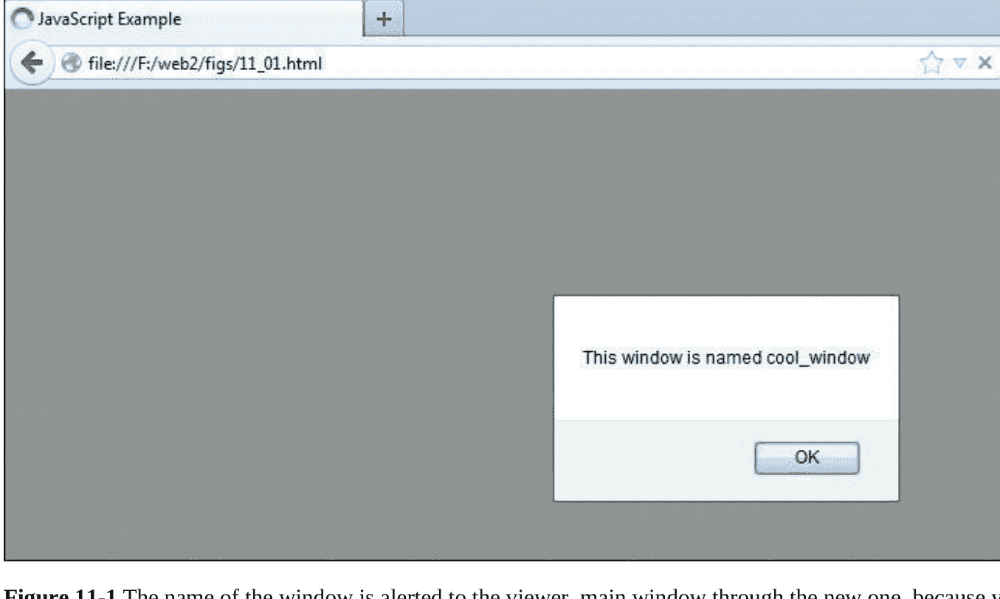

**图 11-1** 将窗口的名称提示给浏览者。

### `parent`、`self` 和 `top` 属性

`parent` 属性仅在页面上有框架时使用。它可以访问当前框架的父框架集。当你希望从一个框架更改另一个框架中的属性时，这很有帮助。

`self` 属性是在 JavaScript 中表示"当前窗口"的另一种方式。它的用法类似于 `window` 对象，可以像 `window` 对象一样访问当前窗口的属性。如果你有很多已命名的窗口，`self` 属性就很有用，因为你可以确保使用的是当前窗口的属性，而不是另一个命名窗口中的属性。

`top` 属性用于访问所有框架集（可能是嵌套的）中最顶层的窗口。这与 `parent` 属性略有不同，后者只到达当前框架集的顶部。而 `top` 属性则是直接到达最顶层的窗口，即使该窗口包含嵌套的框架集也是如此。

### `status` 和 `defaultStatus` 属性

`status` 属性包含窗口状态栏中设置的文本值。更改此属性将覆盖使用 `defaultStatus` 属性设置的状态栏内容。

**注意**
默认情况下，现代浏览器不会显示由 JavaScript 修改的状态栏文本，以防止不良网站用虚假链接目的地欺骗用户。因此，`status` 和 `defaultStatus` 属性无法工作，除非浏览者更改了浏览器设置。由于允许更改浏览器设置对用户来说存在安全风险，因此不建议使用这些属性。

`defaultStatus` 属性设置当没有任何内容赋值给 `window.status` 属性时，默认显示在状态栏中的文本字符串。更改 `window.status` 属性会覆盖此设置，因为它只是作为默认值显示。此属性通常在 `load` 事件中设置，以便在浏览者执行不会更改状态栏文本的操作时显示自定义消息。

#### 试一试 11-1：使用 `location` 和 `innerWidth` 属性

*pr11_1.html* 本项目让你练习使用 window 对象的 `location` 和 `innerWidth` 属性。
*prjs11_1.js*

**分步进行**

1. 创建 HTML 页面，将 body 部分留空，但要包含一组 script 标签，用于引用名为 `prjs11_1.js` 的 JavaScript 文件，放在闭合的 `</body>` 标签之前。将文件保存为 `pr11_1.html`。

    *(未完待续)*

2. 创建 JavaScript 文件并保存为 `prjs11_1.js`。使用此文件执行步骤 3-6。
3. 为名为 `mywin_width` 的变量设置默认值。
4. 将 `window.innerWidth` 的值赋值给 `mywin_width`。
5. 如果 `mywin_width` 的值大于或等于 1000，则将浏览者发送到 URL `http://www.scripttheweb.com/js/`。否则，将浏览者发送到 URL `http://www.scripttheweb.com/css/`（使用 `window.location` 属性）。
6. 完成后，JavaScript 文件应包含以下代码：

    ```javascript
    var my_win = window.innerWidth;
    if (my_win >= 1000) {
        window.location = "http://www.scripttheweb.com/js/";
    } else {
        window.location = "http://www.scripttheweb.com/css/";
    }
    ```

7. 保存 JavaScript 文件并在 Web 浏览器中打开 HTML 文件。尝试更改宽度，然后以新宽度重新打开页面，看看它给你哪个网页。

**试一试总结**

在本项目中，你能够运用 window 对象的 `location` 和 `innerWidth` 属性的知识，创建一个脚本，根据浏览者浏览器中可用的可视区域宽度来重定向浏览者。

## 使用 Window 对象的方法

现在你已经知道如何使用 window 对象的属性，可以继续学习使用 window 方法了。表 11-2 列出了 window 对象的一些方法及其说明，接下来将更详细地描述特定方法。

### `alert()`、`prompt()` 和 `confirm()` 方法

`alert()`、`prompt()` 和 `confirm()` 方法都会弹出系统对话框，要求用户采取操作。例如，用户可能点击 OK 关闭警告框，或在 `prompt()` 使用时在文本框中输入信息。

#### `alert()` 方法

你在前面章节的示例脚本中已经大量使用了 `alert()` 方法。它会弹出一条消息给浏览者，浏览者必须点击 OK 按钮才能继续。

**方法**


#### 表 11-2 Window 对象的方法

| 方法 | 描述 |
| --- | --- |
| addEventListener() | 在窗口上注册一个事件 |
| alert() | 向用户弹出一个警报框，用户必须点击“确定”才能继续 |
| back() | 将窗口在历史记录列表中后退一项 |
| blur() | 移除窗口的焦点 |
| clearInterval() | 取消 setInterval() 方法调用的操作 |
| clearTimeout() | 取消 setTimeout() 方法调用的操作 |
| close() | 关闭一个浏览器窗口 |
| confirm() | 向用户显示一个确认对话框，用户必须点击“确定”或“取消”才能继续 |
| escape() | 将字符串中的特殊字符转换为十六进制字符 |
| find() | 使用户能够启动浏览器中的“查找”实用程序，在页面上查找文本 |
| focus() | 将焦点赋予一个窗口 |
| forward() | 将窗口在历史记录列表中前进一项 |
| home() | 将用户引导至其在 Web 浏览器设置中设定的主页 |
| moveBy() | 通过作为参数传递的特定像素值移动窗口 |
| moveTo() | 将窗口的左上角移动到作为参数传递的坐标 |
| open() | 打开一个新的浏览器窗口 |
| print() | 打印窗口的内容 |
| prompt() | 弹出一个提示对话框，要求用户输入信息 |
| resizeBy() | 通过将右下角移动作为参数传递的特定像素值来调整窗口大小 |
| resizeTo() | 将整个窗口调整为作为参数传递的高度和宽度 |
| scrollBy() | 通过作为参数传递的特定像素值滚动窗口的视口 |
| scrollTo() | 将窗口的视口滚动到作为参数传递的指定坐标 |
| setInterval() | 每隔一定时间调用一个函数 |
| setTimeout() | 在经过一定时间后调用一次函数 |
| stop() | 阻止窗口加载其内容 |
| unescape() | 将转义后的字符串转换回其正常字符 |

### prompt() 方法

prompt() 方法用于提示用户输入信息。你在第 6 章中使用过此方法，允许用户向提示对话框中输入数据。

### confirm() 方法

confirm() 方法可用于让用户有机会确认或取消一个操作。此方法返回一个布尔值 true 或 false，因此在使用时，其结果通常被赋给一个变量。例如，如果你想将结果赋给一个名为 `is_sure` 的变量并询问“你确定吗？”，可以使用以下代码：

```
var is_sure = confirm("Are you sure?");
```

图 11-2 显示了由上述代码显示的确认对话框示例。请注意用户可以选择单击的两个按钮：确定 和 取消。如果用户单击“确定”，方法返回 true。如果用户单击“取消”，方法返回 false。请注意，与 alert() 和 prompt() 一样，你无法更改按钮上文本的值，因为这是由用户的浏览器和操作系统决定的。

作为此方法的实际示例，假设你想创建一个指向另一个页面的链接，但你想在将用户发送走之前，确保用户确实想离开。你可以使用确认对话框来了解用户是否希望离开该页面。

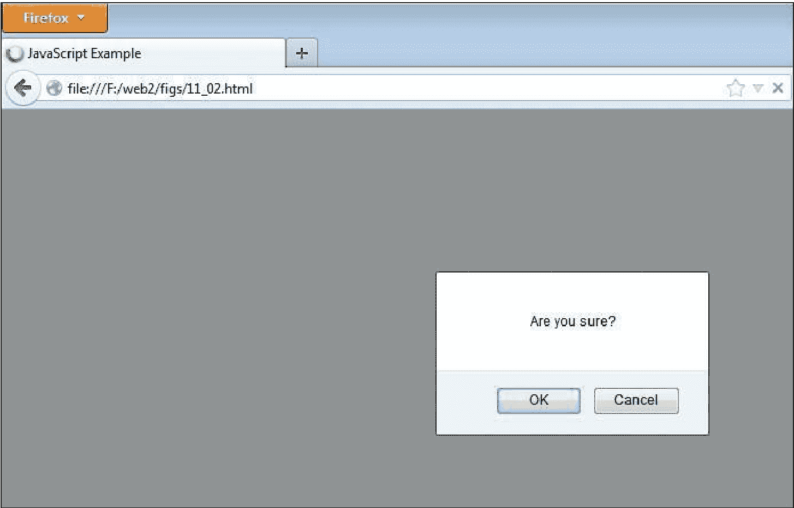

图 11-2 确认对话框示例

以下代码展示了如何从用户那里获得确认并做出适当反应。首先是 HTML 代码：

```
<body>
<a href="http://www.google.com" id="search_link">Go Searching</a>
</body>
```

接下来，使用 JavaScript 在用户点击链接时确认他们是否真的想离开：

```
var s_link = document.getElementById("search_link");
s_link.addEventListener("click", function(event) {
    var is_sure = confirm("Are you sure you want to leave?");
    if (is_sure === false) {
        event.preventDefault();
        alert("OK. You can stay here.");
    }
}, false);
```

该函数确认用户是否希望离开。

请注意，如果用户点击“确定”且 confirm() 方法返回 true，则用户会被带到链接的网站。如果用户点击“取消”且 confirm() 方法返回 false，则会向用户显示一个警报，并且函数返回 false，这样浏览器就不会跟踪该链接（你也可以简单地省略警报，在点击“取消”后仅使用 `return false` 语句而不执行任何操作）。

图 11-3 显示了在页面上点击链接后的浏览器窗口。确认对话框会弹出，显示你的“你确定要离开吗？”消息。

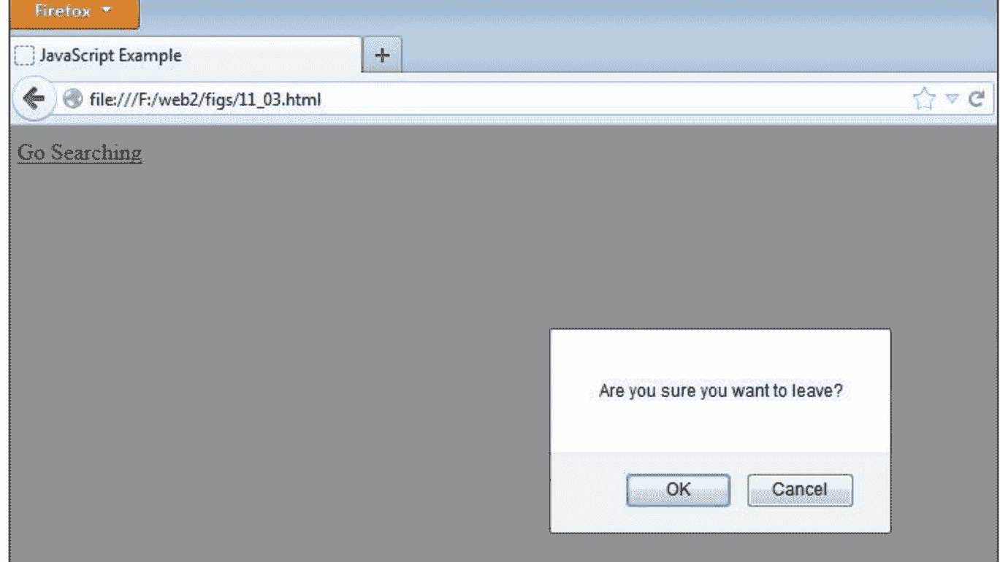

图 11-3 点击按钮后弹出确认对话框。

### find() 方法

你可以使用 find() 方法让用户在你的页面上查找特定文本。它告诉浏览器使用其内置的“查找”实用程序，并允许用户输入要查找的文本。

例如，如果你想为用户创建一个按钮，当他们想在你的页面上查找内容时可以点击，你可以使用以下代码：

```
<form>
<input type="button" value="Click to Find Text" onclick="find();">
</form>
```

这将弹出浏览器中的“查找”对话框，并允许用户在页面内搜索文本。图 11-4 显示了将此脚本添加到 HTML 文档时的结果。如果你的页面非常长，并且希望用户能够通过搜索页面更快地找到内容，此功能非常有用。

### home() 方法

home() 方法用于将用户引导至其在 Web 浏览器设置中设定的主页。例如，你可以使用它为用户提供一个按钮，当点击时会将他们带到选定的主页，如以下代码所示（在撰写本文时，此方法在 Mozilla Firefox 和 Opera 中有效，但在 Microsoft Internet Explorer 中无效）：

```
<form>
<input type="button" value="Go Home!" onclick="home();">
</form>
```

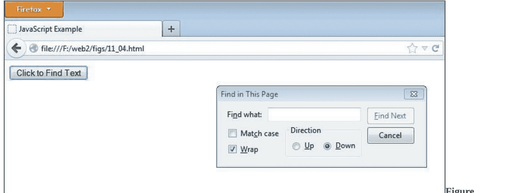

图 11-4 “查找”对话框弹出，允许用户在页面上搜索文本。

### print() 方法

print() 方法允许用户打印当前窗口。调用此方法时，它应该会打开用户的“打印”对话框，以便用户可以设置打印机选项来打印文档。

要使用它，你可以创建一个按钮，允许用户打印他们正在查看的页面：

```
<form>
<input type="button" value="Click to Print Page" onclick="print();">
</form>
```

当用户点击“Click to Print Page”按钮时，此代码应会打开用户的“打印”对话框。图 11-5 显示了在浏览器中运行此脚本的结果。此对话框的外观可能因用户而异，具体取决于所使用的浏览器和打印机。

### setInterval() 和 clearInterval() 方法

setInterval() 方法用于以固定的间隔重复执行一个 JavaScript 函数。以下是使用此方法的一般语法：

```
setInterval(function() { // function content }, time);
```

你将 *function content* 替换为你希望重复的代码。然后将 *time* 替换为你希望每次重复函数之前等待的时间（以毫秒为单位）。

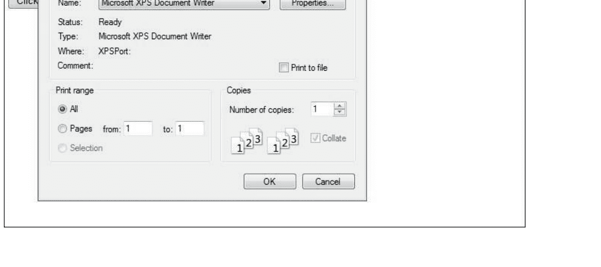

**图 11-5** 当点击打印按钮时，用户的打印选项会弹出。

所以，如果你真的很想烦扰你的用户，你可以使用此方法，在页面被查看后每 10 秒（10,000 毫秒）弹出一个警报。你可以通过将以下脚本放在文档的 HTML 中来实现这一点：

```
setInterval(function() {
    alert("Am I bothering you yet?");
}, 10000);
```

当然，这可能会变得相当烦人。间隔设置的时间越短，它就会变得越烦人。幸运的是，十秒的间隔为你提供了足够的时间，可以在另一个警报弹出之前离开页面。

#### 注意

你可能会遇到一些脚本，它们将字符串值作为第一个参数传递给 setInterval() 或 setTimeout()，而不是传递函数。这要求 JavaScript 使用 eval() 函数将字符串作为 JavaScript 代码进行求值，而在大多数情况下，这种做法是不推荐的。

要结束前一个脚本的警报轰炸，你可以使用 clearInterval() 方法。以下是使用此方法的一般语法：

```
clearInterval(name);
```

你必须将 *name* 替换为已赋给要清除的 setInterval() 方法调用的变量名。问题是，在前面的例子中，你并没有将 setInterval() 调用赋给一个变量名。

为了清除它，你需要调整你的代码。以下代码是更新过的，并将 setInterval() 调用赋给了一个变量名：

```
var madness = setInterval(function() {
    alert("Am I bothering you yet?");
}, 10000);
```

方法调用被赋给一个变量以便后续引用。

你现在有办法使用 clearInterval() 方法了，只需将 madness 变量作为参数调用它即可。因此，为用户提供一个按钮，使他们能够停止这种疯狂。只要它在间隔之间被点击，就会阻止间隔进一步运行。以下代码为你提供了一个 HTML 页面，其中包含用户点击的按钮以及更新的 JavaScript 代码：

```
<body>
Click the button below to end the endless barrage of alerts.<br>
<form>
<input type="button" value="Stop the Madness!" id="stop_it">
```

更新的 JavaScript 代码：

```
var madness = setInterval(function() {
    alert("Am I bothering you yet?");
}, 10000);
var stop_it = document.getElementById("stop_it");
stop_it.addEventListener("click", function(event) {
    event.preventDefault();
    clearInterval(madness);
}, false);
```

此方法通过变量名引用第一个方法以取消其操作。

现在用户可以通过单击“Stop the Madness”按钮来停止警报。

你将在后面的章节中看到，此方法对于时钟和其他需要在页面上定期更新的内容非常方便。

## setTimeout() 和 clearTimeout() 方法

setTimeout() 方法允许你在经过一定时间后执行一个 JavaScript 函数。它与 setInterval() 方法的不同之处在于，它只执行一次（除非它被放在某种循环内部）。其一般语法与 setInterval() 方法相同。

如果你只想让一个警报在十秒后弹出一次而不重复，你可以使用以下代码：

```
var theguest = setTimeout(function() {
    alert("Sign my guest book NOW!");
}, 10000);
```

超时已设置，并且也赋给了一个变量。

这将在十秒后向用户发送一个警报，要求立即签署留言簿。

clearTimeout() 方法允许你在调用 clearTimeout() 方法之前取消一个 setTimeout() 调用，如果...

`setTimeout()` 调用的时间到期后会取消该调用。其通用语法与 `clearInterval()` 方法相同：你使用一个变量名作为参数，以便它知道要取消哪个 `setTimeout()` 调用。

因此，如果你想给观看者一个避免收到提醒的机会，你可以在十秒钟内为他们添加一个可以点击的按钮。如果按钮被及时点击，`setTimeout()` 调用将被取消，不会弹出提醒。以下是示例代码：

```html
<body>
在10秒内点击下方按钮以避免提醒消息。<br>
<form>
<input type="button" value="No Alert for Me!" id="noalert">
```

JavaScript 代码：

```javascript
var theguest = setTimeout(function() {
    alert("Sign my guest book NOW!");
}, 10000);
noalert.addEventListener("click", function(event) {
    clearTimeout(theguest);
}, false);
```

超时被清除，如果按钮被及时点击，则阻止其发生。超时被设置，并赋值给一个变量以便后续引用。

如果按钮被及时点击，观看者将避免收到关于签署留言簿的提醒。

## 专家问答

> **问：这里的属性和方法太多了！我怎么可能记住所有这些？**
>
> **答：** 随着你开始更频繁地使用它们，它们会更容易记住。我记得我常用的那些比不常用的那些更好。如果你做大量的编码工作，最好手边放一本参考书，比如这本书，以防你需要偶尔查看某个属性或方法的详细信息。我手边放了一堆书和书签来参考网站。

> **问：我很快就要制作窗口遥控器吗？**
>
> **答：** 一个改变主窗口属性（如 location 属性）的新窗口就是一个“遥控器”。虽然本书不讨论遥控器，但在网络上的免费脚本网站上有这些脚本。目前，你需要确保掌握创建和操作常规新窗口所需的编码。请注意，在两个窗口之间工作可能会引起安全问题。

> **问：我会经常使用像 `setTimeout()` 和 `setInterval()` 这样的定时方法吗？**
>
> **答：** 当你需要构建依赖于时间的脚本时，例如时钟、幻灯片或动态 HTML (DHTML) 动画，你就会用到它们。

## 动手实践 11-2：使用 setTimeout() 和 confirm() 方法

`pr11_2.html` 本项目让你练习使用一些窗口方法。你将使用 `prjs11_2.js` 让浏览器等待一定的秒数，然后询问观看者是否要留在页面上或转到互联网搜索网站。分步指南

1. 创建一个 HTML 页面，在 body 部分包含以下代码，并将其保存为 `pr11_2.html`：

```html
<body>
<h1>突发新闻！</h1>
<ul>
<li>这里有一个有趣的要点...</li>
<li>这里有一个非常有趣的要点...</li>
<li>这里有一个极其有趣的要点...</li>
</ul>
<script type="text/javascript" src="prjs11_2.js"></script>
</body>
```

2. 创建一个 JavaScript 文件并将其保存为 `prjs11_2.js`。将其用于步骤 3-4。

3. 20 秒后，向观看者显示一个确认框，询问他们是否要继续使用此网页。如果是，则不执行任何操作。如果不是，则将他们发送到 URL http://www.google.com 以搜索更多新闻。

4. 完成后，JavaScript 文件应包含以下代码：

```javascript
setTimeout(function() {
    var stay = confirm("Do you want to continue using this Web site?");
    if (stay === false) {
        window.location = "http://www.google.com";
    }
}, 20000);
```

5. 保存 JavaScript 文件并在 Web 浏览器中打开 HTML 文件。20 秒后，你应该会看到一个确认框。

### 动手实践总结

在这个项目中，你能够运用你对 window 对象属性和方法的知识来创建一个定时的、交互式的脚本。这让你可以给观看者一个选择，是留在当前网页还是转到互联网搜索网站。

## 主窗口和新窗口

出于安全原因，主浏览器窗口通常会受到保护，防止被移动、调整大小、关闭或以其他方式操作（例如，防止在关闭主窗口的同时打开一个指向不良网站的新窗口，或防止打开微小的弹出窗口）。因此，前面提到的许多方法，如 `resizeTo()` 或 `close()`，在主窗口中调用时不会执行任何操作，或者会向观看者显示警告。

在许多情况下，浏览器会允许你对弹出窗口有更多的控制。以下部分将讨论如何打开新窗口以及如何自定义它们在屏幕上的外观和位置。

> **注意**
>
> 即使使用新窗口，某些浏览器也不允许使用某些方法，如 `resizeTo()` 或 `moveTo()`。此外，浏览器可能只是将新窗口内容在新标签页或主浏览器窗口中打开，而不是弹出窗口。不建议在网站上使用弹出窗口（尽管它们在本地应用程序或其他 JavaScript 环境中可能有用途）。

### 弹出窗口的由来

曾几何时，弹出窗口在网站上相当常用。虽然有些广告合法地使用了弹出窗口，但也存在大量欺骗性广告，它们被设计成看起来像警报或其他类型的系统消息，以“欺骗”用户点击。此外，大量新窗口可以被打开、隐藏在用户视线之外或以其他方式操作的事实也引起了许多安全问题。

这些问题通过多种方式得到了解决：

- 在现代浏览器中，弹出窗口只有在用户执行点击或按键时才能打开。
- 在某些浏览器中，弹出窗口只能在主窗口中或作为主浏览器窗口中的标签页打开。
- 在大多数情况下，无论为设计弹出窗口提供了什么信息，状态栏和/或位置栏都会显示。
- 在某些浏览器中，弹出窗口可能不允许调整大小或移动。
- 某些代码在本地可能有效，但在页面在线时将无法工作。

出于这些原因，在网站上使用弹出窗口通常不是一个好主意。话虽如此，以下信息仅供参考，以防你需要在本地环境或更安全的平台中使用新窗口。

> **注意**
>
> 你可以考虑使用一个覆盖当前窗口的对话框，而不是使用新窗口，但它不是弹出窗口。有关更多信息，请参阅 jqueryui.com/dialog。

### 打开新窗口

`open()` 方法使你能够使用 JavaScript 打开一个新窗口。此方法通常使用三个参数，如以下示例所示：

```javascript
window.open("URL","name","attribute1=value,attribute2=value");
```

如果你想打开一个具有当前窗口特征的窗口，你可以通过省略带有属性的第三个参数来实现。以下示例将打开一个本地 URL 为 newpage.html 且名称为 my_window 的新窗口；它将具有与打开它的窗口相同的特征：

```javascript
window.open("newpage.html","my_window");
```

### 属性

如果你想包含窗口功能，你需要了解一些可以与窗口一起使用的属性。表 11-3 列出了可以在 `open()` 方法的第三个参数中使用的属性。

任何未定义的“是或否”属性，如果未被浏览器覆盖，将默认为“否”。例如，`location`、`menubar` 和 `status` 属性在大多数现代浏览器中可能默认为“是”且不可更改。任何未定义的数值将使用所用浏览器的设置。这些也可能不可更改，或者只允许某些值。例如，新窗口可能需要具有将其放置在屏幕可见区域内的 `left` 和 `top` 坐标，并且 `width` 和 `height` 可能具有最小值，你不能低于该值以防止窗口过小而无法被用户注意到。

要打开一个宽度为 400 像素、高度为 300 像素的基本新窗口，你可以使用以下代码：

```javascript
window.open("newpage.html","my_window","width=400,height=300");
```

除了宽度和高度，此窗口将以其他属性的默认值打开，这取决于观看者使用的浏览器。

**表 11-3：新窗口的标准属性**

| 属性名称 | 可能的值 | 功能 |
| :--- | :--- | :--- |
| width | 数字 | 定义新窗口的宽度（以像素为单位） |
| height | 数字 | 定义新窗口的高度（以像素为单位） |
| top | 数字 | 定义新窗口的顶部坐标 |
| left | 数字 | 定义新窗口的左侧坐标 |
| fullscreen | yes, no, 1, 0 | 定义新窗口是否应最大化打开。仅在 Internet Explorer 中有效 |
| location | yes, no, 1, 0 | 定义新窗口是否有位置框以输入新 URL |
| menubar | yes, no, 1, 0 | 定义窗口是否有菜单栏（文件菜单、编辑菜单等） |
| resizable | yes, no, 1, 0 | 定义是否允许观看者调整新窗口的大小 |
| scrollbars | yes, no, 1, 0 | 定义如果窗口内容大于窗口大小，新窗口是否有滚动条 |
| status | yes, no, 1, 0 | 定义新窗口底部是否有状态栏 |
| toolbar | yes, no, 1, 0 | 定义新窗口是否有工具栏（前进和后退按钮、停止按钮等） |

要设置其他属性，你可以根据是否想要每个功能，为它们分配“yes”或“no”的值。如果你愿意，也可以使用 1 表示是，0 表示否，因为它们具有相同的效果。因此，如果你想拥有一个 300×200 像素的窗口并添加菜单栏（这会添加前进、后退、停止和其他类似按钮），你可以使用以下代码：

```javascript
window.open("newpage.html","cool","width=300,height=200,menubar=yes");
```

这将为你创建一个包含 newpage.html 内容、名称为“cool”、尺寸为 300×200 像素且带有菜单栏的新窗口。你可以在第三个参数的引号内添加任意多的属性，只需用逗号分隔每个属性即可。

> **注意**
>
> 由于空间限制，本


### 关闭新窗口

`close()` 方法用于关闭窗口；然而，除非你的脚本具有某些安全权限，否则该方法只能用于关闭你通过 JavaScript 打开的窗口。它无法关闭主窗口（不过某些浏览器会通过确认对话框向用户提供此选项）。

**图 11-6** 点击链接时会打开一个新窗口。

要使用 `close()` 方法，你可以修改你的 newpage.html 代码，在文本末尾添加一个按钮，使查看者能够通过点击按钮关闭窗口。因此，你可以将 newpage.html 的代码修改如下：

```
<body>

I am a new window! I am newer than that old window
that opened me, so I am special. Ha, ha!
<form>
<input type="button" value="Close Window" onclick="window.close();">
</form>
</body>
```

现在点击按钮时，会调用 `window.close()` 方法并关闭窗口，就像窗口右上角的标准关闭按钮一样。如果你想试一下，使用上一节中的主页面并点击按钮打开新窗口。新窗口应该会显示一个关闭按钮，如果你点击该按钮，窗口将会关闭。

如果你更喜欢从主窗口关闭新窗口，可以通过将 `open()` 方法赋值给一个变量来实现，这将提供对新窗口的引用。然后你可以添加另一个链接，提供关闭窗口的选项。你可以将 mainpage.html 修改为使用以下代码：

```
<body>
Click the link below to open an arrogant new window ...<br> <a href="newpage.html" id="nwin">New Page</a>
<a href="mainpage.html" id="cwin">Close New Page</a>
<script type="text/javascript" src="openwin.js"></script>

</body>
```

添加了一个新的链接，以便可以关闭新窗口。接下来，你需要修改 openwin.js 文件，使用以下代码：

```
var nw_win = document.getElementById("nwin"),
    cs_win = document.getElementById("cwin"),
    mywin = "";

nw_win.addEventListener("click", function(event) {
  event.preventDefault();
  mywin = window.open("newpage.html","cool","width=400,height=300,status=yes");
}, false);
cs_win.addEventListener("click", function(event) {
  event.preventDefault();
  mywin.close();
}, false);
```

添加了新的变量：`cs_win` 用于访问"Close New Page"链接，`mywin` 稍后将用作对新窗口的引用。窗口被关闭。`open()` 方法被赋值给 `mywin` 变量。这样就可以通过主窗口来打开和关闭窗口了。

### 移动、调整和滚动新窗口

`moveBy()`、`moveTo()`、`resizeBy()`、`resizeTo()`、`scrollBy()` 和 `scrollTo()` 方法允许你更改窗口位置、窗口大小或窗口内的起始查看位置。与 `close()` 方法一样，浏览器通常不允许这些方法在主窗口上使用。然而，它们通常可以用于通过 JavaScript 创建的窗口。

#### moveBy() 和 moveTo() 方法

`moveBy()` 方法可用于将新窗口移动到屏幕上的新位置。这会将窗口按照方法调用中给定参数的像素数进行移动。以下是使用此方法的语法：

```
moveBy(x-pixels, y-pixels);
```

将 *x-pixels* 替换为你想要将窗口从左向右移动的像素数。因此，如果你想让窗口向右移动，请输入正数。如果你想让它向左移动，请输入负数。

将 *y-pixels* 替换为你想要将窗口从上向下移动的像素数，正数将窗口向下推，负数将窗口向上拉。

例如，如果你想给查看者提供按你选择的像素数移动窗口的选项，你可以再次修改代码来处理这种情况。对于 mainpage.html，使用以下代码：

```
<body>
Click the link below to open an arrogant new window ...<br> <a href="newpage.html" id="nwin">New Page</a>
<a href="mainpage.html" id="awin">Alter New Page</a>
<script type="text/javascript" src="openwin.js"></script>

</body>
```

该链接提供了修改新窗口的选项。接下来，对 openwin.js 使用以下代码：

```
var nw_win = document.getElementById("nwin"),
    aw_win = document.getElementById("awin"),
    mywin = "";

nw_win.addEventListener("click", function(event) {
    event.preventDefault();
    mywin = window.open("newpage.html","cool","width=400,height=300,status=yes");
}, false);
aw_win.addEventListener("click", function(event) {
    event.preventDefault();
    mywin.moveBy(50, 50);
    mywin.focus();
}, false);
```

当点击按钮时，这会将窗口向右移动 50 像素，向下移动 50 像素。注意在移动之后调用了 `focus()` 方法。当你在主窗口中点击链接移动新窗口时，新窗口会失去焦点（发生 blur 事件）。移动仍然有效，但如果主窗口覆盖了它，你可能看不到（因为点击链接时主窗口重新获得焦点）。将焦点放回新窗口可以使其显示在任何其他打开窗口的前面。同样，`blur()` 方法可以用于使窗口失去焦点，但浏览器可能会将其禁用作为一项安全功能，以确保窗口不会通过脚本被隐藏。图 11-7 显示了从主页面按钮打开时新窗口的初始位置。

图 11-8 显示了点击"Alter NewPage"链接后的窗口。注意它已经向右和向下各移动了 50 像素。按照这种方式，查看者可以继续点击链接，并将窗口再向两个方向各移动 50 像素。窗口只会继续按照脚本中设置的像素数进行移动。大多数现代浏览器会在移动将使窗口的一部分移出屏幕可视区域时停止移动窗口。

`moveTo()` 方法用于根据方法调用中的参数将窗口移动到屏幕上的特定目的地。以下是使用此方法的一般语法：

```
window.moveTo(x-value, y-value);
```

在这里，将 *x-value* 替换为你希望窗口从屏幕左侧移动到的像素数。例如，如果你输入 300，窗口将从屏幕左侧移动 300 像素。然后将 *y-value* 替换为你希望窗口从屏幕顶部移动到的像素数。

例如，将你的 openwin.js 代码修改为使用 `moveTo()` 而不是 `moveBy()`，如下面的代码所示：

```
var nw_win = document.getElementById("nwin"),
    aw_win = document.getElementById("awin"),
    mywin = "";

nw_win.addEventListener("click", function(event) {
    event.preventDefault();
    mywin = window.open("newpage.html","cool","width=400,height=300,status=yes");
}, false);
aw_win.addEventListener("click", function(event) {
    event.preventDefault();
    mywin.moveTo(50, 50);
    mywin.focus();
}, false);
```

窗口将移动到屏幕上的坐标 (50,50)，即距离左侧 50 像素，距离顶部 50 像素。


**图11-8** 移动后窗口的新位置。这次点击链接时，窗口将被移动到屏幕上的坐标(50,50)。

要验证这与moveBy()方法的工作方式不同，请尝试再次点击链接。窗口不会再次移动，而是保持在原地，因为它已经到达了目标位置。然而，如果你手动移动了新窗口，再次点击链接会将它移回其moveTo()坐标位置。

大多数现代浏览器不允许将窗口的任何部分移出屏幕。例如，移动到(-10,-10)的窗口很可能会被浏览器改为移动到(0, 0)。

#### resizeBy()和resizeTo()方法

resizeBy()方法用于按照方法调用中传入的参数所指定的像素数来调整窗口大小。要使窗口变大，使用正数；要使窗口变小，使用负数。例如，你可以修改openwin.js代码，使得点击时新窗口变小，如下面的代码所示：

```javascript
var nw_win = document.getElementById("nwin"),
    aw_win = document.getElementById("awin"),
    mywin = "";

nw_win.addEventListener("click", function(event) {
    event.preventDefault();
    mywin = window.open("newpage.html", "cool", "width=400,height=300,status=yes");
}, false);
aw_win.addEventListener("click", function(event) {
    event.preventDefault();
    mywin.resizeBy(-100, -100);
    mywin.focus();
}, false);
```

负数会使窗口变小。这段代码将使窗口的宽度和高度各缩小100像素。图11-9显示了新窗口刚打开时的样子，图11-10显示了新窗口调整大小后的样子。

与moveTo()一样，再次点击链接会继续调整窗口大小。出于安全原因，大多数现代浏览器会在窗口达到最小允许大小时停止调整大小，并且当窗口大小达到屏幕最大可视区域时也会停止。

**图11-9** 新窗口刚打开时的样子。

**图11-10** 新窗口调整大小后的样子：高度和宽度各缩小了100像素。

resizeTo()方法用于按照方法调用中传入的参数将窗口调整为指定的像素尺寸。例如，你可以再次修改openwin.js文件。使用以下代码：

```javascript
var nw_win = document.getElementById("nwin"),
    aw_win = document.getElementById("awin"),
    mywin = "";

nw_win.addEventListener("click", function(event) {
    event.preventDefault();
    mywin = window.open("newpage.html","cool","width=400,height=300,status=yes");
}, false);
aw_win.addEventListener("click", function(event) {
    event.preventDefault();
    mywin.resizeTo(400, 400);
    mywin.focus();
}, false);
```

窗口被调整为400像素×400像素。现在点击主窗口中的"Alter NewPage"链接会将新窗口调整为400×400像素。如果新的尺寸会导致窗口大小超过屏幕的可视区域，那么出于安全原因，大多数现代浏览器会将窗口大小限制在该可视区域内，而不是使用提供的尺寸。

#### scrollBy()和scrollTo()方法

scrollBy()方法用于按照方法调用中传入的参数所指定的像素数来滚动窗口。scrollTo()方法用于将窗口滚动到指定的目标位置。其语法和用法与这里提到的其他方法相同，会根据作为参数提供的数字来滚动新窗口。

## 第11章自测题

1. 为每个浏览器窗口创建一个\_\_\_\_\_\_对象。
2. closed属性用于检查窗口是否已关闭。
   **A.** True
   **B.** False
3. \_\_\_\_\_\_属性返回窗口内框架的数量。
4. location属性可以使浏览器立即重定向到新页面。
   **A.** True
   **B.** False
5. \_\_\_\_\_\_属性保存当前窗口的名称，也可以用来给窗口命名。
6. 对window对象的属性和方法的调用通常可以简写，因为
   **A.** window对象是Web浏览器中JavaScript的全局对象。
   **B.** window属性和方法被假定属于navigator对象的一部分。
   **C.** 实际上并不存在window对象。
   **D.** 浏览器假定window对象是document对象的一部分。
7. \_\_\_\_\_\_属性在JavaScript中是"当前窗口"的另一种说法。
8. 为什么这段代码不起作用：`onmouseover="window.status='Page 2'; return true;"`
   **A.** 它应该可以正常工作。
   **B.** 引号设置不正确。
   **C.** 较新的浏览器默认不允许更改窗口状态，因此用户需要更改安全设置才能使其工作。
   **D.** 在mouseover事件中更改status属性后必须返回false。
9. parent和top属性有什么区别？
   **A.** parent属性转到当前框架集的顶部，而top属性转到页面上所有框架集的顶层窗口。
   **B.** top属性转到当前框架集的顶部，而parent属性转到页面上所有框架集的顶层窗口。
   **C.** parent属性转到当前框架集的顶部，而top属性转到当前框架的顶部。
   **D.** parent属性转到最外层框架集的顶部，而top属性转到页面上所有框架集的顶层窗口。
10. \_\_\_\_\_\_方法会向浏览者弹出一条消息，浏览者必须点击OK按钮才能继续。
11. 如果浏览者点击OK按钮，confirm()方法返回什么值？
    **A.** true
    **B.** false
    **C.** "OK"
    **D.** 25
12. \_\_\_\_\_\_方法使浏览者能够打印当前窗口。
13. prompt()方法用于\_\_\_\_\_\_浏览者输入信息。
14. 在open()方法的第三个参数中设置toolbar属性时，该属性可以有哪些值？
    **A.** 只有yes和no
    **B.** 只有1和0
    **C.** yes、no、true和untrue
    **D.** yes、no、1和0
15. setInterval()方法和setTimeout()方法有什么区别？
    **A.** setTimeout()方法在浏览者需要休息时使用，而setInterval()在浏览者不需要休息时使用。
    **B.** setInterval()方法用于以设定的时间间隔重复执行函数，而setTimeout()在设定的延迟时间后只执行一次函数。
    **C.** setInterval()方法默认以设定间隔在屏幕上闪烁广告，而setTimeout()则没有广告。
    **D.** 它们执行相同的功能。

# 第12章 Math、Number和Date对象

**305 关键技能与概念**

- 使用Math对象
- 理解Number对象
- 使用Date对象

在本章中，你将按照顺序学习JavaScript的Math、Number和Date对象。对于每个对象，先提供一个简短的介绍，并说明该对象为何对你有用。然后介绍可用于该对象的各种属性和方法。

## 使用Math对象

当你需要在脚本中进行各种计算时，Math对象会很有用。首先，来看看Math对象是什么。

### Math对象是什么？

Math对象是JavaScript的一个预定义对象。与本书中研究的其他预定义对象一样，Math对象为你提供属性和方法。Math对象用于数学目的，可以给出某些数学常数的值，或执行某些计算或运算。

### Math对象的用途

如前所述，当你需要在脚本中进行数学计算时，Math对象很有用。例如，如果你需要圆周率的值进行计算，Math对象提供了一个属性供你使用，以便获取该值。

此外，如果你需要求一个数的平方根，Math对象的一个方法可以帮你实现。该对象还提供了在JavaScript中生成随机数的方法，这在某些脚本中会很有用。

### 属性

Math对象为你提供了许多属性，可以帮助你进行某些数学计算。表12-1列出了Math对象的属性及其值。

如表12-1所示，所有属性都只是保存了在数学计算中有用的数值。由于这些都是无理数，所列出的值都是无限的，因此是近似值。注意，这些属性都是"全大写"的。这是因为它们是常量值，而这种值的命名约定是必须使用全部大写字母。

**表12-1** Math对象的属性

| 属性 | 值 |
| :--- | :--- |
| E | 欧拉常数(E)的值，约等于2.71828... |
| LN10 | 10的自然对数值，约等于2.302585... |
| LN2 | 2的自然对数值，约等于0.693147... |
| LOG10E | 以10为底E的对数值，约等于0.43429... |
| LOG2E | 以2为底E的对数值，约等于1.442695... |
| PI | 圆周率的值，常用于圆的相关计算，约等于3.14159... |
| SQRT2 | 2的平方根的值，约等于1.4142... |
| SQRT1_2 | 二分之一的平方根的值，约等于0.7071... |

### 使用这些属性

这些属性包含只读的值，在特定类型的计算中往往很有用。例如，如果你想求圆的面积，可以使用公式 面积 = π*r²。知道了这一点，你可以编写一个应用程序，根据浏览者输入的半径来确定圆的面积。你可以使用以下代码，首先是HTML代码：

```html
<form id="getarea">
<label for="radius">输入半径：</label><br>
<input type="text" id="radius">
<input type="submit" value="获取面积！">
</form>
```

接下来是JavaScript代码：

```javascript
var area_form = document.getElementById("getarea");
area_form.addEventListener("submit", function(event) {
    var rad = document.getElementById("radius").value,
```

通过其id（getarea）获取form元素。


`the_area = 0;`
`if (rad.length < 1) {`
`  event.preventDefault();`
`  alert("Please enter a radius!");`
`  return;`
`}`
`else {`
`  event.preventDefault();`
`  rad = (+rad === 0) ? 0 : +rad || false;`
`  if (rad === false) {`
`    alert("Radius must be numeric!");`
`    return;`
`  }`
`  the_area = Math.PI * (rad * rad);`
`  alert("The area is " + the_area + " square units. ");`
`}`

使用其 `value` 属性检索文本框（ID 为 `radius`）的值。

检查是否已输入数据，如果没有则发出警报。

检查输入的数据是否非数字，如果是则发出警报。

执行计算并显示结果。

此代码首先通过其 ID（`getarea`）获取表单元素并将其分配给名为 `get_area` 的变量。当表单被提交时，它会获取半径文本字段中输入的值，并将其分配给名为 `rad` 的变量。

接下来，代码执行两项检查。它检查 `rad` 的 `length` 属性是否不小于 1，以确保查看者已向字段输入了数据。如果小于 1，代码会发出警报，要求查看者输入信息。接下来，它检查 `rad` 的值是否为非数字。这是通过测试该值是否可以使用一元加法运算符强制转换为数值来实现的（零除外，零被指定为保持数字零而不是被强制转换为布尔值 `false`）。如果无法转换为数字，则将其赋值为布尔值 `false`。然后，`if` 语句将检查 `rad` 的值，如果无法转换为数字，将向查看者发送一条警报，说明半径必须是数字。

最后，如果输入的数据通过了这些测试，则执行圆面积的计算，并将其分配给名为 `the_area` 的变量。请注意，目前你是将半径乘以自身来获得半径的平方。当您在下一节数学方法中学习时，您将看到可以使用 `pow()` 方法来替代。

一旦计算完成并分配给该变量，就会向查看者显示一个警报，其中包含通用的“平方单位”面积。当然，可以根据需要修改脚本以提供选项（厘米、英寸或其他测量单位）。

图 12-1 显示了在浏览器中运行此脚本并在文本字段中输入 2 的结果。

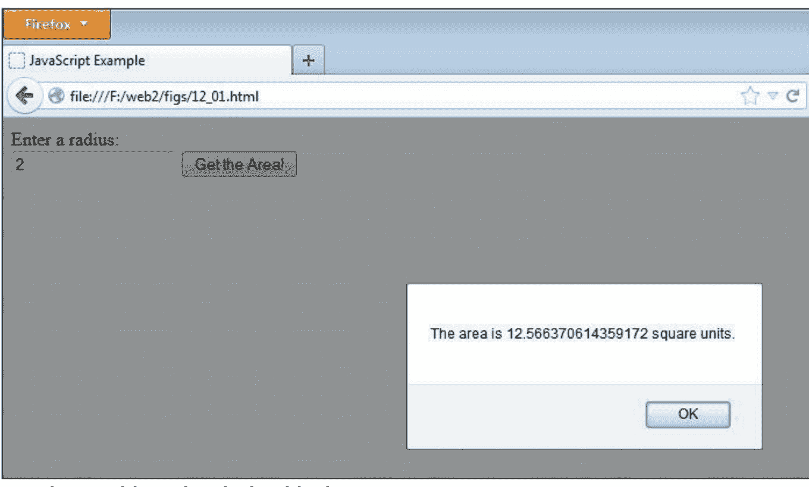

`Math` 对象的方法使您能够在脚本中执行某些有用的计算。表 12-2 列出了 `Math` 对象的各种方法，并简要描述了每个方法的用途。每个方法将在后续章节中更详细地讨论。

## 基本方法

在本书中，“基本方法”被定义为接受一个数字、对其进行简单计算并返回一个值的方法。以这种方式对方法进行分组，避免了为每种方法列出相同类型的示例——这不是任何官方的方法组织方式，只是加快讨论的一种方式。

### 方法用途

| 方法 | 用途 |
| :--- | :--- |
| `abs()` | 返回作为参数传递的数字的绝对值 |
| `acos()` | 返回作为参数传递的数字的反余弦值，以弧度表示 |
| `asin()` | 返回作为参数传递的数字的反正弦值，以弧度表示 |
| `atan()` | 返回作为参数传递的数字的反正切值，以弧度表示 |
| `atan2()` | 返回作为参数传递的两个数字的商的反正切值，以弧度表示 |
| `ceil()` | 返回大于或等于作为参数传递的数字的最小整数 |
| `cos()` | 返回作为参数传递的数字的余弦值，以弧度表示 |
| `exp()` | 返回 E 的以作为参数传递给方法的数字为指数的幂值 |
| `floor()` | 返回小于或等于作为参数传递的数字的最大整数 |
| `log()` | 返回作为参数传递的数字的自然对数 |
| `max()` | 返回作为参数传递的两个数字中较大的那个 |
| `min()` | 返回作为参数传递的两个数字中较小的那个 |
| `pow()` | 返回第一个参数作为第二个参数的幂的数值 |
| `random()` | 返回 0 到 1 之间的随机数；不需要参数 |
| `round()` | 返回作为参数传递的数字四舍五入到最接近的整数的值 |
| `sin()` | 返回作为参数传递的数字的正弦值，以弧度表示 |
| `sqrt()` | 返回作为参数传递的数字的平方根 |
| `tan()` | 返回作为参数传递的数字的正切值，以弧度表示 |

表 12-2 `Math` 对象的方法

以下基本方法的工作方式大体相同：
- `abs()`
- `exp()`
- `acos()`
- `log()`
- `sin()`
- `asin()`
- `atan()`
- `sqrt()`
- `tan()`
- `cos()`

这些基本方法中的每一个都接受一个数值并返回另一个值。由于一般用法相同，本讨论使用 `sqrt()` 作为示例，来说明其余方法如何使用以获取各自的值。如果您需要知道从不同方法返回的值的类型，请参阅表 12-2 以了解每个方法的功能。

使用 `sqrt()` 方法的最简单方法是将一个正数作为参数输入给该方法，如以下示例所示：
`window.alert(Math.sqrt(4));`

这会弹出一个警报，显示 4 的正平方根的值，即 2。

不是计算一个静态数字，而是可以让用户输入一个数字，然后向用户发出警报，显示用户输入数字的平方根。您可以使用以下代码来实现，首先是 HTML 代码：

```
<form id="getroot">
<label for="sr_num">Enter a (positive) number or zero:</label><br>
<input type="text" id="sr_num">
<input type="submit" value="Get a Square Root">
</form>
```

接下来是 JavaScript 代码：

```
var root_form = document.getElementById("getroot");
root_form.addEventListener("submit", function(event) {
  var thenum = document.getElementById("sr_num").value;
  thenum = +thenum || false;
  event.preventDefault();
  if (!thenum || (thenum.length < 1)) {
    alert("Input is required and must be numeric!");
    return;
  }
  else if (thenum < 0) {
    alert("Hey! I said to enter a positive number! Try again.");
    return;
  }
  else {
    var theroot = Math.sqrt(thenum);
    alert("The square root of " + thenum + " is " + theroot);
  }
}, false);
```

检索文本框（ID 为 `sr_num`）的值。

检查输入是否为空或非数字。

如果输入的数字是负数，查看者必须重试。

计算平方根并提醒查看者。

当用户提交表单时，文本框中输入的值被分配给 `thenum` 变量。接下来，函数检查字段是否为空或输入的数据是否为非数字。之后，它检查查看者是否输入了负数。任何这些情况都会提醒查看者错误。否则，使用 `thenum` 的值作为参数调用 `Math.sqrt()` 方法。这将返回该数字的平方根，然后将其分配给名为 `theroot` 的变量。最后，会出现一个警报，告诉用户平方根信息。

查看者输入数字 4 时，此脚本的结果如图 12-2 所示。本节中的其他方法的工作方式大致相同；它们只是返回不同的结果，如绝对值、正切值或对数。

### 双参数方法

本节讨论接受两个参数而不是一个参数的方法。这些方法包括：
- `atan2()`
- `max()`
- `min()`
- `pow()`

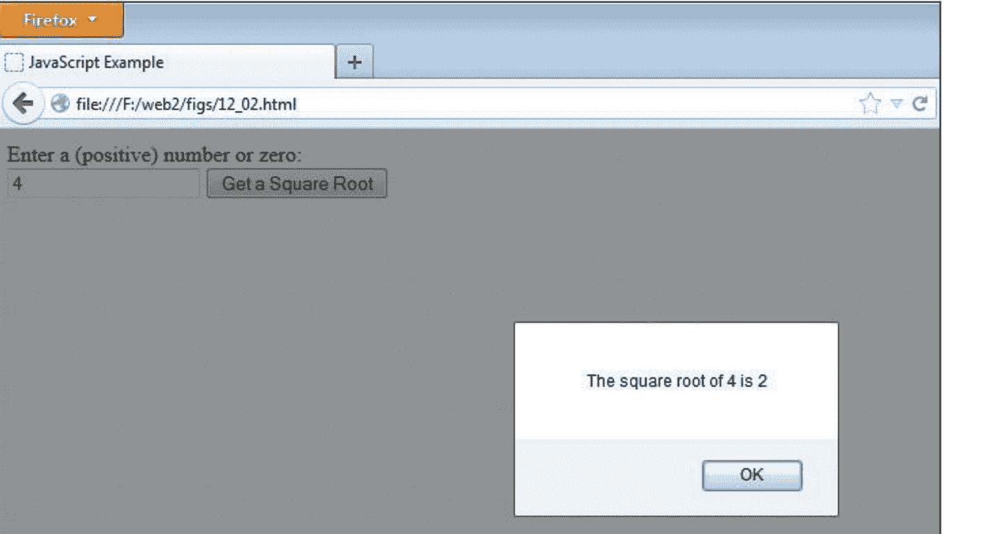

12-2 为查看者显示平方根。

`max()` 和 `min()` 方法非常相似，而 `pow()` 方法做的事情略有不同。

#### max() 和 min() 方法

`max()` 方法接受两个或更多个数字并返回最大的数字。`min()` 方法也接受两个参数，但返回较小的数字。您可以在一个脚本中使用这些方法，该脚本允许查看者输入两个数字，然后提醒用户哪个数字更大。

以下示例代码同时使用这两种方法，并在警报中向查看者提供结果。首先是 HTML 代码：

```
<form id="getmax">
Enter two numbers to see which is bigger:<br><br>
<label for="num1">1st Number</label>
<input type="text" id="num1"><br>
<label for="num2">2nd Number</label>
<input type="text" id="num2"><br><br>
<input type="submit" value="Which Number is Bigger?">
</form>
```

接下来是 JavaScript 代码：

```
var max_form = document.getElementById("getmax");
max_form.addEventListener("submit", function(event) {
  var num1 = document.getElementById("num1").value,
      num2 = document.getElementById("num2").value,
      largenum = 0,
      smallnum = 0;
  num1 = (+num1 === 0) ? 0 : +num1 || false;
  num2 = (+num2 === 0) ? 0 : +num2 || false;
  event.preventDefault();
  if ((num1 !== false) && (num2 !== false)) {
    largenum = Math.max(num1, num2);
    smallnum = Math.min(num1, num2);
    if (largenum === smallnum) {
      alert("Those two numbers are equal!");
    } else {
      alert(largenum + " is larger than " + smallnum);
    }
  }
}, false);
```

最大值和最小值的结果被分配给变量。

检查数字是否相等。

如果数字不相等，警报将显示。


#### `pow()` 方法

`pow()` 方法接受两个参数，并计算第一个参数的第二个参数次幂。例如，以下代码将返回 2 的三次方的值：

```
Math.pow(2,3);
```

除了计算方式不同，你可以像使用其他双参数方法一样通常地使用它：先将结果赋值给一个变量，然后在脚本中使用该变量。例如，你可以从以下 HTML 代码开始，使用这个脚本：

```
<form id="getpow">
<label for="base">底数:</label>
<input type="text" id="base"><br>
<label for="exp">指数:</label>
<input type="text" id="exp"><br><br>
<input type="submit" value="求幂">
</form>
```

接下来是 JavaScript 代码：

```
var pow_form = document.getElementById("getpow");
pow_form.addEventListener("submit", function(event) {
var base = document.getElementById("base").value,

exp = document.getElementById("exp").value,
result = 0;
base = +base || false;
exp = +exp || false;
event.preventDefault();
if ((base !== false) && (exp !== false)) {

result = Math.pow(base, exp);
alert(base + " 的 " + exp + " 次幂是 " + result); }
else {
alert("请输入数字值");
}
}, false);
```

使用这段代码，如果查看者在提示输入时输入 2 作为第一个数字，3 作为指数，脚本将计算 2 的三次方的结果。然后，查看者会收到一个显示答案的警报框。在 HTML 代码中点击按钮是查看者启动该函数的方式。当输入数字 2 和 3 时，此脚本的运行结果如下所示：

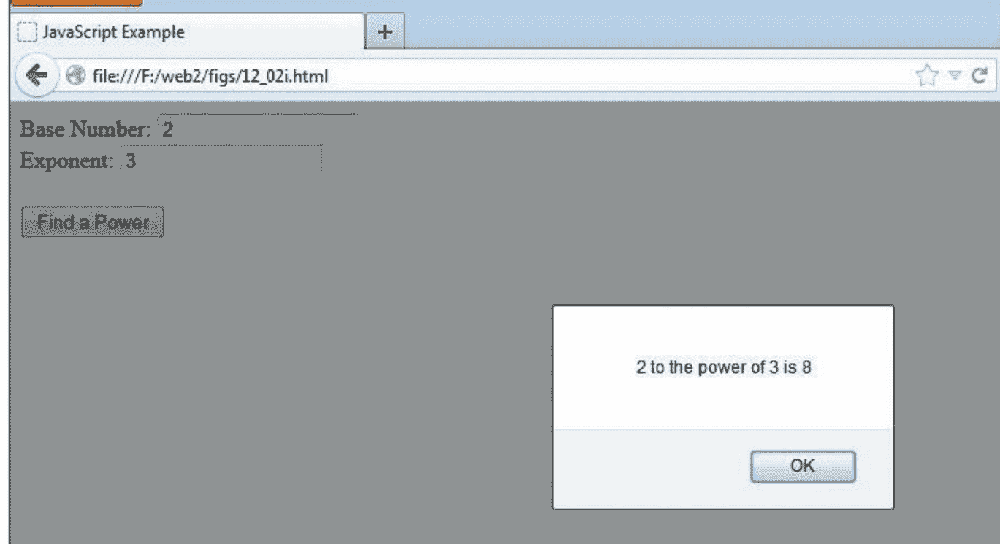

既然你已经了解了双参数方法，让我们来看一些尚未涵盖的其他方法。

## 其他方法

这些方法接受单个参数，但每个方法对该参数的处理方式值得仔细研究。具体方法包括：

- ceil()
- floor()
- round()

**`ceil()` 方法** `ceil()` 方法代表 ceiling（天花板），返回大于或等于作为参数传递的数字的最小整数。当数字中可能包含小数点后的数字时，主要使用此方法。它会将数字向上舍入到下一个最高的整数，除非该数字已经是整数。在这种情况下，将返回相同的数字（因为它可以相等）。例如，`Math.ceil(12.23);` 将返回 13，但 `Math.ceil(12);` 将返回 12。

以下脚本展示了 `ceil()` 方法如何用于返回不同值的示例，从 HTML 代码开始：

```
<form id="getceiling">
<label for="num">数字:</label>
<input type="text" id="num">
<input type="submit" value="求上取整"></form>
```

接下来是 JavaScript 代码：

```
var ceil_form = document.getElementById("getceiling");
ceil_form.addEventListener("submit", function(event) { var num = document.getElementById("num").value,
ceiling = 0;
num = +num || false;
event.preventDefault();
if (num) {

ceiling = Math.ceil(num);
alert(num + " 的上取整是 " + ceiling); }
else {
alert("请输入数字值。");
}
}, false);
```

此脚本显示一个警报框，说明查看者输入的数字的上取整值。下图显示了在浏览器中查看者在提示符处输入 4.55 时的结果。


**`floor()` 方法** `floor()` 方法类似于 `ceil()` 方法，但方向相反。`floor()` 方法返回小于或等于传递给该方法的参数的最大整数。它会将数字向下舍入到下一个最低的整数，除非该参数已经是整数。在这种情况下，它将返回相同的整数，因为它已经等于一个整数。基本上，这个方法只是移除数字的小数部分，保留整数部分作为结果。

例如，`Math.floor(12.23);` 将返回 12，`Math.floor(12);` 也将返回 12。你可以像上一节中使用 `ceil()` 方法那样使用 `floor()` 方法——将结果赋值给一个变量。

**`round()` 方法** `round()` 方法的工作方式类似于前两种方法，但它将作为参数输入的数字四舍五入到最接近的整数，无论该整数是大于还是小于该数字。任何小数部分值大于或等于 0.5 的数字都会被向上舍入，而任何小数部分值小于 0.5 的数字则会被向下舍入。

0.5 的分界点是严格的，所以即使你可能倾向于向上舍入，`Math.round(12.49999999);` 也会返回 12。

#### `random()` 方法

`random()` 方法对于创建需要随机整数的脚本非常有用。它返回一个介于 0 和 1 之间的随机数。这意味着你会得到一个小数位可能很长的数字，其本身用处不大。例如，它可能返回类似 0.36511165498095293 的值。

要获得一个可用的随机整数，你需要做些事情来获取你想要使用的值类型。

**随机整数** 要获得随机整数，你首先要做的是让结果具有更大的值范围，这样你就不会被限制在 0 和 1 之间。为了获得更大的值范围，你可以将 `random()` 方法的结果乘以一个整数，以创建一个更大的范围。像数组一样，范围将从 0 开始计数；因此，要获得五个可能整数的范围，你需要将结果乘以 5。以下代码展示了如何做到这一点：

```
var rand_num = Math.random() * 5;
```

这得到了介于 0 和 4 之间的结果，但还没有给你整数。这个数字可能仍然是一个很长的十进制数。

要获得 0 到 4 之间的整数，你需要找到一种方法将所有这些十进制数转换为整数。回想一下，你之前介绍了三种方法：`floor()`、`ceil()` 和 `round()`，它们以各种方式将数字转换为整数。你将在这里选择 `floor()` 方法，因为它只是移除整数后的小数部分，给你数字的整数部分。

要使用 `floor()` 方法，你可以编写以下代码：

```
var rand_num = Math.random()*5;
var rand_int = Math.floor(rand_num);
```

`floor()` 方法将 `rand_num` 变量的值作为参数接收，然后从中给你一个整数。

如果你想节省一行代码，可以稍微花哨一点。你可以直接将 `random()` 方法和计算作为 `floor()` 方法的参数插入。你可以这样做，因为计算的结果 `Math.random*5` 是一个数字，而 `floor()` 方法可以接受一个数字作为参数。以下代码展示了如何用一行代码编写这个：

```
var rand_int = Math.floor(Math.random()*5);
```

现在变量 `rand_int` 将具有一个介于 0 和 4 之间的随机整数值。你可能已经注意到，这种数字范围对于数组来说可能非常有用。这就是你开始编写一些带有随机数的有趣脚本的方式。

**脚本的随机数** 现在你可以通过使用 `random()` 方法在 `Math` 对象上玩点小乐趣了。通过设置一些数组，你可以创建一个脚本，在每次页面加载时提供随机引用语或显示随机图像。

**用于娱乐的随机引用** 如果你考虑过在页面中添加一句引用，但不想总是处理更改引用以显示不同内容的问题，那么随机引用脚本可能正是你需要的。

要制作这样的脚本，你首先需要一些要使用的引用。假设你想设置十个不同的引用，每次页面加载时以随机顺序显示。由于你有许多类似的值（这样你以后可以将它们与随机整数一起使用），你应该使用一个数组，以便可以轻松存储所有这些值并检索它们。

因此，你需要设置一个包含十个元素的数组，类似于以下示例，其中每个元素都是我为你精心挑选的一句随机（也许有些奇特的）引用：

```
var quotes = ["照照镜子。你是在看我吗？",
"我想是时候来点押韵了。",
"我的 JavaScript 书在哪儿？",
"要是我每花一美元就能得到一美元——噢，算了。",
"我猜你是在期待一句真正的引用吧。",
"引用很棒，但别引用我的话。",
"这里该写点什么？",
"故意拼错会怎样？",
"记住我的话，我会记住我的话。",
"此处留白给更佳引用。"

];
```

既然你已经在数组中有了这个奇怪的引用列表，你就可以通过生成随机整数来使用它们了。

你需要一个 0 到 9 之间的随机整数（十个数字），因此可以使用以下代码将一个 0 到 9 之间的随机整数赋值给变量：

```
var rand_int = Math.floor(Math.random() * 10);
```

现在变量 rand_int 的值将是一个 0 到 9 之间的随机整数。你可以用它来访问数组中索引号与 rand_int 变量中随机整数相匹配的元素。你只需使用该变量作为索引号来访问数组元素，如下面的示例所示：

```
quotes[rand_int]
```

你可以使用 div 元素的 innerHTML 属性将这个值写入页面主体中，如下面的示例代码所示。HTML 文档保存为 random_quotes.html，JavaScript 文件保存为 random_quotes.js。HTML 代码：

```
<h1>My Random Quote for You:</h1>
<div id="my_quote">
Look in the mirror. Are you looking at me?
</div>
<script type="text/javascript" src="random_quotes.js"></script>
```

JavaScript 代码：

```
var quotes = ["Look in the mirror. Are you looking at me?",
"It is time for a rhyme, I guess.",
"Where is my JavaScript book?",
"If I had a buck for every dollar I spent--Oops, never mind.", "I suppose you were expecting a real quote here.", "Quotes are great, but don't quote me on that.", "What should I write here?",
"Wut hapns iff eye miss spel ohn purpas?", "Mark my words, I will mark my words.", "This spot reserved for a better quote." ];
var q_div = document.getElementById("my_quote"); var rand_int = Math.floor(Math.random() * 10); q_div.innerHTML = quotes[rand_int];
```

该代码根据 rand_int 变量中的随机整数值将其中一个随机引用写入页面。对于没有 JavaScript 的用户，会提供一个默认引用（数组数据中的第一个），如果 JavaScript 可用，则会被随机引用覆盖。重新加载页面可以重置随机数，并且很可能会（虽然不一定，因为它是随机的）显示不同的引用。

图 12-3 显示了此脚本在浏览器中运行时的一种可能结果。图 12-4 显示了此脚本在浏览器中运行时的另一种可能结果。

你可以通过刷新页面不断获取不同的（有时相同的）结果。既然你能将随机引用写入页面，那么显示随机图片呢？

它与上一个脚本非常相似；你只需做少量调整即可。

## 随机图片打造更新外观

随机图片脚本可以让你的页面有不断更新的感觉，而无需你一直更换图片。当然，所有图片都需要适合你决定放置随机选择图片的内容区域。例如，随机图片脚本对于画廊展示其收藏品会很有用。

你需要的第一样东西是一个图片 URL 地址的数组（可以是本地地址或绝对地址——这里使用本地地址）。此脚本使用的数组如下示例代码所示：

```
var r_image= ["image0.gif", "image1.gif", "image2.gif", "image3.gif", "image4.gif", "image5.gif", "image6.gif",
"image7.gif", "image8.gif", "image9.gif"];
```

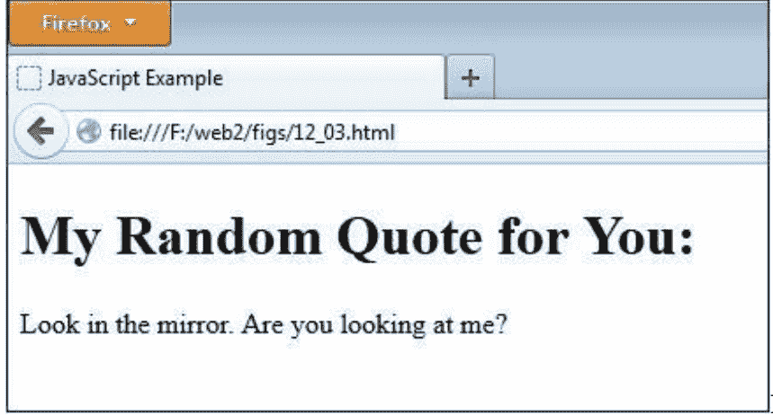

图 12-3 使用随机引用脚本的一种可能结果

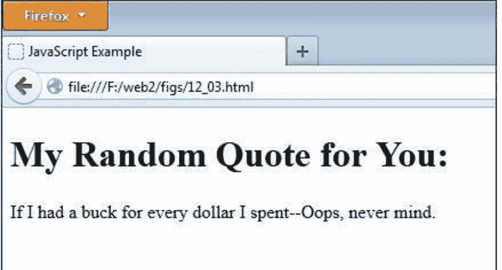

图 12-4 使用随机引用脚本的另一种可能结果

此数组设置了每次加载页面时可以随机显示的图片地址。

接下来，你需要一种方法来获取 0 到 9 之间的随机整数。这与之前的随机引用脚本相同：

```
Math.floor(Math.random() * 10);
```

下一步是在文档的 body 部分中访问数组，以便在浏览器中加载页面时显示数组中的随机图片。

以下代码使你能够使用 img 元素的 src 属性显示随机图片。HTML 文件保存为 random_images.html，JavaScript 文件保存为 random_images.js。首先，HTML 代码：

```
<h1>My Random Image for You:</h1>
<div>

</div>
<script type="text/javascript" src="random_images.js"></script>
```

接下来，JavaScript 代码：

```
var r_image= ["image0.gif", "image1.gif", "image2.gif", "image3.gif", "image4.gif", "image5.gif", "image6.gif", "image7.gif", "image8.gif", "image9.gif"],

im = document.getElementById("my_image"),
rand_int = Math.floor(Math.random() * 10);
im.src = r_image[rand_int];
```

如你所见，这与随机引用脚本非常相似。由于你要更改的是图片，因此可以将结果赋值给图片元素上可用的 src 属性以动态更改图片。如果你还需要更改文本，可以像处理随机引用那样改用 innerHTML。

> 注意
> 在此示例中，图片保存为 image0.gif、image1.gif 等；但是，你可以将图片文件保存为任何你喜欢的名称。

关于 random() 方法的讨论可以持续一段时间，因为有无数事物可以随机化。不过，你现在已经了解了此功能的基础知识，是时候继续前进了。

## 专家问答

**问：Math 对象的属性我以后会用到吗？它们都是一些我根本不用的数字！**

**答：**这取决于你执行不同类型计算的频率。作为初学者，你不太可能使用其中任何一个，但网上有一些脚本出于各种高级目的而使用它们，例如 JavaScript 计算器、图形对象（如 canvas 元素）等。

**问：我对编写计算器没有任何兴趣。我真的需要费心记住 Math 对象的所有属性吗？**

**答：**嗯，可能不需要，因为你需要使用它们的情况可能不会经常出现。不过，手边有参考资料以备不时之需是好的，而且大致了解它们是什么也是有益的，因为它们会不时出现在网上的脚本中。

**问：如果身边没有计算器，其中一些属性和方法可能会很方便。我可以写一个小脚本来为自己计算一些东西，对吧？**

**答：**当然可以！只需确保先用你知道答案的数字进行双重检查，以确保代码中没有错误。

**问：到目前为止 random() 方法很有趣，但我想不出还有什么其他用途。你能给我一些用它做其他事情的建议吗？**

**答：**有很多其他用途。你可以随机化几乎任何可以用 HTML 标签或纯文本显示的内容，所以尝试一些想法，看看是否对你有用。不过，这里有一些我随手想到的：随机链接、随机链接图片、某种 JavaScript 游戏中的随机任务（如掷骰子或抽牌）、随机页面问候语、随机警报……我相信还有很多。

*动手实践 12-1*

在页面上显示随机链接

*pr12_1.html* 此脚本通过让你创建一个在页面上显示随机链接的脚本来 *prjs12_1.js* 帮助你进一步练习 random() 方法的使用。

## 分步操作

1. 创建一个 HTML 页面，其中的 script 标签指向名为 prjs12_1.js 的外部 JavaScript 文件。添加一个标题"Random Link"，并添加一个 id 为 random_link 的 div 元素。在 div 元素内，为没有 JavaScript 的用户插入一个默认链接。将 HTML 文件保存为 pr12_1.html。

2. 完成后，HTML 文件的 body 部分应如下所示：

```
<body>
<h1>Random Link</h1>
<div id="random_link">
<a href="http://www.scripttheweb.com">Random Site!</a> </div>
<script type="text/javascript" src="prjs12_1.js"></script> </body>
```

3. 创建一个外部 JavaScript 文件并保存为 prjs12_1.js。在步骤 4–7 中使用它。

4. 在数组中创建一组五个网址。使用以下地址或你自己选择的一些地址：

- http://www.scripttheweb.com
- http://www.webxpertz.net
- http://www.duckduckgo.com
- http://www.yahoo.com
- http://www.google.com

5. 使用 random() 方法创建一个随机整数，你可以用该整数作为索引号来访问数组。

6. 通过更改 id 为 random_link 的 div 元素的 innerHTML 属性，以如下所示的格式在页面上显示随机链接：

当完成时，JavaScript文件应如下所示：

```
var urls = ["http://www.scripttheweb.com",
"http://www.webxpertz.net",
"http://www.duckduckgo.com",
"http://www.yahoo.com",
"http://www.google.com"
],
rdiv = document.getElementById("random_link"),
rand = Math.floor(Math.random() * 5);

rdiv.innerHTML = '<a href="' + urls[rand] + '">Random Site!</a>';
```

8.  保存JavaScript文件，然后在你的网页浏览器中打开HTML文件。尝试刷新几次，看看链接如何显示随机地址。

**试试看总结**
在这个项目中，你运用了Math对象的知识。使用`random()`方法，你创建了一个网页，该网页显示一个指向随机网址的链接。

**理解Number对象**
Number对象是另一个预定义的JavaScript对象，它为数字处理提供了几个有用的属性和方法。它最常见的用途是访问其一些代表特定值的属性，这些值在创建脚本时能为你提供帮助。

### 属性
表12-3列出了Number对象的属性，并简要描述了每个属性的用途。本节将更详细地描述每个属性。

| 属性 | 目的 |
| :--- | :--- |
| MAX_VALUE | 代表JavaScript将数字解释为无穷大之前的最大数值常量 |
| MIN_VALUE | 代表JavaScript将数字解释为负无穷大之前的最小数值常量 |
| NaN | 表示“非数字”的值 |
| NEGATIVE_INFINITY | 表示负无穷大的值 |
| POSITIVE_INFINITY | 表示正无穷大的值 |

#### 表12-3 Number对象的属性

#### MAX_VALUE属性
MAX_VALUE属性是一个常量数值，大约为1.79E+308。这个属性之所以有用，是因为任何大于其值的数字在JavaScript中都会被表示为无穷大。因此，在比较中使用它，可以提供一种避免进行数值过大而无法显示数值的计算的方法。以下代码演示了如何实现这一点：

```javascript
var big_num = num1 * num2 * num3;
if (big_num > Number.MAX_VALUE) {
    alert("The number is too large, try smaller numbers.");
}
else {
    alert(big_num);
}
```

假设`num1`、`num2`和`num3`是由用户输入的，如果`big_num`的值大于MAX_VALUE属性的值，警报将提示用户尝试输入较小的数字进行计算，而不是显示单词"infinity"作为答案。

#### MIN_VALUE属性
MIN_VALUE属性是一个常量数值，大约为5e-324。这个属性之所以有用，是因为任何小于其值的数字在JavaScript中都会被表示为负无穷大。因此，在比较中使用它，可以提供一种避免进行数值过小而无法显示数值的计算的方法。以下代码演示了如何实现这一点：

```javascript
var small_num = num1 - num2 - num3;
if (small_num < Number.MIN_VALUE) {
    alert("The number is too small, try larger numbers.");
}
else {
    alert(small_num);
}
```

假设`num1`、`num2`和`num3`是由用户输入的，如果计算结果小于MIN_VALUE属性的值，警报将提示用户尝试输入较大的数字进行计算。

#### NaN属性
NaN属性是一个代表"非数字"的值。它在浏览器中显示为字符串值`NaN`，并且不等于任何数字或另一个NaN实例。

#### NEGATIVE_INFINITY属性
NEGATIVE_INFINITY属性是一个代表负无穷大的常量值。它的使用方式与MIN_NUMBER和MAX_NUMBER类似。

#### POSITIVE_INFINITY属性
POSITIVE_INFINITY属性是一个代表正无穷大的常量值。它的使用方式与MIN_NUMBER和MAX_NUMBER类似。

**注意**
无穷大在数学方程中的行为与其他数字不同。有关更多信息，请参阅 tutorial.math.lamar.edu/Classes/CalcI/TypesOfInfinity.aspx。

### 方法
表12-4列出了Number对象的方法，并简要描述了每个方法的用途。以下各节将更详细地讨论每个方法。

### toExponential()、toFixed(tbl>、toPrecision()和toString()方法
这些方法返回一个字符串值，代表Number对象以特定方式格式化后的样子。注意，这些方法不能直接用于数字本身（一个数值），如以下代码所示：

```javascript
alert(10.toExponential());
```

这将导致JavaScript错误，因为它期望一个Number对象。为避免此问题，请通过将数值赋给变量（这将使它们成为Number对象）来使用这些方法，如以下代码所示：

```javascript
var the_num = 10;
alert(the_num.toExponential());
```

**注意**
你也可以使用构造函数语法`var the_num = new Number(10);`，这也是有效的。

**表12-4 Number对象的方法**

| 方法 | 目的 |
| :--- | :--- |
| toExponential() | 返回一个字符串值，表示以指数记数法表示的数字 |
| toFixed() | 返回一个字符串值，表示四舍五入到指定小数位数的数字 |
| toPrecision() | 返回一个字符串值，表示四舍五入到指定位数有效数字的数字 |
| toSource() | 返回一个字符串值，表示对象的源代码 |
| toString() | 返回一个Number对象的字符串值 |
| valueOf() | JavaScript内部最常使用 |

#### toExponential()方法
`toExponential()`方法返回一个表示Number对象的指数记数法形式的字符串。因此，以下代码将在屏幕上写入1.0e+1（或类似表示，取决于你的浏览器）的结果：

```javascript
var the_num = 10;
alert(the_num.toExponential());
```

#### toFixed()方法
`toFixed()`方法返回一个字符串，表示四舍五入到指定小数位数的Number对象。例如，如果你需要将计算结果格式化为货币值，你可以使用此方法将计算结果四舍五入到小数点后第二位，并以你的货币格式显示。例如，此代码使用美元和美分：

```javascript
var kidsmoney = 2000;
var mykids = 7;
var one_share = kidsmoney/mykids;
alert("One share of the money is $" + one_share.toFixed(2));
```

一份份额的计算结果是285.7142857142857，但因为使用了`toFixed()`方法并指定参数为2，句子将显示为：One share of the money is $285.71

#### toPrecision()方法
`toPrecision()`方法返回一个字符串，表示四舍五入到指定位数有效数字的Number对象。这适用于小数点前后的所有数字。因此，如果你想将一个像45.57689349这样的数字四舍五入到五位有效数字，你可以使用以下代码：

```javascript
var the_num = 45.57689349;
alert(the_num.toPrecision(5));
```

浏览器将警报显示字符串`45.577`，这是四舍五入到五位有效数字（在本例中是小数点前两位和小数点后三位）的结果。

#### toString()方法
`toString()`方法返回Number对象（或数值变量值）的字符串值。如果你想要将数值转换为相应的字符串值（例如，将10变为"10"），这会很有用。

#### toSource()方法
`toSource()`方法返回一个表示对象源代码的字符串值。对于预定义的Number对象，此方法返回构造函数属性的值。此方法最常由JavaScript内部调用，在代码中使用较少。

#### valueOf()方法
这是另一个主要由JavaScript内部使用的方法。目前，你只需要知道它是Number对象的一个有效方法。

#### parseInt()和parseFloat()方法
虽然不是Number对象的方法，但当你需要从混合字符串中获取数值时，这两个方法很有用。它们的工作方式类似，`parseInt()`只提取数字的整数部分，而`parseFloat()`提取整数和小数点后的任何数字。以下是它们的工作原理：

*   如果字符串的第一个字符是数字以外的任何字符、加号（+）或减号（-），则两个方法都返回`NaN`。
*   对于`parseInt()`，如果第一个字符是数字（零除外）、加号或减号，则会逐个字符进行评估，直到遇到非数字字符（十六进制值除外，其中允许使用x和A等其他某些字符）。将返回从这个过程中获得的数字。如果第一个字符是零且该数字不是十六进制，则返回零。

对于 `parseFloat()`，如果第一个字符是数字、加号或减号，它将计算每个字符，并在发现一个点号 (`.`) 后面跟着额外数字时继续计算，直到遇到第二个非数字字符。如果数字以零开头且不是十六进制数，则忽略前导零直到遇到另一个数字。此过程获得的数字将被返回。十六进制数字返回零。

下面是一些每个方法返回值的示例，展示了这些规则如何工作：

```
parseInt("14"); // 返回 14
parseInt("cool567"); // 返回 NaN
parseInt("+34blah"); // 返回 34
parseInt("-23awesome"); // 返回 -23
parseInt("020"); // 返回 0
parseInt("0xA"); // 返回 10 – 十六进制值

parseFloat("14"); // 返回 14
parseFloat("blah22"); // 返回 NaN
parseFloat("123.456"); // 返回 123.456
parseFloat("123.45.6"); // 返回 123.45 – 第二个点结束进程
parseFloat("023.44"); // 返回 23.44
parseFloat("0xAF"); // 返回 0
```

使用 `parseInt()` 时，你可以定义第二个参数，称为基数（radix）。这使你有机会指定要返回的数字类型。以下是一些示例：

```
parseInt("11", 10); // 返回 11
parseInt("11", 2); // 返回 3 – 使用二进制值
parseInt("11", 16); // 返回 17 – 使用十六进制值
parseInt("11", 8); // 返回 9 – 使用八进制值
```

如你所见，根据指定的基数，相同的值可能会有不同的结果。`parseFloat()` 方法没有此选项，因为根据设计，它只会解析十进制值。

> 提示
> 当基数参数被省略时，JavaScript 会决定返回何种类型的值。在某些情况下，这可能导致意外结果。为避免这种情况，最好指定基数值，即使在处理十进制值时也是如此（将基数指定为 10）。

## 使用 Date 对象

Date 对象是另一个预定义的 JavaScript 对象。它允许你设置某些时间值并获取某些时间值，以便在脚本中使用。要使用此对象，你需要创建一个可以引用的对象实例。

要创建 Date 对象的实例，你需要使用 `new` 关键字（就像你使用许多其他对象一样），如以下示例所示：

```
var instance_name = new Date();
```

你需要将 *instance_name* 替换为 Date 对象实例的名称。因此，如果你想要一个名为 *rightnow* 的实例，可以使用以下代码：

```
var rightnow = new Date();
```

现在你有一个名为 *rightnow* 的对象实例。

使用构造函数时，默认日期是当前日期；但是，如果需要，你可以指定不同的日期，如以下代码所示：

```
var go_back = new Date("November 5, 1955");
```

一旦你有一个对象实例，就可以使用 Date 对象的属性和方法来执行各种任务（例如创建 JavaScript 时钟）。这些属性和方法将在以下部分中描述。

## 属性和方法

Date 对象本身不提供属性（构造函数和原型除外），但它确实有大量可供你使用的方法。表 12-5 列出了 Date 对象的各种方法及其用途。每个方法将在后续章节中更详细地讨论。

现在你有了长长的方法列表，让我们更详细地了解它们，首先从用于在 Date 对象实例中获取日期值的方法开始。

### 表 12-5 Date 对象的方法

| 方法 | 用途 |
| --- | --- |
| getDate() | 根据查看者的本地时间返回月份中的日期 |
| getDay() | 根据查看者的本地时间返回一周中的天数 (0–6) |
| getHours() | 根据查看者的本地时间返回一天中的小时数 (0–23) |
| getMilliseconds() | 根据查看者的本地时间返回秒中的毫秒数 (0–999) |
| getMinutes() | 根据查看者的本地时间返回小时中的分钟数 (0–59) |
| getMonth() | 根据查看者的本地时间返回年份中的月份 (0–11) |
| getSeconds() | 根据查看者的本地时间返回分钟中的秒数 (0–59) |
| getTime() | 返回 Date 对象自 1970年1月1日 以来的毫秒数 |
| getTimezoneOffset() | 根据查看者的本地时区返回时区偏移量（相对于格林威治标准时间），单位为分钟 |
| getYear() | 根据查看者的本地时间返回年份（两位数） |
| getFullYear() | 根据查看者的本地时间返回完整年份（四位数） |
| getUTCDate() | 返回协调世界时 (UTC) 中的月份日期 |
| getUTCDay() | 返回协调世界时 (UTC) 中一周的天数 (0–6) |
| getUTCFullYear() | 返回协调世界时 (UTC) 中的完整年份（四位数） |
| getUTCHours() | 返回协调世界时 (UTC) 中一天的小时数 (0–23) |
| getUTCMilliseconds() | 返回协调世界时 (UTC) 中当前秒的毫秒数 (0–999) |
| getUTCMinutes() | 返回协调世界时 (UTC) 中小时的分钟数 (0–59) |
| getUTCMonth() | 返回协调世界时 (UTC) 中当前年份的月份 (0–11) |
| getUTCSeconds() | 返回协调世界时 (UTC) 中当前分钟的秒数 (0–59) |
| parse() | 返回根据查看者的本地时间解析作为参数传递的日期自 1970年1月1日 以来的毫秒数 |
| setDate() | 设置 Date 对象实例的月份日期 |
| setHours() | 设置 Date 对象实例的小时 |
| setMilliseconds() | 设置 Date 对象实例的毫秒 |
| setMinutes() | 设置 Date 对象实例的分钟 |
| setMonth() | 设置 Date 对象实例的月份 |
| setSeconds() | 设置 Date 对象实例的秒 |
| setTime() | 设置 Date 对象实例的时间（以自1970年1月1日午夜以来的毫秒数表示） |
| setYear() | 设置 Date 对象实例的年份（两位数） |
| setFullYear() | 设置 Date 对象实例的完整年份（四位数） |
| setUTCDate() | 设置协调世界时 (UTC) 中的月份日期 |
| setUTCFullYear() | 设置协调世界时 (UTC) 中的完整年份（四位数） |
| setUTCHours() | 设置协调世界时 (UTC) 中一天的小时数 (0–23) |
| setUTCMilliseconds() | 设置协调世界时 (UTC) 中当前秒的毫秒数 (0–999) |
| setUTCMinutes() | 设置协调世界时 (UTC) 中小时的分钟数 (0–59) |
| setUTCMonth() | 设置协调世界时 (UTC) 中当前年份的月份 (0–11) |
| setUTCSeconds() | 设置协调世界时 (UTC) 中当前分钟的秒数 (0–59) |
| toDateString() | 将 Date 对象的日期部分作为美式英语字符串返回 |
| toGMTString() | 返回格林威治标准时间 (GMT) 格式的日期字符串（现在使用 toUTCString() 代替） |
| toLocaleString() | 返回基于区域设置格式化的日期字符串 |
| toLocaleDateString() | 将 Date 对象的日期部分作为基于区域设置的字符串返回 |
| toLocaleTimeString() | 将 Date 对象的时间部分作为基于区域设置的字符串返回 |
| toString() | 返回美式英语格式的日期字符串 |
| toTimeString() | 将 Date 对象的时间部分作为美式英语字符串返回 |

### 表 12-5 Date 对象的方法（续）

## 获取值的方法

获取值的方法允许你获取各种时间和日期值，以便在脚本中使用。允许你获取 Date 对象实例值的方法包括以下：

- getDate()
- getDay()
- getHours()
- getMilliseconds()
- getMinutes()
- getMonth()
- getSeconds()
- getTime()
- getTimezoneOffset()
- getYear()
- getFullYear()
- getUTCDate()
- getUTCDay()
- getUTCFullYear()
- getUTCHours()
- getUTCMilliseconds()
- getUTCMinutes()
- getUTCMonth()
- getUTCSeconds()

要使用这些方法，你需要一个 Date 对象的实例。一旦你有了它，就可以通过使用实例名称来调用任何方法。以下是执行此操作的语法：

```
instance_name.method();
```

你需要将 *instance_name* 替换为你的 Date 对象实例的名称，并将 *method* 替换为你希望使用的方法函数。

因此，如果你想对名为 *rightnow* 的 Date 对象实例使用 `getDate()` 方法，你会使用
```

以下代码：
var rightnow = new Date();
var theday = rightnow.getDate();

这行代码将 `getDate()` 方法返回的值赋给一个名为 `theday` 的变量。由于 `Date` 方法返回的值通常是数字，因此需要对这些方法做进一步说明；接下来的几个章节将更详细地介绍这些方法。

### getDate() 方法

`getDate()` 方法使你能够获取脚本中月份的日期。返回的值是一个代表月份中第几天的数字。因此，如果当前是本月的5号，`getDate()` 方法将返回 5。如果是22号，`getDate()` 方法将返回 22。这个方法很好，因为它相当直观。

### getDay() 方法

`getDay()` 方法使你能够获取星期几；然而，它返回的不是像星期一或星期五这样的名称，而是一个数字。这个数字表示的是一周中已经过去了多少天（0-6），而不是你通常心目中的星期几（1-7）。因此，如果是星期天，该方法返回 0；如果是星期三，该方法返回 3。在脚本中开始使用它时，你必须记住它是从0开始计数的。接下来的许多方法都将从0开始计数。

### getHours() 方法

`getHours()` 方法使你能够获取一天中的小时数（0-23）。计数从0开始。因此，当是午夜时，该方法返回 0；当是下午2点时，返回 14。

### getMilliseconds() 方法

`getMilliseconds()` 方法使你能够获取 `Date` 对象实例中存储的毫秒数（0-999）。

### getMinutes() 方法

`getMinutes()` 方法使你能够获取 `Date` 对象实例中存储的分钟数（0-59）。同样，计数从0开始。因此，如果是2:00（凌晨或下午），或者任何整点时刻，该方法返回 0；如果是2:23，该方法返回 23。

### getMonth() 方法

`getMonth()` 方法使你能够获取 `Date` 对象实例中存储的月份（0-11）。此方法也从0开始计数，这使得结果有点微妙。例如，如果是一月（人们通常认为是1月），该方法返回 0；如果是十月（人们通常认为是10月），该方法返回 9。在脚本中使用这个方法时需要格外小心，因为如果你想要使用数字日期（如10/24/2000），你需要记住进行调整。

### getSeconds() 方法

`getSeconds()` 方法使你能够获取 `Date` 对象实例中存储的秒数（0-59）。因此，如果时间是2:42:23，该方法返回 23；如果时间是2:23:00，该方法返回 0。

### getTime() 方法

`getTime()` 方法获取一个 `Date` 对象实例的时间（以自1970年1月1日午夜以来的毫秒数表示）。因此，如果你想知道从那个日期到当前时间的毫秒数，可以使用以下代码：

```
var rightnow = new Date();
var theday = rightnow.getTime();
```

这行代码将方法的结果赋给一个变量，以便在脚本中需要时可以稍后使用。

### getTimezoneOffset() 方法

`getTimezoneOffset()` 方法返回本地时间与格林威治标准时间（GMT）相差的分钟数。因此，如果你与GMT相差六小时，该方法将返回 360（6 × 60）；如果只相差一小时，则返回 60。

### getYear() 方法

此方法返回年份的最后两位数字（至少在1900到1999年之间是这样）。例如，如果年份是1988，该方法返回 88。在2000年之后，一些浏览器会返回三位数的年份，而另一些则返回四位数。为了避免这种情况，你可以使用 `getFullYear()` 方法，该方法由较新的浏览器支持，并返回四位数的年份。

### getFullYear() 方法

`getFullYear()` 方法与 `getYear()` 方法非常相似，不同之处在于它始终返回四位数的年份，以避免千年虫问题。

`getFullYear()` 方法的工作原理与 `getYear()` 方法相同，但你无需进行任何额外的检查来确保年份是正确的：

```
var rightnow = new Date();
var theyear = rightnow.getFullYear();
```

这行代码将方法返回的值赋给 `theyear` 变量。这次，该值已经是四位数，无需任何调整。

### UTC 方法

这些方法与其对应的方法（例如 `getDate()` 和 `getUTCDate()` 工作方式相同）的工作原理相同，但返回的信息基于世界协调时间（UTC），而不是查看者的本地时间。

既然你已经了解了获取值的方法，接下来看看那些使你能够为 `Date` 对象实例设置值的方法。

## 设置值的方法

设置值的方法处理的值类型与获取值的方法相同。使你能够为 `Date` 对象实例设置值的方法包括：

- setDate()
- setHours()
- setMilliseconds(), setMinutes(), setMonth()
- setSeconds(), setTime()
- setYear()
- setFullYear()
- setUTCDate()
- setUTCFullYear(), setUTCHours()
- setUTCMilliseconds(), setUTCMinutes(), setUTCMonth()
- setUTCSeconds()

要设置这些值，你需要根据想要使用的时间或日期向它们发送一个数字参数。例如，如果你想设置 `Date` 对象实例的月份中的日期，可以使用以下代码：

```
var rightnow = new Date();
rightnow.setDate(22);
```

这将把 `rightnow` 这个 `Date` 对象实例的月份中的日期设置为22号。其他方法的工作方式相同。为了知道需要向其中一个方法发送什么值，请查看其对应获取值的方法返回什么类型的值。该方法期望的参数将是一个与该方法返回值类似的值。

## 其他方法

剩余的方法执行其他方法未涵盖的某些任务。

### parse() 方法

`parse()` 方法用于查找自1970年1月1日午夜以来的毫秒数，该毫秒数对应于作为参数输入的日期字符串（例如 Dec 12, 1999）。这通常与 `setTime()` 方法一起使用，因为后者需要一个以毫秒为单位的参数来设置时间。你可以使用 `parse()` 方法查找日期 Dec 12, 1999 午夜（`rightnow` 这个 `Date` 对象实例将使用此日期作为所有方法返回值的基准日期）自1970年1月1日以来的毫秒数，如下所示：

```
// 这个方法可以直接从 Date 对象调用
var thenum = Date.parse("Dec 12, 1999");
rightnow.setTime(thenum);
```

此代码将日期解析为毫秒数，然后将其发送到用于 `rightnow` 这个 `Date` 对象实例的 `setTime()` 方法。

### toString()、toDateString()、toTimeString()、toLocaleDateString() 和 toLocaleTimeString() 方法

这些方法返回一个代表日期和时间或其一部分的字符串。例如，`toString()` 方法返回一个字符串格式的日期。你可以用它来获取 `Date` 对象实例的格式化日期，如下所示：

```
var rightnow = new Date();
var thedate = rightnow.toString();
```

这将一个日期字符串值赋给变量 `thedate`。字符串的值取决于查看者使用什么浏览器查看页面。然后可以将其写入页面或在脚本中与 `Date` 对象的其他方法一起使用。

### toGMTString() 方法

`toGMTString()` 方法返回一个 GMT 格式的日期字符串。你可以用它来获取 `Date` 对象实例的 GMT 格式，如下所示：

```
var rightnow = new Date();
var thedate = rightnow.toGMTString();
```

这将把一个值（例如 Wed, 21 Dec 2003 11:12:44 GMT）赋给变量 `thedate`。然后可以将其写入页面或在脚本中与 `Date` 对象的其他方法一起使用。

### toLocaleString() 方法

`toLocaleString()` 方法返回一个以查看者区域设置格式表示的日期字符串。你可以用它来获取 `Date` 对象实例的区域设置格式，如下所示：

```
var rightnow = new Date();
var thedate = rightnow.toLocaleString();
```

这将一个日期字符串值赋给变量 `thedate`。字符串的值取决于查看者使用什么浏览器查看页面。然后可以将其写入页面或在脚本中与 `Date` 对象的其他方法一起使用。

既然你已经掌握了这些方法，试试用 `Date` 对象玩点有趣的东西吧。

## 来点日期脚本怎么样？

技术概述已经完成，你已经准备好创建一些使用 `Date` 对象方法的脚本了。首先你将编写一个脚本来在页面上显示日期，然后你将创建一个简单的状态栏时钟脚本。

### 在页面上显示日期

要在页面上显示日期，你需要使用一些 `Date` 对象方法来获取所需的值。假设你想要编写一个格式为“星期二, M/D/Y（月/日/年）”的日期。为此，你需要找出星期几、月份、月份中的日期和年份。你可以使用 `getDay()`、`getMonth()`、`getDate()` 和 `getFullYear()` 方法来完成此操作。

以下脚本将日期写入页面。首先是 HTML 代码（保存为 write_date.html）：

```html
<h1>Today's Date</h1>
<div id="write_date">
<!-- 在此处可以调用服务器端脚本作为备用方案 -->
</div>
<script type="text/javascript" src="write_date.js"></script>
```

注意 div 元素中的注释。如果你想让不支持 JavaScript 的浏览器也能访问，你可以在这里放置一个对 PHP（或其他服务器端技术）脚本的调用，为那些缺少 JavaScript 的浏览器提供支持。例如，如果你的页面设置了 PHP 解析，你可以使用以下代码来显示日期，其效果与 JavaScript 代码类似：

```php
<h1>Today's Date</h1>
<div id="write_date">
<?PHP
$the_date = date("l, n/j/Y");
echo "$the_date";
?>
```


## 第 12 章

你会看到，由于其内置的日期格式化功能，PHP 脚本比 JavaScript 脚本要短得多。显示的日期可能与查看者的日期不同，因为它显示的是 Web 服务器上的日期。服务器端技术的深入讨论超出了本书的范围，但这提供了一个示例，说明如何为那些没有 JavaScript 的用户提供相同的基本功能。

接下来是 JavaScript 代码（保存为 `write_date.js`）：

```javascript
var rightnow = new Date(),
    weekday = rightnow.getDay(),
    themonth = rightnow.getMonth(),
    thedate = rightnow.getDate(),
    theyear = rightnow.getFullYear();
    ds = ["Sunday", "Monday", "Tuesday",
        "Wednesday", "Thursday", "Friday", "Saturday"],
    date_div = document.getElementById("write_date");
themonth++;
date_div.innerHTML = ds[weekday] + ", " + themonth + "/" + thedate +
    "/" + theyear;
```

该脚本将方法的结果设置为变量。然后它创建一个数组来保存星期几，之后使用 `getDay()` 方法返回的数字作为索引来访问这些值。接着，脚本进行调整，将 `getMonth()` 方法返回的数字加 1，这样月份就会以你期望的方式显示（回想一下，它是从 0 开始计数月份，而不是从 1 开始，因此这确保了一月份由数字 1 而不是 0 表示，例如）。

格式化的输出被写入页面供查看者查看。在浏览器中运行此脚本的结果如图 12-5 所示。

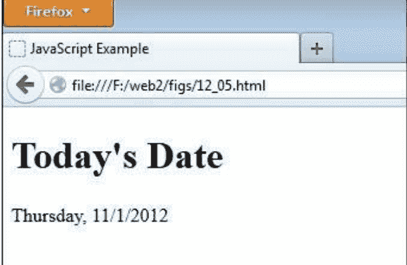

### 创建一个简单的时钟

要创建一个简单的时钟，你需要当前时间的小时、分钟和秒。要获取这些，可以使用 `getHours()`、`getMinutes()` 和 `getSeconds()` 方法。

以下代码将创建一个显示在页面上的时钟。首先是 HTML 代码（保存为 `clock.html`）：

```html
<h1>Current Time:</h1>
<div id="my_clock">
    <!-- call to a server-side script for backup could go here -->
</div>
<script type="text/javascript" src="clock.js"></script>
```

> **注意**
> 如果你使用服务器端脚本作为 JavaScript 时钟的备份，你几乎肯定不希望它每秒更新一次，因为这可能会给 Web 服务器带来不必要的压力。在这种情况下，最好只是显示时间而不进行更新。

接下来是 JavaScript 代码（保存为 `clock.js`）：

```javascript
function startclock() {
    var thetime = new Date(),
        hours = thetime.getHours(),
        mins = thetime.getMinutes(),
        secn = thetime.getSeconds(),
        ap = (hours >= 12) ? "p.m." : "a.m.",
        clock_div = document.getElementById("my_clock");

    hours = (hours >= 13) ? hours -= 12 : hours;
    hours = (hours < 1) ? 12 : hours;
    mins = (mins < 10) ? "0" + mins : mins;
    secn = (secn < 10) ? "0" + secn : secn;
    clock_div.innerHTML = hours + ":" + mins + ":" + secn + " " + ap;

    setTimeout(function() { startclock(); }, 1000);
}

startclock();
```

该脚本使用 `setTimeout()` 方法每秒调用一次。小时、分钟和秒数经过调整，以便像典型的 12 小时制数字时钟一样显示。该脚本创建一个函数，将方法的结果设置为变量。它获取 `hours` 变量，并在小时数大于或等于 12 时将 `ap` 变量设置为 "p.m."，在小时数小于 12 时设置为 "a.m."（此时 `hours` 变量仍然保存着 13 代表下午 1 点，14 代表下午 2 点，依此类推）。完成此操作后，调整 `hours` 变量，使其显示 12 小时制时钟的预期值。

然后，脚本调整显示分钟和秒的变量的值，当数字小于 10 时在前面添加一个 0。这样，时钟会显示 12:02:34，而不是省略 0 显示 12:2:34（如果你希望小时变量也有前导零，也可以这样做）。

`hours`、`mins`、`secn` 和 `ap` 变量被组合起来，作为 `div` 元素的新 `innerHTML` 显示出来。

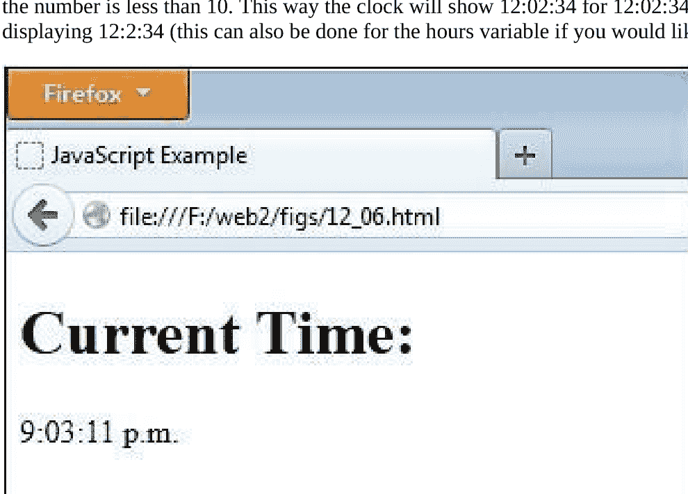

图 12-6 当前时间显示在页面上。

最后，函数在页面上显示输出。该函数在定义后立即被调用一次。然后每隔 1000 毫秒（即 1 秒）重复调用一次。这使时钟能够保持最新状态。在浏览器中运行此脚本的结果如图 12-6 所示。

#### 动手试 12-2 创建一个 JavaScript 时钟

`pr12_2.html` 这个项目让你能够更多地使用 Date 对象的方法，并学习如何调整返回的值，以便以各种方式使用它们。这创建了一个 JavaScript 时钟，比上一节中的简单时钟多了几个选项。

#### 分步指南

1.  创建一个 HTML 页面，其中包含指向名为 `prjs12_2.js` 的外部 JavaScript 文件的 script 标签。添加一个标题 "Current Time"，并添加一个 id 为 `my_clock` 的 div 元素。将 HTML 文件保存为 `pr12_2.html`。
2.  完成后，HTML 文件的主体应如下所示：

    ```html
    <body>
        <h1>Current Time</h1>
        <div id="my_clock"></div>
        <script type="text/javascript" src="prjs12_2.js"></script>
    </body>
    ```

3.  创建一个外部 JavaScript 文件并将其保存为 `prjs12_2.js`。使用它进行步骤 4-7。
4.  编写一些代码来显示一个时钟。在这个时钟中，包含以下信息：
5.  包含小时、分钟和秒的时间。
6.  是上午（a.m.）还是下午（p.m.）。
7.  格式为 mm/dd/yyyy 的日期。
8.  这将是一个 12 小时制的时钟，因此请务必调整小时的值，使其保持在 1 到 12 之间。同时，注意日期的格式并相应调整月份和日期的值。
9.  启动时钟，并使其每秒更新一次。
10. 完成后，JavaScript 文件应如下所示：

    ```javascript
    function startclock() {
        var thetime = new Date(),
            hours = thetime.getHours(),
            mins = thetime.getMinutes(),
            secn = thetime.getSeconds(),
            ap = (hours >= 12) ? "p.m." : "a.m.",
            themonth = thetime.getMonth(),
            thedate = thetime.getDate(),
            theyear = thetime.getFullYear(),
            clock_div = document.getElementById("my_clock");

        hours = (hours >= 13) ? hours -= 12 : hours;
        hours = (hours < 1) ? 12 : hours;
        mins = (mins < 10) ? "0" + mins : mins;
        secn = (secn < 10) ? "0" + secn : secn;
        themonth++;
        clock_div.innerHTML = hours + ":" + mins + ":" + secn + " " + ap + " " +
            themonth + "/" + thedate + "/" + theyear;
        setTimeout(function() { startclock(); }, 1000);
    }
    startclock();
    ```

11. 保存 JavaScript 文件，并在浏览器中打开 HTML 文件。时间和日期应该会出现在页面上。

##### 动手试总结

在这个项目中，你运用了关于 Date 对象的知识。使用 Date 对象的方法，你创建了一个带有日期的时钟，并将其显示在网页上。


1.  Math 对象的属性和方法能让你做什么？
    A.  获取字符串的平方根和其他此类值并返回一个数字
    B.  执行数学计算
    C.  去上数学课学习新定理
    D.  什么都不做，它们没用

2.  `E` 属性保存欧拉常数的值。
3.  `LN10` 属性保存 10 的自然对数的值。
4.  `LOG10E` 属性保存 10*E 的对数的值。
    A.  正确
    B.  错误

5.  以下哪项能正确地将 pi 的值写在网页上？
    A.  `document.write(Math.Pi);`
    B.  `document.write(Math.pi);`
    C.  `document.write(Math.PI);`
    D.  `document.write(Date.PI);`

6.  `SQRT2` 属性保存 2 的平方根的值。
7.  `abs()` 方法返回作为参数传递给它的数字的 **绝对** 值。
    A.  缺席的
    B.  荒谬的
    C.  绝对的
    D.  绝对平方根

8.  `asin()` 方法返回作为参数传递给它的数字的反正弦值。
9.  `pow()` 方法返回第一个参数的第二个参数次幂的数值。
10. 以下哪项能正确地生成 0 到 7 之间的随机数？
    A.  `var rand_int = Math.floor(Math.random() * 7);`
    B.  `var rand_int = Math.floor(Math.random() * 6);`
    C.  `var rand_int = Math.floor(Math.random() * 8);`
    D.  `var rand_int = Math.sqrt(Math.random());`

11. `sqrt()` 方法返回作为参数传递给它的数字的平方根。
12. 在大多数情况下，在使用 Date 对象的属性和方法之前，必须创建什么？
    A.  夜晚字符串
    B.  一个用于引用日期的数字
    C.  一个用于设置日期的时间
    D.  Date 对象的一个实例

13. `getDay()` 方法返回一周中的天数。
14. `getMonth()` 方法返回的数字与表示当前月份的数字相同（例如，如果当前月份是一月，则返回 1）。
    A.  正确
    B.  错误

15. 以下哪项能正确地将名为 `rightnow` 的 Date 对象实例的星期几赋值给名为 `weekday` 的变量？
    A.  `var weekday = rightnow.getDate();`
    B.  `var weekday = rightnow.getDay();`
    C.  `var weekday = right now.getDay();`
    D.  `var weekly = rightlater.getMinutes();`

# 第 13 章 处理字符串

**关键技能与概念**

-   使用 String 对象的属性
-   使用 String 对象的方法
-   使用 Cookies
-   使用正则表达式

要在 JavaScript 中处理字符串，你需要学习处理它们的各种方法。这些方法来自 JavaScript 的 String 对象。

本章首先解释什么是 String 对象，以及如何创建使用其属性和方法的字符串。然后，更详细地讨论 String 对象的属性和方法，以便你了解它们的工作原理。最后，你将编写一个脚本，使用你学到的一些属性和方法。


## String 对象

如前所述，创建 String 对象的一种方式是使用 `new` 关键字，就像你之前使用其他对象一样。语法如下：

```
var instance_name = new String("string value here");
```

你需要将 `instance_name` 替换为你想为 String 对象实例使用的名称，然后将 `string value here` 替换要用作新 String 对象的字符字符串。例如，如果你想创建一个名为 `guitar_string` 的 String 对象实例，可以使用以下代码：

```
var guitar_string = new String("G");
```

此脚本为字符串 `"G"` 创建了一个 String 对象实例。

### 字符串字面量

你可以通过将字符串值赋给变量来创建字符串字面量。这种方式比使用 `new` 关键字创建 String 对象稍短一些，并且仍然允许你使用 String 对象的所有方法（以及其中一个属性）。

以下代码创建了一个字符串字面量。请注意，代码将一个字符串值赋给了一个变量。

```
var guitar_string = "G";
```

这使字符串 `"G"` 成为字符串字面量，也就是你所熟知的普通文本字符串。对于文本字符串，你同样可以使用 String 对象的属性和方法。

### 两者有什么区别？

String 对象和字符串字面量之间的区别在于，普通文本字符串的值就是字符串本身，可以轻松地与另一个字符串进行比较，如下所示：

```
var guitar_string1 = "E";
var guitar_string2 = "E";

if (guitar_string1 === guitar_string2) {
    alert("The strings are the same!");
} else {
    alert("The strings are not the same!");
}
```

因为这段代码使用的是普通字符串字面量，结果如你所料。弹窗显示两个字符串相同。

然而，如果你使用 String 对象来执行相同的 `if` 代码块，你会看到意想不到的结果。以下代码使用的是 String 对象：

```
var guitar_string1 = new String("E");
var guitar_string2 = new String("E");

if (guitar_string1 === guitar_string2) {
    window.alert("The strings are the same!");
} else {
    window.alert("The strings are not the same!");
}
```

这次弹窗会告诉你两个字符串不同，即使字符串值都是 `"E"` —— 因为 String 对象是一个对象值，而不是字面量值。对象不会像普通文本字符串那样彼此相等（对象包含名称-值对，而字面量值只包含值本身）。对于大多数用途，你可能会使用字符串字面量，并让它们调用 String 对象的方法。

普通文本字符串之所以能够使用 String 对象的方法，是因为 JavaScript 会将字符串字面量转换为一个临时的 String 对象。一旦方法执行完毕，它会返回一个字符串字面量。这使得你无需创建 String 对象就能使用 String 对象的方法。

## 使用 String 对象的属性和方法

String 对象只有一个属性（除了 `constructor` 和 `prototype` 属性，这两个属性只能通过构造函数创建的 String 对象使用）。表 13-1 展示了这个属性。

#### length 属性

该属性返回字符串的长度，即字符串中包含的字符数。它既可以用于 String 对象，也可以用于字符串字面量。你可能在其他对象中也见过这个属性，比如 Array 对象。（在那种情况下，值是数组中元素的数量。）

以下代码使用了普通文本字符串。它将字符串变量的长度写入页面。

```
var myname = "John";
alert("The name has " + myname.length + " characters.");
```

请注意变量名是如何像对象名一样使用的，并且能够访问 String 的属性和方法。该脚本将结果写入页面。因为名字有四个字符，所以这里的 `length` 属性的值为 4。

### String 对象的方法

String 对象的方法列在表 13-2 中（按功能分组）。

### HTML 方法

虽然由于 `innerHTML()`、节点创建以及部分方法生成的标签已不再是有效 HTML 等原因，这些方法如今已不常使用，但 String 对象的 HTML 方法在需要时仍可使用。

基本的 HTML 方法（`big()`、`blink()`、`bold()`、`fixed()`、`italics()`、`small()`、`strike()`、`sub()` 和 `sup()`）只是在字符串周围添加基本的 HTML 标签。例如，要创建一些小号文本，你可以使用 `small()` 方法：

```
var little_bit = "I only want a little bit of cake.";
var tagged_phrase = little_bit.small();
document.write(tagged_phrase);
```

这段代码会在 HTML 代码中写入以下内容：`<small>I only want a little bit of cake.</small>`

在浏览器中查看时，这段文字会比没有 `<small>` 和 `</small>` 标签时显示得更小。

其余的 HTML 标签方法（`anchor()`、`fontcolor()`、`fontsize()` 和 `link()`）接受参数，并根据字符串值和传入的参数来构建标签。

**anchor() 方法** `anchor()` 方法将字符串用作命名锚点的文本。例如，看看这段代码：

```
var anchor_text = "Part 1";
var full_anchor = anchor_text.anchor("part1");
document.write(full_anchor);
```

该代码会将以下链接写入页面的代码中：`<a name="part1">Part 1</a>`

图 13-1 展示了该代码在浏览器中的显示效果。请注意，浏览者只能看到该部分的锚点文本。

#### 表 13-1 String 对象的属性

| 属性 | 用途 |
|------|------|
| length | 存储字符串长度的数值（即字符数） |

#### 表 13-2 String 对象的方法

| 方法 | 用途 |
|------|------|
| anchor() | 创建一个带有页面目标的 HTML 锚点标签 |
| big() | 在字符串值周围添加 `<big>` 和 `</big>` 标签 |
| blink() | 在字符串值周围添加 `<blink>` 和 `</blink>` 标签 |
| bold() | 在字符串值周围添加 `<b>` 和 `</b>` 标签 |
| fixed() | 在字符串值周围添加 `<tt>` 和 `</tt>` 标签 |
| fontcolor() | 在字符串值周围添加 `<font color="color">` 和 `</font>` 标签，将字符串的颜色更改为指定颜色 |
| fontsize() | 在字符串值周围添加 `<font size="number">` 和 `</font>` 标签，将字符串的大小更改为以数字指定的大小 |
| italics() | 在字符串值周围添加 `<i>` 和 `</i>` 标签 |
| link() | 使用字符串作为链接文本，创建指向作为参数传入的 URL 的 HTML 链接 |
| small() | 在字符串值周围添加 `<small>` 和 `</small>` 标签 |
| strike() | 在字符串值周围添加 `<strike>` 和 `</strike>` 标签 |
| sub() | 在字符串值周围添加 `<sub>` 和 `</sub>` 标签 |
| sup() | 在字符串值周围添加 `<sup>` 和 `</sup>` 标签 |
| charAt() | 找出字符串中给定位置处的字符 |
| charCodeAt() | 找出字符串中给定位置处字符的字符编码 |
| concat() | 将两个或多个字符串拼接在一起，返回新的组合字符串值 |
| slice() | 提取字符串值的指定部分并返回一个新字符串 |
| substr() | 允许返回字符串的一部分，指定起始位置并在一定数量的字符后结束 |
| substring() | 允许返回字符串的一部分，指定起始位置和结束位置 |
| indexOf() | 在字符串中搜索作为参数传入的字符：如果找到，返回该字符首次出现的位置；否则返回 −1 |
| lastIndexOf() | 在字符串中搜索作为参数传入的字符：如果找到，返回该字符最后一次出现的位置；否则返回 −1 |
| toLowerCase() | 将字符串转换为全小写并返回结果 |
| toUpperCase() | 将字符串转换为全大写并返回结果 |
| toString() | 返回字符串的字面量值 |
| fromCharCode() | 使用作为参数传入的字符编码创建新字符串 |
| localeCompare() | 基于字母顺序比较字符串并返回结果 |
| match() | 比较正则表达式和字符串，查看它们是否匹配 |
| replace() | 查找正则表达式是否匹配字符串，然后将匹配的字符串替换为新字符串 |
| search() | 执行正则表达式与指定字符串之间的匹配搜索 |
| split() | 根据作为方法参数传入的字符，将字符串分隔为字符串数组 |
| trim() | 移除字符串开头和结尾的空白字符 |


#### fontcolor() 方法

`fontcolor()` 方法为调用它的文本字符串添加字体颜色。它接受一个参数，用于指示文本的颜色，可以使用颜色名称或其红-绿-蓝（RGB）值。例如，以下代码在页面上创建一些红色文本：

```javascript
var the_text = "I am so mad I am red!";
document.write(the_text.fontcolor("red"));
```

此脚本将以下代码放入页面源代码中：

```html
<font color="red">I am so mad I am red!</font>
```

你也可以使用 RGB 值代替颜色名称。在此代码中，使用的是 RGB 值：

```javascript
var the_text = "I am so mad I am red!";
document.write(the_text.fontcolor("#FF0000"));
```

这次，生成的代码将改为使用 RGB 值，代替前一个示例中的颜色名称，如下所示：

```html
<font color="#FF0000">I am so mad I am red!</font>
```

#### fontsize() 方法

`fontsize()` 方法调整调用该方法的文本字符串的字体大小。它接受一个数值参数，表示文本的大小（介于 1 到 7 之间）。下面的示例展示了此方法的用法：

```javascript
var the_text = "I am pretty small!";
document.write(the_text.fontsize(2));
```

此脚本在页面源代码中提供以下代码：

```html
<font size="2">I am pretty small!</font>
```

#### link() 方法

`link()` 方法的工作方式类似于 `anchor()` 方法，但它在页面上创建一个典型的超链接。它接受链接的 URL 作为参数，如以下代码所示：

```javascript
var link_text = "A Web Site";
var full_link = link_text.link("http://www.scripttheweb.com");
document.write(full_link);
```

此代码在页面源代码中创建如下所示的链接：

```html
<a href="http://www.scripttheweb.com">A Web Site</a>
```

#### charAt() 和 charCodeAt() 方法

`charAt()` 方法确定字符串中特定位置的字符。它接受一个数字参数，表示字符在字符串中的位置。

当你想要查找一个字符时，请记住位置计数从 0 开始（与数组一样），而不是从 1 开始，因此第一个字符位于位置 0。以下代码展示了如何使用 `charAt()` 方法获取字符串中的第一个字符：

```javascript
var the_text = "Character";
var first_char = the_text.charAt(0);
alert("The first character is " + first_char);
```

`charAt()` 方法找到字符串中位置 0（第一个字符）的字符。此代码将 `charAt()` 方法调用的结果赋给名为 `first_char` 的变量，然后在警报中使用。警报将告诉查看者调用该方法的文本字符串中的第一个字符。在本例中，警报将显示 "The first character is C"。

如果你想找到最后一个字符，你需要在使用该方法之前知道字符串中有多少个字符，或者你可以使用 `length` 属性来确定字符串中的字符数。使用 `length` 属性时，请记住它返回的是字符数，而不是最后一个字符的位置。

`length` 属性从 1 开始计数，而使用 `charAt()` 方法时必须从 0 开始计数。因此，字符串中的最后一个字符的位置将比其包含的字符数少 1。换句话说，如果字符串有 10 个字符（1-10），最后一个位置（0-9）是 9。例如，此代码查找字符串中的最后一个字符：

```javascript
var the_text = "Character",
position = the_text.length - 1,
last_char = the_text.charAt(position);
alert("The last character is " + last_char);
```

`charAt()` 方法使用该值来找出字符串中最后一个位置的字符。此代码将字符串长度减 1 的值赋给名为 `position` 的变量。`position` 变量现在保存着字符串中最后一个字符的位置。将 `position` 的值作为参数发送给 `charAt()` 方法，其结果赋给名为 `last_char` 的变量。最后，一个警报提供字符串中的最后一个字符，即 `r`。因此，查看者会收到一个显示 "The last character is r" 的警报。

`charCodeAt()` 返回作为参数发送的位置处字符的字符代码（关于字符代码的进一步讨论，你可以参考第 5 章或访问 `www.scripttheweb.com/js/ref/javascript-character-codes.html`）。例如，你可以使用以下代码：

```javascript
var the_text = "Hello";
var char_code = the_text.charCodeAt(0);
alert("The character code is " + char_code);
```

然后，一个警报会告诉你字符串中位置 0（字母 `H`）的字符代码，即 72。

#### concat()、slice()、substr() 和 substring() 方法

提供这些方法是为了让你能够以多种方式更改字符串的值。

##### concat() 方法

此方法的工作方式非常类似于 `Array` 对象的 `concat()` 方法。它将调用该方法的文本字符串与作为参数发送的任意数量的其他文本字符串组合起来，并返回组合后的值。调用该方法的文本字符串在顺序中排在第一位，而作为参数发送的字符串则按顺序添加在其后。以下代码展示了使用 `concat()` 方法组合三个字符串的示例：

```javascript
var string1 = "I went to the store ",
string2 = "then ",
string3 = "I played a video game";
alert(string1.concat(string2, string3));
```

三个字符串按从左到右的顺序组合。此代码按 `string1`、`string2`，然后 `string3` 的顺序组合字符串。结果是一个显示 "I went to the store then I played a video game" 的警报。

##### slice() 方法

此方法从字符串中切出一部分，并返回被切出的值。它的工作方式非常类似于数组的 `slice()` 方法。第一个参数告诉它从哪个位置开始切片，而第二个参数比它将停止的位置大一。例如，看看以下代码：

```javascript
var the_text = "Do not cut this short!";
var shorter_string = the_text.slice(0,7);
alert(shorter_string);
```

此代码将字符串从位置 0 切片到位置 6。位置 7 是 "cut" 中 `c` 的位置；但它没有被切片，因为告诉 JavaScript 切片结束位置的参数比要切片的最后一个字符的位置大一。因此，警报将显示 "Do not "。

##### substr() 方法

此方法从字符串中提取一部分，并将被移除的部分作为新字符串返回。第一个参数指定移除的开始位置，第二个参数指定要移除多少个字符。例如，以下代码从位置 0 开始移除字符串的一部分，并持续移除七个字符：

```javascript
var the_text = "Do not cut this short!";
var shorter_string = the_text.substr(0,7);
alert(shorter_string);
```

此代码从字符串中移除从第一个 `D` 到字符串中 "cut" 单词开头的所有内容。返回的字符串是已移除的字符串部分。因此，警报将显示 "Do not "。

##### substring() 方法

此方法的工作方式非常类似于 `substr()` 方法，但它允许你发送要移除的字符串部分的起始位置和结束位置作为参数。然后它将被移除的部分作为新字符串返回。

例如，看看以下代码。它没有指定要移除的字符数，而是给出了一个结束位置。字符从起始位置开始移除，到结束位置的前一个位置结束。（记住 `slice()` 方法。）

```javascript
var the_text = "Do not cut this short!";
var shorter_string = the_text.substring(3,7);
alert(shorter_string);
```

你移除了字符串开头和 "cut" 单词开头之间的所有内容。警报将显示 "not "。

**注意**
`slice()` 和 `substring()` 方法非常相似，但它们在某些特定情况下确实存在差异。要了解更多相关信息，请访问 [http://stackoverflow.com/questions/2243824/what-is-the-difference-between-string-slice-and-string-substring-injavascript](http://stackoverflow.com/questions/2243824/what-is-the-difference-between-string-slice-and-string-substring-injavascript)。

#### fromCharCode() 方法

`fromCharCode()` 方法从作为参数发送给该方法的一系列字符代码创建一个字符串。`charCodeAt()` 方法返回给定位置字符的数字代码。这就是你必须发送给 `fromCharCode()` 方法的值类型。此外，`fromCharCode()` 是直接从 `String` 对象调用的，而不是从现有的字符串调用的，因为它是在动态组合字符串，不需要一个现有的字符串来运行。相反，它使用发送给它的参数来返回一个字符串。

所以，如果你想向查看者显示文本字符串 "HI"，你可以使用此处显示的示例代码：

```javascript
window.alert(String.fromCharCode(72,73));
```

此代码获取第一个参数（字符代码 72）并将其转换为 `H`。然后获取第二个参数（字符代码 73）并将其转换为 `I`。两者按发送的顺序组合形成字符串 "HI"，该字符串作为警报发送给查看者。

#### localeCompare() 方法

`localeCompare()` 方法比较两个字符串，并返回一个数字，表示该字符串在字母顺序上是在字符串参数之前还是之后。根据浏览器的区域设置（国家/语言），该方法会使用不同的计算方式。它返回以下值之一：

- 如果该字符串在字母顺序上应该在参数之前，则返回负数。
- 如果字符串相等，则返回 0。
- 如果该字符串在字母顺序上应该在参数之后，则返回正数。

例如，你可以使用以下代码来确定字符串 "orange" 在字母顺序上是在另一个字符串之前还是之后：

```javascript
var comp_string = "orange";
new_string = "apple";
pos = comp_string.localeCompare(new_string);
if (pos < 0) {
    alert(comp_string + " comes before " + new_string);
}
else if (pos > 0) {
    alert(comp_string + " comes after " + new_string);
}
```


```
else {
alert("字符串相等");
}
```

在这种情况下，用户将收到一个提示框，显示 "orange comes after apple"。

#### indexOf() 和 lastIndexOf() 方法

indexOf() 方法用于找出某个字符或字符串在字符串中的起始位置。它仅返回作为参数传入的字符或字符串第一次出现的位序。如果字符串值中未找到该字符或字符串，则返回 -1。

以下代码在字符串 "Cool" 中查找字母 C：

```
var the_text = "Cool";
var position = the_text.indexOf("C");
alert("Your character is at position " + position);
```

请记住，位置计数是从 0 开始的，因此当它找到 C 作为字符串的第一个字符时，它返回 0。所以，提示框将显示 "Your character is at position 0"。

请注意，此方法区分大小写，因此对于 JavaScript 而言，在这种情况下 C 和 c 是两个不同的字符。因此，即使字符串中包含大写的 C，下面的代码也会返回 -1（告诉你该字符不在字符串中）。

```
var the_text = "Cool";
var position = the_text.indexOf("c");
alert("Your character is at position "+position);
```

此时，提示框将显示 "Your character is at position -1"。如果你想检查这个 -1 以避免将其作为位置值，你可以使用以下代码，在你想查找的字符不在字符串中时发送不同的提示信息：

```
var the_text = "Cool";
var position = the_text.indexOf("c");
if (position === -1) {

alert("Your character is not in the string!");
}
else {

alert("Your character is at position "+position);
}
```

这一次，if 语句检查该方法是否向 position 变量返回 -1。如果是这样，提示框显示 "Your character is not in the string!"。否则，常规提示框将告诉你位置。在之前的代码中，小写字母 c 不在字符串中，因此会出现 "Your character is not in the string!" 提示。

indexOf() 方法仅返回你作为参数发送的字符首次出现的位置号。所以，如果你使用下面的代码，即使它也出现在位置 2，你仍会收到提示框显示你的字符在位置 1：

```
var the_text = "Cool";
var position = the_text.indexOf("o");
if (position === -1) {

alert("Your character is not in the string!");
}
else {

alert("Your character is at position "+position);
}
```

如果你使用 indexOf() 方法的第二个参数，对你的字符或字符串的搜索将从该位置开始，而不是从位置 0 开始。因此，查找第二个 "o" 的一种方法是跳过位置 1 的第一个 "o"，从位置 2 开始查找。

```
var the_text = "Cool";
var position = the_text.indexOf("o",2);
if (position === -1) {

alert("Your character is not in the string!");
}
else {

alert("Your character is at position "+position);
}
```

这一次，该方法返回 2 作为结果，因为它正好在指定的起始位置找到了它。**注意** 如果你想查找字符串的所有出现位置，你可能需要使用正则表达式，这将在本章稍后讨论。

lastIndexOf() 方法找出某个字符或字符串在字符串中最后一次出现的位置。它仅返回作为参数传入的字符或字符串最后一次出现的位序。如果字符串值中未找到该字符或字符串，则返回 -1。

以下代码在字符串 "Cool Cruising Car" 中查找字母 C：

```
var the_text = "Cool Cruising Car";
var position = the_text.lastIndexOf("C");
alert("Your character is at position "+position);
```

此代码将显示一个提示框，告诉用户 "Your character is at position 14."

#### match()、replace()、search() 和 split() 方法

这些方法都执行某种模式匹配。

- match() 方法比较一个正则表达式和一个字符串，看它们是否匹配。
- replace() 方法找出正则表达式是否匹配一个字符串，然后用新字符串替换匹配到的字符串。
- search() 方法执行正则表达式与指定字符串之间的匹配搜索。
- split() 方法根据作为参数发送的字符，将字符串分割成字符串元素数组。

前三个方法涉及正则表达式，因此你将在本章后面的 "正则表达式" 部分了解更多。

##### split() 方法

split() 方法使用作为参数发送的字符作为分隔符，将单个字符串分割成多个部分。它返回一个数组，其中包含字符串的每个部分，但不包括分隔符字符。

例如，下面的代码有一个包含许多冒号的字符串：

```
var the_text = "orange:apple:pear:grape",
split_text = the_text.split(":"),
end_count = split_text.length;

for (var count = 0; count < end_count; count++) {
document.write(split_text[count]+"<br>");
}
```

分配给 the_text 变量的字符串包含由冒号分隔的几种水果的名称。下一行使用 split() 方法在文本字符串 the_text 上创建一个名为 split_text 的数组。发送的参数是一个冒号，它用于将字符串分割成数组项。在这种情况下，数组最终包含四个项。

**注意**

作为参数发送的分隔符字符不会出现在数组中：它仅用作文本之间的分隔符，以便方法知道每个项目的开始和结束位置。

下一行获取 split_text 数组的长度，并将该值放入变量 end_count 中。然后使用此信息遍历新数组并在页面上打印项目。

图 13-2 显示了此脚本在浏览器中的结果，即一个水果名称列表。

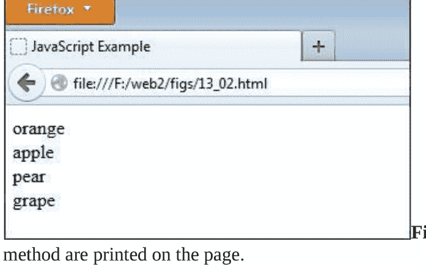

使用 split() 方法创建的数组元素被打印在页面上。

#### toString() 方法

toString() 方法返回字符串的字面量值。以下是你可以使用此方法的一个示例：

```
var string_obj = new String("Cool");
var string_lit = string_obj.toString();
```

此代码获取 String 对象并使用 toString() 方法获取其字面量值。然后，它将该值分配给 string_lit 变量。

#### toLowerCase() 和 toUpperCase() 方法

此方法返回全小写字母的字符串。请看以下代码：

```
var the_text = "I FEEL CALM, REALLY.";
alert(the_text.toLowerCase());
```

此代码提示全小写字母的字符串，例如此示例文本：i feel calm, really.

toUpperCase() 方法返回全大写字母的字符串。以下是一个示例：

```
var the_text = "I am yelling!";
alert(the_text.toUpperCase());
```

此代码提示全大写字母的字符串，例如此示例文本：I AM YELLING!

#### trim() 方法

trim() 方法删除字符串开头和结尾的任何多余空格，并返回结果。原始字符串保持不变。例如，查看以下代码：

```
var text = " Once upon a time... ",
trimmed_text = text.trim();
alert(trimmed_text);
```

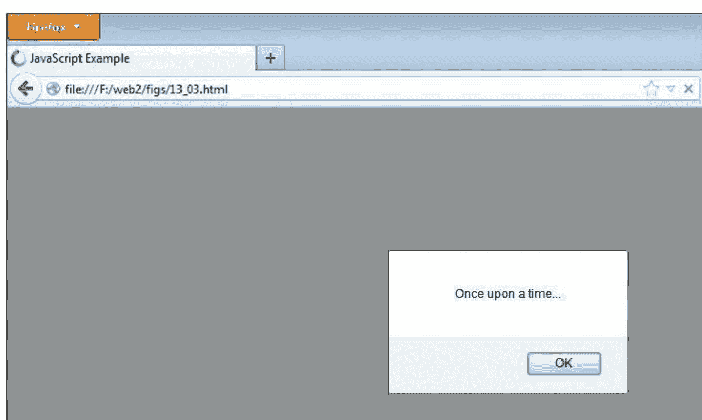

图 13-3 去除了多余空格的文本被提示给用户。

开头和结尾的空格将被删除，字符串 "Once upon a time..." 将提示给用户。图 13-3 显示了此脚本在浏览器中运行的结果。**注意** 此方法在 Internet Explorer 9 之前的版本中不适用。

这就是所有方法的介绍！现在你已经准备好测试你所学的内容了。

## 问专家

**Q：所以 length 属性返回字符串中的字符数，但字符串方法从 0 开始计数。这有点令人困惑，就像数组一样。有没有简单的方法可以记住这一点？**

**A：** 最简单的方法可能是记住 length 属性从 1 开始计数，而方法从 0 开始计算位置。因此，length 属性最终比字符串中的最后一个位置大 1。所以，如果字符串长度为 5，对于方法来说，这意味着字符串中的最后一个位置是位置 4。

（接下文）

**Q：是的，但这也很令人困惑，因为 slice() 和 substring() 方法中的第二个参数比这些方法停止删除字符的位置高一个位置。这是为什么？**

**A：** 一开始确实很困惑。你只需要习惯每个方法的工作方式。如果你使用得足够多，你就会记住在什么情况下使用哪些数字。

**Q：我为什么需要 split() 方法？我难道不能自己创建一个数组就完事了吗？**

**A：** 可以。然而，一旦你了解了 JavaScript cookies，split() 方法就会很有用，因为你可以将存储在 cookie 中的信息分割开来加以利用。Cookie 将信息存储在长文本字符串中，通常以某个字符作为分隔符。这只是 split() 方法对你有用的一个例子。

**Q：很多那些方法只是在文本字符串周围添加标签。我难道不能直接写出 HTML 吗？那似乎更容易。**

**A：** 这些方法现在已经不常用了，因为可以使用 innerHTML 或向文档添加 DOM 节点。此外，它们可能导致 HTML 代码无效，因为其中一些方法创建的标签在 HTML5 中已被弃用。

**动手实践 13-1** 使用 indexOf() 测试地址

prjs13_1.html 在此项目中，你将通过创建一个脚本来练习使用 indexOf() 方法，该脚本对用户输入的电子邮件地址执行非常基本的测试。
prjs13_1.js


 逐步操作

1. 创建一个指向名为 prjs13_1.js 的 JavaScript 文件的 HTML 页面。创建一个 id 为 "getemail" 的表单。添加一个 id 为 "email" 的文本框和一个标签为 "Submit E-mail" 的提交按钮。将 HTML 文件保存为 pr13_1.html。

2. 完成后，HTML 文件的 body 部分应如下所示：

```
<body>
<form id="getemail">
<label for="email">Enter E-mail</label>

<input type="text" id="email"><br><br>
<input type="submit" value="Submit E-mail">
</form>
</body>
```

3. 创建一个外部 JavaScript 文件并将其保存为 prjs13_1.js。用它来完成步骤 4–7。
4. 将 "email" 文本框的值赋给一个名为 email_add 的变量。

5. 使用 indexOf() 检查地址中是否包含 at (@) 字符，以及是否包含点 (.) 字符。

6. 如果地址同时包含 at (@) 字符和点 (.) 字符，则发送一个感谢用户的警告框。如果不包含，则发送一个警告框告知用户需要这些字符，并请重试。

7. 完成后，JavaScript 文件应如下所示：

```
var getemail = document.getElementById("getemail");
getemail.addEventListener("submit", function(event) {
var email_add = document.getElementById("email").value;
event.preventDefault();
if ( (email_add.indexOf("@") >= 0) && (email_add.indexOf(".") >= 0) ) { alert("Thank you!");
}
else {
alert("The @ and . characters are required in the e-mail address.");
}
}, false);
```

8. 保存 JavaScript 文件并在浏览器中打开 HTML 文件来测试脚本。

## 实践小结

在本项目中，你运用了对 indexOf() 方法的了解来检验用户输入的电子邮件地址中是否包含特定字符。如果缺少其中某个字符，将向用户发送错误警告框。否则，将发送感谢用户的警告框。

## 使用 Cookie

*Cookie* 是存储在终端用户计算机上的小型文本文件。只要 cookie 未被删除或过期，每当用户再次访问你的网站时都可以引用它。当然，如果用户不接受 cookie，那么就无法设置或稍后引用 cookie。使用 cookie 时请记住以下几点：

- 每个 cookie 必须小于或等于 4KB（4000 个字符）。
- 浏览器从单个域名最多只能接受 20 个 cookie。
- 如果大量用户不接受 cookie，这会使你的 cookie 对这些用户而言失去任何优势。

Cookie 可以帮助用户更有效地浏览你的网站。例如，如果你在主页上使用了一个脚本，在页面加载时发送一个或多个警告框，那么你不会希望每次用户访问你网站上的其他页面然后返回首页时都发生这种情况。这很可能会让用户非常恼火，发生几次后你就不会再有访客了。每次页面加载时都会弹出警告框，是因为 HTTP 缺乏状态持久性。Cookie 填补了这一空白，因为它们允许浏览器"记住"用户之前已经看过弹出式警告框，从而在后续的页面访问中不再显示它。

### 设置 Cookie

设置基本 cookie 就像给 document 对象的 cookie 属性赋值一样简单。唯一的限制是字符串内部不能包含空格、逗号或分号。例如，你可以设置一个 cookie 来存储一个名称，以便稍后设置多个 cookie 时能够识别它。以下代码设置了一个基本 cookie：

```
function set_it() {
  document.cookie = "name=tasty1";
}
```

> **注意**
> 设置 cookie 时，请记住不要在设置 cookie 数据的字符串内部使用空格、逗号或分号。

上述代码在函数被调用时设置了一个值为 name=tasty1 的 cookie。不过，你可以设置任何你想要的分隔符（或者完全不设置，但设置分隔符可以让你像查询字符串那样存储多个值），所以以下代码也可以正常工作：

```
function set_it() {
  document.cookie = "name:tasty1";
}
```

添加额外信息并不困难，只要值不需要空格即可，如下列代码所示：

```
function set_it() {
  document.cookie = "name=tasty1&fav=Sugar";
}
```

如你所见，cookie 的值以键值对形式格式化，每对之间用 & 符号分隔。同样，你可以选择任何类型的分隔符。以下代码也是可以的：

```
function set_it() {
  document.cookie = "name:tasty1|fav:Sugar";
}
```

在本例中，名称和值之间用冒号分隔，而管道符 ( | ) 将它们分隔成对。你可以使用任何你觉得方便的符号。

### encodeURIComponent() 方法

如果你想在 cookie 中使用空格、逗号或分号，你需要一种方法来"转义"它们，使它们转换成 cookie 可以接受的形式。

Cookie 可以接受字符编码，就像 CGI 程序经常做的那样。它们可能看起来像 %20、%41 或类似的格式。要将空格、逗号和分号转换成这些编码，你必须使用 JavaScript 的 encodeURIComponent() 方法。它是 window 对象下的一个方法，所以，正如你在前面章节中看到的，你可以直接使用 encodeURIComponent() 而不是 window.encodeURIComponent()。

以下代码展示了如何使用 encodeURIComponent() 方法来设置包含空格的 cookie：

```
var thetext = "name=tasty1&fav=Chocolate Chip",
    newtext = encodeURIComponent(thetext);
document.cookie = newtext;
```

thetext 变量被设置为包含你想要在 cookie 中使用的字符串。newtext 变量被设置为保存对 thetext 使用 encodeURIComponent() 方法的结果。然后转义后的文本被用作 cookie 的字符串，现在它将包含空格字符的编码（当你想要使用这些数据时，你需要取消转义）。

### 允许用户输入

通过使用 escape() 方法，你可以提示用户输入信息，对其进行转义，然后在 cookie 中使用它。以下代码展示了实现这一功能的一种方法，用于获取用户最喜欢的 cookie 类型：

```
function set_it() {
    var thefav = prompt("Enter your favorite type of cookie", ""),
        thetext = "name=tasty1&fav=" + thefav,
        newtext = encodeURIComponent(thetext);
    document.cookie = newtext;
}
```

在提示框中输入的值随后被添加到用于 cookie 的字符串中。

转义后的字符串被放入 cookie 中。该字符串被转义以便可以在 cookie 中使用。现在用户可以帮助决定将要设置在 cookie 中的信息，而你可以在用户下次访问时使用他们在你的网站上输入的信息。

### 设置过期日期

为 cookie 添加过期日期可以防止它在浏览器关闭后被删除，或者可以用来使你不再想使用的 cookie 过期。要设置过期日期，请为你的 cookie 字符串添加更多内容，如下列代码所示：

```
function set_it() {
    var thetext = "quote=I have a quote",
        expdate = ";expires=Mon, 30 Mar 2015 13:00:00 UTC",
        newtext = encodeURIComponent(thetext);
    newtext += expdate;
    document.cookie = newtext;
}
```

基本上，你正在添加另一个键值对来添加过期日期（注意键值对之间用分号分隔）。它需要是这样的格式：expires=date（UTC 格式）。

在上述代码中，通过在 cookie 中添加 UTC 格式的日期来添加过期日期。然后将结果添加到将用于设置 cookie 字符串的变量中。

如果你希望 cookie 保存很长时间，可以将日期设置为遥远的未来。如果你想要使你决定不再使用的 cookie 过期，将日期设置为过去，cookie 就会过期。

### 读取 Cookie

如果你只设置了一个 cookie 并且想要读取它，读取 cookie 是很直接的。要读取 cookie，你只需要从浏览器获取 document.cookie 属性的值：

```
function read_it() {
    var mycookie = document.cookie;
}
```

然而，上述代码将为 mycookie 变量的值提供一个长而可能很乱的字符串。它可能看起来像这样：

name=tasty1&fav=Chocolate%20Chip

%20 是在使用 escape() 方法转义 cookie 输入时进入编码的。要解决这个问题，请使用 decodeURIComponent() 方法以更易读的格式获取数据。因此，以下代码将提供你所需的字符串：

```
function read_it() {
    var mycookie = document.cookie,
        fixed_cookie = decodeURIComponent(mycookie);
}
```

接下来，你必须找到一种方法从 cookie 中提取你需要的信息。假设 cookie 包含刚才用作示例的字符串（name=tasty1&fav=Chocolate%20Chip），该字符串现在看起来是这样的：

name=tasty1&fav=Chocolate Chip

注意文本以两种不同的方式划分。& 符号将字符串分成键值对，而

等号将名称-值对分隔成它们的名称和值。假设现在 `fixed_cookie` 变量中的字符串是 `name=tasty1&fav=Chocolate Chip`，你可以使用该变量，通过按 `&` 字符分割字符串来创建一个新的数组：

> 读取 cookie 属性的值。该值会被反转义，因此字符串将包含可读字符。

```javascript
function read_it() {
    var mycookie = document.cookie,
        fixed_cookie = encodeURIComponent(mycookie),
        thepairs = fixed_cookie.split("&");
}
```

> Cookie 字符串按 `&` 分隔符拆分成数组。

前面的代码将字符串拆分成两个数组值：`thepairs[0]` 的值为 `name=tasty1`，`thepairs[1]` 的值为 `fav=Chocolate Chip`。你需要将它们各自拆分成一个包含名称和值的新数组。因此，你需要类似这样的代码：

```javascript
function read_it() {
    var mycookie = document.cookie,
        fixed_cookie = decodeURIComponent(mycookie),
        thepairs = fixed_cookie.split("&"),
        name = thepairs[0],
        fav = thepairs[1];
    var name_propval = name.split("=");  // 新变量按等号拆分
    var fav_propval = fav.split("=");
}
```

现在你已使用 `name_propval[]` 和 `fav_propval[]` 数组获得了所需的所有信息：

- `name_propval[0]` 的值为 `name`
- `name_propval[1]` 的值为 `tasty1`
- `fav_propval[0]` 的值为 `fav`
- `fav_propval[1]` 的值为 `Chocolate Chip`

你可以以任何你喜欢的方式使用它们，例如将它们放在 `alert` 中：

```javascript
function read_it() {
    var mycookie = document.cookie,
        fixed_cookie = decodeURIComponent(mycookie),
        thepairs = fixed_cookie.split("&"),
        name = thepairs[0],
        fav = thepairs[1];
    var name_propval = name.split("="),
        fav_propval = fav.split("=");
    alert("The cookie's " + name_propval[0] + " is " + name_propval[1]);
    alert("My favorite type of cookie is " + fav_propval[1]);
}
```

> 使用从 cookies 获取的值。

你可能想在尝试运行函数中的所有代码之前，确保 `document.cookie` 存在。任何你设置为稍后过期的 cookie 都可以被读取，但没有该 cookie 的用户可能会出错。通过进行检查，你可以确保 cookie 的存在，或者将访问者引导到设置 cookie 的函数。为此，请在函数中的代码周围添加一个 `if/else` 块，如下所示：

```javascript
function read_it() {
    var mycookie = document.cookie,
        fixed_cookie = decodeURIComponent(mycookie),
        thepairs = fixed_cookie.split("&"),
        name = thepairs[0],
        fav = thepairs[1];
    var name_propval = name.split("="),
        fav_propval = fav.split("=");
    alert("The cookie's " + name_propval[0] + " is " + name_propval[1]);
    alert("My favorite type of cookie is " + fav_propval[1]);
}

if (document.cookie) {
    read_it();
} else {
    set_it();
    read_it();
}
```

前面的代码假设 `set_it()` 函数存在，并且会在需要时设置 cookie。它还假设此 cookie 是从此域名设置的唯一 cookie，并且其格式是特定的。如果你计划使用多个 cookies，则需要进行额外的测试以确保你获取到所需的 cookie。有关更多信息，你可以访问 webmonkey.com/2010/02/advanced_javascript_tutorial_-_lesson_2/#Reading_and_Writing_Multiple_Cookies。

## 尝试一下 13-2：记住一个名字

*pr13\_2.html, prjs13\_2.js* — 在此项目中，你将使用 cookie 在访问者返回页面时记住他们的名字。

### 逐步操作

1.  创建一个新的 HTML 文档，使用名为 `prjs13_2.js` 的外部 JavaScript 文件。创建一个 `id` 为 `"greeting"` 的 `div`。将 HTML 文件保存为 `pr13_2.html`。
2.  创建一个外部 JavaScript 文件并保存为 `prjs13_2.js`。后续步骤将使用它。
3.  创建一个名为 `set_it()` 的函数来设置 cookie。将过期日期设置为未来的某个日期。允许访问者在提示框中输入名字，然后在 cookie 中使用访问者的输入。
4.  创建一个名为 `read_it()` 的函数，该函数将检查 cookie 是否存在，如果存在，则读取 cookie 并按以下格式将名字写入页面（将 `<name>` 替换为从 cookie 读取的名字）：`欢迎，<name>！`
5.  如果 cookie 存在，则调用 `read_it()` 函数。如果 cookie 不存在，则先调用 `set_it()`，然后调用 `read_it()` 函数。
6.  保存 JavaScript 文件并在浏览器中打开 HTML 文件。输入你的名字并获取问候语。如果你关闭浏览器并再次打开该页面，你应该会看到你的名字，而无需再次输入。

## 尝试一下总结

在此项目中，你运用了使用 JavaScript 设置和读取 cookies 的知识。你创建了一个网页，当访问者返回该网页时，它会记住访问者的名字。

## 使用正则表达式

正则表达式为你处理脚本中的字符串提供了更强大的功能。它们允许你构建可以与字符串匹配的模式，而不是试图使用 `String` 对象的方法，后者可能使精确匹配变得更加困难。

例如，你可能想知道在文本框中输入的电子邮件地址值是否包含至少一个开头字符，后跟一个 `@` 符号，再后跟至少一个字符，接着一个点（`.`），然后至少再跟两个字符（匹配传统的电子邮件地址，如 `jon@jon.com` 或最短类型的电子邮件地址 `j@j.jj`）。

`String` 对象的方法无法提供一种简洁明了的方式来执行此任务（尽管经过足够多的调整，可能是可行的）。然而，正则表达式可以简化任务，甚至将用 `String` 对象的方法看起来不可能的匹配转化为可以完成的匹配。

### 创建正则表达式

要创建正则表达式，你必须创建 JavaScript `RegExp` 对象的实例或一个 `RegExp` 字面量。要创建 `RegExp` 字面量，你只需将正则表达式赋值给一个变量。你使用正斜杠（`/`）而不是引号来包围表达式，如下所示：

```javascript
var varname = /your_pattern/flags;
```

你将 `varname` 替换为你想要使用的变量名，并将 `your_pattern` 替换为你选择的正则表达式模式。你可以在最后一个斜杠后跟一个或多个标志（将在接下来的“添加标志”部分讨论）。

**注意：** JavaScript 使用正斜杠来告诉浏览器它们之间是一个正则表达式，就像使用引号来界定字符串一样。因此，如果在正则表达式中使用正斜杠，则必须使用反斜杠对其进行转义才能正常工作。例如，不要写成 `/02/03/2009/`，而需要写成 `/02\/03\/2009/`。

最简单的正则表达式模式是查找字符的精确匹配。例如，如果你想查看字符串中是否存在序列 `our`，你可以创建以下正则表达式模式：

```javascript
var tomatch = /our/;
```

前面的代码创建了一个名为 `tomatch` 的 `RegExp` 字面量。现在你需要一个字符串来测试该模式。如果你用单词 `our` 来测试该表达式，它匹配。如果你用 `your`、`sour`、`pour` 或 `pouring` 来测试，它也匹配。如果你用 `cool`、`Our`、`oUR`、`OUR` 或 `souR` 来测试，则不匹配。那么如何执行这个测试呢？

### 使用正则表达式测试字符串

要测试正则表达式与字符串的匹配情况，你可以使用 `RegExp` 对象的 `test()` 方法。基本语法如下：

```javascript
regex_name.test(string_to_test);
```

此语法类似于使用字符串方法。你将 `regex_name` 替换为正则表达式的名称，并将 `string_to_test` 替换为字符串或字符串变量名。例如，看下面的例子：

```javascript
var tomatch = /our/;
tomatch.test("pour");
// 此代码将测试 "pour" 字符串是否与名为 "tomatch" 的正则表达式匹配。
// 它不使用结果。
```

`test()` 方法返回一个布尔值 `true` 或 `false`。当字符串的任何部分匹配正则表达式模式时，它返回 `true`。使用 `test()` 方法，你已经可以编写一个简短的脚本，如下所示：

> 提示框从访问者那里获取一个名字。

```javascript
var thename = prompt("Enter your name", ""),
    tomatch = /John/,
    is_a_match = tomatch.test(thename);

// 设置一个正则表达式以查看输入的名字是否与之匹配
// 使用一个变量来保存 test() 方法的结果

if (is_a_match) {
    alert("Wow, we have the same name!");  // 如果结果为 true，则显示此警报
} else {
    alert("Not my name, but it will work!");  // 如果结果不为 true，则显示此警报
}
```

> 提示框收集一个名字并将值存储在变量中。要匹配的模式是 `John`，并且区分大小写。因此，只有包含大写 `J` 后跟小写 `o`、`h` 和 `n` 的 `John` 的输入才会在测试时产生匹配并返回 `true`（尽管它可能包含除 `John` 以外的更多字符，因此像 `Johnny` 或 `John Doe` 这样的输入也会返回 `true`——如果你只需要一组特定的字符，则需要使用一些额外的特殊字符，这将在本节后面讨论）。

`test()` 方法的结果被赋值给一个名为 `is_a_match` 的变量。然后该变量用作 `if` 语句的条件。如果变量的值为 `true`，则访问者会看到“Wow, we have the same name!”警报。如果变量的值为 `false`，则访问者会看到“Not my name, but it will work!”警报。图 13-4 显示了使用“Steve”作为名字时此脚本的结果。

如果你想缩短脚本，你可以直接将 `test()` 方法的结果作为 `if` 语句的条件（而不是创建另一个变量），如下面的代码所示：

```javascript
var thename = prompt("Enter your name", ""),
```


### 添加标志

标志允许你使匹配不区分大小写，或在字符串中查找所有匹配项，而不仅仅是第一个（全局测试）。要添加标志，请将其放在正则表达式最后一个斜杠之后。你可以使用三个选项，如表13-3所示。

**标志 | 用途**
--- | ---
i | 使匹配不区分大小写
g | 使匹配是全局的
m | 使匹配在多行模式下工作

**表13-3** 正则表达式标志

如果你想将之前使用的名称脚本调整为不区分大小写，你可以在正则表达式中添加一个 `i` 标志，如下面的代码所示：

```javascript
var thename = prompt("Enter your name",""),
tomatch = /John/i; // The i flag makes this regular expression case insensitive
if (tomatch.test(thename)) {
    alert("Wow, we have the same name!");
}
else {
    alert("Not my name, but it will work!");
}
```

`test()` 方法现在只要字符串中包含 John 的模式就会返回 true。它可以是任何大小写形式，所以现在 John、JOHN、john，甚至 JoHn 都是匹配项，并且会导致 `test()` 方法返回 true。

你也可以同时使用多个标志，或者一次性使用所有三个标志。例如，如果你想让匹配既是不区分大小写的又是多行的，你可以使用以下方式：`var tomatch = /John/im;`

### 创建强大的模式

虽然能够创建如此精确的模式很好，但你并不总是寻找那么精确的匹配。在许多情况下，你将寻找匹配更通用的模式，例如需要至少有三个字符的条目，或者需要两个任意类型的字符后跟一个特殊字符的条目。

通过在表达式中使用特殊字符，你可以创建匹配给定所需序列所需的模式类型。JavaScript 正则表达式使用 Perl 正则表达式的语法作为模型。因此，如果你在 Perl 中使用过正则表达式，这些内容中的大部分会很熟悉。表13-4列出了许多字符以帮助你创建模式。

**字符 | 用途**
--- | ---
^ | 仅从行首匹配
$ | 仅在行尾匹配
* | 如果前面的字符出现零次或多次，则匹配该字符
+ | 如果前面的字符出现一次或多次，则匹配该字符
? | 如果前面的字符出现零次或一次，则匹配该字符
. | 匹配任何单个字符，不包括换行符
(*x*) | 通过将 *x* 替换为字符来匹配该序列并将其保存在内存中以供以后使用；用于表达式的分组
| | 用作逻辑 OR 符号，允许匹配符号左侧或右侧的内容
{*x*} | 用数字替换 *x*，当其前面的字符恰好出现 *x* 次时匹配
{*x*,} | 用数字替换 *x*，当其前面的字符出现 *x* 次或更多次时匹配
{*x,y*} | 用数字替换 *x* 和 *y*，当其前面的字符至少出现 *x* 次但不超过 *y* 次时匹配
[] | 匹配你选择的字符集；当括号中的任何字符（例如 [abc]）或任何字符范围（例如 [a–k]）存在时匹配
[^] | 当字符集中的字符*不*存在时匹配；可以是一个集合（例如 [abc]）或一个范围（例如 [a–k]）；如果不在括号 [] 内，则匹配字符串的开头，如本表中的第一个条目所示。

**示例**
/^c/ 匹配 *corn* 中的 *c*
/^c/ 不匹配 *acorn* 中的 *c*
/r$/ 匹配 *Car* 中的 *r*
/r$/ 不匹配 *Cat* 中的 *t*
/co*/ 匹配 *co* 或 *c*
/co*/ 不匹配 *pi*
/co+/ 匹配 *co* 或 *cooooo*
/co+/ 不匹配 *ca*
/o?l/ 匹配 *style* 或 *column*
/co?l/ 不匹配 *cool*
/.l/ 匹配 *al* 或 *@l*
/.l/ 不匹配 \nl 或 *l*

/(a)/ 匹配 *a*
/(cool)/ 匹配 *cool*
/(cool)/ 不匹配 *coal*

/cool|bad/ 匹配 *cool*
/cool|bad/ 匹配 *bad*
/cool|bad/ 不匹配 *car*

/n{1}/ 匹配 *n*
/nn{2}/ 匹配 *nnn*
/nn{1}/ 不匹配 *nnn*

/n{1,}/ 匹配 *n*
/n{1,}/ 匹配 *nnnnn*
/n{3,}/ 不匹配 *nn*

/n{1,2}/ 匹配 n
/n{1,2}/ 匹配 nn
/n{2,3}/ 不匹配 n
/n{4,7}/ 不匹配 nnn

/[abc]/ 匹配 a
/[abc]/ 匹配 b
/[abc]/ 匹配 c
/[a-k]/ 匹配 j
/[a-k]/ 不匹配 n

/[^abc]/ 匹配 d
/[^abc]/ 不匹配 b
/[^a-k]/ 匹配 n
/[^a-k]/ 不匹配 j

#### 表13-4 正则表达式代码

| 字符 | 用途 |
|---|---|
| \ | 用于转义特殊字符或使普通字符特殊 |
| [\b] | 匹配退格键击 |
| \b | 当其前面或后面的字符位于单词边界时匹配，例如在空格字符之前或之后；要匹配单词的开头，请将字符放在符号的右侧（\bc）；要匹配单词的结尾，请将字符放在左侧（c\b） |
| \B | 匹配不位于单词边界的字符 |
| \c X | 用字母字符替换 X，当用户按下 ctrl 键后键入字母 X 时匹配 |
| \d | 如果字符是单个数字字符则匹配 |
| \D | 如果字符不是数字字符则匹配单个字符 |
| \f | 如果有换页符则匹配 |
| \n | 如果有换行符则匹配 |
| \r | 如果有回车符则匹配 |
| \s | 如果字符代表空白字符（例如空格或换行符）则匹配单个字符 |
| \S | 如果字符不代表空白字符则匹配单个字符 |
| \t | 如果有制表符则匹配 |
| \v | 如果有垂直制表符则匹配 |
| \w | 匹配任何是字母、数字或下划线的单个字符 |
| \W | 匹配任何不是字母、数字或下划线的单个字符 |

#### 示例

\@ 转义 @ 字符
\n 代表换行符
/[\b]/ 匹配退格符

```
/\bc/ matches c in my car
/\bm/ matches m in my car /\bc/ does not match c in ace /\bm/ does not match m in Sam /m\b/ matches m in Sam
/c\b/ matches c in Mac W /m\b/ does not match m in emu /c\b/ does not match c in my car
```

```
/\Ba/ matches a in car
/\Bc/ does not match c in car
```

```
/\cX/ matches ctrl-X
/\cV/ matches ctrl-V
/\cS/ does not match ctrl-Z
```

```
/\d/ matches 4
/\d/ does not match s
/\D/ matches s
/\D/ does not match 4
```

/f/ 匹配换页符
/n/ 匹配换行符
/r/ 匹配回车符
/s/ 匹配 *b c* 中的空格
/s/ 匹配 *b c* 中的制表符
/s/ 不匹配 *bc*
/S/ 匹配 *d*
/S/ 不匹配空格
/t/ 匹配 *b c* 中的制表符
/v/ 匹配垂直制表符
/w/ 匹配 *4*
/w/ 不匹配 @
/W/ 匹配 @
/W/ 不匹配 *g*

### 表13-4 正则表达式代码（续）

如你所见，创建所需模式存在广泛的选择。现在你可以根据决定的标准轻松验证字符串。

现在，如果你想确保文本字段包含一个或多个数字，你可以使用表13-4中的 `\d` 和 `+` 字符，配合以下 HTML 和 JavaScript 代码，首先是 HTML 代码：

```html
<body>
<form id="has_digits">
<label for="user_text">Enter some text:</label>

<input type="text" id="user_text">
<input type="submit" value="Test">
</form>
</body>
```

接下来是 JavaScript 代码：

```javascript
var has_digits = document.getElementById("has_digits");
has_digits.addEventListener("submit", function(event) {
    var has_num = document.getElementById("user_text").value,
    tomatch = /\d+/;
    event.preventDefault();
    if (tomatch.test(has_num)) {
        alert("Your entry contained one or more numbers!");
    }
    else {
        alert("Your entry did not contain any numbers!");
    }
}, false);
```

这段代码只是检查字符串中是否包含任何数字。如果你想确保查看者*只*输入了数字，而没有其他类型的字符，你需要确保正则表达式被编写为从字符串的开头测试到结尾。使用表13-4中的 `^` 和 `$` 符号，你可以确保从字符串的开头到结尾进行匹配测试。\d 后的 + 确保至少输入了一个数字。因此，以下模式将只允许数字：

```javascript
var tomatch = /^\d+$/;
```

由于从字符串开头到结尾的唯一有效字符是数字，这将仅对包含数字且字符串中没有其他字符的条目返回 true。这对于验证表单和其他类型的用户输入以确保是预期的输入类型特别有帮助。

#### 注意

正则表达式在验证方面可能非常强大，因为它允许接受更少的错误信息。

客户端对包含电子邮件地址或电话号码等数据的表单提交进行验证可以节省

不必要的服务器往返。然而，用户可能禁用 JavaScript 支持并直接提交表单。因此，客户端验证应支持服务器端验证（例如，通过 PHP 脚本或 CGI 脚本），但绝不应取代它（存储或显示未经验证的查看者数据可能会带来巨大的安全风险）。

## 分组表达式

你会注意到，在表 13-4 中，被括号包围的表达式表示一个可以存储起来供表达式稍后使用的分组（或者使用 `match()` 方法等方法，它会将每个分组的匹配项连同整体匹配项一起存储在一个数组中）。

例如，你可能决定使用一个特定的数字序列，并让该序列重复特定的次数。要匹配某事物重复的次数，你可以使用花括号 (`{}`) 以及一个数字或数字范围。例如，如果你想匹配数字 3 出现五次，可以使用以下表达式：

```
/3{5}/
```

如果你想匹配数字 3 至少出现五次但不超过十次，可以使用以下表达式：

```
/3{5,10}/
```

现在，假设你希望匹配以 3 开头，后跟任意一个数字，并且希望整个序列重复五次（因此，像 3234353637 这样的字符串会匹配）。你可能会写成：

```
/3\d{5}/
```

问题在于，这正确匹配了开头的 3，但随后匹配了五个数字，而不需要重复 3。因此，像 387643 这样的数字也会匹配，尽管你希望匹配五组以 3 开头的两个数字。为了解决这个问题，你可以将 3 和 `\d` 用括号分组在一起，然后在后面加上它应该重复的次数：

```
/(3\d){5}/
```

这次，3 和第二个数字被分组在一起，并且该序列必须重复五次。分组是充分利用正则表达式的一种有用方式，当你在下一章学习表单验证时，你会看到更多相关用法。

## replace()、match() 和 search() 方法

本章前面提到过 String 对象的这些方法，现在介绍了正则表达式后，它们会更有意义。

### replace() 方法

要替换字符串中的信息，你可以使用正则表达式和 String 对象的 `replace()` 方法。使用 `replace()` 方法的语法如下：

```
varname = stringname.replace(regex, newstring);
```

用将保存替换后新字符串值的变量名替换 *varname*。用将要被替换的字符串变量名替换 *stringname*。用将要用于匹配字符串的正则表达式名称替换 *regex*。最后，用要替换字符串中任何匹配值的字符串或字符串变量替换 *newstring*。

例如，以下代码将 mystring 中第一个 "car" 实例替换为 "skunk"：

```
var mystring = "I like the way a new car smells, and cars are fun.",
toreplace =/car/, 
The pattern to replace is set as a regular expression
newstring = mystring.replace(toreplace, "skunk");
alert(newstring);  The first instance of a match is replaced in the string, and the result is assigned to a variable
```

前面的代码只替换了第一个 car 实例，弹出的警告信息是 "I like the way a new skunk smells, and cars are fun."。如果你想改变每个 "car" 实例，正则表达式末尾的 `g` 标志会很有用，如下代码所示：

```
var mystring = "I like the way a new car smells, and cars are fun.",
toreplace =/car/g,
newstring = mystring.replace(toreplace, "skunk");
alert(newstring); Adding the g flag causes all matches of the pattern to be replaced when the replace() method is run
```

`g` 标志会匹配字符串中找到的正则表达式的每个实例。因此，当运行 `replace()` 方法时，所有 "car" 实例都将被替换为 "skunk"。查看者将看到这个警告："I like the way a new skunk smells, and skunks are fun."

你也可以使用 `replace()` 方法来创建一个比本章前面更简短且稍微不那么复杂的改名脚本。通过使用带有正则表达式的 `replace()` 方法，可以更容易地更改名字和姓氏的首字母。以下代码展示了如何操作：

```
function getname() {
  var tomatch = /^[A-Za-z]+\s[A-Za-z]+$/,
    toreplace = /\b[A-Za-z]/gi,
    thename = prompt("Enter your first and last name", "");

  if (tomatch.test(thename)) {
    newname = thename.replace(toreplace, "Z");
    alert("Now your name is " + newname);
  }
  else {
    alert("Name invalid. Please Try Again");
    getname();
  }
}
getname();
```

此脚本会将名字和姓氏的首字母都更改为 Z，无论之前是什么。用于替换的正则表达式只是使用单词边界 (`\b`) 代码来查找单词开头的字母。每当一个字母位于单词开头时，它就会被替换。

输入的验证确保脚本不会获得超过两个名字和一个空格，同时也确保每个名字至少包含一个字母，没有数字或特殊字符。插图显示了如果查看者在提示处输入 Debra Loo，脚本的结果：查看者的姓名被更改了。

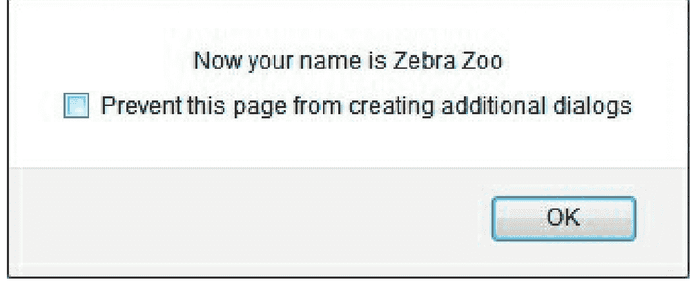

### match() 方法

`match()` 方法比较一个正则表达式和一个字符串，看看它们是否匹配。它返回一个包含一个或多个匹配项的数组，具体取决于它的使用方式。如果没有找到匹配项，则返回 -1。

`match()` 方法的基本用法如下：

```
string.match(regex);
```

*string* 将是你的字符串字面量，*regex* 将是你的正则表达式字面量。注意这个方法与 `test()` 方法在顺序上的区别。你可以这样使用它：

```
var mystring = "I am Ironman!",
  tomatch = /Iron/;
if (mystring.match(tomatch)) {
  alert("Your string contains Iron!");
}
else {
  alert("Sorry, no Iron in your string.");
}
```

如果与 `g` 标志一起使用，或者使用 `()` 进行分组，它会记住每个进行的匹配（包括分组或嵌套分组的匹配），并将每个匹配项作为数组元素返回。

### search() 方法

`search()` 方法在正则表达式和指定字符串之间执行匹配搜索。如果找到匹配项，则返回字符串中找到匹配项开始的位置。否则，返回 -1。以下是该方法实际使用的示例：

```
var mystring = "I am Ironman!",
  tomatch = /Iron/;
if (mystring.search(tomatch)) {
  alert("Iron found at position " + mystring.search(tomatch) + "!");
}
else {
  alert("Sorry, no Iron in your string.");
}
```

如你所见，其语法与 `match()` 方法非常相似。

## 更多信息

有关正则表达式以及如何创建更复杂模式的更多信息，你可以查看以下在线资源：

- www.regular-expressions.info/
- www.regular-expressions.info/javascript.html（包含关于 JavaScript 引擎的具体信息）
- https://developer.mozilla.org/en/Core_JavaScript_1.5_Guide/Regular_Expressions

掌握了这些技巧后，你就准备好继续学习 JavaScript 中的表单处理以及表单内容的验证了。

## ✓ 第 13 章 自我测试

1. 该对象提供了属性和方法来获取有关字符串的信息或修改字符串。

2. 你可以通过哪两种方式创建 String 对象？
   - A. 创建 String 对象的实例并创建字符串字面量
   - B. 创建 Array 对象的实例并创建字符串字面量
   - C. 创建数字变量并创建数字对象
   - D. 创建字符串并添加数字

3. 你可以通过为变量分配字符串值来创建字符串。

4. 普通文本字符串能够使用 String 对象的方法，因为：
   - A. 它本身就是一个 String 对象
   - B. 它还可以使用其他方法，因此它可以使用 String 对象的方法
   - C. JavaScript 获取字符串字面量并将其转换为临时 String 对象
   - D. String 对象原样使用字符串字面量

5. String 对象的哪个属性既可以用于 String 对象也可以用于字符串字面量？
   - A. prototype
   - B. constructor
   - C. length
   - D. color

6. 该属性返回字符串的长度。

7. 以下哪项正确创建了字符串字面量？
   - A. var the_text ="Look at me!;
   - B. var the_text ="Look at me!";
   - C. var the_text = Look at me!;
   - D. var the_text = new String("Look at me!");

8. 你可以使用 String 对象的哪个方法来查找字符串中给定位置是哪个字符？


# 第14章 JavaScript与表单

### 379 关键技能与概念

- 访问表单
- 使用表单对象的属性和方法
- 确保表单的可访问性
- 验证表单
- HTML5与表单

当你使用JavaScript访问表单时，你可以为网页创建新的脚本。

本章首先解释如何使用JavaScript访问表单。然后你将学习使用表单和表单元素的各种属性和方法。你还将了解表单与可访问性，如何验证表单元素，以及如何使用`<select></select>`元素作为导航工具。

### 访问表单

每次你在HTML文档中添加一组`<form>`和`</form>`标签时，都会创建一个表单对象。要使用JavaScript访问其中一个表单，你可以使用以下任一选项：

- 使用文档对象的forms数组
- 在form开始标签中为表单命名，并使用该名称访问表单
- 在form开始标签中为表单设置一个id，并使用`document.getElementById()`方法访问它

#### 使用forms数组

forms数组允许你使用数组中的索引来访问表单。页面上每组`<form>`和`</form>`标签都会在forms数组中创建一个额外的项，其顺序与它们在文档中出现的顺序相同。因此，你可以像这样引用文档中的第一个表单：

```javascript
document.forms[0]
```

如你所知，数组从0开始计数，因此前面的示例将访问文档中的第一个表单。如果你想访问第二个表单，可以使用以下代码：

```javascript
document.forms[1]
```

这将同样适用于页面上的其余表单。只需记住从0开始计数，而不是从1开始，以访问正确的表单。

访问表单本身并不会执行任何操作。你访问的表单是一个对象。要使用它，你需要该对象的属性或方法。表单对象的属性和方法将在后面的一节“使用表单对象的属性和方法”中列出，但现在，让我们看看length属性的作用。

#### 一个属性值

本节中的示例使用了表单对象的length属性。此属性允许你找出HTML表单中存在多少个元素（例如输入框、选择框、单选按钮等）。例如，看下面这段代码：

```html
<body>
<form>
<label>Name:</label><input type="text"> 第一个元素是此文本框
<label>E-mail:</label><input type="text"> 第二个元素是此文本框
<input type="submit" value="Submit">第三个元素是此提交按钮
</form>
</body>
```

该代码创建了一个包含三个元素的简单表单：两个文本框和一个提交按钮。因为它是页面上唯一的表单，它将是第一个表单，允许你使用`document.forms[0]`来访问它。要使用length属性，可以像这样将其添加到末尾：

```javascript
document.forms[0].length
```

使用前面的代码，你可以创建一个简短的脚本来告诉用户表单中有多少个元素。下面的代码将在表单后面将信息写入页面：

```javascript
document.write("表单有 " + document.forms[0].length + " 个元素。");
```

表单中的元素数量将显示在页面上。此代码告知用户该表单有三个元素。图14-1显示了使用前面所示的HTML代码时此脚本的结果。

#### 讲解两个length属性

如果你想尝试显示页面上有多个表单时每个表单中的元素数量，你可以使用一个更复杂的脚本，为页面上的每个表单打印一条消息。回想一下，因为有一个forms数组，你可以找到它的长度。

forms数组的长度就是页面上表单的数量（类似地，特定表单的length属性是该表单中的元素数量）。要查找页面上的表单数量，而不是某个表单的长度，你可以使用以下代码：

```javascript
document.forms.length
```

图14-1 向用户显示表单中的元素数量。

此语法用于查找页面上的表单数量。因此，你需要记住以下几点：

- `document.forms.length` 查找页面上的表单数量。
- `document.forms[x].length` 查找页面上特定表单中的元素数量，其中x是要访问的表单的索引。

此语法可能看起来有点混淆，但只需记住一个length属性用于所有表单的通用情况，而另一个length属性用于特定表单。

**注意**

记住`document.forms.length`和`document.forms[x].length`之间的区别。前者查找页面上的表单数量，而后者查找特定表单中的元素数量（通过将x替换为一个数字）。

以下脚本使用了两个length属性和一个循环来遍历每个表单。该代码显示页面上每个表单中的元素数量。首先是HTML代码（保存为`lengths.html`）：

```html
<body>
<h1>表单长度</h1>
<h2>表单 1</h2>
<form>
<label>Name:</label><input type="text"><br>
<label>E-mail:</label><input type="text"><br>
<input type="submit" value="Submit">
</form>
<h2>表单 2</h2>
<form>
<label>Favorite Color:</label><input type="text"><br>
<label>Favorite Food:</label><input type="text"><br>
<input type="reset" value="Reset">
<input type="submit" value="Submit">
</form>
<h2>结果</h2>
<script type="text/javascript" src="lengths.js"></script>
</body>
```

接下来是JavaScript代码（保存为`lengths.js`）：

```javascript
for (var count=0; count < document.forms.length; count++) {
    var formnum = count + 1;
    document.write("表单 " + formnum + " 有 " + document.forms[count].length);
    document.write(" 个元素。<br>");
}
```

创建一个变量来保存表单编号（比索引号大1，看起来更用户友好）。

该代码在HTML文档中创建了两个表单。然后脚本打开一个循环，从0开始（数组从0开始计数），到`document.forms.length`的值之前结束，后者是页面上的表单数量。因为有两个表单（这将使`document.forms.length`的值为2），所以计数从0运行到1然后停止。该计数允许你在索引0和1处访问forms数组，这对应于HTML代码中的表单1和表单2。

`formnum`变量的值是数组中的位置号加1，即HTML代码中看到的表单编号。然后脚本使用`document.write()`语句将每个表单中的元素数量写入页面。

forms数组与`count`变量的值一起用作索引号，这会在每次循环中找到指定表单中的元素数量。图14-2显示了在浏览器中运行此代码的结果。

#### 使用表单名称

使用表单名称允许你为页面上稍后要访问的表单命名。此选项有助于消除`document.forms.length`和`document.forms[x].length`之间的任何混淆，因为除非你试图遍历页面上每个表单中的每个元素，否则你将不需要使用后者。

要使用表单名称，必须在要访问的表单的form开始标签中添加`name="yourname"`属性。将*yourname*替换为你想用于该表单的名称，如以下代码所示：

```html
<form name="info_form">
<label>Name:</label><input type="text"><br>
<input type="submit">
</form>
```

表单的名称现在是`info_form`，你可以使用此名称在脚本中访问该表单。


 图 14-2 显示了每个表单中的元素数量。

表单的名称使其成为表单对象的一个实例，你可以通过其名称来访问它。要使用 JavaScript 访问使用了表单名称的表单，可以使用如下语法：

```
document.yourname
```

将 yourname 替换为表单在开始标签中 `name="yourname"` 属性里给出的名称。因此，如果你想编写一个脚本来查找本例中命名表单里的元素数量，可以使用以下代码：

```
document.write("The form has " + document.info_form.length + " elements."); // 将命名表单中的元素数量写入页面
```

注意在 document.write() 语句中是如何访问表单的。这里没有使用 forms 数组，而是直接使用了表单的名称。这样就可以访问表单对象的属性，通过访问 length 属性来实现。

### 使用 ID

访问表单的第三种方式是使用 id 属性，然后使用 `document.getElementById()`。这通常是最清晰的访问表单及其元素的方式，因为你可以使用每个元素单独的元素来访问它们，而前两种访问方法要求你知道表单所在的数组索引，或者表单的名称以及元素的名称。

**注意**

如果你需要复习如何使用 getElementById() 访问元素，可以参考第 9 章。

如果你想用 id 方法编写上一节中的脚本，可以使用以下 HTML 代码：

```
<form id="info_form"> // 为表单指定 id
Name: <input type="text"><br>
```

```
<input type="submit">
</form>
```

接下来是 JavaScript 代码：

`getElementById()` 用于访问表单并获取其长度

```
var f_length = document.getElementById("info_form").length;
document.write("The form has " + f_length + " elements.");
```

将命名表单中的元素数量写入页面 由于你在前几章已经熟悉使用 `document.getElementById()`，这应该是一种对你来说很直接的方法。

你使用的访问表单及其元素的方法将取决于你编写的脚本类型。如果你在页面上使用多个表单，那么 forms 数组可以方便地遍历每个表单。如果你试图尽可能与旧的 HTML 代码或浏览器保持向后兼容，使用 name 方法可能更合适。另一方面，如果要在 XHTML 1.0 Strict 中进行验证，则需要使用 id 来命名每个表单元素，因此在这种情况下使用 id 方法会更合适。

## 使用表单对象的属性和方法

当你需要在脚本中访问表单的某些元素或属性时，JavaScript 表单对象会对你有所帮助。表单对象只有少数几个属性和方法。下面先介绍属性。

### 属性

表单对象的属性提供了你在脚本中处理表单时可能需要的信息。表 14-1 列出了表单对象的属性及其值。这些属性大多只保存与 HTML 表单标签中各种属性相对应的值。不过，其中一些的值的类型有所不同，下面将逐一解释。

#### action 属性

此属性允许你访问开始表单标签中 `action="url"` 属性的值。此属性用于将表单发送到服务器端脚本进行处理（如 Perl 或 PHP 脚本）。下面的示例展示了如何访问命名表单的属性。首先是 HTML 代码：

```
<form name="info_form" action="http://someplace.com/php/form.php"> <label>Name:</label><input type="text"><br> <input type="submit">
</form>
```

接下来是 JavaScript 代码：`document.write("The form goes to " + document.info_form.action);`

此脚本将 action 属性中给出的 URL 写入页面。图 14-3 显示了此脚本在浏览器中运行时的结果。

#### elements 属性（数组）

elements 属性是一个数组，允许你以相同于代码中出现的顺序访问特定表单中的每个元素，从 0 开始。它的工作方式与 forms 数组类似，但为给定表单中的每个元素都包含一个条目。

| 属性 | 元素 |
|---|---|
| action | HTML 表单标签中 action 属性的值 |
| autocomplete | 定义浏览器是否可以使用自动完成功能，该功能可以通过为用户完成某些输入来协助他们填写表单 |
| elements | 包含 HTML 表单中每个表单元素的一个数组元素 |
| encoding 或 enctype | enctype 属性的值，因不同浏览器而异 |
| length | HTML 表单中元素的总数 |
| method | HTML 表单标签中 method 属性的值 |
| name | HTML 表单标签中 name 属性的值 |
| noValidate | HTML 中 novalidate 属性的值，当存在时指定表单不应进行验证（HTML5） |
| target | HTML 表单标签中 target 属性的值 |

**表 14-1** 表单对象的属性

**图 14-3** 表单中 action 属性的值被打印在页面上。

要使用 elements 数组访问表单中的元素，请使用你要访问的元素的索引号。例如，以下表单有两个元素：

```
<form name="info_form">
<label>Name:</label><input type="text"><br>
<input type="submit">
</form>
```

要访问第一个元素（文本框），可以使用如下所示的语法：

```
document.info_form.elements[0]
```

或者，如果你想使用 forms 数组（假设这是页面上的第一个表单），可以使用如下语法：

```
document.forms[0].elements[0]
```

访问文本框的另一种选择是为其命名（与表单一样），然后使用其名称来访问它。你可以对每个元素以及表单本身执行此操作；你可以选择最适合每种情况的方法来访问表单及其元素。

以下代码为表单和文本框赋予了名称，允许你使用这些名称来访问它们：

```
<form name="info_form">
<label>Name:</label><input type="text" name="yourname"><br> <input type="submit">
</form>
```

在这种情况下，你可以使用表单名称和文本框名称来访问文本框，如下所示的语法：

```
document.info_form.yourname
```

当然，你也可以使用 id 方法：

```
<form>
<label>Name:</label><input type="text" id="yourname"><br> <input type="submit">
</form>
```

然后，你可以使用 `document.getElementById()` 来访问 input 元素：

```
document.getElementById("yourname");
```

#### encoding 和 enctype 属性

这两个属性都包含表单标签的 enctype 属性的值，即从表单发送到服务器的数据所使用的编码类型。默认值是 "application/x-www-form-urlencoded"。

#### length 属性

length 属性保存页面上给定表单中的元素数量。本章已经对此属性进行了相当详细的介绍，因此无需在此再次讨论。

#### method 属性

此属性保存表单标签的 method 属性中包含的值。因此，如果你要将表单发送到服务器进行处理，可能会使用类似以下的代码：

```
<form name="f1" method="post" action="http://site.com/cgi-bin/form.cgi"> <!-- 表单内容在此 -->
</form>
```

此表单的 method 属性的值将是 post，因为它在表单的 method 属性中。

#### name 属性

此属性保存表单名称的值，该名称在表单标签的 name 属性中给出。你可能会有如下代码：

```
<form name="cool_form">
<!-- 表单内容在此 -->
</form>
```

这里，name 属性的值是 cool_form，因为它是表单标签中 name 属性内的值。

#### noValidate 属性

此属性包含表单标签中 novalidate 属性的布尔值（在 HTML5 中添加）。如果为 true，则表单在提交时不应进行验证。有关 HTML5 验证的更多信息，请参阅本章后面的"HTML5 与表单"部分。

#### target 属性

此属性保存表单标签中 target 属性给出的值。例如，你可能会有以下代码：

```
<form name="cool_form" target="_top" action="program.cgi"> <!-- 表单内容在此 -->
</form>
```

这里，target 属性的值是 _top，因为它是表单标签中 target 属性内的值。

### 方法

现在来看看表单对象的方法。表 14-2 之后将讨论选定的几个方法。

#### checkValidity() 方法

在 HTML5 中，你可以让浏览器检查字段是否包含数据或是否符合某个模式，这不需要 JavaScript。但是，你可能希望根据所有需要验证的字段是否都通过各自的测试来执行进一步的操作。*checkValidity()* 方法在**所有**具有验证要求的元素都通过时返回 true，如果**任何**这些元素验证失败则返回 false。有关 HTML5 如何影响表单的更多信息，可以在本章后面的"HTML5 与表单"部分找到。

| 方法 | 描述 |
|---|---|
| checkValidity() | 返回需要由浏览器验证的所有表单元素是否都通过了验证（HTML5） |
| dispatchFormChange() | 为每个表单元素创建一个 formchange 事件，当发生更改时触发（HTML5） |
| dispatchFormInput() | 为每个表单元素创建一个 forminput 事件，当有新的输入时触发（HTML5） |
| item() | 返回 elements 数组中指定索引处的项目（HTML5） |
| namedItem() | 返回 elements 数组中具有指定名称或 id 值的项目（HTML5） |
| submit() | 提交表单 |
| reset() | 重置表单数据 |

**表 14-2** 表单对象的方法


#### reset() 方法

此方法使您能够从脚本中重置表单，这将清除用户输入的任何数据。例如，您可以在完成处理先前输入的数据后使用以下代码来重置表单：

```javascript
var my_form = document.getElementById("my_form");
my_form.addEventListener("submit", function(event) {
    var txt = document.getElementById("txt").value;
    alert(txt);
    event.preventDefault(); // Prevents the default action (submitting the form to the server)
    my_form.reset(); // Resets the form contents (clears the "txt" field)
}, false);
// Obtains the value of a text field and alerts it to the viewer
```

此处，表单在对文本字段输入的数据执行简单操作（弹出警告框）后被重置。

#### submit() 方法

此方法允许您在观众不点击提交按钮的情况下提交表单。如果您需要提供一种替代方式（除了提交输入元素之外）来提交表单，这会非常有用。以下代码展示了一个示例。首先是 HTML 代码：

```html
<form id="my_form" action="send_email.php">
    <label>E-mail:</label>
    <input type="text" id="email"><br><br>
    <a href="submit.html" id="subm">Submit</a> <!-- submit link is created -->
</form>
```

接下来是 JavaScript 代码：

```javascript
var my_form = document.getElementById("my_form");
var subm = document.getElementById("subm");
subm.addEventListener("click", function(event) {
    var email = document.getElementById("email").value;
    event.preventDefault();
    my_form.submit(); // The form is submitted using the submit() method
}, false);
```

## 确保表单的可访问性

确保您的表单对观众具有可访问性可能有些挑战，因为您偏好的布局可能无法被辅助技术（如 Jaws 或 Homepage Reader）正确理解。您可以采取一些措施来帮助确保大多数观众能够访问和使用您的表单。您可以按照预期的顺序放置元素及其标签，使用 `<label></label>` 标签或 `<fieldset></fieldset>` 标签，并确保不要假设用户启用了客户端脚本（如 JavaScript）。

### 使用正确的元素和标签顺序

在 HTML 代码中，标签文本和表单元素的顺序可以帮助辅助技术读取表单。例如，考虑以下输入字段：

```html
<input type="text" name="yourname" id="yourname"> Name<br>
<input type="text" name="zip_code" id="zip_code"> Zip Code<br>
```

此处，辅助技术会寻找出现在表单元素之前的标签文本。由于第一个输入元素之前没有任何标签文本，观众只会收到输入提示，而没有任何关于应输入何种信息的指示。之后，标签文本 "Name" 与 zip_code 文本框关联，这可能导致观众输入意外的内容。

要更正此问题，您可以简单地移动标签文本并将其放置在表单元素之前，如以下代码所示：

```html
Name <input type="text" name="yourname" id="yourname"><br>
Zip Code <input type="text" name="zip_code" id="zip_code"><br>
```

现在，辅助技术很可能会识别表单标签并允许用户输入预期的信息。同时使用 name 和 id 属性也有帮助，因为各种辅助技术也会识别它们。

这对于文本框、文本区域和选择框也适用。然而，在处理复选框和单选按钮时，许多辅助技术期望元素在前，描述性标签在后。因此，在使用时应将其顺序调换。

在处理按钮（如提交、重置或创建的按钮）时，请确保使用 value 属性来描述按钮的功能，因为这是辅助技术所期望的。

### 使用 `<label></label>` 标签

使用标签标签有助于进一步指定哪个标签文本属于哪个表单元素。以下是一个示例：

```html
<label>Name</label>
<input type="text" name="yourname" id="yourname">
```

此处，由于标签处于预期位置，您可以简单地应用标签标签。如果您需要更具体并直接指向表单元素的 id，可以添加 for 属性，如以下代码所示：

```html
<label for="yourname">Name</label>
<input type="text" name="yourname" id="yourname">
```

此处，您将开始标签标签的 for 属性的值分配给将使用 `<label>` 和 `</label>` 标签内包含的标签文本的表单元素的 id 属性。在前面的示例中，for 属性包含 yourname，这会将文本与 HTML 代码中 id 为 yourname 的元素链接起来。

### 使用 `<fieldset></fieldset>` 标签

在处理单选按钮和复选框时，使用 fieldset 有助于将它们分组为一个逻辑集合。使用 legend 标签来标记可供选择的选项，可以让用户知道需要选择什么。以下代码使用 fieldset 将一组用于选择水果类型的单选按钮分组在一起：

```html
<fieldset>
    <legend>Select a Fruit:</legend>
    <input type="radio" name="fruits" id="fruits1" value="Orange">
    <label for="fruits1">Orange</label>
    <input type="radio" name="fruits" id="fruits2" value="Banana">
    <label for="fruits2">Banana</label>
    <input type="radio" name="fruits" id="fruits3" value="Apple">
    <label for="fruits3">Apple</label>
</fieldset>
```

此处，您将所有单选按钮分组在 `<fieldset>` 和 `</fieldset>` 标签内，并在开始 fieldset 标签之后使用 legend 标签为该组提供标签。然后，在 fieldset 内正常标记每个元素（也使用标签标签）。

### 不要假设客户端脚本

在最初编写表单代码时，最好不要假设 JavaScript 或其他客户端技术可用。如果需要 JavaScript 才能使表单可用，那么许多用户将无法使用它，因为他们可能出于各种原因（如安全）禁用了 JavaScript。

最佳实践是允许表单发送到服务器端（服务器端将处理表单并提供最重要的验证程序），即使 JavaScript 不可用。类似以下代码对于没有 JavaScript 的用户将无法使用：

```html
<input type="button" onclick="this.form.submit();" value="Submit Form">
```

在这种情况下，需要 JavaScript 事件处理程序和方法来提交表单。最好使用传统的提交输入元素来创建提交按钮。如果您使用一些 JavaScript 验证，可以使用如下代码：

```html
<form method="post" action="form.php" id="my_form">
    <!-- form contents here -->
    <input type="submit" name="submit" id="submit" value="Submit Form">
</form>
```

这允许您在 JavaScript 可用时运行它（通过为提交事件创建事件监听器）。否则，JavaScript 提交事件将被忽略，表单将提交给服务器端脚本进行验证和处理。如果 JavaScript 可用，客户端验证例程可以省去一次服务器端访问。如果不可用，服务器端脚本将需要完成工作，但用户仍然可以按预期使用表单。

## 验证

验证 JavaScript 表单极其有用。例如，您可以在提交之前验证输入，以帮助减少包含不完整或不准确信息的表单数量。在将表单数据提交到公共网关接口（CGI）脚本、PHP 脚本或 Java servlet 之前验证表单数据，可以节省时间并减少服务器负载。

### 简单验证

在上一章（试一试 13-1）中，您通过使用提交事件在表单提交时执行函数，并测试输入中是否包含特定字符（电子邮件地址中的 @ 和 .）来对表单输入进行了一些简单的验证。您还学习了正则表达式，它在验证表单输入时也很有帮助。

例如，假设您有以下用于表单的 HTML 代码：

```html
<form method="post" action="form.php" id="my_form">
    <label for="yourname">Name:</label>
    <input type="text" name="name" id="name"><br><br>
    <input type="submit" name="submit" id="submit" value="Submit">
</form>
```

如果您使用 addEventListener() 来处理提交事件，您可以验证输入的名称并允许默认操作发生（将表单内容提交到服务器），或者您可以阻止默认操作并在名称根据您指定的规则验证失败时发送错误消息。以下是一个示例：

```javascript
var my_form = document.getElementById("my_form");
my_form.addEventListener("submit", function(event) {
    var name = document.getElementById("name").value,
        tomatch = /^[A-Za-z\'\- ]{2,50}$/;
    if (!tomatch.test(name)) {
        event.preventDefault();
        alert("The name can only contain letters, spaces, apostrophes and hyphens");
    }
}, false);
```

如您所见，这使用正则表达式（见第 13 章）来限制名称字段中允许的字符类型和数量。它使用字母范围 A–Z 和 a–z 来允许所有字母，' 来允许撇号（用于像 O'Neil 这样的名字），\- 来允许连字符（连字符被转义以避免与新的范围混淆），以及空格来允许空格。然后它使用 {2,50} 来确保名称中至少有两个字符，且不超过 50 个字符。^ 和 $ 用于从开头到结尾匹配字符串，而不是在第一个有效字符后停止。如果名称未验证通过，则不会提交表单（event.preventDefault() 阻止提交），并向用户发送警报。否则，表单将正常提交到服务器进行服务器端处理。

如果您需要在旧版浏览器中使用 DOM0 方法（其中事件对象不可用），您希望处理事件的函数在名称验证通过时返回 true，否则返回 false。函数本身可以执行所有其他操作，但它需要有一个返回语句，向事件处理程序发送 true 或 false 的值。例如，您可以使用以下代码使用 DOM0 方法执行相同的测试：

```javascript
var my_form = document.getElementById("my_form");
my_form.onsubmit = function() {
    var name = document.getElementById("name").value,
        tomatch = /^[A-Za-z\'\- ]{2,50}$/;
    if (!tomatch.test(name)) {
        alert("The name can only contain letters, spaces, apostrophes and hyphens");
        return false;
    }
    else {
        return true;
    }
};
```

此处执行了测试。如果名称未验证通过，则发送警报并返回 false。如您所知，如果函数执行了 return 语句，其后的任何语句都不会执行。因此，return 语句必须放在您希望执行的任何操作之后。


### 技术

在大多数情况下，表单验证的复杂程度可以根据你的需求来定。你需要做的只是创建自定义函数，根据所需信息来验证你选择的表单字段。

例如，你可以使用正则表达式来检查某个字段是否包含五位数字（典型的邮政编码）。如果不符合，你可以发送一个提示信息，告知用户邮政编码无效并要求重新输入。以下代码展示了如何实现这一点。首先是 HTML 代码：

```
<form method="post" action="form.php" id="my_form">
<label for="zip_code">Zip Code:</label>
<input type="text" name="zip_code" id="zip_code"><br><br> <input type="submit" name="submit" id="submit" value="Submit"> </form>
```

接下来是 JavaScript 代码：

```
var my_form = document.getElementById("my_form"); my_form.addEventListener("submit", function(event) {
var zip = document.getElementById("zip_code").value,
tomatch = /^\d{5}$/;
if (!tomatch.test(zip)) {
event.preventDefault();
alert("The Zip code must contain exactly 5 digits");
}
}, false);
```

这段代码使用正则表达式检查五位数字。如果输入的不是五位数字，函数将返回 false。当然，你可以扩展这个验证，允许额外的四位数字（有时用于更精确地指定邮政编码内的特定区域）。为此，你可以添加另一个输入字段，并要求如果在该第二个字段中输入了值，则必须是四位数字。

你可以在 JavaScript 中根据需要设置验证的严格或宽松程度。但请记住，在应用层（你的服务器端脚本或程序），你需要格外注意验证程序，以确保无法将错误和/或恶意数据提交到你的应用中。

### 提示

一种找到验证脚本的方法是尝试在互联网上的一些 JavaScript 网站上查找。许多网站都有专门用于验证不同类型数据的特殊函数。如果你能找到适合你需求的函数，这可以节省你的一些工作。

### 复选框和单选按钮

使用复选框和单选按钮时，你可能只想知道用户是否已“选中”它们。例如，你可以使用以下表单：

```
<form id="signup_form">
<label for="email">E-mail:</label>
<input type="text" name="email" id="email"><br><br>
<input type="checkbox" name="agree" id="agree" value="agree">Agree to Terms

(<a href="terms.html" target="_blank">View Terms</a>)<br><br> <input type="submit" name="submit" id="submit" value="Submit"> </form>
```

在这种情况下，你需要确保用户在提交表单注册之前已勾选“同意”框。为了在 JavaScript 中检查这一点，你可以使用复选框元素的 *checked* 属性，如果元素被选中则返回 true，否则返回 false。以下代码展示了此示例：

```
var s_form = document.getElementById("signup_form");
s_form.addEventListener("submit", function(event) {
var agree = document.getElementById("agree");
if (!agree.checked) { The if statement checks to see if the element is not checked event.preventDefault();
alert('Error: The "Agree to Terms" checkbox must be checked');
}
}, false);
```

如果元素未被选中，表单将不会提交，并会向用户显示错误提示。在这里，如果“同意”复选框未被选中，表单将不会提交。用户将收到提示，说明必须勾选“同意条款”复选框。

如果你处理一组单选按钮，只想确保其中一个选项被选中，你可以结合使用 `document.getElementsByName()` 方法（参见第 9 章）和 *checked* 属性来确定是否如此。例如，假设你有以下表单：

```
<form id="signup_form">
<label for="email">E-mail:</label>
<input type="text" name="email" id="email"><br><br>
Choose your favorite food:<br>
<input type="radio" name="food" id="food_pizza" value="Pizza"> <label for="food_pizza">Pizza</label><br>
<input type="radio" name="food" id="food_sandwich" value="Sandwich"> <label for="food_sandwich">Sandwich</label><br>
<input type="radio" name="food" id="food_candy" value="Candy"> <label for="food_candy">Candy</label><br>
<br>
<input type="submit" name="submit" id="submit" value="Submit"> </form>
```

同一类别的每个单选按钮的 `name` 属性将相同（这里是 "food"），以便只能选择一个选项。为了确保确实选择了一个选项，你可以使用以下代码：

```
getElementsByName() 用于将每个 "food" 单选按钮元素放入数组中

var s_form = document.getElementById("signup_form");
s_form.addEventListener("submit", function(event) {
var food_array = document.getElementsByName("food"),
selection_made = false;  创建一个布尔变量，用于
for (var i = 0; i<food_array.length; i++){  在每个 "food" 单选按钮元素处理后进行测试 if (food_array[i].checked) {  selection_made = true; break;
}
}
if (!selection_made) { event.preventDefault();

一个循环遍历数组中的每个元素
如果单选按钮被选中，则 selection_made 的值设置为 true，并使用 break 语句退出循环 alert('Error: A favorite food must be selected'); }
}, false);
如果 selection_made 的值不是 true，则表示没有选中任何单选按钮——表单不会提交，用户会收到错误提示
```

## 向专家提问

**问：验证是必要的吗？毕竟，这不是可以由服务器端应用程序处理吗？**

**答：** 是的，但使用客户端验证可以帮助减轻服务器的压力，因为启用了 JavaScript 的用户在每次输入无效信息时都不需要访问服务器端应用程序。这对用户也有帮助，他们不需要重新加载整个页面来纠正任何无效信息。

**问：我可以验证哪些类型的输入？**

**答：** 在大多数情况下，你可以以你认为合适的方式验证任何东西。你可以验证日期、姓名、时间、地址、电子邮件地址、电话号码或任何你可能需要的其他信息。

**问：我可以验证选择框中的选择或文本区域中的文本，或者其他一些输入类型吗？**

**答：** 在某些情况下，你可能已经在元素中内置了自己的值。但是，如果可以的话，你仍然应该根据其他信息来验证这些值，以确保收到的信息符合你的需求。你只需要调整你的函数，根据不同的输入设备类型（文本区域、单选按钮等）执行所需的任务。

**问：我不使用服务器端脚本，但我为了兴趣使用 JavaScript，并且想要验证信息。我真的需要添加服务器端脚本吗？**

**答：** 是否需要服务器端脚本取决于你的目的。如果你有一个需要保存信息、通过电子邮件发送或发送到数据库的表单，那么你需要一个服务器端应用程序。

在这里，每个 `name` 属性值为 "food" 的单选按钮元素都被放入 `food_array` 中。这允许你使用循环遍历每个单选按钮，查看它是否被选中。一个名为 `selection_made` 的布尔变量最初设置为 false。在循环中，如果脚本发现某个单选按钮被选中，它会将 `selection_made` 设置为 true 并使用 `break` 语句退出循环。你可以这样做，因为只有一个单选按钮可以被选中——你不需要在找到肯定结果后继续检查。如果在运行循环后 `selection_made` 仍为 false，则表单提交将被取消，用户将收到错误提示。

## 动手试试 14-1 请求一个数字

**pr14_1.html** 在这个项目中，你将创建一个脚本，用于基本验证观众输入的电话号码，例如 222-222-2222。

### 逐步操作

- 1. 创建一个 HTML 页面，其中包含一个表单和一个文本框，标签文本为 "Phone Number (XXX-XXXXXXX):"，id 为 "phone"。确保表单有一个提交按钮。在表单之后插入必要的 `script` 标签以调用名为 prjs14_1.js 的外部 JavaScript 文件。将 HTML 文件保存为 pr14_1.html。完成后，HTML 代码应如下所示：

```
<body>
<form id="getphone">
<label for="phone Yok,ur phone">Phone Number (XXX-XXX-XXXX):</label> <input type="text" id="phone"><br><br>
<input type="submit" value="Submit">
</form>
<script type="text/javascript" src="prjs14_1.js"></script> </body>
```

- 2. 创建一个外部 JavaScript 文件并将其保存为 prjs14_1.js。在步骤 3 中使用它。

- 3. 使用正则表达式确保输入到文本框中的数据格式为 XXX-XXX-XXXX。如果是，则发送一个提示信息 "Phone number validated."。否则，发送一个提示信息 "Invalid phone number entered. Valid format is XXX-XXXXXXX."。完成后，JavaScript 代码应如下所示：

```
var getphone = document.getElementById("getphone");
getphone.addEventListener("submit", function(event) {
var phone = document.getElementById("phone").value,
tomatch = /^\d{3}-\d{3}-\d{4}$/;
event.preventDefault();
if (tomatch.test(phone)) {
alert("Phone number validated.");
}
else {
alert("Invalid phone number entered. Valid format is XXX-XXX-XXXX."); }
}, false);
```

- 4. 保存 JavaScript 文件并在浏览器中打开 HTML 文件。通过在文本框中输入各种值并提交表单来测试它是否有效。

### 动手试试总结

在这个项目中，你运用了 JavaScript 和表单的知识来创建一个脚本以验证表单。该脚本通过一组特定标准来验证观众输入的时间，看它是否是一个有效的电话号码。

## HTML5 与表单

HTML5 提供了几个新元素，以及许多新的输入类型和属性。它还提供了一种让浏览器在客户端验证字段的方式，减轻了支持新特性的浏览器中 JavaScript 的负担。

### 新元素

HTML5 中与表单相关的新元素列于表 14-3 中。

这些元素允许你向观众提供额外信息或执行其他有用的任务。


#### meter 元素

meter 元素用于根据你定义的刻度来显示一个值。例如，如果你决定使用 0–100 的刻度，你将给 *min* 属性赋值为 0，*max* 属性赋值为 100。要显示的实际值通过 *value* 属性提供。例如，要在 0–100 的刻度上显示 55，你可以使用以下代码：

```
<meter min="0" max="100" value="55"></meter>
```

这会在支持该元素的浏览器中显示一个度量条，显示条形填充到 100 个单位中的 55。图 14-4 展示了在受支持的 Google Chrome 版本中这一效果的样子。

| 元素 | 描述 |
| :--- | :--- |
| datalist | 一个隐藏元素，提供一组与 list 属性配合使用的 option 元素 |
| keygen | 生成一个随表单数据提交的公钥和一个本地存储的私钥 |
| meter | 在特定刻度上显示一个值 |
| output | 显示计算结果 |
| progress | 显示特定任务的进度 |

##### 表 14-3 HTML5 中新增的表单相关元素

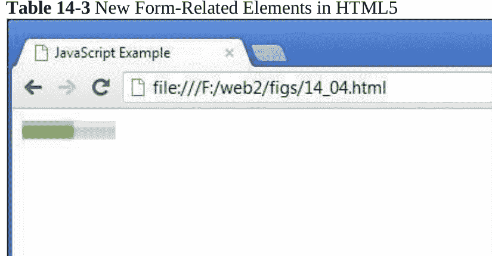

图 14-4 显示的度量条

对于不支持该元素的浏览器，你可以在开始标签和结束标签之间插入默认文本，如下列代码所示：`<meter min="0" max="100" value="55">55</meter>`
这将在页面上原本显示度量条的位置简单地显示 55。

这可以与 JavaScript 结合使用，向用户显示有用的信息，例如在测验中正确回答了多少道题。例如，假设你有以下 HTML 代码：

```
<h1>Math Quiz</h1>
<form id="qform">
<label for="q1">1. 2 + 2 = </label>
<input type="text" name="q1" id="q1"><br><br>
<label for="q2">2. 2 x 255 x 5 = </label>
<input type="text" name="q2" id="q2"><br><br>
<label for="q3">3. 7436 - 2478 = </label>
<input type="text" name="q3" id="q3"><br><br>
<input type="submit" value="Check Answers">
</form><br>
<div id="grade"></div>
```

这里创建了一个快速数学测验的表单，允许观看者在文本框中输入答案，然后提交答案进行检查。一个 id 为 grade 的空 div 将用于通过 JavaScript 显示答案。以下代码展示了 meter 标签如何用作视觉辅助工具来显示正确答案的数量：

表单元素被赋值给一个变量 `var qform = document.getElementById("qform"),`
`qs = [document.getElementById("q1"), document.getElementById("q2"), document.getElementById("q3")], ans = [4, 2550, 4958],`
每个测验问题的答案按顺序放入 ans 数组中，与 qs 数组中各自对应的文本框一致 创建一个包含每个文本框输入元素的数组
grade div 被赋值给一个变量 为表单元素上的 submit 事件创建了一个事件监听器 `grade = document.getElementById("grade"); qform.addEventListener("submit", function(event) {`

```
var num_correct = 0,
num_questions = qs.length,
grade_HTML = "";
```

```
event.preventDefault();
for (var i = 0; i<num_questions; i++) { if (+qs[i].value === ans[i]) {
num_correct += 1;
```

创建一个循环来遍历 qs 数组并获取每个用户答案的值 创建变量来保存正确答案的数量、问题总数以及一个将在测验评分时放置在 grade div 内的 HTML 字符串

阻止默认动作（将表单提交到服务器）

```
grade_HTML = '<meter min="0" max="' + num_questions + '" ';
grade_HTML += 'value="' + num_correct + '">';
grade_HTML += num_correct + '</meter> ';
grade_HTML += num_correct + '/3 Correct';
grade.innerHTML = grade_HTML;
```

}, false);

如果每个用户答案的数值等于 ans 数组中的实际答案，则 num_correct 变量增加一 grade_HTML 变量被赋值为测试评分后将显示的 HTML 字符串值

grade div 的 innerHTML 被更改为 grade_HTML 变量的内容 这里，在提交表单时对测试进行评分。创建了一个名为 num_correct 的变量，初始值为零；名为 num_questions 的变量通过获取包含每个文本框输入元素的 qs 数组的长度来获取测验中的问题数量；名为 grade_HTML 的变量被赋值为空字符串，该字符串将用 meter 标签和其他文本来填充以显示结果。
创建一个循环来迭代 qs 数组，获取每个值，并判断其是否等于 ans 数组中对应的正确答案。注意，一元 + 运算符用于在比较之前尝试将用户的输入强制转换为数字，因为每个文本框默认返回字符串。如果答案正确，则向 num_correct 变量加一。接下来的代码行创建最终将放置在 grade div 内的 HTML 字符串。注意 meter 标签的 max 属性如何被赋值为 num_questions 变量的值，value 属性如何被赋值为 num_correct 变量的值。在 meter 元素之后显示额外的消息，向用户说明度量条显示的是什么类型的结果（例如，如果有两个答案正确，则显示 "2/3 Correct"）。在这种情况下，如果用户没有答对所有题目，可以编辑答案并再次提交检查，直到获得 3/3。图 14-5 展示了当两个答案正确时此脚本的结果。

#### progress 元素

progress 元素与 meter 类似，但显示的是百分比而非标量值。例如，要在进度条上显示 100 分之 25，你可以使用以下代码：

```
<progress max="100" value="25">25%</progress>
```

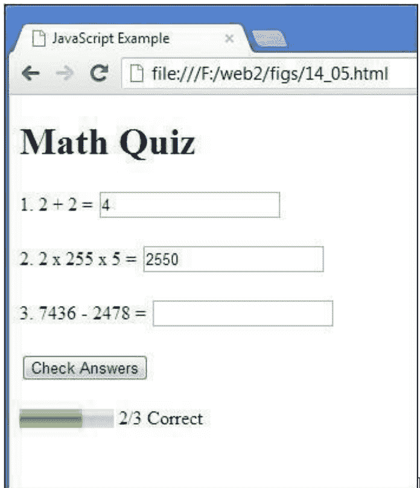

图 14-5 显示度量条以展示回答正确的问题数量。

与 meter 一样，你可以使用 max 属性设置最大值，使用 value 属性设置从 0 到 max 值范围内的百分比值。如果需要，你可以修改前面的 meter JavaScript 代码来使用进度条显示测验的百分比分数，使用以下代码：

```
var qform = document.getElementById("qform"),
qs = [document.getElementById("q1"), document.getElementById("q2"), document.getElementById("q3")],

ans = [4, 2550, 4958],
grade = document.getElementById("grade");
qform.addEventListener("submit", function(event) {
var num_correct = 0,
num_questions = qs.length,
grade_HTML = "",
score = 0;
event.preventDefault();
for (var i = 0; i<num_questions; i++) { if (+qs[i].value === ans[i]) { num_correct += 1;
}
}
score = Math.round(num_correct / num_questions * 100);
```

添加了一个名为 score 的新变量来计算分数

分数根据正确题数和总题数计算，然后四舍五入为非小数百分比

```
grade_HTML = '<progress max="100" ';
grade_HTML += 'value="' + score + '">';
grade_HTML += score + '%</progress> ';
grade_HTML += 'Grade: ' + score + '%';
grade.innerHTML = grade_HTML;
}, false);
```

显示 progress 元素而非 meter 元素，显示百分比分数

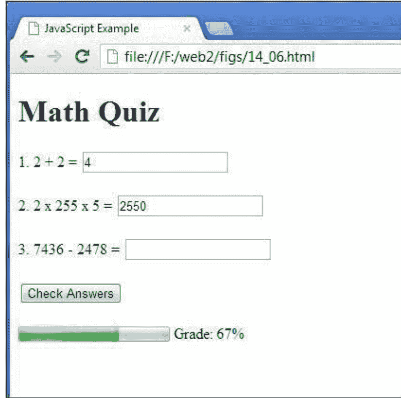

图 14-6 使用 progress 元素将结果显示为百分比。

这里进行了一些修改来计算将用于 progress 元素的百分比分数。然后根据百分比分数生成 progress 元素。图 14-6 展示了当三个答案中有两个正确时此脚本的结果。

### 新的输入类型

除了新元素外，HTML5 还增加了许多可用于 input 元素的新输入类型。
表 14-4 列出了新增内容。

| 类型 | 描述 |
| :--- | :--- |
| color | 允许用户使用颜色工具选择颜色 |
| date | 可以使用日期或日历工具输入日期 |
| datetime | 可以使用日期或日历工具输入日期/时间；时区设置为 UTC |
| datetime-local | 可以输入不带时区的日期/时间 |
| email | 专门用于输入一个或多个电子邮件地址 |
| month | 可以输入带年份和月份的日期；无时区 |
| number | 专门用于数字输入 |
| range | 允许使用范围工具选择值的范围 |
| search | 专门用于输入要放入搜索的值 |
| tel | 专门用于输入电话号码 |
| time | 允许用户输入带小时、分钟、秒和 fractional seconds 的时间值；无时区 |
| url | 专门用于输入 URL |

你会注意到其中一些输入类型允许用户使用工具，例如 color 输入类型。浏览器的实现方式可能不同，但支持一种或多种新输入类型的浏览器通常使用户更容易输入每种特定类型的值，并且/或者使输入的值更容易验证。使用新 color 类型的示例显示在此代码中：

```
<input type="color" name="mycolor" id="mycolor">
```

如你所见，你可以在 type 属性中插入特定类型来使用它。由于这些字段要求特定类型的值，浏览器能够对这些字段执行自己的验证，这在受支持时很有帮助。这将在后面的"HTML5 表单验证"部分进一步讨论。

### 新的属性

HTML5 还带来了可用于表单和/或表单元素的新属性。这些列在表 14-5 中。


week 用于输入一周；不涉及时区。

| 属性 | 描述 |
| --- | --- |
| autocomplete | 可以在 `form` 标签中设置（影响所有表单字段），也可以在任意具体的 `input` 标签中设置（影响单个字段）。如果值设置为 "off"，该字段将不会使用浏览器的自动完成功能来提供字段填充建议 |
| autofocus | 告诉浏览器在页面加载时将焦点赋予该元素 |
| dirname | 随表单一起提交输入的方向指示信息 |
| form | 允许你指定该元素所属的表单 |
| formaction | 允许提交元素覆盖其表单元素的 `action` 属性 |
| formenctype | 允许提交元素覆盖其表单元素的 `enctype` 属性 |
| formmethod | 允许提交元素覆盖其表单元素的 `method` 属性 |
| formnovalidate | 允许提交元素覆盖其表单元素的 `novalidate` 属性 |
| formtarget | 允许提交元素覆盖其表单元素的 `target` 属性 |
| pattern | 允许你使用正则表达式来验证表单字段的内容 |
| placeholder | 允许你在表单字段中指定一个占位符（浅色文本，让用户更好地了解期望的输入类型） |
| novalidate | 禁用浏览器在提交表单内容时执行的验证；可以用于整个表单，也可以用于单个表单元素 |
| required | 表示该表单字段为必填项 |

表 14-4 HTML5 中的新输入类型

| 属性 | 描述 |
| --- | --- |
| autocomplete | 可以在 `form` 标签中设置（影响所有表单字段），也可以在任意具体的 `input` 标签中设置（影响单个字段）。如果值设置为 "off"，该字段将不会使用浏览器的自动完成功能来提供字段填充建议 |
| autofocus | 告诉浏览器在页面加载时将焦点赋予该元素 |
| dirname | 随表单一起提交输入的方向指示信息 |
| form | 允许你指定该元素所属的表单 |
| formaction | 允许提交元素覆盖其表单元素的 `action` 属性 |
| formenctype | 允许提交元素覆盖其表单元素的 `enctype` 属性 |
| formmethod | 允许提交元素覆盖其表单元素的 `method` 属性 |
| formnovalidate | 允许提交元素覆盖其表单元素的 `novalidate` 属性 |
| formtarget | 允许提交元素覆盖其表单元素的 `target` 属性 |
| pattern | 允许你使用正则表达式来验证表单字段的内容 |
| placeholder | 允许你在表单字段中指定一个占位符（浅色文本，让用户更好地了解期望的输入类型） |
| novalidate | 禁用浏览器在提交表单内容时执行的验证；可以用于整个表单，也可以用于单个表单元素 |
| required | 表示该表单字段为必填项 |

#### 表 14-5 HTML5 表单/表单字段中的新属性

## HTML5 表单验证

HTML5 允许浏览器自动验证各种输入类型。可以通过在 `form` 标签中使用 *novalidate* 属性来禁用浏览器对表单所有字段的输入验证，也可以在单个表单字段中使用该属性，使它们不被验证。

如果你决定允许浏览器验证字段，新的输入类型将使用特定的验证方法，以确保输入了预期类型的信息。每个字段默认都是可选的，不过你可以通过在每个需要填写的字段上添加 *required* 属性来将其设为必填。例如，浏览器将验证以下表单，并要求填写 URL 字段：

```
<form id="signup_form" method="post" action="send.php">
<label for="name">Name:</label>
<input type="text" name="name" id="name"><br><br>
<label for="url">URL:</label>
<input type="url" name="url" id="url" required><br><br>
<input type="submit" value="Submit">
</form>
```

图 14-7 显示了在受支持的浏览器中未填写必填字段时的情况。图 14-8 显示了在受支持的浏览器中在 URL 字段中输入无效 URL 的结果。

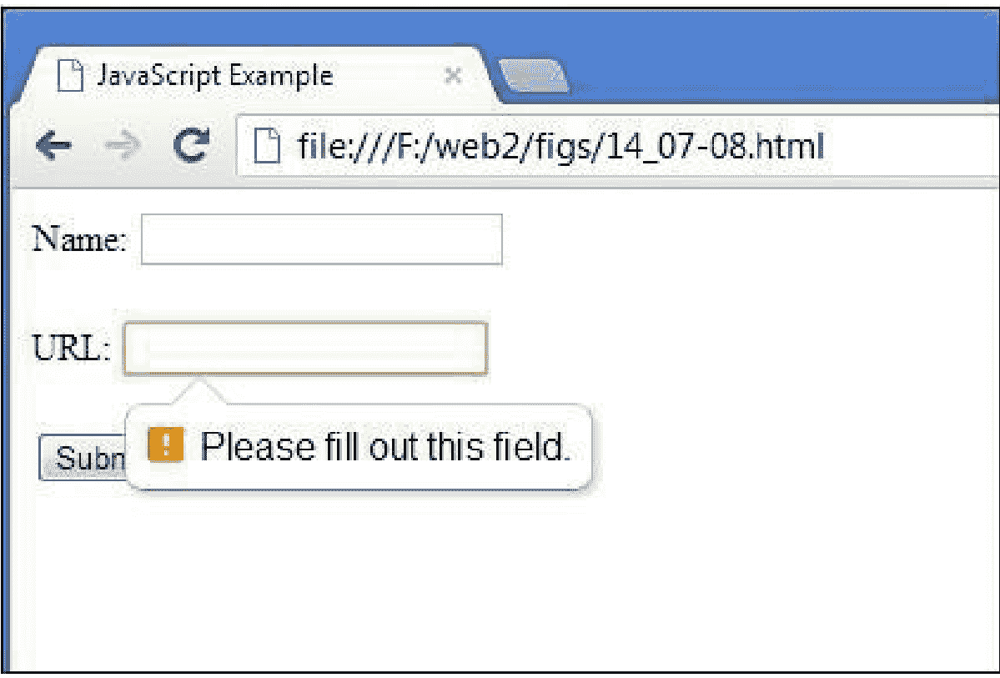

**图 14-7** 该字段必须填写才能通过验证。

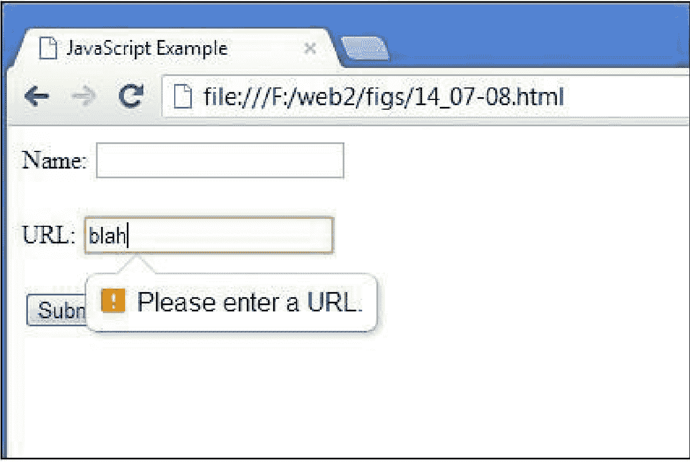

**图 14-8** 该字段必须包含有效的 URL 才能通过验证。

你还可以使用 `pattern` 字段，使浏览器根据正则表达式验证字段。例如，如果你希望上一个表单中的 name 字段只包含字母和空格，可以使用以下代码：

```
<label for="name">Name:</label>
<input type="text" name="name" id="name" pattern="[A-Za-z ]+"><br><br>
```

唯一的缺点是浏览器的支持。如果需要在不支持 HTML5 特定输入类型或验证的浏览器中进行客户端输入验证，那么你需要编写一些 JavaScript 作为后备方案。例如，假设你有以下表单：

```
<form id="signup_form" method="post" action="send.php">
<label for="name">Name:</label>
<input type="text" name="name" id="name" pattern="[A-Za-z ]+"><br><br> <input type="submit"
value="Submit">
</form>
```

如果浏览器不支持 `pattern` 属性，而你仍然想确保该字段只包含字母和空格，那么你需要编写一个脚本来确保该字段仍然被验证。在这种情况下，你可以简单地使用以下代码在点击提交按钮时验证 name 字段。

```
var sform = document.getElementById("signup_form");
sform.addEventListener("submit", function(event) {
var name = document.getElementById("name").value,

pattern = /[A-Za-z ]+/;
event.preventDefault;
if (!pattern.test(name)) {

alert("Name must contain only letters and spaces");
}
}, false);
```

这简单地使用所需的模式作为 JavaScript 中的正则表达式，并运行 `test` 方法来查看输入是否匹配该模式。如果不匹配，则向用户发送提醒，以便更正姓名。

HTML5 为表单提供了许多新的实用功能。在撰写本文时，客户端验证可能仍需要 JavaScript 后备方案。随着更多用户转向使用更新的浏览器，以及浏览器对所有新功能的支持不断提高，这些新工具将对你——作为开发者——变得更加实用。

**注意**
有关任何 HTML5 表单改进的更多详细信息，包括哪些浏览器支持每项功能，请参见 wufoo.com/html5/。

**动手实践 14-2** 使用 HTML5 pr14_2.html 或 JavaScript prjs14_2.js 验证电话号码

在本项目中，你将在前一个项目的基础上，创建一个表单，使用新的 HTML5 `pattern` 属性来验证电话号码。如果浏览器不支持 HTML5，则改用备用的 JavaScript 验证。

## 分步操作

**1.** 创建一个 HTML 文档，并添加 `script` 标签，使 HTML 文件调用名为 prjs14_2.js 的外部 JavaScript 文件。创建一个 id 为 "getphone" 的表单，并添加一个 id 为 "phone" 的文本框以获取电话号码。该文本框应使用 `pattern` 属性和正则表达式，以验证格式为 XXX-XXX-XXXX 的电话号码。它还应该是一个必填字段。确保表单包含一个提交按钮。将 HTML 文件保存为 pr14_2.html。完成后，HTML 代码应如下所示：

```
<body>
<form id="getphone">
<label for="phone">Phone Number (XXX-XXX-XXXX):</label> <input type="number" id="phone"
pattern="/^\d{3}-\d{3}-\d{4}$/" required><br><br>
<input type="submit" value="Submit">
</form>
<script type="text/javascript" src="prjs14_2.js"></script> </body>
```

**2.** 创建一个 JavaScript 文件并将其保存为 prjs14_2.js。在第 3 步中使用它。

**3.** 创建一个脚本，在提交表单时作为 HTML5 验证的后备方案。如果字段验证不通过，则发送提醒消息 "Invalid phone number entered. Valid format is XXX-XXX-XXXX."。否则，允许提交表单。完成后，JavaScript 代码应如下所示：

```
var getphone = document.getElementById("getphone");
getphone.addEventListener("submit", function(event) {
var phone = document.getElementById("phone").value,


## 第14章 自我测试

1.  每当你在HTML文档中添加一组`<form>`和`</form>`标签时，就会创建一个`form`对象。
2.  `forms`属性允许你使用索引号来访问表单。
3.  以下哪项会访问页面上的第四个表单？
    - A. document.forms[4]
    - B. document.forms[3]
    - C. document.forms(4)
    - D. document.forms(3)
4.  以下哪项会找出页面上第三个表单中的元素数量？
    - A. document.forms[2].length
    - B. document.forms[3].length
    - C. document.forms.length
    - D. document.forms(3).length
5.  以下哪项存储了文档中表单数量的值？
    - A. document.forms[0].length
    - B. document.form.length
    - C. document.forms.length
    - D. document.forms[1].length
6.  使用`name`属性允许你为页面上的表单命名，以便后续访问。
7.  以下哪项访问名为`f1`的表单中名为`e1`的元素的值？
    - A. document.f1.e1.value
    - B. document.e1.f1.value
    - C. document.f1.e2.value
    - D. document.forms1.e1.value
8.  `action`属性允许你访问开场form标签中`action="url"`属性的值。
9.  `elements`属性是一个数组，允许你访问特定表单中的每个元素。
10. HTML5中的`pattern`属性允许你为表单字段指定一个必须验证的正则表达式。
11. `reset()`方法允许你使用脚本重置表单。
12. 以下哪项会在文档中添加一个有效的meter标签，以显示0到10刻度上的8？
    - A. `<meter min="0" max="10" value="7">8</meter>`
    - B. `<meter min="4" value="8">8</meter>`
    - C. `<meter min="0" max="10" value="8">8</meter>`
    - D. `<meter min="0" max="100" value="8">8</meter>`
13. 提升表单可访问性的一种方法是使用`label`标签来标识一段文本描述的是哪个字段。
14. `submit()`方法允许你在用户不点击提交按钮的情况下提交表单。
15. 以下哪项HTML5表单属性用于必须由用户填写才能验证的字段？
    - A. obligatory
    - B. needed
    - C. required
    - D. compulsory

# 第15章 高级技术简介

### 关键技能与概念

- 处理图像
- JavaScript与框架
- 调试脚本
- JavaScript与无障碍访问
- JavaScript安全
- AJAX与JSON

### 处理图像

JavaScript使用image对象来预加载图像、创建翻转效果，甚至创建幻灯片或动画。image对象的属性在创建列表时会有所帮助，并描述了image对象的属性。

### 翻转效果

图像*翻转*（也称为悬停按钮、图像切换和其他类似名称）可以为你的导航图像增添一些活力。随着浏览器和CSS的最新进展，翻转效果现在通常通过CSS而不是JavaScript来实现。你可以在 www.netmagazine.com/tutorials/create-progressively-enhanced-3d-css-rollovers 看到一个例子。

| 属性名称 | 用途 |
|---|---|
| name | 存储来自name属性的图像名称的值 |
| src | 存储来自src属性的URL的值 |
| width | 存储来自width属性的宽度的值 |
| height | 存储来自height属性的高度的值 |
| border | 存储来自border属性的边框属性的数值 |
| hspace | 存储来自hspace属性的hspace属性的数值 |
| vspace | 存储来自vspace属性的vspace属性的数值 |
| lowsrc | 存储来自lowsrc属性的URL的值 |
| complete | 指示图像是否已加载完成 |

**表15-1** 图像对象的属性

### 一个简单的JavaScript翻转效果

简单的翻转效果只是在鼠标移动到初始图像上时将一张图像更改为另一张图像。首先，你创建两张图像，并使第二张图像在某些方面有所不同。例如，看看这里展示的两张图像：


> 注意：对于你创建的每个JavaScript翻转效果，你都需要两个单独的图像。

一旦你有两张图像，你就可以开始处理图像翻转的代码了。你可以将初始图像编码到你的HTML文档中，并为其赋予一个id：

`<h1>下面的图像会变化！将鼠标移过它！</h1> `

在你的JavaScript代码中，你只需通过其id获取图像元素，并在mouseover事件上为src属性分配一个新值。然后，你只需在mouseout事件上将其改回即可。以下是JavaScript代码：

```
var im = document.getElementById("pic1");
im.addEventLister("mouseover", function() {
    im.src = image2.gif;
}, false);
im.addEventLister("mouseout", function() {
    im.src = "image1.gif";
}, false);
```

在这里，你能最接近地看到结果的方式是看到一组前后对比的图像。图15-1显示了初始图像，而图15-2显示了鼠标移到图像上时的结果。

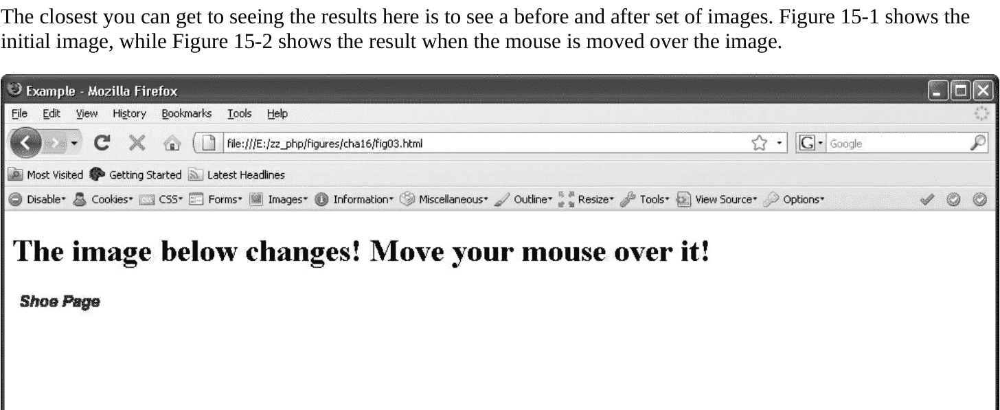

**图15-1** 初始图像

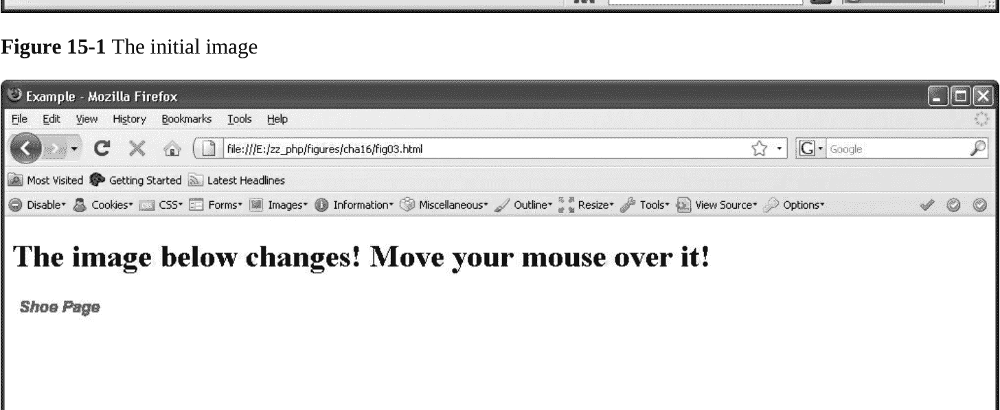

**图15-2** 当mouseover事件发生时，新图像出现。

> **注意**

为了使没有鼠标的用户也能更好地访问，你可以使用代码在`<a>`元素的focus和blur事件上执行更改。你将在本章的第一个项目中进行此操作。

动手实践 15-1 **更易于访问的翻转效果**

pr15_1.html / prjs15_1.js — 为了使JavaScript翻转效果更易于访问，你将使用相同的一组图像，并编写代码，以便在`<a>`元素的focus和blur事件以及``元素的mouseover和mouseout事件上更改图像。

分步指南

1.  创建一个名为pr15_1.html的HTML文档，并使用以下HTML代码作为body部分：

```
<body>
<h1>下面的图像会变化！将鼠标移过它！</h1>
<a href="page.html" id="imlink"></a>
<script type="text/javascript" src="prjs15_1.js"></script>
</body>
```

2.  创建一个名为prjs15_1.js的JavaScript文件。在此文件中，从以下代码开始：

```
var im = document.getElementById("pic1");
im.addEventLister("mouseover", function() {
    im.src = image2.gif;
}, false);
im.addEventLister("mouseout", function() {
    im.src = "image1.gif";
}, false);
```

3.  修改代码，使得当`<a>`元素发生focus和blur事件时，图像也会改变。你可以通过将部分代码移动到单独的函数中，或者简单地将相应的事件监听器代码粘贴到其配套的事件监听器中（即mouseover和focus将使用相同的代码）来实现。如果你将事件监听器代码移动到单独的函数中，它将如下所示：

```
var im = document.getElementById("pic1"),
    imlink = document.getElementById("imlink");

function on_image() {
    im.src = "image2.gif";
}

function off_image() {
    im.src = "image1.gif";
}

im.addEventListener("mouseover", on_image, false);
imlink.addEventListener("focus", on_image, false);
im.addEventListener("mouseout", off_image, false);
imlink.addEventListener("blur", off_image, false);
```

4.  保存HTML和JavaScript文件，并在浏览器中打开HTML文件。现在，当`<a>`元素发生focus和blur事件时，图像应该会改变。

动手实践总结 — 在这个项目中，你运用了JavaScript、图像和事件的知识，创建了一个支持mouseover、focus、mouseout和blur事件的图像翻转效果。

## JavaScript与框架

是否在你的网站上使用框架由你决定。然而，应该指出的是，框架确实存在无障碍访问/可用性问题。事实上，`<frameset>`和`<frame>`在HTML5中已不再有效。`<iframe>`元素（内联框架）仍然可用。

### 框架的目的

框架将窗口分成两个或多个独立的区域（*框架集*），每个区域包含不同的内容。这与表格不同，因为框架集中的每个部分都包含一个独立的超文本标记语言（HTML）文档，你可以更改其中一个部分而不影响其他部分。

> 注意：网页上显示的每个框架实际上都是一个独立的HTML文档。

例如，图15-3显示了一个带有两个框架的网页。每个框架实际上都是一个独立的HTML文档。创建这些框架的HTML文档使用一组`<frameset>`和`</frameset>`标签来创建一个框架集。

### 访问框架

你如何在JavaScript中访问框架？你可以使用frames数组，或者为框架命名并使用框架名称来代替。首先，看看如何使用frames数组访问框架。

#### frames数组

你使用frames数组根据它们在源代码中的顺序来访问框架。你将从一个框架内部访问另一个框架，因此你必须能够找到你想要访问的框架。

回想一下，frames数组来自window对象。框架具有与常规窗口相同的大多数属性和方法，但访问方式不同。例如，看看这段代码，它创建了一个包含两个框架的框架集。将其命名为frameset1.html。


#### 使用框架名称

从另一个框架访问一个框架的另一种方法是使用框架的名称（类似于你在上一章中使用表单名称的方式）。例如，此代码通过向frame标签添加name属性为每个框架命名（将此文件命名为frameset3.html）：

```html
<html>
<frameset cols="50%,50%">
<frame src="frame1.html" name="left_side"></frame>
<frame src="frame2.html" name="right_side"></frame>
</frameset>
<noframes>
使用下面的链接进入网站的无框架版本。<br /> <a href="noframes.html">无框架站点</a>
</noframes>
</html>
```

你现在可以使用框架名称而不是frames数组从一个框架访问另一个框架。因此，如果你想从第一个框架访问第二个框架（right_side），可以使用此语法：

```javascript
top.right_side
```

同样，你可以使用以下语法从第二个框架访问第一个框架：

```javascript
top.left_side
```

现在，你可以通过在每个框架中编写简短的document.write()语句，让每个框架告诉观众另一个框架的位置。第一个框架（frame1.html）的文档可以这样编码：

```html
<body>
第二个（右）框架来自：<br> <script type="text/javascript">
document.write(top.right_side.location); </script>
</body>
```

使用右框架的名称在左框架中打印其信息。

之后，frame2.html可以编码如下：

```html
<body>
第一个（左）框架来自：<br /> <script type="text/javascript">
document.write(top.left_side.location); </script>
</body>
```

使用左框架的名称在右框架中打印其信息。

现在每个框架都提供关于另一个框架的信息。

**注意**
框架和iframe在使用时存在潜在的安全风险。有关这些风险的更多信息，请参阅 appliedlife.blogspot.com/2011/02/html-frames-and-security.html。

### 跳出框架

有时，其他网站会编写链接，这些链接在用户到达你的网站之前不会让用户跳出该网站的框架。然后，你的网站会留在观众窗口的较小部分，而其他网站的导航仍然显示在其他框架中。当这种情况发生时，你可能想为观众提供一种跳出其他网站框架的方法。

你可以在页面上放置一个链接，让观众点击以跳出框架。你需要在 `<a>` 标签中添加一个特殊的目标，如下所示：

```html
<a href="http://yoursite.com" target="_top">跳出框架</a>
```

目标 `_top` 告诉浏览器在打开链接中的URL时使用整个窗口，而不是在框架内打开链接。你只需将标签中的URL替换为你自己的URL即可。

## 调试脚本

尽管JavaScript很有趣，但有时它也可能相当令人沮丧。代码中的一个错误可能导致整个脚本运行不正确或根本不运行。调试脚本可能是一个耗时且艰巨的过程，但你可以使用一些技巧，在检查代码时节省一些时间。调试脚本的第一步是弄清楚什么类型的错误可能导致问题。

### 错误类型

两种主要的错误类型是语法错误和逻辑错误。当编码人员忘记添加分号、忘记引号、拼写错误等时，就会发生语法错误。当代码实现不正确时，就会发生逻辑错误。

例如，如果执行循环的条件永远不会变为假，while循环可能会无限进行。虽然它可能以正确的语法编码，但结果将不是程序员预期的。

### 查找语法错误

语法错误可能很简单，比如遗漏了一个必要的分号。例如，以下代码在语句之间缺少分号：

```javascript
var greet = function() { say_hi() say_welcome(); };
```

在这种情况下，分号非常重要，因为两个语句在同一行。要修复此问题，只需添加所需的分号，如下所示：

```javascript
var greet = function() { say_hi(); say_welcome(); };
```

语法错误通常会导致浏览器显示错误消息，以便你可以调试脚本。例如，你可能会看到如图15-5所示的消息。

> **注意**
> 大多数现代浏览器默认隐藏这些错误消息，但你可以启用它们以查看。

这些消息可以帮助你找出问题所在。错误消息中显示的行号通常告诉你错误的位置。例如，如果消息说错误在第15行，你将从文档顶部的第15行开始查看那里是什么。其余消息可能会告诉你缺少什么或什么被放置不当。

然而，有时消息中指定的行并不是实际问题所在的行。它可能在上一行、几行之外，甚至完全在其他地方。你可能需要稍作搜索才能找出问题开始的地方。

#### 扫描脚本

如果错误消息无法帮助你定位问题，你可以尝试自己扫描脚本中的错误。这个解决方案可能更繁琐，但如果错误消息没有帮助，它可能帮助你找到问题。表15-2显示了你应该尝试查找的一些项目。

**表15-2 扫描脚本错误时应查找的项目**

| 项目 | 出现形式 |
| :--- | :--- |
| 缺少分号 | ; |
| 缺少花括号或方括号 | { } [ ] |
| 缺少圆括号 | ( ) |
| 缺少单引号或双引号 | ' " |
| 拼写错误 | 例如，ture 应为 true |

以下代码错误百出；看看你能找出多少个。

```javascript
var mymoney = 0;
var mycar = "Mustang";
function send_alert()

alery("You like + mynar + "!");
alert("Cool";
}
var somearray = neq Array(2)
somearray[0] = "Me";
somearray1] = "Me2";
for var count = 0; count < somearray.length; count ++) {
document.write(somearray[0 + " and " + somearray[1]);
```

代码缺少许多必要的项目。以下是你应该找到的项目列表：

- 第3行和第4行之间：函数缺少其开始花括号
- 第4行：单词alert被拼写为alery；单词like之后缺少双引号；变量mycar被拼写为mynar
- 第5行：alert方法缺少右圆括号
- 第7行：单词new被拼写为neq
- 第9行：数组索引号缺少其开始方括号
- 第10行：循环缺少开始圆括号
- 第11行：somearray[0]的索引号缺少其右方括号
- 第11行和第12行之间：缺少结束循环的右花括号

你可能不会犯那么多错误，但这个例子提供了一个很好的方式来了解如何在扫描脚本时捕获它们。当你在定位这些小错误方面变得更有经验时，你将能够在脚本中出现问题时快速找到它们。

### 查找逻辑错误

逻辑错误通常更难发现，因为代码的语法是正确的。你将试图找出代码实现方式中的错误。例如，看下面的代码（但不要运行它！）：

```javascript
x = 1;
y = 2;
while (x <= y) {
// 问题：x永远不会大于y！
alert("Hi");
}
```

代码没有语法错误。所有的分号和引号都在它们应该在的位置。这里的问题是变量x永远不会大于变量y。这种情况将导致无限循环，可能使浏览器崩溃。

你可以通过在循环内添加一行来增加x的值、减少y的值，或者同时增加x和减少y来修复代码。重要的是必须做些什么使条件变为假。以下代码显示了此问题的一种可能修复方法：


 ```
x = 1;
y = 2;
while (x <= y) {
    alert("Hi");
    x++; // 在循环中递增 x 可以使 x 随着时间推移变得大于 y
}
```

#### 警告框和使用控制台

如果有些值看起来不正确，可以随时在脚本的任何位置使用 `alert` 或将值发送到控制台来快速检查。例如，假设你有以下代码：

```
var x = 2,
    y = 0;
// 其他代码...
var z = x/y;
alert(z);
```

运行后，`alert` 将显示 "Infinity"，这可能不是预期的结果。在初始变量定义和将计算结果 (x/y) 赋值给变量 z 之间如果有额外的代码，浏览代码时可能不容易发现正在发生除以零的情况。为了找出错误所在，你可以在计算 z 变量之前在代码中放置一个 `alert`，看看它是否能帮助你了解正在发生什么，如以下示例：

```
var x = 2,
    y = 0;
// 其他代码... 此 alert 将显示即将执行的计算
alert("Calculation will be: " + x + "/" + y);
var z = x/y;
alert(z);
```

当 `alert` 显示计算结果将是 "2/0" 时，你就能看到变量 y 的值为零是导致问题的原因。知道这一点后，你现在可以查找所有给 y 变量赋值的代码行，看看是否导致了 y 被赋值为零。在这个例子中，它发生在代码的第二行，可以通过给 y 赋予不同的值来修正。

如果你决定添加多个检查，或者只是不想在脚本运行时看到 `alert` 弹出消息，你可以选择使用 `console.log()` 方法。这允许你在控制台中放置消息，许多现代浏览器都使用控制台来跟踪 HTML、CSS 和 JavaScript 代码被浏览器读取时发生的错误、警告或其他消息。

> **注意**
完成调试后最好删除你的测试代码，因为当用户运行脚本时，它可能会导致脚本出现错误或其他问题。

通常可以通过在浏览器的"工具"菜单中查找诸如"Web 开发者"或"开发者工具"之类的菜单选项来显示控制台。例如，你可以通过打开 Firefox 的"工具"菜单，进入"Web 开发者"，然后选择"Web 控制台"来显示控制台。

之前使用的脚本现在可以更改为在控制台中显示消息，如以下代码所示：

```
var x = 2,
    y = 0;
// 其他代码...
console.log("Calculation will be: " + x + "/" + y);
var z = x/y;
```

消息现在显示在控制台中而不是在 `alert` 中

该脚本现在将在控制台中记录消息，而不会弹出 `alert`。当你需要在脚本的各个位置放置多条消息来检查值时，这是一种无需被大量弹出 `alert` 消息淹没就能获取必要信息的好方法。

### 使用代码检查工具

多亏了一些专业的 Web 开发人员，现在有一些工具可以帮助你查找 JavaScript 错误，同时鼓励在 JavaScript 代码中使用最佳实践。代码检查工具（一种检查代码中是否存在不正确内容的工具）对于追踪代码中的任何问题（或潜在问题）非常有用。

这里列出两个流行的 JavaScript 代码检查工具：

- JSLint (www.jslint.com)
- JSHint (www.jshint.com)

这两个工具都允许你将 JavaScript 代码粘贴到文本区域中进行检查。这些工具会检查各种问题，例如：

- 未使用 `var` 语句定义的变量（使其成为全局变量）
- 缺少分号
- 使用 `eval()`
- `==` 与 `===`
- 其他问题

例如，假设你有以下代码：

```
var x = 1
var y = "1";
function isEqual() {

if (x == y)
alert("Equal");
else
alert("Not Equal"); }
isEqual();
```

这段代码存在一些问题，运行时会给你带来意想不到的结果。例如，将代码通过 JSLint 运行会给你若干错误。其中包括一些重要的提示，将帮助你修复代码：

• 第 1 行：期望 ';' 但看到的是 'var'。

第 1 行末尾缺少分号来完成第一个 `var` 语句。由于这两个可以合并，最佳实践是在两个变量定义之间使用逗号并删除第二个 `var` 关键字，如以下代码：

```
var x = 1,
y = 0;
```

• 第 4 行：期望 '===' 但看到的是 '=='。

由于进行了类型强制转换，比较 (x == y) 在这里可能会给出意想不到的结果。当 x = 1 且 y = "1" 时，JavaScript 将计算 x == y 为 true。如果你打算确保两个值实际上是数值 1，你不会希望出现这种情况。使用 `===` 更安全，可以避免任何潜在的异常结果：

```
if (x === y)
```

• 第 5 行：期望 '{' 但看到的是 'alert'。

为了避免任何潜在的陷阱并使代码的目的更易阅读，最好在 `if` 和 `else` 语句周围加上花括号，即使它们只包含一行代码（尽管可以省略花括号）。此错误在 `if` 和 `else` 语句中都会被检测到，可以通过为两者添加花括号来修复：

```
if (x == y) {
alert("Equal");
}
else {
alert("Not Equal");
}
```

如你所见，代码检查工具可以在运行代码之前发现潜在的问题，将剩余的调试任务降至最低。通过按照工具对此代码的建议，你可以避免数值 1 等于字符串 "1" 的问题，同时也可以让 `if` 和 `else` 语句在每个代码块中添加额外的代码行而不会在后续引起问题（迫使你去弄清楚发生了什么，然后再添加花括号）。

### 浏览器开发者工具

大多数主流现代浏览器都提供了一套开发者工具，这些工具可以是原生的也可以通过插件获取。这些工具在调试 JavaScript 时也很有帮助。以下提供了一些关于如何获取和使用这些工具的教程链接：

- **Chrome 调试器** www.nsbasic.com/app/tutorials/TT10.htm
- **Firefox 的 Firebug** https://getfirebug.com/javascript
- **Internet Explorer 调试器** blogs.msdn.com/b/cbowen/archive/2011/06/24/internetexplorer-9-developer-tools-deep-dive-part-3-debugging-javascript.aspx

## 问专家

**问：我收到的错误信息说了一些我不理解的内容。我该怎么办？**

**答：** 错误信息并不总是有意义的，也不总是指向代码中的正确行。你可能需要追踪消息中给出的那行代码上所调用的任何变量或函数，或者检查其附近的行是否有错误。一旦你看过几次错误信息，它的含义就更容易理解了。

**问：我代码中的某些内容导致浏览器崩溃了，我无法尝试添加 `alert` 来帮助查找问题，因为每次都会崩溃！我该怎么办？**

**答：** 如果脚本导致浏览器崩溃，请仔细检查你的变量、循环、对象和函数。你也可以尝试使用浏览器插件，如 Firebug，它允许你根据需要在脚本中设置断点。作为最后的手段，从头开始编写一些新代码。

**问：我代码中的一个错误不仅导致浏览器崩溃，还导致电脑死机了！我该怎么办？**

**答：** 重启电脑但*不要*再次运行代码。仔细检查代码，看看能否找到问题所在。

**问：还有其他策略可以帮助我调试脚本吗？**

**答：** 一些文本编辑器使用颜色编码来标记 HTML 标签、JavaScript 代码或其他类型的代码。颜色编码可以帮助你更清晰地查看代码，使检测错误更容易。（试试 Vim 或 NoteTab 文本编辑器。）

## JavaScript 和无障碍访问

你在本书中多次看到的一个主题是脚本或脚本的 HTML 代码与无障碍访问之间的关系。在某些情况下，例如政府机构的网站，州或联邦法律（如《美国残疾人法案》）可能要求网站对残疾观众无障碍访问。即使对你的网站来说这不是一个法律问题，它仍然是一个可用性问题：你希望尽可能多的访客能够使用你的网站并访问你为他们提供的信息。

无障碍访问的一般主题是内容需要对所有浏览器和其他可能访问网站的软件都可以访问。这意味着你的内容不仅应该能被各种 Web 浏览器读取，还应该能被辅助技术读取，例如屏幕阅读软件（例如 Freedom Scientific 公司的 JAWS），或手机等便携设备上的 Web 浏览软件。

### 将内容与呈现分离

通常，使你的网站内容可无障碍访问的第一步是将无障碍访问功能构建到你的 HTML/XHTML 代码中，但你也需要调整你的 JavaScript 代码。你可能已经知道，编写 HTML 时可以使用层叠样式表（CSS）来呈现内容（显示多少列、字体样式、各个分区的宽度等等），而使用 HTML 仅用来标记内容本身（例如用 `<div></div>` 标签将其分成若干部分或插入图像等对象）。这解决了...


在JavaScript中，使内容可访问通常意味着确保你在脚本中使用的内容已经显示在页面上，或通过链接或其他方式可用。一个可能有帮助的方法是将所有JavaScript代码（或尽可能多的代码）移至外部JavaScript文件中，同时在HTML代码中保留尽可能少的JavaScript代码。

例如，你可能有一个使用以下代码的网页：

```
<body>
<script type="text/javascript">
function send_alert() {
    window.alert("Hi, there is a sale today! 20% off everything!"); return false;
}
</script>
<a href="#" onclick="send_alert();">Hi</a>
</body>
```

这段代码对于拥有JavaScript的用户来说运行良好。然而，将脚本放在HTML代码中意味着，当你需要更新HTML代码时（尤其是如果脚本很长），需要在文件中进行大量额外的滚动。因此，你可能想采取的第一步是将脚本移至外部文件，如下列代码示例所示。首先是新的HTML代码：

```
<body>
<a href="#" onclick="send_alert();">Hi</a>
<script type="text/javascript" src="myscript.js"></script>
</body>
```

接下来是 myscript.js JavaScript文件：

```
function send_alert() {
    window.alert("Hi, there is a sale today! 20% off everything!"); return false;
}
```

这使得HTML文件更短且更易于阅读，因为JavaScript功能被放置在其自己的文件中，远离了HTML代码。

你可能想采取的下一步是更改HTML标签中 `onclick` 事件处理器的使用方式。虽然有效，但如果你决定使用不同名称的函数或决定将其设为无JavaScript的普通链接，就会变得麻烦，因为你需要更新每个HTML文件以清晰地适应更改（你可以简单地修改脚本，让新函数使用此函数名称或在调用时什么都不做，但这可能会让以后需要更新代码的人感到困惑）。为了将这个 `onclick` 事件处理器从HTML代码中移除，你可以稍微重写JavaScript并为锚标签添加一个 `id`（就像你之前在本书中做过的那样）。首先是更新后的HTML代码：

```
<body>
<a href="#" id="sale">Hi</a>
<script type="text/javascript" src="myscript.js"></script>
</body>
```

接下来是 myscript.js JavaScript文件：

```
function send_alert() {
    window.alert("Hi, there is a sale today! 20% off everything!"); return false;
}
var s_alert = document.getElementById("sale");
s_alert.addEventListener("click", send_alert, false);
```

现在HTML代码中没有零散的JavaScript命令，只有末尾对外部脚本的一次调用。锚标签被赋予了一个 `sale` 的 `id`，JavaScript代码可以使用它来捕获该元素上的点击事件。JavaScript代码现在使用 `document.getElementById()` 来获取锚元素，然后为其分配一个点击时运行的函数。

最后需要注意的是，对于没有JavaScript的用户，这个链接根本不起作用。由于你需要访问者了解警报内容（以便他们知道有促销活动），你需要确保即使是那些没有JavaScript的访问者也能获得此信息。你可以在页面的其他地方显示它，使用一组 `<noscript></noscript>` 标签内联显示消息，或者对链接进行编码，使其指向包含该消息的HTML页面，如以下代码所示：

```
<body>
<a href="sale_alert.html" id="sale">Hi</a>
<script type="text/javascript" src="myscript.js"></script>
</body>
```

然后，你可以将你的消息放在名为 `sale_alert.html` 的文件中：

```
<body>
Hi, there is a sale today! 20% off everything!
</body>
```

这确保了所有用户，无论是否使用JavaScript，都能访问到该消息。

### 增强内容

一种确保广泛可访问性的技术（已被广泛使用）是首先为访问者提供内容，然后使用JavaScript为那些能够运行它的用户增强体验。这通常被称为“渐进增强”，它允许所有访问者使用网站，同时为拥有现代浏览器的访问者提供更丰富的体验。

这就是你在上一节中（小规模地）对脚本所做的。通过在点击链接时提供“促销”消息，你使其对所有访问者都可访问。然而，那些拥有JavaScript的用户无需离开页面和返回即可查看警报，从而在某种程度上增强了他们的体验。

这个过程可以很简单，如前面的例子所示，也可以很复杂，比如添加大量JavaScript代码以处理各种浏览器，和/或添加服务器端脚本来帮助那些没有JavaScript的用户。你可以在 http://developer.yahoo.com/yui/articles/gbs/#progressive-enhancement 上了解更多关于渐进增强的信息。雅虎！有一套非常详细和有组织的渐进增强系统，允许JavaScript代码在尽可能多的浏览器上工作，但也为那些没有JavaScript的用户提供了服务器端脚本或HTML内容。

**提示**
有关JavaScript和表单的可访问性信息，请参阅第14章，该章讨论了这个主题以及JavaScript与表单的使用。

*动手试一试 15-2* **使此代码可访问**

pr15_2.html 为了练习使JavaScript更具可访问性，你将获取一个名为 `sales.html` 的HTML页面并对其进行处理，尽可能地分离JavaScript和HTML代码。prjs15_2.js 你还将使用确保那些没有JavaScript的用户也能获得任何额外内容的代码。

#### 分步指南

**1.** 创建一个名为 `pr15_2.html` 的HTML文档，并将以下HTML代码用于 `body` 部分：

```
<body>
<script type="text/javascript">
function new_win() {
    window.open('sales.html', 'newwin', 'width=300,height=200');
}
</script>
<div>
<h1>Sales:</h1>
</div>
<div>
<a href="#" onclick="new_win(); return false;">Click for Sale Information</a>
</div>
</body>
```

**2.** 创建一个名为 `sales.html` 的HTML文档，并将以下HTML代码用于 `body` 部分：

```
<body>
<h1>Sales:</h1>
Clothes: 25% off<br>
Electronics: 10% off<br>
Appliances: 15% off (with coupon)
</body>
```

**3.** 通过进行必要的调整并尽可能将JavaScript代码移至名为 `prjs15_2.js` 的JavaScript文件中，使代码对那些没有JavaScript的用户可访问且可用。

**4.** 下列HTML代码（用于 `pr15_2.html`）和JavaScript代码（用于 `prjs15_2.js`）展示了一种可能的解决方案。

**HTML代码：**

```
<body>
<div>
<h1>Sales:</h1>
</div>
<div>
<a href="sales.html" id="slink">Click for Sale Information</a>
</div>
<script type="text/javascript" src="prjs15_2.js"></script>
</body>
```

**JavaScript代码：**

```
var slink = document.getElementById("slink");
slink.addEventListener("click", function() {
    event.preventDefault();
    window.open('sales.html', 'newwin', 'width=300,height=200');
}, false);
```

**5.** 保存HTML和JavaScript文件，并在浏览器中打开HTML文件。现在，内容应该可以在你选择用来打开页面的任何浏览器中访问。

#### 动手试一试总结

在这个项目中，你运用了你的可访问性知识，使文档和脚本对访问者更具可访问性。

## JavaScript安全性

你可能已经注意到，当你尝试在主浏览器窗口上使用 `window.close()` 方法时，会出现一个确认框，询问你是否确实希望允许关闭该窗口。这种情况是JavaScript安全问题之一。浏览器不希望网站在未经访问者许可的情况下关闭访问者打开的窗口。如果允许这样做，程序员将能够对访问者的计算机进行某种控制，这可能会成为一个问题。

安全的另一个方面是错误地认为你可以用密码“保护”网页，或阻止用户查看页面的源代码。

安全的另一个方面是防范跨站脚本攻击，即使用JavaScript从服务器端应用程序中获取信息，而这些应用程序没有正确过滤用户输入。

### 安全性和签名脚本

要获得关闭主浏览器窗口或在JavaScript中使用某些属性或方法的访问者许可，你必须使用签名脚本。签名脚本将打开更多JavaScript功能，但你必须做一些额外的工作。

基本上，你使用特殊工具对脚本进行数字签名。然后，访问者在进入页面时会收到一条消息，询问是否允许该签名脚本，并附有一些关于签名脚本的信息。如果访问者接受，那么你将能够使用额外的功能。如果不接受，你需要准备好替代代码以避免JavaScript错误。

有关此主题的更多信息，请访问网站 www.mozilla.org/projects/security/components/signed-scripts.html。

### 页面保护

许多脚本试图以某种方式阻止访问者，例如使用密码保护或使用“无

"右键禁用"脚本，用于防止查看网页源代码。然而，这些安全策略基本上是无效的，因为这些"密码"和"禁用右键"脚本通常可以通过关闭JavaScript或稍作额外操作来绕过。

### 密码系统

有些密码系统比其他系统更好，但似乎没有一个能提供真正的网页安全性。如果你不想让别人查看某个页面，存在比使用JavaScript系统好得多的方法，比如使用服务器端语言或在你的Web服务器上进行某些设置。

如果你使用的是免费的Web托管服务，这些更好的方法可能可用也可能不可用。然而，请记住，JavaScript密码系统并非万无一失，你不应该用它来保护任何重要的东西。

### 隐藏网页源代码

许多人希望能隐藏网页的源代码。然而，JavaScript无法实现这一点。有许多脚本尝试通过各种手段来禁用右键菜单。基本上，这些策略不起作用，因为可以通过几种方式绕过：

- 如果右键菜单被禁用，你总是可以尝试选择"查看 | 查看源代码"。
- 如果上述方法不起作用，你总是可以关闭JavaScript或查看你计算机上的缓存文件夹。浏览器必须拥有代码才能显示页面，因此代码的副本会进入浏览器的缓存。

从长远来看，这些脚本只是让查看源代码变得更困难（而且可能会很烦人）。有关此主题的更多信息，请访问 http://webhome.idirect.com/~bowers/copy/copy1.htm。

### 跨站脚本攻击

跨站脚本攻击（通常缩写为 XSS）以恶意方式使用 JavaScript 代码（或其他类型的代码），从具有漏洞的应用程序的网站用户那里获取信息。利用这些信息，某人可以使用他人的 cookie 或会话信息，就像他们是获取信息的那个用户一样访问网站。这当然会导致大麻烦，特别是如果那个用户是该应用程序中的管理员，或者该应用程序涉及金钱（如银行或购物应用程序）。

虽然 JavaScript 是执行此类攻击的方式之一，但有漏洞的应用程序通常是服务器端的，并在页面上显示用户输入。如果用户输入在服务器端应用程序中没有被清理（验证），那么任何数量的可能恶意脚本都可能被输入，而不是预期的输入。

例如，你可能有一个表单，它使用服务器端脚本允许人们发送评论。该脚本将用户提交的评论作为确认显示回给用户。如果输入没有被清理，就有可能在评论字段中输入类似这样的内容：`<script>alert("You've been had!");</script>`。如果有人提交了这个并在响应页面上看到一个警报，这个人就会知道存在潜在的漏洞，并且可以简单地将后续用户引导到一个可以窃取用户 cookie 或会话信息的恶意 URL。图 15-6 显示了有漏洞的应用程序如何显示这样的警报（这个警报还包含一些评论文本，以帮助掩盖提交表单者的意图）。

跨站脚本攻击多年来不断发展。起初，一个恶意网站可以在一个框架（或弹出浏览器窗口）中加载一个正常的网站，然后使用 JavaScript 访问文本框、cookie 和其他数据（用户 ID 和密码）——因此得名"跨站"。需要注意的是，在过去四五年内，现代浏览器不允许这种类型的跨站脚本攻击。一个域不能访问另一个域的内容。大多数现代跨站脚本攻击是像这里示例的注入攻击（尽管通常复杂得多）。

**图 15-6** 哦，不！这对该网站的用户来说可不妙！

这篇介绍只是触及了这类安全问题的表面。需要记住的主要事情是，当你使用服务器端应用程序时，你必须清理任何用户输入，以确保你收到的是预期类型的输入。有关此主题的更多信息，请访问 www.owasp.org/index.php/Cross_site_scripting。

## AJAX 和 JSON

AJAX 提供了一种使用 XMLHttpRequest 对象从服务器端脚本获取数据的方法。获取的数据可以作为可用的 JavaScript 值（例如数组或对象）通过 JSON 返回。两者都将在以下章节中详细解释。

### AJAX

AJAX 代表异步 JavaScript 和 XML，这是一种 JavaScript 可以从服务器端文件或应用程序获取数据而无需重新加载页面的方式。例如，对 Web 服务器的同步请求需要重新加载当前页面才能使用新信息。异步请求允许获取和使用信息，而无需等待整个页面重新加载。

从服务器获取的数据可以是任何东西（例如，文本文件、XML 文件、运行服务器端脚本的结果）。尽管有 AJAX 术语，但返回的值实际上不需要是 XML 格式。这为你如何检索所需的数据提供了很大的灵活性。

这种类型的脚本在渐进增强中很有用，因为它允许应用程序为那些在现代浏览器中启用了 JavaScript 的用户增强用户体验。信息可以即时获取和使用，而不是等待页面再次加载。

#### XMLHttpRequest 对象

在 JavaScript 中，创建一个 XMLHttpRequest 对象，然后可以使用该对象在后台向服务器发出 HTTP 请求，并允许用户在不中断的情况下继续使用应用程序。在文本中，该对象通常被称为 XHR，作为完整对象名称（XMLHttpRequest）的缩写。

要创建 XHR 对象，你只需使用其构造函数，如下代码所示：`var xhr = new XMLHttpRequest();`

此对象在大多数现代浏览器中都可用。在 Internet Explorer 7 之前的版本中，你需要创建一个 ActiveX 对象。关于早期版本 Internet Explorer 的解决方法可以在网上找到，例如 github.com/ilinsky/xmlhttprequest 上的那个。如果你不需要在旧浏览器中使用此功能，可以使用标准构造函数。

#### open() 和 send() 方法

open() 方法允许你准备一个发送到服务器的请求。它接受三个参数：请求方法（例如 "get" 或 "post"）、要打开的 URL 和一个布尔值（如果请求是异步的则为 true，如果是同步的则为 false）。因此，要使用 "get" 方法以异步请求打开一个名为 get_info.php 的 PHP 脚本，你可以使用以下代码：

```
var xhr = new XMLHttpRequest();
xhr.open("get", "get_info.php", true);
```

现在请求已准备好，你可以使用 send() 方法发送它。send() 方法接受一个参数，即作为请求一部分发送的数据。如果你使用的是 "get" 请求，你可以简单地将 *null* 作为参数，如下代码所示：

```
var xhr = new XMLHttpRequest();
xhr.open("get", "get_info.php", true);
xhr.send(null);
```

这将把请求发送到服务器。一旦请求被发送，你需要等待状态返回和数据接收以完成传输。

#### status 属性、readystatechange 事件和 responseText 属性

尝试从服务器检索数据时，你首先需要知道请求是否从服务器收到了有效的响应。这可以使用 *status* 属性来确定。基本上，任何 200 范围内的状态码都表示成功的响应。此外，状态码 304 也是成功的，因为数据可以从浏览器缓存中获得。

要查看返回了什么数据，你可以使用 responseText 属性（或者，如果使用响应 MIME 类型为 "text/xml" 或 "application/xml"，则可以使用 responseXML 属性）。如果期望 get_info.php PHP 脚本返回一串数据，那么该数据将在 responseText 属性中可用。

最后，对于异步请求，你希望能够确定何时可以获取到你试图检索的数据。这是通过 readystatechange 事件完成的。每当你的 XHR 对象的 readyState 属性发生更新时，就会触发此事件。readyState 属性可以具有以下值：

| 值 | 状态 | 描述 |
|-------|-------|-------------|
| 0 | 未初始化 | open() 方法尚未被调用。 |
| 1 | 已打开 | open() 方法已被调用。 |
| 2 | 已发送 | send() 方法已被调用。 |
| 3 | 接收中 | 数据已收到，但尚未完成。 |
| 4 | 完成 | 所有数据已收到，可以使用。 |

对于大多数应用程序，你只需要关心响应代码是否为 4，因为在获得所有数据之前你不会做任何事情。要发送请求并接收数据，你需要将所有这些结合起来。请求需要打开和发送，需要有一个良好的响应状态，并且你需要通过使用 onreadystatechange 事件知道 readyState 的值何时等于 4。这可以使用以下代码完成：

```
创建一个名为 xhr 的 XMLHttpRequest 对象的新实例
var xhr = new XMLHttpRequest();
xhr.onreadystatechange = function() {
  if (xhr.readyState === 4) {
    if ( (xhr.status >= 200 && xhr.status < 300) || (xhr.status === 304) ) {
      alert(xhr.responseText);
    }
  }
};
xhr.open("get", "get_info.php", true);
xhr.send(null);
```

为 readystatechange 事件分配一个函数，该函数将在 readyState 属性的值更改时运行

检查请求是否完成（readyState 属性的值为 4）

检查 status 属性是否在可接受的范围内

如果达到所需的状态和状态码，则向查看者显示 responseText 属性的值

调用 open() 方法

调用 send() 方法

关于此代码的几点说明：由于浏览器兼容性问题，使用了 DOM 0 方法来处理 readystatechange 事件，并且在处理 readystatechange 事件的函数之后调用了 open() 和 send() 方法。这两件事有助于最大限度地减少在各种浏览器中发生意外错误的风险。如果响应通过了所有测试，那么用户将收到一个警报，其中包含从 PHP 脚本接收的文本。


#### 一个 AJAX 示例脚本

展示响应数据如何创建的最佳方式是通过一个实际示例。假设你有以下 HTML 代码来创建一个简单的投票：

```
<body>
<form method="post" id="poll" action="show_results.php">
<h2>Who will win the JavaScript coding contest?</h2>
<input type="radio" name="winner" id="John" value="John">
<label for="John">John</label><br>
<input type="radio" name="winner" id="Nick" value="Nick">
<label for="Nick">Nick</label><br>
<input type="radio" name="winner" id="Doug" value="Doug">
<label for="Doug">Doug</label><br>
<input type="radio" name="winner" id="Paul" value="Paul">
<label for="Paul">Paul</label><br><br>
<input type="submit" name="submit" id="submit" value="Vote!"> </form>
<div id="results"></div>
</body>
```

在这个例子中，表单的 action 指向一个单独的 PHP 脚本，当 JavaScript 不可用时将执行该脚本。如果 JavaScript 可用，你将在 AJAX 代码中调用一个名为 `get_winner.php` 的脚本。

`get_winner.php` 是一个返回数据的服务端应用程序。它可以是数据库查询结果、计算结果，或者服务端应用程序能够执行的任何其他任务。在这个例子中，该脚本将把你的投票添加到数据库中，然后查询数据库中得票最多的人，并宣布该人为当前投票的获胜者。由于服务端编程超出了本书的范围，`get_winner.php` 脚本将被精简以描述其用途。以下是该脚本：

```
<?php
function get_winner() {
// Code to add new vote and obtain current winner from the database }
$winner = get_winner();
echo "<p>The current winner is $winner!</p>";
?>
```

这里，一个函数被运行以从数据库中确定 `$winner` 变量的值。echo 命令将一串文本作为响应发送。如果作为独立脚本运行，该字符串将直接写入浏览器窗口。然而，当响应 XHR 请求时，该字符串会作为 `responseText` 属性的值返回给 JavaScript 应用程序。现在你可以在 JavaScript 中使用服务端应用程序返回的数据了！

#### 注意

当你使用服务端应用程序返回数据时，它不一定非要用 PHP 编写。根据你的背景和服务器配置，可以使用任何服务端语言（例如 Perl、ASP、Python、Java）。

考虑到这一点，剩余的大部分工作将在你的 JavaScript 代码中完成。由于你想显示当前获胜者，`responseText` 属性返回的值将提供你需要的数据。以下是用于从 `get_winner.php` 脚本中检索和使用信息的 JavaScript 代码：

```
var poll = document.getElementById("poll");
if (typeof XMLHttpRequest != "undefined") {
    poll.addEventListener("submit", function(event) {
        var vote_fields = document.getElementsByName("winner"),
            res_field = document.getElementById("results"),
            count = 0,
            xhr = new XMLHttpRequest(),
            ustring = "",
            vote = "";

        event.preventDefault();

        for (var i = 0; i < vote_fields.length; i++) {
            if (vote_fields[i].checked) {
                vote = vote_fields[i].value;
                break;
            } else {
                count++;
            }
        }

        if (count === vote_fields.length) {
            alert("You must make a selection to vote!");
            return;
        }

        ustring += "get_winner.php?vote=" + encodeURIComponent(vote);
        xhr.onreadystatechange = function() {
            if (xhr.readyState === 4) {
                if ((xhr.status >= 200 && xhr.status < 300) || (xhr.status === 304)) {
                    res_field.innerHTML = xhr.responseText;
                }
            }
        };

        xhr.open("get", ustring, true);
        xhr.send(null);
        return false;
    }, false);
}
```

在开始之前，先检查浏览器是否支持 XMLHttpRequest 对象。获取表单元素。为表单的 submit 事件添加事件监听器。单选按钮字段被放入一个数组中，同时获取结果 div 元素，以便稍后动态更改其 `innerHTML` 来显示来自服务器的结果。

定义 `count` 变量，稍后将用于验证是否已选择单选按钮。创建 `xhr` 对象。定义 `ustring` 变量，用于构建将作为请求一部分发送的 URL。阻止默认操作（提交表单）。循环遍历单选按钮元素的值以确定是否已选中；如果选中，则获取该值；如果未选中，则向用户显示错误提示。

readyState 变化时运行的函数；该函数获取 `responseText` 并在结果 div 中显示。调用 `open` 和 `send` 方法从服务端应用程序获取响应。

创建 URL 字符串，通过包含用户投票值的查询字符串来调用 `get_winner.php` 脚本；`vote` 变量的值使用 `encodeURIComponent()` 方法进行 URL 编码，以确保它在 get 请求中能被正确发送。

这看起来是一个相当长的过程，但大部分工作是在准备发送用户投票（在提交前检查是否已做出选择，等等）。这部分代码获取用户的投票，存储在 `vote` 变量中。然后该变量作为查询字符串的一部分，在调用 `get_winner.php` 时添加到 URL 中。例如，如果用户投票给 "Paul"，那么发送到服务器的 URL 将是 `"get_winner.php?vote=Paul"`。注意对 `vote` 变量使用了 `encodeURIComponent()` 方法，这确保该值可以作为有效 URL 的一部分。这将为 PHP 脚本提供将投票添加到数据库所需的数据。脚本的其余部分使用你在本章中学到的知识来获取数据（当前投票的获胜者）。由于数据已经是所需的格式，结果 div 的 `innerHTML` 被更新以显示当前投票获胜者。图 15-7 显示了 HTML 页面的初始状态，而图 15-8 显示了结果显示时的页面状态。

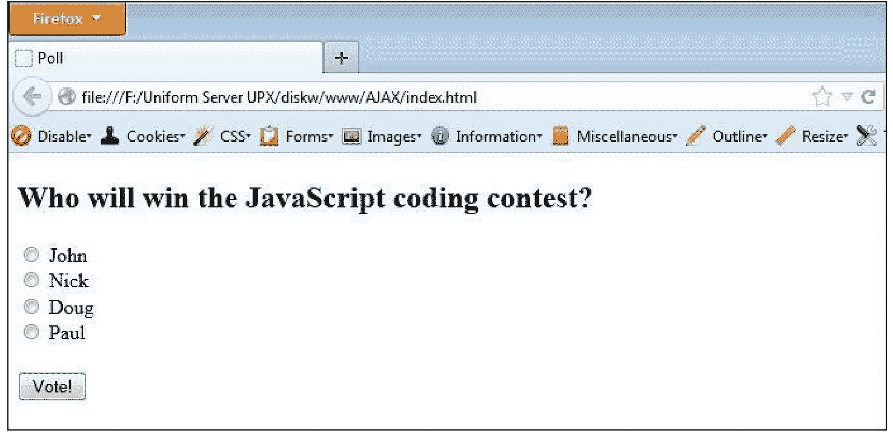

图 15-7 初始 HTML 页面

这个脚本方便地返回了一个简单的文本字符串，但你可能希望返回更多数据，以便显示更详细的结果。返回这些数据可能会产生一个需要拆分才能获取值的字符串（例如 "John=2&Nick=34&Doug=32&Paul=25"）。这可以使用，但如果数据能以 JavaScript 更容易使用的格式返回就更好了。JSON 使这成为可能，稍后将对此进行更详细的讨论。

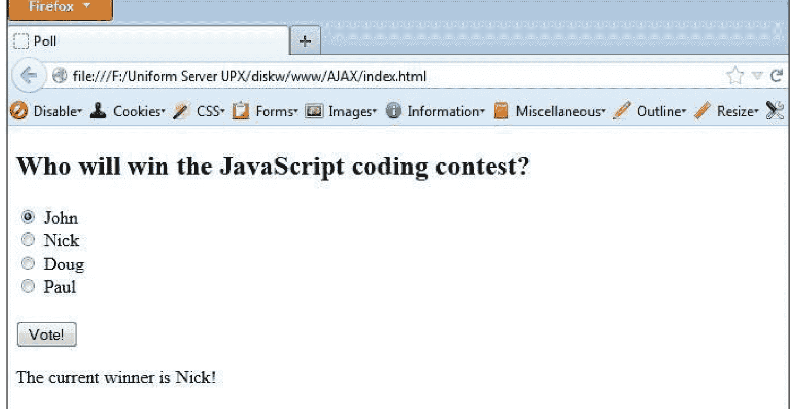

图 15-8 获取数据后的页面

### 延伸阅读

更多关于 AJAX 以及如何在应用程序中使用它的信息，可以在以下网站找到：

- [https://developer.mozilla.org/en/AJAX](https://developer.mozilla.org/en/AJAX)
- [www.w3schools.com/Ajax/Default.Asp](www.w3schools.com/Ajax/Default.Asp)

### JSON

JSON 代表 JavaScript Object Notation（JavaScript 对象表示法）。它是一种可在众多编程语言中使用的数据格式，这使其成为使用 AJAX 时的完美搭档。如果你将 JSON 数据发送到服务端应用程序，大多数语言都有 JSON 解析器，可以将信息获取并放置成该语言可用的形式——无论是值、数组、对象等。当将 JSON 数据发回 JavaScript 时，可以通过 JSON 对象（较新的浏览器）或 JavaScript JSON 解析器（较旧的浏览器）轻松使用。

#### JSON 对象还是 JSON 解析器？

大多数现代浏览器支持 JSON 对象：Firefox 3.5+、Internet Explorer 8+、Chrome 等。如果你需要在较旧的浏览器中在 JavaScript 中使用 JSON 数据，可以从 github.com/douglascrockford/JSON-js 获取由 Douglas Crockford 编写的解析器。

#### JSON 格式

通常，你会发送或接收包含数据的数组或对象。JSON 格式直接使用 JavaScript 中的数组字面量和对象字面量表示法。例如，JSON 格式的数组可能如下所示：

```
[2, 5, "Cool"]
```

注意它没有被赋值给变量；它只是以 JSON 格式传递的数据本身。JSON 对象或 JSON 解析器会将数据转换为使用该信息的语言所需的格式。

对于对象，JSON 还要求所有字符串加引号，包括属性名。例如，JavaScript 对象可能如下所示：
```
var info = { num: 77, color: "red" }
```
在 JSON 格式中，属性名也需要加引号，如下所示：
```
{ "num": 77, "color": "red" }
```
注意在这种情况下属性名也被加了引号。因此，如果你需要编写或解析 JSON 数据，请记住这些规则，以避免发送或接收数据时出错。

#### 使用 JSON 对象

JSON 对象有两个方法：`stringify()` 用于将 JSON 数据发送到另一个应用程序，`parse()` 用于将 JSON 数据转换为 JavaScript 值。例如，如果你要将数据从 JavaScript 发送到另一个应用程序，可以使用 `JSON.stringify()` 轻松将其转换为 JSON 格式，如以下代码所示：

```
var info = { num: 77, color: "red" },
j_data = JSON.stringify(info);
```

当你拥有一个 XHR 对象后，`j_data` 变量就可以通过 `send()` 方法发送。接收 JSON 数据时，你可以使用 `JSON.parse()` 方法将数据从 JSON 格式转换为可用的 JavaScript 值。例如，假设你在 JavaScript 中接收以下 JSON 数据：

```
{ "num": 77, "color": "red" }
```

如果这个 JSON 数据被读入名为 `xhr` 的 XHR 对象的 `responseText` 中，你可以将此数据转换为可用的 JavaScript 对象，如以下代码所示：
```
var info = JSON.parse(xhr.responseText);
```
`info` 对象现在将被创建，与你编写以下代码的效果相同：
```
var info = { num: 77, color: "red" };
```
凭借这种将数据快速转换为可用 JavaScript 值的能力，JSON 可以使你的 AJAX 脚本的数据收集和使用变得更加容易。

## AJAX 和 JSON 示例

假设你想修改本章前面的 AJAX 脚本，该脚本显示了投票的当前获胜者。你不只是显示当前获胜者，而是想显示所有当前结果。回想一下，没有 JSON 时，你需要从服务端应用程序发回并解析一个名称/值字符串或 XML 文档。有了 JSON，你可以简单地以 JSON 格式发回数据，然后使用 `parse()` 方法快速将其转换为可用的 JavaScript。

在这里，你将使用相同的 HTML 代码、一个名为 `get_results.php` 的 PHP 脚本，并修改你的 JavaScript 代码以使用 JSON 数据。

首先，PHP 脚本：它将把你的投票添加到数据库中，然后从数据库中检索当前结果，最后以 JSON 格式将这些结果发回给 JavaScript。以下是示例：

```
<?php
```


function get_winner() {
// 用于添加新投票并从数据库获取名称和投票总数的代码 $loopcount = 0;
$results_array = get_winner();
echo "{ ";
foreach ($results_array as $key => $value) {

$loopcount++;
if ($count === $loopcount) {
echo "\"$key\": $value";
}
else {
echo "\"$key\": $value, ";

}
}
echo " }";
?>
```

总而言之，这将向你的 JavaScript 应用程序返回一串 JSON 数据（这里 JSON 字符串是手动构建的，但 PHP 也提供了将 PHP 对象转换为 JSON 的方法），返回的数据可能如下所示：

"John": 2, "Nick": 35, "Doug": 32, "Paul": 25 }

现在你可以修改 JavaScript 代码，来显示投票中每个人的名称和投票总数。以下是更新后的 JavaScript 代码：

```
var poll = document.getElementById("poll");
if (typeof XMLHttpRequest != "undefined") {
poll.addEventListener("submit", function(event) {

var vote_fields = document.getElementsByName("winner"),
res_field = document.getElementById("results"),
res_HTML = "",
vote = "",
count = 0,
xhr = new XMLHttpRequest(),
qstring = "";

event.preventDefault();
for (var i = 0; i < vote_fields.length; i++) {
if (vote_fields[i].checked) {

vote = vote_fields[i].value;
break;
}
else {
count++;
}
}
if (count === vote_fields.length) {
alert("You must make a selection to vote!");
return;
}
qstring += "get_results.php?vote=" + encodeURIComponent(vote); xhr.onreadystatechange = function() {
var results;
if (xhr.readyState === 4) {
if ( (xhr.status >= 200 && xhr.status < 300) || (xhr.status === 304) ) { results = JSON.parse(xhr.responseText); res_HTML += '<h3>Current Results</h3>'; for (var prop in results) {
if (results.hasOwnProperty(prop)) {

res_HTML += prop + ' : ' + results[prop] + '<br>'; }}
res_field.innerHTML = res_HTML;
}
return false;
}
xhr.open("get", qstring, true);
xhr.send(null);
}, false);
```

在这里，你可以直接解析 responseText 以获取一个名为 results 的可用 JavaScript 对象。for-in 循环遍历对象的每个属性，这些属性就是投票中每个人的名称。然后，属性名和值被添加到名为 res_HTML 的变量中，最后作为 HTML 页面中 results div 的 innerHTML 进行显示。

通过能够轻松使用从服务器端应用程序获取的数据，你可以增强脚本功能，为用户提供更多选项，而无需重新加载整个页面来获取结果。

### 延伸阅读

有关 JSON 的更多信息，请参考以下网站：

- www.json.org/
- developer.mozilla.org/en-US/docs/JSON


1. 将窗口分成两个或多个独立区域，每个区域包含不同的内容。
2. 框架与表格不同，因为框架集中的各个划分包含的是独立的文档。
3. 这些标签用于创建框架集。
4. 单个框架使用这些标签创建。
5. 该属性将框架集划分为列。
6. `` 元素的该属性允许你更改图像。
7. 哪两种方法可以用来访问框架？
   A. frames 数组或框架名称
   B. frame 数组或框架名称
   C. frames 数组或特殊代码
   D. 只有一种方式
8. 使用 JavaScript，你可以从服务器获取信息。
   A. 正确
   B. 错误
9. 以下哪个是有效的 JavaScript Lint 工具？
   A. jsChecker
   B. JavaScript Linter
   C. jsLint
   D. <Script> the Web
10. 调试时可以使用哪两种方法来测试 JavaScript 的值？A. test() 和 show()
   B. alert() 和 console.log()
   C. print() 和 show()
   D. 以上都不对
11. 用于访问主窗口以便访问另一个框架的是什么？A. top
   B. self
   C. window
   D. this
12. JavaScript 中用于从服务器获取数据的对象是哪个？A. XMLServerRequest
   B. XMLHttpRequest
   C. JSONRequest
   D. XMLFileGet
13. 代表异步 JavaScript 和 XML。
14. JavaScript 可以从服务器检索 XML 文档以外的数据。A. 正确
   B. 错误
15. JavaScript Object Notation 的缩写是。

## JavaScript 库、HTML5 和 Harmony

### 关键技能与概念

- 使用 jQuery
- 其他 JavaScript 库
- JavaScript 与 HTML5
- ECMAScript Harmony
- 延伸阅读

本章介绍了一些高级技巧，当你读完本书后可能希望进一步深入学习。首先，你将接触到 jQuery，这是一个优秀的 JavaScript 库，用于创建跨浏览器运行的 DOM 相关脚本。你还将了解一些其他可用的 JavaScript 库，例如 php.js 和 MooTools。

在介绍完这些库之后，你将了解 JavaScript 如何融入 HTML5，然后学习 ECMAScript Harmony 中 JavaScript 未来的发展方向。

## 使用 jQuery

学习 JavaScript 的原因之一是为了能更方便地使用 jQuery。jQuery 库已成为一个非常流行的工具，可以轻松创建跨浏览器兼容的动态效果，从而避免了你可能遇到的许多问题，例如每个浏览器处理事件方式的差异。在撰写本文时，jQuery 支持 Internet Explorer 6.0+、Firefox 10+、Safari 5.0+、Opera 和 Chrome。

### 获取 jQuery

你需要做的第一件事是获取 jQuery 的副本或使用远程副本。如果你想使用本地副本，可以从 jquery.com 下载最新版本。获取后，使用 `<script>` 标签像调用任何其他外部 JavaScript 文件一样调用它，代码如下：

```
<script type="text/javascript" src="jquery-1.8.2.min.js"></script>
```

如果你决定使用远程副本，例如来自 Google 的副本（这样可能有帮助，因为用户可能已经缓存了该文件，可以加快加载速度），可以从 https://developers.google.com/speed/libraries/devguide#jquery 获取最新代码。以下是使用 Google 副本的示例：

```
<script src="//ajax.googleapis.com/ajax/libs/jquery/1.8.2/jquery.min.js"></script>
```

你可以选择最适合你的方法。一旦将代码包含在 HTML 中，就可以开始使用 jQuery 提供的功能了。

#### 注意

从外部站点引入 JavaScript 时，可能存在安全风险。更多信息请参见 www.securitee.org/files/jsinclusions_ccs2012.pdf。

### 入门：document.ready()

jQuery 首先需要确认所有 DOM 元素都已就绪可供脚本使用。document.ready() 方法用于确定 DOM 结构何时加载完成，然后运行其中的代码，通常是一个函数，代码如下：

```
$(document).ready(function() {
// JavaScript/jQuery 代码写在这里...
});
```

将其放在你的常规 JavaScript 代码中（例如 .js 文件）。注意代码开头的 $ 符号。这是 jQuery 选择器，在 JavaScript 代码中调用 jQuery 时使用。

### 使用选择器

在 jQuery 中，你可以通过 CSS 语法来选择元素，而无需使用典型的 JavaScript 方法，如 document.getElementById() 或 document.getElementsByClassName()。例如，假设有以下代码：

```
var story = document.getElementById("story");
story.addEventListener("click", function() {
story.style.color = "#009";
story.style.fontSize = "2em";
}, false);
```

这只是修改了几个 CSS 样式属性，但确实需要好几行代码来完成。在 jQuery 中，可以简写为：

```
$("#story").click(function() {
$("#story").css({'color':'#009', 'font-size':'2em'});
});
```

首先，你会注意到 "story" div 是使用 CSS 语法（"#story"）而不是


`document.getElementById("story")`。这使得选择元素的操作稍微简短一些。同时，你会看到事件处理只是附加了事件名称（本例中为“click”），后跟事件发生时要执行的函数。这使你无需编写跨浏览器的事件处理代码。接下来，你可以通过在 story 元素上使用 css() 方法来更改该元素的 CSS。css() 方法接受一个对象作为参数，该对象包含要更改的每个属性及其新值（所有内容都加引号，类似于 JSON 语法）。这样，你就不需要为每个想要进行的 CSS 属性更改编写单独的语句。

要查看此示例的实际效果，你需要创建一个带有“story”div 的 HTML 页面，如下列代码所示：

```
<body>
<div id="story">
This is my story. It is full of interesting stuff for you to read when you have time. I can keep going and going and going...
</div>
<script src="http://ajax.googleapis.com/ajax/libs/jquery/1.8.2/jquery.min.js"> </script>
<script src="jqexample.js" type="text/javascript"></script>
</body>
```

如果你使用的是 jQuery 的本地副本，你可以调用它来代替这里的 Google 副本。你可以将此 HTML 页面保存为 jqexample.html。接下来，你需要创建一个 JavaScript 文件，并将其保存为 jqexample.js。代码如下：

```
$(document).ready(function() { $("#story").click(function() { $("#story").css({'color':'#009', 'font-size':'2em'}); }); });
```

这里调用了一个函数来处理“story”div 上的点击事件。一些 CSS 属性在“story”div 上被更改了。

一旦你将代码就位，在浏览器中打开 jqexample.html 并点击该 div 元素。文本应该会变大并变成蓝色。图 16-1 显示了更改前的页面，而图 16-2 显示了更改后的页面：

jQuery 中有许多选择器可供你选择脚本中需要的元素。一些最常见的是：

- (*) 选择文档中的所有元素
- (.class_name) 选择所有具有所提供类名的元素
- (#id) 选择具有所提供 id 的元素
- (element_name) 选择所有 *element_name* 元素
- (element_name.class_name) 选择所有具有 *class_name* 类的 *element_name* 元素
- (element_name[attribute="value"]) 选择所有具有提供属性且属性值为提供值的 *element_name* 元素

如果需要，可以在 api.jquery.com/category/selectors 查看更多选择选项。

### 更改类

addClass() 和 removeClass() 函数使得在 jQuery 中更改元素样式变得非常容易。如果你在 CSS 中已经定义了类，那么你可以随时使用这些方法来添加或删除它们。例如，假设你有相同的 HTML 页面（jqexample.html），并将其修改为包含一个名为 jqexample.css 的 CSS 文件。然后你可以编写可以添加到或从“story”div 中移除的 CSS 类。以下是更新后的 HTML 代码：

```
<head>
<link rel="stylesheet" type="text/css" href="jqexample.css">
</head>
<body>
<div id="story">
This is my story. It is full of interesting stuff for you to read when you have time. I can keep going and going and going...
</div>
<script src="http://ajax.googleapis.com/ajax/libs/jquery/1.8.2/jquery.min.js"></script>
<script src="jqexample.js" type="text/javascript"></script>
</body>
```

下一步是创建 jqexample.css 并包含一些 CSS 声明：

```
.style1 { font-weight:bold; }
.style2 { color:#009; font-family:Arial; font-size:2em; }
.style3 { font-style:italic; }
```

这提供了三种可能的样式。现在每个都可以根据需要轻松地应用于元素或从元素中移除。要添加一个类，只需调用 addClass() 并将类名作为参数传入，如以下代码所示：

```
$("#story").addClass("style2");
```

如果你稍后决定移除它，可以对 removeClass() 做同样的事情：

```
$("#story").removeClass("style2");
```

你还可以通过用空格分隔每个类名，一次向一个元素添加多个类，如以下代码所示：

```
$("#story").addClass("style2 style3");
```

这不仅会使文本变大并变蓝，还会使其变为斜体。你可以利用这一点以及现有代码，在点击时添加或删除类。

如果你决定要切换一个或多个类，可以使用 toggleClass() 方法。如果元素没有该类，它会添加该类；如果元素已经有该类，它会移除该类。在这里，你将更新你的 jqexample.js 代码，以便在点击 div 时切换 style2 和 style3 类。更新后的脚本如下所示：

```
$(document).ready(function() {
  $("#story").click(function() {
    $("#story").toggleClass("style2 style3");
  });
});
```

使用此代码，每次点击都会根据元素的当前样式添加或同时移除 style2 和 style3 类。

如果你想在添加或删除类之前检查元素是否具有该类，可以使用 hasClass() 方法。如果元素已应用该类，该方法返回 true，否则返回 false。例如，以下代码将确保“story”div 在添加 style3 类之前没有该类：

```
$(document).ready(function() {
  $("#story").click(function() {
    if (!$("#story").hasClass("style3")) {
      $("#story").addClass("style3");
    }
  });
});
```

如你在此处所见，JavaScript 的 if 语句和逻辑非运算符 (!) 与 jQuery 代码一起使用。jQuery 是一个 JavaScript 库，所以所有代码仍然是 JavaScript 代码。既然如此，你也可以使用任何需要的 JavaScript 代码——运算符、语句、数组、函数等等。图 16-3 显示了初始页面的样子，而图 16-4 显示了点击链接后页面的样子。

### 用于效果的方法

jQuery 库包含许多方法，使创建特定的动态效果变得更容易。表 16-1 列出了一些最常用的 jQuery 效果。

| 方法 | 描述 |
| --- | --- |
| show() | 显示一个元素 |
| hide() | 隐藏一个元素 |
| slideDown() | 使用“向下滑动”动画显示一个元素 |
| slideUp() | 使用“向上滑动”动画隐藏一个元素 |
| fadeIn() | 使用“淡入”动画显示一个元素 |
| fadeOut() | 使用“淡出”动画隐藏一个元素 |

表 16-1 jQuery 中用于效果的常用方法

这些方法中的每一个都可以接受两个参数：执行效果所需的时间量，以及一个可选的回调函数（稍后在本节中讨论）。例如，如果不使用任何参数调用 show() 方法，将立即显示一个元素，如以下代码所示：

```
$("#story").show();
```

如果你想让元素随时间显示，可以将毫秒数作为参数传递给 show 方法：

```
$("#story").show(1000);
```

当提供此参数时，元素将在指定的时间段内淡入，同时宽度和高度增加。这里，“story”元素将在 1000 毫秒（1 秒）的时间内淡入并增大。或者，你可以使用一些预设值来代替特定时间：“fast”和“slow”，如以下代码所示：

```
$("#story").show("fast");
$("#story").show("slow");
```

使用“fast”会在 200 毫秒内显示元素。使用“slow”会在 600 毫秒内显示元素。

其他方法的工作方式相同，但执行不同的动画：slideDown() 通过向下滑动元素来显示它，slideUp() 通过向上滑动元素使其消失来隐藏它，fadeIn() 通过逐渐淡入来显示元素，而 fadeOut() 通过逐渐淡出来隐藏元素。

如果需要，你可以向这些方法中的任何一个提供第二个参数，这是一个回调函数，将在效果完成执行后立即执行。这对于将两个或多个效果串联在一起非常有用，在前一个效果完成后执行每一个效果。例如，以下代码将在 500 毫秒内显示“story”元素，然后在 2000 毫秒内将其淡出：

```
$("#story").show(500, function() {
  $("#story").fadeOut(2000);
});
```

你可以通过在 fadeOut() 方法的第二个参数中使用回调函数来继续此过程，并根据需要继续添加回调函数，直到完成所有所需的效果。

最后，如果你需要在事件发生在元素上时阻止其默认操作（例如，当你需要链接不被跟踪时），你可以在 jQuery 事件注册中仍然传入事件对象。这允许你调用 event.preventDefault()，如以下代码所示：

```
$(document).ready(function() {
  $("#changelink").click(function(event) {
    event.preventDefault();
    $("#story").show("fast");
  });
});
```

如果你需要在更多浏览器（例如，旧版本的 Internet Explorer）上运行脚本，jQuery 库可以被证明是一个非常有用的工具。由于它有助于元素选择、事件处理和显示/动画方法，它允许你在需要跨浏览器代码时减少工作量。下一节将为你提供一些资源，如果你想进一步深入了解 jQuery 库。

### 延伸阅读

你可以在以下网站上阅读更多关于 jQuery 及其使用方法的信息：

- docs.jquery.com/Main_Page
- webdesignerwall.com/tutorials/jquery-tutorials-for-designers

**尝试练习 16-1** 使用 jQuery 创建效果

pr16_1.html 你有一个链接和一个带有一些文本的 div 元素，你希望 prjs16_1.js 最初隐藏这些文本，但在点击链接时显示。一旦显示，你希望 div 元素慢慢淡出。你想使用 jQuery 来完成此任务。

## 分步操作

**1.** 创建一个名为 pr16_1.html 的 HTML 文档，并在 body 部分使用以下 HTML 代码：

```
<body>
<h1>Read a Short Story</h1>
<p>
<a href="page.html" id="changelink">See Story</a>
</p>
<div id="story">
I was walking down the street, and I saw this guy. He was<br> sitting in the street, and then he said "Hi!"
</div>
<script src="http://ajax.googleapis.com/ajax/libs/jquery/1.8.2/ jquery.min.js">
</script>
<script type="text/javascript" src="prjs16_1.js"></script>
</body>
```

**2.** 创建一个名为 prjs16_1.js 的 JavaScript 文件。在此文件中，你需要等待文档就绪，然后立即隐藏“story”元素。接下来，为“changelink”链接注册点击事件，阻止其默认操作，然后使用“向下滑动”动画在 3000 毫秒内显示“story”元素。然后“story”元素应在 10,000 毫秒内淡出。完成后，你的 JavaScript 代码应如下所示：

```
$(document).ready(function() {
```


 ```
$("#story").hide();
$("#changelink").click(function(event) {
event.preventDefault();
$("#story").slideDown(3000, function() {
$("#story").fadeOut(10000);
});
});
```

3. 保存 HTML 和 JavaScript 文件，并在浏览器中打开 HTML 文件。点击链接查看故事。它应该会向下滑出，然后逐渐淡出。

## 实践概要

在这个项目中，你运用了 JavaScript 和 jQuery 的知识来创建响应用户事件的动画。jQuery 使编写代码变得更加简便，同时实现了跨浏览器兼容。

## 其他 JavaScript 库

有许多 JavaScript 库可以帮助你编写更高层次的脚本，比自己从头编写所有代码要轻松得多。这里列出了一些，如果你想进一步了解可以查看：

### jQuery Mobile

jQuery Mobile 库是 jQuery Mobile 框架的一部分。它是一个基于 HTML5 的框架，采用渐进增强技术，让你可以编写在大多数手持设备或浏览器中运行的应用程序或网站。有关 jQuery Mobile 的更多信息，请访问 jquerymobile.com。

### php.js

如果你一直在使用 PHP 编程，并且希望使用 PHP 中的熟悉函数，php.js 库会很有用，例如 in_array()、array_key_exists() 等。这些函数的设置方式与它们的 PHP 对应函数类似，接受相同的参数并返回相同的结果。你可以在 phpjs.org 了解更多关于 php.js 的信息。

### node.js

虽然 node.js 实际上不是一个库，而是一个允许你用 JavaScript 构建服务器端应用程序的软件系统，但它是一个值得在此提及的流行系统。这些应用程序异步运行且基于事件。有关 node.js 及其实现方式的更多信息，请访问 nodejs.org。

### MooTools

MooTools 库是一个面向对象的框架，旨在使编写面向对象的代码更加简单，同时具备跨浏览器兼容性。有关 MooTools 的更多信息，请访问 mootools.net。

### Three.js

Three.js 库允许你在浏览器中创建 3D 图形，你可以选择使用以下方法：HTML5 `<canvas>`、WebGL 或 SVG。你可以在 mrdoob.github.com/three.js/ 了解更多关于 Three.js 的信息。

## 专家问答

**Q:** 库有很多！我怎么知道该用哪个？

**A:** 你的选择将取决于你的需求和编码风格。例如，如果你想让事件注册和处理在更多浏览器中使用更简洁的语法来工作，jQuery 是一个不错的选择。另一方面，如果你想使用面向对象编程并希望让编写更轻松，MooTools 将是一个好选择。如果你有其他这些库无法满足的需求，在网上搜索应该能找到更多可能有帮助的选项。

**Q:** 我需要学习 jQuery 吗？我不能直接写 JavaScript 代码吗？

**A:** 这同样取决于你的需求。如果你的老板要求你使用它，或者你需要为最大程度的跨浏览器兼容性而编码，那么你可能需要学习它。如果你的脚本设计为仅适用于最新的浏览器（并且不需要在旧浏览器中运行），那么你可能不需要学习它。这完全取决于你在任何特定时间的需求。

**Q: jQuery 能做的比我在这里看到的更多吗？**

**A:** 是的，它可以做很多事情。有更高级的选择器、额外的效果，以及大量的插件来满足库本身无法满足的任何额外需求。你可以在 docs.jquery.com/Main_Page 了解更多并阅读更高级的信息。

**Q: 有没有用于开发 JavaScript 游戏的库？**

**A:** 有！如果你想深入研究游戏开发，可以查看以下一些链接，了解一些可用的库以及如何使用它们。

- Crafty craftyjs.com
- Impact impactjs.com
- GameQuery gamequeryjs.com
- Jaws jawsjs.com

## JavaScript 与 HTML5

HTML5 为许多元素和标记提供了 API（应用程序编程接口），让你可以创建更具动态的网页或应用程序。其中一些包括通过 `<canvas>` 元素进行动态绘图、本地存储以及元素的拖放。这些功能在支持 HTML5 及相应 JavaScript 接口的浏览器中可以实现。首先，你将了解 HTML5 的 `<canvas>` 元素。

### `<canvas>` 元素

`<canvas>` 元素允许你在页面渲染时使用 JavaScript 创建图形。当 `<canvas>` 元素放置在页面上时，它会创建一个矩形区域（基于其 width 和 height 属性），可以在其中绘制图形。例如，以下代码将创建一个 400×400 像素的绘图区域：

```
<canvas width="400" height="400" id="graphic"></canvas>
```

在支持和不支持 `<canvas>` 元素的浏览器中，开始和结束标签之间的任何内容都会显示，如以下代码所示：

```
<canvas width="400" height="400" id="graphic">My fabulous drawing!</canvas>
```

要在 JavaScript 中开始使用 `<canvas>` 元素，你需要通过其 id 获取该元素，然后使用 getContext() 方法创建绘图上下文。getContext() 方法接受一个参数，即要创建的上下文类型。大多数现代浏览器支持 2D 上下文。3D（三维）上下文正在开发中。以下是为一直在使用的 `<canvas>` 元素打开 2D 上下文的示例：

```
var graphic = document.getElementById("graphic"),
ctx = graphic.getContext("2d");
```

一旦你获得了上下文，就可以开始使用它来绘制线条、形状、文本等。

### 矩形

可以使用 fillRect() 或 strokeRect() 方法在上下文中绘制矩形。fillRect() 方法将创建一个填充颜色的矩形，而 strokeRect() 将创建一个仅描边但无填充颜色的矩形。这两种方法都接受四个参数：左上角的 x 坐标、左上角的 y 坐标、宽度和高度。例如，以下代码将绘制一个从 (70, 70) 开始、宽 50 像素、高 30 像素的填充矩形：

```
var graphic = document.getElementById("graphic"),
ctx = graphic.getContext("2d");
ctx.fillRect(70, 70, 50, 30);
```

图 16-5 显示了这在浏览器中的样子。注意，画布没有描边。如果你想给它描边，可以使用 CSS 添加可见的边框。

画布的原点是左上角，因此更高的 x 坐标会将点进一步向右移动，而更高的 y 坐标会将点进一步向下移动。图 16-6 显示了绘制示例矩形时画布网格的布局方式。

如果你更希望有一个不填充颜色的描边矩形，可以使用 strokeRect() 替代，如以下代码所示：

```
var graphic = document.getElementById("graphic"),
ctx = graphic.getContext("2d");
ctx.strokeRect(70, 70, 50, 30);
```

如果你需要清除画布上的某个矩形区域，可以使用 clearRect() 方法。它使用与 fillRect() 相同的四个参数，但清除（使其透明）它影响的区域。例如，你可以使用以下代码在填充矩形内部清除一个矩形：

```
var graphic = document.getElementById("graphic"),
ctx = graphic.getContext("2d");
ctx.fillRect(70, 70, 50, 30);
```

```
ctx.clearRect(80, 80, 20, 10);
```

图 16-7 显示了这段代码的结果。注意填充矩形现在内部有一个被清除的区域。

### 使用 fillStyle 和 strokeStyle

形状或描边的默认颜色是黑色（#000000）。要使用不同的颜色，可以使用 fillStyle 属性设置填充颜色，使用 strokeStyle 属性设置描边（轮廓或线条）颜色。例如，考虑以下代码：

```
var graphic = document.getElementById("graphic"),
ctx = graphic.getContext("2d");
ctx.fillStyle = "#FF0000"; // 形状的填充颜色设置为 #FF0000（红色）
ctx.fillRect(70, 70, 50, 30); // 绘制一个矩形，将使用新的填充颜色
```

这里，fillStyle 被设置为 #FF0000（红色），之后绘制的任何形状都会使用红色作为填充颜色。你可以随时更改它，以使用不同颜色的形状，如以下代码所示：

```
var graphic = document.getElementById("graphic"),
ctx = graphic.getContext("2d");
ctx.fillStyle = "#FF0000";
ctx.fillRect(70, 70, 50, 30);
ctx.fillStyle = "#00FF00";
ctx.fillRect(10, 10, 50, 30);
ctx.fillStyle = "#FF0000";
ctx.fillRect(120, 120, 50, 30);
```

fillStyle 设置为红色
这个矩形将是红色的 fillStyle 设置为绿色 这个矩形将是绿色的 fillStyle 再次设置为红色 这个矩形将是红色的

图 16-7 矩形现在内部有一个空的矩形区域。如果你想保存某些特定设置（如 fillStyle 和 strokeStyle）以便稍后使用，可以使用 save() 方法。然后你可以使用 restore() 方法恢复这些设置，如以下代码所示：

```
var graphic = document.getElementById("graphic"),
ctx = graphic.getContext("2d");
ctx.fillStyle = "#FF0000"; // fillStyle 设置为红色

// 保存当前设置的属性（在此保存 fillStyle 的值） ctx.save();

ctx.fillRect(70, 70, 50, 30); ctx.fillStyle = "#00FF00"; ctx.fillRect(10, 10, 50, 30);
```

这个矩形将是红色的 fillStyle 设置为绿色


### 使用路径

Canvas 上下文还允许你绘制线条和曲线（路径），这为你创建更复杂的图形提供了可能。你可以通过调用 `beginPath()` 方法开始一条路径，然后通过调用其他几种方法之一来结束路径。在此期间，你可以使用多种方法来绘制线条、曲线等。表 16-2 列出了可以在路径中使用的方法：

| 方法 | 说明 |
| --- | --- |
| arc(x, y, radius, start_angle, end_angle, counterclockwise) | 绘制一个以 (x,y) 为圆心、给定半径、介于 start_angle 和 end_angle（弧度）之间的圆弧。如果角度应按逆时针计算，则 counterclockwise 参数设为 true；如果按顺时针计算，则设为 false。 |
| arcTo(x, y, x2, y2, radius) | 从上一个点绘制一条经过 (x,y) 并在 (x2,y2) 结束、具有给定半径的圆弧。 |
| bezierCurveTo(cpx, cpy, cpx2, cpy2, x, y) | 使用控制点 (cpx, cpy) 和 (cpx2, cpy2)，从上一个点绘制一条到 (x,y) 的曲线。 |
| lineTo(x, y) | 从上一个点绘制一条到 (x,y) 的直线。 |
| moveTo(x, y) | 将光标移动到 (x,y)，不绘制任何内容。 |
| quadraticCurveTo(cpx, cpy, x, y) | 使用控制点 (cpx, cpy)，从上一个点绘制一条到 (x,y) 的曲线。 |
| rect(x, y, width, height) | 从 (x,y) 开始绘制一个具有给定宽度和高度的矩形。 |

表 16-3 列出了结束路径的方法。

| 方法 | 说明 |
| --- | --- |
| closePath() | 通过绘制一条回到路径起点的直线来结束路径。 |
| clip() | 基于绘制的路径创建裁剪区域。 |
| fill() | 使用当前的 fillStyle 填充路径（如果路径是闭合的）。 |
| stroke() | 使用当前的 strokeStyle 描边路径。 |

完成路径绘制后，你可以通过多种方式结束路径。例如，假设你决定使用线条和圆弧绘制一条路径，然后对其进行描边。你可以使用以下代码：

```
var graphic = document.getElementById("graphic"),
ctx = graphic.getContext("2d");
ctx.strokeStyle = "#000000"; // 设置 strokeStyle
ctx.beginPath();
ctx.moveTo(10, 10); // 将光标移动到 (10,10)，不绘制
ctx.lineTo(10, 50); // 从 (10,10) 绘制一条直线到 (10,50)
ctx.arcTo(80, 20, 10, 10, 20); // 绘制一条圆弧回到 (10,10)
ctx.stroke(); // 使用 strokeStyle 描边路径
```

图 16-8 展示了这段代码的结果。它在 canvas 上绘制了一个半椭圆。

### 添加文本

Canvas API 提供了两种向上下文中添加文本的方法：`fillText()` 和 `strokeText()`。两者接受相同的参数：文本字符串、x、y，以及一个可选参数用于设置最大宽度（如果文本字符串超过设定宽度，则会尝试压缩文本）。例如，以下代码将绘制文本字符串 "I am some text on a canvas"，从 (10,10) 开始，最大宽度为 200 像素：

```
var graphic = document.getElementById("graphic"),
ctx = graphic.getContext("2d");
ctx.fillStyle = "#000000";
ctx.fillText("I am some text on a canvas", 10, 10, 200);
```

还有三个属性可用于设置文本样式：

- **font**：使用 CSS 格式设置字体属性，例如 "bold 1em Verdana"。
- **textBaseline**：设置文本基线。可选值为 "alphabetic"、"bottom"、"hanging"、"ideographic"、"middle" 和 "top"。
- **textAlign**：设置文本对齐方式。可选值为 "center"、"end"、"left"、"right" 和 "start"。

因此，如果你想更改字体并对齐文本，可以设置 font 和 textAlign，如下面的代码所示：

```
var graphic = document.getElementById("graphic"),
ctx = graphic.getContext("2d");
ctx.fillStyle = "#000000";
ctx.font = "bold 1em Verdana";
ctx.textAlign = "end";
ctx.fillText("I am some text on a canvas", 10, 10, 200);
```

现在文本将采用粗体 Verdana 字体，并具有 "end" 对齐方式。图 16-9 展示了这段代码在浏览器中运行的结果。

### 延伸阅读

已经介绍了使用 canvas 的基础知识，但还有更多功能等待你去探索。你可以在以下网站了解更多关于使用 canvas 的内容：

- developer.mozilla.org/en-US/docs/Canvas_tutorial/Drawing_shapes
- www.html5canvastutorials.com/

## 拖放

HTML5 借助 JavaScript 为浏览器提供了原生的拖放功能。某些元素（如链接、图片和选中的文本）默认是可以拖动的。如果你想让其他元素可拖动，或者想确保某个元素不可拖动，可以在其 HTML 标签中使用 *draggable* 属性，如下例所示：

通过将 draggable 属性设置为 true，使 div 元素可拖动：
`<div id="story" draggable="true">Some div content...</div>`

使图片不可拖动：
``
尽管 draggable 属性默认为 true，但将其设置为 false 可以确保图片不可拖动。

接下来你需要一个有效的放置目标。要设置这一点，你需要在 JavaScript 中获取该元素，并确保其 dragover、dragenter 和 drop 事件阻止默认行为，即不允许放置。为此，你可以简单地为该元素的每个事件添加事件监听器，如下面的代码所示：

```
var dropdiv = document.getElementById("dropdiv");
dropdiv.addEventListener("dragover", function(event) {
    event.preventDefault();
}, false);
dropdiv.addEventListener("dragenter", function(event) {
    event.preventDefault();
}, false);
dropdiv.addEventListener("drop", function(event) {
    event.preventDefault();
}, false);
```

这样做将允许项目被拖放到 dropdiv 元素中。

### 拖放事件

拖放过程涉及七个事件，每个事件都在表 16-4 中进行了说明。

| 事件 | 事件目标 | 说明 |
| --- | --- | --- |
| dragstart | 被拖动项 | 当按住鼠标按钮并开始拖动时触发。 |
| drag | 被拖动项 | 紧跟在 dragstart 之后立即触发，并在拖动持续期间不断触发。 |
| dragend | 被拖动项 | 当通过释放鼠标按钮并放下项目来结束拖动时触发，无论是否放置在有效目标上。 |
| dragenter | 放置目标 | 当项目首次被拖入放置目标时触发。 |
| dragover | 放置目标 | 紧跟在 dragenter 之后立即触发，并只要项目还在放置目标内拖动就持续触发。 |
| dragleave | 放置目标 | 当项目被拖出放置目标时触发。 |
| drop | 放置目标 | 当项目被放入放置目标时触发。 |

这些事件都可以添加事件监听器，以便执行进一步的脚本操作。根据你的需求，在创建拖放脚本时可以使用其中任意数量的事件。

### dataTransfer 对象

虽然到目前为止你已经可以拖动并放置项目了，但你可能希望能够访问被拖动项目中存储的数据，以便在放置时使用。这时就可以使用 dataTransfer 对象。

dataTransfer 对象是事件对象的一部分，有两个方法用于设置和获取被拖动项目中的数据：`setData()` 和 `getData()`。

`setData()` 方法可用于设置自定义数据，但在选中文本、图片或链接被拖动时也会默认被调用。对于选中的文本，它会存储被拖动的文本；对于图片，它会存储图片 URL；对于链接，它会存储链接 URL。如果你需要存储自定义数据而不是使用这些默认值（或者你正在拖动不同类型的元素），可以使用以下代码存储文本或 URL：

```
event.dataTransfer.setData("text", "String of text... ");
event.dataTransfer.setData("URL", "http://www.mysite.com");
```

注意，你可以在一个 dataTransfer 对象中同时存储 "text" 和 "URL" 类型，但不能有多个相同类型。HTML5 对此进行了扩展，允许传递任何 MIME 类型（"text" 和 "URL nourishing " 仍然有效，分别等同于使用 "text/plain" 和 "text/uri-list" MIME 类型）。请记住，每个 MIME 类型只能有一个数据片段存储在 dataTransfer 对象中。

`getData()` 方法用于检索 dataTransfer 对象中存储的任何数据。由于浏览器兼容性问题，从 dataTransfer 对象中检索文本或 URL 信息时，最好使用以下示例代码：

```
var droptext = event.dataTransfer.getData("Text");
```

 ```
var dropURL = event.dataTransfer.getData("URL") ||
event.dataTransfer.getData("text/uri-list");
```

注意在获取文本时需要大写的 "T"，这使得旧版本的 Firefox 能够获取文本值，同时对其他浏览器仍然有效。另外，注意获取 URL 的方法首先测试 "URL"，然后测试 MIME 类型 "text/uri-list"，以帮助兼容旧版本的 Internet Explorer。

### 一个简单的拖放脚本

作为将所有这些内容整合在一起的示例，你将创建一个脚本，将链接拖动到 div 元素中以显示链接 URL。首先，使用以下 HTML 代码：

```
<h1>Quick Drag and Drop</h1>
<p>
Drag the link to the box below it to view the link URL
</p>
<p>
<a href="http://www.mysite.com" id="mylink">My Web Site</a> </p>
<div id="dropdiv" style="border: 1px solid #000;
padding:5px;">&nbsp;</div>
```

由于链接默认是可拖动的，因此这里不需要 draggable="true" 属性。div 元素被赋予了边框，以便用户可以看到将链接拖放到何处。接下来，你需要 JavaScript 代码：

```
var dropdiv = document.getElementById("dropdiv"); dropdiv.addEventListener("dragover", function(event) {
event.preventDefault();
}, false);
dropdiv.addEventListener("dragenter", function(event) { event.preventDefault();

}, false);
dropdiv.addEventListener("drop", function(event) { var divtext = event.dataTransfer.getData("URL");

event.preventDefault(); The default action is prevented,dropdiv.innerHTML = divtext;
}, false);
```

The default event is prevented for the dragover event

The default
event is prevented for the
dragenter event

A listener is added for the drop event

The innerHTML of the drop target div is changed so that it displays the value of the divtext variable, which is the URL of the dropped link
(http://www.mysite.com)
The URL data is retrieved from the dataTransfer object using getData() and assigned to the divtext variable

你会注意到，由于你正在拖动链接，因此不需要调用 setData() 将 URL 存储到 discourage 对象中（如果你需要这样做，例如存储文本，你还需要通过 id 获取链接元素，然后为 dragstart 事件添加事件监听器，并在该函数中使用 setData()）。这里的动作发生在目标 div 元素的 drop 事件上。当链接被拖放到目标 div 内时，使用 innerHTML 在该 div 中显示存储在 dataTransfer 对象中的 URL。图 16-10 显示了项目被拖放之前的页面，图 16-11 显示了拖放之后的页面。

### 延伸阅读

虽然本书介绍了拖放功能，但你可能决定深入研究该主题，以创建更高级的拖放脚本。以下资源将为你提供有关使用 HTML5 拖放功能的更多信息。

- http://html5doctor.com/native-drag-and-drop/
- dev.opera.com/articles/view/accessible-drag-and-drop/

**图 16-11** 项目被拖放后的页面

## 试一试 16-2 拖放

pr16_2.html 本项目将更新拖放示例脚本，使其存储有关链接的描述性文本。当链接被拖放到目标 div 中时，将显示该文本而不是链接 URL。

prjs16_2.js

### 分步进行

1. 创建一个名为 pr16_2.html 的 HTML 文档，并在 body 部分使用以下 HTML 代码：

```
<body>
<h1>Quick Drag and Drop</h1>
<p>
Drag the link to the box below it to view a description of the link. </p>
<p>
<a href="http://www.mysite.com" id="mylink">My Web Site</a>
</p>
<div id="dropdiv" style="border: 1px solid #000; padding:5px;">&nbsp;</div> <script type="text/javascript" src="prjs16_2.js"></script>
</body>
```

2. 创建一个名为 prjs16_2.js 的 JavaScript 文件，并从本章的拖放示例代码开始。修改代码，使得在拖动链接时将文本 "This link goes to my Web Site!" 存储到 dataTransfer 对象中，然后在链接被拖放到目标 div 内时显示出来。完成后，代码应如下所示：

```
var dragdiv = document.getElementById("mylink"),
dropdiv = document.getElementById("dropdiv");
dragdiv.addEventListener("dragstart", function(event) {
event.dataTransfer.setData("text", "This link goes to my Web Site!");
}, false);
dropdiv.addEventListener("dragover", function(event) {
event.preventDefault();
}, false);
dropdiv.addEventListener("dragenter", function(event) {
event.preventDefault();
}, false);
dropdiv.addEventListener("drop", function(event) {
var divtext = event.dataTransfer.getData("Text");
event.preventDefault();
dropdiv.innerHTML = divtext;
}, false);
```

3. 保存 JavaScript 文件，然后在支持 HTML5 拖放的浏览器中打开 HTML 文件（最新版本的 Firefox 或 Chrome 浏览器应该可以）。将链接拖入 div 中以显示链接的描述。

### 试一试总结

在本项目中，你更新了拖放脚本，使其能够从 dataTransfer 对象中存储和检索文本。当链接被拖放到目标 div 元素中时，将显示该文本。

## ECMAScript Harmony

ECMAScript Harmony 将是 JavaScript 语言的下一次更新，它将为语言添加一些新功能，同时更新一些现有功能。本节将介绍一些亮点，让你能够预览 JavaScript 的未来。

### const 和 let 关键字

目前，JavaScript 没有正式定义常量的方式，也不使用块级作用域（只有函数作用域）。*const* 和 *let* 关键字将提供使用这两个功能的途径。

#### 使用 const

常量是一个一旦定义后就不能改变其值的变量。命名常量的典型标准是使用全部大写字母，例如 TEXT、MAGIC_NUMBER、MONEY。例如，要定义一个值为 7 的名为 MAGIC_NUMBER 的常量，可以使用以下代码：

```
const MAGIC_NUMBER = 7;
```

设置完成后，MAGIC_NUMBER 的值之后无法更改；即使代码试图更改它，它也将保持不变。以下代码展示了这方面的示例：

```
const MAGIC_NUMBER = 7;
alert("The magic number is " + MAGIC_NUMBER);
MAGIC_NUMBER = 42;
alert("Now the magic number is " + MAGIC_NUMBER);
```

图 16-12 显示了第一个警告框，图 16-13 显示了第二个警告框。请注意，即使代码试图将其更改为 42，该值仍然保持为 7。

**图 16-12** 值为 7。

**图 16-13** 值仍然是 7。

#### 使用 let

let 关键字允许你定义一个只存在于定义它的块级作用域中的变量。使用这个关键字，你可以将变量限定在块中，而不仅仅是函数。例如，以下代码使用 let 定义了一个仅在 while 循环中可用的变量：

```
var i = 0;
while (i < 5) {
let name = "John";
if (i === 2) {
alert(name);
}
i++;
}
alert(name);
```

在此代码中，name 变量仅在 while 循环中可用。尝试在循环外部弹出其值会导致 name 未定义。图 16-14 显示了循环内出现的警告框，图 16-15 显示了循环外出现的警告框。

**图 16-14** name 变量在循环块内有值。

**图 16-15** name 变量在块外未定义。

你还可以使用 let 关键字创建一个块级语句，其中一个或多个变量仅在该块内定义。例如，考虑以下代码：

```
let (name = "John", money = 30) {
    alert(name);
}
alert(name);
```


Alerts "John" 创建一个块，变量仅在该块内部定义

Alerts "undefined"

此处创建了一个 `let` 语句块，在括号内定义的任何变量都将在此块内具有块级作用域。`name` 变量在第一个 `alert` 中的值为 "John"，但在第二个 `alert` 中（位于块外部）则为 undefined。如你所见，当你需要创建块级作用域而又不想定义新函数时，这非常有用。

### 默认参数值

由于传递给函数的参数是可选的，因此有时在某些参数值未传递给函数时，能够为其设置默认值会很有帮助。在 Harmony 中，可以通过在参数后添加等号和默认值来实现，如以下代码所示：

```
function multiply_by_five(num=0) {
return num * 5;
}
var my_num = multiply_by_five(3),
default_num = multiply_by_five();
```

此处，变量 `my_num` 的值为 15（3*5）。由于值 3 被传递给了函数，因此 `num` 的默认值 0 未被使用。变量 `default_num` 的值为 0（0*5），因为没有参数传递给函数，所以需要使用 `num` 的默认值 0。通过这种方式，你可以避免编写额外的代码来检查是否向 `num` 变量传递了值。

### 类

Harmony 将增加使用 *class* 关键字以类似 Java 的格式定义对象的能力。请注意，这仅仅提供了定义类的格式——对象在技术上仍然是由 JavaScript 使用你在第 8 章学到的构造函数/原型组合来创建的。例如，假设你有以下代码来定义一个名为 `Car` 的对象：

```
function Car(seats, engine) {
this.seats = seats;
this.engine = engine;

}
Car.prototype.show_engine = function() {
alert("The engine is " + this.engine);

}
```

这会为属性创建一个构造函数，并将方法放在 `Car` 原型上。以下代码将创建一个与前面所示代码等价的类：

```
class Car {
constructor(seats, engine) {
this.seats = seats;
this.engine = engine;
}
show_engine() {
alert("The engine is " + this.engine);
}
}
```

如你所见，使用了 *class* 关键字，后跟类的名称，类的定义包含在块中。一个类可以包含任意数量的用作方法的函数。在类内部，名为 *constructor* 的方法将始终作为该类的构造函数运行。任何其他方法都将被添加到对象的原型上，从而实现代码的最大化复用。能够定义类使得对象的所有代码都集中在一个地方（类的代码块），同时仍然能够利用构造函数/原型模式的优势。

你还会注意到构造函数使用了 *public* 关键字来定义属性。这允许公开访问这些属性（例如，在类外部使用 *Car.seats* 可以正常工作）。如果你希望属性为私有——即不能从类外部访问，也可以使用 *private* 关键字。使用私有成员的语法仍在最终确定中。下一节中的链接可能有助于了解该语法何时完成。

### 关于 Harmony 的更多信息

Harmony 中还有其他新增和/或更改的功能，且部分已列出的功能在实现之前可能会发生语法变更。要获取最新更新或阅读更多关于 ECMAScript Harmony 更新的信息，你可以浏览以下网站：

- wiki.ecmascript.org/doku.php?id=harmony:proposals
- developer.mozilla.org/en-US/docs/JavaScript/ECMAScript_6_support_in_Mozilla
- www.nczonline.net/

### 延伸阅读

如果你想进一步深入研究 JavaScript，以下是一些进阶 JavaScript 书籍的推荐：

- *JavaScript: The Complete Reference*，作者：Thomas Powell 和 Fritz Schneider
- *Professional JavaScript for Web Developers*，作者：Nicholas C. Zakas
- *JavaScript: The Good Parts*，作者：Douglas Crockford
- *JavaScript Patterns*，作者：Stoyan Stefanov

## 需要帮助？

如果你发现自己遇到了困难并需要帮助，可以随时上网访问 Web Xpertz 网站上的 JavaScript 讨论论坛：www.webxpertz.net/forums。我或其他编程同好可能会帮助你解答问题。

如果你想联系我，可以在我的网站上给我留言（www.scripttheweb.com/about/contact.html）。


7. B. 错误
8. C. function get_text()

9. **参数**用于允许函数从函数外部导入一个或多个值。

10. B. 括号- ()
11. D. 逗号
12. D. window.alert("This is text");
13. B. some_alert("some", "words");
14. A. var shopping = get_something();
15. **全局**变量可在 JavaScript 中的任何位置使用。

## 第 5 章：JavaScript 运算符

1. **运算符**是 JavaScript 中的一个符号或词语，用于对一个或多个值执行某种计算、比较或赋值操作。

2. **算术**运算符最常用于对两个值执行数学计算。

3. **加法**运算符将两个值相加。

4. 当增量运算符放在**操作数前面**时，它会将操作数的值增加 1，然后执行语句的其余部分。

5. D. $#
6. A. 为变量赋一个新值

7. 加法赋值 (+=) 运算符将运算符**右侧**的值加到**左侧**的变量上，然后将新值赋给该变量。

8. C. 比较两个值或语句，并返回 true 或 false 的值
9. A. 4!=3
10. D. 4<=3

11. **逻辑**运算符允许你比较两个条件语句，以查看其中一个或两个语句是否为真，并相应地继续执行。

12. B. !(17>=20)
13. B. (4>=4) && (5<=2)
14. **位运算符**是工作在比特级别的逻辑运算符。

15. 在 JavaScript 中，运算符具有特定的**优先级**顺序。

## 第 6 章：条件语句和循环

1. 条件语句是一种语句，你可以根据**条件**执行一段代码，或者在该**条件**不满足时执行其他操作。

2. 你可以将条件语句想象成有点像**原因**和**结果**。

3. A. 正确
4. B. if (y < 7)
5. C. 花括号

6. **switch** 语句允许你根据变量的值执行不同的代码行。

7. **循环**是一段代码块，允许你将某部分代码重复执行一定次数。

8. B. 错误
9. A. for (var x = 1; x < 6; x += 1)

10. **while** 循环会检查一个比较，直到该比较不再为真时停止重复。

11. B. while (x = 7)
12. A. 正确
13. B. 错误
14. B. 错误
15. D. 任意多次

## 第 7 章：JavaScript 数组

1. 数组是存储**数据列表**的一种方式。

2. 在 JavaScript 中，有**两种**方式可以定义数组。

3. 在数组中，通过使用**索引**来访问元素。

4. 你可以使用**循环**来遍历数组中的所有项目。

5. B. 错误
6. D. var if = new Array[10];
7. B. 错误（这访问的是第六个项目，cool[4] 访问的是第五个）
8. C. 创建一个包含五个项目的数组
9. A. length 属性

10. 数组**字面量**表示法允许你使用方括号创建数组，无需写出 "new Array"。

11. **concat()** 方法用于合并两个或多个数组的元素，并返回一个包含所有元素的新数组。

12. **join()** 方法用于将数组的元素合并为一个**字符串**，每个元素由指定的字符分隔。

13. **pop()** 方法用于从数组中删除最后一个元素。

14. C. 它使用字符串字符代码对内容进行排序。

15. **嵌套**数组提供了创建多维数组的能力。

## 第 8 章：对象

1. 对象是**属性**和**值**的集合。

2. 创建单个对象时，可以使用对象**构造函数**或对象字面量表示法。

3. A. 正确
4. B. 点运算符

5. 当需要使用变量来访问属性名时，可以使用**方括号**表示法。

6. **构造函数**可用于创建对象结构。

7. 使用 new 关键字可以创建对象的**实例**。

8. B. 错误

9. C. 假设 myhouse 对象存在，它将 myhouse 对象的 kitchen 属性的值赋给变量 x。

10. 如果在对象实例中找不到某个属性，JavaScript 会在对象的**原型**中查找。

11. B. window.alert("You are using" + navigator.appName);

12. C. 假设 myhouse 对象存在，kitchen 属性被赋予一个新的字符串值 "big"，或者以值 "big" 进行初始化。

13. 在 JavaScript 中，有许多**预定义**对象可供使用，以访问你可能需要的某些属性和方法。

14. **navigator** 对象允许你访问查看器浏览器的各种属性。

15. C. appType

## 第 9 章：文档对象

1. **document** 对象是由浏览器为每个查看的新 HTML 页面创建的对象。

2. document 对象的 **referrer** 属性返回将查看者引导到当前文档的文档的 URL。

3. A. 正确
4. D. getElementById()
5. B. 错误（它被添加为最后一个子节点，而不是第一个）
6. B. 错误

7. document 对象的 **anchors** 属性是一个数组，包含页面上所有的锚点 (<a>) 标签。

8. **innerHTML** DOM 节点属性允许你更改元素节点的 HTML 内容。

9. **lastModified** 属性保存当前文档最后修改的日期和时间值。

10. A. 正确
11. A. 正确
12. C. URL

13. C. 它在行尾添加一个 JavaScript 换行符。

14. C. 所有 name 属性值相同的元素（最常见的是单选按钮）。

15. B. document.write() 和 document.writeln() 语句

## 第 10 章：事件处理程序

1. A. 正确

2. 事件处理程序很有用，因为它们使你能够**访问**页面上可能发生的**事件**。

3. 要使用事件处理程序，可以将其放在 **HTML** 或 **JavaScript** 代码中。

4. C. `<input type="button" onclick="window.alert('Hey there!');">`

5. **load** 事件在网页完成加载时发生。

6. D. 查看者将鼠标光标移到页面上的某个元素上。

7. B. 错误

8. **unload** 事件在查看者离开当前网页时发生。

9. blur 事件是 **focus** 事件的反面。

10. **event** 对象包含事件的属性和方法。

11. 事件的 **type** 属性包含发生的事件类型。

12. submit 事件在查看者**提交**网页上的**表单**时发生。

13. A. 正确

14. 在 Internet Explorer 9 之前的版本中，可以通过使用 **window.event** 访问事件对象。

15. **addEventListener()** 方法和 **attachEvent()** 方法是注册事件的两种新方式。

## 第 11 章：窗口对象

1. 屏幕上出现的每个窗口都会创建一个 **window** 对象。

2. A. 正确

3. **length** 属性保存窗口内框架的数量值。

4. A. 正确

5. **name** 属性保存当前窗口的名称，也允许你为窗口命名。

6. A. window 对象是 Web 浏览器中 JavaScript 的全局对象。

7. **self** 属性是 JavaScript 中表示“当前窗口”的另一种方式。

8. C. 较新的浏览器默认不允许更改窗口状态，因此用户需要更改安全设置才能使其工作。

9. A. parent 属性转到当前框架集的顶部，而 top 属性转到页面上所有框架集的顶层窗口。

10. **alert()** 方法会向查看者弹出一条消息，查看者必须单击“确定”按钮才能继续。

11. A. 正确

12. **print()** 方法使查看者能够打印当前窗口。

13. **prompt()** 方法用于**提示**查看者输入信息。

14. D. yes, no, 1, 和 0

15. B. setInterval() 方法用于在设定的时间间隔内重复执行一个函数，而 setTimeout() 在设定的时间延迟后只执行一次函数。

## 第 12 章：数学、数字和日期对象

1. A. 获取字符串的平方根和其他此类值并返回一个数字

2. E 属性保存欧拉常数的值。

3. LN10 属性保存 10 的自然**对数**值。

4. B. 错误

5. C. `document.write(Math.PI);`

6. **SQRT2** 属性保存 2 的平方根值。

7. C. 绝对值

8. **asin()** 方法返回作为参数传递给它的数字的反正弦值。

9. **pow()** 方法返回**第一个**参数的**第二个**参数次幂的数值。

10. C. `var rand_int = Math.floor(Math.random()*8);`

11. **sqrt()** 方法返回作为参数传递给它的数字的平方根。

12. D. Date 对象的一个实例

13. **getDay()** 方法返回一周中的天数。

14. B. 错误

15. B. setInterval() 方法用于在设定的时间间隔内重复执行一个函数，而 setTimeout() 在设定的时间延迟后只执行一次函数。

## 第 13 章：处理字符串


## 第14章：JavaScript与表单

1. 每当你在HTML文档中添加一组`<form>`和`</form>`标签时，就会创建一个**表单**对象。

2. 表单**数组**允许你使用索引号来访问表单。

3. B. document.forms[3]

4. A. document.forms[2].length

5. C. document.forms.length

6. 使用表单**名称或ID**允许你为页面上希望稍后访问的表单命名。

7. A. document.f1.e1.value

8. **action**属性允许你访问开始表单标签中`action="url"`属性的值。

9. **elements**属性是一个数组，允许你访问特定表单中的每个元素。

10. HTML 5中的**pattern**属性允许你为表单字段提供一个必须通过验证的正则表达式。

11. **reset()**方法允许你使用脚本重置表单。

12. C. `<meter min="0" max="10" value="8">8</meter>`

13. 提高表单可访问性的一种方法是使用**<label></label>**标签来标识一段文本正在描述哪个字段。

14. **submit()**方法允许你无需查看者点击提交按钮即可提交表单。

15. C. required

## 第15章：高级技术简介

1. **框架**将一个窗口分成两个或多个独立区域，每个区域包含不同的内容。

2. 框架与表格不同，因为框架集中的划分包含独立的**HTML**文档。

3. **<frameset></frameset>**标签用于创建框架集。

4. 单个框架使用**<frame></frame>**标签创建。

5. **cols**属性将框架集划分为列。

6. ``元素的**src**属性允许你更改图像。

7. A. frames数组或框架名称

8. A. 正确

9. C. JSLint

10. B. alert() 和 console.log()

11. A. top

12. B. XMLHttpRequest

13. **AJAX**代表异步JavaScript和XML。

14. A. 正确

15. JavaScript Object Notation的缩写是**JSON**。

## 第16章：JavaScript库、HTML5与Harmony

1. C. $(document).ready()

2. B. $("#story").hide();

3. jQuery中使用**CSS**语法来选择元素。

4. jQuery库使得编写**跨浏览器**的代码更容易。

5. **<canvas>**元素允许你使用JavaScript在页面的指定区域上绘图。

6. B. 错误

7. 元素的**draggable**属性定义了该元素是否可以拖动。

8. JavaScript**库**可能通过使代码更易于编写，使一些高级编码任务变得更容易。

9. B. 错误

10. 当元素开始被拖动时，会发生**dragstart**事件。

11. B. event.dataTransfer

12. D. getData()

13. B. const

14. C. let

15. 任何答案都是正确的！
