# React Native 全栈开发：使用 JavaScript 和 React Native 构建精美移动应用


# 书籍修订

第5版 - 书中新增了原生模块章节

# 错误报告

如果您想报告任何错误、拼写错误或建议，请通过以下电子邮件联系我们：rn@fullstack.io。

# 通过 Twitter 获取更新通知

如果您想通过 Twitter 获取书籍更新通知，请关注 @fullstackreact。

# 我们很想听听您的反馈！

您喜欢这本书吗？它对您有帮助吗？我们很想将您的面孔添加到网站上的推荐列表中！请通过以下电子邮件联系我们：rn@fullstack.io。

# 引言

团队在编写原生移动应用程序时面临的一个主要问题是*熟悉所有不同的技术*。iOS 和 Android 这两个主流移动平台支持不同的语言。对于 iOS，Apple 支持 [Swift](https://developer.apple.com/swift/) 和 [Objective-C](https://developer.apple.com/library/content/documentation/Cocoa/Conceptual/ProgrammingWithObjectiveC/Introduction/Introduction.html) 语言。对于 Android，Google 支持 [Java](https://docs.oracle.com/javase/8/docs/technotes/guides/language/index.html) 和 [Kotlin](https://developer.android.com/kotlin/index.html) 语言。

而且差异不止于此。这些平台拥有不同的工具链，并且对设备核心功能的接口也不同。开发者必须学习每个平台在访问相机或检查网络连接等功能时的流程。

一个趋势是开发由 **WebViews** 驱动的移动应用程序。这类应用包含最少的原生代码。相反，其界面是一个运行用 HTML、CSS 和 JS 编写的应用程序的网页浏览器。这个网页应用可以使用原生包装器来访问设备上的功能，比如相册。

像 [Cordova](https://cordova.apache.org/) 这样的工具使开发者能够编写这些混合应用程序。其优势在于开发者可以编写能在多个平台上运行的应用程序。他们无需学习 iOS 和 Android 的特定知识，而是可以使用 HTML、CSS 和 JS 来编写一个“通用”应用程序。

然而，其缺点在于很难让这些应用程序看起来和*真正的*原生应用一样，并且用户能够察觉出来。

通用的 WebView 驱动应用是基于*一次构建，随处运行*的理念构建的，而 React Native 的构建目标是*一次学习，随处编写*。

**React** 是一个用于构建丰富、交互式 Web 应用程序的 JavaScript 框架。借助 React Native，我们可以使用 JavaScript 和 React 为多个平台构建原生移动应用程序。重要的是，我们构建的界面会被*转换为原生视图*。React Native 应用程序不是由 WebViews 组成的。

我们可以在 iOS 和 Android 之间共享大量编写的代码。当需要时，React Native 使得为每个平台编写特定代码变得容易。我们使用一种语言（JavaScript）、一个框架（React）、一个样式引擎和一个工具链来为两个平台编写应用程序。*一次学习，随处编写*。

React Native 的核心由 React 组件构成。我们将在本书中深入探讨组件，但以下是一个 React 组件的示例：

```javascript
import React from 'react';
import { StyleSheet, Text, View } from 'react-native';

export default class StyledText extends React.Component {
  render() {
    return (
      <Text style={styles.text}>{content}</Text>
    );
  }
}

const styles = StyleSheet.create({
  text: {
    color: 'red',
    fontWeight: 'bold',
  },
});
```

React Native **切实可行**。目前，Facebook、Instagram、Airbnb 以及成千上万的其他公司都在生产环境中使用它。

## 关于本书

本书旨在成为一份全面的 React Native 资源。当您读完本书时，您（和您的团队）将拥有构建可靠 React Native 应用程序所需的一切。

React Native 丰富且功能齐全，但这也意味着理解其所有部分可能比较棘手。在本书中，我们将逐步讲解所有内容，例如安装工具、编写组件、在屏幕间导航以及集成原生模块。

但在我们深入探讨之前，为了帮助您从本书中获得最大收益，我们想给您一些指导。具体来说：

-   如何处理代码示例
-   如果遇到问题如何获得帮助

### 运行代码示例

本书附带了一个可运行的代码示例库。您可以从下载本书的同一位置下载这些代码。

我们使用 yarn 来运行本书中的每个示例。这意味着您可以键入以下命令来运行任何示例：

-   `yarn start` 将启动 React Native 打包程序并打印一个二维码。如果您使用的是 Android 移动设备，使用 Expo 应用扫描此代码将加载应用程序。对于 iOS 设备，请参阅第一章开头关于将应用加载到手机上的说明。
-   `yarn run ios` 将启动 React Native 打包程序，并在您使用 Mac 时在 iOS 模拟器中打开您的应用。
-   `yarn run android` 将启动 React Native 打包程序，并在连接的 Android 设备或模拟器上打开您的应用。

在下一章中，我们将详细解释每个命令。

### 代码块和上下文

本书中几乎每个代码块都提取自可运行的代码示例，您可以在示例代码中找到它们。例如，以下是从第一章提取的一个代码块：

`weather/1/App.js`

```javascript
import React from 'react';
import { StyleSheet, Text, View } from 'react-native';

export default class App extends React.Component {
  render() {
    return (
      <View style={styles.container}>
        <Text>Open up App.js to start working on your app!</Text>
        <Text>Changes you make will automatically reload.</Text>
        <Text>Shake your phone to open the developer menu.</Text>
      </View>
    );
  }
}

const styles = StyleSheet.create({
  container: {
    flex: 1,
    backgroundColor: '#fff',
    alignItems: 'center',
    justifyContent: 'center',
  },
});
```

请注意，此代码块的标题指出了包含此代码的文件路径：code/weather/1/App.js。

**本书的编写预期是您也会在阅读章节的同时查看示例代码。** 如果您觉得对某个代码示例缺乏上下文，请使用您喜欢的文本编辑器打开完整的代码文件。

例如，我们通常需要导入库才能使代码运行。在本书的早期章节中，我们会展示这些导入语句，因为否则不清楚库的来源。然而，本书的后续章节更为高级，它们专注于关键概念，而不是重复本书前面已涵盖的样板代码。如果在任何时候您不清楚上下文，请打开磁盘上的代码示例。

### 获取帮助

虽然我们已尽最大努力确保清晰、准确和精确，但您可能会在编写代码时遇到问题。
通常，有三类问题：

-   书中的“错误”（例如，某处解释不正确）
-   我们代码中的“错误”
-   您代码中的“错误”

如果您发现我们对某事的描述不准确，或者觉得某个概念不清楚，请发邮件给我们！我们希望确保本书既准确又清晰。

同样，如果您在我们的代码中发现了错误，我们肯定希望得知。

如果您在让自己的应用运行起来方面遇到困难（并且它不是*我们*的示例代码），这种情况对我们来说有点难处理。如果您仍然卡住，我们仍然希望听到您的声音，以下是一些获得清晰、及时回复的技巧。

#### 给我们发邮件

如果您发邮件向我们寻求技术帮助，我们希望了解以下信息：

-   您指的是本书的哪个版本？
-   您使用的是什么操作系统？（例如 Mac OS X 10.8、Windows 95）
-   您在哪一章和哪个示例项目？
-   您想完成什么？
-   您已经尝试了什么？
-   您期望的输出是什么？


# 简介

实际上发生了什么？（包括相关的日志输出。）

获取技术支持的绝对最佳方式是向我们发送一个简短、自包含的问题示例。我们更推荐您通过 [Expo Snack 链接](https://snack.expo.io/) 来发送。Snack 是一个在线代码编辑器，允许你在浏览器或实际设备上快速开发和演示 React Native 组件，无需设置全新的项目。我们将在下一章更详细地介绍 Expo。

当你写好这些内容后，请通过电子邮件发送至 **rn@fullstack.io**。我们期待收到您的来信。

## React Native 入门

### 天气应用

在本章中，我们将构建一个天气应用程序，允许用户搜索任何城市并查看其当前预报。

通过这个简单的应用，我们将涵盖 React Native 的一些核心要点，包括：

- 使用核心组件和自定义组件
- 组件间传递数据
- 处理组件状态
- 处理用户输入
- 为组件应用样式
- 从远程 API 获取数据

学完本章后，你将知道如何开始使用 Create React Native App，并构建一个具有本地状态管理功能的基本应用程序。你将拥有构建各种 React Native 应用所需的基础知识。

以下是我们应用完成后的截图：

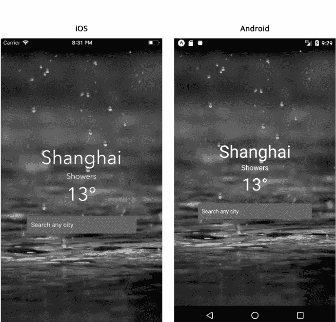

完成的应用

在本章中，我们将从零开始构建一个完整的 React Native 应用程序。我们将讨论如何设置开发环境以及如何初始化一个新的 React Native 应用程序。我们还将学习 Expo 如何让我们能够快速原型设计并在移动设备上预览应用程序。在介绍 React Native 的一些基础知识之后，我们将探讨如何使用 *组件* 来构建应用。组件是组织视图和管理动态数据的强大范式。

我们将涉及各种主题，例如样式和数据管理。本章将从宏观层面展示这些主题如何协同工作。在后续章节中，我们将深入探讨此处涉及的概念。

### 代码示例

本书以示例驱动。每一章都设置为一个实践教程。

我们将从头开始构建应用程序。本书附带一个下载内容，其中包含每个应用程序的完成版本以及我们在开发过程中创建的每个版本（即“示例代码”）。如果你跟随练习，我们建议你使用示例代码来复制粘贴较长的示例或调试意外的错误。如果你没有跟随练习，可以参考示例代码来获取给定代码示例的更多上下文。

本书所有章节的示例代码结构遵循以下模式：

目录的顶层是 `App.js` 和 `components/`。这是应用程序完成版本的代码。在编号的目录（`1/`、`2/`、`3/`）内，是我们在本章构建过程中开发的应用程序的不同版本。

以下是本书中代码示例的外观：

```
render () {
  return (
    <View style={styles.container}>
      <Text>Open up App.js to start working on your app!</Text>
      <Text>Changes you make will automatically reload.</Text>
      <Text>Shake your phone to open the developer menu.</Text>
    </View>
  );
}
```

请注意，代码块的标题包含示例代码的路径，你可以在那里找到此示例（`weather/1/App.js`）。

### JavaScript

本书假设你具备一定的 JavaScript 知识。

React Native 使用 [Babel](https://babeljs.io/) 作为 JavaScript 编译器，允许我们使用最新版本的 JavaScript（ES2016）进行开发。要理解我们所说的 JavaScript 版本，你可以参考 [附录](#)。

我们在 [附录](#) 中重点介绍了一些 JavaScript 的新特性。相关时我们会引用附录。

### 开始项目

#### Create React Native App

首先，我们将使用 [Create React Native App](https://github.com/react-community/create-react-native-app)（CRNA），这是一个让 React Native 入门变得极其简单的工具。如果你之前使用过 [Create React App](https://github.com/facebookincubator/create-react-app)，你会注意到这里的相似之处，即无需构建配置即可开始运行。我们可以使用 [yarn](https://yarnpkg.com) 进行全局安装。

#### yarn

[yarn](https://yarnpkg.com) 是一个 Node 包管理器，它 *自动化* 了管理应用程序中所有必需的依赖项和包的过程，这些依赖项和包来自 npm（一个已发布 JavaScript 库和项目的在线仓库）。这通过在一个 `package.json` 文件中定义我们所有的依赖关系来完成。

> npm 也有一个命令行工具 npm，允许我们维护和控制依赖项。我们用来构建应用程序的工具 CRNA 目前不兼容最新版本的 npm（`npm v5`）。因此，我们将在整本书中使用 `yarn`。

你可以参考 [文档](https://yarnpkg.com/lang/en/docs/install) 以获取为你的操作系统安装 yarn 的说明。文档还解释了如何安装 [node](https://nodejs.org/en/)。然而，要使用 CRNA，需要 `Node.js v6` 或更高版本。

以下是一些常用的 `yarn` 命令列表：

- `yarn init` 创建一个 `package.json` 文件并将其直接添加到我们的项目中。
- `yarn` 将 `package.json` 中列出的所有依赖项安装到本地的 `node_modules` 文件夹中。
- `yarn add new-package` 将安装一个特定的包到我们的项目中，并将其作为依赖项包含在 `package.json` 中。依赖项是我们在运行代码时所需的包。
- `yarn add new-package --dev` 将安装一个特定的包到我们的项目中，并将其作为 *开发* 依赖项包含在 `package.json` 中。开发依赖项是仅在开发工作流程期间所需的包。在生产环境中运行我们的应用程序时不需要它们。
- `yarn global add new-package` 将在全局范围内安装包，而不是本地安装到特定项目。这在我们需要在机器上的任何地方使用命令行工具时很有用。

> 如果我们已经安装了比 v5 更旧版本的 `npm`，我们可以使用它代替 `yarn` 并运行其 [等效命令](https://yarnpkg.com/lang/en/docs/migrating-from-npm/#toc-cli-commands-comparison)。

#### Watchman

[Watchman](https://facebook.github.io/watchman/) 是一个文件监视服务，用于监视文件并在文件被修改时触发操作。如果你使用 macOS 作为操作系统，Expo 和 React Native 文档建议安装 Watchman 以获得更好的性能。安装该服务的说明可以在这里找到：[安装说明](https://facebook.github.io/watchman/docs/install.html#installing-on-os-x-via-homebrew)。

#### Expo

[Expo](https://expo.io/) 是一个平台，提供多种不同的工具来构建功能齐全的 React Native 应用程序，而无需编写原生代码。使用 CRNA 开始项目会自动创建一个利用 Expo 开发环境的应用程序。

利用 Expo 的一个好处是，构建应用程序不需要使用 Xcode（用于 iOS）或 Android Studio（用于 Android）。这意味着开发人员甚至不需要拥有 Mac 电脑就能构建原生 iOS 应用程序。使用 CRNA 和 Expo 是开始使用 React Native 的最简单方式，并且在 React Native [文档](https://facebook.github.io/react-native/docs/getting-started.html) 中得到了推荐。

> **包含原生代码**
>
> 使用 Expo 和 CRNA 并不是启动 React Native 应用程序的唯一方式。如果我们需要一个能够包含原生代码的项目，我们将需要改用 [React Native CLI](https://facebook.github.io/react-native/docs/getting-started.html#installing-dependencies)。但是，这样我们的应用程序将分别需要 Xcode（用于 iOS）和 Android Studio（用于 Android）。

Expo 还提供了许多不同的 API 用于设备特定属性，例如联系人、相机和视频。但是，如果我们需要包含 Expo 未提供的原生 iOS 或 Android 依赖项，我们将需要从平台 *完全弹出*。弹出 Expo 应用程序意味着我们可以完全控制管理我们的原生依赖项，但之后我们需要使用 React Native CLI。

我们将在本书后面探讨如何将原生模块添加到 React Native 项目中。


### 预览应用

要使用 Expo 开发和预览应用，我们需要安装其[客户端 iOS 或 Android 应用](https://github.com/expo/expo)，以便在我们的设备上开发和运行 React Native 应用。

## Android

在您的 Android 移动设备上，从 [Google Play](https://play.google.com/store/apps/details?id=host.exp.exponent) 安装 Expo 客户端。安装完成后，您可以选择“扫描二维码”功能，并扫描此二维码：


如果此二维码无法使用，我们建议确保您安装了最新版本的 Expo 应用，并且您正在阅读本书的最新版本。

> 除了扫描二维码，您还可以在 Expo 客户端中直接输入项目 URL `exp://exp.host/@fullstackio/weather` 来加载应用。

## iOS

您可以通过 [App Store](https://itunes.apple.com/us/app/expo-client/id982107779?mt=8) 安装 Expo 客户端。然而，iOS 设备没有扫描二维码的功能。这意味着我们需要先构建最终应用才能预览它。我们可以通过导航到示例代码文件夹中的 `weather/` 目录并运行以下命令来实现：

```
cd weather
yarn
yarn start
```

这将启动 React Native 打包程序。按下 `s` 键允许您通过短信或电子邮件将链接发送到您的设备（您需要提供您的手机号码或电子邮件地址）。完成后，点击链接将在 Expo 客户端中打开应用。

为了让应用在您的物理设备上加载，您需要确保您的手机与您的计算机连接在同一个本地网络上。

**本地开发工具**

除了客户端应用，Expo 还提供了两个本地开发工具，使我们能够预览、共享和发布我们的项目：

-   XDE（Expo Development Environment）是一个桌面应用，可用于 macOS、Windows 或 Linux。
-   exp 是一个命令行界面。

这两种选项都提供了许多不同的命令和服务，我们可以用来管理我们的应用程序。除了使用 CRNA 在启动打包程序时提供的 `s` 快捷键将链接发送到 iOS 设备外，我们也可以使用 `exp` 或 XDE。

我们将在本书后面介绍部署和发布应用时，更详细地探讨如何使用这些本地开发工具。

#### 准备应用

此时，您应该能看到最终应用在您的设备上成功加载。花几分钟时间玩一下应用，感受一下。尝试搜索不同的城市以及一个根本不存在的位置。

如果您计划在阅读本章的同时构建应用，您需要创建一个全新的项目。安装 `yarn` 后，让我们运行以下命令全局安装 Create React Native App (CRNA)：

```
yarn global add create-react-native-app@1.0.0
```

> `@1.0.0` 指定了要安装的 `create-react-native-app` 的 *版本*。锁定版本 `1.0.0` 很重要，这样您机器上的版本才能与本书中的版本匹配。

我们将应用命名为 `weather`，并可以使用以下命令开始（此命令可能需要一些时间）：

```
create-react-native-app weather --scripts-version 1.14.0
```

重要的是，我们将 `--scripts-version` 指定为 `1.14.0`。我们稍后会讨论这个。

然后我们将导航到该目录并启动应用：

```
cd weather
yarn start
```

打包程序运行后，我们可以继续使用 Android 设备扫描二维码，或使用 `s` 快捷键直接将链接发送到我们的 iOS 设备。重要的是要记住，为了让此功能正常工作，我们的设备需要与计算机连接在同一个本地网络上。

现在，查看应用显示了我们的起点：

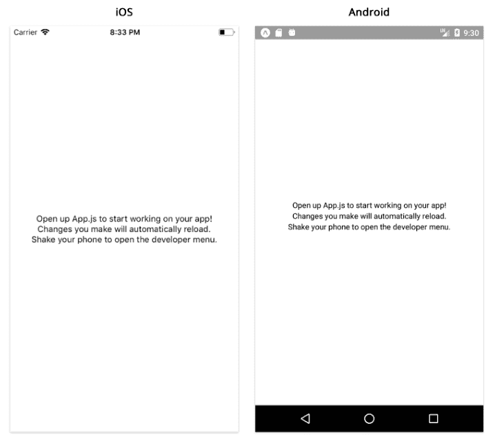

### 在模拟器上运行

如前所述，使用 Expo 客户端应用允许我们在不使用原生工具（iOS 的 Xcode 或 Android 的 Android Studio）的情况下运行我们的应用程序。

但是，如果我们碰巧有必要的构建工具，我们仍然可以在虚拟设备或模拟器中运行我们的应用程序：

-   使用 Mac 时，`yarn run ios` 将启动开发服务器并在 iOS 模拟器中运行应用程序。我们也可以使用 `yarn start` 单独启动打包程序，然后按 `i` 键打开模拟器。
-   使用所需的 [Android 工具](https://facebook.github.io/react-native/docs/getting-started.html)，`yarn run android` 将在 Android 模拟器中启动应用程序。类似地，在 React Native 打包程序运行时按 `a` 键也会启动模拟器。

使用模拟器运行应用程序对于在不同设备和屏幕尺寸上进行测试非常有用。在虚拟设备上更新和测试代码更改也可能更快。然而，重要的是要在某个时候在实际设备上运行您的应用程序，以便更好地了解它的外观和感觉。

默认情况下，CRNA 启用了 *热重载*。这意味着如果您编辑并保存任何文件，您移动设备上的应用程序将 **自动重新加载**。此外，任何构建错误和日志都将直接显示在终端中。

让我们看看我们应用的目录结构是什么样子的。打开一个新的终端窗口。导航到此应用：

```
cd weather
```

然后运行 `ls -a` 查看目录的所有内容：

```
ls -a
```

如果您使用的是 PowerShell 或其他非 Unix shell，您可以直接运行 `ls`。

尽管您的输出会因操作系统不同而略有不同，但您应该能看到目录中列出的所有文件：

```
├── node_modules/
├── .babelrc
├── .flowconfig
├── .gitignore
├── .watchmanconfig
├── App.js
├── app.json
├── App.test.js
├── package.json
├── README.md
└── yarn.lock
```

让我们逐一查看这些文件：

-   `node_modules/` 包含我们应用程序中的所有第三方包。任何新的依赖项和开发依赖项都放在这里。
-   `.babelrc` 允许我们定义预设和插件来配置 [Babel](https://babeljs.io/)。正如我们之前提到的，Babel 是一个转译器，它将较新的实验性 JavaScript 编译成较旧的版本，以便与不同平台保持兼容。
-   `.flowconfig` 允许我们配置 [Flow](https://flow.org/)，一个用于 JavaScript 的静态类型检查器。Flow 是 React Native 工具链的一部分，这个文件在任何 React Native 应用程序中都会自动包含。本章我们不会使用 Flow，但我们将使用 `prop-types` 简要探讨属性验证。
-   `.gitignore` 是我们指定哪些文件应被 Git 忽略的地方。我们可以看到 `node_modules/` 和 `.expo/` 目录已经包含在内。
-   `.watchmanconfig` 定义了 Watchman 的配置。
-   `App.js` 是我们应用程序代码所在的位置。
-   `app.json` 是一个配置文件，允许我们添加有关 Expo 应用的信息。此文件中可以包含的属性列表列在[文档](https://docs.expo.io/versions/v18.0.0/guides/configuration.html)中。
-   `App.test.js` 作为示例测试文件包含在内，其中包含一个测试。CRNA 附带 [Jest](https://facebook.github.io/jest/) 作为其测试平台。我们将在“测试”章节中详细介绍如何对 React Native 应用程序进行单元测试。
-   `package.json` 是我们向包管理器提供应用程序信息以及指定所有项目依赖项的地方。
-   `README.md` 是一个 markdown 文件，通常用于提供项目的描述。
-   `yarn.lock` 是 yarn 保存每个安装依赖项版本记录的地方。

#### package.json

让我们仔细看看生成的 `package.json` 文件：

```
{
  "name": "weather",
  "version": "0.1.0",
  "private": true,
  "devDependencies": {
    "react-native-scripts": "1.14.0",
    "jest-expo": "~27.0.0",
    "react-test-renderer": "16.3.1"
  },
  "main": "./node_modules/react-native-scripts/build/bin/crna-entry.js",
  "scripts": {
    "start": "react-native-scripts start",
    "eject": "react-native-scripts eject",
    "android": "react-native-scripts android",
    "ios": "react-native-scripts ios",
    "test": "jest"
  },
  "jest": {
    "preset": "jest-expo"
  },
  "dependencies": {
    "expo": "^27.0.1",
    "react": "16.3.1",
    "react-native": "~0.55.2"
  }
}
```

`name` 和 `version` 属性是必需的。`dependencies` 和 `devDependencies` 分别定义了我们的应用程序依赖和开发依赖。
注意有三个 `devDependencies`：

-   react-native-scripts
-   jest-expo
-   react-test-renderer

后两个包与测试相关。虽然 CRNA 是初始化我们项目的工具，**但包 `react-native-scripts` 是我们在开发期间运行 React Native 应用程序的引擎。** 当我们在上面指定 `--scripts-version` 为 1.14.0 时，我们指的是这个包。

在我们的 `package.json` 中，`scripts` 对象定义了我们所有的脚本命令。这些命令都由 `react-native-scripts` 包处理。命令 `yarn run start`、`yarn run android` 和 `yarn run ios` 允许我们启动应用程序开发服务器和/或在虚拟设备或模拟器上运行。`scripts` 对象还包含另外两个命令：

+   - `yarn test` 运行我们应用中所有的 Jest 测试
- `yarn run eject` 启动将我们的应用从 CRNA 工具链中弹出的过程。正如我们之前提到的，如果我们需要包含一个包含原生代码的 React Native 库，或者如果我们需要自己编写原生代码，这可能是必要的。

#### utils/ 目录

如果你查看本书的示例代码，你会注意到每个应用都有一个 `utils/` 目录。这个目录包含应用将要使用的辅助函数。你无需关心这些函数的细节，因为它们与本章的核心概念无关。

当我们到达应用开发中需要使用 `utils/` 提供的工具函数的节点时，我们会提醒你从示例代码中复制该文件夹。你也可以在每个项目初始化后立即执行此操作。

#### 组件

借助较新版本的 JavaScript，我们可以使用 `classes`（类）来定义带有属性的对象。React Native 允许我们使用这种语法来创建 `components`（组件）。让我们来看一下我们应用中组件的可视化分解：

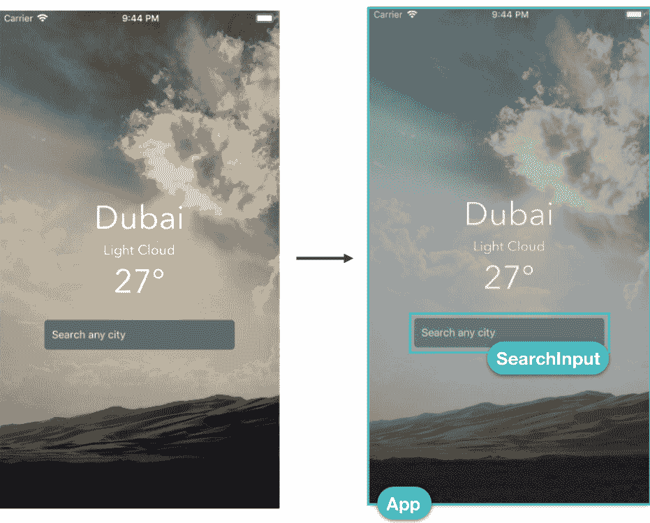

#### 组件结构

我们有一个 `App` 组件，它代表整个 *screen*（屏幕），并包含向用户显示的天气信息。在这个组件内部，我们有一个 `SearchInput` 组件，允许我们搜索不同的城市。

#### App

`App` 是使用默认 CRNA 应用创建的第一个组件。让我们来看一下它的文件：

**weather/1/App.js**

```jsx
import React from 'react';
import { StyleSheet, Text, View } from 'react-native';

export default class App extends React.Component {
  render() {
    return (
      <View style={styles.container}>
        <Text>Open up App.js to start working on your app!</Text>
        <Text>Changes you make will automatically reload.</Text>
        <Text>Shake your phone to open the developer menu.</Text>
      </View>
    );
  }
}

const styles = StyleSheet.create({
  container: {
    flex: 1,
    backgroundColor: '#fff',
    alignItems: 'center',
    justifyContent: 'center',
  },
});
```

注意我们文件中定义的名为 `App` 的类，它继承了 `React.Component`。使用 `extends` 允许我们将一个类声明为另一个类的子类。在这里，我们将 `App` 定义为 `React.Component` 的子类。这就是我们如何指定一个特定类成为应用中的 *component*（组件）。

> ℹ️ 如果你想了解更多关于 JavaScript 中类的工作原理，请参考我们的 [附录](javascript:void(0))。

我们也可以将方法作为属性附加到类上，这同样适用于 React Native 中的组件类。我们可以看到这个组件已经有一个方法，即 `render` 方法：

```jsx
render() {
  return (
    <View style={styles.container}>
      <Text>Open up App.js to start working on your app!</Text>
      <Text>Changes you make will automatically reload.</Text>
      <Text>Shake your phone to open the developer menu.</Text>
    </View>
  );
}
```

我们在设备上启动应用时看到的内容与这个方法中描述的一致。**`render()` 方法是 React Native 组件唯一必需的方法**。React Native 使用此方法的返回值来确定要为该组件渲染什么。

当我们使用 React Native 时，我们将应用的不同部分表示为 **components**（组件）。这意味着我们可以使用不同的可复用逻辑块来构建我们的应用，每个块显示我们 UI 的特定部分。让我们分解一下我们已有的组件：

- 我们的整个应用以 `App` 作为顶层组件进行渲染。虽然它是在设置新的 CRNA 项目时自动创建的，但这个组件是一个自定义组件，负责渲染我们应用中需要的内容。
- `View` 组件用作布局容器。
- 在 `View` 内部，我们使用 `Text` 组件来显示应用中的文本行。与 `App` 不同，`View` 和 `Text` 都是 **built-in**（内置的）React Native 组件，在我们的自定义组件中导入并使用。

我们可以看到我们的 `App` 组件使用并返回了一个类似 HTML 的结构。这就是 **JSX**，它是 JavaScript 的扩展，允许我们使用类 XML 语法来定义我们的 UI 结构。

#### JSX

当我们使用 React Native 构建应用时，组件最终会渲染显示在我们设备上的原生视图。因此，组件的 `render()` 方法需要描述视图应该如何呈现。换句话说，React Native 允许我们用 JavaScript 描述组件的 iOS 和 Android 表示。

JSX 的创建是为了让组件的 JavaScript 表示更容易理解。它允许我们在标记中以可视化的方式构建结构并展示它们的层次结构。考虑这个 JSX 片段：

```jsx
<View>
  <Text style={{ color: 'red' }}>
    Hello, friend! I am a basic React Native component.
  </Text>
</View>
```

在这里，我们将一个 Text 组件嵌套在 View 组件内。注意我们如何使用花括号（`{}`）包裹对象（`{ color: 'red' }`）来设置 Text 的 style 属性值。在 JSX 中，花括号是一种分隔符，向 JSX 信号表明括号内的内容是一个 JavaScript 表达式。另一种分隔符是使用引号表示字符串，像这样：

```jsx
<TextInput placeholder="This is a string" />
```

> 即使上面的 JSX 看起来可能与 HTML 相似，但它实际上只是被编译成 JavaScript 函数调用（例如：React.createElement(View)）。因此，我们需要在任何包含 JSX 的文件顶部导入 React。你可以参考附录了解更多细节。在运行时，React Native 负责渲染每个组件的实际原生 UI。

#### Props

我们使用导入的 Text 组件来包裹 App 组件的每一行文本输出：

```jsx
<Text>Open up App.js to start working on your app!</Text>
```

我们使用导入的 View 组件来包裹所有的 Text 组件：

```jsx
<View style={styles.container}>
  ...
</View>
```

Props 允许我们向组件传递参数以自定义其特性。在这里，View 用于布局屏幕的整个内容。我们只附加了一个单一的 prop，`style`，它允许我们传入样式参数来调整 View 组件在设备上的渲染方式。React Native 提供的每个内置组件都有其自己的一组有效 props，我们可以用于自定义。

如果你熟悉 HTML，这非常相似。例如，在 HTML 中，假设你想插入一个名为 `image.png` 的图像。你可以指定一个 `img` 标签，并带有 `src` 属性，像这样：

```html

```

为了让你了解这种相似性，在 React Native 中我们可以使用 `Image` 组件来包含图像。我们使用 `source` prop 来指定位置：

```jsx
<Image source={require('./image.png')}>
```

我们稍后会更详细地介绍图像。

与我们的 `View` 组件一样，React Native 中的许多组件都接受 `style` prop。样式是一个我们在整本书中都会探索的大主题。然而，我们可以看一下 `App.js` 底部的 `styles` 对象，来了解它的工作原理：

**weather/1/App.js**

```js
const styles = StyleSheet.create({
  container: {
    flex: 1,
    backgroundColor: '#fff',
    alignItems: 'center',
    justifyContent: 'center',
  },
});
```

Web 开发人员可能会认出这看起来像 CSS（Cascading Style Sheets，层叠样式表），它用于样式化网页。值得注意的是，React Native 中的样式不使用 CSS。然而，React Native 从 Web 开发中借鉴了很多样式术语。在这里，我们指定文本应该居中，并且背景颜色应该是白色（`#fff`）。

如果你之前使用过 CSS，你会发现 React Native 中的样式非常眼熟。如果没有，别担心！很容易就能掌握。

具体来说，`styles.container` 具有 `flex`、`alignItems` 和 `justifyContent` 属性。这些用于将 View 定位在屏幕中央。React Native 使用 flexbox 来在不同设备尺寸上一致地布局和排列项目。我们将在后面的章节中详细介绍 flexbox 的具体工作原理。


为了构建我们的天气应用，我们将从布局和样式开始。一旦我们的天气应用具备了一些基本框架，我们就可以开始探索管理数据的策略。

正如我们在应用的完整版本中所看到的，我们希望我们的应用将**城市**、**温度**和**天气状况**显示为单独的文本字段。尽管我们最终会对接天气 API 来获取实际数据，但我们将从硬编码这些值开始。

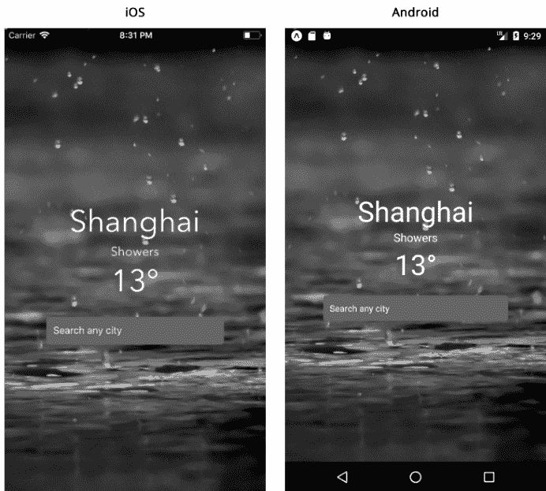

#### 添加样式

为了更好地掌握样式，让我们尝试为其中一个文本字段添加一个带有颜色属性的对象：

```
<View style={styles.container}>
    <Text style={{ color: 'red' }}>
        Open up App.js to start working on your app!
    </Text>
    <Text>Changes you make will automatically reload.</Text>
    <Text>Shake your phone to open the developer menu.</Text>
</View>
```

请注意，上面最外层的括号是包裹我们 JavaScript 语句的*分隔符*。分隔符内部是一个 JavaScript 对象。在 React Native 中，如果对象足够小，通常直接将其全部写在一行。

然而，双括号（`{{}}`）可能会令人困惑。以下是编写相同组件的另一种方式：

```
const style = { color: 'red' };

return (
  <View style={styles.container}>
    <Text style={style}>
      Open up App.js to start working on your app!
    </Text>
```

保存 `App.js`。应用程序重新加载后，我们可以看到应用的样式：

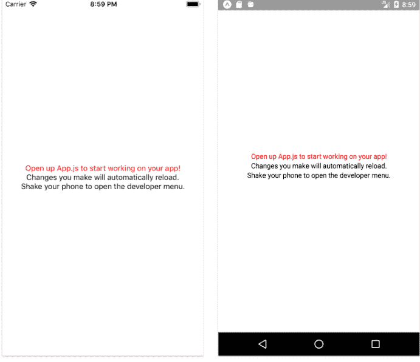

如前所述，**实时重新加载**在 Expo 中默认启用。这意味着代码有任何更改时，应用程序都会立即重新加载。如果您在保存文件后没有看到任何更改立即反映出来，您可能需要检查是否已启用此功能。文档说明了如何打开开发者菜单并启用/禁用该功能。

虽然我们可以用这种方式为整个组件设置样式，但在组件中使用大量*内联*样式（或直接在 `style` 属性的分隔符*内部*定义的属性样式）会使内容更难阅读和消化。

我们可以通过利用 React Native 的 `Stylesheet` API 将样式与组件分离来解决这个问题。使用 `Stylesheet`，我们可以创建具有类似 CSS 样式表层级的样式。我们可以看到 `Stylesheet` 已经在文件顶部导入。它被用来声明我们的第一个样式 `styles.container`，我们将其用于 `View`。我们可以向样式中添加一个名为 `red` 的新样式：

```
const styles = StyleSheet.create({
    container: {
        flex: 1,
        backgroundColor: '#fff',
        alignItems: 'center',
        justifyContent: 'center',
    },
    red: {
        color: 'red',
    },
});
```

然后让 `Text` 使用这个样式：

```
<View style={styles.container}>
    <Text style={styles.red}>
        Open up App.js to start working on your app!
    </Text>
    <Text>Changes you make will automatically reload.</Text>
    <Text>Shake your phone to open the developer menu.</Text>
</View>
```

如果我们保存文件并查看我们的应用，可以看到最终结果是相同的。

现在让我们添加一些适当的样式和文本字段，以便显示某个位置的天气数据。要为单个组件添加多个样式，我们可以传入**样式数组**：

`weather/2/App.js`

```
14        <Text style={[styles.largeText, styles.textStyle]}>San Francisco</Text>
15        <Text style={[styles.smallText, styles.textStyle]}>Light Cloud</Text>
16        <Text style={[styles.largeText, styles.textStyle]}>24°</Text>
```

需要提及的是，当传递数组时，如果存在重复的属性，数组末尾的样式优先于前面的样式。我们可以看到引用了三个新样式：textStyle、smallText 和 largeText。让我们在样式对象中定义这些样式：

`weather/2/App.js`

```
29  const styles = StyleSheet.create({
30    container: {
31      flex: 1,
32      backgroundColor: '#fff',
33      alignItems: 'center',
34      justifyContent: 'center',
35    },
36    textStyle: {
37      textAlign: 'center',
38      fontFamily: Platform.OS === 'ios' ? 'AvenirNext-Regular' : 'Roboto',
39    },
40    largeText: {
41      fontSize: 44,
42    },
43    smallText: {
44      fontSize: 18,
45    },
46  });
```

- `textStyle` 指定了对齐方式（居中）以及字体系列。请注意我们如何使用 `Platform` 为 iOS 和 Android 定义平台特定的字体。我们这样做是因为两个操作系统提供了不同的原生字体集。
- `smallText` 和 `largeText` 分别指定了不同的字体大小。

`Platform` 是 React Native 内置的 API。我们需要确保导入它：

```
import React from 'react';
import {
  StyleSheet,
  Text,
  KeyboardAvoidingView,
  Platform,
  TextInput,
} from 'react-native';
```

现在让我们看看我们的应用程序：

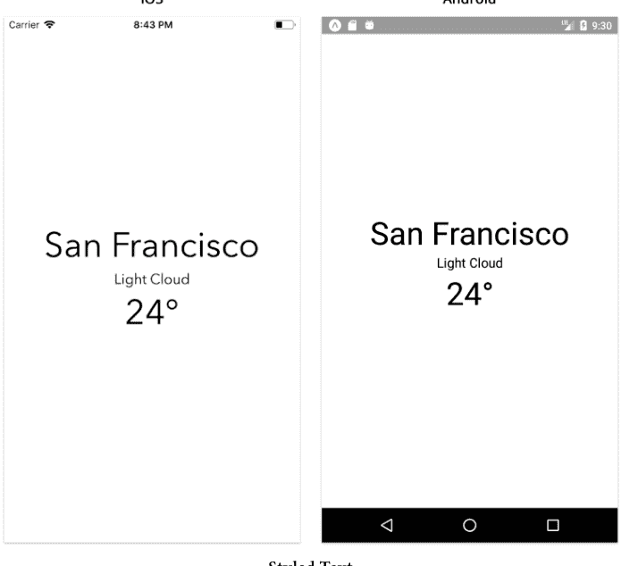

样式化文本

#### 平台特定属性

`Platform` API 允许我们根据设备操作系统有条件地在组件中应用不同的样式或属性。该对象的 `OS` 属性根据用户设备返回 `iOS` 或 `android`。

虽然这是根据用户设备在应用中应用不同属性的相对简单的方法，但可能存在某些场景，我们希望组件在不同操作系统之间有显著的差异。

我们还可以使用 `Platform.select` 方法，它以操作系统作为对象中的键，并根据设备返回正确的结果：

```
textStyle: {
  textAlign: 'center',
  ...Platform.select({
    ios: {
      fontFamily: 'AvenirNext-Regular',
    },
    android: {
      fontFamily: 'Roboto',
    },
  }),
},
```

#### 分离文件

与其在整个组件文件中多次使用 `Platform.OS` 进行条件检查，我们还可以利用**平台特定文件**来代替。我们可以创建两个单独的文件来表示相同的组件，每个文件使用不同的扩展名：`.ios.js` 和 `.android.js`。如果两个文件导出相同的组件类名，React Native 打包器就知道根据路径扩展名选择正确的文件。我们将在本书后面更深入地探讨平台特定的差异。

#### 文本输入

现在我们有显示地点、天气状况和温度的文本字段。接下来我们需要做的是提供某种输入，允许用户搜索特定城市。同样，我们将继续使用硬编码数据。只有在所有组件都就绪后，我们才会开始使用 API 获取真实数据。

React Native 提供了一个内置的 `TextInput` 组件，我们可以将其导入到组件中以接受用户输入。让我们在 `View` 容器中将其包含在 `Text` 组件下方（也要确保导入它！）：

`weather/2/App.js`

```
<Text style={[styles.largeText, styles.textStyle]}>San Francisco</Text>
<Text style={[styles.smallText, styles.textStyle]}>Light Cloud</Text>
<Text style={[styles.largeText, styles.textStyle]}>24°</Text>

<TextInput
  autoCorrect={false}
  placeholder="Search any city"
  placeholderTextColor="white"
  style={styles.textInput}
  clearButtonMode="always"
/>
```

有许多与 `TextInput` 相关的属性可供我们使用。我们将在这里介绍基础知识，但在"核心组件"章节中会详细介绍它们。在这里，我们指定了占位符、其颜色以及组件本身的样式。让我们在其他样式下方创建其样式对象 textInput：

`weather/2/App.js`

```
smallText: {
  fontSize: 18,
},
textInput: {
  backgroundColor: '#666',
  color: 'white',
  height: 40,
  width: 300,
  marginTop: 20,
  marginHorizontal: 20,
  paddingHorizontal: 10,
  alignSelf: 'center',
},
```

如前所述，我们在 React Native 中为样式提供的所有属性与使用 CSS 应用它们的方式非常相似。现在让我们来看看我们的应用程序：


iOS

Android

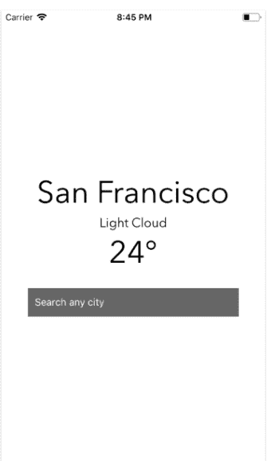

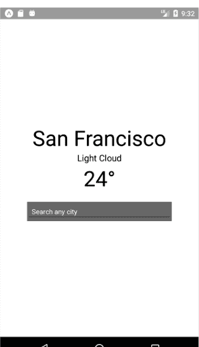

#### 文本输入

我们可以看到，Android 上的文本输入默认有一条下划线。我们稍后会介绍如何移除它。

我们还指定了 `clearButtonMode` 属性为 `always`。这会在输入字段中插入字符后，于其右侧显示一个允许我们清除文本的按钮。此功能仅在 iOS 上可用。


#### 文本输入清除按钮

现在我们可以开始在输入框中输入内容了！

如果你使用的是 iOS 模拟器，你可以连接你的硬件键盘并在任何输入框中使用它。可以通过 `Shift + ⌘ + K` 或导航到 `Hardware -> Keyboard -> Connect Hardware Keyboard` 来完成此操作。

启用此功能后，软件键盘可能默认不会显示。你可以通过按 `⌘ + K` 或导航到 `Hardware -> Keyboard -> Toggle Software Keyboard` 来切换显示。

现在，每当你点击一个输入框，软件键盘的显示方式都将与使用真实设备时完全相同，并且你可以使用硬件键盘进行输入。

然而，你可能已经注意到一件事：当你通过点击聚焦到输入框时，在 Android 上键盘会弹出并遮盖住输入框，在 iOS 上则会非常接近输入框：

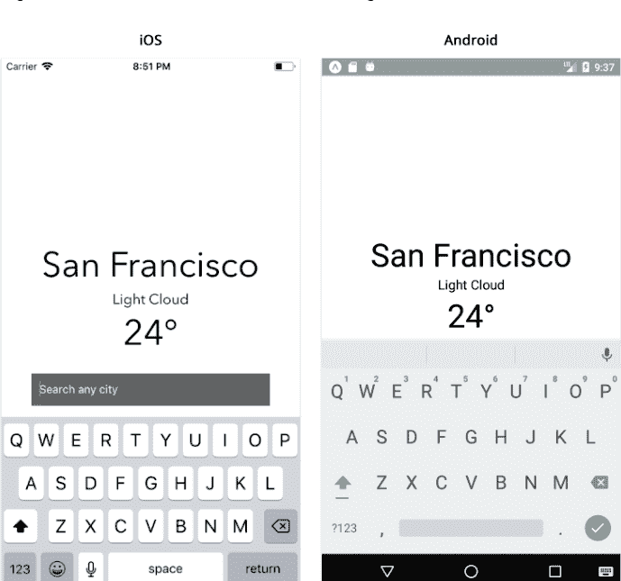

由于虚拟键盘大约会遮挡设备屏幕的一半，这是在应用程序中使用文本输入时常见的问题。幸运的是，React Native 包含了 `KeyboardAvoidingView`，这是一个通过允许我们调整其他组件相对于虚拟键盘的渲染位置来解决此问题的组件。让我们导入并使用这个组件代替 `View`：

weather/2/App.js

```
render() {
  return (
    <KeyboardAvoidingView style={styles.container} behavior="padding">
      <Text style={[styles.largeText, styles.textStyle]}>San Francisco</Text>
      <Text style={[styles.smallText, styles.textStyle]}>Light Cloud</Text>
      <Text style={[styles.largeText, styles.textStyle]}>24°</Text>

      <TextInput
        autoCorrect={false}
        placeholder="Search any city"
        placeholderTextColor="white"
        style={styles.textInput}
        clearButtonMode="always"
      />
    </KeyboardAvoidingView>
  );
}
```

请注意，`KeyboardAvoidingView` 接受一个 `behavior` 属性，通过它我们可以自定义键盘的调整方式。它可以改变其高度、位置或底部内边距，以适应虚拟键盘的位置。在这里，我们指定了 `padding`。

现在点击文本输入框将使我们的组件文本和输入字段移出软件键盘的遮挡范围。

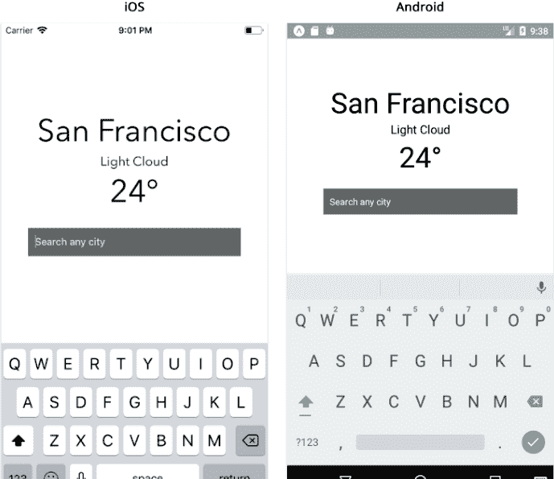

键盘回避视图

#### 自定义组件

到目前为止，我们已经探索了如何在应用程序中添加样式，并将一些内置组件添加到了我们的主 `App` 组件中。我们使用 `View` 作为组件容器，并导入了 `Text` 和 `TextInput` 组件，以便显示硬编码的天气数据以及一个供用户更改地点的输入框。

需要重申的是，React Native 是**组件驱动**的。我们已经在不费太多力气的情况下，通过描述 UI 不同部分的组件来表示我们的应用程序，这是因为 React Native 提供了多种不同的内置组件，你可以立即使用它们来塑造和构建你的应用程序。

然而，随着应用程序的开始发展，开始思考如何将其进一步分解为更小、更简单的块变得很重要。我们可以通过创建**自定义组件**来实现这一点，这些组件包含我们认为更适合放在单独、独立组件文件中的 UI 的小子集。这有助于我们将应用程序的部分进一步分割为更易于管理、可重用和可测试的内容。

尽管我们当前状态的应用程序并非极其庞大或难以管理，但仍有改进的空间。我们可以重构组件的第一种方法是将 `TextInput` 移动到一个单独的组件中，将其从主 App 组件中隐藏其具体实现细节。让我们在应用程序根目录中创建一个包含以下文件的 components 目录：

```
components/
  - SearchInput.js
```

我们将在主 App 组件中使用的所有自定义组件都将位于此目录中。对于更高级的应用程序，我们可能会在 components 内部创建目录以进行更具体的分类。由于这个应用程序相当简单，让我们使用一个扁平的 components 目录。

SearchInput 将是我们的第一个自定义组件，因此让我们将 App.js 中所有关于 TextInput 的代码移动到 SearchInput.js：

weather/3/components/SearchInput.js

```
import React from 'react';
import { StyleSheet, TextInput, View } from 'react-native';

export default class SearchInput extends React.Component {
  render() {
    return (
      <View style={styles.container}>
        <TextInput
          autoCorrect={false}
          placeholder={this.props.placeholder}
          placeholderTextColor="white"
          underlineColorAndroid="transparent"
          style={styles.textInput}
          clearButtonMode="always"
        />
      </View>
    );
  }
}

const styles = StyleSheet.create({
  container: {
    height: 40,
    marginTop: 20,
    backgroundColor: '#666',
    marginHorizontal: 40,
    paddingHorizontal: 10,
    borderRadius: 5,
  },
  textInput: {
    flex: 1,
    height: 40,
    backgroundColor: 'white',
    marginHorizontal: 10,
    paddingHorizontal: 10,
    borderRadius: 5,
  },
});
```

```
textInput: {
  flex: 1,
  color: 'white',
},
```

让我们来分析一下这个文件包含的内容：

- 我们导出一个名为 `SearchInput` 的组件。
- 这个组件接受一个 `placeholder` 属性。
- 这个组件返回一个 React Native 的 `TextInput`，指定了其部分属性，并包裹在一个 `View` 中。我们为视图容器应用了适当的样式，包括一个 borderRadius。我们还添加了 `underlineColorAndroid="transparent"` 以移除 Android 上默认显示的深色下划线。

> `this` 是 JavaScript 中的一个特殊关键字。关于它的细节有些微妙，但就本书大部分内容而言，**this 将绑定到 React Native 组件类**。因此，当我们在组件内部编写 `this.props` 时，我们是在访问组件上的 props 属性。当我们在后面的章节中偏离此规则时，我们会指出来。

有关更多详细信息，请查看 [MDN](https://developer.mozilla.org/en-US/docs/Web/JavaScript/Reference/Operators/this) 上的这个页面。

#### 自定义属性

你可能还记得，在 `App.js` 中我们将 `TextInput` 的 `placeholder` 属性设置为 "Search any city."。这会渲染带有占位符的文本输入框：


对于 `SearchInput`，我们可以再次为 `placeholder` 硬编码一个字符串。但如果我们想在应用程序的其他地方添加搜索输入呢？如果 `placeholder` 是可配置的就好了。

在本章前面，我们探索了如何使用属性与多个内置组件来定制它们的功能。我们也可以为我们构建的自定义组件*创建*属性。

这就是我们在 `SearchInput` 中所做的。该组件接受 `placeholder` 属性。反过来，`SearchInput` 使用这个值来设置 `TextInput` 上的 `placeholder` 属性。

React Native 中数据从父组件流向子组件是通过 props 实现的。当一个父组件渲染一个子组件时，它可以传递子组件所依赖的 props。组件可以通过 `this.props` 对象访问其所有的 props。如果我们决定传递字符串 `"Type Here"` 作为 placeholder 属性，那么 `this.props` 对象将如下所示：

```
{ "placeholder": "Type Here" }
```

在这里，我们将设置 `App` 来渲染 `SearchInput`，这意味着 `App` 是 `SearchInput` 的*父组件*。我们的父组件将负责传递 `placeholder` 的实际值。

我们现在正走向一些有趣的地方。我们设置了一个自定义的 `SearchInput` 组件，并通过构建它接受一个 `placeholder` 属性，我们已经使其具有可配置性。根据它接收到的值，它可以渲染我们想要的任何占位符消息。

#### 导入组件

为了在 `App` 中使用 `SearchInput`，我们首先需要导入该组件。我们可以从 `App.js` 中移除 `TextInput` 的逻辑，并让 `App` 改用 `SearchInput`：

weather/3/App.js

```
import React from 'react';
import { StyleSheet, Text, KeyboardAvoidingView, Platform } from 'react-native';

import SearchInput from './components/SearchInput';

export default class App extends React.Component {
  render() {
    return (
      <KeyboardAvoidingView style={styles.container} behavior="padding">
        <Text style={[styles.largeText, styles.textStyle]}>San Francisco</Text>
        <Text style={[styles.smallText, styles.textStyle]}>Light Cloud</Text>
        <Text style={[styles.largeText, styles.textStyle]}>24°</Text>

        <SearchInput placeholder="Search any city" />
      </KeyboardAvoidingView>
    );
  }
}
```

通过将整个 `TextInput` 的细节移动到一个名为 `SearchInput` 的单独组件中，我们确保父组件中不再显示任何其具体实现细节。我们还可以从 `styles` 对象中移除为文本输入框定义的样式。


关于我们应该多久将不同的 UI 逻辑分离到单独的自定义组件中，并没有一个特定的答案。React Native 的构建初衷就是为了让我们能够用独立的组件来布局整个应用，这意味着我们应该将应用的不同部分分离成具有自定义功能的独立单元。这样我们就能构建一个更易于管理和理解的应用。我们已将搜索输入框的相关知识隔离到 `SearchInput` 组件中，并且在本章中我们将继续隔离应用中的特定部分。

> 将导入语句分成两组是很常见的做法：一组是来自依赖项的导入，另一组是来自项目中其他文件的导入。这就是为什么我们在 `SearchInput` 上方留了一个空行。这取决于个人的风格偏好。

#### 背景图片

正如我们在本章开头看到的应用完成版本的截图所示，我们可以通过显示一个代表当前天气状况的背景图片来让应用更具视觉吸引力。

在这本书的示例代码中，我们为各种天气状况包含了一些图片。如果你查看 `weather/assets` 目录，你会发现诸如 `clear.png`、`hail.png` 和 `showers.png` 之类的图片。

如果你正在跟着做，请从示例代码中将这两个文件夹复制到你的项目中：

- 1. weather/assets
- 2. weather/utils

> 我们之前提到过，在本书的示例代码中为每个项目都包含了一个 `utils/` 文件夹。这个文件夹包含了我们将在下面使用的辅助函数。

> 如果你使用的是 macOS 或 Linux，可以使用 `cp -r` 来复制目录：
>
> `cp -r weather/{assets,utils} ~/react-native-projects/weather/`

复制完 `assets` 和 `utils` 文件夹后，让我们更新我们的 `App` 组件：

weather/4/App.js

```javascript
import React from 'react';
import {
  StyleSheet,
  View,
  ImageBackground,
  Text,
  KeyboardAvoidingView,
  Platform,
} from 'react-native';

import getImageForWeather from './utils/getImageForWeather';

import SearchInput from './components/SearchInput';

export default class App extends React.Component {
  render() {
    return (
      <KeyboardAvoidingView style={styles.container} behavior="padding">
        <ImageBackground
          source={getImageForWeather('Clear')}
          style={styles.imageContainer}
          imageStyle={styles.image}
        >
          <View style={styles.detailsContainer}>
            <Text style={[styles.largeText, styles.textStyle]}>
              San Francisco
            </Text>
            <Text style={[styles.smallText, styles.textStyle]}>
              Light Cloud
            </Text>
            <Text style={[styles.largeText, styles.textStyle]}>24°</Text>

            <SearchInput placeholder="Search any city" />
          </View>
        </ImageBackground>
      </KeyboardAvoidingView>
    );
  }
}
```

在这个组件中，我们从 `utils` 目录导入了一个 `getImageForWeather` 方法，该方法根据天气类型从 `assets` 目录返回特定的图片。例如，`getImageForWeather('Clear')` 返回以下图片：

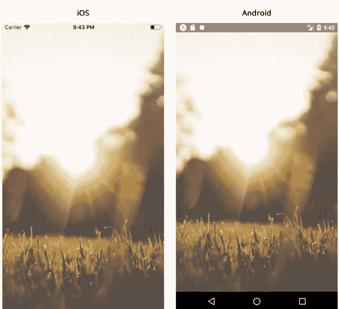

> 你可以查看我们在 `utils` 目录中使用的任何函数的实现细节，以便更好地了解它的工作原理。

我们还导入了 React Native 内置的 `ImageBackground` 组件。让我们更仔细地看看如何在 `render` 方法中使用它：

```javascript
weather/4/App.js
render() {
  return (
    <KeyboardAvoidingView style={styles.container} behavior="padding">
      <ImageBackground
        source={getImageForWeather('Clear')}
        style={styles.imageContainer}
        imageStyle={styles.image}
      >
      </ImageBackground>
    </KeyboardAvoidingView>
  );
}
```

从概念上讲，`ImageBackground` 组件是一个嵌套了 `Image` 的 `View`。`source` 属性接受一个图片位置，我们将其设置为 `getImageForWeather('Clear')`。我们知道这总是会返回上面显示的图片。`ImageBackground` 还使用 `style` 属性来设置 `View` 容器包装器的样式，并使用 `imageStyle` 属性来设置图片本身的样式。让我们添加两个新样式并修改 `container` 样式：

weather/4/App.js

```javascript
const styles = StyleSheet.create({
  container: {
    flex: 1,
    backgroundColor: '#34495E',
  },
  imageContainer: {
    flex: 1,
  },
  image: {
    flex: 1,
    width: null,
    height: null,
    resizeMode: 'cover',
  },
```

用 `flex` 属性定义组件样式意味着它们将扩展以占据父容器中剩余的空间，相对于任何兄弟组件而言。它们按照定义的 `flex` 值的比例来分配这个空间。由于 `ImageBackground` 是 `KeyboardAvoidingView` 中唯一嵌套的元素，将 `imageContainer` 设置为 `flex: 1` 意味着这个元素将填满其父组件的整个空间。我们从 `container` 中移除了 `justifyContent` 和 `alignItems`，以便 `ImageBackground` 可以占据整个设备屏幕。

我们还用 `flex: 1` 来设置实际图片 `image` 的样式，确保它占据其父容器的整个空间。特别是对于图片来说，组件默认会获取并使用源图片的实际宽度和高度。因此，我们还将 `height` 和 `width` 属性设置为 `null`，以便图片的尺寸适应容器。`resizeMode` 属性允许我们定义当 `Image` 元素与其实际尺寸不匹配时如何调整图片大小。将此属性设置为 *cover* 意味着图片将均匀缩放，直到其大小等于组件的大小。

> "核心组件"一章将更深入地探讨 React Native 中 flexbox、布局和 `Image` 组件的工作原理

我们还将所有的 `Text` 元素和 `SearchInput` 包装在一个用 `detailsContainer` 设置样式的视图容器中：

weather/4/App.js

```javascript
<View style={styles.detailsContainer}>
  <Text style={[styles.largeText, styles.textStyle]}>
   San Francisco
  </Text>
  <Text style={[styles.smallText, styles.textStyle]}>
   Light Cloud
  </Text>
  <Text style={[styles.largeText, styles.textStyle]}>24°</Text>

  <SearchInput placeholder="Search any city" />
</View>
```

现在让我们设置它的样式：

weather/4/App.js

```javascript
detailsContainer: {
  flex: 1,
  justifyContent: 'center',
  backgroundColor: 'rgba(0,0,0,0.2)',
  paddingHorizontal: 20,
},
```

在这里，我们确保 `ImageBackground` 中的容器也填满其父组件的整个空间，并且使其项目对齐在屏幕中心。我们还通过设置这个组件的 `backgroundColor` 为图片添加了一个半透明的叠加层。

我们这里还需要做的最后一件事是将 `Text` 元素从黑色改为白色，以便在背景图片上显示得更清晰：

weather/4/App.js

```javascript
textStyle: {
  textAlign: 'center',
  fontFamily: Platform.OS === 'ios' ? 'AvenirNext-Regular' : 'Roboto',
  color: 'white',
},
```

### 试一试

保存文件并查看我们的应用。我们现在应该能看到背景图片显示了！

#### 修改位置

到目前为止我们采取的步骤在启动 React Native 应用时是相当常见的。我们硬编码所有数据，将应用组织成组件，并了解视觉布局以及它是如何分解成组件的。

然而，我们的应用目前并不是很有用。例如，如果我们查看 `SearchInput` 组件，我们可以在输入框中输入任何内容，但实际上不会发生任何事情。我们需要找到一种方法来跟踪对组件所做的更改，并将这些信息存储在某个地方。换句话说，我们需要一些**可变的**数据，这些数据会在用户更改或提交输入框时更新。

与其让 `SearchInput` 不管理任何代表用户输入文本的数据，不如为它传入一个名为 `location` 的属性来反映用户在文本输入框中输入的内容：

```javascript
render() {
  const location = 'San Francisco';

  return (
    <KeyboardAvoidingView style={styles.container} behavior="padding">
      <ImageBackground
        source={getImageForWeather('Clear')}
        style={styles.imageContainer}
        imageStyle={styles.image}
      >
        <View style={styles.detailsContainer}>
          <Text style={[styles.largeText, styles.textStyle]}>{location}</Text>
          <Text style={[styles.smallText, styles.textStyle]}>
            Light Cloud
          </Text>
          <Text style={[styles.largeText, styles.textStyle]}>24°</Text>

          <SearchInput placeholder="Search any city" />
        </View>
      </ImageBackground>
    </KeyboardAvoidingView>
  );
}
```

我们想要传入包含 `location` 数据属性的原因是，我们需要一种方式让我们的子组件修改该字段并向上传达给我们的容器 App 组件。注意我们已将 `location` 的静态字符串移到一个单独的常量中，然后将其传递给 `SearchInput`。我们将其初始化为 `San Francisco`，以便在用户加载应用时显示为第一个位置。接下来我们需要做的就是确保当用户在 `SearchInput` 中实际更改字段时，这个 `location` 常量会被更新。


export default class SearchInput extends React.Component {
  handleChangeText(newLocation) {
    // We need to do something with newLocation
  }

  render() {
    return (
      <TextInput
        autoCorrect={false}
        placeholder={this.props.placeholder}
        placeholderTextColor="white"
        underlineColorAndroid="transparent"
        style={styles.textInput}
        clearButtonMode="always"
        onChangeText={this.handleChangeText}
      />
    );
  }
}

那么，我们刚才做了什么？我们刚刚将 onChangeText 作为新属性添加到了 TextInput 组件中。请注意，我们没有传入特定的对象或属性，而是传入了一个函数：

```
onChangeText={this.handleChangeText}
```

每次输入框中的文本发生变化时，这个方法都会被调用。React Native 提供的许多内置组件都包含*事件驱动*的属性，我们可以将特定的方法附加到这些属性上。我们将在本书中进一步探索。

通过 onChangeText，我们的 TextInput 会将更改后的文本作为参数返回，我们尝试将其传递给一个名为 handleChangeText 的单独方法。目前我们的方法是空的，我们将探讨如何在稍后完善它。

在 React Native 中，当我们想要处理与被引用组件相关的某些事件时，需要传入函数。对于 TextInput 组件，onChangeText 被设置为在输入框中的文本每次发生变化时触发。我们需要在子组件（TextInput）中"监听"这个特定事件，以便它能通知父组件（SearchInput）对此事件作出响应。为此，我们传入一个调用另一个函数的函数，换句话说，就是一个回调函数。

这是一种常见的模式，用于构建需要通知父组件某些事件的组件。不幸的是，按照我们刚刚设置的方式，在这个示例中是行不通的。这是因为 handleChangeText 函数与组件实例具有不同的局部作用域。我们可以通过将函数绑定到其 **this** 对象的正确上下文来解决这个问题。

```jsx
<TextInput
  placeholder={placeholder}
  placeholderTextColor="white"
  underlineColorAndroid="transparent"
  style={styles.textInput}
  clearButtonMode="always"
  onChangeText={this.handleChangeText.bind(this)}
/>
```

现在这在当前上下文中可能看起来还可以，但如果我们在每个事件处理程序中都使用 bind 语句来构建组件，很快就会变得难以控制。.handleChangeText 就是一个例子，如果我们想在多个不同的子组件中使用它，我们必须确保每次都将其绑定到正确的上下文。为了解决这个问题，我们可以使用**属性初始化器**来处理事件：

```jsx
export default class SearchInput extends React.Component {
  handleChangeText = (newLocation) => {
    // We need to do something with newLocation
  }

  render() {
    return (
      <TextInput
        autoCorrect={false}
        placeholder={this.props.placeholder}
        placeholderTextColor="white"
        underlineColorAndroid="transparent"
        style={styles.textInput}
        clearButtonMode="always"
        onChangeText={this.handleChangeText}
      />
    );
  }
}
```

这使得我们可以将成员方法声明为箭头函数：

```javascript
handleChangeText = (newLocation) => {
  // We need to do something with newLocation
}
```

我们将方法名传给属性，仅此而已：

```jsx
onTextInput={this.handleChangeText}
```

> **属性初始化器**
>
> 受 Babel^36 支持，属性初始化器目前仍处于提案阶段，尚未被确定纳入未来的 JavaScript 版本。尽管这种模式在许多 React 和 React Native 应用中被广泛使用，但需要记住的是，它仍然是*实验性*语法。

有关在 React Native 中处理事件的不同方法的更多信息，请参阅附录。

现在我们已经正确设置了回调函数，让我们修改 `handleChangeText` 来更改我们的文本属性，以便将数据更改为用户输入 Hawks：

```javascript
handleChangeText = (newLocation) => {
  this.props.location = newLocation;
};
```

让我们运行应用程序，并尝试在 TextInput 字段中输入内容。你会立即注意到显示的第一个位置是 San Francisco，所以我们知道文本属性正在被成功传递下来！

然而，如果我们在 TextInput 中输入任何内容，你会注意到*没有任何反应*。更改输入框中的文本实际上并不会更新父组件的 location 属性，从我们设计的组件逻辑来看，它似乎应该更新。这是因为 `this.props`（在 SearchInput 中引用）**实际上是由 App 拥有的，而不是子组件 SearchInput**。组件的属性是**不可变**的，并创建了从父组件到子组件的单向数据管道。

我们有一个小问题。我们需要找到一种方法：

- 在子组件 SearchInput 中存储代表输入字段值的本地数据
- 在用户更新搜索输入字段时跟踪其变化
- 当位置发生变化时通知父组件 App

这就是我们可以使用组件的 **state** 的地方。

#### 存储本地数据

让我们再次修改 SearchInput 组件。目前组件内的文本输入没有任何作用，所以我们添加一些本地组件状态来控制实际数据。我们可以通过向组件添加一个 `constructor` 方法来实现这一点。然后我们可以在这个方法中初始化组件的状态：

```jsx
export default class SearchInput extends React.Component {
  constructor(props) {
    super(props);
    this.state = {
      text: '',
    };
  }
```

我们可以使用 constructor 方法来初始化我们的**组件特定数据**，即状态。我们在这里这样做是因为这个方法在组件挂载和渲染之前触发。在这里，我们将 `state` 对象定义为仅包含一个 `text` 属性：

> 请记住，React Native 中的组件是从 `React.Component` 扩展而来以创建派生类的。在派生类中需要 `super()` 才能在构造函数中引用 this。

就像我们可以通过 `this.props` 访问组件的属性一样，我们可以通过 `this.state` 访问组件的状态。例如，如果我们想在一个单独的 Text 组件中输出我们的状态属性，我们可以这样做：

```jsx
export default class HiThere extends React.Component {
  constructor(props) {
    super(props);
    this.state = {
      text: 'Hi there!',
    };
  }

  render() {
    return <Text>{this.state.text}</Text>;
  }
}
```

这个组件现在会渲染 `'Hi there!'`，因为我们就是这样在构造函数中定义 `state.text` 属性的。然而，对于我们当前的组件，state 中的 `text` 属性将用于定义用户在输入字段中键入的文本。现在让我们修改组件的 render 方法来实现这一点：

```jsx
// weather/5/components/SearchInput.js

render() {
  const { placeholder } = this.props;
  const { text } = this.state;

  return (
    <View style={styles.container}>
      <TextInput
        autoCorrect={false}
        value={text}
        placeholder={placeholder}
        placeholderTextColor="white"
        underlineColorAndroid="transparent"
        style={styles.textInput}
        clearButtonMode="always"
        onChangeText={this.handleChangeText}
        onSubmitEditing={this.handleSubmitEditing}
      />
    </View>
  );
}
```

我们首先解构了组件的 `props` 和 `state` 对象：

```jsx
// weather/5/components/SearchInput.js

render() {
  const { placeholder } = this.props;
  const { text } = this.state;
}
```

> **解构**
>
> 我们没有直接使用 `this.props.placeholder` 和 `this.state.text`，而是在 render 方法的开头将两个对象解构为单独的变量（`text` 和 `placeholder`）。有关解构赋值的更多详细信息，请参阅附录。

然后我们确保 `TextInput` 的 `placeholder` 属性仍然接受我们的 `props.placeholder` 属性。我们还将 `state.text` 传递给一个 `value` 属性：

 ```
<TextInput
    autoCorrect={false}
    value={text}
    placeholder={placeholder}
    placeholderTextColor="white"
    underlineColorAndroid="transparent"
    style={styles.textInput}
    clearButtonMode="always"
    onChangeText={this.handleChangeText}
    onSubmitEditing={this.handleSubmitEditing}
/>
```

`value` prop 负责控制输入框中显示的内容。由此我们可知，输入框中显示的任何东西都**始终代表我们的本地状态**。

我们还为组件附加了两个额外的 prop，`onChangeText` 和 `onSubmitEditing`，它们绑定的方法我们尚未设置。

#### 追踪输入的变化

让我们来看看 `onChangeText` 如何帮助我们在每次输入框内容变化时更新状态。正如我们之前所做的那样，我们将一个方法绑定到 `TextInput` 的 `onChangeText` prop：

```
onChangeText={this.handleChangeText}
```

此前，我们设置了一个 `handleChangeText` 方法，当用户修改输入框中的文本时，它会修改我们的 location prop 值。我们很快发现这并不起作用。这是因为 props 是不可变的，**始终由其父组件"拥有"**，而 state 是可以修改的，**由组件自身"拥有"**。这是在 React Native 中构建组件时需要牢记的极其重要的模式。

这就引出了 `setState()`，我们可以使用这个方法来**正确地改变状态**。让我们在 `handleChangeText` 方法中运用它，这个方法可以在构造函数的正下方声明：

```
weather/5/components/SearchInput.js

export default class SearchInput extends React.Component {
  constructor(props) {
    super(props);
    this.state = {
      text: '',
    };
  }

  handleChangeText = text => {
    this.setState({ text });
  };
```

#### 属性名简写

在较新版本的 JavaScript 中，我们可以在可能的情况下使用简写形式来定义对象。我们的 handleChangeText 方法也可以用更明确的语法来书写：

```
handleChangeText = (text) => {
  this.setState({ text: text });
};
```

关于这个概念更多的细节，请参阅附录。

现在我们可能会想通过 `this.state.text = text` 来更新状态，但这样行不通。对于我们在构造函数中定义的初始状态之后的所有状态修改，React 为组件提供了 `setState()` 方法来完成这一操作。除了改变组件的状态对象之外，这个方法还会触发 React 组件重新渲染，这在状态改变后至关重要。

像我们在这个组件中所做的那样，使用"空"状态来初始化组件是一种良好的实践。然而，在 SearchInput 组件初始化之后，我们需要用用户输入到文本框中的数据来更新状态。这就是为什么我们使用作为 onChangeText prop 回调方法参数提供的 text，并将其传递给 `this.setState()`。

> 绝不要在 `this.setState()` 之外修改状态。这个函数对状态修改有重要的钩子机制，绕开它们会带来问题。

我们在整本书中会详细讨论状态管理。

#### 通知父组件

所以我们已经找到了一种在组件中正确存储本地状态的方法，该状态代表搜索输入中的文本，*并且*确保它随着用户修改值而更新。我们还需要做一件事，那就是在用户提交新的搜索值时通知我们的父组件 `App`。这就是为什么我们将一个方法绑定到 `TextInput` 的 `onSubmitEditing` prop：

```
weather/5/components/SearchInput.js

onSubmitEditing={this.handleSubmitEditing}
```

这里的思路是，我们不一定想在用户每次修改输入框时都与父组件通信。这就是为什么 `onChangeText` 纯粹负责将最新键入的输入值存储到组件的本地状态中。幸运的是，`TextInput` 组件有一个 `onSubmitEditing` prop，它在用户**提交**字段时触发，而不只是在修改时。具体来说，这发生在用户按下虚拟键盘的操作按钮以*提交*其输入时。这就是我们想要通知容器组件用户已键入数据的地方。让我们来看看如何设置我们传入的 `handleSubmitEditing` 函数：

```
weather/5/components/SearchInput.js

handleSubmitEditing = () => {
  const { onSubmit } = this.props;
  const { text } = this.state;

  if (!text) return;

  onSubmit(text);
  this.setState({ text: '' });
};
```

在这里，我们检查 `this.state.text` 是否不为空（这意味着用户已在输入框中键入了内容），如果是这种情况：

1. **运行从组件 props 中获取的 `onSubmit` 函数。** 我们在这里将 `text` 作为参数传入。
2. 使用 `this.setState()` 清除状态中的 `text` 属性

我们已经看到 `this.props` 如何用于从父组件向子组件传递信息，也看到了像 `TextInput` 这样的内置组件如何通过在它们的某些 props 中使用回调来通知其父组件。类似地，我们可以在自定义组件中创建 `props` 来做*完全相同的事情*。在这里，我们需要 `SearchInput` 在用户提交输入字段时与 `App` 组件通信。我们这样做是因为我们希望父组件来处理用户键入并提交新城市的事件。这就是为什么我们在这里有一个触发时会执行的 `onSubmit` prop。

接下来我们需要做的是在 `App` 中向 `SearchInput` 的 `onSubmit` prop 传递一个方法并处理该事件：

weather/5/App.js

```
<SearchInput
    placeholder="Search any city"
    onSubmit={this.handleUpdateLocation}
/>
```

让我们为这个组件定义本地状态以及 `handleUpdateLocation` 方法：

weather/5/App.js

```
export default class App extends React.Component {
  constructor(props) {
    super(props);
    this.state = {
      location: 'San Francisco',
    };
  }

  handleUpdateLocation = city => {
    this.setState({
      location: city,
    });
  };
```

我们为该组件定义了本地状态，只有一个 `location` 属性，并将其设置为 San Francisco。这样做是为了确保重新加载应用程序时显示一个初始位置。我们还包含了一个 `handleUpdateLocation` 方法，它接收一个参数来改变我们的 location 状态。每当用户提交搜索输入字段时，这个方法就会触发，因为我们把它作为 `SearchInput` 的 `onSubmit` prop 传入。

由于我们现在实际上有了由用户在输入字段中提交的内容所代表的"实时" location 数据，我们现在可以在第一个 `Text` 元素中显示它，而不是硬编码的字符串：

```
weather/5/App.js

render() {
  const { location } = this.state;

  return (
    <KeyboardAvoidingView style={styles.container} behavior="padding">
      <ImageBackground
        source={getImageForWeather('Clear')}
        style={styles.imageContainer}
        imageStyle={styles.image}
      >
        <View style={styles甲/styles.detailsContainer}>
          <Text style={[styles.largeText, styles.textStyle]}>{location}</Text>
        </View>
      </ImageBackground>
    </KeyboardAvoidingView>
  );
}
```

### 试一试

如果我们在搜索输入框中输入任何城市并按下回车，我们会立即看到城市名称显示出来。

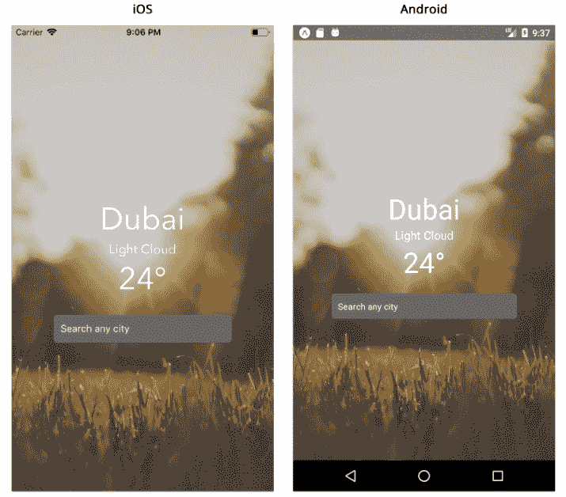

#### 组件状态

这表明我们已经将所有东西正确地连接起来了！

我们逐步解决了每个问题，并展示了在传递和存储组件数据时 `props` 和 `state` 有何不同。然而，`handleUpdateLocation` 并没有真正获取*真实*的天气信息，只是更新了正在显示的城市名称。我们很快就会将其连接以获取实际的天气数据。

#### 状态架构

我们可能已经考虑过在 `SearchInput` 内部控制所有的 location 状态，而不必将信息向上传递到容器组件。*每个状态片段应该放在哪里*并没有特定的答案，这取决于我们正在构建的应用程序类型。这是构建 React Native 应用程序的核心概念，Redux<sup>37</sup> 和 MobX<sup>38</sup> 等工具旨在通过允许你在一个位置管理整个应用程序的状态来进一步简化这一点。然而，即使我们决定使用这类状态管理库，我们仍然需要花时间决定如何构建我们的状态逻辑。

在我们当前的应用中，我们需要让 `App` 知道 `location` 数据，以便显示正确的天气状况。`SearchInput` 实际上不需要存储这些信息，除非要将它传递给处理逻辑的组件。保持 `SearchInput` 简单的动机在于，我们可以利用 React 的组件驱动范式。我们可以在应用程序的各个地方复用它，每当我们需要搜索输入时都可以使用。

我们可以将 `SearchInput` 看作是一个提供展示性标记的组件，**并不**管理任何真实的应用程序数据。这类组件从父组件接收 props，指定展示性组件应该渲染的数据。这个父容器组件还指定行为。如果低级别的展示性组件有任何交互性——就像我们的搜索输入——它会调用父组件提供给它的 prop 函数。我们会在整本书中更详细地介绍这种重要的模式。

#### 生命周期方法

我们已经连接好了组件之间的通信方式，以便在用户提交文本输入字段时立即显示新的位置。然而，你会注意到应用程序首次加载时城市显示为空白字符串。我们*可以*用一个实际城市的名称来实例化它，但我们知道我们最终想要获取真实的天气信息。虽然我们现在还没有设置好，但获取城市实际天气数据的异步操作将在 `handleUpdateLocation` 中进行。因此，在组件首次加载时调用这个方法是有意义的。我们可能会想尝试在 `constructor` 中触发这个方法：
```


#### 在 React Native 中调试

如果你曾经在 web 端使用 JavaScript，你可能熟悉使用 `console.log`、`console.warn` 或 `console.error` 来将消息输出到浏览器的控制台以进行调试。同样，Expo 也允许我们使用这些方法来将日志输出到终端。有关查看日志的更多详细信息，你可以参考[文档](https://docs.expo.io/versions/latest/guides/logging.html)³⁹。

除了日志记录之外，React Native 还允许我们使用 Chrome 开发者工具来调试应用中的 JavaScript 代码。使用 Expo，我们可以通过按开发者菜单中的 **Debug Remote JS** 来实现这一点。你可以参考[文档](https://docs.expo.io/versions/latest/guides/debugging.html)⁴⁰来了解更多信息。

最常用的生命周期方法是在组件挂载*之后*允许我们设置组件数据的方法——`componentDidMount()`。这个方法通常用于触发网络请求来获取组件需要的数据。为了理解这个方法何时触发，让我们将其添加到组件中构造函数之后，并添加一个 `console.log`：

```javascript
export default class App extends React.Component {
  constructor(props) {
    super(props);
    this.state = {
      location: 'San Francisco',
    };
  }

  componentDidMount() {
    console.log('Component has mounted!');
  }
}
```

当我们重新加载应用时，一旦组件挂载完成，我们就可以直接看到 `Component has mounted!` 输出到终端。

现在让我们更新它来触发 `handleUpdateLocation`：

**`weather/6/App.js`**

```javascript
componentDidMount() {
  this.handleUpdateLocation('San Francisco');
}
```

这样，我们就可以将 state 中的默认位置 `San Francisco` 移除，并将其设置为空字符串。

```javascript
export default class App extends React.Component {
  constructor(props) {
    super(props);
    this.state = {
      location: '',
    };
  }
}
```

由于我们使用了 `componentDidMount`，重新加载应用后，我们仍然应该看到 `San Francisco` 填充在文本字段的位置。

虽然 `componentDidMount()` 允许我们在组件首次渲染后立即创建事件监听器和获取网络请求，但 React Native 还提供了许多其他的生命周期方法。我们将在本书中逐一介绍它们。

然而，在 `constructor` 中触发异步请求通常是一种*反模式*。这是因为 `constructor` 在组件首次挂载之前就被调用了。因此，这个方法通常应该只用于初始化 state 和绑定方法。

相反，我们可以利用 React Native 的**生命周期方法**之一。顾名思义，这些方法允许你访问组件生命周期中的特定节点。这里的生命周期术语适用于 React Native **实例化、修改和销毁**组件的方式。我们可以使用生命周期钩子来在这些函数在组件渲染的不同阶段被调用时执行某些操作。

#### 网络请求

我们已经构建了构成应用 UI 的所有组件，并对其进行了优化，为用户展示了漂亮的背景图片。正如我们之前提到的，到目前为止我们所采用的方法是构建全新 React Native 应用时的常见模式。我们首先使用组件来组织视图，然后引入了一些 state 和状态管理。

然而，如果应用没有连接到真实数据，没有人会认为它*有用*。在构建新移动应用时，很可能我们需要与服务器进行通信。与服务器通信是大多数移动应用的关键组成部分。

为了构建这个应用，我们将使用 [MetaWeather](https://www.metaweather.com/) API 来获取真实的天气信息。MetaWeather 是一个天气数据聚合器，它从不同预测者的预测中计算出最可能的结果。他们提供了一个 [API](https://www.metaweather.com/api/)，通过一组不同的端点提供这些信息：

1.  位置搜索（`/api/location/search/`），允许我们搜索特定城市
2.  位置天气信息（`/api/location/{woeid}`），提供某个位置的 5 天预报
3.  位置日期（`/api/location/{woeid}/{date}/`），提供特定日期和位置的预报历史和信息

> WOEID，或称[地球何处 ID](https://developer.yahoo.com/geo/geoplanet/guide/concepts.html)，是一种位置标识符，允许我们查找特定位置的详细信息。有关 MetaWeather API 确切工作原理的更多详细信息，欢迎查看[文档](https://www.metaweather.com/api/)。

现在我们已经基本了解了 `state` 开发者菜单中的和 `props` 如何控制不同组件之间的数据流，让我们继续使用这个 API 来渲染真实的天气数据。虽然可以直接在组件方法中放入 API 调用，但通常将这些逻辑抽象到单独的文件中是个好主意。在 `utils` 目录中，我们在 `api.js` 中设置了两个单独的 API 调用：

-   `fetchLocationId` 根据搜索查询返回位置数组
-   `fetchWeather` 使用称为[地球何处 ID](https://developer.yahoo.com/geo/geoplanet/guide/concepts.html) 的位置标识符返回特定位置的天气详情

这两个调用的结合将允许我们搜索城市并检索其天气信息。如果你感兴趣，可以打开文件查看这些方法是如何工作的。

#### 异步函数

回调和 Promise 是 JavaScript 中定义异步代码的两种方式。建立在 Promise 之上，**async** 函数是一种较新的语法，允许我们以同步方式定义异步方法。我们在 `api.js` 中设置的两个方法都使用了这种语法。

虽然 Babel 已经支持它，但它仍处于草案提案阶段，很可能会被批准纳入未来的 JavaScript 版本。如果你碰巧想进一步了解这种语法，这里是 [MDN](https://developer.mozilla.org/en-US/docs/Web/JavaScript/Reference/Statements/async_function) 资源。

在构建通过网络获取信息的组件时，用户不可避免地需要等待一段时间才能检索到数据。对于大多数应用来说，显示某种加载指示器是有意义的，这样用户就知道他们必须稍等片刻才能看到内容。幸运的是，React Native 提供了一个内置的 `ActivityIndicator` 组件，用于显示圆形加载旋转器。让我们从一些新导入开始更新我们的根 `App` 组件：

```javascript
import React from 'react';
import {
  StyleSheet,
  View,
  ImageBackground,
  Text,
  KeyboardAvoidingView,
  Platform,
  ActivityIndicator,
  StatusBar,
} from 'react-native';

import { fetchLocationId, fetchWeather } from './utils/api';
import getImageForWeather from './utils/getImageForWeather';

import SearchInput from './components/SearchInput';
```

我们添加了以下导入：

-   `ActivityIndicator` 是一个内置组件，显示圆形加载旋转器。我们将在从网络获取数据时使用它
-   `fetchLocationId`、`fetchWeather` 是与天气 API 交互的方法
-   `StatusBar` 是一个内置组件，允许我们修改设备顶部的应用状态栏

现在让我们对组件进行一些更改。我们需要应用网络请求逻辑并存储这些信息，以便可以轻松显示。我们还需要确保在请求发起时显示加载指示器。让我们从更新我们的 state 开始：

**`weather/6/App.js`**

```javascript
constructor(props) {
  super(props);

  this.state = {
    loading: false,
    error: false,
    location: '',
    temperature: 0,
    weather: '',
  };
}
```

我们刚刚扩展了我们的 state 对象，除了 `location` 之外，还包括 `loading`、`error`、`temperature` 和 `weather`。后面三个属性是我们将从 API 检索的数据。`loading` 属性表示调用仍在进行中（以便显示加载图标），`error` 用于在我们的调用失败或返回不可用信息时存储错误消息。

使用 `setState`，对我们 state 的更新可以*异步*发生。出于这个原因，该方法接受一个回调作为可选的第二个参数，允许我们定义在 state 更新后触发的操作。请考虑以下示例：

```javascript
export default class Example extends React.Component {
  state = {
    weather: '',
  };

  componentDidMount() {
    this.setState({ weather: 'Clear' }, () => console.log(this.state));
  }
}

// { weather: 'Clear' } 在我们的组件完成挂载后立即被记录
```

我们可以将此逻辑应用于负责与外部 API 交互的方法：`handleUpdateLocation`：

<sup>⁴⁶</sup> https://developer.mozilla.org/en-US/docs/Web/JavaScript/Reference/Statements/async_function

weather/6/App.js

```
handleUpdateLocation = async city => {
  if (!city) return;

  this.setState({ loading: true }, async () => {
    try {
      const locationId = await fetchLocationId(city);
      const { location, weather, temperature } = await fetchWeather(
        locationId,
      );

      this.setState({
        loading: false,
        error: false,
        location,
        weather,
        temperature,
      });
    } catch (e) {
      this.setState({
        loading: false,
        error: true,
      });
    }
  });
};
```

我们已将其更新为一个异步函数，该函数使用 `setState` 将 `loading` 属性更改为 `true`。同时，我们还传入了一个异步函数作为其第二个参数。在这里，我们首先用用户查询的城市（如果存在）调用 `fetchLocationId`，并将位置ID传递给 `fetchWeather`，以返回一个包含所需信息（位置、天气和温度）的对象。完成后，我们的状态会使用正确的参数进行更新。此外，如果任何调用发生错误，`catch` 语句会将我们状态中的 `error` 属性更新为 `true`。

现在我们的 API 逻辑已就位，我们需要在组件的 UI 中做几件事：

-   我们需要*仅*在 API 调用已触发但尚未完成时显示加载旋转器
-   如果用户输入了错误的地址*或*我们的 API 调用失败，我们应该显示错误消息
-   我们需要为特定位置渲染正确的天气信息

让我们看看如何更新我们的 `render()` 方法来实现这一点：

weather/6/App.js

```
render() {
  const { loading, error, location, weather, temperature } = this.state;

  return (
    <KeyboardAvoidingView style={styles.container} behavior="padding">
      <StatusBar barStyle="light-content" />
      <ImageBackground
        source={getImageForWeather(weather)}
        style={styles.imageContainer}
        imageStyle={styles.image}
      >
        <View style={styles.detailsContainer}>
          <ActivityIndicator animating={loading} color="white" size="large" />

          {!loading && (
            <View>
              {error && (
                <Text style={[styles.smallText, styles.textStyle]}>
                  Could not load weather, please try a different city.
                </Text>
              )}

              {!error && (
                <View>
                  <Text style={[styles.largeText, styles.textStyle]}>
                    {location}
                  </Text>
                  <Text style={[styles.smallText, styles.textStyle]}>
                    {weather}
                  </Text>
                  <Text style={[styles.largeText, styles.textStyle]}>
                    {`${Math.round(temperature)}°`}
                  </Text>
                </View>
              )}

              <SearchInput
                placeholder="Search any city"
                onSubmit={this.handleUpdateLocation}
              />
            </View>
          )}
        </View>
      </ImageBackground>
    </KeyboardAvoidingView>
  );
}
```

文件中看起来有很多内容，但让我们逐一分解。我们首先引入了 `StatusBar` 组件：

**weather/6/App.js**

```
<StatusBar barStyle="light-content" />
```

`StatusBar` 组件允许我们使用 `barStyle` 属性自定义应用程序的状态栏，该属性可以让我们更改状态栏内文本的颜色。`light-content` 的值会渲染较浅的颜色（白色），而 `dark-content` 会将其更改为较深的颜色（深灰色）。

> 使用 Expo，我们也可以通过修改 `app.json` 为 Android 配置状态栏。Expo 将 Android 的 `barStyle` 默认设置为 `light-content`，并使背景半透明。虽然这对于当前应用来说看起来不错，但您可以通过提供背景颜色来移除半透明效果。请查看[文档](https://docs.expo.io/versions/latest/guides/configuring-statusbar.html)了解更多详情。

然后我们添加了 `ActivityIndicator` 并为其 `color` 和 `size` 属性赋值：

**weather/6/App.js**

```
<ActivityIndicator animating={loading} color="white" size="large" />
```

注意，我们还包含了一个 `animating` 属性，我们将其设置为 `state.loading` 属性。此属性负责完全显示或隐藏组件。之后，我们在 JSX 中包含了一个花括号容器：

weather/6/App.js

```
{!loading && (
  <View>
    {error && (
      <Text style={[styles.smallText, styles.textStyle]}>
        Could not load weather, please try a different city.
      </Text>
    )}

    {!error && (
      <View>
        <Text style={[styles.largeText, styles.textStyle]}>
          {location}
        </Text>
        <Text style={[styles.smallText, styles.textStyle]}>
          {weather}
        </Text>
        <Text style={[styles.largeText, styles.textStyle]}>
          {`${Math.round(temperature)}°`}
        </Text>
      </View>
    )}

    <SearchInput
      placeholder="Search any city"
      onSubmit={this.handleUpdateLocation}
    />
  </View>
)}
```

我们之前已经看到 JSX 如何允许我们在花括号内嵌入 JavaScript 表达式。幸运的是，这也可以让我们包含运算符，从而允许我们**有条件地渲染** UI 的某些部分。在这里，`!loading && <...>` 意味着当且仅当 `loading` 为 `false` 时，此语句才会评估并显示元素。我们可以看到，我们基本上将组成组件的大部分元素都包装在这里，这是有道理的，因为我们不希望在 API 调用进行时显示任何文本字段或搜索输入。

#### 条件渲染

在 `render` 方法中使用逻辑 `&&` 运算符并不是有条件地渲染组件部分的唯一方法。有时，如果有大量代码行需要条件渲染，这种方法可能会使组件文件更难阅读。

如果发生这种情况，使用*辅助方法*可能是个好主意。例如，我们的 `render` 方法可以按照以下模式重写：

```
renderContent() {
  const { error } = this.state;

  return (
    <View>
      {error && <Text>Error</Text>}
      {!error && this.renderInfo()}
    </View>
  );
}

renderInfo() {
  const { info } = this.state;

  return <Text>{info}</Text>;
}

render() {
  const { loading } = this.state;

  return (
    <View>
      <ActivityIndicator animating={loading} color="white" size="large" />
      {!loading && this.renderContent()}
    </View>
  );
}
```

React [文档](https://reactjs.org/docs/conditional-rendering.html)^48 更详细地介绍了这一概念，并解释了更多有条件渲染组件部分的方法。最终，使用哪种模式取决于个人偏好。

现在，在 API 调用未触发时显示的内容中，我们仍然需要在出现问题时显示适当的错误消息。我们可以使用 `state.error` 属性在这种情况下有条件地显示文本：

^48 https://reactjs.org/docs/conditional-rendering.html

weather/6/App.js

```
{error && (
  <Text style={[styles.smallText, styles.textStyle]}>
    Could not load weather, please try a different city.
  </Text>
)}

{!error && (
  <View>
    <Text style={[styles.largeText, styles.textStyle]}>
      {location}
    </Text>
    <Text style={[styles.smallText, styles.textStyle]}>
      {weather}
    </Text>
    <Text style={[styles.largeText, styles.textStyle]}>
      {`${Math.round(temperature)}°`}
    </Text>
  </View>
)}

<SearchInput
  placeholder="Search any city"
  onSubmit={this.handleUpdateLocation}
/>
```

注意，我们现在在 `Text` 元素中显示状态信息（位置、天气和温度），而不是硬编码的值。对于温度，我们利用 JavaScript 的 `Math` 对象及其 `round()` 方法将温度四舍五入到最接近的整数。

我们最后要做的另一件事是将动态的 `weather` 属性传递给 `ImageBackground`，而不是硬编码的 `Clear` 字符串：

weather/6/App.js

```
<ImageBackground
  source={getImageForWeather(weather)}
  style={styles.imageContainer}
  imageStyle={styles.image}
>
```

现在，如果我们运行应用程序，在输入框中输入一个城市，就会返回其实际的天气数据！


我们通过连接网络请求以获取实际数据，基本完成了应用程序所有主要点的对接。在以硬编码数据缓慢开始，并构建了构成我们UI基础组件之后，我们的应用程序现在正如本章开头所预期的那样工作。接下来的几节将探讨对我们代码的一些额外增强，但不会为我们的应用添加任何新功能。

### PropTypes

在 React Native 中，我们可以使用 `prop-types` 库包含验证函数。这允许我们指定并强制执行组件 props 的类型，并确保它们符合我们的预期。这不仅可以帮助我们更早地发现开发错误，还可以为我们的组件使用者提供一层文档。

我们可以将 `prop-types` 添加为依赖项：

```
yarn add prop-types
```

现在让我们看看如何在 `SearchInput` 中使用 `PropTypes`：

```
weather/6/components/SearchInput.js
SearchInput.propTypes = {
  onSubmit: PropTypes.func.isRequired,
  placeholder: PropTypes.string,
};

SearchInput.defaultProps = {
  placeholder: '',
};
```

我们定义了一个 propTypes 对象，它指示 React 验证传递给我们组件的 props。我们指定 `onSubmit` **必须**是一个函数，`placeholder` **必须**是一个字符串。我们还指定 `onSubmit` 为必需项，这意味着它必须提供给我们的组件，而不是可选的。

我们将 `placeholder` 留为可选项。为此，我们利用了 `defaultProps` 对象。这允许我们在不需要时创建组件而不指定 `placeholder`，`defaultProps` 将负责在那种情况下提供其值。重要的是要注意，传递给 `defaultProps` 的值也会经过库的类型检查。

那么，当一个 prop 的类型未成功验证时，到底会发生什么呢？当一个 prop 以无效类型传入或未能通过 propType 验证时，一条警告会传递到 JavaScript 控制台。这些警告仅在开发模式下显示，因此如果我们不小心将应用部署到生产环境中并且不当使用了某个组件，我们的用户不会看到警告。

#### 类属性

React Native 包含来自 Babel 的 [类属性转换](https://babeljs.io/docs/plugins/transform-class-properties/)，它允许我们简化定义组件 state、props 和 propTypes 的方式。例如，我们可以将 `App.js` 中的构造函数更新为：

```
weather/App.js
state = {
  loading: false,
  error: false,
  location: '',
  temperature: 0,
  weather: '',
};
```

这被转译为与使用构造函数**完全相同的结果**。同样，我们可以简化在 `SearchInput` 中定义 state 的方式：

```
weather/components/SearchInput.js
state = {
    text: '',
};
```

此外，我们还可以使用类中的静态属性来设置 `propTypes` 和 `defaultProps`。换句话说，我们可以移除 `SearchInput` 中的对象引用，并在类*内部*定义一个静态方法：

```
weather/components/SearchInput.js
static propTypes = {
    onSubmit: PropTypes.func.isRequired,
    placeholder: PropTypes.string,
};

static defaultProps = {
    placeholder: '',
};
```

使用这种模式并利用类属性转换，纯粹是在分别定义方法和对象之上的一种语法糖，允许我们用更清晰、更简单的语法编写代码。

## 总结

恭喜，我们刚刚构建了我们的第一个 React Native 应用程序，并涵盖了构建一个完整且功能齐全的移动应用所需的几乎所有基础知识。我们首先探索了通过 CRNA 启动新项目时生成的每个文件，以及 Expo 如何让我们无需担心 Xcode 和 Android Studio 的设置，就能在我们的设备上顺利运行应用程序。然后，我们使用 React Native 提供的内置组件构建了构成我们应用的每个组件。在此过程中，我们深入探讨了 React Native 的基础，理解了 JSX，如何应用自定义样式，以及如何使用 `props` 和 `state` 来管理和控制数据。我们接着探讨了更复杂的主题，包括生命周期方法以及如何使用外部网络调用为我们的应用程序提供真实内容。最后，我们简要介绍了 `propTypes` 如何通过为我们的应用程序添加类型验证来增加额外的安全层。本书的其余部分将深入探讨 React Native 的核心概念，而本章学到的概念将作为文本中其他所有内容的基础。

到目前为止，我们仅仅触及了 React Native 允许我们做的事情的表面。通过了解 Expo 等设置/开发细节以及 `props`、`state` 和组件的核心概念，您已经掌握了 React Native 开发的基础。目前，您已经可以使用该框架构建各种应用程序了——所以，行动起来，构建一些令人惊叹的东西吧！

# React 基础

在上一章中，我们构建了第一个 React Native 应用程序。我们探讨了 React 应用程序如何通过*组件*来组织。使用 React 的关键概念 *state* 和 *props*，我们看到了数据如何管理以及如何在组件之间流动。我们还讨论了其他有用的概念，比如处理用户输入和从远程 API 获取数据。

在本节中，我们将一步一步地构建另一个应用程序。我们将更深入地探讨 React 的基础知识。我们将研究一种可用于从头开始构建 React Native 应用程序的模式，然后将这些步骤付诸实践来构建一个时间跟踪应用程序。

在这个应用程序中，用户可以添加、删除和修改各种计时器。每个计时器对应一个用户想要计时的不同任务：

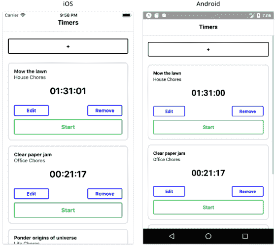

时间跟踪应用

这个应用程序将比上一章构建的那个具有显著更多的交互功能。正如我们将看到的，这将给我们带来一些有趣的挑战。

## 入门

本章假设您已按照第一章开头的步骤设置了您的系统。

与本书所有章节一样，请确保您手边有本书的示例代码。

## 预览应用程序

让我们从查看完成后的应用程序开始。要在您的设备上尝试完成的应用程序：

- 在 Android 上，您可以使用 Expo 应用扫描此二维码：


- 在 iOS 上，您可以导航到示例代码文件夹中的 `time-tracking/` 目录，并在 iOS 模拟器上预览它，或者按照我们在上一章中解释的那样，将项目 URL 的链接发送到您的设备。

试玩一下，感受其所有功能。

## 将应用程序分解为组件

让我们从将应用程序分解为其组件开始。正如我们在上一个项目中注意到的，可视化组件通常与其对应的 React Native 组件紧密映射。例如，我们可以想象我们需要为每个计时器设置一个 `Timer` 组件：

我们的应用程序显示一个计时器列表 *并且* 在顶部有一个 "+" 图标。我们可以使用此按钮将新的计时器添加到列表中。这个 "+" 组件很有趣，因为它有两种不同的表示形式。当按下 "+" 按钮时，该组件变成一个表单：

当表单关闭时，该组件变回 "+" 按钮。

我们可以采取两种方法。第一种是让父组件根据某个有状态的数据决定是渲染 "+" 组件还是表单组件。它可以在两个子组件之间切换。然而，这给父组件增加了更多责任。由于没有其他子组件需要这条信息，让一个新的子组件负责决定是显示 "+" 按钮还是创建计时器表单可能更有意义。我们将称其为 `ToggleableTimerForm`。作为一个子组件，它要么渲染 `TimerForm` 组件，要么渲染 "+" 按钮。

所以，除了我们的根应用组件，我们还确定了两个组件：


但是 Timer 组件有不少功能。正如我们在应用完成版本中所见，当用户点击“Edit”时，计时器会变成一个表单：

单个计时器：显示时间（左）与编辑表单（右）

此外，当按下“Remove”时计时器会自行删除，并且还有用于开始和停止的按钮。我们需要拆分它吗？如果需要，该怎么拆分？

显示计时器和编辑计时器确实是两个不同的 UI 组件。它们应该是两个独立的 React 组件。与 ToggleableTimerForm 类似，我们需要某种容器组件，根据计时器是否正在编辑来渲染计时器的显示界面或其编辑表单。

我们将这个组件命名为 `EditableTimer`。`EditableTimer` 的子组件将是 `Timer` 组件或编辑表单组件。用于创建和编辑计时器的表单非常相似，因此我们可以假设在这两种场景中都可以使用组件 `TimerForm`：

至于计时器的其他功能，比如开始和停止按钮，目前很难确定它们是否应该成为独立的组件。我们可以相信，在我们开始编写一些代码并对应用中组件的整体结构有更好的了解之后，答案会更加清晰。

因此，我们得到了最终的组件层级结构，不过计时器组件的最终状态还存在一些模糊之处：

+   - App: 根容器
  - EditableTimer: 显示计时器或计时器的编辑表单
    - * Timer: 显示给定的计时器
    - * TimerForm: 显示给定计时器的编辑表单
  - ToggleableTimerForm: 显示创建新计时器的表单
    - * TimerForm: 显示新计时器的创建表单

对于应用中的所有按钮，我们将创建并使用一个名为 `TimerButton` 的组件。

## 7 步流程

既然我们已经很好地理解了组件的构成，我们就可以构建一个只包含硬编码数据的静态版本应用了。正如我们在上一章注意到的，我们构建的许多应用都需要顶层组件与服务器通信。在这些场景中，**服务器将是状态的初始来源**，React Native 将根据服务器提供的数据来渲染自身。如果我们当前的应用遵循这种模式，它也会向服务器发送更新，比如计时器启动时。不过，为了简单起见，在本章中我们将渲染本地状态而不是与服务器通信。

从静态组件开始总是会让事情变得更简单，正如我们在上一章所做的那样。应用的静态版本不会是交互式的。例如，按下按钮不会产生任何作用。但这将使我们能够搭建应用的框架，清楚地了解组件树的组织方式。

接下来，我们可以确定应用的 **state** 应该是什么，以及它应该存在于哪个组件中。到那时，我们将实现数据**从父组件流向子组件**。然后我们可以添加反向数据流，将事件**从子组件传播到父组件**。

事实上，这遵循了从零开始开发 React Native 应用的一个实用流程：

1. 将应用拆分为组件
2. 构建应用的静态版本
3. 确定什么应该是有状态的
4. 确定每一部分状态应该存在于哪个组件中
5. 硬编码初始状态
6. 添加反向数据流
7. 添加服务器通信（如果存在）

我们在上一个项目中遵循了这个模式：

**1. 将应用拆分为组件**
我们查看了期望的 UI 并确定需要一个自定义的 `SearchInput` 组件。

**2. 构建应用的静态版本**
我们的组件一开始不使用 `state`。相反，我们让根组件 `App` 将 `location` 作为静态的 `prop` 传递给 `SearchInput`。

**3. 确定什么应该是有状态的**
为了让我们的应用变得可交互，我们必须能够修改搜索输入的搜索值。提交的值就是我们的有状态 `location` 属性。

**4. 确定每一部分状态应该存在于哪个组件中**
我们的根组件 `App` 负责使用 React 组件类方法来管理 `location`、`temperature` 和 `weather` 状态参数。

**5. 硬编码初始状态**
我们定义了一个硬编码的 `location` 值，并将其作为自定义 `prop` 传递给 `SearchInput`。

**6. 添加反向数据流**
我们在 `App` 容器中定义了 `handleUpdateLocation` 函数，并通过 `props` 将其传递下去，这样 `SearchInput` 就可以在搜索输入的提交按钮被按下时通知父组件。

**7. 添加服务器通信**
我们在父组件和 MetaWeather API 之间添加了服务器通信，以获取实际的天气数据。

这些步骤仅作为*指导原则*。你不必在每次构建应用时都遵循它，但随着你构建更多的应用，你很可能会将其内化并更习惯于遵循这个结构。如果这个流程中的某些步骤现在还不是完全清楚，不用担心。本章的目的就是让你熟悉这个流程。

我们已经涵盖了第 (1) 步，并且对所有组件都有了很好的理解，除了 Timer 组件底部的一些不确定性。第 (2) 步是构建应用的静态版本。与上一个项目一样，这包括定义 React 组件、它们的层级结构以及它们的 HTML 表示。我们暂时避免使用状态。

### 第 2 步：构建应用的静态版本

#### 准备应用

开始前，在终端中运行以下命令来创建一个新的 React Native 应用：

```
create-react-native-app time-tracking --scripts-version 1.14.0
cd time-tracking
yarn start
```

#### App

让我们从在文件 App.js 中编写 App 组件开始。我们先从导入开始：

```
time-tracking/1/App.js

import React from 'react';

import { StyleSheet, View, ScrollView, Text } from 'react-native';

import EditableTimer from './components/EditableTimer';
import ToggleableTimerForm from './components/ToggleableTimerForm';
```

导入了我们将在 App 中使用的核心 React Native 组件后，我们导入 EditableTimer 和 ToggleableTimerForm。我们很快就会实现它们。

我们将让 App 组件渲染 ToggleableTimerForm 和几个 EditableTimer 组件。由于我们正在构建应用的静态版本，我们将手动设置所有的 props：

```
time-tracking/1/App.js

export default class App extends React.Component {
  render() {
    return (
      <View style={styles.appContainer}>
        <View style={styles.titleContainer}>
          <Text style={styles.title}>Timers</Text>
        </View>
        <ScrollView style={styles.timerList}>
          <ToggleableTimerForm isOpen={false} />
          <EditableTimer
            id="1"
            title="Mow the lawn"
            project="House Chores"
            elapsed="8986300"
            isRunning
          />
          <EditableTimer
            id="2"
            title="Bake squash"
            project="Kitchen Chores"
            elapsed="3890985"
            editFormOpen
          />
        </ScrollView>
      </View>
    );
  }
}
```

在顶部，我们在一个 Text 组件中显示标题（“Timers”）。我们稍后就会看到 styles 对象。

在标题之后，我们在 ScrollView 组件中渲染其余的组件。React Native 中内置的 ScrollView 组件负责将组件包装在一个可滚动的容器中。

我们向 ToggleableTimerForm 传递了一个 prop：isOpen。这个 prop 由子组件用来决定是渲染“+”还是 TimerForm。当 ToggleableTimerForm 处于“打开”状态时，表单正在显示。

我们还在 App 中包含了两 独立的 EditableTimer 组件。在构建组件时，我们会深入探讨这些 props 中的每一个。值得注意的是，isRunning 指定计时器是否正在运行，而 editFormOpen 指定 EditableTimer 应该显示计时器的界面还是其编辑表单。

注意，我们没有显式地为第一个 `EditableTimer` 的 `isRunning` 属性或第二个 `EditableTimer` 的 `editFormOpen` 属性设置任何值：

```
time-tracking/1/App.js

<EditableTimer
  id="1"
  title="Mow the lawn"
  project="House Chores"
  elapsed="8986300"
  isRunning
/>
<EditableTimer
  id="2"
  title="Bake squash"
  project="Kitchen Chores"
  elapsed="3890985"
  editFormOpen
/>
```

这是在 React Native 应用中经常会遇到的一种布尔属性写法。当没有显式传递值时，属性默认为 `true`。因此 `<ToggleableTimerForm isOpen />` 与 `<ToggleableTimerForm isOpen={true}/>` 的效果相同。相反，当某个属性*缺失*时，它的值为 `undefined`。这意味着对于第一个计时器来说，`editFormOpen` 是 "falsy" 的。

> ScrollView 会一次性渲染所有组件，包括那些当前未在屏幕上显示的组件。

最后，以下是我们将要使用的样式：

```
time-tracking/1/App.js

const styles = StyleSheet.create({
  appContainer: {
    flex: 1,
  },
  titleContainer: {
    paddingTop: 35,
    paddingBottom: 15,
    borderBottomWidth: 1,
    borderBottomColor: '#D6D7DA',
  },
  title: {
    fontSize: 18,
  }
```

本章我们不打算重点关注样式，因此你可以随意将每个组件的 `styles` 对象复制过去。

### EditableTimer

对于所有子组件，我们将它们各自的文件保存在 components 子目录中。让我们创建 `components/EditableTimer.js`。

首先，我们将实现 `TimerForm` 和 `Timer`。我们很快就会创建它们：

```
time-tracking/1/components/EditableTimer.js

import React from 'react';

import TimerForm from './TimerForm';
import Timer from './Timer';
```

`EditableTimer` 将根据 `editFormOpen` 属性返回计时器的界面（`Timer`）或计时器的编辑表单（`TimerForm`）。我们预计这个组件不会管理任何状态。

到目前为止，我们都是将 React 组件写成继承自 `React.Component` 的 ES6 类。然而，还有另一种声明 React 组件的方式：使用函数。

让我们看看这是什么样的：

```
time-tracking/1/components/EditableTimer.js

export default function EditableTimer({
  id,
  title,
  project,
  elapsed,
  isRunning,
  editFormOpen,
}) {
  if (editFormOpen) {
    return <TimerForm id={id} title={title} project={project} />;
```

```
  fontWeight: 'bold',
  textAlign: 'center',
},
timerList: {
  paddingBottom: 15,
},
});
```

```
    return (
      <Timer
        id={id}
        title={title}
        project={project}
        elapsed={elapsed}
        isRunning={isRunning}
      />
    );
  }
```

`EditableTimer` 是一个普通的 JavaScript 函数。在 React 中，我们将这种写法编写的组件称为*无状态函数组件*或简称为*函数组件*。虽然我们可以使用任一组件风格来编写 `EditableTimer`，但它是写成函数形式的绝佳候选。

将函数组件视为只需要实现 `render()` 方法的组件。它们不管理状态，也不需要 React 的任何特殊生命周期钩子。

> 在整本书中，我们将这两种不同的类型称为*类组件*和*函数组件*。

注意，**props 作为第一个参数传递给函数**。在处理函数组件时，我们不使用 `this`。在这里，我们使用解构从 props 对象中提取所有属性。

组件的渲染方法根据 `editFormOpen` 属性进行切换。如果为 true，则渲染 `TimerForm`；否则，渲染 `Timer`。

正如我们在 `App` 中看到的，这个组件接收六个 props。这个组件将 `id`、`title` 和 `project` props 传递给 `TimerForm`。对于 `Timer`，我们传递所有计时器属性。

### 函数组件的优势

为什么我们要使用函数组件？主要有两个原因：

首先，在可能的情况下使用函数组件可以鼓励开发者在更少的位置管理状态。这使我们的程序更容易理解。

其次，使用函数组件是创建可复用组件的绝佳方式。因为函数组件需要从外部传递所有配置，所以它们很容易在不同的应用或项目中复用。

一个好的经验法是尽可能使用函数组件。如果我们不需要任何生命周期方法，并且只需要一个 `render()` 函数，那么使用函数组件是一个很好的选择。

> 注意，React 仍然允许我们在函数组件上设置 propTypes 和 defaultProps。

### TimerForm

TimerForm 将包含两个 TextInput 字段，用于编辑计时器的标题和项目。我们还会在底部添加一对按钮。

与 EditableTimer 类似，我们可以将这个组件写成函数组件：

```
import React from 'react';
import { StyleSheet, View, Text, TextInput } from 'react-native';

import TimerButton from './TimerButton';

export default function TimerForm({ id, title, project }) {
  const submitText = id ? 'Update' : 'Create';

  return (
    <View style={styles.formContainer}>
      <View style={styles.attributeContainer}>
        <Text style={styles.textInputTitle}>Title</Text>
        <View style={styles.textInputContainer}>
          <TextInput
            style={styles.textInput}
            underlineColorAndroid="transparent"
            defaultValue={title}
          />
        </View>
      </View>
      <View style={styles.attributeContainer}>
        <Text style={styles.textInputTitle}>Project</Text>
        <View style={styles.textInputContainer}>
          <TextInput
            style={styles.textInput}
            underlineColorAndroid="transparent"
            defaultValue={project}
          />
        </View>
      </View>
      <View style={styles.buttonGroup}>
```

```
<TimerButton small color="#21BA45" title={submitText} />
<TimerButton small color="#DB2828" title="Cancel" />
</View>
</View>
);
}

const styles = StyleSheet.create({
  formContainer: {
    backgroundColor: 'white',
    borderColor: '#D6D7DA',
    borderWidth: 2,
    borderRadius: 10,
    padding: 15,
    margin: 15,
    marginBottom: 0,
  },
  attributeHour's-or: {
    marginVertical: 8,
  },
  textInputContainer: {
    borderColor: '#D6D7DA',
    borderRadius: 2,
    borderWidth: 1,
    marginBottom: 5,
  },
  textInput: {
    height: 30,
    padding: 5,
    fontSize: 12,
  },
  textInputTitle: {
    fontSize: 14,
    fontWeight: 'bold',
    marginBottom: 5,
  },
  buttonGroup: {
    flexDirection: 'row',
    justifyContent: 'space-between',
  },
});
```

我们将每个表单元素包裹在一个 `View` 容器中。每个输入字段上方都有一个标签（"Title" 和 "Project"），下方是 `TextInput`。

在组件的末尾，我们有一个包含两个 `TimerButton` 实例的按钮组。我们稍后会创建这个组件。

让我们更仔细地看看如何为计时器的 `title` 设置 `TextInput`：

## time-tracking/1/components/TimerForm.js

```
    <TextInput
      style={styles.textInput}
      underlineColorAndroid="transparent"
      defaultValue={title}
    />
```

以及计时器的 `project`：

## time-tracking/1/components/TimerForm.js

```
    <TextInput
      style={styles.textInput}
      underlineColorAndroid="transparent"
      defaultValue={project}
    />
```

除了使用 `style` 属性添加样式外，我们还使用了 `TextInput` 组件的 `defaultValue` 属性。当表单用于编辑时（如这里的用法），我们希望字段中填充该计时器当前的 `title` 和 `project` 值。使用 `defaultValue` 可以用当前值初始化这些字段，正如我们所期望的。

> 稍后，我们将在 `ToggleableTimerForm` 中再次使用 `TimerForm` 来*创建*计时器。`ToggleableTimerForm` 不会向 `TimerForm` 传递 `title` 或 `project` props。我们将使用 `defaultProps` 将这些默认值设为空字符串。

在组件函数的开头、`return` 语句之前，我们定义了变量 `submitText`。这个变量利用 `props.id` 的存在来确定表单底部提交按钮应显示的文本。如果存在 `id`，说明我们正在编辑现有计时器，因此显示 "Update"；否则，显示 "Create"。

有了所有这些逻辑，`TimerForm` 就可以渲染用于创建新计时器或编辑现有计时器的表单了。


我们使用了一个包含**三元运算符**的表达式来设置 `submitText` 的值。其语法如下：

```
condition ? expression1 : expression2
```

如果 `condition` 为真，则三元表达式的结果为 `expression1`；否则，结果为 `expression2`。在我们的示例中，变量 `submitText` 被设置为三元表达式的结果。

### TimerButton

现在我们来设置一个可以在应用中所有按钮上使用的组件：`TimerButton`。同样，我们可以将其写成一个函数组件：

```javascript
time-tracking/1/components/TimerButton.js

import { StyleSheet, Text, TouchableOpacity } from 'react-native';
import React from 'react';

export default function TimerButton({ color, title, small, onPress }) {
  return (
    <TouchableOpacity
      style={[styles.button, { borderColor: color }]}
      onPress={onPress}
    >
      <Text
        style={[
          styles.buttonText,
          small ? styles.small : styles.large,
          { color },
        ]}
      >
        {title}
      </Text>
    </TouchableOpacity>
  );
}

const styles = StyleSheet.create({
  button: {
    marginTop: 10,
    minWidth: 100,
    borderWidth: 2,
    borderRadius: 3,
  },
  small: {
    fontSize: 14,
    padding: 5,
  },
  large: {
    fontSize: 16,
    padding: 10,
  },
  buttonText: {
    textAlign: 'center',
    fontWeight: 'bold',
  },
  title: {
    fontSize: 14,
    fontWeight: 'bold',
  },
  elapsedTime: {
    fontSize: 18,
    fontWeight: 'bold',
    textAlign: 'center',
    paddingVertical: 10,
  },
});
```

React Native 提供了一个内置的 Button 组件，但它只允许有限的自定义。因此，我们使用 TouchableOpacity，它渲染一个包装器，使组件在被按下时能够响应不透明度变化。

为了更方便地自定义，我们将 `color`、`title` 和 `small` 作为 props 传入，以便改变按钮的外观。`title` prop 负责按钮文本，`color` prop 改变文本和边框颜色。`small` prop 是一个布尔值 prop，传入后会渲染一个更小的按钮，并带有稍微不同的样式。

由于我们计划在应用的多个地方使用这个组件，我们定义了一个 `onPress` prop，以便在按钮被按下时触发传入组件的特定函数。我们目前在 `TimerForm` 中还没有使用它，但一旦我们在应用中添加实际数据就会用到。

> TouchableOpacity 接受一个 `activeOpacity` prop，使我们能够确定按下时视图的不透明度。默认值为 0.2。

### ToggleableTimerForm

接下来我们把注意力转向 ToggleableTimerForm。回想一下，这是 TimerForm 的一个包装组件。它会显示一个 "+" 或 TimerForm。目前，它从父组件接受一个 prop `isOpen`，用于指导其行为：

```javascript
time-tracking/1/components/ToggleableTimerForm.js

import React from 'react';
import { StyleSheet, View } from 'react-native';

import TimerButton from './TimerButton';
import TimerForm from './TimerForm';

export default function ToggleableTimerForm({ isOpen }) {
  return (
    <View style={[styles.container, !isOpen && styles.buttonPadding]}>
      {isOpen ? <TimerForm /> : <TimerButton title="+" color="black" />}
    </View>
  );
}

const styles = StyleSheet.create({
  container: {
    paddingVertical: 10,
  },
  buttonPadding: {
    paddingHorizontal: 15,
  },
});
```

如前所述，TimerForm 没有从 ToggleableTimerForm 接收任何 props。因此，它的 title 和 project 字段将渲染为空。

我们在这里再次使用了三元运算符，要么返回 TimerForm，要么渲染一个 "+" 按钮。你可以争辩说这应该是一个单独的组件（比如 PlusButton），但目前我们将代码保留在 ToggleableTimerForm 中。

### Timer

现在是 Timer 组件了。

与本书中的所有项目一样，该项目的示例代码附带了一个 utils/ 目录，其中包含各种有助于构建此应用的函数。我们现在就要使用其中一个函数。如果你还没有这样做，请立即从示例代码中将 time-tracking/utils/ 复制到你的项目目录中。

有了 utils/ 之后，让我们看看 Timer 的第一个版本：

```javascript
time-tracking/1/components/Timer.js

import React from 'react';
import { StyleSheet, View, Text } from 'react-native';

import { millisecondsToHuman } from '../utils/TimerUtils';
import TimerButton from './TimerButton';

export default function Timer({ title, project, elapsed }) {
  const elapsedString = millisecondsToHuman(elapsed);

  return (
    <View style={styles.timerContainer}>
      <Text style={styles.title}>{title}</Text>
      <Text>{project}</Text>
      <Text style={styles.elapsedTime}>{elapsedString}</Text>
      <View style={styles.buttonGroup}>
        <TimerButton color="blue" small title="Edit" />
        <TimerButton color="blue" small title="Remove" />
      </View>
      <TimerButton color="#21BA45" title="Start" />
    </View>
  );
}

const styles = StyleSheet.create({
  timerContainer: {
arginLeft: 15,arginRight: 15,
    backgroundColor: 'white',
    borderColor: '#d6d7da',
    borderWidth: 2,
    borderRadius: 10,
    padding: 15,
    margin: 15,
    marginBottom: 0,
  },
  title: {
    fontSize: 14,
    fontWeight: 'bold',
  },
  elapsedTime: {
    fontSize: 26,
    fontWeight: 'bold',
    textAlign: 'center',
    paddingVertical: 15,
  },
  buttonGroup: {
    flexDirection: 'row',
    justifyContent: 'space-between',
  },
});
```

此应用中的 `elapsed` prop 以毫秒为单位。这是 React 将保留的数据表示形式。这对机器来说是一种很好的表示形式，但我们希望向用户展示更易读的格式。

我们使用了定义在 `./utils/TimerUtils` 中的 `millisecondsToHuman()` 函数。如果你好奇它是如何实现的，可以打开那个文件看看。它渲染的字符串格式为 'HH:MM:SS'。

> 请注意，我们可以将 `elapsed` 存储为秒而不是毫秒，但 JavaScript 的时间功能都是以毫秒为单位的。为了简单起见，我们将 `elapsed` 与此保持一致。

### 试一试

所有组件都布置好了，让我们启动 React Native 打包器来看看目前的应用效果：

React 基础

89

iOS

Android

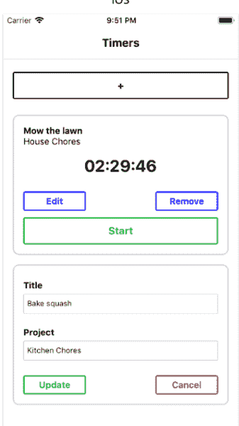

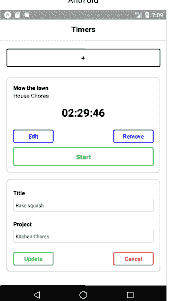

调整一些 props 并刷新查看结果。例如：

-   将传递给 `ToggleableTimerForm` 的 prop 从 `false` 改为 `true`，看看计时器表单在 "+" 按钮的位置渲染：

# React 基础

90

iOS

Android

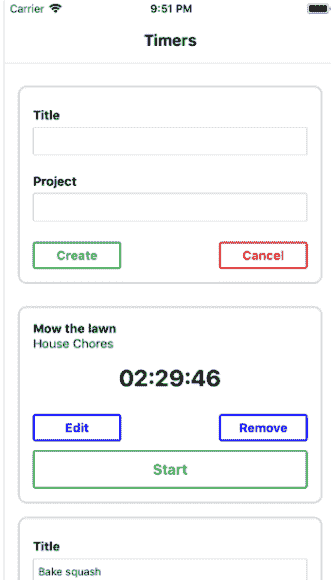

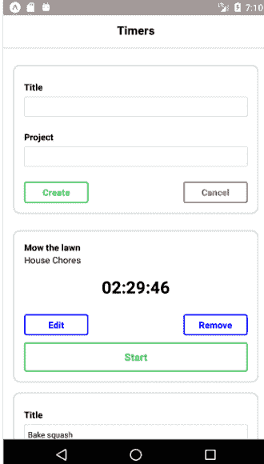

-   在 `App` 中的第二个 `EditableTimer` 组件中移除 `editFormOpen` prop，观察组件相应地翻转其子元素：

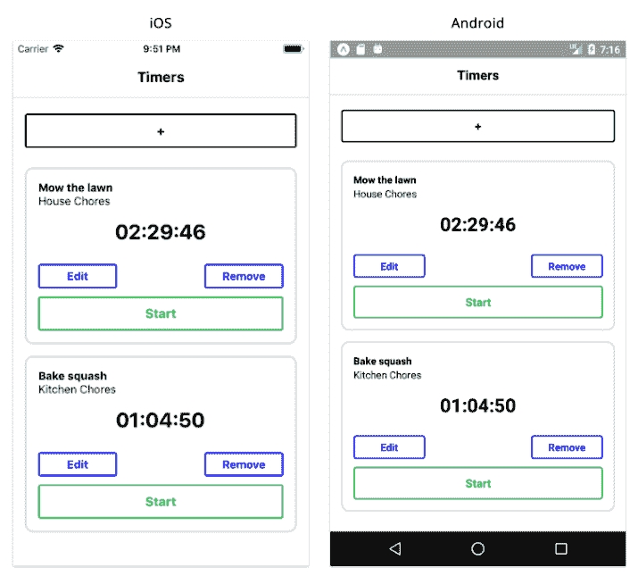

回顾一下，我们的 `App` 组件目前渲染了一个 `ToggleableTimerForm` 组件和两个 `EditableTimer` 组件。

`ToggleableTimerForm` 根据 prop `isOpen` 渲染 "+" 或 `TimerForm`。

`EditableTimer` 根据 prop `editFormOpen` 渲染 `Timer` 或 `TimerForm`。`Timer` 和 `TimerForm` 是我们应用的底层组件。它们承载了屏幕的大部分 UI。它们上方的组件主要关注 orchestration。

到目前为止，我们使用了硬编码的 props 来在应用中传递数据。但为了增强应用的交互性，我们必须将其从静态存在进化为可变存在。正如我们在上一章看到的，在 React 中我们使用 state 来实现这一点。

## 步骤 3：确定什么应该是 stateful

在引入 state 之前，我们需要确定*究竟什么*应该是 stateful。让我们先收集静态应用中每个组件所消耗的所有数据。在我们的静态应用中，数据将出现在我们定义或使用 props 的地方。然后我们将确定其中哪些数据应该是 stateful。

`App`

这声明了两个子组件。它设置了一个 prop，即传递给 `ToggleableTimerForm` 的 `isOpen` 布尔值。

**`EditableTimer`**

它使用了 `editFormOpen` prop，并接收计时器的所有属性。

**`Timer`**

它使用了计时器的所有属性。

**`TimerForm`**

它有两个可交互的输入字段，一个用于 `title`，一个用于 `project`。在编辑现有计时器时，这些字段会使用计时器的当前值进行初始化。

### 状态判定标准

我们可以应用以下标准来判断数据是否应该作为状态：

> 这些问题来自 Facebook 的优秀文章"Thinking In React"。你可以[在这里阅读原文](https://facebook.github.io/react/docs/thinking-in-react.html)。

**1. 它是从父组件通过 props 传入的吗？如果是，那它可能不是状态。**

我们子组件中使用的很多数据已经列在了它们的父组件中。这个标准帮助我们去除重复。

例如，"计时器属性"被多次列出。当我们在 `EditableTimer` 中看到属性声明时，我们可以将其视为状态。但当在其他地方看到它时，就不是了。

**2. 它会随时间变化吗？如果不是，那它可能不是状态。**

这是状态数据的一个关键标准：**它会变化。**

**3. 你能基于组件中的其他状态或 props 计算出它吗？如果是，那它不是状态。**

为了简洁起见，我们希望尽量减少表示状态所需的数据点。

### 应用这些标准

**App**

- `ToggleableTimerForm` 的 `isOpen` 布尔值和 `EditableTimer` 的计时器属性

**有状态的**。数据在这里定义。它会随时间变化。而且它无法从其他状态或 props 计算得出。

- 计时器属性

**有状态的**。我们在这里为每个 `EditableTimer` 定义数据。这些数据是可变的。而且无法从其他状态或 props 计算得出。

```
EditableTimer
```

- 给定计时器的 `editFormOpen`

**有状态的**。数据在这里定义。它会随时间变化。而且它无法从其他状态或 props 计算得出。

```
Timer
```

- 计时器属性

在这个上下文中，**不是有状态的**。属性是从父组件传递下来的。

```
TimerForm
```

我们可能会倾向于得出结论，`TimerForm` 不管理任何有状态的数据，因为 `title` 和 `project` 都是从父组件传下来的 props。然而，正如我们在上一章的 `SearchInput` 组件中所见，使用 `TextInput` 的组件本身也可以是特殊的状态管理者——这些组件通常会将输入字段的值作为状态来维护。

所以，除了 `TimerForm` 之外，我们已经识别出了我们的有状态数据：

- 计时器列表和每个计时器的属性
- 计时器的编辑表单是否打开
- 创建表单是否打开

## 第 4 步：确定每个状态片段应该放在哪个组件中

虽然我们确定的有状态数据可能在静态应用中的某些组件里，但这并不能说明它在有状态应用中的最佳位置。我们的下一个任务是确定我们三个独立状态片段的最佳存放位置。

这有时可能具有挑战性，但同样，我们可以应用 Facebook 指南"[Thinking in React](https://facebook.github.io/react/docs/thinking-in-react.html)⁵¹"中的以下步骤来帮助我们完成这个过程：

⁵¹ https://facebook.github.io/react/docs/thinking-in-react.html

对于每个状态片段：

- 识别每个基于该状态渲染内容的组件。
- 找到一个公共所有者组件（层级中位于所有需要该状态的组件之上的单一组件）。
-要么公共所有者，要么层级中更高的另一个组件应该拥有该状态。
- 如果你找不到一个合适的组件来拥有该状态，就创建一个新组件专门用于持有该状态，并将其添加到公共所有者组件上方的层级中某个位置。

让我们将这个方法应用到我们的应用中：

### 计时器列表和每个计时器的属性

乍一看，我们可能会倾向于得出结论，`App` 似乎没有使用这个状态。相反，第一个使用这个状态的是 `EditableTimer`。我们可能认为将计时器属性放到 `EditableTimer` 组件的状态中，而不是作为 props 传递下来，是更明智的做法。

虽然这对于显示计时器、修改计时器和删除计时器来说可能是这样，但*创建*计时器呢？`ToggleableTimerForm` 不需要该状态来渲染，但它*可以*影响状态。它需要能够插入新的计时器。它会将新计时器的数据向上传播到根组件 `App`。

因此，`App` 才是真正的公共所有者。它通过传递计时器状态来渲染 `EditableTimer` 组件。它可以处理来自 `EditableTimer` 的修改和来自 `ToggleableTimerForm` 的创建，改变状态。然后新的状态将通过 props 向下流经 `EditableTimer`。

### 计时器的编辑表单是否打开

在我们的静态应用中，`App` 指定 `EditableTimer` 是否应该在其编辑表单打开的状态下渲染。然而，严格来说，这个状态可以只存在于每个单独的 `EditableTimer` 中。层级中的任何父组件都不依赖这个数据。

将状态存储在 `EditableTimer` 中将满足我们当前的需求。但有一些需求可能会要求我们在未来将这个状态"提升"到组件层级中更高的位置。

例如，如果我们想要施加一个限制，即只能有一个表单（包括创建表单）可以同时打开？那么让 `App` 拥有该状态就是有意义的，因为它需要检查该状态以确定是否允许打开另一个表单。

### 创建表单的可见性

`App` 似乎并不关心 `ToggleableTimerForm` 是打开还是关闭。可以合理推断，该状态可以只存在于 `ToggleableTimerForm` 本身。

所以，总结来说，我们将在三个不同的组件中各有三个状态片段：

- **计时器数据**将由 `App` 拥有和管理。
- 每个 `EditableTimer` 将管理其**计时器编辑表单**的状态。
- `ToggleableTimerForm` 将管理其**表单可见性**的状态。

## 第 5 步：硬编码初始状态

我们现在已经充分准备好让我们的应用具有状态了。我们将在组件自身内部定义初始状态。这意味着在顶层组件 `App` 中硬编码一个计时器列表。对于我们的另外两个状态片段，我们让组件的表单默认关闭状态。

在我们向父组件添加了初始状态后，我们将确保我们的 props 在其子组件中正确建立。

### 向 `App` 添加状态

让我们从修改 `App` 以在状态中保存计时器数据开始。

我们将使用 npm 库 [uuid](https://www.npmjs.com/package/uuid) 来为每个计时器生成 id。该库的 `uuidv4()` 函数将为我们的每个计时器随机生成一个[通用唯一标识符](https://en.wikipedia.org/wiki/Universally_unique_identifier)。

> UUID 是一个看起来像这样的字符串：
>
> `2030efbd-a32f-4fcc-8637-7c410896b3e3`

首先，在你的控制台中安装该库：

```
yarn add uuid
```

然后，在 `App.js` 的顶部，导入 `uuidv4()` 函数：

```
// time-tracking/2/App.js
import uuidv4 from 'uuid/v4';
```

接下来，我们将组件的初始状态初始化为包含两个计时器对象的数组。这将为我们提供一个计时器列表，在打开应用时进行交互：

time-tracking/2/App.js

```
export default class App extends React.Component {
  state = {
    timers: [
      {
        title: 'Mow the lawn',
        project: 'House Chores',
        id: uuidv4(),
        elapsed: 5456099,
        isRunning: true,
      },
      {
        title: 'Bake squash',
        project: 'Kitchen Chores',
        id: uuidv4(),
        elapsed: 1273998,
        isRunning: false,
      },
    ],
  };
};
```

我们将初始状态设置为一个带有 timers 键的对象。timers 指向一个包含两个硬编码计时器对象的数组。

> 与上一章一样，我们依赖 Babel 插件 transform-class-properties 来简化初始状态的定义方式。

下面，在 render 中，我们将使用 state.timers 生成一个 EditableTimer 组件的数组。每个组件将从 timers 数组中作为 prop 传入的单个对象派生而来。我们将使用 map 来实现：

time-tracking/2/App.js

```
render() {
  const { timers } = this.state;

  return (
    <View style={styles.appContainer}>
      <View style={styles.titleContainer}>
        <Text style={styles.title}>Timers</Text>
      </View>
      <ScrollView style={styles.timerList}>
```


```
<ToggleableTimerForm />
{timers.map(({ title, project, id, elapsed, isRunning }) => (
  <EditableTimer
    key={id}
    id={id}
    title={title}
    project={project}
    elapsed={elapsed}
    isRunning={isRunning}
  />
))}
</ScrollView>
</View>
);
```

该组件渲染后的 UI 最终是一个 EditableTimer 组件数组：

```
[
  <EditableTimer
    timer={{
      title: 'Mow the lawn',
      project: 'House Chores',
      id: // 随机 UUID,
      elapsed: 5456099,
      isRunning: true,
    }}
  />,
  <EditableTimer
    timer={{
      title: 'Bake squash',
      project: 'Kitchen Chores',
      id: // 随机 UUID,
      elapsed: 1273998,
      isRunning: false,
    }}
  />
]
```

值得注意的是，我们能够在 return 内部用 JSX 来表示 EditableTimer 组件实例。一开始，能够拥有 JSX 元素的 JavaScript 数组可能显得有些奇怪，但请记住，Babel 会将每个 EditableTimer 的 JSX 表示（`<EditableTimer />`）转译为常规 JavaScript。

如果你对其编译方式感兴趣，请参阅[附录](#)。

注意 `key={timer.id}` prop 的使用。`key` prop 并非由我们的 `EditableTimer` 组件使用，而是由 React Native 框架使用。它是一个特殊属性，我们将在下一章"核心组件"中更深入地讨论。目前，只需注意此属性在列表中的每个 React Native 组件之间需要保持唯一即可。

### 数组的 `map()`

如果你不熟悉 `map` 方法，它接收一个函数作为参数，并用数组中的每一项调用该函数，然后使用每次函数调用的返回值构建一个**新的**数组。

由于 `timers` 数组有两项，`map` 会调用该函数两次，每个计时器一次。当 `map` 调用该函数时，它会将一项作为第一个参数传入。此次函数调用的返回值会被插入到 `map` 正在构建的新数组中。处理完最后一项后，`map` 返回这个新数组。这里，我们在 `render()` 方法中渲染这个新数组。

### Props 与 state

让我们退一步，再次反思 props 和 state 之间的区别。在 `App` 中作为可变 state 存在的内容，作为**不可变的 props**传递给了 `EditableTimer`。

我们曾详细讨论过什么可以算作 state，以及 state 应该存在于何处。值得庆幸的是，我们不需要对 props 进行同等冗长的讨论。一旦理解了 state，你就能明白 props 是如何充当其**单向数据管道**的。State 在一些选定的父组件中进行管理，然后数据作为 props 向下流动到子组件。

如果 state 被更新，管理该 state 的组件会通过调用 `render()` 重新渲染。这反过来又会导致其任何子组件重新渲染。以及那些子组件的子组件。如此沿着链一直向下。

让我们继续沿着链向下推进。

### 为 `EditableTimer` 添加 state

在我们应用的静态版本中，`EditableTimer` 依赖 `editFormOpen` 作为从父组件传递下来的 prop。我们决定这个 state 实际上可以存在于该组件自身之中。

因为这个组件将实际管理 state，我们需要将其从函数组件改为类组件。

我们将 `editFormOpen` 的初始值设为 `false`，这意味着表单初始为关闭状态：

```
time-tracking/2/components/EditableTimer.js

export default class EditableTimer extends React.Component {
  state = {
    editFormOpen: false,
  };

  render() {
    const { id, title, project, elapsed, isRunning } = this.props;
    const { editFormOpen } = this.state;

    if (editFormOpen) {
      return <TimerForm id={id} title={title} project={project} />;
    }
    return (
      <Timer
        id={id}
        title={title}
        project={project}
        elapsed={elapsed}
        isRunning={isRunning}
      />
    );
  }
}
```

### Timer 保持无状态

如果你查看 `Timer`，会发现它不需要修改来包含 state。它一直在使用纯粹的 props，到目前为止不受我们当前重构的影响。

### 为 ToggleableTimerForm 添加 state

我们知道需要调整 `ToggleableTimerForm`，因为我们给它分配了一些有状态的责任。我们希望让该组件管理 state `isOpen`。

我们将在组件顶部将 state 初始化为"关闭"状态：

```
time-tracking/2/components/ToggleableTimerForm.js

export default class ToggleableTimerForm extends React.Component {
  state = {
    isOpen: false,
  };
}
```

接下来，我们将定义一个切换表单状态为打开的功能：

```
time-tracking/2/components/ToggleableTimerForm.js

handleFormOpen = () => {
  this.setState({ isOpen: true });
};
```

最后，我们将修改组件的 render() 方法，以包含我们应用的第一个交互功能。我们将根据 isOpen 来决定是渲染 "+" 按钮还是 TimerForm。我们将 handleFormOpen 设为 TimerButton 的 onPress 处理程序：

```
time-tracking/2/components/ToggleableTimerForm.js

render() {
  const { isOpen } = this.state;

  return (
    <View style={[styles.container, !isOpen && styles.buttonPadding]}>
      {isOpen ? (
        <TimerForm />
      ) : (
        <TimerButton title="+" color="black" onPress={this.handleFormOpen} />
      )}
    </View>
  );
}
```

如果你还记得，我们创建 TimerButton 是为了接受一个 onPress prop，该 prop 会传递给内部 TouchableOpacity 的 onPress 动作。TouchableOpacity 是一个内置的 React Native 组件。当被按下时，它会调用其 onPress 处理程序。TimerButton 直接将自己的 onPress prop 传递给 TouchableOpacity。

因此，当 TimerButton 被按下时，函数 handleFormOpen() 将被调用。handleFormOpen() 修改 state，将 isOpen 设为 true。这会导致 ToggleableTimerForm 组件重新渲染。当 render() 第二次被调用时，this.state.isOpen 为 true，ToggleableTimerForm 渲染 TimerForm。很简洁。

> > 正如我们在上一章探讨的，我们将 `handleFormOpen()` 函数写为属性初始化器（即使用*箭头*函数），以确保函数内部的 `this` 绑定到组件。React 会自动为我们绑定与组件 API 对应的类方法（如 `render` 和 `componentDidMount`）到组件。

我们完整更新后的 `ToggleableTimerForm`：

**time-tracking/2/components/ToggleableTimerForm.js**

```
export default class ToggleableTimerForm extends React.Component {
  state = {
    isOpen: false,
  };

  handleFormOpen = () => {
    this.setState({ isOpen: true });
  };

  render() {
    const { isOpen } = this.state;

    return (
      <View style={[styles.container, !isOpen && styles.buttonPadding]}>
        {isOpen ? (
          <TimerForm />
        ) : (
          <TimerButton title="+" color="black" onPress={this.handleFormOpen} />
        )}
      </View>
    );
  }
}
```

### 为 `TimerForm` 添加 state

我们之前提到 `TimerForm` 会管理 state，因为它包含一个表单。在 React Native 中，表单是有状态的。

回想一下，`TimerForm` 包含两个输入字段：

React 基础

102

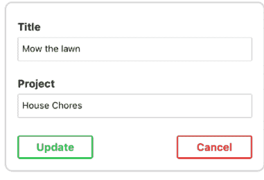

这些输入字段可以由用户修改。在 React Native 中，对组件所做的**所有**修改都应该由 state 处理并保存。这包括输入字段的修改等变化。理解这一点的最佳方式是看看它的实际效果。

要使这些输入字段有状态，我们可以让我们的组件有状态，并在组件顶部初始化 state：

```
time-tracking/2/components/TimerForm.js
export default class TimerForm extends React.Component {
  constructor(props) {
    super(props);

    const { id, title, project } = props;

    this.state = {
      title: id ? title : '',
      project: id ? project : '',
    };
  }
```

我们的 state 对象有两个属性，分别对应 `TimerForm` 管理的每个输入字段。如果 `TimerForm` 是*创建*新计时器而非编辑现有计时器，`id` prop 将为 undefined。在这种情况下，我们使用三元运算符将两个属性都初始化为空字符串（''）。否则，当此表单*编辑*计时器时，我们将两个值都设为其各自的 prop 值。

注意，由于我们是根据 props 来检查和定义 state 的，所以我们使用 `constructor()` 来初始化 state，而不是将 state 定义为类属性。

> 我们希望避免将 `title` 或 `project` 初始化为 undefined。这是因为输入字段的值从技术上讲不可能是 undefined。如果为空，它在 JavaScript 中的值是空字符串。

在我们第一次构建该组件时，我们使用 `defaultValue` 来基于 props 设置 `TextInput` 字段的初始状态。但 `defaultValue` prop 只设置 `TextInput` 的值


对于*初次*渲染，我们可以使用 `value` 属性将输入字段直接连接到组件的状态，而不是使用 `defaultValue`。我们可以这样做：

```
<TextInput value={this.state.title} />
```

这样，我们的输入字段将由状态驱动。每当任何一个状态属性发生变化，输入字段都会更新以反映新值。

然而，这缺少一个关键要素：**我们目前没有任何方法让用户*修改此状态***。输入字段初始时会与组件状态保持同步。但一旦用户进行修改，**输入字段将与组件状态失去同步。**

我们可以通过使用 React Native 的 `TextInput` 组件的 `onChangeText` 属性来解决这个问题。就像按钮组件的 `onPress` 属性一样，我们可以像上一章那样将 `onChangeText` 设置为一个函数。每当输入字段被更改时，React 就会调用指定的函数。

让我们将两个输入字段的 `onChangeText` 属性设置为我们接下来将定义的函数。对于 *title* 输入字段：

```
time-tracking/2/components/TimerForm.js

<TextInput
  style={styles.textInput}
  underlineColorAndroid="transparent"
  onChangeText={this.handleTitleChange}
  value={title}
/>
```

同样地，对于 *project* 输入字段：

```
time-tracking/2/components/TimerForm.js

<TextInput
  style={styles.textInput}
  underlineColorAndroid="transparent"
  onChangeText={this.handleProjectChange}
  value={project}
/>
```

函数 `handleTitleChange` 和 `handleProjectChange` 都会修改它们各自在状态中的属性。它们的样子如下：

```
handleTitleChange = title => {
  this.setState({ title });
};

handleProjectChange = project => {
  this.setState({ project });
};
```

当 React Native 调用传递给 onChangeText 的函数时，它会将更改后的文本作为参数传递给该函数。通过这种方式，我们更新状态为输入字段的新值。

结合使用状态、value 属性和 onChangeText 属性是我们在 React Native 中编写表单元素的规范方法。

我们更新后的 TimerForm 组件，完整代码如下：

```
export default class TimerForm extends React.Component {
  constructor(props) {
    super(props);

    const { id, title, project } = props;

    this.state = {
      title: id ? title : '',
      project: id ? project : '',
    };
  }

  handleTitleChange = title => {
    this.setState({ title });
  };

  handleProjectChange = project => {
    this.setState({ project });
  };

  render() {
    const { id } = this.props;
    const { title, project } = this.state;

    const submitText = id ? 'Update' : 'Create';

    return (
      <View style={styles.formContainer}>
        <View style={styles.attributeContainer}>
          <Text style={styles.textInputTitle}>Title</Text>
          <View style={styles.textInputContainer}>
            <TextInput
              style={styles.textInput}
              underlineColorAndroid="transparent"
              onChangeText={this.handleTitleChange}
              value={title}
            />
          </View>
        </View>
        <View style={styles.attributeContainer}>
          <Text style={styles.textInputTitle}>Project</Text>
          <View style={styles.textInputContainer}>
            <TextInput
              style={styles.textInput}
              underlineColorAndroid="transparent"
              onChangeText={this.handleProjectChange}
              value={project}
            />
          </View>
        </View>
        <View style={styles.buttonGroup}>
          <TimerButton small color="#21BA45" title={submitText} />
          <TimerButton small color="#DB2828" title="Cancel" />
        </View>
      </View>
    );
  }
}
```

回顾一下，这里是 TimerForm 生命周期的一个示例：

1.  页面上有一个标题为“Mow the lawn”的计时器。
2.  用户打开此计时器的编辑表单，将 TimerForm 挂载到屏幕上。
3.  TimerForm 将状态属性 title 初始化为字符串“Mow the lawn”。
4.  用户修改标题输入字段，将其更改为“Cut the grass”。
5.  每次按键时，React 都会调用 handleTitleChange。内部状态 title 与用户在页面上看到的内容保持同步。

通过重构 `TimerForm`，我们已经完成了在组件内建立有状态数据的工作。并且我们已经组装好了向下的数据管道——props。

我们已经准备好——甚至可能有点急切地想要——使用逆向数据流来构建交互性。但在我们这样做之前，让我们保存并重新加载应用，以确保一切正常工作。

### 试一试

我们期望看到基于 `App` 中硬编码数据的新示例计时器。我们也期望按下“+”按钮会打开一个表单：

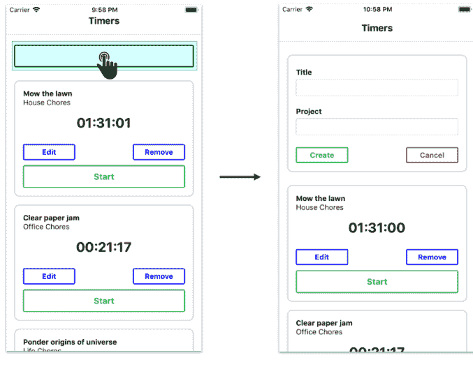

## 第6步：添加逆向数据流

正如我们在上一章所看到的，子组件通过调用通过 props 提供给它们的函数来与父组件通信。在我们的天气应用中，当搜索字段提交一个值时，`SearchInput` 没有进行任何数据管理。相反，它调用了由 `App` 给它的一个函数，然后该函数能够相应地管理状态。

我们将在两个领域需要逆向数据流：

- `TimerForm` 需要传播 **create** 和 **update** 事件（在 `ToggleableTimerForm` 下创建，在 `EditableTimer` 下更新）。这两个事件最终都会到达我们的顶级 `App`。
- `Timer` 有相当多的行为。它需要处理 **delete** 和 **edit** 按压，以及 **start** 和 **stop** 计时器逻辑。

让我们从 `TimerForm` 开始。

### TimerForm

为了清楚了解 `TimerForm` 到底需要什么，我们将首先向它添加事件处理程序，然后我们沿着层次结构逆向工作。

`TimerForm` 需要两个**事件处理程序**：

- 当表单被提交时（创建或更新计时器）
- 当“Cancel”按钮被按下时（关闭表单）

`TimerForm` 将接收两个函数作为 props 来处理每个事件。使用 `TimerForm` 的父组件负责提供这些函数：

- `props.onFormSubmit()`：当表单被提交时调用
- `props.onFormClose()`：当“Cancel”按钮被按下时调用

正如我们很快将看到的，这使得父组件能够决定当这些事件发生时应该采取什么行为。

让我们首先将 `onFormClose` 添加到组件的 render 方法中解构的 props 中：

```
time-tracking/3/components/TimerForm.js

render() {
  const { id, onFormClose } = this.props;
```

然后，我们将通过为每个按钮指定 `onPress` 属性来修改 `TimerForm` 上的按钮：

```
time-tracking/3/components/TimerForm.js

<View style={styles.buttonGroup}>
  <TimerButton
    small
    color="#21BA45"
    title={submitText}
    onPress={this.handleSubmit}
  />
  <TimerButton
    small
    color="#DB2828"
    title="Cancel"
    onPress={onFormClose}
  />
</View>
```

“Submit”按钮的 onPress 属性指定了函数 this.handleSubmit，我们接下来将定义它。“Cancel”按钮的 onPress 属性直接指定了 prop onFormClose。

现在我们已经看到了如何使用 handleSubmit，让我们来编写它。在 render() 上方声明此函数：

```
time-tracking/3/components/TimerForm.js

handleSubmit = () => {
  const { onFormSubmit, id } = this.props;
  const { title, project } = this.state;

  onFormSubmit({
    id,
    title,
    project,
  });
};
```

再次强调，我们现在是自底向上地工作。因此 handleSubmit() 方法调用了预期的函数 onFormSubmit()，我们马上会编写它。它传递一个包含 id、title 和 project 属性的数据对象。

注意，我们通过 props 读取 id，从 state 中读取 title 和 project。这是因为我们希望向该函数提供 title 和 project 的最新值（在 state 中），而不是初始值（作为 props 提供）。

### ToggleableTimerForm

让我们跟踪从 TimerForm 发出的提交事件，看它如何向上冒泡到组件层次结构。首先，我们将修改 ToggleableTimerForm。我们需要它定义并向下传递两个 prop 函数给 TimerForm：onFormClose() 和 onFormSubmit()。

让我们首先更新组件的 render() 方法：

```
time-tracking/4/components/ToggleableTimerForm.js

render() {
  const { isOpen } = this.state;

  return (
    <View style={[styles.container, !isOpen && styles.buttonPadding]}>
      {isOpen ? (
        <TimerForm
          onFormSubmit={this.handleFormSubmit}
          onFormClose={this.handleFormClose}


我们传入两个函数作为 `TimerForm` 的属性（props）。正如我们所见，函数与其他任何属性并无二致。

首先，让我们编写 `handleFormClose()`：

time-tracking/4/components/ToggleableTimerForm.js

```
handleFormClose = () => {
  this.setState({ isOpen: false });
};
```

那么，`handleFormSubmit()` 可能是什么样子呢？`ToggleableTimerForm` 并非计时器状态的管理者。因此，`ToggleableTimerForm` 应该期望从 `App` 接收一个新的属性 `onFormSubmit()`。`ToggleableTimerForm` 随即应将这个属性向下传递给 `TimerForm`。当用户在 `TimerForm` 中提交表单时，他们实际上调用的是定义在上层 `App` 中、用于修改计时器状态的函数。`ToggleableTimerForm` 只是这个函数的代理。

所以，我们可能会倾向于直接将这个预期的属性函数传递给 `TimerForm`，像这样：

```
<TimerForm
  onFormSubmit={this.props.onFormSubmit}
  onFormClose={this.handleFormClose}
/>
```

然而，请考虑这一点：在用户点击"创建"按钮创建一个计时器后，我们实际上希望关闭 `ToggleableTimerForm`。我们需要*拦截*这个事件，以便将 `isOpen` 设置为 `false`。

为此，`handleFormSubmit()` 的编写方式如下：

time-tracking/4/components/ToggleableTimerForm.js

```
handleFormSubmit = timer => {
  const { onFormSubmit } = this.props;

  onFormSubmit(timer);
  this.setState({ isOpen: false });
};
```

`handleFormSubmit()` 方法接受参数 `timer` 并将其传递给 `onFormSubmit()`。回忆一下，在 `TimerForm` 中，这个参数是一个包含所需计时器属性的对象。调用 `onFormSubmit()` 之后，`handleFormSubmit()` 会调用 `setState()` 来关闭其表单。

> 虽然本章不会添加服务器通信，但让我们尝试想象一下，如果我们添加了，提交表单会如何运作。

`onFormSubmit()` 的结果不会影响表单是否关闭。我们调用 `onFormSubmit()`，它最终可能会发起一个到服务器的**异步**调用。在收到服务器的响应之前，代码会继续执行，这意味着 `setState()` 将被调用。

如果 `onFormSubmit()` 失败——例如服务器暂时无法连接——我们理想情况下需要某种方式来显示错误信息并重新打开表单。

#### App

我们已经到达组件层级的顶端，即我们的根组件 `App`。由于这个组件将负责计时器的数据，因此我们将在这里定义处理事件的逻辑，而这些事件是我们从最底层组件中捕获的。

我们关心的第一个事件是表单的提交（即来自 `TimerForm` 的事件）。发生这种情况时，要么是创建一个新的计时器，要么是更新一个现有的计时器。我们将创建两个单独的函数来处理这两个不同的事件：

- `handleCreateFormSubmit()` 将处理创建计时器，并作为属性传递给 `ToggleableTimerForm`
- `handleFormSubmit()` 将处理更新计时器，并作为属性传递给 `EditableTimer`

这两个函数沿着各自的组件层级向下传递，直到作为属性 `onFormSubmit()` 到达 `TimerForm`。

让我们从 `handleCreateFormSubmit()` 开始。

### 处理创建操作

`handleCreateFormSubmit()` 将是 `App` 提供给 `ToggleableTimerForm` 的函数。现在，我们来设置这个属性：

time-tracking/3/App.js

```
<ToggleableTimerForm onFormSubmit={this.handleCreateFormSubmit} />
```

接下来，我们将定义这个函数。
对于创建计时器，我们将使用 `utils/TimerUtils.js` 中的 `newTimer()` 函数。它只是隐藏了一些逻辑，比如生成ID。它的样子如下：

time-tracking/utils/TimerUtils.js

```
export const newTimer = (attrs = {}) => {
  const timer = {
    title: attrs.title || 'Timer',
    project: attrs.project || 'Project',
    id: uuidv4(),
    elapsed: 0,
    isRunning: false,
  };

  return timer;
};
```

该函数接受一个包含 `timer` 和 `project` 属性的对象，并返回一个其余属性已正确初始化的新对象。
在 `App.js` 顶部导入该函数：

time-tracking/3/App.js

```
import { newTimer } from './utils/TimerUtils';
```

在 `handleCreateFormSubmit()` 内部，我们将使用 `newTimer()` 将新的计时器对象插入到状态中。
在 `render()` 上方声明此函数：

time-tracking/3/App.js

```
handleCreateFormSubmit = timer => {
  const { timers } = this.state;

  this.setState({
    timers: [newTimer(timer), ...timers],
  });
};
```

注意，我们将 `this.state.timers` 设置为一个*新的*计时器数组。数组的第一个元素是我们的新计时器，由 `newTimer()` 创建。然后，我们使用 JavaScript 的**展开语法**将现有的其余计时器添加到这个新数组中。我们这样做是为了避免改变状态。

一个诱人的替代方案是这样编写 `handleCreateFormSubmit()`：

```
handleCreateFormSubmit = timer => {
    const { timers } = this.state;

    this.setState({
        timers: timers.push(newTimer(timer)), // 改变了状态！
    });
};
```

但 `.push()` 会将新计时器*追加*到状态中的现有数组里。这很微妙，但这*改变了状态*。我们绝不希望在 `this.setState()` 方法之外改变状态。

我们总是希望将状态对象（以及状态内的对象和数组）视为不可变的。编写不可变 JavaScript 一开始可能比较棘手。一个简单的策略是避免使用某些数组和对象方法。`.push()` 就是一个需要避免的方法，因为它总是会改变调用它的数组。

如果你仍然觉得 `.push()` 和展开语法之间的区别令人困惑，不用担心。我们将在全书中展示避免意外状态变更的策略。

### 展开语法

在数组中，省略号 (...) 会将跟随其后的数组展开到父数组中。展开运算符使我们能够简洁地将现有数组组合成新数组：

```
const a = [ 1, 2, 3 ];
const b = [ 4, 5, 6 ];
const c = [ ...a, ...b, 7, 8, 9 ];

console.log(c); // -> [ 1, 2, 3, 4, 5, 6, 7, 8, 9 ]
```

在对象中，省略号 (...) 允许你创建一个现有对象的修改版本：

```
const coffee = { milk: false, cream: false };
const coffeeWithMilk = { ...coffee, milk: true };
console.log(coffeeWithMilk); // -> { milk: true, cream: false }
```

这在处理不可变 JavaScript 对象时非常有用。

### 试一试

现在，我们已经完成了创建计时器流程的接线，从 `TimerForm` 底层的表单一直到由 `App` 管理的状态。保存 `App.js`，你的应用应该会重新加载。展开创建表单并创建一些新的计时器：

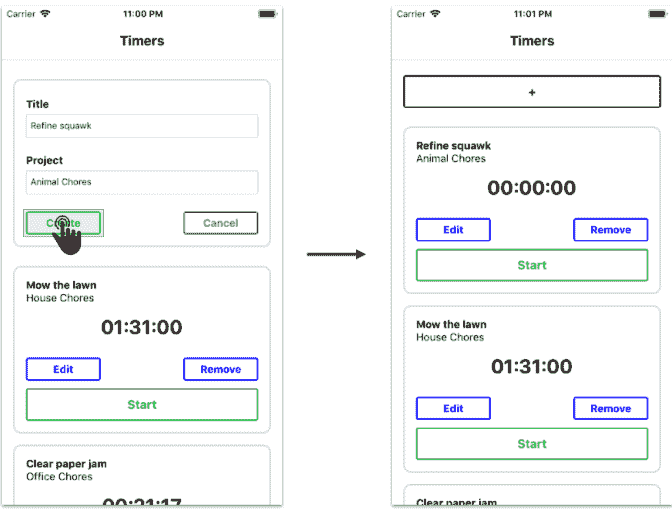

### 更新计时器

我们的应用已经设置好了创建计时器的功能。接下来让我们添加更新功能。

我们知道最终希望 `App` 为 `TimerForm` 提交计时器更新时定义一个处理函数 `onFormSubmit()`。然而，正如你在应用当前状态中所看到的，我们尚未添加编辑计时器的能力。我们还没有一种方式来显示编辑表单，而这将是提交表单的前提。

要显示编辑表单，用户将按下 `Timer` 上的编辑按钮。这应该会向上传播一个事件到 `EditableTimer`，并告诉它翻转其子组件，打开表单。

我们将再次自底向上地进行。我们将从 `Timer` 开始，指定它所需的属性函数，然后向上移动到组件层级。

### 为 `Timer` 添加可编辑性

由于我们将为 `Timer` 添加相当多的功能，我们将首先将其转换为一个类组件：

time-tracking/4/components/Timer.js

```
export default class Timer extends React.Component {
```

`EditableTimer` 管理编辑表单是否打开的状态。因此，我们期望 `Timer` 从其父组件接收一个属性 `onEditPress()`。我们将把"编辑" `TimerButton` 的 `onPress` 属性设置为这个属性：

time-tracking/4/components/Timer.js

```
render() {
  const { elapsed, title, project, onEditPress } = this.props;
  const elapsedString = millisecondsToHuman(elapsed);

  return (
    <View style={styles.timerContainer}>
      <Text style={styles.title}>{title}</Text>
      <Text>{project}</Text>
      <Text style={styles.elapsedTime}>{elapsedString}</Text>
      <View style={styles.buttonGroup}>
        <TimerButton color="blue" small title="Edit" onPress={onEditPress} />
        <TimerButton color="blue" small title="Remove" />
      </View>
      <TimerButton color="#21BA45" title="Start" />
    </View>
  );
}
```

### 更新 EditableTimer

现在我们准备好更新 `EditableTimer` 了。再次强调，它将显示 `TimerForm`（如果正在编辑）或单个 `Timer`（如果不正在编辑）。

让我们为这两个可能的子组件添加事件处理函数。对于 `TimerForm`，我们希望处理表单被关闭或提交的情况。对于 `Timer`，我们希望处理编辑按钮被按下的情况：


time-tracking/4/components/EditableTimer.js
export default class EditableTimer extends React.Component {
  state = {
    editFormOpen: false,
  };

  handleEditPress = () => {
    this.openForm();
  };

  handleFormClose = () => {
    this.closeForm();
  };

  handleSubmit = timer => {
    const { onFormSubmit } = this.props;

    onFormSubmit(timer);
    this.closeForm();
  };

  closeForm = () => {
    this.setState({ editFormOpen: false });
  };

  openForm = () => {
    this.setState({ editFormOpen: true });
  };

  render() {
    const { id, title, project, elapsed, isRunning } = this.props;
    const { editFormOpen } = this.state;

    if (editFormOpen) {
      return (
        <TimerForm
          id={id}
          title={title}
          project={project}
          onFormSubmit={this.handleSubmit}
          onFormClose={this.handleFormClose}
        />
      );
    }
    return (
      <Timer
        id={id}
        title={title}
        project={project}
        elapsed={elapsed}
        isRunning={isRunning}
        onEditPress={this.handleEditPress}
      />
    );
  }
}

我们将这些事件处理函数作为 props 传递下去：

看起来有点眼熟？`EditableTimer` 处理 `TimerForm` 发出的事件的方式与 `ToggleableTimerForm` 类似。这是合理的。`EditableTimer` 和 `ToggleableTimerForm` 都只是 `TimerForm` 和 `App` 之间的中间人。`App` 才是定义提交函数处理函数的地方。

与 `ToggleableTimerForm` 一样，`EditableTimer` 并不对传入的计时器做任何处理。在 `handleSubmit()` 中，它只是盲目地将这个对象传递给它的 prop 函数 `onFormSubmit()`。然后通过 `closeForm()` 关闭表单。

我们将新的 prop 传递给 `Timer`——`onEditPress`。这个函数的行为在 `handleEditPress` 中定义，它修改 `EditableTimer` 的状态，打开表单。

### 在 App 中定义 `handleFormSubmit()`

就像我们处理 `handleCreateFormSubmit()` 一样，这个管道的最后一步是在 App 中初始化一个用于编辑表单提交的处理函数 `handleFormSubmit()`。

对于创建计时器，我们有一个函数，它创建一个具有指定属性的新计时器对象，并将这个新对象添加到 state 中 `timers` 数组的开头。

对于更新计时器，我们需要遍历 `timers` 数组，直到找到正在被更新的计时器对象。一如既往，state 对象**不能**被直接修改。我们必须使用 `setState()`。

因此，我们将使用 `map()` 来遍历计时器对象数组。如果计时器的 `id` 与提交表单中的 `id` 匹配，我们将返回一个包含已更新属性的计时器的新对象。否则，我们只返回原始的计时器。这个新的计时器对象数组将被传递给 `setState()`：

time-tracking/4/App.js
```
handleFormSubmit = attrs => {
    const { timers } = this.state;

    this.setState({
        timers: timers.map(timer => {
            if (timer.id === attrs.id) {
                const { title, project } = attrs;

                return {
                    ...timer,
                    title,
                    project,
                };
            }

            return timer;
        }),
    });
};
```

注意，我们是在传递给 `setState()` 的 JavaScript 对象*内部*对 `timers` 调用 `map()`。这是一个常用的模式。调用会被求值，然后将属性 `timers` 设置为结果。在 `map()` 函数内部，我们通过比较 `id` 属性来检查 `timer` 是否与正在被更新的那个匹配。如果匹配，我们就返回新的对象。否则，我们只返回原始的 `timer`。

请记住，这里重要的一点是我们将 state 视为不可变的。通过创建一个*新的* `timers` 对象，然后使用展开运算符来填充它，我们并没有修改 state 中的任何对象。

我们在 `render()` 中将这个方法作为 prop 传递给 `EditableTimer`：

time-tracking/4/App.js
```
{timers.map(({ title, project, id, elapsed, isRunning }) => (
    <EditableTimer
        key={id}
        id={id}
        title={title}
        project={project}
        elapsed={elapsed}
        isRunning={isRunning}
        onFormSubmit={this.handleFormSubmit}
    />
))}
```

就像我们处理 `ToggleableTimerForm` 和 `handleCreateFormSubmit` 一样，我们将 `handleFormSubmit` 作为 prop `onFormSubmit` 传递下去。`TimerForm` 调用这个 prop，完全不知道这个函数在 `EditableTimer` 下渲染时与在 `ToggleableTimerForm` 下渲染时是完全不同的。

### 试一试

两个表单都已经接线完成！保存 `App.js`，应用重新加载后，尝试创建和更新计时器。你也可以在打开的表单上按"取消"来关闭它：

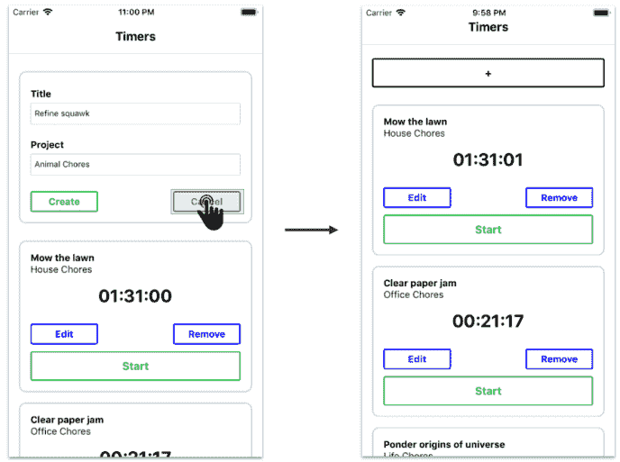

注意，在编辑表单中输入时，键盘可能会挡住视线。我们将在本章最后通过在 App 中使用 `KeyboardAvoidingView` 组件来解决这个问题。

我们其余的工作在计时器内部。我们需要：

-   连接"删除"按钮
-   实现开始/停止按钮和计时逻辑本身

> **自己动手试试**

跃跃欲试？在进入下一节之前，看看你自己能将"删除"按钮连接到什么程度。之后再继续并验证你的方案是否合理。

### 删除计时器

#### 将事件处理函数添加到 `Timer`

与添加创建和更新功能一样，我们将从下往上工作。我们从 `Timer` 开始，一路向上直到 `App`。在 `App` 中，我们将定义从 state 中移除目标计时器的函数。

在 `Timer` 中，我们首先定义处理"删除"按钮按下事件的函数：

time-tracking/5/components/Timer.js
```
handleRemovePress = () => {
  const { id, onRemovePress } = this.props;

  onRemovePress(id);
};
```

我们还没有定义将作为 prop `onRemovePress()` 设置的函数。但你可以想象，当这个事件到达顶部（`App`）时，我们需要 `id` 来确定哪个计时器将被删除。`handleRemovePress()` 方法为这个函数提供了 `id`。

我们使用 `onPress` 将该函数连接到"删除" `TimerButton`：

time-tracking/5/components/Timer.js
```
<TimerButton
  color="blue"
  small
  title="Remove"
  onPress={this.handleRemovePress}
/>
```

#### 在 `EditableTimer` 中路由

在 `EditableTimer` 中，我们在组件 `render` 方法的解构 props 中包含 `onRemovePress`：

```
render() {
  const {
    id,
    title,
    project,
    elapsed,
    isRunning,
    onRemovePress,
  } = this.props;
```

然后我们将函数传递给 Timer：

```
<Timer
  id={id}
  title={title}
  project={project}
  elapsed={elapsed}
  isRunning={isRunning}
  onEditPress={this.handleEditPress}
  onRemovePress={onRemovePress}
/>
```

#### 在 App 中实现移除函数

最后一步是在 App 中定义一个函数，用于从 state 数组中移除所需的计时器。在 JavaScript 中有很多方法可以实现这一点。如果你之前尝试过自己实现这个方案，不要因为你的方案与这里的不同而担心。

我们添加处理函数，最终将作为 prop 传递下去：

```
handleRemovePress = timerId => {
  this.setState({
    timers: this.state.timers.filter(t => t.id !== timerId),
  });
};
```

这里，我们使用数组的 filter() 方法返回一个新数组，其中不包含 id 与 timerId 匹配的计时器对象。

最后，我们将 `handleRemovePress()` 作为 prop 传递下去：

time-tracking/5/App.js
```
<EditableTimer
  key={id}
  id={id}
  title={title}
  project={project}
  elapsed={elapsed}
  isRunning={isRunning}
  onFormSubmit={this.handleFormSubmit}
  onRemovePress={this.handleRemovePress}
/>
```

**数组 filter()**
数组 filter() 接受一个函数，该函数用于"测试"数组中的每个元素。它返回一个包含所有"通过"测试的元素的新数组。如果函数返回 true，则该元素被保留。

### 试一试

保存 App.js 并重新加载应用。现在你可以删除计时器了：

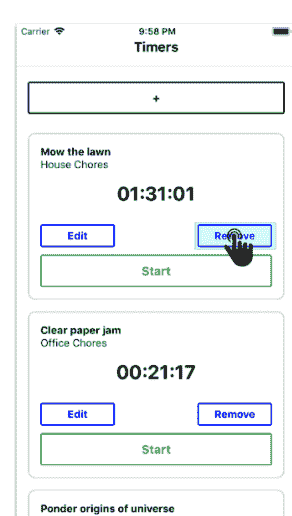

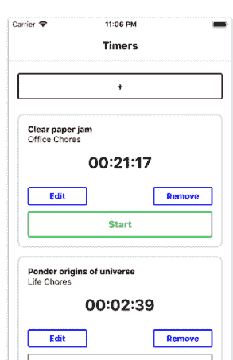


### 添加计时功能

现在我们已经实现了计时器的创建、更新和删除功能。下一个挑战是：让这些计时器真正开始计时。

我们可以通过多种方式实现计时器系统。最简单的方法是让一个函数每秒更新每个计时器的`elapsed`属性。这就是我们包含计时器属性`isRunning`的原因。我们可以这样做：

```
this.setState({
  timers: timers.map(timer => {
    const { elapsed, isRunning } = timer;

    return {
      ...timer,
      elapsed: isRunning ? elapsed + 1000 : elapsed,
    };
  }),
});
```

我们遍历状态中的所有计时器，并检查`isRunning`的值。如果`isRunning`为真，我们就可以在`elapsed`上加1000毫秒（即1秒）。

现在，为了使其工作，我们需要每秒执行一次。我们可以使用JavaScript的`setInterval()`来按间隔执行此函数。

让我们在`componentDidMount`中设置间隔：

**time-tracking/6/App.js**

```
componentDidMount() {
  const TIME_INTERVAL = 1000;

  this.intervalId = setInterval(() => {
    const { timers } = this.state;

    this.setState({
      timers: timers.map(timer => {
        const { elapsed, isRunning } = timer;

        return {
          ...timer,
          elapsed: isRunning ? elapsed + TIME_INTERVAL : elapsed,
        };
      }),
    });
  }, TIME_INTERVAL);
}
```

```
});
}, TIME_INTERVAL);
}
```

`setInterval()`接受两个参数。第一个参数是我们希望按间隔执行的函数。在这里，我们执行更新`elapsed`的逻辑。第二个参数是间隔长度（或函数调用之间的延迟时间）。我们将其设置为`TIME_INTERVAL`，即1000毫秒。

我们还捕获了`setInterval()`的返回值，并将其设置为组件变量`this.intervalId`。这个特殊标识符允许我们在未来任何时候使用JavaScript对应的`clearInterval()`来停止间隔。如果计时器组件被卸载（删除），我们希望取消（或“清除”）这个间隔。否则，我们的函数将无限期运行并导致错误。我们可以使用`componentWillUnmount`生命周期钩子来实现这一点：

```
time-tracking/6/App.js

componentWillUnmount() {
  clearInterval(this.intervalId);
}
```

这是我们第一次使用`componentWillUnmount`。顾名思义，此方法在组件被卸载或移除之前立即触发。在这个例子中，我们使用`clearInterval()`来取消更新计时器的逻辑。

在组件挂载时使用`setInterval()`，在组件卸载时使用`clearInterval()`，这是React应用中处理间隔事件的常见模式。

> 在我们的应用版本中，`App`永远不会被卸载。但是，最佳实践仍然是在组件卸载时清除所有间隔。这为我们的应用提供了“未来保障”。有许多库，例如“热重载”库，会导致即使是应用的主组件也会被卸载并重新挂载。

> 尽管这种计时器实现对于我们的目的来说是有效的，但它不是最精确的。无法保证计时器每1000毫秒精确更新一次，并且在启动和停止时我们会损失准确性。一种更精确方法的示例是定义一个单独的计时器属性，比如`runningSince`。然后我们可以通过计算`runningSince`的值与当前时间之间的差值来得出计时器运行了多长时间。如果我们把这个值保存在某个地方，它还可以让我们的计时器即使在应用关闭时也能继续“运行”。

### 添加启动和停止功能

有了间隔设置，我们只需要添加翻转给定计时器上`isRunning`布尔值的能力。每个计时器底部的操作按钮应显示“开始”（如果计时器已暂停）或“停止”（如果计时器正在运行）。这些点击将调用在`App`中定义的函数，这些函数将修改`isRunning`。

#### 向Timer添加计时器操作事件

我们将再次从底部的`Timer`开始。我们将期望两个prop函数：`onStartPress()`和`onStopPress()`。让我们先编写调用这些函数的按钮点击事件处理程序：

**time-tracking/6/components/Timer.js**

```
handleStartPress = () => {
  const { id, onStartPress } = this.props;

  onStartPress(id);
};

handleStopPress = () => {
  const { id, onStopPress } = this.props;

  onStopPress(id);
};
```

我们将`id`属性向上传播到`App`，以便它知道要启动或停止哪个计时器。在`render()`内部，我们将期望一个`renderActionButton()`方法，该方法根据计时器是正在运行还是已停止来有条件地显示正确的按钮：

```
render() {
  const { elapsed, title, project, onEditPress } = this.props;
  const elapsedString = millisecondsToHuman(elapsed);

  return (
    <View style={styles.timerContainer}>
      <Text style={styles.title}>{title}</Text>
      <Text>{project}</Text>
      <Text style={styles.elapsedTime}>{elapsedString}</Text>
      <View style={styles.buttonGroup}>
        <TimerButton color="blue" small title="Edit" onPress={onEditPress} />
        <TimerButton
          color="blue"
          small
          title="Remove"
          onPress={this.handleRemovePress}
        />
      </View>
      {this.renderActionButton()}
    </View>
  );
}
```

现在让我们设置在此方法中呈现的JSX：

```
renderActionButton() {
  const { isRunning } = this.props;

  if (isRunning) {
    return (
      <TimerButton
        color="#DB2828"
        title="Stop"
        onPress={this.handleStopPress}
      />
    );
  }

  return (
    <TimerButton
```

```
      color="#21BA45"
      title="Start"
      onPress={this.handleStartPress}
    />
  );
}
```

我们可以在组件的`render()`方法中编写这个条件判断。但是，正如我们在上一章中简要提到的，React中的一个常见模式是使用辅助方法来完成此操作。有时这有助于提高代码的清晰度和可读性。在`renderActionButton()`中，我们根据`this.props.isRunning`专门渲染一个或另一个按钮。

现在我们需要将这些事件沿组件层级向上运行，一直到达我们管理状态的`App`。

#### 通过EditableTimer运行事件

在`EditableTimer`中，我们需要将`onStartPress`和`onStopPress`传递给`Timer`：

```
time-tracking/6/components/EditableTimer.js

render() {
  const {
    id,
    title,
    project,
    elapsed,
    isRunning,
    onRemovePress,
    onStartPress,
    onStopPress,
  } = this.props;
  const { editFormOpen } = this.state;

  if (editFormOpen) {
    return (
      <TimerForm
        id={id}
        title={title}
        project={project}
        onFormSubmit={this.handleSubmit}
        onFormClose={this.handleFormClose}
      />
    );
```

```
return (
  <Timer
    id={id}
    title={title}
    project={project}
    elapsed={elapsed}
    isRunning={isRunning}
    onEditPress={this.handleEditPress}
    onRemovePress={onRemovePress}
    onStartPress={onStartPress}
    onStopPress={onStopPress}
  />
);
```

我们可以在App中定义一个单独的函数来处理这些props。它应该使用map遍历状态计时器数组，在找到匹配的计时器时翻转`isRunning`：

```
time-tracking/6/App.js

toggleTimer = timerId => {
  this.setState(prevState => {
    const { timers } = prevState;

    return {
      timers: timers.map(timer => {
        const { id, isRunning } = timer;

        if (id === timerId) {
          return {
            ...timer,
            isRunning: !isRunning,
          };
        }

        return timer;
      }),
    };
  });
};
```

当`toggleTimer`在其map调用中遇到相关计时器时，它会将属性`isRunning`设置为其值的相反值。这意味着它将*停止*一个正在运行的计时器，并*启动*一个已停止的计时器。

最后，我们在渲染方法中将此函数向下传递给`EditableTimer`：

```
time-tracking/6/App.js
<EditableTimer
  key={id}
  id={id}
  title={title}
  project={project}
  elapsed={elapsed}
  isRunning={isRunning}
  onFormSubmit={this.handleFormSubmit}
  onRemovePress={this.handleRemovePress}
  onStartPress={this.toggleTimer}
  onStopPress={this.toggleTimer}
/>
```

### 尝试一下

保存`App.js`，等待应用重新加载，然后看吧：你现在可以创建、更新和删除计时器，并且实际上可以用它们来计时了！

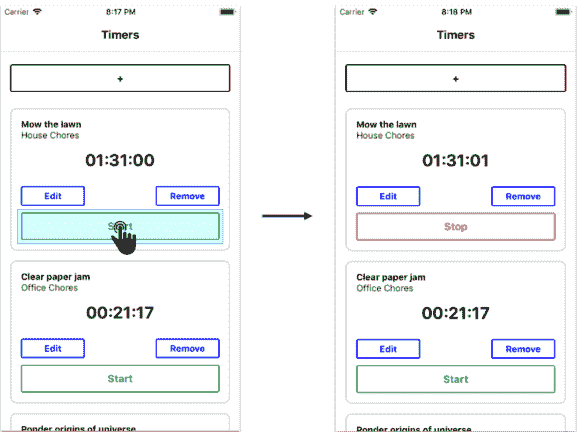

再次强调，对于这个应用，我们不会添加服务器通信。没有它，我们应用的数据是暂时的。如果我们重新加载应用，计时器将被重置。

### 将App包装在KeyboardAvoidingView中

到目前为止，我们应用的一个行为怪癖是，当我们编辑计时器时，键盘可能会碍事。正如我们在第一章所看到的，我们可以将我们的应用包装在`KeyboardAvoidingView`组件中

来解决这个问题。

在 `App.js` 中，首先导入该组件：

```javascript
import React from 'react';
import uuidv4 from 'uuid/v4';

import {
  StyleSheet,
  View,
  ScrollView,
  Text,
  KeyboardAvoidingView,
```

接下来，用该组件包裹 `ScrollView`：

```javascript
render() {
    const { timers } = this.state;

    return (
      <View style={styles.appContainer}>
        <View style={styles.titleContainer}>
          <Text style={styles.title}>Timers</Text>
        </View>
        <KeyboardAvoidingView
          behavior="padding"
          style={styles.timerListContainer}
        >
          <ScrollView contentContainerStyle={styles.timerList}>
            <ToggleableTimerForm onFormSubmit={this.handleCreateFormSubmit} />
            {timers.map(({ title, project, id, elapsed, isRunning }) => (
              <EditableTimer
                key={id}
                id={id}
                title={title}
                project={project}
                elapsed={elapsed}
                isRunning={isRunning}
                onFormSubmit={this.handleFormSubmit}
                onRemovePress={this.handleRemovePress}
                onStartPress={this.toggleTimer}
                onStopPress={this.toggleTimer}
              />
            ))}
          </ScrollView>
        </KeyboardAvoidingView>
      </View>
    );
  }
```

最后，将以下样式添加到 styles 对象中：

```javascript
timerListContainer: {
  flex: 1,
},
```

现在，当我们开始在文本输入框中输入时，ScrollView 将自适应键盘。

最后，让我们为组件添加 PropTypes。如上一章所述，在对 React Native 应用进行添加或修改时，PropTypes 是很好的辅助工具。

### PropTypes

让我们从 EditableTimer 开始，为每个组件添加 PropTypes：

```javascript
export default class EditableTimer extends React.Component {
  static propTypes = {
    id: PropTypes.string.isRequired,
    title: PropTypes.string.isRequired,
    project: PropTypes.string.isRequired,
    elapsed: PropTypes.number.isRequired,
    isRunning: PropTypes.bool.isRequired,
    onFormSubmit: PropTypes.func.isRequired,
    onRemovePress: PropTypes.func.isRequired,
    onStartPress: PropTypes.func.isRequired,
    onStopPress: PropTypes.func.isRequired,
  };
```

对于这个组件，我们所有的 props 都是必需的，因为我们期望 App 始终设置它们。现在我们来看看 Timer：

```javascript
export default class Timer extends Component {
  static propTypes = {
    id: PropTypes.string.isRequired,
    title: PropTypes.string.isRequired,
    project: PropTypes.string.isRequired,
    elapsed: PropTypes.number.isRequired,
    isRunning: PropTypes.bool.isRequired,
    onEditPress: PropTypes.func.isRequired,
    onRemovePress: PropTypes.func.isRequired,
    onStartPress: PropTypes.func.isRequired,
    onStopPress: PropTypes.func.isRequired,
  };
```

同样，我们知道 Timer 的每个 props 都应该由 `EditableTimer` 提供。让我们为 `TimerButton` 添加 `PropTypes` 和 `defaultProps`：

```javascript
TimerButton.propTypes = {
  color: ColorPropType.isRequired,
  title: PropTypes.string.isRequired,
  small: PropTypes.bool,
  onPress: PropTypes.func.isRequired,
};

TimerButton.defaultProps = {
  small: false,
};
```

`small` 是一个可选的 prop，默认值为 `false`。我们的其他 props 都是必需的。我们还为 color prop 使用了 `ColorPropType`，以便正确验证是否传入了合适的颜色。我们还需要在文件顶部从 `react-native` 导入它。

最后两个需要 prop 验证的组件是我们的表单组件。让我们从 `TimerForm` 开始：

```javascript
export default class TimerForm extends React.Component {
  static propTypes = {
    id: PropTypes.string,
    title: PropTypes.string,
    project: PropTypes.string,
    onFormSubmit: PropTypes.func.isRequired,
    onFormClose: PropTypes.func.isRequired,
  };

  static defaultProps = {
    id: null,
    title: '',
    project: '',
  };
}
```

对于这个组件，我们只有在编辑计时器表单而不是创建新表单时才传入计时器属性（id、title 和 project）。我们为每个属性都添加了适当的默认值。现在来看 ToggleableTimerForm：

```javascript
export default class ToggleableTimerForm extends Component {
  static propTypes = {
    onFormSubmit: PropTypes.func.isRequired,
  };
}
```

这个组件只接受一个必需的 prop，即 `onFormSubmit`，它在我们提交计时器表单时触发。

### 方法论回顾

在构建时间追踪应用的过程中，我们学习并应用了一种构建 React 应用的方法论。再次回顾，这些步骤是：

1.  将应用拆分为组件
    我们通过查看应用的功能用户界面来规划组件结构。然后应用单一职责原则来拆分组件，使每个组件都具有最小可行的功能。
2.  构建应用的静态版本
    我们的底层（用户可见）组件基于静态 props 渲染 JSX，这些 props 从父组件传递下来。
3.  确定哪些应该是 stateful 的
    我们使用了一系列问题来推断哪些数据应该是 stateful 的。这些数据在我们的静态应用中以 props 的形式表示。
4.  确定每个 state 应该放在哪个组件中
    我们使用了另一系列问题来确定哪个组件应该拥有每个 state。App 拥有计时器状态数据，`ToggleableTimerForm` 和 `EditableTimer` 都持有关于是否渲染 `TimerForm` 的状态。
5.  硬编码初始状态
    对于拥有 state 的组件，我们用硬编码值初始化 `state` 属性。
6.  添加反向数据流
    我们通过为按钮添加 `onPress` 处理程序来添加交互性。这些处理程序调用作为 props 从拥有相关 state 的组件向下传递的函数。

如果我们计划为应用添加服务器通信，现在正是时候，因为我们已经完成了整个应用基础的搭建。

### 接下来

在第一章中，我们通过构建天气应用探索了 React Native 的基础知识。在本章中，我们通过创建更具交互性、组件更多的应用，深入了解了 React API 的基础知识。尽管我们涵盖了许多重要概念，包括从头开始构建 React Native 应用的有用模式，但我们到目前为止只简要介绍了 React Native 的内置组件，如 `View` 和 `Text`。在接下来的两章中，我们将更详细地研究 React Native 的许多核心组件。

# 核心组件，第 1 部分

## 什么是组件？

组件是任何 React Native 应用的构建块。在前面的章节中，我们使用 `View` 和 `Text` 等组件来创建天气应用和计时器应用的用户界面。开箱即用，React Native 包含了从表单控件到丰富媒体的各种组件。

到目前为止，我们一直在*使用* React Native 组件，而没有完全探索*它们是如何工作的*。在本章中，我们将学习最常见的内置 React Native 组件。与前几章一样，我们会在学习过程中构建一个应用。当我们遇到新主题时，我们会深入研究该主题，然后再继续构建。在本章结束时，你应该具备使用*任何* React Native 组件的扎实基础知识——即使我们没有涵盖的组件也会遵循许多相同的模式。

## UI 抽象

组件是底层原生平台之上的抽象层。在 iOS 设备上，React Native 组件最终被渲染为 `UIView`。在 Android 上，同一个组件会被渲染为 `android.view`。随着 React Native 扩展到新平台，相同的代码应该能够在越来越多的设备上正确渲染。

> React Native 已经支持通用 Windows 平台、Apple TV（主 react-native 仓库的一部分）、React VR 和 Web。

当你开始构建复杂的应用时，你可能会遇到这样的情况：你想使用一个在一平台上存在但在另一平台上不存在的功能。平台特定组件就是为了这种情况而存在的。通常，组件的名称会以平台名称结尾，例如 `NavigatorIOS`。正如我们在"入门"中提到的，有几种方法可以在不同平台上运行不同的代码——你需要为平台特定组件这样做。

## 构建 Instagram 克隆应用

在本章中，我们将使用最常见的 React Native 组件来构建一个类似 Instagram 的应用。我们将使用 `View`、`Text`、`Image` 和 `FlatList` 组件构建主图片信息流。我们还将使用 `TextInput` 和 `ScrollView` 构建评论页面。

- https://github.com/Microsoft/react-native-windows
- https://github.com/facebook/react-native
- https://facebook.github.io/react-vr/
- https://github.com/necolas/react-native-web


要在手机上体验完整的应用，请按以下步骤操作：

- 在 Android 上，你可以在 Expo 应用中扫描以下二维码：


- 在 iOS 上，你可以导航到示例代码文件夹中的 `image-feed/` 目录，并使用前面章节中相同的方法构建应用。你可以使用 iOS 模拟器进行预览，或将项目 URL 的链接发送到你的设备。

我们的应用将包含两个屏幕。第一个屏幕是图片信息流：

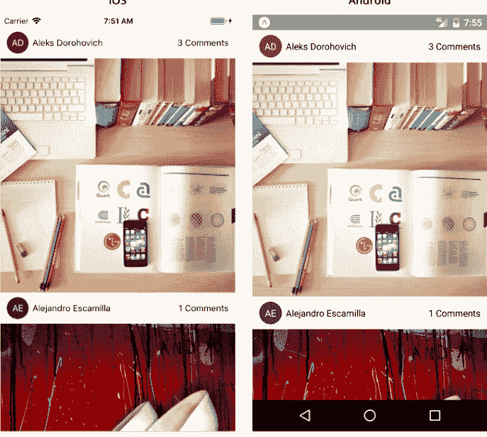

第二个屏幕在我们点击"3 comments"时打开，显示该图片的评论：

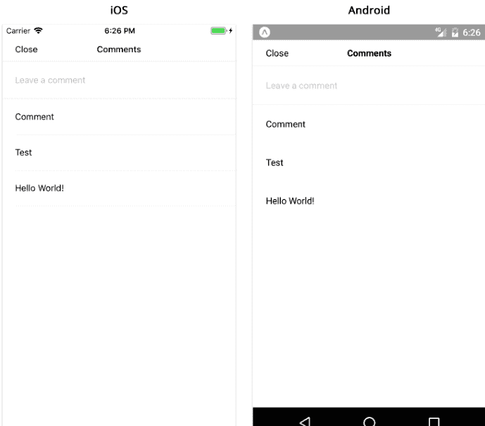

### 项目设置

与前面章节一样，让我们使用以下命令创建一个新应用：

```
$ create-react-native-app image-feed --scripts-version 1.14.0
```

完成后，进入 image-feed 目录。
选择以下方式之一启动应用：

- yarn start - 启动 Packager 并显示二维码，以便在 Android 手机上打开应用
- yarn ios - 启动 Packager 并在 iOS 模拟器上运行应用
- yarn android - 启动 Packager 并在 Android 模拟器上运行应用

你应该会看到默认的 App.js 文件正在运行，看起来像这样：

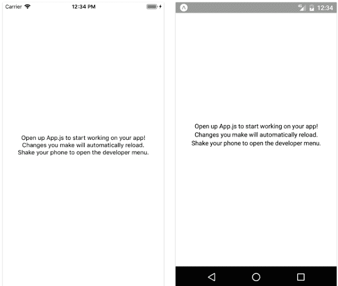

现在是个好时机，将示例代码中的 image-feed/utils 目录复制到你自己的项目中。将 utils 目录复制到我们刚创建的 image-feed 目录中。

### 我们的工作方式

在本章中，我们将按照与上一章相同的方法来构建应用。我们会将应用拆分成组件，先静态地构建它们，等等。我们不会特别指出每一步，因为并不一定需要*完全*遵循这些步骤。它们最有用的地方在于，当你不确定接下来该做什么时可以作为参考。

> 如果你在构建自己的应用时遇到任何困难，可以考虑识别一下你已经完成了哪些步骤，然后更紧密地遵循这些步骤，直到回到正轨。

### 拆解信息流屏幕

我们需要开始从 UI 的不同组件角度来思考我们的应用。最终，我们的应用将渲染 `View` 和 `Text` 等内置组件，但正如我们在上一章中学到的，在这些基础组件之上构建更高层次的抽象是很有用的。让我们先弄清楚主图片信息流可以如何拆分成组件。

一个好的组件通常是简洁且自包含的。通过查看我们试图构建的截图，我们可以识别出哪些部分与其他部分明显不同，以及在多个地方被复用。由于我们只构建几个屏幕，我们无法就截图中哪些部分最具复用性做出完全知情的决定，因为我们不知道应用中其他屏幕会是什么样子。但我们可以做出相当不错的猜测。以下是拆解主信息流的一种方式：

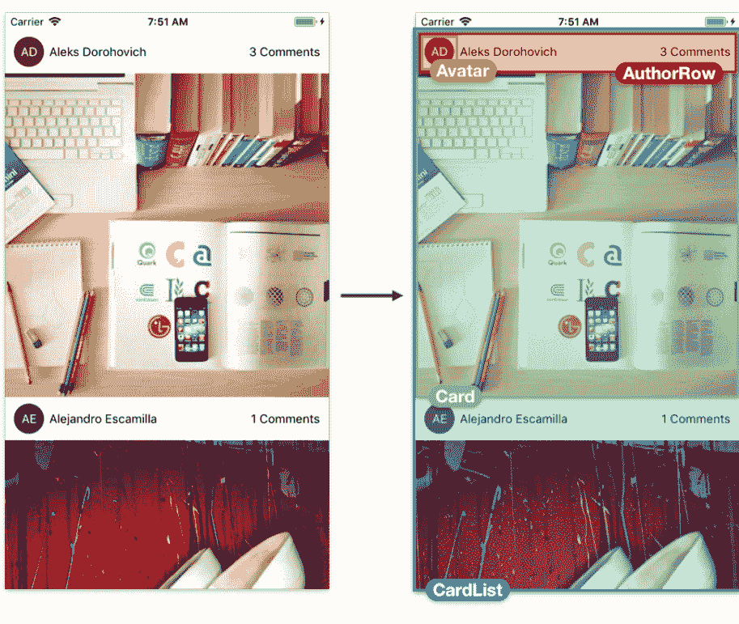

- **Avatar** - 图片作者的头像照片或姓名首字母
- **AuthorRow** - 包含作者信息的水平行：他们的头像和名字
- **Card** - 信息流中包含图片和作者信息的条目
- **CardList** - 信息流中的卡片列表

这些组件层层构建：`CardList` 包含一系列 `Card` 组件，每个 `Card` 包含一个 `AuthorRow`，而 `AuthorRow` 又包含一个 `Avatar`。

### 自上而下 vs. 自下而上

在构建应用的 UI 组件时，通常有两种方法：自上而下和自下而上。在自上而下的方法中，我们会先构建 `CardList` 组件，然后在 `CardList` 内部构建组件，再在这些组件内部构建组件，依此类推，直到最内层的组件 `Avatar`。在自下而上的方法中，我们会从最内层的组件如 `Avatar` 开始，不断构建更高层次的抽象，直到 `CardList`。在这两种方法之间做选择主要是个人偏好问题，而且通常会两者并用。

对于这个应用，我们将采用自下而上的方式。我们会从 `Avatar` 组件开始，然后构建使用它的 `AuthorRow`，以此类推。

与上一章不同，我们将专注于一次构建一个组件，并在构建过程中逐一测试。我们可以修改 `App.js` 来只渲染我们当前正在处理的组件。

例如，如果我们要为 `Avatar` 组件这样做，我们可以修改 `App.js` 文件，使其只渲染 Avatar：

```
// Inside App.js
render() {
  return <Avatar />;
}
```

我们也可能为测试硬编码不同种类的 props：

```
// Inside App.js
render() {
  return <Avatar initials="FL" size={35} backgroundColor={'blue'} />;
}
```

像这样隔离单个组件是处理样式时的有用技巧。组件的布局可能会因其父组件而改变——如果我们在特定父组件中构建组件，我们可能会得到与父组件和子组件紧密耦合的样式。这并不理想，因为我们希望组件在*任何*父组件中都能准确显示，以获得更好的可复用性。通过在视图层次结构的顶层构建组件，我们可以轻松确保组件在任何地方都能良好工作，因为顶层具有默认的布局配置。

既然我们的策略已经确定，让我们从 `Avatar` 组件开始。

#### Avatar

以下是 Avatar 在单独渲染时的样子：

Core Components, Part 1

140

iOS

Android

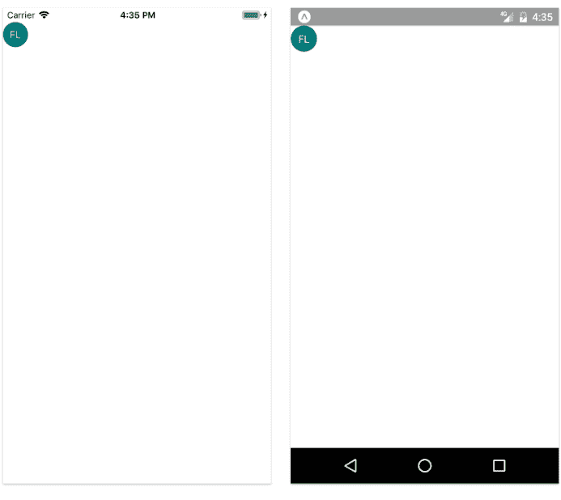

对于简单的应用，将所有组件一起放在 `components` 目录中是最简单的。对于更复杂的应用，我们可能需要在 `components` 内部创建目录，以便更具体地对它们进行分类。由于这个应用相当简单，让我们使用扁平的 `components` 目录，就像我们在前面章节中所做的那样。

让我们创建一个名为 `components` 的新目录，并在其中创建一个名为 `Avatar.js` 的新文件。

我们的头像组件将渲染 `View` 和 `Text` 组件。它将使用 `StyleSheet`，并使用 `PropTypes` 验证字符串、数字和颜色 props。让我们在文件顶部导入这些内容。我们还需要导入 `React`。

> 我们会在这个文件中导入 `React`，即使我们并没有在任何地方引用它。在幕后，babel 将 JSX 元素编译为对 `React.createElement` 的调用，这会引用 `React` 变量。

将以下导入添加到 `Avatar.js`：

```
import { ColorPropType, StyleSheet, Text, View } from 'react-native';
import PropTypes from 'prop-types';
import React from 'react';
```

我们从 `react-native` 导入 `ColorPropType`，而不是从 `PropTypes` 导入。`PropTypes` 包包含用于验证原始 JavaScript 类型（如数字和字符串）的验证器。虽然 React Native 中的颜色是字符串，但它们遵循特定的格式，可以进行验证——React Native 提供了一些验证器，如 `ColorPropType`，用于验证值的内容，而不仅仅是其原始类型。

现在我们可以导出组件的骨架：

```
export default function Avatar({ /* ... */ }) {
  // ...
}
```

由于这个组件不需要存储任何本地状态，我们将使用上一章中学到的无状态函数式组件风格。

我们的头像应该有哪些 `props`？我们肯定需要首字母来渲染。我们可能还希望大小和背景颜色是可配置的。考虑到这一点，我们可以像这样定义 `propTypes`：

```
export default function Avatar({ size, backgroundColor, initials }) {
  // ...
}

Avatar.propTypes = {
  initials: PropTypes.string.isRequired,
  size: PropTypes.number.isRequired,
  backgroundColor: ColorPropType.isRequired,
};

// ...
```

在这个应用中，我们将使用 `isRequired` 使大多数 props 为*必需*的，因为我们总是会传递每个 prop。如果我们想让组件更具可复用性，我们可以将其 props 设为*可选*的——但在实际尝试复用之前，很难知道*哪些* props 应该是可选的！

现在是时候渲染我们 `Avatar` 的内容了。对于彩色圆形背景，我们将渲染一个 `View`。`View` 是最常见且最多功能的组件。我们在前面的章节中已经使用过它，但现在让我们更仔细地看看它是如何工作的，以及如何对其进行样式设置。

#### View

我们使用 `View` 主要有两个相当不同的用途：

- 首先，我们使用 `View` 进行布局。`View` 通常用作其他组件的容器。如果我们想要垂直或水平地排列一组组件，我们很可能会将这些组件包裹在一个 `View` 中。
- 其次，我们使用 `View` 为应用设置样式。如果我们想要渲染简单的形状（如圆形或矩形），或者想要渲染边框、线条或背景颜色，我们很可能会使用 `View`。

React Native 组件旨在尽可能保持一致——许多组件使用与 `View` 类似的 props，例如 `style`。因此，如果你学会了如何使用 `View`，你就可以将这方面的知识复用到 `Text`、`Image` 以及几乎每一种其他组件上。

#### Avatar 背景

让我们使用 `View` 为 Avatar 创建圆形背景：

image-feed/components/Avatar.js

```
// ...

export default function Avatar({ size, backgroundColor, initials }) {
  const style = {
    width: size,
    height: size,
    borderRadius: size / 2,
    backgroundColor,
  }

  return (
    <View style={style} />
  )
}
```


正如我们在前几章所见，我们可以使用 `style` 属性来自定义 `View` 组件的尺寸和颜色。在这里，我们创建一个新对象，并将其传递给 `View` 的 `style` 属性。我们可以将 `size` 属性赋值给 `width` 和 `height` 属性，以指定我们的 `View` 始终渲染为完美的正方形。添加一个为 `width` 和 `height` 一半的 `borderRadius` 会将我们的 `View` 渲染为圆形。最后，我们设置背景色。

在这个样式对象中，属性是动态计算的：`width`、`height`、`borderRadius` 和 `backgroundColor` 都是从组件的 props 派生而来的。当我们动态计算样式对象时（即在渲染组件时），我们会在*行内*定义它们——这意味着每次组件渲染时都会创建一个新的样式对象，并直接传递给组件的 `style` 属性。

当有大量样式对象在行内定义时，会使渲染方法变得杂乱，导致代码难以跟踪。对于不动态计算的样式，我们应该使用 `StyleSheet` API。在接下来的几个部分中，我们将更多地练习这个 API。

在此之前，让我们先确认目前的工作是否正常。

### 试一试

让我们将 `Avatar` 组件添加到 `App` 中。我们还没有完成 Avatar，但边做边测试是很有用的，以防我们引入任何错误。

打开 `App.js`，在其他导入语句之后导入我们的 Avatar：

**image-feed/1/App.js**

```
import Avatar from './components/Avatar';
```

接下来，修改渲染函数以渲染一个 Avatar：

**image-feed/1/App.js**

```
export default class App extends React.Component {
  render() {
    return (
      <View style={styles.container}>
        <Avatar initials={'FL'} size={35} backgroundColor={'teal'} />
      </View>
    );
  }
}
```

对于任何我们未包含的 props，`Avatar` 将使用其 `defaultProps`。我们应该会在屏幕中央看到一个 35px 的青绿色圆形：

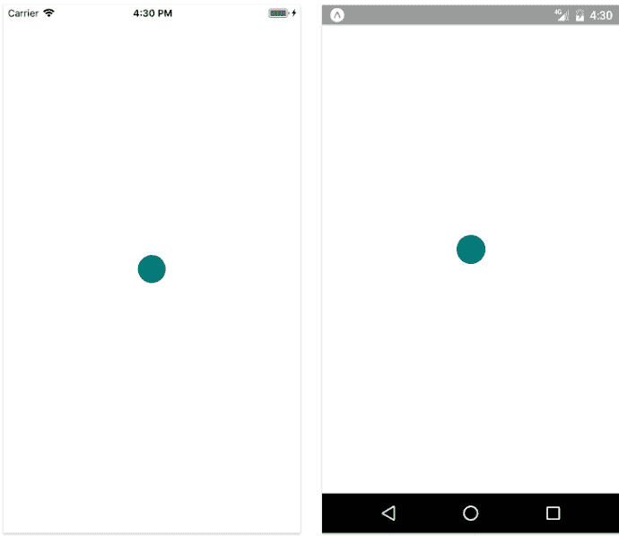

无论屏幕大小如何，青绿色圆形都会渲染在中心位置。这意味着 React Native 正在计算屏幕的中心，计算 `Avatar` 的尺寸，并使用这些计算结果来正确定位 `View` 组件。正如我们在"入门"章节中学到的，React Native 的布局引擎基于 **flexbox** 算法。让我们开始深入了解布局是如何工作的：React Native 如何知道每个组件的尺寸以及在哪里渲染到屏幕上？

### 尺寸

在理解屏幕布局时，我们首先需要考虑的是每个组件的尺寸。组件必须同时具有非零的 `width` 和 `height` 才能在屏幕上渲染任何内容。如果 `width` 为 `0`，那么无论 `height` 多大，都不会在屏幕上渲染任何内容。

在我们的 `Avatar` 示例中，我们通过在 `style` 属性中指定精确的 `width` 和 `height` 来用固定尺寸渲染 `View`。这是指定组件尺寸的最简单方式。无论屏幕大小或其内部组件如何，我们的 `View` 将始终渲染为精确的 35px × 35px。

对于 `Avatar` 来说，这正是我们想要的行为。然而，在许多情况下，我们希望布局能自动适应不同的屏幕尺寸。

我们的 `App` 渲染了一个填满整个屏幕的 `View`，但我们从未指定固定的 `width` 或 `height`。如果你查看 `App.js` 底部的 `StyleSheet.create` 调用，你会看到样式属性 `flex: 1`。

**image-feed/1/App.js**

```
const styles = StyleSheet.create({
  container: {
    flex: 1,
    backgroundColor: '#fff',
    alignItems: 'center',
    justifyContent: 'center',
  },
});
```

我们可以使用 `flex` 来使我们的布局适应不同的屏幕尺寸。

### Flex

`flex` 样式属性使我们能够定义可以根据屏幕尺寸自动扩展和收缩的布局。`flex` 值是一个数字，表示组件应占用的空间比例，相对于其兄弟组件而言。

如果组件没有兄弟组件，如 `App` 渲染的顶层 `View` 的情况，事情就很直接：

- `flex` 为 1 时，组件将完全扩展以填充其父组件
- `flex` 值为 0 时，组件将收缩到最小可能的空间（刚好足以让其子组件可见，如果有子组件的话）

由于 `App` 中的 `View` 的 `flex` 值为 1，它扩展以填充其父组件，在这种情况下就是整个屏幕。现在我们知道了为什么这个 `View` 会扩展以填充屏幕，但 React Native 如何知道将 `Avatar`（及其底层 `View`）渲染在屏幕中央呢？

### 布局

我们可以对*父*组件应用三个样式属性，以指定其*子*组件的布局。也就是说，我们可以指定子组件在父组件中渲染的*位置*。这些属性是：

- `flexDirection`
- `justifyContent`
- `alignItems`

有了这些属性，我们可以实现几乎任何类型的布局。

#### flexDirection

第一个属性是 `flexDirection`。我们选择的 flexDirection 定义了**主**轴。子组件沿主轴排列。*正交*轴称为**次**轴。`flexDirection` 的可能值有：

- `column`：垂直布局（默认值）
- `row`：水平布局
- `column-reverse`：与 `column` 相同但垂直翻转
- `row-reverse`：与 `row` 相同但水平翻转

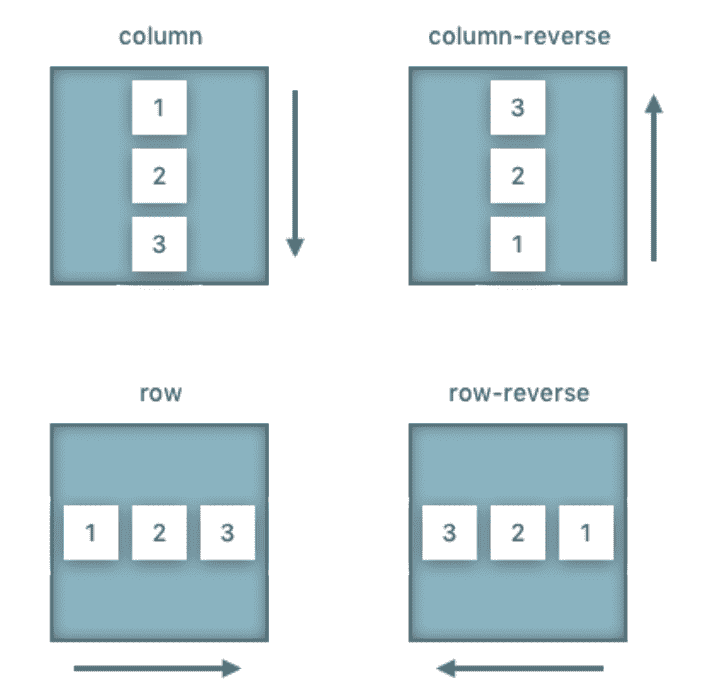

> 这些名称一开始有点令人困惑，因为当你听到"row"时，你可能会想到我们会得到具有多行的布局——但事实上，这是说我们的布局*就是*一行。

#### justifyContent

接下来，我们将使用 `justifyContent` 属性来沿主轴*分布*子组件。可能的值有：

- **flex-start**：在主控的开始位置分布子组件（默认值）
- **flex-center**：在主轴的中心分布子组件
- **flex-end**：在主轴的结束位置分布子组件
- **space-around**：均匀分布子组件，包括边缘的空间
- **space-between**：均匀分布子组件，边缘不留任何空间

下图展示了 `row` 和 `column` 布局中 `justifyContent` 的可能值。请记住，`flexDirection` 设置了主次轴，因此我们选择的 `flexDirection` 将决定 `justifyContent` 的含义。

如果 flexDirection 为 "column"

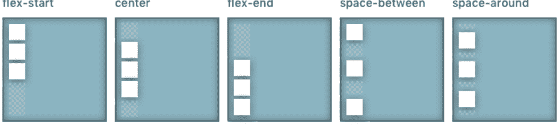

如果 flexDirection 为 "row"

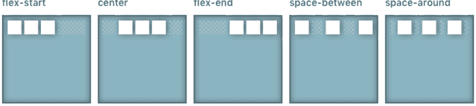

#### alignItems

最后，我们将使用 **alignItems** 属性来沿次轴*对齐*子组件。可能的值有：

- `flex-start`：在开始位置对齐子组件（默认值）
- `flex-center`：在中心对齐子组件
- `flex-end`：在结束位置对齐子组件
- `stretch`：拉伸子组件以填充次轴的整个宽度/高度

下图展示了 `row` 和 `column` 布局中 `alignItems` 的可能值。

如果 flexDirection 为 "column"

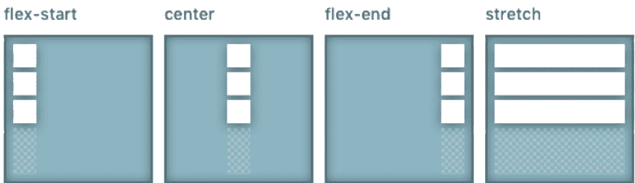

如果 flexDirection 为 "row"

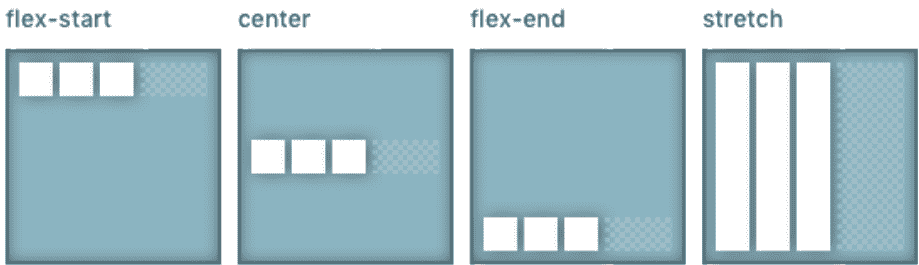

再看一下 App.js 底部 StyleSheet.create 中的 container 样式：

```
const styles = StyleSheet.create({
  container: {
    flex: 1,
    backgroundColor: '#fff',
    alignItems: 'center',
    justifyContent: 'center',
  },
});
```

让我们弄清楚这个样式如何将 Avatar 居中在 View 内。这个样式对象没有包含 `flexDirection` 属性的值，因此它将使用默认值，即 `column`。这意味着主轴是垂直的，次轴是水平的。使用 `justifyContent: 'center'`，子组件在主轴（垂直方向）的中心分布。使用 `alignItems: 'center'`，子组件在次轴（水平方向）的中心对齐。这种组合使得 Avatar 完美地居中在 View 中。

### Flex 与主轴

现在我们知道 `flexDirection` 和轴是如何工作的了，让我们重新审视这个顶层 `View` 如何使用 `flex` 来填充整个屏幕。

组件的 `flex` 属性只决定其沿*主轴*方向的尺寸。这意味着，就像 `justifyContent` 和 `alignItems` 一样，我们需要知道 `flexDirection` 是什么才能正确使用 `flex`。

对于我们 `App` 中的 `View`，最好想象这个 `View` 实际上是另一个填充整个屏幕的包装 `View` 的子组件。这个包装 `View` 具有 `flexDirection`、`justifyContent` 和 `alignItems` 的默认样式属性。换句话说，我们渲染的顶层 `View` 实际上位于一个具有如下样式的父组件内部：

```
{
  flexDirection: 'column',
  justifyContent: 'flex-start',
  alignItems: 'stretch'
}
```

我们的顶层 `View` 具有全屏的 `height`，因为我们指定了 `flex: 1`，使其沿垂直轴拉伸。它具有全屏的 `width`，因为其父组件使用 `alignItems: 'stretch'`，使 `View` 沿水平轴拉伸。

> 如果组件没有显示出来怎么办

初学者和专家都会经常遇到组件在屏幕上不渲染任何问题。最常见的原因是组件的尺寸等于 `0`。

当使用 `flex: 0` 或没有 `flex` 属性时，组件只有在显式给定（使用 `width` 或 `height` 属性）或子组件具有大于 `0` 的尺寸时，其沿主轴方向的尺寸才会大于 `0`。同样，当使用 `alignItems: 'stretch'` 时，子组件只有在显式给定或父组件具有大于 `0` 的尺寸时，其沿次轴方向的尺寸才会大于 `0`。

因此，当组件没有显示在屏幕上时，我们首先应该做的是传递显式的 `width` 和 `height` 样式属性（以及一个 `backgroundColor`，只是为了确保有东西可见）。一旦组件出现在屏幕上，我们就可以开始理解组件层次结构，并评估如何调整我们的样式。


### StyleSheet

既然我们已经对布局有了更好的理解，让我们回到创建我们的 `Avatar` 组件。提醒一下，我们的目标如下：

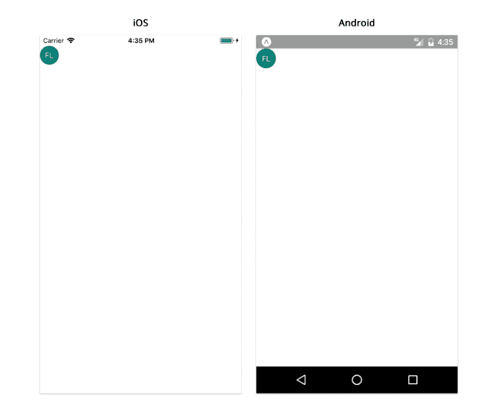

接下来我们想要添加的是圆形 `View` 内的文本。文本应该居中，我们现在知道如何使用 `justifyContent` 和 `alignItems` 来实现这一点。让我们现在就做吧。

我们之前在 `View` 的 `style` 属性中使用了*内联*样式对象。对于那些不需要根据 `props` 动态计算的样式，比如在 `View` 内居中内容，我们通常会在文件底部使用一个 `StyleSheet`。让我们用以下内容更新 `Avatar.js`：

# image-feed/1/components/Avatar.js

```
// ...

export default function Avatar({ size, backgroundColor, initials }) {
  const style = {
    width: size,
    height: size,
    borderRadius: size / 2,
    backgroundColor,
  };

  return (
    <View style={[styles.container, style]} />
  );
}

const styles = StyleSheet.create({
  container: {
    alignItems: 'center',
    justifyContent: 'center',
  },
});
```

> 在 React Native 中，样式最常定义在组件代码下方的同一文件中。阅读文件时，通常主要关注的是组件本身，样式是次要的——这就是我们把组件代码放在前面的原因。这样做是*可行的*，因为变量名 `styles` 会被提升到文件顶部，并且定义其值的代码会在访问其值的代码之前执行。你可能已经注意到，从这本书开始我们就一直这样做，并且在后续部分我们也会继续这样做。

在这种情况下，我们总是希望文本在两个轴上都居中，所以我们将使用 `justifyContent: 'center'` 和 `alignItems: 'center'`。正如我们在“入门”章节所看到的，我们可以通过将一个数组作为 `View` 的 `style` 属性来合并我们的两个样式对象。

> 当像这样将单个子组件在 `View` 中居中时，任何 `flexDirection` 都会产生相同的布局，所以我们可以任选其一。

现在我们已经将 `View` 的内容居中了，让我们添加首字母的文本。我们将为此使用 `Text`。我们之前用过 `Text`，但在将其添加到头像之前，让我们退后一步，深入了解一下它。

### Text

我们使用 Text 组件在屏幕上渲染文本。文本可以通过特定于字体的属性（如 fontSize）进行样式设置。它几乎可以使用与 View 相同的所有样式，例如 backgroundColor 和 width。但是，Text 在布局方面有一些关键的不同之处。

#### Text 尺寸

与 View 组件不同，Text 组件具有固有尺寸。换句话说，如果我们没有指定宽度或高度，Text 组件仍然会出现在屏幕上。如果我们为其添加背景颜色以可视化其宽度和高度，我们可以看到背景正好是我们所看到文本的大小（可能有微小差异，取决于行高）。

渲染一个带有以下样式的 Text 组件：

```
<Text style={{ backgroundColor: 'red' }}>
  Hello World
</Text>
```

得到：

iOS

Android

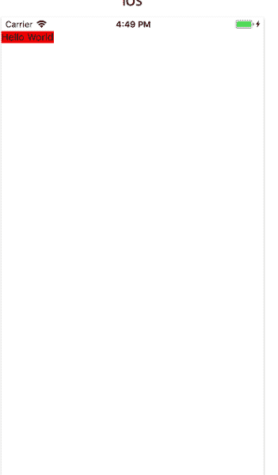

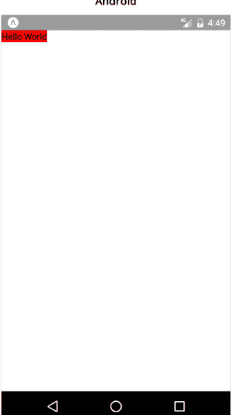

指定宽度、高度或 flex 属性作为样式的一部分将覆盖 Text 的固有尺寸。渲染一个带有以下样式的 Text 组件：

```
<Text style={{ backgroundColor: 'red', width: 60, height: 60 }}>
    Hello World
</Text>
```

得到：

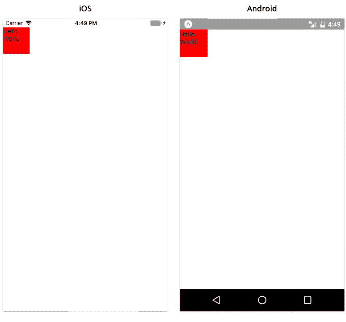

默认情况下，当文本填满组件的宽度时，它会自动换行。这可以通过 `numberOfLines` 属性进行配置。

#### 常见的 Text 属性和样式

以下是你可能想要与文本一起使用的一些常见样式属性：

- **color** - 表示文本颜色的字符串。
- **fontFamily** - 字体系列名称的字符串（该字体系列必须已存在于设备上）。
- **fontSize** - 等于字体大小（以磅为单位）的数值。
- **fontStyle** - 'normal' 或 'italic'。
- **fontWeight** - 每个字符的粗细。可以是 `'normal'`、`'bold'`、`'100'`、`'200'`、`'300'`、`'400'`、`'500'`、`'600'`、`'700'`、`'800'` 或 `'900'`。如果设备上没有所选的字重，将使用最接近的可用字重。
- **textAlign** - 文本对齐方式。可以是 `'left'`、`'right'`、`'center'`、`'justify'`（仅限 iOS）、`'auto'`。

此外，我们经常使用以下属性：

- `numberOfLines` - 在文本被截断之前允许的行数。
- `ellipsizeMode` - 当文本超过 `numberOfLines` 时应该如何截断。可以是 `'head'`、`'middle'`、`'tail'`、`'clip'`（仅限 iOS）。

你可以在[官方文档](https://facebook.github.io/react-native/docs/text.html)⁵⁹中找到 Text 的所有属性和样式的完整列表。

像 `View` 元素一样，`Text` 元素可以有 `children`。当你想在同一个段落中包含多种样式的文本时，这很有用。`Text` 元素将从其父元素继承样式。如果父元素的 `fontSize` 为 `16`，`color` 为 `blue`，子 `Text` 元素默认将具有相同的样式。子 `Text` 元素可以根据需要设置样式以覆盖其父元素的样式。

#### 将 Text 添加到 Avatar

让我们渲染并设置一个 Text 组件的样式，以在 Avatar 组件中显示首字母：

# image-feed/1/components/Avatar.js

```
// ...

export default function Avatar({ size, backgroundColor, initials }) {
  const style = {
    width: size,
    height: size,
    borderRadius: size / 2,
    backgroundColor,
  }

  return (
    <View style={[styles.container, style]}>
      <Text style={styles.text}>{initials}</Text>
    </View>
  );
}

const styles = StyleSheet.create({
  container: {
    alignItems: 'center',
    justifyContent: 'center',
  },
  text: {
    color: 'white',
  },
});
```

保存 Avatar.js 后，你应该会看到以下内容：

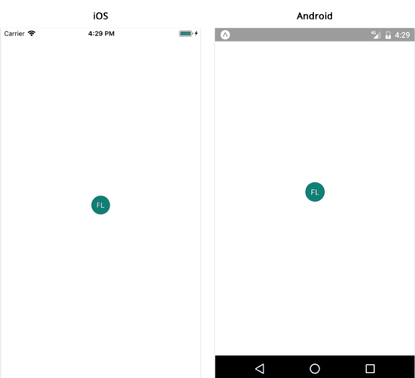

由于我们不希望内容在屏幕上居中，让我们更新 App.js 中的样式，使内容从左上角开始渲染。我们可以通过移除 `alignItem` 和 `justifyContent` 来实现。因为我们处于一个 `flexDirection: "column"`（默认）的 `View` 中，我们可以使用 `justifyContent: "flex-start"`（也是默认值）来从屏幕顶部开始分布内容。

我们还希望在屏幕顶部为状态栏留出空间。我们将从 expo 导入 `Constants`，以便使用 `Constants.statusBarHeight`。

expo 库提供了超出 react-native 所提供功能的多种 API 和组件——由于我们使用 create-react-native-app 来创建应用，这些功能可以直接使用。

在 App.js 顶部添加以下导入语句：

# image-feed/1/App.js

```
import { Constants } from 'expo';
```

然后更新文件底部的容器样式为：

# image-feed/1/App.js

```
// ...

const styles = StyleSheet.create({
  container: {
    marginTop: Constants.statusBarHeight,
    flex: 1,
    backgroundColor: '#fff',
  },
});
```

现在我们应该会在屏幕左上角看到我们的头像，它位于状态栏正下方。

核心组件，第一部分 158

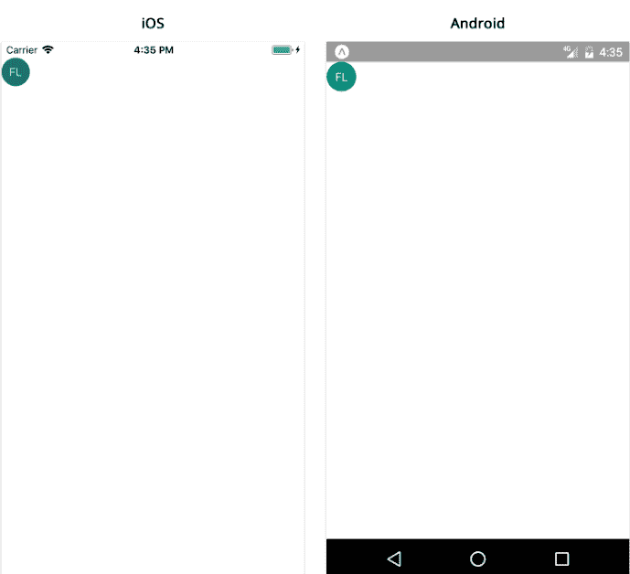

为了创建 Avatar，我们介绍了 View、Text、StyleSheet 以及使用 flexbox 进行布局。这些是构建 React Native 中几乎所有自定义组件所需的内置组件和 API。在本章的剩余部分，我们将主要使用它们来构建图像流应用中的其他组件。

### AuthorRow

既然我们已经完成了 Avatar，让我们继续下一个组件！让我们创建包含 Avatar 和照片作者全名的水平行。

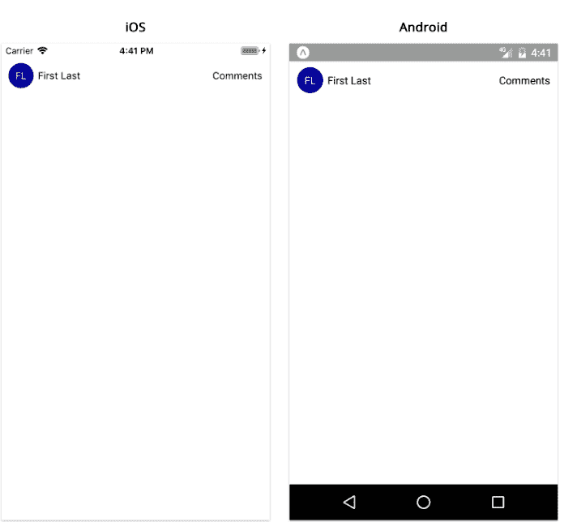

在我们的 components 目录中创建一个新文件 AuthorRow.js。

在这个文件中，我们将导入大部分我们已经见过的东西：StyleSheet、View、Text、PropTypes 和 React。我们还将导入一个 TouchableOpacity，以便我们可以处理对“评论”文本的点击，跳转到评论屏幕。我们还需要导入刚刚创建的 Avatar 组件，以及我们在本章开始时复制到这个项目中的一些实用函数。

> 如果你还没有从我们的示例代码中复制 utils 目录，现在应该这样做。

```
image-feed/1/components/AuthorRow.js

import { StyleSheet, Text, TouchableOpacity, View } from 'react-native';
import PropTypes from 'prop-types';
import React from 'react';

import Avatar from './Avatar';
import getAvatarColor from '../utils/getAvatarColor';
import getInitials from '../utils/getInitials';
```

现在让我们确定组件的 propTypes。我们想要配置全名...

显示在头像旁边，以及右侧“Comments”链接的文本。我们还想在用户点击链接时传递点击事件。

```
image-feed/1/components/AuthorRow.js

// ...

export default function AuthorRow({ fullname, linkText, onPressLinkText }) {

}

AuthorRow.propTypes = {
  fullname: PropTypes.string.isRequired,
  linkText: PropTypes.string.isRequired,
  onPressLinkText: PropTypes.func.isRequired,
};

// ...
```

考虑到组件的布局，我们需要一个设置 `flexDirection: 'row'` 的 View。在其中我们渲染 Avatar、Text 和 TouchableOpacity。

先从 View 和 Text 的样式开始。将此添加到文件底部：

```
image-feed/1/components/AuthorRow.js

// ...

const styles = StyleSheet.create({
  container: {
    height: 50,
    flexDirection: 'row',
    alignItems: 'center',
    paddingHorizontal: 10,
  },
  text: {
    flex: 1,
    marginHorizontal: 6,
  },
});
```

我们使用 `flex: 1` 让 Text 扩展以填充 View 中的剩余空间。这将把 TouchableOpacity 推到右侧。

现在我们来填充组件函数：

```
image-feed/1/components/AuthorRow.js

// ...

export default function AuthorRow({ fullname, linkText, onPressLinkText }) {
  return (
    <View style={styles.container}>
      <Avatar
        size={35}
        initials={getInitials(fullname)}
        backgroundColor={getAvatarColor(fullname)}
      />
      <Text style={styles.text} numberOfLines={1}>
        {fullname}
      </Text>
      {/* ... */}
    </View>
  );
}

// ...
```

我们使用 `numberOfLines={1}` 让 `Text` 在到达行尾时被截断，而不是换行到多行。

现在让我们渲染一个 `TouchableOpacity` 来添加“Comments”链接文本并处理点击。

### TouchableOpacity

`TouchableOpacity` 组件类似于 `View`，但能让我们以高性能的方式轻松响应点击手势。`TouchableOpacity` 组件在按下时会淡出，释放时淡入。透明度动画在原生端执行（不会触发重新渲染），因此动画非常流畅，交互延迟也很低。按下时的透明度值可以通过 `activeOpacity` 属性配置，提供一个从 0 到 1 的数字。

如果你不喜欢透明度动画，可以改用 `TouchableHighlight` 来实现背景色变化的动画。

`TouchableOpacity` 和 `TouchableHighlight` 都有一个不便之处：这些组件只能有一个子元素，所以如果需要多个子元素，我们需要将它们包裹在 `View` 中。

### 向 `AuthorRow` 添加 `TouchableOpacity`

让我们在 `AuthorRow` 的 Text 右侧渲染一个 `TouchableOpacity` 用于“Comments”。我们将使用 `TouchableOpacity` 的 `onPress` 属性来调用我们的 `onPressLinkText` 属性。

image-feed/1/components/AuthorRow.js

```
export default function AuthorRow({ fullname, linkText, onPressLinkText }) {
  return (
    <View style={styles.container}>
      <Avatar
        size={35}
        initials={getInitials(fullname)}
        backgroundColor={getAvatarColor(fullname)}
      />
      <Text style={styles.text} numberOfLines={1}>
        {fullname}
      </Text>
      {!!linkText && (
        <TouchableOpacity onPress={onPressLinkText}>
          <Text numberOfLines={1}>{linkText}</Text>
        </TouchableOpacity>
      )}
    </View>
  );
}
```

我们使用 `!!linkText` 有条件地渲染 `<TouchableOpacity>` 元素。`!!` 的双重否定确保我们处理的是布尔值。

> 由于 `linkText` 是字符串，当 `linkText` 为空字符串 `''` 时，`&&` 表达式的求值结果将是字符串类型——在 React Native 中（与 Web 不同），我们不允许在 `Text` 之外渲染字符串值（即使是空字符串也不行）。

### 试一试

让我们更新 `App.js` 来渲染我们的 `AuthorRow` 组件以便测试：

## image-feed/1/App.js

```
// ...

import AuthorRow from './components/AuthorRow';

export default class App extends React.Component {
  render() {
    return (
      <View style={styles.container}>
        <AuthorRow
          fullname={'First Last'}
          linkText={'Comments'}
          onPressLinkText={() => {
            console.log('Pressed link!');
          }}
        />
      </View>
    );
  }
}

// ...
```

我们的 AuthorRow 应该看起来像这样：

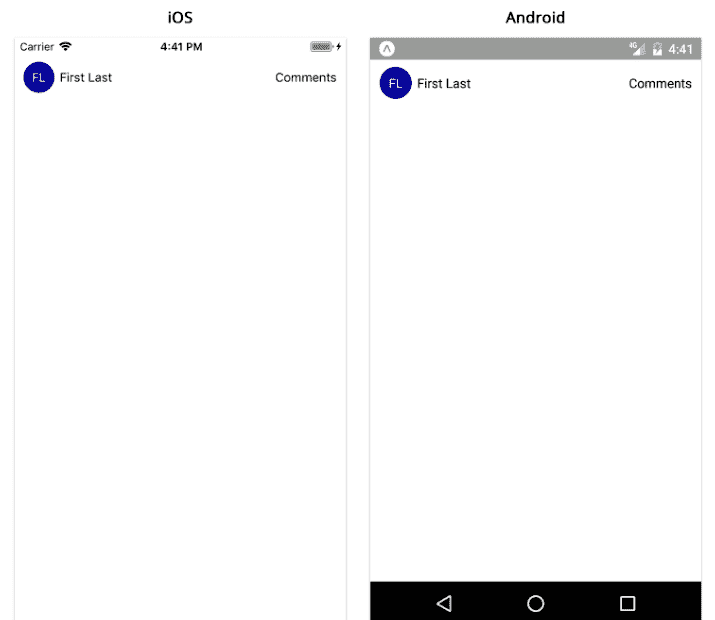

你也可以尝试点击“Comments”文本。文本的透明度应该会动画变化，你会在终端中看到 "Pressed link!" 的日志输出。

在我们的 `AuthorRow` 中，与前几章一样，我们使用了样式属性 `paddingHorizontal` 和 `marginHorizontal` 来调整所渲染的不同组件之间的间距。让我们深入了解这些属性的工作原理。

### Padding、margin、border 和盒模型

React Native 布局引擎使用所谓的*盒模型*来自定义间距。如果你进行过 Web 开发，可能已经熟悉这个盒模型。我们可以使用三个主要样式属性：

- **margin**：组件与其兄弟组件或其父组件内容区域边缘之间的间距。
- **border**：绘制在组件周围的边框，可以有不同的宽度、样式（例如虚线）和颜色。
- **padding**：组件内部的间距，在其子组件之前。

这些样式属性在组件的每一边都可以有不同的尺寸：上、右、下、左。例如，如果我们想设置顶部外边距为 10 像素，我们会在样式对象中写 `marginTop: 10`。为了方便，我们可以用 `margin: 10` 将四边设置为相同的尺寸。我们也可以用 `marginVertical: 10` 和 `marginHorizontal: 10` 分别设置垂直和水平方向的外边距。更具体的样式属性会覆盖更通用的属性——如果我们写 `margin: 10`, `marginTop: 20`，顶部外边距将是 20，其余三边的外边距将是 10。同样的规则也适用于 padding 和 border（不过对于 border，属性名称叫做 `borderWidth` 而不是 border）。

以下是盒模型的示意图：

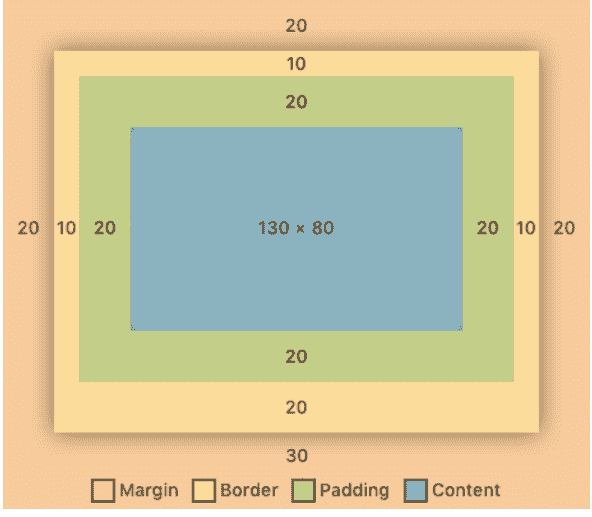

在这个例子中，外边距为 20，`borderWidth` 为 10，内边距为 20，内容区域宽 130、高 80。底部的 `borderWidth` 和外边距与其余边不同：底部边框为 20，底部外边距为 30。我们可以这样写样式：

```
{
  margin: 20,
  borderWidth: 10,
  padding: 20,
  borderBottomWidth: 20
  marginBottom: 30
};
```

当我们使用固定的 width 或 height 时，这包含了内容区域、内边距区域和边框宽度。外边距不计入宽度或高度，因为它是组件边缘之外的空间。这个例子中的宽度是 10 + 20 + 130 + 20 + 10 = 190，高度是 10 + 20 + 80 + 20 + 20 = 150。

在构建应用其余组件的过程中，我们将继续使用这些间距样式属性和盒模型。

### Card

接下来，我们将制作包含 AuthorRow 和 Image 组件的卡片。

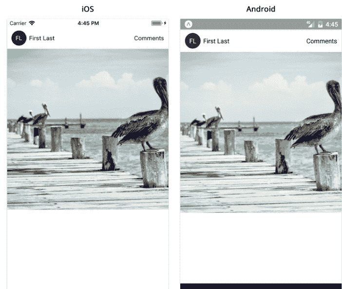

由于渲染 Image 组件将是我们应用的重要部分，让我们更详细地了解图像是如何工作的。

### Image

我们使用 Image 组件在屏幕上渲染图像。在应用中包含图像有两种方式：我们可以将图像资源与代码打包（然后会存储在设备上），或者我们可以从 URI 下载图像。

#### 打包图像资源

要打包图像资源，我们可以像其他文件一样从项目目录中按名称 require 图像。React Native 打包器会给我们一个此图像的引用（一个数字），代表图像的元数据。如果我们使用 @ 后缀命名，打包器会自动打包多种像素密度的图像：`.png` 表示标准分辨率，`@2x.png` 表示 2x 分辨率，`@3x.png` 表示 3x 分辨率。我们可以将图像引用传递给 `Image` 的 `source` 属性来渲染它。

例如，如果在应用根目录中有一个名为 `foo.png` 的文件，我们可以使用：

```
<Image source={require('./foo.png')} />
```

不过，由于我们想要显示的图像来自 Web，本应用不会打包任何图像。相反，我们将加载远程图像资源。

#### 远程图像资源

要从 URI 显示图像，我们必须向 `Image` 组件的 `source` 属性传递一个对象。该对象应包含字符串值 `uri`，还可以选择性地包含 `width` 和 `height` 的数值（表示图像的内在尺寸，预先计算）。`Image` 组件会自动从 URI 下载数据并在加载完成后显示。

```
<Image source={{ uri: 'https://unsplash.it/600/600' }} />
```

由于大图像可能需要一段时间下载，在下载完成之前，我们通常会显示某种加载指示器。我们可以向 `Image` 的 `onLoad` 属性传递回调函数来确定图像何时加载完成。我们很快就会探讨这个。

在本章中，我们将使用开放 API `https://unsplash.it` 来获取我们图片流的图像。这个 API 对于需要占位图像的测试应用非常有用。我们将使用两个 API 端点：

- `https://unsplash.it/${width}/${height}`：此端点返回一张随机图像。我们可以使用查询参数 `image` 并传递图像的 `id` 来获取特定图像，例如 `?image=10`。我们可以通过将所需的宽度和高度放入 URL 来指定图像尺寸。对于此应用，我们选择任意尺寸 600 x 600。
- `https://unsplash.it/list`：此端点返回图像元数据对象列表。每张图像的元数据对象包含一个 `id`，我们可以将其用于前一个端点的 `image` 查询参数。

我们将在 `utils/api.js` 中使用两个工具函数：`getImageFromId(id)` 和 `fetchImages()`。这些函数分别对应两个 `unsplash.it` API。


### 常见的图片样式

我们可以使用 `resizeMode` 样式（或属性——两者都有效）来确定当图片数据的固有尺寸与 `Image` 组件的尺寸不同时，图片如何被裁剪。

`resizeMode` 的选项有：

- **cover**：图片等比缩放以填满 `Image` 组件。如果两者宽高比不同，图片将被组件的边界框裁剪。
- **contain**：图片等比缩放以适应组件内部。如果两者宽高比不同，组件的背景色将会显示出来。
- **stretch**：图片拉伸以填满组件。
- **repeat**：图片以固有尺寸重复平铺以填满组件（仅限 iOS）。
- **center**：图片保持其固有尺寸，并在组件中居中显示。

我们可以使用 `aspectRatio` 样式以特定的宽高比渲染图片，而不受其固有尺寸的影响。我们提供一个数值，表示宽与高的比例。例如，如果我们设置 `aspectRatio: 2`，这意味着宽与高的比例为 2:1——图片渲染的宽度将是其高度的两倍。

虽然 `aspectRatio` 样式最常用于图片，但它可以用于任何组件，例如 `View` 或 `Text`。

> 如果你来自 Web 开发背景，你可能会对这个样式感到惊讶，因为 CSS 中没有等效的样式。React Native 的布局引擎 Yoga 在其 flexbox 实现中添加了这个样式。

#### Yoga

React Native 使用 Yoga 布局引擎（同样来自 Facebook）。这是 flexbox 算法的跨平台实现。它与 Web 浏览器使用的算法非常接近，但有两个重要区别：

- 默认值不同
- Yoga 添加了一些浏览器中不存在的新特性（如 `aspectRatio`）

如果你想了解更多关于算法和所有可用样式的信息，请查看 [Yoga 文档](https://facebook.github.io/yoga/)。

### 将图片添加到卡片

让我们搭建 Card 组件的框架并渲染一张图片。

在 components 目录下创建一个新文件 Card.js。将以下内容添加到该文件中：

image-feed/1/components/Card.js

```
import { Image, StyleSheet, View } from 'react-native';
import PropTypes from 'prop-types';
import React from 'react';
import AuthorRow from './AuthorRow';

export default class Card extends React.Component {
  static propTypes = {
    fullname: PropTypes.string.isRequired,
    image: Image.propTypes.source.isRequired,
    linkText: PropTypes.string,
    onPressLinkText: PropTypes.func,
  };

  static defaultProps = {
    linkText: '',
    onPressLinkText: () => {},
  };

  // ...

  render() {
    // ...
  }
}
```

我们在这里使用的大部分属性应该看起来很熟悉：fullname、linkText 和 onPressLinkText 都将传递到我们之前创建的 AuthorRow 中。有趣的是 image——我们使用 Image.propTypes.source 作为类型，这样我们可以将其直接传递到我们将要渲染的 Image 的 source 属性中。

让我们补全组件函数：

image-feed/1/components/Card.js

```
// ...

  render() {
    const { fullname, image, linkText, onPressLinkText } = this.props;

    return (
      <View>
        <AuthorRow
          fullname={fullname}
          linkText={linkText}
          onPressLinkText={onPressLinkText}
        />
        <Image style={styles.image} source={image} />
      </View>
    );
  }

// ...

const styles = StyleSheet.create({
  image: {
    aspectRatio: 1,
    backgroundColor: 'rgba(0,0,0,0.02)',
  },
});
```

我们将渲染一个 `View`（默认样式为 `flexDirection: 'column'`）来垂直堆叠 `AuthorRow` 和 `Image` 组件。由于 `View` 的样式默认为 `alignItems: 'stretch'`，图片会水平拉伸以填满屏幕。我们使用 `aspectRatio: 1` 使图片的高度与其全屏宽度匹配，渲染为一个完美的正方形。我们为 Image 设置了 `backgroundColor`，它会在图片加载前显示，或者在图片透明时显示在图片后面。

### 试一试

要测试这个效果，让我们在 App 中渲染新的 Card。将 `App.js` 中的组件更新为以下内容：

## image-feed/1/App.js

```
// ...

import Card from './components/Card';

export default class App extends React.Component {
  render() {
    return (
      <View style={styles.container}>
        <Card
          fullname={'First Last'}
          linkText={'Comments'}
          onPressLinkText={() => {
            console.log('Pressed link!');
          }}
          image={{ uri: 'https://unsplash.it/600/600' }}
        />
      </View>
    );
  }
}

// ...
```

当你保存 App.js 时，你应该能在设备上看到我们之前的 AuthorRow 加上一张随机图片：

### 加载状态

你可能注意到，在等待图片加载时，我们看到了图片背后的背景色。让我们在图片完全加载前添加一个加载指示器，以向用户提供更多反馈。

我们可以传递一个回调到 `Image` 的 `onLoad` 属性来监控加载状态。让我们在 `Card` 组件的 state 中跟踪 `Image` 的加载状态。更新 `Card.js` 以包含以下内容：

image-feed/1/components/Card.js

```
export default class Card extends React.Component {
  // ...

  state = {
    loading: true,
  };

  handleLoad = () => {
    this.setState({ loading: false });
  };
}
```

```
render() {
  const { fullname, image, linkText, onPressLinkText } = this.props;
  const { loading } = this.state;

  return (
    <View>
      <AuthorRow
        fullname={fullname}
        linkText={linkText}
        onPressLinkText={onPressLinkText}
      />
      <Image style={styles.image} source={image} onLoad={this.handleLoad} />
    </View>
  );
}
}
```

现在我们通过 state.loaded 来跟踪图片何时完全加载。接下来我们将在 state.loaded 为 true 时渲染加载指示器。

### ActivityIndicator

我们可以使用 ActivityIndicator 组件来渲染加载指示器。

该组件接受与 `View` 相同的所有属性，以及一些额外的属性：

- **animating**：一个布尔值，表示是否显示或隐藏指示器（默认为 true）。
- **color**：旋转指示器的颜色（默认为灰色）。
- **size**：'small' 或 'large' 之一（默认为 small）。

我们希望将 `ActivityIndicator` 放置在图片的中心。与 `View` 不同，`Image` 组件不接受 `children` 属性，因此我们不能将其放在 Image 内部。我们可以像"入门"章节中那样使用 `ImageBackground` 组件，但让我们看看一种更通用的方式来堆叠组件：`position`。

### Position（定位）

到目前为止，我们在布局中主要使用了 `flexDirection`、`justifyContent` 和 `alignItems` 等样式属性。React Native 为我们提供了另一个强大的样式属性来调整布局：`position`。Position 可以是 'relative' 或 'absolute'。

#### relative

当设置为 'relative'（这是默认值）时，我们可以在组件按照其 `flex`、`width`、`height` 等布局之后调整其位置。我们可以组合使用 top、right、bottom 和 left。例如，如果我们想将一个组件在屏幕上向下移动 20 像素，可以使用 `top: 20` 来表示其顶部应比当前位置大 20 像素。与指定 `padding`、`margin` 或 `borderWidth` 不同，`top` 等样式属性不会影响布局中的其他元素。换句话说，添加 `top: 20` 将改变该元素本身的位置，但不会改变其兄弟元素或父元素的位置（即使这导致它们重叠）。

#### absolute

当设置为 'absolute' 时，父组件的布局和该组件的 `flex` 样式将完全被忽略。我们使用 `top`、`right`、`bottom` 和 `left` 来精确指定组件在其父组件中的放置位置。例如，如果我们希望组件距离其父组件底部 10 像素、距离右侧 20 像素，可以设置 `bottom: 20`、`right: 10`。同样，我们需要确保组件的尺寸大于 0。由于 `flex` 被忽略，我们可能需要指定固定的宽度和高度。我们也可以通过同时指定 `top` 和 `bottom`，或同时指定 `left` 和 `right` 来确保组件的尺寸大于 0。例如，如果我们设置 `left: 10`、`right: 10`，组件将水平拉伸以填满从其父组件左侧 10 像素到右侧 10 像素的空间。使用 `position: 'absolute'` 定位的组件不会影响其兄弟组件或父组件的布局。

使用 `position: 'absolute'` 使元素重叠是很常见的做法。假设我们希望两个兄弟元素重叠并完全填充其父组件。我们可以为两个兄弟元素添加如下样式：

```
const absoluteFillStyle = {
  position: 'absolute',
  top: 0,
  right: 0,
  bottom: 0,
  left: 0,
};
```

这个样式将使一个元素完全填充其父组件，因为它的 `top` 将匹配父组件的 `top`，它的 `right` 边将匹配父组件的 `right` 边，以此类推。这种技术非常常见，因此有一个预定义样式可以实现同样的效果：`StyleSheet.absoluteFill`。该值可以直接传递给元素的 `style` 属性。或者，你可以使用 `...StyleSheet.absoluteFillObject`，将这些属性复制到另一个样式中——当你想覆盖一两个属性但保留其余属性时，这很有用。

这种重叠行为正是我们想要的，可以将 `ActivityIndicator` 定位在 `Image` 的中心。

### 将 `ActivityIndicator` 添加到 `Card`

我们将使用 `StyleSheet.absoluteFill` 来确保 `ActivityIndicator` 与 `Image` 的尺寸匹配。为此，我们需要为两者创建一个公共的祖先 `View`。


首先，在 `Card.js` 中，确保导入 `ActivityIndicator`：

image-feed/1/components/Card.js

```javascript
import { ActivityIndicator, Image, StyleSheet, View } from 'react-native';
```

然后，将 `Card` 的 `render` 方法更新为以下内容：

image-feed/1/components/Card.js

```javascript
render() {
  const { fullname, image, linkText, onPressLinkText } = this.props;
  const { loading } = this.state;

  return (
    <View>
      <AuthorRow
        fullname={fullname}
        linkText={linkText}
        onPressLinkText={onPressLinkText}
      />
      <View style={styles.image}>
        {loading && (
          <ActivityIndicator style={StyleSheet.absoluteFill} size={'large'} />
        )}
        <Image
          style={StyleSheet.absoluteFill}
          source={image}
          onLoad={this.handleLoad}
        />
      </View>
    </View>
  );
}
```

如果你保存 `Card.js` 并在设备上查看，你应该会看到 `ActivityIndicator` 在 `Image` 加载之前显示在其中心位置。

一开始可能不太容易理解这是如何工作的，所以让我们逐步分析。我们将 `styles.image` 样式移到了内部 `View` 上，而这个 `View` 是 `Image` 的父元素。这个内部 `View` 位于一个设置了 `alignItems: 'stretch'`（默认值）的父 `View` 中，并且它自身有 `aspectRatio: 1`，因此我们知道这个内部 `View` 的宽度会与其父元素相同（在这种情况下是屏幕宽度），高度则等于其宽度。`Image` 和 `ActivityIndicator` 的上、下、左、右边界都将与内部 `View` 一致——换句话说，它们的尺寸将与 `View` 完全匹配。

代码中组件的渲染顺序在这里很关键：在内部 View 中，我们先渲染 ActivityIndicator，*再*渲染 Image。代码中*最后*渲染的组件在视觉上会显示在其兄弟姐妹组件的上方。通常我们不需要考虑这一点，因为组件不会相互堆叠。然而，使用 `position` 时，兄弟组件可能会重叠，而渲染顺序决定了它们在屏幕上的层级。在这种情况下，我们的 Image 渲染在 `ActivityIndicator` 的上方。`onLoad` 事件可能在图片绘制完成后才被触发，因此通过这种方式，即使两个组件同时渲染，Image 也会覆盖掉 `ActivityIndicator`。

如果你来自 Web 开发背景，可能会想到 `zIndex` 样式属性。React Native 确实有 `zIndex` 属性，但它的行为略有不同，而且可能产生一些不可预测的效果。如果可能的话，通过正确的顺序来渲染组件通常是更安全的选择。

还有很多其他方法可以实现相同的布局。另一种做法是将 Image 的样式设置为 `flex: 1` 来完全填充 View：

```javascript
<View style={styles.image}>
  {loading && (
    <ActivityIndicator style={StyleSheet.absoluteFill} size={'large'} />
  )}
  <Image
    style={{ flex: 1 }}
    source={image}
    onLoad={this.handleLoad}
  />
</View>
```

我们也可以将 `styles.image` 保留在 Image 上，并依赖其父 View 会沿垂直轴调整大小以容纳其子元素：

```javascript
<View>
  {loading && (
    <ActivityIndicator style={StyleSheet.absoluteFill} size={'large'} />
  )}
  <Image
    style={styles.image}
    source={image}
    onLoad={this.handleLoad}
  />
</View>
```

所有这些方法都是合理的，因此决定使用哪一种主要取决于个人偏好。我们在本章中选择的方法是因为它在第一眼看到时更容易理解：View 的两个子元素都有 `StyleSheet.absoluteFill`，所以只需阅读代码就能清楚它们会完全重叠。

现在我们有了 `Card` 组件，可以渲染一个列表来创建主信息流。

### CardList

`CardList` 组件将渲染作者和图像的无限滚动列表。

我们将使用 `FlatList` 组件来渲染这个卡片列表。

### FlatList

`FlatList` 组件用于渲染大量可滚动的内容。与渲染 `children` prop 不同，`FlatList` 使用 `renderItem` prop 渲染输入 `data` 数组中的每一项。`renderItem` prop 是一个函数，它从 `data` 数组中取出一个 item 并将其映射为一个 React 元素。`data` 中的每一项应该是一个带有唯一 id 的对象，这样 React 才能确定项目何时被重新排列。

### 将 `FlatList` 添加到 `CardList`

`FlatList` 通常性能良好：它只渲染屏幕上的内容（裁剪掉屏幕外的内容），并且只更新已更改的行。`FlatList` 是基于一个更通用的组件 `ScrollView` 构建的，我们会在本章后面用到它。

让我们在组件目录中创建 `CardList.js`。我们将在文件顶部导入 `FlatList`、我们的 `Card`、一个用于从 id 构建图片 URL 的工具，以及其他一些东西：

```javascript
image-feed/1/components/CardList.js

import { FlatList } from 'react-native';
import PropTypes from 'prop-types';
import React from 'react';

import { getImageFromId } from '../utils/api';
import Card from './Card';
```

最终我们将使用 `https://unsplash.it` 来获取信息流的数据，但现在让我们假设数据看起来像这样：

```javascript
[
  { id: 0, author: "Bob Ross" },
  { id: 1, author: "Chuck Norris" }
];
`

`id` 字段必须是唯一的，这一点很重要，因为我们将使用它来确定信息流中每张卡片的身份。如果不是唯一的，我们会开始看到一些奇怪的行为，比如某些项目无法渲染。幸运的是，稍后我们会调用的 API 具有唯一的 `id` 值（大多数 API 都应该如此！）。

我们需要向 `FlatList` 提供一个函数，将数据数组中的每个元素映射到其唯一的 key。让我们在文件顶部定义一个工具函数来完成这个任务，然后将其作为 `keyExtractor` prop 传递给 `FlatList`。我们的 `keyExtractor` 函数将从数组中取出一个 item 并返回该 item 的 `id`（字符串形式）。在导入语句下方定义这个函数：

```javascript
image-feed/1/components/CardList.js

const keyExtractor = ({ id }) => id.toString();
```javascript

稍后我们在渲染 `FlatList` 时会用到这个函数。

接下来是 `propTypes`，我们要确保输入的数据符合上面定义的格式。可以结合使用 `PropTypes.arrayOf` 和 `PropTypes.shape`。让我们按如下方式设置组件骨架：

```javascript
// image-feed/1/components/CardList.js

// ...

export default class CardList extends React.Component {
  static propTypes = {
    items: PropTypes.arrayOf(
      PropTypes.shape({
        id: PropTypes.number.isRequired,
        author: PropTypes.string.isRequired,
      }),
    ).isRequired,
  };

  render() {
    // ...
  }
}
```

我们将使用类组件而不是函数组件，因为稍后添加评论功能时，我们需要添加一些需要访问 `props` 的方法。

> 到目前为止，我们已经看到了如何使用 `PropTypes.bool`、`PropTypes.string` 等来验证基本值。我们可以使用 `PropTypes.shape()` 来验证对象，传入我们想要验证的值的键。我们可以使用 `PropTypes.array()` 来验证数组，传入元素的类型。

如果我们计划在多个地方使用这个 `items` 数据结构，可能需要将其类型定义在单独的文件中，比如 `ItemsPropType.js`。这样我们可以定义一次，然后在多个文件中导入使用，而不是在多个地方重复定义。React Native 也以这种方式导出了一些内置类型，比如 `ViewPropTypes`。

现在让我们来渲染 `FlatList`：

```javascript
renderItem = ({ item: { id, author } }) => (
  <Card
    fullname={author}
    image={{
      uri: getImageFromId(id),
    }}
  />
);

render() {
  const { items } = this.props;

  return (
    <FlatList
      data={items}
      renderItem={this.renderItem}
      keyExtractor={keyExtractor}
    />
  );
}
```

### 解构赋值，再探

在上一章中，我们讲了解构赋值。解构赋值也可以是嵌套的，如上面的例子所示：

```javascript
renderItem = ({ item: { id, author } }) => {}
```

这等价于：

```javascript
renderItem = (obj) => {
  const id = obj.item.id;
  const author = obj.item.author;
}
```

我们提供 `keyExtractor` prop 来指导 `FlatList` 如何唯一标识项目——这有助于 `FlatList` 确定当项目进出屏幕可见区域时，何时需要重新渲染项目。

每次 `FlatList` 决定渲染一个新项目时，它都会调用我们提供的 `renderItem` 函数


将其与一个对象作为参数传入。该对象包含一些渲染元数据，以及我们作为 `data` prop 传入数组中的 `item`。

在 `renderItem` 中，我们可以基于该 item 返回一个 `Card` 组件。我们可以使用 item 的 `id` 来构建图片的 URI，利用我们的 `getImageFromId()` 工具函数。

保存 `CardList.js`，让我们来测试一下。

### 试一试

更新 `App.js`，使用我们之前提到的硬编码数据来渲染 `CardList`：

**image-feed/1/App.js**

```
// ...

import CardList from './components/CardList';

const items = [
  { id: 0, author: 'Bob Ross' },
  { id: 1, author: 'Chuck Norris' },
];

export default class App extends React.Component {
  render() {
    return (
      <View style={styles.container}>
        <CardList items={items} />
      </View>
    );
  }
}

// ...
```

保存 `App.js`，你应该会看到：

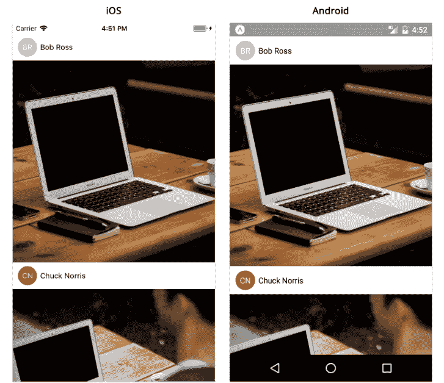

现在我们已经完成了图片feed最后一个自定义 UI 组件，我们可以用它创建 Feed 屏幕了。

### 添加屏幕

我们的应用将有两个屏幕：

- **Feed**：图片信息流
- **Comments**：特定图片的评论列表

在 React Native 中，屏幕与其他组件一样也是组件。不过，稍微用不同的方式来思考屏幕会很有用。屏幕是**占满整个设备屏幕**的组件。它们通常处理非视觉方面的问题，比如获取数据和处理导航到其他屏幕。

将所有屏幕组件放在应用中的 `screens` 目录下是常见的做法。对于更复杂的应用，我们可能需要在 `screens` 内创建子目录来更具体地分类它们。由于这个应用比较简单，我们就用扁平的 `screens` 目录。

在我们的顶级 `image-feed` 目录中创建名为 `screens` 的新目录，并在 `screens` 中创建一个名为 `Feed.js` 的新文件。

### Feed 屏幕

这个屏幕将从 `https://unsplash.it` 获取实时数据，并将数据传递给我们的 `CardList`。我们获取的数据格式将与当前使用的硬编码列表相同。

由于我们现在要异步获取远程数据，我们需要考虑加载和错误状态。这个屏幕会显示一个简单的加载指示器和错误状态。

将以下导入添加到 `Feed.js`：

image-feed/1/screens/Feed.js

```
import {
  ActivityIndicator,
  Text,
  ViewPropTypes,
  SafeAreaView,
} from 'react-native';
import PropTypes from 'prop-types';
import React from 'react';

import { fetchImages } from '../utils/api';
import CardList from '../components/CardList';
```

屏幕通常会像其他组件一样配置 props。在这种情况下，我们将允许一个 `style` prop，我们将用它来表示这个屏幕中顶层的 `View`。这使我们的屏幕具有很大的灵活性，可以按需要任意样式设置。这个 prop 的类型将与 `View` 的 `style` prop 相同——React Native 将此验证器作为单独的导入提供，即 `ViewPropTypes`。

> 你可能想用 `PropTypes.object` 来表示样式，但这不太好用。使用 `StyleSheet.create` 创建的样式表示为数字，所以这会导致警告。而且，`ViewPropTypes.style` 对每个键和值进行深入的类型检查，这非常有价值。

image-feed/1/screens/Feed.js

```
// ...

export default class Feed extends React.Component {
  static propTypes = {
    style: ViewPropTypes.style,
  };

  static defaultProps = {
    style: null,
  };

  // ...
}

// ...
```

允许使用 style prop 来创建极其灵活的自定义组件是很常见的。我们技术上可以随意使用这个 style prop，比如为深层嵌套的组件设置样式——但是，当命名一个与内置 View prop 相同的 prop 时，我们通常会尽量保持行为相似。遵循内置组件的约定使其他开发人员更容易理解如何使用我们的自定义组件，而无需阅读源代码。

我们将在 Feed 的 state 中跟踪三个状态：loading、error 和 items。

image-feed/1/screens/Feed.js

```
state = {
  loading: true,
  error: false,
  items: [],
};
```

我们可以用这些状态来决定渲染什么。我们将在 `componentDidMount` 中获取数据，并在收到响应时更新组件状态。

image-feed/1/screens/Feed.js

```
async componentDidMount() {
  try {
    const items = await fetchImages();

    this.setState({
      loading: false,
      items,
    });
  } catch (e) {
    this.setState({
      loading: false,
      error: true,
    });
  }
}
```

我们将 `componentDidMount` 设为 async 函数，以便在其中使用 `await` 语法。这意味着该函数将返回一个 promise。React 不会将 `componentDidMount` 的返回值用于任何用途，所以这是安全的。

现在，让我们更新 render 方法来使用这个新状态：

image-feed/1/screens/Feed.js

```
render() {
  const { style } = this.props;
  const { loading, error, items } = this.state;

  if (loading) {
    return <ActivityIndicator size="large" />;
  }

  if (error) {
    return <Text>Error...</Text>;
  }

  return (
    <SafeAreaView style={style}>
      <CardList items={items} />
    </SafeAreaView>
  );
}
```

我们准备好从 App 渲染我们的 Feed 屏幕了！

### 将 Feed 添加到 App

让我们更新 `App.js` 来渲染我们的新屏幕。首先，我们需要更新文件顶部的导入：

image-feed/1/App.js

```
import { Platform, StyleSheet, View } from 'react-native';
import { Constants } from 'expo';
import React from 'react';

import Feed from './screens/Feed';
```

然后我们可以将 Feed 渲染在一个包裹的 View 中：

**image-feed/1/App.js**

```
export default class App extends React.Component {
  render() {
    return (
      <View style={styles.container}>
        <Feed style={styles.feed} />
      </View>
    );
  }
}
```

由于我们的 Feed 在顶层使用了 `SafeAreaView`，我们还需要更新之前的样式。我们只希望在 Android 或 iOS 11 以下的版本上添加 `marginTop`，因为在 iOS 11+ 上，`SafeAreaView` 现在会自动添加上方边距。

我们可以使用 `Platform.Version` 来检测原生操作系统版本。在 iOS 上，这是一个像 `'10.3'` 这样的字符串，而在 Android 上它是一个数字。

**image-feed/1/App.js**

```
const platformVersion =
  Platform.OS === 'ios' ? parseInt(Platform.Version, 10) : Platform.Version;

const styles = StyleSheet.create({
  container: {
    flex: 1,
    backgroundColor: '#fff',
  },
  feed: {
    flex: 1,
    marginTop:
      Platform.OS === 'android' || platformVersion < 11
        ? Constants.statusBarHeight
        : 0,
  },
});
```

就这样，我们完成了 feed！这是使用实时数据的最终结果：

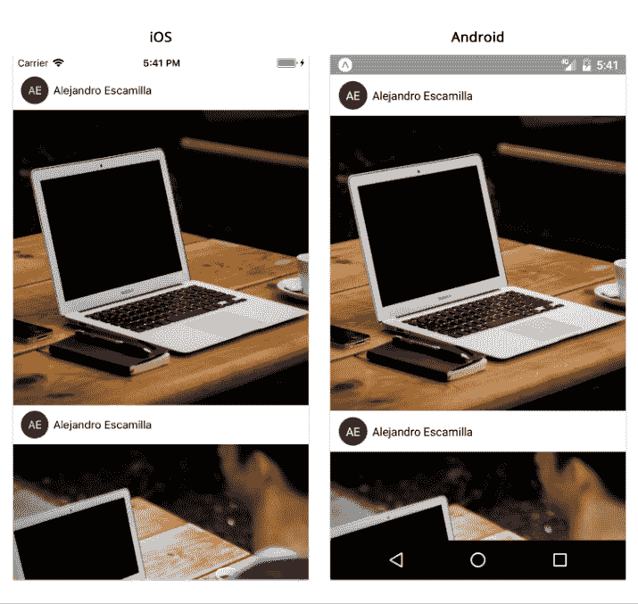

### 列表性能

如果你运行的 React Native 版本大于 0.55，在滚动浏览大约一百张图片后，你可能会看到以下警告：

```
VirtualizedList: You have a large list that is slow to update - make sure your
renderItem function renders components that follow React performance best practices
like PureComponent, shouldComponentUpdate, etc.
```

React Native 在告诉我们，一旦列表达到一定长度，渲染就会变得很慢。我们可以通过减少重新渲染的卡片数量来解决这个问题。

`FlatList` 在我们滚动时会重新渲染我们的卡片。然而，大多数时候，卡片的数据不会变化，所以我们在初始渲染后不需要更新组件——数据可能变化的唯一情况是显示的评论数量发生变化。我们可以向 `Card.js` 添加 `shouldComponentUpdate` 方法来减少重新渲染，从而提高 `FlatList` 的性能。我们可以添加以下 `shouldComponentUpdate` 方法：

```
shouldComponentUpdate(nextProps) {
  return this.props.linkText !== nextProps.linkText;
}
```


这样，我们的卡片只会在绝对必要时才重新渲染。你仍然可能在某个时候看到同样的警告，但相比于之前，需要滚动更多次才会出现。

大多数时候，使用 `shouldComponentUpdate` 是一种过早的优化。即使是像这里这样的大型列表，通常在发布构建中不经过任何其他优化也能获得足够的性能。然而，如果你收到了警告，那么这是一个值得考虑的优化。

### 我们目前构建的内容

让我们回顾一下目前所做的工作。我们使用了 `View`、`Text`、`Image` 和 `FlatList` 组件来构建一个跨平台的、无限滚动的图片和作者列表。我们创建了 4 个组件，每一个都在前一个的基础上构建：`Avatar`、`AuthorRow`、`Card` 和 `CardList`。我们在构建每个组件时都进行了测试，通过从顶层组件 `App` 进行渲染。我们使用了多种布局技术：

- 显式设置 `width` 和 `height`
- 使用 `flex` 来拉伸元素
- 使用 `flexDirection`、`justifyContent` 和 `alignItems` 来进行子元素布局
- 使用 `padding` 和 `margin` 来定义元素之间的间距
- 使用 `position: 'absolute'` 将元素堆叠在一起
- 使用 `StyleSheet.create` 创建优化后的样式

这些是任何 React Native UI 的基本构建块。在本书的剩余部分，我们将继续使用这些技术，同时向我们的工具库中添加更多的组件和 API。

# 核心组件，第二部分

**从我们离开的地方继续**

我们成功构建了一个很棒的无限滚动图片流。接下来，我们要在同一个应用中添加一个新屏幕，用于对图片进行评论。

> > 
> 这是一个**代码检查点**。如果你之前没有跟着我们一起编码，但现在想开始，我们在本书的示例代码中包含了我们当前进展的快照。
>
> 如果你还没有创建项目，你需要使用以下命令创建：
>
> `$ create-react-native-app image-feed --scripts-version 1.14.0`
>
> 然后，将示例代码中 `image-feed/1` 目录的内容复制到你新创建的 `image-feed` 项目目录中。

## 评论

评论屏幕的外观如下：

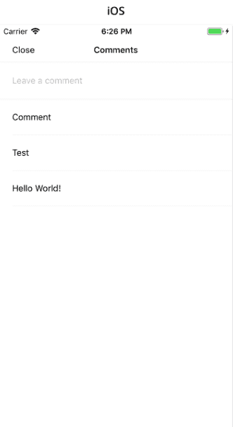

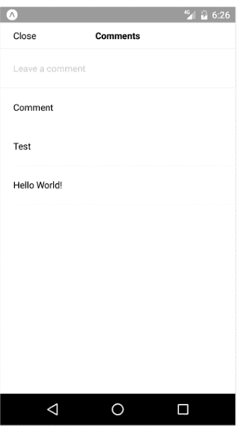

为了构建应用的这一部分，我们将学习如何使用 `TextInput`、`ScrollView` 和 `Modal` 组件。我们还将涉及一些其他主题，比如 `AsyncStorage`。为了专注于内置组件，我们将做出一些假设：

- 我们不会使用导航库，尽管我们有多个屏幕（关于导航的更多内容将在后续章节中介绍）
- 我们只希望在设备本地存储评论，而不是通过 API 远程存储
- 评论可以保存为简单的字符串（没有 id、作者或其他元数据）
- 评论输入字段位于屏幕顶部，以避免键盘和滚动相关的复杂性（我们将在下一章中介绍）
- 评论数量足够少，以至于 `ScrollView` 的性能足够好（而不是使用 `FlatList`）

### 拆分评论屏幕

我们要做的第一件事是将屏幕拆分为组件。以下是一种拆分方式：


- NavigationBar - 屏幕顶部的一个简单导航栏，包含标题和"关闭"按钮
- droveCommentInput - 用于添加新评论的输入字段
- CommentList - 可滚动的评论列表

`App` 组件将负责处理应用中的评论数据，因为 Feed 屏幕和 Comments 屏幕都需要渲染这些数据。我们将从 `App` 渲染 Comments 屏幕组件，将所选卡片的评论数据作为 prop 传递。我们将渲染内置的 Modal 组件，根据 `App` 的状态来打开和关闭这个新屏幕。

我们将继续自下而上地构建，从 `CommentInput` 组件开始，逐步向上直到屏幕组件。我们不会像本章前半部分那样，通过从 `App` 渲染来单独测试每个组件，但如果你喜欢开发时有更快的反馈循环，欢迎继续这样做。

### CommentInput

首先，让我们创建用于新评论的输入字段。


### TextInput

正如我们在"入门"章节中看到的，我们可以使用 TextInput 组件来创建一个可编辑的文本字段，供用户输入。

在使用 TextInput 时，我们通常会使用以下 props 来捕获用户输入：

- **value** - 输入字段中的当前文本。
- **onChangeText** - 每次文本变化时调用的函数。新值作为第一个参数。
- **onSubmitEditing** - 当用户按下回车/下一键以提交/移动到下一个字段时调用的函数。

通常，我们会将当前文本存储在渲染 TextInput 的组件的 `state` 中。每次调用我们传递给 onChangeText 的函数时，我们调用 setState 来更新当前文本。当用户按下回车键时，我们传递给 onSubmitEditing 的函数被调用——然后我们可以使用当前文本执行某些操作，并使用 setState 将当前文本重置为空字符串。

### 常见的 TextInput props 和样式

在使用 `TextInput` 时，我们可以使用大多数与 `Text` 相同的样式（包括 `View` 的样式）。不过有一些样式在 `TextInput` 上表现不如在 `Text` 上好：边框往往无法正确渲染，padding 和 line height 可能以不寻常的方式冲突。如果你在设置 `TextInput` 样式时遇到困难，你可能想要将 `TextInput` 包裹在 `View` 中，并对 `View` 进行样式设置。

其他一些常见的 props：

- **autoCapitalize** - 用于在输入时自动大写字符。可选值为 'none'、'sentences'、'words'、'characters'。
- **autoCorrect** - 启用/禁用自动纠正。
- **editable** - 启用/禁用文本字段。
- **keyboardType** - 要显示的键盘类型。跨平台值有 'default'、'numeric'、'email-address'、'phone-pad'。
- **multiline** - 允许多行输入文本。
- **placeholder** - 文本字段为空时显示的文本
- **placeholderTextColor** - 占位文本的颜色
- **returnKeyType** - 键盘上回车键的文本。跨平台值有 'done'、'go'、'next'、'search'、'send'。

更多 props 可在 [TextInput 文档](https://facebook.github.io/react-native/docs/textinput.html)^60 中找到。

### 将 TextInput 添加到 CommentList

虽然我们可以直接从 `Comments` 屏幕渲染 `TextInput` 组件，但创建一个封装了状态、样式、边界情况等的包装组件，并拥有更小的 API，通常是更好的做法。这就是我们在 `CommentInput` 组件中要做的。结果将与之前章节中的 `TextInput` 包装组件非常相似。

在 `components` 目录中创建一个新文件 `CommentInput.js`。我们将导入常用的 `React`、`PropTypes` 等，以及 `TextInput` 组件：

```
// image-feed/components/CommentInput.js
import { StyleSheet, TextInput, View } from 'react-native';
import PropTypes from 'prop-types';
import React from 'react';
```

我们希望这个组件有两个 props：

- **onSubmit** - 当用户按下"回车"键时，我们用评论文本调用这个函数。
- **placeholder** - 传递给 `TextInput` 的 `placeholder` prop 的透传。

将以下内容添加到 `CommentInput.js`：

^60 [https://facebook.github.io/react-native/docs/textinput.html](https://facebook.github.io/react-native/docs/textinput.html)

```
// image-feed/components/CommentInput.js
export default class CommentInput extends React.Component {
  static propTypes = {
    onSubmit: PropTypes.func.isRequired,
    placeholder: PropTypes.string,
  };

  static defaultProps = {
    placeholder: '',
  };

  // ...
}
```

我们将向 state 添加一个文本值，以及当 TextInput 的值变化时更新此值的方法：

```
// image-feed/components/CommentInput.js
state = {
  text: '',
};

handleChangeText = text => {
  this.setState({ text });
};

handleSubmitEditing = () => {
  const { onSubmit } = this.props;
  const { text } = this.state;

  if (!text) return;

  onSubmit(text);
  this.setState({ text: '' });
};
```

我们不允许空评论，所以当 handleSubmitEditing 被调用时，如果 state.text 为空，我们将立即返回。


最后，我们将渲染 `TextInput`。我们想在底部添加边框，但给 `TextInput` 添加边框有时不太可靠，因为边框可能不会显示出来。所以我们将 `TextInput` 包裹在一个 `View` 中，并对 `View` 进行样式设置：

```
image-feed/components/CommentInput.js

render() {
    const { placeholder } = this.props;
    const { text } = this.state;

    return (
        <View style={styles.container}>
            <TextInput
                style={styles.input}
                value={text}
                placeholder={placeholder}
                underlineColorAndroid="transparent"
                onChangeText={this.handleChangeText}
                onSubmitEditing={this.handleSubmitEditing}
            />
        </View>
    );
}
```

```
image-feed/components/CommentInput.js

const styles = StyleSheet.create({
    container: {
        borderBottomWidth: StyleSheet.hairlineWidth,
        borderBottomColor: 'rgba(0,0,0,0.1)',
        paddingHorizontal: 20,
        height: 60,
    },
    input: {
        flex: 1,
    },
});
```

在这里，我们将状态管理方法 `handleChangeText` 和 `handleSubmitEditing` 传递给 `TextInput`，以跟踪 `value` 的变化。

我们可以使用 `StyleSheet.hairlineWidth` 作为边框宽度，以在任何给定设备上渲染最细可能的线条。例如，在视网膜设备上，这将小于 1。

> 如果你想查看这个组件的样子以检查你的工作，可以考虑在 App 中渲染它进行测试。

### CommentList

接下来，我们将为每张图片渲染一个评论列表：


我们将在 ScrollView 中渲染这些评论。实际上，我们可能会出于性能考虑使用 FlatList，但让我们用 ScrollView 来练习。

### ScrollView

ScrollView 比 FlatList 更简单：它会将所有子元素渲染在一个垂直或水平可滚动的列表中，没有 keyExtractor 或 renderItem 属性的额外复杂性。

ScrollView 非常适合滚动浏览少量内容（大约 20 个条目或更少）。ScrollView 中的内容即使在屏幕上看不到时也会渲染。对于大量条目，或者 ScrollView 的许多子元素在屏幕外的情况，你可能需要使用 FlatList 组件以获得更好的性能。

#### ScrollView 的尺寸和布局

你可以将 ScrollView 看作两个独立的视图，一个嵌套在另一个内部。外部视图有固定的大小，而内部视图可以超过外部视图的大小。如果内部视图超过外部视图的大小，只有一部分会可见。当我们传递子元素给 ScrollView 时，它们在这个内部视图中渲染。我们称内部视图为"内容容器视图"，可以独立于外部视图进行样式设置。

> **调试 ScrollView**

在构建应用时，经常会渲染一个 ScrollView 但在屏幕上看不到任何内容。根据外部视图和内容容器视图的工作方式，这有两个常见原因（假设垂直滚动）：

- 内容容器视图默认有 `flex: 0`，所以它的初始 `height` 为 `0`，并扩展到包含其子元素所需的最小大小。如果一个子元素有 `flex: 1`，这个子元素将不可见，因为内容容器的固有 `height` 为 `0`。虽然我们可以将 `contentContainerStyle` 设置为 `flex: 1`，但这可能不是我们要的，因为那样内容就不会大于外部视图了。相反，我们应该确保传递给 ScrollView 的子元素具有大于 `0` 的固有 `height` 值（可以通过使用显式的 `height`，或者包含 `height` 大于 `0` 的子元素来实现）。
- 外部视图不会根据内容容器视图改变大小。除了确保 ScrollView 的子元素有非零 `height` 之外，我们还要确保 ScrollView 本身有非零的尺寸——固定的 `width` 和 `height`、`flex: 1` 且父元素有 `alignItems: stretch`，或者绝对定位。

最有可能的是，如果 ScrollView 没有显示，我们需要在每个父元素和 ScrollView 本身都添加 `flex: 1`。调试时，你可以尝试在每个父元素上设置背景色，看看 `flex: 1` 是在组件层次结构的哪个位置停止传播的。

#### 添加 ScrollView 到 CommentList

让我们渲染一个包含评论列表的 ScrollView。我们将这个组件称为 `CommentList`。

在 `components` 目录中创建文件 `CommentList.js`。

这个组件将接收一个 `items` 数组属性，其中包含评论字符串，将它们映射为 `View` 和 `Text` 元素。我们将在 `CommentList.js` 中设置这个组件的框架，如下所示：

```
image-feed/components/CommentList.js
import { ScrollView, StyleSheet, Text, View } from 'react-native';
import PropTypes from 'prop-types';
import React from 'react';

export default class CommentList extends React.Component {
  static propTypes = {
    items: PropTypes.arrayOf(PropTypes.string).isRequired,
  };

  // ...
}
```

与 FlatList 不同，我们不需要处理 keyExtractor 和 data 属性。我们可以像渲染 View 的子元素一样简单地渲染 ScrollView 的子元素：

```
image-feed/components/CommentList.js
renderItem = (item, index) => (
  <View key={index} style={styles.comment}>
    <Text>{item}</Text>
  </View>
);

render() {
  const { items } = this.props;

  return <ScrollView>{items.map(this.renderItem)}</ScrollView>;
}
```

```
image-feed/components/CommentList.js
const styles = StyleSheet.create({
  comment: {
    marginLeft: 20,
    paddingVertical: 20,
    paddingRight: 20,
    borderBottomWidth: StyleSheet.hairlineWidth,
    borderBottomColor: 'rgba(0,0,0,0.05)',
  },
});
```

由于评论以字符串形式存储，我们没有方便的值可以作为唯一的 React key。使用评论文本作为 key 是行不通的，因为评论不需要是唯一的。使用索引作为 key *在这里可行*，但通常是需要警惕的模式，因为在重新排列项目时可能会导致问题。更好的解决方案是给我们的评论数据添加 id：我们可以将评论存储为对象，并使用上一章的 `uuid` 库为每条评论分配唯一的 id 作为 key。

现在我们有了一个可滚动的评论列表，我们可以继续导航栏，这将是我们在组装评论屏幕之前制作的最后一个组件。

### NavigationBar

由于我们的评论屏幕将以模态形式打开，我们想要渲染一个带有标题和关闭按钮的导航栏。


在实际应用中，我们可能会为此使用导航库，但为了简单起见，让我们自己写一些简单的代码。

在 `components` 目录中创建 `NavigationBar.js` 并添加以下框架：

```
image-feed/components/NavigationBar.js

import { StyleSheet, Text, TouchableOpacity, View } from 'react-native';
import PropTypes from 'prop-types';
import React from 'react';

export default function NavigationBar({ title, leftText, onPressLeftText }) {
  // ...
}

NavigationBar.propTypes = {
  title: PropTypes.string,
  leftText: PropTypes.string,
  onPressLeftText: PropTypes.func,
};

NavigationBar.defaultProps = {
  title: '',
  leftText: '',
  onPressLeftText: () => {},
};

// ...
```

> 我们不会在属性上使用 `isRequired`，因为这个组件可能会在不使用某些属性的情况下使用，例如 `leftText` 和 `onPressLeftText`，如果我们在这个应用中添加更多屏幕的话。

这个组件将相当简单，只使用我们已经涵盖过的概念。我们将使用 `TouchableOpacity` 作为左侧的关闭按钮。我们将使用 `position: 'absolute'` 来定位它，因为我们不希望左侧的文本将标题推离中心（记住，使用 `position: 'absolute'` 意味着该组件不再影响布局中的其他兄弟元素）。真正的导航库会考虑更多情况，比如右侧的文本、两侧的图标，以及可能与标题冲突的长文本。让我们保持简单，只处理当前这一种情况。

组件函数和样式应该如下所示：


```
export default function NavigationBar({ title, leftText, onPressLeftText }) {
  return (
    <View style={styles.container}>
      <TouchableOpacity style={styles.leftText} onPress={onPressLeftText}>
        <Text>{leftText}</Text>
      </TouchableOpacity>
      <Text style={styles.title}>{title}</Text>
    </View>
  );
}
```

```
const styles = StyleSheet.create({
  container: {
    height: 40,
    borderBottomWidth: StyleSheet.hairlineWidth,
    borderBottomColor: 'rgba(0,0,0,0.1)',
    alignItems: 'center',
    justifyContent: 'center',
  },
  title: {
    fontWeight: '500',
  },
  leftText: {
    position: 'absolute',
    left: 20,
    top: 0,
    bottom: 0,
    justifyContent: 'center',
  },
});
```

> 尽管 `fontWeight` 通常表示一个数值，但它必须是一个字符串！

我们现在拥有了所有需要的构建模块：`CommentInput`、`CommentList` 和 `NavigationBar`。让我们在一个新的屏幕中将它们组装起来。

### 评论屏幕

在 `screens` 目录中创建一个新文件 `Comments.js`。

在新屏幕中，我们希望先渲染 `NavigationBar`，然后是 `CommentInput`，最后是 `CommentList`。我们希望这个屏幕接收 4 个 props：

- `comments` - 要显示的评论数组。
- `onClose` - 用户按下关闭按钮时调用的函数 prop。
- `onSubmitComment` - 用户添加新评论时调用的函数 prop。
- `style` - 应用到该屏幕顶层 `View` 的样式（就像我们在 `Feed` 中所做的那样）。

将以下内容添加到 `Comments.js` 中：

```
image-feed/screens/Comments.js
1 import { SafeAreaView, ViewPropTypes } from 'react-native';
2 import PropTypes from 'prop-types';
3 import React from 'react';
4 
5 import CommentInput from '../components/CommentInput';
6 import CommentList from '../components/CommentList';
7 import NavigationBar from '../components/NavigationBar';
8 
9 export default function Comments({
10   style,
11   comments,
12   onClose,
13   onSubmitComment,
14 }) {
15   return (
16     <SafeAreaView style={style}>
17       <NavigationBar
18         title="Comments"
19         leftText="Close"
20         onPressLeftText={onClose}
21       />
22       <CommentInput placeholder="Leave a comment" onSubmit={onSubmitComment} />
23       <CommentList items={comments} />
24     </SafeAreaView>
25   );
26 }
27 
28 Comments.propTypes = {
```

```
style: ViewPropTypes.style,
comments: PropTypes.arrayOf(PropTypes.string).isRequired,
onClose: PropTypes.func.isRequired,
onSubmitComment: PropTypes.func.isRequired,
};

Comments.defaultProps = {
  style: null,
};
```

我们这个屏幕的代码非常简单，因为我们已经将 UI 的各个部分构建为独立的组件了。

### 将所有内容组合在一起

现在我们需要实现从之前创建的 Feed 屏幕导航到新的 Comments 屏幕。

我们希望 Comments 屏幕滑动上来并覆盖整个屏幕，因此我们将使用内置的 `Modal` 组件。

### Modal

`Modal` 组件允许我们过渡到一个完全不同的屏幕。这对于简单应用来说最为实用，因为对于复杂应用，你可能会使用导航库，而导航库自带自己的模态框实现方式。

常用 props 包括：

- `animationType` - 控制模态框的进出动画方式。可选值为 `'none'`、`'slide'` 或 `'fade'`（默认为 `'none'`）。
- `onRequestClose` - 用户点击 Android 返回按钮时调用的函数。
- `onShow` - 模态框完全可见后调用的函数。
- `transparent` - 一个布尔值，决定模态框的背景是否透明。
- `visible` - 一个布尔值，决定模态框是否可见。

`visible` prop 是最重要的，因为它让我们能够显示和隐藏 `Modal`。

#### 将 `Modal` 添加到 `App`

我们将在 `App` 组件的 `state` 中维护 `Modal` 的状态。我们将使用 `Modal` 组件的 `visible` prop 来显示和隐藏它，因此我们需要在 `state` 中存储一个布尔值 `showModal`。我们还需要存储正在查看评论的图片 `id`，因此我们也在 `state` 中存储 `selectedItemId`。另外，我们需要存储我们输入的评论的实际文本，所以让我们创建一个从图片 id 映射到评论字符串数组的对象。让我们将 `App.js` 中的 `state` 更新为如下所示：

image-feed/App.js

```
state = {
  commentsForItem: {},
  showModal: false,
  selectedItemId: null,
};
```

接下来，我们将在 `App` 组件上创建两个函数属性，用于更新状态以打开和关闭 `Modal`。

image-feed/App.js

```
openCommentScreen = id => {
  this.setState({
    showModal: true,
    selectedItemId: id,
  });
};

closeCommentScreen = () => {
  this.setState({
    showModal: false,
    selectedItemId: null,
  });
};
```

注意，我们的 `openCommentScreen` 函数接收我们要显示评论的图片 `id`。我们需要在 `CardList` 中调用此函数来传递该 `id`。然后我们将该值通过 `Feed` 向上传播到 `App`。保存 `App.js`，然后我们转到 `CardList.js` 来实现这一点。

#### 更新 `CardList` 以支持评论

我们希望每张卡片上的"Comments"链接能打开我们刚刚创建的 `Modal`：

为此，让我们调整 `CardList` 组件，添加一个 `onPressComments` prop（用于调用 `openCommentScreen`）和一个 `commentsForItem` prop（用于显示每张图片的评论数量）。

**image-feed/components/CardList.js**

```
// ...

export default class CardList extends React.Component {
  static propTypes = {
    items: PropTypes.arrayOf(
      PropTypes.shape({
        id: PropTypes.number.isRequired,
        author: PropTypes.string.isRequired,
      }),
    ).isRequired,
    commentsForItem: PropTypes.objectOf(PropTypes.arrayOf(PropTypes.string))
      .isRequired,
    onPressComments: PropTypes.func.isRequired,
  };

  // ...
}

// ...
```

让我们在 `renderItem` 中调用 `onPressComments`，传入该项的 `id`，这样我们就知道要显示哪张图片的评论。

**image-feed/components/CardList.js**

```
renderItem = ({ item: { id, author } }) => {
  const { commentsForItem, onPressComments } = this.props;
  const comments = commentsForItem[id];

  return (
    <Card
      fullName={author}
      image={{
        uri: getImageFromId(id),
      }}
      linkText={`${comments ? comments.length : 0} Comments`}
      onPressLinkText={() => onPressComments(id)}
    />
```

目前我们的 `CardList` 有一个小问题：当添加新评论时，用于 `linkText` 的评论计数不会立即更新。这是由于 `FlatList` 决定是否重新渲染项的方式所致；`FlatList` 只有在 `data` prop 发生变化或滚动时才会重新渲染项。在这种情况下，我们将 `CardList` 的 `items` prop 传递给 `FlatList` 的 `data` prop，但我们的 `commentsForItem` prop 并不会导致 `items` 数组发生变化，因此当添加新评论时 `FlatList` 不会更新。我们可以使用 `FlatList` 的 `extraData` prop 来通知 `FlatList` 它应该监控另一个输入数据源的变化。

让我们更新 `CardList` 中的 `render` 方法，将 `commentsForItem` 作为 `FlatList` 的 `extraData` prop 传入。

image-feed/components/CardList.js

```
// ...
const { items, commentsForItem } = this.props;

return (
  <FlatList
    data={items}
    renderItem={this.renderItem}
    keyExtractor={keyExtractor}
    extraData={commentsForItem}
  />
);
// ...
```

保存 `CardList.js`。这将使你的应用进入错误状态，因为 `CardList` 目前没有接收到 `commentsForItem` prop。

让我们修复它！

### 更新 Feed 以支持评论

打开 `Feed.js`。我们需要在这里也接收 `commentsForItem` 和 `onPressComments`，并将它们传递给 `CardList`。

更新 `propTypes`：

image-feed/screens/Feed.js

```
static propTypes = {
  style: ViewPropTypes.style,
  commentsForItem: PropTypes.objectOf(PropTypes.arrayOf(PropTypes.string))
    .isRequired,
  onPressComments: PropTypes.func.isRequired,
};
```

并更新 `render` 方法：
```


 ```
image-feed/screens/Feed.js
render() {
  const { commentsForItem, onPressComments, style } = this.props;

  // ..

  return (
    <SafeAreaView style={style}>
      <CardList
        items={items}
        commentsForItem={commentsForItem}
        onPressComments={onPressComments}
      />
    </SafeAreaView>
  );
}

// ...
```

保存 Feed.js。你仍然会看到相同的错误信息，因为我们仍然还没有向 Feed 传递 `commentsForItem` 的值。

### 使用评论更新 App

让我们回到 App.js，将这些新添加给 Feed 的 props 连接起来，并渲染屏幕。

导入 Modal 组件和我们的 Comments 组件：

```
image-feed/App.js
import { Modal, Platform, StyleSheet, View } from 'react-native';

// ...

import Comments from './screens/Comments';
```

然后更新 render 方法来渲染 Comments 并用新的 props 更新 Feed：

```
# image-feed/App.js

// ...

export default class App extends React.Component {
  // ...

  render() {
    const { commentsForItem, showModal, selectedItemId } = this.state;

    return (
      <View style={styles.container}>
        <Feed
          style={styles.feed}
          commentsForItem={commentsForItem}
          onPressComments={this.openCommentScreen}
        />
        <Modal
          visible={showModal}
          animationType="slide"
          onRequestClose={this.closeCommentScreen}
        >
          <Comments
            style={styles.container}
            comments={commentsForItem[selectedItemId] || []}
            onClose={this.closeCommentScreen}
            // ...
          />
        </Modal>
      </View>
    );
  }
}

// ...
```

我们还将为评论屏幕添加一个新的样式：

```
// ...

const styles = StyleSheet.create({
  // ...
  comments: {
    flex: 1,
    marginTop:
      Platform.OS === 'ios' && platformVersion < 11
        ? Constants.statusBarHeight
        : 0,
  },
});
```

和之前一样，我们需要单独处理低于 11 的 iOS 版本，通过添加顶部边距。Modal 在 Android 上自然地位于状态栏下方，所以这种情况下我们只需要在 iOS 上添加顶部边距。

保存 App.js 后，你将能够打开和关闭 Comments 屏幕！点击任意 "Comments" 链接来打开它，然后点击 NavigationBar 中的 "Close" 按钮来关闭它。

应该仍然会有一个关于缺少 onSubmitComment prop 的警告。我们接下来添加它。

### 添加新评论

既然我们可以访问新的 Comments 屏幕了，我们希望能够在其中输入新评论。

让我们在 App 组件上创建一个函数属性 `onSubmitComment`，用于将新评论保存到 state 中的 `commentsForItem` 对象里。由于我们的 `commentsForItem` 对象应该是不可变的（它是 state 的一部分），我们将创建一个新对象，并使用 `...` 对象展开语法复制现有的键和值。对于我们的 `selectedItemId`，我们将更新 `commentsForItem` 中的评论数组，使用 `...` 数组展开语法复制现有评论，或者如果这是第一条评论，则创建一个新数组。

```
// ...

onSubmitComment = (text) => {
  const { selectedItemId, commentsForItem } = this.state;
  const comments = commentsForItem[selectedItemId] || [];

  const updated = {
    ...commentsForItem,
    [selectedItemId]: [...comments, text],
  };
```

```
this.setState({ commentsForItem: updated });
```

```
};
```

```
// ...
```

由于我们创建了一个新的 `commentsForItem` 对象，当我们最终将它传递给 `Feed` 时，`Feed` 会将它作为 `extraData` 传递给 `FlatList`，从而触发重新渲染（更新 `"0 Comments"` 文本）。

### 计算属性名

在定义对象字面量时，我们可以通过用方括号包裹属性名来动态计算属性名。例如：

```
const name = 'foo';
const obj = { [name]: 'bar' };
```

```
console.log(obj.foo); // => 'bar'
```

这大致等价于：

```
const name = 'foo';
const obj = {};
obj[name] = 'bar';
```

计算属性名在上面的例子中很方便，我们想让对象字面量具有基于动态值的属性名。

输入新评论的最后一步是在渲染时将 `onSubmitComment` 函数传递给 `Comments` 组件：

image-feed/App.js

```
// ...
```

```
return (
  <View style={styles.container}>
    <Feed
      style={styles.feed}
      commentsForItem={commentsForItem}
      onPressComments={this.openCommentScreen}
    />
```

```
<Modal
  visible={showModal}
  animationType="slide"
  onRequestClose={this.closeCommentScreen}
>
  <Comments
    style={styles.comments}
    comments={commentsForItem[selectedItemId] || []}
    onClose={this.closeCommentScreen}
    onSubmitComment={this.onSubmitComment}
  />
</Modal>
</View>
);

// ...
```

保存 App.js，然后继续玩一下这个应用！你应该能够点击每张图片右上角的 "0 Comments" 文本来打开包含 Comments 屏幕的 Modal。你应该能够输入新评论并看到它们出现在评论列表中。当你关闭 Modal 后，你应该看到你选择的图片的评论数量增加了。

### 额外内容：将评论持久化到设备存储

你可能已经注意到，如果你重新加载应用，添加的任何评论都会消失。这是因为我们没有将它们保存到任何地方。

作为可选的最后一步，我们可以通过 AsyncStorage API 将我们写的评论持久化到设备上。AsyncStorage 是 React Native 提供的一个简单的键值存储，用于存储少量字符串数据（我们通常将其序列化为 JSON）。顾名思义，从这个存储中保存和读取都是异步进行的。我们可以调用 `AsyncStorage.getItem(key)` 和 `AsyncStorage.setItem(key, value)` 来使用字符串键存储和检索字符串值。

在 App.js 中，我们首先需要导入 AsyncStorage：

```
image-feed/App.js
import { AsyncStorage, Modal, Platform, StyleSheet, View } from 'react-native';
```

然后我们将定义一个任意的键，用于将我们的评论对象作为 JSON 持久化：

```
image-feed/App.js

const ASYNC_STORAGE_COMMENTS_KEY = 'ASYNC_STORAGE_COMMENTS_KEY';
```

然后我们将更新 `componentDidMount` 和 `onSubmitComment`，分别从 AsyncStorage 读取和保存。由于我们只能使用 AsyncStorage 存储字符串值，如果我们想存储一个复杂的对象，就必须先将其序列化为 JSON。为此，我们可以在存储值之前调用 `JSON.stringify`，在检索之后调用 `JSON.parse`。

当我们的 App 挂载时，我们将加载所有评论到 state 中：

```
image-feed/App.js

async componentDidMount() {
  try {
    const commentsForItem = await AsyncStorage.getItem(
      ASYNC_STORAGE_COMMENTS_KEY,
    );

    this.setState({
      commentsForItem: commentsForItem ? JSON.parse(commentsForItem) : {},
    });
  } catch (e) {
    console.log('Failed to load comments');
  }
}
```

然后我们将在每次添加新评论时更新存储的评论，通过修改 `onSubmitComment`：

```
// ...

onSubmitComment = text => {
  const { selectedItemId, commentsForItem } = this.state;
  const comments = commentsForItem[selectedItemId] || [];

  const updated = {
    ...commentsForItem,
    [selectedItemId]: [...comments, text],
  };

  this.setState({ commentsForItem: updated });

  try {
    AsyncStorage.setItem(ASYNC_STORAGE_COMMENTS_KEY, JSON.stringify(updated));
```

```
    } catch (e) {
        console.log('Failed to save comment', text, 'for', selectedItemId);
    }
};
// ...
```

注意 `getItem` 和 `setItem` 都可能失败（例如当磁盘 I/O 失败时），所以我们需要将任何 `async` 调用包装在 `try/catch` 中。

这就是将评论持久化到磁盘所需做的一切！现在当你写评论并重新加载应用时，它们仍然会在那里。试试看！

## 总结

我们在本章中介绍的许多内置组件都是高度通用和可复用的：**`View`**、**`Text`**、**`Image`**、**`ScrollView`** 和 **`FlatList`**。大多数应用中的大部分 UI 都将由这些组件组合编写而成。

我们还介绍了一些用于更专业用例的组件，比如 **`ActivityIndicator`**、**`TextInput`** 和 **`Modal`**。还有很多类似的组件我们没有介绍。

你不需要记住每一个内置的 React Native 组件——事实上，有些组件你可能永远也不需要。重要的是：你现在对 React Native *如何*工作有了扎实的基础，所以只需阅读文档，你就能弄清楚如何使用任何内置组件。

UI 组件是 React Native 所提供的巨大组成部分。然而，大多数应用需要的不仅仅是 UI 组件。React Native 还有另一个重要部分，我们在本章中已经提到过：命令式 API。这些是可以从组件生命周期调用的 API（比如 **`AsyncStorage`**），用于获取数据、访问相机胶卷、查询地理位置等。在下一章中，我们将探索一些最常见的 React Native API。


# 核心 API，第一部分

到目前为止，我们主要使用 React 组件来与底层原生 API 进行交互——我们使用了 `View`、`Text` 和 `Image` 等组件在屏幕上创建原生 UI 元素。

React 为创建视觉组件的 API 提供了一个简单、一致的接口。但有些 API 并不创建 UI 组件：例如，访问相册或查询设备当前的网络连接状态。

React Native 还提供了与这些非视觉原生 API 交互的 API。与组件不同，这些 API 通常是*命令式*函数：我们必须在合适的时机显式调用它们，而不是从组件的 `render` 函数中返回某些内容并让 React 在之后调用它们。React Native 为我们提供了一个 JavaScript 包装层，通常是跨平台的，用于控制底层原生 API。

## 构建消息应用

在本章中，我们将构建一个消息应用（类似于 iMessage）的初始版本，借此介绍一些最常见的核心 API。我们的应用将允许我们发送文本、从相册发送照片以及共享位置信息。它会在我们断开网络连接时提醒我们。它将处理键盘交互以及 Android 上的返回按钮。

要试用完成后的应用：

- 在 Android 上，你可以在 Expo 应用内扫描以下二维码：


- 在 iOS 上，你可以导航到示例代码文件夹中的 `messaging/` 目录并构建该应用。你可以使用 iOS 模拟器进行预览，也可以如第一章所述将项目 URL 链接发送到你的设备上。

我们可以发送文本消息、图片和地图：


我们可以从设备相册中选择图片：


我们还可以全屏查看图片：


我们将使用以下 API：

- `Alert` - 显示模态对话框以获取简单的用户输入
- `BackHandler` - 控制 Android 上的返回按钮
- `CameraRoll` - 返回设备上存储的图片和视频
- `Dimensions` - 返回屏幕尺寸
- `Geolocation` - 返回设备的位置信息，并在位置变化时发出事件
- `Keyboard` - 在键盘出现或消失时发出事件
- `NetInfo` - 返回网络连接信息，并在连接状态变化时发出事件
- `PixelRatio` - 在密度无关像素和密度相关像素之间进行转换（稍后会详细介绍）
- `StatusBar` - 控制状态栏的可见性和颜色

我们只关注 UI 部分，所以不会*真正*发送消息，但我们可以将构建的 UI 连接到后端，以便在生产应用中使用。

## 初始化项目

就像我们在前面章节中所做的那样，使用以下命令创建一个新应用：

```
$ create-react-native-app messaging --scripts-version 1.14.0
```

完成后，进入 messaging 目录。在本章中我们将自己创建 utils 目录，因此无需复制示例代码。

## 应用

让我们从搭建应用的骨架开始。我们将在 App.js 中完成这一步。之后，我们将逐个组件地构建屏幕的不同部分。我们将把键盘处理放在最后，因为这是最困难和最复杂的部分。

我们将遵循与前面章节相同的大致流程：首先将屏幕分解为组件，构建一个硬编码版本，添加状态，以此类推。

## 应用的骨架

如果我们从上到下观察应用，UI 的主要部分如下：


- **状态栏（Status）** - 设备通常会渲染一个*状态栏*，即屏幕顶部显示时间、电量等信息的水平条——但在本例中，我们将增强它以更醒目地显示网络连接状态。我们将创建自己的组件 **Status**，渲染在设备状态栏下方。
- **MessageList** - 这是我们渲染文本消息、图片和地图的地方。
- **Toolbar** - 这是用户可以在发送文本、图片或位置之间切换的地方，也是输入消息文本框所在的位置。
- 输入法编辑器（IME）- 这是我们可以渲染自定义输入法的地方，例如发送图片。我们将构建一个图片选择器组件 **ImageGrid**，并在此处使用。请注意，键盘由操作系统原生渲染，因此我们只会在合适的时机触发键盘的出现和消失，而不会自己渲染它。

在本章中，我们将自顶向下地构建。首先用占位 View 来表示消息列表、工具栏和输入法编辑器。通过先搭建大致布局，我们就可以为每个部分创建组件，将它们分别放入对应的 View 中。每个部分将由几个不同的组件组成。

打开 App.js 并添加以下骨架代码：

```
messaging/App.js

import { StyleSheet, View } from 'react-native';
import React from 'react';

export default class App extends React.Component {
    renderMessageList() {
        return (
            <View style={styles.content}></View>
        );
    }

    renderInputMethodEditor() {
        return (
            <View style={styles.inputMethodEditor}></View>
        );
    }

    renderToolbar() {
        return (
            <View style={styles.toolbar}></View>
        );
    }

    render() {
        return (
            <View style={styles.container}>
                {this.renderMessageList()}
                {this.renderToolbar()}
                {this.renderInputMethodEditor()}
            </View>
        );
    }
}

const styles = StyleSheet.create({
    container: {
        flex: 1,
        backgroundColor: 'white',
    },
    content: {
        flex: 1,
    },
});
```

```
backgroundColor: 'white',
},
inputMethodEditor: {
  flex: 1,
  backgroundColor: 'white',
},
toolbar: {
  borderTopWidth: 1,
  borderTopColor: 'rgba(0,0,0,0.04)',
  backgroundColor: 'white',
},
});
```

当你保存 App.js 时，应用应该会在你的设备上重新加载，你将看到以下画面：


太棒了，一个空白屏幕，中间有一条灰色小线！现在我们可以开始构建屏幕的不同部分了。App 组件将协调数据的填充方式，以及何时隐藏或显示各种输入方法——但首先，我们需要开始在 UI 中创建不同的组件。

现在是在主 messaging 目录中创建一个新目录 components 的好时机。我们将把构建的 UI 组件放在 components 目录中。

### 网络连接状态指示器

由于我们正在构建一个消息应用，网络连接在任何时候都很重要。让我们在用户断开连接时通知他们，通过将状态栏变为红色并显示一条简短的消息。


#### StatusBar

许多应用显示默认的状态栏，但有时我们想要自定义样式，例如将背景设为红色。

状态栏在 iOS 和 Android 上的工作方式略有不同。在 iOS 上，状态栏背景始终是透明的，因此我们可以在状态栏文字后面渲染内容。在 Android 上，我们可以将状态栏背景设为透明或设为特定的纯色。如果我们使用透明状态栏，我们可以像在 iOS 上一样在其后面渲染内容——与 iOS 不同的是，状态栏文字默认是白色的，通常带有半透明的黑色背景。如果我们选择纯色状态栏，应用内容将在状态栏下方渲染，UI 的高度会稍微小一些。在我们的应用中，我们将使用纯色状态栏，因为这样我们可以自定义颜色。

要使用纯色状态栏，我们需要打开 `app.json` 并在 `expo` 对象中添加以下内容（如果你不使用 Android 可以跳过）：


**messaging/app.json**

```
"expo": {
  // ...
  "androidStatusBar": {
    "barStyle": "dark-content",
    "backgroundColor": "#FFFFFF"
  }
}
```

让我们用 `npm run start` 重启打包程序，以确保此更改生效。

如果我们之前使用的是 `react-native init` 而不是 `create-react-native-app`，我们就不需要这样做。Expo 对状态栏的处理比较特殊。你可以查看[配置状态栏指南](https://docs.expo.io/versions/latest/guides/configuring-statusbar.html)了解更多细节。

在两个平台上，我们都可以使用内置的 `StatusBar` 组件，并通过传递 `barStyle` 属性（值为 `light-content`（白色文本）或 `dark-content`（黑色文本））来设置状态栏文本颜色。

使用 `StatusBar` 有两种不同的方式：命令式（imperatively）和作为组件。在本示例中，我们将使用组件方式。

现在，在 `components` 目录下创建一个新文件 `Status.js`。

### 状态栏样式

让我们先从背景样式开始。我们需要创建一个位于状态栏文本后面的 `View`——在 iOS 上，渲染状态栏的背景色是我们的责任，因为操作系统只渲染状态栏文本。

我们将有两种视觉状态：一种是用户连接到网络，另一种是用户断开连接。我们将在 `render` 方法中为每种状态设置颜色，所以让我们先从状态栏的基础样式开始：

```
import { Constants } from 'expo';
import { StyleSheet } from 'react-native';

// ...

const statusHeight =
  (Platform.OS === 'ios' ? Constants.statusBarHeight : 0);

const styles = StyleSheet.create({
  status: {
    zIndex: 1,
    height: statusHeight,
  },
  // ...
});
```

基础样式 `status` 将为 `View` 提供高度。无论此组件处于连接还是断开状态，该 `View` 都将具有相同的高度。我们使用 `zIndex: 1` 来表明此 `View` 应绘制在其他内容之上——这将在后面变得相关，因为我们要在其下方渲染一个 `ScrollView`。

根据组件的状态，我们将传递一个包含背景色的样式对象（除了传递 `status` 样式外）。

我们将网络连接状态存储在组件状态的 `state.info` 中。网络连接状态可以有几种不同的状态，但我们现在假设，如果 `state.info` 是 "none"，则表示我们已断开连接，其他任何值都表示已连接。

让我们尝试渲染这个背景 `View`。

```
import { Constants } from 'expo';
import { NetInfo, Platform, StatusBar, StyleSheet, Text, View } from 'react-native';
import React from 'react';

export default class Status extends React.Component {
  state = {
    info: null,
  };

  // ...

  render() {
```

```
const { info } = this.state;

const isConnected = info !== 'none';
const backgroundColor = isConnected ? 'white' : 'red';

if (Platform.OS === 'ios') {
  return <View style={[styles.status, { backgroundColor }]}></View>;
}

return null; // 临时！
  }
}
```

```
// ...
```

注意我们如何为 View 使用数组来应用两个样式：状态样式，以及一个根据是否连接到网络而包含不同背景色的样式对象。

让我们保存 Status.js 并从 App.js 中导入它，这样我们就可以看到目前的成果了。

我们现在可以从 App 组件中渲染我们新的 Status 组件了：

messaging/App.js

```
// ...

import Status from './components/Status';

export default class App extends React.Component {

  // ...

  render() {
    return (
      <View style={styles.container}>
        <Status />
        {this.renderMessageList()}
        {this.renderToolbar()}
        {this.renderInputMethodEditor()}
      </View>
    );
  }

  // ...
```

```
}

// ...
```

我们目前应该还看不到任何东西……但为了验证一切正常，你可以暂时在 Status 的状态中设置 `info: 'none'`。这将显示状态栏文本背后的红色背景。

这样做，我们应该能看到：


### 使用 StatusBar

红色背景上的黑色文本看起来不太好。这就是 StatusBar 组件的用武之地。让我们从 react-native 中导入它，并将其渲染在我们的 View 内部。

```
messaging/components/Status.js
import { Constants } from 'expo';
import { StatusBar, StyleSheet, View } from 'react-native';
import React from 'react';

export default class Status extends React.Component {
  state = {
    info: null,
  };

  // ...

  render() {
    const { info } = this.state;

    const isConnected = info !== 'none';
    const backgroundColor = isConnected ? 'white' : 'red';

    const statusBar = (
      <StatusBar
        backgroundColor={backgroundColor}
        barStyle={isConnected ? 'dark-content' : 'light-content'}
        animated={false}
      />
    );

    if (Platform.OS === 'ios') {
      return <View style={[styles.status, { backgroundColor }]}>{statusBar}</View>;
    }

    return null; // 临时！
  }
}
```

这里，如果我们已连接，我们将 `barStyle` 设置为 `dark-content`（白色背景上的黑色文本），如果断开连接，则设置为 `light-content`（红色背景上的白色文本）。我们设置 `backgroundColor` 以在 Android 上设置正确的背景色。我们还将 `animated` 设置为 false——因为我们在 iOS 上不打算对背景色进行动画处理，对文本颜色进行动画处理看起来会不太好。

请注意，StatusBar 组件实际上并不渲染状态栏文本。我们使用此组件来配置状态栏。我们可以在应用程序组件层次结构中的任何位置渲染 StatusBar 组件以对其进行配置，因为状态栏是全局配置的。

我们甚至可以在多个不同的组件中渲染 `StatusBar`，例如，除了在 `Status.js` 中渲染外，我们还可以在 `App.js` 中渲染它。如果我们这样做，我们作为配置设置的 `props` 将按照组件挂载的顺序合并。实际上，可能很难跟踪挂载顺序，因此，如果你发现自己有很多 `StatusBar` 组件，使用命令式 API 可能更容易（稍后会详细介绍）。

## 消息气泡

由于红色状态栏本身不能表明任何网络连接状态，让我们还在屏幕顶部的浮动气泡中添加一条简短的消息。


如果我们没有连接到网络，我们将渲染更多的组件。在 Android 上，由于我们不需要渲染状态栏后面的背景，我们可以只返回消息气泡组件。

**messaging/components/Status.js**

```
import { Constants } from 'expo';
import { NetInfo, StatusBar, StyleSheet, Text, View } from 'react-native';
import React from 'react';

export default class Status extends React.Component {
  // ...

  render() {
    const { info } = this.state;

    const isConnected = info !== 'none';
    const backgroundColor = isConnected ? 'white' : 'red';

    const statusBar = (
      <StatusBar
        backgroundColor={backgroundColor}
        barStyle={isConnected ? 'dark-content' : 'light-content'}
        animated={false}
      />
    );

    const messageContainer = (
      <View style={styles.messageContainer} pointerEvents={'none'}>
        {statusBar}
        {!isConnected && (
          <View style={styles.bubble}>
            <Text style={styles.text}>No network connection</Text>
          </View>
        )}
      </View>
    );

    if (Platform.OS === 'ios') {
      return <View style={[styles.status, { backgroundColor }]}>{messageContainer}</View>;
    }

    return messageContainer;
  }
}

const styles = StyleSheet.create({
```

```
// ...
messageContainer: {
  zIndex: 1,
  position: 'absolute',
  top: statusHeight + 20,
  right: 0,
  left: 0,
  height: 80,
  alignItems: 'center',
},
bubble: {
  paddingHorizontal: 20,
  paddingVertical: 10,
  borderRadius: 20,
  backgroundColor: 'red',
},
text: {
  color: 'white',
},
});
```

本章的未来更新将修复 iPhone X 的样式问题。

这里我们使用绝对定位，将消息气泡精确地定位在我们将要渲染的其他内容之上，而不会将我们的其他内容挤开。我们使用 `pointerEvents={'none'}`，以便此组件不会阻止我们点击其下方的 `ScrollView`。`pointerEvents` 属性允许我们控制组件是否可以响应触摸交互，或者这些交互是否传递给它后面的组件。

保存 Status.js，你应该能看到以下内容。


# 核心 API，第一部分


我们的连接状态指示器 UI 看起来不错！现在是时候将其与设备的真实网络连接状态对接了。

## NetInfo

我们已经在 state 中定义了 `info`，并且在 `render` 方法中编写了根据连接状态切换显示不同 UI 的逻辑。现在，我们需要在网络连接状态发生变化时更新这个 state。我们可以使用 `NetInfo` API 来实现这一点。

`NetInfo` API 是 React Native 核心 API 的一个很好的例子：它们为 iOS 和 Android 的底层原生 API 提供了一个统一的接口。React Native 本质上是提供了 JavaScript 绑定，并为我们抹平了平台差异。

我们可以调用 `NetInfo.getConnectionInfo()` 来获取网络连接状态。`NetInfo.getConnectionInfo()` 返回一个 Promise，该 Promise 会解析为一个字符串。如果设备已连接，字符串值将是 'wifi' 或 'cellular'。如果设备未连接，Promise 仍会解析，但值为 'none'。

如果我们想在连接状态变化时更新 UI，可以持续轮询 `NetInfo.getConnectionInfo()` 来获取网络状态——但这样做效率低下。相反，我们可以向 `NetInfo` 添加一个*事件监听器*。`NetInfo` 提供了 `addEventListener` 方法，我们可以用一个*回调函数*来调用它，该方法会在每次网络状态变化时调用这个回调函数。

这是一个使用 `NetInfo.addEventListener` 的例子：

```
const subscription = NetInfo.addEventListener('connectionChange', (status) => {
  console.log('Network status changed', status)
});
```

这个例子会在每次网络连接状态变化时记录新的状态。当我们想要停止监听变化时，可以调用 `subscription.remove()`——大多数时候，我们会在组件卸载时执行这个操作。

对于我们的应用，我们将同时使用 `NetInfo.getConnectionInfo` 和 `NetInfo.addEventListener`。首先，我们将在 Status 组件挂载时调用 `NetInfo.getConnectionInfo` 来获取初始网络连接状态。然后，我们将使用 `NetInfo.addEventListener` 在状态发生变化时更新我们的 UI。

让我们在 `Status.js` 中的 Status 组件里添加以下几行代码：

```
// ...

async componentWillMount() {
  this.subscription = NetInfo.addEventListener('connectionChange', this.handleChange);

  const info = await NetInfo.getConnectionInfo();

  this.setState({ info });
}

componentWillUnmount() {
  this.subscription.remove();
}

handleChange = (info) => {
  this.setState({ info });
};

// ...
```

现在我们既能接收初始状态，也能处理连接变化。

注意，我们将 `componentWillMount` 声明为异步方法，这样我们就可以在调用 `NetInfo.getConnectionInfo()` 时使用 `await`。大多数 React 生命周期方法都可以声明为异步的，因为 React 不使用这些方法的返回值。

> 要测试网络连接的变化而无需将设备设置为飞行模式，我们可以在 `componentWillMount` 末尾添加：`setTimeout(() => this.handleChange('none'), 3000);`。这样我们就可以观察从初始状态（很可能是 'wifi'）到断开状态的过渡。

作为参考，如果我们想使用命令式方法来更改状态栏样式，我们的 `handleChange` 将这样写：

```
handleChange = (info) => {
  this.setState({ info });
  StatusBar.setBarStyle(info === 'none' ? 'light-content' : 'dark-content');
};
```

然后，我们会从 `render` 函数中移除 `<StatusBar ... />` 组件。`StatusBar` 组件有点特殊，因为它*实际上不渲染任何东西*。在底层，`StatusBar` 组件只是在适当的时候调用 `StatusBar.setBarStyle`。在复杂的应用中，直接调用命令式 API 可能比弄清楚如何以及在哪里渲染 `StatusBar` 组件更简单。

## 总结 StatusBar 和 NetInfo

我们完成了状态栏和网络连接指示器的工作！我们刚刚编写了一个跨平台的 UI，在 iOS 和 Android 上都能运行，而且只需要很少的特定平台代码。

对于未来的改进，我们可以考虑让消息气泡在出现和消失时添加动画，以及让状态栏在颜色变化时添加动画。我们将在后面的章节中更深入地介绍这类动画。现在，让我们继续处理消息列表。

## 消息列表

让我们来创建消息列表。消息列表将显示一个垂直滚动的文本消息、图片消息和位置消息列表。我们应该能够点击这些消息来触发其他操作（例如，全屏查看图片）。


我们将使用在上一章中学到的 `FlatList` 组件来渲染列表。为此，我们应该首先决定如何存储我们的消息对象。

### MessageUtils

让我们首先编写一些创建消息对象的工具函数，以便将这部分逻辑与渲染逻辑分离。

在 `messaging` 目录中创建一个名为 `utils` 的新目录。在 `utils` 内部，创建一个名为 `MessageUtils.js` 的新文件。

在 `MessageUtils.js` 内部，让我们首先使用 `PropTypes.shape` 定义每条消息的结构。我们将渲染的所有消息都将有一个 `type` 和一个 `id`，然后根据 `type`，某些消息将具有 `text`、`uri` 或 `coordinate` 值。

将以下内容添加到 `MessageUtils.js`：

**messaging/utils/MessageUtils.js**

```
import PropTypes from 'prop-types';

export const MessageShape = PropTypes.shape({
  id: PropTypes.number.isRequired,
  type: PropTypes.oneOf(['text', 'image', 'location']),
  text: PropTypes.string,
  uri: PropTypes.string,
  coordinate: PropTypes.shape({
    latitude: PropTypes.number.isRequired,
    longitude: PropTypes.number.isRequired,
  }),
});
```

通过在组件的 propTypes 中使用这个结构，如果我们意外传递了无效的消息数据，React 会自动警告我们。以这种方式声明我们的数据模型对于文档化也非常有用：如果另一个开发者阅读我们的组件，他们将确切知道输入数据应该是什么样子，而无需在应用中到处添加 `console.log` 并实际运行它。

> 以这种方式声明我们的数据模型是可选的。对于一个很可能在整个应用中多处使用的模型，值得花费额外的精力。对于仅在单个组件内使用的模型，或者在开发过程中仍在迭代的模型，它的价值就不那么大了。如果你决定使用 JavaScript 的强类型变体，即 Flow 或 TypeScript，你可能会在其他地方声明你的类型，因此不需要再同时声明 PropTypes。

接下来，让我们编写几个创建不同类型消息的工具函数：

**messaging/utils/MessageUtils.js**

```
let messageId = 0;

function getNextId() {
  messageId += 1;
  return messageId;
}

export function createTextMessage(text) {
  return {
    type: 'text',
    id: getNextId(),
    text,
  };
}

export function createImageMessage(uri) {
  return {
    type: 'image',
    id: getNextId(),
    uri,
  };
}

export function createLocationMessage(coordinate) {
  return {
    type: 'location',
    id: getNextId(),
    coordinate,
  };
}
```

我们创建了一个工具函数 `getNextId()` 来获取唯一的消息 ID。确保每个 ID 的唯一性很重要，因为我们将在列表中渲染这些消息时使用该 ID 作为 key。

> 如果我们实际上是在连接后端，我们可能希望使用更复杂的 ID，例如 UUID。对于我们的目的来说，递增数字是可行的，但一旦消息被持久化或来自多个设备，就会出现 ID 冲突。

通过导出 `createTextMessage`、`createImageMessage` 和 `createLocationMessage`，我们现在可以轻松地从应用的其他地方创建每种类型的新消息。我们将使用这些消息来填充 `FlatList`。

### MessageList

我们的 `MessageList` 组件将渲染一个由我们在 `MessageUtils` 中定义的消息对象组成的数组。我们可以根据消息的类型来决定如何渲染每条消息。

让我们首先确定这个组件的 propTypes。这是一个使用我们刚刚定义的 `MessageShape` 的好机会。我们还需要在列表中的消息被按下时通知父组件。我们可以使用一个 `onPressMessage` 函数 prop 来实现这一点。

在 `components` 目录中创建一个新文件 `MessageList.js`。将以下内容添加到其中：

### 渲染消息

通过使用我们的 MessageShape，如果传入了格式错误的数据，React 会发出警告。

现在让我们将消息渲染到 FlatList 中。正如前一章所述，我们需要使用 keyExtractor 来告诉 FlatList 如何找到消息对象的唯一 id。

让我们更新 MessageList.js 以渲染一个 FlatList：

```javascript
messaging/components/MessageList.js

import { FlatList, StyleSheet } from 'react-native';

// ...

const keyExtractor = item => item.id.toString();

export default class MessageList extends React.Component {
  // ...

  renderMessageItem = ({ item }) => {
    // ...
  };

  render() {
    const { messages } = this.props;
  // ...
  }
}
```

```javascript
return (
  <FlatList
    style={styles.container}
    inverted
    data={messages}
    renderItem={this.renderMessageItem}
    keyExtractor={keyExtractor}
    keyboardShouldPersistTaps={'handled'}
  />
);
}
}

const styles = StyleSheet.create({
  container: {
    flex: 1,
    overflow: 'visible', // 防止调整大小时内容被裁剪！
  },
});
```

我们在前一章中讨论了 data、renderItem 和 keyExtractor 属性。这里有几个新属性值得更详细地了解。

#### **inverted**

在消息应用中，我们通常希望新消息出现在列表底部。为了实现这一点，我们为 FlatList 添加了 inverted 属性。

> 这种“新消息在底部”的行为如果不使用 inverted 是很难实现的。如果我们不使用 inverted，每次添加新消息时，我们都必须通过为列表添加 ref 并调用 scrollToEnd 方法来滚动到列表底部。虽然这听起来相对简单，但当我们开始添加异步动画时（例如响应键盘的出现），情况会很快变得复杂。由于 ScrollView 不支持 inverted，我们几乎总是希望为此使用 FlatList。

在底层，我们的 FlatList 使用 transform 样式在垂直方向上进行了反转，然后列表中的每一行也进行了垂直反转。由于行是*双重*反转的，所以它们看起来是正向的。非常巧妙！

#### **keyboardShouldPersistTaps**

我们使用 keyboardShouldPersistTaps 属性来配置点击 FlatList 时的行为。该属性有三个可能的选项：

- never - 点击列表将关闭键盘并使任何聚焦的元素失焦。这是默认行为。
- always - 点击列表对键盘或焦点没有影响。
- handled - 点击列表将关闭键盘，除非点击首先由子元素处理（例如，点击列表中的消息）。我们想要 handled，这样我们就可以在点击消息时不关闭键盘。

我们在 `FlatList` 的样式中添加了 `overflow: 'visible'`，以防止内容在动画期间被裁剪。当动画导致列表调整为更小的尺寸时，其内部内容会立即裁剪到更小的尺寸，而列表本身会逐渐调整大小。如果我们不添加这一行，一些内容将在动画开始时被裁剪，而实际上应该在动画结束时裁剪。等我们再深入一些，会更容易理解为什么这是必要的。你可以注释掉这个属性，并观察键盘出现时行为的差异。

我们已经成功设置了一个可滚动的列表，所以现在我们可以用消息填充它了。提醒一下，这是我们想要构建的效果：


让我们从样式开始。从概念上讲，每条消息都是列表中的一行，所以让我们将顶层消息样式命名为 `messageRow`，并给它设置 `flexDirection: 'row'`。我们希望使用 `justifyContent: 'flex-end'` 将消息右对齐，但使用 `marginLeft: 60` 在左边留出一些空间，以防我们的消息过长。文本消息应该出现在蓝色的气泡中：这就是 messageBubble 的用途。

**messaging/components/MessageList.js**

```javascript
const styles = StyleSheet.create({
    container: {
        flex: 1,
        overflow: 'visible', // 防止调整大小时内容被裁剪！
    },
    messageRow: {
        flexDirection: 'row',
        justifyContent: 'flex-end',
        marginBottom: 4,
        marginRight: 10,
        marginLeft: 60,
    },
    messageBubble: {
        paddingVertical: 5,
        paddingHorizontal: 10,
        backgroundColor: 'rgb(16,135,255)',
        borderRadius: 20,
    },
    text: {
        fontSize: 18,
        color: 'white',
    },
    image: {
        width: 150,
        height: 150,
        borderRadius: 10,
    },
    map: {
        width: 250,
        height: 250,
        borderRadius: 10,
    },
});
```


请随意尝试其他样式。有很多方法可以自定义消息应用，赋予其独特的外观。

让我们继续处理 `renderMessageItem`，并开始使用我们刚刚创建的样式。我们可以先更新导入，包含所有我们将从 `MessageList` 渲染的组件：

```javascript
import { FlatList, Image, StyleSheet, Text, TouchableOpacity, View } from 'react-native';
import { MapView } from 'expo';
```

这里我们将首次使用 `MapView`。你会注意到我们从 `Expo` 而不是 React Native 导入它。`MapView` 来自第三方模块 `react-native-maps`，`Expo` 默认包含该模块。如果我们是通过 `react-native-cli` 而不是 `create-react-native-app` 创建的应用，我们需要记住安装并链接 `react-native-maps`。

> 如果你运行的是 Android 模拟器，你需要安装 Google Play Services 才能实际看到 `MapView`（否则你会看到一个占位符标签）。你可以从 Android Studio 创建一个带有此服务的模拟器，但这可能很难连接到 Expo。如果你还不知道如何操作，我们建议尽可能在真实的 Android 设备上进行测试。

> React Native 曾经包含一个内置的 `MapView`，但这已被移除，取而代之的是 `react-native-maps`。`react-native-maps` 模块迅速成为在 React Native 中使用地图的事实标准，使原始的内置版本过时了。

然后让我们添加以下内容：

messaging/components/MessageList.js

```javascript
// ...

renderMessageItem = ({ item }) => {
  const { onPressMessage } = this.props;

  return (
    <View key={item.id} style={styles.messageRow}>
      <TouchableOpacity onPress={() => onPressMessage(item)}>
        {this.renderMessageBody(item)}
      </TouchableOpacity>
    </View>
  );
};

renderMessageBody = ({ type, text, uri, coordinate }) => {
  // ...
}
```

// ...

就像在前面的章节中一样，我们将项目的 `id` 作为返回的顶级元素的 `key`，这样 React 就可以跟踪现有项目。没有这个，当我们添加更多项目时，React 将不得不重新渲染所有项目，因为它不知道哪些项目是旧的，哪些是新的。

我们希望每条消息都可以点击，所以我们将消息体包装在 `TouchableOpacity` 中，并在点击时调用 `onPressMessage` 并传入 `item` 对象。

最后，我们使用 `item`（我们的消息）调用 `this.renderMessageBody`，在那里我们将渲染每条消息的主体。我们将根据消息的 `type` 进行切换，以决定渲染什么。

```javascript
messaging/components/MessageList.js

export default class MessageList extends React.Component {
  // ...

  renderMessageBody = ({ type, text, uri, coordinate }) => {
    switch (type) {
      case 'text':
        return (
          <View style={styles.messageBubble}>
            <Text style={styles.text}>{text}</Text>
          </View>
        );
      case 'image':
        return <Image style={styles.image} source={{ uri }} />;
      case 'location':
        return (
          <MapView
            style={styles.map}
            initialRegion={{
              ...coordinate,
              latitudeDelta: 0.08,
              longitudeDelta: 0.04,
            }}
          >
            <MapView.Marker coordinate={coordinate} />
          </MapView>
        );
      default:
        return null;
    }
  };
};
```


### 将 `MessageList` 添加到 `App`

为了测试我们新的 `MessageList` 组件，我们可以从 `App.js` 的 `renderMessageList` 方法中将其渲染出来。

现在回到 `App.js`，我们需要导入新的 `MessageList` 组件以及用于创建消息的工具函数：

**messaging/App.js**

```javascript
// ...

import MessageList from './components/MessageList';
import { createImageMessage, createLocationMessage, createTextMessage } from './util/MessageUtils';

//...
```

我们可以利用这些工具函数在应用的初始状态中创建几个示例消息：

**messaging/App.js**

```javascript
// ...

state = {
  messages: [
    createImageMessage('https://unsplash.it/300/300'),
    createTextMessage('World'),
    createTextMessage('Hello'),
    createLocationMessage({
      latitude: 37.78825,
      longitude: -122.4324,
    }),
  ],
};

handlePressMessage = () => {}

renderMessageList() {
  const { messages } = this.state;

  return (
    <View style={styles.content}>
      <MessageList messages={messages} onPressMessage={this.handlePressMessage} />
    </View>
  );
}

// ...
```

我们现在已经将硬编码的消息数据与 `MessageList` 组件连接起来了。我们还添加了一个占位函数 `handlePressMessage` 用于处理点击消息的事件。当你保存 `App.js` 时，如果一切正常，你应该会看到如下界面：


我们成功渲染了消息列表！我们可以显示不同类型的消息，并且新消息会出现在底部，这符合我们对即时通讯应用的预期。

目前，我们将 `onPressMessages` 这个 prop 设置为空函数 `handlePressMessage`。让我们为它连接几个不同的操作。

## 警报提示

我们要添加的第一个操作是针对 `text` 消息的。我们将添加一个“删除”功能：当用户点击文本消息时，我们将提供删除该消息的选项。我们会展示一个包含“删除”和“取消”两个选项的对话框。

我们可以使用 `Alert.alert` API 向用户呈现一个原生对话框来进行这个选择。


警报提示对话框通常用于询问简单的“是或否”问题。按钮的文本和数量是可配置的。

> 警报提示对话框也可用于调试。有时候，弹出一个警报提示对话框比追踪 `console.log` 消息更容易。

完整的方法签名是 `Alert.alert(title, message?, buttons?, options?, type?)`：

- **title** - 字符串，以大号粗体字显示在对话框顶部。
- **message** - 字符串，通常更长，以常规字体显示在标题下方。
- **buttons** - 一个对象数组，每个对象包含 `text`（字符串）、`onPress`（回调函数），以及可选的 `style`（在 iOS 上，样式可以是 `default`、`cancel` 或 `destructive`）。
- **options** - 一个对象，用于控制 Android 上对话框的关闭行为。通常点击对话框外部会关闭对话框。可以通过设置 `{ cancelable: false }` 来阻止此行为，或使用 `{ onDismiss: () => {} }` 进行特殊处理。
- **type** - 允许在 iOS 上使用以下选项之一进行文本输入：`default`、`plain-text`、`secure-text` 或 `login-password`。

让我们在 `App.js` 中触发一个警报提示。首先我们需要导入 `Alert`：

```javascript
import {
  Alert,
  // ...
} from 'react-native';
```

然后我们可以在 `handlePressMessage` 方法中添加以下内容：

```javascript
// ...

handlePressMessage = ({ id, type }) => {
  switch (type) {
    case 'text':
      Alert.alert(
        '删除消息？',
        '您确定要永久删除此消息吗？',
        [
          {
            text: '取消',
            style: 'cancel',
          },
          {
            text: '删除',
            style: 'destructive',
            onPress: () => {
              const { messages } = this.state;
              this.setState({ messages: messages.filter(message => message.id !== id) });
            },
          },
        ],
      );
      break;
    default:
      break;
  }
};

// ...
```

添加这些行之后，保存 `App.js`。当我们点击一条文本消息时，应该会看到类似这样的内容：


按下“删除”按钮会将该消息从列表中移除。我们通过过滤消息列表并移除具有我们所点击的 `id` 的消息来实现这一点。目前的移除操作没有动画效果，但当这个应用完成时会添加上！

> 很容易错误地调用 `Alert`。如果你来自 Web 开发背景，你可能会尝试调用 `Alert()` 而不是 `Alert.alert`。你也可能尝试使用数字而不是字符串（例如我们的消息 `id`）作为参数调用 `Alert.alert`。这两种情况都会导致应用崩溃并出现令人困惑的错误消息。也有可能进入损坏的状态，你必须重启应用才能使 `Alert.alert` 再次正常工作。

删除文本消息很有用，但当用户点击其他类型的消息时我们应该做什么呢？对于图片，让我们展示全屏图片。

## 全屏图片

当用户点击图片时，我们将全屏展示它。


过渡到全屏可以使用导航库（我们将在后续章节中介绍）来实现，但我们也可以手动完成。如果手动实现，我们希望 Android 的返回按钮能关闭全屏图片——我们可以使用 `BackHandler` API 来实现这一点。同时，我们也希望在再次点击图片时关闭它，这样在 iOS 上我们就不会被困在全屏图片状态中了。

在 `App.js` 中，我们将使用状态来跟踪被点击的图片。让我们添加以下状态跟踪：

**messaging/App.js**

```javascript
// ...

state = {
  // ...
  fullscreenImageId: null,
};

dismissFullscreenImage = () => {
  this.setState({ fullscreenImageId: null });
};

// ...
```

我们将 `fullscreenImageId` 初始化为 `null`，表示我们不想显示任何图片。然后，当消息被点击时，我们会将其设置为该消息对象的 `id`。我们可以用以下内容更新 `handlePressMessage`：

**messaging/App.js**

```javascript
// ...

handlePressMessage = ({ id, type }) => {
  switch (type) {
    case 'text':
      // ...
    case 'image':
      this.setState({ fullscreenImageId: id });
      break;
    default:
      break;
  }
};

// ...
```

现在我们需要渲染全屏图片。我们将使用 `TouchableHighlight` 作为黑色覆盖背景，这样我们就可以点击它来关闭图片。在其中，我们将使用 `Image`。我们将使用 `fullscreenImageId` 来查找需要显示的图片作为 `Image` 组件的 `uri`。

首先，让我们导入 `Image` 和 `TouchableHighlight`：

**messaging/App.js**

```javascript
import {
  // ...
  Image,
  TouchableHighlight,
} from 'react-native';
```

然后我们可以设置样式：

**messaging/App.js**

```javascript
const styles = StyleSheet.create({
  // ...
  fullscreenOverlay: {
    ...StyleSheet.absoluteFillObject,
    backgroundColor: 'black',
    zIndex: 2,
  },
  fullscreenImage: {
    flex: 1,
    resizeMode: 'contain',
  },
});
```

我们将使用内置的 `StyleSheet.absoluteFillObject` 使覆盖背景全屏，然后添加 `zIndex: 2` 使其渲染在其余 UI 的顶部。图片应该填满覆盖层，所以我们使用 `flex: 1`。

接下来，让我们创建一个用于渲染全屏图片的辅助方法，称为 `renderFullscreenImage`。我们也可以用这个方法来确定是否需要显示图片。我们将在 `render` 中调用它。

添加以下内容：

**messaging/App.js**

```javascript
// ...
renderFullscreenImage = () => {
  const { messages, fullscreenImageId } = this.state;

  if (!fullscreenImageId) return null;

  const image = messages.find(message => message.id === fullscreenImageId);

  if (!image) return null;

  const { uri } = image;

  return (
    <TouchableHighlight style={styles.fullscreenOverlay} onPress={this.dismissFullscreenImage}>
      <Image style={styles.fullscreenImage} source={{ uri }} />
    </TouchableHighlight>
  );
};
```


## BackHandler

> 如果你没有使用 Android 设备，可以跳过这一部分！

与 `NetInfo` 类似，我们使用*事件监听器*模式来处理返回按钮的按压事件：

```
BackHandler.addEventListener('hardwareBackPress', handlerFunction);
```

我们可以利用此 API 在用户每次按下 Android 设备上的返回按钮时收到通知。我们将让我们的 `handlerFunction` 来隐藏全屏图像。

我们的 `handlerFunction` 可以返回 `true`，表示我们已经处理了返回按钮事件。通过返回 `false`，则表示我们没有处理该事件。因此，如果注册了其他处理函数，将会调用下一个注册的函数。这些函数按照注册顺序的相反顺序被调用——最后注册的处理函数将最先被调用。如果没有处理函数返回 `true`，那么按下返回按钮将退出应用并返回主屏幕（这是默认的返回按钮行为）。

首先，导入 `BackHandler` API：

```
messaging/App.js

import {
  // ...
  BackHandler,
} from 'react-native';
```

然后，我们将使用 `componentWillMount` 和 `componentWillUnmount` 生命周期方法来监听返回按钮的按压事件：

```
messaging/App.js

// ...

componentWillMount() {
  this.subscription = BackHandler.addEventListener('hardwareBackPress', () => {
    const { fullscreenImageId } = this.state;

    if (fullscreenImageId) {
      this.dismissFullscreenImage();
      return true;
    }

    return false;
  });
}

componentWillUnmount() {
  this.subscription.remove();
}

// ...
```

如果 `state.fullscreenImageId` 存在，说明我们当前正在显示全屏图像，因此我们希望按返回按钮能关闭它。我们返回 `true` 表示不应退出应用。如果我们没有显示全屏图像，则返回 `false`。由于没有注册其他处理函数，这将允许默认的返回按钮行为（退出应用）。

我们的消息列表现在运行得相当不错！我们已经使用了两个核心 API：`Alert` 和 `BackHandler`，创建了用于删除和放大消息的跨平台交互。既然我们已经完成了消息列表，接下来让我们进入 UI 的下一节，创建工具栏。

## 工具栏

工具栏将位于键盘上方，包含一个用于输入消息的文本输入框，以及用于切换到图像选择器和发送位置的按钮。

### 构建工具栏

工具栏类似于核心组件章节中的 `CommentInput`：它在内部维护 `TextInput` 字段的状态，并使用 `onSubmit` 函数属性在消息准备好发送时通知父组件。这次我们需要对 `TextInput` 的焦点状态有更多控制，因此我们将使用 `isFocused` 属性来控制焦点状态，并使用 `onChangeFocus` 函数属性来告诉父组件状态何时应该变化。

让我们在 `components` 目录中创建一个新文件 `Toolbar.js`，并渲染顶层的 `View`，该 `View` 将包含工具栏中的所有元素。我们将为焦点状态以及父组件可以传入的各种函数添加 `propTypes`：

```
messaging/components/Toolbar.js

import { StyleSheet, Text, TextInput, TouchableOpacity, View } from 'react-native';
import PropTypes from 'prop-types';
import React from 'react';

export default class Toolbar extends React.Component {
  static propTypes = {
    isFocused: PropTypes.bool.isRequired,
    onChangeFocus: PropTypes.func,
    onSubmit: PropTypes.func,
    onPressCamera: PropTypes.func,
    onPressLocation: PropTypes.func,
  };

  static defaultProps = {
    onChangeFocus: () => {},
    onSubmit: () => {},
    onPressCamera: () => {},
    onPressLocation: () => {},
  };

  render() {
    return (
      <View style={styles.toolbar}>
        {/* ... */}
      </View>
    );
  }
}

const styles = StyleSheet.create({
  toolbar: {
    flexDirection: 'row',
    alignItems: 'center',
    paddingVertical: 10,
    paddingHorizontal: 10,
    paddingLeft: 16,
    backgroundColor: 'white',
  },
  // ...
});
```

让我们添加一个相机按钮和一个位置按钮，并使用它们来调用 `onPressCamera` 和 `onPressLocation` 属性。

```
1 // ...
2 
3 const ToolbarButton = ({ title, onPress }) => (
4   <TouchableOpacity onPress={onPress}>
5     <Text style={styles.button}>{title}</Text>
6   </TouchableOpacity>
7 );
8 
9 ToolbarButton.propTypes = {
10   title: PropTypes.string.isRequired,
11   onPress: PropTypes.func.isRequired,
12 };
13 
14 export default class Toolbar extends React.Component {
15   // ...
16 
17   render() {
18     const { onPressCamera, onPressLocation } = this.props;
19 
20     return (
21       <View style={styles.toolbar}>
22         {/* Use emojis for icons instead! */}
23         <ToolbarButton title={'C'} onPress={onPressCamera} />
24         <ToolbarButton title={'L'} onPress={onPressLocation} />
25         {/* ... */}
26       </View>
27     );
28   }
29 }
30 
31 const styles = StyleSheet.create({
32   // ...
33   button: {
34     top: -2,
35     marginRight: 12,
36     fontSize: 20,
37     color: 'grey',
38   },
35   // ...
36 });
```

我们可以在这里使用表情符号作为按钮图标！它们需要在 `styles.button` 中进行一些定位调整，但在两个平台上看起来都还不错。以后我们可以将它们换成图片或图标字体。

> 不幸的是，我们的 PDF 生成软件对表情符号的处理不太好，所以我们无法在代码片段中包含它们。你需要从示例代码中获取它们，或者选择自己的表情符号！

我们在文件顶部定义了一个 `ToolbarButton` 组件，可以在工具栏中使用。这个组件相当小，并且样式是专门为工具栏设计的，因此我们将其与 `Toolbar` 保持在同一个文件中。从编码风格的角度来看，将小的实用组件定义在它们所使用的文件中是很常见的，如果我们想重用它们，可以稍后将它们移动到单独的文件中。

现在让我们渲染一个 `TextInput`。提醒一下核心组件章节的内容：当我们为 `TextInput` 设置样式时，通常更简单的方法是将 `border` 和 `padding` 等样式放在一个包装 `View` 上。否则，我们往往会遇到轻微的渲染不一致问题，例如边框不渲染。

```
// ...

export default class Toolbar extends React.Component {
  // ...

  state = {
    text: '',
  };

  handleChangeText = (text) => {
    this.setState({ text });
  };

  handleSubmitEditing = () => {
    const { onSubmit } = this.props;
    const { text } = this.state;

    if (!text) return;

    onSubmit(text);
    this.setState({ text: '' });
  };

  render() {
    const { onPressCamera, onPressLocation } = this.props;
    const { text } = this.state;

    return (
      <View style={styles.toolbar}>
        {/* Use emojis for icons instead! */}
        <ToolbarButton title={'C'} onPress={onPressCamera} />
        <ToolbarButton title={'L'} onPress={onPressLocation} />
        <View style={styles.inputContainer}>
          <TextInput
            style={styles.input}
            underlineColorAndroid={'transparent'}
            placeholder={'Type something!'}
            blurOnSubmit={false}
            value={text}
            onChangeText={this.handleChangeText}
            onSubmitEditing={this.handleSubmitEditing}
            // ...
          />
        </View>
      </View>
    );
  }
}

const styles = StyleSheet.create({
  // ...
  inputContainer: {
    flex: 1,
    flexDirection: 'row',
    borderWidth: 1,
    borderColor: 'rgba(0,0,0,0.04)',
    borderRadius: 16,
    paddingVertical: 4,
    paddingHorizontal: 12,
    backgroundColor: 'rgba(0,0,0,0.02)',
  },
  input: {
    flex: 1,
    fontSize: 18,
  },
});
```

就像在上一章中一样，我们将输入框的值存储在 `state.text` 中。当用户按下键盘上的回车键时，我们调用 `onSubmit` 并传入此值，然后重置 `state.text`。我们的消息应用不允许发送多行消息（我们使用回车键来提交，


因此没有办法插入换行）。我们使用 `blurOnSubmit={false}`，这样当用户按下回车键时键盘不会被收起。这在即时通讯应用中很常见，因为它允许更轻松地连续发送多条消息。

我们需要比上一章更多的控制权来管理输入框的内部状态。我们需要在特定的时间点让输入框获得焦点或失去焦点。之所以需要这样做，是因为当用户按下相机图标时，我们希望收起键盘。React Native 内置的 API 是命令式的：我们必须在 `TextInput` 的实例上调用 `.focus()` 和 `.blur()`。我们将这种复杂性封装在这个组件内部，这样 `App` 就可以使用 `isFocused` prop 来声明焦点状态。为了做到这一点，我们将使用 `ref` prop。

### Refs

React 允许我们通过 `ref` prop 访问所渲染组件的 `instance`。这是一个特殊的 prop，我们可以给它提供一个回调函数——该回调函数会在组件挂载后（以及卸载前）被调用，并传入实例作为参数。我们可以存储对这个组件实例的引用。

你可以将组件实例理解为访问 `this.props` 或类中任何方法时的 "this"。在这个例子中，`TextInput` 组件类有一个 `focus` 方法和 `blur` 方法，可以从组件实例上调用。我们可以在自定义组件的生命周期中调用这些方法来控制 `TextInput` 的焦点状态。

### 存储 ref

让我们捕获对所渲染的 `TextInput` 元素的引用。

我们将这个引用存储为 `this.input`。然后，当 `isFocused` prop 发生变化时，我们可以使用这个引用来命令式地通过 `this.input.focus()` 和 `this.input.blur()` 让输入框获得或失去焦点。

```
// ...

export default class Toolbar extends React.Component {
  // ...

  setInputRef = (ref) => {
    this.input = ref;
  };

  componentWillReceiveProps(nextProps) {
    if (nextProps.isFocused !== this.props.isFocused) {
      if (nextProps.isFocused) {
        this.input.focus();
      } else {
        this.input.blur();
      }
    }
  }

  handleFocus = () => {
    const { onChangeFocus } = this.props;

    onChangeFocus(true);
  };

  handleBlur = () => {
    const { onChangeFocus } = this.props;

    onChangeFocus(false);
  };

  // ...

  render() {
    const { onPressCamera, onPressLocation } = this.props;

    // 从 state 中获取这个！
    const { text } = this.state;

    return (
      <View style={styles.toolbar}>
        {/* 用表情符号代替图标！ */}
        <ToolbarButton title={'C'} onPress={onPressCamera} />
        <ToolbarButton title={'L'} onPress={onPressLocation} />
        <View style={styles.inputContainer}>
          <TextInput
            style={styles.input}
            underlineColorAndroid={'transparent'}
            placeholder={'Type something!'}
            blurOnSubmit={false}
            value={text}
            onChangeText={this.handleChangeText}
            onSubmitEditing={this.handleSubmitEditing}

            // 额外的 props！
            ref={this.setInputRef}
            onFocus={this.handleFocus}
            onBlur={this.handleBlur}
          />
        </View>
      </View>
    );
  }
}
```

`TextInput` 的 `onFocus` prop 会在用户点击输入框内部时被调用，而 `onBlur` prop 会在用户点击输入框外部时被调用。我们使用 `handleFocus` 和 `handleBlur` 来通知父组件焦点状态的变化。

每当父组件传入不同的 `isFocused` prop 值时，我们通过在 `componentWillReceiveProps` 中调用 `this.input.focus()` 或 `this.input.blur()` 来更新 `TextInput` 的焦点状态。

继续保存 `Toolbar.js`。我们现在可以完全从 `App` 通过 `isFocused` 和 `onChangeFocus` 来控制工具栏的焦点状态了。在下一节中我们暂时不会用到这个，但在本章末尾处理键盘时它将非常重要。

### 将 Toolbar 添加到 App

现在让我们在 `App.js` 中渲染我们的 `Toolbar` 组件。我们可以处理 `onSubmit` 事件，用真实消息来填充我们的消息列表。当我们在输入框中输入文字并提交时（通过按下键盘上的回车键），我们可以使用 `createTextMessage` 工具函数将新消息添加到 state 中的 messages 里。我们还会添加几个回调函数作为占位符。

```
messaging/App.js
import Toolbar from './components/Toolbar';

// ...

export default class App extends React.Component {
  state = {
    // ...
    isInputFocused: false,
  }

  handlePressToolbarCamera = () => {
    // ...
  }

  handlePressToolbarLocation = () => {
    // ...
  }

  handleChangeFocus = (isFocused) => {
    this.setState({ isInputFocused: isFocused });
  };

  handleSubmit = (text) => {
    const { messages } = this.state;

    this.setState({
      messages: [createTextMessage(text), ...messages],
    });
  };

  renderToolbar() {
    const { isInputFocused } = this.state;

    return (
      <View style={styles.toolbar}>
        <Toolbar
          isFocused={isInputFocused}
          onSubmit={this.handleSubmit}
          onChangeFocus={this.handleChangeFocus}
          onPressCamera={this.handlePressToolbarCamera}
          onPressLocation={this.handlePressToolbarLocation}
        />
      </View>
    );
  }

  // ...
}
```

我们将在 `this.state` 中存储 `isInputFocused`，以跟踪工具栏中 `TextInput` 的焦点状态。保存 `App.js` 后，我们的工具栏应该看起来像这样：


有一个有趣的边界情况：当我们打开全屏图片预览时，如果输入框正处于聚焦状态——键盘会保持弹出，即使输入框已经不再可见！


我们可以通过更新 `handlePressMessage` 函数，在组件 state 中也设置 `isInputFocused: false` 来解决这个问题。

```
messaging/App.js
// ...

handlePressMessage = ({ id, type }) => {
  switch (type) {
    // ...
    case 'image':
      this.setState({ fullscreenImageId: id, isInputFocused: false });
      break;
    default:
      break;
  }
};

// ...
```

现在，当我们点击图片进行全屏预览时，键盘应该会被收起。

接下来，让我们连接位置按钮，这样我们就可以发送包含带有定位标记的地图的消息了。

## 地理定位

React Native 的 `geolocation` API 与其他 API 略有不同：我们可以直接从全局 `navigator` 对象访问它，而不需要在文件顶部导入。

> React Native 中的 `geolocation` API 与现代网络浏览器中的相同。这意味着库之间更好的兼容性，如果你有 Web 开发背景，学习曲线也会更低。在 Web 上，`navigator` 对象包含大量有关浏览器的有用元数据。在 React Native 中，它实际上只是 `geolocation` 以及可能少数其他浏览器 API 的容器。在 React Native 中访问全局变量感觉有些不寻常，但为了在 Web 和移动端提供完全相同的 API，这是必要的。

我们将使用 `navigator.geolocation.getCurrentPosition` 来获取我们的当前位置。这个 API 接受一个回调参数，该回调会被调用并传入一个包含我们坐标 `coords` 的对象，其中有 `latitude` 和 `longitude`。

> ⚠️ Expo/React Native 目前存在一个 bug。这个方法在 Android 上永远不会调用它的回调参数。一旦修复，我们会立即更新本章！

让我们来试试。我们可以获取当前位置，并用它在 `MessageList` 中创建一个位置消息。将以下内容添加到 `App.js` 中的 `handlePressToolbarLocation`：

```
// ...

handlePressToolbarLocation = () => {
  const { messages } = this.state;

  navigator.geolocation.getCurrentPosition((position) => {
    const { coords: { latitude, longitude } } = position;

    this.setState({
      messages: [
        createLocationMessage({
          latitude,
          longitude,
        }),
```


 ...messages,
],
});
});
};
// ...

```

非常简单！

如果你尝试一下，系统可能会提示你授予 Expo 访问位置的权限。Expo 已经配置好了允许位置权限。

> 如果你使用 react-native-cli 构建应用，你还需要修改 iOS 上的 Info.plist 和 Android 上的 AndroidManifest.xml，以启用位置权限。

点击位置按钮现在应该可以添加一条位置消息：


根据我们使用地理位置的方式，还有一些其他可能有用的 API：

-   watchPosition(success, error?, options?) 和 clearWatch(watchID) 可用于在位置变化时接收通知。我们还可以传递选项 timeout（毫秒数）、maximumAge（毫秒数）和 enableHighAccuracy（布尔值）以实现更精细的控制。
-   requestAuthorization() 可用于请求访问设备位置。这比在地图首次显示时弹出一个提示框体验更好。
-   getCurrentPosition(geo_success, geo_error?, geo_options?) 是我们上面使用的 getCurrentPosition API 的完整函数签名。虽然我们在示例中没有这样做，但通常我们希望处理错误并以某种方式呈现给用户。我们可能还想传递选项以实现更精细的控制（与 watchPosition 相同的选项）。

## 输入法编辑器（IME）

我们已经完成了消息列表和工具栏的创建。现在让我们转向应用中一个更有趣的功能：用于发送图片的自定义输入法编辑器。


我们将灵活地构建图片网格，以便可以轻松地在其他应用中使用，只需稍作修改。

## 图片选择器

让我们用相机胶卷中的照片来填充图片网格。为此，我们需要访问设备上保存的图片，并以无限滚动的方式显示在网格中。我们可以结合使用核心 API CameraRoll、Dimensions 和 PixelRatio 来实现这一点。

### 构建网格

让我们创建一个 `Grid` 组件，用于显示来自相机胶卷的 `Image` 组件。

这里我们将使用 `FlatList` 来制作图片网格。如果你还记得上一章的内容，`FlatList` 组件是一个功能丰富的 `ScrollView`，开箱即用即可实现无限滚动。`FlatList` 可以通过传递 `numColumns` prop 来配置为显示多列，而不是常规的单列。

让我们在 `components` 目录下新建一个 `Grid.js` 文件。在其中，我们可以创建一个 `Grid` 组件，它渲染一个 `FlatList`。我们的 `Grid` 将是围绕 `FlatList` 的包装器，专门为我们的用例进行配置：显示多列方形组件。

我们的 `Grid` 会将其所有 props 传递给 `FlatList`，因为它主要是通用性很强的 `FlatList` 组件的更具体案例。我们的 `Grid` 组件将处理三个 props（其中两个也是 `FlatList` 的 props）：

-   `renderItem` - 每个项目都会调用的函数。应返回一个 React 元素。我们想在传递给 `FlatList` 之前拦截这个函数。我们会用与 `FlatList` 调用它时相同的参数来调用它，但我们会添加一些关于要渲染的项目样式的额外信息。
-   `numColumns` - 每行的列数。我们将用它来计算项目尺寸。我们会直接把它传递给 `FlatList`。
-   `itemMargin` - 网格中每个项目之间的垂直和水平间距。这个 prop 不需要传递给 `FlatList`。

以下是 `Grid` 组件代码的骨架：

**messaging/components/Grid.js**

```javascript
import { Dimensions, FlatList, PixelRatio, StyleSheet } from 'react-native';
import PropTypes from 'prop-types';
import React from 'react';

export default class Grid extends React.Component {
  static propTypes = {
    renderItem: PropTypes.func.isRequired,
    numColumns: PropTypes.number,
    itemMargin: PropTypes.number,
  };

  static defaultProps = {
    numColumns: 4,
    itemMargin: StyleSheet.hairlineWidth,
  }
```

```
};

renderGridItem = (info)效果的， {
  // ... 有趣的事情发生在这里！
};

render() {
  return <FlatList {...this.props} renderItem={this.renderGridItem} />;
}
}
```

注意，我们将所有 props 都传递给了 FlatList。我们正在构建一个围绕 FlatList 的包装器，为每个项目添加一些额外的渲染信息，但我们会将渲染行内容并无限滚动的工作交给 FlatList。我们将在 renderGridItem 函数中专注于渲染大小相等的方形 Image 组件。

我们需要使用 Dimensions API 来获取设备的尺寸。

```
messaging/components/Grid.js

renderGridItem = (info) => {
  // ...

  const { width } = Dimensions.get('window');

  // ...
};
```

乍一看，似乎应该在渲染路径之外调用 Dimensions.get('window')，这样我们只需要获取一次。然而，宽度会根据设备方向、多任务模式等发生变化，所以最好在渲染路径内执行此操作。

接下来，让我们计算要渲染的每个项目的尺寸。这里我们要使用 PixelRatio.roundToNearest API。这个 API 帮助我们在处理非整数尺寸时确保将内容对齐到*物理像素*。

> 在 React Native 中，我们以*逻辑像素*而非*物理像素*来指定尺寸。在高像素密度的设备上（例如 Retina 显示屏），每个逻辑像素可能对应多个物理像素。当我们进行可能产生非整数尺寸的计算时，应该使用 PixelRatio 来帮助我们对齐到最近的物理像素——否则，可能会出现视觉不一致的情况（例如某些元素或边距看起来比其他更大）。

** mibing/components/Grid.js**

```javascript
renderGridItem = (info) => {
  // ...

  const { numColumns, itemMargin } = this.props;

  const { width } = Dimensions.get('window');

  const size = PixelRatio.roundToNearestPixel(
    (width - itemMargin * (numColumns - 1)) / numColumns,
  );

  // ...
};
```

现在我们有了网格中每个项目像素对齐的尺寸。让我们也计算元素之间的边距。我们可以使用项目的索引，这是 FlatList 自动传递给我们要。

**messaging/components/Grid.js**

```javascript
renderGridItem = (info) => {
  const { index } = info;
  const { numColumns, itemMargin } = this.props;

  const { width } = Dimensions.get('window');

  const size = PixelRatio.roundToNearestPixel(
    (width - itemMargin * (numColumns - 1)) / numColumns,
  );

  // 我们不想在一行的第一个项目上包含 `marginLeft`
  const marginLeft = index % numColumns === 0 ? 0 : itemMargin;

  // 我们不想在网格的第一行包含 `marginTop`
  const marginTop = index < numColumns ? 0 : itemMargin;

  // ...
};
morale
```

太好了！我们已经完成了开始渲染合适尺寸的 Image 元素所需的所有计算。现在让我们用这些信息调用 renderItem prop。

**messaging/components/Grid.js**

```javascript
renderGridItem = (info) => {
  const { renderItem, numColumns, itemMargin } = this.props;

  // ...

  return renderItem({ ...info, size, marginLeft, marginTop });
};
```

我们用 size、marginLeft 和 marginTop 来增强 FlatList 传递的 info，以便我们可以在 renderItem 函数内以正确的尺寸渲染项目。

### 关于通用与特定组件

我们刚才做的事情有点复杂：我们创建了一个 Grid 组件，它接受 renderItem 函数 prop，然后我们传递一个不同的函数 renderGridItem 给 FlatList。

我们的目标是将非常强大且通用的 FlatList 创建一个更具体的版本，称为 Grid。我们想要公开 FlatList 几乎所有的可定制性（我们将 Grid 的所有 props 传播到 FlatList），同时调整几个部分使得以网格格式渲染更加直接。通过保持 API 尽可能与 FlatList 相似，我们的 Grid 可以作为几乎即插即用的替代品。此外，使用我们 Grid 的学习曲线比完全自定义的组件要低得多，因为如果我们知道 FlatList 的 API，也就知道了 Grid 的 API。

### 向网格添加图片

我们的网格已经准备就绪！我们编写 Grid 组件是为了能够添加一个无限滚动的图片网格，供用户作为消息发送。

最终我们想用相机胶卷中的照片来填充这个网格。但首先，让我们尝试用一些占位图片来测试它。

在 components 中创建一个名为 ImageGrid.js 的新文件。我们将通过添加以下代码来使用我们的 Grid 组件：


 **messaging/components/ImageGrid.js**

```
import { CameraRoll, Image, StyleSheet, TouchableOpacity } from 'react-native';
import { Permissions } from 'expo';
import PropTypes from 'prop-types';
import React from 'react';

import Grid from './Grid';

const keyExtractor = ({ uri }) => uri;

export default class ImageGrid extends React.Component {
  static propTypes = {
    onPressImage: PropTypes.func,
  };

  static defaultProps = {
    onPressImage: () => {},
  };

  state = {
    images: [
      { uri: 'https://picsum.photos/600/600?image=10' },
      { uri: 'https://picsum.photos/600/600?image=20' },
      { uri: 'https://picsum.photos/600/600?image=30' },
      { uri: 'https://picsum.photos/600/600?image=40' },
    ],
  };

  renderItem = ({ item: { uri }, size, marginTop, marginLeft }) => {
    const style = {
      width: size,
      height: size,
      marginLeft,
      marginTop,
    };

    return (
      <Image source={{ uri }} style={style} />
    );
  };

  render() {
    const { images } = this.state;
```

```
    return (
      <Grid
        data={images}
        renderItem={this.renderItem}
        keyExtractor={keyExtractor}
        // ...
      />
    );
  }
}

const styles = StyleSheet.create({
  image: {
    flex: 1,
  },
});
```

你可以看到，我们使用 `Grid` 的方式与使用 `FlatList` 几乎相同。不同之处在于，`renderItem` 有几个额外的值可用于布局：`size`、`marginTop` 和 `marginLeft`。

保存 ImageGrid.js。让我们从 App.js 渲染 ImageGrid，看看目前的效果。用以下内容更新 App.js：

**messaging/App.js**

```
// ...

import ImageGrid from './components/ImageGrid';

export default class App extends React.Component {

  // ...

  renderInputMethod PATH_METHOD_EDITOR = () => (
    <View style={styles.inputMethodEditor}>
      <ImageGrid />
    </View>
  );

  // ...

}

// ...
```

当我们保存 `App.js` 时，应该会看到类似这样的内容：


### 关于组件拆分

请注意，通过创建一个独立的 `Grid` 组件，我们清晰地将网格渲染逻辑与渲染内容分离开来。我们完全可以在同一个 `ImageGrid` 组件中编写网格渲染逻辑和从相机胶卷加载图片的代码，但这样该组件就会承担两个相当复杂且不同的任务。

作为 React Native 的一般指导原则，将复杂的功能（例如渲染计算、数据获取）拆分到不同的组件中是很有用的，这样我们的组件就能保持专注于单一任务。这使得它们在后续阅读时更容易理解，也更容易复用。我们的 `Grid` 可以轻松地与其他类型的内容一起在其他应用中复用。我们的 `ImageGrid` 也可以通过很少的改动，将图片渲染到 `FlatList` 而不是 `Grid` 中。

### 从相机胶卷加载图片

让我们将添加到 `state.images` 中的占位图片替换为来自相机胶卷的真实图片。


我们可以使用 `CameraRoll.getPhotos(options)` 从设备请求一组图片。我们可以用 `first` 选项指定想要获取的图片数量。我们可以通过传递 `after` 选项来使用游标遍历图片列表（稍后详细介绍）。这个 API 是异步的，返回一个包含图片元数据和分页信息的 promise。

由于这个 API 是异步的，第一批图片可能需要一些时间才能返回。我们请求的图片越多，耗时就越长。最好只请求刚好填满整个屏幕的图片数量：我们希望尽快获得 API 响应，但也希望屏幕一次性加载完成，而不是逐片加载。

调用 `CameraRoll.getPhotos(options)` 返回一个 promise，其 resolve 为一个包含以下内容的对象：

- `edges` - 一个项目数组，每个项目包含一个 `node` 对象。`node` 对象包含图片的元数据，如 `timestamp`（时间戳）和 `location`（位置）。`node` 对象还包含一个 `image` 对象，其中有图片的 `filename`（文件名）、`width`（宽度）、`height`（高度）和 `uri`。
- `page_info` - 一个包含布尔值 `has_next_page`、字符串 `end_cursor` 和字符串 `before_cursor` 的对象。

我们可以将 `end_cursor` 传递给 `CameraRoll.getPhotos(options)` 的 `after` 选项，以便遍历列表。

如果你不熟悉游标的使用，它们是遍历存储在服务器或数据库中的数据列表的常见方式。游标指向列表中的特定项目。通过将游标与请求更多项目一起传递，服务器或数据库就能知道它已经返回了哪些项目，以及接下来应该返回哪些项目。具体细节与我们的使用关系不大，但如果你对游标感兴趣，可以在[这里](63)阅读更多内容。

## 核心 API，第 1 部分

在访问 Android 上的相机胶卷之前，我们需要请求用户的权限。我们可以使用 Expo 的 Permissions API 来实现。我们可以 `await` 对 `Permissions.askAsync` 的调用，其中包含我们想要获取的权限，然后检查返回的对象以确认请求是否被批准。

```
await Permissions.askAsync(Permissions.CAMERA_ROLL);

if (status !== 'granted') {
  // 已拒绝
} else {
  // 可以开始了！
}
```

关于权限的更多信息可在 [Expo 文档](64)中找到。

在 `componentDidMount` 中，让我们获取相机胶卷权限，加载一组初始图片，并将图片存储在 `state.images` 中。

**messaging/components/ImageGrid.js**

```
// ...

export default class ImageGrid extends React.Component {
  state = {
    images: [],
  };

  componentDidMount() {
    this.getImages();
  }

  getImages = async () => {
    const { status } = await Permissions.askAsync(Permissions.CAMERA_ROLL);
```

```
    if (status !== 'granted') {
      console.log('Camera roll permission denied');
      return;
    }

    const results = await CameraRoll.getPhotos({
      first: 20,
    });

    const { edges } = results;

    const loadedImages = edges.map(item => item.node.image);

    this.setState({ images: loadedImages });
  };

  // ...
}
```

这应该会给我们最多 20 张图片。如果设备上保存的图片少于 20 张，那么我们可能会看到更少的图片。

我们将 `getImages` 方法设为 async，以便能对 `CameraRoll.getPhotos` 使用 `await`。

这对于 20 张图片来说运行良好，但现在当用户滚动到 Grid 底部时，我们需要加载更多图片。我们可以使用 `FlatList` 的 `onEndReached` 函数 prop（也是 Grid 的 prop）来通知我们需要加载更多图片。这说起来比做起来复杂：在我们完成加载新一组图片之前，我们传入的 `onEndReached` 函数可能会被调用多次。我们需要小心不要重复加载同一组图片。让我们从在到达列表末尾时调用 `getNextImages` 开始：

**messaging/components/ImageGrid.js**

```
// ...

export default class ImageGrid extends React.Component {
  // ...

  getNextImages = () => {
    // ...
  };

  // ...
```

```
  render() {
    const { images } = this.state;

    return (
      <Grid
        data={images}
        renderItem={this.renderItem}
        keyExtractor={keyExtractor}
        onEndReached={this.getNextImages}
      />
    );
  }
}
```

我们可以使用 `CameraRoll.getPhotos` 响应中的 `page_info` 对象来判断是否需要加载另一页。我们将使用：

- `has_next_page` - 是否有更多图片可以加载？
- `end_cursor` - 我们可以用来加载当前已检索集合之后更多图片的游标。

让我们用两个成员变量 `this.loading` 和 `this.cursor` 来跟踪分页的内部状态。我们不需要将它们放入 `this.state`，因为它们不会直接影响组件渲染。我们还可以同步更新它们，这将使我们的实现更简单。任何时候我们使用 `this.setState` 都必须记住，它是异步发生的。

**messaging/components/ImageGrid.js**

```
// ...

export default class ImageGrid extends React.Component {
  loading = false;
  cursor = null;

  // ...

  getNextImages = () => {
    if (!this.cursor) return;

    this.getImages(this.cursor);
  };

  getImages = housekeeping(async (after) => {
```


```
if (this.loading) return;

this.loading = true;

const results = await CameraRoll.getPhotos({
  first: 20,
  after,
});

const { edges, page_info: { has_next_page, end_cursor } } = results;

const loadedImages = edges.map(item => item.node.image);

this.setState(
  {
    images: this.state.images.concat(loadedImages),
  },
  () => {
    this.loading = false;
    this.cursor = has_next_page ? end_cursor : null;
  },
);
};
```

通过跟踪`loading`状态，我们可以确保一次只加载一组图片。在发起`getPhotos`异步调用之前，我们将`this.loading`设置为`true`，然后等到`this.setState()`异步调用完成后再将`this.loading`设置为`false`。

`this.setState`的第二个参数是完成回调。我们可以用它来避免调用`this.setState`和`this.state`实际更新之间出现竞态条件。如果我们不使用完成回调，而是在调用`this.setState`之后设置`this.loading = false`，那我们就有可能在`this.state.images`更新之前访问它，从而导致我们加载的一组图片无法被添加到列表中。

如果`this.cursor`没有值，我们就中止`getNextImages`的调用。这样可以防止我们在到达相册末尾后再次加载初始的那组图片。如果我们愿意，也可以改用布尔值`this.hasNextPage`来帮助我们追踪是否已经到达末尾。

在这个文件中我们最后要做的是，当我们点击图片时调用`onPressImage` prop。我们将传递图片的`uri`，以便在消息中使用它。

我们将把`Image`包裹在`TouchableOpacity`中以处理点击事件。用以下内容更新`renderItem`：

## messaging/components/ImageGrid.js

```js
// ...

renderItem = ({ item: { uri }, size, marginTop, marginLeft }) => {
  const { onPressImage } = this.props;

  const style = {
    width: size,
    height: size,
    marginLeft,
    marginTop,
  };

  return (
    <TouchableOpacity
      key={uri}
      activeOpacity={0.75}
      onPress={() => onPressImage(uri)}
      style={style}
    >
      <Image source={{ uri }} style={styles.image} />
    </TouchableOpacity>
  );
};

// ...
```

保存`ImageGrid.js`，让我们开始使用它向消息列表中添加消息吧！

### 从 ImageGrid 发送图片

我们现在可以从相机胶卷加载图片，并在精确到像素的网格中显示它们。当我们点击图片时，让我们使用`createImageMessage`工具函数向 state 中的消息列表添加一条新的图片消息。

我们将使用`handlePressImage`向消息列表中添加新图片：

```js
// ...

export default class App extends React.Component {

  // ...

  handlePressImage = (uri) => {
    const { messages } = this.state;

    this.setState({
      messages: [createImageMessage(uri), ...messages],
    });
  };

  renderInputMethodEditor = () => (
    <View style={styles.inputMethodEditor}>
      <ImageGrid onPressImage={this.handlePressImage} />
    </View>
  );

  // ...

}
```

太好了！我们现在可以点击图片，它们会出现在我们之前编写的`MessageList`中。它应该看起来像这样：

核心 API，第一部分

iOS

Android


## 我们构建了什么

到目前为止，我们已经写好了大部分 UI 组件。为了访问设备信息，我们使用了各种 API，包括 Alert、CameraRoll、Dimensions、Geolocation、NetInfo、PixelRatio 和 StatusBar。

使用 React Native API 通常遵循以下模式：

1. 确定我们需要调用哪个 API。
2. 确定在哪个生命周期/辅助方法中调用它最合适。
3. 调用该 API（同步或异步）。
4. 将结果存储在组件 state 中。
5. 根据新的 state 重新渲染 UI。

我们几乎可以对任何 API 使用这种方法。我们将在本章的第二部分继续介绍其他 API，并在本书的其余部分中使用。

# 核心 API，第二部分

在本节的第一部分，我们介绍了多种用于访问设备信息的 React Native API。在这一部分中，我们将重点讨论移动设备的一项基本功能：键盘。


这是一个**代码检查点**。如果你之前没有跟着我们一起编码，但现在想开始，我们在本书的示例代码中包含了我们当前进度的快照。

如果你还没有创建项目，你需要使用以下命令创建：

```
$ create-react-native-app messaging --scripts-version 1.14.0
```

然后，将示例代码中`messaging/1`目录的内容复制到你的新消息项目目录中。

## 键盘

在 React Native 中处理键盘可能非常复杂。我们将学习如何管理这种复杂性，但这是一个具有许多细微细节的挑战性问题。

我们当前的 UI 存在一些问题：在 iOS 上，当我们聚焦消息输入框时，键盘会弹出并覆盖工具栏。我们无法在图片选择器和键盘之间切换。我们将重点修复这些问题。


我们即将深入研究键盘处理。我们将介绍一些极其有用的 API 和模式——不过，你不必觉得现在就必须完成整个章节。你可以随时在这里停下来，当你积极构建涉及键盘的 React Native 应用时再回来继续。

### 为什么困难

键盘处理可能会很棘手，原因有很多：

- 键盘是以原生方式启用、渲染和动画的，因此我们对它的行为控制能力远不如它是一个组件时（由我们控制生命周期）。
- 当键盘显示、隐藏或调整大小时，我们必须处理各种异步事件，并相应地更新 UI。这些事件在 iOS 和 Android 上有一些不同，甚至在模拟器和真实设备之间也略有差异。
- 键盘在 iOS 和 Android 上的基本工作方式不同。在 iOS 上，键盘*覆盖*在现有 UI 之上；现有 UI 不会调整大小来避开键盘。在 Android 上，键盘会*调整*上方 UI 的大小；现有 UI 会缩小以适应可用空间。尽管存在这一根本差异，我们通常仍希望两个平台上的交互感觉相似。
- 键盘与某些原生元素有特殊的交互方式，例如`ScrollView`。在 iOS 上，向下拖动`ScrollView`可以以平移手势相同的速度收起键盘。
- 两个平台上的键盘都是用户可自定义的，这意味着我们的 UI 必须处理几乎无限多种形状和大小。

在这个应用中，我们将尝试实现原生级别的消息体验。然而，最终会有一些方面感觉不太原生。如果不深入原生层面，要让具有复杂键盘交互的应用感觉*完美*是极其困难的。如果你无法在 React Native 中实现正确的体验，可以考虑为与键盘交互频繁的屏幕编写一个原生模块。这是 React Native 的优势之一——你可以在用 JavaScript 完成屏幕或功能的初始实现后，在确定值得投入时间和精力时，无缝地将其替换为原生实现。

> 如果你运气好的话，你可能会找到一个恰好能实现这一点的开源原生组件！

### KeyboardAvoidingView

在第一章中，我们演示了如何使用`KeyboardAvoidingView`组件将应用 UI 从键盘下方移出。这个组件对于简单的用例非常好用，例如在表单中将 UI 聚焦到输入框。

当我们需要更精确的控制时，通常最好编写自定义解决方案。这就是我们这里要做的，因为我们需要将键盘与我们的自定义图片输入法协调起来。

我们这里的目标是让图片选择器具有与原生键盘相同的高度，本质上充当我们应用创建的自定义键盘。我们希望在这两种输入法之间实现平滑的动画过渡。

有关预期行为的演示，你可以尝试操作完成的应用（与上一节的应用相同）：

- 在 Android 上，你可以在 Expo 应用内扫描这个二维码：


在 iOS 上，你可以构建应用并在 iOS 模拟器上预览，或者像我们在前面章节中所做的那样，将项目 URL 的链接发送到你的设备。

### 关于管理复杂性

由于这个问题相当复杂，我们将把它分解为 3 个部分，每个部分都有自己的组件：

- MeasureLayout - 此组件将为我们的消息 UI 测量可用空间
- KeyboardState - 此组件将跟踪键盘的可见性、高度等
- MessagingContainer - 此组件将以正确的尺寸显示正确的 IME（文本、图像）

我们将连接它们，使 MeasureLayout 渲染 KeyboardState，然后 KeyboardState 渲染 MessagingContainer。我们可以构建一个处理所有事情的庞大组件，但这会变得非常复杂，并且难以修改或在其他地方重用。

## 键盘

我们需要自己测量屏幕上的可用空间和键盘高度，并相应地调整我们的 UI。我们将跟踪键盘当前是否正在过渡。并且我们将通过动画使我们的 UI 在不同的键盘状态之间过渡。为此，我们将使用键盘 API。键盘 API 是 `KeyboardAvoidingView` 底层使用的底层 API。在 iOS 上，键盘使用一种带有特殊缓动曲线的动画，这种曲线在 JavaScript 中很难复制，因此我们将使用 `LayoutAnimation` API 直接接入原生动画。`LayoutAnimation` 是我们动画化 UI 的两种主要方式之一（另一种是 `Animated`）。我们将在后面的章节中更详细地介绍动画。

### 测量可用空间

让我们从测量我们可使用的工作空间开始。我们想要测量 `MessageList` 可以使用的空间，因此我们将从状态栏下方（`MessageList` 上方的任何内容）测量到屏幕底部。我们需要这样做是为了获得高度的数值，这样我们就能在键盘不可见时的高度和键盘可见时的高度之间进行过渡。由于键盘实际上并不占用我们 UI 中的任何空间，我们不能依赖 `flex: 1` 来为我们处理这个问题。

在 React Native 中测量总是异步的。换句话说，第一次渲染我们的 UI 时，我们没有任何通用的方法来知道高度。如果 `MessageList` 上方的内容具有固定高度，我们可以通过获取 `Dimensions.get('window').width` 并减去 `MessageList` 上方内容的高度来计算初始高度——然而，这不是很灵活。相反，让我们创建一个具有灵活高度 `flex: 1` 的容器 `View`，并在第一次渲染时测量它。之后，我们将始终有一个数值高度。

我们可以通过 `onLayout` 属性来测量这个 `View`。通过向 `onLayout` 传递一个回调，我们可以获得 `View` 的布局信息。此布局包含 `x`、`y`、`width` 和 `height` 的值。

```
messaging/components/MeasureLayout.js
1 import { Constants } from 'expo';
2 import { Platform, StyleSheet, View } from 'react-native';
3 import PropTypes from 'prop-types';
4 import React from 'react';
5 
6 export default class MeasureLayout extends React.Component {
7   static propTypes = {
8     children: PropTypes.func.isRequired,
9   };
10 
11   state = {
12     layout: null,
13   };
14 
15   handleLayout = event => {
16     const { nativeEvent: { layout } } = event;
17 
18     this.setState({
19       layout: {
20         ...layout,
21         y:
22           layout.y +
23           (Platform.OS === 'android' ? Constants.statusBarHeight : 0),
24       },
25        });
26      };
27
28      render() {
29        const { children } = this.props;
30        const { layout } = this.state;
31
32        // 使用设置为 flex 1 的占位符视图来测量可用空间
33        if (!layout) {
34          return <View onLayout={this.handleLayout} style={styles.container} />;
35        }
36
37        return children(layout);
38      }
39    }
40
41  const styles = StyleSheet.create({
42    container: {
43      flex: 1,
44    },
45  });
```

这里我们渲染一个带有 `onLayout` 属性的占位符 View。当被调用时，我们用新的布局更新 state。

> 大多数 React Native 组件都接受一个 `onLayout` 函数属性。这在概念上类似于 React 生命周期方法：我们传递的函数会在组件每次更新其尺寸时被调用。在此函数内调用 `setState` 时需要小心，因为 `setState` 可能会导致组件重新渲染，这种情况下 `onLayout` 会被再次调用……现在我们就陷入了一个无限循环！

我们必须通过调整 y 值来补偿我们在 Android 上使用的纯色状态栏，因为状态栏高度未包含在布局数据中。我们可以通过合并 layout 的现有属性 `...layout` 以及包含状态栏高度的更新后的 y 值来实现这一点。
我们在这里使用了一种新模式来将布局传播到此组件的子组件：我们要求 `children` 属性是一个函数。当我们使用 `MeasureLayout` 组件时，它看起来会像这样：

```
<MeasureLayout>
  {layout => <View ... />}
</MeasureLayout>
```

> 这种模式类似于有一个 `renderX` 属性，其中 `x` 表示将渲染的内容，例如 `renderMessage`。然而，使用 `children` 使组件树的层次结构更清晰。使用 `children` 属性意味着这些子组件是父组件渲染的主要内容。打个比方，这种模式类似于在 `export default` 和 `export x` 之间进行选择。如果只有一个变量要从文件中导出，通常使用 `export default` 会更清晰。如果有一个变量与文件同名，或者一个变量似乎是文件的主要目的，你也可能使用 `export default` 来导出它，并使用 `export x` 来导出其他变量。类似地，如果此属性是组件渲染的“默认”或“主要”内容，你应该考虑使用 `children`。最终，这是一种 API 风格的偏好。即使你选择不使用它，了解这种模式也很有用，因为你可能会在使用开源库时遇到它。

我们现在能够获得精确的高度，当键盘出现和消失时，我们可以用它来调整 UI 大小。

### 键盘事件

我们有了消息 UI 的初始高度，但我们需要在键盘出现和消失时更新高度。`Keyboard` 对象会发出事件，让我们知道它何时出现和消失。这些事件包含布局信息，在 iOS 上，还包含关于将要/已经发生的动画的信息。

### KeyboardState

让我们创建一个名为 `KeyboardState` 的新组件来封装键盘事件处理逻辑。对于这个组件，我们将使用与 `MeasureLayout` 相同的模式：我们将接受一个 `children` 函数属性，并使用关于键盘布局的信息来调用它。

我们可以首先确定这个组件的 `propTypes`。我们知道我们将有一个 `children` 函数属性。我们还将使用来自 `MeasureLayout` 组件的 `layout`，并在我们的键盘高度计算中使用它。

```
import { Keyboard, Platform } from "react-native";
import PropTypes from 'prop-types';
import React from 'react';

export default class KeyboardState extends React.Component {
  static propTypes = {
    layout: PropTypes.shape({
      x: PropTypes.number.isRequired,
      y: PropTypes.number.isRequired,
      width: PropTypes.number.isRequired,
      height: PropTypes.number.isRequired,
    }).isRequired,
    children: PropTypes.func.isRequired,
  };

  // ...
}
```

现在让我们思考一下状态。我们想要跟踪 6 个不同的值，我们将把这些值传递给此组件的子组件：

- contentHeight：我们的消息内容可用的高度。
- keyboardHeight：键盘的高度。我们跟踪这个值是为了将我们的图像选择器设置为与键盘相同的大小。
- keyboardVisible：键盘是完全可见还是完全隐藏？
- keyboardWillShow：键盘当前是否正在动画进入视野？这只在 iOS 上相关。
- keyboardWillHide：键盘当前是否正在动画退出视野？这只在 iOS 上相关，我们只会在 iPhone X 上修复视觉问题时使用它。
- keyboardAnimationDuration：当我们动画化我们的 UI 以避免键盘时，我们希望使用与键盘相同的动画持续时间。让我们用 250（毫秒）作为近似值来初始化它。


messaging/components/KeyboardState.js

// ...

const INITIAL_ANIMATION_DURATION = 250;

export default class KeyboardState extends React.Component {
  // ...

  constructor(props) {
    super(props);

    const { layout: { height } } = props;

    this.state = {
      contentHeight: height,
      keyboardHeight: 0,
      keyboardVisible: false,
      keyboardWillShow: false,
      keyboardWillHide: false,
      keyboardAnimationDuration: INITIAL_ANIMATION_DURATION,
    };
  }

  // ...
}

现在我们已经确定了需要跟踪哪些属性，接下来让我们根据键盘事件来更新它们。

我们应该监听 4 种键盘事件：

- keyboardWillShow（仅限 iOS） - 键盘即将出现
- keyboardWillHide（仅限 iOS） - 键盘即将消失
- keyboardDidShow - 键盘现已完全可见
- keyboardDidHide - 键盘现已完全隐藏

在 `componentWillMount` 中，我们可以为每个键盘事件添加监听器；在 `componentWillUnmount` 中，我们可以移除它们。

```
// ...

componentWillMount() {
  if (Platform.OS === 'ios') {
    this.subscriptions = [
      Keyboard.addListener('keyboardWillShow', this.keyboardWillShow),
      Keyboard.addListener('keyboardWillHide', this.keyboardWillHide),
      Keyboard.addListener('keyboardDidShow', this.keyboardDidShow),
      Keyboard.addListener('keyboardDidHide', this.keyboardDidHide),
    ];
  } else {
    this.subscriptions = [
      Keyboard.addListener('keyboardDidHide', this.keyboardDidHide),
      Keyboard.addListener('keyboardDidShow', this.keyboardDidShow),
    ];
  }
}

componentWillUnmount() {
  this.subscriptions.forEach(subscription => subscription.remove());
}

// ...
```

我们将为每个平台略有不同地添加监听器：在 Android 上，我们不会收到对应于 `keyboardWillShow` 或 `keyboardWillHide` 的事件。

在 React Native 中，将订阅句柄存储在数组中是一种常见做法。我们无法确切知道在运行时之前会有多少个订阅，因为每个平台都不同，所以从数组中移除所有订阅比存储和移除每个监听器回调的引用更容易。

让我们利用这些事件来更新我们状态中的 `keyboardVisible`、`keyboardWillShow` 和 `keyboardWillHide`：

```
// ...

keyboardWillShow = (event) => {
  this.setState({ keyboardWillShow: true });
  
  // ...
};
```

```
keyboardDidShow = () => {
  this.setState({
    keyboardWillShow: false,
    keyboardVisible: true,
  });

  // ...
};
```

```
keyboardWillHide = (event) => {
  this.setState({ keyboardWillHide: true });

  // ...
};
```

```
keyboardDidHide = () => {
  this.setState({
    keyboardWillHide: false,
    keyboardVisible: false
  });
};
```

监听器 `keyboardWillShow`、`keyboardDidShow` 和 `keyboardWillHide` 各自都会接收到一个事件对象，我们可以用它来测量 `contentHeight` 和 `keyboardHeight`。我们现在就来做这个，使用 `this.measure(event)` 作为将执行测量操作的函数的占位符。

## messaging/components/KeyboardState.js

```
// ...
```

```
keyboardWillShow = (event) => {
  this.setState({ keyboardWillShow: true });
  this.measure(event);
};
```

```
keyboardDidShow = (event) => {
  this.setState({
    keyboardWillShow: false,
    keyboardVisible: true,
  });
  this.measure(event);
```

```
};

keyboardWillHide = (event) => {
  this.setState({ keyboardWillHide: true });
  this.measure(event);
};

// ...
```

对于 iOS 而言，仅在 `keyboardWill*` 事件中计算测量值就足够了，因为 `keyboardDid*` 事件应该会接收到相同的 `event` 参数。然而，由于 Android 仅支持 `keyboardDid*` 事件，我们也需要使用 `keyboardDidShow`。在 iOS 的 `keyboardDidShow` 中计算测量值应该不会影响应用的行为，但如果我们愿意，也可以通过检查 `Platform.OS === 'android'` 来有条件地进行此操作。

我们可以利用这些事件来跟踪键盘的当前状态。每个 `event` 对象将具有以下属性：

- `duration` - 键盘动画的持续时间。实际上，这个值在所有键盘动画中通常是恒定的。此属性仅存在于 iOS 上，因此我们将使用一个常量在 Android 上进行近似。
- `easing` - 键盘动画使用的缓动曲线。这将是一种称为 `'keyboard'` 的特殊缓动曲线，我们可以用它来使我们自己的动画与键盘的动画同步。此属性仅存在于 iOS 上，因为 Android 上没有特定的键盘动画。我们将使用 `'easeInEaseOut'` 作为外观友好的默认值，在 Android 上近似键盘动画。
- `startCoordinates`、`endCoordinates` - 一个包含 `height`、`width`、`screenX` 和 `screenY` 键的对象。这些指的是键盘的起始和结束坐标。通常 `height`、`width` 和 `screenX` 会保持不变。我们可以使用 `height` 来确定键盘的高度。`screenY` 值指的是键盘的顶部，我们可以用它来确定可用于渲染内容的剩余高度。

为了计算 `contentHeight`，我们可以取 `screenY`（键盘的顶部坐标）减去 `layout.y`（我们消息组件的顶部坐标）。

```
1 measure = (event) => {
2   const { layout } = this.props;
3 
4   const { endCoordinates: { height, screenY }, duration = INITIAL_ANIMATION_DURATION } = event;
5 
6   this.setState({
7     contentHeight: screenY - layout.y,
8     keyboardHeight: height,
9     keyboardAnimationDuration: duration,
10   });
11 };
12 
13 // ...
```

> 请记住，屏幕上较低的 y 坐标值大于较高的 y 坐标值，因此这个计算结果将是一个正值。

请注意，如果连接了硬件键盘，键盘的 `height` 将为 0——我们稍后必须特殊处理这种情况。

让我们将所有这些值传播到此组件的 `children` 中。我们还将整个组件的高度作为 `containerHeight` 进行传播。

## messaging/components/KeyboardState.js

```
// ...

render() {
  const { children, layout } = this.props;
  const {
    contentHeight,
    keyboardHeight,
    keyboardVisible,
    keyboardWillShow,
    keyboardWillHide,
    keyboardAnimationDuration,
  } = this.state;

  return children({
    containerHeight: layout.height,
    contentHeight,
    keyboardHeight,
    keyboardVisible,
    keyboardWillShow,
    keyboardWillHide,
    keyboardAnimationDuration,
  });
}

// ...
```

当我们使用这个组件时，它大致会像这样：我们首先将其包裹在我们的 `MeasureLayout` 组件中，并将 `layout` 作为属性传递进去。然后我们可以使用 `keyboardInfo` 对象来渲染我们的内容。

```
<MeasureLayout>
  {layout => (
    <KeyboardState layout={layout}>
      {keyboardInfo => /* ... */}
    </KeyboardState>
  )}
</MeasureLayout>
```

好了，我们快完成了！我们有了 `MeasureLayout` 和 `KeyboardState`。我们需要的最后一个组件是 `MessagingContainer`，用于使用我们计算出的尺寸来渲染内容。

### MessagingContainer

让我们创建一个新组件 `MessagingContainer`，以正确的尺寸渲染正确的输入法编辑器 (IME)。

再次强调，让我们先确定 `propTypes`。这个组件将有很多属性，因为它消费了我们之前编写的组件中的数据，此外还有我们从 `App` 传入的更多属性。

这个组件的主要职责是在任何给定时间显示正确的 IME。让我们为每个潜在状态定义常量：

- `NONE` - 不显示任何 IME。
- `KEYBOARD` - 文本输入已获得焦点，因此键盘应该可见。
- `CUSTOM` - 显示我们的自定义 IME。在这种情况下，我们将显示图片选择器，但如果我们愿意，也可以在这里显示其他类型的输入。

让我们创建一个对象来持有这些值。我们也将其导出，以便其他组件可以轻松使用正确的字符串值。

```
import { BackHandler, LayoutAnimation, Platform, UIManager, View } from 'react-native';
import PropTypes from 'prop-types';
import React from 'react';

export const INPUT_METHOD = {
  NONE: 'NONE',
  KEYBOARD: 'KEYBOARD',
  CUSTOM: 'CUSTOM',
};

// ...
```

现在是 propTypes。我们将从声明将从 KeyboardState 传递的每个值开始。我们将定义 `inputMethod` 和 `onChangeInputMethod` 来处理在 IME 之间切换以及通知父组件更改。我们还将支持使用 `renderInputMethodEditor` 在键盘区域和使用 `children` 在主内容区域渲染内容。在这种情况下，`children` 应该是一个普通的 React 元素，而不是像我们之前编写的两个组件中那样的函数。

```
// ...

export default class MessagingContainer extends React.Component {
  static propTypes = {
    // 来自 `KeyboardState`
    containerHeight: PropTypes.number.isRequired,
    contentHeight: PropTypes.number.isRequired,
    keyboardHeight: PropTypes.number.isRequired,
    keyboardVisible: PropTypes.bool.isRequired,
    keyboardWillShow: PropTypes.bool.isRequired,
    keyboardWillHide: PropTypes.bool.isRequired,
    keyboardAnimationDuration: PropTypes.number.isRequired,

    // 管理 IME 类型
    inputMethod: PropTypes.oneOf(Object.values(INPUT_METHOD)).isRequired,
    onChangeInputMethod: PropTypes.func,

    // 渲染内容
    children: PropTypes.node,
    renderInputMethodEditor: PropTypes.func.isRequired,
  }
```


### MessagingContainer

现在让我们使用 `componentWillReceiveProps` 来处理 `inputMethod` 的切换。当键盘从隐藏变为可见时，我们希望将 `inputMethod` 设置为 `INPUT_METHOD.KEYBOARD`。当键盘从可见变为隐藏时，我们希望将 `inputMethod` 设置为 `INPUT_METHOD.NONE`……除非我们当前正在显示图片选择器（显示图片选择器时键盘应该始终隐藏，因此我们可以忽略这一过渡）。

### messaging/components/MessagingContainer.js

```javascript
// ...

componentWillReceiveProps(nextProps) {
  const { onChangeInputMethod } = this.props;

  if (!this.props.keyboardVisible && nextProps.keyboardVisible) {
    // Keyboard shown
    onChangeInputMethod(INPUT_METHOD.KEYBOARD);
  } else if (
    // Keyboard hidden
    this.props.keyboardVisible &&
    !nextProps.keyboardVisible &&
    this.props.inputMethod !== INPUT_METHOD.CUSTOM
  ) {
    onChangeInputMethod(INPUT_METHOD.NONE);
  }

  // ... more to come!
}

// ...
```

由于 `inputMethod` 将存储在父组件的 state 中，我们将调用 `onChangeInputMethod` 并让父组件通过 props 传回这个值。我们可以将 `inputMethod` 存储在 `MessagingContainer` 的 state 中，但由于父组件需要访问这个值，因此最好由父组件来存储它。

### LayoutAnimation

我们将使用 `LayoutAnimation` 来自动处理该组件在各种状态之间的过渡。`LayoutAnimation` 目前仍被认为是实验性的，更常见的是使用另一个动画 API `Animated`。然而，`LayoutAnimation` 是我们能够精确匹配键盘动画效果的唯一方式。它被内置的 `KeyboardAvoidingView` 组件在内部使用，因此尽管被认为是实验性的，我们使用它也是安全的。

目前 `LayoutAnimation` 在 Android 上默认禁用，因此我们需要通过调用 `UIManager.setLayoutAnimationEnabledExperimental(true)` 来启用它。我们可以在应用中的任何地方启用它，但让我们在 `MessagingContainer.js` 的顶部进行设置，因为这是我们要用到它的文件：

### messaging/components/MessagingContainer.js

```javascript
if (Platform.OS === 'android' && UIManager.setLayoutAnimationEnabledExperimental) {
  UIManager.setLayoutAnimationEnabledExperimental(true);
}
```

`UIManager` 对象包含多种用于访问原生 UI 元素的 API，以便进行测量，但在这里我们不会将其用于其他用途。

`LayoutAnimation` 自动处理对应该在 `render` 调用之间改变大小或出现/消失的元素进行动画。我们调用 `LayoutAnimation.create` 来定义动画配置，然后调用 `LayoutAnimation.configureNext` 将动画加入队列，以便在下一次调用 `render` 时运行。

`LayoutAnimation.create` API 接受三个参数：

- `duration` - 动画的持续时间。
- `easing` - 动画的曲线。我们从预定义的曲线集中选择：`spring`、`linear`、`easeInEaseOut`、`easeIn`、`easeOut`、`keyboard`。`keyboard` 曲线是匹配键盘动画曲线的关键——尽管它只在 iOS 上存在。
- `creationProp` - 添加新元素时要动画化的样式：`opacity` 或 `scaleXY`。

在我们的情况下，我们希望在组件即将重新渲染时每次都调用这个，因此 `componentWillReceiveProps` 是最佳位置。

### messaging/components/MessagingContainer.js

```javascript
// ...

componentWillReceiveProps(nextProps) {

    // ... from before!

    const { keyboardAnimationDuration } = nextProps;

    const animation = LayoutAnimation.create(
        keyboardAnimationDuration,
        Platform.OS === 'android' ? LayoutAnimation.Types.easeInEaseOut : LayoutAnimation.Types.keyboard,
        LayoutAnimation.Properties.opacity,
    );
    LayoutAnimation.configureNextyou(animation);
}

// ...
```

`LayoutAnimation` 应用于整个组件层次结构，而不仅仅是我们调用它的组件，因此这实际上会动画化我们应用中的每个组件。根据确切变化的 props 有选择地决定是否进行动画可能是更好的做法，但为了简单起见，我们假设总是想要动画。

### Handling the back button

我们应该在 `MessagingContainer.js` 中添加最后一点逻辑来处理 Android 上的硬件返回按钮。当 CUSTOM IME 处于活动状态时，我们希望返回按钮能够关闭 IME，就像它对设备键盘所做的那样。我们将使用 `BackHandler` 来实现这一点。当按下返回按钮时，如果 CUSTOM IME 处于活动状态，我们将调用 `onChangeInputMethod(INPUT_METHOD.NONE)` 来通知父组件。

### messaging/components/MessagingContainer.js

```javascript
// ...

componentDidMount() {
    this.subscription = BackHandler.addEventListener('hardwareBackPress', () => {
        const { onChangeInputMethod, inputMethod } = this.props;

        if (inputMethod === INPUT_METHOD.CUSTOM) {
            onChangeInputMethod(INPUT_METHOD.NONE);
            return true;
        }

        return false;
    });
}

componentWillUnmount() {
    this.subscription.remove();
}
```

### Rendering the MessagingContainer

现在让我们来渲染这个组件！我们将渲染一个外层 `View`，它包含消息列表和工具栏（通过 `children`），以及一个内层 `View`，它渲染图片选择器（通过 `renderInputMethodEditor`）。
条件逻辑相当复杂，所以让我们在代码中直接查看它。

```javascript
// ...

render() {
  const {
    children,
    renderInputMethodEditor,
    inputMethod,
    containerHeight,
    contentHeight,
    keyboardHeight,
    keyboardWillShow,
    keyboardWillHide,
  } = this.props;

  // For our outer `View`, we want to choose between rendering at full
  // height (`containerHeight`) or only the height above the keyboard
  // (`contentHeight`). If the keyboard is currently appearing
  // (`keyboardWillShow` is `true`) or if it’s fully visible
  // (`inputMethod === INPUT_METHOD.KEYBOARD`), we should use
  // `contentHeight`.
  const useContentHeight =
    keyboardWillShow || inputMethod === INPUT_METHOD.KEYBOARD;

  const containerStyle = {
    height: useContentHeight ? contentHeight : containerHeight,
  };

  // We want to render our custom input when the user has pressed the camera
  // button (`inputMethod === INPUT_METHOD.CUSTOM`), so long as the keyboard
  // isn't currently appearing (which would mean the input field has received
  // focus, but we haven't updated the `inputMethod` yet).
  const showCustomInput =
    inputMethod === INPUT_METHOD.CUSTOM && !keyboardWillShow;

  // If `keyboardHeight` is `0`, this means a hardware keyboard is connected
  // to the device. We still want to show our custom image picker when a
  // hardware keyboard is connected, so let's set `keyboardHeight` to `250`
  // in this case.
  const inputStyle = {
    height: showCustomInput ? keyboardHeight || 250 : 0,
  };

  return (
    <View style={containerStyle}>
      {children}
      <View style={inputStyle}>{renderInputMethodEditor()}</View>
    </View>
  );

  // ...
}
```

### Supporting the iPhone X

如果你不使用 iPhone X 进行测试，可以跳过本节。

在"核心组件"一章中，我们使用了 `SafeAreaView` 来支持 iPhone X。这里无法使用，因为我们想要*动画化*工具栏下方的空间（以避免空间变化时出现抖动）。

我们将安装 npm 库 `react-native-iphone-x-helper` 来帮助我们判断设备是否为 iPhone X。

在终端中，使用以下命令安装该库：

```bash
yarn add react-native-iphone-x-helper@1.0.1
```

> React Native 目前不提供判断设备是否为 iPhone X 的方法。该库简单地检查设备的尺寸。希望将来能提供更好的开箱即用方案，直接访问安全区域 insets。

安装完成后，在文件顶部导入 `isIphoneX` 工具函数：

### messaging/components/MessagingContainer.js

```javascript
import { isIphoneX } from 'react-native-iphone-x-helper';
```

现在我们可以更新上面的 `render` 方法，在工具栏下方添加额外的空间：

### messaging/components/MessagingContainer.js

```javascript
// ...

render() {
  // ...

  // The keyboard is hidden and not transitioning up
  const keyboardIsHidden =
    inputMethod === INPUT_METHOD.NONE && !keyboardWillShow;

  // The keyboard is visible and transitioning down
  const keyboardIsHiding =
    inputMethod === INPUT_METHOD.KEYBOARD && keyboardWillHide;

  const inputStyle = {
    height: showCustomInput ? keyboardHeight || 250 : 0,

    // Show extra space if the device is an iPhone X and the keyboard is not visible
    marginTop: isIphoneX() && (keyboardIsHidden || keyboardIsHiding) ? 24 : 0,
  };

  // ...
```


// ...

呼，我们终于完成了。保存 MessagingContainer.js。现在我们只需从 App 中渲染 MessagingContainer。

### 在 App 中渲染 MessagingContainer

回到 App.js，导入我们刚刚创建的组件：

```
messaging/App.js
// ...

import KeyboardState from './components/KeyboardState';
import MeasureLayout from './components/MeasureLayout';
import MessagingContainer, { INPUT_METHOD } from './components/MessagingContainer';

// ...
```

让我们将 inputMethod 添加到 App 的 state 中，并处理它的变化。

```
messaging/App.js
// ...

export default class App extends React.Component {
  state = {
    // ...
    inputMethod: INPUT_METHOD.NONE,
  };

  // ...

  handleChangeInputMethod = (inputMethod) => {
    this.setState({ inputMethod });
  };

  handlePressToolbarCamera = () => {
    this.setState({
      isInputFocused: false,
      inputMethod: INPUT_METHOD.CUSTOM,
    });
  };
```

};

// ...

}

// ...

最后，让我们使用 MeasureLayout、KeyboardState 和 MessagingContainer 来渲染我们已经编写好的 UI 组件。我们将重新排列 this.renderMessageList、this.renderToolbar 和 this.renderInputMethodEditor，使它们在 MessagingContainer 内渲染。

我们可以将 App 的 render 方法更新如下：

```
// ...

render() {
  const { inputMethod } = this.state;

  return (
    <View style={styles.container}>
      <Status />
      <MeasureLayout>
        {layout => (
          <KeyboardState layout={layout}>
            {keyboardInfo => (
              <MessagingContainer
                {...keyboardInfo}
                inputMethod={inputMethod}
                onChangeInputMethod={this.handleChangeInputMethod}
                renderInputMethodEditor={this.renderInputMethodEditor}
              >
                {this.renderMessageList()}
                {this.renderToolbar()}
              </MessagingContainer>
            )}
          </KeyboardState>
        )}
      </MeasureLayout>
      {this.renderFullscreenImage()}
    </View>
  );
}

// ...
```

使用 `children` 函数属性模式，我们可以清晰地看到数据向下流入 `MessagingContainer` 的流程。

请注意，由于 `keyboardInfo` 包含许多属性，最简单的方式是使用对象展开语法 `...keyboardInfo` 将它们一次性传入 `MessagingContainer`。如果我们更愿意这样做，也可以逐个赋值每个属性，例如 `keyboardHeight={keyboardInfo.keyboardHeight}`。

保存 `App.js` 并测试一下！你应该能看到与之前相同的组件，但现在它们在键盘出现和消失时会平滑地进行动画过渡。

在默认状态下，我们的应用应该看起来像这样：


点击输入框应该会弹出键盘，并平滑地过渡其余的 UI：


点击相机图标应该会过渡到图片选择器：


### 我们完成了！

我们构建了一个完整的消息应用 UI，包含文本消息、图片和地图。我们在用户遇到连接问题时进行通知。我们显示了一个像素级精确的照片无限滚动网格。当新消息被添加和移除时，我们平滑地进行 UI 动画（如果你还没有试过的话，试试看！`LayoutAnimation` 会自动处理这些）。我们在两个平台上都优雅地处理了键盘。

# 导航

在"核心组件"章节中，我们探讨了应用的不同部分（图片流和用户评论）如何表示为独立的*屏幕*——即占据整个设备屏幕的组件。在构建屏幕时，处理用户如何在它们之间导航是一个首要问题。**导航**是任何具有多个屏幕的移动应用程序的重要组成部分。有了导航系统，用户可以访问应用程序的任何部分。它还允许我们构建和分离应用中数据的处理方式。

在移动应用中处理导航与网站有根本性的不同。对于网站，用户位置的状态通常保存在浏览器的 URL 中。虽然浏览器维护了访问过的页面历史记录以允许用户前后移动，但浏览器只存储页面 URL，除此之外是无状态的。在移动端，整个历史堆栈都会被维护并且可以被访问。

在移动端，我们对历史记录管理拥有更多的控制权和灵活性。我们可以维护一个*历史堆栈*，其中包含每个路由的详细信息，包括参数和部分应用状态。

此外，移动端导航带来了自己的一系列挑战。其中最大的挑战之一是与桌面或笔记本电脑相比，用户设备屏幕的可用空间更小。我们需要确保有易于看到和识别的导航组件，当用户按下时可以导航到应用程序的其他部分。包含复杂的导航流程会带来更大量的导航组件（如菜单选项）的成本。因此，大多数移动应用倾向于拥有少量且专注的屏幕，用户可以轻松导航和理解。

## React Native 中的导航

🔍 本节将较为详细地探讨 React Native 中导航的全景。如果你想直接开始构建示例应用，请随时[跳过本节](#)并在之后返回。

移动应用中主要的导航模式之一是*基于堆栈*的模式。在这种模式下，用户在任何给定时间只能看到一个屏幕。导航涉及将新屏幕*推入*导航堆栈。我们将在本章后面更详细地探讨基于堆栈的导航。目前，重要的是要认识到这种模式以及其他模式在 iOS 和 Android 上使用不同的原生组件。例如，构建屏幕之间的基于堆栈的导航流程可以使用 `UINavigationController`⁶⁶ 在 iOS 上实现，以及通过连接 `Activities`⁶⁷ 在 Android 上实现。

⁶⁶ https://developer.apple.com/documentation/uikit/uinavigationcontroller
⁶⁷ https://developer.android.com/guide/components/activities/index.html

React 中有两种主要的导航方式。我们可以包含实际的原生 iOS/Android 导航元素，也可以使用 JavaScript 创建所需的动画和组件。

### 原生导航

我们添加导航的第一种方式是使用原生 iOS/Android 导航组件。

在 iOS 应用程序中，*视图*用于构建 UI 并向用户显示内容。*视图控制器*（或 UIViewController 类）用于控制一组视图，并允许我们将 UI 与应用程序数据连接起来。通过在应用中包含多个视图控制器，我们可以构建不同的屏幕以及它们之间的过渡。

*导航控制器*（UINavigationController）简化了在屏幕之间导航的过程，允许我们传入一组 UIViewControllers。它会在设备顶部包含一个导航栏，带有返回按钮，允许我们将当前视图控制器从当前堆栈中弹出。通过这种方式，它维护了堆栈中所有屏幕的层级关系。


在 Android 上，*活动*用于创建单个屏幕来定义我们的 UI。我们可以使用*任务*来定义一组活动的堆栈，称为*返回堆栈*。`startActivity` 方法可用于启动一个新的活动。当发生这种情况时，该活动会被推入活动堆栈。为了返回到上一个屏幕，可以按下每台 Android 设备上的物理返回按钮来运行该活动的 `finish` 方法。这将关闭当前活动，将其从堆栈中弹出，并将用户返回到上一个活动。


Android 返回堆栈（来自 Android 开发者文档 - 任务和返回堆栈）

在 React Native 中，我们所有的组件代码都在一个 *JavaScript 线程*上执行。这些组件然后通过**桥接**连接到一个单独的*主线程*，该线程负责渲染原生的 iOS 和 Android 视图。

在第一章中，我们简要提到了如果需要自行包含任何原生依赖项，可以从 Expo 中弹出。这包括我们希望自行编写的任何原生 iOS 或 Android 代码，或提供 React Native API 并桥接到特定原生模块的第三方库。我们可以利用这一点在应用程序中包含原生导航。我们可以围绕平台特定的导航组件（如 `UINavigationController` 和 `Activity`）创建原生模块，并在 React Native 应用中自行桥接它们。

> 我们将在"原生模块"章节中更详细地探讨桥接原生 API。

#### 优点

这种方式的主要好处是为用户提供更流畅的导航体验。这是因为纯粹的原生 iOS/Android 导航 API 可以在原生线程中完成我们所有的导航操作。当在现有的原生 iOS 或 Android 应用程序中包含 React Native 时，这种方式效果很好。在整个应用中使用相同的导航组件和过渡意味着应用中不同的屏幕将保持一致的体验，无论它们是用原生代码还是 React Native 编写的。

此外，如果操作系统更新修改了导航组件的样式或功能，你不需要等待基于 JavaScript 的导航库进行相同的修改。

#### 缺点

这种导航方式的问题之一是它通常涉及更多的工作量。这是因为我们需要确保导航在 iOS 和 Android 上都能正常工作，使用它们各自原生的导航组件。


此外，我们还必须退出 Expo，并自行处理原生模块的链接和桥接。这意味着，如果我们没有 Mac 电脑，就无法使用原生 iOS 导航组件来构建应用。

这种解决方案的另一个潜在问题是，修改或创建新的导航模式可能会非常困难。为了自定义导航的执行方式，我们必须深入原生代码，理解底层导航 API 的工作原理，然后才能进行更改。

### 使用 JavaScript 进行导航

为 React Native 应用添加导航的第二种方法是使用 JavaScript 创建在*外观*和*感觉*上类似于原生对应物的组件和导航模式。这完全通过 React Native 内置组件和用于动画的 `Animated` API 来实现。

我们可以通过再次以堆栈导航为例来解释其工作原理。正如我们之前提到的，这种模式允许我们通过将第二个屏幕推送到前一个屏幕之上来回切换屏幕。我们通常会看到第二个屏幕从设备屏幕的右侧或底部*滑入*，或从底部淡入。当我们尝试向后导航时，当前屏幕会向相反方向滑出，或从顶部淡出。

借助 `Animated` API，我们可以使用一些内置组件（如 `View`）的动画版本，也可以创建我们自己的组件。我们可以将屏幕组件嵌套在 `Animated` 组件内来创建基于堆栈的导航（以及其他导航模式）。然后，我们可以让屏幕在需要时滑入或淡出设备，以允许用户在整个应用中导航。我们将不得不在 JavaScript 中完全自行维护屏幕的层级结构。

#### 优点

使用基于 JavaScript 的导航的优点之一是，构建可在两个平台通用的组件和动画机制可能比创建桥接到所有需要的核心原生 iOS/Android API 更简单。这也给了我们更多的控制权和灵活性来定制特定的导航功能，而不是依赖于原生平台上可用的功能。我们可以调试纯粹基于 JavaScript 的导航中出现的任何问题，而无需深入原生代码。

使用 React Native `Animated` API 进行动画时，大部分工作都在 JavaScript 线程上。这意味着每一帧都需要通过桥接到原生线程来更新过渡期间的视图。幸运的是，我们可以选择使用 API 的 `native driver` 选项来渲染原生驱动的动画。这些动画是在原生线程上进行动画计算来执行的。通过使用这种方式构建导航，导航动画将流畅运行。

> 我们将在下一章更详细地探讨内置的 `Animated` API。

将所有导航元素保留在 JavaScript 线程内的另一个好处是，我们可以利用 [CodePush](https://github.com/Microsoft/react-native-code-push) 等服务，动态更新应用的 JavaScript 代码（包括我们的导航），而无需向用户发布新的构建版本。

#### 缺点

这种方法也有缺点。首先，在导航方面，应用永远无法*感觉*完全像原生应用。尽管我们可以尽力模仿原生层中导航组件和动画的外观，但不可能完美地复制真正的原生 iOS 或 Android 应用。如果我们仅使用 JavaScript 进行导航，那么在原生构建的屏幕和 React Native 构建的屏幕之间创建过渡可能会是一项挑战。

基于 JavaScript 的导航的另一个潜在问题是相对于底层平台操作系统的更新速度较慢。iOS 或 Android 版本的更新可能会带来原生导航视图和组件的变化。我们需要确保用 JavaScript 构建的视图和组件也得到更新，以便更好地匹配它们的原生表现形式。

### 第三方库

在 React Native 中，我们可以通过创建自己的原生模块或构建自己的基于 JavaScript 的实现来设置导航。还有许多社区支持的库可以用于这两种方法：

- Wix 工程团队的 [React Native Navigation](https://wix.github.io/react-native-navigation/#/) 和 Airbnb 的 [Native Navigation](http://airbnb.io/native-navigation/) 都是导航库，它们使用 React Native API 提供对原生 iOS/Android 导航组件的访问。
- [React Navigation](https://facebook.github.io/react-native/docs/navigation.html#react-navigation) 和 [React Router](https://reacttraining.com/react-router/native/guides/philosophy) 是两个流行的第三方 JavaScript 导航库。

使用这些库中的任何一个都比完全从头开始构建导航模式要容易得多。此外，所有这些社区构建的库都在持续维护中，每个新版本都包含更新。

### 导航替代方案

并非所有移动应用都需要完整的导航架构。例如，一个只有几个屏幕的应用，或者根本不需要任何导航的应用（如单屏游戏）。然而，大多数具有多个屏幕的应用通常需要某种形式的导航，以允许用户在其间切换。

对于需要导航的应用来说，没有唯一正确的解决方案。不同的移动应用总是具有不同的功能和复杂性。例如，在一个全新的、相对简单且没有复杂导航需求的应用中，使用 JavaScript 实现可能更容易。然而，如果我们计划将 React Native 组件集成到原生应用中，可能会发现使用原生解决方案更容易。在决定采用哪种方法之前，我们应该始终权衡每种解决方案的利弊。

### 已弃用的解决方案

导航是任何原生应用的核心原则。就像其他内置组件（如 View 和 Text）一样，React Native 以前也提供过多种不同的内置导航 API。以下是一些例子：

- NavigatorIOS 提供了一个 API，用于访问 iOS 的 UINavigationController 组件以构建屏幕导航堆栈。它目前不再维护，也不能用于 Android。
- Navigator 是 React Native 首次发布时包含的 JavaScript 导航实现。Expo 在此 API 之上构建了 ExNavigator，旨在提供更多功能。然而，它没有提供完整的导航解决方案，很快就被弃用了。
- NavigationExperimental 是另一种 JavaScript 实现，旨在解决 Navigator 中发现的问题。ExNavigation 是由 Expo 团队构建的，用作 NavigationExperimental 的包装器。它现在也被弃用了。

需要注意的是，所有这些 API 要么不再维护，要么已被弃用。建议改用较新的社区构建的导航库之一。

由于导航是许多移动应用的重要组成部分，所有这些努力都是为了提供一个简单的 React Native API，可以直接导入并在组件中使用。然而，导航比许多其他内置组件要复杂得多。提供一个可以解决任何应用中所有导航问题的简单导航 API 并不容易。因此，社区创建了许多不同的开源替代方案。Navigator、NavigationExperimental 和社区构建的 ex-navigation 的努力被合并，形成了社区构建的 React Navigation 库。

<a href="https://facebook.github.io/react-native/docs/navigatorios.html">https://facebook.github.io/react-native/docs/navigatorios.html</a>

## 本章小结

我们涵盖了原生和 JavaScript 导航实现之间的区别，以及它们的一些优缺点。对于每种方法，我们还讨论了使用持续维护的开源库如何比完全从头开始构建导航要

从零开始构建导航架构。

React Navigation 由 Facebook 团队与开源社区共同开发，是 React Native 官方文档中推荐的选项。[React Navigation](https://facebook.github.io/react-native/docs/navigation.html#react-navigation)。因此，本章我们将使用基于 JavaScript 的 React Navigation 来处理示例应用中的导航功能。

## 通讯录

本章我们将构建一个通讯录应用，允许用户在多个屏幕之间查看联系人信息。我们将首先构建第一个屏幕 `Contacts`，用于展示从远程 API 获取的联系人信息列表。


接着，我们将探索如何让用户点击特定联系人后导航至单独的 `Profile`（个人资料）屏幕。

# 导航


Profile（个人资料）

然后，我们将添加另一个顶级屏幕 `Favorites`（收藏夹），用于展示收藏的联系人。

### 收藏夹


### 收藏夹


### 收藏夹

接下来，我们将构建一个用户屏幕，并使用标签页导航组件将所有顶级屏幕串联起来。

# 导航

320


## 用户

我们将创建的最后一个屏幕是一个选项屏幕，用户可以通过用户屏幕进行导航访问。


选项（Options）

通过逐一构建每个屏幕并将它们串联起来，我们将更好地理解标签页等导航模式如何与堆栈导航相结合。与此同时，我们还将探索创建一个小型状态容器，用于控制应用的整个状态，并可在任何屏幕中访问。

本章结束时，我们将介绍多种不同的导航模式，并展示它们如何协同运作。同时，我们还会涉及前几章已经介绍过的一些核心概念。

### 预览应用

在开始之前，如果你想在设备上体验完成后的应用：

- 在 Android 上，可以使用 Expo 应用扫描此二维码：


- 在 iOS 上，可以在示例代码文件夹中导航至 `contact-list/` 目录，在 iOS 模拟器上预览，或者按照第一章的说明将项目 URL 链接发送到你的设备上。

花一些时间在不同屏幕之间导航切换，感受一下各项功能。

## 启动项目

与前面几章一样，让我们使用以下命令创建一个新应用：

```
create-react-native-app contact-list --scripts-version 1.14.0
```

创建完成后，进入 `contact-list` 目录并启动应用。


像之前几章一样，将示例代码中的 `contact-list/utils` 目录复制到你的项目中。`utils/` 目录包含以下内容：

- 一些工具方法
- 从外部 API [Random User Generator](https://randomuser.me/) 获取数据的方法
- 一个包含多种颜色值的 colors 对象

同样请复制 `contact-list/components` 目录。这些组件是不管理自身状态的底层展示组件，用于在应用的所有屏幕中显示 UI 元素。以下是各组件的简要说明：

- `ContactListItem` 用于 `Contacts` 屏幕中每个联系人的列表项。
- `ContactThumbnail` 渲染联系人头像的缩略图，点击时可触发操作。它还可以根据可选的 props 显示用户的姓名和电话号码。该组件将用于在 `Favorites` 屏幕中渲染用户头像列表，以及在 `Profile` 和 `User` 屏幕中显示用户缩略图。
- `DetailListItem` 展示一个包含标题、副标题和可选图标的列表项。该组件将用于在 `Profile` 屏幕中显示联系人详情，以及在 `Options` 屮幕中显示模拟链接。

你可以随时深入查看 `utils/` 和 `components/` 中的任何文件，以更好地了解它们的工作方式。

### 容器组件与展示组件

在开始构建应用之前，让我们花点时间进一步理解如何分离屏幕和组件的逻辑。在前面的所有章节中，我们探索了构建自定义组件，以在内置组件（如 `View`、`Text` 等）之上创建更高层次的抽象。我们可以用同样的方式来思考*屏幕*。就像任何其他组件一样，屏幕也包裹着底层组件。不同之处在于，我们可以将屏幕组件构建设为占满整个设备屏幕，并允许用户在它们之间进行导航。

我们在"核心组件"章节中简要探索过这种模式，当时为我们的 Instagram 克隆应用构建了 `Feed` 和 `Comments` 屏幕。在构建过程中，我们在 `Feed` 屏幕中管理了所有远程数据的获取，而其余底层组件仅通过 props 接收这些信息。这与我们在本书迄今构建的每个应用中看到的模式紧密相连：即*容器*组件负责数据获取和状态管理，*展示*组件接收数据并提供应用中的标记和样式。我们可以通过分离应用中屏幕和组件的构建方式来严格遵循这一逻辑。

虽然 `Feed` 屏幕负责 Instagram 克隆应用中的数据获取，但我们仍在根 `App` 组件中管理了一些状态。对于拥有大量屏幕的相对较大的应用来说，在 `App` 这样的单一组件中管理数据可能不是最可维护的状态处理方式。因此，通常会使用第三方状态容器库。我们不会使用某个特定的库并试图理解其 API，而是通过编写一个小型自定义状态容器来处理应用中的数据。无论使用哪个库，这种模式同样适用于任何具有中央状态容器的复杂应用。

### 联系人（Contacts）

我们要构建的第一个屏幕是主联系人屏幕，它也将作为应用的起始点。创建一个 `screens/` 目录并添加 `Contacts.js` 文件。正如我们在"核心组件"章节中提到的，较复杂的应用可能会在 `screens/` 内嵌套目录以更好地分类文件。由于本应用仅包含五个屏幕，我们将它们全部放在 `screens/` 目录中。

我们首先在文件中定义导入语句：

```
contact-list/1/screens/Contacts.js

import React from 'react';
import {
  StyleSheet,
  Text,
  View,
  FlatList,
  ActivityIndicator,
} from 'react-native';

import ContactListItem from '../components/ContactListItem';

import { fetchContacts } from '../utils/api';
```

我们导入了一些必要的内置组件（包括 FlatList 和 ActivityIndicator），以及负责在列表中展示每个联系人条目的自定义 ContactListItem 组件。除了组件之外，我们还导入了 fetchContacts 方法以获取联系人列表，以及 utils 中的 colors 对象。

现在让我们开始创建类组件：

```
contact-list/1/screens/Contacts.js

export default class Contacts extends React.Component {
  state = {
    contacts: [],
    loading: true,
    error: false,
  };

  async componentDidMount() {
    try {
      const contacts = await fetchContacts();

      this.setState({
        contacts,
        loading: false,
        error: false,
      });
    } catch (e) {
      this.setState({
        loading: false,
        error: true,
      });
    }
  }
```


我们已经设置了包含联系人数组以及加载/错误属性的本地组件状态。在这里，我们已将初始的 `loading` 属性设置为 `true`，因为我们在组件挂载时立即发起了 API 调用。一旦请求成功完成，我们就会将其更新为 `false`。

现在让我们构建在屏幕上渲染的界面：

## contact-list/1/screens/Contacts.js

```
renderContact = ({ item }) => {
  const { name, avatar, phone } = item;

  return <ContactListItem name={name} avatar={avatar} phone={phone} />;
};

render() {
  const { loading, contacts, error } = this.state;

  const contactsSorted = contacts.sort((a, b) =>
  a.name.localeCompare(b.name));

  return (
    <View style={styles.container}>
      {loading && <ActivityIndicator size="large" />}
      {error && <Text>Error...</Text>}
      {!loading &&
        !error && (
          <FlatList
            data={contactsSorted}
            keyExtractor={keyExtractor}
            renderItem={this.renderContact}
          />
        )}
    </View>
  );
}
```

在组件的 `render` 方法中，我们按字母顺序对联系人进行排序，并根据状态显示不同的内容：如果 `state.loading` 为 `true`，则显示加载指示器；如果 `state.error` 为 `true`，则显示错误信息；否则，使用 `FlatList` 显示联系人列表。对于列表中的每个项目，我们使用一个 `renderContact` 辅助方法，将联系人的姓名、头像和电话号码作为 props 传递给 `ContactListItem`。

我们还需要创建列表的 `keyExtractor` 方法，可以在文件顶部的导入语句之后编写：

**contact-list/1/screens/Contacts.js**

```
import { fetchContacts } from '../utils/api';

const keyExtractor = ({ phone }) => phone;

export default class Contacts extends React.Component {
```

我们需要做的最后一件事是为这个组件设置样式。由于我们现有的展示组件 `ContactListItem` 已经处理了大部分样式，我们只需为容器 `View` 组件设置样式：

**contact-list/1/screens/Contacts.js**

```
const styles = StyleSheet.create({
  container: {
    backgroundColor: 'white',
    justifyContent: 'center',
    flex: 1,
  },
});
```

### 试一试

为了快速查看这个界面的渲染效果，我们可以临时将这个组件放置在 `App` 中：

**contact-list/App.js**

```
import React from 'react';

import Contacts from './screens/Contacts';

export default function App() {
  return <Contacts />;
}
```

现在，如果运行应用程序，我们就能看到“联系人”界面了：

Contacts

你可能会注意到列表的顶部和底部接触到了设备屏幕的边缘。一旦我们为应用引入头部和标签页导航组件，这个问题就会得到解决。点击任何联系人目前还不会有任何操作。稍后，我们将探讨如何导航到特定联系人的个人资料界面。

你可能还会看到一个关于缺少 `onPress` 属性的警告，该属性在 `ContactListItem` 组件中是必需的。一旦我们开始为应用程序添加导航功能，就会包含它。

### 个人资料

接下来，让我们构建第二个界面 `Profile`（个人资料），用于显示特定联系人的详细信息。在相同的 `screens` 目录中创建一个 `Profile.js` 文件。同样，我们从导入语句开始：

**contact-list/1/screens/Profile.js**

```
import React from 'react';
import { StyleSheet, View } from 'react-native';

import ContactThumbnail from '../components/ContactThumbnail';
import DetailListItem from '../components/DetailListItem';

import { fetchRandomContact } from '../utils/api';

import colors from '../utils/colors';
```

我们导入了这个界面所需的 `ContactThumbnail` 和 `DetailListItem` 展示组件，以及将用于一些样式的 `colors` 对象。

我们还导入了 `fetchRandomContact` 来获取随机联系人的信息。这是临时的，以便首次渲染这个界面，但一旦我们设置好导航并将联系人 ID 从前一个界面传递到“个人资料”界面，就会将其移除。

我们可以如下构建我们的类组件：

**contact-list/1/screens/Profile.js**

```
export default class Profile extends React.Component {
  state = {
    contact: {},
  };

  async componentDidMount() {
    const contact = await fetchRandomContact();

    this.setState({
      contact,
    });
  }

  render() {
    const {
      avatar, name, email, phone, cell,
    } = this.state.contact;

    return (
      <View style={styles.container}>
        <View style={styles.avatarSection}>
          <ContactThumbnail avatar={avatar} name={name} phone={phone} />
        </View>
        <View style={styles.detailsSection}>
          <DetailListItem icon="mail" title="Email" subtitle={email} />
          <DetailListItem icon="phone" title="Work" subtitle={phone} />
          <DetailListItem icon="smartphone" title="Personal" subtitle={cell} />
        </View>
      </View>
    );
  }
}
```

我们定义了一个 `contact` 对象作为组件状态的唯一属性。我们的 `componentDidMount` 方法触发 API 调用以获取随机联系人。这同样是临时的，直到我们引入导航库。这是因为我们最终会从 `Contacts`（联系人）界面传递联系人的信息。

出于同样的原因，我们没有包含任何 `loading` 或 `error` 属性。这是因为一旦导航设置好，这个界面将只能通过另一个界面（点击联系人列表项或缩略图）来访问。这意味着此时不会有数据加载或可能的获取错误。

尽管对于只能通过堆栈中的其他界面访问的界面来说，情况通常如此，但在某些场景下，我们可能需要在嵌套界面中获取数据。一个很好的例子是 *深度链接*，它允许用户通过另一个应用或使用特定链接的网页浏览器导航到应用的某个部分。我们将在本章稍后探讨这个主题。

`render` 方法相对简单。我们在屏幕上半部分使用 `ContactThumbnail` 作为组件（它接受用户的头像、姓名和电话作为 props）来显示用户缩略图。在屏幕下半部分，我们显示了几个 `DetailListItem` 组件来展示用户的电子邮件、工作电话和手机号码。

我们现在可以在文件末尾为我们用于布局的 `View` 容器组件创建样式：

**contact-list/1/screens/Profile.js**

```
const styles = StyleSheet.create({
  container: {
    flex: 1,
  },
  avatarSection: {
    flex: 1,
    alignItems: 'center',
    justifyContent: 'center',
    backgroundColor: colors.blue,
  },
  detailsSection: {
    flex: 1,
    backgroundColor: 'white',
  },
});
```

### 试一试

再次，让我们渲染我们的界面，看看一切是否正常工作：

**contact-list/App.js**

```
import React from 'react';

import Profile from './screens/Profile';

export default function App() {
  return <Profile />;
}
```

运行应用程序应该会显示一个随机联系人的“个人资料”界面：

### React 导航

现在我们已经设置了前两个界面，让我们开始为应用程序添加导航功能！正如我们在本章前面提到的，有多种不同的开源导航库可用。在这个应用程序中，我们将使用 [React Navigation](https://facebook.github.io/react-native/docs/navigation.html#react-navigation)。由于它完全是 JavaScript 实现，我们不必担心链接 iOS 和 Android 的依赖项。我们可以通过 `yarn` 将其安装到我们的应用中：

```
yarn add react-navigation@1.5.11
```

如上所述指定版本 1.5.11，以便你应用中的版本与此处使用的版本匹配。

### 堆栈导航

我们在本章前面简要描述了堆栈导航器的工作原理。这种模式允许用户通过将新界面 *压入*（push）堆栈顶部来从一个界面导航到另一个界面。用户也可以将当前界面从堆栈中 *弹出*（pop）以返回到上一个界面。


在iOS和Android系统中，用户通常通过点击导航栏顶部的返回按钮来返回上一屏幕，即将当前屏幕从栈中移除。在Android设备上，屏幕底部还有一个物理或虚拟返回键，同样允许用户在任何应用中返回上一页。

采用这种导航流程时，屏幕上一次只显示一个界面。我们可以将整个导航栈视为一个有序的屏幕数组，其中最后一个元素是当前可见的屏幕，第一个元素是根屏幕（即首次加载应用时显示的屏幕）。

首先，我们将前两个屏幕连接成一个单一的栈。所有导航逻辑将定义在应用根目录下的一个独立`routes.js`文件中。

创建该文件并添加以下代码：

```
contact-list/2/routes.js

import { StackNavigator } from 'react-navigation';

import Contacts from './screens/Contacts';
import Profile from './screens/Profile';

export default StackNavigator({
  Contacts: {
    screen: Contacts,
  },
  Profile: {
    screen: Profile,
  },
});
```

我们将*路由配置*作为参数传递给`StackNavigator`。该对象将路由名称映射到其配置。上面我们定义了两个路由：`Contacts`和`Profile`。

对于每个路由，我们定义了一个仅包含一个属性`screen`的配置对象。这是我们希望在特定路由上渲染的组件。稍后我们将探讨更多配置选项。

我们还可以向`StackNavigator`传递第二个参数，即*栈导航器配置*。本节稍后也将探讨这部分内容。

在React Navigation中，包括`StackNavigator`在内的每个导航器都会创建一个高阶组件，该组件包装其路由配置中定义的每个屏幕组件。它通过创建一个带有`navigation`属性的新组件来*增强*每个组件。

### 高阶组件

简而言之，**高阶组件**是接收现有组件并返回一个具有附加功能的新组件的函数。它们通过将通用逻辑封装在一个可在多个组件间共享的组件中，有助于最小化代码重复。它们对于React Navigation这类库也非常有用。
内部机制上，`StackNavigator()`生成一个高阶组件，为我们的每个屏幕提供一个`navigation`属性。这个属性充当屏幕组件和React Navigation库之间的接口。
关于高阶组件的更多信息，请参阅附录中的相关部分。

`navigation`属性为我们提供了以下功能：

-   `navigate`：允许我们在屏幕之间导航的方法。使用`StackNavigator`时，此方法会将新屏幕压入当前栈顶。
-   `state`：返回当前路由的名称、标识符及其参数的对象。
-   `setParams`：更改当前屏幕参数的方法。
-   `goBack`：允许我们导航到上一屏幕的方法。对于`StackNavigator`，此方法会弹出当前屏幕（或多个屏幕），直到在栈中到达指定屏幕。

React Navigation文档[76]包含更多关于navigation属性的详细信息。
现在，让我们修改`App.js`文件，使其渲染导航器而非单个组件：

```
contact-list/2/App.js
1 import React from 'react';
2 
3 import AppNavigator from './routes';
4 
4 default function App() {
5   return <AppNavigator />;
6 }
```

现在我们已经设置了应用的第一个`StackNavigator`，我们需要使用`navigation`属性来允许用户从`Contacts`屏幕导航到`Profile`屏幕。我们知道`ContactListItem`组件包含一个`onPress`属性，该属性会触发传递给它的操作。让我们修改`Contacts`屏幕中渲染此组件的方式：

76 https://reactnavigation.org/docs/navigation-prop.html

## contact-list/2/screens/Contacts.js

```
renderContact = ({ item }) => {
  const { navigation: { navigate } } = this.props;
  const { name, avatar, phone } = item;

  return (
    <ContactListItem
      name={name}
      avatar={avatar}
      phone={phone}
      onPress={() => navigate('Profile')}
    />
  );
};
```

尝试运行应用，你会注意到屏幕顶部有一个头部导航栏。除了提供`navigation`属性外，`StackNavigator`高阶组件还会在其包装的屏幕组件上方渲染一个标题栏。


### 联系人

按下任何联系人将导航到个人资料屏幕。iOS的默认行为是新屏幕从右侧滑入的动画。对于Android，新屏幕则从底部淡入。


按下返回按钮也会将个人资料屏幕从栈中弹出，使我们返回到联系人屏幕。

> 在你的终端中，你可能会看到类似以下的警告：

`Warning: isMounted(...) is deprecated in plain JavaScript React classes...`

当在当前版本的React Navigation (1.5.11)中使用我们的React Native版本(0.55.2)时，会出现此警告。目前有一个开放的GitHub issue，该问题应在未来的版本中得到解决。

^a <https://github.com/react-navigation/react-navigation/issues/3956>

虽然我们的栈导航模式有效，但我们有两个问题：

-   回想一下，我们使用的是`fetchRandomContact()`方法来获取随机联系人。这意味着按下特定联系人实际上并不会在个人资料屏幕中加载其信息。
-   头部导航栏目前没有显示任何内容。我们应该尝试显示当前屏幕的名称，以便用户知道他们所在的屏幕。

### 导航参数

在移动应用中构建多个屏幕时，屏幕通常依赖于某些特定数据来显示正确的信息。一个很好的例子是本应用中的`Profile`屏幕。每当用户在`Contacts`屏幕上按下某个联系人时，我们都期望在下一个屏幕上看到该特定联系人的信息。

这里的次级屏幕*不是*前一个屏幕的子组件，但它仍然依赖于某条数据。在这些场景中，我们需要能够将此数据作为导航流程中转换的一部分传递。React Navigation允许我们使用`navigate`方法附加*导航参数*。

我们之前提到`navigation`属性允许我们使用其`setParams`方法更改屏幕参数。类似地，我们也可以向另一个屏幕传递参数。让我们看看如何设置从`Contacts`屏幕导航到`Profile`屏幕：

contact-list/3/screens/Contacts.js

```
renderContact = ({ item }) => {
  const { navigation: { navigate } } = this.props;
  const {
    id, name, avatar, phone,
  } = item;

  return (
    <ContactListItem
      name={name}
      avatar={avatar}
      phone={phone}
      onPress={() => navigate('Profile', { contact: item })}
    />
  );
};
```

在`navigate`方法的第二个参数中，我们传递了一个包含参数的单一对象，其中`contact`键的值是实际的联系人项目。这意味着每次我们在`Contacts`屏幕上按下联系人时，用户都会导航到`Profile`屏幕，并将实际联系人作为参数传递。

这样，我们可以简化`Profile`屏幕组件，无需在每次屏幕挂载时都加载特定联系人：

由于我们现在通过导航属性接收联系人对象，因此不再需要使用`fetchRandomContact()`获取随机联系人。我们可以简化`Profile`屏幕，在屏幕挂载时不再发起任何API调用：

```
contact-list/3/screens/Profile.js
export default class Profile extends React.Component {
  render() {
    const { navigation: { state: { params } } } = this.props;
    const { contact } = params;
    const {
      avatar, name, email, phone, cell,
    } = contact;

    return (
      <View style={styles.container}>
        <View style={styles.avatarSection}>
          <ContactThumbnail avatar={avatar} name={name} phone={phone} />
        </View>
        <View style={styles.detailsSection}>
          <DetailListItem icon="mail" title="Email" subtitle={email} />
          <DetailListItem icon="phone" title="Work" subtitle={phone} />
          <DetailListItem icon="smartphone" title="Personal" subtitle={cell} />
        </View>
      </View>
    );
  }
}
```

我们已经移除了`Profile`中的所有本地状态，该组件现在由属性驱动。我们从`navigation`属性中提取联系人对象，并使用它来渲染联系人的信息。如果你现在尝试运行应用，导航到特定联系人将显示正确的信息。

虽然将联系人对象作为导航参数传递有效，但我们通常希望避免这种模式。

到目前为止，我们探讨了父组件和子组件如何使用属性进行通信。如果父组件执行状态更新，该更新会通过属性传播到其子组件。当子组件接收到更新的属性时，子组件会重新渲染。

这里不同的是，`Profile`*不是* `Contacts`屏幕的直接子组件。相反，`Profile`是通过导航参数接收此数据。导航参数在导航时设置一次。因此，如果联系人的状态发生变化，该状态更新将*不会*通过导航参数传播。

换句话说，我们将状态的一部分副本推送到了导航参数中。但我们没有机制在状态发生变化时*更新*该副本。

因此，我们应该改为将联系人的`id`作为参数传递。然后，`Profile`可以在所有联系人的列表中查找该联系人。我们将在本章稍后引入所有状态的集中位置时探讨这种改进。


我们已经构建了构成第一个导航器的前两个屏幕。我们介绍了如何通过使用 `navigation` prop 提供的 API 在它们之间进行切换。

每个屏幕通常都有自己独特的功能集，有时我们需要能够修改导航相关组件的显示方式。接下来，我们将探讨如何配置导航屏幕选项，然后再扩展应用程序中的屏幕数量和导航模式。

### 导航屏幕选项

使用 React Navigation，我们可以使用 `navigationOptions` 属性来修改特定屏幕的导航设置，或修改导航器（如 `StackNavigator`）内每个屏幕的设置。

我们将使用此属性为两个屏幕顶部的导航标题添加标题。让我们在 `route.js` 中为每个屏幕添加它：

```
contact-list/3/routes.js

export default StackNavigator({
  Contacts: {
    screen: Contacts,
    navigationOptions: {
      title: 'Contacts',
    },
  },
```

我们使用 `navigationOptions` 对象添加选项。我们指定 `title` 属性为 `Contacts`。我们可以运行应用程序来确认这是否有效。

现在，让我们为 `Profile` 屏幕做同样的操作，并添加一些更多细节：

```
contact-list/3/routes.js

Profile: {
  screen: Profile,
  navigationOptions: ({ navigation: { state: { params } } }) => {
    const { contact: { name } } = params;
    return {
      title: name.split(' ')[0],
      headerTintColor: 'white',
      headerStyle: {
        backgroundColor: colors.blue,
      },
    };
  },
},
```

虽然我们向 `Contacts` 屏幕的 `navigationOptions` 传递了一个对象，但也可以传递一个函数。传递函数使我们可以访问 `navigation` prop。当我们的选项需要从导航参数派生时，这很有用。在这里，我们获取联系人的姓名，并使用 `split` 方法仅渲染其名字作为标题。

我们还通过使用 `headerTintColor` 修改标题的颜色（允许我们更改文本颜色），并通过 `headerStyle` 为标题传递样式对象。我们将 `backgroundColor` 更改为蓝色。

现在，如果我们尝试导航到 `Profile` 屏幕，我们会看到标题样式设置得当。

**个人资料**

请注意，在 iOS 上，标题左侧的默认值会是上一个屏幕的 `title`。如果我们需要修改此设置，可以通过导航选项的 `headerBackTitle` 属性来控制。

有关 `StackNavigator` 提供的导航器配置选项的完整列表，请参阅[文档](https://reactnavigation.org/docs/navigators/stack)。

### 默认导航选项

虽然我们可以为每个屏幕单独指定所有导航选项，但如果多个屏幕共享相同的配置，设置默认导航选项可能会很有用。我们可以通过在导航器级别定义 `navigationOptions` 来实现这一点。例如：

```
export default StackNavigator({
  Contacts: {
    screen: Contacts,
    navigationOptions: {
      headerStyle: {
        backgroundColor: 'white',
      },
    },
  },
  Profile: {
    screen: Profile,
  },
}, {
  navigationOptions: {
    headerStyle: {
      backgroundColor: colors.blue,
    },
  },
});
```

特定于屏幕的导航选项（针对相同配置）将覆盖为导航器定义的选项。在这个例子中，此导航器内的所有屏幕默认的标题组件背景颜色将为蓝色。但是，`Contacts` 屏幕的背景颜色将为白色，这覆盖了默认设置。

虽然我们可以在 `routes.js` 中定义导航器的地方添加所有特定于屏幕的导航选项，但如果我们有大量屏幕和配置设置，该文件可能会很快变得很大。相反，我们可以在每个组件内部定义每个屏幕的导航选项。

让我们从 `Contacts` 开始。我们将从 `routes.js` 文件中移除 `navigationOptions` 属性，并将其作为静态类方法添加到 `Contacts` 组件中：

```
contact-list/4/screens/Contacts.js

export default class Contacts extends React.Component {
  static navigationOptions = {
    title: 'Contacts',
  };

  state = {
```

这是我们在 propTypes 和 defaultProps 中使用过的相同技术。我们现在可以为 Profile 做同样的事情：

```
contact-list/4/screens/Profile.js

export default class Profile extends React.Component {
  static navigationOptions = ({ navigation: { state: { params } } }) => {
    const { contact: { name } } = params;
    return {
      title: name.split(' ')[0],
      headerTintColor: 'white',
      headerStyle: {
        backgroundColor: colors.blue,
      },
    };
  };

  render() {
```

没有了 navigationOptions 属性，我们可以清理我们的 routes.js 文件：

```
contact-list/4/routes.js

 1  import { StackNavigator } from 'react-navigation';
 2
 3  import Contacts from './screens/Contacts';
 4  import Profile from './screens/Profile';
 5
 6  export default StackNavigator(
 7    {
 8      Contacts: {
 9        screen: Contacts,
10      },
11      Profile: {
12        screen: Profile,
13      },
14    },
15    {
16      initialRouteName: 'Contacts',
17    },
18  );
```

我们在这里添加的唯一新内容是 `initialRouteName` 属性。没有这个属性，默认屏幕是列出的第一个屏幕。但是，最好明确定义初始路由，因为我们通常不应依赖对象内键的隐式顺序。现在，无论在哪里加载此导航器，显示的第一个屏幕都将是联系人屏幕。

> 与 `initialRouteName` 类似，React Navigation 允许我们修改 `navigationOptions` 之外的多个不同的堆栈导航器配置属性。[文档](https://reactnavigation.org/docs/stack-navigator.html#stacknavigatorconfig)对每一个属性都有更详细的介绍。

### 标签页导航

对于一个只有两三个屏幕的小型移动应用来说，单个堆栈导航器可能就足够了。然而，大多数应用程序都有多个屏幕，仅使用堆栈导航可能不是在整个应用程序中导航的最有效方式。这就是另一种导航范例（如标签页）可以发挥作用的地方。

我们可以使用标签页导航允许用户在根级别导航到多个不同的屏幕。当多个屏幕具有大致相同的重要性时，标签页是合适的。

### 收藏夹

在我们开始向应用程序添加标签页导航组件之前，我们需要构建更多屏幕。让我们先构建应用程序的收藏夹屏幕。我们可以在 screens 目录中创建一个 Favorites.js 文件并开始其导入：

```
contact-list/5/screens/Favorites.js
import React from 'react';
import {
    StyleSheet,
    Text,
    View,
    FlatList,
    ActivityIndicator,
} from 'react-native';

import { fetchContacts } from '../utils/api';

import ContactThumbnail from '../components/ContactThumbnail';
```

正如我们在本章前面简要描述的，这个屏幕将负责显示收藏的联系人列表。

Favorites 组件不会是 Contacts 组件的子组件。并且由于我们将使用标签页导航而不是堆栈导航，我们无法通过导航 prop 将联系人传递给收藏夹。

因此，我们将使用 `fetchContacts()` 函数直接从 API 获取这些数据。我们通常希望避免在每个屏幕上进行多次 API 调用以获取相同的数据。一旦我们在本章后面包含一个状态容器，我们将移除这个。

注意，我们已设置 `fetchContacts` API 调用，通过将联系人对象上的 favorites 布尔值设置为 true 来随机“收藏”联系人。这样，我们应该始终在此屏幕上显示一些联系人。

## contact-list/5/screens/Favorites.js

```
export default class Favorites extends React.Component {
  static navigationOptions = {
    title: 'Favorites',
  };

  state = {
    contacts: [],
    loading: true,
    error: false,
  };

  async componentDidMount() {
    try {
      const contacts = await fetchContacts();

      this.setState({
        contacts,
        loading: false,
        error: false,
      });
    } catch (e) {
      this.setState({
        loading: false,
        error: true,
      });
    }
  }
```

该屏幕的渲染函数：

## contact-list/5/screens/Favorites.js

```
renderFavoriteThumbnail = ({ item }) => {
  const { navigation: { navigate } } = this.props;
  const { avatar } = item;

  return (
    <ContactThumbnail
      avatar={avatar}
      onPress={() => navigate('Profile', { contact: item })}
    />
  );
};
```

```
render() {
  const { loading, contacts, error } = this.state;
  const favorites = contacts.filter(contact => contact.favorite);

  return (
    <View style={styles.container}>
      {loading && <ActivityIndicator size="large" />}
      {error && <Text>Error...</Text>}

      {!loading &&
        !error && (
          <FlatList
            data={favorites}
            keyExtractor={keyExtractor}
            numColumns={3}
            contentContainerStyle={styles.list}
            renderItem={this.renderFavoriteThumbnail}
          />
        )}
    </View>
  );
}
```

在 `render` 方法中，我们使用 `favorites` 标志来过滤联系人列表。我们沿用在 `Contacts` 中使用的模式：在请求进行时显示加载指示器，如果请求失败则显示错误信息，否则显示联系人列表。

我们利用了 `FlatList` 的 `numColumns` 属性来在每一行渲染三个联系人。`renderFavoriteThumbnail` 方法负责渲染列表中的每一项，我们使用 `ContactThumbnail` 组件来显示用户的头像。请注意我们也将一个 `navigate` 操作传递给了 `onPress` 属性。这使得用户可以通过按压 `Favorites` 屏幕上的头像来导航到该联系人的个人资料屏幕——就像他们在 `Contacts` 屏幕上按压一个联系人一样。

既然我们再次使用 `FlatList`，我们可以再次接入一个 `keyExtractor` 方法：

```
import ContactThumbnail from './components/ContactThumbnail';

const keyExtractor = ({ phone }) => phone;

export default class Favorites extends React.Component {
```

我们可以通过添加一些样式来完成这个部分：

```
const styles = StyleSheet.create({
  container: {
    backgroundColor: 'white',
    justifyContent: 'center',
    flex: 1,
  },
  list: {
    alignItems: 'center',
  },
});
```

### 试一试

稍后，我们将构建 Users 屏幕，然后为我们的应用添加标签页导航。在此之前，让我们先把 Favorites 添加到我们的堆栈导航器中，这样我们就能看到它的样子。我们会把它设置为我们的初始路由：

```
import { StackNavigator } from 'react-navigation';

import Contacts from './screens/Contacts';
import Profile from './screens/Profile';
import Favorites from './screens/Favorites';

export default StackNavigator(
  {
    Contacts: {
      screen: Contacts,
    },
    Profile: {
      screen: Profile,
    },
    Favorites: {
      screen: Favorites,
    },
  },
  {
    initialRouteName: 'Favorites',
  },
);
```

请注意，按压任何头像都会导航到 Profile 屏幕。

由于 Favorites 将不会是我们堆栈导航的一部分，请将此处的更改恢复到原始的路由配置。

### 用户屏幕

现在让我们构建第三个根屏幕——User，它显示应用用户的信息。我们将从它的导入开始：

我们从 API 工具文件中使用了另一个方法 `fetchUserContact`。这个方法获取单个联系人。

我们在组件顶部定义头部样式：

```
export default class User extends React.Component {
  static navigationOptions = {
    title: 'Me',
    headerTintColor: 'white',
    headerStyle: {
      backgroundColor: colors.blue,
    },
  };
```

类似于 `Profile` 屏幕，我们显示一个带有白色文本的蓝色头部栏。

我们的本地状态和 `componentDidMount` 方法将遵循与其他屏幕相同的模式：

```
  state = {
    user: [],
    loading: true,
    error: false,
  };

  async componentDidMount() {
    try {
      const user = await fetchUserContact();

      this.setState({
        user,
        loading: false,
        error: false,
      });
    } catch (e) {
      this.setState({
        loading: false,
        error: true,
      });
    }
  }
```

我们的渲染方法将显示包含用户名、头像和电话号码的 `ContactThumbnail`：

```
contact-list/5/screens/User.js

render() {
  const { loading, user, error } = this.state;
  const { avatar, name, phone } = user;

  return (
    <View style={styles.container}>
      {loading && <ActivityIndicator size="large" />}
      {error && <Text>Error...</Text>}

      {!loading && (
        <ContactThumbnail avatar={avatar} name={name} phone={phone} />
      )}
    </View>
  );
}
```

最后，我们将为容器添加蓝色背景，并将缩略图放置在屏幕中央的样式：

```
contact-list/5/screens/User.js

const styles = StyleSheet.create({
  container: {
    flex: 1,
    alignItems: 'center',
    justifyContent: 'center',
    backgroundColor: colors.blue,
  },
});
```

### 试一试

我们将再次临时修改 `routes.js` 文件来测试这个组件：

contact-list/routes.js

```
import { StackNavigator } from 'react-navigation';

import Contacts from './screens/Contacts';
import Profile from './screens/Profile';
import User from './screens/User';

export default StackNavigator(
  {
    Contacts: {
      screen: Contacts,
    },
    Profile: {
      screen: Profile,
    },
    User: {
      screen: User,
    },
  },
  {
    initialRouteName: 'User',
  },
);
```

### 嵌套导航器

现在我们已经有了构成标签页的所有屏幕，我们可以开始部署标签页导航逻辑了。让我们在 `routes.js` 文件中导入并使用 `TabNavigator` 组件：

contact-list/routes.js

```
import { TabNavigator } from 'react-navigation';

import Contacts from './screens/Contacts';
import Favorites from './screens/Favorites';
import User from './screens/User';

export default TabNavigator({
  Contacts: {
    screen: Contacts,
  },
  Favorites: {
    screen: Favorites,
  },
  User: {
    screen: User,
  },
});
```

如果我们运行应用，我们将在 iOS 设备屏幕的底部和 Android 屏幕的顶部看到带有标签的标签页。这些标签允许我们在三个屏幕之间切换。

标签页

我们将稍后修改标签页的样式。目前，我们有一个更大的问题。我们不再有头部组件了，如果我们尝试按压 Contacts 或 Favorites 屏幕上的任何联系人，什么都不会发生。这是因为我们完全移除了 StackNavigator，现在只有一个标签页导航系统。我们想要做的是组合这两个导航器。

让我们更新我们的路由配置。我们将从导入开始，因为我们会包含一些新的内容：

```
contact-list/5/routes.js

import React from 'react';
import { StackNavigator, TabNavigator } from 'react-navigation';
import { MaterialIcons } from '@expo/vector-icons';

import Favorites from './screens/Favorites';
import Contacts from './screens/Contacts';
import Profile from './screens/Profile';
import User from './screens/User';

import colors from './utils/colors';
```

我们从 `react-navigation` 导入了两个导航器，并从 Expo 的 `vector-icons` 包中导入了 `MaterialIcons`。这个包是 `react-native-vector-icons`^80^ 的一个包装器，后者是一个包含许多矢量图标的库。创建图标是通过使用 JSX 定义图标组件来完成的。因此，我们也在此文件中导入了 `React`。

> 你可以在这里^81^找到该库提供的所有图标列表。有许多不同的图标集可供使用（例如 FontAwesome）。在这个应用程序中，我们将只使用 `MaterialIcons` 图标集。

要组合堆栈导航和标签页导航，每个标签页将有自己的独立导航堆栈。这意味着我们不会将特定屏幕传递给每个标签页，而是传递一个*堆栈*（一个 `StackNavigator` 组件），该堆栈包含该标签页内的所有可能屏幕。

例如，我们希望联系人列表仍然使用堆栈导航器。这样，用户可以导航到各个个人资料。该堆栈导航器将位于我们应用程序更广泛的标签页导航器内部。

让我们为联系人列表编写堆栈导航器。它看起来和以前一样，只有一个额外的配置：

```
contact-list/5/routes.js

const ContactsScreens = StackNavigator(
  {
    Contacts: {
      screen: Contacts,
    },
    Profile: {
      screen: Profile,
    },
  },
```
```

对于“Contacts”标签页，我们希望首先显示 Contacts 屏幕，并允许用户能够导航到 Profile 屏幕。
注意我们还添加了导航选项来指定该导航器的 tabBarIcon。我们传入了一个 getTabIcon 辅助方法来获取列表图标组件。让我们在导入之后立即定义这个函数：

```javascript
// contact-list/5/routes.js
import colors from './utils/colors';

const getTabBarIcon = icon => ({ tintColor }) => (
  <MaterialIcons name={icon} size={26} style={{ color: tintColor }} />
);

const ContactsScreens = StackNavigator(
```

tabBarIcon 选项期望一个函数。它会用包含 focused 和 tintColor 属性的单个对象来调用该函数。
getTabIcon 函数返回一个函数，该函数根据名称从 MaterialIcons 图标集中返回特定的图标组件。当我们定义 TabNavigator 组件时，会为所有标签页中的图标分配色调颜色。

> **高阶函数**
> 我们的导航选项中的 tabBarIcon 参数期望一个函数，该函数接收一个以 focused 和 tintColor 为属性的对象。它看起来如下：
>
> ```javascript
> tabBarIcon: (params) => (
>   <MaterialIcons
>     name="list"
>     size={26}
>     style={{ color: params.tintColor }}
>   />
> ),
> ```

focused 参数允许我们根据当前标签页是否在视图中被聚焦来渲染不同的内容。我们没有对不同状态做任何处理，所以根本就不用 focused。我们只使用 tintColor，以便为我们的标签图标提供在 TabNavigator 选项中定义的合适的活动或非活动颜色。

借助参数上下文匹配，我们可以简化参数的传递方式：

```javascript
tabBarIcon: ({ tintColor }) => (
  <MaterialIcons
    name="list"
    size={26}
    style={{ color: tintColor }}
  />
),
```

由于每个标签页中的图标具有相同的色调颜色和大小，我们通过定义一个单独的 getTabIcon 函数来简化图标的渲染方式：

```javascript
const getTabBarIcon = icon => ({ tintColor }) => (
  <MaterialIcons name={icon} size={26} style={{ color: tintColor }} />
);

// ...
tabBarIcon: getTabBarIcon('list'),
```

getTabIcon 函数接收一个图标字符串作为参数，并返回一个函数，该函数接收 tabBarIcon 所期望的正确参数（一个包含 tintColor 和 focused 的对象）。

#### appendix_higher_order_components

让我们对另外两个标签页 Favorites 和 User 做同样的处理：

```javascript
// contact-list/5/routes.js
const FavoritesScreens = StackNavigator(
  {
    Favorites: {
      screen: Favorites,
    },
    Profile: {
      screen: Profile,
    },
  },
  {
    initialRouteName: 'Favorites',
    navigationOptions: {
      tabBarIcon: getTabBarIcon('star'),
    },
  },
);

const UserScreens = StackNavigator(
  {
    User: {
      screen: User,
    },
  },
  {
    initialRouteName: 'User',
    navigationOptions: {
      tabBarIcon: getTabBarIcon('person'),
    },
  },
);
```

对于 Favorites 标签页，思路类似。我们希望默认显示 Favorites 屏幕，但仍允许用户导航到任何特定联系人的 Profile 屏幕。User 堆栈导航器目前只有一个屏幕，但我们稍后会添加第二个屏幕。

现在我们已经定义了堆栈导航器，可以在下方编写我们的标签页导航器：

```javascript
// contact-list/5/routes.js
export default TabNavigator(
  {
    Contacts: {
      screen: ContactsScreens,
    },
    Favorites: {
      screen: FavoritesScreens,
    },
    User: {
      screen: UserScreens,
    },
  },
  {
    initialRouteName: 'Contacts',
    tabBarPosition: 'bottom',
    tabBarOptions: {
      style: {
        backgroundColor: colors.greyLight,
      },
      showLabel: false,
      showIcon: true,
      activeTintColor: colors.blue,
      inactiveTintColor: colors.greyDark,
      renderIndicator: () => null,
    },
  },
);
```

我们将每个 StackNavigator 作为对应标签页的 screen 传入。React Navigation 允许我们将整个导航器作为标签页屏幕传入，堆栈中的第一个屏幕将成为该标签页的默认屏幕。我们还为标签页定义了一些配置：

- tabBarPosition 允许我们将标签页放在屏幕顶部或底部。对于 iOS，默认为底部，Android 默认为顶部。指定 bottom 意味着两个平台的标签页都会渲染在底部。
- tabBarOptions 允许我们修改标签页的样式。我们首先使用 style 对象定义标签页的背景色。由于我们只希望显示图标，因此还将 showLabel 指定为 false，showIcon 指定为 true。我们同时为活动（用户当前正在查看的）和非活动标签页设置了图标颜色。最后一个选项 renderIndicator 允许我们传入一个函数来修改标签页指示器（或活动标签页底部的线条）的渲染方式。Android 会显示默认的标签页指示器，我们传入 null 来完全移除它。

> 关于 tabBarOptions，有一些特定于 Android 的选项不适用于 iOS。到目前为止我们指定的每个选项都可以针对两个平台进行自定义。有关标签页配置和选项的更多信息，请参阅文档。

### 试一试

如果我们现在尝试运行应用程序，将会看到完整的标签页逻辑正在运行！


尝试在不同的标签页之间导航，以及点击联系人列表项或缩略图来导航到 `Profile` 屏幕。你会注意到，在一个标签页中导航到 `Profile` 屏幕只会会在当前标签页中显示该屏幕。组合使用标签页导航和堆栈导航可以实现更复杂的导航架构，其中每个标签页中的堆栈独立维护自己的导航屏幕历史，互不干扰。

### Modal 导航

我们将引入应用中的最后一个屏幕 `Options`，以演示如何修改堆栈导航器以**模态**方式渲染新屏幕。这仅适用于 iOS，在 Android 上不起作用。

我们可以首先在 `screens/` 目录中创建一个 `Options.js` 文件：

```javascript
// contact-list/screens/Options.js
import React from 'react';
import { StyleSheet, View } from 'react-native';
import { MaterialIcons } from '@expo/vector-icons';

import DetailListItem from '../components/DetailListItem';
import colors from '../utils/colors';

export default class Options extends睁 extends React.Component {
  static navigationOptions = ({ navigation: { goBack } }) => ({
    title: 'Options',
    headerLeft: (
      <MaterialIcons
        name="close"
        size={24}
        style={{ color: colors.black, marginLeft: 10 }}
        onPress={() => goBack()}
      />
    ),
  });

  render() {
    return (
      <View style={styles.container}>
        <DetailListItem title="Update Profile" />
        <DetailListItem title="Change Language" />
        <DetailListItem title="Sign Out" />
      </View>
    );
  }
}

const styles = StyleSheet.create({
  container: {
    flex: 1,
    backgroundColor: 'white',
  },
});
```

在这个屏幕中，我们渲染了一些 DetailListItem 组件来表示用户可以点击以修改其配置文件设置的选项。我们为屏幕的导航选项包含了 headerLeft 属性，该属性渲染了一个关闭图标。我们向图标的 onPress 属性添加了一个回调，该回调触发 navigate.goBack 来关闭当前屏幕并返回到上一个屏幕。

让我们构建允许用户导航到此屏幕的功能。我们将在 User 屏幕中通过向标题添加一个图标来实现：

```javascript
// contact-list/screens/User.js
static navigationOptions = ({ navigation: { navigate } }) => ({
  title: 'Me',
  headerTintColor: 'white',
  headerStyle: {
    backgroundColor: colors.blue,
  },
  headerRight: (
    <MaterialIcons
      name="settings"
      size={24}
      style={{ color: 'white', marginRight: 10 }}
      onPress={() => navigate('Options')}
    />
  ),
});
```

不要忘记在此文件中导入 MaterialIcons。

现在，在 routes.js 中，我们将导入我们的 Options 屏幕：

```javascript
// contact-list/routes.js
import Options from './screens/Options';
```

然后将其添加到 routes.js 中的 UserScreens 堆栈导航器中：

```javascript
// contact-list/routes.js
const UserScreens = StackNavigator(
  {
    User: {
      screen: User,
    },
    Options: {
      screen: Options,
    },
  },
  {
```


 ```
mode: 'modal',
initialRouteName: 'User',
navigationOptions: {
  tabBarIcon: getTabBarIcon('person'),
},
});
```

我们使用 `mode` 属性来指定该导航器在 iOS 上应具有 `modal`（模态）过渡效果。

### 试一试

启动应用并尝试一下！你可以通过 `User` 直接导航到 `Options` 屏幕。


**User**

点击标题栏右侧的图标，如果你使用的是 iOS 设备，你会注意到屏幕从底部向上移动。


如果你在 Android 设备或模拟器上尝试，屏幕会像堆栈中的其他屏幕一样淡入显示。

### 抽屉导航

另一种常用的导航模式是**抽屉导航**，视图可以通过一个从屏幕左侧滑入的抽屉来访问。


导航抽屉 —（来自 Material Design 文档 — 组件）

就像标签导航一样，抽屉导航器允许用户快速切换同等重要的视图。

这两种模式没有优劣之分。选择哪种模式取决于个人偏好以及用户可以访问的根屏幕数量。

一个好的经验法则是，当有 3 到 5 个时，标签效果较好。如果有很多重要的、不相关的屏幕需要用户在不通过堆栈导航的情况下访问，那么抽屉导航可能更合适。

尽管我们的最终应用只为三个核心视图使用了标签导航，让我们来探索一下使用抽屉导航会是什么样子。我们将用 DrawerNavigator 替换 TabNavigator。

让我们修改 `routes.js` 文件：

```
contact-list/6/routes.js
import React from 'react';
import { StackNavigator, DrawerNavigator } from 'react-navigation';
import { MaterialIcons } from '@expo/vector-icons';

import Favorites from './screens/Favorites';
import Contacts from './screens/Contacts';
import Profile from './screens/Profile';
import User from './screens/User';
import Options from './screens/Options';

const getDrawerItemIcon = icon => ({ tintColor }) => (
```

```
12  <MaterialIcons name={icon} size={22} style={{ color: tintColor }} />
13 );
14
15 const ContactsScreens = StackNavigator(
16   {
17     Contacts: {
18       screen: Contacts,
19     },
20     Profile: {
21       screen: Profile,
22     },
23   },
24   {
25     initialRouteName: 'Contacts',
26     navigationOptions: {
27       drawerIcon: getDrawerItemIcon('list'),
28     },
29   },
30 );
31
32 const FavoritesScreens = StackNavigator(
33   {
34     Favorites: {
35       screen: Favorites,
36     },
37     Profile: {
38       screen: Profile,
39     },
40   },
41   {
42     initialRouteName: 'Favorites',
43     navigationOptions: {
44       drawerIcon: getDrawerItemIcon('star'),
45     },
46   },
47 );
48
49 const UserScreens = StackNavigator(
50   {
51     User: {
52       screen: User,
53     },
54     Options: {
```

```
55       screen: Options,
56     },
57   },
58   {
59     mode: 'modal',
60     initialRouteName: 'User',
61     navigationOptions: {
62       drawerIcon: getDrawerItemIcon('person'),
63     },
64   },
65 );
66
67 export default DrawerNavigator(
68   {
69     Contacts: {
70       screen: ContactsScreens,
71     },
72     Favorites: {
73       screen: FavoritesScreens,
74     },
75     User: {
76       screen: UserScreens,
77     },
78   },
79   {
80     initialRouteName: 'Contacts',
81   },
82 );
```

注意，我们使用 `drawerIcon` 而不是 `tabBarIcon` 选项来在抽屉中的菜单项旁边显示图标。我们还将返回图标的方法名从 `getTabIcon` 改为 `getDrawerIcon`。

虽然可以通过在设备屏幕左边缘向右滑动来打开抽屉，但在每个主屏幕上添加一个菜单图标来打开和关闭抽屉也会很有帮助。我们从 `Contacts` 屏幕开始：

```
static navigationOptions = ({ navigation: { navigate } })( => ({
  title: 'Contacts',
  headerLeft: (
    <MaterialIcons
      name="menu"
      size={24}
      style={{ color: colors.black, marginLeft: 10 }}
      onPress={() => navigate('DrawerToggle')}
    />
  ),
});
```

我们在标题栏左侧添加了一个菜单图标。在 React Navigation 中，我们可以导航到 DrawerOpen 和 DrawerClose 来分别打开和关闭抽屉。DrawerToggle 会根据导航抽屉的当前状态触发其中之一。这使我们能够用单个方法来切换抽屉。

我们可以将相同的图标添加到 Favorites 屏幕：

```
static navigationOptions = ({ navigation: { navigate } }) => ({
  title: 'Favorites',
  headerLeft: (
    <MaterialIcons
      name="menu"
      size={24}
      style={{ color: colors.black, marginLeft: 10 }}
      onPress={() => navigate('DrawerToggle')}
    />
  ),
});
```

以及 User 屏幕：

```
contact-list/6/screens/User.js

static navigationOptions = ({ navigation: { navigate } }) => ({
  title: 'Me',
  headerTintColor: 'white',
  headerStyle: {
    backgroundColor: colors.blue,
  },
  headerLeft: (
    <MaterialIcons
      name="menu"
      size={24}
      style={{ color: 'white', marginLeft: 10 }}
      onPress={() => navigate('DrawerToggle')}
    />
  ),
  headerRight: (
    <MaterialIcons
      name="settings"
      size={24}
      style={{ color: 'white', marginRight: 10 }}
      onPress={() => navigate('Options')}
    />
  ),
});
```

### 试一试

尝试运行启用了这些抽屉设置的应用程序。我们可以在任意三个根屏幕中看到菜单图标。


### Contacts 屏幕 — 抽屉

我们可以通过从屏幕左边缘向右滑动或点击菜单图标来打开和关闭抽屉。


#### Drawer

## 屏幕间共享状态

到目前为止，我们完全使用本地组件状态来构建应用。在此过程中，我们注意到当数据需要在屏幕间共享时，多屏幕应用面临的一些挑战。

例如，我们的 `Favorites` 屏幕使用与 `Contacts` 屏幕相同的联系人列表。但我们不得不为每个屏幕调用 API，获取了两次列表。更好的方式是只获取一次列表并在屏幕间共享数据。

有几种方法可以改善这一点。一种方法是在应用的 `App` 组件中定义所有数据。然后我们可以使用 React Navigation 为根标签导航器提供的 `initialRouteParams` 属性，将状态分配给其初始路由 `Contacts`。使用这种方法，我们可以继续将完整的数据传递给导航到的其他每个屏幕，类似于我们如何将联系人信息从 `Contacts` 传递给 `Profile`。

这种维护状态的方法并不理想，因为每个屏幕现在都可以访问整个应用中的所有数据。此外，这很可能会造成性能问题，因为我们需要重新渲染每个屏幕以反映特定屏幕中修改的状态变化。

### 状态容器

包含导航架构的 React Native 应用处理数据流的方式与我们到目前为止在应用中的做法不同。到目前为止，我们将数据存储在应用的根组件和屏幕组件中，并作为 props 从父组件传递给子组件。在这个应用中，我们将使用*状态容器*来管理所有应用数据，将其放在组件之外的单独外部位置。

这有助于分离应用中的 UI 和数据关注点。在具有多个顶层屏幕的典型应用中，这种方法允许我们将部分状态传递给每个屏幕。

### 第三方库

引入状态容器的一种方法是使用第三方库。[Redux](https://github.com/reactjs/redux) 和 [MobX](https://github.com/mobxjs/mobx) 是两个流行的例子，允许用户在单个位置维护整个应用状态。它们还对如何修改此状态对象施加了某些限制。

使用社区支持的库意味着我们不必花时间自己构建逻辑。Redux 和 MobX 生态系统中都存在一些包，允许我们将 React 或 React Native 组件直接绑定到全局 store。修改我们的状态需要派发一个*action*，这使我们对仅在应用特定部分修改状态有更明确的控制。我们还可以利用*middleware*（中间件）在 action 到达我们的状态之前拦截任何 action。这可以让我们记录所有状态变化以便更轻松地进行调试，也可以在需要时将异步操作作为我们 action 的一部分。

使用外部库的缺点包括学习其 API 和特定要求所需的学习曲线。例如，Redux 坚持使用*纯*函数（或没有任何副作用的函数），并且需要相当多的样板代码才能将组件与适当的 action 连接到我们的 store。MobX 使用*响应式编程*和*可观察对象*的概念，以便在我们的数据更改时更新状态。使用这两个库中的任何一个或完全不同的状态管理工具，意味着我们需要完全理解它们的工作方式。

### 自定义状态容器

不使用社区支持的库，我们总是可以选择在应用中构建自己的状态容器。当我们想要完全控制如何管理数据，或者不想引入复杂的依赖时，这会很有用。

虽然适合我们在这个应用中的需求，但从头构建的简单状态容器不会有第三方库那样多的功能或插件。大多数中型和大型 React Native 应用使用 Redux 或 MobX。这些库有一定的学习曲线，需要更多的样板代码，但它们通过约束我们管理状态的方式使事情更加可预测。


它们能帮助我们构建一致的应用程序，使其更易于测试、调试，以及使用不同的内置或外部插件进行分析。

为了演示如何在导航中通过集中位置管理状态的整体方法，我们将使用一个极其简单的自定义状态容器，而不是依赖第三方解决方案。

将示例代码中的 contact-list/store.js 文件复制到应用程序的根目录。如果愿意，你可以查看该文件以更好地了解它的工作原理。

在该文件中，我们将所有应用状态定义为一个名为 state 的单一对象：

contact-list/store.js

```
let state = {
  isFetchingContacts: true,
  isFetchingUser: true,
  contacts: [],
  user: {},
  error: false,
};
```

该对象中每个字段的值都是应用程序首次启动时的默认值。然后我们导出三个可在整个应用程序中使用的方法：

- getState 返回应用状态。
- setState 接收新值并更新我们的状态。我们不会直接修改当前状态对象，而是使用更新后的值创建一个新的副本。
- onChange 允许我们监听状态的变化。

首先将其引入到我们的 Contacts 页面中。我们从导入 store 开始：

contact-list/7/screens/Contacts.js

```
import store from '../store';
```

现在我们可以使用 store 的方法了：

contact-list/7/screens/Contacts.js

```
export default class Contacts extends React.Component {
  static navigationOptions = {
    title: 'Contacts',
  };

  state = {
    contacts: store.getState().contacts,
    loading: store.getState().isFetchingContacts,
    error: store.getState().error,
  };

  async componentDidMount() {
    this.unsubscribe = store.onChange(() =>
      this.setState({
        contacts: store.getState().contacts,
        loading: store.getState().isFetchingContacts,
        error: store.getState().error,
      }));

    const contacts = await fetchContacts();

    store.setState({ contacts, isFetchingContacts: false });
  }

  componentWillUnmount() {
    this.unsubscribe();
  }
}
```

我们通过将本地状态的属性连接到正确的全局 store 属性来设置本地状态。注意我们如何将 `loading` 定义为等于全局状态属性 `isFetchingContacts`。此组件不需要知道它未使用的状态中的任何其他内容（包括将在 `User` 页面中使用的 `isFetchingUser` 布尔值）。我们可以完全控制如何在当前组件的上下文中引用和定义相关的状态。

在 `componentDidMount` 中，我们设置 `onChange` 方法，使用 `this.setState` 来更新本地组件状态。当我们获得 API 调用的结果时，我们使用 `store` 的 `setState` 方法更新共享 store，同时由于我们也使用了 `onChange`——我们的本地组件状态也会随之更新以反映这一变化。我们确保在组件卸载时取消订阅变更监听器。

现在在 render 方法中，我们需要更新在状态中查找的参数：

contact-list/7/screens/Contacts.js

```
render() {
  const { contacts, loading, error } = this.state;

  const contactsSorted = contacts.sort((a, b) =>
    a.name.localeCompare(b.name));

  return (
    <View style={styles.container}>
      {loading && <ActivityIndicator size="large" />}
      {error && <Text>Error...</Text>}
      {!loading &&
        !error && (
        <FlatList
          data={contactsSorted}
          keyExtractor={keyExtractor}
          renderItem={this.renderContact}
        />
      )}
    </View>
  );
}
```

接下来我们对 Favorites 执行同样的操作：

contact-list/7/screens/Favorites.js

```
export default class Favorites extends React.Component {
  static navigationOptions = {
    title: 'Favorites',
  };

  state = {
    contacts: store.getState().contacts,
    loading: store.getState().isFetchingContacts,
    error: store.getState().error,
  };

  async componentDidMount() {
    const { contacts } = this.state;

    this.unsubscribe = store.onChange(() =>
      this.setState({
        contacts: store.getState().contacts,
        loading: store.getState().isFetchingContacts,
        error: store.getState().error,
      }));

    if (contacts.length === 0) {
      const fetchedContacts = await fetchContacts();

      store.setState({ contacts: fetchedContacts, isFetchingContacts: false });
    }
  }

  componentWillUnmount() {
    this.unsubscribe();
  }
}
```

严格来说，我们不应该需要再次从 API 获取联系人。我们知道当用户首次加载应用程序时，联系人会在 Contacts 页面中被获取，而这是第一个选项卡。然而，通常最好不要依赖每个页面的加载顺序来确保数据已就绪。这既是为了可测试性（我们可以轻松地单独运行此页面），也是因为如果以后我们添加了在不先加载 Contacts 页面的情况下导航到此页面的功能，我们的应用程序将会失败。一个可能发生的典型例子是，当允许用户从应用程序外部通过 *深层链接* 直接到特定页面时。我们稍后将探讨这个概念。

同样，我们也可以更新 render 方法：

contact-list/7/screens/Favorites.js

```
render() {
  const { contacts, loading, error } = this.state;
  const favorites = contacts.filter(contact => contact.favorite);

  return (
    <View style={styles.container}>
      {loading && <ActivityIndicator size="large" />}
      {error && <Text>Error...</Text>}

      {!loading &&
        !error && (
          <FlatList
            data={favorites}
            keyExtractor={keyExtractor}
            numColumns={3}
            contentContainerStyle={styles.list}
            renderItem={this.renderFavoriteThumbnail}
          />
        )}
    </View>
  );
}
```

最后，我们可以按照相同的方式更新 User 页面：

contact-list/7/screens/User.js

```
export default class User extends React.Component {
  static navigationOptions = {
    title: 'Me',
    headerTintColor: 'white',
    headerStyle: {
      backgroundColor: colors.blue,
    },
  };

  state = {
    user: store.getState().user,
    loading: store.getState().isFetchingUser,
    error: store.getState().error,
  };

  async componentDidMount() {
    this.unsubscribe = store.onChange(() =>
      this.setState({
        user: store.getState().user,
        loading: store.getState().isFetchingUser,
        error: store.getState().error,
      }));

    const user = await fetchUserContact();

    store.setState({ user, isFetchingUser: false });
  }

  componentWillUnmount() {
    this.unsubscribe();
  }

  render() {
    const { user, loading, error } = this.state;
    const { avatar, name, phone } = user;

    return (
      <View style={styles.container}>
        {loading && <ActivityIndicator size="large" />}
        {error && <Text>Error...</Text>}

        {!loading && (
          <ContactThumbnail avatar={avatar} name={name} phone={phone} />
        )}
      </View>
    );
  }
}
```

不要忘记在 Favorites 和 User 中导入 store！

### 试一试

如果我们此时尝试运行应用程序，会发现一切照常运行。同样，现在的区别在于应用程序中的每个顶级页面都使用同一个共享数据对象。

与其在每个页面中更具体地指定要连接到中央 store 的哪些部分，我们本可以直接使用 state = store.getState(); 连接整个 store。但是，只将全局状态的一部分连接到我们的组件，不仅可以改善我们封装所需状态参数的方式，还能提升重新渲染的性能。在 React Native 中，当组件的任何状态发生变化时，组件会重新渲染。通过这种方式，我们可以在仅与其相关的状态发生变化时才触发组件重新渲染。

虽然集中式 store 让我们能够处理多个顶级页面之间的数据管理方式，但重要的是要记住，这为应用程序增加了一层额外的抽象。我们现在不仅从父组件向子组件传递展示数据，在导航经过某些页面时通过导航参数传递数据，*还* 使用一个管理应用程序所有数据的顶级状态容器。

## 深层链接

本章我们将探讨的最后一个主要主题是 **深层链接**。深层链接是指启动应用程序并自动导航到特定页面。深层链接绕过了选项卡、栈和

抽屉导航，可将用户直接带到所需屏幕。当从网页、推送通知或其他应用启动应用时，此功能非常有用。

假设用户收到一条推送通知，提示已添加新联系人。用户点击通知后，应直接跳转到该联系人的个人资料屏幕，而非从应用的初始屏幕开始手动导航。

深度链接类似于在网页浏览器中输入 URI（统一资源标识符）。在网页中，`https://www.fullstackreact.com` 可能会加载该网站的主页，而 `https://www.fullstackreact.com/contact-list` 则会加载不同的页面。在移动应用中类似，我们使用 URI 执行深度链接，每个 URI 通常指向不同的屏幕。

使用移动端导航库有助于我们以屏幕为单位构建应用——这使得将任何屏幕与特定 URI 关联变得简单。

让我们探索如何通过允许用户直接导航到特定联系人的个人资料，来为当前应用添加深度链接功能。使用 Expo 时，基础 URI 会根据应用状态而变化：

- `exp://localhost:19000/+` 或 `exp://10.2.8.358:19000/+` 是我们开发期间使用的 URI。10.2.8.358 是我们的 IP 地址，19000 是应用运行的端口。通过 `yarn start` 启动应用时，我们可以在终端打印的二维码下方看到 IP 地址和端口。
- 如果应用已发布到 Expo 客户端，我们可以使用 `exp://exp.host/@fullstackio/contact-list/+`。如果你的设备上通过客户端安装了此应用的最终版本，尝试在移动设备的网页浏览器中输入该地址，即可直接导航到应用。
- 对于在 Expo 之外发布的独立应用，URI 可在 `app.json` 中定义。例如：

```
app.json
{
  "expo": {
    "scheme": "contact-list"
  }
}
```

这将为我们提供 URI `contact-list://+`。

Expo 提供了一个 `linkingUri` 属性（来自 `Constants` 对象），它会根据应用状态解析为正确的 URI，因此我们无需处理所有不同的 URI 值。

现在，让我们开始为联系人列表应用添加深度链接！我们的目标是允许用户仅通过名字导航到特定联系人。例如，`exp://{linkingUri}/+?name=ali` 将直接导航到 Ali 的个人资料。如果联系人不存在，我们将让用户停留在联系人屏幕，不进行任何导航。对于实际的生产应用，在这种情况下显示用户友好的错误信息会更合理。

我们将首先在 `Contacts` 屏幕中导入 `Linking` 和 `Constants`：

contact-list/screens/Contacts.js

```
import React from 'react';
import {
  StyleSheet,
  Text,
  View,
  FlatList,
  ActivityIndicator,
  Linking,
} from 'react-native';
```

`Linking` API 提供了处理传入深度链接和打开外部链接的方法。我们将在组件挂载后触发的生命周期钩子中添加两个方法：

contact-list/screens/Contacts.js

```
async componentDidMount() {
  this.unsubscribe = store.onChange(() =>
    this.setState({
      contacts: store.getState().contacts,
      loading: store.getState().isFetchingContacts,
      error: store.getState().error,
    }));

  const contacts = await fetchContacts();

  store.setState({ contacts, isFetchingContacts: false });

  Linking.addEventListener('url', this.handleOpenUrl);

  const url = await Linking.getInitialURL();
  this.handleOpenUrl({ url });
}
```

让我们看看添加的两个方法：

- `getInitialURL` 方法会在外部访问与应用关联的 URI 时触发。当应用已关闭且未在后台运行时，此方法允许用户深度链接到应用的特定部分。这里，我们将获取的 URL 传递给 `handleOpenUrl` 方法。
- 对于应用在后台运行的情况，我们可以监听 URL 事件并提供回调来处理这些情况。这就是为什么我们使用 `addEventListener` 并将处理程序传递给同一个 `handleOpenUrl` 方法。

与任何事件监听器一样，我们需要确保在组件销毁/卸载时移除它：

```
contact-list/screens/Contacts.js

componentWillUnmount() {
    Linking.removeEventListener('url', this.handleOpenUrl);
    this.unsubscribe();
}
```

现在我们已经处理了组件中传入的深度链接，让我们创建处理程序方法来适当地响应正确的 URL：

```
contact-list/screens/Contacts.js

handleOpenUrl(event) {
    const { navigation: { navigate } } = this.props;
    const { url } = event;
    const params = getURLParams(url);

    if (params.name) {
        const queriedContact = store
            .getState()
            .contacts.find(contact =>
                contact.name.split(' ')[0].toLowerCase() ===
                params.name.toLowerCase());

        if (queriedContact) {
            navigate('Profile', { id: queriedContact.id });
        }
    }
}
```

我们使用 `getURLParams` 工具函数从给定字符串中提取查询参数并返回一个对象。例如，`getURLParams(exp://localhost:19000/+?name=abby)` 将返回 `{name: 'abby'}`。如果 `name` 参数存在，我们将在状态中检查具有相同*名字*的联系人，如果找到——则导航到该用户的个人资料屏幕。

我们还需要在文件顶部导入 `getURLParams` 工具函数：

```
import getURLParams from '../utils/getURLParams';
```

虽然按名称深度链接到联系人很简单，但这种方法有缺陷。如果两个联系人具有相同的名称，我们的逻辑将失败，总是返回它找到的第一个满足条件的联系人。理想情况下，我们希望将联系人的 ID 作为 URI 参数传递。然而，在这个示例应用中，我们每次加载应用时都会为每个联系人生成随机的 UUID。因此，出于简洁考虑，我们展示了基于名称的方法。

### 试一试

在本地开发时，你可以根据使用的平台尝试不同的深度链接方法：

- 如果你使用 iOS 模拟器或连接到同一网络的实际设备，可以打开 Safari 并在地址栏中输入 `exp://localhost:19000/+?name=ali`。
- 在同一网络的 Android 模拟器上，你可以通过终端命令进行测试：

```
adb shell am start -W -a "android.intent.action.VIEW" -d "exp://localhost:19000/+?name=ali"
```

> 如果 `localhost:19000` 不起作用，应用可能运行在不同的端口上。查看终端以确认使用的端口。

你会注意到你被直接导航到了他的个人资料屏幕：

如果我们尝试导航到一个不存在的联系人，我们将停留在联系人屏幕。

## 总结

导航是构建需要多个屏幕的应用程序时最关键的元素之一。在本章中，我们探讨了不同的导航模式以及如何组合它们以构建完整的导航系统。我们构建了一个完整的联系人列表示例应用来深入探索此功能，使用了 React Navigation 提供的所有导航器。然后，我们着手构建一个小型状态容器，以进一步理解数据如何在顶级屏幕之间共享。最后，我们通过为应用程序的特定部分添加深度链接功能结束了本章。

在讨论原生和 JavaScript 导航库的差异时，我们简要介绍了 JavaScript 实现如何依赖 React Native 组件和 Animated API 使用自己的自定义组件。动画和手势是移动开发中的重要主题，接下来的两章将深入探讨它们在 React Native 中的工作原理。


 ## 动画

为了在屏幕上对组件进行动画处理，我们通常需要随时间连续更新其大小、位置、颜色或其他样式属性。我们常常使用动画来模拟现实世界中的运动，或者构建与熟悉的物理物体相似的交互性。

我们已经看过几个动画的例子：

- 在我们的天气应用中，我们看到了`KeyboardAvoidingView`如何缩小以为键盘腾出空间。
- 在我们的消息应用中，我们使用`LayoutAnimation` API实现了类似的与键盘相关的动画。
- 在我们的联系人应用中，我们使用了`react-navigation`，它自动协调屏幕之间的过渡动画。

在本章和下一章中，我们将通过构建一个简单的拼图游戏应用来更深入地探索动画。React Native 提供了两种主要的动画 API：`Animated`和`LayoutAnimation`。我们将使用这些 API 在我们的游戏中创建各种不同的动画。在此过程中，我们将了解每种方法的优缺点。

下一章（"手势"）将主要关注一个密切相关的主题：手势。手势帮助我们构建响应点击、拖动、捏合、旋转等操作的组件。将手势和动画结合起来，使我们能够在 React Native 中构建直观、交互式的体验。

## 动画的挑战

构建精美的动画可能很棘手。让我们看看我们将面临的一些挑战，以及如何克服它们。

### 性能挑战

为了实现看起来流畅的动画，我们希望 UI 以每秒 60 帧（fps）的速度渲染。换句话说，我们需要大约每 16 毫秒渲染 1 帧（1000 毫秒 / 60 帧）。如果我们在单帧中执行超过 16 毫秒的昂贵计算，我们的动画可能开始看起来卡顿和不均匀。因此，在处理动画时，我们必须时刻关注性能。

性能问题往往分为几个具体类别：

- **在动画期间计算新布局**：当我们改变影响组件大小或位置的样式属性时，React Native 通常会重新计算整个 UI 的布局。这个计算发生在原生线程上，但仍然是一个昂贵的计算，可能导致动画卡顿。在本章中，我们将学习如何通过动画化组件的`transform`样式属性来避免这种情况。
- **重新渲染组件**：当组件的`state`或`props`变化时，React 必须确定如何协调这些变化并更新 UI 以反映它们。React 默认相当高效，所以组件通常渲染得足够快，我们不需要优化它们的性能。然而，对于动画来说，一个需要几毫秒渲染的大型组件可能导致动画卡顿。在本章中，我们将学习如何使用`shouldComponentUpdate`来减少重新渲染，以实现更流畅的动画。
- **原生代码与 JavaScript 之间的通信**：由于 JavaScript 是异步运行的，JavaScript 代码在 gesture 发生在原生侧之后要到*下一帧*才会开始执行。如果 React Native 必须在原生线程和 JavaScript 引擎之间来回传递值，这可能导致动画变慢。在本章中，我们将学习如何在动画中使用`useNativeDriver`来缓解这个问题。

### 复杂控制流挑战

在处理动画时，我们通常会比正常情况下编写更多的异步代码。我们经常必须等待一个动画完成后才能开始另一个动画（使用命令式 API）或卸载组件。异步控制流和命令式调用可能很快导致令人困惑、有缺陷的代码。

为了保持代码清晰准确，我们将对更复杂的组件使用[状态机](https://en.wikipedia.org/wiki/Finite-state_machine)方法。我们将为每个组件定义一组命名状态，并定义从一个状态到另一个状态的转换。这类似于 React 组件生命周期：我们的组件将在不同状态之间转换（类似于挂载、更新、卸载等），并且我们可以在每次状态变化时运行特定的函数。

> 💡 如果你熟悉状态机，你可能想知道我们的状态机方法与正常使用 React 组件状态有何不同。React 状态是一个*隐式*状态机，我们经常在不定义特定状态的情况下使用它。在我们的案例中，我们将对我们的状态*显式化*，命名它们并定义它们之间的转换。不过归根结底，我们只是以比正常情况稍微更有结构的方式使用 React 状态。
>
> 如果你不熟悉状态机，那也没关系。我们将在本章中一起构建我们的状态机。即使你不熟悉"状态机"这个术语，编码风格可能看起来也很熟悉，因为我们已经在本书的其他地方使用过了（例如"Core APIs"一章中的`INPUT_METHOD`）。

## 构建拼图游戏

在本章中，我们将学习如何使用 React Native 动画 API 构建一个滑块拼图游戏。你可以通过扫描以下二维码在 Expo 应用中试用完成的应用：


我们的应用将有两个屏幕。第一个屏幕让我们选择拼图的大小并开始新游戏：


第二个屏幕在我们开始游戏时打开。游戏的目标是重新排列拼图块，以完成左上角显示的图像：


### 项目设置

在本章中，我们将在项目的示例代码目录中工作。在本书中，我们已经设置了几个项目并从零创建了许多组件，因此对于这个项目，`import`语句、`propTypes`、`defaultProps`和`styles`已经为你写好了。我们将在进行过程中为这些组件添加动画和交互性。

我们将使用`puzzle/1`的内容作为我们应用的基础。首先，你需要将`puzzle/1`目录复制到你计算机上的其他位置。然后在终端中，你可以导航到你复制的目录并通过运行`yarn`安装依赖。

例如，如果你将本书的示例代码解压到`~/Downloads/fsrn/`，在 macOS 或 Linux 计算机上，你将运行：

```
$ cp -r ~/Downloads/fsrn/puzzle/1 ~/Downloads/puzzle
$ cd ~/Downloads/puzzle
$ yarn
```

你将无法在原始目录中工作，因为它嵌套在另一个 React Native 应用目录中，而打包器目前不支持像这样的嵌套目录。这就是为什么你需要将`puzzle/1`复制到其他地方。

完成后，选择以下选项之一来启动应用：

- `yarn start` - 启动 Packager 并显示二维码以在手机上打开应用
- `yarn ios` - 启动 Packager 并在 iOS 模拟器上启动应用
- `yarn android` - 启动 Packager 并在 Android 模拟器上启动应用

你应该会看到一个深色全屏渐变（很微妙），看起来像这样：


## 项目结构

让我们看看我们复制的目录中的文件：

```
├── App.js
├── README.md
├── app.json
├── assets
│   ├── logo.png
│   ├── logo@2x.png
│   └── logo@3x.png
├── components
│   ├── Board.js
│   ├── Button.js
│   ├── Draggable.js
│   ├── Logo.js
│   ├── Preview.js
│   ├── Stats.js
│   └── Toggle.js
├── package.json
├── screens
│   ├── Game.js
│   └── Start.js
├── utils
│   ├── api.js
│   ├── clamp.js
│   ├── configureTransition.js
│   ├── controlFlow.js
│   ├── formatElapsedTime.js
│   ├── grid.js
│   ├── puzzle.js
│   └── sleep.js
├── validators
│   └── PuzzlePropType.js
└── yarn.lock
```

以下是各部分的快速概述：

- App.js 文件是我们代码的入口点，与其他应用一样。
- assets 目录包含我们拼图应用的 logo。
- components 目录包含我们将在本章中使用的所有组件文件。其中一些已经写好了，而另一些是需要填充的脚手架。
- screens 目录包含我们应用中的两个屏幕组件：Start 屏幕和 Game 屏幕。App 协调这两个屏幕之间的转换。
- utils 目录包含各种实用函数，让我们更容易构建像这样的复杂应用。这些函数大多不是特定于 React Native 的，所以你可以认为


#### App

让我们来了解 `App` 组件如何协调应用的各个部分。打开 `App.js`。

### App 状态

App 存储当前游戏的状态，并渲染 `Start` 界面或 `Game` 界面。在我们的应用中，“游戏”由拼图的状态和用于拼图的具体图片来表示。要开始新游戏，应用会生成一个新的拼图状态并选择一张新的随机图片。

如果我们查看 `state` 对象，可以看到有 3 个字段：

```
puzzle/1/App.js

state = {
  size: 3,
  puzzle: null,
  image: null,
};
```

- `size` - 滑块拼图的大小，为整数。我们允许 3x3、4x4、5x5 或 6x6 的拼图。我们允许用户在选择大小时选择不同的大小，并用所选大小初始化新的拼图。
- `puzzle` - 游戏开始前或游戏结束后，该值为 `null`。如果有当前游戏，此对象存储游戏拼图的状态。拼图的状态应被视为不可变的。文件 `utils/puzzle.js` 包含与拼图状态对象交互的实用函数，例如在棋盘上移动方块（返回一个新对象）。
- `image` - 滑块拼图中使用的图片。我们会在开始游戏前获取这张图片，以便（希望）能在游戏开始前完整下载它。这样我们就可以避免显示 `ActivityIndicator` 并延迟游戏。

### App 界面

我们的应用将包含两个界面：`Start.js` 和 `Game.js`。让我们简要地看看每一个。

### 开始界面

打开 `Start.js`。`propTypes` 已经为你定义好了：

```
static propTypes = {
  onChangeSize: PropTypes.func.isRequired,
  onStartGame: PropTypes.func.isRequired,
  size: PropTypes.number.isRequired,
};
```

当我们编写这个组件的其余部分时，我们将构建允许切换拼图板 `size` 的按钮。我们将接收当前的 `size` 作为 prop，并在想要更新 `App` 状态中的 `size` 时调用 `onChangeSize`。我们还将构建一个开始游戏的按钮。当用户按下此按钮时，我们将调用 `onStartGame` prop，以便 `App` 知道实例化一个拼图对象并过渡到 `Game` 界面。

该组件的 `state` 对象包含一个字段 `transitionState`：

```
state = {
  transitionState: State.Launching,
};
```

此 `transitionState` 值表示我们状态机的当前状态。每个可能的状态都定义在文件顶部附近一个名为 `State` 的对象中：

```
const State = {
  Launching: 'Launching',
  WillTransitionIn: 'WillTransitionIn',
  WillTransitionOut: 'WillTransitionOut',
};
```

此对象定义了我们的*状态机*中的可能状态。我们将在组件中的不同视图动画化时，将组件的 `transitionState` 设置为这些值中的每一个。然后我们将在 `render` 方法中使用 `transitionState` 来确定如何在组件当前状态下渲染它。

> 我们将可能的状态定义为 `State` 中的常量，而不是直接将字符串赋值给 `transitionState`，这既是为了避免因拼写错误导致的小 bug，也是为了在一个地方清楚地记录所有可能的状态。

我们可以看到 `Start` 界面以 `Launching` 状态开始，因为 `transitionState` 初始化为 `State.Launching`。`Start` 组件将从应用启动时的 `Launching` 状态，过渡到准备淡入 UI 时的 `WillTransitionIn`，再到准备过渡到 Game 界面时的 `WillTransitionOut`。

我们将在整个应用中的组件中使用这种 State 和 transitionState 的模式，以保持我们的异步逻辑清晰明确。

### 游戏界面

现在打开 Game.js。同样，`propTypes` 已经为你定义好了：

```
puzzle/1/screens/Game.js
static propTypes = {
  puzzle: PuzzlePropType.isRequired,
  image: Image.propTypes.source,
  onChange: PropTypes.func.isRequired,
  onQuit: PropTypes.func.isRequired,
};
```

puzzle 和 image props 用于显示拼图板。当我们想要更改拼图时，我们将使用 `onChange` prop 向 App 传递一个更新后的拼图对象。我们还将提供一个按钮允许退出游戏。当用户按下此按钮时，我们将调用 `onQuit`，启动返回 Start 界面的过渡。

与 Start.js 类似，我们将使用状态机来简化我们的代码：

```
puzzle/1/screens/Game.js
const State = {
  LoadingImage: 'LoadingImage',
  WillTransitionIn: 'WillTransitionIn',
  RequestTransitionOut: 'RequestTransitionOut',
  WillTransitionOut: 'WillTransitionOut',
};
```

我们将在构建界面时更详细地介绍这些状态。

现在你已经了解了应用状态和界面的工作原理概述，我们可以深入构建动画了！

### 构建开始界面

为了构建开始界面，我们将使用动画的两个主要构建块：LayoutAnimation 和 Animated。它们各自都有自己的优缺点。使用 LayoutAnimation，我们可以轻松过渡整个 UI，而 Animated 则为我们想要动画化的各个值提供更精确的控制。

#### 初始布局

让我们使用 `LayoutAnimation` 将 logo 的位置从屏幕中心动画化到屏幕顶部。

最初我们将显示这个：


然后我们将动画化 logo 的位置，将其变成这样：

## iOS

## Android


> 我们现在渲染的是占位按钮。我们很快会对按钮进行样式设置并添加一些自定义动画。

打开 Start.js。你会注意到组件的 import 语句、propTypes、state 和 styles 已经定义好了。

让我们从 render 方法返回 Logo 和其他一些组件开始。将以下内容添加到 render：

## puzzle/screens/Start.js

```
// ...

render() {
  const { size, onChangeSize } = this.props;
  const { transitionState } = this.state;

  return (
    <View style={styles.container}>
      <View style={styles.logo}>
        <Logo />
      </View>
      <View>
        <Toggle options={BOARD_SIZES} value={size} onChange={onChangeSize} />
      </View>
      <View>
        <Button title={'Start Game'} onPress={() => {}} />
      </View>
    </View>
  );
}
// ...
```

保存 `Start.js` 后，你应该能看到我们动画的最终状态：


我们在“核心 API”章节的下半部分简要介绍了 `LayoutAnimation`，但在使用它之前，让我们回顾一下它的工作原理。

## # LayoutAnimation

LayoutAnimation 会自动将应用整个 UI 从其当前布局动画化到下一个布局。位置或大小发生变化的元素将被平移或缩放。在布局之间添加或移除的元素也会被动画化，我们可以选择此动画的外观。我们调用 `LayoutAnimation.create` 来定义动画配置，然后调用 `LayoutAnimation.configureNext` 将动画加入队列，以便在下次调用 `render` 时运行。

`LayoutAnimation.create` API 接受三个参数：

- duration - 动画的持续时间
- easing - 动画的曲线。我们从预定义的曲线集中选择：`spring`、`linear`、`easeInEaseOut`、`easeIn`、`easeOut`、`keyboard`。
- creationProp - 添加新元素时动画的样式：`opacity` 或 `scaleXY`。

`LayoutAnimation` 的主要优点是：

- 我们可以通过单个函数调用来动画化整个 UI，而不必为每个单独的组件启动一个或多个动画。
- 我们可以动画化 flexbox 布局属性，如 `justifyContent` 和 `alignItems`，因此我们不必以坐标来表达移动。
- 该 API 与 React 的声明式渲染模式很好地契合——我们通过从 `render` 返回组件来指定 UI 的起始和结束状态，就像我们平时做的那样，而 `LayoutAnimation` 会处理*如何*在这些状态之间过渡的细节。

主要缺点是：

- 我们对单个动画和单个组件的控制有限，因为每个组件的每个更新后的布局属性都会同时动画化。
- 我们*只能*动画化布局属性，因此如果我们想要动画化其他样式属性，如颜色或透明度，就需要使用 `Animated`。

> 请注意，我们已经在 `App.js` 顶部添加了启用 Android 上 `LayoutAnimation` 的样板代码。

```
puzzle/screens/Start.js

if (
  Platform.OS === 'android' &&
  UIManager.setLayoutAnimationEnabledExperimental
) {
  UIManager.setLayoutAnimationEnabledExperimental(true);
}
```

正如我们在核心 API 章节中提到的，这只有在 Android 上的 `LayoutAnimation` 实现成熟之前才是必要的。


### 动画标志

要为我们的标志制作动画，我们希望最初*不渲染*其下方的组件，然后*开始渲染*它们，并使用 `LayoutAnimation.configureNext` 排队一个动画。由于我们 `Start` 组件渲染的外部 View 组件在其样式中设置了 `justifyContent: 'space-around'`，在标志下方添加更多内容将使标志向上移动。

我们的组件初始处于 `Launching` 状态，因此让我们更新 `render`，使其仅在*不*处于 `Launching` 状态时渲染标志下方的 View 组件：

```
puzzle/screens/Start.js
// ...

render() {
  const { size, onChangeSize } = this.props;
  const { transitionState } = this.state;

  return (
    <View style={styles.container}>
      <View style={styles.logo}>
        <Logo />
      </View>
      {transitionState !== State.Launching && (
        <View>
          <Toggle
            options={BOARD_SIZES}
            value={size}
            onChange={onChangeSize}
          />
        </View>
      )}
      {transitionState !== State.Launching && (
        <View>
          <Button title={'Start Game'} onPress={() => {}} />
        </View>
      )}
    </View>
  );
}

// ...
```

当应用处于 `Launching` 状态时，只有标志会显示。如果我们现在保存 `Start.js`，我们的应用将无限期地在屏幕中央渲染标志。

当我们将 `transitionState` 从 `Launching` 切换到 `WillTransitionIn` 时，`render()` 将返回标志下方的两个 `View` 组件。这将把标志向上推向屏幕顶部。我们可以使用 `LayoutAnimation` 来制作标志移动和其他两个组件入场的动画。

让我们编写一个 `componentDidMount` 方法，在其中调用 `LayoutAnimation.configureNext` 并将我们的 `transitionState` 设置为 `WillTransitionIn`。我们还将使用 `await` 和我们的工具函数 `sleep` 添加一个小延迟，以便我们在开始动画之前能看到标志在初始状态的短暂时间。

在 `Start.js` 中添加以下内容：

**puzzle/screens/Start.js**

```
// ...

async componentDidMount() {
  await sleep(500);

  const animation = LayoutAnimation.create(
    750,
    LayoutAnimation.Types.easeInEaseOut,
    LayoutAnimation.Properties.opacity,
  );

  LayoutAnimation.configureNext(animation);

  this.setState({ transitionState: State.WillTransitionIn })
}

// ...
```

保存 `Start.js` 后，你应该能看到动画！标志应该会向上移动到屏幕顶部，"Choose Size" 文本和占位符按钮会淡入。

### 等待 `LayoutAnimation`

假设我们想更改动画的时机，使按钮在*标志完成向顶部移动之后*才淡入。为此，我们需要知道我们的 `LayoutAnimation` 何时完成。

我们可以使用 `LayoutAnimation.configureNext(animation, completionCallback)` 的第二个参数 `completionCallback` 来等待动画完成。但是，截至 React Native 0.52，此回调目前仅在 iOS 上有效。为了克服这个限制，我们将使用一个工具函数，该函数在 Android 上近似完成回调（我们将假设动画将在我们指定的动画持续时间内完成，例如 750 毫秒）。

##### 动画

由于我们将在整个应用的多个不同地方使用相同的动画，因此该工具函数还可以封装一些动画的配置参数。为了方便起见，我们还将为我们的工具函数使用基于 promise 的 API。

这个工具函数有点复杂，所以我们已经在 `configureTransition.js` 中为你编写好了：

**puzzle/utils/configureTransition.js**

```
import { LayoutAnimation, Platform } from 'react-native';

export default function configureTransition(onConfigured = () => {}) {
  const animation = LayoutAnimation.create(
    750,
    LayoutAnimation.Types.easeInEaseOut,
    LayoutAnimation.Properties.opacity,
  );

  const promise = new Promise(resolve => {
    // Workaround for missing LayoutAnimation callback support on Android
    if (Platform.OS === 'android') {
      LayoutAnimation.configureNext(animation);
      setTimeout(resolve, 750);
    } else {
      LayoutAnimation.configureNext(animation, resolve);
    }
  });

  onConfigured();

  return promise;
}
```

> 如果你不完全理解回调参数和 promise 的工作原理，没关系。这些细节并不重要，而且这个函数的需求应该会在后续的 React Native 版本中消失。

我们允许传递一个 `onConfigured` 参数，以便我们有一个地方可以轻松地在调用 `LayoutAnimation.create` 和实际通过 `LayoutAnimation.configureNext` 调度动画之间，使用 `setState` 更新组件状态。

> 如果我们在 `setState` 之前调用 `LayoutAnimation.configureNext`，大多数动画仍然可以正常工作，但在 Android 上有一些情况下它可能无法正常工作。

让我们更新 `Start` 中的 `componentDidMount`，以使用我们的 `configureTransition` 工具函数：

```
puzzle/screens/Start.js
// ...

async componentDidMount() {
  await sleep(500);

  await configureTransition(() => {
    this.setState({ transitionState: State.WillTransitionIn });
  });

  // ...
}

// ...
```

现在当你保存应用时，你应该能看到与之前完全相同的动画。更新后的代码更简单，并处理了完成回调，因此这将是我们在应用其余部分使用 `LayoutAnimation` 的方式。

### 动画按钮

现在我们可以等待 `LayoutAnimation` 完成，让我们更新按钮的动画，使其在标志完成移动*之后*淡入。我们可以再次使用 `LayoutAnimation`，但相反，我们将学习如何使用 `Animated` API 制作相同的淡入动画。

### Animated

`Animated` API 让我们能够为核心组件的大多数样式属性制作动画。虽然 `LayoutAnimation` 旨在自动在两种状态之间过渡，但 `Animated` 让我们能够微调单个样式属性的时间和持续时间。尽管 `Animated` 比 `LayoutAnimation` 给予我们更多的控制权，但它也更复杂：我们必须单独定义我们想要制作动画的样式属性，并命令式地调用函数来启动这些动画。

`Animated` 有两个部分：

- `Animated.Value` - 这是一个包装原始值（数字、字符串等）以在组件样式中使用的类。`Animated` API 包含修改包装器内原始值的函数，例如 `Animated.add`。
- `Animated.createAnimatedComponent(Component)` - 组件必须使用 `Animated.createAnimatedComponent` 进行特殊包装，以便在其样式中处理 `Animated.Value`。`Animated` API 导出了一些最常见组件的包装版本：`Animated.View`、`Animated.Text`、`Animated.Image` 和 `Animated.ScrollView`。这些只是为了方便——`Animated.View` 等同于 `Animated.createAnimatedComponent(View)`。

### 运行动画

是时候为我们的按钮制作淡入动画了！让我们从实例化两个 `Animated.Value` 实例开始。一个将代表 `Toggle` 组件的不透明度，另一个将代表启动 `Button` 组件的不透明度。虽然我们可以用一个 `Animated.Value` 为两个组件制作动画，但通过为每个组件实例化一个，我们可以独立地为组件制作动画。在我们的例子中，我们将使用一个名为 `delay` 的动画选项来独立地错开动画。

我们将这些动画值实例化为 `Start` 组件的实例属性。我们将它们添加在初始状态实例化的地方下方：

```
puzzle/screens/Start.js

state = {
    transitionState: State.Launching,
};

toggleOpacity = new Animated.Value(0);
buttonOpacity = new Animated.Value(0);
```

我们用原始值 0 初始化每个 `Animated.Value`。对于我们的动画，这个原始值将代表我们组件的不透明度：0 代表完全透明的样式，1 代表完全不透明的样式。

要执行淡入动画，我们指示 `Animated.Value` 使用动画曲线在一段时间内将其原始值从 0 更改为 1。我们可以使用各种不同的动画曲线来更新该值：

- `Animated.timing` - 这使用缓动曲线在指定持续时间内为值制作动画。例如：`Animated.timing(this.buttonOpacity, { toValue: 1, duration: 500, easing: Easing.inOut(Easing.ease) })`。`Easing` API 提供了大多数常用于动画的缓动曲线函数。如果我们没有为 `easing` 提供值，默认是 `Easing.inOut(Easing.ease)`，这通常看起来相当不错。
- `Animated.spring` - 这使用模拟弹簧为值制作动画。弹簧的张力和摩擦力是可定制的。例如：`Animated.spring(this.buttonOpacity, { toValue: 1, friction: 7, tension: 40 })`。
- `Animated.decay` - 这通过模拟运动和动能为值制作动画。动画值将使用提供的速度和减速度衰减到 0。例如：`Animated.decay(this.buttonOpacity, { velocity: 1, deceleration: 0.997 })`。

`Animated.timing` 和 `Animated.spring` 都接受一个 `delay` 选项，该选项将延迟动画开始的时间。我们将使用这个 `delay` 来错开动画。

调用这些动画函数中的任何一个都会返回一个包含两个方法的对象：

-   start(completionCallback?) - 当我们希望动画运行时（通常是立即运行），必须始终调用 start()。我们还可以选择性地提供一个在动画完成（或被停止）时调用的回调函数。
-   stop() - 我们可以通过调用 stop() 随时强制停止动画。如果我们将 completionCallback 传递给了 start 函数，它将以 { finished: false } 的形式被调用。

我们将使用 `Animated.timing` 来执行动画，配置动画持续时间为 500 毫秒。我们将设置第一个动画在 LayoutAnimation 完成后 500 毫秒开始，第二个动画在 1000 毫秒后开始。

```
puzzle/screens/Start.js

async componentDidMount() {
    await sleep(500);

    await configureTransition(() => {
        this.setState({ transitionState: State.WillTransitionIn });
    });

    Animated.timing(this.toggleOpacity, {
        toValue: 1,
        duration: 500,
        delay: 500,
        useNativeDriver: true,
    }).start();

    Animated.timing(this.buttonOpacity, {
        toValue: 1,
        duration: 500,
        delay: 1000,
        useNativeDriver: true,
    }).start();
}
```

每次配置动画时，都需要用 `.start()` 启动它。在这个例子中，我们在调用 `Animated.timing` 后立即执行。

> 如果你在运行应用时发现动画没有生效，请仔细检查是否调用了 `.start()`！这非常容易忘记。

> 我们稍后会回来讨论 `useNativeDriver`。

最后，我们需要更新 `render` 方法以使用这些动画值。我们可以在组件的 `style` 属性中使用动画值，例如 `style={{ opacity: this.buttonOpacity }}`，就像直接使用原始值一样。

在组件的样式中使用 `Animated.Value` 只有在我们使用 `Animated.View`、`Animated.Text`、`Animated.Image`、`Animated.ScrollView` 或通过调用 `Animated.createAnimatedComponent` 创建的组件时才有效。因此，既然我们正在使用包含 `Animated.Value` 的样式，我们现在需要将一些 `View` 组件更改为 `Animated.View`。

## puzzle/screens/Start.js

```
// ...

render() {
  // ...

  const toggleStyle = { opacity: this.toggleOpacity };
  const buttonStyle = { opacity: this.buttonOpacity };

  return (
    <View style={styles.container}>
      <View style={styles.logo}>
        <Logo />
      </View>
      {transitionState !== State.Launching && (
        <Animated.View style={toggleStyle}>
          <Toggle
            options={BOARD_SIZES}
            value={size}
            onChange={onChangeSize}
          />
        </Animated.View>
      )}
      {transitionState !== State.Launching && (
        <Animated.View style={buttonStyle}>
          <Button title={'Start Game'} />
        </Animated.View>
      )}
    </View>
  );
}

// ...
```

### 尝试一下

保存 `Start.js` 并重新加载应用。现在 logo 应该先动画显示，然后是切换按钮，最后是底部的开始按钮。

最终状态应该与之前看起来相同：


### 动画值性能

这些动画在你的设备上应该看起来相当流畅。让我们简要讨论一下它们在底层是如何工作的。

通常，当我们想改变组件的渲染方式时，我们会更改组件的 props 或 state，这会触发重新渲染。然而，每秒重新渲染 60 次（以实现 60fps）通常太慢了。因此，动画必须发生在我们组件的生命周期之外。

你可能已经注意到，我们没有将 `Animated.Value` 实例存储在 Start 组件的 state 中。`Animated.Value` 是对一个包装了原始值的类实例的**引用**。当我们改变


### 使用 Animated.Value 进行渲染

我们已经准备好渲染按钮了。

首先，我们将渲染一个 `TouchableWithoutFeedback` 来处理触摸操作。它与 `TouchableOpacity` 和 `TouchableHighlight` 类似，不同的是点击时不会给用户任何视觉反馈。这正好符合我们当前的需求，因为我们将使用 Animated API 来定义自己的视觉反馈。

除了之前在 `TouchableOpacity` 中使用过的 `onPress` 属性外，`TouchableWithoutFeedback` 组件还允许我们传入分别处理按下和释放按钮的属性。`onPressIn` 属性在我们触摸按钮时触发，`onPressOut` 属性在我们释放按钮时触发。我们可以利用这些属性来更新按钮的视觉/动画状态，方式是通过更新 state 中的 `pressed` 值。对于视觉反馈，最好使用 `onPressIn` 和 `onPressOut`，而按钮的行为（调用传入 `Button` 的 `onPress` 函数属性）则继续使用 `onPress`。

我们需要渲染一个 `TouchableWithoutFeedback`，并给它传入 `onPress`、`onPressIn` 和 `onPressOut` 属性。请继续删除现有的 render 方法（我们不再需要它了），并用以下代码替换：

```javascript
// puzzle/screens/Start.js

// ...

render() {
  const {
    props: { title, onPress, color, height, borderRadius, fontSize },
  } = this;

  // ...

  return (
    <TouchableWithoutFeedback
      onPress={onPress}
      onPressIn={this.handlePressIn}
      onPressOut={this.handlePressOut}
    >
      {/* ... */}
    </TouchableWithoutFeedback>
  );
}
```

注意，我们将 `Button` 组件的 `onPress` 属性传递到了 `TouchableWithoutFeedback` 中。在 `TouchableWithoutFeedback` 内部，我们将渲染一个 `Animated.View` 和一个 `Animated.Text` 组件：

```javascript
// puzzle/screens/Start.js

// ...

render() {
  // ...

  return (
    <TouchableWithoutFeedback
      onPress={onPress}
      onPressIn={this.handlePressIn}
      onPressOut={this.handlePressOut}
    >
      <Animated.View style={/* ... */}>
        <Animated.Text style={/* ... */}>
          {title}
        </Animated.Text>
      </Animated.View>
    </TouchableWithoutFeedback>
  );
}
```

对于 `Animated.View` 和 `Animated.Text`，我们都希望使用 `this.value` 来修改它们的颜色——我们可以通过 `this.value.interpolate` 来实现这一点。如前所述，`interpolate` 方法允许我们将 `Animated.Value` 插值到另一个范围。在本例中，我们将把 0 到 1 之间的数字插值为 `black` 和 `color` 属性之间的颜色，其中 0 代表 `black`，1 代表完全着色。在 `render()` 中，让我们在 return 语句上方创建一个新变量来存储这个颜色：

```javascript
// puzzle/components/Button.js

const animatedColor = this.value.interpolate({
  inputRange: [0, 1],
  outputRange: ['black', color],
});
```

我们可以将 `this.value.interpolate` 的输出作为任何接受颜色的属性的样式属性。同样，我们将把 `this.value` 插值到合适的范围来更新按钮的 `scale`：

```javascript
// puzzle/components/Button.js

const animatedScale = this.value.interpolate({
  inputRange: [0, 1],
  outputRange: [0.8, 1],
});
```

在本例中，0 将映射到 0.8，1 将映射到 1。这些数字是通过测试动画并尝试不同的值来找到最佳效果后选定的。

接下来，我们将为 `Animated.View` 创建一个样式对象：

```javascript
// puzzle/components/Button.js

const containerStyle = {
  borderColor: animatedColor,
  borderRadius,
  height,
  transform: [{ scale: animatedScale }],
};
```

### Transform

通过使用组件 `style` 的 `transform` 属性，我们可以在渲染组件之前对其应用变换矩阵。这使我们能够对组件进行缩放、旋转、平移或倾斜。

以这种方式应用的变换不会影响其他组件的布局。即使我们通过设置 `{ scale: 2 }` 变换使组件变大，同级和父级组件仍将保持在完全相同的位置。如果变换后组件发生重叠，最后渲染的组件将显示在最上层（除非使用 `zIndex` 重新排序）。

由于 `transform` 不会影响我们组件的布局，我们可以使用 `useNativeDriver` 对其进行动画处理以提高性能。因此，我们通常尽可能使用 `transform` 来做动画。与其动画化 `top` 或 `left`，我们可以使用 `translate`。与其动画化 `width` 和 `height`，不如考虑使用 `scale` 变换。有时我们仍然需要动画化布局属性，但考虑 `transform` 是否能实现相同的效果是值得的。

如果你熟悉 CSS，你可能已经了解 `transform` 属性。其原理相同，但 API 有很大不同。React Native 中的 API 可能看起来不寻常：`transform` 属性接受一个对象数组，每个对象只有一个键。这种基于对象的变换描述，例如 `{ scale: 2 }`，让 React Native 在使用 Flow 语言时能够提供类型安全的 API。相比之下，CSS 中的 API 是基于字符串的，例如 `scale(2)`，这在 Flow 中无法完全进行类型检查。我们无法通过将对象数组合并成单个对象来简化 API，因为有可能应用多个相同类型的变换，例如 `[{ scale: 2 }, { rotateX: '45deg' }, { scale: 1.2 }]`。

要查看可以应用于组件的所有变换，请查看 React Native [文档](https://facebook.github.io/react-native/docs/transforms.html)。

以及 `Animated.Text` 的样式对象：

```javascript
const titleStyle = {
  color: animatedColor,
  fontSize,
};
```

按如下方式更新返回值：

```javascript
return (
  <TouchableWithoutFeedback
    onPress={onPress}
    onPressIn={this.handlePressIn}
    onPressOut={this.handlePressOut}
  >
    <Animated.View style={[styles.container, containerStyle]}>
      <Animated.Text style={[styles.title, titleStyle]}>
        {title}
      </Animated.Text>
    </Animated.View>
  </TouchableWithoutFeedback>
);
```

使用动画时，切记要使用包装过的组件如 `Animated.View`！很容易忘记这一点。如果你在普通 `View` 的 style 中传入 `Animated.Value`，你会收到看似无关且难以理解的错误信息。

### 试一试

保存 `Button.js`。应用重新加载后，你应该能在 `Start` 屏幕上看到我们刚写的按钮组件。我们在选择拼图大小和"开始游戏"按钮上都使用了它：


如果你尝试点击按钮，当按下和释放手指时，你应该能看到边框颜色、文字颜色和缩放效果都会动画变化。

### 开始游戏

我们需要在起始屏幕上做的最后一件事是启用到游戏屏幕的过渡。当用户点击屏幕底部的"开始游戏"按钮时，我们将进行过渡。

再次打开 `Start.js`。我们将添加一个 `handlePressStart` 函数，将 `transitionState` 设置为 `WillTransitionOut`，并使用之前编写的 `configureTransition` 工具函数配置 `LayoutAnimation`。动画完成后，我们将调用 `onStartGame` 属性，这会告诉 App 卸载当前屏幕并渲染游戏屏幕。将以下函数添加到 Start 组件中：


puzzle/screens/Start.js

```
handlePressStart = async () => {
  const { onStartGame } = this.props;

  await configureTransition(() => {
    this.setState({ transitionState: State.WillTransitionOut });
  });

  onStartGame();
};
```

接下来，我们将用两个新内容更新渲染方法。

- 我们将把 `handlePressStart` 函数传递给 `Button` 组件的 `onPress` 属性。
- 如果我们处于 `WillTransitionOut` 状态，则不希望渲染任何内容。由于我们配置了 `LayoutAnimation`，这会导致屏幕上的组件淡出。为了实现这一点，我们将只在 `transitionState !== State.WillTransitionOut` 时渲染我们的组件。

将渲染方法更新为以下内容：

puzzle/screens/Start.js

```
render() {
  const { size, onChangeSize } = this.props;
  const { transitionState } = this.state;

  const toggleStyle = { opacity: this.toggleOpacity };
  const buttonStyle = { opacity: this.buttonOpacity };

  return (
    transitionState !== State.WillTransitionOut && (
      <View style={styles.container}>
        <View style={styles.logo}>
          <Logo />
        </View>
        {transitionState !== State.Launching && (
          <Animated.View style={toggleStyle}>
            <Toggle
              options={BOARD_SIZES}
              value={size}
              onChange={onChangeSize}
            />
          </Animated.View>
        )}
        {transitionState !== State.Launching && (
          <Animated.View style={buttonStyle}>
            <Button title={'Start Game'} onPress={this.handlePressStart} />
          </Animated.View>
        )}
      </View>
    )
  );
}
```

### 试一试

保存 `Start.js`。应用重新加载后，点击 "Start Game" 按钮。你应该会看到此屏幕上的组件淡出。

### 总结 Start 屏幕

我们已经成功为拼图游戏创建了开始屏幕。为此，我们使用了两种动画：

- `LayoutAnimation` - 这些动画会自动在两种状态之间转换我们的 UI。当同时为许多组件和样式属性设置动画，或者当我们不知道动画中要使用的精确像素值（例如基于 flex 的布局）时，这尤其有用。我们只能为布局属性（如 `width` 或 `flex`）设置动画。如果我们想为非布局属性（如颜色）设置动画，则需要使用 `Animated`。
- `Animated` - 这些动画比 `LayoutAnimation` 提供更多控制，但 API 也更复杂。我们必须为每个动画指定精确的起始值和结束值，并在适当的时间启动每个动画。当独立地为多个组件设置动画，或为非布局属性（如颜色）设置动画时，我们会使用这些动画。我们可以使用 `useNativeDriver` 来提升非布局动画的性能。

接下来，我们将使用相同的动画技术来制作游戏屏幕。

### 构建游戏屏幕

游戏屏幕显示当前拼图，左上角有完成拼图的预览，右上角有计时器和移动次数计数器：


#### 游戏生命周期

我们将组合许多不同的动画来显示和隐藏游戏屏幕。由于这些都是异步的并且会跨越多个组件，如果没有仔细规划，代码很容易变得复杂。在我们尝试编写代码之前，重要的是我们对动画应该如何工作有一个清晰的理解。

让我们思考一下游戏屏幕的“生命周期”。生命周期有两个阶段：“过渡进入”阶段（屏幕过渡到视图中）和“过渡退出”阶段（屏幕过渡出视图）。

游戏屏幕将 Board 组件作为子组件渲染。Board 处理许多动画。在“过渡进入”阶段，我们必须先显示 Game，然后再显示 Board。在“过渡退出”阶段，我们必须在隐藏 Game 之前先隐藏 Board —— 我们这样做是为了给 Board 时间在卸载之前执行动画。

### “过渡进入”阶段

让我们考虑以下“过渡进入”阶段的图示：

##### 动画


以下是每个步骤需要发生的事情：

1.  用户在 `Start` 屏幕上按下开始按钮后，`Start` 屏幕淡出，`App` 渲染 `Game` 屏幕。`App` 将图像和拼图状态作为属性传递给 `Game`。

游戏屏幕的可能状态是：

puzzle/screens/Game.js

```
const State = {
  LoadingImage: 'LoadingImage',
  WillTransitionIn: 'WillTransitionIn',
  RequestTransitionOut: 'RequestTransitionOut',
  WillTransitionOut: 'WillTransitionOut',
};
```

`Game` 开始于 `LoadingImage` 或 `WillTransitionIn` 状态。

2.  由于 `image` 可能尚未完全下载，一开始可能是 null。如果是这种情况，`Game` 开始于 `LoadingImage` 状态，并渲染一个 `ActivityIndicator` 直到图像加载完成：

## iOS


## Android


3.  否则，`Game` 开始于 `WillTransitionIn` 状态。在此状态下，`Game` 将渲染屏幕的顶部和底部，以及中间一个空的游戏板：


4.  `WillTransitionIn` 状态之后，轮到 `Board` 组件来执行动画。`Board` 组件负责将拼图块动画化显示出来：

## iOS


## Android


Board 组件的可能状态是：

```
puzzle/components/Board.js
const State = {
  WillTransitionIn: 'WillTransitionIn',
  DidTransitionIn: 'DidTransitionIn',
  DidTransitionOut: 'DidTransitionOut',
};
```

Board 开始于 WillTransitionIn 状态，并开始将每个拼图块从屏幕下方动画化到屏幕中心。一旦这些动画完成，它将进入 DidTransitionIn 状态并调用其 onTransitionIn 属性（从 Game 传入）。

5.  Game 监听 Board 调用 onTransitionIn。一旦调用，Game 将启动右上角的计时器。现在游戏开始了！

### “过渡退出”阶段

现在让我们考虑 Game 和 Board 如何过渡出视图：


[Game] RequestTransitionOut
[Board] WillTransitionOut
[Game] WillTransitionOut
Start 屏幕

1.  一旦用户完成拼图或按下退出按钮，游戏进入 `RequestTransitionOut` 状态。在此状态下，`Game` 通过传递属性 `teardown={true}` 告诉 `Board` 进行任何需要的清理。

2.  收到 `teardown` 属性后，`Board` 会将每个拼图块动画化移出视图。清理完成后，`Board` 将过渡到 `DidTransitionOut` 状态并调用 `onTransitionOut`。我们这样做是为了在卸载组件之前给 `Board` 一个执行动画的机会：


3.  当 `onTransitionOut` 属性被调用时，`Game` 过渡到其最终状态 `WillTransitionOut`。

在 `WillTransitionOut` 状态下，`Game` 将淡出整个 UI，为再次显示 Start 屏幕做准备。

#### 进入和退出过渡

现在我们有了计划，可以开始实现了！打开 `screens/Game.js`。同样，屏幕上的一些骨架代码已经为你写好了。

> 你现在可以忽略 `handlePressSquare` 函数；我们稍后会回到那里。

让我们从编写 `Game` 屏幕的构造函数开始。在这里，我们将使用 `image` 属性是否存在来确定我们应该从 `LoadingImage` 还是 `WillTransitionIn` 状态开始。我们将在初始渲染时运行我们的 `configureTransition` 工具来排队一个 `LayoutAnimation`。这涵盖了前面描述的“过渡进入”阶段的步骤 1。

打开 `Game.js` 并添加以下构造函数：

```
puzzle/screens/Game.js

constructor(props) {
  super(props);

  const { image } = props;

  this.state = {
    transitionState: image ? State.WillTransitionIn : State.LoadingImage,
    moves: 0,
    elapsed: 0,
    previousMove: null,
    image: null,
  };

  configureTransition();
}
```

如果游戏从 `LoadingImage` 状态开始，那么我们希望监视 `image` 属性的变化，以便知道何时过渡到 `WillTransitionIn` 状态。这是“过渡进入”的步骤 2。添加以下 `componentWillReceiveProps` 来实现这一点：


**puzzle/screens/Game.js**

```javascript
componentWillReceiveProps(nextProps) {
  const { image } = nextProps;
  const { transitionState } = this.state;

  if (image && transitionState === State.LoadingImage) {
    configureTransition(() => {
      this.setState({ transitionState: State.WillTransitionIn });
    });
  }
}
```

我们可以更新 render 方法来处理这些最初的状态。如果我们仍在加载图片（Game 处于 LoadingImage 状态），我们想显示一个 Activity Indicator。如果我们已经完成了图片加载，我们想在屏幕顶部显示统计信息和图片预览。让我们将 render 方法更新为以下内容：

**puzzle/screens/Game.js**

```javascript
// ...

render() {
  const { puzzle, puzzle: { size }, image } = this.props;
  const { transitionState, moves, elapsed, previousMove } = this.state;

  return (
    <View style={styles.container}>
      {transitionState === State.LoadingImage && (
        <ActivityIndicator size={'large'} color={'rgba(255,255,255,0.5)'} />
      )}
      {transitionState !== State.LoadingImage && (
        <View style={styles.centered}>
          <View style={styles.header}>
            <Preview image={image} boardSize={size} />
            <Stats moves={moves} time={elapsed} />
          </View>
          {/* ... */}
        </View>
      )}
    </View>
  );
}
```

#### 试试看

保存 Game.js 并重新加载应用。如果你点击"Start Game"按钮，你应该会看到开始屏幕淡出，游戏屏幕的前几个组件淡入。


#### 继续处理淡入和淡出

现在我们添加游戏棋盘。Board 组件一旦从 Game 渲染后会自己处理过渡。渲染 Board 完成了"淡入"阶段的第 3 步，第 4 步将在 Board 组件内部完成。让我们创建需要作为 props 传递给 Board 组件的方法。我们从创建处理 Board 完成过渡的方法开始。

屏幕右上角的计时器计算自游戏开始以来经过的时间。一旦棋盘完全淡入，它会调用其 onTransitionIn prop。这时我们要开始计时。我们将使用 setInterval 每秒递增 state.elapsed。让我们添加一个 handleBoardTransitionIn 方法，传递给 onTransitionIn 来实现这个功能：

**puzzle/screens/Game.js**

```javascript
handleBoardTransitionIn = () => {
  this.intervalId = setInterval(() => {
    const { elapsed } = this.state;

    this.setState({ elapsed: elapsed + 1 });
  }, 1000);
};
```

这完成了淡入阶段的最后一步。不过，在更新 render 方法之前，我们还要添加一些东西。让我们考虑一下 Game 屏幕应该如何淡出。

游戏结束要么是在拼图完成时，要么是在用户按下"Quit"按钮时。在这两种情况下，我们都想进入名为 RequestTransitionOut 的 transitionState。在这个状态下，我们给 Board 时间运行它的过渡动画。

让我们添加一个 requestTransitionOut 函数到 Game 来处理 transitionState 的更新。我们还想在调用这个函数时停止右上角的计时器：

**puzzle/screens/Game.js**

```javascript
requestTransitionOut = () => {
  clearInterval(this.intervalId);

  this.setState({ transitionState: State.RequestTransitionOut });
};
```

按下退出按钮也应该将 transitionState 设置为 RequestTransitionOut。对此我们可以调用同一个 requestTransitionOut 函数。当按下退出按钮时，我们将用一个新函数 handlePressQuit 来处理它。我们将使用在"Core APIs"章节中介绍过的 Alert API，询问用户是否确定要退出。将以下函数添加到 Game：

**puzzle/screens/Game.js**

```javascript
handlePressQuit = () => {
  Alert.alert(
    'Quit',
    'Do you want to quit and lose progress on this puzzle?',
    [
      { text: 'Cancel', style: 'cancel' },
      {
        text: 'Quit',
        style: 'destructive',
        onPress: this.requestTransitionOut,
      },
    ],
  );
};
```

这处理了"淡出"阶段的第 1 步。Board 组件将在内部处理第 2 步。一旦棋盘淡出完成（记住，我们得给它时间过渡才能卸载），它会调用其 onTransitionOut prop。当这种情况发生时，我们想淡出这个游戏屏幕上的组件。我们可以使用 configureTransition 工具函数来实现。之后我们想调用 onQuit() prop，这将返回到开始屏幕。让我们写一个 handleBoardTransitionOut 函数，传递给 onTransitionOut：

**puzzle/screens/Game.js**

```javascript
handleBoardTransitionOut = async () => {
  const { onQuit } = this.props;

  await configureTransition(() => {
    this.setState({ transitionState: State.WillTransitionOut });
  });

  onQuit();
};
```

这完成了"淡出"阶段！现在我们可以更新 render 方法来同时渲染 Board 和"Quit"按钮。

在返回任何内容之前，我们首先检查是否处于 WillTransitionOut 状态——如果是，我们不想渲染任何东西，因为我们想让 LayoutAnimation 将整个屏幕淡出。当 Game 处于 RequestTransitionOut 状态时，我们还需要记得将 teardown prop 传递给 Board。

让我们将 render 方法更新为以下内容：

**puzzle/screens/Game.js**

```javascript
render() {
  const { puzzle, puzzle: { size }, image } = this.props;
  const { transitionState, moves, elapsed, previousMove } = this.state;

  return (
    transitionState !== State.WillTransitionOut && (
      <View style={styles.container}>
        {transitionState === State.LoadingImage && (
          <ActivityIndicator size={'large'} color={'rgba(255,255,255,0.5)'} />
        )}

        {transitionState !== State.RequestTransitionOut && (
          <Board
            image={image}
            size={size}
            puzzle={puzzle}
            teardown={transitionState === State.RequestTransitionOut}
            onTransitionOut={this.handleBoardTransitionOut}
            onMovePiece={this.handleMovePiece}
          />
        )}

        <Text style={styles.moves}>Moves: {moves}</Text>
        <Text style={styles.elapsed}>Time: {elapsed}</Text>
        {transitionState === State.Playing && (
          <Button onPress={this.handlePressQuit} title="Quit" />
        )}
      </View>
    )
  );
}
```

**puzzle/screens/Game.js**

```javascript
// ...
```

#### 试试看

保存 Game.js 并重新加载应用。如果你点击"Start Game"按钮，你应该会看到开始屏幕淡出，游戏屏幕淡入：


棋盘还不会被渲染，但我们会在下一章添加。如果你点击"Quit"按钮，你应该会看到一个带有"Cancel"或"Quit"选项的对话框：


不过这些还不会做任何事情，因为 Board 永远不会调用它的 onTransitionOut prop。至此 Game 屏幕暂时完成了。在下一章中，我们将构建 Board。

## 总结

在本章中，我们使用了 React Native 包含的两个主要动画 API：Animated 和 LayoutAnimation。我们使用 LayoutAnimation 在屏幕上移动组件，以及将组件淡入和淡出视图。我们使用 Animated 来动画化非布局样式，比如颜色，以及当我们想要对单个动画有更多控制时。

在下一章（"Gestures"）中，我们将完成拼图游戏。我们将构建 Board 组件，并允许用户通过拖拽来重新排列拼图块。手势严重依赖于 Animated，所以我们将看到更多使用 Animated API 的方式，同时确保流畅、高性能的动画。


### 手势

手势是构建移动应用的基础。精心设计的手势能让移动应用感觉直观且易于使用。就像动画一样，我们经常使用手势来模拟现实世界中的移动，或构建类似于熟悉物理对象的交互性。因此，大多数手势都伴随着动画——物理对象很少从一个地方瞬间移动到另一个地方，我们的UI组件也不应该如此。我们可以利用上一章的 `Animated` API 来构建感觉自然的手势。

简单的手势由React Native组件开箱支持。当我们想添加点击手势时，可以使用 `TouchableOpacity` 或 `TouchableHighlight`。然而，对于更高级的手势，我们将需要使用更底层的API来创建自己的组件。在本章中，我们将通过为上一章开始的拼图游戏应用添加一个交互式游戏板来探索手势。

#### 从上次中断处继续

我们成功构建了拼图游戏应用的开始屏幕，并开始了游戏屏幕。接下来，我们将添加交互式游戏板。

> 🔑 这是一个**代码检查点**。如果你没有一直跟随我们编码，但现在想开始，我们已在本书的示例代码中包含了当前进度的快照。

首先，将 `puzzle/2` 目录复制到计算机上的其他位置。然后在终端中，导航到复制的目录，并通过运行 `yarn` 来安装依赖项。

例如，如果你已将本书的示例代码解压到 `~/Downloads/fsrn/`，在macOS或Linux计算机上，你会运行：

```
$ cp -r ~/Downloads/fsrn/puzzle/2 ~/Downloads/puzzle
$ cd ~/Downloads/puzzle
$ yarn
```

#### 构建游戏板

我们的 `Board` 组件负责在组件挂载时将拼图块动画化显示出来，处理用户移动拼图块时的拖拽手势，并在游戏结束时将拼图块动画化移出视图。

Board组件已经为你开始编写。让我们看看已有的内容。打开 Board.js。

### 过渡状态

就像我们在上一章构建的开始和游戏屏幕一样，我们将使用一个 transitionState 属性来控制Board中的各种过渡。这些是游戏板的状态：

```javascript
// puzzle/components/Board.js

const State = {
  WillTransitionIn: 'WillTransitionIn',
  DidTransitionIn: 'DidTransitionIn',
  DidTransitionOut: 'DidTransitionOut',
};
```

Board从 WillTransitionIn 状态开始，并开始将每个拼图块从屏幕下方动画化移动到屏幕中央：


一旦这些动画完成，它将进入 DidTransitionIn 状态，并调用其 onTransitionIn 属性（从Game传入）。此时，拼图块变得可交互：


`Game` 将通过传递 `teardown` 属性来告诉游戏板游戏何时结束以及是时候清理了。收到 `teardown` 属性后，`Board` 过渡动画会将每个拼图块移出视图：


一旦清理完成，Board将过渡到 DidTransitionOut 状态并调用 onTransitionOut。

### Board属性

接下来，让我们看看这个组件的propTypes：

```javascript
// puzzle/2/1/components/Board.js

static propTypes = {
  puzzle: PuzzlePropType.isRequired,
  teardown: PropTypes.bool.isRequired,
  image: Image.propTypes.source,
  previousMove: PropTypes.number,
  onMoveSquare: PropTypes.func.isRequired,
  onTransitionIn: PropTypes.func.isRequired,
  onTransitionOut: PropTypes.func.isRequired,
};
```

游戏板被传递了拼图的当前状态、图片和 previousMove。通过这些，游戏板可以确定如何渲染拼图。游戏板永远不会修改拼图的状态——相反，游戏板会调用 `onMoveSquare` 来通知 `Game` 组件某个拼图块已被移动。

我们使用 `PropTypes.shape` 来验证 puzzle 对象内的字段：

**puzzle/validators/PuzzlePropType.js**

```javascript
import PropTypes from 'prop-types';

export default PropTypes.shape({
  size: PropTypes.number.isRequired,
  empty: PropTypes.number.isRequired,
  board: PropTypes.arrayOf(PropTypes.number.isRequired).isRequired,
});
```

puzzle 对象包含游戏板的 `size`（大小）、拼图块在游戏板上的排列方式，以及一个指示哪个拼图块是 `empty`（空白块）的标识符。每个拼图块由一个数字表示。在其完成状态下，拼图块的数字将在 `board` 内从小到大正确排序。换句话说，该数字代表了拼图块在完成拼图中的“正确”或“最终”位置。`empty` 值指的是一个拼图块的编号（而不是 `board` 数组中的索引）。

如果我们把这些数字覆盖在拼图游戏板上，就能看到每个数字如何对应一个拼图块：

对于这个示例，一个puzzle对象的初始状态是：

```json
{
  "size": 3,
  "empty": 8,
  "board": [7, 3, 1, 6, 8, 2, 0, 4, 5]
}
```

当拼图完成时，puzzle对象将是：

```json
{
  "size": 3,
  "empty": 8,
  "board": [0, 1, 2, 3, 4, 5, 6, 7, 8]
}
```

我们将在渲染游戏板时直接使用拼图块的数字。对于从puzzle对象中确定其他任何信息，我们将使用工具函数。

> 如果你还记得上一章，每个拼图都使用从远程API获取的随机图片。当我们渲染拼图时，我们需要将图片“分割”成拼图块的网格。

我们实际上不会修改原始图像数据——相反，我们会为每个拼图块渲染相同的图像多次，并偏移图像的位置。我们可以使用带有 `overflow: hidden` 的样式来隐藏我们不想显示的图像的多余部分。我们将使用拼图块的编号来计算该拼图块图像的位置。

你会注意到文件顶部我们导入了两个工具函数：

```javascript
import { availableMove, getIndex } from '../utils/puzzle';
```

我们将使用 `availableMove` 来确定用户可以朝哪个方向拖动任何给定的拼图块。我们将使用 `getIndex` 来确定任何给定拼图块的当前位置。

其他属性 `teardown`、`onTransitionIn` 和 `onTransitionOut` 都用于在 Game 和 Board 组件之间通信状态变化。

### 初始化游戏板

我们将首先编写一个简化版的游戏板，其中的拼图块不会移动。在确保拼图块显示在正确位置后，我们将添加动画和手势。

游戏板上的每个拼图块将使用一个 `Animated.Value` 来表示其 `top`（顶部位置）、`left`（左侧位置）和 `scale`（缩放比例）。这为我们提供了对每个拼图块动画的精细控制。我们可以使用一个辅助函数 `calculateItemPosition`（已在文件顶部导入）来确定每个拼图块正确的起始 `top` 和 `left` 位置。

我们的构造函数需要做两件事：

- 将 `transitionState` 初始化为 `WillTransitionIn`
- 为每个拼图块的 `top`、`left` 和 `scale` 创建一个 `Animated.Value`

在 components/Board.js 中添加以下构造函数：

### puzzle/2/1/components/Board.js

```javascript
constructor(props) {
  super(props);

  const { puzzle: { size, board } } = props;

  this.state = { transitionState: State.WillTransitionIn };
  this.animatedValues = [];

  board.forEach((square, index) => {
    const { top, left } = calculateItemPosition(size, index);

    this.animatedValues[square] = {
      scale: new Animated.Value(1),
      top: new Animated.Value(top),
      left: new Animated.Value(left),
    };
  });
}
```

> 回想上一章，`Animated.Value` 包装一个数字。我们需要为游戏板上的每个拼图块的 `top`、`left` 和 `scale` 实例化单独的 `Animated.Value`，因为我们希望独立地动画化所有这些值。

我们将使用绝对定位来渲染每个拼图块，使其渲染在游戏板的左上角。然后我们将使用 `top` 和 `left` 动画值来将拼图块相对于游戏板左上角进行定位。

现在我们有了构造函数，还需要一个 `componentDidMount` 方法，在其中我们：

- 启动初始动画（拼图块飞入游戏板）
- 在动画完成后将 `transitionState` 设置为 `DidTransitionIn`
- 调用 `onTransitionIn` 来通知 Game 过渡动画已完成，游戏已开始

我们将在本章稍后处理启动过渡动画，所以现在，让我们添加一个 `componentDidMount` 方法，用于设置 `transitionState` 并调用 `onTransitionIn`：


```
puzzle/2/1/components/Board.js

async componentDidMount() {
    const { onTransitionIn } = this.props;

    this.setState({ transitionState: State.DidTransitionIn });

    onTransitionIn();
}
```

### 渲染棋盘

接下来，让我们在棋盘上渲染每个拼图块。为了确定棋盘和每个拼图块的合适大小，我们将使用文件顶部已经导入的两个工具函数：

- `calculateContainerSize()` - 该函数返回渲染棋盘的尺寸，以像素为单位。由于棋盘是正方形的，我们将这个尺寸同时用于宽度和高度。
- `calculateItemSize(size)` - 该函数使用 `puzzle.size` 将棋盘均分为若干行和列。我们将返回的像素尺寸作为每个拼图块的宽度和高度。

我们将使用 View 来表示棋盘。我们将 `puzzle.board` 中的每个拼图块映射为一个包含 Image 的 Animated.View。

将以下 render 方法添加到 components/Board.js 中：

```
puzzle/2/1/components/Board.js

render() {
    const { puzzle: { board } } = this.props;
    const { transitionState } = this.state;

    const containerSize = calculateContainerSize();
    const containerStyle = { width: containerSize, height: containerSize };

    return (
        <View style={[styles.container, containerStyle]}>
            {transitionState !== State.DidTransitionOut &&
                board.map(this.renderSquare)}
        </View>
    );
}
```

请注意，我们通过 `this.renderSquare` 映射棋盘中的每个拼图块。现在我们来编写 `renderSquare` 方法。该方法接收两个参数：

- `square` - `puzzle.board` 中拼图块的数值
- `index` - 该方块在 `puzzle.board` 数组中的索引

换句话说，`square` 表示拼图块的"正确"位置（在原始图像中的位置），而 `index` 表示拼图块的当前位置（在重新排列后的图像中的位置）。

> 当棋盘处于 `DidTransitionOut` 状态时，我们不渲染任何拼图块。这*不应该是*必需的，因为拼图块应该已经动画移出屏幕了。但是，结合使用 `Animated` 和 `useNativeDriver` 时存在一个 bug，会导致拼图块渲染时没有它们的 `transform` 样式。

现在让我们编写 `renderSquare`。我们将从声明该方法并解构我们需要的 props 和 state 开始：

```
puzzle/2/1/components/Board.js

  renderSquare = (square, index) => {
    const { puzzle: { size, empty }, image } = this.props;
    const { transitionState } = this.state;
```

如果 `square` 是拼图的空格（`puzzle.empty`），那么我们不渲染它：

```
puzzle/2/1/components/Board.js

  renderSquare = (square, index) => {
    const { puzzle: { size, empty }, image } = this.props;
    const { transitionState } = this.state;

    if (square === empty) return null;
```

接下来，我们将调用 `calculateItemSize` 来获取拼图块的像素尺寸。这个值对每个拼图块来说都是相同的：

```
puzzle/2/1/components/Board.js

    if (square === empty) return null;

    const itemSize = calculateItemSize(size);
```

我们可以使用 `itemSize` 来创建一个样式 `itemStyle`，用于我们要渲染的 Animated.View。该视图应具有等于 `itemSize` 的宽度和高度，并使用 transform 将其正确放置在棋盘上。这就是我们之前设置的 `Animated.Value` 数组的用途：

```
puzzle/2/1/components/Board.js

    const itemSize = calculateItemSize(size);

    const itemStyle = {
      position: 'absolute',
      width: itemSize,
      height: itemSize,
      overflow: 'hidden',
      transform: [
        { translateX: this.animatedValues[square].left },
        { translateY: this.animatedValues[square].top },
        { scale: this.animatedValues[square].scale },
      ],
    };
```

注意，我们使用带有 `translateX` 和 `translateY` 的 transform，而不是 `left` 和 `top`。如果你还记得上一章的内容，这使我们能够通过 `useNativeDriver` 来动画这些值以提高性能。在本章中，为了简单起见，我们使用 `top` 和 `left` 来指代拼图块的位置，即使我们实际上设置的是 `translateX` 和 `translateY`。

在使用此样式的 Animated.View 内，我们将渲染拼图块的图像。通过一些巧妙的数学运算，我们可以偏移图像以显示每个拼图块的正确部分：

```
puzzle/2/1/components/Board.js

    const imageStyle = {
      position: 'absolute',
      width: itemSize * size + (itemMargin * size - 1),
      height: itemSize * size + (itemMargin * size - 1),
      transform: [
        {
          translateX: -Math.floor(square % size) * (itemSize + itemMargin),
        },
        {
          translateY: -Math.floor(square / size) * (itemSize + itemMargin),
        },
      ],
    };
```

> 此处以及本章其他地方的精确计算是特定于这款游戏的，因此我们不会详细介绍。但是，动画和手势代码通常依赖于手动计算，因此你可能会发现尝试理解本章中的计算和工具函数是有用的。

最后，我们可以通过渲染一个 Animated.View 和一个 Image 将所有内容组合在一起：

```
    return (
      <Animated.View key={square} style={itemStyle}>
        <Image style={imageStyle} source={image} />
      </Animated.View>
    );
```

#### 试一试！

保存 Board.js。应用重新加载后，按下开始按钮，你应该能看到棋盘淡入！


### 让拼图块可拖动

现在我们已经渲染出了拼图块，可以专注于让它们可拖动了。为此，我们需要学习如何使用**手势响应系统（Gesture Responder System）**。

### 手势响应系统

React Native 提供了手势响应系统，用于构建拖动等复杂交互。手势响应系统让我们能够精细控制哪些组件应该接收和响应触摸事件。

每次用户触摸屏幕、移动手指或抬起手指时，操作系统都会记录一个独立的事件，称为"触摸事件"。解释一个或多个独立的触摸事件就形成了一个手势。点击手势可能由用户触摸屏幕并立即抬起手指组成。拖动手势可能由用户触摸屏幕、在屏幕上移动手指，然后抬起手指组成。

触摸事件在移动应用中可以以复杂的方式交互。想象一个水平可拖动的滑块位于垂直的 scrollview 中——我们如何确定哪些手指移动应该影响滑块，哪些应该影响 scrollview？手势响应系统为我们提供了一组回调，帮助我们正确处理来自正确组件的正确触摸事件。

### 响应者生命周期

让我们看看触摸事件在响应者系统中如何在组件之间流动。

响应者系统的核心是在任何给定时刻确定哪个视图拥有全局"交互锁"。当获得交互锁时，该视图被称为"响应者"，因为它响应触摸事件。通常响应者视图应该显示视觉反馈，例如高亮或移动。在触摸手势发生期间，交互锁可能会转移到响应者的祖先视图。

视图可以实现以下函数 props 来*请求*交互锁：

- `View.props.onStartShouldSetResponder`: `(e) => true` - 如果触摸手势在此视图上开始，该视图应该成为响应者吗？
- `View.props.onMoveShouldSetResponder`: `(e) => true` - 如果用户在触摸手势期间将手指移到此视图上，该视图应该成为响应者吗？

如果这些函数之一返回 `true`，则该视图已请求交互锁。如果当前没有其他视图拥有交互锁，则请求的视图自动成为响应者。如果某个视图*确实*拥有交互锁，则将调用所有者的 `onResponderTerminationRequest` 函数 prop——所有者可以决定保留还是交出交互锁。

以下 props 之一将被调用，用于请求交互锁的视图：

- `View.props.onResponderGrant`: `(e) => {}` - 交互锁的请求被批准了！请求的视图现在就是响应者。该视图可能想要以某种方式响应获得交互锁，例如通过设置一些状态来渲染高亮效果。
- `View.props.onResponderReject`: `(e) => {}` - 交互锁的请求被拒绝。拥有交互锁的视图拒绝放弃它。

随着触摸手势的继续，响应者视图的 props 将被调用：

- `View.props.onResponderMove`: `(e) => {}` - 每当用户移动手指时调用。
- `View.props.onResponderRelease`: `(e) => {}` - 当用户抬起手指时调用。
- `View.props.onResponderTerminationRequest`: `(e) => true` - 另一个视图已请求交互锁。返回 `false` 以保留锁，或返回 `true` 以交出它。
- `View.props.onResponderTerminate`: `(e) => {}` - 交互锁已被夺走。这通常是由于从 `onResponderTerminationRequest` 返回了 `true`，但在某些情况下，操作系统会在不询问的情况下夺走交互锁（不先调用 `onResponderTerminationRequest`）。例如，收到电话时 `onResponderTerminate` 将被调用——不会调用 `onResponderTerminationRequest`，因为返回 `false` 也无法阻止操作系统接管屏幕的控制权。

当触摸开始时，`onStartShouldSetResponder` prop 将被调用，针对包含该触摸的最内层视图。如果该视图返回 `false`（或未实现该 prop），则将调用父视图的 `onStartShouldSetResponder` prop。这个过程会一直向上延续到视图层级。
```


### 捕获阶段

有时，父视图需要在任何子视图有机会之前请求交互锁。在这种情况下，我们不希望使用 `onStartShouldSetResponder` 的自底向上的调用顺序。我们可以使用另外两个从上到下调用的属性，即先让父视图有机会成为响应者，然后才是子视图。

- `View.props.onStartShouldSetResponderCapture: (e) => true`
- `View.props.onMoveShouldSetResponderCapture: (e) => true`

这些属性类似于 `onStartShouldSetResponder` 和 `onMoveShouldSetResponder`。这些“捕获”属性首先从父视图开始调用，然后沿着视图层次结构向下调用。如果没有视图返回 `true`，则将从最内部的视图开始调用 `onStartShouldSetResponder` 和 `onMoveShouldSetResponder`。

响应者生命周期中，触摸从上到下被“捕获”的部分称为**捕获阶段**。触摸从下到上被捕获的部分称为**冒泡阶段**。

> 如果你来自 Web 开发，你可能会熟悉这些术语——响应者系统的这部分是基于 DOM 事件建模的！

### 图示

下图说明了新触摸的响应者生命周期：


每次触摸移动时都会发生相同的流程，只是调用的是 `onMoveShouldSetResponder` 和 `onMoveShouldSetResponderCapture`，而不是 `onStartShouldSetResponder` 和 `onStartShouldSetResponderCapture`。

### 触摸事件对象

所有响应者函数属性都会传入一个事件对象，通常简写为 `evt` 或 `e`，例如 `onStartShouldSetResponder = (e) => {}` 中的参数。事件对象包含 `nativeEvent` 属性，这是一个包含以下内容的对象：

- `locationX` - 触摸的 X 位置，相对于响应者视图
- `locationY` - 触摸的 Y 位置，相对于响应者视图
- `pageX` - 触摸的 X 位置，相对于根视图
- `pageY` - 触摸的 Y 位置，相对于根视图
- `timestamp` - 触摸发生的时间
- `identifier` - 触摸的 ID
- `target` - 接收触摸事件的视图的 ID
- `touches` - 屏幕上所有当前触摸的数组
- `changedTouches` - 自上次事件以来所有已更改触摸事件的数组

你可能需要访问这些属性来进行触摸相关的计算。然而，React Native 在响应者系统之上提供了一个更高级的便捷包装器，你可能会更愿意使用它。

### PanResponder

触摸事件对象包含原始值，例如触摸的时间和位置。但是，许多交互需要触摸随时间变化的距离和速度。React Native 提供了一个名为 `PanResponder` 的更高级 API。

`PanResponder` 拦截每个响应者函数，以便它可以维护一个包含距离、速度和其他一些计算属性的 `gestureState` 对象。我们可以使用 `PanResponder.create(config)` 创建一个 `PanResponder`，其中 `config` 对象包含以下任何函数：

- `onStartShouldSetPanResponder: (e, gestureState) => {}`
- `onStartShouldSetPanResponderCapture: (e, gestureState) => {}`
- `onMoveShouldSetPanResponder: (e, gestureState) => {}`
- `onMoveShouldSetPanResponderCapture: (e, gestureState) => {}`
- `onPanResponderReject: (e, gestureState) => {}`
- `onPanResponderGrant: (e, gestureState) => {}`
- `onPanResponderStart: (e, gestureState) => {}`
- `onPanResponderEnd: (e, gestureState) => {}`
- `onPanResponderRelease: (e, gestureState) => {}`
- `onPanResponderMove: (e, gestureState) => {}`
- `onPanResponderTerminate: (e, gestureState) => {}`
- `onPanResponderTerminationRequest: (e, gestureState) => {}`
- `onShouldBlockNativeResponder: (e, gestureState) => {}`

每个函数都包装了一个响应者函数（名称大致相同），然后除了原始事件对象外，还传入 `gestureState` 对象来调用它。例如，`onPanResponderMove` 包装了 `onResponderMove`。

> 唯一的例外是 `onShouldBlockNativeResponder`，它与底层的响应者函数完全不同。这个函数用于阻止原生成为响应者，并且仅适用于 Android。我们不会使用它。

`gestureState` 对象包含以下属性：

- `stateID` - `gestureState` 的 ID——只要屏幕上至少有一个触摸，就会持续存在
- `moveX` - 最近移动触摸的最新屏幕坐标
- `moveY` - 最近移动触摸的最新屏幕坐标
- `x0` - 响应者被授予时的屏幕坐标
- `y0` - 响应者被授予时的屏幕坐标
- `dx` - 自触摸开始以来手势的累积距离
- `dy` - 自触摸开始以来手势的累积距离
- `vx` - 手势的当前速度
- `vy` - 手势的当前速度
- `numberActiveTouches` - 当前屏幕上的触摸数量

现在我们已经介绍了基础知识，让我们来运用它们吧！

### 可拖动组件

对于我们的拼图游戏，我们需要构建一个拖动手势。为此，我们需要：

- 处理用户触摸特定拼图块组件的情况
- 在移动手指时持续监控 x、y 偏移量
- 在抬起手指时记录最终的 x、y 偏移量

当用户移动手指时，我们可以监控 x、y 偏移量以更新拼图块组件的变换。这样，拼图块将跟随用户的手指在屏幕上移动——这就是我们在移动应用中模拟“拖动”的方式。当用户抬起手指时，我们将使用最终的 x、y 偏移量来确定如何相应地更新拼图对象。

### 创建 PanResponder

让我们使用 `PanResponder` 来创建一个 `Draggable` 组件。我们将使用这个 `Draggable` 组件来处理触摸并监控拖动的 `x, y` 偏移量。

我们将使这个组件相当通用，以便更好地将拖动代码与渲染代码分离，并使组件易于重用。该组件的唯一目的是处理触摸事件的逻辑。它本身不会向 UI 渲染任何内容。`Draggable` 组件将把 `PanResponder` 和 `x, y` 偏移量传递给它的子组件——它的子组件将负责使用这些信息来渲染 UI。`Draggable` 组件将公开回调属性，在触摸事件发生时通知父组件。我们将使用这些事件来更新 `puzzle` 对象。

打开 `components/Draggable.js`。组件的骨架已经为你写好了。看看 `propTypes`：

**puzzle/2/components/Draggable.js**

```
static propTypes = {
  children: PropTypes.func.isRequired,
  onTouchStart: PropTypes.func,
  onTouchMove: PropTypes.func,
  onTouchEnd: PropTypes.func,
  enabled: PropTypes.bool,
};
```

该组件将通过调用 `children` 函数属性来渲染任意子组件。当用户与组件交互时，它将在适当的时间调用 `onTouchStart`、`onTouchMove` 和 `onTouchEnd` 属性。我们还包含了一个 `enabled` 属性来防止拖动——我们将在棋盘挂载和卸载时使用这个属性，以便用户不能干扰动画。

我们将属性命名为 `onTouchStart`、`onTouchMove` 和 `onTouchEnd`，与 Web 上的触摸事件名称相同，以便让具有 Web 背景的人对我们的 `Draggable` 组件感觉更熟悉。然而，React Native 并没有以任何特殊方式解释这些名称，我们可以随意命名这些属性。

为子组件使用函数可能看起来很熟悉。这是因为我们在“核心 API”章节的第二部分使用了相同的模式！

让我们从编写构造函数开始。在构造函数中，我们将初始化 `this.state` 以跟踪此组件是否正在被拖动。我们还将使用 `PanResponder.create` 创建一个新的 pan responder。

当编写 `render` 方法时，我们将把 `this.state.dragging` 的值传递给 `Draggable` 组件的子组件。这允许它们根据是否正在拖动


 occurring or not. In our case, we will use this to adjust the zIndex of puzzle pieces so that the piece currently being dragged renders on top of the rest.

Add the following constructor to `Draggable.js`:

puzzle/components/Draggable.js

```
constructor(props) {
  super(props);

  this.state = {
    dragging: false,
  };

  this.panResponder = PanResponder.create({
    onStartShouldSetPanResponder: this.handleStartShouldSetPanResponder,
    onPanResponderGrant: this.handlePanResponderGrant,
    onPanResponderMove: this.handlePanResponderMove,
    onPanResponderRelease: this.handlePanResponderEnd,
    onPanResponderTerminate: this.handlePanResponderEnd,
  });
}
```

We'll implement each of the pan responder functions as instance properties of our component.

### PanResponder functions

Let's start by implementing `this.handleStartShouldSetPanResponder`, which we assigned to `onStartShouldSetPanResponder` when creating our pan responder. We want this component to become the responder when the `enabled` prop is true. Add the following function to the `Draggable` component:

puzzle/components/Draggable.js

```
handleStartShouldSetPanResponder = () => {
  const { enabled } = this.props;

  return enabled;
};
```

Next, we'll handle when this component becomes the responder in `handlePanResponderGrant`. When this component becomes the responder, we want to set `state.dragging` to true. Add `handlePanResponderGrant` now:

puzzle/components/Draggable.js

```
handlePanResponderGrant = () => {
  const { onTouchStart } = this.props;

  this.setState({ dragging: true });

  onTouchStart();
};
```

We'll pass the `onTouchStart()` prop later to allow the parent to animate the scale of the puzzle piece when a drag begins.

Any time the user moves their finger, we'll call the `onTouchMove` prop with the offset from the initial touch position. This lets us animate the `transform` of the puzzle piece as it's dragged from within Board. Let's do this by adding the following `handlePanResponderMove`:

puzzle/components/Draggable.js

```
handlePanResponderMove = (e, gestureState) => {
  const { onTouchMove } = this.props;

  // Keep track of how far we've moved in total (dx and dy)
  const offset = {
    top: gestureState.dy,
    left: gestureState.dx,
  };

  onTouchMove(offset);
};
```

Lastly, when the user lifts their finger, or if the operating system cancels the gesture (e.g. a phone call comes in), we want to reset our state and call `onTouchMove` and `onTouchEnd` with the final touch position. We can handle both `onPanResponderRelease` and `onPanResponderTerminate` in the same way. Add the following `handlePanResponderEnd`:

```
handlePanResponderEnd = (e, gestureState) => {
  const { onTouchMove, onTouchEnd } = this.props;

  const offset = {
    top: gestureState.dy,
    left: gestureState.dx,
  };

  this.setState({
    dragging: false,
  });

  onTouchMove(offset);
  onTouchEnd(offset);
};
```

> If the user receives a phone call, the drag gesture will end as if the user had lifted their finger. This is acceptable for our game, but in some scenarios it may be desirable to handle the `onPanResponderTerminate` case differently from an intentional touch event.

### Rendering draggable pieces

When we render the `Draggable` component, we'll call the `children` prop function. We'll pass this function the `dragging` and `offset` values from state so that we can update the positions of the children as we render. We'll also pass `this.panResponder.panHandlers` – these are the responder functions wrapped by the pan handler to include `gestureState`.

Add the following render method:

```
render() {
  const { children } = this.props;
  const { dragging } = this.state;

  // Update children with the state of the drag
  return children({
    handlers: this.panResponder.panHandlers,
    dragging,
  });
}
```

Save Draggable.js. Now open Board.js again so we can render the Draggable component from our renderSquare method.

There are three changes we'll be making to renderSquare:

- We'll return a Draggable component. We'll move what we're currently rendering into the children function prop of Draggable. The children function is passed handlers, dragging, and offset from the Draggable component, and should return the children component to render. For the other performers of Draggable, we need to set the enabled prop to true once the board's pieces have transitioned in – so we'll check if the board is in the DidTransitionIn state. We'll also set onTouchStart, onTouchMove, and onTouchEnd props, which we'll write shortly.
- We'll update itemStyle to use the draggable argument of the children function. When draggable is true, we want to set the zIndex of the piece to 1. This will ensure the piece renders above the adjacent pieces when it's being dragged (we'll increase its scale during the drag, so it will overlap the edges of the adjacent pieces).
- We'll update the Animated.View by spreading the handlers argument of the children function into the Animated.View props. This is how we apply the PanResponder to a view.

Let's make these updates to renderSquare now:

puzzle/components/Board.js

```
const itemSize = calculateItemSize(size);

return (
  <Draggable
    key={square}
    enabled={transitionState === State.DidTransitionIn}
    onTouchStart={() => this.handleTouchStart(square)}
    onTouchMove={offset => this.handleTouchMove(square, index, offset)}
    onTouchEnd={offset => this.handleTouchEnd(square, index, offset)}
  >
    {({ handlers, dragging }) => {
      const itemStyle = {
        position: 'absolute',
        width: itemSize,
        height: itemSize,
        overflow: 'hidden',
        transform: [
          { translateX: this.animatedValues[square].left },
          { translateY: this.animatedValues[square].top },
          { scale: this.animatedValues[square].scale },
        ],
        zIndex: dragging ? 1 : 0,
      };
      // ... code continues
    }}
  </Draggable>
);
```

```
      };

      const imageStyle = {
        position: 'absolute',
        width: itemSize * size + (itemMargin * size - 1),
        height: itemSize * size + (itemMargin * size - 1),
        transform: [
          {
            translateX:
              -Math.floor(square % size) * (itemSize + itemMargin),
          },
          {
            translateY:
              -Math.floor(square / size) * (itemSize + itemMargin),
          },
        ],
      };

      return (
        <Animated.View {...handlers} style={itemStyle}>
          <Image style={imageStyle} source={image} />
        </Animated.View>
      );
    }}
  </Draggable>
);
```

The above code snippet is pretty long, but we only actually made a few changes. One of the most important lines is the one where we spread the handlers into the Animated.View:

puzzle/components/Board.js
            <Animated.View {...handlers} style={itemStyle}>

Without this, our Draggable component won't respond to touches!

For each of the Draggable props onTouchStart, onTouchMove, and onTouchEnd, we'll call the Board methods handleTouchStart, handleTouchMove, and handleTouchEnd, respectively. These handler methods don't exist yet, so let's write them now.

### Handling touch events

When a touch begins on a piece, we want to scale the piece so that it gives the illusion of lifting it. We can do that by animating this.animatedValues[square].scale. We'll use the Animated.spring

function to scale the piece to 1.1 times its original size. Add the following handleTouchStart method to the Board component:

puzzle/components/Board.js

```
handleTouchStart(square) {
  Animated.spring(this.animatedValues[square].scale, {
    toValue: 1.1,
    friction: 20,
    tension: 200,
    useNativeDriver: true,
  }).start();
}
```

> As always, we have to call start() after setting up the animation.

Every time a touch moves, we want to update this.animatedValues[square].left and this.animatedValues[square].top for the piece. We'll need to restrict the piece's movement according to which square is currently empty. We can determine this by calling the availableMove utility function. This function returns a string, 'up', 'down', 'left', 'right', or 'none', depending on the state of the game board. Based on this, we can restrict the values of top and left to only allow the valid moves according to our game's rules. The exact math we use is specific to this game, so it's not important to follow it completely.

Add the following handleTouchMove to Board:

puzzle/components/Board.js

```
handleTouchMove(square, index, { top, left }) {
  const { puzzle, puzzle: { size } } = this.props;

  const itemSize = calculateItemSize(size);
  const move = availableMove(puzzle, square);

  const { top: initialTop, left: initialLeft } = calculateItemPosition(
    size,
    index,
  );

  const distance = itemSize + itemMargin;

  const clampedTop = clamp(
    top,
    move === 'up' ? -distance : 0,
  );
```


### 使用 PureComponent

你可能已经注意到，我们的 `Board` 组件继承的是 `React.PureComponent` 而不是 `React.Component`。继承 `React.Component` 的组件会在其父组件重新渲染或内部调用 `setState` 时重新渲染，即使 state 或 props 的值没有变化。相比之下，继承 `React.PureComponent` 的组件仅在 state 或 props 实际发生变化时才会重新渲染。React 使用“浅比较”来检查变化（通过 `===` 测试 `state` 和 `props` 对象中的顶级键值）。如果 state 和 props 没有改变，组件就不会重新渲染。

使用 `PureComponent` 来防止重新渲染对于我们的 `Board` 组件尤其重要。每次游戏更新右上角的已用时间计数器时，它都会重新渲染所有子组件，包括 `Board`。如果 `Board` 每秒都重新渲染，这意味着它很可能在拖动手势期间重新渲染。重新渲染会导致手势过程中出现明显的卡顿。换句话说，我们使用 `PureComponent` 是为了即使在 UI 的其他部分更新时，也能实现流畅的拖动手势。

#### 试一试！

保存 `Board.js`。应用重新加载后，按下开始按钮开始游戏，并尝试拖动拼图块。

你应该能看到拼图块在触摸和释放时平滑地放大和缩小。你只能将拼图块拖到棋盘上相邻的空方格中。拼图块应该要么卡入其新位置，要么卡回其原始位置，但绝不应卡在中间位置。

### 总结手势处理

我们刚刚从零开始构建了一个拖放手势！让我们回顾一下我们做了什么：

- 我们使用了 PanResponder 来与手势响应系统交互。我们实现了 `onStartShouldSetPanResponder` 处理程序来请求全局交互锁，然后我们实现了 `onPanResponderGrant`、`onPanResponderMove`、`onPanResponderRelease` 和 `onPanResponderTerminate` 来跟踪手势的状态。
- 我们创建了一个通用的 `Draggable` 组件，它为我们提供了一个更简单的接口来处理构建拖放交互时我们关心的手势数据：`onTouchStart`、`onTouchMove` 和 `onTouchEnd`。
- 我们通过查看从第一个触摸事件到当前触摸事件的偏移量来处理触摸，并决定是否移动拼图块。我们动画化了拼图块的缩放，使其感觉像是我们将拼图块从棋盘上拿起来。我们使用 `Animated.spring` 和 `Animated.parallel` 动画化了拼图块的位置，使其卡入棋盘上的有效位置。
- 如果作为 props 传入了新的游戏状态，我们会动画化拼图块以反映游戏棋盘的最新状态。

将所有这些结合在一起，我们实现了一个直观、跨平台的拖放手势，即使在低端设备上也能流畅运行。

以下是一些建议，用于构建手势：

- 大多数手势应该使用 `PanResponder`，就像我们在本例中所做的那样，而不是直接使用底层的 `View` 响应器 props（例如，使用 `onStartShouldSetPanResponder` 而不是 `onStartShouldSetResponder`）。这是因为大多数手势需要使用 `PanResponder` 提供的 `gestureState` 中的值，这些值自己计算起来很棘手。
- 将手势相关代码分离到单独的组件中通常很有帮助，就像我们使用 `Dragging` 组件所做的那样。这确保了我们将手势的状态（例如 `offset`）与棋盘的状态分开。这也有助于提高性能：`Draggable` 组件会在其状态每次更新时重新渲染，但这比重新渲染更复杂的组件（如 `Board`）的成本要低得多。
- 如果可能，在构建手势时在不同的设备上进行测试。你可能会发现你对*应该*性能更好的直觉实际上并非如此，而且在手势完成时，一次隔离处理一个问题比一次性处理所有问题要容易得多。此外，如果你遇到 React Native 的 bug 或跨平台不一致（有几个这样的问题），最好早点知道。

说到性能，我们还有一个尚未介绍的性能改进。

### 使用 PureComponent

你可能已经注意到，我们的 `Board` 组件继承的是 `React.PureComponent` 而不是 `React.Component`。继承 `React.Component` 的组件会在其父组件重新渲染或内部调用 `setState` 时重新渲染，即使 state 或 props 的值没有变化。相比之下，继承 `React.PureComponent` 的组件仅在 state 或 props 实际发生变化时才会重新渲染。React 使用“浅比较”来检查变化（通过 `===` 测试 `state` 和 `props` 对象中的顶级键值）。如果 state 和 props 没有改变，组件就不会重新渲染。

使用 `PureComponent` 来防止重新渲染对于我们的 `Board` 组件尤其重要。每次游戏更新右上角的已用时间计数器时，它都会重新渲染所有子组件，包括 `Board`。如果 `Board` 每秒都重新渲染，这意味着它很可能在拖动手势期间重新渲染。重新渲染会导致手势过程中出现明显的卡顿。换句话说，我们使用 `PureComponent` 是为了即使在 UI 的其他部分更新时，也能实现流畅的拖动手势。

在我们处理触摸结束之前，让我们先编写一个工具方法 `updateSquarePosition`，用于动画化拼图块的位置。更新拼图块的位置时，为了简单起见，我们将同时更新 `top` 和 `left` 值（即使拼图块一次只能沿一个轴移动）。

`updateSquarePosition` 方法开头如下：

**puzzle/components/Board.js**

```
updateSquarePosition(puzzle, square, index) {
  const { size } = puzzle;

  const { top, left } = calculateItemPosition(size, index);

  const animations = [
    Animated.spring(this.animatedValues[square].top, {
      toValue: top,
      friction: 20,
      tension: 200,
      useNativeDriver: true,
    }),
    Animated.spring(this.animatedValues[square].left, {
      toValue: left,
      friction: 20,
      tension: 200,
      useNativeDriver: true,
    }),
  ];
```

由于我们要同时动画化多个值，我们创建了一个 `animations` 数组，其中包含所有的动画对象。注意我们没有在这些动画上调用 `start()`。我们需要知道两个动画何时都完成，如果独立启动它们，这很难确定。幸运的是，React Native 为此提供了 `Animated.parallel`。

`Animated.parallel` 接收一个动画数组，并返回一个带有 `start(callback)` 方法的对象，就像其他动画一样。当数组中的每个动画都完成时，会调用该回调。为了使我们的 `updateSquarePosition` 更方便使用（配合 async/await 语法），我们将返回一个 Promise，当回调被调用时该 Promise 会 resolve。

现在更新 `updateSquarePosition` 方法，调用 `Animated.parallel` 并返回一个 Promise：

**puzzle/components/Board.js**

```
updateSquarePosition(puzzle, square, index) {
  const { size } = puzzle;

  const { top, left } = calculateItemPosition(size, index);

  const animations = [
    Animated.spring(this.animatedValues[square].top, {
      toValue: top,
      friction: 20,
      tension: 200,
      useNativeDriver: true,
    }),
    Animated.spring(this.animatedValues[square].left, {
      toValue: left,
      friction: 20,
      tension: 200,
      useNativeDriver: true,
    }),
  ];

  return new Promise(resolve => Animated.parallel(animations).start(resolve));
}
```

现在我们已经完成了 `updateSquarePosition`，我们可以编写 `handleTouchEnd` 方法来完成触摸事件的处理。

当触摸结束时，我们需要做几件事：

- 我们需要使用 `Animated.spring` 将拼图块缩放回其原始大小（缩放值为 1）。
- 我们需要检测用户是否将拼图块拖动得足够远以进行移动。如果拼图块被移动到空方格的一半以上，那么我们将认为这是一次移动，并通过调用 `onMoveSquare` prop 来通知游戏。如果拼图块被移动到空方格的一半以下，那么我们将不认为这是一次移动，而是将拼图块动画化回其原始位置。

以以下代码开始 `handleTouchEnd` 方法，重置拼图块的缩放：

**puzzle/components/Board.js**

```
handleTouchEnd(square, index, { top, left }) {
  const { puzzle, puzzle: { size }, onMoveSquare } = this.props;

  const itemSize = calculateItemSize(size);
  const move = availableMove(puzzle, square);

  Animated.spring(this.animatedValues[square].scale, {
    toValue: 1,
    friction: 20,
    tension: 200,
    useNativeDriver: true,
  }).start();
```

根据拼图块移动的方向，我们可以确定它是否被移动到目标位置的一半以上。我们将通过调用 `onMoveSquare` 来通知游戏成功移动，或者通过调用 `updateSquarePosition` 来重置拼图块的位置，以此来完成 `handleTouchEnd` 方法：

**puzzle/components/Board.js**

```
handleTouchEnd(square, index, { top, left }) {
  const { puzzle, puzzle: { size }, onMoveSquare } = this.props;

  const itemSize = calculateItemSize(size);
  const move = availableMove(puzzle, square);

  Animated.spring(this.animatedValues[square].scale, {
    toValue: 1,
    friction: 20,
    tension: 200,
    useNativeDriver: true,
  }).start();

  if (
    (move === 'up' && top < -itemSize / 2) ||
    (move === 'down' && top > itemSize / 2) ||
    (move === 'left' && left < -itemSize / 2) ||
    (move === 'right' && left > itemSize / 2)
  ) {
    onMoveSquare(square);
  } else {
    this.updateSquarePosition(puzzle, square, index);
  }
}
```

成功移动后，`Game` 将更新 `puzzle` 对象并将其作为 prop 与 `previousMove` prop 一起传回给 `Board`。我们需要在 `componentWillReceiveProps` 中处理这些 prop 的更新。

每当 `puzzle` 对象更新时，我们将调用 `updateSquarePosition` 来动画化最后移动的拼图块到其新位置。为此，请将以下 `componentWillReceiveProps` 添加到 `Board`：

**puzzle/components/Board.js**

```
async componentWillReceiveProps(nextProps) {
    const { previousMove, onTransitionOut, puzzle, teardown } = nextProps;

    const didMovePiece = this.props.puzzle !== puzzle && previousMove !== null;

    if (didMovePiece) {
        await this.updateSquarePosition(
            puzzle,
            previousMove,
            getIndex(puzzle, previousMove),
        );
    }
}
```

太好了！我们已经完成了触摸事件处理。


如果你想亲自验证这一点，请在 `Board.js` 的顶部找到这行代码：

```
export default class Board extends React.PureComponent {
```

将其改为：

```
export default class Board extends React.Component {
```

然后保存 `Board.js`。在拖动拼图块时，你会注意到卡顿，尤其是在较慢的设备上。完成测试后，记得改回原样！

如果我们*确实*因为某些原因需要在拖动手势期间重新渲染 `Board`，我们或许可以考虑将组件拆分成更小的部分，其中一些可以更快地重新渲染，或者可以继承 `PureComponent`。

### 完成游戏

我们现在已经接近完成这个拼图游戏了。接下来我们要编写的是当游戏面板挂载和卸载时，拼图块飞入和飞出的动画：


### 为所有拼图块添加动画

让我们从更新 `Board` 的构造函数开始。如果你还没有打开 `Board.js`，现在打开它。

我们希望拼图块最初渲染在屏幕之外。这样我们就可以为它们添加动画，让它们进入视野。我们可以使用在“核心 API，第 1 部分”章节中介绍的 `Dimensions` API 来获取屏幕高度，并在设置拼图块 `top` 的初始 `Animated.Value` 时使用它。

将 `constructor` 更新为：

**puzzle/components/Board.js**

```
constructor(props) {
  super(props);

  const { puzzle: { size, board } } = props;

  this.state = { transitionState: State.WillTransitionIn };
  this.animatedValues = [];

  const height = Dimensions.get('window').height;

  board.forEach((square, index) => {
    const { top, left } = calculateItemPosition(size, index);

    this.animatedValues[square] = {
      scale: new Animated.Value(1),
      top: new Animated.Value(top + height),
      left: new Animated.Value(left),
    };
  });
}
```

这样，拼图块最初会渲染在比目标位置低一个屏幕高度的地方。

接下来，我们需要将所有拼图块动画到游戏面板上。我们将编写一个辅助方法 `animateAllSquares(visible)` 来完成这项工作。当我们用 `visible` 设置为 `true` 调用此方法时，它会将拼图块动画到面板上；当我们用 `visible` 设置为 `false` 调用时，它会将拼图块动画到面板之外。

为了执行动画，我们将通过将 `puzzle.board` 映射到一个 `Animated.timing` 动画数组来为每个拼图块的 `top` 添加动画（不过请记住，出于性能考虑，我们最终渲染的是 `translateY` 而不是 `top`）。就像我们的 `updateSquarePosition` 方法一样，我们将使用 `Animated.parallel` 来同时运行所有动画，并让我们可以轻松地等待它们完成。我们可以通过设置动画的 `delay` 选项来创建一个有趣的交错动画。

添加以下 `animateAllSquares` 方法：

```
puzzle/components/Board.js

animateAllSquares(visible) {
  const { puzzle: { board, size } } = this.props;

  const height = Dimensions.get('window').height;

  const animations = board.map((square, index) => {
    const { top } = calculateItemPosition(size, index);

    return Animated.timing(this.animatedValues[square].top, {
      toValue: visible ? top : top + height,
      delay: 800 * (index / board.length),
      duration: 400,
      easing: visible ? Easing.out(Easing.ease) : Easing.in(Easing.ease),
      useNativeDriver: true,
    });
  });

  return new Promise(resolve => Animated.parallel(animations).start(resolve));
}
```

请注意，根据 `visible` 参数的不同，我们将拼图块动画到面板上的位置 `top`，或动画到面板之外的位置 `top + height`。

现在让我们更新 `componentDidMount` 以调用 `animateAllSquares`：

**puzzle/components/Board.js**

```
async componentDidMount() {
  await this.animateAllSquares(true);

  const { onTransitionIn } = this.props;

  this.setState({ transitionState: State.DidTransitionIn });

  onTransitionIn();
}
```

至此，我们完成了拼图块飞入游戏面板的动画！我们需要连接的最后一件事是当游戏结束时，拼图块飞出游戏面板的动画。

我们可以通过更新 `componentWillReceiveProps` 来监听 `teardown` 属性何时被 `Game` 设置为 `true` 来实现这一点。当 `teardown` 属性首次变为 `true` 时，我们将调用 `this.animateAllSquares(false)`。完成后，我们将 `transitionState` 设置为 `DidTransitionOut`，并调用 `onTransitionOut` 属性通知 `Game`，`Board` 的动画已完成，可以卸载了。

将 `componentWillReceiveProps` 更新为：

**puzzle/components/Board.js**

```
async componentWillReceiveProps(nextProps) {
  const { previousMove, onTransitionOut, puzzle, teardown } = nextProps;

  const didMovePiece = this.props.puzzle !== puzzle && previousMove !== null;
  const shouldTeardown = !this.props.teardown && teardown;

  if (didMovePiece) {
    await this.updateSquarePosition(
      puzzle,
      previousMove,
      getIndex(puzzle, previousMove),
    );
  }

  if (shouldTeardown) {
    await this.animateAllSquares(false);

    this.setState({ transitionState: State.DidTransitionOut });

    onTransitionOut();
  }
}
```

#### 试一试！

保存 `Board.js`。应用重新加载后，按开始按钮启动游戏。要测试我们刚刚添加的动画，你可以完成拼图... *或者*你可以按退出。拼图块应该飞出屏幕，然后屏幕应该切换出去，最后你会被带回开始屏幕。


从开始屏幕，你可以开始另一场比赛。游戏的状态在每次游戏后都会完全重置。

### 我们完成了！

我们构建了一个带有动画和拖放手势的完整拼图游戏。我们的应用运行流畅，动画在 iOS 和 Android 上都表现出色。

在本章中，我们学习了如何将 `PanResponder` 与 `Animated` API 结合使用。将它们结合使用，我们可以构建在移动应用中几乎能找到的任何常见手势。

我们介绍了几种确保良好动画和手势性能的方法：

- 使用 `transform` 而不是 `top` 和 `left` 以避免昂贵的布局计算
- 使用 `useNativeDriver` 减少必须在原生和 JavaScript 线程之间传递的消息数量
- 使用 `PureComponent` 防止不必要的组件重新渲染

在下一章中，我们将介绍如何将你的应用发布到 App Store 和 Play Store。

#### 原生模块

## 什么是原生模块？

到目前为止，在本书中，我们完全是用 JavaScript 编写我们的应用。我们使用了内置的 React Native 组件和 API 来与底层的原生 iOS 和 Android 平台进行交互。
然而，有时我们想要使用 React Native 未提供的原生功能。在这些情况下，我们可以自己编写原生组件和 API，并提供绑定以从 JavaScript 使用它们。在 React Native 中，这些绑定被称为“桥接”。

### 常见用例

原生模块最常用于将现有的原生功能桥接到 JavaScript 中。原生模块有时也用于性能优化。
以下是一些最常见的用例：

- 访问 React Native 未原生支持的原生平台功能，例如支付 API
- 在将 React Native 添加到现有原生应用时暴露组件和功能
- 使用现有的 iOS 和 Android 库，例如用于第三方服务的身份验证库
- 高性能算法，如图像处理，通常是低级的、多线程的
- 当遇到 React Native 视图的性能问题时，使用极高性能的视图（这很少见）

### 何时使用原生模块

使用原生模块应该是例外，而不是常态。通常最好尽可能用 JavaScript 编写视图、算法和业务逻辑。我们编写的 JavaScript 几乎是完全跨平台的，并且更新到新版本的 React Native 通常工作量很小。另一方面，原生模块必须针对每个平台编写，并且可能很耗时进行更新，因为它们依赖于原生平台 API 和 React Native 的 API。此外，一旦我们开始使用原生代码，我们就无法使用方便的 Expo 预览应用——我们必须“弹出”我们的应用（本章稍后介绍），并使用 Xcode 和 Android Studio 进行构建。
如果我们正在将 React Native 集成到现有应用中（这被称为“混合”应用），我们可能会更频繁地使用原生模块，因为我们会想要暴露现有的组件。

以及我们应用的功能迁移到 React Native。在短期内，桥接现有组件通常比用 React Native 重写它们更快。然而，从长远来看，重写它们可能更好——通过将组件迁移到 React Native，我们只需要维护单一实现，并且我们的团队只需要掌握单一语言/平台的知识。

## npm 上的原生模块

当我们决定需要一个原生模块时，应该首先检查是否已有开源实现。对于常见用例，如拍照、播放视频和显示地图，我们很可能会在 npm 上找到相应的包。

> GitHub 组织 react-native-community⁸⁶ 维护着几个最受欢迎的原生模块。这些模块质量非常高，由 React Native 核心贡献者维护。

阅读安装说明非常重要，因为原生模块的设置可能各不相同。大多数 npm 上的原生模块都附带两组说明，一组是使用 `react-native link` 自动设置，另一组是手动设置。

```
react-native-link
```

大多数情况下，安装原生模块包括 2 个步骤：

1. 使用以下命令安装 npm 包：`yarn add foo`
2. 通过运行 `react-native link` 将原生代码集成到你的应用中

> 记住，`yarn` 和 `npm` 可以互换使用，但你应该始终只使用其中一个。由于我们在本书中使用 yarn，如果你在包的安装说明中看到 `npm install foo`，请务必改为运行 `yarn install foo`！

`react-native link` 命令通常可以自动集成原生模块。库作者可以配置该命令使用的各种路径和设置，以集成他们的原生代码。然而，`react-native link` 只处理最常见的情况，因此许多原生模块还提供除此以外的自定义设置说明。自定义设置说明通常涉及手动修改 iOS 和 Android 原生代码。

## 手动设置

如果你正在构建混合应用，你的目录结构和代码很可能与 `react-native link` 预期的结构有所不同。因此，原生模块通常包含一组手动将原生代码集成到你的应用中的说明。这通常涉及修改 Xcode 和 gradle 构建设置，以编译由 `yarn` 下载到 `node_modules` 目录中的原生库。

> `react-native link` 命令支持通过在你的项目的 `package.json` 中添加 `rnpm: { ... }` 对象来进行一些配置。然而，目前文档尚不存在。如果你选择尝试，目前读取配置选项的源代码在[这里](https://github.com/facebook/react-native/blob/6942408a474af80560497193f73c9e60bf272263/local-cli/core/ios/index.js#L34)⁸⁷。

## 构建原生模块

在本章中，我们将构建一个显示原生饼图的应用：


React Native 已经有各种可用的图表库，其中一些用 JavaScript 编写，一些是原生模块。然而，为了探索原生模块的工作原理，我们将从头开始编写一个原生饼图模块。

原生 iOS 和 Android 代码的语义超出了本书的范围，因此我们主要复制和粘贴所需的原生代码。没有任何原生代码编写经验的人通常也能够桥接简单的原生模块，因此我们建议你即使对这些平台没有任何经验，也尝试跟着做。

构建这个应用将包括以下步骤：

1. 使用 `create-react-native-app` 创建新应用
2. 弹出我们刚刚创建的应用，以便修改其原生代码
3. 为 iOS 和 Android 编写饼图组件
4. 创建一个单一的 `PieChart.js`，从 JavaScript 渲染原生饼图组件

如果你主要在 Android 上测试，可以跳过 Xcode/iOS 部分，反之亦然。无论是否包含另一个平台的原生代码或开发工具，项目都能在一个平台上正常工作。

## 原生开发具有挑战性！

开发原生应用时，*有很多* 事情可能出错。尽管我们在本章中编写的代码相对简单（就原生应用而言），但你很可能会遇到一些挑战，尤其是如果你以前从未进行过原生开发。

最具挑战性的问题往往与你的开发环境或构建工具相关。这些问题可能很难调试，因为它们可能与你电脑上的设置有些独特。当你遇到开发工具或构建应用的错误时，最好的起点是进行 Google 搜索。这通常会找到一个 Stack Overflow 问题或 GitHub issue，社区中的其他人遇到了完全相同的问题。如果你找不到任何有用的信息，我们建议在 [React Native GitHub 仓库](https://github.com/facebook/react-native) 上开一个 GitHub issue。这是及时解决你问题的最可能方式。如果这仍然行不通，欢迎你向我们（作者）寻求帮助（如何做在引言章节中有说明），但请注意，*我们不太可能能够解决与原生应用开发相关的问题*。

不过，也不全是坏消息！React Native 社区非常活跃，新的原生模块经常被添加到 npm 上——随着生态系统的发展，编写自定义原生模块将会变得越来越不常见。毕竟，原生开发中的这些复杂挑战正是 React Native 成功的重要原因！

## 开发环境

在我们开始构建饼图应用之前，你需要设置你的开发环境。如果你以前没有进行过原生应用开发，你可能需要下载一些新的软件。构建 iOS 需要一台安装了 Xcode 的 macOS 电脑。构建 Android 可以在任何安装了 Android Studio 的电脑上进行。我们建议你继续本章之前至少设置好其中一个工具。

要设置你的开发环境，请按照 React Native 文档网站上的 "[Getting Started](https://facebook.github.io/react-native/docs/getting-started.html)"<sup>89</sup> 页面的说明进行操作。首先点击页面顶部的 "Building Projects with Native Code" 标签，然后选择你计划测试的 "Development OS" 和 "Target OS"。


按照你选择的 "Development OS" 和 "Target OS" 的说明进行操作，直到 "Creating a new application" 部分。我们将以一种与这些文档略有不同的方式创建新应用（尽管两者会产生相同的结果）。

<sup>89</sup> https://facebook.github.io/react-native/docs/getting-started.html


## 初始化项目

正如我们在前几章所做的那样，让我们用以下命令创建一个新应用：

```
$ create-react-native-app pie-chart --scripts-version 1.14.0
```

完成后，进入 `pie-chart` 目录。

## 弹出项目

在本书中，我们一直在使用 Create React Native App (CRNA) 来设置新的 React Native 项目。这个工具极大地加快了创建新项目和在移动设备上预览的过程。通过使用 Expo 客户端应用进行预览，CRNA 消除了编译任何原生代码的需要。Expo 客户端应用已经包含所有 React Native 框架代码的编译版本，因此纯粹用 JavaScript 编写的应用可以通过执行通过网络下载的 JavaScript 代码包，在 Expo 客户端应用中进行预览。

然而，一旦我们想要添加自定义原生代码，我们将无法使用 Expo 客户端应用来预览我们的应用。我们需要使用 Xcode 和/或 Android Studio 来构建我们的原生代码。CRNA 可以通过一个称为"弹出"的过程，促进将纯 JavaScript 应用转换为同时包含 JavaScript 和原生代码的应用。弹出项目会复制必要的原生构建依赖，

配置文件和脚本到应用根目录。弹出项目后，我们将能够在应用中构建自定义原生代码，但将无法再使用 Expo 客户端应用进行轻松预览。

由于无法撤销弹出操作，如果弹出现有项目，请确保项目已在版本控制系统中备份。在此情况下，我们的饼图项目是全新的，因此备份是可选的。

从 pie-chart 目录的根目录运行 `yarn run eject` 以立即弹出项目。运行此命令时，您应该看到以下提示：

```
1 We didn't find any uses of the Expo SDK in your project, so you should be fine to eject to
2 "Plain" React Native. (This check isn't very sophisticated, though.)
3
4 We strongly recommend that you read this document before you proceed:
5    https://github.com/react-community/create-react-native-app/blob/master/EJECTING.md
6
7 Ejecting is permanent! Please be careful with your selection.
8
9 ? How would you like to eject from create-react-native-app? (Use arrow keys)
10 □ React Native: I'd like a regular React Native project.
11    ExpoKit: I'll create or log in with an Expo account to use React Native and the Expo SDK.
12    Cancel: I'll continue with my current project structure.
```

我们有两种不同的弹出项目的方式：带或不带 ExpoKit。

如果我们在应用内导入了任何 Expo API（例如 `import { Constants, MapView, LinearGradient } from 'expo';`），那么我们可能需要考虑使用 ExpoKit（第二个选项）进行弹出。这允许我们继续使用 Expo API。

如果我们*没有*导入任何 Expo API，那么我们不需要 ExpoKit。这里就是这种情况，因此我们应该选择第一个选项，弹出到“常规 React Native 项目”。`yarn run eject` 命令会尝试识别我们是否使用任何 Expo API 并警告我们——此处，提示的第一行表明我们的应用没有使用任何 Expo API。

> 如果我们决定稍后想要 ExpoKit，我们可以那时再将其添加到我们的应用中。

选择第一个选项，React Native: I'd like a regular React Native project.

下一个提示将询问您如何命名您的应用：

我们有几个关于您如何命名您的应用的问题要问您：
? 您的应用在用户的主屏幕上应该显示为什么？

输入 "PieChart" 并按回车键继续。

最后一个提示将询问如何命名 Xcode 和 Android Studio 项目文件。

? 您的 Android Studio 和 Xcode 项目应该叫什么名字？ (piechart)

输入 "PieChart" 并按回车键继续。

然后脚本应该继续进行弹出操作。几分钟后（虽然可能需要10分钟或更长时间），您应该看到以下消息：

```
Ejected successfully!
Please consider letting us know why you ejected in this survey:
https://goo.gl/forms/iD6pl218r7fn9N0d2
```

这意味着项目已成功弹出！

由于我们只是构建一个示例项目，所以不要填写调查问卷！

> 还有另一个用于启动新 React Native 项目的工具，称为 react-native init。这是在 create-react-native-app 创建之前启动 React Native 的原始方式。使用 create-react-native-app 很方便，因为您不需要为 iOS 和 Android 原生应用设置完整的开发环境。

使用 create-react-native-app 创建新应用然后运行 `yarn run eject` 多少等同于运行 `react-native init`。如果您事先知道需要弹出应用以使用原生模块，那么为了简单起见，您应该考虑运行 `react-native init`。我们演示了弹出流程，因为我们在整本书中一直在使用 create-react-native-app。

React Native 文档的“入门”页面演示了如何使用 react-native init。要了解更多信息，请继续阅读我们之前建议您停止的“创建新应用程序”部分之后的内容。

## 项目结构

现在让我们看看项目目录中的文件：

#### 原生模块

```
├── App.js
├── App.test.js
├── README.md
├── android
├── app.json
├── index.js
├── ios
├── node_modules
├── package.json
└── yarn.lock
```

大多数文件与往常相同，但 `ios` 和 `android` 目录以及 `index.js` 文件是新的。

`ios` 目录包含一个 Xcode 项目，`android` 目录包含一个 Android Studio 项目。从现在开始，我们需要在 Xcode 或 Android Studio 中构建项目，然后才能在模拟器或设备上预览它。

`index.js` 文件现在是我们的应用的“入口点”——换句话说，它是应用启动时执行的第一个 JavaScript 文件。现在让我们看看这个文件。

打开 `index.js`。您应该看到一个对 `AppRegistry.registerComponent` 的调用。这注册了我们应用的“根组件”，该组件将由原生代码实例化。应用可以有多个根组件，每个都有唯一的名称，可以在原生代码内实例化。

对于使用 `create-react-native-app` 创建的应用，`App.js` 文件通常是入口点，只要它前面有 `export default`，`App` 组件就会自动注册。

在这种情况下，我们的根组件将被命名为 "PieChart"。由于 `create-react-native-app` 中的一个错误，注册的组件名称可能没有正确的字母大小写。如果 `AppRegistry.registerComponent` 是用 "piechart"（小写）调用的，现在请将其替换为 "PieChart"：

**pie-chart/index.js**

```js
import { AppRegistry } from "react-native";
import App from "./App";
AppRegistry.registerComponent("PieChart", () => App);
```

确保将 "piechart" 的大小写更改为 "PieChart"，否则应用稍后启动时会出现错误！错误将说明没有注册名为 "PieChart" 的组件。

### 原生模块如何工作

有两种原生模块：

- API 模块
- UI 组件模块

API 模块将原生方法的绑定暴露给 JavaScript 以进行调用。从 JavaScript 调用原生方法时，传递的任何值都在 JavaScript 端进行编组，在原生端进行解组。所有从 JavaScript 调用的 API 都是异步的，因此如果我们想要处理来自原生端的响应，我们需要使用 promises、回调或事件。

UI 组件模块暴露一个新的 React 组件，我们可以从 JavaScript 代码中渲染它。当我们在 JavaScript 中渲染这个组件时，原生线程将使用“视图管理器”来创建一个新的原生视图。视图管理器处理原生视图的生命周期，包括：实例化视图、编组和解组组件的 props、用其 props 更新视图，以及尽可能重用原生视图（为了性能）。

#### 属性类型

在两个平台上，我们都希望我们的视图使用相同的 props。这将允许我们创建一个适用于 iOS 和 Android 的单一 React 组件。我们的饼图组件将使用以下 props：

**pie-chart/PieChart.js**

```js
static propTypes = {
  data: PropTypes.arrayOf(
    PropTypes.shape({
      value: PropTypes.number,
      color: ColorPropType
    })
  ).isRequired,
  strokeWidth: PropTypes.number,
  strokeColor: ColorPropType,
  ...ViewPropTypes
};
```

饼图的不同部分，即 `data` prop，作为包含数字 `value` 和 `color` 字符串的对象数组传递。饼图的部分可以选择使用彩色描边渲染，通过数字 `strokeWidth` 和 `strokeColor` 字符串进行配置。我们还将允许一个 `style` prop，就像其他内置的 React Native 组件一样。

我们现在将为每个平台构建一个 UI 组件原生模块。在构建模块时，我们将确保它支持 data、strokeWidth 和 strokeColor props。style prop 将为我们自动处理。

> 请随意只遵循 iOS 或 Android 的说明，稍后再回来处理另一个平台。

## iOS

ios 目录的结构如下所示：

```
ios/
├── PieChart
│   ├── AppDelegate.h
│   ├── AppDelegate.m
│   ├── Base.lproj
│   │   └── LaunchScreen.xib
│   ├── Images.xcassets
│   │   ├── AppIcon.appiconset
│   │   │   └── Contents.json
│   │   └── Contents.json
│   ├── Info.plist
│   └── main.m
├── PieChart-tvOS
│   └── Info.plist
├── PieChart-tvOSTests
│   └── Info.plist
├── PieChart.xcodeproj
│   ├── project.pbxproj
│   ├── xcshareddata
│   │   └── xcschemes
│   │       ├── PieChart-tvOS.xcscheme
│   │       └── PieChart.xcscheme
└── PieChartTests
    ├── Info.plist
    └── PieChartTests.m
```

我们将在 Xcode 中打开 PieChart.xcodeproj，然后从 Xcode 内部向 PieChart 目录添加几个新文件。我们不会添加原生测试或将我们的应用配置为 Apple TV，因此我们可以忽略 PieChart-tvOS、PieChart-tvOSTests 和 PieChartTests 目录。


#### Swift 还是 Objective-C？

在使用 iOS 时，我们有两种语言可供选择：Swift 或 Objective-C（缩写为 Obj-C）。iOS 版本的 React Native 框架是用 Obj-C 编写的，因此内置的原生模块和大部分文档都使用 Obj-C。不过，Swift 要容易学习和使用得多，所以我们将在本书中使用 Swift。一般来说，我们建议对新的原生模块使用 Swift，除非有某些特殊原因需要使用 Obj-C。无论选择哪种语言，我们在流程中的某个环节仍需使用 Obj-C。

#### 导出原生视图

要创建一个原生 UI 组件模块，我们需要在原生代码中完成 4 件事：

1.  定义我们希望从 JavaScript 中实例化的视图。这将是 `UIView` 的子类。在我们的例子中，我们将这个类命名为 `PieChartView`。
2.  创建一个桥接头文件，将我们的 Swift 代码暴露给 React Native（仅在使用 Swift 时才需要）。当我们创建第一个 Swift 文件时，Xcode 会自动帮助我们创建这个文件。
3.  定义 View Manager 来管理组件的生命周期。这将是 `RTCViewManager` 的子类。我们将这个子类命名为 `PieChartManager`。
4.  使用宏将自定义的 View Manager 和组件的 props 导出给 JavaScript。无论组件是否使用 Swift，这一步都必须用 Obj-C 来完成。

#### 创建文件

让我们首先在 Xcode 中创建所有需要的 Swift 和 Obj-C 文件。现在请在 Xcode 中打开 `PieChart.xcodeproj`。你可以启动 Xcode，然后从菜单栏中选择 `File > Open...` 来打开它。

该项目是使用 Xcode 9.3 和 Swift 4.1 编写的。在较旧版本的 Xcode 中，该项目很可能无法成功构建！

首先我们来创建原生视图类 `PieChartView.swift`。在左侧的项目导航器中，右键单击"PieChart"组（带有黄色文件夹图标的那个），然后选择"New File..."。


选择"Swift File"选项。


点击"Next"，然后将文件保存为 PieChart（文件扩展名会自动添加）到 ios/PieChart 目录中：


点击"Create"。创建此文件后，Xcode 会提示我们创建一个"桥接头文件"——这是将我们的 Swift 代码暴露给 React Native 所必需的，因为 React Native 是用 Obj-C 编写的。点击"Create Bridging Header"：


接下来，再次右键单击项目导航器中的"PieChart"组，按照同样的流程创建文件 `PieChartManager.swift`。这次 Xcode 不会提示你创建桥接头文件，因为我们已经有一个了。

最后，我们将创建一个 Obj-C 文件来将我们的视图暴露给 JavaScript。再次右键单击"PieChart"组，选择"New File..."。这次选择"Objective-C File"：


将此文件保存为"PieChart"，放在 `ios/PieChart` 目录中。

此时，文件导航器应显示这些文件：


现在我们已经创建了所需的文件，让我们逐一填充它们。

> **注意**，尽管 Xcode 文件导航器看起来是这样的，但 `PieChart-Bridging-Header.h` 实际上位于 `ios` 目录中，而不是 `ios/PieChart` 目录中。Xcode 文件导航器与文件系统并不完全对应。不过没有必要移动这个文件——无论它在文件系统中的哪个位置，都能正常工作。实际上，移动 Xcode 管理的文件可能会比较麻烦，因此对于我们的饼图应用，我们建议尽可能不要移动任何文件。

你可能会注意到，在 Xcode 中创建的新文件会自动包含一个版权声明头。使用 CRNA 创建的项目的版权声明头默认设置为"Facebook"，例如：

```
//  Copyright © 2018 Facebook. All rights reserved.
```

如果你在开发实际项目，你可能希望将默认值更改为你的名字或组织名称，而不是"Facebook"。

下图演示了如何更改用于版权声明头的组织名称：


#### 桥接头文件

我们将从示例代码目录 `pie-chart/ios` 中复制代码到刚刚创建的文件中。

将示例代码目录中 `PieChart-Bridging-Header.h` 的内容复制到你自己的 `PieChart-Bridging-Header.h` 中：

```
//
//  Use this file to import your target's public headers that you would like to expose to Swift.
//

#import "React/RCTViewManager.h"
```

这会将 `RCTViewManager.h` 头文件暴露给我们的 Swift 代码，从而使我们能够使用 Swift 编写原生视图。

#### PieChartView

我们将使用 `UIView` 的一个子类，它根据 data、`strokeWidth` 和 `strokeColor` 等 props 来绘制饼图。

将示例目录中 `ios/PieChart/PieChartView.swift` 的内容复制到你自己的 `PieChartView.swift` 文件中。我们将查看这段代码的两个重要细节。

> 如果你没有完全理解原生代码的解释，没关系！这部分主要是为那些确实有一定原生 iOS 开发经验的读者准备的。

Props 必须是类的成员变量，使用 `@objc` 注解将其暴露给 Obj-C，例如：

```
@objc var strokeWidth: CGFloat = 0.0
```

当 props 更新时，我们需要重新绘制饼图。我们可以通过重写视图的 `didSetProps` 方法来实现：

```
override func didSetProps(_ changedProps: [String]!) {
  setNeedsDisplay()
}
```

#### PieChartManager

现在我们已经有了视图类，需要创建一个管理器类来实例化它。将示例目录中 `PieChartManager.swift` 的内容复制到你自己的 `PieChartManager.swift` 文件中。

该类允许 React Native 在我们从 JavaScript 渲染时按需实例化我们的 `PieChartView` 类。

#### 导出宏

最后，将示例目录中 `PieChart.m` 的内容复制到你自己的 `PieChart.m` 文件中。

**pie-chart/ios/PieChart/PieChart.m**

```
//
//  PieChartExport.m
//  PieChart
//
//  Created by Devin Abbott on 6/3/18.
//  Copyright © 2018 Fullstack. All rights reserved.
//

#import "React/RCTViewManager.h"

@interface RCT_EXTERN_MODULE(PieChartManager, RCTViewManager)

RCT_EXPORT_VIEW_PROPERTY(data, NSArray)
RCT_EXPORT_VIEW_PROPERTY(strokeColor, UIColor)
RCT_EXPORT_VIEW_PROPERTY(strokeWidth, CGFloat)

@end
```

该文件使用宏将视图管理器类和视图的 props 暴露给 React Native。

`RCT_EXTERN_MODULE` 宏将我们的 `PieChartManager` 类暴露给 React Native。现在我们可以在 JavaScript 中使用名为 `PieChart`（不带 Manager 后缀）的原生模块了。

`RCT_EXPORT_VIEW_PROPERTY` 宏将 `PieChartView` 类上的成员变量作为 props 暴露给 React Native。我们还提供了这些 props 的类型，以便它们能够被正确地序列化和反序列化。

> 你可能会在 `#import "React/RCTViewManager.h"` 所在行看到错误 `'React/RCTViewManager.h'` not found。Xcode 应该会在构建过程中找到这个依赖项，因此当你在下一步中构建应用时，该错误应该会消失。

#### 尝试构建！

在我们从 JavaScript 渲染组件之前，无法真正测试该组件，但至少可以确认我们的 Xcode 项目能够成功构建。

在 Xcode 左上角：

1.  选择一个模拟器来构建项目。在真实设备上构建更加困难，因此我们建议在本章中使用模拟器，除非你已经配置好了向设备构建的环境。

2.  点击播放按钮开始构建。


如果你的计算机上没有运行 React Native 打包进程，Xcode 将打开一个新的终端并在应用的根目录中启动打包器。这是为了方便操作——你也可以关闭 Xcode 打开的终端，然后像往常一样使用 `yarn start` 启动自己的打包进程。

如果一切顺利，大约一分钟后你应该会看到 Xcode 弹出"Build Succeeded"提示。你在构建之前选择的模拟器应该会启动（这可能需要一两分钟），你应该能看到默认的 `create-react-native-app` 界面。


#### iOS 部分收尾

我们已经完成了 iOS 原生饼图组件的创建！下一步将从 JavaScript 端来使用它。我们将在本章的 JavaScript 部分进行讲解。

此时，你可以选择构建 Android 版本的饼图，也可以直接跳到 JavaScript 部分（推荐），之后再回过头来处理 Android。

## Android

android 目录的结构（排除了一些深层嵌套的文件）如下所示：

```
android/
├── PieChart.iml
├── app
│   ├── BUCK
│   ├── app.iml
│   ├── build
│   ├── build.gradle
│   ├── proguard-rules.pro
│   └── src
├── build
│   └── generated
├── build.gradle
├── gradle
│   └── wrapper
├── gradle.properties
├── gradlew
├── gradlew.bat
├── keystores
│   ├── BUCK
│   └── debug.keystore.properties
├── local.properties
└── settings.gradle
```

我们将在 Android Studio 中打开 android 目录。我们将向 `android/app/src/main/java/com/piechart/` 中添加几个新的 Java 源文件。该目录下的其余文件可以忽略，它们主要是配置文件。

#### Java 还是 Kotlin

在使用 Android 开发时，我们有两种语言可供选择：Java 或 Kotlin。Android 的 React Native 框架是用 Java 编写的，因此内置原生模块和大部分文档都使用 Java。虽然 Kotlin 更现代，也是新建 Android 应用的热门选择，但目前绝大多数 Android 应用仍然是用 Java 编写的，因此我们的饼图示例将使用 Java。

#### 导出原生视图

要创建一个新的 UI 组件原生模块，我们需要在原生代码中完成 4 件事：

1. 定义我们希望从 JavaScript 实例化的视图。这将是 `android.view.View` 的子类。在我们的例子中，我们将这个类命名为 `PieChartView`。
2. 定义一个负责处理组件生命周期的 View Manager。这将是 `SimpleViewManager<PieChartView>` 的子类。我们将子类命名为 `PieChartManager`。
3. 定义一个名为 `PieChartPackage` 的新"包"，它是 `ReactPackage` 的子类，用于实例化我们的 View Manager。
4. 在应用启动时从 `MainApplication.java` 中注册我们的 `PieChartPackage`。

#### 导出原生视图

让我们先在 Android Studio 中创建所有需要的 Java 文件。现在启动 Android Studio，选择"Open an existing Android Studio project"。

#### 原生模块

选择我们刚刚创建的 `pie-chart` 目录中的 `android` 目录，然后点击"OK"。Android Studio 可能需要一两分钟来配置项目。

接下来我们将创建一个新的 Java 文件 `PieChartView.java`。如果你从未使用过 Android Studio，下图展示了操作步骤。首先，点击窗口左侧的"Project"选项卡。其次，在文件树顶部的下拉菜单中选择"Android"选项。第三，右键点击"piechart"目录。最后，从上下文菜单中选择"New > Java Class"。

在弹出的对话框中，输入 `PieChartView` 并点击"OK"。

对另外两个文件重复此创建过程：`PieChartManager.java` 和 `PieChartPackage.java`。完成后，文件树应该如下所示：

现在我们已经创建了所需的文件，接下来逐一填写它们。

#### PieChartView

我们将使用 `android.view.View` 的一个子类，它根据数据、`strokeWidth` 和 `strokeColor` 属性来绘制饼图。React Native 不直接与视图类交互，因此这个类可以用任何我们想要的方式编写——视图的成员变量可以与我们的属性有完全不同的名称和类型。

将示例目录中 `PieChartView.java` 的内容复制到你自己的 `PieChartView.java` 文件中。

#### PieChartManager

现在我们有了视图类，需要创建一个管理器类来实例化它。将示例目录中 `PieChartManager.java` 的内容复制到你自己的 `PieChartManager.java` 文件中。

这个类允许 React Native 在我们从 JavaScript 渲染时按需实例化 `PieChartView` 类。`REACT_CLASS` 字符串决定了该组件在 JavaScript 中的名称：

```java
public static final String REACT_CLASS = "PieChart";
```

在本例中，我们的组件将作为 `PieChart` 使用。

`PieChartManager` 的方法负责更新 `PieChartView` 以反映最新的属性。可以使用 `@ReactProp` 注解注册一个方法来处理特定的属性：

```java
@ReactProp(name = "strokeWidth", defaultFloat = 0f)
public void setStrokeWidth(PieChartView view, float strokeWidth) {
  view.strokeWidth = strokeWidth;
  view.invalidate();
}
```

这些带注解的方法负责将常见的 JavaScript 类型转换为 Java 类型。有关属性注解的更多详情，请查看[文档中的指南](https://facebook.github.io/react-native/docs/native-components-android.html#3-expose-view-property-setters-using-reactprop-or-reactpropgroup-annotation)。

我们的 `PieChartView` 实现重写了 `draw` 方法以进行自定义绘制，因此每当我们更改属性时，都会调用 `invalidate()` 来触发重绘。

#### 导出包

现在我们有了视图管理器类，可以创建一个 `ReactPackage` 子类将其注册到 React Native 中。将示例目录中 `PieChartPackage.java` 的内容复制到你自己的 `PieChartPackage.java` 文件中。

这个类可以同时注册多个原生模块，包括 API 模块和 UI 组件模块。我们使用以下方式注册 `PieChartManager`：

```java
@Override
public List<ViewManager> createViewManagers(ReactApplicationContext reactContext) {
    return Arrays.<ViewManager>asList(
        new PieChartManager()
    );
}
```

最后，我们需要在 `MainApplication.java` 中注册 `PieChartPackage` 类。

`getPackages` 方法当前如下所示：

```java
@Override
protected List<ReactPackage> getPackages() {
  return Arrays.<ReactPackage>asList(
      new MainReactPackage()
  );
}
```

将其更新为：

```java
@Override
protected List<ReactPackage> getPackages() {
  return Arrays.<ReactPackage>asList(
      new MainReactPackage(), new PieChartPackage()
  );
}
```

这样就将 `PieChartPackage` 注册到了 React Native 中。

#### 试试构建吧！

在从 JavaScript 端渲染之前我们还无法测试组件，但至少可以确认 Android Studio 项目能成功构建。

我们可以构建到真实设备或模拟器上。如果你手边有设备（和 USB 数据线），构建到真实设备通常更快更方便。如果没有，现在是设置模拟器的好时机。无论哪种方式，请参阅"准备 Android 设备"部分，了解如何设置真实设备或模拟器。如果网站显示了错误的操作系统（例如你在使用 Windows 但显示了 macOS），你可能需要重新设置页面顶部的"Development OS"切换按钮。按照"准备 Android 设备"下的说明操作，直到到达"运行你的 React Native 应用"步骤。

在 Android Studio 顶部，点击播放按钮：

接下来，选择一个设备或模拟器来构建项目，然后点击"OK"：

这将构建应用、安装到你的设备上并自动启动。Android Studio *不会*自动启动 React Native 打包工具，因此应用启动后你应该会看到一个红色错误页面，提示无法加载脚本。

导航到我们刚刚创建的 `pie-chart` 应用的根目录，像往常一样使用 `yarn start` 启动打包工具。启动完成后，按设备或模拟器上红色页面底部的"RELOAD"按钮。

如果一切顺利，你应该会看到默认的 `create-react-native-app` 界面。


### JavaScript

既然我们已经有了饼图组件的原生实现，我们就可以在 JavaScript 中使用它了。

#### 从 JS 使用原生视图

在你的文本编辑器中，在我们的项目目录根目录（与 `App.js` 同级）创建一个新文件 `PieChart.js`。

在这个文件中，我们将导入原生饼图组件，并从一个新的 React 组件中渲染它。最好将原生组件包装在另一个 React 组件中，这样我们就能在将 props 传递给原生组件之前修改它们，并且可以控制组件类上可用的命令式 API（尽管在本例中我们不会使用任何）。

让我们先在 `PieChart.js` 文件顶部导入以下内容：

**pie-chart/PieChart.js**

```javascript
import React from "react";
import PropTypes from "prop-types";
import {
  ColorPropType,
  StyleSheet,
  ViewPropTypes,
  requireNativeComponent,
  processColor
} from "react-native";
```

接下来，我们将定义一个名为 PieChart 的 React 组件。这个组件将包装我们即将导入的原生组件。在 PieChart 组件中，我们需要以原生组件期望的完全相同的方式定义 prop 类型和默认 props。因此，我们需要一个 `data`、`strokeWidth` 和 `strokeColor` 的 prop 类型。提醒一下，`data` prop 应该是一个对象数组，其中每个对象包含一个数值和一个颜色字符串。
即使我们在原生代码中没有明确指定这一点，我们的原生组件也期望支持内置 React Native View 支持的所有 prop 类型。这是原生组件的默认行为，它使我们的原生饼图能够像任何其他 React Native 核心组件一样处理布局和手势。
现在创建 PieChart 类和 propTypes：

**pie-chart/PieChart.js**

```javascript
export default class PieChart extends React.Component {
  static propTypes = {
    data: PropTypes.arrayOf(
      PropTypes.shape({
        value: PropTypes.number,
        color: ColorPropType
      })
    ).isRequired,
    strokeWidth: PropTypes.number,
    strokeColor: ColorPropType,
    ...ViewPropTypes
  };
};
```

注意我们使用了展开语法 `...ViewPropTypes`，将 View 的所有 prop 类型添加到我们的 PieChart 组件中。
接下来我们将添加 defaultProps：

**pie-chart/PieChart.js**

```javascript
static defaultProps = {
  data: [],
  strokeWidth: 0,
  strokeColor: "transparent"
};
```

#### requireNativeComponent

在向 `PieChart` 组件添加 `render` 方法之前，我们首先需要导入原生饼图组件。我们可以使用 `requireNativeComponent(viewName, componentInterface)` API 来实现。在这个例子中，`viewName` 将是 "PieChart"（因为这是我们在原生代码中导出的方式），而 `componentInterface` 将是我们刚刚创建的 `PieChart` 组件。`requireNativeComponent` API 将使用 `PieChart`（`componentInterface`）的 `propTypes` 来确保从 JavaScript 传递到原生代码的 props 具有正确的名称和类型。

让我们在 `PieChart` React 组件定义的*下方*添加以下一行：

**pie-chart/PieChart.js**

```javascript
const NativePieChart = requireNativeComponent("PieChart", PieChart);
```

我们将在 `PieChart` 组件的 `render` 方法中渲染 `NativePieChart`。

> 即使我们将 `NativePieChart` 声明在 `PieChart` 类下方，我们仍然可以在 `render` 方法中使用它。这与在组件类下方声明 `styles` 的工作方式相同。

在编写 `render` 方法之前，还有最后一件事要做：我们希望将原生饼图组件的背景设置为 "transparent"，因为原生组件默认有黑色背景。让我们在文件底部添加一个为我们处理这个问题的样式：

**pie-chart/PieChart.js**

```javascript
const styles = StyleSheet.create({
  container: {
    backgroundColor: "transparent"
  }
});
```

#### 渲染

现在我们可以编写 `PieChart` 类的 render 方法了。在 render 方法中，我们将渲染一个 `NativePieChart` 组件，将传递给 `PieChart` 的所有 props 传播到 `NativePieChart` 中。

在将以下两个 props 传播到 `NativePieChart` 组件之前，我们将修改它们：

- **data** - 我们需要对 `data` 数组中对象的每个 `color` 调用 `processColor`。`processColor` 函数将颜色转换为我们的原生代码可以理解的格式。React Native 通常会自动处理这种转换（例如，对于我们的 `strokeColor` prop），但由于我们的颜色嵌套在对象/数组中，我们必须为 `data` 数组自己完成转换。为此，我们将把 `data` 数组中的每个对象映射为一个包含转换后颜色的新对象。
- **style** - 我们希望在任何其他样式之前应用默认的 `styles.container` 样式，以清除默认的背景颜色。

现在让我们添加 render 方法：

**pie-chart/PieChart.js**

```javascript
render() {
  const { style, data, ...rest } = this.props;

  const processedData = data.map(item => ({
    value: item.value,
    color: processColor(item.color)
  }));

  return (
    <NativePieChart
      {...rest}
      style={[styles.container, style]}
      data={processedData}
    />
  );
}
```

保存 `PieChart.js`。这就完成了我们的 `PieChart` 组件！现在是时候从 App 中渲染这个组件了。

#### App

打开 `App.js`。在这个组件中，我们将用一组初始数据渲染 `PieChart`，并包含一个可以随机化数据的按钮。

我们将首先更新文件顶部的导入语句：

**pie-chart/App.js**

```javascript
import React from "react";
import { AppRegistry, StyleSheet, Text, View, Button } from "react-native";

import PieChart from "./PieChart";
```

接下来，让我们在文件底部的 `styles` 对象中添加一个名为 `chart` 的样式。这个样式将把我们的饼图渲染为一个 300x300 的正方形，并在其下方留出边距。现在更新 `styles` 对象：

**pie-chart/App.js**

```javascript
const styles = StyleSheet.create({
  container: {
    flex: 1,
    backgroundColor: "#fff",
    alignItems: "center",
    justifyContent: "center"
  },
  chart: {
    width: 300,
    height: 300,
    marginBottom: 20
  }
});
```

现在让我们进入 `App` 组件。我们将添加一个组件 state 对象，其中包含一些要在饼图中渲染的初始数据：

```javascript
state = {
  data: [
    { value: 12, color: "#2196F3" },
    { value: 12, color: "#8BC34A" },
    { value: 8, color: "#f44336" },
    { value: 4, color: "#FF9800" }
  ]
};
```

我们还将向这个类添加一个 `randomize` 函数，用于随机化饼图的数据：

```javascript
randomize = () => {
  const { data } = this.state;

  this.setState({
    data: data.map(slice => ({
      value: Math.random() + 0.1,
      color: slice.color
    }))
  });
};
```

最后，我们可以更新 `render` 方法。删除 `render` 方法中当前的占位符内容。然后，使用我们刚刚定义的 `styles` 和 `data` 渲染一个 `PieChart` 组件，下方还有一个 `Button`，按下时调用 `this.randomize`。

```javascript
render() {
  const { data } = this.state;

  return (
    <View style={styles.container}>
      <PieChart
        style={styles.chart}
        strokeColor={"white"}
        strokeWidth={4}
        data={data}
      />
      <Button title="Press to randomize" onPress={this.randomize} />
    </View>
  );
}
```

保存 App.js。

#### 试一试！

你可能需要手动重新加载模拟器或设备上的应用，因为实时加载和热重载在弹出应用中默认是禁用的。

要重新加载：

- 在物理设备上，摇动设备直到开发者菜单出现，然后点击“重新加载”。
- 在 iOS 模拟器上，按 Cmd+R。
- 在 Android 模拟器上，按两次 R。

应用重新加载后，你应该能在屏幕上看到饼图了！

尝试点击几次“Press to randomize”按钮，确保原生组件在 props 更改时能够正确更新。


## 总结

我们刚刚为 iOS 和 Android 创建了原生模块，并将其桥接到 React Native。尽管桥接原生模块比创建 JavaScript API 或 UI 组件更为复杂，但为了利用原生功能，这有时是必要的。

随着 React Native 社区的发展，许多原生模块已经发布到 npm 上。像我们在本章中那样手动创建原生模块，相比几年前已经显著减少了。未来，越来越多的应用可能会在不编写任何原生代码的情况下构建。然而，了解如何桥接原生模块将始终是 React Native 开发者的一项重要技能，因为在项目的整个生命周期中可能会出现这种需求。

在下一章中，我们将介绍如何将应用发布到 App Store 和 Play Store。

# 构建与发布

在完成一款移动应用后，接下来自然的步骤就是与全世界分享你的成果！如果我们希望任何用户都能随时访问我们的应用，就需要将其**构建并发布**到应用商店。通过这样做，我们使用户能够发现并下载我们的应用到他们的设备上。

## 如何阅读本章

本章在你需要部署和分发 React Native 应用时作为参考。与其他章节不同，你不会跟着示例应用一起操作。你现在可以随时阅读以了解流程，等准备好发布自己的应用时再回来参考。

将应用发布到应用商店通常是一个两步的过程：

1.  创建应用的原生构建。这涉及为 iOS 生成 IPA（iOS App Store Package）文件，以及为 Android 生成 APK（Android Package Kit）文件。
2.  将构建发布到应用商店。[App Store Connect](https://developer.apple.com/app-store-connect/) 和 [Google Play Console](https://developer.android.com/distribute/console/) 分别是用于发布和分发 iOS 和 Android 应用的两个平台。

我们将从**构建**开始。创建构建有两种不同的方法。我们将权衡它们的优缺点。

在本节之后，我们建议你直接前往涵盖你计划发布使用的操作系统的章节：**iOS** 或 **Android**。

## 构建

我们在"原生模块"一章中探讨了如何向 React Native 应用添加原生组件。在此过程中，我们描述了如何设置编写原生代码所需的集成开发环境（IDE）。要进行 iOS 开发，[Xcode](https://developer.apple.com/xcode/) 是必需的 IDE，且只能在 Mac 电脑上安装。[Android Studio](https://developer.android.com/studio/) 是用于 Android 开发的官方 IDE。

为了提交到应用商店，我们首先需要创建可以发布的应用构建。如果我们不使用 React Native 来构建移动应用，我们会使用编写原生代码时相同的 IDE 来创建应用构建。然而，使用 CRNA 时，我们可以通过两种不同的方式创建独立构建：

1.  使用 Expo
2.  弹出并使用 Xcode 或 Android Studio 手动创建构建

两种方法都将允许我们生成可以部署到应用商店的 iOS 和 Android 构建。每种方法都有其优缺点，我们稍后会介绍。

在下一节中，我们将探讨 Expo 如何让我们使用其某个工具创建独立构建。之后，我们将回顾使用此方法的优缺点，以及使用 IDE 手动构建的权衡。

### 使用 Expo 构建

在第一章中，我们提到 Expo 提供了一系列工具[^97]来简化构建和发布 React Native 应用的过程，而无需使用 Xcode 或 Android Studio。尽管我们在本书中广泛使用 Expo Client 来运行和演示我们的项目，但我们尚未探索该平台提供的任何其他功能。Expo 提供了两个本地开发工具，让我们可以预览、分享和发布我们的项目：

1.  XDE[^98]，即 Expo 开发环境，是一款可用于 macOS、Windows 或 Linux 的桌面应用。
2.  exp[^99] 是一个命令行接口。

XDE 不允许开发者创建部署到应用商店的独立构建。因此，在本章中我们将使用 exp CLI。我们可以首先全局安装它：

```
yarn global add exp
```

为了使用 exp 提供的任何命令或服务，你需要有一个 Expo 账户。你可以在 https://expo.io/signup[^100] 创建一个。账户设置完成后，你可以直接通过命令行登录：

```
exp login
```

使用 CRNA 创建新项目时，`app.json` 文件会自动在根目录中生成。该文件允许我们修改应用的多项构建设置：

```json
{
  "expo": {
    "name": "Weather",
    "slug": "weather",
    "sdkVersion": "27.0.0",
    "icon": "./path/app-icon.png",
    "version": "1.0.0",
    "ios": {
      "bundleIdentifier": "com.companyname.appname"
    },
    "android": {
      "package": "com.companyname.appname"
    }
  }
}
```

此处展示的各属性都是生成原生构建所需的基本必填字段：

-   **name**：通过 despues 通过应用商店安装的应用在设备主屏幕上显示的名称。
-   **slug**：已发布 Expo 应用的 URL 名称。对于此配置，URL 将类似于 `expo.io/user_name/weather`。
-   **sdkVersion**：应用运行的 Expo sdkVersion。这需要与 `package.json` 中安装的版本匹配。
-   **icon**：应用图标，显示在设备主屏幕上。
-   **version**：当前构建的版本。
-   **ios/android**：iOS 和 Android 特定的构建设置。iOS 的 `bundleIdentifier` 和 Android 的 `package` 字段都是唯一标识应用的字符串，遵循反向域名命名约定。务必为这两个字段选择恰当的名称，因为应用一旦发布到应用商店便无法更改。

尽管这些是创建原生 iOS 和 Android 构建仅有的必填字段，但还有许多其他配置可以添加，包括定义启动屏[^101]、修改应用状态栏[^102] 以及使用适当的平台特定应用图标[^103]。

Expo 提供了一份详尽的指南[^104]，介绍了创建发布到应用商店的构建时的最佳实践。此外，Expo 还提供了完整的可选配置列表[^105]。

### 使用 Expo 构建的优缺点

只有当我们的计划完全不包含任何自定义原生代码时，才能使用 Expo 创建构建。如果需要在应用中包含任何原生依赖，我们必须从 CRNA 弹出并使用 Xcode 和 Android Studio 手动创建构建。如果你已经弹出，请直接跳到本章的"手动构建"部分。否则，我们强烈推荐使用 Expo，因为这是一个更简单、更快速的构建过程。

Expo 平台提供了一个 CLI 来自动化创建原生 iOS 或 Android 应用构建的过程。在为 iOS 和 Android 构建时，需要签名文件来标识应用的作者。Expo 可以为你自动生成这些文件。这种方法允许我们在不使用 Xcode 的情况下创建 iOS 构建，也无需拥有 Mac 电脑。然而，发布构建到 iOS App Store 仍然需要 Xcode。

使用这种方法的另一个显著优势是无线（OTA）更新。默认情况下，使用 Expo 发布的应用在启动时总会检查更新。如果应用的新版本已通过 Expo 发布，更新的构建将被获取并自动加载。通过这种方式，我们可以在不经过向应用商店发布新版本流程的情况下，向我们的应用发布修复和更新。我们将在本章末尾更详细地介绍此功能及其限制。

这种方法的缺点是它对构建过程的有限控制。最终打包的构建将包含 Expo 提供的每一个 API，无论我们是否使用它们。这可能导致构建大小显著增大，即使构成我们应用的代码相对较小。

### 手动构建的优缺点

我们可以使用每个平台的 IDE，即 Xcode 和 Android Studio，来创建我们应用的构建。这种方法的主要优势是能够向应用添加原生 iOS 和 Android 代码。手动构建还允许我们完全控制构建过程，这包括修改任何签名步骤以及自行调整最终构建大小。

[^97]: https://expo.io/tools
[^98]: https://github.com/expo/xde
[^99]: https://docs.expo.io/versions/latest/workflow/exp-cli
[^100]: https://expo.io/signup
[^101]: https://docs.expo.io/versions/latest/guides/splash-screens.html
[^102]: https://docs.expo.io/versions/latest/guides/configuring-statusbar.html
[^103]: https://docs.expo.io/versions/latest/guides/app-icons.html
[^104]: https://docs.expo.io/versions/latest/guides/app-stores.html
[^105]: https://docs.expo.io/versions/latest/guides/configuration.html


缺点是，为了使用 IDE 来构建我们的应用，我们必须从 Expo 中弹出。这意味着我们需要拥有一台 Mac 电脑来创建 iOS 构建。正如上一节提到的，手动创建构建的过程比使用 Expo 复杂得多。我们建议只有在需要为应用包含原生代码且拥有 Mac 电脑（如果想构建 iOS 应用）的情况下才采用这种方法。

> 正如我们在上一章中介绍的，我们有两种不同的弹出选项。我们可以选择弹出到普通的 React Native 项目，或者 detached 到 ExpoKit。弹出到普通的 React Native 项目也意味着我们失去了对 Expo 提供的 API 的访问权限。此外，我们也不再受益于平台内置的 OTA 更新。要在不部署新版本的情况下向用户推送更新，我们需要使用像微软 [CodePush](https://github.com/Microsoft/react-native-code-push) 这样的工具。然而，ExpoKit 允许我们在使用 IDE 进行构建的同时，保留对 Expo API（以及 OTA 更新）的访问。

## 参考指南

既然我们已经概述了各种选项，本章的其余部分将作为一个参考指南，你可以在需要构建和发布 React Native 应用时查阅。你可以直接跳转到当前正在使用的操作系统部分。

## iOS

正如我们之前提到的，你可以根据应用的当前状态直接跳到适当的构建方法：

- 如果你还没有从 CRNA 中弹出应用，并且不打算添加任何原生依赖，你可以阅读下一节，并跳过介绍如何使用 Xcode 创建构建的章节。
- 如果你有一个已弹出的应用，跳过下一节，直接前往[使用 Xcode 创建 iOS 构建](#creating-an-ios-build-with-xcode)。

在使用其中一种策略创建构建后，你可以前往"测试最终构建"部分，了解如何在继续阅读如何发布到 App Store 之前测试你的最终构建。

### 使用 Expo 创建 iOS 构建

为了创建 iOS 应用的构建，你需要注册加入 [Apple Developer Program](https://developer.apple.com/programs/enroll/)。你可以以个人或组织的身份注册。作为个人，在 App Store 中分发的应用会与你的个人姓名绑定。作为组织，应用会与一个法律实体的名称绑定。

一旦我们设置好了开发者账户，我们就可以通过以下命令在 Expo 中构建原生 iOS 包：

```
exp build:ios
```

随后，系统会询问我们希望如何处理我们的凭证：


这里的凭证指的是提交应用到 App Store 所需的签名证书和配置文件。我们选择让 Expo 处理所有凭证这个更简单的选项，但我们将在下一节详细探讨这些各自的含义。

一旦我们选择了让 Expo 负责管理文件的选项，我们需要提交 Apple Developer Account 的 ID 和密码：


尽管我们指定了希望 Expo 处理所有凭证，我们仍然可以选择为特定证书提供覆盖。Expo 接下来会提示我们这些。我们希望 Expo 同时处理两者：


接下来，构建过程将开始，并提供一个 URL（例如 `https://expo.io/builds/unique-id`）。该 URL 可以访问构建的当前状态，你可以通过阅读其日志来跟踪进度。

### 清除凭证

Expo 在询问是否应该处理创建新文件或允许你提供文件之前，总是会检查证书和配置文件是否存在。如果你希望清除已有的凭证，你可以运行 `exp build:ios --clear-credentials`。

构建过程可能需要几分钟才能完成。完成后，会提供另一个包含生成的 `.ipa` 构建文件的 URL。将此链接粘贴到浏览器的地址栏中，即可开始下载到你的机器。

### 使用 Xcode 创建 iOS 构建

正如我们在本章前面提到的，拥有 Apple Developer Program 账户是创建可用于分发的构建的必要条件。如果你还没有注册，你需要[注册](https://developer.apple.com/programs/enroll/)¹⁰⁸。

注册后，我们需要做的第一件事是对应用进行**代码签名**。**代码签名**是使用数字签名来识别应用作者身份的过程。签名用于确保应用的更新由同一作者发布。

使用 Xcode，我们有两种代码签名的选项：

1. 手动，我们自己提供所有资源
2. 自动，由 Xcode 负责创建所有必要的签名凭证

Xcode 文档推荐使用**自动代码签名**，因为它简化了创建签名所需的所有资源的过程。Xcode 负责创建所有需要的凭证，我们只需提供开发者账户，无需做更多额外工作。采用这种方法，Xcode 将：

- 创建必要的签名证书
- 创建 App ID
- 处理所有需要的配置文件

手动对应用进行**代码签名**意味着我们需要在 Apple Developer Console 中创建所有需要的资源，并自行将它们分配给应用。这种方法让我们对使用哪些配置文件和签名证书有更多的控制。

如果你不需要为应用使用特定的配置文件或证书，你应该使用推荐的**自动代码签名**方法。我们将首先介绍这个。阅读后，你可以跳过本章中关于如何手动代码签名的部分。

如果你想了解更多关于配置文件和签名证书的工作原理，或者你想亲自手动处理这些凭证，那么你可以直接前往"Manual Code Signing"。

> 本章使用 Xcode 9.1 版本。如果你碰巧使用的是该软件的更高版本，截图中显示的 UI 可能会有细微差异。然而，一般流程应该保持不变。

### 自动代码签名

要在 Xcode 中访问 React Native 应用，我们可以打开项目中的 `/ios/AppName.xcodeproj` 文件。Xcode 项目文件（`.xcodeproj`）包含使用该平台构建和管理项目所需的所有源文件和资源。

文件在 Xcode 中打开后，你应该会看到应用作为主目标加载。这是打开应用的默认仪表板：


`General` 标签页 `Identity` 部分中的 bundle identifier 是一个必填字段，是一个唯一标识你应用的字符串。一旦上传了应用的构建版本进行提交，此字段便不可更改。版本号和构建号字段也需要填写，App Store Connect 将使用它们来识别你应用的不同版本。

在屏幕的 `Signing` 部分，有一个 `Automatically manage signing` 复选框。勾选此字段后，会显示一个"Team"下拉菜单，要求选择一个可以用于关联所有创建的签名凭证的开发团队。要让你的团队作为下拉选项之一，你必须将 Apple Developer Account 添加到 Xcode。你可以通过在主菜单中打开 Xcode `Preferences` 来添加此账户。

选择开发团队后，你应该会看到一个分配给你开发者账户的签名证书。Xcode 负责创建此证书以及配置文件，并将其分配给你的团队。证书设置完成后，你现在可以直接前往 [Creating a build archive](#) 部分来创建应用的构建。

### 手动代码签名

要开始手动代码签名的过程，我们需要登录 [Apple Developer Portal](https://developer.apple.com/account/)[^109]。

[^109]: https://developer.apple.com/account/


# 构建与发布

Apple 开发者门户提供了资源、指南和文档的链接。平台提供了两个重要工具，我们将进行探索：

- **Certificates, Identifiers & Profiles**（证书、标识符与配置文件），我们在此设置签名证书和配置文件，用于标识我们的应用程序。
- **App Store Connect** 是一套工具组合，允许我们管理并向 App Store 提交应用程序构建版本。我们将在下一节介绍如何使用它来发布应用程序。

让我们导航到 `Certificates, Identifiers & Profiles`，首先创建一个合适的签名证书。进入[证书](https://developer.apple.com/account/ios/certificate/)[110]页面后，点击屏幕右侧的 + 图标即可创建新证书。确保左侧导航栏的下拉菜单中已选择 `iOS, tvOS, watchOS`。

签名证书是用于执行操作的数字签名，确保应用程序来自同一来源且未被篡改。有两种与构建和分发 iOS 应用程序相关的证书类型：

- **Development (iOS App Development)**（开发）：用于 iOS 应用程序的开发，限制应用程序可安装的设备数量。
- **Distribution (App Store and Ad Hoc)**（分发）：用于向 App Store 分发 iOS 应用程序或进行 Ad Hoc 分发。

如果你需要从 CRNA 弹出后继续开发 React Native 应用程序，并希望手动处理代码签名，则需要创建一个 iOS App Development 证书并注册你的设备。由于本章重点在于分发应用程序，我们将选择 App Store and Ad Hoc，然后点击继续。

> 还有许多其他证书类型可用于其他用例（例如启用推送通知或构建和分发 macOS 应用程序）。你可以在 [Xcode 文档](https://help.apple.com/xcode/mac/current/#/dev80c6204ec)中查看完整列表。

下一个页面提供了从 Mac 电脑创建证书签名请求（CSR）文件的说明。

CSR 文件是一种格式化且加密的文件，包含标识特定来源的信息，用于颁发证书。你可以按照提供的说明将 CSR 文件保存到电脑上的某个位置。完成后，点击继续并上传文件。上传后，你应该能够通过点击 Download 下载证书。双击证书文件（.cer 格式）将把它保存到你的钥匙串中。

> **Keychain Access**[112] 是 Mac 应用程序，可以存储敏感的账户信息，如密码和证书。
>
> [112] https://support.apple.com/en-ca/guide/keychain-access/what-is-keychain-access-kyca1083/mac

接下来创建应用程序标识符。这也被称为 **App ID**，是一个唯一字符串，用于标识单个应用程序（或多个应用程序）与开发团队的关联。我们可以通过点击侧边菜单中的 `Identifiers/App IDs`，导航到 [iOS App IDs](https://developer.apple.com/account/ios/identifier/bundle) 页面来完成此操作。要注册新的 App ID，我们需要填写几个字段：

- **App ID Description**（App ID 描述）：此处可以使用应用程序的任何描述，但通常与应用程序名称相同。
- **App ID Prefix**（App ID 前缀）：默认情况下是你的 Team ID。
- **App ID Suffix**（App ID 后缀）：通过更改 App ID 的后缀，我们可以在两种不同类型之间选择：
    - **Explicit App ID**（显式 App ID）用于单个应用程序，必须是唯一的。通常使用反向域名命名约定（`com.companyname.appname`）。需要选择此选项才能包含大多数应用程序服务，如应用内购买和推送通知。你可以在页面底部查看所有可启用/禁用的服务列表。
    - **Wildcard App ID**（通配符 App ID）允许单个标识符和配置文件用于多个应用程序。许多 Apple 服务无法与此类 ID 一起使用。由于提交到 App Store 的应用程序无法更改 App ID，因此确保仅在不会包含此类服务且将来也不会包含时才选择此选项非常重要。ID 的最后字符必须是星号（`com.companyname.*`）。
- **App Services**（应用程序服务）：在这里，你可以选择要包含在应用程序中的任何 Apple 服务。

创建证书和标识符后，需要为应用程序设置一个**配置文件**（provisioning profile），以便允许它在物理设备上下载。配置文件是应用程序唯一包标识符与签名证书的组合。没有配置文件，我们无法在移动设备上运行应用程序。

当应用程序准备好分发给多个用户时，需要一个**分发**配置文件。要创建分发配置文件，我们可以点击侧边菜单中的 [Provisioning Profiles -> Distribution](https://developer.apple.com/account/ios/profile/production/create) 列表项，然后点击屏幕右侧的 +。

在诸多选项中，有两种与 iOS 应用程序相关的特定分发配置文件类型：

- **App Store**：用于向 App Store 提交应用程序。
- **Ad Hoc**：用于向多个测试人员分发应用程序。与开发配置文件不同，Ad Hoc 配置文件不能用于调试应用程序。

选择 *App Store* 以创建向 App Store 提交应用程序所需的配置文件。在接下来的几个页面中，你需要选择刚刚创建的 App ID 以及希望在配置文件中包含的证书。完成后，你可以为配置文件命名并将其下载到你的机器上。

在创建应用程序构建版本时，**开发**配置文件使用开发签名证书将开发人员和设备连接到授权团队。这允许多个开发人员在多个设备上进行调试。选择 App ID 和证书的过程相同，但每个设备的唯一设备标识符（UDID）需要显式添加到同一配置文件中。这可以在 [Apple Developer Console](https://developer.apple.com/account/ios/profile/)[115] 中完成。

这里的最后一步是手动将我们创建的分发证书分配给 Xcode 中的项目。我们可以打开 `/ios/AppName.xcodeproj` 文件来完成此操作。

包标识符字段必须与你之前在开发者控制台中创建的 `AppID` 相同，因此你需要确保两者匹配，才能成功构建。

要手动为应用程序分配配置文件，请取消勾选 `Automatically manage signing`（自动管理签名）复选框。下方将出现两个新的部分：`Signing (Debug)` 和 `Signing (Release)`。选择我们签名发布的 `Provisioning Profile` 下拉菜单，然后点击 `Download Profile` 直接从 Apple Developer Console 下载分发配置文件。如果我们也创建了开发配置文件，可以对调试部分执行相同的操作。

### 创建构建归档

设置好代码签名所需的所有凭证后，我们可以创建应用程序的构建归档。首先，将屏幕顶部的设备目标更改为 Generic iOS Device。

> 对于已弹出的 CRNA 应用程序，我们可以使用 `react-native run-ios --simulator="iPhone 8"` 命令在不同模拟器上运行我们的应用程序。我们也可以使用 Xcode 上的设备目标菜单来执行相同操作（以及预览连接到电脑的物理设备上的应用程序）。

Generic iOS Device 目标仅用于创建 iOS 设备构建版本。选择此目标后，我们可以选择 Product ▸ Archive 来创建构建归档。几分钟后，将弹出一个显示所有过往归档的窗口。点击右侧的 Export 并选择 App Store 作为目标，这是最终上传处理之前的最后一步。


### 测试最终构建

由于我们在本章前面创建的 iOS 构建是使用 App Store 分发证书签名的，因此无法通过 Xcode 在个人模拟器/设备上下载并运行以进行测试。为此，我们可以使用 [TestFlight](https://developer.apple.com/testflight/)^{116}。TestFlight 是 Apple 的一个平台，允许其他人在他们的设备上下载并测试生产构建。有关使用 TestFlight 邀请用户测试生产构建的说明，可以在 [TestFlight 网站](https://itunespartner.apple.com/en/apps/videos#testflight-beta-testing)^{117}上找到。

### 发布到 iOS App Store

iOS 应用程序的提交和管理构建可以在 [App Store Connect](https://developer.apple.com/app-store-connect/)^{118} 中完成。你可以使用你的开发者账户登录。

[^116]: https://developer.apple.com/testflight/
[^117]: https://itunespartner.apple.com/en/apps/videos#testflight-beta-testing
[^118]: https://developer.apple.com/app-store-connect/


App Store Connect 提供了一系列工具，开发者可以使用这些工具来管理他们的应用程序、查看用户分析、研究趋势和模式以及查看财务结果。让我们导航到"我的 App"以查看与你的开发者账户关联的所有应用程序的仪表板。如果你之前没有提交过应用程序，这里不会显示任何内容。

点击左上角的 + 图标添加新应用程序。我们需要填写一个包含几个字段的表单：

- **Platform**：选择你是要创建新的 iOS 还是 tvOS 应用程序。
- **Name**：这是你的应用程序在 App Store 中的显示名称。
- **Primary Language**：你的应用程序主要本地化的语言。
- **Bundle ID**：你的应用程序的唯一标识符。如果你让 Xcode 自动为你的应用程序签名代码，或者让 Expo 处理创建凭据，你应该在下拉菜单中看到你的应用程序 ID。如果看不到，你可能需要在 [Developer Portal](https://developer.apple.com/account/ios/identifier/bundle)^{119} 中手动创建你的 App ID。

[^119]: https://developer.apple.com/account/ios/identifier/bundle

- **SKU**：这是 [库存单位](https://www.investopedia.com/terms/s/stock-keeping-unit-sku.asp)^{120}，一个常用于库存和财务跟踪的标识符。它也必须是每个应用程序唯一的，如果你愿意，可以使用与 bundle ID 相同的字符串。

点击"创建"将在平台上创建我们的应用程序。


我们可以在这里添加更多一般信息，例如应用程序的副标题、隐私政策链接和类别。在屏幕左侧，你会注意到我们的应用程序提交过程的当前状态是 1.0 Prepare for Submission。1.0 指的是应用程序的版本号，一旦我们上传更新的构建版本，这个数字就会改变。点击侧边菜单中的链接将导航到另一个表单，允许我们提供应用程序的*版本特定*信息。这包括：

- iPhone 和 iPad 应用程序预览和截图
- 宣传文本
- 关键词
- App 描述
- App Store 图标
- App 审核信息

[^120]: https://www.investopedia.com/terms/s/stock-keeping-unit-sku.asp

所有这些信息都可以通过提交应用程序的更新构建随时进行修改。

在屏幕的"构建"部分，你会看到一条消息，提示你可以直接使用 Xcode 提交构建。

**构建**

> 使用 [Xcode 6](https://developer.apple.com/xcode/) 或更高版本，或 [Application Loader 3.0](https://developer.apple.com/application-loader/) 或更高版本提交你的构建。

发布到 App Store 的每个 iOS 应用程序在获得接受之前都要经过广泛的审核流程。为了提高被接受的机会，在提交应用程序之前，你可以考虑以下几个资源：

- Apple 的 [审核指南](https://developer.apple.com/app-store/review/guidelines)^{121}
- Xcode 的 [App Store 分发文档](https://help.apple.com/xcode/mac/current/#/dev91fe7130a)^{122}
- Expo 的 [应用商店文档](https://docs.expo.io/versions/v27.0.0/distribution/app-stores.html)^{123}

[^121]: https://developer.apple.com/app-store/review/guidelines
[^122]: https://help.apple.com/xcode/mac/current/#/dev91fe7130a
[^123]: https://docs.expo.io/versions/v27.0.0/distribution/app-stores.html

在 Xcode 的 Window ▶ Organizer 屏幕中，你可以看到应用程序的先前创建构建归档列表。当你有多个构建时，这个屏幕看起来像这样：


在上传我们的构建归档到 App Store 之前，我们可以验证它以确保我们的构建文件通过 App Store Connect 执行的所有验证检查。我们可以通过点击右侧菜单中的 `Validate` 按钮来执行此操作。如果缺少任何必要的配置或资源，Xcode 将在此处给我们一个错误。

如果我们的构建归档验证成功，我们可以继续点击 `Upload to App Store`。在选择正确的开发团队后，如果归档没有问题，我们将看到 `Upload Successful` 消息。

构建归档可能需要几分钟才能显示在 App Store Connect 中。一旦显示，你应该在应用程序的 `Activity` 选项卡中看到它。此外，我们提交的 `Build` 部分现在将显示不同的消息 — `Select a build before you submit your app`。点击链接将显示可用构建的列表。

> 构建显示在 App Store Connect 上后，可能仍需要完成处理，这可能需要更多一点时间。此时，你会看到你的构建旁边有 (`Processing`) 消息，只有在处理完成后才能选择它进行提交。

选择构建并完成应用程序的所有必要信息后，你可以使用 `Submit for Review` 按钮提交它。根据 Apple 的 [支持文档](https://developer.apple.com/support/app-review/#app-review-status)，审核时间各不相同。提交的所有应用程序中，有一半在 24 小时内完成审核，超过 90% 在 48 小时内完成审核。应用程序在 App Store Connect 中的状态将为 `In Review`，直到审核完成。

> 如果你的应用程序需要任何形式的认证才能使用，你还应该在 App Store Connect 的提交表单中提供一个虚拟账户的登录信息。如果没有这些信息，应用程序可能无法被审核。

## Android

正如我们之前提到的，你可以直接跳到更适合你应用程序的构建方法：

- 如果你还没有将你的应用程序从 CRNA 中弹出，可以阅读下一部分，跳过解释如何手动创建构建的部分。
- 如果你有一个弹出的应用程序，完全跳过以下部分，直接跳到 "[Creating an Android build manually](#)"。

在使用适当的策略创建构建后，我们将在 "[Publishing to the Play Store](#)" 部分讨论如何发布你的应用程序。

### 用 Expo 创建 Android 构建

我们可以使用以下命令开始 Android 的构建过程：

```
exp build:android
```

然后系统会询问我们是否希望 Expo 负责创建密钥库，或者我们自己上传：


密钥库是一个包含用于验证自身身份的私钥的文件。当我们稍后在本章中手动构建 Android 应用程序时，我们将更详细地探讨这个问题，所以我们在这里选择让 Expo 负责处理。

接下来，构建过程开始，可能需要几分钟才能完成。与 iOS 构建过程一样，会提供一个 URL (https://expo.io/builds/unique-id)，显示来自 Android Studio 的实时日志。构建过程完成后，我们会获得一个包含最终 .apk 构建文件的 URL。我们可以将链接粘贴到浏览器的地址栏来下载文件。

> **清除凭据**
> 密钥库文件用于表示应用程序所有者的身份，因此确保其安全非常重要。此外，如果我们丢失了密钥库文件，则无法提交应用程序更新和发布新版本。我们可以使用 `exp build:android --clear-credentials` 清除 Expo 之前生成的密钥库，但重要的是要确保我们已经提取并存储了密钥库文件的本地版本。我们可以使用 `exp fetch:android:keystore` 来完成此操作。

### 自动签名后测试最终构建

有两种不同的方法来测试你应用程序的最终构建：

1. 在模拟器上。你可以将最终构建的 .apk 拖入，让它自动启动。
2. 在物理设备上。你需要先在计算机上安装 [Android Platform Tools](https://developer.android.com/studio/releases/platform-tools)。这包括 Android Debug Bridge (adb)，一个命令行界面，允许你控制连接到计算机的 Android 设备。安装后，你可以在有设备连接的情况下运行 `adb install apk-file-name.apk`。

设置并测试最终应用程序的构建文件后，你可以直接转到"Publishing to the Play Store"部分，了解如何发布你的应用程序以及如何通过不同渠道分发测试版本。

### 手动创建 Android 构建

为了使用证书为 Android 应用程序签名代码，构建过程需要一个包含应用签名密钥的**密钥库**。这样做是为了确保如果对应用程序进行任何更新，来源没有改变。为弹出的 React Native 应用程序创建 Android 密钥库有两种不同的方法：

1. 使用 Java Keytool
2. 使用 Android Studio

使用 Java 的 Keytool 应用程序可能更快，这也是 React Native 文档中提到的方法。因此，我们在这里将介绍使用它的过程。不过，如果你更喜欢另一种方法，也可以在 [Android Studio 文档](https://developer.android.com/studio/publish/app-signing#generate-key) 中找到使用 Android Studio 创建密钥库的说明。

[Keytool](https://docs.oracle.com/javase/8/docs/technotes/tools/unix/keytool.html) 是一个命令行工具，已包含在 Java 开发工具包中，用于简化密钥和证书的管理。它可以用来创建一个包含应用签名密钥的密钥库，该密钥用于对 Android 构建进行签名。

> Java 开发工具包（JDK）是一个用于运行和开发 Java 应用程序的开发环境。构建 React Native 的 Android 应用程序需要 JDK，在弹出（eject）并按照 [说明](https://facebook.github.io/react-native/docs/getting-started.html#java-development-kit) 构建原生 Android 代码后，你应该已经安装好了它。

对于 macOS 和 Linux 等类 Unix 操作系统，keytool 目录直接添加到系统的 `$PATH` 变量中。这意味着我们可以在任何目录下将其作为可执行文件运行命令。如果你使用的是 Windows 机器，则只能在 `C:\Program Files\Java\jdk1.x.x_xxx\bin` 中运行 keytool 命令，其中 `1.x.x_xxx` 是你机器上安装的 JDK 版本。

我们可以在终端中使用以下命令生成一个包含单个密钥的密钥库：

```
$ keytool -genkey -v -keystore android-release.keystore -alias android-release-alias\
-keyalg RSA -keysize 2048 -validity 10000
```

该命令包含一些将应用于我们生成的密钥库的设置：

- `-keystore`：密钥库文件的名称。在这里，文件将命名为 `android-release.keystore`。
- `-alias`：密钥库别名是其唯一标识符，用于对应用程序进行代码签名。我们这里的别名是 `android-release-alias`。
- `-keyalg`：定义在密钥库中创建公钥-私钥对所使用的算法。RSA 是常用的算法，但你可以通过查阅 Java 加密架构 [指南](https://docs.oracle.com/javase/8/docs/technotes/guides/security/crypto/CryptoSpec.html#AppA) 了解所有可能的选项的更多细节。
- `-keysize`：指定所创建密钥的大小。简而言之，密钥大小在密码学中用于定义算法中使用的密钥的位数。在这里，我们指定了 2048 位（相当于 256 字节）。
- `-validity`：密钥的有效期天数。在这里，我们将有效期设置为 10000 天。

> 这些参数就是我们为应用程序生成可用密钥库所需的全部内容。你可以在终端中输入 `keytool usage:` 查看可能的配置完整列表。

# 构建与发布

运行该命令后，系统将提示输入密钥库和签名密钥的密码，以及密钥的专有名称字段。提供这些信息后，将在当前目录中创建 `android-release.keystore` 文件。

由于密钥库代表应用程序所有者的身份，因此务必记住保护密钥库文件的安全。如果文件丢失，则无法在 Play 商店中更新应用程序，必须创建并提交一个新应用。如果文件被泄露或窃取，攻击者可能会发布包含恶意代码的更新版本。最佳实践是避免将密钥库提交到 Git 等版本控制系统中。

我们需要将密钥库文件放在项目的 `android/app` 目录中。完成后，我们可以通过添加密钥库和密钥信息来配置 Gradle 构建过程。可以修改构建过程的属性添加到 `android/app/.gradle/gradle.properties` 文件中。让我们在文件底部添加以下内容：

```
APP_RELEASE_KEYSTORE_FILE=android-release.keystore
APP_RELEASE_KEYSTORE_PASSWORD=YOUR_KEYSTORE_PASSWORD_GOES_HERE
APP_RELEASE_KEY_ALIAS=android-release-alias
APP_RELEASE_KEY_PASSWORD=YOUR_SIGNING_KEY_PASSWORD_GOES_HERE
```

> **Gradle**[^130] 是一个可扩展且可配置的构建系统，Android 使用它来自动化和管理整个构建过程。除了配置 Gradle 来签名我们的应用程序外，我们还可以选择使用 Android Studio 提供的 [apksigner](https://developer.android.com/studio/command-line/apksigner)[^132] 工具来 [手动](https://developer.android.com/studio/publish/app-signing#sign-manually)[^131] 签名。

由于这些属性需要在我们的构建文件中引用，你可以为每个键值对选择任意键名。

[^130]: https://gradle.org/
[^131]: https://developer.android.com/studio/publish/app-signing#sign-manually
[^132]: https://developer.android.com/studio/command-line/apksigner

在上面的示例中，我们将签名密钥和密钥库的用户名和密码以纯文本形式添加到了 Gradle 属性文件中。如果你在有多名团队成员的项目上工作，或者将项目提交到开源平台，这可能会很危险。

在这些情况下，可以采取以下几种选项将这些敏感信息保留在此文件之外：

1. 创建一个单独的 `keystore.properties` 文件来包含这些信息，该文件可以在应用程序的构建文件中访问。设置说明可以在 [Android Studio 文档](https://developer.android.com/studio/publish/app-signing#generate-key) 中找到。该属性文件不应提交到版本控制，可以添加到项目的 `.gitignore` 文件中，以便 Git 忽略它。
2. 对于 macOS 用户，可以将凭据存储在"钥匙串访问"中，并直接在构建文件中加载。说明可以在此页面找到：[https://pilloxa.gitlab.io/posts/safer-passwords-in-gradle/](https://pilloxa.gitlab.io/posts/safer-passwords-in-gradle/)。

一旦我们的签名凭据添加到 Gradle 属性中，我们就可以在构建文件中访问它们以完成签名过程。我们可以通过在 `android/app/build.gradle` 文件中添加配置来应用于构建过程。创建新的 Android 项目时，默认配置会添加到此文件中。

我们在该文件中 `android` 块内的默认配置下方添加一个签名配置：

```
android {
    // ...
    defaultConfig {
        // ...
    }
    signingConfigs {
        release {
            if (project.hasProperty('APP_RELEASE_KEYSTORE_FILE')) {
                storeFile file(APP_RELEASE_KEYSTORE_FILE)
                storePassword APP_RELEASE_KEYSTORE_PASSWORD
                keyAlias APP_RELEASE_KEY_ALIAS
                keyPassword APP_RELEASE_KEY_PASSWORD
            }
        }
    }
    buildTypes {
        release {
            // ...
            signingConfig signingConfigs.release
        }
    }
}
```

这样我们的签名过程就完成了！我们现在可以导航到 `android/` 目录并将我们的应用程序打包成构建：

```
cd android
./gradlew assembleRelease
```

任何 Gradle 构建都是通过 Gradle Wrapper<sup>135</sup> 启动的，这是一个命令行工具，我们可以在任何 Android 项目的根目录下使用 `/gradlew task-name` 来使用。`assembleRelease` 命令将所有核心 JavaScript 代码打包（或组装）到最终构建中。该文件可以在 `android/app/build/outputs/apk/` 目录中找到，文件名为 `app-release.apk`。

> 除了将签名信息添加到 Gradle 属性中，我们还可以 [使用 Android Studio 手动签名应用程序](https://developer.android.com/studio/publish/app-signing#release-mode)<sup>136</sup> 或 [配置构建过程](https://developer.android.com/studio/publish/app-signing#sign-auto)<sup>137</sup> 以自动签名任何应用程序。这两种方法最终会产生相同的结果。

<sup>135</sup> https://docs.gradle.org/current/userguide/gradle_wrapper.html
<sup>136</sup> https://developer.android.com/studio/publish/app-signing#release-mode
<sup>137</sup> https://developer.android.com/studio/publish/app-signing#sign-auto


### 手动签名后测试最终构建

当 Android 模拟器运行中或物理设备连接到我们的机器时，我们可以使用以下命令安装应用程序的生产版本：

```
react-native run-android --variant=release
```

除此之外，我们还可以在将应用提交到 Play 商店之前，将其 alpha 和 beta 版本发布给一个封闭或开放的测试者群体。这将在下一节中更详细地介绍。

### 发布到 Play 商店

为了使用 Google Play Console<sup>138</sup> 发布和管理 Android 应用，我们需要创建一个 Google 开发者账户<sup>139</sup>，这需要一次性支付费用。

一旦我们打开控制台，我们可以点击 `Create Application` 开始向 Play 商店提交应用程序的过程。


我们需要填写的前几个字段是应用程序的默认语言和标题。

完成后，我们会进入 `Store listing` 页面。此页面允许我们指定应用在 Play 商店列表中的内容。参数包括：

- 应用描述
- 图形资源，例如截图、图标和横幅
- 应用类型及相关类别
- 隐私政策链接

左侧菜单包含指向我们应用程序其他区域的链接，例如设置付费应用的价格、分发地点和内容分级。

>  Android 文档的[发布清单](https://developer.android.com/distribute/best-practices/launch/launch-checklist)<sup>140</sup> 是了解众多最佳实践的绝佳资源。

菜单中的 `App Releases` 链接是我们管理上传应用程序 APK 构建版本的地方。我们可以通过多种不同的渠道推出新版本：

- 内部测试：用于快速发布构建版本，以便与少量测试者进行内部测试。
- 封闭测试（alpha）：用于发布封闭测试的构建版本。这对于与大量私下邀请的测试者测试你的应用程序很有用。
- 公开测试（beta）：用于发布公开测试的构建版本。任何人都可以加入此测试计划，并向应用程序作者提供私有反馈。
- 正式版：用于将最终的生产构建发布到 Google Play 商店。

对于这些构建轨道中的任何一个，我们都可以通过点击“管理”然后“创建发布”来上传 APK 文件。在这里，我们可以选择使用 Google Play 管理的签名，而不是手动管理我们的签名密钥。启用此功能意味着用于你应用程序的密钥库中的签名密钥将被作为上传密钥处理。如果我们选择此功能，一旦密钥丢失或泄露，我们将不得不发布一个新的应用程序。

还有一些其他值得注意的参数需要指定。第一个是发布名称。这对用户不可见，用于在 Play 商店中区分不同的发布版本。建议在此处使用 APK 的版本号或与此发布相关的内部代码名称。

第二个是发布说明。我们使用发布说明来解释此发布中对应用的修改。之后，我们可以上传最终签名的 .apk 构建文件（位于 android/app/build/outputs/apk/ 目录中的 app-release.apk），并在推出之前审查我们的提交！如果你决定推出生产构建版本，应用程序应在几小时内显示在 Play 商店中。

## 处理更新

Expo 默认支持通过空中下载（OTA）进行更新。每个使用 Expo 构建的独立应用程序都知道如何基于其 URL (expo.io/user_name/APP_NAME) 引用应用程序的更新。一旦 Expo 构建的应用程序发布到 iOS App Store 或 Google Play Store 并安装在用户的移动设备上，我们可以使用以下命令分发应用程序的任何更新：

```
exp publish
```

此命令允许我们直接通过 Expo 进行发布。当应用在用户设备上重新启动时，新版本的应用程序将自动下载并显示。这样，我们可以在不向应用商店分发新构建版本的情况下发布更新。

> 通过 Expo 发布还可以让 Android 用户在不经过 Play 商店提交流程的情况下测试和演示一个 CRNA 应用程序。你可以参考这个问答，以更好地了解其工作原理。

OTA 更新仅在修改 JavaScript 代码时有效。如果我们从 Expo 弹出到普通的 React Native 项目，则无法使用此功能。在这种情况下，我们可以使用类似的第三方工具，例如微软的 [CodePush](https://github.com/Microsoft/react-native-code-push)[^141]。这将使我们仍然能够受益于发布对 JavaScript 包的更改，而无需部署到应用商店。但是，我们需要小心，不要通过空中发布更新的 JavaScript 代码，将功能桥接到原生模块。

为了符合苹果的审核流程，重要的是要确保 OTA 更新仅包含与应用程序总体方向一致的特定修复/修改。[Apple 开发者计划许可协议](https://developer.apple.com/services-account/download?path=/Documentation/License_Agreements__Apple_Developer_Program/Apple_Developer_Program_License_Agreement_20180604.pdf)[^142] 的第 3.3.2 节规定，仅允许不改变应用程序初始目的且不绕过任何 iOS 安全功能的代码。

## 总结

我们在本书的第一章通过构建一个天气应用程序，开启了学习 React Native 的旅程。在接下来的每一章中，我们学习了重要的 React 基础知识，探索了框架提供的所有核心组件和 API，并涵盖了诸如动画和手势控制等高级主题。我们花了整整一章学习如何将不同的导航模式应用于应用程序，甚至研究了如何构建自定义原生模块并自己与它们桥接。如果你已经读到了本书的这一部分，那么你已经拥有了构建和发布一个功能完整且强大的 React Native 应用程序所需的所有工具。为你自己鼓掌吧！

作为作者，我们希望你和我们享受写作这本书一样，享受阅读这本书的乐趣！


[^141]: https://github.com/Microsoft/react-native-code-push
[^142]: https://developer.apple.com/services-account/download?path=/Documentation/License_Agreements__Apple_Developer_Program/Apple_Developer_Program_License_Agreement_20180604.pdf

# 附录

## JavaScript 版本

JavaScript 是 Web 的语言。它可以在许多不同的浏览器上运行，例如 Google Chrome、Firefox、Safari、Microsoft Edge 和 Internet Explorer。React Native 更进一步，允许我们编写 JavaScript 来与原生的 iOS 和 Android 组件通信。

它作为互联网客户端脚本语言的广泛采用导致了一个管理其规范的标准组织的形成。该规范称为 ECMA Script 或 ES。

规范的第 5 版称为 ES5。你可以将 ES5 视为 JavaScript 编程语言的一个版本。第 6 版 ES2015 于 2015 年最终确定，是一次重大更新。它包含了许多新的 JavaScript 特性。用 ES2015 编写的 JavaScript 与用 ES5 编写的 JavaScript 有显著的不同。

ES2016 是一个更小的更新，基于 ES2015，在 2016 年 6 月获得批准。

> ES2015 有时被称为 ES6。ES2016 反过来通常被称为 ES7。

### ES2015

### 箭头函数

编写箭头函数体有三种方式。对于下面的例子，假设我们有一个城市对象数组：

```
const cities = [
  { name: 'Cairo', pop: 7764700 },
  { name: 'Lagos', pop: 8029200 },
];
```

如果我们编写一个跨越多行的箭头函数，我们必须使用大括号来分隔函数体，如下所示：


# 附录

```javascript
const formattedPopulations = cities.map((city) => {
  const popMM = (city.pop / 1000000).toFixed(2);
  return popMM + ' million';
});
console.log(formattedPopulations);
// -> [ "7.76 million", "8.03 million" ]
```

注意，我们还必须为函数显式指定一个返回值。

然而，如果我们编写一个只包含单行（或单个表达式）的函数体，可以使用括号来界定它：

```javascript
const formattedPopulations2 = cities.map((city) => (
  (city.pop / 1000000).toFixed(2) + ' million'
));
```

值得注意的是，我们没有使用 return，因为它是隐含的。

此外，如果你的函数体很简洁，可以像这样编写：

```javascript
const pops = cities.map(city => city.pop);
console.log(pops);
// [ 7764700, 8029200 ]
```

箭头函数的简洁性是我们使用它们的两个原因之一。将上面的单行代码与下面的代码进行比较：

```javascript
const popsNoArrow = cities.map(function(city) { return city.pop });
```

然而，更重要的益处是箭头函数如何绑定 `this` 对象。

传统的 JavaScript 函数声明语法 (`function () {}`) 会将匿名函数中的 `this` 绑定到全局对象。为了说明这引起的混淆，请考虑以下示例：

```javascript
function printSong() {
  console.log("Oops - The Global Object");
}
```

```javascript
const jukebox = {
  songs: [
    {
      title: "Wanna Be Startin' Somethin'",
      artist: "Michael Jackson",
    },
    {
      title: "Superstar",
      artist: "Madonna",
    },
  ],
  printSong: function (song) {
    console.log(song.title + " - " + song.artist);
  },
  printSongs: function () {
    // `this` 绑定到对象（OK）
    this.songs.forEach(function(song) {
      // `this` 绑定到全局对象（错误）
      this.printSong(song);
    });
  },
}

jukebox.printSongs();
// > "Oops - The Global Object"
// > "Oops - The Global Object"
```

方法 `printSongs()` 使用 `forEach()` 遍历 `this.songs`。在此上下文中，`this` 按预期绑定到对象 (`jukebox`)。但是，传递给 `forEach()` 的匿名函数将其内部的 `this` 绑定到全局对象。因此，`this.printSong(song)` 调用的是示例顶部声明的函数，*而不是* `jukebox` 上的方法。

JavaScript 开发者传统上使用变通方法来解决此行为，但箭头函数通过**捕获包含上下文的 `this` 值**解决了这个问题。使用箭头函数作为 `printSongs()` 可以得到预期的结果：

```javascript
function printSong() {
  console.log("Oops - The Global Object");
}

const jukebox = {
  songs: [
    {
      title: "Wanna Be Startin' Somethin'",
      artist: "Michael Jackson",
    },
    {
      title: "Superstar",
      artist: "Madonna",
    },
  ],
  printSong: function (song) {
    console.log(song.title + " - " + song.artist);
  },
  printSongs: function () {
    this.songs.forEach((song) => {
      // `this` 绑定到与 `printSongs()` 相同的 `this` (`jukebox`)
      this.printSong(song);
    });
  },
}

jukebox.printSongs();
// > "Wanna Be Startin' Somethin' - Michael Jackson"
// > "Superstar - Madonna"
```

因此，在整本书中，我们对所有匿名函数都使用箭头函数。

### 类

JavaScript 是一种基于原型的语言，其中在许多面向对象语言中常见的类并未被使用。然而，ES2015 引入了类声明语法。例如：

```javascript
class Ball {
  constructor(color) {
    this.color = color;
  }

  details() {
    return 'This ball is ' + this.color + '!';
  }
}

class SoccerBall extends Ball {
  kick() {
    return 'This ' + this.color + ' soccer ball is kicked!';
  }
}
```

这不是一个全新的 JavaScript 模型，而只是一种定义面向对象结构的更简单的方法，而不是使用*基于原型的继承*。为了提供背景，让我们看看如果不使用类定义，这可能看起来是什么样子：

```javascript
function Ball(color) {
  this.color = color;
}

Ball.prototype.details = function details() {
  return 'This ball is ' + this.color + '!';
};

function SoccerBall(color) {
  Ball.call(this, color);
}

SoccerBall.prototype = Object.create(Ball.prototype);
SoccerBall.prototype.constructor = Ball;

SoccerBall.prototype.kick = function () {
  return 'This ' + this.color + ' soccer ball is kicked!';
}
```

我们不会更详细地解释 JavaScript 中的面向对象范式和结构，但重要的是要认识到，使用*类*可以更简单地创建具有属性的对象。这里需要注意的重要事项是，我们使用完全相同的模型来创建我们的 React Native 组件。

> 如果您想了解更多关于 ES6 类的信息，请参阅 [MDN 上的文档](https://developer.mozilla.org/en-US/docs/Web/JavaScript/Reference/Classes)。

### 简写属性名

在 ES5 中，所有对象都需要显式的键和值声明：

```javascript
const getState = () => {};
const dispatch = () => {};

const explicit = {
  getState: getState,
  dispatch: dispatch,
};
```

在 ES2015 中，每当属性名和变量名相同时，您可以使用这种更简洁的语法：

```javascript
const getState = () => {};
const dispatch = () => {};

const implicit = {
  getState,
  dispatch,
};
```

许多开源库使用这种语法，因此最好熟悉它。但是否在自己的代码中使用它是一个风格偏好的问题。

### 解构赋值

#### 数组解构

在 ES5 中，从数组中提取和分配多个元素如下所示：

```javascript
var fruits = [ 'apples', 'bananas', 'oranges' ];
var fruit1 = fruits[0];
var fruit2 = fruits[1];
```

在 ES6 中，我们可以使用解构赋值语法完成同样的任务：

```javascript
const [ veg1, veg2 ] = [ 'asparagus', 'broccoli', 'onion' ];
console.log(veg1); // -> 'asparagus'
console.log(veg2); // -> 'broccoli'
```

左侧数组中的变量被"匹配"并分配给右侧数组中的相应元素。请注意，'onion' 被忽略，没有变量绑定到它。

#### 对象解构

我们可以对将对象属性提取到变量中做类似的事情：

```javascript
const smoothie = {
  fats: [ 'avocado', 'peanut butter', 'greek yogurt' ],
  liquids: [ 'almond milk' ],
  greens: [ 'spinach' ],
  fruits: [ 'blueberry', 'banana' ],
};
```

```javascript
const { liquids, fruits } = smoothie;

console.log(liquids); // -> [ 'almond milk' ]
console.log(fruits); // -> [ 'blueberry', 'banana' ]
```

#### 参数上下文匹配

我们可以使用相同的原理将函数内部的参数绑定到作为参数提供的对象的属性：

```javascript
const containsSpinach = ({ greens }) => {
  if (greens.find(g => g === 'spinach')) {
    return true;
  } else {
    return false;
  }
};

containsSpinach(smoothie); // -> true
```

我们也可以在函数式 React 组件中使用这个。

### ReactElement

React Native 允许我们在移动设备上使用原生视图的伪表示来构建应用程序。ReactElement 是渲染元素的表示。

考虑这个 JavaScript 语法：

```javascript
React.createElement(Text, { style: { color: 'red' }},
  'Hello, friend! I am a basic React Native component.'
)
```

可以在 JSX 中表示为：

```jsx
<Text style={{ color: 'red' }}>
  Hello, friend! I am a basic React Native component.
</Text>
```

在后一个示例中，代码的可读性略有提高。在嵌套树结构中，这种情况更为明显：

```javascript
React.createElement(View, {},
  React.createElement(Text, { style: { color: 'red' }},
    'Hello, friend! I am a basic React Native component.'
  )
)
```

在 JSX 中：

```jsx
<View>
  <Text style={{ color: 'red' }}>
    Hello, friend! I am a basic React Native component.
  </Text>
</View>
```

总体而言，JSX 对 JavaScript 版本呈现了一个轻量级的抽象，但其可读性的好处是巨大的。可读性提高了我们应用程序的寿命，并使新开发人员更容易加入。

### 在 React Native 中处理事件

在 `render()` 方法和属性初始化器中使用 `bind` 语句并不是处理事件的唯一方式。我们也可以在**类构造函数**中处理事件处理程序的绑定：

```javascript
export default class SearchInput extends React.Component {
  constructor() {
    super();

    this.handleChangeText = this.handleChangeText.bind(this);
  }

  handleChangeText(newLocation) {
    // 我们需要对 newLocation 做点什么
  }

  render() {
```


 # 附录

```
const { placeholder } = this.props;

return (
  <TextInput
    placeholder={placeholder}
    placeholderTextColor="white"
    style={styles.textInput}
    clearButtonMode="always"
    onChangeText={this.handleChangeText}
  />
);
```

不使用构造函数来绑定我们的方法，我们也可以利用 ES6 箭头语法来达到同样的效果：

```
export default class SearchInput extends React.Component {
  handleChangeText(newLocation) {
    // We need to do something with newLocation
  }

  render() {
    const { placeholder } = this.props;

    return (
      <TextInput
        placeholder={placeholder}
        placeholderTextColor="white"
        style={styles.textInput}
        clearButtonMode="always"
        onChangeText={text => this.handleChangeText(text)}
      />
    );
  }
}
```

注意这如何简化了我们的语法，使我们不需要持续地为每个事件处理程序设置 `bind`。我们专门使用*ES6 箭头语法*来传入回调：

```
onChangeText={text => this.handleChangeText(text)}
```

在大多数情况下，这样做完全没问题，但重要的是要意识到每次这里的 TextInput 被渲染时，这个回调都会实例化。如果我们在组件 JSX 中使用 bind 语句，情况也是如此。在大多数应用中，由于额外的重新渲染，这不太可能引起任何明显的性能问题。然而，在构造函数中绑定我们的成员方法实际上可以防止这种情况发生。

这正是使用**属性初始化器**派得上用场的地方：

```
export default class SearchInput extends React.Component {
  handleChangeText = newLocation => {
    // We need to do something with newLocation
  }

  render() {
    const { placeholder } = this.props;

    return (
      <TextInput
        placeholder={placeholder}
        placeholderTextColor="white"
        style={styles.textInput}
        clearButtonMode="always"
        onChangeText={this.handleChangeText}
      />
    );
  }
}
```

通过使用这种模式，我们可以减少构造函数中的样板代码，并以更简洁的方式处理事件，*同时*不会导致额外的重新渲染。

### 高阶组件

高阶组件（简称 HOC）听起来很复杂，但思路很简单：我们需要一种方法将常见功能（例如数据获取或拖拽）添加到许多不同的组件中。为此，我们编写一个函数，接受现有组件并将其*包装*在*增强*组件中。高阶组件不必修改原始组件的代码，而是通过控制如何以及何时显示原始组件来改变功能。

在代码中，HOC 概念上也很简单。要创建 HOC，我们将创建一个接受要包装的组件的函数：

```
const Enhance = OriginalComponent => {
  return props => <OriginalComponent {...props} />;
};
```

看起来 `Enhance` 函数中发生了很多事情，但其实很简单。该函数接受一个 `OriginalComponent` 参数并返回一个无状态组件函数。

### JSX 展开语法

我们在"React 基础"章节中介绍了展开语法 `{...props}`，但我们还没提到过它也可以用于组件 props。不必了解 props 中所有的键值对，展开语法会自动将每个 props 设置为键值对。

例如，如果我们有一个包含两个键的 `props` 对象：

```
const props = {msg: "Hello", recipient: "World"}
```

在展开语法中，JSX 会使以下示例等价：

```
<Component {...props} />
<Component msg={"Hello"} recipient={"World"} />
```

HOC 也可以返回类组件：

```
const Enhance = OriginalComponent => {
  return class extends React.Component {
    render() {
      return <OriginalComponent {...this.props} />;
    }
  };
};
```

提供类名是可选的。通常提供一个与 HOC 用途相关的有意义的名称是个好主意，但在这种情况下，我们不知道示例 HOC 的作用，所以省略了类名。

注意，我们可以在 HOC 的 `render()` 返回值中返回*任何*内容。要显示原始组件，我们只需将其作为 React 组件在 JSX 中返回（如我们上面所做的）。我们也可以在渲染之前修改原始组件的 props，或者根据增强组件的 `state` 显示完全不同的组件。

要将我们的 HOC 应用到现有组件，我们可以用原始组件调用它以获得增强组件。

```
const EnhancedComponent = Enhance(OriginalComponent);
```

然后我们可以在任何可以使用原始组件的地方使用它：

```
...

render() {
  return <EnhancedComponent />
}

...
```

### 使用 Expo 发布

除了退出 CRNA 应用程序并手动完成构建和发布独立原生版本的过程外，我们还可以选择使用 Expo 发布。这可以通过以下命令完成：

```
exp publish
```

Expo 将花费几分钟时间以生产模式编译 JavaScript 包，然后将其部署到平台。完成后，将提供一个类似 https://exp.host/@fullstackio/contact-list 的 URL。你可以将此链接发送给任何用户，他们可以直接通过 Expo Client 应用打开你的应用程序。

这种方法的一个好处是用户可以在不设置独立构建的情况下访问我们的应用程序。这意味着我们不必采取创建和部署原生 iOS/Android 版本到应用商店的步骤。唯一的要求是用户在其设备上安装了 Expo Client 应用程序。本书中的每个示例应用程序都是使用 Expo 发布的。

依赖 Expo Client 进行应用程序分发的一个缺点是，它仅适用于使用 Android 设备的用户。使用 iOS 设备的用户在访问未授权应用程序方面受到很大限制。他们需要登录到发布项目的同一个 Expo 账户，才能通过 Client 应用打开和预览应用程序。只有 Android 用户能够使用他们的 Client 应用打开发布到平台的任何 Expo 应用程序。这意味着我们*只能*选择将原生构建部署到 iOS App Store，以允许其他 iOS 用户测试和查看我们的 React Native 应用程序。

## 变更日志

本文档重点介绍了 Fullstack React Native 每个版本的变化。请务必查阅此处，以确保你拥有最新修订版本。

修订版 5 - 2018-07-26

修订版 5 - 在书中添加原生模块章节

修订版 4 - 2018-07-20

修订版 4 - 在书中添加发布与手势章节

修订版 3 - 2018-05-10

修订版 3 - 在书中添加动画章节

修订版 2 - 2018-02-28

在书中添加导航章节

修订版 1 - 2017-12-06

本书初始版本
