# React Native 全栈开发：完全指南


## 书籍修订

修订版 5 - 为书籍添加了原生模块章节

## 错误报告

如果您希望报告任何错误、拼写错误或建议，请通过以下方式发送邮件给我们：[rn@fullstack.io](mailto:rn@fullstack.io)。

## 通过 Twitter 获取更新通知

如果您希望在 Twitter 上获取书籍更新的通知，请[关注 @fullstackreact](https://twitter.com/fullstackreact)。

## 我们期待您的反馈！

您喜欢这本书吗？它对您有帮助吗？我们很乐意将您的评价添加到网站上的推荐列表中！请通过以下方式发送邮件给我们：[rn@fullstack.io](mailto:rn@fullstack.io)。

## 简介

团队在编写原生移动应用时面临的主要问题之一是*需要熟悉所有不同的技术*。iOS 和 Android——这两个主流的移动平台——支持不同的语言。对于 iOS，Apple 支持的语言是 [Swift](https://developer.apple.com/swift/) 和 [Objective-C](https://developer.apple.com/library/content/documentation/Cocoa/Conceptual/ProgrammingWithObjectiveC/Introduction/Introduction.html)。对于 Android，Google 支持的语言是 [Java](https://docs.oracle.com/javase/8/docs/technotes/guides/language/index.html) 和 [Kotlin](https://developer.android.com/kotlin/index.html)。

而差异还不止于此。这些平台拥有不同的工具链，并且它们设备核心功能的接口也不同。开发者必须学习每个平台处理诸如访问摄像头或检查网络连接等事项的流程。

一个趋势是编写由 **WebView** 驱动的移动应用。这类应用只有很少的原生代码。相反，其界面是一个运行用 HTML、CSS 和 JS 编写的应用程序的网页浏览器。这个 Web 应用可以使用原生包装器来访问设备上的功能，例如相机胶卷。

像 [Cordova](https://cordova.apache.org/) 这样的工具使开发者能够编写这些混合应用。其优势在于开发者可以编写在多个平台上运行的应用程序。他们可以使用 HTML、CSS 和 JS 编写一个“通用”应用，而不是学习 iOS 和 Android 的特定内容。

然而，其缺点是很难使这些应用看起来和感觉像*真正的*原生应用程序。而且用户能够分辨出来。

虽然通用的 WebView 驱动的应用是本着“一次构建，随处运行”的理念构建的。


import React from 'react';
import { StyleSheet, Text, View } from 'react-native';

export default class StyledText extends React.Component {
  render() {
    return (
      <Text style={styles.text}>{content}</Text>
    );
  }
}

const styles = StyleSheet.create({
  text: {
    color: 'red',
    fontWeight: 'bold',
  },
});

React Native 确实**有效**。它目前正在 Facebook、Instagram、Airbnb 以及数千家其他公司的生产环境中使用。

## 关于本书

本书旨在成为一本详尽的 React Native 资源。当你读完这本书时，你（以及你的团队）将拥有构建可靠 React Native 应用程序所需的一切。

React Native 功能丰富，但这也意味着要全面理解它的所有部分可能会有些棘手。在本书中，我们将逐步介绍所有内容，例如安装工具、编写组件、在屏幕之间导航以及集成原生模块。

但在深入之前，我们想给你一些指导建议，以便你能从本书中获得最大收益。具体来说：

- 如何学习代码示例
- 以及如果出现问题，如何寻求帮助

## 运行代码示例

本书附带了一个可运行的代码示例库。这些代码可以从你下载本书的同一位置下载。

我们在本书中使用 [yarn](https://yarnpkg.com/en/) 来运行每个示例。这意味着你可以输入以下命令来运行任何示例：

- `yarn start` 将启动 React Native 打包器并打印一个二维码。如果你使用的是 Android 移动设备，使用 Expo^10 应用扫描此代码即可加载应用程序。对于 iOS 设备，请参阅第一章开头关于将应用加载到手机上的说明。
- `yarn run ios` 将启动 React Native 打包器，如果你使用的是 Mac，则会在 iOS 模拟器中打开你的应用。
- `yarn run android` 将启动 React Native 打包器，并在已连接的 Android 设备或模拟器上打开你的应用。

在下一章中，我们将详细解释这些命令。

## 代码块与上下文

本书中几乎每个代码块都是从可运行的代码示例中提取的，你可以在示例代码中找到。例如，这是从第一章中提取的一个代码块：

weather/1/App.js

```javascript
import React from 'react';
import { StyleSheet, Text, View } from 'react-native';

export default class App extends React.Component {
  render() {
    return (
      <View style={styles.container}>
        <Text>Open up App.js to start working on your app!</Text>
        <Text>Changes you make will automatically reload.</Text>
        <Text>Shake your phone to open the developer menu.</Text>
      </View>
    );
  }
}

const styles = StyleSheet.create({
  container: {
    flex: 1,
    backgroundColor: '#fff',
    alignItems: 'center',
    justifyContent: 'center',
  },
});
```

## 简介

请注意，此代码块的标题指明了包含此代码的文件路径：`code/weather/1/App.js`。

**本书的写作预期是，你将同时查看示例代码和章节内容。** 如果你感觉某个代码示例缺少上下文，请使用你喜欢的文本编辑器打开完整的代码文件。

例如，我们经常需要导入库来运行代码。在本书的早期章节中，我们会展示这些 import 语句，因为否则不清楚这些库来自哪里。但是，本书的后续章节更加高级，它们专注于关键概念，而不是重复本书前面已经涵盖的样板代码。如果在任何时候你对上下文不清楚，请打开磁盘上的代码示例。

## 寻求帮助

尽管我们已尽力做到清晰、精确和准确，但你在编写代码时可能会遇到问题。

一般来说，有三种类型的问题：

- 书中的"bug"（例如，某些内容解释不正确）
- 我们代码中的"bug"
- 你代码中的"bug"

如果你发现我们对某些内容的描述有不准确之处，或者你觉得某个概念不清楚，请给我们发邮件！我们希望确保本书既准确又清晰。

同样，如果你在我们的代码中发现了 bug，我们当然希望听到反馈。

如果你在自己的应用开发中遇到了困难（而且不是*我们的*示例代码），这种情况对我们来说更难处理。如果你仍然卡住，我们仍然很想收到你的来信，这里有一些获得清晰、及时回复的建议。

## 给我们发邮件

如果你给我们发邮件寻求技术帮助，我们希望了解以下信息：

- 你 referring 的是本书的哪个版本？
- 你使用的是什么操作系统？（例如，Mac OS X 10.8、Windows 95）
- 你在哪一章以及哪个示例项目上？
- 你试图完成什么？
- 你已经尝试过什么？
- 你期望的输出是什么？
- 实际发生了什么？（包括相关的日志输出。）

获得技术支持的最佳方式是发送一个简短、自包含的问题示例。我们首选的接收方式是让你发送一个 Expo Snack 链接。Snack 是一个在线代码编辑器，可以让人快速开发和演示 React Native 组件，在浏览器或实际设备上无需设置全新项目。我们将在下一章更详细地介绍 Expo。

当你写下这些内容后，请发送邮件至 **rn@fullstack.io**。我们期待收到你的来信。

https://snack.expo.io/

## React Native 入门

### 天气应用

在本章中，我们将构建一个天气应用程序，允许用户搜索任何城市并查看其当前的天气预报。

通过这个简单的应用，我们将涵盖 React Native 的一些 essentials，包括：

- 使用核心和自定义组件
- 在组件之间传递数据
- 处理组件状态
- 处理用户输入
- 将样式应用于组件
- 从远程 API 获取数据

当我们完成本章时，你将了解如何使用 Create React Native App 入门，并构建一个具有本地状态管理的基本应用程序。你将拥有构建各种你自己的 React Native 应用所需的基础。

以下是我们的应用完成时的截图：

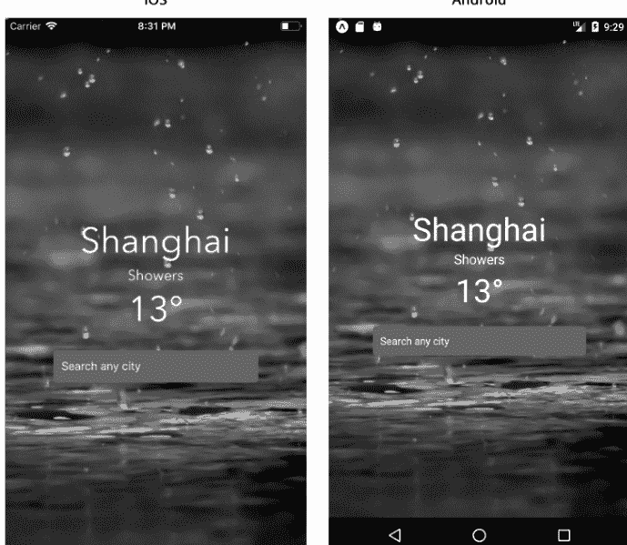

完成的应用

在本章中，我们将从零开始构建一个完整的 React Native 应用程序。我们将讨论如何设置开发环境，以及如何初始化一个新的 React Native 应用程序。我们还将学习 Expo 如何让我们在我们的移动设备上快速原型化和预览我们的应用程序。在介绍了 React Native 的一些基础知识之后，我们将探讨如何使用*组件*来组合应用程序。组件是一种强大的范式，用于组织视图和管理动态数据。

我们即将涉及广泛的主题，如样式和数据管理。本章将展示所有这些主题如何在高层面上协同工作。在后续章节中，我们将深入探讨这里涉及的概念。

## 代码示例

本书以示例为驱动。每一章都设置为动手教程。

我们将从头开始构建应用程序。随书附赠的下载包含每个应用程序的完成版本，以及我们在构建过程中开发的每个版本（"示例代码"）。如果你正在跟随学习，我们建议你使用示例代码来复制粘贴较长的示例或调试意外错误。如果你没有跟随学习，你可以参考示例代码以获取更多关于给定代码示例的上下文。

本书所有章节的示例代码结构遵循以下模式：

```
components/
├── App.js
├── 1/
│   ├── components/
│   └── App.js
├── 2/
│   ├── components/
│   └── App.js
├── 3/
│   ├── components/
│   └── App.js
// ...
```

目录的顶层是 `App.js` 和 `components/`。这是应用程序完成版本的代码。在编号文件夹（`1/`、`2/`、`3/`）中，是我们在本章中逐步构建的应用程序的不同版本。

以下是本书中代码示例的样子：

```
weather/1/App.js

render() {
  return (
    <View style={styles.container}>
      <Text>Open up App.js to start working on your app!</Text>
      <Text>Changes you make will automatically reload.</Text>
      <Text>Shake your phone to open the developer menu.</Text>
    </View>
  );
}
```

请注意，代码块的标题包含你可以在示例代码中找到此示例的路径（`weather/1/App.js`）。

## JavaScript

本书假设你具备一些 JavaScript 知识。

React Native 使用 [Babel](https://babeljs.io/) 作为 JavaScript 编译器，使我们能够使用最新版本的 JavaScript，即 ES2016 进行开发。要了解我们所说的 JavaScript 版本是什么意思，你可以参考[附录](https://babeljs.io/)。

我们在[附录](https://babeljs.io/)中重点介绍了一些 JavaScript 的新特性。我们会在相关时引用附录。

<sup>12</sup>https://babeljs.io/


 ## 启动项目

### 创建 React Native 应用

首先，我们将使用 [Create React Native App](https://github.com/react-community/create-react-native-app)（CRNA），这是一个让 React Native 入门变得极其简单的工具。如果你之前使用过 [Create React App](https://github.com/facebookincubator/create-react-app)，你会发现两者的相似之处——无需任何构建配置即可启动和运行。我们可以使用 [yarn](https://yarnpkg.com) 全局安装它。

### yarn

[yarn](https://yarnpkg.com) 是一个节点包管理器，用于*自动化*管理应用程序中所有必需的依赖项和包，这些依赖和包来自 npm——一个已发布的 JavaScript 库和项目的在线仓库。这是通过将所有依赖项定义在一个单独的 `package.json` 文件中实现的。

> npm 也有一个命令行工具 `npm`，让我们可以维护和控制依赖项。然而，我们用来构建应用程序的工具 CRNA 目前与最新版本的 npm，即 `npm` v5 不兼容。因此，我们在整本书中将使用 `yarn`。

你可以参考[文档](https://yarnpkg.com/lang/en/docs/install)来了解如何在你的操作系统上安装 `yarn`。该文档还解释了如何安装 [node](https://nodejs.org/en/)。不过，要使用 CRNA，需要 `Node.js` v6 或更高版本。

以下是一些常用的 `yarn` 命令列表：

- `yarn init` 创建一个 `package.json` 文件，并将其直接添加到我们的项目中。
- `yarn` 将 `package.json` 中列出的所有依赖项安装到本地的 `node_modules` 文件夹中。
- `yarn add new-package` 将特定包安装到我们的项目中，并将其作为依赖项包含在 `package.json` 中。依赖项是我们运行代码时需要的包。
- `yarn add new-package --dev` 将特定包安装到我们的项目中，并将其作为*开发*依赖项包含在 `package.json` 中。开发依赖项是仅在开发工作流中需要的包。在生产环境中运行应用程序时不需要它们。
- `yarn global add new-package` 将包全局安装，而不是本地安装到特定项目。当我们需要在机器上的任何地方使用命令行工具时，这很有用。

如果我们已经安装了低于 v5 的旧版本 npm，也可以使用它来代替 yarn，并运行其[等效命令](https://yarnpkg.com/lang/en/docs/migrating-from-npm/#tocicker/cli-commands-comparison)。

## Watchman

[Watchman](https://facebook.github.io/watchman/) 是一个文件监控服务，用于监控文件并在文件被修改时触发操作。如果你使用 macOS 作为操作系统，Expo 和 React Native 文档建议安装 Watchman 以获得更好的性能。安装该服务的说明可以在[这里](https://facebook.github.io/watchman/docs/install.html#installing-on-os-x-via-homebrew)找到。

## Expo

[Expo](https://expo.io/) 是一个平台，提供多种不同的工具来构建功能完整的 React Native 应用程序，而无需编写原生代码。使用 CRNA 开始项目会自动创建一个利用 Expo 开发环境的应用程序。

利用 Expo 的好处是，构建应用程序不需要使用 iOS 的 Xcode 或 Android 的 Android Studio。这意味着开发者甚至可以在没有 Mac 电脑的情况下构建原生 iOS 应用程序。使用 CRNA 和 Expo 是开始使用 React Native 最简单的方式，也是 React Native [文档](https://facebook.github.io/react-native/docs/getting-started.html)中推荐的方式。

### 包含原生代码

使用 Expo 和 CRNA 并不是启动 React Native 应用程序的唯一方式。如果我们需要启动一个能够包含原生代码的项目，就需要改用 [React Native CLI](https://facebook.github.io/react-native/docs/getting-started.html#installing-dependencies)。不过，使用这种方式，我们的应用程序将分别需要 Xcode 和 Android Studio 来开发 iOS 和 Android。

Expo 还提供了许多不同的 API 用于设备特定属性，如联系人、相机和视频。然而，如果我们需要包含 Expo 未提供的原生 iOS 或 Android 依赖项，就需要完全*弹射*（eject）出该平台。从 Expo 弹射应用程序意味着我们可以完全控制管理原生依赖项，但从那时起需要使用 React Native CLI。

我们将在本书后面探讨如何将原生模块添加到 React Native 项目中。

## 预览应用

要使用 Expo 开发和预览应用，我们需要安装其 iOS 或 Android 客户端应用^24^，以便在设备上开发和运行 React Native 应用。

## Android

在你的 Android 移动设备上，在 Google Play^25^ 安装 Expo Client。然后选择扫描二维码，安装应用后扫描此二维码：

如果此二维码无法使用，我们建议确保你安装了最新版本的 Expo 应用，并且你阅读的是本书的最新版本。

> 除了扫描二维码，你也可以在 Expo 中输入项目 URL，exp://exp.host/@fullstackio/weather，来加载应用程序。

## iOS

你可以通过 App Store^26^ 安装 Expo Client。然而，使用 iOS 设备时，无法扫描二维码。这意味着我们需要先构建最终应用才能预览。我们可以通过导航到示例代码文件夹中的 `weather/` 目录并运行以下命令来实现：

```
cd weather
yarn
yarn start
```

这将启动 React Native 打包器。按 `s` 将允许你通过短信或电子邮件发送链接到你的设备（你需要提供你的手机号码或电子邮件地址）。完成后，点击链接将在 Expo Client 中打开应用程序。

为了让应用在你的实体设备上加载，你需要确保你的手机与计算机连接到同一个本地网络。

### 本地开发工具

除了客户端应用，Expo 还提供两个本地开发工具，让我们可以预览、共享和发布我们的项目：

- XDE^27^，即 Expo 开发环境，是一个我们可以在 macOS、Windows 或 Linux 上使用的桌面应用。
- exp^28^ 是一个命令行界面。

这两个选项都提供了许多不同的命令和服务，我们可以用来管理我们的应用程序。除了使用 CRNA 启动打包器时提供的 `s` 热键来发送链接到 iOS 设备外，我们还可以使用 `exp` 或 XDE 来代替。

我们将在本书后面介绍部署和发布应用时，更详细地探讨如何使用这些本地开发工具。

## 准备应用

此时，你应该能看到最终应用程序在你的设备上成功加载。花几分钟时间试用一下这个应用，熟悉一下。尝试搜索不同的城市，以及一个根本不存在的地点。

如果你计划在阅读本章的同时构建应用程序，你需要创建一个全新的项目。安装 `yarn` 后，让我们运行以下命令全局安装 Create React Native App（CRNA）：

```
yarn global add create-react-native-app@1.0.0
```

> @1.0.0 指定了要安装的 `create-react-native-app` 版本。锁定版本 1.0.0 很重要，这样你机器上的版本才能与书中的版本匹配。

我们将把我们的应用程序命名为 `weather`，可以使用以下命令开始（此命令可能需要一些时间）：

```
create-react-native-app weather --scripts-version 1.14.0
```

> 重要的是，我们将 --scripts-version 指定为 1.14.0。我们稍后会讨论这个问题。

然后我们将导航到该目录并启动应用：

```
cd weather
yarn start
```

打包器运行后，我们可以继续使用 Android 设备扫描二维码，或使用 `s` 热键直接发送链接到我们的 iOS 设备。重要的是要记住，我们的设备需要与计算机连接到同一个本地网络才能正常工作。

现在，查看应用会显示我们的起点：


## 在模拟器上运行

正如我们提到的，使用 Expo 客户端应用可以让我们在不使用原生开发工具（iOS 使用 Xcode，Android 使用 Android Studio）的情况下运行我们的应用。

不过，如果我们恰好拥有所需的构建工具，我们仍然可以在虚拟设备或模拟器中运行我们的应用：

- 在 Mac 上，`yarn run ios` 会启动开发服务器并在 iOS 模拟器中运行应用。我们也可以通过 `yarn start` 单独启动打包工具，然后按 `i` 键打开模拟器。
- 安装了所需的 [Android 工具](https://facebook.github.io/react-native/docs/getting-started.html)后，`yarn run android` 会在 Android 模拟器中启动应用。同样，当 React Native 打包工具运行时，按 `a` 键也可以启动模拟器。

使用模拟器/仿真器运行应用有助于在不同的设备和屏幕尺寸上进行测试。在虚拟设备上更新和测试代码更改也可能更快。然而，在某个时刻在实际设备上运行你的应用是很重要的，这样才能更好地了解它的实际外观和手感。

默认情况下，CRNA 启用了*实时重载*。这意味着如果你编辑并保存任何文件，移动设备上的应用将会**自动重载**。此外，任何构建错误和日志都会直接显示在终端中。

让我们来看看我们应用的目录结构。打开一个新的终端窗口。

导航到这个应用：

```
cd weather
```

然后运行 `ls -a` 查看目录中的所有内容：

```
ls -a
```

> 如果你使用的是 PowerShell 或其他非 Unix shell，可以直接运行 `ls`。

虽然根据你的操作系统不同，输出会略有差异，但你应该会看到目录中列出的所有文件：

```
├── node_modules/
├── .babelrc
├── .flowconfig
├── .gitignore
├── .watchmanconfig
├── App.js
├── app.json
├── App.test.js
├── package.json
├── README.md
└── yarn.lock
```

让我们逐一了解这些文件：

- `node_modules/` 包含我们应用中的所有第三方包。任何新的依赖项和开发依赖项都会放在这里。
- `.babelrc` 允许我们为配置 [Babel](https://babeljs.io/) (superscript 30) 定义预设和插件。正如我们之前提到的，Babel 是一个转译器，它将较新的实验性 JavaScript 编译成较旧的版本，以便与不同的平台保持兼容。
- `.flowconfig` 允许我们配置 [Flow](https://flow.org/) (superscript 31)，一个用于 JavaScript 的静态类型检查器。Flow 是 React Native 工具链的一部分，这个文件会自动包含在任何 React Native 应用中。我们在本章不会使用 Flow，但我们会简要探讨使用 prop-types 进行属性验证。
- `.gitignore` 是我们指定哪些文件应该被 Git 忽略的地方。我们可以看到 `node_modules/` 和 `.expo/` 目录已经被包含在内。
- `.watchmanconfig` 定义了 Watchman 的配置。
- `App.js` 是我们应用代码所在的地方。
- `app.json` 是一个配置文件，允许我们添加关于 Expo 应用的信息。可以包含在此文件中的属性列表在[文档](https://docs.expo.io/versions/v18.0.0/guides/configuration.html) (superscript 32) 中有说明。
- `App.test.js` 作为一个示例测试文件包含在内，包含一个单独的测试。CRNA 打包了 [Jest](https://facebook.github.io/jest/) (superscript 33) 作为其测试平台。我们将在"测试"章节详细介绍 React Native 应用的单元测试。
- `package.json` 是我们向包管理器提供应用信息以及指定所有项目依赖项的地方。
- `README.md` 是一个 Markdown 文件，通常用于提供项目描述。
- `yarn.lock` 是 yarn 记录每个已安装依赖项版本的地方。

## package.json

让我们更仔细地看看生成的 `package.json` 文件：

1. https://babeljs.io/
2. https://flow.org/
3. https://docs.expo.io/versions/v18.0.0/guides/configuration.html
4. https://facebook.github.io/jest/

```
{
  "name": "weather",
  "version": "0.1.0",
  "private": true,
  "devDependencies": {
    "react-native-scripts": "1.14.0",
    "jest-expo": "~27.0.0",
    "react-test-renderer": "16.3.1"
  },
  "main": "./node_modules/react-native-scripts/build/bin/crna-entry.js",
  "scripts": {
    "start": "react-native-scripts start",
    "eject": "react-native-scripts eject",
    "android": "react-native-scripts android",
    "ios": "react-native-scripts ios",
    "test": "jest"
  },
  "jest": {
    "preset": "jest-expo"
  },
  "dependencies": {
    "expo": "^27.0.1",
    "react": "16.3.1",
    "react-native": "~0.55.2"
  }
}
```

`name` 和 `version` 属性始终是必需的。`dependencies` 和 `devDependencies` 分别定义了我们的应用依赖项和开发依赖项。

注意有三个 `devDependencies`：

- `react-native-scripts`
- `jest-expo`
- `react-test-renderer`

最后两个包与测试相关。虽然 CRNA 是初始化我们项目的工具，**但 `react-native-scripts` 包是在开发过程中运行我们 React Native 应用的引擎**。当我们上面指定 `--scripts-version` 为 `1.14.0` 时，我们指的就是这个包。

在我们的 `package.json` 中，`scripts` 对象定义了我们所有的脚本命令。这些命令都由 `react-native-scripts` 包处理。`yarn run start`、`yarn run android` 和 `yarn run ios` 命令允许我们启动应用开发服务器和/或在虚拟设备或模拟器上运行。`scripts` 对象还包含另外两个命令：

- `yarn test` 运行我们应用中的所有 Jest 测试。
- `yarn run eject` 开始将我们的应用从 CRNA 工具链中弹出的过程。正如我们之前提到的，如果我们需要包含含有原生代码的 React Native 库，或者如果我们需要自己编写原生代码，这可能是必要的。

## `utils/` 目录

如果你查看书中的示例代码，你会注意到每个应用都有一个 `utils/` 目录。这个目录包含应用将使用的辅助函数。你不需要关心这些函数的细节，因为它们与本章的核心概念无关。

当我们在应用开发过程中需要使用 `utils/` 提供的工具时，我们会提醒你从示例代码中复制该文件夹。你也可以在每个项目初始化后立即执行此操作。

## 组件

使用较新版本的 JavaScript，我们可以使用 `classes` 来定义带有属性的对象。React Native 允许我们使用这种语法来创建 `组件`。让我们来看看我们应用中组件的可化分解：

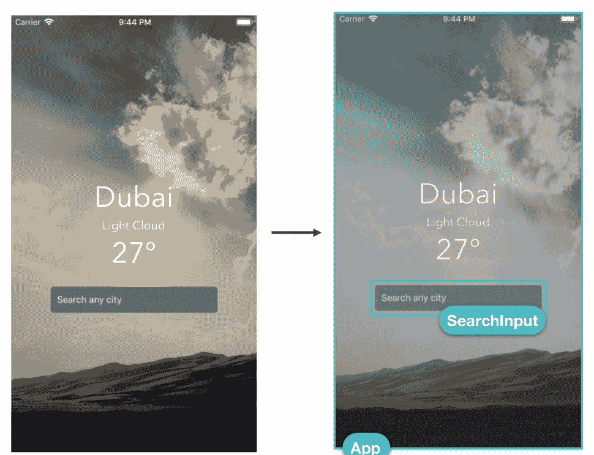

## 组件结构

我们有一个 `App` 组件，它代表整个*屏幕*，并包含显示给用户的天气信息。在这个组件内部，我们有一个 `SearchInput` 组件，允许我们搜索不同的城市。

## App

`App` 是使用默认 CRNA 应用创建的第一个组件。让我们看看它的文件：

## weather/1/App.js

```
import React from 'react';
import { StyleSheet, Text, View } from 'react-native';

export default class App extends React.Component {
  render() {
    return (
      <View style={styles.container}>
        <Text>Open up App.js to start working on your app!</Text>
        <Text>Changes you make will automatically reload.</Text>
        <Text>Shake your phone to open the developer menu.</Text>
      </View>
    );
  }
}

const styles = StyleSheet.create({
  container: {
    flex: 1,
    backgroundColor: '#fff',
    alignItems: 'center',
    justifyContent: 'center',
  },
});
```

注意我们文件中定义了一个名为 `App` 的类，它继承了 `React.Component`。使用 `extends` 允许我们将一个类声明为另一个类的子类。在这里，我们将 `App` 定义为 `React.Component` 的子类。这就是我们如何指定特定类为应用中的*组件*。

> 如果你想了解更多关于 JavaScript 中类的工作原理，请参考我们的附录。

我们还可以将方法作为属性附加到类上，这同样适用于 React Native 中的组件类。我们可以看到这个组件已经有一个了，就是 `render` 方法：


weather/1/App.js

```javascript
  render() {
    return (
      <View style={styles.container}>
        <Text>Open up App.js to start working on your app!</Text>
        <Text>Changes you make will automatically reload.</Text>
        <Text>Shake your phone to open the developer menu.</Text>
      </View>
    );
  }
```

我们在设备上看到的内容与这个方法中描述的一致。**`render()` 方法是 React Native 组件唯一必需的方法。** React Native 使用该方法的返回值来决定为组件渲染什么内容。

在使用 React Native 时，我们将应用程序的不同部分表示为**组件**。这意味着我们可以使用不同的可复用逻辑块来构建应用程序，每个逻辑块负责显示用户界面的特定部分。让我们来分解一下我们当前已有的组件：

-   整个应用程序由 `App` 作为顶层组件进行渲染。虽然它是作为设置新的 CRNA 项目的一部分自动创建的，但这个组件是一个自定义组件，负责渲染应用程序所需的内容。
-   `View` 组件用作布局容器。
-   在 `View` 内部，我们使用 `Text` 组件来显示应用程序中的文本行。与 `App` 不同，`View` 和 `Text` 都是**内置的** React Native 组件，它们被导入并在我们的自定义组件中使用。

我们可以看到，我们的 `App` 组件使用并返回了一个类似 HTML 的结构。这就是 **JSX**，它是 JavaScript 的一个扩展，允许我们使用类似 XML 的语法来定义用户界面结构。

## JSX

当我们使用 React Native 构建应用程序时，组件最终会渲染原生视图并显示在设备上。因此，组件的 `render()` 方法需要描述视图应如何呈现。换句话说，React Native 允许我们用 JavaScript 来描述组件的 iOS 和 Android 表示。

**JSX** 的创建是为了让组件的 JavaScript 表示更易于理解。它允许我们在标记语言中构建组件并直观地展示其层级结构。看看这个 JSX 片段：

```jsx
<View>
    <Text style={{ color: 'red' }}>
        Hello, friend! I am a basic React Native component.
    </Text>
</View>
```

在这里，我们将一个 `Text` 组件嵌套在一个 `View` 组件内。注意我们如何在对象 (`{ color: 'red' }`) 周围使用花括号 (`{}`) 来设置 `Text` 的 `style` 属性值。在 JSX 中，花括号是一个分隔符，它向 JSX 表明花括号之间包含的是一个 JavaScript 表达式。另一个分隔符是用引号表示字符串，像这样：

```jsx
<TextInput placeholder="This is a string" />
```

> 即使上面的 JSX 看起来可能类似 HTML，但它实际上只是被编译成 JavaScript 函数调用（例如：`React.createElement(View)`）。因此，我们需要在任何包含 JSX 的文件顶部导入 React。更多细节请参阅附录。在运行时，React Native 会负责为每个组件渲染实际的原生用户界面。

## Props

我们使用导入的 `Text` 组件来包裹 `App` 组件的每一行文本输出：

```jsx
<Text>Open up App.js to start working on your app!</Text>
```

并使用导入的 `View` 组件来包裹所有的 `Text` 组件：

```jsx
<View style={styles.container}>
    ...
</View>
```

Props 允许我们向组件传递参数以自定义其功能。这里，`View` 用于布局整个屏幕内容。我们只附加了一个 `style` prop，它允许我们传入样式参数来调整 `View` 组件在设备上的渲染方式。React Native 提供的每个内置组件都有其自己的一组有效 prop，我们可以用于自定义。

如果你熟悉 HTML，这会非常相似。例如，在 HTML 中，假设你想插入一张名为 `image.png` 的图片。你会指定一个带有 `src` 属性的 `img` 标签，像这样：

```html

```

为了让你了解其相似性，在 React Native 中我们可以使用 `Image` 组件来包含图片。我们使用 `source` prop 来指定位置：

```jsx
<Image source={require('./image.png')}>
```

我们将在后面更详细地介绍图片。

就像我们的 `View` 组件一样，React Native 中的许多组件都接受一个 `style` prop。样式是一个很大的主题，我们将在整本书中探讨。不过，我们可以看看 `App.js` 底部的 `styles` 对象，了解一下它的工作原理：

```javascript
const styles = StyleSheet.create({
  container: {
    flex: 1,
    backgroundColor: '#fff',
    alignItems: 'center',
    justifyContent: 'center',
  },
});
```

Web 开发者可能会认出这看起来像 CSS（层叠样式表），它用于设置网页样式。需要注意的是，React Native 中的样式设置*并不*使用 CSS。然而，React Native 借用了许多来自 Web 开发的样式命名。在这里，我们指定文本应该居中，背景颜色应该是白色（`#fff`）。

> 如果你以前用过 CSS，你会发现 React Native 的样式设置非常熟悉。如果没有，别担心！它很容易掌握。

具体来说，`styles.container` 具有 `flex`、`alignItems` 和 `justifyContent` 属性。这些用于将 `View` 定位在屏幕中央。React Native 使用 **flexbox** 在不同设备尺寸上一致地布局和对齐项目。我们将在后面的章节中更详细地介绍 flexbox 的工作原理。

要构建我们的天气应用程序，我们将从布局和样式开始。一旦我们掌握了天气应用程序的一些基本要素，我们就可以开始探索管理数据的策略。

正如我们在完整版应用程序中看到的，我们希望应用程序将**城市**、**温度**和**天气状况**作为单独的文本字段显示出来。尽管我们最终会与天气 API 交互以获取实际数据，但我们将从硬编码这些值开始。

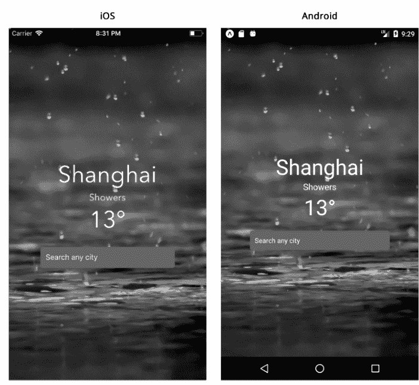

## 添加样式

为了更好地掌握样式，让我们尝试向其中一个文本字段添加一个带有 `color` 属性的对象：

```jsx
<View style={styles.container}>
  <Text style={{ color: 'red' }}>
    Open up App.js to start working on your app!
  </Text>
  <Text>Changes you make will automatically reload.</Text>
  <Text>Shake your phone to open the developer menu.</Text>
</View>
```

注意上面最外层的括号是*分隔符*，包围着我们的 JavaScript 语句。分隔符内部是一个 JavaScript 对象。在 React Native 中，如果对象足够小，通常直接将它写在一行上。

然而，双括号（`{{}}`）可能会让人困惑。这是编写相同组件的另一种方式：

```jsx
const style = { color: 'red' };

return (
  <View style={styles.container}>
    <Text style={style}>
      Open up App.js to start working on your app!
    </Text>
```

保存 `App.js`。应用程序重新加载后，我们可以看到样式已应用：

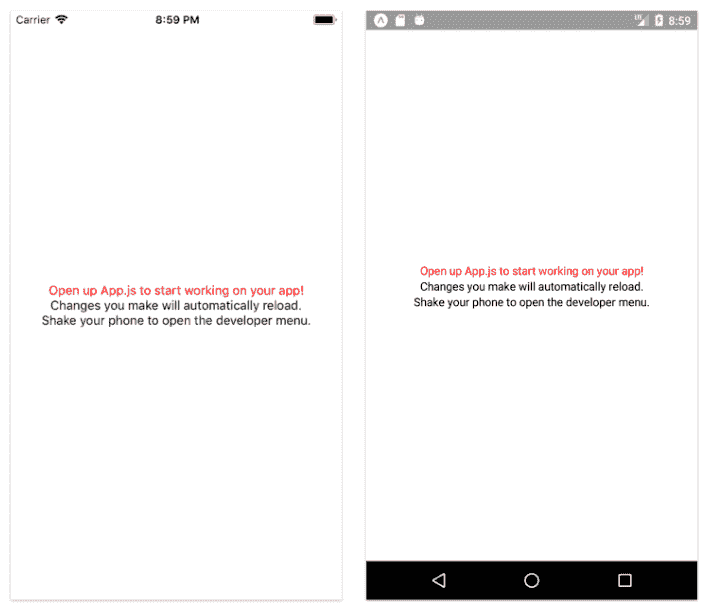


正如我们之前提到的，**实时重新加载**在 Expo 中是默认启用的。这意味着代码的任何更改都会导致应用程序立即重新加载。如果你保存文件后没有立即看到任何变化，你可能需要检查此功能是否已启用。[文档](https://docs.expo.io/versions/latest/guides/up-and-running.html#cant-see-your-changes)解释了如何打开开发者菜单并启用/禁用此功能。

虽然我们可以用这种方式为整个组件设置样式，但在组件中使用大量的*内联*样式（或直接在 *style* prop 的分隔符*内*定义的样式属性）会使内容更难阅读和理解。

我们可以通过利用 React Native 的 Stylesheet API 将样式与组件分离来解决这个问题。使用 Stylesheet，我们可以创建具有类似于 CSS 样式表属性的样式。我们可以看到 Stylesheet 已经在文件顶部导入。它用于声明我们的第一个样式 `styles.container`，我们将其用于 `View`。我们可以在样式中添加一个名为 `red` 的新样式：

```javascript
const styles = StyleSheet.create({
  container: {
    flex: 1,
    backgroundColor: '#fff',
    alignItems: 'center',
    justifyContent: 'center',
  },
  red: {
    color: 'red',
  },
});
```

然后让 `Text` 使用这个样式：

```jsx
<View style={styles.container}>
  <Text style={styles.red}>
    Open up App.js to start working on your app!
  </Text>
  <Text>Changes you make will automatically reload.</Text>
  <Text>Shake your phone to open the developer menu.</Text>
</View>
```

如果我们保存文件并查看应用程序，我们可以看到最终结果是一样的。
现在让我们添加一些合适的样式和文本字段，以便显示某个地点的一些天气数据。要向单个组件添加多个样式，我们可以传递**一个样式数组**：

---

<sup>34</sup> https://docs.expo.io/versions/latest/guides/up-and-running.html#cant-see-your-changes


weather/2/App.js

```
14       <Text style={[styles.largeText, styles.textStyle]}>San Francisco</Text>
15       <Text style={[styles.smallText, styles.textStyle]}>Light Cloud</Text>
16       <Text style={[styles.largeText, styles.textStyle]}>24°</Text>
```

需要特别说明的是，当传入一个数组时，如果存在重复的属性，数组末尾的样式会覆盖前面的样式。我们可以看到这里引用了三个新的样式：textStyle、smallText 和 largeText。让我们在 styles 对象中定义它们：

weather/2/App.js

```
29 const styles = StyleSheet.create({
30   container: {
31     flex: 1,
32     backgroundColor: '#fff',
33     alignItems: 'center',
34     justifyContent: 'center',
35   },
36   textStyle: {
37     textAlign: 'center',
38     fontFamily: Platform.OS === 'ios' ? 'AvenirNext-Regular' : 'Roboto',
39   },
40   largeText: {
41     fontSize: 44,
42   },
43   smallText: {
44     fontSize: 18,
45   },
46 });
```

- textStyle 指定了对齐方式（居中）以及 fontFamily。注意我们如何使用 Platform 为 iOS 和 Android 分别定义平台特定的字体。这样做是因为两个操作系统提供了不同的原生字体集。
- smallText 和 largeText 分别指定了不同的字号。

Platform 是 React Native 的内置 API。我们需要确保导入它：

weather/2/App.js

```
1 import React from 'react';
2 import {
3   StyleSheet,
4   Text,
5   KeyboardAvoidingView,
6   Platform,
7   TextInput,
8 } from 'react-native';
```

现在让我们看看应用程序的效果：

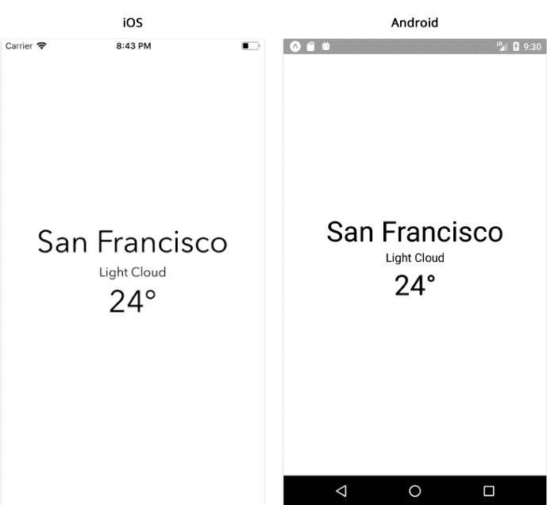

## 平台特定属性

Platform API 允许我们根据设备的操作系统，在组件中有条件地应用不同的样式或属性。该对象的 OS 属性会根据用户的设备返回 iOS 或 android。

虽然这是一种根据用户设备在应用中应用不同属性的相对简单的方式，但在某些场景下，我们可能希望组件在不同操作系统之间有较大的差异。

我们还可以使用 `Platform.select` 方法，该方法以操作系统作为对象的键，并根据设备返回正确的结果：

```
textStyle: {
  textAlign: 'center',
  ...Platform.select({
    ios: {
      fontFamily: 'AvenirNext-Regular',
    },
    android: {
      fontFamily: 'Roboto',
    },
  }),
},
```

## 独立文件

与其在整个组件文件中多次使用 `Platform.OS` 进行条件检查，我们还可以利用**平台特定文件**来代替。我们可以创建两个独立的文件来表示相同的组件，每个文件使用不同的扩展名：`.ios.js` 和 `.android.js`。如果两个文件导出相同的组件类名，React Native 打包器会根据路径扩展名选择正确的文件。我们将在本书后续内容中更深入地探讨平台特定的差异。

## 文本输入

现在我们已经有了显示位置、天气状况和温度的文本字段。接下来需要做的是提供某种输入方式，允许用户搜索特定城市。目前我们仍然使用硬编码的数据。只有在所有组件都就位之后，我们才会开始使用 API 获取真实数据。

React Native 提供了内置的 `TextInput` 组件，我们可以将其导入到组件中以接受用户输入。让我们将其放在 `View` 容器中，位于 `Text` 组件下方（记得也要导入它！）：

```
<Text style={[styles.largeText, styles.textStyle]}>San Francisco</Text>
<Text style={[styles.smallText, styles.textStyle]}>Light Cloud</Text>
<Text style={[styles.largeText, styles.textStyle]}>24°</Text>

<TextInput
  autoCorrect={false}
  placeholder="Search any city"
  placeholderTextColor="white"
  style={styles.textInput}
  clearButtonMode="always"
/>
```

`TextInput` 有许多可用的属性。我们在这里介绍基础知识，更多详细内容将在"核心组件"章节中介绍。这里我们指定了占位文本、占位文本颜色以及组件本身的样式。让我们在其他样式下方创建它的样式对象 `textInput`：

```
smallText: {
  fontSize: 18,
},
textInput: {
  backgroundColor: '#666',
  color: 'white',
  height: 40,
  width: 300,
  marginTop: 20,
  marginHorizontal: 20,
  paddingHorizontal: 10,
  alignSelf: 'center',
},
```

正如前面提到的，我们在 React Native 中提供样式的所有属性与使用 CSS 的方式非常相似。现在让我们看看应用程序的效果：

## iOS

## Android

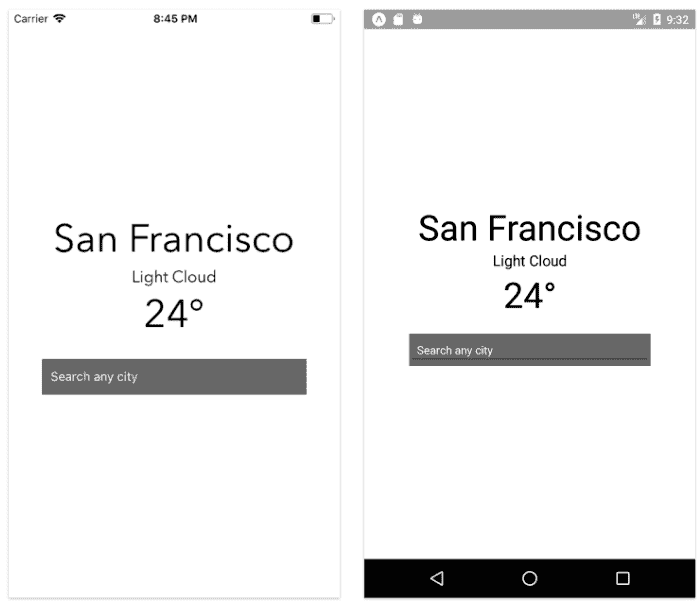

## 文本输入

我们可以看到，Android 上的文本输入有一个默认的下划线。稍后我们会介绍如何移除它。

我们还指定了 `clearButtonMode` 属性为 `always`。这会在输入字段中输入字符后，在右侧显示一个按钮，允许我们清除文本。此功能仅在 iOS 上可用。


## 文本输入清除按钮

现在我们可以在输入框中输入内容了！

如果你使用的是 iOS 模拟器，可以连接硬件键盘并在任何输入框中使用。可以通过 `Shift + ⌘ + K` 或前往 `Hardware -> Keyboard -> Connect Hardware Keyboard` 来启用。

启用后，软件键盘可能不会默认显示。你可以通过按 `⌘ + K` 或前往 `Hardware -> Keyboard -> Toggle Software Keyboard` 来切换显示。

这样，每次点击输入框时，软件键盘都会像在真实设备上一样显示，你可以使用硬件键盘进行输入。

不过，你可能已经注意到，当点击聚焦输入框时，键盘会弹出并在 Android 上遮挡输入框，在 iOS 上也会非常接近：

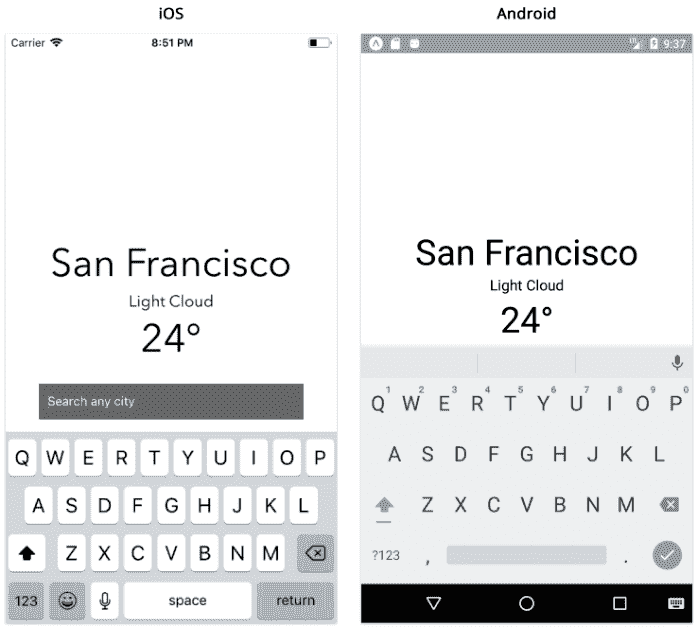

由于虚拟键盘大约会遮挡设备屏幕的一半，这是在应用中使用文本输入时常见的问题。幸运的是，React Native 包含了 `KeyboardAvoidingView` 组件，通过允许我们调整其他组件相对于虚拟键盘的渲染位置来解决这个问题。让我们导入并使用这个组件来替代 `View`：

## weather/2/App.js

```
render() {
  return (
    <KeyboardAvoidingView style={styles.container} behavior="padding">
      <Text style={[styles.largeText, styles.textStyle]}>San Francisco</Text>
      <Text style={[styles.smallText, styles.textStyle]}>Light Cloud</Text>
      <Text style={[styles.largeText, styles.textStyle]}>24°</Text>

      <TextInput
        autoCorrect={false}
        placeholder="Search any city"
        placeholderTextColor="white"
        style={styles.textInput}
        clearButtonMode="always"
      />
    </KeyboardAvoidingView>
  );
}
```

注意 `KeyboardAvoidingView` 接受一个 `behavior` 属性，我们可以用它来自定义键盘的调整方式。它可以改变高度、位置或底部内边距来适应虚拟键盘的位置。这里我们指定了 `padding`。

现在点击文本输入框时，我们的组件文本和输入字段会被移出键盘的遮挡区域


一个独立的组件，用于对主 App 组件隐藏其实现细节。让我们在应用的根目录下创建一个 components 目录，并添加以下文件：

```
components/
    - SearchInput.js
```

我们创建的所有自定义组件，只要是在主 App 组件中使用的，都将放在这个目录中。对于更复杂的应用，我们可能还会在 components 目录内创建子目录来进行更具体的分类。由于这个应用比较简单，我们就使用扁平化的 components 目录结构。

SearchInput 将是我们的第一个自定义组件，所以让我们把 App.js 中所有关于 TextInput 的代码移到 SearchInput.js 中：

```
weather/3/components/SearchInput.js

1 import React from 'react';
2 import { StyleSheet, TextInput, View } from 'react-native';

4 export default class SearchInput extends React.Component {
5   render() {
6     return (
7       <View style={styles.container}>
8         <TextInput
9           autoCorrect={false}
10          placeholder={this.props.placeholder}
11          placeholderTextColor="white"
12          underlineColorAndroid="transparent"
13          style={styles.textInput}
14          clearButtonMode="always"
15        />
16      </View>
17    );
18  }
19 }

21 const styles = StyleSheet.create({
22   container: {
23     height: 40,
24     marginTop: 20,
25     backgroundColor: '#666',
26     marginHorizontal: 40,
27     paddingHorizontal: 10,
28     borderRadius: 5,
29   },
```

```
textInput: {
  flex: 1,
  color: 'white',
},
});
```

让我们来分解一下这个文件包含的内容：

- 我们导出了一个名为 `SearchInput` 的组件。
- 这个组件接受一个 `placeholder` prop。
- 这个组件返回一个 React Native 的 `TextInput`，并为其指定了几个属性，包裹在一个 `View` 中。我们为视图容器应用了适当的样式，包括 `borderRadius`。我们还添加了 `underlineColorAndroid="transparent"` 来移除 Android 上默认显示的深色下划线。

> `this` 是 JavaScript 中的一个特殊关键字。关于 `this` 的细节有些微妙，但就本书的大部分内容而言，**`this` 将绑定到 React Native 组件类**。因此，当我们在组件内部编写 `this.props` 时，我们是在访问该组件上的 props 属性。当我们在后续章节中偏离这一规则时，我们会特别指出。

如需了解更多关于 `this` 的详细信息，请查看 [MDN](https://developer.mozilla.org/en-US/docs/Web/JavaScript/Reference/Operators/this) 上的这一页面。

## 自定义 props

正如你可能还记得的，在 `App.js` 中，我们将 `TextInput` 的 `placeholder` prop 设置为 "Search any city."，这会渲染一个带有占位符的文本输入框：


对于 `SearchInput`，我们可以再次为 `placeholder` 硬编码一个字符串。但如果我们在应用的其他地方也想添加一个搜索输入框呢？如果 `placeholder` 是可以自定义的，那就更好了。

在本章的前面部分，我们探讨了如何使用 `props` 与一些内置组件来定制它们的功能。我们也可以*创建* `props`，用于我们自己构建的自定义组件。

这就是我们在 `SearchInput` 中所做的。该组件接受 `placeholder` 这个 prop。相应地，`SearchInput` 使用这个值来设置 `TextInput` 上的 `placeholder` prop。

在 React Native 中，数据从父组件流向子组件的方式就是通过 props。当父组件渲染子组件时，它可以传递子组件依赖的 props。一个组件可以通过 `this.props` 对象访问它的所有 props。如果我们决定传递字符串 "Type Here" 作为 `placeholder` prop，`this.props` 对象将如下所示：

```
{ "placeholder": "Type Here" }
```

在这里，我们将设置 `App` 来渲染 `SearchInput`，这意味着 `App` 是 `SearchInput` 的*父*组件。我们的父组件负责传递 `placeholder` 的实际值。

我们现在正朝着有趣的方向发展。我们已经设置好了自定义的 `SearchInput` 组件，并且通过让它接受 `placeholder` prop，我们已经为它配置了可配置性。根据接收到的内容，它可以渲染我们想要的任何占位符消息。

## 导入组件

为了在 `App` 中使用 `SearchInput`，我们需要先导入该组件。我们可以从 `App.js` 中移除 `TextInput` 的逻辑，并让 `App` 改用 `SearchInput`：

```
weather/3/App.js
import React from 'react';
import { StyleSheet, Text, KeyboardAvoidingView, Platform } from 'react-native';

import SearchInput from './components/SearchInput';

export default class App extends React.Component {
  render() {
    return (
      <KeyboardAvoidingView style={styles.container} behavior="padding">
        <Text style={[styles.largeText, styles.textStyle]}>San Francisco</Text>
        <Text style={[styles.smallText, styles.textStyle]}>Light Cloud</Text>
        <Text style={[styles.largeText, styles.textStyle]}>24°</Text>

        <SearchInput placeholder="Search any city" />
      </KeyboardAvoidingView>
    );
  }
}
```

通过将所有 `TextInput` 的细节移到一个名为 `SearchInput` 的独立组件中，我们确保了父组件中不再显示任何与其具体实现相关的细节。我们也可以移除 styles 对象中定义的文本输入框样式。

关于应该多久将不同的 UI 逻辑隔离到独立的自定义组件中，并没有标准答案。React Native 的构建目的就是让我们能够以自包含组件的方式布局整个应用，这意味着我们应该将应用的不同部分分离成具有自定义功能的独立单元。这使我们能够构建一个更易于管理和理解的应用。我们已经将搜索输入框的相关知识隔离到了 `SearchInput` 组件中，我们将在本章中继续隔离应用的其他特定部分。

> 通常的做法是将导入分为两组：来自依赖项的导入，以及来自项目中其他文件的导入。这就是为什么我们在 `SearchInput` 上方留了一个空行。这取决于个人的风格偏好。

## 背景图片

正如我们在本章开头看到的已完成应用的照片所示，我们可以通过显示一张代表当前天气状况的背景图片，让我们的应用在视觉上更具吸引力。

在本书的示例代码中，我们包含了多种天气条件的图片。如果你查看 `weather/assets` 目录，你会发现 `clear.png`、`hail.png` 和 `showers.png` 等图片。

如果你正在跟着做，请从示例代码中将这两个文件夹复制到你的项目中：

1. weather/assets
2. weather/utils

> 我们前面提到过，书中每个项目的示例代码都包含了一个 `utils/` 文件夹。这个文件夹包含我们将在下面使用的辅助函数。

```
cp -r weather/{assets,utils} ~/react-native-projects/weather/
```

复制了 `assets` 和 `utils` 文件夹后，让我们更新 `App` 组件：

## weather/4/App.js

```
import React from 'react';
import {
  StyleSheet,
  View,
  ImageBackground,
  Text,
  KeyboardAvoidingView,
  Platform,
} from 'react-native';

import getImageForWeather from './utils/getImageForWeather';

import SearchInput from './components/SearchInput';

export default class App extends React.Component {
  render() {
    return (
      <KeyboardAvoidingView style={styles.container} behavior="padding">
        <ImageBackground
          source={getImageForWeather('Clear')}
          style={styles.imageContainer}
          imageStyle={styles.image}
        >
          <View style={styles.detailsContainer}>
            <Text style={[styles.largeText, styles.textStyle]}>
              San Francisco
            </Text>
            <Text style={[styles.smallText, styles.textStyle]}>
              Light Cloud
            </Text>
            <Text style={[styles.largeText, styles.textStyle]}>24°</Text>

            <SearchInput placeholder="Search any city" />
          </View>
        </ImageBackground>
      </KeyboardAvoidingView>
    );
  }
}
```

在这个组件中，我们从 `utils` 目录导入了一个 `getImageForWeather` 方法，该方法

根据天气类型返回资源目录中的特定图片。例如，`getImageForWeather('Clear')` 返回如下图片：

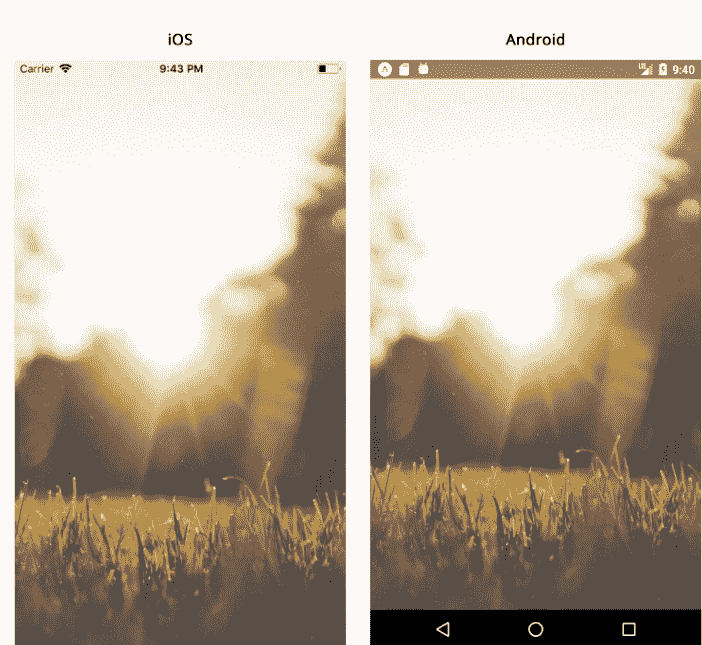

> 你可以随意查看我们在 `utils` 目录中使用的任何函数的实现细节，以便更好地了解其工作原理。

我们还引入了 React Native 内置的 `ImageBackground` 组件。让我们仔细看看如何在渲染方法中使用它：

```
weather/4/App.js

render() {
  return (
    <KeyboardAvoidingView style={styles.container} behavior="padding">
      <ImageBackground
        source={getImageForWeather('Clear')}
        style={styles.imageContainer}
        imageStyle={styles.image}
      ></ImageBackground>
    </KeyboardAvoidingView>
  );
}
```

从概念上讲，`ImageBackground` 组件是一个嵌套了 `Image` 的 `View`。`source` 属性接受一个图片位置，我们将其设置为 `getImageForWeather('Clear')`。我们知道这将始终返回上面显示的图片。`ImageBackground` 还使用 `style` 属性来为 `View` 容器设置样式，使用 `imageStyle` 属性来为图片本身设置样式。我们来添加两个新样式，并修改 `container` 样式：

```
weather/4/App.js

const styles = StyleSheet.create({
  container: {
    flex: 1,
    backgroundColor: '#34495E',
  },
  imageContainer: {
    flex: 1,
  },
  image: {
    flex: 1,
    width: null,
    height: null,
    resizeMode: 'cover',
  },
```

使用 `flex` 属性定义组件样式意味着它们将扩展以占用父容器中剩余的空间，相对于任何兄弟组件而言。它们按照定义的 `flex` 值的比例来分配这个空间。由于 `ImageBackground` 是 `KeyboardAvoidingView` 中唯一嵌套的元素，将 `imageContainer` 设置为 `flex: 1` 意味着该元素将填满其父组件的全部空间。我们从 `container` 中移除了 `justifyContent` 和 `alignItems`，以便 `ImageBackground` 可以占满整个设备屏幕。

我们还对实际的图片本身使用了 `flex: 1` 来设置样式，确保它占满其父容器的全部空间。特别是对于图片来说，该组件默认会获取并使用源图片的实际宽度和高度。因此，我们还将 `height` 和 `width` 属性设置为 `null`，以便图片尺寸适应容器。`resizeMode` 属性允许我们定义当 `Image` 元素与其实际尺寸不匹配时如何调整图片大小。将此属性设置为 *cover* 意味着图片将进行等比例缩放，直到其大小等于组件的大小。

🔍 "核心组件" 章节将更深入地探讨 React Native 中 flexbox、布局以及 `Image` 组件的工作原理

我们还将所有 `Text` 元素和 `SearchInput` 包裹在一个使用 `detailsContainer` 设置样式的视图容器中：

```
weather/4/App.js

<View style={styles.detailsContainer}>
  <Text style={[styles.largeText, styles.textStyle]}>
    San Francisco
  </Text>
  <Text style={[styles.smallText, styles.textStyle]}>
    Light Cloud
  </Text>
  <Text style={[styles.largeText, styles.textStyle]}>24°</Text>

  <SearchInput placeholder="Search any city" />
</View>
```

现在我们来设置它的样式：

```
weather/4/App.js

detailsContainer: {
  flex: 1,
  justifyContent: 'center',
  backgroundColor: 'rgba(0,0,0,0.2)',
  paddingHorizontal: 20,
},
```

在这里，我们确保 `ImageBackground` 内的容器也填满其父组件的全部空间，并使其项目在屏幕中心对齐。我们还通过设置该组件的 `backgroundColor` 为图片添加了一个半透明的叠加层。

这里最后需要做的是将我们的 `Text` 元素从黑色改为白色，以便在背景图片上显示得更清晰：

```
weather/4/App.js

textStyle: {
  textAlign: 'center',
  fontFamily: Platform.OS === 'ios' ? 'AvenirNext-Regular' : 'Roboto',
  color: 'white',
},
```

## 试一试

保存文件，查看我们的应用。我们现在应该能看到背景图片显示了！

## 修改位置

到目前为止，我们所采取的步骤在启动 React Native 应用程序时是相当常见的。我们硬编码所有数据，将应用组织成组件，并了解视觉布局以及它如何分解为组件。

然而，我们的应用此刻并不是很有用。例如，如果我们查看 `SearchInput` 组件，我们可以在输入框中输入任何内容，但没有任何实际结果发生。我们需要找到一种方法来跟踪对组件所做的更改，并将该信息存储在某个地方。换句话说，我们需要一些**可变数据**，当用户更改或提交输入字段时，这些数据会随之更新。

与其让 `SearchInput` 不管理任何代表用户输入的文本的数据，不如为它传入一个名为 `location` 的属性，以反映用户在文本输入字段中输入的内容：

```
render() {
  const location = 'San Francisco';

  return (
    <KeyboardAvoidingView style={styles.container} behavior="padding">
      <ImageBackground
        source={getImageForWeather('Clear')}
        style={styles.imageContainer}
        imageStyle={styles.image}
      >
        <View style={styles.detailsContainer}>
          <Text style={[styles.largeText, styles.textStyle]}>{location}</Text>
          <Text style={[styles.smallText, styles.textStyle]}>
            Light Cloud
          </Text>
          <Text style={[styles.largeText, styles.textStyle]}>24°</Text>

          <SearchInput placeholder="Search any city" />
        </View>
      </ImageBackground>
    </KeyboardAvoidingView>
  )
}
```

我们想要传入包含 `location` 数据的原因是，我们需要一种方式让我们的子组件修改该字段，并向上回传给我们的容器 `App` 组件。注意，我们将 `location` 的静态字符串移到了一个单独的常量中，并将其传递给 `SearchInput`。我们将其初始化为 San Francisco，以便在用户加载应用程序时显示为第一个位置。接下来我们只需要确保当用户实际更改 `SearchInput` 中的字段时，这个 `location` 常量能得到更新：

```
export default class SearchInput extends React.Component {
  handleChangeText(newLocation) {
    // We need to do something with newLocation
  }

  render() {
    return (
      <TextInput
        autoCorrect={false}
        placeholder={this.props.placeholder}
        placeholderTextColor="white"
        underlineColorAndroid="transparent"
        style={styles.textInput}
        clearButtonMode="always"
        onChangeText={this.handleChangeText}
      />
    );
  }
}
```

我们刚才做了什么？我们刚刚为 `TextInput` 组件添加了 `onChangeText` 作为新属性。注意，我们没有传入特定的对象或属性，而是传入了一个*函数*：

```
onChangeText={this.handleChangeText}
```

每当输入框中的文本发生变化时，这个方法就会被调用。React Native 提供的大量内置组件都包含 *事件驱动* 的属性，我们可以将特定的方法附加到这些属性上。我们将在本书中进一步探讨。

通过 `onChangeText`，我们的 `TextInput` 将更改后的文本作为参数返回，我们试图将其传入一个名为 `handleChangeText` 的单独方法中。目前我们的方法是空的，稍后我们将探讨如何完善它。

在 React Native 中，当我们想要处理与所引用组件相关的某些事件时，需要传入函数。对于 `TextInput` 组件，`onChangeText` 被设置为每当输入框中的文本发生变化时触发。我们需要在子组件（`TextInput`）中"监听"这个特定的事件，以便它能通知我们的父组件（`SearchInput`）对这个事件做出响应。为此，我们传入一个调用另一个函数的函数，换句话说，就是一个回调函数。

这是一种常见的模式，用于构建需要通知父组件某些事件的组件。不幸的是，按照我们刚才设置的方式，在这个例子中是行不通的。这是因为函数 `handleChangeText` 与组件实例具有不同的局部作用域。我们可以通过将函数绑定到其 `this` 对象的正确上下文来解决这个问题。


```
<TextInput
  placeholder={placeholder}
  placeholderTextColor="white"
  underlineColorAndroid="transparent"
  style={styles.textInput}
  clearButtonMode="always"
  onChangeText={this.handleChangeText.bind(this)}
/>
```

现在，这在当前场景下看起来没问题，但如果我们为每个事件处理函数都使用 bind 语句来构建组件，很快就会变得难以管理。其中一个原因是，例如，如果我们想在多个不同的子组件中使用 `handleChangeText`，我们就必须确保每次都将其绑定到正确的上下文。为了解决这个问题，我们可以使用**属性初始化器**来处理事件：

```
export default class SearchInput extends React.Component {
  handleChangeText = (newLocation) => {
    // We need to do something with newLocation
  }

  render() {
    return (
      <TextInput
        autoCorrect={false}
        placeholder={this.props.placeholder}
        placeholderTextColor="white"
        underlineColorAndroid="transparent"
        style={styles.textInput}
        clearButtonMode="always"
        onChangeText={this.handleChangeText}
      />
    );
  }
}
```

这允许我们使用箭头函数来声明成员方法：

```
handleChangeText = (newLocation) => {
  // We need to do something with newLocation
}
```

然后我们只需将方法名传递给属性，仅此而已：

```
onTextInput={this.handleInputText}
```

> **属性初始化器**
> 属性初始化器由 Babel<sup>36</sup> 支持，但仍处于提案阶段，尚未被纳入未来 JavaScript 版本的采纳计划中。尽管这种模式在许多 React 和 React Native 应用程序中经常使用，但重要的是要记住，它仍然是实验性语法。

有关在 React Native 中处理事件的不同方式的更多信息，请参阅附录。

既然我们已经正确设置了回调，让我们来修改 `handleInputText`，以改变文本属性，从而使数据与用户输入的内容相匹配：

```
handleInputText = (newLocation) => {
  this.props.location = newLocation;
};
```

让我们运行应用程序并尝试在 TextInput 字段中输入内容。你会立刻注意到显示的第一个位置是旧金山，所以我们知道文本属性已成功传递下去！

但是，如果你在 TextInput 中输入任何内容，你会注意到*什么都没有发生*。在工具包内更改文本实际上并不会更新父级的 location 属性，而从我们设计组件逻辑的方式来看，它应该是会的。这是因为 `this.props`，在 `SearchInput` 中引用的，**实际上属于 App 而不是子组件 SearchInput**。组件的 props 是**不可变的**，并创建了从父组件到子组件的单向数据流。

我们遇到了一点问题。我们需要找到一种方法来：

- 在我们的子组件 SearchInput 中存储本地数据，代表输入框中的值。
- 当用户更新搜索输入字段时，跟踪其变化。
- 当 location 发生变化时，通知我们的父组件 App。

这正是我们可以使用组件的 **state** 的地方。

## 存储本地数据

让我们再次修改 SearchInput 组件。目前，工具包中的文本输入没有任何作用，所以让我们添加一些本地组件状态来控制实际数据。我们可以通过向组件添加一个构造函数方法来实现这一点。然后，我们可以在此方法中初始化组件的状态：

```
weather/5/components/SearchInput.js

export default class SearchInput extends React.Component {
  constructor(props) {
    super(props);
    this.state = {
      text: '',
    };
  }
}
```

我们可以使用构造函数方法来初始化我们组件特定的数据，即 state。我们在这里这样做是因为此方法在我们的组件挂载和渲染之前触发。在这里，我们定义的 state 对象只包含一个 `text` 属性：

> 请记住，React Native 中的组件是从 `React.Component` 扩展而来的派生类。在派生类中，`super()` 是必需的，以便在构造函数中引用 `this`。

就像我们可以通过 `this.props` 访问组件的 props 一样，我们可以通过 `this.state` 访问组件的状态。例如，如果我们想在一个单独的 `Text` 组件中输出我们的 state 属性，我们可以这样做：

```
export default class HiThere extends React.Component {
  constructor(props) {
    super(props);
    this.state = {
      text: 'Hi there!',
    };
  }

  render() {
    return <Text>{this.state.text}</Text>;
  }
}
```

现在这个组件会渲染 'Hi there!'，因为这就是我们在构造函数中定义 `state.text` 属性的方式。然而，对于我们当前的组件，state 中的 `text` 属性将用于定义用户在输入字段中输入的文本。现在让我们修改组件的 `render` 方法以实现这一点：

```
weather/5/components/SearchInput.js

render() {
  const { placeholder } = this.props;
  const { text } = this.state;

  return (
    <View style={styles.container}>
      <TextInput
        autoCorrect={false}
        value={text}
        placeholder={placeholder}
        placeholderTextColor="white"
        underlineColorAndroid="transparent"
        style={styles.textInput}
        clearButtonMode="always"
        onChangeText={this.handleChangeText}
        onSubmitEditing={this.handleSubmitEditing}
      />
    </View>
  );
}
```

我们做的第一件事是解构组件的 props 和 state 对象：

```
weather/5/components/SearchInput.js

render() {
  const { placeholder } = this.props;
  const { text } = this.state;
}
```

> **解构赋值**
> 我们没有直接使用 `this.props.placeholder` 和 `this.state.text`，而是在 `render` 方法开始处将两个对象解构成独立的变量（`text` 和 `placeholder`）。有关解构赋值的更多细节，请参阅附录。

然后我们确保 `TextInput` 的 `placeholder` 属性仍然接收我们的 `props.placeholder` 值。我们还将 `state.text` 传递给一个 `value` 属性：

```
weather/5/components/SearchInput.js

<TextInput
  autoCorrect={false}
  value={text}
  placeholder={placeholder}
  placeholderTextColor="white"
  underlineColorAndroid="transparent"
  style={styles.textInput}
  clearButtonMode="always"
  onChangeText={this.handleChangeText}
  onSubmitEditing={this.handleSubmitEditing}
/>
```

`value` 属性负责输入字段中显示的内容。通过它，我们现在知道输入框中显示的内容将**始终代表我们的本地状态**。

我们还为组件附加了两个额外的属性，`onChangeText` 和 `onSubmitEditing`，并关联了我们尚未设置的方法。

## 跟踪输入变化

让我们看看 `onChangeText` 如何允许我们在每次输入字段变化时更新我们的 `state`。就像我们之前做的那样，我们将一个方法附加到 `TextInput` 的 `onChangeText` 属性上：

```
weather/5/components/SearchInput.js

onChangeText={this.handleChangeText}
```

之前，我们设置了一个 `handleChangeText` 方法，当用户更改输入框中的文本时，该方法会修改我们的 `location` 属性值。我们很快意识到这行不通。这是因为 `props` 是不可变的，并且始终由**组件的父组件“拥有”**，而 `state` 是可变的，并且由**组件自身“拥有”**。这是在使用 React Native 构建组件时要记住的一个极其重要的模式。

这引出了 `setState()`，这是一个我们可以用来**正确更改 state** 的方法。让我们在 `handleChangeText` 方法中使用它，我们可以在构造函数下方声明该方法：

**weather/5/components/SearchInput.js**

```
export default class SearchInput extends React.Component {
  constructor(props) {
    super(props);
    this.state = {
      text: '',
    };
  }

  handleChangeText = text => {
    this.setState({ text });
  };
}
```

## 简写属性名

使用更高版本的 JavaScript，我们可以在可能的情况下使用简写形式定义对象。
我们的 `handleChangeText` 方法也可以用更明确的语法编写：

```
handleChangeText = (text) => {
  this.setState({ text: text });
};
```

有关此概念的更多细节，请参考[附录]。

现在，我们可能很想通过使用 `this.state.text = text` 来更新状态，但这**将不起作用**。对于我们在 `constructor` 中定义的初始状态之后的所有状态修改，React 为组件提供了 `setState()` 方法来执行此操作。除了修改组件的 `state` 对象外，此方法还会触发 React 组件重新渲染，这在状态变化后至关重要。

一个良好的实践是在构造函数中初始化 state...


## 通知父组件

我们已经找到了一种方法，可以在代表搜索输入框内文本的组件中正确存储本地状态，并确保它能随用户输入的改变而更新。我们还需要做一件事，那就是当用户提交新的搜索值时，通知我们的父组件 App。这就是为什么我们为 TextInput 的 onSubmitEditing 属性附加了一个方法：

```
weather/5/components/SearchInput.js

onSubmitEditing={this.handleSubmitEditing}
```

这里的想法是，我们不一定需要在每次用户改变输入字段时都与父组件通信。这就是为什么 onChangeText 纯粹负责将最新输入的文本值存储到组件的本地状态中。幸运的是，TextInput 组件有一个 onSubmitEditing 属性，它在用户**提交**字段而不仅仅是改变字段时触发。这具体发生在用户按下虚拟键盘上的操作按钮以*提交*其输入时。这正是我们想要通知容器组件用户输入数据的地方。让我们看看如何设置我们传入的 handleSubmitEditing 函数：

```
weather/5/components/SearchInput.js

handleSubmitEditing = () => {
  const { onSubmit } = this.props;
  const { text } = this.state;

  if (!text) return;

  onSubmit(text);
  this.setState({ text: '' });
};
```

在这里，我们检查 this.state.text 是否不为空（意味着用户已在字段中输入了内容），如果确实如此：
-   1. **运行从组件属性获取的 onSubmit 函数。** 我们在这里将 text 作为参数传递。
    2. 使用 this.setState() 清除 state 中的 text 属性。

我们已经了解了如何使用 this.props 从父组件向子组件传递信息，也了解了像 TextInput 这样的内置组件如何通过其某些属性中的回调通知其父组件。类似地，我们可以在自定义组件中创建属性来实现*完全相同的功能*。在这里，我们需要 SearchInput 在用户提交输入字段时与 App 组件通信。我们这样做是因为我们希望父组件处理用户输入并提交新城市的事件。这就是为什么我们这里有一个会触发的 `onSubmit` 属性。

我们需要做的下一件事是在 `App` 中向 `SearchInput` 的 `onSubmit` 属性传递一个方法并处理事件：

## weather/5/App.js

```
    <SearchInput
      placeholder="Search any city"
      onSubmit={this.handleUpdateLocation}
    />
```

让我们为这个组件定义本地状态以及 `handleUpdateLocation` 方法：

## weather/5/App.js

```
export default class App extends React.Component {
  constructor(props) {
    super(props);
    this.state = {
      location: 'San Francisco',
    };
  }

  handleUpdateLocation = city => {
    this.setState({
      location: city,
    });
  };
```

我们为这个组件定义了只有一个 `location` 属性的本地状态，并将其设置为 `San Francisco`。我们这样做是为了确保在重新加载应用程序时显示初始位置。我们还添加了一个 `handleUpdateLocation` 方法，它接受一个参数来改变我们的 location 状态。每次用户提交搜索输入字段时，这个方法都会触发，因为我们将其作为 `SearchInput` 的 `onSubmit` 属性传递。

由于我们实际上有了由用户在输入框中提交内容所代表的“活的”位置数据，我们现在可以在第一个 `Text` 元素中显示它，而不是一个硬编码的字符串：

```
weather/5/App.js
render() {
  const { location } = this.state;

  return (
    <KeyboardAvoidingView style={styles.container} behavior="padding">
      <ImageBackground
        source={getImageForWeather('Clear')}
        style={styles.imageContainer}
        imageStyle={styles.image}
      >
        <View style={styles.detailsContainer}>
          <Text style={[styles.largeText, styles.textStyle]}>{location}</Text>
        </View>
      </ImageBackground>
    </KeyboardAvoidingView>
  );
}
```

## 试一试

如果我们在搜索输入框中输入任何城市并按回车键，我们将立即看到显示的城市名称。

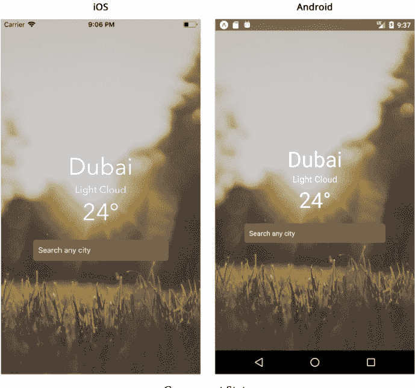

组件状态

这表明我们已经正确地连接了一切！

我们已经逐步处理了每个问题，并展示了在传递和存储组件数据时 `props` 和 `state` 如何不同。然而，`handleUpdateLocation` 并没有获取*真实的*天气信息，而只是更新了显示的城市名称。我们很快会将其连接起来以获取实际的天气数据。

## 架构化状态

我们可能已经考虑过在 `SearchInput` 内部控制所有位置状态，而无需处理将信息向上传递给容器组件。*每个状态片段应该放在哪里*没有特定的答案，它取决于我们正在构建的应用程序类型。这是构建 React Native 应用程序的核心概念，像 Redux³⁷ 和 MobX³⁸ 这样的工具旨在通过允许你在单一位置管理整个应用程序的状态来进一步简化这一过程。然而，即使我们决定使用诸如这些示例的状态管理库，我们仍然需要花费时间来决定如何构建我们的状态逻辑。

在我们当前的应用程序中，我们需要让 `App` 知道 `location` 数据，以便显示正确的天气状况。`SearchInput` 实际上不需要存储这些信息而不将其传递给处理逻辑的组件。保持 `SearchInput` 简单的动机在于，我们可以利用 React 的组件驱动范式。我们可以在应用程序中任何需要搜索输入的地方重复使用它。

我们可以将 `SearchInput` 视为一个提供展示性标记并**不**管理任何真实应用数据的组件。此类组件接受父组件传递的属性，这些属性指定了展示性组件应渲染的数据。这个父容器组件还指定行为。如果底层展示性组件具有任何交互性——比如我们的搜索输入——它会调用父组件给它的属性函数。我们将在本书中更详细地介绍这个重要的模式。

## 生命周期方法

我们已经将组件如何相互通信连接起来，以便在用户提交文本输入字段时立即显示新的位置。然而，你会注意到应用首次加载时城市显示为空字符串。我们*可以*用一个实际城市的名称来实例化它，但我们知道我们最终想要获取实际的天气信息。虽然我们还没有设置，但获取城市实际天气数据的异步操作将发生在 `handleUpdateLocation` 中。因此，在我们的组件首次加载时调用这个方法是有意义的。我们可能想尝试的一件事是在 `constructor` 中触发这个方法：

³⁷ https://github.com/reactjs/redux
³⁸ https://github.com/mobxjs/mobx

```
constructor(props) {
  super(props);
  this.state = {
    location: '',
  };

  this.handleUpdateLocation('San Francisco');
}
```

然而，在构造函数中触发异步请求通常是一种*反模式*。这是因为构造函数在组件首次挂载之前被调用。因此，此方法通常仅应用于初始化状态和绑定方法。

相反，我们可以利用 React Native 的一个**生命周期方法**。顾名思义，这些方法允许你访问组件生命周期中的特定点。生命周期这里指的是 React Native 如何**实例化**、**改变**和**销毁**组件。我们可以在组件渲染的不同阶段，当这些函数被调用时使用生命周期钩子来执行某些操作。

最常用的生命周期方法是允许我们在组件挂载*之后*设置组件数据的 `componentDidMount()`。此方法通常用于触发网络请求以获取组件所需的数据。要了解此方法何时触发，让我们在构造函数之后将其添加到我们的组件中，并添加一个 `console.log`：

```
export default class App extends React.Component {
  constructor(props) {
    super(props);
    this.state = {
      location: 'San Francisco',
    };
  }

  componentDidMount() {
    console.log('Component has mounted!');
  }
```

当我们重新加载应用程序时，我们可以看到一旦组件挂载，`Component has mounted!` 就会直接输出到我们的终端。


## React Native 中的调试

如果你在网页上使用过 JavaScript，可能已经熟悉使用 `console.log`、`console.warn` 或 `console.error` 将消息输出到浏览器控制台以进行调试。同样，Expo 也允许我们使用这些方法来将日志输出到终端。有关查看日志的更多详细信息，你可以参考[文档](https://docs.expo.io/versions/latest/guides/logging.html)。

除了日志记录之外，React Native 还允许我们使用 Chrome 开发者工具来调试应用中的 JavaScript 代码。使用 Expo 时，我们可以通过按下调试菜单中的 `Debug Remote JS` 来实现这一点。你可以参考[文档](https://docs.expo.io/versions/latest/guides/debugging.html)了解更多信息。

现在让我们更新它以触发 `handleUpdateLocation`：

**weather/6/App.js**

```
componentDidMount() {
  this.handleUpdateLocation('San Francisco');
}
```

这样，我们就可以从 state 中移除 `San Francisco` 作为默认位置，并将其设置为空字符串。

```
export default class App extends React.Component {
  constructor(props) {
    super(props);
    this.state = {
      location: '',
    };
  }
```

由于我们使用了 `componentDidMount`，重新加载应用后，我们仍然应该看到 `San Francisco` 显示在文本字段的位置。

虽然 `componentDidMount()` 允许我们在组件首次渲染后立即创建事件监听器和发起网络请求，但 React Native 还提供了许多其他的生命周期方法。我们将在本书中逐一介绍它们。

## 网络请求

我们已经构建了构成应用 UI 的所有组件，并对其进行了优化，为用户展示了漂亮的背景图片。正如我们之前提到的，到目前为止我们所采用的方法是构建全新 React Native 应用时的常见模式。我们首先使用组件组织视图，然后引入一些状态和状态管理。

然而，除非应用真正连接到真实数据，否则没有人会认为我们的应用*有用*。在构建新的移动应用时，我们很可能需要与服务器进行通信。与服务器通信是大多数移动应用的关键组成部分。

为了本应用的目的，我们将使用 [MetaWeather](https://www.metaweather.com/) API 来获取真实的天气信息。MetaWeather 是一个天气数据聚合器，它根据各种预测者的预测计算最可能的结果。他们提供了一个 [API](https://www.metaweather.com/api/)，通过一组不同的端点来提供这些信息：

1. 位置搜索（`/api/location/search/`），允许我们搜索特定城市
2. 位置天气信息（`/api/location/{woeid}`），提供某个位置的 5 天天气预报
3. 位置日期（`/api/location/{woeid}/{date}/`），提供特定日期和位置的历史预报和信息

> WOEID，即 [Where On Earth ID](https://developer.yahoo.com/geo/geoplanet/guide/concepts.html)，是一种位置标识符，允许我们查找特定位置的详细信息。有关 MetaWeather API 具体工作原理的更多细节，请随意仔细查看[文档](https://www.metaweather.com/api/)。

现在我们已经对 `state` 和 `props` 如何控制不同组件之间的数据流有了基本的了解，让我们继续使用此 API 来渲染真实的天气数据。直接在组件方法中放入 API 调用是可行的，但通常将其逻辑抽象到单独的文件中是个好主意。在 `utils` 目录中，我们已经在 `api.js` 中设置了两组独立的 API 调用：

- `fetchLocationId` 根据搜索查询返回位置数组
- `fetchWeather` 使用称为 [Where On Earth ID](https://developer.yahoo.com/geo/geoplanet/guide/concepts.html) 的位置标识符返回特定位置的天气详情

这两个调用的组合将允许我们搜索城市并获取其天气信息。如果你感兴趣，请随意打开文件查看这些方法的实现。

## 异步函数

回调和 Promise 是 JavaScript 中定义异步代码的两种方式。构建在 Promise 之上，**async** 函数是一种较新的语法，允许我们以同步方式定义异步方法。我们在 `api.js` 中设置的两个方法都使用了这种语法。

虽然 Babel 已经支持它，但它仍处于草案提案阶段，很可能会被批准纳入未来的 JavaScript 版本。如果你恰好有兴趣进一步了解这种语法，这是 MDN<sup>46</sup> 资源。

在构建通过网络获取信息的组件时，用户在检索到数据之前不可避免地需要等待一段时间。对于大多数应用来说，显示某种加载指示器是有意义的，这样用户就知道他们需要等待一会儿才能看到内容。幸运的是，React Native 提供了一个内置的 `ActivityIndicator` 组件，用于显示圆形加载旋转器。让我们从一些新的导入开始更新我们的根 `App` 组件：

**weather/6/App.js**

```
import React from 'react';
import {
  StyleSheet,
  View,
  ImageBackground,
  Text,
  KeyboardAvoidingView,
  Platform,
  ActivityIndicator,
  StatusBar,
} from 'react-native';

import { fetchLocationId, fetchWeather } from './utils/api';
import getImageForWeather from './utils/getImageForWeather';

import SearchInput from './components/SearchInput';
```

我们添加了以下导入：

- `ActivityIndicator` 是一个内置组件，显示圆形加载旋转器。我们将在从网络获取数据时使用它
- `fetchLocationId`、`fetchWeather` 是与天气 API 交互的方法
- `StatusBar` 是一个内置组件，允许我们修改设备顶部的应用状态栏

> <sup>46</sup>https://developer.mozilla.org/en-US/docs/Web/JavaScript/Reference/Statements/async_function

现在让我们对组件进行一些更改。我们需要应用网络请求逻辑并存储该信息，以便可以轻松显示。我们还需要确保在请求发起时显示加载指示器。让我们从更新 state 开始：

**weather/6/App.js**

```
constructor(props) {
  super(props);

  this.state = {
    loading: false,
    error: false,
    location: '',
    temperature: 0,
    weather: '',
  };
}
```

我们刚刚扩展了 state 对象，除了 `location` 之外，还包括 `loading`、`error`、`temperature` 和 `weather`。后三个属性是我们将从 API 检索的数据。`loading` 属性表示调用仍在进行中（以便显示加载图标），`error` 用于在调用失败或返回不可用信息时存储错误消息。

使用 `setState`，对 state 的更新可以*异步*发生。因此，该方法接受一个回调作为可选的第二个参数，允许我们定义 state 更新后要执行的操作。请考虑以下示例：

```
export default class Example extends React.Component {
  state = {
    weather: '',
  };

  componentDidMount() {
    this.setState({ weather: 'Clear' }, () => console.log(this.state));
  }
}
```

> // { weather: 'Clear' } 在我们的组件完成挂载后立即被记录

我们可以将此逻辑应用于负责与外部 API 交互的方法：`handleUpdateLocation`：

**weather/6/App.js**

```
handleUpdateLocation = async city => {
  if (!city) return;

  this.setState({ loading: true }, async () => {
    try {
      const locationId = await fetchLocationId(city);
      const { location, weather, temperature } = await fetchWeather(
        locationId,
      );

      this.setState({
        loading: false,
        error: false,
        location,
        weather,
        temperature,
      });
    } catch (e) {
      this.setState({
        loading: false,
        error: true,
      });
    }
  });
};
```

我们将其更新为一个异步函数，使用 `setState` 将我们的 `loading` 属性更改为 `true`。我们还将一个异步函数作为其第二个参数传入。在这里，我们首先调用 `fetchLocationId` 并传入用户查询的城市（如果存在），然后将位置 ID 传递给 `fetchWeather` 以返回一个包含所需信息（`location`、`weather` 和 `temperature`）的对象。完成后，我们的 state 会使用正确的参数更新。此外，如果任何调用发生错误，catch 语句将把 state 中的 `error` 属性更新为 `true`。

既然我们已经有了 API 逻辑，我们需要在组件的 UI 中做几件事：

- 我们需要*仅在* API 调用已发起但尚未完成时显示加载旋转器
- 如果用户输入了错误的地址*或者*我们的 API 调用失败，我们应该显示错误消息
- 我们需要渲染特定位置的正确天气信息

让我们看看如何更新我们的 `render()` 方法来实现这一点：


React Native 入门

60

```
weather/6/App.js

render() {
  const { loading, error, location, weather, temperature } = this.state;

  return (
    <KeyboardAvoidingView style={styles.container} behavior="padding">
      <StatusBar barStyle="light-content" />
      <ImageBackground
        source={getImageForWeather(weather)}
        style={styles.imageContainer}
        imageStyle={styles.image}
      >
        <View style={styles.detailsContainer}>
          <ActivityIndicator animating={loading} color="white" size="large" />

          {!loading && (
            <View>
              {error && (
                <Text style={[styles.smallText, styles.textStyle]}>
                  Could not load weather, please try a different city.
                </Text>
              )}

              {!error && (
                <View>
                  <Text style={[styles.largeText, styles.textStyle]}>
                    {location}
                  </Text>
                  <Text style={[styles.smallText, styles.textStyle]}>
                    {weather}
                  </Text>
                  <Text style={[styles.largeText, styles.textStyle]}>
                    {`${Math.round(temperature)}°`}
                  </Text>
                </View>
              )}

              <SearchInput
                placeholder="Search any city"
                onSubmit={this.handleUpdateLocation}
              />
            </View>
          )}
        </View>
      </ImageBackground>
    </KeyboardAvoidingView>
  );
}
```

这个文件中看起来有很多内容，但我们来逐段分解一下。首先我们引入了 `StatusBar` 组件：

**weather/6/App.js**

```
<StatusBar barStyle="light-content" />
```

`StatusBar` 组件允许我们使用 `barStyle` 属性来自定义应用的状态栏，该属性让我们可以更改状态栏内文本的颜色。值为 `light-content` 时渲染较浅的颜色（白色），而 `dark-content` 会将其更改为较深的颜色（深灰色）。

使用 Expo 时，我们还可以通过修改 `app.json` 来为 Android 配置状态栏。
Expo 将 Android 的 `barStyle` 默认值设为 `light-content`，并使背景透明。虽然这对我们当前的应用来说看起来不错，但你可以通过提供背景色来移除透明效果。更多详情请查看[文档](https://docs.expo.io/versions/latest/guides/configuring-statusbar.html)。

然后我们添加了 `ActivityIndicator`，并为其设置了 color 和 size 属性：

**weather/6/App.js**

```
<ActivityIndicator animating={loading} color="white" size="large" />
```

注意我们还包含了一个 `animating` 属性，我们将其设置为 `state.loading` 属性。该属性负责完全显示或隐藏组件。
之后，我们在 JSX 中包含了一个花括号容器：

47 https://docs.expo.io/versions/latest/guides/configuring-statusbar.html

React Native 入门

62

```
weather/6/App.js
{!loading && (
  <View>
    {error && (
      <Text style={[styles.smallText, styles.textStyle]}>
        Could not load weather, please try a different city.
      </Text>
    )}

    {!error && (
      <View>
        <Text style={[styles.largeText, styles.textStyle]}>
          {location}
        </Text>
        <Text style={[styles.smallText, styles.textStyle]}>
          {weather}
        </Text>
        <Text style={[styles.largeText, styles.textStyle]}>
          {`${Math.round(temperature)}°`}
        </Text>
      </View>
    )}

    <SearchInput
      placeholder="Search any city"
      onSubmit={this.handleUpdateLocation}
    />
  </View>
)}
```

我们之前已经看到过 JSX 如何允许我们在花括号中嵌入 JavaScript 表达式。幸运的是，这也让我们可以包含运算符，从而能够**条件渲染** UI 的某些部分。在这里，`!loading && <...>` 意味着只有当 `loading` 为 false 时，该语句才会求值并显示元素。可以看到，我们基本上把构成组件的大部分元素都包裹在这里面了，这是合理的，因为在 API 调用获取数据时，我们不想显示任何文本字段或搜索输入框。

## 条件渲染

在 render 方法中使用逻辑 && 运算符并不是条件渲染组件部分的唯一方式。有时，如果有大量行被条件渲染，这种方法会使组件文件更难阅读。

如果发生这种情况，使用*辅助方法*可能是个好主意。例如，我们的 render 方法可以按以下模式重写：

```
renderContent() {
  const { error } = this.state;

  return (
    <View>
      {error && <Text>Error</Text>}
      {!error && this.renderInfo()}
    </View>
  );
}

renderInfo() {
  const { info } = this.state;

  return <Text>{info}</Text>;
}

render() {
  const { loading } = this.state;

  return (
    <View>
      <ActivityIndicator animating={loading} color="white" size="large" />
      {!loading && this.renderContent()}
    </View>
  );
}
```

React [文档](https://reactjs.org/docs/conditional-rendering.html)^{48} 更详细地介绍了这一概念，并解释了更多条件渲染组件部分的方法。归根结底，使用哪种模式取决于个人偏好。

现在在 API 调用未发起时显示的内容中，如果出现问题，我们仍然需要能够显示适当的错误信息。在这种情况下，我们可以使用 `state.error` 属性来条件显示文本：

**weather/6/App.js**

```
{error && (
  <Text style={[styles.smallText, styles.textStyle]}>
    Could not load weather, please try a different city.
  </Text>
)}

{!error && (
  <View>
    <Text style={[styles.largeText, styles.textStyle]}>
      {location}
    </Text>
    <Text style={[styles.smallText, styles.textStyle]}>
      {weather}
    </Text>
    <Text style={[styles.largeText, styles.textStyle]}>
      {`${Math.round(temperature)}°`}
    </Text>
  </View>
)}

<SearchInput
  placeholder="Search any city"
  onSubmit={this.handleUpdateLocation}
/>
```

注意，现在我们在 Text 元素中显示的是状态信息（`location`、`weather` 和 `temperature`），而不是硬编码的值。对于温度，我们使用 JavaScript 的 Math 对象及其 `round()` 方法将温度四舍五入到最接近的整数。

最后一件事是，我们将动态的 `weather` 属性传递给 `ImageBackground`，而不是硬编码的 `Clear` 字符串：

**weather/6/App.js**

```
<ImageBackground
  source={getImageForWeather(weather)}
  style={styles.imageContainer}
  imageStyle={styles.image}
>
```

现在如果我们运行应用，在输入框中输入城市名将返回其实际天气数据！

iOS

Android

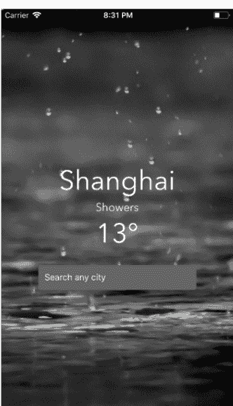

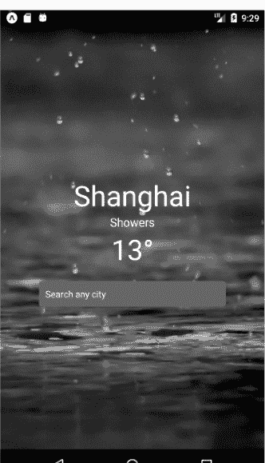

通过接入网络请求来获取实际数据，我们基本上已经完成了应用所有要点的连接。从最开始使用硬编码数据，到逐步构建构成 UI 基本组成部分的组件，我们的应用现在正如本章开头所设想的那样正常工作了。接下来的几个部分将探索一些额外的代码增强，但不会为应用添加任何新功能。

## PropTypes

使用 React Native 时，我们可以使用 `prop-types` 库来包含验证函数。这允许我们指定并强制执行组件 props 的类型，确保它们符合我们的预期。这不仅可以帮助我们更快地发现开发错误，还能为组件的使用者提供一层文档。

我们可以将 `prop-types` 添加为依赖项：

```
yarn add prop-types
```

现在让我们看看如何在 `SearchInput` 中使用 `PropTypes`：


 # weather/6/components/SearchInput.js

```
SearchInput.propTypes = {
  onSubmit: PropTypes.func.isRequired,
  placeholder: PropTypes.string,
};

SearchInput.defaultProps = {
  placeholder: '',
};
```

我们定义了一个 propTypes 对象，用于指示 React 验证传递给组件的 props。我们指定了 `onSubmit` **必须**是一个函数，`placeholder` **必须**是一个字符串。我们还将 `onSubmit` 指定为必需的，这意味着它必须提供给我们的组件，不是可选的。

我们让 `placeholder` 保持为可选的。为此，我们使用了 `defaultProps` 对象。这使我们可以在不需要时创建组件而不指定 `placeholder`，在这种情况下 `defaultProps` 会负责提供其值。需要注意的是，传入 `defaultProps` 的值也会通过该库进行类型检查。

那么当 prop 的类型验证未成功时究竟会发生什么？当传入的 prop 类型无效或未能通过 propType 验证时，警告信息会输出到 JavaScript 控制台。这些警告只会在开发模式下显示，因此如果我们不小心将应用部署到生产环境时错误地使用了某个组件，我们的用户将不会看到该警告。

## Class properties（类属性）

React Native 包含了来自 Babel 的[类属性转换<sup>49</sup>](https://babeljs.io/docs/plugins/transform-class-properties/)，这使我们能够简化定义组件 state、props 和 propTypes 的方式。例如，我们可以将 App.js 中的构造函数更新为：

## weather/App.js

```
state = {
  loading: false,
  error: false,
  location: '',
  temperature: 0,
  weather: '',
};
```

这会被转译为与使用构造函数**完全相同**的结果。同样，我们可以简化在 SearchInput 中定义 state 的方式：

<sup>49</sup> https://babeljs.io/docs/plugins/transform-class-properties/

```
state = {
  text: '',
};
```

此外，我们还可以使用类中的静态属性来设置 `propTypes` 和 `defaultProps`。换句话说，我们可以移除 `SearchInput` 中的对象引用，并在类内定义一个静态方法：

```
static propTypes = {
  onSubmit: PropTypes.func.isRequired,
  placeholder: PropTypes.string,
};

static defaultProps = {
  placeholder: '',
};
```

使用这种模式并利用类属性转换，纯粹是在单独定义方法和对象之上的语法糖，它能让我们以更简洁、更简单的语法进行编写。

## Summary（总结）

恭喜，我们刚刚构建了我们的第一个 React Native 应用，并且涵盖了构建一个完整且功能齐全的移动应用所需的几乎所有要点。我们首先探索了使用 CRNA 启动新项目时生成的每个文件，以及 Expo 如何让我们在自己的设备上顺利运行应用，而无需担心 Xcode 和 Android Studio 的设置。然后，我们使用 React Native 提供的内置组件构建了构成应用的每个组件。在此过程中，我们深入了解了 React Native 的基础知识，包括 JSX、如何应用自定义样式，以及理解如何使用 `props` 和 `state` 来管理和控制数据。我们继续探讨了更复杂的主题，包括生命周期方法以及如何使用外部网络调用来为我们的应用提供真实内容。最后，我们简要了解了 `propTypes` 如何通过为应用添加类型验证来提供额外的安全保障。本书的其余部分将更深入地探讨 React Native 的核心概念，本章学到的概念将作为本书所有其他内容的基础。

到目前为止，我们只是触及了 React Native 允许我们做的事情的皮毛。通过了解 Expo 等设置/开发细节以及 props、state 和组件的核心概念，你已经掌握了 React Native 开发的要点。截至目前，你已经可以使用该框架构建各种各样的应用了——所以，去构建一些了不起的东西吧！

# React Fundamentals（React 基础）

在上一章中，我们构建了我们的第一个 React Native 应用。我们探索了 React 应用是如何通过*组件*组织的。使用 *state* 和 *props* 这两个关键的 React 概念，我们了解了数据是如何管理的，以及它在组件之间如何流动。我们还讨论了其他有用的概念，如处理用户输入和从远程 API 获取数据。

在本节中，我们将逐步构建另一个应用。我们将更深入地研究 React 的基础知识。我们将研究一种可以用来从头构建 React Native 应用的模式，然后将这些步骤付诸实践来构建一个时间追踪应用。

在这个应用中，用户可以添加、删除和修改各种计时器。每个计时器对应用户想要记录时间的一个不同任务：

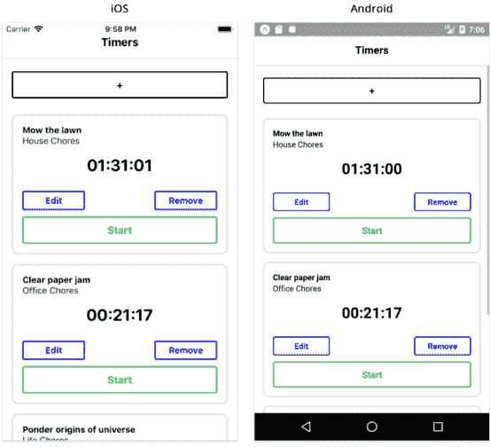

Time Tracking App（时间追踪应用）

这个应用将比上一章构建的应用具有更多交互功能。正如我们将看到的，这将给我们带来一些有趣的挑战。

## Getting started（开始）

本章假设你已经按照第一章开头的步骤设置好了系统。

与本书所有章节一样，确保你已准备好本书的示例代码。

## Previewing the app（预览应用）

让我们从查看完成的应用开始。要在你的设备上尝试完成的应用：

- 在 Android 上，你可以使用 Expo 应用扫描此二维码：


QR Code（二维码）

- 在 iOS 上，你可以导航到示例代码文件夹中的 `time-tracking/` 目录，并在 iOS 模拟器上预览它，或者像我们在上一章中解释的那样将项目 URL 的链接发送到你的设备。

把玩一下以熟悉所有功能。

## Breaking the app into components（将应用拆分为组件）

让我们开始将应用拆分成各个组件。正如我们在上一个项目中注意到的，视觉组件通常与其各自的 React Native 组件紧密对应。例如，我们可以想象我们会想要一个用于每个计时器的 `Timer` 组件：

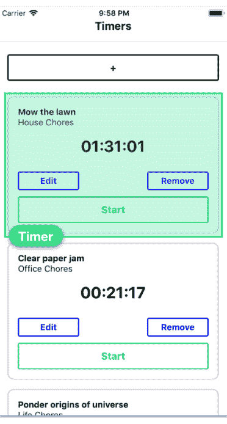

我们的应用显示一个计时器列表，*并且*顶部有一个"+"图标。我们可以使用这个按钮向列表中添加新计时器。这个"+"组件很有趣，因为它有两种不同的表现形式。当按下"+"按钮时，该组件变成一个表单：

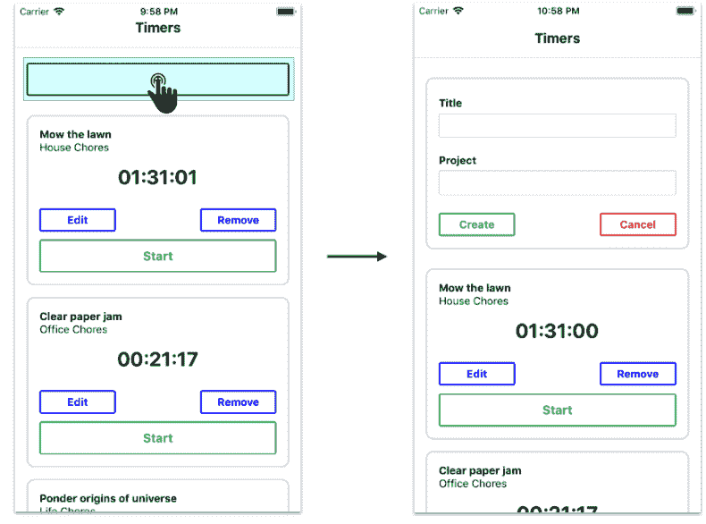

当表单关闭时，该组件变回"+"按钮。

我们可以采取两种方法。第一种是让父组件根据某个状态数据来决定是渲染"+"组件还是表单组件。它可以在两个子组件之间切换。然而，这会给父组件增加更多责任。由于没有其他子组件需要这块信息，让一个新的子组件单独负责决定是显示"+"按钮还是创建计时器表单可能更有意义。我们将它命名为 `ToggleableTimerForm`。作为子组件，它可以渲染 `TimerForm` 组件或"+"按钮。

因此，除了根应用组件外，我们已经确定了两个组件：

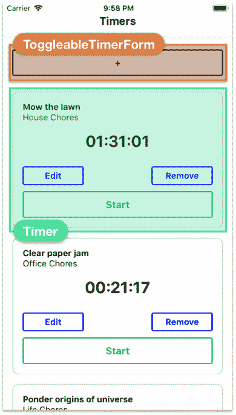

但是 `Timer` 组件有相当多的功能。正如我们在应用完成版本中所看到的，当用户点击"Edit"时，每个计时器都会变成一个表单：

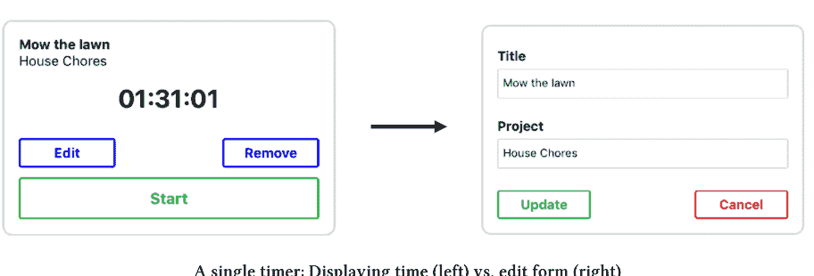

**单个计时器：显示时间（左）与编辑表单（右）**

此外，按下"Remove"时计时器会删除自己，并且有开始和停止按钮。我们需要拆分这个吗？如果需要，怎么拆分？

显示计时器和编辑计时器确实是两个不同的 UI 组件。它们应该是两个不同的 React 组件。与 `ToggleableTimerForm` 类似，我们需要某个容器组件，根据计时器是否正在编辑来渲染计时器的显示界面或其编辑表单。

我们将这个组件称为 `EditableTimer`。`EditableTimer` 的子组件将是一个 `Timer` 组件或编辑表单组件。创建和编辑计时器的表单非常相似，因此我们假设可以在两种场景下都使用 `TimerForm` 组件：

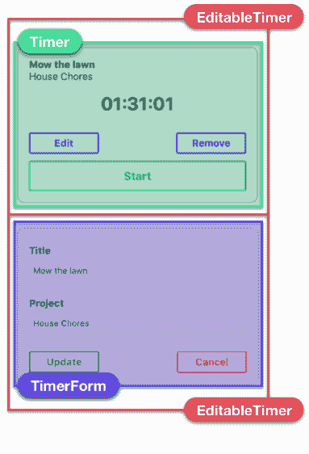

至于计时器的其他功能，比如开始和停止按钮，目前很难确定它们是否应该作为独立的组件。我们可以相信，在开始编写一些代码并对应用程序中组件的整体结构有了更好的理解之后，答案会变得更加清晰。

因此，我们得到了最终的组件层次结构，其中计时器组件的最终状态存在一些不确定性：

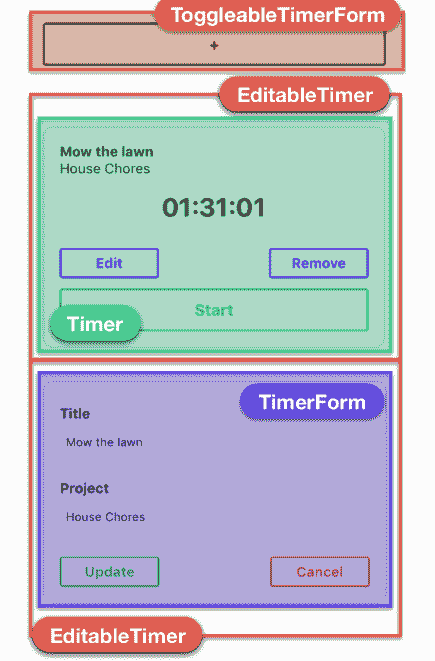

- * App: 根容器
  * EditableTimer: 显示计时器或计时器的编辑表单
    * Timer: 显示给定的计时器
    * TimerForm: 显示给定计时器的编辑表单
  * ToggleableTimerForm: 显示创建新计时器的表单
    * TimerForm: 显示新计时器的创建表单

对于应用中的所有按钮，我们将创建并使用一个名为 `TimerButton` 的组件。

## 7 步流程

现在我们已经很好地理解了组件的组成，接下来我们将构建一个仅包含硬编码数据的静态版本应用。正如我们在上一章中注意到的，我们构建的许多应用程序都需要顶层组件与服务器通信。在这些场景中，**服务器将是状态的初始来源**，React Native 将根据服务器提供的数据来渲染自身。如果我们当前的应用遵循这种模式，它也会向服务器发送更新，例如当计时器启动时。但是，为了简单起见，在本章中，我们将渲染本地状态，而不是与服务器通信。

从静态组件开始，正如我们在上一章所做的那样，总是能让事情变得简单。应用的静态版本将不具备交互性。例如，按下按钮将不会有任何作用。但这将使我们能够搭建应用的框架，清晰地了解组件树是如何组织的。

接下来，我们可以确定应用的**状态**应该是什么，以及它应该存在于哪个组件中。届时，我们就建立了**从父到子**的数据流。然后，我们可以添加反向数据流，将事件**从子到父**传播。

事实上，这遵循了一个从零开始开发 React Native 应用的便捷流程：

- 1. 将应用分解为组件
2. 构建应用的静态版本
3. 确定哪些应该是有状态的
4. 确定每块状态应该存在于哪个组件中
5. 硬编码初始状态
6. 添加反向数据流
7. 添加服务器通信（如果存在）

我们在上一个项目中遵循了这个模式：

**1. 将应用分解为组件**
我们查看了期望的 UI，并确定我们需要一个自定义的 `SearchInput` 组件。

**2. 构建应用的静态版本**
我们的组件最初没有使用 `state`。相反，我们让根 `App` 组件将 `location` 作为静态属性传递给 `SearchInput`。

**3. 确定哪些应该是有状态的**
为了使我们的应用程序具有交互性，我们必须能够修改搜索输入框的搜索值。提交的值就是我们有状态的 `location` 属性。

**4. 确定每块状态应该存在于哪个组件中**
我们的根 `App` 组件负责使用 React 组件类方法管理 `location`、`temperature` 和 `weather` 状态参数。

**5. 硬编码初始状态**
我们定义了一个硬编码的 `location` 值，并将其作为自定义属性传递给 `SearchInput`。

**6. 添加反向数据流**
我们在 `App` 容器中定义了 `handleUpdateLocation` 函数，并通过 props 将其传递下去，以便 `SearchInput` 可以在按下搜索输入框的提交按钮时通知父组件。

**7. 添加服务器通信**

我们在父组件和 MetaWeather API 之间添加了服务器通信，以检索实际的天气数据。

这些步骤仅作为*指导方针*。你每次构建应用程序时不一定都必须遵循它，但随着你构建更多的应用程序，你很可能会内化并更加习惯于遵循这种结构。如果这个过程中的步骤现在还不完全清楚，别担心。本章的目的是让你熟悉这个流程。

我们已经涵盖了步骤（1），并且对所有的组件有了很好的理解，除了 Timer 组件中的一些不确定性。步骤（2）是构建应用的静态版本。与上一个项目一样，这相当于定义 React 组件、它们的层次结构以及它们的 HTML 表示。我们目前避免使用状态。

## 步骤 2：构建应用的静态版本

## 准备应用

开始之前，在终端中运行以下命令以创建一个新的 React Native 应用：

```
create-react-native-app time-tracking --scripts-version 1.14.0
cd time-tracking
yarn start
```

## App

让我们从在文件 `App.js` 中编写我们的 `App` 组件开始。我们将从导入开始：

```
time-tracking/1/App.js
import React from 'react';
import { StyleSheet, View, ScrollView, Text } from 'react-native';
import EditableTimer from './components/EditableTimer';
import ToggleableTimerForm from './components/ToggleableTimerForm';
```

在导入了我们将在 `App` 中使用的核心 React Native 组件后，我们导入了 `EditableTimer` 和 `ToggleableTimerForm`。我们很快就会实现它们。

我们将让 `App` 组件渲染 `ToggleableTimerForm` 和几个 `EditableTimer` 组件。因为我们在构建应用的静态版本，所以我们将手动设置所有 props：

```
export default class App extends React.Component {
  render() {
    return (
      <View style={styles.appContainer}>
        <View style={styles.titleContainer}>
          <Text style={styles.title}>Timers</Text>
        </View>
        <ScrollView style={styles.timerList}>
          <ToggleableTimerForm isOpen={false} />
          <EditableTimer
            id="1"
            title="Mow the lawn"
            project="House Chores"
            elapsed="8986300"
            isRunning
          />
          <EditableTimer
            id="2"
            title="Bake squash"
            project="Kitchen Chores"
            elapsed="3890985"
            editFormOpen
          />
        </ScrollView>
      </View>
    );
  }
}
```

在顶部，我们在 Text 组件中显示一个标题（"Timers"）。我们稍后会查看 styles 对象。

在标题之后，我们在 ScrollView 组件中渲染其余的组件。React Native 内置的 ScrollView 组件负责将组件包裹在滚动容器中。

我们向 ToggleableTimerForm 传递一个 prop：isOpen。这个 prop 被子组件用于确定是渲染一个 "+" 还是 TimerForm。当 ToggleableTimerForm 是 "open" 状态时，表单正在被显示。

我们还在 App 中包含了两个独立的 EditableTimer 组件。在构建组件时，我们将深入研究每个 prop。值得注意的是，isRunning 指定计时器是否正在运行，editFormOpen 指定 EditableTimer 应该显示计时器的界面还是其编辑表单。

请注意，我们没有为第一个 `EditableTimer` 的 `isRunning` 属性或第二个 `EditableTimer` 的 `editFormOpen` 属性显式设置任何值：

**time-tracking/1/App.js**

```
<EditableTimer
  id="1"
  title="Mow the lawn"
  project="House Chores"
  elapsed="8986300"
  isRunning
/>
<EditableTimer
  id="2"
  title="Bake squash"
  project="Kitchen Chores"
  elapsed="3890985"
  editFormOpen
/>
```

这是你在 React Native 应用中经常遇到的一种布尔值 prop 风格。当没有传递显式值时，该 prop 默认为 true。因此 `<ToggleableTimerForm isOpen />` 将与 `<ToggleableTimerForm isOpen={true}/>` 产生相同的结果。相反，当一个 prop *缺失*时，它是 `undefined`。这意味着对于第一个计时器，`editFormOpen` 是 "falsy"（假值）。

> **(i)** ScrollView 会一次性渲染其所有组件，即使那些当前不在屏幕上的组件也会被渲染。

最后，以下是我们在使用的样式：

**time-tracking/1/App.js**

```
const styles = StyleSheet.create({
  appContainer: {
    flex: 1,
  },
  titleContainer: {
    paddingTop: 35,
    paddingBottom: 15,
    borderBottomWidth: 1,
    borderBottomColor: '#D6D7DA',
  },
  title: {
    fontSize: 18,
```


### EditableTimer

对于所有的子组件，我们会将它们各自的文件保存在 components 子目录中。让我们创建 components/EditableTimer.js。
首先，我们将开始实现 TimerForm 和 Timer。我们很快就会创建它们：

```
time-tracking/1/components/EditableTimer.js
```

```javascript
import React from 'react';

import TimerForm from './TimerForm';
import Timer from './Timer';

export default function EditableTimer({
  id,
  title,
  project,
  elapsed,
  isRunning,
  editFormOpen,
}) {
  if (editFormOpen) {
    return <TimerForm id={id} title={title} project={project} />;
  }
  return (
    <Timer
      id={id}
      title={title}
      project={project}
      elapsed={elapsed}
      isRunning={isRunning}
    />
  );
}
```

EditableTimer 会根据 prop `editFormOpen` 返回计时器的界面（Timer）或计时器的编辑表单（TimerForm）。我们预计这个组件永远不会管理状态。
到目前为止，我们已经将 React 组件写成扩展 React.Component 的 ES6 类。然而，还有另一种声明 React 组件的方式：作为函数。
让我们看看那是什么样子。

EditableTimer 是一个普通的 JavaScript 函数。在 React 中，我们将以这种方式编写的组件称为*无状态函数组件*（*stateless functional components*），或简称*函数组件*（*functional components*）。虽然我们可以使用任一种组件风格来编写 EditableTimer，但它非常适合被写成一个函数。
将函数组件视为只需要实现 `render()` 方法的组件。它们不管理状态，也不需要 React 的任何特殊生命周期钩子。

> 在整本书中，我们将这两种不同的类型称为*类组件*（*class components*）和*函数组件*（*functional components*）。

注意，**props 作为第一个参数传递给函数**。在使用函数组件时，我们不使用 `this`。在这里，我们使用解构从 props 对象中提取所有的 props。
组件的 render 方法根据 prop `editFormOpen` 进行切换。如果为 true，我们渲染一个 `TimerForm`。否则，我们渲染 `Timer`。
正如我们在 `App` 中看到的，这个组件接收六个 props。这个组件将 props `id`、`title` 和 `project` 传递给 `TimerForm`。对于 `Timer`，我们传递所有的计时器属性。

## 函数组件的优点

为什么我们要使用函数组件呢？主要有两个原因：
首先，在可能的情况下使用函数组件，可以鼓励开发者在更少的位置管理状态。这使我们的程序更容易理解和推理。
其次，使用函数组件是创建可复用组件的好方法。因为函数组件需要从外部传入所有的配置，所以它们很容易在不同的应用或项目中复用。
一条好的经验法则是尽可能使用函数组件。如果我们不需要任何生命周期方法，而且只需要一个 `render()` 函数就能满足需求，那么使用函数组件是一个很好的选择。

## TimerForm

TimerForm 将包含两个 TextInput 字段，用于编辑计时器的标题和项目。我们还会在底部添加一对按钮。

与 EditableTimer 类似，我们可以将这个组件写成函数组件：

```
time-tracking/1/components/TimerForm.js
```

```javascript
import React from 'react';
import { StyleSheet, View, Text, TextInput } from 'react-native';

import TimerButton from './TimerButton';

export default function TimerForm({ id, title, project }) {
  const submitText = id ? 'Update' : 'Create';

  return (
    <View style={styles.formContainer}>
      <View style={styles.attributeContainer}>
        <Text style={styles.textInputTitle}>Title</Text>
        <View style={styles.textInputContainer}>
          <TextInput
            style={styles.textInput}
            underlineColorAndroid="transparent"
            defaultValue={title}
          />
        </View>
      </View>
      <View style={styles.attributeContainer}>
        <Text style={styles.textInputTitle}>Project</Text>
        <View style={styles.textInputContainer}>
          <TextInput
            style={styles.textInput}
            underlineColorAndroid="transparent"
            defaultValue={project}
          />
        </View>
      </View>
      <View style={styles.buttonGroup}>
        <TimerButton small color="#21BA45" title={submitText} />
        <TimerButton small color="#DB2828" title="Cancel" />
      </View>
    </View>
  );
}

const styles = StyleSheet.create({
  formContainer: {
    backgroundColor: 'white',
    borderColor: '#D6D7DA',
    borderWidth: 2,
    borderRadius: 10,
    padding: 15,
    margin: 15,
    marginBottom: 0,
  },
  attributeContainer: {
    marginVertical: 8,
  },
  textInputContainer: {
    borderColor: '#D6D7DA',
    borderRadius: 2,
    borderWidth: 1,
    marginBottom: 5,
  },
  textInput: {
    height: 30,
    padding: 5,
    fontSize: 12,
  },
  textInputTitle: {
    fontSize: 14,
    fontWeight: 'bold',
    marginBottom: 5,
  },
  buttonGroup: {
    flexDirection: 'row',
    justifyContent: 'space-between',
  },
});
```

> 注意，React 仍然允许我们在函数组件上设置 propTypes 和 defaultProps。

我们将每个表单元素包装在一个 View 容器中。每个输入字段上方都有一个标签（"Title" 和 "Project"），下面是 TextInput。
在组件的末尾，我们有一个按钮组，包含两个 TimerButton 实例。我们稍后会创建这个组件。
让我们仔细看看如何为计时器的标题设置 TextInput：

```javascript
<TextInput
    style={styles.textInput}
    underlineColorAndroid="transparent"
    defaultValue={title}
/>
```

以及计时器的项目：

```javascript
<TextInput
    style={styles.textInput}
    underlineColorAndroid="transparent"
    defaultValue={project}
/>
```

除了使用 style prop 添加样式外，我们还使用了 TextInput 组件的 defaultValue 属性。当表单用于编辑时，正如这里的情况，我们希望字段填充该计时器当前的标题和项目值。使用 defaultValue 可以按预期用当前值初始化这些字段。

> 稍后，我们将在 ToggleableTimerForm 中再次使用 TimerForm 来创建计时器。ToggleableTimerForm 不会向 TimerForm 传递 title 或 project props。我们将使用 defaultProps 将这些默认值设为空字符串。

在组件函数的开头，return 语句之前，我们定义了变量 submitText。这个变量利用 props.id 的存在来确定表单底部提交按钮应显示的文本。如果 id 存在，我们知道正在编辑现有计时器，因此显示 "Update"。否则，显示 "Create"。
有了所有这些逻辑，TimerForm 已准备好渲染用于创建新计时器或编辑现有计时器的表单。

我们使用**三元运算符**的表达式来设置 `submitText` 的值。语法如下：

```
condition ? expression1 : expression2
```

如果 `condition` 为 true，三元表达式的值为 `expression1`。否则，它的值为 `expression2`。在我们的例子中，变量 `submitText` 被设置为三元表达式的结果。

## TimerButton

现在让我们来设置一个可在应用程序中用于所有按钮的组件，`TimerButton`。同样，我们可以将其写成函数组件：

```
time-tracking/1/components/TimerButton.js
```

```javascript
import { StyleSheet, Text, TouchableOpacity } from 'react-native';
import React from 'react';

export default function TimerButton({ color, title, small, onPress }) {
  return (
    <TouchableOpacity
      style={[styles.button, { borderColor: color }]}
      onPress={onPress}
    >
      <Text
        style={[
          styles.buttonText,
          small ? styles.small : styles.large,
          { color },
        ]}
      >
        {title}
      </Text>
    </TouchableOpacity>
  );
}

const styles = StyleSheet.create({
  button: {
    marginTop: 10,
    minWidth: 100,
    borderWidth: 2,
  },
});
```


## ToggleableTimerForm

接下来让我们关注 ToggleableTimerForm。回顾一下，这是 TimerForm 的包装组件。它将显示一个 "+" 或 TimerForm。目前，它从父组件接收一个 props，即 `isOpen`，用于控制其行为：

```javascript
// time-tracking/1/components/ToggleableTimerForm.js
import React from 'react';
import { StyleSheet, View } from 'react-native';

import TimerButton from './TimerButton';
import TimerForm from './TimerForm';

export default function ToggleableTimerForm({ isOpen }) {
  return (
    <View style={[styles.container, !isOpen && styles.buttonPadding]}>
      {isOpen ? <TimerForm /> : <TimerButton title="+" color="black" />}
    </View>
  );
}

const styles = StyleSheet.create({
  container: {
    paddingVertical: 10,
  },
  buttonPadding: {
    paddingHorizontal: 15,
  },
});
```

如前所述，TimerForm 不会从 ToggleableTimerForm 接收任何 props。因此，它的 title 和 project 字段将渲染为空。

我们这里再次使用三元运算符来返回 TimerForm 或渲染一个 "+" 按钮。你可以争辩说这应该是一个独立的组件（比如 PlusButton），但目前我们将代码保留在 ToggleableTimerForm 内部。

### Timer

现在是 Timer 组件了。

与本书中的所有项目一样，本项目的示例代码附带了一个 `utils/` 目录，其中包含各种有助于构建此应用的函数。我们现在将使用其中一个函数。如果你还没有这样做，请立即将示例代码中的 `time-tracking/utils/` 复制到你的项目目录中。

有了 `utils/` 之后，让我们来看看 Timer 的第一个版本：

```javascript
// time-tracking/1/components/Timer.js
import React from 'react';
import { StyleSheet, View, Text } from 'react-native';

import { millisecondsToHuman } from '../utils/TimerUtils';
import TimerButton from './TimerButton';

export default function Timer({ title, project, elapsed }) {
  const elapsedString = millisecondsToHuman(elapsed);

  return (
    <View style={styles.timerContainer}>
      <Text style={styles.title}>{title}</Text>
      <Text>{project}</Text>
      <Text style={styles.elapsedTime}>{elapsedString}</Text>
      <View style={styles.buttonGroup}>
        <TimerButton color="blue" small title="Edit" />
        <TimerButton color="blue" small title="Remove" />
      </View>
      <TimerButton color="#21BA45" title="Start" />
    </View>
  );
}

const styles = StyleSheet.create({
  timerContainer: {
    backgroundColor: 'white',
    borderColor: '#d6d7da',
    borderWidth: 2,
    borderRadius: 10,
    padding: 15,
    margin: 15,
    marginBottom: 0,
  },
  title: {
    fontSize: 14,
    fontWeight: 'bold',
  },
  elapsedTime: {
    fontSize: 26,
    fontWeight: 'bold',
    textAlign: 'center',
    paddingVertical: 15,
  },
  buttonGroup: {
    flexDirection: 'row',
    justifyContent: 'space-between',
  },
});
```

此应用中的 `elapsed` prop 以毫秒为单位。这是 React 将保留的数据表示形式。这对机器来说是一种很好的表示形式，但我们希望向用户展示更易读的格式。

我们使用定义在 `./utils/TimerUtils` 中的函数 `millisecondsToHuman()`。如果你好奇它是如何实现的，可以打开那个文件看看。它渲染的字符串格式为 'HH:MM:SS'。

> ℹ️  请注意，我们可以将 `elapsed` 存储为秒而不是毫秒，但 JavaScript 的时间功能都是以毫秒为单位的。为了简单起见，我们将 `elapsed` 与此保持一致。

## Try it out

所有组件都已布置完毕，让我们启动 React Native 打包器来看看我们目前的应用：

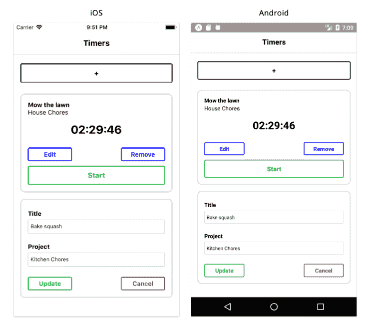

调整一些 props 并刷新以查看结果。例如：

- 将传递给 `ToggleableTimerForm` 的 prop 从 `false` 翻转为 `true`，看看计时器表单在 "+" 按钮的位置渲染：

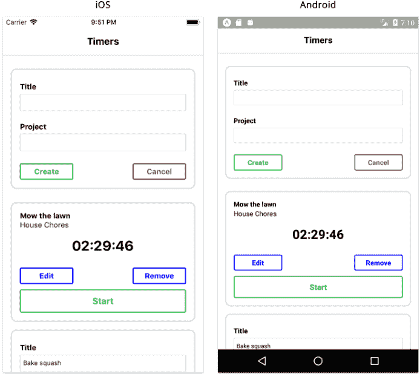

- 移除 `App` 中第二个 `EditableTimer` 组件里的 `editFormOpen` prop，观察组件相应地翻转它渲染的子组件：

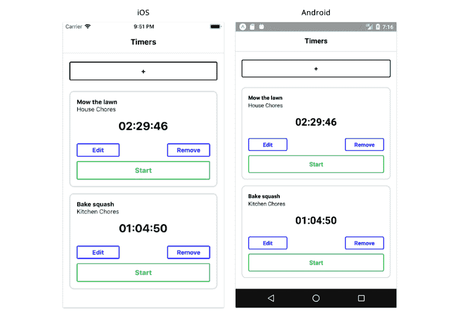

回顾一下，我们的 App 组件目前渲染一个 ToggleableTimerForm 组件和两个 EditableTimer 组件。

ToggleableTimerForm 根据 prop `isOpen` 渲染 "+" 或 TimerForm。

EditableTimer 根据 prop `editFormOpen` 渲染 Timer 或 TimerForm。Timer 和 TimerForm 是我们应用的最底层组件。它们承载了屏幕 UI 的大部分。它们上方的组件主要关注编排。

到目前为止，我们使用硬编码的 props 来在应用周围传递数据。但为了增强应用的交互性，我们必须将其从静态存在演变为可变存在。正如我们在上一章中所见，在 React 中我们使用 state 来实现这一点。

## Step 3: Determine what should be stateful

在引入 state 之前，我们需要确定*究竟*什么应该是有状态的。让我们首先收集静态应用中每个组件所消耗的所有数据。在我们的静态应用中，数据将出现在我们定义或使用 props 的任何地方。然后我们确定这些数据中哪些应该是有状态的。

## App

它声明了两个子组件。它设置了一个 prop，即传递给 `ToggleableTimerForm` 的 `isOpen` 布尔值。

### EditableTimer

它使用 prop `editFormOpen`，并接受计时器的所有属性。

### Timer

它使用计时器的所有属性。

## TimerForm

它有两个交互式输入字段，一个用于 `title`，一个用于 `project`。编辑现有计时器时，这些字段使用计时器的当前值进行初始化。

### State criteria

我们可以应用标准来确定数据是否应该是有状态的：

> ℹ️  这些问题来自 Facebook 的优秀文章《Thinking In React》。你可以[在这里阅读原文](https://facebook.github.io/react/docs/thinking-in-react.html)。

1. 它是通过 props 从父组件传入的吗？如果是，它可能不是 state。

我们的子组件中使用的许多数据已经列在它们的父组件中了。这个标准帮助我们去除重复。

例如，"timer properties" 被列出了多次。当我们在 `EditableTimer` 中看到属性声明时，我们可以将其视为 state。但当我们在其他地方看到它时，它就不是了。

2. 它会随时间变化吗？如果不是，它可能不是 state。

这是有状态数据的一个关键标准：**它会变化。**

3. 你能根据组件中的任何其他 state 或 props 计算出它吗？如果是，它不是 state。

为了简单起见，我们希望尽量用最少的数据点来表示 state。

### Applying the criteria

## App

- `isOpen` 布尔值用于 `ToggleableTimerForm`，计时器属性用于 `EditableTimer`

React Native 提供了一个内置的 `Button` 组件，但它只允许有限的自定义。因此，我们利用 `TouchableOpacity`，它渲染一个包装器，使组件在被按下时能够以透明度变化做出响应。

为了更容易自定义，我们包含了 `color`、`title` 和 `small` 作为 props，让我们能够改变按钮的外观。`title` prop 负责按钮文本，而 `color` prop 改变文本和边框颜色。`small` prop 是一个布尔值 prop，传入后渲染一个带有略微不同样式的较小按钮。

由于我们计划在应用的多个地方使用这个组件，我们定义了 `onPress` prop，以便在按钮被按下时触发传入组件的特定函数。我们目前在 `TimerForm` 中没有使用它，但一旦我们在应用中添加实际数据就会使用。

> ℹ️  `TouchableOpacity` 接受一个 `activeOpacity` prop，让我们能够确定按下时视图的透明度应该是多少。默认值为 0.2。


有状态的数据在此处定义。它会随时间变化，且无法从其他 state 或 props 计算得出。

-   计时器属性

有状态的。我们在每个 `EditableTimer` 上定义这些数据。这些数据是可变的，且无法从其他 state 或 props 计算得出。

## **EditableTimer**

-   给定计时器的 `editFormOpen`

有状态的。数据在此处定义。它会随时间变化，且无法从其他 state 或 props 计算得出。

## **Timer**

-   计时器属性

在此上下文中，**不是有状态的**。属性由父组件传递下来。

## **TimerForm**

我们可能会倾向于得出这样的结论：`TimerForm` 不管理任何有状态的数据，因为 `title` 和 `project` 都是从父组件传递下来的 props。然而，正如我们在上一章的 `SearchInput` 组件中看到的，使用 `TextInput` 的组件本身也可以是特殊的状态管理器——这些组件通常会将输入字段的值作为状态来维护。

因此，在 `TimerForm` 之外，我们已经识别出了以下有状态的数据：

-   计时器列表以及每个计时器的属性
- 计时器的编辑表单是否打开
- 创建表单是否打开

## 第四步：确定每一部分状态应该存在于哪个组件中

虽然在我们静态应用中，我们已经确定的有状态数据可能存在于某些组件中，但这并不意味着它们在有状态应用中的最佳位置也是如此。我们的下一个任务是确定我们三部分独立状态的最优存放位置。

有时这可能具有挑战性，但同样，我们可以应用 Facebook 指南《React 思维<sup>51</sup>》中的以下步骤来帮助我们完成这个过程：

<sup>51</sup>https://facebook.github.io/react/docs/thinking-in-react.html

React 基础 94

对于每一部分状态：

-   识别出所有基于该状态渲染某些内容的组件。
- 找到一个共同的父组件（在组件层级中位于所有需要该状态的组件之上的单一组件）。
- 要么是这个共同的父组件，要么是层级中更高的另一个组件应该持有该状态。
- 如果你找不到一个适合持有该状态的组件，那就创建一个新的组件专门用于持有该状态，并将其添加到层级中共同父组件之上的某个位置。

让我们将这个方法应用到我们的应用中：

## 计时器列表和每个计时器的属性

乍一看，我们可能会倾向于得出这样的结论：`App` 似乎并不使用这个状态。相反，第一个使用该状态的组件是 `EditableTimer`。我们可能会认为将计时器属性移到 `EditableTimer` 组件的状态中，而不是作为 props 传递下去，是更明智的选择。

虽然对于显示计时器、修改计时器和删除计时器来说可能是这样，但*创建*计时器呢？`ToggleableTimerForm` 不需要这个状态来渲染，但它*可以*影响状态。它需要能够插入一个新的计时器。它会将新计时器的数据向上传递到根组件 `App`。

因此，`App` 才是真正的共同所有者。它通过向下传递计时器状态来渲染 `EditableTimer` 组件。它可以处理来自 `EditableTimer` 的修改和来自 `ToggleableTimerForm` 的创建，并修改状态。然后新的状态将通过 props 向下流经 `EditableTimer`。

## 计时器的编辑表单是否打开

在我们的静态应用中，`App` 指定了 `EditableTimer` 是否应该以编辑表单打开的状态渲染。但从技术上说，这个状态可以只存在于每个单独的 `EditableTimer` 中。层级中没有父组件依赖这个数据。

将状态存储在 `EditableTimer` 中，对于我们当前的需求来说是没问题的。但有几个需求可能会要求我们在将来把这个状态"提升"到组件层级中更高的位置。

例如，如果我们想施加一个限制，即一次只能打开一个表单（包括创建表单），那么 `App` 持有该状态就合理了，因为它需要检查该状态以确定是否允许另一个表单打开。

## 创建表单的可见性

`App` 似乎并不关心 `ToggleableTimerForm` 是打开还是关闭。可以合理推断，该状态可以只存在于 `ToggleableTimerForm` 本身。

所以，总而言之，我们将在三个不同的组件中分别有三部分状态：

-   **`App`** 将拥有和管理**计时器数据**。
- 每个 **`EditableTimer`** 将管理其**计时器编辑表单**的状态。
- **`ToggleableTimerForm`** 将管理其**表单可见性**的状态。

## 第五步：硬编码初始状态

我们现在已经做好了充分的准备，可以让我们的应用变得有状态。我们将在组件内部定义我们的初始状态。这意味着在顶层组件 `App` 中硬编码一个计时器列表。对于我们的另外两部分状态，我们将让组件的表单默认关闭。

在父组件中添加了初始状态之后，我们将确保其子组件中的 props 被正确建立。

## 向 App 添加状态

让我们开始修改 `App`，将计时器数据作为状态来保存。

我们将使用 npm 库 [uuid](https://www.npmjs.com/package/uuid) 来为每个计时器生成 id。该库的 `uuidv4()` 函数将为每个 our timers 随机生成一个[通用唯一识别码](https://en.wikipedia.org/wiki/Universally_unique_identifier)。

> UUID 是一个看起来像这样的字符串：

`2030efbd-a32f-4fcc-8637-7c410896b3e3`

首先，在控制台中安装该库：

```
yarn add uuid
```

然后，在 `App.js` 的顶部，导入 `uuidv4()` 函数：

```
import uuidv4 from 'uuid/v4';
```

接下来，我们将组件的初始状态初始化为包含两个计时器对象的数组。这将使我们在打开应用时有一个计时器列表可以操作：

time-tracking/2/App.js

```
export default class App extends React.Component {
  state = {
    timers: [
      {
        title: 'Mow the lawn',
        project: 'House Chores',
        id: uuidv4(),
        elapsed: 5456099,
        isRunning: true,
      },
      {
        title: 'াপনার squash',
        project: 'Kitchen Chores',
        id: uuidv4(),
        elapsed: 1273998,
        isRunning: false,
      },
    ],
  };
```

我们将初始状态设置为一个带有 `timers` 键的对象。`timers` 指向一个包含两个硬编码计时器对象的数组。

> 与上一章一样，我们依赖 Babel 插件 `transform-class-properties` 来帮助我们简化初始状态的定义方式。

下面，在 `render` 中，我们将使用 `state.timers` 来生成一个 `EditableTimer` 组件数组。每个组件都将从作为 prop 传入的 `timers` 数组中的单个对象派生而来。我们将使用 `map` 来实现：

time-tracking/2/App.js

```
render() {
    const { timers } = this.state;

    return (
      <View style={styles.appContainer}>
        <View style={styles.titleContainer}>
          <Text style={styles.title}>Timers</Text>
        </View>
        <ScrollView style={styles.timerList}>
```

该组件渲染的 UI 最终是一组 `EditableTimer` 组件：

```
[
  <EditableTimer
    timer={{
      title: 'Mow the lawn',
      project: 'House Chores',
      id: // random UUID,
      elapsed: 5456099,
      isRunning: true,
    }}
  />,
  <EditableTimer
    timer={{
      title: 'Bake squash',
      project: 'Kitchen Chores',
      id: // random UUID,
      elapsed: 1273998,
      isRunning: false,
    }}
  />
]
```

值得注意的是，我们能够在 `return` 内部的 JSX 中表示 `EditableTimer` 组件实例。一开始，我们能够在 JSX 中使用 JavaScript 数组元素可能看起来有些奇怪，但请记住，Babel 会将每个 `EditableTimer` 的 JSX 表示（`<EditableTimer />`）转译为常规的 JavaScript。

> 如果你对其编译方式感兴趣，请参阅附录。

> 注意 `key={timer.id}` prop 的使用。`key` prop 不是由我们的 `EditableTimer` 组件使用，而是由 React Native 框架使用。它是一个特殊的属性，我们将在下一章"核心组件"中更深入地讨论。目前，只需注意这个属性对于列表中的每个 React Native 组件来说需要是唯一的。

## **数组的 `map()`**

如果你不熟悉 `map` 方法，它接受一个函数作为参数，并对数组中的每个项目调用该函数，然后使用每次函数调用的返回值构建一个**新的**数组。
由于 `timers` 数组有两个项目，`map` 将调用这个函数两次，每个计时器一次。当 `map` 调用这个函数时，它会将项目作为第一个参数传入。这个函数调用的返回值被插入到 `map` 正在构建的新数组中。处理完最后一个项目后，`map` 返回这个新数组。在这里，我们在 `render()` 方法中渲染这个新数组。

## **Props 与 state**

让我们退一步，再次反思 props 和 state 之间的区别。`App` 中存在的可变状态作为**不可变的 props** 传递给 `EditableTimer`。
我们详细讨论了什么有资格作为状态，以及状态应该存在于何处。庆幸的是，我们不需要对 props 进行同样冗长的讨论。一旦你理解了 state，你就能看到 props 如何作为其**单向数据管道**。状态在一些选定的父组件中进行管理，然后这些数据作为 props 向下流经子组件。
如果状态被更新，管理该状态的组件会通过调用 `render()` 重新渲染。这反过来又会导致它的任何子组件也重新渲染。以及那些子组件的子组件。如此沿着链条不断向下。
让我们继续沿着我们自己的链条向下走。

## **向 `EditableTimer` 添加状态**

在我们应用的静态版本中，`EditableTimer` 依赖从父组件传递下来的 `editFormOpen` 作为 prop。我们认为这个状态实际上可以存在于组件本身。
因为这个组件实际上将管理状态，我们需要将其从函数组件更改为类组件。
我们将 `editFormOpen` 的初始值设置为 `false`，这意味着表单开始时是关闭的：


 ## time-tracking/2/components/EditableTimer.js

```
export default class EditableTimer extends React.Component {
  state = {
    editFormOpen: false,
  };

  render() {
    const { id, title, project, elapsed, isRunning } = this.props;
    const { editFormOpen } = this.state;

    if (editFormOpen) {
      return <TimerForm id={id} title={title} project={project} />;
    }
    return (
      <Timer
        id={id}
        title={title}
        project={project}
        elapsed={elapsed}
        isRunning={isRunning}
      />
    );
  }
}
```

## Timer保持无状态

如果你查看Timer组件，你会发现它不需要进行修改以包含状态。它一直只使用props，并且到目前为止不受我们当前重构的影响。

## 为ToggleableTimerForm添加状态

我们知道，既然已经分配了一些有状态的职责，就需要调整`ToggleableTimerForm`。我们希望让该组件管理`isOpen`状态。我们将在组件顶部将状态初始化为“关闭”状态：

```
export default class ToggleableTimerForm extends React.Component {
  state = {
    isOpen: false,
  };
}
```

接下来，我们将定义一个函数，用于将表单状态切换为打开：

```
handleFormOpen = () => {
  this.setState({ isOpen: true });
};
```

最后，我们将修改组件的`render()`方法，以包含我们应用的第一个交互部分。我们将根据`isOpen`来决定是渲染“+”按钮还是`TimerForm`。我们将`handleFormOpen`设置为`TimerButton`的`onPress`处理程序：

```
render() {
  const { isOpen } = this.state;

  return (
    <View style={[styles.container, !isOpen && styles.buttonPadding]}>
      {isOpen ? (
        <TimerForm />
      ) : (
        <TimerButton title="+" color="black" onPress={this.handleFormOpen} />
      )}
    </View>
  );
}
```

如果你还记得，我们创建`TimerButton`是为了接受一个`onPress`属性，该属性会传递给内部的`TouchableOpacity`的`onPress`动作。`TouchableOpacity`是一个React Native内置组件。当它被按下时，会调用其`onPress`处理程序。`TimerButton`将其自身的`onPress`属性直接传递给`TouchableOpacity`。

因此，当`TimerButton`被按下时，`handleFormOpen()`函数将被调用。`handleFormOpen()`修改状态，将`isOpen`设置为true。这将导致`ToggleableTimerForm`组件重新渲染。当`render()`第二次被调用时，`this.state.isOpen`为true，`ToggleableTimerForm`就会渲染`TimerForm`。很棒。

正如我们在上一章探讨的，我们以属性初始化器（即使用箭头函数）的方式编写`handleFormOpen()`函数，以确保函数内部的`this`绑定到组件。React会自动将对应于组件API（如`render`和`componentDidMount`）的类方法绑定到组件。

我们更新后的`ToggleableTimerForm`完整代码如下：

**time-tracking/2/components/ToggleableTimerForm.js**

```
export default class ToggleableTimerForm extends React.Component {
  state = {
    isOpen: false,
  };

  handleFormOpen = () => {
    this.setState({ isOpen: true });
  };

  render() {
    const { isOpen } = this.state;

    return (
      <View style={[styles.container, !isOpen && styles.buttonPadding]}>
        {isOpen ? (
          <TimerForm />
        ) : (
          <TimerButton title="+" color="black" onPress={this.handleFormOpen} />
        )}
      </View>
    );
  }
}
```

## 为`TimerForm`添加状态

我们之前提到过，`TimerForm`会管理状态，因为它包含一个表单。在React Native中，**表单是有状态的**。

回想一下，`TimerForm`包含两个输入字段：

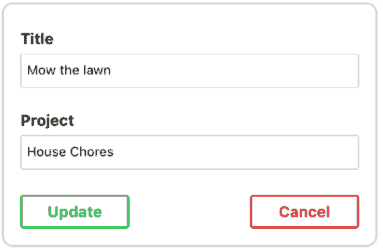

这些输入字段可以由用户修改。在React Native中，组件所做的**所有**修改都应该被处理并保存在状态中。这包括像修改输入字段这样的变化。理解这一点的最好方式是看看它的实际样子。

为了使这些输入字段具有状态，我们可以使我们的组件成为有状态的，并在组件顶部初始化`state`：

```
export default class TimerForm extends React.Component {
  constructor(props) {
    super(props);

    const { id, title, project } = props;

    this.state = {
      title: id ? title : '',
      project: id ? project : '',
    };
  }
```

我们的state对象有两个属性，每个属性对应于`TimerForm`管理的一个输入字段。如果`TimerForm`是在*创建*一个新计时器而不是编辑一个现有的计时器，那么`id`属性将是`undefined`。在这种情况下，我们使用三元运算符将两个属性都初始化为空字符串（`''`）。否则，当这个表单是*编辑*一个计时器时，我们将希望将两个值设置为各自的prop值。

请注意，因为我们是基于props来检查和定义状态的，所以我们使用`constructor()`进行状态初始化，而不是将状态定义为类属性。

> 我们希望避免将`title`或`project`初始化为`undefined`。这是因为从技术上讲，输入字段的值不能为undefined。如果它是空的，其在JavaScript中的值就是空字符串。

在我们构建这个组件的第一步中，我们使用`defaultValue`根据props设置`TextInput`字段的初始状态。但`defaultValue`属性只在*初始*渲染时设置`TextInput`的值。我们可以通过使用`value`将输入字段直接连接到组件的状态，而不是使用`defaultValue`。我们可以这样做：

```
<TextInput value={this.state.title} />
```

这样，我们的输入字段将由状态驱动。每当我们的任何一个状态属性改变时，我们的输入字段都会更新以反映新值。

然而，这缺少一个关键要素：**我们目前没有任何办法让用户*修改*这个状态。**输入字段将与组件的状态保持同步。但用户一旦进行修改，**输入字段就会与组件的状态不同步。**

我们可以通过使用React Native为`TextInput`组件提供的`onChangeText`属性来修复这个问题。就像按钮组件的`onPress`一样，我们可以像上一章那样将`onChangeText`设置为一个函数。每当输入字段被更改时，React都会调用指定的函数。

让我们将两个输入字段的`onChangeText`属性都设置为我们接下来要定义的函数。对于我们的*title*输入字段：

```
<TextInput
    style={styles.textInput}
    underlineColorAndroid="transparent"
    onChangeText={this.handleTitleChange}
    value={title}
/>
```

对于*project*同样如此：

```
<TextInput
    style={styles.textInput}
    underlineColorAndroid="transparent"
    onChangeText={this.handleProjectChange}
    value={project}
/>
```

`handleTitleChange`和`handleProjectChange`这两个函数都将修改它们各自在状态中的属性。它们的样子如下：

```
handleTitleChange = title => {
  this.setState({ title });
};

handleProjectChange = project => {
  this.setState({ project });
};
```

当React Native调用传递给`onChangeText`的函数时，它会将更改后的文本作为参数传入。通过这种方式，我们将状态更新为输入字段的新值。

结合使用状态、`value`属性和`onChangeText`属性，是我们编写React Native表单元素的标准方法。

我们更新后的`TimerForm`组件完整代码如下：

```
export default class TimerForm extends React.Component {
  constructor(props) {
    super(props);

    const { id, title, project } = props;

    this.state = {
      title: id ? title : '',
      project: id ? project : '',
    };
  }

  handleTitleChange = title => {
    this.setState({ title });
  };

  handleProjectChange = project => {
    this.setState({ project });
  };

  render() {
    const { id } = this.props;
    const { title, project } = this.state;
```


```
const submitText = id ? 'Update' : 'Create';

return (
  <View style={styles.formContainer}>
    <View style={styles.attributeContainer}>
      <Text style={styles.textInputTitle}>Title</Text>
      <View style={styles.textInputContainer}>
        <TextInput
          style={styles.textInput}
          underlineColorAndroid="transparent"
          onChangeText={this.handleTitleChange}
          value={title}
        />
      </View>
    </View>
    <View style={styles.attributeContainer}>
      <Text style={styles.textInputTitle}>Project</Text>
      <View style={styles.textInputContainer}>
        <TextInput
          style={styles.textInput}
          underlineColorAndroid="transparent"
          onChangeText={this.handleProjectChange}
          value={project}
        />
      </View>
    </View>
    <View style={styles.buttonGroup}>
      <TimerButton small color="#21BA45" title={submitText} />
      <TimerButton small color="#DB2828" title="Cancel" />
    </View>
  </View>
);
```

回顾一下，“TimerForm”的生命周期如下：

1.  页面上有一个标题为 “Mow the lawn” 的计时器。
2.  用户切换打开该计时器的编辑表单，将 `TimerForm` 挂载到屏幕上。
3.  `TimerForm` 将状态属性 `title` 初始化为字符串 "Mow the lawn"。
4.  用户修改 `title` 输入字段，将其值改为 "Cut the grass"。
5.  每次按键时，React 都会调用 `handleTitleChange`。`title` 的内部状态会与用户在页面上看到的内容保持同步。

通过对 `TimerForm` 的重构，我们已经完成了在组件内部建立有状态数据。并且我们已经组装好了向下传递的数据管道——props。

我们现在已经准备好了——而且可能有些迫不及待——要使用*反向数据流*来构建交互性。但在那之前，让我们先保存并重新加载应用，确保一切正常工作。

## 试一试

我们希望在 `App` 中看到基于硬编码数据的新示例计时器。我们还希望按下 "+" 按钮能够切换打开一个表单：

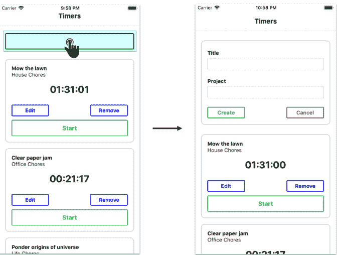

## 第 6 步：添加反向数据流

正如我们在上一章所见，子组件通过调用父组件通过 props 提供给它们的函数来与父组件通信。在我们的天气应用中，当搜索字段提交一个值时，`SearchInput` 并不进行任何数据管理。相反，它调用了 `App` 提供给它的一个函数，`App` 随后就能够相应地管理状态。

我们需要在两个地方使用反向数据流：

-   `TimerForm` 需要传播 **create** 和 **update** 事件（在 `ToggleableTimerForm` 下是 create，在 `EditableTimer` 下是 update）。两个事件最终都会到达我们最顶层的 `App`。
-   `Timer` 有不少行为需要处理。它需要处理 **delete** 和 **edit** 的点击，以及 **start** 和 **stop** 的计时器逻辑。

让我们从 `TimerForm` 开始。

## TimerForm

为了清楚地了解 TimerForm 到底需要什么，我们先为它添加事件处理程序，然后我们沿着组件层次结构向上回溯。

TimerForm 需要两个**事件处理程序**：

-   表单提交时（创建或更新计时器）
-   按下 "Cancel" 按钮时（关闭表单）

TimerForm 将接收两个函数作为 props 来处理每个事件。使用 TimerForm 的父组件负责提供这些函数：

-   `props.onFormSubmit()`：表单提交时调用
-   `props.onFormClose()`：按下 "Cancel" 按钮时调用

正如我们很快会看到的，这让父组件能够决定这些事件发生时应该有什么样的行为。

让我们首先在组件 render 方法中解构的 props 里添加 `onFormClose`：

```
time-tracking/3/components/TimerForm.js

render() {
  const { id, onFormClose } = this.props;
```

然后我们修改 TimerForm 上的按钮，为每个按钮指定 `onPress` props：

```
time-tracking/3/components/TimerForm.js

<View style={styles.buttonGroup}>
  <TimerButton
    small
    color="#21BA45"
    title={submitText}
    onPress={this.handleSubmit}
  />
  <TimerButton
    small
    color="#DB2828"
    title="Cancel"
    onPress={onFormClose}
  />
</View>
```

"Submit" 按钮的 `onPress` prop 指定了函数 `this.handleSubmit`，我们接下来会定义它。"Cancel" 按钮的 `onPress` prop 直接指定了 prop `onFormClose`。

现在我们已经看到了如何使用 `handleSubmit`，让我们来编写它。在 `render()` 上方声明这个函数：

```
handleSubmit = () => {
  const { onFormSubmit, id } = this.props;
  const { title, project } = this.state;

  onFormSubmit({
    id,
    title,
    project,
  });
};
```

同样，我们目前是自下而上工作的。所以 `handleSubmit()` 方法调用了稍后将要编写的预期函数 `onFormSubmit()`。它传入了一个包含 `id`、`title` 和 `project` 属性的数据对象。

注意，我们通过 props 读取 `id`，从 state 读取 `title` 和 `project`。这是因为我们希望向函数提供 `title` 和 `project` 的最新值（在 state 中），而不是初始值（通过 props 提供）。

## ToggleableTimerForm

让我们跟随从 `TimerForm` 发出的提交事件，看看它如何在组件层次结构中向上冒泡。首先，我们修改 `ToggleableTimerForm`。我们需要它定义并向下传递两个 prop 函数给 `TimerForm`：`onFormClose()` 和 `onFormSubmit()`。

让我们先更新组件的 `render()` 方法：

```
render() {
  const { isOpen } = this.state;

  return (
    <View style={[styles.container, !isOpen && styles.buttonPadding]}>
      {isOpen ? (
        <TimerForm
          onFormSubmit={this.handleFormSubmit}
          onFormClose={this.handleFormClose}
```

```
    />
    ) : (
      <TimerButton title="+" color="black" onPress={this.handleFormOpen} />
    )}
  </View>
);
}
```

我们向 `TimerForm` 传入两个函数作为 props。正如我们所见，函数和其他任何 prop 一样。

让我们先编写 `handleFormClose()`：

**`time-tracking/4/components/ToggleableTimerForm.js`**

```
handleFormClose = () => {
  this.setState({ isOpen: false });
};
```

那么 `handleFormSubmit()` 会是什么样子呢？`ToggleableTimerForm` 不是计时器状态的管理者。所以 `ToggleableTimerForm` 应该期望从 `App` 获得一个新的 prop：`onFormSubmit()`。`ToggleableTimerForm` 应该转而将它传递给 `TimerForm`。当用户在 `TimerForm` 中提交表单时，他们会调用定义在 `App` 中的一个函数来修改计时器状态。`ToggleableTimerForm` 只是这个函数的代理。

所以，我们可能会忍不住直接将这个预期的 prop 函数传递给 `TimerForm`，像这样：

```
<TimerForm
  onFormSubmit={this.props.onFormSubmit}
  onFormClose={this.handleFormClose}
/>
```

但是，请考虑一下：在用户点击 "Create" 创建计时器后，我们实际上想要关闭 `ToggleableTimerForm`。我们想要*拦截*这个事件，这样我们就可以将 `isOpen` 设为 false。

为此，`handleFormSubmit()` 看起来是这样的：

time-tracking/4/components/ToggleableTimerForm.js

```
handleFormSubmit = timer => {
    const { onFormSubmit } = this.props;

    onFormSubmit(timer);
    this.setState({ isOpen: false });
};
```

`handleFormSubmit()` 方法接受参数 `timer` 并将其传递给 `onFormSubmit()`。回想一下，在 `TimerForm` 中这个参数是一个包含所需计时器属性的对象。在调用 `onFormSubmit()` 之后，`handleFormSubmit()` 调用 `setState()` 来关闭它的表单。

> 虽然我们在本章不会添加服务器通信，但让我们试着想象一下，如果我们这样做的话，提交表单会是如何工作的。

`onFormSubmit()` 的结果不会影响表单是否关闭。我们调用 `onFormSubmit()`，它最终可能会创建一个对服务器的**异步**调用。执行会在收到服务器响应之前继续，这意味着 `setState()` 会被调用。

如果 `onFormSubmit()` 失败——比如服务器暂时无法访问——我们 ideally 需要某种方式来显示错误消息并重新打开表单。

## App

我们已经到达了层次结构的顶端，我们的根组件 `App`。由于这个组件将负责计时器的数据，因此我们将在这里定义处理我们在最低层组件中捕获的事件的逻辑。

我们关注的第一个事件是表单的提交（即来自 `TimerForm` 的事件）。当这种情况发生时，要么是在*创建*新计时器，要么是在*更新*现有计时器。我们将创建两个独立的函数来处理这两个不同的事件：

-   `handleCreateFormSubmit()` 将处理计时器的创建，并将作为 prop 传递给 `ToggleableTimerForm`
-   `handleFormSubmit()` 将处理计时器的更新，并将作为 prop 传递给 `EditableTimer`

两个函数各自沿着它们的组件层次结构向下传递，直到作为 prop `onFormSubmit()` 到达 `TimerForm`。

让我们从 `handleCreateFormSubmit()` 开始。

### 处理创建

`handleCreateFormSubmit()` 将是 `App` 提供给 `ToggleableTimerForm` 的函数。我们现在就设置那个 prop：


React 基础

111

time-tracking/3/App.js

```
<ToggleableTimerForm onFormSubmit={this.handleCreateFormSubmit} />
```

接下来，我们将定义该函数。

对于创建计时器，我们将使用 `utils/TimerUtils.js` 中的 `newTimer()` 函数。这仅仅是隐藏了一些逻辑，比如生成 id。它的样子如下：

time-tracking/utils/TimerUtils.js

```
export const newTimer = (attrs = {}) => {
  const timer = {
    title: attrs.title || 'Timer',
    project: attrs.project || 'Project',
    id: uuidv4(),
    elapsed: 0,
    isRunning: false,
  };

  return timer;
};
```

该函数接受一个带有 `timer` 和 `project` 属性的对象，并返回一个新对象，其余属性均已正确初始化。

在 App.js 的顶部导入该函数：

time-tracking/3/App.js

```
import { newTimer } from './utils/TimerUtils';
```

在 `handleCreateFormSubmit()` 中，我们将使用 `newTimer()` 将新的计时器对象插入到 state 中。在 render() 上方声明此函数：

time-tracking/3/App.js

```
handleCreateFormSubmit = timer => {
  const { timers } = this.state;

  this.setState({
    timers: [newTimer(timer), ...timers],
  });
};
```

注意，我们将 `this.state.timers` 设置为一个*新的*计时器数组。数组的第一个元素是我们用 `newTimer()` 创建的新计时器。然后，我们使用 JavaScript 的**展开语法**将现有的其余计时器添加到这个新数组中。这样做是为了避免**直接修改 state**。

令人心动的替代写法是这样的：

```
handleCreateFormSubmit = timer => {
    const { timers } = this.state;

    this.setState({
        timers: timers.push(newTimer(timer)), // 修改了 state！
    });
};
```

但 `.push()` 是将新计时器*追加*到 state 中的现有数组。这很微妙，但它确实*修改了 state*。而我们绝不应该在 `this.setState()` 方法之外修改 state。

我们始终要将 state 对象（以及 state 内的对象和数组）视为不可变的。编写不可变的 JavaScript 一开始可能比较棘手。一个简单的策略就是避免使用某些 Array 和 Object 方法。`.push()` 就是需要避免的方法之一，因为它总是会修改调用它的数组。

如果你仍然对 `.push()` 和展开语法之间的区别感到困惑，别担心。我们将在整本书中展示如何避免意外修改 state 的策略。

## 展开语法

在数组中，省略号（`...`）会将后面的数组展开到父数组中。展开运算符使我们能够简洁地构建新数组，作为现有数组的组合：

```
const a = [ 1, 2, 3 ];
const b = [ 4, 5, 6 ];
const c = [ ...a, ...b, 7, 8, 9 ];

console.log(c);  // -> [ 1, 2, 3, 4, 5, 6, 7, 8, 9 ]
```

在对象中，省略号（`...`）可以让你创建现有对象的修改版本：

```
const coffee = { milk: false, cream: false };
const coffeeWithMilk = { ...coffee, milk: true };
console.log(coffeeWithMilk);  // -> { milk: true, cream: false }
```

这在处理不可变的 JavaScript 对象时非常有用。

## 试一试

现在我们已经完成了从 `Timer QoS` Trait 击罗盘创建计时器流程的接入，从 `Time Trait 的表单一直到 `App` 中管理的 state。保存 `App.js`，你的应用应该会重新加载。打开创建表单并创建一些新计时器：

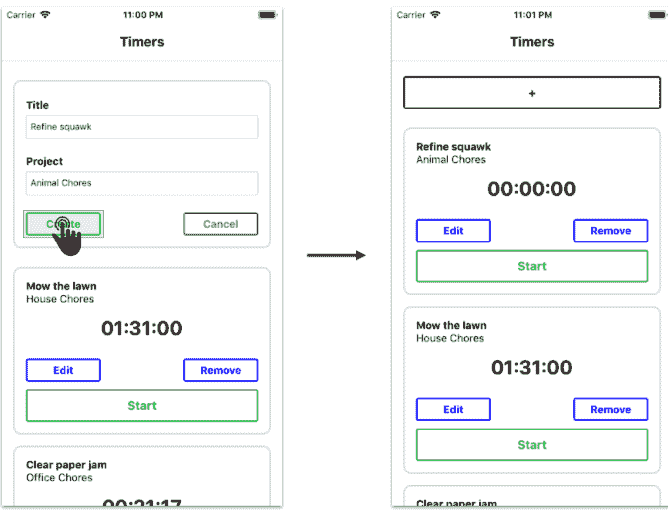

## 更新计时器

我们的应用已经设置好了创建计时器的功能。接下来让我们添加更新功能。

我们知道最终我们想要 `App` 定义一个处理程序 `onFormSubmit()`，用于在 `TimerForm` 提交计时器更新时调用。然而，正如你在应用当前状态中看到的，我们还没有添加编辑计时器的能力。我们还没有办法显示一个编辑表单，而这是提交编辑的前提条件。

要显示编辑表单，用户将点击 `Timer` 上的编辑按钮。这应该将事件传播到 `EditableTimer`，告诉它切换其子组件，打开表单。

我们将再次自下而上地工作。从 `Timer` 开始，指定它需要的 prop-函数，然后向上移动组件层次结构。

## 为 `Timer` 添加可编辑性

由于我们要给 `Timer` 添加相当多的功能，我们首先将其转换为类组件：

```
time-tracking/4/components/Timer.js
export default class Timer extends React.Component {
```

`EditableTimer` 管理编辑表单是否打开的状态。因此，我们期望 `Timer` 从其父组件接收一个 prop，`onEditPress()`。我们将 "Edit" TimerButton 的 onPress prop 设置为这个 prop：

```
time-tracking/4/components/Timer.js
render() {
  const { elapsed, title, project, onEditPress } = this.props;
  const elapsedString = millisecondsToHuman(elapsed);

  return (
    <View style={styles.timerContainer}>
      <Text style={styles.title}>{title}</Text>
      <Text>{project}</Text>
      <Text style={styles.elapsedTime}>{elapsedString}</Text>
      <View style={styles.buttonGroup}>
        <TimerButton color="blue" small title="Edit" onPress={onEditPress} />
        <TimerButton color="blue" small title="Remove" />
      </View>
      <TimerButton color="#21BA45" title="Start" />
    </View>
  );
}
```

## 更新 EditableTimer

现在我们准备好更新 EditableTimer 了。同样，它将显示 TimerForm（如果正在编辑）或单个 Timer（如果不在编辑）。

让我们为两个可能的子组件添加事件处理程序。对于 TimerForm，我们希望处理表单关闭或提交的情况。对于 Timer，我们希望处理编辑按钮被按下的情况：

time-tracking/4/components/EditableTimer.js

```
export default class EditableTimer extends React.Component {
  state = {
    editFormOpen: false,
  };

  handleEditPress = () => {
    this.openForm();
  };

  handleFormClose = () => {
    this.closeForm();
  };

  handleSubmit = timer => {
    const { onFormSubmit } = this.props;

    onFormSubmit(timer);
    this.closeForm();
  };

  closeForm = () => {
    this.setState({ editFormOpen: false });
  };

  openForm = () => {
    this.setState({ editFormOpen: true });
  };
}
```

我们将这些事件处理程序作为 props 传递下去：

time-tracking/4/components/EditableTimer.js

```
render() {
  const { id, title, project, elapsed, isRunning } = this.props;
  const { editFormOpen } = this.state;

  if (editFormOpen) {
    return (
      <TimerForm
        id={id}
        title={title}
        project={project}
        onFormSubmit={this.handleSubmit}
        onFormClose={this.handleFormClose}
      />
    );
  }
  return (
    <Timer
      id={id}
      title={title}
      project={project}
      elapsed={elapsed}
      isRunning={isRunning}
      onEditPress={this.handleEditPress}
    />
  );
}
```

看起来有点熟悉？`EditableTimer` 处理从 `TimerForm` 发出的事件的方式与 `ToggleableTimerForm` 类似。这是合理的。`EditableTimer` 和 `ToggleableTimerForm` 都只是 `TimerForm` 和 `App` 之间的中介。`App` 才是定义提交函数处理程序的那个。

与 `ToggleableTimerForm` 类似，`EditableTimer` 对传入的 `timer` 不做任何处理。在 `handleSubmit()` 中，它只是简单地将这个对象传递给其 prop-函数 `onFormSubmit()`。然后使用 `closeForm()` 关闭表单。

我们将新 prop `onEditPress` 传递给 `Timer`。该函数的行为在 `handleEditPress` 中定义，它修改 `EditableTimer` 的 state，打开表单。

## 在 `App` 中定义 `handleFormSubmit()`

就像我们对 `handleCreateFormSubmit()` 所做的那样，此流程的最后一步是在 `App` 中定义一个处理编辑表单提交的处理程序 `handleFormSubmit()`。

对于创建计时器，我们有一个函数可以根据指定属性创建新的计时器对象，并将这个新对象添加到 state 中 `timers` 数组的开头。

对于更新计时器，我们需要遍历 `timers` 数组，直到找到正在被更新的计时器对象。一如既往，state 对象**不能**直接更新。我们必须使用 `setState()`。

因此，我们将使用 `map()` 遍历计时器对象数组。如果计时器的 `id` 与提交的表单匹配，我们将返回一个包含更新属性后的计时器的新对象。否则，我们只返回原始计时器。这个新的计时器对象数组将被传递给 `setState()`。


## 删除计时器

### 将事件处理器添加到 `Timer`

与添加创建和更新功能一样，我们将自下而上地进行工作。从 `Timer` 开始，逐步向上到 `App`。在 `App` 中，我们将定义从状态中移除目标计时器的函数。

在 `Timer` 中，我们首先定义处理"Remove"按钮点击事件的函数：

```javascript
// time-tracking/5/components/Timer.js
handleRemovePress = () => {
  const { id, onRemovePress } = this.props;

  onRemovePress(id);
};
```

我们尚未定义将作为 prop `onRemovePress()` 设置的函数。但你可以想象，当这个事件到达顶层（`App`）时，我们需要 `id` 来确定要删除哪个计时器。`handleRemovePress()` 方法将该 `id` 提供给此函数。

我们使用 `onPress` 将该函数与"Remove" `TimerButton` 连接起来：

```javascript
// time-tracking/5/components/Timer.js
<TimerButton
  color="blue"
  small
  title="Remove"
  onPress={this.handleRemovePress}
/>
```

### 通过 `EditableTimer` 进行传递

在 `EditableTimer` 中，我们在组件的 render 方法中将 `onRemovePress` 包含在解构的 props 中：

```javascript
// time-tracking/5/components/EditableTimer.js
render() {
  const {
    id,
    title,
    project,
    elapsed,
    isRunning,
    onRemovePress,
  } = this.props;
}
```

然后我们将该函数传递给 `Timer`：

```javascript
// time-tracking/5/components/EditableTimer.js
<Timer
  id={id}
  title={title}
  project={project}
  elapsed={elapsed}
  isRunning={isRunning}
  onEditPress={this.handleEditPress}
  onRemovePress={onRemovePress}
/>
```

### 在 App 中实现删除函数

最后一步是在 `App` 中定义从状态数组中删除所需计时器的函数。在 JavaScript 中有多种方法可以实现这一点。如果你尝试自己实现这个解决方案，不要担心你的解决方案是否不同。

我们添加最终将作为 prop 向下传递的处理函数：

```javascript
// time-tracking/5/App.js
handleRemovePress = timerId => {
  this.setState({
    timers: this.state.timers.filter(t => t.id !== timerId),
  });
};
```

在这里，我们使用数组 `filter()` 方法返回一个新的数组，其中不包含 `id` 与 `timerId` 匹配的计时器对象。

最后，我们将 `handleRemovePress()` 作为 prop 向下传递：

```javascript
// time-tracking/5/App.js
<EditableTimer
  key={id}
  id={id}
  title={title}
  project={project}
  elapsed={elapsed}
  isRunning={isRunning}
  onFormSubmit={this.handleFormSubmit}
  onRemovePress={this.handleRemovePress}
/>
```

> **数组 `filter()`**
>
> 数组 `filter()` 接收一个用于对数组中每个元素进行"测试"的函数。它返回一个包含所有"通过"测试的元素的新数组。如果函数返回 `true`，则保留该元素。

## 试一试

保存 `App.js` 并重新加载应用。现在你可以删除计时器了：

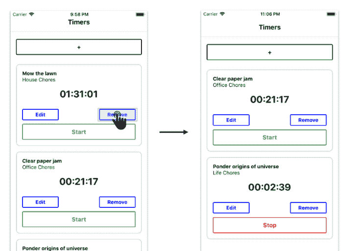

## 添加计时功能

现在计时器的创建、更新和删除功能已经就位。下一个挑战：让这些计时器真正跟踪时间。

我们可以用几种不同的方式实现计时器系统。最简单的方法是每隔一秒更新每个计时器的 `elapsed` 属性。这就是我们包含计时器属性 `isRunning` 的原因。我们可以这样做：

```javascript
this.setState({
  timers: timers.map(timer => {
    const { elapsed, isRunning } = timer;

    return {
      ...timer,
      elapsed: isRunning ? elapsed + 1000 : elapsed,
    };
  }),
});
```

我们遍历状态中的所有计时器并检查 `isRunning` 的值。如果 `isRunning` 为 `true`，我们就给 `elapsed` 加上 1000 毫秒（即 1 秒）。

现在，要实现这个功能，我们需要每秒执行一次。我们可以使用 JavaScript 的 `setInterval()` 按间隔执行此函数。

让我们在 `componentDidMount` 中设置我们的间隔：

```javascript
// time-tracking/ presenta/6/App.js
componentDidMount() {
  const TIME_INTERVAL = 1000;

  this.intervalId = setInterval(() => {
    const { timers } = this.state;

    this.setState({
      timers: timers.map(timer => {
        const { elapsed, isRunning } = timer;

        return {
          ...timer,
          elapsed: isRunning ? elapsed + TIME_INTERVAL : elapsed,
        };
      }),
    });
  }, TIME_INTERVAL);
}
```

`setInterval()` 接收两个参数。第一个参数是我们希望按间隔执行的函数。在这里，我们执行更新 `elapsed` 的逻辑。第二个参数是间隔长度（或函数调用之间的延迟）。我们将其设置为 `TIME_INTERVAL`，即 1000 毫秒。

我们还捕获了 `setInterval()` 的返回值，设置组件变量 `this.intervalId`。这个特殊标识符允许我们在未来任何时候使用 JavaScript 对应的 `clearInterval()` 来停止该间隔。如果计时器组件被卸载（删除），我们将希望取消（或"清除"）此间隔。否则，我们的函数将无限期运行并导致错误。我们可以使用 `componentWillUnmount` 生命周期钩子来实现这一点：

```javascript
// time-tracking/6/App.js
componentWillUnmount() {
    clearInterval(this.intervalId);
}
```

这是我们第一次使用 `componentWillUnmount`。顾名思义，此方法在组件被卸载或移除之前立即触发。在这个例子中，我们使用 `clearInterval()` 取消更新计时器的逻辑。

在组件挂载时使用 `setInterval()`，在组件卸载时使用 `clearInterval()`，是需要间隔事件的 React 应用中的常见模式。

> 在我们这个版本的应用中，`App` 永远不会被卸载。然而，在组件卸载时清除任何间隔仍然是最佳实践。这使我们的应用具有"未来适应性"。有许多库，如"热重载"库，会导致甚至应用的主组件被卸载并重新挂载。

> 尽管这个计时器实现对我们的目的来说已经够用，但它并不是最精确的。无法保证计时器会精确地每 1000 毫秒更新一次，而且在启动和停止时我们会丢失精度。
> 一种更精确的方法的示例是定义一个单独的计时器属性，如 `runningSince`。然后我们可以通过计算 `runningSince` 的值与当前时间之间的差值，来推导出计时器已经运行了多长时间。如果我们将这个值保存在某处，它还可以让我们的计时器即使在应用关闭时也能继续"运行"。


## 添加启动和停止功能

现在我们已经实现了计时器的间隔功能，接下来只需为每个计时器添加一个能够切换 `isRunning` 布尔值的操作。

每个计时器底部的操作按钮，在计时器暂停时应显示"开始"，在计时器运行时应显示"停止"。这些按钮点击操作将调用在 `App` 组件中定义的函数，这些函数将修改 `isRunning` 的状态。

## 为计时器添加操作事件

我们还是从底部的 `Timer` 组件开始。

我们将预设两个属性函数：`onStartPress()` 和 `onStopPress()`。首先，我们编写调用这些函数的按钮点击事件处理程序：

time-tracking/6/components/Timer.js

```
handleStartPress = () => {
  const { id, onStartPress } = this.props;

  onStartPress(id);
};

handleStopPress = () => {
  const { id, onStopPress } = this.props;

  onStopPress(id);
};
```

我们将 `id` 属性向上传递给 `App`，以便 `App` 知道应该启动或停止哪个计时器。

在 `render()` 方法内部，我们将预设一个 `renderActionButton()` 方法，该方法根据计时器是正在运行还是已停止来有条件地显示正确的按钮：

time-tracking/6/components/Timer.js

```
render() {
  const { elapsed, title, project, onEditPress } = this.props;
  const elapsedString = millisecondsToHuman(elapsed);

  return (
    <View style={styles.timerContainer}>
      <Text style={styles.title}>{title}</Text>
      <Text>{project}</Text>
      <Text style={styles.elapsedTime}>{elapsedString}</Text>
      <View style={styles.buttonGroup}>
        <TimerButton color="blue" small title="Edit" onPress={onEditPress} />
        <TimerButton
          color="blue"
          small
          title="Remove"
          onPress={this.handleRemovePress}
        />
      </View>
      {this.renderActionButton()}
    </View>
  );
}
```

现在，让我们来设置这个方法内渲染的 JSX：

time-tracking/6/components/Timer.js

```
renderActionButton() {
  const { isRunning } = this.props;

  if (isRunning) {
    return (
      <TimerButton
        color="#DB2828"
        title="Stop"
        onPress={this.handleStopPress}
      />
    );
  }

  return (
    <TimerButton
      color="#21BA45"
      title="Start"
      onPress={this.handleStartPress}
    />
  );
}
```

我们本可以将这个条件逻辑写在组件的 `render()` 方法内部。但是，正如我们在前面章节中简要提到的，React 中的一个常见模式是使用辅助方法来完成这类操作。这有时有助于提高代码的清晰度和可读性。在 `renderActionButton()` 中，我们根据 `this.props.isRunning` 的值来专门渲染一个或另一个按钮。

现在，我们需要将这些事件沿着组件层级向上传递，一直传递到管理状态的 `App` 组件。

## 通过 `EditableTimer` 传递事件

在 `EditableTimer` 中，我们需要将 `onStartPress` 和 `onStopPress` 传递给 `Timer`：

time-tracking/6/components/EditableTimer.js

```
render() {
  const {
    id,
    title,
    project,
    elapsed,
    isRunning,
    onRemovePress,
    onStartPress,
    onStopPress,
  } = this.props;
  const { editFormOpen } = this.state;

  if (editFormOpen) {
    return (
      <TimerForm
        id={id}
        title={title}
        project={project}
        onFormSubmit={this.handleSubmit}
        onFormClose={this.handleFormClose}
      />
    );
  }

  return (
    <Timer
      id={id}
      title={title}
      project={project}
      elapsed={elapsed}
      isRunning={isRunning}
      onEditPress={this.handleEditPress}
      onRemovePress={onRemovePress}
      onStartPress={onStartPress}
      onStopPress={onStopPress}
    />
  );
}
```

我们可以在 `App` 组件中定义一个函数来处理这些属性。它应该使用 `map` 遍历状态中的 `timers` 数组，当找到匹配的计时器时，翻转其 `isRunning` 的值：

```
toggleTimer = timerId => {
  this.setState(prevState => {
    const { timers } = prevState;

    return {
      timers: timers.map(timer => {
        const { id, isRunning } = timer;

        if (id === timerId) {
          return {
            ...timer,
            isRunning: !isRunning,
          };
        }

        return timer;
      }),
    };
  });
};
```

当 `toggleTimer` 在其 `map` 调用中遇到相关的计时器时，它会将 `isRunning` 属性设置为其当前值的相反值。这意味着它会停止一个正在运行的计时器，并启动一个已停止的计时器。

最后，我们在渲染方法中将这个函数传递给 `EditableTimer`：

time-tracking/6/App.js

```
<EditableTimer
  key={id}
  id={id}
  title={title}
  project={project}
  elapsed={elapsed}
  isRunning={isRunning}
  onFormSubmit={this.handleFormSubmit}
  onRemovePress={this.handleRemovePress}
  onStartPress={this.toggleTimer}
  onStopPress={this.toggleTimer}
/>
```

## 试试看

保存 `App.js`，等待应用重新加载，然后瞧：你现在可以创建、更新和删除计时器，并且可以实际使用它们来计时了！

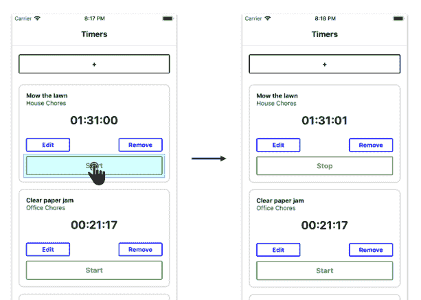

再次说明，对于这个应用，我们不会添加服务器通信。没有它，我们应用的数据是临时的。如果我们重新加载应用，计时器将会重置。

## 用 `KeyboardAvoidingView` 包裹 `App`

目前我们应用的一个行为怪癖是，当我们编辑计时器时，键盘可能会挡住视线。正如我们在第一章中看到的，我们可以通过将应用包裹在 `KeyboardAvoidingView` 组件中来解决这个问题。

在 App.js 中，首先导入该组件：

time-tracking/6/App.js

```
import React from 'react';
import uuidv4 from 'uuid/v4';

import {
  StyleSheet,
  View,
  ScrollView,
  Text,
  KeyboardAvoidingView,
} from 'react-native';
```

然后，用它包裹 `ScrollView` 组件：

time-tracking/6/App.js

```
render() {
  const { timers } = this.state;

  return (
    <View style={styles.appContainer}>
      <View style={styles.titleContainer}>
        <Text style={styles.title}>Timers</Text>
      </View>
      <KeyboardAvoidingView
        behavior="padding"
        style={styles.timerListContainer}
      >
        <ScrollView contentContainerStyle={styles.timerList}>
          <ToggleableTimerForm onFormSubmit={this.handleCreateFormSubmit} />
          {timers.map(({ title, project, id, elapsed, isRunning }) => (
            <EditableTimer
              key={id}
              id={id}
              title={title}
              project={project}
              elapsed={elapsed}
              isRunning={isRunning}
              onFormSubmit={this.handleFormSubmit}
              onRemovePress={this.handleRemovePress}
              onStartPress={this.toggleTimer}
              onStopPress={this.toggleTimer}
            />
          ))}
        </ScrollView>
      </KeyboardAvoidingView>
    </View>
  );
}
```

最后，向样式对象中添加以下样式：

time-tracking/6/App.js

```
timerListContainer: {
    flex: 1,
  },
```

现在，当我们开始在文本输入框中输入时，我们的 `ScrollView` 将会适应键盘。

最后，让我们为组件添加 PropTypes。正如上一章所讨论的，在对 React Native 应用进行增删改时，PropTypes 非常有用。

## PropTypes

让我们从 `EditableTimer` 开始，为每个组件添加 PropTypes：

time-tracking/6/components/EditableTimer.js

```
export default class EditableTimer extends React.Component {
  static propTypes = {
    id: PropTypes.string.isRequired,
    title: PropTypes.string.isRequired,
    project: PropTypes.string.isRequired,
    elapsed: PropTypes.number.isRequired,
    isRunning: PropTypes.bool.isRequired,
    onFormSubmit: PropTypes.func.isRequired,
    onRemovePress: PropTypes.func.isRequired,
    onStartPress: PropTypes.func.isRequired,
    onStopPress: PropTypes.func.isRequired,
  };
```

对于这个组件，我们所有的属性都是必需的，因为我们期望 `App` 总是会设置它们。现在让我们看看 `Timer` 组件：

time-tracking/6/components/Timer.js

```
export default class Timer extends Component {
  static propTypes = {
    id: PropTypes.string.isRequired,
    title: PropTypes.string.isRequired,
    project: PropTypes.string.isRequired,
    elapsed: PropTypes.number.isRequired,
    isRunning: PropTypes.bool.isRequired,
    onEditPress: PropTypes.func.isRequired,
    onRemovePress: PropTypes.func.isRequired,
    onStartPress: PropTypes.func.isRequired,
    onStopPress: PropTypes.func.isRequired,
  };
}
```

同样地，我们知道 `Timer` 的每个属性都应该始终由 `EditableTimer` 提供。让我们为 `TimerButton` 添加 PropTypes 和 defaultProps：

time-tracking/6/components/TimerButton.js

```
TimerButton.propTypes = {
  color: ColorPropType.isRequired,
  title: PropTypes.string.isRequired,
  small: PropTypes.bool,
  onPress: PropTypes.func.isRequired,
};

TimerButton.defaultProps = {
  small: false,
};
```

`small` 是一个可选属性，默认值为 `false`。我们的其他属性都是必需的。我们还为 `color` 属性使用了 `ColorPropType`，以便正确验证是否传入了合适的颜色[54]。我们还需要在文件顶部从 `react-native` 中导入它。

我们最后两个需要属性验证的组件是表单组件。让我们从 `TimerForm` 开始：

[54] https://facebook.github.io/react-native/docs/next/colors.html


 ```
time-tracking/components/TimerForm.js

export default class TimerForm extends React.Component {
  static propTypes = {
    id: PropTypes.string,
    title: PropTypes.string,
    project: PropTypes.string,
    onFormSubmit: Prop(MB4)Types.func.isRequired,
    onFormClose: PropTypes.func.isRequired,
  };

  static defaultProps = {
    id: null,
    title: '',
    project: '',
  };
}
```

对于这个组件，只有在编辑计时器表单而非创建新表单时，我们才会传入计时器属性（id、title 和 project）。我们为每个属性都添加了适当的默认值。接下来是 ToggleableTimerForm：

```
time-tracking/components/ToggleableTimerForm.js

export default class ToggleableTimerForm extends Component {
  static propTypes = {
    onFormSubmit: PropTypes.func.isRequired,
  };
}
```

这个组件只接收一个必需的 prop，即 `onFormSubmit`，它在我们提交计时器表单时触发。

## 方法论回顾

在构建计时应用的过程中，我们学习并应用了一套构建 React 应用的方法论。再次回顾一下这些步骤：

- 1. 将应用拆分为组件
   通过检查应用的用户界面，我们梳理出了组件结构。然后运用单一职责原则来拆分组件，使每个组件都具备最小化的可用功能。

- 2. 构建应用的静态版本
   我们的底层（用户可见）组件基于静态 props 渲染 JSX，这些 props 从父组件传入。

- 3. 确定哪些应该是 state
   我们通过一系列问题来推断哪些数据应该是 state。这些数据在静态应用中以 props 的形式呈现。

- 4. 确定每个 state 片段应存在于哪个组件中
   我们通过另一系列问题来确定哪个组件应该拥有每个 state 片段。`App` 拥有计时器状态数据，`ToggleableTimerForm` 和 `EditableTimer` 则各自持有关于是否渲染 `TimerForm` 的状态。

- 5. 硬编码初始状态
   对于拥有 state 的组件，我们用硬编码值初始化 `state` 属性。

- 6. 添加反向数据流
   我们通过为按钮添加 `onPress` 事件处理程序来添加交互性。这些处理程序调用作为 props 从拥有相关 state 的组件向下传递的函数。

如果我们计划为应用添加服务器通信功能，现在正是时候，因为我们已经完成了整个应用基础的搭建。

## 下一章预告

在第一章中，我们通过构建天气应用探索了 React Native 的基础知识。在本章中，我们通过创建一个更具交互性、组件更多的应用，深入学习了 React API 的基础知识。虽然我们涵盖了许多重要的概念，包括从头开始构建 React Native 应用的有用模式，但到目前为止，我们只是简要介绍了 React Native 的内置组件，如 `View` 和 `Text`。在接下来的两章中，我们将更详细地研究 React Native 的核心组件。

## 核心组件（第一部分）

## 什么是组件？

组件是任何 React Native 应用的构建块。在前面的章节中，我们使用 `View` 和 `Text` 等组件为天气应用和计时应用创建用户界面。开箱即用，React Native 包含了从表单控件到富媒体等各种组件。

到目前为止，我们一直在*使用* React Native 组件，而没有完全探索*它们的工作原理*。在本章中，我们将研究最常见的内置 React Native 组件。与前面的章节一样，我们将在构建应用的过程中学习新知识。当我们遇到新主题时，我们会先深入探讨该主题，然后再继续构建。在章节结束时，你应该拥有使用*任何* React Native 组件的扎实基础——即使是我们没有涵盖的组件，也会遵循许多相同的 |סם

> React Native 已经支持 [universal Windows 平台](https://github.com/Microsoft/react-native-windows)、Apple TV（属于主 [react-native 仓库](https://github.com/facebook/react-native) 的一部分）、[React VR](https://facebook.github.io/react-vr/) 和 [网页](https://github.com/necolas/react-native-web)。

当你开始构建复杂的应用时，你可能会遇到想要在某个平台上使用某个功能，而另一个平台却不支持的情况。针对这种情况，存在平台特定的组件。通常，组件的名称会以平台名称结尾，例如 `NavigatorIOS`。正如我们在"入门指南"中提到的，有多种方式可以在不同平台上运行不同的代码——你需要为平台特定的组件这样做。

## 构建 Instagram 克隆应用

在本章中，我们将使用最常见的 React Native 组件来构建一个类似 Instagram 的应用。我们将使用 `View`、`Text`、`Image` 和 `FlatList` 组件来构建主图片 feed。silently's ##ales

要在手机上尝试完成的应用：

- 在 Android 上，你可以从 Expo 应用中扫描此二维码：


- 在 iOS 上，你可以导航到我们示例代码文件夹中的 `image-feed/` 目录，并使用与前面章节相同的过程构建应用。你可以使用 iOS 模拟器预览，或将项目 URL 的链接发送到你的设备。

我们的应用将有两个屏幕。第一个屏幕是图片 feed：

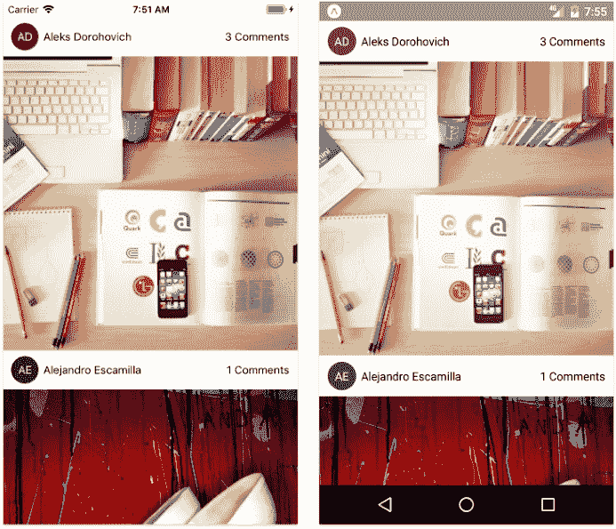

第二个屏幕在我们点击"3 comments"时打开，显示该图片的评论：

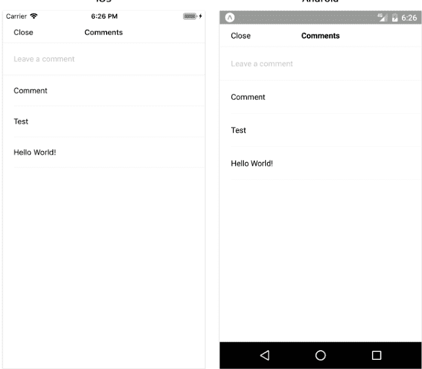

## 项目设置

与前面的章节一样，让我们使用以下命令创建一个新应用：

```
$ create-react-native-app image-feed --scripts-version 1.14.0
```

完成后，导航到 `image-feed` 目录。

选择以下方式之一启动应用：

- **yarn start** - 启动 Packager 并显示二维码，以便在 Android 手机上打开应用
- **yarn ios** - 启动 Packager 并在 iOS 模拟器上启动应用
- **yarn android** - 启动 Packager 并在 Android 模拟器上启动应用

你应该会看到默认的 `App.js` 文件在运行，它看起来像这样：

<div>

<div>
## iOS
## Android

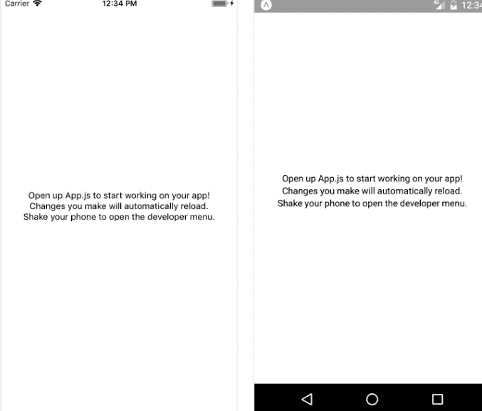

现在是将示例代码中的 `image-feed/utils` 目录复制到你自己的项目中的好时机。将 `utils` 目录复制到我们刚创建的 `image-feed` 目录中。

## 我们的工作方式

在本章中，我们将按照与上一章相同的方法论来构建应用。我们会将应用拆分为组件，静态构建它们，等等。我们不会特别指出每个步骤，因为不必*完全*遵循它们。它们最适合作为你不确定下一步该做什么时的参考。

> 如果在构建自己的应用时遇到任何困难，请考虑确定你已经完成了哪些步骤，然后更严格地遵循这些步骤，直到你重回正轨。

## 拆解 feed 屏幕

我们要开始以用户界面中不同组件的角度来思考我们的应用。最终，我们的应用将渲染 `View` 和 `Text` 等内置组件，但正如我们在上一章中学到的，在这些组件之上构建更高层次的抽象是很有用的。让我们先弄清楚主图片 feed 可以如何拆分为组件。
```


好的，我会为你处理这份OCR文本。

## 处理后的文本

一个好的组件通常是简洁且自包含的。通过审视我们试图构建的截图，我们可以识别出哪些部分与其它部分有合理的区分，并且能在多个地方被复用。由于我们只构建了几个屏幕，我们无法对截图中哪些部分最可复用做出完全知情的决策，因为我们不知道应用中其他屏幕会是什么样子。但我们可以做出一些相当不错的猜测。以下是我们分解主信息流的一种方式：

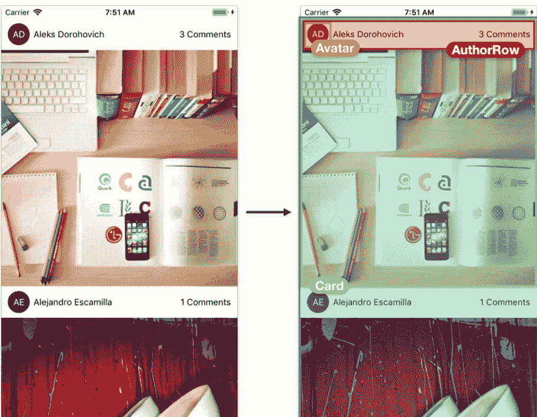

-   头像 - 图像作者的个人资料照片或姓名首字母
-   作者行 - 包含作者信息的水平行：他们的头像和名字
-   卡片 - 信息流中的项目，包含图像及其作者信息
-   卡片列表 - 信息流中的卡片列表

每一个组件都建立在另一个之上：`CardList` 包含一个 `Card` 组件列表，每个 `Card` 又包含一个 `AuthorRow`，而 `AuthorRow` 包含一个 `Avatar`。

## 自顶向下 vs. 自底向上

在构建应用的UI组件时，通常有两种方法：自顶向下和自底向上。在自顶向下的方法中，我们会从构建 `CardList` 组件开始，然后构建 `CardList` 内的组件，接着是这些组件内的组件，如此往复，直到我们达到最内层的组件 `Avatar`。在自底向上的方法中，我们会从最内层的组件（如 `Avatar`）开始，并持续构建更高层次的抽象，直到达到 `CardList`。在这两种方法之间做选择主要是个人偏好，而且两种方法都使用一点是很常见的。

对于这个应用，我们将采用自底向上的方法。我们将从 `Avatar` 组件开始，然后构建使用了它的 `AuthorRow`，依此类推。

与上一章不同，我们将专注于一次构建一个组件，并在构建过程中测试每一个组件。我们可以修改 `App.js` 以只渲染我们当前正在处理的组件。

举个例子，如果我们为 `Avatar` 组件这样做，我们可能会修改 `App.js` 文件以仅渲染 Avatar：

```
// Inside App.js
render() {
  return <Avatar />;
}
```

我们也可能会为测试硬编码不同种类的属性：

```
// Inside App.js
render() {
  return <Avatar initials="FL" size={35} backgroundColor={'blue'} />;
}
```

像这样隔离单个组件在处理样式时是一个有用的技巧。一个组件的布局可能会根据其父组件而改变——如果我们在一个特定的父组件内构建一个组件，我们最终可能会得到紧密耦合父组件和子组件的样式。这并不理想，因为我们希望我们的组件在*任何*父组件中都能准确显示，以获得更好的可复用性。通过在视图层次结构的顶层构建组件，我们可以轻松地确保组件在任何地方都能正常工作，因为顶层具有默认的布局配置。

现在我们的策略已经确定，让我们从 `Avatar` 组件开始。

## Avatar

以下是 Avatar 单独渲染时的外观：

核心组件，第 1 部分
140

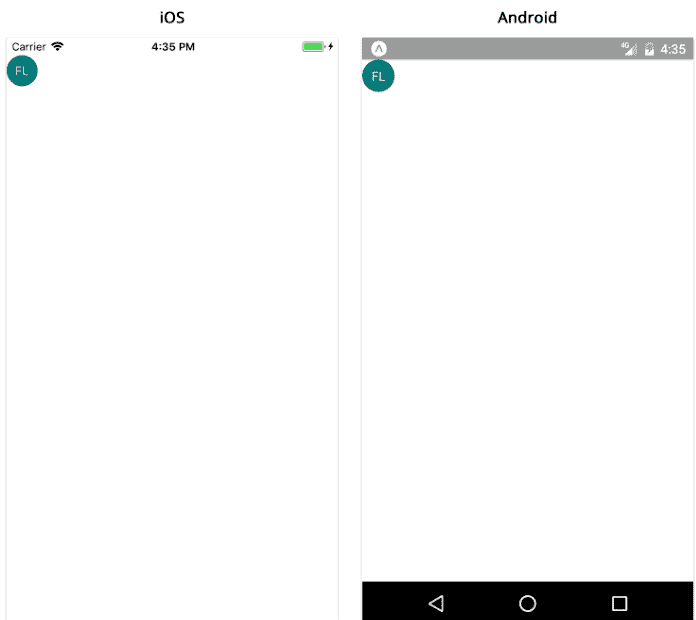

对于简单的应用，最简单的方法是将所有组件放在一个 components 目录中。对于更高级的应用，我们可能会在 components 内创建目录以进行更具体的分类。由于这个应用相当简单，让我们使用一个扁平的 components 目录，就像我们在前面章节中所做的那样。

让我们创建一个名为 components 的新目录，并在其中创建一个名为 Avatar.js 的新文件。

我们的头像组件将渲染 View 和 Text 组件。它将使用 StyleSheet，并使用 PropTypes 验证字符串、数字和颜色属性。让我们在文件顶部导入这些东西。我们还需要导入 React。

> 我们将在这个文件中导入 React，即使我们在任何地方都没有引用它。在幕后，babel 将 JSX 元素编译为对 React.createElement 的调用，这引用了 React 变量。

在 Avatar.js 中添加以下导入：

```
image-feed/1/components/Avatar.js

import { ColorPropType, StyleSheet, Text, View } from 'react-native';
import PropTypes from 'prop-types';
import React from 'react';
```

> 我们从 react-native 导入 ColorPropType 而不是 PropTypes。PropTypes 包包含用于原始 JavaScript 类型（如数字和字符串）的验证器。虽然 React Native 中的颜色是字符串，但它们遵循特定的格式，可以进行验证——React Native 提供了一些验证器，如 ColorPropType，用于验证值的内容，而不仅仅是其原始类型。

现在我们可以导出组件的骨架：

```
image-feed/1/components/Avatar.js

export default function Avatar({ /* ... */ }) {
  // ...
}
```

由于这个组件不需要存储任何本地状态，我们将使用上一章学过的无状态函数组件风格。

我们的头像组件应该有哪些属性？我们绝对需要姓名首字母来渲染。我们可能也希望大小和背景颜色是可配置的。考虑到这一点，我们可以这样定义我们的 propTypes：

```
image-feed/1/components/Avatar.js

// ...

export default function Avatar({ size, backgroundColor, initials }) {
  // ...
}

Avatar.propTypes = {
  initials: PropTypes.string.isRequired,
  size: PropTypes.number.isRequired,
  backgroundColor: ColorPropType.isRequired,
};

// ...
```

在这个应用中，我们将使用 `isRequired` 使大多数属性成为*必需的*，因为我们将始终传递每个属性。如果我们希望我们的组件更具可复用性，我们可能会将其属性设为*可选的*——但很难知道*哪个*属性应该是可选的，直到我们真正尝试复用它！

现在是时候渲染我们 `Avatar` 的内容了。对于彩色的圆形背景，我们将渲染一个 `View`。`View` 是最常见和通用的组件。我们已经在前面的章节中使用过它，但现在让我们仔细看看它是如何工作的以及如何设置它的样式。

### View

我们使用 `View` 有两种相当不同的用途：

1.  首先，我们使用 `View` 进行布局。`View` 通常用作其他组件的容器。如果我们想将一组组件垂直或水平排列，我们很可能会将这些组件包裹在一个 `View` 中。
2.  其次，我们使用 `View` 来为我们的应用设置样式。如果我们想渲染一个简单的形状，如圆形或矩形，或者我们想渲染一个边框、一条线或一种背景颜色，我们很可能会使用 `View`。

React Native 组件旨在尽可能保持一致性——许多组件使用与 `View` 类似的属性，如 `style`。因此，如果你学会了如何使用 `View`，你可以将这些知识复用到 `Text`、`Image` 和几乎所有其他类型的组件上。

### Avatar 背景

让我们使用 `View` 来创建我们 `Avatar` 的圆形背景：

```
image-feed/1/components/Avatar.js
// ...
export default function Avatar({ size, backgroundColor, initials }) {
  const style = {
    width: size,
    height: size,
    borderRadius: size / 2,
    backgroundColor,
  }

  return (
    <View style={style} />
  )
}
```

```
// ...
```

正如我们在前面章节中看到的，我们可以使用 `style` 属性来自定义 `View` 组件的尺寸和颜色。在这里，我们实例化一个新的对象，并将其传递给 `View` 的 `style` 属性。我们可以将 `size` 属性分配给 `width` 和 `height` 属性，以指定我们的 `View` 应该总是被渲染为一个完美的正方形。添加一个 `borderRadius`，其大小是 `width` 和 `height` 的一半，将把我们的 `View` 渲染成一个圆形。最后，我们设置背景颜色。

在这个样式对象中，属性是动态计算的：`width`、`height`、`borderRadius` 和 `backgroundColor` 都派生自组件的属性。当我们动态计算样式对象时（即在渲染我们的组件时），我们将其定义为*内联*——这意味着我们每次渲染组件时都会创建一个新的样式对象，并直接将其传递给组件的 `style` 属性。

当有大量内联定义的样式对象时，它可能会使渲染方法变得混乱，使代码更难阅读。对于不是动态计算的样式，我们应该使用 `StyleSheet` API。我们将在接下来的几节中更多地练习这一点。

在那之前，让我们确保我们目前所做的是正确工作的。

### 试一试

让我们将 `Avatar` 组件添加到 `App` 中。我们还没有完成 `Avatar`，但在构建过程中进行测试很有用，以防我们引入了任何错误。

打开 `App.js`，在其他导入之后导入我们的 `Avatar`：

```
import Avatar from './components/Avatar';
```

接下来，修改渲染函数以渲染一个 `Avatar`：

```
// ...

export default class App extends React.Component {
  render() {
    return (
      <View style={styles.container}>
        <Avatar initials={'FL'} size={35} backgroundColor={'teal'} />
      </View>
    );
  }
```


对于我们没有包含的任何属性，`Avatar` 将使用其 `defaultProps`。我们应该在屏幕中央看到一个 35px 的蓝绿色圆形：

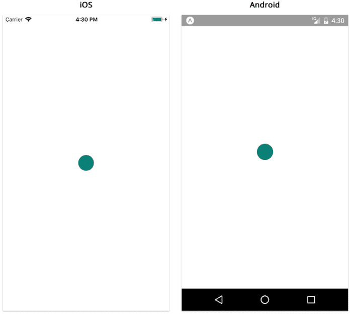

无论屏幕尺寸如何，蓝绿色圆形都会渲染在屏幕中央。这意味着 React Native 正在计算屏幕的中心，计算 `Avatar` 的尺寸，并利用这些计算结果来正确定位 `View` 组件。正如我们在"入门"章节中所学到的，React Native 的布局引擎基于 **flexbox** 算法。让我们开始深入了解布局的工作原理：React Native 如何知道每个组件的尺寸以及在屏幕上的渲染位置？

## 尺寸

理解屏幕布局时，我们首先要考虑的是每个组件的尺寸。组件必须同时具有非零的 `width` 和 `height` 才能在屏幕上渲染任何内容。如果 `width` 为 `0`，那么无论 `height` 多大，屏幕上都不会渲染任何内容。

在我们的 Avatar 示例中，我们通过在 `style` 属性中指定确切的 `width` 和 `height` 来渲染固定尺寸的 `View`。这是指定组件尺寸最简单的方式。无论屏幕尺寸或内部组件如何，我们的 `View` 始终渲染为恰好 35px × 35px。

对于 `Avatar` 的情况，这正是我们想要的行为。然而，在许多情况下，我们希望布局能够自动适应不同的屏幕尺寸。

我们的 App 渲染了一个填满整个屏幕的 `View`，但我们从未指定固定的 `width` 或 `height`。如果你查看 `App.js` 底部的 `StyleSheet.create` 调用，你会看到样式属性 `flex: 1`。

```
image-feed/1/App.js

const styles = StyleSheet.create({
  container: {
    flex: 1,
    backgroundColor: '#fff',
    alignItems: 'center',
    justifyContent: 'center',
  },
});
```

我们可以使用 `flex` 来使布局适应不同的屏幕尺寸。

## Flex

`flex` 样式属性使我们能够定义可以根据屏幕大小自动扩展和收缩的布局。`flex` 值是一个数字，表示一个组件相对于其兄弟组件应占用的空间比例。

如果一个组件没有兄弟组件，就像 `App` 渲染的顶层 `View` 那样，情况很简单：

- `flex` 为 `1` 时，组件将扩展以完全填充其父容器
- `flex` 值为 `0` 时，组件将收缩到最小空间（仅够显示其子组件，如果有的话）

由于 App 中的 `View` 的 `flex` 值为 `1`，它扩展以填充其父容器，在本例中就是整个屏幕。现在我们知道这个 `View` 为什么会扩展填满屏幕了，但 React Native 如何知道将 `Avatar`（及其底层的 `View`）渲染在屏幕中央呢？

**布局**

我们可以对*父*组件应用三个样式属性来指定其*子*组件的布局。也就是说，我们可以指定子组件在父组件内的*渲染位置*。这些属性是：

- **flexDirection**
- **justifyContent**
- **alignItems**

通过这些属性，我们几乎可以实现任何类型的布局。

**flexDirection**

第一个属性是 **flexDirection**。我们选择的 flexDirection 定义了**主轴**。子组件沿主轴排列。*垂直的*轴称为**副轴**。*flexDirection* 的可选值有：

- **column**：垂直布局（默认值）
- **row**：水平布局
- **column-reverse**：与 column 相同，但垂直方向翻转
- **row-reverse**：与 row 相同，但水平方向翻转

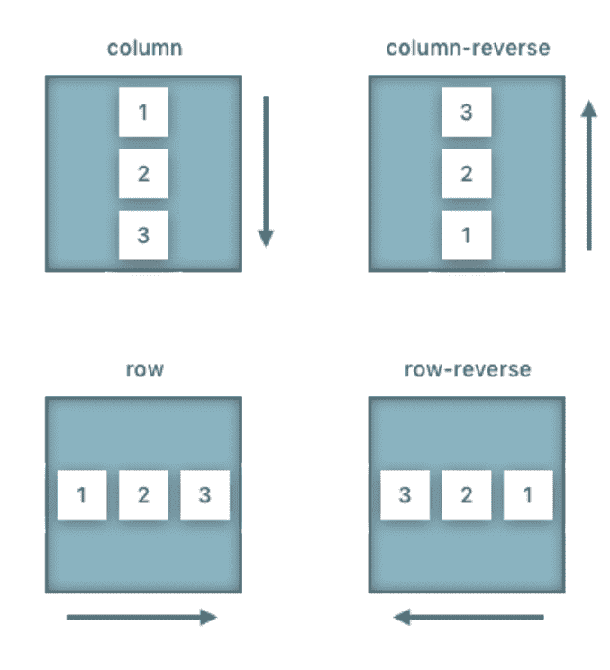

> 这些名称一开始可能有点令人困惑，因为当你听到"row"时，可能会认为我们会得到多行布局——但实际上，这是说我们的布局*本身*是一行。

## justifyContent

接下来我们将使用 `justifyContent` 属性来*分配*子组件沿主轴的位置。可选值有：

- **flex-start：** 将子组件分配到主轴的起始位置（默认值）
- **flex-center：** 将子组件分配到主轴的中心位置
- **flex-end：** 将子组件分配到主轴的末尾位置
- **space-around：** 均匀分配子组件，包括边缘处的空间
- **space-between：** 均匀分配子组件，不包含边缘处的空间

下图展示了 `justifyContent` 在 `row` 和 `column` 布局中的可选值。请记住，`flexDirection` 设置了主轴和副轴，因此我们对 `flexDirection` 的选择将决定 `justifyContent` 的含义。

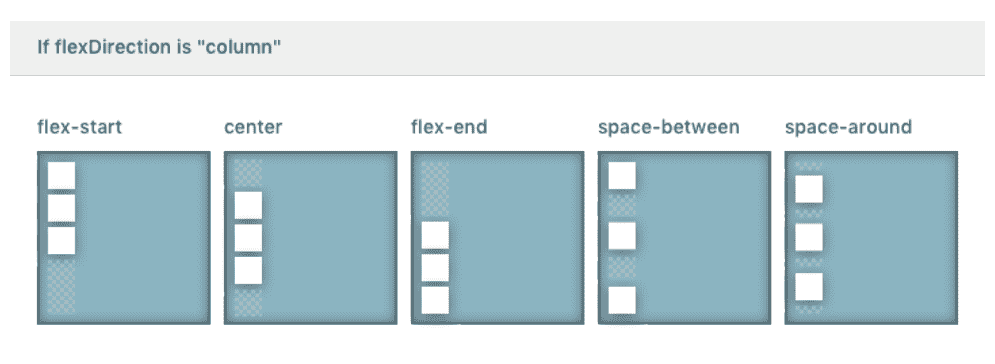

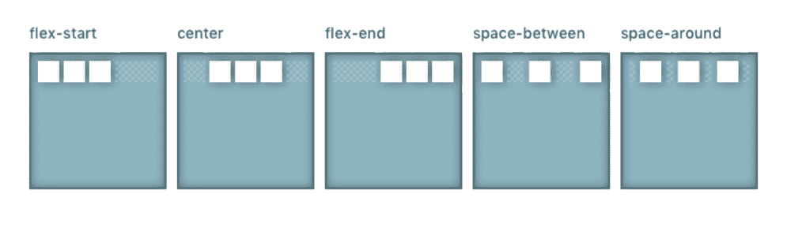

### alignItems

最后，我们将使用 **alignItems** 属性来*对齐*子组件沿副轴的位置。可选值有：

- **flex-start**：将子组件对齐到起始位置（默认值）
- **flex-center**：将子组件对齐到中心位置
- **flex-end**：将子组件对齐到末尾位置
- **stretch**：拉伸子组件以填满副轴的整个宽度/高度

下图展示了 `alignItems` 在 `row` 和 `column` 布局中的可选值。

**如果 flexDirection 为 "column"**

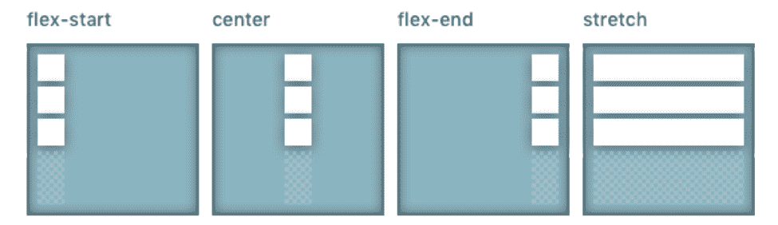

**如果 flexDirection 为 "row"**

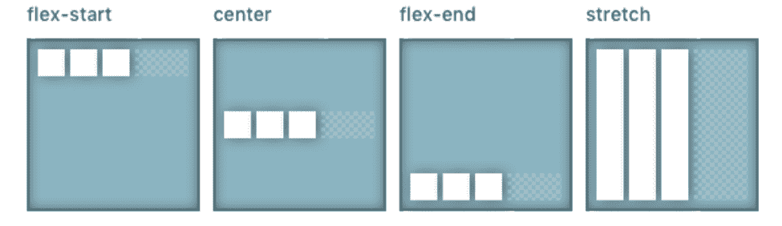

再看一下 App.js 底部 StyleSheet.create 中的 container 样式：

```
image-feed/1/App.js

const styles = StyleSheet.create({
  container: {
    flex: 1,
    backgroundColor: '#fff',
    alignItems: 'center',
    justifyContent: 'center',
  },
});
```

让我们来弄清楚这个样式是如何将 Avatar 居中放置在 View 中的。这个样式对象不包含 flexDirection 属性的值，因此它将使用默认值 column。这意味着主轴是垂直轴，副轴是水平轴。`justifyContent: 'center'` 将 Avatar 分配到垂直轴的中心位置。`alignItems: 'center'` 将 Avatar 对齐到水平轴的中心位置。

## Flex 与主轴

现在我们已经了解了 `flexDirection` 和轴的工作原理，让我们回顾一下顶层 View 如何使用 flex 填满整个屏幕。

组件的 `flex` 属性只决定其沿*主轴*方向的尺寸。这意味着，就像 `justifyContent` 和 `alignItems` 一样，我们需要知道 `flexDirection` 是什么才能正确使用 `flex`。

在我们 App 中的 View 的情况下，最好将其想象为实际上是另一个填满整个屏幕的包装 View 的子组件。这个包装 View 具有 `flexDirection`、`justifyContent` 和 `alignItems` 的默认样式属性。换句话说，我们渲染的顶层 View 实际上位于一个具有以下样式的父容器中：

```
{
  flexDirection: 'column',
  justifyContent: 'flex-start',
  alignItems: 'stretch'
}
```

我们的顶层 View 拥有全屏的 `height`，因为我们指定了 `flex: 1`，这使其沿垂直轴拉伸。它拥有全屏的 `width`，因为其父容器使用了 `alignItems: 'stretch'`，这使 View 沿水平轴拉伸。

> ## 当组件不显示时该怎么办

初学者和专家都会经常遇到组件在屏幕上不渲染任何内容的问题。最常见的原因是组件的尺寸等于 0。

当使用 `flex: 0` 或没有 `flex` 属性时，组件只有在被显式指定（使用 `width` 或 `height` 属性）或其子组件的尺寸大于 0 时，才会在主轴方向上具有大于 0 的尺寸。同样，当使用 `alignItems: 'stretch'` 时，子组件只有在被显式指定或父容器的尺寸大于 0 时，才会在副轴方向上具有大于 0 的尺寸。

因此，当组件在屏幕上不显示时，我们首先应该做的是传入显式的 `width` 和 `height` 样式属性（以及 `backgroundColor`，只是为了确保某些内容可见）。一旦组件出现在屏幕上，我们就可以开始了解组件层次结构并评估如何调整样式。


## 样式表

既然我们对布局有了更好的理解，让我们回到创建我们的 Avatar 组件上。提醒一下，这是我们想要实现的效果：

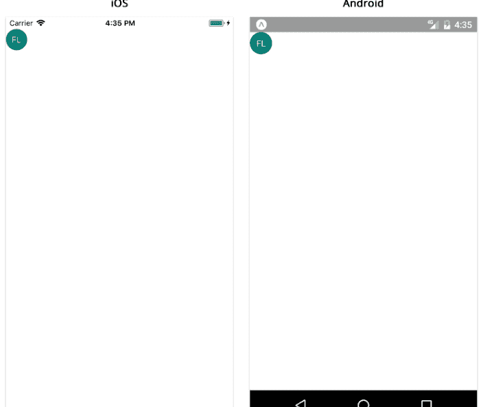

接下来我们想要添加的是圆形 `View` 中的文本。文本应该居中，我们现在知道如何使用 `justifyContent` 和 `alignItems` 来实现。让我们现在就做。

我们之前为 `View` 的 `style` 属性使用了一个*内联*样式对象。对于不需要根据 `props` 动态计算的样式，例如将 `View` 内的内容居中，我们通常在文件底部使用一个 `StyleSheet`。让我们继续，使用以下代码更新 `Avatar.js`：

### image-feed/1/components/Avatar.js

```javascript
// ...

export default function Avatar({ size, backgroundColor, initials }) {
  const style = {
    width: size,
    height: size,
    borderRadius: size / 2,
    backgroundColor,
  };

  return (
    <View style={[styles.container, style]} />
  );
}

const styles = StyleSheet.create({
  container: {
    alignItems: 'center',
    justifyContent: 'center',
  },
});
```

> 在 React Native 中，样式最常见的是在组件代码下方、同一个文件中定义。阅读文件时，通常主要关注组件，样式是次要的——这就是为什么我们将组件代码放在前面。这*有效*，因为变量名 `styles` 会被提升到文件顶部，而定义其值的代码会在访问其值的代码之前执行。正如你可能已经注意到的，我们从本书一开始就一直在这样做，并且会继续这样做下去。

在这种情况下，我们总是希望文本在两个轴上都居中，所以我们将使用 `justifyContent: 'center'` 和 `alignItems: 'center'`。正如我们在“入门”章节中看到的，我们可以通过将一个数组作为 `View` 的 `style` 属性传递来合并我们的两个样式对象。

> 当像这样在 `View` 中居中单个子组件时，任何 `flexDirection` 都会产生相同的布局，所以我们可以使用其中任何一个。

既然我们已经将 `View` 的内容居中，让我们为缩写添加文本。我们将为此使用 `Text`。我们之前用过 `Text`，但让我们退一步，在将其添加到我们的头像之前深入了解一下它。

## 文本

我们使用 `Text` 组件在屏幕上渲染文本。文本可以使用字体特定的属性进行样式设置，例如 `fontSize`。它可以使用几乎所有与 `View` 相同的样式，例如 `backgroundColor` 和 `width`。然而，`Text` 在布局方面有一些关键区别。

### 文本尺寸

与 `View` 组件不同，`Text` 组件具有内在尺寸。换句话说，如果我们不指定 `width` 或 `height`，`Text` 组件仍然会显示在屏幕上。如果我们在其后放置背景颜色以可视化 `width` 和 `height`，我们可以看到背景的大小正好是我们看到的文本的大小（根据行高的不同，可能略有增减）。

渲染一个 `Text` 组件：

```jsx
<Text style={{ backgroundColor: 'red' }}>
  Hello World
</Text>
```

效果如下：

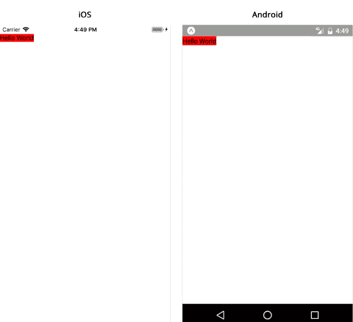

将 `width`、`height` 或 `flex` 属性指定为样式的一部分将覆盖 `Text` 的内在尺寸。渲染一个 Text 组件：

```jsx
<Text style={{ backgroundColor: 'red', width: 60, height: 60 }}>
  Hello World
</Text>
```

效果如下：

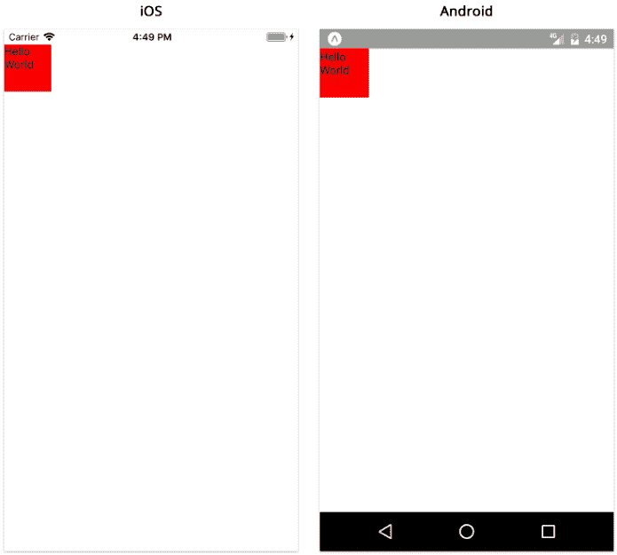

默认情况下，当文本内容填满组件的宽度时，它会自动换行。这可以通过 `numberOfLines` 属性进行配置。

### 常用的 `Text` 属性和样式

以下是你可能想用于文本的一些常用样式属性：

- `color` - 表示文本颜色的字符串。
- `fontFamily` - 带有字体族名称的字符串（此字体族必须已存在于设备上）。
- `fontSize` - 等于字体大小（以点为单位）的数值。
- `fontStyle` - 可以是 `'normal'` 或 `'italic'`。
- **fontWeight** - 每个字符的粗细。可以是 'normal'、'bold'、'100'、'200'、'300'、'400'、'500'、'600'、'700'、'800' 或 '900' 之一。如果选择的粗细在设备上不可用，将使用最接近的可用粗细。
- **textAlign** - 文本对齐方式。可以是 'left'、'right'、'center'、'justify'（仅限 iOS）、'auto' 之一。

此外，我们经常使用以下属性：

- **numberOfLines** - 在截断文本之前允许的行数。
- **ellipsizeMode** - 当文本超过 numberOfLines 时应如何截断。可以是 'head'、'middle'、'tail'、'clip'（仅限 iOS）之一。

你可以在[官方文档](https://facebook.github.io/react-native/docs/text.html)中找到 `Text` 的完整属性和样式列表。

与 `View` 元素一样，`Text` 元素也可以有子元素。当你想在同一段落中使用多种样式的文本时，这很有用。`Text` 元素将从其父元素继承样式。如果父元素的 `fontSize` 为 16，`color` 为蓝色，默认情况下子 `Text` 元素将具有相同的样式。可以根据需要设置子 `Text` 元素的样式以覆盖其父元素的样式。

### 向头像添加文本

让我们渲染并设置一个 `Text` 组件的样式，以在 Avatar 组件中显示缩写：

```javascript
// image-feed/1/components/Avatar.js
// ...

export default function Avatar({ size, backgroundColor, initials }) {
  const style = {
    width: size,
    height: size,
    borderRadius: size / 2,
    backgroundColor,
  };

  return (
    <View style={[styles.container, style]}>
      <Text style={styles.text}>{initials}</Text>
    </View>
  );
}
```

```javascript
// ...

const styles = StyleSheet.create({
  container: {
    alignItems: 'center',
    justifyContent: 'center',
  },
  text: {
    color: 'white',
  },
});
```

保存 `Avatar.js` 后，你应该看到以下内容：

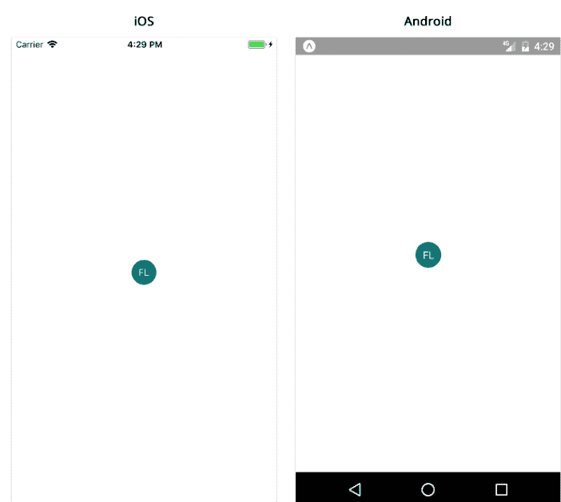

由于我们不希望内容在屏幕上居中，让我们更新 `App.js` 中的样式，使内容从左上角开始渲染。我们可以通过移除 `alignItems` 和 `justifyContent` 来实现这一点。由于我们处于一个 `flexDirection: "column"`（默认值）的 `View` 中，我们可以使用 `justifyContent: "flex-start"`（也是默认值）来从屏幕顶部开始分布内容。

我们还想在屏幕顶部为状态栏留出空间。我们将从 expo 导入 `Constants`，以便我们可以使用 `Constants.statusBarHeight`。

expo 库提供了许多超出 react-native 提供范围的 API 和组件——由于我们使用 `create-react-native-app` 创建我们的应用，这些开箱即用。

在 `App.js` 的顶部添加以下导入：

### image-feed/1/App.js

```javascript
import { Constants } from 'expo';
```

然后更新文件底部的容器样式为：

### image-feed/1/App.js

```javascript
// ...

const styles = StyleSheet.create({
  container: {
    marginTop: Constants.statusBarHeight,
    flex: 1,
    backgroundColor: '#fff',
  },
});
```

现在我们应该看到我们的头像位于屏幕的左上角，位于状态栏下方。

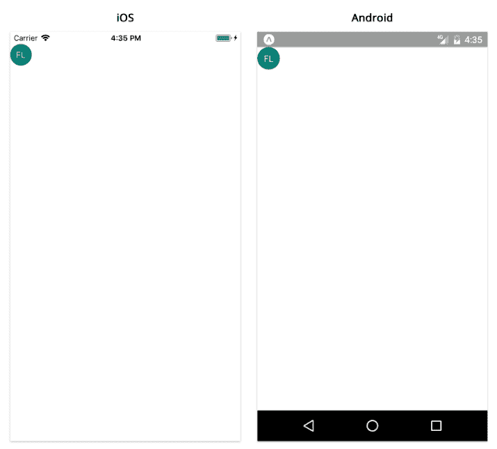

为了创建 `Avatar`，我们涵盖了 `View`、`Text`、`StyleSheet` 和使用 Flexbox 的布局。这些是构建 React Native 中几乎任何自定义组件所需的内置组件和 API。在本章的剩余部分，我们将主要使用它们来构建我们的图片流应用中的其他组件。

## 作者行

既然我们已经完成了 `Avatar`，让我们继续下一个组件！让我们创建一个水平行，包含我们的 `Avatar` 和照片作者的全名。

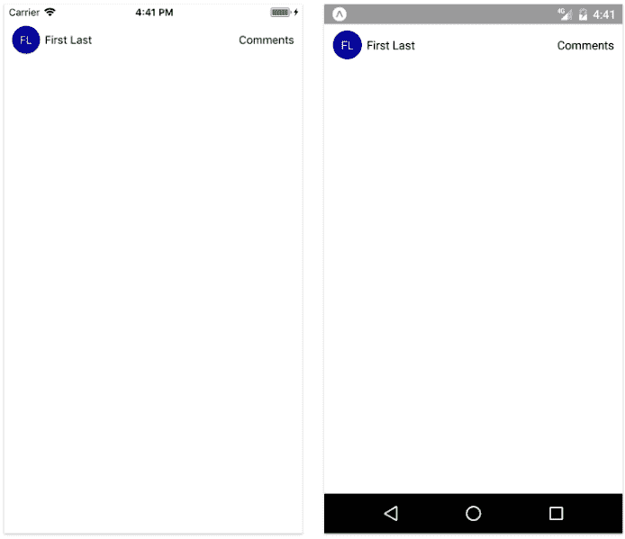

在我们的 `components` 目录中创建一个新文件 `AuthorRow.js`。

在这个文件中，我们将主要导入我们已经见过的东西：`StyleSheet`、`View`、`Text`、`PropTypes` 和 `React`。我们还将导入一个 `TouchableOpacity`，以便我们可以处理对 "Comments" 文本的点击，以转到评论屏幕。我们还需要导入我们刚刚制作的 `Avatar` 组件，以及我们在本章开始时复制到此项目中的一些实用函数。

> 如果你还没有从我们的示例代码中复制 `utils` 目录，现在应该这样做。

### image-feed/1/components/AuthorRow.js

```javascript
import { StyleSheet, Text, TouchableOpacity, View } from 'react-native';
import PropTypes from 'prop-types';
import React from 'react';

import Avatar from './Avatar';
import getAvatarColor from '../utils/getAvatarColor';
import getInitials from '../utils/getInitials';
```

现在让我们确定组件的 `propTypes`。我们将想要配置


## AuthorRow

在头像旁边显示，以及用于右侧“评论”链接的文本。我们还希望当用户点击链接时传播按压事件。

```
// image-feed/1/components/AuthorRow.js

export default function AuthorRow({ fullname, linkText, onPressLinkText }) {

}

AuthorRow.propTypes = {
  fullname: PropTypes.string.isRequired,
  linkText: PropTypes.string.isRequired,
  onPressLinkText: PropTypes.func.isRequired,
};

// ...
```

考虑组件的布局，我们希望有一个 `flexDirection: 'row'` 的 `View`。在其中渲染一个 `Avatar`、一个 `Text` 和一个 `TouchableOpacity`。

我们先从 `View` 和 `Text` 的样式开始。将这添加到文件底部：

```
// image-feed/1/components/AuthorRow.js

const styles = StyleSheet.create({
  container: {
    height: 50,
    flexDirection: 'row',
    alignItems: 'center',
    paddingHorizontal: 10,
  },
  text: {
    flex: 1,
    marginHorizontal: 6,
  },
});
```

我们使用 `flex: 1` 让 `Text` 扩展以填充 `View` 中的任何剩余空间。这将把 `TouchableOpacity` 推到右侧。

现在我们可以完善组件函数：

```
// image-feed/1/components/AuthorRow.js

export default function AuthorRow({ fullname, linkText, onPressLinkText }) {
  return (
    <View style={styles.container}>
      <Avatar
        size={35}
        initials={getInitials(fullname)}
        backgroundColor={getAvatarColor(fullname)}
      />
      <Text style={styles.text} numberOfLines={1}>
        {fullname}
      </Text>
      {/* ... */}
    </View>
  );
}
```

我们将使用 `numberOfLines={1}`，这样当文本到达行尾时会被截断，而不是换行到多行。

现在让我们渲染一个 TouchableOpacity 来添加“评论”链接文本并处理点击。

## TouchableOpacity

TouchableOpacity 组件类似于 View，但让我们能够以高性能的方式轻松响应点击手势。TouchableOpacity 组件在按下时会淡出，释放时淡回。不透明度动画在原生端完成（不会触发重新渲染），因此动画非常流畅，交互延迟很低。按下时的不透明度值可以通过 `activeOpacity` 属性配置，提供一个从 0 到 1 的数字。

如果你不喜欢不透明度动画，可以改用 TouchableHighlight 来实现背景颜色变化的动画。

TouchableOpacity 和 TouchableHighlight 都有一个小不便之处：这些组件只能有一个子元素，因此如果我们想要多个子元素，需要将它们包裹在一个 View 中。

## 将 TouchableOpacity 添加到 AuthorRow

让我们在 AuthorRow 中文本的右侧渲染一个 TouchableOpacity 用于“评论”。我们将使用 TouchableOpacity 的 `onPress` 属性来调用我们的 `onPressLinkText` 属性。

```
// image-feed/1/components/AuthorRow.js

export default function AuthorRow({ fullname, linkText, onPressLinkText }) {
  return (
    <View style={styles.container}>
      <Avatar
        size={35}
        initials={getInitials(fullname)}
        backgroundColor={getAvatarColor(fullname)}
      />
      <Text style={styles.text} numberOfLines={1}>
        {fullname}
      </Text>
      {!!linkText && (
        <TouchableOpacity onPress={onPressLinkText}>
          <Text numberOfLines={1}>{linkText}</Text>
        </TouchableOpacity>
      )}
    </View>
  );
}
```

我们使用 `!!linkText` 来条件渲染 `<TouchableOpacity>` 元素。`!!` 的双重否定让我们确保处理的是布尔值。

> 由于 `linkText` 是字符串，当 `linkText` 为空字符串 `''` 时，`&&` 表达式会求值为字符串类型——在 React Native 中（与 Web 不同），我们不能在 `Text` 外部渲染字符串值（即使是空字符串）。

## 试一试

让我们更新 App.js 来渲染我们的 AuthorRow 组件以进行测试：

```
// image-feed/1/App.js

import AuthorRow from './components/AuthorRow';

export default class App extends React.Component {
  render() {
    return (
      <View style={styles.container}>
        <AuthorRow
          fullname={'First Last'}
          linkText={'Comments'}
          onPressLinkText={() => {
            console.log('Pressed link!');
          }}
        />
      </View>
    );
  }
}
```

我们的 AuthorRow 应该看起来像这样：

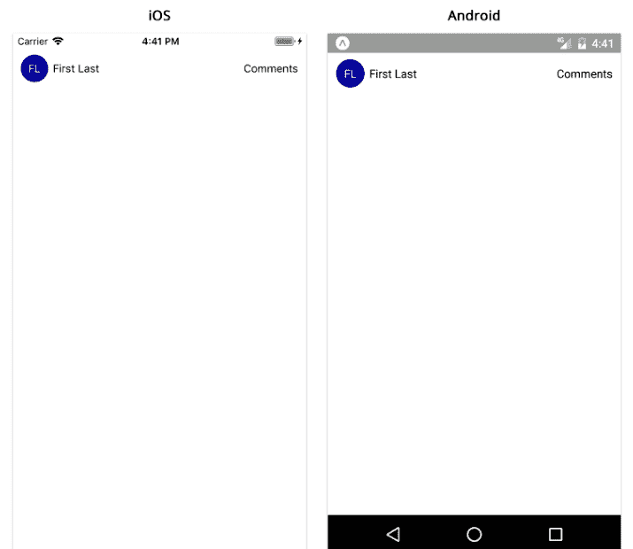

你也可以尝试按下“Comments”文本。文本的不透明度应该会动画变化，你会看到 "Pressed link!" 记录到终端中。

在我们的 `AuthorRow` 中，与前面的章节一样，我们使用了样式属性 `paddingHorizontal` 和 `marginHorizontal` 来调整渲染的不同组件之间的间距。让我们深入了解这些属性的工作原理。

## Padding、margin、border 和盒模型

React Native 布局引擎使用所谓的*盒模型*来自定义间距。如果你做过 Web 开发，可能对盒模型很熟悉。我们可以使用三个主要样式属性：

- **margin**：组件与其兄弟元素或其父元素内容区域边缘之间的空间量。
- **border**：围绕组件绘制的边框，可以有不同的宽度、样式（例如虚线）和颜色。
- **padding**：组件内部在其子组件之前的间距。

这些样式属性中的每一个都可以在组件的每一侧有不同的大小：顶部、右侧、底部和左侧。例如，如果我们想要设置 10 像素的顶部边距，我们会在样式对象中写 `marginTop: 10`。为了方便，我们可以用 `margin: 10` 将四边设置为相同的大小。我们也可以用 `marginVertical: 10` 和 `marginHorizontal: 10` 设置垂直和水平边距。更具体的样式属性会覆盖更通用的——如果我们写 `margin: 10`，`marginTop: 20`，顶部会有 20 的边距，而其余边会有 10 的边距。相同的规则也适用于 `padding` 和 `border`（不过对于 border，属性叫做 `borderWidth` 而不是 `border`）。

这里有一个盒模型的图示：

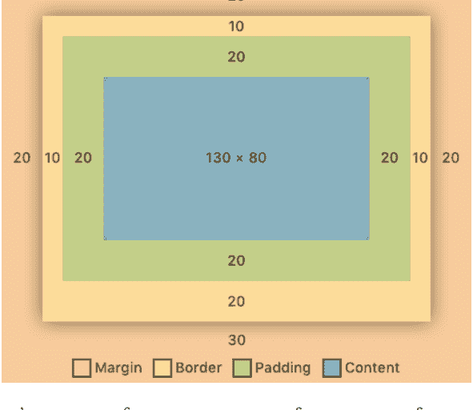

在这个例子中，`margin` 为 20，`borderWidth` 为 10，`padding` 为 20，内容区域为 130 宽乘 80 高。底部的 `borderWidth` 和 `margin` 与其余边不同：底部边框为 20，底部边距为 30。我们可以这样写样式：

```
{
  margin: 20,
  borderWidth: 10,
  padding: 20,
  borderBottomWidth: 20,
  marginBottom: 30
};
```

当我们使用固定的 `width` 或 `height` 时，这包括内容区域、padding 区域和 border 宽度。margin 不计入 `width` 或 `height`，因为它是组件边缘外的空间。这个例子中的宽度是 10 + 20 + 130 + 20 + 10 = 190，高度是 10 + 20 + 80 + 20 + 20 = 150。

在构建应用的其余组件时，我们将继续使用这些间距样式属性和盒模型。

## Card

接下来，我们将制作包含 `AuthorRow` 和 `Image` 组件的卡片。

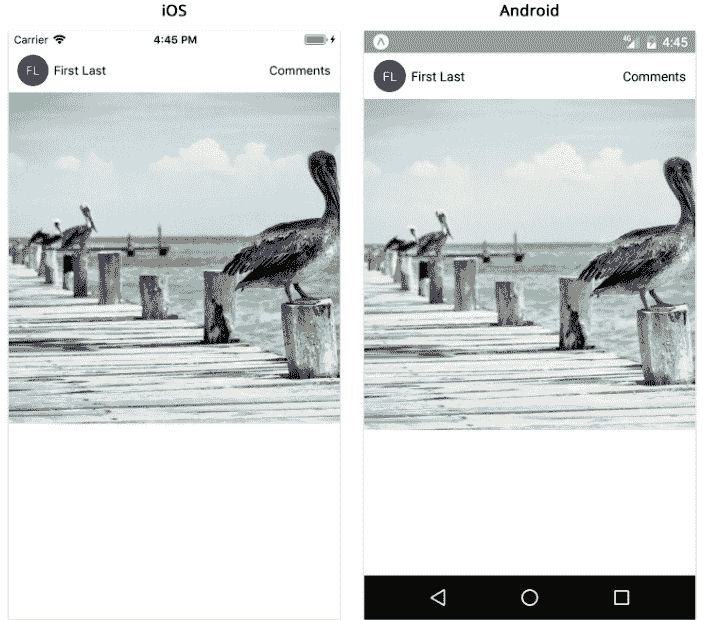

由于渲染 `Image` 组件将是我们应用的重要部分，让我们更详细地了解图片的工作原理。

## Image

我们使用 `Image` 组件在屏幕上渲染图片。在应用中包含图片有两种方式：我们可以将图片资源与代码打包（然后会存储在设备上），或者我们可以从 URI 下载图片。

### 打包图片资源

要打包图片资源，我们可以像其他文件一样从项目目录中通过名称 `require` 图片。React Native 打包器会给我们一个该图片的引用（一个数字），代表图片的元数据。如果我们用 `@` 后缀命名，打包器会自动为多种像素密度打包图片：`.png` 为标准分辨率，`@2x.png` 为 2x 分辨率，`@3x.png` 为 3x 分辨率。我们可以将图片引用传递给 `Image` 的 `source` 属性来渲染它。

例如，如果在应用根目录中有一个名为 `foo.png` 的文件，我们可以使用：

```
<Image source={require('./foo.png')} />
```

然而，我们不会在这个应用中打包任何图片，因为我们要显示的图片来自 Web。相反，我们将加载远程图片资源。

### 远程图片资源

要从 URI 显示图片，我们必须向 `Image` 组件的 `source` 属性传递一个对象。该对象应包含字符串值 `uri`，并可选择性地包含 `width` 和 `height` 的数值（代表图片的固有尺寸，预先计算）。`Image` 组件会自动从 URI 下载数据并在加载完成后显示。

```
<Image source={{ uri: 'https://unsplash.it/600/600' }} />
```

由于大图片可能需要一段时间下载，我们通常会在下载完成前显示某种加载指示器。我们可以向 `Image` 的 `onLoad` 属性传递回调函数来确定图片何时加载完成。我们很快就会探讨这个。

在本章中，我们将使用开放 API `https://unsplash.it` 来获取图片用于我们的图片信息流。这个 API 对于需要占位图片的应用测试非常有用。我们将使用两个 API 端点：

- `https://unsplash.it/${width}/${height}`：这个端点给我们一张随机图片。我们可以使用查询参数 `image` 并传递图片的 `id` 来获取特定图片，例如 `?image=10`。我们可以通过将所需的宽度和高度放入 URL 来指定图片尺寸。我们会为这个应用选择一个任意的尺寸，600 x 600。
- `https://unsplash.it/list`：这个端点给我们一个图片元数据对象列表。每张图片的元数据对象包含一个 `id`，我们可以将其用于前一个端点的 `image` 查询参数。

我们将在 `utils/api.js` 中使用两个工具函数：`getImageFromId(id)` 和 `fetchImages()`。这些函数分别对应两个 `unsplash.it` API。


## 常见的图片样式

我们可以使用 `resizeMode` 样式（或属性——两者都可以）来决定当图片数据的固有尺寸与 `Image` 组件的尺寸不同时，图片如何被裁剪。

`resizeMode` 的选项包括：

- **cover**：图片均匀缩放以填满 `Image` 组件。如果宽高比不同，图片将被组件的边界框裁剪。
- **contain**：图片均匀缩放以适应组件内部。如果宽高比不同，将显示组件的背景色。
- **stretch**：图片拉伸以填满组件。
- **repeat**：图片以其固有尺寸重复自身以填满组件（仅限 iOS）。
- **center**：图片保持其固有尺寸，并在组件内居中。

我们可以使用 `aspectRatio` 样式来让图片以特定的宽高比渲染，无论其固有尺寸如何。我们提供一个数值，表示宽度与高度的比例。例如，如果我们设置 `aspectRatio: 2`，这意味着宽度与高度的比例为 2 比 1——图片的宽度将是其高度的两倍。

虽然最常用于图片，但 `aspectRatio` 样式可以用于任何组件，例如 `View` 或 `Text`。

> ℹ️ 如果你来自 Web 开发，你可能会觉得这个样式令人惊讶，因为 CSS 中没有等效的样式。React Native 的布局引擎 Yoga 在其 flexbox 实现中添加了这个样式。

## Yoga

React Native 使用 Yoga 布局引擎（同样来自 Facebook）。这是 flexbox 算法的跨平台实现。它与 Web 浏览器使用的算法非常接近，但有两个重要的区别：

- 默认值不同
- Yoga 添加了一些浏览器中不存在的新特性（如 `aspectRatio`）

如果你想了解更多关于该算法以及所有可用的样式，请查看 [Yoga 文档](https://facebook.github.io/yoga/)。

## 在卡片中添加图片

让我们搭建 Card 组件的框架并渲染一个 Image。
在 components 目录下新建文件 Card.js。将以下内容添加到该文件中：

image-feed/1/components/Card.js

```javascript
import { Image, StyleSheet, View } from 'react-native';
import PropTypes from 'prop-types';
import React from 'react';

import AuthorRow from './AuthorRow';

export default class Card extends React.Component {
  static propTypes = {
    fullname: PropTypes.string.isRequired,
    image: Image.propTypes.source.isRequired,
    linkText: PropTypes.string,
    onPressLinkText: PropTypes.func,
  };

  static defaultProps = {
    linkText: '',
    onPressLinkText: () => {},
  };

  // ...

  render() {
    // ...
  }
}
```

这里使用的大部分 props 应该看起来很熟悉：fullname、linkText 和 onPressLinkText 都会传递给我们之前创建的 AuthorRow。有趣的是 image——我们使用 `Image.propTypes.source` 作为类型，这样我们可以直接将其传递到我们渲染的 Image 的 source 属性中。

让我们填写组件函数：

image-feed/1/components/Card.js

```javascript
// ...

render() {
    const { fullname, image, linkText, onPressLinkText } = this.props;

    return (
        <View>
            <AuthorRow
                fullname={fullname}
                linkText={linkText}
                onPressLinkText={onPressLinkText}
            />
            <Image style={styles.image} source={image} />
        </View>
    );
}

// ...

const styles = StyleSheet.create({
    image: {
        aspectRatio: 1,
        backgroundColor: 'rgba(0,0,0,0.02)',
    },
});
```

我们将渲染一个 View（使用默认样式 `flexDirection: 'column'`），以便垂直堆叠我们的 AuthorRow 和 Image 组件。由于 View 样式默认为 `alignItems: 'stretch'`，图片水平拉伸以填满屏幕。我们使用 `aspectRatio: 1` 使 Image 的高度与其全屏宽度匹配，渲染为一个完美的正方形。我们在 Image 上设置了 `backgroundColor`，这将在图片加载前显示，或者在图片透明时显示在图片后面。

## 试一试

为了测试这个效果，让我们从 App 中渲染我们的新 Card。将 App.js 中的组件更新为以下内容：

image-feed/1/App.js

```javascript
// ...

import Card from './components/Card';

export default class App extends React.Component {
  render() {
    return (
      <View style={styles.container}>
        <Card
          fullname={'First Last'}
          linkText={'Comments'}
          onPressLinkText={() => {
            console.log('Pressed link!');
          }}
          image={{ uri: 'https://unsplash.it/600/600' }}
        />
      </View>
    );
  }
}

// ...
```

当你保存 App.js 时，你应该能在设备上看到我们之前的 AuthorRow 加上一张随机图片：

## 加载状态

你可能会注意到，在等待图片加载时，我们看到了图片背后的背景色。让我们在图片完全加载之前添加一个加载指示器，以向用户提供更多反馈。
我们可以向 `Image` 的 `onLoad` 属性传递一个回调，以监控加载状态。让我们在我们的 `Card` 组件的 state 中跟踪 `Image` 的加载状态。更新 `Card.js` 以包含以下内容：
`image-feed/1/components/Card.js`

```javascript
export default class Card extends React.Component {
  // ...

  state = {
    loading: true,
  };

  handleLoad = () => {
    this.setState({ loading: false });
  };
```

```javascript
render() {
  const { fullname, image, linkText, onPressLinkText } = this.props;
  const { loading } = this.state;

  return (
    <View>
      <AuthorRow
        fullname={fullname}
        linkText={linkText}
        onPressLinkText={onPressLinkText}
      />
      <Image style={styles.image} source={image} onLoad={this.handleLoad} />
    </View>
  );
}
```

现在我们用 `state.loaded` 跟踪图片何时完全加载。接下来我们将在 `state.loaded` 为 true 时渲染加载指示器。

## ActivityIndicator

我们可以使用 `ActivityIndicator` 组件来渲染加载指示器。

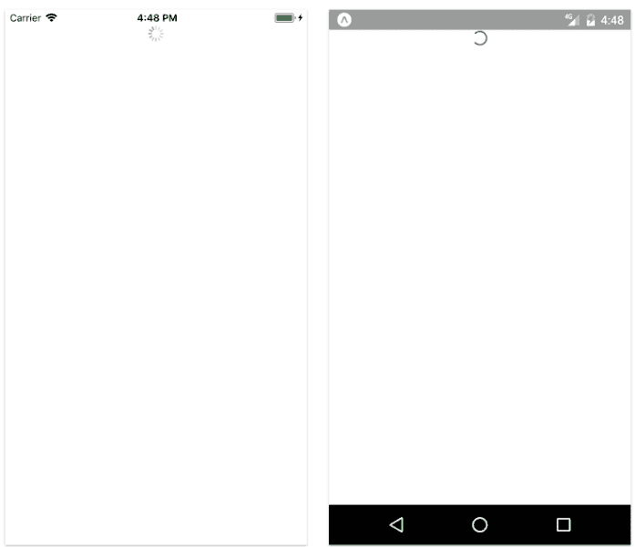

该组件接受与 `View` 相同的所有属性，以及一些额外的属性：

- `animating`：一个布尔值，指示是否显示或隐藏指示器（默认为 `true`）。
- `color`：旋转器的颜色（默认为灰色）。
- `size`：`'small'` 或 `'large'` 之一（默认为 small）。

我们希望将 `ActivityIndicator` 定位在图片的中心。与 `View` 不同，`Image` 组件不接受 `children` 属性，所以我们不能把 `ActivityIndicator` 放在它里面。我们可以像"入门"章节那样使用 `ImageBackground` 组件，但让我们来看看一种更通用的堆叠组件的方法：`position`。

## Position

到目前为止，我们在布局中主要使用了 `flexDirection`、`justifyContent` 和 `alignItems` 样式属性。React Native 为我们提供了另一个强大的样式属性来调整布局：`position`。Position 可以是 `'relative'` 或 `'absolute'`。

### relative

当设置为 `'relative'`（默认值）时，我们可以在组件已经根据其 `flex`、`width`、`height` 等完成布局后，微调组件的位置。我们可以使用 top、right、bottom 和 left 的组合。例如，如果我们想将一个组件在屏幕上向下移动 20 像素，我们可以说 top: 20 来表示其顶部应比当前位置大 20 像素。与指定 padding、margin 或 borderWidth 不同，像 top 这样的样式属性不会影响布局中的其他元素。换句话说，添加 top: 20 会改变应用该样式的元素的位置，但不会改变该元素的兄弟元素或父元素的位置（即使这会导致它们重叠）。

### absolute

当设置为 'absolute' 时，父元素的布局和组件的 flex 样式将被完全忽略。相反，我们使用 top、right、bottom 和 left 来精确指定组件应如何放置在其父元素内。例如，如果我们希望组件距离其父元素底部 10 像素、右侧 20 像素，我们可以说 bottom: 20, right: 10。和往常一样，我们需要确保组件的尺寸大于 0。由于 flex 被忽略，我们可能需要指定固定的 width 和 height。我们也可以通过同时指定 top 和 bottom，或同时指定 left 和 right 来确保组件的尺寸大于 0。例如，如果我们说 left: 10, right: 10，组件将水平拉伸以填充从其父元素左侧 10 像素到右侧 10 像素的空间。使用 `position: 'absolute'` 定位的组件不会影响其兄弟组件或父组件的布局。

通常使用 `position: 'absolute'` 来使元素重叠。假设我们希望两个兄弟元素重叠，完全填充它们的父元素。我们可以向两个兄弟元素都添加这样的样式：

```javascript
const absoluteFillStyle = {
  position: 'absolute',
  top: 0,
  right: 0,
  bottom: 0,
  left: 0,
};
```

这个样式将使元素完全填充其父元素，因为其顶部将与父元素的顶部对齐，其右侧将与父元素的右侧对齐，依此类推。这种技术如此常见，以至于有一个预定义的样式可以做同样的事情：`StyleSheet.absoluteFill`。这个值可以直接传递给元素的 style 属性。或者，你可以使用 `...StyleSheet.absoluteFillObject`，将这些属性复制到另一个样式中——如果你想覆盖一两个属性但保留其余属性，这会很有用。

这种重叠行为正是我们想要的，用于将我们的 ActivityIndicator 定位在 Image 的中心。

## 向 Card 添加 ActivityIndicator

我们将使用 `StyleSheet.absoluteFill` 来确保我们的 ActivityIndicator 与我们的 Image 尺寸匹配。为此，我们需要为两者创建一个共同的祖先 View。


首先，在 `Card.js` 中，确保导入 `ActivityIndicator`：

```
image-feed/1/components/Card.js
import { ActivityIndicator, Image, StyleSheet, View } from 'react-native';
```

然后，将 `Card` 的 `render` 方法更新为以下内容：

```
image-feed/1/components/Card.js
render() {
  const { fullname, image, linkText, onPressLinkText } = this.props;
  const { loading } = this.state;

  return (
    <View>
      <AuthorRow
        fullname={fullname}
        linkText={linkText}
        onPressLinkText={onPressLinkText}
      />
      <View style={styles.image}>
        {loading && (
          <ActivityIndicator style={StyleSheet.absoluteFill} size={'large'} />
        )}
        <Image
          style={StyleSheet.absoluteFill}
          source={image}
          onLoad={this.handleLoad}
        />
      </View>
    </View>
  );
}
```

如果你保存了 `Card.js` 并查看设备，你应该能在图片加载完成前看到 `ActivityIndicator` 位于 `Image` 的中心位置。

一开始理解其工作原理可能会有点困惑，让我们一步步来看。我们将 `styles.image` 样式移到了 `Image` 的父级——内部 `View` 上。这个内部 `View` 位于一个父级 `View` 内，该父级 `View` 的 `alignItems` 属性是 `'stretch'`（默认值），并且内部 `View` 设置了 `aspectRatio: 1`，因此我们知道内部 `View` 的宽度将与其父级（在此例中是屏幕宽度）相同，高度等于宽度。`Image` 和 `ActivityIndicator` 将拥有与内部 `View` 相同的上、右、下、左边距——换句话说，它们的尺寸将与 `View` 完全匹配。

我们代码中渲染组件的顺序在这里很重要：在内部 `View` 中，我们*先于* `Image` 渲染了 `ActivityIndicator`。在代码中*最后*渲染的组件在视觉上会显示在其兄弟组件之上。通常我们不需要考虑这一点，因为组件不会相互堆叠。然而，使用 `position` 时，兄弟组件可能会重叠，而我们渲染它们的顺序决定了它们在屏幕上的层级。在本例中，我们的 `Image` 渲染在 `ActivityIndicator` 之上。`onLoad` 事件可能在图片绘制完成后才被调用，因此这种方式可以确保即使两者同时渲染，`Image` 也能覆盖住 `ActivityIndicator`。

如果你有 Web 开发背景，可能会对 `zIndex` 样式属性感到好奇。React Native 确实有 `zIndex` 属性，但它的行为略有不同，效果可能有些难以预测。因此，如果可能的话，按正确的顺序渲染组件通常更安全。

实现相同布局还有其他许多方法。另一种方法是将 Image 的样式设置为 `flex: 1` 以使其完全填满 View。

```
<View style={styles.image}>
  {loading && (
    <ActivityIndicator style={StyleSheet.absoluteFill} size={'large'} />
  )}
  <Image
    style={{ flex: 1 }}
    source={image}
    onLoad={this.handleLoad}
  />
</View>
```

我们也可以将 `styles.image` 留在 Image 上，并依赖其父级 View 会在垂直方向上调整大小以容纳其子元素这一事实：

```
<View>
  {loading && (
    <ActivityIndicator style={StyleSheet.absoluteFill} size={'large'} />
  )}
  <Image
    style={styles.image}
    source={image}
    onLoad={this.handleLoad}
  />
</View>
```

所有这些方法都是合理的，因此选择哪种主要取决于个人偏好。我们在本章选择我们的方法，是因为它乍一看更容易理解：View 的两个子组件都设置了 `StyleSheet.absoluteFill`，仅通过阅读代码就能清楚它们将完全重叠。

现在我们已经有了 Card 组件，我们可以渲染一系列这样的组件来创建主信息流。

## CardList

CardList 组件将渲染作者和图片的无限滚动列表。

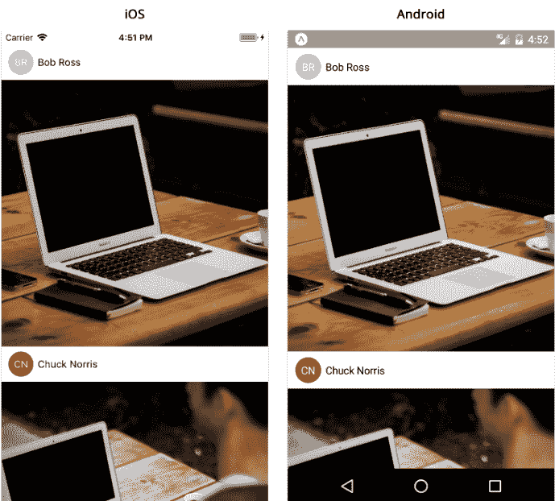

我们将使用 FlatList 组件来渲染这个卡片列表。

## FlatList

FlatList 组件用于渲染大量可滚动内容。`FlatList` 不是渲染一个 `children` 属性，而是使用 `renderItem` 属性来渲染输入 `data` 数组中的每个项目。`renderItem` 属性是一个函数，它从 `data` 数组中获取一个项目并将其映射为一个 React 元素。`data` 中的每个项目应该是一个具有唯一 id 的对象，以便 React 可以确定项目何时被重新排列。

FlatList 通常性能良好：它只渲染屏幕上的内容（裁剪屏幕外的内容），并且只更新发生变化的行。FlatList 是基于一个更通用的组件——ScrollView 构建的，我们将在本章后面使用它。

### 将 FlatList 添加到 CardList

让我们在 components 目录中创建一个新文件 CardList.js。我们将在文件顶部导入 FlatList、我们的 Card、一个用于从 id 构建图片 url 的工具函数以及其他一些内容：

```
image-feed/1/components/CardList.js
________________________________________
import { FlatList } from 'react-native';
import PropTypes from 'prop-types';
import React from 'react';

import { getImageFromId } from '../utils/api';
import Card from './Card';
________________________________________
```

最终我们将使用 https://unsplash.it 来获取信息流的数据，但现在让我们假设我们的数据如下所示：

```
[
  { id: 0, author: "Bob Ross" },
  { id: 1, author: "Chuck Norris" }
];
```

id 字段唯一很重要，因为我们将用它来确定信息流中每张卡片的身份。如果它不唯一，我们可能会开始看到一些奇怪的行为，比如某些项目不渲染。幸运的是，我们稍后调用的 API 会有唯一的 id 值（大多数 API 都应该如此！）。

我们需要向 FlatList 提供一个函数，将数据数组中的每个元素映射到其唯一的 key。让我们在文件顶部定义一个实用函数来完成此操作，然后将其作为 keyExtractor 属性传递给 FlatList。我们的函数 keyExtractor 将接收数组中的一个项目，并以字符串形式返回该项目的 id。在导入语句下方定义此函数：

```
image-feed/1/components/CardList.js
________________________________________
const keyExtractor = ({ id }) => id.toString();
________________________________________
```

我们稍后在渲染 FlatList 时会用到这个函数。

接下来看 propTypes，我们希望确保输入数据符合上面定义的格式。我们可以结合使用 PropTypes.arrayOf 和 PropTypes.shape。让我们如下设置组件骨架：

**image-feed/1/components/CardList.js**

```
// ...

export default class CardList extends React.Component {
  static propTypes = {
    items: PropTypes.arrayOf(
      PropTypes.shape({
        id: PropTypes.number.isRequired,
        author: PropTypes.string.isRequired,
      }),
    ).isRequired,
  };

  render() {
    // ...
  }
}
```

我们将使用类组件而不是函数式组件，因为当我们稍后添加评论功能时，需要添加一些方法，这些方法需要访问 `props`。

> 到目前为止，我们已经了解了如何使用 `PropTypes.bool`、`PropTypes.string` 等来验证基本类型值。我们可以使用 `PropTypes.shape()` 来验证对象，传递要验证的值的键。我们可以使用 `PropTypes.array()` 来验证数组，传递元素的类型。

如果我们计划在多个地方使用此 `items` 数据结构，可能希望在单独的文件（如 `ItemsPropType.js`）中定义其类型。这样我们可以定义一次，并从多个文件导入，而不是在多个地方重复定义。React Native 以这种方式导出了一些内置类型，例如 `ViewPropTypes`。

现在让我们渲染 `FlatList`：

```
renderItem = ({ item: { id, author } }) => (
  <Card
    fullname={author}
    image={{
      uri: getImageFromId(id),
    }}
  />
);

render() {
  const { items } = this.props;

  return (
    <FlatList
      data={items}
      renderItem={this.renderItem}
      keyExtractor={keyExtractor}
    />
  );
}
```

### 重访解构赋值

在上一章中，我们介绍了解构赋值。解构赋值也可以嵌套，如上例所示：

```
renderItem = ({ item: { id, author } }) => {}
```

这等同于：

```
renderItem = (obj) => {
  const id = obj.item.id;
  const author = obj.item.author;
}
```

我们提供 `keyExtractor` 属性来指示 `FlatList` 如何唯一标识项目——这有助于 `FlatList` 确定何时需要重新渲染进出屏幕可见部分的项目。

每次 `FlatList` 决定渲染一个新项目时，它都会调用我们提供的 `renderItem` 函数。


将其与一个对象作为参数传入。该对象包含一些渲染元数据，以及我们作为 data 属性传入的数组中的项。

在 `renderItem` 内部，我们可以根据该项返回一个 Card 组件。我们可以利用该对象的 id，通过我们的 `getImageFromId()` 工具函数来构造图片的 URI。

保存 `CardList.js`，让我们来测试一下。

## 试一试

更新 `App.js`，使用我们之前提到的硬编码数据来渲染 CardList：

```
image-feed/1/App.js

// ...

import CardList from './components/CardList';

const items = [
  { id: 0, author: 'Bob Ross' },
  { id: 1, author: 'Chuck Norris' },
];

export default class App extends React.Component {
  render() {
    return (
      <View style={styles.container}>
        <CardList items={items} />
      </View>
    );
  }
}

// ...
```

保存 `App.js`，你应该会看到这个：

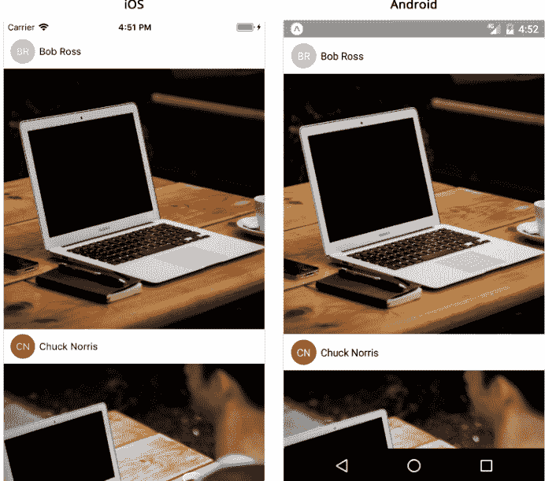

现在我们已经完成了图像流的最后一个自定义 UI 组件，我们可以用它来创建我们的 Feed 屏幕。

## 添加一个屏幕

我们的应用将有两个屏幕：

- **Feed**：图像流
- **Comments**：特定图像的评论列表

在 React Native 中，屏幕和其他组件一样都是组件。然而，从略微不同的角度思考屏幕是有用的。屏幕是填充整个设备屏幕的组件。它们通常处理非视觉方面的关注点，比如获取数据和处理到其他屏幕的导航。

通常，将所有的屏幕组件一起保存在应用的 `screens` 目录中。对于更高级的应用，我们可能会在 `screens` 内创建目录以更具体地进行分类。由于这个应用相当简单，我们使用扁平的 `screens` 目录。

在顶级 `image-feed` 目录中创建一个名为 `screens` 的新目录，并在 `screens` 中创建一个名为 `Feed.js` 的新文件。

## Feed 屏幕

这个屏幕将从 `https://unsplash.it` 获取实时数据，并将数据传递给我们的 `CardList`。我们将获取的数据将遵循与我们当前使用的硬编码列表相同的格式。

现在我们正在异步获取远程数据，我们需要考虑加载和错误状态。这个屏幕将显示一个简单的加载指示器和错误状态。

在 `Feed.js` 中添加以下导入：

```
image-feed/1/screens/Feed.js

import {
  ActivityIndicator,
  Text,
  ViewPropTypes,
  SafeAreaView,
} from 'react-native';
import PropTypes from 'prop-types';
import React from 'react';

import { fetchImages } from '../utils/api';
import CardList from '../components/CardList';
```

通常，屏幕像其他组件一样通过 props 进行配置。在本例中，我们将允许一个 `style` prop，我们将把它用于此屏幕内的顶级 View。这允许我们的屏幕以我们需要的任何方式进行样式设置，具有很大的灵活性。此 prop 的类型将与 `View` 的 `style` prop 相同 – React Native 将此验证器作为单独的导入项 `ViewPropTypes` 提供。

> 你可能会倾向于使用 `PropTypes.object` 来表示样式，但这效果不是很好。使用 `StyleSheet.create` 创建的样式被表示为数字，因此这会导致警告。此外，`ViewPropTypes.style` 提供了对每个键和值的深入类型检查，这非常有价值。

```
image-feed/1/screens/Feed.js

// ...

export default class Feed extends React.Component {
  static propTypes = {
    style: ViewPropTypes.style,
  };

  static defaultProps = {
    style: null,
  };

  // ...
}

// ...
```

允许一个 style prop 来创建极其灵活的自定义组件是很常见的。我们技术上可以以任何我们想要的方式使用这个 style prop，例如设置一个深层嵌套组件的样式 – 然而，当命名一个 prop 与内置的 View prop 相同时，我们通常会尝试保持行为相似。遵循内置组件的约定使得其他开发人员更容易理解如何使用我们的自定义组件，而无需阅读源代码。

我们将在 Feed 的状态中跟踪三件事：loading、error 和 items。

```
image-feed/1/screens/Feed.js

state = {
    loading: true,
    error: false,
    items: [],
};
```

我们可以用这些来决定渲染什么。我们将在 `componentDidMount` 中获取数据，当收到响应时更新组件状态。

```
image-feed/1/screens/Feed.js

async componentDidMount() {
    try {
        const items = await fetchImages();

        this.setState({
            loading: false,
            items,
        });
    } catch (e) {
        this.setState({
            loading: false,
            error: true,
        });
    }
}
```

我们将 `componentDidMount` 设置为异步函数，以便我们可以在其中使用 `await` 语法。这意味着该函数将返回一个 promise。React 不会使用 `componentDidMount` 的返回值做任何事情，所以这是安全的。

现在，让我们更新渲染方法以使用这个新的状态：

```
image-feed/1/screens/Feed.js

render() {
  const { style } = this.props;
  const { loading, error, items } = this.state;

  if (loading) {
    return <ActivityIndicator size="large" />;
  }

  if (error) {
    return <Text>Error...</Text>;
  }

  return (
    <SafeAreaView style={style}>
      <CardList items={items} />
    </SafeAreaView>
  );
}
```

我们准备好从 App 渲染我们的 Feed 屏幕了！

## 将 Feed 添加到 App

让我们更新 `App.js` 来渲染我们的新屏幕。首先，我们需要更新文件顶部的导入：

```
image-feed/1/App.js

import { Platform, StyleSheet, View } from 'react-native';
import { Constants } from 'expo';
import React from 'react';

import Feed from './screens/Feed';
```

然后我们可以在一个包装 View 中渲染我们的 Feed：

```
image-feed/1/App.js

export default class App extends React.Component {
    render() {
        return (
            <View style={styles.container}>
                <Feed style={styles.feed} />
            </View>
        );
    }
}
```

由于我们的 Feed 在顶层使用了 SafeAreaView，我们也需要更新之前的样式。我们只想在 Android 或 iOS 11 以下版本添加 marginTop，因为在 iOS 11 及以上版本，top margin 现在由 SafeAreaView 自动添加。

我们可以使用 `Platform.Version` 来检测原生操作系统版本。在 iOS 上，这是一个像 '10.3' 这样的字符串，而在 Android 上它是一个数字。

```
image-feed/1/App.js

const platformVersion =
    Platform.OS === 'ios' ? parseInt(Platform.Version, 10) : Platform.Version;

const styles = StyleSheet.create({
    container: {
        flex: 1,
        backgroundColor: '#fff',
    },
    feed: {
        flex: 1,
        marginTop:
            Platform.OS === 'android' || platformVersion < 11
                ? Constants.statusBarHeight
                : 0,
    },
});
```

至此，我们就完成了 Feed！以下是使用实时数据的最终结果：

## iOS

## Android

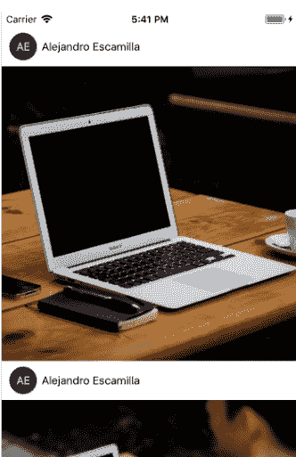


## 列表性能

如果你运行的 React Native 版本大于 0.55，在滚动浏览一百张左右的图片后，你可能会看到以下警告：

```
VirtualizedList: You have a large list that is slow to update - make sure your
renderItem function renders components that follow React performance best practices
like PureComponent, shouldComponentUpdate, etc.
```

React Native 正在通知我们，我们的列表在达到一定长度后渲染需要很长时间。我们可以通过减少重新渲染的卡片数量来解决这个问题。

FlatList 在我们滚动时重新渲染我们的卡片。然而，大多数时候，卡片的数据并不会改变，所以我们在初始渲染后不需要更新组件 – 数据可能改变的唯一时间是显示的评论数量发生变化的时候。我们可以在 `Card.js` 中添加一个 `shouldComponentUpdate` 方法来减少重新渲染，从而提高 FlatList 的性能。我们可以添加以下 `shouldComponentUpdate` 方法：

```
shouldComponentUpdate(nextProps) {
  return this.props.linkText !== nextProps.linkText
}
```


那么我们的卡片只会在绝对必要时才重新渲染。你可能仍然会在某个时刻收到相同的警告，但应该需要比之前多滚动好几倍才会出现。

大多数情况下，使用 `shouldComponentUpdate` 是一种过早的优化。即使对于像这样的大列表，通常在生产构建中，即使没有其他优化，性能也足够好。然而，如果你收到警告，这确实是一个值得考虑的优化。

## 我们目前构建的内容

让我们回顾一下目前所做的工作。我们使用了 `View`、`Text`、`Image` 和 `FlatList` 组件来构建一个跨平台的、无限滚动的图片和作者列表。我们创建了4个组件，每个组件都建立在前一个的基础上：`Avatar`、`AuthorRow`、`Card` 和 `CardList`。我们在构建每个组件时，都通过从顶层组件 `App` 进行渲染来测试它们。我们使用了多种布局技术：

-   显式设置 `width` 和 `height`
-   使用 `flex` 拉伸元素
-   使用 `flexDirection`、`justifyContent` 和 `alignItems` 进行子元素布局
-   使用 `padding` 和 `margin` 定义元素间距
-   使用 `position: 'absolute'` 将元素堆叠在一起
-   使用 `StyleSheet.create` 创建优化的样式

这些是构建任何 React Native UI 的基本构建块。我们将在本书的其余部分继续使用这些技术，同时为我们的技术栈添加更多组件和 API。

## 核心组件，第二部分

### 从我们中断的地方继续

我们成功构建了一个很棒的无限滚动图片流。接下来，我们将在同一个应用中添加一个新屏幕，用于对图片进行评论。

> 这是一个**代码检查点**。如果你之前没有跟着我们一起编码，但现在想开始，我们已经在本书的示例代码中包含了当前进度的快照。

如果你还没有创建项目，你需要使用以下命令创建：

```
$ create-react-native-app image-feed --scripts-version 1.14.0
```

然后，将示例代码中 image-feed/1 目录的内容复制到你的新 image-feed 项目目录中。

## 评论

评论屏幕将如下所示：


要构建应用的这一部分，我们将学习如何使用 `TextInput`、`ScrollView` 和 `Modal` 组件。我们还将介绍一些其他主题，如 `AsyncStorage`。我们将做一些假设，以便专注于内置组件：

-   即使我们有多个屏幕，我们也不会使用导航库（关于导航将在后续章节中介绍）
-   我们只想将评论本地存储在设备上，而不是通过远程 API 存储
-   评论可以保存为简单字符串（没有 `id`、`author` 或其他元数据）
-   评论输入字段位于屏幕顶部，以避免键盘和滚动相关的复杂性（我们将在下一章介绍）
-   评论数量足够少，使用 `ScrollView` 就能有足够的性能（而不是使用 `FlatList`）

## 分解评论屏幕

我们首先要做的就是将屏幕分解为组件。以下是一种分解方式：


-   **NavigationBar** - 一个简单的导航栏，位于屏幕顶部，包含标题和一个“关闭”按钮
-   **CommentInput** - 用于添加新评论的输入字段
-   **CommentList** - 可滚动的评论列表

**App** 组件将负责处理应用中的评论数据，因为 **Feed** 屏幕和 **Comments** 屏幕都需要渲染这些数据。我们将从 **App** 渲染 **Comments** 屏幕组件，并将所选卡片的评论数据作为 **prop** 传递。我们将渲染内置的 **Modal** 组件，根据 **App** 的状态来打开和关闭这个新屏幕。

我们将继续采用自底向上的方式构建，从 **CommentInput** 组件开始，逐步向上构建到屏幕组件。我们不会像章节前半部分那样，通过从 **App** 渲染每个组件来单独测试它们，但如果你喜欢在开发时获得更快的反馈循环，欢迎继续这样做。

## CommentInput

首先，让我们为新评论创建输入字段。


### TextInput

正如我们在“入门”章节中看到的，我们可以使用 **TextInput** 组件创建一个可编辑的文本字段供用户输入。

使用 **TextInput** 时，我们通常会使用以下 **props** 来捕获用户输入：

-   **value** - 输入字段中的当前文本。
-   **onChangeText** - 每次文本变化时调用的函数。新值作为第一个参数传入。
-   **onSubmitEditing** - 当用户按下回车/下一步键以提交/进入下一个字段时调用的函数。

通常，将当前文本存储在渲染 **TextInput** 的组件的 **state** 中。每次调用我们传递给 **onChangeText** 的函数时，我们调用 **setState** 来更新当前文本。当用户按下回车键时，我们传递给 **onSubmitEditing** 的函数会被调用——我们可以对当前文本执行一些操作，然后使用 **setState** 将当前文本重置为空字符串。

### 常用的 `TextInput` 属性和样式

使用 `TextInput` 时，我们可以使用与 **Text** 组件相同的大部分样式（包括 **View** 的样式）。不过，有些样式在 **TextInput** 上的效果不如在 **Text** 上好：边框可能渲染不正确，内边距和行高可能会以不寻常的方式冲突。如果你在给 `TextInput` 设置样式时遇到困难，可以考虑将 `TextInput` 包裹在一个 `View` 中，并为 `View` 设置样式。

其他一些常用属性：

-   `autoCapitalize` - 输入时自动大写字符。可选值为 `'none'`、`'sentences'`、`'words'`、`'characters'`。
-   `autoCorrect` - 启用/禁用自动更正。
-   `editable` - 启用/禁用文本字段。
-   `keyboardType` - 要显示的键盘类型。跨平台的值有 `'default'`、`'numeric'`、`'email-address'`、`'phone-pad'`。
-   `multiline` - 允许输入多行文本。
-   `placeholder` - 文本字段为空时显示的文本。
-   `placeholderTextColor` - 占位符文本的颜色。
-   `returnKeyType` - 键盘上回车键的文本。跨平台的值有 `'done'`、`'go'`、`'next'`、`'search'`、`'send'`。

更多属性可在 [TextInput 文档](https://facebook.github.io/react-native/docs/textinput.html)中找到。

### 将 `TextInput` 添加到 `CommentList`

虽然我们可以直接从 `Comments` 屏幕渲染一个 `TextInput` 组件，但通常更好的做法是创建一个包装组件，封装状态、样式、边缘情况等，并提供更小的 API。这就是我们将在 `CommentInput` 组件中做的。结果将与前几章中的 `TextInput` 包装组件非常相似。

在 `components` 目录中创建一个新文件 `CommentInput.js`。我们将导入通常的 React、PropTypes 等，以及 `TextInput` 组件：

```js
// image-feed/components/CommentInput.js
import { StyleSheet, TextInput, View } from 'react-native';
import PropTypes from 'prop-types';
import React from 'react';
```

我们希望这个组件有两个 **props**：

-   `onSubmit` - 当用户按下“回车”键时，我们会用评论文本调用这个函数。
-   `placeholder` - 直接传递给 `TextInput` 的 `placeholder` 属性。

在 `CommentInput.js` 中添加以下内容：

```js
// image-feed/components/CommentInput.js
// ...

export default class CommentInput extends React.Component {
  static propTypes = {
    onSubmit: PropTypes.func.isRequired,
    placeholder: PropTypes.string,
  };

  static defaultProps = {
    placeholder: '',
  };

  // ...
}
```

我们将在 **state** 中添加一个 `text` 值，并在 `TextInput` 的值发生变化时更新这个值的方法：

```js
// image-feed/components/CommentInput.js
state = {
  text: '',
};

handleChangeText = text => {
  this.setState({ text });
};

handleSubmitEditing = () => {
  const { onSubmit } = this.props;
  const { text } = this.state;

  if (!text) return;

  onSubmit(text);
  this.setState({ text: '' });
};
```

我们不允许空评论，所以当 `handleSubmitEditing` 被调用时，如果 `state.text` 为空，我们将立即返回。


最后，我们将渲染 TextInput。我们想在底部添加边框，但给 TextInput 添加边框有时不太可靠，因为它们可能不会显示出来。因此，我们将 TextInput 包裹在 View 中，并对 View 进行样式设置：

```javascript
// image-feed/components/CommentInput.js

render() {
  const { placeholder } = this.props;
  const { text } = this.state;

  return (
    <View style={styles.container}>
      <TextInput
        style={styles.input}
        value={text}
        placeholder={placeholder}
        underlineColorAndroid="transparent"
        onChangeText={this.handleChangeText}
        onSubmitEditing={this.handleSubmitEditing}
      />
    </View>
  );
}
```

```javascript
// image-feed/components/CommentInput.js

const styles = StyleSheet.create({
  container: {
    borderBottomWidth: StyleSheet.hairlineWidth,
    borderBottomColor: 'rgba(0,0,0,0.1)',
    paddingHorizontal: 20,
    height: 60,
  },
  input: {
    flex: 1,
  },
});
```

在这里，我们将状态管理方法 handleChangeText 和 handleSubmitEditing 传递给 TextInput，以便跟踪值的变化。

我们可以使用 StyleSheet.hairlineWidth 作为边框宽度，以在任何设备上渲染尽可能细的线条。例如，在视网膜设备上，这将小于 1。

🔍 如果你想查看这个组件的样子以检查你的工作，可以考虑从 App 中渲染它来进行测试。

## CommentList

接下来，我们将为每张图片渲染一个评论列表：


我们将在 `ScrollView` 中渲染这些评论。实际上，出于性能考虑，我们可能希望使用 `FlatList`，但为了练习，让我们使用 `ScrollView`。

## ScrollView

`ScrollView` 比 `FlatList` 更简单：它会将所有子元素渲染为可垂直或水平滚动的列表，而无需 `keyExtractor` 或 `renderItem` 等额外复杂属性。

`ScrollView` 适用于滚动浏览少量内容（大约 20 个项目以内）。`ScrollView` 中的内容即使在屏幕不可见时也会被渲染。对于大量项目，或者 `ScrollView` 的许多子元素在屏幕外的情况，你可能需要使用 `FlatList` 组件以获得更好的性能。

## ScrollView 的尺寸和布局

你可以将 ScrollView 想象为两个独立的视图，一个嵌套在另一个内部。外部视图有固定的大小，而内部视图可以超过外部视图的大小。如果内部视图超过了外部视图的大小，只有部分会可见。当我们向 ScrollView 传递子元素时，它们会在内部视图中渲染。我们将内部视图称为"内容容器视图"，并且可以单独为它设置样式，与外部视图区分开来。

## 调试 ScrollView

在构建应用时，经常会出现渲染了 ScrollView 但屏幕上却看不到任何内容的情况。根据外部视图和内容容器视图的工作方式，这有两个常见原因（假设是垂直滚动）：

- 内容容器视图默认有 `flex: 0`，因此它起始高度为 0，并扩展到包含其子元素所需的最小大小。如果子元素有 `flex: 1`，这个子元素将不可见，因为内容容器的固有高度为 0。虽然我们可以将 `contentContainerStyle` 设置为 `flex: 1`，但这可能不是我们想要的，因为这样内容永远不会大于外部视图。相反，我们应该确保传递给 ScrollView 的子元素具有大于 0 的固有高度值（通过使用明确的高度，或包含高度大于 0 的子元素）。
- 外部视图不会根据内容容器视图改变大小。除了确保 ScrollView 的子元素具有非零高度外，我们还必须确保 ScrollView 本身具有非零尺寸——固定的宽度和高度、`flex: 1` 且父元素有 `alignItems: stretch`，或者绝对定位。

最有可能的是，如果 ScrollView 没有出现，我们需要在每个父元素和 ScrollView 本身都添加 `flex: 1`。为了调试，你可以尝试在每个父元素上设置背景色，以查看 `flex: 1` 在组件层次结构的哪个位置停止向下传递。

## 将 ScrollView 添加到 CommentList

让我们渲染一个包含评论列表的 ScrollView。我们将这个组件命名为 `CommentList`。在 `components` 目录中创建 `CommentList.js` 文件。

这个组件将接受一个 `items` 数组 prop，其中包含评论字符串，将它们映射为 `View` 和 `Text` 元素。我们将在 `CommentList.js` 中按以下方式设置该组件的框架：

```javascript
// image-feed/components/CommentList.js
import { ScrollView, StyleSheet, Text, View } from 'react-native';
import PropTypes from 'prop-types';
import React from 'react';

export default class CommentList extends React.Component {
  static propTypes = {
    items: PropTypes.arrayOf(PropTypes.string).isRequired,
  };

  // ...
}
```

与 FlatList 不同，我们不需要处理 keyExtractor 和 data 属性。我们可以简单地渲染 ScrollView 的子元素，就像渲染 View 的子元素一样：

```javascript
// image-feed/components/CommentList.js
renderItem = (item, index) => (
  <View key={index} style={styles.comment}>
    <Text>{item}</Text>
  </View>
);

render() {
  const { items } = this.props;

  return <ScrollView>{items.map(this.renderItem)}</ScrollView>;
}
```

```javascript
// image-feed/components/CommentList.js
const styles = StyleSheet.create({
  comment: {
    marginLeft: 20,
    paddingVertical: 20,
    paddingRight: 20,
    borderBottomWidth: StyleSheet.hairlineWidth,
    borderBottomColor: 'rgba(0,0,0,0.05)',
  },
});
```

> 由于评论以字符串形式存储，我们没有方便的值可用作唯一的 React key。使用评论文本作为 key 是行不通的，因为评论不必是唯一的。在这里使用索引作为 key 是可行的，但通常这是一个需要警惕的模式，因为重新排列项目时可能会导致问题。更好的解决方案是为我们的评论数据添加 id：我们可以将评论存储为对象，并使用上一章的 uuid 库为每条评论分配唯一的 id，用作 key。

现在我们有了一个可滚动的评论列表，我们可以继续处理导航栏，这将是我们组装评论屏幕之前的最后一个组件。

## NavigationBar

由于我们的评论屏幕将以模态形式打开，我们希望渲染一个带有标题和关闭按钮的导航栏。


在实际应用中，我们可能会使用导航库来实现这一点，但为简单起见，让我们自己写一个小型的。

在 `components` 目录中创建 `NavigationBar.js` 并添加以下框架：

```javascript
// image-feed/components/NavigationBar.js

import { StyleSheet, Text, TouchableOpacity, View } from 'react-native';
import PropTypes from 'prop-types';
import React from 'react';

export default function NavigationBar({ title, leftText, onPressLeftText }) {
  // ...
}

NavigationBar.propTypes = {
  title: PropTypes.string,
  leftText: PropTypes.string,
  onPressLeftText: PropTypes.func,
};

NavigationBar.defaultProps = {
  title: '',
  leftText: '',
  onPressLeftText: () => {},
};

// ...
```

> 我们不会在 props 上使用 `isRequired`，因为如果我们向此应用添加更多屏幕，这个组件可能会在不使用某些 props 的情况下使用，例如 `leftText` 和 `onPressLeftText`。

这个组件将相当简单，只使用我们已经讲过的概念。我们将使用 `TouchableOpacity` 作为左侧的关闭按钮。我们将使用 `position: 'absolute'` 来定位它，因为我们不想让左侧的文本将标题推离中心位置（记住，使用 `position: 'absolute'` 意味着该组件不再影响布局中的其他兄弟元素）。真正的导航库会考虑更多情况，例如右侧的文本、两侧的图标，以及可能与标题冲突的长文本。让我们保持简单，只处理当前这一种情况。

组件函数和样式应该如下所示：


 image-feed/components/NavigationBar.js

```
export default function NavigationBar({ title, leftText, onPressLeftText }) {
  return (
    <View style={styles.container}>
      <TouchableOpacity style={styles.leftText} onPress={onPressLeftText}>
        <Text>{leftText}</Text>
      </TouchableOpacity>
      <Text style={styles.title}>{title}</Text>
    </View>
  );
}
```

image-feed/components/NavigationBar.js

```
const styles = StyleSheet.create({
  container: {
    height: 40,
    borderBottomWidth: StyleSheet.hairlineWidth,
    borderBottomColor: 'rgba(0,0,0,0.1)',
    alignItems: 'center',
    justifyContent: 'center',
  },
  title: {
    fontWeight: '500',
  },
  leftText: {
    position: 'absolute',
    left: 20,
    top: 0,
    bottom: 0,
    justifyContent: 'center',
  },
});
```

> 尽管 fontWeight 通常表示一个数值，但它必须是字符串！

我们现在已经有了所有需要的构建模块：CommentInput、CommentList 和 NavigationBar。让我们将它们组装到一个新的屏幕中。

## 评论屏幕

在 screens 目录下创建一个名为 Comments.js 的新文件。

在我们的新屏幕中，我们希望首先渲染 NavigationBar，然后是 CommentInput，最后是 CommentList。我们希望这个屏幕接受 4 个 props：

- comments — 要显示的评论数组。
- onClose — 当用户按下关闭按钮时调用的函数 prop。
- onSubmitComment — 当用户添加新评论时调用的函数 prop。
- style — 应用于该屏幕顶层 View 的样式（就像我们之前对 Feed 所做的那样）

将以下内容添加到 Comments.js：

```
image-feed/screens/Comments.js
1 import { SafeAreaView, ViewPropTypes } from 'react-native';
2 import PropTypes from 'prop-types';
3 import React from 'react';
4 
5 import CommentInput from '../components/CommentInput';
6 import CommentList from '../components/CommentList';
7 import NavigationBar from '../components/NavigationBar';
8 
9 export default function Comments({
10   style,
11   comments,
12   onClose,
13   onSubmitComment,
14 }) {
15   return (
16     <SafeAreaView style={style}>
17       <NavigationBar
18         title="Comments"
19         leftText="Close"
20         onPressLeftText={onClose}
21       />
22       <CommentInput placeholder="Leave a comment" onSubmit={onSubmitComment} />
23       <CommentList items={comments} />
24     </SafeAreaView>
25   );
26 }
27 
28 Comments.propTypes = {
```

```
29   style: ViewPropTypes.style,
30   comments: PropTypes.arrayOf(PropTypes.string).isRequired,
31   onClose: PropTypes.func.isRequired,
32   onSubmitComment: PropTypes.func.isRequired,
33 };
34 
35 Comments.defaultProps = {
36   style: null,
37 };
```

我们屏幕的代码相当简单，因为我们已经将 UI 的不同部分构建为独立的组件。

## 将它们整合起来

现在我们需要允许从之前创建的 Feed 屏幕导航到这个新的 Comments 屏幕。

我们希望 Comments 屏幕从下方滑出并覆盖整个屏幕，因此我们将使用内置的 Modal 组件。

## Modal

Modal 组件让我们可以过渡到一个完全不同的屏幕。这对于简单应用最有用，因为对于复杂应用，你很可能会使用导航库，而它会自带处理模态框的方式。

常用 props 包括：

- **animationType** — 控制模态框的进出动画。可选值为 'none'、'slide' 或 'fade'（默认为 'none'）。
- **onRequestClose** — 当用户点击 Android 返回按钮时调用的函数。
- **onShow** — 模态框完全可见后调用的函数。
- **transparent** — 布尔值，决定模态框的背景是否透明。
- **visible** — 布尔值，决定模态框是否可见。

`visible` prop 是最重要的，因为它让我们可以显示和隐藏 Modal。

## 向 `App` 添加 `Modal`

我们将在 `App` 组件的 `state` 中维护 `Modal` 的状态。我们将使用 `Modal` 组件的 `visible` prop 来显示和隐藏它，因此我们会在 `state` 中存储一个布尔值 `showModal`。我们还想存储正在查看评论的图片的 `id`，因此我们也会在 `state` 中存储 `selectedItemId`。而且我们想存储我们输入的评论的实际文本，所以让我们创建一个对象，将图片 `id` 映射到评论字符串数组。让我们将 `App.js` 中的 `state` 更新为如下所示：

image-feed/App.js

```
state = {
  commentsForItem: {},
  showModal: false,
  selectedItemId: null,
};
```

接下来，我们将在 `App` 组件上创建两个函数属性，用于更新 `state` 以打开和关闭 `Modal`。

image-feed/App.js

```
openCommentScreen = id => {
  this.setState({
    showModal: true,
    selectedItemId: id,
  });
};

closeCommentScreen = () => {
  this.setState({
    showModal: false,
    selectedItemId: null,
  });
};
```

请注意，我们的 `openCommentScreen` 函数接收我们想要显示评论的图片的 `id`。我们需要在 `CardList` 内部调用这个函数来传递该 `id`。然后我们会将该值通过 `Feed` 向上传递到 `App`。保存 `App.js`，让我们前往 `CardList.js` 来实现这一点。

## 更新 `CardList` 以支持评论

我们希望每张卡片上的 "Comments" 链接打开我们刚刚创建的 `Modal`。为此，让我们调整 CardList 组件，添加一个 onPressComments prop（我们可以用它来调用 openComment distilleryScreen）和一个 commentsForItem prop（我们可以用它来显示每张图片的评论数量）。

```
image-feed/components/CardList.js
// ...

export default class CardList extends React.Component {
  static propTypes = {
    items: PropTypes.arrayOf(
      PropTypes.shape({
        id: PropTypes.number.isRequired,
        author: PropTypes.string.isRequired,
      }),
    ).isRequired,
    commentsForItem: PropTypes.objectOf(PropTypes.arrayOf(PropTypes.string))
      .isRequired,
    onPressComments: PropTypes.func.isRequired,
  };

  // ...
}

// ...
```

让我们在 renderItem 内部调用 onPressComments，传递项目的 id，这样我们就知道要为哪张图片显示评论。

```
image-feed/components/CardList.js
// ...
  renderItem = ({ item: { id, author } }) => {
    const { commentsForItem, onPressComments } = this.props;
    const comments = commentsForItem[id];

    return (
      <Card
        fullname={author}
        image={{
          uri: getImageFromId(id),
        }}
        linkText={`${comments ? comments.length : 0} Comments`}
        onPressLinkText={() => onPressComments(id)}
      />
    );
  };
// ...
```

我们的 `CardList` 目前有一个小问题：我们用于 `linkText` 的评论计数不会在我们添加新评论时立即更新。这是由于 `FlatList` 决定是否重新渲染项目的方式导致的；`FlatList` 只会在 `data` prop 变化或滚动时重新渲染项目。在这种情况下，我们将 `CardList` 的 `items` prop 传递给 `FlatList` 的 `data` prop，但我们的 `commentsForItem` prop 不会导致 `items` 数组变化，所以 `FlatList` 在添加新评论时不会更新。我们可以使用 `FlatList` 的 `extraData` prop 来告知 `FlatList` 它应该监控另一个输入数据源的变化。

让我们更新 `CardList` 内的 `render` 方法，将 `commentsForItem` 作为 `FlatList` 的 `extraData` prop 传递。

image-feed/components/CardList.js

```
// ...
    const { items, commentsForItem } = this.props;

    return (
      <FlatList
        data={items}
        renderItem={this.renderItem}
        keyExtractor={keyExtractor}
        extraData={commentsForItem}
      />
    );

// ...
```

保存 `CardList.js`。这会导致你的应用进入错误状态，因为 `CardList` 目前没有接收到 `commentsForItem` prop。

iOS

Android

让我们修复这个问题！

## 更新 `Feed` 以支持评论

打开 `Feed.js`。我们也需要在这里接受 `commentsForItem` 和 `onPressComments`，并将它们传递给 `CardList`。

更新 `propTypes`：

`image-feed/screens/Feed.js`

```
static propTypes = {
  style: ViewPropTypes.style,
  commentsForItem: PropTypes.objectOf(PropTypes.arrayOf(PropTypes.string)).isRequired,
  onPressComments: PropTypes.func.isRequired,
};
```

并更新 `render` 方法：


image-feed/screens/Feed.js

```
render() {
  const { commentsForItem, onPressComments, style } = this.props;

  // ..

  return (
    <SafeAreaView style={style}>
      <CardList
        items={items}
        commentsForItem={commentsForItem}
        onPressComments={onPressComments}
      />
    </SafeAreaView>
  );
}

// ...
```

保存 Feed.js 文件。你仍然会看到相同的错误消息，因为我们尚未向 Feed 传递 `commentsForItem` 的值。

## 更新应用以包含评论

让我们回到 App.js，将刚刚添加到 Feed 的这些新属性连接起来，并渲染屏幕。

导入 Modal 组件和我们的 Comments 组件：

```
image-feed/App.js
import { Modal, Platform, StyleSheet, View } from 'react-native';

// ...

import Comments from './screens/Comments';
```

然后更新 render 方法以渲染 Comments，并使用新属性更新 Feed：

```
image-feed/App.js

// ...

export default class App extends React.Component {
  // ...

  render() {
    const { commentsForItem, showModal, selectedItemId } = this.state;

    return (
      <View style={styles.container}>
        <Feed
          style={styles.feed}
          commentsForItem={commentsForItem}
          onPressComments={this.openCommentScreen}
        />
        <Modal
          visible={showModal}
          animationType="slide"
          onRequestClose={this.closeCommentScreen}
        >
          <Comments
            style={styles.container}
            comments={commentsForItem[selectedItemId] || []}
            onClose={this.closeCommentScreen}
            // ...
          />
        </Modal>
      </View>
    );
  }
}

// ...
```

我们还需要为评论屏幕添加一个新的样式：

```
image-feed/App.js
// ...

const styles = StyleSheet.create({
    // ...
    comments: {
        flex: 1,
        marginTop:
            Platform.OS === 'ios' && platformVersion < 11
                ? Constants.statusBarHeight
                : 0,
    },
});
```

像之前一样，我们需要通过添加顶部边距来单独处理 iOS 11 以下的版本。在 Android 上，模态框自然位于状态栏下方，因此在这种情况下，我们只需要在 iOS 上设置顶部边距。

保存 App.js 后，你将能够打开和关闭 Comments 屏幕了！点击任何“Comments”链接可以打开它，点击导航栏中的“Close”按钮可以关闭它。

应该还会有一个关于缺少 `onSubmitComment` 属性的警告。接下来我们添加它。

## 添加新评论

既然我们可以访问新的 Comments 屏幕了，我们将希望能够输入新评论。

让我们在 App 组件上创建一个函数属性 `onSubmitComment`，用于将新评论保存到我们状态中的 `commentsForItem` 对象中。由于我们的 `commentsForItem` 对象应该是不可变的（它是状态的一部分），我们将创建一个新对象，并使用 `...` 对象展开语法复制现有的键和值。对于我们的 `selectedItemId`，我们将要么更新 `commentsForItem` 中的评论数组，使用 `...` 数组展开语法复制现有评论，要么如果是第一条评论，则创建一个新数组。

```
image-feed/App.js
// ...

onSubmitComment = (text) => {
    const { selectedItemId, commentsForItem } = this.state;
    const comments = commentsForItem[selectedItemId] || [];

    const updated = {
        ...commentsForItem,
        [selectedItemId]: [...comments, text],
    };

    this.setState({ commentsForItem: updated });
};
```

由于我们创建了一个新的 `commentsForItem` 对象，当我们最终将其传递给 Feed 时，Feed 会将其作为 `extraData` 传递给 FlatList，从而触发重新渲染（更新“0 Comments”文本）。

**计算属性名**

在定义对象字面量时，我们可以通过在属性名周围放置方括号来动态计算属性名。例如：

```
const name = 'foo';
const obj = { [name]: 'bar' };

console.log(obj.foo); // => 'bar'
```

这大致等同于：

```
const name = 'foo';
const obj = {};
obj[name] = 'bar';
```

计算属性名在像上面这样的情况下很方便，我们希望对象字面量根据动态值拥有属性名。

输入新评论的最后一步是在渲染时将 `onSubmitComment` 函数传递给 Comments 组件：

**image-feed/App.js**

```
// ...

return (
  <View style={styles.container}>
    <Feed
      style={styles.feed}
      commentsForItem={commentsForItem}
      onPressComments={this.openCommentScreen}
    />
    <Modal
      visible={showModal}
      animationType="slide"
      onRequestClose={this.closeCommentScreen}
    >
      <Comments
        style={styles.comments}
        comments={commentsForItem[selectedItemId] || []}
        onClose={this.closeCommentScreen}
        onSubmitComment={this.onSubmitComment}
      />
    </Modal>
  </View>
);

// ...
```

保存 `App.js`，然后去玩一会儿应用吧！你应该能够点击每张图片右上角的“0 Comments”文本，打开包含 `Comments` 屏幕的 `Modal`。你应该能够输入新评论，并看到它们出现在评论列表中。当你关闭 `Modal` 时，你应该看到你选择的图片的评论数量已经增加了。

## 额外内容：将评论持久化到设备存储

你可能已经注意到，你添加的任何评论在重新加载应用时都会消失。这是因为我们没有将它们保存在任何地方。

作为可选的最后一步，我们可以通过 `AsyncStorage` API 将我们编写的评论持久化到设备上。`AsyncStorage` 是 React Native 提供的一个简单的键值存储，用于存储少量的字符串数据（我们通常将其序列化为 JSON）。顾名思义，保存和从这个存储中读取都是异步发生的。我们可以调用 `AsyncStorage.getItem(key)` 和 `AsyncStorage.setItem(key, value)` 来使用字符串键存储和检索字符串值。

在 `App.js` 中，我们首先需要导入 `AsyncStorage`：

**image-feed/App.js**

```
import { AsyncStorage, Modal, Platform, StyleSheet, View } from 'react-native';
```

然后我们将定义一个任意的键，用于将评论对象作为 JSON 持久化：

**image-feed/App.js**

```
const ASYNC_STORAGE_COMMENTS_KEY = 'ASYNC_STORAGE_COMMENTS_KEY';
```

然后我们将更新我们的 `componentDidMount` 和 `onSubmitComment`，分别用于保存和从 AsyncStorage 读取。由于我们只能使用 AsyncStorage 存储字符串值，如果我们想存储一个复杂对象，我们必须先将其序列化为 JSON。为此，我们可以在存储值之前调用 `JSON.stringify`，在检索值之后调用 `JSON.parse`。

我们将在应用挂载时将所有评论加载到 state 中：

**image-feed/App.js**

```
async componentDidMount() {
  try {
    const commentsForItem = await AsyncStorage.getItem(
      ASYNC_STORAGE_COMMENTS_KEY,
    );

    this.setState({
      commentsForItem: commentsForItem ? JSON.parse(commentsForItem) : {},
    });
  } catch (e) {
    console.log('Failed to load comments');
  }
}
```

然后，我们将在每次添加新评论时通过修改 `onSubmitComment` 来更新存储的评论：

```
// ...

onSubmitComment = text => {
  const { selectedItemId, commentsForItem } = this.state;
  const comments = commentsForItem[selectedItemId] || [];

  const updated = {
    ...commentsForItem,
    [selectedItemId]: [...comments, text],
  };

  this.setState({ commentsForItem: updated });

  try {
    AsyncStorage.setItem(ASYNC_STORAGE_COMMENTS_KEY, JSON.stringify(updated));
  } catch (e) {
    console.log('Failed to save comment', text, 'for', selectedItemId);
  }
};
// ...
```

请注意，`getItem` 和 `setItem` 都可能失败（例如，当磁盘 I/O 失败时），因此我们需要将任何 `async` 调用包装在 `try/catch` 中。

这就是我们将评论持久化到磁盘所需要做的一切！现在，当你写评论并重新加载应用时，它们仍然会存在。试试看吧！

## 总结

我们在本章中介绍的许多内置组件都是高度通用且可重用的：`View`、`Text`、`Image`、`ScrollView` 和 `FlatList`。大多数应用中的大部分 UI 都将使用这些组件的组合来编写。

我们还介绍了一些其他组件，它们用于更专业的用例，如 `ActivityIndicator`、`TextInput` 和 `Modal`。还有更多这样的组件我们没有涵盖。

你不需要记住每一个内置的 React Native 组件——事实上，有些组件你可能永远不需要。重要的是：你现在对 React Native 的 *工作原理* 有了坚实的基础，因此你将能够通过阅读文档来弄清楚如何使用任何内置组件。

UI 组件是 React Native 提供的重要组成部分。然而，大多数应用需要的不仅仅是 UI 组件。React Native 的另一个重要部分我们在本章中也提到了：命令式 API。这些是 API（如 `AsyncStorage`），我们可以从组件生命周期中调用它们来获取数据、访问相机胶卷、查询地理位置等。在下一章中，我们将探索一些最常见的 React Native API。


 ## 核心 API，第 1 部分

到目前为止，我们主要通过 React 组件与底层原生 API 进行交互——我们使用 `View`、`Text` 和 `Image` 等组件在屏幕上创建原生 UI 元素。

React 为创建视觉组件的 API 提供了简单、一致的接口。但有些 API 并不创建 UI 组件：例如，访问相机胶卷，或查询设备的当前网络连接状态。

React Native 还提供了与这些非视觉原生 API 交互的 API。与组件不同，这些 API 通常是*命令式*函数：我们必须在合适的时机显式调用它们，而不是从组件的 `render` 函数返回某些内容让 React 稍后调用。React Native 只是为我们提供了一个 JavaScript 包装器，通常是跨平台的，用于控制底层原生 API。

## 构建一个即时通讯应用

在本章中，我们将构建一个即时通讯应用（类似于 iMessage）的初始版本，借此了解一些最常见的核心 API。我们的应用将支持发送文本、从相机胶卷发送照片，以及分享位置。它会在我们断开网络连接时发出通知，处理键盘交互以及 Android 上的返回按钮。

要尝试完成的应用：

- 在 Android 上，你可以在 Expo 应用中扫描以下二维码：

- 在 iOS 上，你可以导航到示例代码文件夹中的 `messaging/` 目录并构建应用。你可以使用 iOS 模拟器预览，也可以像我们在第一章中提到的那样，将项目 URL 的链接发送到你的设备。


我们可以发送文本消息、图片和地图：


iOS

Android

我们可以从设备的相机胶卷中选择图片：

并且可以全屏查看图片：


我们将使用以下 API：

- Alert - 显示模态对话框以获取简单的用户输入
- BackHandler - 控制 Android 上的返回按钮
- CameraRoll - 返回设备上存储的图片和视频
- Dimensions - 返回屏幕尺寸
- Geolocation - 返回设备位置，并在位置变化时触发事件
- Keyboard - 在键盘出现或消失时触发事件
- NetInfo - 返回网络连接信息，并在连接状态变化时触发事件
- PixelRatio - 将密度无关像素转换为密度相关像素（稍后详细介绍）
- StatusBar - 控制状态栏的可见性和颜色

我们将只关注 UI，因此我们不会*真正*发送消息，但我们可以将构建的 UI 连接到后端，以便在生产环境中使用。

## 初始化项目

正如我们在前几章所做的那样，让我们使用以下命令创建一个新应用：

```
$ create-react-native-app messaging --scripts-version 1.14.0
```

完成后，导航到 `messaging` 目录。在本章中，我们将自己创建 `utils` 目录，因此无需复制示例代码。

## 应用

让我们开始搭建应用的骨架。我们将在 `App.js` 中完成这一步。之后，我们将逐个组件地构建屏幕的不同部分。最后处理键盘交互，因为这是最复杂和精细的部分。我们将遵循与前几章相同的总体流程：首先将屏幕拆解为组件，构建硬编码版本，添加状态，等等。

## 应用的骨架

如果我们从上到下观察应用，UI 的主要部分如下：


- **Status** - 设备通常会渲染一个*状态栏*，即屏幕顶部显示时间、电量等信息的水平条——但在本例中，我们将增强它以更突出地显示网络连接状态。我们将创建自己的组件 `Status`，它渲染在设备状态栏下方。
- **MessageList** - 这是我们渲染文本消息、图片和地图的地方。
- **Toolbar** - 用户可以在这里切换发送文本、图片或位置，也是输入消息输入框所在的位置。
- Input Method Editor (IME) - 这是我们可以渲染自定义输入方式的地方，即发送图片。我们将构建一个图片选择器组件 `ImageGrid`，并在这里使用它。注意，键盘是由操作系统原生渲染的，因此我们会在合适的时机触发键盘的出现和消失，但不会自己渲染它。

在本章中，我们将采用自上而下的方式构建。首先用占位 `View` 表示消息列表、工具栏和 IME。从粗略的布局开始，然后为每个部分创建组件，将每个部分放入各自的 `View` 中。每个部分将由几个不同的组件组成。

打开 App.js 并添加以下骨架：

```
messaging/App.js

import { StyleSheet, View } from 'react-native';
import React from 'react';

export default class App extends React.Component {
  renderMessageList() {
    return (
      <View style={styles.content}></View>
    );
  }

  renderInputMethodEditor() {
    return (
      <View style={styles.inputMethodEditor}required
    );
  }

  renderToolbar() {
    return (
      <View style={styles.toolbar}></View>
    );
  }

  render() {
    return (
      <View style={styles.container}>
        {this.renderMessageList()}
        {this.renderToolbar()}
        {this.renderInputMethodEditor()}
      </View>
    );
  }
}

const styles = StyleSheet.create({
  container: {
    flex: 1,
    backgroundColor: 'white',
  },
  content: {
    flex: 1,
  },
  backgroundColor: 'white',
  },
  inputMethodEditor: {
    flex: 1,
    backgroundColor: 'white',
  },
  toolbar: {
    borderTopWidth: 1,
    borderTopColor: 'rgba(0,0,0,0.04)',
    backgroundColor: 'white',
  },
});
```

当你保存 `App.js` 时，应用应该会在你的设备上重新加载，你将看到以下内容：


太棒了，一个空白屏幕，中间有一条细细的灰线！现在我们可以开始构建屏幕的不同部分了。`App` 组件将协调数据的填充方式，以及何时隐藏或显示各种输入方式——但首先，我们需要开始创建 UI 中的不同组件。

现在是在主 `messaging` 目录中创建一个新目录 `components` 的好时机。我们将把构建的 UI 组件放在 `components` 目录中。

## 网络连接指示器

由于我们正在构建一个即时通讯应用，网络连接始终相关。让我们通过将状态栏变为红色并显示一条短消息，让用户知道他们已失去连接。


### StatusBar

许多应用显示默认状态栏，但有时我们想自定义样式，例如将背景变为红色。

状态栏在 iOS 和 Android 上的工作方式略有不同。在 iOS 上，状态栏背景始终是透明的，因此我们可以在状态栏文本后面渲染内容。在 Android 上，我们可以将状态栏背景设置为透明，或设置为特定的纯色。如果我们使用透明状态栏，我们可以像在 iOS 上一样在其后面渲染内容——与 iOS 不同的是，默认情况下状态栏文本是白色的，并且通常有一个半透明的黑色背景。如果我们选择纯色状态栏，我们应用的内容会渲染在状态栏下方，UI 的高度会稍小一些。在我们的应用中，我们将使用纯色状态栏，因为这将允许我们自定义颜色。

要使用纯色状态栏，我们需要打开 app.json 并在 expo 对象中添加以下内容（如果你不使用 Android，可以跳过此步骤）：


```markdown
## `app.json`

```json
"expo": {
  // ...
  "androidStatusBar": {
    "barStyle": "dark-content",
    "backgroundColor": "#FFFFFF"
  }
}
```

让我们使用 `npm run start` 重新启动打包器，以确保此更改生效。

如果我们使用的是 `react-native init` 而不是 `create-react-native-app`，就不需要这样做。Expo 对状态栏的处理方式比较特殊。你可以查看[配置状态栏指南](https://docs.expo.io/versions/latest/guides/configuring-statusbar.html)了解更多详情。

在两个平台上，我们都可以通过使用内置的 `StatusBar` 组件并传入 `barStyle` 参数来设置状态栏文本颜色，可选值为 `light-content`（白色文本）或 `dark-content`（黑色文本）。

使用 `StatusBar` 有两种不同的方式：命令式和组件式。在本示例中，我们将使用组件方式。

现在请在 `components` 目录下创建一个新文件 `Status.js`。

## 状态样式

让我们首先从背景样式开始。我们需要创建一个位于状态栏文本后方的 `View`——在 iOS 上，渲染状态栏的背景色是我们的职责，因为操作系统只负责渲染状态栏文本。

我们将有两种视觉状态：一种是用户已连接网络，另一种是用户已断开网络。我们将在 `render` 中为每种状态设置颜色，因此让我们先从状态栏的基础样式开始：

```javascript
// messaging/components/Status.js
import { Constants } from 'expo';
import { StyleSheet } from 'react-native';

// ...

const statusHeight =
  (Platform.OS === 'ios' ? Constants.statusBarHeight : 0);

const styles = StyleSheet.create({
  status: {
    zIndex: 1,
    height: statusHeight,
  },
  // ...
});
```

基础样式 `status` 将为 `View` 提供高度。无论该组件处于已连接还是断开状态，`View` 的高度都将相同。我们使用 `zIndex` 为 1 来表示此 `View` 应绘制在其他内容之上——这在后面会变得重要，因为我们要在其下方渲染一个 `ScrollView`。

根据组件的状态，我们将传入一个包含背景色的样式对象（除了传入 `status` 样式之外）。

我们将网络连接状态存储在组件状态 `state.info` 中。网络连接状态可以有几种不同的状态，但目前我们假设如果 `state.info` 为 "none" 则表示已断开连接，其他任何值则表示已连接。

让我们尝试渲染这个背景 `View`。

```javascript
// messaging/components/Status.js
import { Constants } from 'expo';
import { NetInfo, Platform, StatusBar, StyleSheet, Text, View } from 'react-native';
import React from 'react';

export default class Status extends React.Component {
  state = {
    info: null,
  };

  // ...

  render() {
    const { info } = this.state;

    const isConnected = info !== 'none';
    const backgroundColor = isConnected ? 'white' : 'red';

    if (Platform.OS === 'ios') {
      return <View style={[styles.status, { backgroundColor }]}></View>;
    }

    return null; // 暂时如此！
  }
}

// ...
```

注意我们如何使用数组为 `View` 应用两个样式：`status` 样式，以及一个根据是否连接到网络而包含不同背景色的样式对象。

保存 Status.js 并从 App.js 中导入它，这样我们就可以看到目前的效果。

现在我们可以继续从 App 中渲染新的 Status 组件了：

```javascript
// messaging/App.js
// ...

import Status from './components/Status';

export default class App extends React.Component {

  // ...

  render() {
    return (
      <View style={styles.container}>
        <Status />
        {this.renderMessageList()}
        {this.renderToolbar()}
        {this.renderInputMethodEditor()}
      </View>
    );
  }

  // ...
}
```

目前我们应该还看不到任何东西……但为了验证一切是否正常，你可以暂时在 `Status` 的 state 中设置 `info: 'none'`。这将在状态栏文本后方显示红色背景。这样做，我们应该能看到：


## 使用 `StatusBar`

红色背景上的黑色文本看起来不太好看。这就是 `StatusBar` 组件派上用场的地方。让我们从 `react-native` 导入它，并在 `View` 中渲染它。

```javascript
// messaging/components/Status.js
import { Constants } from 'expo';
import { StatusBar, StyleSheet, View } from 'react-native';
import React from 'react';

export default class Status extends React.Component {
  state = {
    info: null,
  };

  // ...

  render() {
    const { info } = this.state;

    const isConnected = info !== 'none';
    const backgroundColor = isConnected ? 'white' : 'red';

    const statusBar = (
      <StatusBar
        backgroundColor={backgroundColor}
        barStyle={isConnected ? 'dark-content' : 'light-content'}
        animated={false}
      />
    );

    if (Platform.OS === 'ios') {
      return <View style={[styles.status, { backgroundColor }]}>{statusBar}</View>;
    }

    return null; // 暂时如此！
  }
}
```

这里我们在已连接时将 `barStyle` 设置为 `dark-content`（白色背景上的黑色文本），在断开连接时设置为 `light-content`（红色背景上的白色文本）。我们设置 `backgroundColor` 以在 Android 上设置正确的背景颜色。我们还将 `animated` 设置为 `false`——因为我们在 iOS 上不对背景颜色进行动画处理，对文本颜色进行动画处理也不会很好看。

请注意，`StatusBar` 组件实际上并不渲染状态栏文本。我们使用此组件来*配置*状态栏。我们可以在应用组件层级结构中的任何位置渲染 `StatusBar` 组件来进行配置，因为状态栏是全局配置的。

我们甚至可以在多个不同的组件中渲染 `StatusBar`，例如除了在 `Status.js` 中渲染之外，还可以在 `App.js` 中渲染。如果我们这样做，我们设置的配置 `props` 将按照组件挂载的顺序进行合并。实际上，跟踪挂载顺序可能有点困难，因此如果你发现自己有很多 `稍后会详细介绍）。

## 消息气泡

由于仅靠红色状态栏无法指示任何网络连接信息，让我们在屏幕顶部的浮动气泡中添加一条简短的消息。


如果我们未连接到网络，我们将渲染更多组件。在 Android 上，由于我们不需要在状态栏后方渲染背景，我们可以只返回消息气泡组件。

```javascript
// messaging/components/Status.js
import { Constants } from 'expo';
import { NetInfo, Platform, StatusBar, StyleSheet, Text, View } from 'react-native';
import React from 'react';

export default class Status extends React.Component {
  // ...

  render() {
    const { info } = this.state;

    const isConnected = info !== 'none';
    const backgroundColor = isConnected ? 'white' : 'red';

    const statusBar = (
      <StatusBar
        backgroundColor={backgroundColor}
        barStyle={isConnected ? 'dark-content' : 'light-content'}
        animated={false}
      />
    );

    const messageContainer = (
      <View style={styles.messageContainer} pointerEvents={'none'}>
        {statusBar}
        {!isConnected && (
          <View style={styles.bubble}>
            <Text style={styles.text}>No network connection</Text>
          </View>
        )}
      </View>
    );

    if (Platform.OS === 'ios') {
      return <View style={[styles.status, { backgroundColor }]}>{messageContainer}</View>;
    }

    return messageContainer;
  }
}

const styles = StyleSheet.create({
  // ...
  messageContainer: {
    zIndex: 1,
    position: 'absolute',
    top: statusHeight + 20,
    right: 0,
    left: 0,
    height: 80,
    alignItems: 'center',
  },
  bubble: {
    paddingHorizontal: 20,
    paddingVertical: 10,
    borderRadius: 20,
    backgroundColor: 'red',
  },
  text: {
    color: 'white',
  },
});
```

> 本章的后续更新将修复 iPhone X 的样式问题。

这里我们使用绝对定位将消息气泡精确地放置在我们将渲染的其他内容之上，而不会将其他内容推开。我们使用 `pointerEvents={'none'}`，这样该组件就不会阻止我们点击其下方将要渲染的 `ScrollView`。`pointerEvents` 属性允许我们控制组件是否可以响应触摸交互，或者是否将交互传递给其后面的组件。

保存 Status.js，你应该能看到以下效果。
```


我们的连接指示器 UI 看起来不错！现在是时候将它与设备的真实网络连接状态关联起来了。

## NetInfo

我们在 state 中有 `info`，并且在 `render` 方法中有逻辑来在显示已连接和已断开 UI 之间切换。现在我们需要在网络连接发生变化时更新这个 state。我们可以使用 `NetInfo` API 来实现这一点。

`NetInfo` API 是 React Native 核心 API 的一个很好的例子：它们为 iOS 和 Android 上的底层原生 API 提供了统一的接口。React Native 本质上是为我们提供 JavaScript 绑定并平滑平台差异。

我们可以调用 `NetInfo.getConnectionInfo()` 来获取网络连接状态。`NetInfo.getConnectionInfo()` 返回一个 promise，该 promise 会解析为一个字符串。如果设备已连接，字符串值将是 `'wifi'` 或 `'cellular'`。如果设备未连接，promise 仍然会解析，但值为 `'none'`。

如果我们想在网络连接变化时更新 UI，我们可以持续轮询 `NetInfo.getConnectionInfo()` 来获取网络状态——但这样做效率低下。相反，我们可以为 `NetInfo` 添加一个*事件监听器*。`NetInfo` 提供了 `addEventListener` 方法，我们可以用它传入一个*回调函数*，每次网络状态变化时都会调用该函数。

以下是使用 `NetInfo.addEventListener` 的示例：

```
const subscription = NetInfo.addEventListener('connectionChange', (status) => {
  console.log('Network status changed', status)
});
```

此示例会在每次网络连接变化时记录新的状态。当我们想要停止监听变化时，可以调用 subscription.remove()——大多数情况下，我们会在组件卸载时这样做。

对于我们的应用，我们将同时使用 NetInfo.getConnectionInfo 和 NetInfo.addEventListener。首先，当 Status 组件挂载时调用 NetInfo.getConnectionInfo 来获取初始网络连接状态。然后使用 NetInfo.addEventListener 在发生变化时更新我们的 UI。

让我们在 Status.js 的 Status 组件中添加以下代码：

```
// ...

async componentWillMount() {
  this.subscription = NetInfo.addEventListener('connectionChange', this.handleChange);

  const info = await NetInfo.getConnectionInfo();

  this.setState({ info });
}

componentWillUnmount() {
  this.subscription.remove();
}

handleChange = (info) => {
  this.setState({ info });
};

// ...
```

现在我们既接收到了初始状态，又能处理连接变化。

请注意，我们将 componentWillMount 声明为 async 方法，以便在调用 NetInfo.getConnectionInfo() 时使用 await。大多数 React 生命周期方法都可以声明为 async，因为 React 不会使用这些方法的返回值。

> 要在不将设备设置为飞行模式的情况下测试网络连接的变化，我们可以在 componentWillMount 的末尾添加：setTimeout(() => this.handleChange('none'), 3000);。这样我们就能观察到从初始状态（可能是 'wifi'）到断开状态的转变。

> 作为参考，如果我们想使用命令式方法来改变状态栏样式，我们会将 handleChange 写成：

```
handleChange = (info) => {
  this.setState({ info });
  StatusBar.setBarStyle(info === 'none' ? 'light-content' : 'dark-content');
};
```

然后我们会在 render 函数中移除 `<StatusBar ... />` 组件。StatusBar 组件有点不寻常，因为它实际上*不会渲染任何内容*。在底层，StatusBar 组件只是在适当的时机调用 StatusBar.setBarStyle。直接调用命令式 API 比在复杂的应用中 figuring out how and where to render StatusBar components 要简单得多。

## 整合 StatusBar 和 NetInfo

我们完成了状态栏和网络连接指示器！我们刚刚编写了一个跨平台的 UI，在 iOS 和 Android 上都能工作，只有少量的平台特定代码。

对于未来的改进，我们可以考虑在消息气泡出现和消失时添加动画，以及在状态栏变色时添加动画。我们将在后面的章节中更深入地介绍这种动画。现在，让我们继续消息列表部分。

## 消息列表

让我们创建消息列表。消息列表将显示一个垂直滚动的文本消息、图片消息和位置消息列表。我们应该能够点击消息以触发其他操作（例如全屏查看图片）。

我们将使用上一章中学到的 `FlatList` 组件来处理列表渲染。为此，我们应该先决定如何存储我们的消息对象。

## MessageUtils

让我们先编写一些用于创建消息对象的实用函数，以便将此逻辑与渲染逻辑分离。

在 `messaging` 目录下创建名为 `utils` 的新目录。在 `utils` 中，创建名为 `MessageUtils.js` 的新文件。

在 `MessageUtils.js` 中，让我们首先使用 `PropTypes.shape` 定义每条消息的形状。我们渲染的所有消息都有一个 `type` 和一个 `id`，然后根据类型，某些消息还会有 `text`、`uri` 或 `coordinate` 值。

将以下内容添加到 `MessageUtils.js`：

```
messaging/utils/MessageUtils.js

import PropTypes from 'prop-types';

export const MessageShape = PropTypes.shape({
  id: PropTypes.number.isRequired,
  type: PropTypes.oneOf(['text', 'image', 'location']),
  text: PropTypes.string,
  uri: PropTypes.string,
  coordinate: PropTypes.shape({
    latitude: PropTypes.number.isRequired,
    longitude: PropTypes.number.isRequired,
  }),
});
```

通过在组件的 propTypes 中使用这个 shape，React 会在我们意外传递无效消息数据时自动发出警告。以这种方式声明数据模型对于文档目的也很有用：如果其他开发者阅读我们的组件，他们将确切知道输入数据应该是什么样的，而无需在应用中到处添加 console.log 并实际运行它。

> 以这种方式声明数据模型是可选的。对于一个可能在应用多个地方使用的模型，花额外的精力这样做可能是值得的。对于仅在单个组件内使用的模型，或者在开发过程中仍在迭代的模型，这样做就不那么有价值了。如果你决定使用强类型的 JavaScript 变体，即 Flow 或 TypeScript，你可能会在其他地方声明类型，而不需要同时声明 PropTypes。

接下来，让我们编写一些用于创建不同类型消息的实用函数：

```
messaging/utils/MessageUtils.js

let messageId = 0;

function getNextId() {
  messageId += 1;
  return messageId;
}

export function createTextMessage(text) {
  return {
    type: 'text',
    id: getNextId(),
    text,
  };
}

export function createImageMessage(uri) {
  return {
    type: 'image',
    id: getNextId(),
    uri,
  };
}

export function createLocationMessage(coordinate) {
  return {
    type: 'location',
    id: getNextId(),
    coordinate,
  };
}
```

我们创建了一个实用函数 `getNextId()` 来获取唯一的消息 id。确保每个 id 的唯一性很重要，因为我们在列表中渲染这些消息时将把 id 作为 key 使用。

> 如果我们实际上是与后端连接，我们可能希望使用更复杂的 id，例如 UUID。递增数字对我们的目的来说足够，但一旦消息被持久化或来自多个设备，就会发生 id 冲突。

通过导出 `createTextMessage`、`createImageMessage` 和 `createLocationMessage`，我们现在可以轻松地从应用的其他地方创建每种类型的新消息。我们将使用这些消息来填充 `FlatList`。

## MessageList

我们的 `MessageList` 组件将渲染我们在 `MessageUtils` 中定义的消息对象数组。我们可以根据每条消息的类型来决定如何渲染它。

让我们先确定此组件的 `propTypes`。这是我们刚刚定义的 `MessageShape` 的一个很好的使用场景。我们还希望在列表中的消息被按下时通知父组件。我们可以使用 `onPressMessage` 函数 prop 来实现这一点。

在 `components` 目录中创建新文件 `MessageList.js`。将以下内容添加到其中：


## 渲染消息

我们已经成功设置了一个可滚动的列表，现在可以向其中填充消息了。提醒一下，这就是我们要构建的目标：


让我们从样式开始。从概念上讲，每条消息都是列表中的一行，所以我们将顶级消息样式命名为 `messageRow` 并设置 `flexDirection: 'row'`。我们希望使用 `justifyContent: 'flex-end'` 将消息向右对齐，但通过 `marginLeft: 60` 在左侧留出一些空间，以防消息过长。文本消息应显示在蓝色气泡中：这就是 `messageBubble` 的用途。

**messaging/components/MessageList.js**

```javascript
import React from 'react';
import PropTypes from 'prop-types';
import { FlatList, Image, StyleSheet, Text, TouchableOpacity, View } from 'react-native';
import { MapView } from 'expo';
import { MessageShape } from '../utils/MessageUtils';

export default class MessageList extends React.Component {
  static propTypes = {
    messages: PropTypes.arrayOf(MessageShape).isRequired,
    onPressMessage: PropTypes.func,
  };

  static defaultProps = {
    onPressMessage: () => {},
  };

  renderMessageItem = ({ item }) => {
    const { onPressMessage } = this.props;

    return (
      <View key={item.id} style={styles.messageRow}>
        <TouchableOpacity onPress={() => onPressMessage(item)}>
          {this.renderMessageBody(item)}
        </TouchableOpacity>
      </View>
    );
  };

  renderMessageBody = ({ type, text, uri, coordinate }) => {
    switch (type) {
      case 'text':
        return (
          <View style={styles.messageBubble}>
            <Text style={styles.text}>{text}</Text>
          </View>
        );
      case 'image':
        return <Image style={styles.image} source={{ uri }} />;
      case 'location':
        return (
          <MapView
            style={styles.map}
            initialRegion={{
              ...coordinate,
              latitudeDelta: 0.08,
              longitudeDelta: 0.04,
            }}
          >
            <MapView.Marker coordinate={coordinate} />
          </MapView>
        );
      default:
        return null;
    }
  };

  render() {
    const { messages } = this.props;
    return (
      <FlatList
        style={styles.container}
        inverted
        data={messages}
        renderItem={this.renderMessageItem}
        keyExtractor={item => item.id.toString()}
        keyboardShouldPersistTaps={'handled'}
      />
    );
  }
}

const styles = StyleSheet.create({
  container: {
    flex: 1,
    overflow: 'visible', // 防止内容在调整大小时被裁剪！
  },
  messageRow: {
    flexDirection: 'row',
    justifyContent: 'flex-end',
    marginBottom: 4,
    marginRight: 10,
    marginLeft: 60,
  },
  messageBubble: {
    paddingVertical: 5,
    paddingHorizontal: 10,
    backgroundColor: 'rgb(16,135,255)',
    borderRadius: 20,
  },
  text: {
    fontSize: 18,
    color: 'white',
  },
  image: {
    width: 150,
    height: 150,
    borderRadius: 10,
  },
  map: {
    width: 250,
    height: 250,
    borderRadius: 10,
  },
});
```

🔧 随意尝试其他样式。有很多方法可以自定义消息应用，赋予其独特的外观。

### inverted

在消息应用中，我们通常希望新消息出现在列表底部。为实现这一点，我们为 FlatList 添加了 `inverted` 属性。

> 这种“新消息在底部”的行为，如果不使用 `inverted` 会很难实现。如果我们不使用 `inverted`，每当添加新消息时，我们都必须通过给列表添加 `ref` 并调用 `scrollToEnd` 方法来滚动到列表底部。虽然这听起来相对简单，但当我们开始添加异步动画时（例如响应键盘的出现），它很快就会变得复杂。由于 ScrollView 不支持 `inverted`，我们几乎总是想为这个目的使用 FlatList。

在幕后，我们的 FlatList 使用 transform 样式在垂直方向上进行了反转，然后列表中的每一行也在垂直方向上被反转。由于行被双重反转，它们最终是正向显示的。非常巧妙！

### keyboardShouldPersistTaps

我们使用 `keyboardShouldPersistTaps` 属性来配置当点击 FlatList 时发生什么。此属性有三个可能的选项：

- `never` - 点击列表将关闭键盘并使任何聚焦的元素失焦。这是默认行为。
- `always` - 点击列表对键盘或焦点没有影响。
- `handled` - 点击列表将关闭键盘，*除非*该点击首先被子元素处理（例如，点击列表中的消息）。我们想要 `handled`，这样我们就可以点击消息而不关闭键盘。

我们在 `FlatList` 的样式中添加了 `overflow: 'visible'`，以防止内容在动画期间被裁剪。当动画导致列表调整大小到更小的尺寸时，其内部内容会立即被裁剪到更小的尺寸，而列表本身则逐渐调整大小。如果我们不包含这行代码，一些本应在动画结束时才被裁剪的内容会在动画开始时就被裁剪。等我们更进一步学习后，你会更容易理解为什么这是必要的。你可以注释掉这个属性，观察键盘出现时行为的差异。

这里我们将首次使用 `MapView`。你会注意到我们是从 `Expo` 而不是 React Native 中导入它的。`MapView` 来自第三方模块 `react-native-maps`，该模块被 `Expo` 默认包含。如果我们是通过 `react-native-cli` 而不是 `create-react-native-app` 创建的应用，我们就必须记得安装并链接 `react-native-maps`。

> 如果你运行的是 Android 模拟器，你需要安装 Google Play Services 才能真正看到 `MapView`（否则你会看到一个占位符标签）。你可以从 Android Studio 创建一个带有此服务的模拟器，但它可能很难与 Expo 连接。如果你还不知道如何操作，我们建议尽可能在真实的 Android 设备上进行测试。

> React Native 过去曾包含一个内置的 `MapView`，但它已被移除，取而代之的是 `react-native-maps`。`react-native-maps` 模块迅速成为在 React Native 中使用地图的事实标准，使原有的内置版本过时。

就像在前面的章节中一样，我们使用项目的 `id` 作为我们返回的顶级元素的 `key`，以便 React 可以跟踪现有项目。如果没有这个，React 在添加更多项目时将不得不重新渲染所有项目，因为它不知道哪些是旧的，哪些是新的。

我们希望每条消息都是可点击的，所以我们将消息体包装在 `TouchableOpacity` 中，并在点击时调用 `onPressItem` 并传入 `item` 对象。

最后，我们使用 `item`（我们的消息）调用 `this.renderMessageBody`，在那里我们将渲染每条消息的主体。我们将根据消息的 `type` 进行切换，以决定渲染什么。


 // ...
}

每种消息类型——`text`、`image` 和 `location`——都有不同的 UI 样式。我们用于 `text` 和 `image` 的大部分组件看起来应该都很熟悉。

对于 `location` 消息，我们使用 `MapView`。`MapView` API 相当高级，允许在地图上进行自定义绘制和动画。我们将使用 `initialRegion` 提供一个边界框以在地图上显示，并创建一个 `MapView.Marker` 在消息中的坐标位置放置一个大头针。你可以在 [react-native-maps](https://github.com/airbnb/react-native-maps) 的官方文档中了解更多关于 `MapView` API 的信息。

我们现在有了一个可滚动、可点击的消息列表，支持不同类型的内容。让我们来测试一下。

## 将 `MessageList` 添加到 App

为了测试我们新的 `MessageList` 组件，我们可以在 `App.js` 的 `renderMessageList` 方法中渲染它。

现在回到 `App.js`，我们需要导入新建的 `MessageList` 组件以及用于创建消息的实用函数：

messaging/App.js

```
// ...

import MessageList from './components/MessageList';
import { createImageMessage, createLocationMessage, createTextMessage } from './util
s/MessageUtils';

// ...
```

我们可以使用这些实用函数在应用的初始状态中创建一些示例消息：

messaging/App.js

```
// ...

state = {
  messages: [
    createImageMessage('https://unsplash.it/300/300'),
    createTextMessage('World'),
    createTextMessage('Hello'),
    createLocationMessage({
      latitude: 37.78825,
      longitude: -122.4324,
    }),
  ],
};

handlePressMessage = () => {}

renderMessageList() {
  const { messages } = this.state;

  return (
    <View style={styles.content}>
      <MessageList messages={messages} onPressMessage={this.handlePressMessage} />
    </View>
  );
}

// ...
```

我们现在已将硬编码的消息数据与 `MessageList` 组件连接起来了。我们还添加了一个占位符 `handlePressMessage` 来处理点击消息的操作。当你保存 `App.js` 后，如果一切正常，你应该会看到：

核心 API，第 1 部分

247

iOS

Android


我们成功渲染了消息列表！我们可以显示不同类型的消息，而且新消息会出现在底部，就像我们对消息应用的预期一样。

此时，我们将 `onPressMessages` 属性设置为了空函数 `handlePressMessage`。让我们为 `onPressMessages` 连接几个不同的操作。

## Alert

我们要添加的第一个操作是针对 `text` 消息的。我们将添加一个"删除"功能：当用户点击文本消息时，我们会给用户删除该消息的选项。我们将弹出一个包含两个选项的对话框：删除和取消。

我们可以使用 `Alert.alert` API 向用户展示一个原生对话框窗口来进行选择。


警告对话框通常用于询问简单的"是或否"问题。按钮的文本和数量是可以配置的。

> 警告对话框也可以用于调试。有时候弹出一个警告对话框比追踪 console.log 消息要容易得多。

完整的方法签名是 `Alert.alert(title, message?, buttons?, options?, type?)`：

- `title` — 一个字符串，以粗体大字号显示在对话框顶部
- `message` — 一个字符串，通常较长，以常规字重显示在 `title` 下方
- `buttons` — 一个对象数组，包含 `text`（字符串）、`onPress`（回调函数），以及在 iOS 上可选的 `style`（样式可以是 `default`、`cancel` 或 `destructive` 之一）
- `options` — 一个用于控制 Android 上对话框关闭行为的对象。点击对话框外部通常会关闭对话框。这可以通过设置 `{ cancelable: false }` 来阻止，或者使用 `{ onDismiss: () => {} }` 进行特殊处理
- `type` — 允许在 iOS 上使用以下选项之一输入文本：`default`、`plain-text`、`secure-text` 或 `login-password`

让我们从 `App.js` 触发一个警告。首先我们需要导入 Alert：

```
messaging/App.js
import {
  Alert,
  // ...
} from 'react-native';
```

然后我们可以将以下内容添加到 `handlePressMessage` 方法中：

```
messaging/App.js
// ...

handlePressMessage = ({ id, type }) => {
  switch (type) {
    case 'text':
      Alert.alert(
        'Delete message?',
        'Are you sure you want to permanently delete this message?',
        [
          {
            text: 'Cancel',
            style: 'cancel',
          },
          {
            text: 'Delete',
            style: 'destructive',
            onPress: () => {
              const { messages } = this.state;
              this.setState({ messages: messages.filter(message => message.id !== id) });
            },
          },
        ],
      );
      break;
    default:
      break;
  }
};

// ...
```

添加这些行后，保存 `App.js`。当我们点击文本消息时，应该会看到类似这样的内容：

iOS

Android


点击"Delete"将从列表中移除该消息。我们通过过滤消息的内容并移除点击的 `id` 对应的消息来实现这一点。目前移除还没有动画效果，但当我们完成这个应用后就会有！

> 调用 `Alert` 时很容易出错。如果你来自 Web 开发，可能会尝试调用 `Alert()` 而不是 `Alert.alert`。你也可能尝试用数字而不是字符串作为参数调用 `Alert.alert`，例如我们的消息 id。这两种情况都会导致应用崩溃并显示令人困惑的错误消息。还有可能进入损坏状态，需要重启应用 `Alert.alert` 才能正常工作。

删除文本消息很有用，但当用户点击其他类型的消息时我们应该怎么做呢？对于图片，让我们全屏显示图片。

## 全屏图片

当用户按下图片时，我们将全屏显示它。


过渡到全屏可以使用导航库来实现（我们将在后面的章节中介绍），但我们也可以手动完成。如果我们手动实现，我们希望 Android 的返回按钮能够关闭全屏图片——我们可以使用 `BackHandler` API 来实现这一点。让我们也在再次点击图片时关闭它，这样我们就不会在 iOS 上被困在全屏图片状态中。

在 App.js 中，我们将使用状态来跟踪被按下的图片。让我们添加以下内容来进行状态跟踪：

**messaging/App.js**

```
// ...

state = {
  // ...
  fullscreenImageId: null,
};

dismissFullscreenImage = () => {
  this.setState({ fullscreenImageId: null });
};

// ...
```

我们将 `fullscreenImageId` 初始化为 `null`，表示我们不想显示任何图片。然后，当消息被按下时，我们将其设置为消息对象的 id。我们可以用以下内容更新 `handlePressMessage`：

messaging/App.js

```
// ...

handlePressMessage = ({ id, type }) => {
  switch (type) {
    case 'text':
      // ...
    case 'image':
      this.setState({ fullscreenImageId: id });
      break;
    default:
      break;
  }
};

// ...
```

现在我们需要渲染全屏图片。我们将使用 `TouchableHighlight` 作为黑色叠加背景，这样我们可以点击它来关闭图片。在其中，我们将使用 `Image`。我们将使用 `fullscreenImageId` 来查找需要显示的图片，作为 `Image` 组件的 `uri`。

首先，让我们导入 `Image` 和 `TouchableHighlight`：

messaging/App.js

```
import {
  // ...
  Image,
  TouchableHighlight,
} from 'react-native';
```

然后我们可以设置样式：

messaging/App.js

```
const styles = StyleSheet.create({
  // ...
  fullscreenOverlay: {
    ...StyleSheet.absoluteFillObject,
    backgroundColor: 'black',
    zIndex: 2,
  },
  fullscreenImage: {
    flex: 1,
    resizeMode: 'contain',
  },
});
```

我们将使用内置的 `StyleSheet.absoluteFillObject` 使叠加背景全屏显示，然后添加 `zIndex: 2` 使其渲染在我们 UI 的其余部分之上。我们的图片应该填满叠加层，所以我们使用 `flex: 1`。

接下来，让我们创建一个名为 `renderFullscreenImage` 的辅助方法来渲染全屏图片。我们还可以用这个方法来确定是否需要显示图片。我们将从 `render` 中调用它。添加以下内容：

messaging/App.js

```
// ...

renderFullscreenImage = () => {
  const { messages, fullscreenImageId } = this.state;

  if (!fullscreenImageId) return null;

  const image = messages.find(message => message.id === fullscreenImageId);

  if (!image) return null;

  const { uri } = image;

  return (
    <TouchableHighlight style={styles.fullscreenOverlay} onPress={this.dismissFullscreenImage}>
      <Image style={styles.fullscreenImage} source={{ uri }} />
    </TouchableHighlight>
  );
```


## BackHandler

> 🔍 如果你不是在使用 Android，可以跳过这一节！

和 `NetInfo` 类似，我们使用*事件监听器*模式来处理返回键按下事件：

```
BackHandler.addEventListener('hardwareBackPress', handlerFunction);
```

这样每次用户在 Android 设备上按下返回键时，我们都能收到通知。

我们可以在 handlerFunction 中返回 true，表示我们已经处理了返回键事件。

首先，导入 BackHandler API：

**messaging/App.js**

```
import {
  // ...
  BackHandler,
} from 'react-native';
```

然后我们将使用 componentWillMount 和 componentWillUnmount 来监听返回键按下：

**messaging/App.js**

```
// ...

componentWillMount() {
  this.subscription = BackHandler.addEventListener('hardwareBackPress', () => {
    const { fullscreenImageId } = this.state;

    if (fullscreenImageId) {
      this.dismissFullscreenImage();
      return true;
    }

    return false;
  });
}
```

```
componentWillUnmount() {
  this.subscription.remove();
}

// ...
```

```javascript
};

// ...

render() {
    return (
        <View style={styles.container}>
            <Status />
            {this.renderMessageList()}
            {this.renderToolbar()}
            {this.renderInputMethodEditor()}
            {this.renderFullscreenImage()}
        </View>
    );
}
```

保存 `App.js`。现在当我们点击图片时，应该能看到全屏显示，再次点击即可关闭它：


不过在 Android 上，我们还希望设备的返回键也能关闭图片。我们使用 `BackHandler` API 来实现这一点。

如果 `state.fullscreenImageId` 存在，说明我们当前正在显示全屏图片，所以希望返回键能关闭它。我们返回 `true` 表示不应退出应用。如果没有显示全屏图片，则返回 `false`。由于不应该注册其他处理程序，这将允许默认的返回键行为（退出应用）。

我们的消息列表现在运行得相当好了！我们已经使用了两个核心 API，`Alert` 和 `BackHandler`，来创建跨平台的删除和放大消息交互。既然我们已经完成了消息列表，让我们继续进入 UI 的下一部分，创建工具栏。

## Toolbar

工具栏将位于键盘上方，包含一个用于输入消息的输入框，以及用于切换到图片选择器和发送位置的按钮。

### 构建工具栏


工具栏与核心组件章节中的 `CommentInput` 类似：它在内部维护 `TextInput` 字段的状态，并使用 `onSubmit` 函数 prop 来通知父组件消息已准备好发送。这次我们需要对 `TextInput` 的焦点状态有更多控制，所以我们将使用 `isFocused` prop 来控制焦点状态，并使用 `onChangeFocus` 函数 prop 来通知父组件状态应该何时改变。

让我们在 `components` 目录中创建一个新文件 `Toolbar.js`，并渲染顶级的 `View`，它将包含工具栏中的所有元素。我们将为焦点状态以及父组件可以传入的各种函数添加 `propTypes`：

**messaging/components/Toolbar.js**

```javascript
import { StyleSheet, Text, TextInput, TouchableOpacity, View } from 'react-native';
import PropTypes from 'prop-types';
import React from 'react';

export default class Toolbar extends React.Component {
  static propTypes = {
    isFocused: PropTypes.bool.isRequired,
    onChangeFocus: PropTypes.func,
    onSubmit: PropTypes.func,
    onPressCamera: PropTypes.func,
    onPressLocation: PropTypes.func,
  };

  static defaultProps = {
    onChangeFocus: () => {},
    onSubmit: () => {},
    onPressCamera: () => {},
    onPressLocation: () => {},
  };

  render() {
    return (
      <View style={styles.toolbar}>
        {/* ... */}
      </View>
    );
  }
}

const styles = StyleSheet.create({
  toolbar: {
    flexDirection: 'row',
    alignItems: 'center',
    paddingVertical: 10,
    paddingHorizontal: 10,
    paddingLeft: 16,
    backgroundColor: 'white',
  },
  // ...
});
```

让我们添加一个相机按钮和一个位置按钮，并用它们来调用 onPressCamera 和 onPressLocation props。

```javascript
// ...

const ToolbarButton = ({ title, onPress }) => (
  <TouchableOpacity onPress={onPress}>
    <Text style={styles.button}>{title}</Text>
  </TouchableOpacity>
);

ToolbarButton.propTypes = {
  title: PropTypes.string.isRequired,
  onPress: PropTypes.func.isRequired,
};

export default class Toolbar extends React.Component {
  // ...

  render() {
    const { onPressCamera, onPressLocation } = this.props;

    return (
      <View style={styles.toolbar}>
        {/* 用表情符号代替图标！ */}
        <ToolbarButton title={'C'} onPress={onPressCamera} />
        <ToolbarButton title={'L'} onPress={onPressLocation} />
        {/* ... */}
      </View>
    );
  }
}

const styles = StyleSheet.create({
  // ...
  button: {
    top: -2,
    marginRight: 12,
    fontSize: 20,
    color: 'grey',
  },
  // ...
});
```

这里我们可以用表情符号作为按钮图标！它们在 `styles.button` 中需要一些位置调整，但在两个平台上看起来都不错。之后我们可以把它们换成图片或图标字体。

> 不幸的是，我们的 PDF 生成软件不太支持表情符号，所以无法在代码片段中包含它们。你需要从示例代码中获取，或者选择你自己的表情符号！

我们在文件顶部定义了一个 `ToolbarButton` 组件，可以在工具栏中使用。这个组件相当小，并且是专门为了工具栏使用而设置样式的，所以我们把它和 `Toolbar` 放在同一个文件中。就代码风格而言，通常会把小的辅助性组件定义在它们被使用的同一个文件中，如果之后想要复用，再将它们移到单独的文件中。

现在来渲染一个 `TextInput`。作为核心组件章节的回顾：当我们为 `TextInput` 设置样式时，通常更容易把 `border` 和 `padding` 之类的样式放在包裹的 `View` 上。否则我们往往会遇到轻微的渲染不一致问题，例如边框无法渲染。

```javascript
// ...

export default class Toolbar extends React.Component {
  // ...

  state = {
    text: '',
  };

  handleChangeText = (text) => {
    this.setState({ text });
  };

  handleSubmitEditing = () => {
    const { onSubmit } = this.props;
    const { text } = this.state;

    if (!text) return;

    onSubmit(text);
    this.setState({ text: '' });
  };

  render() {
    const { onPressCamera, onPressLocation } = this.props;
    const { text } = this.state;
```

```javascript
return (
  <View style={styles.toolbar}>
    {/* 用表情符号代替图标！ */}
    <ToolbarButton title={'C'} onPress={onPressCamera} />
    <ToolbarButton title={'L'} onPress={onPressLocation} />
    <View style={styles.inputContainer}>
      <TextInput
        style={styles.input}
        underlineColorAndroid={'transparent'}
        placeholder={'Type something!'}
        blurOnSubmit={false}
        value={text}
        onChangeText={this.handleChangeText}
        onSubmitEditing={this.handleSubmitEditing}
        // ...
      />
    </View>
  </View>
);
}
}
```

```javascript
const styles = StyleSheet.create({
  // ...
  inputContainer: {
    flex: 1,
    flexDirection: 'row',
    borderWidth: 1,
    borderColor: 'rgba(0,0,0,0.04)',
    borderRadius: 16,
    paddingVertical: 4,
    paddingHorizontal: 12,
    backgroundColor: 'rgba(0,0,0,0.02)',
  },
  input: {
    flex: 1,
    fontSize: 18,
  },
});
```

和上一章一样，我们将输入框的值存储为 state.text。当用户按下键盘上的回车键时，我们用这个值调用 onSubmit，然后重置 state.text。我们的消息应用不支持发送多行消息（我们使用回车键来提交）。


 so there's no way to insert a newline).

我们使用 `blurOnSubmit={false}`，这样当用户按下回车键时键盘不会收起。这在即时通讯应用中是常见做法，因为它可以更方便地连续发送多条消息。

我们需要比上一章更多地控制输入框的内部状态。我们需要在特定时刻聚焦和失焦输入框。之所以需要这样做，是因为当用户按下相机图标时，我们希望收起键盘。React Native 内置的 API 是命令式的：我们必须要在 `TextInput` 的实例上调用 `.focus()` 和 `.blur()`。我们会将这一复杂性封装在这个组件中，这样 `App` 就可以使用 `isFocused` 属性来声明聚焦状态。为此，我们将使用 `ref` 属性。

## Refs

React 允许我们通过 `ref` 属性访问任何渲染组件的*实例*。这是一个特殊属性，我们可以为其提供一个回调函数——该回调函数会在组件挂载后被调用（并在卸载前），并以实例作为参数。我们可以存储对组件实例的引用。

你可以将组件实例理解为我们访问 `this.props` 或任何属于我们类的方法时的 "this"。在本例中，`TextInput` 组件类有 `focus` 和 `blur` 方法，可以从组件实例调用。我们可以在自定义组件的生命周期内调用这些方法，以控制 `TextInput` 的聚焦状态。

## 存储 ref

让我们捕获对渲染的 `TextInput` 元素的引用。

我们将此引用存储为 `this.input`。然后，当 `isFocused` 属性变化时，我们可以使用此引用来命令式地聚焦和失焦输入框，通过 `this.input.focus()` 和 `this.input.blur()`。

```
1 // ...

3 export default class Toolbar extends React.Component {
4   // ...

6   setInputRef = (ref) => {
7     this.input = ref;
8   };

10   componentWillReceiveProps(nextProps) {
11     if (nextProps.isFocused !== this.props.isFocused) {
12       if (nextProps.isFocused) {
13         this.input.focus();
14       } else {
15         this.input.blur();
16       }
17     }
18   }

19   handleFocus = () => {
20     const { onChangeFocus } = this.props;

22     onChangeFocus(true);
23   };

24   handleBlur = () => {
25     const { onChangeFocus } = this.props;

27     onChangeFocus(false);
28   };

29   // ...

31   render() {
32     const { onPressCamera, onPressLocation } = this.props;

34     // Grab this from state!
35     const { text } = this.state;

37     return (
38       <View style={styles.toolbar}>
39         {/* Use emojis for icons instead! */}
40         <ToolbarButton title={'C'} onPress={onPressCamera} />
41         <ToolbarButton title={'L'} onPress={onPressLocation} />
42         <View style={styles.inputContainer}>
43           <TextInput
44             style={styles.input}
45             underlineColorAndroid={'transparent'}
46             placeholder={'Type something!'}
47             blurOnSubmit={false}
48             value={text}
49             onChangeText={this.handleChangeText}
50             onSubmitEditing={this.handleSubmitEditing}

52             // Additional props!
53             ref={this.setInputRef}
54             onFocus={this.handleFocus}
55             onBlur={this.handleBlur}
56           />
57         </View>
58       </View>
59     );
60   }
61 }
```

`TextInput` 的 `onFocus` 属性会在用户点击输入框内部时被调用，而 `onBlur` 属性会在用户点击输入框外部时被调用。我们使用 `handleFocus` 和 `handleBlur` 来通知父组件聚焦状态的变化。

每当父组件传递不同的 `isFocused` 属性值时，我们在 `componentWillReceiveProps` 中通过调用 `this.input.focus()` 或 `this.input.blur()` 来更新 `TextInput` 的聚焦状态。

继续保存 `Toolbar.js`。现在我们可以完全从 App 使用 `isFocused` 和 `onChangeFocus` 来控制工具栏的聚焦状态。在下一节中我们不会过多使用这个功能，但在本章末尾处理键盘时它将非常重要。

## 将 `Toolbar` 添加到 `App`

现在让我们在 `App.js` 中渲染 `Toolbar` 组件。我们可以处理 `onSubmit` 事件，用真实消息填充我们的消息列表。当我们在输入框中输入文本并提交时（通过按键盘上的回车键），我们可以使用 `createTextMessage` 工具函数将新消息添加到 state 中的 `messages`。我们还会添加几个回调函数作为占位符。

messaging/App.js

```
import Toolbar from './components/Toolbar';

// ...

export default class App extends React.Component {
  state = {
    // ...
    isInputFocused: false,
  }

  handlePressToolbarCamera = () => {
    // ...
  }

  handlePressToolbarLocation = () => {
    // ...
  }

  handleChangeFocus = (isFocused) => {
    this.setState({ isInputFocused: isFocused });
  };

  handleSubmit = (text) => {
    const { messages } = this.state;

    this.setState({
      messages: [createTextMessage(text), ...messages],
    });
  };

  renderToolbar() {
    const { isInputFocused } = this.state;

    return (
      <View style={styles.toolbar}>
        <Toolbar
          isFocused={isInputFocused}
          onSubmit={this.handleSubmit}
          onChangeFocus={this.handleChangeFocus}
          onPressCamera={this.handlePressToolbarCamera}
          onPressLocation={this.handlePressToolbarLocation}
        />
      </View>
    );
  }

  // ...

}

// ...
```

我们将 `isInputFocused` 存储在 `this.state` 中，以跟踪工具栏中 `TextInput` 的聚焦状态。

保存 App.js 后，我们的工具栏应该如下所示：

## iOS

## Android


有一个有趣的边界情况：当输入框处于聚焦状态时打开全屏图片预览——键盘仍然保持打开，即使输入框已经不可见了！


我们可以通过更新 `handlePressMessage` 函数来解决这个问题，在组件的 state 中同时设置 `isInputFocused: false`。

```
messaging/App.js

// ...

handlePressMessage = ({ id, type }) => {
  switch (type) {
    // ...
    case 'image':
      this.setState({ fullscreenImageId: id, isInputFocused: false });
      break;
    default:
      break;
  }
};

// ...
```

现在当我们点击图片进行全屏预览时，键盘应该会收起。

接下来，让我们连接位置按钮，这样我们就可以发送包含带有我们位置标记的地图的消息。

## 地理定位

React Native 的 `geolocation` API 与其他 API 略有不同：我们可以直接从全局 `navigator` 对象访问它，而不是在文件顶部导入它。

> React Native 中的 `geolocation` API 与现代网络浏览器中的相同。这意味着库之间的兼容性更好，如果你来自 Web 开发领域，学习曲线也更低。在 Web 上，`navigator` 对象包含大量关于 Web 浏览器的有用元数据。在 React Native 中，它实际上只是 `geolocation` 以及可能少数其他浏览器 API 的容器。在 React Native 中访问全局变量感觉有些不寻常，但这是在 Web 和移动端提供完全相同 API 所必需的。

我们将使用 `navigator.geolocation.getCurrentPosition` 来获取我们的当前位置。此 API 接受一个回调参数，该回调会被调用并传入一个包含我们坐标 `coords` 的对象，其中有 `latitude` 和 `longitude`。

> Expo/React Native 目前存在一个 bug。此方法在 Android 上永远不会调用其回调参数。一旦修复，我们会立即更新本章！

让我们试一下。我们可以获取当前位置，并用它在 `MessageList` 中创建位置消息。将以下内容添加到 `App.js` 中的 `handlePressToolbarLocation`：

```
// ...

handlePressToolbarLocation = () => {
  const { messages } = this.state;

  navigator.geolocation.getCurrentPosition((position) => {
    const { coords: { latitude, longitude } } = position;

    this.setState({
      messages: [
        createLocationMessage({
          latitude,
          longitude,
        }),
        ...messages,
      ],
    });
  });
};

// ...
```

相当简单！

如果你尝试运行，可能会收到提示要求授予 Expo 访问位置的权限。Expo 已经配置好允许位置权限。

> 如果你使用 `react-native-cli` 构建应用，你还需要在 iOS 上修改 `Info.plist`，在 Android 上修改 `AndroidManifest.xml` 以启用位置权限。

现在点击位置按钮应该会添加一条位置消息：


根据我们使用地理定位的方式，还有一些其他可能有用的 API：

- `watchPosition(success, error?, options?)` 和 `clearWatch(watchID)` 可用于在位置变化时接收通知。我们还可以传递选项 `timeout`（数字，以

ms）、maximumAge（毫秒数）和 enableHighAccuracy（布尔值）以实现更精细的控制。- requestAuthorization() 可用于请求访问设备位置。相比在首次显示地图时弹出提醒，这可以提供更好的用户体验。- getCurrentPosition(geo_success, geo_error?, geo_options?) 是我们上面使用的 getCurrentPosition API 的完整函数签名。虽然我们在示例中没有这样做，但通常我们希望处理错误并以某种方式向用户展示。我们可能还想传递选项以实现更精细的控制（与 watchPosition 相同的选项）。

## 输入法编辑器（IME）

我们已经完成了消息列表和工具栏的创建。接下来，让我们探索应用中更有趣的功能之一：用于发送图片的自定义输入法编辑器。


我们将灵活地构建图片网格，以便只需稍加修改就能轻松将其用于其他应用。

## 图片选择器

让我们用相册中的照片来填充图片网格。为此，我们需要访问设备上保存的图片，并将它们显示在一个无限滚动的网格中。我们可以使用 Core API 中的 CameraRoll、Dimensions 和 PixelRatio 的组合来实现。

## 构建网格

让我们创建一个新的 Grid 组件，用于显示来自相册的 Image 组件。

我们将在这里使用 FlatList 来构建图片网格。如果你还记得上一章的内容，FlatList 组件是一个功能丰富的 ScrollView，我们可以直接用它来实现无限滚动。通过传递 numColumns 属性，FlatList 可以配置为显示多列，而非默认的单列。

让我们在 components 目录中创建一个新文件 Grid.js。在这个文件中，我们可以创建一个渲染 FlatList 的 Grid 组件。我们的 Grid 将是 FlatList 的一个包装器，针对我们的用例进行特定配置：显示多列方形组件。

我们的 Grid 将把所有属性传递给 FlatList，因为它在很大程度上充当了通用 FlatList 组件的一个更具体的用例。我们的 Grid 组件将处理三个属性（其中两个也是 FlatList 的属性）：

- renderItem - 一个为每个项目调用的函数，应返回一个 React 元素。我们想在将其传递给 FlatList 之前拦截这个函数。我们将使用 FlatList 调用它时的相同参数来调用它，但我们会添加一些关于项目渲染样式的额外信息。
- numColumns - 每行的列数。我们将使用此属性计算项目尺寸。我们会直接将其传递给 FlatList。
- itemMargin - 网格中每个项目之间的垂直和水平间距。此属性不需要传递给 FlatList。

以下是 Grid 组件代码的骨架：

```
messaging/components/Grid.js
import { Dimensions, FlatList, PixelRatio, StyleSheet } from 'react-native';
import PropTypes from 'prop-types';
import React from 'react';

export default class Grid extends React.Component {
  static propTypes = {
    renderItem: PropTypes.func.isRequired,
    numColumns: PropTypes.number,
    itemMargin: PropTypes.number,
  };

  static defaultProps = {
    numColumns: 4,
    itemMargin: StyleSheet.hairlineWidth,
```

```
};

renderGridItem = (info) => {
  // ... 有趣的部分在这里发生！
};

render() {
  return <FlatList {...this.props} renderItem={this.renderGridItem} />;
}
}
```

注意我们将所有属性传递给了 FlatList。我们正在构建一个 FlatList 的包装器，它为每个项目添加一些额外的渲染信息，但我们将让 FlatList 来完成在无限滚动列表中渲染内容行的繁重工作。我们将专注于在 renderGridItem 函数中渲染大小相等的方形 Image 组件。

我们需要使用 Dimensions API 获取设备尺寸。

```
**messaging/components/Grid.js**

renderGridItem = (info) => {
  // ...

  const { width } = Dimensions.get('window');

  // ...
};
```

乍一看，我们似乎应该在渲染路径之外调用 Dimensions.get('window')，这样只需获取一次。然而，width 会根据设备方向、多任务模式等改变大小，因此最好在渲染路径内进行此操作。

接下来，让我们计算要渲染的每个项目的尺寸。在这里，我们想使用 PixelRatio.roundToNearest API。这个 API 帮助我们在处理非整数尺寸时，确保内容对齐到*物理像素*。

> 在 React Native 中，我们使用*逻辑像素*而非*物理像素*来指定尺寸。在具有高像素密度的设备（如 Retina 显示屏）上，一个逻辑像素可能对应多个物理像素。当我们进行可能导致非整数尺寸的计算时，应该使用 PixelRatio 来帮助我们对齐到最近的物理像素——否则，可能会出现视觉不一致（例如某些元素或边距看起来比其他的大）。

### messaging/components/Grid.js

```
renderGridItem = (info) => {
  // ...

  const { numColumns, itemMargin } = this.props;

  const { width } = Dimensions.get('window');

  const size = PixelRatio.roundToNearestPixel(
    (width - itemMargin * (numColumns - 1)) / numColumns,
  );

  // ...
};
```

现在我们有了网格中每个项目的像素对齐尺寸。让我们也计算元素之间的边距。我们可以使用项目的 index，它由 `FlatList` 自动传递给我们。

### messaging/components/Grid.js

```
renderGridItem = (info) => {
  const { index } = info;
  const { numColumns, itemMargin } = this.props;

  const { width } = Dimensions.get('window');

  const size = PixelRatio.roundToNearestPixel(
    (width - itemMargin * (numColumns - 1)) / numColumns,
  );

  // 我们不希望在一行的第一个项目上包含 `marginLeft`
  const marginLeft = index % numColumns === 0 ? 0 : itemMargin;

  // 我们不希望在网格的第一行包含 `marginTop`
  const marginTop = index < numColumns ? 0 : itemMargin;

  // ...
};
```

太好了！我们已经完成了所有必要的计算，可以开始渲染适当尺寸的 `Image` 元素了。让我们使用这些信息调用 `renderItem` 属性。

```
messaging/components/Grid.js

renderGridItem = (info) => {
  const { renderItem, numColumns, itemMargin } = this.props;

  // ...

  return renderItem({ ...info, size, marginLeft, marginTop });
};
```

我们用 size、marginLeft 和 marginTop 增强了 FlatList 传递的信息，以便在 renderItem 函数中渲染正确尺寸的项目。

### 关于通用组件与特定组件

我们刚才做的事情有点复杂：我们创建了一个接受 renderItem 函数属性的 Grid 组件，然后将另一个函数 renderGridItem 传递给了 FlatList。

我们的目标是利用非常强大且通用的 FlatList，创建一个更具体的版本，称为 Grid。我们希望暴露 FlatList 的几乎所有自定义能力（我们将 Grid 的所有属性传递给 FlatList），同时调整部分功能，使网格格式的渲染更加简单。通过保持 API 尽可能与 FlatList 相似，我们的 Grid 可以作为几乎可以直接替换的组件使用。此外，使用我们 Grid 的学习曲线比完全自定义的组件要低得多，因为只要我们了解 FlatList 的 API，也就了解了 Grid 的 API。

## 向网格添加图片

我们的网格已经准备就绪！我们编写 Grid 组件是为了能够为用户添加一个无限滚动的图片网格，以便他们发送图片作为消息。

最终我们希望用相册中的照片来填充这个网格。但首先，让我们尝试使用一些占位图片来测试一下。

在 components 目录中创建一个新文件 ImageGrid.js。我们将通过添加以下代码来使用 Grid 组件：

```
messaging/components/ImageGrid.js
import { CameraRoll, Image, StyleSheet, TouchableOpacity } from 'react-native';
import { Permissions } from 'expo';
import PropTypes from 'prop-types';
import React from 'react';

import Grid from './Grid';

const keyExtractor = ({ uri }) => uri;

export default class ImageGrid extends React.Component {
  static propTypes = {
    onPressImage: PropTypes.func,
  };

  static defaultProps = {
    onPressImage: () => {},
  };

  state = {
    images: [
      { uri: 'https://picsum.photos/600/600?image=10' },
      { uri: 'https://picsum.photos/600/600?image=20' },
      { uri: 'https://picsum.photos/600/600?image=30' },
      { uri: 'https://picsum.photos/600/600?image=40' },
    ],
  };

  renderItem = ({ item: { uri }, size, marginTop, marginLeft }) => {
    const style = {
      width: size,
      height: size,
      marginLeft,
      marginTop,
    };

    return (
      <Image source={{ uri }} style={style} />
    );
  };

  render() {
    const { images } = this.state;
```


return (
  <Grid
    data={images}
    renderItem={this.renderItem}
    keyExtractor={keyExtractor}
    // ...
  />
);

const styles = StyleSheet.create({
  image: {
    flex: 1,
  },
});

你可以看到，我们使用 `Grid` 的方式几乎与使用 `FlatList` 完全相同。区别在于 `renderItem` 有一些我们可以用于布局的附加属性：`size`、`marginTop` 和 `marginLeft`。

保存 `ImageGrid.js`。让我们从 `App.js` 中渲染 `ImageGrid`，看看目前的效果。用以下内容更新 `App.js`：

messaging/App.js

// ...

import ImageGrid from './components/ImageGrid';

export default class App extends React.Component {

  // ...

  renderInputMethodEditor = () => (
    <View style={styles.inputMethodEditor}>
      <ImageGrid />
    </View>
  );

  // ...

}

// ...

当我们保存 `App.js` 时，应该会看到类似这样的内容：


## 关于组件分离

请注意，通过创建一个独立的 `Grid` 组件，我们清晰地分离了网格渲染逻辑与要渲染的内容。我们也可以在同个 `ImageGrid` 组件中编写网格渲染逻辑和从相机胶卷加载图片的代码，但那样的话，这个组件就会承担两个相当复杂且截然不同的任务。

作为 React Native 的一般指导原则，将复杂的关注点（例如渲染计算、数据获取）分离到不同的组件中是很有用的，这样我们的组件就能专注于单一任务。这使得它们在以后阅读时更容易理解，也更容易复用。我们的 `Grid` 可以轻松地在其他应用中复用，配合其他类型的内容。我们的 `ImageGrid` 也可以只进行很少的更改，就将图片渲染到 `FlatList` 中而不是 `Grid` 中。

## 从相机胶卷加载图片

让我们用相机胶卷中的真实图片替换掉我们添加到 `state.images` 中的占位图片。


我们可以使用 `CameraRoll.getPhotos(options)` 从设备请求一组图片。我们可以用 `first` 选项指定要获取的图片数量。我们可以通过传递 `after` 选项来使用游标遍历图片列表（稍后会详细说明）。这个 API 是异步的，返回一个包含图片元数据和分页信息的 Promise。

由于这个 API 是异步的，第一批图片可能需要一些时间才能返回。我们请求的图片越多，所需时间就越长。最好是只请求刚好能填满整个屏幕的图片数量：我们希望尽快得到 API 响应，但也希望屏幕一次性加载完成，而不是零星地加载。

调用 `CameraRoll.getPhotos(options)` 会返回一个 Promise，其 resolve 为一个包含以下内容的对象：

- `edges` — 一个条目数组，每个条目包含一个 `node` 对象。`node` 对象包含有关图片的元数据，例如 `timestamp` 和 `location`。`node` 对象还包含一个 `image` 对象，其中有图片的 `filename`、`width`、`height` 和 `uri`。
- `page_info` — 一个包含布尔值 `has_next_page`、字符串 `end_cursor` 和字符串 `before_cursor` 的对象。

我们可以将 `end_cursor` 传递给 `CameraRoll.getPhotos(options)` 的 `after` 选项，以便遍历列表。

> 如果你不熟悉游标的使用，它们是遍历存储在服务器或数据库中的数据列表的常见方式。游标指向列表中的特定项。通过将游标与请求更多项目的请求一起传递，服务器或数据库就知道哪些项目已经返回给你，哪些应该接下来返回。细节对我们的使用来说不太相关，但如果你对游标感兴趣，可以在[这里](https://en.wikipedia.org/wiki/Cursor_(databases))⁶³阅读更多内容。

在 Android 上，在访问相机胶卷之前，我们需要请求用户的权限。我们可以使用 Expo 的 Permissions API 来实现。我们可以 `await` 对 `Permissions.askAsync` 的调用，传入我们想要访问的权限，并检查返回的对象以确认请求是否被授予。

```javascript
await Permissions.askAsync(Permissions.CAMERA_ROLL);

if (status !== 'granted') {
  // 被拒绝
} else {
  // 可以开始了！
}
```

ℹ️ 关于权限的更多信息可在 [Expo 文档](https://docs.expo.io/versions/latest/sdk/permissions.html)⁶⁴ 中找到。

在 `componentDidMount` 中，让我们获取相机胶卷权限，加载一组初始图片，并将图片存储在 `state.images` 中。

messaging/components/ImageGrid.js

// ...

export default class ImageGrid extends React.Component {
  state = {
    images: [],
  };

  componentDidMount() {
    this.getImages();
  }

  getImages = async () => {
    const { status } = await Permissions.askAsync(Permissions.CAMERA_ROLL);

    if (status !== 'granted') {
      console.log('Camera roll permission denied');
      return;
    }

    const results = await CameraRoll.getPhotos({
      first: 20,
    });

    const { edges } = results;

    const loadedImages = edges.map(item => item.node.image);

    this.setState({ images: loadedImages });
  };

// ...
}
```

这应该最多给我们 20 张图片。如果设备上保存的图片少于 20 张，那么我们可能会看到更少的图片。

我们将 `getImages` 方法设为 `async`，这样我们就可以在 `CameraRoll.getPhotos` 上使用 `await`。

这对于 20 张图片来说工作得很好，但现在当用户滚动到 `Grid` 底部时，我们需要加载更多图片。我们可以使用 `FlatList`（也是 `Grid` 的属性）的 `onEndReached` 函数属性来通知我们需要加载更多图片。这比听起来要棘手一些：我们传递的 `onEndReached` 函数可能在我们完成加载新一组图片之前被多次调用。我们需要小心不要重复加载同一组图片。让我们从在到达列表末尾时调用 `getNextImages` 开始：

messaging/components/ImageGrid.js

// ...

export default class ImageGrid extends React.Component {

  // ...

  getNextImages = () => {
    // ...
  };

  // ...

  render() {
    const { images } = this.state;

    return (
      <Grid
        data={images}
        renderItem={this.renderItem}
        keyExtractor={keyExtractor}
        onEndReached={this.getNextImages}
      />
    );
  }
}
```

我们可以使用 `CameraRoll.getPhotos` 响应中的 `page_info` 对象来判断是否需要加载另一页。我们将使用：

- `has_next_page` — 还有更多图片要加载吗？
- `end_cursor` — 我们可以用来在当前已获取的图片集之后加载更多图片的游标。

我们用两个成员变量 `this.loading` 和 `this.cursor` 来跟踪分页的内部状态。我们不需要将它们放入 `this.state`，因为它们不直接影响组件渲染。我们还可以同步更新它们，这会使我们的实现更简单。任何时候我们使用 `this.setState` 都要记住，它是异步发生的。

messaging/components/ImageGrid.js

// ...

export default class ImageGrid extends React.Component {
  loading = false;
  cursor = null;

  // ...

  getNextImages = () => {
    if (!this.cursor) return;

    this.getImages(this.cursor);
  };

  getImages = async (after) => {

    if (this.loading) return;

    this.loading = true;

    const results = await CameraRoll.getPhotos({
      first: 20,
      after,
    });

    const { edges, page_info: { has_next_page, end_cursor } } = results;

    const loadedImages = edges.map(item => item.node.image);

    this.setState(
      {
        images: this.state.images.concat(loadedImages),
      },
      () => {
        this.loading = false;
        this.cursor = has_next_page ? end_cursor : null;
      },
    );
  };
}
```

通过跟踪 `loading`，我们可以确定一次只会加载一组图片。我们在进行异步调用 `getPhotos` 之前设置 `this.loading = true`，并等到异步调用 `this.setState()` 完成后才设置 `this.loading = false`。

`this.setState` 的第二个参数是完成回调。我们可以用这个来避免调用 `this.setState` 的时间和 `this.state` 实际更新的时间之间的竞争条件。如果我们不使用完成回调，而是在调用 `this.setState` 之后设置 `this.loading = false`，我们可能会在 `this.state.images` 更新之前访问它，从而导致加载的一组图片无法被添加到列表中。

如果 `this.cursor` 没有值，我们会中止 `getNextImages`。这阻止我们在到达相机胶卷末尾后再次加载初始的图片集。如果我们愿意，也可以记录一个布尔值 `this.hasNextPage` 来帮助我们追踪何时已到达末尾。

我们在这个文件中要做的最后一件事是在点击图片时调用 `onPressImage` 属性。我们将传递图片的 `uri`，以便在消息中使用它。

我们将用 `TouchableOpacity` 包裹 `Image` 以处理按压事件。用以下内容更新 `renderItem`：


 ```
// ...

renderItem = ({ item: { uri }, size, marginTop, marginLeft }) => {
  const { onPressImage } = this.props;

  const style = {
    width: size,
    height: size,
    marginLeft,
    marginTop,
  };

  return (
    <TouchableOpacity
      key={uri}
      activeOpacity={0.75}
      onPress={() => onPressImage(uri)}
      style={style}
    >
      <Image source={{ uri }} style={styles.image} />
    </TouchableOpacity>
  );
};

// ...
```

保存 `ImageGrid.js`，让我们开始使用它向消息列表中添加消息！

## 从 `ImageGrid` 发送图片

我们现在可以从相机胶卷加载图片，并以像素级精确的网格形式显示它们。当我们点击图片时，让我们使用 `createImageMessage` 工具函数向状态中的消息列表添加一条新的图片消息。

我们将使用 `handlePressImage` 向消息列表添加新图片：

### messaging/App.js

```
// ...

export default class App extends React.Component {

  // ...

  handlePressImage = (uri) => {
    const { messages } = this.state;

    this.setState({
      messages: [createImageMessage(uri), ...messages],
    });
  };

  renderInputMethodEditor = () => (
    <View style={styles.inputMethodEditor}>
      <ImageGrid onPressImage={this.handlePressImage} />
    </View>
  );

  // ...

}
```

太好了！我们现在可以点击图像，它们将出现在我们之前编写的 `MessageList` 中。以下是其外观：


## 我们构建的内容

到目前为止，我们已经编写了大部分 UI 组件。为了访问设备信息，我们使用了各种 API，包括 `Alert`、`CameraRoll`、`Dimensions`、`Geolocation`、`NetInfo`、`PixelRatio` 和 `StatusBar`。

使用 React Native API 通常遵循以下模式：

1. 确定我们需要调用哪个 API。
2. 确定哪个生命周期/辅助方法是最合适的调用位置。
3. 调用 API（同步或异步）。
4. 将结果存储在组件状态中。
5. 根据新状态重新渲染 UI。

我们几乎可以将此方法用于任何 API。我们将在本章的第二部分以及本书的其余部分继续介绍其他 API。

## 核心 API，第二部分

在本节的第一部分，我们介绍了用于访问设备信息的各种 React Native API。在本部分中，我们将专注于移动设备的一个基本功能：键盘。

这是一个**代码检查点**。如果您一直没有跟着我们一起编码，但现在想开始，我们在本书的示例代码中包含了当前进度的快照。

如果您还没有创建项目，则需要使用以下命令创建：

```
$ create-react-native-app messaging --scripts-version 1.14.0
```

然后，将示例代码中 messaging/1 目录的内容复制到您的新 messaging 项目目录中。

### 键盘

React Native 中的键盘处理可能非常复杂。我们将学习如何管理这种复杂性，但这是一个具有许多细微差别的挑战性问题。

我们当前的 UI 存在一些缺陷：在 iOS 上，当我们聚焦消息输入字段时，键盘会弹出并覆盖工具栏。我们无法在图像选择器和键盘之间切换。我们将专注于解决这些问题。

> 我们即将深入了解键盘处理。我们将介绍一些极其有用的 API 和模式——但是，您不应该觉得必须现在完成整章内容。请随时在此处停止，当您积极构建涉及键盘的 React Native 应用时再回来。

#### 为什么它很困难

键盘处理可能因多种原因而具有挑战性：

- 键盘是在本地启用、渲染和动画的，因此与组件相比，我们对其行为的控制要少得多（在组件中，我们控制生命周期）。
- 当键盘显示、隐藏或调整大小时，我们必须处理各种异步事件，并相应地更新我们的 UI。这些事件在 iOS 和 Android 上有些不同，甚至在模拟器与真实设备之间也略有不同。
- 键盘在 iOS 和 Android 上的基本工作原理不同。在 iOS 上，键盘出现在现有 UI 的*上方*；现有 UI 不会调整大小以避开键盘。在 Android 上，键盘会*调整*其上方 UI 的大小；现有 UI 将缩小以适应可用空间。尽管存在这一根本差异，我们通常仍希望两个平台上的交互体验相似。
- 键盘与某些原生元素（例如 ScrollView）有特殊交互。在 iOS 上，向下拖动 ScrollView 可以以平移手势的相同速度关闭键盘。
- 键盘在两个平台上都是用户可自定义的，这意味着我们的 UI 必须处理几乎无限多种形状和大小。

在此应用中，我们将尝试实现原生级别的消息体验。然而，最终会有一些方面感觉不够原生。如果不深入到原生级别，很难让具有复杂键盘交互的应用感觉*完美*。如果您无法在 React Native 中实现正确的体验，请考虑为与键盘交互密切的屏幕编写原生模块。这就是 React Native 的美妙之处之一——您可以在屏幕或功能的初始实现中从 JavaScript 版本开始，然后当您确定值得投入时间和精力时，将其无缝替换为原生实现。

> 如果您幸运的话，您也许能找到一个现有的开源原生组件来做到这一点！

### KeyboardAvoidingView

在第一章中，我们演示了如何使用 KeyboardAvoidingView 组件将应用的 UI 从键盘下移出。此组件对于简单的用例非常有用，例如将 UI 聚焦到表单中的输入字段。

当我们需要更精确的控制时，通常最好编写自定义内容。这就是我们将要在这里做的，因为我们需要将键盘与我们的自定义图像输入方法进行协调。

我们在此处的目标是让我们的图像选择器具有与原生键盘相同的高度，本质上充当由我们的应用创建的自定义键盘。我们希望在这两种输入方法之间平滑地动画过渡。

有关所需行为的演示，您可以尝试使用完成的应用（它与上一节中的相同应用）：

- 在 Android 上，您可以在 Expo 应用内扫描此 QR 码：


- 在 iOS 上，您可以构建应用并在 iOS 模拟器上预览它，或者像我们之前章节所做的那样将项目 URL 的链接发送到您的设备。

### 关于管理复杂性

由于这个问题相当复杂，我们将把它分解为 3 个部分，每个部分都有自己的组件：

- MeasureLayout - 此组件将测量我们消息 UI 的可用空间
- KeyboardState - 此组件将跟踪键盘的可见性、高度等
- MessagingContainer - 此组件将在正确的大小显示正确的输入法（文本、图像）

我们将连接它们，使 MeasureLayout 渲染 KeyboardState，而 KeyboardState 进而渲染 MessagingContainer。

我们*可以*构建一个处理所有功能的庞大组件，但这会变得非常复杂，并且难以修改或在其他地方重用。

#### Keyboard

我们需要自己测量屏幕上的可用空间和键盘高度，并相应地调整我们的 UI。我们将跟踪键盘当前是否正在过渡。我们还将对 UI 进行动画处理，以在不同键盘状态之间进行过渡。

为此，我们将使用 Keyboard API。Keyboard API 是 KeyboardAvoidingView 在底层使用的更低级别的 API。

在 iOS 上，键盘使用一种特殊的缓动曲线进行动画，这很难在 JavaScript 中复制，因此我们将使用 LayoutAnimation API 直接挂接到原生动画中。LayoutAnimation 是动画化我们 UI 的两种主要方式之一（另一种是 Animated）。我们将在后面的章节中更多地介绍动画。
```


## 测量可用空间

让我们先测量可用的工作空间。我们需要测量 `MessageList` 可以使用的空间，因此将从状态栏下方（`MessageList` 上方的任何内容）测量到屏幕底部。我们需要这样做是为了获取高度的数值，以便在键盘不可见时的高度和键盘可见时的高度之间进行过渡。由于键盘实际上并不占据 UI 中的任何空间，我们不能依赖 `flex: 1` 来帮我们处理这个。

React Native 中的测量始终是异步的。换句话说，第一次渲染我们的 UI 时，我们没有通用的方法来知道高度。如果 `MessageList` 上方的内容具有固定高度，我们可以通过取 `Dimensions.get('window').width` 并减去 `MessageList` 上方内容的高度来计算初始高度——然而，这不够灵活。相反，让我们创建一个高度灵活的容器 `View`，设置 `flex: 1`，并在首次渲染时测量它。之后，我们将始终有一个数值高度。

我们可以使用 `onLayout` 属性来测量这个 `View`。通过向 `onLayout` 传递一个回调，我们可以获取 `View` 的 `layout`。这个 `layout` 包含 `x`、`y`、`width` 和 `height` 的值。

**messaging/components/MeasureLayout.js**

```
import { Constants } from 'expo';
import { Platform, StyleSheet, View } from 'react-native';
import PropTypes from 'prop-types';
import React from 'react';

export default class MeasureLayout extends React.Component {
  static propTypes = {
    children: PropTypes.func.isRequired,
  };

  state = {
    layout: null,
  };

  handleLayout = event => {
    const { nativeEvent: { layout } } = event;

    this.setState({
      layout: {
        ...layout,
        y:
          layout.y +
          (Platform.OS === 'android' ? Constants.statusBarHeight : 0),
      },
    });
  };

  render() {
    const { children } = this.props;
    const { layout } = this.state;

    // Measure the available space with a placeholder view set to flex 1
    if (!layout) {
      return <View onLayout={this.handleLayout} style={styles.container} />;
    }

    return children(layout);
  }
}

const styles = StyleSheet.create({
  container: {
    flex: 1,
  },
});
```

这里我们渲染了一个带有 `onLayout` 属性的占位 `View`。当调用时，我们用新的 layout 更新状态。

> 大多数 React Native 组件都接受 `onLayout` 函数属性。这在概念上类似于 React 的生命周期方法：我们传递的函数在组件每次更新其尺寸时都会被调用。我们需要小心在这个函数中调用 `setState`，因为 `setState` 可能导致组件重新渲染，在这种情况下 `onLayout` 会再次被调用……现在我们陷入了无限循环！

我们必须通过调整 `y` 值来补偿我们在 Android 上使用的纯色状态栏，因为状态栏高度不包含在 layout 数据中。我们可以通过合并 `layout` 的现有属性 `...layout` 以及一个包含状态栏高度的更新 `y` 值来实现。

我们这里使用了一种新模式来将 `layout` 传播到该组件的子元素：我们要求 `children` 属性是一个函数。当我们使用 `MeasureLayout` 组件时，它看起来像这样：

```
<MeasureLayout>
  {layout => <View ... />}
</MeasureLayout>
```

> 这种模式类似于拥有一个 renderX 属性，其中 X 表示将要渲染的内容，例如 renderMessages。然而，使用 children 可以使组件树的层次结构更加清晰。使用 children 属性意味着这些子组件是父组件渲染的主要内容。打个比方，这种模式类似于在 export default 和 export X 之间进行选择。如果文件中只有一个变量要导出，通常选择 export default 更清晰。如果有一个与文件名相同的变量，或者看起来像是文件主要目的的变量，你可能也会用 export default 导出它，并用 export X 导出其他变量。同样，如果这个属性是组件渲染的"默认"或"主要"内容，你应该考虑使用 children。归根结底，这是一种 API 风格偏好。即使你不选择使用它，了解这种模式也是有用的，因为你可能在使用开源库时遇到它。

我们现在能够获得一个精确的高度，用于在键盘出现和消失时调整我们的 UI。

## 键盘事件

我们有了消息 UI 的初始高度，但当键盘出现和消失时，我们需要更新高度。Keyboard 对象会触发事件来让我们知道它何时出现和消失。这些事件包含布局信息，在 iOS 上还包含将要发生/已经发生的动画信息。

## KeyboardState

让我们创建一个名为 KeyboardState 的新组件来封装键盘事件处理逻辑。对于这个组件，我们将使用与 MeasureLayout 相同的模式：我们将接受一个 children 函数属性，并用关于键盘布局的信息调用它。

我们可以先确定这个组件的 propTypes。我们知道我们将有一个 children 函数属性。我们还将从 MeasureLayout 组件消费 layout，并在我们的键盘高度计算中使用它。

```
import { Keyboard, Platform } from "react-native";
import PropTypes from 'prop-types';
import React from 'react';

export default class KeyboardState extends React.Component {
  static propTypes = {
    layout: PropTypes.shape({
      x: PropTypes.number.isRequired,
      y: PropTypes.number.isRequired,
      width: PropTypes.number.isRequired,
      height: PropTypes.number.isRequired,
    }).isRequired,
    children: PropTypes.func.isRequired,
  };

  // ...
}
```

现在让我们思考一下 state。我们想要跟踪 6 个不同的值，我们将把它们传递给这个组件的子元素：

- contentHeight: 我们消息内容可用的高度。
- keyboardHeight: 键盘的高度。我们跟踪这个值，以便将图片选择器设置为与键盘相同的大小。
- keyboardVisible: 键盘是完全可见还是完全隐藏？
- keyboardWillShow: 键盘当前是否正在动画进入视图？这仅在 iOS 上相关。
- keyboardWillHide: 键盘当前是否正在动画退出视图？这仅在 iOS 上相关，我们只会在修复 iPhone X 上的视觉问题时使用它。
- keyboardAnimationDuration: 当我们动画化 UI 以避开键盘时，我们希望使用与键盘相同的动画持续时间。让我们将其初始化为 250（毫秒）作为近似值。

**messaging/components/KeyboardState.js**

```
// ...

const INITIAL_ANIMATION_DURATION = 250;

export default class KeyboardState extends React.Component {
  // ...

  constructor(props) {
    super(props);

    const { layout: { height } } = props;

    this.state = {
      contentHeight: height,
      keyboardHeight: 0,
      keyboardVisible: false,
      keyboardWillShow: false,
      keyboardWillHide: false,
      keyboardAnimationDuration: INITIAL_ANIMATION_DURATION,
    };
  }

  // ...
}
```

现在已经确定了要跟踪哪些属性，让我们根据键盘事件来更新它们。

有 4 个键盘事件我们应该监听：

- keyboardWillShow（仅 iOS）- 键盘将要出现
- keyboardWillHide（仅 iOS）- 键盘将要消失
- keyboardDidShow - 键盘现在完全可见
- keyboardDidHide - 键盘现在完全隐藏

在 componentWillMount 中，我们可以为每个键盘事件添加监听器，在 componentWillUnmount 中，我们可以移除它们。

```
// ...

componentWillMount() {
  if (Platform.OS === 'ios') {
    this.subscriptions = [
      Keyboard.addListener('keyboardWillShow', this.keyboardWillShow),
      Keyboard.addListener('keyboardWillHide', this.keyboardWillHide),
      Keyboard.addListener('keyboardDidShow', this.keyboardDidShow),
      Keyboard.addListener('keyboardDidHide', this.keyboardDidHide),
    ];
  } else {
    this.subscriptions = [
      Keyboard.addListener('keyboardDidHide', this.keyboardDidHide),
      Keyboard.addListener('keyboardDidShow', this.keyboardDidShow),
    ];
  }
}

componentWillUnmount() {
  this.subscriptions.forEach(subscription => subscription.remove());
}

// ...
```

我们为每个平台稍微不同地添加监听器：在 Android 上，我们不会收到 keyboardWillHide 或 keyboardWillShow 的事件。

将订阅句柄存储在数组中是 React Native 中的常见做法。我们在运行时才知道会有多少订阅，因为每个平台都不同，所以从数组中移除所有订阅比存储和移除每个监听器回调的引用要容易。

让我们使用这些事件来更新 state 中的 keyboardVisible、keyboardWillShow 和 keyboardWillHide：

```
messaging/components/KeyboardState.js
------------------------------------------------------------------
// ...

keyboardWillShow = (event) => {
  this.setState({ keyboardWillShow: true });

  // ...
};
```


```javascript
keyboardDidShow = () => {
  this.setState({
    keyboardWillShow: false,
    keyboardVisible: true,
  });

  // ...
};

keyboardWillHide = (event) => {
  this.setState({ keyboardWillHide: true });

  // ...
};

keyboardDidHide = () => {
  this.setState({
    keyboardWillHide: false,
    keyboardVisible: false
  });
};

// ...
```

监听器 `keyboardWillShow`、`keyboardDidShow` 和 `keyboardWillHide` 都会接收一个事件对象作为参数，我们可以利用它来测量 `contentHeight` 和 `keyboardHeight`。现在让我们来实现，使用 `this.measure(event)` 作为执行测量功能的占位符。

```javascript
messaging/components/KeyboardState.js
// ...

keyboardWillShow = (event) => {
  this.setState({ keyboardWillShow: true });
  this.measure(event);
};

keyboardDidShow = (event) => {
  this.setState({
    keyboardWillShow: false,
    keyboardVisible: true,
  });
  this.measure(event);
};
```

```javascript
keyboardWillHide = (event) => {
  this.setState({ keyboardWillHide: true });
  this.measure(event);
};
```

```
// ...
```

在 iOS 上，只需在 `keyboardWill*` 事件中计算测量值就足够了，因为 `keyboardDid*` 事件应该会接收到相同的事件参数。然而，由于 Android 仅支持 `keyboardDid*` 事件，我们也需要使用 `keyboardDidShow`。在 iOS 上于 `keyboardDidShow` 中计算测量值不会影响应用的行为，但如果我们愿意的话，也可以通过检查 `Platform.OS === 'android'` 来有条件地执行。

我们可以利用这些事件来跟踪键盘的当前状态。每个事件对象将具有以下属性：

- `duration` - 键盘动画的持续时间。在实践中，这个值通常在所有键盘动画中保持不变。此属性仅存在于 iOS 上，因此在 Android 上我们将使用一个常量来近似替代。
- `easing` - 键盘动画使用的缓动曲线。这将是一个名为 `'keyboard'` 的特殊缓动曲线，我们可以用它来将自己的动画与键盘动画同步。此属性仅存在于 iOS 上，因为 Android 上没有特定的键盘动画。我们将在 Android 上使用 `'easeInEaseOut'` 作为外观友好的默认值来近似模拟键盘动画。
- `startCoordinates`、`endCoordinates` - 一个包含 `height`、`width`、`screenX` 和 `screenY` 键的对象。它们分别对应键盘的起始和结束坐标。通常 `height`、`width` 和 `screenX` 会保持不变。我们可以使用 `height` 来确定键盘的高度。`screenY` 值对应键盘的顶部位置，我们可以用它来确定可用于渲染内容的剩余高度。

要计算 `contentHeight`，我们可以取 `screenY`（键盘的顶部坐标）减去 `layout.y`（我们的消息组件的顶部坐标）。

```javascript
measure = (event) => {
  const { layout } = this.props;

  const { endCoordinates: { height, screenY }, duration = INITIAL_ANIMATION_DURATION
  } = event;

  this.setState({
    contentHeight: screenY - layout.y,
    keyboardHeight: height,
    keyboardAnimationDuration: duration,
  });
};

// ...
```

请记住，屏幕上越靠下的 y 坐标值越大，因此这个计算将得到一个正值。

注意，如果连接了硬件键盘，键盘的高度将为 0——我们需要在后面特殊处理这种情况。

让我们将所有这些值传递给该组件的子元素。我们还会将整个组件的高度作为 containerHeight 传递下去。

```javascript
messaging/components/KeyboardState.js
// ...
```

```javascript
render() {
  const { children, layout } = this.props;
  const {
    contentHeight,
    keyboardHeight,
    keyboardVisible,
    keyboardWillShow,
    keyboardWillHide,
    keyboardAnimationDuration,
  } = this.state;

  return children({
    containerHeight: layout.height,
    contentHeight,
    keyboardHeight,
    keyboardVisible,
    keyboardWillShow,
    keyboardWillHide,
    keyboardAnimationDuration,
  });
}

// ...
```

当我们使用这个组件时，大致会是这样的：我们首先将其包裹在 `MeasureLayout` 组件中，并将 `layout` 作为 prop 传入。然后我们可以使用 `keyboardInfo` 对象来渲染内容。

```javascript
<MeasureLayout>
  {layout => (
    <KeyboardState layout={layout}>
      {keyboardInfo => /* ... */}
    </KeyboardState>
  )}
</MeasureLayout>
```

好的，我们快要完成了！我们已经有了 `MeasureLayout` 和 `KeyboardState`。我们需要的最后一个组件是 `MessagingContainer`，它将使用我们计算出的尺寸来渲染内容。

## **MessagingContainer**

让我们创建一个新组件 `MessagingContainer`，以正确的尺寸渲染正确的输入法编辑器（IME）。

同样，我们先确定 `propTypes`。这个组件将有很多 prop，因为它不仅消费我们之前编写的组件传递的数据，还有我们将从 `App` 中传入的更多 prop。

这个组件的主要任务是在任何给定时刻显示正确的 IME。让我们为每种可能的状态定义常量：

- `NONE` - 不显示任何 IME。
- `KEYBOARD` - 文本输入框获得焦点，因此键盘应该可见。
- `CUSTOM` - 显示我们的自定义 IME。在这种情况下，我们将显示图片选择器，但如果需要，我们也可以显示其他类型的输入。

让我们创建一个对象来保存这些常量。我们还会将其导出，以便其他组件可以轻松使用正确的字符串值。

### messaging/components/MessagingContainer.js

```javascript
import { BackHandler, LayoutAnimation, Platform, UIManager, View } from 'react-native';
import PropTypes from 'prop-types';
import React from 'react';

export const INPUT_METHOD = {
  NONE: 'NONE',
  KEYBOARD: 'KEYBOARD',
  CUSTOM: 'CUSTOM',
};

// ...
```

接下来是 propTypes。我们将首先声明从 KeyboardState 传递过来的每个值。我们定义 inputMethod 和 onChangeInputMethod 来处理 IME 之间的切换以及通知父组件的变化。我们还支持在键盘区域使用 renderInputMethodEditor 渲染内容，以及在主内容区域使用 children 渲染内容。在这种情况下，children 应该是一个普通的 React 元素，而不是像我们之前编写的两个组件那样的函数。

### messaging/components/MessagingContainer.js

```javascript
// ...

export default class MessagingContainer extends React.Component {
  static propTypes = {
    // 来自 `KeyboardState`
    containerHeight: PropTypes.number.isRequired,
    contentHeight: PropTypes.number.isRequired,
    keyboardHeight: PropTypes.number.isRequired,
    keyboardVisible: PropTypes.bool.isRequired,
    keyboardWillShow: PropTypes.bool.isRequired,
    keyboardWillHide: PropTypes.bool.isRequired,
    keyboardAnimationDuration: PropTypes.number.isRequired,

    // 管理 IME 类型
    inputMethod: PropTypes.oneOf(Object.values(INPUT_METHOD)).isRequired,
    onChangeInputMethod: PropTypes.func,

    // 渲染内容
    children: PropTypes.node,
    renderInputMethodEditor: PropTypes.func.isRequired,
  };

  static defaultProps = {
    children: null,
    onChangeInputMethod: () => {},
  };

  // ...

}
```

现在让我们使用 componentWillReceiveProps 来处理 inputMethod 的切换。当键盘从隐藏状态过渡到显示状态时，我们希望将 inputMethod 设置为 INPUT_METHOD.KEYBOARD。当键盘从显示状态过渡到隐藏状态时，我们希望将 inputMethod 设置为 INPUT_METHOD.NONE……除非我们当前正在显示图片选择器（当我们显示图片选择器时键盘应该始终处于隐藏状态，因此我们可以忽略这个过渡）。

```javascript
messaging/components/MessagingContainer.js
// ...

componentWillReceiveProps(nextProps) {
  const { onChangeInputMethod } = this.props;

  if (!this.props.keyboardVisible && nextProps.keyboardVisible) {
    // 键盘显示
    onChangeInputMethod(INPUT_METHOD.KEYBOARD);
  } else if (
    // 键盘隐藏
    this.props.keyboardVisible &&
    !nextProps.keyboardVisible &&
    this.props.inputMethod !== INPUT_METHOD.CUSTOM
  ) {
    onChangeInputMethod(INPUT_METHOD.NONE);
  }

  // ... 更多内容即将推出！
}

// ...
```

由于 inputMethod 将存储在父组件的 state 中，我们将调用 onChangeInputMethod 并让父组件将此 prop 回传下来。我们也可以将 inputMethod 存储在


 ## LayoutAnimation

我们将使用 `LayoutAnimation` 来自动处理该组件各种状态之间的过渡。`LayoutAnimation` 仍被认为是实验性的，更常见的是使用另一个动画 API `Animated`。然而，`LayoutAnimation` 是我们能够完全匹配键盘动画的唯一方式。它被内置的 `KeyboardAvoidingView` 组件内部使用，因此尽管被认为是实验性的，我们使用它是安全的。

目前 `LayoutAnimation` 在 Android 上默认被禁用，因此我们需要通过调用 `UIManager.setLayoutAnimationEnabledExperimental(true)` 来启用它。我们可以在应用中的任何地方启用它，但让我们在 `MessagingContainer.js` 的顶部进行设置，因为这是我们使用它的文件：

messaging/components/MessagingContainer.js

```
if (Platform.OS === 'android' && UIManager.setLayoutAnimationEnabledExperimental) {
  UIManager.setLayoutAnimationEnabledExperimental(true);
}
```

`UIManager` 对象包含多种 API，用于获取原生 UI 元素进行测量，但在这里我们不会将其用于其他用途。

`LayoutAnimation` 自动处理对应该在渲染调用之间改变大小或出现/消失的元素进行动画。我们调用 `LayoutAnimation.create` 来定义动画配置，然后调用 `LayoutAnimation.configureNext` 将动画加入队列，使其在下一次渲染调用时运行。

`LayoutAnimation.create` API 接受三个参数：

- `duration` - 动画的持续时间
- `easing` - 动画的曲线。我们从预定义的曲线集中选择：`spring`、`linear`、`easeInEaseOut`、`easeIn`、`easeOut`、`keyboard`。`keyboard` 曲线是匹配键盘动画曲线的关键——尽管它只存在于 iOS 上。
- `creationProp` - 添加新元素时要动画的样式：`opacity` 或 `scaleXY`。

在我们的情况下，我们希望在组件即将重新渲染时每次都调用这个，因此 `componentWillReceiveProps` 是最佳位置。

messaging/components/MessagingContainer.js

```
// ...

componentWillReceiveProps(nextProps) {

    // ... from before!

    const { keyboardAnimationDuration } = nextProps;

    const animation = LayoutAnimation.create(
        keyboardAnimationDuration,
        Platform.OS === 'android' ? LayoutAnimation.Types.easeInEaseOut : LayoutAnimation.Types.keyboard,
        LayoutAnimation.Properties.opacity,
    );
    LayoutAnimation.configureNext(animation);
}

// ...
```

LayoutAnimation 适用于整个组件层次结构，而不仅仅是我们调用它的组件，因此这实际上会为我们应用中的每个组件添加动画。根据确切改变的 props 来有选择地决定是否进行动画可能是更好的做法，但为了简单起见，我们假设始终要进行动画。

## 处理返回键

我们应在 MessagingContainer.js 中添加最后一点逻辑来处理 Android 上的硬件返回键。当自定义输入法（CUSTOM IME）处于活动状态时，我们希望返回键能关闭输入法，就像它对设备键盘所做的那样。我们将使用 BackHandler 来实现这一点。当按下返回键时，如果自定义输入法处于活动状态，我们将调用 onChangeInputMethod(INPUT_METHOD.NONE) 来通知父组件。

messaging/components/MessagingContainer.js

```
// ...

componentDidMount() {
    this.subscription = BackHandler.addEventListener('hardwareBackPress', () => {
        const { onChangeInputMethod, inputMethod } = this.props;

        if (inputMethod === INPUT_METHOD.CUSTOM) {
            onChangeInputMethod(INPUT_METHOD.NONE);
            return true;
        }

        return false;
    });
}

componentWillUnmount() {
  this.subscription.remove();
}

// ...
```

## 渲染 `MessagingContainer`

现在让我们来渲染这个组件！我们将渲染一个外层 `View`，它包含消息列表和工具栏（通过 `children`），以及一个内层 `View`，用于渲染图片选择器（通过 `renderInputMethodEditor`）。

条件逻辑相当复杂，所以我们直接在代码中查看。

**messaging/components/MessagingContainer.js**

```
// ...

render() {
  const {
    children,
    renderInputMethodEditor,
    inputMethod,
    containerHeight,
    contentHeight,
    keyboardHeight,
    keyboardWillShow,
    keyboardWillHide,
  } = this.props;

  // For our outer `View`, we want to choose between rendering at full
  // height (`containerHeight`) or only the height above the keyboard
  // (`contentHeight`). If the keyboard is currently appearing
  // (`keyboardWillShow` is `true`) or if it's fully visible
  // (`inputMethod === INPUT_METHOD.KEYBOARD`), we should use
  // `contentHeight`.
  const useContentHeight =
    keyboardWillShow || inputMethod === INPUT_METHOD.KEYBOARD;

  const containerStyle = {
    height: useContentHeight ? contentHeight : containerHeight,
  };

  // We want to render our custom input when the user has pressed the camera
  // button (`inputMethod === INPUT_METHOD.CUSTOM`), so long as the keyboard
  // isn't currently appearing (which would mean the input field has received
  // focus, but we haven't updated the `inputMethod` yet).
  const showCustomInput =
    inputMethod === INPUT_METHOD.CUSTOM && !keyboardWillShow;

  // If `keyboardHeight` is `0`, this means a hardware keyboard is connected
  // to the device. We still want to show our custom image picker when a
  // hardware keyboard is connected, so let's set `keyboardHeight` to `250`
  // in this case.
  const inputStyle = {
    height: showCustomInput ? keyboardHeight || 250 : 0,
  };

  return (
    <View style={containerStyle}>
      {children}
      <View style={inputStyle}>{renderInputMethodEditor()}</View>
    </View>
  );
}

// ...
```

为了让工具栏位于 iPhone X 的主屏幕指示器上方，我们需要在键盘上下移动时调整工具栏下方的空间。

## 支持 iPhone X

> 如果你不使用 iPhone X 进行测试，可以跳过本节。

在"核心组件"一章中，我们使用了 `SafeAreaView` 来支持 iPhone X。在这里行不通，因为我们想要*动画化*工具栏下方的空间（以避免空间变化时的突兀感）。

我们将安装 npm 库 react-native-iphone-x-helper<sup>65</sup> 来帮助我们判断设备是否为 iPhone X。

在终端中，使用以下命令安装该库：

```
yarn add react-native-iphone-x-helper@1.0.1
```

> React Native 目前不提供判断设备是否为 iPhone X 的方法。该库仅检查设备的尺寸。希望未来能直接提供内置的方式来访问安全区域插图。

完成后，在文件顶部导入 isIphoneX 工具函数：

```
messaging/components/MessagingContainer.js
import { isIphoneX } from 'react-native-iphone-x-helper';
```

现在我们可以更新上面的 render 方法，以在工具栏下方添加额外的空间：

```
messaging/components/MessagingContainer.js
// ...
render() {
    // ...

    // The keyboard is hidden and not transitioning up
    const keyboardIsHidden =
        inputMethod === INPUT_METHOD.NONE && !keyboardWillShow;

    // The keyboard is visible and transitioning down
    const keyboardIsHiding =
        inputMethod === INPUT_METHOD.KEYBOARD && keyboardWillHide;

    const inputStyle = {
        height: showCustomInput ? keyboardHeight || 250 : 0,

        // Show extra space if the device is an iPhone X the keyboard is not visible
        marginTop: isIphoneX() && (keyboardIsHidden || keyboardIsHiding) ? 24 : 0,
    };

    // ...
}
```

65 https://www.npmjs.com/package/react-native-iphone-x-helper

// ...

终于，我们完成了。保存 `MessagingContainer.js`。现在我们只需要从 App 中渲染 `MessagingContainer`。

## 在 App 中渲染 `MessagingContainer`

回到 `App.js` 并导入我们刚刚创建的组件：

messaging/App.js

```
// ...

import KeyboardState from './components/KeyboardState';
import MeasureLayout from './components/MeasureLayout';
import MessagingContainer, { INPUT_METHOD } from './components/MessagingContainer';

// ...
```

让我们在 App 的 `state` 中包含 `inputMethod`，并处理对它的更改。

messaging/App.js

```
// ...

export default class App extends React.Component {
  state = {
    // ...
    inputMethod: INPUT_METHOD.NONE,
  };

  // ...

  handleChangeInputMethod = (inputMethod) => {
    this.setState({ inputMethod });
  };

  handlePressToolbarCamera = () => {
    this.setState({
      isInputFocused: false,
      inputMethod: INPUT_METHOD.CUSTOM,
    });
  };
```


## iOS

## Android


## 大功告成！

我们已经构建了一个完整的即时通讯应用 UI，包含文字消息、图片和地图。我们会在网络连接出现问题时通知用户。我们展示了像素级完美的无限滚动照片网格。当新消息添加或移除时，UI 会流畅地动画呈现（如果你还没试过，赶紧试试吧！LayoutAnimation 会自动处理这个效果）。我们在两个平台上都优雅地处理了键盘的显示与隐藏。

## 导航

在"核心组件"一章中，我们探讨了应用的不同部分（图片流和用户评论）如何表示为独立的屏幕——即占据整个设备屏幕的组件。在构建屏幕时，如何处理用户在不同屏幕之间的导航是一个首要问题。**导航**是任何包含多个屏幕的移动应用的重要组成部分。有了导航系统，用户就可以访问应用的任何部分。它还允许我们结构化并分离应用中数据的处理方式。

在移动应用中处理导航与网站有着本质的不同。对于网站，用户的位置状态通常保存在浏览器的 URL 中。尽管浏览器会维护已访问页面的历史记录以便用户前后移动，但浏览器只存储页面 URL，除此之外是无状态的。而在移动端，整个历史栈都会被维护并可供访问。

在移动端，我们对历史管理拥有更多的控制权和灵活性。我们可以维护一个*历史栈*，其中包含每个路由的详细信息，包括参数和部分应用状态。

此外，移动端导航也带来了一系列独特的挑战。其中最大的挑战之一是相对桌面或笔记本电脑而言，用户设备屏幕的可用空间大幅减少。我们需要确保有易于识别和辨认的导航组件，让用户在点击时能够跳转到应用的其他部分。引入复杂的导航流程会带来更多的导航组件（如菜单选项）成本。因此，大多数移动应用倾向于拥有少量且聚焦的屏幕，让用户能够轻松导航和理解。

## React Native 中的导航

> 🔍 本节将详细探讨 React Native 中的导航现状。如果你想直接开始构建示例应用，可以[跳过本节](#)，稍后再回来阅读。

移动应用中最主要的导航模式之一是*基于栈*的模式。在这种模式下，用户在任何时候只能看到一个屏幕。导航操作涉及将新屏幕*推送*到导航栈上。我们将在本章后面更详细地探讨基于栈的导航。目前，重要的是要意识到这种模式（以及其他模式）在 iOS 和 Android 上使用了不同的原生组件。例如，构建屏幕之间基于栈的导航流可以使用 iOS 的 [UINavigationController](https://developer.apple.com/documentation/uikit/uinavigationcontroller) 和连接 Android 的 [Activities](https://developer.android.com/guide/components/activities/index.html) 来实现。

<https://developer.apple.com/documentation/uikit/uinavigationcontroller>
<https://developer.android.com/guide/components/activities/index.html>

在 React 中，导航主要有两种实现方式。我们可以引入原生的 iOS/Android 导航元素，或者使用 JavaScript 来创建所需的动画和组件。

## 原生导航

第一种添加导航的方式是使用原生的 iOS/Android 导航组件。

在 iOS 应用中，*视图*用于构建 UI 并向用户展示内容。*视图控制器*（或 `UIViewController` 类）用于控制一组视图，并允许我们将 UI 与应用数据连接起来。通过在应用中加入多个视图控制器，我们可以构建不同的屏幕，并在它们之间进行切换。

*导航控制器*（`UINavigationController`）简化了屏幕之间的导航流程，它允许我们传入一组 `UIViewController` 的*栈*。它会自动在设备顶部添加一个导航栏，并带有返回按钮，让我们可以将当前视图控制器从栈中弹出。借此，它维护了栈内所有屏幕的层级关系。


在 Android 中，*活动*（Activity）用于创建单个屏幕来定义我们的 UI。我们可以使用*任务*来定义一组活动栈，称为*后退栈*。`startActivity` 方法可以用于启动一个新的活动。当这种情况发生时，该活动会被推入活动栈。若要返回上一个屏幕，可以按下每个 Android 设备上的实体返回按钮，这会触发当前活动的 `finish` 方法。这将关闭当前活动，将其从栈中弹出，并将用户返回到前一个活动。


**Android 后退栈（来自 Android 开发者文档 - 任务与后退栈）**

在 React Native 中，我们所有的组件代码都在一个 *JavaScript 线程*上执行。这些组件随后会通过 **桥接**（bridge）连接到另一个独立的*主线程*，该线程负责渲染原生的 iOS 和 Android 视图。

在第一章中，我们简要提到了如何在需要时从 Expo 中弹出（eject），以便自行添加任何原生依赖项。这包括我们自己编写的任何原生 iOS 或 Android 代码，或者提供 React Native API 以桥接到特定原生模块的第三方库。我们可以利用这种方式在应用中引入原生导航。我们可以围绕特定于平台的导航组件（如 UINavigationController 和 Activity）创建原生模块，并在 React Native 应用中自行桥接它们。

> 我们将在"原生模块"一章中更详细地探讨原生 API 的桥接。

### 优点

这种方式的主要优势是为用户带来更流畅的导航体验。这是因为可以纯粹使用原生的 iOS/Android 导航 API，并且所有导航操作都在原生线程中进行。这种方式在将 React Native 集成到已有的原生 iOS 或 Android 应用中时表现良好。在整个应用中使用相同的导航组件和过渡效果，意味着无论这些屏幕是用原生方式还是 React Native 编写的，用户感受到的一致性都会很好。

此外，如果操作系统更新修改了导航组件的样式或功能，你无需等待基于 JavaScript 的导航库做出同样的修改。

### 缺点

这种导航方式的一个问题是通常涉及更多的工作量。这是因为我们需要确保导航在 iOS 和 Android 上都能正常工作，分别使用它们各自的原生导航组件。


此外，我们还需要从 Expo 中弹出，并自行处理原生模块的链接和桥接。这意味着如果我们没有 Mac 电脑，就无法构建带有原生 iOS 导航组件的应用程序。

这种解决方案的另一个潜在问题是，修改或创建新的导航模式可能会显著更难。为了自定义导航的执行方式，我们必须深入到原生代码中，理解底层导航 API 的工作原理，然后才能进行修改。

## 使用 JavaScript 进行导航

为 React Native 应用添加导航的第二种方法是使用 JavaScript 创建*外观*和*体验*都类似原生组件的组件和导航模式。这完全使用 React Native 内置组件和用于动画的 `Animated` API 来实现。

我们可以通过再次以堆栈导航为例来解释这一点的工作原理。正如我们之前提到的，这种模式允许我们通过将第二个屏幕推送到前一个屏幕之上，从而在屏幕之间移动。我们通常看到这种情况是通过从设备屏幕的右侧或底部边缘*滑入*第二个屏幕，或者从底部淡入。当我们尝试向后导航时，当前屏幕会向相反方向滑出或从顶部淡出。

使用 `Animated` API，我们可以使用某些内置组件的动画版本（如 `View`），也可以创建我们自己的组件。我们可以将屏幕组件嵌套在 `Animated` 组件内，从而创建基于堆栈的导航（以及其他导航模式）。然后，我们可以在需要让用户在整个应用中导航时，让屏幕滑入或滑出（或淡入淡出）我们的设备。我们必须完全在 JavaScript 中自行维护屏幕的层次结构。

### 优点

使用基于 JavaScript 的导航的一个优点是，构建可在呼两个平台使用的组件和动画机制会更简单，而不是尝试创建桥接到我们需要的所有核心原生 iOS/Android API。这也让我们有更多的控制权和灵活性来自定义特定的导航功能，而不是依赖原生平台上的可用功能。我们可以调试纯粹基于 JavaScript 的导航中出现的任何问题，而无需深入到原生代码中。

在 React Native `Animated` API 上进行动画时，大部分工作都在 JavaScript 线程上进行。这意味着每一帧都需要通过桥接到达原生线程，以在过渡期间更新视图。幸运的是，我们可以选择使用 API 的*原生驱动器*选项来渲染原生驱动的动画。这些动画的计算是在原生线程上进行的。通过使用这种方式构建导航，导航动画将流畅运行。

> 我们将在下一章更详细地探讨内置的 `Animated` API。

将所有导航元素保留在 JavaScript 线程中的另一个好处是，我们可以利用 [CodePush](https://github.com/Microsoft/react-native-code-push) 等服务，动态更新应用的 JavaScript 代码（包括我们的导航），而无需向用户发布新的构建版本。

### 缺点

这种方法也有缺点。首先，在导航方面，应用永远无法*完全*像原生应用那样*感受*起来。尽管我们可以尝试模仿导航组件和动画在原层中的外观，但可能总会存在细微的差异。如果我们恰好将 React Native 组件包含到现有的原生 iOS 或 Android 应用中，这可能是一个更大的问题。如果我们仅使用 JavaScript 进行导航，那么构建原生构建的屏幕和 React Native 构建的屏幕之间的过渡可能会是一个挑战。

基于 JavaScript 的导航的另一个潜在问题是相对于底层平台操作系统更新较慢。iOS 或 Android 版本的更新可能会带来原生导航视图和组件的变化。我们需要确保使用 JavaScript 构建的视图和组件也得到更新，以便更好地匹配它们的原生表现方式。

### 第三方库

在 React Native 中，我们有两种导航设置选择：创建自己的原生模块或构建自己的基于 JavaScript 的实现。还有一些社区支持的库可以用于这两种方法中的任何一种：

- [React Native Navigation](https://wix.github.io/react-native-navigation/#/)（由 Wix 工程团队开发）和 [Native Navigation](http://airbnb.io/native-navigation/)（由 Airbnb 开发）都是提供通过 React Native API 访问原生 iOS/Android 导航组件的导航库。
- [React Navigation](https://facebook.github.io/react-native/docs/navigation.html#react-navigation) 和 [React Router](https://reacttraining.com/react-router/native/guides/philosophy) 是两个流行的第三方 JavaScript 导航库。

使用这些库中的任何一个都比完全从头开始构建导航模式要简单得多。此外，所有这些社区构建的库都在持续维护中，每个新版本都包含更新。

## 导航替代方案

并非所有移动应用都需要完整的导航架构。例如，只有几个屏幕的应用，或者根本不需要任何导航的应用（如单屏幕游戏）。然而，大多数拥有多个屏幕的应用通常需要某种形式的导航，以便让用户在它们之间移动。

对于需要导航的应用程序，没有单一正确的解决方案。不同的移动应用总会有不同的功能和复杂性。例如，在一个全新且相对简单、没有复杂导航需求的应用中，使用 JavaScript 实现可能更容易。然而，如果我们计划将 React Native 组件集成到原生应用中，我们可能会发现使用原生解决方案更容易。在决定采用哪种方法之前，我们应该始终权衡每种解决方案的益处和挑战。

### 已弃用的解决方案

导航是任何原生应用的核心原则。就像其他内置组件（如 View 和 Text）一样，React Native 过去也提供了一些不同的内置导航 API。以下是几个例子：

- [NavigatorIOS<sup>a</sup>](https://facebook.github.io/react-native/docs/navigatorios.html) 提供了一个 API 来访问 iOS 的 `UINavigationController` 组件，以构建屏幕导航堆栈。它目前未被维护，也不能用于 Android。
- `Navigator` 是 React Native 首次发布时包含的 JavaScript 导航实现。Expo 在这个 API 之上构建了 `ExNavigator`，旨在提供更多功能。然而，它没有提供完整的导航解决方案，并很快就被弃用了。
- `NavigationExperimental` 是另一个 JavaScript 实现，旨在解决 `Navigator` 中发现的问题。Expo 团队构建了 `ExNavigation`，作为 `NavigationExperimental` 的包装器。它现在也被弃用了。

需要注意的是，所有这些 API 要么未被维护，要么已被弃用。建议使用更新的社区构建的导航库之一。

由于导航是许多移动应用的重要组成部分，所有这些努力都是为了提供一个简单的 React Native API，可以直接导入并在组件中使用。然而，导航比许多其他内置组件要复杂得多。要提供一个能解决任何应用中所有导航问题的简单导航 API 并不容易。因此，社区创建了许多不同的开源替代方案。`Navigator`、`NavigationExperimental` 和社区构建的 `ex-navigation` 的努力被整合，形成了社区构建的 `React Navigation` 库。

<sup>a</sup> https://facebook.github.io/react-native/docs/navigatorios.html

## 本章小结

我们涵盖了原生和 JavaScript 导航实现之间的差异，以及它们各自的一些优点和缺点。对于每种方法，我们还讨论了使用持续维护的开源库如何比构建一个

由Facebook团队与开源社区共同协作开发的[React Navigation](https://facebook.github.io/react-native/docs/navigation.html#react-navigation)是React Native官方文档中推荐的导航方案。因此，本章我们将采用这个基于JavaScript的实现方案，来处理示例应用中的页面导航功能。

## 联系人列表

本章我们将构建一个联系人列表应用，允许用户在多个屏幕间浏览联系人信息。首先，我们将创建第一个屏幕`Contacts`，用于展示从远程API获取的联系人信息列表。


接着，我们将探索如何允许用户从该页面跳转至特定联系人的独立`Profile`界面。


## 个人资料

随后，我们将添加另一个顶级屏幕`Favorites`，用于展示收藏的联系人。

## 导航


## 收藏夹

接着，我们将创建用户屏幕，并使用标签页导航组件将各个顶级屏幕串联起来。

## 导航

320

iOS

Android


用户

我们将创建的最后一个屏幕是选项页面，用户可以通过用户界面导航至此。


选项

通过构建各个屏幕并将它们连接起来，我们将更深入地理解标签页导航与堆栈导航等模式如何协同工作。同时，我们还将探讨创建一个小型状态容器，用于控制应用的整体状态，并可在任何屏幕中访问。

在本章结束时，我们将涵盖多种不同的导航模式，并展示它们如何相互配合。同时，我们也会提及前面章节中已经介绍过的一些核心概念。

## 预览应用

在开始之前，若想在设备上体验完成后的应用：

- 安卓用户可使用Expo应用扫描此二维码：


二维码

- iOS用户可进入示例代码文件夹中的`contact-list/`目录，在iOS模拟器上预览，或按第一章所述将项目URL链接发送至您的设备。

花些时间在不同屏幕间导航，体验所有功能。

## 启动项目

与之前章节相同，让我们使用以下命令创建新应用：

```
create-react-native-app contact-list --scripts-version 1.14.0
```

完成后，进入`contact-list`目录并启动应用。


如前几章所示，请将示例代码中的`contact-list/utils`目录复制到您的项目中。`utils/`目录包含以下内容：

- 几个实用工具方法
- 从外部API [Random User Generator](https://randomuser.me/) 获取数据的方法
- 一个包含多种颜色值的colors对象

同时请复制`contact-list/components`目录。这些组件是低层展示组件，不管理自身状态。它们用于在所有屏幕中显示UI元素。以下是各组件简要说明：

- `ContactListItem`将用于`Contacts`屏幕中每个联系人的列表项。
- `ContactThumbnail`渲染联系人头像缩略图，点击时可触发操作。它还可根据可选属性显示用户名和电话号码。该组件将用于在`Favorites`屏幕渲染用户头像列表，并在`Profile`和`User`屏幕显示用户缩略图。
- `DetailListItem`显示带标题、副标题和可选图标的列表项。该组件将用于在`Profile`屏幕显示联系人详情，以及在`Options`屏幕显示模拟链接。

您可以自由查看`utils/`和`components/`中的文件，深入了解其工作原理。

## 容器组件与展示组件

在开始构建应用之前，让我们花些时间进一步理解如何分离屏幕与组件逻辑。在前面的章节中，我们探索了构建自定义组件以在内置组件（如`View`、`Text`等）之上创建更高层次的抽象。我们也可以用同样的方式思考`屏幕`。就像任何其他组件一样，屏幕封装了更低层次的组件。不同之处在于，我们可以构建占据整个设备屏幕的屏幕组件，并允许用户在它们之间导航。

我们在"核心组件"章节中简要探讨了这种模式，当时为我们的Instagram克隆应用构建了`Feed`和`Comments`屏幕。在那过程中，我们于`Feed`屏幕内管理所有远程数据获取，其余低层组件仅通过`props`接收这些信息。这进一步印证了本书至今所有应用中所见的模式：*容器*组件负责数据获取和状态管理，*展示*组件接收数据并提供应用中的标记和样式。我们可以遵循这种逻辑，在构建应用中的屏幕和组件时进行分离。

虽然`Feed`屏幕在我们的Instagram克隆应用中负责数据获取，但我们在根`App`组件中仍管理部分状态。对于具有大量屏幕的大型应用，在单一`App`组件中管理数据可能不是最易维护的状态处理方式。因此，通常会使用第三方状态容器库。与其使用特定库并试图理解其API，我们将通过编写一个小型自定义状态容器来处理应用中的数据。无论使用哪个库，这种模式都适用于任何具有中央状态容器的复杂应用。

## 联系人

我们将构建的第一个屏幕是主联系人屏幕，它也将作为应用的起点。创建`screens/`目录并添加`Contacts.js`文件。正如我们在"核心组件"章节中提到的，更复杂的应用可能会在`screens/`下嵌套目录以便更好地组织文件。由于本应用仅包含五个屏幕，我们将它们全部添加到`screens/`目录中。

首先，让我们在文件中定义导入内容：

```
contact-list/1/screens/Contacts.js
import React from 'react';
import {
  StyleSheet,
  Text,
  View,
  FlatList,
  ActivityIndicator,
} from 'react-native';

import ContactListItem from '../components/ContactListItem';

import { fetchContacts } from '../utils/api';
```

我们导入了几个必要的内置组件，包括FlatList和ActivityIndicator，以及负责显示列表中每个联系人的自定义ContactListItem组件。除组件外，我们还导入fetchContacts方法以获取联系人列表，并从utils导入colors对象。

现在，让我们开始创建类组件：

```
contact-list/1/screens/Contacts.js
export default class Contacts extends React.Component {
  state = {
    contacts: [],
    loading: true,
    error: false,
  };

  async componentDidMount() {
    try {
      const contacts = await fetchContacts();

      this.setState({
        contacts,
        loading: false,
        error: false,
      });
    } catch (e) {
      this.setState({
        loading: false,
        error: true,
      });
    }
  }
}
```


我们已经设置了包含联系人数组以及加载/错误属性的本地组件状态。在这里，我们将初始的 loading 属性设置为 true，因为我们在组件挂载时就发起了 API 调用。请求成功完成后，我们再将此属性更新为 false。

现在，让我们来构建在屏幕上渲染的 UI：

```
contact-list/1/screens/Contacts.js
```

```
renderContact = ({ item }) => {
  const { name, avatar, phone } = item;

  return <ContactListItem name={name} avatar={avatar} phone={phone} />;
};

render() {
  const { loading, contacts, error } = this.state;

  const contactsSorted = contacts.sort((a, b) =>
    a.name.localeCompare(b.name));

  return (
    <View style={styles.container}>
      {loading && <ActivityIndicator size="large" />}
      {error && <Text>Error...</Text>}
      {!loading &&
        !error && (
          <FlatList
            data={contactsSorted}
            keyExtractor={keyExtractor}
            renderItem={this.renderContact}
          />
        )}
    </View>
  );
}
```

在组件的 render 方法中，我们将联系人按字母顺序排序，并且如果 state.loading 为 true 则显示一个加载指示器，如果 state.error 为 true 则显示一条错误消息，否则使用 FlatList 显示联系人列表。对于列表中的每一项，我们使用一个 renderContact 辅助方法，将联系人的姓名、头像和电话作为 props 传递给 ContactListItem。

我们还需要在文件顶部的导入语句下方创建列表的 `keyExtractor` 方法：

```
contact-list/1/screens/Contacts.js

import { fetchContacts } from '../utils/api';

const keyExtractor = ({ phone }) => phone;

export default class Contacts extends React.Component {
```

最后，我们需要为此组件设置样式。由于我们现有的展示组件 `ContactListItem` 已经处理了大部分样式，我们只需为容器 `View` 组件设置样式：

```
contact-list/1/screens/Contacts.js

const styles = StyleSheet.create({
  container: {
    backgroundColor: 'white',
    justifyContent: 'center',
    flex: 1,
  },
});
```

## 试一试

要快速查看此屏幕的渲染效果，我们可以暂时将此组件放在 `App` 中：

```
contact-list/App.js

import React from 'react';

import Contacts from './screens/Contacts';

export default function App() {
  return <Contacts />;
}
```

现在，如果我们运行应用程序，就可以看到我们的 `Contacts` 屏幕：


Contacts

你可能注意到，我们列表的顶部和底部触及了设备屏幕的边缘。一旦我们为应用引入了头部和标签页导航组件，这个问题就会得到解决。按下任何联系人目前还不会有任何反应。稍后我们将探讨如何导航到特定联系人的个人资料页面。

你也可能会看到一个关于缺少 `onPress` prop 的警告，该 prop 在 `ContactListItem` 组件中是必需的。一旦我们开始为应用添加导航功能，就会包含它。

## 个人资料

让我们继续构建第二个屏幕 `Profile`，它显示特定联系人的详细信息。在同一个 screens 目录下创建一个 `Profile.js` 文件。同样，我们从导入开始：

```
contact-list/1/screens/Profile.js

import React from 'react';
import { StyleSheet, View } from 'react-native';
import ContactThumbnail from '../components/ContactThumbnail';
import DetailListItem from '../components/DetailListItem';
import { fetchRandomContact } from '../utils/api';
import colors from '../utils/colors';
```

我们引入了 ContactThumbnail 和 DetailListItem 展示组件，这是此屏幕所需的，以及用于某些样式的 colors 对象。
我们还引入了 fetchRandomContact 来获取随机联系人的信息。这是临时的，以便首次渲染此屏幕，一旦我们有了导航功能，并且联系人 ID 从上一个屏幕传递到 Profile 屏幕，就会移除它。
我们可以这样构建我们的类组件：

```
contact-list/1/screens/Profile.js

export default class Profile extends React.Component {
  state = {
    contact: {},
  };

  async componentDidMount() {
    const contact = await fetchRandomContact();

    this.setState({
      contact,
    });
  }

  render() {
    const {
      avatar, name, email, phone, cell,
    } = this.state.contact;

    return (
      <View style={styles.container}>
        <View style={styles.avatarSection}>
          <ContactThumbnail avatar={avatar} name={name} phone={phone} />
        </View>
        <View style={styles.detailsSection}>
          <DetailListItem icon="mail" title="Email" subtitle={email} />
          <DetailListItem icon="phone" title="Work" subtitle={phone} />
          <DetailListItem icon="smartphone" title="Personal" subtitle={cell} />
        </View>
      </View>
    );
  }
}
```

我们在组件状态中定义了一个 contact 对象作为唯一属性。我们的 componentDidMount 方法发起一个 API 调用以获取随机联系人。同样，这是临时的，直到我们集成了导航库。这是因为最终我们会从 Contacts 屏幕传递联系人的信息过来。

出于同样的原因，我们没有包含任何加载或错误属性。这是因为一旦导航功能到位，此屏幕将只能通过另一个屏幕（通过按下联系人列表项或缩略图）访问。这意味着此时不会发生数据加载或可能出现的错误。

尽管在构建仅可通过堆栈中其他屏幕访问的屏幕时通常情况就是这样，但也存在我们可能需要在嵌套屏幕中获取数据的场景。一个很好的例子是深度链接，它允许用户通过另一个应用或网页浏览器使用特定链接导航到应用的某个部分。我们将在本章后面探讨这个主题。

render 方法相对简单。我们使用 ContactThumbnail 作为组件（它接受用户的头像、姓名和电话作为 props）在屏幕的上半部分显示用户缩略图。在屏幕的下半部分，我们显示了几个 DetailListItem 组件来展示用户的电子邮件、工作电话和手机号码。

现在我们可以在文件末尾为我们用于布局的 View 容器组件创建样式：

```
const styles = StyleSheet.create({
  container: {
    flex: 1,
  },
  avatarSection: {
    flex: 1,
    alignItems: 'center',
    justifyContent: 'center',
    backgroundColor: colors.blue,
  },
  detailsSection: {
    flex: 1,
    backgroundColor: 'white',
  },
});
```

## 试一试

让我们再次渲染屏幕，看看一切是否正常：

```
contact-list/App.js

import React from 'react';

import Profile from './screens/Profile';

export default function App() {
  return <Profile />;
}
```

运行应用应显示随机联系人的个人资料屏幕：


Profile

## React 导航

既然我们已经有了前两个屏幕，让我们开始为应用添加导航！正如我们之前在本章中提到的，有许多不同的开源导航库可供选择。对于这个应用，我们将使用 [React Navigation](https://facebook.github.io/react-native/docs/navigation.html#react-navigation)。由于它纯粹是 JavaScript 实现，我们不必担心链接 iOS 和 Android 依赖项。我们可以使用 yarn 将其安装到我们的应用中：

```
yarn add react-navigation@1.5.11
```

如上指定版本 1.5.11，以便您应用中的版本与我们这里使用的版本匹配。

## 堆栈导航

我们在本章前面简要描述了堆栈导航器的工作原理。这种模式允许用户通过将新屏幕*推入*堆栈顶部来从一个屏幕导航到另一个屏幕。用户也可以将当前屏幕从堆栈中*弹出*以返回上一个屏幕。

> 75https://facebook.github.io/react-native/docs/navigation.html#react-navigation


在 iOS 和 Android 系统中，用户通常通过点击导航栏顶部的返回按钮，将当前页面从栈中移除，从而返回上一个屏幕。在 Android 设备上，屏幕底部还有一个物理或虚拟的返回键，同样允许你在任何应用中返回。

这种导航流程意味着在任何给定时间只显示一个屏幕。我们可以将整个导航栈视为一个有序的屏幕数组，其中最后一个元素是当前可见的屏幕，第一个元素是根屏幕（或应用首次加载时显示的屏幕）。

让我们开始将前两个屏幕连接为一个单独的栈。我们将在整个应用的根目录下创建一个单独的 `routes.js` 文件来定义所有的导航逻辑。

创建文件并添加以下代码：

```
import { StackNavigator } from 'react-navigation';

import Contacts from './screens/Contacts';
import Profile from './screens/Profile';

export default StackNavigator({
  Contacts: {
    screen: Contacts,
  },
  Profile: {
    screen: Profile,
  },
});
```

我们将 *路由配置* 作为参数传递给 `StackNavigator`。该对象将路由名称映射到其配置。我们在上面定义了两个路由：`Contacts` 和 `Profile`。对于每个路由，我们定义了一个只包含一个属性的配置对象：`screen`。这是我们希望在该特定路由下渲染的组件。稍后我们将探讨更多的配置选项。

我们还可以将第二个参数，即 *栈导航器配置*，传递给 `StackNavigator`。我们将在本节稍后探讨这一点。

在 React Navigation 中，包括 `StackNavigator` 在内的每个导航器都会创建一个高阶组件，该组件包装其路由配置中定义的每个屏幕组件。它通过创建一个带有 **navigation** 属性的新组件来 *增强* 其每个组件。

## 高阶组件

简而言之，高阶组件是接收现有组件并返回具有附加功能的新组件的函数。它们通过将公共逻辑包含在单个可跨多个组件共享的组件中，有助于最大限度地减少代码重复。它们对 React Navigation 等库也很有用。

在内部，`StackNavigator()` 生成一个高阶组件，为我们每个屏幕提供一个 `navigation` 属性。此属性充当我们的屏幕组件与 React Navigation 库之间的接口。

有关高阶组件的更多信息，请参阅 [附录](https://example.com) 中的相关章节。

`navigation` 属性为我们提供以下内容：

- **navigate**：允许我们在屏幕之间导航的方法。使用 `StackNavigator` 时，此方法会将新屏幕推送到当前栈的顶部。
- **state**：一个对象，返回当前路由的名称、标识符及其参数。
- **setParams**：更改当前屏幕参数的方法。
- **goBack**：允许我们导航到上一个屏幕的方法。对于 `StackNavigator`，此方法会弹出当前屏幕（或指定数量的屏幕），直到在栈中找到指定的屏幕。

React Navigation [文档](https://reactnavigation.org/docs/navigation-prop.html) 包含有关 navigation 属性的更多详细信息。

现在让我们修改 `App.js` 文件以渲染我们的导航器，而不是单个组件：

```
contact-list/2/App.js

import React from 'react';

import AppNavigator from './routes';

export default function App() {
  return <AppNavigator />;
}
```

既然我们已经设置了应用的第一个 `StackNavigator`，我们就需要使用 navigation 属性来允许用户从 `Contacts` 屏幕导航到 `Profile` 屏幕。我们知道 `ContactListItem` 组件包含一个 `onPress` 属性，该属性触发传递给它的操作。让我们修改在 `Contacts` 屏幕中渲染此组件的方式：

```
contact-list/2/screens/Contacts.js

renderContact = ({ item }) => {
  const { navigation: { navigate } } = this.props;
  const { name, avatar, phone } = item;

  return (
    <ContactListItem
      name={name}
      avatar={avatar}
      phone={phone}
      onPress={() => navigate('Profile')}
    />
  );
};
```

尝试运行应用，你会注意到屏幕顶部有一个头部导航栏。除了提供 navigation 属性外，StackNavigator 高阶组件还会在其包装的屏幕组件上方渲染一个头部。


点击任何联系人将导航到个人资料屏幕。iOS 的默认行为是一个从右侧滑入的动画。对于 Android，新屏幕从底部淡入。


## 个人资料

点击返回按钮也会将个人资料屏幕从栈中弹出，使我们返回到联系人屏幕。

> 在终端中，你可能会看到类似以下的警告：

    Warning: isMounted(...) is deprecated in plain JavaScript React classes...

当我们将当前版本的 React Navigation (1.5.11) 与 React Native (0.55.2) 一起使用时，会出现此警告。目前有一个公开的 GitHub 问题，该问题应在未来的版本中得到解决。

https://github.com/react-navigation/react-navigation/issues/3956

虽然我们的栈导航模式有效，但我们有两个问题：

- 回想一下，我们使用 `fetchRandomContact()` 方法来获取随机联系人。这意味着点击特定联系人实际上并不会在个人资料屏幕中加载他们的信息。
- 头部导航栏当前没有显示任何内容。我们应该尝试显示当前屏幕名称，以便用户知道他们处于哪个屏幕。

## 导航参数

在移动应用中构建多个屏幕时，通常会有依赖于某些特定数据才能显示正确信息的屏幕。一个很好的例子是此应用中的个人资料屏幕。每当用户在联系人屏幕上点击一个联系人时，我们都期望在下一个屏幕上看到该特定联系人的信息。

这里的次级屏幕*不是*前一个屏幕的子项，但它仍然依赖于一段数据。在这些场景中，我们需要能够将此数据作为导航流程中过渡的一部分传递。React Navigation 让我们能够使用 navigate 方法附加 *导航参数*。

我们之前提到，navigation 属性允许我们使用其 setParams 方法更改屏幕的参数。我们同样可以将参数传递给另一个屏幕。让我们看看如何设置从联系人屏幕导航到个人资料屏幕：

```
contact-list/3/screens/Contacts.js

renderContact = ({ item }) => {
  const { navigation: { navigate } } = this.props;
  const {
    id, name, avatar, phone,
  } = item;

  return (
    <ContactListItem
      name={name}
      avatar={avatar}
      phone={phone}
      onPress={() => navigate('Profile', { contact: item })}
    />
  );
};
```

在 navigate 方法的第二个参数中，我们传递一个包含参数的单个对象，该对象有一个 contact 键，其值是实际的联系人项目。这意味着每次我们在联系人屏幕上点击联系人时，用户都会被导航到个人资料屏幕，并将实际联系人作为参数传递。

通过这种方式，我们可以简化个人资料屏幕组件，而无需在每次屏幕挂载时加载特定联系人。由于我们现在通过 navigation 属性接收联系人对象，我们不再需要使用 fetchRandomContact() 获取随机联系人。我们可以简化个人资料屏幕，并在屏幕挂载时不发起任何 API 调用：

```
contact-list/3/screens/Profile.js

export default class Profile extends React.Component {
  render() {
    const { navigation: { state: { params } } } = this.props;
    const { contact } = params;
    const {
      avatar, name, email, phone, cell,
    } = contact;

    return (
      <View style={styles.container}>
        <View style={styles.avatarSection}>
          <ContactThumbnail avatar={avatar} name={name} phone={phone} />
        </View>
        <View style={styles.detailsSection}>
          <DetailListItem icon="mail" title="Email" subtitle={email} />
          <DetailListItem icon="phone" title="Work" subtitle={phone} />
          <DetailListItem icon="smartphone" title="Personal" subtitle={cell} />
        </View>
      </View>
    );
  }
}
```

我们已经从 `Profile` 中移除了所有本地状态，该组件现在由 props 驱动。我们从 `navigation` 属性中提取联系人对象，并使用它来渲染联系人的信息。如果你现在尝试运行应用，导航到特定联系人将显示正确的信息。

虽然将联系人对象作为导航参数传递有效，但我们通常希望避免这种模式。

到目前为止，我们已经探讨了父组件和子组件如何使用 props 进行通信。如果父组件执行状态更新，该更新会通过 props 传播到其子组件。当子组件接收到更新的 props 时，子组件会重新渲染。

这里不同之处在于，`Profile` *不是* `Contacts` 屏幕的直接子项。相反，`Profile` 是通过导航参数接收此数据。导航参数在导航时设置一次。因此，如果联系人的状态发生变化，该状态更新*不会*通过导航参数传播。

换句话说，我们将状态的一部分副本推送到了导航参数中。但是，当状态发生变化时，我们没有任何方法来*更新*该副本。

因此，我们应该改为将联系人的 `id` 作为参数传递。然后，`Profile` 可以在所有联系人的列表中查找该联系人。我们将在本章后面介绍一个集中的状态存储位置时探讨这个改进。


我们已经构建了前两个屏幕，它们构成了我们的第一个导航器。我们介绍了如何使用由`navigation`属性提供的API在它们之间进行转换。

每个屏幕通常都有自己独特的功能集，我们有时需要能够修改导航特定组件的显示方式。接下来，在扩展应用程序中屏幕数量和导航模式之前，我们将探讨如何配置导航屏幕选项。

## 导航屏幕选项

使用React Navigation，我们可以使用`navigationOptions`属性来修改特定屏幕的导航设置，*或者*修改导航器（如StackNavigator）内所有屏幕的设置。

我们将使用此属性为两个屏幕顶部的导航标题添加标题。让我们在`route.js`中的每个屏幕上添加它：

contact-list/3/routes.js

```
export default StackNavigator({
  Contacts: {
    screen: Contacts,
    navigationOptions: {
      title: 'Contacts',
    },
  },
```

我们使用一个`navigationOptions`对象添加选项。我们指定`title`属性为Contacts。我们可以运行应用程序来确认这是否有效。

## 导航


现在让我们对`Profile`屏幕执行相同的操作，并添加一些额外的细节：

contact-list/3/routes.js

```
Profile: {
  screen: Profile,
  navigationOptions: ({ navigation: { state: { params } } }) => {
    const { contact: { name } } = params;
    return {
      title: name.split(' ')[0],
      headerTintColor: 'white',
      headerStyle: {
        backgroundColor: colors.blue,
      },
    };
  },
},
```

尽管我们为`Contacts`屏幕向`navigationOptions`传递了一个对象，但我们也可以传递一个函数。传递函数使我们能够访问`navigation`属性。当我们希望选项源自导航参数时，这很有用。在这里，我们获取联系人的姓名，并使用`split`方法仅将其名字渲染为标题。

我们还通过使用`headerTintColor`修改了标题的颜色，它允许我们更改文本颜色，并使用`headerStyle`传递一个标题的样式对象。我们将`backgroundColor`更改为蓝色。

如果我们现在尝试导航到`Profile`屏幕，我们将看到标题样式已正确应用。


## 个人资料

> 请注意，在iOS上，标题栏左侧的标题默认为上一屏幕的`title`。如果需要修改此内容，我们可以通过导航选项的`headerBackTitle`属性进行控制。

有关`StackNavigator`提供的导航器配置选项的完整列表，请参阅[文档](https://reactnavigation.org/docs/navigators/stack)。

## 默认导航选项

尽管我们可以为每个屏幕单独指定所有导航选项，但如果多个屏幕共享相同的配置，为它们设置默认导航选项可能会很有用。我们可以通过在导航器级别定义`navigationOptions`来实现这一点。例如：

```
export default StackNavigator({
  Contacts: {
    screen: Contacts,
    navigationOptions: {
      headerStyle: {
        backgroundColor: 'white',
      },
    },
  },
  Profile: {
    screen: Profile,
  },
}, {
  navigationOptions: {
    headerStyle: {
      backgroundColor: colors.blue,
    },
  },
});
```

对于相同配置的特定屏幕导航选项将覆盖为导航器定义的选项。在此示例中，此导航器内的所有屏幕的标题组件都将具有默认的蓝色背景色。但是，`Contacts`屏幕将具有白色背景色，它会覆盖默认设置。

尽管我们可以将所有特定于屏幕的导航选项添加到`routes.js`中定义导航器的地方，但如果有很多屏幕和配置设置，该文件可能会变得相当大。我们可以在每个组件内定义每个屏幕的导航选项。

让我们从`Contacts`开始。我们将从`routes.js`文件中移除`navigationOptions`属性，并将其作为静态类方法添加到`Contacts`组件中：

**contact-list/4/screens/Contacts.js**

```
export default class Contacts extends React.Component {
  static navigationOptions = {
    title: 'Contacts',
  };

  state = {
    contacts: []
  };

  componentDidMount() {
    this.getContacts();
  }

  getContacts = async () => {
    const data = await fetchContacts();
    this.setState({ contacts: data });
  };

  render() {
    return (
      <ContactList
        contacts={this.state.contacts}
        onSelectContact={contact => {
          this.props.navigation.navigate('Profile', { contact });
        }}
      />
    );
  }
}
```

这是我们之前用于propTypes和defaultProps的相同技术。我们现在可以对Profile执行相同的操作：

**contact-list/4/screens/Profile.js**

```
export default class Profile extends React.Component {
  static navigationOptions = ({ navigation: { state: { params } } }) => {
    const { contact: { name } } = params;
    return {
      title: name.split(' ')[0],
      headerTintColor: 'white',
      headerStyle: {
        backgroundColor: colors.blue,
      },
    };
  };

  render() {
    const { contact } = this.props.navigation.state.params;
    return <ContactDetail contact={contact} />;
  }
}
```

没有了navigationOptions属性，我们可以清理routes.js文件：

**contact-list/4/routes.js**

```
1 import { StackNavigator } from 'react-navigation';
2
3 import Contacts from './screens/Contacts';
4 import Profile from './screens/Profile';
5
6 export default StackNavigator(
7   {
8     Contacts: {
9       screen: Contacts,
10    },
11    Profile: {
12      screen: Profile,
13    },
14  },
15  {
16    initialRouteName: 'Contacts',
17    cardStyle: {
18      backgroundColor: 'white',
19    },
20  }
21 );
```

```
    },
    },
    {
      initialRouteName: 'Contacts',
    },
  );
```

我们在这里添加的唯一新内容是`initialRouteName`属性。没有此属性时，列出的第一个屏幕是默认屏幕。然而，最好明确定义初始路由，因为我们通常不应该依赖对象内键的隐式顺序。现在，无论此导航器在应用程序中的何处加载，显示的第一个屏幕都将是Contacts屏幕。

与`initialRouteName`类似，React Navigation允许我们修改栈导航器的许多其他配置属性，而不仅仅是`navigationOptions`。[文档](https://reactnavigation.org/docs/stack-navigator.html#stacknavigatorconfig)更详细地介绍了每个属性。

## 标签页导航

对于一个只有两三个屏幕的小型移动应用程序，单个栈导航器可能就足够了。然而，大多数应用程序都有多个屏幕，仅使用栈导航可能不是在整个应用程序中导航的最高效方式。这就是另一种导航范式（如标签页）可以派上用场的地方。

我们可以使用tab_navigation允许用户导航到根级别的多个不同屏幕。当多个屏幕具有大致相同的重要性时，标签页是合适的。


底部导航 - （来自Material Design文档 - Components）

## 收藏夹

在我们开始向应用程序添加标签页导航组件之前，我们需要构建更多的屏幕。让我们首先构建应用程序的`Favorites`屏幕。我们可以在screens目录中创建一个`Favorites.js`文件，并从其导入开始：

contact-list/5/screens/Favorites.js

```
import React from 'react';
import {
  StyleSheet,
  Text,
  View,
  FlatList,
  ActivityIndicator,
} from 'react-native';

import { fetchContacts } from '../utils/api';

import ContactThumbnail from '../components/ContactThumbnail';
```

正如我们在本章前面简要描述的那样，此屏幕将负责显示收藏的联系人列表。

`Favorites`组件将不会是`Contacts`组件的子组件。并且由于我们将使用标签页导航而不是栈导航，我们无法通过导航属性将联系人传递给收藏夹。

因此，我们将使用`fetchContacts()`函数直接从API获取此数据。我们通常希望避免在每个屏幕上进行多次API调用以获取相同的数据。一旦我们在本章后面包含一个状态容器，我们将移除这一点。

请注意，我们已设置`fetchContacts` API调用，通过将联系人对象上的`favorites`布尔值设置为`true`来随机“收藏”联系人。这样，我们在此屏幕上应该始终有一些联系人显示。


屏幕的渲染函数：

```javascript
// contact-list/5/screens/Favorites.js
export default class Favorites extends React.Component {
  static navigationOptions = {
    title: 'Favorites',
  };

  state = {
    contacts: [],
    loading: true,
    error: false,
  };

  async componentDidMount() {
    try {
      const contacts = await fetchContacts();

      this.setState({
        contacts,
        loading: false,
        error: false,
      });
    } catch (e) {
      this.setState({
        loading: false,
        error: true,
      });
    }
  }

  renderFavoriteThumbnail = ({ item }) => {
    const { navigation: { navigate } } = this.props;
    const { avatar } = item;

    return (
      <ContactThumbnail
        avatar={avatar}
        onPress={() => navigate('Profile', { contact: item })}
      />
    );
  }

  render() {
    const { loading, contacts, error } = this.state;
    const favorites = contacts.filter(contact => contact.favorite);

    return (
      <View style={styles.container}>
        {loading && <ActivityIndicator size="large" />}
        {error && <Text>Error...</Text>}

        {!loading &&
         !error && (
            <FlatList
              data={favorites}
              keyExtractor={keyExtractor}
              numColumns={3}
              contentContainerStyle={styles.list}
              renderItem={this.renderFavoriteThumbnail}
            />
        )}
      </View>
    );
  }
}
```

在渲染函数中，我们使用一个收藏标志来过滤联系人列表。我们沿用在联系人界面中使用的相同模式：在请求仍在进行时显示加载指示器，如果请求失败则显示错误消息，否则显示联系人列表。

我们利用 `FlatList` 的 `numColumns` 属性来在每一行渲染三个联系人。`renderFavoriteThumbnail` 方法负责渲染列表中的每一项，我们使用 `ContactThumbnail` 组件来显示用户的头像。请注意，我们还将一个导航操作传递给了 `onPress` 属性。这允许用户通过在收藏夹界面按下头像来导航到联系人的个人资料界面——就像他们在联系人界面按下联系人一样。

由于我们再次使用了 `FlatList`，我们可以再次接入一个 `keyExtractor` 方法：

```javascript
// contact-list/5/screens/Favorites.js
import ContactThumbnail from '../components/ContactThumbnail';

const keyExtractor = ({ phone }) => phone;

export default class Favorites extends React.Component {
```

我们可以通过添加一些样式来完成这部分工作：

```javascript
// contact-list/5/screens/Favorites.js
const styles = StyleSheet.create({
  container: {
    backgroundColor: 'white',
    justifyContent: 'center',
    flex: 1,
  },
  list: {
    alignItems: 'center',
  },
});
```

## 试一试

稍后，我们将构建用户界面，然后为我们的应用添加标签导航。在此之前，让我们先将收藏夹添加到我们的堆栈导航器中，以便我们可以看到它的样子。我们将它设置为我们的初始路由：

```javascript
// contact-list/routes.js
import { StackNavigator } from 'react-navigation';

import Contacts from './screens/Contacts';
import Profile from './screens/Profile';
import Favorites from './screens/Favorites';

export default StackNavigator(
  {
    Contacts: {
      screen: Contacts,
    },
    Profile: {
      screen: Profile,
    },
    Favorites: {
      screen: Favorites,
    },
  },
  {
    initialRouteName: 'Favorites',
  },
);
```

收藏夹

请注意，按下任何头像都会导航到个人资料界面。由于收藏夹将不是我们堆栈导航的一部分，请继续将此处的更改恢复到原始路由配置。

## 用户界面

现在，让我们构建第三个根界面 `User`，它显示应用用户的详细信息。我们从它的导入开始：

```javascript
// contact-list/5/screens/User.js
import React from 'react';
import { StyleSheet, Text, View, ActivityIndicator } from 'react-native';

import ContactThumbnail from '../components/ContactThumbnail';

import colors from '../utils/colors';
import { fetchUserContact } from '../utils/api';
```

我们使用了来自 API 工具文件的另一个方法 `fetchUserContact`。这个方法获取单个联系人。

我们在组件顶部定义头部样式：

```javascript
// contact-list/5/screens/User.js
export default class User extends React.Component {
  static navigationOptions = {
    title: 'Me',
    headerTintColor: 'white',
    headerStyle: {
      backgroundColor: colors.blue,
    },
  };
```

与个人资料界面类似，我们显示一个带有白色文本的蓝色标题栏。我们的本地状态和 `componentDidMount` 方法将遵循与其他界面相同的模式：

```javascript
// contact-list/5/screens/User.js
state = {
  user: [],
  loading: true,
  error: false,
};

async componentDidMount() {
  try {
    const user = await fetchUserContact();

    this.setState({
      user,
      loading: false,
      error: false,
    });
  } catch (e) {
    this.setState({
      loading: false,
      error: true,
    });
  }
}
```

我们的渲染方法将显示带有用户名字、头像和电话号码的 `ContactThumbnail`：

```javascript
render() {
  const { loading, user, error } = this.state;
  const { avatar, name, phone } = user;

  return (
    <View style={styles.container}>
      {loading && <ActivityIndicator size="large" />}
      {error && <Text>Error...</Text>}

      {!loading && (
        <ContactThumbnail avatar={avatar} name={name} phone={phone} />
      )}
    </View>
  );
}
```

最后，我们将为容器添加蓝色背景样式，并将缩略图放置在屏幕中央：

```javascript
const styles = StyleSheet.create({
  container: {
    flex: 1,
    alignItems: 'center',
    justifyContent: 'center',
    backgroundColor: colors.blue,
  },
});
```

## 试一试

我们将再次临时修改 `routes.js` 文件来测试这个组件：

```javascript
// contact-list/routes.js
import { StackNavigator } from 'react-navigation';

import Contacts from './screens/Contacts';
import Profile from './screens/Profile';
import User from './screens/User';

export default StackNavigator(
  {
    Contacts: {
      screen: Contacts,
    },
    Profile: {
      screen: Profile,
    },
    User: {
      screen: User,
    },
  },
  {
    initialRouteName: 'User',
  },
);
```

导航

353

iOS

安卓

用户

## 嵌套导航器

现在我们已经有了组成标签的所有界面，我们可以开始实现标签导航逻辑了。让我们在 `routes.js` 文件中导入并使用 `TabNavigator` 组件：

```javascript
// contact-list/routes.js
import { TabNavigator } from 'react-navigation';

import Contacts from './screens/Contacts';
import Favorites from './screens/Favorites';
import User from './screens/User';

export default TabNavigator({
  Contacts: {
    screen: Contacts,
  },
  Favorites: {
    screen: Favorites,
  },
  User: {
    screen: User,
  },
});
```

如果我们运行应用，我们会在 iOS 设备屏幕底部和安卓屏幕顶部看到带有标签的选项卡。这些选项卡允许我们在三个界面之间切换。

标签

我们稍后会修改标签的样式。目前，我们有一个更大的问题。我们不再有头部组件了，如果我们尝试按下联系人或收藏夹界面中的任何联系人，什么都不会发生。这是因为我们完全移除了 `StackNavigator`，只设置了单一的标签导航系统。我们想要做的是组合我们的两个导航器。

让我们更新路由配置。我们将从导入开始，因为我们将包含一些新的导入：

```javascript
// contact-list/5/routes.js
import React from 'react';
import { StackNavigator, TabNavigator } from 'react-navigation';
import { MaterialIcons } from '@expo/vector-icons';

import Favorites from './screens/Favorites';
import Contacts from './screens/Contacts';
import Profile from './screens/Profile';
import User from './screens/User';

import colors from './utils/colors';
```

我们同时从 `react-navigation` 导入了两个导航器，也从 Expo 的 `vector-icons` 包导入了 `MaterialIcons`。这个包是对 `react-native-vector-icons`⁸⁰ 的一个封装，它是一个包含许多矢量图标的库。创建图标是通过使用 JSX 来定义图标组件完成的。因此，我们也必须将 `React` 导入到这个文件中。

> 你可以在这里⁸¹找到该库提供的所有图标列表。有许多不同的图标集可以使用（例如 FontAwesome）。在这个应用程序中，我们只会使用 MaterialIcons 图标集。

为了组合堆栈导航和标签导航，每个标签将有其自己的独立导航堆栈。这意味着我们不会向每个标签传递特定的界面，而是传递一个*堆栈*（一个 `StackNavigator` 组件），其中包含该标签内所有可能的界面。

例如，我们希望联系人列表仍然使用堆栈导航器。这样，用户可以导航到各个个人资料界面。该堆栈导航器将位于我们应用程序更广泛的标签导航器内部。

让我们为联系人列表编写堆栈导航器。它看起来和以前一样，只有一个额外的配置：

```javascript
// contact-list/5/routes.js
const ContactsScreens = StackNavigator(
  {
    Contacts: {
      screen: Contacts,
    },
    Profile: {
      screen: Profile,
    },
  },
```


对于“联系人”标签页，我们希望首先显示联系人屏幕，并允许用户导航到个人资料屏幕。

请注意，我们如何添加了导航选项来指定此导航器的 `tabBarIcon`。我们传入一个 `getTabIcon` 辅助方法来检索一个 `list` 图标组件。让我们在导入语句之后定义这个函数：

contact-list/5/routes.js

```
import colors from './utils/colors';

const getTabBarIcon = icon => ({ tintColor }) => (
  <MaterialIcons name={icon} size={26} style={{ color: tintColor }} />
);

const ContactsScreens = StackNavigator(
```

`tabBarIcon` 选项需要一个函数。它将调用该函数，并传入一个具有 `focused` 和 `tintColor` 属性的对象。

`getTabIcon` 函数返回一个函数，该函数根据给定的名称，从 `MaterialIcons` 图标集中返回一个特定的图标组件。当我们定义 `TabNavigator` 组件时，我们将为每个标签页中的所有图标分配相应的色调。

## 高阶函数

我们导航选项中的 `tabBarIcon` 参数需要一个函数，该函数接受一个以 `focused` 和 `tintColor` 为属性的对象。它的形式如下：

```
tabBarIcon: (params) => (
  <MaterialIcons
    name="list"
    size={26}
    style={{ color: params.tintColor }}
  />
),
```

`focused` 参数允许我们根据当前标签页是否处于焦点视图来渲染不同的内容。我们没有为不同状态做任何处理，所以我们甚至没有使用 `focused`。我们只使用 `tintColor` 来为标签页图标赋予在 `TabNavigator` 中定义的、合适的激活或非激活颜色。

通过[参数上下文匹配](appendix_higher_order_components)，我们可以简化传参方式：

```
tabBarIcon: ({ tintColor }) => (
  <MaterialIcons
    name="list"
    size={26}
    style={{ color: tintColor }}
  />
),
```

由于每个标签页中的所有图标都具有相同的色调和大小，我们通过定义一个 `getTabIcon` 函数来简化图标的渲染方式：

```
const getTabBarIcon = icon => ({ tintColor }) => (
  <MaterialIcons name={icon} size={26} style={{ color: tintColor }} />
);

// ...
tabBarIcon: getTabBarIcon('list'),
```

`getTabIcon` 函数接受一个图标字符串作为参数，并返回一个*函数*，该函数接受 `tabBarIcon` 预期的正确参数（一个包含 `tintColor` 和 `focused` 的对象）。

让我们为另外两个标签页 Favorites 和 User 做同样的事情：

```
contact-list/5/routes.js
-------------------------------------------------------------------
const FavoritesScreens = StackNavigator(
  {
    Favorites: {
      screen: Favorites,
    },
    Profile: {
      screen: Profile,
    },
  },
  {
    initialRouteName: 'Favorites',
  }
);
```

## 导航

```
navigationOptions: {
  tabBarIcon: getTabBarIcon('star'),
},
},
```

```
const UserScreens = StackNavigator(
  {
    User: {
      screen: User,
    },
  },
  {
    initialRouteName: 'User',
    navigationOptions: {
      tabBarIcon: getTabBarIcon('person'),
    },
  },
);
```

对于 **Favorites** 标签页，思路类似。我们希望默认显示 `Favorites` 屏幕，但仍允许用户为任何特定联系人导航到 `Profile` 屏幕。User 栈导航器目前只有一个屏幕，但稍后我们会添加第二个屏幕。

既然我们已经定义了栈导航器，我们可以在下面编写标签页导航器：

**contact-list/5/routes.js**

```
export default TabNavigator(
  {
    Contacts: {
      screen: ContactsScreens,
    },
    Favorites: {
      screen: FavoritesScreens,
    },
    User: {
      screen: UserScreens,
    },
  },
  {
    initialRouteName: 'Contacts',
    tabBarPosition: 'bottom',
    tabBarOptions: {
```

```
style: {
  backgroundColor: colors.greyLight,
},
showLabel: false,
showIcon: true,
activeTintColor: colors.blue,
inactiveTintColor: colors.greyDark,
renderIndicator: () => null,
},
});
```

我们将每个 StackNavigator 作为其对应标签页的屏幕传入。React Navigation 允许我们将整个导航器作为标签页屏幕传入，栈中的第一个屏幕将是该标签页的默认屏幕。我们还为标签页定义了一些配置：

- `tabBarPosition` 允许我们将标签页放在屏幕的顶部或底部。对于 iOS，默认为底部，对于 Android，默认为顶部。指定 `bottom` 意味着两个平台的标签页都将渲染在底部。
- `tabBarOptions` 允许我们修改标签页的样式。我们首先使用 `style` 对象定义标签页背景色。由于我们只想显示图标，我们还指定了 `showLabel` 为 `false`，`showIcon` 为 `true`。我们为激活（用户当前查看）和非激活标签页设置了图标颜色。最后一个选项 `renderIndicator` 允许我们传入一个函数来修改标签页指示器（或激活标签页底部的线条）的渲染方式。默认的标签页指示器显示在 Android 上，我们传入 `null` 来完全移除它。

> 关于 `tabBarOptions`，有一些特定于 Android 的选项不适用于 iOS。到目前为止我们指定的所有选项在两个平台上都是可定制的。有关标签页配置和选项的更多信息，请参阅[文档](https://reactnavigation.org/docs/navigators/tab)。

## 尝试运行

如果我们现在尝试运行应用程序，我们将看到完整的标签页逻辑正在运行！

## 联系人


尝试在不同标签页之间导航，以及按压联系人列表项或缩略图以导航到个人资料屏幕。您会注意到，在一个标签页中导航到个人资料屏幕只会显示该屏幕。组合标签页和栈导航允许更复杂的导航架构，其中标签页中的每个栈都独立于其他栈维护其自己导航屏幕的历史记录。

## 模态导航

我们将介绍应用程序中的最后一个屏幕 Options，以演示如何修改栈导航器以通过模态方式渲染新屏幕。这仅适用于 iOS，不适用于 Android。

我们可以从在 `screens/` 目录中创建一个 `Options.js` 文件开始：

contact-list/screens/Options.js

```
1 import React from 'react';
2 import { StyleSheet, View } from 'react-native';
3 import { MaterialIcons } from '@expo/vector-icons';
4 
5 import DetailListItem from '../components/DetailListItem';
6 import colors from '../utils/colors';
7 
8 export default class Options extends React.Component {
9   static navigationOptions = ({ navigation: { goBack } }) => ({
10     title: 'Options',
11     headerLeft: (
12       <MaterialIcons
13         name="close"
14         size={24}
15         style={{ color: colors.black, marginLeft: 10 }}
16         onPress={() => goBack()}
17       />
18     ),
19   });
20 
21   render() {
22     return (
23       <View style={styles.container}>
24         <DetailListItem title="Update Profile" />
25         <DetailListItem title="Change Language" />
26         <DetailListItem title="Sign Out" />
27       </View>
28     );
29   }
30 }
31 
32 const styles = StyleSheet.create({
33   container: {
34     flex: 1,
35     backgroundColor: 'white',
36   },
37 });
```

在这个屏幕中，我们渲染了几个 `DetailListItem` 组件，代表用户可以按压以修改其个人资料设置的选项。我们在屏幕的导航选项中包含了一个 `headerLeft` 属性，用于渲染一个关闭图标。我们为图标的 `onPress` 属性添加了一个回调，该回调触发 `navigate.goBack` 以关闭当前屏幕并返回到上一个屏幕。

让我们构建允许用户导航到此屏幕的功能。我们将通过在 User 屏幕的头部添加一个图标来实现：

contact-list/screens/User.js

```
static navigationOptions = ({ navigation: { navigate } }) => ({
    title: 'Me',
    headerTintColor: 'white',
    headerStyle: {
        backgroundColor: colors.blue,
    },
    headerRight: (
        <MaterialIcons
            name="settings"
            size={24}
            style={{ color: 'white', marginRight: 10 }}
            onPress={() => navigate('Options')}
        />
    ),
});
```

别忘了在此文件中导入 `MaterialIcons`。

现在，在 `routes.js` 中，我们将导入 Options 屏幕：

contact-list/routes.js

```
import Options from './screens/Options';
```

然后将其添加到 `routes.js` 中的 `UserScreens` 栈导航器中：

contact-list/routes.js

```
const UserScreens = StackNavigator(
    {
        User: {
            screen: User,
        },
        Options: {
            screen: Options,
        },
    },
    {
```


我们使用 `mode` 属性来指定此导航器应为 iOS 设置 `modal` 过渡动画。

## 试一试

启动应用并尝试一下！你将能够直接通过 `User` 页面导航到 `Options` 屏幕。


如果你使用的是 iOS 设备，点击标题栏右侧的图标，你会注意到屏幕从底部向上滑动。

如果你在 Android 设备或模拟器上尝试，屏幕将以与堆栈中其他屏幕相同的方式淡入。

## 抽屉式导航

另一种常用的导航模式是**抽屉式导航**，视图可以通过从屏幕左侧滑入的抽屉来访问。


与标签页导航一样，抽屉式导航器允许用户在同等重要的视图之间快速切换。

这两种模式各有利弊。选择哪种模式取决于用户的偏好以及用户可访问的根屏幕数量。

一个经验法则是，当标签页数量在三到五个之间时，它们运作良好。如果有很多重要且不相关的屏幕，用户应该能够直接访问而无需通过堆栈导航，那么抽屉式导航可能更合适。

虽然我们最终的应用只包含了三个核心视图的标签页导航，但让我们探索一下使用抽屉式导航会是什么样子。我们将用 `DrawerNavigator` 替换 `TabNavigator`。

让我们修改 `routes.js` 文件：

```javascript
// contact-list/6/routes.js
import React from 'react';
import { StackNavigator, DrawerNavigator } from 'react-navigation';
import { MaterialIcons } from '@expo/vector-icons';

import Favorites from './screens/Favorites';
import Contacts from './screens/Contacts';
import Profile from './screens/Profile';
import User from './screens/User';
import Options from './screens/Options';

const getDrawerItemIcon = icon => ({ tintColor }) => (
  <MaterialIcons name={icon} size={22} style={{ color: tintColor }} />
);

const ContactsScreens = StackNavigator(
  {
    Contacts: {
      screen: Contacts,
    },
    Profile: {
      screen: Profile,
    },
  },
  {
    initialRouteName: 'Contacts',
    navigationOptions: {
      drawerIcon: getDrawerItemIcon('list'),
    },
  }
);

const FavoritesScreens = StackNavigator(
  {
    Favorites: {
      screen: Favorites,
    },
    Profile: {
      screen: Profile,
    },
  },
  {
    initialRouteName: 'Favorites',
    navigationOptions: {
      drawerIcon: getDrawerItemIcon('star'),
    },
  }
);

const UserScreens = StackNavigator(
  {
    User: {
      screen: User,
    },
    Options: {
      screen: Options,
    },
  },
  {
    mode: 'modal',
    initialRouteName: 'User',
    navigationOptions: {
      drawerIcon: getDrawerItemIcon('person'),
    },
  },
);

export default DrawerNavigator(
  {
    Contacts: {
      screen: ContactsScreens,
    },
    Favorites: {
      screen: FavoritesScreens,
    },
    User: {
      screen: UserScreens,
    },
  },
  {
    initialRouteName: 'Contacts',
  },
);
```

注意，我们使用 `drawerIcon` 而不是 `tabBarIcon` 选项，来在抽屉内菜单项附近显示一个图标。我们还将返回图标的方法名称从 `getTabIcon` 改为了 `getDrawerIcon`。

虽然可以通过在设备屏幕左边缘向右滑动来访问抽屉，但在每个主屏幕中设置一个可以打开和关闭抽屉的菜单图标也很有帮助。我们将从 `Contacts` 屏幕开始：

```javascript
// contact-list/6/screens/Contacts.js
static navigationOptions = ({ navigation: { navigate } }) => ({
  title: 'Contacts',
  headerLeft: (
    <MaterialIcons
      name="menu"
      size={24}
      style={{ color: colors.black, marginLeft: 10 }}
      onPress={() => navigate('DrawerToggle')}
    />
  ),
});
```

我们在标题栏左侧添加了一个菜单图标。使用 React Navigation，我们可以导航到 `DrawerOpen` 和 `DrawerClose` 来分别打开和关闭抽屉。`DrawerToggle` 会根据导航抽屉的当前状态触发其中任何一个。这允许我们使用一个方法来切换抽屉。

我们可以将同样的图标添加到 Favorites 屏幕：

```javascript
// contact-list/6/screens/Favorites.js
static navigationOptions = ({ navigation: { navigate } }) => ({
  title: 'Favorites',
  headerLeft: (
    <MaterialIcons
      name="menu"
      size={24}
      style={{ color: colors.black, marginLeft: 10 }}
      onPress={() => navigate('DrawerToggle')}
    />
  ),
});
```

以及 User 屏幕：

```javascript
// contact-list/6/screens/User.js
static navigationOptions = ({ navigation: { navigate } }) => ({
  title: 'Me',
  headerTintColor: 'white',
  headerStyle: {
    backgroundColor: colors.blue,
  },
  headerLeft: (
    <MaterialIcons
      name="menu"
      size={24}
      style={{ color: 'white', marginLeft: 10 }}
      onPress={() => navigate('DrawerToggle')}
    />
  ),
  headerRight: (
    <MaterialIcons
      name="settings"
      size={24}
      style={{ color: 'white', marginRight: 10 }}
      onPress={() => navigate('Options')}
    />
  ),
});
```

## 试一试

尝试运行启用了这些抽屉设置的应用程序。我们可以在三个根屏幕中的任何一个看到一个菜单图标。

## iOS

## Android


### 联系人屏幕 - 抽屉

我们可以通过在屏幕左边缘向右滑动或按下菜单图标来打开和关闭抽屉。

## 在屏幕间共享状态

到目前为止，我们已经使用本地组件状态构建了整个应用程序。在此过程中，我们注意到了多屏幕应用在数据必须在屏幕间共享时所面临的一些挑战。

例如，我们的 `Favorites` 屏幕与 `Contacts` 屏幕使用相同的联系人列表。但我们不得不为每个屏幕进行 API 调用，获取了两次列表。如果只获取一次列表并在屏幕间共享数据会更好。

有几种不同的方法可以改善这一点。一种方法是在我们的 `App` 组件中定义应用中的所有数据。然后，我们可以使用 React Navigation 为根标签页导航器提供的 `initialRouteParams` 属性，将状态分配给其初始路由 - Contacts。通过这种方法，我们可以继续使用导航参数将整个数据传递给每个其他屏幕，类似于我们如何将联系人信息从 `Contacts` 传递到 `Profile`。

这种状态维护方法并不理想，因为每个屏幕现在都可以访问整个应用的所有数据。此外，这很可能会产生性能问题，因为我们可能需要重新渲染每个屏幕以反映在特定屏幕中修改的状态变化。


## 状态容器

包含导航架构的 React Native 应用处理数据流的方式通常与我们目前在应用中所做的不同。到目前为止，我们已经将数据存储在应用的根组件和屏幕组件中，并通过 props 将数据从父组件传递给子组件。在这个应用中，我们将使用一个*状态容器*来在组件之外的单独外部位置管理所有应用数据。

这有助于将应用中的 UI 和数据关注点分离。在具有多个顶级屏幕的典型应用中，这种方法允许我们将状态的一部分传递给每个屏幕。

### 第三方库

包含状态容器的一种方法是使用第三方库。[Redux](https://github.com/reactjs/redux) 和 [MobX](https://github.com/mobxjs/mobx) 是两个流行的例子，它们允许用户将整个应用状态维护在单个位置。它们还对如何修改这个状态对象施加了某些限制。

使用社区支持的库意味着我们不必花时间自己构建逻辑。Redux 和 MobX 生态系统中都存在一些包，允许我们将 React 或 React Native 组件直接绑定到全局存储。修改我们的状态需要分发一个 *action*，这使我们能够更明确地控制只在应用的特定部分修改状态。我们还可以利用 *middlewares* 在操作到达状态之前拦截任何操作。这可以让我们记录所有状态变化以便于调试，或者在需要时将异步操作作为操作的一部分触发。

使用外部库的缺点包括学习其 API 和特定要求所需的学习曲线。例如，Redux 遵循使用*纯*函数（或没有任何副作用的函数），并且需要相当多的样板代码来将组件与适当的 actions 连接到我们的 store。MobX 使用*响应式编程*和*可观测*的概念，以便在数据更改时更新我们的状态。使用这些库中的任何一个或完全使用其他状态管理工具意味着我们需要完全理解它们的工作原理。

### 自定义状态容器

我们也可以选择在应用中构建自己的状态容器，而不是使用社区支持的库。当我们想要完全控制管理数据的方式，或者不想引入复杂的依赖项时，这很有用。

虽然从头构建一个简单的状态容器可以满足我们在这个应用中的需求，但它不具备第三方库那么多的功能或插件。大多数中型和大型 React Native 应用都使用 Redux 或 MobX。这些库有一定的学习曲线，需要更多的样板代码，但它们通过约束我们管理状态的方式使事情变得更可预测。

它们可以帮助我们构建更易于测试、调试和分析的应用程序，无论使用内置还是外部插件，都能保持一致性。

为了演示如何结合导航在中心位置管理状态的整体方法，我们将使用一个极其简单的自定义状态容器，而不是依赖第三方解决方案。

将示例代码中的 `contact-list/store.js` 文件复制到您的应用程序根目录。如果您愿意，可以查看该文件以更好地理解其工作原理。

在该文件中，我们已经将所有应用状态定义为一个名为 `state` 的对象：

```javascript
let state = {
  isFetchingContacts: true,
  isFetchingUser: true,
  contacts: [],
  user: {},
  error: false,
};
```

该对象中的每个字段值都是应用程序首次启动时的默认值。然后我们导出了三个可以在整个应用程序中使用的方法：

- `getState` 返回应用程序状态。
- `setState` 接收新值并更新我们的状态。我们不直接修改当前状态对象，而是创建一个包含更新值的新副本。
- `onChange` 允许我们监听状态的变化。

让我们首先将其包含到我们的联系人屏幕中。我们将从导入我们的 store 开始：

```javascript
import store from '../store';
```

现在我们可以使用我们的 store 方法了：

```javascript
// contact-list/7/screens/Contacts.js
export default class Contacts extends React.Component {
  static navigationOptions = {
    title: 'Contacts',
  };

  state = {
    contacts: store.getState().contacts,
    loading: store.getState().isFetchingContacts,
    error: store.getState().error,
  };

  async componentDidMount() {
    this.unsubscribe = store.onChange(() =>
      this.setState({
        contacts: store.getState().contacts,
        loading: store.getState().isFetchingContacts,
        error: store.getState().error,
      }));

    const contacts = await fetchContacts();

    store.setState({ contacts, isFetchingContacts: false });
  }

  componentWillUnmount() {
    this.unsubscribe();
  }
}
```

我们通过将其属性连接到正确的全局 store 属性来设置了本地状态。注意我们如何将 `loading` 定义为等于全局状态属性 `isFetchingContacts`。此组件无需知道状态中它不使用的任何其他信息（包括将在用户屏幕中使用的 `isFetchingUser` 布尔值）。我们完全控制着如何根据此组件的上下文来引用和定义我们的状态。

在 `componentDidMount` 中，我们设置 `onChange` 方法，以便使用 `this.setState` 更新本地组件状态。当我们获得 API 调用的结果时，我们使用 `store` 的 `setState` 方法来更新共享的 store，同时由于我们也使用了 `onChange`，我们的本地组件状态也将更新以反映此更改。我们确保在组件卸载时也取消订阅我们的更改监听器。

现在，在我们的 render 方法中，我们需要更新在状态中查找的参数：

```javascript
// contact-list/7/screens/Contacts.js
render() {
  const { contacts, loading, error } = this.state;

  const contactsSorted = contacts.sort((a, b) =>
    a.name.localeCompare(b.name));

  return (
    <View style={styles.container}>
      {loading && <ActivityIndicator size="large" />}
      {error && <Text>Error...</Text>}
      {!loading &&
        !error && (
          <FlatList
            data={contactsSorted}
            keyExtractor={keyExtractor}
            renderItem={this.renderContact}
          />
        )}
    </View>
  );
}
```

让我们对收藏夹执行相同的操作：

```javascript
// contact-list/7/screens/Favorites.js
export default class Favorites extends React.Component {
  static navigationOptions = {
    title: 'Favorites',
  };

  state = {
    contacts: store.getState().contacts,
    loading: store.getState().isFetchingContacts,
    error: store.getState().error,
  };

  async componentDidMount() {
    const { contacts } = this.state;

    this.unsubscribe = store.onChange(() =>
      this.setState({
        contacts: store.getState().contacts,
        loading: store.getState().isFetchingContacts,
        error: store.getState().error,
      }));

    if (contacts.length === 0) {
      const fetchedContacts = await fetchContacts();
      store.setState({ contacts: fetchedContacts, isFetchingContacts: false });
    }
  }

  componentWillUnmount() {
    this.unsubscribe();
  }
}
```

技术上讲，我们不应该需要再次从 API 获取联系人。我们知道当用户首次加载应用程序时，联系人是在联系人屏幕（即第一个标签页）中检索的。然而，通常最好不要依赖每个屏幕加载的顺序来确保我们的数据已准备就绪。这既是为了可测试性（我们可以轻松地单独运行此屏幕），也是因为如果我们稍后添加在不先加载联系人屏幕的情况下导航到此屏幕的功能，我们的应用程序将会失败。可能发生这种情况的一个很好的例子是，当允许用户从应用程序外部*深度链接*到特定屏幕时。我们将稍后探讨这个概念。

同样，我们也可以更新我们的 render 方法：

```javascript
// contact-list/7/screens/Favorites.js
render() {
  const { contacts, loading, error } = this.state;
  const favorites = contacts.filter(contact => contact.favorite);

  return (
    <View style={styles.container}>
      {loading && <ActivityIndicator size="large" />}
      {error && <Text>Error...</Text>}
      {!loading &&
        !error && (
          <FlatList
            data={favorites}
            keyExtractor={keyExtractor}
            numColumns={3}
            contentContainerStyle={styles.list}
            renderItem={this.renderFavoriteThumbnail}
          />
        )}
    </View>
  );
}
```

最后，我们可以更新我们的用户屏幕以遵循相同的方法：

```javascript
// contact-list/7/screens/User.js
export default class User extends React.Component {
  static navigationOptions = {
    title: 'Me',
    headerTintColor: 'white',
    headerStyle: {
      backgroundColor: colors.blue,
    },
  };

  state = {
    user: store.getState().user,
    loading: store.getState().isFetchingUser,
    error: store.getState().error,
  };

  async componentDidMount() {
    this.unsubscribe = store.onChange(() =>
      this.setState({
        user: store.getState().user,
        loading: store.getState().isFetchingUser,
        error: store.getState().error,
      }));

    const user = await fetchUserContact();

    store.setState({ user, isFetchingUser: false });
  }

  componentWillUnmount() {
    this.unsubscribe();
  }

  render() {
    const { user, loading, error } = this.state;
    const { avatar, name, phone } = user;

    return (
      <View style={styles.container}>
        {loading && <ActivityIndicator size="large" />}
        {error && <Text>Error...</Text>}

        {!loading && (
          <ContactThumbnail avatar={avatar} name={name} phone={phone} />
        )}
      </View>
    );
  }
}
```

别忘了在收藏夹和用户中导入 store！

## 尝试一下

如果我们此时尝试运行应用程序，我们会注意到一切运行正常，与之前完全相同。同样，现在的区别在于我们应用程序中的每个顶级屏幕都使用应用程序中相同的共享数据对象。

与其在每个屏幕中更具体地指定我们想要连接到中央 store 的哪些部分，我们本可以只使用 `state = store.getState();` 连接整个 store。但是，仅将全局状态的部分内容连接到我们的组件，不仅可以改善我们封装所需状态参数的方式，还可以提高重新渲染性能。在 React Native 中，如果组件状态的任何部分发生变化，组件就会重新渲染。使用这种方法，我们可以让组件仅在特定于它的状态发生变化时重新渲染。

尽管集中式 store 使我们能够处理跨多个顶级屏幕的数据管理，但重要的是要记住，这为我们的应用程序增加了一个额外的抽象层。我们现在不仅从父组件向子组件传递呈现数据，还在导航到某些屏幕时通过导航参数传递数据，并使用管理应用程序中所有数据的顶级状态容器。

## 深度链接

我们将在本章探讨的最后一个主要主题是**深度链接**。深度链接意味着自动启动应用程序并导航到特定屏幕。深度链接会绕过标签页、堆栈和


## 深度链接

深度链接允许用户直接导航到应用程序内的特定屏幕，通常通过 URI（统一资源标识符）实现。当从网页、推送通知或其他应用程序启动您的应用时，此功能非常有用。

想象一下，用户收到一条推送通知，提示新增了一个联系人。当用户点击该通知时，应直接跳转到该联系人的资料页面，而无需从应用的初始屏幕手动导航过去。

深度链接类似于在网页浏览器中输入 URI。在网页上，`https://www.fullstackreact.com` 可能会加载网站主页，而 `https://www.fullstackreact.com/contact-list/` 则会加载另一个页面。同样，在移动应用程序中，我们使用 URI 执行深度链接，每个 URI 通常会将我们引导至不同的屏幕。

使用移动应用的导航库有助于我们基于屏幕来构建应用——这使得将我们应用的任何屏幕连接到特定的 URI 变得十分便捷。

让我们探索如何通过允许用户直接导航到特定联系人的资料页面，来为当前应用添加深度链接功能。使用 Expo 时，基础 URI 会根据应用的状态而不同：

- `exp://localhost:19000/+` 或 `exp://10.2.8.358:19000/+` 是我们在开发期间使用的 URI。`10.2.8.358` 是我们的 IP 地址，`19000` 是应用运行的端口。当我们通过 `yarn start` 启动应用时，可以在终端打印的二维码下方看到我们的 IP 地址和端口。
- `exp://exp.host/@fullstackio/contact-list/+` 是我们可以用于已发布到 Expo 客户端的应用的 URI。如果您通过客户端在设备上安装了此应用的最终版本，请尝试在移动设备的网页浏览器中输入此地址，您将直接导航到它。
- 对于在 Expo 之外发布的独立应用，可以在 `app.json` 中定义 URI。例如：

```
app.json
{
  "expo": {
    "scheme": "contact-list"
  }
}
```

这将为我们提供 `contact-list://+/` 的 URI。

Expo 提供了一个来自 `Constants` 对象的 `linkingUri` 属性，它将根据应用的状态解析为正确的 URI，从而免去了我们处理所有这些不同可能 URI 值的麻烦。

现在，让我们开始为联系人列表应用添加深度链接！我们的目标是允许用户仅通过名（first name）来导航到特定联系人。例如，`exp://{linkingUri}/+?name=ali` 将直接导航到 Ali 的资料页。如果联系人不存在，我们将让用户停留在“联系人”屏幕，不进行任何导航。然而，对于实际的生产应用，此时显示一条用户友好的错误信息会更为合理。

我们将从将 `Linking` 和 `Constants` 导入到 `Contacts` 屏幕开始：

```
contact-list/screens/Contacts.js
import React from 'react';
import {
  StyleSheet,
  Text,
  View,
  FlatList,
  ActivityIndicator,
  Linking,
} from 'react-native';
```

`Linking` API 提供的方法允许我们处理传入的深度链接以及打开外部链接。我们将向组件挂载后触发的生命周期钩子中添加其中两个方法：

```
contact-list/screens/Contacts.js
async componentDidMount() {
  this.unsubscribe = store.onChange(() =>
    this.setState({
      contacts: store.getState().contacts,
      loading: store.getState().isFetchingContacts,
      error: store.getState().error,
    }));

  const contacts = await fetchContacts();

  store.setState({ contacts, isFetchingContacts: false });

  Linking.addEventListener('url', this.handleOpenUrl);

  const url = await Linking.getInitialURL();
  this.handleOpenUrl({ url });
}
```

让我们回顾一下我们添加的两个方法：

- `getInitialURL` 方法会在外部访问与应用关联的 URI 时触发。此方法允许用户在应用关闭且未在后台运行时深度链接到应用的特定部分。在这里，我们将获取到的 URL 传递给 `handleOpenUrl` 方法。
- 对于应用在后台运行的情况，我们可以监听 URL 事件并提供回调来处理这些情况。这就是我们使用 `addEventListener` 并将处理器传递给同一个 `handleOpenUrl` 方法的原因。

就像任何事件监听器一样，我们需要确保在组件销毁/卸载时将其移除：

```
contact-list/screens/Contacts.js
componentWillUnmount() {
  Linking.removeEventListener('url', this.handleOpenUrl);
  this.unsubscribe();
}
```

现在我们已经处理了组件中的传入深度链接，让我们创建处理器方法来对正确的 URL 做出适当响应：

```
contact-list/screens/Contacts.js
handleOpenUrl(event) {
  const { navigation: { navigate } } = this.props;
  const { url } = event;
  const params = getURLParams(url);

  if (params.name) {
    const queriedContact = store
      .getState()
      .contacts.find(contact =>
        contact.name.split(' ')[0].toLowerCase() ===
          params.name.toLowerCase());

    if (queriedContact) {
      navigate('Profile', { id: queriedContact.id });
    }
  }
}
```

我们使用一个 `getURLParams` 工具函数从给定字符串中提取查询参数并返回一个对象。例如，`getURLParams(exp://localhost:19000/+?name=abby)` 将返回 `{name: 'abby'}`。如果 `name` 参数存在，我们就在状态中查找具有相同*名*的联系人，如果找到，则导航到该用户的资料屏幕。

我们还需要在文件顶部导入 `getURLParams` 工具函数：

```
contact-list/screens/Contacts.js
import getURLParams from '../utils/getURLParams';
```

虽然通过 `name` 深度链接到联系人很直接，但这种方法是有缺陷的。如果两个联系人同名，我们的逻辑就会失败，总是返回它找到的第一个满足条件的联系人。理想情况下，我们会希望通过 URI 参数传递联系人的 ID。然而，在这个示例应用中，每次加载应用时我们都会为每个联系人生成随机的 UUID。因此，为简单起见，我们展示了基于 `name` 的方法。

## 尝试一下

在本地开发时，您可以根据使用的平台尝试不同的深度链接方法：

- 如果您使用 iOS 模拟器或连接到同一网络的真实设备，可以打开 Safari 并在地址栏中输入 `exp://localhost:19000/+?name=ali`。
- 在同一网络上的 Android 模拟器上，您可以通过终端命令进行测试：

```
adb shell am start -W -a "android.intent.action.VIEW" -d "exp://localhost:19000/+?name=ali"
```

> 如果 `localhost:19000` 不起作用，应用程序可能运行在不同的端口上。查看终端以确定使用了哪个端口。

您将注意到，您会直接导航到他的资料屏幕：

## iOS

## Android


## 总结

导航是构建需要多个屏幕的应用程序中最关键的要素之一。在本章中，我们探讨了不同的导航模式以及如何组合它们以实现完整的导航系统。我们构建了一个完整的联系人列表示例应用，使用 React Navigation 提供的所有导航器来深入探索。接着，我们构建了一个小型状态容器，以进一步理解如何在顶级屏幕之间共享数据。最后，我们通过在应用程序的特定部分加入深度链接功能结束了本章。

在讨论原生和 JavaScript 导航库的差异时，我们简要触及了 JavaScript 实现如何依赖 React Native 组件和 Animated API 来使用其自定义组件。动画和手势是移动开发的重要主题，接下来的两章将深入探讨它们在 React Native 中的工作原理。


## 动画

为了在屏幕上对组件进行动画处理，我们通常需要持续更新其大小、位置、颜色或其他样式属性。我们经常使用动画来模拟现实世界中的运动，或者构建类似于熟悉物理对象的交互性。

我们已经看到过几个动画的示例：

- 在我们的天气应用中，我们看到了`KeyboardAvoidingView`如何缩小以容纳键盘空间。
- 在我们的消息应用中，我们使用了`LayoutAnimation` API来实现类似的与键盘相关的动画。
- 在我们的联系人应用中，我们使用了`react-navigation`，它会自动协调屏幕之间的过渡动画。

在本章和下一章中，我们将通过构建一个简单的拼图游戏应用来更深入地探索动画。React Native 提供了两个主要的动画 API：`Animated`和`LayoutAnimation`。我们将使用这些 API 在我们的游戏中创建各种不同的动画。在此过程中，我们将了解每种方法的优势和劣势。

下一章（"手势"）将主要关注一个密切相关的话题：手势。手势帮助我们构建能够响应点击、拖动、捏合、旋转等操作的组件。结合手势和动画，使我们能够在 React Native 中构建直观、交互式的体验。

## 动画挑战

构建漂亮的动画可能会很棘手。让我们看看我们将面临的一些挑战，以及如何克服它们。

### 性能挑战

为了实现看起来流畅的动画，我们希望 UI 以 60 帧每秒（fps）的速度渲染。换句话说，我们需要大约每 16 毫秒渲染 1 帧（1000 毫秒 / 60 帧）。如果我们在单帧内进行耗时超过 16 毫秒的昂贵计算，我们的动画可能开始变得卡顿和不均匀。因此，在处理动画时，我们必须时刻关注性能。

性能问题往往分为几个特定的类别：

- **在动画期间计算新布局**：当我们改变影响组件大小或位置的样式属性时，React Native 通常会重新计算整个 UI 布局。这个计算发生在原生线程上，但仍然是一个昂贵的计算，可能导致动画卡顿。在本章中，我们将学习如何通过动画化组件的`transform`样式属性来避免这种情况。
- **重新渲染组件**：当组件的状态或 props 改变时，React 必须确定如何协调这些更改并更新 UI 以反映它们。React 默认情况下相当高效，所以组件通常渲染得足够快，我们不会优化它们的性能。然而，在动画中，一个需要几毫秒渲染的大型组件可能导致动画卡顿。在本章中，我们将学习如何使用`shouldComponentUpdate`来减少重新渲染，以实现更流畅的动画。
- **原生代码与 JavaScript 之间的通信**：由于 JavaScript 是异步运行的，JavaScript 代码要到手势发生在原生侧的*下一帧*才会开始执行。如果 React Native 必须在原生线程和 JavaScript 引擎之间来回传递值，这可能导致动画变慢。在本章中，我们将学习如何在动画中使用`useNativeDriver`来缓解这个问题。

### 复杂控制流挑战

在处理动画时，我们倾向于编写比平常更多的异步代码。我们经常必须等待一个动画完成后才能开始另一个动画（使用命令式 API）或卸载组件。异步控制流和命令式调用可能很快导致混乱、有缺陷的代码。

为了保持代码清晰和准确，我们将对更复杂的组件使用[状态机](https://en.wikipedia.org/wiki/Finite-state_machine)方法。我们将为每个组件定义一组命名状态，并定义从一个状态到另一个状态的转换。这类似于 React 组件生命周期：我们的组件将经历不同的状态（类似于挂载、更新、卸载等），并且我们可以在每次状态变化时运行特定的函数。

> 如果你熟悉状态机，你可能会想知道我们的状态机方法与普通 React 组件`state`的使用有何不同。React `state`是*隐式*的状态机，我们经常在没有定义特定状态的情况下使用它。在我们的例子中，我们将对我们的状态*显式*化，命名它们并定义它们之间的转换。不过归根结底，我们只是以比平常稍微更有结构的方式使用 React `state`。

如果你不熟悉状态机，那也没关系。我们将在本章的学习过程中一起构建我们的状态机。即使你不熟悉"状态机"这个术语，这种编码风格可能看起来很熟悉，因为我们已经在本书的其他地方使用过了（例如"核心 API"一章中的`INPUT_METHOD`）。

## 构建拼图游戏

在本章中，我们将学习如何使用 React Native 动画 API 来构建一个滑块拼图游戏。你可以通过在 Expo 应用中扫描此 QR 码来在手机上试用完成的应用：


我们的应用将有两个屏幕。第一个屏幕让我们选择拼图的大小并开始新游戏：


第二个屏幕在我们开始游戏时打开。游戏的目标是重新排列拼图的方块，以完成左上角显示的图像：


## 项目设置

在本章中，我们将在项目的示例代码目录中工作。在本书中，我们已经设置了多个项目并从零创建了许多组件，因此对于这个项目，`import`语句、`propTypes`、`defaultProps`和`styles`都已经为你写好了。我们将在学习过程中为这些组件添加动画和交互性。

我们将以`puzzle/1`的内容作为我们应用的基础。首先，你需要将`puzzle/1`目录复制到计算机上的其他位置。然后在终端中，你可以导航到复制的目录并通过运行`yarn`来安装依赖项。

例如，如果你将本书的示例代码解压到`~/Downloads/fsrn/`，在 macOS 或 Linux 计算机上你将运行：

```
$ cp -r ~/Downloads/fsrn/puzzle/1 ~/Downloads/puzzle
$ cd ~/Downloads/puzzle
$ yarn
```

> 你无法在原始目录中工作，因为它嵌套在另一个 React Native 应用目录内，而打包器目前不支持像这样的嵌套目录。这就是为什么你需要将 puzzle/1 复制到其他地方。

完成后，选择以下选项之一来启动应用：

- **yarn start** - 启动打包器并显示 QR 码以在手机上打开应用
- **yarn ios** - 启动打包器并在 iOS 模拟器上启动应用
- **yarn android** - 启动打包器并在 Android 模拟器上启动应用

你应该会看到一个.dark 的全屏渐变（很微妙），看起来像这样：


## 项目结构

让我们看看复制的目录中的文件：

```
App.js
README.md
app.json
assets
  logo.png
  logo@2x.png
  logo@3x.png
components
  Board.js
  Button.js
  Draggable.js
  Logo.js
  Preview.js
  Stats.js
  Toggle.js
package.json
screens
  Game.js
  Start.js
utils
  api.js
  clamp.js
  configureTransition.js
  controlFlow.js
  formatElapsedTime.js
  grid.js
  puzzle.js
  sleep.js
validators
  PuzzlePropType.js
yarn.lock
```

以下是重要部分的快速概述：

- `App.js`文件是我们代码的入口点，与我们的其他应用一样。
- `assets`目录包含我们拼图应用的 logo。
- `components`目录包含我们将在本章中使用的所有组件文件。其中一些已经写好，而其他的是需要填写的脚手架。
- `screens`目录包含我们应用中的两个屏幕组件：`Start`屏幕和`Game`屏幕。`App`协调这两个屏幕之间的过渡。
- `utils`目录包含各种实用函数，使我们更容易构建像这样的一个复杂应用。这些函数大多不是特定于 React Native 的，所以你可以

将它们视为一个"黑盒"——我们会介绍相关的 API，但具体实现细节并不太重要。

- `validators` 目录包含一个自定义的 `propTypes` 函数，我们会在多个地方使用它。

现在我们已经熟悉了项目结构，让我们深入代码吧！

## App

让我们看看 `App` 组件如何协调应用的各个部分。打开 `App.js`。

### App state

App 存储当前游戏的状态，并渲染 `Start` 屏幕或 `Game` 屏幕。我们应用中的"游戏"由拼图的状态和用于拼图的具体图片来表示。要开始新游戏，应用会生成一个新的拼图状态并选择一张新的随机图片。

如果我们查看 `state` 对象，可以看到有 3 个字段：

```
puzzle/1/App.js
state = {
  size: 3,
  puzzle: null,
  image: null,
};
```

- `size` - 滑块拼图的大小，为整数。我们将允许 3x3、4x4、5x5 或 6x6 的拼图。我们将允许用户在开始新游戏前选择不同的大小，并用所选大小初始化新拼图。

- `puzzle` - 游戏开始前或游戏结束后，此值为 null。如果有当前游戏，此对象存储游戏拼图的状态。拼图的状态应被视为不可变的。文件 `utils/puzzle.js` 包含与拼图状态对象交互的工具函数，例如在棋盘上移动方块（返回一个新对象）。

- `image` - 滑块拼图中要使用的图片。我们会在开始游戏前获取这张图片，以便（希望）能在游戏开始前完整下载它。这样我们就可以避免显示 `ActivityIndicator` 并延迟游戏。

### App screens

我们的应用将包含两个屏幕：`Start.js` 和 `Game.js`。让我们简要看看每个屏幕。

### Start screen

打开 `Start.js`。`propTypes` 已经为你定义好了：

当我们编写这个组件的其余部分时，我们将构建允许切换拼图板 `size` 的按钮。我们将接收当前的 `size` 作为 prop，并在想要更新 `App` 状态中 `size` 时调用 `onChangeSize`。我们还会构建一个开始游戏的按钮。当用户按下此按钮时，我们将调用 `onStartGame` prop，以便 `App` 知道要实例化一个拼图对象并过渡到 `Game` 屏幕。

该组件的 `state` 对象包含一个字段 `transitionState`：

这个 `transitionState` 值表示我们状态机的当前状态。每个可能的状态都定义在文件顶部附近一个名为 `State` 的对象中：

此对象定义了我们*状态机*中的可能状态。我们将组件的 `transitionState` 设置为这些值中的每一个，同时动画化组件中的不同视图。然后我们将在 `render` 方法中使用 `transitionState` 来确定如何根据当前状态渲染组件。

> 我们在 `State` 中将可能的状态定义为常量，而不是直接将字符串赋值给 `transitionState`，这既是为了避免由于拼写错误导致的小 bug，也是为了在一个地方清楚地记录所有可能的状态。

我们可以看到 `Start` 屏幕以 `Launching` 状态开始，因为 `transitionState` 被初始化为 `State.Launching`。`Start` 组件将从应用启动时的 `Launching` 状态，过渡到准备淡入 UI 时的 `WillTransitionIn`，再到准备过渡到 `Game` 屏幕时的 `WillTransitionOut`。

我们将在应用中的各个组件中使用这种 `State` 和 `transitionState` 模式，以保持我们的异步逻辑清晰明确。

```
static propTypes = {
  onChangeSize: PropTypes.func.isRequired,
  onStartGame: PropTypes.func.isRequired,
  size: PropTypes.number.isRequired,
};
```

```
state = {
  transitionState: State.Launching,
};
```

```
const State = {
  Launching: 'Launching',
  WillTransitionIn: 'WillTransitionIn',
  WillTransitionOut: 'WillTransitionOut',
};
```

**puzzle/1/screens/Start.js**

**puzzle/1/screens/Start.js**

**puzzle/1/screens/Start.js**

## Game screen

现在打开 `Game.js`。同样，`propTypes` 已经为你定义好了：

**puzzle/1/screens/Game.js**

```
static propTypes = {
  puzzle: PuzzlePropType.isRequired,
  image: Image.propTypes.source,
  onChange: PropTypes.func.isRequired,
  onQuit: PropTypes.func.isRequired,
};
```

`puzzle` 和 `image` props 用于显示拼图板。当我们想要更改拼图时，我们将使用 `onChange` prop 将更新的拼图对象传递给 `App`。我们还将提供一个按钮允许退出游戏。当用户按下此按钮时，我们将调用 `onQuit`，启动返回到 `Start` 屏幕的过渡。

就像在 `Start.js` 中一样，我们将使用状态机来简化我们的代码：

**puzzle/1/screens/Game.js**

```
const State = {
  LoadingImage: 'LoadingImage',
  WillTransitionIn: 'WillTransitionIn',
  RequestTransitionOut: 'RequestTransitionOut',
  WillTransitionOut: 'WillTransitionOut',
};
```

当我们构建这个屏幕时，我们将更详细地介绍这些状态。

现在你已经了解了我们应用的状态和屏幕如何工作，我们可以深入构建动画了！

## Building the Start screen

为了构建 `Start` 屏幕，我们将使用动画的两个主要构建块：`LayoutAnimation` 和 `Animated`。它们各有优缺点。使用 `LayoutAnimation` 我们可以轻松过渡整个 UI，而 `Animated` 则让我们对想要动画化的单个值有更精确的控制。

### Initial layout

让我们使用 `LayoutAnimation` 来动画化 logo 从屏幕中心到屏幕顶部的位置。

最初我们将显示这个：


然后我们将动画化 logo 的位置，变成这样：

### Animation


> 我们暂时渲染的是占位按钮。我们很快会对按钮进行样式设置并添加一些自定义动画。

打开 `Start.js`。你会注意到组件的 `import` 语句、`propTypes`、`state` 和 `styles` 已经定义好了。

让我们先从 `render` 方法返回 `Logo` 和其他几个组件开始。将以下内容添加到 `render` 中：

**puzzle/screens/Start.js**

```
// ...
render() {
  const { size, onChangeSize } = dummyCode();
  const { transitionState } = this.state;
  return (
    <View style={styles.container}>
      <View style={styles.logo}>
        <Logo />
```

```
    </View>
    <View>
      <Toggle options={BOARD_SIZES} value={size} onChange={onChangeSize} />
    </View>
    <View>
      <Button title={'Start Game'} onPress={() => {}} />
    </View>
  </View>
  );
}

// ...
```

保存 Start.js 后，你应该会看到我们动画的最终状态：


我们在"Core APIs"章节的后半部分简要介绍了 `LayoutAnimation`，但在使用之前让我们回顾一下它是如何工作的。

### LayoutAnimation

LayoutAnimation 自动动画化我们应用的整个 UI，从当前布局到下一个布局。位置或大小变化的元素将被平移或缩放。布局之间添加或移除的元素也会被动画化，我们可以选择这个动画的样子。我们调用 LayoutAnimation.create 来定义动画配置，然后调用 LayoutAnimation.configureNext 将动画加入队列，以便在下次调用 render 时运行。

LayoutAnimation.create API 接受三个参数：

- duration - 动画的持续时间
- easing - 动画的曲线。我们从预定义的曲线集中选择：spring、linear、easeInEaseOut、easeIn、easeOut、keyboard。
- creationProp - 添加新元素时要动画的样式：opacity 或 scaleXY。

LayoutAnimation 的主要优点是：

- 我们可以用单个函数调用来动画化整个 UI，而不是为每个单独的组件启动一个或多个动画。
- 我们可以动画化 flexbox 布局属性如 justifyContent 和 alignItems，因此我们不必用坐标来指定移动。
- 该 API 很好地契合了 React 的声明式渲染模式——我们通过从 render 返回组件来指定 UI 的开始和结束状态，就像平常一样，而 LayoutAnimation 会处理如何在这些状态之间过渡的细节。

主要缺点是：

- 我们对单个动画和单个组件的控制有限，因为每个组件的每个更新布局属性都会同时动画化。
- 我们只能动画化布局属性，所以如果我们想要动画化其他样式属性如 color 或 opacity，我们需要使用 Animated。

> 注意，我们已经在 App.js 顶部添加了在 Android 上启用 LayoutAnimation 的样板代码。

```
puzzle/screens/Start.js
if (
  Platform.OS === 'android' &&
  UIManager.setLayoutAnimationEnabledExperimental
) {
  UIManager.setLayoutAnimationEnabledExperimental(true);
}
```

正如我们在 Core APIs 章节中提到的，这只有在 Android 上的 LayoutAnimation 实现成熟之前才是必要的。


## 动画化 Logo

为了给我们的 Logo 添加动画效果，我们希望一开始*不渲染*Logo 下方的组件，然后*开始渲染*它们，并使用 `LayoutAnimation.configureNext` 排队一个动画。由于我们的 `Start` 组件从外层渲染的 `View` 组件在其样式中设置了 `justifyContent: 'space-around'`，在 Logo 下方添加更多内容会将 Logo 向上推。

我们的组件一开始处于 `Launching` 状态，所以让我们更新 `render` 方法，使其仅在*不在* `Launching` 状态时才渲染 Logo 下方的 `View` 组件：

puzzle/screens/Start.js

```
render() {
  const { size, onChangeSize } = this.props;
  const { transitionState } = this.state;

  return (
    <View style={styles.container}>
      <View style={styles.logo}>
        <Logo />
      </View>
      {transitionState !== State.Launching && (
        <View>
          <Toggle
            options={BOARD_SIZES}
            value={size}
            onChange={onChangeSize}
          />
        </View>
      )}
      {transitionState !== State.Launching && (
        <View>
          <Button title={'Start Game'} onPress={() => {}} />
        </View>
      )}
    </View>
  );
}
```

当应用处于 `Launching` 状态时，只有 Logo 会显示。如果我们现在保存 `Start.js`，我们的应用会无限期地将 Logo 渲染在屏幕中央。

当我们将 `transitionState` 从 `Launching` 切换到 `WillTransitionIn` 时，`render()` 将返回 Logo 下方的两个 `View` 组件。这会将 Logo 推向屏幕顶部。我们可以使用 `LayoutAnimation` 来动画化 Logo 的移动以及另外两个组件的进入。

让我们编写一个 `componentDidMount` 方法，在其中调用 `LayoutAnimation.configureNext`，并将我们的 `transitionState` 设置为 `WillTransitionIn`。我们还将使用 `await` 和我们的工具函数 `sleep` 添加一点延迟，以便在动画开始前在初始状态中短暂地看到 Logo。

将以下内容添加到 `Start.js`：

**puzzle/screens/Start.js**

```
// ...

async componentDidMount() {
  await sleep(500);

  const animation = LayoutAnimation.create(
    750,
    LayoutAnimation.Types.easeInEaseOut,
    LayoutAnimation.Properties.opacity,
  );

  LayoutAnimation.configureNext(animation);

  this.setState({ transitionState: State.WillTransitionIn })
}

// ...
```

保存 `Start.js` 后，你应该能看到动画效果！Logo 应该向上移动到屏幕顶部，"Choose Size" 文本和占位按钮会逐渐淡入。

## 等待 `LayoutAnimation`

假设我们想要改变动画的时间安排，让按钮在 Logo 移动到屏幕顶部*之后*才淡入。为了做到这一点，我们需要知道 `LayoutAnimation` 何时完成。

我们可以使用 `LayoutAnimation.configureNext(animation, completionCallback)` 的第二个参数，即 `completionCallback`，来等待动画完成。然而，截至 React Native 0.52，这个回调目前仅在 iOS 上有效。为了克服这一限制，我们将使用一个工具函数来在 Android 上近似实现完成回调（我们假设动画将在我们指定的持续时间内完成，例如 750 毫秒）。

由于我们将在整个应用的多个不同地方使用相同的动画，这个工具函数还可以封装一些动画的配置参数。为了便利，我们还将为我们的工具函数使用基于 Promise 的 API。
这个工具函数有点棘手，所以我们已经帮你在 configureTransition.js 中写好了：

```
puzzle/utils/configureTransition.js
import { LayoutAnimation, Platform } from 'react-native';

export default function configureTransition(onConfigured = () => {}) {
    const animation = LayoutAnimation.create(
        750,
        LayoutAnimation.Types.easeInEaseOut,
        LayoutAnimation.Properties.opacity,
    );

    const promise = new Promise(resolve => {
        // Workaround for missing LayoutAnimation callback support on Android
        if (Platform.OS === 'android') {
            LayoutAnimation.configureNext(animation);
            setTimeout(resolve, 750);
        } else {
            LayoutAnimation.configureNext(animation, resolve);
        }
    });

    onConfigured();

    return promise;
}
```

> 如果你不完全理解回调参数和 Promise 的具体运作方式，那也没关系。这些细节并不重要，而且对这个函数的需求应该在后续的 React Native 版本中被消除。

我们允许传递一个 onConfigured 参数，这样我们就有一个方便的地方，在调用 `LayoutAnimation.create` 和实际使用 `LayoutAnimation.configureNext` 调度动画之间，使用 `setState` 更新组件状态。

> 如果我们在 `setState` 之前调用 `LayoutAnimation.configureNext`，大多数动画仍然可以正确工作，但在 Android 上有少数情况会失效。

让我们更新 Start 中的 `componentDidMount`，以使用我们的 `configureTransition` 工具函数：

```
puzzle/screens/Start.js

// ...

async componentDidMount() {
  await sleep(500);

  await configureTransition(() => {
    this.setState({ transitionState: State.WillTransitionIn });
  });

  // ...
}

// ...
```

当你现在保存应用时，你应该能看到与之前完全相同的动画效果。更新后的代码稍微简单一些，并且处理了完成回调，因此我们将在应用的其余部分以这种方式使用 `LayoutAnimation`。

## 动画化按钮

既然我们能够等待 `LayoutAnimation` 完成，让我们更新按钮的动画，使其在 Logo 移动完成后淡入。我们可以再次使用 `LayoutAnimation`，但我们要学习如何使用 `Animated` API 实现相同的淡入动画。

## Animated

`Animated` API 让我们能够为大多数核心组件的样式属性添加动画。虽然 `LayoutAnimation` 旨在自动在两个状态之间过渡，但 `Animated` 让我们能够精细控制单个样式属性的时间和持续时间。尽管 `Animated` 比 `LayoutAnimation` 提供了更多的控制，但它也更复杂：我们必须单独定义想要动画化的样式属性，并以命令式的方式调用函数来启动这些动画。

`Animated` 包含两部分：

- `Animated.Value` - 这是一个封装了原始值（数字、字符串等）的类，用于组件样式中。`Animated` API 包含用于修改封装器内原始值的函数，例如 `Animated.add`。
- `Animated.createAnimatedComponent(Component)` - 组件必须特别使用 `Animated.createAnimatedComponent` 进行包装，才能在样式中处理 `Animated.Value`。`Animated` API 导出一些最常见组件的包装版本：`Animated.View`、`Animated.Text`、`Animated.Image` 和 `Animated.ScrollView`。这些只是为了方便——`Animated.View` 等同于 `Animated.createAnimatedComponent(View)`。

## 运行动画

是时候为按钮创建淡入动画了！让我们先实例化两个 `Animated.Value` 实例。一个将表示 `Toggle` 组件的不透明度，另一个将表示开始 `Button` 组件的不透明度。虽然我们可以用单个 `Animated.Value` 来为两个组件添加动画，但为每个组件分别实例化一个，可以让我们独立地动画化各个组件。在本例中，我们将使用名为 `delay` 的动画选项来交错动画时间。

我们将这些动画值实例化为 `Start` 组件的实例属性。我们将它们添加在初始状态实例化的下方：

puzzle/screens/Start.js

```
state = {
  transitionState: State.Launching,
};

toggleOpacity = new Animated.Value(0);
buttonOpacity = new Animated.Value(0);
```

我们将每个 `Animated.Value` 用原始值 0 初始化。对于我们的动画，这个原始值将表示组件的不透明度：0 表示完全透明的样式，1 表示完全不透明的样式。

要执行淡入动画，我们指示 `Animated.Value` 使用动画曲线在持续时间内将其原始值从 0 变为 1。我们可以使用多种不同的动画曲线来更新值：

- `Animated.timing` - 这会在指定的持续时间内使用缓动曲线来动画化一个值。例如 `Animated.timing(this.buttonOpacity, { toValue: 1, duration: 500, easing: Easing.inOut(Easing.ease) })`。`Easing` API 提供了大多数用于动画的常见缓动曲线函数。如果我们不提供 `easing` 值，默认值为 `Easing.inOut(Easing.ease)`，这通常看起来相当不错。
- `Animated.spring` - 这使用模拟的弹簧来动画化一个值。弹簧的张力和摩擦力可以自定义。例如 `Animated.spring(this.buttonOpacity, { toValue: 1, friction: 7, tension: 40 })`。
- `Animated.decay` - 这通过模拟运动和动能来动画化一个值。动画化的值将衰减到 0，使用提供的速度和减速度。例如 `Animated.decay(this.buttonOpacity, { velocity: 1, deceleration: 0.997 })`。

`Animated.timing` 和 `Animated.spring` 都接受一个 `delay` 选项，用于延迟动画开始的时间。我们将使用这个延迟来交错动画。

调用这些动画函数中的任何一个都会返回一个包含两个方法的对象：

+   - `start(completionCallback?)` - 想要让动画运行时（通常是立即运行），我们必须总是调用 `start()`。我们还可以选择提供一个回调函数，当动画完成（或被停止）时调用。

- `stop()` - 我们可以随时通过调用 `stop()` 来强制停止动画。如果我们在 `start` 函数中传递了 `completionCallback`，它将被调用并传入 `{ finished: false }`。

我们将使用 `Animated.timing` 来实现动画，将动画配置为持续500毫秒。我们会让第一个动画在 `LayoutAnimation` 结束后延迟500毫秒开始，第二个动画延迟1000毫秒开始。

```
puzzle/screens/Start.js

async componentDidMount() {
    await sleep(500);

    await configureTransition(() => {
        this.setState({ transitionState: State.WillTransitionIn });
    });

    Animated.timing(this.toggleOpacity, {
        toValue: 1,
        duration: 500,
        delay: 500,
        useNativeDriver: true,
    }).start();

    Animated.timing(this.buttonOpacity, {
        toValue: 1,
        duration: 500,
        delay: 1000,
        useNativeDriver: true,
    }).start();
}
```

每次配置动画时，我们都需要用 `.start()` 来启动它。在这个例子中，我们在调用 `Animated.timing` 之后立即这样做。

> ⚠️ 如果你运行应用时动画没有生效，请务必检查你是否调用了 `.start()`！这非常容易忘记。

> ℹ️ 我们稍后会再讨论 `useNativeDriver`。

最后，我们需要更新渲染方法来使用这些动画值。我们在组件的 `style` 属性中使用动画值，例如 `style={{ opacity: this.buttonOpacity }}`，就像我们直接使用原始值一样。

在组件的样式中使用 `Animated.Value` 只有在使用 `Animated.View`、`Animated.Text`、`Animated.Image`、`Animated.ScrollView` 或通过 `Animated.createAnimatedComponent` 创建的组件时才有效。因此，既然我们现在使用了包含 `Animated.Value` 的样式，我们就需要将一些 `View` 组件更改为 `Animated.View`。

**puzzle/screens/Start.js**

```
// ...

render() {
  // ...

  const toggleStyle = { opacity: this.toggleOpacity };
  const buttonStyle = { opacity: this.buttonOpacity };

  return (
    <View style={styles.container}>
      <View style={styles.logo}>
        <Logo />
      </View>
      {transitionState !== State.Launching && (
        <Animated.View style={toggleStyle}>
          <Toggle
            options={BOARD_SIZES}
            value={size}
            onChange={onChangeSize}
          />
        </Animated.View>
      )}
      {transitionState !== State.Launching && (
        <Animated.View style={buttonStyle}>
          <Button title={'Start Game'} />
        </Animated.View>
      )}
    </View>
  );
}

// ...
```

## 试一试

保存 `Start.js` 并重新加载应用。现在logo应该会有动画效果，然后是开关按钮，最后是底部的开始按钮。

最终状态应该与之前看起来一样：


## 动画值的性能

这些动画在你的设备上应该看起来相当流畅。让我们简要讨论一下它们的工作原理。

通常，当我们想要改变组件的渲染方式时，我们会改变组件的属性或状态，这会触发重新渲染。然而，每秒重新渲染60次（以达到60fps）通常太慢了。因此，动画必须在组件生命周期之外进行。

你可能已经注意到，我们没有将 `Animated.Value` 实例存储在 Start 组件的状态中。`Animated.Value` 是一个**引用**，指向一个包装原始值的类实例。当我们使用 `Animated.timing` 和 `start` 改变底层的原始值时，这不会改变 `Animated.Value` 的引用。即使我们将动画值存储在状态中，当我们调用 `Animated.timing` 或 `start` 时，组件也不会重新渲染。

> 动画值*可以*存储在组件状态中，尽管它们永远不会触发重新渲染。按照惯例，动画值要么存储在状态中，要么作为实例属性。两种都是常见的约定——选择哪种取决于你的偏好。

当我们调用 `Animated.start` 时，JavaScript 动画驱动器（实际运行我们动画的东西）使用 `requestAnimationFrame` 以一种不需要组件重新渲染（称为 `setNativeProps`）的方式来更新组件的样式，每一帧都如此。

你可能还注意到，我们在动画配置中添加了 `useNativeDriver`。这个选项纯粹是为了提高动画性能。它告诉 React Native 仅在原生线程上使用原生动画驱动器来执行动画，而不是在 JavaScript 和 React Native 之间来回传递值。我们只能在动画不影响布局的样式时使用 `useNativeDriver`，例如 `opacity`、`backgroundColor` 或 `transform`。例如，我们不能在动画 `width` 或 `top` 时使用 `useNativeDriver`，因为它们会影响布局。

## 高级 Animated.Value

既然我们已经介绍了 `Animated.Value` 的基础知识，我们可以尝试一些更高级的动画。让我们将 Start 屏幕 logo 下方的占位符按钮替换为看起来更美观的按钮：


到目前为止，在本书中创建按钮时，我们使用了 `TouchableOpacity` 和 `TouchableHighlight`。这些按钮的动画被预定义为改变按钮视图的不透明度和背景颜色。但如果我们想要自定义按钮的按下动画呢？在本节中，我们将使用 `Animated` API 来为我们的自定义 `Button` 组件的边框颜色、文本颜色和缩放添加动画。

## 更新我们的按钮

我们已经在 `Start` 屏幕中渲染了这个 `Button`，它也在 `Toggle` 组件中使用，而 `Toggle` 组件也是从 `Start` 渲染的。我们将使按钮的高度、颜色、字体大小和边框半径可配置，以便我们可以在两个地方使用同一个组件。

打开 `components/Button.js`。同样，`import` 语句、`propTypes` 和 `styles` 已经为你填写好了。还有一个用于渲染我们占位符按钮的渲染方法，但我们将完全替换它。

让我们从编写 `constructor` 开始。在这里，我们将在组件的 `state` 中跟踪按钮当前是否被按下。我们使用 `disabled` 属性来确定组件当前是否被选中（在我们的开关组件中）。我们还将初始化一个新的 `Animated.Value` 来表示按钮的颜色和缩放，并将其存储为 `this.value`：

```
puzzle/components/Button.js

constructor(props) {
  super(props);

  const { disabled } = props;

  this.state = { pressed: false };
  this.value = new Animated.Value(getValue(false, disabled));
}
```

你会注意到我们调用了一个实用函数 `getValue` 来获取 `Animated.Value` 包装的初始原始值。这个函数已经写在文件顶部了：

```
puzzle/components/Button.js

const getValue = (pressed, disabled) => {
  const base = disabled ? 0.5 : 1;
  const delta = disabled ? 0.1 : 0.3;

  return pressed ? base - delta : base;
};
```

这个实用函数根据组件的状态和属性返回不同的数字。具体数字是任意选择的，目的是让动画看起来漂亮，但让我们更详细地了解一下它们将用于什么。

当我们之前使用 `Animated.Value` 表示不透明度时（logo 下方的组件），我们使用了 0 到 1 之间的值。我们可以直接使用 `Animated.Value`，因为不透明度也是 0 到 1 之间的数字。然而，在这种情况下，我们想要动画一个颜色值，而不是一个数字。`Animated.Value` 总是包装一个原始数字值，但我们可以使用动画值的 `interpolate` 方法将这个数字插值到不同的范围（包括颜色范围！）。例如，我们可以用 0 代表黑色，1 代表白色，并将 0 到 1 之间的任何值插值到黑色和白色之间的灰色。

对于这个组件，我们将使用 0.1 到 1 之间的数字来表示按钮的各种视觉状态。确切的数字并不重要，因为我们将其映射到不同的范围。在这种情况下，较小的数字会使组件渲染得更小、更暗，较大的数字会使它渲染得更大、更亮——但我们也可以让较大的数字渲染得更小。

我们希望在 `disabled` 属性或 `pressed` 状态改变时为按钮添加动画。为了使按钮看起来和感觉良好，我们将为 `disabled` 和 `pressed` 的每种组合设置一个略有不同的大小和颜色的动画，并调用 `getValue` 来获取每种组合的正确值。

> 这个实用函数很有用，因为我们需要记住每种 `disabled` 和 `pressed` 组合使用哪个值。由于 `getValue` 是一个纯函数，对于任何给定的 `pressed` 和 `disabled` 参数，我们总是会得到相同的结果。

接下来，我们将创建一个实用方法，以便在组件的状态或属性改变时更新这个 `Animated.Value`。我们希望在 `disabled` 或 `pressed` 改变时启动一个新的 `Animated.timing` 动画，我们将使用 `getValue` 来确定动画的 `Animated.Value` 期望的最终值：

```
puzzle/components/Button.js

updateValue(nextProps, nextState) {
  if (
    this.props.disabled !== nextProps.disabled ||
    this.state.pressed !== nextState.pressed
  ) {
    Animated.timing(this.value, {
      duration: 200,
      toValue: getValue(nextState.pressed, nextProps.disabled),
      easing: Easing.out(Easing.quad),
    }).start();
  }
}
```

我们希望每次组件即将更新或收到新的 props 时都运行这个动画：


## 使用 Animated.Value 进行动画渲染

我们还将创建用于更新按下状态的函数，这些函数很快会在渲染方法中用到：

```javascript
handlePressIn = () => {
  this.setState({ pressed: true });
};

handlePressOut = () => {
  this.setState({ pressed: false });
};
```

现在，我们已准备好渲染按钮。

我们将首先渲染一个 `TouchableWithoutFeedback` 来处理触摸事件。这与 `TouchableOpacity` 和 `TouchableHighlight` 类似，不同之处在于用户点击时没有视觉反馈。这正是我们想要的效果，因为我们将使用 Animated API 来定义自己的视觉反馈。

除了我们已经在 `TouchableOpacity` 中使用的 `onPress` 属性外，`TouchableWithoutFeedback` 组件允许我们分别传递处理按钮按下和释放的属性。`onPressIn` 属性在触摸按钮时触发，`onPressOut` 属性在释放按钮时触发。我们可以通过更新状态中的 `pressed` 值来使用它们更新按钮的视觉/动画状态。最好使用 `onPressIn` 和 `onPressOut` 处理视觉反馈，而继续使用 `onPress` 处理按钮的行为（调用传入 Button 的 `onPress` 函数属性）。

我们要渲染一个 `TouchableWithoutFeedback`，并为它传递 `onPress`、`onPressIn` 和 `onPressOut` 属性。请继续删除现有的 `render` 方法（我们不再需要它了），并用以下方法替换：

```javascript
// puzzle/screens/Start.js
// ...

render() {
  const {
    props: { title, onPress, color, height, borderRadius, fontSize },
  } = this;

  // ...

  return (
    <TouchableWithoutFeedback
      onPress={onPress}
      onPressIn={this.handlePressIn}
      onPressOut={this.handlePressOut}
    >
      {/* ... */}
    </TouchableWithoutFeedback>
  );
}

// ...
```

请注意，我们将 Button 组件的 `onPress` 属性传递给了 `TouchableWithoutFeedback`。在 `TouchableWithoutFeedback` 内部，我们将渲染一个 `Animated.View` 和一个 `Animated.Text` 组件：

```javascript
// puzzle/screens/Start.js
// ...

render() {
  // ...

  return (
    <TouchableWithoutFeedback
      onPress={onPress}
      onPressIn={this.handlePressIn}
      onPressOut={this.handlePressOut}
    >
      <Animated.View style={{/* ... */}}>
        <Animated.Text style={{/* ... */}}>
          {title}
        </Animated.Text>
      </Animated.View>
    </TouchableWithoutFeedback>
  );
}

// ...
```

对于 `Animated.View` 和 `Animated.Text`，我们希望使用 `this.value` 来修改它们的颜色——我们可以通过 `this.value.interpolate` 来实现。如前所述，`interpolate` 方法允许我们将一个 `Animated.Value` 插值到一个不同的范围。在这个例子中，我们将把一个介于 0 和 1 之间的数字插值为介于 `black` 和 `color` 属性之间的颜色，其中 0 代表 `black`，1 代表完全着色。在 `render()` 中，让我们在 return 语句之前创建一个新变量来保存这个颜色：

```javascript
// puzzle/components/Button.js
const animatedColor = this.value.interpolate({
  inputRange: [0, 1],
  outputRange: ['black', color],
});
```

我们可以将 `this.value.interpolate` 的输出作为任何接受颜色的属性的样式属性。类似地，我们将 `this.value` 插值到合适的范围以更新按钮的 `scale`：

```javascript
// puzzle/components/Button.js
const animatedScale = this.value.interpolate({
  inputRange: [0, 1],
  outputRange: [0.8, 1],
});
```

在这种情况下，0 将映射到 0.8，1 将映射到 1。这些数字是通过测试动画并尝试几个不同的值来确定最佳效果而选择的。

接下来，我们将为 `Animated.View` 创建一个样式对象：

```javascript
// puzzle/components/Button.js
const containerStyle = {
  borderColor: animatedColor,
  borderRadius,
  height,
  transform: [{ scale: animatedScale }],
};
```

### Transform（变换）

通过使用组件 `style` 的 `transform` 属性，我们可以在渲染组件之前对其应用变换矩阵。这允许我们缩放、旋转、平移或倾斜组件。

以这种方式应用的变换不会影响其他组件的布局。即使我们通过设置 `{ scale: 2 }` 变换使组件变大，兄弟组件和父组件仍将保持在完全相同的位置。如果在应用变换后组件重叠，则最后渲染的组件将渲染在顶部（除非使用 `zIndex` 进行重新排序）。

因为 `transform` 不影响我们组件的布局，所以我们可以使用 `useNativeDriver` 对其进行动画处理以提高性能。因此，我们通常尽可能在动画中使用 `transform`。与其动画化 `top` 或 `left`，我们可以使用 `translate`。与其动画化 `width` 和 `height`，不如考虑使用 `scale` 变换。有些时候我们仍然需要动画化布局属性，但考虑 `transform` 是否能实现相同效果是很好的。

如果您来自 CSS 背景，您可能已经熟悉 `transform` 属性。这个想法是相同的，尽管 API 相当不同。React Native 中的 API 可能看起来不寻常：`transform` 属性接受一个对象数组，每个对象只有一个键。这种基于对象的变换描述，例如 `{ scale: 2 }`，允许 React Native 在与 Flow 语言一起使用时提供类型安全的 API。相比之下，CSS 中的 API 是基于字符串的，例如 `scale(2)`，这在 Flow 中无法完全进行类型检查。我们无法通过将对象数组组合成单个对象来简化 API，因为可能应用多个相同类型的变换，例如 `[{ scale: 2 }, { rotateX: '45deg' }, { scale: 1.2 }]`。

要查看可以应用于组件的所有变换，请查看 React Native 文档 [1]。

[1] https://facebook.github.io/react-native/docs/transforms.html

以及 `Animated.Text` 的样式对象：

```javascript
// puzzle/components/Button.js
const titleStyle = {
  color: animatedColor,
  fontSize,
};
```

按如下方式更新返回值：

```javascript
// puzzle/components/Button.js
return (
  <TouchableWithoutFeedback
    onPress={onPress}
    onPressIn={this.handlePressIn}
    onPressOut={this.handlePressOut}
  >
    <Animated.View style={[styles.container, containerStyle]}>
      <Animated.Text style={[styles.title, titleStyle]}>
        {title}
      </Animated.Text>
    </Animated.View>
  </TouchableWithoutFeedback>
);
```

> 在使用动画时，请记住使用包装组件，如 `Animated.View`！这是非常容易忘记的。如果您在普通 `View` 的样式中传递 `Animated.Value`，您会得到看似无关且难以理解的错误消息。

### 尝试一下

保存 `Button.js`。一旦应用重新加载，您应该在 `Start` 屏幕上看到我们刚刚编写的按钮组件。我们将其用于选择拼图尺寸和“开始游戏”按钮。

如果您尝试点击按钮，您应该在按下和释放手指时看到边框颜色、文本颜色和缩放动画。

### 开始游戏

我们在开始屏幕上需要做的最后一件事是启用到游戏屏幕的过渡。当用户点击屏幕底部的“开始游戏”按钮时，我们将进行过渡。

再次打开 `Start.js`。我们将添加一个函数 `handlePressStart`，将 `transitionState` 设置为 `WillTransitionOut`，并使用我们之前编写的 `configureTransition` 工具函数配置一个 `LayoutAnimation`。动画完成后，我们将调用 `onStartGame` 属性，该属性告诉 App 卸载此屏幕并渲染游戏屏幕。向 `Start` 组件添加以下函数：

```javascript
// puzzle/screens/Start.js
handlePressStart = async () => {
  const { onStartGame } = this.props;

  await configureTransition(() => {
    this.setState({ transitionState: State.WillTransitionOut });
  });

  onStartGame();
};
```

然后我们将用两件新事物更新渲染方法：

- 我们将把 `handlePressStart` 函数传递给 Button 组件的 `onPress` 属性。
- 如果我们处于 `WillTransitionOut` 状态，我们不想渲染任何内容。这将导致屏幕上的组件淡出，这是由于我们配置的 `LayoutAnimation`。为了实现这一点，我们只在 `transitionState !== State.WillTransitionOut` 时渲染组件。

将渲染方法更新如下：

```javascript
// puzzle/screens/Start.js
render() {
  const { size, onChangeSize } = this.props;
  const { transitionState } = this.state;

  const toggleStyle = { opacity: this.toggleOpacity };
  const buttonStyle = { opacity: this.buttonOpacity };

  return (
    transitionState !== State.WillTransitionOut && (
      <View style={styles.container}>
        <View style={styles.logo}>
          <Logo />
        </View>
        {transitionState !== State.Launching && (
          <Animated.View style={toggleStyle}>
            <Toggle
              options={BOARD_SIZES}
              value={size}
              onChange={onChangeSize}
            />
```


```
/>
</Animated.View>
))
{transitionState !== State.Launching && (
  <Animated.View style={buttonStyle}>
    <Button title={'开始游戏'} onPress={this.handlePressStart} />
  </Animated.View>
)}
</View>
)
);
}
```

## 试一试

保存 `Start.js`。应用重新加载后，点击“开始游戏”按钮。你应该会看到此屏幕上的组件逐渐淡出。

## 总结开始屏幕

我们已成功为拼图游戏创建了开始屏幕。为此，我们使用了两种动画类型：

-   **LayoutAnimation** - 这些动画会在两种状态之间自动过渡我们的 UI。这在同时为许多组件和样式属性制作动画时特别有用，或者在我们不知道动画的确切像素值时（例如使用基于 flex 的布局时）。我们只能为布局属性制作动画，例如 `width` 或 `flex`。如果我们想为非布局属性（如颜色）制作动画，则需要使用 `Animated`。
-   **Animated** - 这些动画比 `LayoutAnimation` 提供了更多控制，但其 API 也更复杂。我们必须为每个动画指定确切的起始值和结束值，并在适当的时间启动每个动画。当我们需要独立地为多个组件制作动画，或者为非布局属性（如颜色）制作动画时，我们会使用这些动画。我们可以使用 `useNativeDriver` 来提高非布局动画的性能。

接下来，我们将使用这些相同的动画技术来制作游戏屏幕。

## 构建游戏屏幕

游戏屏幕显示当前的拼图，左上角有完成拼图的预览，右上角有计时器和步数计数器：


### 游戏生命周期

我们将结合多种不同的动画来显示和隐藏游戏屏幕。由于这些都是异步的，并且会跨越多个组件，如果没有仔细规划，代码很容易变得复杂。在尝试编写代码之前，我们必须清楚地了解动画应该如何工作。

让我们思考一下游戏屏幕的“生命周期”。生命周期有两个阶段：“进入过渡”阶段（屏幕过渡到视图中）和“退出过渡”阶段（屏幕过渡出视图）。

游戏屏幕将 `Board` 组件作为子组件渲染。`Board` 处理许多动画。在“进入过渡”阶段，我们必须先显示游戏屏幕，然后再显示 `Board`。在“退出过渡”阶段，我们必须先隐藏 `Board`，然后再隐藏游戏屏幕——这样做是为了在卸载 `Board` 之前给它时间进行动画。

### “进入过渡”阶段

让我们看看下面关于“进入过渡”阶段的图示：


每个步骤需要发生的事情如下：

1.  用户在开始屏幕上按下开始按钮后，开始屏幕淡出，应用渲染游戏屏幕。应用将一张图片和拼图状态作为 props 传递给游戏屏幕。

游戏屏幕的可能状态为：

```js
// puzzle/screens/Game.js

const State = {
  LoadingImage: 'LoadingImage',
  WillTransitionIn: 'WillTransitionIn',
  RequestTransitionOut: 'RequestTransitionOut',
  WillTransitionOut: 'WillTransitionOut',
};
```

游戏屏幕初始处于 `LoadingImage` 或 `WillTransitionIn` 状态。

2.  由于图片可能尚未完全下载，因此一开始可能为 null。如果是这种情况，游戏屏幕将以 `LoadingImage` 状态开始，并渲染一个 `ActivityIndicator` 直到图片加载完成：

iOS

Android


3.  否则，`Game` 以 `WillTransitionIn` 状态开始。在此状态下，`Game` 将渲染屏幕的顶部和底部，以及中间一个空的游戏板：


4.  在 `willTransitionIn` 状态之后，轮到 `Board` 组件来制作动画。`Board` 组件负责将拼图块动画化到视图中：


Board 组件的可能状态为：

```js
// puzzle/components/Board.js

const State = {
  WillTransitionIn: 'WillTransitionIn',
  DidTransitionIn: 'DidTransitionIn',
  DidTransitionOut: 'DidTransitionOut',
};
```

Board 以 `WillTransitionIn` 状态开始，并开始将每个拼图块从屏幕下方动画移动到屏幕中心。一旦这些动画完成，它将进入 `DidTransitionIn` 状态并调用其 `onTransitionIn` 属性（从 Game 传入）。

5.  Game 监听 Board 调用 `onTransitionIn`。一旦被调用，Game 将启动右上角的计时器。现在游戏开始了！

### “退出过渡”阶段

现在让我们看看 Game 和 Board 如何过渡出视图：


1.  一旦用户完成拼图或按下退出按钮，游戏进入 `RequestTransitionOut` 状态。在此状态下，`Game` 通过传递属性 `teardown={true}` 告诉 `Board` 执行任何必要的清理工作。

2.  收到 `teardown` 属性后，`Board` 将每个拼图块动画移出视图。一旦此清理完成，`Board` 将过渡到 `DidTransitionOut` 状态并调用 `onTransitionOut`。我们这样做是为了给 `Board` 一个机会在卸载组件之前进行动画：


3.  当 `onTransitionOut` 属性被调用时，`Game` 过渡到其最终状态 `WillTransitionOut`。

在 `WillTransitionOut` 状态下，`Game` 将淡出整个 UI，为再次显示开始屏幕做准备。

### 进入和退出过渡

现在我们有了计划，可以开始实现了！打开 `screens/Game.js`。同样，屏幕的一些骨架代码已经为你写好了。

> 你现在可以忽略 `handlePressSquare` 函数；我们稍后会回到它。

让我们从编写 `Game` 屏幕的构造函数开始。在这里，我们将使用 `image` 属性的存在来确定我们应该以 `LoadingImage` 还是 `WillTransitionIn` 状态开始。我们将在初始渲染时运行我们的 `configureTransition` 工具来排队一个 `LayoutAnimation`。这涵盖了前面描述的“进入过渡”阶段的第一步。

打开 `Game.js` 并添加以下构造函数：

```js
// puzzle/screens/Game.js

constructor(props) {
  super(props);

  const { image } = props;

  this.state = {
    transitionState: image ? State.WillTransitionIn : State.LoadingImage,
    moves: 0,
    elapsed: 0,
    previousMove: null,
    image: null,
  };

  configureTransition();
}
```

如果游戏以 `LoadingImage` 状态开始，那么我们希望监视 `image` 属性何时改变，以便知道何时过渡到 `WillTransitionIn` 状态。这是“进入过渡”的第二步。添加以下 `componentWillReceiveProps` 来实现：

```js
// puzzle/screens/Game.js

componentWillReceiveProps(nextProps) {
  const { image } = nextProps;
  const { transitionState } = this.state;

  if (image && transitionState === State.LoadingImage) {
    configureTransition(() => {
      this.setState({ transitionState: State.WillTransitionIn });
    });
  }
}
```

我们可以更新 render 方法来处理这几个初始状态。如果仍在加载图片（Game 处于 LoadingImage 状态），我们希望显示一个 `ActivityIndicator`。如果图片加载完成，我们希望在屏幕顶部显示统计信息和图片预览。让我们将 render 方法更新为以下内容：

```js
// puzzle/screens/Game.js

// ...

render() {
  const { puzzle, puzzle: { size }, image } = this.props;
  const { transitionState, moves, elapsed, previousMove } = this.state;

  return (
    <View style={styles.container}>
      {transitionState === State.LoadingImage && (
        <ActivityIndicator size={'large'} color={'rgba(255,255,255,0.5)'} />
      )}
      {transitionState !== State.LoadingImage && (
        <View style={styles.centered}>
          <View style={styles.header}>
            <Preview image={image} boardSize={size} />
            <Stats moves={moves} time={elapsed} />
          </View>
          {/* ... */}
        </View>
      )}
    </View>
  );
}
```


## 试一试

保存 Game.js 文件并重新加载应用。如果你点击“开始游戏”按钮，你应该会看到开始屏幕淡出，游戏屏幕的几个组件淡入。


## 继续淡入淡出

现在让我们添加游戏棋盘。Board 组件一旦从 Game 渲染出来，就会处理自己的过渡动画。渲染 Board 完成了“淡入”阶段的第 3 步，而第 4 步将在 Board 组件内部完成。让我们创建需要作为 props 传递给 Board 组件的方法。我们将从创建一个处理 Board 完成过渡的方法开始。

屏幕右上角的计时器计算自游戏开始以来经过的时间。一旦棋盘完全淡入，它就会调用它的 onTransitionIn prop。这正是我们想要启动计时器的时候。我们将使用 setInterval 每秒增加 state.elapsed。让我们添加一个 handleBoardTransitionIn 方法，可以传递给 onTransitionIn 来完成这个任务：

```
handleBoardTransitionIn = () => {
  this.intervalId = setInterval(() => {
    const { elapsed } = this.state;

    this.setState({ elapsed: elapsed + 1 });
  }, 1000);
};
```

这完成了淡入阶段的最后一步。然而，在我们更新 render 方法之前，我们还需要添加一些东西。让我们考虑一下游戏屏幕应该如何淡出。

游戏结束有两种情况：拼图完成或用户点击“退出”按钮。在这两种情况下，我们都需要进入名为 RequestTransitionOut 的 transitionState。在这个状态下，我们给 Board 时间来运行其过渡动画。

让我们在 Game 中添加一个 requestTransitionOut 函数来处理更新 transitionState。同时，一旦调用这个函数，我们也想停止右上角的计时器：

```
requestTransitionOut = () => {
  clearInterval(this.intervalId);

  this.setState({ transitionState: State.RequestTransitionOut });
};
```

按下退出按钮也应该将 transitionState 设置为 RequestTransitionOut。我们可以为这个操作调用相同的 requestTransitionOut 函数。当按下退出按钮时，我们将用一个新函数 handlePressQuit 来处理它。我们将使用 Alert API（我们在“核心 API”章节中介绍过）来询问用户是否确定要退出。向 Game 添加以下函数：

```
handlePressQuit = () => {
  Alert.alert(
    'Quit',
    'Do you want to quit and lose progress on this puzzle?',
    [
      { text: 'Cancel', style: 'cancel' },
      {
        text: 'Quit',
        style: 'destructive',
        onPress: this.requestTransitionOut,
      },
    ]
  );
};
```

这处理了“淡出”阶段的第 1 步。Board 组件将在内部处理第 2 步。一旦棋盘淡出（记住，我们必须在卸载之前给它时间进行过渡），它就会调用它的 onTransitionOut prop。当这种情况发生时，我们想要淡出游戏屏幕上的组件。我们可以使用 configureTransition 工具函数来做到这一点。之后，我们想要调用 onQuit() prop，这将带我们回到开始屏幕。让我们编写一个 handleBoardTransitionOut 函数，将其传递给 onTransitionOut：

```
puzzle/screens/Game.js

handleBoardTransitionOut = async () => {
  const { onQuit } = this.props;

  await configureTransition(() => {
    this.setState({ transitionState: State.WillTransitionOut });
  });

  onQuit();
};
```

这完成了“淡出”阶段！现在我们可以更新 render 方法来渲染 Board 和“退出”按钮。

在返回任何内容之前，我们首先检查是否处于 WillTransitionOut 状态——如果是，我们就不想渲染任何内容，因为我们希望 LayoutAnimation 淡出整个屏幕。我们还需要记住在 Game 处于 RequestTransitionOut 状态时向 Board 传递 teardown prop。

让我们将 render 方法更新为以下内容：

```
puzzle/screens/Game.js

render() {
  const { puzzle, puzzle: { size }, image } = this.props;
  const { transitionState, moves, elapsed, previousMove } = this.state;

  return (
    transitionState !== State.WillTransitionOut && (
      <View style={styles.container}>
        {transitionState === State.LoadingImage && (
          <ActivityIndicator size={'large'} color={'rgba(255,255,255,0.5)'} />
        )}
        {transitionState !== State.LoadingImage && (
          <View style={styles.centered}>
            <View style={styles.header}>
              <Preview image={image} boardSize={size} />
              <Stats moves={moves} time={elapsed} />
            </View>
            <Board
              puzzle={puzzle}
              image={image}
              previousMove={previousMove}
              teardown={transitionState === State.RequestTransitionOut}
              onMoveSquare={this.handlePressSquare}
              onTransitionOut={this.handleBoardTransitionOut}
              onTransitionIn={this.handleBoardTransitionIn}
            />
            <Button title={'Quit'} onPress={this.handlePressQuit} />
          </View>
        )}
      </View>
    )
  );
}
```

## 试一试

保存 Game.js 文件并重新加载应用。如果你点击“开始游戏”按钮，你应该会看到开始屏幕淡出，游戏屏幕淡入。

## 动画


棋盘还不会渲染，但我们将在下一章中添加它。如果你点击“退出”按钮，你应该会看到一个带有“取消”或“退出”选项的对话框：


不过目前这些选项还不会起作用，因为 `Board` 永远不会调用它的 `onTransitionOut` prop。

至此，`Game` 屏幕就暂时完成了。在下一章中，我们将构建 `Board`。

## 总结

在本章中，我们使用了 React Native 中包含的两个主要动画 API：`Animated` 和 `LayoutAnimation`。我们使用 `LayoutAnimation` 在屏幕上移动组件，以及将组件淡入和淡出视野。我们使用 `Animated` 来动画化非布局样式，如颜色，以及当我们希望对各个动画有更多控制时。

在下一章（“手势”）中，我们将完成拼图游戏。我们将构建 `Board` 组件，并允许用户通过拖动重新排列拼图块。手势严重依赖于 `Animated`，所以我们将看到更多使用 `Animated` API 的方法，同时确保动画流畅且高性能。

## 手势

手势是构建移动应用的基础。设计良好的手势可以使移动应用感觉直观且易于使用。就像动画一样，我们经常使用手势来模仿现实世界中的动作，或构建类似于熟悉物理对象的交互性。因此，大多数手势都伴随着动画——物理物体很少会从一个地方瞬间移动到另一个地方，我们的 UI 组件也不应该如此。我们可以利用上一章的 `Animated` API 来构建感觉自然的手势。

React Native 组件开箱即用地支持简单的手势。当我们想添加点击手势时，可以使用 `TouchableOpacity` 或 `TouchableHighlight`。然而，对于更高级的手势，我们将需要使用更底层的 API 来创建自己的组件。在本章中，我们将通过为我们在上一章开始的拼图应用添加一个交互式游戏棋盘来探索手势。

### 从我们中断的地方继续

我们成功构建了拼图应用的开始屏幕，并开始了游戏屏幕。接下来，我们将添加交互式棋盘。

> 🔍 这是一个**代码检查点**。如果你没有一直跟着我们编码，但现在想开始，我们已经在本书的示例代码中包含了当前进度的快照。

首先，将 `puzzle/2` 目录复制到计算机上的其他位置。然后在终端中，导航到你复制的目录，并通过运行 `yarn` 来安装依赖项。

例如，如果你将本书的示例代码解压到 `~/Downloads/fsrn/`，在 macOS 或 Linux 计算机上，你会运行：

```
$ cp -r ~/Downloads/fsrn/puzzle/2 ~/Downloads/puzzle
$ cd ~/Downloads/puzzle
$ yarn
```

### 构建棋盘

我们的 `Board` 组件负责在组件挂载时将拼图块动画化进入视野，在用户移动拼图块时处理拖动手势，以及在游戏结束时将拼图块动画化移出视野。


Board 组件已经为你准备好了。让我们看看已有的内容。打开 Board.js。

## 过渡状态

与上一章中构建的 Start 和 Game 屏幕一样，我们将使用 `transitionState` 属性来控制 Board 中的各种过渡。以下是 Board 的状态：

```
puzzle/components/Board.js
const State = {
  WillTransitionIn: 'WillTransitionIn',
  DidTransitionIn: 'DidTransitionIn',
  DidTransitionOut: 'DidTransitionOut',
};
```

Board 从 `WillTransitionIn` 状态开始，并开始将每个拼图块从屏幕下方动画移动到屏幕中心：


一旦这些动画完成，它将进入 `DidTransitionIn` 状态并调用其 `onTransitionIn` 属性（从 Game 传入）。此时，拼图块变得可交互：


`Game` 会通过传递 `teardown` 属性来告知 Board 游戏已结束，是时候进行清理了。收到 `teardown` 属性后，`Board` 的过渡动画会将每个拼图块移出视图：


清理完成后，Board 将过渡到 `DidTransitionOut` 状态并调用 `onTransitionOut`。

## Board 属性

接下来，让我们看看该组件的 propTypes：

```
puzzle/2/1/components/Board.js

static propTypes = {
  puzzle: PuzzlePropType.isRequired,
  teardown: PropTypes.bool.isRequired,
  image: Image.propTypes.source,
  previousMove: PropTypes.number,
  onMoveSquare: PropTypes.func.isRequired,
  onTransitionIn: PropTypes.func.isRequired,
  onTransitionOut: PropTypes.func.isRequired,
};
```

Board 接收拼图的当前状态、图片和 `previousMove`。通过这些，Board 可以确定如何渲染拼图。Board 永远不会修改拼图的状态——相反，Board 会调用 `onMoveSquare` 来通知 `Game` 组件某个拼图块已被移动。

我们使用 `PropTypes.shape` 来验证 puzzle 对象中的字段：

puzzle/validators/PuzzlePropType.js

```
import PropTypes from 'prop-types';

export default PropTypes.shape({
  size: PropTypes.number.isRequired,
  empty: PropTypes.number.isRequired,
  board: PropTypes.arrayOf(PropTypes.number.isRequired).isRequired,
});
```

puzzle 对象包含棋盘的 `size`（大小）、棋盘上拼图块的排列，以及一个记录哪个拼图块是 `empty`（空块）的标识符。每个拼图块用一个数字表示。在完成状态下，拼图块的数字会在 `board` 中从小到大正确排序。换句话说，该数字代表了拼图块在完成的拼图中的"正确"或"最终"位置。`empty` 值指的是某个拼图块的编号（而不是 `board` 数组中的索引）。

如果我们把这些数字叠加在拼图棋盘上，可以看到每个数字对应哪块拼图：


对于这个示例，puzzle 对象的初始状态为：

```
{
  size: 3,
  empty: 8,
  board: [7, 3, 1, 6, 8, 2, 0, 4, 5]
}
```

完成时，puzzle 对象将为：

```
{
  size: 3,
  empty: 8,
  board: [0, 1, 2, 3, 4, 5, 6, 7, 8]
}
```

我们将直接使用拼图块的编号来渲染棋盘。对于从 puzzle 对象中确定的其他信息，我们将使用工具函数。

> 如果你回忆一下上一章的内容，每个拼图使用从远程 API 获取的随机图片。
> 当我们渲染拼图时，需要将图片"分割"成拼图块的网格。
> 我们实际上不会修改原始图片数据——而是会多次渲染同一张图片，
> 每块拼图渲染一次，并偏移图片的位置。我们可以使用 `overflow: hidden` 的样式来
> 隐藏我们不希望显示的图片多余部分。我们将使用拼图块的编号来计算
> 该拼图块对应图片的位置。

你会注意到文件顶部导入了两个工具函数：

```
import { availableMove, getIndex } from '../utils/puzzle';
```

我们将使用 `availableMove` 来确定用户可以拖动某个拼图块的方向。我们将使用 `getIndex` 来确定某个拼图块的当前位置。

其他属性 `teardown`、`onTransitionIn` 和 `onTransitionOut` 都用于在 Game 和 Board 组件之间进行状态变化的通信。

## 初始化棋盘

我们将从编写一个简化的游戏棋盘版本开始，其中拼图块不会移动。在拼图块正确显示在正确位置后，我们将添加动画和手势。

棋盘上的每个拼图块将使用 `Animated.Value` 来表示其 `top`、`left` 和 `scale`。这使我们能够对每个拼图块的动画进行精细控制。我们可以使用一个已经在文件顶部导入的辅助函数 `calculateItemPosition` 来确定每个拼图块正确的起始 `top` 和 `left` 位置。

我们的构造函数需要做两件事：

- 将 `transitionState` 初始化为 `WillTransitionIn`
- 为每个拼图块的 `top`、`left` 和 `scale` 创建 `Animated.Value`

在 `components/Board.js` 中添加以下构造函数：

### puzzle/2/1/components/Board.js

```
constructor(props) {
  super(props);

  const { puzzle: { size, board } } = props;

  this.state = { transitionState: State.WillTransitionIn };
  this.animatedValues = [];

  board.forEach((square, index) => {
    const { top, left } = calculateItemPosition(size, index);

    this.animatedValues[square] = {
      scale: new Animated.Value(1),
      top: new Animated.Value(top),
      left: new Animated.Value(left),
    };
  });
}
```

回顾上一章的内容，`Animated.Value` 包装了一个数字。我们需要为棋盘上每个拼图块的 `top`、`left` 和 `scale` 分别实例化一个独立的 `Animated.Value`，因为我们希望独立地对所有这些值进行动画。

我们将使用 `absolute` 定位来渲染每个拼图块，使其渲染在棋盘的左上角。然后，我们将使用 `top` 和 `left` 动画值来将拼图块相对于棋盘左上角进行定位。

现在我们有了构造函数，还需要一个 `componentDidMount` 方法，其中我们：

- 启动初始动画（拼图块飞入棋盘的动画）
- 动画完成后将 `transitionState` 设置为 `DidTransitionIn`
- 调用 `onTransitionIn` 来通知 `Game` 过渡动画已完成，游戏已经开始

我们将在本章后面处理启动过渡动画的问题，所以现在让我们添加一个 `componentDidMount` 方法来设置 `transitionState` 并调用 `onTransitionIn`：

```
async componentDidMount() {
  const { onTransitionIn } = this.props;

  this.setState({ transitionState: State.DidTransitionIn });

  onTransitionIn();
}
```

## 渲染棋盘

接下来，让我们渲染游戏棋盘上的每个拼图块。为了确定棋盘和每个拼图块的合适大小，我们将使用两个已经在文件顶部导入的工具函数：

- `calculateContainerSize()` - 此函数返回渲染棋盘的大小（以像素为单位）。由于棋盘是正方形的，我们将同时使用此大小作为 `width` 和 `height`。
- `calculateItemSize(size)` - 此函数使用 `puzzle.size` 将棋盘均匀地划分为相同数量的行和列。我们将使用返回的像素大小作为每个拼图块的宽度和高度。

我们将使用 `View` 来表示棋盘。我们将 `puzzle.board` 中的每个拼图块映射为一个包含 `Image` 的 `Animated.View`。

在 **components/Board.js** 中添加以下 **render** 方法：

```
render() {
  const { puzzle: { board } } = this.props;
  const { transitionState } = this.state;

  const containerSize = calculateContainerSize();
  const containerStyle = { width: containerSize, height: containerSize };

  return (
    <View style={[styles.container, containerStyle]}>
      {transitionState !== State.DidTransitionOut &&
        board.map(this.renderSquare)}
    </View>
  );
}
```


注意，我们通过 `this.renderSquare` 将 `board` 中的每一块都映射了一遍。现在我们来编写 `renderSquare` 方法。该方法接收两个参数：

-   `square` - `puzzle.board` 中方块的数值
-   `index` - `puzzle.board` 数组中方块的索引

换句话说，`square` 代表拼图块的"正确"位置（在原始图像中的位置），而 `index` 代表拼图块的当前位置（在重新排列后的图像中的位置）。

> 当棋盘处于 `DidTransitionOut` 状态时，我们不渲染任何拼图块。这*本不应该*是必需的，因为拼图块应该已经动画移出屏幕了。然而，当结合使用 `Animated` 和 `useNativeDriver` 时，存在一个 bug 会导致拼图块渲染时缺少 `transform` 样式。

现在我们来编写 `renderSquare`。我们先声明该方法，并解构出需要用到的 props 和 state：

puzzle/2/1/components/Board.js

```
renderSquare = (square, index) => {
  const { puzzle: { size, empty }, image } = this.props;
  const { transitionState } = this.state;
```

如果 `square` 是拼图的空方块（`puzzle.empty`），那么我们就不渲染它：

puzzle/2/1/components/Board.js

```
renderSquare = (square, index) => {
  const { puzzle: { size, empty }, image } = this.props;
  const { transitionState } = this.state;

  if (square === empty) return null;
```

接下来，我们调用 `calculateItemSize` 来获取拼图块的像素大小。这个值对每一块来说都是一样的：

puzzle/2/1/components/Board.js

```
if (square === empty) return null;

const itemSize = calculateItemSize(size);
```

我们可以使用 itemSize 来创建一个样式 itemStyle，用于我们要渲染的 Animated.View。该视图的宽高应等于 itemSize，并使用 transform 来正确地在棋盘上定位。这就是我们之前设置的 Animated.Value 数组发挥作用的地方：

puzzle/2/1/components/Board.js

```
const itemSize = calculateItemSize(size);

const itemStyle = {
  position: 'absolute',
  width: itemSize,
  height: itemSize,
  overflow: 'hidden',
  transform: [
    { translateX: this.animatedValues[square].left },
    { translateY: this.animatedValues[square].top },
    { scale: this.animatedValues[square].scale },
  ],
};
```

> 注意，我们使用带有 translateX 和 translateY 的 transform，而不是 left 和 top。如果你还记得上一章的内容，这使我们能够使用 useNativeDriver 来动画这些值以提高性能。在本章中，为了简单起见，我们使用 top 和 left 来指代拼图块的位置，尽管我们实际上设置的是 translateX 和 translateY。

在使用这个样式的 Animated.View 内部，我们将渲染拼图块的图像。通过一些巧妙的数学计算，我们可以偏移图像以显示每一块对应的正确部分：

puzzle/2/1/components/Board.js

```
const imageStyle = {
  position: 'absolute',
  width: itemSize * size + (itemMargin * size - 1),
  height: itemSize * size + (itemMargin * size - 1),
  transform: [
    {
      translateX: -Math.floor(square % size) * (itemSize + itemMargin),
    },
    {
      translateY: -Math.floor(square / size) * (itemSize + itemMargin),
    },
  ],
};
```

> 此处以及本章其他地方的精确计算是特定于这款游戏的，因此我们不会详细介绍它们。然而，动画和手势代码通常依赖于手动计算，所以你可能会发现理解本章中的计算和工具函数是很有用的。

最后，我们可以通过渲染一个 Animated.View 和一个 Image 来将所有内容组合在一起：

puzzle/2/1/components/Board.js

```
return (
  <Animated.View key={square} style={itemStyle}>
    <Image style={imageStyle} source={image} />
  </Animated.View>
);
};
```

## 试一试！

保存 Board.js。应用重新加载后，按下开始按钮，你应该能看到棋盘淡入！


## 让拼图块可拖动

现在我们正在渲染拼图块，我们可以专注于让它们变得可拖动。为了做到这一点，我们需要学习如何使用**手势响应系统（Gesture Responder System）**。

## 手势响应系统

React Native 提供了手势响应系统，用于构建复杂的交互如拖动。手势响应系统让我们能够精细地控制哪些组件应该接收和响应触摸事件。

每次用户触摸屏幕、移动手指或抬起手指时，操作系统会记录一个独立的事件，称为"触摸事件"。解释一个或多个这些独立的触摸事件就形成了一个手势。点击手势可能包括用户触摸屏幕并立即抬起手指。拖动手势可能包括用户触摸屏幕、在屏幕上移动手指，然后抬起手指。

触摸事件在移动应用中可以以复杂的方式交互。想象一个水平可拖动的滑块位于垂直滚动视图（scrollview）内部——我们如何确定哪些手指移动应该影响滑块，哪些应该影响滚动视图？手势响应系统提供了一系列回调函数，帮助我们处理来自正确组件的正确触摸事件。

### 响应者生命周期

我们来看看触摸事件在响应者系统的组件之间是如何流转的。

响应者系统的核心在于，确定哪个视图在任何给定时间持有全局的"交互锁"。当获得交互锁时，该视图被称为"响应者"，因为它响应触摸事件。通常响应者视图应该显示视觉反馈，比如高亮或移动。在一个触摸手势进行期间，交互锁可能会转移到响应者的某个祖先视图。

视图可以实现以下函数 props 来*请求*交互锁：

-   `View.props.onStartShouldSetResponder: (e) => true` - 如果触摸手势在此视图上开始，该视图是否应该成为响应者？
-   `View.props.onMoveShouldSetResponder: (e) => true` - 如果在触摸手势期间用户将手指移过此视图，该视图是否应该成为响应者？

如果这些函数之一返回 true，则该视图已请求交互锁。如果当前没有其他视图持有交互锁，那么请求视图将自动成为响应者。如果某个视图*确实*持有交互锁，那么持有者的 `onResponderTerminationRequest` 函数 prop 将被调用——持有者可以决定是否交出交互锁。

以下 props 之一将会为请求交互锁的视图调用：

-   `View.props.onResponderGrant: (e) => {}` - 交互锁请求已被批准！请求视图现在就是响应者。该视图可能想要以某种方式响应获得交互锁，例如通过设置一些状态来渲染高亮效果。
-   `View.props.onResponderReject: (e) => {}` - 交互锁请求被拒绝。持有交互锁的视图拒绝放弃它。

响应者视图的 props 将在触摸手势继续时被调用：

-   `View.props.onResponderMove: (e) => {}` - 每当用户移动手指时调用。
-   `View.props.onResponderRelease: (e) => {}` - 当用户抬起手指时调用。
-   `View.props.onResponderTerminationRequest: (e) => true` - 另一个视图已请求交互锁。返回 false 以保留锁，或返回 true 以交出锁。
-   `View.props.onResponderTerminate: (e) => {}` - 交互锁已被夺走。这通常是由于从 `onResponderTerminationRequest` 返回了 `true`，但在某些情况下操作系统会不询问就直接夺走交互锁（不先调用 `onResponderTerminationRequest`）。例如，在接到电话时 `onResponderTerminate` 会被调用——`onResponderTerminationRequest` 不会被调用，因为返回 `false` 也无法阻止操作系统接管屏幕控制权。

当触摸开始时，`onStartShouldSetResponder` prop 将被调用，针对包含该触摸的最内层视图。如果该视图返回 false（或未实现该 prop），则父视图的 `onStartShouldSetResponder` prop 将被调用。这个过程会一直向上延续到视图层级。


## 捕获阶段

有时父视图需要在任何子视图有机会之前请求交互锁。在这种情况下，我们不希望使用`onStartShouldSetResponder`自下而上的调用顺序。我们还有另外两个属性可以使用，它们是从上到下调用的，也就是说，首先是父视图有机会成为响应者，然后才是子视图。

- `View.props.onStartShouldSetResponderCapture: (e) => true`
- `View.props.onMoveShouldSetResponderCapture: (e) => true`

这些属性类似于`onStartShouldSetResponder`和`onMoveShouldSetResponder`。这些"捕获"属性首先从父视图开始调用，然后沿着视图层次结构向下传递。如果没有任何视图返回 true，那么将从最内层的视图开始调用`onStartShouldSetResponder`和`onMoveShouldSetResponder`。

响应者生命周期中，触摸从顶层到底层被"捕获"的部分称为**捕获阶段**。触摸从底层到顶层被捕获的部分称为**冒泡阶段**。

> ℹ️ 如果你来自 Web 开发背景，你可能会对这些术语很熟悉——响应者系统的这一部分是基于 DOM 事件建模的！

## 图示

下图说明了新触摸的响应者生命周期：

## 手势


每次触摸移动时都会发生相同的流程，除了调用的是`onMoveShouldSetResponder`和`onMoveShouldSetResponderCapture`，而不是`onStartShouldSetResponder`和`onStartShouldSetResponderCapture`。

### 触摸事件对象

所有响应者函数属性都会接收一个事件对象作为参数，通常简写为`evt`或`e`，例如`onStartShouldSetResponder = (e) => {}`中的参数。该事件对象包含`nativeEvent`属性，这是一个包含以下信息的对象：

- `locationX` - 触摸的 X 位置，相对于响应者视图
- `locationY` - 触摸的 Y 位置，相对于响应者视图
- `pageX` - 触摸的 X 位置，相对于根视图
- `pageY` - 触摸的 Y 位置，相对于根视图
- `timestamp` - 触摸发生的时间
- `identifier` - 触摸的 ID
- `target` - 接收触摸事件的视图 ID
- `touches` - 屏幕上所有当前触摸的数组
- `changedTouches` - 自上次事件以来所有已更改的触摸事件数组

你可能需要访问这些属性来进行与触摸相关的计算。然而，React Native 在响应者系统之上提供了一个更高级的便捷封装，你更可能会使用它。

### PanResponder

触摸事件对象包含原始值，例如触摸的时间和位置。然而，许多交互需要触摸随时间的距离和速度。React Native 提供了一个更高级的 API，称为`PanResponder`。

`PanResponder`拦截每个响应者函数，以便维护一个`gestureState`对象，其中包含距离、速度和其他一些计算属性。我们可以使用`PanResponder.create(config)`创建一个`PanResponder`，其中配置对象包含以下任何函数：

- `onStartShouldSetPanResponder: (e, gestureState) => {}`
- `onStartShouldSetPanResponderCapture: (e, gestureState) => {}`
- `onMoveShouldSetPanResponder: (e, gestureState) => {}`
- `onMoveShouldSetPanResponderCapture: (e, gestureState) => {}`
- `onPanResponderReject: (e, gestureState) => {}`
- `onPanResponderGrant: (e, gestureState) => {}`
- `onPanResponderStart: (e, gestureState) => {}`
- `onPanResponderEnd: (e, gestureState) => {}`
- `onPanResponderRelease: (e, gestureState) => {}`
- `onPanResponderMove: (e, gestureState) => {}`
- `onPanResponderTerminate: (e, gestureState) => {}`
- `onPanResponderTerminationRequest: (e, gestureState) => {}`
- `onShouldBlockNativeResponder: (e, gestureState) => {}`

这些都包装了一个响应者函数（名称大致相同），然后在原始事件对象之外，还会用`gestureState`对象来调用它。例如，`onPanResponderMove`包装了`onResponderMove`。

> 唯一的例外是`onShouldBlockNativeResponder`，它与底层的响应者函数完全不同。这个函数用于阻止原生组件成为响应者，仅在 Android 上有效。我们不会使用它。

`gestureState`对象包含以下属性：

- `stateID` - gestureState 的 ID——只要屏幕上至少有一个触摸就会持续存在
- `moveX` - 最近移动的触摸的最新屏幕坐标
- `moveY` - 最近移动的触摸的最新屏幕坐标
- `x0` - 响应者被授予时的屏幕坐标
- `y0` - 响应者被授予时的屏幕坐标
- `dx` - 自触摸开始以来手势的累积距离
- `dy` - 自触摸开始以来手势的累积距离
- `vx` - 手势的当前速度
- `vy` - 手势的当前速度
- `numberActiveTouches` - 屏幕上当前的触摸数量

现在我们已经涵盖了基础知识，让我们将它们付诸实践吧！

## 可拖动组件

对于我们的拼图游戏，我们想要构建一个拖动手势。为了做到这一点，我们需要：

- 处理用户触摸特定拼图块组件时的情况
- 持续监控他们移动手指时的 x, y 偏移量
- 记录他们抬起手指时的最终 x, y 偏移量

当用户移动手指时，我们可以监控 x, y 偏移量来更新拼图块组件的变换。这样，拼图块就会随着手指在屏幕上的移动而移动——这就是我们在移动应用中模拟"拖动"的方式。当用户抬起手指时，我们将使用最终的 x, y 偏移量来确定如何相应地更新拼图对象。

### 创建 PanResponder

让我们使用`PanResponder`来制作一个`Draggable`组件。我们将使用`Draggable`组件来处理触摸并监控拖动的`x, y`偏移量。

我们将使这个组件相当通用，这既是为了更好地将拖动代码与渲染代码分离，也是为了让组件易于复用。该组件的唯一目的是处理触摸事件的逻辑。它本身不会向 UI 渲染任何内容。`Draggable`组件会将`PanResponder`和`x, y`偏移量传递给它的子组件——它的子组件将负责使用这些信息来渲染 UI。`Draggable`组件会暴露回调属性，在触摸事件发生时通知父组件。我们将使用这些事件来更新`puzzle`对象。

打开`components/Draggable.js`。组件的骨架已经为你写 scaffolding 好了。看看`propTypes`：

puzzle/2/components/Draggable.js

```
static propTypes = {
  children: PropTypes.func.isRequired,
  onTouchStart: PropTypes.func,
  onTouchMove: PropTypes.func,
  onTouchEnd: PropTypes.func,
  enabled: PropTypes.bool,
};
```

该组件将通过调用`children`函数属性来渲染任意子组件。当用户与组件交互时，它会在适当的时机调用`onTouchStart`、`onTouchMove`和`onTouchEnd`属性。我们还包含了一个`enabled`属性来防止拖动——我们将在棋盘挂载和卸载时使用它，以便用户不能干扰动画。

> 我们选择将属性命名为`onTouchStart`、`onTouchMove`和`onTouchEnd`，以 Web 上的触摸事件名称命名，以便让我们有 Web 背景的`Draggable`组件感觉更熟悉。然而，React Native 并不会以任何特殊方式解释这些名称，我们可以随意命名这些属性。

> 使用函数作为 children 可能看起来很熟悉。那是因为我们在"核心 API"章节的第二部分也使用了相同的模式！

让我们开始编写构造函数。在构造函数中，我们将初始化`this.state`来跟踪该组件是否正在被拖动。我们还将使用`PanResponder.create`创建一个新的平移响应器。

当我们编写`render`方法时，我们会将`this.state.dragging`的值传递给`Draggable`组件的子组件。这允许它们根据是否正在拖动来进行不同的渲染。

发生或不发生。在我们的例子中，我们将利用这一点来调整拼图块的 `zIndex`，以便当前正在被拖拽的拼图块渲染在其他拼图块之上。

将以下构造函数添加到 `Draggable.js`：

puzzle/components/Draggable.js

```
constructor(props) {
  super(props);

  this.state = {
    dragging: false,
  };

  this.panResponder = PanResponder.create({
    onStartShouldSetPanResponder: this.handleStartShouldSetPanResponder,
    onPanResponderGrant: this.handlePanResponderGrant,
    onPanResponderMove: this.handlePanResponderMove,
    onPanResponderRelease: this.handlePanResponderEnd,
    onPanResponderTerminate: this.handlePanResponderEnd,
  });
}
```

我们将实现每一个平移响应器函数，作为我们组件的实例属性。

## PanResponder 函数

让我们从实现 `this.handleStartShouldSetPanResponder` 开始，我们在创建平移响应器时将其分配给了 `onStartShouldSetPanResponder`。我们希望在 `enabled` 属性为 true 时，该组件成为响应器。将以下函数添加到 `Draggable` 组件中：

puzzle/components/Draggable.js

```
handleStartShouldSetPanResponder = () => {
  const { enabled } = this.props;

  return enabled;
};
```

接下来，我们将在 `handlePanResponderGrant` 中处理该组件成为响应器时的情况。当该组件成为响应器时，我们
要将 `state.dragging` 设置为 true。现在添加 `handlePanResponderGrant`：

puzzle/components/Draggable.js

```
handlePanResponderGrant = () => {
    const { onTouchStart } = this.props;

    this.setState({ dragging: true });

    onTouchStart();
};
```

稍后我们将传递 `onTouchStart()` 属性，以便父组件在拖拽开始时对拼图块进行缩放动画。

每当用户移动手指时，我们都会用初始触摸位置的偏移量调用 `onTouchMove` 属性。这让我们可以在 Board 内部对拼图块的 `transform` 进行动画处理，使其在被拖拽时移动。让我们通过添加以下 `handlePanResponderMove` 来实现这一点：

puzzle/components/Draggable.js

```
handlePanResponderMove = (e, gestureState) => {
    const { onTouchMove } = this.props;

    // 跟踪我们总共移动了多远（dx 和 dy）
    const offset = {
        top: gestureState.dy,
        left: gestureState.dx,
    };

    onTouchMove(offset);
};
```

最后，当用户抬起手指时，或者操作系统取消手势时（例如有电话呼入），我们我们想要重置我们的 `state`，并用最终的触摸位置调用 `onTouchMove` 和 `onTouchEnd`。我们可以用相同的方式处理 `onPanResponderRelease` 和 `onPanResponderTerminate`。添加以下 `handlePanResponderEnd`：

puzzle/components/Draggable.js

```
handlePanResponderEnd = (e, gestureState) => {
  const { onTouchMove, onTouchEnd } = this.props;

  const offset = {
    top: gestureState.dy,
    left: gestureState.dx,
  };

  this.setState({
    dragging: false,
  });

  onTouchMove(offset);
  onTouchEnd(offset);
};
```

如果用户接到电话，拖拽手势将会结束，就像用户抬起了手指一样。对于我们的游戏来说这是可以接受的，但在某些场景中，可能需要以不同于有意触摸事件的方式来处理 onPanResponderTerminate 情况。

## 渲染可拖拽的拼图块

当我们渲染 Draggable 组件时，我们会调用 children 属性函数。我们将把 state 中的 dragging 和 offset 值传递给这个函数，以便在渲染时更新子元素的位置。我们还会传递 this.panResponder.panHandlers——这些是作为平处理程序包含 gestureState 的响应器函数。

添加以下 render 方法：

puzzle/components/Draggable.js

```
render() {
  const { children } = this.props;
  const { dragging } = this.state;

  // 用拖拽状态更新子元素
  return children({
    handlers: this.panResponder.panHandlers,
    dragging,
  });
}
```

保存 `Draggable.js`。现在重新打开 `Board.js`，以便我们可以从 `renderSquare` 方法中渲染 `Draggable` 组件。

我们将对 `renderSquare` 进行三项更改：

- 我们将返回一个 `Draggable` 组件。我们将把当前渲染的内容移到 `Draggable` 的 `children` 函数属性中。children 函数从 `Draggable` 组件接收 `handlers`、`dragging` 和 `offset`，并应返回要渲染的子组件。对于 `Draggable` 的其他属性，我们需要在拼图块过渡动画完成后将 `enabled` 属性设置为 true——所以我们会检查棋盘是否处于 `DidTransitionIn` 状态。我们还会设置 `onTouchStart`、`onTouchMove` 和 `onTouchEnd` 属性，这些我们马上就会编写。
- 我们将更新 `itemStyle` 以使用 `children` 函数的 `draggable` 参数。当 `draggable` 为 true 时，我们要将拼图块的 `zIndex` 设置为 1。这将确保拼图块在被拖拽时渲染在相邻拼图块之上（我们会在拖拽时增加其缩放比例，因此它会与相邻拼图块的边缘重叠）。
- 我们将通过展开 `children` 函数的 `handlers` 参数到 `Animated.View` 属性中来更新 `Animated.View`。这就是我们将 `PanResponder` 应用到视图上的方式。

现在让我们对 `renderSquare` 进行这些更新：

**puzzle/components/Board.js**

```
const itemSize = calculateItemSize(size);

return (
  <Draggable
    key={square}
    enabled={transitionState === State.DidTransitionIn}
    onTouchStart={() => this.handleTouchStart(square)}
    onTouchMove={offset => this.handleTouchMove(square, index, offset)}
    onTouchEnd={offset => this.handleTouchEnd(square, index, offset)}
  >
    {({ handlers, dragging }) => {
      const itemStyle = {
        position: 'absolute',
        width: itemSize,
        height: itemSize,
        overflow: 'hidden',
        transform: [
          { translateX: this.animatedValues[square].left },
          { translateY: this.animatedValues[square].top },
          { scale: this.animatedValues[square].scale },
        ],
        zIndex: dragging ? 1 : 0,
      };

      const imageStyle = {
        position: 'absolute',
        width: itemSize * size + (itemMargin * size - 1),
        height: itemSize * size + (itemMargin * size - 1),
        transform: [
          {
            translateX:
              -Math.floor(square % size) * (itemSize + itemMargin),
          },
          {
            translateY:
              -Math.floor(square / size) * (itemSize + itemMargin),
          },
        ],
      };

      return (
        <Animated.View {...handlers} style={itemStyle}>
          <Image style={imageStyle} source={image} />
        </Animated.View>
      );
    }}
  </Draggable>
);
};
```

上面的代码片段相当长，但实际上我们只做了几处更改。其中最重要的一行是将 handlers 展开到 Animated.View 中的那一行：

```
puzzle/components/Board.js
<Animated.View {...handlers} style={itemStyle}>
```

没有这一行，我们的 Draggable 组件将无法响应触摸！

对于 Draggable 的每个属性 onTouchStart、onTouchMove 和 onTouchEnd，我们将分别调用 Board 的方法 handleTouchStart、handleTouchMove 和 handleTouchEnd。这些处理程序方法还不存在，所以现在让我们编写它们。

## 处理触摸事件

当触摸拼图块开始时，我们我们想让拼图块缩放，以产生将它"拿起"的视觉效果。我们可以通过动画处理 this.animatedValues[square].scale 来实现这一点。我们将使用 Animated.spring 函数将拼图块缩放到原始尺寸的 1.1 倍。将以下 `handleTouchStart` 方法添加到 `Board` 组件中：

puzzle/components/Board.js

```
handleTouchStart(square) {
  Animated.spring(this.animatedValues[square].scale, {
    toValue: 1.1,
    friction: 20,
    tension: 200,
    useNativeDriver: true,
  }).start();
}
```

像往常一样，我们在设置动画之后必须调用 `start()`。

每次触摸移动时，我们都要更新拼图块的 `this.animatedValues[square].left` 和 `this.animatedValues[square].top`。我们需要根据当前哪个方格是空的来限制拼图块的移动。我们可以通过调用 `availableMove` 工具函数来确定这一点。该函数根据游戏棋盘的状态返回一个字符串：`'up'`、`'down'`、`'left'`、`'right'` 或 `'none'`。基于此，我们可以限制 `top` 和 `left` 的值，只允许符合游戏规则的有效移动。我们使用的具体数学计算是特定于这个游戏的，所以不必完全理解它。

将以下 `handleTouchMove` 添加到 Board：

puzzle/components/Board.js

```
handleTouchMove(square, index, { top, left }) {
  const { puzzle, puzzle: { size } } = this.props;

  const itemSize = calculateItemSize(size);
  const move = availableMove(puzzle, square);

  const { top: initialTop, left: initialLeft } = calculateItemPosition(
    size,
    index,
  );

  const distance = itemSize + itemMargin;

  const clampedTop = clamp(
    top,
    move === 'up' ? -distance : 0,
```


## 使用 PureComponent

你可能已经注意到，我们的 `Board` 组件继承的是 `React.PureComponent` 而不是 `React.Component`。继承 `React.Component` 的组件会在其父组件重新渲染时，或内部调用 `setState` 时重新渲染，即使 state 或 props 的值没有变化。相比之下，继承 `React.PureComponent` 的组件只会在 state 或 props 实际发生变化时才重新渲染。React 使用"浅"相等性测试来检查变化（使用 `===` 测试 state 和 props 对象中的顶层键和值）。如果 state 和 props 没有变化，则组件不会重新渲染。

使用 `PureComponent` 防止重新渲染对我们的 `Board` 组件尤为重要。每次 `Game` 增加右上角的时间计数器时，都会重新渲染其所有子组件，包括 `Board`。如果 `Board` 每秒都重新渲染，这意味着它很可能在拖拽手势期间重新渲染。重新渲染会导致手势过程中出现明显的卡顿。换句话说，我们使用 `PureComponent` 来实现流畅的拖拽手势，即使 UI 的其他部分在更新的话。

我们有两种更新 `top` 和 `left` 的 `Animated.Value` 的选项。我们可以对它们进行动画处理（例如使用 `Animated.spring`），或者使用 `setValue` 立即更新。在测试了两种方式后，我们发现在这个特定案例中，使用 `setValue` 在较慢的设备上提供了稍好的体验。

在触摸结束时，我们先写一个工具方法 `updateSquarePosition`，用于动画化棋子的位置。更新棋子位置时，为了简单起见，我们会同时更新 `top` 和 `left` 两个值（尽管棋子一次只能沿一个轴移动）。

用以下代码开始 `updateSquarePosition` 方法：

puzzle/components/Board.js

```
updateSquarePosition(puzzle, square, index) {
  const { size } = puzzle;

  const { top, left } = calculateItemPosition(size, index);

  const animations = [
    Animated.spring(this.animatedValues[square].top, {
      toValue: top,
      friction: 20,
      tension: 200,
      useNativeDriver: true,
    }),
    Animated.spring(this.animatedValues[square].left, {
      toValue: left,
      friction: 20,
      tension: 200,
      useNativeDriver: true,
    }),
  ];
```

由于我们要同时动画化多个值，我们创建了一个包含所有动画对象的 `animations` 数组。注意我们并没有在这些动画上调用 `start()`。我们需要知道两个动画何时都已完成，如果分别启动它们则很难确定。幸运的是，React Native 为此提供了 `Animated.parallel`。

`Animated.parallel` 接收一个动画数组，并返回一个带有 `start(callback)` 方法的对象，和其他动画一样。当数组中的每个动画都完成时，会调用该回调。为了让我们的 `updateSquarePosition` 使用起来更方便一些（使用 `async/await` 语法），我们将返回一个在回调被调用时 resolve 的 `Promise`。

现在更新 `updateSquarePosition` 方法，调用 `Animated.parallel` 并返回一个 `Promise`：

puzzle/components/Board.js

```
updateSquarePosition(puzzle, square, index) {
  const { size } = puzzle;

  const { top, left } = calculateItemPosition(size, index);

  const animations = [
    Animated.spring(this.animatedValues[square].top, {
      toValue: top,
      friction: 20,
      tension: 200,
      useNativeDriver: true,
    }),
    Animated.spring(this.animatedValues[square].left, {
      toValue: left,
      friction: 20,
      tension: 200,
      useNativeDriver: true,
    }),
  ];

  return new Promise(resolve => Animated.parallel(animations).start(resolve));
}
```

既然我们已经完成了 `updateSquarePosition`，就可以编写 `handleTouchEnd` 方法来完成触摸事件的处理。

当触摸结束时，我们需要做几件事：

- 我们需要使用 `Animated.spring` 将棋子缩放回原始大小（缩放值为 1）。
- 我们需要检测用户是否将棋子拖拽了足够远的距离以移动它。如果棋子被移动到了空位的一半以上，那么我们就认为这是一次移动，并通过调用 `onMoveSquare` prop 来通知 Game。如果棋子被移动的距离不到空位的一半，那么我们不认为这是一次移动，而是将棋子动画化回其原始位置。

用以下代码开始 `handleTouchEnd`，以重置棋子的缩放：

puzzle/components/Board.js

```
handleTouchEnd(square, index, { top, left }) {
  const { puzzle, puzzle: { size }, onMoveSquare } = this.props;

  const itemSize = calculateItemSize(size);
  const move = availableMove(puzzle, square);

  Animated.spring(this.animatedValues[square].scale, {
    toValue: 1,
   伪装： 20,
    tension: 200,
    useNativeDriver: true,
  }).start();
```

根据棋子移动的方向，我们可以确定它是否被移动到了目的地的一半以上。我们将通过调用 `onMoveSquare` 来通知 Game 一次成功的移动，或者调用 `updateSquarePosition` 来重置棋子的位置，以完成 `handleTouchEnd` 方法：

puzzle/components/Board.js

```
handleTouchEnd(square, index, { top, left }) {
  const { puzzle, puzzle: { size }, onMoveSquare } = this.props;

  const itemSize = calculateItemSize(size);
  const move = availableMove(puzzle, square);

  Animated.spring(this.animatedValues[square].scale, {
    toValue: 1,
    friction: 20,
    tension: 200,
    useNativeDriver: true,
  }).start();

  if (
    (move === 'up' && top < -itemSize / 2) ||
    (move === 'down' && top > itemSize / 2) ||
    (move === 'left' && left < -itemSize / 2) ||
    (move === 'right' && left > itemSize / 2)
  ) {
    onMoveSquare(square);
  } else {
    this.updateSquarePosition(puzzle, square, index);
  }
}
```

成功移动后，`Game` 会更新 `puzzle` 对象并将其作为 prop 传回 `Board`，同时传入 `previousMove` prop。我们需要在 `componentWillReceiveProps` 中处理这些 props 的更新。

每当 `puzzle` 对象 updates 时，我们都会调用 `updateSquarePosition` 来动画化最后移动的棋子到其新位置。为此，将以下 `componentWillReceiveProps` 添加到 `Board`：

puzzle/components/Board.js

```
async componentWillReceiveProps(nextProps) {
  const { previousMove, onTransitionOut, puzzle, teardown } = nextPropsVARIANT;

  const didMovePiece = this.props.puzzle !== puzzle && previousMove !== null;

  if (didMovePiece) {
    await this.updateSquarePosition(
      puzzle,
      previousMove,
      getIndex(puzzle, previousMove),
    );
  }
}
```

太好了！我们已经完成了触摸事件的处理。

## 试试看！

保存 `Board.js`。应用重新加载后，按开始按钮开始游戏，尝试拖拽棋子。

## iOS & Android


你应该能看到棋子在你触摸和释放时平滑地放大和缩小。你只能将棋子拖拽到棋盘上相邻的空位中。棋子应该要么吸附到新位置，要么回到原始位置，但不应该卡在中间。

## 手势处理总结

我们从头构建了一个拖放手势！让我们回顾一下我们做了什么：

- 我们使用 `PanResponder` 与手势响应系统交互。我们实现了 `onStartShouldSetPanResponder` 处理程序来请求全局交互锁，然后实现了 `onPanResponderGrant`、`onPanResponderMove`、`onPanResponderRelease` 和 `onPanResponderTerminate` 来跟踪手势的状态。
- 我们创建了一个通用的 `Draggable` 组件，为我们提供了一个更简单的接口来处理构建拖放交互时关心的手势数据：`onTouchStart`、`onTouchMove` 和 `onTouchEnd`。
- 我们通过观察从第一次触摸事件到当前触摸事件的 `offset` 来处理触摸，并决定是否移动拼图棋子。我们对拼图棋子的缩放进行动画处理，让它感觉像是我们在将棋子从棋盘上拿起。我们使用 `Animated.spring` 和 `Animated.parallel` 对拼图棋子的位置进行动画处理，使其吸附到棋盘上的有效位置。
- 如果新的游戏状态作为 prop 传入，我们对棋子进行动画处理以反映游戏板的最新状态。

将所有这些放在一起，我们实现了一个直观的、跨平台的拖放手势，即使在低端设备上也能流畅运行。

以下是构建手势的一些建议：

- 大多数手势应该像我们在这个例子中那样使用 `PanResponder`，而不是直接使用底层的 `View` 响应器 props（例如用 `onStartShouldSetPanResponder` 而不是 `onStartShouldSetResponder`）。这是因为大多数手势需要使用 `PanResponder` 提供的 `gestureState` 中的值，这些值很难自己计算。
- 将手势相关代码分离到单独的组件中（就像我们处理 `Dragg` 组件时那样）通常很有帮助。这确保我们将手势的状态（例如 `offset`）与棋盘的状态分开。这也有助于性能：`Draggable` 组件在其状态更新时会重新渲染，但这比重新渲染像 `Board` 这样更复杂的组件要便宜得多。
- 如果可能的话，在构建手势时在不同的设备上进行测试。你可能会发现你关于*应该*表现更好的直觉实际上并非如此，而且孤立地、逐个地解决性能问题要比在手势完成后一次性解决所有问题容易得多。此外，如果你遇到 React Native 的 bug 或跨平台不一致问题（有several of these），早知道总比晚知道好。

说到性能，我们还有一个性能改进尚未介绍。

## 使用 PureComponent

你可能已经注意到，我们的 `Board` 组件继承的是 `React.PureComponent` 而不是 `React.Component`。继承 `React.Component` 的组件会在其父组件重新渲染时，或内部调用 `setState` 时重新渲染，即使 state 或 props 的值没有变化。相比之下，继承 `React.PureComponent` 的组件只会在 state 或 props 实际发生变化时才重新渲染。React 使用"浅"相等性测试来检查变化（使用 `===` 测试 state 和 props 对象中的顶层键和值）。如果 state 和 props 没有变化，则组件不会重新渲染。

使用 `PureComponent` 防止重新渲染对我们的 `Board` 组件尤为重要。每次 `Game` 增加右上角的时间计数器时，都会重新渲染其所有子组件，包括 `Board`。如果 `Board` 每秒都重新渲染，这意味着它很可能在拖拽手势期间重新渲染。重新渲染会导致手势过程中出现明显的卡顿。换句话说，我们使用 `PureComponent` 来实现流畅的拖拽手势，即使 UI 的其他部分在更新。


如果你想亲眼看看，请在`Board.js`的顶部找到这一行：

```javascript
export default class Board extends React.PureComponent {
```

将其改为：

```javascript
export default class Board extends React.Component {
```

然后保存`Board.js`。你会注意到拖动棋子时的卡顿现象，尤其是在较慢的设备上。
完成后记得改回原来的代码！

如果我们出于某种原因*必须*在拖动手势期间重新渲染 Board，我们可以考虑将组件拆分成更小的组件，其中一些组件可以更快地重新渲染，或者可以扩展`PureComponent`。

## 完成游戏

我们现在几乎完成了拼图游戏的构建。接下来要写的是棋子飞入和飞出棋盘的动画，这发生在棋盘挂载和卸载时：


### 为所有棋子添加动画

让我们从更新 board 的构造函数开始。如果`Board.js`尚未打开，请打开它。

我们希望拼图棋子最初在屏幕外渲染。这将使我们能够将它们动画送入视野。我们可以使用在"核心 API，第 1 部分"一章中学习的`Dimensions` API 来获取屏幕高度，并在设置棋子的初始`Animated.Value`时将其用于`top`。

将构造函数更新为：

`puzzle/components/Board.js`

```javascript
constructor(props) {
  super(props);

  const { puzzle: { size, board } } = props;

  this.state = { transitionState: State.WillTransitionIn };
  this.animatedValues = [];

  const height = Dimensions.get('window').height;

  board.forEach((square, index) => {
    const { top, left } = calculateItemPosition(size, index);

    this.animatedValues[square] = {
      scale: new Animated.Value(1),
      top: new Animated.Value(top + height),
      left: new Animated.Value(left),
    };
  });
}
```

这样，棋子最初会渲染在我们最终将移动到的位置正下方一个屏幕高度的位置。
接下来，我们需要将每个棋子动画到棋盘上。我们将编写一个辅助方法`animateAllSquares(visible)`来完成这个任务。当我们调用此方法并将`visible`设置为`true`时，它会将棋子动画到棋盘上；当我们调用此方法并将`visible`设置为`false`时，它会将棋子动画移出棋盘。
为了执行动画，我们将通过将`puzzle.board`映射到`Animated.timing`动画数组来动画每个棋子的顶部（尽管请记住，我们最终渲染的是`translateY`而不是`top`，以提高性能）。就像我们的`updateSquarePosition`方法一样，我们将使用`Animated.parallel`同时运行所有动画，并让我们轻松等待它们完成。我们可以通过设置动画的`delay`选项来创建一个有趣的交错动画。
添加以下`animateAllSquares`方法：

`puzzle/components/Board.js`

```javascript
animateAllSquares(visible) {
  const { puzzle: { board, size } } = this.props;

  const height = Dimensions.get('window').height;

  const animations = board.map((square, index) => {
    const { top } = calculateItemPosition(size, index);

    return Animated.timing(this.animatedValues[square].top, {
      toValue: visible ? top : top + height,
      delay: 800 * (index / board.length),
      duration: 400,
      easing: visible ? Easing.out(Easing.ease) : Easing.in(Easing.ease),
      useNativeDriver: true,
    });
  });

  return new Promise(resolve => Animated.parallel(animations).start(resolve));
}
```

请注意，根据`visible`参数，我们将棋子动画到棋盘上的位置`top`，或者移出棋盘`top + height`。

现在让我们更新`componentDidMount`以调用`animateAllSquares`：

`puzzle/components/Board.js`

```javascript
async componentDidMount() {
  await this.animateAllSquares(true);

  const { onTransitionIn } = this.props;

  this.setState({ transitionState: State.DidTransitionIn });

  onTransitionIn();
}
```

这样，我们就完成了棋子飞入棋盘的动画！最后需要连接的是游戏结束时棋子飞出棋盘的动画。

我们可以通过更新`componentWillReceiveProps`来实现这一点，让它监视`Game`何时将`teardown` prop 设置为`true`。当`teardown` prop 首次变为`true`时，我们将调用`this.animateAllSquares(false)`。完成后，我们将`transitionState`设置为`DidTransitionOut`，并调用`onTransitionOut` prop 来通知`Game` Board 动画已完成，可以卸载了。

将`componentWillReceiveProps`更新为：

`puzzle/components/Board.js`

```javascript
async componentWillReceiveProps(nextProps) {
  const { previousMove, onTransitionOut, puzzle, teardown } = nextProps;

  const didMovePiece = this.props.puzzle !== puzzle && previousMove !== null;
  const shouldTeardown = !this.props.teardown && teardown;

  if (didMovePiece) {
    await this.updateSquarePosition(
      puzzle,
      previousMove,
      getIndex(puzzle, previousMove),
    );
  }

  if (shouldTeardown) {
    await this.animateAllSquares(false);

    this.setState BDIDidTransitionOut });

    onTransitionOut();
  }
}
```

## 试一试！

保存`Board.js`。应用重新加载后，按下开始按钮开始游戏。要测试我们刚刚添加的动画，你可以完成拼图……*或者*你可以按下退出。棋子应该会飞出屏幕，然后屏幕会过渡退出，最后你会被带回开始屏幕。


从开始屏幕，你可以开始另一场游戏。每场游戏结束后，游戏状态会完全重置。

## 我们完成了！

我们构建了一个带有动画和拖拽手势的完整拼图游戏。我们的应用运行流畅，动画在 iOS 和 Android 上都看起来很棒。

在本章中，我们学习了如何将`PanResponder`与`Animated` API 结合使用。通过将它们一起使用，我们可以构建几乎任何你在移动应用中常见的常见手势。

我们介绍了几种确保动画和手势性能良好的方法：

- 使用`transform`而不是`top`和`left`来避免昂贵的布局计算
- 使用`useNativeDriver`来减少必须在原生线程和 JavaScript 线程之间传递的消息数量
- 使用`PureComponent`来防止不必要的组件重新渲染

在下一章中，我们将介绍如何在 App Store 和 Play Store 上发布你的应用。

### 原生模块

### 什么是原生模块？

在本书中，到目前为止我们完全用 JavaScript 编写了所有应用。我们使用内置的 React Native 组件和 API 与底层原生 iOS 和 Android 平台进行交互。

然而，有时我们想使用 React Native 没有现成提供的原生功能。在这些情况下，我们可以自己编写原生组件和 API，并公开绑定以从 JavaScript 中使用它们。在 React Native 中，这些绑定被称为"桥接"。

### 常见用例

原生模块最常用于将现有的原生功能桥接到 JavaScript 中。原生模块偶尔也会用于性能。

以下是一些最常见的场景：

- 访问 React Native 不支持的原生平台功能，例如支付 API
- 将现有原生应用中添加 React Native 时，公开组件和功能
- 使用现有的 iOS 和 Android 库，例如第三方服务的认证库
- 像图像处理这样的高性能算法，通常是低级别且多线程的
- 当 React Native 视图遇到性能问题时，使用极高性能的视图（这种情况很少见）

### 何时使用原生模块

使用原生模块应该是例外，而不是常态。通常最好在可能的情况下用 JavaScript 编写视图、算法和业务逻辑。我们编写的 JavaScript 几乎是完全跨平台的，更新到新的 React Native 版本通常工作量很小。另一方面，原生模块必须按平台编写，并且可能耗时更新，因为它们同时依赖于原生平台 API 和 React Native 的 API。此外，一旦我们开始使用原生代码，就无法使用方便的 Expo 预览应用——我们必须"弹出"我们的应用（本章后面会介绍），并使用 Xcode 和 Android Studio 构建它。

如果我们将 React Native 集成到现有应用中（这被称为"混合"应用），我们可能会更频繁地使用原生模块，因为我们希望将现有的组件和功能公开给我们的 React Native 视图。


[content]

并将我们应用的功能迁移到 React Native。短期内，桥接现有组件通常比重写它们更快。然而，从长远来看，重写它们可能更好——通过将组件迁移到 React Native，我们只需要维护单一实现，而且团队只需要掌握单一语言/平台的知识。

## npm 上的原生模块

当我们决定需要某个原生模块时，应首先检查是否已有开源实现。对于常见用例，如拍照、播放视频和显示地图，我们很可能会在 npm 上找到相应的包。

> GitHub 组织 react-native-community 维护着几个最流行的原生模块。这些模块质量很高，由 React Native 核心贡献者维护。

阅读安装说明非常重要，因为原生模块的设置可能各不相同。npm 上的大多数原生模块都附带两组说明：一组是使用 `react-native link` 自动设置，另一组是手动设置。

### react-native-link

大多数情况下，安装原生模块包含两个步骤：

1. 使用以下命令安装 npm 包：`yarn add foo`
2. 运行 `react-native link` 将原生代码集成到你的应用中

> 记住，`yarn` 和 `npm` 可以互换使用，但你应该始终只使用其中一种。因为本书中使用的是 yarn，所以如果你在包的安装说明中看到 `npm install foo`，请务必改为运行 `yarn install foo`！

`react-native link` 命令通常可以自动集成原生模块。库作者可以配置该命令所使用的各种路径和设置，以集成他们的原生代码。然而，`react-native link` 只处理最常见的情况，因此许多原生模块还附带额外的自定义设置说明。自定义设置说明通常涉及手动修改 iOS 和 Android 原生代码。

## 手动设置

如果你正在构建混合应用，你的目录结构和代码可能与 `react-native link` 预期的结构有所不同。因此，原生模块通常包含一组将原生代码手动集成到你的应用中的说明。这通常涉及修改 Xcode 和 gradle 构建设置，以编译由 `yarn` 下载到 `node_modules` 目录中的原生库。

> 通过在项目的 `package.json` 中添加 `rnpm: { ... }` 对象，`react-native link` 命令支持一些配置选项。然而，目前相关文档尚不存在。如果你选择尝试，目前读取配置选项的源代码在[这里](https://github.com/facebook/react-native/blob/6942408a474af80560497193f73c9e60bf272263/local-cli/core/ios/index.js#L34)。

## 构建原生模块

在本章中，我们将构建一个显示原生饼图的应用：


React Native 已经有多种图表库可用，其中一些用 JavaScript 编写，一些是原生模块。然而，为了探索原生模块的工作原理，我们将从零开始编写一个原生饼图模块。

原生 iOS 和 Android 代码的语义超出了本书的范围，因此我们主要会复制粘贴所需的原生代码。没有任何原生代码编写经验的人通常也能够桥接简单的原生模块，因此即使你没有任何相关平台的经验，我们也建议你尝试跟着做。

构建此应用将包含以下步骤：

1. 使用 `create-react-native-app` 创建新应用
2. 弹出我们刚刚创建的应用，以便修改其原生代码
3. 为 iOS 和 Android 编写饼图组件
4. 创建一个单一的 `PieChart.js`，从 JavaScript 渲染原生饼图组件

> 如果你主要在 Android 上测试，可以跳过 Xcode/iOS 部分，反之亦然。无论是否有另一平台的原生代码或开发工具，项目在单一平台上都能正常工作。

## 原生开发充满挑战！

开发原生应用时，*很多*事情可能出错。虽然本章中我们编写的代码相对简单（就原生应用而言），但过程中你很可能会遇到几个挑战，尤其是如果你从未进行过原生开发。

最具挑战性的问题往往与你的开发环境或构建工具相关。这些问题可能很难调试，因为它们可能因你电脑上的设置而有所不同。当你遇到开发工具或构建应用的错误时，最佳起点是进行 Google 搜索。这通常会揭示一个 Stack Overflow 问题或 GitHub 议题，社区中有人遇到了完全相同的问题。如果你没找到有用的信息，我们建议在 [React Native GitHub 仓库](https://github.com/facebook/react-native)上开启一个 GitHub 议题。这是最有可能及时解决你问题的方式。如果还是不行，欢迎你向我们（作者）寻求帮助（具体方法见介绍章节），但要注意，*我们很可能无法解决与原生应用开发相关的问题*。

不过也不全是坏消息！React Native 社区非常活跃，新的原生模块频繁添加到 npm 中——随着生态系统的发展，编写自定义原生模块将变得越来越不常见。毕竟，原生开发中的这些复杂挑战正是 React Native 成功的重要原因！

## 开发环境

在开始构建饼图应用之前，你需要设置开发环境。如果你以前没有进行过原生应用开发，很可能需要下载一些新软件。构建 iOS 需要一台安装了 macOS 和 Xcode 的电脑。构建 Android 可以在任何安装了 Android Studio 的电脑上进行。我们建议你至少设置好其中一个工具，然后再继续本章。

要设置开发环境，请按照 React Native 文档网站["入门"](https://facebook.github.io/react-native/docs/getting-started.html)页面上的说明操作。首先点击页面顶部的"Building Projects with Native Code"标签，然后选择你计划测试的"Development OS"和"Target OS"。


按照你选择的"Development OS"和"Target OS"的说明操作，直到"Creating a new application"部分。我们将以与这些文档略有不同的方式创建新应用（尽管两者结果相同）。

> [89] https://facebook.github.io/react-native/docs/getting-started.html


## 初始化项目

正如我们在前几章所做的，让我们使用以下命令创建一个新应用：

```
$ create-react-native-app pie-chart --scripts-version 1.14.0
```

完成后，进入 `pie-chart` 目录。

## 弹出项目

在本书中，我们一直使用 Create React Native App（CRNA）来设置新的 React Native 项目。该工具极大地加快了创建新项目并在移动设备上预览的过程。通过使用 Expo 客户端应用进行预览，CRNA 消除了编译任何原生代码的需要。Expo 客户端应用已经包含了所有 React Native 框架代码的编译版本，因此纯粹用 JavaScript 编写的应用可以在 Expo 客户端应用中通过执行通过网络下载的 JavaScript 代码包来进行预览。

然而，一旦我们想要添加自定义原生代码，就无法使用 Expo 客户端应用预览我们的应用了。我们需要使用 Xcode 和/或 Android Studio 来构建我们的原生代码。CRNA 可以通过称为"弹出"（ejecting）的过程，帮助将纯 JavaScript 应用转换为同时包含 JavaScript 和原生代码的应用。弹出项目会复制必要的原生构建依赖项，

配置文件和脚本弹出到应用的根目录中。弹出后，我们将能够在应用中构建自定义的原生代码，但将无法再使用 Expo 客户端应用进行便捷预览。

由于弹出操作无法撤销，如果你正在弹出一个现有项目，请确保该项目已在版本控制系统中备份。在本例中，我们的饼图项目是全新的，因此备份是可选的。

从 `pie-chart` 目录的根目录运行 `yarn run eject` 来弹出项目。运行此命令后，你应该会看到以下提示：

```
We didn't find any uses of the Expo SDK in your project, so you should be fine to eject to
"Plain" React Native. (This check isn't very sophisticated, though.)

We strongly recommend that you read this document before you proceed:
  https://github.com/react-community/create-react-native-app/blob/master/EJECTING.md

Ejecting is permanent! Please be careful with your selection.

? How would you like to eject from create-react-native-app? (Use arrow keys)
□ React Native: I'd like a regular React Native project.
  ExpoKit: I'll create or log in with an Expo account to use React Native and the Expo SDK.
  Cancel: I'll continue with my current project structure.
```

我们有两种不同的方式来弹出项目：带 ExpoKit 或不带 ExpoKit。

如果我们在应用中导入了任何 Expo API（例如 `import { Constants, MapView, LinearGradient } from 'expo';`），那么我们可能需要考虑使用 ExpoKit 弹出（第二个选项）。这允许我们继续使用 Expo API。

如果我们*没有*导入任何 Expo API，那么我们不需要 ExpoKit。本例就是这种情况，因此我们应该选择第一个选项，弹出为"普通 React Native 项目"。`yarn run eject` 命令会尝试识别我们是否使用了任何 Expo API 并发出警告——这里，提示的第一行表明我们的应用没有使用任何 Expo API。

> 如果我们决定在之后使用 ExpoKit，可以那时再将其添加到应用中。

选择第一个选项，`React Native: I'd like a regular React Native project`。

下一个提示会询问你想如何命名你的应用：

```
We have a couple of questions to ask you about how you'd like to name your app:
? What should your app appear as on a user's home screen?
```

输入"PieChart"并按回车键继续。

最后一个提示会询问如何命名 Xcode 和 Android Studio 项目文件。

```
? What should your Android Studio and Xcode projects be called? (piechart)
```

输入"PieChart"并按回车键继续。

然后脚本将继续执行弹出操作。几分钟后（可能需要 10 分钟或更久），你应该会看到以下消息：

```
Ejected successfully!
Please consider letting us know why you ejected in this survey:
https://goo.gl/forms/iD6p1218r7fn9N0d2
```

这意味着项目已成功弹出！

> 由于我们只是在构建一个示例项目，所以无需填写该调查！

还有一个用于创建新 React Native 项目的工具叫 `react-native init`。这是在 `create-react-native-app` 创建之前启动 React Native 的原始方式。使用 `create-react-native-app` 更方便，因为你无需为 iOS 和 Android 原生应用设置完整的开发环境。

使用 `create-react-native-app` 创建新应用然后运行 `yarn run eject`，与直接运行 `react-native init` 基本等效。如果你事先知道需要弹出应用以使用原生模块，那么为了简便，你应该考虑使用 `react-native init`。我们演示了弹出流程，因为本书一直在使用 `create-react-native-app`。

React Native 文档的"Getting Started"页面演示了如何使用 `react-native init`。要了解更多，请继续阅读我们之前建议你停止的"Creating a new application"部分。

## 项目结构

让我们现在来看一下项目目录中的文件：

```
├── App.js
├── App.test.js
├── README.md
├── android
├── app.json
├── index.js
├── ios
├── node_modules
├── package.json
└── yarn.lock
```

大多数文件与以往相同，但 ios 和 android 目录以及 index.js 文件是新增的。

ios 目录包含一个 Xcode 项目，android 目录包含一个 Android Studio 项目。从此以后，我们需要先在 Xcode 或 Android Studio 中构建项目，然后才能在模拟器或设备上进行预览。

index.js 文件现在是我们的应用的"入口点"——换句话说，它是应用启动时执行的第一个 JavaScript 文件。让我们现在来看看这个文件。

打开 index.js。你应该会看到一个对 AppRegistry.registerComponent 的调用。这注册了我们应用的一个"根组件"，该组件将由原生代码实例化。应用可以有多个根组件，每个都有唯一的名称，可以在原生代码中被实例化。

> ℹ️ 对于使用 create-react-native-app 创建的应用，App.js 文件通常是入口点，只要 App 组件前面有 export default，它就会被自动注册。

在本例中，我们的根组件将被命名为"PieChart"。由于 create-react-native-app 的一个 bug，注册的组件名称可能没有正确的大小写。如果 AppRegistry.registerComponent 调用时使用的是"piechart"（全小写），请立即将其替换为"PieChart"：

**pie-chart/index.js**

```javascript
import { AppRegistry } from "react-native";
import App from "./App";
AppRegistry.registerComponent("PieChart", () => App);
```

> ⚠️ 务必将"piechart"的大小写改为"PieChart"，否则应用稍后启动时会出错！错误信息会提示没有名为"PieChart"的组件被注册。

## 原生模块的工作原理

原生模块有 2 种类型：

- API 模块
- UI 组件模块

API 模块为从 JavaScript 调用原生方法提供绑定。当从 JavaScript 调用原生方法时，传递的任何值都会在 JavaScript 端进行[编组](https://en.wikipedia.org/wiki/Marshalling_(computer_science))，并在原生端进行解组。所有从 JavaScript 调用的 API 都是异步的，因此如果我们想要处理来自原生端的响应，需要使用 promise、回调或事件。

UI 组件模块暴露了一个新的 React 组件，我们可以从 JavaScript 代码中渲染它。当我们在 JavaScript 中渲染这个组件时，原生线程将使用"View Manager"来创建一个新的原生视图。View Manager 处理原生视图的生命周期，包括：实例化视图、对组件的 props 进行编组和解组、使用 props 更新视图，以及尽可能复用原生视图（以提升性能）。

## Prop 类型

在两个平台上，我们都希望我们的视图接受相同的 props。这将允许我们创建一个同时适用于 iOS 和 Android 的 React 组件。我们的饼图组件将使用以下 props：

**pie-chart/PieChart.js**

```javascript
static propTypes = {
  data: PropTypes.arrayOf(
    PropTypes.shape({
      value: PropTypes.number,
      color: ColorPropType
    })
  ).isRequired,
  strokeWidth: PropTypes.number,
  strokeColor: ColorPropType,
  ...ViewPropTypes
};
```

饼图的不同分段，即 data prop，以包含数值和颜色字符串的对象数组形式传递。饼图的分段可以选择性地渲染带有颜色描边，可通过数值 strokeWidth 和 strokeColor 字符串进行配置。我们还将允许一个 style prop，就像其他内置的 React Native 组件一样。

现在我们将为每个平台构建一个 UI 组件原生模块。在构建模块的过程中，我们将确保它支持 data、`strokeWidth` 和 `strokeColor` props。`style` prop 将自动为我们处理。

> 你可以选择只按照 iOS 或只按照 Android 的说明操作，稍后再回来处理另一个平台。

## iOS

`ios` 目录的结构如下：

```
ios/
├── PieChart
│   ├── AppDelegate.h
│   ├── AppDelegate.m
│   ├── Base.lproj
│   │   └── LaunchScreen.xib
│   ├── Images.xcassets
│   │   ├── AppIcon.appiconset
│   │   │   └── Contents.json
│   │   └── Contents.json
│   ├── Info.plist
│   └── main.m
├── PieChart-tvOS
│   └── Info.plist
├── PieChart-tvOSTests
│   └── Info.plist
├── PieChart.xcodeproj
│   ├── project.pbxproj
│   └── xcshareddata
│       └── xcschemes
│           ├── PieChart-tvOS.xcscheme
│           └── PieChart.xcscheme
└── PieChartTests
    ├── Info.plist
    └── PieChartTests.m
```

我们将在 Xcode 中打开 `PieChart.xcodeproj`，然后在 Xcode 中向 PieChart 目录添加一些新文件。我们不会添加原生测试或将应用配置为支持 Apple TV，因此可以忽略 `PieChart-tvOS`、`PieChart-tvOSTests` 和 `PieChartTests` 目录。


### Swift 还是 Objective-C？

在使用 iOS 开发时，我们有两种语言可供选择：Swift 或 Objective-C（缩写为 Obj-C）。iOS 的 React Native 框架是用 Obj-C 编写的，因此内置的原生模块和大部分文档都使用 Obj-C。然而，Swift 明显更容易学习和使用，所以我们将使用 Swift。一般来说，我们建议对新的原生模块使用 Swift，除非你出于某些原因确定需要 Obj-C。无论选择哪种语言，在某些流程中我们仍然需要使用 Obj-C。

### 导出原生视图

要在原生代码中创建一个新的 UI 组件原生模块，我们需要完成 4 件事：

1.  定义我们要从 JavaScript 中实例化的视图。这将是 `UIView` 的一个子类。在我们的例子中，我们将这个类命名为 `PieChartView`。
2.  创建一个桥接头文件，将我们的 Swift 代码暴露给 React Native（仅在使用 Swift 时需要）。Xcode 会在我们创建第一个 Swift 文件时自动帮助我们创建这个文件。
3.  定义将处理组件生命周期的视图管理器（View Manager）。这将是 `RTCViewManager` 的一个子类。我们将子类命名为 PieChartManager。
4.  使用宏将我们的自定义视图管理器和组件的属性导出给 JavaScript。这一步是用 Obj-C 完成的，无论我们是否使用 Swift 编写组件。

### 创建文件

让我们先在 Xcode 中创建所有需要的 Swift 和 Obj-C 文件。现在请在 Xcode 中打开 `PieChart.xcodeproj`。你可以通过启动 Xcode，然后从菜单栏选择 `File > Open...` 来完成。

本项目使用 Xcode 9.3 和 Swift 4.1 编写。在较旧版本的 Xcode 中，项目很可能无法成功构建！

首先，我们将创建原生视图类 `PieChartView.swift`。在左侧的项目导航器中，右键点击"PieChart"组（带有黄色文件夹图标的那个），然后选择"New File..."。

### 原生模块

选择"Swift File"选项。

点击"Next"，然后将文件保存为 `PieChartView`（文件扩展名会自动添加）到 ios/PieChart 目录中：

点击"Create"。创建此文件后，Xcode 会提示我们创建一个"桥接头文件"——这是将我们的 Swift 代码暴露给 React Native 所必需的，因为 React Native 是用 Obj-C 编写的。点击"Create Bridging Header"：

接下来，再次在项目导航器中右键点击"PieChart"组，按照相同的过程创建文件 PieChartManager.swift。这次 Xcode 不会提示你创建桥接头文件，因为我们已经有了一个。

最后，我们将创建一个 Obj-C 文件，将我们的视图暴露给 JavaScript。同样，右键点击"PieChart"组并选择"New File..."。这次，选择"Objective-C File"：

将此文件保存为"PieChart"到 ios/PieChart 目录中。

此时，文件导航器应该显示以下文件：

现在我们已经创建了所需的文件，接下来逐一填写它们。

> 请注意，尽管 Xcode 文件导航器的显示方式如此，PieChart-Bridging-Header.h 实际上位于 ios 目录中，而非 ios/PieChart 目录。Xcode 文件导航器与文件系统并不直接对应。不过无需移动此文件——无论它在文件系统中的哪个位置，都能正常工作。实际上，移动由 Xcode 管理的文件可能相当棘手，因此对于我们的饼图应用，我们建议尽量不要移动任何文件。

你可能会注意到，在 Xcode 中新建的文件会自动包含一个版权头信息。使用 CRNA 创建的项目，其版权头默认设置为"Facebook"，例如：

```
//  Copyright © 2018 Facebook. All rights reserved.
```

如果你在做一个实际项目，你很可能想将默认值改为你的名字或你组织的名字，而不是"Facebook"。

以下图片展示了如何更改版权头所使用的组织名称：

### 桥接头文件

我们将把示例代码目录 `pie-chart/ios` 中的代码复制到我们刚刚创建的文件中。

将示例代码目录中 `PieChart-Bridging-Header.h` 的内容复制到你自己的 `PieChart-Bridging-Header.h` 中：

```
//
//  Use this file to import your target's public headers that you would like to expose to Swift.
//

#import "React/RCTViewManager.h"
```

这将 `RCTViewManager.h` 头文件暴露给我们的 Swift 代码，使我们能够用 Swift 编写原生视图。

### PieChartView

我们将使用 `UIView` 的一个子类，它根据 `data`、`strokeWidth` 和 `strokeColor` 属性来绘制饼图。

将示例目录中 `ios/PieChart/PieChartView.swift` 的内容复制到你自己的 `PieChartView.swift` 文件中。我们将关注这段代码中的两个重要细节。

> 如果你没有完全理解原生代码的解释，没关系！这些内容主要是为那些有一些原生 iOS 开发经验的人准备的。

属性必须是类的成员变量，使用 `@objc` 注解暴露给 Obj-C，例如：

```
@objc var strokeWidth: CGFloat = 0.0
```

当属性更新时，我们需要重新绘制饼图。我们可以通过重写视图的 `didSetProps` 方法来实现：

```
override func didSetProps(_ changedProps: [String]!) {
  setNeedsDisplay()
}
```

### PieChartManager

现在我们已经有了视图类，需要创建一个管理器类来实例化它。将示例目录中 `PieChartManager.swift` 的内容复制到你自己的 `PieChartManager.swift` 文件中。

这个类允许 React Native 在我们从 JavaScript 渲染时按需实例化 `PieChartView` 类。

### 导出宏

最后，将示例目录中 `PieChart.m` 的内容复制到你自己的 `PieChart.m` 文件中。

```
//
//  PieChartExport.m
//  PieChart
//
//  Created by Devin Abbott on 6/3/18.
//  Copyright © 2018 Fullstack. All rights reserved.
//

#import "React/RCTViewManager.h"

@interface RCT_EXTERN_MODULE(PieChartManager, RCTViewManager)

RCT_EXPORT_VIEW_PROPERTY(data, NSArray)
RCT_EXPORT_VIEW_PROPERTY(strokeColor, UIColor)
RCT_EXPORT_VIEW_PROPERTY(strokeWidth, CGFloat)

@end
```

这个文件使用宏将视图管理器类和视图的属性暴露给 React Native。

`RCT_EXTERN_MODULE` 宏将我们的 `PieChartManager` 类暴露给 React Native。我们现在可以在 JavaScript 中使用名为 `PieChart`（没有 `Manager` 后缀）的原生模块。

`RCT_EXPORT_VIEW_PROPERTY` 宏将 `PieChartView` 类的成员变量作为属性暴露给 React Native。我们还提供了这些属性的类型，以便它们能够被正确地编组和解组。

> 你可能会在 `#import "React/RCTViewManager.h"` 所在的行看到错误 `'React/RCTViewManager.h' not found`。Xcode 应该会在构建过程中找到这个依赖项，因此在下一步构建应用后，该错误应该会消失。

### 尝试构建！

在从 JavaScript 渲染组件之前，我们无法实际测试它，但至少可以确认我们的 Xcode 项目能成功构建。

在 Xcode 的左上角：

### 原生模块

1.  选择一个模拟器来构建项目。在真实设备上构建更加困难，因此我们建议在本章中使用模拟器，除非你已经设置好了向设备构建的环境。
2.  点击播放按钮开始构建。

如果你的电脑上没有正在运行的 React Native 打包器进程，Xcode 会打开一个新终端并在应用的根目录中启动打包器。这是为了方便起见——你也可以关闭 Xcode 打开的终端，然后照常用 `yarn start` 启动你自己的打包器进程。

如果一切顺利，大约一分钟后你应该会看到 Xcode 弹出"Build Succeeded"提示。你之前选择的模拟器应该会启动（这可能需要一两分钟），你应该能看到默认的 `create-react-native-app` 界面。


打开 App.js 开始开发你的应用！
你所做的更改会自动重新加载。
摇晃手机以打开开发者菜单。

### 结束 iOS 部分

我们已经完成了为 iOS 创建原生饼图组件！下一步将是从 JavaScript 中调用它。我们将在本章的 JavaScript 部分来完成这一步。
此时，你可以选择构建 Android 版本的饼图，或者直接跳到 [JavaScript](https://www.google.com) 部分（推荐），稍后再回来处理 Android 部分。

## Android

`android` 目录的结构（不包括一些深层嵌套的文件）如下所示：

```
1 android/
2 ├── PieChart.iml
3 ├── app
4 │   ├── BUCK
5 │   ├── app.iml
6 │   ├── build
7 │   ├── build.gradle
8 │   ├── proguard-rules.pro
9 │   └── src
```

```
build
├── generated
├── build.gradle
├── gradle
│   └── wrapper
├── gradle.properties
├── gradlew
├── gradlew.bat
├── keystores
│   ├── BUCK
│   └── debug.keystore.properties
├── local.properties
└── settings.gradle
```

我们将在 Android Studio 中打开 `android` 目录。我们将向 `android/app/src/main/java/com/piechart/` 添加一些新的 Java 源文件。我们可以忽略此目录中的其他文件，它们主要是配置文件。

### Java 还是 Kotlin

在使用 Android 时，我们有两种语言可选：Java 或 Kotlin。React Native 的 Android 框架是用 Java 编写的，因此内置的原生模块和大多数文档都使用 Java。虽然 Kotlin 更现代，是新的 Android 应用的流行选择，但目前绝大多数 Android 应用仍然是用 Java 编写的，因此我们的饼图示例将使用 Java。

### 导出原生视图

为了创建一个新的 UI 组件原生模块，我们需要在原生代码中做 4 件事：

- 1. 定义我们希望从 JavaScript 实例化的视图。这将是 `android.view.View` 的一个子类。在我们的例子中，我们将这个类命名为 `PieChartView`。
- 2. 定义管理我们组件生命周期的 View Manager。这将是 `SimpleViewManager<PieChartView>` 的一个子类。我们将我们的子类命名为 `PieChartManager`。
- 3. 定义一个名为 `PieChartPackage` 的新 "package"，它是 `ReactPackage` 的一个子类，用于实例化我们的 View Manager。
- 4. 在应用启动时从 `MainApplication.java` 中注册我们的 `PieChartPackage`。

### 导出原生视图

让我们开始在 Android Studio 中创建所有需要的 Java 文件。现在启动 Android Studio，并选择 "Open an existing Android Studio project"。


选择我们刚刚创建的饼图目录中的 android 目录，然后按 "OK"。Android Studio 可能需要一两分钟来配置项目。

接下来，我们将创建一个新的 Java 文件 `PieChartView.java`。如果你以前从未使用过 Android Studio，下图描述了操作步骤。首先，点击窗口左侧的 "Project" 标签。其次，在文件树顶部的下拉菜单中选择 "Android" 选项。第三，右键点击 "piechart" 目录。最后，从上下文菜单中选择 "New > Java Class"。

490


在出现的对话框中，输入 `PieChartView` 并点击 "OK"。

### 原生模块


重复此过程，再为另外两个文件创建新文件：`PieChartManager.java` 和 `PieChartPackage.java`。完成后，文件树应如下所示：


现在我们已经创建了所需的文件，让我们逐一填充它们。

### PieChartView

我们将使用 `android.view.View` 的一个子类，该子类根据 `data`、`strokeWidth` 和 `strokeColor` 属性绘制饼图。React Native 不直接与视图类交互，因此这个类可以按我们想要的任何方式编写——视图的成员变量可以与我们的属性具有完全不同的名称和类型。

将示例目录中的 `PieChartView.java` 内容复制到你自己的 `PieChartView.java` 文件中。

### PieChartManager

现在我们有了视图类，我们需要创建一个管理器类来实例化它。将示例目录中的 `PieChartManager.java` 内容复制到你自己的 `PieChartManager.java` 文件中。

这个类允许 React Native 在从 JavaScript 渲染时按需实例化我们的 `PieChartView` 类。`REACT_CLASS` 字符串决定了组件在 JavaScript 中的名称：

```
public static final String REACT_CLASS = "PieChart";
```

在这种情况下，我们的组件将可用作 `PieChart`。

`PieChartManager` 的方法负责更新 `PieChartView` 以反映最新的属性。可以使用 `@ReactProp` 注解注册一个方法来处理特定的属性：

```
@ReactProp(name = "strokeWidth", defaultFloat = 0f)
public void setStrokeWidth(PieChartView view, float strokeWidth) {
    view.strokeWidth = strokeWidth;
    view.invalidate();
}
```

这些注解方法处理将常见的 JavaScript 类型转换为 Java 类型。有关注解属性的更多细节，请查看[文档中的这份指南](https://facebook.github.io/react-native/docs/native-components-android#3-expose-view-property-setters-using-reactprop-or-reactpropgroup-annotation)。

我们的 `PieChartView` 实现覆盖了 `draw` 方法以进行自定义绘制，因此任何时候我们更改一个属性，我们也会调用 `invalidate()` 来触发重新绘制。

91 https://facebook.github.io/react-native/docs/native-components-android#3-expose-view-property-setters-using-reactprop-or-reactpropgroup-annotation

### 导出包

现在我们有了视图管理器类，我们可以创建一个 `ReactPackage` 子类，将其注册到 React Native。将示例目录中的 `PieChartPackage.java` 内容复制到你自己的 `PieChartPackage.java` 文件中。

这个类可以同时注册多个原生模块，包括 API 模块和 UI 组件模块。我们使用以下方式注册我们的 `PieChartManager`：

```
@Override
public List<ViewManager> createViewManagers(ReactApplicationContext reactContext) {
    return Arrays.<ViewManager>asList(
        new PieChartManager()
    );
}
```

最后，我们将在 `MainApplication.java` 中注册我们的 `PieChartPackage` 类。

`getPackages` 方法目前如下所示：

```
@Override
protected List<ReactPackage> getPackages() {
  return Arrays.<ReactPackage>asList(
      new MainReactPackage()
  );
}
```

将其更新为以下内容：

```
@Override
protected List<ReactPackage> getPackages() {
  return Arrays.<ReactPackage>asList(
      new MainReactPackage(), new PieChartPackage()
  );
}
```

这将我们的 `PieChartPackage` 注册到 React Native。

### 尝试构建！

在从 JavaScript 渲染组件之前，我们将无法尝试我们的组件，但至少可以确认我们的 Android Studio 项目构建成功。

我们可以构建到真实设备或模拟器。如果你有真实设备（和 USB 线），构建到真实设备通常更快更容易。如果没有，现在是设置模拟器的好时机。无论哪种情况，请按照标题为“准备 Android 设备”<sup>92</sup>的部分的说明操作，了解如何设置你的真实设备或模拟器。如果网站显示了错误的操作系统（例如你在运行 Windows 时显示 macOS），你可能需要再次设置页面顶部的“开发操作系统”开关。按照“准备 Android 设备”下的说明操作，直到你看到“运行你的 React Native 应用程序”。

在 Android Studio 顶部，点击播放按钮：


接下来，选择一个设备或模拟器来构建项目，然后按“OK”：

> <sup>92</sup>https://facebook.github.io/react-native/docs/getting-started#preparing-the-android-device


这将构建应用，将其安装到你的设备上，并自动启动。Android Studio *不会*自动启动 React Native 打包器，因此一旦应用启动，你应该会看到一个红色错误屏幕，说明无法加载脚本。

导航到我们刚刚创建的 `pie-chart` 应用的根目录，并像往常一样使用 `yarn start` 启动打包器。完成后，按设备或模拟器上红色屏幕底部的 "RELOAD" 按钮。

如果一切顺利，你应该会看到默认的 `create-react-native-app` 屏幕。


JavaScript

现在我们已经有了饼图组件的原生实现，可以在 JavaScript 中使用它了。

## 从 JS 中使用原生视图

在文本编辑器中，在项目目录的根目录下（与 `App.js` 同级）创建一个新文件 `PieChart.js`。

在这个文件中，我们将导入原生饼图组件，并从一个新的 React 组件中渲染它。最好将原生组件包装在另一个 React 组件中，这样我们就能在将属性传递给原生组件之前修改组件 props，同时还能控制组件类上可用的命令式 API（尽管在本例中我们不会使用任何 API）。

首先，在 `PieChart.js` 的顶部导入以下内容：

```
pie-chart/PieChart.js
import React from "react";
import PropTypes from "prop-types";
import {
  ColorPropType,
  StyleSheet,
  ViewPropTypes,
  requireNativeComponent,
  processColor
} from "react-native";
```

接下来，我们将定义一个名为 `PieChart` 的 React 组件。该组件将包装原生组件，我们稍后会导入它。在 `PieChart` 组件中，我们需要按照原生组件要求的完全相同的方式定义 prop 类型和默认 props。因此，我们需要 `data`、`strokeWidth` 和 `strokeColor` 的 prop 类型。提醒一下，`data` prop 应该是一个对象数组，其中每个对象包含一个数字类型的 `value` 和一个 `color` 字符串。

虽然我们在原生代码中没有明确指定这一点，但我们的原生组件同样期望支持内置 React Native View 的所有 prop 类型。这是原生组件的默认行为，它使我们的原生饼图能够像任何其他 React Native 核心组件一样处理布局和手势。

现在创建 `PieChart` 类和 `propTypes`：

```
pie-chart/PieChart.js
export default class PieChart extends React.Component {
  static propTypes = {
    data: PropTypes.arrayOf(
      PropTypes.shape({
        value: PropTypes.number,
        color: ColorPropType
      })
    ).isRequired,
    strokeWidth: PropTypes.number,
    strokeColor: ColorPropType,
    ...ViewPropTypes
  };
```

注意我们使用了展开语法 `...ViewPropTypes`，将 View 的所有 prop 类型添加到我们的 `PieChart` 组件中。

接下来添加 `defaultProps`：

```
static defaultProps = {
  data: [],
  strokeWidth: 0,
  strokeColor: "transparent"
};
```

### requireNativeComponent

在为 PieChart 组件添加 render 方法之前，我们首先需要导入原生饼图组件。我们可以使用 `requireNativeComponent(viewName, componentInterface)` API 来实现。在这个例子中，viewName 将是 `"PieChart"`（因为这是我们在原生代码中的导出名称），componentInterface 将是我们刚刚创建的 PieChart 组件。`requireNativeComponent` API 将使用我们 PieChart 的 propTypes（componentInterface）来确保从 JavaScript 传递给原生代码的 props 具有正确的名称和类型。

让我们在 PieChart React 组件定义的下方添加以下代码：

```
const NativePieChart = requireNativeComponent("PieChart", PieChart);
```

我们将在 PieChart 组件的 render 方法中渲染 NativePieChart。

> 尽管我们在 PieChart 类的下方声明 NativePieChart，我们仍然可以在 render 方法中使用它。这与在组件类下方声明样式的工作方式相同。

在编写 render 方法之前还有一件事：我们希望将原生饼图组件的背景设置为 `"transparent"`，因为原生组件默认具有黑色背景。让我们在文件底部添加一个样式来处理这个问题：

```
const styles = StyleSheet.create({
  container: {
    backgroundColor: "transparent"
  }
});
```

## 渲染

现在我们可以编写 `PieChart` 类的 `render` 方法了。在 `render` 方法中，我们将渲染一个 `NativePieChart` 组件，将传递给 `PieChart` 的所有 props 传播到 `NativePieChart`。

在将 props 传播到 `NativePieChart` 组件之前，我们需要修改两个 props：

-   `data` - 我们需要对 `data` 数组中每个对象内的颜色调用 `processColor`。`processColor` 函数将颜色转换为原生代码能够理解的格式。React Native 通常会自动处理这种转换（例如对于我们的 `strokeColor` prop），但由于我们的颜色嵌套在对象/数组中，我们必须为 `data` 数组自行处理。为此，我们将 data 数组中的每个对象映射为一个包含转换后颜色的新对象。
-   `style` - 我们希望在应用任何其他样式之前先应用默认的 `styles.container` 样式，以清除默认的背景颜色。

现在添加 `render` 方法：

```
pie-chart/PieChart.js
render() {
  const { style, data, ...rest } = this.props;

  const processedData = data.map(item => ({
    value: item.value,
    color: processColor(item.color)
  }));

  return (
    <NativePieChart
      {...rest}
      style={[styles.container, style]}
      data={processedData}
    />
  );
}
```

保存 `PieChart.js`。我们的 `PieChart` 组件就完成了！现在是时候从 `App` 中渲染这个组件了。

## App

打开 `App.js`。在这个组件中，我们将使用一组初始数据渲染 `PieChart`，并包含一个用于随机化数据的按钮。

首先，更新文件顶部的导入：

```
import React from "react";
import { AppRegistry, StyleSheet, Text, View, Button } from "react-native";

import PieChart from "./PieChart";
```

接下来，让我们在文件底部的 `styles` 对象中添加一个名为 `chart` 的样式。该样式将把我们的饼图渲染为 300x300 的正方形，底部带有一定的外边距。现在更新 `styles` 对象：

```
const styles = StyleSheet.create({
  container: {
    flex: 1,
    backgroundColor: "#fff",
    alignItems: "center",
    justifyContent: "center"
  },
  chart: {
    width: 300,
    height: 300,
    marginBottom: 20
  }
});
```

现在让我们进入 `App` 组件。我们将添加一个包含初始数据的组件状态对象，用于在饼图中渲染：

```
state = {
  data: [
    { value: 12, color: "#2196F3" },
    { value: 12, color: "#8BC34A" },
    { value: 8, color: "#f44336" },
    { value: 4, color: "#FF9800" }
  ]
};
```

我们还将为该类添加一个随机化函数，用于随机化饼图的数据：

```
randomize = () => {
  const { data } = this.state;

  this.setState({
    data: data.map(slice => ({
      value: Math.random() + 0.1,
      color: slice.color
    }))
  });
};
```

最后，我们可以更新 render 方法。删除 render 方法中当前的占位内容。然后，使用我们刚刚定义的样式和数据渲染一个 PieChart 组件，下方添加一个 Button，按下时调用 `this.randomize`。

```
render() {
  const { data } = this.state;

  return (
    <View style={styles.container}>
      <PieChart
        style={styles.chart}
        strokeColor={"white"}
        strokeWidth={4}
        data={data}
      />
      <Button title="Press to randomize" onPress={this.randomize} />
    </View>
  );
}
```

```
      </View>
    );
  }
```

保存 App.js。

## 试一试！

你可能需要在模拟器或设备上手动重新加载应用，因为 eject 后的应用默认禁用了 live reload 和 hot reload。

重新加载方法：

-   在物理设备上，摇晃设备直到开发者菜单出现，然后点击 "Reload"。
-   在 iOS 模拟器上，按 Cmd+R。
-   在 Android 模拟器上，连续按两次 R。

应用重新加载后，你应该能在屏幕上看到饼图了！

尝试多次点击 "Press to randomize" 按钮，确保原生组件在 props 更改时能够正确更新。

## 总结

我们刚刚为 iOS 和 Android 创建了一个原生模块，并将其桥接到 React Native 中。虽然桥接原生模块比创建 JavaScript API 或 UI 组件更复杂，但为了利用原生功能，这有时是必要的。

随着 React Native 社区的发展，许多原生模块已经发布在 npm 上。像我们在本章中这样手动创建原生模块的方式已经比几年前少见得多了。未来，越来越多的应用可能会在不编写任何原生代码的情况下构建。然而，了解如何桥接原生模块对于 React Native 开发者来说始终是一项重要技能，因为在项目的生命周期中可能随时会有这样的需求。

在下一章中，我们将介绍如何将应用发布到 App Store 和 Play Store。


## 构建与发布

在花时间完成一个移动应用后，下一步自然是将你的作品分享给全世界！如果我们希望任何用户都能随时访问我们的应用，就需要将其**构建并发布**到应用商店。通过这样做，用户就能发现并将我们的应用下载到他们的设备上。

### 如何阅读本章

本章作为参考指南，用于你需要部署和分发 React Native 应用时查阅。与其他章节不同，你不需要跟随一个示例应用进行操作。你可以现在就阅读以了解大致流程，等以后准备好发布自己的应用时再回来查阅。

将应用发布到应用商店通常分为两个步骤：

1. 创建应用的原生构建版本。这涉及为 iOS 生成 IPA（iOS App Store Package）文件，为 Android 生成 APK（Android Package Kit）文件。
2. 将构建版本发布到应用商店。[App Store Connect](https://developer.apple.com/app-store-connect/) 和 [Google Play Console](https://developer.android.com/distribute/console/) 是分别用于发布和分发 iOS 与 Android 应用的两个平台。

我们将从[构建](#building)开始。创建构建版本有两种不同的方式，我们将对比它们的优缺点。

在本节之后，我们建议你直接跳到你计划发布的目标操作系统对应的章节：[iOS](#ios) 或 [Android](#android)。

### 构建

我们在"原生模块"章节中探讨了如何向 React Native 应用添加原生组件。在过程中，我们描述了如何搭建编写原生代码所需的集成开发环境（IDE）。要进行 iOS 开发，[Xcode](https://developer.apple.com/xcode/) 是必需的 IDE，且只能安装在 Mac 电脑上。[Android Studio](https://developer.android.com/studio/) 是用于 Android 开发的官方 IDE。

要提交到应用商店，我们首先需要创建一个可以发布的应用构建版本。如果不用 React Native 来构建移动应用，我们会使用编写原生代码的同一个 IDE 来创建构建版本。但使用 CRNA，我们可以通过两种不同的方式创建独立的构建版本：

1. 使用 Expo
2. 弹出并通过 Xcode 或 Android Studio 手动创建构建版本

两种方式都能生成可以部署到应用商店的 iOS 和 Android 构建版本。每种方式都有各自的优缺点，我们稍后会详细介绍。

在下一节中，我们将探讨 Expo 如何通过其工具之一让我们创建独立的构建版本。之后，我们将回顾使用这种方式的优缺点以及手动使用 IDE 构建的取舍。

## 使用 Expo 构建

在第一章中，我们提到 Expo 提供了许多[工具](https://expo.io/tools)，可以简化构建和发布 React Native 应用的流程，无需使用 Xcode 或 Android Studio。虽然我们在整本书中广泛使用了 Expo 客户端来运行和演示项目，但我们还没有探索该平台提供的其他功能。Expo 提供了两个本地开发工具，让我们能够预览、分享和发布项目：

1. [XDE](https://github.com/expo/xde)，即 Expo 开发环境，是一款可在 macOS、Windows 或 Linux 上使用的桌面应用。
2. [exp](https://docs.expo.io/versions/latest/workflow/exp-cli) 是一个命令行界面。

XDE 不允许开发者创建独立的构建版本来部署到应用商店。因此，我们将在本章中使用 `exp` CLI。我们可以先全局安装它：

```
yarn global add exp
```

要使用 `exp` 提供的任何命令或服务，你需要拥有一个 Expo 账户。你可以在 [https://expo.io/signup](https://expo.io/signup) 创建一个。账户设置完成后，你可以直接通过命令行登录：

```
exp login
```

使用 CRNA 创建新项目时，app.json 文件会自动生成在根目录中。该文件允许我们修改应用的多项构建配置：

```json
{
    "expo": {
        "name": "Weather",
        "slug": "weather",
        "sdkVersion": "27.0.0",
        "icon": "./path/app-icon.png",
        "version": "1.0.0",
        "ios": {
            "bundleIdentifier": "com.companyname.appname"
        },
        "android": {
            "package": "com.companyname.appname"
        }
    }
}
```

这里展示的属性都是生成原生构建版本所需的基本必填字段：

- **name**：应用在设备主屏幕上显示的名称，适用于通过应用商店安装的应用。
- **slug**：已发布的 Expo 应用的 URL 名称。按此配置，URL 将形如 expo.io/user_name/weather。
- **sdkVersion**：应用运行所使用的 Expo sdkVersion。这需要与 package.json 中安装的版本保持一致。
- **icon**：应用在设备主屏幕上显示的图标。
- **version**：当前构建版本的版本号。
- **ios/android**：iOS 和 Android 构建相关的配置。iOS 的 bundleIdentifier 和 Android 的 package 字段都是用于标识应用的唯一字符串，遵循反向域名命名规范。务必确保为这两个字段选择合适的名称，因为一旦应用发布到应用商店，它们就无法更改。

虽然这些是创建原生 iOS 和 Android 构建版本唯一必需的字段，但我们还可以添加许多其他配置，包括定义启动画面[^101]、修改应用状态栏[^102]以及使用适当且符合平台规范的应用图标[^103]。

Expo 提供了详尽的指南[^104]，介绍发布到应用商店时的最佳实践。此外，Expo 还提供了完整的可用配置列表[^105]。

## 使用 Expo 构建的优缺点

使用 Expo 创建构建版本仅在我们不计划包含任何自定义原生代码的情况下才可行。如果需要在应用中包含任何原生依赖项，我们就必须从 CRNA 弹出，并使用 Xcode 和 Android Studio 手动创建构建版本。如果你已经弹出了，请直接跳到本章的"手动构建"部分。否则，我们强烈建议使用 Expo，因为它的构建流程要简单快捷得多。

Expo 平台提供了一个 CLI，可以自动化创建应用原生 iOS 或 Android 构建版本的过程。在同时构建 iOS 和 Android 时，需要签名文件来标识应用的作者。Expo 可以自动为你生成这些文件。这种方式使我们无需使用 Xcode 也无需拥有 Mac 电脑就能创建 iOS 构建版本。但将构建版本发布到 iOS App Store 时仍然需要 Xcode。

使用这种方式的另一个显著优势是空中下载（OTA）更新。默认情况下，使用 Expo 发布的应用在启动时都会检查更新。如果通过 Expo 发布了新版本的应用，更新的构建版本将被自动获取并加载。通过这种方式，我们可以发布修复和更新，而无需经历向应用商店发布新版本的流程。我们将在本章末尾更详细地介绍此功能及其限制。

这种方式的一个缺点是对构建过程的控制有限。最终打包的构建版本将包含 Expo 提供的每个 API，无论我们是否使用了它们。即使构成我们应用的代码相对较小，这也可能导致构建体积显著增大。

## 手动构建的优缺点

我们可以使用各平台的 IDE——Xcode 和 Android Studio——来创建应用的构建版本。这种方式的主要优势在于能够向应用添加原生 iOS 和 Android 代码。手动构建还让我们完全掌控构建过程，包括自行修改任何签名步骤和调整最终构建体积。

[^101]: https://docs.expo.io/versions/latest/guides/splash-screens.html
[^102]: https://docs.expo.io/versions/latest/guides/configuring-statusbar.html
[^103]: https://docs.expo.io/versions/latest/guides/app-icons.html
[^104]: https://docs.expo.io/versions/latest/guides/app-stores.html
[^105]: https://docs.expo.io/versions/latest/guides/configuration.html


## 参考指南

既然我们已经概述了各种选项，本章剩余部分将作为参考指南，在你需要构建和发布 React Native 应用程序时可以随时查阅。你可以直接跳转到你当前使用的操作系统部分。

缺点在于，要使用 IDE 构建我们的应用，我们必须从 Expo 中退出。这意味着我们需要拥有一台 Mac 电脑才能创建 iOS 构建。如上一节所述，手动创建构建的过程比使用 Expo 复杂得多。我们建议仅在你的应用程序需要包含原生代码且你拥有 Mac 电脑（如果你想构建 iOS 版本）时才采用此方法。

> 正如我们在上一章中所介绍的，我们有两种不同的退出选项。我们可以退出到普通的 React Native 项目，或者分离到 ExpoKit。退出到普通 React Native 意味着我们也会失去对 Expo 提供的 API 的访问。此外，我们不再受益于该平台内置的 OTA 更新功能。要向用户推送新更新而不部署新的构建版本，我们需要使用像微软的 [CodePush](https://github.com/Microsoft/react-native-code-push) 这样的工具。然而，ExpoKit 允许我们在使用 IDE 构建的同时保留对 Expo API（以及 OTA 更新）的访问。

## iOS

如前所述，你可以根据应用程序的状态直接跳转到相应的构建方法：

- 如果你还没有将应用程序从 CRNA 中退出，也不打算添加任何原生依赖项，你可以阅读下一节，然后跳过介绍如何使用 Xcode 创建构建的部分。
- 如果你有一个已退出的应用程序，请跳过下一节，直接前往"使用 Xcode 创建 iOS 构建"。

使用其中一种策略创建构建后，你可以前往"测试最终构建"部分，学习如何在继续阅读发布到 App Store 之前测试你的最终构建。

### 使用 Expo 创建 iOS 构建

为了创建 iOS 应用程序的构建，你需要注册 [Apple Developer Program](https://developer.apple.com/programs/enroll/)。你可以以个人或组织的身份注册。以个人身份注册时，在 App Store 中分发的应用程序将与你的个人名称关联。以组织身份注册时，应用程序将与法律实体的名称关联。

一旦我们设置好了开发者账户，我们就可以通过 Expo 使用以下命令构建原生 iOS 包：

```
exp build:ios
```

然后我们会被询问如何处理我们的凭证：


这里的凭证是指将应用程序提交到 App Store 所需的签名证书和描述文件。我们将选择较简单的选项，让 Expo 在此处处理所有凭证，但我们将在下一节中详细探讨每个选项的含义。

一旦我们选择了让 Expo 处理文件管理的选项，我们需要提交 Apple Developer 账户的 ID 和密码：


虽然我们指定了让 Expo 处理所有凭证，但我们仍然可以选择为特定证书提供覆盖选项。Expo 接下来会提示我们这些内容。我们希望 Expo 处理两者：


接下来，构建过程将开始，并提供一个 URL（例如 https://expo.io/builds/unique-id）。此 URL 提供当前构建状态的访问，你可以通过阅读其日志来跟踪进度。

### 清除凭证

Expo 在询问是否应该处理创建新文件或允许你提供之前，始终会检查是否存在证书和描述文件。如果你希望清除已有的凭证，可以运行 `exp build:ios --clear-credentials`。

构建过程可能需要几分钟才能完成。完成后，将提供另一个包含生成的 .ipa 构建文件的 URL。将此链接粘贴到浏览器的地址栏中将开始下载到你的机器上。

### 使用 Xcode 创建 iOS 构建

正如我们在本章前面提到的，需要拥有 Apple Developer Program 账户才能创建可分发的构建。如果你还没有注册，你需要[注册](https://developer.apple.com/programs/enroll/)。

注册后，我们需要做的第一件事是对应用程序进行代码签名。**代码签名**是使用数字签名来标识应用程序作者身份的过程。签名用于确保应用程序的更新是由同一作者发布的。

使用 Xcode，我们有两种对应用程序进行代码签名的选项：

1. 手动签名，即我们自己提供所有资源
2. 自动签名，即 Xcode 负责创建所有必要的签名凭证

Xcode 文档推荐使用自动代码签名，因为它简化了创建所有签名所需资源的过程。Xcode 负责创建所有需要的凭证，我们只需提供开发者账户，无需做更多额外工作。使用这种方法，Xcode 将：

- 创建必要的签名证书
- 创建 App ID
- 处理所有需要的描述文件

手动代码签名意味着我们需要在 Apple Developer 控制台中创建所有需要的资源并自行分配给应用程序。这种方法让我们对要使用的描述文件和签名证书有更多的控制权。

如果你不需要为应用程序使用特定的描述文件或证书，你应该使用推荐的自动代码签名方法。我们将首先介绍这个。阅读后，你可以随意跳过本章中介绍如何手动代码签名应用程序的部分。

如果你有兴趣了解更多关于描述文件和签名证书如何工作的信息，或者你想自己手动处理这些凭证，那么你可以直接前往"手动代码签名"。

> 本章使用的是 Xcode 9.1 版本。如果你恰好使用的是该软件的较新版本，截图中显示的 UI 可能会有轻微差异。但一般流程应该保持不变。

### 自动代码签名

要使用 Xcode 访问 React Native 应用程序，我们可以打开项目中的 /ios/AppName.xcodeproj 文件。Xcode 项目文件（.xcodeproj）包含使用该平台构建和管理项目所需的所有源文件和资源。

用 Xcode 打开文件后，你应该能看到你的应用程序已加载为主目标。以下是打开应用程序时默认仪表板的样子：


`General` 选项卡中 `Identity` 部分的 Bundle Identifier 是一个必填字段，它是标识你的应用程序的唯一字符串。一旦你的应用程序构建被上传提交，此字段将无法更改。版本号和构建号字段也需要填写，App Store Connect 将使用它们来识别你应用程序的不同版本。

在屏幕的 `Signing` 部分，有一个 `Automatically manage signing` 复选框。勾选此字段后，会显示一个"Team"下拉菜单，要求选择一个开发团队，用于关联所有创建的签名凭证。为了在下拉选项中看到你的团队，你必须将 Apple Developer 账户添加到 Xcode。你可以通过在主菜单中打开 `Xcode > Preferences` 来添加此账户。

选择开发团队后，你应该能看到一个分配给你的开发者账户的签名证书。Xcode 负责创建此证书以及描述文件，并将其分配给你的团队。设置好证书后，你可以直接前往"[创建构建存档](#)"部分来创建应用程序的构建。

### 手动代码签名

要开始手动代码签名的过程，我们需要登录 [Apple Developer Portal](https://developer.apple.com/account/)。


Apple 开发者门户提供了资源、指南和文档的链接。该平台提供了两个我们将会探索的重要工具：

- **证书、标识符和描述文件**是我们为应用程序设置签名证书和描述文件以标识它们的地方。
- **App Store Connect** 是一组允许我们管理和向 App Store 提交应用程序构建的工具。WeBloc 将在下一节介绍如何使用它来发布应用程序。

让我们导航到 `Certificates, Identifiers & Profiles`，并从创建适当的签名证书开始。当我们到达[证书](https://developer.apple.com/account/ios/certificate/){: .purple-link}页面时，点击屏幕右侧的 `+` 图标即可创建新证书。确保左侧导航栏的下拉菜单中选择了 `iOS, tvOS, watchOS`。


签名证书是用于执行操作的数字签名，同时确保应用程序来自同一来源且未被篡改。有两种与构建和分发 iOS 应用程序相关的证书类型：

- **开发（iOS App Development）：** 用于 iOS 应用程序的开发，并限制可以安装该应用程序的设备数量
- **分发（App Store and Ad Hoc）：** 用于将 iOS 应用程序分发到 App Store 或进行 Ad Hoc 分发

如果你需要在从 CRNA 弹出后继续开发 React Native 应用程序，并且希望手动处理代码签名，你将需要创建一个 iOS App Development 证书并注册你的设备。由于本章重点是分发应用程序，我们将选择 App Store and Ad Hoc 并点击继续。

> 还有许多其他证书类型可用于其他用例（例如启用推送通知或构建和分发 macOS 应用）。你可以在 [Xcode 文档](https://help.apple.com/xcode/mac/current/#/dev80c6204ec)中查看完整列表。

下一个屏幕提供了从 Mac 计算机创建证书签名请求（CSR）文件的说明。


CSR 文件是一个格式化并加密的文件，包含标识特定来源的信息，用于颁发证书。你可以按照提供的说明将 CSR 文件保存到计算机上的某个位置。完成后，点击继续进行并上传文件。上传后，你应该可以通过点击下载来下载证书。双击证书文件（.cer 格式）会将其保存在你的钥匙串中。

> **钥匙串访问**是一个 Mac 应用程序，可以存储敏感的账户信息，如密码和证书。

让我们继续创建应用程序标识符。这也被称为 **App ID**，是一个唯一字符串，用于标识连接到开发团队的单个应用程序（或多个应用程序）。我们可以通过点击侧边菜单中的 `Identifiers/App IDs` 导航到 [iOS App IDs](https://developer.apple.com/account/ios/identifier/bundle) 页面来完成此操作。要注册新的 App ID，我们需要填写几个字段：

- App ID 描述：这里可以使用你应用程序的任何描述，但通常与应用程序的名称相同。
- App ID 前缀：默认情况下这是你的 Team ID。
- App ID 后缀：通过更改 App ID 的后缀，我们可以选择其两种不同类型：
  - **Explicit App ID** 用于单个应用程序，必须是唯一的。通常使用反向域名命名约定（`com.companyname.appname`）。需要选择此选项才能包含大多数应用程序服务，如应用内购买和推送通知。你可以在屏幕底部查看所有可启用/禁用的服务列表。
  - **Wildcard App ID** 允许单个标识符和配置描述文件用于多个应用程序。许多 Apple 服务无法包含在此类 ID 中。由于 App ID 无法更改已提交到 App Store 的应用程序，因此重要的是确保仅在不包含且将来也不会包含此类服务时才选择此选项。星号必须是 ID 的最后一个字符（`com.companyname.*`）。
- App 服务：在这里，你可以选择任何要包含在应用程序中的 Apple 服务。

创建证书和标识符后，需要为应用程序设置**配置描述文件**，以便允许其在物理设备上下载。配置描述文件是应用程序唯一包标识符和签名证书的组合。没有描述文件，我们就无法在移动设备上运行应用程序。

当应用程序准备分发给多个用户时，需要一个**分发**配置描述文件。要创建分发配置描述文件，我们可以点击侧边菜单中的 [Provisioning Profiles -> Distribution](https://developer.apple.com/account/ios/profile/production/create) 列表项，然后点击屏幕右侧的 +。

### 构建和发布


在众多可能的选项中，有两种与 iOS 应用程序相关的特定类型的分发配置文件：

- **App Store**：用于将应用程序提交到 App Store。
- **Ad Hoc**：用于将应用程序分发给多个测试人员。与开发配置描述文件不同，Ad Hoc 配置文件不能用于调试应用程序。

选择 *App Store* 以创建你需要将应用程序提交到 App Store 的配置文件。在接下来的几个页面中，你需要选择你刚创建的 App ID 和你希望包含在配置文件中的证书。完成后，你可以命名你的配置描述文件并将其下载到你的机器上。

### 构建和发布

在创建应用程序的构建时，**开发**配置描述文件使用开发签名证书将开发人员和设备连接到授权团队。这允许多个开发人员在多个设备上进行调试。选择 App ID 和证书的过程是相同的，但每个设备的唯一设备标识符（UDID）需要显式添加到同一个配置文件中。这可以在 [Apple 开发者控制台](https://developer.apple.com/account/ios/profile/)中完成。

这里的最后一步是将我们创建的分发证书手动分配到 Xcode 中的项目。我们可以打开 `/ios/AppName.xcodeproj` 文件来完成此操作。


包标识符字段必须与你之前在开发者控制台中创建的 App ID 相同，因此你需要确保它们匹配以创建成功的构建。

要手动处理将配置描述文件分配给我们的应用程序，请取消选中 **Automatically manage signing** 复选框。下面将出现两个新的部分，**Signing (Debug)** 和 **Signing (Release)**。选择我们的签名发布配置的 **Provisioning Profile** 下拉菜单，并点击 **Download Profile** 直接从 Apple 开发者控制台下载分发配置文件。如果我们也创建了开发配置文件，我们可以对调试部分执行相同的操作。

> https://developer.apple.com/account/ios/profile/

### 创建构建归档

设置好代码签名所需的所有凭证后，我们可以创建应用程序的构建归档。我们首先将屏幕顶部的设备目标更改为 Generic iOS Device。


> 对于已弹出的 CRNA 应用程序，我们可以使用 `react-native run-ios --simulator="iPhone 8"` 命令在不同的模拟器上运行我们的应用程序。我们也可以使用 Xcode 上的此设备目标菜单来执行相同的操作（以及在插入计算机的物理设备上预览我们的应用程序）。

Generic iOS Device 目标仅用于创建 iOS 设备构建。选择此目标后，我们可以选择 Product > Archive 来创建构建归档。几分钟后，将弹出一个显示所有过去归档的窗口。点击右侧的导出并选择 App Store 作为我们的

分发方法将允许我们导出应用程序的 `.ipa` 文件。不过，我们也可以不这样做，而是直接点击 `Upload to App Store` 提交到 App Store Connect。我们将在下一节中介绍这个流程。

### 测试最终构建

由于我们早些时候在本章中使用 App Store 分发证书对 iOS 构建进行了签名，因此无法通过 Xcode 将其下载并在个人模拟器/设备上运行以进行测试。为了实现这一点，我们可以使用 [TestFlight](https://developer.apple.com/testflight/)[^116]。TestFlight 是一个 Apple 平台，允许其他人在他们的设备上下载和测试生产构建。有关如何使用 TestFlight 邀请用户测试你的生产构建的说明，可以在 [TestFlight 网站](https://itunespartner.apple.com/en/apps/videos#testflight-beta-testing)[^117]上找到。

### 发布到 iOS App Store

提交和管理 iOS 应用程序构建可以在 [App Store Connect](https://developer.apple.com/app-store-connect/)[^118] 中完成。你可以使用你的开发者账号登录。

App Store Connect 提供了一系列工具，开发者可以用来管理他们的应用程序、查看用户分析、研究趋势和模式以及查看财务结果。让我们导航到"我的 App"来查看与你的开发者账户关联的所有应用程序的仪表板。如果你之前没有提交过应用程序，这里将不会显示任何内容。

点击左上角的 + 图标来添加一个新的应用程序。我们需要填写一个包含几个字段的表单：

- **Platform**：选择你是要创建一个新的 iOS 还是 tvOS 应用程序。
- **Name**：这是你的应用程序在 App Store 中的显示名称。
- **Primary Language**：你的应用程序主要本地化的语言。
- **Bundle ID**：你的应用程序的唯一标识符。如果你让 Xcode 自动为你的应用程序进行代码签名，或者让 Expo 处理创建凭据，你应该会在下拉菜单中看到你的应用程序的 ID。如果没有看到，你可能需要在 [Developer Portal](https://developer.apple.com/account/ios/identifier/bundle)[^119] 中手动创建你的 App ID。

> [^119]: https://developer.apple.com/account/ios/identifier/bundle

- **SKU**：这是 [Stock Keeping Unit（库存单位）](https://www.investopedia.com/terms/s/stock-keeping-unit-sku.asp)，一个通常用于库存和财务跟踪的标识符。它也需要对每个应用程序唯一，如果你愿意，可以使用与 bundle ID 相同的字符串。

点击 Create 将在平台上创建我们的应用程序。

我们可以在这里添加更多一般信息，例如应用程序的副标题、隐私政策链接和类别。在屏幕左侧，你会注意到我们当前应用程序提交流程的状态是 1.0 Prepare for Submission。1.0 指的是应用程序的版本号，一旦我们上传更新的构建版本，这个数字将会改变。点击侧边菜单中的链接将导航到另一个表单，允许我们提供应用程序的*版本特定*信息。这包括：

- iPhone 和 iPad 应用程序预览和屏幕截图
- 推广文本
- 关键词
- 应用描述
- App Store 图标
- 应用审核信息

所有这些信息都可以通过提交应用程序的更新构建随时修改。在屏幕的 Build 部分，你会看到一条消息，告知你可以直接使用 Xcode 提交构建。

**Build**

使用 Xcode 6 或更高版本，或 Application Loader 3.0 或更高版本提交你的构建。

每个发布到 App Store 的 iOS 应用程序在被接受之前都要经过详尽的审核流程。为了提高被接受的几率，在提交应用程序之前，你可以考虑以下几个资源：

- Apple 的 [Review Guidelines](https://developer.apple.com/app-store/review/guidelines)
- Xcode 的 [docs on App Store distribution](https://help.apple.com/xcode/mac/current/#/dev91fe7130a)
- Expo 的 [docs on app stores](https://docs.expo.io/versions/v27.0.0/distribution/app-stores.html)

在 Xcode 的 Window > Organizer 界面中，你可以看到之前创建的应用程序构建归档列表。这是当你有多个构建时屏幕的样子：

在上传我们的构建归档到 App Store 之前，我们可以验证它，以确保我们的构建文件通过 App Store Connect 执行的所有验证检查。我们可以通过点击右侧菜单中的 Validate 按钮来做到这一点。如果缺少任何必要的配置或资源，Xcode 会在这里给我们一个错误。

如果我们的构建归档成功验证，我们可以继续点击 Upload to App Store。选择正确的开发团队后，如果归档没有问题，我们会看到 Upload Successful 消息。

构建归档可能需要几分钟才能显示在 App Store Connect 中。一旦出现，你应该会在应用程序的 Activity 标签页中看到它。此外，我们提交的 Build 部分现在会显示一条不同的消息——Select a build before you submit your app。点击该链接将显示可用构建的列表。

> 构建在 App Store Connect 上显示后，可能仍需要完成处理，这可能需要一点时间。此时，你会看到构建旁边有一个 (Processing) 消息，只有在处理完成后，你才能选择它进行提交。

一旦你选择了构建并完成了应用程序的所有必要信息，你就可以使用 Submit for Review 按钮提交。根据 Apple 的 [support documentation](https://developer.apple.com/support/app-review/#app-review-status)，审核时间各不相同。所有提交的应用程序中，有一半在 24 小时内完成审核，超过 90% 在 48 小时内完成审核。App Store Connect 中应用程序的状态将为 In Review，直到审核完成。

> 如果你的应用程序需要任何形式的认证才能使用，你还应该在 App Store Connect 的提交表单中提供一个虚拟账户的登录信息。没有这些信息，应用程序可能无法被审核。

## Android

如前所述，你可以直接跳转到对你的应用程序更相关的构建方法：

- 如果你还没有从 CRNA 中弹出你的应用程序，你可以阅读下一节，并跳过解释如何手动创建构建的部分
- 如果你有一个已弹出的应用程序，完全跳过下一节，直接前往"手动创建 Android 构建"

在使用适当的策略创建构建后，我们将在"发布到 Play Store"部分讨论如何发布你的应用程序以及如何通过不同的渠道分发测试版本。

### 使用 Expo 创建 Android 构建

我们可以使用以下命令开始 Android 的构建过程：

```
exp build:android
```

然后系统会询问我们是否希望 Expo 负责创建 keystore，或者我们自己上传：

keystore 是一个包含用于认证自己的私钥的文件。我们将在本章后面手动构建 Android 应用程序时更详细地探讨这一点，所以在这里我们选择让 Expo 负责处理。

接下来，构建过程开始，可能需要几分钟才能完成。与 iOS 构建过程一样，系统会提供一个 URL (https://expo.io/builds/unique-id) 来显示 Android Studio 的实时日志。一旦构建过程完成，我们会得到一个包含最终 .apk 构建文件的 URL。我们可以通过在浏览器地址栏中粘贴链接来下载该文件。

> **清除凭据**
>
> keystore 文件用于代表应用程序所有者的身份，因此保持其安全性极其重要。此外，如果我们丢失了 keystore 文件，我们将无法提交应用程序的更新和发布新版本。我们可以用 `exp build:android --clear-credentials` 清除 Expo 使用的之前生成的 keystore，但重要的是要确保我们首先获取并存储了 keystore 文件的本地版本。我们可以用 `exp fetch:android:keystore` 来做到这一点。

### 自动签名后测试最终构建

有两种不同的方法可以测试应用程序的最终构建：

1. 在模拟器上。你可以将最终构建的 .apk 拖放到模拟器上，让它自动启动。
2. 在物理设备上。你首先需要在计算机上安装 [Android Platform Tools](https://developer.android.com/studio/releases/platform-tools)。这包括 Android Debug Bridge (adb)，一个命令行界面，允许你控制连接到计算机的 Android 设备。安装后，你可以在设备连接的情况下运行 `adb install apk-file-name.apk`。

在设置并测试完最终应用程序的构建文件后，你可以直接前往"发布到 Play Store"部分，了解如何发布你的应用程序以及如何通过不同的渠道分发测试版本。

### 手动创建 Android 构建

为了用证书对 Android 应用程序进行代码签名，构建过程需要一个包含应用程序签名密钥的 **keystore**。这样做是为了确保如果对应用程序进行任何更新，来源没有更改。有两种不同的方法可以为已弹出的 React Native 应用程序创建 Android keystore：

1. 使用 Java Keytool
2. 使用 Android Studio


构建与发布

使用 Java 的 Keytool 应用程序可以更快，这也是 React Native 文档中提到的方法。因此，我们将在这里介绍使用它的过程。不过，如果你更喜欢这种方式，也可以在 [Android Studio 文档](https://developer.android.com/studio/publish/app-signing#generate-key) 中找到使用 Android Studio 创建密钥库的说明。

[Keytool](https://docs.oracle.com/javase/8/docs/technotes/tools/unix/keytool.html) 是一个命令行工具，已包含在 Java 开发工具包中，可以简化密钥和证书的管理。它可用于创建包含应用签名密钥的密钥库，该密钥用于为 Android 构建签名。

> Java 开发工具包（JDK）是一个用于运行和开发 Java 应用程序的开发环境。使用 React Native 构建 Android 应用程序需要它，并且在执行 eject 操作并按照 [说明](https://facebook.github.io/react-native/docs/getting-started.html#java-development-kit) 构建原生 Android 代码后，你应该已经安装好了。

对于 macOS 和 Linux 等类 Unix 操作系统，keytool 目录会直接添加到系统的 $PATH 变量中。这意味着我们可以在任何目录中将其作为可执行文件运行。如果你使用的是 Windows 机器，则只能在 C:\Program Files\Java\modem1.x.x_xxx\bin 中运行 keytool 命令，其中 1.x.x_xxx 是你机器上安装的 JDK 版本。

我们可以在终端中使用以下命令生成包含单个密钥的密钥库：

```
$ keytool -genkey -v -keystore android-release.keystore -alias android-release-alias \
-keyalg RSA -keysize 2048 -validity 10000
```

该命令包含多个将应用于我们生成的密钥库的设置：

- **-keystore**：密钥库文件的名称。在这里，文件将被命名为 android-release.keystore。
- **-alias**：密钥库别名是其唯一标识符，用于对应用程序进行代码签名。我们这里的别名是 android-release-alias。
- **-keyalg**：定义了在我们密钥库中创建公私钥对所使用的算法。RSA 是常用的，但你可以通过参考 Java 密码学架构 [指南](https://docs.oracle.com/javase/8/docs/technotes/guides/security/crypto/CryptoSpec.html#AppA) 了解更多关于所有可能选项的详细信息。
- **-keysize**：指定所创建密钥的大小。简而言之，密钥大小在密码学中用于定义算法中密钥的位数。在这里，我们指定了 2048 位（即 256 字节）。
- **-validity**：密钥的有效期（以天为单位）。我们在这里将有效期设置为 10000 天。

> 这些参数就是为我们应用程序生成可用密钥库所需的全部内容。你可以在终端中输入 `keytool usage:` 查看可能的完整配置列表。

运行该命令后，会提示输入密钥库和签名密钥的密码，以及密钥的"可区分名称"字段。提供这些信息后，将在当前目录中创建 android-release.keystore 文件。

由于密钥库代表着应用所有者的身份，因此务必记住要保护密钥库文件的安全。如果文件丢失，将无法在 Play 商店中对应用进行更新，必须创建并提交新应用。如果文件被泄露或窃取，攻击者可以发布包含恶意代码的应用程序更新版本。最佳做法是避免将密钥库提交到版本控制系统（如 Git）中。

我们需要将密钥库文件放置在项目的 android/app 目录中。完成后，我们可以通过添加密钥库和密钥信息来配置 Gradle 构建过程。修改构建过程的属性可以添加到 android/app/.gradle/gradle.properties 文件中。让我们在文件底部添加以下内容：

```
APP_RELEASE_KEYSTORE_FILE=android-release.keystore
APP_RELEASE_KEYSTORE_PASSWORD=YOUR_KEYSTORE_PASSWORD_GOES_HERE
APP_RELEASE_KEY_ALIAS=android-release-alias
APP_RELEASE_KEY_PASSWORD=YOUR_SIGNING_KEY_PASSWORD_GOES_HERE
```

> Gradle 是一个可扩展、可配置的构建系统，Android 用它来管理整个构建过程的自动化。除了配置 Gradle 来签名我们的应用程序外，我们还可以选择使用 Android Studio 提供的 apksigner 工具手动签名。

由于这些属性需要在我们构建文件中被引用，你可以为每个键值对选择任何键名。

在上面的示例中，我们将签名密钥和密钥库的用户名和密码以纯文本形式添加到了 Gradle 属性文件中。如果你在与多个团队成员合作的项目中工作，或者将项目提交到开源平台，这可能会很危险。

在这些情况下，有几种选项可以防止这些敏感信息出现在该文件中：

1. 创建一个单独的 `keystore.properties` 文件来包含这些信息，该文件可以在应用程序的构建文件中访问。设置方法可以在 [Android Studio 文档](https://developer.android.com/studio/publish/app-signing#generate-key) 中找到。属性文件不应提交到版本控制，可以将其添加到项目的 `.gitignore` 文件中，以便被 Git 忽略。
2. 对于 macOS 用户，可以将凭据存储在"钥匙串访问"中，并直接在构建文件中加载。相关说明可以在这个页面找到：[https://pilloxa.gitlab.io/posts/safer-passwords-in-gradle/](https://pilloxa.gitlab.io/posts/safer-passwords-in-gradle/)。

一旦我们的签名凭据添加到 Gradle 属性中，我们就可以在构建文件中访问它们以完成签名过程。我们可以通过将这些配置添加到 `android/app/build.gradle` 文件来应用构建过程的配置。创建新的 Android 项目时，默认配置已添加到此文件中。

让我们在这个文件中 `android` 块内的默认配置下方添加一个签名配置：

```
android {
    // ...
    defaultConfig {
        // ...
    }
    signingConfigs {
        release {
            if (project.hasProperty('APP_RELEASE_KEYSTORE_FILE')) {
                storeFile file(APP_RELEASE_KEYSTORE_FILE)
                storePassword APP_RELEASE_KEYSTORE_PASSWORD
                keyAlias APP_RELEASE_KEY_ALIAS
                keyPassword APP_RELEASE_KEY_PASSWORD
            }
        }
    }
    buildTypes {
        release {
            // ...
        }
    }
}
```

现在我们需要将新创建的配置指定为构建过程的发布 `signingConfig`：

```
android {
    // ...
    defaultConfig {
        // ...
    }
    signingConfigs {
        // ...
    }
    buildTypes {
        release {
            // ...
            signingConfig signingConfigs.release
        }
    }
}
```

这样我们的签名过程就完成了！现在我们可以导航到 `android/` 目录并将应用程序打包构建：

```
cd android
./gradlew assembleRelease
```

任何 Gradle 构建都是通过 [Gradle Wrapper](https://docs.gradle.org/current/userguide/gradle_wrapper.html)¹³⁵ 启动的，这是一个命令行工具，我们可以在任何 Android 项目的根目录下使用 `/gradlew task-name` 来执行。`assembleRelease` 命令将把所有核心 JavaScript 代码打包（或组装）到最终构建中。该文件可以作为 `app-release.apk` 文件在 `android/app/build/outputs/apk/` 目录中找到。

> 除了将签名信息添加到 Gradle 属性中，我们还可以选择 [使用 Android Studio 手动签名应用程序](https://developer.android.com/studio/publish/app-signing#release-mode)¹³⁶ 或 [配置构建过程](https://developer.android.com/studio/pblockquote/publish/app-signing#sign-auto)¹³⁷ 来自动签名任何应用程序。这两种方法的最终结果都是相同的。


### 手动签名后测试最终构建

在运行的 Android 模拟器或连接到我们机器的物理设备上，我们可以使用以下命令安装应用程序的生产构建：

```
react-native run-android --variant=release
```

除此之外，我们还可以在将应用程序提交到 Play 商店之前，将应用程序的 alpha 和 beta 版本发布给一组封闭或公开的测试人员。这将在下一节中更详细地介绍。

### 发布到 Play 商店

为了通过 Google Play 控制台<sup>138</sup>发布和管理 Android 应用程序，我们需要创建一个 Google 开发者账号<sup>139</sup>，这需要一次性付款。
一旦我们启动控制台，就可以点击“创建应用”来开始向 Play 商店提交应用程序的过程。

我们需要填写的前几个字段是应用程序的默认语言和标题。
完成后，我们会进入商品详情页面。此页面允许我们指定应用程序在 Play 商店商品详情中的内容。参数包括：

- 应用描述
- 图形资源，如截图、图标和横幅
- 应用类型和相关类别
- 隐私政策链接

左侧菜单包含指向应用程序其他区域的链接，例如设置付费应用的价格、分发地点及其内容评级。

> Android 文档的发布检查清单<sup>140</sup>是许多最佳实践的重要资源。

菜单中的“应用版本”链接是我们管理上传应用程序 APK 构建的地方。我们可以在多个不同的渠道中推出新的构建：

- **内部测试**：用于向少量测试人员快速发布构建以进行内部测试。
- **封闭 (alpha)**：用于发布构建以进行封闭测试。这对于与大量私下邀请的测试人员一起测试您的应用程序很有用。
- **公开 (beta)**：用于发布构建以进行公开测试。任何人都可以加入此测试计划，并向应用程序作者提供私密反馈。
- **正式版**：用于向 Google Play 商店发布最终的生产构建。

对于任何这些构建轨道，我们都可以通过点击“管理”然后“创建版本”来上传 APK 文件。在此处，我们可以选择使用 Google Play 提供的应用签名，而不是手动管理我们的签名密钥。启用此功能意味着，用于您应用程序的密钥库中的签名密钥将作为上传密钥进行处理。如果我们选择启用此功能，一旦我们的密钥丢失或泄露，我们将必须发布一个新的应用程序。

还有一些其他值得注意的参数需要指定。第一个是版本名称。这对用户不可见，用于在 Play 商店中区分不同的版本。建议在此处使用 APK 的版本号或与此版本相关的内部代码名称。

第二个是版本说明。我们使用版本说明来解释此版本中对应用程序的修改。之后，我们可以上传最终签名的 .apk 构建文件（位于 android/app/build/outputs/apk/ 目录中的 app-release.apk），并在推出之前审查我们的提交！如果您决定推出生产构建，应用程序应在几小时内显示在 Play 商店中。

## 处理更新

Expo 默认支持**空中下载 (OTA) 更新**。使用 Expo 构建的每个独立应用程序都知道如何基于其 URL (expo.io/user_name/APP_NAME) 引用应用程序的更新。一旦使用 Expo 构建的应用程序发布到 iOS App Store 或 Google Play Store 并安装在用户的移动设备上，我们就可以使用以下命令分发应用程序的任何更新：

```
exp publish
```

此命令允许我们直接通过 Expo 进行发布。当应用程序在用户的设备上重新启动时，新版本的应用程序将自动下载并显示。通过这种方式，我们可以发布更新，而无需向应用商店分发新的构建版本。

> 通过 Expo 发布也可以让 Android 用户测试和演示 CRNA 应用程序，而无需经过 Play 商店的提交过程。您可以参考附录以更好地了解其工作原理。

OTA 更新仅在修改 JavaScript 代码时有效。如果我们从 Expo 弹出到常规的 React Native 项目，则无法使用此功能。在这种情况下，我们可以使用类似的第三方工具，如微软的 CodePush<sup>141</sup>。这将使我们仍然可以从发布 JavaScript 包更改中受益，而无需部署到应用商店。但是，我们需要小心，不要通过空中下载发布较新的 JavaScript 代码，这些代码将功能桥接到原生模块。

为了遵守 Apple 的审查流程，确保 OTA 更新中只包含特定于修复/修改且符合应用程序总体方向的更改非常重要。Apple 开发者计划许可协议<sup>142</sup>的第 3.3.2 节规定，仅允许包含不改变应用程序初始目的且不绕过任何 iOS 安全功能的代码。

## 总结

我们通过在本书的第一章构建一个天气应用程序开始了学习 React Native 的旅程。在后续的每一章中，我们学习了重要的 React 基础知识，探索了框架提供的所有核心组件和 API，并涵盖了高级主题，如动画和手势控制。我们花了整整一章学习如何将不同的导航模式应用于应用程序，甚至研究了如何构建自定义原生模块并自行桥接它们。如果您已经阅读到本书的这一部分，那么您已经拥有了构建和发布功能齐全且强大的 React Native 应用程序所需的所有工具。给自己一个鼓励吧！

作为作者，我们希望您喜欢阅读本书，就像我们喜欢写作一样！


<sup>141</sup> https://github.com/Microsoft/react-native-code-push
<sup>142</sup> https://developer.apple.com/services-account/download?path=/Documentation/License_Agreements__Apple_Developer_Program/Apple_Developer_Program_License_Agreement_20180604.pdf

## 附录

### JavaScript 版本

JavaScript 是网络的语言。它在许多不同的浏览器上运行，如 Google Chrome、Firefox、Safari、Microsoft Edge 和 Internet Explorer。React Native 更进一步，允许我们编写 JavaScript 来与原生的 iOS 和 Android 组件通信。

它作为互联网客户端脚本语言的广泛采用导致了一个管理其规范的标准机构的形成。该规范称为 ECMAScript 或 ES。

规范的第 5 版称为 ES5。您可以将 ES5 视为 JavaScript 编程语言的一个版本。第 6 版 ES2015 于 2015 年最终确定，是一个重大更新。它包含了许多 JavaScript 的新特性。使用 ES2015 编写的 JavaScript 与使用 ES5 编写的 JavaScript 有明显不同。

ES2016 是在 ES2015 基础上进行的较小更新，于 2016 年 6 月获得批准。

> ES2015 有时被称为 ES6。ES2016 反过来常被称为 ES7。

### ES2015

#### 箭头函数

编写箭头函数体有三种方式。对于下面的例子，假设我们有一个城市对象数组：

```
const cities = [
  { name: 'Cairo', pop: 7764700 },
  { name: 'Lagos', pop: 8029200 },
];
```

如果我们编写跨越多行的箭头函数，必须使用大括号来界定函数体，像这样：

```
const formattedPopulations = cities.map((city) => {
  const popMM = (city.pop / 1000000).toFixed(2);
  return popMM + ' million';
});
console.log(formattedPopulations);
// -> [ "7.76 million", "8.03 million" ]
```

注意，我们也必须显式地为函数指定 return。

但是，如果我们编写的函数体只有一行（或单个表达式），可以使用括号来界定它：

```
const formattedPopulations2 = cities.map((city) => (
  (city.pop / 1000000).toFixed(2) + ' million'
));
```

值得注意的是，我们没有使用 return，因为它是隐含的。

此外，如果您的函数体很简洁，可以这样编写：

```
const pops = cities.map(city => city.pop);
console.log(pops);
// [ 7764700, 8029200 ]
```

箭头函数的简洁性是我们使用它们的两个原因之一。将上面的单行写法与这个进行比较：

```
const popsNoArrow = cities.map(function(city) { return city.pop });
```

然而，更大的好处在于箭头函数如何绑定 `this` 对象。

传统的 JavaScript 函数声明语法 (function () {}) 将匿名函数中的 `this` 绑定到全局对象。为了说明这引起的困惑，请考虑以下示例：

```
function printSong() {
  console.log("Oops - The Global Object");
}
```

```
const jukebox = {
  songs: [
    {
      title: "Wanna Be Startin' Somethin'",
      artist: "Michael Jackson",
    },
```


```javascript
{
  title: "Superstar",
  artist: "Madonna",
}
```

```javascript
printSong: function (song) {
  console.log(song.title + " - " + song.artist);
},
printSongs: function () {
  // `this` bound to the object (OK)
  this.songs.forEach(function(song) {
    // `this` bound to global object (bad)
    this.printSong(song);
  });
}
```

```javascript
jukebox.printSongs();
// > "Oops - The Global Object"
// > "Oops - The Global Object"
```

printSongs() 方法使用 forEach() 遍历 this.songs。在这个上下文中，this 按预期绑定到对象（jukebox）。然而，传递给 forEach() 的匿名函数将其内部的 this 绑定到了全局对象。因此，this.printSong(song) 调用的是示例顶部声明的函数，而不是 jukebox 上的方法。

JavaScript 开发人员传统上会使用变通方法来解决这种行为，但箭头函数通过捕获封闭上下文的 this 值解决了这个问题。在 printSongs() 中使用箭头函数可以获得预期的结果：

```javascript
function printSong() {
  console.log("Oops - The Global Object");
}
```

```javascript
const jukebox = {
  songs: [
    {
      title: "Wanna Be Startin' Somethin'",
      artist: "Michael Jackson",
    },
    {
      title: "Superstar",
      artist: "Madonna",
    }
  ],
  printSong: function (song) {
    console.log(song.title + " - " + song.artist);
  },
  printSongs: function () {
    this.songs.forEach((song) => {
      // `this` bound to same `this` as `printSongs()` (`jukebox`)
      this.printSong(song);
    });
  }
};

jukebox.printSongs();
// > "Wanna Be Startin' Somethin' - Michael Jackson"
// > "Superstar - Madonna"
```

因此，在本书中，我们对所有匿名函数都使用箭头函数。

## 类

JavaScript 是一种基于原型的语言，不像许多面向对象语言那样使用类。然而，ES2015 引入了类声明语法。例如：

```javascript
class Ball {
  constructor(color) {
    this.color = color;
  }

  details() {
    return 'This ball is ' + this.color + '!';
  }
}

class SoccerBall extends Ball {
  kick() {
    return 'This ' + this.color + ' soccer ball is kicked!';
  }
}
```

这并不是一个全新的 JavaScript 模型，而只是定义面向对象结构的一种更简单的方式，替代了*基于原型的继承*。为了解背景，让我们看看如果不使用类定义，这可能看起来是什么样子：

```javascript
function Ball(color) {
  this.color = color;
}

Ball.prototype.details = function details() {
  return 'This ball is ' + this.color + '!';
};

function SoccerBall(color) {
  Ball.call(this, color);
}

SoccerBall.prototype = Object.create(Ball.prototype);
SoccerBall.prototype.constructor = Ball;

SoccerBall.prototype.kick = function () {
  return 'This ' + this.color + ' soccer ball is kicked!';
};
```

我们不会详细解释 JavaScript 中的面向对象范式和结构，但重要的是要认识到，使用*类*可以更简单地创建带有属性的对象。这里需要注意的重要一点是，我们使用完全相同的模型来创建我们的 React Native 组件。

> ℹ️ 如果你想了解更多关于 ES6 类的知识，请参考 [MDN 文档](https://developer.mozilla.org/en-US/docs/Web/JavaScript/Reference/Classes)。

## 简写属性名

在 ES5 中，所有对象都需要显式声明键和值：

```javascript
const getState = () => {};
const dispatch = () => {};

const explicit = {
  getState: getState,
  dispatch: dispatch,
};
```

在 ES2015 中，当属性名和变量名相同时，可以使用这种更简洁的语法：

143 https://developer.mozilla.org/en-US/docs/Web/JavaScript/Reference/Classes

```javascript
const getState = () => {};
const dispatch = () => {};

const implicit = {
  getState,
  dispatch,
};
```

许多开源库都使用这种语法，所以熟悉它是很有好处的。但你在自己的代码中是否使用它，取决于个人风格偏好。

## 解构赋值

### 数组解构

在 ES5 中，从数组中提取和分配多个元素看起来像这样：

```javascript
var fruits = [ 'apples', 'bananas', 'oranges' ];
var fruit1 = fruits[0];
var fruit2 = fruits[1];
```

在 ES6 中，我们可以使用解构语法来完成相同的任务：

```javascript
const [ veg1, veg2 ] = [ 'asparagus', 'broccoli', 'onion' ];
console.log(veg1); // -> 'asparagus'
console.log(veg2); // -> 'broccoli'
```

左侧数组中的变量与右侧数组中的相应元素"匹配"并被赋值。注意 `onion` 被忽略了，没有变量绑定到它。

### 对象解构

我们可以对对象属性进行类似的操作，将其提取到变量中：

```javascript
const smoothie = {
  fats: [ 'avocado', 'peanut butter', 'greek yogurt' ],
  liquids: [ 'almond milk' ],
  greens: [ 'spinach' ],
  fruits: [ 'blueberry', 'banana' ],
};

const { liquids, fruits } = smoothie;

console.log(liquids); // -> [ 'almond milk' ]
console.log(fruits); // -> [ 'blueberry', 'banana' ]
```

### 参数上下文匹配

我们可以使用相同的原理，将函数内部的参数绑定到作为参数提供的对象的属性：

```javascript
const containsSpinach = ({ greens }) => {
  if (greens.find(g => g === 'spinach')) {
    return true;
  } else {
    return false;
  }
};

containsSpinach(smoothie); // -> true
```

我们也可以在函数式 React 组件中这样做。

## ReactElement

React Native 允许我们使用一种伪造的表示方式来构建应用程序，这种表示方式对应于移动设备中渲染的原生视图。ReactElement 是渲染元素的表示形式。

考虑以下 JavaScript 语法：

```javascript
React.createElement(Text, { style: { color: 'red' }},
  'Hello, friend! I am a basic React Native component.'
)
```

在 JSX 中可以表示为：

```jsx
<Text style={{ color: 'red' }}>
  Hello, friend! I am a basic React Native component.
</Text>
```

在后一个示例中，代码可读性略有提高。在嵌套树结构中，这种优势更加明显：

```javascript
React.createElement(View, {},
  React.createElement(Text, { style: { color: 'red' }},
    'Hello, friend! I am a basic React Native component.'
  )
)
```

在 JSX 中：

```jsx
<View>
  <Text style={{ color: 'red' }}>
    Hello, friend! I am a basic React Native component.
  </Text>
</View>
```

总体而言，JSX 只是对 JavaScript 版本的一个轻量级抽象，但可读性方面的收益是巨大的。可读性提高了我们应用的寿命，并使新开发人员更容易上手。

## 在 React Native 中处理事件

在 render() 方法中使用 bind 语句和属性初始值设定项并不是处理事件的唯一方法。我们也可以在**类构造函数**中绑定事件处理程序：

```javascript
export default class SearchInput extends React.Component {
  constructor() {
    super();

    this.handleChangeText = this.handleChangeText.bind(this);
  }

  handleChangeText(newLocation) {
    // We need to do something with newLocation
  }

  render() {
    const { placeholder } = this.props;

    return (
      <TextInput
        placeholder={placeholder}
        placeholderTextColor="white"
        style={styles.textInput}
        clearButtonMode="always"
        onChangeText={this.handleChangeText}
      />
    );
  }
}
```

除了使用构造函数来绑定方法外，我们还可以利用 ES6 箭头语法来达到相同的效果：

```javascript
export default class SearchInput extends React.Component {
  handleChangeText(newLocation) {
    // We need to do something with newLocation
  }

  render() {
    const { placeholder } = this.props;

    return (
      <TextInput
        placeholder={placeholder}
        placeholderTextColor="white"
        style={styles.textInput}
        clearButtonMode="always"
        onChangeText={text => this.handleChangeText(text)}
      />
    );
  }
}
```

注意这如何简化了我们的语法，使我们不需要不断为每个事件处理程序设置 `bind`。我们专门使用 *ES6 箭头语法*来传入回调：

```javascript
onChangeText={text => this.handleChangeText(text)}
```


在大多数情况下，这样做没有问题，但重要的是要意识到每次渲染 `TextInput` 时，这个回调函数都会被实例化。如果我们像之前那样在组件 JSX 中使用 `bind` 语句，也会是同样的情况。在大多数应用程序中，由于额外的重新渲染，这不太可能带来任何明显的性能问题。然而，在构造函数中绑定我们的成员方法实际上可以防止这种情况发生。

这正是使用**属性初始化器**派上用场的地方：

```
export default class SearchInput extends React.Component {
  handleChangeText = newLocation => {
    // We need to do something with newLocation
  }

  render() {
    const { placeholder } = this.props;

    return (
      <TextInput
        placeholder={placeholder}
        placeholderTextColor="white"
        style={styles.textInput}
        clearButtonMode="always"
        onChangeText={this.handleChangeText}
      />
    );
  }
}
```

通过使用这种模式，我们可以减少构造函数方法中的一些样板代码，并以更简洁的方式处理事件，*而不会*导致额外的重新渲染。

## 高阶组件

高阶组件（简称 HOC）听起来很复杂，但概念很简单：我们希望有一种方法能为许多不同的组件添加通用功能（例如数据获取或拖放）。为此，我们编写一个函数，接收一个现有组件并将其*包装*在一个*增强*组件中。高阶组件不会更改原始组件的代码，而是通过控制何时以及如何显示原始组件来改变功能。

在代码中，HOC 从概念上来说也很直接。要创建 HOC，我们需要编写一个接受要包装组件的函数：

```
const Enhance = OriginalComponent => {
  return props => <OriginalComponent {...props} />;
};
```

看起来 `Enhance` 函数中发生了很多事情，但其实很简单。该函数接受一个 `OriginalComponent` 参数，并返回一个无状态组件函数。

JSX 展开语法：我们在"React 基础"章节中介绍了展开语法 `{...props}`，但我们还没有提到它也可以用于组件 props。展开语法不需要我们了解 props 中的所有键值对，而是会自动将每个 prop 设置为键值对。

例如，如果我们有一个包含两个键的 props 对象：

```
const props = {msg: "Hello", recipient: "World"}
```

在展开语法中，JSX 将使以下示例等效：

```
<Component {...props} />
<Component msg={"Hello"} recipient={"World"} />
```

HOC 也可以返回类组件：

```
const Enhance = OriginalComponent => {
  return class extends React.Component {
    render() {
      return <OriginalComponent {...this.props} />;
    }
  };
};
```

提供类名是可选的。通常根据 HOC 的具体用途提供一个有意义的名称是个好主意，但在这个例子中，我们不知道这个示例 HOC 的作用，所以我们省略了类名。

请注意，我们可以在 HOC 的 `render()` 返回值中返回*任何*内容。要显示原始组件，我们只需将其作为 React 组件在 JSX 中返回（如上所示）。我们也可以在渲染之前修改原始组件的 props，或者根据增强组件的状态显示完全不同的组件。

要将我们的 HOC 应用于现有组件，我们可以用原始组件调用它以获得增强组件。

```
const EnhancedComponent = Enhance(OriginalComponent);
```

然后，我们可以在任何可以使用原始组件的地方使用它：

```
...

render() {
    return <EnhancedComponent />
}

...
```

## 使用 Expo 发布

除了将 CRNA 应用程序弹出并手动构建和发布独立原生版本之外，我们还可以选择使用 Expo 发布。这可以通过以下命令完成：

```
exp publish
```

Expo 将花费几分钟时间以生产模式编译 JavaScript 包，然后将其部署到平台。完成后，将提供一个类似 `https://exp.io/@fullstackio/contact-list` 的 URL。你可以将此链接发送给任何用户，他们可以通过 Expo Client 应用程序直接打开你的应用程序。

这种方法的一个好处是用户可以在不设置独立构建的情况下访问我们的应用程序。这意味着我们不必采取创建和部署原生 iOS/Android 构建到应用商店的步骤。唯一的要求是用户的设备上安装了 Expo Client 应用程序。本书中的每个示例应用程序都是使用 Expo 发布的。

依赖 Expo Client 进行应用分发的一个缺点是它只适用于 Android 设备用户。iOS 设备用户在访问未授权应用方面受到很大限制。他们需要登录到发布该项目的同一个 Expo 账户，才能通过 Client 应用程序打开和预览应用程序。只有 Android 用户能够使用他们的 Client 应用程序打开发布到平台的任何 Expo 应用程序。这意味着我们*只能*选择将原生构建部署到 iOS App Store，以允许其他 iOS 用户测试和查看我们的 React Native 应用程序。
