#  React 全栈：ReactJS 及周边技术完整指南


---

---


## 前言

Web 开发常常被视为一个疯狂的世界，人们通过在各种 hack 之上叠加 hack 来开发软件。我相信 React 打破了这种模式，而是从第一性原理出发进行设计，为你提供了坚实的基础。

前端应用程序中 bug 的主要来源之一是数据模型与 DOM 的同步。确保数据发生变化时，UI 中的所有内容都能随之更新，这是非常困难的。

React 的第一个创新是引入了 DOM 的纯 JavaScript 表示，在用户空间实现 diff 算法，然后使用事件发送简单的命令：创建、更新、删除。

使用 React，通过**在任何内容发生变化时重新渲染所有内容**，你不仅拥有**默认安全**的代码，而且**工作量更少**，因为你只需编写创建路径：更新会自动处理。


长期以来，浏览器由于需要支持庞大的 API 接口以支持 DOM 工作，因此在很多方面互不兼容。React 不仅提供了一种解决浏览器差异的好方法，还实现了以前前端库无法实现的用例，例如服务端渲染，以及实现原生 iOS、Android 甚至硬件组件等渲染目标。

但 React 最重要、也是你应该阅读本书的主要原因：你使用它**为用户打造出色的应用程序**的同时，它也会**让你成为更好的开发者**。库来来往往，React 很可能也不例外。它的特别之处在于，它教会你**可以在整个职业生涯中重复使用的概念**。

**你的 JavaScript 水平会提高**，因为 React 没有自带的模板系统。相反，React 促使你运用** JavaScript 的完整能力**来构建用户界面。

你将练习使用 *函数式编程* 的部分功能，如 `map` 和 `filter`，并被鼓励使用 **JavaScript 的最新特性**（包括 ES6）。React 不会将数据管理抽象化，这将促使你思考如何构建应用的架构，并鼓励你考虑不可变性等概念。

React 社区"重新思考最佳实践"，对此我感到非常自豪。该社区在许多领域挑战现状。我的建议是，阅读这本**优秀的**书籍，学习并理解 React 的基础知识。学习新概念可能会感觉奇怪，但"给它 5 分钟"的时间，练习到你觉得舒适为止。

然后，**尝试打破规则**。没有构建软件的最佳方式，React 也不例外。React 实际上通过在您想要以 React 之外的方式做事时提供逃生舱口来拥抱这一事实。

想出疯狂的想法，谁知道呢，也许你会发明出 React 的继任者！

> – Christopher Chedeau @vjeux⁵ Facebook 前端工程师

## 如何从本书中获得最大收益

### 概述

本书旨在成为学习 React 的单一最有用资源。当你读完本书时，你（和你的团队）将拥有构建可靠、强大的 React 应用所需的一切。

React 核心精简而强大。在前几章之后，你将对 React 的基础知识有扎实的理解，并能够使用该框架构建各种丰富、交互式的 Web 应用。

但除了 React 核心之外，其生态系统中还有许多工具，你可能觉得对构建生产应用有帮助。例如页面之间的客户端路由、管理复杂状态以及大规模的重度 API 交互。

本书分为两部分。

在第一部分中，我们采用渐进的、以示例为驱动的方法涵盖所有基础知识。你将创建自己的**第一个应用**，学习**如何编写组件**，开始**处理用户交互**，管理丰富的表单，甚至**与服务器交互**。

我们在第一部分结束时探索 **Create React App**（Facebook 用于运行 React 应用的工具）的内部工作原理，编写自动化的**单元测试**，以及构建一个使用**客户端路由**的多页面应用。

本书第二部分进入更**高级的概念**，这些概念在大型生产应用中可以看到。这些概念探讨*数据架构、传输和管理*的策略：

**Redux** 是一种基于 Facebook Flux 架构的状态管理范式。Redux 为大型状态树提供结构，并允许你将应用中的用户交互与状态变化解耦。

**GraphQL** 是一种强大的、有类型的 REST API 替代方案，客户端在其中描述它需要的数据。我们还介绍如何为自有数据**编写自己的 GraphQL 服务器**。

**Relay** 是 GraphQL 和 React 之间的粘合剂。Relay 是一个数据获取库，让你能够轻松编写灵活、高性能的应用，而无需大量的数据获取代码。

最后，在最后一章中，我们将讨论如何使用 **React Native** 编写原生的跨平台移动应用。

我们想给你一些**从本书中获得最大收益的指导**。

首先，要知道你不需要从头到尾线性地阅读本书。**然而**，我们按照自己认为适合你学习概念的顺序来安排本书的内容。我们

### 运行代码示例

本书附带一个可运行的代码示例库。代码可以从你购买本书的同一地方下载。如果你在亚马逊购买本书，你应该已经收到一封包含说明的电子邮件。

如果你在查找或下载代码示例时遇到任何困难，请发送电子邮件至 react@fullstack.io。

我们使用 `npm`⁶ 程序来运行本书中的每个示例。你可以使用以下两个命令启动大多数应用：

```
npm install
npm start
```

如果你不熟悉 npm，我们在第一章的设置部分介绍了如何安装它。

运行 `npm start` 后，你会在屏幕上看到一些输出，告诉你打开哪个 URL 来查看你的应用。

某些应用需要更多命令来设置。如果你不清楚如何运行特定的示例应用，请查看该项目目录中的 README.md。每个示例项目都包含一个 README.md，其中包含运行每个应用所需的说明。

### 项目设置

前两个项目从简单的 React 设置开始，这使我们能够快速编写 React 应用。

从那时起，除了少数例外，本书中的每个项目都是使用 Create React App⁷ 构建的。

Create React App 基于 Webpack，这是一个帮助处理和打包我们的各种 JavaScript、CSS、HTML 和图像文件的工具。我们在"将 Webpack 与 Create React App 一起使用"一章中深入探讨 Create React App。但是，Create React App 并不是使用 React 的必要条件。它只是 Webpack（和一些其他工具）的包装器，使入门变得容易。


如何充分利用本书

## 代码块与上下文

本书中几乎每个代码块都来自一个**可运行的代码示例**，你可以在示例代码中找到它们。例如，下面是从第一章摘取的代码块：

```
voting_app/public/js/app-2.js
class ProductList extends React.Component {
  render() {
    return (
      <div className='ui unstackable items'>
        <Product />
      </div>
    );
  }
}
```

请注意，此代码块的标题说明了包含该代码的文件路径：`voting_app/public/js/app-2.js`。

如果你觉得某个代码示例缺少上下文，请使用你喜欢的文本编辑器打开完整的代码文件。**本书的写作预期是你将在阅读手稿的同时查看示例代码。**

例如，我们通常需要 `import` 库来使代码运行。在本书的早期章节中，我们会展示这些 `import` 语句，否则就不清楚这些库来自哪里。然而，本书的后期章节更加高级，它们专注于*关键概念*，而不是重复前面章节已经涵盖的样板代码。**如果在任何时候你对上下文不清楚，请打开磁盘上的代码示例。**

## 代码块编号

在本书中，我们有时会分步骤构建一个较大的示例。如果你看到加载的文件带有数字后缀，这通常意味着我们正在逐步构建更大的内容。

例如，上面的代码块文件名是：`app-2.js`。当你看到 `-N.js` 语法时，这意味着我们正在构建该文件的最终版本。你可以跳转到该文件，查看该特定阶段所有代码的状态。

## 获取帮助

尽管我们已尽力做到清晰、精确和准确，但你在编写代码时可能会遇到问题。

一般来说，有三种类型的问题：

- 书中的"bug"（例如，我们对某些内容的描述是错误的）
- 我们代码中的"bug"
- 你代码中的"bug"

如果你发现我们的描述有不准确之处，或者你觉得某个概念不清楚，请[给我们发邮件](mailto:react@fullstack.io)！我们希望确保本书既准确又清晰。

同样，如果你在我们的*代码*中发现了 bug，我们 Definitely [想听一听](https://fullstack.io/bug-report)。

如果你的自己的应用无法运行（而且不是*我们的*示例代码），这种情况对我们来说有点难处理。

在获取关于自定义应用的帮助时，你的第一道防线应该是我们的[非官方社区聊天室](https://gitter.im/fullstackreact/fullstackreact)⁸。我们（作者）会时不时地在那里，但那里有数百名其他读者，他们可能比我们更快地帮助你。

如果你仍然卡住了，我们仍然很乐意听到你的消息，这里有一些获取清晰、及时回复的建议。

### 给我们发邮件

如果你给我们发邮件寻求技术帮助，以下是我们希望了解的信息：

- 你指的是哪一[版本的图书](https://fullstack.io/revision)？
- 你使用的操作系统是什么？（例如 Mac OS X 10.8、Windows 95）
- 你在哪一章、哪个示例项目上？
- 你试图完成什么？
- 你已经[尝试过什么](http://mattgemmell.com/what-have-you-tried/)⁹？
- 你期望的输出是什么？
- 实际发生了什么？（包括相关的日志输出。）

**获取技术支持绝对最佳的方式**是发送一个简短的、自包含的问题示例。我们更喜欢的方式是让你使用[此 URL](https://plnkr.co/edit/tpl:a3vkhunC1Na5BG6GY2Gf)¹⁰ 发送给我们一个 Plunkr 链接。

该 URL 包含一个可运行的 React 样板应用。如果你能将你的代码复制粘贴到那个项目中，重现你的错误，并发送给我们，**你将大大增加获得及时、有帮助回复的可能性。**

当你写下这些内容后，请发送邮件至 **react@fullstack.io**。我们期待你的来信。

## 技术支持响应时间

我们每周提供一次免费的技术支持。

如果你需要更快的响应时间，并且希望获得**任何**团队问题的解答，那么你可以考虑我们的[高级支持选项](mailto:react@fullstack.io?Subject=React%20Premium%20Support&Body=Hello%21%20I%27m%20interested%20in%20premium%20React%20support%20for%20our%20team)。

## 兴奋起来

使用 React 编写 Web 应用是*有趣的*。通过使用本书，**你将快速学会如何构建真正的 React 应用。**（而且比花费数小时解析过时的博客文章要快得多。）

如果你以前编写过客户端 JavaScript，你会发现 React 令人耳目一新且直观。如果这是你第一次认真涉足前端开发，你会惊讶于你能多快地创造出值得分享的东西。

所以抓紧了——你即将成为 React 专家，并在此过程中获得很多乐趣。让我们开始吧！

- Nate ([@eigenjoy](https://twitter.com/eigenjoy)) & Anthony

# 第一部分

# 你的第一个 React Web 应用

## 构建 Product Hunt

在本章中，你将通过构建一个受 [Product Hunt](http://producthunt.com)[^13] 启发的简单投票应用来快速学习 React。你将熟悉 React 的前端开发方法，以及从头开始构建交互式 React 应用所需的所有基础知识。得益于 React 的核心简洁性，到本章结束时，你已经在编写各种快速、动态界面的路上了。

我们将专注于快速让我们的 React 应用运行起来。我们将在整本书中深入探讨本节涵盖的概念。

## 设置你的开发环境

### 代码编辑器

由于你将在整本书中编写代码，你需要确保有一个你舒适的代码编辑器。如果你还没有首选的编辑器，我们建议安装 [Atom](http://atom.io)[^14] 或 [Sublime Text](https://www.sublimetext.com/)[^15]。

### Node.js 和 npm

对于本书中的所有项目，我们需要确保有一个可用的 [Node.js](http://nodejs.org)[^16] 开发环境以及 npm。

有几种不同的方式可以安装 Node.js，请参阅 Node.js 网站获取详细信息：[https://nodejs.org/download/](https://nodejs.org/download/)[^17]

> ⚠️ 如果你使用的是 Mac，最好的选择是直接从 Node.js 网站安装 Node.js，而不是通过其他包管理器（如 Homebrew）。通过 Homebrew 安装 Node.js 已知会导致一些问题。

Node 包管理器（简称 npm）是作为 Node.js 的一部分安装的。要检查 npm 是否作为我们开发环境的一部分可用，我们可以打开终端窗口并输入：

$ npm -v

如果没有打印出版本号并且你收到了错误，请确保下载包含 npm 的 Node.js 安装程序。

## 安装 Git

本章中的应用需要 Git 来安装一些第三方库。

如果你还没有安装 Git，请参阅[这些说明](https://git-scm.com/book/en/v2/Getting-Started-Installing-Git)来为你的平台安装 Git。

安装 Git 后，我们建议重新启动计算机。

## 浏览器

最后，我们强烈推荐使用 [Google Chrome 浏览器](https://www.google.com/chrome/) 来开发 React 应用。我们将在整本书中使用 Chrome 开发者工具。为了跟随我们的开发和调试，我们建议立即下载它。

## Windows 用户的特殊说明

本书中的所有代码都已在 Windows 10 上使用 PowerShell 进行了测试。

## 确保已安装 IIS

如果你使用的是 Windows 机器，并且尚未在其上进行任何 Web 开发，你可能需要安装 IIS（Internet Information Services）以便在本地运行 Web 服务器。

请参阅[本教程](http://www.howtogeek.com/112455/how-to-install-iis-8-on-windows-8/)来安装 IIS。

## JavaScript ES6/ES7

JavaScript 是 Web 的语言。它可以运行在许多不同的浏览器上，如 Google Chrome、Firefox、Safari、Microsoft Edge 和 Internet Explorer。不同的浏览器有不同的 JavaScript 解释器来执行 JavaScript 代码。

它作为互联网客户端脚本语言的广泛采用促成了一个标准机构的成立，该机构管理其规范。该规范称为 ECMAScript 或 ES。


第 5 版规范被称为 ES5。你可以将 ES5 视为 JavaScript 编程语言的一个"版本"。ES5 于 2009 年定稿，并在几年内被所有主流浏览器采纳。

JavaScript 的第 6 版被称为 ES6。ES6 于 2015 年定稿，截至 2017 年，主流浏览器的最新版本仍在陆续增加对 ES6 的支持。ES6 是一次重大更新，它包含了大量 JavaScript 新特性，总共近二十项。用 ES6 编写的 JavaScript 与用 ES5 编写的 JavaScript 明显不同。

ES7 是在 ES6 基础上的一次小得多的更新，于 2016 年 6 月获批。ES7 仅包含两项新特性。

作为 JavaScript 的未来，我们希望今天就用 ES6/ES7 编写代码。但我们又希望 JavaScript 能在旧版浏览器上运行，直到它们逐渐退出广泛使用。我们将在本章后面看到，如何在继续支持全球绝大多数浏览器的同时，享受今天使用 ES6/ES7 的好处。

本书使用 JavaScript ES7 编写。由于 ES6 批准了大部分这些新特性，我们通常会将这些新特性称为 **ES6 特性**。

我们在附录中包含了所使用的 ES6 语法，"[附录 B：ES6](#)"。我们经常在首次遇到 ES6 语法时引用该附录，但如果你遇到不熟悉的语法，值得查看附录 B 以确定它是否是 new ES6 JavaScript 的新语法。

ES6 有时被称为 ES2015，即其定稿年份。相应地，ES7 通常被称为 ES2016。

## 开始

### 示例代码

你在每一章中找到的所有代码示例都可以在随书附带的代码包中找到。在该代码包中，你可以找到每个应用的完整版本，以及我们将一起构建这些应用的样板代码。每一章都提供了详细的说明，指导你如何在自己的环境中跟随操作。

虽然跟随本书进行编码并非必需，但我们强烈推荐这样做。动手尝试示例和代码将帮助你巩固和加强理解。

## 预览应用

我们将构建一个基础的 React 应用，让我们在深入后续章节之前，先在高层次上接触 React 最重要的概念。首先，让我们看看该应用的一个可运行实现。

打开随书附带的示例代码文件夹。在终端中切换到 `voting_app/` 目录：

```
$ cd voting_app/
```

如果你不熟悉 `cd`，它代表"change directory"（切换目录）。如果你在 Mac 上，请按照以下步骤打开终端并切换到正确的目录：

1. 打开 `/Applications/Utilities/Terminal.app`。
2. 输入 `cd`，不要按回车。
3. 点击空格键。
4. 在 Finder 中，将 `voting_app/` 文件夹拖到终端窗口中。
5. 按回车。

现在你的终端已经处于正确的目录中。

在本书中，以 `$` 开头的代码块表示要在终端中运行的命令。

首先，我们需要使用 `npm` 安装所有依赖项：

```
$ npm install
```

依赖项安装完成后，我们可以使用 `npm start` 命令启动服务器：

```
$ npm start
```

启动过程会向控制台打印一些文本：

启动过程输出

此外，你的浏览器可能会自动启动并打开应用。如果没有，你可以在 URL `http://localhost:3000` 查看运行中的应用：

## 你的第一个 React Web 应用

**应用的完整版本**

这个演示应用是一个类似 [Product Hunt](http://producthunt.com) 或 [Reddit](http://reddit.com) 的网站。这些网站有用户可以对链接进行投票的列表。像那些网站一样，在我们的应用中我们可以为产品点赞。所有产品都会根据票数即时排序。

ℹ️ 退出正在运行的 Node 服务器的键盘命令是 CTRL+C。

## 准备应用

在终端中，运行 `ls` 以查看项目的结构：

```
$ ls
README.md
disable-browser-cache.js
nightwatch.json
node_modules/
package.json
public/
semantic.json
tests/
```

如果你运行在 macOS 或 Linux 上，可以运行 `ls -1p` 来按照我们上面的方式格式化输出。

Node 应用包含一个 `package.json`，它指定了项目的依赖项。当我们运行 `npm install` 时，npm 使用我们的 `package.json` 来确定要下载和安装哪些依赖项。它将这些依赖项安装到 `node_modules/` 文件夹中。

我们将在后续章节中探索 `package.json` 的格式。

我们将要使用的代码位于 `public/` 文件夹内。查看该文件夹：

```
$ ls public
favicon.ico
images/
index.html
js/
semantic/
style.css
vendor/
```

这里的总体布局是 Web 应用的常见布局。在 `public/` 内是 `index.html`，这是我们向请求网站的浏览器提供的文件。正如我们即将看到的，`index.html` 是我们应用的核心。它加载我们应用的其余资源。

接下来让我们查看 `public/js`：

```
$ ls public/js
app-1.js
app-2.js
app-3.js
app-4.js
app-5.js
app-6.js
app-7.js
app-8.js
app-9.js
app-complete.js
app.js
seed.js
```

`public/js` 是我们放置应用 JavaScript 的地方。我们将在 `app.js` 中编写我们的 React 应用。`app-complete.js` 是我们正在努力实现的应用的完整版本，我们刚才已经查看过了。

此外，我们在本章中逐步构建 `app.js` 的每个版本都包含在内（`app-1.js`、`app-2.js` 等）。本章中的每个代码块都会标明你可以在哪个应用版本中找到它。你可以从这些应用版本中将较长的代码插入复制粘贴到你的 `app.js` 中。

所有项目都包含一个方便的 `README.md`，其中有关于如何运行它们的说明。

首先，我们将确保 `app-complete.js` 不再在 `index.html` 中加载。然后我们将在 `app.js` 中有一块空白画布来开始工作。

在文本编辑器中打开 `public/index.html`。它应该如下所示：

**voting_app/public/index.html**

```html
<!DOCTYPE html>
<html>

  <head>
    <meta charset="utf-8">
    <title>Project One</title>
    <link rel="stylesheet" href="./semantic/dist/semantic.css" />
    <link rel="stylesheet" href="./style.css" />
    <script src="vendor/babel-standalone.js"></script>
    <script src="vendor/react.js"></script>
    <script src="vendor/react-dom.js"></script>
  </head>
```

```html
<body>
  <div class="main ui text container">
    <h1 class="ui dividing centered header">Popular Products</h1>
    <div id="content"></div>
  </div>
  <script src="./js/seed.js"></script>
  <script src="./js/app.js"></script>
  <!-- Delete the script tag below to get started. -->
  <script
    type="text/babel"
    data-plugins="transform-class-properties"
    src="./js/app-complete.js"
  ></script>
</body>

</html>
```

我们将在稍后介绍 `<head>` 标签下加载的所有依赖项。HTML 文档的核心是这几行：

**voting_app/public/index.html**

```html
<div class="main ui text container">
  <h1 class="ui dividing centered header">Popular Products</h1>
  <div id="content"></div>
</div>
```

- 对于这个项目，我们使用 [Semantic UI](http://semantic-ui.com/) 进行样式设计。

Semantic UI 是一个 CSS 框架，类似于 Twitter 的 [Bootstrap](http://getbootstrap.com/)。它为我们提供了网格系统和一些简单的样式。你不需要了解 Semantic UI 就能使用本书。我们将提供你所需的所有样式代码。在某个时候，你可能想要查看 [Semantic UI 文档](http://semantic-ui.com/introduction/getting-started.html)来熟悉该框架，并探索如何在你自己的项目中使用它。

这里的 `class` 属性只与样式相关，可以安全忽略。去掉这些之后，我们的核心标记非常简洁：

```html
<div>
  <h1>Popular Products</h1>
  <div id="content"></div>
</div>
```

我们有了页面标题（h1）和一个 id 为 content 的 div。这个 div 是我们最终将 React 应用挂载到的地方。我们很快就会明白那意味着什么。

接下来的几行告诉浏览器要加载哪些 JavaScript。为了开始构建我们自己的应用，让我们完全移除 ./app-complete.js 的 script 标签：

```html
<script src="./js/seed.js"></script>
<script src="./js/app.js"></script>
<!-- Delete the script tag below to get started. -->
<script
  type="text/babel"
  data-plugins="transform-class-properties"
  src="./js/app-complete.js"
></script>
```

保存更新后的 index.html 并重新加载 Web 浏览器后，我们会看到我们的应用已经消失。

## 什么是组件？

构建 React 应用的核心就是**组件**。一个单独的 React 组件可以被视为应用中的一个 UI 组件。我们可以将应用的界面拆分为两类组件：


 ## 我们的第一个组件

我们有一个父组件和多个子组件的层级结构。我们将分别称它们为 `ProductList` 和 `Product`：

- `ProductList`：包含一个产品组件列表
- `Product`：显示给定的产品

React 组件不仅能清晰地映射到 UI 组件，而且它们是自包含的。标记、视图逻辑以及通常是特定于组件的样式都集中在一个地方。这一特性使 React 组件具有**可复用性**。

此外，正如我们将在本章和整本书中看到的，React 的组件数据流和交互范式是严格定义的。在 React 中，当组件的输入发生变化时，框架会简单地重新渲染该组件。这为我们提供了一个强大的 UI 一致性保证：

> 给定一组输入，输出（组件在页面上的外观）将始终相同。

让我们从构建 `ProductList` 组件开始。我们将在本章剩余部分把 React 代码全部写在 `public/js/app.js` 文件中。让我们打开 `app.js` 并插入该组件：


## 应用的组件

## 你的第一个 React Web 应用

```
voting_app/public/js/app-1.js

class ProductList extends React.Component {
  render() {
    return (
      <div className='ui unstackable items'>
        Hello, friend! I am a basic React component.
      </div>
    );
  }
}
```

React 组件是扩展了 `React.Component` 类的 ES6 **类**。我们正在引用 React 变量。`index.html` 为我们加载了 React 库，因此我们可以在引用它：

```
voting_app/public/index.html

    <script src="vendor/react.js"></script>
```

我们的 `ProductList` 类有一个单一方法 `render()`。`render()` 是 **React 组件唯一必需的方法**。React 使用此方法的返回值来确定要渲染到页面的内容。

> 虽然 JavaScript 不是一门经典语言，但 ES6 引入了类声明语法。ES6 类是 JavaScript 基于原型的继承模型的语法糖。

我们涵盖了关于类在构建 React 组件方面你需要了解的重要细节。如果你想了解更多关于 ES6 类的知识，请参阅 [MDN 上的文档](https://developer.mozilla.org/en-US/docs/Web/JavaScript/Reference/Classes)。

声明 React 组件有两种方式：

(1) 使用 ES6 类（如上所示）

(2) 使用 `React.createClass()` 方法

使用 ES6 类的示例：

```
class HelloWorld extends React.Component {
    render() { return(<p>Hello, world!</p>) }
}
```

使用 React 库的 `createClass` 函数编写的相同组件：

```
const HelloWorld = React.createClass({
    render() { return(<p>Hello, world!</p>) }
})
```

在撰写本文时，这两种声明类型都在广泛使用。它们之间的差异很小。我们在本书中将让你接触到两种声明。

如果你对 JavaScript 有一定了解，返回值可能会令人惊讶：

voting_app/public/js/app-1.js

```
return (
    <div className='ui unstackable items'>
      Hello, friend! I am a basic React component.
    </div>
);
```

返回值的语法看起来不像传统的 JavaScript。我们正在使用 **JSX**（JavaScript eXtension syntax，JavaScript 扩展语法），这是由 Facebook 编写的 JavaScript 语法扩展。使用 JSX 使我们能够以熟悉的、类似 HTML 的语法编写组件视图的标记。最终，这段 JSX 代码会编译为原生 JavaScript。虽然使用 JSX 并非必需，但我们将在本书中使用它，因为它与 React 非常匹配。

如果你对 JavaScript 不太熟悉，我们建议你跟着学习并在你的 React 代码中也使用 JSX。通过实践，你将了解 JSX 和 JavaScript 之间的界限。

## JSX

React 组件最终渲染要在浏览器中显示的 HTML。因此，组件的 `render()` 方法需要描述视图如何表示为 HTML。React 使用文档对象模型（DOM）的伪造表示来构建我们的应用。React 称之为 *虚拟 DOM*。现在不深入细节，React 允许我们用 JavaScript 描述组件的 HTML 表示。

文档对象模型（DOM）指的是构成 Web 页面的浏览器 HTML 树。

JSX 的创建是为了使这种 HTML 的 JavaScript 表示更像 HTML。为了理解 HTML 和 JSX 之间的区别，请考虑以下 JavaScript 语法：

```
React.createElement('div', {className: 'ui items'},
  'Hello, friend! I am a basic React component.'
)
```

在 JSX 中可以表示为：

```
<div className='ui items'>
  Hello, friend! I am a basic React component.
</div>
```

后一个示例中的代码可读性略有提高。在嵌套树结构中，这种优势更加明显：

```
React.createElement('div', {className: 'ui items'},
  React.createElement('p', null, 'Hello, friend! I am a basic React component.')
)
```

在 JSX 中：

```
<div className='ui items'>
  <p>
    Hello, friend! I am a basic React component.
  </p>
</div>
```

JSX 为 JavaScript 版本提供了一个轻量级的抽象，但可读性方面的收益是巨大的。可读性提高了我们应用的寿命，并使新开发人员更容易上手。

> 即使上面的 JSX 看起来完全像 HTML，但重要的是要记住 JSX 实际上只是编译成 JavaScript（例如：React.createElement('div')）。

在运行时，React 负责为每个组件在浏览器中渲染实际的 HTML。

## 开发者控制台

我们的第一个组件已经写好了，我们现在知道它使用一种特殊的 JavaScript 风格——JSX——来提高可读性。

编辑并保存我们的 app.js 后，让我们在 Web 浏览器中刷新页面，看看有什么变化：

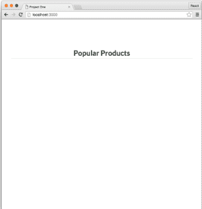

## 什么都没有？

每个主流浏览器都附带一个帮助开发人员处理 JavaScript 代码的工具包。该工具包的核心部分是控制台。将控制台视为 JavaScript 与开发人员的主要通信媒介。如果 JavaScript 在执行中遇到任何错误，它会在这个开发者控制台中提醒你。

- ℹ️ 我们的 Web 服务器 `live-server` 应该在检测到 `app.js` 发生变化时自动刷新页面。

ℹ️ 要在 Chrome 中打开控制台，请导航到 视图 > 开发者 > JavaScript 控制台。或者，在 Mac 上按 `Command + Option + J`，在 Windows/Linux 上按 `Control + Shift + J`。

打开控制台后，我们得到了一个神秘的线索：

```
Uncaught SyntaxError: Unexpected token <
```

## Babel

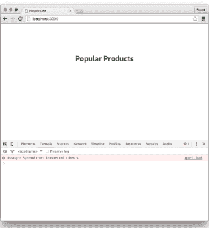

控制台中的错误

这个 `SyntaxError` 阻止了我们的代码运行。当 JavaScript 引擎在解析代码时遇到不符合语言语法的标记或标记顺序时，就会抛出 `SyntaxError`。这种错误类型表明某些代码位置不对或输入错误。

问题是什么？**我们的浏览器的 JavaScript 解析器在遇到 JSX 时绊倒了。** 解析器对 JSX 一无所知。就它而言，这个 `<` 完全用错了地方。

正如我们讨论的，JSX 是标准 JavaScript 的扩展。让我们让浏览器的 JavaScript 解释器使用这个扩展。

我们在本章开头提到，本书中的所有代码都将使用 ES6 JavaScript。然而，当今大多数浏览器并不完全支持 ES6。

Babel 是一个 JavaScript **转译器**。**Babel 将 ES6 代码转换为 ES5 代码。** 我们称这个过程为 **转译。** 因此，我们今天可以享受 ES6 的特性，同时确保我们的代码仍然只能在支持 ES5 的浏览器中运行。

Babel 的另一个便利功能是它理解 JSX。Babel 将我们的 JSX 编译成浏览器可以解释和执行的原生 ES5 JavaScript。我们只需要指示浏览器我们要使用 Babel 来编译和运行我们的 JavaScript 代码。

示例代码的 `index.html` 已经在 `index.html` 的 `head` 标签中导入了 Babel：


 <head>
  <!-- ... -->
  <script src="vendor/babel-standalone.js"></script>
  <!-- ... -->
</head>
```

我们要做的就是告诉 JavaScript 运行时，我们的代码应该由 Babel 来编译。在 index.html 中导入脚本时，我们可以通过设置 type 属性为 text/babel 来实现这一点。

打开 index.html，修改加载 ./js/app.js 的 script 标签。我们要添加两个属性：

```
<script src="./js/seed.js"></script>
<script
  type="text/babel"
  data-plugins="transform-class-properties"
  src="./js/app.js"
></script>
```

属性 `type="text/babel"` 告诉 Babel 我们希望由它来处理这个脚本的加载。属性 `data-plugins` 指定了我们在本书中使用的一个特殊 Babel 插件。我们将在本章末尾讨论这个插件。

保存 index.html 并重新加载页面。

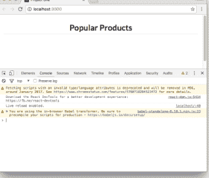

还是什么都没有。不过，控制台不再报错了。根据你使用的 Chrome 版本不同，你可能会看到一些警告（以黄色高亮显示，而非红色）。这些警告可以安全忽略。

Babel 成功将我们的 JSX 编译成了 JavaScript，浏览器能够顺利运行这些 JavaScript 代码。

那么到底发生了什么呢？我们已经定义了组件，**但还没有告诉 React 要对它做任何操作**。我们需要告诉 React 框架，我们的组件应该被插入到这个页面中。

根据你使用的 Chrome 版本不同，你可能会看到两个错误。

第一个：

```
Fetching scripts with an invalid type/language attributes is deprecated and will\
be removed in M56, around January 2017.
```

这个警告具有误导性，可以安全忽略。第二个：

```
You are using the in-browser Babel transformer. Be sure to precompile your scrip\
ts for production
```

同样，可以安全忽略。为了快速启动和运行，我们让 Babel 在浏览器中**实时**转译。我们将在本书后面探讨其他更适合生产环境的 JavaScript 转译策略。

## ReactDOM.render()

我们需要指示 React 将 `ProductList` 渲染到一个特定的 DOM 节点中。

在 `app.js` 中组件的下方添加以下代码：

**voting_app/public/js/app-1.js**

```
class ProductList extends React.Component {
  render() {
    return (
      <div className='ui unstackable items'>
        Hello, friend! I am a basic React component.
      </div>
    );
  }
}

ReactDOM.render(
  <ProductList />,
  document.getElementById('content')
);
```

`ReactDOM` 来自我们也在 `index.html` 中包含的 `react-dom` 库。我们向 `ReactDOM.render()` 方法传入两个参数。第一个参数是*要渲染什么*。第二个参数是*在哪里渲染*：

```
ReactDOM.render([what], [where]);
```

这里，对于"what"，我们传入了一个指向 React 组件 `ProductList` 的 JSX 引用。对于"where"，你可能还记得 `index.html` 包含一个 `id` 为 `content` 的 `div` 标签：

```
voting_app/public/index.html
<div id="content"></div>
```

我们将该 DOM 节点的引用作为第二个参数传给 `ReactDOM.render()`。

此时，值得注意的是，我们在不同类型的 React 元素声明之间使用了不同的大小写。我们有 HTML DOM 元素如 `<div>`，以及名为 `<ProductList />` 的 React 组件。在 React 中，原生 HTML 元素*总是*以小写字母开头，而 React 组件名*总是*以大写字母开头。

现在在 `app.js` 末尾加上 `ReactDOM.render()`，保存文件并在浏览器中刷新页面：

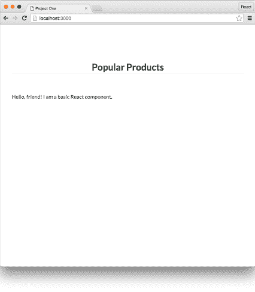

**我们的组件已渲染到页面上**

总结一下，我们使用 ES6 类和 JSX 编写了一个 React 组件。我们指定了让 Babel 将这段代码转译为 ES5。然后我们使用 `ReactDOM.render()` 将这个组件写入 DOM。

虽然算是一个成就，但我们当前的 `ProductList` 组件相当无趣。我们最终希望 `ProductList` 渲染一个产品列表。

每个产品都将是其自己的 UI 元素，一段 HTML 片段。我们可以将这些元素中的每一个表示为自己的组件 `Product`。作为其范式的核心，React 组件可以渲染其他 React 组件。我们将让 `ProductList` 渲染 `Product` 组件，每个我们想要展示在页面上的产品对应一个。每个 `Product` 组件都将是 `ProductList` 的**子组件**，而 `ProductList` 则是**父组件**。

## 构建 Product

让我们构建子组件 `Product`，它将包含一个产品列表。就像 `ProductList` 组件一样，我们将声明一个继承自 `React.Component` 的新 ES6 类。我们将定义一个方法 `render()`：

```
class Product extends React.Component {
  render() {
    return (
      <div>
        {/* ... todo ... */}
      </div>
    );
  }
}

ReactDOM.render(
  // ...
);
```

对于每个产品，我们将添加一张图片、一个标题、一段描述以及发帖作者的头像。标记如下：

voting_app/public/js/app-2.js

```
class Product extends React.Component {
  render() {
    return (
      <div className='item'>
        <div className='image'>
          
        </div>
        <div className='middle aligned content'>
          <div className='description'>
            <a>Fort Knight</a>
            <p>Authentic renaissance actors, delivered in just two weeks.</p>
          </div>
          <div className='extra'>
            <span>Submitted by:</span>
            
          </div>
        </div>
      </div>
    );
  }
}

ReactDOM.render(
```

> 上面代码块的标题引用了本书代码下载中这个示例的位置（`voting_app/public/js/app-2.js`）。这种模式在本书中将很常见。

如果你想将标记复制粘贴到你的 `app.js` 中，请参考这个文件。

同样，我们在代码中使用了一些 SemanticUI 样式。正如我们之前讨论的，这段 JSX 代码将在浏览器中被转译为常规 JavaScript。由于它在浏览器中以 JavaScript 运行，我们不能在 JSX 中使用任何 JavaScript 保留字。`class` 是一个保留字。因此，React 让我们使用属性名 `className`。稍后，当 HTML 元素到达页面时，这个属性名将被写为 `class`。

在结构上，`Product` 组件与 `ProductList` 组件相似。两者都有一个单独的 `render()` 方法，返回关于最终要显示的 HTML 结构的信息。

> 记住，JSX 组件返回的*并不是*最终渲染的 HTML，而是我们想让 React 在 DOM 中渲染的*表示*。

要使用 `Product` 组件，我们可以修改父组件 `ProductList` 的渲染输出，使其包含子组件 `Product`：

## 你的第一个 React Web 应用

```
voting_app/public/js/app-2.js

class ProductList extends React.Component {
  render() {
    return (
      <div className='ui unstackable items'>
        <Product />
      </div>
    );
  }
}
```

保存 `app.js` 并刷新 Web 浏览器。

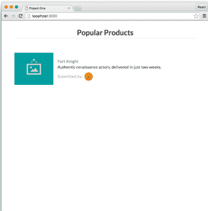

通过这次更新，我们现在有两个 React 组件在应用中渲染。`ProductList` 父组件将 `Product` 组件作为子组件渲染，嵌套在其根 `div` 元素之下。

虽然 neat，但目前子组件 `Product` 是静态的。我们硬编码了图片、名称、描述和作者详情。要以有意义的方式使用这个组件，我们希望将其改为数据驱动的，从而具有动态性。

## 让 Product 数据驱动

用数据驱动 `Product` 组件将使我们能够根据提供给它的数据动态渲染组件。让我们先熟悉一下产品数据模型。

### 数据模型

在示例代码中，我们在 `public/js` 中包含了一个名为 `seed.js` 的文件。`seed.js` 包含了一些示例产品数据（它将"播种"我们应用的数据）。`seed.js` 文件包含一个名为 `Seed.products` 的 JavaScript 对象。`Seed.products` 是一个 JavaScript 对象数组，每个对象代表一个产品：

voting_app/public/js/seed.js

```
const products = [
  {
    id: 1,
    title: 'Yellow Pail',
    description: 'On-demand sand castle construction expertise.',
    url: '#',
    votes: generateVoteCount(),
    submitterAvatarUrl: 'images/avatars/daniel.jpg',
    productImageUrl: 'images/products/image-aqua.png',
  },
```

每个产品都有一个唯一的 `id` 和一些属性，包括 `title` 和 `description`。`votes` 通过包含的函数 `generateVoteCount()` 为每个产品随机生成。

我们可以在 React 代码中使用相同的属性键。

### 使用 props

我们希望修改 `Product` 组件，使其不再使用静态的、硬编码的属性。相反，我们希望它能够接受从其父组件 `ProductList` 传递下来的数据。以这种方式设置我们的组件结构，使 `ProductList` 组件能够动态渲染任意数量的 `Product` 组件，每个组件都有自己的独特属性。数据流将如下所示：

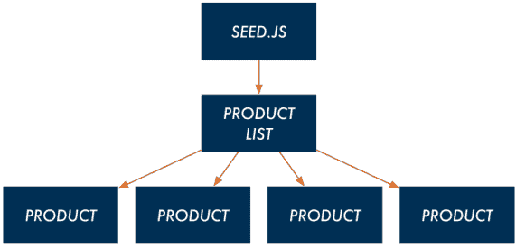


在 React 中，数据从父组件流向子组件的方式是通过 **props** 实现的。当父组件渲染子组件时，可以将子组件依赖的 props 传递给它。

让我们看看实际操作。首先，修改 `ProductList` 以向 `Product` 传递 props。`seed.js` 将帮助我们省去手动创建大量数据的麻烦。我们从 `Seed.products` 数组中取出第一个对象，并将其用作单个产品的数据：

voting_app/public/js/app-3.js

```
class ProductList extends React.Component {
  render() {
    const product = Seed.products[0];
    return (
      <div className='ui unstackable items'>
        <Product
          id={product.id}
          title={product.title}
          description={product.description}
          url={product.url}
          votes={product.votes}
          submitterAvatarUrl={product.submitterAvatarUrl}
          productImageUrl={product.productImageUrl}
        />
      </div>
    );
  }
}
```

在这里，`product` 变量被设置为一个 JavaScript 对象，描述了我们第一个产品。我们使用 `[propName]={propValue}` 的语法将产品的各个属性单独传递给 `Product` 组件。在 JSX 中赋值的语法与 HTML 和 XML 完全相同。

这里有两点值得关注的地方。首先是每个属性值周围的花括号（`{}`）：

voting_app/public/js/app-3.js

```
id={product.id}
```

在 JSX 中，花括号是一个**分隔符**，向 JSX 表明括号内的是 **JavaScript 表达式**。另一个分隔符是使用引号包裹的字符串，像这样：

```
id='1'
`

`
> JSX 属性值**必须**使用花括号或引号作为分隔符。

如果类型很重要，我们想要传递类似 Number 或 `null` 这样的值，请使用花括号。

> 如果你之前使用过 ES5 JavaScript 编程，你可能习惯使用 `var` 而不是 `const` 或 `let`。有关这些新声明方式的更多信息，请参阅**附录 B**。

现在 `ProductList` 组件正在向 `Product` 传递 props。我们的 `Product` 组件尚未使用它们，因此让我们修改该组件以使用这些 props。

在 React 中，组件可以通过 `this.props` 对象访问其所有的 props。在 Product 内部，`this.props` 对象看起来像这样：

```
{
  "id": 1,
  "title": "Yellow Pail",
  "description": "On-demand sand castle construction expertise.",
  "url": "#",
  "votes": 41,
  "submitterAvatarUrl": "images/avatars/daniel.jpg",
  "productImageUrl": "images/products/image-aqua.png"
}
`

`
让我们将硬编码的数据全部替换为使用 props。趁此机会，我们还将添加更多标记，例如描述和点赞图标：

voting_app/public/js/app-3.js

```
class Product extends React.Component {
  render() {
    return (
      <div className='item'>
        <div className='image'>
          
        </div>
        <div className='middle aligned content'>
          <div className='header'>
            <a>
              <i className='large caret up icon' />
            </a>
            {this.props.votes}
          </div>
          <div className='description'>
            <a href={this.props.url}>
              {this.props.title}
            </a>
            <p>
              {this.props.description}
            </p>
          </div>
          <div className='extra'>
            <span>Submitted by:</span>
            
          </div>
        </div>
      </div>
    );
  }
}
```

同样，在我们的 JSX 中，凡是我们插入变量的地方，都用花括号（{}）将变量括起来。注意，我们既在标签内作为文本内容插入数据，像这样：

voting_app/public/js/app-3.js

```
<div className='header'>
  <a>
    <i className='large caret up icon' />
  </a>
  {this.props.votes}
</div>
```

 `/ CODE_BLOCK_1>`>`>`>`>`>`>`>`>`>`>`>`


你的第一个 React Web 应用


我们现在总共有五个 React 组件正在运行。我们有一个父组件`ProductList`。`ProductList`包含四个子`Product`组件，每个组件对应`seed.js`中`Seed.products`数组里的一个产品对象：


**`ProductList`组件（红色）内部的 Product 组件（橙色）**

目前，我们的产品还没有按得票数排序。让我们来排序一下。我们将使用[数组的 sort 方法](link)来实现。我们将在构建`productComponents`数组之前的代码行中对产品进行排序：

> `sort()`会修改它调用的原始数组。虽然目前没问题，但在书中的其他地方我们会讨论为什么修改数组或对象可能是一种危险的模式。

在上面的`Product`标记中，我们添加了一个"up-vote"插入符号图标。如果我们点击其中一个按钮，会发现没有任何反应。我们还没有为按钮绑定事件。

尽管我们已经在浏览器中运行了一个数据驱动的 React 应用，但这个页面仍然缺少交互性。虽然 React 为我们提供了一种简单清晰的方式来组织 HTML，使我们能够基于灵活、动态的 JavaScript 对象来生成 HTML，但我们还没有真正发挥其真正的威力：创建动态界面。

本书的其余部分将深入探讨这种威力。让我们从简单的东西开始：能够为给定产品投票。

> 数组的`sort()`方法接受一个可选函数作为参数。如果省略该函数，它将只按每个项目的 Unicode 码点值对数组进行排序。这很少是程序员想要的。如果提供了函数，则元素会根据函数的返回值进行排序。

在每次迭代中，参数`a`和`b`是数组中的两个后续元素。排序取决于函数的返回值：

1. 如果返回值小于`0`，`a`应该排在前面（具有更低的索引）。
2. 如果返回值大于`0`，`b`应该排在前面。
3. 如果返回值等于`0`，保持`a`和`b`彼此的顺序不变。

## React 投票（你应用的第一个交互）

当每个`Product`组件上的投票按钮被点击时，我们期望它更新该`Product`的`votes`属性，将其增加一。

但`Product`组件无法修改其`votes`。`this.props`是不可变的。

虽然子组件可以读取其 props，但不能修改它们。子组件不拥有其 props。在我们的应用中，父组件`ProductList`拥有传递给`Product`的 props。React 倾向于*单向数据流*的理念。这意味着数据变化来自应用的"顶部"，并通过其各种组件"向下"传播。

> 子组件不拥有其 props。父组件拥有子组件的 props。

我们需要一种方式让`Product`组件通知`ProductList`其投票图标被点击了。然后我们可以让`ProductList`（产品数据的拥有者）更新该产品的投票数。更新后的数据将从`ProductList`组件向下流向`Product`组件。

> 在 JavaScript 中，如果我们将数组或对象视为**不可变的**，这意味着我们不能或不应该对其进行修改。

### 传播事件

我们知道父组件通过 props 向子组件传递数据。由于 props 是不可变的，子组件需要某种方式向父组件通信事件。然后父组件可以做出任何可能必要的数据更改。

我们也可以将*函数*作为 props 传递下去。我们可以让`ProductList`组件给每个`Product`组件一个函数，在投票按钮被点击时调用。通过 props 传递的函数是子组件与父组件通信事件的标准方式。

让我们在实践中看看这个。我们首先让投票向控制台记录一条消息。稍后，我们将让投票增加目标产品的`votes`属性。

`ProductList`中的`handleProductUpVote`函数将接受一个参数`productId`。该函数将把产品的`id`记录到控制台：

**voting_app/public/js/app-6.js**

```
class ProductList extends React.Component {
  handleProductUpVote(productId) {
    console.log(productId + ' was upvoted.');
  }

  render() {
```

接下来，我们将这个函数作为 prop 传递给每个 Product 组件。我们将 prop 命名为 onVote：

**voting_app/public/js/app-6.js**

```
const productComponents = products.map((product) => (
    <Product
      key={'product-' + product.id}
      id={product.id}
      title={product.title}
      description={product.description}
      url={product.url}
      votes={product.votes}
      submitterAvatarUrl={product.submitterAvatarUrl}
      productImageUrl={product.productImageUrl}
      onVote={this.handleProductUpVote}
    />
  ));
```

我们现在可以在 Product 内部通过 this.props.onVote 访问这个函数。

让我们在 Product 内部编写一个调用这个新 prop 函数的函数。我们将该函数命名为 handleUpVote()：

**voting_app/public/js/app-6.js**

```
// Inside `Product`
  handleUpVote() {
    this.props.onVote(this.props.id);
  }

  render() {
```

我们用产品的`id`调用 prop 函数`this.props.onVote`。现在，我们只需要在用户每次点击插入符号图标时调用这个函数。

在 React 中，我们可以使用特殊属性`onClick`来处理鼠标点击事件。

我们将在作为投票按钮的 a HTML 标签上设置`onClick`属性。我们将指示它在被点击时调用`handleUpVote()`：

```
voting_app/public/js/app-6.js

{/* Inside `render` for `Product` */}
<div className='middle aligned content'>
  <div className='header'>
    <a onClick={this.handleUpVote}>
      <i className='large caret up icon' />
    </a>
    {this.props.votes}
  </div>
```

当用户点击投票图标时，它将触发一系列函数调用：

1. 用户点击投票图标。
2. React 调用 Product 组件的`handleUpVote`。
3. `handleUpVote`调用其 prop`onVote`。这个函数存在于父组件`ProductList`内部，并向控制台记录一条消息。

还有最后一件事我们需要做才能让这个工作。在函数`handleUpVote()`内部，我们引用了`this.props`：

```
voting_app/public/js/app-6.js

handleUpVote() {
  this.props.onVote(this.props.id);
}
```

有个奇怪的地方：当在`render()`内部工作时，我们已经见证过`this`总是绑定到组件。但在我们的自定义组件方法`handleUpVote()`内部，`this`实际上是`null`。

## 绑定自定义组件方法

在 JavaScript 中，特殊变量`this`具有不同的**绑定**，取决于上下文。例如，在`render()`内部我们说`this`被"绑定"到组件。换句话说，`this` "引用"组件。

理解`this`的绑定是学习 JavaScript 编程中最棘手的部分之一。鉴于这一点，初学者 React 程序员一开始不理解所有细微差别是可以接受的。

简而言之，我们希望`handleUpVote()`内部的`this`引用组件，就像它在`render()`内部一样。但为什么`render()`内部的`this`引用组件，而`handleUpVote()`内部的`this`却不呢？

对于`render()`函数，**React 为我们自动将`this`绑定到组件**。React 指定了一组默认的特殊 API 方法。`render()`就是这样一种方法。如我们将在本章末尾看到的，`componentDidMount()`是另一个。对于每个这样的特殊 React 方法，React 都会自动将`this`变量绑定到组件。

**所以，每当我们定义自己的自定义组件方法时，我们必须手动将`this`绑定到组件自己。** 我们使用一种模式来做到这一点。

将以下`constructor()`函数添加到`Product`的顶部：

```
voting_app/public/js/app-6.js

class Product extends React.Component {
  constructor(props) {
    super(props);

    this.handleUpVote = this.handleUpVote.bind(this);
  }
```

`constructor()`是 JavaScript 类中的一个特殊函数。当通过类创建对象时，JavaScript 会调用`constructor()`。如果你以前从未使用过面向对象的语言，只需要知道 React 在初始化我们的组件时首先调用`constructor()`。React 使用组件的 props 调用`constructor()`。

因为`constructor()`在初始化我们的组件时被调用，我们将在书中将其用于几种不同类型的情况。就我们当前的目的而言，只需要知道每当我们想要将自定义组件方法绑定到 React 组件类时，我们可以使用这个模式：

```
class MyReactComponent extends React.Component {
  constructor(props) {
    super(props); // always call this first

    // custom method bindings here
    this.someFunction = this.someFunction.bind(this);
  }
}
```

如果你想了解更多关于这个模式的细节，请参阅旁注[constructor() 中的绑定](#)。


在本章末尾，我们将使用一个实验性的 JavaScript 特性来绕过这个模式。但是，在使用常规 ES7 JavaScript 时，记住这个模式很重要：

- 当我们在 React 组件类上定义自定义方法时，必须在 `constructor()` 内部执行绑定模式，以便 `this` 引用我们的组件。

保存更新后的 `app.js`，刷新浏览器，然后点击一下顶部的投票按钮，一些文本将会记录到我们的 JavaScript 控制台中：


事件正在向上传播到父组件！

`ProductList` 是产品数据的所有者。而 `Product` 现在会在用户给产品投票时通知其父组件。我们的下一个任务是更新产品的投票数。

但是，我们在哪里执行这个更新呢？目前，我们的应用还没有一个地方来存储和管理数据。`Seed` 应该被看作是一组示例种子数据，而不是我们应用的数据存储。

我们的应用目前缺少的是**状态**。

事实上，虽然我们可能想在 `Seed.products` 中更新投票数，就像这样：

```
// 这样可行吗？
Seed.products.forEach((product) => {
  if (product.id === productId) {
    product.votes = product.votes + 1;
  }
});
```

这样做是行不通的。当更新 `Seed` 时，*我们的 React 应用不会被告知这一变化*。在用户界面上，投票数增加将没有任何显示。

## 在 `constructor()` 中绑定

我们在 `constructor()` 中做的第一件事是调用 `super(props)`。我们 `Product` 类所扩展的 `React.Component` 类定义了它自己的 `constructor()`。通过调用 `super(props)`，我们先调用了*那个* `constructor()` 函数。

重要的是，**`React.Component` 定义的 `constructor()` 函数会将*我们*的 `constructor()` 内部的 `this` 绑定到组件**。因此，每当你为组件声明 `constructor()` 时，最好先调用 `super()`，这是一个好的做法。

在调用 `super()` 之后，我们在自定义组件方法上调用了 `bind()`：

```
this.handleUpVote = this.handleUpVote.bind(this);
```

函数的 `bind()` 方法允许你指定函数体内部的 `this` 变量应该设置为什么。我们在这里做的是一种常见的 JavaScript 模式。我们在*重新定义*组件方法 `handleUpVote()`，将其设置为同一个函数，但绑定到 `this`（组件）。现在，每当 `handleUpVote()` 执行时，`this` 将引用该组件，而不是 `null`。

## 使用状态

如果说 props 是不可变的，且由组件的父级所拥有，那么**状态由组件自身所有**。`this.state` 对组件而言是私有的，正如我们将看到的，它可以通过 `this.setState()` 来更新。

关键是，**当组件的状态或 props 更新时，组件将重新渲染自身**。

## 你的第一个 React Web 应用

每个 React 组件都是作为其 `this.props` 和 `this.state` 的函数来渲染的。这种渲染是确定性的。这意味着，给定一组 props 和一组 state，React 组件将始终以单一方式渲染。正如我们在本章开头提到的，这种方法为 UI 一致性提供了强有力的保证。

因为我们正在修改产品的数据（投票数），我们应该将这些数据视为有状态的。ProductList 将是该状态的所有者。然后它会将这个状态作为 props 向下传递给 Product。

目前，ProductList 在 `render()` 中直接从 Seed 读取产品数据。让我们将这些数据移到组件的状态中。

当向组件添加状态时，我们要做的第一件事是定义初始状态应该是什么样的。因为 `constructor()` 在初始化组件时被调用，所以它是定义初始状态的最佳位置。

在 React 组件中，状态是一个对象。我们的 ProductList 状态对象的形状如下：

```
// `ProductList` 状态对象的形状
{
  products: <Array>,
}
```

我们将把状态初始化为一个带有空 products 数组的对象。将此 `constructor()` 添加到 ProductList：

voting\_app/public/js/app-7.js

```
class ProductList extends React.Component {
  constructor(props) {
    super(props);

    this.state = {
      products: [],
    };
  }

  componentDidMount() {
    this.setState({ products: Seed.products });
  }
```

与我们在 Product 中调用 `constructor()` 类似，`constructor()` 中的第一行是 `super(props)` 调用。我们为 React 组件编写的任何 `constructor()` 函数中的第一行将始终是这一行。

> 严格来说，因为我们没有给 `ProductList` 提供任何 props，所以我们不需要将 `props` 参数传递给 `super()`。但这是一个好习惯，有助于避免将来出现奇怪的 bug。

接下来，状态初始化完成后，让我们修改 `ProductList` 组件的 `render` 函数，使其使用状态，而不是从 Seed 读取。我们通过 `this.state` 读取状态：

```
render() {
  const products = this.state.products.sort((a, b) => (
    b.votes - a.votes
  ));
```

`ProductList` 现在由自己的状态驱动。如果我们现在保存并刷新，所有产品都会消失。我们在 `ProductList` 中没有将产品添加到其状态的机制。

## 使用 `this.setState()` 设置状态

正如我们在这里所做的，用"空"状态初始化组件是一个好的做法。当我们在"Components & Servers"一章中与服务器异步工作时，会探讨这背后的原因。

但是，我们的组件初始化后，我们想用 Seed 中的数据为 `ProductList` 填充状态。

React 定义了一组**生命周期方法**。React 会在组件挂载到页面后调用一个生命周期方法 `componentDidMount()`。我们将在这个方法中为 `ProductList` 填充状态。

> 我们将在"Advanced Component Configuration"一章中探讨其余的生命周期方法。

知道了这一点，我们可能会想在 `componentDidMount()` 中将状态设置为 `Seed.products`，就像这样：

```
class ProductList extends React.Component {
  // ...
  // 这样有效吗？
  componentDidMount() {
    this.state = Seed.products;
  }
  // ...
}
```

然而，这是无效的。我们唯一能以这种方式修改状态的时间是在 `constructor()` 中。**对于初始状态之后的所有状态修改，React 为组件提供了 `this.setState()` 方法**。除其他外，这个方法会触发 React 组件重新渲染，这在状态变化后是至关重要的。

> 永远不要在 `this.setState()` 之外修改状态。这个函数围绕着状态修改有重要的钩子，绕过它们是不好的。

我们将在整本书中详细讨论状态管理。

现在将 `componentDidMount()` 添加到 `ProductList`。我们将使用 `setState()` 来填充组件的状态：

voting\_app/public/js/app-8.js

```
class ProductList extends React.Component {
  constructor(props) {
    super(props);

    this.state = {
      products: [],
    };
  }

  componentDidMount() {
    this.setState({ products: Seed.products });
  }
```

组件将以一个空状态 `this.state.products` 数组挂载。挂载后，我们用 Seed 中的数据填充状态。组件将重新渲染，我们的产品将会显示出来。这发生在一个用户察觉不到的速度。

如果我们现在保存并刷新，我们会看到产品又回来了。

## 更新状态和不可变性

现在 ProductList 正在管理状态中的产品，我们准备根据用户输入对这些数据进行修改。具体来说，当用户为某个产品投票时，我们想要增加该产品上的 votes 属性。

我们刚刚讨论过，我们只能使用 this.setState() 进行状态修改。所以，虽然组件可以更新自己的状态，但我们应该将 this.state 对象视为不可变的。

正如前面提到的，如果我们将数组或对象视为不可变的，我们就永远不会修改它。例如，假设我们在 state 中有一个数字数组：

```
this.setState({ nums: [ 1, 2, 3 ]});
```

如果我们想更新状态中的 nums 数组以包含一个 4，我们可能会想使用 push()，就像这样：

```
this.setState({ nums: this.state.nums.push(4) });
```

从表面上看，我们似乎已经将 this.state 视为不可变的。然而，push() 方法会修改原始数组：

```
console.log(this.state.nums);
// [ 1, 2, 3 ]
this.state.nums.push(4);
console.log(this.state.nums);
// [ 1, 2, 3, 4] <-- 糟糕！
```

尽管我们在将 4 推入数组后立即调用了 this.setState()，我们仍然在 setState() 之外修改了 this.state，这是不好的做法。

> 这是不好的做法的部分原因是 setState() 实际上是异步的。React 何时更新状态并重新渲染我们的组件是无法保证的。我们在"Advanced Component Configuration"一章中会提到这一点。

所以，虽然我们最终调用了 this.setState()，但我们在那之前无意中修改了状态。下面这种方法也行不通：


```
 const nextNums = this.state.nums;
nextNums.push(4);
console.log(nextNums);
// [ 1, 2, 3, 4]
console.log(this.state.nums);
// [ 1, 2, 3, 4] <-- Nope!
```

我们的新变量 nextNums 与 this.state.nums 在内存中引用的是同一个数组：

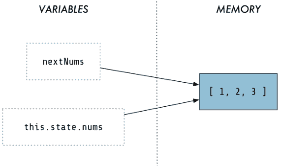

两个变量都引用内存中的同一个数组

因此，当我们使用 push() 修改数组时，我们实际上修改的是 this.state.nums 所指向的同一个数组。

相反，我们可以使用数组的 concat() 方法。concat() 会创建一个新数组，其中包含调用它的数组的元素，后跟作为参数传入的元素。

使用 concat()，我们可以避免修改状态：

```
console.log(this.state.nums);
// [ 1, 2, 3 ]
const nextNums = this.state.nums.concat(4);
console.log(nextNums);
// [ 1, 2, 3, 4]
console.log(this.state.nums);
// [ 1, 2, 3 ] <-- 未被修改！
```

我们在整本书中都会涉及不可变性的概念。虽然你可能在很多情况下通过修改状态也能"蒙混过关"，但更好的做法是将状态视为不可变的。

> 将状态对象视为不可变的。理解哪些数组和对象的方法会修改它们被调用的对象是很重要的。

如果将一个数组作为参数传给 concat()，它的元素会被追加到新数组中。例如：

```
> [ 1, 2, 3 ].concat([ 4, 5 ]);
=> [ 1, 2, 3, 4, 5 ]
```

既然我们知道要将状态视为不可变的，那么下面这种处理投票的方式就会有问题：

```
// 在 `ProductList` 内部
// 无效
handleProductUpVote(productId) {
  const products = this.state.products;
  products.forEach((product) => {
    if (product.id === productId) {
      product.votes = product.votes + 1;
    }
  });
  this.setState({
    products: products,
  });
}
```

当我们将 products 初始化为 this.state.products 时，product 与 this.state.products 在内存中引用的是同一个数组：

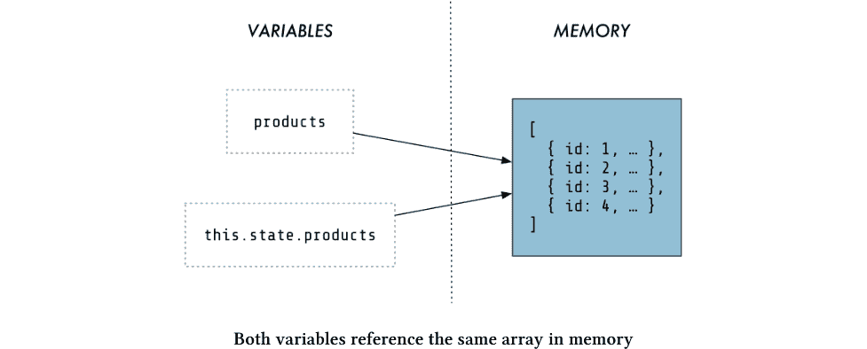

因此，当我们在 `forEach()` 中通过增加投票数来修改 product 对象时，*我们实际上是在修改状态中的原始 product 对象*。

相反，我们应该创建一个 *新的* 产品数组。而且，如果我们修改其中一个 product 对象，我们应该修改的是该对象的 *克隆*，而不是原始对象。

让我们看看将状态视为不可变的 `handleProductUpVote()` 实现是什么样的。我们先看完整的代码，然后再逐一拆解：

```
// 在 `ProductList` 内部
handleProductUpVote(productId) {
  const nextProducts = this.state.products.map((product) => {
    if (product.id === productId) {
      return Object.assign({}, product, {
        votes: product.votes + 1,
      });
    } else {
      return product;
    }
  });
  this.setState({
    products: nextProducts,
  });
}
```

首先，我们使用 `map()` 遍历 products 数组。重要的是，`map()` 返回一个 *新的* 数组，而不是修改 `this.state.products` 数组。

接下来，我们检查当前产品是否与 `productId` 匹配。如果是，我们创建一个 *新的* 对象，复制了一首休闲歌曲，在沙发上放松。几个小时后，我站起来，感到精力充沛，准备继续工作。这是让我感到非常满足的几个时刻之一。

等等，我需要纠正一下。我应该说：

接下来，我们检查当前产品是否与 `productId` 匹配。如果是，我们创建一个 *新的* 对象ulsan，复制原始 product 对象的属性。然后我们在新的 product 对象上 *覆盖* `votes` 属性。我们将其设置为增加后的投票数。我们使用 Object 的 `assign()` 方法来实现这一点：

```
    if (product.id === productId) {
      return Object.assign({}, product, {
        votes: product.votes + 1,
      });
    }
```

> 我们经常使用 `Object.assign()` 来避免修改对象。有关该方法的更多详细信息，请查看附录 B。

如果当前产品不是由 `productId` 指定的那个，我们原样返回它：

最后，我们使用 `setState()` 更新状态。

`map()` 正在创建一个新数组。所以你可能会问：为什么不能直接修改 product 对象呢？就像这样：

```
if (product.id === productId) {
  product.votes = product.votes + 1;
}
```

虽然我们创建了一个新数组，**但这里的变量 product 仍然引用的是状态中原始数组上的 product 对象**。因此，如果我们对它进行修改，我们就会修改状态中的对象。所以我们使用 `Object.assign()` 将原始对象克隆到一个新对象中，然后修改那个新对象上的 `votes` 属性。

我们的投票更新机制已经就位。还有最后一件事要做：我们的自定义组件方法 `handleProductUpVote()` 现在引用了 `this`。我们需要添加一个 `bind()` 调用，就像我们在 `Product` 中对 `handleUpVote()` 所做的那样：

```
class ProductList extends React.Component {
  constructor(props) {
    super(props);

    this.state = {
      products: [],
    };

    this.handleProductUpVote = this.handleProductUpVote.bind(this);
  }
```

现在 `handleProductUpVote()` 中的 `this` 引用的是我们的组件。

我们的应用程序终于应该能对用户交互做出响应了。保存 `app.js`，刷新浏览器，然后祈祷吧：


终于，投票计数器正常工作了！尝试多次为某个产品投票，注意它是如何立即跳到投票数较低的产品之上的。

## 使用 Babel 插件 `transform-class-properties` 进行重构

在这最后一节中，我们将探讨使用实验性 JavaScript 特性对我们的类组件进行可能的重构。出于你很快会看到的原因，这一特性在 React 开发者中很受欢迎。由于社区仍在采用这一特性，我们在整本书中都会向你展示这两种类组件风格。

我们能够使用 Babel 的 **插件和预设** 库来访问这一特性。

## Babel 插件和预设

我们在本项目中一直使用 Babel，让我们能够编写在现代主流浏览器中运行的现代 JavaScript。具体来说，我们的代码一直使用 Babel 将 ES6 语法和 JSX 转换为原生 ES5 JavaScript。

将 Babel 集成到你的项目中有几种方式。我们一直在使用 `babel-standalone`，它让我们能够快速设置 Babel 以直接在浏览器中使用。

`babel-standalone` 默认使用两个预设。在 Babel 中，预设是一组用于支持特定语言特性的插件。Babel 默认使用的两个预设是：

- es2015：添加对 ES2015（或 ES6）JavaScript 的支持
- react：添加对 JSX 的支持

> 记住：ES2015 只是 ES6 的另一个名称。我们让 Babel 在此项目中使用默认的 es2015 预设，因为我们不需要也不使用 ES7 的两个新特性。

JavaScript 是一门不断发展的语言。按照目前的速度，新的语法将以每年一次的速度被批准采用。

由于 JavaScript 会继续演进，像 Babel 这样的工具将会继续存在。开发者希望利用最新的语言特性。但浏览器需要时间来更新它们的 JavaScript 引擎。而且公众需要更多时间才能将浏览器升级到最新版本。Babel 弥合了这一差距。它使代码库能够随着 JavaScript 一起发展，同时不抛弃旧版浏览器。

除了 ES7 之外，提议的 JavaScript 特性可能存在不同的阶段。一个特性可能是实验性提案，即社区仍在完善细节的阶段（"第 1 阶段"）。实验性提案随时可能被弃用或修改。或者一个特性可能已经被"批准"，这意味着它将被包含在 JavaScript 的下一个版本中（"第 4 阶段"）。

我们可以用预设和插件来自定义 Babel，以利用这些即将推出或实验性的特性。

在本书中，我们通常避免使用实验性特性。然而，有一个特性看起来即将被批准，我们为此破例：属性初始化器。

> 我们避免使用实验性特性，是因为我们不想教授可能被修改或弃用的特性。对于你自己的项目，你和你的团队可以决定想在使用的 JavaScript 特性上有多"严格"。

如果你想了解更多关于各种 Babel 预设和插件的信息，请查看官方文档。

## 属性初始化器

属性初始化器在提案 "ES 类字段与静态属性" 中有详细说明。虽然这是一个尚未被批准的实验性特性，但属性初始化器提供了一种引人注目的语法，

```
```


极大地简化了 React 的类组件。这一特性与 React 配合得非常好，以至于 Facebook 团队[已经撰文介绍过他们在内部的使用](https://babeljs.io/blog/2015/06/07/react-on-es6-plus)^32^。

属性初始化器在 Babel 插件 `transform-class-properties` 中可用。回想一下，我们在 `index.html` 中为 `app.js` 指定了这个插件：

```
<script
  type="text/babel"
  data-plugins="transform-class-properties"
  src="./js/app.js"
></script>
```

因此，我们已经可以在代码中使用这个特性了。理解这个特性能给我们带来什么的最佳方式就是实际看看它的作用。

## 重构 Product

在 `Product` 中，我们定义了自定义组件方法 `handleUpVote`。正如我们之前讨论过的，由于 `handleUpVote` 不是标准 React 组件 API 的一部分，React 不会将方法内的 `this` 绑定到我们的组件。因此我们不得不在构造函数中执行手动绑定的技巧：

```
voting_app/public/js/app-9.js

class Product extends React.Component {
  constructor(props) {
    super(props);

    this.handleUpVote = this.handleUpVote.bind(this);
  }

  handleUpVote() {
    this.props.onVote(this.props.id);
  }

  render() {
```

借助 `transform-class-properties` 插件，我们可以将 `handleUpVote` 写成一个**箭头函数**。这将确保函数内的 `this` 按预期绑定到组件：

**voting_app/public/js/app-complete.js**

```
class Product extends React.Component {
  handleUpVote = () => (
    this.props.onVote(this.props.id)
  );

  render() {
```

使用这个特性，我们可以去掉 `constructor()`。不再需要手动绑定的调用。

需要注意的是，属于标准 React API 的方法，如 `render()`，仍保持为类方法。如果我们编写一个希望 `this` 绑定到组件的自定义组件方法，我们就将其写成箭头函数。

## 重构 `ProductList`

我们可以对 `ProductList` 中的 `handleProductUpVote` 进行同样的处理。此外，属性初始化器还提供了一种定义组件初始状态的替代方式。

以前，我们在 `ProductList` 中使用 `constructor()` 来同时绑定 `handleProductUpVote` 到组件，并定义组件的初始状态：

```
class ProductList extends React.Component {
  constructor(props) {
    super(props);

    this.state = {
      products: [],
    };

    this.handleProductUpVote = this.handleProductUpVote.bind(this);
  }
```

有了属性初始化器，我们不再需要 `constructor`。相反，我们可以这样定义初始状态：

voting_app/public/js/app-complete.js

```
class ProductList extends React.Component {
  state = {
    products: [],
  };
};
```

而且，如果我们将 `handleProductUpVote` 定义为箭头函数，`this` 就会按预期绑定到组件：

voting_app/public/js/app-complete.js

```
handleProductUpVote = (productId) => {
  const nextProducts = this.state.products.map((product) => {
    if (product.id === productId) {
      return Object.assign({}, product, {
        votes: product.votes + 1,
      });
    } else {
      return product;
    }
  });
  this.setState({
    products: nextProducts,
  });
}
```

总之，我们可以使用属性初始化器对我们的 React 组件进行两项重构：

1. 我们可以对自定义组件方法使用箭头函数（从而避免绑定 `this`）
2. 我们可以在 `constructor()` 之外定义初始状态

我们在本书中向你介绍这两种方法，因为它们都被广泛使用。每个项目在使用 `transform-class-properties` 方面会保持一致。你可以在自己的项目中继续使用原生 ES6。然而，`transform-class-properties` 带来的简洁性往往让人难以抗拒。

> 使用带有额外预设或插件的 ES6/ES7 有时被社区称为 "ES6+/ES7+"。

# 恭喜！

我们刚刚编写了第一个 React 应用。还有许多强大的功能尚未涉及，但它们都建立在刚才涵盖的核心基础之上：

1. 我们将 React 应用思考并组织为组件
2. 在 `render` 方法中使用 JSX
3. 数据通过 props 从父组件流向子组件
4. 事件通过函数从子组件流向父组件
5. 利用 React 生命周期方法
6. 有状态组件以及 state 与 props 的区别
7. 如何在将 state 视为不可变的情况下操作它

继续前进！

# 组件

## 时间记录应用

在上一章中，我们描述了 React 如何将应用组织为组件，以及数据如何在父子组件之间流动。我们还讨论了核心概念，如如何管理**状态**，以及如何使用**props**在组件之间传递数据。

在本章中，我们构建一个更复杂的应用。我们研究一种可用于从头构建 React 应用的模式，然后将这些步骤付诸实践，构建一个用于管理计时器的界面。

在这个时间追踪应用中，用户可以添加、删除和修改各种计时器。每个计时器对应于用户想要为其计时的不同任务：

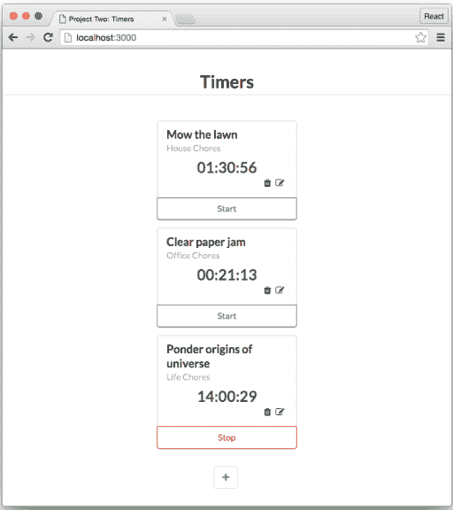

这个应用将比上一章构建的应用具有更多的交互功能。这将给我们带来一些有趣的挑战，从而加深我们对 React 核心概念的熟悉程度。

## 开始

与所有章节一样，在开始之前，请确保你已下载本书的示例代码并准备就绪。

## 预览应用

让我们先运行一个已完成实现的应用来体验一下。

在终端中，`cd` 进入 `time_tracking_app` 目录：

```
$ cd time_tracking_app
```

使用 npm 安装所有依赖：

```
$ npm install
```

然后启动服务器：

```
$ npm start
```

现在你可以在浏览器中查看应用。打开浏览器并输入 URL `http://localhost:3000`。玩几分钟，熟悉所有功能。刷新页面，注意你的更改已被持久化。

> 注意，这个应用使用的 web 服务器与投票应用中的不同。该应用不会自动在浏览器中启动，也不会在你做出更改时自动刷新。

## 准备应用

在终端中运行 `ls` 查看项目布局：

```
$ ls
README.md
data.json
nightwatch.json
node_modules/
package.json
public/
semantic.json
server.js
tests/
```

与上一个项目相比，有一些组织上的变化。

首先，注意这个项目中现在有一个 `server.js`。在上一章中，我们使用了一个预构建的 Node 包（称为 `live-server`）来提供我们的资源。

这次我们有一个自定义构建的服务器，它不仅提供我们的资源，还添加了一个持久层。我们将在下一章详细介绍服务器。

当你访问网站时，**资源**是你的浏览器下载并用于显示页面的文件。`index.html` 被传送到浏览器，其 head 标签内指定了浏览器需要从服务器下载哪些附加文件。

在上一个项目中，我们的资源是 `index.html` 以及我们的样式表和图片。

在这个项目中，`public/` 下的所有内容都是资源。

在投票应用中，我们从一个 JavaScript 变量中加载了应用的所有初始数据，该变量加载在文件 `seed.js` 中。

这次，我们最终将把它存储在文本文件 `data.json` 中。这使得行为更接近数据库。通过使用 JSON 文件，我们可以对数据进行编辑，即使应用关闭，这些编辑也会被持久化。

JSON 代表 JavaScript Object Notation（JavaScript 对象表示法）。JSON 使我们能够序列化 JavaScript 对象，并从文本文件中读取/写入它。

如果你不熟悉 JSON，请查看 `data.json`。相当直观，对吧？JavaScript 有一个内置机制来解析此文件的内容，并用其数据初始化 JavaScript 对象。

窥视 `public` 内部：

## Components

```
$ cd public
$ ls
```

这里的结构与上一个项目相同：

```
favicon.ico
index.html
js/
semantic/
style.css
vendor/
```

同样，`index.html` 是应用的核心。这是我们包含所有 JavaScript 和 CSS 文件的地方，也是我们指定最终将 React 应用挂载到的 DOM 节点的地方。

我们在这里仍然使用 SemanticUI 进行样式设计。所有 SemanticUI 的资源都在 `semantic/` 下。

我们所有的 JavaScript 文件都在 `js/` 内：

```
$ ls js/
app-1.js
app-2.js
app-3.js
app-4.js
app-5.js
app-6.js
app-7.js
app-8.js
app-9.js
app-complete.js
app.js
client.js
helpers.js
```

我们将在 `app.js` 中构建应用。我们在下一章中完成的版本在 `app-complete.js` 内。我们沿途采取的每个步骤都包含在这里：`app-1.js`、`app-2.js` 等等。与上一章一样，书中的代码示例都标注了你可以找到该示例的文件。

此外，我们将在这个项目中使用几个额外的 JavaScript 文件。正如我们将看到的，`client.js` 包含我们将在下一章中用于与服务器交互的函数。`helpers.js` 包含我们的组件将使用的一些辅助函数。

像往常一样，我们的第一步是确保 `app-complete.js` 不再在 `index.html` 中加载。我们将改为加载空文件 `app.js`。

打开 `index.html`：


 # time_tracking_app/public/index.html

```
<!DOCTYPE html>
<html>

  <head>
    <meta charset="utf-8">
    <title>Project Two: Timers</title>
    <link rel="stylesheet" href="./semantic/dist/semantic.css" />
    <link rel="stylesheet" href="style.css" />
    <script src="vendor/babel-standalone.js"></script>
    <script src="vendor/react.js"></script>
    <script src="vendor/react-dom.js"></script>
    <script src="vendor/uuid.js"></script>
    <script src="vendor/fetch.js"></script>
  </head>

  <body>
    <div id="main" class="main ui">
      <h1 class="ui dividing centered header">Timers</h1>
      <div id="content"></div>
    </div>
    <script type="text/babel" src="./js/client.js"></script>
    <script type="text/babel" src="./js/helpers.js"></script>
    <script
      type="text/babel"
      data-plugins="transform-class-properties"
      src="./js/app.js"
    ></script>
    <!-- Delete the script tag below to get started. -->
    <script
      type="text/babel"
      data-plugins="transform-class-properties"
      src="./js/app-complete.js"
    ></script>
  </body>

</html>
```

总的来说，这个文件与我们之前在投票应用中使用的非常相似。我们在 `head` 标签内加载依赖项（资源），在 `body` 内有一些元素。这个 `div` 是我们最终挂载 React 应用的地方：

```
<div id="content"></div>
```

而这个 `script` 标签则是我们指示浏览器将 `app.js` 加载到页面中的地方：

# time_tracking_app/public/index.html

```
<script
  type="text/babel"
  data-plugins="transform-class-properties"
  src="./js/app.js"
></script>
```

在本章中，我们再次使用了 Babel 插件 `transform-class-properties`。我们在[上一章](link)的末尾讨论过这个插件。

按照注释所说，删除加载 `app-complete.js` 的 `script` 标签：

```
<script
  type="text/babel"
  data-plugins="transform-class-properties"
  src="./js/app.js"
></script>
<!-- Delete the script tag below to get started. -->
<script
  type="text/babel"
  data-plugins="transform-class-properties"
  src="./js/app-complete.js"
></script>
```

保存 `index.html`。如果现在刷新页面，你会看到应用已经消失了。

## 将应用拆分为组件

与上一个项目一样，我们首先将应用拆分为各个组件。同样，视觉组件通常与其对应的 React 组件紧密映射。让我们来看看应用的界面：

# 组件

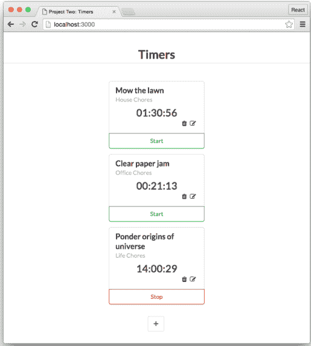

在上一个项目中，我们有 `ProductList` 和 `Product` 组件。前者包含后者的实例。在这里，我们看到了相同的模式，这次是 `TimerList` 和 `Timer` 组件：

# 组件

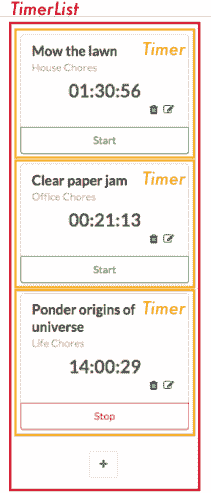

然而，有一个细微的差别：这个计时器列表底部有一个"+"图标。正如我们所见，我们可以使用这个按钮来添加新的计时器。所以，实际上，`TimerList` 组件不仅仅是计时器列表，它还包含一个用于创建新计时器的小部件。

将组件视为函数或对象来思考。[单一职责原则](https://en.wikipedia.org/wiki/Single_responsibility_principle)同样适用。理想情况下，一个组件**只应负责一个功能**。因此，这里恰当的做法是将 `TimerList` 收缩回仅列出计时器的职责，并将其嵌套在一个父组件下。我们将该父组件命名为 `TimersDashboard`。`TimersDashboard` 将包含 `TimerList` 和"+"/创建表单小部件作为子组件：

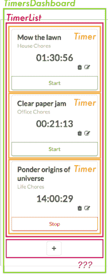

这种职责分离不仅使组件保持简单，而且通常还能提高它们的可重用性。将来，我们可以在应用中任何只想显示计时器列表的地方直接使用 `TimerList` 组件。该组件不再承担创建计时器的职责，而这可能是我们仅在当前这个仪表板视图中才想要的行为。

> 如何命名组件确实取决于你，但像我们这里一样，围绕语言制定一些一致的规则将大大提高代码的清晰度。

在这种情况下，开发人员可以快速推断出，任何以 `List` 结尾的组件都只是渲染子项列表，仅此而已。

这个"+"/创建表单小部件很有趣，因为它有两种不同的表现形式。点击"+"按钮时，小部件会变成表单；当表单关闭时，小部件又会变回"+"按钮。

我们可以采取两种方法。第一种是让父组件 `TimersDashboard` 根据某些状态数据来决定渲染"+"组件还是表单组件。它可以在两个子组件之间切换。然而，这增加了 `TimersDashboard` 的职责。另一种选择是创建一个新的子组件，让它拥有确定显示"+"按钮还是创建计时器表单的单一职责。我们将它命名为 `ToggleableTimerForm`。作为子组件，它可以渲染 `TimerForm` 组件或"+"按钮的 HTML 标记。

至此，我们已经划分出了四个组件：

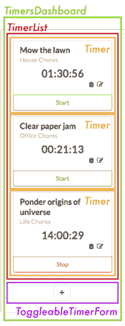

既然我们现在已经对识别负担过重的组件有了敏锐的洞察力，另一个候选组件应该会吸引我们的注意：

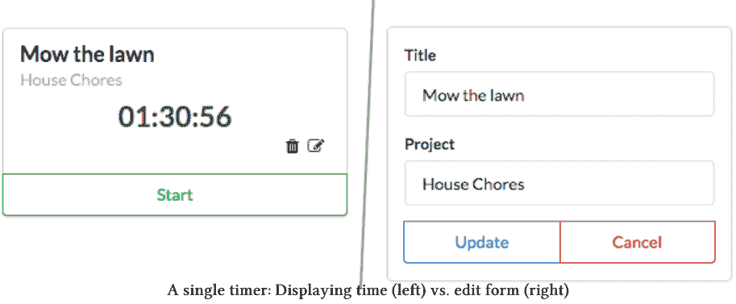

计时器本身有相当多的功能。它可以变成编辑表单、删除自己，以及启动和停止自己。我们需要将其拆分吗？如果需要，又该如何拆分？

显示计时器和编辑计时器确实是两个不同的 UI 元素。它们应该是两个不同的 React 组件。与 `ToggleableTimerForm` 类似，我们需要某种容器组件，根据计时器是否正在被编辑来渲染计时器的显示界面或其编辑表单。

我们将这个组件命名为 `EditableTimer`。`EditableTimer` 的子组件将是 `Timer` 组件或编辑表单组件。用于创建和编辑计时器的表单非常相似，因此我们可以假设在这两种场景中都可以使用 `TimerForm` 组件：

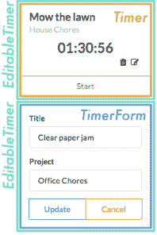

至于计时器的其他功能，如启动和停止按钮，目前在这一点上很难确定它们是否应该成为独立的组件。我们相信在编写了一些代码之后，答案会更加清晰。

回到组件树的上方，我们可以看到 `TimerList` 这个名称并不准确。它实际上是 `EditableTimerList`。其他方面看起来都没问题。

因此，我们得到了最终的组件层次结构，不过计时器组件的最终状态还有一些不明确之处：

# 组件

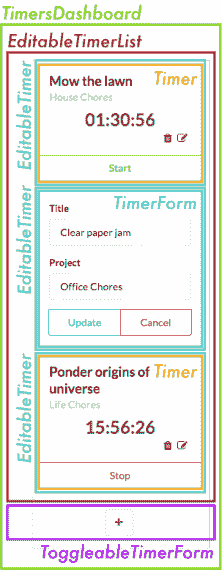

- `TimersDashboard`：父容器
  - `EditableTimerList`：显示计时器容器的列表
    - `EditableTimer`：显示计时器或计时器的编辑表单
      - `Timer`：显示给定的计时器
      - `TimerForm`：显示给定的计时器编辑表单
  - `ToggleableTimerForm`：显示用于创建新计时器的表单
    - `TimerForm`（未显示）：显示新计时器的创建表单

以层次树的形式表示：

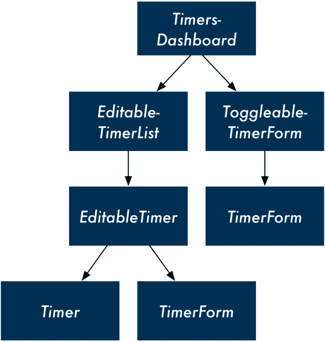

在我们之前的应用中，`ProductList` 不仅负责渲染组件，还承担着处理投票和与 store 通信的职责。虽然这对那个应用来说行之有效，但你可以想象，随着代码库的不断扩展，终有一天我们会想要让 `ProductList` 摆脱这一职责。

例如，假设我们给 `ProductList` 添加了一个"按投票数排序"的功能。如果我们希望某些页面可以排序（分类页面），但其他页面保持静态（前 10 名）呢？我们就会想要将排序职责"提升"到父组件，让 `ProductList` 成为它应该成为的、简单的列表渲染器。

这个新的父组件随后可以包含排序小部件，然后将排序后的产品传递给 `ProductList` 组件。

## 从零开始构建 React 应用的步骤

现在我们对组件的组成有了清晰的理解，接下来就可以构建应用的静态版本了。最终，我们的顶级组件将与服务器进行通信。**The**

服务器将成为**状态的初始来源**，React 将根据服务器提供的数据进行渲染。我们的应用也会向服务器发送更新，例如当计时器启动时：

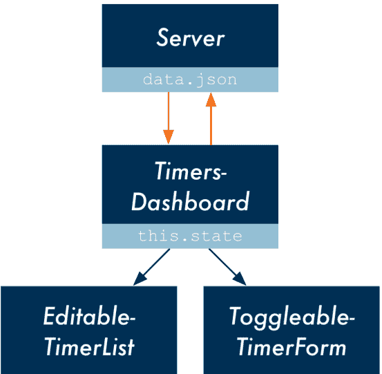

然而，如果我们从静态组件开始，就像上一章那样，事情会简化很多。我们的 React 组件除了渲染 HTML 之外，几乎不做任何其他事情。点击按钮不会产生任何行为，因为我们没有连接任何交互性。这将使我们能够搭建应用的框架，清楚地了解组件树的组织方式。

接下来，我们可以确定应用应该具有什么**状态**，以及它应该存在于哪个组件中。我们将从直接硬编码状态到组件中开始，而不是从服务器加载。

到那时，我们就有了**从父组件到子组件**的数据流。然后我们可以添加反向数据流，将事件**从子组件传播到父组件**。

最后，我们将修改顶层组件，使其与服务器通信。

事实上，这遵循了一个从头开始开发 React 应用的便捷框架：

1. 将应用分解为组件
2. 构建应用的静态版本
3. 确定哪些部分应该是有状态的
4. 确定每块状态应该存在于哪个组件中
5. 硬编码初始状态
6. 添加反向数据流
7. 添加服务器通信

我们在上一个项目中遵循了这个模式：

### 1. 将应用分解为组件

我们查看了期望的 UI，并确定我们需要 `ProductList` 和 `Product` 组件。

### 2. 构建应用的静态版本

我们的组件最初没有使用 state。相反，我们让 `ProductList` 向 `Product` 传递静态 props。

### 3. 确定哪些部分应该是有状态的

为了使我们的应用程序具有交互性，我们必须能够修改每个产品的投票属性。每个产品都必须是可变的，因此是有状态的。

### 4. 确定每块状态应该存在于哪个组件中

`ProductList` 使用 React 组件类方法管理投票状态。

### 5. 硬编码初始状态

当我们重写 `ProductList` 以使用 `this.state` 时，我们从 `Seed.products` 中播种了它。

### 6. 添加反向数据流

我们在 `ProductList` 中定义了 `handleUpVote` 函数，并通过 props 将其传递下去，以便每个 `Product` 都可以通知 `ProductList` 向上投票事件。

### 7. 添加服务器通信

我们没有在上一个应用中添加服务器组件，但我们将在这个应用中添加。

如果这个过程中的步骤现在还不完全清楚，别担心。本章的目的是让你熟悉这个程序。

我们已经涵盖了步骤（1），并且对所有组件都有了很好的理解，除了 `Timer` 组件存在一些不确定性。步骤（2）是构建应用的静态版本。与上一个项目一样，这相当于定义 React 组件、它们的层次结构以及它们的 HTML 表示。我们现在完全避免使用 state。

## 步骤 2：构建应用的静态版本

#### `TimersDashboard`

让我们从 `TimersDashboard` 组件开始。同样，本章所有的 React 代码都将位于文件 `public/app.js` 中。

我们将从定义一个熟悉的函数 `render()` 开始：

```
class TimersDashboard extends React.Component {
  render() {
    return (
      <div className='ui three column centered grid'>
        <div className='column'>
          <EditableTimerList />
          <ToggleableTimerForm
            isOpen={true}
          />
        </div>
      </div>
    );
  }
}
```

此组件渲染其两个子组件，它们嵌套在 `div` 标签下。TimersDashboard 向 `ToggleableTimerForm` 传递一个 prop：`isOpen`。子组件使用此属性来确定是渲染一个 "+" 还是 `TimerForm`。当 `ToggleableTimerForm` 处于“打开”状态时，表单正在显示。

与上一章一样，不要担心 `div` 标签上的 `className` 属性。这最终将定义 HTML `div` 元素上的 `class`，纯粹是用于样式设置。

在此示例中，像 `ui three column centered grid` 这样的类都来自 CSS 框架 [Semantic UI](http://semantic-ui.com)。该框架包含在 `index.html` 的 head 中。

接下来我们将定义 `EditableTimerList`。我们将让它渲染两个 `EditableTimer` 组件。一个最终将渲染计时器的界面。另一个将渲染计时器的编辑表单：

```
class EditableTimerList extends React.Component {
  render() {
    return (
      <div id='timers'>
        <EditableTimer
          title='Learn React'
          project='Web Domination'
          elapsed='8986300'
          runningSince={null}
          editFormOpen={false}
        />
        <EditableTimer
          title='Learn extreme ironing'
          project='World Domination'
          elapsed='3890985'
          runningSince={null}
          editFormOpen={true}
        />
      </div>
    );
  }
}
```

我们向每个子组件传递了五个 props。两个 EditableTimer 组件之间的关键区别在于为 `editFormOpen` 设置的值。我们将使用这个布尔值来指示 EditableTimer 渲染哪个子组件。

> prop `runningSince` 的目的将在应用开发的后续部分介绍。

#### `EditableTimer`

`EditableTimer` 根据 prop `editFormOpen` 返回 `TimerForm` 或 `Timer`：

time_tracking_app/public/js/app-1.js

```
class EditableTimer extends React.Component {
  render() {
    if (this.props.editFormOpen) {
      return (
        <TimerForm
          title={this.props.title}
          project={this.props.project}
        />
      );
    } else {
      return (
        <Timer
          title={this.props.title}
          project={this.props.project}
```

注意 `title` 和 `project` 是作为 props 传递给 `TimerForm` 的。这将使组件能够使用计时器的当前值填充这些字段。

#### `TimerForm`

我们将构建一个 HTML 表单，其中包含两个输入字段。第一个输入字段用于标题，第二个用于项目。底部还有一对按钮：

time_tracking_app/public/js/app-1.js

```
class TimerForm extends React.Component {
  render() {
    const submitText = this.props.title ? 'Update' : 'Create';
    return (
      <div className='ui centered card'>
        <div className='content'>
          <div className='ui form'>
            <div className='field'>
              <label>Title</label>
              <input type='text' defaultValue={this.props.title} />
            </div>
            <div className='field'>
              <label>Project</label>
              <input type=' slaughter' defaultValue={this.props.project} />
            </div>
            <div className='ui two bottom attached buttons'>
              <button className='ui basic blue button'>
                {submitText}
              </button>
              <button className='ui basic red button'>
                Cancel
              </button>
            </div>
          </div>
        </div>
      </div>
    );
  }
}
```

```
</div>
</div>
);
}
}
```

查看 `input` 标签。我们指定它们的类型为文本，然后使用 React 属性 `defaultValue`。当表单用于编辑时，如这里所示，它会将字段设置为计时器所需的当前值。

稍后，我们将在 `ToggleableTimerForm` 中再次使用 `TimerForm` 来*创建*计时器。`ToggleableTimerForm` 不会向 `TimerForm` 传递任何 props。因此 `this.props.title` 和 `this.props.project` 将返回 undefined，字段将留空。

在 `render()` 的开头，`return` 语句之前，我们定义了一个变量 `submitText`。这个变量使用 `this.props.title` 的存在来确定表单底部的提交按钮应该显示什么文本。如果存在 `title`，我们知道我们正在编辑一个现有的计时器，所以它显示“更新”。否则，它显示“创建”。

有了所有这些逻辑，`TimerForm` 就准备好渲染一个用于创建新计时器或编辑现有计时器的表单了。

我们使用了一个包含**三元运算符**的表达式来设置 `submitText` 的值。语法是：

```
condition ? expression1 : expression2
```

如果 `condition` 为真，则运算符返回 `expression1` 的值。否则，它返回 `expression2` 的值。在我们的示例中，变量 `submitText` 被设置为返回的表达式。

#### `ToggleableTimerForm`

接下来让我们把注意力转向 `ToggleableTimerForm`。回想一下，它是 `TimerForm` 的一个包装器组件。它将显示一个 "+" 或一个 `TimerForm`。目前，它接受来自其父组件的一个 prop `isOpen`，该属性指示其行为：


 ```
class ToggleableTimerForm extends React.Component {
  render() {
    if (this.props.isOpen) {
      return (
        <TimerForm />
      );
    } else {
      return (
        <div className='ui basic content center aligned segment'>
          <button className='ui basic button icon'>
            <i className='plus icon' />
          </button>
        </div>
      );
    }
  }
}
```

如前所述，`TimerForm` 不会从 `ToggleableTimerForm` 接收任何 props。因此，它的 title 和 project 字段会渲染为空。

`else` 代码块下的 return 语句是用于渲染 "+" 按钮的标记。你也许会认为这应该是一个独立的 React 组件（比如 `PlusButton`），但目前我们还是将代码保留在 `ToggleableTimerForm` 内部。

#### Timer

现在轮到 `Timer` 组件了。同样，不必担心所有的 `div` 和 `span` 元素以及 `className` 属性，这些是为了样式而提供的：

```
class Timer extends React.Component {
  render() {
    const elapsedString = helpers.renderElapsedString(this.props.elapsed);
    return (
      <div className='ui centered card'>
        <div className='content'>
          <div className='header'>
            {this.props.title}
          </div>
          <div className='meta'>
            {this.props.project}
          </div>
          <div className='center aligned description'>
            <h2>
              {elapsedString}
            </h2>
          </div>
          <div className='extra content'>
            <span className='right floated edit icon'>
              <i className='edit icon' />
            </span>
            <span className='right floated trash icon'>
              <i className='trash icon' />
            </span>
          </div>
        </div>
        <div className='ui bottom attached blue basic button'>
          Start
        </div>
      </div>
    );
  }
}
```

在这个应用中，`elapsed` 是以毫秒为单位的。这是 React 将保存的数据表示形式。这对机器来说是一个很好的表示，但我们要给基于碳的用户展示更易读的格式。

我们使用了 helpers.js 中定义的函数 `renderElapsedString()`。如果你好奇它是如何实现的，可以打开那个文件看看。它渲染的字符串格式为 'HH:MM:SS'。

> 注意，我们也可以将 `elapsed` 存储为秒而不是毫秒，但 JavaScript 的时间功能都是以毫秒为单位的。为了简单起见，我们让 `elapsed` 与此保持一致。作为额外好处，我们的计时器也会稍微更精确一些，尽管它们在显示给用户时会四舍五入到秒。

## Render the app

所有组件都定义好了，在最后一步可以查看我们的静态应用之前，我们需要确保调用了 `ReactDOM#render()`。把它放在文件的底部：

```
time_tracking_app/public/js/app-1.js

ReactDOM.render(
  <TimersDashboard />,
  document.getElementById('content')
);
```

同样地，我们用 `ReactDOM#render()` 指定*哪个* React 组件要渲染，以及在我们的 HTML 文档（`index.html`）中*哪里*渲染它。

在这个例子中，我们在 `id` 为 `content` 的 `div` 中渲染 `TimersDashboard`。

## Try it out

保存 `app.js` 并启动服务器（`npm start`）。在 `localhost:3000` 访问它：


调整一些 props 并刷新页面查看结果。例如：

- 将传递给 `ToggleableTimerForm` 的 prop 从 `true` 改为 `false`，查看 "+" 按钮的渲染效果。
- 翻转 `editFormOpen` 的参数，观察 `EditableTimer` 相应地切换它渲染的子组件。

让我们回顾一下页面所呈现的所有组件：

`TimersDashboard` 内部有两个子组件：`EditableTimerList` 和 `ToggleableTimerForm`。

`EditableTimerList` 包含两个 `EditableTimer` 组件。第一个组件的子组件是 `Timer`，第二个是 `TimerForm`。这些底层组件——也称为**叶组件（leaf components）**——承载了页面上的大部分 HTML。通常情况都是如此。叶组件上方的组件主要负责协调工作。

`ToggleableTimerForm` 渲染了一个 `TimerForm`。注意页面上的两个表单的按钮文字不同，因为第一个是更新，第二个是创建。

## Step 3: Determine what should be stateful

为了给我们的应用赋予交互性，我们必须让它从静态存在演变为可变状态。第一步是确定*什么*应该被设置为可变的。让我们从收集静态应用中每个组件所使用的数据开始。在我们的静态应用中，数据会出现在我们定义或使用 props 的地方。然后我们将确定这些数据中哪些应该是有状态的。

`TimersDashboard`

在我们的静态应用中，它声明了两个子组件。它设置了一个 prop，即传递给 `ToggleableTimerForm` 的 `isOpen` 布尔值。

`EditableTimerList`

它声明了两个子组件，每个组件都有对应给定计时器属性的 props。

`EditableTimer`

它使用了 `editFormOpen` 这个 prop。

`Timer`

它使用了计时器的所有 props。

`TimerForm`

它有两个可交互的输入字段，一个用于 `title`，一个用于 `project`。在编辑现有计时器时，这些字段会用计时器的当前值初始化。

### State criteria

我们可以应用一些标准来确定数据是否应该有状态：

> 这些问题来自 Facebook 的优秀文章 "Thinking In React"。你可以[在此处阅读原文](https://facebook.github.io/react/docs/thinking-in-react.html)³⁵。

1. 它是从父组件通过 props 传入的吗？如果是，那它可能不是 state。

我们子组件中使用的很多数据已经在它们的父组件中列出了。这个标准帮助我们去除重复。

例如，"计时器属性"出现了多次。当我们在 `EditableTimerList` 中看到它声明时，我们可以将其视为 state。但在其他地方看到时，它不是。

2. 它会随时间变化吗？如果不会，那它可能不是 state。

这是有状态数据的关键标准：它会变化。

3. 你能根据组件中的其他 state 或 props 计算出来吗？如果可以，那它就不是 state。

为了简洁，我们要尽量用最少的数据点来表示 state。

## Applying the criteria

**TimersDashboard**

- `ToggleableTimerForm` 的 `isOpen` 布尔值

**有状态**。数据定义在这里。它会随时间变化。而且它无法从其他 state 或 props 计算得出。

**EditableTimerList**

- 计时器属性

**有状态**。数据定义在这个组件中，会随时间变化，无法从其他 state 或 props 计算得出。

**EditableTimer**

- 给定计时器的 `editFormOpen`

**有状态**。数据定义在这个组件中，会随时间变化，无法从其他 state 或 props 计算得出。

**Timer**

- 计时器属性

在这种上下文中，**不是有状态**。属性是从父组件传递下来的。

**TimerForm**

我们可能会倾向于得出 `TimerForm` 不管理任何有状态数据的结论，因为 `title` 和 `project` 都是从父组件传下来的 props。然而，正如我们将要看到的，表单本身就是特殊的状态管理者。

所以，除了 `TimerForm` 之外，我们已经识别出了我们的有状态数据：

- 计时器列表以及每个计时器的属性
- 计时器的编辑表单是否打开
- 创建表单是否打开

## Step 4: Determine in which component each piece of state should live

虽然我们确定有状态的数据在静态应用中可能存在于某些组件中，但这并不意味着它们在有状态应用中的最佳位置也是如此。我们的下一个任务是为我们的三个独立状态片段确定最佳的存放位置。

这有时可能具有挑战性，但同样，我们可以应用 Facebook 的 "Thinking in React³⁶" 指南中的以下步骤来帮助我们完成这个过程：

对于每个 state 片段：

- 识别所有基于该 state 渲染内容的组件。
- 找到一个公共所有者组件（在层次结构中位于所有需要该 state 的组件之上的单个组件）。
- 公共所有者或层次结构中更高的另一个组件应该拥有该 state。
- 如果找不到合适的组件来拥有该 state，就创建一个新组件专门用于持有该 state，并将其添加到公共所有者组件上方的层次结构中的某个位置。

让我们将这个方法应用到我们的应用程序中：

³⁶ https://facebook.github.io/react/docs/thinking-in-react.html
```


 ## 计时器列表及每个计时器的属性

乍一看，我们可能会认为 `TimersDashboard` 似乎没有使用这个状态。实际上，第一个使用它的组件是 `EditableTimerList`。这与我们在静态应用中该数据声明的位置一致。由于 `ToggleableTimerForm` 似乎也没有使用该状态，我们可能会推断 `EditableTimerList` 必须是共同的所有者。

虽然对于显示、修改和删除计时器来说确实如此，但创建计时器呢？`ToggleableTimerForm` 不需要状态来渲染，但它*可以*影响状态。它需要能够插入一个新的计时器。它会将新计时器的数据向上传递到 `TimersDashboard`。

因此，`TimersDashboard` 才是真正的共同所有者。它会通过向下传递计时器状态来渲染 `EditableTimerList`。它可以处理来自 `EditableTimerList` 的修改和来自 `ToggleableTimerForm` 的创建，从而变更状态。新的状态将通过 `EditableTimerList` 向下流动。

## 计时器的编辑表单是否打开

在我们的静态应用中，`EditableTimerList` 指定 `EditableTimer` 是否应该以编辑表单打开的状态渲染。但从技术上讲，这个状态可以只存在于每个单独的 `EditableTimer` 中。层次结构中没有父组件依赖这些数据。

将状态存储在 `EditableTimer` 中可以满足我们当前的需求。但有一些需求可能要求我们在将来将这个状态"提升"到组件层次结构的更高层。

例如，如果我们想施加一个限制，使得同一时间只能有一个编辑表单处于打开状态怎么办？那么让 `EditableTimerList` 拥有这个状态就很有意义，因为它需要检查该状态来决定是否允许新的"编辑表单打开"事件成功执行。如果我们想只允许一个表单处于打开状态，包括创建表单，那么我们就需要将状态提升到 `TimersDashboard`。

## 创建表单的可见性

`TimersDashboard` 似乎并不关心 `ToggleableTimerForm` 是打开还是关闭的。可以放心地推断，状态可以只存在于 `ToggleableTimerForm` 自身内部。

总而言之，我们将有三段状态分别存在于三个不同的组件中：

- **计时器数据**将由 `TimersDashboard` 拥有和管理。
- 每个 `EditableTimer` 将管理其**计时器编辑表单**的状态。
- `ToggleableTimerForm` 将管理其**表单可见性**的状态。

## 步骤 5：硬编码初始状态

现在我们已为应用的状态化做好了充分准备。在这个阶段，我们暂不与服务器通信。取而代之的是，我们将在组件内部定义初始状态。这意味着在顶层组件 `TimersDashboard` 中硬编码一个计时器列表。对于另外两段状态，我们将让组件的表单默认处于关闭状态。

在向父组件添加初始状态后，我们将确保其子组件中的 props 得到了正确建立。

### 向 `TimersDashboard` 添加状态

首先修改 `TimersDashboard`，使其直接在组件内部持有计时器数据：

time_tracking_app/public/js/app-2.js

```
class TimersDashboard extends React.Component {
  state = {
    timers: [
      {
        title: 'Practice squat',
        project: 'Gym Chores',
        id: uuid.v4(),
        elapsed: 5456099,
        runningSince: Date.now(),
      },
      {
        title: 'Bake squash',
        project: 'Kitchen Chores',
        id: uuid.v4(),
        elapsed: 1273998,
        runningSince: null,
      },
    ],
  };

  render() {
    return (
      <div className='ui three column centered grid'>
        <div className='column'>
          <EditableTimerList
            timers={this.state.timers}
          />
          <ToggleableTimerForm />
        </div>
      </div>
    );
  }
}
```

我们依赖 Babel 插件 `transform-class-properties` 来提供属性初始化器语法。我们将初始状态设置为一个具有 `timers` 键的对象。`timers` 指向一个包含两个硬编码计时器对象的数组。

> 我们在[上一章](#)中讨论了属性初始化器。

下面的 `render` 方法中，我们将 `state.timers` 向下传递给 `EditableTimerList`。

对于 `id` 属性，我们使用了一个名为 `uuid` 的库。我们在 `index.html` 中加载了这个库。我们使用 `uuid.v4()` 为每个项目随机生成一个[通用唯一标识符](https://en.wikipedia.org/wiki/Universally_unique_identifier)^37。

> UUID 是一个类似这样的字符串：
>
> `2030efbd-a32f-4fcc-8637-7c410896b3e3`

### 在 `EditableTimerList` 中接收 props

`EditableTimerList` 以 `timers` 作为 prop 接收计时器列表。修改该组件以使用这些 props：

```
class EditableTimerList extends React.Component {
  render() {
    const timers = this.props.timers.map((timer) => (
      <EditableTimer
        key={timer.id}
        id={timer.id}
        title={timer.title}
        project={timer.project}
        elapsed={timer.elapsed}
        runningSince={timer.runningSince}
      />
    ));
    return (
      <div id='timers'>
        {timers}
      </div>
    );
  }
}
```

希望这看起来很熟悉。我们使用 `timers` 数组上的 map 方法来构建一个 `EditableTimer` 组件列表。这与我们在上一章中在 `ProductList` 内部构建 `Product` 组件列表的方式完全相同。

我们还将 `id` 传递给了 `EditableTimer`。这是一种未雨绸缪的准备。还记得 `Product` 是如何通过调用一个函数并传入其 `id` 来与 `ProductList` 进行向上通信的吗？可以确定我们会再次这样做。

## Props 与 State

在你重新理解了 React 的状态范式之后，让我们再次审视 props。

请记住，**props 是 state 的不可变搭档**。在 `TimersDashboard` 中作为可变状态存在的东西，会作为不可变的 props 传递给 `EditableTimerList`。

我们已经详细讨论了什么构成 state 以及 state 应该存放在哪里。幸运的是，我们不需要同样冗长地讨论 props。一旦你理解了 state，你就能看出 props 如何充当其**单向数据管道**。State 在某些特定的父组件中管理，然后这些数据作为 props 向下流经子组件。

如果 state 被更新，管理该 state 的组件会通过调用 `render()` 重新渲染。这反过来会导致其所有子组件也重新渲染。子组件的子组件也是如此。如此沿链路不断向下传递。

让我们继续沿着这条链路向下探索。

### 向 `EditableTimer` 添加状态

在我们应用的静态版本中，`EditableTimer` 依赖 `editFormOpen` 作为从父组件传递下来的 prop。我们已经确定这个状态实际上可以存在于该组件自身内部。

我们将 `editFormOpen` 的初始值设置为 `false`，这意味着表单初始为关闭状态。我们还会将 `id` 属性沿链路向下传递：

```
time_tracking_app/public/js/app-2.js

class EditableTimer extends React.Component {
  state = {
    editFormOpen: false,
  };

  render() {
    if (this.state.editFormOpen) {
      return (
        <TimerForm
          id={this.props.id}
          title={this.props.title}
          project={this.props.project}
        />
      );
    } else {
      return (
        <Timer
          id={this.props.id}
          title={this.props.title}
          project={this.props.project}
          elapsed={this.props.elapsed}
          runningSince={this.props.runningSince}
        />
      );
    }
  }
}
```

## Timer 保持无状态

如果你查看 `Timer`，你会发现它不需要被修改。它一直只使用 props，到目前为止不受我们重构的影响。

## 向 ToggleableTimerForm 添加状态

我们知道需要调整 `ToggleableTimerForm`，因为我们已为其分配了一些有状态的职责。我们希望该组件管理 `isOpen` 状态。由于这个状态仅限于该组件内部，让我们趁此机会添加我们应用的第一个交互功能。

让我们从初始化状态开始。我们希望组件初始化为关闭状态：


 time_tracking_app/public/js/app-2.js
class ToggleableTimerForm extends React.Component {
  state = {
    isOpen: false,
  };
```

接下来，让我们定义一个函数，用于切换表单的状态为打开：

```
time_tracking_app/public/js/app-2.js
  handleFormOpen = () => {
    this.setState({ isOpen: true });
  };

  render() {
```

正如我们在上一章末尾探讨的那样，我们需要将这个函数写成*箭头*函数，以确保函数内部的 `this` 绑定到组件。React 会自动为我们绑定与组件 API 对应的类方法（如 `render` 和 `componentDidMount`）到组件上。

作为复习，如果没有属性初始化器特性，我们需要像这样编写自定义组件方法：

```
  handleFormOpen() {
    this.setState({ isOpen: true });
  }
```

下一步是在构造函数中将这个方法绑定到组件，像这样：

```
  constructor(props) {
    super(props);

    this.handleFormOpen = this.handleFormOpen.bind(this);
  }
```

这是一种完全有效的做法，且不依赖任何 ES7 之外的特性。然而，在本项目中我们将使用属性初始化器。

既然说到这里，我们还可以添加一些交互性：

```
render() {
  if (this.state.isOpen) {
    return (
      <TimerForm />
    );
  } else {
    return (
      <div className='ui basic content center aligned segment'>
        <button
          className='ui basic button icon'
          onClick={this.handleFormOpen}
        >
          <i className='plus icon' />
        </button>
      </div>
    );
  }
}
```

与上一个应用中的点赞按钮类似，我们在 `button` 上使用 `onClick` 属性来调用函数 `handleFormOpen()`。`handleFormOpen()` 修改状态，将 `isOpen` 设置为 `true`。这会导致组件重新渲染。当 `render()` 第二次被调用时，`this.state.isOpen` 为 `true`，`ToggleableTimerForm` 渲染 `TimerForm`。很好。

## 为 `TimerForm` 添加状态

我们前面提到 `TimerForm` 会管理状态，因为它包含一个表单。在 React 中，**表单是有状态的**。

回想一下，`TimerForm` 包含两个输入字段：

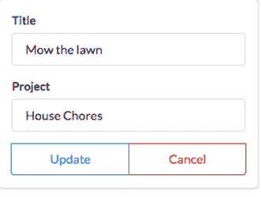

这些输入字段可以被用户修改。在 React 中，对组件所做的**所有**修改都应该由 React 处理并保存在状态中。这包括对输入字段的修改。通过让 React 管理所有修改，我们保证用户在 DOM 上交互的可视组件与幕后 React 组件的状态一致。

理解这一点的最好方式是看看它的实际样子。

为了让这些输入字段具有状态，让我们首先在组件顶部初始化 `state`：

time_tracking_app/public/js/app-2.js

```
class TimerForm extends React.Component {
  state = {
    title: this.props.title || '',
    project: this.props.project || '',
  };
```

我们的 `state` 对象有两个属性，分别对应 `TimerForm` 管理的每个输入字段。我们将这些属性的初始状态设置为通过 props 传入的值。如果 `TimerForm` 是在*创建*新计时器而非编辑现有计时器，这些 props 会是 `undefined`。在这种情况下，我们将两者都初始化为空字符串（`''`）。

我们希望避免将 `title` 或 `project` 初始化为 `undefined`。这是因为输入字段的值在技术上不能是 `undefined`。如果为空，它在 JavaScript 中的值是空字符串。实际上，如果你将输入字段的 `value` 初始化为 `undefined`，React 会发出警告。

`defaultValue` 只会在*初始*渲染时设置输入字段的值。不使用 `defaultValue`，我们可以使用 `value` 将输入字段直接连接到组件的状态。我们可以这样做：

```
<div className='field'>
  <label>Title</label>
  <input
    type='text'
    value={this.state.title}
  />
</div>
```

通过这个改动，我们的输入字段将由状态驱动。每当状态属性 `title` 或 `project` 发生变化时，我们的输入字段会更新以反映新值。

然而，这缺少一个关键要素：**我们目前没有任何方式让用户*修改*这个状态。** 输入字段一开始会与组件的状态同步。但用户做出修改的那一刻，**输入字段将与组件的状态失去同步。**

我们可以通过为 `input` 元素使用 React 的 `onChange` 属性来解决这个问题。就像 button 或 a 元素的 `onClick` 一样，我们可以将 onChange 设置为一个函数。每当输入字段发生变化时，React 就会调用指定的函数。

让我们将两个输入字段的 onChange 属性设置为我们接下来要定义的函数：

time_tracking_app/public/js/app-2.js

```
<div className='field'>
  <label>Title</label>
  <input
    type='text'
    value={this.state.title}
    onChange={this.handleTitleChange}
  />
</div>
<div className='field'>
  <label>Project</label>
  <input
    type='text'
    value={this.state.project}
    onChange={this.handleProjectChange}
  />
</div>
```

函数 `handleTitleChange` 和 `handleProjectChange` 都会修改状态中各自的属性。它们看起来是这样的：

time_tracking_app/public/js/app-2.js

```
handleTitleChange = (e) => {
  this.setState({ title: e.target.value });
};

handleProjectChange = (e) => {
  this.setState({ project: e.target.value });
};
```

当 React 调用传递给 `onChange` 的函数时，它会传入一个事件对象。我们把这个参数命名为 `e`。该事件对象包含字段的更新值，可通过 `target.value` 获取。我们将状态更新为输入字段的新值。

结合使用状态、`value` 属性和 `onChange` 属性是我们在 React 中编写表单元素的标准方法。我们在"Forms"章节中深入探讨表单。我们在"Uncontrolled vs. Controlled Components"部分中专门探讨这个话题。

总结一下，以下是 `TimerForm` 生命周期的一个例子：

- 1. 页面上有一个标题为 "Mow the lawn" 的计时器。
- 2. 用户切换打开该计时器的编辑表单，将 `TimerForm` 挂载到页面上。
- 3. `TimerForm` 将状态属性 `title` 初始化为字符串 `"Mow the lawn"`。
- 4. 用户修改输入字段，将其值改为 `"Cut the grass"`。
- 5. 每次按键时，React 都调用 `handleTitleChange`。`title` 的内部状态与用户屏幕上看到的内容保持同步。

随着 `TimerForm` 的重构完成，我们已经完成了在所选组件中确立有状态数据的工作。我们的向下数据管道，即 props，已经组装完毕。

我们已经准备好——或许还有些迫不及待——使用逆向数据流来构建交互性。但在此之前，让我们保存并重新加载应用，确保一切正常。我们期望看到基于 `TimersDashboard` 中硬编码数据的新示例计时器。我们还期望点击 "+" 按钮会切换打开一个表单：

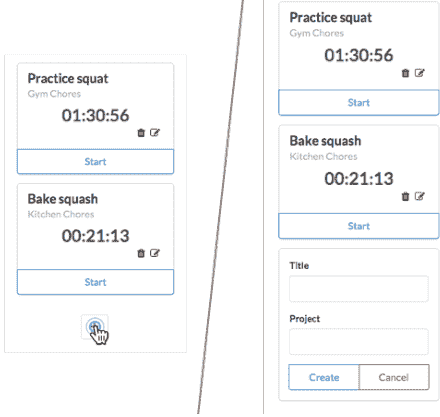

## 第 6 步：添加逆向数据流

正如我们在上一章看到的，子组件通过与父组件传递给它们的函数通信。在 ProductHunt 应用中，当点击点赞按钮时，`Product` 不做任何数据管理。它不是其状态的所有者。相反，它调用了 `ProductList` 给它的函数，传入自己的 `id`。然后 `ProductList` 能够相应地管理状态。

我们需要在两个领域使用逆向数据流：

- `TimerForm` 需要传播 **create** 和 **update** 事件（在 `ToggleableTimerForm` 下是 create，在 `EditableTimer` 下是 update）。两个事件最终都会到达 `TimersDashboard`。

- `Timer` 有相当多的行为。它需要处理 **delete** 和 **edit** 点击，以及 **start** 和 **stop** 计时器逻辑。

让我们从 `TimerForm` 开始。

### TimerForm

为了清楚了解 `TimerForm` 确切需要什么，我们先给它添加事件处理程序，然后沿着层级向上回溯。

`TimerForm` 需要两个**事件处理程序**：

- 表单提交时（创建或更新计时器）
- 点击 "Cancel" 按钮时（关闭表单）

`TimerForm` 将接收两个函数作为 props 来处理每个事件。使用 `TimerForm` 的父组件负责提供这些函数：

- `props.onFormSubmit()`：表单提交时调用
- `props.onFormClose()`：点击 "Cancel" 按钮时调用

正如我们很快会看到的，这让父组件能够决定这些事件发生时应该有什么样的行为。

让我们先修改 `TimerForm` 上的按钮。我们为每个按钮指定 `onClick` 属性：

time_tracking_app/public/js/app-3.js

```
<div className='ui two bottom attached buttons'>
  <button
    className='ui basic blue button'
    onClick={this.handleSubmit}
  >
    {submitText}
  </button>
  <button
    className='ui basic red button'
    onClick={this.props.onFormClose}
  >
    Cancel
  </button>
</div>
```


 “Submit”按钮的`onClick`属性指定了函数`this.handleSubmit`，我们接下来会定义它。“Cancel”按钮的`onClick`属性直接指定了prop `onFormClose`。

让我们看看`handleSubmit`是什么样的：

time_tracking_app/public/js/app-3.js

```
handleSubmit = () => {
  this.props.onFormSubmit({
    id: this.props.id,
    title: this.state.title,
    project: this.state.project,
  });
};

render() {
```

`handleSubmit()`调用一个尚未定义的函数`onFormSubmit()`。它传入一个包含`id`、`title`和`project`属性的数据对象。这意味着对于创建操作，`id`将是undefined，因为此时还不存在`id`。

继续之前，让我们对`TimerForm`做最后一处调整：

time_tracking_app/public/js/app-3.js

```
render() {
  const submitText = this.props.id ? 'Update' : 'Create';
```

我们用`id`而非`title`来控制`submitText`的切换。使用`id`属性来判断对象是否已创建是更常见的做法。

## ToggleableTimerForm

让我们追踪从`TimerForm`冒泡上来的提交事件。首先，我们需要修改`ToggleableTimerForm`。我们需要向`TimerForm`传递两个prop函数：`onFormClose()`和`onFormSubmit()`：

```
// Inside ToggleableTimerForm
handleFormOpen = () => {
  this.setState({ isOpen: true });
};

handleFormClose = () => {
  this.setState({ isOpen: false });
};

handleFormSubmit = (timer) => {
  this.props.onFormSubmit(timer);
  this.setState({ isOpen: false });
};

render() {
  if (this.state.isOpen) {
    return (
      <TimerForm
        onFormSubmit={this.handleFormSubmit}
        onFormClose={this.handleFormClose}
      />
    );
  } else {
```

首先看`render()`函数，我们可以看到我们将这两个函数作为props传入。函数就像其他任何prop一样。

这里最值得关注的是`handleFormSubmit()`。记住，`ToggleableTimerForm`不是计时器状态的管理者。`TimerForm`有一个它要触发的事件，在这个例子中就是提交一个新的计时器。`ToggleableTimerForm`只是这个信息的代理。所以，当表单提交时，它调用自己的prop函数`props.onFormSubmit()`。我们最终会在`TimersDashboard`中定义这个函数。

`handleFormSubmit()`接受参数`timer`。回想一下，在`TimerForm`中，这个参数是一个包含所需计时器属性的对象。我们只是在这里把这个参数传递下去。

在调用`onFormSubmit()`之后，`handleFormSubmit()`调用`setState()`来关闭其表单。

注意，*`onFormSubmit()`的结果*不会影响表单是否关闭。我们调用`onFormSubmit()`，这最终可能会产生一个**异步**的服务器调用。在我们收到服务器响应之前，执行会继续，这意味着`setState()`会被调用。

如果`onFormSubmit()`失败——比如服务器暂时无法访问——我们理想中应该有一些方式来显示错误信息并重新打开表单。

## TimersDashboard

我们已经到达了层次结构的顶端，`TimersDashboard`。由于这个组件将负责计时器的数据，我们将在这里定义处理我们在叶子组件中捕获的事件的逻辑。

我们关注的第一个事件是表单提交。当这发生时，要么是在*创建*新的计时器，要么是在*更新*现有的计时器。我们将使用两个独立的函数来处理这两个不同的事件：

- `handleCreateFormSubmit()`将处理创建操作，并作为函数传递给`ToggleableTimerForm`
- `handleEditFormSubmit()`将处理更新操作，并作为函数传递给`EditableTimerList`

两个函数沿着各自的组件层次结构向下传递，直到它们作为prop `onFormSubmit()`到达`TimerForm`。

让我们从`handleCreateFormSubmit`开始，它将新的计时器插入到我们的计时器列表状态中：

time_tracking_app/public/js/app-3.js

```
// Inside TimersDashboard
handleCreateFormSubmit = (timer) => {
  this.createTimer(timer);
};

createTimer = (timer) => {
  const t = helpers.newTimer(timer);
  this.setState({
    timers: this.state.timers.concat(t),
  });
};

render() {
  return (
    <div className='ui three column centered grid'>
      <div className='column'>
        <EditableTimerList
          timers={this.state.timers}
        />
        <ToggleableTimerForm
          onFormSubmit={this.handleCreateFormSubmit}
        />
```

```
      </div>
    </div>
  );
}
```

我们用`helpers.newTimer()`创建计时器对象。你可以在`helpers.js`中查看其实现。我们传入源自`TimerForm`的对象。这个对象有`title`和`project`属性。`helpers.newTimer()`返回一个包含这些`title`和`project`属性以及生成的`id`的对象。

下一行调用`setState()`，将新的计时器追加到我们保持在`timers`下的计时器数组中。我们将整个状态对象传递给`setState()`。

你可能会问：为什么要将`handleCreateFormSubmit()`和`createTimer()`分开？虽然不是严格必需，但这里的思路是我们有一个函数用于处理事件（`handleCreateFormSubmit()`），另一个用于执行创建计时器的操作（`createTimer()`）。

这种分离遵循**单一职责原则**，并使我们在需要时可以从其他地方调用`createTimer()`。

我们已经完成了从`TimerForm`中的表单到`TimersDashboard`中管理的状态的创建计时器流程的连线工作。保存`app.js`并刷新浏览器。切换打开创建表单并创建一些新的计时器：

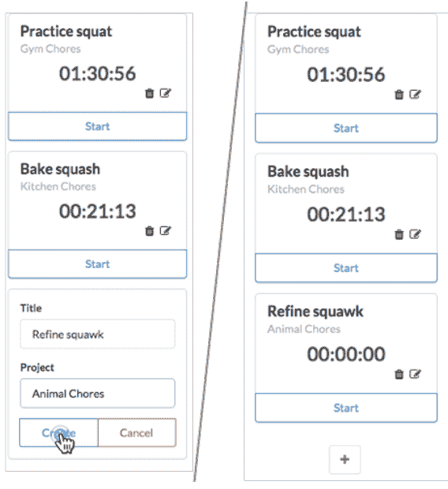

## 更新计时器

我们需要对更新计时器流程进行同样的处理。然而，正如你在应用的当前状态中看到的，我们还没有添加编辑计时器的能力。所以我们还没有显示编辑表单的方式，而这是提交编辑表单的前提条件。

要显示编辑表单，用户点击`Timer`上的编辑图标。这应该将事件向上传播到`EditableTimer`，并告诉它翻转其子组件，打开表单。

## 为`Timer`添加可编辑性

要通知我们的应用用户想要编辑计时器，我们需要为编辑按钮的span标签添加`onClick`属性。我们预期一个prop函数`onEditClick()`：

```
{/* Inside Timer.render() */}
<div className='extra content'>
  <span
    className='right floated edit icon'
    onClick={this.props.onEditClick}
  >
    <i className='edit icon' />
  </span>
  <span className='right floated trash icon'>
    <i className='trash icon' />
  </span>
</div>
```

## 更新`EditableTimer`

现在我们已经准备好更新`EditableTimer`了。同样，它将显示`TimerForm`（如果我们在编辑）或单个`Timer`（如果不在编辑）。

让我们为两个可能的子组件添加事件处理程序。对于`TimerForm`，我们希望处理表单关闭或提交的情况。对于`Timer`，我们希望处理编辑图标被点击的情况：

```
// Inside EditableTimer
handleEditClick = () => {
  this.openForm();
};

handleFormClose = () => {
  this.closeForm();
};

handleSubmit = (timer) => {
  this.props.onFormSubmit(timer);
  this.closeForm();
};

closeForm = () => {
  this.setState({ editFormOpen: false });
};
```

```
openForm = () => {
  this.setState({ editFormOpen: true });
};
```

我们将这些事件处理程序作为props向下传递：

```
time_tracking_app/public/js/app-4.js

render() {
  if (this.state.editFormOpen) {
    return (
      <TimerForm
        id={this.props.id}
        title={this.props.title}
        project={this.props.project}
        onFormSubmit={this.handleSubmit}
        onFormClose={this.handleFormClose}
      />
    );
  } else {
    return (
      <Timer
        id={this.props.id}
        title={this.props.title}
        project={this.props.project}
        elapsed={this.props.elapsed}
        runningSince={this.props.runningSince}
        onEditClick={this.handleEditClick}
      />
    );
  }
}
```

看起来有点熟悉？`EditableTimer`处理从`TimerForm`发出的相同事件的方式与`ToggleableTimerForm`非常相似。这是有道理的。`EditableTimer`和`ToggleableTimerForm`都只是`TimerForm`和`TimersDashboard`之间的中介。`TimersDashboard`是定义提交函数处理程序并将其分配给给定组件树的那个组件。

与`ToggleableTimerForm`一样，`EditableTimer`不对传入的计时器做任何处理。在`handleSubmit()`中，它只是盲目地将这个对象传递给其prop函数`onFormSubmit()`。然后它用`closeForm()`关闭表单。

我们向`Timer`传递一个新的prop：`onEditClick`。这个函数的行为在`handleEditClick`中定义，它修改`EditableTimer`的状态，打开表单。


更新 `EditableTimerList`

向上移动一层，我们在 `EditableTimerList` 中添加一行代码，将 `TimersDashboard` 中的提交函数传递给每个 `EditableTimer`：

`time_tracking_app/public/js/app-4.js`

```
// 在 EditableTimerList 内部
const timers = this.props.timers.map((timer) => (
  <EditableTimer
    key={timer.id}
    id={timer.id}
    title={timer.title}
    project={timer.project}
    elapsed={timer.elapsed}
    runningSince={timer.runningSince}
    onFormSubmit={this.props.onFormSubmit}
  />
));
// ...
```

`EditableTimerList` 不需要对这个事件做任何处理，所以我们再次直接传递这个函数。

## 在 `TimersDashboard` 中定义 `onEditFormSubmit()`

这个管道的最后一步是在 `TimersDashboard` 中定义并传递编辑表单的提交函数。

对于创建操作，我们有一个函数，它创建一个具有指定属性的新计时器对象，并将这个新对象附加到状态中 `timers` 数组的末尾。

对于更新操作，我们需要遍历 `timers` 数组，直到找到被更新的计时器对象。如上一章所述，状态对象**不能**被直接更新。我们必须使用组合拳 `setState()`。

因此，我们将使用 `map()` 来遍历计时器对象数组。如果计时器的 `id` 与提交的表单的 `id` 匹配，我们将返回一个包含具有更新属性的计时器的新对象。否则，我们将只返回原始的计时器。这个新的计时器对象数组将被传递给 `setState()`：

`time_tracking_app/public/js/app-4.js`

```
// 在 TimersDashboard 内部
handleEditFormSubmit = (attrs) => {
  this.updateTimer(attrs);
};

createTimer = (timer) => {
  const t = helpers.newTimer(timer);
  this.setState({
    timers: this.state.timers.concat(t),
  });
};

updateTimer = (attrs) => {
  this.setState({
    timers: this.state.timers.map((timer) => {
      if (timer.id === attrs.id) {
        return Object.assign({}, timer, {
          title: attrs.title,
          project: attrs.project,
        });
      } else {
        return timer;
      }
    }),
  });
};
```

我们在 render() 中将其作为 prop 传递下去：

`time_tracking_app/public/js/app-4.js`

```
{ /* 在 TimersDashboard.render() 内部 */}
<EditableTimerList
  timers={this.state.timers}
  onFormSubmit={this.handleEditFormSubmit}
/>
```

请注意，我们可以在传递给 setState() 的 JavaScript 对象内部对 this.state.timers 调用 map()。这是一种常用的模式。该调用被求值，然后 timers 属性被设置为结果。

在 map() 函数内部，我们检查计时器是否与被更新的匹配。如果不匹配，我们只返回该计时器。否则，我们使用 Object#assign() 返回一个具有计时器更新属性的新对象。

记住，这里重要的是我们将状态视为不可变的。通过创建一个新的 timers 对象，然后使用 Object#assign() 来填充它，我们没有修改状态中的任何对象。

我们在上一章讨论了 Object#assign() 方法。

就像我们处理 ToggleableTimerForm 和 handleCreateFormSubmit 一样，我们将 handleEditFormSubmit 作为 prop onFormSubmit 传递下去。TimerForm 调用这个 prop，完全不知道当这个函数在 EditableTimer 下渲染时与在 ToggleableTimerForm 下渲染时是完全不同的。

两个表单都已连接好！保存 app.js，刷新页面，并尝试创建和更新计时器。你也可以点击打开表单上的 "Cancel" 来关闭它：

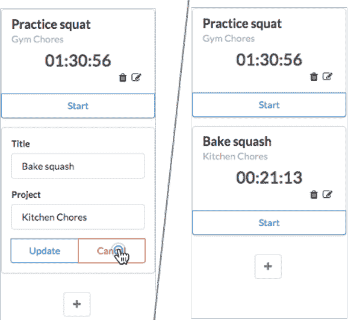

剩下的工作就在计时器内部了。我们需要：

- 连接垃圾桶按钮（删除计时器）
- 实现开始/停止按钮和计时逻辑本身

到那时，我们将拥有一个完整的无服务器解决方案。

自己试试：在进入下一节之前，看看你自己能走多远来连接垃圾桶按钮。之后继续前进，并验证你的解决方案是合理的。

## 删除计时器

### 向 Timer 添加事件处理程序

在 `Timer` 中，我们定义一个函数来处理垃圾桶按钮的点击事件：

`time_tracking_app/public/js/app-5.js`

```
class Timer extends React.Component {
  handleTrashClick = () => {
    this.props.onTrashClick(this.props.id);
  };

  render() {
```

然后使用 `onClick` 将该函数连接到垃圾桶图标：

`time_tracking_app/public/js/app-5.js`

```
{/* 在 Timer.render() 内部 */}
<div className='extra content'>
  <span
    className='right floated edit icon'
    onClick={this.props.onEditClick}
  >
    <i className='edit icon' />
  </span>
  <span
    className='right floated trash icon'
    onClick={this.handleTrashClick}
  >
    <i className='trash icon' />
  </span>
</div>
```

我们还没有定义将被设置为 prop `onTrashClick()` 的函数。但你可以想象，当这个事件到达顶部 (`TimersDashboard`) 时，我们需要 `id` 来确定哪个计时器被删除。`handleTrashClick()` 为这个函数提供了 `id`。

### 通过 `EditableTimer` 路由

`EditableTimer` 只是代理了这个函数：

**time_tracking_app/public/js/app-5.js**

```
// 在 EditableTimer 内部
} else {
  return (
    <Timer
      id={this.props.id}
      title={this.props.title}
      project={this.props.project}
      elapsed={this.props.elapsed}
      runningSince={this.props.runningSince}
      onEditClick={this.handleEditClick}
      onTrashClick={this.props.onTrashClick}
    />
  );
}
```

### 通过 `EditableTimerList` 路由

`EditableTimerList` 也是如此：

**time_tracking_app/public/js/app-5.js**

```
// 在 EditableTimerList.render() 内部
const timers = this.props.timers.map((timer) => (
  <EditableTimer
    key={timer.id}
    id={timer.id}
    title={timer.title}
    project={timer.project}
    elapsed={timer.elapsed}
    runningSince={timer.runningSince}
    onFormSubmit={this.props.onFormSubmit}
    onTrashClick={this.props.onTrashClick}
  />
));
```

### 在 `TimersDashboard` 中实现删除函数

最后一步是在 `TimersDashboard` 中定义一个函数，从状态数组中删除所需的计时器。在 JavaScript 中有很多种方法可以实现这一点。如果你的解决方案不同或者你还没想出来，别太纠结。

我们添加我们的处理程序函数，最终将其作为 prop 传递下去：

```
// 在 TimersDashboard 内部
handleEditFormSubmit = (attrs) => {
  this.updateTimer(attrs);
};

handleTrashClick = (timerId) => {
  this.deleteTimer(timerId);
};
```

`deleteTimer()` 使用数组的 `filter()` 方法返回一个新数组，其中移除了 `id` 与 `timerId` 匹配的计时器对象：

```
// 在 TimersDashboard 内部
deleteTimer = (timerId) => {
  this.setState({
    timers: this.state.timers.filter(t => t.id !== timerId),
  });
};
```

最后，我们将 `handleTrashClick()` 作为 prop 传递下去：

```
{/* 在 TimersDashboard.render() 内部 */}
<EditableTimerList
  timers={this.state.timers}
  onFormSubmit={this.handleEditFormSubmit}
  onTrashClick={this.handleTrashClick}
/>
```

**数组的 `filter()`** 方法接受一个用于 "测试" 数组中每个元素的函数。它返回一个包含所有通过测试的元素的新数组。如果函数返回 `true`，则保留该元素。

保存 `app.js` 并重新加载应用。看呐，你可以删除计时器了：

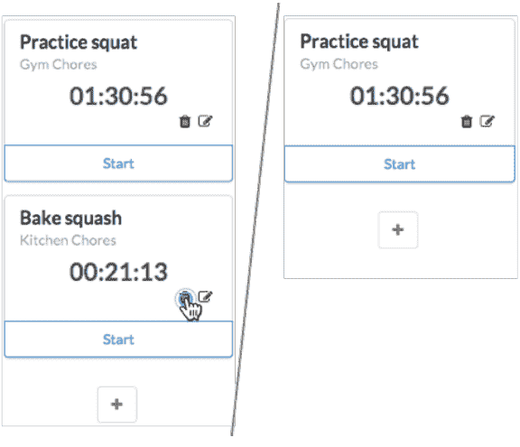

## 添加计时功能

我们的计时器现在具备了创建、更新和删除（CRUD）能力。下一个挑战：使这些计时器功能化。

我们可以通过几种不同的方式来实现计时器系统。最简单的方法是让一个函数每秒更新每个计时器的 `elapsed` 属性。但这是严重受限的。当应用关闭时会发生什么？计时器应该继续 "运行"。

这就是为什么我们包含了计时器属性 `runningSince`。计时器初始化时 `elapsed` 等于 `0`。当用户点击 "开始" 时，我们不增加 `elapsed`。相反，我们只是将 `runningSince` 设置为开始时间。

然后，我们可以使用开始时间和当前时间的差值来为用户渲染时间。当用户点击 "停止" 时，开始时间和当前时间的差值被添加到 `elapsed`。`runningSince` 被设置为 `null`。

因此，在任何时候，我们都可以通过取 `Date.now() - runningSince` 并将其添加到总累积时间 (`elapsed`) 来计算计时器运行了多久。我们将在 `Timer` 组件内部计算这个值。


为了让应用真正像一个运行中的计时器，我们希望 React 不断地执行此操作并重新渲染计时器。但`elapsed`和`runningSince`在计时器运行时*不会发生变化*。因此，到目前为止我们看到的触发`render()`调用的机制将不足够。

相反，我们可以使用 React 的`forceUpdate()`方法。这会强制 React 组件重新渲染。我们可以在一个定时器上调用它，以实现实时计时器的流畅外观。

## 在`Timer`中添加`forceUpdate()`定时器

`helpers.renderElapsedString()`接受一个可选的第二个参数`runningSince`。它会将`Date.now() - runningSince`的差值加到`elapsed`上，并使用函数`millisecondsToHuman()`返回一个格式化为`HH:MM:SS`的字符串。

我们将在组件挂载后建立一个定时器来运行`forceUpdate()`：

time_tracking_app/public/js/app-6.js

```
class Timer extends React.Component {
  componentDidMount() {
    this.forceUpdateInterval = setInterval(() => this.forceUpdate(), 50);
  }

  componentWillUnmount() {
    clearInterval(this.forceUpdateInterval);
  }

  handleTrashClick = () => {
    this.props.onTrashClick(this.props.id);
  };

  render() {
    const elapsedString = helpers.renderElapsedString(
      this.props.elapsed, this.props.runningSince
    );
    return (
```

在`componentDidMount()`中，我们使用 JavaScript 函数`setInterval()`。这将在每 50 毫秒调用一次`forceUpdate()`函数，使组件重新渲染。我们将`setInterval()`的返回值赋给`this.forceUpdateInterval`。

在`componentWillUnmount()`中，我们使用`clearInterval()`来停止定时器`this.forceUpdateInterval`。`componentWillUnmount()`在组件从应用中移除之前调用。如果计时器被删除，这将会发生。我们要确保在计时器从页面移除后不再继续调用`forceUpdate()`。React 会抛出错误。

`setInterval()`接受两个参数。第一个是你希望重复调用的函数。第二个是调用该函数的间隔时间（以毫秒为单位）。

`setInterval()`返回一个唯一的定时器 ID。你可以在任何时候将此定时器 ID 传递给`clearInterval()`来停止该定时器。

你可能会问：如果我们不在未运行的计时器上持续调用`forceUpdate()`，那不是更高效吗？

确实，我们可以节省一些周期。但这不值得增加代码复杂性。React 会调用`render()`，执行一些 JavaScript 中的廉价操作。然后将此结果与上一次`render()`调用的结果进行比较，发现没有任何变化。它会停止在那里——不会尝试任何 DOM 操作。

50 毫秒的间隔并非科学推导而来。选择太高的间隔会让计时器看起来不自然。它会在值之间不均匀地跳动。选择太低的间隔则只是做不必要的工作。50 毫秒的间隔对人类来说看起来不错，而在计算机世界中则是一段漫长的时间。

## 试一试

保存 app.js 并刷新。第一个计时器应该正在运行。

我们已经开始打造这款应用的真实用途了！我们只需要连接开始/停止按钮，我们的无服务器应用就将功能完整。

## 添加开始和停止功能

每个计时器底部的操作按钮应在计时器暂停时显示"Start"，在计时器运行时显示"Stop"。它还应根据计时器是停止还是开始，在点击时传播事件。

我们可以将所有这些功能构建到 Timer 中。我们可以让 Timer 根据其是否运行来决定渲染一个 HTML 片段还是另一个。但这会给 Timer 增加更多的责任和复杂性。相反，让我们将按钮做成一个独立的 React 组件。

## 在 Timer 中添加计时器操作事件

让我们修改 Timer，预期一个名为 TimerActionButton 的新组件。这个按钮只需要知道计时器是否正在运行。它还需要能够传播两个事件，`onStartClick()`和`onStopClick()`。这些事件最终需要一路传递到 TimersDashboard，后者可以修改计时器上的`runningSince`。

首先，事件处理程序：

time_tracking_app/public/js/app-7.js

```
// Inside Timer
componentWillUnmount() {
  clearInterval(this.forceUpdateInterval);
}

handleStartClick = () => {
  this.props.onStartClick(this.props.id);
};

handleStopClick = () => {
  this.props.onStopClick(this.props.id);
};
// ...
```

然后，在`render()`内部，我们在最外层 div 的底部声明 TimerActionButton：

time_tracking_app/public/js/app-7.js

```
      {/* At the bottom of `Timer.render()` */}
      <TimerActionButton
        timerIsRunning={!!this.props.runningSince}
        onStartClick={this.handleStartClick}
        onStopClick={this.handleStopClick}
      />
    </div>
  );
```

我们使用与其他点击处理程序相同的技术：HTML 元素上的 onClick 指定组件中的一个处理函数，该函数调用一个 prop 函数，传入计时器的 id。

我们在这里使用`!!`来为 TimerActionButton 派生布尔值 prop timerIsRunning。当`runningSince`为 null 时，`!!`返回 false。

## 创建 TimerActionButton

现在创建 TimerActionButton 组件：

time_tracking_app/public/js/app-7.js

```
class TimerActionButton extends React.Component {
  render() {
    if (this.props.timerIsRunning) {
      return (
        <div
          className='ui bottom attached red basic button'
          onClick={this.props.onStopClick}
        >
          Stop
        </div>
      );
    } else {
      return (
        <div
          className='ui bottom attached green basic button'
          onClick={this.props.onStartClick}
        >
          Start
        </div>
      );
    }
  }
}
```

我们根据`this.props.timerIsRunning`渲染一个或另一个 HTML 片段。

你知道怎么做了。现在我们将这些事件向上传递到组件层级，一直到`TimersDashboard`，我们在那里管理状态：

## 通过`EditableTimer`和`EditableTimerList`运行事件

首先是`EditableTimer`：

time_tracking_app/public/js/app-7.js

```
// Inside EditableTimer
} else {
  return (
    <Timer
      id={this.props.id}
      title={this.props.title}
      project={this.props.project}
      elapsed={this.props.elapsed}
      runningSince={this.props.runningSince}
      onEditClick={this.handleEditClick}
      onTrashClick={this.props.onTrashClick}
      onStartClick={this.props.onStartClick}
      onStopClick={this.props.onStopClick}
    />
  );
}
```

然后是 EditableTimerList：

time_tracking_app/public/js/app-7.js

```
// Inside EditableTimerList
const timers = this.props.timers.map((timer) => (
  <EditableTimer
    key={timer.id}
    id={timer.id}
    title={timer.title}
    project={timer.project}
    elapsed={timer.elapsed}
    runningSince={timer.runningSince}
    onFormSubmit={this.props.onFormSubmit}
    onTrashClick={this.props.onTrashClick}
    onStartClick={this.props.onStartClick}
    onStopClick={this.props.onStopClick}
  />
));
```

最后，我们在 TimersDashboard 中定义这些函数。它们应该使用 map 遍历 state timers 数组，在找到匹配的计时器时适当地设置`runningSince`。

首先我们定义处理函数：

**time_tracking_app/public/js/app-7.js**

```
// Inside TimersDashboard
handleTrashClick = (timerId) => {
  this.deleteTimer(timerId);
};

handleStartClick = (timerId) => {
  this.startTimer(timerId);
};

handleStopClick = (timerId) => {
  this.stopTimer(timerId);
};
```

然后是`startTimer()`和`stopTimer()`：

**time_tracking_app/public/js/app-7.js**

```
deleteTimer = (timerId) => {
  this.setState({
    timers: this.state.timers.filter(t => t.id !== timerId),
  });
};

startTimer = (timerId) => {
  const now = Date.now();

  this.setState({
    timers: this.state.timers.map((timer) => {
      if (timer.id === timerId) {
        return Object.assign({}, timer, {
          runningSince: now,
        });
      } else {
        return timer;
      }
    }),
  });
};

stopTimer = (timerId) => {
  const now = Date.now();


最后，我们将它们作为 props 传递下去：

```
time_tracking_app/public/js/app-7.js

{/* Inside TimerDashboard.render() */}
<EditableTimerList
  timers={this.state.timers}
  onFormSubmit={this.handleEditFormSubmit}
  onTrashClick={this.handleTrashClick}
  onStartClick={this.handleStartClick}
  onStopClick={this.handleStopClick}
/>
```

当 startTimer 在其 map 调用中遇到相关计时器时，它会将属性 runningSince 设置为当前时间。

stopTimer 计算 lastElapsed，即计时器自启动以来运行的时间。它将这个数值加到 elapsed 上，并将 runningSince 设为 null，从而"停止"计时器。

## 试一试

保存 app.js，重新加载，看好了！你现在可以创建、更新和删除计时器，还能实际使用它们来计时：

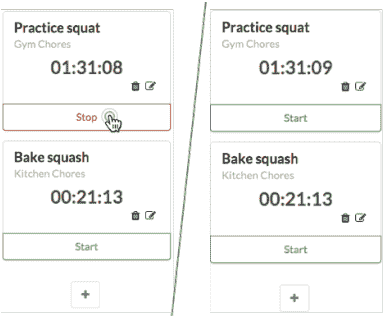

这是个不错的进展。但是，由于没有连接到服务器，我们的应用是临时的。如果我们刷新页面，就会丢失所有计时器数据。我们的应用没有任何持久化能力。

服务器可以为我们提供持久化。我们让服务器将所有计时器数据的更改写入文件。不再在 `TimersDashboard` 组件中硬编码状态，当应用加载时，它会查询服务器并根据服务器提供的数据构建其计时器状态。然后让我们的 React 应用向服务器通知任何状态变化，比如计时器启动时。

与服务器通信是开发并分发真实世界 Web 应用的最后一个主要构建块。

## 方法论回顾

在构建时间记录应用的过程中，我们学习并应用了一种构建 React 应用的方法论。再次强调，这些步骤是：

- 1. 将应用拆分为组件

我们通过检查应用的工作 UI 来绘制组件结构图。然后应用单一职责原则来拆分组件，使每个组件具有最小可行的功能。

- 2. 构建应用的静态版本

我们的底层（用户可见）组件基于静态 props 渲染 HTML，props 从父组件传递下来。

- 3. 确定什么应该是有状态的

我们使用了一系列问题来推断哪些数据应该是有状态的。这些数据在我们的静态应用中显示为 props。

- 4. 确定每个状态片段应该存在于哪个组件中

我们使用了另一系列问题来确定哪个组件应该拥有每个状态片段。`TimersDashboard` 拥有计时器状态数据，`ToggleableTimerForm` 和 `EditableTimer` 都持有关于是否渲染 `TimerForm` 的状态。

- 5. 硬编码初始状态

然后我们用硬编码值初始化状态拥有者的 state 属性。

- 6. 添加反向数据流

我们通过为按钮添加 `onClick` 处理程序来增加交互性。这些处理程序调用作为 props 从拥有相关状态的组件沿着层级向下传递的函数。

最后一步是 **7. 添加服务器通信**。我们将在下一章解决这个问题。

## 组件与服务器

## 简介

在上一章中，我们使用一种方法论来构建 React 应用。计时器的状态管理发生在顶层组件 `TimersDashboard` 中。与所有 React 应用一样，数据从组件树的顶部向下流向叶组件。叶组件通过调用 prop 函数向状态管理者传递事件。

目前，`TimersDashboard` 具有硬编码的初始状态。对状态的任何修改都只会在浏览器窗口打开期间存活。这是因为所有状态变化都发生在 React 内部内存中。我们需要我们的 React 应用与服务器通信。服务器将负责持久化数据。在这个应用中，数据持久化发生在文件 `data.json` 中。

`EditableTimer` 和 `ToggleableTimerForm` 也有硬编码的初始状态。但因为这些状态只是关于它们的表单是否打开，我们不需要将这些状态变化传达给服务器。我们可以接受每次应用启动时表单默认都是关闭的。

## 准备工作

为了帮助你熟悉本项目的 API 以及通常使用 API 的工作方式，我们有一个简短的部分，在 React 之外向 API 发出请求。

#### curl

我们将使用一个名为 curl 的工具从命令行发出更复杂的请求。

OS X 用户应该已经安装了 curl。

Windows 用户可以在此处下载并安装 curl：[https://curl.haxx.se/download.html](https://curl.haxx.se/download.html)³⁸。

#### `server.js`

项目文件夹的根目录中包含一个名为 `server.js` 的文件。这是一个专门为我们的时间跟踪应用设计的 Node.js 服务器。

> 你不需要了解任何关于 Node.js 或服务器的一般知识来使用我们提供的服务器。我们将提供你需要的指导。

³⁸ https://curl.haxx.se/download.html

`server.js` 使用文件 `data.json` 作为其"存储"。服务器将读取和写入此文件以持久化数据。你可以查看该文件以了解我们提供的初始存储状态。

`server.js` 将在被请求所有项目时返回 `data.json` 的内容。当收到通知时，服务器将在 `data.json` 中反映任何更新、删除或计时器的停止和启动。这就是即使浏览器重新加载或关闭，数据仍会被持久化的方式。

在开始使用服务器之前，让我们简要介绍其 **API**。同样，如果这个概述让你有点困惑，请不要担心。希望当我们开始编写一些代码时，它会变得更清楚。

## 服务器 API

我们在本章的最终目标是 **在服务器上复制状态变化**。我们不会将所有状态管理完全转移到服务器。相反，服务器将维护其状态（在 `data.json` 中），React 将维护其状态（在本例中，在 `TimersDashboard` 的 `this.state` 中）。稍后我们将演示为什么在两个地方都保持状态是理想的。

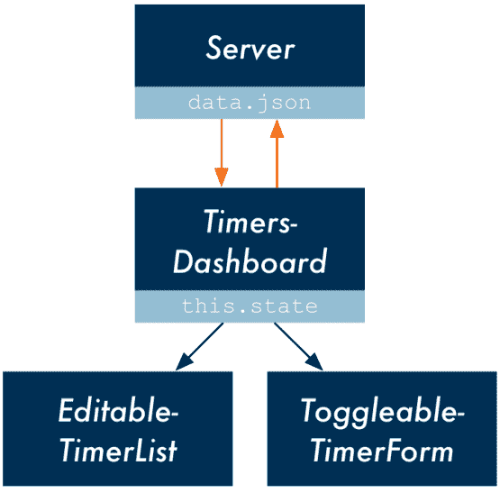

**TimersDashboard 与服务器通信**

如果我们在 React（"客户端"）状态上执行希望被持久化的操作，那么我们Metal还需要通知服务器该状态变化。这将使两个状态保持同步。我们将这些视为我们的"写"操作。我们要发送给服务器的写操作有：

- 创建计时器
- 更新计时器
- 删除计时器
- 启动计时器
- 停止计时器

我们将只有一个读操作：从服务器请求所有计时器。

## HTTP API

本节假设你对 HTTP API 有一点点熟悉。如果你不熟悉 HTTP API，你可能想在某个时候[了解一下它们](http://www.andrewhavens.com/posts/20/beginners-guide-to-creating-a-rest-api/)。

然而，不要因此而不敢继续本章的学习。本质上，我们正在从浏览器向本地服务器发出一个"调用"，并遵循指定的格式。

#### text/html 端点

GET /

一直以来，`server.js` 实际上负责提供应用。当你的浏览器请求 `localhost:3000/` 时，服务器返回文件 `index.html`。`index.html` 加载我们所有的 JavaScript/React 代码。

注意 React 永远不会向此路径的服务器发出请求。这只是供浏览器加载应用使用。React 只与 JSON 端点通信。

#### JSON 端点

`data.json` 是一个 JSON 文档。正如上一章提到的，JSON 是一种存储人类可读数据对象的格式。我们可以将 JavaScript 对象序列化为 JSON。这使 JavaScript 对象能够存储在文本文件中并通过网络传输。

`data.json` 包含一个对象数组。虽然不是严格的 JavaScript，但该数组中的数据可以轻松加载到 JavaScript 中。

在 `server.js` 中，我们看到这样的代码行：

```
fs.readFile(DATA_FILE, function(err, data) {
  const timers = JSON.parse(data);
  // ...
});
```

`data` 是一个字符串，即 JSON。`JSON.parse()` 将此字符串转换为实际的 JavaScript 对象数组。

```
GET /api/timers
```

返回所有计时器的列表。

```
POST /api/timers
```

接受带有 `title`、`project` 和 `id` 属性的 JSON 主体。将新计时器对象插入其存储中。

```
POST /api/timers/start
```

接受带有属性 `id` 和 `start`（时间戳）的 JSON 主体。在其存储中搜索并找到匹配的 `id` 的计时器。将其 `runningSince` 设置为 `start`。

```
POST /api/timers/stop
```

接受带有属性 `id` 和 `stop`（时间戳）的 JSON 主体。在其存储中搜索并找到匹配的 `id` 的计时器。根据计时器运行的时间更新 `elapsed`（`stop - runningSince`）。将 `runningSince` 设置为 `null`。

```
PUT /api/timers
```

接受带有属性 `id` 和 `Contactsand/或 `project` 的 JSON 主体。在其存储中搜索并找到匹配的 `id` 的计时器。更新 `title` 和/或 `project` 为新属性。

```
DELETE /api/timers
```

接受带有属性 `id` 的 JSON 主体。在其存储中搜索并删除匹配的 `id` 的计时器。

## 试用 API

如果你的服务器没有启动，请确保启动它：

```
npm start
```

你可以在浏览器中访问 `/api/timers` 端点并查看 JSON 响应（`localhost:3000/api/timers`）。当你在浏览器中访问新 URL 时，浏览器会发出 GET 请求。因此我们的浏览器调用 `GET /api/timers`，服务器返回所有计时器：


请注意，服务器去除了 `data.json` 中所有多余的空白字符，包括换行符，以保持载荷尽可能小。这些空白字符在 `data.json` 中的存在仅仅是为了让人类可读。

我们可以使用像 [JSONView](https://chrome.google.com/webstore/detail/jsonview/chklaanhfefbnpoihckbnefhakgolnmc) 这样的 Chrome 扩展来将原始 JSON"人性化"。JSONView 接收这些原始 JSON 块，并重新添加空白字符以提高可读性：

安装 JSONView 后访问接口端点

我们只能轻松地使用浏览器来发送 GET 请求。对于*写入*数据——比如启动和停止计时器——我们需要发送 POST、PUT 或 DELETE 请求。我们将使用 curl 来尝试写入数据。

从命令行运行以下命令：

```
$ curl -X GET localhost:3000/api/timers
```

-X 标志指定要使用的 HTTP 方法。它应该会返回一个类似这样的响应：

```
[{"title":"Mow the lawn","project":"House Chores","elapsed":5456099,"id":"0a4a79cb-b06d-4cb1-883d-549a1e3b66d7"},{"title":"Clear paper jam","project":"Office Chores","elapsed":1273998,"id":"a73c1d19-f32d-4aff-b470-cea4e792406a"},{"title":"Ponder origins of universe","project":"Life Chores","id":"2c43306e-5b44-4ff8-8753-33c35adbd06f","elapsed":11750,"runningSince":"1456225941911"}]
```

你可以通过向 `/api/timers/start` 端点发送 PUT 请求来启动其中一个计时器。我们需要发送一个计时器的 id 和一个开始时间戳：

```
$ curl -X POST \
-H 'Content-Type: application/json' \
-d '{"start":1456468632194,"id":"a73c1d19-f32d-4aff-b470-cea4e792406a"}' \
localhost:3000/api/timers/start
```

-H 标志为我们的 HTTP 请求设置一个请求头，`Content-Type`。我们告知服务器请求的主体是 JSON。

-d 标志设置我们请求的主体。在单引号 `''` 内部是 JSON 数据。

当你按回车键时，curl 会快速返回，没有任何输出。对于此端点，服务器在成功时不会返回任何内容。如果你打开 `data.json`，你会看到你指定的计时器现在有了一个 `runningSince` 属性，其值设置为我们请求中指定的 `start` 值。

如果你愿意，可以试用其他端点来感受它们是如何工作的。只需确保使用 `-X` 设置适当的方法，并为写入redients端点传递 JSON `Content-Type`。

我们编写了一个小型的库 `client`，来帮助你在 JavaScript 中与 API 进行交互。

注意，上面的反斜杠 `\` 仅用于将命令分成多行以提高可读性。这仅在 macOS 和 Linux 上有效。Windows 用户可以将其作为一长串字符串直接输入。

## 工具提示：jq

macOS 和 Linux 用户：如果你想在命令行中解析和处理 JSON，我们强烈推荐使用" jq"工具。

你可以将 curl 的响应直接通过管道传输到 jq，以获得格式化的响应：

```
curl -X GET localhost:3000/api/timers | jq '.'
```

你还可以对 JSON 进行一些强大的操作，比如迭代响应中的所有对象并返回特定字段。在这个示例中，我们提取数组中每个对象的 `id` 属性：

```
curl -X GET localhost:3000/api/timers | jq '.[] | { id }'
```

你可以在这里下载 jq：[https://stedolan.github.io/jq/](https://stedolan.github.io/jq/)。

## 从服务器加载状态

现在，我们通过大量的 JavaScript 对象、一个计时器数组在 `TimersDashboard` 中设置初始状态。让我们修改这个函数，改为从服务器加载数据。

我们已经编写了你的 React 应用将用于与服务器交互的客户端库 `client`。该库定义在 `public/js/client.js` 中。我们将先使用它，然后在下一节中了解它的工作原理。

`GET /api/timers` 端点提供了所有计时器的列表，如同 `data.json` 中所表示的那样。我们可以在我们的 React 应用中使用 `client.getTimers()` 来调用此端点。我们将这样做来"填充" `TimersDashboard` 维护的状态。

当我们调用 `client.getTimers()` 时，网络请求是*异步*发送的。函数调用本身不会返回任何有用的内容：

```
// 错误的
// `getTimers()` 不返回计时器列表
const timers = client.getTimers();
```

相反，我们可以向 `getTimers()` 传递一个成功函数。`getTimers()` 在从服务器收到响应并且服务器成功返回结果后，将调用该函数。`getTimers()` 将使用一个参数调用该函数，即从服务器返回的计时器列表：

```
// 向 `getTimers()` 传递一个成功函数
client.getTimers((serverTimers) => (
  // 对计时器数组 `serverTimers` 执行某些操作
));
```

`client.getTimers()` 使用 Fetch API，我们将在下一节中介绍它。就我们的目的而言，需要知道的重要一点是，当调用 `getTimers()` 时，它会向服务器发送请求，然后立即返回控制流。我们程序的执行不会等待服务器的响应。这就是 `getTimers()` 被称为**异步函数**的原因。

我们传递给 `getTimers()` 的成功函数称为**回调**。我们的意思是："当你最终从服务器收到响应时，如果是成功的响应，调用这个函数。"这种异步范式确保我们的 JavaScript 的执行不会被 **I/O 阻塞**。

我们将使用 `timers` 属性设置为空白数组来初始化组件的状态。这将允许所有组件挂载并执行其初始渲染。然后，我们可以向服务器发出请求并设置状态来填充应用：

time_tracking_app/public/js/app-8.js

```
class TimersDashboard extends React.Component {
  state = {
    timers: [],
  };

  componentDidMount() {
    this.loadTimersFromServer();
    setInterval(this.loadTimersFromServer, 5000);
  }

  loadTimersFromServer = () => {
    client.getTimers((serverTimers) => (
      this.setState({ timers: serverTimers })
    )
  };
  // ...
```

时间线是说明发生情况的最佳媒介：

- 1. 初始渲染之前
React 初始化组件。`state` 被设置为一个具有属性 `timers` 的对象，该对象被返回为空白数组。

- 2. 初始渲染
React 然后调用 `TimersDashboard` 上的 `render()`。为了完成渲染，必须渲染它的两个子组件：`EditableTimerList` 和 `ToggleableTimerForm`。

- 3. 子组件被渲染
`EditableTimerList` 的渲染方法被调用。由于它接收的是一个空白数据数组，它简单地生成以下 HTML 输出：

```
<div id='timers'
</div>
```

`ToggleableTimerForm` 渲染它的 HTML，即"+"按钮。

- 4. 初始渲染完成
随着其子组件的渲染，`TimersDashboard` 的初始渲染完成，HTML 被写入 DOM。

- 5. `componentDidMount` 被调用
既然组件已经挂载，就在 `TimersDashboard` 上调用 `componentDidMount()`。

该方法调用 `loadTimersFromServer()`。继而，该函数调用 `client.getTimers()`。这将向我们的服务器发出 HTTP 请求，请求计时器列表。当 `client` 收到响应时，它会调用我们的成功函数。

在调用时，成功函数被传递一个参数 `serverTimers`。这是服务器返回的计时器数组。然后我们调用 `setState()`，这将触发新的渲染。新的渲染用 `EditableTimer` 子组件及其所有子组件填充我们的应用。应用完全加载，对终端用户来说速度之快几乎无法察觉。

我们在 `componentDidMount` 中还做了另一件有趣的事。我们使用 `setInterval()` 确保每 5 秒调用一次 `loadTimersFromServer()`。虽然我们会尽力在客户端和服务器之间镜像状态变化，但这种从服务器硬刷新状态的方式可以确保我们的客户端在偏离服务器时始终保持正确。

服务器被视为主状态持有者。我们的客户端只是一个副本。这在多实例场景中变得非常强大。如果你有两个应用实例在运行——在两个不同的标签页或两台不同的电脑上——一个实例中的变化将在五秒内推送到另一个实例。


 试用一下

现在让我们来体验一下。保存 `app.js` 并刷新应用。你会看到一全新的计时器列表，它们由 `data.json` 驱动。你所做的任何操作都会在五秒内被清除。每五秒钟，状态都会从服务器恢复。例如，尝试删除一个计时器，然后看着它完好无损地弹回来。因为我们没有告诉服务器这些操作，所以服务器的状态保持不变。

另一方面，你可以尝试修改 `data.json`。请注意，对 `data.json` 的任何修改都会在五秒内传播到你的应用中。很 neat 吧。

我们正在从服务器加载初始状态。我们设置了一个定时函数，以确保在多实例场景中客户端应用的状态不会偏离服务器的状态。

我们需要将剩余的状态变更通知服务器：创建、更新（包括开始和停止）以及删除。但首先，让我们打开 `client` 背后的逻辑，看看它是如何工作的。

> 虽然服务器数据的变化能无缝传播到我们的视图确实很 neat，但在某些应用中——比如即时通讯——五秒几乎是一个世纪。我们将在未来的应用中介绍**长轮询**（long-polling）的概念。长轮询能够将变化几乎即时地推送到客户端。

## client

如果你打开 `client.js`，库中定义的第一个方法是 `getTimers()`：

**`time_tracking_app/public/js/client.js`**

```
function getTimers(success) {
  return fetch('/api/timers', {
    headers: {
      Accept: 'application/json',
    },
  }).then(checkStatus)
    .then(parseJSON)
    .then(success);
}
```

我们使用新的 **Fetch API** 来执行所有的 HTTP 请求。如果你曾经使用过 `XMLHttpRequest` 或 jQuery 的 `ajax()`，那么 Fetch 的接口应该看起来相当熟悉。

## Fetch

在 Fetch 出现之前，JavaScript 开发者有两种选项来进行网络请求：使用所有浏览器原生支持的 `XMLHttpRequest`，或者导入一个围绕它封装的库（比如 jQuery 的 `ajax()`）。Fetch 提供了比 `XMLHttpRequest` 更好的接口。虽然 Fetch 仍在标准化过程中，但已经有一些主流浏览器支持它了。在撰写本文时，Fetch 在 Firefox 39 及以上版本和 Chrome 42 及以上版本中默认开启。

在 Fetch 被更广泛的浏览器采用之前，包含这个库以防万一是个好主意。我们已经在 `index.html` 中这样做了：

```
<!-- inside `head` tags index.html -->
<script src="vendor/fetch.js"></script>
```

正如我们在 `client.getTimers()` 中看到的，`fetch()` 接受两个参数：

- 我们要获取的资源的路径
- 请求参数的对象

默认情况下，Fetch 发起 GET 请求，所以我们告诉 Fetch 向 `/api/timers` 发起 GET 请求。我们还传递了一个参数：`headers`，即我们请求中的 HTTP 请求头。我们告诉服务器我们只*接受* JSON 响应。

在我们调用 `fetch()` 的末尾，我们有一串 `.then()` 语句：

**`time_tracking_app/public/js/client.js`**

```
    }).then(checkStatus)
      .then(parseJSON)
      .then(success);
```

要理解这是如何工作的，让我们先回顾一下我们传递给每个 `.then()` 语句的函数：

- **`checkStatus()`**：这个函数在 `client.js` 内部定义。它检查服务器是否返回了错误。如果服务器返回了错误，`checkStatus()` 会将错误记录到控制台。
- **`parseJSON()`**：这个函数也在 `client.js` 内部定义。它接收 `fetch()` 发出的响应对象，并返回一个 JavaScript 对象。
- **`success()`**：这是我们作为参数传递给 `getTimers()` 的函数。`getTimers()` 会在服务器成功返回响应时调用这个函数。

## Components & Servers

Fetch 返回一个 **promise**。虽然我们不会详细讨论 promise，但如你所见，promise 允许你链式调用 `.then()` 语句。我们给每个 `.then()` 语句传递一个函数。我们在这里本质上是在说："从 `/api/timers` 获取计时器，*然后*检查服务器返回的状态码。*然后*，从响应中提取 JavaScript 对象。*然后*，将该对象传递给 success 函数。"

在管道的每个阶段，前一个语句的结果都会作为参数传递给下一个：

1. 当 `checkStatus()` 被调用时，它被传递了一个 `fetch()` 返回的 Fetch 响应对象。
2. `checkStatus()` 在验证响应后，返回相同的响应对象。
3. `parseJSON()` 被调用，并被传递了 `checkStatus()` 返回的响应对象。
4. `parseJSON()` 返回服务器返回的计时器的 JavaScript 数组。
5. `success()` 以 `parseJSON()` 返回的计时器数组为参数被调用。

我们可以在管道中附加无限数量的 `.then()` 语句。这种模式使我们能够以易于阅读的格式将多个函数调用链式连接在一起，支持 `fetch()` 等异步函数。

> 如果你仍然对 promise 的概念感到不适应，那也没关系。这一章的所有客户端代码我们都为你写好了，所以你完成这一章不会有困难。你可以之后再回来摆弄 `client.js`，感受一下它的工作原理。
>
> 你可以[这里](https://developer.mozilla.org/en-US/docs/Web/API/Fetch_API)阅读更多关于 JavaScript 的 Fetch 的内容，在[这里](https://developer.mozilla.org/en-US/docs/Web/JavaScript/Reference/Global_Objects/Promise)阅读关于 promise 的内容。

查看 `client.js` 中的其余函数，你会注意到这些方法包含很多相同的样板代码，只是根据我们调用的 API 端点有细微差别。

我们刚看了 `getTimers()`，它演示了从服务器*读取*数据。我们再来看一个函数，一个向服务器*写入*数据的函数。

`startTimer()` 向 `/api/timers/start` 端点发起 `POST` 请求。服务器需要计时器的 `id` 和 `start` 时间。该请求方法如下：

```
function startTimer(data) {
  return fetch('/api/timers/start', {
    method: 'post',
    body: JSON.stringify(data),
    headers: {
      'Accept': 'application/json',
      'Content-Type': 'application/json',
    },
  }).then(checkStatus);
}
```

除了请求头之外，我们传递给 fetch() 的请求参数对象还有两个额外的属性：

```
method: 'post',
body: JSON.stringify(data),
```

它们是：

- method：HTTP 请求方法。`fetch()` 默认为 GET 请求，所以我们在这里指定我们想要 POST。
- body：我们 HTTP 请求的主体，即我们要发送给服务器的数据。

`startTimer()` 期望一个参数 `data`。这就是将在我们请求主体中发送的对象。它包含 `id` 和 `start` 属性。`startTimer()` 的调用可能看起来像这样：

```
// Example invocation of `startTimer()`
startTimer(
  {
    id: "bc5ea63b-9a21-4233-8a76-f4bca9d0a042",
    start: 1455584369113,
  }
);
```

在这个例子中，我们向服务器发出的请求主体看起来像这样：

服务器会从主体中提取 id 和 start 时间戳，并"启动"计时器。

我们不向 `startTimers()` 传递 success 函数。我们的应用不需要此请求的服务器数据，而且我们的服务器除了返回一个"OK"之外也不会返回任何东西。

`getTimers()` 是我们唯一的读取操作，因此也是唯一一个我们会传递 success 函数的操作。我们对服务器的其余调用都是写入操作。现在让我们来实现这些操作。

## Sending starts and stops to the server

我们可以使用 `client` 上的 `startTimer()` 和 `stopTimer()` 方法来调用服务器上相应的端点。我们只需要传递一个包含计时器 `id` 以及开始/停止时间的对象：

**`time_tracking_app/public/js/app-9.js`**

```
// Inside TimersDashboard
// ...
startTimer = (timerId) => {
  const now = Date.now();

  this.setState({
    timers: this.state.timers.map((timer) => {
      if (timer.id === timerId) {
        return Object.assign({}, timer, {
          runningSince: now,
        });
      } else {
        return timer;
      }
    }),
  });

  client.startTimer(
    { id: timerId, start: now }
  );
};
```


```
 stopTimer = (timerId) => {
  const now = Date.now();

  this.setState({
    timers: this.state.timers.map((timer) => {
      if (timer.id ===就失去了timerId) {
        const lastElapsed = now - timer.runningSince;
        return Object.assign({}, timer, {
          elapsed: timer.elapsed + lastElapsed,
          runningSince: null,
        });
      } else {
        return timer;
      }
    }),
  });

  client.stopTimer(
    { id: timerId, stop: now }
  );
};
```

```
render() {
```

你可能会问：为什么我们仍然要在 React 内部手动进行状态变更？难道我们不能只告知服务器所执行的操作，然后基于服务器这个**权威来源**来更新状态吗？确实，下面的实现是可行的：

```
startTimer: function (timerId) {
  const now = Date.now();

  client.startTimer(
    { id: timerId, start: now }
  ).then(loadTimersFromServer);
},
```

我们可以对 `startTimer()` 链接一个 `.then()`，因为该函数返回我们最初的 promise 对象。`startTimer()` 管道的最后一个阶段将是调用 `loadTimersFromServer()` 函数。因此在服务器处理完我们的启动计时器请求后，我们会立即发出后续请求，获取最新的计时器列表。该响应将包含正在运行的计时器。React 的状态会更新，运行中的计时器也将反映在 UI 中。

同样，这是可行的。但用户体验会不尽如人意。现在，点击开始/停止按钮会产生*即时*反馈，因为状态在本地变更，React 立即重新渲染。如果我们等待服务器的响应，在操作（鼠标点击）和响应（计时器开始运行）之间可能会有明显的延迟。你可以在本地尝试一下，但如果请求必须通过互联网发出，延迟会最为明显。

我们在这里所做的事情被称为**乐观更新**。我们在等待服务器响应之前先在本地更新客户端。这重复了我们的状态更新工作，因为我们在客户端和服务器上都执行了更新。但它使我们的应用程序尽可能保持响应性。

> 我们这里的"乐观"是指请求将会成功，而不会以错误失败。

使用与开始和停止相同的模式，看看你是否能自行实现创建、更新和删除操作。完成后，将你的工作与下一节进行比较。

## 乐观更新：验证

每当我们进行乐观更新时，我们总是试图复制服务器会拥有的任何限制条件。这样，我们的客户端状态变更与服务器状态在相同条件下进行。

例如，假设我们的服务器强制规定计时器的标题不能包含符号。但客户端没有执行此类限制。会发生什么呢？

用户有一个名为 `Gardening` 的计时器。他有点调皮，将其重命名为 `Gardening :P`。UI 立即反映了他的更改，显示 `Gardening :P` 作为计时器的新名称。满意之后，用户正要起身去拿他的剪刀。但是等等！他的计时器名称突然变回了 `Gardening`。

要成功实现急切更新，我们必须勤勉地复制在客户端和服务器上管理状态变更的代码。此外，在生产应用程序中，如果代码存在不一致或出现意外情况（服务器宕机），我们应该展示服务器返回的请求错误。

## 将创建、更新和删除发送到服务器

```
time_tracking_app/public/js/app-complete.js

// Inside TimersDashboard
// ...
createTimer = (timer) => {
  const t = helpers.newTimer(timer);
  this.setState({
    timers: this.state.timers.concat(t),
  });

  client.createTimer(t);
};

updateTimer = (attrs) => {
  this.setState({
    timers: this.state.timers.map((timer) => {
      if (timer.id === attrs.id) {
        return Object.assign({}, timer, {
          title: attrs.title,
          project: attrs.project,
        });
      } else {
        return timer;
      }
    }),
  });

  client.updateTimer(attrs);
};

deleteTimer = (timerId) => {
  this.setState({
    thinner: this.state.timers.filter(t => t.id !== timerId),
  });

  client.deleteTimer(
    { id: timerId }
  );
};

startTimer = (timerId) => {
```

请回想一下，在 `createTimer()` 和 `updateTimer()` 中分别包含的 `timer` 和 `attrs` 对象都包含一个 `id` 属性，这是服务器所要求的。

对于创建操作，我们需要发送一个完整的计时器对象。它应该有 `id`、`title` 和 `project`。对于更新操作，我们可以发送一个 `id` 以及仅正在更新的属性。现在，无论有什么变化，我们总是发送 `title` 和 `project`。但值得注意的是这种差异，因为它反映在我们使用的变量名称中（`timer` 与 `attrs`）。

## 试一试

我们现在正在将所有状态变更发送到服务器。保存 `app.js` 并重新加载应用程序。添加一些计时器，启动一些计时器，刷新并注意所有内容都已持久化。你甚至可以在一个浏览器标签页中对应用程序进行更改，并看到更改传播到另一个标签页。

## 接下来

我们已经梳理了一种构建 React 应用程序的可复用方法论，现在了解了如何将 React 应用程序连接到 Web 服务器。掌握了这些概念，你已经具备了构建各种动态 Web 应用程序的能力。

在接下来的章节中，我们将介绍你在网上遇到的各种不同类型的组件（如表单和日期选择器）。我们还将探索更复杂应用程序的状态管理范式。

# JSX 与虚拟 DOM

## React 使用虚拟 DOM

React 与许多早期的前端 JavaScript 框架不同，它不是直接操作**浏览器的 DOM**，而是构建一个**虚拟表示**的 DOM。我们所说的**虚拟**，是指由 JavaScript 对象组成的树，它*表示*"实际 DOM"。稍后会详细介绍这一点。

在 React 中，我们*不直接操作实际 DOM*。相反，我们必须操作虚拟表示，让 React 负责变更浏览器的 DOM。

正如我们将在本章中看到的，这是一个非常强大的功能，但它要求我们重新思考如何构建 Web 应用程序。

## 为什么不修改实际 DOM？

值得追问的是：为什么我们需要虚拟 DOM？难道不能直接使用"实际 DOM"吗？

当我们进行"经典"（例如 jQuery）风格的 Web 开发时，我们通常会：

1. 定位一个元素（使用 `document.querySelector` 或 `document.getElementById`），然后
2. 直接修改该元素（例如，通过在该元素上调用 `.innerHTML()`）。

这种开发风格存在问题，因为：

- **难以跟踪变更** — 跟踪 DOM 的当前（和先前）状态并将其操作成我们需要的形式可能变得困难
- **可能很慢** — 修改实际 DOM 是一项昂贵的操作，每次变更都修改 DOM 可能导致性能不佳

## 什么是虚拟 DOM？

虚拟 DOM 的创建是为了解决这些问题。但*虚拟 DOM 到底是什么*？

虚拟 DOM 是一个 JavaScript 对象树，它表示实际 DOM。

使用虚拟 DOM 的一个有趣原因是它提供给我们的 API。使用虚拟 DOM 时，我们编码时就好像**在每次更新时重新创建整个 DOM**。

这种重新创建整个 DOM 的想法产生了一个易于理解的开发模型：开发者不用跟踪所有 DOM 状态变更，只需返回自己*希望看到的 DOM*。React 负责在幕后进行转换。

这种每次更新都重新创建虚拟 DOM 的想法听起来可能是个坏主意：这不会很慢吗？事实上，React 的虚拟 DOM 实现带有重要的性能优化，使其非常快速。

虚拟 DOM 将：

- 使用**高效的差异算法**，以了解什么发生了变化
- **同时更新 DOM 的子树**
- **批量更新** DOM

所有这些都产生了一种易于使用且经过优化的方式来构建 Web 应用程序。

# 虚拟 DOM 的组成部分

同样，在 React 中构建 Web 应用程序时，我们不直接操作浏览器的"实际 DOM"，而是操作它的*虚拟表示*。我们的工作是向 React 提供足够的信息，以构建一个**JavaScript 对象**，该对象*表示*浏览器将渲染的内容。

但这个虚拟 DOM JavaScript 对象实际上由什么组成？

**React 的虚拟 DOM 是 ReactElements 的树。**

通过下面的一些示例来理解虚拟 DOM、`ReactElements` 以及它们如何与"实际 DOM"交互会更容易，我们将在下面进行这些示例。

> **问：虚拟 DOM 与 Shadow DOM，它们是同一种东西吗？（答：不是）**

也许你听说过"Shadow DOM"，你想知道，Shadow DOM 和虚拟 DOM 是同一种东西吗？答案是**不是**。

*虚拟 DOM* 是表示真实 DOM 元素的 JavaScript 对象树。

*Shadow DOM* 是我们元素上的一种封装形式。想想在浏览器中使用 `<video>` 标签。在 video 标签中，浏览器会创建一组视频控件，例如播放按钮、时间码数字、进度条滑块等。这些元素不是你"常规 DOM"的一部分，而是"Shadow DOM"的一部分。

讨论 Shadow DOM 超出了本章的范围。但如果你想了解更多关于 Shadow DOM 的信息，请查看这篇文章：[Shadow DOM 简介](http://webcomponents.org/articles/introduction-to-shadow-dom/)


 ## ReactElement

`ReactElement`（React 元素）是虚拟 DOM 中 DOM 元素的表示形式。

React 会将这些 `ReactElement` 放置到"真实 DOM"中。

理解 `ReactElement` 的最佳方式之一是在浏览器中实际操作，我们现在就来试试。

## 实验 `ReactElement`

🔑 在浏览器中尝试一下

在本节中，请在浏览器中打开 `code/jsx/basic/index.html` 文件（来自代码下载）。

然后打开开发者控制台并在控制台中输入命令。在 Chrome 中，您可以通过右键单击并选择"检查"，然后在检查器中点击"控制台"来访问控制台。

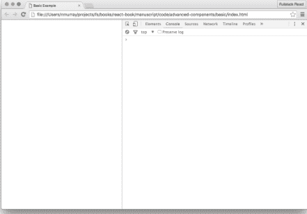

基础控制台

我们将使用一个简单的 HTML 模板，其中包含一个带有 id 标签的 `<div>` 元素：

```
1: <div id='root' />
```

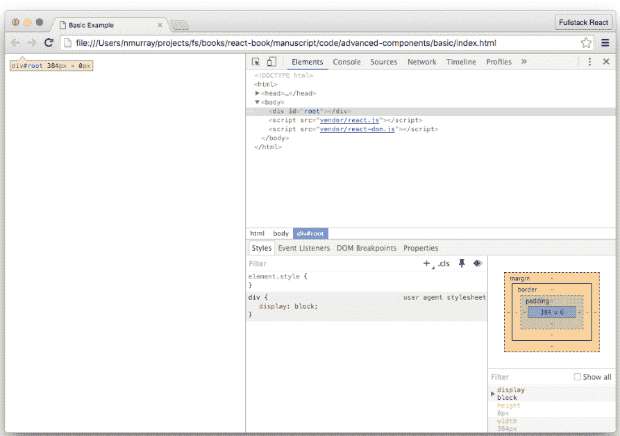

## 根元素

让我们看看如何使用 React 在我们的（真实）DOM 中渲染 `<b></b>` 标签。当然，我们**不会**直接在 DOM 中创建 `<b>` 标签（就像使用 jQuery 时那样）。

相反，React 期望我们提供一个**虚拟 DOM 树**。也就是说，我们将给 React 一组 JavaScript 对象，**React 会将其转换为真实的 DOM 树**。

构成这棵树的这些对象就是 ReactElement。要创建 ReactElement，我们使用 React 提供的 createElement 方法。

例如，要在 React 中创建一个表示 `<b>`（粗体）元素的 ReactElement，请在浏览器控制台中输入以下内容：

```
var boldElement = React.createElement('b');
```

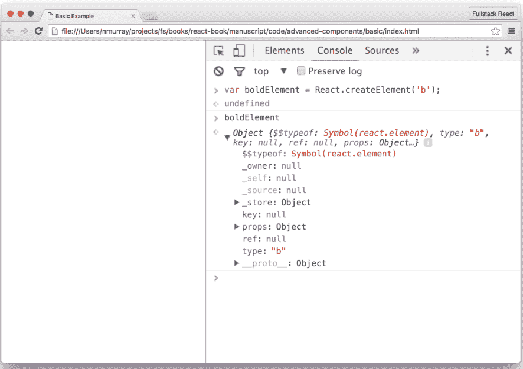

**boldElement 是一个 ReactElement**

上面的 `boldElement` 是 `ReactElement` 的一个实例。现在，我们有了这个 `boldElement`，但如果不将其交给 React 在真实 DOM 树中渲染，它是不可见的。

## 渲染我们的 ReactElement

为了将这个元素渲染到真实 DOM 树中，我们需要使用 `ReactDOM.render()`（我们将在[本章稍后部分](#)更详细地介绍）。`ReactDOM.render()` 需要两个参数：

1. 我们虚拟树的*根节点*
2. 我们希望 React 写入*真实*浏览器 DOM 的*挂载位置*

在我们简单的模板中，我们希望访问 id 为 `root` 的 `div` 标签。要获取真实 DOM 中 `root` 元素的引用，我们使用以下任一方法：

```
// 以下任一方法都可以
var mountElement = document.getElementById('root');
var mountElement = document.querySelector('#root');

// 如果使用 jQuery，这样也可以
var mountElement = $('#root')
```

从 DOM 中获取到 `mountElement` 后，我们可以给 React 一个点来插入它自己渲染的 DOM。

```
var boldElement = React.createElement('b');
var mountElement = document.querySelector('#root');
// 在 DOM 树中渲染 boldElement
ReactDOM.render(boldElement, mountElement);
```

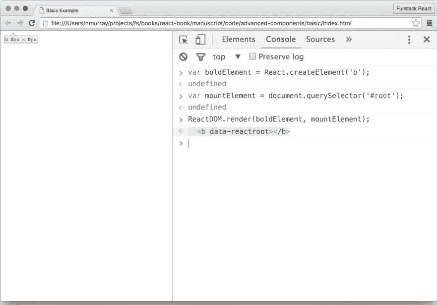

尽管 DOM 中没有显示任何内容，但一个新的空元素已经作为 `mountElement` 的子元素插入到文档中。

如果我们点击 Chrome 检查器中的"Elements"标签页，可以看到真实 DOM 中创建了一个 `b` 标签。

## 添加文本（使用 children）

虽然我们现在在 DOM 中有一个 `b` 标签，但如果我们能在标签中添加一些文本就更好了。由于文本位于 `b` 标签的开始和结束之间，添加文本就意味着创建元素的*子元素*。

上面，我们使用了一个参数的 `React.createElement`（`'b'` 表示 `b` 标签），但 `React.createElement()` 函数接受三个参数：

1. DOM 元素类型
2. 元素的 `props`
3. 元素的 children

我们将在本节的后面详细介绍 props，所以现在我们将这个参数设置为 `null`。

DOM 元素的 `children` 必须是 `ReactNode` 对象，即以下任意一种：

1. `ReactElement`
2. 字符串或数字（`ReactText` 对象）
3. ReactNode 数组

例如，要在我们的 `boldElement` 中放置文本，我们可以将字符串作为第三个参数传入上面的 `createElement()` 函数：

```
var mountElement = document.querySelector('#root');
// 第三个参数是内部文本
var boldElement = React.createElement('b', null, "Text (as a string)");
ReactDOM.render(boldElement, mountElement);
```

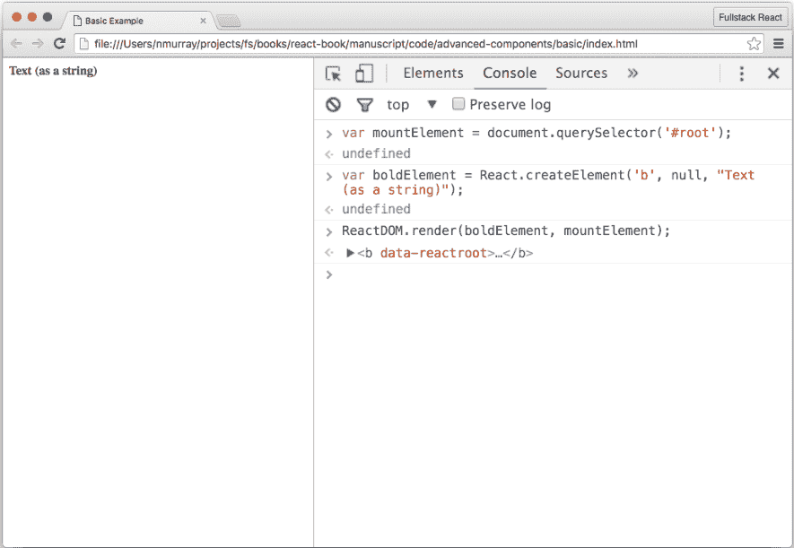

## ReactDOM.render()

正如我们所见，我们使用 React 渲染器将虚拟树放入"硬"浏览器视图（"真实"DOM）中。

但 React 使用自己的视图树虚拟表示有一个很酷副作用：它可以将这棵树渲染到**多种类型的画布**中。

也就是说，React 不仅可以渲染到浏览器的 DOM 中，还可以用于**在其他框架中渲染视图，例如移动应用**。在 React Native（我们将在本书后面讨论）中，这棵树被渲染到*原生移动视图*中。

尽管如此，在本节中，我们将主要关注 DOM，因此我们将使用 `ReactDOM` 渲染器来管理浏览器 DOM 中的元素。

正如我们所见，`ReactDOM.render()` 是我们进入 DOM 的方式：

```
// ...
const component = ReactDOM.render(boldElement, mountElement);
```

我们可以多次调用 ReactDOM.render() 函数，它只会执行必要的更新（修改）操作。

## JSX

*JSX* 是 JavaScript 的扩展语法，建议与 React 配合使用。可以把它看作有一套便捷功能的 JavaScript。JSX 看起来很像 HTML，但它编译为常规的 JavaScript。

由于 JSX 是 JavaScript 的扩展语法，因此它不能直接被浏览器理解。相反，在我们将代码传递给浏览器之前，需要将其*转译*为纯 JavaScript。

在理论上讲，我们可以将任何转译后的内容写成一个长字符串。但那样做就没有意义了。相反，类似于把模板语言放在字符串中，JSX 可以放在 JavaScript 代码中。这样做更简单，设计人员也更喜欢这种方式。


## JSX 属性表达式

要在组件属性中使用 JavaScript 表达式，我们将其用花括号 `{}` 包裹，而不是引号 `""`。

```
// ...
const warningLevel = 'debug';
const component = (<Alert
                color={warningLevel === 'debug' ? 'gray' : 'red'}
                log={true} />)
```

此示例在 color 属性上使用了[三元运算符](https://developer.mozilla.org/en-US/docs/Web/JavaScript/Reference/Operators/Conditional_Operator)。

如果 `warningLevel` 变量设置为 debug，则 `color` 属性将为 `'gray'`，否则将为 `'red'`。

## JSX 条件子元素表达式

另一个常见模式是使用布尔检查表达式，然后有条件地渲染另一个元素。

例如，如果我们正在构建一个为 `admin` 用户显示选项的菜单，我们可以这样写：

```
// ...
const renderAdminMenu = function() {
  return (<MenuLink to="/users">User accounts</MenuLink>)
}
// ...
const userLevel = this.props.userLevel;
return (
  <ul>
    <li>Menu</li>
    {userLevel === 'admin' && renderAdminMenu()}
  </ul>
)
```

我们也可以使用三元运算符来渲染一个组件或另一个组件。

例如，如果我们想为已登录用户显示 `<UserMenu>` 组件，为匿名用户显示 `<LoginLink>`，我们可以使用此表达式：

```
const Menu = (<ul>{loggedInUser ? <UserMenu /> : <LoginLink />}</ul>)
```

## JSX 布尔属性

在 HTML 中，某些属性的存在即表示将该属性设置为 true。例如，可以这样定义一个禁用的 `<input>` HTML 元素：

```
<input name='Name' disabled />
```

在 React 中，我们需要将这些属性设置为布尔值。也就是说，我们需要明确地传递 `true` 或 `false` 作为属性：

```
// 直接在括号中设置布尔值
<input name='Name' disabled={true} />

// ... 或使用 JavaScript 变量
let formDisabled = true;
<input name='Name' disabled={formDisabled} />
```

如果我们需要*启用*上面的 `input`，则将 `formDisabled` 设置为 `false`。

## JSX 注释

我们可以通过使用花括号（`{}`）和注释分隔符（`/* */`）在 JSX 中定义注释：

```
let userLevel = 'admin';
{/*
  如果 userLevel 为 'admin'，则显示管理员菜单
*/}
{userLevel === 'admin' && <AdminMenu />}
```

## JSX 展开语法

有时当我们需要向组件传递许多属性时，逐一列出可能会很麻烦。幸好，JSX 提供了一种快捷语法来简化这一过程。

例如，如果我们有一个包含两个键的属性对象：

```
const props = {msg: "Hello", recipient: "World"}
```

我们*可以*像这样逐一传递每个属性：

```
<Component msg={"Hello"} recipient={"World"} />
```

但通过使用 JSX *展开语法*，我们可以这样做：

```
<Component {...props} />
<!-- 本质上与**此**相同： -->
<Component msg={"Hello"} recipient={"World"} />
```

## JSX 易错点

虽然 JSX 模仿 HTML，但有一些重要的区别需要注意。以下是一些需要记住的事项：

### JSX 易错点：`class` 与 `className`

当我们想设置 HTML 元素的 CSS 类时，通常在标签中使用 `class` 属性：

```
<div class='box'></div>
```

由于 JSX 与 JavaScript 紧密关联，我们不能在标签属性中使用 JavaScript 使用的标识符。诸如 `for` 和 `class` 之类的属性与 JavaScript 关键字 `for` 和 `class` 冲突。JSX 不使用 `class` 来标识类，而是使用 `className`：

```
<!-- 与 <div class='box'></div> 相同 -->
<div className='box'></div>
```

`className` 属性的工作方式与 HTML 中的 `class` 属性类似。它期望接收一个字符串，用于标识与 CSS 类相关联的类（或类们）。

要在 JSX 中传递多个类，我们可以将数组连接成字符串:

```
var cssNames = ['box', 'alert']
// 在 JSX 中使用 cssNames 数组
(<div className={cssNames.join(' ')}></div>)
```

### 技巧：使用 `classnames` 管理 `className`

`classnames` npm 包⁴⁵是一个很棒的扩展，我们用它来辅助管理 CSS 类。它可以接受字符串或对象列表，并允许我们有条件地将类应用于元素。

`classnames` 包接收参数，将它们转换为对象，并在值为真值时有条件地应用 CSS 类。

code/jsx/basic/app.js

```
class App extends React.Component {
  render() {
    const klass = classnames({
      box: true, // 始终应用 box 类
      alert: this.props.isAlert, // 如果设置了属性
      severity: this.state.onHighAlert, // 使用状态
      timed: false // 从不应用此类
    });
    return (<div className={klass} />)
  }
}
```

该包的 readme⁴⁶为更复杂的环境提供了替代示例。

### JSX 易错点：`for` 与 `htmlFor`

由于同样的原因，我们不能使用 `class` 属性，我们也不能将 `for` 属性应用于 `<label>` 元素。相反，我们必须使用属性 `htmlFor`。该属性是一个直通属性，它将属性应用为 `for`：

```
<!-- ... -->
<label htmlFor='email'>Email</label>
<input name='email' type='email' />
<!-- ... -->
```

### JSX 易错点：HTML 实体和 Emoji

*实体*是 HTML 中的保留字符，包括小于号 <、大于号 >、版权符号等。要显示实体，我们可以直接将实体代码放在文本中。

⁴⁵https://www.npmjs.com/package/classnames
⁴⁶https://github.com/JedWatson/classnames/blob/master/README.md

```
1 <ul>
2   <li>phone: &phone;</li>
3   <li>star: &star;</li>
4 </ul>
```

要在动态数据中显示实体，我们需要将它们用花括号（{}）中的字符串包裹。在 JS 中直接使用 unicode 按预期工作。正如我们可以将 JS 作为 UTF-8 文本直接发送到浏览器一样。我们的浏览器原生知道如何显示 UTF-8 代码。

或者，不使用实体字符代码，我们可以使用 unicode 版本。

```
1  return (
2    <ul>
3      <li>phone: {'\u0260e'}</li>
4      <li>star: {'\u2606'}</li>
5    </ul>
6  )
```

Emoji 只是 unicode 字符序列，因此我们可以用同样的方式添加 emoji：

```
1  return(
2    <ul>
3      <li>dolphin: {'\uD83D\uDC2C'}</li>
4      <li>dolphin: {'\uD83D\uDC2C'}</li>
5      <li>dolphin: {'\uD83D\uDC2C'}</li>
6    </ul>
7  )
```

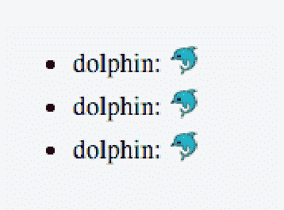

每个人都需要更多海豚

### JSX 易错点：`data-anything`

如果我们想应用 HTML 规范未涵盖的自定义属性，我们需要在属性键前加上字符串 `data-`。

```
<div className='box' data-dismissible={true} />
<span data-highlight={true} />
```

此要求*仅*适用于原生 HTML 的 DOM 组件，并不意味着自定义组件不能接受任意键作为属性。也就是说，我们可以在自定义组件上接受*任何*属性：

```
<Message dismissible={true} />
<Note highlight={true} />
```

有一组标准的[网页可访问性](https://www.w3.org/WAI/intro/aria) [属性](https://www.w3.org/TR/wai-aria/)，使用它们是个好主意，因为如果没有它们，很多人将难以使用我们的网站。我们可以在元素上使用这些属性中的任何一个，键前加上字符串 `aria-`。例如，要设置 `hidden` 属性：

```
<div aria-hidden={true} />
```

## JSX 总结

JSX 并非魔法。需要记住的关键点是，JSX 是调用 `React.createElement` 的语法糖。

JSX 将解析我们编写的标签，然后创建 JavaScript 对象。JSX 是一种方便的语法，有助于构建组件树。

正如我们之前所见，当我们在代码中使用 JSX 标签时，它会被转换为 `ReactElement`：

```
var boldElement = <b>Text (as a string)</b>;
// => boldElement 现在是一个 ReactElement
```

我们可以将该 `ReactElement` 传递给 `ReactDOM.render`，并在页面上看到我们的代码渲染出来。

不过有一个问题：`ReactElement` 是无状态且不可变的。如果我们想为应用添加交互性（使用状态），我们需要另一块拼图：`ReactComponent`。

在下一章中，我们将深入讨论 `ReactComponents`。


 ## 参考文献

以下是一些深入了解 JSX 和虚拟 DOM 的资料：

- [深入了解 JSX](https://facebook.github.io/react/docs/jsx-in-depth.html) - (Facebook)
- [JSX 中的 If-Else](https://facebook.github.io/react/tips/if-else-in-JSX.html) - (Facebook)
- [React（虚拟）DOM 术语](https://facebook.github.io/react/docs/glossary.html) - (Facebook)
- [什么是虚拟 DOM](http://jbi.sh/what-is-virtual-dom/) - (Jack Bishop)

# 使用 props、state 和 children 进行高级组件配置

与本书其他章节不同，本章旨在以百科全书式的视角，深入探讨 React 的各种特性。因此，我们在本书的这一部分没有包含逐步跟随式的项目。

## 简介

在本章中，我们将深入探讨组件的配置。

`ReactComponent` 是一个 JavaScript 对象，至少包含一个 `render()` 函数。`render()` 需要**返回一个 ReactElement**。回想一下，`ReactElement` 是虚拟 DOM 中 DOM 元素的表示。

> 在关于 JSX 和虚拟 DOM 的章节中，我们 extensively 讨论了 ReactElement。如果你想更好地理解 ReactElement，请查看该章节。

`ReactComponent` 的目标是：

- render() 一个 ReactElement（最终将成为真实 DOM）以及
- 为页面的这一部分附加功能

"附加功能"有点模糊；它包括附加事件处理程序、管理状态、与子组件交互等。在本章中，我们将涵盖：

- render() - 每个 ReactComponent 上唯一必需的函数
- props - 组件的"输入参数"
- context - 组件的"全局变量"
- state - 一种保存组件本地数据的方式（影响渲染）
- 无状态组件 - 一种简化的可重用组件编写方式
- children - 如何交互和操作子组件
- statics - 如何在组件上创建"类方法"

让我们开始吧！

## 如何使用本章

本章是使用一个名为 `styleguidist` 的特定工具构建的。本课程附带的代码中包含一个名为 `components-cookbook` 的部分，本章配有捆绑在其中的 `styleguidist` 工具。要使用 `styleguidist` 工具（它允许对组件本身进行 introspection），我们可以通过本章启动该部分。

要启动它，请在终端中切换到目录并执行以下命令。首先，我们需要使用 `npm install` 获取项目的依赖项：

```
npm install
```

要启动应用程序，执行 `npm start` 命令：

```
npm start
```

服务器运行后，我们可以打开浏览器并访问 `http://localhost:3000` 这个 URL。我们将看到 styleguide 正在运行，本章的所有组件都已展示出来，我们可以在其中导航，查看实时执行的组件运行示例。

## ReactComponent

### 创建 ReactComponents - createClass 或 ES6 类

如第一章所述，有两种方式可以定义 ReactComponent 实例：

1. `React.createClass()` 或者
2. ES6 类

正如我们所见，这两种创建组件的方法大致等价：

advanced-components/components-cookbook/src/components/Component/CreateClassApp.js

```
import React from 'react'

// React.createClass
const App = React.createClass({
  render: function() {} // 必需方法
});

export default App
```

以及

advanced-components/components-cookbook/src/components/Component/Components.js

```
import React from 'react'

// ES6 类风格
class App extends React.Component {
  render() {} // 必需
}

export default App
```

无论我们使用哪种方法来定义 ReactComponent，React 都要求我们定义 render() 函数。

### render() 返回 ReactElement 树

render() 方法是在 ReactComponent 上唯一需要定义的方法。组件挂载并初始化后，将会调用 render()。render() 函数的职责是为 React 提供原生 DOM 组件的虚拟表示。使用 React.createClass 结合 render 函数的示例可能如下所示：

advanced-components/components-cookbook/src/components/Component/CreateClassHeading.js

```
const CreateClassHeading = React.createClass({
  render: function() {
    return (
      <h1>Hello</h1>
    )
  }
});
```

或者使用 ES6 类风格组件：

advanced-components/components-cookbook/src/components/Component/Header.js

```
class Heading extends React.Component {
  render() {
    return (
      <h1>Hello</h1>
    )
  }
};
```

上面的代码应该看起来很熟悉。它描述了一个带有单个 `render()` 方法的 `Heading` 组件类，该方法返回一个简单的 `<h1>` 标签的单一虚拟 DOM 表示。

请记住，这个 `render()` 方法返回一个 `ReactElement`，它不是"实际 DOM"的一部分，而是虚拟 DOM 的描述。

React 期望该方法返回*单个*子元素。它可以是 DOM 组件的虚拟表示，或者返回 falsy 值 `null` 或 `false`。React 通过渲染空元素（`<noscript />` 标签）来处理 falsy 值。这用于从页面中移除该标签。

保持 `render()` 方法无副作用提供了重要的优化，并使我们的代码更易于理解。

### 将数据传入 render()

当然，虽然 `render` 是唯一必需的方法，但如果我们能渲染的数据只有在编译时才已知，那它就不是很有趣。也就是说，我们需要一种方式来：

- 向组件输入"参数"以及
- 在组件内维护状态。

React 提供了两种方式来实现这些，分别是 props 和 state。

理解这些对于使我们的组件动态化并在更大的应用中*可用*至关重要。

在 React 中，props 是传递给子组件的**不可变数据**（如果我们把组件看作"函数"，我们可以把 props 看作组件的"参数"）。

组件 state 是我们保存组件本地数据的地方。通常，当组件的 state 改变时，组件需要重新渲染。与 props 不同，state 是组件私有的，并且是可变的。

我们将在下面详细讨论 props 和 state。在此过程中，我们还会谈到 context，一种贯穿整个组件树的"隐式 props"。

让我们更详细地看看每一个。

### props 是参数

props 是组件的输入。如果我们把组件看作一个"函数"，我们可以把 props 看作"参数"。

让我们看一个例子：

```
<div>
  <Header headerText="Hello world" />
</div>
```

在示例代码中，我们创建了一个 `<div>` 和一个 `<Header>` 元素，其中 `<div>` 是普通的 DOM 元素，而 `<Header>` 是我们 `Header` 组件的实例。

在这个例子中，我们通过属性 `headerText` 将这么做的数据（字符串 `"Hello world"`）传递给组件。

> 通过属性向组件传递数据通常被称为*传递 props*。

当我们通过属性向组件传递数据时，它可以通过 `this.props` 属性在组件中使用。因此在这种情况下，我们可以通过属性 `this.props.headerText` 访问我们的 `headerText`：

```
import React from 'react';

export class Header extends React.Component {
  render() {
    return (
      <h1>{this.props.headerText}</h1>
    );
  }
}
```

虽然我们可以访问 headerText 属性，但我们*不能*修改它。

通过使用 props，我们将静态组件转变为能够动态渲染传递给它的任何 headerText 的组件。`<Header>` 组件不能改变 headerText，但它可以使用 `headerText` 本身或将其传递给它的子组件。

我们可以通过 props 传递任何 JavaScript 对象。我们可以传递原始值、简单的 JavaScript 对象、原子、函数等。我们甚至还可以传递其他 React 元素和虚拟 DOM 节点。

我们可以使用 props 来记录组件的功能，并且通过使用 `PropTypes` 来指定每个 prop 的*类型*。

### PropTypes

PropTypes 是一种验证通过 props 传入的值的方式。定义良好的接口为我们的应用程序运行时提供了一层安全保障。它们还为组件的使用者提供了一层文档。

我们在 `package.json` 中包含 `prop-types` 包。

我们通过设置*静态*（类）属性 `propTypes` 来定义 `PropTypes`。这个对象应该是 prop 名称键到 `PropTypes` 值的映射：

```
class Map extends React.Component {
  static propTypes = {
    lat: PropTypes.number,
    lng: PropTypes.number,
    zoom: PropTypes.number,
    place: PropTypes.object,
    markers: PropTypes.array,
  };
```

如果使用 createClass，我们将 PropTypes 作为选项传递给 createClass() 来定义它们：

```
const Map = React.createClass({
    propTypes: {
        lat: PropTypes.number,
        lng: PropTypes.number
        // ...
    },
})
```

在上面的示例中，我们的组件将验证 `name` 是字符串，`totalCount` 是数字。

有许多内置的 PropTypes，我们也可以定义自己的 PropTypes。

我们在[附录中的 PropTypes 部分](#)为许多 PropTypes 验证器编写了代码示例。有关 PropTypes 的更多详细信息，请查看该附录。

目前，我们需要知道存在用于标量类型的验证器：

- string
- number
- boolean

我们还可以验证复杂类型，例如：

- function
- object
- array
- arrayOf - 期望特定类型的数组
- node
- element

我们还可以验证输入对象的特定 `shape`，或验证它是某个类的 `instanceOf`。

查看 [附录中的 PropTypes 部分](#) 以获取更多关于 PropTypes 的详细信息和代码示例。

有时我们希望我们的 props 具有默认值。我们可以使用静态属性 `defaultProps` 来实现这一点。

例如，创建一个 `Counter` 组件定义，并使用 `defaultProps` 告诉该组件，如果 props 中没有设置 `initialValue`，则将其设置为 1：

```
class Counter extends React.Component {
  static defaultProps = {
    initialValue: 1
  };
  // ...
};
```

现在可以无需设置 `initialValue` prop 就可以使用该组件。这两种组件使用方式在功能上是等效的：

```
<Counter />
<Counter initialValue={1} />
```

有时我们可能会发现有一个 prop 希望进行"全局"暴露。在这种情况下，我们可能会发现将这个特定的 prop 从根节点传递到每个叶子节点，经过每个中间组件，是很繁琐的。

相反，指定 `context` 可以让我们自动将变量从一个组件传递到另一个组件，而无需在每个层级都传递 props，

> `context` 功能是实验性的，它类似于在应用程序中使用全局变量来处理状态——即尽量减少 `context` 的使用，过度依赖它是一种代码异味。

也就是说，`context` 最适合那些真正全局的东西，例如 Redux 中的中央存储。

当我们指定 `context` 时，React 会负责将 `context` 从组件向下传递，以便在树层次结构中的任何一点，任何组件都可以访问到定义"全局" `context` 的位置并获取父组件的变量。

为了告诉 React 我们希望将 `context` 从父组件传递给其所有子组件，我们需要在父类中定义两个属性：

- childContextTypes 和
- getChildContext

要在子组件中检索 context，我们需要在子组件中定义 contextTypes。为了说明这一点，让我们看一下可能的消息阅读器实现：

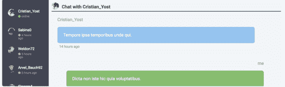

```
class Messages extends React.Component {
  static propTypes = {
    users: PropTypes.array.isRequired,
    messages: PropTypes.array.isRequired
  };

  render() {
    return (
      <div>
        <ThreadList />
        <ChatWindow />
      </div>
    )
  }
});

// ThreadList and ChatWindow are also React.Components
```

如果没有 context，我们的 Messages 将不得不将 users 和 messages 传递给两个子组件（子组件再传递给它们的子组件）。让我们设置我们的层次结构，使其接受 context，而不需要将这个 props.users 和 this.props.messages 传递给每个组件。

在 Messages 组件中，我们将定义两个必需的属性。首先，我们需要告诉 React 我们的 context 类型是什么。

我们使用 childContextTypes 键来定义它。类似于 propTypes，childContextTypes 是一个键值对象，其键是 context 项的名称，值是一个 PropType。

在我们的 Messages 组件中实现 childContextTypes 看起来如下所示：

## 使用 props、state 和 children 进行高级组件配置

```
advanced-components/components-cookbook/src/components/Messages/Messages.js

class Messages extends React.Component {
  static propTypes = {
    users: PropTypes.array.isRequired,
    initialActiveChatIdx: PropTypes.number,
    messages: PropTypes.array.isRequired,
  };

  static childContextTypes = {
    users: PropTypes.array,
    userMap: PropTypes.object,
  };
```

就像 propTypes 一样，childContextTypes 不会填充 context，它只是定义了它。为了填充 this.context 对象的数据，我们需要定义第二个必需的函数：getChildContext()。

使用 getChildContext()，我们可以用函数的返回值设置 context 的初始值。回到我们的 Messages 组件，我们将把我们的 users context 对象设置为传递给组件的 this.props.users 的值。

```
advanced-components/components-cookbook/src/components/Messages/Messages.js

class Messages extends React.Component {
  // ...
  static childContextTypes = {
    users: PropTypes.array,
    userMap: PropTypes.object,
  };
  // ...
  getChildContext() {
    return {
      users: this.getUsers(),
      userMap: this.getUserMap(),
    };
  }
  // ...
}
```

由于组件的 state 和 props 可能会改变，context 也可能改变。父组件中的 getChildContext() 方法在父组件的 state 或 props 每次改变时都会被调用。如果 context 更新了，那么子组件将接收到更新的 context，并随后被重新渲染。

在父组件上设置了这两个必需的属性后，React 会*自动*将对象向下传递到自己的子树中，任何组件都可以访问它。为了在子组件中获取 context，我们需要告诉 React 我们希望访问它。我们通过在子组件中使用 contextTypes 定义来与 React 沟通。

如果子 React 组件上没有 contextTypes 属性，React 就不知道要向我们的组件发送什么。让我们让我们的子组件访问 Messages 的 context。

advanced-components/components-cookbook/src/components/Messages/ThreadList.js

```
class ThreadList extends React.Component {
  // ...
  static contextTypes = {
    users: PropTypes.array,
  };
  // ...
}
```

advanced-components/components-cookbook/src/components/Messages/ChatWindow.js

```
class ChatWindow extends React.Component {
  // ...
  static contextTypes = {
    userMap: PropTypes.object,
  };
  // ...
}
```

advanced-components/components-cookbook/src/components/Messages/ChatMessage.js

```
class ChatMessage extends React.Component {
  // ...
  static contextTypes = {
    userMap: PropTypes.object,
  };
  // ...
}
```

现在，在我们的任何子组件中（定义了 contextTypes 的组件），我们都可以访问父组件并获取 users，而不需要通过 props 手动传递它们。context 数据设置在定义了 contextTypes 的组件的 this.context 对象上。

例如，我们完整的 ThreadList 可能看起来像这样：

```
class ThreadList extends React.Component {
  // ...
  render() {
    return (
      <div className={styles.threadList}>
        <ul className={styles.list}>
          {this.context.users.map((u, idx) => {
            return (
              <UserListing
                onClick={this.props.onClick}
                key={idx}
                index={idx}
                user={u}
              />
            );
          })}
        </ul>
      </div>
    );
  }
}
```

如果组件上定义了 `contextTypes`，那么它的几个生命周期方法将获得一个额外的参数 `nextContext`：

```
class ThreadList extends React.Component {
  // ...
  static contextTypes = {
    users: PropTypes.array,
  };
  // ...
  componentWillReceiveProps(nextProps, nextContext) {
    // ...
  }
  // ...
  shouldComponentUpdate(nextProps, nextState, nextContext) {
    // ...
  }
  // ...
  componentWillUpdate(nextProps, nextState, nextContext) {
```


 ```javascript
// ...
}
// ...
componentDidUpdate(prevProps, prevState, prevContext) {
  // ...
}
```

在无状态函数式组件中，context 将作为第二个参数传递：

我们在[下方讨论无状态组件](https://example.com)

advanced-components/components-cookbook/src/components/Messages/ChatHeader.js

```
const ChatHeader = (props, context) => {
  // ...
};
```

在 JavaScript 中使用全局变量通常不是一个好主意，因此 context 最好仅限于需要获取全局变量的有限场景，例如已登录的用户。我们在生产应用中使用 `context` 时倾向于谨慎行事，更偏好使用 `props`。

## state

我们在组件中处理的第二种数据类型是 `state`。要知道何时应用 state，我们需要理解*有状态*组件的概念。任何时候，如果一个组件需要*保存一份动态数据*，该组件就可以被视为有状态的。

例如，当电灯开关被打开时，该开关就保存着"开启"的状态。关闭电灯可以被描述为将灯的状态切换为"关闭"。

在构建应用时，我们可能有一个描述特定设置的开关，比如一个需要验证的输入框，或者聊天应用中某位用户的在线状态。这些都是需要在组件内部保存 state 的情况。

我们将保存局部可变数据的组件称为*有状态*组件。我们将在下面进一步讨论何时应该使用组件 state。目前，要知道拥有尽可能**少的有状态组件**是一个好主意。这是因为 state 会引入复杂性，并使组件组合更加困难。尽管如此，有时我们确实需要组件局部 state，所以让我们看看如何实现它，稍后我们再讨论*何时*使用它。

## 使用 state：构建自定义单选按钮

在这个示例中，我们将使用内部 state 来构建一个用于切换支付方式的单选按钮。完成后的表单看起来是这样的：

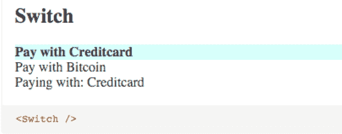

在选项之间切换。

简单开关

让我们看看如何使组件成为有状态的：

advanced-components/components-cookbook/src/components/Switch/steps/Switch1.js

```
class Switch extends React.Component {
  state = {};

  render() {
    return <div><em>Template will be here</em></div>;
  }
}

module.exports = Switch;
```

就是这样！当然，仅仅在组件上设置 state 并不那么有趣。要*使用*组件上的 state，我们将使用 `this.state` 来引用它。

advanced-components/components-cookbook/src/components/Switch/steps/Switch2.js

```
const CREDITCARD = 'Creditcard';
const BTC = 'Bitcoin';

class Switch extends React.Component {
  state = {
    payMethod: BTC,
  };

  render() {
    return (
      <div className='switch'>
        <div className='choice'>Creditcard</div>
        <div className='choice'>Bitcoin</div>
        Pay with: {this.state.payMethod}
      </div>
    );
  }
}

module.exports = Switch;
```

在我们的 render 函数中，我们可以看到用户可以选择的选项（尽管我们还无法改变支付方式），以及他们当前的选择，这些都被保存在组件的 `state` 中。这个 `Switch` 组件现在是有状态的，因为它正在跟踪用户偏好的支付方式。

我们的支付开关还不能交互；我们无法改变组件的状态。让我们通过添加一个事件处理器来实现当用户选择不同支付方式时的首次交互。

为了添加交互，我们需要响应点击事件。要为*任何*组件添加回调处理器，我们可以使用组件上的 `onClick` 属性。`onClick` 处理器将在定义它的组件被点击时触发。

advanced-components/components-cookbook/src/components/Switch/steps/Switch3.js

```
21    return (
22      <div className='switch'>
23        <div
24          className='choice'
25          onClick={this.select(CREDITCARD)} // 添加这行
26        >Creditcard</div>
27        <div
28          className='choice'
29          onClick={this.select(BTC)} // ... 以及这行
30        >Bitcoin</div>
31        Pay with: {this.state.payMethod}
32      </div>
33    );
```

使用 onClick 属性，我们附加了一个回调处理器，该处理器将在任一 `<div>` 元素被点击时被调用。

onClick 处理器期望接收一个函数，它将在点击事件发生时调用该函数。让我们看看 select 函数：

advanced-components/components-cookbook/src/components/Switch/steps/Switch3.js

```
 6  class Switch extends React.Component {
 7    state = {
 8      payMethod: BTC,
 9    };
10
11    select = (choice) => {
12      return (evt) => {
13        // <-- 处理器从这里开始
14        this.setState({
15          payMethod: choice,
16        });
17      };
18    };
```

关于 select 注意两点：

- 1. 它返回一个函数
- 2. 它使用 setState

### 返回新函数

注意 `select` 和 `onClick` 的有趣之处：`onClick` 属性期望传入一个*函数*，但我们首先*调用*了一个函数。这是因为 `select` 函数本身将*返回一个函数*。

这是一种向处理器传递参数的常用模式。我们在调用 `select` 时对 choice 参数进行*闭包*。`select` 返回一个新函数，该函数将使用适当的 choice 调用 `setState`。

当其中一个子 `<div>` 元素被点击时，处理器函数将被调用。注意 `select` 实际上在 `render` 期间被调用，而被 `onClick` 调用的是 `select` 的*返回值*。

### 更新 State

当处理器函数被调用时，组件将在自身上调用 `setState`。调用 `setState` 会触发刷新，这意味着 `render` 函数将再次被调用，我们就能在视图中看到当前的 `state.payMethod`。

> **setState 有性能影响**
> 由于 `setState` 方法会触发刷新，我们要注意调用它的频率。
>
> 修改实际 DOM 很慢，所以我们不想导致一连串的 `setState` 被调用，因为那可能会导致用户的性能不佳。

### 显示选择

在我们的组件中，我们（还）没有除伴随文本之外的方式来指示ConcreteComponent哪个选择已被选中。

如果选择本身有一个被选中的视觉指示会更好。我们通常使用 CSS 来应用 `active` 类实现这一点。在我们的示例中，我们使用 `className` 属性。

为了做到这一点，我们需要添加一些逻辑，根据组件的当前状态来确定添加哪些 CSS 类。

但在添加太多 CSS 逻辑之前，让我们重构组件，使用函数来渲染每个选择：

advanced-components/components-cookbook/src/components/Switch/steps/Switch4.js

```
21         <div className='choice' onClick={this.select(choice)}>
22           {choice}
23         </div>
24       );
25     };
26
27     render() {
28       return (
29         <div className='switch'>
30           {this.renderChoice(CREDITCARD)}
31           {this.renderChoice(BTC)}
32           Pay with: {this.state.payMethod}
33         </div>
34       );
35     }
36   }
37
38   module.exports = Switch;
```

现在，我们不再将所有渲染代码放入 `render()` 函数中，而是将选择渲染,而是将选择渲染隔离到它自己的函数中。

最后，让我们将 `.active` 类添加到 `<div>` 选择组件上。

advanced-components/components-cookbook/src/components/Switch/steps/Switch5.js

```
22       const cssClasses = [];
23
24       if (this.state.payMethod === choice) {
25         cssClasses.push(styles.active); // 添加 .active 类
26       }
27
28       return (
29         <div
30           className='choice'
31           onClick={this.select(choice)}
32           className={cssClasses}
33         >
34           {choice}
35         </div>
36       );
```


 ```  };

  render() {
    return (
      <div className='switch'>
        {this.renderChoice(CREDITCARD)}
        {this.renderChoice(BTC)}
        Pay with: {this.state.payMethod}
      </div>
    );
  }
```

> 注意，我们将样式 `styles.active` 推入到了 `cssClasses` 数组中。那么 `styles` 是从哪里来的呢？

对于这段代码示例，我们使用了一个 webpack loader 来导入 CSS。深入探讨 webpack 的工作原理超出了本章的范围。但为了让你了解我们是如何使用它的，有两点需要知道：

1. 我们像这样导入样式：`import styles from '../Switch.css';`
2. 这意味着该文件中的所有样式都可以像对象一样访问——例如，`styles.active` 为我们提供了来自 `Switch.css` 的 `.active` 类的引用

我们这样做是因为这是一种 CSS *封装* 形式。也就是说，*实际的* CSS 类名 marker 不会真的是 `.active`，这意味着我们不会与其他可能使用相同类名的组件发生冲突。

## 有状态组件

在我们的组件上定义状态需要我们在对象原型类中设置一个名为 `this.state` 的实例变量。要做到这一点，我们需要在两个地方之一设置状态，要么作为类的属性，要么在构造函数中。

以这种方式设置有状态组件使我们能够：

1. 定义组件的*初始*状态。
2. 告诉 React 我们的组件将是有状态的。如果没有定义这个方法，我们的组件将被视为无状态的。

对于组件来说，看起来是这样的：

在这个例子中，`state` 对象只是一个 JavaScript 对象，但我们可以在这个函数中返回任何内容。例如，我们可能想将其设置为单个值：

```
class Counter extends React.Component {
  constructor(props) {
    super(props)

    this.state = 0
  }
}
```

在组件内部设置 `props` 通常总是一个坏主意。设置 `state` 属性的初始值是我们应该*唯一*在处理组件状态时使用 props 的时刻。也就是说，如果我们曾经想要将一个 prop 的值设置为状态，我们应该在这里做。

例如，如果我们有一个组件，其中 `prop` 表示组件的 `value`，我们应该将该值应用到 `constructor()` 方法中的 `state`。作为 prop 的 value 的一个更好的名称是 `initialValue`，表示该值的初始状态将被设置。

例如，考虑一个 `Counter` 组件，它显示某个计数并包含一个递增和递减按钮。我们可以像这样设置计数器的初始值：

advanced-components/components-cookbook/src/components/Counter/CounterWrapper.js

```
const CounterWrapper = props => (
  <div>
    <Counter initialValue={125} />
  </div>
)
```

从 `<Counter>` 组件的使用中，我们知道 Counter 的值将会通过名称 `initialValue` 而改变。Counter 组件可以在 `constructor()` 中使用这个 prop，如下所示：

advanced-components/components-cookbook/src/components/Counter/Counter.js

```
class Counter extends Component {
  constructor(props) {
    super(props);

    this.state = {
      value: this.props.initialValue
    };
  }
  // ...
}
```

由于构造函数在组件本身挂载之前只运行一次，我们可以用它来建立我们的初始状态。

## 依赖于当前状态的状态更新

Counter 有用于递增和递减计数的按钮：

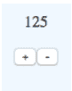

Counter 组件

当按下 "-" 按钮时，React 将调用 `decrement()`。`decrement()` 将从 state 的 value 中减去 1。类似这样的代码看起来似乎足够：

```
decrement = () => {
  // 看起来正确，但有更好的方式
  const nextValue = this.state.value - 1;
  this.setState({
    value: nextValue,
  });
}
```

然而，每当状态更新依赖于当前状态时，最好向 `setState()` 传递一个函数。我们可以这样做：

```
decrement = () => {
  this.setState(prevState => {
    return {
      value: prevState.value - 1,
    };
  });
}
```

`setState()` 将调用此函数，并将先前版本的状态作为第一个参数。

为什么以这种方式设置状态是必要的？因为 **setState() 是异步的**。

这里有一个例子。假设我们使用第一个 `decrement()` 方法，即向 `setState()` 传递一个对象。当我们第一次调用 `decrement()` 时，value 是 125。然后我们调用 `setState()`，传递一个值为 124 的对象。

然而，**状态不一定会立即更新**。相反，React 会将我们请求的状态更新添加到它的队列中。

假设用户用鼠标特别快，而她的计算机处理速度特别慢。在 React 处理完我们之前的状态更新之前，用户设法再次点击了递减按钮。响应用户交互是高优先级的，所以 React 调用 `decrement()`。状态中的值*仍然*是 125。因此，我们将*另一个*状态更新入队，再次将 value 设置为 124。

然后 React 提交了两个状态更新。让我们敏锐而手快的用户沮丧的是，应用程序显示的数字不是正确的 123，而是 124。

在我们的简单示例中，这个 bug 发生的几率很小。但随着 React 应用程序变得越来越复杂，React 可能会遇到被高优先级工作（如动画）压得喘不过气来的时期。而且可以想象，状态更新可能会被排队相当长的时间。

每当状态转换依赖于当前状态时，使用函数来设置状态有助于避免这种神秘 bug 出现的机会。

> 关于此主题的进一步阅读，请参阅我们 Sophia Shoemaker 的文章[在 setState 中使用函数而不是对象](https://medium.com/@shopsifter/using-a-function-in-setstate-instead-of-an-object-1f5cfd6e55d1)[^53]。

## 思考状态

将状态散布在整个应用程序中会使其难以推理。在构建有状态组件时，我们应该注意**在状态中添加什么**以及**为什么**要使用状态。

通常，我们希望尽量减少应用程序中保持组件本地状态的组件数量。

如果我们有一个组件具有以下 UI 状态：

1. 无法从外部"获取"或
2. 无法传递到组件中，

这通常是将状态构建到组件中的情况。

然而，任何可以通过 props 或其他组件传入的数据通常最好不要去动。我们*唯一*应该放入状态的信息是那些不需要计算的值，以及不需要在应用程序中*同步*的值。

> 是否将状态放入我们的组件中与"面向对象编程"和"函数式编程"之间的张力密切相关。

在函数式编程中，如果你有一个纯函数，那么用相同的参数调用相同的函数，对于给定的输入集总是会返回相同的值。这使得纯函数的行为很容易推理，因为输出在任何时候都是一致的，相对于输入而言。

在面向对象编程中，对象在其内部持有状态。对象状态随后成为对象方法的隐式参数。状态可以改变，因此在程序的不同时间用相同的参数调用相同的函数，可以返回不同的答案。

这与 React 组件中的 props 和 state 有关，因为你可以将 props 视为我们组件的"参数"，将 state 视为对象的"实例变量"。

如果我们的组件仅使用 props 来配置组件（并且它不使用 state 或任何其他外部变量），那么我们可以轻松预测特定组件将如何渲染。

然而，如果我们使用可变的、组件本地的 state，那么就很难理解组件在特定时间将如何渲染。

因此，虽然通过 state 携带"隐式参数"可能很方便，但它也可能使系统难以推理。

也就是说，状态不能完全避免。现实世界有状态：当你扳动电灯开关时，世界已经改变了——我们的程序必须能够处理状态，以便在现实世界中运作。

好消息是，已经涌现了各种各样的工具和模式来在 React 中处理状态（特别是 Flux 及其变体），我们在本书的其他地方会谈到。你应该遵循的经验法则是**尽量减少有状态组件的数量**。

保持状态通常有利于强制和维护一致的 UI，否则这些 UI 将无法更新。此外，还有一点要记住，那就是我们应该尽量减少放入状态的信息量。我们保持的状态越小且越可序列化（即我们能轻松将其变成 JSON），越好。我们的应用程序不仅会更快，而且更容易推理。当我们的状态变得庞大和/或难以管理时，这通常是一个危险信号。

我们可以缓解和最小化复杂状态的一种方法是：通过构建一个单一的有状态组件来构成我们的应用程序，该组件由无状态组件组成：即不保持状态的组件。

## 无状态组件

构建*有状态*组件的另一种方法是使用*无状态*组件。无状态组件旨在成为轻量级组件，不需要对组件进行任何特殊处理。

无状态组件是 React 构建仅需要 `render()` 方法的组件的轻量级方式。

让我们看一个无状态组件的例子：

advanced-components/components-cookbook/src/components/Header/StatelessHeader.js

```
const Header = function(props) {
  return (<h1>{props.headerText}</h1>)
}
```

注意，我们在访问 props 时没有引用 `this`，因为它们只是作为参数传递给函数的。事实上，这里的无状态组件实际上不是一个类，从这个意义上说，它不是一个 ReactElement。

[^53]: https://medium.com/@shopsifter/using-a-function-in-setstate-instead-of-an-object-1f5cfd6e55d1
```


## 使用 `props`、`state` 和 `children` 进行高级组件配置

函数式无状态组件*没有*可供引用的 `this` 属性。实际上，当我们使用无状态组件时，React 渲染过程*不会*创建新的 ReactComponent 实例，而是返回 null。它们只是函数，没有支撑实例。这些组件*不能*包含状态，也不会被调用正常的组件生命周期方法。我们不能使用 `refs`（下文描述），不能引用 DOM，等等。

React **确实**允许我们在无状态组件上使用 `propTypes` 和 `defaultProps`。

既然有这么多限制，为什么我们还想使用无状态组件呢？有两个原因：

- 最小化有状态组件
- 性能

正如我们上面讨论的，有状态组件往往会将复杂性分散到整个系统中。一个无状态组件，如果使用得当，可以帮助将状态限制在更少的位置，从而使我们的程序更容易理解和维护。

此外，由于 React 不必在内存中跟踪组件实例、进行脏检查等操作，我们可以获得显著的性能提升。

一个经验法则是尽可能多地使用无状态组件。如果我们不需要任何生命周期方法，仅靠一个渲染函数就能解决问题，那么使用无状态组件就是一个很好的选择。

## 切换到无状态

我们能把上面的 `Switch` 组件转换成无状态组件吗？嗯，当前选中的支付选项*是*状态，所以它必须保存在某个地方。

虽然我们不能完全移除状态，但至少可以将其隔离。这是 React 应用中常见的模式：尝试将状态拉到少数父组件中。

在我们的 `Switch` 组件中，我们将每个选项提取到 `renderChoice` 函数中。这表明它很适合被提取为独立的无状态组件。但有一个问题：`renderChoice` 是调用 `select` 的函数，这意味着它间接调用了 `setState`。让我们看看如何处理这个问题：

```javascript
const Choice = function (props) {
  const cssClasses = [];

  if (props.active) {
    // <-- check props, not state
    cssClasses.push(styles.active);
  }

  return (
    <div
      className='choice'
      onClick={props.onClick}
      className={cssClasses}
    >
      {props.label} {/* <-- allow any label */}
```

这里我们创建了一个 Choice 函数，它是*一个无状态组件*。但我们有一个问题：如果组件是无状态的，我们就不能从 state 中读取数据。那我们该怎么做呢？**通过 props 传递参数**。

在 Choice 中我们做了三处更改（在上面的代码中由注释标记）：

1. 我们通过读取 `props.active` 来判断该选项是否为活动状态
2. 当 `Choice` 被点击时，我们调用 `props.onClick` 上的任何函数
3. 标签由 `props.label` 决定

所有这些更改意味着 Choice 与 `Switch` 语句*解耦*了。现在我们可以设想在任何地方使用 Choice，只要我们通过 props 传递 `active`、`onClick` 和 `label` 即可。

让我们看看这如何改变 `Switch`：

```javascript
render() {
  return (
    <div className='switch'>
      <Choice
        onClick={this.select(CREDITCARD)}
        active={this.state.payMethod === CREDITCARD}
        label='Pay with Creditcard'
      />
      <Choice
        onClick={this.select(BTC)}
        active={this.state.payMethod === BTC}
        label='Pay with Bitcoin'
      />

      Paying with: {this.state.payMethod}
    </div>
  )
}
```

这里我们使用了 `Choice` 组件，并传递了三个 props（参数）`active`、`onClick` 和 `label`。这的妙处在于我们可以轻松地：

1. 通过更改传入 `onClick` 的输入来改变点击该选项时的行为
2. 通过更改 `active` prop 来改变特定选项被视为活动状态的条件
3. 将标签更改为任意字符串

通过创建无状态组件 `Choice`，我们使 Choice 可以复用，而不依赖于任何特定的状态。

## 无状态组件促进复用

无状态组件是创建可复用组件的好方法。因为无状态组件需要从外部传入所有配置，所以我们通常可以在几乎任何项目中复用无状态组件，只要提供正确的钩子即可。

现在我们已经介绍了 `props`、`context` 和 `state`，接下来我们将介绍一些可以在组件中使用的更高级功能。

我们的组件存在于层次结构中，有时我们需要与子组件通信（或操作子组件）。在下一节中，我们将讨论如何做到这一点。

## 使用 `props.children` 与子组件通信

虽然我们通常自己指定 props，但 React 为我们提供了一些特殊的 props。在我们的组件中，我们可以使用 `this.props.children` 来引用组件树中的子组件。

例如，假设我们有一个 `Newspaper` 组件，其中包含一个 `Article`：

```javascript
// advanced-components/components-cookbook/src/components/Article/Newspaper.js
const Newspaper = props => {
  return (
    <Container>
      <Article headline="An interesting Article">
        Content Here
      </Article>
    </Container>
  )
}
```

上面的容器组件包含一个子组件，即 `Article` 组件。`Article` 组件包含多少个子组件？它包含一个子组件，即文本 `Content Here`。

在 `Container` 组件中，假设我们想在 `Article` 组件渲染的内容*周围*添加标记。为此，我们在 `Container` 组件中编写 JSX，然后放置 `this.props.children`：

```javascript
// advanced-components/components-cookbook/src/components/Article/Container.js
class Container extends React.Component {
  // ...
  render() {
    return (
      <div className='container'>
        {this.props.children}
      </div>
    )
  }
}
```

上面的 `Container` 组件将创建一个带有 `class='container'` 的 div，React 组件树的子组件将在这个 div 内渲染。

通常，如果有多个子组件，React 会将 `this.props.children` prop 作为组件列表传递；如果只有一个组件，则传递单个元素。

现在我们了解了 `this.props.children` 的工作原理，我们应该重写之前的 `Container` 组件，使用 `propTypes` 来记录组件的 API。我们可以预期 `Container` 可能包含多个 `Article` 组件，但也可能只包含一个 `Article`。因此让我们指定 `children` prop 可以是元素或数组。

> 💡 如果 `PropTypes.oneOfType` 看起来不太熟悉，请查看[关于 PropTypes 的附录](#)，其中解释了它的工作原理。

```javascript
// advanced-components/components-cookbook/src/components/Article/DocumentedContainer.js
class Container extends React.Component {
  static propTypes = {
    children: PropTypes.oneOfType([
      PropTypes.element,
      PropTypes.array
    ])
  }
  // ...
  render() {
    return (
      <div className="container">
        {this.props.children}
      </div>
    )
  }
}
```

每次在组件中使用 `children` 时都检查其类型会变得很繁琐。我们可以通过几种不同的方式来处理：

1. 要求 `children` 每次都是单个子组件（例如，将子组件包装在它们自己的元素中）。
2. 使用 React 提供的 `Children` 辅助方法。

第一种方法——要求子组件为单个元素——很直接。与其将上面的 children 定义为 `oneOfType()`，我们可以将 children 设置为单个元素。

```javascript
// advanced-components/components-cookbook/src/components/Article/SingleChildContainer.js
class Container extends React.Component {
  static propTypes = {
    children: PropTypes.element.isRequired,
  }
  // ...
  render() {
    return (
      <div className="container">
        {this.props.children}
      </div>
    )
  }
}
```


在 `Container` 组件内部，我们可以处理子组件，使其*始终*能够作为层级中的单个叶子节点进行渲染。

第二种方法是使用 `React.Children` 工具辅助函数来处理子组件。有多个处理子组件的辅助方法，我们现在就来了解一下。

## React.Children.map() 与 React.Children.forEach()

我们在子组件上最常用的操作是对它们进行遍历。我们经常会使用 `map` 来调用 `React.cloneElement()` 或 `React.createElement()` 处理子组件。

> **map()** 和 **forEach()**
> `map()` 和 `forEach()` 两个函数都会对一个可迭代对象（对象或数组）中的每个元素执行一次提供的函数。

```
[1, 2, 3].forEach(function(n) {
  console.log("The number is: " + n);
  return n; // 我们看不到这个返回值
})
[1, 2, 3].map(function(n) {
  console.log("The number is: " + n);
  return n; // 我们会得到这些返回值
})
```

`map()` 和 `forEach()` 的区别在于，`map()` 的*返回*值是回调函数结果的数组，而 `forEach()` 不会收集结果。

所以在这种情况下，虽然 `map()` 和 `forEach()` 都会打印 `console.log` 语句，但 `map()` 会返回数组 `[1, 2, 3]`，而 `forEach()` 则不会。

让我们重写之前的 `Container`，以允许为**每个子组件配置包装组件**。这里的思路是该组件接收：

- 一个 `component` 属性，用于包装每个子组件
- 一个 `children` 属性，即我们要包装的子组件列表

为此，我们对每个子组件调用 `React.createElement()` 来生成一个新的 `ReactElement`：

### advanced-components/components-cookbook/src/components/Article/MultiChildContainer.js

```
class Container extends React.Component {
  static propTypes = {
    component: PropTypes.element.isRequired,
    children: PropTypes.element.isRequired
  }
  // ...
  renderChild = (childData, index) => {
    return React.createElement(
      this.props.component,
      {}, // <~ 子组件的属性
      childData // <~ 子组件的子元素
    )
  }
  // ...
  render() {
    return (
      <div className='container'>
        {React.Children.map(
          this.props.children,
          this.renderChild
        )}
      </div>
    )
  }
}
```

同样，`React.Children.map()` 和 `React.Children.forEach()` 的区别在于前者会创建一个数组并返回每个函数的结果，而后者不会。在渲染子组件集合时，我们 mostly 使用 `.map()`。

## React.Children.toArray()

`props.children` 返回的数据结构可能比较难以处理。在处理子组件时，我们通常希望将 `props.children` 对象转换为常规数组，例如当我们想要重新排序子元素时。`React.Children.toArray()` 将 `props.children` 数据结构转换为子组件数组。

```
class Container extends React.Component {
  static propTypes = {
    component: PropTypes.element.isRequired,
    children: PropTypes.element.isRequired
  }
  // ...
  render() {
    const arr =
      React.Children.toArray(this.props.children);

    return (
      <div className="container">
        {arr.sort((a, b) => a.id < b.id )}
      </div>
    )
  }
}
```

## 小结

通过使用 `props` 和 `context`，我们可以将数据传入组件；通过使用 `PropTypes`，我们可以明确指定对这些数据的期望要求。

通过使用 `state`，我们可以保存组件本地数据，并在状态变化时通知组件重新渲染。然而状态可能很棘手！减少有状态组件的一种技巧是使用无状态函数组件。

使用这些工具，我们可以创建强大的交互式组件。但有一类重要的配置我们在此处尚未涉及：生命周期方法。

像 `componentDidMount` 和 `componentWillUpdate` 这样的生命周期方法为我们提供了强大的应用程序处理钩子。在下一章中，我们将深入探讨组件生命周期，并展示如何使用这些钩子来验证表单、接入外部 API 以及构建复杂的组件。

## 参考资料

- React 顶层 API 文档⁵⁴
- React 组件 API 文档⁵⁵

⁵⁴ https://facebook.github.io/react/docs/top-level-api.html
⁵⁵ https://facebook.github.io/react/docs/component-api.html

# 表单

## 表单入门

表单是我们应用程序中最关键的部分之一。虽然我们可以通过点击和鼠标移动获得一些交互，但真正让我们获得用户丰富输入的主要途径还是通过表单。

从某种意义上说，这是关键所在。正是通过表单，用户才能添加支付信息、搜索结果、编辑个人资料、上传照片或发送消息。表单将您的网站**站点**转变为网络**应用**。

表单看似简单。实际上，您只需要一些 `input` 标签和一个包裹在 `form` 标签中的 `submit` 标签即可。然而，创建一个丰富、交互性强、易于使用的表单往往涉及大量的编程工作：

- 表单输入会修改数据，包括页面和服务器上的数据。
- 变更通常需要与页面其他位置的数据保持同步。
- 用户可能输入不可预测的值，其中一些我们需要修改或直接拒绝。
- 在验证失败的情况下，UI 需要清楚说明期望和错误信息。
- 字段之间相互依赖并可能有复杂逻辑。
- 表单中收集的数据通常会异步发送到后端服务器，我们需要让用户了解正在发生的情况。
- 我们希望能够测试我们的表单。

如果这听起来令人生畏，别担心！这正是 React 被创建的原因：为了处理 Facebook 需要构建的复杂表单。

我们将通过构建一个注册应用来探索如何使用 React 应对这些挑战。我们从简单开始，然后逐步增加更多功能。

## 准备工作

在随书附带的代码下载中，进入 `forms` 目录：

```
$ cd forms
```

该文件夹包含本章的所有代码示例。要在浏览器中查看它们，请通过运行 `npm install`（或简写 `npm i`）安装依赖：

```
$ npm i
```

完成后，您可以使用 `npm start` 启动应用：

```
$ npm start
```

您应该在终端中看到以下内容：

```
$ npm start

Compiled successfully!

The app is running at:

  http://localhost:3000/
```

现在，如果您访问 `http://localhost:3000`，应该能够在浏览器中看到该应用。

此应用由 Create React App 驱动，我们将在下一章中介绍它。

## 基础按钮

从本质上讲，表单是与用户的对话。字段是应用提出的问题，用户输入的值则是回答。

让我们问问用户他们对 React 的看法。

我们可以给用户一个文本框，但我们从更简单开始。在这个例子中，我们将回答限制为两个可能的答案之一。我们想知道用户认为 React 是"很棒"还是"令人惊叹"，而最简单的方式是给他们两个按钮来选择。

这是第一个例子的样子：


为了让我们的应用达到这个阶段，我们创建一个带有 `render()` 方法的组件，该方法返回一个包含三个子元素的 `div`：一个带有问题的 `h1`，以及两个用于答案的 `button` 元素。它看起来如下：

### forms/src/01-basic-button.js

```
render() {
  return (
    <div>
      <h1>What do you think of React?</h1>

      <button
        name='button-1'
        value='great'
        onClick={this.onGreatClick}
      >
        Great
      </button>

      <button
        name='button-2'
        value='amazing'
        onClick={this.onAmazingClick}
      >
        Amazing
      </button>
    </div>
  );
}
```

到目前为止，这看起来很像使用原生 HTML 处理表单的方式。需要注意的重要部分是按钮元素的 `onClick` 属性。当按钮被点击时，如果设置了函数作为其 `onClick` 属性，该函数将被调用。我们将利用这种行为来了解用户的答案。

为了知道用户的答案，我们为每个按钮传递不同的函数。具体来说，我们将创建函数 `onGreatClick()` 并将其提供给"Great"按钮，创建函数 `onAmazingClick()` 并将其提供给"Amazing"按钮。

这些函数看起来是这样的：


 ```
onGreatClick = (evt) => {
  console.log('The user clicked button-1: great', evt);
};

onAmazingClick = (evt) => {
  console.log('The user clicked button-2: amazing', evt);
};
```

当用户点击"Amazing"按钮时，与之关联的 onClick 函数将会运行（在本例中是 onAmazingClick()）。相反，如果用户点击了"Great"按钮，那么 onGreatClick() 将会运行。


注意，在 onClick 处理程序中，我们传递的是 this.onGreatClick，而*不是* this.onGreatClick()。

有什么区别呢？

在第一种情况（不带括号）下，我们传递的是*函数* onGreatClick，而在第二种情况下，我们传递的是*调用函数 onGreatClick 的结果*（这不是我们现在想要的）。

这成为了我们的应用程序响应用户输入的基础。根据用户的操作，我们的应用程序可以执行不同的操作。在本例中，我们向控制台输出不同的消息。

## 事件与事件处理程序

请注意，我们的 onClick 函数（onAmazingClick() 和 onGreatClick()）接受一个参数 evt。这是因为这些函数是*事件处理程序*。

处理事件是 React 中处理表单的核心里程碑。当我们为元素的 onClick 属性提供一个函数时，该函数就成为了事件处理程序。当该事件发生时，函数将被调用，并且它会**接收一个事件对象作为参数**。

在上面的示例中，当按钮元素被点击时，相应的事件处理函数被调用（onAmazingClick() 或 onGreatClick()），并传入一个鼠标点击事件对象（本例中的 evt）。这个对象是一个 SyntheticMouseEvent。SyntheticMouseEvent 只是浏览器原生 MouseEvent 的跨浏览器包装器，你可以像使用原生 DOM 事件一样使用它。此外，如果你需要原始的原生事件，可以通过 nativeEvent 属性访问它（例如 evt.nativeEvent）。

事件对象包含大量关于所发生操作的有用信息。例如，MouseEvent 可以让你查看点击时鼠标的 x 和 y 坐标、是否按下了 shift 键，以及（对本例最有用的）对点击元素的引用。我们将在下一节中使用这些信息来简化操作。

相反，如果我们对鼠标移动感兴趣，我们可以创建一个事件处理程序并将其提供给 `onMouseMove` 属性。事实上，有许多这样的元素属性可以供你提供鼠标事件处理程序：`onClick`、`onContextMenu`、`onDoubleClick`、`onDrag`、`onDragEnd`、`onDragEnter`、`onDragExit`、`onDragLeave`、`onDragOver`、`onDragStart`、`onDrop`、`onMouseDown`、`onMouseEnter`、`onMouseLeave`、`onMouseMove`、`onMouseOut`、`onMouseOver` 和 `onMouseUp`。

这些还只是鼠标事件。还有剪贴板、输入法、键盘、焦点、表单、选择、触摸、UI、滚轮、媒体、图像、动画和过渡事件组。每个组都有自己的事件类型，并非所有事件都适用于所有元素。例如，这里我们将主要处理表单事件 `onChange` 和 `onSubmit`，它们与 `form` 和 `input` 元素相关。

有关 React 中事件的更多信息，请参阅 React 文档中的[事件系统](https://facebook.github.io/react/docs/events.html)。

## 回到按钮

在上一节中，我们能够根据用户的操作执行不同的操作（输出不同的消息）。然而，按照我们设置的方式，每个操作都需要创建一个单独的函数。相反，如果我们为两个按钮提供相同的事件处理程序，并利用事件本身的信息来确定我们的响应，那将会简洁得多。

为此，我们将两个事件处理程序 `onGreatClick()` 和 `onAmazingClick()` 替换为一个新的事件处理程序 `onButtonClick()`。

forms/src/02-basic-button.js

```
onButtonClick = (evt) => {
  const btn = evt.target;
  console.log(`The user clicked ${btn.name}: ${btn.value}`);
};
```

我们的点击处理函数接收一个事件对象 `evt`。`evt` 有一个属性 `target`，它是对用户点击的按钮的引用。这样我们就可以访问用户点击的按钮，而无需为每个按钮创建函数。然后我们可以针对不同的用户行为输出不同的消息。

接下来我们更新 `render()` 函数，使我们的按钮元素都使用相同的事件处理程序，即我们新的 `onButtonClick()` 函数。

## forms/src/02-basic-button.js

```
render() {
  return (
    <div>
      <h1>What do you think of React?</h1>

      <button
        name='button-1'
        value='great'
        onClick={this.onButtonClick}
      >
        Great
      </button>

      <button
        name='button-2'
        value='amazing'
        onClick={this.onButtonClick}
      >
        Amazing
      </button>
    </div>
  );
}
```

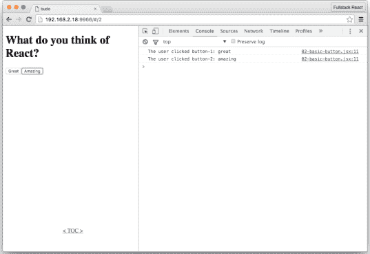

## 两个按钮共用一个事件处理程序

## 文本输入

在前面的示例中，我们将用户的响应限制为只有两种可能。现在我们知道如何在 React 中利用事件对象和处理程序，我们将接受更广泛的响应范围，并转向表单更典型的用途：文本输入。

为了展示文本输入，我们将创建一个"报名表"应用。该应用的目的是让用户记录想要报名参加活动的人员名单。

该应用向用户提供一个文本字段，他们可以在其中输入姓名并点击"提交"。当他们输入姓名时，该姓名会被添加到列表中，该列表会显示出来，并且文本框会被清空，以便他们输入新的姓名。

它将如下所示：

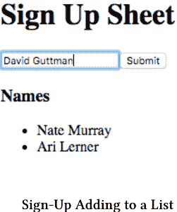

## 使用 `refs` 访问用户输入

我们希望能够读取用户提交表单时文本字段的内容。一个简单的方法是等到用户提交表单，在 DOM 中找到文本字段，最后获取其值。

首先，我们从创建一个包含两个子元素的 form 元素开始：一个文本输入字段和一个提交按钮：

## forms/src/03-basic-input.js

```
  render() {
    return (
      <div>
        <h1>Sign Up Sheet</h1>

        <form onSubmit={this.onFormSubmit}>
          <input
            placeholder='Name'
            ref='name'
          />

          <input type='submit' />
        </form>
      </div>
    );
  }
```

这与前面的示例非常相似，但取代两个按钮元素的是，我们现在有一个包含两个子元素的 form 元素：一个文本字段和一个提交按钮。

有两点需要注意。首先，我们在 `form` 元素上添加了一个 `onSubmit` 事件处理程序。其次，我们给文本字段指定了一个 `ref` 属性，值为 `'name'`。

通过在 `form` 元素上使用 `onSubmit` 事件处理程序，本示例的行为将比以前略有不同。一个变化是，通过点击"提交"按钮或在表单具有焦点时按"回车"键，都会调用该处理程序。这比强制用户点击"提交"按钮更加用户友好。

然而，因为我们的处理程序绑定在表单上，所以事件对象参数对处理程序的有用性不如前面的示例。以前，我们能够使用事件的 `target` 属性来引用按钮并获取其值。这次，我们感兴趣的是文本字段的值。一种选择是使用事件的 `target` 来引用表单，然后从那里找到我们感兴趣的子 `input`，但还有更简单的方法。

在 React 中，如果我们想轻松访问组件中的 DOM 元素，可以使用 `refs`（引用）。上面，我们给文本字段指定了一个 `ref` 属性，值为 `'name'`。稍后当 `onSubmit` 处理程序被调用时，我们可以访问 `this.refs.name` 来获取对该文本字段的引用。以下是我们的 `onFormSubmit()` 事件处理程序中的样子：
```


forms/src/03-basic-input.js

```
onFormSubmit = (evt) => {
  evt.preventDefault();
  console.log(this.refs.name.value);
};
```

🔑 在 `onSubmit` 处理函数中使用 `preventDefault()`，以阻止浏览器提交表单的默认行为。

如你所见，通过使用 `this.refs.name`，我们获得了对文本字段元素的引用，并可以访问其 `value` 属性。该 `value` 属性包含输入到字段中的文本。

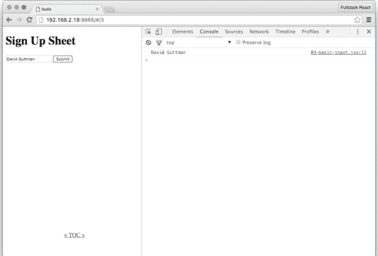

## 记录姓名

仅需 `render()` 和 `onFormSubmit()` 这两个函数，现在我们点击“Submit”时，应该就能在控制台中看到文本字段的值了。下一步，我们将获取该 `value` 并将其显示在页面上。

## 使用用户输入

既然我们已经展示了可以获取用户提交的姓名，就可以开始利用这些信息来改变应用的状态和 UI 了。

本示例的目标是显示一个列表，其中包含用户输入的所有姓名。React 让这变得很简单。我们将在 state 中设置一个数组来存储姓名，并在 `render()` 中使用该数组来填充列表。

当应用加载时，该数组为空，每次用户提交新姓名时，我们会将其添加到数组中。为此，我们需要对组件进行一些补充。

首先，我们将在 state 中创建一个 `names` 数组。在 React 中，当我们使用 ES6 类组件时，可以通过定义 state 的属性来设置 `state` 对象的初始值。

如下所示：

forms/src/04-basic-input.js

```
module.exports = class extends React.Component {
  static displayName = "04-basic-input";
  state = { names: [] }; // <-- 初始 state
```

## static 属于类

注意，在此组件中有这样一行：

```
static displayName = "04-basic-input";
```

这意味着该组件类有一个*静态*属性 `displayName`。当属性是静态的时，意味着它是一个类属性（而非实例属性）。在这种情况下，我们将在演示列表页面展示示例列表时使用这个 `displayName`。

接下来，我们将修改 `render()` 以显示此列表。在 `form` 元素下方，我们将创建一个新的 `div`。这个新容器 `div` 将包含一个标题 `h3` 和我们的姓名列表，即一个 `ul` 父元素，其中每个姓名对应一个 `li` 子元素。这是我们更新后的 `render()` 方法：

forms/src/04-basic-input.js

```
render() {
    return (
      <div>
        <h1>Sign Up Sheet</h1>

        <form onSubmit={this.onFormSubmit}>
          <input
            placeholder='Name'
            ref='name'
          />

          <input type='submit' />
        </form>

        <div>
          <h3>Names</h3>
          <ul>
            { this.state.names.map((name, i) => <li key={i}>{name}</li>) }
          </ul>
        </div>
      </div>
    );
  }
```

ES2015 为我们提供了一种简洁的方式来插入 `li` 子元素。由于 `this.state.names` 是一个数组，我们可以利用其 `map()` 方法为数组中的每个姓名返回一个 `li` 子元素。此外，通过在 `map()` 的迭代函数中使用“箭头”语法，我们可以在不使用显式 `return` 的情况下返回 `li` 元素。

> 这里还需要注意的一点是，我们为 `li` 元素提供了 `key` 属性。当我们在数组或迭代器中使用子元素时（就像我们在这里所做的那样），如果它们没有 `key` 属性，React 会发出警告。React 需要这些信息来跟踪子元素，并确保它可以在渲染过程中被复用。

我们在这里不会删除或重新排序列表，因此通过索引来标识每个子元素就足够了。如果我们想要为更复杂的用例优化渲染，可以为每个姓名分配一个不可变的 id，该 id 不与其值或数组中的顺序绑定。这样即使其位置或值发生变化，React 也能够复用该元素。

有关更多信息，请参阅 React 文档中关于[多组件和动态子元素](https://facebook.github.io/react/docs/multiple-components.html#dynamic-children)的内容。

现在 `render()` 已更新，`onFormSubmit()` 方法需要更新 `state` 以添加新姓名。要将姓名添加到 `state` 中的 `names` 数组，我们可能会忍不住尝试 `this.state.names.push(name)` 这样的操作。然而，React 依赖于 `this.setState()` 来修改我们的 state 对象，这将触发对 `render()` 的新调用。
正确的方式是：

- 1. 创建一个新变量来复制当前的 `names`
- 2. 将新姓名添加到该数组中，最后
- 3. 在调用 `this.setState()` 时使用该变量。

我们还希望清空文本字段，以便它能够接受更多的用户输入。要求用户先删除输入再添加新姓名，这可不太友好。既然我们已经通过 `refs` 访问了文本字段，就可以将其 `value` 设置为空字符串来清空它。
这就是现在 `onFormSubmit()` 应有的样子：

```
onFormSubmit = (evt) => {
  const name = this.refs.name.value;
  const names = [ ...this.state.names, name ];
  this.setState({ names: names });
  this.refs.name.value = '';
  evt.preventDefault();
};
```

此时，我们的报名应用已经可以正常工作了。以下是应用流程的简要说明：

- 1. 用户输入姓名并点击 "Submit"。
- 2. 调用 onFormSubmit。
- 3. 使用 this.refs.name 访问文本字段的值（即姓名）。
- 4. 将姓名添加到 state 中的姓名列表。
- 5. 清空文本字段，以便接受更多输入。
- 6. 调用 render 并显示更新后的姓名列表。

目前为止一切顺利！在接下来的章节中，我们将进一步改进它。

## 非受控组件与受控组件

在之前的章节中，我们利用 refs 来访问用户的输入。当我们创建 render() 方法时，添加了一个带有 ref 属性的输入字段。我们之后使用该属性来获取对渲染后输入框的引用，以便访问和修改其值。

我们介绍了在表单中使用 refs，因为这在概念上与不用 React 时处理表单的方式类似。然而，以这种方式使用 refs，使我们放弃了使用 React 的一个主要优势。

在前一个示例中，我们直接访问 DOM 以从文本字段中获取姓名，并直接操作 DOM 在提交姓名后重置字段。

使用 React 时，我们不必担心修改 DOM 以匹配应用状态。我们应该只关注改变状态，并依靠 React 高效操作 DOM 的能力来使其匹配。这使我们能够确定，对于任何给定的 state 值，我们都可以预测 `render()` 将返回什么，因此知道我们的应用会是什么样子。

在前一个示例中，我们的文本字段就是我们所说的“非受控组件”。这是另一种说法，即 React 不“控制”它的渲染方式——特别是它的值。换句话说，React 是放任的，允许它自由受到用户交互的影响。这意味着仅知道应用状态不足以预测页面（特别是输入字段）的外观。因为用户可能已经在字段中输入了（或未输入）内容，要知道 `input` 字段看起来如何，唯一的方法是通过 `refs` 访问它并检查其 `value`。

还有另一种方式。通过将该字段转换为“受控组件”，我们将控制权交给 React。它的 `value` 将始终由 `render()` 和我们的应用状态指定。当我们这样做时，我们可以通过检查 state 对象来预测应用的外观。

通过直接将视图与应用状态绑定，我们可以用很少的工作量获得某些功能。例如，想象一个长表单，用户必须填写许多 `input` 字段来回答很多问题。如果用户做到一半不小心刷新了页面，通常会清空所有字段。如果这些是受控组件，并且我们的应用状态被持久化到 `localStorage`，我们就能准确回到他们离开的地方。稍后，我们将介绍受控组件为之铺路的另一个重要功能：验证。

## 使用 `state` 访问用户输入

将非受控的 `input` 组件转换为受控组件需要三件事。首先，我们需要在 `state` 中有一个地方来存储其值。其次，我们将 `state` 中的该位置作为其 `value` 属性提供。最后，我们添加一个 `onChange` 处理函数来更新其在 `state` 中的值。受控组件的流程如下：

- 1. 用户输入/修改输入内容。
- 2. 使用“change”事件调用 `onChange` 处理函数。
- 3. 使用 `event.target.value` 更新 `state` 中 `input` 元素的 `value`。
- 4. 调用 `render()`，并使用 `state` 中的新值更新 `input`。

以下是转换 `input` 为受控组件后，我们的 `render()` 的样子：

**forms/src/05-state-input.js**

```
render() {
  return (
    <div>
      <h1>Sign Up Sheet</h1>

      <form onSubmit={this.onFormSubmit}>
        <input
          placeholder='Name'
          value={this.state.name}
          onChange={this.onNameChange}
        />

        <input type='submit' />
      </form>
    </div>
  );
}
```


# 多字段

我们的报名表看起来不错，但如果我们想添加更多字段会怎样呢？如果我们的报名表像大多数项目一样，那么想要扩展它只是时间问题。对于表单来说，我们经常需要添加输入框。

如果我们沿用当前的方法，创建更多受控组件，每个组件都有对应的状态属性和 onChange 处理函数，那么我们的组件将会变得非常冗长。让我们的输入框、状态和处理函数之间保持一对一的关系并不理想。

让我们来探索如何以简洁、可维护的方式修改我们的应用，以便支持添加额外的输入框。为了说明这一点，让我们在报名表中添加邮箱地址。

在上一节中，我们的 `input` 字段在状态对象的根层级上有一个专用属性。如果在这里也这样做，我们就需要再添加一个属性 `email`。为了避免在 `state` 上为每个输入框都添加一个属性，让我们改为添加一个 `fields` 对象，将所有字段的值集中存储在一个地方。以下是我们新的初始状态：

```javascript
// forms/src/06-state-input-multi.js
state = {
  fields: {
    name: '',
    email: ''
  },
  people: [],
};
```

这个 `fields` 对象可以存储任意多个输入框的状态。这里我们指定要存储 `name`（姓名）和 `email`（邮箱）两个字段。现在，我们需要通过 `state.fields.name` 和 `state.fields.email` 来获取这些值，而不是 `state.name` 和 `state.email`。

当然，这些值需要通过事件处理函数来更新。我们*可以*为表单中的每个字段都创建一个事件处理函数，但这会涉及大量的复制/粘贴，并且会不必要的膨胀我们的组件。此外，这也会降低可维护性，因为对表单的任何改动都需要在多个地方进行。

与其为每个输入框创建单独的 `onChange` 处理函数，我们可以创建一个单一的方法，接受来自**所有**输入框的 change 事件。诀窍在于以这种方式编写该方法：根据触发事件的输入框来更新 state 中正确的属性。要实现这一点，该方法使用事件参数来确定哪个输入框发生了变化，并相应地更新我们的 state.fields 对象。例如，如果我们有一个输入框，并给它一个值为 "email" 的 name 属性，当该字段触发事件时，我们就能够知道它是邮箱字段，因为 event.target.name 将会是 "email"。

为了看看这在实践中是什么样的，以下是更新后的 render()：

```javascript
// forms/src/06-state-input-multi.js
render() {
  return (
    <div>
      <h1>Sign Up Sheet</h1>

      <form onSubmit={this.onFormSubmit}>
        <input
          placeholder='Name'
          name='name'
          value={this.state.fields.name}
          onChange={this.onInputChange}
        />

        <input
          placeholder='Email'
          name='email'
          value={this.state.fields.email}
          onChange={this.onInputChange}
        />

        <input type='submit' />
      </form>

      <div>
        <h3>People</h3>
        <ul>
          { this.state.people.map(({ name, email }, i) =>
            <li key={i}>{name} ({ email })</li>
          ) }
        </ul>
      </div>
    </div>
  );
}
```

有几点需要注意：首先，我们添加了第二个 `input` 来处理邮箱地址。

其次，我们修改了 `input` 字段的 `value` 属性，使它们不再访问 `state` 对象根层级上的属性。取而代之的是，它们访问 `state.fields` 的属性。查看上面的代码，姓名的 `input` 现在将其 `value` 设置为 `this.state.fields.name`。

第三，两个 `input` 字段的 `onChange` 属性都设置为同一个事件处理函数 `onInputChange()`。我们将在下面看到如何将 `onNameChange()` 修改为一个更通用的事件处理函数，使其可以接受来自任何字段的事件，而不仅仅是 "name"。

第四，我们的 `input` 字段现在有了 `name` 属性。这与上一点有关。为了让我们的通用事件处理函数 `onInputChange()` 能够知道 change 事件来自哪里，以及我们应该在状态中存储到哪里（例如，如果 change 来自 "email" 输入框，新值应该存储在 `state.fields.email`），我们提供了这个 `name` 属性，以便通过事件的 target 属性获取。

最后，我们修改了人员列表的渲染方式。因为它不再只是一个姓名列表，我们修改了 `li` 元素，以同时显示之前的姓名属性和我们计划添加的新 `email` 数据。

为了确保所有数据都能正确地放到正确的位置，我们需要确保我们的事件处理函数被正确修改。以下是 `onInputChange()` 事件处理函数（在任何字段的输入发生变化时被调用）应该呈现的样子：

```javascript
// forms/src/06-state-input-multi.js
onInputChange = (evt) => {
  const fields = this.state.fields;
  fields[evt.target.name] = evt.target.value;
  this.setState({ fields });
};
```

其核心与我们在上一节的 `onNameChange()` 中所做的类似。两个关键区别是：

+   1. 我们正在更新嵌套在 `state` 中的值（例如，更新 `state.fields.email` 而不是 `state.email`），以及
2. 我们使用 `evt.target.name` 来确定需要更新 `state.fields` 的哪个属性。

为了正确更新我们的状态，我们首先获取 `state.fields` 的本地引用。然后，我们使用事件中的信息（`evt.target.name` 和 `evt.target.value`）来更新本地引用。最后，我们用修改后的本地引用调用 `setState()`。

具体一点，让我们来看看如果用户在 "email" 字段中输入 "someone@somewhere.com" 时会发生什么。

首先，`onInputChange()` 会被调用，传入 `evt` 对象作为参数。`evt.target.name` 会是 `"email"`（因为在 `render()` 中将其 `name` prop 设置为 `"email"`），而 `evt.target.value` 会是 `"someone@somewhere.com"`（因为这是用户输入到字段中的内容）。

接下来，`onInputChange()` 会获取 `state.fields` 的本地引用。如果这是第一次输入，`state.fields` 和我们的本地引用将是 state 中的默认字段 `{ name: '', email: '' }`。然后，本地引用会被修改，使其变为 `{ name: '', email: "someone@somewhere.com" }`。

最后，调用 `setState()` 来应用该变更。

此时，`this.state.fields` 将始终与输入字段中的任何文本保持同步。然而，需要修改 `onFormSubmit()` 以将这些信息传递到已注册人员的列表中。以下是更新后的 `onFormSubmit()`：

```
forms/src/06-state-input-multi.js
17  onFormSubmit = (evt) => {
18    const people = [
19      ...this.state.people,
20      this.state.fields,
21    ];
22    this.setState({
23      people,
24      fields: {
25        name: '',
26        email: ''
27      }
28    });
29    evt.preventDefault();
30  };
```

在 `onFormSubmit()` 中，我们首先获取已注册人员名单 `this.state.people` 的本地引用。然后，将 `this.state.fields` 对象（一个代表当前输入到字段中的姓名和电子邮件的对象）添加到 `people` 列表中。最后，我们使用 `this.setState()` 同时更新列表并将 `state.fields` 重置为空默认值 `{ name: '', email: '' }` 来清空所有字段。

这样做的好处是，我们可以轻松添加任意数量的输入字段，且只需极少的更改。事实上，只有 `render()` 方法需要修改。对于每个新字段，我们只需要添加另一个输入字段并更改列表的渲染方式以显示新字段。

例如，如果我们想添加一个电话号码字段，我们会添加一个新的输入框，并设置适当的 `name` 和 `value` props：`name` 为 `phone`，`value` 为 `this.state.fields.phone`。`onChange` 与其他字段一样，使用我们现有的 `onInputChange()` 处理程序。

完成这些后，我们的 state 将自动跟踪 `phone` 字段，并将其添加到 `state.people` 数组中，我们可以更改视图（例如 `li`）的显示方式以展示这些信息。

此时，我们拥有了一个功能完善的应用程序，可以很好地扩展和修改以适应需求的变化。然而，它缺少几乎所有表单都需要的一个关键方面：**验证**。

## 关于验证

验证对于构建表单来说至关重要，以至于很少有表单不包含验证。 craftsmanship。验证可以在**单个字段**层面，也可以在**整个表单**层面进行。

当你对单个字段进行验证时，你是在确保用户输入的数据符合你的应用程序对该数据片段的期望和约束。

例如，如果我们希望用户输入电子邮件地址，我们期望他们的输入看起来像是一个有效的电子邮件地址。如果输入不像电子邮件地址，他们可能是输入错误了，而且这很可能会在后续导致问题（例如，他们将无法激活账户）。其他常见例子包括确保邮政编码恰好有五（或九）个数字字符，以及强制密码长度至少达到某个最小长度。

对整个表单的验证略有不同。在这里，你要确保所有必填字段都已被填写。这也是检查内部一致性的好地方。例如，你可能有一个订单表单，其中特定产品需要特定的选项。

此外，"如何"以及"何时"进行验证也需要权衡。对于某些字段，我们可能希望实时提供验证反馈。例如，我们可能想在用户输入时显示密码强度（通过查看长度和使用的字符）。然而，如果我们想验证用户名的可用性，我们可能希望等到用户输入完成后再向服务器/数据库发送请求查询。

我们还可选择如何显示验证错误。我们可以对字段进行不同的样式设置（例如，红色边框），在字段附近显示文字（例如，"请输入有效的电子邮件。"），和/或禁用表单的提交按钮以防止用户使用无效信息继续操作。

对于我们的应用程序，我们可以从整个表单的验证开始

1. 确保我们同时有姓名和电子邮件，并且
2. 确保电子邮件是一个有效的地址。

## 向我们的应用程序添加验证

为了向我们的注册应用程序添加验证，我们做了一些更改。从高层次上看，这些更改是

1. 在 state 中添加一个地方来存储可能存在的验证错误，
2. 更改我们的 `render()` 方法，以红色文字在每个字段旁边显示验证错误信息（如果存在的话），
3. 添加一个新的 `validate()` 方法，它接受我们的 `fields` 对象作为参数，并返回一个 `fieldErrors` 对象，以及
4. `onFormSubmit()` 将调用新的 `validate()` 方法来获取 `fieldErrors` 对象，如果存在错误，它会将它们添加到 state 中（以便在 `render()` 中显示）并提前返回，不将该"人员"添加到 `state.people` 列表中。

首先，我们更改了初始 state：

forms/src/07-basic-validation.js

```
state = {
  fields: {
    name: '',
    email: '',
  },
  fieldErrors: {},
  people: [],
};
```

这里唯一的更改是我们为 `fieldErrors` 属性创建了一个默认值。这是我们将存储每个字段的错误信息的地方（如果存在的话）。

接下来，以下是更新后的 `render()` 方法：

forms/src/07-basic-validation.js

```
render() {
  return (
    <div>
      <h1>Sign Up Sheet</h1>

      <form onSubmit={this.onFormSubmit}>

        <input
          placeholder='Name'
          name='name'
          value={this.state.fields.name}
          onChange={this.onInputChange}
        />

        <span style={{ color: 'red' }}>{ this.state.fieldErrors.name }</span>

        <br />
      </form>
    </div>
  );
}
```

## 表单

```
<input
  placeholder='Email'
  name='email'
  value={this.state.fields.email}
  onChange={this.onInputChange}
/>

<span style={{ color: 'red' }}>{ this.state.fieldErrors.email }</span>

<br />

<input type='submit' />
</form>

<div>
  <h3>People</h3>
  <ul>
    { this.state.people.map(({ name, email }, i) =>
      <li key={i}>{name} ({ email })</li>
    ) }
  </ul>
</div>
</div>
  );
}
```

这里唯一的区别是两个新的 `span` 元素，每个字段一个。每个 `span` 都会在 `state.fieldErrors` 的适当位置查找错误 Sergiy 错误信息。如果找到，它将以红色显示在该字段旁边。接下来，我们将看看这些错误信息是如何进入 state 的。

在用户提交表单后，我们才会检查其输入的有效性。因此，开始验证的合适位置是在 `onFormSubmit()` 方法中。但是，我们希望创建一个独立的函数供该方法调用。为此，我们创建了纯函数 `validate()` 方法：

## forms/src/07-basic-validation.js

```
validate = (person) => {
  const errors = {};
  if (!person.name) errors.name = 'Name Required';
  if (!person.email) errors.email = 'Email Required';
  if (person.email && !isEmail(person.email)) errors.email = 'Invalid Email';
  return errors;
};
```

我们的 `validate()` 方法非常简单，有两个目标。首先，我们要确保姓名和电子邮件都存在。通过检查它们的真值性，我们可以知道它们已定义且不是空字符串。其次，我们要确保提供的电子邮件地址看起来有效。这其实是一个相当棘手的问题，所以我们依赖 validator^58^ 来告诉我们。如果这些条件中的任何一个未满足，我们就向 `errors` 对象添加相应的键，并将错误信息设置为值。

之后，我们更新了 `onFormSubmit()` 以使用这个新的 `validate()` 方法，并对返回的错误对象采取行动：

## forms/src/07-basic-validation.js

```
onFormSubmit = (evt) => {
  const people = [ ...this.state.people ];
  const person = this.state.fields;
  const fieldErrors = this.validate(person);
  this.setState({ fieldErrors });
  evt.preventDefault();

  if (Object.keys(fieldErrors).length) return;

  this.setState({
    people: people.concat(person),
    fields: {
      name: '',
      email: '',
    },
  });
};
```

为了使用 `validate()` 方法，我们从 `this.state.fields` 获取字段的当前值并将其作为参数提供。`validate()` 将返回一个空对象（如果没有问题），或者

> 58 http://npm.im/validator


如果存在验证问题，该函数会返回一个对象，其键对应每个字段名，值对应每个错误消息。无论哪种情况，我们都希望更新 `state.fieldErrors` 对象，以便 `render()` 能够根据需要显示或隐藏错误消息。

如果验证错误对象拥有任何键（`Object.keys(fieldErrors).length > 0`），我们就知道存在问题。如果没有验证问题，其逻辑与前面章节相同——我们添加新信息并清空表单字段。但是，如果存在任何错误，我们会提前返回。这可以防止新信息被添加到列表中。

至此，我们已经介绍了在 React 中创建带有验证的表单的基础知识。在下一节中，我们将更进一步，展示如何在字段级别进行实时验证，并创建一个 `Field` 组件以提高应用程序在拥有多个具有不同验证要求的字段时的可维护性。

## 创建 Field 组件

在上一节中，我们为表单添加了验证。然而，我们的表单组件负责运行整个表单的验证以及**每个字段的个别验证规则**。

理想的情况是 *每个字段* 负责识别 *自身输入* 的验证错误，而父表单只负责识别表单级别的问题。这带来几个优势：

1.  以这种方式创建的电子邮件字段可以在用户实时输入时检查其输入格式。
2.  该字段可以整合其验证错误消息，从而将父表单从跟踪这些消息的任务中解放出来。

为此，我们首先将创建一个新的 `单独的 Field` 组件，并在表单中使用它来代替 `input` 元素。这将使我们能够将普通的 `input` 与验证逻辑和错误消息提示结合在一起。

在深入创建这个新组件之前，从输入和输出的角度从高层次思考它会很有用。换句话说，"我们需要向这个组件提供什么信息？"，以及"我们期望得到什么类型的返回值？"

这些输入将成为该组件的 `props`，而输出将被我们传入它的任何事件处理程序使用。

因为我们的 `Field` 组件将包含一个子 `input`，我们需要提供相同的基本信息以便传递下去。例如，如果我们希望一个 `Field` 组件渲染时，其子 `input` 带有特定的 `placeholder` `prop`，我们就必须在表单的 `render()` 方法中创建 `Field` 组件时将其作为一个 `prop` 提供。

我们想要提供的另外两个 `props` 是 `name` 和 `value`。`name` 将允许我们在组件之间共享一个事件处理程序，就像我们之前做的那样；而 `value` 允许父表单预填充 `Field` 并保持其更新。

此外，这个新的 `Field` 组件负责自己的验证。因此，我们需要提供与其包含数据特定的规则。例如，如果这是 "email" `Field`，我们将为其提供一个函数作为 `validate` `prop`。在内部，它将运行此函数来确定其输入是否是有效的电子邮件地址。

最后，我们将为 `onChange` 事件提供一个事件处理程序。我们作为 `onChange` `prop` 提供的函数将在 `Field` 中的输入每次发生变化时被调用，并且会传入一个我们定义的事件参数。这个事件参数应该包含三个我们感兴趣的属性：(1) `Field` 的名称，(2) `input` 的当前 `value`，以及 (3) 当前的验证错误（如果存在）。

快速回顾一下，新的 `Field` 组件要完成其工作，将需要以下内容：

-   `placeholder`: 这将直接传递给 `input` 子元素。类似于标签，它告诉用户 `Field` 期望什么数据。
-   `name`: 我们需要它的原因与为 `input` 元素提供 `name` 相同：我们将在事件处理程序中使用它来决定存储输入数据和验证错误的位置。
-   `value`: 这是我们的父表单初始化 `Field` 值的方式，或者它可以使用此值用新值更新 `Field`。这类似于 `input` 上 `value` `prop` 的用法。
-   `validate`: 一个函数，在运行时返回验证错误（如果有的话）。
-   `onChange`: 当 `Field` 发生变化时运行的事件处理程序。此函数将接受一个事件对象作为参数。

接下来，我们能够在新的 `Field` 组件上设置 `propTypes`：

**forms/src/08-field-component-field.js**

```javascript
5   static propTypes = {
6     placeholder: PropTypes.string,
7     name: PropTypes.string.isRequired,
8     value: PropTypes.string,
9     validate: PropTypes.func,
10    onChange: PropTypes.func.isRequired,
11  };
```

接下来，我们可以考虑 `Field` 需要跟踪的 `state`。`Field` 只需要两部分数据：当前的 `value` 和 `error`。就像在之前的章节中，我们的表单组件需要这些数据用于其 `render()` 方法一样，我们的 `Field` 组件也需要。以下是我们如何设置初始状态：

**forms/src/08-field-component-field.js**

```javascript
13  state = {
14    value: this.props.value,
15    error: false,
16  };
```

一个关键的区别是，我们的 `Field` 有一个父组件，有时这个父组件会想要更新 `Field` 的 `value` prop。为了实现这一点，我们需要创建一个新的生命周期方法 `componentWillReceiveProps()` 来接收新的 `value` 并更新 `state`。如下所示：

**forms/src/08-field-component-field.js**

```javascript
18  componentWillReceiveProps(update) {
19    this.setState({ value: update.value });
20  }
```

`Field` 的 `render()` 方法应该相当简单。它只是一个 `input` 和一个用于容纳错误消息的相应 `span`：

**forms/src/08-field-component-field.js**

```javascript
render() {
  return (
    <div>
      <input
        placeholder={this.props.placeholder}
        value={this.state.value}
        onChange={this.onChange}
      />
      <span style={{ color: 'red' }}>{ this.state.error }</span>
    </div>
  );
}
```

对于 input 元素，placeholder 从父组件传入，可通过 this.props.placeholder 获取。如上所述，input 的值和 span 中的错误消息都存储在 state 中。value 来自 this.state.value，错误消息则在 this.state.error 中。最后，我们将设置一个 onChange 事件处理程序，它将负责接收用户输入、进行验证、更新 state *以及调用父组件的事件处理程序*。处理这些职责的方法是 this.onChange：

```javascript
onChange (evt) {
  const name = this.props.name;
  const value = evt.target.value;
  const error = this.props.validate ? this.props.validate(value) : false;

  this.setState({value, error});

  this.props.onChange({name, value, error});
}
```

this.onChange 是一个相当高效的函数。它在四行代码中处理了四个不同的职责。与之前的章节一样，事件对象通过其 target.value 属性提供 input 中的当前文本。一旦我们获取到它，就会检查它是否通过了验证。如果 Field 被赋予了 validate prop 的函数，我们就在这里使用它。如果没有提供函数，我们就不需要验证输入，error 被设置为 false。一旦我们同时有了 value 和 error，就可以更新 state，以便它们都能在 render() 中显示出来。然而，不仅仅需要 Field 组件使用这些信息更新自身。

当 Field 被父组件使用时，它将自身的事件处理程序作为 onChange prop 传入。我们调用这个函数，以便将信息传递给父组件。在这里，在 this.onChange() 中，它作为 `this.props.onChange()` 可用，我们调用它时传入了三个信息：`Field` 的 name、value 和 error。

这可能会让人有点困惑，因为 "onChange" 出现在多个地方。你可以将其理解为在事件处理程序链中传递信息。表单包含 `Field`，`Field` 包含 `input`。事件发生在 `input` 上，信息首先传递给 `Field`，最后传递给表单。

至此，我们的 `Field` 组件已准备就绪，可以在应用程序中代替 `input` 和错误消息的组合使用。

## 使用新的 Field 组件

现在我们已经准备好使用全新的 `Field` 组件了，我们可以对应用程序进行一些更改。最明显的变化是，`Field` 将在 `render()` 方法中取代 `input` 和错误消息 span 元素。这很棒，因为 `Field` 可以在字段级别处理验证。但是表单级别呢？

如果你还记得，我们可以采用两种不同级别的验证：一种在字段级别，另一种在表单级别。我们新的 `Field` 组件将允许我们实时验证每个字段的格式。然而，它们不会做的是验证整个表单以确保我们拥有所有必要的数据。为此，我们仍然需要表单级别的验证。

我们还要在这里添加的另一个不错的功能是，在表单通过/失败验证时实时禁用/启用表单的提交按钮。这是一个很好的反馈，可以改善表单的用户体验，使其感觉更响应迅速。

以下是更新后的 `render()` 方法：

**forms/src/08-field-component-form.js**

```javascript
60  render() {
61    return (
62      <div>
63        <h1>Sign Up Sheet</h1>
64
65        <form onSubmit={this.onFormSubmit}>
66
67          <Field
68            placeholder='Name'
69            name='name'
70            value={this.state.fields.name}
71            onChange={this.onInputChange}
72            validate={(val) => (val ? false : 'Name Required')}
73          />
```


```markdown
## 构建自定义组件

该组件的目的是让用户选择一个 NodeSchool 课程。从现在起，我们将其称为我们的 `CourseSelect` 组件。

59 http://nodeschool.io

你可以看到 `Field` 是 `input` 的即插即用替代品。所有属性都与 `input` 上的相同，只是这次我们多了一个属性：`validate`。

在上方的 `Field` 组件的 `onChange()` 方法中，我们调用了 `this.props.validate()` 函数。我们提供给 `Field` 的 `validate` 属性，就是该函数。其目标是接收用户提供的输入作为参数，并返回一个对应该输入有效性的返回值。如果输入无效，`validate` 应该返回错误信息。否则，它应该返回 `false`。

对于"名称" `Field`，`validate` 属性相当简单。我们只是检查一个真值。只要框中有字符，验证就会通过，否则我们返回 `'Name Required'` 错误信息。

对于"邮箱" `Field`，我们将使用从 validator 模块导入的 `isEmail()` 函数。如果该函数返回 `true`，我们就知道它看起来是一个有效的邮箱，验证通过。如果没有，我们返回 `'Invalid Email'` 信息。

请注意，我们保留了它们的 onChange 属性不变，它仍然设置为 `this.onInputChange`。然而，由于 `Field` 与 `input` 使用函数的方式不同，我们必须更新 `onInputChange()`。

在继续之前，请注意我们对 `render()` 所做的唯一其他更改：我们有条件地禁用提交按钮。为此，我们将 `disabled` 属性的值设置为 `this.validate()` 的返回值。因为 `this.validate()` 如果存在验证错误就会返回真值，所以表单无效时按钮将被禁用。我们稍后会展示 `this.validate()` 函数的样子。

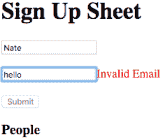

禁用的提交按钮

如前所述，两个 `Field` 组件的 `onChange` 属性都设置为 `this.onInputChange`。我们不得不做一些改动来匹配 `input` 和我们的 `Field` 之间的差异。以下是更新后的版本：

forms/src/08-field-component-form.js

```
38   onInputChange = ({ name, value, error }) => {
39     const fields = this.state.fields;
40     const fieldErrors = this.state.fieldErrors;
41   
42     fields[name] = value;
43     fieldErrors[name] = error;
44   
45     this.setState({ fields, fieldErrors });
46   };
```

以前，`onInputChange()` 的作用是用当前用户输入值更新 `this.state.fields`。换句话说，当文本字段被编辑时，`onInputChange()` 会被调用并传入一个事件对象。该事件对象有一个 `target` 属性，引用了 `input` 元素。利用该引用，我们可以获取 `input` 的 `name` 和 `value`，并据此更新 `state.fields`。

这次 `onInputChange()` 的职责相同，但调用这个函数的是我们的 `Field` 组件，而不是 `input`。在上一节中，我们展示了 Field 的 `onChange()` 方法，那里调用了 `this.props.onChange()`。当它被调用时，是这样调用的：`this.props.onChange({name, value, error})`。

这意味着我们不再像之前那样使用 `evt.target.name` 或 `evt.target.value`，而是直接从参数对象中获取 `name` 和 `value`。此外，我们还获得了每个字段的验证错误。这是必要的——我们的表单组件要阻止提交，就需要了解字段级别的验证错误。

一旦我们有了 `name`、`value` 和 `error`，就可以更新状态中的两个对象：之前使用的 `state.fields` 对象，以及一个新的对象 `state.fieldErrors`。很快，我们将展示 `state.fieldErrors` 将如何用于根据字段级别验证错误的存在与否来阻止或允许表单提交。

`render()` 和 `onInputChange()` 都更新后，我们再次为 Field 组件设置了一个良好的反馈循环：

- 首先，用户在 Field 中输入。
- 然后，调用 Field 的事件处理程序 `onInputChange()`。
- 接着，`onInputChange()` 更新状态。
- 之后，表单重新渲染，Field 传入更新后的 `value` 属性。
- 然后，`componentWillReceiveProps()` 在 Field 中被调用，传入新的 `value`，其状态被更新。
- 最后，再次调用 `Field.render()`，文本字段显示适当的输入和（如适用）验证错误。

此时，我们表单的 `state` 和外观是同步的。接下来，我们需要改变处理提交事件的方式。以下是表单更新后的事件处理程序 `onFormSubmit()`：

**forms/src/08-field-component-form.js**

```
onFormSubmit = (evt) => {
    const people = this.state.people;
    const person = this.state.fields;

    evt.preventDefault();

    if (this.validate()) return;

    this.setState({
        people: people.concat(person),
        fields: {
            name: '',
            email: '',
        },
```

```
});
};
```

`onFormSubmit()` 的目标没有改变。它仍然负责将人员添加到列表中，或者如果存在验证问题则阻止该行为。要检查验证错误，我们调用 `this.validate()`，如果存在任何错误，我们提前返回，不再将新人员添加到列表中。

以下是当前版本 `validate()` 的样子：

```
1   validate () {
2     const person = this.state.fields;
3     const fieldErrors = this.state.fieldErrors;
4     const errMessages = Object.keys(fieldErrors).filter((k) => fieldErrors[k])
5 
6     if (!person.name) return true;
7     if (!person.email) return true;
8     if (errMessages.length) return true;
9 
10     return false
11  };
```

简而言之，`validate()` 正在确保数据在表单级别是有效的。要使表单在此级别通过验证，必须满足两个要求：（1）两个字段都不能为空，（2）不能存在任何字段级别的验证错误。

要满足第一个要求，我们访问 `this.state.fields` 并确保 `state.fields.name` 和 `state.fields.email` 都是真值。这些由 `onInputChange()` 保持最新，因此它始终与文本字段中的内容匹配。如果 `name` 或 `email` 缺失，我们返回 `true`，表示存在验证错误。

对于第二个要求，我们查看 `this.state.fieldErrors`。`onInputChange()` 会将任何字段级别的验证错误信息设置在此对象上。我们使用 `Object.keys` 和 `Array.filter` 来获取所有存在的错误信息数组。如果存在任何字段级别的验证问题，数组中就会有相应的错误信息，其长度将为非零且为真值。如果是这种情况，我们也返回 `true` 以表示存在验证错误。

`validate()` 是一个简单的方法，可以随时调用以检查数据在表单级别是否有效。我们在 `onFormSubmit()` 中使用它来阻止将无效数据添加到列表中，也在 `render()` 中使用它来禁用提交按钮，在 UI 中提供良好的反馈。

就这样。我们现在使用自定义的 `Field` 组件来即时进行字段级别的验证，同时我们还使用表单级别验证来实时切换提交按钮。

## 远程数据

我们的表单应用进展顺利。用户可以用他们的姓名和邮箱注册，我们在接受输入之前验证他们的信息。但现在我们要更进一步。我们将探索如何允许用户从层级、异步的选项中进行选择。

最常见的例子是允许用户按年份、品牌和型号选择汽车。首先用户选择年份，然后选择制造商，再选择型号。在一个 `select` 中选择选项后，下一个才变为可用。构建这样的组件有两个有趣的方面。首先，并非所有组合都合理。没有理由让你的用户选择一辆 1965 年的特斯拉 T 型车。每个选项列表（第一个除外）都依赖于先前选择的值。

其次，我们不想将整个有效选择数据库发送到浏览器。相反，浏览器只知道顶层选择（例如特定范围内的年份）。当用户做出选择时，我们将所选值提供给服务器并请求下一层（例如给定年份可用的制造商）。由于下一层选项来自服务器，这是异步的。

我们的应用不会关注用户的汽车，但我们会想知道他们报名参加了什么。让我们把它变成一个让用户通过选择 [NodeSchool](http://nodeschool.io)^59^ 工作坊来了解更多 JavaScript 的应用。

NodeSchool 工作坊可以是"核心"或"选修"的。我们可以将这些视为 NodeSchool 的"部门"。因此，根据用户对哪个部门感兴趣，我们可以允许他们选择相应的工作坊。这与上面的例子类似，用户在选择汽车制造商之前先选择年份。

如果用户选择核心部门，我们将允许他们从核心工作坊列表中选择，如 `learnyounode` 和 `stream-adventure`。如果他们选择选修部门，我们将允许他们选择如 `Functional JavaScript` 或 `Shader School` 等工作坊。与汽车例子类似，课程列表是异步提供的，并且依赖于选择了哪个部门。

实现这一点的最简单方式是使用两个 `select` 元素，一个用于选择部门，另一个用于选择课程。但是，我们会隐藏第二个 `select`，直到：（1）用户已选择部门，（2）我们从服务器收到适当的课程列表。

我们不直接在表单中构建此功能。我们将创建一个自定义组件来处理这些字段的层级和异步特性。通过使用自定义组件，我们的表单几乎不需要改变。任何特定于工作坊选择的逻辑都将隐藏在该组件中。
```


然而，在开始编写新的 `CourseSelect` 组件之前，我们应该先思考如何让它与其表单父组件进行通信。这将决定该组件的 props。

最明显的 prop 是 `onChange()`。这个组件的目的是帮助用户进行院系/课程选择，并将该数据提供给表单使用。此外，我们要确保 `onChange()` 被调用时传入的参数与其他字段组件所期望的参数一致。这样我们就不会被迫为该组件创建任何特殊处理。

我们还希望表单能够在需要时设置该组件的状态。这在用户提交信息后想要清除选择时特别有用。为此，我们将接受两个 props，一个用于 `department`，一个用于 `course`。

这就是我们需要的全部内容。该组件将接受三个 props。以下是我们新的 `CourseSelect` 组件中它们的样子：

forms/src/09-course-select.js

```
static propTypes = {
  department: PropTypes.string,
  course: PropTypes.string,
  onChange: PropTypes.func.isRequired,
};
```

接下来，我们可以思考 `CourseSelect` 需要跟踪的 `state`。最明显的两个 state 是 `department` 和 `course`。当用户进行选择时，以及当表单父组件在提交时清除它们时，这些值会发生变化。

`CourseSelect` 还需要跟踪给定院系的可用课程。当用户选择一个院系时，我们将异步获取相应的课程列表。一旦获得该列表，我们就将其以 `courses` 的形式存储在 `state` 中。

最后，在处理异步获取时，最好告知用户数据正在后台加载。我们还会将数据是否处于"加载中"的状态以 `_loading` 的形式保存在 `state` 中。

> `_loading` 的下划线前缀只是一种约定，用于强调它纯粹是表现性的。表现性 state 仅用于 UI 效果。在本例中，它将用于隐藏/显示加载指示器图像。

以下是我们的初始 state 的样子：

```
state = {
  department: null,
  course: null,
  courses: [],
  _loading: false,
};
```

如上所述，该组件的表单父组件会想要更新院系和课程 props。我们的 componentWillReceiveProps() 方法将使用更新来适当地修改 state：

```
componentWillReceiveProps(update) {
  this.setState({
    department: update.department,
    course: update.course,
  });
}
```

现在我们对数据的样子有了很好的了解，可以进入组件渲染方式的讨论。这个组件比我们之前的例子要复杂一些，因此我们利用组合来保持代码整洁。你会注意到我们的 render() 方法主要由两个函数组成，renderDepartmentSelect() 和 renderCourseSelect()：

```
render() {
  return (
    <div>
      { this.renderDepartmentSelect() }
      <br />
      { this.renderCourseSelect() }
    </div>
  );
}
```

除了这两个函数之外，render() 没有太多内容。但这很好地说明了我们组件的两个"部分"："院系"部分和"课程"部分。让我们先来看看"院系"部分。从 renderDepartmentSelect() 开始：

forms/src/09-course-select.js

```
        { this.renderDepartmentSelect() }
```

此方法返回一个显示三个选项之一的 select 元素。当前显示的选项取决于 select 的 value prop。其 value 与 select 匹配的选项将被显示。这些选项是：

- "Which department?"（value: *empty string*）
- "NodeSchool: Core"（value: `"core"`）
- "NodeSchool: Electives"（value: `"electives"`）

`select` 的 value 是 `this.state.department || ''`。换句话说，如果 `this.state.department` 是假值（默认情况下是），value 将是 *empty string* 并匹配 "Which department?"。否则，如果 `this.state.department` 是 `"core"` 或 `"electives"`，它将显示其他选项之一。

因为 `this.onSelectDepartment` 被设置为 `select` 的 `onChange` prop，当用户更改选项时，`onSelectDepartment()` 会被调用并传入 change 事件。如下所示：

forms/src/09-course-select.js

```
  onSelectDepartment = (evt) => {
    const department = evt.target.value;
    const course = null;
    this.setState({ department, course });
    this.props.onChange({ name: 'department', value: department });
    this.props.onChange({ name: 'course', value: course });

    if (department) this.fetch(department);
  };
```

当院系发生变化时，我们希望发生三件事。首先，我们希望更新 `state` 以匹配选定的院系选项。其次，我们希望通过 `CourseSelect` 的 props 中提供的 `onChange` 处理程序传播该变化。第三，我们希望获取该院系的可用课程。

当我们更新 `state` 时，我们将其更新为事件目标（即 `select`）的 value。`select` 的 value 就是所选 `option` 的 value，即 `' '`、`"core"` 或 `"electives"`。在用新值设置 `state` 之后，会运行 `render()` 和 `renderDepartmentSelect()` 并显示新选项。

请注意，我们还会重置课程。每个课程仅对其所属院系有效。如果院系发生变化，之前的课程就不再是有效的选择。因此，我们将其重置为初始值 `null`。

在更新 state 之后，我们将变化传播到组件的 change 处理程序 `this.props.onChange`。因为我们使用的参数与之前一致，所以这个组件可以像 `Field` 一样使用，并且可以被赋予相同的处理函数。唯一的技巧是我们需要调用它两次，每个输入各一次。

最后，如果选择了某个院系，我们就获取其课程列表。以下是被调用的方法 `fetch()`：

forms/src/09-course-select.js

```
fetch = (department) => {
  this.setState({ _loading: true, courses: [] });
  apiClient(department).then((courses) => {
    this.setState({ _loading: false, courses: courses });
  });
};
```

此方法的责任是接受一个院系字符串，使用它来异步获取相应的课程列表 `courses`，并用它更新 state。不过，我们还要确保影响 state 以提供更好的用户体验。

我们在 `apiClient` 调用*之前*执行此操作。我们知道我们将等待新课程列表的响应，在此期间我们应该向用户显示加载指示器。为此，我们需要我们的 state 反映获取状态。在 `apiClient` 调用之前，我们将 `_loading` 的 state 设置为 `true`。操作完成后，我们将 `_loading` 重置为 `false` 并更新课程列表。

之前，我们提到这个组件有两个由 `render()` 方法展示的"部分"：

forms/src/09-course-select.js

```
render() {
  return (
    <div>
      { this.renderDepartmentSelect() }
      <br />
      { this.renderCourseSelect() }
    </div>
  );
}
```

我们已经覆盖了"院系"部分。现在让我们来看看"课程"部分，从 `renderCourseSelect()` 开始：

```
{ this.renderCourseSelect() }
```

你首先会注意到的是，`renderCourseSelect()` 会根据特定条件返回不同的根元素。

如果 `state._loading` 为 true，`renderCourseSelect()` 只返回一个单独的 `img`：一个加载指示器。或者，如果我们没有在加载，但还没有选择院系（因此 `state.department` 是假值），则返回一个空的 span——有效地隐藏了这一半组件。

然而，如果我们没有在加载，并且用户*已经*选择了院系，`renderCourseSelect()` 将返回一个类似于 `renderDepartmentSelect()` 的 select。

`renderCourseSelect()` 和 `renderDepartmentSelect()` 之间最大的区别是 `renderCourseSelect()` 动态填充 `select` 的 `option` 子元素。

此 `select` 的第一个选项是 "Which course?"，其 value 为空字符串。如果用户尚未选择课程，这就是他们应该看到的（就像另一个 `select` 中的 "Which department?" 一样）。第一个选项之后的选项来自存储在 `state.courses` 中的课程列表。

为了同时向 `select` 提供所有子 `option` 元素，`select` 被赋予一个单独的数组作为其子元素。数组中的第一项是我们的 "Which course?" 选项的元素。然后，我们使用扩展运算符结合 `map()`，使得从第二项开始，数组包含来自 `state` 的课程选项。

数组中的每一项都是一个 `option` 元素。与之前一样，每个元素都有显示的文本（如 "Which course?"）以及一个 `value` prop。如果 `select` 的 `value` 与 `option` 的 `value` 匹配，该选项将被显示。默认情况下，`select` 的 `value` 将是空字符串，因此它会匹配 "Which course?" 选项。一旦用户选择了一个课程，我们能够更新 `state.course` 后，相应的课程将被显示。

> 这是一个动态集合，我们还必须为每个 `option` 提供 `key` prop，以避免来自 React 的警告。

最后，我们为 `select` prop `onChange` 提供了一个 change 处理函数 `onSelectCourse()`。当用户选择课程时，该函数将被调用并传入一个相关的事件对象。然后我们将使用该事件中的信息来更新 state 并通知父组件。

以下是 `onSelectCourse()`：

onSelectCourse = (evt) => {
  const course = evt.target.value;
  this.setState({ course });
  this.props.onChange({ name: 'course', value: course });
};

和之前一样，我们从事件中获取`target`元素的`value`。这个`value`是用户在课程的`select`中所选`option`的值。一旦我们用这个值更新了`state.course`，`select`就会显示正确的`option`。

`state`更新后，我们调用由组件父级提供的变更处理函数。与部门选择相同，我们为`this.props.onChange()`提供一个包含预期的 name/value 结构的对象参数。

我们的`CourseSelect`组件就到此为止了！正如我们将在下一部分看到的，与表单的集成只需要极少的更改。

#### 添加 CourseSelect

现在我们的新`CourseSelect`组件已经准备就绪，我们可以将其添加到表单中。只需要三个小改动：

1. 我们在`render()`中添加`CourseSelect`组件。
2. 我们在`render()`中更新"People"列表以显示新字段（部门和课程）。
3. 由于部门和课程是必填字段，我们修改`validate()`方法以确保它们的存在。

因为我们谨慎地从`CourseSelect`内部调用变更处理函数（`this.props.onChange`），并且使用了`onInputChange()`所期望的`{name, value}`对象格式，所以我们可以复用该处理函数。当`CourseSelect`调用`onInputChange()`时，它能够适当地用新的部门和课程信息更新`state`——就像它处理来自`Field`组件的调用时一样。

这是更新后的`render()`：

#### forms/src/09-async-fetch.js

```
render() {
  return (
    <div>
      <h1>Sign Up Sheet</h1>

      <form onSubmit={this.onFormSubmit}>

        <Field
          placeholder='Name'
          name='name'
          value={this.state.fields.name}
          onChange={this.onInputChange}
          validate={(val) => (val ? false : 'Name Required')}
        />

        <br />

        <Field
          placeholder='Email'
          name='email'
          value={this.state.fields.email}
          onChange={this.onInputChange}
          validate={(val) => (isEmail(val) ? false : 'Invalid Email')}
        />

        <br />

        <CourseSelect
          department={this.state.fields.department}
          course={this.state.fields.course}
          onChange={this.onInputChange}
        />

        <br />

        <input type='submit' disabled={this.validate()} />
      </form>

      <div>
        <h3>People</h3>
        <ul>
```

```
{ this.state.people.map(({ name, email, department, course }, i) =>
  <li key={i}>{[ name, email, department, course ].join(' - ')}</li>
 ) }
</ul>
</div>
</div>
);
}
```

添加 CourseSelect 时，我们提供三个 props：

1. 来自 state 的当前 department（如果存在的话）
2. 来自 state 的当前 course（如果存在的话）
3. `onInputChange()`处理函数（与 Field 使用相同的函数）

单独展示如下：

```
<CourseSelect
  department={this.state.fields.department}
  course={this.state.fields.course}
  onChange={this.onInputChange} />
```

我们在 render() 中所做的另一个更改是将新的 department 和 course 字段添加到"People"列表中。一旦用户提交了注册信息，它们就会显示在此列表中。为了展示部门和课程信息，我们需要从 state 中获取这些数据并显示它：

```
<h3>People</h3>
<ul>
  { this.state.people.map( ({name, email, department, course}, i) =>
    <li key={i}>{[name, email, department, course].join(' - ')}</li>
  ) }
</ul>
```

这很简单，只需从 state.people 数组中的每个项目提取更多属性即可。

剩下唯一要做的事情是将这些字段添加到我们的表单级验证中。我们的 CourseSelect 控制 UI 以确保我们不会获得无效数据，所以我们不需要担心字段级错误。然而，部门和课程是必填字段，我们应该确保在允许用户提交之前它们已经填写。我们通过更新`validate()`方法来包含它们：

```
forms/src/09-async-fetch.js

validate = () => {
  const person = this.state.fields;
  const fieldErrors = this.state.fieldErrors;
  const errMessages = Object.keys(fieldErrors).filter((k) => fieldErrors[k]);

  if (!person.name) return true;
  if (!person.email) return true;
  if (!person.course) return true;
  if (!person.department) return true;
  if (errMessages.length) return true;

  return false;
};
```

一旦`validate()`更新完成，我们的应用将使提交 reduce 按钮保持禁用状态，直到我们同时选择了部门和课程（除此之外还有其他验证要求）。

凭借 React 和组合的强大功能，我们的表单能够承担复杂的功能，同时保持高度的可维护性。

## 视图与状态的分离

一旦我们从用户那里收到信息并确认它是有效的，我们就需要将这些信息转换为 JavaScript 对象。根据表单的不同，这可能涉及将输入值从字符串转换为数字、日期或布尔值，或者如果您需要通过将值整理为数组或嵌套对象来施加层次结构，则可能涉及更复杂的操作。

当我们将信息转换为 JavaScript 对象后，我们还需要决定如何使用它们。这些对象可能会以 JSON 形式发送到服务器并存储在数据库中，编码到 URL 中用作搜索查询，或者仅用于配置 UI 的外观。

这些对象中的信息几乎总是会影响 UI，而且在很多情况下也会影响应用程序的行为。如何在我们的应用中存储这些信息取决于我们。

## 异步持久化

到目前为止，我们的应用已经相当有用了。你可以想象在 kiosk 上打开这个应用，人们可以走过来注册各种活动。然而，有一个很大的缺点：如果浏览器关闭或重新加载，所有数据都会丢失。

在大多数 Web 应用中，当用户输入数据时，这些数据应该被发送到服务器并安全地保存在数据库中。当用户返回应用时，可以获取数据，应用就能从上次离开的地方继续。

在这个例子中，我们将介绍持久化的三个方面：保存、加载和处理错误。虽然我们不会将数据发送到远程服务器或存储在数据库中（我们将使用`localStorage`代替），但我们会将其视为异步操作，以说明几乎任何持久化策略都可以如何使用。

为了持久化报名列表（`state.people`），我们只需要对父表单组件进行少量修改。从高层次来看，它们是：

1. 修改`state`以跟踪持久化状态。基本上，我们会想知道应用当前是否正在加载、是否正在保存，或者在这两个操作期间是否遇到错误。
2. 使用我们的 API 客户端发出请求，获取任何先前持久化的数据并将其加载到我们的 state 中。
3. 更新我们的`onFormSubmit()`事件处理程序以触发保存。
4. 更改我们的`render()`方法，使"submit"按钮既能反映当前的保存状态，又能防止用户执行不需要的操作（如重复保存）。

首先，我们要修改`state`以跟踪我们的"loading"和"saving"状态。这对于准确传达持久化状态和防止不需要的用户操作都很有用。例如，如果我们知道应用正在"saving"过程中，我们可以禁用提交按钮。这是更新后的`state`方法，包含两个新属性：

#### forms/src/10-remote-persist.js

```
state = {
  fields: {
    name: '',
    email: '',
    course: null,
    department: null
  },
  fieldErrors: {},
  people: [],
  _loading: false,
  _saveStatus: 'READY',
};
```

两个新属性是`_loading`和`_saveStatus`。和之前一样，我们使用下划线前缀约定来表示它们是此组件的私有属性。父组件或子组件没有理由知道它们的值。


#### forms/src/10-remote-persist.js

`_saveStatus` 初始值被设置为 "READY"，但我们后续会有四种可能的状态："READY"、"SAVING"、"SUCCESS" 和 "ERROR"。如果 `_saveStatus` 是 "SAVING" 或 "SUCCESS"，我们需要阻止用户进行额外的保存操作。

接下来，当组件成功加载并即将被添加到 DOM 时，我们需要请求任何之前保存的数据。为此，我们将添加生命周期方法 `componentWillMount()`，该方法会在 React 认为合适的时间自动调用。其代码如下所示：

```javascript
componentWillMount() {
  this.setState({ _loading: true });
  apiClient.loadPeople().then((people) => {
    this.setState({ _loading: false, people: people });
  });
}
```

在我们通过 `apiClient` 开始数据获取之前，我们将 `state._loading` 设置为 `true`。我们将在 `render()` 方法中使用这个状态来显示一个加载指示器。一旦数据获取返回，我们就用之前持久化的列表更新我们的 `state.people` 列表，并将 `_saveStatus` 重置回 `false`。

> `apiClient` 是我们创建的一个简单对象，用于模拟异步加载和保存操作。如果你查看本章的代码，会发现 "save" 和 "load" 方法是对 `localStorage` 的简单异步封装。在你自己的应用中，你可以创建类似的 `apiClient` 来执行网络请求。

不幸的是，我们的应用目前还没有数据持久化功能。此时不会有数据可供加载。然而，我们可以通过更新 `onFormSubmit()` 来解决这个问题。

正如前面章节所述，我们希望用户能够填写每个字段并点击"提交"来将一个人添加到列表中。当他们这样做时，`onFormSubmit()` 会被调用。我们将进行修改，使其不仅执行之前的行为（验证、更新 `state.people`），还使用 `apiClient.savePeople()` 来持久化该列表：

```javascript
onFormSubmit = (evt) => {
  const person = this.state.fields;

  evt.preventDefault();

  if (this.validate()) return;

  const people = [ ...this.state.people, person ];

  this.setState({ _saveStatus: 'SAVING' });
  apiClient.savePeople(people)
    .then(() => {
      this.setState({
        people: people,
        fields: {
          name: '',
          email: '',
          course: null,
          department: null
        },
        _saveStatus: 'SUCCESS',
      });
    })
    .catch((err) => {
      console.error(err);
      this.setState({ _saveStatus: 'ERROR' });
    });
};
```

在之前的章节中，如果数据通过了验证，我们只是更新 `state.people` 列表以包含它。这次我们同样会将人员添加到人员列表中，但只有当 `apiClient` 成功持久化后，我们才更新状态。操作顺序如下：

1.  创建一个新数组 `people`，包含 `state.people` 的内容和新的人员对象。
2.  将 `state._saveStatus` 更新为 "SAVING"。
3.  使用 `apiClient` 开始持久化第 1 步中的新人员数组。
4.  如果 `apiClient` 成功，则用我们的新人员数组、空的 `fields` 对象和 `_saveStatus: "SUCCESS"` 更新状态。如果 `apiClient` *不*成功，则保持一切不变，但将 `state._saveStatus` 设置为 "ERROR"。

简而言之，在 `apiClient` 请求"进行中"时，我们将 `_saveStatus` 设置为 "SAVING"。如果请求成功，我们将 `_saveStatus` 设置为 "SUCCESS" 并执行与之前相同的操作。如果失败，唯一的更新是将 `_saveStatus` 设置为 "ERROR"。这样，我们的本地状态就不会与持久化的副本不同步。此外，由于我们不清空字段，用户就有机会在不重新输入信息的情况下再次尝试。

> 在这个例子中，我们对 UI 更新采取了保守策略。*仅当 `apiClient` 成功时*，我们才将新人员添加到列表中。这与乐观更新形成对比，后者会*先*在本地将人员添加到列表中，如果后续出现失败再进行调整。要进行乐观更新，我们可以跟踪哪些人员对象是在哪些 `apiClient` 调用之前添加的。然后，如果某个 `apiClient` 调用失败，我们可以选择性地移除与该调用相关的特定人员对象。我们还需要向用户显示一条消息来说明问题。

我们最后要做的修改是调整 `render()` 方法，使 UI 能够准确反映我们关于加载和保存的状态。如前所述，我们希望用户知道我们是否正在进行加载或保存，或者保存过程中是否出现了问题。我们还可以控制 UI 以防止他们执行不必要的操作，比如重复保存。

以下是更新后的 `render()` 方法：

```javascript
render() {
  if (this.state._loading) {
    return ;
  }

  return (
    <div>
      <h1>Sign Up Sheet</h1>

      <form onSubmit={this.onFormSubmit}>

        <Field
          placeholder='Name'
          name='name'
          value={this.state.fields.name}
          onChange={this.onInputChange}
          validate={(val) => (val ? false : 'Name Required')}
        />

        <br />

        <Field
          placeholder='Email'
          name='email'
          value={this.state.fields.email}
          onChange={this.onInputChange}
          validate={(val) => (isEmail(val) ? false : 'Invalid Email')}
        />

        <br />

        <CourseSelect
          department={this.state.fields.department}
          course={this.state.fields.course}
          onChange={this.onInputChange}
        />

        <br />

        {{
          SAVING: <input value='Saving...' type='submit' disabled />,
          SUCCESS: <input value='Saved!' type='submit' disabled />,
          ERROR: <input
            value='Save Failed - Retry?'
            type='submit'
            disabled={this.validate()}
          />,
          READY: <input
            value='Submit'
            type='submit'
            disabled={this.validate()}
          />,
        }[this.state._saveStatus]}

      </form>

      <div>
        <h3>People</h3>
        <ul>
          { this.state.people.map(({ name, email, department, course }, i) =>
            <li key={i}>{[ name, email, department, course ].join(' - ')}</li>
          ) }
        </ul>
      </div>
    </div>
  );
}
```

首先，我们希望在加载之前持久化的数据时，向用户显示一个加载指示器。与前一节一样，这是通过 `render()` 方法的第一行使用条件判断和提前返回来完成的。当我们正在加载时（`state._loading` 为真值），我们不会渲染表单，只渲染加载指示器：

```javascript
if (this.state._loading) return 
```

接下来，我们希望提交按钮能传达当前的保存状态。如果没有保存请求在进行中，如果字段数据有效，我们希望按钮是启用的。如果我们正在保存过程中，我们希望按钮显示"Saving..."并且是禁用的。这样用户就会知道应用正忙，而且由于按钮被禁用，他们将无法提交重复的保存请求。如果保存请求导致错误，我们使用按钮文本传达这一点并表明可以重试。如果输入数据仍然有效，按钮将是启用的。最后，如果保存请求成功完成，我们使用按钮文本传达这一点。以下是渲染按钮的方式：

```javascript
{{
  SAVING: <input value='Saving...' type='submit' disabled />,
  SUCCESS: <input value='Saved!' type='submit' disabled/>,
  ERROR: <input value='Save Failed - Retry?' type='submit' disabled={this.validate()}/>,
  READY: <input value='Submit' type='submit' disabled={this.validate()}/>
}[this.state._saveStatus]}
```

这里我们有四个不同的按钮——对应四种可能的 `state._saveStatus`。每个按钮都是一个以相应状态为键的对象的值。通过访问当前保存状态的键，这个表达式将求值为适当的按钮。

我们最后要处理的是"SUCCESS"情况。我们希望向用户显示添加成功了，我们通过更改按钮文本来做到这一点。然而，"Saved!"不是一个行动号召。如果用户输入另一个人的信息并想将其添加到列表中，我们的按钮仍然会显示"Saved!"。它应该显示"Submit"以更准确地反映其目的。

一个简单的修复方法是，在用户开始再次输入信息时，立即将 `state._saveStatus` 改回 "READY"。为此，我们更新了 `onInputChange()` 处理程序：


 # forms/src/10-remote-persist.js

```
onInputChange = ({ name, value, error }) => {
  const fields = this.state.fields;
  const fieldErrors = this.state.fieldErrors;

  fields[name] = value;
  fieldErrors[name] = error;

  this.setState({ fields, fieldErrors, _saveStatus: 'READY' });
};
```

现在在更新 state.fields 和 state.fieldErrors 的同时，我们还将 state._saveStatus 设置为 'READY'。这样，当用户确认之前的提交已成功，并开始再次与应用交互时，按钮会恢复到其"就绪"状态，提示用户再次提交。

至此，我们的注册应用很好地展示了在使用 React 构建自己的表单时需要考虑的功能和问题。

## Redux

在本节中，我们将展示如何修改我们构建的表单应用，使其能够在使用 Redux 的更大规模应用中工作。

> 按时间顺序，我们在这本书中尚未讨论 Redux。[接下来的两章](link)将深入讲解 Redux。如果你不熟悉 Redux，请先跳到那些章节，当你需要在 Redux 中处理表单时再回到这里。

我们的表单，曾经是这个应用的全部，现在将成为一个组件。此外，我们将调整它以适应 Redux 范式。从高层次来看，这涉及将状态和功能从表单组件移到 Redux 的 reducer 和 action 中。例如，我们将不再从表单组件内部调用 API 函数——而是使用 Redux 异步 action 来代替。同样，以前在表单中作为状态持有的数据将变为只读 props——现在它将保存在 Redux store 中。

在使用 Redux 构建时，首先思考状态的"形状"（shape）非常有帮助。在我们的例子中，由于功能已经构建完成，我们已经有相当清晰的概念。使用 Redux 时，你希望尽可能集中状态——这将是 store，应用中的所有组件都可以访问它。以下是我们的 initialState 应该有的样子：

#### forms/src/11-redux-reducer.js

```
const initialState = {
  people: [],
  isLoading: false,
  saveStatus: 'READY',
  person: {
    name: '',
    email: '',
    course: null,
    department: null
  },
};
```

这并不令人意外。我们的应用关心已注册人员的列表、当前在表单中输入的人员、是否正在加载，以及我们保存尝试的状态。

既然我们知道了状态的形状，就可以思考会改变它的不同 action。例如，由于我们在跟踪人员列表，我们可以想象一个 action 在应用启动时从服务器检索列表。这个 action 会影响我们状态的多个属性。当从服务器返回请求列表时，我们想要更新状态，并且我们也想要更新 isLoading。事实上，当开始请求时，我们将设置 isLoading 为 true，当请求结束时，我们将设置它为 false。重要的是要认识到，使用 Redux 时，我们经常可以将一个目标拆分为多个 action。

对于我们的 Redux 应用，我们会有五种 action 类型。前两个与刚才提到的目标相关，它们是 FETCH_PEOPLE_REQUEST 和 FETCH_PEOPLE_SUCCESS。以下是这些 action 类型及其对应的 action creator 函数：

#### forms/src/11-redux-actions.js

```
/* eslint-disable no-use-before-define */
export const FETCH_PEOPLE_REQUEST = 'FETCH_PEOPLE_REQUEST';
function fetchPeopleRequest () {
  return {type: FETCH_PEOPLE_REQUEST};
}

export const FETCH_PEOPLE_SUCCESS = 'FETCH_PEOPLE_SUCCESS';
function fetchPeopleSuccess (people) {
  return {type: FETCH_PEOPLE_SUCCESS, people};
}
```

当我们开始请求时，除了 action 类型之外，不需要向 reducer 提供任何信息。reducer 仅通过类型就会知道请求已开始，并可以将 isLoading 更新为 `true`。当请求成功时，reducer 会知道将其设置为 `false`，但我们需要为该更新提供人员列表。这就是为什么 `people` 在第二个 action `FETCH_PEOPLE_SUCCESS` 中。

> 为了简洁起见，我们跳过 `FETCH_PEOPLE_FAILURE`，但你应该在应用中处理获取失败的情况。关于如何为保存列表做到这一点，请参见下文。

我们现在可以想象 dispatch 这些 action 并让我们状态得到适当更新。要从服务器获取人员列表，我们会 dispatch `FETCH_PEOPLE_REQUEST` action，使用我们的 API 客户端获取列表，最后 dispatch `FETCH_PEOPLE_SUCCESS` action（将人员列表放在其上）。使用 Redux 时，我们将使用异步 action creator `fetchPeople()` 来执行这些操作：

```
forms/src/11-redux-actions.js

27 export function fetchPeople () {
28   return function (dispatch) {
29     dispatch(fetchPeopleRequest())
30     apiClient.loadPeople().then((people) => {
31       dispatch(fetchPeopleSuccess(people))
32     })
33   }
34 }
```

异步 action creator 不返回 action 对象，而是返回 dispatch action 的函数。

> Redux 默认不支持异步 action creator。为了能够 dispatch 函数而不是 action 对象，我们需要在设置系统时使用 `redux-thunk` 中间件。

我们还想为将列表*保存*到服务器创建 action。它们如下所示：

```
forms/src/11-redux-actions.js

11 export const SAVE_PEOPLE_REQUEST = 'SAVE_PEOPLE_REQUEST';
12 function savePeopleRequest () {
13   return {type: SAVE_PEOPLE_REQUEST};
14 }
15 
16 export const SAVE_PEOPLE_FAILURE = 'SAVE_PEOPLE_FAILURE';
17 function savePeopleFailure (error) {
18   return {type: SAVE_PEOPLE_FAILURE, error};
19 }
```

```
export const SAVE_PEOPLE_SUCCESS = 'SAVE_PEOPLE_SUCCESS';
function savePeopleSuccess (people) {
  return {type: SAVE_PEOPLE_SUCCESS, people};
}
```

就像获取操作一样，我们有 SAVE_PEOPLE_REQUEST 和 SAVE_PEOPLE_SUCCESS，但我们还有 SAVE_PEOPLE_FAILURE。SAVE_PEOPLE_REQUEST action 在我们开始请求时发生，和之前一样，除了 action 类型之外，我们不需要提供任何数据。reducer 会看到这个类型并知道将 saveStatus 更新为 'SAVING'。一旦请求解析完成，我们可以根据结果触发 SAVE_PEOPLE_SUCCESS 或 SAVE_PEOPLE_FAILURE。不过，我们需要用这些传递额外的数据——成功保存时的 people 和失败时的 error。

以下是我们在异步 action creator `savePeople()` 中如何将它们一起使用：

#### forms/src/11-redux-actions.js

```
export function savePeople (people) {
  return function (dispatch) {
    dispatch(savePeopleRequest())
    apiClient.savePeople(people)
      .then((resp) => { dispatch(savePeopleSuccess(people)) })
      .catch((err) => { dispatch(savePeopleFailure(err)) })
  }
}
```

注意，这个 action creator 将发起 API 请求的"工作"委托给我们的 API 客户端。我们可以像这样定义 API 客户端：

#### forms/src/11-redux-actions.js

```
const apiClient = {
  loadPeople: function () {
    return {
      then: function (cb) {
        setTimeout( () => {
          cb(JSON.parse(localStorage.people || '[]'))
        }, 1000);
      }
    }
  },

  savePeople: function (people) {
    const success = !!(this.count++ % 2);
```

```
58
59    return new Promise(function (resolve, reject) {
60      setTimeout( () => {
61        if (!success) return reject({success});
62
63        localStorage.people = JSON.stringify(people);
64        resolve({success});
65      }, 1000);
66    })
67  },
68
69  count: 1
70}
```

既然我们已经定义了所有的 action creator，我们就有 reducer 所需的一切了。通过使用上面的两个异步 action creator，reducer 可以对我们的状态进行所有应用需要的更新。以下是我们的 reducer 的样子：

#### forms/src/11-redux-reducer.js

```
6  const initialState = {
7    people: [],
8    isLoading: false,
9    saveStatus: 'READY',
10   person: {
11     name: '',
12     email: '',
13     course: null,
14     department: null
15   },
16 };
17
18 export function reducer (state = initialState, action) {
19   switch (action.type) {
20     case FETCH_PEOPLE_REQUEST:
21       return Object.assign({}, state, {
22         isLoading: true
23       });
24     case FETCH_PEOPLE_SUCCESS:
25       return Object.assign({}, state, {
26         people: action.people,
27         isLoading: false
28       });
```


 ## 表单组件

```
case SAVE_PEOPLE_REQUEST:
  return Object.assign({}, state, {
    saveStatus: 'SAVING'
  });
case SAVE_PEOPLE_FAILURE:
  return Object.assign({}, state, {
    saveStatus: 'ERROR'
  });
case SAVE_PEOPLE_SUCCESS:
  return Object.assign({}, state, {
    people: action.people,
    person: {
      name: '',
      email: '',
      course: null,
      department: null
    },
    saveStatus: 'SUCCESS'
  });
default:
  return state;
 }
```

只需查看 action 和 reducer，你就能了解所有可以更新状态的方式。这是 Redux 的一大优势。因为一切都是显式的，状态变得非常易于理解和测试。

既然我们已经确定了状态的形状以及它可以如何变化，接下来我们将创建一个 store。然后我们需要做一些修改，以便我们的表单能够正确地连接到它。

既然我们已经用 Redux 建立了应用数据架构的基础，我们就可以调整表单组件以适应它。概括地说，我们需要移除与 API 客户端的任何交互（我们的异步 action creator 现在会处理这个），并将依赖从组件级状态转移到 props（Redux 状态将作为 props 传入）。

我们需要做的第一件事是设置 propTypes，使其与期望从 Redux 获取的数据对齐：

```
static propTypes = {
  people: PropTypes.array.isRequired,
  isLoading: PropTypes.bool.isRequired,
  saveStatus: PropTypes.string.isRequired,
  fields: PropTypes.object,
  onSubmit: PropTypes.func.isRequired,
};
```

我们将需要一个与 Redux store 中的数据无关的额外 prop，`onSubmit()`。当用户提交一个新的人员时，我们的表单组件将调用这个函数，而不是使用 API 客户端。稍后我们将展示如何将其连接到我们的异步 action creator `savePeople()`。

接下来，我们限制保留在 state 中的数据量。我们保留 `fields` 和 `fieldErrors`，但移除 `people`、`_loading` 和 `_saveStatus` —— 那些将通过 props 传入。以下是更新后的 state：

```
state = {
  fields: this.props.fields || {
    name: '',
    email: '',
    course: null,
    department: null
  },
  fieldErrors: {},
};
```

`state.fields` 将初始化为 `props.fields`（或默认字段，如果未提供的话）。此外，如果新的 `fields` 对象通过 props 传入，我们将更新我们的状态：

```
componentWillReceiveProps(update) {
  console.log('this.props.fields', this.props.fields, update);

  this.setState({ fields: update.fields });
}
```

既然我们的 props 和 state 都理顺了，我们可以移除任何 `apiClient` 的使用，因为那将由我们的异步 action creator 来处理。我们使用 API 客户端的两个地方是在 `componentWillMount()` 和 `onFormSubmit()` 中。

由于 `componentWillMount()` 的唯一目的是使用 API 客户端，我们将其完全移除。在 `onFormSubmit()` 中，我们移除与 API 相关的代码块，并将其替换为对 `props.onSubmit()` 的调用：

```
forms/src/11-redux-form.js
_____________________________________________________________
35  onFormSubmit = (evt) => {
36    const person = this.state.fields;
37
38    evt.preventDefault();
39
40    if (this.validate()) return;
41
42    this.props.onSubmit([ ...this.props.people, person ]);
43  };
```

完成了这些之后，我们可以对 `render()` 做一些小的更新。事实上，我们对 `render()` 唯一需要做的就是将 `state._loading`、`state._saveStatus` 和 `state.people` 的引用替换为它们在 `props` 上的对应项。

```
forms/src/11-redux-form.js
_____________________________________________________________
69  render() {
70    if (this.props.isLoading) {
71      return ;
72    }
73
74    const dirty = Object.keys(this.state.fields).length;
75    let status = this.props.saveStatus;
76    if (status === 'SUCCESS' && dirty) status = 'READY';
77
78    return (
79      <div>
80        <h1>Sign Up Sheet</h1>
81
82        <form onSubmit={this.onFormSubmit}>
83
84          <Field
85            placeholder='Name'
86            name='name'
```

## 表单

```
87                    value={this.state.fields.name}
88                    onChange={this.onInputChange}
89                    validate={(val) => (val ? false : 'Name Required')}
90                  />
91
92                  <br />
93
94                  <Field
95                    placeholder='Email'
96                    name='email'
97                    value={this.state.fields.email}
98                    onChange={this.onInputChange}
99                    validate={(val) => (isEmail(val) ? false : 'Invalid Email')}
100                 />
101
102                 <br />
103
104                 <CourseSelect
105                   department={this.state.fields.department}
106                   course={this.state.fields.course}
107                   onChange={this.onInputChange}
108                 />
109
110                 <br />
111
112                 {{
113                   SAVING: <input value='Saving...' type='submit' disabled />,
114                   SUCCESS: <input value='Saved!' type='submit' disabled />,
115                   ERROR: <input
116                     value='Save Failed - Retry?'
117                     type='submit'
118                     disabled={this.validate()}
119                   />,
120                   READY: <input
121                     value='Submit'
122                     type='submit'
123                     disabled={this.validate()}
124                   />,
125                 }[status]}
126
127               </form>
```

```
<div>
  <h3>People</h3>
  <ul>
    {this.props.people.map(({ name, email, department, course }, i) =>
      <li key={i}>{ [ name, email, department, course ].join(' - ')}</li>
    ) }
  </ul>
</div>
</div>
  );
}
```

> 你可能会注意到我们处理 saveStatus 的方式有些不同。在之前的版本中，我们的表单组件能够控制 state._saveStatus，并可以在字段变化时将其设置为 'READY'。在这个版本中，我们从 props.saveStatus 获取该信息，而它是只读的。解决方案是检查 state.fields 是否有任何键 —— 如果有，我们就知道用户已经输入了数据，可以将按钮设置回"就绪"状态。

## 连接 Store

到目前为止，我们有了 action、reducer 以及精简后的表单组件。剩下的就是将它们连接在一起了。

首先，我们将使用 Redux 的 createStore() 方法从我们的 reducer 创建一个 store。因为我们要能够 dispatch 异步 action，我们还将使用 redux-thunk 模块中的 thunkMiddleware。要在我们的 store 中使用中间件，我们将使用 Redux 的 applyMiddleware() 方法。它的样子如下：

`forms/src/11-redux-app.js`

```
const store = createStore(reducer, applyMiddleware(thunkMiddleware));
```

接下来，我们将使用 react-redux 的 connect() 方法来优化我们的表单组件以便与 Redux 一起使用。我们通过向它提供两个方法来实现这一点：mapStateToProps 和 mapDispatchToProps。

使用 Redux 时，我们希望组件订阅 store。然而，使用 react-redux 时，它会替我们完成这件事。我们只需要提供一个 mapStateToProps 函数，该函数定义了 store 中的数据与组件 props 之间的映射关系。在我们的应用中，它们 neatly 对齐：

`forms/src/11-redux-app.js`

```
function mapStateToProps(state) {
  return {
    isLoading: state.isLoading,
    fields: state.person,
    people: state.people,
    saveStatus: state.saveStatus,
  };
}
```

在我们的表单组件内部，当用户提交且验证通过时，我们调用 props.onSubmit()。我们希望这个行为 dispatch 我们的 savePeople() 异步 action creator。为此，我们提供 mapDispatchToProps() 来定义 props.onSubmit() 函数与我们的 action creator 的 dispatch 之间的连接：

`forms/src/11-redux-app.js`

```
function mapDispatchToProps(dispatch) {
  return {
    onSubmit: (people) => {
      dispatch(savePeople(people));
    },
  };
}
```

创建了这两个函数之后，我们使用 react-redux 的 connect() 方法来获得一个优化后的 ReduxForm 组件：

`forms/src/11-redux-app.js`

```
const ReduxForm = connect(mapStateToProps, mapDispatchToProps)(Form);
```

最后一步是将 store 和 ReduxForm 集成到我们的应用中。此时我们的应用是一个非常简单的组件，只有两个方法：componentWillMount() 和 render()。

在 componentWillMount() 中，我们 dispatch 我们的 fetchPeople() 异步 action 来从服务器加载人员列表：


 forms/src/11-redux-app.js

```
componentWillMount() {
  store.dispatch(fetchPeople());
}
```

在 `render()` 中，我们使用从 `react-redux` 引入的便捷组件 `Provider`。`Provider` 会将 store 提供给其所有子组件使用。我们只需将 `ReduxForm` 作为 `Provider` 的子组件放置，应用即可正常运行：

```
forms/src/11-redux-app.js

render() {
  return (
    <Provider store={store}>
      <ReduxForm />
    </Provider>
  );
}
```

就是这样！我们的表单现在完美地融入了基于 Redux 的数据架构中。

读完本章后，你应该对 React 中表单的基础知识有了很好的掌握。不过，如果你想将部分表单处理工作交给外部模块来完成，市面上有多种选择可供选择。继续阅读，以下是一些比较流行的选项。

## 表单模块

#### formsy-react

https://github.com/christianalfoni/formsy-react⁶⁰

`formsy-react` 试图在灵活性和可复用性之间取得平衡。这是一个值得追求的目标，因为该模块的作者也承认，表单、输入框和验证在不同项目中的实现方式差异很大。

其通用模式是使用 `Formsy.Form` 组件作为表单元素，并提供你自己的输入组件作为子组件（使用 `Formsy.Mixin`）。`Formsy.Form` 组件提供了 `onValidSubmit()` 和 `onInvalid()` 等处理函数，你可以利用它们来修改表单父组件的状态，而 mixin 则提供了一些验证和其他通用辅助功能。

#### react-input-enhancements

http://alexkuz.github.io/react-input-enhancements⁶¹

react-input-enhancements 是一个包含五个富组件的集合，可用于增强表单功能。该模块提供了出色的演示，展示如何使用 Autosize、Autocomplete、Dropdown、Mask 和 DatePicker 组件。作者特别说明这些组件尚未完全达到生产就绪状态，更多是概念性的。不过，如果你正在寻找即插即用的日期选择器或自动补全元素，它们可能会很有用。

#### tcomb-form

http://gcanti.github.io/tcomb-form⁶²

tcomb-form 设计为与 tcomb 模型（https://github.com/gcanti/tcomb⁶³）配合使用，后者围绕领域驱动设计（Domain Driven Design）构建。其核心理念是，一旦你创建了模型，对应的表单就可以自动生成。理论上，这样做的好处包括：无需编写大量标记、免费获得可用性和无障碍支持（例如自动标签和内联验证），以及表单会自动随模型的变更保持同步。如果 tcomb 模型适合你的应用，那么 tcomb-form 值得考虑。

#### winterfell

https://github.com/andrewhathaway/winterfell⁶⁴

如果你希望通过 JSON 完全定义表单和字段，winterfell 可能适合你。使用 winterfell，你可以在 JSON 模式中勾勒出整个表单。这个模式是一个大型对象，你可以在其中定义 CSS 类名、区块标题、标签、验证要求、字段类型和条件分支等内容。winterfell 的组织结构分为"表单面板"（form panels）、"问题面板"（question panels）和"问题集"（question sets）。每个面板都有一个 ID，该 ID 用于将问题集分配给对应的面板。这种方法的一个好处是，如果你需要创建或修改大量表单，可以创建一个用户界面来创建或修改这些模式对象，并将其持久化到数据库中。

#### react-redux-form

https://github.com/davidkpiano/react-redux-form⁶⁵

如果你更偏爱 Redux 风格，react-redux-form 是一个"action creators 和 reducer creators 的集合"，旨在简化"使用 React 和 Redux 构建复杂和自定义表单"的过程。在实际使用中，这个模块提供了 `modelReducer` 和 `formReducer` 辅助函数，供你在创建 Redux store 时使用。然后在表单中，你可以使用它提供的 Form、Field 和 Error 组件，来帮助将标签和输入元素连接到对应的 reducer、设置验证要求并显示适当的错误信息。简而言之，这是一个优雅的轻量级封装，帮助你使用 Redux 构建表单。

## 在 Create React App 中使用 Webpack

在我们之前的多数项目中，我们都是通过在应用的 index.html 文件中使用 script 标签来加载 React：

```
<script src='vendor/react.js'></script>
<script src='vendor/react-dom.js'></script>
```

由于我们一直在使用 ES6，我们同样通过 script 标签加载 Babel 库：

```
<script src='vendor/babel-standalone.js'></script>
```

借助这个配置，我们可以在 index.html 中加载任何我们需要的 ES6 JavaScript 文件，只需指定其类型为 text/babel：

```
<script type='text/babel' src='./client.js'></script>
```

Babel 会负责加载该文件，将我们的 ES6 JavaScript 转译为浏览器可运行的 ES5 JavaScript。

> 如果你需要回顾我们到目前为止的配置策略，可以在第 1 章中找到详细说明。

我们最初选择这种配置策略，是因为它最为简单。你可以用很少的准备工作就开始使用 ES6 编写 React 组件。

然而，这种方法存在局限性。就我们的需求而言，最紧迫的局限是缺乏对 JavaScript 模块的支持。

## JavaScript 模块

我们在之前的应用中已经见过模块。例如，时间追踪应用有一个 Client 模块。该模块的文件定义了一些函数，如 `getTimers()`。然后它将 `window.client` 设置为一个对象，将每个函数作为属性"暴露"出来。该对象如下所示：

```
// `window.client` 被设置为这个对象
// 每个属性都是一个函数
{
  getTimers,
  createTimer,
  updateTimer,
  startTimer,
  stopTimer,
  deleteTimer,
};
```

这个 Client 模块只暴露了这些函数。这些就是 Client 模块的**公共方法**。文件 `public/js/client.js` 中还包含其他函数定义，如 `checkStatus()`，用于验证服务器返回了 2xx 响应码。虽然每个公共方法内部都使用 `checkStatus()`，但 `checkStatus()` 被保持为**私有**。它只能从模块内部访问。

这就是软件中模块的核心理念。你拥有一个自包含的软件系统组件，负责某些离散的功能。该模块向系统其余部分暴露有限的接口，理想情况下是系统其余部分有效使用该模块所需的最小可用接口。

在 React 中，**我们可以将每个独立的组件视为它们自己的模块**。每个组件负责界面中某些离散的部分。React 组件可能包含自己的状态或执行复杂操作，但所有组件的接口都是相同的：它们接受输入（props）并输出其 DOM 表示（render）。React 组件的使用者无需了解任何内部细节。

为了让我们的 React 组件真正实现模块化，理想情况下应将它们放在各自的文件中。在该文件的上层作用域中，组件可能定义一个样式对象或仅由该组件使用的辅助函数。但我们希望组件模块只暴露组件本身。

在 ES6 之前，JavaScript 原生不支持模块。开发者会使用各种不同的技术来实现 JavaScript 模块化。有些解决方案只在浏览器中工作，依赖于浏览器环境（如 `window` 的存在）。另一些则只在 Node.js 中工作。

浏览器目前尚未支持 ES6 模块。但 ES6 模块是未来的趋势。其语法直观，避免了 ES5 中采用的奇怪策略，而且无论在浏览器内外都能工作。正因如此，React 社区迅速采用了 ES6 模块。

> 如果你查看 `time_tracking_app/public/js/client.js`，就能了解创建 ES5 JavaScript 模块的技术有多么奇怪。

然而，由于模块系统的复杂性，即使有了 Babel，我们也无法简单地使用 ES6 的 import/export 语法就期望它在浏览器中"直接运行"。还需要更多的工具支持。

出于这个原因以及其他考虑，JavaScript 社区已广泛采用 **JavaScript 打包工具**。正如我们将要看到的，JavaScript 打包工具允许我们编写可在浏览器中无缝运行的模块化 ES6 JavaScript。但这还不是全部。打包工具还带来了诸多优势。打包工具提供了组织和分发 Web 应用的策略。它们拥有强大的工具链，既能提高开发迭代效率，也能生成生产环境优化的构建产物。

虽然 JavaScript 打包工具有多种选择，但 React 社区的最爱是 **Webpack**。

然而，像 Webpack 这样的打包工具也伴随着显著的权衡：它们增加了 Web 应用设置的复杂性。初始配置可能比较困难，最终你得到的是一个拥有更多活动部件的应用。

为了应对设置和配置的烦恼，社区创建了大量样板代码和库，供开发者用于启动更高级的 React 应用。但 React 核心团队认识到，只要没有核心团队认可的解决方案，社区就可能保持分裂状态。对于打包工具驱动的 React 设置，新手和有经验的开发者在最初几步都可能感到困惑。

React 核心团队通过推出 **Create React App** 项目来回应这一需求。

## Create React App

[create-react-app](https://github.com/facebookincubator/create-react-app) 库提供了一个命令，可用于初始化一个新的 **Webpack 驱动的 React 应用**：

```
$ create-react-app my-app-name
```

该库会为你配置一个"黑箱"式的 Webpack 设置。它在提供 Webpack 设置优势的同时，将配置细节抽象隐藏起来。

Create React App 是使用标准约定开始使用 Webpack-React 应用的好方式。因此，我们将在所有即将介绍的 Webpack-React 应用中使用它。

在本章中，我们将：

- 看看 React 组件以 ES6 模块形式呈现是什么样子
- 考察由 Create React App 管理的应用设置
- 仔细研究 Webpack 的工作原理
- 探索 Webpack 为开发环境和生产环境提供的诸多优势
- 窥探 Create React App 的内部机制
- 弄清楚如何让 Webpack-React 应用与 API 协同工作


> 一个“黑盒”控制着你应用的内部运作，这种想法可能令人不安。这种担忧是合理的。在本章稍后部分，我们将探讨 Create React App 的一个特性——eject，希望能缓解你的一些恐惧。

## 探索 Create React App

让我们安装 Create React App，然后用它来初始化一个 Webpack-React 应用。我们可以使用 -g 标志从命令行全局安装它。你可以在你的系统上任何位置运行此命令：

```
$ npm i -g create-react-app@0.5.0
```

> 上面的 @0.5.0 用于指定版本号，这一点很重要。create-react-app 是一个非常新的项目，在早期阶段发展迅速。为避免可能出现的不一致，请务必使用我们在这里指定的相同版本。

现在，在你的系统上任何位置，你都可以运行 create-react-app 命令来启动一个新的由 Webpack 驱动的 React 应用的设置。让我们创建一个新应用。我们将在本书附带的代码下载中完成此操作。从代码文件夹的根目录，切换到本章的目录：

```
$ cd webpack
```

该目录已经有三个文件夹：

```
$ ls
es6-modules/
food-lookup/
heart-webpack-complete/
```

下一节代码的完整版本可在 heart-webpack-complete 中找到。运行以下命令，在一个名为 heart-webpack 的文件夹中初始化一个新的 React 应用：

```
$ create-react-app heart-webpack
```

这将创建新应用的样板代码并安装应用的依赖项。这可能需要一段时间。当 Create React App 完成后，进入新目录：

```
$ cd heart-webpack
```

在探索之前，我们要确保你的 react-scripts 版本与本书中使用的版本相同。我们稍后会看到 react-scripts 包是什么。在 heart-webpack 中运行此命令以锁定版本 0.7.0：

```
npm install --save-dev --save-exact react-scripts@0.7.0
```

现在让我们看看里面有什么：

```
$ ls
README.md
node_modules/
package.json
public/
src/
```

src/ 里面是 Create React App 为演示目的提供的一个示例 React 应用。public/ 里面有一个 index.html，我们先来看一下。

## public/index.html

在文本编辑器中打开 public/index.html：

```
<!doctype html>
<html lang="en">
  <head>
    <meta charset="utf-8">
    <meta name="viewport" content="width=device-width, initial-scale=1">
    <link rel="shortcut icon" href="%PUBLIC_URL%/favicon.ico">
    <!--
      ... comment omitted ...
    -->
    <title>React App</title>
  </head>
  <body>
    <div id="root"></div>
    <!--
      ... comment omitted ...
    -->
  </body>
</html>
```

与我们在之前应用中使用的 index.html 相比，有一个明显的区别：这里没有 script 标签。这意味着此文件没有加载任何外部 JavaScript 文件。我们很快就会明白为什么会这样。

## package.json

查看项目内部的 `package.json`，我们看到一些依赖项和一些脚本定义：

**webpack/heart-webpack-complete/package.json**

```
{
  "name": "heart-webpack",
  "version": "0.1.0",
  "private": true,
  "devDependencies": {
    "react-scripts": "0.9.5"
  },
  "dependencies": {
    "react": "15.5.4",
    "react-dom": "15.5.4"
  },
  "scripts": {
    "start": "react-scripts start",
    "build": "react-scripts build",
    "test": "react-scripts test --env=jsdom",
    "eject": "react-scripts eject"
  }
}
```

让我们来分解一下。

## react-scripts

`package.json` 指定了单一的开发和依赖项，`react-scripts`：

**webpack/heart-webpack-complete/package.json**

```
"devDependencies": {
  "react-scripts": "0.9.5"
},
```

Create React App 只是一个样板生成器。该命令生成了我们新 React 应用的文件夹结构，插入了一个示例应用，并指定了我们的 `package.json`。实际上，是 `react-scripts` 包让一切运转起来。

`react-scripts` 指定了我们应用的所有开发依赖项，如 Webpack 和 Babel。此外，它还包含以常规方式将所有这些依赖项“粘合”在一起的脚本。

Create React App 只是一个样板生成器。在 `package.json` 中指定的 `react-scripts` 包才是让一切运转起来的引擎。

尽管 `react-scripts` 是引擎，但在本章中，我们将继续把整体的*项目*称为 Create React App。

## react and react-dom

在 `dependencies` 下，我们看到列出了 `react` 和 `react-dom`：

webpack/heart-webpack-complete/package.json

```
"dependencies": {
  "react": "15.5.4",
  "react-dom": "15.5.4"
},
```

在前两个项目中，我们通过 `index.html` 中的 script 标签加载了 `react` 和 `react-dom`。正如我们所见，这些库并未在该项目的 `index.html` 中指定。

**Webpack 使我们能够在浏览器中使用 npm 包。** 我们可以在 `package.json` 中指定想要使用的外部库。这非常有帮助。现在我们不仅可以轻松访问大量的包库，还可以使用 npm 来管理应用使用的所有库。我们稍后会看到这一切是如何工作的。

## Scripts

`package.json` 在 `scripts` 下指定了四个命令。每个命令都使用 `react-scripts` 执行一个命令。在本章和下一章中，我们将深入介绍这些命令中的每一个，但从高层次来看：

- `start`：启动 Webpack 开发 HTTP 服务器。该服务器将处理来自我们 Web 浏览器的请求。
- `build`：用于生产环境，此命令创建所有资源的优化静态包。
- `test`：执行应用的测试套件（如果存在）。
- `eject`：将 `react-scripts` 的内部机制移入你的项目目录。这使你可以放弃 `react-scripts` 提供的配置，根据自己的喜好调整配置。

对于那些厌倦 `react-scripts` 提供的黑盒的人来说，最后一个命令是令人欣慰的。如果你的项目“超出”了 `react-scripts` 的范围，或者你需要一些特殊配置，你有一个逃生舱口。

> 在 `package.json` 中，你可以指定哪些包在哪些环境中是必需的。注意 `react-scripts` 是在 `devDependencies` 下指定的。

当你运行 `npm i` 时，npm 会检查环境变量 `NODE_ENV`，看看它是否在生产环境中安装包。在生产环境中，npm 只安装 `dependencies` 下列出的包（在我们的情况下是 `react` 和 `react-dom`）。在开发环境中，npm 安装所有包。这加快了生产环境中的进程，省去了对未需要的包（如 linter 或测试库）的安装。

鉴于此，你可能会想：为什么 `react-scripts` 被列为开发依赖项？如果没有它，应用如何在生产环境中工作？在了解 Webpack 如何准备生产构建后，我们就会明白原因。

## src/

在 `src/` 中，我们看到一些 JavaScript 文件：

```
$ ls src
App.css
App.js
App.test.js
index.css
index.js
logo.svg
```

Create React App 已经创建了一个样板 React 应用，以演示如何组织文件。该应用有一个单独的组件 `App`，它位于 `App.js` 中。

## App.js

查看 `src/App.js`：

## webpack/heart-webpack-complete/src/App.js

```
import React, { Component } from 'react';
import logo from './logo.svg';
import './App.css';

class App extends Component {
  render() {
    return (
      <div className="App">
        <div className="App-header">
          
          <h2>Welcome to React</h2>
        </div>
        <p className="App-intro">
          To get started, edit <code>src/App.js</code> and save to reload.
        </p>
      </div>
    );
  }
}

export default App;
```

这里有一些值得注意的特性。

## import 语句

我们在文件顶部导入 React 和 Component：

## webpack/heart-webpack-complete/src/App.js

```
import React, { Component } from 'react';
```

这是 ES6 模块导入语法。Webpack 会推断出，通过 'react' 我们指的是在 package.json 中指定的 npm 包。

> 如果 ES6 模块对你来说是新的，请查看附录 B 中的条目。

接下来的两个导入可能会让你感到惊讶：


 import logo from './logo.svg';
import './App.css';

我们在对非 JavaScript 文件使用 import！Webpack 让你使用这种语法来指定*所有*依赖项。稍后我们会看到这是如何运作的。由于路径是相对的（以 `./` 开头），Webpack 知道我们指的是本地文件而不是 npm 包。

## App 是一个 ES6 模块

App 组件本身很简单，不涉及 state 或 props。它的 return 方法仅仅是标记，我们稍后会看到渲染效果。

App 组件的特殊之处在于它是一个 ES6 模块。我们的 App 组件位于其专属的 App.js 中。在该文件顶部，它指定了自己的依赖项；在底部，它指定了自己的导出：

```
export default App;
```

我们的 React 组件完全自包含在这个模块中。任何额外的库、样式和图片都可以在顶部指定。任何开发者打开这个文件都能快速推断出该组件有哪些依赖项。我们可以定义仅组件内部可访问的私有辅助函数，外部无法访问。

此外，回想一下，除了 App.css 之外，src/ 目录下还有另一个与 App 相关的文件：App.test.js。因此，我们有三个文件对应我们的组件：组件本身（一个 ES6 模块）、一个专属样式表，以及一个专属测试文件。

Create React App 为我们的 React 应用提出了一种强大的组织范式。虽然在我们的单组件应用中可能不太明显，但你可以想象这种模块化组件模型在组件数量增长到数百或数千时是如何良好扩展的。

我们知道我们的模块化组件在哪里定义。但还缺少关键的一环：组件是在何时被写入 DOM 的？

答案就在 src/index.js 中。

## index.js

现在打开 src/index.js：

### webpack/heart-webpack-complete/src/index.js

```
import React from 'react';
import ReactDOM from 'react-dom';
import App from './App';
import './index.css';

ReactDOM.render(
  <App />,
  document.getElementById('root')
);
```

逐行浏览这个文件，我们首先导入 `react` 和 `react-dom`。由于我们将 `App` 指定为 `App.js` 的默认导出，我们可以在这里导入它。再次注意，相对路径（`./App`）向 Webpack 表明我们指的是本地文件，而不是 npm 包。

此时，我们可以像过去一样使用 `App` 组件。我们调用 `ReactDOM.render()`，将组件渲染到 DOM 中的 `root` div 上。这个 `div` 标签是 `index.html` 中唯一的一个 div。

这种布局肯定比我们前几个项目中使用的要复杂。我们不是直接在定义 App 的地方渲染它，而是将 `App` 导入到另一个文件中，并在那里进行 `ReactDOM.render()` 调用。同样，这种设置旨在保持代码的模块化。`App.js` 仅限于定义 React 组件。它不承担渲染该组件的额外责任。遵循这种模式，我们可以在应用中的任何位置舒适地导入和渲染这个组件。

我们现在知道 `ReactDOM.render()` 调用位于何处。但这种新setup的工作方式仍不透明。`index.html` 似乎没有加载任何 JavaScript。我们的 JavaScript 模块是如何进入浏览器的？

让我们启动应用，然后探索一切是如何协同工作的。

**为什么我们要在文件顶部导入 `React`？它显然没有在任何地方被引用。**

React 实际上确实在文件后面被引用了，只是由于一层抽象我们看不到。我们使用 JSX 来引用 `App`。所以 JSX 中的这行：

```
<App />
```

在 JSX 抽象之下实际上是：

```
React.createElement(App, null);
```

## 启动应用

从 `heart-webpack` 的根目录运行 start 命令：

```
$ npm start
```

这会启动 **Webpack 开发服务器**。我们稍后会深入研究这个服务器的细节。访问 `http://localhost:3000/`，我们看到 Create React App 提供的示例应用界面：

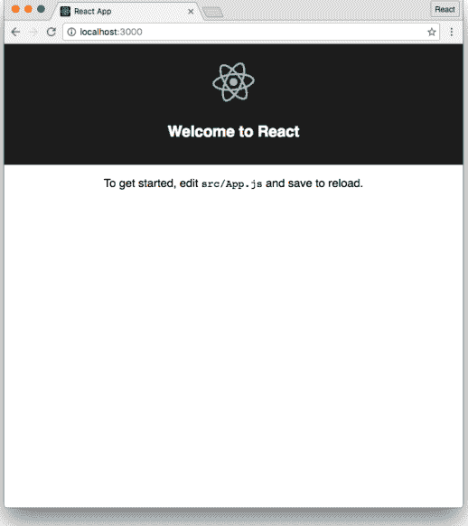

**示例应用**

`App` 组件显然出现在页面上。我们看到了组件指定的 logo 和文本。它是怎么到那里的？

让我们查看这个页面背后的源代码。在 Chrome 和 Firefox 中，你可以在地址栏输入 `view-source:http://localhost:3000/` 来查看：

```
<!doctype html>
<html lang="en">
  <head>
    <meta charset="utf-8">
    <meta name="viewport" content="width=device-width, initial-scale=1">
    <link rel="shortcut icon" href="/favicon.ico">
    <!--
      ... 注释已省略 ...
    -->
    <title>React App</title>
  </head>
  <body>
    <div id="root"></div>
    <!--
      ... 注释已省略 ...
    -->
    <script type="text/javascript" src="/static/js/bundle.js"></script></body>
</html>
```

这个 `index.html` 看起来与我们之前查看的相同，只有一个关键区别：**body 底部附加了一个 script 标签**。这个 script 标签引用了一个 `bundle.js`。正如我们将要看到的，来自 `App.js` 的 `App` 组件和来自 `index.js` 的 `ReactDOM.render()` 调用都存在于该文件中。

Webpack 开发服务器将这一行插入到我们的 `index.html` 中。要理解 `bundle.js` 是什么，让我们深入了解 Webpack 的工作原理。

> ⚠️ 这个脚本默认使用 `3000` 端口。但如果检测到 `3000` 被占用，它会选择另一个。脚本会告诉你服务器运行在何处，所以如果它不在 `http://localhost:3000/`，请检查控制台。

> ℹ️ 如果你运行的是 OS X，这个脚本会自动打开一个指向 `http://localhost:3000/` 的浏览器窗口。

## Webpack 基础

在我们的第一个应用（投票应用）中，我们使用 `http-server` 库来提供静态资源，如 `index.html`、JavaScript 文件和图片。

在第二个应用（计时器应用）中，我们使用了一个小型 Node 服务器来提供静态资源。我们在 `server.js` 中定义了一个服务器，既提供一组 API 端点，又提供 `public/` 下的所有资源。我们的 API 服务器和静态资源服务器是同一个。

使用 Create React App 时，我们的静态资源由运行 `npm start` 时启动的 **Webpack 开发服务器**提供。目前，我们还没有使用 API。

如我们所见，原始的 `index.html` 不包含任何对 React 应用的引用。Webpack 在向浏览器提供 `index.html` 之前，在其中插入了对 `bundle.js` 的引用。如果你在磁盘上查找，`bundle.js` 并不存在任何地方。**Webpack 开发服务器动态生成这个文件并将其保留在内存中**。当我们的浏览器向 `localhost:3000/` 发起请求时，Webpack 从内存中提供其修改后的 `index.html` 和 `bundle.js`。

从页面 `view-source:http://localhost:3000/`，你可以点击 `/static/js/bundle.js` 在浏览器中打开该文件。可能需要几秒钟才能打开。这是一个巨大的文件。

`bundle.js` 包含我们的应用运行所需的*所有* JavaScript 代码。它不仅包含 `App.js` 的全部源代码——还包含 React 库的全部源代码！

你可以在这个文件中搜索字符串 `./src/App.js`。Webpack 用特殊注释标记它包含的每个独立文件。你会发现结果相当混乱：

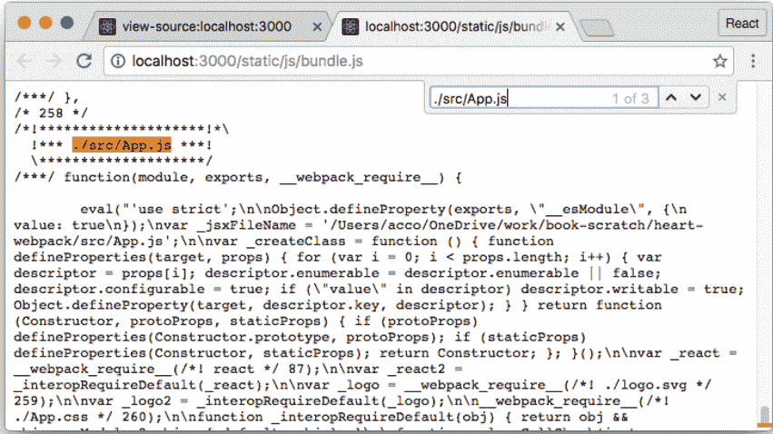

如果你仔细寻找，可以在混乱中认出 `App.js` 的片段。这确实是我们的组件。但它看起来完全不同。

Webpack 对所有包含的 JavaScript 执行了一些转换。值得注意的是，它使用 Babel 将我们的 ES6 代码转译为兼容 ES5 的格式。

如果你查看 `App.js` 的注释头，它有一个编号。在上面的截图中，那个编号是 258：

```
/* 258 */
/*!********************!*\
  !*** ./src/App.js ***!
  \********************/
```

你的模块 ID 可能与文中的不同。

模块本身封装在一个如下所示的函数中：

```
function(module, exports, __webpack_require__) {
  // 混乱的 `App.js` 代码在这里
}
```

我们 Web 应用的每个模块都封装在这种签名的函数中。Webpack 为我们应用的每个模块提供了这个函数容器以及一个模块 ID（在 App.js 的情况下是 258）。

但这里的"模块"不仅限于 JavaScript 模块。

还记得我们如何在 App.js 中导入 logo 吗：

webpack/heart-webpack-complete/src/App.js

```
import logo from './logo.svg';
```

然后在组件的标记中，它被用来设置 img 标签的 src：

webpack/heart-webpack-complete/src/App.js

```

```

以下是 `logo` 变量声明在 Webpack 的 App.js 模块混乱中的样子：


在 Create React App 中使用 Webpack

```
var _logo = __webpack_require__(/*! ./logo.svg */ 259);
```

这看起来非常奇怪，主要是由于 Webpack 为了调试目的而提供的内联注释。去掉该注释：

```
var _logo = __webpack_require__(259);
```

我们没有看到 import 语句，而是看到了普通的 ES5 代码。但这到底是在做什么呢？

要找到答案，请在此文件中搜索 `./src/logo.svg`。（它应该出现在 `App.js` 的正下方）。SVG 也出现在 `bundle.js` 中！

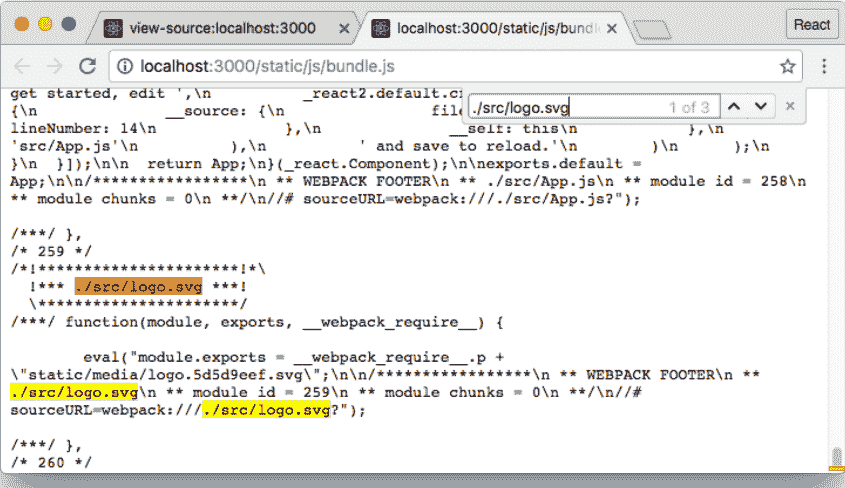

查看该模块的头部：

```
/* 259 */
/*!**********************!*\
  !*** ./src/logo.svg ***!
  \**********************/
```

注意其模块 ID 是 259，这与上面传递给 `__webpack_require__()` 的整数相同。

Webpack 将*所有东西*都视为模块，包括像 `logo.svg` 这样的图像资源。我们可以从 `logo.svg` 模块的混乱内容中找出一条路径，来了解发生了什么。你的路径可能不同，但看起来会像这样：

`static/media/logo.5d5d9eef.svg`

如果你打开一个新的浏览器标签页并输入以下地址：

```
http://localhost:3000/static/media/logo.5d5d9eef.svg
```

你应该能看到 React 的 logo：

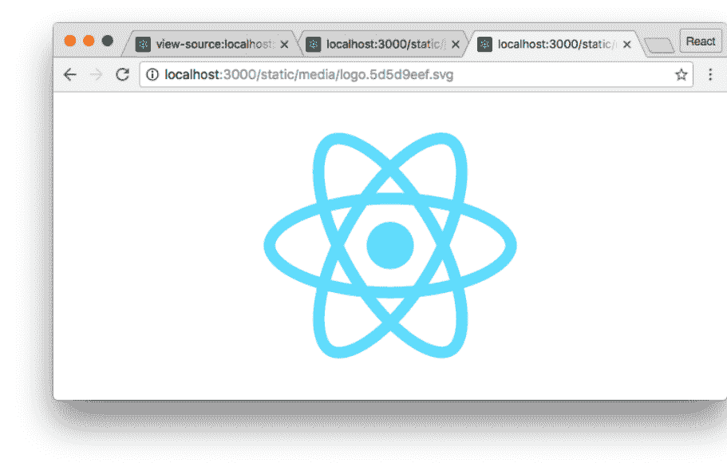

所以 Webpack 通过定义一个函数为 `logo.svg` 创建了一个 Webpack 模块。虽然这个函数的实现细节是不透明的，但我们知道它指向了 Webpack 开发服务器上 SVG 的路径。由于这种模块化范式，它能够智能地将这样的语句：

```
import logo from './logo.svg';
```

编译成这个 ES5 语句：

```
var _logo = __webpack_require__(259);
```

`__webpack_require__()` 是 Webpack 特殊的模块加载器。这个调用指向对应于 `logo.svg` 的 Webpack 模块，编号 259。该模块返回的是 logo 在 Webpack 开发服务器上位置的字符串路径，`static/media/logo.5d5d9eef.svg`。

那我们的 CSS 资源呢？没错，在 Webpack 中*所有东西*都是模块。搜索字符串 `./src/App.css`：

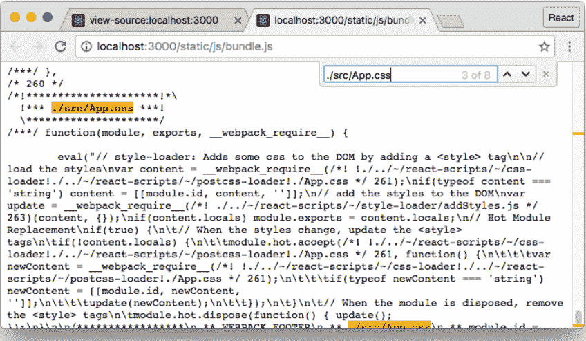

Webpack 的 `index.html` 并没有包含任何对 CSS 的引用。这是因为 Webpack 通过 `bundle.js` 在这里引入了我们的 CSS。当我们的应用加载时，这个晦涩的 Webpack 模块函数会将 App.css 的内容转储到页面上的 `<style>` 标签中。

所以我们知道*发生了什么*：Webpack 将我们的应用中所有可想象的"模块"都打包进了 `bundle.js`。你可能会问：为什么？

第一个动机是所有 JavaScript 打包工具共通的。Webpack 将我们所有的 ES6 模块转换成了它自己定制的 ES5 兼容模块语法。

此外，Webpack 和其他打包工具一样，将所有的 JavaScript 模块合并到了一个文件中。虽然它*可以*将 JavaScript 模块保留在单独的文件中，但拥有单个文件可以最大化性能。每次 HTTP 文件传输的开始和结束都会增加开销。将数百或数千个较小的文件打包成一个较大的文件会带来显著的速度提升。

然而，Webpack 将这种模块范式比其他打包工具更进一步。正如我们所见，它将同样的模块化处理应用于图像资源、CSS 和 npm 包（如 React 和 ReactDOM）。

## 对示例应用进行修改

我们一直在浏览器中查看由 Webpack 开发服务器生成的 `bundle.js`。回想一下，要启动这个服务器，我们运行了以下命令：

```
$ npm start
```

正如我们所见，这个命令定义在 `package.json` 中：

```
"start": "react-scripts start",
```

这究竟是在做什么？

`react-scripts` 包定义了一个 start 脚本。将这个 start 脚本视为 Webpack 的一个特殊接口，它包含了 Create React App 提供的一些特性和约定。从高层次来看，start 脚本会：

- 设置 Webpack 配置
- 为 Webpack 的控制台输出提供友好的格式和颜色
- 如果你在 OS X 上，启动一个 Web浏览器

让我们来看一下由 Webpack 驱动的 React 应用的开发周期是什么样的。

## 热重载

如果服务器尚未运行，请继续运行 start 命令来启动它：

```
$ npm start
```

同样，我们的应用在 `http://localhost:3000/` 启动。Webpack 开发服务器正在此端口监听，并在我们的服务器发出请求时提供开发包。

Webpack 提供给我们一个引人注目的开发特性就是**热重载**。热重载使得 Web 应用中的某些文件在检测到更改时能够被即时热替换，而无需完整的页面刷新。

目前，Create React App 仅为 CSS 设置了热重载。这是因为特定于 React 的热重载器被认为对于默认设置来说还不够稳定。

CSS 的热重载非常棒。在浏览器窗口打开的情况下，编辑一下 `App.css`，你会看到应用在不刷新的情况下更新。

例如，你可以更改 logo 旋转的速度。在这里，我们把它从 `20s` 改为了 `1s`：

```
.App-logo {
  animation: App-logo-spin infinite 1s linear;
  height: 80px;
}
```

或者你可以更改标题文本的颜色。在这里，我们把它从 `white` 改为了 `purple`：

```
.App-header {
  background-color: #222;
  height: 150px;
  padding: 20px;
  color: purple;
}
```

## 热重载的工作原理

Webpack 在 `bundle.js` 中包含了客户端代码来执行热重载。Webpack 客户端与服务器保持一个开放的 socket。每当 bundle 被修改时，客户端会通过这个 websocket 收到通知。然后客户端向服务器发出请求，要求获取一个*补丁*。服务器不会发送整个 bundle，而只会发送客户端执行"热交换"资源所需的代码。

Webpack 的模块化范式使得资源的热重载成为可能。回想一下，Webpack 将 CSS 插入到 DOM 的 `style` 标签中。要替换一个修改过的 CSS 资源，客户端移除之前的 `style` 标签并插入新的。浏览器为用户渲染这个修改，完全不需要页面刷新。

## 自动重载

即使我们的 JavaScript 文件不支持热重载，Webpack 在检测到更改时仍然会重新加载页面。

在浏览器窗口仍然打开的情况下，让我们对 `src/App.js` 做一个小的编辑。我们将更改 `p` 标签中的文本：

```
<p className="App-intro">
  I just made a change to <code>src/App.js</code>!
</p>
```

保存文件。你会注意到页面在你保存后不久就刷新了，并且你的更改反映了出来。

因为 Webpack 本质上是一个用于 JavaScript 开发和侦探工作的平台，所以有一个不断增长的插件和工具生态系统用于由 Webpack 驱动的应用。

对于开发来说，热重载和自动重载是 Create React App 自带配置的两个最引人注目的插件。在后面关于 eject 的部分（"Ejecting"）中，我们会指向 Create React App 设置 Webpack 进行开发的配置文件，以便你可以看到其余的设置。

对于部署来说，Create React App 已经用多种插件配置了 Webpack，以生成生产级优化构建。接下来我们来看看生产构建过程。

## 创建生产构建

到目前为止 AOfar，我们一直在使用 Webpack 开发服务器。在我们的调查中，我们看到这个服务器生成一个修改过的 `index.html`，它加载一个 `bundle.js`。Webpack 生成并从内存中提供这个文件——没有任何内容写入磁盘。

对于生产环境，我们希望 Webpack 将 bundle 写入磁盘。我们最终会得到一个生产优化的 HTML、CSS 和 JavaScript 构建。然后我们可以使用任何我们想要的 HTTP 服务器来提供这些资源。要与世界分享我们的应用，我们只需要将这个构建上传到资源托管服务，比如 Amazon 的 S3。

让我们来看看生产构建是什么样的。

如果服务器正在运行，用 `CTRL+C` 退出。从命令行运行我们之前在 `package.json` 中看到的 `build` 命令：

```
$ npm run build
```

完成后，你会注意到在项目根目录下创建了一个新文件夹：`build`。`cd` 进入该目录并查看里面的内容：

```
$ cd build
$ ls
favicon.ico
index.html
static/
```


如果你查看这个 `index.html`，你会发现 Webpack 执行了一些在开发环境中不会执行的额外处理。最明显的是：没有换行符。整个文件都在一行上。换行符在 HTML 中并非必需，只会增加额外的字节。我们在生产环境中不需要它们。

下面是该文件在可读格式下的样子：

```
<!DOCTYPE html>
<html lang="en">
  <head>
    <meta charset="utf-8">
    <meta content="width=device-width, initial-scale=1" name="viewport">
    <link href="/favicon.ico?fd73a6eb" rel="shortcut icon">
    <title>React App</title>
    <link href="/static/css/main.9a0fe4f1.css" rel="stylesheet">
  </head>
  <body>
    <div id="root"></div>
    <script src="/static/js/main.590bf8bb.js" type="text/javascript">
    </script>
  </body>
</html>
```

这个 `index.html` 不再引用 `bundle.js`，而是引用 `static/` 目录中的一个文件，我们稍后会看到它。此外，这个生产环境的 `index.html` 现在有一个 `link` 标签指向 CSS 打包文件。如我们所见，在开发环境中，Webpack 通过 `bundle.js` 插入 CSS。这个功能实现了热重载。在生产环境中，热重载功能无关紧要。因此，Webpack 以正常方式部署 CSS。

Webpack 对资源进行版本管理。从上面可以看到，我们的 JavaScript 打包文件具有不同的名称并带有版本号（`main.<version>.js`）。

资源版本管理在处理生产环境中的浏览器缓存时非常有用。如果文件发生更改，该文件的版本也会随之更改。客户端浏览器将被迫获取最新版本。

注意，你文件上的版本号（或摘要）可能与上面的不同。

`static/` 目录的组织结构如下：

```
$ ls static
css/
js/
media/
```

分别查看这些目录：

```
$ ls static/css
main.9a0fe4f1.css
main.9a0fe4f1.css.map
```

```
$ ls static/js
main.f7b2704e.js
main.f7b2704e.js.map
```

```
$ ls static/media
logo.5d5d9eef.svg
```

可以随意在你的文本编辑器中打开 `.css` 文件和 `.js` 文件。由于它们的体积，我们在此书中不将它们打印出来。

> ⚠️ 打开这些文件时要小心——由于它们的体积，可能会导致编辑器崩溃！

如果你打开 CSS 文件，你会发现它只有两行：*第一行*是我们应用的*所有* CSS，去除了所有多余的空白字符。即使我们的应用中有数百个不同的 CSS 文件，它们最终也会合并到这一行中。第二行是一个特殊注释，声明了映射文件的位置。

JavaScript 文件的压缩程度更高。在开发环境中，`bundle.js` 有一定的结构，你可以分辨出各个模块所在的位置。生产构建没有这种结构。此外，我们的代码已经经过了**压缩**和**混淆**处理。如果你不熟悉压缩或混淆，请参阅旁注"压缩、混淆和源映射"。

最后，media 目录将包含我们应用的所有其他静态文件，如图像和视频。这个应用只有一张图片，即 React 标志 SVG 文件。

同样，这个打包文件是完全独立的，可以直接使用。如果愿意，我们可以安装之前第一个应用中使用的相同 `http-server` 包来服务这个目录，像这样：

```
http-server ./build -p 3000
```

没有 Webpack 开发服务器，你可以想象开发周期会有些痛苦：

1. 修改应用
2. 运行 `npm run build` 生成 Webpack 打包文件
3. 启动/重启 HTTP 服务器

这就是为什么无法"构建"除用于生产的打包文件之外的任何东西。Webpack 服务器满足了我们的开发需求。

## 压缩、混淆和源映射

对于生产环境，我们可以通过将 JavaScript 文件从人类可读的格式转换为更紧凑但行为完全相同的格式来显著减小文件大小。基本策略是去除所有多余的字符，如空格。这个过程称为**压缩**（**minification**）。

**混淆**（**Uglification** 或 **obfuscation**）是故意修改 JavaScript 文件使其更难以被人类阅读的过程。同样，应用的实际行为并未改变。理想情况下，这个过程会减慢外部开发者理解你代码库的速度。

`.css` 和 `.js` 文件都附带一个以 `.map` 结尾的配套文件。`.map` 文件是一个**源映射**（**source map**），为生产构建提供调试帮助。由于它们已被压缩和混淆，生产应用的 CSS 和 JavaScript 难以处理。例如，如果你在生产环境中遇到 JavaScript 错误，浏览器会指向这段晦涩代码中难以理解的某一行。

通过源映射，你可以将这个令人困惑的代码区域映射回其原始的、未构建的形式。有关源映射及其使用方法的更多信息，请参阅博客文章 ["Introduction to JavaScript Source Maps"](http://www.html5rocks.com/en/tutorials/developertools/sourcemaps/)。

## 弹出（Ejecting）

在本章开头首次介绍 Create React App 时，我们提到该项目提供了一种"弹出"应用的机制。

这是令人安心的。你可能会发现自己将来希望进一步控制 React-Webpack 设置。弹出操作会将封装在 `react-scripts` 中的所有脚本和配置复制到你项目的目录中。它打开了"黑盒"，将应用的完全控制权交还给你。

执行弹出操作也是去除 Create React App 一些"魔法"的好方法。我们将在本节执行弹出操作并快速浏览一下。


**弹出操作无法撤销。** 使用此命令时要小心。如果你将来决定弹出，请确保你的应用已提交到源代码控制。

如果你一直在 `heart-webpack` 目录中添加内容，你可能考虑在继续之前复制该目录。例如，你可以这样做：

```
cp -r heart-webpack heart-webpack-ejected
```

`node_modules` 目录在整体移动时表现不佳，所以你需要删除 `node_modules` 并重新安装：

```
cd heart-webpack-ejected
rm -rf node_modules
npm i
```

然后你可以在 `heart-webpack-ejected` 中执行本节中的步骤，并保留 `heart-webpack`。

## 做好准备

从 `heart-webpack` 的根目录运行弹出命令：

```
$ npm run eject
```

输入 `y`,BPMMATID[content]
如果你查看这个 `index.html`，你会发现 Webpack 执行了一些在开发环境中不执行的额外处理。最值得注意的是：没有换行符。整个文件都在一行上。HTML 中不需要换行符，它们只是额外的字节。我们在生产环境中不需要它们。

下面是该文件在人类可读格式下的样子：

```
<!DOCTYPE html>
<html lang="en">
  <head>
    <meta charset="utf-8">
    <meta content="width=device-width, initial-scale=1" name="viewport">
    <link href="/favicon.ico?fd73a6eb" rel="shortcut icon">
    <title>React App</title>
    <link href="/static/css/main.9a0fe4f1.css" rel="stylesheet">
  </head>
  <body>
    <div id="root"></div>
    <script src="/static/js/main.590bf8bb.js" type="text/javascript">
    </script>
  </body>
</html>
```

这个 `index.html` 不再引用 `bundle.js`，而是引用 `static/` 目录中的一个文件，我们稍后会看到它。此外，这个生产环境的 `index.html` 现在有了到 CSS 打包文件的 `link` 标签。正如我们所见，在开发环境中，Webpack 通过 `bundle.js` 插入 CSS。该功能支持热重载。在生产环境中，热重载功能无关紧要。因此，Webpack 以正常方式部署 CSS。

Webpack 对资源进行版本管理。从上面可以看到，我们的 JavaScript 打包文件有不同的名称，并且带有版本号（`main.<version>.js`）。

资源版本管理在处理生产环境中的浏览器缓存时非常有用。如果文件发生更改，该文件的版本也会随之更改。客户端浏览器将被迫获取最新版本。

注意，你上面文件的版本号（或摘要）可能不同。

`static/` 文件夹的组织结构如下：

```
$ ls static
css/
js/
media/
```

分别查看各个文件夹：

```
$ ls static/css
main.9a0fe4f1.css
main.9a0fe4f1.css.map
```

```
$ ls static/js
main.f7b2704e.js
main.f7b2704e.js.map
```

```
$ ls static/media
logo.5d5d9eef.svg
```

可以随意在你的文本编辑器中打开 `.css` 文件和 `.js` 文件。由于篇幅原因，我们不会在书中将它们打印出来。

> ⚠️ 打开这些文件时要小心——由于它们的体积，可能会导致你的编辑器崩溃！

如果你打开 CSS 文件，你会发现它只有两行：*第一行*是我们应用的*所有* CSS，去除了所有多余的空白。即使我们的应用中有数百个不同的 CSS 文件，它们最终也会合并到这一行。第二行是一个特殊注释，声明了映射文件的位置。

JavaScript 文件的压缩程度更高。在开发环境中，`bundle.js` 有一定的结构。你可以分辨出各个模块所在的位置。生产构建没有这种结构。此外，我们的代码已经经过了**压缩**和**混淆**。如果你不熟悉压缩或混淆，请参阅旁注"压缩、混淆和源映射"。

最后，media 文件夹将包含我们应用的所有其他静态文件，如图片和视频。这个应用只有一张图片，即 React logo SVG 文件。

同样，这个打包文件是完全独立的，可以直接使用。如果愿意，我们可以安装第一个应用中使用过的相同 `http-server` 包，并用它来服务这个目录，像这样：

```
http-server ./build -p 3000
```

没有 Webpack 开发服务器，你可以想象开发周期会有些痛苦：

1. 修改应用
2. 运行 `npm run build` 生成 Webpack 打包文件
3. 启动/重启 HTTP 服务器

这就是为什么除了用于生产的打包文件之外，无法"构建"任何东西。Webpack 开发服务器满足了我们的开发需求。

## 压缩、混淆和源映射

对于生产环境，我们可以通过将 JavaScript 文件从人类可读的格式转换为行为完全相同的更紧凑格式，来显著减小文件大小。基本策略是去除所有多余的字符，如空格。这个过程称为**压缩**（**minification**）。

**混淆**（**Uglification** 或 **obfuscation**）是故意修改 JavaScript 文件，使其更难被人类阅读的过程。同样，应用的实际行为没有改变。理想情况下，这个过程会减慢外部开发者理解你的代码库的速度。

`.css` 和 `.js` 文件都附带一个以 `.map` 结尾的配套文件。`.map` 文件是一个**源映射**（**source map**），为生产构建提供调试帮助。由于它们已被压缩和混淆，生产应用的 CSS 和 JavaScript 难以处理。例如，如果你在生产环境中遇到 JavaScript 错误，浏览器会指向这段晦涩代码中难以理解的某一行。

通过源映射，你可以将这个令人困惑的代码区域映射回其原始的、未构建的形式。有关源映射及其使用方法的更多信息，请参阅博客文章 ["Introduction to JavaScript Source Maps"](http://www.html5rocks.com/en/tutorials/developertools/sourcemaps/)。

## 弹出（Ejecting）

在本章开头首次介绍 Create React App 时，我们提到该项目提供了一种"弹出"应用的机制。

这令人安心。你可能会发现自己将来希望进一步控制 React-Webpack 设置。弹出操作会将封装在 `react-scripts` 中的所有脚本和配置复制到你项目的目录中。它打开了"黑盒"，将应用的完全控制权交还给你。

执行弹出操作也是揭开 Create React App 一些"魔法"的好方法。我们将在本节执行弹出操作并快速浏览一下。


**弹出操作无法撤销。** 使用此命令时要小心。如果你将来决定弹出，请确保你的应用已提交到源代码控制。

如果你一直在 `heart-webpack` 目录中添加内容，你可能考虑在继续之前复制该目录。例如，你可以这样做：

```
cp -r heart-webpack heart-webpack-ejected
```

`node_modules` 文件夹在整体移动时表现不佳，所以你需要删除 `node_modules` 并重新安装：

```
cd heart-webpack-ejected
rm -rf node_modules
npm i
```

然后你可以在 `heart-webpack-ejected` 中执行本节中的步骤，并保留 `heart-webpack`。

## 做好准备

从 `heart-webpack` 的根目录运行弹出命令：

```
$ npm run eject
```

通过输入 `y` 并按回车确认你要弹出。

所有文件从 `react-scripts` 复制到你的目录后，`npm install` 将会运行。这是因为，正如我们将看到的，`react-scripts` 的所有依赖项已经被转储到了我们的 `package.json` 中。

当 npm install 完成后，看看你项目的目录：

```
$ ls
README.md
build/
config/
node_modules/
package.json
public/
scripts/
src/
```

## 将 Webpack 与 Create React App 配合使用

我们有了两个新文件夹：`config/` 和 `scripts/`。如果你查看 `src/`，你会发现它如预期一样没有变化。

看看 `package.json`。里面有*大量*依赖项。其中一些是必需的，如 Babel 和 React。其他的——如 `eslint` 和 `whatwg-fetch`——更是"锦上添花"。这反映了 Create React App 项目的理念：一个面向 React 开发者的、有主见的入门套件。

接着查看 `scripts/`：

```
$ ls scripts
build.js
start.js
test.js
```

我们之前运行 `npm start` 和 `npm run build` 时，分别执行的是 `start.js` 和 `build.js` 脚本。我们 Haven't we already 在书中查看这些文件，但欢迎随意浏览。虽然复杂，但它们有良好的注释。仅仅阅读注释就能让你很好地了解每个脚本在做什么（以及它们"免费"提供了什么）。

最后，查看 `config/`：

```
$ ls config
env.js
jest/
paths.js
polyfills.js
webpack.config.dev.js
webpack.config.prod.js
```

`react-scripts` 为其提供的工具设置了合理的默认值。在 `package.json` 中，它指定了 Babel 的配置。在这里，它指定了 Webpack 和 Jest（我们在下一章使用的测试库）的配置。

特别值得注意的是 Webpack 的配置文件。同样，我们不会在这里深入探讨。但这些文件有很好的注释。阅读注释可以让你很好地了解 Webpack 开发和生产管道的样貌，以及使用了哪些插件。将来，如果你好奇 `react-scripts` 在开发或生产环境中如何配置 Webpack，可以参考这些文件中的注释。

希望看到 `react-scripts` 的"内幕"能减少一些它的神秘色彩。像我们在这里一样测试弹出操作，可以让你了解将来如果需要时，放弃 `react-scripts` 的过程是什么样的。

到目前为止，在本章中，我们涵盖了 Webpack 和 Create React App 与之交互的基础知识。具体来说，我们已经看到：


- Create React App 的接口工作原理
- 基于 Webpack 的 React 应用的整体布局
- Webpack 的工作原理（以及它提供的一些强大功能）
- Create React App 和 Webpack 如何帮助我们生成生产环境优化的构建
- 一个“弹出”（ejected）后的 Create React App 项目长什么样

然而，我们的演示 Webpack-React 应用还缺少一个关键元素。

在第二个项目（计时器应用）中，我们有一个与 API 交互的 React 应用。Node 服务器既为我们的静态资源（HTML/CSS/JS）提供服务，又提供了一组 API 端点，用于持久化我们运行中计时器的数据。

正如我们在本章中所见，通过 Create React App 使用 Webpack 时，我们启动了一个 Webpack 开发服务器。该服务器负责提供我们的静态资源。

如果我们想让 React 应用与 API 交互呢？我们仍然希望 Webpack 开发服务器提供静态资源。因此，可以想象我们会分别启动 API 和 Webpack 服务器。那么我们面临的挑战就是如何让两者协同工作。

## 将 Create React App 与 API 服务器一起使用

在本节中，我们将研究一种在 API 服务器旁边运行 Webpack 开发服务器的策略。在深入了解该策略之前，让我们先看看将要使用的应用。

## 完成的应用

`food-lookup-complete` 位于本书代码下载包中的根目录下。从 `heart-webpack` 进入该目录：

```
$ cd ../..
$ cd food-lookup-complete
```

查看文件夹结构：

```
$ ls
README.md
client/
db/
node_modules/
package.json
server.js
start-client.js
start-server.js
```

项目的根目录是服务器所在的位置。这里有一个 `package.json` 以及一个 `server.js` 文件。`client/` 目录内部是 React 应用所在的位置。`client/` 文件夹是通过 Create React App 生成的。

现在查看 `client/` 内部：

如果你使用的是 macOS 或 Linux，运行：

```
$ ls -a client
```

Windows 用户可以运行：

```
$ ls client
```

你会看到：

```
.babelrc
.gitignore
node_modules/
package.json
public/
src/
tests/
```

> 在 OSX 和 Unix 中，`ls` 命令的 `-a` 标志显示所有文件，包括以 `.` 开头的"隐藏"文件，如 `.babelrc`。Windows 默认显示隐藏文件。

因此，我们有两个 `package.json` 文件。一个位于根目录，指定了服务器需要的包。另一个位于 `client/` 目录，指定了 React 应用需要的包。虽然共存于这个文件夹中，但我们有两个完全独立的应用。

## .babelrc

`client/` 中一个值得注意的文件是 `.babelrc`。该文件的内容：

```
// client/.babelrc
{
  "plugins": ["transform-class-properties"]
}
```

你可能还记得，这个插件为我们提供了属性初始化器语法，我们在[第一章末尾]()使用过它。在那个项目中，我们通过在 `app.js` 的 script 标签上设置 `data-plugins` 属性来指定使用这个插件，像这样：

```
<script
  type="text/babel"
  data-plugins="transform-class-properties"
  src="./js/app.js"
></script>
```

现在，在这个项目中，Babel 由 `react-scripts` 包含和管理。对于我们的 Create React App 项目，如果要指定希望 Babel 使用的插件，我们首先需要在 `package.json` 中包含该插件。它已经包含在内了：

food-lookup-complete/client/package.json

```
"babel-plugin-transform-class-properties": "6.22.0",
```

然后我们只需在 `.babelrc` 中指定希望 Babel 使用该插件即可。

## 运行应用

为了启动应用，我们需要为服务器和客户端安装包。我们将在两个目录内分别运行 `npm i`：

```
$ npm i
$ cd client
$ npm i
$ cd ..
```

服务器和客户端的包都安装完成后，我们就可以运行应用了。请确保从项目的顶层目录（服务器所在的位置）执行此操作：

```
$ npm start
```

在启动过程中，你会看到来自服务器和客户端的一些控制台输出。应用启动后，你可以访问 `localhost:3000` 查看应用：

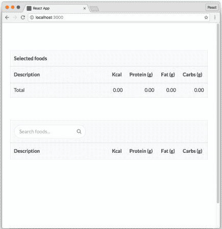

该应用提供了一个搜索字段，用于在食物数据库中查找营养信息。在搜索字段中输入数值会执行实时搜索。你可以点击食物项，将它们添加到顶部的总计表格中：

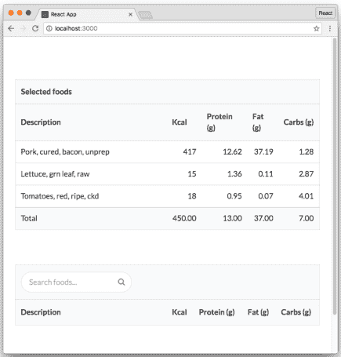

## 应用的组件

该应用由三个组件组成：

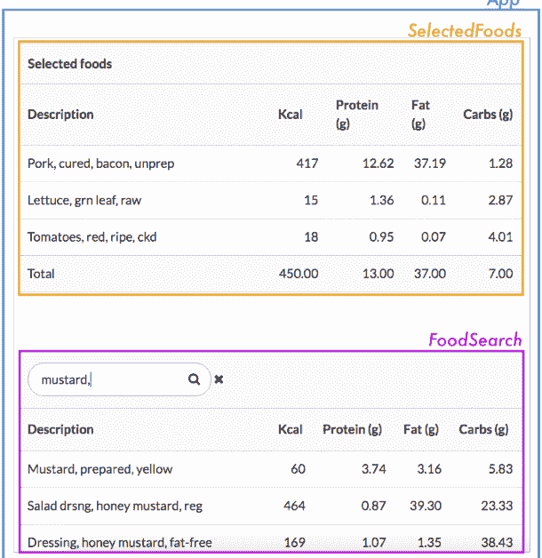

- **App**（蓝色）：应用的父容器。
- **SelectedFoods**（黄色）：列出已选食物的表格。点击食物项可将其移除。
- **FoodSearch**（紫色）：提供实时搜索字段的表格。点击表格中的食物项可将其添加到总计（SelectedFoods）中。

在本章中，我们不会深入探讨这些组件的细节。相反，我们将只关注如何让这个现有的 Webpack-React 应用与 Node 服务器协同工作。

## 应用的组织方式

既然我们已经看到了完成的应用，让我们看看是如何实现这一点的。

如果应用正在运行，请终止它，然后进入 `webpack` 目录下的 `food-lookup` 目录（非完整版本）。从 `food-lookup-complete` 进入该目录：

```
cd webpack/food-lookup
```

同样，我们必须为服务器和客户端安装 npm 包：

```
$ npm i
$ cd client
$ npm i
$ cd ..
```

## 服务器

让我们只启动服务器，看看它是如何工作的。在完整版本中，我们使用 `npm start` 来同时启动服务器和客户端。如果你查看本目录中的 `package.json`，会发现该命令尚未定义。我们可以用以下命令只启动服务器：

```
$ npm run server
```

该服务器提供单一的 API 端点 `/api/food`。它需要一个参数 `q`，即我们要搜索的食物。

你可以自己试一试。你可以使用浏览器执行搜索，或使用 curl：

```
$ curl localhost:3001/api/food?q=hash+browns
```

```
[
  {
    "description": "Fast foods, potatoes, hash browns, rnd pieces or patty",
    "kcal": 272,
    "protein_g": 2.58,
    "carbohydrate_g": 28.88,
    "sugar_g": 0.56
  },
  {
    "description": "Chick-fil-a, hash browns",
    "kcal": 301,
    "protein_g": 3,
    "carbohydrate_g": 30.51,
    "sugar_g": 0.54
  },
  {
    "description": "Denny's, hash browns",
    "kcal": 197,
    ...
```

```
"protein_g": 2.49,
"carbohydrate_g": 26.59,
"sugar_g": 1.38
},
{
"description": "Restaurant, family style, hash browns",
"kcal": 197,
"protein_g": 2.49,
"carbohydrate_g": 26.59,
"sugar_g": 1.38
}
]
```

现在我们了解了该端点的工作原理，让我们看看它在客户端被调用的唯一位置。用 CTRL+C 终止服务器。

#### 客户端

FoodSearch 组件向 `/api/foods` 发起调用。每次用户更改搜索字段时，它都会执行一次请求。它使用一个名为 `Client` 的库来发起请求。

`Client` 模块定义在 `client/src/Client.js` 中。它导出一个包含一个方法 `search()` 的对象。只看 `search()` 函数：

webpack/food-lookup/client/src/Client.js

```
function search(query, cb) {
  return fetch(`http://localhost:3001/api/food?q=${query}`, {
    accept: 'application/json',
  }).then(checkStatus)
    .then(parseJSON)
    .then(cb);
}
```

`search()` 函数是客户端与服务器之间的唯一接触点。`search()` 调用 `localhost:3001`，即服务器的默认位置。

因此，为了让应用正常工作，我们需要运行两个不同的服务器。我们需要运行 API 服务器（位于 `localhost:300`）和 Webpack 开发服务器（位于 `localhost:3000`）。如果两个服务器都在运行，它们应该能够通信。我们可以使用两个终端窗口，但有更好的解决方案。

> 如果你需要复习 Fetch API，我们在第三章：组件与服务器中使用了它。

## Concurrently

[Concurrently](https://github.com/kimmobrunfeldt/concurrently)⁶⁷ 是一个用于运行多个进程的实用工具。我们将通过实现它来了解其工作原理。

Concurrently 已经包含在服务器的 package.json 中：

webpack/food-lookup/package.json

```
},
  "devDependencies": {
    "concurrently": "3.1.0"
```

我们希望 concurrently 执行两个命令，一个用于启动 API 服务器，一个用于启动 Webpack 开发服务器。你可以通过引号将多个命令传递给 concurrently，像这样：

```
# 使用 `concurrently` 的示例
$ concurrently "command1" "command2"
```

如果你编写的应用只打算在 Mac 或 Unix 机器上运行，你可以这样做：

```
$ concurrently "npm run server" "cd client && npm start"
```

注意，启动客户端的第二个命令会先进入 `client` 目录，然后运行 `npm start`。

然而，`&&` 运算符不是跨平台的，在 Windows 上无法工作。因此，我们在项目中包含了一个 `start-client.js` 脚本。该脚本将从顶层目录启动客户端。

有了这个启动脚本，你可以从顶层目录启动客户端应用，像这样：

```
$ babel-node start-client.js
```

我们将在 `package.json` 中添加一个 `client` 命令。这样，启动服务器和客户端的方法看起来就一样了：


启动服务端
$ npm run server
# 启动客户端
$ npm run client

因此，使用 `concurrently` 看起来是这样的：

```
$ concurrently "npm run server" "npm run client"
```

现在让我们在 `package.json` 中添加 `start` 和 `client` 命令：

food-lookup-complete/package.json

```
"scripts": {
  "start": "concurrently \\"npm run server\\" \\"npm run client\\"",
  "server": "babel-node start-server.js",
  "client": "babel-node start-client.js"
},
```

对于 `start`，我们执行两个命令，**转义引号**因为我们在一个 JSON 文件中。

保存并关闭 `package.json`。现在我们可以通过运行 `npm start` 来启动两个服务器。现在就去做吧：

```
$ npm start
```

你会看到服务端和客户端的输出都被记录到控制台中。Concurrently 同时执行了两个运行命令。

当一切似乎都启动完成后，访问 `localhost:3000`。然后开始输入一些内容。奇怪的是，似乎什么都没有发生：

## 在 Create React App 中使用 Webpack

打开开发者控制台，我们看到里面布满了错误：

挑选其中一个：

```
Fetch API cannot load http://localhost:3001/api/food?q=c. No 'Access-Control-Allow-Origin' header is present on the requested resource. Origin 'http://localhost:3000' is therefore not allowed access. If an opaque response serves your needs, set the request's mode to 'no-cors' to fetch the resource with CORS disabled.
```

我们的浏览器阻止了我们的 React 应用（托管于 localhost:3000）从不同源（localhost:3001）加载资源。我们试图执行**跨域资源共享**（即 CORS）。出于安全原因，浏览器禁止脚本发起这类请求。

> ⚠️ 注意：如果你没有遇到这个问题，你可能需要确认你的浏览器安全设置是正常的。不限制 CORS 会使你面临重大的安全风险。

这是我们双服务器解决方案的主要困难。但双服务器设置在开发中很常见。常见到 Create React App 已经为我们准备好了一个解决方案。

## 使用 Webpack 开发代理

Create React App 使你能够设置 Webpack 开发服务器**来代理请求到你的 API**。我们的 React 应用不需要向 localhost:3001 的 API 服务器发起请求，而是可以向 localhost:3000 发起请求。然后我们让 Webpack 将这些请求代理到我们的 API 服务器。

所以，我们原来的方法是让用户的浏览器直接与两个服务器交互，像这样：

然而，我们希望浏览器只与 `localhost:3000` 的 Webpack 开发服务器交互。Webpack 会转发那些发往 API 的请求，像这样：

这个代理功能使我们的 React 应用可以只与 Webpack 开发服务器交互，消除了任何 CORS 的问题。

要做到这一点，我们先修改 `client/src/Client.js`。移除基础 URL `localhost:3001`：

food-lookup-complete/client/src/Client.js

```
function search(query, cb) {
  return fetch(`/api/food?q=${query}`, {
    accept: 'application/json',
  }).then(checkStatus)
```

现在，`search()` 会向 `localhost:3000` 发起调用。

接下来，在我们客户端的 `package.json` 中，我们可以设置一个特殊属性 `proxy`。现在将这个属性添加到 `client/package.json` 中：

```
// Inside client/package.json
"proxy": "http://localhost:3001/",
```

> 确保将那一行添加到**客户端的** `package.json` 中，而不是服务端的。

这个属性是 Create React App 特有的，指示 Create React App 设置我们的 Webpack 开发服务器以将 API 请求代理到 `localhost:3001`。Webpack 开发服务器会推断要代理哪些流量。如果 URL 未被识别，或者请求不是在加载静态资源（如 HTML、CSS 或 JavaScript），它就会将请求代理到我们的 API。

### 试一试

使用 `concurrently` 启动两个进程：

```
$ npm start
```

访问 `localhost:3000`，我们看到一切正常。因为我们的浏览器通过 `localhost:3000` 与 API 交互，我们没有任何 CORS 的问题。

## Webpack 概览

作为 JavaScript 应用的平台，Webpack 打包了众多功能。我们在本章中目睹了其中一些功能。Webpack 的能力可以更广泛地分为两类：

### 优化

Webpack 针对生产环境的优化工具集非常庞大。

Webpack 提供的一个直接优化是减少客户端浏览器需要获取的文件数量。对于由许多不同文件组成的大型 JavaScript 应用，提供少量打包文件（如 `bundle.js`）比提供大量小文件更快。

代码拆分是另一种基于打包概念构建的优化。你可以配置 Webpack，使其只提供与用户正在查看的页面相关的 JavaScript 和 CSS 资源。虽然你的多页应用可能有数百个 React 组件，但你可以让 Webpack 只提供客户端渲染当前页面所需的组件和 CSS。

### 工具

与优化一样，围绕 Webpack 工具的生态系统也非常庞大。

对于开发，我们看到了 Webpack 便捷的热重载和自动重载功能。此外，Create React App 还在开发流程中配置了其他便利功能，如自动检查你的 JavaScript 代码。

对于生产，我们看到了如何配置 Webpack 以执行优化我们生产构建的插件。

## 何时使用 Webpack/Create React App

那么，鉴于 Webpack 的强大功能，你可能会问：我是不是应该对所有未来的 React 项目都使用 Webpack/Create React App？

这取决于具体情况。

像我们前几章那样在 `script` 标签中加载 React 和 Babel 仍然是一个完全合理的方法。对于某些项目，这种设置的简单性可能更优。此外，你总是可以从简单开始，然后在将来将项目迁移到更复杂的 Webpack 设置。

更重要的是，如果你想在现有应用中逐步引入 React，这种简单的方法是你最好的选择。你不必为你的应用采用全新的构建或部署流程。相反，你可以逐个推出 React 组件，只需确保你的应用中包含了 React 库即可。

但是，对于许多开发者和许多类型的项目来说，Webpack 是一个极具吸引力的选择，其功能令人难以忽视。如果你计划编写一个包含许多不同组件的大型 React 应用，Webpack 对 ES6 模块的支持将帮助你的代码库保持清晰。对 npm 包的支持也很棒。而且多亏了 Create React App，你可以免费获得大量用于开发和生产的工具。

还有一个支持 Webpack 的关键决定性因素：测试。在下一章中，我们将学习如何为 React 应用编写测试。正如我们将要看到的，Webpack 提供了一个平台，可以让我们在浏览器外轻松地在控制台中执行我们的测试套件。

# 单元测试

一个健壮的测试套件是优质软件的重要组成部分。有了一个好的测试套件，开发者可以更自信地重构或添加应用功能。测试套件是一项前期投资，在系统的整个生命周期中都会产生回报。

测试用户界面 notoriously 困难。幸运的是，测试 React 组件并非如此。有了正确的工具和方法，你的 Web 应用界面可以像系统的其他部分一样得到充分的测试保护。

我们将从编写一个小型测试套件开始，不使用任何测试库。在了解了测试套件的本质之后，我们将引入 Jest 测试框架来减轻大量样板代码，并轻松地使我们的测试更具表达力。

在使用 Jest 时，我们将看到如何以行为驱动的方式组织我们的测试套件。一旦我们熟悉了基础知识，我们将看看如何专门针对 React 组件进行测试。我们将介绍 Enzyme，这是一个在测试环境中处理 React 组件的库。

最后，在本章的最后一节中，我们将处理一个位于更大应用中的更复杂的 React 组件。我们使用 mock 的概念来隔离我们正在测试的由 API 驱动的组件。

## 不使用框架编写测试

> 如果你已经熟悉 JavaScript 测试，可以跳到下一节。不过，你可能会发现这一节是对测试框架幕后工作的一个有用回顾。

本章的项目位于本书代码下载提供的 `testing` 文件夹中。

我们从 `basics` 文件夹开始：

```
$ cd testing/basics
```

这个项目的结构：


 ## 单元测试

```
$ ls
Modash.js
Modash.test.js
complete/
package.json
```

> 在 `complete/` 目录中，你可以找到与 `Modash.test.js` 每次迭代对应的文件，以及 `Modash.js` 的完整版本。

我们将使用 `babel-node` 从命令行运行我们的测试套件。`babel-node` 已包含在该文件夹的 `package.json` 中。现在请继续安装 `package.json` 中的包：

```
$ npm install
```

为了编写测试，我们需要有一个可测试的库。让我们编写一个小型工具库来进行测试。

## 准备 Modash

我们将在 `Modash.js` 中编写一个小型库。Modash 将包含一些在处理 JavaScript 字符串时可能会有用的方法。我们将编写以下三个方法，每个方法都返回一个字符串：

**`truncate(string, length)`**

如果 `string` 的长度超过指定的 `length`，则对其进行截断。如果字符串被截断，它将以 `...` 结尾：

```
const s = 'All code and no tests makes Jack a precarious boy.';
Modash.truncate(s, 21);
  // => 'All code and no tests...'
Modash.truncate(s, 100);
  // => 'All code and no tests makes Jack a precarious boy.'
```

**`capitalize(string)`**

将 `string` 的首字母大写，其余字母小写：

```
const s = 'stability was practically ASSURED.';
Modash.capitalize(s);
  // => 'Stability was practically assured.'
```

**`camelCase(string)`**

接收一个由空格、短横线或下划线分隔的单词字符串，并返回驼峰式表示：

```
let s = 'started at';
Modash.camelCase(s);
// => 'startedAt'
s = 'started_at';
Modash.camelCase(s);
// => 'startedAt'
```

> "Modash" 这个名称是对流行的 JavaScript 工具库 [Lodash](https://lodash.com/) [68] 的戏称。

我们将把 Modash 编写为 ES6 模块。有关这与 Babel 如何配合工作的更多细节，请参阅旁注 [ES6: Import/export with Babel]。如果你需要复习 ES6 模块，请参阅前一章"使用 Webpack 与 create-react-app"。

现在打开 Modash.js。我们将编写库的三个函数，然后在此文件底部导出我们的接口。

首先，我们将编写 truncate() 的函数。有很多种实现方式。这里是一种方法：

```
function truncate(string, length) {
  if (string.length > length) {
    return string.slice(0, length) + '...';
  } else {
    return string;
  }
}
```

接下来，以下是 capitalize() 的实现：

```
function capitalize(string) {
  return (
    string.charAt(0).toUpperCase() + string.slice(1).toLowerCase()
  );
}
```

最后，我们将编写 camelCase()。这个稍微复杂一点。同样，有多种实现方式，但以下是所采用的策略：

1. 使用"hspace" 使用 `split` 获取字符串中单词的数组。空格、短横线和下划线将被视为分隔符。

2. 创建一个新数组。该数组的第一个条目将是第一个单词的小写版本。其余条目将是每个后续单词的首字母大写版本。

3. 使用 `join` 连接该数组。

代码如下所示：

testing/basics/complete/Modash.js

```
function camelCase(string) {
  const words = string.split(/[\s|\-|_]+/);
  return [
    words[0].toLowerCase(),
    ...words.slice(1).map((w) => capitalize(w)),
  ].join('');
}
```

> String 的 `split()` 将字符串拆分为字符串数组。它接受一个参数，即你希望在其上进行拆分的字符。该参数可以是字符串或正则表达式。你可以在[此处阅读有关 split() 的更多信息](https://developer.mozilla.org/en-US/docs/Web/JavaScript/Reference/Global_Objects/String/split)。

Array 的 `join()` 将数组的所有成员组合成一个字符串。你可以在[此处阅读有关 join() 的更多信息](https://developer.mozilla.org/en-US/docs/Web/JavaScript/Reference/Global_Objects/Array/join)。

在 `Modash.js` 中定义了这三个函数之后，我们准备好导出我们的模块。

在 `Modash.js` 的底部，我们首先创建封装我们方法的对象：

testing/basics/complete/Modash.js

```
const Modash = {
  truncate,
  capitalize,
  camelCase,
};
```

然后我们导出它：

testing/basics/complete/Modash.js

```
export default Modash;
```

我们将在此部分的文件 `Modash.test.js` 中编写测试代码。现在在你的文本编辑器中打开该文件。

## ES6: Import/export with Babel

我们的 `package.json` 已经包含了 Babel。此外，我们还包含了一个 Babel 插件 `babel-plugin-transform-class-properties`。这个包将让我们使用 ES6 import/export 语法。重要的是，我们在项目的 `.babelrc` 中将其指定为 Babel 插件：

```
// basics/.babelrc
{
  "plugins": ["transform-class-properties"]
}
```

安装此插件后，我们现在可以从一个文件导出模块并将其导入到另一个文件中。

但是，请注意此解决方案**在浏览器中不起作用**。它在本地 Node 运行时中工作，这对于为 Modash 库编写测试的目的来说足够了。但要在浏览器中支持此功能需要额外的工具。正如我们在上一章中提到的，浏览器中的 ES6 模块支持是我们使用 Webpack 的主要动机之一。

## 编写第一个测试用例

我们的测试套件将导入我们正在编写测试的库 Modash。我们将调用该库上的方法，并对方法的行为方式做出**断言**。

在 `Modash.test.js` 的顶部，首先导入我们的库：

testing/basics/complete/Modash.test-1.js

```
import Modash from './Modash';
```

我们的第一个断言将针对方法 `truncate`。我们将**断言**当给定一个超过指定长度的字符串时，`truncate` 返回一个截断的字符串。

首先，我们设置测试：

testing/basics/complete/Modash.test-1.js

```
const string = 'there was one catch, and that was CATCH-22';
const actual = Modash.truncate(string, 19);
const expected = 'there was one catch...';
```

我们声明示例测试字符串 `string`。然后设置两个变量：`actual` 和 `expected`。在测试套件中，**actual** 是我们所称的观察到的行为。在本例中，它是 `Modash.truncate` 实际返回的内容。**expected** 是我们期望的值。

接下来，我们进行测试的断言。我们将打印一条消息，指示 `truncate` 是通过还是失败：

testing/basics/complete/Modash.test-1.js

```
if (actual !== expected) {
  console.log(
    `[FAIL] Expected \`truncate()\` to return '${expected}', got '${actual}'`
  );
} else {
  console.log('[PASS] `truncate()`.');
}
```

## 试一试

我们可以在此时从命令行运行我们的测试套件。保存文件 `Modash.test.js` 并从 `testing/basics` 文件夹运行以下命令：

```
./node_modules/.bin/babel-node Modash.test.js
```

执行此操作，我们会看到 `[PASS]` 消息打印到控制台。如果你愿意，可以修改 `Modash.js` 中的 `truncate` 函数来观察此测试失败：

```
in ~/fullstack-react-code/testing/basics
$ ./node_modules/.bin/babel-node Modash.test.js
[PASS] `truncate()`.
```

测试通过

```
in ~/fullstack-react-code/testing/basics
$ ./node_modules/.bin/babel-node Modash.test.js
[FAIL] Expected `truncate()` to return 'there was one catch...', got 'there ...'
```

测试失败时的示例

## `assertEqual()` 函数

让我们为 `Modash` 中的另外两个方法编写一些测试。

对于所有测试，我们将遵循类似的模式。我们将进行一些断言来检查 `actual` 是否等于 `expected`。我们将向控制台打印一条消息，指示被测函数是通过还是失败。

为了避免这种代码重复，我们将编写一个辅助函数 `assertEqual()`。`assertEqual()` 将检查其两个参数之间的相等性。然后该函数将写入一条控制台消息，指示测试用例是通过还是失败。

在 `Modash.test.js` 的顶部，`Modash` 的 import 语句下方，声明 `assertEqual`：

testing/basics/complete/Modash.test-2.js

```
import Modash from './Modash';

function assertEqual(description, actual, expected) {
  if (actual === expected) {
    console.log(`[PASS] ${description}`);
  } else {
    console.log(`[FAIL] ${description}`);
    console.log(`\tactual: '${actual}'`);
    console.log(`\texpected: '${expected}'`);
  }
}
```

- 制表符在 JavaScript 中表示为 `\t` 字符。

定义了 `assertEqual` 后，让我们重写第一个测试用例。我们将在整个测试套件中重复使用变量 `actual`、`expected` 和 `string`，因此我们将使用 `let` 声明，以便可以重新定义它们：

testing/basics/complete/Modash.test-2.js

```
let actual;
let expected;
let string;

string = 'there was one catch, and that was CATCH-22';
actual = Modash.truncate(string, 19);
expected = 'there was one catch...';

assertEqual('`truncate()`: truncates a string', actual, expected);
```

如果你现在运行 `Modash.test.js`，你会注意到一切都像以前一样正常工作。控制台输出只是略有不同：


测试通过

编写好我们的 assert 函数后，让我们再写一些测试。

我们为 `truncate` 再写一个断言。如果字符串长度小于提供的长度，该函数应原样返回字符串。我们将使用相同的 `string`。在当前断言下方编写这个断言：

testing/basics/complete/Modash.test-2.js

```
actual = Modash.truncate(string, string.length);
expected = string;

assertEqual('`truncate()`: no-ops if <= length', actual, expected);
```

接下来，我们为 `capitalize` 写一个断言。我们可以继续使用相同的 `string`：

testing/basics/complete/Modash.test-2.js

```
actual = Modash.capitalize(string);

expected = 'There was one catch, and that was catch-22';

assertEqual('`capitalize()`: capitalizes the string', actual, expected);
```

鉴于我们使用的示例字符串，这个断言测试了 `capitalize` 的两个方面：它将字符串的第一个字母大写，并将其余部分转换为小写。

最后，我们为 `camelCase` 编写断言。我们将用两个不同的字符串来测试这个函数。一个将由空格分隔，另一个由下划线分隔。

针对空格的断言：

```
string = 'customer responded at';
actual = Modash.camelCase(string);
expected = 'customerRespondedAt';

assertEqual('`camelCase()`: string with spaces', actual, expected);
```

以及针对下划线的断言：

testing/basics/complete/Modash.test-2.js

```
string = 'customer_responded_at';
actual = Modash.camelCase(string);
expected = 'customerRespondedAt';

assertEqual('`camelCase()`: string with underscores', actual, expected);
```

## 试一试

保存 Modash.test.js。在控制台中，运行测试套件：

```
./node_modules/.bin/babel-node Modash.test.js
```

测试通过

随意调整每个断言的预期值，或者破坏库，观察测试失败。

我们的微型断言框架清晰但有限。很难想象它在一个更复杂的应用或模块中如何保持可维护性和可扩展性。而且虽然 assertEqual() 在检查字符串相等性时工作正常，但在处理对象或数组时，我们会希望进行更复杂的断言。例如，我们可能想检查对象是否包含特定属性，或数组是否包含特定元素。

## 什么是 Jest？

JavaScript 有各种测试库，它们提供了很多出色的功能。这些库帮助我们以健壮、可维护的方式组织测试套件。许多库完成的任务领域相同，但方法不同。

> 你可能听说过或使用过的一些测试库示例包括 Mocha、Jasmine、QUnit、Chai 和 Tape。

我们可以将测试库视为具有三个主要组成部分：

- 测试运行器。这是你在命令行中执行的部分。测试运行器负责查找你的测试、运行它们，并在控制台中向你报告结果。
- 用于组织测试的领域特定语言。正如我们将看到的，这些函数帮助我们执行常见任务，如在测试运行前后协调设置和拆卸。
- 断言库。这些库提供的断言函数帮助我们轻松地进行否则会很复杂的断言，😃 比如检查 JavaScript 对象之间的相等性或数组中某些元素的存在。

React 开发者可以选择使用任何他们喜欢测试框架的 JavaScript 来编写测试。在本书中，我们将重点关注一个特定的框架：**Jest**。

Jest 由 Facebook 创建和维护。如果你使用过其他 JavaScript 测试框架，甚至其他编程语言的测试框架，你很可能会发现 Jest 非常熟悉。

对于断言，Jest 使用 **Jasmine 的断言库**。如果你以前使用过 Jasmine，你会高兴地发现语法完全相同。

> 在本章后面，我们将探讨 Jest 与其他 JavaScript 测试框架最大的不同之处：模拟（mocking）。

## 使用 Jest

在 `testing/basics/package.json` 中，你会发现 Jest 已经包含在内。

从 Jest 15 开始，Jest 会将任何以 `*.test.js` 或 `*.spec.js` 结尾的文件视为测试文件。因为我们的文件名为 `Modash.test.js`，所以我们不需要做任何特殊操作来告诉 Jest 这是一个测试文件。

我们将使用 Jest 重写 Modash 的测试规范。

### Jest 15

如果你以前使用过旧版本的 Jest，你可能会惊讶于我们的测试不需要放在 `__tests__/` 文件夹中。此外，在本章后面，你会注意到 Jest 的自动模拟似乎被关闭了。

Jest 15 为 Jest 引入了新的默认设置。这些变化的动机是希望让新开发者更容易开始使用 Jest，同时保持 Jest 尽可能少配置的理念。

你可以在[这篇博客文章](https://facebook.github.io/jest/blog/2016/09/01/jest-15.html)中了解所有变化。与本章相关的有：

- 除了在 `__tests__/` 下查找测试文件外，Jest 还会查找匹配 `*.test.js` 或 `*.spec.js` 的文件
- 默认禁用自动模拟

### expect()

在 Jest 中，我们使用 `expect()` 语句来进行断言。正如你将看到的，语法与我们之前编写的 assert 函数不同。

> 因为 Jest 使用 Jasmine 断言库，这些匹配器严格来说是 *Jasmine* 的功能，而不是 *Jest* 的功能。然而，为了避免混淆，在本章中，我们将 Jest 附带的所有内容——包括 Jasmine 断言库——都称为 Jest。

以下是使用 `expect` 语法来断言 `true` 是……`true` 的示例：

```
expect(true).toBe(true)
```

`toBe` 是一个 **匹配器**。Jest 附带了几种不同的匹配器。在底层，`toBe` 匹配器使用 `===` 运算符来检查相等性。所以这些都能如预期工作：

## 单元测试

```
expect(1).toBe(1); // 通过
const a = 5;
expect(a).toBe(5); // 通过
```

因为它只是使用 === 运算符，toBe 有其局限性。例如，虽然我们可以使用 toBe 来检查一个对象是否是*完全相同的*对象：

```
const a = { espresso: '60ml' };
const b = a;
expect(a).toBe(b); // 通过
```

如果我们想检查两个*不同的*对象是否相同怎么办？

```
const a = { espresso: '60ml' };
expect(a).toBe({ espresso: '60ml' }) // 失败
```

Jest 有另一个匹配器，toEqual。toEqual 比 toBe 更复杂。就我们的目的而言，它允许我们断言两个对象是相同的，即使它们不是完全相同的对象：

```
const a = { espresso: '60ml' };
expect(a).toEqual({ espresso: '60ml' }) // 通过
```

我们将在本章中使用 toBe 和 toEqual。我们倾向于对布尔值和数字断言使用 toBe，对其他所有内容使用 toEqual。我们也可以对所有内容都使用 toEqual。但我们在某些情况下使用 toBe，因为我们喜欢它在英语中的读法。这是个人偏好的问题。重要的是你要理解两者之间的区别。

在 Jest 中，与许多其他测试框架一样，我们将代码组织成 **describe 块**和 **it 块**。为了感受这种组织方式，让我们编写第一个 Jasmine 测试。将 Modash.test.js 的内容替换为以下内容：

testing/basics/complete/Modash.test-3.js

```
describe('My test suite', () => {
  it('`true` should be `true`', () => {
    expect(true).toBe(true);
  });

  it('`false` should be `false`', () => {
    expect(false).toBe(false);
  });
});
```

`describe` 和 `it` 都接受一个字符串和一个函数。字符串只是人类友好的描述，我们很快就会看到它打印到控制台上。

正如我们将在本章中看到的，`describe` 用于组织所有与同一功能或上下文相关的断言。`it` 块是我们的单个断言或 **specs**。

Jest 要求你必须有一个顶层的 `describe` 来封装所有代码。在这里，我们的顶层 `describe` 标题为 "My test suite"。嵌套在这个 `describe` 内的两个 `it` 块是我们的测试规范。这种组织是标准的：`describe` 块不包含断言，`it` 块包含断言。

> 在本章的其余部分，"断言"指的是对 `expect()` 的调用。"spec" 是一个 `it` 块。

## 试一试

在 `package.json` 中，我们已经定义了一个 `test` 脚本。所以我们可以运行以下命令来运行我们的测试套件：

```
$ npm test
```

两个测试通过

## Modash 的第一个 Jest 测试

让我们用这个测试套件替换为实际测试 Modash 的有用内容。

再次打开 `Modash.test.js` 并清空它。在顶部，导入库：


 testing/basics/complete/Modash.test-4.js

```
import Modash from './Modash';
```

我们将 describe 块的标题命名为 'Modash'：

```
describe('Modash', () => {
  // assertions will go here
});
```

按照惯例，顶层 describe 的标题应该是当前正在测试的模块名称。

让我们进行第一个断言。我们在验证 `truncate()` 是否正常工作：

testing/basics/complete/Modash.test-4.js

```
describe('Modash', () => {
  it('`truncate()`: truncates a string', () => {
    const string = doss='there was one catch, and that was CATCH-22';
    expect(
      Modash.truncate(string, 19)
    ).toEqual('there was one catch...');
  });
});
```

我们对断言的组织方式有所不同，但逻辑和最终结果是相同的。注意 `expect` 和 `toEqual` 如何提供了一种人类可读的格式来表达我们正在测试什么以及我们期望它如何表现。

## 试一试

保存 Modash.test.js。运行单规格测试套件：

```
$ npm test
```

测试通过

## 另一个 truncate() 规格

我们对 `truncate()` 还有第二个断言。我们断言，如果字符串长度低于指定长度，`truncate()` 会返回相同的字符串。

因为这两个断言都对应 Modash 上的同一个方法，所以将它们一起包裹在各自的 describe 中是合理的。让我们添加下一个规格，将两个规格一起包裹在新的 describe 中：

```
testing/basics/complete/Modash.test-5.js

describe('Modash', () => {
  describe('truncate()', () => {
    const string = 'there was one catch, and that was CATCH-22';

    it('truncates a string', () => {
      expect(
        Modash.truncate(string, 19)
      ).toEqual('there was one catch...');
    });

    it('no-ops if <= length', () => {
      expect(
        Modash.truncate(string, string.length)
      ).toEqual(string);
    });
  });
});
```

使用 `describe` 块像这样分组测试是一种惯例。

注意，我们在 `truncate()` `describe` 块的顶部声明了待测的 `string`：

```
testing/basics/complete/Modash.test-5.js

describe('Modash', () => {
  describe('`truncate()`', () => {
    const string = 'there was one catch, and that was CATCH-22';
```

当以这种方式在 `describe` 内部声明变量时，它们在每个 `it` 块中都是可见的。

此外，我们稍微修改了每个规格的标题。我们去掉了开头的 `truncate():`。因为这些规格位于标题为 '`truncate()`' 的 `describe` 块下，如果其中一个规格失败，Jest 会像这样呈现失败信息：

- Modash > `truncate()` > no-ops if less than length

这给了我们所有需要的上下文信息。

## 其余的规格

我们将为另外两个方法编写的规格包裹在各自的 `describe` 块中，像这样：

```
describe('Modash', () => {
  describe('`truncate()`', () => {
    // ... `truncate()` specs
  });
  describe('`capitalize()`', () => {
    // ... `capitalize()` specs
  });
  describe('`camelCase()`', () => {
    // ... `camelCase()` specs
  });
});
```

首先，是我们的 `capitalize()` 规格：

```
testing/basics/complete/Modash.test-6.js

describe('capitalize()', () => {
  it('capitalizes first letter, lowercases rest', () => {
    const string = 'there was one catch, and that was CATCH-22';
    expect(
      Modash.capitalize(string)
    ).toEqual(
      'There was one catch, and that was catch-22'
    );
  });
});
```

注意，`truncate()` describe 块内部的字符串在这里不可见，所以我们在这个规格的顶部声明了 `string`。

最后，是我们的一组 `camelCase()` 规格：

```
testing/basics/complete/Modash.test-6.js

describe('camelCase()', () => {
  it('camelizes string with spaces', () => {
    const string = 'customer responded at';
    expect(
      Modash.camelCase(string)
    ).toEqual('customerRespondedAt');
  });

  it('camelizes string with underscores', () => {
    const string = 'customer_responded_at';
    expect(
      Modash.camelCase(string)
    ).toEqual('customerRespondedAt');
  });
});
```

## 试一试

保存 Modash.test.js。从命令行启动 Jest：

```
$ npm test
```

你会看到所有测试都通过了：

测试通过

我们已经涵盖了断言的基础知识、将代码组织到 `describe` 和 `it` 块中，以及使用 Jest 测试运行器。让我们看看这些部分如何组合在一起用于测试 React 应用程序。在此过程中，我们将更深入地研究 Jest 的断言库以及行为驱动测试套件组织的最佳实践。

## React 应用程序的测试策略

在软件测试中，测试主要分为两类：*集成测试*和*单元测试*。

### 集成测试 vs 单元测试

**集成测试**是指多个模块或软件系统的多个部分一起进行的测试。对于 React 应用，我们可以将每个组件视为一个独立的模块。因此，集成测试会涉及将我们的应用作为一个整体进行测试。

集成测试可能会更深入。如果我们的 React 应用与 API 服务器通信，集成测试也可能涉及与该服务器的通信。开发人员通常喜欢将这类集成测试称为**端到端**测试。

有几种方法可以驱动端到端测试。一种流行的方法是使用像 Selenium 这样的驱动程序，以编程方式在浏览器中加载你的应用并自动导航应用的界面。你可以让程序点击按钮或填写表单，断言这些交互后页面的样子。或者，你可能对服务器端数据存储的 resulting state 进行断言。

集成测试是大型软件系统全面测试套件的重要组成部分。然而，在本书中，我们将**专注**于 React 应用的**单元测试**。

在单元测试中，软件系统的各个模块被**单独**测试。

对于 React 组件，我们将进行两种断言：

1. 给定一组输入（state 和 props），断言组件应该输出什么（render）。

2. 给定一个用户操作，断言组件如何表现。组件可能会更新 state 或调用由父组件传递给它的 prop 函数。

## **#** 浅渲染

当在浏览器中渲染时，我们的 React 组件会被写入 DOM。虽然我们通常在浏览器中直观地看到 DOM，但我们可以在测试套件中加载一个"无头"的 DOM。我们可以使用 DOM 的 API 来写入和读取 React 组件，就像直接在浏览器中工作一样。但还有另一种选择：**浅渲染**。

通常，当 React 组件渲染时，它首先生成其虚拟 DOM 表示。然后，这个虚拟 DOM 表示被用于更新实际的 DOM。

当组件被浅渲染时，它不会写入 DOM。相反，它保持其虚拟 DOM 表示。然后，你可以针对这个虚拟 DOM 进行断言，就像对实际的 DOM 一样。

此外，你的组件只渲染一层深度（因此称为"浅"）。所以，如果你的组件的 `render` 函数包含子组件，这些子组件实际上不会被渲染。相反，虚拟 DOM 表示将只包含对未渲染子组件的引用。

React 提供了一个用于浅渲染 React 组件的库，**react-test-renderer**。这个库很有用，但有点底层，而且可能比较冗长。

**Enzyme** 是一个包装了 `react-test-renderer` 的库，提供了许多方便的功能，有助于编写 React 组件测试。

## Enzyme

Enzyme 最初由 Airbnb 开发，正在 React 开源社区中获得广泛采用。事实上，Facebook 在其 `react-test-renderer` 文档中也推荐了该工具。顺应这一趋势，我们将在本章中使用 Enzyme 而不是 `react-test-renderer`。

Enzyme 通过 `react-test-renderer` 允许你对组件进行浅渲染。与使用 `ReactDOM.render()` 将组件渲染到真实的 DOM 不同，你使用 Enzyme 的 `shallow()` 来进行浅渲染：

```javascript
const wrapper = Enzyme.shallow(
  <App />
);
```

我们很快会看到，`shallow()`返回一个`EnzymeWrapper`对象。嵌套在这个对象内部的是我们以浅层渲染方式呈现组件的虚拟 DOM 表示。`EnzymeWrapper`为我们提供了一系列有用的方法，用于遍历并对其组件的虚拟 DOM 编写断言。

> 如果你将来想要直接使用`react-test-renderer`，你会发现了解 Enzyme 很有帮助。因为 Enzyme 是`react-test-renderer`之上的轻量级包装器，两者的 API 有很多共同之处。

浅层渲染有两个主要优点：

## 它以隔离方式测试组件

这对于单元测试来说是可取的。当我们为一个父组件编写测试时，不必担心对子组件的依赖。对子组件所做的更改可能会破坏该子组件的单元测试，但不会破坏任何父组件的测试。

## 它更快

另一个好处是你的测试会更快。在实际 DOM 中进行渲染、操作和读取会产生开销。使用浅层渲染，你完全可以避开 DOM。

正如我们将要看到的，Enzyme 有一个用于为浅层渲染组件模拟 DOM 事件的 API。这些 API 允许我们，例如，"点击"一个组件，即使实际上并不存在 DOM。

## 使用 Enzyme 测试基础 React 组件

我们将通过为一个基础 React 组件编写测试来熟悉 Enzyme。

### 设置

在文件夹`testing/react-basics`中是一个使用`create-react-app`创建的应用。从`testing/basics`文件夹，`cd`进入该目录：

```
$ cd ../react-basics
```

并安装软件包：

```
$ npm i
```

> 我们在前一章"将 Webpack 与 create-react-app 配合使用"中详细介绍了 create-react-app。

查看目录：

```
$ ls
index.html
node_modules/
package.json
src/
```

以及 src/：

```
$ ls src/
App.css
App.js
App.test.js
complete/
index.css
index.js
semantic/
```

这个 create-react-app 应用的基本组织方式与我们在上一章中看到的相同。App.js 定义了一个 App 组件。index.js 调用 ReactDOM.render()。Semantic UI 被包含用于样式。

## App 组件

查看 App 之前，让我们在浏览器中先看一下。启动应用：

```
$ npm start
```

这个应用很简单。有一个与按钮关联的字段，用于将项目添加到列表中。列表中的项目无法删除：

## 单元测试

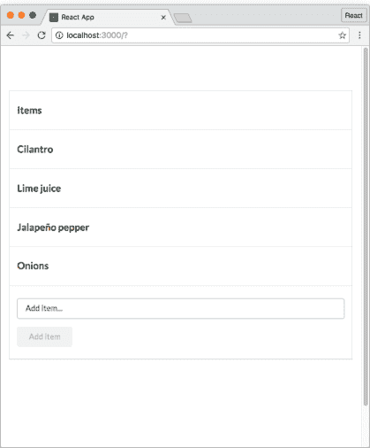

完成后的列表应用

打开 App.js。正如我们在 state 初始化中看到的，App 有两个 state 属性：

testing/react-basics/src/App.js

```javascript
class App extends React.Component {
  state = {
    items: [],
    item: '',
  };
```

`items`是项目列表。`item`是与我们的受控输入绑定的 state 属性，我们稍后会看到。

在 render() 内部，App 遍历 this.state.items 以在表格中渲染所有项目：

```javascript
<tbody>
  {
    this.state.items.map((item, idx) => (
      <tr
        key={idx}
      >
        <td>{item}</td>
      </tr>
    ))
  }
</tbody>
```

受控输入是标准的。它位于一个表单内部：

```javascript
<form
  className='ui form'
  onSubmit={this.addItem}
>
<div className='field'>
  <input
    className='prompt'
    type='text'
    placeholder='Add item...'
    value={this.state.item}
    onChange={this.onItemChange}
  />
```

有关受控输入的更多信息，请参见 *Forms* 章节中的"非受控与受控组件"部分。

对于输入框，`onItemChange()`按预期设置 state 中的`item`：

testing/react-basics/src/App.js

```javascript
onItemChange = (e) => {
  this.setState({
    item: e.target.value,
  });
};
```

对于表单，onSubmit 调用 addItem()。此函数将新项目添加到 state 并清空 item：

testing/react-basics/src/App.js

```javascript
addItem = (e) => {
  e.preventDefault();

  this.setState({
    items: this.state.items.concat(
      this.state.item
    ),
    item: '',
  });
};
```

最后，按钮：

testing/react-basics/src/App.js

```javascript
<button
  className='ui button'
  type='submit'
  disabled={submitDisabled}
>
  Add item
</button>
```

我们在按钮上设置了 disabled 属性。此变量（`submitDisabled`）在 render 的顶部定义，取决于输入字段是否已填充：

testing/react-basics/src/App.js

```javascript
render() {
  const submitDisabled = !this.state.item;
  return(
```

## App 的第一个 spec

为了编写我们的第一个 spec，我们需要准备好两个库：Jest 和 Enzyme。

在上一章中，我们注意到 create-react-app 在 package.json 中设置了几个命令。其中之一就是 test。

react-scripts 已经将 Jest 指定为依赖项。要启动 Jest，我们只需运行 npm test。与其他 create-react-app 为我们创建的命令一样，test 运行 react-scripts 中的一个脚本。此脚本配置并执行 Jest。

> 要查看 react-scripts 包含的所有软件包，请参见文件 ./node_modules/react-scripts/package.json。

create-react-app 在 App.test.js 中为我们设置了一个虚拟测试。让我们在 testing/react-basics 内部执行 Jest，看看会发生什么：

```
$ npm test
```

Jest 运行，输出格式良好的测试套件结果报告：

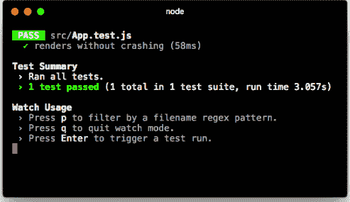

示例测试运行

react-scripts 为 Jest 提供了一些额外的配置。其中一个配置是**以监视模式启动 Jest**。在此模式下，Jest 在测试套件完成后不会退出。相反，它会监视整个项目的变更。当检测到变更时，它会重新运行测试套件。

> 在本章中，我们会继续指示你使用`npm test`执行测试套件。但是，如果你愿意，也可以只保持一个控制台窗口打开，让 Jest 在监视模式下运行。

react-scripts 不包含 enzyme。所以我们已经在`package.json`中将其包含在内。

enzyme 包装了`react-test-renderer`。因此，它也需要安装该软件包作为依赖。你也可以在`package.json`中看到该依赖。

让我们将`App.test.js`中的 spec 替换为更有用的内容。

打开`App.test.js`并清空文件。在该文件的顶部，我们首先导入正在测试的 React 组件：

testing/react-basics/src/complete/App.test.complete-1.js

```javascript
import App from './App';
```

接下来，我们从 react 导入 React，从 enzyme 导入`shallow()`：

testing/react-basics/src/complete/App.test.complete-1.js

```javascript
import React from 'react';
import { shallow } from 'enzyme';
```

`shallow()`是我们从 Enzyme 唯一需要使用的函数，所以我们在 import 中显式指定了它。正如你可能已经猜到的，`shallow()`是我们用来进行浅层渲染组件的函数。

> 如果你需要复习 ES6 import 语法，请参阅上一章"将 Webpack 与 create-react-app 配合使用"。

我们将`describe`的标题命名为正在测试的模块：

```javascript
describe('App', () => {
  // assertions will go here
});
```

让我们编写第一个 spec。我们将断言我们的表格应该以"Items"作为表头进行渲染：

## 单元测试

```javascript
describe('App', () => {
  it('should have the `th` "Items"', () => {
    // our assertion will go here
  });

  // the rest of our assertions will go here
});
```

为了编写此断言，我们需要：

- 浅层渲染组件
- 遍历虚拟 DOM，选出第一个`th`元素
- 断言该元素包含的文本值为"Items"

我们首先进行浅层渲染：

testing/react-basics/src/complete/App.test.complete-1.js

```javascript
  it('should have the `th` "Items"', () => {
    const wrapper = shallow(
      <App />
    );
```

如前所述，`shallow()`函数返回 Enzyme 所称的"包装器"对象`ShallowWrapper`。此包装器包含浅层渲染的组件。请记住，这里并没有实际的 DOM。相反，组件以其虚拟 DOM 表示形式保存在包装器内部。

Enzyme 为我们提供的包装器对象有大量有用的方法，可用于编写断言。通常，这些辅助方法**帮助我们遍历和选择虚拟 DOM 上的元素**。

让我们看看这在实践中是如何工作的。一个辅助方法是`contains()`。我们将用它来断言表头的存在：


 ```
it('should have the `th` "Items"', () => {
  const wrapper = shallow(
    <App />
  );
  expect(
    wrapper.contains(<th>Items</th>)
  ).toBe(true);
});
```

`contains()` 接受一个 ReactElement，在本例中是代表 HTML 元素的 JSX。它返回一个布尔值，指示渲染的组件是否包含该 HTML。

## 试一试

编写了第一个 Enzyme 测试规范后，让我们验证一切正常。保存 App.test.js 并从控制台运行测试命令：

```
$ npm test
```

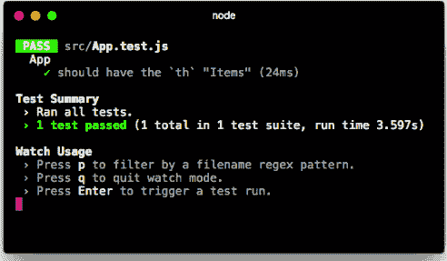

Enzyme 测试通过

让我们再编写一些断言，在此过程中探索 Enzyme 的 API。


我们在测试文件顶部导入了 React。然而，我们在文件的任何地方都没有引用 React。为什么需要它呢？

你可以尝试删除这条 import 语句，看看会发生什么。你会得到以下错误：

```
ReferenceError: React is not defined
```

我们不太容易看到 React 的引用，但它确实存在。我们在测试套件中使用了 JSX。当我们用 `<th>Items</th>` 指定一个 th 组件时，这会编译为：

```
React.createElement('th', null, 'Items');
```

## 更多针对 App 的断言

接下来，让我们断言组件包含一个 button 元素，即显示 "Add Item" 的按钮。我们可能期望可以直接这样做：

```
wrapper.contains(<button>Add Item</button>)
```

但是，`contains()` 会匹配元素上的*所有属性*。我们 render() 中的按钮看起来像这样：

```
testing/react-basics/src/App.js

<button
  className='ui button'
  type='submit'
  disabled={submitDisabled}
>
  Add item
</button>
```

我们需要给 `contains()` 传递一个具有完全相同属性集的 ReactElement。但这通常过于繁琐。对于这个规范，只需断言按钮在页面上就足够了。

我们可以使用 Enzyme 的 `containsMatchingElement()` 方法。这将检查组件输出中的任何内容**看起来是否像**预期元素。我们不必逐个属性匹配。

使用 `containsMatchingElement()`，让我们断言渲染的组件也包含一个 button 元素。将这个规范写在最后一个下面：

```
testing/react-basics/src/complete/App.test.complete-2.js

it('should have a `button` element', () => {
  const wrapper = shallow(
    <App />
  );
  expect(
    wrapper.containsMatchingElement(
      <button>Add item</button>
    )
  ).toBe(true);
});
```

`containsMatchingElement()` 允许我们编写一个"更宽松"的规范，更接近我们想要的断言：页面上有一个按钮。它不会将我们的规范与 className 等样式属性绑定。虽然 onClick 和 disabled 属性很重要，但我们稍后会编写涵盖这些内容的规范。

让我们再用 `containsMatchingElement()` 编写另一个断言。我们将断言输入字段也是存在的：

```
testing/react-basics/src/complete/App.test.complete-2.js

it('should have an `input` element', () => {
  const wrapper = shallow(
    <App />
  );
  expect(
    wrapper.containsMatchingElement(
      <input />
    )
  ).toBe(true);
});
```

到目前为止，我们的规范断言某些关键元素在初始渲染后存在于组件的输出中。正如我们即将看到的，我们正在为其余的规范奠定基础。后续的规范将断言我们对组件进行更改后会发生什么，比如填充其输入或单击其按钮。这些基本规范断言了我们将会与之交互的元素从一开始就存在于页面上。

在这个初始状态中，还有一个重要的断言我们应该做：页面上的按钮是禁用的。只有在输入框内有文本时，按钮才应该启用。

实际上，我们可以修改之前的规范来包含这个特定属性，如下所示：

这个规范将做出两个断言：(1) 按钮存在，以及 (2) 它是禁用的。

这是一个完全有效的方法。然而，我们喜欢将这两个断言分成两个不同的规范。当你限制给定规范中的断言范围时，测试失败会更具表达力。如果这个双断言规范失败，原因就不会那么明显。是按钮缺失了吗？还是按钮没有被禁用？

> 关于如何限制每个规范的断言数量的讨论涉及单元测试的艺术。有许多不同的策略和风格来编写单元测试，这些高度依赖于你正在处理的代码库。通常有不止一种"正确的方式"来构建测试套件。

在本章中，我们将展示我们特定的风格。但当你对单元测试感到得心应手时，请随意尝试，找到最适合你或你的代码库的风格。只是要确保保持风格一致。

到目前为止，我们的三个规范断言元素存在于组件的输出中。这个规范不同。我们将首先"查找"组件，然后对其 `disabled` 属性做出断言。让我们看一下，然后进行分解：

testing/react-basics/src/complete/App.test.complete-2.js

```
it('`button` should be disabled', () => {
  const wrapper = shallow(
    <App />
  );
  const button傻傻 = wrapper.find('button').first();
  expect(
    button.props().disabled
  ).toBe(true);
});
```

`find()` 是另一个 EnzymeWrapper 方法。它期望一个参数：**Enzyme 选择器**。在本例中，选择器是一个 CSS 选择器 'button'。CSS 选择器只是 Enzyme 选择器支持的一种类型。本章我们只使用 CSS 选择器，但 Enzyme 选择器也可以直接引用 React 组件。有关 Enzyme 选择器的更多信息，请参阅 [Enzyme 文档](http://airbnb.io/enzyme/docs/api/selector.html)。

`find()` 返回另一个 Enzyme `ShallowWrapper`。该对象包含所有匹配元素的列表。该对象的行为有点像数组，具有 `length` 等方法。该对象有一个方法 `first()`，我们在这里用它返回第一个匹配元素。`first()` 返回另一个 `ShallowWrapper` 对象，我们将其赋值给变量 `input`。

当你在一个浅渲染组件中查找和选择各种元素时，所有这些元素都会是 Enzyme `ShallowWrapper` 对象。这意味着你可以期待相同的方法 API 对你可用，无论你是在处理浅渲染的 React 组件还是 div 标签。

要读取按钮上的 `disabled` 属性，我们使用 `props()`。`props()` 返回一个对象，指定 HTML 元素上的属性或 React 组件上设置的 props。

## CSS 选择器

CSS 文件使用选择器来指定一组样式适用于哪些 HTML 元素。JavaScript 应用程序也使用这种语法来选择页面上的 HTML 元素。查看 [MDN 的这部分](https://developer.mozilla.org/en-US/docs/Web/Guide/CSS/Getting_started/Selectors)以获取更多关于 CSS 选择器的信息。

## 使用 beforeEach

此时，我们的测试套件有一些重复的代码。我们在每个断言之前浅渲染组件。这很适合重构。

我们*可以*在 `describe` 块的顶部浅渲染组件：

```
describe('the "App" component', () => {
  const wrapper = shallow(
    <App />
  );
  // specs here ...
})
```

由于 JavaScript 的作用域规则，`wrapper` 会在我们的每个 `it` 块中可用。

但这种做法可能会出现问题。例如，如果我们的某个规范修改了组件怎么办？我们可能会改变组件的状态或模拟一个事件。这将会**导致状态在规范之间泄漏**。在下一个规范开始时，我们组件的状态将无法预测。

更可取的做法是在每个规范之间重新渲染组件，确保每个规范都在一个可预测的、全新的状态下处理组件。

在所有流行的 JavaScript 测试框架中，都有一个我们可以用来辅助测试设置的函数：`beforeEach`。`beforeEach` 是一个代码块，**会在每个 `it` 块之前运行**。我们可以使用这个函数在每个规范之前渲染我们的组件。

编写测试时，你经常需要执行一些设置，让你的环境进入适当的上文以做出断言。除了像上面那样浅渲染组件外，我们很快会编写需要更丰富上文的测试。通过在 `beforeEach` 中设置上下文，你可以保证每个规范都会收到一组全新的上下文。

> 在每个规范之前设置全新的上下文有助于防止状态在测试之间泄漏。

编写测试时，我们力求让单独的规范（我们的 `it` 块）尽可能简洁。我们会依赖 `beforeEach` 来建立上下文，比如组件的状态或 props，甚至像元素被点击这样的事件。然后，我们的 `it` 块几乎总是只包含断言。

让我们使用 `beforeEach` 块来渲染组件。然后我们可以从每个断言中移除渲染：

testing/react-basics/src/complete/App.test.complete-3.js

```
describe('App', () => {
  let wrapper;

  beforeEach(() => {
    wrapper = shallow(
      <App />
    );
  });
```

我们不得不先在 `describe` 块的顶部用 `let` 声明来声明 `wrapper`。这是因为如果我们像下面这样在 `beforeEach` 块内部声明 `wrapper` 的话：

 wrapper 就不会在我们的 specs 作用域内。通过在 describe 块的顶部声明 wrapper，我们把它"提升"到了所有断言的作用域中。

现在我们可以安全地从每个断言中移除 wrapper 的声明了：

```
testing/react-basics/src/complete/App.test.complete-3.js
it('should have the `th` "Items"', () => {
  expect(
    wrapper.contains(<th>Items</th>)
  ).toBe(true);
});

it('should have a `button` element', () => {
  expect(
    wrapper.containsMatchingElement(
      <button>Add item</button>
    )
  ).toBe(true);
});

it('should have an `input` element', () => {
  expect(
    wrapper.containsMatchingElement(
      <input />
    )
  ).toBe(true);
});

it('`button` should be disabled', () => {
  const button = wrapper.find('button').first();
  expect(
    button.props().disabled
  ).toBe(true);
});
```

好多了。我们的 it 块不再设置上下文，而且我们移除了冗余代码。

## 试一试

保存 App.test.js。运行测试套件：

```
$ npm test
```

四个测试全部通过：

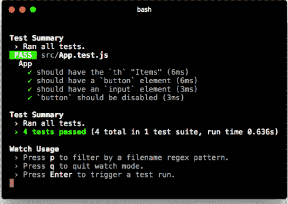

四个测试全部通过

虽然有限，但这些 spec 为我们下一组 spec 奠定了基础。通过断言初始渲染中某些元素的存在，我们正在断言用户加载应用时将在页看到的内容。我们断言了页面将有一个表头、一个输入框和一个按钮。我们还断言了按钮应该是禁用的。

在本章的剩余部分，我们将使用**行为驱动**的方式来推进测试套件的开发。采用这种方式，我们将使用 `beforeEach` 来设置一些上下文。我们将模拟与组件的交互，就像我们是一个在界面上操作的用户。然后我们将编写关于组件应该如何表现的断言。

加载应用后，我们可以想象用户要做的第一件事是填写输入框。当输入框被填写后，他们会点击“Add item”按钮。接着我们预期新的项目会出现在 state 和页面上。

我们将逐步分析这些行为，并在每次用户交互后编写关于组件的断言。

### 模拟 change

用户与我们的应用的第一个交互是填写用于添加新项目的输入框。除了浅渲染我们的组件，我们还想在

虽然我们可以在 `it` 块中执行此设置，但正如我们之前提到的，最好在 `beforeEach` 块中尽可能多地执行设置。这不仅有助于我们组织代码，还能让我们轻松拥有依赖相同设置的多个 spec。

然而，我们的其他四个现有 spec 并不需要这个特定的设置。我们应该做的是在当前 describe 内部声明另一个 `describe` 块。`describe` 块是我们"分组"需要相同上下文的 spec 的方式：

```
describe('App', () => {
  // ... 我们目前为止写的断言

  describe('the user populates the input', () => {
    beforeEach(() => {
      // ... 设置上下文
    })

    // ... 断言
  });
});
```

我们为内部 `describe` 编写的 `beforeEach` 将在外部上下文中声明的 `beforeEach` *之后*运行。因此，当这个 `beforeEach` 运行时，`wrapper` 已经被浅渲染了。正如预期的那样，这个 `beforeEach` 只会为我们内部 `describe` 块中的 `it` 块运行。

以下是我们的内部 `describe` 及其 `beforeEach` 设置在下一组 spec 中的样子：

**testing/react-basics/src/complete/App.test.complete-4.js**

```
describe('the user populates the input', () => {
  const item = 'Vancouver';

  beforeEach(() => {
    const input = wrapper.find('input').first();
    input.simulate('change', {
      target: { value: item }
    })
  });
```

我们首先在 `describe` 的顶部声明 `item`。我们很快就会看到，这将使我们能够在 spec 中引用该变量。

beforeEach 首先在 EnzymeWrapper 上使用 find() 方法获取输入框。回想一下，find() 返回另一个 EnzymeWrapper 对象，在这个例子中是一个包含单个项目的列表，即我们的输入框。我们调用 first() 来获取对应于输入框元素的 EnzymeWrapper 对象。

然后我们在输入框上使用 simulate()。simulate() 是我们模拟用户与组件交互的方式。该方法接受两个参数：

1. 要模拟的事件（如 'change' 或 'click'）。这决定了要使用哪个事件处理程序（如 onChange 或 onClick）。
2. 事件对象（可选）。

这里，我们为输入框指定了一个 'change' 事件。然后我们传入我们想要的事件对象。注意，这个事件对象看起来与 React 传递给 onChange 处理程序的事件对象完全相同。以下是 App 上的 onItemChange 方法，它期望这种形状的对象：

```
testing/react-basics/src/App.js

onItemChange = (e) => {
  this.setState({
    item: e.target.value,
  });
};
```

写好了这个设置，我们现在可以编写与用户刚刚填写输入框的上下文相关的 spec 了。我们将编写两个：

1. state 属性 item 被更新以匹配输入框
2. 按钮不再被禁用

以下是完整的 describe 块：

```
testing/react-basics/src/complete/App.test.complete-4.js

describe('the user populates the input', () => {
  const item = 'Vancouver';

  beforeEach(() => {
    const input = wrapper.find('input').first();
    input.simulate('change', {
      target: { value: item }
    })
  });
```

## 单元测试

```
it('should update the state property `item`', () => {
  expect(
    wrapper.state().item
  ).toEqual(item);
});

it('should enable `button`', () => {
  const button = wrapper.find('button').first();
  expect(
    button.props().disabled
  ).toBe(false);
});
```

在第一个 spec 中，我们使用 `wrapper.state()` 获取 state 对象。注意它是一个函数而不是属性。记住，`wrapper` 是一个 EnzymeWrapper，所以我们并不是直接与组件交互。我们使用 `state()` 方法从组件中检索 `state` 属性。

在第二个中，我们再次使用 `props()` 读取按钮上的 `disabled` 属性。

继续我们的行为驱动方法，我们现在想象我们的组件处于以下状态：


组件的想象状态

用户已经填写了输入框。从这里开始，用户可以采取两个我们可以编写 spec 的操作：

1. 用户清除输入框

## 清除输入框

当用户清除输入框时，我们预期按钮会再次变为禁用状态。我们可以通过在 "the user populates the input" 内部嵌套我们的新 describe 来构建现有的上下文：

```
describe('App', () => {
  // ... 初始状态断言

  describe('the user populates the input', () => {
    // ... 已填写字段的断言

    describe('and then clears the input', () => {
      // ... 断言按钮再次禁用

    });
  });
});
```

我们将使用 beforeEach 再次模拟 change 事件，这次将 value 设置为空字符串。我们将编写一个断言：按钮再次禁用。

记住要将这个 describe 块组合在 "the user populates the input" 下面。我们的 "user clears the input" describe 块，完整如下：

```
testing/react-basics/src/complete/App.test.complete-5.js

it('should enable `button`', () => {
  const button = wrapper.find('button').first();
  expect(
    button.props().disabled
  ).toBe(false);
});

describe('and then clears the input', () => {
  beforeEach(() => {
    const input = wrapper.find('input').first();
    input.simulate('change', {
      target: { value: '' }
    })
  });
});
```

```
it('should disable `button`', () => {
  const button = wrapper.find('button').first();
  expect(
    button.props().disabled
  ).toBe(true);
});
});
});
});
```

注意我们是如何在现有上下文的基础上构建的，通过我们的应用越来越深入地进入工作流程。我们已经有三层深了。应用已渲染，用户填写了输入框，然后用户清除了输入框。

现在是验证所有测试通过的好时机。

## 试一试

保存 App.test.js。运行测试套件：

```
$ npm test
```

我们看到所有测试都通过了：


接下来，我们将模拟用户提交表单。这将导致我们的应用发生一些变化，我们将为此编写断言。


 ## 模拟表单提交

用户提交表单后，我们预期应用会呈现如下效果：


我们将断言以下几点：

- 1. 新条目存在于 state（items）中
2. 新条目显示在渲染的表格内
3. 输入字段为空
4. "Add item" 按钮处于禁用状态

要达到这一上下文，我们将基于之前的上下文——用户已填充输入框。因此，我们将在 "the user populates the input" 内部编写 describe，与 "and then clears the input" 并列：

## 单元测试

```
describe('App', () => {
  // ... 初始状态断言

  describe('the user populates the input', () => {
    // ... 已填充字段断言

    describe('and then clears the input', () => {
      // ... 断言按钮再次禁用
    });

    describe('and then submits the form', () => {
      // ... 即将进行的断言
    });
  });
});
```

我们的 beforeEach 将模拟表单提交操作。回顾一下，addItem 期望接收一个具有 preventDefault() 方法的对象：

testing/react-basics/src/App.js

```
addItem = (e) => {
  e.preventDefault();

  this.setState({
    items: this.state.items.concat(
      this.state.item
    ),
    item: '',
  });
};
```

我们将模拟一个 submit 事件类型，传入一个具有 addItem 所期望结构的对象。我们可以直接将 preventDefault 设为空函数：

testing/react-basics/src/complete/App.test.complete-6.js

```
describe('and then submits the form', () => {
  beforeEach(() => {
    const form = wrapper.find('form').first();
    form.simulate('submit', {
      preventDefault: () => {},
    });
  });
```

准备工作就绪后，我们首先断言新条目已存入 state：

testing/react-basics/src/complete/App.test.complete-6.js

```
it('should add the item to state', () => {
  expect(
    wrapper.state().items
  ).toContain(item);
});
```

Jest 提供了一些专门用于处理数组的匹配器。我们使用 toContain() 匹配器来断言 items 数组中包含 item。

> 请记住，wrapper 是一个 EnzymeWrapper 对象，内部包含一个 React 组件。我们通过 state()（一个方法）来获取 state。

接下来，我们断言该条目显示在表格中。有多种方法可以实现，以下是其中一种：

testing/react-basics/src/complete/App.test.complete-6.js

```
it('should render the item in the table', () => {
  expect(
    wrapper.containsMatchingElement(
      <td>{item}</td>
    )
  ).toBe(true);
});
```

> contains() 也能满足这个 spec 的需求，但我们更倾向于使用 containsMatchingElement()，以避免测试过于脆弱。例如，如果我们为每个 td 元素添加了 class，使用 containsMatchingElement() 的 spec 不会因此失败。

接下来，我们将断言输入字段已被清空。我们可以选择检查 state 属性 `item`，或者检查虚拟 DOM 中的实际输入字段。我们选择后者，因为它更为全面：

testing/react-basics/src/complete/App.test.complete-6.js

```
it('should clear the input field', () => {
  const input = wrapper.find('input').first();
  expect(
    input.props().value
  ).toEqual('');
});
```

最后，我们断言按钮再次变为禁用状态：

testing/react-basics/src/complete/App.test.complete-6.js

```
it('should disable `button`', () => {
  const button = wrapper.find('button').first();
  expect(
    button.props().disabled
  ).toBe(true);
});
```

完整的 "and then submits the form" describe：

testing/react-basics/src/complete/App.test.complete-6.js

```
it('should disable `button`', () => {
  const button = wrapper.find('button').first();
  expect(
    button.props().disabled
  ).toBe(true);
});

describe('and then submits the form', () => {
  beforeEach(() => {
    const form = wrapper.find('form').first();
    form.simulate('submit', {
      preventDefault: () => {},
    });
  });
});
```

```
it('should add the item to state', () => {
  expect(
    wrapper.state().items
  ).toContain(item);
});

it('should render the item in the table', () => {
  expect(
    wrapper.containsMatchingElement(
      <td>{item}</td>
    )
  ).toBe(true);
});

it('should clear the input field', () => {
  const input = wrapper.find('input').first();
  expect(
    input.props().value
  ).toEqual('');
});

it('should disable `button`', () => {
  const button = wrapper.find('button').first();
  expect(
    button.props().disabled
  ).toBe(true);
});
});
});
});
```

看起来我们还有另一个可能的重构方向。在整个测试套件中，我们多次出现以下声明：

```
const input = wrapper.find('input').first();
const button = wrapper.find('button').first();
```

你可能会想，是否可以在测试套件的作用域顶部声明这些变量，与 wrapper 并列。然后我们可以在最顶层的 beforeEach 中设置它们，像这样：

```
// 有效的重构？
describe('App', () => {
  let wrapper;
  let input;
  let button;

  beforeEach(() => {
    wrapper = shallow(
      <App />
    );
    const input = wrapper.find('input').first();
    const button = wrapper.find('button').first();
  });
  // ...
});
```

这样一来，你就可以在整个测试套件中直接引用 `input` 和 `button`，而无需重复声明。

然而，如果你尝试这样做，你会发现一些测试失败。这是因为在整个测试套件中，`input` 和 `button` 将引用 *初始渲染* 的 HTML 元素。当我们调用 `simulate()` 事件时，像这样：

```
input.simulate('change', {
  target: { value: item }
});
```

在底层，React 组件会重新渲染。这正是我们所期望的。因此，一个全新的虚拟 DOM 对象被创建，其中包含新的 `input` 和 `button` 元素。我们需要执行 `find()` 来从新虚拟 DOM 对象中选取这些元素，正如我们之前所做的。

## 动手试试

保存 `App.test.js`，运行测试套件：

```
$ npm test
```

全部通过：


你可以尝试破坏 App 的各个部分，见证测试套件捕获这些失败。

我们的 App 测试套件已经足够全面。我们看到了如何运用行为驱动的方式来构建测试套件的组成。这种风格鼓励完整性。我们基于真实世界的工作流建立层层上下文。而上下文一旦确立，就很容易断言组件的期望行为。

到目前为止，我们总共涵盖了：

- 断言的基础知识
- Jest 测试库（配合 Jasmine 断言）
- 以行为驱动的方式组织测试代码
- 使用 Enzyme 进行浅渲染
- 用于遍历虚拟 DOM 的 `ShallowWrapper` 方法
- 用于编写不同类型断言的 Jest/Jasmine 匹配器（例如用于数组的 `toContain()`）

在下一节中，我们将进一步提升使用 Jest 和 Enzyme 编写 React 单元测试的理解。我们将为存在于更大 React 应用中的组件编写 spec。具体而言，我们将涵盖：

- 当应用包含多个组件时会发生什么
- 当应用依赖对 API 的网络请求时会发生什么
- Jest 和 Enzyme 的一些额外方法

## 为食物查询应用编写测试

在之前的 Webpack 与 create-react-app 章节中，我们搭建了一个基于 Webpack 的食物查询应用：


**食物查询应用**

我们将在该应用的完成版本中工作。它位于顶层文件夹 `food-lookup-complete`。要从 `testing/react-basics` 文件夹进入，请运行以下命令：

```
$ cd ../../food-lookup-complete
```

> 你无需完成 Webpack 章节即可继续。我们会在编写 spec 之前描述该应用的布局和 `FoodSearch` 组件。

如果尚未安装，请为服务器和客户端安装 npm 包：

```
$ npm i
$ cd client
$ npm i
$ cd ..
```

如果你想先运行应用体验一下，可以启动：

 ```
$ npm start
```

在本章中，我们将只为组件 `FoodSearch` 编写测试。我们不会深入了解应用中其他组件的代码。相反，只需在高层面理解应用是如何拆分为组件的即可：


- **App**（蓝色）：应用的父容器。
- **SelectedFoods**（黄色）：列出已选食物的表格。点击食物项将其移除。
- **FoodSearch**（紫色）：提供实时搜索字段的表格。点击表格中的食物项将其添加到总计（SelectedFoods）中。

如果你已经启动了应用，请将其停止。切换到 `client/` 目录。本章我们将只在这个目录中工作：

## 单元测试

```
$ cd client
```

对于这个应用，我们没有将测试与组件一起放在 `src` 中，而是将它们放在了一个专用文件夹 `tests` 里。在 `tests` 中，你会看到应用中其他组件已经有了测试：

```
$ ls tests/
  App.test.js
  SelectedFoods.test.js
  complete/
```

在我们完成 `FoodSearch` 的测试编写后，你可以随意浏览其他测试。所有其他测试都复用了我们为测试 `FoodSearch` 所使用的相同概念。

在为该组件编写测试之前，让我们先了解一下 `FoodSearch` 是如何工作的。如果你愿意，可以打开 `FoodSearch` 组件并跟着一起查看（`src/FoodSearch.js`）。

> complete/ 包含我们在本节中编写的每个版本的完整 FoodSearch.test.js，供你参考。

## FoodSearch

`FoodSearch` 组件有一个搜索字段。当用户输入时，搜索字段下方会更新显示匹配食物的表格：


**FoodSearch** 组件

当搜索字段发生变化时，`FoodSearch` 组件会向应用的 API 服务器发起请求。如果用户输入了字符串 `truffle`，向服务器的请求如下所示：

```
GET localhost:3001/api/food?q=truffle
```

然后 API 服务器返回一个匹配食物项的数组：

```
[
  {
    "description": "Pate  truffle flavor",
    "kcal": 327,
    "fat_g": 27.12,
    "protein_g": 11.2,
    "carbohydrate_g": 6.3
  },
  {
    "description": "Candies, truffles, prepared-from-recipe",
    "kcal": 510,
    "fat_g": 32.14,
    "protein_g": 6.21,
    "carbohydrate_g": 44.88
  },
  {
    "description": "Candies, m m mars 3 musketeers truffle crisp",
    "kcal": 538,
    "fat_g": 25.86,
    "protein_g": 6.41,
    "carbohydrate_g": 63.15
  }
]
```

FoodSearch 用这些项填充其表格。FoodSearch 有三块状态：

**foods**

这是服务器返回的所有食物的数组。默认为空数组。

**showRemoveIcon**

当用户开始在搜索字段中输入时，一个 X 会出现在字段旁边：


移除图标

这个 X 提供了一种快速清空搜索字段的方式。当字段为空时，`showRemoveIcon` 应为 `false`。当字段有内容时，`showRemoveIcon` 应为 `true`。

**searchValue**

`searchValue` 是与受控输入（即搜索字段）绑定的状态。

了解了 FoodSearch 的行为方式及其保持的状态后，让我们来探索实际的代码。我们会在这里包含代码片段，但欢迎你通过打开 src/FoodSearch.js 来跟着一起查看。

在组件顶部是 import 语句：

food-lookup-complete/client/src/FoodSearch.js

```
import React from 'react';
import Client from './Client';
```

我们还有一个常量，定义了页面上显示的最大搜索结果数量。我们在组件内部使用它：

food-lookup-complete/client/src/FoodSearch.js

```
const MATCHING_ITEM_LIMIT = 25;
```

然后我们定义该组件。

我们三块状态的状态初始化：

food-lookup-complete/client/src/FoodSearch.js

```
class FoodSearch extends React.Component {
  state = {
    foods: [],
    showRemoveIcon: false,
    searchValue: '',
  };
```

让我们逐步了解组件 render 方法中的交互元素以及每个元素的处理函数。

#### 输入搜索字段

FoodSearch 顶部的输入字段驱动搜索功能。当用户修改输入字段时，表格体会更新显示搜索结果。

输入元素：

```
<input
  className='prompt'
  type='text'
  placeholder='Search foods...'
  value={this.state.searchValue}
  onChange={this.onSearchChange}
/>
```

className 是为了 SemanticUI 样式设置的。value 将这个受控输入绑定到 this.state.searchValue。onSearchChange() 接受一个事件对象。让我们逐步查看代码。这是该函数的前半部分：

```
onSearchChange = (e) => {
  const value = e.target.value;

  this.setState({
    searchValue: value,
  });

  if (value === '') {
    this.setState({
      foods: [],
      showRemoveIcon: false,
    });
  }
```

我们从事件对象中获取值。然后将 state 中的 searchValue 设置为这个值，遵循处理受控输入 change 的模式。

如果值为空，我们将 foods 设置为空数组（清空搜索结果表格）并将 showRemoveIcon 设置为 false（隐藏用于清空搜索字段的 "X"）。

如果值不为空，我们需要：

- 确保 showRemoveIcon 设置为 true
- 向服务器发起调用，使用最新的搜索值获取匹配食物的列表

以下是该代码：

```
} else {
  this.setState({
    showRemoveIcon: true,
  });

  Client.search(value, (foods) => {
    this.setState({
      foods: foods.slice(0, MATCHING_ITEM_LIMIT),
    });
  });
}
};
```

Client 底层使用 Fetch API，与我们在第 3 章中使用的 Web 请求接口相同。Client.search() 向服务器发起 Web 请求，然后调用回调函数并传入匹配食物的数组。

> 如果你需要复习使用基于 Fetch 的客户端库的内容，请参阅第 3 章：组件与服务器。

然后我们将 state 中的 foods 设置为返回的食物，截断该列表使其在 MATCHING_ITEM_LIMIT 的范围内（即 25）。

完整的 onSearchChange() 如下所示：

```
onSearchChange = (e) => {
  const value = e.target.value;

  this.setState({
    searchValue: value,
  });

  if (value === '') {
    this.setState({
      foods: [],
      showRemoveIcon: false,
    });
  } else {
    this.setState({
      showRemoveIcon: true,
    });
```

```
    Client.search(value, (foods) => {
      this.setState({
        foods: foods.slice(0, MATCHING_ITEM_LIMIT),
      });
    });
  }
};
```

#### 移除图标

如我们所见，移除图标是每当搜索字段有内容时出现在字段旁边的小 X。点击这个 X 会清空搜索字段。

我们直接在内联中执行是否显示移除图标的逻辑。图标元素有 onClick 属性：

food-lookup-complete/client/src/FoodSearch.js

```
this.state.showRemoveIcon ? (
  <i
    className='remove icon'
    onClick={this.onRemoveIconClick}
  />
) : ''
```

onRemoveIconClick() 的代码：

food-lookup-complete/client/src/FoodSearch.js

```
onRemoveIconClick = () => {
  this.setState({
    foods: [],
    showRemoveIcon: false,
    searchValue: '',
  });
};
```

我们重置所有内容，包括 foods。

#### props.onFoodClick

最后一点交互是在每个食物项上。当用户点击一个食物项时，我们将其添加到界面上的已选食物列表中：

food-lookup-complete/client/src/FoodSearch.js

```
<tbody>
{
  this.state.foods.map((food, idx) => (
    <tr
      key={idx}
      onClick={() => this.props.onFoodClick(food)}
    >
      <td>{food.description}</td>
      <td className='right aligned'>
        {food.kcal}
      </td>
      <td className='right aligned'>
        {food.protein_g}
      </td>
      <td className='right aligned'>
        {food.fat_g}
      </td>
      <td className='right aligned'>
        {food.carbohydrate_g}
      </td>
    </tr>
  ))
}
</tbody>
```

在底层，当用户点击一个食物项时，我们调用 `this.props.onFoodClick()`。FoodSearch 的父组件（App）指定了这个 prop 函数。它期望完整的食物对象。

如我们所见，为了编写 FoodSearch 的单元测试，我们不需要知道 prop 函数 `onFoodClick()` 实际*做什么*。我们只关心它*需要什么*（一个完整的食物对象）。

浅渲染帮助我们实现了这种理想的隔离。虽然这个应用相对较小，但这种隔离优势对于拥有大型代码库的较大团队来说是非常巨大的。

## 编写 FoodSearch.test.js

我们准备为 FoodSearch 组件编写单元测试。


 文件 `client/tests/FoodSearch.test.js` 包含了测试套件的框架。顶部是 `import` 语句：

## food-lookup-complete/client/tests/FoodSearch.test.js

```
import { shallow } from 'enzyme';
import React from 'react';
import FoodSearch from '../src/FoodSearch';
```

接下来是测试套件的框架。不要被吓到，我们会逐一填写这些 `describe` 和 `beforeEach` 代码块：

## food-lookup-complete/client/tests/FoodSearch.test.js

```
describe('FoodSearch', () => {
  // ... 初始状态的测试用例

  describe('user populates search field', () => {
    beforeEach(() => {
      // ... 模拟用户在输入框中输入 "brocc"
    });

    // ... 测试用例

    describe('and API returns results', () => {
      beforeEach(() => {
        // ... 模拟 API 返回结果
      });

      // ... 测试用例

      describe('then user clicks food item', () => {
        beforeEach(() => {
          // ... 模拟用户点击食物项目
        });

        // ... 测试用例
      });

      describe('then user types more', () => {
        beforeEach(() => {
          // ... 模拟用户输入 "x"
        });

        // ... 测试用例
      });
    });
  });
});
```

```
describe('and API returns no results', () => {
  beforeEach(() => {
    // ... 模拟 API 返回无结果
  });

  // ... 测试用例
  });
 });
 });
});
```

与上一节一样，我们将使用 beforeEach 来执行设置，从而建立不同的上下文。每个上下文都将包含在 describe 内部。

#### 初始状态

我们的第一批测试用例将涉及组件的初始状态。我们的 beforeEach 只需进行浅渲染组件。然后我们将对这个初始状态编写断言：

### food-lookup-complete/client/tests/complete/FoodSearch.test.complete-1.js

```
describe('FoodSearch', () => {
  let wrapper;

  beforeEach(() => {
    wrapper = shallow(
      <FoodSearch />
    );
  });
```

与我们在上一节的第一次组件测试一样，我们在上层作用域中声明 wrapper。在我们的 beforeEach 中，我们使用 Enzyme 的 shallow() 来浅渲染组件。

让我们编写两个断言：

- 1. 删除图标不在 DOM 中
- 2. 表格没有任何条目

对于第一个测试，我们有多种编写方式。以下是其中之一：

## food-lookup-complete/client/tests/complete/FoodSearch.test.complete-1.js

```
it('should not display the remove icon', () => {
  expect(
    wrapper.find('.remove.icon').length
  ).toBe(0);
});
```

我们向 wrapper 的 `find()` 方法传递一个选择器。如果你还记得，删除图标具有以下 `className` 属性：

## food-lookup-complete/client/src/FoodSearch.js

```
<i
  className='remove icon'
  onClick={this.onRemoveIconClick}
/>
```

因此，我们在这里基于它的类来选择它。`find()` 返回一个 `ShallowWrapper` 对象。这个对象是类数组的，包含指定选择器的所有匹配项列表。就像数组一样，它具有 `length` 属性，我们断言它应该为 `0`。

我们也可以使用 contains 系列方法之一，像这样：

```
it('should not display the remove icon', () => {
  expect(
    wrapper.containsAnyMatchingElements(
      <i className='remove icon' />
    )
  ).toBe(false);
});
```

在本章的其余部分，我们将主要使用 `find()` 来驱动我们的测试，因为我们喜欢使用 CSS 选择器语法。但这只是个人偏好问题。

接下来，我们将断言在此初始状态下，表格没有任何条目。

对于这个测试用例，我们只需断言此组件未在 `tbody` 内部输出任何 `tr` 元素，如下所示：

```
it('should display zero rows', () => {
  expect(
    wrapper.find('tbody tr').length
  ).toEqual(0);
});
```

如果我们现在运行这个测试套件，我们的两个测试用例都会通过。

然而，这并不能让我们充分确信我们的测试用例组合正确。当断言元素*不*存在于 DOM 中时，你可能会暴露于这样一种错误：你根本没有正确选择该元素。我们稍后会解决这个问题，届时我们将使用完全相同的选择器来断言元素*确实*存在。

## 我的断言应该有多全面？

在上一节中，我们围绕组件初始输出中关键元素的存在编写了断言。我们断言输入字段和按钮存在，为以后与它们交互奠定基础。

在本节中，我们跳过了这一类断言。我们在这里省略它们是因为它们是重复的。但一般来说，你或你的团队必须决定测试套件的全面程度。需要取得平衡；你的测试套件是用来为你的应用开发服务的。做得过头也是可能的，最终编写出一个拖慢你速度的测试套件。

#### 用户在搜索字段中输入了值

在我们的行为驱动方法的指导下，下一步是模拟用户交互。然后我们将针对这层新的上下文编写断言。

组件加载后，用户与 `FoodSearch` 组件唯一的交互是：在搜索字段中输入值。当这种情况发生时，还有两种进一步的可能性：

- 1. 搜索匹配数据库中的食物，API 返回这些食物列表
- 2. 搜索不匹配数据库中的任何食物，API 返回空数组

这个分支发生在 `onSearchChange()` 的底部，当我们调用 `Client.search()` 时：

```
Client.search(value, (foods) => {
  this.setState({
    foods: foods.slice(0, MATCHING_ITEM_LIMIT),
  });
});
```

对于我们的应用，API 在每次按键时被查询并显示结果。因此，情况 2（无结果）几乎总是发生在情况 1 之后。

我们将设置测试上下文以反映这种状态转换。我们将模拟用户输入 `'brocc'` 到搜索字段中，产生两个结果（两种西兰花）：


用户输入 'brocc' 后我们的组件可能的样子

我们将针对这个上下文编写断言。

接下来，我们将通过模拟用户输入 "x"（`'broccx'`）来构建这个上下文。这将不会产生任何结果：


用户输入 'brocc' 后我们的组件可能的样子

然后我们将针对这个上下文编写断言。

情况 2 总是紧跟情况 1 也有例外。例如，这个用户高估了我们应用的能力：


好吧

然而，状态中从有食物到无食物的状态转换，比验证 API 返回空结果后状态中食物保持空白要有趣得多。

无论 `Client.search()` 返回什么，我们都期望组件同时更新 state 中的 `searchValue` 并显示删除图标。这些测试用例将存在于 "user populates search field" 的顶层。我们将从这些开始，只编写针对搜索字段本身的测试用例，而将对图片/API 返回内容的断言留到后面：


第一组测试用例聚焦于搜索字段

编写完这些测试用例后，我们将看到如何建立 API 返回结果的上下文。

我们首先在 `beforeEach` 中模拟用户交互。我们将在 `describe` 的顶部声明 `value`，以便稍后在测试中使用：

### food-lookup-complete/client/tests/complete/FoodSearch.test.complete-2.js

```
describe('user populates search field', () => {
  const value = 'brocc';

  beforeEach(() => {
    const input = wrapper.find('input').first();
    input.simulate('change', {
      target: { value: value },
    });
  });
```

接下来，我们断言 `searchValue` 已在状态中更新为匹配这个新值：

### food-lookup-complete/client/tests/complete/FoodSearch.test.complete-2.js

```
it('should update state property `searchValue`', () => {
    expect(
      wrapper.state().searchValue
    ).toEqual(value);
});
```

接下来我们断言删除图标存在于 DOM 上：

### food-lookup-complete/client/tests/complete/FoodSearch.test.complete-2.js

```
it('should display the remove icon', () => {
    expect(
      wrapper.find('.remove.icon').length
    ).toBe(1);
});
```

我们使用了与之前断言删除图标*不*存在于 DOM 上时相同的选择器。这很重要，因为它确保了我们之前的断言是有效的，而不是仅仅使用了错误的选择器。

我们的 "user populates search field" 断言已经就位。在继续之前，让我们保存并确保测试套件通过。

## 试一试

保存 `FoodSearch.test.js`。在控制台中：

```
# inside client/
$ npm test
```

一切应该通过：


测试通过

从这里开始，下一层上下文将是 API 返回结果。

如果我们编写集成测试，我们会采取两种方法之一。如果我们想要完整的端到端测试，我们会让 `Client.search()` 对 API 进行真实的调用。否则，我们可以使用 Node 库来"伪造" HTTP 请求。有很多库可以拦截 JavaScript 尝试发起 HTTP 请求的行为。你可以向这些库提供虚假的响应对象，以提供给调用方。

然而，由于我们编写的是单元测试，我们希望消除对 API 以及 `Client.search()` 实现细节的任何依赖。我们专门测试的是 `FoodSearch` 组件，这是应用中的一个独立单元。我们只关心 `FoodSearch` 如何使用 `Client.search()`，而不涉及更深层次的内容。

因此，我们想要在表面拦截对 `Client.search()` 的调用。我们完全不想让 `Client` 参与其中。相反，我们想要断言 `Client.search()` 已被调用并传入了正确的参数（搜索字段的值）。然后我们想要用我们自己的结果集来调用传递给 `Client.search()` 的回调函数。

我们想要做的是**模拟 `Client` 库**。

## 使用 Jest 进行模拟

编写单元测试时，我们经常会发现被测试的模块依赖于应用中的其他模块。有多种策略可以处理这种情况，但它们主要围绕**测试替身**这一概念。测试替身是一个假装的对象，用来"替代"真实的对象。

例如，我们可以为 `Client` 库编写一个假版本，用于我们的测试中。最简单的版本如下所示：

```
const Client = {
  search: () => {},
};
```

## 单元测试

我们可以将这个假的 `Client` 注入到 `FoodSearch` 中，用于测试目的，而不是使用真实的版本。`FoodSearch` 可以在任何需要的地方调用 `Client.search()`，它会调用一个空函数，而不是执行 HTTP 请求。

我们可以更进一步，注入一个总是返回特定结果的假 `Client`。这将更加有用，因为我们可以断言 `FoodSearch` 的状态如何基于 `Client` 的行为进行更新：

```
const Client = {
  search: (_, cb) => {
    const result = [
      {
        description: 'Hummus',
        kcal: '166',
        protein_g: '8',
        fat_g: '10',
        carbohydrate_g: '14',
      },
    ];
    cb(result);
  },
};
```

这个测试替身实现了一个 `search()` 方法，它会立即调用作为第二个参数传入的回调函数。它用一个包含单个食物对象的硬编码数组来调用该回调函数。

但测试替身的实现细节并不重要。重要的是这个测试替身正在模拟 API 每次都返回相同的、单条结果的集合。有了这个假客户端插入到应用中，我们可以轻松地对 `FoodSearch` 如何处理这个"响应"编写断言：表格中现在有一条记录，该记录的描述是 "Hummus"，等等。

> 我们在上面使用 `_` 作为第一个参数，表示我们"不关心"这个参数。这纯粹是一种风格选择。

如果我们的测试替身允许我们动态指定要使用的的结果，那就更好了。这样我们就不需要一个完全不同的替身来测试 API 不返回任何结果的情况。此外，上面简单的测试替身不关心传递给它的搜索词。能够确保 `FoodSearch` 调用 `Client.search()` 时传入了适当的值（输入字段的值）会更好。

Jest 内置了一个强大测试替身的生成器：**模拟函数（mocks）**。我们将使用 Jest 的模拟函数作为我们的测试替身。理解模拟函数的最佳方式是在实际使用中观察它们。

你可以这样生成 Jest 模拟函数：

```
const myMockFunction = jest.fn();
```

这个模拟函数可以像其他函数一样被调用。默认情况下，它没有返回值：

```
console.log(myMockFunction()); // undefined
```

当你调用一个普通的模拟函数时，表面上似乎什么也没发生。然而，这个函数的特殊之处在于它会**跟踪调用记录**。Jest 的模拟函数带有可用于检查发生了什么的各种方法。

例如，你可以询问模拟函数被调用了多少次：

```
const myMock = jest.fn();
console.log(myMock.mock.calls.length);
// -> 0
myMock('Paris');
console.log(myMock.mock.calls.length);
// -> 1
myMock('Paris', 'Amsterdam');
console.log(myMock.mock.calls.length);
// -> 2
```

模拟函数的所有内省方法都在 `mock` 属性下。通过调用 `myMock.mock.calls`，我们得到一个数组的数组。数组中的每个条目对应每次调用的参数：

```
const myMock = jest.fn();
console.log(myMock.mock.calls);
// -> []
myMock('Paris');
console.log(myMock.mock.calls);
// -> [ [ 'Paris' ] ]
myMock('Paris', 'Amsterdam');
console.log(myMock.mock.calls);
// -> [ [ 'Paris' ], [ 'Paris', 'Amsterdam' ] ]
```

这个简单的功能解锁了大量我们将很快见证的强大能力。我们可以使用 Jest 模拟函数来声明我们自己的 `Client` 替身：

#### 模拟 `Client`

但 Jest 可以为我们处理这一切。Jest 有一个针对整个模块的模拟生成器。通过调用这个方法：

```
jest.mock('../src/Client')
```

Jest 会查看我们的 `Client` 模块。它会注意到它导出了一个带有 `search()` 方法的对象。然后它会创建一个假对象——一个测试替身——它有一个 `search()` 方法，该方法是一个模拟函数。然后 Jest 将确保在整个应用中使用假的 `Client`，而不是真实的那个。

让我们使用 `jest.mock()` 来模拟 `Client`。利用模拟函数的特殊属性，我们将能够编写断言来验证 `search()` 是否被以正确的参数调用。

在 ` FoodSearch.test.js` 的顶部，在 `FoodSearch` 的 `import` 语句下面，让我们导入 `Client`，因为我们在测试套件后面会引用它。此外，我们告诉 Jest 我们想要模拟它：

food-lookup-complete/client/tests/complete/FoodSearch.test.complete-3.js

```
import FoodSearch from '../src/FoodSearch';
import Client from '../src/Client';

jest.mock('../src/Client');

describe('FoodSearch', () => {
```

现在，让我们考虑会发生什么。在我们的 `beforeEach` 块中，当我们模拟 change 事件时：

food-lookup-complete/client/tests/complete/FoodSearch.test.complete-3.js

```
beforeEach(() => {
  const input = wrapper.find('input').first();
  input.simulate('change', {
    target: { value: value },
  });
});
```

这将触发 `onSearchChange()` 底部对 `Client.search()` 的调用：

```
const Client = {
  search: jest.fn(),
};
```

```
Client.search(value, (foods) => {
  this.setState({
    foods: foods.slice(0, MATCHING_ITEM_LIMIT),
  });
});
```

```
food-lookup-complete/client/src/FoodSearch.js
```

只不过，它不是调用真实 `Client` 上的方法，而是调用 Jest 注入的模拟对象上的方法。`Client.search()` 是一个模拟函数，除了记录它被调用了之外，**什么也没做**。

让我们在 "should display the remove icon" 下面声明一个新的测试用例。在编写断言之前，让我们先在控制台中记录一些内容，看看发生了什么：

```
food-lookup-complete/client/tests/complete/FoodSearch.test.complete-3.js
```

```
it('should display the remove icon', () => {
  expect(
    wrapper.find('.remove.icon').length
  ).toBe(1);
});

it('...todo...', () => {
  const firstInvocation = Client.search.mock.calls[0];
  console.log('First invocation:');
  console.log(firstInvocation);
  console.log('All invocations: ');
  console.log(Client.search.mock.calls);
});

describe('and API returns results', () => {
```

我们读取模拟函数上的 `mock.calls` 属性。calls 数组中的每个条目对应模拟函数 `Client.search()` 的一次调用。

如果你保存 `FoodSearch.test.js` 并运行测试套件，你将能够在控制台中看到日志语句：


测试运行中的日志语句

挑出第一个：

```
First invocation:
[ 'brocc', [Function] ]
```

mock 捕获了在 beforeEach 块中发生的调用。该调用的第一个参数正如我们预期的，是 'brocc'。而第二个参数是我们的回调函数。重要的是，回调函数尚未被调用。search() 捕获了该函数，但还没有对其执行任何操作。

如果你用 console.log() 语句将 `Client.search()` 的调用“围起来”，像这样：

```
// Example of "fencing" `Client.search()`
console.log('Before `search()`');
Client.search(value, (foods) => {
  console.log('Inside the callback');
  this.setState({
    foods: foods.slice(0, MATCHING_ITEM_LIMIT),
  });
});
console.log('After `search()`');
```

在运行测试套件时，你会在控制台中看到如下输出：

```
Before `search()`
After `search()`
```

模拟函数 search() 被调用了，但它所做的只是捕获参数。记录 "Inside the callback" 的那一行并没有被调用。

因此，"First invocation" 的控制台输出是合理的。然而，看看 "All invocations" 的控制台输出：

```
All invocations:
[ [ 'brocc', [Function] ],
[ 'brocc', [Function] ],
[ 'brocc', [Function] ] ]
```

重新格式化该数组：

```
[
  [ 'brocc', [Function] ],
  [ 'brocc', [Function] ],
  [ 'brocc', [Function] ]
]
```

我们看到了总共*三次*调用。这是为什么？

我们有三个 `it` 块对应于模拟变化的 `beforeEach`。请记住，`beforeEach` 在每个相关的 `it` 之前运行一次。因此，**我们模拟搜索的 `beforeEach` 被执行了三次**。这意味着模拟函数 `Client.search()` 也被调用了三次。

虽然这说得通，但这是不可取的。状态正在 **在测试用例之间泄漏**。我们希望每个 `it` 都能收到一个全新的 `Client` mock。

Jest 的模拟函数为此提供了一个方法，`mockClear()`。我们将使用 `beforeEach` 的对立面 `afterEach`，在每个测试用例执行后调用这个方法。这将确保 mock 在每次测试用例运行前都处于原始状态。我们将在顶层 `describe` 中完成此操作，放在浅渲染组件的 `beforeEach` 下方：

```
food-lookup-complete/client/tests/complete/FoodSearch.test.complete-4.js

describe('FoodSearch', () => {
  let wrapper;

  beforeEach(() => {
    wrapper = shallow(
      <FoodSearch />
    );
  });

 Adapter.search.mockClear();
  });

  it('should not display the remove icon', () => {
```

> 我们在这里也可以使用 `beforeEach` 块，但通常在任何 `afterEach` 块中进行"清理"是更合理的。

现在，如果我们再次运行测试套件：

```
First invocation:
[ 'brocc', [Function] ]
All invocations:
[ [ 'brocc', [Function] ] ]
```

我们成功地在测试运行之间重置了 mock。只记录了一次调用，即在最后一个 `it` 执行之前发生的那次调用。

随着我们的 mock 按预期工作，让我们将虚拟测试用例转换为真正的测试用例。我们将断言传递给 `Client.search()` 的第一个参数与用户输入搜索字段的值相同：

## food-lookup-complete/client/tests/complete/FoodSearch.test.complete-5.js

```
    it('should display the remove icon', () => {
      expect(
        wrapper.find('.remove.icon').length
      ).toBe(1);
    });

    it('...todo...', () => {
      const firstInvocation = Client.search.mock.calls[0];
      console.log('First invocation:');
      console.log(firstInvocation);
      console.log('All invocations: ');
      console.log(Client.search.mock.calls);
    });

    it('should call \`Client.search() with \`value\`', () => {
      const invocationArgs = Client.search.mock.calls[0];
      expect(
        invocationArgs[0]
      ).toEqual(value);
    });

    describe('and API returns results', () => {
```

我们正在断言调用的第零个参数与 value 匹配，在本例中是 brocc。

## 试一试

由于 Client 已被 mock，我们可以确信 FoodSearch 完全处于隔离状态中运行测试套件。保存 FoodSearch.test.js 并从控制台运行测试套件：

```
$ npm test
```

结果：

所有测试通过

我们使用了 Jest 的模拟函数来捕获和检查 `Client.search()` 的调用。现在，让我们看看如何利用它来建立下一个上下文层的行为：当 API 返回结果时。

#### API 返回结果

正如我们在现有测试脚手架中看到的，我们将在这个 context 自己的 `describe` 中编写与此相关的测试用例：

```
describe('FoodSearch', () => {
  // ...

  describe('user populates search field', () => {
    // ...

    describe('and API returns results', () => {
      beforeEach(() => {
        // ... simulate API returning results
      });

      // ... specs
    });

    describe('then user types more', () => {
      // ...

    });
  });
});
```

在这个 describe 的 beforeEach 中，我们想要模拟 API 返回结果。我们可以通过**手动调用传递给 `Client.search()` 的回调函数**，并传入我们想要模拟 API 返回的任何内容来实现这一点。

我们将模拟 Client 返回两个匹配项。我们可以将组件想象成这种状态：

组件期望状态的视觉表示

我们先看代码，然后再详细分析：

**food-lookup-complete/client/tests/complete/FoodSearch.test.complete-6.js**

```
it('should call `Client.search()` with `value`', () => {
  const invocationArgs = Client.search.mock.calls[0];
  expect(
    invocationArgs[0]
  ).toEqual(value);
});

describe('and API returns results', () => {
  const foods = [
    {
      description: 'Broccolini',
      kcal: '100',
      protein_g: '11',
      fat_g: '21',
      carbohydrate_g: '31',
    },
    {
      description: 'Broccoli rabe',
      kcal: '200',
      protein_g: '12',
      fat_g: '22',
      carbohydrate_g: '32',
    },
  ];
  beforeEach(() => {
```

```
const invocationArgs = Client.search.mock.calls[0];
const cb = invocationArgs[1];
cb(foods);
wrapper.update();
});
```

首先，我们声明一个数组 foods，用作 `Client.search()` 返回的模拟结果集。

其次，在我们的 `beforeEach` 中，我们获取 `Client.search()` 被调用时的第二个参数，在本例中是我们的回调函数。然后我们使用我们的食物对象数组调用它。**通过手动调用传递给 mock 的回调函数，我们可以模拟异步资源的期望行为。**

最后，我们在调用回调后调用 `wrapper.update()`。这将导致我们的组件重新渲染。当组件被浅渲染时，通常的重新渲染钩子不适用。因此，当在我们的回调中调用 `setState()` 时，不会触发重新渲染。

如果是这样，你可能会奇怪为什么这是我们第一次需要使用 `wrapper.update()`。实际上，Enzyme 在我们的每次 `simulate()` 调用后都自动调用了 `update()`。`simulate()` 调用事件处理器。在该事件处理器返回后，Enzyme 会立即调用 `wrapper.update()`。

因为我们在事件处理器返回后的某个时间异步调用回调，所以我们需要手动调用 `wrapper.update()` 来重新渲染组件。

> 当组件被浅渲染时，通常的重新渲染钩子不适用。如果由 `simulate()` 发起的任何状态更改是异步进行的，你必须调用 `update()` 来重新渲染组件。

> 在本章中，我们专门使用 Enzyme 的 `simulate()` 来操作组件。Enzyme 还有另一个方法 `setState()`，你可以在 `simulate()` 调用不可行的特殊情况下使用。`setState()` 在调用后也会自动调用 `update()`。

> 是的，我们测试中西兰花的热量的营养信息完全是瞎编的！

随着我们的回调被调用，让我们编写第一个测试用例。我们将断言 state 中的 foods 属性与我们的 foods 数组匹配：


 food-lookup-complete/client/tests/complete/FoodSearch.test.complete-6.js

```
it('should set the state property `foods`', () => {
  expect(
    wrapper.state().foods
  ).toEqual(foods);
});
```

同样，我们在从 EnzymeWrapper 读取状态时使用 state() 方法。

接下来，我们将断言表格有两行：

food-lookup-complete/client/tests/complete/FoodSearch.test.complete-6.js

```
it('should display two rows', () => {
  expect(
    wrapper.find('tbody tr').length
  ).toEqual(2);
});
```

因为这个规格使用了与我们之前的规格"should display zero rows"相同的选择器，这让我们确信之前的规格使用了正确的选择器。

最后，让我们更进一步，断言我们的两种食物实际上都显示在表格中。有很多方法可以做到这一点。因为每种食物的描述都非常独特，我们实际上只需在每个食物的 HTML 输出中查找其描述，就像这样：

food-lookup-complete/client/tests/complete/FoodSearch.test.complete-6.js

```
it('should render the description of first food', () => {
  expect(
    wrapper.html()
  ).toContain(foods[0].description);
});

it('should render the description of second food', () => {
  expect(
    wrapper.html()
  ).toContain(foods[1].description);
});
```

describe('then user clicks food item', () => {

因为我们要查找的是唯一的字符串，所以没有必要使用 Enzyme 的选择器 API。相反，我们使用 Enzyme 的 `html()` 来获取组件 HTML 输出的字符串。然后我们使用 Jest 的 `toContain()` 匹配器，这次是在字符串上使用，而不是在数组上。

> `html()` 也是调试浅渲染组件的好方法。例如，查看组件的完整 HTML 输出可以帮助你确定断言问题是由错误的选择器还是错误的组件引起的。

> 对于这组规格，我们处理的是从 API 返回的两个食物项目（随后被输入到状态中）。

即使我们只使用了一个项目，我们的断言也会是健壮的。然而，在针对数组编写断言时，一些开发人员更喜欢数组中有多个项目。这可以帮助捕获某些类别的错误，并断言被测试的变量是适当的数据结构。

## 试一试

保存 `FoodSearch.test.js`。在控制台中：

```
$ npm test
```

全部通过：


Tests pass

从这里开始，用户可以对 `FoodSearch` 组件进行以下几种操作：

- 他们可以点击某个食物项目将其添加到总计中
- 他们可以输入额外的字符，追加到搜索字符串
- 他们可以按退格键删除一个字符或整个文本字符串
- 他们可以点击"X"（移除图标）来清除搜索字段

我们将一起为前两种行为编写规格。最后两种行为作为本章末尾的练习留给读者。

我们将从模拟用户点击食物项目开始。

## ## 用户点击食物项目

当用户点击食物项目时，该项目会被添加到他们的总计列表中。这些总计由应用程序顶部的 `SelectedFoods` 组件显示：


**点击某个项目**

正如你可能记得的那样，每个食物项目显示在一个 `tr` 元素中，该元素有一个 `onClick` 处理程序。这个 `onClick` 处理程序设置为 `App` 传递给 `FoodSearch` 的 prop 函数：

```
food-lookup-complete/client/src/FoodSearch.js
<tbody>
{
  this.state.foods.map((food, idx) => (
    <tr
      key={idx}
      onClick={() => this.props.onFoodClick(food)}
    >
  )
}
```

我们想要模拟点击并断言 FoodSearch 调用这个 prop 函数。因为我们在进行单元测试，所以不希望 App 参与进来。相反，我们可以将 prop onFoodClick 设置为一个模拟函数。

目前，我们在渲染 FoodSearch 时没有设置任何 props：

```
food-lookup-complete/client/tests/complete/FoodSearch.test.complete-6.js
beforeEach(() => {
  wrapper = shallow(
    <FoodSearch />
  );
});
```

我们将首先在浅渲染调用中将 prop onFoodClick 设置为一个新的模拟函数：

```
food-lookup-complete/client/tests/complete/FoodSearch.test.complete-7.js
describe('FoodSearch', () => {
  let wrapper;
  const onFoodClick = jest.fn();

  beforeEach(() => {
    wrapper = shallow(
      <FoodSearch
        onFoodClick={onFoodClick}
      />
    );
  });
});
```

我们在测试套件范围的顶部声明 onFoodClick，一个模拟函数，并将其作为 prop 传递给 FoodSearch。顺便说一下，让我们确保在每次规格运行之间清除我们的新模拟。这始终是一个好的做法：

```
food-lookup-complete/client/tests/complete/FoodSearch.test.complete-7.js

afterEach(() => {
  Client.search.mockClear();
  onFoodClick.mockClear();
});
```

接下来，我们将设置 describe 'then user clicks food item.' 这个 describe 是 "and API returns results" 的子级。

```
describe('FoodSearch', () => {
  // ...

  describe('user populates search field', () => {
    // ...

    describe('and API returns results', () => {
      // ...

      describe('then user clicks food item', () => {
        beforeEach(() => {
          // ... simulate the click
        });

        // ... specs
      });
    });
  });
});
```

我们的 beforeEach 块模拟点击表格中的第一个食物项目：

```
food-lookup-complete/client/tests/complete/FoodSearch.test.complete-7.js

describe('then user clicks food item', () => {
  beforeEach(() => {
    const foodRow = wrapper.find('tbody tr').first();
    foodRow.simulate('click');
  });
```

我们首先使用 find() 选择匹配 tbody tr 的第一个元素。然后我们在该行上模拟点击。注意，我们不需要向 simulate() 传递事件对象。

通过使用模拟函数作为我们的 prop `onFoodClick`，我们能够将 `FoodSearch` 完全隔离。就 `FoodSearch` 的单元测试而言，我们不关心 App 如何实现 `onFoodClick()`。我们只关心 `FoodSearch` 在正确的时间以正确的参数调用这个函数。

我们的规格断言 `onFoodClick` 被调用了，参数为 foods 数组中的第一个食物对象：

food-lookup-complete/client/tests/complete/FoodSearch.test.complete-7.js

```
it('should call prop `onFoodClick` with `food`', () => {
  const food = foods[0];
  expect(
    onFoodClick.mock.calls[0]
  ).toEqual([ food ]);
});
```

完整的这个 describe 块：

food-lookup-complete/client/tests/complete/FoodSearch.test.complete-7.js

```
it('should render the description of second food', () => {
  expect(
    wrapper.html()
  ).toContain(foods[1].description);
});

describe('then user clicks food item', () => {
  beforeEach(() => {
    const foodRow = wrapper.find('tbody tr').first();
    foodRow.simulate('click');
  });

  it('should call prop `onFoodClick` with `food`', () => {
    const food = foods[0];
    expect(
      onFoodClick.mock.calls[0]
    ).toEqual([ food ]);
  });
});

describe('then user types more', () => {
```

## 试一试

保存 `FoodSearch.test.js` 并运行测试套件：

## 单元测试

```
$ npm test
```

我们的新规格通过了：


Tests pass

完成了用户点击食物项目的规格后，让我们回到 "and API returns results" 的上下文中。用户输入了 'brocc' 并看到两个结果。我们想要模拟的下一个行为是用户在搜索字段中输入一个额外的字符。这将使我们的（模拟的）API 返回一个空的结果集（无结果）。

#### API 返回空结果集

正如你在脚手架中看到的，我们最后的 describe 块是 "and API returns results" 的子级，是 "then user clicks food item" 的同级：

```
describe('FoodSearch', () => {
  // ...

  describe('user populates search field', () => {
    // ...

    describe('and API returns results', () {
      // ...

      describe('then user clicks food item', () {
        // ...
      });

      describe('then user types more', () {
        beforeEach(() => {
          // ... simulate user typing "x"
```


我们可以把"then user types more"和"and API returns no results"合并到一个describe中，使用一个beforeEach。但我们喜欢以这种方式组织上下文相关的设置，既为了提高可读性，也为未来的规格留有余地。

在两个beforeEach块中建立上下文之后，我们将编写一个断言：状态中的foods属性现在是一个空数组。

如果你感觉熟练了，试着自己编写这些describe块，然后回来验证你的解决方案。

我们的第一个beforeEach块首先模拟用户输入一个"x"，也就是说事件对象现在携带的值是'broccx'：

```
food-lookup-complete/client/tests/complete/FoodSearch.test.complete-8.js

describe('then user types more', () => {
  const value = 'broccx';

  beforeEach(() => {
    const input = wrapper.find('input').first();
    input.simulate('change', {
      target: { value: value },
    });
  });
```

我们不会为这个describe编写任何特定的规格。我们的下一个describe，"and API returns no results"，将模拟Client.search()返回一个空数组：

单元测试

368

```
describe('and API returns no results', () => {
  beforeEach(() => {
    // ... simulate search returning no results
  });
});
```

这里有一个棘手的地方：当我们到达这个beforeEach块时，**我们已经模拟了用户两次更改输入**。因此，`Client.search()`已经被调用了两次。

另一种理解方式是：如果我们在这个beforeEach中为`Client.search.mock.calls`插入一条日志语句：

```
describe('and API returns no results', () => {
  beforeEach(() => {
    // 如果在这里记录mock调用会发生什么？
    console.log(Client.search.mock.calls);
  });
});
```

我们将在控制台中看到它被调用了两次：

```
[
  [ 'brocc', [Function] ],
  [ 'broccx', [Function] ],
]
```

这是因为"user populates search field"**和**"then user types more"的beforeEach块模拟了更改输入，这进而最终会调用`Client.search()`。

我们想要调用传递给*第二次*调用的回调函数。这对应于用户最近的输入字段更改。因此，我们将获取第二次调用，并使用一个空数组调用传递给它的回调函数：

food-lookup-complete/client/tests/complete/FoodSearch.test.complete-8.js

```
describe('and API returns no results', () => {
  beforeEach(() => {
    const secondInvocationArgs = Client.search.mock.calls[1];
    const cb = secondInvocationArgs[1];
    cb([]);
    wrapper.update();
  });
});
```

我们没有必要在`beforeEach`块中调用`wrapper.update()`，因为我们没有对虚拟DOM进行任何断言。然而，在异步状态变化之后调用`update()`是一个好的实践。这将避免将来你添加针对DOM的规格时可能出现的令人困惑的行为。

最后，我们准备好编写我们的规格了。我们断言状态属性`foods`现在是一个空数组：

food-lookup-complete/client/tests/complete/FoodSearch.test.complete-8.js

```
it('should set the state property `foods`', () => {
  expect(
    wrapper.state().foods
  ).toEqual([]);
});
```

完整的"then user types more"describe：

food-lookup-complete/client/tests/complete/FoodSearch.test.complete-8.js

```
it('should call prop `onFoodClick` with `food`', () => {
  const food = foods[0];
  expect(
    onFoodClick.mock.calls[0]
  ).toEqual([ food ]);
});

describe('then user types more', () => {
  const value = 'broccx';

  beforeEach(() => {
    const input = wrapper.find('input').first();
    input.simulate('change', {
      target: { value: value },
    });
  });

  describe('and API returns no results', () => {
    beforeEach(() => {
      const secondInvocationArgs = Client.search.mock.calls[1];
      const cb = secondInvocationArgs[1];
      cb([]);
      wrapper.update();
```

```
});
```

```
it('should set the state property `foods`', () => {
  expect(
    wrapper.state().foods
  ).toEqual([]);
});
```

```
});
  });
    });
  });
});
```

> 对组件输出进行断言，例如它不应该包含任何行，在这里并不严格必要。我们对初始状态的断言（如"should display zero rows"）已经提供了保证：当foods在状态中为空时，不会渲染任何行。

如你所记得的，两个回调函数看起来像这样：

```
(foods) => {
  this.setState({
    foods: foods.slice(0, MATCHING_ITEM_LIMIT),
  });
};
```

因为回调函数没有引用onSearchChange()内部的任何变量，所以从技术上讲，我们可以调用任一回调函数，而且我们刚刚编写的规格也会通过。然而，这是一个不好的做法，并且可能会在未来给你带来令人困惑的bug。

## 延伸阅读

在本章中，我们：

1. 揭开了JavaScript测试框架的神秘面纱，从头开始构建。
2. 介绍了Jest，一个JavaScript测试框架，为我们提供了一些便捷的功能，如expect和beforeEach。
3. 学习了如何以行为驱动的风格组织代码。

## 单元测试

4. 介绍了Enzyme，一个在测试环境中处理React组件的库。
5. 使用了mock的概念来为一个向API发出请求的React组件编写断言。

有了这些知识，你已经准备好在各种不同的上下文中隔离React组件，并为它们有效地编写单元测试。这些单元测试将让你在应用中组件数量和复杂性不断增长时感到安心。

本章之外的一些资源将极大地帮助你编写单元测试：

## Jest API 参考^73

这些文档将帮助你发现丰富的匹配器，它们既可以节省你的时间，又能提升测试套件的表达能力。我们在本章中使用了一些便捷的匹配器，如`toEqual`和`toContain`。这里还有一些例子：

- 你可以使用 Cold 命令来让某个数字接近另一个数字，使用`toBeCloseTo()`
- 你可以将字符串与正则表达式匹配，使用`toMatch()`
- 你可以控制时间，允许你使用`setTimeout`或`setInterval`

create-react-app为你配置了Jest。然而，如果你在create-react-app之外使用Jest，你也会发现Jest配置参考很有用。你可以配置测试监视等设置，或者指示Jest在哪里查找测试文件。

## Jasmine 文档^74

Jest使用Jasmine断言，因此Jasmine的文档同样适用。你可以将其作为另一个参考点来理解匹配器。

此外，你还可以使用Jest API参考中没有提到的一些额外功能。例如：

- 你可以断言数组包含特定成员的子集，使用`jasmine.arrayContaining()`
- 你可以断言对象包含特定键/值对的子集，使用`jasmine.objectContaining()`

## Enzyme `ShallowWrapper` API 文档^75

我们探索了一些遍历虚拟DOM的方法（使用`find()`）和对虚拟DOM内容进行断言的方法（如使用`contains()`）。`ShallowWrapper`还有许多你可能觉得有用的方法。一些例子：

> ^73 http://facebook.github.io/jest/docs/api.html
^74 http://jasmine.github.io/2.5/introduction.html
^75 http://airbnb.io/enzyme/docs/api/shallow.html

- 如我们在本章中所见，`ShallowWrapper`是类数组的。`find()`调用可能匹配组件输出中的多个元素。你可以对这个匹配元素列表执行类似Array方法的操作，如`map()`。
- 你可以使用`instance()`获取实际的React组件本身。你可以用它来对组件上的特定方法进行单元测试。
- 你可以使用`setState()`设置底层组件的状态。如果可能的话，我们喜欢使用`simulate()`或直接调用组件的方法来触发状态变化。但当这不实际时，`setState()`很有用。

之前，我们看到`find()`接受一个Enzyme选择器。文档中包含了一个有效Enzyme选择器的参考页面，你会发现它很有帮助。

> 我们有用于本书代码的端到端测试。我们使用工具[Nightwatch.js](http://nightwatchjs.org/)来驱动这些测试。在接下来的几个月里，我们将为现有项目添加更多的单元测试。浏览这些测试套件将为你提供更多可以使用的例子。

## 章节练习

我们在本章前面提到，在`FoodSearch`显示食物结果列表后，用户还可以采取另外两个操作：

1. 用户可以按backspace删除一个字符或整个文本字符串
2. 用户可以点击"x"（移除图标）来清除搜索字段

为这些情况编写规格。

一组可能的解决方案可以在`client/tests/FoodSearch.test.complete.js`中找到。


### 路由

#### URL 中包含什么？

URL 是对网络资源的一种引用。一个典型的 URL 看起来像这样：

```
http://www.example.com/index.html
    ↑                        ↑                           ↑
协议              主机名                 路径名
```

虽然协议和主机名的组合将我们导向某个特定网站，但正是 **路径名** 引用了该网站上的一个特定资源。换一种方式思考：路径名引用了我们应用程序中的一个特定 **位置**。

例如，考虑一个音乐网站的 URL：

```
https://example.com.com/artists/87589/albums/1758221
```

这个位置指向某位艺术家的一张特定专辑。URL 包含了所需艺术家和专辑的标识符：

```
example.com/artists/:artistId/albums/:albumId
```

我们可以将 URL 视为一种 **外部状态保存者**，在这种情况下，它保存的是用户正在查看的专辑。通过将应用程序状态的部分信息存储在浏览器地址栏的层级，我们可以让用户能够收藏该链接、刷新页面以及与他人分享。

在一个包含少量 JavaScript 的传统 Web 应用中，该页面的请求流程可能如下：

1. 浏览器向服务器请求此页面。
2. 服务器使用 URL 中的标识符从其数据库中检索艺术家和专辑的数据。
3. 服务器使用这些数据填充一个模板。
4. 服务器返回填充好的 HTML 文档以及任何其他资源，如 CSS 和图像。
5. 浏览器渲染这些资源。

当使用像 React 这样的富 JavaScript 框架时，我们希望由 React 来生成页面。因此，使用 React 的请求流程演变为：

1. 浏览器向服务器请求此页面。
2. **服务器不关心路径名。** 它只返回一个包含 React 应用和任何静态资源的标准 `index.html`。
3. React 应用被挂载。
4. React 应用从 URL 中提取标识符，并使用这些标识符发起 API 调用以获取艺术家和专辑的数据。这个调用可能发给同一台服务器。
5. React 应用使用从 API 调用收到的数据来渲染页面。

本书中其他项目也采用了这第二种请求流程。一个例子是 "组件与服务器" 中的计时器应用。同一个 `server.js` 既提供了静态资源（React 应用），也提供了为该 React 应用提供数据的 API。

对于 React 来说，这种初始的请求流程比第一种稍显低效。它涉及浏览器与服务器之间的两轮或更多轮交互：首先获取 React 应用，然后 React 应用需要进行多次 API 调用以获取渲染页面所需的所有数据。

然而，效率的提升体现在初始页面加载之后。我们使用 React 构建的计时器应用的用户体验比没有 React 时要好得多。没有 JavaScript 时，每次用户想要停止、启动或编辑计时器，他们的浏览器都必须从服务器获取全新的页面。这会带来明显的延迟和页面加载之间不愉快的“闪烁”。

**单页应用程序**（SPA）是加载一次后便使用 JavaScript 动态更新页面元素的 Web 应用。到目前为止我们构建的每个 React 应用都是 SPA 的一种类型。

那么，我们已经看到了如何使用 React 使页面上的界面元素变得流畅和动态。但本书中的其他应用只有一个位置。例如，产品投票应用只有一个视图：待投票的产品列表。如果我们想添加一个不同的页面，比如位于 `/products/:productId` 的产品详情页呢？这个页面将使用一组完全不同的组件。

回到我们的音乐网站示例，想象用户正在查看由 React 驱动的专辑详情页。然后他们点击应用右上角的“账户”按钮来查看他们的账户信息。支持此操作的请求流程可能如下：

1. 用户点击“账户”按钮，这是一个指向 `/account` 的链接。
2. 浏览器请求 `/account`。
3. 服务器同样不关心路径名。它再次返回相同的 `index.html`，该文件包含了完整的 React 应用和静态资源。
4. React 应用被挂载。它检查 URL，发现用户正在查看 `/account` 页面。
5. 顶级 React 组件，比如 `App`，可能会根据 URL 有一个开关来决定渲染哪个组件。之前，它渲染的是 `AlbumView`。但现在它渲染 `AccountView`。
6. React 应用进行渲染，并通过向服务器（比如 `/api/account`）发送 API 请求来填充自身。

这种方法是可行的，我们在整个网络上都能看到它的例子。但对于许多类型的应用程序来说，有一种更高效的方法。

当用户点击“账户”按钮时，我们可以阻止浏览器从 `/account` 获取下一个页面。相反，我们可以指示 React 应用将 `AlbumView` 组件替换为 `AccountView` 组件。完整的流程如下：

1. 用户访问 `https://example.com.com/artists/87589/albums/1758221`。
2. 服务器提供包含 React 应用和资源的标准 `index.html`。
3. React 应用被挂载，并通过向服务器发送 API 调用来填充自身。
4. 用户点击“账户”按钮。
5. React 应用捕获此点击事件。React 将 URL 更新为 `https://example.com/account` 并重新渲染。
6. 当 React 应用重新渲染时，它检查 URL。它看到用户正在查看 `/account`，于是切换到 `AccountView` 组件。
7. React 应用发送 API 调用以填充 `AccountView` 组件。

当用户点击“账户”按钮时，浏览器已经包含了完整的 React 应用。没有必要让浏览器发起新的请求来重新从服务器获取相同的应用并重新挂载。React 应用只需要更新 URL，然后使用新的组件树（`AccountView`）重新渲染自身。

这就是 **JavaScript 路由器** 的理念。正如我们将亲眼所见，**路由** 涉及两个主要功能：（1）修改应用的位置（URL）和（2）确定在给定位置渲染哪些 React 组件。

React 有很多路由库，但社区显然最青睐 **React Router**。React Router 为我们构建丰富的应用程序提供了一个绝妙的基础，这些应用包含数百或数千个 React 组件，分布在多个不同的视图和 URL 中。

#### React Router 的核心组件

要 *修改* 应用的位置，我们使用链接和重定向。在 React Router 中，链接和重定向由两个 React 组件管理：`Link` 和 `Redirect`。

要 *确定在给定位置渲染什么*，我们也使用两个 React Router 组件：`Route` 和 `Switch`。

#### React Router v4

React Router 的最新版本 v4 是一个与前代版本截然不同的重大转变。React Router 的作者们表示，这个版本库最引人注目的方面在于它“就是 React”。

我们同意这一点。虽然在撰写本文时 v4 刚刚发布，但我们发现它的理念如此引人注目，以至于我们希望确保在本书中涵盖 v4 而不是 v3。我们相信 v4 将被社区迅速采用。

由于 v4 如此新，在接下来的几个月内可能会有一些变化。但 v4 的精髓已经确定，本章将重点关注这些核心概念。

## 构建 `react-router` 的组件

#### 完成后的应用

本章的所有示例代码都在代码下载的 `routing` 文件夹中。我们将从 `basics` 应用开始：

```
$ cd routing/basics
```

查看这个目录内部，我们发现这个应用是由 create-react-app 驱动的：

```
$ ls
README.md
nightwatch.json
package.json
public/
semantic/
semantic.json
src/
tests/
```


如果您需要复习 create-react-app，请参考“使用 Webpack 与 create-react-app”一章。

我们的 React 应用位于 `src/` 中：

```
$ ls src
App.css
App.js
SelectableApp.js
complete/
index-complete.js
index.css
index.js
logo.svg
```

`complete/` 包含 `App.js` 的完成版本。该文件夹还包含我们在本节中逐步构建的 `App.js` 的每个迭代版本。

安装 npm 包：

```
$ npm i
```

目前，`index.js` 正在加载 `index-complete.js`。`index-complete.js` 使用 `SelectableApp` 使我们能够在应用的各个迭代版本之间切换。`SelectableApp` 仅用于演示目的。

如果我们启动应用，将会看到完成后的版本：

```
$ npm start
```


该应用由三个链接组成。点击某个链接后，应用下方会显示所选水域的简介：


完成的应用

请注意，点击链接会*改变应用的位置*。点击链接 `/atlantic` 会将 URL 更新为 `/atlantic`。重要的是，当我们点击链接时，浏览器*不会发出请求*。大西洋的简介会立即显示，浏览器的 URL 地址栏会更新为 `/atlantic`。

点击链接 `/black-sea` 会显示一个倒计时。倒计时结束后，应用会将浏览器重定向到 `/`。

该应用中的路由由 `react-router` 库提供支持。我们将通过构建自己的 React Router 组件来制作一个版本的应用。

在本节中，我们将在 `App.js` 文件中工作。

## 构建 Route

我们将从构建 React Router 的 Route 组件开始。我们很快就会看到它的作用。

让我们打开文件 `src/App.js`。里面是一个精简版的 App。在 React 的 import 语句下方，我们定义了一个简单的 App 组件，其中包含两个 `<a>` 标签链接：

```
routing/basics/src/App.js

class App extends React.Component {
  render() {
    return (
      <div
        className='ui text container'
      >
        <h2 className='ui dividing header'>
          Which body of water?
        </h2>

        <ul>
          <li>
            <a href='/atlantic'>
              <code>/atlantic</code>
            </a>
          </li>
          <li>
            <a href='/pacific'>
              <code>/pacific</code>
            </a>
          </li>
        </ul>

        <hr />

        {/* We'll insert the Route components here */}
      </div>
    );
  }
}
```

我们有两个指向路径 `/atlantic` 和 `/pacific` 的普通 HTML 锚点标签。

在 App 下方是两个无状态函数组件：

```
routing/basics/src/App.js

const Atlantic = () => (
  <div>
    <h3>Atlantic Ocean</h3>
    <p>
      The Atlantic Ocean covers approximately 1/5th of the
      surface of the earth.
    </p>
  </div>
);

const Pacific = () => (
  <div>
    <h3>Pacific Ocean</h3>
    <p>
      Ferdinand Magellan, a Portuguese explorer, named the ocean
      'mar pacifico' in 1521, which means peaceful sea.
    </p>
  </div>
);
```

这些组件渲染了关于两个大洋的一些事实。最终，我们希望在 App 内部渲染这些组件。我们希望在浏览器位置为 `/atlantic` 时让 App 渲染 `Atlantic`，在位置为 `/pacific` 时渲染 `Pacific`。

回想一下，`index.js` 目前委托给 `index-complete.js` 来将应用的完整版本加载到 DOM 中。在我们查看应用之前，需要确保 `index.js` 挂载的是我们在这里处理的 `./App.js` 中的 `App` 组件，而不是其他的。

打开 `index.js`。首先，注释掉导入 index-complete 的那一行：

```
// [STEP 1] 注释掉这一行：
// import "./index-complete";
```

与其他 create-react-app 应用一样，React 应用的挂载将在 `index.js` 中进行。让我们取消注释挂载 App 的那一行：

```
// [STEP 2] 取消注释这一行：
ReactDOM.render(<App />, document.getElementById("root"));
```

从项目文件夹的根目录，我们可以使用 start 命令启动应用：

```
$ npm start
```

我们看到页面上渲染了两个链接。我们可以点击它们，并注意到浏览器会发出页面请求。URL 地址栏已更新，但应用中没有变化：


我们看到既没有渲染 `Atlantic` 也没有渲染 `Pacific`，这是合理的，因为我们还没有将它们包含在 App 中。尽管如此，有趣的是，目前**我们的应用并不关心 pathname 的状态**。无论浏览器向我们的服务器请求什么路径，服务器都会返回相同的 `index.html`，以及完全相同的 JavaScript 包。

这是一个理想的基础。我们希望浏览器在每个位置加载 React 的方式相同，并将每个位置该做什么的问题交给 React 处理。

让我们根据应用的位置（`/atlantic` 或 `/pacific`）来渲染适当的组件 `Atlantic` 或 `Pacific`。为了实现这种行为，我们将编写并使用 Route 组件。

在 React Router 中，Route 是一个**根据应用位置决定是否渲染指定组件**的组件。我们需要向 Route 提供两个参数作为 props：

- 要与位置进行*匹配*的路径
- 当位置匹配 path 时要渲染的组件

让我们先看看如何使用这个组件，然后再编写它。在 App 组件的 `render()` 函数中，我们将这样使用 Route：

```
routing/basics/src/complete/App-1.js

<ul>
  <li>
    <a href='/atlantic'>
      <code>/atlantic</code>
    </a>
  </li>
  <li>
    <a href='/pacific'>
      <code>/pacific</code>
    </a>
  </li>
</ul>

<hr />

<Route path='/atlantic' component={Atlantic} />
<Route path='/pacific' component={Pacific} />
</div>
);
```

**Route**，与 React Router 中的所有其他东西一样，是一个**组件**。提供的 path props 会与浏览器的位置进行匹配。如果匹配，Route 将返回该组件。如果不匹配，Route 将返回 `null`，不渲染任何内容。

在 App 上方的文件顶部，让我们将 Route 组件写成一个无状态函数。我们先看一下代码，然后再分解：

```
routing/basics/src/complete/App-1.js

import React from 'react';

const Route = ({ path, component }) => {
  const pathname = window.location.pathname;
  if (pathname.match(path)) {
    return (
      React.createElement(component)
    );
  } else {
    return null;
  }
};
```

我们使用 ES6 解构语法从参数中提取两个 props，`path` 和 `component`：

**routing/basics/src/complete/App-1.js**

```
const Route = ({ path, component }) => {
```

接下来，我们实例化 `pathname` 变量：

**routing/basics/src/complete/App-1.js**

```
const pathname = window.location.pathname;
```

在浏览器环境中，`window.location` 是一个包含浏览器当前位置属性的特殊对象。我们从这个对象中获取 `pathname`，即 URL 的路径。

最后，如果提供给 `Route` 的 `path` 与 `pathname` 匹配，我们就返回该组件。否则，返回 `null`：

**routing/basics/src/complete/App-1.js**

```
if (pathname.match(path)) {
  return (
    React.createElement(component)
  );
} else {
  return null;
}
```

虽然 React Router 自带的 `Route` 要复杂得多，但这正是该组件的核心。该组件将 `path` 与应用的位置进行匹配，以确定是否应该渲染指定的组件。

让我们看看这一阶段的应用。

你也可以像这样渲染作为 props 传入的组件：

```
const Route = ({ pattern, component: Component }) => {
  const pathname = window.location.pathname;
  if (pathname.match(pattern)) {
    return (
      <Component />
    );
```

当你这样做时，组件名称必须大写，这就是为什么我们在参数中将 component 提取为 Component 的原因。但是当组件类是像她这里一样的动态变量时，React 开发者通常更喜欢直接使用 React.createElement()，而不是 JSX。

## 试一试

保存 App.js。如果 Webpack 开发服务器尚未运行，请确保启动它：

```
$ npm start
```

前往浏览器并访问应用。请注意，现在我们在访问每个位置时会渲染适当的组件：


/pacific 现在渲染 Pacific

我们的应用正在响应某些外部状态，即浏览器的位置。每个 Route 根据应用的位置决定其组件是否应该显示。请注意，当浏览器访问 / 时，两个组件都不匹配。两个 Route 组件占据的空间将保持空白。


当我们点击一个链接时，会看到浏览器正在执行完整的页面加载：


点击 `/atlantic` 会触发完整的页面加载

默认情况下，每次我们点击链接时，浏览器都会向 Webpack 开发服务器发出新的请求。服务器返回 `index.html`，我们的浏览器需要再次执行挂载 React 应用的工作。

正如引言中所强调的，这个循环是不必要的。在 `/pacific` 和 `/atlantic` 之间切换时，没有必要涉及服务器。我们的客户端应用已经加载了所有组件并准备就绪。我们只需要在点击 `/atlantic` 链接时，将 `Pacific` 组件换为 `Atlantic` 组件即可。

我们希望点击链接的作用是**改变浏览器的位置而不发出网络请求**。随着位置的更新，我们可以重新渲染我们的 React 应用，并依靠 Route 来适当地确定要渲染哪些组件。

为此，我们将构建自己版本的 React Router 附带的另一个组件。

### 构建 `Link`

在 Web 界面中，我们使用 HTML `<a>` 标签来创建链接。我们在这里需要一种特殊的 `<a>` 标签。当用户点击这个标签时，我们希望浏览器跳过其默认的发出网络请求来获取下一页的流程。相反，我们只希望手动更新浏览器的位置。

大多数浏览器提供了一个用于管理当前会话历史的 API，`window.history`。我们鼓励在浏览器的 JavaScript 控制台中试用它。它有 `history.back()` 和 `history.forward()` 等方法，允许你浏览历史栈。更值得关注的是，它有一个 `history.pushState()` 方法，允许你将浏览器导航到所需的位置。

路由

386

> 有关 history API 的更多信息，请查看 [MDN 文档](https://developer.mozilla.org/en-US/docs/Web/API/History_API)。

`history` API 在 HTML5 中得到了一些更新。为了最大化跨浏览器的兼容性，`react-router` 使用一个名为 `History.js` 的库与该 API 交互。这个 `history` 包已经包含在该项目的 `package.json` 中：

routing/basics/package.json

```
"history": "4.3.0",
```

让我们更新 `App.js` 文件，从 `history` 库中导入 `createBrowserHistory` 函数。我们将使用这个函数创建一个名为 `history` 的对象，用于与浏览器的 history API 交互：

routing/basics/src/complete/App-2.js

```
import React from 'react';

import createHistory from 'history/createBrowserHistory';

const history = createHistory();

const Route = ({ path, component }) => {
```

让我们组合一个Pagination一个 `Link` 组件，它生成一个带有特殊 `onClick` 绑定的 `<a>` 标签。当用户点击 `Link` 组件时，我们希望阻止浏览器发出请求。相反，我们会使用 history API 来更新浏览器的位置。

就像我们对 Route 组件所做的那样，让我们在实现之前先看看如何使用这个组件。在我们的 App 组件的 `render()` 函数内部，让我们用即将创建的 `Link` 组件替换 `<a>` 标签。不再使用 `href` 属性，我们将用 `to` 属性来指定链接的目标位置：

```
routing/basics/src/complete/App-2.js
<ul>
  <li>
    <Link to='/atlantic'>
      <code>/atlantic</code>
    </Link>
  </li>
  <li>
    <Link to='/pacific'>
      <code>/pacific</code>
    </Link>
  </li>
</ul>
```

我们的 `Link` 组件将是一个无状态函数，渲染一个带有 `onClick` 处理程序属性的 `<a>` 标签。让我们先完整看看这个组件，然后再逐步讲解：

```
routing/basics/src/complete/App-2.js
const Link = ({ to, children }) => (
  <a
    onClick={(e) => {
      e.preventDefault();
      history.push(to);
    }}
    href={to}
  >
    {children}
  </a>
);
class App extends React.Component {
```

## 逐步讲解：

#### onClick

`<a>` 标签的 `onClick` 处理程序首先在事件对象上调用 `preventDefault()`。请记住，传递给 `onClick` 处理程序的第一个参数始终是事件对象。调用 `preventDefault()` 可以阻止浏览器为新位置发出网络请求。

使用 `history.push()` API，我们将新位置"推入"浏览器的历史栈。这样做将更新应用的位置。这将反映在 URL 栏中。

#### href

我们将 `<a>` 标签的 href 属性设置为 to 属性的值。

当用户点击传统的 `<a>` 标签时，浏览器使用 href 来确定要访问的下一个位置。由于我们在 onClick 处理程序中手动更改位置，href 严格来说不是必需的。但是，我们仍然应该始终设置它。它使用户能够将鼠标悬停在链接上，查看它们指向哪里，或者在新标签页中打开链接：


鼠标悬停在链接上

#### children

在 `<a>` 标签内部，我们渲染 prop children。正如在"高级组件配置"章节中所涵盖的，children prop 是一个特殊的 prop。它是对 Link 组件内部所有 React 元素的引用。这是我们要转换为链接的文本或 HTML。在我们的例子中，这将是 `<code>/atlantic</code>` 或 `<code>/pacific</code>`。

随着我们的应用使用 Link 组件而不是普通的 `<a>` 标签，当用户点击我们的链接之一时，我们就在不执行网络请求的情况下修改了浏览器的位置。

如果我们现在保存并运行应用，会发现功能尚未按预期工作。我们可以点击链接，URL 栏会更新为新位置而不刷新页面，但我们的应用没有响应这个变化：


点击链接 `/pacific` 后，URL 栏显示 `/pacific`，但我们仍然看到 Atlantic

**虽然 `Link` 正在更新浏览器的位置，但我们的 React 应用并未收到更改通知。我们需要在位置更改时触发 React 应用重新渲染。**

`history` 对象提供了一个 `listen()` 函数，我们可以在这里使用它。我们可以向 `listen()` 传递一个函数，该函数每次历史栈被修改时都会被调用。我们可以在 `componentDidMount()` 中设置 `listen()` 处理程序，订阅 `history` 并用一个调用 `forceUpdate()` 的函数：

`routing/basics/src/complete/App-2.js`

```
class App extends React.Component {
  componentDidMount() {
    history.listen(() => this.forceUpdate());
  }

  render() {

  }
}
```

当浏览器的位置发生变化时，这个监听函数将被调用，重新渲染 `App`。然后我们的 `Route` 组件将重新渲染，与最新的 URL 进行匹配。

## 试一试

让我们保存更新后的 `App.js` 并在浏览器中访问应用。注意，当我们在两个路由 `/pacific` 和 `/atlantic` 之间导航时，浏览器不会执行任何完整的页面加载！

## 构建 Router

即使我们的应用很小，我们也能享受到明显的性能提升。避免完整的页面加载可以节省数百毫秒，并防止我们的应用在页面更改期间"闪烁"。既然这已经是更优的用户体验了，很容易想象这些好处如何随着我们应用的规模和复杂性的增长而放大。

通过 Link 和 Route 组件，我们正在理解如何使用组件驱动的路由范式来更新浏览器的位置，并让我们的应用响应这一状态变化。

我们还有两个组件需要介绍：Redirect 和 Switch。它们将为我们的应用路由提供更多控制。

然而，在构建这些组件之前，我们将构建一个 React Router 的 Router 组件的基本版本。react-router 提供了一个 Router 组件，它是每个 react-router 应用中最顶层的组件。正如我们将看到的，它负责在位置变化时触发重新渲染。它还为 React Router 的所有其他组件提供了 API，使它们能够读取和修改浏览器的位置。

我们的 Router 基本版本应该做两件事：

1. 为其子组件提供 `location` 和 `history` 的**上下文**
2. 每当 history 变化时重新渲染应用

关于第一个要求，目前我们的 Route 和 Link 组件直接使用了两个外部 API。Route 使用 window.location 读取位置，Link 使用 history 修改位置。Redirect 将需要访问相同的 API。react-router 提供的 Router 通过 context 向子组件提供这些 API。这是一种更清晰的模式，意味着你可以轻松地将你自己的位置或 history 对象注入到你的应用中以用于测试目的。

> 如果你需要复习 context，我们在"高级组件配置"章节中介绍了这个 React 特性。

关于第二个要求，现在 App 在 componentDidMount() 中订阅了 history。我们将把这个责任上移到 Router，它将成为我们应用的最顶层组件。

让我们在构建 Router 之前在 App 内部使用 Router。因为我们将不再需要在 App 中使用 componentDidMount()，我们可以将组件转换为无状态函数。

在 App 的顶部，我们将组件转换为函数，移除 componentDidMount()，并添加 `<Router>` 的开始标签：

 ```
const App = () => (
  <Router>
    <div
      className='ui text container'
    >
```

并在底部关闭这两个标签：

```
        <Route path='/atlantic' component={Atlantic} />
        <Route path='/pacific' component={Pacific} />
      </div>
  </Router>
);
```

我们将在 App 上方声明 Router。在逐步讲解该组件之前，先让我们看看完整的代码：

```
class Router extends React.Component {

  static childContextTypes = {
    history: PropTypes.object,
    location: PropTypes.object,
  };

  constructor(props) {
    super(props);

    this.history = createHistory();
    this.history.listen(() => this.forceUpdate());
  }

  getChildContext() {
    return {
      history: this.history,
      location: window.location,
    };
  }
}
```

#### 订阅 history

在我们新 Router 组件的构造函数内部，我们初始化 `this.history`。然后我们订阅其变化，这与我们在 App 组件中所做的相同：

```
routing/basics/src/complete/App-3.js

constructor(props) {
  super(props);

  this.history = createHistory();
  this.history.listen(() => this.forceUpdate());
}
```

#### 暴露 context

正如我们之前提到的，我们希望 Router 向它的子组件暴露两个属性。我们可以使用 React 组件的 context 特性。让我们将想要传递的两个属性 `history` 和 `location` 添加到子 context 中。

为了向子组件暴露 context，我们必须指定每个 context 的类型。我们首先通过定义 `childContextTypes` 来实现：

```
routing/basics/src/complete/App-3.js

static childContextTypes = {
  history: PropTypes.object,
  location: PropTypes.object,
};
```

#### JavaScript 类：static

在类内部定义 `childContextTypes` 的那一行等同于在类定义下方这样做：

```
Router.childContextTypes = {
  history: PropTypes.object,
  location: PropTypes.object,
};
```

这个关键字允许我们在类 Router 本身上定义属性，而不是在 Router 的实例上定义。

然后，在 `getChildContext()` 中，我们返回 context 对象：

```
routing/basics/src/complete/App-3.js

getChildContext() {
  return {
    history: this.history,
    location: window.location,
  };
}
```

最后，我们在 `render()` 函数中渲染由我们新的 Router 组件包裹的子组件：

```
routing/basics/src/complete/App-3.js

render() {
  return this.props.children;
}
```

因为我们在 Router 内部初始化 `history`，所以可以移除之前在文件顶部的声明：

```
routing/basics/src/complete/App-3.js

import React from 'react';

import createHistory from 'history/createBrowserHistory';

const history = createHistory();
```

由于我们现在有了一个在 context 中传递 `history` 和 `location` 的 Router 组件，我们可以更新 Route 和 Link 组件，让它们从我们的 context 中使用这些变量。

让我们首先处理 Route 组件。传递给无状态函数组件的第二个参数是 context 对象。我们将不再使用 `window.location` 上的 location，而是从组件参数中的那个 context 对象获取 `location`：

### 路由

394

```
routing/basics/src/complete/App-3.js

const Route = ({ path, component }, { location }) => {
  const pathname = location.pathname;
  if (pathname.match(path)) {
    return (
      React.createElement(component)
    );
  } else {
    return null;
  }
};

Route.contextTypes = {
  location: PropTypes.object,
};
```

在 Route 下方，我们设置了属性 contextTypes。请记住，要接收 context，组件必须白名单列出它应该接收的 context 部分。

让我们也以类似的方式更新 Link 组件。Link 可以使用来自 context 对象的 history 属性：

```
routing/basics/src/complete/App-3.js

const Link = ({ to, children }, { history }) => (
  <a
    onClick={(e) => {
      e.preventDefault();
      history.push(to);
    }}
    href={to}
  >
    {children}
  </a>
);

Link.contextTypes = {
  history: PropTypes.object,
};
```

我们的应用现在被包裹在 Router 组件中。虽然它缺少 react-router 提供的实际 Router 的许多功能，但它让我们了解了 Router 组件的工作原理：它向子组件提供 location 管理 API，并在 location 变化时强制应用重新渲染。

让我们保存更新后的 `App.js`，然后前往浏览器中的应用。我们看到一切工作与之前完全相同。

有了我们的 `Router`，我们现在可以创建自己的 `Redirect` 组件，它使用来自 context 的 `history` 来操作浏览器的 location。

## 构建 `Redirect`

`Redirect` 组件是 `Link` 的表亲。`Link` 生成一个用户可以点击来修改 location 的链接，而 `Redirect` 会在每次渲染时立即修改 location。

与 `Link` 类似，我们期望这个组件被提供一个 `to` prop。并且，与 `Link` 一样，我们将从 context 中获取 `history` 并使用该对象来修改浏览器的 location。

然而，我们*在哪里*执行此操作是不同的。在 `Router` 上方，让我们编写 `Redirect` 组件并看看它是如何工作的：

```
routing/basics/src/complete/App-4.js

class Redirect extends React.Component {

  static contextTypes = {
    history: PropTypes.object,
  }

  componentDidMount() {
    const history = this.context.history;
    const to = this.props.to;
    history.push(to);
  }

  render() {
    return null;
  }
}

class Router extends React.Component {
```

我们将 `history.push()` 放在了 `componentDidMount()` *内部*！该组件挂载到页面的瞬间，它就会调用 `history` API 来修改应用的 location。

如果你熟悉其他 Web 开发框架中的路由范式，`Redirect` 组件可能看起来特别奇怪。大多数开发者习惯于使用命令式路由表来处理重定向。

相反，`react-router` 提供了一种*声明式*范式，由可组合组件构成。在这里，`Redirect` 只不过是一个 React 组件。想要重定向？只需渲染一个 `Redirect` 组件。

因为我们将 `Redirect` 定义为 JavaScript 类，所以可以使用 `static` 在类声明内部定义 `contextTypes`。

在完成版本的应用中，我们看到了第三条路由 `black-sea`。当访问此 location 时，应用会显示一个倒计时器，然后重定向到 `/`。让我们现在来构建这个。

首先，我们将为即将定义的组件 `BlackSea` 添加一个新的 `Link` 和 `Route`：

```
routing/basics/src/complete/App-4.js

<ul>
  <li>
    <Link to='/atlantic'>
      <code>/atlantic</code>
    </Link>
  </li>
  <li>
    <Link to='/pacific'>
      <code>/pacific</code>
    </Link>
  </li>
  <li>
    <Link to='/black-sea'>
      <code>/black-sea</code>
    </Link>
  </li>
</ul>

<hr />

<Route path='/atlantic' component={Atlantic} />
<Route path='/pacific' component={Pacific} />
<Route path='/black-sea' component={BlackSea} />
  </div>
</Router>
```

让我们继续在 `App.js` 底部定义 `BlackSea`。

首先，让我们实现计数逻辑。我们将 `state.counter` 初始化为 `3`。然后，在 `componentDidMount()` 内部，我们将使用 JavaScript 内置的 `setInterval()` 函数执行倒计时：

```
routing/basics/src/complete/App-4.js

class BlackSea extends React.Component {
  state = {
    counter: 3,
  };

  componentDidMount() {
    this.interval = setInterval(() => (
      this.setState(prevState => {
        return {
          counter: prevState.counter - 1,
        };
      }
    )), 1000);
  }
```

`setInterval()` 函数将每秒将 `state.counter` 减一。

> 因为 state 的更新依赖于当前版本的 state，所以我们给 `setState()` 传递的是*函数*而不是*对象*。我们在"高级组件配置"章节中讨论过这种技术。

我们必须记住在组件卸载时清除 interval。这与我们在第二章的计时器应用中使用的策略相同：

```
routing/basics/src/complete/App-4.js

  componentWillUnmount() {
    clearInterval(this.interval);
  }
```

最后，让我们专注于重定向逻辑。我们将在 `render()` 函数内部处理重定向逻辑。当调用 `render()` 函数时，我们将检查计数器是否小于 1。如果是，我们想要执行重定向。我们通过在渲染输出中包含 `Redirect` 组件来实现这一点：


 routing/basics/src/complete/App-4.js

```javascript
render() {
  return (
    <div>
      <h3>Black Sea</h3>
      <p>Nothing to sea [sic] here ...</p>
      <p>Redirecting in {this.state.counter}...</p>
      {
        (this.state.counter < 1) ? (
          <Redirect to='/' />
        ) : null
      }
    </div>
  );
}
```

`BlackSea`挂载三秒后，我们的定时函数将`state.counter`递减至`0`。`setState()`函数触发`BlackSea`组件的重新渲染。其输出将包含`Redirect`组件。当`Redirect`组件挂载时，它将触发重定向。

> 在`BlackSea`组件中，我们使用三元运算符来控制是否渲染`Redirect`组件。在JSX中使用三元运算符在React中很常见。这是因为我们无法在JSX中嵌入多行语句，如if/else从句。

这种触发重定向的机制起初可能显得奇怪。但这种范式非常强大。我们通过渲染组件和传递props，完全掌控了路由。再次强调，React Router团队自豪于其库接口*只是React*。正如我们将在本章后半部分进一步探讨的，这一特性赋予了我们极大的灵活性。

## 试一试

随着`Redirect`的构建和使用，让我们试一试。保存`App.js`。在浏览器中访问`/black-sea`，我们可以看到组件在执行重定向之前进行渲染：

### 路由


*黑海倒计时*

至此，我们已了解React Router的三个基本组件如何工作以读取和更新浏览器的location状态。我们也看到它们如何与最″顶层的Router组件协同工作。

让我们舍弃手写的React Router组件，转而使用库的路由组件。之后，我们可以探索`react-router`提供的`Route`组件的更多功能。此外，我们还将看到`Switch`如何提供一个关键的功能。

## 使用react-router

我们将从`react-router`包中导入想要使用的组件，并移除到目前为止编写的组件。

react-router*库*包含几个不同的npm*包*，如`react-router-dom`和`react-router-native`。每个对应于React支持的不同环境。由于我们构建的是Web应用，我们将使用`react-router-dom` npm包。

`react-router-dom`已包含在本项目的`package.json`中。

在`App.js`文件顶部，移除`createBrowserHistory`的import语句。React Router将负责历史记录管理：

```
import React from 'react';
import createHistory from 'history/createBrowserHistory';
```

我们将添加一条`import`语句，包含我们想要使用的每个组件。然后，我们将删除所有自定义的`react-router`组件。其他所有组件，如App，可以保持不变：

```
routing/basics/src/complete/App-5.js

import React from 'react';

import {
  BrowserRouter as Router,
  Route,
  Link,
  Redirect,
} from 'react-router-dom'

const App = () => (
```

`react-router-dom`将其路由器导出为`BrowserRouter`，以区别于其他环境中的路由器，如`NativeRouter`。使用`as`关键字为其命名别名为`Router`，这是常见的做法。

保存App.js。进行此更改后，我们会发现一切仍然正常运行，与切换到使用React Router之前一样。

## 更多Route功能

既然我们正在使用react-router库，导入的`Route`组件有几个额外的功能。

到目前为止，我们使用prop `component`来指示`Route`在路径匹配当前位置时渲染哪个组件。`Route`还接受prop `render`。我们可以使用此prop来定义内联的渲染函数。

要查看此功能的示例，让我们向App添加另一个`Route`声明。我们将它插入到现有`Route`组件的上方。这次，我们将使用`render`：

```
routing/basics/src/complete/App-5.js

      <Route path='/atlantic/ocean' render={() => (
        <div>
          <h3>Atlantic Ocean – Again!</h3>
          <p>
            Also known as "The Pond."
          </p>
        </div>
      )} />
      <Route path='/atlantic' component={Atlantic} />
      <Route path='/pacific' component={Pacific} />
      <Route path='/black-sea' component={BlackSea} />
```

保存App.js。如果我们在`/atlantic`访问应用，如预期所示，我们看到只有`Atlantic`组件：

*仅在`/atlantic`上显示Atlantic*

如果我们在`/atlantic/ocean`上会怎么样？我们没有指向此路径的`Link`，因此在地址栏中输入它。我们注意到*两个*`Atlantic`组件以及我们的新匿名渲染函数，一个叠在另一个上面：

### 路由


*两个Atlantic组件都出现在`/atlantic/ocean`上*

为什么我们看到两个组件？因为`Route`匹配`path`与location的方式。回想一下，我们的Route组件执行匹配的方式如下：

routing/basics/src/complete/App-1.js

```javascript
if (pathname.match(path)) {
```

考虑它的行为方式：

```javascript
const routePath = '/atlantic';

let browserPath = '/atl';
browserPath.match(routePath); // -> 不匹配

browserPath = '/atlantic';
browserPath.match(routePath); // -> 匹配

browserPath = '/atlantic/ocean'
browserPath.match(routePath); // -> 匹配
```

因此，我们针对两个Atlantic组件的`Route`声明都匹配了location `/atlantic/ocean`。所以它们都进行了渲染。

到目前为止，我们还没有观察到`Route`的这种行为。但考虑到`Route`的工作原理，这种行为是合理的。**任意数量的组件可能匹配给定的location，并且它们都会渲染。** `Route`不会施加任何排他性。

有时，这种行为是不可取的。稍后我们将看到一个管理此问题的策略。

> 上面的示例以及我们对pathname匹配的实现在严格意义上并不准确。如你所料，`Route`匹配的是pathname的*开头*。因此，`/atlantic/ocean/pacific`*不会*匹配`Pacific`组件，即使该路径包含`/pacific`子字符串。

考虑到这种行为，如果我们想添加一个组件，在用户访问根路径（`/`）时渲染，该如何做？最好能有一些文本提示用户点击其中一个链接。

我们现在知道这样的解决方案会有问题：

```
routing/basics/src/complete/App-5.js

{/* 此解决方案有问题 */}
<Route path='/' render={() => (
  <h3>
    Welcome! Select a body of saline water above.
  </h3>
)} />
```

鉴于`/`匹配`/atlantic`和`/pacific`等路径，这个组件会在应用的每个页面上渲染：


这种行为并不是我们想要的。通过向`Route`组件添加prop `exact`，我们可以指定路径必须**完全**匹配location。现在添加`/`的`Route`：

routing/basics/src/complete/App-6.js

```javascript
<Route path='/atlantic/ocean' render={() => (
  <div>
    <h3>Atlantic Ocean – Again!</h3>
    <p>
      Also known as "The Pond."
    </p>
  </div>
)} />
<Route path='/atlantic' component={Atlantic} />
<Route path='/pacific' component={Pacific} />
<Route path='/black-sea' component={BlackSea} />

<Route exact path='/' render={() => (
  <h3>
    Welcome! Select a body of saline water above.
  </h3>
)} />
```

我们这里使用了一些JSX语法糖。虽然我们本可以这样显式设置prop：

```javascript
<Route exact={true} path='/' render={() => (
  // ...
))
```

但在JSX中，如果列出了prop但为其赋值，它的默认值会变为true。

## 试一试

保存App.js。在浏览器中访问`/`，我们会看到欢迎组件。重要的是，欢迎组件不会出现在任何其他路径上：


我们在`/`欢迎用户

现在，当用户访问`/`时，我们有了合适的处理程序。

`Route`组件是一种强大而简单的方式，用于声明我们希望在哪些路由上显示哪些组件。然而，仅使用`Route`存在一些限制：

1. 正如我们之前在`/atlantic/ocean`路由上看到的那样，我们通常只希望一个`Route`匹配给定的路径。
2. 此外，我们还没有处理用户访问的位置在我们的应用中未指定匹配的情况的策略。

为了解决这些问题，我们可以将`Route`组件包装在`Switch`组件中。

## 使用 `Switch`

当`Route`组件被包装在`Switch`组件中时，只有第一个匹配的`Route`会被显示。

这意味着我们可以使用`Switch`来克服到目前为止在使用`Route`时遇到的两个限制：

1. 当用户访问`/atlantic/ocean`时，第一个`Route`会匹配，随后匹配`/atlantic`的`Route`将被忽略。
2. 我们可以在`Switch`容器的底部包含一个捕获所有情况的`Route`。如果其他`Route`组件都不匹配，这个组件将被渲染。

让我们在实践中看看这一点。

为了使用`Switch`组件，我们从`react-router`导入`Switch`组件：

routing/basics/src/complete/App-7.js

```
import React from 'react';

import {
  BrowserRouter as Router,
  Route,
  Link,
  Redirect,
  Switch,
} from 'react-router-dom'

const App = () => (
```

我们将所有Route组件包装在`Switch`组件中。在第一个Route上方添加`Switch`组件的开始标签：

routing/basics/src/complete/App-7.js

```
        <hr />
        <Switch>
          <Route path='/atlantic/ocean' render={() => (
```

接下来，我们在现有的Route组件下方添加我们的"捕获所有"Route。因为我们没有指定path属性，这个Route将匹配所有路径：

routing/basics/src/complete/App-7.js

```
          <Route exact path='/' render={() => (
            <h3>
              Welcome! Select a body of saline water above.
            </h3>
          )} />

          <Route render={({ location }) => (
            <div className='ui inverted red segment'>
              <h3>
                Error! No matches for <code>{location.pathname}</code>
              </h3>
            </div>
          )} />
        </Switch>
      </div>
```

```
</Router>
);
```

Route将`location`属性传递给render函数。Route始终将这个属性传递给其目标。我们将在本章的后半部分更多地探讨这一点。

## 试一试

保存`App.js`。访问`/atlantic/ocean`，注意匹配`/atlantic`的组件已经消失了。接下来，手动输入应用中不存在的路径。我们的捕获所有Route组件将会渲染：

No matches for `/arctic`

至此，我们已经熟悉了React Router的基本组件。我们用`Router`包装我们的应用，它为树中的任何React Router组件提供location和history API，并确保我们的React应用在每个location改变时重新渲染。`Route`和`Switch`都帮助我们控制在给定location显示哪些React组件。而`Link`和`Redirect`使我们能够在不进行完整页面加载的情况下修改应用的location。

在本章的后半部分，我们将这些基础知识应用到一个更复杂的应用中。

## 使用React Router进行动态路由

在本节中，我们将在上一节建立的基础上构建。我们将看到React Router的基本组件如何在稍大的应用中协同工作，并探索几种不同的编程策略，以应对其独特的组件驱动路由范式。

本节中的应用有多个页面。应用的主页面有一个垂直菜单，用户可以在其中选择五种不同的音乐专辑。选择专辑后，主面板会立即显示专辑信息。所有专辑信息都是从[Spotify的API](https://developer.spotify.com/web-api/)获取的。

我们的React应用与之通信的服务器受到需要登录的令牌保护。虽然不是真正的认证流程，但这个设置将让我们了解如何在使用户需要登录的应用中使用React Router。

### 完成的应用

本节中的代码位于`routing/music`。从书籍代码文件夹的根目录，导航到该目录：

```
$ cd routing/music
```

让我们看看这个项目的结构：

```
$ ls
SpotifyClient.js
client/
nightwatch.json
package.json
server.js
server.test.js
start-client.js
start-server.js
tests/
```

项目根目录中有一个Node API服务器（`server.js`）。在`client`内部是由create-react-app驱动的React应用：

```
$ ls client
package.json
public/
semantic/
semantic.json
src/
```

这个项目的结构与"Using Webpack with create-react-app"一章结尾处的食物查找应用相同。在开发时，我们启动两个服务器：server.js和Webpack开发服务器。Webpack开发服务器将为我们的React应用提供服务。我们的React应用与server.js交互以获取给定专辑的数据。server.js则与Spotify API通信以获取专辑数据：

让我们安装依赖项并查看运行中的应用。我们有两个package.json文件，一个用于server.js，一个用于React应用。我们将为两者运行npm i：

```
$ npm i
$ cd client
$ npm i
$ cd ..
```

我们可以在顶层目录中使用npm start启动应用。这使用Concurrently同时启动两个服务器：

```
$ npm start
```

在http://localhost:3000找到应用。

应用会提示你有一个登录按钮。点击登录以"登录"。我们不会收到用户名或密码的提示。

登录后，我们可以在垂直侧边菜单中看到专辑列表：

### 路由

点击其中一张专辑，会将其显示在垂直侧边菜单的右侧。此外，应用的URL会更新：

URL遵循`/albums/:albumId`的方案，其中`:albumId`是URL的**动态部分**。

点击右上角的"Logout"按钮，我们被重定向到`/login`的登录页面。如果我们尝试通过在URL栏中输入`/albums`来手动导航回该页面，我们将被阻止到达该页面。相反，我们被重定向回`/login`。

在深入了解React应用之前，让我们先看看服务器的API。

#### 服务器的API

**POST `/api/login`**

服务器提供了一个用于检索API令牌的端点`/api/login`。此令牌是`/api/albums`端点所必需的。

与真实的登录端点不同，`/api/login`端点不需要用户名或密码。当请求此端点时，`server.js`将始终返回一个硬编码的API令牌。该硬编码令牌是`server.js`内部的一个变量：

routing/music/server.js

```
// A fake API token our server validates
export const API_TOKEN = 'D6W69PRgCoDKgHZGJmRUNA';
```

要自己测试此端点，在服务器运行时，你可以使用`curl`向该端点发出POST请求：

```
$ curl -X POST http://localhost:3001/api/login
{
  "success": true,
  "token": "D6W69PRgCoDKgHZGJmRUNA"
}
```

React应用将此API令牌存储在`localStorage`中。React将在所有后续对API的请求中包含此令牌。点击应用中的"Logout"按钮会从React和`localStorage`中移除该令牌。用户将不得不再次"登录"以访问应用。

我们使用在`client/src/Client.js`中声明的`Client`库与API和`localStorage`进行交互。我们将在后面更多地讨论这个库。

`localStorage` API允许你读写用户浏览器中的键值存储。你可以使用`setItem()`将项目存储到`localStorage`：

```
localStorage.setItem('gas', 'pop');
```

并稍后使用`getItem()`检索它们：

```
localStorage.getItem('gas');
// => 'pop'
```

请注意，存储在`localStorage`中的项目没有过期时间。

## 安全性和客户端API令牌

Web上的安全性是一个巨大的话题。管理客户端API令牌是一项微妙的任务。要构建真正安全的Web应用，理解该主题的复杂性很重要。不幸的是，遗漏细微的实践做法太容易了，这最终可能在你的实现中留下巨大的安全漏洞。

虽然使用`localStorage`存储客户端API令牌对业余项目来说没有问题，但存在重大风险。你的用户的API令牌暴露于跨站脚本攻击。而且存储在`localStorage`中的令牌对其安全传输没有要求。如果你的开发团队中的某人不小心插入了通过`http`而不是`https`发出请求的代码，你的令牌将通过网络暴露传输。

作为开发者，你有义务在用户将敏感数据委托给你时保持谨慎和深思熟虑。你可以使用一些策略来保护你的应用和用户，例如使用JSON Web令牌（JWTs）或cookies或两者兼用。如果你发现自己处于这个幸运的位置，请花必要的时间仔细研究和实现你的令牌管理解决方案。

**GET `/api/albums`**

`/api/albums`端点返回由Spotify API提供给定专辑列表的数据。我们为该端点提供一个查询参数`ids`，将其设置为一组所需专辑ID的列表：

```
/api/albums?ids=<id1>,<id2>
```

请注意，ID是逗号分隔的。

此端点还期望API令牌作为查询参数`token`包含在内。同时包含`ids`和`token`查询参数看起来像这样：


路由

```
/api/albums?ids=<id1>,<id2>&token=<token>
```

以下是使用 `curl` 查询 `/api/albums` 端点的示例：

```
$ curl -X GET \
"http://localhost:3001/api/albums"\
"?ids=1DWb4Q39mp1T3NgyscowF,2ANVost0y2y52ema1E9xAZ"\
"&token=D6W69PRgCoDKgHZGJmRUNA"
```

在 bash 中，`\` 字符允许我们将命令拆分为多行。字符串也可以类似地拆分为多行：

```
$ echo "part1"\
"part2"
-> part1part2
```

我们这样做是为了提高可读性。重要的是，`"`` 和 `\` 字符之间没有空白字符。此外，`"part2"` 前面也没有任何空白字符。如果有任何空白字符，字符串将无法正确连接。

如果你使用的是 Windows，可以直接将此命令写在一行中。

每个专辑的信息非常详尽，因此我们这里不展示示例响应。

## 应用程序的起点

已完成的组件以及我们到达这些组件的步骤位于 `client/src/components-complete` 下。本章其余部分的代码我们都将在 `client/src/components` 中编写。

浏览现有代码时，我们的第一站是 `index.js`。查看它的 `import` 语句：

#### routing/music/client/src/index.js

```
import React from "react";
import ReactDOM from "react-dom";

import { BrowserRouter as Router } from "react-router-dom";

import App from './components/App';

import "./styles/index.css";
import "../semantic/dist/semantic.css";

// [步骤 1] 注释掉这一行：
import './index-complete';
```

注意，我们在这里导入了 Router。

和上一个项目一样，index.js 包含了 index-complete.js，这使我们能够在 components/complete 中遍历 App 的每次迭代。让我们注释掉该 import 语句：

```
// [步骤 1] 注释掉这一行：
// import "./index-complete";
```

然后，在 index.js 的底部，取消对 ReactDOM.render() 调用的注释。注意我们用 `<Router>` 包裹了 `<App>`：

```
// [步骤 2] 取消这些行的注释：
ReactDOM.render(
  <Router>
    <App />
  </Router>,
  document.getElementById("root")
);
```

在 index.js 中用 `<Router>` 包裹你的 App 是 React Router 应用程序的常见模式。

保存 index.js。在开发服务器仍在运行的情况下，我们会看到我们的起点是一个精简的界面：

### 路由


**初始 App**

我们的起点完全没有使用 React Router。该应用程序在一个页面上列出了所有专辑。有一个"Logout"按钮，点击它会改变 URL，但似乎不做任何其他事情。"Close"按钮也不起作用。

接下来，让我们看看 `App.js`：

#### routing/music/client/src/components/App.js

```
import React from 'react';

import TopBar from './TopBar';
import AlbumsContainer from './AlbumsContainer';

import '../styles/App.css';

const App = () => (
  <div className='ui grid'>
    <TopBar />
    <div className='spacer row' />
    <div className='row'>
      <AlbumsContainer />
    </div>
  </div>
);
```

App 渲染了我们的 `TopBar` 和 `AlbumsContainer`。

> 一如既往，整个应用程序中的 `div` 和 `className` 元素仅用于结构和样式。与其他项目一样，该应用程序使用了 [SemanticUI](http://semantic-ui.com)[^79]。

我们现在不会查看 `TopBar`。

`AlbumsContainer` 是与我们的 API 交互以获取专辑数据的组件。然后它为每个专辑渲染 `Album` 组件。

在 `AlbumsContainer` 的顶部，我们定义了 import 语句。我们还有一份硬编码的 `ALBUM_IDS` 列表，`AlbumsContainer` 用它来从 API 获取所需的专辑：

#### routing/music/client/src/components/AlbumsContainer.js

```
import React, { Component } from 'react';

import Album from './Album';
import { client } from '../Client';

const ALBUM_IDS = [
  '2304F21GDWiGd33tFN3ZgI',
  '3AQgdwMNCiN7awXch5fAaG',
  '1kmyirVya5fRxdjsPFDM05',
  '6ymZBbRSmzAvoSGmwAFoxm',
  '4Mw9Gcu1lT7JaipXdwrq1Q',
];
```

`AlbumsContainer` 是一个带状态的组件，具有两个状态属性：

- `fetched`：`AlbumsContainer` 是否已成功从 API 获取专辑数据
- `albums`：所有专辑对象的数组

逐步查看该组件，我们从其初始状态开始：

```
class AlbumsContainer extends Component {
  state = {
    fetched: false,
    albums: [],
  };
```

我们使用 `fetched` 布尔值来跟踪是否已从服务器检索到专辑。

在 `AlbumsContainer` 组件挂载后，我们调用 `this.getAlbums()` 函数。这会填充 state 中的 `albums`：

```
componentDidMount() {
  this.getAlbums();
}
```

在我们的 `getAlbums()` 函数中，我们使用 `Client` 库（在 `src/Client.js` 内）向 API 发出请求，以获取 `ALBUM_IDS` 中指定的专辑数据。我们使用库中的 `getAlbums()` 方法，该方法需要一个专辑 ID 数组作为参数。

当我们获取到数据后，更新状态，将 `fetched` 设为 `true`，将 `albums` 设为结果：

```
getAlbums = () => {
  client.setToken('D6W69PRgCoDKgHZGJmRUNA');
  client.getAlbums(ALBUM_IDS)
    .then((albums) => {
      this.setState({
        fetched: true,
        albums: albums,
      })
    });
};
```

> 我们在"组件与服务器"一章中介绍了 Fetch 和 promise。

注意，在调用 `client.getAlbums()` 之前，我们先调用了 `client.setToken()`。如前所述，我们的 API 在请求 `/api/albums` 时需要 token。由于我们尚未在应用程序中实现登录和注销功能，我们通过在发出请求前手动设置 token 来取巧。这与 `server.js` 所需的 token 相同：

#### routing/music/server.js

```
export const API_TOKEN = 'D6W69PRgCoDKgHZGJmRUNA';
```

最后，`AlbumsContainer` 的 render 方法根据 `this.state.fetched` 进行切换。如果数据尚未获取，我们渲染加载图标。否则，我们渲染 `this.state.albums` 中的所有专辑：

#### routing/music/client/src/components/AlbumsContainer.js

```
render() {
  if (!this.state.fetched) {
    return (
      <div className='ui active centered inline loader' />
    );
  } else {
    return (
      <div className='ui two column divided grid'>
        <div
          className='ui six wide column'
          style={{ maxWidth: 250 }}
        >
          {/* VerticalMenu 将放在这里 */}
        </div>
        <div className='ui ten wide column'>
          {
            this.state.albums.map((a) => (
              <div
                className='row'
                key={a.id}
              >
                <Album album={a} />
              </div>
            ))
          }
        </div>
      </div>
    );
  }
}
```

我们的第一次更新将是添加我们在应用程序完整版本中看到的垂直菜单。这个垂直菜单应该允许我们选择要查看哪个专辑。当垂直菜单中的专辑被选中时，应显示该专辑，并将应用程序的位置更新为 /albums/:albumId。

#### 使用 URL 参数

目前，我们的 App 组件正在渲染 TopBar 和 AlbumsContainer：

#### routing/music/client/src/components/App.js

```
const App = () => (
  <div className='ui grid'>
    <TopBar />
    <div className='spacer row' />
    <div className='row'>
      <AlbumsContainer />
    </div>
  </div>
);
```

正如我们所见，我们最终将拥有登录和注销页面。我们可以将 TopBar 保留在 App 中，因为我们希望 TopBar 出现在每个页面上。由于我们希望专辑列表页面出现在路由上，我们应该将 AlbumsContainer 嵌套在 Route 内。我们将让它只在 /albums 路径上渲染。这将为我们即将添加 /login 和 /logout 做好准备。

首先，在 App.js 内，让我们导入 Route 组件：

#### routing/music/client/src/components-complete/App-1.js

```
import React from 'react';

import { Route } from 'react-router-dom';
```

然后，我们将在 /albums 路径上使用 Route：

```jsx
const App = () => (
  <div className='ui grid'>
    <TopBar />
    <div className='spacer row' />
    <div className='row'>
      <Route path='/albums' component={AlbumsContainer} />
    </div>
  </div>
);
```

现在，`AlbumsContainer`只会在我们访问`/albums`路径时才会渲染。

我们将让`AlbumsContainer`渲染一个子组件`VerticalMenu`。父组件（`AlbumsContainer`）会将专辑列表传递给子组件（`VerticalMenu`）。让我们先构建`VerticalMenu`，然后再更新`AlbumsContainer`来使用它。

打开文件`src/components/VerticalMenu.js`。当前文件包含该组件的脚手架：

```
import React from 'react';

import '../styles/VerticalMenu.css';

const VerticalMenu = ({ albums }) => (
  <div className='ui secondary vertical menu'>
    <div className='header item'>
      Albums
    </div>
    {/* Render album menu here */}
  </div>
);

export default VerticalMenu;
```

如我们所见，`VerticalMenu`接收`albums`属性。我们需要遍历`albums`属性，为每个专辑渲染一个`Link`。首先，从`react-router`导入`Link`：

```
routing/music/client/src/components-complete/VerticalMenu-1.js
```

```
import React from 'react';

import { Link } from 'react-router-dom';

import '../styles/VerticalMenu.css';
```

我们将使用`map`来构建`Link`组件列表。每个`Link`的`to`属性将是`/albums/:albumId`：

```
routing/music/client/src/components-complete/VerticalMenu-1.js
```

```
const VerticalMenu = ({ albums }) => (
  <div className='ui secondary vertical menu'>
    <div className='header item'>
      Albums
    </div>
    {
      albums.map((album) => (
        <Link
          to={`/albums/${album.id}`}
          className='item'
          key={album.id}
        >
          {album.name}
        </Link>
      ))
    }
  </div>
);
```

我们将`className`设置为`item`用于样式设计。我们使用的是SemanticUI的垂直菜单。

现在，当用户点击`VerticalMenu`的某个菜单项时，它会更新应用的位置。让我们更新`AlbumsContainer`，使其既使用`VerticalMenu`，又根据应用的位置渲染单个专辑。

打开`src/components/AlbumsContainer.js`。将`VerticalMenu`添加到导入列表中：

```
import Album from './Album';
import VerticalMenu from './VerticalMenu';
import { client } from '../Client';
```

然后，在`render`方法内部，我们将`VerticalMenu`嵌套在一列中：

```
routing/music/client/src/components-complete/AlbumsContainer-1.js
```

```
render() {
    if (!this.state.fetched) {
        return (
            <div className='ui active centered inline loader' />
        );
    } else {
        return (
            <div className='ui two column divided grid'>
                <div
                    className='ui six wide column'
                    style={{ maxWidth: 250 }}
                >
                    <VerticalMenu
                        albums={this.state.albums}
                    />
                </div>
                <div className='ui ten wide column'>
                </div>
            </div>
        );
    }
}
```

> 由于`VerticalMenu`不需要完整的专辑对象，传递如下形式的子集对象确实会更清晰：
>
> `[{ name: 'Madonna', id: '1DWb4Q39mp1T3NgyscowF' }]`
>
> 这也会使`VerticalMenu`更加灵活，因为我们可以将其编写成适用于任何项目列表的侧边菜单。

在`AlbumsContainer`的输出中，在与`VerticalMenu`相邻的列中，我们现在想要渲染单个专辑，而不是所有专辑的列表。我们知道`VerticalMenu`将会按照`/albums/:albumId`的模式修改位置。我们可以使用`Route`组件来匹配此模式，并从URL中提取参数`:albumId`。

仍在`AlbumsContainer.js`中，首先将`Route`添加到组件的导入中：

```
routing/music/client/src/components-complete/AlbumsContainer-1.js
import React, { Component } from 'react';

import { Route } from 'react-router-dom';
```

然后，在`render`方法中`VerticalMenu`下方的`div`标签内，我们将替换掉渲染所有专辑的`map`调用。取而代之，我们定义一个带有`render`属性的`Route`组件。我们先看完整代码，然后再逐一分解：

```
routing/music/client/src/components-complete/AlbumsContainer-1.js
<div className='ui ten wide column'>
  <Route
    path='/albums/:albumId'
    render={({ match }) => {
      const album = this.state.albums.find(
        (a) => a.id === match.params.albumId
      );
      return (
        <Album
          album={album}
        />
      );
    }}
  />
</div>
```

## path

我们要匹配的字符串是`/albums/:albumId`。`:`是我们向React Router表示URL的这部分是**动态参数**的方式。重要的是，**任何值**都会匹配此动态参数。

## render

我们在此`Route`上设置一个`render`属性，值为一个函数。`Route`调用`render`函数时会传入一些参数，如`match`。我们稍后再详细探讨`match`。现在，我们关注的是`match`上的**`params`**属性。

**`Route`从URL中提取所有动态参数，并将它们通过`match.params`对象传递给目标组件。** 在我们的例子中，`params`将包含属性`albumId`，它将对应于当前URL中`:albumId`部分的值（`/albums/:albumId`）。

我们使用`find`来获取与`params.albumId`匹配的专辑，渲染单个`Album`。

现在用户可以通过`VerticalMenu`中的链接修改应用的位置。而`AlbumsContainer`使用`Route`来读取位置并提取所需的`albumId`，渲染目标专辑。

## 试一试

保存`AlbumsContainer.js`。如果应用尚未运行，请确保从顶层目录使用`npm start`命令启动它：

```
$ npm start
```

当我们访问浏览器中的`http://localhost:3000`时，目前只有`TopBar`会显示：


**没有任何内容匹配/**

回想一下，在`App`中我们将`AlbumsContainer`包装在`Route`中，模式为`/albums`。它不匹配`/`，所以`App`的主体保持为空。

让我们通过在浏览器URL栏中手动输入来访问`/albums`路径，我们会看到我们的`VerticalMenu`被渲染出来：


## VerticalMenu出现

`VerticalMenu`相邻的列中没有渲染任何内容，因为该列正在等待匹配`/albums/:albumId`的URL。点击其中一个专辑会改变应用的位置：


#### 选择专辑

我们正在取得进展！虽然"关闭"和"登出"按钮还无法工作，但我们可以在专辑之间切换。应用的位置更新而不刷新页面。

接下来让我们连接"关闭"按钮。

#### 将路径名作为属性传递

在`Album.js`内部，我们在专辑标题中渲染了一个"关闭"按钮：

```
routing/music/client/src/components-complete/Album-1.js
```

```
    <div className='six wide column'>
      <p>
        {
          `By ${album.artist.name}
          - ${album.year}
          - ${album.tracks.length} songs`
        }
      </p>
      <div
        className='ui left floated large button'
      >
        Close
      </div>
```

要"关闭"专辑，我们需要将应用的位置从`/albums/:albumId`更改为`/albums`。根据我们至此所了解的关于路由的知识，我们可以创建一个链接来处理这一行为，如下所示：

```
// 有效的"关闭"按钮
<Link
  to='/albums'
  className='ui left floated large button'
>
  Close
</Link>
```

这是完全有效的。然而，随着我们为应用添加路由，一个需要考虑的问题是灵活性。

例如，如果我们想要修改应用，让我们的专辑页面存在于`/`而不是`/albums`？我们就必须更改应用中所有对`/albums`的引用。

更重要的是，如果我们想要在应用的不同位置显示专辑呢？例如，我们可能会在`/artists/:artistId`添加艺术家页面。用户随后可以深入到单个专辑，打开URL`/artists/:artistId/albums/:albumId`。在这种情况下，我们希望"关闭"按钮链接到`/artists/:artistId`，而不是`/albums`。

保持灵活性的一种简单方法是将路径名作为属性通过应用传递。让我们看看这如何实现。

回想在`App.js`中，我们为`AlbumsContainer`指定的路径是`/albums`：

**routing/music/client/src/components-complete/App-1.js**

```
<Route path='/albums' component={AlbumsContainer} />
```

我们刚刚看到，`Route`会用`match`参数调用作为`render`属性传递的函数。`Route`还会将此属性设置在通过`component`属性渲染的组件上。无论`Route`如何渲染其组件，它都会始终设置三个属性：

- match
- location
- history

根据React Router文档[80]，match对象包含以下属性：

[80] https://reacttraining.com/react-router/web/api/Route


 - params - (object) 从 URL 中解析出的键值对，对应路径中的动态片段
- isExact - 如果整个 URL 都被匹配到（没有尾随字符）则为 true
- path - (string) 用于匹配的路径模式。对于构建嵌套的 `<Route>` 很有用
- url - (string) URL 中匹配到的部分。对于构建嵌套的 `<Link>` 很有用

我们感兴趣的是 path 属性。在 `AlbumsContainer` 中，`this.props.match.path` 的值将是 `/albums`。

我们可以更新 `AlbumsContainer` 中包裹 `Album` 的 Route。之前，path 属性的值是 `/albums/:albumId`。我们可以将路径的根部分（`/albums`）替换为变量 `this.props.match.path`。

首先，我们声明一个新变量 `matchPath`：

```
render() {
  if (!this.state.fetched) {
    return (
      <div className='ui active centered inline loader' />
    );
  } else {
    const matchPath = this.props.match.path;
```

然后，我们可以将 Route 上的 path 属性改为使用这个变量：

```
          <div className='ui ten wide column'>
            <Route
              path={`${matchPath}/:albumId`}
              render={({ match }) => {
                const album = this.state.albums.find(
                  (a) => a.id === match.params.albumId
                );
                return (
```

通过这种方法，`AlbumsContainer` 不会对其位置做任何假设。例如，我们可以更新 `App`，让 `AlbumsContainer` 在 `/` 而不是 `/albums` 处匹配，而 `AlbumsContainer` 无需任何更改。

我们希望 `Album` 中的"Close"按钮链接到这个相同的路径。"关闭"一个专辑意味着将位置改回 `/albums`。让我们将这个属性传递给 `Album`：

```
routing/music/client/src/components-complete/AlbumsContainer-2.js

return (
  <Album
    album={album}
    albumsPathname={matchPath}
  />
);
```

然后，在 `Album.js` 中我们可以从 props 对象中提取 `albumsPathname`：

```
routing/music/client/src/components-complete/Album.js

const Album = ({ album, albumsPathname }) => (
```

现在，我们可以将 `div` 元素改为 `Link` 组件。我们将 `to` 属性设置为 `albumsPathname`：

```
routing/music/client/src/components-complete/Album.js

<div className='six wide column'>
  <p>
    {
      `By ${album.artist.name}
      - ${album.year}
      - ${album.tracks.length} songs`
    }
  </p>
  <Link
    to={albumsPathname}
    className='ui left floated large button'
  >
    Close
  </Link>
```

让我们将同样的方法应用到 `VerticalMenu`。切换回 `AlbumsContainer.js`。我们将 `albumsPathname` 属性传递给 `VerticalMenu`：

```
routing/music/client/src/components-complete/AlbumsContainer-2.js

<div
  className='ui six wide column'
  style={{ maxWidth: 250 }}
>
  <VerticalMenu
    albums={this.state.albums}
    albumsPathname={matchPath}
  />
</div>
```

现在我们可以使用这个属性来组合 `Link` 的 `to` 属性：

```
routing/music/client/src/components-complete/VerticalMenu-2.js

const VerticalMenu = ({ albums, albumsPathname }) => (
  <div className='ui secondary vertical menu'>
    <div className='header item'>
      Albums
    </div>
    {
      albums.map((album) => (
        <Link
          to={`${albumsPathname}/${album.id}`}
          className='item'
          key={album.id}
        >
          {album.name}
        </Link>
      ))
    }
  </div>
);
```

通过限定我们指定路径名的位置数量，我们使应用对未来路由变更更加灵活。通过这次更新，我们应用中唯一指定 `/albums` 路径的地方是在 App 中。

## 试一试

保存 `Album.js`。在应用运行的情况下，访问 `/albums`。点击一个专辑会打开它。点击"Close"会通过将位置改回 `/albums` 来关闭它。

有了正常工作的"Close"按钮，在继续实现登录和登出之前，我们可以做一个界面改进。

当专辑打开时，如果侧边栏能指示哪个专辑处于活动状态，那将会更好：


VerticalMenu 用淡高亮指示哪个专辑处于活动状态

我们接下来解决这个问题。

#### 使用 NavLink 实现动态菜单项

目前，我们垂直菜单中的所有菜单项都有 `item` 类。在 SemanticUI 的垂直菜单中，我们可以将活动项的类设置为 `active item`，使其显示为高亮。

我们如何知道某个专辑是否"活动"？这个状态由 URL 维护。如果专辑的 `id` 与 URL 中的 `:albumId` 匹配，我们就知道该专辑处于活动状态。

鉴于此，我们可以构思出以下解决方案：

```
albums.map((album) => {
  const to = `${albumsPathname}/${album.id}`;
  const active = window.location.pathname === to;
  <Link
    to={to}
    className={active ? 'active item' : 'item'}
    key={album.id}
  >
    {album.name}
  </Link>
})
```

我们通过浏览器的 `window.location` API 获取 URL 的路径名。如果浏览器的位置与链接的位置匹配，我们将其类设置为 `active item`。

为活动链接设置样式是常见需求。虽然上面的解决方案可以工作，但 `react-router` 提供了内置策略来处理这种情况。

我们可以使用另一个链接组件 `NavLink`。`NavLink` 是专门为这个目的设计的 `Link` 特殊版本。当 `NavLink` 组件的目标位置与当前 URL 匹配时，它会向渲染的元素添加样式属性。

我们可以这样使用 `NavLink`：

```
routing/music/client/src/components-complete/VerticalMenu-3.js

<NavLink
    to={`${albumsPathname}/${album.id}`}
    activeClassName='active'
    className='item'
    key={album.id}
>
```

当 `NavLink` 的 `to` 属性与当前位置匹配时，应用于元素的类将是 `className` 和 `activeClassName` 的组合。在这里，这将按预期渲染出类 `active item`。

不过，在这个例子中，我们不需要设置 `activeClassName` 属性。`activeClassName` 的默认值是字符串 `'active'`。所以，我们可以省略它。

在文件顶部导入 `NavLink`：

```
routing/music/client/src/components-complete/VerticalMenu.js

import { NavLink } from 'react-router-dom';
```

然后将 `Link` 替换为 `NavLink`：

```
routing/music/client/src/components-complete/VerticalMenu.js

const VerticalMenu = ({ albums, albumsPathname }) => (
  <div className='ui secondary vertical menu'>
    <div className='header item'>
      Albums
    </div>
    {
      albums.map((album) => (
        <NavLink
          to={`${albumsPathname}/${album.id}`}
          className='item'
          key={album.id}
        >
          {album.name}
        </NavLink>
      ))
    }
  </div>
);
```

NavLink 使链接样式设置变得简单。需要这个功能时使用 NavLink，不需要时继续使用 Link。

## 试一试

保存 VerticalMenu.js。在我们的浏览器中，垂直菜单现在会用灰色背景反映活动的专辑：


菜单高亮显示活动专辑

在继续登录和登出之前，让我们再处理最后一件事。AlbumsContainer 在 /albums 匹配。如果用户访问 /，如果能把他们重定向到 /albums 就好了。我们现在就添加这个功能。

#### 为根路径添加重定向

在 App.js 中，我们首先导入 Redirect：

```
routing/music/client/src/components-complete/App-3.js
import { Route, Redirect } from 'react-router-dom';
```

然后我们可以将 Redirect 组件添加到 App 的输出中。我们想让路径 / 精确匹配：

```
routing/music/client/src/components-complete/App-3.js
<div className='row'>
    <Route path='/albums' component={AlbumsContainer} />

    <Route exact path='/' render={() => (
        <Redirect
            to='/albums'
        />
    )} />
</div>
```

回想一下，exact 属性在这里是必要的。否则，模式 `/` 会匹配每一个路由，包括 `/albums` 和 `/login`。

## 试一试

保存 App.js。在你的浏览器中，访问 `/` 会重定向到 `/albums` 并渲染专辑的垂直菜单。

我们已经看到 React Router 的一些组件在稍微复杂一点的界面中是如何工作的：

- 我们将组件与动态 URL 匹配
- 我们使用了 Route 在其目标组件上设置的 match 参数中的一些属性
- 我们将路径名 `/albums` 从 App 向下传递，这是一种最佳实践
- 我们使用 NavLink 来渲染带样式的链接元素

让我们更进一步。在下一节中，我们将为我们的应用实现一个模拟认证系统。我们将探索一种策略，用于优雅地阻止用户在未先登录的情况下访问某些位置。

#### 支持认证路由

正如我们之前探索 API 端点 `/api/albums` 时所见，这个端点需要 token 才能访问。目前，我们通过在 getAlbums() 中的每个请求前手动设置 token 来作弊：


 ```javascript
getAlbums = () => {
  client.setToken('D6W69PRgCoDKgHZGJmRUNA');
  client.getAlbums(ALBUM_IDS)
```

为了模拟更真实的身份验证流程，我们希望从客户端应用中移除令牌字符串字面量。相反，我们应该让应用向 API 的 `/api/login` 端点发送请求。正如我们所见，为了简单起见，我们的 API 不需要用户名或密码。但是，模仿实际的登录端点，它会返回一个我们可以本地存储并在后续请求中使用的令牌。

## 客户端库

我们的应用中封装了一个客户端库，位于 `client/src/Client.js`。`Client` 库包含了我们与服务器 API 交互所需的所有方法。

`Client` 库有一个方法 `login()`，它会同时执行对 `/api/login` 的请求并存储令牌。这个 `login()` 函数执行请求，检查确保它是预期的 201 状态，解析 json 响应值，并使用 `setToken()` 函数存储令牌：

```
login() {
  return fetch('/api/login', {
    method: 'post',
    headers: {
      accept: 'application/json',
    },
  }).then(this.checkStatus)
    .then(this.parseJson)
    .then((json) => this.setToken(json.token));
}
```

`setToken()` 将令牌存储在 `localStorage` 中：

```
routing/music/client/src/Client.js

setToken(token) {
    this.token = token;

    if (this.useLocalStorage) {
        localStorage.setItem(LOCAL_STORAGE_KEY, token);
    }
}
```

当应用加载时，Client 首先尝试从 localStorage 加载令牌。令牌会无限期地保存在 localStorage 中，没有过期时间。因此，用户只有在执行注销操作时才会退出我们的应用。

要注销，我们可以使用 Client 库中实现的 `logout()` 函数：

```
routing/music/client/src/Client.js

logout() {
    this.removeToken();
}
```

`removeToken()` 将令牌置空，并从 localStorage 中移除：

```
routing/music/client/src/Client.js

removeToken() {
    this.token = null;

    if (this.useLocalStorage) {
        localStorage.removeItem(LOCAL_STORAGE_KEY);
    }
}
```

了解了我们在 Client 中将要使用的函数后，让我们开始添加一个新的登录组件。

#### 实现登录

正如我们在应用的完整版本中所见，Login 组件显示了单个"Login"按钮。点击此按钮会触发登录过程。我们希望在登录过程中显示加载指示器：

### 路由

点击 Login 上的"Login"按钮

打开 `Login.js`。此文件包含组件的脚手架。我们将使用状态属性 `loginInProgress` 来指示登录是否正在进行中。我们将在状态中使用另一个属性 `shouldRedirect`，以指示登录过程是否已完成，以及组件是否应重定向到 `/albums`。现在让我们声明初始状态和 `performLogin()` 函数：

```
routing/music/client/src/components-complete/Login-1.js

class Login extends Component {
  state = {
    loginInProgress: false,
    shouldRedirect: false,
  };

  performLogin = () => {
    this.setState({ loginInProgress: true });
    client.login().then(() => (
      this.setState({ shouldRedirect: true })
    ));
  };
```

我们将状态属性 `loginInProgress` 和 `shouldRedirect` 初始设置为 false。

在 `performLogin()` 中，我们首先将 `loginInProgress` 切换为 `true`。当 `client.login()` 完成时，我们将状态属性 `shouldRedirect` 切换为 `true`。我们不需要将 `loginInProgress` 切换回 false，因为组件将立即重定向。

在 `render()` 中，我们首先检查组件是否应重定向。如果是，我们渲染一个 `Redirect` 组件。否则，我们可以使用 `loginInProgress` 来确定是显示"Login"按钮还是加载指示器：

```
routing/music/client/src/components-complete/Login-1.js

render() {
  if (this.state.shouldRedirect) {
    return (
      <Redirect to='/albums' />
    );
  } else {
    return (
      <div className='ui one column centered grid'>
        <div className='ten wide column'>
          <div
            className='ui raised very padded text container segment'
            style={{ textAlign: 'center' }}
          >
            <h2 className='ui green header'>
              Fullstack Music
            </h2>
            {
              this.state.loginInProgress ? (
                <div className='ui active centered inline loader' />
              ) : (
                <div
                  className='ui large green submit button'
                  onClick={this.performLogin}
                >
                  Login
                </div>
              )
            }
          </div>
        </div>
      </div>
    );
  }
}
```

保存 `Login.js`。为了测试 `Login`，我们需要添加 `Logout` 组件。

注销不需要 API 请求。我们只需要调用 `client.logout()`，它会立即移除本地存储的令牌。我们可以在 `constructor()` 中执行此调用。然后我们将重定向到登录路径，即 `/login`。

首先，在 `Logout.js` 中，从 `react-router` 导入 `Redirect`：

```
routing/music/client/src/components-complete/Logout.js
import React, { Component } from 'react';
import { Redirect } from 'react-router-dom';
```

然后我们将填充 Logout 组件：

```
routing/music/client/src/components-complete/Logout.js
class Logout extends Component {
  constructor(props) {
    super(props);
    client.logout();
  }
  render() {
    return (
      <Redirect
        to='/login'
      />
    );
  }
}
```

保存 Logout.js。有了 Login 和 Logout 组件，我们只需将它们添加到 App 中。

首先，我们导入这些组件：

```
// Top of `App.js`
import TopBar from './TopBar';
import AlbumsContainer from './AlbumsContainer';
import Login from './Login';
import Logout from './Logout';
```

然后为每个组件添加 Route 组件：

```
routing/music/client/src/components-complete/App-4.js

    <div className='row'>
      <Route path='/albums' component={AlbumsContainer} />

      <Route path='/login' component={Login} />
      <Route path='/logout' component={Logout} />

      <Route exact path='/' render={() => (
        <Redirect
          to='/albums'
        />
      )} />
    </div>
```

最后，让我们从 `AlbumsContainer` 中的 `getAlbums()` 移除手动 `setToken()` 调用：

```
getAlbums() {
  ~~client.setToken('D6W69PRgCoDKgHZGJmRUNA');~~
  client.getAlbums(ALBUM_IDS)
  // ...
};
```

保存 `AlbumsContainer.js`。移除 `setToken()` 后，我们现在可以测试登录功能是否正常工作了。当我们在 `/login` 点击"Login"按钮时，它应该会触发对 `/api/login` 的 API 调用，并设置响应中给出的令牌。

`TopBar` 组件负责渲染页面顶部的菜单栏。到目前为止，最右侧的按钮显示"Logout"，因为我们始终处于登录状态。`TopBar` 使用 `Client` 上的 `isLoggedIn()` 函数来检查用户是否已登录。此函数检查令牌是否存在。我们根据这个布尔值渲染"Login"链接或"Logout"链接：

```
routing/music/client/src/components/TopBar.js

      <div className='right menu'>
        {
          client.isLoggedIn() ? (
            <Link className='ui item' to='/logout'
              Logout
            </Link>
          ) : (
            <Link className='ui item' to='/login'
              Login
```

考虑到这一点，让我们测试一下应用。

## 试一试

我们将采取一些步骤来确保登录和注销功能正常工作。

- 1. 在 `/albums` 加载页面。我们可以看到所有专辑。在右上角，我们看到"Logout"按钮。
- 2. 点击"Logout"按钮。我们应该被重定向到 `/login`。
- 3. 不点击"Login"按钮，手动输入路径 `/albums`。

注销后访问 `/albums` 时，我们看到页面上有无限旋转的加载器：

**页面无限挂起**

打开控制台，我们看到我们的应用正在抱怨它从 API 收到了 `403`：
```


 # 路由

## 控制台中的错误

很好。API 拒绝了我们的请求，因为请求中没有包含令牌。`Logout` 组件完成了它的工作，移除了令牌。

现在，我们应该能够重新登录并查看此页面：

- 1. 点击右上角的 "Login" 按钮。
- 2. 在 `/login` 页面，点击 "Login" 按钮。
- 3. 我们将被重定向到 `/albums`。相册现在应该可以再次看到了。

我们的应用即将完成！我们正在趋近于一个真实的认证流程。但我们刚刚发现了一个需要改进的地方。当用户未登录时访问 `/albums`，应用会静默失败。相反，我们应该将用户重定向到 `/login`。

如果用户访问另一个页面，比如 `/albums/1DWb`，会发生什么呢？在这种情况下，我们也应该将用户重定向到 `/login`。而且，当登录完成后，最好的体验是将用户重定向回他们原来的位置（`/albums/1DWb`）。

我们将依次解决这些问题。

#### `PrivateRoute`，一个高阶组件

如果用户访问 `/albums` 下的页面且未登录，我们希望将他们重定向到登录页面。

使用客户端库的 `isLoggedIn()`，我们可以在 `AlbumsContainer` 中实现类似这样的功能：

```
// In AlbumsContainer
render() {
  // Something like this would work fine
  if (!client.isLoggedIn()) {
    return (
      <Redirect to='/login' />
    );
  }
}
```

目前这对我们的目的来说可以正常工作。但是，随着应用的增长，我们很可能需要许多页面及其组成组件都被这个重定向逻辑包裹。

这正是 React Router 的**可组合性**派上用场的地方。因为 React Router 中的所有内容都是组件，我们可以编写**高阶组件**，将 React Router 的元素包裹在自定义功能中。

高阶组件是一种包裹另一个组件的 React 组件。这种模式是扩展或修改现有组件功能的强大机制。

正如我们在编写 `Route` 时所见，这个组件就是高阶组件的一个例子。

在这种情况下，我们可以编写一个新组件 `PrivateRoute`。`PrivateRoute` 将是我们自定义的 `Route` 组件。正如我们将要看到的，我们将用它来扩展和聚焦 Route 的功能。我们可以在应用中任何需要确保用户已登录的地方用它替换 `Route`。在底层，它将同时使用 `Route` 和 `Redirect` 来运作。

打开 `App.js`。让我们导入并使用 `PrivateRoute`，看看使用它会是什么样子。然后我们将构建这个组件。

在 `App.js` 顶部导入它：

routing/music/client/src/components-complete/App-5.js

```
import TopBar from './TopBar';
import PrivateRoute from './PrivateRoute';
import AlbumsContainer from './AlbumsContainer';
import Login from './Login';
import Logout from './Logout';
```

我们希望 `PrivateRoute` 拥有与 `Route` 相同的接口。`/albums` 将是唯一需要用户登录的路由。对于 `/albums`，我们将用 `PrivateRoute` 替换 `Route`：

```
<Switch>
    <PrivateRoute path='/albums' component={AlbumsContainer} />
    <Route path='/login' component={Login} />
    <Route path='/logout' component={Logout} />
```

打开 `PrivateRoute.js`。该组件的脚手架已经存在。

同样，高阶组件是返回包裹了新功能的组件的函数。为了理解这一点，让我们考虑一下如果 `PrivateRoute` 只返回 Route 会是什么样子。这个实现与直接使用 Route 相同：

```
const PrivateRoute = (props) => (
  <Route {...props} />
);
```

在这个例子中，`PrivateRoute` 返回一个 Route 组件，并将陂将所有 props 传递给 `Route`。虽然没什么用，但这个版本的 `PrivateRoute` 是高阶组件最简单的实现。

因为 `PrivateRoute` 所做的只是渲染一个 Route 组件，如果你保存 `PrivateRoute.js` 并重新加载应用，一切都会像以前一样正常工作。

我们最终想要做的是让我们的组件要么渲染 `PrivateRoute` 被给予的组件（prop `component`），要么在用户未登录时重定向。类似这样：

```
const PrivateRoute = (props) => (
  <Route {...props} render={(props) => (
    client.isLoggedIn() ? (
      // render the component
      todo
    ) : (
      // render the redirect
      todo
    )
  )} />
);
```

我们像以前一样将所有 props 传递给 Route。只不过这次，我们指定了一个 `render` 函数。记住，你可以在 Route 上设置 `component` prop，或者传递一个函数给 `render`。

在这个 render 函数内部，我们将根据 `client.isLoggedIn()` 的结果进行判断。这个布尔值将告诉我们应该渲染 `PrivateRoute` 被给予的组件，还是执行重定向。

下面是实现这一目标的一种方法。首先，我们可以使用解构语法来获取我们的参数：

routing/music/client/src/components-complete/PrivateRoute-3.js

```
const PrivateRoute = ({ component, ...rest }) => (
```

我们获取 `component` prop，然后使用展开语法获取 `...rest`，即设置在 `PrivateRoute` 上的所有其他 props。

接下来，我们将所有 props（*rest*）传递给 Route：

routing/music/client/src/components-complete/PrivateRoute-3.js

```
const PrivateRoute = ({ component, ...rest }) => (
  <Route {...rest} render={(props) => (
```

如果用户已登录，我们希望渲染该组件：

routing/music/client/src/components-complete/PrivateRoute-3.js

```
<Route {...rest} render={(props) => (
   client.isLoggedIn() ? (
      React.createElement(component, props)
   ) : (
```

否则，我们希望执行重定向：

routing/music/client/src/components-complete/PrivateRoute-3.js

```
) : (
   <Redirect to={{
      pathname: '/login',
   }} />
)
```

我们的 `PrivateRoute` 组件，完整版：

```
const PrivateRoute = ({ component, ...rest }) => (
  <Route {...rest} render={(props) => (
    client.isLoggedIn() ? (
      React.createElement(component, props)
    ) : (
      <Redirect to={{
        pathname: '/login',
      }} />
    )
  )} />
);
```

保存 `PrivateRoute.js`。因为我们已经在 App 中使用该组件来匹配 `/albums` 端点，所以我们可以立即在浏览器中测试它。

> 高阶组件一开始可能难以解析。如果你在理解 `PrivateRoute` 时有困难，我们建议稍后回到这个组件并动手尝试一下。

## 试试看

应用打开时，执行以下步骤来验证一切正常：

- 1. 点击右上角的 "Logout" 按钮
- 2. 我们被重定向到 `/login`
- 3. 现在，当访问 `/albums` 时，应用应该将你重定向到 `/login`
- 4. 当我们登录时，我们将被重定向到 `/albums`，这次它能正常渲染了

我们几乎完成了整合工作。还有一个我们提到过的、很实用的功能需要实现。

#### 重定向状态

如果用户访问网站上他们无法访问的页面，因为他们没有登录，我们会将他们重定向到 `/login`。当他们登录后，我们应该将他们送回之前试图访问的页面。为了做到这一点，`Login` 需要某种方式来知道用户来自哪里。

React Router 的 `Redirect` 允许我们在执行重定向时设置一些状态。该状态将在下一个位置可用。我们可以让 `PrivateRoute` 中的 `Redirect` 根据用户的位置设置这个状态。我们将看到如何让 `Login` 读取这个状态来确定将用户发送到哪里。

打开 `PrivateRoute.js`。在 `Redirect` 中传递这个状态看起来像这样：

routing/music/client/src/components-complete/PrivateRoute.js

```
<Redirect to={{
  pathname: '/login',
  state: { from: props.location },
}} />
```

我们可以将这个状态设置为我们想要的任何内容。我们将 `from` 属性设置为重定向之前应用的位置。所以，如果用户试图访问 `/albums/1DWb4Q39mp1T3NgyscowF`，`state.from` 将被设置为该值。

现在，让我们在 `Login.js` 中使用这个状态来确定用户登录后重定向到哪里。

这里的 `state` 将通过 Route 提供的 `location` prop 对我们可用。让我们在 `Login` 组件上创建一个新的类函数，我们称之为 `redirectPath()`，它会读取这个状态：

routing/music/client/src/components-complete/Login.js

```
redirectPath = () => {
  const locationState = this.props.location.state;
  const pathname = (
    locationState && locationState.from && locationState.from.pathname
  );
  return pathname || '/albums';
};

render() {
```

这个函数读取 location 的 `state` 变量。如果它看到 `from` 属性，就会返回该字符串。否则，默认返回 `/albums`。

现在我们可以在 `Redirect` 中使用它：

routing/music/client/src/components-complete/Login.js

```
if (this.state.shouldRedirect) {
  return (
    <Redirect to={this.redirectPath()} />
```

## 试试看

现在我们已经在重定向中包含了状态，登出的用户登录后将被发送到他们之前试图访问的页面。

为了测试这一点，在浏览器中我们：


 1. Visit one of the albums.
2. Copy the full URL (e.g. `http://localhost:3000/albums/2304F21GDWiGd33tFN3ZgI`).
3. Click "Logout."
4. Paste the full URL and hit enter (we can also hit the back button).
5. Our browser is trying to access a page protected by `PrivateRoute`. We're redirected to `/login`.
6. Click the "Login" button.
7. After the login completes, instead of being redirected to `/albums` we're redirected to the location we were trying to access.

## 回顾

在本章中，我们了解了如何使用 React Router 的组件来提供快速的、由 JavaScript 驱动的 Web 应用导航。我们可以防止用户的浏览器在网站间导航时进行完整的页面加载。我们可以构建可共享的用户友好型 URL。而且我们的应用程序增加的复杂性是最小的。

React Router 的声明式、组件驱动的范式在路由领域是独特的。虽然这通常意味着我们必须重新思考如何构建路由解决方案，但好处是我们使用的是熟悉的 React 组件。这限制了 React Router API 的表面积，并最小化了任何"魔法"。

## 延伸阅读

[React Router 文档](https://reacttraining.com/react-router/)¹ 包含了关于各种 React Router 概念的若干专注示例。在撰写本文时，示例中包含了常见模式，如查询参数和歧义路由匹配。所有这些示例都建立在本书本章所奠定的基础之上。

¹https://reacttraining.com/react-router/

# 第二部分

# Flux 与 Redux 简介

## 为什么 Flux？

到目前为止，在我们的项目中，我们都是在 React 组件内部管理状态。最顶层的 React 组件管理我们的主要状态。在这种数据架构中，数据向下流向子组件。要更改状态，子组件通过调用 prop 函数将事件向上传递到它们的父组件。任何状态变更都发生在顶层，然后再向下流动。

使用 React 组件管理应用状态对于各种各样的应用程序来说都很好。然而，随着应用程序规模和复杂性的增长，在 React 组件内部管理状态（或者说*组件状态范式*）可能会变得繁琐。

一个常见的痛点是**用户交互与状态变更之间的紧密耦合**。对于复杂的 Web 应用程序，通常一次用户交互就会影响许多不同的、独立的状态部分。

例如，考虑一个管理电子邮件的应用程序。点击一封邮件必须：

1. 用"邮件视图"（用户点击的邮件）替换"收件箱视图"（邮件列表）
2. 在本地将邮件标记为已读
3. 在本地减少未读总数
4. 更改浏览器的 URL
5. 发送 Web 请求以在服务器上将邮件标记为已读

顶级组件中处理用户点击邮件的函数必须描述所有发生的状态变更。这使得单一函数承载了过多的复杂性和责任。要处理所有这些管理应用程序状态树中许多不同部分的逻辑，会使更新难以管理且容易出错。

Facebook 在他们的应用程序中也遇到了这个以及其他的架构问题。这促使他们发明了 Flux。

## Flux 是一种设计模式

Flux 是一种设计模式。Flux 在 Facebook 的前身是另一种设计模式，[模型-视图-控制器](https://zh.wikipedia.org/wiki/MVC)（**M**odel-**V**iew-**C**ontroller，MVC）。MVC 是一种在桌面和 Web 应用程序中都很流行的设计模式。

在 MVC 中，用户与视图的交互会触发控制器中的逻辑。控制器指示模型如何更新自身。模型更新后，视图重新渲染。

虽然 React 不像传统的 MVC 实现那样有三个离散的"参与者"，但它同样面临着用户交互与状态变更之间的耦合问题。

## Flux 概览

Flux 设计模式由四部分组成，组织成一个单向数据管道：


**视图**（View）派发**动作**（Action）来描述发生了什么事。**存储**（Store）接收这些动作并确定应该发生哪些状态变更。状态更新后，新状态被推送到视图。

回到我们的邮件示例，在 Flux 中，我们不再有一个处理邮件点击的单一函数来描述所有状态变更。相反，React 通过动作通知存储用户点击了一封邮件。正如我们将在接下来的几章中看到的，我们可以组织存储，使得状态的每个独立部分都有自己的逻辑来处理更新。

除了将交互处理和状态变更解耦之外，Flux 还提供了以下好处：

## 拆分状态管理逻辑

随着状态树的各个部分变得相互依赖，大多数应用程序的状态通常会被汇总到顶层组件。Flux 解除了顶层组件的状态管理责任 Discover  allow you to break up state management into isolated, smaller, and testable parts.

## React 组件更简单

某些由组件管理的状态是可以的，比如在鼠标悬停时激活某些按钮。但是通过在外部管理所有其他状态，React 组件就变成了简单的 HTML 渲染函数。这使它们更小、更容易理解，也更具可组合性。

## 状态树与 DOM 树之间的不匹配

通常，我们希望以与显示方式不同的表示形式来存储状态。例如，我们可能希望应用程序存储消息的时间戳（`createdAt`），但在视图中我们希望显示人类友好的表示形式，比如"23 分钟前"。与其让组件持有所有这些用于*派生数据*的计算逻辑，不如看看 Flux 如何让我们在向 React 组件提供状态*之前*执行这些计算。

我们将在下一章深入研究复杂应用程序的设计时，反思这些好处。在此之前，我们将在一个基本应用程序中实现 Flux 设计模式，以便回顾 Flux 的基础知识。

## Flux 实现

Flux 是一种设计模式，不是特定的库或实现。Facebook [开源了他们使用的库](https://github.com/facebook/flux)⁸³。该库提供了调度器（Dispatcher）和存储（Store）的接口，你可以在你的应用程序中使用。

但 Facebook 的实现并不是唯一的选择。自从 Facebook 开始与社区分享 Flux 以来，社区已经做出了回应，编写了[大量不同的 Flux 实现](https://github.com/voronianski/flux-comparison)⁸⁴。开发者有许多引人注目的选择。

尽管可供选择的方式可能令人不知所措，但一个社区 favorite 已经脱颖而出：[Redux](https://github.com/reactjs/redux)⁸⁵。

## Redux

Redux 在 React 社区中获得了广泛的流行和尊重。该库甚至赢得了 [Flux 创造者的认可](https://twitter.com/jingc/status/616608251463909376)⁸⁶。

Redux 最大的特点是其简洁性。去掉注释和完整性检查，Redux 只有大约 100 行代码。

由于这种简洁性，在本章中我们将自己实现 Redux 核心库。我们将使用小型示例应用程序来看看一切如何组合在一起。

在接下来的章节中，我们将在此基础上构建一个功能丰富的消息应用程序，类似于 Facebook 的。我们将看到使用 Redux 作为应用程序的主干，如何使我们的应用程序能够应对日益增加的功能复杂性。

## Redux 的核心思想

在本章中，我们将熟悉 Redux 的每个核心思想。这些思想是：

- 应用程序的所有数据都在一个称为**状态**（state）的单一数据结构中，该状态保存在**存储**（store）中

- 你的应用程序从这个**存储**中读取**状态**

- **状态**永远不会在**存储**外部直接修改

- **视图**发出**动作**（action）来描述发生了什么事

- 通过称为**减速器**（reducer）的函数，将**旧状态**和**动作**组合来创建**新状态**

这些核心思想现在可能有点晦涩难懂，但在本章的过程中，你会逐渐理解每一个。

在本章的其余部分，我们将提到 Redux。因为 Redux 是 Flux 的一种实现，许多适用于 Redux 的概念也适用于 Flux。虽然 Flux 的创建者认可 Redux，但 Redux  arguably 不是一个"严格"的 Flux 实现。你可以在 [Redux 网站](http://redux.js.org/docs/introduction/PriorArt.html)上了解这些细微差别。

## 构建计数器

我们将通过构建一个简单的计数器来探索 Redux 的核心思想。目前，我们将只关注 Redux 和状态管理。稍后我们将看到 Redux 如何连接到 React 视图。

## 准备工作

在本书附带的代码下载中，导航到 `redux/counter`：

```
$ cd redux/counter
```

计数器的所有代码都将放在 `app.js` 中。

因为我们一开始专注于 Redux 和状态管理，我们将在终端中运行代码，而不是在浏览器中。

这两个项目的 `package.json` 都包含了 `babel-cli` 包。正如我们在下面的**试一试**部分中提到的，我们将使用 `babel-cli` 附带的 `babel-node` 命令来运行我们的代码示例：

```
# 使用 `babel-node` 在终端中运行代码的示例
$ ./node_modules/.bin/babel-node app.js
```

现在在 `redux/counter` 中运行 `npm install` 来安装 `babel-cli`：


# 概述

我们的状态将是一个数字。该数字初始值为 0。我们的操作将是**递增**或**递减**状态。根据 Redux 示意图，视图会将这些操作分派给存储：


当存储从视图接收到一个操作时，存储会使用**reducer 函数**来处理该操作。存储为 reducer 函数提供当前状态和操作。reducer 函数返回新的状态：

```
// 存储内部，从视图接收 `action`
state = reducer(state, action);
```

例如，考虑一个当前状态为 5 的存储。存储接收到一个递增操作。存储使用其 reducer 来推导下一个状态：


我们将通过构建其 reducer 来开始构建 Redux 计数器。然后我们将逐步了解 Redux 存储的结构。我们的存储将是状态的维护者，接受操作并使用 reducer 来确定状态的下一个版本。

> 虽然我们从状态的一个简单表示（一个数字）开始，但在下一章中我们将处理更复杂的状态。

# 计数器的操作

我们知道计数器的 reducer 函数将接受两个参数：state 和 action。我们知道计数器的状态将是一个整数。但在 Redux 中，操作是如何表示的？

Redux 中的操作是对象。操作始终具有 type 属性。我们的递增操作如下所示：

```
{
  type: 'INCREMENT',
}
```

递减操作如下所示：

```
{
  type: 'DECREMENT',
}
```

我们可以设想这个计数器应用的简单界面可能是什么样子：


当用户点击 "+" 图标时，视图会将递增操作分派给存储。当用户点击 "-" 图标时，视图会将递减操作分派给存储。

> 计数器应用界面的图片仅作为视图可能是什么样子的示例。我们不会为此应用实现视图层。

## 递增计数器

让我们开始编写 reducer 函数。我们将从处理递增操作开始。

我们计数器的 reducer 函数接受两个参数：`state` 和 `action`，并返回状态的下一个版本。当 reducer 接收到 `INCREMENT` 操作时，它应返回 `state + 1`。

在 `app.js` 内部，添加我们计数器 reducer 的代码：

redux/counter/complete/initial-reducer.js

```
function reducer(state, action) {
  if (action.type === 'INCREMENT') {
    return state + 1;
  } else {
    return state;
  }
}
```

如果 `action.type` 是 `INCREMENT`，我们返回递增后的状态。否则，我们的 reducer 返回未修改的状态。

你可能想知道，如果 reducer 接收到它不认识的 `action.type`，是否应该抛出错误更好。

在下一章中，我们将看到**reducer 组合**如何将状态管理"分解"为更小、更专注的函数。这些较小的 reducer 可能只处理应用状态和操作的一个子集。因此，如果它们接收到不认识的 action，它们应该忽略它并返回未修改的状态。

## 尝试一下

在 `app.js` 的底部，让我们添加一些代码来测试我们的 reducer。

我们将调用我们的 reducer，传入作为 state 的整数，看看 reducer 如何递增该数字。如果我们传入一个未知的操作类型，我们的 reducer 返回未改变的状态：

```
const incrementAction = { type: 'INCREMENT' };

console.log(reducer(0, incrementAction)); // -> 1
console.log(reducer(1, incrementAction)); // -> 2
console.log(reducer(5, incrementAction)); // -> 6

const unknownAction = { type: 'UNKNOWN' };

console.log(reducer(5, unknownAction)); // -> 5
console.log(reducer(8, unknownAction)); // -> 8
```

保存 app.js 并使用 ./node_modules/.bin/babel-node 运行：

```
$ ./node_modules/.bin/babel-node app.js
```

你的输出应该如下所示：

```
1
2
6
5
8
```

## 递减计数器

同样，递减操作具有 DECREMENT 类型：

```
{
  type: 'DECREMENT',
}
```

为了支持递减操作，我们在 reducer 中添加另一个子句：

redux/counter/complete/initial-reducer-w-dec.js

```
function reducer(state, action) {
  if (action.type === 'INCREMENT') {
    return state + 1;
  } else if (action.type === 'DECREMENT') {
    return state - 1;
  } else {
    return state;
  }
}
```

## 尝试一下

在 `app.js` 的底部，在我们分派递增操作的代码下方，添加一些分派递减操作的代码：

redux/counter/complete/initial-reducer-w-dec.js

```
const decrementAction = { type: 'DECREMENT' };

console.log(reducer(10, decrementAction)); // -> 9
console.log(reducer(9, decrementAction)); // -> 8
console.log(reducer(5, decrementAction)); // -> 4
```

使用 `./node_modules/.bin/babel-node` 运行 `app.js`：

```
$ ./node_modules/.bin/babel-node app.js
```

你的输出应该如下所示：

```
1
2
6
5
8
9
8
4
```

## 支持操作上的额外参数

在上个例子中，我们的操作只包含一个 type，它告诉我们的 reducer 是递增还是递减状态。但通常应用中的行为无法通过单个值来描述。在这些情况下，我们需要额外的参数来描述变化。

例如，如果我们想让应用允许用户指定递增或递减的*数量*呢？


我们将让我们的操作携带额外的属性 amount。那么 INCREMENT 操作将如下所示：

```
{
  type: 'INCREMENT',
  amount: 7,
}
```

我们修改 reducer，使其按 action.amount 递增和递减，期望所有操作现在都携带此属性：

redux/counter/complete/reducer-w-amount.js

```
function reducer(state, action) {
  if (action.type === 'INCREMENT') {
    return state + action.amount;
  } else if (action.type === 'DECREMENT') {
    return state - action.amount;
  } else {
    return state;
  }
}
```

## 尝试一下

清除之前在 app.js 中用于测试 reducer() 的代码。这次，我们将测试使用现在携带 amount 属性的修改后操作来调用 reducer：

redux/counter/complete/reducer-w-amount.js

```
const incrementAction = {
  type: 'INCREMENT',
  amount: 5,
};

console.log(reducer(0, incrementAction)); // -> 5
console.log(reducer(1, incrementAction)); // -> 6

const decrementAction = {
  type: 'DECREMENT',
  amount: 11,
};

console.log(reducer(100, decrementAction)); // -> 89
```

使用 ./node_modules/.bin/babel-node 运行 app.js：

```
$ ./node_modules/.bin/babel-node app.js
```

并注意输出：

```
5
6
89
```

## 构建 store

到目前为止，我们一直在调用我们的 reducer，并手动提供上一个版本的状态以及一个操作。在 Redux 中，store 负责维护状态和接受来自视图的操作。只有 store 可以访问 reducer：


Redux 库提供了一个用于创建存储的函数 `createStore()`。该函数返回一个 store 对象，该对象维护一个内部变量 `state`。此外，它提供了一些与 store 交互的方法。

我们将编写自己的 `createStore()` 版本，以便充分理解 Redux store 的工作原理。在本章结束时，我们的 `createStore()` 代码行为将与 Redux 库提供的几乎完全相同。

目前，我们的 store 将提供两个方法：

- `dispatch`：我们将用于向 store 发送操作的方法
- `getState`：我们将用于读取 state 当前值的方法

在 `app.js` 内部，清除之前用于测试 `reducer()` 的代码。在 `reducer()` 的定义下方，让我们定义 `createStore()`。`createStore()` 将接受一个参数，即 store 所需的 reducer。

让我们看看完整的 `createStore()` 函数。我们将在代码块下方逐步分解它：

redux/counter/complete/reducer-w-store-v1.js

```
function createStore(reducer) {
  let state = 0;

  const getState = () => (state);

  const dispatch = (action) => {
    state = reducer(state, action);
  };

  return {
```


 ```
getState,
dispatch,
};
}
```

## reducer 参数

createStore() 接受一个参数，即 reducer。这是我们指定 store 应该使用哪个 reducer 函数的方式。

## state

我们在 createStore() 的顶部将 state 初始化为 0。注意，我们对 state 变量形成了闭包。这使得 state 成为私有变量，在 createStore() 外部无法访问。

> 关于闭包的更多信息，请参阅旁注"工厂模式"。

## getState

为了在 createStore() 外部获得对 state 的读取权限，我们提供了 getState 方法，它返回 state。

## dispatch

dispatch 方法是我们向 store 发送动作的方式。我们将这样调用它：

```
store.dispatch({ type: 'INCREMENT', amount: 7 });
```

dispatch 使用当前 state 和 action 调用作为参数传入的 reducer 函数。dispatch 将 state 设置为 reducer 的返回值。

注意，dispatch **不会返回 state**。在 Redux 中，派发动作是"即发即忘"的。当我们调用 dispatch 时，我们只是向 store 发送一个通知，并不期望知道该动作何时或如何被处理。

向 store 派发动作与读取最新版本的 state 是解耦的。我们将在本章末尾将 store 连接到 React 视图时，看到这个机制在实际中如何运作。

## 返回对象

在 createStore() 的底部，我们返回一个新对象。该对象以 getState 和 dispatch 作为方法。

## 工厂模式

在上面的 `createStore()` 中，我们使用了一种称为"工厂模式"的设计模式。这是在 JavaScript 中创建 store 对象等复杂对象时普遍使用的模式。

工厂模式为在工厂函数内部声明的变量提供了**闭包**。

在 `createStore()` 的顶部，我们声明了变量 `state`：

```
function createStore(reducer) {
  let state = 0;
  // ...
```

`state` 是一个**私有变量**。只有 `createStore()` 内部声明的函数才能访问它。此外，由于 `state` 处于这个闭包中，该变量在函数调用之间"持续存在"。

例如，考虑以下工厂函数：

```
function createAdder() {
  let value = 0;

  const add = (amount) => (value = value + amount);
  const getValue = () => (value);

  return {
    add,
    getValue,
  }
}
```

我们首先调用工厂来实例化我们的 adder 对象。私有变量 `value` 被初始化为 `0`：

```
const adder = createAdder();
```

虽然 `createAdder()` 已经返回了我们的新对象并退出，但变量 `value` 仍在内存中以 `0` 的值存在。每当我们调用 `add()` 时，我们都在修改这个相同的 `value`：

```
adder.add(1);
adder.getValue();
// => 1
adder.add(1);
```

```
adder.getValue();
// => 2
adder.add(5);
adder.getValue();
// => 7
```

重要的是，value *仅对工厂内部的函数可访问*。这防止了意外的读取或写入。

在我们的 store 的例子中，这防止了在 `dispatch()` 函数之外对 state 进行任何修改。

## 试一试

我们将在 `createStore()` 下方的 app.js 中编写代码来测试我们的 store。

我们将使用 `createStore()` 创建我们的 store 对象。然后，不再直接用 state 和 action 调用 `reducer()`，而是向 store 派发动作。因为我们的 store 保存着内部变量 state，所以我们的 state 在派发之间持续存在。

我们可以使用 `getState()` 在派发之间读取 state：

```
redux/counter/complete/reducer-w-store-v1.js
const store = createStore(reducer);

const incrementAction = {
    type: 'INCREMENT',
    amount: 3,
};

store.dispatch(incrementAction);
console.log(store.getState()); // -> 3
store.dispatch(incrementAction);
console.log(store.getState()); // -> 6

const decrementAction = {
    type: 'DECREMENT',
    amount: 4,
};

store.dispatch(decrementAction);
console.log(store.getState()); // -> 2
```

使用 ./node_modules/.bin/babel-node 运行 app.js：

```
$ ./node_modules/.bin/babel-node app.js
```

注意输出：

3
6
2

## Redux 的核心

就目前而言，我们的 `createStore()` 函数与 Redux 库自带的 `createStore()` 函数非常相似。在本章结束时，我们将对 `createStore()` 进行一些微调和补充，使其更接近 Redux 库的版本。

现在我们已经看到了 Redux store 的实际运作，让我们回顾一下 Redux 的核心思想：

**你应用程序的所有数据都在一个称为 state 的单一数据结构中，该 state 保存在 store 中。**

我们看到 store 有一个 state 的单一私有变量。

**你的应用从这个 store 读取 state。**

我们使用 `getState()` 来访问 store 的 state。

**state 永远不会在 store 外部直接修改。**

因为 state 是私有变量，所以无法在 store 外部修改它。

**视图发出描述发生了什么的 action。**

我们使用 `dispatch()` 将这些 action 发送到 store mutations.

**通过称为 reducer 的函数将旧 state 和 action 结合起来创建新的 state。**

在 `dispatch()` 内部，我们的 store 使用 `reducer()` 获取新 state，传入当前 state 和 action。

还有一个 Redux 的核心思想我们尚未涉及：

**Reducer 函数必须是纯函数。**

我们将在下一个应用中探讨这个概念。

## 接下来

在下一个应用以及接下来的两章中，我们将处理复杂度逐渐增加的示例。我们涵盖的所有思想都是从核心衍生出的模式：单一 store 控制 state，通过使用 reducer 进行更新。这个 reducer 接收当前 state 和一个 action，并返回一个新的 state。

如果你理解了上述概念，你很可能能够自己发明出我们将要讨论的许多模式和库。

为了了解 Redux 如何在功能丰富的 Web 应用中运作，我们将涵盖：

- 如何在 state 中谨慎处理更复杂的数据结构
- 如何在不使用 `getState()` 轮询 store 的情况下获得 state 变化的通知（通过*订阅*）
- 如何将大型 reducer 拆分为更易于管理的小型 reducer（并重新组合它们）
- 如何在基于 Redux 的应用中组织我们的 React 组件

让我们首先处理 state 中更复杂的数据结构。在本章的剩余部分，我们将从计数器应用转向聊天应用的初步构建。在后续章节中，我们聊天应用的界面将开始呈现 Facebook 的丰富性和复杂性。

## 聊天应用的初步构建

#### 预览

我们将在 `redux/chat_simple` 文件夹中构建我们的聊天应用。在 `redux/counter` 目录中，你可以输入：

```
$ cd ../chat_simple
```

首先，运行 `npm install`：

```
$ npm install
```

运行 `ls` 查看此文件夹的内容：

```
$ ls
README.md
nightwatch.json
node_modules
package.json
public
semantic
semantic.json
src
tests
yarn.lock
```

此应用的结构是使用 create-react-app 生成的。

> 关于 create-react-app 的更多信息，请参阅"使用amatheon"一章。

`src/` 中包含 App.js，这是我们在本章中将要处理的文件：

```
$ ls src/
App.js
complete
index.css
index.js
```

与 create-react-app 生成的应用一样，index.js 是将 `<App />` 挂载到 DOM 的地方。`complete/` 内部是我们在本章中构建 App 时的各个迭代版本。

目前，index.js 正在挂载 `complete/App-5.js`，即我们在本章末尾达到的完整版本的应用。我们可以启动应用来查看它：

```
$ npm start
```

导航到 localhost:3000：

## Flux 和 Redux 简介


我们在本章中构建的聊天应用的迭代版本

在接下来的几章中，我们将增强此应用的功能集（和复杂度）。目前，我们可以使用输入框添加消息，并通过点击消息来删除它们。

趁我们还记得，让我们修改 `index.js`，使其包含 `./App` 而非 `./complete/App-5`：

```
import React from "react";
import ReactDOM from "react-dom";
import App from "./App";
```

打开 `src/App.js`。你会看到我们为我们的计数器应用构建的相同 `createStore()` 已经存在。

与计数器应用一样，我们将从构建聊天应用的 reducer 开始。一旦我们的 reducer 构建完成，我们将看到如何将我们的 Redux store 连接到 React 视图。

不过，在我们构建 reducer 之前，我们应该先了解一下聊天应用将如何表示其 state 和 action。

## State

我们计数器应用中的 state 是一个单一数字。在我们的聊天应用中，state 将是一个对象。


 这个 state 对象将包含一个属性 messages。messages 将是一个字符串数组，每个字符串代表应用中的一条单独消息。例如：

```
// 一个示例 `state` 值
{
  messages: [
    '这是消息一',
    '这是消息二',
  ],
}
```

## Actions

我们的应用将处理两个 action：ADD_MESSAGE 和 DELETE_MESSAGE。

ADD_MESSAGE action 对象始终包含 message 属性，即要添加到 state 中的消息。ADD_MESSAGE action 对象的形式如下：

```
{
  type: 'ADD_MESSAGE',
  message: '要添加的消息内容',
}
```

DELETE_MESSAGE action 对象将从 state 中删除指定的消息。

如果我们的每条消息都是对象，我们可以在创建时为每条消息分配一个 id 属性。DELETE_MESSAGE 然后可以通过 id 属性来指定要删除的消息。

但是，为了简单起见，我们目前的消息是字符串。为了指定要从 state 中移除的消息，我们可以使用消息在数组中的索引。

考虑到这一点，DELETE_MESSAGE action 对象的形式如下andum：

```
{
  type: 'DELETE_MESSAGE',
  index: 2, // <- 要移除的消息的索引
}
```

## 构建 reducer()

## 初始化 state

目前，我们在 createStore() 的顶部将 state 初始化为 0：

```
1 function createStore(reducer) {
2   let state = 0;
3   // ...
4 }
```

虽然这对于我们的计数器应用来说工作正常，但我们希望消息应用的初始 state 看起来像这样：

```
{                  // 一个对象
  messages: [],  // 没有消息
}
```

我们需要修改 createStore()，使其能够适用于这种以及任何 state 表示形式。我们将让 createStore() 接受第二个参数 initialState。该函数将 state 初始化为这个值。

在 App.js 中，现在编辑 createStore()：

```
redux/chat_simple/src/complete/App-1.js
function createStore(reducer, initialState) {
  let state = initialState;
  // ...
}
```

我们在稍后初始化 store 时会传入 initialState。

### 处理 ADD_MESSAGE action

在 App.js 中，在 createStore() 下方开始编写 reducer()：

```
redux/chat_simple/src/complete/App-1.js
function reducer(state, action) {
  if (action.type === 'ADD_MESSAGE') {
    return {
      messages: state.messages.concat(action.message),
    };
  } else {
    return state;
  }
}
```

当我们的 reducer 收到 ADD_MESSAGE action 时，我们希望将新消息追加到 state 中 messages 数组的末尾。否则，我们返回未修改的 state。我们可能会想使用 Array 的 push 方法将新消息追加到 messages 中：

```
// 诱人，但有缺陷
if (action.type === 'ADD_MESSAGE') {
  state.messages.push(action.messages);
  return state;
}
```

这会产生预期的结果：`state.messages` 将包含新消息。

然而，这违反了 Redux reducer 的一个原则，即我们上面 Redux 关键要点列表中的最后一点：**reducer 必须是纯函数**。

`纯函数`^88^ 是指：

- 给定相同的参数集，总是返回相同的值。
- 以任何方式不修改其周围的"世界"。**这包括修改函数外部的变量**，或更改数据库中的条目。

由于 `state` 是传递给 `reducer()` 的外部变量，`reducer()` 并不"拥有"这个变量。修改 `state`，就像我们上面用 `push` 所做的那样，会使 `reducer()` 变成不纯的。

在编写 Redux reducer 时，我们的纯 reducer 函数在必须修改 `state` 时总是返回一个新的数组或对象。这遵循了我们在前几章中讨论的将组件 state 视为不可变的做法。Reducer 应将 state 对象视为**不可变的**或只读的。

Reducer 应将 state 对象视为**不可变的**。

由于我们不想修改 `state` 参数，`ADD_MESSAGE` 应该创建一个*新的* state 对象，其中包含一个*新的* messages 数组。这个新数组应该将所需的消息追加到其中。

再看看我们在 `ADD_MESSAGE` 中是如何生成下一个 state 的：

**redux/chat_simple/src/complete/App-1.js**

```
return {
  messages: state.messages.concat(action.message),
};
```

^88^ https://en.wikipedia.org/wiki/Pure-function

关键的是，Array 的 concat *不会*修改原始数组。相反，它创建了一个数组的*新*副本，并将 `action.message` 追加到其中。

> 一般来说，编写纯函数可以帮助减少代码中的意外或难以理解的错误。我们在后续章节中探讨 Redux 坚持纯 reducer 函数的具体动机和好处。

### 试一试

我们将在 `App.js` 的底部、`reducer()` 的定义下方编写测试代码。

我们的 `createStore()` 函数现在接受 `initialState` 作为参数。首先定义这个变量：

redux/chat_simple/src/complete/App-1.js

```
const initialState = { messages: [] };
```

然后初始化 store：

redux/chat_simple/src/complete/App-1.js

```
const store = createStore(reducer, initialState);
```

让我们添加代码来向 store 派发添加消息的操作。这次，我们将每个 state "版本"保存在两个变量 `stateV1` 和 `stateV2` 中。最后我们会打印出两个版本的 state：

redux/chat_simple/src/complete/App-1.js

```
const addMessageAction1 = {
  type: 'ADD_MESSAGE',
  message: 'How does it look, Neil?',
};
```

```
store.dispatch(addMessageAction1);
const stateV1 = store.getState();
```

```
const addMessageAction2 = {
  type: 'ADD_MESSAGE',
  message: 'Looking good.',
};
```

```
store.dispatch(addMessageAction2);
const stateV2 = store.getState();

console.log('State v1:');
console.log(stateV1);
console.log('State v2:');
console.log(stateV2);
```

虽然我们在一个 create-react-app 项目中，但我们还没有任何 React 组件。所以我们将直接用 babel-node 运行 App.js：

```
./node_modules/.bin/babel-node src/App.js
```

得到以下结果：

```
State v1:
{ messages: [ 'How does it look, Neil?' ] }
State v2:
{ messages: [ 'How does it look, Neil?', 'Looking good.' ] }
```

重要的是，**state 对象在派发之间没有被修改**。我们将第一个版本的 state 保存为变量 stateV1。虽然这个对象被传递给了 reducer()，但 reducer() 没有修改它。相反，它创建了一个新对象，将我们的第二条消息追加其中。这个新对象被返回并设置为变量 stateV2。

### 处理 DELETE_MESSAGE action

如前所述，DELETE_MESSAGE action 对象具有以下形式：

```
{
    type: 'DELETE_MESSAGE',
    index: 2, // <- 要移除的消息的索引
}
```

为了支持这个 action，我们需要添加一个新的 else if 语句来处理 type 为 'DELETE_MESSAGE' 的 action。当 reducer 收到这个 action 时，它应该返回一个对象，其 messages 数组包含**除了** action 的 index 属性指定的那条消息之外的所有消息。最简洁的解决方案似乎是用 Array 的 splice 方法<sup>89</sup>。splice 的第一个参数是要移除元素的起始索引，第二个参数是要移除的元素数量：

89 https://developer.mozilla.org/en-US/docs/Web/JavaScript/Reference/Global_Objects/Array/splice

```
// 诱人，但有缺陷
case 'DELETE_MESSAGE':
  state.messages.splice(action.index, 1);
  return state;
```

然而，与 push 类似，`splice` **修改原始数组**。这会使 reducer() 变成不纯的。同样，我们不能修改 state —— 我们必须将其视为只读。

相反，我们可以像在 `ADD_MESSAGE` 中那样创建一个新对象。这个新对象将包含一个新的 messages 数组，其中包含 `state.messages` 中的**除了**正在移除的那个元素之外的所有元素。

要在 JavaScript 中实现这一点，我们可以创建一个新数组，包含：

- 从 0 到 `action.index` 的所有元素
- 从 `action.index + 1` 到数组末尾的所有元素

我们使用 Array 的 `slice` 来获取数组中所需的"块"：

```
redux/chat_simple/src/complete/App-2.js
function reducer(state, action) {
  if (action.type === 'ADD_MESSAGE') {
    return {
      messages: state.messages.concat(action.message),
    };
  } else if (action.type === 'DELETE_MESSAGE') {
    return {
      messages: [
        ...state.messages.slice(0, action.index),
        ...state.messages.slice(
          action.index + 1, state.messages.length
        ),
      ],
    };
  } else {
    return state;
  }
}
```

重要的是，`slice` 不会修改原始数组。相反，它返回一个包含你指定范围内元素的新数组。我们创建了一个新数组，结合了两个范围：直到但不包括 `action.index` 的元素，以及 `action.index` 之后的每个元素。

有关 ES6 展开运算符 (`...`) 的更多信息，请参阅附录 B。


# 试一试

在 App.js 的最底部，我们在之前测试 ADD_MESSAGE 操作的代码基础上继续添加。在该文件最后一个 console.log() 语句下方写入以下内容：

redux/chat_simple/src/complete/App-2.js

```
const deleteMessageAction = {
  type: 'DELETE_MESSAGE',
  index: 0,
};

store.dispatch(deleteMessageAction);
const stateV3 = store.getState();

console.log('State v3:');
console.log(stateV3);
```

到第二个版本的状态为止，我们已经向状态中添加了两种消息。然后我们派发一个 DELETE_MESSAGE 操作，指定删除索引为 0 的消息。

使用 babel-node 运行该文件：

```
./node_modules/.bin/babel-node src/App.js
```

正如预期的那样，在第三个版本的状态中，第一条消息已被移除：

```
State v1:
{ messages: [ 'How does it look, Neil?' ] }
State v2:
{ messages: [ 'How does it look, Neil?', 'Looking good.' ] }
State v3:
{ messages: [ 'Looking good.' ] }
```

# 订阅 store

到目前为止，我们的 store 为视图提供了派发操作和读取当前状态的方法。

然而，在将 store 连接到 React 之前，还缺少一个重要功能。虽然视图可以随时使用 getState() 读取状态，**但视图需要知道状态何时发生了变化**。持续使用 getState() 轮询 store 是低效的。

在我们之前的应用中，当我们想要修改状态时会调用 `setState()`。重要的是，`setState()` 会触发组件上的 `render()` 调用。

现在，状态在 React 外部、在 store 内部被修改。我们的视图不知道它何时发生变化。如果我们希望视图与 store 中最新的状态保持同步，那么视图应该在状态发生变化时收到通知。

我们的 store 将使用**观察者模式**，让视图在状态变化时立即更新。视图将注册一个回调函数，希望在状态变化时被调用。store 会保存所有这些回调函数的列表。当状态变化时，store 将调用每个函数，"通知"监听器发生了变化。

说明这一模式的最佳方式是实现它。

在 `createStore()` 内部，我们将：

1. 定义一个名为 `listeners` 的数组
2. 添加一个 `subscribe()` 方法，将新的监听器添加到 `listeners` 中
3. 在状态变化时调用每个监听器函数

## 1. 定义一个名为 `listeners` 的数组

我们在 `createStore()` 的顶部声明 `listeners`：

redux/chat_simple/src/complete/App-3.js

```
function createStore(reducer, initialState) {
  let state = initialState;
  const listeners = [];
  // ...
```

## 2.Explicitly add a `subscribe()` method which adds a new listener to `listeners`

接下来，在 `listeners` 声明的下方，让我们添加 `subscribe()`：

redux/chat_simple/src/complete/App-3.js

```
  const subscribe = (listener) => (
    listeners.push(listener)
  );
```

`subscribe()` 的 `listener` 参数是一个函数，即视图希望在状态变化时被调用的函数。我们将这个函数添加到 `listeners` 数组中。

为了让 `subscribe()` 可访问，我们需要通过将其添加到 `createStore()` 返回的 store 对象中来暴露 subscribe：

redux/chat_simple/src/complete/App-3.js

```
// ...
return {
  subscribe,
  getState,
  dispatch,
};
```

## 3. 在状态变化时调用每个监听器函数

每当状态发生变化时，我们需要调用保存在 listeners 中的所有函数。状态可能在派发操作时发生变化。因此，我们将调用逻辑添加到 dispatch() 中：

redux/chat_simple/src/complete/App-3.js

```
// ...
const dispatch = (action) => {
  state = reducer(state, action);
  listeners.forEach(l => l());
};
// ...
```

注意，没有向监听器传递任何参数。此回调仅是一个状态已发生变化的通知。

# 完整的 createStore()

以下是我们完整的 createStore() 函数：

redux/chat_simple/src/complete/App-4.js

```
function createStore(reducer, initialState) {
  let state = initialState;
  const listeners = [];

  const subscribe = (listener) => (
    listeners.push(listener)
  );

  const getState = () => (state);

  const dispatch = (action) => {
    state = reducer(state, action);
    listeners.forEach(l => l());
  };

  return {
    subscribe,
    getState,
    dispatch,
  };
}
```

去掉注释、警告和完整性检查后，Redux 库的 createStore() 看起来和行为上都与我们这个函数非常相似。

# 试一试

有了 subscribe()，我们的 store 就完整了。让我们来测试一下一切是否正常。

在 App.js 中，清除我们在初始化 store 这一行下方的所有先前测试代码：

redux/chat_simple/src/complete/App-4.js

```
const store = createStore(reducer, initialState);
```

我们将像之前一样派发添加和删除消息的操作。不过，现在我们将使用 subscribe() 注册一个函数，每次状态变化时都会执行 console.log()。

我们的监听器将当前状态打印到控制台：

redux/chat_simple/src/complete/App-4.js

```
const listener = () => {
  console.log('Current state: ');
  console.log(store.getState());
};
```

接下来，让我们订阅这个监听器：

redux/chat_simple/src/complete/App-4.js

```
store.subscribe(listener);
```

现在，我们可以派发我们的操作了。每次 dispatch() 调用之后，我们传递给 subscribe() 的监听函数都会被调用，向控制台输出：

redux/chat_simple/src/complete/App-4.js

```
const addMessageAction1 = {
  type: 'ADD_MESSAGE',
  message: 'How do you read?',
};
store.dispatch(addMessageAction1);
    // -> `listener()` 被调用

const addMessageAction2 = {
  type: 'ADD_MESSAGE',
  message: 'I read you loud and clear, Houston.',
};
store.dispatch(addMessageAction2);
    // -> `listener()` 被调用

const deleteMessageAction = {
  type: 'DELETE_MESSAGE',
  index: 0,
};
store.dispatch(deleteMessageAction);
    // -> `listener()` 被调用
```

保存 App.js 并使用 babel-node 运行：

```
$ ./node_modules/.bin/babel-node src/App.js
```

注意输出：

```
Current state:
{ messages: [ 'How do you read?' ] }
Current state:
{ messages: [ 'How do you read?', 'I read you loud and clear, Houston.' ] }
Current state:
{ messages: [ 'I read you loud and clear, Houston.' ] }
```

我们的 store 功能已经完成，现在可以准备将 Redux store 连接到一些 React 视图，看看一个完整、可运行的 Redux 流水线。

# 将 Redux 连接到 React

回顾之前Flux的架构图，我们现在可以探索 Redux 和 React 如何协同工作来实现这一设计模式的具体细节：


## 使用 `store.getState()`

React 不再管理状态。Redux 才是。因此，顶层 React 组件将使用 `store.getState()` 而非 `this.state` 来驱动它们的 `render()` 函数。Redux 提供的状态将从那里向下传递。

例如，如果我们想要渲染状态中的消息，我们从 Redux store 中获取它们：

```
// 一个顶层组件示例
class App extends React.Component {
  // ...
  render() {
    const messages = store.getState().messages;
    // ...
  }
};
```

## 使用 `store.subscribe()`

当 React 管理状态时，我们调用 `setState()` 来修改 `this.state`。`setState()` 将在状态修改后触发重新渲染。

当 Redux 管理状态时，我们在顶层 React 组件内部使用 `subscribe()` 设置一个监听函数，该函数发起重新渲染。

我们可以在 `componentDidMount` 中订阅我们的组件。我们传递给 `subscribe()` 的监听函数将调用 `this.forceUpdate()`，触发组件（`this`）重新渲染。

例如，订阅一个 React 组件看起来像这样：

```
// 一个顶层组件示例
class App extends React.Component {
  // ...
  componentDidMount() {
    store.subscribe(() => this.forceUpdate());
  }
  // ...
};
```

## 使用 store.dispatch()

较低层级的组件将派发操作，以响应应该修改状态的事件。例如，一个 React 组件可能会在点击删除按钮时向 store 派发一个操作：

```
// 一个叶子组件示例
class Message extends React.Component {
  handleDeleteClick = () => {
    store.dispatch({
      type: 'DELETE_MESSAGE',
      index: this.props.index,
    });
  };
  // ...
};
```

这个 dispatch() 调用将修改状态。dispatch() 随后会调用我们用 subscribe() 注册的监听器。这会强制 App 组件重新渲染。当 render() 被调用时，App 组件再次使用 getState() 从 store 读取数据。然后 App 将最新版本的状态传递给其子组件。

每次 React 派发操作时，这个循环都会重复。

# 应用的组件

该聊天应用有三个 React 组件：


## Flux 与 Redux 简介


- **App**：顶层容器
- **MessageView**：消息列表
- **MessageInput**：添加新消息的输入框

正如我们所见，输入框用于添加消息。点击一条消息会删除它。

MessageView 将渲染 state 中的消息。每次用户点击单条消息时，它还会分发 `DELETE_MESSAGE` 动作。

MessageInput 不会使用 state 来渲染。但是，每次用户提交新消息时，它都会分发 `ADD_MESSAGE` 动作。

> 我们本可以将 `MessageView` 拆分为 `MessageList` 和 `Message`。这会遵循之前应用的模式。然而，目前每条消息都很简单，这样做没有必要。

## 准备 App.js

在这个项目中，store 的逻辑和 React 组件都将位于 `src/App.js` 中。我们能够在每个组件中直接引用 store。

在更复杂的应用程序中，store 可能位于与 React 组件不同的文件中。在后面的章节中，我们将探讨让 React 组件与 Redux store 对象通信的其他方式。

清除 `src/App.js` 末尾 store 声明下方的所有测试代码：

```javascript
redux/chat_simple/src/complete/App-4.js
```

```javascript
const store = createStore(reducer, initialState);
```

## App 组件

App 是我们应用中的顶层 React 组件。App 将是从 store 读取数据的组件。我们需要它订阅我们的 Redux store。

## 订阅变更

正如我们上面所讨论的，我们将在 `componentDidMount` 内部调用 `subscribe()`。我们提供给 `subscribe()` 的回调函数会调用 `this.forceUpdate()`。这将导致 App 组件在每次 state 更改时重新渲染：

```javascript
redux/chat_simple/src/complete/App-5.js
```

```javascript
class App extends React.Component {
  componentDidMount() {
    store.subscribe(() => this.forceUpdate());
  }
```

## 渲染视图

在 `render` 中，我们将首先使用 `getState()` 从 store 中读取消息。然后我们将渲染两个子组件，MessageView 和 MessageInput。只有 MessageView 需要消息列表：

```javascript
redux/chat_simple/src/complete/App-5.js
```

```javascript
  render() {
    const messages = store.getState().messages;

    return (
      <div className='ui segment'>
        <MessageView messages={messages} />
        <MessageInput />
      </div>
    );
  }
```

我们有了从 store 通过 App 到 MessageView 的向下数据管道。但反向呢？我们希望 MessageView 有删除消息的能力，MessageInput 能够添加消息。

当 React 管理状态时，我们将函数作为 props 从管理状态的组件传递给子组件。这使得子组件能够将事件传播到修改状态的父组件。

现在，我们有一个可以分发动作的 `store` 对象。虽然我们仍然可以将所有的 store 通信集中在 App 内部，但让我们探索允许我们的子组件直接向 store 分发动作。

如之前的项目所示，两个 `div` 标签（及其 `className` 属性）是为了样式化而提供的。

完整的 App 组件：

```javascript
redux/chat_simple/src/complete/App-5.js
```

```javascript
class App extends React.Component {
  componentDidMount() {
    store.subscribe(() => this.forceUpdate());
  }

  render() {
    const messages = store.getState().messages;

    return (
      <div className='ui segment'>
        <MessageView messages={messages} />
        <MessageInput />
      </div>
    );
  }
}
```

## MessageInput 组件

MessageInput 将有一个输入字段和一个提交按钮。当用户点击提交按钮时，该组件应分发一个 `ADD_MESSAGE` 动作。

作为一个受控组件，我们希望在某个地方的 state 中跟踪输入的值。我们*可以*将此状态保存在我们的 Redux store 中。但通常更容易将表单数据保存在表单组件的 state 中。

让我们从定义初始状态以及 `onChange` 处理函数开始：

```javascript
redux/chat_simple/src/complete/App-5.js
```

```javascript
class MessageInput extends React.Component {
  state = {
    value: '',
  };

  onChange = (e) => {
    this.setState({
      value: e.target.value,
    })
  };
```

> 关于受控组件的更多信息，请参阅"表单"章节。

接下来，我们将定义 `handleSubmit()`，即调用 `dispatch()` 的函数：

```javascript
redux/chat_simple/src/complete/App-5.js
```

```javascript
handleSubmit = () => {
    store.dispatch({
      type: 'ADD_MESSAGE',
      message: this.state.value,
    });
    this.setState({
      value: '',
    });
  };
```

`render` 将包含一个包裹在 `div` 中的 `input` 和一个 `button`。`button` 的 `onClick` 属性将设置为 `this.handleSubmit`：

```javascript
redux/chat_simple/src/complete/App-5.js
```

```javascript
render() {
  return (
    <div className='ui input'>
      <input
        onChange={this.onChange}
        value={this.state.value}
        type='text'
      />
      <button
        onClick={this.handleSubmit}
        className='ui primary button'
        type='submit'
      >
        Submit
      </button>
    </div>
  );
}
```

> **我是否必须将所有应用状态都保存在 Redux store 中？**

我们提到过，我们*可以*将 MessageInput 中输入的值保存在我们的 Redux store 中。这是一个完全有效且常见的方法。

然而，我们经常发现在某些区域使用组件状态是完全可以的。我们喜欢对始终局限于组件的数据使用组件状态，例如表单输入数据或下拉菜单是否打开。如果未来感觉"不对"，很容易将该状态移入 Redux。

## MessageView 组件

MessageView 组件的 `messages` prop 是一个字符串数组。MessageView 将把这些消息渲染为一个列表。此外，每当用户点击一条消息，我们都希望分发一个 `DELETE_MESSAGE` 动作。

让我们从定义组件及其函数 `handleClick()` 开始。`handleClick()` 将是调用 `dispatch()` 的函数。`handleClick()` 接受一个参数 `index`，它在分发的动作对象中使用：

```javascript
class MessageView extends React.Component {
  handleClick = (index) => {
    store.dispatch({
      type: 'DELETE_MESSAGE',
      index: index,
    });
  };
```

`render` 函数将使用 `map` 来创建要渲染的消息列表。我们希望每条消息都被包裹在一个 `div` 中：

```javascript
render() {
    const messages = this.props.messages.map((message, index) => (
      <div
        className='comment'
        key={index}
        onClick={() => this.handleClick(index)}
      >
        {message}
      </div>
    ));
```

在这个 `div` 上，我们设置了 `onClick` 属性。我们希望它调用一个函数，该函数调用 `handleClick()` 并传入目标消息的索引。

最后，我们将消息包裹在一个 `div` 中返回：

```javascript
return (
      <div className='ui comments'>
        {messages}
      </div>
    );
```

最后，我们在文件底部导出 `App`：

我们已经在 `index.js` 中包含了 `App`，并使用 `ReactDOM.render()` 将其挂载到 DOM。因此，我们准备好尝试一切了。

## 试一试

保存 `App.js`。在你的终端中，从项目文件夹的根目录启动服务器：

```bash
$ npm start
```

添加几条消息，然后点击它们，看它们立即消失。

## 接下来

Redux 是管理应用程序状态的一种强大方式。通过使用一些简单的理念，你可以获得一个易于理解的数据架构，并且它能很好地扩展到大型应用程序。

诚然，在我们当前应用程序的状态下，很难看出 Redux 相比于在 React 中管理状态有何优势。确实，正如本章介绍中所说，使用 React 进行状态管理是各种应用程序的更好选择。

然而，正如我们将看到的，随着我们扩展消息应用程序的复杂性，当应用程序的交互性和状态管理变得更复杂时，Redux 是有优势的。这是因为：

1.  所有数据都在一个集中的数据结构中
2.  数据变化也是集中的
3.  视图发出的动作与发生的 state 变更解耦
4.  单向数据流使得轻松追踪变更如何在系统中流动变得容易

在理解了 Redux 的核心理念后，我们准备显著增加消息应用程序的功能。在这样做的过程中，我们将探索各种现实世界挑战的解决方案。随着我们的发展，消息应用程序将涵盖：

- 如何使用 Redux 库
- 如何使用 React-Redux 库
- 如何处理更复杂的状态
- 如何拆分我们的 reducers（以及重新组合它们）
- 如何重新组织我们的 React 组件

React 和 Redux 配合得非常出色，我们将亲眼看到它们如何很好地扩展以处理我们不断增长的需求。


中级 Redux

在上一章中，我们了解了一种具体的 Flux 实现——Redux。通过从零开始构建我们自己的 Redux store 并将其与 React 组件集成，我们感受了数据如何在基于 Redux 的 React 应用中流动。

在本章中，我们将在这些概念的基础上，为我们的聊天应用添加更多功能。我们的聊天应用将开始看起来像是一个真实的即时通讯界面。

在此过程中，我们将探索处理更复杂状态管理的策略。我们还将直接使用 `redux` 库中的几个函数。

## 准备工作

在随书附带的代码下载包中，导航至 `redux/chat_intermediate`：

```
$ cd redux/chat_intermediate
```

此应用的设置与上一章的聊天应用完全相同，由 create-react-app 驱动。

```
$ ls
README.md
nightwatch.json
package.json
public
semantic
semantic.json
src
tests
yarn.lock
```

查看 `src/`：

```
$ ls src/
App.js
complete/
index.css
index.js
```

同样，App.js 是我们的工作场所。它包含了我们上一章结束时的应用。同样，complete/ 包含了我们在接下来两章中构建 App.js 的每个版本。index.js 目前包含 App.js 的最终版本，并将其挂载到 DOM。

像往常一样，运行 `npm install` 来安装项目的所有依赖：

```
$ npm install
```

然后执行 `npm start` 来启动服务器：

```
$ npm start
```

在浏览器中访问 http://localhost:3000 查看完成的应用。

在这个版本的聊天应用中，我们的应用有线程。每条消息都属于与另一个用户的特定线程。我们可以使用顶部的标签在线程之间切换。

与上一个版本一样，注意我们可以通过底部的文本字段添加消息，也可以通过点击消息来删除它们。

首先，让我们在 src/index.js 中替换 App.js：

```
import React from "react";
import ReactDOM from "react-dom";
import App from "./App";
```

## 使用 redux 库中的 createStore()

在上一章中，我们实现了自己版本的 createStore()。在 src/App.js 的顶部，你会发现 createStore() 函数，与我们离开时完全一致。此函数创建的 store 对象有三个方法：getState()、dispatch() 和 subscribe()。

正如我们在上一章中指出的，我们的 createStore() 函数与 redux 库附带的非常相似。让我们移除我们的实现，使用 redux 中的那个。

在 package.json 中，我们已经包含了 redux 库：

```
"redux": "3.6.0",
```

我们可以从库中导入 createStore() 函数：

```
redux/chat_intermediate/src/complete/App-1.js
import { createStore } from 'redux';
```

现在我们可以从 App.js 中移除我们自己定义的 createStore()。

## 试一试

要验证一切正常运行，请确保服务器正在运行：

```
$ npm start
```

然后在 http://localhost:3000 上查看应用。

应用的行为将与我们在上一章结束时相同。我们可以添加新消息并点击它们来删除。

我们的 createStore() 与 Redux 库附带的那个之间存在一些细微的行为差异。我们的应用尚未触及这些差异。当它们出现时，我们会解决这些差异。

## 将消息表示为状态中的对象

到目前为止，我们的状态很简单。状态一直是一个对象，带有 messages 属性。每条消息都是一个字符串：

```
// 到目前为止我们状态对象的示例
{
    messages: [
        'Roger. Eagle is undocked',
        'Looking good.',
    ],
}
```

为了让我们的应用更接近真实的聊天应用，每条消息需要携带更多数据。例如，我们可能希望每条消息指定发送时间或发送者。为了支持这一点，我们可以使用对象来表示每条消息，而不是字符串。

现在，我们将为每条消息添加两个属性，timestamp 和 id：

```
// 我们新状态对象的示例
{
  messages: [
    // 一条消息示例
    // 消息现在是对象
    {
      text: 'Roger. Eagle is undocked',
      timestamp: '1461974250213',
      id: '9da98285-4178',
    },
    // ...
  ]
}
```

> JavaScript 中的 `Date.now()` 函数返回一个数字，表示自 1970 年 1 月 1 日 00:00 UTC 以来的毫秒数。这被称为"纪元"或"Unix"时间。我们在上面的 `timestamp` 属性中使用这种表示法。

你可以使用 [Moment.js](http://momentjs.com/) 等 JavaScript 库来渲染更人性化的可读时间戳。

为了支持作为对象的消息，我们需要调整 reducer 以及 React 组件。

## 更新 ADD_MESSAGE

我们在上一章中编写的 reducer 函数处理两个动作，ADD_MESSAGE 和 DELETE_MESSAGE。让我们从更新 ADD_MESSAGE 动作处理程序开始。

如你所记得的，ADD_MESSAGE 动作目前包含一个 message 属性：

```
{
  type: 'ADD_MESSAGE',
  message: 'Looking good.',
}
```

reducer() 接收此动作并返回一个新对象，该对象具有 messages 属性。messages 被设置 vaccineship vaccineship 到新数组，该数组包含之前的 state.messages，并将新消息附加到末尾：

```
function reducer(state, action) {
  if (action.type === 'ADD_MESSAGE') {
    return {
      messages: state.messages.concat(action.message),
    };
```

让我们调整 ADD_MESSAGE 动作，使其使用属性名 text，而不是 message：

```
// 我们新的 ADD_MESSAGE 示例
{
  type: 'ADD_MESSAGE',
  text: 'Looking good.',
}
```

text 与我们将在消息对象中使用的属性名匹配。

接下来，让我们修改 reducer 的 ADD_MESSAGE 处理程序，使其使用消息对象，而不是字符串字面量。

我们将为每条消息对象提供一个唯一标识符。我们在 package.json 中包含了 uuid 库。让我们在 src/App.js 顶部导入它：

 `./src/App.js  "**import uuid from 'uuid';**"`

接下来，让我们修改 ADD_MESSAGE，使其创建一个新对象来表示消息。它将使用 action.text 作为 text 属性，然后生成 timestamp 和 id：

```
if (action.type === 'ADD_MESSAGE') {
  const newMessage = {
    text: action.text,
    timestamp: Date.now(),
    id: uuid.v4(),
  };
```

Date.now() 是 JavaScript 标准库的一部分。它以 Unix 时间格式返回当前时间，单位为毫秒。

我们将再次使用 concat。这次，我们将使用 concat 返回一个新数组，该数组包含 state.messages 和我们的 newMessage 对象：

```
return {
    messages: state.messages.concat(newMessage),
};
```

我们修改后的完整 ADD_MESSAGE 处理程序：

```
if (action.type === 'ADD_MESSAGE') {
    const newMessage = {
        text: action.text,
        timestamp: Date.now(),
        id: uuid.v4(),
    };
    return {
        messages: state.messages.concat(newMessage),
    };
}
```

## 更新 DELETE_MESSAGE

到目前为止，DELETE_MESSAGE 动作包含一个 index，即 state.messages 数组中要删除的消息的索引：

```
{
    type: 'DELETE_MESSAGE',
    index: 5,
}
```

现在我们所有的消息都有唯一的 id，我们可以使用它：

```
// 我们新的 DELETE_MESSAGE 示例
{
    type: 'DELETE_MESSAGE',
    id: '9da98285-4178',
}
```

要从 state.messages 中移除消息，我们可以使用 Array 的 filter() 方法。filter() 返回一个新数组，包含所有"通过"所提供测试函数的元素：

```
} else if (action.type === 'DELETE_MESSAGE') {
  return {
    messages: state.messages.filter((m) => (
      m.id !== action.id
    ))
```

在这里，我们正在构建一个**新**数组，包含所有 `id`**不**对应于 action.id 的对象。

有了这些更改，我们的 reducer 已准备好处理我们新的消息对象。接下来我们将更新 React 组件。我们需要更新它们发出的动作以及它们渲染消息的方式。

## 更新 React 组件

`MessageInput` 在用户点击提交按钮时分派 `ADD_MESSAGE` 动作。我们需要修改此组件，使其使用属性名 `text`，而不是 `message`：

```
handleSubmit = () => {
  store.dispatch({
    type: 'ADD_MESSAGE',
    text: this.state.value,
  });
  this.setState({
    value: '',
  });
};
```

`MessageView` 在用户点击消息时分派 `DELETE_MESSAGE` 动作。我们需要调整它分派的动作，使其使用属性 `id`，而不是 `index`：


 class MessageView extends React.Component {
  handleClick = (id) => {
    store.dispatch({
      type: 'DELETE_MESSAGE',
      id: id,
    });
  };
```

接下来，我们需要修改`MessageView`的`render()`函数。我们将每条消息的 HTML 进行修改，使其同时包含`timestamp`属性。为了渲染消息的文本，我们调用`message.text`：

```
render() {
  const messages = this.props.messages.map((message, index) => (
    <div
      className='comment'
      key={index}
      onClick={() => this.handleClick(message.id)} // 使用 `id`
    >
      <div className='text'> {/* 将消息数据包装在 `div` 中 */}
        {message.text}
        <span className='metadata'>@{message.timestamp}</span>
      </div>
    </div>
  ));
```

注意，我们现在向`this.handleClick()`传递的是`message.id`而不是`index`。我们将每条消息的显示逻辑包装在一个 class 为`text`的`div`中。

我们的 reducers 和 React 组件现在已达成一致。我们正在使用新的 state 和 actions 的表示方式。

保存`App.js`。如果你的服务器尚未运行，请启动它：

```
$ npm start
```

导航至`http://localhost:3000`。当你添加消息时，每条消息的右侧应该会显示时间戳。你也可以像之前一样通过点击来删除它们：

## 引入线程

我们的 state 现在使用消息对象，这使我们能够在应用中携带关于每条消息的信息（如`timestamp`）。

但为了让我们的应用开始反映真实的聊天应用，我们需要引入另一个概念：**线程**。

在聊天应用中，"线程"是一组不同的消息集合。线程是你与一个或多个其他用户之间的对话：

界面中的两个线程

如该应用完整版本所示，我们的应用将使用标签页来让用户在线程之间切换。每条消息都属于单个线程：

消息属于线程

为了支持线程，我们将更新 state 对象的形状。顶层属性现在将是 threads，即一个线程对象的数组。每个线程对象将有一个 messages 属性，其中包含我们在上一节中引入系统的消息对象：

```
{
  threads: [
    {
      id: 'd7902357-4703', // 线程的 UUID
      title: 'Buzz Aldrin', // 与谁的对话
      messages: [
        {
          id: 'e8596e6b-97cc',
          text: 'Twelve minutes to ignition.',
          timestamp: 1462122634882,
        },
        // ... 与 Buzz Aldrin 的其他消息
      ]
    },
    // ... 其他线程（与其他用户）
  ],
}
```

## 在 `initialState` 中支持线程

为了支持线程，我们首先更新初始状态。

目前，我们将 state 初始化为带有 messages 属性的对象：

redux/chat_intermediate/src/complete/App-2.js

```
const initialState = { messages: [] };
```

现在我们希望顶层属性是 threads。我们可以将 state 初始化为这样：

```
{ threads: [] }
```

但这会迅速给我们的应用增加大量复杂性。我们不仅需要更新 reducers 以支持新的线程驱动 state，还需要添加某种创建新线程的方式。

为了让我们的应用反映真实的聊天应用，我们需要未来能够创建新线程的能力。但现在，我们可以迈出一小步，只需用一组硬编码的线程来初始化我们的 state。

现在修改 initialState，将其初始化为带有 threads 属性的对象。我们在 state 中将有两个线程对象：

redux/chat_intermediate/src/complete/App-3.js

```
const initialState = {
  activeThreadId: '1-fca2', // 新的 state 属性
  threads: [ // state 中的两个线程
    {
      id: '1-fca2', // 硬编码的伪 UUID
      title: 'Buzz Aldrin',
      messages: [
        { // 此线程开始时已有一条消息
          text: 'Twelve minutes to ignition.',
          timestamp: Date.now(),
          id: uuid.v4(),
        },
      ],
    },
    {
      id: '2-be91',
      title: 'Michael Collins',
      messages: [],
    },
  ],
};
```

> 因为我们目前是硬编码线程的`id`，所以为每个线程使用了精简版的 UUID。

注意，我们的初始 state 对象包含另一个顶层属性`activeThreadId`。我们的前端一次只显示一个线程。我们的视图需要知道显示*哪个*线程。除了线程和消息之外，我们的应用还应该有这一额外的 state 片段。

这里，我们将其初始化为第一个线程，其 id 为`'1-fca2'`。

我们现在有了一个初始 state 对象，我们的 React 组件可以用它来渲染应用的线程版本。我们将首先更新组件以从这个新的 state 形状进行渲染。

不过，我们的应用将被锁定在此初始状态；我们将无法添加或删除任何消息，也无法在标签之间切换。一旦确认视图看起来不错，我们将更新我们的 actions 和 reducer 以支持新的基于线程的聊天应用。

> 目前，我们在第一个线程对象的`messages霹messages`下初始化了一条消息。这将使我们能够在 reducer 支持更新后的`ADD_MESSAGE` action 之前，验证我们的 React 组件是否正确地渲染了带有消息的线程。

## 在 React 组件中支持线程

为了能够在应用中的线程之间切换，界面将在消息视图上方显示标签页。我们既需要添加新的 React 组件，也需要修改现有组件来支持这一点。

查看本章聊天应用的完整版本，我们可以识别出以下组件：

- **App**：顶层组件。
- **ThreadTabs**：用于在线程之间切换的标签页小部件。
- **Thread**：显示线程中的所有消息。此组件之前名为`MessageView`，但我们将更新其名称以反映新的基于线程的 state 范式。
- **MessageInput**：用于向当前打开线程添加新消息的输入框。我们可以将其嵌套在 Thread 下。

让我们首先更新现有组件以支持基于线程的 state。然后我们将添加新组件 ThreadTabs。

#### 修改 App

App 目前订阅了 store。App 使用 getState() 读取 messages 属性，然后渲染它的两个子组件。

我们将让组件使用 state 的 activeThreadId 属性来推断哪个线程是活动的。然后，组件会将活动线程传递给 Thread（前身为 MessageView）以渲染其消息。

首先，我们从 state 中读取 activeThreadId 和 threads。然后使用 Array 的 find 方法查找 id 与 activeThreadId 匹配的线程对象：

redux/chat_intermediate/src/complete/App-3.js

```
class App extends React.Component {
  componentDidMount() {
    store.subscribe(() => this.forceUpdate());
  }

  render() {
    const state = store.getState();
    const activeThreadId = state.activeThreadId;
    const threads = state.threads;
    const activeThread = threads.find((t) => t.id === activeThreadId);
```

我们将 activeThread 传递给 Thread 组件以进行渲染。我们从 App 中移除 MessageInput，因为它现在将成为 Thread 的子组件：

redux/chat_intermediate/src/complete/App-3.js

```
    return (
      <div className='ui segment'>
        <Thread thread={activeThread} />
      </div>
    );
```

更新后的 App 组件，完整如下：

redux/chat_intermediate/src/complete/App-3.js

```
class App extends React.Component {
  componentDidMount() {
    store.subscribe(() => this.forceUpdate());
  }

  render() {
    const state = store.getState();
    const activeThreadId = state.activeThreadId;
    const threads = state.threads;
    const activeThread = threads.find((t) => t.id === activeThreadId);

    return (
      <div className='ui segment'>
        <Thread thread={activeThread} />
      </div>
    );
  }
}
```

## 将 MessageView 转变为 Thread

既然消息现在收集在单个线程下，我们的前端在任一给定点显示一个线程的消息。我们将把 MessageView 重命名为 Thread 以反映这一点。

Thread 将渲染与其正在渲染的线程相关的消息列表，以及用于向该线程添加新消息的 MessageInput 组件。

首先，重命名组件：

redux/chat_intermediate/src/complete/App-3.js

```
class Thread extends React.Component {
```

现在，为了在 render() 中创建消息，我们将使用`this.props.thread.messages`而不是`this.props.messages`：

redux/chat_intermediate/src/complete/App-3.js

```
  render() {
    const messages = this.props.thread.messages.map((message, index) => (
```

最后，我们将添加 MessageInput 作为 Thread 的子组件。虽然最终我们需要更新 MessageInput 以使其与新的基于线程的 state 范式正常工作，但我们将暂时推迟该更新：


 redux/chat_intermediate/src/complete/App-3.js

```
return (
    <div className='ui center aligned basic segment'>
        <div className='ui comments'>
            {messages}
        </div>
        <MessageInput />
    </div>
);
```

## 试一试

保存 App.js。导航到 http://localhost:3000，我们会看到我们的应用显示了一条消息，即我们在 initialState 中设置的消息。然而，我们无法添加或删除任何消息：


我们的 action 和 reducer 目前还不支持新的状态结构。不过在更新它们之前，让我们先将 ThreadTabs 组件添加到应用中。

## 添加 ThreadTabs 组件

我们的 App 组件将在其他子组件上方渲染 ThreadTabs。ThreadTabs 需要一个线程标题列表来渲染为标签页。我们最终会让该组件在标签页被点击时分派一个 action 来更新 activeThreadId 状态片段，但目前我们只让它渲染线程标题。

#### 更新 App

首先，我们将准备一个 tabs 数组。该数组将包含对应于 ThreadTabs 渲染每个标签页所需信息的对象。

ThreadTabs 需要两条信息：

- 每个标签页的标题
- 该标签页是否为"活动"标签页

指示标签页是否处于活动状态是出于样式目的。以下是两个标签页的示例。在标记中，左侧标签页被指示为活动状态：


在 App 组件的 render 内部，我们将创建一个对象数组 tabs。每个对象将包含 title 和 active 属性。active 将是一个布尔值：

redux/chat_intermediate/src/complete/App-4.js

```
const tabs = threads.map(t => (
  { // 一个 "tab" 对象
    title: t.title,
    active: t.id === activeThreadId,
  }
));
```

我们将 ThreadTabs 添加到 App 组件的标记中，将 tabs 作为 prop 传递下去：

redux/chat_intermediate/src/complete/App-4.js

```
return (
  <div className='ui segment'>
    <ThreadTabs tabs={tabs} />
    <Thread thread={activeThread} />
  </div>
);
```

#### 创建 ThreadTabs

接下来，让我们在 App 声明的正下方添加 ThreadTabs 组件。虽然我们很快会在标签页被点击时从 ThreadTabs 分派 action，但目前它只会渲染标签页的 HTML。

我们首先对 this.props.tabs 进行映射，为每个标签页准备标记。在 Semantic UI 中，我们将每个标签页表示为一个 class 为 item 的 div。活动标签页的 class 为 active item。我们将使用 index 作为每个标签页 React 所需的 key prop：

```
redux/chat_intermediate/src/complete/App-4.js
class ThreadTabs extends React.Component {
  render() {
    const tabs = this.props.tabs.map((tab, index) => (
      <div
        key={index}
        className={tab.active ? 'active item' : 'item'}
      >
        {tab.title}
      </div>
    ));
    return (
      <div className='ui top attached tabular menu'>
        {tabs}
      </div>
    );
  }
}
```

### 试一试

保存 App.js。确保服务器仍在运行，然后浏览到 http://localhost:3000。一切如前——我们无法添加或删除消息——但我们现在在界面中有了标签页。我们还无法在标签页之间切换：


第一个线程（"Buzz Aldrin"）是我们的活动线程。其对应的 `tab` 对象的 `active` 属性被设置为 `true`。这将该标签页的 `class` 设置为 `active item`，从而在界面上为我们提供了活动标签页的良好视觉指示。

我们已经更新了状态以支持线程，并且我们的 React 组件正在基于这种新的表示正确渲染。接下来，我们将通过更新 action 和 reducer 以配合这种新的状态模型来恢复交互性。

## 在 reducer 中支持线程

因为我们应用程序的状态表示已经改变，我们需要更新 reducer 中的 action 处理程序。

#### 在 reducer 中更新 `ADD_MESSAGE`

因为现在消息属于线程，我们的 `ADD_MESSAGE` action 处理程序需要将新消息添加到特定线程中。我们将在这个 action 对象中添加一个属性 `threadId`：

Intermediate Redux

507

```
{
  type: 'ADD_MESSAGE',
  text: 'Looking good.',
  threadId: '1-fca2', // <- 或适当的线程
}
```

之前，我们在 `reducer()` 中的 `ADD_MESSAGE` 处理程序创建了一个新的消息对象，然后使用 `concat` 将其追加到 `state.messages`。

现在，我们需要执行以下操作：

1. 创建新的消息对象 `newMessage`
2. 在 `state.threads` 中找到对应的线程（`action.threadId`）
3. 将 `newMessage` 追加到 `thread.messages` 的末尾

让我们现在在 `App.js` 中修改 `reducer()`。

我们保留 `newMessage` 对象的实例化。接下来，我们通过遍历 `state.threads` 并识别与 `action.threadId` 对应的线程来定义 `threadIndex`：

```
redux/chat_intermediate/src/complete/App-5.js
const newMessage = {
  text: action.text,
  timestamp: Date.now(),
  id: uuid.v4(),
};
const threadIndex = state.threads.findIndex(
  (t) => t.id === action.threadId
);
```

现在，我们可能会想直接像这样更新线程上的 `messages` 属性：

```
// 诱人，但有缺陷
const thread = state.threads[threadIndex];
thread.messages = thread.messages.concat(newMessage);
return state;
```

这在技术上是可行的；`thread` 是对 `state.threads` 中线程对象的引用。因此，通过将 `thread.messages` 设置为包含新消息的新数组，我们正在修改 `state.threads` 内部的线程对象。

但这**修改了**状态。正如我们在上一章讨论的，`reducer()` *必须*是纯函数。这意味着将状态对象视为只读。

因此，我们不能修改线程对象。相反，我们可以创建一个*新的*线程对象，它包含更新后的 thread.messages 属性。

所以，在之前计划的基础上增加一些细节，我们实际上想要执行以下操作：

1. 创建新的消息对象 newMessage
2. 在 state.threads 中找到对应的线程（state.activeThreadId）
3. 创建一个包含原始线程对象所有属性的新线程对象，*加上*一个更新的 messages 属性
4. 返回一个 threads 属性的 state，其中包含我们的*新*线程对象来替代*原始*的线程对象

第 1 步已经完成。我们已经定义了 threadIndex。让我们看看如何创建我们的新线程对象：

redux/chat_intermediate/src/complete/App-5.js

```
const oldThread = state.threads[threadIndex];
const newThread = {
  ...oldThread,
  messages: oldThread.messages.concat(newMessage),
};
```

为了创建 newThread，我们使用了一个实验性的 JavaScript 特性：[对象的展开语法](link)。我们在上一章中对数组使用了展开语法，基于现有数组的片段创建新数组。数组的展开语法是在 ES6 中引入的。在这里，我们用它来创建基于现有对象属性的新*对象*。

这一行将 oldThread 的所有属性*复制*到 newThread：

redux/chat_intermediate/src/complete/App-5.js

```
...oldThread,
```

然后这一行将 newThread 的 messages 属性设置为包含 newMessage 的新 messages 数组：

redux/chat_intermediate/src/complete/App-5.js

```
messages: oldThread.messages.concat(newMessage),
```

注意，通过让 messages 属性出现在 `oldThread` 之后，我们有效地"覆盖"了来自 oldThread 的 messages 属性。

我们也可以使用 Object.assign() 来执行相同的操作：

```
Object.assign({}, oldThread, {
  messages: oldThread.messages.concat(newMessage)
});
```

你可能还记得，Object.assign() 的第一个参数是目标对象。你可以传递任意多个附加参数，这些都是你想要从中复制属性的对象。

因为在 Redux 中使用纯 reducer 函数时我们会执行大量这样的操作，所以我们更喜欢对象展开运算符的更简洁语法。

## 对象的展开运算符 (...)

展开运算符在 ES6 中为数组引入。对于对象，展开运算符仍然是一个"第 3 阶段"的提案。它非常有可能被批准并包含在未来版本的 JavaScript 中。

我们在本书中对使用实验性 JavaScript 特性一直很谨慎。我们已经在书中其他地方使用了属性初始值设定项，这是另一个实验性特性，因为 React 社区一直在大量使用它们。Redux 社区对对象的展开运算符也是如此。因此，我们在这个项目中使用它。

该语法由 package.json 中包含的 Babel preset stage-0 支持。stage-0 包含所有"第 3 阶段"的 JavaScript 提案。

### 用法

省略号 ... 运算符将一个对象复制到另一个对象中：

```
const commonDolphin = {
  family: 'Delphinidae',
  genus: 'Delphinus',
};

const longBeakedDolphin = {
  ...commonDolphin,
  species: 'D. capensis',
};
// =>
// {
//   family: 'Delphinidae',
//   genus: 'Delphinus',
//   species: 'D. capensis',
// }

const spottedDolphin = {
  ...commonDolphin,
  genus: 'Stenella',
```


 ```javascript
species: 'S. attenuata',
};
// =>
// {
//   family: 'Delphinidae',
//   genus: 'Stenella',
//   species: 'S. attenuata',
// }

const atlanticSpottedDolphin = {
  ...spottedDolphin,
  species: 'S. frontalis',
}
// =>
// {
//   family: 'Delphinidae',
//   genus: 'Stenella',
//   species: 'S. frontalis',
// }
```

展开运算符使我们能够通过复制现有对象的属性来简洁地构造新对象。由于这一特性，我们将经常使用此运算符来保持我们的 reducer 函数纯净。

现在，我们有了一个 `newThread` 对象，它包含原始线程的所有属性，但更新后的 `messages` 属性包含了正在添加的消息。

最后一步是返回更新后的状态。我们希望返回一个对象，该对象的 `state.threads` 设置为原始线程列表，但将我们的新线程对象"替换"掉旧的线程对象。

我们可以重复使用创建包含先前部分块的新数组的策略。我们有 `threadIndex`，即数组中要替换的线程的索引。我们希望创建一个如下所示的新数组：

- `state.threads` 中从开头到但不包括 `threadIndex` 的所有线程
- `newThread`
- `state.threads` 中 `threadIndex` 之后的所有线程

代码如下所示：

```javascript
// 构建新的线程数组
[
  ...state.threads.slice(0, threadIndex), // 到该线程之前
  newThread,                              // 插入新的线程对象
  ...state.threads.slice(
    threadIndex + 1, state.threads.length // 该线程之后
  ),
]
```

我们不能将 state.threads 设置为这个新数组。那样会修改状态。相反，我们可以创建一个新对象，并再次使用展开运算符将 state 的所有属性复制到新对象中。然后，我们可以用新数组覆盖 threads 属性：

redux/chat_intermediate/src/complete/App-5.js

```javascript
return {
  ...state,
  threads: [
    ...state.threads.slice(0, threadIndex),
    newThread,
    ...state.threads.slice(
      threadIndex + 1, state.threads.length
    ),
  ],
};
```

更新 ADD_MESSAGE 需要一些新概念，但现在我们掌握了一个重要的策略，未来将会重复使用：如何在不产生突变的情况下更新状态对象。

我们处理 ADD_MESSAGE 动作的完整新逻辑：

redux/chat_intermediate/src/complete/App-5.js

```javascript
if (action.type === 'ADD_MESSAGE') {
  const newMessage = {
    text: action.text,
    timestamp: Date.now(),
    id: uuid.v4(),
  };
  const threadIndex = state.threads.findIndex(
    (t) => t.id === action.threadId
  );
  const oldThread = state.threads[threadIndex];
  const newThread = {
```

```javascript
    ...oldThread,
    messages: oldThread.messages.concat(newMessage),
};

return {
    ...state,
    threads: [
        ...state.threads.slice(0, threadIndex),
        newThread,
        ...state.threads.slice(
            threadIndex + 1, state.threads.length
        ),
    ],
};
```

将线程引入我们的状态显著增加了此动作处理程序的复杂性。很快，我们将探索将此动作处理程序拆分为更小部分的方法。目前，让我们更新分派 ADD_MESSAGE 动作的地方。只有一处：MessageInput 组件。

## 更新 MessageInput 组件

我们的 ADD_MESSAGE 动作对象现在应包含 `threadId` 属性。MessageInput 是唯一分派此动作的组件。该组件应将 `threadId` 设置为当前活动线程的 id。我们将让 Thread 将活动线程的 id 作为 prop 传递给 MessageInput：

```
redux/chat_intermediate/src/complete/App-5.js
```

```javascript
return (
    <div className='ui center aligned basic segment'>
        <div className='ui comments'>
            {messages}
        </div>
        <MessageInput threadId={this.props.thread.id} />
    </div>
);
```

然后，我们可以在 MessageInput 中从 this.props 读取以在动作对象上设置 threadId：

redux/chat_intermediate/src/complete/App-5.js

```javascript
handleSubmit = () => {
  store.dispatch({
    type: 'ADD_MESSAGE',
    text: this.state.value,
    threadId: this.props.threadId,
  });
  this.setState({
    value: '',
  });
};
```

随着 MessageInput 分派我们更新后的 ADD_MESSAGE 动作，让我们验证添加消息的功能已经恢复正常。

## 试一试

保存 App.js。刷新 http://localhost:3000，我们看到现在可以再次提交消息了：


我们仍然无法删除消息或在线程之间切换。让我们先专注于更新 reducer 中的 DELETE_MESSAGE 动作。

## 在 reducer 中更新 `DELETE_MESSAGE`

`DELETE_MESSAGE` 动作目前携带 `id` 属性，指示应删除哪条消息。虽然我们的应用程序目前只允许从活动线程中删除消息，但我们将编写 reducer，使其搜索所有线程以找到匹配的消息。

从状态中删除消息时，我们面临着与 `ADD_MESSAGE` 类似的挑战。消息位于线程的 `messages` 数组中。但我们不能修改状态中的线程对象。

我们可以使用类似的策略：

1. 获取包含我们要删除消息的线程
2. 创建一个新的线程对象，该对象包含原始线程对象的所有属性，并更新 `messages` 属性，使其*不*包含我们要删除的消息
3. 返回 `state`，其 `threads` 属性包含我们的*新*线程对象，替代*原始*线程对象

现在让我们修改 reducer 的 `DELETE_MESSAGE` 处理程序。

首先，我们识别包含要删除消息的线程：

redux/chat_intermediate/src/complete/App-6.js

```javascript
} else if (action.type === 'DELETE_MESSAGE') {
  const threadIndex = state.threads.findIndex(
    (t) => t.messages.find((m) => (
      m.id === action.id
    ))
  );
  const oldThread = state.threads[threadIndex];
```

在 `findIndex` 回调内部，我们对线程的 `messages` 属性执行 `find` 操作。如果 `find` 找到与动作的 `id` 匹配的消息，它返回该消息。这满足了 `findIndex` 的测试函数，意味着返回该线程的索引。

接下来，我们创建一个新的线程对象。我们使用展开语法将 `oldThread` 的所有属性复制到这个新对象中。我们通过使用 `filter()` 函数覆盖 `messages` 属性，就像之前一样，生成一个不包含已删除消息的新数组：

```javascript
const newThread = {
  ...oldThread,
  messages: oldThread.messages.filter((m) => (
    m.id !== action.id
  )),
};
```

`DELETE_MESSAGE` 的返回语句与 `ADD_MESSAGE` 的返回语句相同。我们执行的是相同的操作：我们最终想要用新线程对象"替换" `state.threads` 中的原始线程对象。所以我们想要：

1. 创建一个新对象并从 `state` 复制所有属性
2. 用一个新的线程数组覆盖 `threads` 属性，该数组将我们的新线程对象替换掉原始对象

代码再次与 `ADD_MESSAGE` 完全相同：

```javascript
return {
  ...state,
  threads: [
    ...state.threads.slice(0, threadIndex),
    newThread,
    ...state.threads.slice(
      threadIndex + 1, state.threads.length
    ),
  ],
};
```

完整的 `DELETE_MESSAGE` 动作处理程序：

redux/chat_intermediate/src/complete/App-6.js

```javascript
} else if (action.type === 'DELETE_MESSAGE') {
  const threadIndex = state.threads.findIndex(
    (t) => t.messages.find((m) => (
      m.id === action.id
    ))
  );

  const oldThread = state.threads[threadIndex];

  const newThread = {
    ...oldThread,
    messages: oldThread.messages.filter((m) => (
      m.id !== action.id
    )),
  };

  return {
    ...state,
    threads: [
      ...state.threads.slice(0, threadIndex),
      newThread,
      ...state.threads.slice(
        threadIndex + 1, state.threads.length
      ),
    ],
  };
}
```

此动作处理程序的复杂性，与 `ADD_MESSAGE` 一样，因引入线程而显著增加。而且，我们已经观察到两个动作处理程序之间出现了相似的模式：它们都实例化一个派生自现有线程对象的新线程对象。并且它们都用这个新线程对象替换状态中正在被"修改"的线程对象。

很快，我们将探索一种新策略来共享此代码并分解这些过程。但目前，让我们再次测试删除消息。

## 试一试

保存 `App.js`。确保您的服务器正在运行，然后导航到 `http://localhost:3000`。添加和删除消息现在都可以正常工作了：

 [content]
不过，点击标签切换线程仍然无法工作。我们用`activeThreadId`初始化为`'1-fca2'`来初始化状态，但系统中没有任何动作来修改这部分状态。

## 添加动作 OPEN_THREAD

我们将引入另一个动作 OPEN_THREAD，每当用户点击线程标签以打开它时，React 会派发该动作。这个动作最终将修改`state`上的`activeThreadId`属性。

`ThreadTabs`组件将是派发该动作的组件。

## 动作对象

动作对象只需要指定用户想要打开的线程的 id：

```
{
    type: 'OPEN_THREAD',
    id: '2-be91', // <- 或适当的任何 `id`
}
```

## 修改 reducer

让我们向 reducer 添加另一个子句来处理这个新动作。我们将在`DELETE_MESSAGE`子句下方、最终的`else`语句之前添加这个子句。

我们不能直接修改 state 对象：

```
// 不正确
} else if (action.type === 'OPEN_THREAD') {
  state.activeThreadId = action.id;
  return state;
}
```

相反，我们将 state 的所有属性复制到一个新对象中。我们将覆盖这个新对象的 activeThreadId 属性：

`redux/chat_intermediate/src/complete/App-7.js`

```
} else if (action.type === 'OPEN_THREAD') {
  return {
    ...state,
    activeThreadId: action.id,
  };
}
```

使用这种策略，我们不会修改 state。

现在，我们只需要让 ThreadTabs 在点击标签时派发这个动作。

## 从 ThreadTabs 派发

为了让 ThreadTabs 派发 OPEN_THREAD 动作，它需要知道被点击的线程的 id。

现在，我们给 ThreadTabs 的 tab 对象包含 title 和 active 属性。我们需要修改 App 中 tabs 的实例化，使其也包含 id 属性。

让我们先这样做。在 App 组件内部，将以下属性添加到我们创建的 tab 对象中：

`redux/chat_intermediate/src/complete/App-7.js`

```
const tabs = threads.map(t => (
  {
    title: t.title,
    active: t.id === activeThreadId,
    id: t.id,
  }
));
```

接下来，我们将组件函数 handleClick 添加到 ThreadTabs。该函数接受 id：

`redux/chat_intermediate/src/complete/App-7.js`

```
class ThreadTabs extends React.Component {
  handleClick = (id) => {
    store.dispatch({
      type: 'OPEN_THREAD',
      id: id,
    });
  };
}
```

最后，我们为每个标签的 div 标签添加 onClick 属性。将其设置为一个调用 handleClick 并传入线程 id 的函数：

`redux/chat_intermediate/src/complete/App-7.js`

```
const tabs = this.props.tabs.map((tab, index) => (
  <div
    key={index}
    className={tab.active ? 'active item' : 'item'}
    onClick={() => this.handleClick(tab.id)}
  >
))
```

ThreadTabs 现在正在发出我们的新动作。让我们测试一下一切。

## 试一试

保存 App.js。在浏览器中打开 http://localhost:3000。此时，添加和删除消息可以工作，我们也可以在标签之间切换。如果我们在一个线程中添加消息，它只会添加到该线程：

这开始看起来像是一个真正的聊天应用了！我们引入了线程的概念，现在支持在多个用户的对话之间切换的界面。

然而，在此过程中，我们显著复杂化了我们的 reducer 函数。虽然我们的所有状态都在一个位置管理很好，但我们的每个动作处理程序都包含大量逻辑。更重要的是，我们的`ADD_MESSAGE`和`DELETE_MESSAGE`处理程序重复了大量相同的代码。

而且，两个不同的状态片段——添加/删除消息和切换线程——都在同一个地方管理，这也很奇怪。随着应用复杂性的增长，让单个 reducer 函数管理我们的全部状态，这个想法可能会让人感到畏惧甚至有点可疑。

确实，Redux 应用有一种分解状态管理逻辑的策略：**reducer 组合**。

## 拆分 reducer 函数

通过 reducer 组合，我们可以将应用的状态管理逻辑拆分成更小的函数。我们仍然向`createStore()`传入一个单一的 reducer 函数。但这个顶层函数随后会调用一个或多个其他函数。每个 reducer 函数将管理状态树的不同部分。

添加和删除消息与切换线程是不同的功能。让我们先把这两个分开。

## 新的 reducer()

我们仍然将顶层函数称为 reducer()。不过现在，我们将有两个其他的 reducer 函数，每个管理它们所属的状态顶层属性。我们将每个子 reducer 命名为它们管理的属性名：

为了实现这一点，让我们先看看新的顶层 reducer() 函数应该是什么样的。然后我们可以创建我们的子 reducer 函数。

为了避免混淆，让我们将当前的 reducer 函数从 reducer() 重命名为 threadsReducer()：

`redux/chat_intermediate/src/complete/App-8.js`

```
function threadsReducer(state, action) {
```

我们仍然需要调整这个函数，但我们稍后再回来处理它。

现在，在 threadsReducer() 上方，我们将插入我们的*新*函数 reducer()：

`redux/chat_intermediate/src/complete/App-8.js`

```
function reducer(state, action) {
  return {
    activeThreadId: activeThreadIdReducer(state.activeThreadId, action),
    threads: threadsReducer(state.threads, action),
  };
}
```

这个函数很短，但发生了很多事情。

我们正在返回一个全新的对象，包含键 activeThreadId 和 threads。重要的是，我们*将更新 activeThreadId 和 threads 的责任委托给了各自的 reducer*。

再看这行代码：

**redux/chat_intermediate/src/complete/App-8.js**

```
activeThreadId: activeThreadIdReducer(state.activeThreadId, action),
```

对于 next state 的 activeThreadId 属性，我们将责任委托给尚未定义的函数 activeThreadIdReducer()。注意第一个参数不是整个 state——它只是这个 reducer 负责的那部分 state。我们将 action 作为第二个参数传入。

threads 采用相同的策略：

**redux/chat_intermediate/src/complete/App-8.js**

```
threads: threadsReducer(state.threads, action),
```

我们将状态的 threads 属性的责任委托给 threadsReducer()。我们传给这个 reducer 的 state——第一个参数——是 threadsReducer() 负责更新的那部分 state。

这就是子 reducer 如何与顶层 reducer 协同工作。顶层 reducer 将状态树的每个部分拆分，并将这些状态片段的管理委托给适当的 reducer。

为了更好地理解，让我们在 reducer() 下方编写 activeThreadIdReducer()：

**redux/chat_intermediate/src/complete/App-8.js**

```
function activeThreadIdReducer(state, action) {
  if (action.type === 'OPEN_THREAD') {
    return action.id;
  } else {
    return state;
  }
}
```

这个 reducer 只处理一种类型的动作，OPEN_THREAD。记住，传给 reducer 的 state 参数实际上是 state.activeThreadId。这是这个 reducer 需要关心的唯一部分状态。因此，activeThreadIdReducer() 接收一个字符串作为 state（线程的 id）并返回一个字符串。

注意这如何简化了处理 OPEN_THREAD 的逻辑。以前，我们的逻辑必须考虑*整个*状态树。所以我们必须创建一个新对象，复制状态的所有属性，然后覆盖 activeThreadId 属性。现在，我们的 reducer 只需要关心这个单一属性。

如果动作是`OPEN_THREAD`，`activeThreadIdReducer()`就简单地返回`action.id`，即要打开的线程的 id。否则，它返回传入的相同 id。

在`reducer()`中，`activeThreadIdReducer()`的返回值被设置为新状态对象中的属性`activeThreadId`。

接下来让我们更新`threadsReducer()`。以前，这个函数接收整个 state 对象。现在，它只接收其中的一部分：`state.threads`。因此，我们能够稍微简化代码。

## 更新 `threadsReducer()`

`threadsReducer()` 现在只接收部分状态。它的 `state` 参数是线程数组。

因此，我们可以像对 `activeThreadIdReducer()` 那样简化我们的返回。我们不再需要创建一个新的 state 对象，复制所有旧值，然后覆盖 `threads`。相反，我们只需要返回更新后的线程数组。

而且，我们将用 `state` 代替 `state.threads` 来引用，因为它现在已经是线程数组了。

让我们先对 `ADD_MESSAGE` 进行这些修改。

我们将 `state` 作为 `state.threads` 的引用：

`redux/chat_intermediate/src/complete/App-8.js`

```
const threadIndex = state.findIndex(
  (t) => t.id === action.threadId
);
const oldThread = state[threadIndex];
const newThread = {
  ...oldThread,
  messages: oldThread.messages.concat(newMessage),
};
```

对于 return 语句，我们不再需要返回完整的 state 对象，只需要返回线程数组：

 return [
  ...state.slice(0, threadIndex),
  newThread,
  ...state.slice(
    threadIndex + 1, state.length
  ),
];
```
```

`DELETE_MESSAGE` 也会得到同样的处理。

我们首先将引用从 `state.threads` 改为 `state`：

```
} else if (action.type === 'DELETE_MESSAGE') {
  const threadIndex = state.findIndex(
    (t) => t.messages.find((m) => (
      m.id === action.id
    ))
  );
  const oldThread = state[threadIndex];
```

然后，我们只返回数组，而不是整个 state 对象：

```
return [
  ...state.slice(0, threadIndex),
  newThread,
  ...state.slice(
    threadIndex + 1, state.length
  ),
];
```

最后，我们可以从 `threadsReducer()` 中移除 `OPEN_THREAD` 处理程序。这个 reducer 不处理 `OPEN_THREAD` 动作。该动作涉及的是 state 树中这个 reducer 不处理的部分。因此，每当接收到该动作时，函数会到达最后的 else 子句，直接返回未修改的 state。

我们更新后的 `threadsReducer()` 函数，完整如下：

```
function threadsReducer(state, action) {
  if (action.type === 'ADD_MESSAGE') {
    const newMessage = {
      text: action.text,
      timestamp: Date.now(),
      id: uuid.v4(),
    };
    const threadIndex = state.findIndex(
      (t) => t.id === action.threadId
    );
    const oldThread = state[threadIndex];
    const newThread = {
      ...oldThread,
      messages: oldThread.messages.concat(newMessage),
    };

    return [
      ...state.slice(0, threadIndex),
      newThread,
      ...state.slice(
        threadIndex + 1, state.length
      ),
    ];
  } else if (action.type === 'DELETE_MESSAGE') {
    const threadIndex = state.findIndex(
      (t) => t.messages.find((m) => (
        m.id === action.id
      ))
    );
    const oldThread = state[threadIndex];

    const newThread = {
      ...oldThread,
      messages: oldThread.messages.filter((m) => (
        m.id !== action.id
      )),
    };

    return [
      ...state.slice(0, threadIndex),
      newThread,
      ...state.slice(
        threadIndex + 1, state.length
      ),
    ];
  } else {
    return state;
  }
}
```

```
...state.slice(
  threadIndex + 1, state.length
),
];
} else {
  return state;
}
}
```

通过聚焦这个 reducer，让它只处理 state 中的 `threads` 属性，我们得以稍微简化了代码。我们的返回函数不再需要担心整个 state 树，而且我们从该函数中移除了一个动作处理程序。

我们仍然在两个动作处理程序之间重复逻辑。 notably，它们的返回函数是相同的。

事实上，虽然我们通过让它只处理 `state.threads` 来简化了 reducer，但这个 reducer 实际上仍在处理 state 树的两个层级：threads *和* messages。我们可以进一步将 reducer 逻辑拆分成更小的部分，并让 `threadsReducer()` 将责任委托给另一个 reducer：`messagesReducer()`，从而实现代码共享。

我们将在下一节探讨这个问题。现在，让我们启动应用并验证到目前为止的解决方案是否有效。

> **?** 你可能会问：为什么不直接将 `threadsReducer()` 中的第一个参数重命名为 `threads`，而不是仍然叫它 `state`？

确实，这样做可以提高 reducer 函数的可读性。你不再需要在工作记忆中记住 `state` 实际上是 `state.threads` 这个概念。

然而，始终如一地将 Redux reducer 的第一个参数称为 `state` 有助于避免错误。这清晰地提醒你这个参数是 state 树的一部分，你应该避免意外修改它。

最终，这是个人偏好问题。

## 试一试

保存 `App.js`。如果服务器没有运行，启动它：

```
$ npm start

```

然后将浏览器指向 `http://localhost:3000`。从表面上看，似乎什么都没变；添加和删除消息可以工作，而且我们可以在 threads 之间切换。

## 添加 messagesReducer()

我们使用了 reducer 组合的概念来分解 state 的管理。我们的顶层 `reducer()` 函数将两个顶层 state 属性的管理委托给它们各自的 reducer。

我们可以将这个概念更进一步。我们已经注意到 `threadsReducer()` 有责任管理 threads 和 messages 的 state。而且，我们看到了在 two action handlers 之间共享代码的机会。

我们可以让 `threadsReducer()` 将每个 thread 的 `messages` 属性的管理委托给另一个 reducer，`messagesReducer()`。完整来看，reducer 树将如下所示：


让我们首先修改 `threadsReducer()`，预期这个新的 messages reducer 函数。我们希望 threads reducer 函数尽可能少地了解 messages。`threadsReducer()` 将依赖 `messagesReducer()` 来确定给定 thread 的 messages 应该如何根据接收到的 action 进行更新。

#### 修改 ADD_MESSAGE 动作处理程序

让我们看看当我们将所有 message 处理功能委托给我们预期的 `messagesReducer()` 函数时会发生什么。

我们将不再声明 `newMessage`。我们预期 `messagesReducer()` 会处理这个。

然后，在为 `newThread` 指定 `messages` 属性时，我们将这个数组的创建委托给 `messagesReducer()`：

```
redux/chat_intermediate/src/complete/App-9.js
function threadsReducer(state, action) {
    if (action.type === 'ADD_MESSAGE') {
        const threadIndex = state.findIndex(
            (t) => t.id === action.threadId
        );
        const oldThread = state[threadIndex];
        const newThread = {
            ...oldThread,
            messages: messagesReducer(oldThread.messages, action),
        };
```

我们将 `oldThread.messages` 数组作为第一个参数，`action` 作为第二个参数传递给 `messagesReducer()`。这遵循了我们到目前为止的模式：`reducer()` 将 `state.threads` 作为第一个参数传递给 `threadsReducer()`。`threadsReducer()` 将 `thread.messages` 作为第一个参数传递给 `messagesReducer()`。我们现在知道，当我们构建 `messagesReducer()` 时，第一个参数 (`state`) 将是给定 thread 的 messages 数组。

完整的 `action` 对象沿着链完整地传递下去。

我们不需要对返回值做任何修改。

目前，这可能看起来只是一个小小的——也许是微不足道的——胜利。以前，我们内联调用 `concat` 来创建包含新 message 的新 `messages` 数组。现在我们增加了调用另一个函数来执行此操作的复杂性。

我们正在分解函数的责任，这本身就是一项值得做的努力。此外，当我们给 `DELETE_MESSAGE` 同样的处理时，另一个好处将变得明显。

在修改我们的 `DELETE_MESSAGE` 动作处理程序之前，让我们先开始编写我们的 `messagesReducer()` 函数，以了解这些 reducer 将如何协同工作。

## 创建 messagesReducer()

我们将在 `App.js` 中的 `threadsReducer()` 下方编写 `messagesReducer()`。我们从 one action handler (`ADD_MESSAGE`) 开始。

如我们在上面看到的，`threadsReducer()` 将一个 thread 的 messages 数组作为第一个参数传递给 `messagesReducer()`。这将成为 `messagesReducer()` 内部的 `state`。

`messagesReducer()` 需要：

1. 创建新 message
2. 返回一个包含这个新 message 追加到末尾的新 messages 数组

我们将使用之前在 `threadsReducer()` 中的相同逻辑来完成这个任务：

```
redux/chat_intermediate/src/complete/App-9.js

function messagesReducer(state, action) {
  if (action.type === 'ADD_MESSAGE') {
    const newMessage = {
      text: action.text,
      timestamp: Date.now(),
      id: uuid.v4(),
    };
    return state.concat(newMessage);
  } else {
    return state;
  }
}
```

`messagesReducer()` 接收一个 messages 数组作为其第一个参数 `state`。`ADD_MESSAGE` 处理程序使用 `action.text` 创建一个新 message。我们像之前一样使用 `concat` 返回一个将我们的新 message 追加到末尾的新 messages 数组。

现在我们已经看到了 `threadsReducer()` 如何将 `ADD_MESSAGE` 委托给 `messagesReducer()`，让我们看看 `DELETE_MESSAGE` 如何能做同样的事情。

#### 修改 DELETE_MESSAGE 动作处理程序

与 `ADD_MESSAGE` 动作处理程序一样，我们希望 `threadsReducer()` 中的 `DELETE_MESSAGE` 动作处理程序将处理每个 thread 的 `messages` 属性的责任委托给 `messagesReducer()`。

我们可以直接调用 `filter()` 函数，而是在 `newThread` 的声明内部调用 `messagesReducer()` 并让它生成 `messages` 属性，就像这样：

```
redux/chat_intermediate/src/complete/App-9.js

} else if (action.type === 'DELETE_MESSAGE') {
  const threadIndex = state.findIndex(
    (t) => t.messages.find((m) => (
      m.id === action.id
    ))
  );
  const oldThread = state[threadIndex];
  const newThread = {
    ...oldThread,
    messages: messagesReducer(oldThread.messages, action),
  };
```


看起来眼熟吗？经过这些修改后，线程 reducer 的 `DELETE_MESSAGE` 看起来几乎和它的 `ADD_MESSAGE` 完全一样。唯一的区别是两个处理程序如何确定 `threadIndex`。

仔细想想，这很合理。我们处理的操作是添加和删除消息。这只会影响单个线程的 messages 属性。因为 messages 属性现在由 `messagesReducer()` 管理，所以 `ADD_MESSAGE` 和 `DELETE_MESSAGE` 之间的差异体现在该函数中。除了确定 `threadIndex` 之外，其余的仪式——创建一个更新了 `messages` 属性的新线程对象——是完全相同的。

我们可以定义一个新函数 `findThreadIndex()`，在其中存储确定 `threadIndex` 的逻辑。然后，我们可以合并两个动作处理程序，因为它们的代码将是相同的。

首先，我们将在 `threadsReducer()` 上方编写 `findThreadIndex()`。这个函数将接受 `threads`（或 `threadsReducer()` 中的 `state`）和 `action` 作为参数。我们将用于查找受影响线程索引的逻辑复制到这个函数中：

redux/chat_intermediate/src/complete/App-10.js

```
function findThreadIndex(threads, action) {
  switch (action.type) {
    case 'ADD_MESSAGE': {
      return threads.findIndex(
        (t) => t.id === action.threadId
      );
    }
    case 'DELETE_MESSAGE': {
      return threads.findIndex(
        (t) => t.messages.find((m) => (
          m.id === action.id
        ))
      );
    }
  }
}
```

我们决定在这里使用 `switch` 语句而不是 `if/else` 子句。在 reducer 及其辅助函数中使用 `switch` 语句可以稍微更容易阅读和管理。你会在许多 Redux 应用中看到它的使用。随着系统中动作的增加，单个 reducer 将不得不包含多个动作处理程序。`switch` 就是为这种用例而设计的。

在 `findThreadIndex()` 中使用 `switch` 的另一个原因是，我们将在重构后的 `threadsReducer()` 中也使用一个：

```
function threadsReducer(state, action) {
  switch (action.type) {
    case 'ADD_MESSAGE':
    case 'DELETE_MESSAGE': {
      const threadIndex = findThreadIndex(state, action);

      const oldThread = state[threadIndex];
      const newThread = {
        ...oldThread,
        messages: messagesReducer(oldThread.messages, action),
      };

      return [
        ...state.slice(0, threadIndex),
        newThread,
        ...state.slice(
          threadIndex + 1, state.length
        ),
      ];
    }
    default: {
      return state;
    }
  }
}
```

在这里 `switch` 很好，因为这样：

```
switch (action.type) {
  case 'ADD_MESSAGE':
  case 'DELETE_MESSAGE': {
```

比替代方案读起来更清晰：

```
if (action.type === 'ADD_MESSAGE' || action.type === 'DELETE_MESSAGE') {
  // ...
}
```

#### 将 DELETE_MESSAGE 添加到 messagesReducer()

如果我们继续引入更多只影响给定线程 messages 属性的动作（如 UPDATE_MESSAGE），这种可读性问题将会加剧。使用 switch 语句，我们可以干净地指定所有这些动作共享相同的代码块。

除了调用 findThreadIndex() 之外，合并后的动作处理程序的主体与上面我们为每个单独编写的完全匹配。

threadsReducer() 函数现在以完全相同的方式处理 ADD_MESSAGE 和 DELETE_MESSAGE 动作。当 reducer 接收到 DELETE_MESSAGE 动作时，它会调用 messagesReducer() 并传入消息列表和动作。消息列表对应于单个线程的 messages 属性。动作携带了要删除哪个消息的指令。

让我们将 DELETE_MESSAGE 逻辑添加到 messagesReducer() 中。你可以暂时保留 if/else 子句，或者改为 switch：

redux/chat_intermediate/src/complete/App-10.js

```
function messagesReducer(state, action) {
  switch (action.type) {
    case 'ADD_MESSAGE': {
      const newMessage = {
        text: action.text,
        timestamp: Date.now(),
        id: uuid.v4(),
      };
      return state.concat(newMessage);
    }
    case 'DELETE_MESSAGE': {
      return state.filter(m => m.id !== action.id);
    }
    default: {
      return state;
    }
  }
}
```

记住，这里的 state 是消息数组。用于"过滤掉"消息的逻辑与我们在 threadsReducer() 中的相同。

至此，我们已经将状态管理逻辑拆分到三个 reducer 函数中。每个函数管理状态树的不同部分。我们的 reducer 函数树在 reducer() 中合并，这是我们传递给 createStore() 的函数。

在本章中，我们的应用和状态的复杂性都显著增加了。我们现在看到了使用 reducer 组合如何让我们管理这种复杂性。我们有了一个模式，可以扩展系统以处理更多动作和状态片段的添加。

我们还可以做最后一个改进。虽然管理状态更新的逻辑包含在我们的 reducer 中，但应用的初始状态却在别处定义，在 `initialState` 中。让我们将这些初始化部分更接近它们各自的 reducer。随着状态树的增长，这将更好地扩展。此外，这意味着状态树特定部分的所有逻辑都包含在其 reducer 内部。

## 在 reducers 中定义初始状态

现在，我们声明 `initialState` 对象，然后将其传递给 `createStore()`：

```
const store = createStore(reducer, initialState);
```

这个参数不是必需的。让我们修改这一行，不再传入 `initialState`：

```
const store = createStore(reducer);
```

会发生什么？

`redux` 库中的 `createStore()` 函数与我们上一章编写的有一个关键区别。在 store 初始化之后但**恰好在返回之前**，`createStore()` 实际上会分发一个初始化动作。该 dispatch 调用看起来像这样：

```
// ...
// `redux` 中 `createStore()` 的内部
dispatch({ type: '@@redux/INIT' });

return { // 返回 store 对象
  dispatch,
  subscribe,
  getState,
}
}
```

虽然*初始化动作*有一个 type，但你很可能永远不需要使用它。

重要的是，因为我们没有指定 `initialState`，**当 `createStore()` 分发初始化动作时，state 将是 undefined**。state 唯一会是 undefined 的时候就是第一次 dispatch。

因此，我们可以让我们的 reducer 在 `state` 为 undefined 时为其部分状态树指定初始状态。

#### reducer() 中的初始状态

当 createStore() 分发初始化对象时，reducer() 将接收到一个 undefined 的 state。

在这种情况下，我们希望将 state 设置为空对象（{}）。这将使 reducer() 能够将状态对象中每个属性的初始化委托给其 reducer。我们很快就会看到这在实践中是如何工作的。

我们可以使用 ES6 的**默认参数**来实现这一点：

```
redux/chat_intermediate/src/complete/App-11.js
function reducer(state = {}, action) {
```

当 reducer() 接收到 undefined 的 state 时，state 被设置为 {}。

重要的是，当 reducer() 随后调用它的每个子 reducer 时，每个子 reducer 都将接收到一个 undefined 的 state 参数。

state 为 undefined 是在 Redux 中初始化 reducer 的规范方式。虽然我们可以使用这个特殊的初始化动作对象的 type，但使用 ES6 的默认参数，直接依赖 undefined 的 state 要容易得多。

> 有关默认参数的更多信息，请参阅附录 B。

#### 为 activeThreadIdReducer() 添加初始状态

我们可以使用默认参数来初始化 activeThreadIdReducer() 中的 state。我们希望初始状态是 '1-fca2'，这是我们将为第一个线程指定的 id：

```
redux/chat_intermediate/src/complete/App-11.js
function activeThreadIdReducer(state = '1-fca2', action) {
```

让我们回顾一下 activeThreadIdReducer() 的初始化流程。

在 createStore() 结束时，恰好在函数返回新的 store 对象之前，它会分发初始化动作。然后：

- 1. reducer() 被调用，传入 undefined 的 state 和初始化动作对象
- 2. state 默认设置为 {}
- 3. reducer() 调用 activeThreadIdReducer()，传入 state.activeThreadId，它是 undefined
- 4. activeThreadIdReducer() 使用其默认参数将 state 设置为 '1-fca2'
- 5. activeThreadIdReducer() 中的 else 子句返回 state（'1-fca2'）


 ## 为 threadsReducer() 添加初始状态

我们对 `threadsReducer()` 采用相同的策略。它的初始状态更为复杂，因此我们将它拆分成多行：

```
redux/chat_intermediate/src/complete/App-11.js
```

```
function threadsReducer(state = [
  {
    id: '1-fca2',
    title: 'Buzz Aldrin',
    messages: messagesReducer(undefined, {}),
  },
  {
    id: '2-be91',
    title: 'Michael Collins',
    messages: messagesReducer(undefined, {}),
  },
], action) {
```

> 如果我们不在应用启动时在状态中初始化两个线程，`threadsReducer()` 的默认参数就只是一个 `[]`：

```
function threadsReducer(state = [], action) {
  // ...
}
```

现在，让我们在 `messagesReducer()` 中设置默认参数。虽然之前我们在初始化其中一个线程时包含了一条消息，但现在不再需要这样做了：

```
redux/chat_intermediate/src/complete/App-11.js
```

```
function messagesReducer(state = [], action) {
```

我们本可以将 threads 的初始状态中的 `messages` 属性直接设为 `[]`。但通过向 `messagesReducer()` 传递 `undefined`，我们仍然将 messages 的初始化职责委托给了 `messagesReducer()`。

我们也可以这样做：

```
// ...
{
    id: '2-be91',
    title: 'Michael Collins',
    messages: messagesReducer(
        undefined, { type: '@@redux/INIT' }
    ),
},
// ...
```

但传递一个空的操作对象就足够了，因为我们永远不需要根据初始化操作对象的特殊类型来做分支判断。

最后，继续从 App.js 中移除 `initialState`。我们不再需要它了。

让我们启动并确认一切仍然正常工作。

## 试一试

保存 App.js。确保服务器正在运行，然后在浏览器中加载 http://localhost:3000。

正如预期的那样，一切与之前一样工作正常：我们可以添加和删除消息，也可以在标签页之间切换。唯一的区别是，我们现在不再在状态中初始化默认消息了。

虽然表面上行为没有改变，但我们知道底层代码已经干净多了。

## 使用 redux 中的 combineReducers()

我们实现的将不同 reducer 组合起来管理状态树不同部分的这种模式，在 Redux 中非常常见。事实上，redux 库包含了一个 `combineReducers()` 函数，它可以生成一个顶级的 `reducer()` 函数，就像我们手写的那样。

你可以向 `combineReducers()` 传递一个对象，指定对于状态对象的每个属性应该委托给哪个函数来处理。来看看它是如何工作的，我们现在就使用它。

首先，从 redux 库中导入这个函数：

```
redux/chat_intermediate/src/complete/App-12.js

import { createStore, combineReducers } from 'redux';
```

然后，替换掉我们定义的 `reducer()`：

```
const reducer = combineReducers({
  activeThreadId: activeThreadIdReducer,
  threads: threadsReducer,
});
```

我们告诉 `combineReducers()`，我们的状态对象有两个属性：`activeThreadId` 和 `threads`。我们将这些属性设置为处理它们的函数。

`combineReducers()` 返回的 reducer 函数与我们手写的组合式 `reducer()` 函数行为完全一致。

一种常见的模式是让 reducer 函数的名称与它管理的属性名称相匹配。如果我们将 `activeThreadIdReducer()` 重命名为 `activeThreadId()`，将 `threadsReducer()` 重命名为 `threads()`，那么我们就可以使用 ES6 的简写符号来达到最简洁的效果：

```
const reducer = combineReducers({
  activeThreadId,
  threads,
});
```

我们在这里给所有 reducer 函数名追加 `Reducer`，是因为我们的应用完全包含在一个文件中。当 Redux 应用达到一定规模时，通常将 reducer 函数拆分到它们自己的文件中（比如 `reducers.js`）会更合理。到那时候，在每个函数名后面追加 `Reducer` 就不再必要了，你就可以应用这种简写形式。

## 接下来

在通过引入线程为应用及其状态增加复杂性之后，我们对 reducer 逻辑进行了一些重要的重构。最初，我们的单个 reducer 函数管理着状态树的许多不同部分，并且存在逻辑重复。通过引入 reducer 组合，我们成功将所有状态管理拆分成了更小的部分。

我们的应用现在 neatly isolates responsibility（职责隔离清晰）。这不仅使代码更易于阅读，而且为我们后续的扩展做好了准备。

如果我们想要添加一个与消息相关的新 action，我们会复用 `threadsReducer()` 中 `ADD_MESSAGE` 和 `DELETE_MESSAGE` 的相同代码路径，并在 `messagesReducer()` 中编写所有 action 特定的逻辑。

如果我们想要向系统中添加一个全新的状态片段——比如一个通知面板——该状态的管理将完全隔离在它自己的函数中。我们不需要在现有代码上小心翼翼地改动。

我们的 React 组件也有重构的机会。下一章我们将聚焦于 React 组件的组织方式。

## 使用 Redux 的展示组件和容器组件

在上一章中，我们增加了应用状态以及视图层的复杂性。为了在我们的应用中支持线程，我们将消息对象嵌套在线程对象中放入状态树。通过使用 reducer 组合，我们能够将更复杂的状态树管理拆分成更小的部分。

我们添加了一个新的 React 组件 `ThreadTabs` 来支持我们的线程模型，它让用户可以在视图中切换线程。我们还为现有组件添加了一些复杂性。

目前，我们的应用中有四个 React 组件。每个 React 组件都与 Redux store 直接交互。App 订阅 store 并使用 `getState()` 读取状态，然后将此状态作为 props 传递给子组件。子组件直接向 store dispatch action。

在本章中，我们将探索一种新的 React 组件组织范式。我们可以将 React 组件分为两种类型：**展示组件（presentational components）**和**容器组件（container components）**。我们将看到这样做如何将 Redux store 的知识限制在容器组件中，并为我们提供灵活且可复用的展示组件。

#### 展示组件和容器组件

在 React 中，**展示组件**是一个*只渲染 HTML* 的组件。该组件的唯一功能是展示性的标记。在基于 Redux 的应用中，展示组件不会与 Redux store 交互。

展示组件从**容器组件**接收 props。容器组件指定展示组件应该渲染的数据。容器组件还指定行为。如果展示组件有任何交互性——比如按钮——它会调用容器组件提供给它的 prop 函数。容器组件才是向 Redux store dispatch action 的一方：


来看一下 `ThreadTabs` 组件：

```
class ThreadTabs extends React.Component {
  handleClick = (id) => {
    store.dispatch({
      type: 'OPEN_THREAD',
      id: id,
    });
  };

  render() {
    const tabs = this.props.tabs.map((tab, index) => (
      <div
        key={index}
        className={tab.active ? 'active item' : 'item'}
        onClick={() => this.handleClick(tab.id)}
      >
        {tab.title}
      </div>
    ));
    return (
      <div className='ui top attached tabular menu'>
        {tabs}
      </div>
    );
  }
}
```

目前，这个组件既渲染 HTML（文本字段输入）又与 store 通信。每当标签被点击时，它会 dispatch `OPEN_THREAD` action。

但如果我们想在应用中有*另一组*标签呢？这另一组标签可能需要 dispatch 另一种类型的 action。所以我们不得不编写一个全新的组件，即使它渲染的 HTML 完全相同。

如果我们改为制作一个通用的标签组件，比如 `Tabs` 呢？这个展示组件不会指定用户点击标签时发生什么。相反，我们可以在应用中任何需要这种特定标记的地方，用它包裹一个容器组件。该容器组件随后可以通过向 store dispatch 来指定要执行的操作。

我们将把我们的容器组件称为 `ThreadTabs`。它将负责所有与 store 的通信，让 `Tabs` 来处理标记。将来，如果我们想在其他地方使用标签——比如在"联系人"视图中，为每组联系人设置一个标签——我们可以复用我们的展示组件：


拆分 ThreadTabs

我们将通过先编写展示组件（presentational component）Tabs 来拆分 ThreadTabs。该组件只负责渲染 HTML——即水平排列的标签页数组。它还会接收一个 prop，即 onClick。这个展示组件允许其容器组件在点击标签页时指定任意想要的行为。

现在让我们将 Tabs 添加到 App.js 中。将其写在现有的 ThreadTab 组件上方。HTML 标记的 JSX 与之前相同：

redux/chat_intermediate/src/complete/App-13.js

```
const Tabs = (props) => (
    <div className='ui top attached tabular menu'>
        {
            props.tabs.map((tab, index) => (
                <div
                    key={index}
                    className={tab.active ? 'active item' : 'item'}
                    onClick={() => props.onClick(tab.id)}
                >
                    {tab.title}
                </div>
            ))
        }
    </div>
);
```

我们这个新的展示组件的一个独特之处在于它的声明方式。到目前为止，我们一直使用 ES6 类，如下所示：

以这种方式声明的 React 组件被包裹在 React 的组件 API 中。这种声明为组件提供了所有我们一直在使用的 React 特定功能，比如生命周期钩子和状态管理。

然而，正如我们在"高级组件"一章中所介绍的，React 也允许你声明**无状态函数式组件**（stateless functional components）。无状态函数式组件，如 `Tabs`，只是返回标记的 JavaScript 函数。它们不是特殊的 React 对象。

因为 `Tabs` 不需要任何 React 的组件方法，所以它可以是一个无状态组件。

事实上，我们所有的展示组件都可以是无状态组件。这强化了它们只负责渲染标记的单一职责。语法更简洁。更重要的是，React 核心团队建议尽可能使用无状态组件。因为这些组件没有被赋予 React 组件对象的任何能力，React 团队预计不久的将来会为无状态组件引入许多性能优势。

如我们所见，传递给无状态组件的第一个参数是 `props`：

redux/chat_intermediate/src/complete/App-13.js

```
const Tabs = (props) => (
```

因为 `Tabs` 不是 React 组件对象，它没有特殊的 `this.props` 属性。相反，父组件将 props 作为参数传递给无状态组件。所以我们将使用 `props` 而不是 `this.props` 来访问这个组件的 props。

我们在 `Tabs` 中的 map 调用是内联的，嵌套在函数返回值中的 `div` 标签内部。你也可以将这种逻辑放在函数 return 语句的上方，就像我们之前在 `ThreadTabs` 的 `render` 函数中所做的那样。这是风格偏好的问题。

我们的展示组件已经准备就绪。让我们看看使用它的容器组件是什么样的。修改当前的 `ThreadTabs` 组件：

```
class App extends React.Component {
  // ...
}
```

redux/chat_intermediate/src/complete/App-13.js

```
class ThreadTabs extends React.Component {
  render() {
    return (
      <Tabs
        tabs={this.props.tabs}
        onClick={(id) => (
          store.dispatch({
            type: 'OPEN_THREAD',
            id: id,
          })
        )}
      />
    );
  }
}
```

尽管我们没有使用任何 React 的组件方法，但我们仍然使用 ES6 类组件，而不是声明一个无状态组件。我们很快就会明白为什么。

我们的容器组件为展示组件指定了 props 和行为。我们将 tabs prop 设置为 this.props.tabs，由 App 指定。接下来，我们将 onClick prop 设置为一个调用 store.dispatch() 的函数。我们期望 Tabs 将被点击标签页的 id 传递给这个函数。

如果我们现在测试应用，我们会高兴地注意到我们的新容器/展示组件组合正在工作。

然而，ThreadTabs 有一点奇怪：它直接使用 dispatch 向 store 发送 action，但目前它却通过 props（通过 this.props.tabs）间接地从 store 读取数据。App 是从 store 读取数据的一方，这些数据传递到 ThreadTabs。但如果 ThreadTabs 直接 dispatch 到 store，那么这种从 store 读取的间接方式还有必要吗？

相反，我们可以让我们所有的容器组件都负责向 store 发送 action 和从中读取数据。

为了在 ThreadTabs 中实现这一点，我们可以在 componentDidMount 中直接订阅 store，就像 App 所做的那样：

**redux/chat_intermediate/src/complete/App-14.js**

```
class ThreadTabs extends React.Component {
  componentDidMount() {
    store.subscribe(() => this.forceUpdate());
  }
}
```

然后，在 `render` 内部，我们可以使用 `getState()` 直接从 store 读取 `state.threads`。我们将在这里使用与 `App` 中相同的逻辑生成 `tabs`：

**redux/chat_intermediate/src/complete/App-14.js**

```
render() {
  const state = store.getState();

  const tabs = state.threads.map(t => (
    {
      title: t.title,
      active: t.id === state.activeThreadId,
      id: t.id,
    }
  ));
}
```

现在我们完全不需要从 `this.props` 读取数据了。我们将创建的 `tabs` 变量传递给 `Tabs`：

**redux/chat_intermediate/src/complete/App-14.js**

```
return (
  <Tabs
    tabs={tabs}
    onClick={(id) => (
      store.dispatch({
        type: 'OPEN_THREAD',
        id: id,
      })
    )}
  />
);
```

我们的 `Tabs` 组件纯粹是展示性的。它自己不指定任何行为，可以被放入应用中的任何地方。

`ThreadTabs` 组件是一个容器组件。它不渲染任何标记。相反，它与 store 交互并指定要渲染哪个展示组件。容器组件是将 store 与展示组件连接起来的桥梁。

我们的展示组件和容器组件组合的完整代码：

## 配合 Redux 使用展示组件和容器组件

redux/chat_intermediate/src/complete/App-14.js

```
const Tabs = (props) => (
  <div className='ui top attached tabular menu'>
    {
      props.tabs.map((tab, index) => (
        <div
          key={index}
          className={tab.active ? 'active item' : 'item'}
          onClick={() => props.onClick(tab.id)}
        >
          {tab.title}
        </div>
      ))
    }
  </div>
);

class ThreadTabs extends React.Component {
  componentDidMount() {
    store.subscribe(() => this.forceUpdate());
  }

  render() {
    const state = store.getState();

    const tabs = state.threads.map(t => (
      {
        title: t.title,
        active: t.id === state.activeThreadId,
        id: t.id,
      }
    ));

    return (
      <Tabs
        tabs={tabs}
        onClick={(id) => (
          store.dispatch({
            type: 'OPEN_THREAD',
            id: id,
          })
        )}
      />
    );
  }
}
```

除了能够在应用的其他地方复用我们的展示组件之外，这种范式还给了我们另一个显著好处：我们将展示视图代码与我们的状态及其 action 完全解耦了。正如我们将要看到的，这种方法将 Redux 和我们的 store 的所有知识隔离到了应用的容器组件中。这最大限度地降低了未来的切换成本。如果我们想要将应用迁移到另一种状态管理范式，我们不需要触及任何展示组件。

## 拆分 Thread

让我们继续用我们的新模式进行重构。

Thread 接收 `thread` 作为 prop，并包含渲染该线程内所有消息以及 `MessageInput` 的全部标记。如果消息被点击，该组件将向 store dispatch 一个 `DELETE_MESSAGE` action。

渲染线程视图的一部分涉及渲染其消息的视图。我们可以为线程和消息分别设置独立的容器组件和展示组件。在这种设置中，线程的展示组件将渲染消息的容器组件。

但由于我们不预期会在线程*外部*渲染消息列表，所以让线程的容器组件同时管理消息的展示组件是合理的。

我们可以有一个容器组件 `ThreadDisplay`。这个容器组件将渲染展示组件 `Thread`：

对于消息列表，我们可以让 `Thread` 渲染另一个展示组件 `MessageList`。

但 `MessageInput` 组件呢？就像我们之前版本的 `ThreadTabs` 一样，这个组件包含两个职责。该组件渲染标记，一个单独的文本字段，其

一个提交按钮。此外，它还指定了表单提交时应该发生什么行为。

相反，我们也可以只用一个通用的展示组件。`TextFieldSubmit` 只渲染标记，并允许其父组件指定文本字段提交时的行为。`ThreadDisplay` 通过 `Thread` 可以控制这个文本字段的行为。

采用这种设计，我们会在线程顶部有一个容器组件。展示组件 `Thread` 由两个子展示组件组成：`MessageList` 和 `TextFieldSubmit`：


首先，我们将当前的 `Thread` 组件重命名为 `ThreadDisplay`，以避免混淆：

```
// 从 `Thread` 重命名
class ThreadDisplay extends React.Component {
  // ...
};
```

我们从底层开始，编写展示组件 `TextFieldSubmit` 和 `MessageList`。然后逐步向上构建到 `Thread`，再到 `ThreadDisplay`。

## TextFieldSubmit

与 `ThreadTabs` 类似，`MessageInput` 有两个不同的角色：该组件既要渲染输入字段的 HTML，还要指定提交该输入字段时的行为（ dispatch `ADD_MESSAGE`）。

如果我们从 `MessageInput` 中移除 dispatch 调用，就会得到一个只渲染标记的通用组件：一个文本字段和一个相邻的提交按钮。这个展示组件将允许其容器组件指定输入字段提交时的任意行为。

我们将 `MessageInput` 重命名为 `TextFieldSubmit`，使其更加通用。唯一需要额外修改的地方是 `handleSubmit()`。我们将让 `TextFieldSubmit` 接收一个单独的 prop，即 `onSubmit`。它不再直接 dispatch 到 store，而是调用这个 prop 函数：

```
redux/chat_intermediate/src/complete/App-14.js

class TextFieldSubmit extends React.Component {
  state = {
    value: '',
  };

  onChange = (e) => {
    this.setState({
      value: e.target.value,
    })
  };

  handleSubmit = () => {
    this.props.onSubmit(this.state.value);
    this.setState({
      value: '',
    });
  };
```

## MessageList

`MessageList` 组件将接收两个 props：`messages` 和 `onClick`。与之前一样，这个展示组件不会指定任何行为。作为一个无状态组件，它只渲染 HTML。

将其写在 `TextFieldSubmit` 下方、`ThreadDisplay` 组件上方的 `App.js` 中：

```
redux/chat_intermediate/src/complete/App-14.js

const MessageList = (props) => (
  <div className='ui comments'>
    {
      props.messages.map((m, index) => (
        <div
          className='comment'
          key={index}
          onClick={() => props.onClick(m.id)}
        >
          <div className='text'>
```

```
{m.text}
        <span className='metadata'>@{m.timestamp}</span>
      </div>
    </div>
  ))
}
</div>
);
```

我们对 `props.messages` 执行的 map 操作与之前在 `Thread` 中的逻辑相同。我们将其内联执行，嵌套在负责样式的 `div` 标签内部。三个变化：

- 我们对 `props.messages` 执行 map 操作，而不是 `this.props.threads`
- `onClick` 属性现在设置为 `props.onClick`
- 为了简洁，我们使用变量 `m` 代替 `message`

> 你可以进一步将这个展示组件拆分成另一个组件 `Message`，每个消息的标记仍然足够简单，因此我们在这里暂时选择不这样做。

## Thread

我们有两个与展示线程相关的展示组件。一个是 `MessageList`，它渲染该线程中的所有消息。另一个是 `TextFieldSubmit`，一个通用的文本字段输入组件，我们将让它提交新消息到线程。

我们将这两个展示组件归集到 `Thread` 下，`Thread` 是另一个展示组件。容器组件 `ThreadDisplay` 将渲染 `Thread`，而 `Thread` 再渲染 `MessageList` 和 `TextFieldSubmit`。

我们预计 `ThreadDisplay` 会向 `Thread` 传递三个 props：

- `thread`：线程本身
- `onMessageClick`：消息点击处理程序
- `onMessageSubmit`：文本字段提交处理程序

我们将让 `Thread` 将适当的 props 传递给它的每个子展示组件：

```
redux/chat_intermediate/src/complete/App-14.js

const Thread = (props) => (
  <div className='ui center aligned basic segment'>
    <MessageList
      messages={props.thread.messages}
      onClick={props.onMessageClick}
    />
    <TextFieldSubmit
      onSubmit={props.onMessageSubmit}
    />
  </div>
);
```

## ThreadDisplay

ThreadDisplay（之前名为 Thread）是我们的容器组件。与之前的两个容器组件一样，它将订阅 store。该组件将负责从 store 读取数据以及 dispatch action。

首先，在 componentDidMount 中订阅 store：

```
redux/chat_intermediate/src/complete/App-14.js

class ThreadDisplay extends React.Component {
  componentDidMount() {
    store.subscribe(() => this.forceUpdate());
  }
```

ThreadDisplay 将直接从 store 读取活动线程。然后容器组件将渲染 Thread，传入 thread 和 onMessageClick 这两个 props。

在 render 内部，我们将使用之前在 App 中使用的相同逻辑来获取活动线程：

```
redux/chat_intermediate/src/complete/App-14.js

render() {
  const state = store.getState();
  const activeThreadId = state.activeThreadId;
  const activeThread = state.threads.find(
    t => t.id === activeThreadId
  );
```

我们返回 Thread，传入 thread 以及为 onMessageClick 和 onMessageSubmit 指定的行为：

与 Redux 一起使用展示组件和容器组件 551

```
redux/chat_intermediate/src/complete/App-14.js

return (
  <Thread
    thread={activeThread}
    onMessageClick={(id) => (
      store.dispatch({
        type: 'DELETE_MESSAGE',
        id: id,
      })
    )}
    onMessageSubmit={(text) => (
      store.dispatch({
        type: 'ADD_MESSAGE',
        text: text,
        threadId: activeThreadId,
      })
    )}
  />
);
```

我们的容器组件 ThreadDisplay 完整如下：

```
redux/chat_intermediate/src/complete/App-14.js

class ThreadDisplay extends React.Component {
  componentDidMount() {
    store.subscribe(() => this.forceUpdate());
  }

  render() {
    const state = store.getState();
    const activeThreadId = state.activeThreadId;
    const activeThread = state.threads.find(
      t => t.id === activeThreadId
    );

    return (
      <Thread
        thread={activeThread}
        onMessageClick={(id) => (
          store.dispatch({
            type: 'DELETE_MESSAGE',
```

```
id: id,
})
)}
onMessageSubmit={(text) => (
  store.dispatch({
    type: 'ADD_MESSAGE',
    text: text,
    threadId: activeThreadId,
  })
)}
/>
);
}
}
```

我们已经将所有视图组件拆分为容器组件和展示组件。我们的两个容器组件直接与 store 通信，执行读取（`getState()`）和发送 action（`dispatch()`）操作。

因此，我们实际上不再需要 App 与 store 通信。App 现在的 render 函数从 store 读取数据，然后将 props 传递给其子组件。现在由于其子组件直接与 store 通信，App 不再有必要向它们提供任何 props。

## 从 App 中移除 store

因为我们的容器组件现在自己就与 store 交互，我们可以从 App 中移除所有与 store 的通信。事实上，我们可以直接将 App 变成一个无状态组件：

```
redux/chat_intermediate/src/complete/App-15.js
const App = () => (
  <div className='ui segment'>
    {/* 下面的 `Thread` 已更改为 `ThreadDisplay` */}
    <ThreadTabs />
    <ThreadDisplay />
  </div>
);
```

与我们之前一些应用的顶层组件相比，差异很大吧？

由于我们新的容器和展示组件范式与 Redux 状态管理器的结合，这个应用的顶层组件只是指定要


 ## 试一试

保存 `App.js`。虽然我们对 React 组件做了一些重大的架构性改动，但在 `http://localhost:3000` 查看应用时，一切仍如之前一样正常运行。

## 使用 react-redux 生成容器组件

看看我们的两个容器组件（`ThreadTabs` 和 `ThreadDisplay`），它们有着相似的行为：

- 它们在 `componentDidMount` 中订阅 store。
- 它们可能会有一些逻辑，将 state 中的数据转换成适合展示组件的 prop 格式（比如 `ThreadTabs` 中的 `tabs`）。
- 它们将展示组件上的动作（比如点击事件）映射为向 store 发送 dispatch 的函数。

因为容器组件依赖展示组件来渲染标记，所以它们只包含 store 和展示组件之间的"胶水"代码。

一个流行的库 `react-redux` 在使用 Redux store 编写 React 应用时提供了一些便利。最主要的便利是它提供的 `connect()` 函数。

`react-redux` 中的 `connect()` 函数**生成容器组件**。对于每个展示组件，我们可以编写函数来指定如何将 state 映射为 props，以及如何将事件映射为 dispatches。

让我们看看这在实践中是什么样的。

### Provider 组件

在我们使用 `connect()` 生成容器组件之前，需要对应用做一点小改动。

目前，我们的容器直接引用 `store` 变量。这样做行得通，是因为我们在与组件相同的文件中声明了这个变量。

为了让 `connect()` 能够生成容器组件，它需要一个标准的机制让容器访问 Redux store。这个函数不能依赖在同文件中声明和可用的 `store` 变量。

为了解决这个问题，`react-redux` 库提供了一个特殊的 `Provider` 组件。你可以将你的顶层组件包裹在 `Provider` 中。然后 `Provider` 会通过 React 的 context 特性让 store 对所有组件可用。

当我们使用 `connect()` 生成容器组件时，这些容器组件会假设它们可以通过 context 访问到 store。

> Context 是 React 的一个特性，你可以用它让某些数据对所有 React 组件可用。我们在"高级组件配置"一章中讨论 context。

使用 props 时，数据是显式地沿着组件层级向下传递的。父组件必须指定哪些数据对其子组件可用。

Context 允许你*隐式地*让数据对树中的所有组件可用。任何组件都可以"选择加入"来接收 context，而该组件的父组件不需要做任何事。

虽然我们在本书的其他地方会介绍 context，但它在 React 中是一个很少使用的特性。React 核心团队积极劝阻使用它，除非在特殊情况下。

### 在 Provider 中包裹 App

在 `package.json` 中，我们已经包含了 `react-redux` 库：

```
"react-redux": "5.0.4",
```

要使用 `Provider` 组件，我们首先要在 `App.js` 的顶部引入它：

```
redux/chat_intermediate/src/complete/App-15.js
import { Provider } from 'react-redux';
```

为了让我们生成的容器组件能够通过 context 访问 store，我们需要用 `Provider` 包裹 App。

在 `App.js` 的底部，我们将声明一个新组件 `WrappedApp`。`WrappedApp` 会返回包裹在 `Provider` 组件中的 `App` 组件。我们将从文件中导出 `WrappedApp`：

```
const WrappedApp = () => (
  <Provider store={store}>
    <App />
  </Provider>
);

export default WrappedApp;
```

Provider 期望接收 store 这个 prop。现在 store 在我们组件层级下的任何位置都可以通过 context 变量 store 访问到了。

💡 将 `Provider` 导入 `index.js` 并在那里包裹 `App` 组件也是很常见的做法。

### 使用 `connect()` 生成 `ThreadTabs`

`ThreadTabs` 组件将展示组件 `Tabs` 与我们的 Redux store 连接起来。它通过以下方式实现：

- 在 `componentDidMount` 中订阅 store
- 基于 store 的 `threads` 属性创建 `tabs` 变量，并将其作为 `Tabs` 的 `tabs` prop
- 将 `Tabs` 的 `onClick` prop 设置为一个发送 `OPEN_THREAD` action 的 dispatch 函数

我们可以使用 `connect()` 来生成这个组件。

我们需要向 `connect()` 传递两个参数。第一个是将 state 映射为 `Tabs` 的 props 的函数。第二个是将 dispatch 调用映射为组件 props 的函数。我们将通过实现它来了解这是如何工作的。

### 将 state 映射为 props

首先，从 `react-redux` 库导入 `connect()` 函数：

```
redux/chat_intermediate/src/complete/App-16.js
```

```
import { Provider, connect } from 'react-redux';
```

目前，我们在 `ThreadTabs` 的 render 函数内部通过创建 tabs 变量来完成 state 和 Tabs 的 props 之间的"映射"。

我们将编写一个函数，`connect()` 将用它来执行相同的操作。我们将这个函数命名为 `mapStateToTabsProps()`。

每当 state 发生变化时，就会调用这个函数来确定如何将新的 state 映射为 Tabs 的 props。

在 `App.js` 中 `ThreadTabs` 的上方声明这个函数。该函数期望接收 state 作为参数：

```
redux/chat_intermediate/src/complete/App-16.js
```

```
const mapStateToTabsProps = (state) => {
```

我们可以复制粘贴之前在 `ThreadTabs` 中的逻辑，基于 `state.threads` 来生成 tabs 变量：

```
redux/chat_intermediate/src/complete/App-16.js
```

```
const tabs = state.threads.map(t => (
  {
    title: t.title,
    active: t.id === state.activeThreadId,
    id: t.id,
  }
));
```

我们的 state-to-props 映射函数需要返回一个对象。这个对象的属性就是 Tabs 的 prop 名称。因为 prop 名叫 tabs，而我们设置的变量也叫 tabs，所以可以使用 ES6 对象简写：

### 将 dispatches 映射为 props

我们的 `mapStateToTabsProps()` 函数的完整形式：

这个函数封装了之前 `ThreadTabs` 中的逻辑，描述了 state 如何映射为 `Tabs` 的 `tabs` prop。现在我们必须对 `onClick` prop 做同样的事，它映射为一个 dispatch 调用。

我们将在 `mapStateToTabsProps()` 下方声明这个函数。我们将其命名为 `mapDispatchToTabsProps()`：

我们将这个函数作为第二个参数传递给 `connect()`。它会在初始化时被调用，并把 `dispatch` 作为参数传入。

与 `mapStateToTabsProps()` 类似，我们将返回一个对象，将 `onClick` prop 映射为执行 dispatch 的函数。这个函数与 `ThreadTabs` 之前指定的函数相同：

```
return {
  tabs,
};
};
```

```
const mapStateToTabsProps = (state) => {
  const tabs = state.threads.map(t => (
    {
      title: t.title,
      active: t.id === state.activeThreadId,
      id: t.id,
    }
  ));

  return {
    tabs,
  };
};
```

```
const mapDispatchToTabsProps = (dispatch) => (
```

```
redux/chat_intermediate/src/complete/App-16.js
```

```
redux/chat_intermediate/src/complete/App-16.js
```

```
redux/chat_intermediate/src/complete/App-16.js
```

## 使用 connect() 生成 ThreadDisplay

下一个我们将要使用 `connect()` 生成的组件是 ThreadDisplay。
容器组件为 Thread 指定了三个 props：

-   thread
-   onMessageClick
-   onMessageSubmit

#### 从 State 到 Props

我们将这个映射函数命名为 `mapStateToThreadProps()`。它映射一个 prop：

-   thread：映射到 state 中的活跃线程（active thread）

#### 从 Dispatch 到 Props

我们将这个映射函数命名为 `mapDispatchToThreadProps()`。它映射两个 props：

-   onMessageClick：映射到一个派发 DELETE_MESSAGE 的函数
-   onMessageSubmit：映射到一个派发 ADD_MESSAGE 的函数

```javascript
mapStateToThreadProps()
```

我们将在 App.js 中 ThreadDisplay 的上方编写这个 state-to-props 的胶水函数。
`mapStateToThreadProps()` 接受参数 `state`。我们让它返回一个对象，将 `thread` 属性映射到 state 中的活跃线程：

```javascript
const mapStateToThreadProps = (state) => (
  {
    thread: state.threads.find(
      t => t.id === state.activeThreadId
    ),
  }
);
```

这遵循了 ThreadDisplay 以前用来设置 Thread 的 `thread` 属性的相同逻辑。

```javascript
mapDispatchToThreadProps()
```

在 `mapStateToThreadProps()` 下方，我们将编写 dispatch-to-props 的胶水函数。
我们要编写的第一个 dispatch prop 是 `onMessageClick`。这个函数接受一个 `id` 并派发 DELETE_MESSAGE action。同样，这个逻辑与 ThreadDisplay 一致：

```javascript
const mapDispatchToThreadProps = (dispatch) => (
  {
    onMessageClick: (id) => (
      dispatch({
        type: 'DELETE_MESSAGE',
        id: id,
      })
    ),
    dispatch: dispatch,
  }
);
```

接下来，我们需要为 `onMessageSubmit` 定义 dispatch 函数。

如你所回忆的，在 `ThreadDisplay` 内部，这个函数曾像这样派发 ADD_MESSAGE action：

```javascript
store.dispatch({
  type: 'ADD_MESSAGE',
  text: text,
  threadId: activeThreadId,
})
```

`connect()` 不会给我们的 dispatch-to-props 函数传递 state。那么，我们如何获取活跃线程的 `id` 呢？

我们可能会忍不住尝试这样的写法：

```javascript
store.dispatch({
  type: 'ADD_MESSAGE',
  text: text,
  // 直接从 store 读取 `activeThreadId`
  threadId: store.getState().activeThreadId,
})
```

对于我们应用的目的来说，这样完全可以正常工作。`store` 就是在这个文件中定义的，所以我们完全可以直接读取它。

但是，你传递给 `connect()` 的映射函数**最好不要直接访问 store**，这是更 preferred 的做法。

为什么呢？

我们即将用 `connect()` 生成的容器组件来替换 `ThreadDisplay` 的声明。非常强大的是，在我们这样做之后，React 组件中对 store 的唯一引用就将位于这里：

```jsx
<Provider store={store}>
  <App />
</Provider>
```

将 store 的引用隔离到单一位置有两个巨大的好处。

第一个好处是我们之前讨论容器组件时提到过的。我们对 store 的引用越少，如果我们想从 Redux 迁移到某种其他的状态管理范式时，需要的工作量就越少。我们的映射函数只是 JavaScript 函数，只要某个 store 的 API 与我们的 Redux store 相似，它们理论上就可以为那种 store 执行映射。

更直接的好处是为了测试。在为 React 应用编写测试时，你可能想要注入一个 fake store 到你的应用中。使用 fake store，你可以指定它应该在每个 spec 中返回什么，或者断言某些方法是否被调用。

通过将 `store` 作为 prop 传递给 `Provider`，而不是在应用的其他地方直接引用它，我们可以在测试中轻松地 swap in 一个 mock store。

所以，我们需要我们正在显示的线程的 `id` 来派发我们的 `ADD_MESSAGE` action。但是我们在 dispatch-to-props 函数内部无法访问这个属性。

`connect()` 允许你传入一个*第三个*函数，它称之为 `mergeProps`。所以，完整地说，你可以传递给 `connect()` 的三个函数是：

```javascript
// `connect()` 的完整函数签名
connect(
  mapStateToProps(state, [ownProps]),
  mapDispatchToProps(dispatch, [ownProps]),
  mergeProps(stateProps, dispatchProps, [ownProps])
)
```

在 `connect()` 中，`ownProps` 指的是我们在*容器组件*上设置的 props。在这个例子中，这些将是 `App` 在我们的任一容器组件 `ThreadTabs` 或 `ThreadDisplay` 上设置的任何 props。

接受和使用 `ownProps` 是可选的。因为 `App` 没有在我们的容器组件上指定任何 props，所以我们的映射函数都没有使用这个第二参数。

`mergeProps` 接收两个参数调用：`stateProps` 和 `dispatchProps`。它们就是 `mapStateToProps` 和 `mapDispatchToProps` 返回的对象。

所以我们可以给 `connect()` 传入第三个函数 `mergeThreadProps()`。这个函数将接收两个参数：

-   我们在 `mapStateToProps()` 中返回的对象
-   我们在 `mapDispatchToProps()` 中返回的对象

`connect()` 将使用 `mergeProps()` 返回的对象作为最终对象来确定 Thread 的 props。

按顺序，`connect()` 将执行以下操作：

1.  用 state 调用 `mapStateToProps()`
2.  用 dispatch 调用 `mapDispatchToProps()`
3.  用前两个 map 函数的结果（stateProps 和 dispatchProps）调用 `mergeProps()`
4.  使用 `mergeProps()` 返回的对象来设置 Thread 的 props

在 `mergeProps()` 内部，我们需要访问两项内容来创建我们的 `ADD_MESSAGE` dispatch 函数：

-   线程的 id
-   dispatch 函数本身

我们通过 `stateProps` 获取线程的 id，因为该对象在 `thread` 下有完整的线程对象。为了获取对 dispatch 的访问，我们可以在 `mapDispatchToProps()` 中传递它。因此，我们的 `mapDispatchToProps()` 函数将定义两个属性：

-   onMessageClick
-   dispatch

完整的 dispatch-to-props 函数：

```javascript
const mapDispatchToProps = (dispatch) => (
  {
    onMessageClick: (id) => (
      dispatch({
        type: 'DELETE_MESSAGE',
        id: id,
      })
    ),
    dispatch: dispatch,
  }
);
```

## 将 Presentational 和 Container Components 与 Redux 一起使用

现在我们将定义我们的最终映射函数。同样，这个"合并"函数将被传递我们的 state-to-props 映射函数和 dispatch-to-props 映射函数的结果。它返回的对象就是 `connect()` 将用来绑定 `Thread` 的 props 的对象。

我们将在 `mapDispatchToThreadProps()` 下方声明这个函数。我们的合并函数接收两个参数：

```javascript
const mergeThreadProps = (stateProps, dispatchProps) => (
```

我们想要创建一个新对象，包含：

-   `stateProps` 中的所有属性
-   `dispatchProps` 中的所有属性
-   一个额外的属性 `onMessageSubmit`

让我们看看这长什么样：

```javascript
const mergeThreadProps = (stateProps, dispatchProps) => (
  {
    ...stateProps,
    ...dispatchProps,
    onMessageSubmit: (text) => (
      dispatchProps.dispatch({
        type: 'ADD_MESSAGE',
        text: text,
        threadId: stateProps.thread.id,
      })
    ),
  }
);
```

我们使用展开运算符（`...`）将 `stateProps` 和 `dispatchProps` 都复制到我们的新对象中。

`onMessageSubmit` 派发与 `ThreadDisplay` 以前相同的 `ADD_MESSAGE` action。注意我们从 `dispatchProps` 中获取 `dispatch` 函数：

---

```javascript
redux/chat_intermediate/src/complete/App-16.js

const mapDispathToProps = (dispatch) => (
  {
    onClick: (id) => (
      dispatch({
        type: 'OPEN_THREAD',
        id: id,
      })
    ),
  }
);
```

我们现在有了一个将 store 的 state 映射到 Tabs 的 `tabs` prop 的函数，以及另一个将 `onClick` prop 映射到派发 `OPEN_THREAD` 的函数的函数。

我们现在可以使用 `connect()` 来替换我们的 ThreadTabs 组件。删除当前 App.js 中整个 ThreadTabs 组件。

`connect()` 的第一个参数是将 state 映射到 props 的函数。第二个参数是将 props 映射到 dispatch 函数的函数。`connect()` 返回一个函数，我们将立即用我们想要与我们的容器组件"连接"到 store 的展示组件（presentational component）来调用它：

```javascript
// `connect()` 的签名
// （注意这是部分的，稍后我们会看到完整的签名）
connect(
  mapStateToProps(state),
  mapDispathToProps(dispatch),
)(PresentationalComponent)
```

让我们使用 `connect()` 来创建 ThreadTabs：

```javascript
const ThreadTabs = connect(
  mapStateToTabsProps,
  mapDispathToProps
)(Tabs);
```

表面上可能看不出来，但 ThreadTabs 是一个 React 容器组件，与我们之前的那个没有太大不同。


在 Redux 中使用展示组件和容器组件

```
redux/chat_intermediate/src/complete/App-16.js
```

```
    dispatchProps.dispatch({
```

然后，我们从 stateProps 中获取线程的 id：

```
redux/chat_intermediate/src/complete/App-16.js
```

```
    threadId: stateProps.thread.id,
```

准备好两个映射函数和一个合并函数后，我们现在可以使用 connect() 生成 ThreadDisplay。我们将在 mergeThreadProps() 下方声明 ThreadDisplay：

```
redux/chat_intermediate/src/complete/App-16.js

const ThreadDisplay = connect(
    mapStateToThreadProps,
    mapDispatchToThreadProps,
    mergeThreadProps
)(Thread);
```

请务必从 App.js 中移除旧的 ThreadDisplay 组件声明。使用 connect() 的 mergeProps 参数感觉有点像变通方案。这是因为使用 connect() 的参数限制非常严格。这是有意设计的。库强制这种用法，既是为了性能考虑，也是为了防止一些可能的开发者错误。然而，借助我们的合并函数，我们让 connect() 按照预期生成了 ThreadDisplay 组件。我们移除了容器组件周围的一些样板代码。而且，我们将 Redux 与 React 的连接隔离到了一个单独的区域——作为 Provider 的一个 prop。让我们验证一切是否正常工作。

## 试一试

确保服务器正在运行。访问 http://localhost:3000，观察应用的所有功能是否正常工作。

## Action creators（动作创建函数）

目前，在每次需要分发动作时，我们都要声明一个特定类型及其所需属性的动作对象。例如，对于 DELETE_MESSAGE 动作：

```
dispatch({
  type: 'DELETE_MESSAGE',
  id: id,
})
```

在当前版本的应用中，每种动作类型仅从单个位置分发。随着 Redux 应用的增长，同一动作从多个位置分发是很常见的。

一种流行的模式是使用 **action creators（动作创建函数）** 来创建动作对象。动作创建函数是返回动作对象的函数。我们 `DELETE_MESSAGE` 动作的动作创建函数看起来像这样：

```
// `DELETE_MESSAGE` 的动作创建函数示例
function deleteMessage(id) {
    return {
      type: 'DELETE_MESSAGE',
      id: id,
    };
}
```

然后，在应用的任何位置，如果我们想要分发 `DELETE_MESSAGE` 动作，只需使用我们的动作创建函数：

```
dispatch(deleteMessage(id));
```

这是一个轻量的抽象，它对 React 组件隐藏了 action 的类型及其属性名称。更重要的是，使用动作创建函数可以实现某些高级模式，比如将 API 请求与动作分发耦合。

让我们替换掉动作对象，改用动作创建函数。

首先，我们将编写动作创建函数。让我们在通过 `createStore()` 初始化 store 的那行代码下方声明它们。

我们已经看到 `deleteMessage()` 动作创建函数是什么样子。动作创建函数是一个接受待删除消息 `id` 的函数。然后它返回一个类型为 `DELETE_MESSAGE` 的对象：

## 在 Redux 中使用展示组件和容器组件

```
redux/chat_intermediate/src/complete/App-17.js

function deleteMessage(id) {
  return {
    type: 'DELETE_MESSAGE',
    id: id,
  };
}
```

动作创建函数 addMessage() 需要 text 和 threadId 两个参数：

```
redux/chat_intermediate/src/complete/App-17.js

function addMessage(text, threadId) {
  return {
    type: 'ADD_MESSAGE',
    text: text,
    threadId: threadId,
  };
}
```

而 openThread 需要传入要打开的线程的 id：

```
redux/chat_intermediate/src/complete/App-17.js

function openThread(id) {
  return {
    type: 'OPEN_THREAD',
    id: id,
  };
}
```

我们现在可以自上而下处理 App.js，将动作对象替换为我们的新动作创建函数。

在 mapDispatchToTabsProps() 内部：

```
redux/chat_intermediate/src/complete/App-17.js

const mapDispatchToTabsProps = (dispatch) => (
  {
    onClick: (id) => (
      dispatch(openThread(id))
    ),
  }
);
```

然后是 mapDispatchToThreadProps()：

```
redux/chat_intermediate/src/complete/App-17.js

const mapDispatchToThreadProps = (dispatch) => (
  {
    onMessageClick: (id) => (
      dispatch(deleteMessage(id))
    ),
    dispatch: dispatch,
  }
);
```

最后是 mergeThreadProps()：

```
redux/chat_intermediate/src/complete/App-17.js

const mergeThreadProps = (stateProps, dispatchProps) => (
  {
    ...stateProps,
    ...dispatchProps,
    onMessageSubmit: (text) => (
      dispatchProps.dispatch(
        addMessage(text, stateProps.thread.id)
      )
    ),
  }
);
```

使用动作创建函数的另一个好处是，它们将所有可能的动作都集中列在一个地方。我们不再需要通过遍历 reducers 或 React 组件来推断可能动作的结构。随着系统中动作数量的增加，这种优势会更加明显。

## 总结

在过去的三章中，我们探索了 Redux 设计模式的基础知识。我们由 Redux 驱动的聊天应用的架构，与使用 React 组件状态的情况形成了鲜明对比。

我们不必担心通过大量中间组件来传递 props，因为我们在容器组件中将功能定义在靠近叶子组件的地方。考虑这样一个场景：我们想要为每个线程添加更多数据，比如用户的头像图片。我们只需在容器组件中调整 state 到 props 的映射函数，即可让头像图片的 URL 对我们的展示组件可用。

此外，我们没有执行所有状态管理的重量级顶层组件，而是一系列 reducer 函数，每个函数处理自己负责的状态树部分。如果一个动作应该影响状态树的多个部分，这里的优势会更加突出。

想象一下，如果我们在聊天应用中引入了通知计数器。该计数器显示未读线程的数量。每次用户打开一个线程时，我们都希望减少这个计数器。

在组件状态范式中，这意味着该函数——比如 `handleThreadOpen()`——在使用 Redux 展示组件和容器组件时，不仅影响状态的 `activeThreadId` 部分——
## 异步与服务器通信

你开始使用 Redux 构建真实世界应用所需的最后一个概念是如何处理服务器通信。

Redux 没有内置处理异步的机制。相反，Redux 生态系统中有各种工具和模式来处理异步。

虽然 Redux 中的异步超出了本书的范围，但凭借前几章涵盖的 Redux 基础知识，你已经具备了将这些模式和库集成到自己应用中的能力。

最流行的策略是使用一个称为 [redux-thunk](https://github.com/gaearon/redux-thunk)⁹¹ 的轻量级中间件。使用 redux-thunk，你可以让 `dispatch` 调用执行一个函数，而不是直接将动作分发到 store。在该函数内部，你可以发起网络请求，并在请求完成时分发动作。

有关使用 `redux-thunk` 处理异步的详细示例，请查看 Redux 网站上的这个教程：[http://redux.js.org/docs/advanced/AsyncActions.html](http://redux.js.org/docs/advanced/AsyncActions.html)⁹²。

> 92: http://redux.js.org/docs/advanced/AsyncActions.html


 ## 使用 GraphQL

在前面的几章中，我们探讨了如何构建 React 应用程序，通过与服务器使用 JSON 和 HTTP API 进行交互。在本章中，我们将探索 GraphQL，这是 Facebook 开发的一种特定 API 协议，在 React 生态系统中非常适用。

什么是 GraphQL？最字面的意思是"Graph Query Language（图查询语言）"，如果你使用过其他查询语言（如 SQL），这个名字可能听起来很耳熟。如果你的服务器"说" GraphQL，那么你可以向它发送一个 GraphQL 查询字符串，并期望得到一个 GraphQL 响应。我们很快就会深入细节，但 GraphQL 的特性使其特别适合跨平台应用和大型产品团队。

要了解原因，让我们从一些演示开始。

## 你的第一个 GraphQL 查询

通常 GraphQL 查询是通过 HTTP 请求发送的，类似于我们在前面章节中发送 API 请求的方式；不过，通常每个服务器只有**一个 URL 端点**来处理所有 GraphQL 请求。

GraphQLHub[^93] 是一个 GraphQL 服务，我们将在本章中使用它来学习 GraphQL。它的 GraphQL 端点是 https://www.graphqlhub.com/graphql，我们使用 HTTP POST 方法发出 GraphQL 查询。打开终端并执行以下 cURL 命令：

```
$ curl -H 'Content-Type:application/graphql' -XPOST https://www.graphqlhub.com/g\
raphql?pretty=true -d '{ hn { topStories(limit: 2) { title url } } }'
{
  "data": {
    "hn": {
      "topStories": [
        {
          "title": "Bank of Japan Is an Estimated Top 10 Holder in 90% of the Ni\
kkei 225",
          "url": "http://www.bloomberg.com/news/articles/2016-04-24/the-tokyo-wh\
ale-is-quietly-buying-up-huge-stakes-in-japan-inc"
        },
        {
          "title": "Dropbox as a Git Server",
```

```
    "url": "http://www.anishathalye.com/2016/04/25/dropbox-as-a-true-git-server/"
    }
  }
}
}
```

可能需要一秒钟才能返回，但你应该会看到一个 JSON 对象，描述了 [Hacker News](https://news.ycombinator.com) 上热门故事的标题和 url。恭喜你，你已经执行了你的第一个 GraphQL 查询！

让我们分解一下那个 cURL 中发生了什么。我们首先将 Content-Type 请求头设置为 application/graphql——这是 GraphQLHub 服务器知道我们正在发送 GraphQL 请求的方式，这是许多 GraphQL 服务器的常见模式（我们将在后面的[编写你的 GraphQL 服务器](Writing Your GraphQL Server)中看到）。

接下来，我们指定了一个 POST 请求到 /graphql?pretty=true 端点。/graphql 部分是路径，pretty 查询参数指示服务器以人类友好的、带缩进的格式返回数据（而不是将 JSON 返回为一行文本）。

最后，cURL 命令中的 -d 参数是我们指定 **POST 请求主体**的方式。对于 GraphQL 请求，主体通常是一个 **GraphQL 查询**。我们必须在 cURL 中将请求写在一行中，但当我们将其展开并正确缩进时，我们的查询看起来是这样的：

```
1   // 单行
2   { hn { topStories(limit: 2) { title url } } }
3
4   // 展开
5   {
6     hn {
7       topStories(limit: 2) {
8         title
9         url
10      }
11    }
12  }
```

这是一个 GraphQL 查询。从表面上看，它可能类似于 JSON，它们确实有树状结构和嵌套括号的共同点，但在语法和功能上存在关键差异。注意，我们查询的结构与 JSON 响应中返回的结构相同。我们指定了一些名为 hn、topStories、title 和 url 的属性，而响应对象具有完全相同的树状结构——没有多余或缺失的条目。这是 GraphQL 的关键特性之一：**你向服务器请求特定的数据**，不会隐式返回其他数据。

从这个例子中可能看不出来，但 GraphQL 不仅跟踪**可**查询的属性，还跟踪每个属性的**类型**（"类型"指的是数字、字符串、布尔值等）。这个 GraphQL 服务器知道 `topStories` 将是一个由 `title` 和 `url` 条目组成的对象列表，并且 `title` 和 `url` 都是字符串。类型系统远比仅仅处理字符串和对象强大得多，随着产品变得越来越复杂，从长远来看它真的能节省大量时间。

### GraphQL 的优势

现在我们已经看到了 GraphQL 的一些实际应用，你可能会想，"为什么有人会更喜欢 GraphQL 而不是以 URL 为中心的 API，比如 REST？" 乍一看，它似乎比传统协议需要做更多工作和设置——我们付出额外的努力能得到什么？

首先，我们的 API 调用变得更容易理解，因为我们**声明了要从服务器获取的确切数据**。对于一个刚接触 Web 应用代码库的新人来说，看到 GraphQL 查询就能立即清楚地知道哪些数据来自服务器，哪些数据是在客户端派生的。

GraphQL 还为更好的单元测试和集成测试打开了大门：在客户端模拟数据很容易，而且可以确保服务器端的 GraphQL 更改不会破坏客户端代码中的 GraphQL 查询。

GraphQL 在设计时也考虑了性能，特别是对于移动客户端。在每个查询中只指定需要的数据可以防止过度获取（即服务器检索和传输的数据最终未被客户端使用）。这减少了网络流量，有助于在大小敏感的随到用的移动环境中提高速度。

传统 JSON API 的开发体验通常最多只能算可以接受（而且往往更令人恼火）。大多数 API 缺乏文档，或者更糟糕的是，文档与 API 的实际行为不一致。API 可能会发生变化，而且并不能立即明显看出（即通过编译时检查）应用程序的哪些部分会崩溃。很少有 API 允许发现属性或新端点，而且通常这是通过临时机制实现的。

GraphQL 极大地改善了开发者体验——它的类型系统提供了一种**活的自文档形式**，而且像 GraphiQL 这样的工具（我们在本章中会使用）允许自然地探索 GraphQL 服务器。

最后，GraphQL 的声明式性质与 React 的声明式性质非常契合。包括 Facebook 的 Relay 框架在内的一些项目，正试图将 React 中"同地协作查询"的想法变为现实。想象编写一个 React 组件，它能自动从服务器获取所需的数据，无需编写发出 API 调用或跟踪请求生命周期的胶水代码。

随着你的团队和产品的发展，所有这些好处都会不断累积，这就是为什么它在 Facebook 发展成为客户端和服务器之间数据交换的主要方式。

### GraphQL 与 REST

我们已经提到了一些替代协议，但让我们具体比较一下 GraphQL 和 REST。

REST 的一个缺点是"端点蔓延"。想象你正在构建一个社交网络应用，并从 `/user/:id/profile` 端点开始。一开始，这个端点返回的数据对于每个平台和应用的每个部分都是相同的，但随着产品的发展，逐渐积累了更多适合放在"个人资料"屋檐下的功能。这对于只需要*部分*个人资料数据的应用新部分来说是个问题，比如新闻动态上的工具提示。所以你可能会创建类似 `/user/:id/profile_short` 的东西，这是完整个人资料的精简版本。

当你遇到更多需要新端点的情况时（想象一下 `profile_medium`！），现在你通过调用 `/profile` 和 `/profile_short` 重复了一些数据，可能会浪费服务器和网络资源。这也使开发体验更难理解——开发人员在哪里能查明每个变体返回什么数据？你的文档是最新的吗？

创建 *N* 个端点的替代方法是向查询参数添加一些类似 GraphQL 的功能，比如 `/user/:id/profile?include=user.name,user.id`。这允许客户端指定他们想要的数据，但仍然缺少许多使这种系统长期运作的 GraphQL 特性。例如，那种 API 仍然没有强类型信息来实现有弹性的单元测试和长期有效的代码。这对于移动应用尤其关键，因为旧的二进制文件可能会在野外存在很长时间。


最后，针对 REST API 的开发和调试工具往往乏善可陈，因为流行 API 之间鲜有共同之处。在最底层，你有像 cURL 和 wget 这样非常通用的工具；一些 API 可能支持 [Swagger](http://swagger.io/) 或其他文档格式；而在最高层，针对 Elasticsearch 或 Facebook 的 Graph API 等特定 API，你可能会发现定制化的工具。GraphQL 的类型系统支持内省（换句话说，你可以使用 GraphQL 本身来发现关于 GraphQL 服务器的信息），这使得开发者工具可以即插即用且便于移植。

### GraphQL vs. SQL

将 GraphQL 与 SQL 进行比较也是很有价值的（从抽象层面，而不是与特定数据库或实现绑定）。使用 SQL 进行 Web 应用开发已有先例，如 [Facebook Query Language (FQL)](https://en.wikipedia.org/wiki/Facebook_Query_Language)——那么是什么让 GraphQL 成为更好的选择呢？

SQL 对于访问关系型数据库非常有帮助，并且与这类数据库的内部结构配合良好，但它并不是前端应用程序消费数据的方式。在浏览器层面处理连接（joins）和聚合（aggregations）等概念感觉像是抽象泄漏——相反，我们通常希望将信息视为图。我们经常这样想："获取这个特定的用户，然后获取该用户的朋友"，其中"朋友"可以是任何类型的连接，如照片或财务数据。

还有一个安全顾虑——将 SQL 从 Web 应用直接推入底层数据库是非常诱人的，而这将不可避免地导致安全问题。而且正如我们稍后将看到的，GraphQL 还能够在谁能看到哪类数据方面实现精确的访问控制逻辑，通常更灵活，不太可能像使用原始 SQL 那样不安全。

请记住，使用 GraphQL 并不意味着你必须放弃后端 SQL 数据库——GraphQL 服务器可以建立在任何数据源之上，无论是 SQL、MongoDB、Redis，甚至是第三方 API。事实上，GraphQL 的好处之一是，可以编写单个 GraphQL 服务器，同时作为多个数据存储（或其他 API）的抽象层。

### Relay 和 GraphQL 框架

我们已经详尽讨论了*为什么*你应该考虑 GraphQL，但还没有深入探讨*如何*使用 GraphQL。我们很快会开始揭示更多相关内容，但我们应该先提及 Relay。

[Relay](https://facebook.github.io/relay/) 是 Facebook 的框架，用于将 React 组件连接到 GraphQL 服务器。它允许你编写如下代码，展示了 Item 组件如何自动从 Hacker News GraphQL 服务器检索数据：

# 使用 GraphQL

```javascript
class Item extends React.Component {
  render() {
    let item = this.props.item;

    return (
      <div>
        <h1><a href={item.url}>{item.title}</a></h1>
        <h2>{item.score} - {item.by.id}</h2>
        <hr />
      </div>
    );
  }
};

Item = Relay.createContainer(Item, {
  fragments: {
    item: () => Relay.QL`
      fragment on HackerNewsItem {
        id
        title,
        score,
        url
        by {
          id
        }
      }
    `
  },
});
```

在幕后，Relay 智能地处理数据的批处理和缓存，以提升性能和提供一致的用户体验。我们稍后会深入介绍 Relay，但这应该能让你了解 GraphQL 和 React 可以多么好地协同工作。

还有其他正在兴起的方法可以集成 GraphQL 和 React，例如 Meteor 团队的 [Apollo](http://www.apollostack.com/)。

**你也可以在不使用 React 的情况下使用 GraphQL**——在你传统上使用 API 调用的任何地方使用 GraphQL 都很简单，包括与其他技术如 Angular 或 Backbone 一起使用。

## 本章预览

使用 GraphQL 有两个方面：作为客户端或前端 Web 应用的作者，以及作为 GraphQL 服务器的作者。我们将在本章和下一章中涵盖这两个方面。

作为 GraphQL 客户端，消费 GraphQL 就像发起一个 HTTP 请求一样简单。我们将涵盖 GraphQL 语言的语法和特性，以及将 GraphQL 集成到你的 JavaScript 应用程序中的设计模式。这是我们在本章中将要介绍的内容。

作为 GraphQL 服务器，使用 GraphQL 是一种功能强大的方式，可以为你的基础设施中的任何数据源（甚至是第三方 API）提供查询层。GraphQL 只是一种查询语言标准，这意味着你可以用任何你喜欢的语言（如 Java、Ruby 或 C）实现 GraphQL 服务器。我们将使用 Node 来实现我们的 GraphQL 服务器。我们将在下一章介绍如何编写 GraphQL 服务器。

## 消费 GraphQL

如果你使用 GraphQL 从服务器检索数据——无论是使用 React、其他 JavaScript 库，还是原生 iOS 应用——我们认为那是一个 GraphQL"客户端"。这意味着你将编写 GraphQL 查询并将其发送到服务器。

由于 GraphQL 本身就是一种语言，我们将在本章中让你熟悉它，并学习编写符合惯用法的 GraphQL。我们还将介绍查询 GraphQL 服务器的一些机制，包括各种库，以及从基于浏览器的 IDE——GraphiQL 开始。

## 使用 GraphiQL 探索

在本章开始时，我们使用 cURL 与 GraphQLHub 执行 GraphQL 查询。这不是 GraphQLHub 提供对其 GraphQL 端点访问的唯一方式：它还托管了一个名为 [GraphiQL](https://github.com/graphql/graphiql) 的可视化 IDE。GraphiQL 由 Facebook 开发，可以在任何 GraphQL 服务器上托管，配置极少。

你随时可以像 cURL 或任何支持 HTTP 请求的语言这样的工具来发出 GraphQL 请求，但 GraphiQL 在你熟悉特定的 GraphQL 服务器或总体上熟悉 GraphQL 时特别有帮助。它为错误或建议提供自动补全支持、可搜索的文档（使用 GraphQL 内省查询动态生成），以及支持代码折叠和语法高亮的 JSON 查看器。

前往 [https://graphqlhub.com/playground](https://graphqlhub.com/playground) 第一眼看看 GraphiQL：


目前还没有什么内容——继续输入我们之前用 cURL 执行的 GraphQL 查询：


当你输入查询时，你会注意到有用的自动补全支持。如果你犯了错误，例如输入一个不存在的字段，GraphiQL 会立即警告你：


这是 GraphQL 类型系统运作的一个很好的例子。GraphiQL 知道存在哪些字段和类型，在这种情况下，`urls` 字段不存在于 `HackerNewsItem` 类型上。我们稍后会探讨类型如何获得它们的字段和名称。

点击顶部导航栏中的"Play"按钮来执行你的查询。你会看到新数据出现在右侧窗格中：


GraphiQL data

看到 GraphiQL 右上角的"Docs"按钮了吗？点击它以展开完整的文档浏览器：


GraphiQL docs

随意点击浏览，选择你自己的冒险，但最终要回到截图中的页面（顶层页面），搜索我们之前遇到麻烦的 `HackerNewsItem` 类型：


点击匹配的条目。这会带你到描述 `HackerNewsItem` 类型的文档，其中包括描述（由人工撰写，非生成）以及该类型上所有字段的列表。你可以点击字段及其类型以获取更多信息：


如你所见，`HackerNewsItem` 的 `by` 字段的类型是 `HackerNewsUser`，它有自己的一组字段和链接。让我们更改查询以获取有关作者的信息：


GraphiQL 查询与 HackerNewsUser

注意 `by` 字段现在同时出现在我们的查询和最终数据中——瞧！

在我们深入探讨 GraphQL 的机制时，请保持 GraphQLHub 的 GraphiQL 在标签页中打开。

## GraphQL 语法 101

让我们深入探讨 GraphQL 的语义。我们已经使用过一些术语，如"query"（查询）、"field"（字段）和"type"（类型），但还没有正式定义它们，而且在进一步工作之前，还需要了解一些额外的概念。如需对这些主题进行完整而正式的考察，你可以随时参考 [GraphQL 规范](https://facebook.github.io/graphql/)¹⁰¹。

你发送到 GraphQL 服务器的整个字符串称为 *document*（文档）。一个文档可以包含一个或多个 *operation*（操作）——到目前为止，我们的示例文档只包含 *query operation*（查询操作），但你也可以发送 *mutation operations*（变更操作）。

*Query*（查询）操作是只读的——当你发送查询时，你是在请求服务器给你一些数据。*Mutation*（变更）旨在是写操作后跟着获取操作；换句话说，就是"修改这些数据，然后给我一些其他数据。"我们稍后会更多地探讨变更，但它们使用相同的类型系统，并且与查询具有相同的语法。

以下是一个只包含一个查询的文档示例：

```
query getTopTwoStories {
  hn {
    topStories(limit: 2) {
      title
      url
    }
  }
}
```

注意，我们在原始查询前添加了 `query getTopTwoStories`，这是在文档中指定操作的完整且正式的方式。首先我们声明操作类型（`query` 或 `mutation`），然后声明操作名称（`getTopTwoStories`）。如果你的 GraphQL 文档只包含一个操作，你可以省略正式声明，GraphQL 将假定你的意思是查询：

```
{
  hn {
    topStories(limit: 2) {
      title
      url
    }
  }
}
```

如果你的文档包含多个操作，你需要给每个操作一个唯一的名称。以下是包含多个操作的文档示例：

```
query getTopTwoStories {
  hn {
    topStories(limit: 2) {
      title
      url
    }
  }
}

mutation upvoteStory {
  hn {
    upvoteStory(id: "11565911") {
      id
      score
    }
  }
}
```

```
16     }
17 }
```

通常你不会向服务器发送多个操作，因为 GraphQL 规范规定服务器每个文档只能运行一个操作。

Facebook 详细说明了文档中允许多个操作用于[高级性能优化](https://github.com/facebook/graphql/issues/29#issuecomment-118994619)。

以上就是文档和操作的内容，现在让我们深入一个典型的查询。一个操作由 *selections*（选择）组成，这些选择通常是 *fields*（字段）。GraphQL 中的每个字段代表一块数据，它可以是一个不可约的 *scalar*（标量）类型（定义如下），或是由更多标量和复杂类型组成的更复杂的类型。

在我们之前的示例中，`title` 和 `url` 是标量字段（因为 `String` 是标量类型），而 `hn` 和 `topStories` 是复杂类型。

GraphQL 的一个独特特性是，你 **必须** 指定你的选择，直到它完全由标量类型组成。换句话说，这个查询是无效的，因为 `hn` 和 `topStories` 是复杂类型，而查询没有以任何标量字段结尾：

```
1 {
2   hn {
3     topStories(limit: 2) {
4     }
5   }
6 }
```

如果你在 GraphiQL 中尝试这个，它会急切地告诉你这是无效的：


从更哲学的角度来看，这意味着 GraphQL 查询必须明确无误，并且强化了 GraphQL 是一种你只获取所要求数据的协议这一概念。

标量类型包括 `Int`、`Float`、`String`、`Boolean` 和 `ID`（强制转换为字符串）。GraphQL 提供了使用 `Object`、`Interface`、`Union`、`Enum` 和 `List` 类型将这些标量组合成更复杂类型的方法。我们稍后会详细讨论每一种，但可以直观理解它们允许你组合不同的标量（和复杂）类型，以创建强大的类型层次结构。

此外，字段可以有 *arguments*（参数）。将所有字段视为函数是有用的，其中一些碰巧像其他编程语言中的函数一样接受参数。参数在字段名称后的括号之间声明，是无序的，甚至可以省略。在我们之前的示例中，`limit` 是 `topStories` 的一个参数：

```
{
  hn {
    topStories(limit: 10) {
      url
    }
  }
}
```

参数也像字段一样具有类型。如果我们尝试使用字符串，GraphiQL 会向我们展示错误：


GraphiQL 错误参数类型

事实证明，`limit` 实际上是这个 GraphQL 服务器的可选参数，省略它仍然是一个完全有效的查询：

```
{
  hn {
    topStories {
      url
    }
  }
}
```

GraphQL 字段的参数也可以是复杂对象，称为 *input objects*（输入对象）。这些不仅仅是我们展示过的字符串或数字标量，而是任意深度嵌套的键值映射。以下是一个示例，其中参数 `storyData` 接受一个输入对象，该对象有一个 `url` 属性：

```
{
  hn {
    createStory(storyData: { url: "http://fullstackreact沉入.com" }) {
      url
    }
  }
}
```

GraphQL 服务器的字段集合称为其 *schema*（模式）。像 GraphiQL 这样的工具可以下载整个模式（我们稍后会展示如何做到这一点），并用于自动补全和其他功能。

## 复杂类型

我们已经讨论了标量，但只是附带提到了复杂类型，尽管我们在示例中一直在使用它们。`hn` 和 `topStories` 字段分别是 `Object` 和 `List` 类型字段的示例。在 GraphiQL 中，我们可以探索它们的确切类型——搜索 `HackerNewsAPI` 以查看关于 `hn` 的详细信息：


## Unions（联合）

如果你的字段实际上应该是多种类型怎么办？例如，如果你的模式有某种通用搜索功能，它很可能返回许多不同的类型。

到目前为止，我们只见过每个字段是一种类型的示例，要么是标量，要么是复杂对象——我们如何处理像搜索这样的情况？

GraphQL 为此用例提供了几种机制。第一种是 *unions*（联合），它允许你росли定义一种新的类型，该类型是其他类型列表中的一种。这个联合的示例直接来自 [GraphQL 规范](https://facebook.github.io/graphql/#sec-Unions)：

```
union SearchResult = Photo | Person

type Person {
  name: String
  age: Int
}

type Photo {
  height: Int
  width: Int
}

type SearchQuery {
  firstSearchResult: SearchResult
}
```

这种语法看起来不熟悉吗？这是 GraphQL 规范使用的一种非正式的伪代码变体，用于描述 GraphQL 模式——我们不会使用这种格式编写任何代码，它纯粹是为了更容易独立于服务器代码来描述 GraphQL 类型。

在该示例中，`SearchQuery` 类型有一个 `firstSearchResult` 字段，它可能是 `Photo` 或 `Person` 类型。联合中的类型不必是对象——它们可以是标量、其他联合，甚至是这些的混合。

## Fragments（片段）

如果你仔细观察，你会注意到 `Person` 和 `Photo` 之间没有共同字段。我们如何编写一个能处理两种情况的 GraphQL 查询？换句话说，如果我们的搜索返回 Photo，我们如何知道返回 `height` 字段？

这就是 *fragments*（片段）发挥作用的地方。片段引用Susumedusi03.p89-59928.fragments 允许你将字段集合分组，独立于类型，并在整个查询中重用它们。以下是针对上述模式使用片段的查询可能的样子：

> ¹⁰³ https://facebook.github.io/graphql/#sec-Unions

```
{
  firstSearchResult {
    ... on Person {
      name
    }
    ... on Photo {
      height
    }
  }
}
```

`... on Person` 这部分称为 *inline fragment*（内联片段）。用通俗的英语我们可以读作，"如果 `firstSearchResult` 是 Person，则返回 name；如果是 Photo，则返回 height。"

片段不必是内联的；它们可以被命名并在整个文档中重用。我们可以使用 *named fragments*（命名片段）重写上述示例：

```
{
  firstSearchResult {
    ... searchPerson
    ... searchPhoto
  }
}

fragment searchPerson on Person {
  name
}

fragment searchPhoto on Photo {
  height
}
```

这使humiTaamakivawemotrandeheba我们都在e us to use `searchPerson` in other parts of the query without duulating the same inline fragment everywhere.

## Interfaces（接口）

除了联合之外，GraphQL 还支持 *interfaces*（接口），你可能在像 Java 这样的编程语言中熟悉它们。在 GraphQL 中，如果一个对象类型实现了接口，那么 GraphQL 服务器将强制该类型具有接口要求的所有字段。实现接口的 GraphQL 类型也可以有自己的、接口未指定的字段，并且单个 GraphQL 类型可以实现多个接口。

继续搜索示例，你可以想象我们的搜索引擎具有这样的模式：

 1 interface Searchable {
2   searchResultPreview: String
3 }
4
5 type Person implements Searchable {
6   searchResultPreview: String
7   name: String
8   age: Int
9 }
10
11 type Photo implements Searchable {
12   searchResultPreview: String
13   height: Int
14   width: Int
15 }
16
17 type SearchQuery {
18   firstSearchResult: Searchable
19 }

我们来分解一下。现在我们的 `firstSearchResult` 保证会返回一个实现了 Searchable 的类型。因为这个原本未知的类型实现了 Searchable，[内容截断]

这些是 GraphQL 的原语——操作、类型（标量和复杂类型）以及字段——我们可以用它们来组合更高阶的模式。

## 探索图

我们已经探索了 GraphQL 中的 "QL"，但还没有过多涉及 "Graph" 的部分。

> 当我们说"图"时，我们不是指柱状图或其他数据可视化——我们是指更[数学意义上](https://en.wikipedia.org/wiki/Graph_(discrete_mathematics))的图。

图由一组相互连接的对象组成。每个对象称为*节点*，一对对象之间的链接称为*边*。你可能不习惯用这种词汇来思考你产品的数据，但它 surprisingly 能够代表大多数应用。

让我们考虑一个 Facebook 用户的图：


Facebook 图

但也要考虑像 Asana 这样的生产力应用的图：


尽管 Asana 并不是一个真正的社交网络，该产品的数据仍然构成一个图。

请注意，仅仅因为你产品的数据类似于图结构，并不意味着你需要使用图数据库：Facebook 和 Asana 的底层数据存储通常是 MySQL，它本身不支持图操作。任何数据存储，无论是关系数据库、键值存储还是文档存储，都可以在 GraphQL 中作为图暴露出来。

理想的 GraphQL 模式紧密地模拟数学图的形状和术语。以下是我们将要探索的类图模式的预览：

```
1  {
2    viewer {
3      id
4      name
5      likes {
6        edges {
7          cursor
8          node {
9            id
10           name
11         }
12       }
13     }
14   }
15 }
```

```
13	}
14	}
15	node(id: "123123") {
16	  id
17	  name
18	}
19	}
```

当从 REST 之类的东西转过来时，添加这些额外的字段层（edges、node 等）可能看起来像是过度工程化。然而，这些模式是从构建 Facebook 的过程中涌现出来的，并且为你的产品增长和添加新功能提供了基础。

我们将在接下来的几节中描述的模式源自 [Relay 所需的 GraphQL 模式](https://facebook.github.io/relay/docs/graphql-relay-specification.html)。即使你不使用 Relay，这种思考你的 GraphQL 模式的方式也会让你避免"与框架作斗争"，而且如果未来 Relay 之外的 GraphQL 前端库继续采用它们，这也不会令人惊讶。

## 图节点

当查询图时，你通常需要从节点开始你的查询。你的应用要么直接在节点上获取字段，要么发现它有哪些连接。

例如，在 Facebook 中查询"当前用户的动态"会从当前用户的节点开始，并探索连接到它的所有"动态项"节点。

在地道的 GraphQL 中，你通常像这样定义一个简单的 Node 接口：

```
1	interface Node {
2	  id: ID
3	}
```

所以任何实现这个接口的东西都应该有一个 id 字段——就这些。还记得之前提到的，ID 标量类型被转换为字符串。如果你来自 REST 世界，这有点像你可以使用 /$nouns/:id 这样的 URL 来查询资源。

地道 GraphQL 与其他协议的一个关键区别是，你的所有节点 ID 应该是全局唯一的。换句话说，让 User 的 ID 为 "1"、Photo 的 ID 也为 "1" 是无效的，因为这些 ID 会冲突。

这背后的原因是，你还应该暴露一个顶级字段，让你按 ID 查询任意节点，像这样：

> https://facebook.github.io/relay/docs/graphql-relay-specification.html

```
{
  node(id: "the_id") {
    id
  }
}
```

如果你有跨类型冲突的 ID，就不可能确定从该字段返回什么。如果你使用的是关系数据库，这可能会让你困惑，因为默认情况下主键只保证每个表内唯一。一种常见的技术是用对应类型的字符串前缀你的数据库 ID，使 ID 再次唯一。以伪代码表示：

```
const findNode = (id) => {
  const [ prefix, dbId ] = id.split(":");
  if (prefix === 'users') {
    return database.usersTable.find(dbId);
  }
  else if ( ... ) {
  }
};

const getUser = (id) => {
  let user = database.usersTable.find(id);
  user.id = `users:${user.id}`;
  return user;
};
```

每当我们的 GraphQL 服务器返回用户（通过 getUser）时，它会修改数据库 ID 使其唯一。然后当我们查找节点时（通过 findNode），我们读取 ID 的"作用域"并相应处理。这也凸显了为什么 GraphQL 中的 ID 是字符串的一个好处，因为它们允许这种可读的修改。

为什么我们希望能够使用 node(id:) 字段查询任何节点？这使我们的 Web 应用更容易"刷新"过时的数据，而不必跟踪数据来自模式中的何处。如果我们知道一个待办事项列表项的状态发生了变化，我们的应用应该能够从服务器查找最新状态，而不知道它属于哪个项目或组。

通常我们的应用不会从一开始就查询全局节点 ID——我们如何在 GraphQL 中描述"当前用户的节点"？事实证明，viewer 模式派上了用场。

## Viewer

除了 node(id:) 字段之外，如果你的 GraphQL 模式有一个顶级的 viewer 字段会非常有帮助。"viewer" 代表当前用户以及与该用户的连接。在模式层面，viewer 的类型应该像任何其他节点类型一样实现 Node 接口。

如果你来自三字优化查询来自 REST，这要么是隐式发生的，要么你的所有端点都以 `/users/me/$resources` 这样的路径为前缀。GraphQL 倾向于显式行为，这就是为什么 `viewer` 字段往往存在。

想象我们正在用 GraphQL 编写一个 Slack 应用。在消息应用中，一切以 viewer 为中心（"*我*有哪些消息"、*我*订阅了哪些频道"等），所以我们的查询看起来像这样：

```
{
  viewer {
    id
    messages {
      participants {
        id
        name
      }
      unreadCount
    }
    channels {
      name
      unreadCount
    }
  }
}
```

如果我们没有独立的顶级 `viewer` 字段，我们就不得不进行两次服务器调用（"获取当前用户的 ID，然后获取该用户的消息"），或者让顶级的 `messages` 和 `channels` 字段隐式返回当前用户的数据。

当我们稍后实现自己的 GraphQL 服务器时，我们会看到使用 `viewer` 字段也使实现授权逻辑更容易（即防止一个用户看到另一个用户的消息）。

## 图连接与边

在最后一个以 viewer 为中心的查询示例中，我们有两个可以认为是到其他节点集合的*连接*的字段（`messages` 和 `channels`）。对于简单和小型的数据集，我们可以只返回包含所有这些节点的数组——但如果数据集非常大呢？如果我们要加载像 Reddit 帖子这样的内容，我们肯定无法将它们放入一个数组中。

加载大数据集的通常方式是*分页*。许多 API 允许你传递某种查询参数如 `?page=3` 或 `?limit=25&offset=50` 来迭代更大的列表。这对于数据相对稳定的应用来说效果很好，但在应用中可能会意外导致糟糕的体验

 where data updates in near-real-time: something like Twitter's feed may add new tweets while the user is browsing, which will throw off the offset calculations and lead to duplicated data when loading new pages.

*GraphQL 惯用法*对如何使用*基于游标的分页*来解决这个问题持有明确的观点。GraphQL 请求不使用页面或限制与偏移量，而是传递*游标*（通常是字符串）来指定列表中接下来要加载的位置。

用通俗的话讲，GraphQL 请求首先检索一组初始节点，每个节点都会返回一个唯一的游标；当应用需要加载更多数据时，它会发送一个新的请求，相当于说："给我游标 *XYZ* 之后的 10 个节点。"

让我们尝试使用一个支持游标的 GraphQL 端点。看看你可以发送给 GraphQLHub 的这个查询：

```
{
  hn2 {
    nodeFromHnId(id:"dhouston", isUserId:true) {
      ... on HackerNewsV2User {
        submitted(first: 2) {
          pageInfo {
            hasNextPage
            hasPreviousPage
            startCursor
            endCursor
          }
          edges {
            cursor
            node {
              id
              ... on HackerNewsV2Comment {
                text
              }
            }
          }
        }
      }
    }
  }
}
```

这个查询相当庞大，让我们来分解一下——首先我们使用 `nodeFromHnId` 获取初始节点（级联检索 [Drew Houston](https://en.wikipedia.org/wiki/Drew_Houston) 的 Hacker News 账户的节点）。然后我们获取 `submitted` 连接中的前两个节点。

GraphQL 连接有两个字段：`pageInfo` 和 `edges`。`pageInfo` 是关于该特定"页面"的元数据（请记住，这更像是一个移动的"窗口"而不是一个页面）。你的前端代码可以使用这些元数据来决定何时以及如何加载更多信息——例如，如果 `hasNextPage` 为 true，就可以显示适当的按钮来加载更多项目。`edges` 字段是实际节点的列表。edges 中的每个条目都包含该节点的 `cursor` 以及节点本身。

注意节点的 `id` 和 `cursor` 是分开的字段——在某些系统中，使用 `id` 作为游标的一部分可能是合适的（比如标识符是原子递增整数的情况下），但其他系统可能更倾向于让 `cursor` 成为时间戳、偏移量或两者的函数。一般来说，游标应该是密文字符串，并且可能在一定时间后失效（如果后端是暂时缓存搜索结果的话）。

假设这是该查询返回的数据：

```
{
  "nodeFromHnId": {
    "submitted": {
      "pageInfo": {
        "hasNextPage": true,
        "hasPreviousPage": false,
        "startCursor": "YXJyYXljb25uZWN0aW9uOjE=",
        "endCursor": "YXJyYXljb25uZWN0aW9uOjI="
      },
      "edges": [
        {
          "cursor": "YXJyYXljb25uZWN0aW9uOjE=",
          "node": {
            "id": "aXRlbTo1MzgxNjk0",
            "text": "it's not going anywhere :)<p>(actually, come work on it: <a href=\"https://www.dropbox.com/jobs\" rel=\"nofollow\">https://www.dropbox.com/jobs</a> :))"
          }
        },
        {
          "cursor": "YXJyYXljb25uZWN0aW9uOjI=",
          "node": {
            "id": "aXRlbTo0NDgxMzY2",
            "text": "yes we are :)"
          }
        }
      ]
    }
  }
}
```

看看其中一些字段是如何对应的——edges 中的第一个 `cursor` 与 `startCursor` 匹配，`endCursor` 也与最后一个节点的 `cursor` 匹配。我们的前端代码可以使用 `endCursor` 来构建查询，通过 `after` 参数来获取下一组数据：

```
{
  hn2 {
    nodeFromHnId(id:"dhouston", isUserId:true) {
      ... on HackerNewsV2User {
        submitted(first: 2, after: "YXJyYXljb25uZWN0aW9uOjI=") {
          pageInfo {
            hasNextPage
            hasPreviousPage
            startCursor
            endCursor
          }
          edges {
            cursor
            node {
              id
              ... on HackerNewsV2Comment {
                text
              }
            }
          }
        }
      }
    }
  }
}
```

连接上存在的其他参数有 `before` 和 `after`（接受游标），以及 `first` 和 `last`（接受整数）。

如果你习惯 REST 中的分页，游标模式可能显得冗长，但请花五分钟时间探索我们演示的 Hacker News 分页 API。游标对实时更新具有鲁棒性，并且在加载节点时允许更具可复用性的应用层代码。稍后当我们实现自己的 GraphQL 服务器时，我们将展示如何实现这种模式，你会发现它并不像最初看起来那么令人望而生畏。

## Mutations（变更）

当我们最初介绍操作类型时，提到过 mutation 与只读的 query 操作并存。大多数应用都需要一种向服务器写入数据的方式，这就是 mutation 的用途所在。

在类 REST 协议中，变更通常通过 POST、PUT 和 DELETE HTTP 请求来完成。从这一点来看，GraphQL 和 REST 都试图将只读请求与写入操作分开。那么 GraphQL 能给我们带来什么？因为 GraphQL 变更利用了 GraphQL 的类型系统，你可以在变更后声明想要返回的数据。

例如，你可以在 GraphQLHub 上尝试这个变更来编辑内存中的键值存储：

```
mutation {
  keyValue_setValue(input: {
    clientMutationId: "browser", id: "this-is-a-key", value: "this is a value"
  }) {
    item {
      value
      id
    }
  }
}
```

这里的变更字段是 `keyValue_setValue`，它接受一个 `input` 参数，提供要设置的键和值的信息。但我们还能挑选变更返回的字段，即 `item` 以及我们想要的任何字段集。如果你运行该请求，你会得到类似这样的负载：

```
{
  "data": {
    "keyValue_setValue": {
      "item": {
        "value": "some value",
        "id": "someKey"
      }
    }
  }
}
```

在 REST 世界中，我们只能使用请求返回的任何数据，而且随着产品的发展，我们可能需要对客户端和服务器上的负载进行多次更改。使用 GraphQL 意味着我们的服务器和客户端在未来将更具弹性和灵活性。

除了需要指定 `mutation` 操作类型外，mutation 的一切都是普通的 GraphQL：你有类型、字段和参数。正如稍后我们自己实现 GraphQL 模式时会看到的那样，在服务器上实现它们的流程也是类似的。

## Subscriptions（订阅）

我们已经讨论了两种主要的 GraphQL 操作类型，`query` 和 `mutation`，但目前还有第三种正在开发中的操作类型：`subscription`（订阅）。订阅的用例是处理 Twitter 和 Facebook 等应用中的实时更新，在这些应用中，某个项目的点赞数或评论数会在没有用户手动刷新的情况下更新。

这提供了出色的用户体验，但在技术层面上往往难以实现。GraphQL 的观点是，服务器应该发布可能发生订阅的事件集（例如对帖子的新点赞），而客户端可以选择订阅它们。看看 Facebook 在其[文档](http://graphql.org/blog/subscriptions-in-graphql-and-relay/)中给出的订阅示例：

```
input StoryLikeSubscribeInput {
  storyId: string
  clientSubscriptionId: string
}

subscription StoryLikeSubscription($input: StoryLikeSubscribeInput) {
  storyLikeSubscribe(input: $input) {
    story {
      likers { count }
      likeSentence { text }
    }
  }
}
```

发出带有此订阅的 GraphQL 请求，本质上是在告诉服务器："嘿，当发生 `StoryLikeSubscription` 时，这是我要的数据，还有我的 `clientSubscriptionId`，这样你就知道在哪里找到我了。"请注意，`clientSubscriptionId` 的使用或 `subscription` 操作应该是什么样子的任何细节都不是由 GraphQL 指定的；它只是将 `subscription` 操作类型保留为可接受的类型，并将实时更新的处理方式交由每个应用自行决定。

客户端订阅更新的机制不在 GraphQL 的范围之内——Facebook 提到使用 [MQTT](https://en.wikipedia.org/wiki/MQTT) 配合 `clientSubscriptionId`，但其他可能性包括

使用 GraphQL
598

[WebSockets][109]、[Server-Sent Events][110]，或许多其他机制都可以实现。用伪代码表示，过程如下：

```
var clientSubscriptionId = generateSubscriptionId();
// 这个 "channel" 可以是 WebSockets、MQTT 等
connectToRealtimeChannel(clientSubscriptionId, (newData) => {});
// 发送 GraphQL 请求，通知服务器开始推送更新
sendGraphQLSubscription(clientSubscriptionId);
```

GraphQL 对订阅的实现方式——即服务器允许有限列表的事件——与其他框架（如 Meteor）处理更新的方式不同，后者默认所有数据都是可订阅的。正如 Facebook 在[他们的文章][111]中所述，那种类型的系统通常很难设计，尤其是在大规模情况下。

## 用 JavaScript 调用 GraphQL

到目前为止，我们一直在用 cURL 和 GraphiQL 进行所有 GraphQL 查询，但最终我们要写的是 JavaScript Web 应用。如何在浏览器中发送 GraphQL 请求呢？

嗯，你可以使用任何你喜欢的 HTTP 库——jQuery 的 AJAX 方法可以，甚至原始的 XmlHttpRequests 也行，这让你可以在较旧的非 ES2015 应用中使用 GraphQL。但由于我们正在研究 React 生态系统中现代 JavaScript 应用的工作方式，我们将探讨 ES2015 的 fetch。

打开 Chrome，访问 [GraphQLHub 网站][112]，然后打开 JavaScript 调试器。

你可以通过点击 Chrome 的“汉堡包”图标，选择“更多工具”>“开发者工具”来打开 Chrome DevTools JavaScript 调试器；或者在页面上右键点击，选择“检查”，然后点击“控制台”标签页。

现代版本的 Chrome 原生支持 fetch，这使得它非常适合原型开发，但你也可以使用任何其他支持 fetch polyfill 的工具。试试这段代码：

```
var query = ' { graphQLHub } ';
var options = {
  method: 'POST',
  body: query,
  headers: {
    'content-type': 'application/graphql'
  }
};

fetch('https://graphqlhub.com/graphql', options).then((res) => {
  return res.json();
}).then((data) => {
  console.log(JSON.stringify(data, null, 2));
});
```

这里的配置应该看起来与我们 cURL 的设置相似。我们使用 POST 方法，设置适当的内容类型请求头，然后将我们的 GraphQL 查询字符串作为请求体。稍等片刻，你应该会看到这样的输出：

```
{
  "data": {
    "graphQLHub": "Use GraphQLHub to explore popular APIs with GraphQL! Created \
by Clay Allsopp @clayallsopp"
  }
}
```

恭喜你，刚刚用 JavaScript 运行了一个 GraphQL 查询！因为 GraphQL 请求归根结底就是普通的 HTTP，你可以逐步将你的 API 调用迁移到 GraphQL，不必一次性全部完成。

不过，调用 API 通常是一个相当低层次的操作——它如何集成到更大的应用中呢？

## GraphQL 与 React

这本书是关于 React 的，所以我们该把 GraphQL 和 React 集成起来了吧？快了！

使用 GraphQL 和 React 最有前途的方式是 Relay，我们为此专门留了一整章。Relay 自动化了许多 React/GraphQL 应用的最佳实践，比如缓存、缓存失效和批量处理。要讲解 Relay 如何实现这些功能的机制是一项艰巨的任务，而且最终使用 Relay 比你自己编写解决方案要好得多。

但在现有应用中采用 Relay 可能会有更多摩擦，所以值得讨论一些将 GraphQL 添加到现有 React 应用中的技巧。

如果你在使用 Redux，你可能可以用我们之前展示的 fetch 技术来替换你的 REST 或其他 API 调用，改用 GraphQL 调用。你不会得到 Relay 或其他 GraphQL 专用库提供的查询与组件共存 API，但 GraphQL 的优势（比如开发体验和可测试性）仍然会大放异彩。

还有一些崭露头角的 Relay 替代品。[Apollo](http://apollostack.com)^113^ 是一系列项目的集合，包括 [react-apollo](http://docs.apollostack.com/apollo-client/react.html)^114^。react-apollo 允许你以类似于 Relay 的方式将视图及其 GraphQL 查询放在一起，但在底层使用 Redux 来存储你的 GraphQL 缓存和数据。下面是一个简单的 Apollo 组件示例：

```
1 class AboutGraphQLHub extends React.Component {
2   render() {
3     return <div>{ this.props.about.graphQLHub }</div>;
4   }
5 }
6 
7 const mapQueriesToProps = () => {
8   return {
9     about : {
10        query: '{ graphQLHub }'
11     }
12   };
13 };
14 
15 const ConnectedAboutGraphQLHub = connect({
16   mapQueriesToProps
17 })(AboutGraphQLHub);
```

基于 Redux 构建意味着你可以像使用任何其他中间件或 reducer 一样，更容易地将其集成到现有的 Redux store 中：

```
import ApolloClient from 'apollo-client';
import { createStore, combineReducers, applyMiddleware } from 'redux';


const client = new ApolloClient();

const store = createStore(
  combineReducers({
    apollo: client.reducer(),
    // 其他 reducer 放在这里
  }),
  applyMiddleware(client.middleware())
);
```

如果这听起来适合你的项目，请查看 [Apollo 文档](http://docs.apollostack.com/index.html)。

## 总结

现在你已经写了一些 GraphQL 查询，了解了它的不同特性，甚至写了一些代码在浏览器中使用 GraphQL。如果你已经有一个用于产品的 GraphQL 服务器，也许可以继续前进，跳到 Relay 那一章——但在大多数情况下，你还需要自己设计 GraphQL 服务器。加油！

## GraphQL 服务器

## 编写 GraphQL 服务器

为了使用 Relay 或任何其他 GraphQL 库，你需要一个会说 GraphQL 的服务器。在本章中，我们将用 NodeJS 和前几章中用过的其他技术来编写一个后端 GraphQL 服务器。

我们选择 Node 是因为可以利用 React 生态系统中使用的工具，而且 Facebook 的许多后端库都以 Node 为目标。不过，每种流行的语言都有 GraphQL 服务器库，比如 [Ruby](https://github.com/rmosolgo/graphql-ruby)^116^、[Python](https://github.com/graphql-python/graphene)^117^ 和 [Scala](https://github.com/sangria-graphql/sangria)^118^。如果你现有的后端使用的是 JavaScript 以外的语言框架，比如 Rails，那么研究一下用你当前语言实现的 GraphQL 可能更有意义。

我们将在本节中讲到的内容，比如如何设计 schema 以及如何使用现有的 SQL 数据库，适用于所有 GraphQL 库和语言。我们鼓励你跟随本节学习，并将所学应用到自己的项目中，无论使用什么语言。

开始吧！

## Windows 用户的特殊设置

Windows 用户需要一些额外的设置来安装本章所需的包。具体来说，我们使用的 `sqlite3` 包在某些 Windows 版本上可能较难安装。

**1. 安装 `windows-build-tools`**

`windows-build-tools` 允许你编译原生 Node 模块，这对 `sqlite3` 包是必需的。

在设置好 Node 和 npm 后，全局安装 `windows-build-tools`：

```
npm install --global --production windows-build-tools
```

**2. 将 python 添加到你的 PATH**

安装 `windows-build-tools` 后，你需要确保 `python` 在你的 PATH 中。这意味着在终端中输入 `python` 并按回车应该能启动 Python。

`windows-build-tools` 将 Python 安装在这里：

```
C:\<Your User>\.windows-build-tools\python27
```

Python 自带了一个将自己添加到 PATH 的脚本。要在 PowerShell 中运行该脚本：

```
> $env:UserProfile\.windows-build-tools\python27\scripts\win_add2path.py
```

⚠️ 如果你收到错误提示找不到该脚本，请通过查看 `C:\<Your User>\.windows-build-tools` 目录，验证上面 Python 的版本号是否正确。

运行此脚本后，**你必须重新启动计算机**。有时仅重启 PowerShell 即可。无论如何，你可以通过在终端中调用 `python` 来验证 Python 是否已正确安装。这样做应该会启动 Python 控制台：

```
> python
```

## 计划

从高层次来看，我们要做的是：

- 创建一个 [Express](http://expressjs.com) HTTP 服务器
- 添加一个接受 GraphQL 请求的端点
- 构建我们的 GraphQL schema
- 编写胶水代码，为 schema 中的每个 GraphQL 字段解析数据
- 支持 GraphiQL，以便快速调试和迭代

我们要设计的 schema 将用于一个社交网络，一个 sort of "Facebook-lite"，由 SQLite 数据库提供支持。这将展示常见的 GraphQL 模式，以及与现有数据存储交互的 GraphQL 服务器的高效工程化技术。

## Express HTTP 服务器

开始设置我们的 Web 服务器。创建一个名为 `graphql-server` 的新目录，并运行一些初始的 npm 命令：

[109]: https://en.wikipedia.org/wiki/WebSocket
[110]: https://en.wikipedia.org/wiki/Server-sent_events
[111]: http://graphql.org/blog/subscriptions-in-graphql-and-relay/#why-not-live-queries
[112]: https://www.graphqlhub.com/


 ## GraphQL 服务器

```
$ mkdir graphql-server
$ cd ./graphql-server
$ npm init
# hit enter a bunch, accept the defaults
$ npm install babel-register@6.3.13 babel-preset-es2015@6.3.13 express@4.13.3 --save --save-exact
$ echo '{ "presets": ["es2015"] }' > .babelrc
```

让我们来梳理一下发生了什么：我们创建了一个名为 `graphql-server` 的新文件夹，然后进入了该文件夹。我们运行了 `npm init`，它为我们创建了一个 `package.json`。接着我们安装了一些依赖项，Babel 和 Express。Babel 这个名字应该让你感到熟悉——在前面的章节中出现过——在这里，我们安装了 `babel-register` 用于转译 NodeJS 文件，并安装了 `babel-preset-es2015` 来指示 Babel 如何转译这些文件。最后一条命令创建了一个名为 `.babelrc` 的文件，它将 Babel 配置为使用 `babel-preset-es2015` 包。

创建一个名为 `index.js` 的新文件，打开它并添加以下代码：

```
require('babel-register');

require('./server');
```

这里没有什么复杂的内容，但很重要。通过引入 `babel-register`，之后每一次调用 `require`（或者在使用 ES2015 时的 `import`）都会经过 Babel 的转译器。Babel 会根据 `.babelrc` 中的设置来转译文件，而我们将 `.babelrc` 配置为使用 `es2015` 设置。

接下来，创建一个新的名为 `server.js` 的文件。打开它并添加一行快速调试代码，以确认我们的代码正常工作：

```
console.log({ starting: true });
```

如果你运行 `node index.js`，你应该会看到以下输出：

```
$ node index.js
{ starting: true }
```

不错的开始！现在让我们添加一些 HTTP 功能。

Express 是一个非常强大且可扩展的 HTTP 框架，所以我们不会讲得太深入；如果你有兴趣了解更多，可以查看他们的[文档](http://expressjs.com)。

再次打开 `server.js` 并添加配置 Express 的代码：

```
console.log({ starting: true });

import express from 'express';

const app = express();

app.use('/graphql', (req, res) => {
  res.send({ data: true });
});

app.listen(3000, () => {
  console.log({ running: true });
});
```

前几行很简单——我们引入 express 包并创建一个新的实例（你可以将其理解为创建一个新的服务器）。在文件的末尾，我们告诉该服务器开始监听 3000 端口上的流量，并在开始监听后输出一些信息。

但在启动服务器之前，我们需要告诉它如何处理不同类型的请求。`app.use` 就是我们今天要使用的方法。它的第一个参数是要处理的路径，第二个参数是处理函数。`req` 和 `res` 分别是 "request"（请求）和 "response"（响应）的简写。默认情况下，使用 `app.use` 注册的路径会响应所有 HTTP 方法，因此目前 `GET /graphql` 和 `POST /graphql` 执行的是相同的操作。

让我们来尝试一下并进行测试。再次使用 `node index.js` 启动你的服务器，然后在另一个终端中发起 cURL 请求：

```
$ node index.js
{ starting: true }
{ running: true }


$ curl -XPOST http://localhost:3000/graphql
{"data":true}
$ curl -XGET http://localhost:3000/graphql
{"data":true}
```

我们有了一个正常工作的 HTTP 服务器！现在可以"做一些 GraphQL"了，可以这么说。

> 厌倦了每次更改后都要重启服务器？你可以设置一个像 [Nodemon](https://github.com/remy/nodemon#nodemon) 这样的工具，在编辑时自动重启服务器。`npm install -g nodemon && nodemon index.js` 应该就能搞定。

## 添加第一个 GraphQL 类型

我们需要安装一些 GraphQL 库；如果你的服务器正在运行，请先停止它，然后运行以下命令：

```
$ npm install graphql@0.6.0 express-graphql@0.5.3 --save --save-exact
```

两者的名称中都带有 "GraphQL"，听起来很有希望。这是两个由 Facebook 维护的库，同时也作为其他语言中 GraphQL 库的参考实现。

[graphql 库](https://github.com/graphql/graphql-js) 提供了让我们构建 Schema 的 API，同时也提供了针对该 Schema 解析原始 GraphQL 文档字符串的 API。它可以在任何 JavaScript 应用中使用，无论是像本例中的 Express 网页服务器，还是像 Koa 这样的其他服务器，甚至可以直接在浏览器中使用。

相比之下，[express-graphql 包](https://github.com/graphql/express-graphql) 仅用于与 Express 配合使用。它负责确保 HTTP 请求和响应的格式符合 GraphQL 的要求（例如处理 content-type 请求头），并且最终可以让我们非常轻松地支持 GraphiQL。

让我们开始吧——打开 server.js，在创建 app 实例之后添加以下代码：

```
const app = express();

import graphqlHTTP from 'express-graphql';
import { GraphQLSchema, GraphQLObjectType, GraphQLString } from 'graphql';

const RootQuery = new GraphQLObjectType({
  name: 'RootQuery',
  description: 'The root query',
  fields: {
    viewer: {
      type: GraphQLString,
      resolve() {
        return 'viewer!';
      }
    }
  }
});

const Schema = new GraphQLSchema({
```

```
122 https://github.com/graphql/graphql-js
123 https://github.com/graphql/express-graphql
```

```
  query: RootQuery
}));

app.use('/graphql', graphqlHTTP({ schema: Schema }));
```

注意，我们已经更改了之前传递给 app.use 的参数（这替代了之前的 app.use）。这里有很多有趣的内容，但我们先跳到精彩的部分。启动你的服务器（node index.js）并运行这个 cURL 命令：

```
$ curl -XPOST -H 'content-type:application/graphql' http://localhost:3000/graphql -d '{ viewer }'
{"data":{"viewer":"viewer!"}}
```

如果你看到以上输出，说明你的服务器已正确配置，并且正在相应地解析 GraphQL 请求。现在让我们来了解它的实际工作原理。

首先，我们从 GraphQL 库中引入一些依赖项：

```
import graphqlHTTP from 'express-graphql';
import { GraphQLSchema, GraphQLObjectType, GraphQLString } from 'graphql';
```

graphql 库导出了很多对象，随着我们编写更多代码，你会逐渐熟悉它们。我们先使用的前两个是 GraphQLObjectType 和 GraphQLString：

```
const RootQuery = new GraphQLObjectType({
  name: 'RootQuery',
  description: 'The root query',
  fields: {
    viewer: {
      type: GraphQLString,
      resolve() {
        return 'viewer!';
      }
    }
  }
});
```

当你创建 GraphQLObjectType 的新实例时，类似于定义一个新类。我们必须给它一个名称，并且可选择（但对于文档非常有帮助）设置一个描述。

name 字段设置 GraphQL Schema 中的类型名称。例如，如果我们想在这个类型上定义一个片段，我们的查询中会写成 `... on RootQuery`。如果我们将 `name` 更改为 `AwesomeRootQuery`，我们就需要将片段更改为 `... on AwesomeRootQuery`，即使 JavaScript 变量仍然是 `RootQuery`。

这定义了类型，现在我们需要给它一些字段。`fields` 对象中的每个键定义了一个相应的字段，每个字段对象都有一些必需的属性。

我们需要提供：

- 一个 type —— GraphQL 库导出了基本的标量类型，例如 `GraphQLString`。
- 一个 `resolve` 函数来返回字段的**值** —— 目前，我们写死了返回值 `'viewer!'`。

接下来我们创建一个 `GraphQLSchema` 实例：

```
const Schema = new GraphQLSchema({
  query: RootQuery
});
```

希望从命名就能清楚，这是 GraphQL 的顶层对象。

只有当你拥有 Schema 实例时才能解析查询 —— 你无法仅针对对象类型本身来解析查询字符串。

Schema 有两个属性：`query` 和 `mutation`，对应于我们之前讨论的两种操作类型。这两个属性都接受一个 GraphQL 类型的实例，目前我们只将 `query` 设置为 `RootQuery`。

关于命名的一点快速说明（计算机科学的难题之一）：我们通常将 Schema 的顶层查询称为 *root*（根）。你会看到很多项目中有类似 RootQuery 这样命名的类型。

最后，我们将所有内容连接到 Express：

```
app.use('/graphql', graphqlHTTP({ schema: Schema }));
```

无需手动编写处理函数，`graphqlHTTP` 函数会使用我们的 `Schema` 生成一个。在内部，它会从请求中获取 GraphQL 查询，并将其交给主 GraphQL 库的解析函数。

### 添加 GraphiQL

之前我们使用了 GraphQLHub 托管的 GraphiQL 实例，也就是 GraphQL 的集成开发环境。如果我告诉你只需一次改动就能将 GraphiQL 添加到我们小小的 GraphQL 服务器上呢？

尝试将 `graphiql: true` 选项添加到 `graphqlHTTP`：


 GraphQL 服务器

```
app.use('/graphql', graphqlHTTP({ schema: Schema, graphiql: true }));
```

重启服务器，打开 Chrome，访问 http://localhost:3000/graphql。你应该会看到类似这样的界面：


空白的 GraphiQL

如果你打开侧边的"Docs"，就能看到我们为 Schema 输入的所有信息——RootQuery、描述以及其 viewer 字段：


服务器文档

你还会看到字段的自动补全：


服务器自动补全

所有这些都是免费获得的，因为我们使用了 graphql-express。

如果你在使用其他 JavaScript 框架或完全不同的语言，也可以设置 GraphiQL，详情请阅读 [GraphiQL 的文档](https://github.com/graphql/graphiql#getting-started)。

你会发现自动补全提示了一些有趣的字段，比如 `__schema`，尽管我们并没有定义它。这就是我们在本章中一直暗示的东西：GraphQL 的**内省（Introspection）**特性。


### 服务器内省

让我们更深入地了解一下。

## 内省

在我们的服务器的 GraphiQL 实例中运行这个 GraphQL 查询：

```
{
  __schema {
    queryType {
      name
      fields {
        name
        type {
          name
        }
      }
    }
  }
}
```

`__schema` 是一个"元"字段，它自动存在于每个 GraphQL 根查询操作上。它拥有一整棵属于自己的类型树及其字段，详情可参阅 [GraphQL 内省规范](https://facebook.github.io/graphql/#sec-Schema-Introspection)。GraphiQL 的自动补全也会提供有用的信息，让你探索 `__schema` 以及另一个内省字段 `__type` 的可能性。

运行该查询后，你会得到类似这样的数据：

```
{
  "data": {
    "__schema": {
      "queryType": {
        "name": "RootQuery",
        "fields": [
          {
            "name": "viewer",
            "type": {
              "name": "String"
            }
          }
        ]
      }
    }
  }
}
```

这本质上是对我们服务器 Schema 的 JSON 描述。GraphiQL 正是通过这种方式来填充其文档和自动补全功能——在 IDE 启动时发出一个内省查询。由于每个 GraphQL 服务器都必须支持内省，因此工具通常可以跨所有 GraphQL 服务器使用（同样，无论它们是用什么语言或库实现的）。

本章我们不会在内省上做更多操作，但了解它的存在及其工作原理是很有好处的。

## 变更（Mutation）

到目前为止，我们已经设置了 Schema 的根查询，之前也提到过我们还可以设置根变更。请记住，变更是 GraphQL 中执行"写入"操作的正确位置——每当你想要添加、更新或删除数据时，都应该通过变更操作来完成。正如我们将看到的，变更与查询的区别非常小，唯一的隐含约定是写入操作**不应**在查询中发生。

为了演示变更，我们将创建一个简单的 API 来获取和设置内存中的节点对象，类似于我们之前描述的传统 Node 模式。目前，我们不会返回实现 Node 接口的对象，而是为节点返回一个 `string`。

首先，从 GraphQL 库中导入一些新的依赖：

```
import { GraphQLSchema, GraphQLObjectType, GraphQLString,
  GraphQLNonNull, GraphQLID } from 'graphql';
```

`GraphQLID` 是 ID 标量类型的 JavaScript 对应物，而 `GraphQLNonNull` 是我们尚未完全涉及的内容。事实证明，GraphQL 的类型系统不仅跟踪字段的类型和接口，还跟踪它们是否可以为 null。这对于字段参数尤其有用，我们马上就会讲到。

接下来，我们需要为变更创建一个类型。花点时间想想这段代码会是什么样子，鉴于它应该与我们的 RootQuery 类型非常相似。我们需要哪些调用和属性？

经过思考后，将其与实际的实现进行比较：

```
let inMemoryStore = {};
const RootMutation = new GraphQLObjectType({
  name: 'RootMutation',
  description: 'The root mutation',
  fields: {
    setNode: {
      type: GraphQLString,
      args: {
        id: {
          type: new GraphQLNonNull(GraphQLID)
        },
        value: {
          type: new GraphQLNonNull(GraphQLString),
        }
      },
      resolve(source, args) {
        inMemoryStore[args.key] = args.value;
        return inMemoryStore[args.key];
      }
    }
  }
});
```

在最上面，我们初始化了一个用于节点的"存储"。这仅在内存中存在，因此每次重启服务器时数据都会清空——但你可以开始想象这是一个类似 Redis 或 Memcached 的键值服务。创建 `GraphQLObjectType` 实例，设置 `name`、`description` 和 `fields` 应该都很熟悉。

这里的新内容是使用 `args` 属性来处理字段参数。类似于我们用 `fields` 属性设置字段名称，`args` 对象的键就是字段所允许的参数名称。

我们为每个参数指定类型，包装为 `GraphQLNonNull` 的实例。对于参数来说，这意味着查询**必须**为每个参数指定一个非空值。我们的 `resolve` 函数

会考虑到这一点——resolve 会接收几个参数，其中第二个是包含字段参数的对象（我们稍后会讨论 source）。

当我们在 `inMemoryStore` 中设置值时，这就是变更的"写入"操作。我们还在 resolve 函数中返回一个值，以配合 `setNode` 字段的类型。在本例中它恰好是一个字符串，但你可以想象它是一个复杂的类型，如 User 或专门为变更定制的类型。

现在我们有了变更类型，将其添加到 Schema 中：

```
const Schema = new GraphQLSchema({
  query: RootQuery,
  mutation: RootMutation,
});
```

最后，我们在查询中添加一个 node 字段：

```
  fields: {
    viewer: {
      type: GraphQLString,
      resolve() {
        return 'viewer!';
      }
    },
    node: {
      type: GraphQLString,
      args: {
        id: {
          type: new GraphQLNonNull(GraphQLID)
        }
      },
      resolve(source, args) {
        return inMemoryStore[args.key];
      }
    }
  }
```

重启服务器，在 GraphiQL 中运行这个查询：

注意，我们必须显式声明变更操作类型，因为 GraphQL 默认假设是查询。运行该变更应该会返回新值：

```
mutation {
  setNode(id: "id", value: "a value!")
}
```

```
{
  "data": {
    "node": "a value!"
  }
}
```

然后你可以通过运行一个新的查询来确认变更是否生效：

```
query {
  node(id: "id")
}
```

变更在概念上并不复杂，大多数应用最终都需要它们来将数据写回服务器。Relay 有一种稍微更严格的变更定义模式，我们将会在适当的时候讲到。

这个变更修改了内存中的数据结构，但大多数产品的数据存储在 Postgres 或 MySQL 等数据库中。现在是时候探索我们如何与这些环境协同工作了。

## 丰富的 Schema 与 SQL

正如我们之前提到的，我们将使用 SQLite 构建一个小型的 Facebook 克隆。它将展示如何与数据库通信、如何处理授权和权限，以及一些使其顺畅运行的性能技巧。

在深入代码之前，先看一下我们的数据库结构：

- 一个 `users` 表，包含 `id`、`name` 和 `about` 列
- 一个 `users_friends` 表，包含 `user_id_a`、`user_id_b` 和 `level` 列
- 一个 `posts` 表，包含 `body`、`user_id`、`level` 和 `created_at` 列

`level` 列将用于表示友谊和帖子的层级"隐私"设置。我们将使用的可能级别有 `top`、`friend`、`acquaintance` 和 `public`。如果帖子的级别为 `acquaintance`，那么只有该级别或"更高"级别的朋友才能看到它。`public` 帖子可以被任何人看到，即使用户不是好友。


要在 NodeJS 中实现这一点，我们将使用[node-sql](https://github.com/brianc/node-sql)和[sqlite3](https://github.com/mapbox/node-sqlite3)这两个包。在 NodeJS 中处理数据库有许多选择，在生产环境中使用任何关键任务库之前，你应该进行自己的调研，但对于我们的学习来说，这些包应该足够了。

## 设置数据库

是时候安装更多库了！运行以下命令将它们添加到我们的项目中：

```
$ npm install sqlite@0.0.4 sqlite3@3.1.3 --save --save-exact
$ mkdir src
```

我们最终需要三个文件。在 macOS 或 Linux 上，你可以运行：

```
$ touch src/tables.js src/database.js src/seedData.js
```

Windows 用户可以在我们继续的过程中创建这些文件。

现在让我们创建一个数据库。SQLite 数据库存在于文件中，因此无需启动单独的进程或安装更多依赖项。为了清晰可读，我们将开始把代码拆分到多个文件中，这就是我们使用 touch 创建的那组文件。

首先我们定义表——你可以阅读 `node-sql` 的文档了解具体细节，但代码本身就很清晰可读。打开 `tables.js` 并添加这些定义：

```
import sql from 'sql';

sql.setDialect('sqlite');

export const users = sql.define({
  name: 'users',
  columns: [{
    name: 'id',
    dataType: 'INTEGER',
    primaryKey: true
  }, {
    name: 'name',
    dataType: 'text'
  }, {
    name: 'about',
    dataType: 'text'
  }]
});

export const usersFriends = sql.define({
  name: 'users_friends',
  columns: [{
    name: 'user_id_a',
    dataType: 'int',
  }, {
    name: 'user_id_b',
    dataType: 'int',
  }, {
    name: 'level',
    dataType: 'text',
  }]
});

export const posts = sql.define({
  name: 'posts',
  columns: [{
    name: 'id',
    dataType: 'INTEGER',
    primaryKey: true
  }, {
    name: 'user_id',
    dataType: 'int'
  }, {
    name: 'body',
    dataType: 'text'
  }, {
    name: 'level',
    dataType: 'text'
  }, {
    name: 'created_at',
    dataType: 'datetime'
  }]
});
```

node-sql 让我们可以使用 JavaScript 对象来构建和操作 SQL 查询，类似于 GraphQL JavaScript 库使我们能够处理 GraphQL 的方式。在这个特定的文件中没有什么"正在发生"的事情，但我们很快会使用它导出的对象。

现在我们需要创建数据库并加载一些数据。本课程的材料中包含一个 data.json 文件，位于 graphql-server/src 目录内。请将其复制到我们正在处理的项目的 src 目录中。你也可以使用自己的数据，但我们将要讲解的示例假设你使用的是包含的数据文件。

要将 data.json 中的数据复制到数据库中，我们需要编写一些代码。首先打开 src/database.js 并定义一些简单的导出：

```
import sqlite3 from 'sqlite3';

import * as tables from './tables';

export const db = new sqlite3.Database('./db.sqlite');

export const getSql = (query) => {
  return new Promise((resolve, reject) => {
    console.log(query.text);
    console.log(query.values);
    db.all(query.text, query.values, (err, rows) => {
      if (err) {
        reject(err);
      } else {
        resolve(rows);
      }
    });
  });
}
```

首先我们定义数据库文件并导出它，以便其他代码可以使用。我们还导出了一个 getSql 函数，它将以异步 Promise 的形式运行我们的查询。GraphQL JS 库使用 Promise 来处理异步解析，我们很快会利用这一点。

然后打开我们之前创建的 src/seedData.js 文件，首先添加这个 createDatabase 函数：

```
import * as data from './data';
import * as tables from './tables';
import * as database from './database';

const sequencePromises = function (promises) {
  return promises.reduce((promise, promiseFunction) => {
    return promise.then(() => {
      return promiseFunction();
    });
  }, Promise.resolve());
}

const createDatabase = () => {
  let promises = [tables.users, tables.usersFriends, tables.posts].map((table) =>
    {
      return () => database.getSql(table.create().toQuery());
    });

  return sequencePromises(promises);
};
```

回想一下，`tables.js` 的导出是由 `node-sql` 创建的对象。当我们想用 `node-sql` 创建数据库查询时，我们使用 `.toQuery()` 函数，然后将其传递给我们刚刚在 `database.js` 中编写的 `getSql` 函数。用通俗的话说，我们的新 `createDatabase` 函数运行创建每个表的查询。我们使用 `Promise.all` 确保在 Promise 链中的任何后续步骤之前，所有表都已创建完成。

表设置完成后，我们需要将 `data.json` 中的数据添加进去。接下来编写这个新的 `insertData` 函数：

```
const insertData = () => {
  let { users, posts, usersFriends } = data;

  let queries = [
    tables.users.insert(users).toQuery(),
    tables.posts.insert(posts).toQuery(),
    tables.usersFriends.insert(usersFriends).toQuery(),
  ];

  let promises = queries.map((query) => {
    return () => database.getSql(query);
  });
  return sequencePromises(promises);
};
```

与 `createDatabase` 类似，我们使用 `toQuery` 创建查询，然后使用 使用 `getSql` 执行它们。最后在文件末尾将所有内容整合在一起，调用我们的两个函数：

```
createDatabase().then(() => {
  return insertData();
}).then(() => {
  console.log({ done: true });
});
```

要运行这段代码，你可以执行以下 shell 命令：

```
$ node -e 'require("babel-register"); require("./src/seedData");'
{ done: true }
```

你现在应该在项目顶部有一个 db.sqlite 文件了！你可以使用许多图形化工具来探索你的 SQLite 数据库，例如 DBeaver，或者你也可以用这个单行命令验证它是否包含数据：

```
$ sqlite3 ./db.sqlite "select count(*) from users"
5
```

现在是时候将 GraphQL 模式连接到我们新创建的数据库了。

## 模式设计

在我们之前的示例中，GraphQL 模式中的解析函数只会返回常量或内存中的值，但现在它们需要从我们的数据库返回数据。我们还需要为 users 和 posts 表创建相应的 GraphQL 类型，并将相应的字段添加到我们的原始根查询中。

在深入代码之前，我们应该花一分钟考虑最终的 GraphQL 查询会是什么样子。通常从 viewer 开始是一个好的实践，因为大部分数据都会通过该字段流动。

在这种情况下，viewer 将是当前用户。用户有朋友，所以我们需要一个列表来表示，还需要一个连接来表示该用户发布的帖子。viewer 还有一个动态消息（newsfeed），它是其他用户发布的帖子的连接。我们希望所有这些连接都是符合 GraphQL 惯用法规范的，并包含适当的分页等功能，以防整个动态消息或好友列表太长而无法在一次响应中计算或发送。

鉴于所有这些信息，我们期望我们的 viewer 支持如下查询：

```
{
  viewer {
    friends {
      # 用户连接字段
    }

    posts {
      # 帖子连接字段
    }

    newsfeed {
      # 帖子连接字段
    }
  }
}
```

请记住，我们希望所有的对象也成为图中的节点，这符合 GraphQL 的惯用法规范。最终，动态消息中返回的所有数据都需要考虑授权，即给定帖子的作者与查看者之间的友谊级别。

我们应该添加对使用顶级 `node(id:)` 字段获取任意节点的查询的支持，像这样：

```
{
  node(id: "123") {
    ... on User {
      friends {
        # 好友
      }
    }

    ... on Post {
      author {
        posts {
          # 连接字段
        }
      }

      body
    }
  }
}
```

正如我们在前面的部分中提到的，这个字段对于帮助前端代码重新获取任何节点的当前状态非常有价值，而无需知道它在层次结构中的位置。

这可能令人惊讶，但 GraphQL 的惯例是从同一个顶级 `node` 字段获取许多不同类型的对象。SQL 数据库通常为每种类型使用不同的表，REST API 为每种类型使用不同的端点，但符合惯用法规范的 GraphQL 只要你有标识符，就会以相同的方式获取所有对象。这也意味着 ID 需要**全局唯一**，否则 GraphQL 服务器无法区分 `id: 1` 的 `User` 和 `id: 1` 的 `Post`。

## 对象和标量类型

要开始使这些查询成为可能，我们将创建一个新文件来保存这些类型，名为 `src/types.js`。

我们需要定义的第一个类型是 Node 接口。回想一下，一个类型要成为有效的 Node，它需要有一个全局唯一的 `id` 字段。要在 JavaScript 中实现这一点，我们首先导入一些 API 并创建一个 `GraphQLInterfaceType` 的实例：

```
import {
  GraphQLInterfaceType,
  GraphQLObjectType,
  GraphQLID,
  GraphQLString,
  GraphQLNonNull,
  GraphQLList,
} from 'graphql';

import * as tables from './tables';

export const NodeInterface = new GraphQLInterfaceType({
  name: 'Node',
  fields: {
    id: {
      type: new GraphQLNonNull(GraphQLID)
    }
  }
});
```

除了使用一个新的类之外，一切看起来都与我们创建 `GraphQLObjectType` 实例的方式熟悉。请注意，`id` 字段没有 `resolve` 函数。接口中的字段不期望有默认的 `resolve` 实现，即使你提供了一个也会被忽略。相反，每个实现 Node 的对象类型应该定义自己的 `resolve`（我们稍后会讲到这一点）。

除了定义 `fields`，`GraphQLInterfaceType` 实例还必须定义一个 `resolveType` 函数。请记住，我们的顶级 `node(id:)` 字段只保证某种类型的 Node

即使返回了某些内容，它也不能保证具体是哪个类型。为了让 GraphQL 能够进行进一步的解析（例如使用部分片段，即 `... on User`），我们需要告知 GraphQL 引擎某个特定对象的具体类型。

我们可以这样实现：

```
export const NodeInterface = new GraphQLInterfaceType({
  name: 'Node',
  fields: {
    id: {
      type: new GraphQLNonNull(GraphQLID)
    }
  },
  resolveType: (source) => {
    if (source.__tableName === tables.users.getName()) {
      return UserType;
    }
    return PostType;
  }
});
```

`resolveType` 函数将原始数据作为其第一个参数（在这种情况下，`source` 将是从数据库直接返回的数据），并且预期返回一个实现了该接口的 `GraphQLObjectType` 实例。我们使用 `source` 的 `__tableName` 属性，这并不是数据库中的实际列——我们将看到它是如何被注入进来的。

我们返回了一些对象，`UserType` 和 `PostType`，我们还没有完全定义它们。在 `resolveType` 下方添加它们的定义：

```
const resolveId = (source) => {
  return tables.dbIdToNodeId(source.id, source.__tableName);
};

export const UserType = new GraphQLObjectType({
  name: 'User',
  interfaces: [ NodeInterface ],
  fields: {
    id: {
      type: new GraphQLNonNull(GraphQLID),
      resolve: resolveId
    },
    name: {
      type: new GraphQLNonNull(GraphQLString)
    },
    about: {
      type: new GraphQLNonNull(GraphQLString)
    }
  }
});

export const PostType = new GraphQLObjectType({
  name: 'Post',
  interfaces: [ NodeInterface ],
  fields: {
    id: {
      type: new GraphQLNonNull(GraphQLID),
      resolve: resolveId
    },
    createdAt: {
      type: new GraphQLNonNull(GraphQLString),
    },
    body: {
      type: new GraphQLNonNull(GraphQLString)
    }
  }
});
```

大部分代码应该与到目前为止我们一直在使用的代码相似。我们定义了 `GraphQLObjectType` 的新实例，将 `NodeInterface` 添加到它们的 `interfaces` 属性中，并实现它们的 `fields`。一些 `fields` 被 `GraphQLNonNull` 包裹，这强制要求它们必须存在。如果你不为某个字段提供 `resolve` 的实现，它将简单地在底层源数据上进行属性查找——例如，`name` 字段将调用 `source.name`。

我们确实为这两个类型的 `id` 提供了一个 `resolve` 实现，它们都使用相同的 `resolveId` 函数。即使我们的 `NodeInterface` 代码无法提供默认的 resolve，我们仍然可以通过引用相同的变量来共享代码。

我们对 `resolveId` 的实现使用了 `tables.dbIdToNodeId`，我们还没有在 `tables.js` 中定义它。打开 `tables.js`，在底部添加这两个新的导出函数：

```
export const dbIdToNodeId = (dbId, tableName) => {
  return `${tableName}:${dbId}`;
};

export const splitNodeId = (nodeId) => {
  const [tableName, dbId] = nodeId.split(':');
  return { tableName, dbId };
};
```

之前我们提到 Node ID 必须是全局唯一的，但查看我们的 data.json，我们发现有一些行 ID 冲突。这在像 Postgres 和 MySQL 这样的关系型数据库中并不罕见，所以我们必须编写一些逻辑，将行整数 ID 强制转换为唯一的字符串。在生产环境中，你可能想要混淆 ID 以泄露更少关于数据库的信息，但使用原始表名会使调试更容易。

我们几乎准备好运行 GraphQL 查询了！前往 server.js，导入一些我们刚刚编写的类型，并将 RootQuery 改为只包含我们想要的新的 node 字段：

```
import {
  NodeInterface,
  UserType,
  PostType
} from './src/types';

import * as loaders from './src/loaders';

const RootQuery = new GraphQLObjectType({
  name: 'RootQuery',
  description: 'The root query',
  fields: {
    node: {
      type: NodeInterface,
      args: {
        id: {
          type: new GraphQLNonNull(GraphQLID)
        }
      },
      resolve(source, args) {
        return loaders.getNodeById(args.id);
      }
    }
  }
});
```

我们还导入了一个新文件 src/loaders.js，我们需要编辑它。它的目的是暴露从源加载数据的 API——我们不想让直接访问数据库的代码充斥我们的服务器或顶层 schema 代码。

创建那个 src/loaders.js 文件并添加这个小函数：

```
1 import * as database from './database';
2 import * as tables from './tables';
3
4 export const getNodeById = (nodeId) => {
5   const { tableName, dbId } = tables.splitNodeId(nodeId);
6
7   const table = tables[tableName];
8   const query = table
9     .select(table.star())
10    .where(table.id.equals(dbId))
11    .limit(1)
12    .toQuery();
13
14   return database.getSql(query).then((rows) => {
15     if (rows[0]) {
16       rows[0].__tableName = tableName;
17     }
18     return rows[0];
19   });
20 };
```

这应该看起来与我们在 seedData 中编写的代码相似——我们使用 node-sql API 根据提供的 nodeId 构造 SQL 查询。请记住，这个 nodeId 是全局唯一的节点 ID，而不是行 ID，所以我们用 `tables.splitNodeId` 提取数据库特定的信息。

我们使用的一个技巧是附加 `__tableName` 属性。这在我们之前的 `resolveType` 函数以及任何其他可能需要将对象与其底层表关联起来的地方帮助了我们。添加这个是安全的，因为我们不将 `__tableName` 属性显式暴露在 GraphQL schema 中，所以恶意消费者无法访问它。

在所有这些代码中，一个非常微妙但重要的事情是 `loaders.getNodeById` 返回一个 Promise（这就是为什么我们可以使用 `.then` 附加 `__tableName`），并且最终那个 promise 在 `resolve` 中返回。Promises 是 GraphQL 处理异步字段解析的方式，这通常发生在数据库查询和任何第三方 API 调用中。如果你使用的 API 原生不支持 promises，你可以参考 Promise API¹²⁹ 将基于回调的 API 转换为 promises。

¹²⁹ https://developer.mozilla.org/en-US/docs/Web/JavaScript/Reference/Global_Objects/Promise#Creating_a_Promise

最后一步，我们需要让我们的 GraphQLSchema 知道我们 schema 中所有可能的类型。如果你使用接口，你必须这样做，这样 GraphQL 才能计算实现任何接口的类型列表。

```
const Schema = new GraphQLSchema({
  types: [UserType, PostType],
  query: RootQuery,
  mutation: RootMutation,
});
```

就是这样！重启你的服务器，打开 GraphiQL（仍然在 http://localhost:3000/graphql 可用），然后尝试这个查询：

```
{
  node(id:"users:4") {
    id
    ... on User {
      name
    }
  }
}
```

你应该看到返回了这样的数据：

```
{
  "data": {
    "node": {
      "id": "users:4",
      "name": "Roger"
    }
  }
}
```

你可以用其他节点 ID 玩耍，比如 "posts:4" 和 `... on Post`。在我们继续之前，思考一下底层发生了什么：我们请求一个特定的节点 ID，这会触发一个数据库调用，然后每个字段都会针对数据库源数据进行 resolve。

在这一点上，我们可以针对当前的服务器编写一个非常简单的前端应用，但我们还有更多 schema 需要填充。让我们来研究一些好友列表和帖子连接的功能。

## 列表

我们之前提到好友字段应该返回一个 User 类型的列表。让我们朝着这个目标迈出一小步，先返回一个简单的 ID 列表。

首先让我们编辑 UserType。打开 types.js 并添加一个新的 friends 字段：

```
43	about: {
44	  type: new GraphQLNonNull(GraphQLString)
45	},
46	friends: {
47	  type: new GraphQLList(GraphQLID),
48	  resolve(source) {
49		return loaders.getFriendIdsForUser(source).then((rows) => {
50		  return rows.map((row) => {
51			return tables.dbIdToNodeId(row.user_id_b, row.__tableName);
52		  });
53		})
54	  }
55	}
```

我们将 `friends` 字段设置为返回一个 ID 的 `GraphQLList`。`GraphQLList` 与我们之前看到的 `GraphQLNonNull` 类似，在构造函数中包裹一个内部类型。在 `resolve` 内部，我们调用一个新的 loader（待编写），然后将其结果转换为我们期望的全局唯一 ID。

在文件顶部添加一个 `import` 以准备使用我们的新 loader：

```
10	import * as tables from './tables';
11	import * as loaders from './loaders';
```

用那个新的 `getFriendIdsForUser` 函数编辑 `loaders.js`：

```
21	export const getFriendIdsForUser = (userSource) => {
22	  const table = tables.usersFriends;
23	  const query = table
24		.select(table.user_id_b)
25		.where(table.user_id_a.equals(userSource.id))
26		.toQuery();
27
28	  return database.getSql(query).then((rows) => {
29		rows.forEach((row) => {
30		  row.__tableName = tables.users.getName();
31		});
32		return rows;
33	  });
34	};
```

这就是我们需要编写的全部新代码——启动 GraphiQL 并运行这个查询：


 ```
{
  node(id:"users:4") {
    id
    ... on User {
      name
      friends
    }
  }
}
```

确认你的结果与以下内容一致：

```
{
  "data": {
    "node": {
      "id": "users:4",
      "name": "Roger",
      "friends": [
        "users:1",
        "users:3",
        "users:2"
      ]
    }
  }
}
```

## 性能：前瞻优化

这很好，但有一些幕后隐藏的机制值得我们去探索。当我们解析原始的 node 字段时，会执行一次数据库查询（`loaders.getNodeById`）。然后在该节点解析完成后，我们再执行*另一次*数据库查询（`loaders.getFriendIdsForUser`）。如果你将这种模式扩展到一个更大的应用，可以想象会有大量的数据库查询被触发——最坏情况下，每个字段一次查询。但我们知道，在 SQL 中可以用一个高效的 SQL 查询来表达这两次查询。

事实证明，GraphQL 库提供了一种进行此类优化的方法，即我们想要"前瞻"查看 GraphQL 查询的其余部分，并执行更高效的解析调用。这种做法可能并不适用于所有情况，但某些产品和工作负载可能会从中获益匪浅。

打开 `server.js`，我们对 `node` 字段的 `resolve` 函数做一些处理。除了 `source` 和 `args` 之外，GraphQL 还会向 `resolve` 传递另外两个变量：`context` 和 `info`。稍后我们将使用 `context` 来协助认证和授权；`info` 是一个对象集合，包括整个 GraphQL 查询的*抽象语法树（AST）*。我们将对 AST 进行简单的遍历，以确定是否应该运行更高效的加载器：

```
23       node: {
24         type: NodeInterface,
25         args: {
26           id: {
27             type: new GraphQLNonNull(GraphQLID)
28           }
29         },
30         resolve(source, args, context, info) {
31           let includeFriends = false;
32
33           const selectionFragments = info.fieldASTs[0].selectionSet.selections;
34           const userSelections = selectionFragments.filter((selection) => {
35             return selection.kind === 'InlineFragment' && selection.typeCondition.\
36 name.value === 'User';
37           })
38
39           userSelections.forEach((selection) => {
40             selection.selectionSet.selections.forEach((innerSelection) => {
41               if (innerSelection.name.value === 'friends') {
42                 includeFriends = true;
43               }
44             });
45           });
46
47           if (includeFriends) {
48             return loaders.getUserNodeWithFriends(args.id);
49           }
50           else {
51             return loaders.getNodeById(args.id);
52           }
53         }
54       }
```

我们在遍历 AST 时发生了很多事情，我们不会深入讨论大部分细节。如果你最终在自己的代码中执行这些前瞻优化，你可以用 `console.log` 输出树的每一层，以确定你可以访问哪些信息。

本质上，我们查找 `node` 字段选择集上的 `User` 片段，并确定该片段是否访问了 `friends` 字段。如果是，则我们运行一个新的加载器；否则，我们回退到原来的加载器。

现在我们来看看新的 `loaders.getUserNodeWithFriends` 函数：

```
export const getUserNodeWithFriends = (nodeId) => {
  const { tableName, dbId } = tables.splitNodeId(nodeId);

  const query = tables.users
    .select(tables.usersFriends.user_id_b, tables.users.star())
    .from(
      tables.users.leftJoin(tables.usersFriends)
      .on(tables.usersFriends.user_id_a.equals(tables.users.id))
    )
    .where(tables.users.id.equals(dbId))
    .toQuery();

  return database.getSql(query).then((rows) => {
    if (!rows[0]) {
      return undefined;
    }

    const __friends = rows.map((row) => {
      return {
        user_id_b: row.user_id_b,
        __tableName: tables.users.getName()
      }
    });

    const source = {
      id: rows[0].id,
      name: rows[0].name,
      about: rows[0].about,
      __tableName: tableName,
      __friends: __friends
    };
    return source;
  });
};
```

这开始变得有点复杂，而且非常特定于这个产品和所选的框架——这是进行性能优化时的常见模式。我们的 SQL 查询现在同时获取所有好友和用户的个人资料，消除了数据库的往返。然后我们将这些好友加载到一个 `__friends` 属性中（我们选择继续用 `__` 前缀表示"私有"属性），并可以在 `types.js` 中访问它：

```
friends: {
  type: new GraphQLList(GraphQLID),
  resolve(source) {
    if (source.__friends) {
      return source.__friends.map((row) => {
        return tables.dbIdToNodeId(row.user_id_b, row.__tableName);
      });
    }

    return loaders.getFriendIdsForUser(source).then((rows) => {
      return rows.map((row) => {
        return tables.dbIdToNodeId(row.user_id_b, row.__tableName);
      });
    })
  }
}
```

其他应用可能会以不同的方式执行前瞻优化——与其将多个 SQL 查询合并为一个，它们可能会在后台预热缓存。重要的启示是，resolve 接受多个参数，让你可以短路通常的递归解析流程。

## 列表续篇

我们的 friends 字段返回完整的 ID 列表（高效地，我可以说），但我们真正想要的是返回完整 User 类型的列表。对于大型列表，我们可能希望使用地道的 GraphQL 连接（我们很快就会实现），但我们允许 friends 字段在每次查询时返回所有条目。

我们首先移除为性能优化添加的逻辑。由于我们的应用即将发生一些变化，我们可以在功能稳定后再重新考虑性能问题。

```
resolve(source, args, context, info) {
  return loaders.getNodeById(args.id);
}
```

接下来，我们需要将 friends 字段的返回类型改为 User 列表。由于我们已经有一个通过 ID 加载任意节点的加载器，所以不需要写太多代码：

```
export const UserType = new GraphQLObjectType({
  name: 'User',
  interfaces: [ NodeInterface ],
  // 注意这现在是一个函数
  fields: () => {
    return {
      id: {
        type: new GraphQLNonNull(GraphQLID),
        resolve: resolveId
      },
      name: { type: new GraphQLNonNull(GraphQLString) },
      about: { type: new GraphQLNonNull(GraphQLString) },
      friends: {
        type: new GraphQLList(UserType),
        resolve(source) {
          return loaders.getFriendIdsForUser(source).then((rows) => {
            const promises = rows.map((row) => {
              const friendNodeId = tables.dbIdToNodeId(row.user_id_b, row.__tabl\
eName);
              return loaders.getNodeById(friendNodeId);
            });
            return Promise.all(promises);
          })
        }
      }
    };
  }
});
```

我们现在将 `friends` 的类型设置为 `GraphQLList(UserType)`。由于 JavaScript 变量提升的工作方式，我们必须将 `fields` 属性从对象改为函数，以便获取"递归"的类型定义（即某个类型返回自身的字段）。我们对之前获取的所有 ID 调用 `loaders.getNodeById`，然后就完成了！重启服务器并在 GraphiQL 中执行这种查询：

```
{
  node(id:"users:4") {
    ... on User {
      friends {
        id
        about
        name
      }
    }
  }
}
```

应该返回以下数据：

```
{
  "data": {
    "node": {
      "friends": [
        {
          "id": "users:1",
          "about": "Sports!",
          "name": "Harry"
        },
        {
          "id": "users:3",
          "about": "Love books",
          "name": "Hannah"
        },
        {
          "id": "users:2",
          "about": "I'm the best",
          "name": "David"
        }
      ]
    }
  }
}
```

你甚至还可以更进一步，查询好友的好友！
```


 ## 连接

现在我们要实现符合规范的连接字段。与其返回一个简单的列表，我们将返回一个更复杂（但更强大）的结构。虽然需要额外的工作，但连接字段最适合那些原本可能很大或无边界的列表。一次性返回一个巨大的列表可能是禁止的或浪费的，因此 GraphQL 模式倾向于将这些字段拆分成更小的、分页的块。

不使用字面页码，回想上一章，规范的 GraphQL 使用称为*游标*的不透明字符串。游标对数据的实时变化更具弹性，而简单的基于页码的系统可能会导致重复。连接的 `pageInfo` 字段提供元数据以帮助发起新的请求，而 `edges` 字段将保存每个条目的实际数据。

与之前对 `friends` 使用列表的查询不同，我们希望对 `posts` 使用类似这样的结构：

```
{
  node(id:"users:1") {
    ... on User {
      posts(first: 1) {
        pageInfo {
          hasNextPage
          hasPreviousPage
          startCursor
          endCursor
        }
        edges {
          cursor
          node {
            id
            body
          }
        }
      }
    }
  }
}
```

现在 `posts` 字段不再只是返回 `PostType` 的列表，而是将返回 `PostsConnection` 类型。

在 `types.js` 中定义 `PageInfo`、`PostEdge` 和 `PostsConnection` 类型，同时从 `graphql` 库导入更多类型：

```
import {
  GraphQLInterfaceType,
  GraphQLObjectType,
  GraphQLID,
  GraphQLString,
  GraphQLNonNull,
  GraphQLList,
  GraphQLBoolean,
  GraphQLInt,
} from 'graphql';
```

```
const PageInfoType = new GraphQLObjectType({
  name: 'PageInfo',
  fields: {
    hasNextPage: {
      type: new GraphQLNonNull(GraphQLBoolean)
    },
    hasPreviousPage: {
      type: new GraphQLNonNull(GraphQLBoolean)
    },
    startCursor: {
      type: GraphQLString,
    },
    endCursor: {
      type: GraphQLString,
    }
  }
});
```

```
const PostEdgeType = new GraphQLObjectType({
  name: 'PostEdge',
  fields: () => {
    return {
      cursor: {
        type: new GraphQLNonNull(GraphQLString)
      },
      node: {
        type: new GraphQLNonNull(PostType)
      }
    }
  }
});
```

```
const PostsConnectionType = new GraphQLObjectType({
  name: 'PostsConnection',
  fields: {
    pageInfo: {
      type: new GraphQLNonNull(PageInfoType)
    },
    edges: {
      type: new GraphQLList(PostEdgeType)
    }
  }
}
```

这些目前主要是类型定义，没有内置的解析函数。不同的应用程序会有不同的方式和模式来解析连接，所以不要将这里的一些实现细节视为你自己工作的金科玉律。

现在我们需要将 UserType 连接到我们创建的新类型，并实际创建 posts 字段。

```
    }
  },
  posts: {
    type: PostsConnectionType,
    args: {
      after: {
        type: GraphQLString
      },
      first: {
        type: GraphQLInt
      },
    },
    resolve(source, args) {
      return loaders.getPostIdsForUser(source, args).then(({ rows, pageInfo }) => {
        const promises = rows.map((row) => {
          const postNodeId = tables.dbIdToNodeId(row.id, row.__tableName);
          return loaders.getNodeById(postNodeId).then((node) => {
            const edge = {
              node,
              cursor: row.__cursor,
            };
            return edge;
          });
        });
```

```
        });
        
        return Promise.all(promises).then((edges) => {
          return {
            edges,
            pageInfo
          }
        });
        
      })
    }
  }
};
}
});
```

除了新的参数外，这应该看起来与我们实现 `friends` 字段的方式很熟悉。记住这个字段不返回 `PostType` 的列表——它返回 `PostsConnectionType`，这是一个带有 `pageInfo` 和 `edges` 键的对象。

我们使用一个新的加载器方法 `getPostIdsForUser`，并将 `args` 传递给我们的解析器。我们很快就会实现这个加载器，它不仅返回关联的行，还返回对应于 `PageInfoType` 的 `pageInfo` 结构。然后我们加载每个标识符的节点，并将它们包装成带有行游标的 `PostEdgeType`。

有一些方法可以在 JavaScript 和数据库层面提高这个操作的效率，但现在我们先专注于通过实现 `getPostIdsForUser` 来让我们的代码工作。

这个加载器将根据分页参数决定获取什么数据，以及为返回的行分配什么游标。当支持所有可能性时，基于参数对数据进行切片和分页的算法相当复杂，你可以在 Relay 规范^130 中详细了解。为简洁起见，我们只支持 `after` 和 `first` 参数。

我们从定义新函数和解析参数开始：

```
74  export const getPostIdsForUser = (userSource, args) => {
75    let { after, first } = args;
76    if (!first) {
77      first = 2;
78    }
```

换句话说，如果用户没有为 `first` 提供参数，那么我们将返回两个帖子。然后我们开始构造我们的 SQL 查询：

> ^130 https://facebook.github.io/relay/graphql/connections.htm#sec-Pagination-algorithm

```
const table = tables.posts;
let query = table
  .select(table.id, table.created_at)
  .where(table.user_id.equals(userSource.id))
  .order(table.created_at.asc)
  .limit(first + 1);
```

我们获取 first + 1 行作为一种廉价的方法来确定是否还有用户想要的更多行。我们的查询按 `created_at ASC` 排序，这对于在多次查询时获得确定性的数据非常重要。

接下来我们考虑可能传递的 after 游标：

```
if (after) {
  // parse cursor
  const [id, created_at] = after.split(':');
  query = query
    .where(table.created_at.gt(after))
    .where(table.id.gt(id));
```

在这个例子中，我们的游标是由行 ID 和行日期组成的字符串。在大多数系统中，游标通常基于某个日期，因为在处理大规模数据时，将 ID 保持为递增整数不太常见。

我们终于可以执行数据库查询了：

```
return database.getSql(query.toQuery()).then((allRows) => {
  const rows = allRows.slice(0, first);
  
  rows.forEach((row) => {
    row.__tableName = tables.posts.getName();
    row.__cursor = row.id + ':' + row.created_at;
```

请记住，我们实际查询的比用户请求的多一行，这就是为什么我们必须对返回的行进行 `slice`。我们还为每一行构建游标，并设置 `__tableName` 属性，以便我们未来的 `JOIN` 查询能够正常工作。

现在我们有了行，我们执行它并开始创建我们的 `pageInfo` 对象：

```
const hasNextPage = allRows.length > first;
const hasPreviousPage = false;

const pageInfo = {
  hasNextPage: hasNextPage,
  hasPreviousPage: hasPreviousPage,
};

if (rows.length > 0) {
  pageInfo.startCursor = rows[0].__cursor;
  pageInfo.endCursor = rows[rows.length - 1].__cursor;
}
```

保留对 `allRows` 的引用让我们能够计算 `hasNextPage`；因为我们不支持 `before` 和 `last` 参数，我们总是将 `hasPreviousPage` 设置为 false。设置 `startCursor` 和 `endCursor` 很简单，只需获取 `rows` 数组的第一个和最后一个元素。

我们返回 `rows` 和 `pageInfo` 对象来完成加载器——终于完成了！重启你的服务器，试试我们在本节开头描述的查询：

```
{
  node(id:"users:1") {
    ... on User {
      posts(first: 1) {
        pageInfo {
          hasNextPage
          hasPreviousPage
          startCursor
          endCursor
        }
        edges {
          cursor
          node {
            id
            body
          }
        }
      }
    }
  }
}
```

作为回应，你应该得到该用户的第一个帖子：


看到那个 endCursor 了吗？现在尝试用该游标作为 after 值运行一个查询：

```
1  {
2    node(id:"users:1") {
3      ... on User {
4        posts(first: 1, after:"1:2016-04-01") {
5          pageInfo {
6            hasNextPage
7            hasPreviousPage
8            startCursor
9            endCursor
10         }
11         edges {
12           cursor
13           node {
14             id
15             body
16           }
17         }
18       }
19     }
20   }
21 }
```

```
17          }
18        }
19      }
20    }
21  }
```

这将返回系列中的下一篇（也是最后一篇，从 hasNextPage 判断）帖子：

```
1 {
2   "data": {
3     "node": {
4       "posts": {
5         "pageInfo": {
6           "hasNextPage": false,
7           "hasPreviousPage": false,
8           "startCursor": "2:2016-04-02",
9           "endCursor": "2:2016-04-02"
10        },
11        "edges": [
12          {
13            "cursor": "2:2016-04-02",
14            "node": {
15              "id": "posts:2",
16              "body": "Honestly I didn't do so well at yesterday's game, but everyone else did."
17            }
18          }
19        ]
20      }
21    }
22  }
23 }
24 }
```

恭喜你，现在已经实现了基于游标的分页！对于静态数据，你可能可以使用简单列表，但对于经常更新的数据，使用游标可以防止各种前端错误和复杂性。它还允许你利用 Relay 对分页的理解，非常快速地构建分页或无限滚动 UI。

## 认证

前面我们提到，在我们的社交网络中，友谊有“等级”之分，帖子应当尊重这一点。例如，如果一篇帖子的等级是朋友，那么只有与我友谊等级为朋友或更高（而不是熟人或更低等级）的朋友才能看到它。

这个话题通常被称为*授权*。GraphQL 对授权没有固有的概念或意见，这使得它在实现模式中可以查看哪些数据的控制时非常灵活。这也意味着你需要注意不要意外地向用户暴露应该隐藏的数据。

我们将在服务器中添加一个小型的*认证*层，用于验证 GraphQL 查询是否被允许处理，以及控制谁可以查看不同帖点的授权逻辑。我们将使用的技术绝对不是实现这些功能的唯一方式，但应该能激发一些可能适用于你产品的想法。

对于认证，我们将使用 [HTTP 基本认证](https://en.wikipedia.org/wiki/Basic_access_authentication)^131。认证机制有无数种，但你在每次请求中如何验证用户的具体方式对每个产品来说都绝对是非常独特的。HTTP 基本认证相对简单地添加到当前的 NodeJS 服务器中，这是此案例中的主要原因。

首先，安装 `basic-auth-connect` 包，它提供了一个非常简单的 API 来允许某些凭据访问：

```
$ npm i basic-auth-connect@1.0.0 --save --save-exact
```

然后在我们的服务器代码中，导入该模块：

```
import express from 'express';
import basicAuth from 'basic-auth-connect';

const app = express();
```

在添加 GraphQL 端点之前，添加一个新的 `app.use` 调用。请记住，Express 会按照添加的顺序触发每个 `app.use` 函数——如果我们将新的 `basicAuth` 函数放在 `graphqlHTTP` 函数*之后*，顺序将不正确。

```
app.use(basicAuth(function(user, pass) {
  return user === 'harry' && pass === 'mypassword1';
}));

app.use('/graphql', graphqlHTTP({ schema: Schema, graphiql: true }));
```

目前，我们将允许任何拥有正确密码的用户。重启服务器并尝试运行此 cURL 命令来测试一个简单的查询：

^131 https://en.wikipedia.org/wiki/Basic_access_authentication

```
$ curl -XPOST -H 'content-type:application/graphql' http://localhost:3000/graphql -d '{ node(id:"users:4") { id } }'
Unauthorized
```

由于我们没有指定用户名或密码，我们的查询失败了。尝试下一个命令来正确传递我们的凭据：

```
$ curl -XPOST -H 'content-type:application/graphql' --user 1:mypassword1 http://localhost:3000/graphql -d '{ node(id:"users:4") { id } }'
{"data":{"node":{"id":"users:4"}}}
```

很好，现在我们的认证正常工作了。你也可以在 Chrome 和 Firefox 中尝试这个，它们提供了输入用户名和密码的 GUI。

这里的重要概念是，认证通常与 GraphQL 模式解耦。将用户名和密码传递给 GraphQL 查询以认证用户（当然是通过 HTTPS）绝对是可能的，但地道的 GraphQL 倾向于分离这些关注点。

## 授权

现在，让我们来攻克授权。记得在上一章中我们提到了 viewer 字段的想法，它代表数据图中已登录用户的节点。我们将在模式中添加该字段，并让我们的解析代码 aware of 查看者的权限。

通过使用 basic-auth-connect，我们可以在每个 Express 请求上访问 user 属性。你确定每个请求的用户的方式将取决于你的认证库，但我们只需要获取该 request.user 属性并将其转发给我们的 GraphQL 解析器：

```
77 app.use('/graphql', graphqlHTTP((req) => {
78   const context = 'users:' + req.user;
79   return { schema: Schema, graphiql: true, context: context, pretty: true };
80 }));
```

我们现在不再对所有请求返回相同的模式和 graphiql 设置，而是为每个 GraphQL 查询返回不同的配置对象。这个新配置将 context 属性设置为用户名，如前面示例中的 user1。

下一个问题是如何在我们的 GraphQL 字段中访问该 context？回想本章前面，每个 resolve 函数都会传递一些参数。我们已经非常熟悉 args 参数了，但事实证明 context 也会被传递。

以下是我们利用该知识添加 viewer 字段的方法：

```
const RootQuery = new GraphQLObjectType({
  name: 'RootQuery',
  description: 'The root query',
  fields: {
    viewer: {
      type: NodeInterface,
      resolve(source, args, context) {
        return loaders.getNodeById(context);
      }
    },
  },
```

如果你重启服务器，你应该能够像这样 cURL 端点：

```
$ curl -XPOST -H 'content-type:application/graphql' --user 1:mypassword1 http://\
localhost:3000/graphql -d '{ viewer { id } }'
{
  "data": {
    "viewer": {
      "id": "users:1"
    }
  }
}
```

你可以探索使用 ... on User 内联片段来查询更多属性。我们能够以最小的代码更改提供这种一致的 API，是因为我们将应用数据建模为图—— neat！

不仅顶级 viewer 字段可以访问 context，而且*所有* resolve 函数都可以访问，无论它们在层次结构中的深度如何。这使得向我们的 posts 字段添加授权检查变得非常简单。

我们首先在我们的 resolve 函数中转发 context 参数：

```
resolve(source, args, context) {
  return loaders.getPostIdsForUser(source, args, context).then(({ rows, \
pageInfo }) => {
```

GraphQL 模式不应直接处理授权逻辑，这可能会与主代码库的逻辑重复。相反，该职责应落入底层数据加载库或服务中，正如我们在这里展示的。

在我们的 getPostIdsForUser 中，我们需要先从数据库加载每篇帖子的等级，然后才能使用它。我们所要做的就是将其添加到我们的 select 参数中：

```
let query = table
  .select(table.id, table.created_at, table.level)
  .where(table.user_id.equals(userSource.id))
  .order(table.created_at.asc)
  .limit(first + 10);
```

除了运行数据库查询来获取所有帖子外，我们还将运行另一个查询来获取我们 context 的所有用户访问等级。我们将使用该等级列表来过滤数据库查询的结果。

```
return Promise.all([
  database.getSql(query.toQuery()),
  getFriendshipLevels(context)
]).then(([ allRows, friendshipLevels ]) => {
  allRows = allRows.filter((row) => {
    return canAccessLevel(friendshipLevels[userSource.id], row.level);
  });
  const rows = allRows.slice(0, first);
```

我们引用了两个尚未实现的新函数 getFriendshipLevels 和 canAccessLevel。在继续之前，请注意，这确实可能在我们的系统中引入一个 bug。我们之前基于 allRows 的长度计算 hasNextPage，但现在 allRows 可能会根据隐私设置被截断。这凸显了高度 aware of 授权的系统的某些复杂性；对此的一个简单缓解措施是 eager 从数据库读取更多行，如上面我们所更改的（first + 10）。

getFriendshipLevels 的定义与我们的其他查询类似：

```
const getFriendshipLevels = (nodeId) => {
  const { dbId } = tables.splitNodeId(nodeId);

  const table = tables.usersFriends;
  let query = table
    .select(table.star())
    .where(table.user_id_a.equals(dbId));

  return database.getSql(query.toQuery()).then((rows) => {
    const levelMap = {};
    rows.forEach((row) => {
      levelMap[row.user_id_b] = row.level;
    });
    return levelMap;
  });
};
```


最后，我们将行数组转换为一个对象，以获得稍微更高效的 API（如果你愿意，也可以使用单个 `reduce` 函数来实现这种转换）。

最后一部分是 `canAccessLevel`。因为我们的隐私设置完全是线性的，所以可以将这些设置表示为一个数组，并使用索引进行简单比较：

```
const canAccessLevel = (viewerLevel, contentLevel) => {
  const levels = ['public', 'acquaintance', 'friend', 'top'];
  const viewerLevelIndex = levels.indexOf(viewerLevel);
  const contentLevelIndex =(mc)(levels.indexOf(contentLevel);

  return viewerLevelIndex >= contentLevelIndex;
};
```

这一切都不算太糟糕，对吧？我们可以用一些查询来测试一下。以 `user1` 登录（用户名为 1，密码为 `mypassword1`），然后运行这个查询：

```
{
  node(id:"users:2") {
    ... on User {
      posts {
        edges {
          node {
            id
            ... on Post {
              body
            }
          }
        }
      }
    }
  }
}
```

作为回报，你将看不到任何帖子。这是因为我们的上下文（用户 1）与我们正在访问的节点（用户 2）不是朋友关系，而他们的帖子权限级别为 `friend`。

现在打开一个无痕窗口，以用户 5 登录，运行相同的查询。你会看到一个帖子！

```
{
  "data": {
    "node": {
      "posts": {
        "edges": [
          {
            "node": {
              "id": "posts:3",
              "body": "Hard at work studying for finals..."
            }
          }
        ]
      }
    }
  }
}
```

这是因为用户 5 实际上是用户 2 的朋友。

这是一个简单的例子，但重点说明了一些关于 GraphQL 的要点。

- GraphQL 服务器库通常允许你转发某种查询级别的上下文

- 你的 GraphQL 模式代码不应涉及授权逻辑，而应该委托给你的底层数据代码

我们已经从服务器读取了一段时间的数据，但现在我们应该尝试通过 mutation 来修改一些数据。

## 丰富的 Mutation

如果你的应用只能从服务器读取数据，那么它能做的事情非常有限——更多时候，我们必须上传一些新数据。从上一章回忆，在 GraphQL 中，我们将这些更新称为 *mutations*。

我们将在模式中增加一个创建新帖子的 mutation。该字段将包含帖子正文和好友隐私级别的字符串参数，并允许我们查询有关结果帖子对象的更多信息。

在本章前面，我们在 server.js 文件中添加了一个简单的键值 mutation。现在让我们更新该定义，使用我们期望用于创建新帖子的参数和类型：

```
import { GraphQLSchema, GraphQLObjectType, GraphQLString,
  GraphQLNonNull, GraphQLID, GraphQLEnumType } from 'graphql';

const LevelEnum = new GraphQLEnumType({
  name: 'PrivacyLevel',
  values: {
    PUBLIC: {
      value: 'public'
    },
    ACQUAINTANCE: {
      value: 'acquaintance'
    },
    FRIEND: {
      value: 'friend'
    },
    TOP: {
      value: 'top'
    }
  }
});

const RootMutation = new GraphQLObjectType({
  name: 'RootMutation',
  description: 'The root mutation',
  fields: {
    createPost: {
      type: PostType,
      args: {
        body: {
          type: new GraphQLNonNull(GraphQLString)
        },
        level: {
          type: new GraphQLNonNull(LevelEnum),
        }
      },
      resolve(source, args, context) {
        return loaders.createPost(args.body, args.level, context).then((nodeId) => {
          return loaders.getNodeById(nodeId);
        });
      }
    }
  }
}
```

```
{
});
```

首先我们实例化一种新对象 GraphQLEnumType。我们在前面的章节中只是简要提到了 GraphQL 的 Enum 类型，但它的工作方式与许多编程语言中的枚举类似。因为我们的 level 参数应该只是固定选项之一，所以我们在模式级别用枚举来强制执行该约定。按照惯例，GraphQL 中的枚举使用 ALL_CAPS。

创建枚举后，我们在新的 createPost mutation 的 args 属性中使用它。请注意，除了参数之外，createPost 的类型为 PostType，这意味着在执行我们的变更代码后，我们最终需要返回一个帖子对象。这项工作实际上被委托给了一个新的 createPost loader，它看起来像这样：

```
export const createPost = (body, level, context) => {
  const { dbId } = tables.splitNodeId(context);
  const created_at = new Date().toISOString().split('T')[0];
  const posts = [{ body, level, created_at, user_id: dbId }];

  let query = tables.posts.insert(posts).toQuery();
  return database.getSql(query).then(() => {
    return database.getSql({ text: 'SELECT last_insert_rowid() AS id FROM posts'\
  rebuilt.
  }).then((ids) => {
    return tables.dbIdToNodeId(ids[0].id, tables.posts.getName());
  });
};
```

这主要是针对我们的 SQLite 数据库的，但你可以想象这在其他框架或数据存储中如何工作。我们构建数据库行，插入它，然后检索新插入的 ID。

如果你打开 GraphiQL，你应该能够尝试这个 mutation：

```
mutation {
  createPost(body:"First post!", level:PUBLIC) {
    id
    body
  }
}
```

在实际应用中，你可能会遇到更复杂的数据更新场景，例如上传文件。具体细节将取决于你使用的服务器语言和库，但 Relay 和 GraphQL-JS 都支持它。Relay 文档[^132]讨论了如何处理文件，你也可以在其他地方找到示例[^133]，了解如何在 GraphQL 模式中利用这些功能。

## Relay 和 GraphQL

我们开发的 "Facebook-lite" 模式可能很小，但它应该能让你了解如何在 GraphQL 服务器中构建常见操作。它恰好也与 Relay[^134] 兼容，Relay 是 Facebook 的前端 React 库，用于与 GraphQL 服务器交互。

除了发布 Relay 本身之外，Facebook 还发布了一个库来帮助你更轻松地用 Node 构建兼容 Relay 的 GraphQL 服务器。这个 GraphQL-Relay-JS[^135] 包减少了许多我们已经经历的样板代码，特别是对于 Relay 的一些更强大的功能。

你应该阅读文档以了解所有细节，但我们这里简单地将一些代码转换为此库。首先，我们需要通过 npm 安装它：

```
$ npm install graphql-relay@0.4.1 --save --save-exact
```

GraphQL-Relay 在处理连接字段方面特别有帮助。虽然我们的模式中只有一个适当的连接字段（posts），但你可以想象，在更大的应用中为每个连接重复类型和代码会变得繁琐。幸运的是，我们只需要一个简单的导入：

```
15  import {
16    connectionDefinitions
17  } from 'graphql-relay';
```

然后删除我们现有的所有连接类型，直接跳到 UserType：

```
34  const resolveId = (source) => {
35    return tables.dbIdToNodeId(source.id, source.__tableName);
36  };
37
38  export const UserType = new GraphQLObjectType({
39    name: 'User',
```

在文件的最底部，添加这一行来定义 PostsConnectionType：

```
const { connectionType: PostsConnectionType } = connectionDefinitions({ nodeType: PostType });
```

在内部，这会生成我们手工制作的所有类型——`PageInfo`、`PostEdge` 和 `PostConnection`。如果你加载 GraphiQL 文档，可以确认这一点：


GraphQL Relay

除了连接之外，GraphQL-Relay 库还具有简化 [node 类型结构方式](https://github.com/graphql/graphql-relay-js#object-identification)和[处理兼容 Relay 的 mutation](https://github.com/graphql/graphql-relay-js#mutations) 的功能。我们将在接下来的 Relay 章节中进一步探讨，但 Relay 对 mutation 的工作方式施加了一些规则，类似于连接需要某些类型和参数的方式。

Relay 所需的 GraphQL 服务器更改并不特定于 GraphQL-JS 或 JavaScript。任何语言的 GraphQL 服务器都可以兼容 Relay，希望本章能让你更熟悉任何 GraphQL 模式的基本构建块。

## 性能：N+1 查询

既然我们的模式已经稳定，我们可以重新考虑性能问题。在深入之前，请记住，不同产品的性能需求可能天差地别。工程师应该仔细权衡编写更高性能代码所带来的额外复杂性及其收益。

让我们考虑这样一个查询：

 ```
{
  node(id:"users:4") {
    ... on User {
      friends {
        edges {
          node {
            id
            about
            name
          }
        }
      }
    }
  }
}
```

在底层，我们当前的 GraphQL 解析代码会触发一次数据库查询来获取 `"users:4"` 的节点，一次查询来获取好友 ID 列表，以及针对每个好友边触发 N 次数据库查询。这通常被称为 [N+1 查询问题](https://secure.phabricator.com/book/phacontrib/article/n_plus_one/)，而且在使用任何 Web 框架或 ORM 时都可能轻易发生。你可以想象，对于慢速数据库或大量边来说，这将导致性能下降。我们可以通过以下原始 SQL 来可视化这个过程：

```
SELECT "users".* FROM "users" WHERE ("users"."id" = 4) LIMIT 1
SELECT "users_friends"."user_id_b" FROM "users_friends" WHERE ("users_friends"."user_id_a" = 4)
SELECT "users".* FROM "users" WHERE ("users"."id" = 1) LIMIT 1
SELECT "users".* FROM "users" WHERE ("users"."id" = 3) LIMIT 1
SELECT "users".* FROM "users" WHERE ("users"."id" = 2) LIMIT 1
```

在理想情况下，我们只需要两次数据库查询：一次获取初始节点，然后一次查询获取**所有**好友（或者在任何我们需要的分页限制内）——换句话说，我们将所有好友查询批量处理。更像这样的查询就不会：

```
SELECT "users".* FROM "users" WHERE ("users"."id" = 4) LIMIT 1
SELECT "users_friends"."user_id_b" FROM "users_friends" WHERE ("users_friends"."user_id_a" = 4)
SELECT "users".* FROM "users" WHERE ("users"."id" in (1, 3, 2)) LIMIT 3
```

考虑一下加载用户的工作原理：它是对 `loaders.getNodeById` 的调用。目前该函数会立即触发数据库查询，但如果我们能"等待"一小段时间，收集需要加载的节点 ID，然后触发类似上面的数据库查询呢？GraphQL 和 JavaScript 提供了直观的查询批量处理技术，我们将要实现这些技术。

Facebook 维护了一个名为 [DataLoader](https://github.com/facebook/dataloader)[^139] 的库来提供帮助，这是一个通用的 JavaScript 库，独立于 React 或 GraphQL。你可以使用该库创建 *loaders*（加载器），它们是自动批量获取相似数据的对象。例如，你可以实例化一个 UserLoader 来从数据库加载用户：

```
const UserLoader = new DataLoader((userIds) => {
  const query = table
    .select(table.star())
    .where(table.id.in(userIds))
    .toQuery();

  return database.getSql(query.toQuery());
});

// 在其他地方，加载单个用户
function resolveUser(userId) {
  return UserLoader.load(userId);
}
```

注意 `UserLoader.load` 接受单个 `userId` 作为参数，但其内部函数的参数是一个 `userIds` 数组。这意味着如果我们从多个地方快速连续调用 `UserLoader.load`，我们就可以选择构建更高效的数据库查询。

在我们的应用中，大多数代码都会接触 `loaders.getNodeById`，这使它成为自动批量处理的强有力候选。所有调用 `getNodeById` 的代码都不需要更改；相反，我们将使用 DataLoader 在内部批量处理节点获取。

首先，从 npm 安装 DataLoader：

```
$ npm install dataloader@1.2.0 --save --save-exact
```

现在来修改 `loaders.js`。我们将为每个表创建一个数据加载器，这是一个合理的优化起点。代码开头如下：

```
import * as database from './database';
import * as tables from './tables';

import DataLoader from 'dataloader';

const createNodeLoader = (table) => {
  return new DataLoader((ids) => {
    const query = table
      .select(table.star())
      .where(table.id.in(ids))
      .toQuery();

    return database.getSql(query).then((rows) => {
      rows.forEach((row) => {
        row.__tableName = table.getName();
      });
      return rows;
    });
  });
};
```

我们的 `createNodeLoader` 是一个工厂函数，返回 `DataLoader` 的新实例。我们构建形式为 `SELECT * FROM $TABLE WHERE ID IN($IDS)` 的查询，这让我们可以用单次查询选择多个节点。

现在我们需要调用我们的工厂函数，将其存储在常量中：

```
const nodeLoaders = {
  users: createNodeLoader(tables.users),
  posts: createNodeLoader(tables.posts),
  usersFriends: createNodeLoader(tables.usersFriends),
};
```

最后，我们修改 `getNodeById` 的定义以使用适当的加载器：

```
export const getNodeById = (nodeId) => {
  const { tableName, dbId } = tables.splitNodeId(nodeId);
  return nodeLoaders[tableName].load(dbId);
};
```

如果你打开 GraphiQL 并尝试这个查询，你会注意到服务器控制台中的 SQL 日志正适当地批量处理我们的数据库获取：

```
1 {
2   user3: node(id:"users:3") {
3     id
4   }
5   user4: node(id:"users:4") {
6     id
7   }
8 }
```

```
$ node index.js
{ starting: true }
{ running: true }
SELECT "users".* FROM "users" WHERE ("users"."id" IN ($1, $2))
[ '3', '4' ]
```

注意，我们更高层的 GraphQL schema 代码完全不知道这个优化，也不需要做任何更改。一般来说，你应该优先将优化保留在加载器和数据服务层，这样所有使用者都能享受其好处。

DataLoader 是一个简单而强大的工具。虽然我们展示了它的批量处理能力，但它也可以作为缓存使用——如果你想了解更多，请查看它的[文档](https://github.com/facebook/dataloader#getting-started)，并考虑观看[其维护者的这个演讲](https://www.youtube.com/watch?v=OQTnXNCDywA)。

## 小结

我们在这一章覆盖了很多内容。我们设计了 schema、从头创建了 GraphQL 服务器、将其连接到关系数据库，并探索了一些性能优化。无论你使用什么生产语言和技术栈，这些概念都适用于所有 GraphQL 服务器实现。此外，这应该能让你从前端连接 GraphQL 服务器时，有更多的理解和背景知识。

我们在这一章使用了 Facebook 维护的 GraphQL-JS 库，但 GraphQL 生态系统正在蓬勃发展。以下是一些你可能想要探索的更流行的选项和技术：

- 适用于 Ruby 的 [GraphQL](https://github.com/rmosolgo/graphql-ruby)
- 适用于 Python 的 [Graphene](https://github.com/graphql-python/graphene)
- 适用于 Scala 的 [Sangria](https://github.com/sangria-graphql/sangria)
- 适用于 Node 的 Apollo Server
- 适用于 Node 和 MongoDB 的 Graffiti-Mongoose
- Reindex 和 Graphcool 等用于托管 GraphQL 服务器的服务

既然我们已经了解了如何消费 GraphQL 和编写 GraphQL 服务器，是时候把目前为止学过的所有内容整合起来，学习 Relay 了。

## Relay

### 简介

在客户端-服务器 Web 应用中选择合适的数据架构可能很困难。当你尝试实现数据架构时，有无数决策需要做出。例如：

- 如何从服务器获取数据？
- 如果获取失败怎么办？
- 如何查询数据之间的依赖和关系？
- 如何在整个应用中保持数据一致性？
- 如何防止开发者意外破坏彼此的组件？
- 如何更快地移动并编写应用特定的功能，而不是把时间花在服务器和客户端之间来回推送数据上？

谢天谢地，Relay 对所有这些问题都有自己的理论。更好的是：它是该理论的实现，而且一旦设置好，使用起来非常愉快。但自然会问：Relay 到底*是*什么？

Relay 是一个将你的 React 组件连接到你的 API 服务器的库。

我们之前在书中讨论过 GraphQL，Relay、GraphQL 和 React 之间的关系可能不是立即显而易见的。你可以把 Relay 看作 GraphQL 和 React 之间的粘合剂。

Relay 的优势在于：

- 组件声明它们需要操作的数据
- 它管理我们*如何*以及*何时*获取数据
- 它智能地聚合查询，使我们不会获取超出需要的数据
- 它为我们提供了浏览对象之间关系以及修改它们的清晰模式

Relay 最有帮助的一点我们将在本章看到的是，GraphQL 查询与组件**共云平台**。这使我们可以直接看到渲染组件所需的值的清晰规范，就在组件旁边。

每个组件指定它需要什么，Relay 会判断是否有重复，然后再发起查询。Relay 将聚合查询、处理响应，然后只将每个组件请求的数据返回给它。

GraphQL 可以独立于 Relay 使用。理论上，你可以创建一个 GraphQL 服务器，拥有更多或更少任何你想要的 schema。然而，Relay 有一个规范，你的 GraphQL 服务器必须遵循该规范才能与 Relay 兼容。我们将讨论这些约束。


## 我们将要覆盖的内容

在本章中，我们将通过实用教程，逐步讲解**如何在客户端应用中设置和使用 Relay**。

Relay 依赖于 GraphQL 服务器，我们已在示例代码中提供了该服务器，但不会讨论该服务器的实现细节。

在本章中，我们将：

-   解释 Relay 的各种概念
-   描述如何在我们的应用中设置 Relay（含路由）
-   展示如何从 Relay 获取数据到我们的组件中
-   展示如何使用 mutations 在服务器上更新数据
-   沿途重点介绍关于 Relay 的技巧和窍门

到本章结束时，你将理解 Relay 是什么、如何使用它，并为进一步将 Relay 集成到你自己的应用中奠定坚实的基础。

## 我们将要构建的项目

#### 客户端

在本章中，我们将构建一个简单的书店。我们将有三个页面：

-   一个书籍列表页，展示我们出售的所有书籍。


书店页面

-   一个作者简介页，展示作者的信息以及他们所著的书籍。


作者页面

-   一个书籍详情页，展示单本书籍以及该书的作者们。我们还将在此页面上**编辑**书籍。


书籍详情页

这里的数据模型很直接：一本书有（并属于）多位作者。这些数据通过 API 服务器提供给我们的应用。

## 服务器

我们在示例代码中为该应用提供了一个兼容 Relay 的 GraphQL 演示服务器。在本章中，我们不会讨论服务器的实现细节。如果你对构建 GraphQL 服务器感兴趣，请查看[我们的 GraphQL 服务器章节](https://example.com)。

> 该服务器是使用库 [graffiti-mongoose](https://github.com/RisingStack/graffiti-mongoose) 创建的。如果你正在使用 MongoDB 和 [mongoose](http://mongoosejs.com/)，那么 `graffiti-mongoose` 是将你的模型适配到 GraphQL 的绝佳选择。`graffiti-mongoose` 获取你的 mongoose 模型并自动生成兼容 Relay 的 GraphQL 服务器。

也就是说，有一些库可以帮助你从模型生成 GraphQL，适用于所有主流编程语言。查看列表 [awesome-graphql](https://github.com/chentsulin/awesome-graphql) 以了解有哪些可用的库。

## 试用应用

你可以在代码下载包的 `relay` 文件夹中找到本章的项目：

- https://github.com/RisingStack/graffiti-mongoose
- http://mongoosejs.com/
- https://github.com/chentsulin/awesome-graphql

```
$ cd relay/bookstore
```

我们已包含完成后的服务器和客户端。在运行它们之前，我们需要在客户端和服务器上都运行 `npm install`：

```
$ npm install
$ cd client
$ npm install
$ cd ..
```

接下来，你可以在两个独立的标签页中分别运行它们：

```
## 标签页一
$ npm run server
## 标签页二
$ npm run client
```

或者，我们提供了一个便捷的命令，可以同时运行两者：

```
$ npm start
```

当它们运行起来后，你应该能够访问 `http://localhost:3001` 上的 GraphQL 服务器和 `http://localhost:3000` 上的客户端应用。

在本章中，我们将在浏览器中**同时查看客户端和服务器**。我们已在此演示服务器上安装了 GraphQL GUI 工具 "GraphiQL"。

Relay 基于 GraphQL，因此为了更好地理解其工作原理，我们将在此 GraphiQL 界面中"手动"运行一些查询。

## 如何使用本章

虽然我们会*介绍* Relay 的所有术语，但本章旨在作为使用 Relay 的指南，而非 API 文档。

在阅读本章时，随时可以交叉参考[官方文档](https://facebook.github.io/relay/)¹⁵² 以深入了解细节。

## 前置条件

这是一个高级章节。我们将专注于使用 Relay，而不是重温编写 React 应用的基础知识。假设你已经对编写组件、使用 props、JSX 和加载第三方库感到比较自在。Relay 也需要 GraphQL，因此我们假设你对 GraphQL 也有一定的了解。

如果你对这些内容不够熟悉，我们在本书的前面章节中有所涉及。

¹⁵²https://facebook.github.io/relay/

## Relay 1

目前本章涵盖的是 Relay 1.x。Relay 的新版本正在开发中，但不要让这阻止你学习 Relay 1。目前没有公开的发布日期，Facebook 员 Joseph Savona [在 GitHub 上表示](https://github.com/facebook/relay/issues/1369)，Relay 2 有"明确的 API 差异，但核心概念相同，而且 API 的变化旨在使 Relay 更简单、更可预测"。

这里的好消息是[底层的 GraphQL 规范不会改变](https://github.com/facebook/relay/issues/1369#issuecomment-266647767)。所以虽然是的，Relay 未来会有 v2，但我们今天仍然可以在生产应用中使用 Relay 1。

如果你对 Relay 的未来感兴趣，请查看 [Relay: State of the State](https://facebook.github.io/react/blog/2016/08/05/relay-state-of-the-state.html)。

## 代码结构指南

在本章中，我们在 `relay/bookstore` 中提供了应用的**完整**版本。

为了将概念分解成更易消化的小块，我们将一些组件分解为步骤。我们在 `relay/bookstore/client/steps` 中包含了这些中间文件。

我们的 Relay 应用包含服务器、客户端和多个构建工具——这些加起来有相当多的文件和目录。以下是我们项目中一些目录和文件的简要概述。（如果其中某些内容不熟悉，不用担心，我们将在本章中解释你需要了解的所有内容）：

```
-- bookstore
    |-- README.md
    |-- client
    |   |-- config                          // 客户端配置
    |   |   |-- babelRelayPlugin.js         // 我们的自定义 babel 插件
    |   |   |-- webpack.config.dev.js       // webpack 配置
    |   |   `-- webpack.config.prod.js
    |   |-- package.json
    |   |-- public                          // 图片和 index.html
    |   |   |-- images/
    |   |   `-- index.html
    |   |-- scripts                         // 辅助脚本
    |   |   |-- build.js
    |   |   |-- start.js
    |   |   `-- test.js
```

```
|   `-- src
|      |-- components            // 我们的组件在这里
|      |   |-- App.js
|      |   |-- AuthorPage.js
|      |   |-- BookItem.js
|      |   |-- BookPage.js
|      |   |-- BooksPage.js
|      |   |-- FancyBook.js
|      |   `-- TopBar.js
|      |-- data                    // GraphQL 元数据
|      |   |-- schema.graphql
|      |   `-- schema.json
|      |-- index.js
|      |-- mutations               // mutations 用于修改数据
|      |   `-- UpdateBookMutation.js
|      |-- routes.js               // 我们的路由
|      |-- steps/                  // 中间文件
|      `-- styles                  // CSS 样式在这里
|-- models.js                      // 服务器模型
|-- package.json
|-- schema.js                      // 服务器上的 GraphQL schema
|-- server.js                      // 我们的服务器定义
|-- start-client.js
|-- start-server.js
`-- tools
    `-- update-schema.js           // 生成 schema 的辅助工具
```

请随意浏览我们提供的示例代码，但不用担心现在就理解每一个文件。我们将涵盖所有重要的部分。

## Relay 是一种数据架构

Relay 是一个运行在客户端的 JavaScript 库。你将 Relay 连接到你的 React 组件，然后 Relay 会从你的服务器获取数据。当然，你的服务器也需要符合 Relay 的协议，我们也会谈到这一点。

Relay 被设计为 React 应用的数据骨干。这意味着，理想情况下，我们会使用 Relay 进行所有的数据加载，并维护应用的中央权威状态。

因为 Relay 有自己的存储，所以它能够高效地缓存数据和解析查询。如果你有两个组件关注相同的数据，Relay 会将两个查询合并为一个，然后将相应的数据分发给每个组件。这有双重好处：最小化


减少了服务器调用次数，同时仍然允许各个组件在本地指定它们需要的数据。

由于 Relay 维护了一个中心化的数据存储，这意味着它与其他同样维护中心化存储的数据架构（如 Redux）并不兼容。你不能同时拥有两个中心化的状态存储，因此当前版本的 Redux 和 Relay 基本上是不兼容的。

## Apollo

如果你已经在使用 Redux，但想尝试 Relay，仍然有希望：[Apollo 项目](http://www.apollodata.com/) 是一个受 Relay 启发的库，它基于 Redux 构建。如果你足够谨慎，可以将 Apollo 整合到你现有的 Redux 应用中。

我们不会在本章讨论 Apollo，但它是一个很棒的库，绝对值得在你的应用中深入研究。

## Relay GraphQL 约定

我们需要明确的一点是 Relay 和 GraphQL 之间的关系。

我们的 GraphQL 服务器定义了 GraphQL  schema 以及如何针对该 schema 解析查询。GraphQL 本身允许你定义各种各样的 schema。在大多数情况下，它并不规定你的 schema 结构应该是什么样的。

**Relay 在 GraphQL 之上定义了一套约定。** 为了使用 Relay，你的 GraphQL 服务器必须遵循一组特定的准则。

从高层次来看，这些约定包括：

1.  一种通过 ID 获取**任何对象**的方式（无论类型）
2.  一种在对象之间**遍历关系**的方式（称为"连接"），并支持分页
3.  一种通过**变更（mutations）**修改数据的结构

这三Z要求使我们能够构建复杂、高效的应用。在本章中，我们将把这些通用准则具体化。

我们将在 GraphQL 服务器上直接探索这三个 Relay 约定的实现。然后在章节后面，我们将在客户端应用中实现它们。

## Relay 规范官方文档

你可以查看 [Facebook 关于 Relay/GraphQL 规范的官方文档](https://facebook.github.io/relay/docs/graphql-relay-specification.html)

## 在 GraphQL 中探索 Relay 约定

确保按照上文所述运行 GraphQL 服务器，并在浏览器中打开 `localhost:3001`。

请记住，GraphiQL 会读取我们的 schema，并提供一个文档浏览器来导航类型。点击 GraphiQL 中的 "Docs" 链接，以显示我们 schema 的 "Root Types"。


GraphiQL 界面与文档

## 通过 ID 获取对象

在我们的服务器中，我们有两个模型：`Author` 和 `Book`。我们要做的第一件事是通过 ID 查找特定对象。

假设我们想创建一个显示特定作者信息的页面。我们可能有一个类似 `/authors/abc123` 的 URL，其中 `abc123` 是作者的 ID。我们希望 Relay 向我们的服务器询问"作者 `abc123` 的信息是什么？"在这种情况下，我们将使用如下文定义的 GraphQL 查询。

然而，我们目前有一个先有鸡还是先有蛋的问题：我们不知道任何单个记录的 ID。

因此，让我们加载所有作者的姓名和 `id`，然后记下其中一个 ID。

在 GraphiQL 中输入以下查询：

```
query {
  authors {
    id
    name
  }
}
```

然后点击播放按钮：


GraphiQL 带 ID 的作者列表

现在我们有了作者 ID，我们可以查询 author 来获取具有*特定* id 的作者：

查询：

```
query {
  author(id: "QXVUaG9yOjY1ZmJlZjA1ZTAxZmFjMzkwY2IzZmEwNw==") {
    id
    name
  }
}
```

响应：

```
{
  "data": {
    "author": {
      "id": "QXVUaG9yOjY1ZmJlZjA1ZTAxZmFjMzkwY2IzZmEwNw==",
      "name": "Anthony Accomazzo"
    }
  }
}
```

虽然这很方便，但从 author 查询中我们只会收到 Author 类型的对象，所以这并不满足 Relay 规范的要求。Relay 规范指出，我们需要有一种通过 node 查询来查询**任何对象**（Node）的方式。

> 我们将在本章稍后更多地讨论我们的 GraphQL schema，但值得指出的是，Author 和 Book 类型都实现了 Node 类型接口。

我们已经在服务器上实现了通过 node 查找 Node 的功能，让我们来试一下。首先，让我们从 node 中只查询 id：

查询：

```
query {
  node(id: "QXVUaG9yOjY1ZmJlZjA1ZTAxZmFjMzkwY2IzZmEwNw==") {
    id
  }
}
```

响应：

```
{
  "data": {
    "node": {
      "id": "QXVUaG9yOjY1ZmJlZjA1ZTAxZmFjMzkwY2IzZmEwNw=="
    }
  }
}
```

这可以工作！但它不是很有用，因为我们没有关于作者的其他数据。让我们尝试获取 name：

查询：

```
query {
  node(id: "QXV0aG9yOjY1ZmJlZjA1ZTAxZmFjMzkwY2IzZmEwNw==") {
    id
    name
  }
}
```

这会导致以下错误：

```
Cannot query field "name" on type "Node". Did you mean to use an inline fragment on "Author" or "Book"?
```

这里发生了什么？因为 Node 是一个泛型类型，我们不能查询 name 字段。相反，我们需要提供一个 *fragment*，说明如果我们查询的是 Author，则返回 Author 特定的字段。因此我们可以这样调整查询：

查询：

```
query {
  node(id: "QXV0aG9yOjY1ZmJlZjA1ZTAxZmFjMzkwY2IzZmEwNw==") {
    id
    ... on Author {
      name
    }
  }
}
```

响应

```
{
  "data": {
    "node": {
      "id": "QXV0aG9yOjY1ZmJlZjA1ZTAxZmFjMzkwY2IzZmEwNw==",
      "name": "Anthony Accomazzo"
    }
  }
}
```

成功了！我们能够使用作者的 ID 来获取作者。这里的关键思想是，我们可以通过使用 node 查询按 ID 查询**任何对象**（这是 Relay 的要求）。例如，如果我们有 Book ID，我们也可以使用 node 查询来查找书籍。

> 一个有用的练习是尝试使用 node 通过 ID 查找 Book。提示：你需要在 `Book` 上添加一个 fragment，使用语法：`... on Book`，然后指定你希望检索的 Book 字段。

## 全局唯一 ID

这里的影响是，我们实际上为每个对象都有一个全局唯一 ID。例如，如果你使用的是传统的 SQL 数据库（如 Postgres），每个表都有自增 ID，你可能有一个 ID 为 2 的 `Author` 和一个 ID 为 2 的 `Book`。我们如何解决这个问题？

这个问题由 GraphQL 服务器来解决。思路是，你需要提出一种约定，比如将表名和数字 ID 嵌入到 GUID 中。然后你的 GraphQL 服务器会对这些 ID 进行编码和解码。

这实际上正在我们提供的服务器中发生。你可能已经注意到，我们的 schema 模型同时有 `id` 字段和 `_id` 字段。有什么区别？

`_id` 字段是 MongoDB 的 ID。`id` 字段是 *Relay GUID*，由表名和 `_id` 字段组合而成。

Relay 使用 `node` 接口主要用于*重新获取对象*。在编写应用时， dozens of ways of loading various objects. The idea behind the `node` interface is to give a consistent, easy way for Relay to ask the server "what's the most current value for this object, given this ID?"

Now that we can query individual Nodes, we need to talk about how we traverse relationships *between* them. In our example app we're going to show a list of books on the homepage, and we want to be able to load the authors who wrote that book.

In Relay we will indicate a relationship between an `Author` and `Book` by using a *connection*.

## Walking Connections

An `Author` may have contributed to several `Books`.

If you're familiar with traditional relational databases, maybe you've seen this relationship modeled with:

- An `authors` table which has an `id`
- A `books` table which has an `id`
- and an `authorships` table which holds both an `author_id` and a `book_id`

The idea in this scenario would be that for every Author/Book pair, you'd create this new "join model" called an `Authorship` which represents an `Author` who contributed to a particular `Book`. This idea is sometimes referred to as "has-and-belongs-to-many".

类似地，Relay 也定义了一种"连接模型"（join model），用于表示两个模型之间的关系。准确地说，Relay 规定了**两种**模型：

1. "连接"（connection）模型，用于指定两个模型之间的关系并保存分页数据；以及
2. "边缘"（edge）模型，它包装了一个游标以及特定于节点（模型）的数据。

第一次接触时，这可能看起来有些过度设计，但请记住，这是一种强大而灵活的模型，能够在你的各个模型之间提供一致的分页机制。

## 什么是*游标*（cursor）？

当我们遍历大量项目时，需要跟踪我们在该遍历过程中的位置。例如，假设我们正在对一个产品列表进行分页。最简单的"游标"可以是当前的**页码**（例如第 3 页）。

当然，在实际应用中，列表中的项目可能随时被添加或删除，因此你可能会发现，当你加载第 4 页时，会遗漏某些记录（因为有些记录已被添加或删除）。

那么在这种情况下我们能做什么呢？这就是*游标*的用武之地。*游标*是一个值，指示我们在遍历列表时"处于"什么位置。具体实现各有不同，但核心思想是你可以将游标发送给服务器，服务器则会返回下一页的结果。

例如，Twitter 的 API 就使用了游标分页，[你可以在这里查看他们的文档](https://dev.twitter.com/overview/api/cursoring)。

让我们来尝试一些查询，遍历这些连接。

下面的查询将获取一个作者以及他所有书籍的名称：

```
query {
  author(id: "QXVOaG9yOmZjMjkyYmQ3ZGYwNzE4NThjMmQWZjk1NQ==") {
    id
    name
    books {
      count
      edges {
        node {
          id
          name
        }
      }
    }
  }
}
```

## GraphiQL 中的作者及其书籍

在 GraphiQL 界面中点击浏览 Author 的文档。请注意，在 Author 类型中，books 并不返回 Book 的数组，而是：

1. 接受参数，例如 `first` 或 `last`；并且
2. 返回一个 `AuthorBooksConnection`

## GraphiQL 中的 Author 类型

Relay 的设计初衷就是处理包含大量项目的关系。当我们的书籍数量过多，无法一次性加载时，可以使用这些参数来限制返回的结果数量。我们使用 `first` 和 `last` 参数来指定我们想要检索的项目数量。

`AuthorBooksConnection` 有三个字段：

- `pageInfo`
- `edges` 以及
- `count`

`count` 给出了我们拥有的边的总数（在本例中，即该作者所著书籍的数量）。

`pageInfo` 提供了诸如是否有上一页或下一页，以及这一页的起始和结束游标是什么等信息。我们之后可以使用这些游标来请求下一页（或上一页）。

`edges` 包含 `AuthorBooksEdge` 的列表。在 GraphiQL 界面中查看 `AuthorBooksEdge` 类型。

## GraphiQL 中的 `AuthorBooksEdge` 类型

`AuthorBooksEdge` 有两个字段：

- `node` 以及
- `cursor`

`cursor` 是一个我们可以从这个记录开始用于分页的字符串。在这里我们可以看到 `node` 的类型是 `Book`。在该节点中就是我们寻找的核心数据。

虽然我们现在将这些连接用于多对多关系，但一对多关系的导航方式也是一样的。通过使用这种标准来遍历模型之间的关系，无论关系类型如何，都能轻松知道如何访问相关模型。在图中，一切都是节点和边。

此外，通过将分页作为标准的一部分，我们为现实世界的数据集做好了准备——在这些场景中，我们并不会同时加载一个关系（或表）中的所有数据。

将标准化分页作为 Relay 的一部分，使得在我们的 React 应用中实现标准化分页变得更加容易。

## 哪个部分是 Relay，哪个部分是 GraphQL？

**Relay 与 GraphQL 的连接和边（connections and edges）**

需要明确的是，这里我们讨论的是在 GraphQL 服务器上实现的 Relay 规范。

上面定义字段的连接和边的模式，是 Relay 规范的一部分。每当我们需要两个对象之间的关系（超出简单映射数组）时，我们都会使用边/连接范式。

Relay 规定了约定（例如，我们在检索连接时指定 `first` 或 `last`，并且连接返回边），而我们的 GraphQL 服务器则实现如何实际获取这些记录（从数据库中）。

## 使用 Mutations 修改数据

Mutation 是我们在 Relay/GraphQL 中修改数据的方式。要通过 mutation 修改数据，我们需要：

1. 找到我们想要调用的 mutation
2. 指定输入参数，并且
3. 指定 mutation 完成后我们希望返回的数据。

例如，假设我们想修改作者简介。我们可以执行以下操作：

Query:

```
mutation {
  updateAuthor(input: {
    id: "QXV0aG9yOmZjMjkyYmQ3ZGYwNzE4NThjMmQwZjkwNQ==",
    bio: "all around great guy"
  }) {
    changedAuthor {
      id
      name
      bio
    }
  }
}
```

现在我们可以在响应中看到 `bio` 已被更改为 `"all around great guy"`。

Response:

```
{
  "data": {
    "updateAuthor": {
      "changedAuthor": {
        "id": "QXVOaG9yOmZjMjkyYmQ3ZGYwNzE4NThjMmQwZjK1NQ==",
        "name": "Ari Lerner",
        "bio": "all around great guy"
      }
    }
  }
}
```

在这个例子中，*mutation* 是 `updateAuthor`。正如你可能从 GraphQL 章节中回忆起来的，我们在 GraphQL 中通过创建 *mutation query* 来修改数据。我们的服务器为常见的数据操作定义了 mutation query。

例如，如果你熟悉 REST 范式中的增删改查（Create-Read-Update-Delete，CRUD），我们可能会在这里为模型定义类似的 mutation：`createAuthor`、`updateAuthor`、`deleteAuthor`。虽然 mutation 通常在 GraphQL 中使用，但 Relay  unsurprisingly 对它期望的 *mutation* 定义方式规定了一些约束。

客户端的 mutation 可能会有些令人望而生畏。我们将在本章后面更多地讨论它们。

## Relay GraphQL 查询总结

上面，我们刚刚介绍了编写 Relay 应用时会用到的三种查询类型：

1. 从服务器获取单个记录
2. 使用连接和边遍历记录之间的关系
3. 使用 mutation query 修改数据。

现在我们已经探索了我们的数据，并回顾了服务器上的约定，让我们来看看 Relay 在我们的应用内部是如何工作的。

## 将 Relay 添加到我们的应用中

## 快速浏览目标

现在让我们转换思路，开始编写我们的 React 应用。

在应用中安装 Relay 有相当多的步骤。在我们详细讲解之前，让我们先看一下目标：一个基本的 Relay 容器组件，它从服务器加载数据并进行渲染。

一旦我们有了一个可以从 Relay 加载数据的组件，构建应用就会变得容易得多。

下面我们将一步步介绍如何构建一个完整可用的 Relay 应用，但查看一个**单文件的"Hello World"示例**也会很有帮助。下面是一个最小化但可运行的 Relay 应用的代码。其中许多具体细节你将不太熟悉，本章的其余部分将详细解释如何使用每个概念。现在，只需浏览一下这段代码，了解使用 Relay 时涉及的不同部分。

relay/bookstore/client/src/steps/index.minimal.js

```
/* eslint-disable react/prefer-stateless-function */
import React from 'react';
import ReactDOM from 'react-dom';
import Relay from 'react-relay';

import '../semantic/dist/semantic.css';
import './styles/index.css';

// Customize this based on your server's URL
const graphQLUrl = 'http://localhost:3001/graphql';

// Configure Relay with a "NetworkLayer"
Relay.injectNetworkLayer(
  new Relay.DefaultNetworkLayer(graphQLUrl)
);

// Create the top-level query that we'll execute
class AppQueries extends Relay.Route {
  static routeName = 'AppQueries';
  static queries = {
    viewer: () => Relay.QL`
      query {
        viewer
      }
    `,
  };
}

// A basic component that renders the list of authors
class App extends React.Component {
  render() {
    return (
      <div>
```


```
 34              <h1>Authors list</h1>
35              <ul>
36                {this.props.viewer.authors.edges.map(edge =>
37                  <li key={edge.node.id}>{edge.node.name}</li>
38                )}
39              </ul>
40            </div>
41          );
42        }
43      }
44
45      // A Relay Container that specifies the fragment to be used in our query above
46      const AppContainer = Relay.createContainer(App, {
47        fragments: {
48          viewer: () => Relay.QL`
49            fragment on Viewer {
50              authors(first: 100) {
51                edges {
52                  node {
53                    id
54                    name
55                  }
56                }
57              }
58            }
59          `,
60        },
61      });
62
63      ReactDOM.render(
64        <Relay.Renderer
65          environment={Relay.Store}
66          Container={AppContainer}
67          queryConfig={new AppQueries()}
68        />,
69        document.getElementById('root')
70      );
```

在上面的示例中，我们的 AppContainer 获取了一组作者数据并将其渲染为列表。注意这段代码是*声明式的*。也就是说，代码中没有哪一部分是在说"向服务器发起 POST 请求并将其解析为 JSON"等等。相反，我们的组件声明它所需的数据，然后 Relay 从服务器获取数据并提供给我们的组件。

## 作者页面预览

让我们再看另一个示例，来自我们的书店应用。这是 AuthorPage 组件的一个版本：

relay/bookstore/client/src/steps/AuthorPage.minimal.js

```
class AuthorPage extends React.Component {
  render() {
    const { author } = this.props;

    return (
      <div>
        
        <h1>{author.name}</h1>
        <p>
          {/* e.g. '2 Books' or '1 Book' */}
          {author.books.count}
          {author.books.count > 1 ? ' Books' : ' Book'}
        </p>
        <p>{author.bio}</p>
      </div>
    );
  }
}

export default Relay.createContainer(AuthorPage, {
  fragments: {
    author: () => Relay.QL`
      fragment on Author {
        name
        avatarUrl
        bio
        books {
          count
        }
      }
    `,
  },
});
```

这里有两部分：1. `Relay.createContainer` 语句（带有一个 `Relay.QL` 查询）和 2. `render()` 函数。

从高层次来看，这里发生的事情是我们的 `Relay.QL` 查询指定了我们要为这个作者加载的数据。然后 `author` 通过 props 传入组件，我们渲染这些数据。

我们还没有谈到让应用达到这一点所需的所有设置。我们会讲的。现在，只需注意一旦我们完成了所有设置，将数据加载到组件中就会变得极其容易（**而且如果我们改变主意，修改查询也很容易**）。

注意当我们在组件上使用 `Relay` 时，我们有两样东西：1. `createContainer` 和 2. `fragment`。

### 容器、查询和片段

需要从 Relay 加载数据的组件称为*容器*。容器指定*片段*，这些片段本质上是"部分查询"。片段**指定该组件正确渲染所需的数据**。

我们使用 `Relay.createContainer` 创建 Relay 容器。我们将我们的组件和所需的片段作为参数传入。

你的容器指定了它们正确渲染所需的片段，但你必须**执行查询来渲染片段**。你可以把这类比为组件需要被渲染到 DOM 中。**片段在被查询拉取之前不会被渲染**。

每个容器指定一个（或几个）片段，之后某个时间点我们执行一个查询，该查询将使用这个片段来获取数据。

也就是说，在这些数据可供组件使用之前，你必须**执行一个包含此片段的查询**。我们将在几分钟后讨论执行查询。

但首先，让我们谈谈 `Relay.QL` 查询。


## 在编译时验证我们的 Relay 查询

GraphQL 的一大优点是我们为 API 提供了类型架构。我们可以在编写客户端代码时利用这一点。

当我们在组件中编写查询片段时，它看起来像这样：

relay/bookstore/client/src/steps/AuthorPage.minimal.js

```
28    fragments: {
29      author: () => Relay.QL`
30        fragment on Author {
31          name
32          avatarUrl
33          bio
34          books {
35            count
36          }
37        }`,
38    },
```

但请注意，我们是将查询放在一个很长的 JavaScript 字符串中。这很容易写，但在一种幼稚的实现中处理这些查询时，打字错误可能是许多 bug 的来源，因为无法验证内容是否格式正确。在出现输入错误的情况下，我们甚至要等到其中一个查询运行时才知道有拼写错误。

然而，好消息是有一个自定义的 Babel 插件，可以在**编译时**根据我们的架构验证这些查询。

为此我们将使用 [babel-relay-plugin](https://www.npmjs.com/package/babel-relay-plugin)。这个插件：

- 1. 读取这些 Relay.QL 反引号字符串
- 2. 解析 GraphQL 查询
- 3. 根据我们的架构验证它们
- 4. 并将我们的 Relay.QL 查询转换为展开的函数调用

但为了验证我们的架构，**我们需要让客户端构建工具能够访问到架构**。

请记住，我们的架构是**由我们的服务器定义**的。是我们的 GraphQL *服务器*定义了数据模型（在本例中是书籍和作者）以及相应的 GraphQL 架构。

那么如何让服务器的架构可供客户端构建工具使用呢？**我们将架构从服务器导出为 JSON 文件并复制过来。**

> 159 https://www.npmjs.com/package/babel-relay-plugin
> 160 这与 JSX 的工作方式类似

### 构建 schema.json

为了向客户端构建工具提供架构，我们将在**服务器端**编写一个脚本，将架构导出为 JSON 文件。

然后我们将配置 `babel-relay-plugin`，在编译客户端代码时使用这个 JSON 文件。这需要一些前期的工作，但好处是我们在客户端应用中获得 Relay 查询的编译时验证。这可以为我们的团队节省大量时间，避免因无效查询而产生的 bug。

以下是我们用于生成 `schema.json` 的脚本：

relay/bookstore/tools/update-schema.js

```
import fs from 'fs';
import path from 'path';
import { graphql } from 'graphql';
import { introspectionQuery, printSchema } from 'graphql/utilities';
import schema from '../schema';

// Save JSON of full schema introspection for the Babel Relay Plugin to use
const generateJSONSchema = async () => {
  var result = await (graphql(schema, introspectionQuery));
  if (result.errors) {
    console.error(
      'ERROR introspecting schema: ',
      JSON.stringify(result.errors, null, 2)
    );
  } else {
    fs.writeFileSync(
      path.join(__dirname, '../client/src/data/schema.json'),
      JSON.stringify(result, null, 2)
    );
  }

  // Save user readable type system shorthand of schema
  fs.writeFileSync(
    path.join(__dirname, '../client/src/data/schema.graphql'),
    printSchema(schema)
  );
};

generateJSONSchema().then(() => {
  console.log("Saved to client/src/data/schema.{json,graphql}");
})
```

看看我们这里加载的依赖项。除了 `fs` 和 `path`，我们还有：

- 1. 来自 graphql 的 graphql、introspectionQuery、printSchema，以及
- 2. 来自 ../schema 的 schema。

需要注意的一点是，我们没有从 relay 库加载任何东西。这些都是 GraphQL。relay 库没有参与其中。我们的 GraphQL 架构符合 Relay 标准，但我们不依赖任何 Relay 特定的功能。这种导出架构的过程可以在任何 GraphQL 服务器上完成。

> 我们不会深入了解架构的实现细节。在本例中，我们使用辅助库 graffiti-mongoose，但这实际上只是一个实现细节。这个架构可以是任何 GraphQLSchema 对象。

所以要将这个脚本用于你的应用，只需更改架构的路径以及输出路径。

这里发生的事情是，我们告诉 graphql 库获取我们的架构，然后使用 introspectionQuery 并将我们的架构输出到两个文件中：

> introspectionQuery 是一个查询，它向 GraphQL 询问其支持的查询信息。你可以在[此处阅读更多关于 GraphQL Introspection 的信息](http://graphql.org/learn/introspection/)

- 1. 一个供客户端使用的机器可读的 schema.json 文件，以及
- 2. 一个供人类可读的 schema.graphql 文件

以下是 `schema.graphql` 文件的示例：

```
relay/bookstore/client/src/data/schema.graphql

39 type Author implements Node {
40   name: String
41   avatarUrl: String
42   bio: String
43   createdAt: Date
44   books(after: String, first: Int, before: String, last: Int): AuthorBooksConnec\
45   tion
46   _id: ID
47 }
```


 ## 注意 schema 缓存

某些 webpack 配置（例如从 create-react-app 中弹出时生成的默认配置）会缓存已编译的脚本。如果你使用了这样的功能（正如我们在这个应用中所做的），那么你的 schema 也会被缓存。

这意味着当你更新 schema 时，必须清除 react-scripts 的缓存。在我的机器上，这个文件夹位于 node_modules/.cache/react-scripts。因此每当我们重新生成 schema 时，还会运行以下命令来清除缓存：

```
rm -rf client/node_modules/.cache/react-scripts/
```

如果在重新生成 schema 时未能清除此缓存，可能会导致你的客户端加载旧的、已缓存的 schema，这可能会造成困惑。

### 安装 babel-relay-plugin

要使用 babel-relay-plugin，我们必须：

1. npm install babel-relay-plugin
2. 让 babel-relay-plugin 知道我们的 schema.json
3. 配置 babel 以使用我们的插件

要执行第 2 步，请查看文件 `client/config/babelRelayPlugin.js`，如下所示：

relay/bookstore/client/config/babelRelayPlugin.js

```
var getBabelRelayPlugin = require('babel-relay-plugin');
var schema = require('../src/data/schema.json');

module.exports = getBabelRelayPlugin(schema.data, {
  debug: true,
  suppressWarnings: false,
  enforceSchema: true
});
```

我们这里所做的只是通过添加我们自己的 schema 并设置一些选项来配置 babel-relay-plugin。现在我们需要将此脚本作为插件添加到我们的 babel 配置中。

为此，我们在*客户端*的 `package.json` 中添加了以下内容：

```
"babel": {
  "presets": [
    "react-app"
  ],
  "plugins": [
    "./config/babelRelayPlugin"
  ]
},
```

在上面的代码中，我们在 `package.json` 的 babel 配置的 `plugins` 部分添加了 `"./config/babelRelayPlugin"`。

> 当你设置自己的应用以使用 Relay 时，如果你的应用中有不同的 `presets` 和 `plugins` 组合，也是没有问题的，只需将这个自定义的 `babelRelayPlugin` 添加到列表中即可。

此外，如果你通过 `.babelrc` 或其他方式配置 babel，这里的核心思想是将我们的自定义 `babelRelayPlugin` 脚本添加到 `plugins` 列表中。

---

## 设置路由

现在我们的构建工具已经就绪，我们可以开始将 Relay 与 React 集成。由于我们正在构建一个多页面的应用，我们需要一个路由器。对于这个应用，我们将使用 `react-router` 和 `react-router-relay`。

> 如果你想看一个直接使用 Relay（不使用 `react-router`）的 Relay 应用示例，请查看 [relay-starter-kit](https://github.com/relayjs/relay-starter-kit)。

> `react-router-relay` 使用的是 react-router v2.8（**不是 router v4**，我们在[路由章节](https://github.com/ReactTraining/react-router)中介绍的是 v4）。

不幸的是，[正如你在这里看到的](https://github.com/relay-tools/react-router-relay/issues/193)，React-Router v4 没有直接支持 Relay 的计划。

话虽如此，将 Relay 与任何路由框架（包括 React Router v4）集成是可能的。但这样做超出了本章的范围。

在本章中，我们将提供运行应用所需的所有路由配置，但我们不会讨论 React Router API。如果你需要查阅，可以在[这里找到 Router 的文档](https://github.com/ReactTraining/react-router)。

`react-router-relay` 提供了一种便捷的方式，在路由变化时执行 Relay 查询。`react-router-relay` 还会从 URL 中读取参数，并将它们作为参数传递给我们的 Relay 查询。我们将在稍后仔细研究这个功能。

要将 `react-router-relay` 安装到我们的应用中，我们需要执行以下操作：

1. 配置 Relay
2. 配置我们的 Router
3. 使用 `react-router-relay` 中间件将 Relay 连接到我们的 Router。

让我们看一下执行此操作的代码：

```
import React from 'react';
import ReactDOM from 'react-dom';
import createHashHistory from 'history/lib/createHashHistory';
import Relay from 'react-relay';
import applyRouterMiddleware from 'react-router/lib/applyRouterMiddleware';
import Router from 'react-router/lib/Router';
import useRouterHistory from 'react-router/lib/useRouterHistory';
import useRelay from 'react-router-relay';

import routes from './routes';

import '../semantic/dist/semantic.css';
import './styles/index.css';

// Customize this based on your server's URL
const graphQLUrl = 'http://localhost:3001/graphql';

// Configure Relay with a "NetworkLayer"
Relay.injectNetworkLayer(
  new Relay.DefaultNetworkLayer(graphQLUrl)
);

const history = useRouterHistory(createHashHistory)({ queryKey: false });

ReactDOM.render(
  <Router
    history={history}
    routes={routes}
    render={applyRouterMiddleware(useRelay)}
    environment={Relay.Store}
  />,
  document.getElementById('root')
);
```

第一部分导入我们的依赖项。

接下来，我们在变量 `graphQLUrl` 中配置服务器的 URL。如果你的服务器位于不同的 URL，请在这里配置。例如，我们在这里经常会使用特定于环境的变量。

接下来，我们用 "Network Layer" 配置 Relay。在这种情况下，我们使用的是 `DefaultNetworkLayer`，它会发起 HTTP 请求，但你可以用它来实现，比如说，模拟一个 Relay 服务器用于测试，或者使用完全不同的协议。

我们将在此应用中使用基于 hash 的路由，因此我们将 `history` 配置为使用 `createHashHistory`。

我们通过以下方式将 `Router` 根组件与 Relay 连接起来：

1. 使用 `applyRouterMiddleware(useRelay)` —— 它来自 `react-router-relay`，以及
2. 将我们的 `Relay.Store` 设置到 `Router` 的环境上。

这样设置 `Router` 使得 Relay 在我们的应用中*可用*，但要实际执行 Relay 查询，我们还有一个步骤：我们需要在路由上配置 Relay 查询。

## 在路由中添加 Relay

让我们看一下我们的 `routes.js`：

relay/bookstore/client/src/steps/routes.author.js

```
import Relay from 'react-relay';
import React from 'react';
import IndexRoute from 'react-router/lib/IndexRoute';
import Route from 'react-router/lib/Route';

import App from './components/App';
import AuthorPage from './components/AuthorPage';

const AuthorQueries = {
  author: () => Relay.QL`
    query {
      author(id: $authorId)
    }
  `,
};

export default (
  <Route
    path='/'
    component={App}
  >
    <Route
      path='/authors/:authorId'
      component={AuthorPage}
      queries={AuthorQueries}
    />
  </Route>
);
```

对于这些初始路由，我们有一个**父**路由使用 `App` 组件，以及一个**子**路由使用 `AuthorPage` 组件。最终，我们应用中的每个页面都会有一个子组件，但现在让我们按顺序查看以下内容：

1. 我们的父 `App` 组件
2. `AuthorQueries` 以及它们如何与 `AuthorPage` 关联，然后
3. 深入探究 `AuthorPage` 组件。

## App 组件

我们顶层的 `App` 组件为应用的其余部分建立了包装器：

relay/bookstore/client/src/components/App.js

```
import React, { Component } from 'react';
import { withRouter } from 'react-router';

import TopBar from './TopBar';
import '../styles/App.css';

class App extends React.Component {
  render() {
    return (
      <div className='ui grid'>
        <TopBar />
        <div className='ui grid container'>
          { React.cloneElement(this.props.children) }
        </div>
      </div>
    );
  }
}

export default withRouter(App);
```

这里我们渲染了 `TopBar` 以及将包裹任何子组件的标记（`this.props.children`）。

在导出 `App` 之前，我们使用 `react-router` 中的 `withRouter` 对其进行包装。`withRouter` 是一个辅助函数，它为我们的组件提供 `props.router`。

> 如果需要，我们*可以*将 `App` 组件设为 Relay 容器，但在这种情况下，我们的 `App` 组件不需要任何 Relay 数据。


 ## AuthorQueries 组件

既然我们已经了解了 App 组件，那就回到 `routes.js` 文件中，看看 `AuthorQueries`：

relay/bookstore/client/src/steps/routes.author.js

```
const AuthorQueries = {
  author: () => Relay.QL`
    query {
      author(id: $authorId)
    }
  `,
};
```

请记住，在 Relay 中，为了获取组件所需的数据，我们必须执行*查询（queries）*。当使用 `react-router-relay` 时，我们指定当访问某个特定路由时，**该路由上定义的查询将被执行。**

注意 `AuthorQueries` 有一个查询：`author`。这个查询有一个变量 `$authorId`。这个 `$authorId` 变量从哪里来？它来自路由路径参数：

relay/bookstore/client/src/steps/routes.author.js

```
<Route
  path='/authors/:authorId'
  component={AuthorPage}
  queries={AuthorQueries}
/>
```

在这里的路由中，我们表示匹配 `/authors/` 路径，后面跟随的任何内容都将被解释为 `authorId`。这个 `authorId` 作为变量传递给 Relay 查询。

注意 `author` 查询的另一个奇怪之处：它没有指定任何要获取的数据"叶节点"。查询在 `author(id: $authorId)` 这里就结束了。这是因为查询将具体获取哪些数据的决定权交给了组件。

正是在我们的**组件**（确切地说是我们的 Relay Container）中，我们将指定渲染该组件所需的字段。

带着这一点，让我们将注意力转向 `AuthorPage` 组件，看看那里的 Relay 查询。

## AuthorPage 组件

以下是可用于渲染最小化 `AuthorPage` 的代码，指定了我们需要的字段：

```
relay/bookstore/client/src/steps/AuthorPage.minimal.js

export default Relay.createContainer(AuthorPage, {
  fragments: {
    author: () => Relay.QL`
      fragment on Author {
        name
        avatarUrl
        bio
        books {
          count
        }
      }
    `,
  },
});
```

从查询的"内部"很容易看出，我们正在请求作者的 name、avatarUrl 和 bio。我们甚至能够深入到 books 关系中，获取此人撰写的书籍数量。

然而，可能还不清楚这如何与上面的查询关联起来。我们需要遵循两个约束条件。

第一个是这些 fragment 的键名必须与查询的键名匹配。在这种情况下，因为该组件是用名为 author 的查询键（在 AuthorQueries 中）渲染的，所以 fragment 键名也必须是 author（在 AuthorPage 的 fragments 中）。

Relay Fragment 命名

第二个约束是这个 fragment 将是查询内部字段类型的 fragment。也就是说，我们不会在这里放针对 Book 的 fragment，因为包含查询"终止"于 Author。我们可以通过查看 GraphiQL 中的 GraphQL schema 来确认这一点。

## Relay Fragment 的类型

当访问匹配 `/authors/:authorId` 的路由时，`AuthorPage` 的 author fragment 将被拉入 `AuthorQueries`，结果将从服务器获取并传递给我们的组件。

## 试一试

到目前为止，我们只设置了 `AuthorPage`，但这已经足够我们尝试。为此，请确保已按照上述说明启动了 GraphQL 服务器和客户端。然后访问 GraphiQL 服务器 `http://localhost:3001/graphql` 并尝试以下查询：

```
query {
  authors {
    id
    name
  }
}
```

复制一个作者 ID，然后用该 ID 访问客户端应用。类似这样：`http://localhost:3000/#/authors/QXV0aG9yOmIzOTY2NDVmZmZiZWIxMzc5NTEwYWIxZg==`

在浏览器中，如果我们查看网络面板，可以看到被调用的 GraphQL 查询：

Relay GraphQL 网络面板调用

在这种情况下，通过网络发送的查询看起来像这样：

```
query Routes($id_0:ID!) {
  author(id:$id_0) {
    id,
    ...F0
  }
}
fragment F0 on Author {
  name,
  avatarUrl,
  bio,
  books {
    count
  },
  id
}
```

查询的第一部分（`query Routes...`）来自 `AuthorQueries`，fragment `F0` 来自我们在 `AuthorPage` 上的 author fragment。再次注意，这个 fragment `F0` 放在任何*除* `Author` 之外的类型上都是没有意义的，因为 `query > author` 的子节点是 `Author` 类型。试图在这里放一个 `Book` 或任何其他类型的 fragment 都是无效的。

## 带样式的 AuthorPage

到目前为止我们渲染的最小化 `AuthorPage` 看起来不太好看。让我们快速添加一些标记，让页面看起来更好。

带样式的作者页面

我们稍后会在此页面添加该作者的书籍列表，但现在让我们构建网站的"索引"页面，它将显示所有可用书籍的列表。

#### BooksPage

完成后，书籍列表页面将如下所示：

**书籍页面**

我们首先需要做的是为 `BooksPage` 创建路由以及该路由的查询。

#### BooksPage 路由

`BooksPage` 将成为我们应用的默认页面，因此我们将使用 `IndexRoute` 辅助方法来定义此路由：

**relay/bookstore/client/src/routes.js**

```
    <IndexRoute
      component={BooksPage}
      queries={ViewerQueries}
    />
```

让我们看看 `ViewerQueries`：

```
const ViewerQueries = {
  viewer: () => Relay.QL`query { viewer }`,
};
```

在这个页面上，我们将通过 `viewer` 节点查找书籍列表。

`viewer` 节点严格来说不是 Relay 的一部分，但它是你在许多 GraphQL 应用中看到的模式。其理念是 "viewer" 是应用的当前用户。因此，在实际应用中，你经常会看到 `viewer` 字段接受用户身份字段作为参数，例如认证令牌。

想象创建一个带有社交动态的应用。我们可以使用 `viewer` 字段来获取特定用户的动态，而不是*所有*用户的"消防水带"式动态。

在这种情况下，我们将使用 `Viewer` 来加载书籍列表。

## BooksPage 组件

书籍页面组件

这里有两个 Relay container：

- 1. BooksPage，包含所有书籍
- 2. BookItem，渲染特定书籍

因为我们的 BooksPage 路由在 viewer 上指定了查询，我们将要在 viewer 键上指定一个 fragment（在 Viewer 类型上）。让我们看看这个查询：

```
relay/bookstore/client/src/components/BooksPage.js

export default Relay.createContainer(BooksPage, {
  initialVariables: {
    count: 100,
  },
  fragments: {
    viewer: () => Relay.QL`
    fragment on Viewer {
      books(first: $count) {
        count
        edges {
          node {
            slug
            ${BookItem.getFragment('book')}
          }
        }
      }
    }
    `,
  },
});
```

这里有一些新内容：

- 1. initialVariables
- 2. 使用 getFragment() 组合 fragment

## Fragment 变量

我们可以通过使用 initialVariables 字段为查询设置变量。这里你可以看到我们告诉 Relay 要将 `$count` 设置为 100。在查询中你可以看到我们正在请求前 100 本书。

通过使用这个 viewer，我们不能说"我想要所有书籍"。原因是该服务器为大型应用设计，通常你不想加载数据库中的每一个项目。通常我们会使用分页。

但在这种情况下，我们只是将 count 设置为 100，因为对于这个简单应用来说已经足够了。但是，如果我们想更改变量 count，该怎么做呢？

像这样使用 this.props.relay.setVariables：

```
this.props.relay.setVariables({count: 2});
```

如果我们调用上述函数，你会看到我们只加载 2 本书而不是整个集合。更一般地说，当我们希望组件能够更改正在执行的查询参数时，可以使用 Relay 变量。

> 如果你忘记设置适当的变量（例如 `first` 字段），当尝试通过 connection 获取项目列表时，可能会遇到如下错误：`{line-numbers=off}` Uncaught Error: Relay transform error You supplied the `edges` field on a connection named `authors`, but you did not supply an argument necessary to do so. Use either the `find`, `first`, or `last` argument. in file code/relay/bookstore/client/src/components/BookPage.js. Try updating your GraphQL schema if an argument/field/type was recently added.

## Fragment 组合

这很重要：如果你使用子 Relay 组件，需要通过 `getFragment()` 将子组件的 fragment 嵌入到父组件的查询中。请记住，fragment 是查询的一部分，只有在成为已执行查询的一部分时才会被实现。如果你想让 `BookItem` 这样的子组件能够渲染每本书，**你必须在 `BooksPage` 查询中包含 `BookItem` 的 fragment**。这需要一点时间来适应，而且我们还没有看过 `BooksPage` 的 render 函数，所以让我们先来看看，当我们有更多背景信息时再回到这个 fragment 组合的概念。

## BooksPage `render()`

以下是 `BooksPage` 的渲染代码：

```
relay/bookstore/client/src/components/BooksPage.js

8  class BooksPage extends React.Component {
9    render() {
10      const books = this.props.viewer.books.edges.map(this.renderBook);
11
12      return (
13        <div className='sixteen wide column'>
14          <h1>JavaScript Books</h1>
15          <div className='ui grid centered'>
16            { books }
```


我们的 `render` 函数有一个基本的包装器。我们取 `this.props.viewer.books.edges` 并对每个 **edge** 调用 `renderBook`。

> 注意，我们并不是在 book 本身（node）上调用 renderBook，而是在 edge 上调用。

在 `renderBook` 内部，我们渲染：

1. 一个指向 `/books/${bookEdge.node.slug}` 的 `Link`，其中包含
2. 一个 `BookItem` 组件，用 `bookEdge.node` 中找到的 book 填充它

让我们深入 `BookItem`，然后回到 `BooksPage`，仔细看看 Relay 如何管理父/子片段（fragment）值。

## BookItem

这是 `BookItem` 的 Relay 查询：

relay/bookstore/client/src/components/BookItem.js

```
export default Relay.createContainer(BookItem, {
  fragments: {
    book: () => Relay.QL`
    fragment on Book {
      name
      slug
      tagline
      coverUrl
      pages
      description
      authors {
        count
      }
    }
    `,
  },
});
```

我们定义了一个键为 book、类型为 Book 的片段。这个查询请求了基本的书籍信息，如名称、slug、页数，我们还深入到 authors 中获取 count。

这是组件定义：

relay/bookstore/client/src/components/BookItem.js

```
class BookItem extends React.Component {
  render() {
    return (
      <div className='bookItem'>
        <FancyBook book={this.props.book} />

        <div className='bookMeta'>
          <div className='authors'>
            { this.props.book.authors.count }
            { this.props.book.authors.count > 1 ? ' Authors' : ' Author' }
          </div>
          <h2>{ this.props.book.name }</h2>
          <div className='tagline'>{ this.props.book.tagline }</div>
          <div className='description'>{ this.props.book.description }</div>
        </div>
```

在 `div` `bookMeta` 中，我们展示了基本信息，如作者数量、书名、`tagline` 和描述。

我们还将 `this.props.book` 传递给一个纯组件 `FancyBook`，它简单地提供了书籍精美 3D CSS 效果的标记。

#### BookItem 片段

`BookItem` 片段 `book` 有趣之处在于**它并不绑定到特定的查询**。记住我们在 `BooksPage` 中使用的查询是从 `Viewer` 开始的。

我们在这里做的是说，要使用这个组件，它关注的是 `Book` 类型上的某些东西。只要我们将这个 `Book` 片段在有效的位置组合到父片段中，我们就能使用这个 `BookItem` 组件。

这里的经验法则是，如果你在组合 Relay 组件，确保你组合了它们的片段。

⚠️ 如果你看到类似如下的警告：

`warning.js:36 Warning: RelayContainer: component BookItem was rendered with variables that differ from the variables used to fetch fragment book.`

这意味着你忘记在父查询中包含子片段了。

#### 片段值掩码

Relay 还有另一个我们尚未提及的重要特性：数据掩码（data masking）。

其理念是**组件只能看到它们明确请求的数据**。如果组件没有请求特定字段，Relay 会主动将该字段对组件隐藏**即使该数据已被加载**。

例如，并排查看 `BookItem` 和 `BooksPage` 上的查询。注意：

- `BookItem` 加载了书籍的 `slug` 字段
- `BooksPage` 将 `slug` 字段用于 `Link` URL

为便于回顾，这是 `BookItem` 的 `Relay.QL` 查询：

```
relay/bookstore/client/src/components/BookItem.js
export default Relay.createContainer(BookItem, {
  fragments: {
    book: () => Relay.QL`
      fragment on Book {
        name
        slug
        tagline
        coverUrl
        pages
        description
        authors {
          count
        }
      }
    `,
  },
});
```

以及 BooksPage 的 Relay.QL 查询：

```
relay/bookstore/client/src/components/BooksPage.js
export default Relay.createContainer(BooksPage, {
  initialVariables: {
    count: 100,
  },
  fragments: {
    viewer: () => Relay.QL`
      fragment on Viewer {
        books(first: $count) {
          count
          edges {
            node {
              slug
              ${BookItem.getFragment('book')}
            }
          }
        }
      }
    `,
  },
});
```

你可能会认为因为我们在 `BooksPage` 查询中调用了 `${BookItem.getFragment('book')}`，所以 `slug` 会对 `BooksPage` 组件可用，但**事实并非如此**。

片段组合**不会**使子片段的数据对父查询可用。如果我们想在 `BooksPage` 的 `render` 函数中使用该字段，我们必须**明确地**在 `BooksPage` 查询中列出 `slug` 字段。

数据掩码是那种一开始可能感觉不便的功能，但随着你的应用（和团队）成长，它证明是非常有用的，因为它防止了由组件外部变更导致的错误。

例如，假设 `BooksPage` 依赖 `BookItem` 加载的 `slug` 字段。但之后某处，有人在清理 `BookItem` 时移除了 `slug` 字段。会发生什么呢？`BooksPage` 现在会崩溃。

其理念是**让组件之间存在这种耦合是不好的**。每个组件应该定义它渲染所需的一切。数据掩码是一种确保每个组件明确定义其运行所需数据集的方式。

#### 掩码是双向的

这种掩码也是双向的：由于我们**确实**定义了 `BooksPage`（父组件）需要 `slug` 字段，即使我们传递了书籍（通过 `<BookItem book={bookEdge.node}/>`）**子组件也无法访问 `slug`**，如果它没有明确请求它的话。

任何 Relay 管理的 props 都会根据查询应用掩码。所以在编写应用时要注意数据掩码——如果你发现 unexpectedly 缺少数据（而你知道你在某处加载了它），检查你的查询，确保你在需要该数据的组件中明确请求了这些特定字段。

#### 改进 `AuthorPage`

现在我们可以渲染书籍列表了，作者页面的一个不错的改进是展示该人撰写的书籍列表。

鉴于我们刚刚所讲的内容，我们知道可以通过以下步骤添加这个书籍列表：

1. 在我们的 Relay 查询中请求作者的书籍
2. 在此查询中包含 `BookItem` 片段
3. 获取作者的书籍列表并为每本书籍渲染一个 `BookItem`

我们现在就来做这件事。

## 请求作者的书籍

现在 AuthorPage 只包含作者出现的书籍数量。让我们修改 AuthorPage 查询，以包含更多关于作者书籍的数据，从而显示完整的书籍缩略图并链接到它们：

relay/bookstore/client/src/components/AuthorPage.js

```
export default Relay.createContainer(AuthorPage, {
  fragments: {
    author: () => Relay.QL`
    fragment on Author {
      _id
      name
      avatarUrl
      bio
      books(first: 100) {
        count
        edges {
          node {
            slug
            ${BookItem.getFragment('book')}
          }
        }
      }
    }`,
  },
});
```

这个改动展示了 Relay 和 GraphQL 的一个优点。想想如果我们使用传统的基于 REST 的 API，这种类型的改动会是什么样子。我们必须编写根据作者 id 查找并向服务器请求该作者书籍的代码。我们还必须添加代码来优雅地处理错误。而在这里，使用 Relay，我们只需在查询中添加一个 books() 部分，并用我们想要的字段填充它。

注意我们硬编码了想要前 100 本书。在真实的应用中，我们可能会像在 BooksPage 上那样设置变量。

另一件我们必须记住的事是包含 BookItem 片段 book。同样，注意这里的"父"查询是 author。你可能记得这在路由器上是 Author 类型。但你其实不需要记住这个。你只需要知道 BookItem 的 book 片段是在 Book 类型上的，所以你可以在任何允许 Book 类型的位置将它放入查询中。


 ## 我怎么知道子组件需要什么 fragment？

如果你是第一次构建 Relay 应用，可能不会立刻清楚如何才能知道要请求哪些 fragment。本质上来说，这应该是组件文档的一部分。就像使用“普通”组件时，你可能需要知道它需要哪些 props 一样，你所使用组件的作者也需要文档化你需要使用哪些 fragment 来渲染该组件。

#### AuthorPage renderBook

既然我们已经有了书籍数据，就可以像这样渲染它们了：

relay/bookstore/client/src/components/AuthorPage.js

```
class AuthorPage extends React.Component {
  renderBook(bookEdge) {
    return (
      <Link
        to={`/books/${bookEdge.node.slug}`}
        key={bookEdge.node.slug}
        className='five wide column book'
      >
        <BookItem
          book={bookEdge.node}
        />
      </Link>
    );
  }
```

以及在 `render()` 函数中：

```
render() {
  const author = this.props.author;
  const books = this.props.author.books.edges.map(this.renderBook);

  return (
    {/* ... truncated */}

    <div className='sixteen wide column'>
      <h1>{ author.name }&rsquo;s Books</h1>
      <div className='ui grid centered'>
        { books }
      </div>
    </div>

  {/* ... truncated */}
  );
}
```

下面是我们添加了书籍后的作者页面截图：


带有书籍的作者页面

## 使用 Mutations 修改数据

到目前为止，我们已经了解了如何：

1. 从 Relay 读取单条记录数据
2. 从 Relay 读取列表数据
3. 从子组件加载数据

还有一个关键问题我们尚未涉及：**修改数据**。在 Relay 中，修改数据是通过 *mutations* 来完成的。

我们将要添加编辑图书元数据的功能。

首先，让我们为单本书籍创建一个新页面。我们将像之前一样从 Relay 读取初始数据。然后我们将讨论如何使用 mutations 来修改数据。

## 构建书籍页面

单本书籍页面的只读版本没有什么新的概念，所以我们简要地过一遍。

首先，这是截图：


**单本书籍页面，只读版**

你可以看到我们展示了基本的图书图片、每位作者以及书籍封面。

下面是 Relay container：

```
export default Relay.createContainer(BookPage, {
  fragments: {
    book: () => Relay.QL`
    fragment on Book {
      id
      name
      tagline
      coverUrl
      description
      pages
      authors(first: 100) {
        edges {
          node {
            _id
            name
            avatarUrl
            bio
          }
        }
      }
    }`,
  },
});
```

在这个 fragment 中，我们加载了图书元数据以及前 100 位作者。

让我们看看 `render()` 函数：

```
render() {
  const { book } = this.props;
  const authors = book.authors.edges.map(this.renderAuthor);
  return (
    <div className='bookPage sixteen wide column'>
      <div className='spacer row' />

      <div className='ui grid row'>
        <div className='six wide column'>
          <FancyBook book={book} />
        </div>
```

```
        <div className='ten wide column'>
          <div className='content ui form'>

            <h2>{book.name}</h2>

            <div className='tagline hr'>
              {book.tagline}
            </div>

            <div className='description'>
              <p>
                {book.description}
              </p>
            </div>

          </div>

          <div className='ten wide column authorsSection'>
            <h2 className='hr'>Authors</h2>
            <div className='ui three column grid link cards'>
              {authors}
            </div>
          </div>

        </div>
      </div>

    </div>
  );
}
```

这里的大部分标记都是带有 Semantic UI 类的 div。基本上我们只是以合理的布局展示图书信息。

对于每个作者 edge，我们调用 renderAuthor：

```
renderAuthor(authorEdge) {
  return (
    <Link
      key={authorEdge.node._id}
      to={`/authors/${authorEdge.node._id}`}
      className='column'
    >
      <div className='ui fluid card'>
        <div className='image'>
          
        </div>
        <div className='content'>
          <div className='header'>{authorEdge.node.name}</div>
        </div>
      </div>
    </Link>
  );
}
```

## 书籍页面编辑

现在让我们为这本书的数据添加一些基本的编辑功能。我们想要实现的是点击标题或描述等任何字段，就能就地编辑。为了简化，让我们使用现有的内联编辑组件 [React Edit Inline Kit](https://github.com/kaivi/riek)。

React Edit Inline Kit（简称 RIEK）有一个简单的 API。我们指定：

1. 原始值
2. 该值的属性名
3. 该值变化时运行的回调

🔍 你可以[在这里查看 RIEK 的文档](https://github.com/kaivi/riek)，也可以[在这里查看演示](http://kaivi.github.io/kek/)

为了让我们能够隔离操作，让我们先将 RIEK 集成到应用中，**但不修改 Relay 中的数据**。第一步只是让内联表单编辑工作起来，然后再处理一旦有了修改该如何操作。

下面是 BookPage 上带有 `RIEK` 的新 `render()` 函数：

relay/bookstore/client/src/steps/BookPage.iek.js

```
  render() {
    const { book } = this.props;
    const authors = book.authors.edges.map(this.renderAuthor);
    return (
      <div className='bookPage sixteen wide column'>
        <div className='spacer row' />

        <div className='ui grid row'>
          <div className='six wide column'>
            <FancyBook book={book} />
          </div>

          <div className='ten wide column'>
            <div className='content ui form'>

              <h2>
                <RIEInput
                  value={book.name}
                  propName={'name'}
                  change={this.handleBookChange}
                />
              </h2>

              <div className='tagline hr'>
                <RIEInput
                  value={book.tagline}
                  propName={'tagline'}
                  change={this.handleBookChange}
                />
              </div>

              <div className='description'>
                <p>
                  <RIETextArea
                    value={book.description}
                    propName={'description'}
                    change={this.handleBookChange}
                  />
                </p>
              </div>

            </div>

            <div className='ten wide column authorsSection'>
              <h2 className='hr'>Authors</h2>
              <div className='ui three column grid link cards'>
                {authors}
              </div>
            </div>

          </div>
        </div>

      </div>
    );
  }
```

我们添加了三个使用 `RIEInput` 和 `RIETextArea` 的新组件。这三个组件在数据变化时都会调用 `handleBookChange`。这是当前的实现：

```
relay/bookstore/client/src/steps/BookPage.iek.js

handleBookChange(newState) {
  console.log('bookChanged', newState, this.props.book);
}
```

目前我们所做的只是**将变更记录输出到控制台**。

下面是我将 tagline 修改为 `"The Complete Book on ReactJS and Dolpins"` 时的截图：

```
bookChanged ► Object {description: "The Complete Book on ReactJS and Dolphins"}
▼ Object
  __dataID__: "Qm9vazoyNjZhMWY3YzJlmjM0NTE2OWQzYmM0NDg="
  ► __fragments__: Object
  ► authors: Object
  coverUrl: "/images/books/fullstack_react_book_cover.png"
  description: "The Complete Book on ReactJS and Friends"
  id: "Qm9vazoyNjZhMWY3YzJlmjM0NTE2OWQzYmM0NDg="
  name: "Fullstack React"
  pages: 760
  tagline: "The Complete Book on ReactJS and Friends"
  ► __proto__: Object
```

console.log the tagline

你可以看到 `newState` 包含了我们更新书籍所需的**新**值。我们当前的任务是通过 *mutation* 将这一变更告知 Relay。

> 需要明确的是，`RIEK` 只是一个为了方便而选择的表单库，完全与 Relay 无关。我们即将要创建的 Relay mutations 步骤可以用于任何表单库。如果你想自己构建表单，也完全没问题。[查看我们的 Forms 章节](#)。

## Mutations

Relay 中的 *mutation* 是一个描述变更的对象。Mutations 是 Relay 中最难适应的方面之一。话虽如此，mutations 的复杂性来自于构建客户端-服务器应用程序所固有的权衡。让我们看看在 Relay 中创建 mutations 所需的步骤：

要在 Relay 中变更数据：

1. 我们定义一个 **mutation 对象**
2. 我们创建该对象的一个实例，传递配置变量，然后
3. 我们使用 `Relay.Store.commitUpdate` 将其发送给 Relay

Relay 中有 5 种主要的 mutation 类型：

- `FIELDS_CHANGE`
- `NODE_DELETE`
- `RANGE_ADD`
- `RANGE_DELETE`
- `REQUIRED_CHILDREN`


我们要更新现有对象的字段，因此我们将编写一个`FIELDS_CHANGE` mutation。

本章不会深入介绍每一种 mutation 类型。

如果你想查看描述这些 mutation 的官方文档，请查阅[官方 Mutations 指南](https://facebook.github.io/relay/docs/guides-mutations.html#content)170。

还值得指出的是，mutation 第一次理解起来可能有些困难。让 mutation 更易于使用是 Relay 2 的主要目标之一。

## 定义 Mutation 对象

Relay 中的 mutation 是对象。要定义一个新的 mutation，我们需要继承`Relay.Mutation`。然后当我们想要*执行*一个 mutation 时，我们创建这个类的一个实例，用适当的属性配置它，并将其交给 Relay（Relay 负责与服务器通信并更新 Relay store）。

当我们创建`Relay.Mutation`子类时，我们必须定义 6 个描述 mutation 行为的东西：

1.  这个 mutation 使用哪个 GraphQL 方法？
2.  哪些变量将作为这个 mutation 的**输入**？
3.  这个 mutation 依赖哪些字段才能正常运行？
4.  这个 mutation 可能导致哪些字段发生变化？
5.  如果一切顺利，这个 mutation 的预期结果是什么？
6.  Relay 应该如何处理从服务器返回的实际响应？

我们通过**为每个定义一个函数**来指定这些内容。

这可能比我们使用 fire-and-forget API 时通常需要做的更多，但请记住，通过在 mutation 中具体描述这些步骤，我们可以获得 Relay 为我们管理数据簿记的好处。

如果通过一个具体示例来走一遍，这会容易得多，所以让我们用`FIELDS_CHANGE`来做一个"更新"。

打开 `client/src/mutations/UpdateBookMutation.js`。从顶部开始，让我们看看`.getMutation`：

## relay/bookstore/client/src/mutations/UpdateBookMutation.js

```
export default class UpdateBookMutation extends Relay.Mutation {
  getMutation() {
    return Relay.QL`mutation { updateBook }`;
  }
```

当我们创建 Relay.Mutation 子类时，首先需要指定的是 GraphQL mutation 的节点。这里我们指定了使用 updateBook mutation。

你可以在 GraphiQL 中通过选择根节点的 mutation 字段来在 schema 中找到这个 mutation。

我们可以看到 updateBook 接受一个单独的参数 input，类型为 updateBookInput，返回一个类型为 updateBookPayload 的项。

对于 updateBook，我们用于 updateBookInput 的值将作为我们指定的书籍的新值。

也就是说，我们会发送一个 id，用于查找我们要更改的特定 Book，并发送新的值，如 name、tagline 或 description。

当发送这个 mutation 时，传入 updateBookInput 的值将来自函数 getVariables：

## relay/bookstore/client/src/mutations/UpdateBookMutation.js

```
getVariables() {
    return {
      id: this.props.id,
      name: this.props.name,
      tagline: this.props.tagline,
      description: this.props.description,
    };
  }
```

这个函数描述了如何为 updateBookInput 创建参数——在这种情况下，我们将从 this.props 中获取 id、name、tagline 和 description 的值。

我们需要注意的一件事是确保这个 mutation 拥有正常运行所需的所有字段。例如，这个 mutation 特别需要 `Book id`，因为这是我们引用正在更改的对象的方式。

为此，我们指定 `fragments`，就像我们对 Relay 容器组件所做的那样：

```
static fragments = {
  book: () => Relay.QL`
    fragment on Book {
      id
      name
      tagline
      description
    }
  `,
}
```

请注意，在 `getVariables` 中我们也会发送 `name`、`tagline` 和 `description`——而没有检查它们是否有任何值。

**Relay 会像对组件一样对 mutation 屏蔽 prop 值。** 所以这里可能引入一个微妙的 bug。如果我们忘记指定适当的 fragment，mutation 可能会意外地将值设置为 `null`。

解决方案是什么？就像父组件需要包含其子组件的 fragments 一样，任何使用 mutation 的组件也需要包含该 mutation 的 fragments。我们将在下面展示如何在应用中使用 `UpdateBookMutation` 时做到这一点。

发送这个 mutation 后，它将在服务器上进行评估。在这种情况下，服务器上的变化非常简单：我们正在更新**一个对象**的字段值。

也就是说，对于许多 mutation 来说，影响可能更加微妙——我们无法总是知道 mutation 操作会产生哪些完整的副作用。

此外，我们实际上并没有确认这个操作是否成功。

为了处理这个问题，我们将要求服务器将我们认为可能已经更改的所有字段发送回给我们。为此，我们将指定所谓的 "fat query"。它被称为"fat"是因为我们试图捕获所有可能已经更改的内容：

## relay/bookstore/client/src/mutations/UpdateBookMutation.js

```
  getFatQuery() {
    return Relay.QL`
      fragment on updateBookPayload {
        changedBook
      }
    `;
  }
```

fat query 是一个 GraphQL 查询。在这种情况下，我们只是请求 changedBook。所以一旦 mutation 在服务器上运行，我们要求服务器将我们（希望）更改的书籍的新更新值发送回给我们。

Relay 将获取该 changedBook（它是一个 Book 类型的对象），查看其 ID，并相应地更新 Relay Store。

然而，在服务器返回我们的*实际*响应之前，我们可以选择进行性能优化并指定一个" optimistic "响应。乐观响应回答这个问题：假设这个 mutation 成功执行，响应会是什么？

这是我们 `getOptimisticResponse` 的实现：

## relay/bookstore/client/src/mutations/UpdateBookMutation.js

```
  getOptimisticResponse() {
    const { book, id, name, tagline, description } = this.props;

    const newBook = Object.assign({}, book, { id, name, tagline, description });

    const optimisticResponse = {
      changedBook: newBook,
    };
    console.log('optimisticResponse', optimisticResponse);
    return optimisticResponse;
  }
```

在这个函数中，我们将旧书籍与参数值合并在一起。我们的乐观响应返回一个 newBook，看起来像是我们即将从 `getFatQuery` 获得的响应。

这个 mutation 很简单：我们有原始书籍和更新的字段。在这种情况下，我们**甚至不用询问服务器**就能知道 mutation 的结果是什么。

所以我们可以做的是向用户假装他们的操作成功了。这可以给用户一种应用超级响应的感觉，因为他们能够**立即**看到更改的效果，而不用等待网络调用。

如果 mutation 成功，用户毫不知情。

如果 mutation 失败，那么我们已经给了用户错误的确认。但我们仍然有机会处理这种情况并通知用户，也许告诉他们需要重试。

如果一致性权衡对你的应用来说可以接受，乐观响应可以大大改善应用响应时间的感觉。

当从服务器返回真实响应时，需要告诉 Relay 如何处理该数据。

因为有几种不同的方式来修改数据，Relay mutation 必须实现一个 `getConfigs` 方法，该方法描述 Relay 将如何处理实际更改的数据。

`relay/bookstore/client/src/mutations/UpdateBookMutation.js`

```
38  getConfigs() {
39    return [ {
40      type: 'FIELDS_CHANGE',
41      fieldIDs: {
42        changedBook: this.props.book.id,
43      },
44    } ];
45  }
```

在这种情况下，因为我们使用的是 `FIELDS_CHANGE` mutation，我们指定将查看 `changedBook` 以找到与我们谈论的 Book 匹配的 ID。

## 内联编辑

既然我们已经定义了 mutation，我们现在准备在我们的 BookPage 上实现点击编辑。

请记住，我们的 mutation 将在 mutation 完成后向服务器查询 `Books` 数据的当前值。因此，我们需要**将 mutation 的 fragment 组合到我们的 BookPage 查询中**。

就像子 Relay 组件需要组合其 fragments 一样，组件使用的任何 mutation 也需要组合其 fragments。

以下是我们添加了 mutation fragments 后的 BookPage 查询：


 relay/bookstore/client/src/components/BookPage.js

```
fragments: {
  book: () => Relay.QL`
    fragment on Book {
      id
      name
      tagline
      coverUrl
      description
      pages
      authors(first: 100) {
        edges {
          node {
            _id
            name
            avatarUrl
            bio
          }
        }
      }
      ${UpdateBookMutation.getFragment('book')}
    }`,
},
```

> 将来，如果你忘记将 mutation fragment 添加到你的查询中，你可能会看到以下提示：

> Warning: RelayMutation: Expected prop `book` supplied to `UpdateBookMutation` to be data fetched by Relay. This is likely an error unless you are purposely passing in mock data that conforms to the shape of this mutation's fragment.

解决方法：将 mutation fragment 添加到调用组件的查询中。

现在我们已经万事俱备，可以真正执行我们的 mutation 了！让我们更新 `handleBookChange` 来发送 mutation：

```
relay/bookstore/client/src/components/BookPage.js

40  handleBookChange(newState) {
41    console.log('bookChanged', newState, this.props.book);
42    const book = Object.assign({}, this.props.book, newState);
43    Relay.Store.commitUpdate(
44      new UpdateBookMutation({
45        id: book.id,
46        name: book.name,
47        tagline: book.tagline,
48        description: book.description,
49        book: this.props.book,
50      })
51    );
52  }
```

这里我们通过使用 `Object.assign` 创建了一个*新的*对象，它是 `this.props.book` 和 `newState` 的合并。接下来我们通过调用 `Relay.Store.commitUpdate` 并传入一个新的 `UpdateBookMutation` 来执行我们的 mutation。

在幕后，Relay 将会：

- 使用乐观响应立即更新我们的视图（以及 Relay store）
- 向 GraphQL 服务器发起请求，尝试执行我们的 mutation
- 接收来自 GraphQL 服务器的响应并更新 Relay store

希望此时我们的乐观响应与实际响应一致。但如果不一致，实际值将会显示在我们的页面上。

## 结论

一旦我们打下了基础，与手动管理传统的 REST API 相比，使用 Relay 是一种绝佳的开发体验。

Relay 和 GraphQL 为我们的数据提供了强大、有类型的结构，同时在更改组件数据需求方面给了我们无与伦比的灵活性。

Relay 2 已经近在眼前，它承诺将会有更好的性能，以及更好的开发体验（特别是在 mutation 方面）。也就是说，Relay 1 已经足够强大，可以用于编写今天的应用程序。

## 接下来去哪里

如果你想了解更多关于 Relay 的内容，这里有一些资源：

- [Learn Relay](https://www.learnrelay.org/) – 这是 Relay 的入门教程。
- [`relay-starter-kit`](https://github.com/relayjs/relay-starter-kit) 是一个极简的 Relay 实现，包含一个 React 应用
- [`relay-todomvc`](https://github.com/taion/relay-todomvc) 是使用 Relay 实现的热门 TodoMVC 应用。如果你想查看更多关于 mutation 的示例，这是一个不错的起点。
- [`react-router-relay`](https://github.com/relay-tools/react-router-relay) 是我们在本章中用于将 React Router 与 Relay 集成的库
- [A guide to authentication in GraphQL](https://dev-blog.apollodata.com/a-guide-to-authentication-in-graphql-e002a4039d1#.z0vnf3846) - 在某些时候，你可能想要在你的服务器上添加认证页面。查看这篇文章作为一个好的起点
- [Relay 2: simpler, faster, more predictable](https://speakerdeck.com/wincit/relay-2-simpler-faster-more-predictable) – 如果你想看看 Relay 的发展方向，请查看 Greg Hurrell 的这些幻灯片

## React Native

在本章中，我们将介绍如何构建你的第一个 React Native 应用。我们不会在本章中深入介绍 React Native。React Native 是一个*庞大的*主题，值得单独写一本书。

我们将为 React 开发者解释 React Native。在本章结束时，你将能够拿着你的 React Web 应用，并拥有将其变成 React Native 应用的基础。

正如我们迄今为止所见，React 既有趣又强大。在本章中，目标是了解我们喜欢 React 的一切如何用于使用 React Native 构建原生 iOS 或 Android 应用。

在不深入 React Native 底层工作原理的技术细节的情况下，高层概要如下：

当我们构建 React 组件时，我们实际上是在构建 React 组件的表示，而不是使用 *Virtual DOM* 构建实际的 DOM 元素。在浏览器中，React 获取这个虚拟 DOM，预先计算元素在 Web 浏览器中应该是什么样子的，然后将其交给浏览器来处理布局。

React Native 背后的理念是，我们可以从 React 组件中获取对象表示的树，而不是将其映射到 Web 浏览器的 DOM，而是将其映射到 iOS 的 [UIView](https://developer.apple.com/reference/uikit/uiview)¹⁷⁷ 或 Android 的 [android.view](https://developer.android.com/reference/android/view/View.html)¹⁷⁸。理论上，我们可以在 Web 浏览器中使用 React 背后的相同理念来构建原生 iOS 和 Android 应用。这就是 React Native 背后的基本理念。

在本节中，我们将逐步介绍为原生渲染器构建 React 组件，并重点介绍 React for Native 与 React for Web 之间的区别。

在我们深入细节之前，让我们从高层开始。至关重要的是要理解，我们不再是为 Web 环境构建，这意味着我们有不同的 UX、UI，并且没有 URL 位置。尽管我们在构建 Web UI 方面建立的思维过程有所帮助，但它们还不足以转化为在移动原生环境中构建出色的用户体验。

让我们花一点时间，看看一些最流行的原生应用，并摆弄一下它们。不要从用户的角度使用应用，试着想象构建这个应用，并注意细节。例如，寻找微动画、视图是如何设置的、页面过渡、缓存、数据是如何从一个屏幕传递到另一个屏幕的、当我们等待信息加载时会发生什么。

一般来说，我们在 Web 上可以凑合使用不太精心设计的 UI。然而在移动设备上，我们的屏幕大小和数据细节更加受限和集中，我们被迫专注于

### 初始化

由于本节的重点是直接深入到代码中，我们希望有一个为我们搭建好的应用，这样我们就可以实验和测试构建原生应用。我们需要*初始化*我们的应用，这样我们就有了一个基本的应用可以在学习 React Native 的不同组件时使用。

为了初始化一个 React Native 应用，我们可以使用 `react-native-cli` 工具。我们需要通过 Node 包管理器（`npm`）来安装 React Native CLI 工具。让我们全局安装 `react-native-cli` 工具，这样我们就可以在系统的任何地方访问它：

```
npm i -g react-native-cli@2.0.1
```

#### 安装文档

关于在你特定的开发环境中设置 React Native 的正式说明，请查看官方的 [Getting started](http://facebook.github.io/react-native/releases/0.31/docs/getting-started.html)¹⁷⁹ 文档。

安装好 `react-native-cli` 工具后，我们将在终端中可以使用 `react-native` 命令。如果返回 "not recognized" 错误，请查看上面针对你的开发平台的入门文档。

```
$ react-native
```

要创建一个新的 React Native 项目，我们将运行 `react-native init` 命令，后面跟上我们想要生成的应用名称。例如，让我们生成一个名为 `Playground` 的 React Native 应用：

```
$ react-native init Playground
```

你的命令输出可能与上面略有不同，但只要你看到了如何启动它的说明。如果你看到错误，请查看 [Troubleshooting](http://facebook.github.io/react-native/releases/0.31/docs/troubleshooting.html#content) 文档，了解更多关于启动应用的说明。

现在我们可以使用刚刚创建的 Playground 应用来测试和运行我们将在本节中创建的代码。

### 路由

让我们从路由开始我们的应用，因为它是几乎所有应用的基础。当我们在 Web 中实现路由时，我们通常是将 URL 映射到特定的 UI。例如，让我们以一个/rfc-以一个为 Web 编写的具有多个屏幕的游戏为例，使用 React Router V2 API：当我们在 Web 上实现路由时，我们通常是将某个 URL 映射到特定的 UI。下面是使用 React Router V2 的示例，URL 映射到活动的组件：

```
src/routes.js

export const Routes = (
  <Router history={hashHistory}>
    <Route path='/' component={Main}>
      <IndexRoute component={Home} />
      <Route
        path='players/:playerOne?'
        component={PromptContainer}
      />
    </Route>
  </Router>
)
```

> ¹⁸⁰ http://facebook.github.io/react-native/releases/0.31/docs/troubleshooting.html#content


 ```
<Route
  path='battle'
  component={ConfirmBattleContainer}
/>
<Route
  path='results'
  component={ResultsContainer}
/>
</Route>
</Router>
);
```

| URL | Active Component |
|-----|------------------|
| foo.com | Main -> Home |
| foo.com/players | Main -> PromptContainer |
| foo.com/players/ari | Main -> PromptContainer |
| foo.com/battle | Main -> ConfirmBattleContainer |
| foo.com/results | Main -> ResultsContainer |

React Router 以一种优雅而清晰（即声明式）的方式实现了 URL 与 UI 之间的映射。

当用户在我们的应用中导航到不同的 URL 时，不同的组件会变为*活动*状态。URL 对 React Router 来说至关重要，以至于在开篇描述中就提到了两次：

> React Router 让你的 UI 与 URL 保持同步。**……让**URL 成为首要考虑，而非事后补救。

这是一个清晰且广为人知的范式，也正是它让 React Router 如此受欢迎。然而，如果我们开发的是原生应用呢？我们无法引用 URL。在原生应用中，甚至根本没有与 URL 类似的概念映射。

🔑 范式转变 #1——在构建 React Native 应用时，我们需要将路由理解为*层*，而非 URL 到 UI 的映射。

原生应用中的路由层以栈格式结构自身，粗略来说就是一个数组。当我们在 React Native 中切换路由时，我们只是在路由栈上进行推送（*进入*一个视图）或弹出（*退出*一个视图）操作。

### 什么是路由栈？

*路由栈*指的是用户在整个应用过程中访问的视图数组。当用户首次打开应用时，路由栈的长度为 1（初始屏幕）。假设用户接下来导航到*我的账户*屏幕。路由栈将有两个条目：初始屏幕和账户屏幕。

当用户在我们虚构的应用中返回主页时，路由栈将*弹出*（或移除最新的）视图，使路由栈再次只包含一个条目：初始屏幕。

从 Web 浏览器而来，这是一种与映射离散 URL 不同的范式。我们不再映射到唯一的 URL，而是管理映射到路由栈的数组。

此外，我们不仅要将视图组件映射到视图，还需要考虑如何在路由之间进行过渡。与 Web 不同，Web 中我们通常有*独立的*路由过渡，而原生应用在从一个屏幕导航到下一个屏幕时通常需要了解彼此的信息。

例如，我们的视图渲染完成后通常会有动画，但路由之间没有过渡。然而，在原生应用中，我们不仅会在视图渲染完成后有这些动画，还需要设计一种方法，让一个路由在导航栈中过渡到下一个路由。

原生设备上的大多数路由过渡自然都是层次化的，应该*普遍*适当地反映用户在应用每个阶段的旅程。

在 React Native 中，我们可以通过*场景配置*来配置这些路由过渡。稍后我们会了解如何自定义*场景过渡*，但目前需要注意的是，不同的平台需要不同的路由过渡。

在 iOS 平台上，我们通常处理三种不同的路由过渡：

- 从右到左
- 从左到右
- 从下到上

通常，当我们在 iOS 中推送路由并深入同一层级时，会从右侧呈现视图；当处于不同层级的模态屏幕时，会从底部呈现视图。我们通常使用从左到右的过渡在同一层级中推送新视图，并在离开前一个路由后使用从右到左的过渡。

然而，Android 的范式略有不同。我们仍然有深入更多内容的概念，但不是硬性的从左到右过渡，而是会有创建*海拔*变化的概念。

### 动手实践

无论我们为哪种设备构建，打开我们所工作平台的流行应用并记录屏幕之间的路由过渡效果，都是一个不错的主意。

理论够多了。让我们回到实现层面。React Native 路由有几种选择。在撰写本文时，Facebook 表示正在开发一个新的 React Native 路由组件。目前，我们将坚持使用久经考验的 `Navigator` 组件来处理应用中的路由。

### `<Navigator />`

就像 Web 版的路由器一样，我们有负责渲染路由的 React 组件，`<Navigator />` 组件也*只是一个 React 组件*。这意味着我们会像视图中的任何其他组件一样使用它。

```
<Navigator />
```

知道 `<Navigator />` 只是一个 React 组件后，我们想知道：

1. 它接受哪些 props？
2. 有必要将其包装在高阶组件中吗？
3. 如何使用单个组件进行导航？

让我们从第 1 点开始，它接受哪些 props？

`<Navigator />` 只需要两个 props，两者都是函数：

- `configureScene()`
- `renderScene()`

每次我们在应用中切换路由时，`configureScene()` 和 `renderScene()` 两个函数都会被调用。

`renderScene()` 函数负责确定接下来要渲染哪个 UI（或组件），而 `configureScene()` 函数负责详细说明要进行哪种过渡类型（正如我们之前所见的）。

为了完成它们的工作，我们需要获取有关*即将发生*的特定路由变更的一些信息。自然地，由于这些是函数，它们会以*参数*的形式接收这些信息。

与其空谈，不如让我们看看代码中是什么样子。从样板代码开始，我们现在知道要渲染一个组件：

src/app/index.js

```
export default class App extends Component {
  configureScene(route) {
    // Handle configuring scene
  }

  renderScene(route, navigator) {
    // handle rendering scene
  }

  render() {
    return (
      <Navigator
        renderScene={this.renderScene}
        configureScene={this.configureScene}
      />
    );
  }
}
```

### renderScene()

很好。我们会注意到这回答了上面的第二个问题。通常在使用 `<Navigator />` 组件时，我们会将其包装在*高阶函数*中，以处理我们的 `renderScene()` 和 `configureScene()` 方法。

现在让我们看看 `renderScene()` 方法需要如何实现。我们目前知道关于 `renderScene()` 函数的两件事：

1. 它的目的是在过渡到新场景时，确定要渲染哪个 UI（或组件）。
2. 它接收一个对象，表示将要发生的路由变更。

考虑到这两点，让我们看看 `renderScene()` 可能如何实现的示例：

src/app/index.js

```
renderScene(route) {
  if (route.home === true) {
    return <SubtreeVisuallyHidden />
  } else if (route.notifications === true) {
    return <NotificationsContainer />
  } else {
    return <FooterTabsContainer />
  }
}
```

由于 `renderScene()` 函数的全部目的就是确定接下来要渲染哪个 UI（或组件），所以 `renderScene()` 函数就是一个大的 *if* 语句，根据 route 对象的属性渲染不同的组件，这是有道理的。

下一个自然的问题是"route 对象从哪里来，它上面怎么会有 home 和 notifications 属性？"

这就是 React Native 配置中有些奇怪的地方。还记得上面我们提到过*每次在应用中切换路由时，configureScene() 和 renderScene() 都会被调用*吗？好吧，我们还没有回答*如何在应用中切换路由*这个问题。要回答这个问题，我们需要看看 `renderScene()` 函数接收的第二个参数：navigator：
```

 ```
renderScene(route, navigator) {
  // render scene
}
```

`navigator` 对象是一个实例对象，我们可以在应用程序内部使用它来操作当前的路由。该对象本身包含了一些非常 handy 的方法，包括 `push()` 和 `pop()` 方法。`push()` 和 `pop()` 方法实际上是我们通过在路由栈中进行 push 或 pop 操作来处理应用程序内部路由变化的方式。

注意，虽然我们在 `renderScene()` 方法中接收到了 `navigator` 对象，但 `renderScene()` 方法是用来选择下一个场景的，而不是调用路由变化。为了在我们渲染的场景中实际使用 `navigator` 对象，我们需要将其作为 prop 传递给我们新的路由：

**src/app/index.js**

```
renderScene(route, navigator) {
  if (route.home === true) {
    return <HomeContainer navigator={navigator} />
  } else if (route.notifications === true) {
    return <NotificationsContainer navigator={navigator} />
  } else {
    return <FooterTabsContainer navigator={navigator} />
  }
}
```

通过这次更新，`<HomeContainer />`、`<NotificationsContainer />` 和 `<FooterTabsContainer />` 都可以访问到 `navigator` 实例，并且每个都可以通过 `this.props.navigator` 调用路由栈中的 `push()` 或 `pop()`。

例如，假设我们正在处理 home 路由，并且想要导航到 notifications 路由。我们可以在一个方法中向导航的路由进行 push 操作，如下所示：

**src/app/containers/home.js**

```
handleToNotifications() {
  this.props.navigator.push({
    notifications: true,
  });
}
```

一旦我们在 `<HomeContainer />` 组件内部调用 `handleToNotifications()` 方法，我们的 `renderScene()` 方法就会被调用，并传入 `route` 参数，该参数是通过 `this.props.navigator.push()` 方法 push 到对象上的。当 `renderScene()` 看到路由对象包含 `notifications` 属性为 true 时，它会返回 `<NotificationsContainer />` 作为下一个要渲染的组件。

如果这没有马上*理解*，不要太担心。我们会经常与 `<Navigator />` 组件打交道。随着我们经验的积累，它会变得越来越清晰。

### configureScene()

现在我们知道如何在应用程序中更改路由了，我们需要能够告诉我们的应用程序基于将要发生的具体路由变化使用*哪种*过渡类型（过渡类型包括*从左到右*、*从右到左*、*模态*等）。从上面的讨论中， recall 这发生在我们之前定义的 `configureScene()` 方法内部：

```
configureScene(route) {
  // Configure the scene
}
```

传递给 `renderScene()` 方法的同一个路由对象也会传递给 `configureScene()` 方法。我们可以在 `configureScene()` 方法中使用与 `renderScene()` 方法中相同的逻辑：

**src/app/index.js**

```
configureScene(route) {
  if (route.home === true) {
    // Transitioning to HomeContainer
  } else if (route.notifications === true) {
    // Transitioning to NotificationsContainer
  } else {
    // Showing FooterTabsContainer
  }
}
```

在这里，我们不会渲染组件，而是告诉 `<Navigator />` 组件在过渡到新 UI 时要使用哪种过渡类型。`<Navigator />` 对象带有 10 种不同类型的[场景配置](http://facebook.github.io/react-native/releases/0.31/docs/navigator.html#configuresene)[^1]，所有这些类型都位于 `Navigator.SceneConfigs` 对象上。

- `Navigator.SceneConfigs.PushFromRight` (默认)
- `Navigator.SceneConfigs.FloatFromRight`
- `Navigator.SceneConfigs.FloatFromLeft`
- `Navigator.SceneConfigs.FloatFromBottom`
- `Navigator.SceneConfigs.FloatFromBottomAndroid`
- `Navigator.SceneConfigs.FadeAndroid`
- `Navigator.SceneConfigs.HorizontalSwipeJump`
- `Navigator.SceneConfigs.HorizontalSwipeJumpFromRight`
- `Navigator.SceneConfigs.VerticalUpSwipeJump`
- `Navigator.SceneConfigs.VerticalDownSwipeJump`

我们从 `configureScene()` 方法返回的配置将是用于特定路由变化的过渡类型。

例如，假设我们的用户在 iOS 上，我们希望除了 notifications 路由之外的所有路由都具有标准的从左到右的过渡，而 notifications 路由则从底部作为模态过渡出现。我们可以通过更新 `configureScene()` 方法来实现这种行为：

**src/app/index.js**

```
configureScene(route) {
  if (route.notifications === true) {
    return Navigator.SceneConfigs.FloatFromBottom;
  }

  return Navigator.SceneConfigs.FloatFromRight;
}

renderScene(route, navigator) {
  if (route.home === true) {
    return <HomeContainer navigator={navigator} />
  } else if (route.notifications === true) {
    return <NotificationsContainer navigator={navigator} />
  } else {
    return <FooterTabsContainer navigator={navigator} />
  }
}

render() {
  return (
    <Navigator
      renderScene={this.renderScene}
      configureScene={this.configureScene}
    />
```

现在，当我们的用户导航到 notifications 视图时，我们会看到一个漂亮的 `FloatFromBottom` 过渡。对于任何其他路由，我们将获得默认的 `FloatFromRight` 过渡，因为这是我们在 `configureScene()` 方法中指定的。

早些时候，我们讨论了 Android 如何与 iOS 有本质上不同的路由过渡。让我们看看如何实现这一点。

为了检测我们的应用程序当前运行在哪个平台上，我们可以使用 `react-native` 包导出的 `Platform` 对象。首先，我们需要从 react-native 获取 `Platform` 导出：

**src/app/index.js**

```
import { Platform } from 'react-native';
```

`Platform` 对象有一个名为 `OS` 的属性，它包含一个字符串，显示应用程序当前使用的平台。对于 iOS，该字符串是 `'ios'`，对于 android 则是 `'android'`。

**src/app/index.js**

```
configureScene(route) {
  if (route.notifications === true) {
    if (Platform.OS === 'android') {
      return Navigator.SceneConfigs.FloatFromBottomAndroid;
    } else {
      return Navigator.SceneConfigs.FloatFromBottom;
    }
  }

  return Navigator.SceneConfigs.FloatFromRight;
}

renderScene(route, navigator) {
  if (route.home === true) {
    return <HomeContainer navigator={navigator} />
  } else if (route.notifications === true) {
    return <NotificationsContainer navigator={navigator} />
  } else {
    return <FooterTabsContainer navigator={navigator} />
  }
}
```

```
render() {
  return (
    <Navigator
      renderScene={this.renderScene}
      configureScene={this.configureScene}
    />
  );
}
```

现在，如果我们在 Android 设备（或模拟器）上导航到 notifications 路由，我们将获得 `FloatFromBottomAndroid` 过渡，而在 iOS 设备上仍然获得 `FloatFromBottom` 过渡。

有了 `<Navigator />` 组件，我们现在已经在 React Native 应用程序中实现了适用于 Android 和 iOS 的路由功能。

### Web components vs. Native components

我们将在 React 和 React-Native 之间遇到的第一个区别是内置组件的区别。

在 Web 上，我们可以使用原生浏览器组件，例如 `<div />`、`<a />`、`<span />` 等。然而，在原生应用程序中，这些元素并不存在。由于我们依赖底层的原生 UI 层来渲染我们的布局，因此不能使用原生 Web 元素，相反，我们必须使用 UI 构建器知道如何渲染的元素。幸运的是，React-Native 为我们导出了一系列这样的视图元素，开箱即用，底层的视图管理器可以理解这些元素（而且他们也让创建我们自己的组件变得非常容易）。

这些元素在大多数情况下并不是一个巨大的概念差异，所以我们不会深入探讨这些差异，但我们会看一下在创建 React Native 应用程序时最常用的几个内置组件。

以下内置组件列表是最常用的组件。React-Native 生态系统非常活跃和投入，如果你的应用程序需要特定的组件，它可能已经被构建好供你使用，如果没有实现到 React Native 核心中。

在实现你自己的组件之前，请检查它是否已经被构建好了，可以通过 <https://www.npmjs.com/search?q=react-native>[^182^] 或 <https://js.coach/react-native>[^183^] 进行搜索。

182 www.npmjs.com/search?q=react-native
183 https://js.coach/react-native
```


### `<View />`

 `<View />` 组件是在 React Native 中构建 UI 最基础的组件。`<View />` 组件会直接映射到应用当前运行平台的原生等效组件。在 iOS 上映射为 `UIView`，在 Android 上映射为 `android.view`，甚至在 Web 上也映射为（没错）`<div />`。我们可以像使用 Web 上的 `<div />` 一样来使用 `<View />` 组件。

### `<Text />`

`<Text />` 组件用于在 React Native 应用中显示文本。需要注意的是，我们不能渲染任何**未**包裹在 `<Text>text component</Text>` 中的纯文本。视图层不知道如何处理纯文本，因此我们在向视图中添加纯文本时必须明确使用 `<Text />` 组件。

### `<Image />`

`<Image />` 组件用于显示各种类型的图像，包括网络图片、静态资源、临时本地图片，以及来自本地设备（如相机胶卷/图库）的图片。

### `<TextInput />`

就像在 Web 上一样，我们可以使用名为 `<TextInput />` 的输入字段来获取用户输入。`<TextInput />` 组件是我们在设备上通过键盘获取输入的主要方式。它接受的一个特殊属性是 `onChangeText()`，这是一个函数，每当输入框中的文本发生变化时就会调用它。

### `<TouchableHighlight />`、`<TouchableOpacity />` 和 `<TouchableWithoutFeedback />`

当我们想要在 React Native 中监听任何按下事件时，我们需要使用某个 *touchable*（可触摸）组件。这些 *touchable* 组件往往是我们刚开始接触 React Native 时容易混淆的一个点，因为在 Web 上，我们只需给任何元素添加一个 `onClick()` 属性，它就变得"可点击"了。

然而，在 React Native 中，不仅组件的回调函数**不是** `onClick()`（而是 `onPress()`），而且大多数 React Native 组件都不知道如何处理 `onPress()` 属性。因此，我们需要将想要具有 *touchable*（可触摸）属性的任何模块包裹在这些可触摸组件之一中。

每种不同的可触摸组件在被触摸时都会产生略有不同的效果。

- `<TouchableHighlight />` 组件会降低组件的不透明度，从而让底层颜色透出来。
- `<TouchableOpacity />` 会降低组件的不透明度，但不会显示底层颜色。
- `<TouchableWithoutFeedback />` 在被按下时会触发组件，但不会在组件本身上给用户任何反馈。

我们应该谨慎地使用 `<TouchableWithoutFeedback />` 组件，因为我们在大多数情况下都希望在一个 *touchable* 组件被按下时给用户提供反馈。

#### 谨慎使用 `<TouchableWithoutFeedback />`

> 在大多数情况下，我们都希望给用户一个 *touchable* 组件已被按下的反馈。这也是移动端 Web 浏览器感觉不 *native*（原生）的主要原因之一。

### `<ActivityIndicator />`

React Native 的默认加载指示器是 `<ActivityIndicator />` 组件。这个组件在多个平台上都能工作，因为它完全是用 JavaScript 实现的。使用完全用 JavaScript 编写的组件的一个附带好处是，默认样式会根据应用运行的平台自动更新，无需任何自定义配置。

### `<WebView />`

`<WebView />` 组件允许我们在 React Native 应用中显示一些 Web 内容。

### `<ScrollView />`

`<ScrollView />` 组件允许我们沿着视图进行 *scroll*（滚动）。在 Web 上，这通常是自动处理的（可以通过 CSS 进行控制/定义）。但在原生应用中，如果我们的内容超出屏幕，我们将无法看到它。在原生应用中，当这种情况发生时，用户期望能够滚动内容。这时我们就需要使用 `<ScrollView />` 组件。

如果我们的内容大于屏幕（意味着我们必须滚动才能看到它），我们会将 `<View />` 包裹在 `<ScrollView />` 组件中。

请记住，`<ScrollView />` 组件最适合用于相对较短的列表项，因为在移动设备上，高性能的列表对于良好的用户体验至关重要。`<ScrollView />` 组件会渲染 *all*（全部）元素，无论它们是否显示在屏幕上，`<ScrollView />` 的所有视图都会被渲染。因此，React Native 提供了另一种更具性能的方式来渲染更长的列表，即使用 `<ListView />`。

### `<ListView />`

`<ListView />` 组件是一个专注于性能的选择，用于渲染长列表数据。与 `<ScrollView />` 组件不同，`<ListView />` 只渲染当前显示在屏幕上的元素。一个有趣的点是，`<ListView />` 在底层使用了 `<ScrollView />`，但它为我们提供了许多很好的性能抽象来利用。

由于高性能列表是构建原生应用的基础，而且 ListView 与我们习惯使用的 Web 技术有些不同，让我们深入了解如何更详细地如何使用 `<ListView />`。

假设我们正在构建一个类似 Twitter 的小树英特 application，我们想要创建一个 Feed 组件，它将接收一组推文并将这些推文渲染到视图中。让我们看看在 Web 上、使用 ScrollView 以及使用 ListView 时我们会如何实现这一点。（我们将有意忽略样式，因为那不是本次练习的重点）。

在 Web 上，我们可能会这样实现：

#### Web 版本

src/feed.js

```
import PropTypes from 'prop-types';
import React from 'react';

Feed.propTypes = {
  tweets: PropTypes.arrayOf(PropTypes.shape({
    name: PropTypes.string.isRequired,
    user_id: PropTypes.string.isRequired,
    avatar: PropTypes.string.isRequired,
    text: PropTypes.string.isRequired,
    numberOfFavorites: PropTypes.number.isRequired,
    numberOfRetweets: PropTypes.number.isRequired,
  })).isRequired,
};

function Feed ({ tweets }) {
  return (
    <div>
      {tweets.map((tweet) => (
        <div>
          <div>
            
            <span>{tweet.name}</span>
          </div>
          <p>{tweet.text}</p>
```

我们有一个名为 Feed 的无状态函数组件，它接收一组推文，遍历每一篇，并为每篇推文显示一些 UI（在本例中，是一个带有一些子元素的 `<div />` 元素）。

#### `<ScrollView />` 版本

我们可以使用 `<ScrollView />` 组件来实现 *same*（相同的）功能，如下所示：

src/app/twitter-scrollview.js

```
import React, { PropTypes } from 'react';
import { View, Text, ScrollView, Image } from 'react-native';

Feed.propTypes = {
  tweets: PropTypes.arrayOf(PropTypes.shape({
    name: PropTypes.string.isRequired,
    user_id: PropTypes.string.isRequired,
    avatar: PropTypes.string.isRequired,
    text: PropTypes.string.isRequired,
    numberOfFavorites: PropTypes.number.isRequired,
    numberOfRetweets: PropTypes.number.isRequired,
  })).isRequired,
};

function Feed ({ tweets }) {
  return (
    <ScrollView>
      {tweets.map((tweet) => (
        <View>
          <View>
            <Image src={tweet.avatar} />
            <Text>{tweet.name}</Text>
```

```
<div>
  <div>Favs: {tweet.numberOfFavorites}</div>
  <div>RTs: {tweet.numberOfRetweets}</div>
</div>
        ))
      }
    </div>
  );
}
```

```
            </View>
            <Text>{tweet.text}</Text>
            <View>
              <Text>Favs: {tweet.numberOfFavorites}</Text>
              <Text>RTs: {tweet.numberOfRetweets}</Text>
            </View>
          </View>
        )
      })}
    </ScrollView>
  );
}
```

注意这个实现与我们在 Web 上习惯的方式非常相似。我们只是将特定的 Web 组件替换为了它们的 React Native 对应组件，但遍历每篇推文的实际逻辑是相同的。

现在，让我们看看如何使用更具性能的 `<ListView />` 元素来实现相同的功能：

> 先不要纠结于细节，因为我们很快就会介绍使用 `<ListView />` 组件所需了解的 *all*（全部）知识。我们使用这个例子是为了突出说明在实现相同功能时我们的思路有何不同。

src/app/twitter-listview.js

```
import React, { PropTypes, Component } from 'react';
import { View, Text, ScrollView, Image, ListView } from 'react-native';

class Feed extends Component {
  static props = {
    tweets: PropTypes.arrayOf(PropTypes.shape({
      name: PropTypes.string.isRequired,
      user_id: PropTypes.string.isRequired,
      avatar: PropTypes.string.isRequired,
      text: PropTypes.string.isRequired,
      numberOfFavorites: PropTypes.number.isRequired,
      numberOfRetweets: PropTypes.number.isRequired,
    })).isRequired,
  };
```

 ```javascript
super(props);

this.ds = new ListView.DataSource({
  rowHasChanged: (r1, r2) => r1 !== r2,
});

this.state = {
  dataSource: this.ds.cloneWithRows(this.props.tweets),
};
```

```javascript
componentWillReceiveProps(nextProps) {
  if (nextProps.tweets !== this.props.tweets) {
    this.setState({
      dataSource: this.ds.cloneWithRows(nextProps.tweets),
    });
  }
}
```

```javascript
renderRow = ({ tweet }) => {
  return (
    <View>
      <View>
        <Image src={tweet.avatar} />
        <Text>{tweet.name}</Text>
      </View>
      <Text>{tweet.text}</Text>
      <View>
        <Text>Favs: {tweet.numberOfFavorites}</Text>
        <Text>RTs: {tweet.numberOfRetweets}</Text>
      </View>
    </View>
  );
}
```

```javascript
render() {
  return (
    <ListView
      renderRow={this.renderRow}
      dataSource={this.state.dataSource}
    />
  );
}
```

`<ListView />`的实现方式*大有不同*。让我们逐步了解其中的差异。

首先我们会看到，我们已经从无状态函数组件切换到了类组件，这样可以让我们保持状态。因为我们的组件需要跟踪当前渲染在屏幕上的数据，同时还要监听通过`shouldComponentUpdate()`生命周期钩子发出的任何数据更新请求。

在使用`<ListView />`组件时，我们需要两样东西来正确实现一个`<ListView />`组件：

- `ListView.DataSource`实例
- 在组件中定义的`renderRow()`函数

`ListView.DataSource`实例有点出人意料，让我们先来看看这个。我们可以看到，首先创建了一个`ListView.DataSource`类型的新实例。我们向它传递一个对象，用于自定义其底层工作方式。在这里，我们传入了一个`rowHasChanged()`方法，这是一个`<ListView />`用来判断列表是否需要重新渲染的函数。

src/app/twitter-listview.js

```javascript
this.ds = new ListView.DataSource({
  rowHasChanged: (r1, r2) => r1 !== r2,
});
```

退一步想，如果我们考虑创建高性能列表视图的基本要素，易于检测列表中的某一行何时发生变化以避免重新渲染未更改的行，这一点非常重要。这是`<ListView />`为我们自动处理的第一个优化。

下一步是实际给我们的`ListView.DataSource`实例提供数据以进行跟踪和展示给用户。这就是`ds.cloneWithRows()`方法的作用。`ds.cloneWithRows()`方法将设置（或更新）`ListView.DataSource`实例内部保存的数据。

src/app/twitter-listview.js

```javascript
this.state = {
  dataSource: this.ds.cloneWithRows(this.props.tweets),
};
```

注意，我们在`constructor()`函数和`componentWillReceiveProps()`方法中都使用了`ds.cloneWithRows()`方法。

```javascript
componentWillReceiveProps(nextProps) {
  if (nextProps.tweets !== this.props.tweets) {
    this.setState({
      dataSource: this.ds.cloneWithRows(nextProps.tweets),
    });
  }
}
```

在这两种情况下，我们都在接收想要在屏幕上展示的推文，所以需要确保将它们添加到我们的dataSource实例变量中，这意味着在这两种情况下我们都需要调用`cloneWithRows()`方法。如果不调用`cloneWithRows()`（或该方法的的其他变体——稍后再详细介绍），`ListView.DataSource`实例上的数据将不会更新。

### 不可变数据

dataSource实例对象保存的数据是*不可变的*。*不可变*对象无法被更新或更改。一旦创建，就不能被修改或更新。

当我们确实想要更改数据时，我们必须在其他地方创建数据的单独副本，这样我们就可以更新本地副本并用该数据调用`cloneWithRows()`。虽然这可能看起来是一种限制，但它是一个巨大的性能优化，也是我们与`ListView.DataSource`对象交互的必需方式。

在前面的示例中，我们没有保留之前推文的副本，因为每次更改时我们都收到一个全新的推文数组。然而，如果这些更改是增量式的（添加/删除推文），我们就需要在其他地方保留一份*未DataSourced*数据的副本。

现在我们已经在`dataSource`实例对象中保存了数据，我们需要实现一个`renderRow()`函数。这相对更直接一些。`renderRow()`方法为`dataSource`实例中数据的每一行都会被调用，负责为每一行提供要渲染的UI组件。

src/app/twitter-listview.js

```javascript
renderRow = (tweet) => {
  return (
    <View>
      <View>
        <Image source={{ uri: tweet.avatar }} />
        <Text>{tweet.name}</Text>
      </View>
      <View>
        <Text>{tweet.text}</Text>
        <Text>Favs: {tweet.numberOfFavorites}</Text>
        <Text>RTs: {tweet.numberOfRetweets}</Text>
      </View>
    </View>
  );
}
```

注意，在从`<ScrollView />`转换为`<ListView />`实现时，我们已经将`.map()`调用从`render()`函数*移出*，放到了`renderRow()`函数中。我们可以将`renderRow()`函数内部的JSX视为来自`.map()`函数的JSX，因为它会为`dataSource`实例中的每个项目调用。

`<ListView />`组件还接受一些其他的属性，我们不会在这里*过于*详细地介绍，但了解它们的存在是有用的。我们来看看`renderSeparator()`、`renderHeader()`和`renderFooter()`。

这些额外的属性相当通俗易懂，但让我们逐一看看：

### renderSeparator()

当`renderSeparator()`属性作为prop传递给`<ListView />`组件时，它应该是一个函数，负责返回一个组件，该组件将作为`<ListView />`中每个项目之间的分隔符渲染。

比起为组件样式添加边框，使用`renderSeparator()`属性更智能，不会为最后渲染的行添加边框。

src/app/twitter-listview.js

```javascript
renderSeparator = (sectionId, rowId) => {
  return (
    <View key={rowId} style={styles.separator} />
  );
}

render() {
  return (
    <ListView
      renderRow={this.renderRow}
      dataSource={this.state.dataSource}
      renderSeparator={this.renderSeparator}
    />
  );
}
```

### renderHeader()

renderHeader()属性接受一个函数，该函数应该返回一个组件，用作`<ListView />`组件的头部。例如，假设我们想要在信息流顶部添加一个搜索栏来过滤内容。我们可以使用renderHeader()方法来实现这一点。

src/app/twitter-listview.js

```javascript
renderHeader = () => <SearchBar />

render() {
  return (
    <ListView
      renderRow={this.renderRow}
      dataSource={this.state.dataSource}
      renderHeader={this.renderHeader}
    />
  );
}
```

### renderFooter()

renderFooter()属性允许我们为我们的ListView添加底部。例如，我们可能想要显示一个按钮，让用户从我们的推文列表中获取更多推文。

```javascript
renderFooter = () => <ShowMoreTweets />

render() {
  return (
    <ListView
      renderRow={this.renderRow}
      dataSource={this.state.dataSource}
      renderFooter={this.renderFooter}
    />
  );
}
```

### 样式

React Native中的样式不如网页中那么直接。React Native将使用层叠样式表（简称CSS）的理念带到了原生应用世界，我们将样式声明应用于组件。正如我们在本课程中通过React的工作所看到的，我们可以在React组件中对大多数元素使用`style`属性来应用CSS规则。React Native对React Native元素采用了相同的方法。

在我们深入了解*如何*为React Native组件设置样式之前，需要注意的是，React Native采取了100%在JavaScript中完成样式的方式。也就是说，每个核心组件都接受一个`style`属性，该属性接受一个对象（或对象数组），其中包含组件的样式。由于我们处于JavaScript中，包含`-`的属性必须略有不同地处理。我们不能使用`background-color`或`margin-left`，而需要[camel-case](https://en.wikipedia.org/wiki/Camel_case)化样式名称属性。

例如，如果我们想要为组件添加背景颜色样式，我们可以这样做

```javascript
<View style={{ backgroundColor: 'green', padding: 10 }}>
  <Text style={{ color: 'blue', fontSize: 25 }}>
    Hello world
  </Text>
</View>
```

React Native引入的一个不错的功能是，我们可以将数组传递给style属性（无需单独的库），React Native会将其合并为单一样式，这是网页版React所不具备的。


 src/app/styledViews.js

```
const ContainerComponent = () => {
  const getBackgroundColor = () => {
    return { backgroundColor: 'red' };
  };

  return (
    <View style={[ getBackgroundColor(), { padding: 10 } ]}>
      <Text style={{ color: 'blue', fontSize: 25 }}>
        Hello world
      </Text>
    </View>
  );
};
```

就目前而言，这很简单。但如果一个组件有超过 2-3 个样式属性呢？React Native 为此导出了一个名为 StyleSheet 的辅助工具。StyleSheet 导出允许我们创建一种抽象，就像我们可以使用基于 Web 的 CSS 样式表一样。

### StyleSheet

StyleSheet 对象上有一个 `create()` 方法，它接受一个包含我们样式列表的对象。然后我们可以使用 `create()` 方法返回的样式对象，而不是原始的样式对象。

例如，让我们来装饰几个组件：

src/app/styledViews.js

```
const styles = StyleSheet.create({
  container: {
    padding: 10,
  },
  containerText: {
    color: 'blue',
    fontSize: 20,
  },
});

class ExampleComponent extends Component {
  getBackgroundColor() {
    return {
      backgroundColor: 'yellow'
    };
  }

  render() {
    return (
      <View style={[
        this.getBackgroundColor(),
        styles.container
      ]}>
        <Text style={styles.containerText}>
          Hello world
        </Text>
      </View>
    );
  }
}
```

使用 StyleSheet 方法有几个好处。一是我们的组件更具可读性。更重要的是，StyleSheet 为我们提供了一些直接将对象应用于样式属性时无法获得的性能提升。

现在我们已经了解了如何应用样式，让我们深入了解样式的架构以及如何使用 Flexbox。

### Flexbox

Flexbox 作为一项技术，使我们能够高效地定义布局。我们可以*排列、对齐和分配*容器中项目之间的空间，即使组件的大小未知或是动态的。使用 CSS 创建动态、通用的布局可能会很繁琐，而 flexbox 让这变得容易得多。

**换句话说，flexbox 就是关于创建动态布局的。**

flexbox 背后的主要概念是，我们赋予父元素控制其所有子元素布局的能力，而不是让每个子元素控制自己的布局。当我们赋予父元素这种控制权时，父元素就变成了一个*弹性容器（flex container）*，而子元素则被称为*弹性项目（flex items）*。

一个例子是，我们不必让所有子元素都向左浮动并为每个元素添加边距，而是可以让父元素指定将其所有子元素按行排列，并在它们之间保持相等的间距。这样，布局职责从子组件转移到了父组件，从而让我们对应用程序的整体布局有了更精细的控制。

关于 flexbox，*最重要的*概念是它是基于不同轴的。我们有一个*主轴（main axis）*和一个*交叉轴（cross axis）*。


默认情况下，在 React Native 中，*主轴*是垂直的，而*交叉轴*是水平的。接下来的一切都是基于轴的概念构建的。当我们说"这将沿*主轴*对齐所有子元素"时，我们的意思是，默认情况下父元素的子元素将从上到下垂直排列。当我们说这将沿交叉轴对齐所有子元素时，我们的意思是，默认情况下子元素将从左到右水平排列。

其余的 flexbox 概念是决定如何沿主轴和交叉轴对齐、定位、拉伸、展开、收缩、居中以及包裹子元素。

让我们来看一下 flexbox 的属性。

### flex-direction

我们在谈论主轴和交叉轴时非常谨慎地使用了*默认行为*这个说法。这是因为我们实际上可以更改哪个轴是主轴，哪个是交叉轴。我们可以使用 `flex-direction`（在 React Native 中是 `flexDirection`）属性来指定这一属性。

它可以接受以下两个值之一：

- `column`
- `row`

默认情况下，React Native 将所有元素的 ` Hyperledger` 属性设置为 `flexDirection: column`。也就是说，元素的主轴是垂直的，交叉轴是水平的；正如我们在上图中所见。然而，如果我们定义 `flexDirection: row` 为 `row`，轴就会切换。主轴变为水平，而交叉轴变为垂直。


理解*主轴*和*交叉轴*的概念至关重要，因为我们的*整个布局*都依赖于这些不同的设置。

让我们深入了解一些可以用来沿这些轴对齐子元素的属性。

首先聚焦于*主轴*，为了指定子元素如何沿主轴对齐，我们可以使用 `justifyContent` 属性。

`justifyContent` 属性可以接受五种不同的值之一，用来改变子元素沿主轴对齐的方式：

- flex-start
- center
- flex-end
- space-around
- space-between

让我们逐一了解这些值的含义。

### 跟着做

在本节中，我们*强烈*建议*与*我们*一起*构建一个应用程序，跟着完成这个 flexbox 入门教程。

我们为此书提供了示例应用程序，你也可以自己创建一个简单的应用程序，并将示例项目中的 index.ios.js 和 index.android.js 代码替换为以下代码示例。

要为自己创建示例应用程序，请使用 react-native-cli 包：

```
react-native init FlexboxExamples
```

对于以下示例，我们将使用以下代码来演示 flexbox 如何与布局子元素一起工作。

```
src/app/styledViews.js
import React, { Component } from 'react';
import { StyleSheet, Text, View } from 'react-native';

export class FlexboxExamples extends Component {
  render() {
    return (
      <View style={ styles.container }>
        <View style={ styles.box } />
        <View style={ styles.box } />
        <View style={ styles.box } />
      </View>
    );
  }
}

const styles = StyleSheet.create({
  container: {
    flex: 1,
  },
  box: {
    height: 50,
    width: 50,
    backgroundColor: '#e76e63',
    margin: 10,
  },
});

export default FlexboxExamples;
```

如果你正在创建自己的示例并替换 index.[platform].js 文件，请添加以下代码以确保应用程序*注册到 React Native 中：

```
import { AppRegistry } from 'react-native'; // 文件顶部
// ...
// 文件末尾
AppRegistry.registerComponent('FlexboxExamples', () => FlexboxExamples);
```

在这段代码中，每个示例唯一会改变的是 `styles` 对象的 `container` 键。我们现在可以忽略 `flex: 1;`（稍后我们会回到这个问题）。

使用上面的代码，我们有一个沿主轴（垂直轴）对齐内容的应用程序，添加 `justifyContent: 'flex-start'` 键后，会产生一个所有子元素都朝向主轴起点的应用程序：


**justifyContent: 'flex-start'**

```
container: {
  flex: 1;
  justifyContent: 'flex-start';
}
```

`flexDirection` 的默认值是 `column`，所以当我们的 flex 方向没有值时，它被设置为 column。由于 `justifyContent` 针对的是*主轴*，我们的子元素沿*主轴*的起点对齐，即从左上角开始，向下排列。

当我们将值设置为 justifyContent: 'center' 时，我们的子元素将沿主轴的中心对齐：


**justifyContent: 'center'**

```
container: {
  flex: 1;
  justifyContent: 'center';
}
```

当我们将 justifyContent 值设置为 flex-end 时，我们的子元素将沿主轴的末端对齐：


**justifyContent: 'flex-end'**


我们还可以将 justifyContent 设置为 space-between，这样会使每个子元素沿主轴方向均匀分布：

justifyContent: 'space-between'

```
container: {
  flex: 1;
  justifyContent: 'space-between';
}
```

最后，我们可以将 justifyContent 的值设为 space-around，它会使每个子元素沿主轴方向*周围*的间距均匀分布：

justifyContent: 'space-around'

```
container: {
  flex: 1;
  justifyContent: 'space-around';
}
```

如果我们将容器的 `flexDirection` 值从 `column` 改为 `row` 会发生什么？*主*轴会切换到*水平*方向，所有子元素仍然会沿*主轴*对齐，此时主轴变为水平方向，而不是*垂直*方向。

flexDirection: 'row'

```
container: {
    flex: 1,
    flexDirection: 'row',
    justifyContent: 'space-around';
}
```

请注意，我们只更改了 flexDirection 的值，而布局就成了一个全新的、更新后的布局。能够动态更新布局的能力使 flexbox 异常强大。

让我们来看看交叉轴。为了指定子元素如何沿交叉轴对齐，我们将使用 align-items（或 React Native 中的 alignItems）属性。

与 justifyContent 的值不同，alignItems 属性只有四个可用的值：

- flex-start
- center
- flex-end
- stretch

让我们也来看一下这些值。

当容器的 alignItems 值设置为 flex-start 时，所有子元素将沿交叉轴的起始方向对齐：

alignItems: 'flex-start'

```
container: {
  flex: 1;
  alignItems: 'flex-start';
}
```

当容器的 `alignItems` 值设置为 center 时，所有子元素将沿交叉轴的中间对齐：

**alignItems: 'center'**

```
container: {
  flex: 1;
  alignItems: 'center';
}
```

当容器的 `alignItems` 值设置为 `flex-end` 时，所有子元素将沿交叉轴的末端对齐：

alignItems: 'flex-end'

```
container: {
  flex: 1;
  alignItems: 'flex-end';
}
```

当我们将容器的 `alignItems` 值设置为 `stretch` 时，沿交叉轴的每个子元素将被拉伸到交叉轴的整个宽度（当 `flexDirection: row` 时没有指定 `width`，或当 `flexDirection: column` 时没有指定 `height`）。

每当我们将 `alignItems` 设置为 stretch 时，每个子元素将在整个父容器的宽度或高度上*拉伸*，但前提是子元素*没有*设置宽度。这很合理，因为如果子元素不尝试覆盖它，flexbox 会自动尝试设置子元素的宽度。

要实际查看效果，请看下面的截图。请注意，我们在这里也包含了 box 样式，以表明我们也更新了 box 样式：

容器设置为：`flexDirection: column`，我们的布局将如下图所示。请注意，当使用 `flexDirection: column` 时，我们移除了静态的 `width`：

## React Native

alignItems: 'stretch'

```
container: {
  flex: 1,
  flexDirection: 'column',
  alignItems: 'stretch',
},
box: {
  height: 50,
  backgroundColor: '#e76e63',
  margin: 10
}
```

容器设置为：`flexDirection: row`，我们的布局将如下图所示。请注意，当使用 `flexDirection: row` 时，我们移除了静态的 height：

alignItems: 'stretch'

```
container: {
  flex: 1,
  flexDirection: 'row',
  alignItems: 'stretch';
},
box: {
  width: 50,
  backgroundColor: '#e76e63',
  margin: 10
}
```

进一步分解一下，由于我们的 `flexDirection: row` 设置为 row，主轴现在沿水平方向运行。这意味着 `alignItems` 沿垂直轴（新的交叉轴）对齐子元素。由于我们移除了子元素的 height 并将 `alignItems` 设置为 stretch，元素现在将沿垂直轴拉伸，跨越父组件整个交叉轴视图的整个长度。在这个例子中，这就是整个视图。

到目前为止，我们一直在处理单个 flex 容器或父元素。如果我们创建嵌套的 flex 容器，同样的逻辑也适用于嵌套容器的子元素（flex 项目）。它们不再是相对于整个视图定位（如我们之前的示例），而是根据嵌套的父组件进行定位。我们的整个 UI 将建立在嵌套 flex 容器的基础上。

### 其他动态布局

在 flexbox 中，不存在基于百分比的样式。虽然这可能会让事情变得稍微复杂一些，但使用 flexbox 来布局我们的 UI 非常强大，因为无论屏幕尺寸如何，我们的布局都会按照我们期望的方式显示。

回想一下我们之前的例子，我们将 `flex: 1` 的值设为 1？`flex` Oswald 属性允许我们为 flex 容器指定*相对*宽度。

正如我们反复看到的，Flexbox 的核心是将控制权交给父元素来处理其子元素的布局。`flex` 属性略有不同，它允许子元素相对于其兄弟元素指定其高度或宽度。解释 flex 的最佳方式是看一些示例。

让我们从一个如下所示的视图开始：

这是使用以下样式实现的：

src/app/styledViews.js

```
const styles = StyleSheet.create({
  container: {
    flex: 1,
    flexDirection: 'row',
    justifyContent: 'center',
    alignItems: 'center',
  },
  box: {
    backgroundColor: '#e76e63',
    margin: 10,
    width: 50,
    height: 50,
  },
});
```

如果我们希望 UI 有两个较小的框围绕一个较大的框，像这样：

我们可以使用*完全相同的*布局，但现在中间部分是它两侧部分的两倍宽。`flex` 属性允许我们动态地设置这一点。

src/app/styledViews.js

```
import React, { Component } from 'react';
import { StyleSheet, View } from 'react-native';

const styles = StyleSheet.create({
  container: {
    flex: 1,
    flexDirection: 'row',
    justifyContent: 'center',
    alignItems: 'center',
  },
  box: {
    backgroundColor: '#e76e63',
    margin: 10,
    width: 50,
    height: 50,
  },
});

export class FlexboxLayouts extends Component {
  render() {
    return (
      <View style={[ styles.container ]}>
        <View style={[ styles.box, { flex: 1 } ]} />
        <View style={[ styles.box, { flex: 2 } ]} />
        <View style={[ styles.box, { flex: 1 } ]} />
      </View>
    );
  }
}

export default FlexboxLayouts;
```

请注意，我们没有添加到我们的样式中，我们只是将中间兄弟元素的 `flex` 属性设置为 `flex: 2`，而其他兄弟元素为 `flex: 1`。

我们可以这样理解 flexbox 布局："确保中间的兄弟元素沿主轴方向的大小是第一个和第三个子元素的两倍。"这就是 flex 可以替代基于百分比的布局的原因。在基于百分比的布局中，通常是指特定元素相对于其他元素的大小，而这正是我们在上面所做的。

需要注意的是，如果我们在一个元素上放置 `flex: 1`，该元素将尝试占据与其父元素一样大的空间。在上面我们的大多数示例中，我们希望"布局区域"是父元素的大小，而在我们最初的示例中，这就是整个视口。

让我们更深入一些。

如果我们想要这样的布局：

就好像第一个和第三个元素都在垂直和水平方向上居中，但第二个元素完全对齐到底部。

用 flexbox 术语分解这个布局，基本上第一个和第三个元素沿主轴对齐，都是 `center`，而第二个元素沿交叉轴（垂直方向）使用 `flex-end`。要实现这个设计，我们需要一种让子元素覆盖从父元素接收到的特定定位的方式。


好消息！我们有`align-self`（在 React Native 中为`alignSelf`）属性，它允许子元素直接指定自身的对齐方式。`alignSelf`属性在*交叉轴*上进行定位，并且具有与`alignItems`*相同*的选项（这很合理，因为是子元素告诉父元素对其单个元素设置`alignItems`属性的值）。

src/app/styledViews.js

```
import React, { Component } from 'react';
import { StyleSheet, View } from 'react-native';

const styles = StyleSheet.create({
  container: {
    flex: 1,
    flexDirection: 'row',
    justifyContent: 'center',
    alignItems: 'center',
  },
  box: {
    backgroundColor: '#e76e63',
    margin: 10,
    width: 50,
    height: 50,
  },
});

export class FlexboxLayouts extends Component {
  render() {
    return (
      <View style={[ styles.container ]}>
        <View style={styles.box} />
        <View style={[ styles.box, { alignSelf: 'flex-end' } ]} />
        <View style={styles.box} />
      </View>
    );
  }
}

export default FlexboxLayouts;
```

注意，要实现这个布局，我们所做的只是在第二个子元素上添加了一个`alignSelf: flex-end`属性，它就覆盖了父元素设置的指令（在`styles.container`中设置为`center`）。

让我们看看网页端和 React Native 的 flexbox 之间的区别。

当我们听到"React Native 使用 Flexbox 进行样式设置"这句话时，它的真正含义是"React Native 有自己的 Flexbox（和 CSS）[实现](https://github.com/facebook/yoga)，它*类似*于 Flexbox，但并不是完全相同的克隆"。

这些差异可以总结为两部分，*默认值*和*排除*属性，其中*默认值*是自动应用到每个元素上的，而*排除*属性是在 CSS/Flexbox 中存在但在 React Native 实现中不存在的属性。

让我们看看 React Native 中应用到每个元素的默认值：

```
box-sizing: border-box;
position: relative;

display: flex;
flex-direction: column;
align-items: stretch;
flex-shrink: 0;
align-content: flex-start;

border: 0 solid black;
margin: 0;
padding: 0;
min-width: 0;
```

让我们过一遍一些不太明显的默认值。

### box-sizing: border-box

`box-sizing`属性使得元素的指定宽度和高度不受 padding 或边框的影响——这是我们自然期望发生的情况，但浏览器的实现很奇怪，默认情况下并非如此。

### flex-direction: column

网页上的`flex-direction`设置为`row`，但 React Native 中`flexDirection`的默认值是`column`。

### align-items: stretch

默认的`alignItems`属性设置为`stretch`，而在网页上它设置为`flex-start`。

^(185) https://github.com/facebook/yoga

### position: relative

通过将每个元素默认设置为相对定位，它使得绝对定位的子元素定位到直接父元素，而不是典型的"最近的具有相对或绝对定位的父元素"。这使得使用绝对定位更加一致，同时也允许默认使用 left、right、top 和 bottom 值。

### display: flex

与网页实现不同，永远不需要设置`display: flex`，因为 React Native 应用中的每个元素默认已经设置为`display: flex`。

现在让我们看看在网页上存在但在 React Native 实现中不存在的属性。

- flex-grow, flex-shrink, flex-basis

这三个属性在网页 flexbox 中可用，允许元素增长或收缩 flex 项目。React Native 有一个类似的属性叫做`flex`，但没有 CSS 中*确实*存在的这三个元素。还需要注意的是，React Native 中的`flex`属性与网页上的工作方式不同。

React Native 中的`flex`是一个数字而不是字符串，用于使特定组件比其兄弟组件更大或更小。flex 设置为 2 的组件将占用 flex 设置为 1 的组件的两倍空间（垂直或水平取决于其主轴）。如果 flex 设置为 0，该组件将根据其宽度和高度进行大小调整。这就引出了我们的下一个"排除项"，即除`px`之外的任何大小单位。

为了实现基于百分比的布局，我们必须使用我们刚才在上一节中讨论的`flex`。

虽然我们直接没有讨论它们，但 React Native 允许我们使用已经在 CSS 中习惯的 CSS 属性，如 position、zIndex、minWidth 等。React Native 支持的所有可用属性的完整列表可在 https://facebook.github.io/react-native/docs/layout-props.html[186] 找到。

### HTTP 请求

如果不进行 HTTP 请求并从外部 API 获取一些数据，我们在构建 React Native 应用时只能走这么远。React Native 包含一个使用 fetch API 进行 HTTP 请求的抽象。fetch[187] API 提供了一个获取资源的接口，对于使用过`XMLHttpRequest`或其他客户端（如 axios[188] 和 superagent[189]）的人来说，这将会非常熟悉。

`fetch` API 使用 promise，所以在深入探讨如何在 React Native 中使用 fetch API 之前，让我们绕道讨论一下 Promise。

### 什么是 promise

根据 Mozilla 的定义，`Promise`对象用于处理异步计算，它有一些重要的保证，这些保证很难用回调方法处理（处理异步代码的更老派的方法）。

`Promise`对象简单地说是对某个值的包装，该值在对象实例化时可能已知也可能未知，并提供了一种在值已知后（也称为`resolved`）或因失败原因不可用时（我们将其称为`rejected`）处理该值的方法。

使用`Promise`对象使我们有机会为异步操作的最终成功或失败（无论出于何种原因）关联功能。它还允许我们通过使用类似同步的代码来处理这些复杂的场景。

例如，考虑以下同步代码，我们在 JavaScript 控制台中打印当前时间：

```
var currentTime = new Date();
console.log('The current time is: ' + currentTime);
```

这非常直观，并且如预期工作，因为`new Date()`对象代表浏览器知道的时间。现在假设我们在其他某个远程机器上使用不同的时钟。例如，如果我们正在制作一个新年 clocks，能够使用单一的时间值将用户的浏览器与其他所有人的同步，这样就不会有人错过落球仪式，那将会非常棒。

假设我们有一个处理获取时钟当前时间的方法叫做`getCurrentTime()`，它从远程服务器获取当前时间。我们现在用`setTimeout()`来表示这个（就像它正在向一个慢速 API 发出请求）：

```
function getCurrentTime() {
  // Get the current 'global' time from an API
  return setTimeout(function() {
    return new Date();
  }, 2000);
}
var currentTime = getCurrentTime()
console.log('The current time is: ' + currentTime);
```

我们的`console.log()`日志值将返回超时处理程序 id，这绝对*不是*当前时间。传统上，我们可以使用回调来更新代码，以便在时间可用时被调用：

```
function getCurrentTime(callback) {
  // Get the current 'global' time from an API
  return setTimeout(function() {
    var currentTime = new Date();
    callback(currentTime);
  }, 2000);
}
getCurrentTime(function(currentTime) {
  console.log('The current time is: ' + currentTime);
});
```

如果其余部分有错误怎么办？我们如何捕获错误并定义重试或错误状态？

```
function getCurrentTime(onSuccess, onFail) {
  // Get the current 'global' time from an API
  return setTimeout(function() {
    // randomly decide if the date is retrieved or not
    var didSucceed = Math.random() >= 0.5;
    if (didSucceed) {
      var currentTime = new Date();
      onSuccess(currentTime);
    } else {
      onFail('Unknown error');
    }
  }, 2000);
}
getCurrentTime(function(currentTime(currentTime) {
  console.log('The current time is: ' + currentTime);
}, function(error) {
  console.log('There was an error fetching the time');
});
```

现在，如果我们想基于第一个请求的值发出请求呢？作为一个小例子，让我们再次在内部复用 getCurrentTime() 函数（就好像它是第二个方法，但使我们免于添加另一个看起来复杂的函数）：


 ```
function getCurrentTime(onSuccess, onFail) {
  // Get the current 'global' time from an API
  return setTimeout(function() {
    // randomly decide if the date is retrieved or not
    var didSucceed = Math.random() >= 0.5;
    console.log(didSucceed);
    if (didSucceed) {
      var currentTime = new Date();
      onSuccess(currentTime);
    } else {
      onFail('Unknown error');
    }
  }, 2000);
}
getCurrentTime(function(currentTime) {
  getCurrentTime(function(newCurrentTime) {
    console.log('The real current time is: ' + currentTime);
  }, function(nestedError) {
    console.log('There was an error fetching the second time');
  })
}, function(error) {
  console.log('There was an error fetching the time');
});
```

以这种方式处理异步性很快就会变得复杂。此外，我们可能会从之前的函数调用中获取值，如果我们只想获取一个值该怎么办……在处理应用程序启动时尚不可用的值时，有很多棘手的情况需要处理。

### 进入 Promise

另一方面，使用 Promise 可以帮助我们避免很多这种复杂性（尽管它并不是万能的解决方案）。之前的代码，也就是所谓的面条式代码，可以转换为更整洁、看起来更像同步的版本：

```
function getCurrentTime(onSuccess, onFail) {
  // Get the current 'global' time from an API using Promise
  return new Promise((resolve, reject) => {
    setTimeout(function() {
      var didSucceed = Math.random() >= 0.5;
      didSucceed ? resolve(new Date()) : reject('Error');
    }, 2000);
  })
}
getCurrentTime()
  .then(currentTime => getCurrentTime())
  .then(currentTime => {
    console.log('The current time is: ' + currentTime);
    return true;
  })
  .catch(err => console.log('There was an error:' + err))
```

这个前面的示例代码更加清晰明了，避免了大量棘手的错误处理/捕获。

要在成功时捕获值，我们将使用 Promise 实例对象上可用的 then() 函数。then() 函数会以 Promise 本身的返回值作为参数被调用。例如，在上面的示例中，getCurrentTime() 函数在成功完成时通过 currentTime() 值进行 resolve，并对返回值（即另一个 Promise）调用 then() 函数，依此类推。

要捕获 Promise 链中任何地方发生的错误，我们可以使用 catch() 方法。

我们在上面的示例中使用了 **Promise 链** 来创建一系列依次调用的操作。Promise 链听起来很复杂，但本质上很简单。基本上，我们可以"同步"地连续调用多个异步操作。每次调用 then() 时，都会传入前一个 then() 函数的返回值。

例如，如果我们想要操作 getCurrentTime() 调用的值，我们可以在链中添加一个环节，如下所示：

```
getCurrentTime()
  .then(currentTime => getCurrentTime())
  .then(currentTime => {
    return 'It is now: ' + currentTime;
  })
  // this logs: "It is now: [current time]"
  .then(currentTimeMessage => console.log(currentTimeMessage))
  .catch(err => console.log('There was an error:' + err))
```

### 单次使用保证

Promise 在任何时候都只处于以下三种状态之一：

- pending（等待中）
- fulfilled（已完成，resolved）
- rejected（已拒绝，error）

*pending* 状态的 Promise 最终只能变为 fulfilled 状态或 rejected 状态，**且仅有一次**，这可以避免一些相当复杂的错误场景。这意味着我们只能返回一次 Promise。如果我们想要重新运行使用 Promise 的函数，我们需要创建一个**新的** Promise。

### 创建 Promise

我们可以使用 `Promise` 构造函数来创建新的 Promise（如上面的示例所示）。它接受一个函数作为参数，该函数会以两个参数运行：

- 成功时调用的 onSuccess（或 resolve）函数
- 失败时调用的 onFail（或 reject）函数

回顾上面的函数，我们可以看到，如果请求成功，则调用 `resolve()` 函数；如果方法返回错误条件，则调用 `reject()` 函数。

```
var promise = new Promise(function(resolve, reject) {
  // call resolve if the method succeeds
  resolve(true);
})
promise.then(bool => console.log('Bool is true'))
```

现在我们已经熟悉了 Promise，让我们在 React Native 应用中使用它。最简单的可能的 GET 请求实现，用于发出 HTTP 请求，`fetch` 方法接受一个 URL 作为其第一个参数，并返回一个 Promise，当该 Promise 被 resolve 时，包含 response 对象。

例如，假设我们有一个 `getGithubUsers()` 函数，我们想要调用 API 从 GitHub 获取一些用户。这个 `fetch` 调用可以这样实现：

src/app/styledViews.js

```
const baseUrl = 'https://api.github.com';

export const getGithubUsers = ({ offset }) => {
  return fetch(`${baseUrl}/users?since=${offset}`)
    .then(response => response.json())
    .catch(console.warn);
};
```

当然，fetch 不仅可以用于 GET 请求。我们可以通过传递第二个参数来指定请求的更多细节，该参数包含请求的其他信息。例如，假设我们想要使用 GitHub API 创建一个 gist。我们可以通过使用带有第二个参数的 fetch API 来轻松处理这个问题。我们可以这样实现：

src/app/styledViews.js

```
export const makeGist = (
  activity,
  { description = '', isPublic = true } = {}
) => fetch(`${baseUrl}/gists`, {
  method: 'POST',
  body: JSON.stringify({
    files: {
      'activity.json': {
        content: JSON.stringify(activity),
      },
    },
    description,
    public: isPublic,
  }),
})
.then(response => response.json());
```

fetch API 有很多可能性，并且可以在 React Native 的实现中跨平台使用。有关该 API 的更多详细信息，请查看 MDN 上的文档：https://developer.mozilla.org/en-US/docs/Web/API/Fetch_API/Using_Fetch[^190]。

[^190]: https://developer.mozilla.org/en-US/docs/Web/API/Fetch_API/Using_Fetch

### 使用 React Native 进行调试

编写 React Native 应用程序时附带的最佳功能之一就是调试体验。React Native 团队的主要目标之一是采用我们在 Web 开发中习惯使用的开发工作流程，并将其引入原生开发。

当我们在模拟器上运行应用程序时，可以通过以下方式按平台打开调试菜单：

- iOS：Cmd + D（或在 PC 上使用 CTRL + D）
- Android：Cmd + M（或在 PC 上使用 CTRL + M）

如果操作成功，这将弹出应用内开发者菜单：


从这个菜单中，我们有多种不同的调试选项。我们将直接使用的是标签为 `Debug JS Remotely` 的菜单项。点击此菜单项将打开 [Chrome](https://google.com/chrome)[^191] 中的窗口。

如果我们在打开的页面上打开开发者控制台，我们会看到我们实际上可以使用 Chrome 开发者工具来调试我们的原生应用程序！


### 下一步方向

React Native 社区活跃且不断增长。

React Native  meetup 的数量一直在增长，我们强烈推荐参加一次。全球 React Native meetup 的列表可以在 meetup.com 上找到：

[https://www.meetup.com/topics/react-native/](https://www.meetup.com/topics/react-native-native/)[^192]。

我们在与本书相关的聊天室中，所以随时进来打个招呼。

React Native 团队在 Discord 上有一个开放的 React Native 聊天频道，可以在这里找到：[https://discordapp.com/invite/0ZcbPKXt5bZjGY5n](https://discordapp.com/invite/0ZcbPKXt5bZjGY5n)[^193]。

社区资源可以在 npmjs.org 上找到，地址是 [https://www.npmjs.com/search?q=react-native](https://www.npmjs.com/search?q=react-native)[^194]。


 ## 附录 A：PropTypes

PropTypes 是一种验证通过组件 props 传入的值的方式。定义良好的接口为我们的应用运行时提供了一层安全保障。它们还为使用我们组件的开发者提供了一层文档说明。

要使用 PropTypes，请使用 npm 安装该包：

```
$ npm i --save prop-types
```

然后在需要它的文件中导入该库：

```
import PropTypes from 'prop-types';
```

> 在早于 15.5.0 版本的 React 中，你可以通过主 React 库来访问 PropTypes。这种方式已计划弃用。

我们通过将 PropTypes 定义为组件类的静态属性来定义它们。我们可以通过将 propTypes 设置为类上的静态属性，或者在类定义之后进行设置。

**code/appendix/proptypes/Component.js**

```
class Component extends React.Component {
  static propTypes = {
    name: PropTypes.string
  }
  // ...
  render() {
    return (<div>{this.props.name}</div>)
  }
}
```

我们也可以在类定义之后，将 propTypes 设置为组件的静态属性。

```
class Component extends React.Component {
  // ...
  render() {
    return (<div>{this.props.name}</div>)
  }
  // ...
Component.propTypes = {
  name: PropTypes.string
}
```

### createClass() 中的 propTypes

当使用 createClass() 方法定义组件时，我们将 propTypes 作为一个键传入，其值为 propTypes：

```
const Component = React.createClass({
  propTypes: {
    // propType 定义放在这里
  },
  render: function() {}

});
```

propTypes 对象的键定义了我们要验证的 prop 名称，而值则是由 PropTypes 对象定义的类型（我们在下面讨论）或通过自定义函数定义的自定义类型。

PropTypes 对象导出大量验证器，涵盖了我们遇到的大多数情况。对于不太常见的情况，React 也允许我们定义自己的 PropType 验证器。

### 验证器

PropTypes 对象包含一系列常见的验证器（但我们也可以自行定义，稍后再详述）。

当传入的 prop 类型无效或未能通过 prop 类型验证时，警告信息会输出到 JavaScript 控制台。这些警告只会在开发模式下显示，因此如果我们不小心将带有组件不当使用的应用部署到生产环境，用户不会看到这些警告。

内置的验证器包括：

- string
- number
- boolean
- function
- object
- shape
- oneOf
- instanceOf
- array
- arrayOf
- node
- element
- any
- required

### string

要将 prop 定义为字符串，我们可以使用 `PropTypes.string`。

code/appendix/proptypes/string.js

```
class Component extends React.Component {
  static propTypes = {
    name: PropTypes.string
  }
  // ...
  render() {
    return (<div>{this.props.name}</div>)
  }
}
```

要传递字符串作为 prop，我们可以直接将字符串本身作为属性传递，或者使用 `{}` 花括号来定义字符串变量。这些在*功能上*是等效的：

```
<Component name={"Ari"} />
<Component name="Ari" />
```

### number

要指定 prop 应为数字，我们可以使用 `PropTypes.number`。

```
class Component extends React.Component {
  static propTypes = {
    totalCount: PropTypes.number
  }
  // ...
  render() {
    return (<div>{this.props.totalCount}</div>)
  }
}
```

传入数字时，我们必须将其作为 JavaScript 值或使用花括号的变量值来传递：

```
var x = 20;

<Component totalCount={20} />
<Component totalCount={x} />
```

### boolean

要指定 prop 应为布尔值（true 或 false），我们可以使用 `PropTypes.bool`。

```
class Component extends React.Component {
  static propTypes = {
    on: PropTypes.bool
  }
  // ...
  render() {
    return (
      <div>
        {this.props.on ? 'On' : 'Off'}
      </div>
    )
  }
}
```

要在 JSX 表达式中使用布尔值，我们可以将其作为 JavaScript 值传递。

```
var isOn = true;

<Component on={true} />
<Component on={false} />
<Component on={isOn} />
```

使用布尔值来显示或隐藏内容的一个技巧是使用 `&&` 表达式。

例如，在我们的 `Component.render()` 函数中，如果我们只想在 `on` prop 为 `true` 时显示内容，我们可以这样做：

```
render() {
  return (
    <div>
      {this.props.on && <p>This component is on</p>}
    </div>
  )
}
```

### function

我们也可以将函数作为 prop 传递。要将 prop 定义为函数，我们可以使用 `PropTypes.func`。通常当我们编写 `Form` 组件时，我们会传递一个函数作为 prop，以便在表单提交时调用（即 `onSubmit()`）。将 prop 定义为组件的必需函数是很常见的做法。

code/appendix/proptypes/func.js

```
class Component extends React.Component {
  static propTypes = {
    onPress: PropTypes.func
  }
  // ...
  render() {
    return (
      <div onClick={this.props.onPress}>
        Press me
      </div>
    )
  }
}
```

我们可以使用 JavaScript 表达式语法将函数作为 prop 传递，如下所示：

```
const x = function(name) {};
const fn = value => alert("Value: " + value);

<Component onComplete={x} />
<Component onComplete={fn} />
```

### object

我们可以通过 `PropTypes.object` 要求 prop 必须是 JavaScript 对象：

code/appendix/proptypes/object.js

```
class Component extends React.Component {
  static propTypes = {
    user: PropTypes.object
  }
  // ...
  render() {
    const { user } = this.props
    return (
      <div>
        <h1>{user.name}</h1>
        <h5>{user.profile}</h5>
      </div>
    )
  }
}
```

传递对象作为 prop 时，我们需要使用 JavaScript 表达式 `{}` 语法：

```
const user = {
  name: 'Ari'
}

<Component user={user} />
<Component user={{name: 'Anthony'}} />
```

### object shape

React 允许我们使用 `PropTypes.shape()` 定义期望接收的对象结构。`PropTypes.shape()` 函数接受一个对象，该对象包含一系列键值对，规定了对象预期的键及其值类型：

```
class Component extends React.Component {
  static propTypes = {
    user: PropTypes.shape({
      name: PropTypes.string,
      profile: PropTypes.string
    })
  }
  // ...
  render() {
    const { user } = this.props
    return (
      <div>
        <h1>{user.name}</h1>
        <h5>{user.profile}</h5>
      </div>
    )
  }
}
```

### multiple types

有时我们无法预先知道某个特定 prop 的类型，但可以接受一种或另一种类型。React 为我们提供了 `oneOf()` 和 `oneOfType()` propTypes 来应对这些情况。

使用 `oneOf()` 要求 propType 必须是指定值中的一个离散值，例如要求组件指定日志级别值：

```
class Component extends React.Component {
  static propTypes = {
    level: PropTypes.oneOf([
      'debug', 'info', 'warning', 'error'
    ])
  }
  // ...
  render() {
    return (
      <div>
        <p>{this.props.level}</p>
      </div>
    )
}
```

使用 `oneOfType()` 表示 prop 可以是多种类型中的任意一种。例如，电话号码可以作为字符串或整数传递给组件：

code/appendix/proptypes/oneOfType.js

```
class Component extends React.Component {
  static propTypes = {
    phoneNumber: PropTypes.oneOfType([
      PropTypes.number,
      PropTypes.string
    ])
  }
  // ...
  render() {
    return (
      <div>
        <p>{this.props.phoneNumber}</p>
      </div>
    )
  }
}
```

### instanceOf

我们可以使用 `PropTypes.instanceOf()` 作为 propType 的值，来规定某个组件*必须*是某个 JavaScript 类的实例：

code/appendix/proptypes/instanceOf.js

```
class Component extends React.Component {
  static propTypes = {
    user: PropTypes.instanceOf(User)
  }
  // ...
  render() {
    const { user } = this.props

    return (
```

```
      <div>
        <h3>{user.name}</h3>
      </div>
    )
  }
}
```

我们将使用 JavaScript 表达式语法来传递特定的 prop。

code/appendix/proptypes/instanceOf.js

```
class User {
  constructor(name) {
    this.name = name
  }
}
```

```
const ari = new User('Ari');

<Component user={ari} />
```

### array

有时我们会想要传入数组作为 prop。要设置数组类型，我们将使用 `PropTypes.array` 作为值。

code/appendix/proptypes/array.js

```
class Component extends React.Component {
  static propTypes = {
    authors: PropTypes.array
  }
  // ...
  render() {
    const { authors } = this.props
    return (
      <div>
        {authors && authors.map(author => {
          <AuthorCard author={author} />
        })}
      </div>
    )
  }
}
```


通过将一个对象作为 prop 传入时，我们需要使用 JavaScript 表达式 `{}` 语法：

```
const users = [
  {name: 'Ari'},
  {name: 'Anthony'}
];
```

```
<Component authors={[{name: 'Anthony'}]} />
<Component authors={users} />
```

### array of type（数组类型）

React 允许我们使用 `PropTypes.arrayOf()` 来指定数组中每个成员应该具有的值类型。

code/appendix/proptypes/arrayOfType.js

```
class Component extends React.Component {
  static propTypes = {
    authors: PropTypes.arrayOf(PropTypes.object)
  }
  // ...
  render() {
    const { authors } = this.props
    return (
      <div>
        {authors && authors.map(author => {
          <AuthorCard author={author} />
        })}
      </div>
    )
  }
}
```

我们将使用 JavaScript 表达式语法 `{}` 来传入一个数组：

```
const users = [
  {name: 'Ari'},
  {name: 'Anthony'}
];

<Component authors={[{name: 'Anthony'}]} />
<Component authors={users} />
```

### node（节点）

我们还可以使用 `PropTypes.node` 传入任何可渲染的内容，例如数字、字符串、DOM 元素、数组，或包含它们的片段。

code/appendix/proptypes/node.js

```
class Component extends React.Component {
  static propTypes = {
    icon: PropTypes.node
  }
  // ...
  render() {
    const { icon } = this.props
    return (
      <div>
        {icon}
      </div>
    )
  }
}
```

将*节点*作为 prop 传递也同样简单。将节点作为值传递通常在要求组件具有子元素或设置自定义元素时很有用。例如，如果我们希望允许用户传入图标名称或自定义组件，我们可以使用 node propType。

```
const icon = <FontAwesomeIcon name="user" />

<Component icon={icon} />
<Component icon={"fa fa-cog"} />
```

### element（元素）

React 的灵活性还允许我们通过使用 `PropTypes.element` 将另一个 React 元素作为 prop 传入。

我们可以构建组件，使其允许用户指定自定义组件。例如，我们可能有一个 `<List />` 组件，其职责是输出一个元素列表。如果没有自定义组件，我们就必须为每种想要渲染的列表类型单独构建一个 `<List />` React 组件（这可能是合适的，取决于元素的行为）。通过传入组件类型，我们可以重用 `<List />` 组件。

例如，一个列表组件可能看起来像这样：

code/appendix/proptypes/element.js

```
class Component extends React.Component {
  static propTypes = {
    listComponent: PropTypes.element,
    list: PropTypes.array
  }
  // ...
  render() {
    const { list } = this.props
    return (
      <ul>
        {list.map(this.renderListItem)}
      </ul>
    )
  }
}
```

我们可以在指定或不指定自定义组件的情况下使用这个列表组件：

```
const Item = function(props) {
  return (
    <div>{props.children}</div>
  )
}
```

```
<List list={[1, 2, 3]} />
<List list={[1, 2, 3]} listComponent={Item} />
```

### any type（任意类型）

React 还允许我们指定某个 prop 必须存在，而不管其类型是什么。我们可以通过使用 PropTypes.any 验证器来实现这一点。

```
class Component extends React.Component {
  static propTypes = {
    mustBePresent: PropTypes.any
  }
  // ...
  render() {
    return (
      <div>
        Is here: {this.props.mustBePresent}
      </div>
    )
  }
}
```

### Optional & required props（可选和必需的 props）

除非另有指定，所有 prop 都被视为*可选的*。要要求某个 prop 必须传递给组件并进行验证，我们可以在每个 propType 验证后追加 `.isRequired`。

例如，如果我们在某个 Loading 组件完成操作后必须调用某个函数，可以这样指定：

```
code/appendix/proptypes/optional.js

class Component extends React.Component {
  static propTypes = {
    // Optional props:
    onStart: PropTypes.func,
    // Required props:
    onComplete: PropTypes.func.isRequired,
    name: PropTypes.string.isRequired
  }
  // ...
  startTimer = (seconds=5) => {
    const { onStart, onComplete } = this.props
    onStart()
    setTimeout(() => onComplete(), seconds)
  }
  // ...
  render() {
    const { name } = this.props
    return (
      <div onClick={this.startTimer}>
        {name}
      </div>
    )
  }
}
```

### custom validator（自定义验证器）

对于默认验证函数无法覆盖的其他情况，React 允许我们指定自定义验证函数。为了编写自定义验证，我们将指定一个接受 3 个参数的函数：

- 1. 传递给组件的 `props`
- 2. 正在验证的 `propName`
- 3. 我们正在验证的 `componentName`

如果我们的验证通过，可以运行完函数并返回任何内容。只有当抛出 `Error` 对象时（即 `new Error()`），验证函数才会失败。

例如，如果我们有一个加载器接收经过验证的用户，我们可以针对该 prop 运行自定义函数。

## Appendix A: PropTypes（附录 A：PropTypes）

```
code/appendix/proptypes/custom.js

class Component extends React.Component {
  static propTypes = {
    user: function(props, propName, componentName) {
      const user = props[propName];
      if (!user.isValid()) {
        return new Error('Invalid user');
      }
    }
  }

  // ...
  render() {
    const { user } = this.props
    return (
      <div>
        {user.name}
      </div>
    )
  }
}
```

User 类可能看起来像这样：

```
code/appendix/proptypes/custom.js

class User {
  constructor(name) {
    this.name = name
  }
  isValid() {
    // must have a name
    return !!this.name && new Error("Name must be present")
  }
}
```

## Appendix B: ES6（附录 B：ES6）

本附录列出了 ES6 中添加到 JavaScript 的部分新语法特性和方法，这不是一个详尽的列表。这些特性是最常用且最有帮助的。

虽然本 entreat：

我们继续翻译。

B: ES6（附录 B：ES6）

本附录列出了 ES6 中添加到 JavaScript 的部分新语法特性和方法，这不是一个详尽的列表。这些特性是最常用且最有帮助的。

虽然本附录不涉及 ES6 类，我们在书中学习组件时会介绍其基础知识。此外，本附录不包括对一些较大新特性（如 Promise 和生成器）的描述。如果您想了解更多关于这些特性或以下任何主题的信息，我们建议您参考 [Mozilla 开发者网络网站](https://developer.mozilla.org)（MDN）。

### Prefer const and let over var（优先使用 const 和 let，而非 var）

如果您以前使用过 ES5 JavaScript，您可能习惯于看到用 var 声明的变量：

appendix/es6/const_let.js

```
var myVariable = 5;
```

const 和 let 语句同样可以声明变量。它们是在 ES6 中引入的。

在变量永远不会被重新赋值的情况下使用 const。使用 const 可以让阅读您代码的人清楚地了解这一点。它指的是变量在定义上下文中的"恒定"状态。

如果变量将被重新赋值，则使用 let。

我们鼓励使用 const 和 let 代替 var。除了 const 引入的限制之外，const 和 let 都是*块级作用域*，而不是*函数作用域*。这种作用域有助于避免意外的错误。

### Arrow functions（箭头函数）

有三种编写箭头函数体的方式。对于下面的示例，假设我们有一个城市对象数组：

```
const cities = [
  { name: 'Cairo', pop: 7764700 },
  { name: 'Lagos', pop: 8029200 },
];
```

如果我们编写的箭头函数跨越多行，则必须使用大括号来界定函数体，如下所示：

```
const formattedPopulations = cities.map((city) => {
  const popMM = (city.pop / 1000000).toFixed(2);
  Pepsi, need to clarity one thing:
```

注意，我们还必须显式指定函数的 return。

然而，如果我们编写的函数体只有单行（或单个表达式），则可以使用括号来界定它：

```
const formattedPopulations2 = cities.map((city) => (
  (city.pop / 1000000).toFixed(2) + ' million'
));
```

值得注意的是，我们不使用 return，因为它是隐含的。

此外，如果您的函数体很简洁，您可以这样编写：

```
const pops = cities.map(city => city.pop);
console.log(pops);
// [ 7764700, 8029200 ]
```

箭头函数的简洁性是我们使用它们的两个原因之一。将上面的单行与此进行比较：


```
appendix/es6/arrow_funcs.js
const popsNoArrow = cities.map(function(city) { return city.pop });
```

不过，箭头函数更大的好处在于它们绑定 `this` 对象的方式。传统的 JavaScript 函数声明语法（`function () {}`）会将匿名函数中的 `this` 绑定到全局对象。为了说明这带来的困惑，请考虑以下示例：

```
appendix/es6/arrow_funcs_jukebox_1.js
function printSong() {
  console.log("Oops - The Global Object");
}

const jukebox = {
  songs: [
    {
      title: "Wanna Be Startin' Somethin'",
      artist: "Michael Jackson",
    },
    {
      title: "Superstar",
      artist: "Madonna",
    },
  ],
  printSong: function (song) {
    console.log(song.title + " - " + song.artist);
  },
  printSongs: function () {
    // `this` 绑定到对象（正常）
    this.songs.forEach(function(song) {
      // `this` 绑定到全局对象（不好）
      this.printSong(song);
    });
  },
}

jukebox.printSongs();
// > "Oops - The Global Object"
// > "Oops - The Global Object"
```

`printSongs()` 方法使用 `forEach()` 遍历 `this.songs`。在这个上下文中，`this` 如预期绑定到对象（`jukebox`）。但是，传递给 `forEach()` 的匿名函数将其内部的 `this` 绑定到全局对象。因此，`this.printSong(song)` 调用的是示例顶部声明的函数，而*不是* `jukebox` 上的方法。

JavaScript 开发者传统上会使用变通方法来解决这种行为，但箭头函数通过**捕获封闭上下文的 `this` 值**解决了这个问题。在 `printSongs()` 中使用箭头函数就能得到预期的结果：

appendix/es6/arrow_funcs_jukebox_2.js

```
printSongs: function () {
  this.songs.forEach((song) => {
    // `this` 绑定到与 `printSongs()` 相同的 `this`（`jukebox`）
    this.printSong(song);
  });
},
```

```
jukebox.printSongs();
// > "Wanna Be Startin' Somethin' - Michael Jackson"
// > "Superstar - Madonna"
```

因此，本书中我们对所有匿名函数都使用箭头函数。

### 模块

ES6 使用 `import`/`export` 语法正式支持模块。

#### 命名导出

在任何文件中，你可以使用 `export` 来指定模块应该暴露的变量。以下是一个导出两个函数的文件示例：

// greetings.js

```
export const sayHi = () => (console.log('Hi!'));
export const sayBye = () => (console.log('Bye!'));

const saySomething = () => (console.log('Something!'));
```

现在，我们可以在任何地方使用 `import` 来使用这些函数。我们需要指定要导入哪些函数。一种常见的方式是使用 ES6 的解构赋值语法来列出它们，如下所示：

```
// app.js

import { sayHi, sayBye } from './greetings';

sayHi(); // -> Hi!
sayBye(); // -> Bye!
```

重要的是，*未*导出的函数（saySomething）在模块外部不可用。

还要注意，我们为 `from` 提供了一个**相对路径**，表明该 ES6 模块是一个本地文件，而非 npm 包。

与其在每个要导出的变量前插入 `export`，你可以使用以下语法在一个区域列出所有要暴露的变量：

```
// greetings.js

const sayHi = () => (console.log('Hi!'));
const sayBye = () => (console.log('Bye!'));

const saySomething = () => (console.log('Something!'));

export { sayHi, sayBye };
```

我们还可以使用 `import * as <命名空间>` 语法，指定将某个模块的所有功能导入到给定的命名空间下：

```
// app.js

import * as Greetings from './greetings';

Greetings.sayHi();
  // -> Hi!
Greetings.sayBye();
  // -> Bye!
Greetings.saySomething();
  // => TypeError: Greetings.saySomething is not a function
```

# 默认导出

另一种导出类型是默认导出。一个模块只能包含一个默认导出：

```
// greetings.js

const sayHi = () => (console.log('Hi!'));
const sayBye = () => (console.log('Bye!'));

const saySomething = () => (console.log('Something!'));

const Greetings = { sayHi, sayBye };

export default Greetings;
```

这是库的常见模式。这意味着你可以轻松地整体导入库，而无需指定想要哪些单独的函数：

```
// app.js

import Greetings from './greetings';

Greetings.sayHi(); // -> Hi!
Greetings.sayBye(); // => Bye!
```

模块同时使用命名导出和默认导出混合的情况并不少见。例如，对于 react-dom，你可以这样导入 ReactDOM（默认导出）：

```
import ReactDOM from 'react-dom';

ReactDOM.render(
  // ...
);
```

或者，如果你只打算使用 `render()` 函数，你可以像这样导入命名函数 `render()`：

```
import { render } from 'react-dom';

render(
  // ...
);
```

为了实现这种灵活性，react-dom 的导出实现看起来像这样：

## 附录 B：ES6

```
// a fake react-dom.js

export const render = (component, target) => {
  // ...
};

const ReactDOM = {
  render,
  // ... other functions
};

export default ReactDOM;
```

如果你想尝试模块语法，请查看文件夹 `code/webpack/es6-modules`。

关于 ES6 模块的更多阅读，请参阅 Mozilla 的这篇文章：["ES6 in Depth: Modules"](https://hacks.mozilla.org/2015/08/es6-in-depth-modules/)。

## Object.assign()

我们在本书中经常使用 `Object.assign()`。我们在想要创建现有对象的修改版本时使用它。

`Object.assign()` 接受任意数量的对象作为参数。当函数接收两个参数时，它会将第二个对象的属性*复制*到第一个对象上，如下所示：

appendix/es6/object_assign.js

```
const coffee = { };
const noCream = { cream: false };
const noMilk = { milk: false };
Object.assign(coffee, noCream);
// coffee 现在是：`{ cream: false }`
```

传递三个参数给 `Object.assign()` 是一种惯用法。第一个参数是一个新的 JavaScript 对象，`Object.assign()` 最终将返回它。第二个是我们想要基于其属性构建的对象。最后一个是我们要应用的更改：

```
const coffeeWithMilk = Object.assign({}, coffee, { milk: true });
// coffeeWithMilk 是：`{ cream: false, milk: true }`
// coffee 未被修改：`{ cream: false, milk: false }`
```

`Object.assign()` 是处理"不可变" JavaScript 对象的便捷方法。

## 模板字符串

在 ES5 JavaScript 中，你会像这样将变量插入到字符串中：

```
var greeting = 'Hello, ' + user + '! It is ' + degF + ' degrees outside.';
```

使用 ES6 模板字符串，我们可以这样创建相同的字符串：

```
const greeting = `Hello, ${user}! It is ${degF} degrees outside.`;
```

## 展开运算符（...）

在数组中，省略号 ... 运算符会将后面的数组展开到父数组中。展开运算符使我们能够简洁地将新数组构造成现有数组的复合体。以下是一个示例：

```
const a = [ 1, 2, 3 ];
const b = [ 4, 5, 6 ];
const c = [ ...a, ...b, 7, 8, 9 ];

console.log(c); // -> [ 1, 2, 3, 4, 5, 6, 7, 8, 9 ]
```

注意这与以下写法的区别：

```
const d = [ a, b, 7, 8, 9 ];
console.log(d); // -> [ [ 1, 2, 3 ], [ 4, 5, 6 ], 7, 8, 9 ]
```

### 增强的对象字面量

在 ES5 中，所有对象都需要显式的键和值声明：

```
const explicit = {
  getState: getState,
  dispatch: dispatch,
};
```

在 ES6 中，当属性名和变量名相同时，你可以使用这种更简洁的语法：

```
const implicit = {
  getState,
  dispatch,
};
```

许多开源库使用这种语法，所以熟悉它是很有好处的。但在你自己的代码中是否使用它则是风格偏好的问题。

### 默认参数

使用 ES6，你可以为参数指定默认值，以防函数调用时该值为 `undefined`。

这样：
```


 ## 附录 B：ES6

```
function divide(a, b) {
  // Default divisor to `1`
  const divisor = typeof b === 'undefined' ? 1 : b;

  return a / divisor;
}
```

可以写成：

```
function divide(a, b = 1) {
  return a / b;
}
```

在这两种情况下，使用该函数的方式如下：

```
divide(14, 2);
// => 7
divide(14, undefined);
// => 14
divide(14);
// => 14
```

当上面示例中的参数 b 为 undefined 时，将使用默认参数。注意，null 不会触发使用默认参数：

```
divide(14, null); // `null` 被用作除数
// => Infinity   // 14 / null
```

### 解构赋值

#### 数组解构

在 ES5 中，从数组中提取并赋值多个元素的方式如下：

```
var fruits = [ 'apples', 'bananas', 'oranges' ];
var fruit1 = fruits[0];
var fruit2 = fruits[1];
```

在 ES6 中，我们可以使用解构语法来完成同样的任务：

```
const [ veg1, veg2 ] = [ 'asparagus', 'broccoli', 'onion' ];
console.log(veg1); // -> 'asparagus'
console.log(veg2); // -> 'broccoli'
```

左侧数组中的变量会被"匹配"并赋值给右侧数组中对应的元素。注意，'onion' 被忽略了，没有变量与之绑定。

#### 对象解构

我们可以对对象属性提取到变量中做类似的操作：

```
const smoothie = {
  fats: [ 'avocado', 'peanut butter', 'greek yogurt' ],
  liquids: [ 'almond milk' ],
  greens: [ 'spinach' ],
  fruits: [ 'blueberry', 'banana' ],
};

const { liquids, fruits } = smoothie;

console.log(liquids); // -> [ 'almond milk' ]
console.log(fruits); // -> [ 'blueberry', 'banana' ]
```

#### 参数上下文匹配

我们可以利用相同的原理，将函数内部的参数绑定到作为参数传入的对象的属性上：

```
appendix/es6/destructuring_assignments.js

const containsSpinach = ({ greens }) => {
  if (greens.find(g => g === 'spinach')) {
    return true;
  } else {
    return false;
  }
};

containsSpinach(smoothie); // -> true
```

我们在函数式 React 组件中经常这样做：

```
appendix/es6/destructuring_assignments.js

const IngredientList = ({ ingredients, onClick }) => (
  <ul className='IngredientList'>
    {
      ingredients.map(i => (
        <li
          key={i.id}
          onClick={() => onClick(i.id)}
          className='item'
        >
          {i.name}
        </li>
      ))
    }
  </ul>
)
```

在这里，我们使用解构将 props 提取为变量（`ingredients` 和 `onClick`），然后在组件的函数体中使用它们。

## 更新日志

### 修订版 32 - 2017-06-14

- 修复由 Spotify API 更改导致"路由"章节的错误
- 更新所有终端命令，使其兼容 Windows PowerShell
- 语言和格式修正

### 修订版 31 - 2017-05-18

- 将本书更新至 React 15.5.4
- 从 `prop-types` 包中使用 `PropTypes`
- 将 ES6 相关内容移至附录
- 语言和错误修复

### 修订版 30 - 2017-04-20

- 新增"如何充分利用本书"
- 更新 Redux 应用以使用 Create React App
- 错别字修正

### 修订版 29 - 2017-04-13

- "表单" - 修复了直接修改 `this.state` 的问题及其他错别字
- 将"高级组件"更新为 ES6 类
- 将"JSX"更新为 ES6 类

### 修订 28 - 2017-04-10

- 将"路由"章节更新至 `react-router` v4.0.0
- 小的错误修复和错别字修正

### 修订 27 - 2017-03-16

- 修复"高级组件"中的依赖问题
- 修复"Relay"章节中的 linting 错误

### 修订 26 - 2017-02-22

- 新增 Christopher Chedeau @vjeux 撰写的序言[^197^]
- 错别字修正
- 更新"组件"中关于属性初始化器的讨论

### 修订 25 - 2017-02-17

- 新增 Relay 章节

### 修订 24 - 2017-02-08

- 将 Redux 章节更新为使用 ES6 类组件

### 修订 23 - 2017-02-06

- 更新"Webpack"和"单元测试"
  - 使用 ES6 类组件
  - 讨论 .babelrc
- 修复"路由"章节的错误

### 修订 22 - 2017-02-01

- 更新第 1 章
  - 使用属性初始化器
  - 更深入地讨论 Babel、Babel 插件
- 更新第 2、3 章
  - 使用 ES6 类组件
- 更新 Redux 章节
  - 图片尺寸

### 修订 21 - 2017-01-27

- 更新第 1 章
  - 使用 ES6 类组件
  - 改进关于不可变性的讨论

[^197^]: https://twitter.com/Vjeux

### 修订 20 - 2017-01-10

- 新增"React Native"章节！

### 修订 19 - 2016-12-20

- 新增"路由"章节！

### 修订 18 - 2016-11-22

- 改进 Windows 支持
- 将代码更新至 react-15.4.1
- 错误修复

### 修订 17 - 2016-11-04

- 更新代码使其无需 Cygwin 即可在 Windows（PowerShell）上运行
- 在书中添加 Windows 安装说明
- 升级 Babel 版本

### 修订 16 - 2016-10-12

- 新增"单元测试"章节！

### 修订 15 - 2016-10-05

- 新增"将 Webpack 与 create-react-app 一起使用"章节！

### 修订 14 - 2016-08-26

- 新增"表单"章节！

### 修订 13 - 2016-08-02

- 将代码更新至 react-15.3.0

### 修订 12 - 2016-07-26

- 将代码更新至 react-15.2.1

### 修订 11 - 2016-07-08

- 将代码更新至 `react-15.2.0`

### 修订 10 - 2016-06-24

- 将代码更新至 `react-15.1.0`

### 修订 9 - 2016-06-21

- 新增"编写 GraphQL 服务器"章节

### 修订 8 - 2016-06-02

- 新增"中级 Redux"章节
- 新增"将展示组件和容器组件与 Redux 一起使用"章节

### 修订 7 - 2016-05-13

- 新增"使用 GraphQL"章节
- 将所有代码更新至 `react-15.0.2`

### 修订 6 - 2016-05-13

- 新增"配置组件"章节
- 新增"PropTypes"附录

### 修订 5 - 2016-04-25

- 新增"Flux 和 Redux 简介"章节

### 修订 4 - 2016-04-22

- 新增"JSX 和虚拟 DOM"章节

### 修订 3 - 2016-04-08

- 将所有代码升级至 `react-15.0.1`

### 修订 2 - 2016-03-16

- 大幅重写第 1 章"第一个 React 应用"，使其更清晰、思路更流畅
- 各种错误修复
- 改进代码风格
- 更新图表

### 修订 1 - 2016-02-14

本书的初始版本。包含：

- 第 1 章：你的第一个 React Web 应用
- 第 2 章：组件
- 第 3 章：组件与服务器
