# JavaScript 趣味网页构建指南

爱尔兰国立大学，戈尔韦

Ollscoil na hÉireann, Gaillimh

## Leabharlann James Hardiman

Níl sé ceadaithe an leabhar seo a choinneáil thar an dáta is déanai atá luaite thios.

本书最迟必须在下面盖戳的最后日期之前归还。

1 6 DEC 2005

Gearrfar cain i gcomhar gach lá nó cuid de lá a choineofar an leabhar seo thar an dáta atá luaite thuas.

如果本书逾期未还，将按逾期天数或部分天数收取罚款。

---

## 其他相关书籍

- **BP404** *如何使用 HTML 创建网页 - 第 2 版*
- **BP420** 互联网电子邮件
- **BP433** 你自己的互联网网站
- **BP435** C++ 编程
- **BP453** *如何高效搜索万维网*
- **BP477** 使用 Microsoft FrontPage 2000
- **BP483** *JavaScript 趣味网页*
- **BP488** Internet Explorer 5 详解
- **BP490** 使用 Microsoft Office 2000 制作网页
- **BP494** 基础互联网技能
- **BP499** Java 编程详解
- **BP500** Java 2 编程详解
- **BP501** *XHTML 与 CSS 详解*
- **BP503** 使用 Dreamweaver 4
- **BP504** 使用 Flash 5
- **BP507** 轻松解决互联网故障
- **BP517** *理解互联网*

斜体标题的作者是 John Shelley。

---

iv

---

## 前言

俗话说，人从错误中学习。在我三十余年的编程教学、使用和教授数千名学生的经历中，我对此深表赞同。当然，这不仅适用于计算机领域，也适用于生活的方方面面。想想看，你是如何通过驾照考试、追到梦中情人或伴侣、烤出“完美”的约克郡布丁的？

作为一名编程教材的作者，应该包含哪些内容？这让我想起了我的一位大学讲师说过的话。有一天，他蹦蹦跳跳地走进教室，声称知道一个秘密。

> “讲师会经历三个阶段。第一个阶段，他教授自己所知关于某个主题的一切。第二个阶段，他教授自己在第一个阶段所不知道的一切。最后，这也是他对学生价值最大的阶段，他教授学生需要知道的内容。”

这位讲师是 Charles Davis，他教授神学。

我不太确定神学是否适用此说法，但对于计算机而言，这无疑非常贴切。

我尽可能地通过实际例子来实践这种方法。书中包含 40 多个实践练习。每个练习之后都有关于所用 JavaScript 的检查和讨论。随着你逐步深入这些示例，你应该能建立起如何使用这门语言的实用且有效的知识。

JavaScript 已经经历了几个版本，但其基本核心仍然很大且不会改变。随着新版本的出现，新的调整功能会附加在这个不变的核心之上。本书所教授的正是这个核心。一旦掌握，新的添加内容就能很快学会。

最后，要掌握编程这项技能、艺术或手艺（任选其一），需要具备两种品质。其一是“注重细节”——一丝不苟。一旦你开始编写自己的程序，你很快就会明白这意味着什么。

其二是逻辑思维。在正确的时间按正确的顺序完成事情。这两点都极其难以做到。但请坚持下去，因为在你的旅程中，编程女神将赋予你一份罕见的礼物，一份我们这个时代可悲地缺失的礼物——*谦卑*。

只有真正认识自己的人才能谦卑——*温顺*。毕竟，继承世界的难道不是他们，而非随风飘荡的人吗？

好了，言尽于此。现在让我们开始处理一些其他事务。

我要感谢 Mari-Elena Shelley 在本文稿撰写过程中提出的有益意见。我还要感谢所有版本 JavaScript 的创造者，感谢他们富有想象力的语法构建。他们确实知道如何提出挑战。🙂

大多数章节末尾都设有各种*测试*。我鼓励你尝试完成它们，因为它们旨在强调某些重点内容。书末附有这些测试的*答案*，其中偶尔会提供章节中未提及的一些额外要点。

---

## 关于作者

John Shelley 在伦敦帝国理工学院获得了计算机学研究生文凭，后来又获得了硕士学位。他在该校计算机服务中心担任讲师超过三十年，为学生和教职员工提供编程、操作系统、Web 设计、HTML 以及各种应用软件包的培训。

这是他的最新著作，他希望它能对那些希望学习 JavaScript 的人有所帮助。

---

## 商标

Microsoft、MS-DOS、Internet Assistant、Internet Explorer 是 Microsoft Corporation 的注册商标。PhotoShop 是 Adobe 的商标。AskJeeves 是 AskJeeves, Inc. 的服务商标。Java 是 Sun Microsystems 的商标。

所有其他商标均为其各自产品制造商的注册和受法律保护的商标。无意将商标通用化，读者在将商标用于任何目的之前应调查其所有权。

我还承认，当展示 Netscape 页面时：

> “版权所有 © 1998 Netscape Communications Corp. 经许可使用。保留所有权利。未经 Netscape 明确书面许可，不得重印或复制此电子文件或页面。”

> “Netscape Communications Corporation 未授权、赞助、认可或批准本出版物，也不对其内容负责。Netscape 和 Netscape Communications Corporate Logos 是 Netscape Communications Corporation 的商标和商号。所有其他产品名称和/或徽标是其各自所有者的商标。”

类似的声明也适用于所有其他屏幕截图。

一些插图中使用的剪贴画取自 Word 97 的剪贴画库。

---

# 第一章：简介

## 什么是 JavaScript？

JavaScript 由网景公司开发，最初作为一种简单的编程语言，用于增强网页效果。它最初名为 *LiveScript*，但随着 Java 语言日益流行，发布时被更名为 JavaScript，并被纳入 Netscape Navigator 2.0。JavaScript 程序可在所有主流浏览器上运行。本文中的所有程序均在 Netscape 4.5 和 Internet Explorer 5.0 上进行了测试。

微软推出了他们自己的 JavaScript 实现，官方称为 JScript。幸运的是，两者大体上是兼容的。因此，本文中的所有程序都可在任一主流浏览器中运行。

## 为什么要学习 JavaScript？

一个仅使用 HTML 标签的普通网页，每次加载时都会以完全相同的方式显示。它无法改变。但通过向该网页添加 JavaScript，就有可能对页面进行修改。假设我们有一个包含 `` 标签的传统网页。该图片每次加载时都会以完全相同的方式显示。但使用 JavaScript，我们可以在用户将鼠标移到图片上时更换图片，并在用户将鼠标移至页面其他区域时将其恢复为原图。这，在某种程度上，就是增强网页的含义。

以下是 JavaScript 程序允许我们做的其他一些事情：

- 你可以创建弹出框，向用户提供关键信息。
- 通过 cookie，告知用户页面自上次查看以来已发生变化。
- 创建简单动画。
- 邀请用户选择网页背景颜色。
- 计算用户所订购项目的成本并显示结果。
- 在用户输入出生日期后确定其年龄。
- 每次加载页面时包含当前日期和时间。
- 根据所使用的浏览器显示不同内容。
- 更改图像按钮的颜色。
- 打开新文档页面并控制其大小和内容。
- 通过让用户点击各种表单按钮与其交互。
- 在将信息发回服务器之前，验证输入到表单中的数据。

> 以下内容更具技术性。如果你愿意，可以跳到下一章查看 JavaScript 的示例，稍后再返回阅读以下部分。

## JavaScript 不是 Java

许多人混淆 JavaScript 和 Java，但它们是不同的。尽管两者有关联，但联系相当薄弱。Java 是 Sun Microsystems 的产品，而 JavaScript 是网景公司的产品。事实上，如上所述，它最初甚至不叫 JavaScript，而是 *LiveScript*。

Java 是一种 *通用* 编程语言，意思是编写的程序可以执行几乎任何可编程的任务。它最初用于编写控制洗衣机等的程序。但 Java 不能用于控制网页。

尽管 JavaScript 也可用作通用语言，但其主要吸引力之一在于它可以使用 HTML `<SCRIPT>` 标签直接与网页协同工作，这是 Java 做不到的。通过这种方式，JavaScript 可以放置在我们的网页中，而 Java 不能。

## 本文涵盖的内容

使用 JavaScript 有三种方式：

- 纯粹作为编程语言。
- 作为客户端编程语言。
- 作为服务器端编程语言。

很少有人会纯粹将 JavaScript 作为编程语言使用。他们会使用 Java、C 或 C++ 等标准语言之一。我们将探讨 JavaScript 的编程方面，但这并非本文的主要目的。

那么剩下的就是 *客户端* 与 *服务器端* JavaScript 的比较。JavaScript 语言增加了一些功能，使其能够操作浏览器，例如，交换一张图片或另一张图片，或者查看和验证用户在文本框中输入的内容。这被称为客户端 JavaScript，其中 *客户端* 指的是浏览器。

网景公司还扩展了 JavaScript，使其能与 Web 服务器（即存储特定站点网页的计算机）协同工作。这些扩展被称为服务器端 JavaScript，与客户端 JavaScript 不同。

要使用服务器端 JavaScript，不仅需要了解 JavaScript，还需要了解所使用的服务器。这超出了本书乃至许多文本的范围，因为服务器及其运行的系统往往与特定服务器高度相关。JavaScript 的这一方面实际上是为系统程序员准备的。问题变得更糟，因为网景和微软在编写服务器端程序方面使用了不同的技术。

因此，在本书中，我们将探讨 JavaScript 的编程和客户端特性。我们从假设你对 JavaScript 完全一无所知开始。但到本书结束时，你将学到足够的知识，能够成为一名合格的网页设计师。

## 客户端与服务器端

*客户端* 是驻留在我们家庭和办公室 PC 上的浏览器程序。通常，想要访问网页的用户会在浏览器的 *位置/地址框* 中输入地址。

浏览器现在通过互联网向存放该页面的站点请求所需页面的副本——*步骤 1* 在下图中。该站点充当服务提供者（*服务器*），并将页面提交给客户端——*步骤 2*。假设此页面包含一个需要用户填写的表单。

填写完表单后，假设其中包含错误，浏览器必须将其发回服务器——*步骤 3*。服务器现在必须验证表单数据，如果发现错误，则通知客户端（浏览器）——*步骤 4*。用户阅读错误消息，重新填写表单并重新提交——*步骤 5*。服务器必须再次验证表单数据；如此等等。

客户端将表单发送到服务器，服务器检查并返回错误消息，这需要时间。然而，如果表单的验证可以在客户端进行，那么整个过程显然会更快。只需 *一次* 提交，即在表单被验证正确后即可。

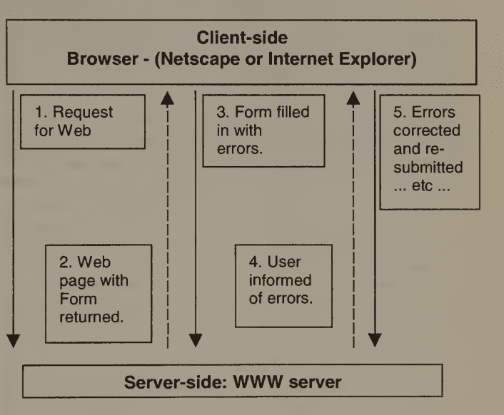

客户端的表单验证是 JavaScript 的主要吸引力之一。JavaScript 可以由浏览器处理。无需在客户端和服务器之间持续 *来回* 传输。它只涉及两次互联网传输，而不是上述场景中的至少五次，从而减少了互联网使用量。随着万维网使用的日益增加，依靠 JavaScript 进行客户端数据处理是合理的。

## JavaScript 版本

JavaScript 不断发展。在撰写本文时，最新版本是 JavaScript 2，但尚未普遍可用。版本 1.5 已可用，但你需要两个主要浏览器的最新版本。

在本书中，我们探讨 JavaScript 1.2。只要你理解了这个版本，你将对 JavaScript 有扎实的基础，并且这个版本可在所有主要浏览器上运行。然后你将准备好学习额外和更高级的功能。

## 面向对象编程（OOP）

在 JavaScript 社区中，关于 JavaScript 是面向对象还是基于对象的语言存在分歧。许多人认为是后者，而另一些人声称它具有面向对象的能力。但我们不会陷入这场争论，至少不会在有机会了解 *对象* 是怎么回事之前（见第 16 章）。

OOP 语言，如 C++ 和 Java，是当前的热门，旨在使大型程序的构建更容易。但即使这一点，程序员们也并未达成一致。所以，如果专家们无法达成一致，我们为什么要在现阶段尝试呢？让我们保持开放的心态。主要的一点是，JavaScript 程序使用 *对象*，到本书结束时，你将了解有关 OOP 的所有知识。

值得鼓舞的是，那些从未编程过的人通常发现 OOP 语言比 Fortran、Cobol 或 C 等传统语言更容易理解。

## 如何使用本文

一般来说，每个章节都将以一个示例开始，展示我们可能想要使用 JavaScript 实现的功能。然后列出 JavaScript 代码，即程序指令，并解释代码，以便你理解所使用的各种功能。你可能希望通过对原始代码进行微小的更改来进行实验，根据你自己的需求编写代码。随着学习的深入，我们将逐步建立起 JavaScript 的实践知识。

遗憾的是，一本完整的 JavaScript 参考手册超出了本书的范围。例如，参考书目中列出的某本参考书，仅 800 页中就有约 300 页是按字母顺序排列的 JavaScript 特性列表。它包含的解释很少，示例也寥寥无几。本书试图提供相当全面的覆盖，以满足许多网页设计师日常使用的大部分内容。消化了这些内容后，那些参考资料才会变得有意义。

当你运行自己的 JavaScript 代码时，应该在 *Netscape* 和 *Internet Explorer* 上都运行一遍。你可能会感到沮丧，就像我以及在你之前的许多人一样，因为它在一个浏览器上运行良好，但在另一个上却不行。

编写程序的“乐趣”之一是它们很少能一次就运行成功。Internet Explorer 会弹出一个小错误框，指示行号以及关于程序失败原因的模糊错误信息。在 Netscape 中，如果页面没有按预期工作，请在地址栏中输入 `javascript:`。（输入冒号是必要的。）你会得到更多一点的建议。

### 术语

- **客户端：** 客户端是用户在其个人计算机上使用的浏览器——并被称为客户端。
- **代码：** 用于 JavaScript 程序指令的术语。
- **Java：** 一种 *面向对象编程* 语言，不要与 JavaScript 混淆。
- **JScript：** 微软对 JavaScript 的实现，与 Netscape 的版本兼容。
- **OOP：** 面向对象编程，旨在使编写大型程序更容易。
- **服务器端：** 指 WWW 服务器，即托管用户希望查看的网页的站点。可以编写程序，使服务器能够处理用户在表单中输入并由浏览器（客户端）发回服务器的数据。例如，检查服务器数据库以获取客户信用状况的详细信息等。

# 2：JavaScript 长什么样？

在本节中，我们将看一个简单的例子，即如何让 JavaScript 在网页上写出几个字。这将向我们介绍如何编写 JavaScript 程序。

## 练习 1：让 JavaScript 写出一个消息

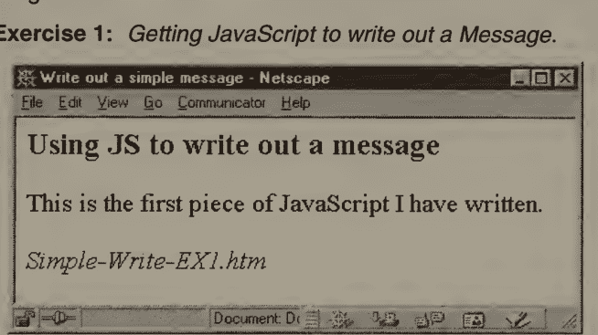

```html
<HEAD>
<TITLE>Write out a simple message.</TITLE>
</HEAD>

<BODY>
<H3>Using JS to write out a message </H3>

<SCRIPT LANGUAGE="JavaScript1.2">
document.writeln("This is the first piece of JavaScript I have written.");
</SCRIPT>

<ADDRESS> Simple-Write-EX1.htm </ADDRESS>
</BODY>
```

### 注意

1. 除了一对 `<SCRIPT>` ... `</SCRIPT>` 标签及其包含的内容外，其余都是标准 HTML。首先要记住的是，JavaScript 代码被封装在一对 `<SCRIPT>` 标签中：

   ```html
   <SCRIPT LANGUAGE="JavaScript1.2">
   .. our JavaScript code
   (frequently called a 'script') .......
   </SCRIPT>
   ```

   此标签可以使用 `LANGUAGE` 属性来指定正在使用的 JavaScript 版本。注意属性值（`JavaScript1.2`）用双引号括起来，并且版本号和 JavaScript 之间没有空格。

   你可以使用默认值“JavaScript”，在这种情况下，Navigator 2.0 将推断为 JavaScript 1.0 版本。较新版本将推断为 1.1 版。如果你希望使用 JavaScript 1.2 版的特定功能，则必须如上所示包含它。在本书中，我们经常使用 `LANGUAGE="Javascript"` 或直接省略它。

2. 你可以有多对 `SCRIPT` 标签，并且它们可以放在网页文档的 `<HEAD>` 或 `<BODY>` 内。但是，浏览器将按照它们在 HTML 源代码中的顺序执行脚本。我们将在后面的示例中看到这一点的影响。在上面的代码中，HTML `<H3>` 标签之间的内容将首先显示，其次是*脚本*代码，最后是 `<ADDRESS>`，显示如下：

   > **使用 JavaScript 写出一个消息**

   这是我编写的第一段 JavaScript 代码。

   *Simple-Write-EX1.htm*

   但是，如果 `SCRIPT` 标签放在 `HEAD` 中，或者实际上放在 `HEAD` 和 `BODY` 之间，甚至放在 `BODY` 中的 `<H3>` 标签之前，那么脚本消息就会出现在 H3 标题*之前*！

   > 这是我编写的第一段 JavaScript 代码。

   **使用 JavaScript 写出一个消息**


# Simple-Write-EX1.htm

在 HTML 文档中，将脚本代码放在正确的位置非常重要，就像我们必须放置 `` 和 `<FORM>` 标签一样。

## 3. 第一个 JavaScript 指令

现在让我们看看实际的 JavaScript 代码，它只包含一条指令。注意用于标记指令结尾的分号（`;`）：

```javascript
document.writeln("This is the first piece of JavaScript I have written.");
```

JavaScript 使用*对象*。在基于对象和面向对象的编程语言（如 Java、Visual Basic、C++ 和 JavaScript）的核心，是对象。这些是程序员处理的基本“东西”。对象具有*属性*和*方法*，如果你像我刚开始学习 JavaScript 时那样，这正是你开始怀疑是否应该放弃的地方。

起初，我觉得我必须在继续之前理解这些术语。但只有通过*使用*它们，我才逐渐开始理解它们的含义。所以先别放弃！随着我们深入学习并更详细地探讨 JavaScript，这些奇怪的术语会变得更加清晰。对于你们中的受虐狂来说，可以快速浏览一下第 16 章，那里对这些术语有一些详细的讨论。目前，我们不得不接受这些术语。那么，开始吧。

单词 `document` 是我们可以操作的众多 JavaScript 对象之一。它简单地指代当前显示的网页。我们想对当前的网页（当前显示的页面）做些什么。但我们想对这个页面做什么呢？

这就是第二个单词 `writeln`（发音为“write line”，意为写一行）的目的，以小写输入。它被称为一个*方法*。大多数对象有一个或多个方法。它们指定了我们想对一个*对象*做什么。

现在，我们想在当前网页中写入一个消息，所以，我们需要引用*document 对象*并使用其*writeln 方法*。它实际上是一个特殊的内置程序（就像一个*函数*），对它的对象执行某些操作，在这种情况下是“向网页文档写入一行文本”。注意 JavaScript 语法要求在*对象*和其*方法*之间使用一个句点（点号）：`object.method`

但我们想写出什么？这就是我们放在双引号括号内的内容。（如果你正在尝试这个，请不要在行尾按回车键。我们将在第 19 页解释原因。）我们现在可以这样解释这行代码：

> “在当前显示的文档中 - 写出短语 - '这是我编写的第一段 JavaScript 代码'。”

双引号中的消息更正式地称为一个*参数*。参数放在圆括号内，并用双引号括起来。

为什么要使用脚本，为什么不直接使用标准 HTML 输入文本？我们可以，但我们需要知道我们可以使用 JavaScript 在网页上输入文本。

确保你明白 `<SCRIPT>` 标签是 HTML 的一部分，而不是 JavaScript。它们通知浏览器其中包含一些 JavaScript 代码。浏览器必须是*支持 JavaScript 的*，否则它将无法读取 `<SCRIPT>` 标签内的代码。

当涉及到使用 JavaScript 代码（而不是编写 HTML）时，*大小写*很重要。JavaScript 基于的 C 语言是区分大小写的，这就是为什么我们在编写 JavaScript 代码时需要小心。

C 和其他语言在代码中使用小写，有时大小写混合。如果你不遵守大小写规则，那么脚本将*失败*（*无法工作*的术语）。如果你怀疑我，那就试试这个。

```javascript
DOCUMENT.writeln("A Message")
```

Internet Explorer 和 Netscape（如果在 Netscape 的地址栏中输入了 `javascript:`）会给出一条错误信息，说 DOCUMENT 未定义，这意味着它理解 `document` 但不理解 DOCUMENT。所以，要小心！（双引号内的文本当然可以是任何大小写。）

### 练习 2：写出两个消息

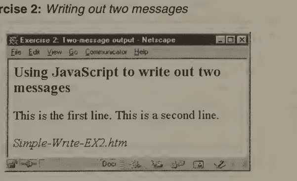

## 2. JavaScript

我们将扩展上述练习，使其打印出*两条*消息，然后解释如何让每条消息各占一行。

```html
<HEAD>
<TITLE>Exercise 2: Two-message output</TITLE>
</HEAD>

<BODY>
<H3>Using JavaScript to write out two messages</H3>

<SCRIPT Language="JavaScript">
document.writeln("This is the first line.");
document.writeln("This is a second line.");
</SCRIPT>
<P>
<ADDRESS>Simple-Write-EX2.htm</ADDRESS>
</BODY>
```

**注：**

1. 注意第一条和第二条 `document.writeln` 后面的分号。这是将一条指令与另一条指令分隔开的方式。分号用于标记一条指令的结束，通常被称为*语句*。（是的，我知道新术语不断涌现，但编程已经存在了很长时间，其中充斥着行话。这是我们不得不忍受的事情。）

   我们应该在一开始就强调分号使用的策略。JavaScript 的早期版本需要分号，但流行的浏览器不再需要它们了。因此，如果每条语句都另起一行，那么不包含分号正在逐渐成为常见做法。如果你在一行中输入多条语句，那么你*必须*包含分号，否则脚本可能会无缘无故地失败。

   是否应该使用分号？这将取决于你想加入哪个学派。一些专家说“ 不用麻烦 ”——宽松派；其他专家说应该包含它们，因为良好的编程实践——严格派！你必须自己决定。在本文中，我将借鉴两派的观点，只是为了提醒你两者都存在。

2. 另外请注意，网页上显示的两条消息并没有分开，它们是连在一起的。在练习 3 中，我们将看到如何强制它们分行显示。（使用 JavaScript 与使用文字处理器并不完全相同。）

3. 还有另一种形式——`write` 方法：

   ```javascript
   document.write("Type out some text")
   ```

   它的行为与 `writeln` 完全相同，不同之处在于 `writeln` 在输出其消息之后会追加一个新行，而 `write()` 将第二条消息追加到前一条消息上。那么，为什么 `writeln()` 方法输出的两条消息没有放在两行上呢？我起初也不得不问这个问题，直到我恍然大悟：`writeln()` 所做的只是将消息写入网页*源代码*中。它并不影响在浏览器窗口中的显示方式。

   为了理解这一点，让我们看看 *Netscape* 浏览器为练习 2 生成的源代码。如果你在 Netscape 中使用*查看 >> 页面源代码*命令，你就可以看到这一点。点击*查看*，然后选择*页面源代码*。这会打开一个新窗口，显示浏览器当前正在显示的页面的 HTML 源代码。这是 Netscape 显示的内容：

   ```html
   <HEAD>
   <TITLE>Exercise 2</TITLE>
   </HEAD>
   <BODY>
   <H3>Using JavaScript to write out two messages</H3>
   This is the first line.
   This is a second line.
   <P>
   <ADDRESS>Simple-Write-EX2.htm </ADDRESS>
   </BODY>
   ```

   使用了 `writeln()`。现在，将两个 `writeln()` 语句替换为 `write()`。你会看到，在 Netscape 中查看页面源代码时，消息会连接在一行上，如下所示：

   ```html
   <BODY>
   <H3>Using JavaScript to write out two messages</H3>
   This is the first line. This is a second line.
   <P> .. etc. ..
   ```

   **注：**

   1. 在 Netscape 中查看源代码时，你看不到 SCRIPT 标签或 JavaScript 代码。换句话说，`write()` 和 `writeln()` 之间没有区别，除非在 Netscape 中查看源代码时。

   2. Internet Explorer 也显示源代码（在查看菜单下，使用单个词“源代码”），但 IE 在记事本编辑器中显示源代码，因此，它显示的是你输入的原始源代码，完整的 `<SCRIPT>` 标签和 JavaScript 代码。

   3. 以上是两种主流浏览器运作方式的一个微妙差异，突出了在你的机器上安装两种浏览器的必要性，以便你可以开始进行比较。（别担心，情况只会更糟！两种浏览器之间还有其他一些令人恼火的差异，我们稍后会看到。）

那么，我们如何强制浏览器将第二行文本放在单独的一行上呢？这就是我们接下来要探讨的内容，而且无论我们使用 `write()` 还是 `writeln()` 都没有关系。

## 练习 3：强制文本在单独的行上显示

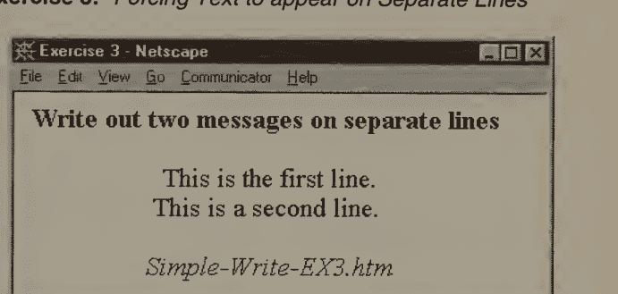

在 HTML 中，如何让第二行显示在单独的行上？你会使用 `<BR>` 或 `<P>` 标签，就像这样：第一行。`<P>` 第二行。

不仅如此，你还可以让 `write()` 和 `writeln()` 方法不仅输出文本，还可以输出 HTML 标签。因此，如果我们第一个 `write()` 方法中的第一段文本后面包含一个 `<P>` 标签或一个 `<BR>`，它会在源代码中写出该标签，并强制下一个 `write()` 的参数出现在新的一行上。让我们看看这段代码：

```html
<BODY>
<CENTER>
<B>Write out two messages on separate lines</B>
<P>
<SCRIPT>
document.write("This is the first line.<BR>");
document.write("This is a second line.");
</SCRIPT>
<P><ADDRESS>Simple-Write-EX3.htm</ADDRESS>
</CENTER>
</BODY>
```

**注：**

1. `<BR>` 标签已作为参数的一部分包含在内。换句话说，它必须放在两个双引号之间。它等价于以下 HTML 代码：

   ```html
   This is the first line. <BR> This is the second line.
   ```

   如果你在 Netscape 中检查*源代码*，上述内容正是你会看到的。

   ```html
   <HEAD>
   <TITLE>Exercise 3</TITLE>
   </HEAD>
   <BODY>
   <CENTER>
   <B>Write out two messages on separate lines</B>
   <P>
   This is the first line.<BR> This is a second line.
   <P>
   <ADDRESS>Simple-Write-EX3.htm</ADDRESS>
   </BODY>
   ```

   注意 `<BR>` 标签以及文本参数都被写入了源代码中。

   如果我们使用 `writeln()` 代替，在浏览器中显示的结果将完全相同，但 Netscape 中的实际*源代码*将如下所示：

   ```html
   <BODY>
   <B> Write out two messages on separate lines
   </B>

   This is the first line.<BR>
   This is a second line.

   <P>
   <ADDRESS>Simple-Write-EX3.htm</ADDRESS>
   </BODY>
   ```

   `writeln()` 在写出第一个参数后会在*源代码*中创建一个新行，因此第二个 `writeln()` 的参数将开始于新的一行。

   那么，我们学到了什么？我们现在知道我们可以使用 JavaScript 生成 HTML 代码页面。这有什么了不起的，为什么不直接写 HTML 代码呢？正如我们很快会看到的，我们可以给用户提供一系列按钮供其点击。根据选择的不同，可以生成多个脚本之一，每个脚本都有其独特的 HTML 代码。通过这种方式，网页作者可以与读者进行交互。

> **警告：** *在本章结束之前，有一点重要的说明。*
>
> 当使用 `write()` 或 `writeln()` 方法时，你不能在编辑器的双引号之间按 Enter 键。例如，在这段长文本中：

```javascript
document.write("Here is a long piece of text to
type out. I must resist the temptation to press
the Enter key at the end of a line which I
would normally do in my word processor.")
```

在第一行 `to` 一词之后，很容易想在编辑器中按 Enter 键。然而，JavaScript 将 Enter 视为该语句的结束，在我们的例子中，这意味着参数没有以双引号结尾。语法将不正确。有两种方法可以解决这个问题。要么，简单地继续输入，让你的编辑器自动换行；或者，这是更好的方法，使用*多个*参数，如下所示：

```javascript
document.write("Here is a long piece of text",
            " to type out. I must resist",
            " the temptation to press the",
            " Enter key at the end of a",
            " line which I would normally",
            " do in my word processor.")
```

看到 `write()` 方法如何接受多个参数了吗？每个参数都用双引号包围，并用逗号分隔。参数中的文本在浏览器的*显示*中当然不会位于单独的行上，因为我们没有包含任何 HTML 标签。我们在下面这样做：

```javascript
document.write("<HR> Here is a long piece of",
            " text to type out. <BR>",
            " I must resist the temptation",
            " to press the Enter key at the",
            " end of a line which I would",
            " normally do in my word",
            " processor. <HR>")
```

现在，浏览器将在单独的行上显示文本。

> （由于本书的页面大小，在示例中并不总是可以使用多个参数。在那种情况下，你必须假设已经发生了自动换行。）

2. 出于兴趣，Netscape 和 IE 都拒绝显示在引号之间按了 Enter 键的版本。但它们都弹出了错误消息，抱怨“*Unterminated string constant*”（未终止的字符串常量），并给出了发生错误的行号。（空白行包含在行数统计中。）

那么什么是*字符串常量*呢？双引号内的文本被称为*引号字符串*、*字符串*或*字符串常量*。字符串常量是任何包含在双引号内的内容。*未终止*意味着缺少结尾的双引号。

3. 最后，请注意以下内容：

```javascript
document.write("Here is a long piece of text",
                " to type out and it will",
                "spread over another line.")
```

在第二行的开头双引号和单词 `to` 之间有一个空格。如果未包含空格，第一个引号字符串的最后一个单词将与第二个字符串的第一个单词连接在一起，中间没有间隙。这在第三个字符串中已经发生，其 `spread` 前没有空格，将导致显示 “willspread over another line.”。因此，在使用多个参数时，你需要考虑空格。

## 本章使用的术语

- *参数*：在编程中，参数是方法处理的数据。在我们目前使用的示例中，参数包含文本字符串和 HTML 标签，这些内容已通过 `write()` 和 `writeln()` 方法写入网页。这些方法构成了客户端 JavaScript 语言的一部分，其参数必须包含在圆括号内。
- *代码*：JavaScript 指令的术语。通常，*代码*、*脚本*、*语句*和*程序*这些术语可以互换使用，指代一组或一块 JavaScript 指令。
- *JavaScript 启用*：在浏览器中选择此选项，以便能够执行 SCRIPT 标签内的任何 JavaScript 代码。
- *方法*：在基于对象的语言中，*方法*类似于函数，即一个小程序，用于对对象执行某些操作。大多数对象有一个或多个方法。`document` 是一个对象，具有*方法* `write()` 和 `writeln()`。
- *对象*：我们已经遇到过一个，*document*，稍后还会遇到其他对象。对象是我们希望创建的脚本的构建块。（我花了一些时间才让自己对这些术语——对象和方法——有更清晰的认识。我们现在不必太担心它们。）
- *引号字符串*：用双引号或单引号括起来的一串字符。字符串可以包含纯文本和/或 HTML 标签。
- *脚本*：JavaScript 代码块的术语。
- *语句*：每一段编程代码都称为语句，或者确实称为指令。它类似于一个完整的英语句子或命令。在 JavaScript 中，每个语句可以以分号结尾。
- *语法*：构建 JavaScript 代码的规则或语法。包括在对象与其方法之间使用句点、正确使用大小写以及正确使用引号，这些是 JavaScript 语法的一些示例。


## 你学到了什么

我们在本章中涵盖了一些基础知识。

JavaScript 代码放置在一对 HTML `<SCRIPT>` 标签内。标签的放置将决定它们在显示页面上生效的位置，就像 `` 标签的放置一样。

我们可以有多个 `<SCRIPT>` 标签，并且它们可以放在 `<HEAD>` 或 `<BODY>` 标签内，甚至放在两者之间。但是，我们需要仔细考虑实际放置它们的位置。

我们已经看到 JavaScript 可以将文本写入网页，更重要的是，可以将纯 HTML 代码写入网页，浏览器会对此进行处理，就像我们最初编写纯 HTML 一样。

我们可以使用`write()`或`writeln()`方法。它们在网页的实际显示上效果相同，但在 Netscape 中，它们的差异体现在`source code`中。

一些方法可以接受多个参数。但是，当使用字符串常量参数时，其双引号内不能包含`Enter`代码。

在使用 JavaScript 代码时，大小写变得很重要，而在编写 HTML 代码时，大小写并不重要。我们现在在将 JavaScript 嵌入网页设计时需要考虑两件事：HTML 本身和 JavaScript 的语法。

### 测试：第 2 章

- 2.1 `<SCRIPT>` 标签的用途是什么？它们可以放置在哪里？
- 2.2 `<SCRIPT>` 标签是 JavaScript 还是 HTML 的一部分？
- 2.3 `document` 是对象还是方法？
- 2.4 `writeln()` 是对象还是方法？
- 2.5 `write()` 和 `writeln()` 的主要区别是什么？
- 2.6 在同一个 HTML 文档中可以有多对 `<SCRIPT>` 标签吗？
- 2.7 以下代码会在网页上显示什么：

```javascript
document.write("Hallo there.",
              "My name is Joe.")
```

- 2.8 上面代码中圆括号内内容的正式术语是什么？
- 2.9 什么时候需要在开头的 `<SCRIPT>` 标签中添加`LANGUAGE="Javascript1.2"`？
- 2.10 多个参数如何分隔？

# 第三章：表单和弹出框

在本节中，我们将了解如何使用表单与读者互动。我们还将了解如何通过`write()`和`writeln()`方法添加更多 HTML 代码。

## 用户交互

普通的 HTML 网页是静态的。每次浏览器调用并显示该页面时，其外观与之前的任何一次都完全相同。

人们使用 JavaScript 的原因之一是与用户创建某种形式的交互。例如，允许用户购买我们的商品并显示总费用；将一张图片替换为另一张，例如显示某种疾病进展的不同视图的照片。创建用户交互的主要机制之一是通过表单按钮。我们将从一个简单的交互开始，即邀请用户点击按钮显示一个`警告`框。

### 练习 4：使用表单弹出警告框

这是一些简单的 HTML，它创建了一个带有文本的表单按钮。

```html
<FORM>
<INPUT TYPE="button"
       VALUE="Click this button">
</FORM>
```

但是，我们如何让按钮在被点击时显示警告框呢？我们可以通过向 `<INPUT>` 标签添加仅仅一个属性来实现。即`onClick`属性，如下所示。

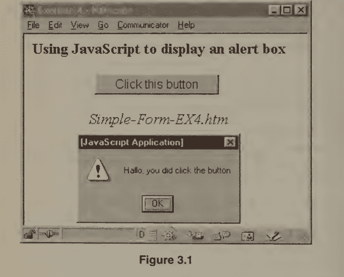

```html
<HEAD>
<TITLE>Exercise 4</TITLE>
</HEAD>

<BODY>
<H3>Using JavaScript to display an alert box
</H3>
<FORM>
<INPUT TYPE="button"
       VALUE="Click this button"
       onClick="alert('Hallo, you did click the button')">
</FORM> <P>
<ADDRESS>Simple-Form-EX4.htm</ADDRESS>
</BODY>
```

`onClick`属性最初是 Netscape 添加到 `<INPUT>` HTML 标签的一个扩展。现在，它已成为 HTML 4.0 标准的一部分。图 3.1 显示了当用户点击表单按钮时会发生什么。

### 注意

1. 首先要理解的是`onClick`属性的语法。这适用于我们稍后将遇到的所有其他变体。

```javascript
onClick = "... some JavaScript code ..."
```

HTML 属性`onClick`不区分大小写——但按照惯例，如上所示书写，大写 C，其余小写。相比之下，该属性取的值是 JavaScript 代码，因此区分大小写。

```javascript
onClick = "alert('Hallo, you did click the button')"
```

因此，`Alert(..)`或`ALERT(..)`是错误的，必须全部小写。（提醒你一下，如果你使用此示例，你不能在`the`之后按 Enter 键，继续输入并允许自动换行生效。）

2. 属性`onClick`的值是一段用双引号括起来的 JavaScript 代码，属性及其值之间用等号隔开，就像 HTML 中的其他属性值一样。当按钮被点击时，它会导致`onClick`属性的值被执行。在我们的例子中，这是对`alert()`方法的调用，以显示括号内的任何消息。但请注意消息是用单引号括起来的。我们不能在双引号内使用双引号，因为第二个双引号会结束第一个。

## 3：表单与弹出框

由于整个 JavaScript 代码必须包含在一对双引号内，因此`alert()`函数的消息必须使用单引号，以避免与外层的双引号冲突。希望这能说得通。这个问题会反复出现。初学者经常忘记这一点，然后纳闷为什么脚本无法运行。因此，我们需要按如下方式输入代码：

`onClick="alert('message to be displayed')"`

4. `alert`必须全部小写，否则当用户点击按钮时，什么都不会发生。Netscape 只会毫无反应地呆在那里，而 IE 会告诉你发生了错误——"Object expected"。虽然不太有用，但至少你可以根据给出的行号来检查`alert()`方法的拼写和/或大小写。不过，为什么拼写错误的`Alert`会被当作对象而不是方法来报错呢？

首先，IE 不会将你输入错误的`Alert()`识别为对 window 对象的`alert()`方法的调用。它完全不知道那是什么。错误检查程序很多时候不得不猜测程序员的意图。猜成对象是一个合理的猜测，因为它假定`Alert()`方法应该属于某个对象。它找不到与`Alert()`关联的对象，于是试图告诉你它找不到。

5. 我们现在需要学习另一个术语。点击按钮在专业术语中称为事件，即用户需要执行的操作。其他类型的事件包括：将鼠标移到超链接上；将鼠标移出图像映射；点击提交按钮；更改文本框中的文本，等等。我们将在后面更详细地了解所有这些事件以及其他事件。

`onClick`的值称为事件处理程序。它定义了当事件发生时需要执行的操作。

```html
<INPUT TYPE=button VALUE="Try me" onClick = "alert('You did try me.')" >
```

这个属性是一个事件。

这个值指定了用户点击按钮时要执行的 JavaScript 代码——即事件处理程序。

6. 注意，我们的 JavaScript 代码没有使用任何 `<SCRIPT>` 标签来编写。我们现在知道两种编写 JavaScript 代码的方式：使用 `<SCRIPT>` 标签，以及使用带有事件属性（如`onClick`）的表单按钮。（如果你使用 Word 97 编写脚本，请参见第 57 页。）

下面是另一个用户交互的示例。

### 练习 5：让用户选择`bgColor`

与网页读者进行交互是使用 JavaScript 的主要吸引力之一。在这个例子中，我们将使用 `<TABLE>` 来显示颜色名称和按钮。用户可以点击其中一个按钮，将背景（`bgColor`）设置为自己选择的颜色。

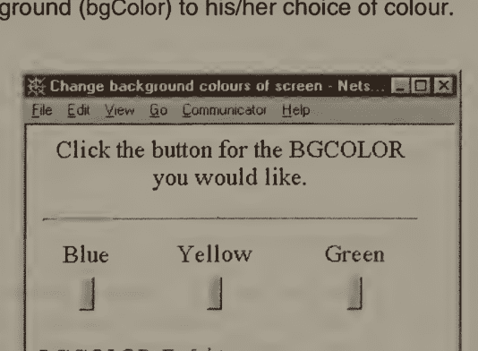

```html
<HEAD>
<TITLE> Change background colours of the screen
</TITLE> </HEAD>

<BODY><FORM>
<TABLE WIDTH=100%>
<CAPTION>Click the button for the BGCOLOR you
would like.</CAPTION>

<TR>
<TD COLSPAN=3> <HR>
<TR ALIGN=center>
<TD>Blue <TD>Yellow <TD> Green
<TR ALIGN=center>
<TD>
<input type="button"
       onClick="document.bgColor='lightblue'">
<TD>
<input type="button"
       onClick="document.bgColor='lightyellow'">
<TD>
<input type="button"
       onClick="document.bgColor='lightgreen'">
</TR>
</TABLE></FORM>
<ADDRESS> BGCOLOR-Ex5.htm </ADDRESS></BODY>
```

### 注意

1. 当点击其中一个按钮时，相应的 JavaScript 代码将被执行，并改变网页的背景颜色。

```javascript
onClick="document.bgColor='lightblue'"
```

`onClick`的值（用双引号括起来）将当前显示文档的`bgColor`赋值为`'lightblue'`颜色。同样地，因为`onClick`的值必须使用双引号，而语法要求实际的颜色值也需要加引号，所以我们必须对后者使用单引号。

2. 我们已经知道`document`对象可以使用两个方法：`write()`和`writeln()`。但这里我们使用的是`bgColor`。它不是方法，那它是什么？它被称为属性。

> （如果你愿意，现在可以查看第 16 章关于对象及其方法和属性的讨论。目前还不是必须掌握的内容，但你们中的一些人可能对此感到好奇。如果没有兴趣，就先放一放，等我们遇到更多示例再说。目前，只要试着理解对象有可以对对象执行操作的方法，比如生成警告框或输出一些文本，以及对象还有影响对象外观的属性。）

3. 我们本可以使用 RGB（红、绿、蓝）十六进制数来代替颜色词——如下所示：

```javascript
onClick="document.bgColor='DE6633'
```

4. 请注意`bgColor`的大小写。任何其他写法都不会起作用。（我很快就会停止重复大小写的重要性，因此请确保在编写自己的代码时使用正确的大小写。）

5. 上面注意 1 中的术语赋值是另一个术语，对于编程新手来说需要一些解释。

在数学中：`x = 4`表示字母 x 取值为 4，即 x 等于 4。在编程中，虽然看起来一样，但含义不同，即 x 要被替换为（赋值为）值 4。更准确地说，我们应该这样读：

> “赋值运算符（`=`）右侧的内容将替换左侧的内容。”

区别是什么？在编程中我们可以这样写：`x = x + 1`

从数学角度来看，这是不可能的，x 不可能比自身大 1。但这不是数学，而是一个完全有效的编程语句，它的意思是将右侧`x`当前的值加 1，然后用新值替换左侧的`x`。

这有什么用？这恰好是编程中最常见的语句之一，我们将在讨论 JavaScript 编程方面的内容时了解到。

目前，我们只需要记住赋值语句会用右侧的内容替换左侧的内容。最好从一开始就养成这样的习惯：说 x 被替换为 4（或任何其他值），而不是说 x 等于 4。

### 练习 6：使用`document.write()`生成更多 HTML 代码

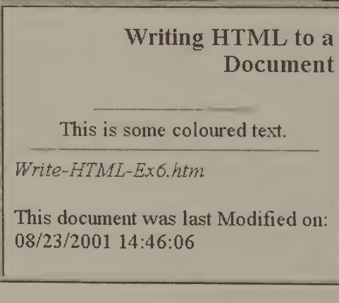

这个练习只是为了展示如何使用文档的`write()`方法来生成 HTML 代码，并介绍另一种编写参数的方式。

```html
<BODY>
<H3 ALIGN=right>Writing HTML to a Document</H3>
<SCRIPT>
document.write("<HR WIDTH=50%>"
             + "<FONT COLOR='#0000FF'>"
             + "<CENTER>"
             + "This is some coloured text."
             + "</CENTER>"
             + "</FONT>"
             + "<HR WIDTH='90%'>")
</SCRIPT>
<ADDRESS>Write-HTML-Ex6.htm </ADDRESS>
<SCRIPT>
document.write("<P> This document was last"
             + " Modified on <BR>"
             + document.lastModified)
</SCRIPT>
</BODY>
```

### 注意事项

1. 注意`document.write()`使用了连接运算符（`+`）。它会将每个加引号的字符串连接成一个单独的参数。这个新运算符将在下面讨论。我们本可以使用逗号来代替，但那样就是使用多个参数了。

2. 由于我们使用的是 `<SCRIPT>` 标签而不是事件处理程序，所以我们可以使用双引号来包围每个字符串。

3. 为了清晰起见，我们将每个字符串放在了单独的一行。但其实没有必要这样做。不过，这样做可以更容易地找到脚本中的错误，比如缺少运算符、缺少引号等。

### 连接

连接的意思是“将多个部分连接在一起”。连接运算符用于将两个或多个加引号的字符串连接在一起，形成一个单独的参数。如果我们使用逗号，那就是使用多个参数。（不要将连接运算符与算术加法符号混淆。它们看起来完全一样，但必须根据使用上下文来解释。）

我们将在下一章中看到更多关于这个运算符的内容，但现在只需理解如何使用连接运算符或多参数来解决编写长文本字符串时不必担心是否按了回车键的问题。

```javascript
lastModified
```

我们还包含了文档对象的`lastModified`属性，请注意驼峰命名法的使用。它返回文档最后修改的日期（mm/dd/yy hh:mm:ss - 美国格式）。我们将在第 11 章中了解如何转换为英式格式。请注意，由于我们使用的是属性，所以不能使用引号来包围`object.property`。（作为练习，为什么不用警告框来显示最后修改的日期呢？）

```html
<SCRIPT>
document.write("<P> This document was last"
    + " Modified on <BR>"
    + "<FONT color='red'>"
    + document.lastModified
    + "</font>")
</SCRIPT>
```

## 一些常见错误

如果你一直在尝试编写自己的脚本，你可能遇到过一些非常奇怪的问题。以下是我遇到过的一些情况。

### 3：表单与弹出框

当我刚开始写 JavaScript 时，经常不得不苦思冥想在使用`document.write`时到底发生了什么，或者说，为什么有些东西没有发生。我的参考书也不太有帮助。

1. 在单引号或双引号内的字符串中，不要在任何位置按下回车键。如果字符串流到新的一行，允许自动换行。更好的是，使用逗号或连接运算符。原因是 JavaScript 认为回车键意味着语句的结束。所以，如果你在一个带引号的字符串参数中按下回车键，那个字符串就没有了结束引号！语法是错误的。

页面显示时的表现将取决于你使用的浏览器。Netscape 会简单地忽略这个脚本，什么都不做，也不会给你任何警告，除非你在地址栏中输入`javascript:`。Internet Explorer 也会失败，但会自动显示错误信息，并给出错误发生的行号（空白行也包含在行数统计中）。两个浏览器的错误信息都有些晦涩难懂，但至少你可以开始检查错误发生处的代码。

2. 使用多个参数时，确保每个参数（最后一个除外）都有逗号分隔符，否则后面的参数将不会被识别。记住，编程语言有非常严格的行为规则（语法）。违反规则总会导致错误发生。

3. Netscape 的一个真正令人惊讶的地方——至少版本 4 是这样——是如果你在加载网页后调整窗口大小，它会从其缓存内存中重新读取源代码。它使用缓存内存来加快显示速度，尤其是涉及图像时。然而，真正令人惊讶的是，如果这个缓存版本包含 JavaScript 代码。

想象一下，你加载了一个页面，在页面显示后发现代码中有一个错误。你返回并在源代码中修正错误，保存页面并在 Netscape 中重新加载它。但是，如果你现在调整窗口大小，Netscape 使用的源代码可能是之前的缓存版本，其中仍然包含原来的错误！

4. 不要将`document.write()`或`writeln()`与事件处理程序一起使用，至少在我们第 8 章讨论打开新窗口之前不要。目前，仅在 `<SCRIPT>` 标签内使用`document.write`更安全。浏览器随后会将参数写入当前窗口。

如果你确实将其用作事件属性的值，比如`onClick`，浏览器会打开一个新窗口，并在该窗口中显示`document.write()`的参数。这在某些情况下可能有用，但我们需要了解更多之后才能安全地使用这类示例。

## 其他弹出框

有三种类型的弹出框：`alert`（警告框），我们已经见过；`prompt`（提示框）；以及`confirm`（确认框）。提示框邀请用户输入一些文本。一旦用户点击了确定按钮，我们就可以使用 JavaScript 来找出输入了什么内容。


确认框显示我们选择的讯息，并要求用户通过点击`确定`来接受该讯息（确认它），或通过点击`取消`来拒绝它。JavaScript 可以确定该讯息是被确认还是被拒绝。

然而，要使用这两种弹出框，我们需要知道如何“捕获”用户在提示框中输入的内容，或在确认框中选择了哪个按钮。这涉及函数的使用，这是下一章的主题。在学会使用函数之前，我们无法用 JavaScript 做更多事情。

## 术语

*assignment statement*（赋值语句）：一段代码，将赋值运算符（`=`）右侧的值赋给运算符左侧的变量或变量。`x = x + 1` 这里，`x` 是一个变量——我们在下一章有更多关于变量的内容。

*cache memory*（缓存内存）：计算机内存的一部分，某些浏览器在其中存储已加载网页（和图像）的副本，以便在需要重新显示该页面时快速访问，例如在页面被调整大小之后。

*event handlers*（事件处理程序）：HTML 事件属性，如`onClick`，以相关的 JavaScript 代码作为其值。当用户导致事件发生时，事件处理程序的代码被执行。

*events*（事件）：用户可能做的事情，比如在超链接上移鼠标、点击按钮、在文本框中更改文本。更多详情请参见第 7 章。

*operators*（运算符）：编程术语，指程序中使用的各种符号。我们已经见过以下这些：

- `=` *赋值*运算符
- `>` 大于*比较*运算符
- `+` 连接运算符
- `+` 算术加法运算符

第 9 章将更详细地讨论这些和其他运算符。

## 你已经学到了

1. 当用户点击按钮时，如何使用`onClick`事件调用警告框。
2. 我们已经看到有两种基本方式来写 JavaScript 代码：
   - 使用表单按钮并将代码赋给事件处理程序
   - 将代码放在`<SCRIPT>`标签内
3. 如何让用户选择按钮来设置背景颜色。
4. 何时使用双引号和单引号。
5. 为`document.write()`使用多个参数。
6. 如何连接带引号的字符串以形成一个参数。是的，你应该在自己的头脑中明确，连接与多个参数不是一回事。它将所有字符串连接成一个参数。

## 测验：第 3 章

3.1 `alert()`方法属于`document`还是`window`对象？

3.2 在以下内容中，警告框中的讯息应该用双引号还是单引号括起来？

`onClick = "alert( the message )"`

3.3 JavaScript 中`onClick`属性的术语是什么？

3.4 `onClick`属性接受什么类型的值？

3.5 当用户点击按钮时，这在 JavaScript 中称为什么？

3.6 在面向对象编程语言中，以下`bgColor`的正式术语是什么？

`onClick = " document.bgColor = 'lightblue' "`

3.7 在上面的代码中，`bgColor`如果输入为`bgcolor`或`BGCOLOR`是否有影响？

3.8 以下代码执行后，`z`的值将是多少？

```javascript
z = 1;
z = z + 3;
```

3.9 在上面的代码中，`+`是连接运算符还是算术运算符？

3.10 在 Netscape 中调整窗口大小时可能发生什么？

3.11 `onClick`是属性还是事件？

## 转义序列

反斜杠字符（`\`）在 JavaScript 字符串中具有特殊用途。它后面跟着一个字符或数字，称为*转义序列*。例如，假设我想通过`document.write`或`alert`框输出：

```javascript
Read this play: "Macbeth".
alert("Read this play: "Macbeth".")
```

第二个双引号会被当作第一个双引号的结束符，这会使浏览器困惑。通过使用转义序列，我们让浏览器注意到第二个（和第三个）双引号是以特殊方式使用的。

```javascript
alert("Read this play: \"Macbeth\".")
```

反斜杠“转义”了反字符的通常解释。在上面的例子中，它会在*Macbeth*前后输出双引号。

| 序列 | 字符 |
|---|---|
| `\b` | 退格 |
| `\n` | 换行 |
| `\r` | 回车 |
| `\t` | 制表符 |
| `\'` | 撇号 |
| `\"` | 双引号 |
| `\\` | 反斜杠 |
| `\xnn` | 其中 nn 是十六进制数字，代表 Latin 1 编码中的一个字符（AE 是 ®，A9 是 ©，A5 是 ¥，BD 是 ½，E8 是 è）。x 表示十六进制值。 |

| 示例 |
|---|
| `alert("Hallo. \r I\'m Fred \xAE \t \\my name has been registered.")` |

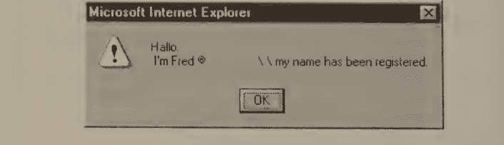

# 第四章：函数

JavaScript 的主要优势，与许多其他编程语言一样，在于它允许程序员创建*函数*。函数是一个已被赋予名称的指令块。当我们看到函数是如何使用的，这就说得通了。

我们将回到上一章展示的一个简单练习，并将其转换为一个函数。

还记得练习 4 中的这个吗？

```html
<FORM>
<INPUT TYPE="button"
       VALUE="Click this button"
       onClick="alert('Hallo, you did click the button')">
</FORM>
```

当表单按钮被点击时，弹出警告对话框。让我们让事件处理程序执行一个*函数*，它将做完全相同的事情。虽然这是一个简单的任务，但它将说明函数是如何创建的。我们稍后可以做更令人兴奋的事情。

**练习 7：** *创建一个函数。*

这是代码，解释将在后面。

```html
<HEAD>
<TITLE>Exercise 7</TITLE>
</HEAD>
```

## 练习 7：函数

```html
<SCRIPT>
function showalert()
{
    alert("Hallo, the button called a function to display an alert box!")
}
</SCRIPT>

<BODY>
<H3>Using a Function to display an alert box</H3>
<FORM>
<INPUT TYPE="button" VALUE="Click this button" onClick="showalert()">
</FORM>
<P>
<ADDRESS>Simple-Function-EX7.htm</ADDRESS>
</BODY>
```

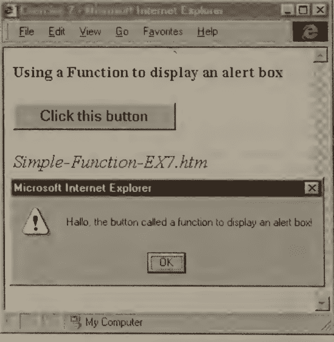

## 说明

1. 当按钮被点击时，警告框会出现。
2. 为什么要费心创建一个函数呢， surely it is simpler to do it the other way, as shown on page 41? 是的，您说得对，但我们需要从某个地方开始，而这个简单的例子展示了函数是如何创建的。函数以单词*function*（小写）开头，后面跟着一个名称（由我们自行命名），再后面是一对圆括号。括号里没有任何内容，但它们仍然是必需的。稍后我们会在里面放入内容。您绝不应该在函数*名称*和圆括号之间放置空格。
3. 整个函数被放置在一对`<SCRIPT>`标签之间，这些标签这一次被放置在`HEAD`和`BODY`之间。它们也可以放在`HEAD`内部或`BODY`内部。它们甚至可以放在`BODY`之后——但这可能是不明智的，正如我们将会看到的。从实际的角度来看，并且受到严肃程序员推荐的做法是，所有函数都应该放在`BODY`之前，并且*在*`<HEAD>`标签*之内*。实际上，新版本的 HTML（XHTML）对这种方法相当严格。
4. 如果您有三个函数，每一个都可以放在单独的`<SCRIPT>`标签内，或者全部三个都可以放在同一对标签内。换句话说，一对`<SCRIPT>`标签可以包含多个函数。
5. 花括号`{ ... }`是做什么用的？JavaScript 需要它们来标记函数代码的开始和结束。我们只有一条语句，但函数内的语句数量没有限制。如果不止一条，最好在每条完整语句后面加上分号。（在本文中并不总是使用分号，但这样做是良好的编程风格。）
6. 需要知道的是，浏览器在加载网页时不会执行函数中的语句。这与我们之前更简单的脚本不同，那些脚本不包含函数，因此*会在页面加载时*按照它们出现的顺序执行。那么函数中的指令何时执行呢？

这就是`onClick`属性的事件处理程序的目的。它包含函数的*名称*和两个括号，但不包括单词*function*。

```javascript
onClick="showalert()"
```

在用户点击表单按钮之前，函数不会被执行。当按钮被点击时，浏览器会查看`onClick`的值，以确定需要做什么。以前，这是为了生成一个警告框，但这一次它被告知执行名为`showalert()`的函数。

浏览器会找到这个函数（所有函数在页面最初加载时都被存储在一个安全的地方），然后执行函数花括号内的代码。我们函数中的代码要求显示一个带有我们消息的警告框。当遇到结束花括号时，所有处理停止。

7. 您需要了解函数有两个部分。第一部分称为*声明*，包括*function*关键字、一个*名称*以及紧随其后的一对*圆括号*，还有实际代码被包含在*花括号*中，也称为*大括号*。它们被放置在`<SCRIPT>`标签内。

```html
<SCRIPT>
function name()
{ ... JavaScript code ...}
</SCRIPT>
```

在被*调用*之前，它不会被执行。这是过程的*第二部分*——一个执行该函数的调用（*调用*）。这个调用只需要函数的名称和圆括号。实际上，这些圆括号**非常重要**。在函数名称之后，它们成为一个*运算符*，通知 JavaScript 需要向函数发起调用。如果您省略了它们，这个过程将无法工作。`onClick="showalert()"`

8. 请务必知道何时使用圆括号，何时使用花括号。

# 练习 8：使用函数实现练习 5

```html
<HEAD> <TITLE> ... <TITLE>
<SCRIPT>
function blue() {
  document.bgColor='lightblue'
} // EoFn

function yellow()
{
  document.bgColor='lightyellow'
} // EoFn

function green() {
  document.bgColor='lightgreen'
} // EoFn
</SCRIPT>
</HEAD>

<BODY>
<FORM>
<TABLE WIDTH=100%>
<CAPTION>Click the button for the BGCOLOR you would like.</CAPTION>
<TR> <TD COLSPAN=3> <HR>
<TR ALIGN=CENTER>
<TD>Blue  <TD>Yellow <TD> Green
<TR ALIGN=CENTER>
<TD><input type="button" onclick="blue()">
<TD><input type="button" onClick="yellow()">
<TD><input type="button" onclick="green()">
</TR> </TABLE>
</FORM>
<ADDRESS>BGCOLOR-fns-Ex8.htm </ADDRESS></BODY>
```

## 说明

1. 我们将练习 5 转换成了使用函数的版本。请注意一对`<SCRIPT>`标签是如何包含这三个函数的。
2. 将开始花括号放在与函数名称同一行，并将结束花括号放在单独一行是常见的做法，如函数`blue()`所示。但正如您所看到的，根据程序员的个人风格，还有其他有效的变体。我们在上面展示了三种不同的风格。在可能的情况下保持一致是良好的编程实践。
3. 如果花点功夫在函数的结束花括号后面添加一个注释（见第 77 页），以表明这是“函数结束”——`// EoFn blue()`，这将避免您很多烦恼。一旦您开始编写更大的脚本，很容易忘记输入结束括号，或者将其误认为可能属于另一个编程功能的括号。参见第 9 章。
4. 因为`onClick`是 HTML 的一部分，大小写不重要，因此示例中使用了`onclick`。然而，在 XHTML 中，所有属性必须为小写。（XHTML 是 HTML 的新版本，后者将不再进一步发展。如果您已经了解 HTML，那么您已经掌握了 90% 的 XHTML。）

# 练习 9a–9c：使用提示对话框

我们在前一章提到，有三种类型的弹出对话框。我们现在来看看提示框。它用于提示用户输入一些数据。我们很快会看到如何“捕获”这些数据，以便查看输入了什么。这将使我们认识到变量的必要性——函数喜欢使用变量。

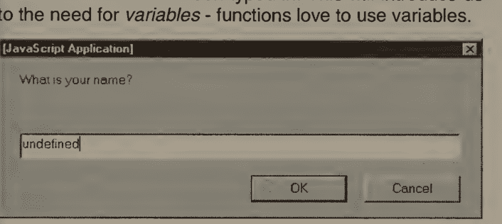

以下是一些代码，它在 HTML `<SCRIPT>`标签内生成上面的提示对话框。

```html
<HEAD>
<TITLE> Creating a Prompt box</TITLE>
</HEAD>
<BODY>
<H4> Here is a Prompt</H4>
<SCRIPT>
    prompt("What is your name?")
</SCRIPT>
<ADDRESS>PROMPT-Ex9a.htm </ADDRESS>
</BODY>
```

## 练习 9a 说明

1. 注意`prompt("message")`的语法与`alert()`相似。
2. 单词“*undefined*”表示用户尚未在提示框中输入任何内容。当他/她输入后，这个词将被替换。当用户输入内容并点击 OK 按钮后，对话框消失。请注意，消息字符串（提示的参数）会显示出来，以便用户知道该做什么。
3. 看到`undefined`这个词不仅不美观，而且可能会吓到您的访客。删除它很简单。与`alert()`和`confirm()`（我们很快会讲到后者）不同，`prompt()`可以接受第二个参数。

```javascript
prompt("What is your name?", "")
```

它在上述逗号之后，包含一个空字符串——`""`。这将把*undefined*替换为空白，有效地将其移除。您可以在双引号内放入某些内容，那样的话，那个内容会出现在文本框中。亲自尝试一下吧！

# 练习 9b：捕获提示框中的数据

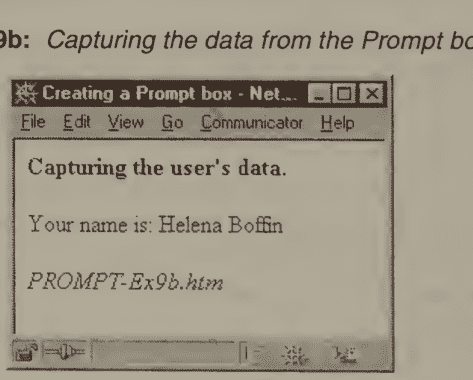

我们现在来了解如何捕获用户输入的内容。以下是使用名为`x`的变量的代码。

```html
<BODY>
<FONT SIZE=-1>
<B>Capturing the user's data.</B></FONT>
```

```javascript
<SCRIPT>
  x = prompt("What is your name?","");
  document.write("<P>Your name is: " + x);
</SCRIPT>
<P>
<ADDRESS>PROMPT-Ex9b.htm </ADDRESS>
</BODY>
```

## 练习 9b 的注意事项

1. 我们将用户在提示文本框中输入的名称赋值给变量`x`，此处用户输入的是 'Helena Boffin'。变量是计算机内存中的一个命名存储区域，其数据会一直保存在那里，直到需要使用为止。
2. 下一行代码确实通过`document.write`功能使用了该变量：

   `document.write("<P>Your name is: " + x)`

   这就是所有编程语言都需要变量的原因之一。它是一种在程序后期阶段持有数据的机制。注意`document.write`中不仅包含一个文本字符串，还包含变量`x`，而`x`周围没有引号。如果加了引号，就会输出字符 'x'。因此，当某些内容没有引号时，JavaScript 会将其解释为变量，然后查找该变量以确定其中存储了什么内容。

   `x`通常是变量的一个常见名称，这可能是程序员缺乏想象力的一个标志。当然，这也是我经常使用的名称之一！变量命名有一些规则，将在本章末尾列出。

# 练习 9c：使用函数和`confirm()`

我们将使用函数重写练习 9b，并引入`confirm()`。它是一个非常有用的对话框，可以要求用户确认他们确实希望某个操作发生。

```javascript
<SCRIPT>
function yourname(){
  x = prompt("What is your name?");
  confirm("Did you say your name is "
          + x
          + "?");
} // EoFn
</SCRIPT>
<BODY>
<H4> Here is a Prompt</H4>
<FORM>
<INPUT TYPE="button" VALUE="Tell me your name."
       onClick="yourname()">
</FORM>
<ADDRESS>PROMPT-Ex9c.htm </ADDRESS></BODY>
```

## 练习 9c 的注意事项

1. `x`是一个变量，其值为用户在提示对话框中输入的内容。它可以是任何其他字母或单词，并且可以在前面加上关键字`var`（'variable' 的缩写，与 'far' 押韵），如下所示：

   `var x = prompt("What is your name?")`

   该变量可以与确认框消息结合使用。假设输入的名字是 'Jasper'，我们请用户确认该名字：


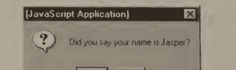

```javascript
confirm("Did you say your name is " + x + "?")
```

2. 你可以看到，`confirm("message")`在语法上与警告框和提示框类似。用户可以接受（确定）或拒绝（取消）确认弹出框。

> （`confirm()`对话框有时用于在允许用户提交其所有信用卡信息之前，在网上确认交易。）

3. 你需要知道，`alert`和`confirm`弹出框只能接受**一个**参数。因此，我们需要使用连接运算符（`+`）将上述消息的三个部分连接成一个字符串。

- `"Did you say your name is "`
- `x`
- `"?"`

如果我们使用了逗号，从而创建了多个参数，那么只有第一个参数会被显示，其余的参数将被忽略。如果你不相信我，可以试一试。

4. 注意变量没有被双引号括起来。它所包含的数据（本例中为`Jasper`）在输出时会被替换。确实，我们不能使用引号，否则字母`x`将被打印出来，因为它会变成一个带引号的字符串。

5. 我们现在可以开始了解 JavaScript 如何区分文本字符串和变量。文本必须写成带引号的字符串：`"I am a piece of text."`，而变量则不带引号。

6. 最后，注意`'is'`这个词后面有一个空格。如果没有空格，`'Jasper'`的`'J'`就会紧跟在`'is'`的`'s'`后面，变成：`"Did you say your name isJasper?"`使用连接运算符时，应在必要处包含空格。

## 4：函数

### 内置函数还是方法？

你可能想知道`write()`、`writeln()`、`alert()`、`confirm()`和`prompt()`是否是函数。它们确实看起来像函数。它们有一个名称和一个函数调用运算符`()`。你的判断是正确的。

它们都是*内置*函数的例子，属于某些对象，因此在面向对象语言中被正式称为*方法*。这些方法以及我们将来会遇到的许多其他方法，构成了 JavaScript 语言的一部分。请参阅本章末尾的摘要。`write()`和`writeln()`是`document`对象的方法；三个弹出框是`window`对象的方法。（有关`window`对象，请参见第 63 页。）

相比之下，由我们自己创建的称为*用户自定义函数*。在上面的示例中，`blue()`、`yellow()`、`green()`和`yourname()`是我们自己的用户自定义函数。

### 为什么要使用函数？

原因有很多。其一是，如果你想在一个网页的 5 个不同位置重复 10 行代码，与其输入 50 行代码，你只需输入这 10 行代码一次，然后使用五次函数调用即可。参见练习 21 第 140 页的`rounding()`函数。我们将在后面的文本中遇到其他原因。

### 术语

*声明（declaration）*：指的是函数花括号内的指令。它声明了当从网页中的其他位置调用（触发）函数时必须执行的操作。它有时被称为*定义（definition）*，因为它定义了函数将要执行的操作。它必须包含小写关键字`function`、函数*名称*以及*圆括号*。

`function`：函数是一种命名你希望随时执行的 JavaScript 代码段的方式。它包括关键字`function`、一个名称（目前）空的圆括号，以及要执行的代码：

```javascript
function somename(){ .. code .. }
```

`invoke`（调用）：一个编程术语，当我们想要执行一个函数时使用。必须使用函数名称和函数调用运算符：

```javascript
onClick = "myfunction()"
```

`variable`（变量）：赋予数据的名称，以便将其保存在计算机内存中，供需要时使用。它之所以被称为变量，是因为同一个名称可以在不同的场合包含不同的数据。例如，在练习 9c 中输入的名字是`'Jasper'`。然而，如果用户再次点击表单按钮，他或她完全可以输入一个新名字——Susan。变量`x`现在将存储名字 Susan。它的内容是可以变化的。

### 你学到了什么

1. 你学会了如何创建一个函数，使用花括号（大括号）来标记函数代码的开始和结束。

2. 函数名称后面必须始终有一对圆括号，即使括号内没有任何内容。我们将在下一章中看到这些括号中可以放入什么内容。

3. 我们已经了解了如何使用提示和确认弹出框。但不要一直使用它们。这可能会让读者感到相当恼火。

4. 更重要的是，我们已经看到输入到提示框中的数据可以被捕获并在后期阶段使用。这是通过将数据存储在变量中来实现的。

5. 我们区分了内置函数和用户自定义函数。

#### 变量命名规则

在为变量创建名称时，大小写是有意义的。名称的第一个字符必须是以下之一：

- 小写或大写字母
- 下划线（`_`）
- `$`

后续字符可以是任何字母或数字，或下划线或美元符号。第一个字符不能是数字。

| 有效 | 无效 |
|---|---|
| `i` | `123` |
| `my_var$name` | `!name` |
| `_myvariable` | `a name` |
| `$strg` | `this-var` |
| `X13` | `1X4` |

## 一个有趣的细节

注意确认框顶部出现的内容。其他两个弹出框也是如此。它显示的是：

```text
[JavaScript Application]
```

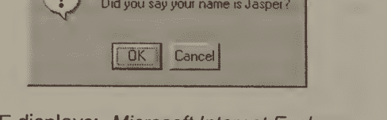

而 IE 显示的是：*Microsoft Internet Explorer*

这样做的原因是告知用户，弹出框是*由浏览器生成的*。

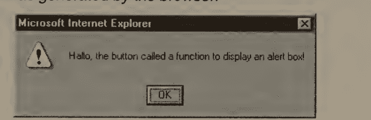

为什么？看看这个。

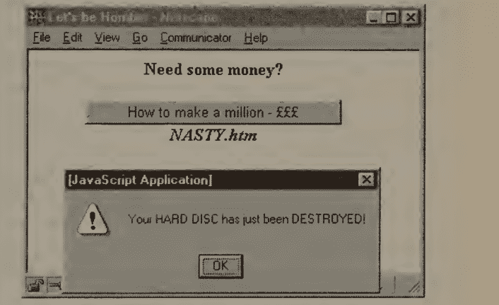

你可以编写一些 JavaScript 代码来生成一个包含上述可怕信息的警告框。有些人的幽默感很"有趣"。

如果不包含`[JavaScript Application]`或微软的等效标识，你很可能会开始感到很不舒服，以为这是一个操作系统消息。

（嗯！不过确实很诱人。）☺

## 测验：第 4 章

4.1 在练习 9c 的代码中，什么构成了`yourname()`函数的*声明*，什么构成了它的*调用*？

4.2 一对`<SCRIPT>`标签内可以放置多少个函数？

4.3 在以下内容中你能找到多少个语法错误？

`onclick "function abc{}'`

4.4 提示对话框可以接受两个参数。第二个参数的作用是什么？

4.5 以下代码会输出什么？

`sum = 1.5 + 2;`

`document.write("The sum is: " + "sum");`

4.6 什么时候你会想要使用*alert*、*confirm*和*prompt*弹窗？

4.7 你不能在`alert()`方法中使用多个参数。当你希望同时显示一些文本和变量内容时，必须使用什么技巧？

4.8 在以下代码中，浏览器会按照什么*顺序*在屏幕上显示网页？

```html
<HEAD> <TITLE> .. a title .. </TITLE>
<SCRIPT>
function yourname(){
    x = prompt("What is your name?");
    confirm("Did you say your name is " + x + "?");
} // EoFn
</SCRIPT>
</HEAD>

<BODY>
<H4> Here is a Prompt</H4>
```

```html
<FORM>
<INPUT TYPE="button" VALUE="Tell me your name."
onClick="yourname()">
</FORM>
<ADDRESS>PROMPT-Ex9c.htm </ADDRESS></BODY>
```

4.9 `write()`方法可以接受什么类型的参数？

---

**警告：**

很多人在编写 HTML 网页时使用记事本。我倾向于使用 Word 97，以便在需要时可以使用一些文字处理功能，例如给文本着色以便在查找错误时使用。然而，如果使用了`<FORM>`标签但没有`method`和`action`属性，Word 会冻结，导致我丢失所有工作。使用记事本时则没有问题。

因此，在我的许多示例中，你会看到以下内容：

`<FORM method="" action=""> .... </FORM>`

以避免 Word 崩溃。我不想让你在没有警告的情况下遇到这种情况。双引号之间不需要放任何内容。稍后当我们使用`NAME`属性时，Word 又会再次冻结，除非`NAME`属性紧跟在`method`和`action`之后：

`<FORM method="" action="" NAME="somename">`

## JavaScript 迄今为止小结

| 对象 | 方法 | 属性 |
|---|---|---|
| `document` | `write()` | `bgColor` |
|  | `writeln()` | `lastModified` |
|  | `close()` |  |
| `window` | `alert()` |  |
|  | `confirm()` |  |
|  | `prompt()` |  |

| 运算符 | 用途 | 示例 |
|---|---|---|
| `=` | 赋值 | `x = x + 1` |
| `+` | 算术加法 | `1+2 (= 3)` |
| `+` | 连接 | `"a"+"b" (= ab)` |
| `()` | 函数调用 | `function abc()` |
| `{ }` | 嵌入函数代码 |  |

| 事件处理器 |  |
|---|---|
| `onClick` | 用于表单按钮 |

| 对话框 | 用途 |
|---|---|
| `alert` | 通知用户 |
| `confirm` | 确认或取消 |
| `prompt` | 输入数据 |

# 5：函数中的参数

我们现在来研究函数中参数的使用。在上一章中，我们了解了函数有多么有用，但通过向它们*传递参数*可以进一步提高它们的实用性。那么，什么是参数？它几乎可以是任何你想要的数据类型。它可以是输入到提示框中的文本，也可以是确认框中点击的"确定"或"取消"按钮。它可以是两个数字，表示函数可以处理的一个数值范围。我们将在下面探讨这些以及更多的内容。

首先，我们需要通过一个简单的例子来介绍*参数*的概念，即求任意数的平方根。不是每个人都对平方根疯狂感兴趣，但这个简单的练习不仅会介绍参数的概念，还会展示 JavaScript 如何进行计算。后者很重要，因为你可能需要计算某些商品的总费用和税金（课程费用、贷款还款等），然后才能让买家在互联网上同意该金额。

在我们的平方根例子中，需要发生三件事。用户必须输入一个数字，我们将使用提示框；其次，我们需要找出输入了什么数字；最后，调用一个函数来计算平方根并显示结果。

**练习 10：** *使用参数的函数。*

我们的想法是编写一个函数，输出用户输入数字的平方根。我们将在练习 12 中了解如何将结果四舍五入到小数点后两位。

以下是代码。

```html
<HEAD>
<TITLE> Calculate the Square Root </TITLE>
<SCRIPT>
function squareroot(sqroot)
{  x = Math.sqrt(sqroot);
   document.write("The square root of "
                    + sqroot + " is: " + x);
}
</SCRIPT>
</HEAD>

<BODY>
<H4>Using Arguments</H4>
<SCRIPT LANGUAGE="Javascript">
   var sqroot = prompt("Enter a number. I will"
              + " give you its squareroot.", "");
   squareroot(sqroot);
</SCRIPT>

<ADDRESS>Arguments-Ex10.htm </ADDRESS>
</BODY>
```

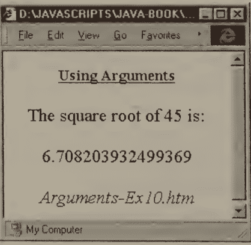

## 5：参数

**注释：**

1. 我们使用提示框让用户输入一个数字，并包含一个空字符串作为第二个参数，以去除提示框中的"Undefined"一词。

输入的值被赋值给变量`sqroot`，这是我自己编的一个名字。它前面有关键字`var`。这不是必须的，我们以前也没有这样做过，但这是一个好习惯，因为它强调了我们正在使用变量，并使代码更清晰。（我们在第 119 页讨论了另一个原因。）

2. 在下面一行，我们有第二个语句，它调用用户自定义的函数：`squareroot(sqroot)`。

但请注意，它包含了`sqroot`，即通过提示框分配给用户输入的变量。以前，我们的*函数调用*运算符是空的。当包含变量时，它们被称为*参数*。

参数是一种机制，通过它可以在别处获取并保存在变量中的数据传递给函数。我们需要给`squareroot()`函数提供用户输入到提示框中的值。我们通过将它作为参数传递给该函数来实现这一点。

3. 我们的函数将它传递给第二个函数——`Math.sqrt(sqroot)`——后者计算并返回平方根，然后赋值给变量`x`。

```javascript
x = Math.sqrt(sqroot);
```

使用`document.write`语句来写出原始数字（`sqroot`）和已赋值给变量`x`的计算平方根。

注意`write`方法中引用字符串的间距使用要仔细，而且变量名不能加引号，indeed 绝不可加引号。

## 5：参数

```javascript
function squareroot(sqroot)
{
  x = Math.sqrt(sqroot);
  document.write("The square root of "
  + sqroot + " is: " + x)
}
```

3. 但这个`Math`是什么？

`sqrt()`是几个特殊的内置数学函数之一，它们构成了 JavaScript 核心的一部分。它是`Math`对象的一个方法。如果没有引用`Math`对象，JavaScript 不会将`sqrt()`函数识别为它自己的函数。但因为我们指定了`Math`对象，JavaScript 现在知道我们指的是`Math`对象的`sqrt`方法。我们可以使用这个函数来计算平方根，而不必自己做所有繁琐的工作。

**小结：**

- 我们邀请用户输入一个值，我们使用 JavaScript 作为便携计算器来计算平方根。
- 这个值被赋值给变量`sqroot`。
- 它作为参数传递给我们的计算器函数：`squareroot(sqroot)`。
- 我们的函数将它传递给 JavaScript 的内置函数`sqrt(sqroot)`。
- 由于`sqrt()`是`Math`对象的方法，我们必须提及`Math`对象。

函数可以有任意数量的参数，同一个函数可以反复使用。因此，在我们的练习中，每次提示框出现时用户可以输入不同的值。每次调用函数时，参数将包含不同的值。

## 5：参数

### 对象、方法、属性

让我们暂时离题片刻，更详细地解释*对象*和*方法*的含义。差不多是时候了。

到目前为止，我们已经接触过几个*对象*。一个是`document`，现在又有了`Math`。我们其实一直在使用第三个对象，但可能没有真正意识到它的存在，那就是`window`。（注意`Math`的`M`是大写的，而另外两个都以小写字母开头。没错！这些细节都有助于确保我们不会输入错误的东西，然后花时间纳闷为什么代码不生效。）

严格来说，当我们使用那三个弹出框时，我们应该输入：

```javascript
window.alert("... some message ...")
window.prompt("... some message ...")
window.confirm("... some message ...")
```

这三个是`window`对象的内置函数（方法）。如果我们像之前那样省略`window.`部分，JavaScript 会自动帮我们补上。那如果我们省略`Math`对象，它为什么不能做同样的假设呢？如果省略了，JavaScript 会认为`sqrt()`是一个用户自定义的客户端函数，并开始寻找它。但通过将它与`Math`对象关联，JavaScript 就能知道它是其核心函数之一。

JavaScript 是一种基于对象的语言。这意味着我们的 JavaScript 代码通过*对象*来工作，而且其中许多对象都有与之关联的*方法*。当我们需要对一个对象"做某事"时，例如向当前文档写入内容，就必须使用该对象的相应方法：

```javascript
document.write(" .. something ..")
```

到目前为止，我们已经使用了`document`对象的两个方法：`write()`和`writeln()`。每个方法都对其对象执行某种操作。三个弹出框是属于`window`对象的方法。`sqrt()`是`Math`对象众多方法中的一个。其他方法可以在第 10 章中看到。

那么，为什么`Math`对象与其他两个不同，以大写字母开头呢？JavaScript 有两部分。一部分是基本的*核心语言*，它使 JavaScript 成为一门独立的语言，就像 Java、C、Fortran、Basic 等一样。另一部分是扩展，即*客户端*扩展，允许程序员与 Web 浏览器对象交互，这是其他语言无法做到的。


`Math`对象是JavaScript核心语言的一部分。核心语言中还有另外七个对象，其中一些我们稍后会遇到，比如`Date`和`String`——它们同样以大写字母开头。`Math`、`Date`和`String`在核心JavaScript中都定义为大写字母开头。

另一方面，`document`和`window`是允许程序员操作Web浏览器的附加对象。它们以小写字母定义，属于客户端JavaScript的一部分。

你还记得练习8中的`document.bgColor`吗？`bgColor`是`document`对象的一个属性。于是，我们有了这三个术语：

- 对象——我们操作的基本“东西”。
- 对象拥有方法（函数）。
- 对象还拥有属性。

¹ 事实上，JavaScript还有第三部分，即允许程序员与服务器交互的特性。这些被称为服务端JavaScript，与我们正在学习的客户端（浏览器）JavaScript相对。关于客户端和服务端的解释，请参见第4页。

下面这个类比可能有所帮助。一辆汽车是一个对象。它有一个颜色属性——比如栗色。它有使它可以前进或后退、加速或减速的方法。理解这三个术语很重要，因为它们无处不在。我也花了一些时间才开始理解它们。然而，你使用JavaScript越多，它们就越有意义。面向对象语言的编程，归根结底就是操作对象以及与这些对象相关的各种属性和方法。

现在说这么多就够了。更多细节请参见第16章。

## 练习11：在`<FORM>`中使用`NAME`属性

现在我们将要求用户输入一个算式，让JavaScript返回计算结果。（这将帮助我们理解第10章中一个更复杂的程序，该程序根据用户设定的利率计算贷款的月供。你可以用它来核实购车月供是否确实准确，确保自己没有被多收钱。）以下是代码：

```html
<HEAD> <TITLE> ... </TITLE>
<SCRIPT>
function cal(){
    document.formcal.answer.value = 
        eval(document.formcal.calculator.value);
} // EoFn
</SCRIPT>
</HEAD>

<BODY>
<FONT SIZE=2>
If you enter a calculation, you will be given 
the answer when you click the
<I><B> Calculate </B></I> button.
</FONT>
```

```html
<FORM method="" action="" NAME="formcal">
<INPUT TYPE="text" SIZE="12" NAME="calculator">
<INPUT TYPE="button" VALUE="Calculate"
       onClick="cal()">
<INPUT TYPE="reset" VALUE="Reset">
<BR>
Answer:&nbsp;&nbsp;
<INPUT TYPE="text" SIZE="12" NAME="answer">
</FORM>
<ADDRESS>NAME-Ex11.htm </ADDRESS> </BODY>
```

### 说明

在下一章中，我们将学习如何将结果四舍五入到两位小数。首先，我们需要讨论基础知识。

1. 用户被邀请输入一个算式，然后点击`Calculate`（计算）按钮。注意这个按钮有一个`NAME`属性，我们很快就会看到它的作用。`cal()`函数执行计算并将结果显示在`answer`文本框中，参见上图。但这是如何实现的呢？以下代码完成了所有工作，是面向对象语言工作方式的完美示例。

```javascript
document.formcal.answer.value =
    eval(document.formcal.calculator.value);
```

我们需要非常仔细地研究上面这行代码。它看起来很像一个简单的赋值语句：`x = y`，事实上，它确实就是如此。

### `eval()`

在赋值运算符的右侧有一个特殊函数`eval()`，它是JavaScript核心语言的一部分。那么，为什么它不像`Math`和`Date`那样以大写字母开头呢？它确实不是，也不允许以大写字母开头。这就是规则！（你是赢不了的。一致性不是JavaScript的强项。）

它在这里的作用是将参数从文本字符串转换为数学格式——一个计算式。我们的用户不得不在文本框中输入算式：“742/43”。

因为`<INPUT>`标签没有`TYPE=number`的选项，我们不得不使用：

```html
<INPUT TYPE="text" SIZE="12" NAME="calculator">
```

文本是不能进行计算的，所以我们需要一个函数来解析输入的文本，将其转换为算术表达式并求值。如果用户输入的是文字而非合法的算术表达式，那么`eval()`函数将无法转换和求值。但它确实能识别数字和运算符。

现在，这是重要的一点。以下JavaScript代码看起来像一个赋值语句：`x = y`。

```javascript
document.formcal.answer.value =
    eval(document.formcal.calculator.value);
```

它确实就是赋值语句。赋值运算符右侧的内容被赋给左侧的内容。所以，我们现在需要研究右侧的内容。

```javascript
= eval(document.formcal.calculator.value)
```

`eval`函数的参数最好从右往左阅读，如下：

计算：当前`document`对象的`formcal`属性（一个`Form`对象）的`calculator`属性的`value`值。

`Form`表单`formcal`中有四个框：两个是文本框，一个是可点击的按钮，还有一个是重置按钮。每个都有各自的值。因此，我们必须告诉`eval`函数我们指的是四个中的哪一个。这就是`NAME`属性的用途。我们想引用名为`calculator`的文本框的值。

```html
<INPUT TYPE="text" SIZE="12" NAME="calculator">
```

通过给各个`INPUT`元素命名，我们就能引用其中的任何一个。由于我们不需要引用输入按钮和重置按钮，所以没有给它们命名。

这些元素包含在`FORM`标签中。但名为`calculator`的元素在哪个`Form`中呢？我知道我们只有一个`FORM`标签，但文档中可能有多个表单，或者以后可能需要添加其他表单。不过，即使只有一个`FORM`，我们仍然需要为它命名，以便引用它。因此，我们给它一个名字：

```html
<FORM NAME="formcal">
```

最后，因为`FORM`是某个对象的属性，我们需要指定它的对象，也就是当前的`document`。

## 5：参数

希望这开始变得有意义了，因为这就是面向对象语言编程的全部内容。我们要评估的是包含在表单`formcal`中的特定`INPUT`元素`calculator`的值，而`formcal`是当前文档对象的一个属性。

> （我希望以下内容不会引起混淆，但由于属性属于对象，只有对象才能拥有属性，因此在上面的代码中，`formcal`必须成为一个独立的对象，以便它能够拥有自己的属性，即`calculator`。）
>
> 同样地，`calculator`也成为一个具有`value`属性的对象。这实际上只是一个技术上的要求。属性不能包含属性，因此原始属性必须成为一个对象，以便它可以承载属性。换句话说，某些属性也可以成为独立的对象。）

现在我们应该能够轻松地读懂赋值运算符的左侧了。

```javascript
document.formcal.answer.value =
    eval(document.formcal.calculator.value);
```

非常简单，我们正在将`eval()`函数的计算结果赋值给以下对象的`value`：

“`answer`（一个命名的文本框）是`formcal`（一个表单元素）的属性，而`formcal`又是当前`document`的属性。”

```html
<FORM NAME="formcal">
<INPUT TYPE="text" SIZE="12" NAME="calculator">
<INPUT TYPE="button" VALUE="Calculate"
        onClick="cal()">
<INPUT TYPE="reset" VALUE="Reset">
<BR>
Answer:&nbsp;&nbsp;
<INPUT TYPE="text" SIZE="12" NAME="answer">
</FORM>
```

我觉得我们需要休息一下了！在下一章中，我们将了解如何将答案四舍五入到两位小数。

### 术语

**参数（arguments）**：传递给函数的值，以便函数可以对其进行处理（执行某些操作）。

**方法（method）**：面向对象语言中用于表示函数的术语。大多数对象除了属性之外，还有与之关联的方法。

**对象（object）**：在面向对象语言中，程序员使用基本对象进行工作。这些对象通过使用其方法和属性进行操控。例如，可以通过向`bgColor`属性赋予颜色值来更改`document`对象的背景颜色：

```javascript
document.bgColor = 'lightblue'
```

**属性（property）**：大多数对象拥有属性，这些属性可以以某种方式改变其对象。

**变量（variable）**：编程术语，指计算机在内存中存储数据的位置。数据通过使用变量的名称来检索。变量可以作为参数传递给函数。

### 你学到了什么

本章涵盖了大量内容，我们已经了解了面向对象编程的全貌。这值得仔细研究，可能需要多次回顾。当你对本章的内容感到得心应手时，你将在使用JavaScript对象编程的道路上迈出重要的一步。

1. 如何将变量作为参数传递给函数。
2. 如何使用`Math`对象的`sqrt`方法。
3. `Math`对象是核心JavaScript的一部分，而`window`和`document`等对象是客户端JavaScript的一部分，它们允许程序员与Web浏览器进行交互。
4. 对象与其方法和属性之间的区别。
5. 为什么我们需要为表单和`INPUT`按钮及文本框设置`NAME`。
6. 如何使用`eval()`函数。
7. 如何为文本框赋值。

### 测试：第5章

- 5.1 如何获取用户在提示框中输入的内容？
- 5.2 为什么参数很有用？
- 5.3 `sqrt()`方法属于哪个对象？
- 5.4 `Math`对象是核心JavaScript还是客户端JavaScript的一部分？
- 5.5 给出一个为`INPUT`元素设置`name`属性的理由。
- 5.6 如果你只有一个表单并且希望通过JavaScript代码引用它，它是否仍然需要设置`name`属性？
- 5.7 为什么调用的函数必须包含函数调用运算符`()`，而不仅仅是函数名？

> **JavaScript是一门真正的编程语言吗？**
>
> 是的！但它的行为与许多其他语言不同。
>
> JavaScript不像某些编程语言那样严格，以至于有些程序员不认为JavaScript是一门正规的语言。例如：
>
> - 有时一个对象可以被“假定”存在，但并非在所有场合都是如此。比较`alert()`和`Math.sqrt()`。这里不需要提到`window`对象。
> - 变量在使用前不必声明。
> - 同一个变量可以存储不同类型的数据。
> - 调用函数（调用）可以传递与声明中不同数量的参数。
>
> 后两个“特性”让传统程序员感到恐惧。

## 6：JavaScript中的算术

在本章中，我们将特别针对JavaScript讨论编程的一些基本算术特性。

### 练习12：四舍五入到两位小数

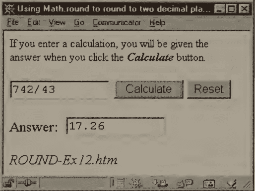

以下是代码：

```html
<HEAD> <TITLE> ... </TITLE>
<SCRIPT>
function rounding(x)
{ document.example.answer.value =
                              Math.round(x*100)/100;
}   // EoFN
</SCRIPT>
</HEAD>
```

```html
<BODY>
<FONT SIZE=2>If you enter a calculation, you
will be given the answer when you click the
<I><B>Calculate</B></I> button. </FONT>
<FORM NAME="example">
<INPUT TYPE="text" SIZE="12" NAME="calculator">
<INPUT TYPE="button" VALUE="Calculate"
        onClick="cal()">
<INPUT TYPE="reset" VALUE="Reset">
<BR>
Answer:&nbsp;&nbsp;
<INPUT TYPE="text" SIZE="12" NAME="answer">
</FORM>
<SCRIPT>
// A BAD PLACE to put this code. See Note 4.
function cal()
{
  data=eval(document.example.calculator.value);
  rounding(data);
} //EoFn
</SCRIPT>
<ADDRESS>ROUND-Ex12.htm </ADDRESS> </BODY>
```

### 注意事项

1. 函数`cal()`与第5章练习11中的用法相比略有变化。

```javascript
data = eval(document.example.calculator.value);
rounding(data);
```

现在我们将用户输入（输入到文本元素`calculator`中的内容）赋值给变量`data`，而不是将其赋值给另一个文本框的值。在下一行中，我们调用另一个函数`rounding(data)`并将存储在`data`中的输入作为参数传递。

```javascript
function rounding(x){
  document.example.answer.value =
           Math.round(x*100)/100;} // EoFn
```

但是等一下，为什么`rounding()`函数在声明中的参数现在命名为`x`而不是`data`？在我们之前所有的示例中，我们都使用了与调用中相同的名称。

#### 虚拟参数

我们可以在这里使用`data`代替`x`，但经验丰富的程序员通常会将声明中的参数使用不同的名称。这有时被称为虚拟参数。虽然这可能看起来很奇怪，但其背后的推理是非常实际的。在`rounding`函数执行期间，虚拟参数将取调用语句传递给它的参数的值。换句话说，`x`将变成`data`。

为什么这如此重要？通常，同一个函数可能从多个地方被调用，每次使用不同的数据变量进行处理。（参见第10章练习21。）

```javascript
<SCRIPT>
function workhorse(x){
  y = x*10;
  return y; } //EoFn workhorse
... code ...
... workhorse(data1)
... workhorse(data2)
... workhorse(data3)
... code ...
</SCRIPT>
```

每次调用`workhorse(argument)`时，声明中的虚拟参数`x`都会被调用参数替换——`data1`、`data2`、`data3`。换句话说，你不需要三个独立的函数声明，每个都有其参数`data1`、`data2`、`data3`。

（第143页和第180页讨论了`return`语句。）

这些虚拟参数在其他方面也被证明是有用的：

- 你可能会发现别人的函数，比如我的`rounding()`函数，并希望将其用在你自己的某个网页中。
- 或者，你可能希望将自己函数中的一个复制粘贴到你正在创建的另一个网页中，而不必重新输入。

在你将函数复制粘贴到自己的网页中之后，你只需要创建一个函数调用并传递你想要的参数，使用你自己的名称。你不需要更改原始函数声明中的参数名称。

2. 让我们看看练习12中`rounding`函数的主要代码。

```javascript
document.example.answer.value =
    Math.round(x*100)/100;
```

随着我们对面向对象编程理解的不断加深，我们可以看到我们正在使用`Math`对象的`round`方法。此方法将其参数四舍五入到最接近的整数，因此2.54变成3，-2.54变成-2。然而，这并不理想，因为我们希望在两位小数存在时将其四舍五入到两位小数。我们可以通过将`x`乘以100，进行四舍五入，然后将结果除以100来实现。

此结果随后被赋值给名为`answer`的`INPUT`对象的`value`，该对象是名为`example`的表单（现在是一个对象！）的属性，而该表单又是`document`对象的属性。这开始变得有意义了吗？

3. 看看练习12中的以下行。

```javascript
// A BAD PLACE to put this code. See Note 4.
```

## 6：算术

两个正斜杠在`<SCRIPT>`标签内的任何位置都被视为注释符号。其后跟随的任何内容，直到该行结束，都会被JavaScript忽略。通过这种方式，程序员可以为代码添加注释。但如果你需要多行注释怎么办？这时你就需要使用`/* 注释 */`：

```javascript
/* 注释的第一行
   以及另一行注释
   还有第三行注释。 */
```


## 4. 但为什么这不是放置代码的好地方呢？

请记住，浏览器从上到下读取网页。如果浏览器已经显示了文本按钮，然后还要去下载一张大图片，一个过于热情的读者可能会在页面完全加载之前就开始输入数值并点击`Calculate`按钮。由于`cal()`函数被放在了页面末尾，浏览器可能还没来得及加载该函数，因此在点击`Calculate`按钮时会不知所措。整个过程都会失败。（另见第 18 章，错误 16。）

所以结论是，要让你的所有函数都放在`<BODY>`**之前**。这样，你就可以确保在用户开始点击通过 BODY 标签显示的任何按钮之前，所有函数都已被浏览器加载。即将取代 HTML 的新 XHTML 要求我们所有函数都放在`<HEAD>`标签内。

### 算术与计算机

对于下面的问题，你会给出什么答案：`3+2*4 = ?`

计算机一次只能处理两个值，无论你为电脑支付多少钱都是如此。计算机一直都是这样设计的。在上面的例子中，计算机被给予了三个数字。它一开始只能选择两个。它选择哪两个是基于*算术规则*的，该规则规定`+`和`-`的优先级低于`*`或`/`。因此，计算机会查看数字*之间*的内容，并选择`2 * 4`，因为它的优先级高于`3+2`。

它会算出`2*4 = 8`。计算机记得原始语句中还有更多的数字，所以接下来会将`3`加到`8`上，得到`11`。

如果你使用袖珍计算器并输入上述公式，你会得到`20`作为答案。原因是，首先输入的两个数字是`3+2`，当你按下乘号时，计算器的计算机会在继续执行你的下一个按键操作*之前*先计算这两个数字（得到`5`）。因此，`5*4`就变成了`20`。

在编程中，为了强制计算机按其他顺序计算数字，你可以将计算的任何部分用括号括起来（常称为*圆括号*）。括号中的任何表达式总是优先于其他内容计算。这就是*算术*的规则。

因此：`(3+2) *4 = 20`。`4* (3+2)`也会等于`20`。

你需要掌控数字的计算顺序。毕竟，这是你的公式，如果你希望答案是`20`，为什么不呢？

| 优先级 | 算术运算符 |
|---|---|
| 1 - 最高 | `( )` 圆括号 |
| 2 | `^` 指数 `3⁴` |
| 3 | `* /` |
| 4 - 最低 | `+ -` |

### eval() 方法

1. 在上一章中，我们说过 *eval* 方法会尝试理解其参数中遇到的任何数字和算术符号，并将它们“转换”为算术表达式。**eval平面设计eval()** 函数实际评估的是 JavaScript 语句：

   `data=eval(document.example.calculator.value);`

   上面的参数是一个 JavaScript 语句，下面的也是：`eval(x + "+ 100")`

   ```javascript
   <SCRIPT>
   x = 22;
   y = eval(x + "+ 100");
   alert("answer is: " + y);
   </SCRIPT>
   ```

2. 如果`eval()`是一个方法，像`round()`一样，那么它属于哪个对象？`eval`方法属于**所有**对象，这就是为什么它是一个*特殊*的方法，不同于大多数其他只属于某个特定对象的方法。因此，`writeln()`*只能*属于`document`对象，`alert()`只属于`window`对象。

   它是核心 JavaScript 的一个*全局*方法，用于评估包含 JavaScript 代码的字符串。如果字符串是算术表达式，它会评估该表达式并返回其值。如果字符串是 JavaScript 语句（或多个语句），`eval()`将执行该语句（或多个语句）并返回值（如果有）。

   `round`只与`Math`对象相关联，这就是为什么必须包含`Math`：`x = Math.round(data)`

嗯！所以这就是为什么需要很长时间才能真正熟悉 JavaScript，或任何语言。每种语言都有自己的怪癖，而且似乎几乎每个转角都会改变规则。所有初学者都不得不经历这个学习曲线。你不是唯一遭受这种困扰的人。

## 6：算术

**练习 13：** *远程学习*

这里有一个简单的*远程学习*示例。我们将要求用户输入所示的计算。当用户点击`Calculate`按钮时，会给出答案。我们希望用户先手动计算，然后用计算机的答案来检查他/她的结果。

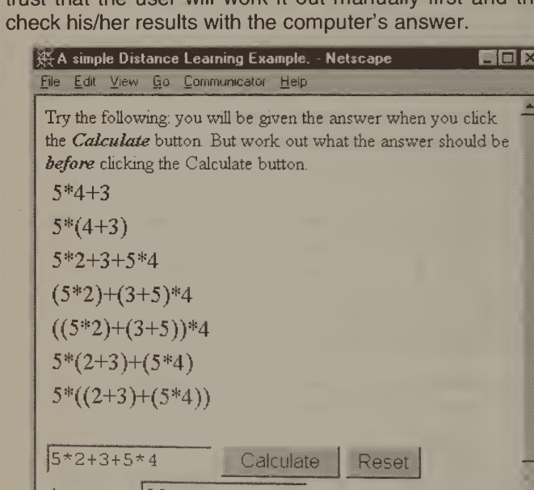

我们还可以确保用户在显示计算机结果之前输入答案。我们甚至可以最后打印出分数。然而，我们需要先了解 JavaScript 的一些编程特性（第 9 章和第 15 章），才能编写这些功能。

以下是代码：

```html
<HEAD> <TITLE> ... </TITLE>
<SCRIPT>
function calculate(){
document.example.answer.value=
  eval(document.example.calculator.value);
}   // EoFn
</SCRIPT>
</HEAD>
<BODY>
<FONT SIZE=2> Try the following: you will be
given the answer when you click the
<I><B>Calculate</B></I> button. But work out
what the answer should be <I> <B> before </B>
</I> clicking the Calculate button. </FONT>
<TABLE>
<TR> <TD> 5*4+3
<TR> <TD> 5*(4+3)
<TR> <TD> 5*2+3+5*4
<TR> <TD> (5*2)+(3+5)*4
<TR> <TD> ((5*2)+(3+5))*4
<TR> <TD> 5*(2+3)+(5*4)
<TR> <TD> 5*((2+3)+(5*4))
</TABLE>
<FORM method="" action="" NAME="example">
<INPUT TYPE="text" SIZE="12" NAME="calculator">
<INPUT TYPE="button" VALUE="Calculate"
       onClick="calculate()">
<INPUT TYPE="reset" VALUE="Reset">
<BR>
Answer:&nbsp;&nbsp;
<INPUT TYPE="text" SIZE="12"
       NAME="answer">
</FORM>
<ADDRESS>Arith-Ex13.htm </ADDRESS>
</BODY>
```

**注意：**

如果你一直在跟随前面的脚本，这段代码应该很容易理解。

用户被要求输入其中一个计算。当点击`Calculate`按钮时，事件处理器调用`calculate()`函数。该函数评估用户的输入并将其赋值给名为`answer`的文本框的值。

如果用户输入计算时出错，比如缺少括号，Netscape 会在地址框中输入`javascript:`时指出错误（不要忘记冒号）。另一方面，Internet Explorer 会显示一个含义不太明确的错误信息。

### 术语

*distance learning*（远程学习）：在此上下文中，它指的是向不在教室中但通过互联网访问以学习的用户呈现教学材料。JavaScript 可以用于与这类用户交互。

*dummy arguments*（虚拟参数）：在函数中使用但在函数被调用之前没有标识的参数。该调用将有一个实际参数，该参数被传递给函数并替代虚拟参数使用。

*parentheses*（圆括号）：围绕你希望优先于其他部分计算的计算部分的括号。

### 你已学到

1. 资深程序员倾向于使用*虚拟参数*。他们可以从其他程序中复制和粘贴函数，而无需修改原始函数代码。
2. 将所有函数放在 HTML 页面的`<BODY>`部分是明智的。这样，你可以确保在用户开始点击可能有关联事件处理器的按钮之前，它们已经被加载。
3. 计算机被设计为一次只计算两个数字。当呈现两个以上数字时，计算机遵循算术规则来决定先计算哪两个数字。
4. 在输入计算之前，程序员需要预先确定数字的计算顺序。
5. 在程序中输入计算与在袖珍计算器中输入数字不同。在使用计算机程序进行算术运算时，必须作出心理上的调整。

### 接下来是什么：

在下一节中，我们将在用户点击按钮时更改现有网页上的图像。然后我们将了解一些 JavaScript 编程特性，因为在了解一些基本特性之前，我们真的做不了什么。我们将学习如何使用`IF-ELSE`语句根据用户输入的内容做出选择。

### 测试：第 6 章

**6.1** 什么是虚拟参数，它有什么用？

**6.2** 对于以下计算：`5 + 4 * 2 + 3`

a) *计算机*会给出什么结果？

b) *袖珍计算器*会给出什么结果？

**6.3** 程序员为什么要使用*注释*？

**6.4** 如何创建*单行*注释？

**6.5** 在 JavaScript 中如何创建*多行*注释？

## 6：算术运算

**6.6** 你能从下面的脚本中找到多少处错误？

```javascript
function dothis(sqroot)
    x = Maths,sqrt(squroot);
    document.write("The square root of: "
                        + squroot + " is: " + x)
}
```

> 为什么我们要使用下面的符号，而不是更常见的算术符号？

| 算术运算符 |
|---|
| `( )` 括号 |
| `^` 幂运算 `3^4` |
| `* /` |
| `+ -` |

回到过去，在 20 世纪 40 年代，计算机刚刚被设计出来的时候，所使用的字符集非常有限。

| 字符集 | 内容 |
|---|---|
| 26 个字母 | 仅限大写！ |
| 10 个数字 | `0 - 9` |
| 13 个特殊符号 | `+ - * / ' ( ) , = $ . :` 空格 |

最接近“看起来像”乘法的符号是星号。正斜杠被用于除法，如`1/2`。

`circumflex`符号（`^`），现在被许多编程语言用来表示幂运算（求幂），算是后来者。Fortran 编程语言至今仍使用两个星号表示幂运算。

# 第七章：在图像中使用 JavaScript

**练习 14：** *更换图像*

这是一个简单的示例，演示如何在用户点击按钮时将一张图像更换为另一张。它将在练习 15 中得到扩展，使得当用户将鼠标移到图像上时，图像会更换为另一张，而当用户将鼠标移出替换后的图像时，又会重新显示原始图像。使用鼠标的好处在于，用户无需点击另一个按钮就能返回到原始图像。以下是实现简单按钮点击更换图像的代码。

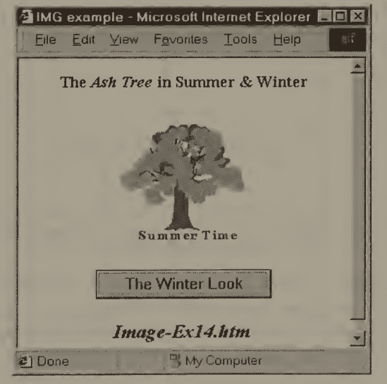

## 7：图像

```html
<HEAD>
<TITLE>IMG example</TITLE>
<SCRIPT LANGUAGE = Javascript>
function ChangeImage(){
  document.img1.src = "images/winter-tree.gif";
  document.form1.tree.value
                     = "Can't wait for Summer.";
} // EoFn
</SCRIPT>
</HEAD>
<BODY>
<CENTER><FONT SIZE=-1>
<B>The<I> Ash Tree </I>in Summer &amp; Winter
</FONT>
<P>
<FORM  method=" " action=" " NAME="form1">
<FONT SIZE=-2>
<INPUT TYPE=button NAME="tree"
        VALUE="The Winter Look"
        onClick = "ChangeImage() ">
</FONT>
<BR>
</FORM>
<ADDRESS>Image-Ex14.htm</ADDRESS>
</CENTER>
</BODY>
```

### 注释：

1. 两张图像都在 PhotoShop 中调整了大小，并保存在名为`images`的子文件夹中。页面加载时显示的是`summer-tree.gif`。

   ``

2. 虽然此页面上有一个表单，但它被赋予了 NAME，以便在`ChangeImage()`函数中可以作为`document`对象的属性来引用。

## 7：图像

```html
<FORM method="" action="" NAME="form1">
<INPUT TYPE=button VALUE="The Winter Look" 
       onClick = "ChangeImage()">
</FORM>
```

同样，``标签也有名字，这样它也可以被识别为`document`对象的属性。它有自己的属性`src`。

```javascript
function ChangeImage(){
  document.img1.src = "images/winter-tree.gif";
  document.form1.tree.value
               = " Can't wait for Summer.";
}  // EoFn
```

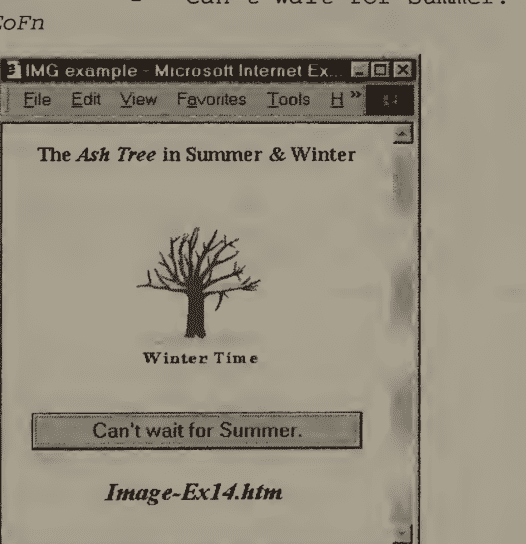

3. 当用户点击按钮时，`ChangeImage()`函数被调用，图像被新图像替换。

```javascript
document.img1.src = "images/winter-tree.gif"
```

## 7：图像

> “名为`img1`的图像标签的`src`（它是当前文档的属性）被赋值为`winter-tree.gif`，该文件位于名为`images`的子文件夹中。”

这展示了如何在用户点击按钮时更换图像，也是人们使用 JavaScript 的一个示例。它使得网页可以发生变化，不再像书中的页面那样是静态的。

还要注意`tree`按钮的`value`也发生了变化——从"The Winter Look"变为"Can't wait for Summer."。这就是*动态* HTML 的含义。通过 JavaScript，页面可以被改变。

4. 两张图像应该是*相同*的大小，否则在 Netscape 中会出现变形。新图像的大小将被强制压缩到与原始图像相同的空间中。（参见练习 15。）然而，Internet Explorer 允许新图像保持其自身大小。这再次说明了需要使用*两种*主流浏览器测试你的 JavaScript 代码，以查看两者之间是否存在任何差异特性。

### 练习 15：图像之间的切换

在这个练习中，我们将看到如何将一张图像更换为另一张，以及如何返回到原始图像。这是通过另外两个事件处理程序——`onMouseOver`和`onMouseOut`来实现的。然而，这两个事件不能用于表单按钮。它们必须用于`<A>`标签。

JavaScript 将该标签称为*link*（链接），而不是它在 HTML 中所称的*anchor*（锚点）标签。原因在于，这两个事件处理程序也可以与`<AREA>`标签一起使用，用于创建图像映射的*热点*。AREA 标签也是指向其他某个引用的链接。因此，JavaScript 使用*link*一词来同时涵盖`<A>`和`<AREA>`标签。

## 7：图像

“See My Photograph”实际上是一张图像。

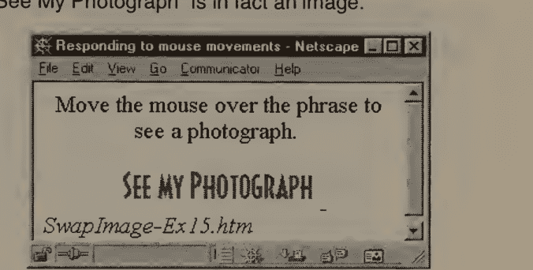

```html
<HEAD> <TITLE> ..</TITLE>
<SCRIPT LANGUAGE= "JavaScript">
  function ImgOver() {
    document.img1.src = 'images/mari.gif';
  } //EoFn
  function ImgOut()  {
    document.img1.src = 'images/photo1.gif';
  } //EoFn
</SCRIPT>
</HEAD>
<BODY> <CENTER>
<FORM method="" action="" NAME = "form1">
<B>Move the mouse over the phrase to
    see a photograph.</B><BR>
<A NAME="stayout"> </A> <!-- See page 96 -->
<A HREF="#stayout" onMouseOver = "ImgOver()"
                  onMouseOut  = "ImgOut()" >

</A></CENTER>
<ADDRESS>SwapImage-Ex15.htm</ADDRESS> </BODY>
```

当鼠标移到图像上时，显示如下。注意它在 Netscape 中如何变形（第二张图），但在 Internet Explorer 版本中不会。

## 7：图像

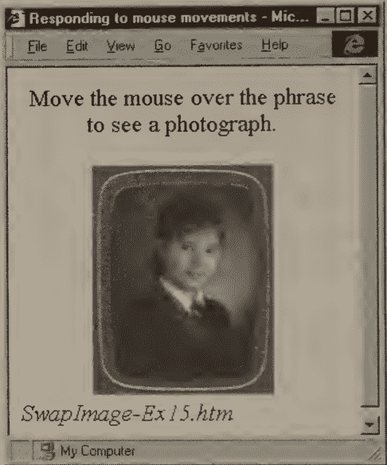

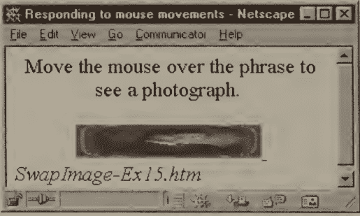

当用户将鼠标移出图片时，它会返回到原始状态。你可能会想到许多这种情况可以应用到你自己的网页中的场景。

### 练习 16：鼠标悬停和移出时改变颜色


`onMouseOver/Out`事件处理程序对于列表（目录、索引等）特别有用。在下面的网页中，列表中的每一项都是一张包含一个蓝色小方块和一些文字的图像，保存为透明 GIF 文件。创建了第二套图像，但使用红色方块和相同的文字。（如果你使用过任何图像处理软件，你会知道创建全部六张图像只需几分钟——三个蓝色和三个红色。）

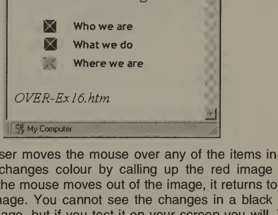

当用户将鼠标移到列表中的任何一项上时，它会通过调用红色图像文件来改变颜色。当鼠标移出图像时，它会返回到蓝色图像。在黑白页面上你看不到这些变化，但如果你在屏幕上测试就会看到。`Where we are`的颜色与其他两个不同。

```html
<HEAD> <TITLE> ... </TITLE>
<SCRIPT LANGUAGE= "JavaScript">
function ImgOver1() {
    document.img1.src="images/who2.gif"; } // EoFn
```

## 7：图像

```html
function ImgOut1()  {
   document.img1.src="images/who1.gif"
} // EoFn

function ImgOver2() {
   document.img2.src = "images/what2.gif"
} // EoFn

function ImgOut2()  {
   document.img2.src = "images/what1.gif"
} // EoFn

function ImgOver3() {
   document.img3.src = "images/where2.gif"
} // EoFn

function ImgOut3()  {
   document.img3.src = "images/where1.gif"
} // EoFn

</SCRIPT>
</HEAD>

<BODY>
<CENTER>
<H3>A Home Page</H3>
<a name="stayput1"> </a>. <!-- see page 96-->
<A HREF="#stayput1"
               onMouseOver = "ImgOver1()"
               onMouseOut  = "ImgOut1()">

</A>
<BR> <!-- HREF has an empty value. See page 96. -->
<A HREF="" onMouseOver = "ImgOver2()"
               onMouseOut  = "ImgOut2()">

</A>
<BR> <a name="stayput3"> </a>
<A HREF="#stayput3"
               onMouseOver = "ImgOver3()"
               onMouseOut  = "ImgOut3()">

```

## 7：图片

```html
</A>
<BR>
</CENTER>
<ADDRESS>OVER-Ex16.htm</ADDRESS>
</BODY>
```

**注意：**

1. 请注意，我们为这三个图片设置了`NAME`，以便相关函数可以引用每一个图片。

2. 由于使用了`onMouseOver`和`onMouseOut`事件，我们需要使用`<A>`标签。

3. 虽然看起来需要大量输入，但大部分内容可以通过快速复制粘贴，然后修改少数几个词来完成。

4. `有关以下内容的讨论，请参见第96页：`

<a name="stayput1"> </a>

## 术语

*动态 HTML*：HTML版本4的特性，允许更改网页内容。在本文中，我们使用JavaScript来更改页面内容。这与包含传统HTML、内容无法更改的静态网页形成对比。

*链接*：JavaScript将`<A>`标签和`<AREA>`标签都称为链接，因为两者都可用于加载其他网页文档。这两个标签都可以使用`onMouseOver/Out`处理程序。

*透明 GIF*：GIF图片（*图形交换格式*）是网页浏览器可以识别和显示的两种主要图片格式之一。（例如，浏览器无法显示`tiff`、`psd`、`pcx`格式的图片。）许多图片处理软件包允许将一种格式的图片保存为GIF或JPEG文件。JPEG是另一种主要的浏览器图片格式（*联合图像专家组*）。

GIF图片可以设置为透明，这样背景就会透过任何不规则的边框显示出来，而不是被框在一个矩形框架里。

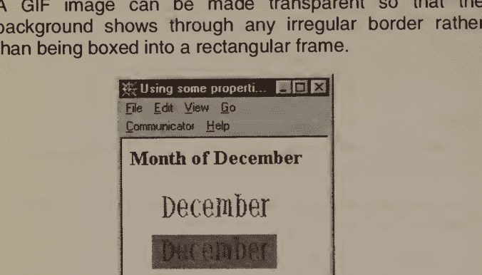

### 你学到了什么

1. 如何使用`onMouseOver`和`onMouseOut`事件。这些事件与`<A>`标签一起使用，而不是与常见的INPUT元素（如按钮）一起使用。

2. 当鼠标移动到`<A>`标签内的超文本或图片上或移出时，就会捕获这两个事件。

3. 当将一张图片替换为另一张时，网景浏览器会强制第二张图片进入与第一张相同尺寸的边框框架中。因此，为避免失真，两张图片必须大小相同。IE浏览器更具包容性，它会调整页面其余部分的大小以适应新图片的大小。

4. 使用`onMouseOver`和`onMouseOut`事件可以避免要求用户点击按钮来实现某些预期效果。使用事件处理程序时，我们现在需要考虑我们是希望用户点击按钮还是将鼠标悬停在图片上。

5. 如果使用了`onMouseOut`事件，则通常需要相应的`onMouseOut`事件来考虑当用户将鼠标移出图片时应发生的情况。

## 测试：第7章

- 7.1 HTML的``标签可以是文档对象的属性吗？
- 7.2 在JavaScript中，如何将一张图片替换为另一张图片？
- 7.3 在网景浏览器中，如果替换图片的大小与被替换的图片不同，会发生什么？在Internet Explorer中会发生同样的情况吗？
- 7.4 `onMouseOver`事件处理程序可以与文本框INPUT元素一起使用吗？
- 7.5 `onMouseOver`和`onMouseOut`事件处理程序通常与哪些HTML标签关联？
- 7.6 `onMouseOut`事件处理程序将捕获哪个用户事件？

### 你应该知道的三件事

1. 我们使用了`onMouseOver/Out`来交换图片。为此，我们使用了`<A>`标签。我们不需要HREF属性，因此将其省略：

   ```html
   <A  onMouseOver = "ImgOver1()"
       onMouseOut   = "ImgOut1()">
   ```

   它在IE5中运行良好，但不幸的是，在网景浏览器中不行。图片不会被交换。因此，如果我们希望我们的页面能在两个主要浏览器中正常工作，就需要包含HREF属性。

   但我们要给HREF属性什么值呢？我们可以什么也不放：

   ```html
   <A HREF onMouseOver = "ImgOver1()" onMouseOut = "ImgOut1()">
   ```

   现在它在IE5和网景浏览器中都能工作。但还有一个小问题。如果读者决定点击图片，网景浏览器将显示存储网页的文件夹内容的目录列表。（IE5不会！）

   然而，如果给HREF属性一个空值：

   ```html
   <A HREF=" " ... etc ... >
   ```

   那么两个主要浏览器都会显示目录列表。

   为了确保在IE5和网景浏览器中，当读者无意中点击图片时不会发生任何事情，请使用HREF值移动到页面的另一部分。这是通过一个段落标记——井号`#`符号来完成的。

   ```html
   <a NAME="stayput1"> </a>
   <A HREF="#stayput1" onMouseOver = "ImgOver1()" onMouseOut = "ImgOut1()">
   ```

   这将强制浏览器在存在一个具有相同值（但不包括`#`符号）的NAME属性的`<A>`标签对应的点重新显示页面。如果将其放置在附近，页面实际上将保持在同一位置。当然，如果你确实希望在点击图片时显示一个新页面，那么你就应该放入相应的URL。

2. 我们可以包含一个`onClick`事件和一个HREF URL：

   ```html
   <A HREF="test.htm"
      onMouseOver = "ImgOver1()"
      onMouseOut  = "ImgOut1()"
      onClick = "alert('Tell me a story')" >
   
   </A>
   ```

   这里，当点击图片时，会弹出一个警告框。一旦用户关闭该框，浏览器将显示test.htm网页。

3. 最后，你注意到网景版本中第89页和第90页图片后的小线条了吗？这是网景中的练习16。将其与第91页没有小线条的Internet Explorer版本进行比较。由于文本是实际图片的一部分，因此线条跟随在文本之后。

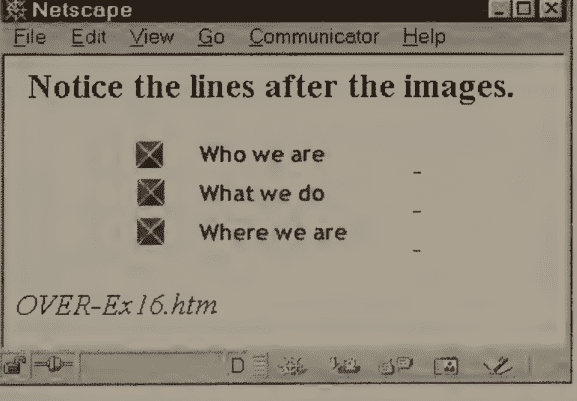

从网景浏览器中移除小线条很简单：

```html
</A>
```

你需要确保图片标签和结束锚点标签之间没有空格。

同样重要的是**不要将**结束锚点标签放在下一行，因为网景浏览器会将回车键视为空格，这将再次使线条出现。

```html

</A>
```

## 8：创建动态网页

如果事件处理程序可以用于显示一张图片替代另一张，那么为什么不让他们在例如点击按钮或将鼠标悬停在一个短语上时显示一个单独的窗口呢？这样的一种用途可以是用于内容列表或短语索引。当用户将鼠标悬停在一个短语上时，会弹出另一个窗口，提供更详细的解释。我们可以使用警告框，但它们往往会变得烦人，而且我们对文本格式的控制很少（见第40页）。

### 练习17：切换到新窗口

在这个练习中，我们将在点击按钮时打开一个新窗口，并将现有的网页加载到其中。要打开一个新窗口，只需使用以下命令：

```javascript
window.open("new_webpage.htm")
```

```html
<HEAD>
<TITLE> 打开第二个窗口。 </TITLE>
<SCRIPT LANGUAGE = JavaScript>
   function openWindow()
   {
     window.open("BGCOLOR-Ex5.htm")
   } // EoFn
</SCRIPT>
</HEAD>

<BODY><CENTER>
<H3>打开一个新窗口。</H3>
<FORM method="" action="">
<BR>
<INPUT TYPE = "button"
       VALUE = "点击打开一个新窗口"
       onClick = "openWindow()">
</FORM>
<ADDRESS>OpenWin-Ex17.htm</ADDRESS>
</CENTER>
</BODY>
```

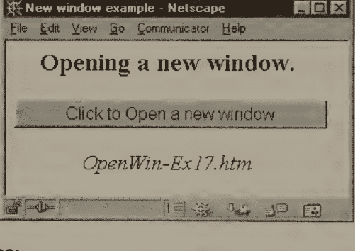

**注意：**

1. 当按钮被点击时，事件处理程序将打开一个新窗口并将相关的网页加载到其中。在我们的例子中，`openWindow()`函数将加载我们之前的一个网页，即提供背景颜色选择的那个。

2. 包含BGCOLOR-Ex5.htm的新窗口可以更改其自己的背景颜色，但不会更改打开它的窗口。

3. 为什么不直接使用`<A>`标签呢？：

   ```html
   <A HREF="BGCOLOR-Ex5.htm"> 点击我 </A>
   ```

   嗯，我们将在下一个练习中看到，与其必须额外通过互联网访问来获取网页，我们可以使用一个函数来写入HTML代码写入新窗口。这将加快整个过程，因为网页将由客户端自己的计算机“创建”，否则，我们会更简单地使用`<A>`标签。

## 练习18：即时创建新窗口

当点击按钮时，我们将创建一个新窗口并向其中写入HTML文档，包括它自己的背景颜色。代码如下：

```html
<HEAD>
<SCRIPT>
function multselections(){
var win = window.open("",null,
  "height=400,width=500,status=yes,resizable=1");
win.document.write("<BODY BGCOLOR='D5EAFF'>"
+ "<H4>How to Select Messages.</H4>"
+ "<P>To select <I>one </I> message, click it."
+ "<P>To select a group of <I>consecutive </I>"
+ "messages, click the first and whilst holding"
+ "down the Shift key, click the last one."
+ "<P>To select messages <I>out of sequence,"
+ "</I>"
+ " click the first and for subsequent messages"
+ " hold down the Control key and click."
+ "<P>"
+ " For the really smart ones, you can combine"
+ " Shift & Control to select groups of"
+ " consecutive messages which are out of"
+ " sequence.<P> <CENTER><FONT COLOR='FF0000'>"
+ "<I>Close this window once you have read the"
+ " content.</I> </FONT></CENTER>"
+ "<FORM> <INPUT TYPE=button VALUE='Close Me!' "
+ "onClick='self.close()'> </FORM>");
} // EoFn
</SCRIPT>
</HEAD>
```

```html
<BODY BGCOLOR="cccc99"> <CENTER>
uter is OCELA
<H3>Selecting Messages</H3>
You can select multiple messages (using
<I>Shift</I> and/or <I>Control</I>, click button
below for details) ... <I>continue with
paragraph</I> ...
<FORM method = "" action = "">
<INPUT TYPE = button
      VALUE = "Making multiple selections."
      onClick = "multselections()">
</FORM><ADDRESS>NEW-WIN-EX18 </ADDRESS>
</CENTER> </BODY>
```

一旦点击`Making multiple selections`按钮，如下所示，一个新窗口将出现。我们现在来检查产生这个新窗口的代码。

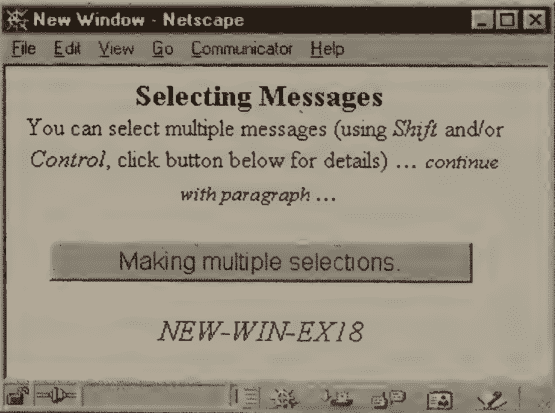

在详细检查其余代码之前，我们需要先查看`window.open`的参数。

#### `window.open()`

它包含四个参数，我们使用了三个。

```javascript
window.open(url, name, [features, [replace]])
```

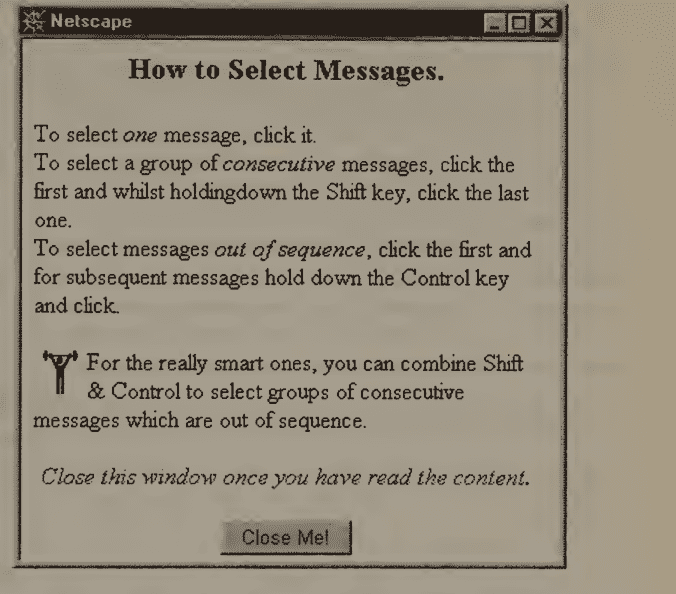

`url`：是一个字符串值，包含要由窗口对象获取并打开的文档的web地址。这是我们之前的示例中唯一使用的参数。它可以是完整或部分的web地址。

```javascript
window.open("BGCOLOR-Ex5.htm")
```

它会获取引用的网页。如果参数为空（`""`），新窗口将包含一个空白文档。

`name`：这个参数可以用作窗口名称，在`<FORM>`或`<A>`标签的`TARGET`属性中使用。（如果您使用框架，这可能会很有用。）如果不存在，请放入`null`或空参数——`""`。

`features`：指定您希望在新窗口中使用哪些浏览器功能。

（注意，`features`和`replace`参数都在方括号中，即`[features, [replace]]`。在许多参考文本中，方括号表示这些参数是*可选的*。`prompt(arg1, [arg2])`是另一个例子。）

| 功能 | 说明 |
| --- | --- |
| `toolbar` | 后退和前进按钮等 |
| `location` | URL地址栏 |
| `directories` | What's New、What's Cool等 |
| `status` | 浏览器的状态栏 |
| `menubar` | 窗口顶部的菜单 |
| `scrollbars` | 在需要时启用滚动条 |
| `resizable` | 允许调整窗口大小 |
| `width` - `height` | 窗口的尺寸（像素） |

（在使用`features`参数时，最重要的是用逗号分隔每个功能，并且**不要**在每个功能之间使用空格。如果确实包含空格，Netscape将无法按您的意图显示新窗口。）


当`features`字符串参数缺失时，新浏览器窗口具有所有标准功能。当它被指定时，窗口仅包含那些指定的功能。功能可以用`yes`或`no`或数字`1`（是）或`0`（否）来指定。

```javascript
window.open("", null, "height=400,width=500, status=yes,resizable=1");
```

`replace`：一个可选的布尔值（`true`或`false`），允许向浏览器的历史记录中添加新条目。对于新创建的窗口，使用此参数没有太多意义。它旨在更改现有窗口的内容时使用。我们将忽略此功能。（有关布尔值，参见第 9 章，第 117 页。）

现在让我们检查我们自己的代码。

### 练习 18 的注释

1. 首先，有：

```javascript
var win = window.open("",null,
  "height=400,width=500,status=yes,resizable=1");
win.document.write("<BODY BGCOLOR='D5EAFF'>"
  + "<H4>How to Select Messages.</H4>" ... etc ...
```

这段代码创建了`window`对象的`open`方法的一个实例，并将其赋值给变量`win`。换句话说，它创建了一个名为`win`的新窗口。我们必须将新窗口赋值给一个变量，因为我们需要使用`document.write()`方法来写入我们的 HTML 代码。但由于现在有两个窗口，原始窗口和这个新窗口，我们必须指定要写入哪个窗口。我们通过变量`win`来引用新窗口。

一个新的窗口对象被赋值给`win`。它的`url`为空，在这种情况下，将打开一个带有空白文档的新窗口。它注定不会成为框架或表单`target`属性的值，所以第二个参数设置为`null`。我们希望指定以下功能：

- 宽度和高度为 400 x 500 像素。
- 我们允许用户根据需要调整窗口大小。
- 最后，我们包含了状态栏。

所有其他未明确提及的功能将不会被包含。

2. 下一段代码是什么？

```javascript
win.document.write("<BODY BGCOLOR='D5EAFF'>"
  + "<H4>How to Select Messages.</H4>"
  + "<P>To select <I>one </I> message, click it."
  + "<P>To select a group of <I>consecutive </I>"
  + "messages, click the first and whilst holding"
  + "down the Shift key, click the last one."
```

```javascript
+ "<P>To select messages <I>out of sequence,"
+ "</I>"
+ " click the first and for subsequent messages"
+ " hold down the Control key and click."
+ "<P>"
+ " For the really smart ones, you can combine"
+ " Shift & Control to select groups of"
+ " consecutive messages which are out of"
+ " sequence.<P> <CENTER><FONT COLOR='FF0000'>"
+ "<I>Close this window once you have read the"
+ " content.</I> </FONT></CENTER>"
+ "<FORM> <INPUT TYPE=button VALUE='Close Me!' "
+ "onClick='self.close()'> </FORM>" );
} // EoFn
```

它是`win`文档对象的`write()`方法，包含我们希望显示的所有 HTML 代码。（记住`win`是我们赋值给新窗口的变量名称。）

这有什么妙处呢？嗯，以前需要用户点击`<A HREF="url">`超文本，从而迫使浏览器使用互联网来检索副本，而我们的页面将由客户端的浏览器即时创建。

3. 提醒您读者在返回原始页面之前关闭这个新窗口是很重要的。如果不关闭，它将保持打开状态并可能导致问题。因此，我们添加了一个按钮，用户可以点击它来关闭新窗口。代码如下：

```javascript
+ "<FORM> <INPUT TYPE=button VALUE='Close Me!' "
+ "onClick='self.close()'> </FORM> </CENTER>"
```

请注意正确使用双引号和单引号！

`close()`是`window`对象的一个方法。它不接受任何参数。其目的是关闭一个窗口。`self`和`window`是“当前窗口”的同义词。所以，可以使用`self.close()`或`window.close()`。

由于`close()`也是`document`对象的方法，我们必须指定要关闭的是一个窗口。

## 练习 19：使用`onMouseOver`和`onMouseOut`

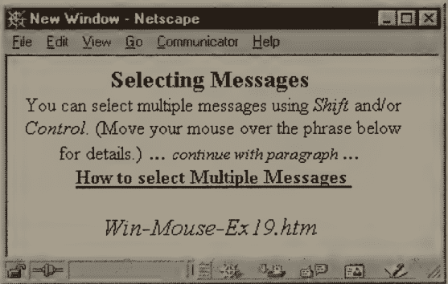

我们将重复前一个练习，但使用鼠标事件处理器。它们有时更有效。

```html
<SCRIPT>
function removewindow(){
  win.close() // make sure win is typed, not window
}  //EoFn

function multselections(){
 win = window.open("","","height=400,width=500,
status=yes,resizable=1");
 win.document.write("<BODY BGCOLOR='D5EAFF'>"
+ "<CENTER><H4>How to Select Messages.</H4>"
+ "</CENTER>"
+ "<FONT SIZE=-1><P>To select <I>one </I>"
+ "message, click it."
+ "<BR>To select a group of <I>consecutive </I>"
+ "messages, click the first and whilst holding"
+ "down the Shift key, click the last one."
...... as before .....
```

### 8：Dynamic Pages

```html
...... as before ......\n} //EoFn\n</SCRIPT>\n<BODY BGCOLOR="D5EAFF">\n<CENTER>\n<B>Selecting Messages</B>\n<BR>\nYou can select multiple messages using\n<I>Shift</I> and/or <I>Control</I>.\n(Move your mouse over the phrase below for\ndetails.)\n<I>continue with paragraph</I>\n<BR>\n<A HREF=""  onMouseOver="multselections()"\n              onMouseOut = "removewindow()">\n<B>How to select Multiple Messages </B>\n</A>\n<P>\n<ADDRESS>Win-Mouse-Ex19.htm </ADDRESS>\n</CENTER>\n</BODY>
```

**Notes:**

1. 由于`onMouseOver`和`onMouseOut`是`<A>`标签的事件，用户必须将鼠标移入和移出某些超文本单词，才能生成这些事件。当然，也可以使用图像。

2. 当用户将鼠标移到超文本单词上时，`onMouseOver`事件处理器将创建新窗口。当用户将鼠标移出该短语时，`onMouseOut`事件处理器将关闭窗口。因此，我们可以省略新窗口中的`Close Me`按钮，并用`removewindow()`函数替代它，该函数由`onMouseOut`处理器调用，用于在用户将鼠标移离超文本时关闭窗口。

3. 如果尝试上述代码，在 IE 中可能会遇到问题。新窗口可能会不断闪烁，具体取决于鼠标是否移出超文本。因此，我更倾向于完全省略`onMouseOut`，并在新窗口中加入一个`close me`按钮。

```html
<SCRIPT>
function multselections(){
win = window.open("",null,
"height=400,width=500,status=no,toolbar=1,resizable=1,location=1,scrollbars=yes");
win.document.write ( "<BODY BGCOLOR='D5EAFF'>"
+ " <CENTER><B>How to Select Messages."
+ "</B> </CENTER>"
+ "<FONT SIZE=-1><P>To select <I>one </I>"
+ " message, click it."
+ "<BR>To select a group of <I>consecutive"
+ "</I> messages, click the first and whilst"
+ "holding down the Shift key, click the last"
+ "one.<BR>To select messages <I>out of"
+ "sequence</I>, click the first and for"
+ "subsequent messages"
+ " hold down the Control key and click."
+ "<P>"
+ " For the really smart ones, you can combine"
+ " Shift & Control to select groups of"
+ " consecutive messages which are out of"
+ " sequence.<P> <CENTER><FONT COLOR='FF0000'>"
+ "<I>Close this window once you have read the"
+ " content.</I> </FONT> <FORM> "
+ "<INPUT TYPE=button VALUE='Close Me!' "
+ "onClick='self.close()'> </FORM> </CENTER>");
} // EoFn
</SCRIPT>
</HEAD>

<BODY BGCOLOR="D5EAFF">
<CENTER>
<B>Selecting Messages</B>
```

### 8：Dynamic Pages

```html
<BR>
<FONT SIZE=-1>You can select multiple messages using <I>Shift</I> and/or <I>Control</I>. (Move your mouse over the phrase below for details.)</FONT>
 ... <FONT SIZE=-2>
<I>continue with paragraph</I> </FONT> ...
<BR> <a name="stayput"> </a>
<A HREF="#stayput"
    onMouseOver="multselections()">
<FONT SIZE=-1><B>How to select Multiple Messages </B></FONT></A>
<P>
<ADDRESS>Win-Mouse-Ex19.htm - <I>Revised</I>
</ADDRESS>
</CENTER> </BODY>
```

4. 由于我们使用的是`<A>`标签，因此不再需要使用带有输入按钮的`FORM`标签。如果像我一样认为按钮看起来有些难看，可以创建一张供鼠标移入的图像：

```html
<BR> <A NAME="stayput"> </A>

<A HREF="#stayput"

    onMouseOver="multselections()">


</A>
```

5. 最后，级联样式表¹（CSS）允许作者移除超文本的下划线并设置超文本格式。第 297 页后面给出了一个样式表示例。

### 你学到的内容

1. 你可以创建新窗口（相对于弹出框——`confirm`、`alert`和`prompt`），并在其中使用任意文本和 HTML 标签。弹出框只允许输入纯文本，无法使用 HTML 对其进行格式化。

2. 通过创建自己的窗口，浏览器无需连接到互联网即可显示页面副本。这样可以节省时间！

如果仔细思考，你可能会发现，这类功能在许多远程学习环境中都很有用。如果有人不确定所使用的术语，与其将术语解释给所有已经了解它的人，浪费他们滚动页面的时间，不如邀请读者点击按钮或将鼠标移到术语上，以显示更多详细信息。

3. 使用`onMouseOver`时，通常需要包含一个配套的`onMouseOut`处理器，用于说明鼠标移出`<A>`标签内的短语或图像时应执行的操作。

4. 我们已经了解了使用`onClick`和`onMouse`处理器创建新窗口的相对优点。

5. `onMouse`处理器可以与文本或图像一起使用，前提是它们被包裹在`<A>`标签中。（IE5 确实允许在``标签内使用`onMouseOver`/`onMouseOut`事件，但 Netscape 4 不支持。）

6. 通过使用`window.close()`或`self.close()`，我们可以关闭已经打开的窗口。

### 接下来是什么

在前面的章节中，我们研究了可以使用 JavaScript 完成的一些事情，例如：

- 写出消息。
- 使用弹出框。


- create event handlers to execute functions
- pass relevant data as arguments to functions
- perform calculations
- replace images
- create our own windows

Now we need to extend our knowledge of the JavaScript programming language so that we can do more. In Chapter 9, then, we shall examine the programming features of JavaScript so that we can begin to do such things as:

- validate Form input
- create order forms and calculate customer invoices
- animate images
- work with dates and time
- create cookies

### Test: Chap. 8

**8.1** How many arguments does the `window.open()` method take?

**8.2** You want to use only the first and the third arguments of the `window.open()` method. Is it still necessary to include the second argument?

**8.3** In the following code, why is `null` not in quotes?

```javascript
var win = window.open("", null,
  "height=400 width=500 status=1 resizable=yes status=0");
```

**8.4** Why was it necessary to assign the new window object to the variable `win` in Exercise 18 & 19, but not in Exercise 17?

**8.5** What do you think would happen if you were to use `window` rather than `win` in the `removewindow` function for Exercise 19?

```javascript
function removewindow()
{
  window.close(); }  // EoFn
```

It has not been discussed fully in this Chapter, but see if you can work it out before looking at the answer. You will need to do this kind of investigative work when writing your own programs.

**8.6** Can we use `onMouseOver` and `onMouseOut` with an `` tag?

### Summary of JavaScript so far

| Object | Its Methods | Its Properties |
|---|---|---|
| window<br>client-side | `alert()`<br>`confirm()`<br>`prompt()`<br>`open()`<br>`close()` | |
| document<br>client-side | `write()`<br>`writeln()`<br>`close()` | `bgColor`<br>`lastModified`<br>and many HTML tags, e.g. forms, images, anchor |
| Maths<br>core | `sqrt()`<br>`round()` | |
| All objects | `eval()` | |

| Operators | Purpose | Example |
|---|---|---|
| `=` | assignment | `x = x + 1` |
| `+` | arithmetic addition | `1 + 2` |
| `+` | concatenate | `"a" + "b"` |
| `()` | function call | `function abc()` |
| `{}` | embed function code | |

| Event Handlers | | |
|---|---|---|
| `onClick` | used with FORM's text box & button | |
| `onMouseOver`<br>`onMouseOut` | used with `<A>` and `<AREA>` tags | |

| Keywords | Meaning |
|---|---|
| `null` | special value indicating 'no value' |
| `undefined` | special value indicating 'does not exist' |
| `var` | defines a variable name |

# NINE: Programming with JavaScript

In this chapter we shall begin to examine some of the programming features of JavaScript and to understand the jargon. Some more features are discussed in Chapter 15.

Our natural languages have different character sets: English has 26 letters; Italian has 20 characters similar to our own; Greek and Cyrillic languages have characters which look different to our own.

Likewise, each programming language has its own 'feel' and rules, although all have features which are similar. JavaScript is similar to C and Java, but is different to some other languages such as Fortran, Pascal or COBOL. However, all programming languages comprise the following basic features:

- creating, storing and moving data
- input and output of data
- making decisions
- repeating instructions

In practice, there is not a great deal to the basics of programming. The four features above summarise the whole of programming. They can all be learnt in a few hours. But what does take time and effort is practice and from practice we gain experience.

So what follows is not difficult - perhaps a new way of thinking for those who have not programmed before - but it will need time to put into practice.

## 9：编程

（这就是为什么许多招聘程序员的公司都要求应聘者至少有六到十二个月的经验。首先，如果你在六个月内没有被公司"辞退"，那说明你一定有编程潜力。其次，经过大约一年的实践，你将积累足够的经验，能够为新雇主创造价值。）

每种编程语言都有一套规则（即语法），用于识别和区分数字和文本等不同类型的内容。具体规则涵盖：

- 如何做出判断
- 如何重复执行一系列指令
- 如何创建变量名
- 乃至如何书写数字

例如，我们已经知道在使用变量名时大小写是有区别的，因此变量 `ABC` 与变量 `abc` 或 `aBc` 并不相同。同样，对象 `document` 是正确的，而 `DOCUMENT` 则不是。

在使用数字时，123 表示一个十进制数，而 0123 则表示一个八进制数，0x123 表示一个十六进制数。本文不会讨论八进制和十六进制数字，因为它们的使用场景比较专业。

## JavaScript 的编程特性

### 1. 数据

#### 1.1 数据类型

数据可以是数字、文本或布尔值（`true` 和 `false`——即"是"或"否"）。布尔值主要用于判断和重复执行的功能。

##### 数字

`123` 被称为整数，因为它没有小数部分；而 `123.45` 是一个实数（有时也称为浮点数），因为它有小数点及其后的数字。

还有八进制和十六进制数字，用于某些特定场合。八进制（基数 8）和十六进制（基数 16）需要用特殊的方式来表示，以便与十进制（普通）数字区分。

八进制：`0123` 由于前导零会被识别为八进制数。这意味着普通的十进制数前面不能加零。

十六进制：这些数字需要以 `0x`（零 x）开头，使用的数字是 0–9 A B C D E F。因此：`0xE = 十进制 14`。大小写不敏感，所以 `0XE` 与 `0xe` 是一样的。

##### 文本

在编程中，任何一段文本通常被称为字符串（一串字符）。它们用双引号或单引号括起来，有时被称为"带引号的字符串"。例如：

```text
"The cat sat on the mat" 是一个字符串。同样，"123" 也是一个文本字符串，因为它被引号括起来了。
```

##### 布尔值

在某些功能中，例如 `if.. else`，可能需要判断某事是真还是假（参见练习 20）。这些被称为布尔元素（以 George Boole 命名，他首次将其与布尔代数结合使用）。它们取 `true` 或 `false` 两个值之一。不允许使用引号，否则它将变成一个文本字符串。

```javascript
x = true;
result = false;
```

### 1.2 变量 - 存储数据

我们已经看过变量使用的示例。它们包含值：数字、文本或布尔值。但在 JavaScript 中，大小写是有区别的。

```javascript
var ABC = 12 与 var abc = 12 是不同的。
```

#### 变量命名规则

变量也称为标识符。在创建变量名时，必须遵守以下规则：

变量名**必须**以字母、`$` 或下划线（`_`）开头。后两者有时被程序员用来强调某个变量的特殊用途，否则大多数变量以字母开头。变量名中的后续字符可以是数字和其他字母，但绝不允许包含空格。

变量名不能与保留字相同，这些保留字对 JavaScript 有特殊意义，是语言语法的一部分。我们已经遇到过许多，如 `return`、`function`、`close`、`open`、`Math`、`document`、`window` 等。这些不能用作标识符。

#### 大小写

由于 JavaScript 区分大小写，`AbC`、`abc`、`ABC` 将被视为三个完全不同的标识符。以下是一些有效的示例：`Number1`、`number2`、`number_3`、`_number4`、`$number`。经验丰富的程序员通常会将所有变量名保持为小写，除非他们想要强调某个特定变量。

某些保留字有其特殊的大小写形式，如果不严格遵循，JavaScript 将无法识别。我们已经知道 `eval()` 和 `alert()` 与 `Math` 的大小写不同。`Date` 是另一个我们将在第 11 章中遇到的例子。

#### 驼峰命名法

JavaScript 和 HTML 允许使用驼峰命名法（interCapping）。即单词中间的某些字符使用大写。我们已经遇到过几个：`onClick`、`onMouseOut` 等等。由于这些是 HTML 标签的属性，它们的大小写并不重要。不过，通常按所示方式输入。另一方面，有些词必须正确使用驼峰命名法，例如当它们作为 JavaScript 语言的一部分时的 `bgColor` 和 `indexOf`。

在给变量赋值时，变量会自动创建：`abc = 12;`

这里 `abc` 被声明并通过赋值十进制值 12 而初始化。而：`var abc;` 是已声明但尚未初始化的——它的值将是未定义的。

```javascript
ABC = "Hallo there!"
```

变量 `ABC` 被创建并赋值为字符串 `"Hallo there!"`。

#### 变量的作用域

如果在变量名前加上关键字 `var` **并且**该变量在某个函数内使用，则它对该函数来说是局部的。换句话说，如果在另一个函数中使用了相同的变量名，它将不是同一个变量。但是，如果省略关键字 `var`，那么该变量将在同一网页内的其他函数中被识别。它将成为一个全局变量。

一般来说，如果在函数内使用一个变量，而你并不打算在网页的其他地方使用它，你应该将它设为该函数的局部变量。这样你就可以在同一页的其他函数中使用相同的名字（无论是有意还是无意），而不会产生命名冲突。

作用域是指一个变量是局部的还是全局的。当在函数内使用关键字 `var` 创建变量时，它就成为该函数的局部变量。如果省略 `var` 关键字，它就变成全局变量，将被同一页内的所有其他函数识别。请注意，在 `<SCRIPT>` 标签内但不在函数内创建的任何变量都具有全局作用域，无论是否使用 `var` 关键字。

如果你想测试 `var` 的用法，可以参考第 8 章练习 19。只需在 `multselections()` 函数中的 `win` 前加上保留字 `var`。

```javascript
function removewindow(){
  win.close() // make sure win is typed, not window
}  //EoFn

function multselections(){
  var win = window.open("","",
  "height=400,width=500,status=yes,resizable=1");
  win.document.write("<BODY BGCOLOR='D5EAFF'>"
  .... etc.
```

由于使用了 `var` 关键字，我们已将 `multselections()` 中的 `win` 设为局部变量。它将不再在 `removewindow()` 函数中被识别。你的浏览器会告诉你它是未定义的。

## 1.3 运算符：- 数据操作

运算符是具有特定含义的符号。例如 `1 + 2` 表示"将 1 和 2 相加"。`+` 号称为算术运算符。顺便一提，如果你写下如下表达式：`1 + 2;`，JavaScript 会计算结果（3），但由于没有赋值给变量，所以不会产生其他效果。

下表展示了处理数据时常用的许多运算符，包括将数据赋值给变量、将一个值与另一个值进行比较、将变量递增 1 等。

| 运算符 | 运算符类型 | 执行的操作 |
|---|---|---|
| `+ - * /` | 算术运算符 | 基本算术运算 |
| `+` | 字符串运算符 | 拼接（而非加法），用于 `write()` 和 `alert()` |
| `&& \|\| !` | 逻辑运算符 | 与、或、非 |
| `=` | 赋值运算符 | 赋值（而非等于） |
| **以下六个是比较运算符** | | |
| `==` | 相等 | 测试是否相等 |
| `!=` | 不等 | 测试是否不等 |
| `<` | 小于 | |
| `<=` | 小于或等于 | `num <= 99` |
| `>` | 大于 | |
| `>=` | 大于或等于 | |
| **特殊运算符** | | |
| `++` | 自增 | 加 1 |
| `--` | 自减 | 减 1 |

还有其他运算符，我们将在后续内容中遇到。

### 1.4 表达式

表达式包含 JavaScript 支持的数字、变量、文本字符串、运算符和逻辑值的任意组合。它们通常被赋值给变量，出现在赋值运算符的右侧。以下是一些示例：

| 赋值 | 右侧表达式 |
|---|---|
| `x =` | `3 + 4` |
| `x =` | `"one string" + "a second string"` |
| `number =` | `73.9` |

## 9: 编程

| 赋值 | 右侧表达式 |
|---|---|
| `x =` | `number + 23 / 56` |
| `test =` | `false` |

### 1.5 字面量

由于字面量（literal）这个术语看起来相当奇怪，这里提及它更多是为了完整性而非必需。它指的是程序中出现的任何数据值。例如：

| `12` | `12.34` |
|---|---|
| `'一段文本'` | `"另一段文本"` |
| `false` | `true` |
| `null` | `undefined` |

它们通常由运算符进行操作。因此，在下面的例子中，两个数字字面量相加，结果赋给一个变量：

```javascript
x = 23 + 45.7;
```

### 2. 数据的输入与输出

与所有编程语言一样，JavaScript 通常处理的是数据（严格来说是数据字面量）。在此之前，它需要获取一些数据。这可以通过多种方式完成。要么将数据赋值给变量：


```javascript
data1 = 23;
```

或者，让用户通过提示对话框或表单（FORM）文本框输入一些数据。这就是数据输入的含义。一旦我们有了数据，就可以进行处理，并通过`document.write()`方法或表单的`value`属性输出结果。这些都在前面的章节中详细讨论过。

```javascript
document.form1.address1.value
      = "Please enter your address.";
var x = 123;
document.writeln("Print out value: " + x);
```

JavaScript 还可以评估用户的操作（事件），例如：点击按钮、将鼠标移到图像或`<A>`标签及`<AREA>`热点上的超文本。从某种意义上说，我们可以将这些事件归类为“数据”，因为它们可以被捕获，并且我们的程序可以据此采取某些行动。

### 3. 做出决策

这是我们每天都会多次做的事情。在编程中，有时需要基于某些输入做出决策。输入可能来自提示框或函数生成的某些结果。

这是一个非常简单的例子，但它展示了此特性的所有语法。假设，我们需要弄清某人是否超过 18 岁。如果是，我们可以让他们进入我们的购物中心，否则我们必须拒绝他们进入。这是用于表单（FORMS）中验证用户输入的基本特性之一。

> **警告：** 为了使以下页面更易读，`if`和`else`有时被写成了大写。在 JavaScript 代码中，它们必须始终小写！

#### 练习 20：`if..else` 语句

```html
<BODY>
<B>if-else 练习</B>
<SCRIPT LANGUAGE="Javascript">
var x = 
    window.confirm("Are you over 18 years old?");
if (x == true) {
  document.write("Welcome to My Shopping Mall.");
}
else
  {document.write("Sorry, you are too young.");
  } // **EofIF-ELSE**
</SCRIPT>
<ADDRESS> if-else-Ex20.htm </ADDRESS></BODY>
```

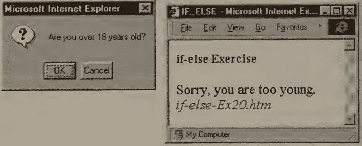

### 注释

1. 我们首先设置一个确认框，邀请用户诚实地告诉我们他/她是否超过 18 岁。如果点击了确定，JavaScript 将`true`赋给我的变量`x`。如果选择了取消，变量`x`被赋值为`false`。这提供了一个使用布尔值的例子。

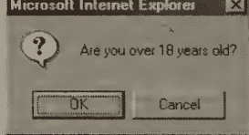

2. 下一步是测试两个值中的哪一个已存储在变量`x`中。正是`IF..ELSE`语句使这变得简单。（“语句”（statement）是用来指代这种编程特性的术语；“命令”（command）也可以用来代替“语句”。）

注意变量是如何放在圆括号中的：`(x == true)`，并且使用的是相等运算符——双等号。如果为真，我们希望欢迎此人进入我们的购物中心，否则我们必须拒绝他们进入。

这是该语句的一般语法：

```javascript
if ( 要评估的条件 )
    { 如果为 TRUE 则执行必要的操作 }
else
    { 如果为 FALSE 则执行必要的操作 }

... 当 IF 或 ELSE 代码块执行完毕后，从这里继续 ......
```

条件（在我们的例子中，“x 是否等于 true”）在 JavaScript 遇到`IF`语句时会自动进行测试。如果结果是`true`，将执行`IF`的开花括号之后的所有内容，直到遇到对应的闭花括号。然后它将继续执行`ELSE`的闭花括号之后的任何语句。换句话说，`ELSE`部分被忽略。

如果结果是`false`，`IF`代码块被忽略，将执行`ELSE`的开花括号之后的所有内容，直到遇到对应的闭花括号。然后它将继续执行后面的指令。

所有这些都是由 JavaScript 自动完成的，因为这种行为已经内置到`IF..ELSE`语句中。

3. 注意`IF`有一组花括号，`ELSE`有另一组花括号。它们有助于标记每个代码块的开始和结束。我们称`IF`和`ELSE`后面的语句为代码块（block）。在我们的例子中，我们只有一条指令，但可以有任意多条指令。虽然是可选的，但强烈建议每条指令都以分号结尾。

4. `IF .. ELSE`语句之后的指令将始终被执行，无论在该特性内部采取了什么操作。作为程序员，你必须意识到这一点，并确保它在任何一种情况下都是正确的做法。

5. 花括号的位置与函数中的相同。

**关于`IF .. ELSE`的进一步要点**

1. 你不需要有`ELSE`。因此，当`x`为`false`时不需要做任何事，以下代码是有效的。

```javascript
if ( x )
  { window.alert("Welcome to My Shopping Mall")
  }  // IF 代码块结束
... 下一条指令无论 x 为 true 还是 false ...
```

在上面的代码中，当警报框被取消或`x`为`false`时，下一条指令将被执行。在后一种情况下，警报框不会出现。

2. 为什么我们只写`(x)`而不是`(x == true)`？这看起来很奇怪，直到我们意识到`x`是一个布尔变量，它可以取`true`或`false`的值。当 JavaScript 测试这个变量时，结果是两种可能性之一。因此，我们只需要输入布尔变量名。较长的版本使代码更易读，但不是必需的。

3. 严格来说，`IF`和`ELSE`以及许多其他命令处理的是单个语句。因此，花括号并不是真正必需的。所以，这是有效的：

```javascript
if (x)
  alert("x is true")
else
  alert("x is false")
  ... 无论 x 为 true 还是 false，从这里继续 ...
```

没有花括号，但更难理解且容易出错。要看看编程错误有多容易犯，请看测试题 9.10。必看！

通常情况下，你确实想要执行多条指令，这时你必须使用复合语句。复合语句是用花括号括起来的一组指令。花括号内的指令实际上变成了“单个”语句。

```javascript
if (condition)
 { instruction 1;
   instruction 2;  instruction 3;
 }
else
 {instruction 1;instruction 2;
  instruction 3;
  instruction 4;
 }
... 从这里继续 ...
```

注意上面的花括号在阅读时多么有用。它们清楚地标记了代码块的开始和结束。作为风格问题，即使只有一条指令，我也会包含它们。你永远不知道什么时候会想添加一两条额外的指令，然后忘记使用花括号来表示复合语句。

注意每条指令都以分号结尾。当多条指令放在同一行时，你必须包含分号。但建议始终包含分号，即使每行只有一条指令。

4. 条件可以是任何求值为`true`或`false`的 JavaScript 表达式，甚至是函数。因此：

```javascript
if (xyz == 10)
  { document.write("The number is 10"); }
else
  { document.write("The number is not 10");}
```

## 9：编程

```javascript
// another example
if (username == "Fred")
  { document.write("Your name is Fred"); }
else
  { document.write("Your name is not Fred");}

// another example
if (userentry <= 69)
{ document.write("Your entry is less than 70");
}
else
{ document.write("Your entry is more than 69");
}
```

注意双等号（`==`）运算符的使用，表示等于，以及（`<=`）表示小于或等于。两个符号之间不能有空格。这些被称为比较运算符。参见第 121 页。

（初学者经常将赋值运算符（`=`）与相等运算符（`==`）混淆。但它们是不同的。在`IF`语句中，圆括号中的条件必须通过相等运算符来计算，以确定其为真（true）还是假（false）。根据结果，将执行`IF`代码块或`ELSE`代码块中的指令。在赋值语句中，单个等号是赋值运算符。如果误用赋值运算符代替相等运算符，赋值操作将会发生，如果结果大于零，则该“条件”被视为真；如果为零，则被视为假。参见测试题 9.13。）

5. `IF`语句测试的条件可以是一个函数。这使其成为一个非常强大的特性。关于`return`语句的讨论，参见第 180 页。

```javascript
if ( my_function() ) {
  // .. do this when function returns true ..  
}
```

**警告：** 为使这些页面更易读，`for`有时会被写成大写。但在你的 JavaScript 代码中，它必须始终以小写形式书写！

### 4. 重复

我们现在转向一个允许重复执行的特性。`FOR`循环会重复执行花括号内的一组指令，直到满足指定的条件为止。然后继续执行脚本的其余部分。

`FOR`循环由圆括号内的三个部分组成：

```javascript
for (initialise; condition; increment)
    { instructions to repeat ... } // EofFor
    ... next instruction once the above
        has stopped being repeated ...
```

为了重复执行一系列指令，你需要从某个值开始（初始化）；然后测试它，看看是否需要再次重复循环（条件）；最后，如果条件尚未满足，则增加该值（增量）。

这里有一个简单的例子。假设我们想要累加前十个数字并打印出结果。这并不太令人兴奋，但它确实说明了这个特性是如何工作的。这将涉及重复执行一些指令，并在满足某个条件时停止。代码如下：

```html
<SCRIPT>
sum = 0;
for ( i = 1; i <= 10; i=i+1)
    { sum = sum + i;  } // EofFor
document.write("numbers 1-10 = " + sum)
</SCRIPT>
```

当 JavaScript 首次遇到这个`FOR`循环时，`i`将被设置为 1——这是初始化步骤。（它不会再次重复这部分。）这通常是一个简单的赋值语句。注意初始化语句和条件语句后的分号。

然后它会测试条件——`i <= 10;`——是否已经满足。注意这部分是如何使用比较运算符的。第一次循环时，`i`小于等于 10，所以 JavaScript 将执行花括号之间的代码。（如果条件在第一次就不成立，`for`循环的指令将不会被执行。）

当`FOR`代码块执行完毕后，变量`i`将根据增量语句进行递增——这里`i`增加 1：（`i = i + 1`）`i`现在等于 2；（但也可以增加大于 1 的值，或者增加负值以实现降序！甚至可以是实数，例如 0.5）。

然后它返回到条件，以确定是否再次重复代码。值 2 不满足条件，因此它第二次重复执行循环中的指令。之后，`i`再次递增——现在等于 3，测试条件以查看`i`是否超过 10……如此继续。

最终，`i`将超过 10，此时代码将不再执行。JavaScript 将然后转到`FOR`循环之后的任何指令。关于`FOR`循环的另一个例子，参见第 14 章，第 224 页。

#### 递增运算符

C 编程语言的一个不寻常特性，也是 JavaScript 的一部分，是递增运算符的使用：`++x`和`x++`。C 是由程序员为程序员设计的。任何程序中最常见的算术语句是：`x needed_fixing = true; // This should be: x = x + 1`（注：原文此处似乎有误，应为`x = x + 1`）。那些设计了 C 语言的人为这条语句创建了一个快捷方式。因此：`x++`等价于`x = x + 1`。

递增运算符将其变量增加 1，且只能增加 1。这个运算符不会以任何其他值递增。它非常适合在`FOR`循环中递增循环变量。因此，我们经常看到以下代码：

```javascript
for (i = 1;  i > 10; i++)  // which is the same as:
for (i = 1;  i > 10; i=i+1)
```

关于这个特性的另一个奇怪之处是，你可以在每次循环执行之前（`++i`）给变量`i`加 1，或者在每次执行之后（`i++`）加 1。

`i++`被称为后缀运算符；1（且只有 1）在执行某些操作之后添加到变量`i`。

`++i`被称为前缀运算符；1 在做任何其他事情之前添加到`i`。有时一个比另一个更好。如果时机到来，你会本能地知道该使用哪个。

#### 递减运算符

它的工作方式与递增运算符完全相同，只是它从变量中减去 1。本书中没有相关示例，但如果它将来有用，请记住这个特性（`--k`和`k--`）。（一些程序员用它们从底部向上遍历数组。关于数组的使用，参见第 220 页。）

### 术语

- *block*（代码块）：指一组指令，例如由`for`循环重复的指令，或者当`if`条件为真时执行的指令。它们有时也被称为*clause*（子句）。（抱歉，但你可能会在其他文本中遇到这些术语，并想知道它们到底在说什么。）

- *compound statement*（复合语句）：许多特性执行单条语句。但当需要执行多条语句时，这个“单条”语句必须通过将所有语句括在花括号中来转换为复合语句。多条有效地变成了一条。

- *identifier*（标识符）：变量的另一个术语。

- *interCapping*（驼峰式大小写）：在单词中使用大写字母。

- *reserved words*（保留字）：在 JavaScript 中具有特殊含义的那些词。许多具有固定的大小写，如果不保留其大小写，JavaScript 将无法识别它们。例如：`if`、`else`、`for`、`alert()`（均为小写）；`Math`中的`M`为大写；`bgColor`（驼峰式大小写）。这样的词绝不应该用作变量名（标识符）。

- *scope*（作用域）：指变量被识别的地方。局部变量仅在其创建的函数内被识别。全局变量可以被同一网页中的任何其他函数识别。

### 你学到了什么

1. 我们看到所有编程语言都有四个基本特性：

   - 创建、存储和移动数据
   - 数据的输入和输出
   - 做出决策
   - 重复指令

   并了解了这些特性的 JavaScript 语法。

2. 数据有几种类型：数字、文本和布尔值。通常，数据被赋值给变量。

3. 创建变量名的规则以及变量的作用域。

4. 如何使用各种类型的运算符处理数据。

5. 如何让用户输入数据。

6. 如何做出决策以及如何重复指令。

7. 深受 C 程序员喜爱的特殊递增和递减运算符。一旦你开始使用它们，你也会爱上它们的！（我第一次遇到它们时，不相信自己会。）

8. 我们已经学习了 JavaScript 语言的核心特性。在此之前，我们讨论的大部分内容都属于客户端 JavaScript。

### 测试：第 9 章

#### 9.1

任何编程语言的四个基本特性是什么？

#### 9.2

什么是整数，什么是实数？

#### 9.3

如何捕获用户输入文本框或提示框中的内容，以便后续处理？

#### 9.4

举一个大小写不重要的例子，以及一个 Consent 代码中一个重要大小写的例子？

#### 9.5

以下代码中发生了什么？

```javascript
var x = 1;
```

#### 9.6

以下代码中发生了什么？

```javascript
if (x == 1) { ... }
```

#### 9.7

根据语法，`if`语句只能执行单条指令。如何让它执行多条指令？

#### 9.8

以下代码的作用是什么？

- a) `++i`
- b) `k--`

#### 9.9

对于以下代码，`document.write()`方法将输出什么？

## 9：编程

```html
<SCRIPT>
var aBc = 12
var abc
document.write("Variable abc is: " + abc
	+ "<BR>Variable aBc is: " + aBc)
</SCRIPT>
```

**9.10** 仔细观察以下代码，计算代码执行后会输出什么。

- (a) `i = j = 12;`是另一种简写，深受 C 程序员喜爱，现已成为 JavaScript 的一部分，它可以在一条语句中为多个变量赋值。

- (b)`IF`语句可以嵌套，如以下所示。

```javascript
i = j = 1;  // both i and j assigned value of 1
k = 2;
if (i == j) // i does equal 1 therefore true
  if (j==k)
    document.write("i equals j");
else
  document.write("i does not equal j");
                                        // Oops!
```

**9.11** 为什么变量名不能以数字开头？

**9.12** 以下每种情况会发生什么？

第一个是正确的。

a)

```html
<SCRIPT>
sum = 0;
for (i = 1; i <= 10; i++)
  { sum = sum + i; }
document.write("numbers 1-10 = " + sum);
</SCRIPT>
```

b)


```javascript
<SCRIPT>
sum = 0;
for (i = 2; i <= 10; i++)
  { sum = sum + i; }
document.write("numbers 1-10 = " + sum);
</SCRIPT>
```

c)

```javascript
<SCRIPT>
for ( i = 1; i <= 10; i++)
  { sum = sum + i; }
document.write("numbers 1-10 = " + sum);
</SCRIPT>
```

d)

```javascript
<SCRIPT>
var sum;
for ( i = 1; i <= 10; i++)
  { sum = sum + i; }
document.write("numbers 1-10 = " + sum);
</SCRIPT>
```

e)

```javascript
<SCRIPT>
var sum = 0;
for ( i = 1; i = 10; i++)
  { sum = sum + i; }
document.write("numbers 1-10 = " + sum);
</SCRIPT>
```

## 9.13 测试以下内容

```javascript
<script>
x = 5;
  if (x=6)  // assignment not equality used in error!
    { alert("do IF TRUE") }
  else
    { alert("do IF FALSE") }
document.write("X = " + x)
</script>
```

- a) 哪个警告框会显示，`x`打印出的值是多少？
- b) 然后将零赋给`x`而不是6，再次运行脚本。现在哪个警告框会显示，`x`的值是多少？

### 为什么使用计算机？

使用计算机的主要原因是它们能够快速做出决策并重复执行指令，且不会感到疲倦。

*决策*在程序读入的任何数据未知，且需要根据数据的值采取多种行动之一时是必要的。`if ... else`特性的决策能力是编程的基础。

*重复*也至关重要。给人类一个需要重复多次某些动作的任务，无聊和注意力丧失将压倒人类。错误就会发生。然而，计算机却会非常乐意地重复同样枯燥的任务成百上千次，甚至数百万次，而永远不会陷入我们人类的困境。

顺便说一句，正是这一特性促使数学家查尔斯·巴贝奇在1819年发明了“计算机”。他的计算机是机械的，与我们的电子版本不同。对数的计算使他意识到人工计算的不准确性。他在《*C Babbage, Passages from the life of a philosopher (London, 1864)*》中写道：

> “我当时坐在剑桥分析学会的房间里，头向前靠在桌子上，处于一种梦幻般的情绪中，面前摊开着一张对数表。另一位会员走进房间，看到我半睡半醒，大声说：‘嘿，巴贝奇，你在想什么？’我回答说：‘我在想所有这些表（指着对数表）都可以用机器计算出来。’”

关于巴贝奇的优秀文章，请尝试使用搜索引擎AskJeeves（http://www.askjeeves.com）并输入`"Who was Charles Babbage?"`。在提供的众多选择中，我选择了：“Where can I learn about the mathematician - Babbage.”。

## 10：计算器示例

到目前为止，我们所有的练习都相对简短，但很实用。在本章中，我们将看到一个大型JavaScript程序是什么样子的。这不是一个困难的练习，但值得仔细研究。它使用了许多我们已经介绍过的特性，以及一些我们尚未介绍的与`Math`对象相关的函数。这些将在后面的说明中解释。它还将解释如何使用JavaScript代码来计算贷款付款。你将能够为自己的网页想到更多用途。

### 练习21：计算贷款付款

我们邀请某人输入以下信息，并让JavaScript计算付款。参见第140页。

- 借多少钱
- 多少年
- 什么利率

（我们可以使用以下内容来查看我们“友好的、本地的”二手车经销商计算的汽车还款是否确实准确。）

```html
<HEAD><TITLE> Want a Loan?</TITLE>
<SCRIPT LANGUAGE="JavaScript">
function calculate(){
/* - get user's input from FORM
   - convert the annual rate to a monthly rate
   - convert interest from a % to a decimal
   - convert payment period from years to months
   - compute the monthly payments */
var principal =
    document.loan.principal.value;
var interest =
    document.loan.interest.value / 100 /12;
var payment =
    document.loan.years.value * 12;
var x = Math.pow(1 + interest,payment);
var months = (principal*x*interest)/(x-1);
/* Check that the result is a finite number.
   If so display the results */
if ( !isNaN(months)
     && (months != Number.POSITIVE_INFINITY)
     && (months != Number.NEGATIVE_INFINITY) )
{document.loan.payment.value =
    rounding(months);
 document.loan.total.value =
    rounding(months*payment);

 document.loan.totalinterest.value =
    rounding((months*payment) - principal);
}    // EofIF

// user's input invalid so display nothing.
else
{document.loan.payment.value="";
 document.loan.total.value="";
 document.loan.totalinterest.value="";
}    // EofElse
}  // EoFn Calculate

// round to 2 decimal places function
function rounding(x) {
    return Math.round(x*100)/100;
} // EoFn rounding
</SCRIPT></HEAD>

<BODY>
<FORM method="" action="" NAME="loan">
<TABLE>
<TR><TD COLSPAN=2><B>Loan Information:</B>
<TR><TD> Annual &#37; rate of interest:
<TD> <INPUT TYPE=text NAME=interest SIZE=12
              onChange="calculate()">
<TR><TD> Repayment period (in years)
<TD> <INPUT TYPE=text NAME=years SIZE=12
              onChange="calculate()">
<TR><TD>Amount of loan (any currency)
<TD> <INPUT TYPE=text NAME=principal SIZE=12
              onChange="calculate()">
<TR><TD COLSPAN=2 ALIGN=right>
     <INPUT TYPE=button VALUE="Calculate Loan"
            onClick="calculate()">
<TR>
<TD COLSPAN=2>
<B> Payment Information: </B>
<TR>
<TD> Your Monthly payment:
<TD> <INPUT TYPE=text NAME=payment SIZE=12>
<TR>
<TD>Your total payment:
<TD> <INPUT TYPE=text NAME=total SIZE=12>
<TR>
<TD> Your total interest payments:
<TD> <INPUT TYPE=text NAME=totalinterest
            SIZE=12>
</TABLE>
</FORM>
<ADDRESS>Loan-Ex21.htm</ADDRESS></BODY>
```

### 说明

1. 现在大部分代码应该都熟悉了，除了下面检查的一些`Math`方法。值得花些时间研究这个练习，因为它将汇集前几章讨论过的许多JavaScript特性。

`&#37;`是百分比符号`%`的HTML字符实体。

2. 在处理数学部分之前，请注意`Calculate()`中的`var x`是该函数局部的。函数`rounding()`也使用了一个变量`x`，但这不会与`Calculate()`中的虚参`x`的值混淆。

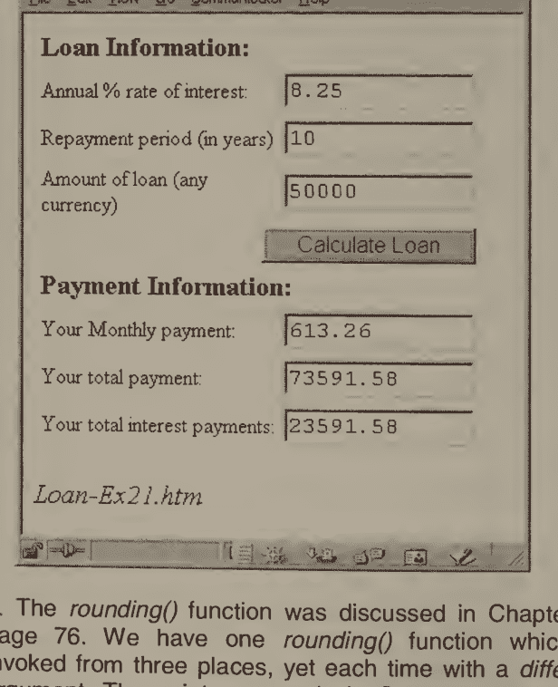

3. `rounding()`函数在第6章第76页讨论过。我们有一个`rounding()`函数，它从三个地方调用，但每次都使用不同的参数。第6章第75页指出，一个函数如何通过参数处理不同的数据。现在我们可以看到一个工作示例。

## 10：计算器

关于`rounding()`函数中使用的`return`语句的目的，将在下文以及第12章第180页进行更详细的讨论。

4. 我希望你认同，使用缩进（尤其是针对`if .. else`语句）能使代码更易于阅读。同时请注意函数前、函数后以及`if .. else`块末尾使用的注释。虽然需要多打些字，但这能节省数小时的调试时间。

5. 当三个输入文本框中的任何一个发生变化（并且用户已点击外部或进入另一个文本框）时，`Calculate()`函数会通过`onChange`事件再次被调用。换句话说，每次更改时，用户不必点击“计算贷款”按钮，尽管那样可能更直观。关于`onChange`事件如何工作的更多细节，请参见第169页。

### `Math.pow(x,y)`

`pow()`是`Math`对象的一个函数。它将`x`提升到`y`的幂次，即`x^y`。因此：

`j = Math.pow(7,2)`的结果是将`j`赋值为49（`7^2`）。

你需要咨询数学家来了解为何这有助于计算月还款额。但重点在于它在下面(a)中的使用。

我们需要确保用户不会输入诸如0%利率、0还款期、文本或某些极其巨大或微小的值。JavaScript有多种方法可以捕获此类错误。以下是一些例子。

- (a)`pow()`在用户无意中输入文本时返回`NaN`（非数字）。
- (b)`POSITIVE_INFINITY`（正无穷大）和`NEGATIVE_INFINITY`（负无穷大）是特殊的数值，当算术运算生成的值大于JavaScript能表示的最大数字时返回。它们都是`Number`对象的属性。（注意大小写。）这可以捕获用户输入的任何极大或极小的数字。
- (c)`isNaN()`是一个函数，用于判断其参数是否为“NaN”（非数字）。它是一个内置的JavaScript函数，是核心语言的一部分。它不是一个方法，也不与任何对象关联。

因此，为了检查以下两条语句生成的数字是否“合理”：

```javascript
var x = Math.pow(1 + interest, payment);
var months = (principal*x*interest)/(x-1);
```

代码包含了以下`if`语句：

```javascript
if ( !isNaN(months)
    && (months != Number.POSITIVE_INFINITY)
    && (months != Number.NEGATIVE_INFINITY) )
```

> “如果`months`（月还款额）*不是*（`!`）‘非数字’（因此它是一个*数字*）并且`months`（月还款额）*不等于*（`!=`）正*无穷大*并且`months`（月还款额）*不等于*负*无穷大*”

那么就显示计算结果。否则，将调用`else`子句，清空本该显示结果的文本框。

`Math`对象也是核心JavaScript的一部分。它包含函数和常量（例如，`PI`和`LN2`）。严格来说，像`pow()`和`round()`这样的函数被称为函数，而不是方法。它们是核心`Math`对象的函数。请注意常量如`Math.PI`、`Math.LN2`的大小写，它们分别表示π的值（3.141592653589793）和2的自然对数（0.6931471805599453）。

### `return`语句

我们在第6章遇到过`return`语句，但当时没有讨论。那时我们还没准备好。关于函数，我们需要知道的一点是，它们在结束时总是返回一个值。到目前为止，我们无需意识到这一点，但现在我们需要了。

我们的`rounding(x)`函数将其参数四舍五入到两位小数。这就是它返回的内容：通过`Math.round()`函数将`x`四舍五入到两位小数。它的调用方式如下：

```javascript
document.loan.payment.value =
                    rounding(months*payment);
```

三个文本框`payment`（月供）、`total`（总还款额）和`totalinterest`（总利息）的内容都被四舍五入。`rounding()`函数返回的单个值被赋给它们的值。在上面的例子中，这被赋值给了`payment`文本框的值。关于`return`语句的完整讨论，请参见第180页。

### 练习21总结

1. 用户被邀请在三个框中输入信息：

   - 年利率%
   - 还款年限
   - 贷款金额

然后点击“计算贷款”按钮。

在“还款信息”下，程序显示：

- 月供
- 总还款额
- 总利息

2. 当按钮被点击时，所有输入都被获取并计算。它们被存储在变量中：`principal`（本金）、`interest`（利息）和`payment`（月供）。

3. 如果任何一个框被更改，`onChange`事件将调用`calculate()`函数，所有值将重新计算并重新显示。

4. 注意`rounding()`函数被使用了三次，每次参数不同。哑参数在每次调用时会取这些不同的值。

```javascript
rounding(months)
rounding(months*payment)
rounding(months*payment)-principal
```

`months`被计算出来，并作为实参传递给`rounding`函数声明中的哑参数`x`——`rounding(x)`。（其他两个也是如此。）

```javascript
rounding(months)
rounding(months*payment)
rounding(months*payment)-principal
```

5. `rounding`函数调用`Math.round`函数，并将哑参数的值传递给它（当然，对于第一次调用，现在是`months`）。

6. 这个结果（四舍五入到整数）被返回到原始调用点。

7. 它被乘以100，然后将结果除以100。

## 十一：处理日期和时间

JavaScript有一个内置对象，允许我们操作日期和时间。然而，在我们能够使用`Date`对象之前，有必要让JavaScript激活它。为什么？

`Date`对象是编程语言（核心）的一部分，而不是客户端JavaScript的一部分。为了允许浏览器操作日期，有必要创建所谓的`Date`对象的新实例。虽然有点简单化，但这有点像为浏览器专门制作一个真实事物的“副本”。然后，浏览器可以使用客户端JavaScript，通过副本或正式称为实例的东西来操作日期和时间。幸运的是，这可以通过使用`new`运算符将日期分配给新的日期对象来轻松完成：

`var mydate = new Date()`

`Date()`是`Date`对象；`new`创建了它的一个“副本”，该副本已被分配给用户定义的对象`mydate`。现在这个新对象可以通过变量名`mydate`被浏览器以各种方式使用。表11.1显示了我们可以使用的一些`Date`对象的方法。

### 如何使用`Date`对象

假设我们想在网页中输出今天的日期。我们首先创建一个`Date`对象的新实例，并通过`new`运算符将其分配给一个新的`Date`对象。

`var today_date = new Date();`

你可以随意命名它。创建`Date`对象的实例后，该实例可以使用表11.1中显示的所有方法。

| 方法 | 返回 | 说明 |
| :--- | :--- | :--- |
| `getDay()` | 星期几 | 其值为数字：0（周日）- 6（周六） |
| `getDate()` | 月份中的日期 | 值在1 - 31之间 |
| `getMonth()` | 月份 | 0（一月）- 11（十二月） |
| `getYear()` | 年份 | 最后两位数字（参见注释） |
| `getHours()` | 小时 | 0（午夜）- 23（晚上11点） |
| `getMinutes()` | 分钟 | 0 - 59 |
| `getSeconds()` | 秒钟 | 0 - 59 |
| `getTime()` | 日期（以一种非常奇特的格式） | 自1970年1月1日以来的毫秒数 |

表11.1：`Date`对象的一些方法

以下是一些更重要的方法：


```javascript
var mytoday=today_date.getDate()
```

意思是：“获取月份中的数字日期”。这些值的范围是 1-31。

```javascript
var mymonth=today_date.getMonth()+1
```

意思是：“获取月份”。由于 JavaScript 从 `0` 而不是 `1` 开始计算月份（没有一致性吗？），我们必须在月份上加 `1`。

```javascript
var myyear=today_date.getYear()
```

意思是：“获取年份并将其放入变量 `myyear` 中。”

在将日期值存储在变量中后，可以使用 `document.write()` 或 `document.writeln()` 方法将其输出：

```javascript
document.write("Today's date (UK) is: ")
document.write( mytoday + "/"
```

# 11：日期与时间

```javascript
+ mymonth + "/"
+ myyear)
```

假设计算机的日期为 2003 年 9 月 29 日，则以上代码的输出为：

```text
Today's date (UK) is: 29/9/2003
```

第二天查看同一网页，显示的日期将变为：`Today's date is: 30/9/2003`。

20 世纪的年份被截断为最后两位数字：即：`29/9/99`。

### 练习 22：显示 `Date()` 的所有方法

下面是一段使用了 Date 对象众多方法的代码。

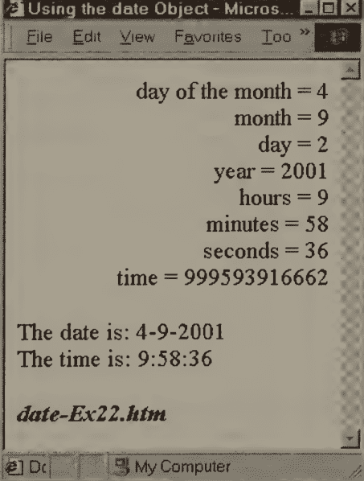

```html
<HEAD> <TITLE> Using the Date Object  </TITLE>
<SCRIPT>
// create an instance of Date()
var mydate    = new Date()
// now use this instance below
var monthday = mydate.getDate()
var month     = mydate.getMonth() + 1
var day       = mydate.getDay()
var year      = mydate.getYear()
var hours     = mydate.getHours()
var minutes   = mydate.getMinutes()
var seconds   = mydate.getSeconds()
var time      = mydate.getTime()
document.write("<DIV ALIGN='right'>"
                + "day of the month =   "
                + monthday     + "<BR>")
document.write("month =    " + month + "<BR>")
document.write("day =      " + day    + "<BR>")
document.write("year =     " + year   + "<BR>")
document.write("hours =    " + hours  + "<BR>")
document.write("minutes =  " + minutes
                + "<BR>")
document.write("seconds =  " + seconds
                + "<BR>")
document.write("time =     " + time
                + "</DIV> <P>")
document.write("The date is: " + monthday + "-"
                + month + "-"       + year )
document.write("<BR>" + "The time is: "
                + hours + ":" + minutes + ":" + seconds)
</SCRIPT>
</HEAD>
<BODY>
<P>
<ADDRESS><B>date-Ex22.htm</B> </ADDRESS> </BODY>
```

注意：

（Netscape 将年份显示为 101，关于如何解决这个“问题”，请参阅第 162 页和第 163 页。）

# 11：日期与时间

1. 由于我们不能直接使用 Date 对象，JavaScript 要求我们创建该对象的客户端实例。这通过 `new` 运算符来完成。通常，运算符是*符号*，例如自增（`++`）或逻辑与（`&&`）。但也有少数运算符实际上是关键字。（`this` 是另一个例子，我们将在后面的第 193 页和第 207 页介绍。）

   我们通过以下代码将实例命名为 `mydate`：`var mydate = new Date()`

2. 假设计算机的日期为 2000 年 10 月 7 日，星期六：

   *日期中的天数* = 7 - `getDate()` *（日期编号为 1 - 31）*

   *月份* = 9（0 - 11）- `getMonth()` *（9 = 十月，我们需要将此值加 1，使其在显示时变为 10）*

   `var month = mydate.getMonth() + 1`

   *星期几* = 6 - `getDay()` *（6 代表星期六，0 代表星期日，6 代表星期六。我们在示例中没有显示它）*

   *时、分、秒*：后两者的编号范围为 0 - 59，小时编号范围为 0 - 23，采用 24 小时制。*（在练习 23 中，我们将转换为 12 小时制。）*

   `getHours()`、`getMinutes()`、`getSeconds()`

   *time* 是自 1970 年 1 月 1 日以来的毫秒数。看起来有些奇怪，但它确实有效！*（我们将在后续的一些示例中使用它。）* - `getTime()`

3. 完整的日期和时间通过最后两行 `document.write()` 代码打印输出。

4. 我们将在练习 25 中了解如何打印实际的星期几，例如“星期一”，以及如何在第 18 章第 295 页创建连续时钟。

5. 注意 *document.write* 代码中的 `<DIV ALIGN='right'> ... </DIV>`，它使日期和时间右对齐，而其后的内容左对齐。

掌握了以上知识，并且之前已经学习了如何通过 JavaScript 输出 HTML 代码，你现在就可以在任何网页上显示当前的日期和时间。

你甚至可以根据是*中午之前*还是*中午之后*来显示不同的图片。

# 练习 23：根据上午还是下午选择图片

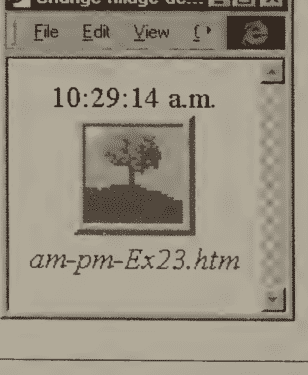

```html
<HEAD>
<TITLE>Choose an Image depending on whether it is a.m. or p.m.</TITLE>
<SCRIPT LANGUAGE="Javascript">
var current_date = new Date();
var hours        = current_date.getHours();
var minutes      = current_date.getMinutes();
var seconds      = current_date.getSeconds();
```

```javascript
var ampm            = "a.m."
if (hours>=12)
    { // {}s required for the compound statement
        ampm="p.m.";
        hours=hours-12;
    }
if (hours==0)
    hours=12;
if (minutes<=9)
    minutes="0"+ minutes;  /* we want to see 07
                                rather than just 7 */
if (seconds<=9)
    seconds="0"+ seconds;
document.write("<CENTER>" + hours + ":"
                + minutes + ":" + seconds
                + " " + ampm + "<BR>");
// choose image depending on whether AM or PM
if (hours<=12)
    document.write("");
else
    document.write("");
// notice correct use of double & single quotes
</SCRIPT>
</HEAD>

<BODY>
<ADDRESS>am-pm-Ex23.htm </ADDRESS>
</CENTER> </BODY>
```

### 注意：处理小时

1. 我们需要一个 12 小时制的时钟。当前小时存储在变量 `hours` 中，其数值范围为 0 - 23。如果小时数超过 12，我们只需从该值中减去 12 即可将其转换为 12 小时制。这通过以下代码实现：

   ```javascript
   var ampm = "a.m."
   if (hours>=12)   {
       hours=hours-12;
       ampm="p.m."; }
   ```

# 11：日期与时间

由于 IF 语句应该只接受一条语句，而我们有多条语句，因此需要将这些语句放在花括号中，使其成为*复合*语句。我们还借此机会将变量 `ampm` 设置为文本字符串 `'p.m.'`，因为我们希望在下午时将此内容添加到时间中。

2. 如果 `hours` 的值在 0 - 12 之间，则是中午之前，在 IF 语句中测试条件时不会执行上述代码。事实上我们什么都不做。但是，我们希望将文本字符串 `'a.m.'` 添加到时间中。注意在测试小时数之前将变量 `ampm` 设置为 `'a.m.'` 的巧妙技巧。这确保了 `ampm` 将包含 `'a.m.'`。*只有当我们发现*小时数等于或超过 12 时，它才会被设置为 `'p.m.'`。

3. 但如果时间是 12 点呢？按照这段代码的写法，小时将变为零。因此，我们在注释 1 中的代码*之后*单独测试 `hours`。如果它等于 0，我们就将其设置为 12。

   ```javascript
   if (hours==0)
       hours=12;
   ```

> （因为这是一条单独的语句，我们没有使用花括号，尽管这样做是良好的编程习惯。在我自己的脚本中，我通常会加上花括号，但这里省略了以说明这一要点。）

还要注意，因为前面的代码已经检测到 `hours` 等于 12，所以 `ampm` 已经被设置为 `'p.m.'`。

### 处理分钟与秒

4. 当分钟和秒在 0-9 的范围内时（00、01 .. 09），我们希望添加前导零。这通过使用 IF 语句进行简单测试来实现。当分钟小于或等于 9 时，变量 `minutes` 被赋值一个前导零，实际的分钟数通过连接运算符（`+`）进行拼接，如下所示：

   ```javascript
   if (minutes<=9)
       minutes="0" + minutes;
   if (seconds<=9)
       seconds="0" + seconds;
   ```

5. 接下来是一个 `document.write()`，它以 `hh:mm:ss a.m` 的格式打印时间，用冒号（`:`）分隔，并根据需要附上 `'a.m.'` 或 `'p.m.'`。

   ```javascript
   document.write("<CENTER>" + hours + ":"
                  + minutes + ":"
                  + seconds + " "
                  + ampm + "<BR>");
   ```

6. 最后，注意所有内容是如何居中的。第一个 `document.write` 中有一个开头的 `<CENTER>` 标签，但结束的 `</CENTER>` 标签在 Body 中。它似乎能正常工作，但我不能保证它在所有浏览器上都能正常运行。

### 练习 24：你连接到 ISP 多长时间了？

让我们允许用户查看他们连接到 ISP 的时长。

### 注意

1. 研究下面的代码。本质上，当页面加载时，当前日期和时间（以毫秒为单位）被放置在变量 `start_time` 中。当用户点击“连接时间”按钮时，函数 `connect()` 被调用。此函数创建一个新的、第二个当前日期实例（`mydate2`），并将这个新时间赋值给一个名为 `end_time` 的变量。然后，该变量被赋值为表单的文本框中名为 *nowtime* 的值，以毫秒为单位。

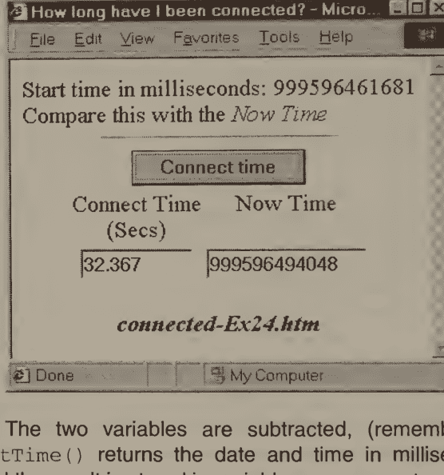

2. 两个变量相减，（记住 `getTime()` 返回的是以毫秒为单位的日期和时间），结果存储在变量 `connect_time` 中。

3. 将其除以 1000（将毫秒转换为秒），并将其赋值为文本框 `answer` 的值。

```html
<HEAD>
<TITLE>How long have I been connected?</TITLE>
<SCRIPT LANGUAGE="Javascript">
mydate      = new Date()
start_time  = mydate.getTime()
document.write("Start time in milliseconds: "
    + start_time + "<BR>"
    + "Compare this with the <I>Now Time </I>")
```

```javascript
function connect(){
    mydate2 = new Date();
    end_time = mydate2.getTime();
    document.howlong.nowtime.value = end_time;
    connect_time = end_time - start_time;
    document.howlong.answer.value
        = (connect_time/1000);
}  //EoFn connect()
</SCRIPT>
</HEAD>
<BODY>
<HR WIDTH=60%> <CENTER>
<TABLE>
<TR>
<FORM method="" action="" NAME="howlong">
<TD COLSPAN=2 ALIGN=center>
<INPUT TYPE="button" VALUE="Connect time"
    NAME="timeconnected"
    onClick="connect()">
<TR>
<TD ALIGN=center>Connect Time<BR>(Secs)
<TD ALIGN=center VALIGN=top>Now Time
<TR>
<TD ALIGN=center>
<INPUT TYPE=text SIZE=10 NAME="answer">
<TD ALIGN=center>
<INPUT TYPE=text SIZE=15 NAME="nowtime">
</TABLE>
</FORM>
<P>
<ADDRESS><B>connected-Ex24.htm</B></ADDRESS>
</CENTER> </BODY>
```

### 练习 25：你出生那天是星期几？

我们将把星期几以文字形式打印出来。

你知道自己出生那天是星期几吗，或者上一个千禧年（1900 年 1 月 1 日）是星期几？

# 11：Date & Time

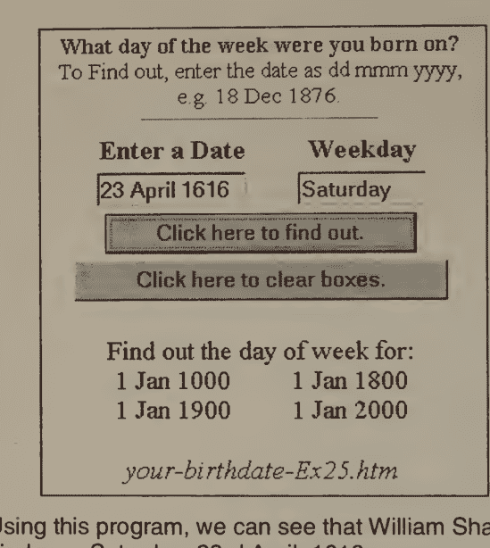

通过这个程序，我们可以看到威廉·莎士比亚于 1616 年 4 月 23 日星期六去世。

以下是我们实现的方法。

> **警告：** 这适用于 Netscape 和 Internet Explorer 的第 4 版本。早期版本可能无法处理某些较早的日期。

然而，我们需要了解另外两个 Date 方法：`Date.parse()` 和 `setTime()`，它们在下面的注释中解释。首先，这里是代码：

```html
<HEAD>
<TITLE> Work out day of the Week </TITLE>
<SCRIPT>
function getdayof YoungMeeseek() {
    // create an instance of the date
    var mydate = new Date();
    // store the user's entry in userdate
```

# 11：Date & Time


```javascript
userdate=document.weekday.thedate.value;
// convert to milliseconds via Date.parse
parseit = Date.parse(userdate);
// set this new date to mydate
mydate.setTime(parseit);
// use mydate methods as normal
var day = mydate.getDay();
// work out which day of the week it is
if (day==0)
	dayofweek = "Sunday";
if (day==1)
	dayofweek = "Monday";
if (day==2)
	dayofweek = "Tuesday";
if (day==3)
	dayofweek = "Wednesday";
if (day==4)
	dayofweek = "Thursday";
if (day==5)
	dayofweek = "Friday";
if (day==6)
	dayofweek = "Saturday";
document.weekday.answer.value = dayofweek;
}  //EoFn getdayofweek()

function clearit() {
// blank out the text boxes
  document.weekday.thedate.value= " ";
  document.weekday.answer.value = " ";
}  // EoFn clearit()
</SCRIPT>
</HEAD>
<BODY>
```

<FONT SIZE=3><B>你出生那天是星期几？</B>

<P>要查找，请输入日期格式为 dd mmm yyyy，

<bR>例如：18 Dec 1876。

<CENTER>

# 11: Date & Time

```html
<HR WIDTH=50%>
<TABLE>
<TR>
<FORM NAME="weekday"> <!-- No method or action -->
<TD ALIGN=center>
<B>Enter a Date</B>
<TD ALIGN=center>
<B>Weekday</B>
<TR>
<TD ALIGN=center>
<INPUT TYPE=text SIZE=12 NAME="thedate">
<TD ALIGN=center>
<INPUT TYPE=text SIZE=10 NAME="answer">
<TR>
<TD COLSPAN=2 ALIGN=center>
<INPUT TYPE=button
        VALUE="Click here to find out."
        onClick="getdayofweek();">
<TR>
<TD COLSPAN=2>
<INPUT TYPE=button
        VALUE="Click here to clear boxes."
        onClick="clearit()">
</FORM>
</TABLE>
Find out the day of week for:<BR>
1 Jan 1000 &nbsp; &nbsp; &nbsp; &nbsp;
1 Jan 1800<BR>
1 Jan 1900 &nbsp; &nbsp; &nbsp; &nbsp;
1 Jan 2000<P>
<ADDRESS><B>your-birthdate-Ex25.htm</B>
</ADDRESS>
</CENTER>
</BODY>
```

## 注释：`setTime()`

1. 到目前为止，我们能够通过使用`new`运算符并创建一个新的日期实例来获取计算机的当前日期和时间。这很好，但是我们可能需要使用其他日期，比如生日。

# 11: Date & Time

有一个 Date 方法（`setTime()`）可以让我们将日期和时间设置为其他日期：

```javascript
mydate.setTime(date-in-milliseconds).
```

这是好消息！坏消息是这个方法只接受毫秒为单位的日期。

### `Date.parse()`

嗯，至少我无法算出我出生日期的毫秒数，你能吗？不过，另一个方法来救场了。`parse()` 是 Date 对象的一个方法。它允许你以字符串（正常文本）形式输入日期，并将其转换为毫秒。它的工作方式是这样的：`Date.parse("string")`。

我们现在可以使用`Date.parse()`方法将字符串日期转换为毫秒，以便与`setTime()`方法一起使用。以下是它们的组合使用方式：

```javascript
parseit = Date.parse("15 Feb 1999")
var mydate  = new Date()
mydate.setTime(parseit)
```

第一行代码使用了`Date.parse`方法。然而，它与我们见过的其他方法略有不同。（它当然会不同，不是吗？）它被称为静态方法，但我们不必为此太沮丧。这意味着我们不能将它与用户创建的`Date()`对象实例一起使用，例如：`mydate.parse("string")`，我们必须使用`Date.parse`方法并将其赋值给变量，然后使用这个变量：

```javascript
parseit = Date.parse("string").
```

在我们的代码中，我们将其赋值给了`parseit`，它现在包含了我们日期的毫秒数。这个变量可以与`setTime`方法一起使用，该方法要求其参数以毫秒为单位。然而，在使用`setTime`方法之前，我们必须创建一个新的 Date 对象实例（`mydate`）。这是我们的第二行代码：

```javascript
var mydate = new Date()
```

这个新实例`mydate`将包含当前日期的毫秒数。因此，我们的第三行代码将当前日期更改为我们第一行中输入的日期。

```javascript
mydate.setTime(parseit)
```

终于，`mydate`包含了我们选择的日期的毫秒数。从现在开始，我们可以像前面的示例一样使用`mydate`，只不过我们已经将其日期更改为我们自己选择的日期。我们选择了莎士比亚去世的日期：1616年4月23日。

2. 注意，我们不需要将第三行赋值给一个变量。我们只是使用`setTime`方法将`mydate`对象设置为我们选择的日期。

3. 现在我们可以开始查找给定日期的星期几了，这是本练习的最初目的。使用`mydate`作为对象，我们利用其`getDay()`方法：`var day = mydate.getDay()`并将结果存储在变量`day`中。

当然，这是一个从 0 到 6 的数字。因此，下一块代码通过 IF 语句测试`day`包含哪个数字，并将相应的星期几作为文本赋值给变量`dayofweek`。其中一个 IF 语句将为真，其他所有语句将被忽略。

4. 接下来，`dayofweek`被赋值为名为`answer`的文本框的值，它是当前文档中名为`weekday`的表单的一个元素。或者更简单地说：

```javascript
document.weekday.answer.value = dayofweek
```

5. 最后，我们包含了另一个按钮，用于清除两个文本框的内容。点击时，它会调用函数`clearit()`。这简单来说就是将文本框`thedate`和`answer`的值赋值为空（`""`）。

> 你注意到我们没有在 Form 标签中使用 method/action 了吧。我通常会这样做，以防止 Word 97 在打开 HTML 文件时因未包含它们而崩溃。我们还看到，如果 `NAME` 属性存在，当 name 属性位于 method/action 之前时，Word 97 会崩溃。然而，如果表单包含在表格中，当缺少 method/action 时 Word 不会崩溃。（现在不要问我为什么！）

### 设置新日期的更简单方法

有一种更简单的方法来创建新日期，而无需使用上述两种方法。抱歉，但我想介绍`setTime`和`Date.parse`方法，因为它们总有一天会对你有用。

`Date()`对象可以采用以下四种形式中的任何一种：

1. `mydate = new Date()`

   空白时，它成为当前日期和时间。

2. `mydate = new Date("18 Dec 1978")`

   输入你自己的字符串（这是我们可以用来代替`setTime`的方法）。

3. `mydate = new Date(year, month, day-of-month, [hours, minutes, seconds])`

   例如：1987年9月14日 13:45，格式为不带引号的：`mydate = new Date(1987,8,14,13,45)`。

如果小时、分钟和秒未包含在内，则它们是可选的，默认为零。（记得 [] 的用途吗？它们表示可选参数。）

4. `mydate = new Date(milliseconds)`

   例如：

```javascript
new Date(946684799000)
```

（上面给出的毫秒数代表 1999 年 12 月 31 日，23:59:59。你还记得那个时刻吗？）

## 结语

一本参考书记载了 Date 对象的多达 42 种方法。我们已经涵盖的方法应该足以应对大多数实际用途。然而，如果你需要深入研究日期和时间的处理，你将需要查阅参考文献中所列的参考书目。

在较早期的浏览器（版本 4 之前）中使用 Date 对象曾引起问题。1970 年之前的日期不被允许。某些年份的日期仍然存在问题。例如，在 Netscape 4 中，从早于 1900 年或晚于 2000 年的日期中获取年份时，1900 年之前的年份会给出负数，2000 年之后的年份给出正数。Internet Explorer 则会提供实际的年份本身，如下表所示：

| 年份：12 月 12 日 yyyy | Netscape 4.5 | I.E 4 |
| :--- | :---: | :---: |
| 1345 | -555 | 1345 |
| 1666 | -234 | 1666 |
| 1890 | -10 | 1890 |
| 1900 | 0 | 0 |
| 1967 | 67 | 67 |
| 2000 | 100 | 2000 |
| 2010 | 110 | 2010 |
| 2345 | 445 | 2345 |

换句话说，Netscape 从你提供的任何日期中减去 1900，得出正数或负数的结果。这就是为什么在第 148 页的练习 22 中，它会给出 101 作为年份。Internet Explorer 也会减去 1900，但仅针对 1900 - 1999 年的日期。所有其他日期都显示为完整年份。因此，在处理年份时，你必须考虑到这一点。或者，利用另一种方法，该方法可以在两种主流浏览器中提供完整年份：`getFullYear()`

```javascript
var year = mydate.getFullYear()
document.form_weekday.year_answer.value = year
```

另一件奇怪的事情是，日期的显示取决于具体实现。因此，以下代码在版本 4 的浏览器中：

```javascript
mydate = new Date()
document.write(mydate)
```

对于 2001 年 10 月 16 日产生：

`Tue Oct 16 15:04:17 UTC+0100 2001`（在 IE 中）

**但是：**`Tue Oct 16 15:04:28 GMT+0100 (GMT Daylight Time) 2001`（在 Netscape 中）

### 你已学到的内容

在这一章中，你学习了如何使用`Date`对象及其各种方法来处理日期和时间。

我们学会了如何使用标准方法来获取日、月、年以及时、分、秒。我们还了解了如何使用`Date.parse()`和`setTime()`，这是另外两个可能有用的方法。

你已经注意到在使用`getYear()`时，Netscape 和 Internet Explorer 会给出不同的结果。因此，你可能希望使用`getFullYear()`。在本章中，结果来自 Netscape 4.5 版和 Internet Explorer 5.0 版。你应该在自己的浏览器上查明实际效果。

我们遇到了`new`运算符，它允许我们创建`Date`对象的新实例。通过使用这个实例，我们可以使用`Date`对象的方法，但`Date.parse()`除外，它有所不同。

我们现在能够：

- 输出当前日期和时间
- 输出我们选择的任何其他日期
- 根据一天中的不同时间显示多种图片之一
- 计算我们连接 ISP 的时间有多长
- 提取日期和时间的任何部分，例如找出是星期几
- 以美式或英式格式输出日期

### 术语

- ISP = Internet Service Provider（互联网服务提供商）
- UTC = Universal Coordinated Time（世界协调时间）

### 测试：第 11 章

#### 11.1

尝试编写一些 JavaScript，告诉用户加载页面花了多长时间。

**提示**：你需要两个`<SCRIPT>`，一个放在文档的 HEAD 中，另一个放在`</BODY>`结束标签之前或之后。

#### 11.2

编写另一段代码，计算距离圣诞节还有多少天。

为此，你需要使用`Date()`对象新实例的`setMonth()`和`setDate()`方法。

```javascript
var xmas = new Date()
xmas.setMonth(11)
xmas.setDate(25)
```

这将有效地将当前日期的月份和日期更改为 12 月 25 日。年份仍将是当前年份。

因为我们不想要天数的小数部分，所以可以使用`Math.floor()`函数。它只是返回小于或等于其参数的最大整数。因此：

`Math.floor(45.95)`返回 45。

以及`Math.floor(-45.95)`返回 -46。

#### 11.3

修改练习 24，显示某人连接其 ISP 已经多少分钟。

#### 11.4

尝试在 Netscape 和 IE 中都运行以下代码。

```html
<HEAD>
<TITLE> Using the date Object  </TITLE>
<SCRIPT>
// 输入你自己的日期
mydate = new Date("18 Dec 1686")
var monthday  = mydate.getDate()
var month     = mydate.getMonth() + 1
var day       = mydate.getDay()
var year      = mydate.getYear()
var fullyear = mydate.getFullYear()
document.write("<h3>Full Year Test </h3>")
document.write("Full year is: " + fullyear)
document.write("<DIV ALIGN= right>"
             + "day of the month =  "
             + monthday + "<BR>")
document.write("month =  "  + month + "<BR>")
document.write("day = "    + day + "<BR>")
document.write("year = "   + year + "<BR>")
document.write("The date is: " + monthday
             + "/" + month + "/" + year )
// 获取当前日期
var today      = new Date()
var monthdayx = today.getDate()
var monthx    = today.getMonth() + 1
var dayx      = today.getDay()
var yearx     = today.getYear()
document.write("<BR>Today's date is: "
                + monthdayx + "/"
                + monthx + "/" + yearx )
</SCRIPT>
</HEAD>
<BODY>
<ADDRESS><B>fulldate.htm</B> </ADDRESS>
</BODY>
```

当使用 Netscape 时，你观察到 1686 年的年份是什么？

# 第十二章：表单验证

JavaScript 对于检查用户填写表单时所做的输入特别有用。通常，表单数据必须由 Web 服务器进行验证。服务器端的程序会检查表单的条目，如果有任何错误，程序必须向用户发回错误消息。这个过程需要时间。信息必须从用户（称为客户端）传递回服务器（服务端），处理后返回到用户。

当验证发生在客户端时，在表单中输入的数据正确之前，不需要服务器参与。（作为一项安全措施，任何有价值的服务器站点都会重新检查数据，以确保其有效。请参阅第 290 页的安全部分。）

在这本书中，我们所有的例子都是关于客户端 JavaScript 的。为服务器创建 JavaScript 程序需要了解服务器的设置方式、正在使用的操作系统类型，以及一些 Java 语言的经验。这就是为什么很少有 JavaScript 书籍详细介绍服务器端 JavaScript 的原因。它通常过于依赖具体站点。

## 表单验证


让我们举一个简单的表单例子，该表单要求用户输入他/她的名字。如果文本框未填写，表单将不会提交给服务器。因此，我们需要检查该框是否已填写。

## 12：表单验证

实际上测试的是该框是否为空。这个练习将演示表单验证的许多基本功能。一旦我们查看了这些基本功能，我们就可以讨论一些更有用的技巧。练习 26 和 27 不太实用，更多是用于说明目的。

### 练习 26：对单个文本框进行简单验证

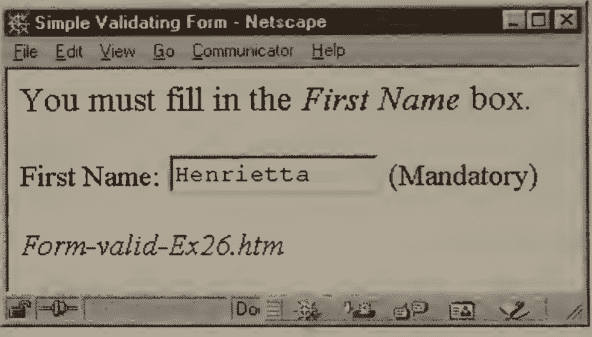

```html
<HEAD><TITLE> Simple Validating Form </TITLE>
<!-- 如果用户删除文本框中的数据，显示一个警告框。 -->
<SCRIPT>
function checkdata(){
  firstname = document.userform1.first.value;
  if (firstname==" "){
     alert("Please fill in the name box.");
  } //EoIF
}  // EoFn
</SCRIPT>
</HEAD>
<BODY>
<FONT SIZE=4>You must fill in the <I>First</I> Name
box.</FONT>
<P><FORM method="" action="" NAME="userforml">
First Name:
```

```html
<INPUT TYPE=text SIZE=12 NAME="first"
         onChange="checkdata()"> (必填项)
</FORM>
<P><ADDRESS>Form-valid-Ex26.htm</ADDRESS>
</BODY>
```

**注意事项：**

1. 我们目前还没有提交按钮，稍后会添加。在 `BODY` 中，我们设置了一个名为 `first` 的文本框。

   ```html
   <INPUT TYPE=text SIZE=20 NAME="first"
            onChange="checkdata()"> (必填项)<BR>
   ```

2. 文本元素关联了一个 `onChange` 事件处理程序。（并非所有元素都支持此事件，并且在本章末尾，我们有一个列表，说明哪些表单元素支持哪些事件。例如，按钮元素就不支持 `onChange` 事件。）

3. 当用户在文本框中输入文本，然后点击框外区域（例如，点击第二个框或窗口的其他部分）时，`onChange` 事件会被激活。这被称为失去焦点，见下文。

   这个事件对于第 10 章中的计算器示例非常方便，用户可以反复更改利率、贷款金额和/或还款期限。每次更改框中的值时，`calculate()` 函数都会被重新调用。

4. `checkdata()` 函数将用户输入的值赋给变量 `firstname`：

   ```javascript
   firstname = document.userform1.first.value
   ```

   通过一个 `if` 语句来测试它是否为空（`""`）：

   ```javascript
   if (firstname == "")
   ```

   如果框为空，则会出现一个警告框：

   ```javascript
   alert("Please fill in the name box.");
   ```

   > 确保不要在两个双引号之间加空格，否则你将测试的是空格而非空框！

5. 这还不是一个实用的例子，因为用户需要在文本框中输入内容，然后点击框外，接着删除文本，再点击框外。

6. 现在让我们讨论一下 `focus()` 方法。

   ```javascript
   document.userform1.first.focus();}
   ```

   `focus` 的意思是将光标置于文本框中，实际上是邀请用户输入内容。没有这行代码，用户必须先点击框内才能输入任何内容。为什么我们不在页面首次加载时就将 `focus` 放到这个文本框上呢？这正是我们将在这段代码中要做的。

   ```html
   <SCRIPT>
   function focusonfirst(){
       // 将框设置为空白，即清空，然后设置焦点。
       document.userform1.first.value = "";
       document.userform1.first.focus();} // 函数结束
   </SCRIPT>
   </HEAD>
   <BODY onLoad="focusonfirst()">
   <FONT SIZE=4>您必须填写必填项。</FONT>
   ... 等等 ...
   </BODY>
   ```

**注意事项：**

1. `focusonfirst()` 函数执行两个操作。第一个操作将 `first` 元素的 `value` 设置为空白。`first` 是当前文档中名为 `userform1` 的表单对象的命名属性。

   ```javascript
   document.userform1.first.value = "";
   ```

   其次，它将焦点放到名为 `first` 的文本框上，换句话说，光标将停留在文本框中，准备让用户开始输入。`focus()` 是一个输入文本元素的方法，这里该元素名为 `first`。

   ```javascript
   document.userform1.first.focus();
   ```

2. 但 `focusonfirst()` 是如何被调用的呢？注意 `BODY` 标签中包含以下代码：

   ```html
   <BODY onLoad="focusonfirst()">
   ```

   `BODY` 标签可以接受一个 `onLoad` 属性，这实际上是一个事件，因此可以接受一个处理程序，比如一个函数。一旦网页完全加载（事件触发），事件处理程序 `focusonfirst()` 就会自动被调用。这对于在用户进行任何操作之前执行初始化非常有用。

### 练习 27：进一步的表单验证

在本练习中，我们将使用上述知识来验证一个表单，该表单要求用户输入其名、姓以及电子邮件地址。

所有三个框都必须填写。还有一个备注文本框，是可选的。

然而，在我们编写代码之前，需要稍加思考。“构造代码最简洁的方式是什么？”这是学习如何使用 JavaScript 或任何其他编程语言编写程序的一部分。本章和下一章将探讨编程风格的某些方面。

将相同的任务交给三位程序员，他们会产生三个不同的程序。每个程序都能成功完成任务，但其中一个可能比另一个“更好”。在我们考察了各种方法之后，我们将理解“更好”的含义。

练习 26 使用了 `onChange` 事件。然而，正如练习 27 所示，这可能并不总是最佳选择。我们并没有过多思考 `onChange` 事件的工作原理。当用户填写第一个框，然后点击第二个框时，会弹出一个警告框，提示用户填写第二个框。关闭此警告框后，另一个警告会提示用户填写第三个框。这会让任何用户感到恼火。以下是能“工作”但不友好的代码。

```html
<SCRIPT> // 一种笨拙的方法，未经过深思熟虑。
function checkdata(){
    firstname = document.userform1.first.value;
    lastname  = document.userform1.last.value;
    emailadd  = document.userform1.email.value;
```

```javascript
if (firstname==""){
  alert("Please fill in first name box.");
  document.userform1.first.focus();
}
if (lastname==""){
  alert("Please fill in last name box.");
  document.userform1.last.focus();
}
if (emailadd==""){
  alert("Please fill in e-mail box.");
  document.userform1.email.focus();
}
}  // checkdata 函数结束
</SCRIPT>
```

```html
<BODY>
<TABLE>
<TR> <TD WIDTH=30%>
<FORM method="" action="" NAME="userform1">
First Name:
<TD><INPUT TYPE=text SIZE=20 NAME="first"
      onChange="checkdata()">
<TD> (必填)
<TR> <TD WIDTH=30%>Last Name:
<TD><INPUT TYPE=text SIZE=20 NAME="last"
      onChange="checkdata()">
<TD> (必填)<BR>
<TR> <TD WIDTH=30%>E-mail:
<TD><INPUT TYPE="text" NAME="email"
      onChange="checkdata()">
<TD> (必填)
<TR> <TD WIDTH=30%>Comments:
<TD><TEXTAREA ROWS=2 COLS=20> </TEXTAREA>
<TD> (可选)
<TR>
<TD COLSPAN=3 ALIGN=center> <INPUT TYPE=submit>
</FORM>
</TABLE>
<ADDRESS>Form-valid-Ex27.htm</ADDRESS>
</BODY>
```

还要注意，如果用户在填写框之前就点击了提交按钮，表单将在所有框都为空的情况下被提交。那么我们如何改进呢？下面我们将探讨两种经典方法。

两种方法都允许用户填写框（或者可能只填写其中一部分），但当点击提交按钮时，所有条目会一次性被检查。如果所有条目都已填写，则提交表单。如果未全部填写，则会弹出一个警告框，要求用户重试。

### 示例 28：方法一：使用 `submit()` 方法

由于我们只想了解基本机制的工作原理，我们将测试限制为仅一个文本框。

```html
<HEAD><TITLE>一个更好的表单验证</TITLE>
<!--如果用户未在文本框中输入数据，
则弹出一个警告框。否则提交表单。
-->
```

```javascript
<SCRIPT>
function checkdata(){
    firstname = document.userform1.first.value
    if (firstname==""){
        alert("Please fill in all the Required"
                + " boxes.");
        document.userform1.first.focus();
    }
    else {
        document.userform1.submit();
    }  // if 语句结束
} // checkdata 函数结束
</SCRIPT>
</HEAD>

<BODY>
<H3>您必须填写<I>必填</I>项</H3>
<P>
<TABLE>
<TR>
<TD WIDTH=30%>
<FORM ACTION="mailto:j.shelley@ic.ac.uk"
      METHOD="post" NAME="userform1" >
  First Name:
<TD><INPUT TYPE=text SIZE=20 NAME="first">
<TD>(必填)
<TR>
<TD WIDTH=30%>Comments:
<TD><TEXTAREA ROWS=2 COLS=20 NAME="comments">
    </TEXTAREA>
<TD>(可选)
<TR>
<TD COLSPAN=3 ALIGN=center>
<INPUT TYPE=button VALUE="Send off Details"
        onClick="checkdata()">
</FORM>
</TABLE>
<ADDRESS>Form-valid-Ex28.htm</ADDRESS>
</BODY>
```

## 12：表单验证

**注意事项：**

1. 我们用一个 `onClick` 事件替换了 `onChange` 事件，并将其附加到一个 `input-button` 元素上，而不是提交按钮。事实上，我们根本没有使用提交按钮。

   ```html
   <INPUT TYPE=button VALUE="Send off Details"
           onClick="checkdata()">
   ```

   当点击这个按钮时，`checkdata()` 函数会测试用户的输入，看是否输入了内容。如果没有任何内容，会弹出一个警告框，要求填写所有标记为必填的字段。当用户关闭警告框后，函数停止执行，用户返回到网页。我们还将焦点重新设置到了那个有问题的文本框上。

   然而，当 `firstname` 框被填写后，程序会通过以下方式提交表单：

   ```javascript
   document.userform1.submit();
   ```

2. 请记住，许多 HTML 标签是文档对象（document object）的属性。但它们也可以是独立的对象，因此可以拥有自己的属性。FORM 对象是文档对象的一个属性，但如果指定了它的某个方法，它也可以变成一个对象。FORM 的一个方法是 `submit()`。此方法提交指定的表单，其执行的操作与点击 submit 按钮相同。这就是为什么不需要提交按钮的原因。

3. 这一次，我们在 FORM 标签中包含了正确的 ACTION 和 METHOD 属性值。我们使用 `mailto` 通过电子邮件发送表单。

   > 提示：当您需要测试表单是否已提交时，可以给自己发送一封电子邮件。如果使用 Netscape，请参阅第 181 页。

4. 总结：当点击“发送详情”按钮时，会调用 `checkdata()` 函数。此函数执行测试。如果测试检测到空的文本框，函数会调用警告框。当用户关闭警告框后，焦点设置回文本框，函数结束。如果测试没有检测到空的文本框，它会调用 `submit()` 方法来提交关联的表单。

   ```javascript
   function checkdata(){
     firstname = document.userform1.first.value;
     if (firstname==""){
       alert("Please fill in all the Required"
           + "boxes.");
       document.userform1.first.focus(); }
     else {
       document.userform1.submit();
     } // End of IF-ELSE
   } // End of function
   ```

### 示例 29：方法二：使用 `onSubmit` 事件处理器

第二种方法使用 `onSubmit` 事件处理器来执行与上述相同的任务。

```html
<HEAD>
<TITLE>Validating Form using the onSubmit event
handler </TITLE>
<!--If user does not enter data in the text box, pop up an alert
box. Otherwise submit the FORM. -->
<SCRIPT>
function checkdata(){
  firstname = document.userform1.first.value;
  if (firstname==""){
    alert("Please fill in all the Required"
        + " boxes.");
    document.userform1.first.focus();
    return false;   }
  else { document.userform1.submit1.value
                                ='SENT OFF'
    return true;    } // End of If-Else
} // EoFn checkdata()
</SCRIPT>
</HEAD>

<BODY> <CENTER>
<B>You must fill in the <I>Required</I>
boxes.</B>
<P>
<TABLE>
<TR>
<TD WIDTH=30%>
<FORM onSubmit="return checkdata()"
      ACTION="mailto:j.shelley@ic.ac.uk"
      METHOD="post" NAME="userform1">
First Name:
<TD><INPUT TYPE=text SIZE=20 NAME="first">
<TD> (Required)
<TR>
<TD WIDTH=30%>Comments:
<TD><TEXTAREA ROWS=2 COLS=20 NAME=comments>
</TEXTAREA>
<TD>(Optional)
<TR>
<TD COLSPAN=3 ALIGN=center>
<INPUT TYPE=submit NAME="submit1"
       VALUE="Send off Details"
       onClick="alert('Details being checked')">
</FORM>
</TABLE>
<ADDRESS>form-valid-Ex29.htm</ADDRESS>
</CENTER>
</BODY>
```

**注意事项：**

1. `onSubmit` 事件必须放在开始的 FORM 标签中。您还必须在一个 INPUT 元素中包含一个 submit 按钮。原因在于，当点击提交按钮时，它会触发 `onSubmit` 事件。


## 2. 使用 `submit` 按钮

我们在表单中使用一个 `submit` 按钮（有时称为 `submit` 对象或 `submit` 元素）：

```html
<INPUT TYPE=submit NAME="submit1"
       VALUE="Send off Details"
       onClick="alert('Details being checked.')">
```

当点击提交按钮时，它的 `onClick` 事件处理器被调用并执行。在我的代码中，这仅仅显示一个警告框。（同样也可以是调用一个函数，从而执行多条语句。）

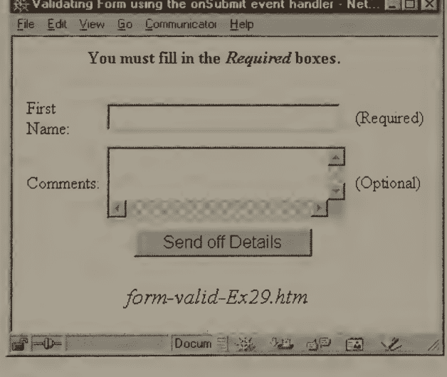

## 3. `onSubmit` 事件处理器

这是关键部分。一旦提交按钮的 `onClick` 事件处理器完成其任务，`FORM` 标签中的 `onSubmit` 事件处理器就会自动激活，并调用 `checkdata()`。

```html
<FORM onSubmit="return checkdata()"
      ACTION="mailto:j.shelley@ic.ac.uk"
      METHOD="post" NAME="userform1">
```

因此，我们看到这个过程涉及两个步骤。第一步是在点击 `submit` 按钮时处理事件处理器的代码（可选）。当此任务完成后，第二步随之而来，即执行表单的 `onSubmit` 代码。

## 4. `return` 是什么？

我们是时候详细看看这个了，因为它是函数的重要组成部分。

### `return` 语句

函数总是返回一个值。如果未包含 `return` 语句，函数将执行函数体中的所有语句，并将 `undefined` 值返回给调用语句。那么这个 `undefined` 值是什么呢？它是 JavaScript 中几个特殊值之一。当使用一个尚未定义（声明）的变量，或者一个变量已声明但尚未赋值时，它会被赋值为 `undefined`。

现在，对于一个没有 `return` 语句的函数，一旦函数完成其工作，调用它的语句就会获得 `undefined` 值。在我们目前的所有例子中，这都不是问题。我们只是希望函数完成其工作并停止。它的调用语句（即函数调用）可能变为 `undefined` 这一事实，我们并不关心。

然而，在上面的情况下，这确实成为我们关注的问题。我们希望表单被提交，但前提是用户输入有效。`onSubmit` 事件处理器的工作方式是：如果 `return` 语句返回 `false`，则阻止表单提交。任何其他返回值（例如 `true` 甚至 `undefined`）都会导致表单被提交。如果省略了 `return true` 语句，表单仍然会被提交，因为返回的值不是 `false` 而是 `undefined`。这就是这个游戏的规则。

因此，我们实际上并不需要包含 `return true` 语句。然而，强烈建议这样做，因为它使程序的逻辑对人类读者来说更清晰。

如果一个函数中有多个 `return` 语句，第一个遇到的 `return` 语句将停止整个函数并返回到调用语句。

## `submit()` 和 `onSubmit` 有什么区别？

`submit()` 方法可以从任何函数中调用，而不需要在网页上显示提交按钮。当遇到它时，其行为与用户点击提交按钮时完全相同。

另一方面，`onSubmit` 事件处理器确实需要一个提交按钮。如果没有提交按钮可供点击，`onSubmit` 事件处理器就无法被调用，表单也就永远不会被提交。

**警告：** 不要在 Netscape 4 中使用 `submit()` 方法通过 `mailto:`、`news:` 或 `snews:` 发送表单。由于安全原因，它被设置为忽略此类协议。如果您希望使用这些协议，您将必须使用 `onSubmit` 事件处理器或只是一个简单的提交按钮。Internet Explorer 5 似乎忽略了这一规定。

本章我们涵盖了大量内容。我们需要休息一下，并有机会吸收和练习我们所学的内容。关于表单验证，我们还有更多内容要讲，因为在下一章中我们可以利用一些巧妙的功能。

下面的示例总结了本章涵盖的材料。值得您闲暇时详细研究。

## 12：表单验证

**示例 30** - 验证我们表单的完整代码。

```html
<HEAD><TITLE>Final Validating Form using the onSubmit event handler </TITLE>
<SCRIPT>
function focusonfirst(){
  // set box to empty and set focus.
  document.userform1.first.value="";
  document.userform1.first.focus();
} // EoFn focusonfirst

function checkdata(){
  firstname = document.userform1.first.value;
  lastname  = document.userform1.last.value;
  emailadd = document.userform1.email.value;
  flag = 0;
  if (firstname==""){
    alert("Please fill in all the Required"
         + " boxes.");
    document.userform1.first.focus();
    flag = 1;
    return false;   }
  if (lastname==""){
    alert("Please fill in all the Required"
         + " boxes.");
    document.userform1.last.focus();
    flag = 1;
    return false;
  }
  if (emailadd==""){
    alert("Please fill in all the Required"
         + " boxes.");
    document.userform1.email.focus();
    flag = 1;
    return false;
  }
  if (flag == 0){
    document.userform1.send.value="Details Sent.";
    return true;    }
} // EoFn checkdata

function when(){
    alert("Your data is about to be checked.");
} // EoFn when
</SCRIPT> </HEAD>
<BODY onLoad="focusonfirst()">
<FONT SIZE=4>You must fill in the
<I>Required</I> boxes.</FONT>
<P><TABLE>
<TR><TD WIDTH=30%>
<FORM onSubmit="return checkdata()"
    ACTION="mailto:j.shelley@ic.ac.uk"
    METHOD="post" NAME="userform1" >
First Name:
<TD><INPUT TYPE=text SIZE=20 NAME="first">
<TD>(Required)
<TR><TD WIDTH=30%>Last Name:
<TD><INPUT TYPE=text SIZE=20 NAME="last">
<TD>(Required)
<TR><TD WIDTH=30%>E-mail:
<TD><INPUT TYPE=text SIZE=20 NAME="email">
<TD>(Required)
<TR><TD WIDTH=30%>Comments:
<TD><TEXTAREA ROWS=4 COLS=20 NAME="comments">
    </TEXTAREA>
<TD>(Optional)
<TR><TD COLSPAN=3 ALIGN=center>
<INPUT TYPE=submit NAME="send"
    onClick="when()">
</FORM>
</TABLE>
<ADDRESS>Form-valid-Ex30.htm</ADDRESS>
</BODY>
```

### 注释

1. 在上例中，我们选择在 `FORM` 标签中使用 `onSubmit` 事件处理程序，而不是 `submit()` 方法。

```html
<FORM onSubmit="return checkdata()" ACTION="mailto:j.shelley@ic.ac.uk" METHOD="post" NAME="userform1" >
```

2. 当用户点击提交对象（提交按钮）时，会发生两件事。首先，它调用 `when()` 函数，该函数会向用户发出详细信息即将被检查的提示。（良好的风格！）

```html
<INPUT TYPE=submit NAME=submit1 onClick="when()">
```

第二件事是，当用户关闭由 `when()` 函数生成的警告框后，`FORM` 标签中的 `onSubmit` 处理程序会被自动调用。这会调用 `checkdata()` 函数来检查用户的数据。如果没有提交类型的按钮，`onSubmit` 将无法执行。

3. `checkdata()` 函数包含一系列 `IF` 语句，每条语句检查一个文本框。如果任何一个为空，它会警告用户并要求填写所有必填框。然后，它将焦点设置到有问题的框上，并将数字值 `1` 赋给变量 `flag`。

```javascript
if (lastname=="") {
    alert("Please fill in all the Required"
          + " boxes.");
    document.userform1.last.focus();
    flag = 1;
    return false;
}
```

最后，`return` 值被设置为 `false` 以防止表单被提交。任何一条 `return` 语句都会终止函数执行。

4. 如果存在任何错误，用户会进行更正，然后再次点击提交按钮。一旦发现所有框都非空，即所有 `IF` 语句都失败，会有一个最终的 `IF` 语句。它测试 `flag` 是否等于零。（注意，这个 `flag` 在函数开始时被赋值为零。）

```javascript
flag = 0;
... etc ...
if (flag == 0) {
    document.userform1.send.value="Details Sent.";
    return true;
}
```

如果 `flag` 确实等于零，那么它不可能被任何 `IF` 语句设置为 1，因此我们知道表单可以安全地发送到服务器。提交按钮 `send` 的 `value` 被更改为 "Details Sent"，并且 `return` 被设置为 `true`。由于这个返回值不是 `false`，JavaScript 现在将自动提交表单。

5. 我们在 `FORM` 标签中为 `action` 和 `method` 属性设置了适当的值。我们使用 `mailto` 通过电子邮件发送表单。Netscape 和 IE 都会提交表单，因为我们使用了 `OnSubmit` 处理程序。

```html
<FORM onSubmit="return checkdata()"
      ACTION="mailto:j.shelley@ic.ac.uk"
      METHOD="post" NAME="userform1">
```

实际上，你的服务器上会有一个现有的程序来处理数据。这通常可以通过 `action` 属性中的 `http://..url` 来访问。由于我们在本文中考虑的是客户端 JavaScript，因此假定我们的任务只是将表单数据提交到被告知使用的任何程序。换句话说，其他人已经编写了服务器端程序并为我们提供了正确的 `url`。

如果你想在两个主流浏览器中使用 `mailto:`，就不能使用 `submit()` 方法。如果表单的 `action` 是 `mailto:`、`news:` 或 `snews:`，它在 Netscape 中会无警告地失败。这是出于安全原因。你必须使用标准的 `submit` 按钮或 `onSubmit` 事件处理程序，后者会触发提交按钮工作。

6. 作为风格问题，添加一个 JavaScript 注释来标记函数结束总是有用的：

```javascript
function xyz () {
  ... function code _}  // end of function
```

### 我们学到了什么

我们了解了如何在表单提交到服务器之前，在客户端验证用户输入的表单数据。客户端验证有助于减少服务器的工作量，同时也减少了互联网上的流量。

为了验证用户数据，我们引入了 `onChange` 事件，该事件调用一个函数来执行必要的验证。后来我们使用了 `onClick` 事件与表单元素的 `submit()` 方法相结合。

我们研究了另一种方法，使用 `onSubmit` 事件处理程序，当提交按钮被点击时触发。这种方法允许在两个主要浏览器中使用 `mailto:`、`news:` 和 `snews:` 协议。

`onLoad` 事件处理程序可用于在页面加载后立即初始化页面。我们将在第14章动画图片时再次看到它。

`focus()` 方法用于将光标置于文本框内，这样用户就可以开始打字，而无需物理点击文本框内部。

我们还讨论了 `undefined` 值及其与 `return` 语句的用法。后者必须与 `onSubmit` 事件处理程序一起使用，并且在需要阻止表单提交时必须返回一个 `false` 值。

我们考虑了一些编程风格方面的问题，并使用了一个变量来标记是否应该提交表单。

### 术语

- **客户端**：当用户希望获取一个网页时，浏览器成为该请求的客户端。
- **标志**：在编程中，发现某些事情是否发生的常见技术（例如某些数据无效）是给一个变量赋予一个值。这个变量通常称为标志变量，可以被测试以查看其处于哪种状态并相应地做出反应。许多程序员使用数字值 1 和零，但你也可以使用布尔值 `true` 或 `false`。
- **`focus()`**：使文本框或文本区域框获得焦点的方法。它等同于用户物理地点击文本或文本区域框。
- **`onLoad`**：包含在 `BODY` 标签中的事件处理程序。当页面完成加载时，事件处理程序被自动调用，其 JavaScript 代码被执行。以下内容不被推荐。它可能会让你的用户非常恼火。

  ```html
  <BODY onLoad="alert('Welcome to my Web page.'"
  ```

- **`onSubmit`**：`FORM` 标签中的事件处理程序。一旦提交按钮被点击，与处理程序关联的 JavaScript 代码就会被执行。通常，它用于验证表单数据。必须使用一个计算结果为 `false` 的 `return` 语句来阻止表单被提交。任何其他值都会导致表单被提交，即使是 `undefined` 值。
- **`return`**：所有函数在完成工作后都会返回一个值。它接受布尔值 `true` 或 `false` 或 `undefined` 值。也可能返回其他值，实际上可以是任何值。例如，以下函数返回其参数的平方：

  ```javascript
  function square(x) {
    y = x*x;
    return y;          } // end of function
  ```

  或者更简洁地：

  ```javascript
  function square(x) {
    return x*x;} // end of function
  ```

- **服务器端**：保存网页和任何由用户浏览器请求的验证程序的服务器。
- **`submit()`**：提交表单的方法。它需要表单的名称作为其对象。出于安全原因，它会失败。

# 12：表单验证

当表单的 `action` 属性中使用 `mailto:`、`news:` 或 `snews:` 时，不会产生警告。

- **`undefined`**：一种特殊值，赋予任何未被显式定义和赋值的变量、对象或函数调用。

### 事件与方法——目前的总结

| 事件 | 关联对象 | 说明 |
| :--- | :--- | :--- |
| `onLoad` | `BODY` 和 `IMG` | 页面（图像）必须完全加载后才会调用处理程序 |
| `onSubmit` | `FORM` | 点击提交按钮时自动调用 |
| `onChange` | `text` 或 `textarea` 元素 | 用户输入文本并点击文本框外部时激活 |
| `onClick` | `button`、`checkbox`、`radio`、`reset` 和 `submit` 按钮，也用于链接 | 链接指的是 `<AREA>` 和 `<A>` 标签 |
| `onMouseOver` | 在链接内使用 | 用户将鼠标移到链接上时响应 |
| `onMouseOut` | 在链接内使用 | 用户将鼠标移出链接时响应 |

| 方法 | 使用位置 | 说明 |
| :--- | :--- | :--- |
| `submit()` 与 `FORM` 关联 | 在函数内使用 | 执行与按下提交按钮相同的操作 |
| `focus()` 与文本框关联 | 在函数内使用 | 执行与用户点击文本框或 `textarea` 框相同的操作 |

## 第12章测验

### 12.1

哪些 `INPUT` 元素允许使用 `onChange` 事件处理程序？

### 12.2

`onChange` 事件处理程序是如何被触发的？

### 12.3

运行以下代码后，你会看到什么？


```html
<head>
  <title>...</title>
  <script>
    function abc() {
      x = 2;
    } // EoFn
  </script>
</head>
<body>
  <script>
    alert("Are you ready?");
    y = abc();
    alert("Y = " + y); // What value has variable y?
  </script>
</body>
```

## 12.4 表单可以通过三种方式提交。分别是哪三种？

## 12.5 `submit()` 方法属于哪个对象？

## 12.6 `submit()` 方法执行什么功能？

## 12.7 `onSubmit` 是哪个 HTML 标签的事件处理程序？

## 12.8 `onSubmit` 处理程序执行什么用途？

## 12.9 `onSubmit` 事件处理程序何时将表单发送到服务器？

### 下一步内容

我们将进一步了解与表单验证相关的更多功能和技巧。其中一些技巧将减少输入量，另一些则将扩展我们对验证表单时可执行的其他测试的了解。

# 13：进一步的表单验证技术

在本章中，我们将探讨使用以下方法的其他验证技术：

- `indexOf()` 方法
- `length` 属性
- `this` 运算符

我们从 `this` 运算符开始，但首先需要通过练习 31 来为它的使用做好铺垫。

## 练习 31：旧方法

假设我们需要验证一份登山岗位的求职申请表，申请人必须是 18 到 35 岁之间的健康年轻人。在之前的练习中，当我们引用一个 INPUT 元素的值时，必须输入以下内容：

```javascript
firstname = document.userform1.first.value;
```

有一种更简洁优雅的方法，使用 JavaScript 运算符 `this`，我们将在练习 32 中使用它。目前，这里是使用旧方法的代码：`document.formname.elementname...etc.`

```html
<SCRIPT>
function focusonage(){
// set box age to blank, i.e. empty & focus.
  document.ageform.age.value="";
  document.ageform.age.focus();
}  // EoFn
function checkage(){
  userage = document.ageform.age.value;
  if ((userage < 18) || (userage > 35))
    {alert("Sorry you are either past it or too"
         + " young!");
    document.ageform.submitage.value
                          = "Must be 18-35.";
    document.ageform.age.value="";
    return false; }
  else
    {alert("You will be notified");
    document.ageform.submitage.value
                          = "Details Sent.";
    return true;}
} // end of function
</SCRIPT> </HEAD>

<BODY onLoad="focusonage()">
You must fill in the <I>Age</I> box.
<P>
<FORM onSubmit="return checkage()"
      ACTION="mailto:j.shelley@ic.ac.uk"
      METHOD="post" NAME="ageform" >
<TABLE>
<TR>
<TD WIDTH=30%>Type in your age:
<TD> <INPUT TYPE=text NAME=age >
<TR>
<TD COLSPAN=2>
<INPUT TYPE=submit NAME=submitage>
</FORM>
</TABLE>
<ADDRESS>Valid-Age-Ex31.htm</ADDRESS> </BODY>
```

1. 文档加载完成后，BODY 标签的 `onLoad` 事件处理程序调用函数 `focusonage()`，该函数清空文本框 `age` 并将焦点设置到该文本框上。

2. 当 `submit` 按钮被点击时，表单的 `onSubmit` 处理程序调用 `checkage()` 函数，其中四次引用了 `document.ageform`。在下一个练习中，我们将使用 `this` 运算符来替代。

3. 如果年龄超出范围，`checkage()` 将 `return false` 以阻止表单提交。请注意，当年龄在正确范围内时，我们包含了 `return true`。这实际上并非必要，因为所有函数都会返回某个值，无论是否使用 `return` 语句。因此，我们的函数 `checkage()` 会返回一个非 `false` 的值，这将强制提交表单。不过，建议使用 `return true` 语句以明确表示我们需要返回的值。

## 练习 32：使用 `this` 运算符

这与练习 31 相同，只是我们将使用 `this` 运算符。

### 说明

1. 在 FORM 标签中，`onSubmit` 事件处理程序添加了关键字 `this` 作为参数。我们还传递了年龄范围作为参数——18 到 35。`this` 是引用当前对象的简写方式，在此例中，它是当前文档的属性——名为 `ageform` 的 form：`document.ageform`。

```html
<FORM NAME=ageform
       onSubmit="return checkage(this,18,35)"
```

```html
<HEAD>
<TITLE>Validating Applicants' Age using "THIS"
</TITLE>
<SCRIPT>
function focusonage() {
  document.ageform.age.value = "";
  document.ageform.age.focus();
  document.ageform.submitage.value =
                                 "Send Details."
}  //EoFN

function checkage(obj,lowage,highage) {
  userage = obj.age.value
  if ((userage < lowage) || (userage > highage))
  {alert("Sorry you are either past it or too
 young!");
   obj.submitage.value=" Must be 18-35.";
   obj.age.value="";
   return false; }
  else
  { alert("You will be notified");
    obj.submitage.value="Details Sent."; }
} // EoFn
</SCRIPT>
```

```html
<BODY onLoad="focusonage();">
You must fill in the <I>Age</I> box.<P>
```

```html
<FORM onSubmit="return checkage(this,18,35)"
      ACTION="mailto:j.shelley@ic.ac.uk"
      METHOD="post" NAME="ageform">
<TABLE>
<TR>
<TD WIDTH=30%>Type in your age:
<TD> <INPUT TYPE=text NAME="age">
<TR><TD COLSPAN=2>
```

```html
<INPUT TYPE=submit NAME="submitage"
	VALUE="Send Details.">
</FORM>
</TABLE>
<ADDRESS>Valid-Age-Ex32.htm</ADDRESS></BODY>
```

`this` 被传递给函数 `checkage()` 中的形参 `obj`，此时它将取 `this` 的值，即 `document.ageform`。

```javascript
function checkage(obj,lowage,highage){
 userage = obj.age.value .. etc. ...}
```

2. 在函数 `focusonage()` 中，我们也引用了 `document.ageform`。但是，我们不能在由 BODY 标签加载的 `focusonage()` 函数中使用 `this` 作为参数，因为那样它将引用 BODY 而非名为 `ageform` 的表单。

凡是使用 `this` 的地方，它都会呈现其所在上下文的外观。我们只有一个表单，但假设有三个表单——一个用于儿童（5-17 岁），一个用于成人（18-64 岁），第三个用于老年人（65 岁以上），每个都使用 `checkage()` 函数：

```html
onSubmit="checkage(this,5,17)"
```

无论三个提交按钮中的哪一个被点击，`this` 运算符都会承担起当前表单的角色。

3. 用户输入的数值可以使用比较运算符进行检查。这非常简单。

```javascript
if ((userage < lowage)||(userage > highage))
```

但请注意，当使用逻辑运算符（`&&` `||`）时，每个被测试的表达式都必须用括号括起来：

```javascript
if ( (expression_one) || (expression_two) )
```

## 进一步表单验证

在我们的示例中，输入的值会与低和高边界值——18 和 35——进行比对，这些值通过 `onSubmit` 处理程序的调用作为参数传递给 `checkage()` 函数。

### 可以应用的其他一些测试

有时，不方便允许用户输入前导空格。例如，我们可能打算将申请人的姓名存储在数据库中，并在稍后时间执行字母排序。排序基于第一个字符。如果某些姓名有前导空格，而某些没有，排序将不正确。为了捕获前导空格，我们可以使用 `indexOf()` 方法。

### `indexOf()` 方法

这是 `String` 对象的一个方法。它返回其参数在指定字符串中首次出现的位置（即索引）。

```javascript
a_string = new String("The Owl and the Pussycat went to sea.")
```

注意它的构造方式与 `Date` 对象相似（参见第 145 页）。

String 对象的新实例可以通过简单的赋值语句创建。以下代码与上面的行为相同：

```javascript
a_string =
    "The Owl and the Pussycat went to sea."
```

以下内容查找上述字符串中字符 `w` 的首次出现：`a_string.indexOf("w")`，将返回 5，这是它在关联字符串 `a_string` 中的位置（索引）。

为什么是 5？因为第一个字符编号为零。因此，第六个字符的索引是 5。第一个字符（我们示例中的 “I”）将是索引 0。注意空格。

## 13：进一步的表单验证

（包含此类帮助窗口以及防止其出现的选项总是礼貌的。因此这里出现了复选框。）

```html
<HEAD><TITLE> 提供一些帮助 </TITLE>
<SCRIPT>
// BODY onLoad - 将 helpdate 字段设为 null
function init() {helpdate = null; } //函数结束
// 日期字段的自动帮助
function autohelp(obj2, file) {
  if ((obj2.help.checked == true)
    && (helpdate == null))
    helpdate = window.open(file, null,
      "width=370,height=270");
} // 函数结束

function checkdate(obj2){
  if ( (obj2.date.value.length == 8)
    &&(obj2.date.value.indexOf("/") == 2 )
    &&(obj2.date.value.indexOf("/", 4) == 5))
    { obj2.submit1.value =
        obj2.submit1.value.toUpperCase();
      return true;      }
else { alert(obj2.date.value
          + " is not valid.");
       obj2.date.value=""; obj2.date.focus();
       return false; }
} // 函数结束
</SCRIPT>
</HEAD>
<BODY onLoad="init()">
<B>请输入您的出生日期。</B>
<FORM NAME="dateform"
      onSubmit="return checkdate(this)"
      ACTION="mailto:j.shelley@ic.ac.uk"
      METHOD=post>
<TABLE WIDTH=80%>
<TR><TD WIDTH=35%>自动帮助？</TD>
<TD><INPUT TYPE="checkbox" NAME="help"
            CHECKED></TD>
<TR><TD WIDTH=35%>输入日期：dd/mm/yy
<TD><INPUT TYPE=text SIZE=10
            NAME="date"
    onFocus="autohelp(this.form,'datehelp.htm')">
<!-- datehelp.htm 作为参数传递给 autohelp() 函数中的虚拟参数。 -->
<TR><TD COLSPAN=2 ALIGN=center>
<INPUT TYPE=submit NAME="submit1">
</TABLE>
</FORM>
<ADDRESS>length-Ex34.htm</ADDRESS>
</BODY>
```

### 注意事项

1. 文档加载时，会调用 `init()` 函数，该函数简单地将变量 `helpdate` 设为 `null`：

   ```javascript
   helpdate = null;
   ```

   我们在 `helpdate` 时没有使用 `var` 关键字，从而使其成为一个全局变量，以便其他函数可以使用它。JavaScript 关键字 `null` 是一个特殊值，表示“无值”。那么它在我们的代码中起什么作用呢？

   注意 `autohelp()` 函数会测试变量 `helpdate` 是否等于 `null`。如果为真（且复选框被选中），则会打开一个窗口显示帮助文件 `datehelp.htm`。

   ```javascript
   function autohelp(obj2, file) {
     if ((obj2.help.checked == true)
         && (helpdate == null))
       helpdate = window.open(file, null,
                              "width=370,height=270");
   } // 函数结束
   ```

   `datehelp.htm` 已传递给虚拟参数 `file`。（当然，更明智的做法是在客户端创建 HTML 文档，而不是强迫浏览器从互联网上获取，如第 101 页的练习 18 所示。）还要注意，是 `onFocus` 事件处理程序触发了函数的执行。

   ```html
   <TD><INPUT TYPE=text SIZE=10
       NAME="date"
       onFocus="autohelp(this.form,'datehelp.htm')">
   ```

   我们使 `help` 复选框元素在页面首次加载时处于选中状态：

   ```html
   <TD><INPUT TYPE="checkbox" NAME="help"
       CHECKED></TD>
   ```

   因此，当用户点击 `date` 文本框（使其获得焦点）时，会调用 `autohelp()` 函数。我们让用户自己决定在不需要任何帮助的情况下，在点击 `date` 框之前取消选中复选框。

   当 `datehelp.htm` 窗口关闭时，一个值会返回给 `helpdate`，该值不再是 `null`。因此，当用户再次将焦点置于日期框上时，`autohelp()` 函数将失败，因为 `helpdate` 不再等于 `null`。这种方法假设用户阅读一次帮助后，不希望每次日期框获得焦点时都弹出帮助。它也防止了无限循环（见下文）。

   但更重要的是，它还防止某些浏览器陷入一个循环，导致帮助窗口不断弹出，以至于用户无法进行其他操作。当这种情况发生时，Netscape 浏览器会完全失败，并且每次窗口关闭后只是不断重新显示帮助窗口。Internet Explorer 也有类似的行为。

   这是使用 `onFocus` 事件处理程序的危险之一。很容易陷入无限（不断重复）循环。然后我们必须使用 Windows 任务管理器来结束应用程序。在上面的代码中，为 `helpdate` 赋一个非 `null` 的值，是防止 `onFocus` 事件处理程序永远重复的一种方法。还有其他方法，例如，添加一个按钮，点击时会关闭窗口，如第 106 页的练习 18 所讨论的那样。


- 3. 在名为`date`的 INPUT 文本元素中，`this.form`用作参数，通过`onFocus`事件传递给`autohelp`函数。它现在是对包含`date`元素的表单的引用，即名为`dateform`的表单。因此：

  ```
  this.form 等价于 document.dateform
  ```

  ```
  <INPUT TYPE=text SIZE=10 NAME="date"
  onFocus="autohelp(this.form,'datehelp.htm')">
  ```

  如果我们单独使用`this`，它将引用元素文本框—`date`。如果你回顾`autohelp`函数，它正在测试名为`help`的复选框是否被选中。`help`是表单的其他元素之一，但不是名为`date`的文本元素。单独使用`this`只会引用文本框`date`。但是通过将`this.form`作为参数传递给`autohelp`，我们可以指定`dateform`表单中的任何元素。

  在以下内容中，`obj2`将被`this.form`替换：

  ```
  function autohelp(obj2, file) {
      if ((obj2.help.checked == true) ...
  ```

  并且等价于：

  ```
  if ((this.form.help.checked == true) ...
  ```

  这等价于：

  ```
  if ((document.dateform.help.checked == true) ...
  ```

  我们本可以使用上面的形式，但目的是让你熟悉使用`this`关键字并知道如何正确使用它。

- 4. 就目前的程序而言，没有任何东西可以阻止用户在`date`框中输入以下内容，并且表单会顺利提交：`aa/bb/cc`，甚至是`dd/mm/yy`—后者并非超出某些用户的能力。同样，`55/34/99`也会被接受。

  你现在开始明白，即使是验证一个简单的表单也并非易事，需要细致的程序员付出大量艰辛的努力。几十年前我刚开始教授编程时，总是重要的一点是向学生指出，一个可工作的程序大约只占最终代码的 10%，错误检查约占 60%，其余 30% 是内联文档——代码中的解释性注释。

### 练习 35：将所有内容结合起来（见第 211 页）

我们将为一个登山职位创建申请表。申请人年龄必须在 18 至 35 岁之间。我们也可以允许用户在输入出生日期框中的数据时犯三次错误。如果他们超过这个次数，我们将不允许他们提交表单——假设他们在登山旅行中不可避免地会对任何人构成威胁。（在测试 13.8 中自己试试）。下面是代码和注释。

**提示：** 这些脚本现在开始变得相当大。许多程序员的常见方法是一点一点地创建基本的 HTML，并不断在浏览器中查看以确保其工作正常。一旦 HTML 正确，然后可以逐个添加脚本，在浏览器中查看和测试每个脚本，并逐步构建到最终的完成。如果你编写所有脚本并期望它们第一次都工作正常，那就是自找麻烦了。做一个，让它正确，然后再做下一个。

```html
<HEAD> <TITLE>登山申请表 Ex35。</TITLE>
<SCRIPT LANGUAGE="Javascript">
//将焦点设置到 fullname 框上。
function setfocus() {
    document.mountain.fullname.focus();} //函数结束
// 检查空字符串
function isempty(obj) {
    if (obj.value == "") {
        alert("The " + obj.name
               + " field must be completed!");
        obj.focus();
        return false; }  // IF 语句结束
/* 无论遇到哪个 return 都会关闭函数。只会遇到一个。*/
    return true;
}  // 函数isempty结束
// 检查年龄在18-35范围内
function checkage(objage,lowage,highage) {
    userage = objage.value;
    if ((userage < lowage) || (userage > highage))
        {alert("Sorry you are either past it or "
               + "too young! ");
        objage.value="";
        return false; }
    else { return true;
        } // IF语句结束
} //函数checkage结束
function checkdata(f) {
// 检查所有详细信息
    alert("Details are being checked before"
          + " being sent off.");
    if ( (isempty(f.fullname))
         && (isempty(f.email))
         && (isempty(f.postcode))
         && (isempty(f.age))
         && (checkage(f.age,18,35))
    )  // 测试条件结束
```

# 13：进阶表单验证

```javascript
{ f.send.value = "Details Sent.";
    alert("You will be notified via your"
        + " e-mail address within"
        + " the next 20 days.");
    f.submit();}

else {
    alert("Sorry Details cannot be sent."); }
} //EoFn
</script>

<body onload="setfocus()">
<center>
<font size="3" face="ARIAL">
3 Mountaineering Posts Available</font>
</center>

<table>
<form action="server.cgi"
    method="post" name="mountain">
<tr><td>Full Name:<br>
<input type="text" size="25" name="fullname">
<tr><td>E-mail address:<br>
<input type="text" size="25" name="email">
<tr><td>Post code<br>
<input type="text" size="25" name="postcode">
<tr>
<td>Age:<br>
<input type="text" size="10" name="age">
<tr>
<td><input type="button" value="Send Details"
    name="send"
    onclick="checkdata(this.form)">
</td>
</tr>
</table>
</form>
<address>Mountain-Form-Ex35.htm</address>
</body>
```

# 13：进阶表单验证

## 说明

1. 这段代码值得仔细研究。焦点通过 BODY 的`onLoad`事件处理程序设置在`Fullname`（全名）输入框上。

   ```html
   <body onload="setfocus()">
   ```

2. 请注意，这里只有一个函数—`isempty()`—用于测试`fullname`（全名）、`e-mail`（电子邮件）、`postcode`（邮政编码）和`age`（年龄）文本框是否为空。在练习 30 中，我们必须为每个字段进行单独的`if`测试。通过使用`this`关键字，我们现在能够减少输入量和脚本的大小。

   在以下代码中：

   ```html
   onclick="checkdata(this.form)">
   ```

   `this.form`作为参数传递给函数`checkdata(f)`的形参。反过来，这个函数会调用`isempty()`函数四次。每次调用都传递一个 INPUT 对象的名称：`fullname`、`email`、`postcode`和`age`，以及`this.form`。后者将替换形参`f`。

   ```javascript
   if ( (isempty(f.fullname))
       && (isempty(f.email))
       && (isempty(f.postcode))
       && (isempty(f.age))
       && (checkage(f.age,18,35))
   )
   ```

   上面的代码值得仔细研究。记住，`this.form`等同于`document.mountain`。因此：`f.fullname`变成`this.form.fullname`，进而变成：`document.mountain.fullname`。

3. 用户的年龄被检查了两次。一次检查它是否为空，如果为空，则将焦点设置在该文本框上，以便用户可以立即开始输入。第二次使用单独的测试来检查它是否在给定范围内。因此，`age`（年龄）由两个不同的函数检查：`isempty()`和`checkage()`。

4. `isempty()`函数检查传递给它作为参数的任何文本框。如果它没有找到数据，该框将被设置焦点，函数将返回`false`。如果框不为空，它只返回`true`。通过返回`false`，`checkdata()`函数中的`if`语句的任何一个条件都会失败，导致整个`if`条件失败。请记住，当使用逻辑与（`&&`）时，所有测试必须为`true`，整个条件才为真。

5. 虽然我们的代码中没有这样做，但我们本可以检查电子邮件地址中是否至少包含一个`@`符号。我们必须希望其余部分是正确的，因为可以测试的内容是有限的。

   以下是我们本可以测试`@`符号的方法：

   ```javascript
   if ( (isempty(f.fullname))
       && (isempty(f.email))
       && (checkmail(f.email.value,f.email))
       ...............  etc ....  // end of if

   // check that at least @ appears
   function checkmail(emailvalue,emailobj) {
     if (emailvalue.indexOf("@") == -1)
       { alert("Are you sure this is a proper
               e-mail address?");
         emailobj.focus();
         return false;
       }
     else { return true;} // EofIF
   } // EoFn
   ```

   在上面的代码中，我们向`checkmail()`传递了两个参数。第一个（`f.email.value`）传递`email`对象的值，换句话说，用户输入的电子邮件地址。`f`将被`this.form`替换。

   第二个只传递`f.email`，以便我们可以将焦点重新设置到它上面。

   所有这些参数可能有点令人困惑。但如果你追溯一下，它应该讲得通。它从这里开始：

   - `checkdata(this.form)`，当点击发送按钮时，由`onClick`处理程序调用。
   - 在`function checkdata(f)`的声明中，形参`f`出现的任何地方都将被`this.form`替换。
   - 上面的`checkdata()`函数调用其他函数，其形参`f`（实际上是`this.form`）将被替换为那些函数的形参。

   换句话说，`this.form`被传递给一个函数，该函数又将其传递给另一个函数，依此类推。

### 我们学到了什么

在本章中，我们研究了对输入到表单中的数据可以进行的各种测试。你应该能够体会到这变得多么繁琐。程序员的大部分工作与其说是创建一个可以工作的脚本，不如说是测试用户可能产生的所有可能的错误。我们远未穷尽所有可能性。

介绍了`indexOf()`方法，以展示如何在文本字符串中查找字符或短语。如果未找到，则返回`-1`，可以通过`if`语句捕获并采取适当的步骤。

我们已经了解了如何使用`this`。它不仅可以减少输入量（和输入错误），而且可以通过使用一个函数来处理表单的不同元素来减少代码量。

当使用逻辑运算符时，`if`语句中的每个表达式都需要用括号括起来。

当我们需要强制用户输入固定数量的字符时，可以使用`length`属性。

### 测试：第 13 章

**13.1** 在以下内容中，哪些是比较运算符，哪些是逻辑运算符？`&&` `<=` `==` `||`

**13.2** 在以下字符串中：

```javascript
astring="The Owl and the Pussycat went to sea"
```

你将如何找到第二次出现的小写字母：

a. `w`

b. `o`

**13.3** 以下各项是什么：事件处理程序、方法、用户定义函数、对象还是属性？

| `indexOf()` | `length` | `myfunction()` | `onChange` | `onFocus` | `onSubmit` | `submit()` | `this` |
|---|---|---|---|---|---|---|---|
|  |  |  |  |  |  |  |  |

**13.4** 如果`indexOf()`的参数在给定字符串中未找到，它返回什么值？

**13.5** 你能使用`submit()`方法通过电子邮件（`mailto:`）发送表单数据吗？

**13.6** `focus`（焦点）是什么意思？

**13.7** 当我们测试两个单词时，我们决定搜索字符串中的空格。如果找到，我们就假设有两个单词。然而，是什么阻止用户输入一个单词后跟一个空格呢？这将满足我们测试的要求，但仍然是不正确的。你将如何测试这种类型的错误？

[提示：一种方法可能涉及使用`length`属性。]

**13.8** 为练习 35 添加一些额外的代码，如果用户尝试提交其申请的次数超过三次，则阻止提交表单。

[提示：这很简单，每次调用`checkdata`函数时，将计数加一即可。]

# 第十四章：图像动画

在本节中，我们将看到如何为`gif`图像制作动画。市面上有一些出色的软件包可以做得更多，但有些事情我们都可以尝试，同时获得一点乐趣。这也省去了安装和学习新程序的麻烦，因为我们可以在 JavaScript 中更快地完成简单的事情。

可以通过快速连续地重复显示一系列单个图像来使图像产生动画效果，就像卡通和电影一样。为了实现这种效果，我们利用了以下 JavaScript 特性：

- `image`（图像）对象
- `pre-loading`（预加载）图像
- `arrays`（数组）和`for`循环
- `setTimeout()`及其配套函数`clearTimeout()`

我们将结合练习 36 来研究这些内容。

# 14：动画图像

**练习 36：** *动画图像*

基本上，我们有五张独立的图片，每张图片会快速连续显示，持续时间为 500 毫秒（1/2 秒）。它们可以是 gif 或 jpg 文件。

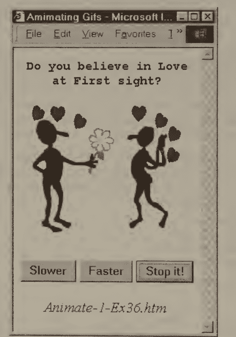

秘诀是将图片存储在一个数组中，然后快速连续地提取每张图片并显示一定毫秒数。但在我们讨论数组之前，可以先看一种简单的方法。

## `Image`对象

我们从在页面加载时显示第一张图片开始：

``

通过 JavaScript 代码，反复将不同的图像赋给上述图像标签的`SRC`属性，我们可以实现图像动画。`src`是图像对象的一个属性。因此，我们需要创建一个新的图像对象，以便能够访问其`src`属性并赋值一个图像。

> （我们在第 11 章处理 Date 对象时也做了类似的事情，当时我们需要操作各种 Date 方法。对象有方法和属性。但有些对象，比如图像对象，没有方法，只有属性。有些对象有事件处理程序，有些没有。我们稍后会研究图像对象的其中一个事件处理程序。）

新的图像对象由`new`运算符创建，我们之前在创建新的 Date 和 String 对象时已经用过它。

```javascript
image1 = new Image()
```

现在我们有了一个新图像对象，就可以访问其`src`属性并为其赋值任意图像：

```javascript
image1.src = "Love-1.gif"
```

以下代码将创建五个图像对象，并通过各自的`src`属性为每个对象赋值一个图像：


```javascript
// 创建图像对象
image0 = new Image()
// 将图像赋给其 src 属性
image0.src = "images/Love-0.gif"

// 重复处理其余图像
image1 = new Image()
image1.src = "images/Love-1.gif"
image2 = new Image()
image2.src = "images/Love-2.gif"
image3 = new Image()
image3.src = "images/Love-3.gif"
image4 = new Image()
image4.src = "images/Love-4.gif"
```

## 预加载图像

显然，我们不希望在页面加载时所有五张图片都显示在网页上。我们也不想强迫浏览器每次想要重新显示一张新图像时，都必须通过`互联网`去获取它。那会花费极长的时间！

诀窍是在页面显示`之前`加载并存储所有图像，这样无论何时我们需要使用它们，它们都能瞬间出现。这称为`预加载`。预加载的图像由浏览器安全地存储在计算机内存中，直到需要时才取出。

具体如何操作呢？很简单，只需将第 223 页的代码放在文档的`<HEAD>`标签内的`<SCRIPT>`标签中即可。就这么简单。

当浏览器读取网页`<HEAD>`中的代码时，它会获取每张图像并将其安全地存储在`缓存`内存中，以便在需要时访问。

然而，上述代码比较笨拙。我们需要的是一种简单的机制，让我们能更容易地引用每张图像。这可以通过使用`数组`来实现。我们到目前为止还没有讲过数组，但它是任何编程语言的重要组成部分。我们暂时需要离题讨论一下数组，然后再回到我们的练习，看看数组如何帮助我们从缓存内存中提取每张图像。

## 列表或数组

我们所有人都会时不时地列清单：

- 购物清单
- 婚礼邀请宾客名单
- 待办任务清单，等等。

在购物清单中，每一项都是不同的，但它们都与我们需要购买的东西相关。婚礼宾客名单中的每个人都是不同的，但他们的共同点是我们都想邀请他们参加婚礼。

购物清单看起来大概是这样的：

1. 黄油
2. 牛奶
3. 猫粮
4. 水壶除垢剂

等等...

JavaScript 有`数组`，它实际上就是一系列以某种方式相关联的单个项目的列表。在加载网页时，浏览器会创建许多数组。例如，我们所有的图像都存储在一个`图像数组`中。（我们将创建我们自己的图像数组。）

我们使用的所有表单也同样存储在一个`表单数组`中。当使用锚点标签时，有一个数组用于存储我们所有的超链接。实际上，字符串文本`'The Owl and the Pussycat went to sea'`，在第 196 页的`indexof-1.htm`中使用过，将存储在一个`字符串数组`中。每个字符，包括空格，都根据其在数组中的位置编号。这就是 JavaScript 如何能够找出字符的位置及其索引，从而返回其位置的方式。

在上面的购物清单中，我们可以将`猫粮`称为列表中的第三项。`'The Owl'`中的`'w'`将位于字符串数组的第六个位置，索引号为 5！

数组在编程中扮演着基础性的角色。从计算机早期发展至今，它一直是程序员将相关信息存储在计算机内存中的手段，也是他们引用或查找列表中某一项目（而非其他项目）的方式。这是程序员跟踪数据存储位置的一种简单而有效的方式。变量也存储数据，但它们只包含`单个`项目。当需要将`多个`项目放在一起时，就会使用数组。

这正是我们需要对图像做的事情。将它们全部存储在一个数组中，然后分别访问每张图像进行显示。

与我们不同，浏览器和 JavaScript 从零开始存储项目，而不是从一。这些数字被称为`索引`，每个索引号对应数组中的一个元素。每个索引都用`方括号`括起来，放在数组名后面。因此，我们的第一张图像可以通过以下方式引用：

```text
theImages[0] 引用 Love-0.gif。
```

在页面加载过程中，浏览器在一个内部数组中跟踪其加载的所有图像。在加载每张图像时，它都会存储在网页上所占的位置。因此，第一张图像加载到图像数组的索引 0 位置，第二张加载到索引 1 位置，依此类推。那么，这与我们的网页图像动画有什么关系呢？

由于干扰浏览器的内部图像数组是不明智的，我们首先必须创建自己的数组。然后我们可以将图像存储在这个数组中，并使用索引号来操作它们。以下是创建数组的方法。

```javascript
theImages = new Array(5);
```

我们使用`new`运算符和`Array`对象来创建一个名为`theImages`的数组。`Array`对象指定为数组预留多少内存位置。我们有五张图像，所以我们需要一个有五个位置的数组。我将原始图像命名为：`Love-0.gif`到`Love-4.gif`。`theImages`数组看起来像这样：

| theImages 数组的内容 | 索引 |
|---|---|
| Love-0.gif | [0] |
| Love-1.gif | [1] |
| Love-2.gif | [2] |
| Love-3.gif | [3] |
| Love-4.gif | [4] |

但是，我们如何将每张图像存储到我们自己的`theImages`数组中呢？通过一个简单的赋值语句。

```javascript
theImages[0].src = "Love-0.gif"
...
theImages[4].src = "Love-4.gif"
```

然而，重要的是，数组中的每个元素都必须被创建为`图像对象`，这样我们才能引用其`src`属性。实现方法如下：

```html
<HEAD>
<SCRIPT>
//预加载要动画的图像
// 首先创建一个数组来容纳我们的五张图像
theImages = new Array(5);

// 现在将第一个元素创建为图像对象
theImages[0] = new Image()

// 然后将图像赋给其 src 属性
theImages[0].src = "Love-0.gif"

// 对数组中的每个元素重复此操作
theImages[1] = new Image()
theImages[1].src = "Love-1.gif"
theImages[2] = new Image()
theImages[2].src = "Love-2.gif"
theImages[3] = new Image()
theImages[3].src = "Love-3.gif"
theImages[4] = new Image()
theImages[4].src = "Love-4.gif"
</SCRIPT>
```

我们所做的是将每个数组元素创建为图像对象，以便我们可以指定其`src`属性的值。但与其重复上述所有代码（总共十行），我们使用一个`for`循环将代码精简为三行。

> （注意使用连接运算符，通过`for`循环索引变量`i`将数字连接到每个图像的名称中。）

```javascript
for (i=0; i<5; i++) {
    theImages[i] = new Image();
    theImages[i].src = "Love-" + i + ".gif";}
```

我们可以使用数组名和`for`循环内的索引值来引用这个数组。这是一段极其高效且简短的代码。注意`for`循环的索引变量`i`如何不仅用于引用数组索引，还用于每个图像名称中的数字。现在我们已经将所有图像预加载到一个数组中，当需要时我们可以从中检索它们。

## `setTimeout()`

我们需要看的最后一项内容是用于重复显示图像的机制。这可以通过`setTimeout()`来实现，它是 window 对象的一个方法。（此方法可以赋值给一个变量，然后该变量可以被`clearTimeout()`方法使用。参见下面的`备注`。）

```javascript
abc = setTimeout('expression', delaytime)
```

`expression`是一个包含 JavaScript 代码的字符串，该代码将在`delaytime`过后执行。后者必须以毫秒为单位。

在下面的代码中，当浏览器遇到``标签时，`onLoad`事件处理程序在设定时间过后调用`animate()`函数。本质上，此函数将一个新图像赋给名为`animation`的图像对象的`src`属性。

## 14：图片动画

```html

```

我们现在已具备编写代码所需的所有元素，这些代码将使我们的图片动起来。

## 练习 36：回顾

现在，我们将详细研究以下代码，并综合我们讨论过的所有要点。

```html
<HEAD><TITLE>Aminating Gifs </TITLE>
<SCRIPT LANGUAGE="Javascript">
delay = 500; imageNum=0;
//Preload animated images
theImages = new Array(5);
for (i=0; i<5; i++) {
    theImages[i] = new Image();
    theImages[i].src = "Love-" + i + ".gif";}
// End of pre-loading
function animate() {
//assign another image from the image array
document.animation.src = theImages[imageNum].src;
imageNum++;
if (imageNum > 4) {
    imageNum = 0;
    } // EofIF
} // EoFn animate()
function slower() {
delay = delay + 100;
if (delay > 4000) delay=4000;
} //EoFn slower()
function faster() {
delay = delay - 100;
if (delay < 0) delay=0;
} //EoFn faster()
</SCRIPT>
</HEAD>
```

```html
<BODY>
<B><TT>Do you believe in Love at First sight?
</TT></B><P>

<FORM NAME=form1>
<INPUT TYPE=button Value=Slower
    onClick="slower()">
<INPUT TYPE=button Value=Faster
    onClick="faster()">
</FORM>
<ADDRESS>Animate-1-Ex36.htm</ADDRESS>
</BODY>
```

**说明：**

1. 当页面加载时，浏览器将执行`<HEAD>`中的`<SCRIPT>`代码。这首先是为`delay`和`imageNum`这两个全局变量赋值，然后创建一个包含五个元素的数组。

```javascript
delay      = 500;
imageNum   = 0;

//Preload animated images
theImages  = new Array(5);
```

随后的`for`循环通过为每个元素创建一个图像对象，并将五个图像之一分配给该对象的`src`属性，从而将我们的图像预加载到这个数组中。请注意这段代码是多么简洁。

同样值得注意的是如何使用`连接`运算符，利用`for`循环的索引变量`i`，将图像数字（0、1、..、4）添加到每个图像名称中：`Love-0.gif`、`Love-1.gif`等。这是对`for`循环的巧妙运用。

```javascript
//Preload animated images
theImages = new Array(5);
for (i=0; i<5; i++) {
    theImages[i] = new Image();
    theImages[i].src = "Love-" + i + ".gif";
}
```

三个函数`animate()`、`slower()`和`faster()`由浏览器存储起来以备后用。

2. 在`<BODY>`中，我们显示第一张图像。由于大多数 HTML 元素（标签）都是 JavaScript 对象，因此``标签也是一个具有`src`属性的对象。该标签还有一个`onLoad`事件处理程序。

正是这个处理程序调用了`setTimeout`方法，而`setTimeout`方法又会在延迟 500 毫秒（½ 秒）后调用`animate()`函数。

```html

```

请记住，延迟时间是在`<HEAD>`的`<SCRIPT>`标签中设置的：`delay = 500;`

3. `animate()`函数将图像数组中保存的一张图像赋值给文档的`animation`图像对象的`src`属性。最初，由于脚本开始时`imageNum`被设置为零，所以这将是索引 0 关联的那张图像。

```javascript
document.animation.src =
           theImages[imageNum].src;

imageNum++;
```

变量`imageNum`使用`自增运算符`增加了 1。

下一段代码测试`imageNum`是否大于 4，因为图像数组中的五张图像编号为 0 - 4。如果条件为真，其值将重置为零，以便可以按顺序重新显示这五张图像。如果`imageNum`不大于 4，则什么也不会发生。无论哪种情况，函数都将停止。

那么`animate()`函数是如何被第二次、第三次等调用的呢？我们可以理解，当 Love-0.gif 图像首次加载时（浏览器显示网页时），它就会被自动调用。

实际上，每次通过`animate()`函数加载新图像时，``标签的`onLoad`事件处理程序都会再次被触发。请跟踪代码以验证这一点。

4. 我们添加了一个`slower`按钮和一个`faster`按钮。它们有事件处理程序，分别调用`slower()`函数和`faster()`函数。

```javascript
function slower() {
delay = delay + 100;
if (delay > 4000) delay=4000;
} //EoFn slower()
```

上面的函数在每次点击`slower`按钮时，只是将延迟时间增加 100 毫秒。

```javascript
function faster() {
delay = delay - 100;
if (delay < 0) delay=0;
} //EoFn faster()
```

上面的函数在每次点击`faster`按钮时，从延迟时间中减去 100 毫秒。但是，我们需要确保它不会低于 0。（请注意，省略`if`代码块周围的花括号会导致阅读困难。这不是良好的实践！）

5. 最后，我们**没有**礼貌地允许用户停止动画。如果我们不想把读者逼疯，就应该包含一个停止功能。这将作为一个测试练习留给你完成。你需要使用`clearTimeout()`方法，其工作方式如下：

```javascript
clearTimeout(setTimeoutID)
```

它接受一个参数，并将取消`setTimeout()`代码的执行。回想一下我们之前说的：`setTimeout`可以赋值给一个变量。该变量就是用作`clearTimeout()`方法参数的那个变量。

```javascript
onLoad = "stopit = setTimeout( 'code',
                     delaytime)"
....
... clearTimeout(stopit)
```

### 区域热点

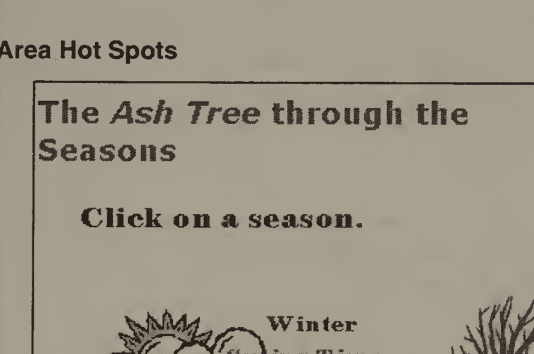

在上面，我们创建了一些热点，点击后会将图像更改为另一个季节，如下一页所示。另外，请注意我们如何显示文本几秒钟——"点击一个季节。"——然后使用 window 对象的`setTimeout()`方法再次将其隐藏。文本被创建为一个图像文件，`ashtext.gif`。

## 14：图片动画

四季中的白蜡树


```html
ash-tree.htm
```

我通过用一个空图像替换它来清除了图像文本。用户点击了秋季热点，将图像更改为秋季的白蜡树。以下是代码。


```html
<head>
<title>Ash Tree through the Seasons </title>
<script language="Javascript">
function change(season) {
  if (season == "winter") {
    document.img1.src="images/winter-tree.gif";
  } //EofIF
  if (season == "spring") {
    document.img1.src = "images/spring-tree.gif";
  } //EofIF
  if (season == "summer") {
    document.img1.src = "images/summer-tree.gif";
  } //EofIF
  if (season == "autumn") {
    document.img1.src = "images/autumn-tree.gif";
  } //EofIF
} //EoFn change()
function showit() {
document.hideimage.src="images/ashtext.gif";
setTimeout('hideit()',3000);} // EoFn
function hideit() {
document.hideimage.src="images/notext.gif";
} // EoFn
</script>
</head>
<body onload="x=setTimeout('showit()',2000)">
<h2>The <i>Ash Tree</i> through the Seasons</h2>

<table width="100%">
<tr> <td width="40%">

</td>
<td width="50%">

</td>
</table>
<a name="stay"> </a>
<map name="ashtree">
<area href="#stay"
      alt="The Winter Look"
      shape="rect"
      coords="150,46,203,55"
      onclick="change('winter')">
<area href="#stay"
      alt="The Spring Look"
      shape="rect"
      coords="123,66,225,73"
      onclick="change('spring')">
<area href="#stay"
      alt="The Summer Look"
      shape="rect"
      coords="125,90,227,100"
      onclick="change('summer')">
<area href="#stay"
    alt="The Autumn Look"
    shape="rect"
    coords="159,113,239,123"
    onclick="change('autumn')">
</map>
<address>ash-tree.htm</address>
</body>
```

页面加载后，`setTimeout()` 方法会在 2 秒后调用 `showit()`。该函数将一个新图像重新分配给名为 `hideimage` 的图像。技巧在于页面在标题后首次加载时放置了一个名为 `notext.gif` 的空图像。这只是一个具有给定大小的透明 gif 图像。同样大小的图像包含一些文本，并以 `ashtext.gif` 为名保存。必须使两个图像大小相同，以防止网页尺寸跳动。

### 我们学到了什么

我们了解了如何通过快速连续地重复显示一系列图像来制作图像动画。我们看到了数组在存储图像方面多么有用，这样我们就可以使用数组的 `index`（索引）号引用其中任何一个，并且编号从零开始。

我们发现浏览器将许多 HTML 元素存储在内部数组中（表单、锚点、图像、字符串等等）。这些数组背后的理念是，当浏览器需要刷新屏幕时，它拥有所需的全部信息。

要动画显示的图像应该被预加载，这样当它们被动画需要时，可以即时访问，而无需通过互联网检索它们。

## 14：图像动画

事实证明，`for` 循环是将图像分配到数组的一种高效编程工具。我们看到它的索引变量可以用来引用数组中的任何一个索引号。

使用窗口的 `setTimeout()` 方法允许我们控制每个显示图像的时间。它有一个配套方法 `clearTimeout()`，可以停止 `setTimeout()` 代码的执行。

既然我们理解了 `setTimeout()` 函数的工作原理，我们就可以用它来创建一个实时时钟。先在练习 14.5 中自己尝试一下，然后看看我在“练习答案”章节中的尝试。

### 术语

**数组（array）：** 这是计算机内存中的一个内部存储区域，可以在需要时存储和检索数据。它是 JavaScript 1.1 核心语言的一部分。

用户定义的数组是通过使用 `new` 运算符和 `Array` 对象创建的。

```javascript
arrayName = new Array(10)
arrayName = new Array("fire", "water",
                    "earth", "wind")
```

当创建一个数组时，除非你像上面第二个例子那样赋值，否则所有元素最初都设置为 `null`。数组的任何元素都可以通过以下两种方式中的任何一种来引用——在两种情况下都是第 4 个元素：

```javascript
arrayName[3]
arrayName["wind"]
```

**缓存（cache）：** 一个特殊的内存区域，应用程序在其中存储自己使用的数据。

**预加载（pre-load）：** 例如，在网页完全显示之前加载图像。在动画播放之前加载图像有时会更方便。

### 练习：第 14 章

14.1. 在练习 36 中添加一个额外的按钮，允许用户停止动画。[提示：`clearTimeout()` 方法应该放在哪里？]

14.2. 将新图像分配给图像数组对象的 `src` 属性需要哪些步骤？[提示：你应该有三个步骤。]

14.3. JavaScript 代码中使用了三种类型的括号：`{}`、`[]` 和 `()`。举一个每种括号使用场景的例子。

14.4. 有多少种方法可以让你创建并打开的窗口自行关闭？

14.5. 使用 `setTimeout()` 函数创建一个实时时钟。[提示：我们需要使用这个方法，以便时钟可以每秒（1000 毫秒）更新一次。]

## GIF、JPEG、TIFF 图像

只要图像采用以下两种格式之一，`.gif` 或 `.jpeg`，浏览器就能显示它们。如果你感兴趣，请继续阅读。

- 选择哪种格式
- 为什么它们是为网页发明的
- 理想的图像尺寸是多少
- 为什么有些图片会失真
- 什么是*隔行* GIF 图像

我们从互联网速度开始，来解释这些格式为何被发明。

### 网页图像文件的速度与大小

创建网页文档时，一个需要牢记的重要因素是其整体大小，因为这会影响加载时间。一个 HTML 页面通常由两个要素组成。首先是基本的 HTML 代码以及任何 JavaScript，其次是图像文件。与页面需要加载的任何图形文件相比，HTML 源代码通常非常小。源代码可能只有 1K，但一个图像很可能超过 25K。

目前，大多数互联网用户¹仍然通过 28.8K 字节/秒的调制解调器从家中连接。如果你认为以那个速度，一个包含图像文件的 50K 字节的网页需要大约 2 秒加载，那也是情有可原的。不幸的是，一个 50K 字节的网页并不是作为一个单一单元以连续字节流发送的。一小部分数据（通常是 256 字节）会被发送，但下一部分数据可能要等到几秒钟后才到达，这取决于主机服务器需要处理的流量。（关于互联网和 WWW 的参考书，请参见参考文献。）

人们认识到，一个超过 50K 字节的网页在普通客户端屏幕上加载和显示的时间是令人无法接受的。一个网页的理想大小约为 25K 字节（实际上*到达*时间才是重要的考虑因素）。

接下来我们讨论浏览器必须加载的图像文件的大小和格式。

### 扫描图像

假设我们扫描了一张要显示在网页上的照片。扫描原始照片后，计算机化的图像必须作为单独的文件保存。

¹ 如果你是在使用高速直连线路的公司内部网工作，情况可能有所不同。

但我们用什么格式保存呢？如果你认为是 `gif` 或 `jpeg`，那你就错了。许多扫描仪无法保存为这些格式。最佳的保存格式是 TIFF（*标签图像文件格式*），它得到大多数扫描仪的支持。为什么？因为它是一种行业标准。几乎所有程序（浏览器除外）都可以读取保存为 TIFF 文件的图像；例如 Word、PowerPoint、Excel 和所有图像程序，如 PhotoShop。后者是另一种行业标准，超过 90% 的专业人士使用它来修饰图像。

通过图像处理程序之一改进了我们的原始照片后，该程序会为我们提供将图像保存为 `jpeg` 或 `gif` 格式的选择。

### TIFF、JPEG 与 GIF 图像格式

大多数扫描仪可以将图像保存为 TIFF 格式——*标签图像文件格式*——质量非常高。然而，生成的文件（扩展名为 `.tif`）可能达到兆字节大小，太大而无法通过互联网传输。因此，要通过互联网传输这些文件，必须使用各种 Web 编码技术将其*压缩*（减小大小）。图像程序会为我们进行这种压缩。

在开发 HTML 时，人们就知道用户无法忍受 TIFF 文件加载所需的时间。因此，专门为在 Web 上使用而设计了另外两种图像格式：`GIF`（图形交换格式）和 `JPEG`（联合图像专家小组），后者在 PC 上的扩展名为 `.jpg`。

### GIF

图形交换格式文件最初于 1987 年设计，文件扩展名为 `.gif`。这是一种所有图形 Web 浏览器都能识别的格式。当图形图像是徽标、图标或横幅，且颜色细节变化不大时，它特别有用。它可以存储黑白、灰度和彩色图像，尽管每张图像仅限 256 种颜色。当需要*透明*图像时也很有用。这允许网页上的任何背景颜色透过透明区域显示。它还支持*隔行*。通常，图像是从上到下逐行构建像素的。隔行是一种技术，通过该技术，图像的线条组被显示出来，分散在整个图像中，从而让观看者从一开始就能以越来越清晰的细节看到整个图像的“全貌”。

它的工作原理如下。当整个图像解压缩后，它会进行四次扫描，形成四组扫描线。在表 14.1 中，我们有 20 行。这是一个小图像，但它将说明这个过程。

| 扫描次数 | 过程 |
|:---|:---|
| 第一次扫描： | 从第 0 行开始，每隔 8 行 |
| 第二次扫描： | 从第 4 行开始，每隔 8 行 |
| 第三次扫描： | 从第 2 行开始，每隔 4 行 |
| 第四次扫描： | 从第 1 行开始，每隔 2 行 |

### JPEG

联合图像专家小组是专为存储摄影图像而设计的一种格式。其文件扩展名为 `.jpeg` 或 `.jpg`。它具有 24 位色深，应在必须保留高水平色彩和细节时使用，例如摄影图像。

一般来说，对于摄影图像，JPEG 格式优于 GIF。质量更好，并且通过其更复杂的压缩技术，生成的文件比等效的 GIF 版本更小。

将图像保存为 JPEG 格式时，一些图像程序允许选择*渐进式*选项。它等同于 GIF 的隔行格式。

| 行号 | 隔行扫描次数 |
|:---|:---|
| 0 | 1 |
| 1 | 4 |
| 2 | 3 |
| 3 | 4 |
| 4 | 2 |
| 5 | 4 |
| 6 | 3 |
| 7 | 4 |
| 8 | 1 |
| 9 | 4 |
| 10 | 3 |
| 11 | 4 |
| 12 | 2 |
| 13 | 4 |
| 14 | 3 |
| 15 | 4 |
| 16 | 1 |
| 17 | 4 |
| 18 | 3 |
| 19 | 4 |

**表 14.1：隔行扫描次数**

### PNG

我们将提到的最后一种格式是便携式网络图形（`.png`）。与 GIF 一样，它支持透明度、隔行和图像压缩。它比 GIF 具有更好的色彩质量，那么为什么我不再使用 PNG 图像了呢？问题是 Navigator 和 IE 显示颜色的方式不同。相同的图像在 IE 中通常看起来比在 Netscape 中暗得多，以至于细节变得模糊。自己试试看，然后做出你的判断。

## LZW：GIF 的压缩技术

GIF 文件以压缩格式存储图像数据。浏览器在显示之前会先“解包”该文件。用于创建 GIF 文件的压缩技术称为 LZW（来自*莱姆佩尔*和*齐夫*，他们在斯佩里公司进行了早期研究工作，以及他们的同事*韦尔奇*，他完善了该技术——最初是为了更高效地利用硬盘）。

LZW 是一种基于字典的数据压缩技术。它会检查图像中重复出现的模式，建立一个包含这些模式的字典，并为每个模式使用一个简短的代码。每当相同的模式再次出现时，就会用该代码替换。这实际上压缩了文件。当浏览器解压文件时，会用真实数据重新替换代码。

解压后的文件是压缩前数据的精确副本。这称为*无损*压缩，因为原始文件不会丢失任何原始数据。虽然以下是一个简化说明，但让我们假设有 20 个红色像素的区域，这可以编码为 `20R`。另一个 20 个红色像素的区域也可以编码为 `20R`，这样只需三个字节（每个字符 2、0、R 各占一个字符），而不是二十个字节。

LZW 压缩对于具有规则的大图案或长段相同颜色的图像效果最佳，例如公司徽标、图标和按钮。然而，对于像素颜色频繁且不可预测地变化的照片，GIF 文件压缩效果不佳，会导致文件很大，因此需要使用 JPEG 格式。

### JPEG 压缩

彩色照片保存为 JPEG 格式时，可以缩减到原始文件大小的十分之一或十五分之一。该过程称为*离散余弦变换*，结果是一个以余弦波表示的频率图。更糟糕的是！:)——涉及*量化系数*。如果你对此感兴趣，我建议你从网络上查找更多信息。但最终结果是一些原始数据的丢失——称为*有损*，与 GIF 文件的*无损*或*非有损*不同。

### GIF 与 JPEG 对比

当你有选择权时，图像应该保存为哪种格式？在某些情况下，这是一个妥协的问题。

GIF 文件是*无损*的，因为它们不会丢失任何原始图像数据。JPEG 文件是*有损*的，因为在压缩的量化阶段会丢弃一些数据，且无法重新构建。

GIF 限制为 256 色，而 JPEG 可以支持 1600 万色。然而，后者在只能显示 256 色的显示器上无法很好地再现。

GIF 文件可以隔行扫描，JPEG 文件不行。（然而，有一种 JPEG 的变体——*JPEG 瓦片图像金字塔*（JTIP），可以像波浪一样在屏幕上显示连续更详细的渲染。这称为*渐进式 JPEG*。）

GIF 文件应包含大面积相同颜色的图像，例如：

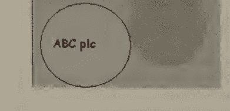

## 14：动画图像

GIF 文件可以设置为*透明*，JPEG 文件目前不行。1989 年修订的 GIF 格式——GIF 89a，允许将像素定义为透明。

通常没有大面积相同颜色但颜色*连续*的彩色照片，应保存为 JPEG 格式。例如，我将一张照片同时保存为 GIF（245KB）和 JPEG（44KB）。JPEG 在显示器屏幕和打印机上的再现效果都稍好一些，而且文件小得多。GIF 文件更大，因为它没有大的重复模式可以被有效地压缩到字典中。

### 抖动

计算机系统（*平台*）之间最明显的区别是颜色。然而，我们可以轻松调整这一点。如今大多数彩色计算机至少可以显示 256 种不同的颜色，通常有数千甚至数百万种颜色。这个数量由计算机类型、显示器的大小和分辨率，以及计算机内置的视频 RAM（VRAM）数量决定。大多数当前计算机可以显示数百万种颜色。

计算机的调色板就是它可以同时在屏幕上显示的所有颜色。想象一位艺术家在画风景画。假设他/她有 256 管颜料，每一管都是独特的颜色。如果需要一种与任何管中颜色略有不同的颜色，可以使用两管或更多颜料混合来创造所需的颜色。

当计算机混合两种或更多颜色来创造新颜色时，称为*抖动*。计算机屏幕将来自其调色板的颜色点（称为像素）放在屏幕上，非常靠近，希望欺骗你的眼睛，让你看到统一的颜色。

不幸的是，这并不总是按计划工作。通常这些抖动图形看起来会如此颗粒感，以至于像素变得过于明显。颜色更多的计算机更有可能拥有所需的确切颜色，并能更逼真地模拟额外的颜色，因此抖动变得不那么明显。但即使如此也并没有那么简单！☺

三个主要平台（Mac、PC 和 UNIX）都有各自独特的 256 色调色板。Mac 和 PC 平台共享 256 色调色板中的 216 种颜色，但 UNIX 调色板共享的颜色要少得多。因此，如果你的图形在 PC 上看起来很棒，但如果在 Mac 上使用 Mac 调色板不共享的颜色，它在 Mac 上看起来就会全是抖动的。

始终使用 216 种 Mac 和 PC 共享的颜色是个好主意，这样至少可以避免在这些平台上出现抖动。

### 透明

透明度允许图像中的一种颜色（黑白图像包括黑色和白色）变为透明。这使得背景颜色可以透过来。这可以在前面的插图中看到。

每个图像都包含在一个矩形边框内。为了隐藏这个框并让背景显示出来，我们需要使背景透明。

如果没有透明背景，图像的边框框就会显示出来，除非它恰好是背景的精确颜色，但这是不太可能的。

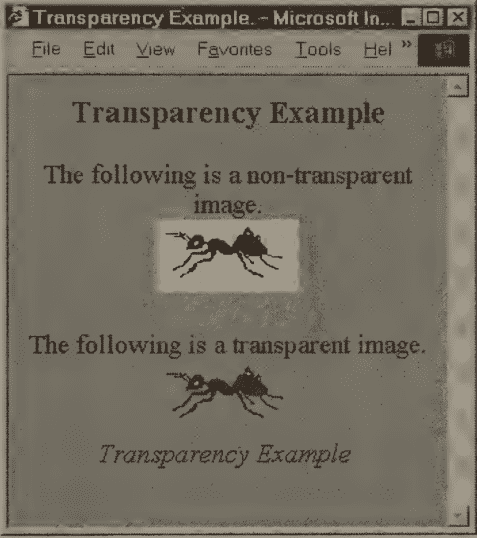

## 第十五章：更多编程语句

在本节中，我们将研究 JavaScript 编程语言的其他一些方面。并非总是能够给出其实际应用的示例，因此留给读者记录语法，并在需要时使用它们。

### 循环语句

我们已经见过 `for` 循环，但还有 `while` 循环。循环用于重复执行一段代码，直到满足某个条件。此外，可以在循环内使用 `break` 和 `continue` 语句。

#### while 语句

只要指定条件的计算结果为 `true`，就重复循环。它看起来如下：


```javascript
while (condition) {
    ... 当条件为 true 时要执行的语句 ...
} // while 结束
... 继续执行的语句 ...
```

当条件变为 false 时，循环内的语句停止执行，控制权传递给循环后面的语句，即上面的“继续执行的语句”。

条件在第一次遇到`while`循环时进行测试。如果为`true`，则执行循环语句。当遇到闭合的大括号时，再次测试条件以确定是否重复执行。

`for`循环和`while`循环之间的主要区别在于`初始化`、`条件`和`增量`语句放置的位置。在`for`循环中，这三者都包含在圆括号内：

```javascript
for (初始化; 要测试的条件; 增量)
{ 语句 }
```

在`while`循环中，它们通常放置如下：

```javascript
初始化;
while (要测试的条件)
{ 要执行的语句;
    增量; }
```

> **警告**：如果`while`循环体内没有增量语句，可能会导致无限循环。

可享受折扣。

**示例 1**：以下`while`循环只要`n`小于三就会迭代：

```javascript
x = 0;
n = 0;          // 初始化控制变量
while( n < 3 ) // 条件
{ n++;        // 增量 - n=n+1
    x += n;   // 简写：x=x+n
} // while 结束

... 继续执行的语句，如果有的话。例如 ...
    alert("X 已变为 " + x)
```

每次迭代，循环都会递增`n`并将该值加到`x`上。因此，`x`和`n`的值如下：

- 第一次通过后：`n = 1`且`x = 1`
- 第二次通过后：`n = 2`且`x = 3`
- 第三次通过后：`n = 3`且`x = 6`

After completing the third pass, the condition `n<3` is no longer true, so the loop terminates.

**示例 2：无限循环：** 确保循环中的`条件`最终会变成 false，否则循环永远无法终止。下面`while`循环中的语句会永远执行，因为条件永远不会变成`false`。这里使用了布尔运算符`true`。

```javascript
while (true) {
         alert("Hello, world"); }
```

`while`循环的条件语句可以是任何可以求值为 true 或 false 的 JavaScript 代码。

### do-while 循环

这在 JavaScript 1.2 中已被包含。你需要指定：`<SCRIPT LANGUAGE="Javascript1.2" >`。

`while`和`do-while`的主要区别在于，后者始终会至少执行一次循环指令，这仅仅是因为对条件的测试是在循环的`末尾`而不是在`开头`进行的。

```javascript
do
{statements to be executed}
while (condition);  // semi-colon is required!
... the carry on statements ...
```

**示例：**

```javascript
var i = 1;  // initialise
do {
  document.write(i + "<BR>") }
while (++i <= 10);  // increment and condition
```

这里的语法有一些奇特之处。`do-while`循环必须以分号结尾，因为与以花括号开始和结束的`for`和`while`循环不同，`do-while`结构的设置方式并不相同。`do`标记开始，`while`标记结束。

另外，请注意增量和条件都被包含在`while()`中的简洁方式，它利用了增量运算符。

不是有很多情况你总是希望循环中的指令至少执行一次。所以，总的来说，这是一个很少使用的特性。请注意，在某些版本的 Navigator 4 中，`continue`语句在`do-while`中使用时会导致错误。

### break 语句

如果在`for`和`while`循环中遇到`break`语句，它将始终把控制权（接下来执行哪条指令）转移到循环后的语句。同样，可能出现这种情况的场景很少，但它们确实会不时发生，所以值得了解。

它通常嵌入在`if`语句中，如下所示：

```javascript
function test()
{
  var i = 0;          // initialise while
  while (i < 10) // while condition
  {
    if (dothis() == false)
    {
      alert(i + "Hallo! from IF.");
      break; // exit while loop
    }
    else
    {
      alert("Hallo! from ELSE.");
      repeat_something();
    } // end of if & else
    i++; // the increment for while
  } // end of while
  document.write("Now for your big break!");
} // EoFn test
```

如果`dothis()`函数返回`false`，`break`语句将终止`while`循环，按照代码的设定，这将输出消息："Now for your big break!"

如果它返回`true`，则执行`else`部分，`i`将被递增。这迫使`while`语句再次测试其自身的条件，只要`i<10`，`while`代码就会重复执行。

### continue 语句

`continue`语句在`for`或`while`循环中的行为与`break`语句不同。它不会退出循环，而是会用新的迭代重复循环。与`break`语句一样，它的语法是一条单独的语句：

```javascript
continue;
```

当遇到`continue`语句时，它会停止当前迭代并开始下一次迭代。但是，请注意以下几点：

- 在`for`循环中，控制权会自动传递给增量部分，然后测试条件。
- 在`while`循环中，控制权直接传递给条件，所以你必须确保控制变量已经被递增。

下面是使用`continue`语句的示例。它通常用于控制函数的流程。我尽量保持简单，以便你能跟上逻辑。在实际应用中，函数会更复杂。我们想要做的是跟踪某人订购了多少商品，并在他们完成“购物”时显示总数。

请注意`continue`、`break`和`eval()`语句的使用。

```html
<HEAD>
<TITLE> Total items ordered </TITLE>
<SCRIPT>
function shopping() {
    totitems = 0;
    i=0; // initialise while condition
    while (i<20) { // no shoppaholics wanted
        more=confirm("Do you want anything else?");
        if (more == true)
        {   domore();
            i++;
            continue; // do they want more goods?
        }
        else
        {
            alert("You are now at the Checkout.")
        } // EofIF
        doreport(totitems);
        break; // stops while repeating
    } // End of While
    alert("Thank you for shopping at SADA.")
} // End of shopping()function

function domore() {
    x = prompt("How many items?", "");
    thisitem = eval(x); // converts text x to a number
    totitems = thisitem + totitems;
    return totitems;
} // End of domore() function

function doreport(totitems) {
    alert("You have ordered: " + totitems
          + " items.");
} // End of doreport() function
</SCRIPT>
</HEAD>
```

```html
<BODY>
<h3>Fill Up your shopping basket</h3>
<form method="" action="">
<input type="button"
       value="Add to shopping basket."
       onClick="shopping()">
</form>
<ADDRESS>while-continue.htm</ADDRESS> </BODY>
```

注释：

1. 当按钮被点击时，`shopping()`函数被调用。这将项目总数设置为零；初始化`while`控制变量并进入`while`循环。

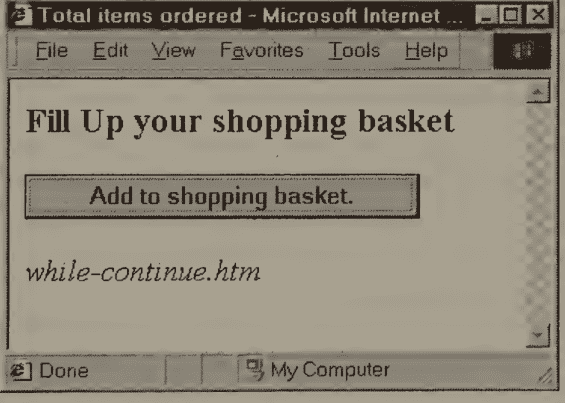

2. 我们限制了循环可以重复的次数，以防止购物狂走得太远。
3. `if`语句测试是否需要更多项目，如果为`true`，则调用`domore()`函数，控制变量递增，然后继续`while`循环。
4. 当`if`为 false 时，`else`将显示一个警告框，实际上是说账单将被计算。
5. 在上述任一情况下，都会调用`doreport()`函数。这会显示项目总数。`break`语句将在`doreport()`函数完成后执行。如果我们没有`break`，`while`循环会一遍又一遍地重复，重复 20 次，即使顾客不再想要任何项目。
6. `domore()`发出一个提示框，要求顾客输入所需商品的数量（在实际应用中，该函数会执行其他任务，如显示商品列表等）。输入的数字存储在变量`x`中，但请记住，它将是一段文本。因此，我们通过`eval()`方法将其转换为数值，并存储在`thisitem`中。我们将其加到已购买的项目总数中。
7. `doreport()`当然会计算购买的商品并要求付款详情等。
8. 请注意，没有任何变量前面有`var`关键字，因此它们的作用域是全局的（见第 119 页）。

## 做出更多决策

### else .. if

到目前为止，我们已经使用了`if`语句，有时将其与`else`语句一起使用。后者在`if`块为 false 时执行。这些允许执行**两种**操作之一。但假设你有超过两种可能性？那你需要使用`else-if`。例如：

```javascript
n = prompt("Enter a value in range 1-4.","")
if (n == 1)
 { alert("You entered 1.") }     // #1
else if (n == 2)
{ alert("You entered 2.") }   // #2
else if (n == 3)
{ alert("You entered 3.") }   // #3
else if (n == 4)
{ alert("You entered 4.") }   // #4
else
{ alert("Value " + n
       + " not in range.") } // #x
```

请注意，最后一条语句是单独的`else`。这用于说明当**没有任何**前面的条件满足时该怎么做。

### 条件运算符

这是一个你可能不想使用，但可能会在别人代码中遇到的奇怪东西。它有三个部分，是 JavaScript 中唯一的**三元**运算符。它是编写简单`if`语句的简写方式。

```javascript
x > 0 ? x*y : x*z
```

第一部分必须产生布尔值，通常是比较表达式的结果：`x > 0`，但也可能是函数返回的内容。

如果结果为 true，则执行`?`后的第二部分：`x*y`，否则，执行冒号后的第三部分：`x*z`。下面是对应的`if`语句：

```javascript
if (x>0)
  x*y;
else
  x*z;
```

### switch 语句

这是另一个深受认真程序员喜爱的决策特性。然而，它可能对

## 15：进阶编程

剩下的内容，你可能会在其他脚本中看到。其通用语法如下：

```javascript
switch (expression) {
  case x_1:
    .. 代码 ..
    break;
  case x_2:
    .. 代码 ..
    break;  如此继续，直到...
  default:
    .. 代码 ..
    break;
}  // switch 语句结束
```

当执行一个`switch`语句时，首先计算`表达式`，然后搜索与表达式值匹配的`case`标签。我们使用了`x_1`和`x_2`作为`case`的值。`case`标签由关键字`case`后跟一个`值`并以冒号结束：`case x_2:`。

这些值可以是整数或实数、字符串和布尔值。它们**不能**是对象、数组或函数。这限制了它的使用范围。

当找到匹配项时，执行该`case`内的代码。当遇到`break`语句时，整个过程停止。（注意`break`后的分号。）如果没有找到匹配项，则使用特殊的`default`分支。其代码将被执行，直到遇到`break`。如果不存在`default`分支，则整个 switch 代码块将被跳过。请注意，花括号将整个 switch 代码括起来，并且`default`分支不能包含关键字`case`。

假设你需要检查用户通过提示框输入的数字是否在给定范围内；我们假设范围是 1-5。根据输入值，需要调用特定的函数。

```javascript
userdata = prompt("Enter a number in the"
                + "range 1-5, please.", "");
usernum = eval(userdata);
switch (usernum) {
   case 1: // 如果是1，执行这个
      one();
      break;
   case 2: // 如果是2，执行这个
      two();
      break;
   case 3: // 如果是3，执行这个
      three();
      break;
   case 4: // 如果是4，执行这个
      four();
      break;
   case 5: // 如果是5，执行这个
      five();
      break;
   default: // 如果不在范围内，执行这个
      alert("Naughty!")
   break;
} // switch 语句结束
```

注意，我们使用`eval()`方法将提示框中输入的文本转换为数字。但是，我们也可以将其保留为文本，并简单地将`case`值更改为文本：

```javascript
case "1":, case "2":，等等。
```

### 一些真正怪异的东西！

C 编程语言是程序员为程序员开发的。我们都喜欢走捷径，程序员也不例外。接下来是一些为 C 开发的怪异捷径，它们被转录到了 JavaScript 中。

### 递增和递减运算符

**后缀**`i++`

等价于`i = i+1`，但在其他操作**之后**执行。

**前缀**`++i`

等价于`i = i+1`，但在其他操作**之前**执行。

### 尝试以下代码：

```html
<HEAD>
<TITLE> Tests </TITLE>
</HEAD>

<BODY>
<SCRIPT>
 i=0 // 将 i 设为零
 i = ++i
document.write("Prefix"
+ "<BR> a) i = " + i)
 i=0 // 重新将 i 设为零
 i = i++
document.write("<P>"
+ "Postfix <BR> b) i = "
+ i)
</SCRIPT>
<ADDRESS>
January, 2000 </ADDRESS>
</BODY>
```

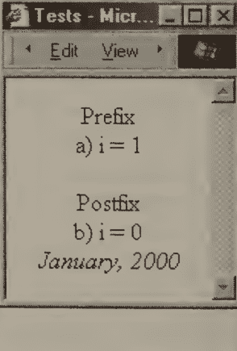

注意在 a) 和 b) 中，变量`i`都被设置为零。然而，a)中的前缀版本将`i`加 1，然后继续执行脚本的其余部分，而 b)中的后缀版本在再次遇到相同语句之前不会递增`i`。

任何变量名都可以使用，但由于 Fortran 的强烈影响，`i`是算术程序中最常用的变量名，而不是`x`！（在 Fortran 中，`i`是**整型**变量名，`x`是**实型**变量名。）

**前缀递减**`--j`和**后缀递减**`j--`

行为类似于递增，但从`j`中减去一。它不太常用，但在反向遍历数组时可能很有用。

**多重赋值：**`i = j = k = 89;`

这里，89 被赋给`k`，`k`（现在值为 89）被赋给`j`，`j`被赋给`i`。这或许值得记住。

还要注意，`for`循环可以接受多个初始化和递增语句，但每个语句必须用逗号分隔：

```javascript
for (j=1, p=3; j>=30; j++, p++) { ... }
```

事件处理程序也可以包含多个语句，但每个语句都需要一个结束分号：

```javascript
onClick= "one(); two(); three();"
```

**使用这些赋值语句节省时间：**


你可能会在别人的脚本中遇到这种用法，因此有必要了解它们。

`a += b` 等价于：`a = a+b`

`a *= b` 等价于：`a = a*b`

`a %= b` 等价于：`a = a%b`

如果你之前没有遇到过取模运算符，它返回第一个值除以第二个值整数次后的余数。`a %= b`

因此，`5 % 2` 结果为余数1。

`17 % 3` 结果为余数2。

### 条件

在 `if` 或 `for` 循环中使用条件测试时，以下语法是允许的：

```javascript
if ( (a+b) == x ) {.. 为真时执行 ..}
```

同样，使用函数返回值的方式也是允许的：

```html
<SCRIPT>
function test() { return 5; } // 函数结束
.......
if (test() == 5)
  { document.write("test() returned 5") }
</SCRIPT>
```

这可以使你的条件测试变得非常强大。

### 无操作

你还记得语句通常以分号结束吗？在许多语言中，有一个“无操作”语句，在 JavaScript 中，它就是单独的分号 `;`——通常称为空语句。它几乎没有实际价值，但可能成为错误的来源。下面这段粗心的代码中的 `if` 语句会做什么？

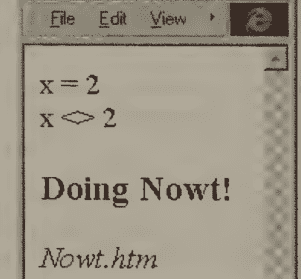

```javascript
x = 1;
if ( x == 1 ); // 天哪！IF 语句结束
document.write( " x = 2");
document.write( "<BR> x <> 2");
```

什么都不会做！它是完全合法的，这说明了程序员必须多么小心。如果你不够清醒，可能会不经意地多打一个分号。

两个 `document.write` 方法都会被执行。但是 `if` 语句现在什么都不做！

最后，让我们看看另外两个事件处理程序，它们可能在将来某个时候有用。

### `onAbort` 事件处理程序

在下面的例子中，当用户中止加载图像时（例如通过点击浏览器的停止按钮），会出现一条警告消息。

```html

<INPUT TYPE=submit VALUE="Send off form.">
<INPUT TYPE=reset  VALUE="Clear form."
       onClick="confirm('Are you sure?')">
</FORM>
```

注意重置按钮可以有 `onclick` 属性，而 `onReset` 事件属于表单标签。

## 第15章测试题

15.1 你能想到多少种循环类型？

15.2 在一个使用 `else..if` 的 `if` 语句中，单独的 `else` 语句的目的是什么？

15.3 `for` 循环和 `while` 循环在语法上的主要区别是什么？

15.4 这个特性称为什么：`--j`？

15.5 未定义（`undefined`）的变量和具有空值（`null`）的变量有什么区别？

# 第十六章：对象——它们的属性与方法

我们已经多次提到 JavaScript 的语言包含三个部分：

- 核心语言
- 客户端扩展
- 服务器端扩展

第9章和第15章探讨了 JavaScript 语言的核心部分。这些部分使我们能够创建可以执行以下操作的程序：

- 使用算术运算符执行计算
- 决定接下来执行哪条指令（`if-else`）
- 重复执行一段指令（`while`、`for` 循环）

像所有编程语言一样，JavaScript 包含变量、数组和运算符。但 JavaScript 还有更多！

基本核心语言的客户端和服务器端扩展允许程序员操作浏览器（客户端）功能和服务器功能。本书的大部分内容都探讨了 JavaScript 的客户端功能。对象就存在于这里。

客户端（当然也包括服务器端）JavaScript 是一种面向对象的、有些人会说是基于对象的编程语言。这仅仅意味着程序员使用对象进行工作。

## 16：属性与方法

在本章中，我们将重点讲解对象及其属性、方法和事件处理程序。并非所有对象都具备这三者，有些对象没有属性只有方法，有些对象有属性但没有方法。有些对象既有属性也有事件处理程序。现在是时候梳理一下哪些对象拥有什么了。但首先，什么是对象？

### 什么是对象？

在日常生活中，我们随处可见各种对象——水壶、门、椅子、汽车，甚至电脑。让我们以汽车为例。

在这里，我们需要从哲学层面稍作探讨。实际上并不存在所谓的“汽车”或“椅子”这样的“事物”。我在学习哲学时，听到这个说法感到很惊讶。不过这种冲击被缓和了。

我们都对汽车有一个概念，但作为概念本身，它并不存在于物理世界中。实际存在的是汽车的特定实例。这意味着一辆汽车的给定实例必须具有某些属性，比如颜色、品牌、型号等，同时还必须以类似汽车的方式运行。它必须执行“汽车该做的事”，比如前进、后退、加速或减速、转弯、停车。这些构成了它的功能性——也就是汽车所做的事情。你还能想出更多。

当一款新车型首次展出时，即使我们以前从未见过它，我们也知道它是一辆汽车。这是因为它具有我们概念中汽车所共有的属性和行为。但我们不会期望它做“非汽车类的行为”，比如洗碗或装修房屋。

哲学讨论到此为止。这与 JavaScript 有什么关系呢？我们从对象开始。

JavaScript 的客户端功能允许我们操作与浏览器相关的对象。我们不能单独使用对象，因为它们本身并不存在。但我们可以引用并操作对象的特定实例，这些实例是存在并且可以存在的。

假设我想更改文档背景的颜色。对象是 `document`，单靠它我们几乎做不了什么，但通过指定它的 `bgColor` 属性，我就可以引用一个实际存在的东西，如下所示：

```javascript
document.bgColor = 'lightblue'
```

上述代码将浅蓝色赋值给文档的 `bgColor` 属性。JavaScript 程序员的基本功之一就是了解每个对象可以拥有哪些属性（如果有的话）。

那对象的功能性呢？它能做什么？

可以通过给文档对象的 `write()` 方法传入要输出的内容，让它输出一条消息。如下所示：

```javascript
document.write("Here is a message.")
```

因此，文档对象不仅有属性，还有方法。方法是函数的正式术语，指的是对象能做什么，能执行什么操作。文档对象能做的事情之一就是通过其 `write()` 方法向当前页面输出内容，如上所示。

因此，JavaScript 程序员必须了解每个对象可以使用哪些方法（操作、函数），如果有的话。在第334页的表格中，我们可以看到 `document` 对象有4个方法和8个属性。（实际上大约有19个属性。）

下面是一个更复杂的例子，其中属性本身可以成为独立的对象，从而拥有自己的属性和/或方法。在以下示例中，指定了文档对象的 `form` 属性（`form1`）。HTML 表单是文档对象的属性。表单，根据我们对 HTML 的了解，包含各种类型的 `INPUT` 元素，如文本框、单选按钮等。这些是 Form 对象的属性，而不是文档对象的属性。

```javascript
document.form1.text1.focus();
```

在这里，文档对象的 `form` 属性（`form1`）变成了一个对象，因为对它的某个属性——名为 `text1` 的 `INPUT` 元素——进行了引用。相应地，`text1` 也变成了一个对象，因为对它的某个方法——`focus()` 方法——进行了引用。

这是程序员将焦点设置到对象属性的特定实例上的一个典型示例。我想做的是将焦点设置到名为 `text1` 的 `INPUT` 元素上。为此，我必须指定 `text1` 作为其属性的对象。那么，`text1` 是名为 `form1` 的表单对象的属性，而该表单对象恰好又是文档对象的一个属性。

一旦你理解了上述内容，你就已经在理解面向对象编程及其工作原理的道路上迈进了一大步。注意每个对象/属性是如何通过句点（点号）与其上级分隔开的。这是编写面向对象语句所需的语法。

再看一个例子：

```javascript
firstname = document.form1.text1.value
```

这里的 `document` 对象引用其 `form1` 属性，而 `form1` 又引用其自身的 `text1` 属性。因为 `form1` 被用来引用其属性（`text1`），所以 `form1` 必须成为一个对象，尽管它同时也是文档对象的一个属性。因此，有些属性也可以是对象。

同样，为了引用 `text1` 的 `value` 属性，`text1` 也变成了一个对象，尽管它同时也是 `form1` 对象的属性。然后该值被赋给变量 `firstname`。这就是对象及其属性和方法的全部内容。

我承认在刚开始学习 JavaScript 时，我感到很困惑。我可以接受 HTML 表单是文档对象的一个属性。“好吧！那它就是一个属性。”但当我读到某本书突然把它称为对象时，我就困惑了。“我以为这是一个属性，不是对象。”我会哀叹道！

这归结于某物被使用的上下文。

```javascript
firstname = document.form1.text1.value
```

在上面的代码中，`text1` 以两种方式使用。首先，作为 `form1` 对象的属性。其次，作为拥有自己的 `value` 属性的对象。

在接下来的表格中，我们将指定类似这样的内容：

`window` 是一个拥有 `document` 属性的对象。所以我们要接受 `document` 是一个属性的概念，但紧接着我们会说明 `document` 是一个拥有自身属性的对象，这些属性包括 `forms`、`bgColor`、`<A>` 标签等。

事实上，`window` 是我们目前看到的唯一一个不是其他对象属性的对象。它是一个顶级对象。

### 事件处理程序

那么事件处理程序是什么呢？它们既不是属性也不是方法。它们是某些 HTML 标签的属性，程序员可以在上面“附加”一些 JavaScript 代码。纯面向对象语言如 Java 或 C++ 无法操作 HTML 标签。这是 JavaScript 独有的特性，也是它被发明的原因。

这些属性，如 `onClick`、`onMouseOut`、`onLoad`，只被较新版本的浏览器所识别——Internet Explorer 4 和 Netscape 3 或更高版本。事件处理程序是在 HTML 的第4版中添加的。

```html
<BODY onLoad = "myload_function()">
```

这就是为什么我们在附录A中将事件处理程序与方法和属性分开列出。例如，`onSubmit` 是与 FORM 标签关联的事件处理程序。表单是文档对象的属性并且本身也是一个拥有自身属性的对象，这是另外一回事。

### 客户端 JavaScript 拥有哪些对象？

下一步我们来看看 JavaScript 可以使用哪些浏览器对象。

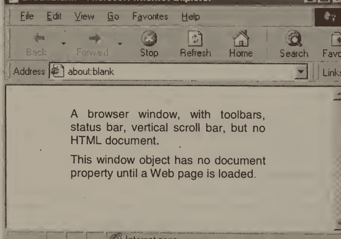

有一个主要对象，即 `window`，也就是显示浏览器程序的窗口。在这个窗口中显示的内容，除了各种工具栏、滚动条等之外，就是一个 HTML 文档。该文档将成为窗口对象的属性。

窗口对象：

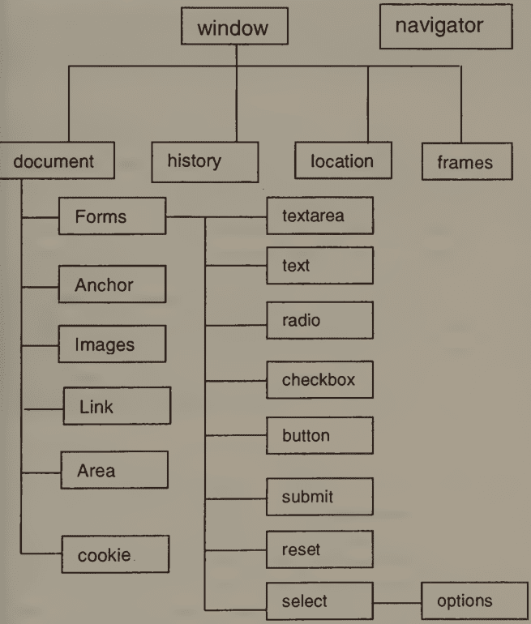

对象之间存在层级关系，窗口对象是最高层的主对象。从图16.1中，我们可以看到 `window` 有四个属性：`document`、`history`、`location` 和 `frames`。相应地，`document` 也有自身的多个属性：`form`、`anchor`、`images` 等。`form` 拥有自己的属性：`textarea`、文本框、单选按钮。

`navigator` 是另一个对象，与 `window` 一样，它不属于任何其他对象。它提供关于所使用浏览器的信息。我们将在第270和271页给出两个示例。

在附录A的一个表格中，我们汇总了本文中使用的各种对象，并列出了它们的属性和/或方法。这并非详尽无遗，但列出了最常用的功能特性。

在以下内容中，我们将介绍 `history` 和 `location` 对象。这些对象的详细用法超出了本文的范围，因为它们用于在用户访问过或希望访问的各种站点之间进行导航。控制这样的操作并不简单。不过，我们可以说明它们的用法，并提供一些简单的示例来展示它们何时可能对我们有用。然后我们将介绍 `navigator` 对象。

### `history` 对象

`history` 对象是用户访问过的 URL 列表。它等同于在 Netscape 中点击 GO 菜单或在 IE 中点击 History 按钮。这就是浏览器在我们点击前进和后退按钮时使用的列表。它的用途有限，但它可以让你用新页面替换当前页面。使用 `history` 的 `back()` 和 `forward()` 方法可以模拟浏览器的前进和后退按钮。

| `history` 属性 | |
| --- | --- |
| `current` | 指定当前历史记录的 URL |
| `length` | 反映历史记录列表中的条目数量 |
| `next` | 指定下一条历史记录的 URL |
| `previous` | 指定上一条历史记录的 URL |

你可以通过 `history` 数组引用历史记录条目。这些条目是只读的，无法通过 JavaScript 代码更改。因此，这是不允许的：

```javascript
history[0] = "http://isp.mine.com/"
```

| `history` 方法 | |
| --- | --- |
| `back()` | 返回之前访问过的 URL |
| `forward()` | 前进到之前访问过的 URL |
| `go()` | 前往某个特定的之前访问过的 URL |
| `toString()` | 所有对象都具有的方法，返回表示指定对象的字符串 |

示例：

`history.back();` 执行的操作与点击“后退”按钮相同。

`history.back(-2);` 执行的操作与点击两次“后退”按钮相同。

以下代码判断字符串 `'micro'` 是否出现在历史记录数组的第一个条目（索引 0）中。如果出现，则调用 `myfunction()`。

```javascript
if (history[0].indexOf("micro") != -1)
{ myfunction(history[0]) }
```

### `location` 对象

此对象包含有关当前 URL 的信息。它有若干有用的方法和属性，但最好等到你对 JavaScript 有了更多经验后再学习。在使用此对象之前，你需要了解完整的细节。不过，这里有一个简单的例子我们可以做。我们将邀请用户输入一个 URL，然后让我们的代码跳转至该网站。

```html
<HEAD>
<TITLE> Using the Location Object  </TITLE>
<SCRIPT>
function jumpto() {
window.location.href =
              document.form1.userurl.value;
}   //EoFn
</SCRIPT>
</HEAD>

<BODY>
<FORM method="" action="" NAME="form1">
<INPUT TYPE=text NAME="userurl" SIZE=60>
<INPUT TYPE=button VALUE="Go for it!"
           onClick="jumpto()">
</FORM>
</BODY>
```

`location` 对象是 `window` 对象的属性。在上面的例子中，我们使用了 `location` 对象的 `href` 属性。你需要包含 `http://` 协议。

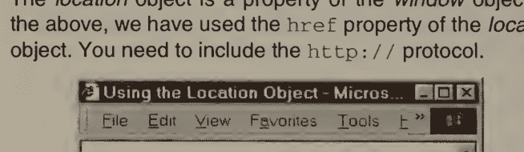

### `navigator` 对象

此对象包含有关正在使用的浏览器版本的信息。以下是其两个属性。

| `navigator` 属性 | |
| --- | --- |
| `appName` | 指定浏览器的名称 |
| `appVersion` | 指定浏览器的版本信息 |

### 示例

以下代码显示浏览器的名称：

`document.write("The name of your browser" + " is " + navigator.appName)`

Netscape 显示：

```text
The name of your browser is Netscape
```

Internet Explorer 显示：

```text
The name of your browser is Microsoft Internet Explorer
```

通过将 `navigator.appName` 的值赋给一个变量，你可以了解读者使用的是哪种浏览器，并针对两种情况执行适当的操作。

```javascript
x = navigator.appName
if( x.indexOf("N") == 0) {
  do the Netscape thing ...
}
else if (x.indexOf("M")== 0){
  do the Microsoft thing ...
}
else {
  document.write("Get yourself a life!")
}
```

在这里使用 `switch` 会很有用！


```javascript
browsername = navigator.appName
switch (browsername) {
  case "Netscape": // do the Netscape things
    alert("Netscape is being used.")
    break;
  case "Microsoft Internet Explorer":
    // do the IE things
    alert("IE is being used")
    break;
  default: // if not in range, do this
    alert("Why not use Netscape or IE?")
    break;
} // EofSwitch
```

在以下代码中，我们还将打印出运行在 Windows 系统上的浏览器的 `appVersion`：

```html
<BODY>
<SCRIPT>
document.write("The name of the browser is "
                + navigator.appName
                + " and the version is: "
                + navigator.appVersion )
</SCRIPT>
<ADDRESS>appname.htm </ADDRESS>
</BODY>
```

Microsoft 将显示如下：

The name of the browser is Microsoft Internet Explorer and the version is: 4.0 (compatible; MSIE 4.01; Windows NT)

Netscape 将显示如下：

The name of the browser is Netscape and the version is: 4.5 [en] (WinNT; I)

# 第十七章：Cookie

## 本章涵盖的新内容

- ASCII
- CGI
- `document.cookie`
- `escape()` 与 `unescape()`
- `expires=`
- `lastModified`
- `substring()`
- `toGMTString()`

在这最后一章中，我们将了解 `cookie`。Cookie 是 Web 服务器借助你的浏览器存储在你硬盘上的一小段数据——文本信息。它为浏览器提供了"记忆"功能。

假设你从某个网站请求一个特定的网页。该网站可以在发送网页的同时附带一个 cookie。浏览器会临时将 cookie 存储在你的硬盘上，这样当你再次访问该网站时，浏览器可以检索 cookie 的信息。通常，浏览器会将存储的数据发送回服务器站点，然后服务器可以处理这些数据。但这涉及服务器端 JavaScript，不在本文的讨论范围内。不过，我们可以在客户端对存储的 cookie 做一些事情，例如：

- 查明某人是否之前访问过该页面
- 记住用户的姓名
- 告知用户自上次查看以来页面已被修改
- 记录用户可能有的任何偏好
- 在你在线购物时向购物车添加商品

仔细想想，让每个浏览器单独存储此类信息，显然比期望 Web 服务器在每天可能有数千名访客的情况下存储所有信息要高效得多。

我们不能对 cookie 过于热衷。尽管有各种炒作，它们有其局限性，正如我们稍后将会看到的，而且有些粗糙。下面的示例适用于 Netscape，在 Internet Explorer 中的行为类似。然而，这两款主流浏览器之间存在一些差异。Netscape 将所有 cookie 存储在 PC 上一个名为 `cookie.txt` 的单一文件中（Unix 和 Mac 平台请参见第 292 页）。Internet Explorer 将每个 cookie 存储为单独的文件。后者浏览器只能通过从服务器加载的脚本写入 cookie。而使用 Netscape，你可以在客户端创建下面的示例。

关于 cookie 能做什么的流行观念和传言已经达到了神话般的比例，把所有人都吓得魂不附体。但由于 cookie 只存储文本，它们不能包含服务器发送的程序。因此，我们的文件既不会被破坏也不会被泄露。Cookie 不能损坏我们的计算机，也不能窥探我们的硬盘。它们只能识别 Web 用户并发送回短信息。关于你来自哪里以及你访问过哪些页面的信息已经存在于服务器的日志文件中。Cookie 只是使查找这些数据变得更加容易。所以让我们对它们放松一些。

# 17：Cookie

要充分利用 cookie，更多是服务器端的任务，超出了本文的范围。它们最初是为服务器端的 CGI 编程而设计的。通用网关接口（CGI）是在浏览器和 Web 服务器之间传输存储数据的传统协议。这些数据可以是 cookie，也可以是读者通过 FORM 元素提交的信息。

然而，我们将看看可以在客户端使用 JavaScript 做的一些事情。我们将创建 cookie 并将它们存储在读者的硬盘上，如果我们的页面被重新访问，我们的 JavaScript 代码将*赎回*我们的 cookie。

## Cookie 属性

`cookie` 是 `document` 对象的属性。

`document.cookie` 可以接受多种属性：

- `expires=` 指定 cookie 的生存期
- `path=` 指定存储 cookie 的子文件夹
- `domain=` Web 服务器的域名（例如：www.abc.com）
- `secure` 与其他属性不同，此属性接受布尔值 `true` 或 `false`

默认情况下，cookie 是不安全的，通过不安全的 Internet 连接使用标准 HTTP 协议传输。如果 `secure` 值为 `true`，则 cookie 通过 HTTPS 连接或其他安全协议发送。

除了 `expires` 属性外，其他属性需要了解 Web 服务器的配置方式，更多与服务器端 JavaScript 相关。因此我们不再进一步讨论它们。我们将考虑的是：`expires=过期日期`。

除了 `expires=` 属性外，cookie 还需要一个名称和一个值。名称的值是要可以存储，但只能包含有限数量的信息。参见第 290 页。

## 练习 37：设置和获取 Cookie

在本练习中，我们将在用户的浏览器上存储一个 Cookie，然后将其读取回来并显示在文本框中。

```html
<HEAD><TITLE>Cookie Set & Get</TITLE><SCRIPT>
function setcookie(){
    var cookdate = new Date();
    cookdate.setTime(cookdate.getTime()
    + 1000*60*30); // plus extra 1/2-hour
    document.cookie = "Cookiea=My A Cookie.;expires=" + cookdate.toGMTString();
} //EoFn setcookie
function getcookie() {
    var cookstring = new String(document.cookie);
    var cookname = "Cookiea=";
    var startpos = cookstring.indexOf(cookname);
    if (startpos != -1) {
        document.form1.cookvalue.value =
            cookstring.substring(startpos
            + cookname.length);
    }
    else
    { document.form1.cookvalue.value =
        "Cookie not found!";
    } //EofIf
} // EoFn getcookie
</SCRIPT>
</HEAD>
<BODY><CENTER>
<FONT size="+2">
<B>Creating and Retrieving a Cookie</B>
</FONT>
<FORM method="" action="" NAME=form1>
<INPUT TYPE=button NAME=setcook
VALUE="Create the Cookie"
onClick="setcookie()">
<INPUT TYPE=button NAME=getcook
    VALUE="Retrieve the Cookie"
    onClick="getcookie()">
<INPUT TYPE=text NAME=cookvalue SIZE=15>
</CENTER>
</FORM>
<ADDRESS>cookie1.htm </ADDRESS>
</BODY>
```

**说明：** 本练习介绍了 Cookie 的基本用法。所有练习在 Netscape 中都能正常工作。但在 Internet Explorer 中，并非所有练习都能正常表现。

1. 首先我们设置了三个 FORM 元素。一个按钮用于创建 Cookie，第二个按钮用于获取 Cookie，还有一个文本框用于显示 Cookie 的信息。所有这些内容都包含在 `<BODY>` 标签内。我们已经多次见过如何这样操作了。

2. 当用户点击*创建 Cookie*按钮时，会调用我们的 `setcookie()` 函数。

```javascript
function setcookie(){
    var cookdate = new Date();
    cookdate.setTime(cookdate.getTime()
                      + 1000*60*30);
    document.cookie =
          "Cookiea=My A Cookie.;expires="
               + cookdate.toGMTString();
} //EoFn setcookie
```

我们创建了一个 `Date()` 对象的新实例，因为我们要使用 `expires=` 属性来设置过期日期。如果省略此属性，当用户关闭当前的 Netscape 会话时，Cookie 会自动删除。如果包含此属性，Cookie 将持续到过期属性指定的日期为止。这类 Cookie 被称为*持久性 Cookie*。

我们将过期日期设置为页面首次加载后的半小时。通常，这会是一周、一个月或一年。但在我们的示例中，我们需要一个较短的时间，因为我们希望检查它是否已经"消失"。我们使用 `setTime()` 和 `getTime()` 这两个 Date 方法来设置半小时的过期时间。这样做的考虑是，当下次加载页面时，只要过期时间尚未过去，Cookie 就仍然可用。

```javascript
var cookdate = new Date();
cookdate.setTime(cookdate.getTime()
                  + 1000*60*30);
```

我们将当前日期加上额外的半小时赋值给 `cookdate`。这里的加号是算术运算符：`1000 毫秒*60 = 1 分钟 * 30 = 半小时`

下一步是将文本信息赋值给 Cookie。

```javascript
document.cookie =
  "Cookiea=My A Cookie.; expires ="
  + cookdate.toGMTString();
```

我们给 Cookie 起了一个名字，`Cookiea`，并提供了它将包含的信息：`My A Cookie`。使用 `expires` 属性将过期时间连接到上述内容。其值是先前赋给 `cookdate` 的当前时间加半小时。

`expires` 属性要求其值必须采用 GMT 格式。因此，我们使用 `Date` 对象的 `toGMTString()` 方法将 `cookdate` 设置为这种格式。由于 Cookie 是基于文本的文件，因此有必要将日期或时间转换为字符串。

就是这样！我们创建了一个包含文本字符串 "My A Cookie" 的 Cookie，它将在半小时后过期。

3. 第二个按钮允许我们获取 Cookie，并将其内容简单地显示在名为 `cookvalue` 的文本框中。我们需要知道的重要一点是，Cookie 属性不允许你*读取*或*显示*属性。你可以*设置*属性，但无法读取它们。因此，当我们最终读取 Cookie 时，唯一可以读取的部分是 Cookie 的*名称*以及名称之后的*值*，而不能读取 `expires` 属性。这部分由浏览器处理。

> "Cookiea=My A Cookie."

我们可以读取*名称*及其后的内容，但无法读取其他信息。

```javascript
function getcookie() {
    var cookstring = new String(document.cookie);
    var cookname   = "Cookiea=";
    var startpos   = cookstring.indexOf(cookname);
    if (startpos != -1) {
        document.form1.cookvalue.value =
            cookstring.substring(startpos
                + cookname.length);
            //addition not concatenation
    }
    else
    { document.form1.cookvalue.value =
            "Cookie not found!";
    } // Eof if..else
} // EoFn  getcookie
```

我们需要将 Cookie 文本获取到一个字符串中，以便对其进行操作。因此，我们首先创建一个 `String` 对象的新实例，将其命名为 `cookstring`，然后将 `document.cookie` 的值赋给它。

```javascript
var cookstring = new String(document.cookie)
```

另一个重要的点是，`cookstring` 将包含适用于当前文档的*所有* Cookie。在 Netscape 中，每个新 Cookie 都会追加到 `cookie` 属性中，该属性存储着文档的**所有** Cookie。

我们将不得不在这个列表中搜索我们的 Cookie，因此有必要给它一个唯一的名称。为此，我们将 Cookie 名称赋值给变量 `cookname`。注意名称后面包含了等号符号。

```javascript
var cookname = "Cookiea="
```

接下来，我们使用 `indexOf()` 方法找到我们 Cookie 的索引位置。

```javascript
var startpos = cookstring.indexOf(cookname)
```

在下文中，我们使用"不等于"比较运算符（`!=`）测试 `indexOf()` 是否返回了 -1。如果结果为真，则该方法已经返回了我们 Cookie 的起始位置。换句话说，它找到了我们的 Cookie。

```javascript
if (startpos != -1) {
    document.form1.cookvalue.value =
        cookstring.substring(startpos
            + cookname.length) }
```

现在，使用我们的字符串实例 `cookstring` 的 `substring()` 方法，将 `Cookiea` 的值赋给文本框 `cookvalue` 的值，这是一件简单的事情。

### `substring()` 方法

我们之前没有见过 `substring()` 方法，但现在是我们的机会。它是 `String` 对象的一个方法。

```javascript
mystring.substring(from, to)
```

它使用参数 `from` 和 `to` 的索引位置返回字符串的指定子串。如果 `to` 不存在，它是可选的，则返回字符串的其余部分。在我们的示例中，我们找到了 `Cookiea` 的起始位置，-project_and_add the length of the cookie name to it to provide the from argument using an addition operator (it is not the concatenate operator). Since we have no second argument, the rest is returned.

4. 最后，我们添加一个 `else` 子句来确定如果找不到 Cookie 该怎么办：

```javascript
else
{ document.form1.cookvalue.value =
    "Cookie not found!"
}
```

我们只需在文本框中写入一条消息，说明找不到 Cookie。

这些就是我们在本练习中使用的新特性：

- `toGMTString()`
- `substring()`
- `document.cookie`
- `expires=`

## 练习 38：你曾经来过这里！

在本练习中，我们将创建一个 Cookie 来存储访客在文本框中输入的姓名。如果此人在指定时间内返回，我们将能够通过姓名欢迎他们。这在 Netscape 中工作正常，但在 IE 中不行。

### 说明

当页面加载时，我们搜索 Cookie。如果找不到，将显示下图中的第一个。我们提供了一个文本框供用户输入他/她的姓名。点击 OK 时，会创建一个 Cookie 来存储该姓名。我们允许用户删除 Cookie。

如果找到了，因为他们在给定时间内返回，Cookie 被找到并会显示下图中的第二个。

```html
<HEAD>
<TITLE>Cookie 2 Welcome</TITLE>
```

# 17：Cookies


```javascript
var cString = new String(document.cookie)
var cHead = "Name1="
var cstartpos = cString.indexOf(cHead)

if (cstartpos != -1) {
    var cName = cString.substring(cstartpos + cHead.length)
    document.write("Hello, " + cName + "!")
} else {
    document.write("Please enter your name and click OK ...")
    document.write("<FORM NAME=form1>")
    document.write("<INPUT TYPE=text NAME=cName SIZE=40>")
    document.write("<INPUT TYPE=button VALUE='OK' onClick='storename()'>")
    document.write("</FORM>")
} // EoIF/Else

function storename() {
    var cDate = new Date()
    cDate.setTime(cDate.getTime() + 60 * 30 * 1000)
    document.cookie = "Name1=" + document.form1.cName.value + ";expires=" + cDate.toGMTString()
} // EoFn storename()

function delcookie(name) {
    document.cookie = name + "=;expires=Thu,01-Jan-70 00:00:01GMT" + ";";
    alert("Cookie gone!");
} // EoFn
</SCRIPT>
</HEAD>

<BODY><H3>Welcome Cookie</H3>
<FORM NAME=delcook>
<INPUT TYPE=button NAME=delbutton VALUE="Delete Cookie" onClick="delcookie(cHead)">
</FORM>
<ADDRESS>cookie2.htm </ADDRESS>
</BODY>
```

我们像之前一样开始，注意将“查找 cookie”的代码放在`<HEAD>`中，以便在页面加载时首先执行。

```javascript
var cString = new String(document.cookie)
var cHead = "Name1="
var cstartpos = cString.indexOf(cHead)
```

如果找到了 cookie，我们执行以下操作：

```javascript
if (cstartpos != -1) {
    var cName = cString.substring(cstartpos + cHead.length) // + = addition
    document.write("Hello, " + cName + "!")
}
```

如果没有找到，可能是因为访客是首次访问或者 cookie 已过期，我们会显示一个提示，邀请用户输入姓名并点击确定。

```javascript
else {
    document.write("Please enter your name and click OK ...")
    document.write("<FORM NAME=form1>")
    document.write("<INPUT TYPE=text NAME=cName SIZE=40>")
    document.write("<INPUT TYPE=button VALUE='OK' onClick='storename()'>")
    document.write("</FORM>")
} // EoIF/Else
```

点击确定按钮时，将调用`storename()`函数。请记住，此按钮仅在未找到 cookie 时才会出现。

```javascript
function storename() {
    var cDate = new Date()
    cDate.setTime(cDate.getTime() + 60 * 30 * 1000)
    document.cookie = "Name1=" + document.form1.cName.value + ";expires=" + cDate.toGMTString()
} // EoFn storename()
```

注意，存储在名为`Name1`的 cookie 中的值，就是名为`cName`的文本框的值。我们还将过期时间设置为半小时。这个`expires=`属性只有浏览器内部程序才能“读取”。同样，我们需要使用`toGMTString()`方法。

在`<BODY>`标签中，我们设置了一个按钮，点击后将删除 cookie。删除 cookie 的标准方法就是将其过期日期重新设置为当前日期之前的某个日期。

```javascript
function delcookie(name) {
    document.cookie = name + "=; expires=Thu,01-Jan-70 00:00:01GMT" + ";";
    alert("Cookie gone!");
} // EoFn
```

为了省去过多的操作，我们手动以所需的 GMT 格式设置了过期日期：

`Weekday, dd-mm-yy[yy] hh:mm:ss GMT`

例如：`Mon, 18-Dec-1996 17:45:56 GMT`

请注意，在`name`值之后和`expires=`值之后都使用了分号。

最后，我们显示一个警告框，通知用户 cookie 已被删除。

## 17：Cookies

**练习 39：** *此页面自您上次访问后已发生更改*

在最后一个练习中，我们将设置一个 cookie 来记录页面的最后修改日期。当用户再次访问该页面时，我们将 cookie 中的日期与本次访问的修改日期进行比较。如果页面在此期间已被修改，我们将通知用户。这利用了文档对象的`lastModified`属性。

### `lastModified`

它是一个只读字符串，包含文档最近修改的日期和时间。它源自 Web 服务器发送的 HTTP 头部数据。

Web 服务器并非必须为其保存的文档提供最后修改日期。当服务器未提供时，JavaScript 将其假定为 0，即转换为 1970 年 1 月 1 日午夜 GMT 日期。因此，我们需要对此情况进行检测。目前，我们假定最后修改日期已被发送。

```html
<HEAD><TITLE>Cookie 3 Modification</TITLE>
<SCRIPT>
document.cookie = "ModVern=" + escape(document.lastModified);

var allcookies = document.cookie;
var pos = allcookies.indexOf("ModVern=");
if (pos != -1) {
    // 8 is length of cookie name plus equals symbol
    var start = pos + 8;
    var end = allcookies.indexOf(";", start);
    if (end == -1) end = allcookies.length;
    var value = allcookies.substring(start, end);
    value = unescape(value);
    if (value != document.lastModified)
        document.write("This document has changed since you were last here.");
} // EofIf
</SCRIPT>
</HEAD>
<BODY>
<B>Modified Page Cookie</B>
<SCRIPT>
document.write("This page was last modified on: " + document.lastModified)
</SCRIPT>
<B>Here is the rest of the Web page!</B>
<ADDRESS>cookie3.htm </ADDRESS>
</BODY>
```

**注意：**

我们的 cookie 名为`ModVern`，其值为最后修改日期。

```javascript
document.cookie = "ModVern=" + escape(document.lastModified);
```

由于 cookie 值中不能包含分号、逗号或空白字符（制表符和多余空格），我们需要使用`escape()`函数。

### `escape()`

它是客户端 JavaScript 中的一个全局函数，不与任何对象关联。它创建并返回一个新字符串，其中包含其参数的编码版本。原始字符串不会被更改。所有空格、标点符号、带重音的字符以及任何非 ASCII 字母或数字的内容都会被转换（编码）为`%xx`的形式，其中`xx`是以`%`为前缀的十六进制数，表示该字符的 ISO-8859-1（Latin 1）编码。

例如：`!`的 Latin 1 编码在十进制中为 33，在十六进制中为 21。空格的十六进制为 20，逗号的十六进制为 2C。因此：

```javascript
escape("Hello, World!")
```

将产生新字符串：`'Hello%2C%20World%21'`

`escape()`的目的是确保字符串在所有计算机和所有网络之间具有可移植性，无论它们支持何种字符编码。但是，它们必须支持美国信息交换标准代码（ASCII）。这对于通过互联网传输的 cookie 来说非常重要。

使用`unescape()`函数来解码经过编码的字符串。

```javascript
<SCRIPT>
mystring = "Hello, World!"
Estring = escape(mystring)
document.write("The escaped version:")
document.write("<BR>" + Estring)
// ... and sometime later ...
document.write("The unescaped version:")
document.write("<BR>" + unescape(Estring))
</SCRIPT>
```

其余的代码应该很容易理解，因为我们在前两个示例中使用了类似的编码方式。

在下面的示例中，我们在网页末尾使用`lastModified`属性来显示最后修改的日期。这样就不用在每次修改后都记得更新网页了。

```javascript
<SCRIPT>
document.write("This page was last modified on: " + document.lastModified)
</SCRIPT>
```

最后，这里有一段代码可以测试 Web 服务器是否提供了最后修改日期。

```javascript
// get date
lastmod = document.lastModified
// convert to milliseconds to compare with 0
lastmoddate = Date.parse(lastmod)
if (lastmoddate == 0) {
    document.writeln("Last Modified: Unknown")
} else {
    document.writeln("Last Modified on: " + lastmod)
} // EofIF
```

**注意：**

`lastModified`返回的日期格式如下：

`mm/dd/yy hh:mm:ss` - `02/08/00 10:35:02`

需要通过`Date.parse()`方法将其转换为毫秒数，以便与零进行比较。请记住，当服务器未发送`lastModified`日期时，会假定为 0。如果您想以`dd/mm/yy`格式显示日期，还需要添加一些额外的代码，如第 11 章中所讨论的。

### Cookie 的局限性

我们已经看到，`lastModified`属性依赖于 Web 服务器，超出了我们的控制范围。但还有其他局限性。Cookie 旨在用于在有限时间内存储少量文本。

Web 浏览器总共不需要存储超过 300 个 Cookie，这涵盖了所有下载过的网页。它们也不需要从任何一个 Web 服务器存储超过 20 个 Cookie（针对整个服务器，而不只是您的页面）。每个 Cookie 的数据量限制为最大 4K 字节。

浏览器可以应用户要求拒绝 Cookie。这不是自动进行的。

考虑到 Cookie 能存储的文本数据量很小、浏览器能存储的 Cookie 数量有限，以及用户可以拒绝接受 Cookie，我们应该适度使用它们。

## JavaScript 安全性

加载含有 JavaScript 代码的网页可能会导致安全问题，并严重损坏您的计算机，除非采取预防措施。早期客户端 JavaScript 版本饱受安全问题困扰，主要与电子邮件有关。恶意代码可能会被编写成以用户名义发送消息。

使用户计算机免受 JavaScript 程序侵害的简单方法，就是阻止客户端 JavaScript 拥有写入或删除客户端计算机上文件或目录的任何途径。因此，JavaScript 没有`File`对象，也没有文件访问对象。我们的计算机是安全的。

客户端 JavaScript 可以加载 URL 并将表单数据发送回 Web 服务器，以及 CGI 脚本和电子邮件地址。但它无法与 Internet 上的其他主机建立直接联系。这意味着 JavaScript 程序无法使用客户端机器作为平台来破解其他机器上的密码。这一点尤为重要，如果 JavaScript 程序是通过 Internet 并穿过防火墙（一种防止未经授权访问网络的手段）加载的。

想象一个受到防火墙严密保护的网络，然后加载了一个带有 JavaScript 程序的网页，而该程序能够读取公司内部网中的其他服务器。为了防止这种情况，JavaScript 没有被赋予从客户端与其他服务器建立联系的任何机制。

浏览器的历史文件（您先前访问过的网站记录）和书签是私有的，不在 JavaScript 的管辖范围内。否则，程序就能够查看您感兴趣的网站并向主机服务器报告。您随后就会被垃圾邮件轰炸，甚至更糟。有些公司愿意花大价钱获取此类信息，以便用推销信息骚扰您。同样，您的电子邮件地址也是保密的，除非您主动发送。

JavaScript 无法检查其他打开的窗口，例如 Word 文档或 Excel 电子表格。试想一下，如果 JavaScript 能够开始检查并返回您任何打开文件的全部内容，这将意味着什么。

客户端 JavaScript 根本无法从您的硬盘加载其他文件、关闭不是浏览器窗口的打开窗口、删除文件以及成为一般的麻烦制造者。它也无法在浏览器范围内打开小于 100 像素的新窗口。这可以防止脚本打开用户不容易看到且可能包含用户以为已经停止后仍在运行的脚本的窗口。

Cookie 是安全的，因为它们不能包含代码。因此，我们的计算机暂时不会因为黑客疯狂的 Cookie 而受到威胁！无论如何，浏览器可以设置为拒绝接受 Cookie。用户可以删除 Cookie 文件，这样做应该是完全无害的操作。

Windows 系统将 Cookie 存储在`cookies.txt`文件中；Mac 系统将 Cookie 存储在名为`MagicCookie`的文件中；Unix 系统的文件则称为`cookies`。这些文件都可以用任何编辑器读取。

发送 Cookie 的 Web 服务器无法发现关于您计算机的任何信息，更不用说造成任何损害了。

最后，通过表单发送的信息始终应该在服务器端再次进行检查。我们已经掌握了足够的 JavaScript 知识，能够要求用户输入他们的信用卡/借记卡详细信息，并在用户刚刚付款购买的商品配送时，用我们自己的地址替换用户的地址。嗯！这真是遗憾。

## 十八章：常见错误

编写程序脚本时，很容易出错。以下是我、我的学生以及您将会犯的一些 JavaScript 错误。它们值得牢记在心，因为这样可以减少您原本会经历的挫败感。编程需要清醒的头脑，而作为人类，我们无法始终掌控这一点。我们创建的脚本可能无法正常工作。新手与有经验的程序员之间的主要区别，并不在于后者从不犯错，而在于他们犯错时能够更容易地找到错误。这种经验来自实践。

Netscape 和 IE 会提供一些帮助。对于 Netscape，您必须在地址栏中输入`javascript:`。冒号很重要，否则您只会调出 Netscape 主页。

**一般提示：**

尽可能先创建 HTML 代码并确保其正常工作。然后添加您的脚本，最好一次添加一个，每次添加后进行测试。这种方法至少可以将任何错误限制在最后添加的脚本或函数中。如果您写完所有脚本再运行程序，识别任何错误将会花费更长的时间。

### 常见错误

1. 函数和控制语句（如`if`、`else`、`for`、`switch`等）缺少开括号和闭花括号。用注释标记此类结构的结束有助于识别缺少的括号：`// EofFn`、`// EofIF`。

2. 忘记结束脚本标签：`</script>`——我经常这么做。

3. 在引号字符串之间按*Enter*键。Enter 键被视为语句的结束。

4. 单引号和双引号的误用：

   `document.write("Here is the text'`)`

   以及：`onClick = "alert("Type this out")"`


应该是：`onClick="alert('Type this out')"`

### 5. 三种括号的误用

`[ { (`

### 6. 混淆大小写敏感的 JavaScript 驼峰式命名与大小写不敏感的 HTML 属性

`bgcolor`（HTML）与 `bgColor`（JavaScript）。

### 7. 忘记正确的大小写和拼写

`maths.round`，而不是 `Math.round`。

### 8. 使用一个 `=` 表示相等，而不是两个 `==`

`if (x = 1)`，而不是 `if(x == 1)`。

### 9. 使用逻辑运算符时，忘记将表达式分别放在括号中

`if ( (exp1) || (exp2) )`

### 10. 在函数名后加空格不是好的风格

`function fred ()`

许多浏览器会容忍这一点，但这不是正确的语法。

### 11. 名称拼写错误

非常常见的是名称拼写错误：

`var lastname = document.form1.surnam.value`

`................`

```html
<input type="text" name="surname">
```

以及对变量名使用错误的大小写：`Lastname`，而不是 `lastname`。

### 12. 变量名与属性 `name` 的值相同

虽然允许，但如果变量名与属性 `name` 的值相同，您就是在自找麻烦：

`varsurname=` `document.form1.surname.value`

`....................`

```html
<input type="text" name="surname">
```

### 13. 使用保留字作为变量名和函数名

JavaScript 中有一些保留字不能用作变量名和函数名：`case`、`default`、`delete`、`new`、`switch`、`this`、`var` 只是其中少数几个。`var new = 456` 是错误的！

### 14. 变量的作用域错误

变量的作用域错误（第 119 页）。使用 `var` 关键字时，变量变为包含它的函数的局部变量，其他函数将无法识别它。

### 15. `<FORM>` 标签缺少必要属性

如果像我一样倾向于使用 Word 97，那么 `<FORM>` 标签应包含 `method` 和 `action`，`name` 作为使用时的第三个属性。否则，Internet Assistant 会出问题并导致程序崩溃。使用 Notepad 则没有这个问题。参见第 57 页。

### 16. 函数的位置

注意您放置函数的位置，尤其是调用它们的位置。您应该将所有函数放在 `<HEAD>` 标签内。以下是一个例子：

```html
<HEAD><TITLE> Live Clock </TITLE>
<STYLE>
input {color:red; font-size:9pt;
       background-color:#DBC47C;}
body  {background-color:silver;}
</style>
```

## 18：常见错误

```javascript
function showtime() {
    var digital=new Date();
    var hours=digital.getHours();
    var minutes=digital.getMinutes();
    var seconds=digital.getSeconds();
    var ampm="AM" ;
    if (hours>12) {
        ampm="PM";
        hours=hours-12;  // 12-hour clock
    } //EofIF
    if (hours==0) {
        hours=12; } //EofIF
    if (minutes<=9){
        minutes="0"+minutes; } //EofIF
    if (seconds<=9) {
        seconds="0"+seconds;} //EofIF
    document.Tick.Clock.value = hours + ":"
    + minutes + ":" + seconds + " " + ampm;
    setTimeout("showtime()",1000);
}  // Eofn showtime
```

```html
<HEAD>
<BODY>
<h3>Tempus fugit</h3>
<SCRIPT LANGUAGE="Javascript">
showtime()  // a big mistake!
</SCRIPT>
<form method="" action="" name="Tick">
<input type="text" size="12" name="Clock">
</form>
</BODY>
</HEAD>
```

脚本应放置在此处或作为 `body` 的 `onLoad`，这样在调用它之前整个页面已经加载完毕。

<ADDRESS>John Shelley <BR>

如果调用 `showtime()` 的脚本标签放在我放置的位置，你认为会发生什么？

页面已加载，函数被安全存储。浏览器遇到对 `showtime()` 的调用并立即执行它。该函数包含以下语句：

```javascript
document.Tick.Clock.value = hours + ":"
```

但关键是，`Tick` 和 `Clock` 还未被浏览器遇到，因为它还没有到达使用 `Tick` 和 `Clock` 名称的 `<form>` 和 `<input>` 标签。因此，它会告诉你遇到了 `undefined` 对象。

然而，如果脚本标签放在我建议的位置，或者 `showtime()` 函数用作 `<BODY>` 的 `onLoad` 事件值，那么它们将已经被浏览器遇到。`body` 元素中的 `onLoad` 只有在整个页面加载完毕后才会生效。

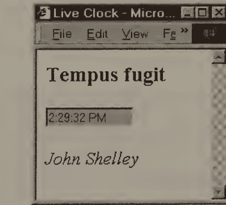

你注意到时间框内的文本有多小（它是 9pt）以及我设法为文本框设置了背景色吗？这是如何做到的？通过使用样式表。这无法通过使用 HTML 来实现。以下是样式表（CSS——层叠样式表）。你可以提取并将其用于你自己的页面，前提是分别使用 IE 第 5 版或第 4 版以及 Netscape。

```css
<style>
input {color:red; font-size:9pt;
        background-color:#DBC47C;
        font-family:verdana;}
body  {background-color:silver;}
</style>
```

它必须放置在 `<HEAD>` 标签内。它简单地说明所有输入元素将具有 9 点的字体大小、红色字体，并使用 Verdana 字体。（Netscape 无法识别 `input` 元素的背景色样式。）

另一个样式说明文档的背景色为银色。

CSS 非常容易学习，尽管其语法与 HTML 和 JavaScript 不同。Babani 系列中有一本书《XHTML and CSS explained》，它将解释如何使用样式表创建桌面出版风格的网页。例如，重叠文本：


## 十九：测试答案

### 测试：第 2 章

**2.1** `<SCRIPT>` 标签用于什么，它们可以放置在哪里？[另见错误 16，第 295 页。]

浏览器期望找到包含在成对的开始和结束 `<SCRIPT>` 标签中的 JavaScript 代码。

它们可以放置在任何位置，尽管将其放在开始 `<HEAD>` 标签之前是不明智的。否则，它们可以放置在：

- `<HEAD>` 标签之间
- `<HEAD>` 和 `<BODY>` 标签之间
- `<BODY>` 标签之间
- `</BODY>` 标签之后——不推荐！

`<SCRIPT>` 标签在 `<BODY>` 标签内的实际位置将决定它们将生效的位置。

**2.2** `<SCRIPT>` 标签是 HTML 还是 JavaScript 的一部分？

是 HTML 版本 4 的一部分。

**2.3** `document` 是对象还是方法？

`document` 是一个对象。方法是我们可以在对象上执行的操作。

**2.4** `writeln()` 是对象还是方法？

`write()` 和 `writeln()` 是 `document` 对象的方法。

**2.5** `write()` 和 `writeln()` 之间的主要区别是什么？

实际上没有区别。在 Netscape 中，这两种方法都写入 *查看源代码* 窗口。`writeln()` 会在消息输出后附加一个新行，`write()` 则不会。在两种情况下，只会看到消息，而不是 JavaScript 源代码。Internet Explorer 使用记事本查看源代码，因此它将显示为原始输入的形式。

**2.6** 同一个 HTML 文档中可以有多个 `<SCRIPT>` 标签对吗？

使用的 `<SCRIPT>` 标签对的数量没有限制。

**2.7** 以下代码在网页上将显示什么？

```javascript
document.write("Hallo there.",
                "My name is Joe.")
```

> Hallo there.My name is Joe.

`My` 的 `M` 前面没有空格。

**2.8** 上述代码中括号内所包含内容的正式术语是什么？

多个参数，每个参数用逗号分隔。

**2.9** 何时需要添加 `LANGUAGE="Javascript1.2"` 到开始 `<SCRIPT>` 标签？

如果你希望使用仅在 JavaScript 版本 1.2 中找到的功能，则需要此操作。

**2.10** 多个参数如何分隔？

用逗号分隔，最后一个除外。

### 测试：第 3 章

**3.1** `alert()` 方法属于 `document` 还是 `window` 对象？

属于 `window` 对象。

**3.2** 在以下代码中，`alert` 框显示的消息应该用双引号还是单引号？

`onClick = "alert( the message )"`

应该是：`onClick="alert('Message')"`

因为 `onClick` 属性的值必须用引号括起来，并且我们使用了双引号，所以只能用单引号括起消息。使用两组不同的引号允许浏览器识别一组引号的开始和结束，以及内部一组引号的开始和结束。否则，它会将第二组的开始视为第一组的结束。

**3.3** `onClick` 属性的 JavaScript 术语是什么？

事件处理器。

**3.4** `onClick` 属性接受什么类型的值？

JavaScript 代码。

**3.5** 当用户点击按钮时，这在 JavaScript 中称为什么？

一个事件。

**3.6** 在面向对象语言中，以下代码中 `bgColor` 的正式术语是什么？

`onClick = "document.bgColor = 'lightblue'"`

它是 `document` 对象的属性。

**3.7** 在上述代码中，如果 `bgColor` 被输入为 `bgcolor` 或 `BGCOLOR` 会有关系吗？

绝对有关系！JavaScript 区分大小写。它只能识别 `bgColor`，而不是其他变体，这与 HTML 不同，HTML 中大小写无关紧要。

**3.8** 以下代码执行后，`z` 的值会是多少？

```javascript
z = 1; z = z + 3;
```

变量 `z` 将包含 4（1+3）。

**3.9** 在上述代码中，`+` 是连接运算符还是算术运算符？

算术运算符。

**3.10** 在 Netscape 中，当窗口大小调整时会发生什么？

当页面重新加载以适应新尺寸的窗口时，源代码很可能是 Netscape 从其缓存内存中获取的早期版本。如果这个重新显示的页面包含你随后更正的 JavaScript 错误，Netscape 将重新显示未更正错误的早期版本。这种情况在 Internet Explorer 中不会发生。

**3.11** `onClick` 是属性还是事件处理器？

它是 HTML `<INPUT>` 标签的属性，也是 JavaScript 中的事件处理器。

### 测试：第 4 章

**4.1** 在练习 9c 的代码中，函数 `yourname()` 的声明和调用是什么？

**调用：** `onClick` 事件处理器的值：

```javascript
onClick = "yourname()"
```

**声明：** `function yourname() { .. code .. }`

**4.2** 单个 `<SCRIPT>` 标签对中可以放置多少个函数？

任意数量，没有限制。

## 19：测试题答案

### 4.3 语法错误

你能发现以下代码中有多少语法错误？

```javascript
onclick  "function abc{}'
```

四处错误。正确写法应为：`onclick="abc()"`

- `onclick` 属性后应有等号。`onclick` 的大小写无关紧要，因为它是 HTML 的一部分，而非 JavaScript。
- 双引号与单引号混用错误。
- 括号类型错误——应使用圆括号，而非花括号。
- 不能包含 `function` 关键字。

### 4.4 `prompt` 对话框的第二个参数

`prompt` 对话框可以接受两个参数。第二个参数是一个字符串引用，用于在显示提示框时替换单词 `undefined`。

### 4.5 变量与字符串

以下代码会输出什么？

```javascript
sum = 1.5 + 2;
document.write("The sum is: " + "sum");
```

| 输出 |
|---|
| The sum is: sum |

将变量 `sum` 用引号括起来，使其变成了一个带引号的字符串，这将被逐字显示。要打印出变量 `sum` 的内容，就不能用引号括起来。

### 4.6 `alert`、`confirm` 和 `prompt` 弹出框的使用场景

- `alert`：当你希望向用户显示一条信息性消息时使用。
- `confirm`：当你希望用户确认（确定）或取消某项操作时使用。
- `prompt`：当你希望用户输入内容并捕获其输入内容时使用。

### 4.7 在 `alert()` 中显示文本和变量

`alert()` 方法中不能使用多个参数。当你希望显示一些文本以及变量内容时，必须使用连接运算符，它会将多个参数转换成一个单一的参数。

### 4.8 代码执行顺序

以下代码中，浏览器会以什么顺序在屏幕上显示信息？

```html
<HEAD> <TITLE> .. a title .. </TITLE>
<SCRIPT>
function yourname(){
    x = prompt("What is your name?");
    confirm("Did you say your name is "
            + x + "?");
} // EoFn
</SCRIPT> </HEAD>
<BODY>
<H4> Here is a Prompt</H4>
<FORM>
<INPUT TYPE="button" VALUE="Tell me your name."
       onClick="yourname()">
</FORM>
<ADDRESS>PROMPT-Ex9c.htm </ADDRESS></BODY>
```

代码的书写方式意味着 `<H4>` 中的标题将首先显示，然后是 `FORM` 按钮，最后是 `<ADDRESS>` 代码中的内容。提示框仅在用户点击表单按钮时出现。一旦用户在提示框中点击了确定，确认框就会出现。

### 4.9 `write()` 方法可以接受的参数类型

到目前为止，我们已经看到它接受带引号的文本字符串、HTML 标签以及变量。

### 测试：第 5 章

**5.1** 如何获取用户在提示框中输入的内容？

通过将用户输入的内容赋值给一个变量，然后将该变量作为参数传递给一个函数。这样，函数就可以对该参数的数据进行测试，以确定其内容。

**5.2** 参数为什么有用？

通过参数，数据可以被传递到函数中进行处理。这些数据可以从文本框或提示框中“捕获”，也可以由程序员作为固定数据输入。同一个函数每次调用时都可以处理不同的数据。

**5.3** `sqrt()` 方法属于哪个对象？

属于 `Math` 对象。

**5.4** `Math` 对象是核心 JavaScript 还是客户端 JavaScript 的一部分？

它是核心 JavaScript 的一部分。

**5.5** 为 `INPUT` 元素指定 `name` 属性的一个主要原因是什么？

通过为 `INPUT` 元素（如文本框或单选按钮）赋予一个名称，就可以单独引用它，并以所需的方式进行操作。

例如，用户在文本框中输入的内容可以被赋值给一个变量：

```javascript
x = document.form1.calculator.value
```

为了“捕获”上面名为 `calculator` 的文本框的值，必须给它一个唯一的名称，如下所示：

```html
<INPUT TYPE="text" SIZE="12"
       NAME="calculator">
```

**5.6** 如果只有一个表单，并希望通过 JavaScript 代码引用它，是否仍然需要为其指定 `name` 属性？

是的。名称是 JavaScript 用来引用表单和许多其他 HTML 元素的方式。

**5.7** 为什么调用函数时必须包含函数调用运算符 `()`，而不是只写函数名？

否则 JavaScript 如何区分变量名和函数名呢？正是通过使用函数调用运算符，JavaScript 才能识别出这是一个函数调用。不被引号括起来且不包含函数调用运算符的字符，都被视为变量名。

思考一下，你会发现计算机使用非常简单的线索（语法）来区分事物。这就是为什么计算机永远无法编造出依赖于词语或其发音的微妙差异的笑话。

> 老师在学生在校最后一天对他们说：
>
> “记住这个！世界是你的龙虾。”


> 澳大利亚总理正在对新西兰进行正式访问。在从机场前往目的地的路上，他惊讶于自己国家那片干旱焦灼的土地之外，这里的乡村植被如此茂盛。他转向他的东道主——新西兰总理，问道：
>
> "你们是如何让国家保持如此葱绿的？"
>
> 新西兰总理回答说："我什么都没告诉他们！"

## 测试：第 6 章

### 6.1 什么是虚拟参数，它为什么有用？

虚拟参数是在函数声明中赋予参数的一个“虚拟名称”。当函数被调用时，会传递一个实际的参数（通常是包含数据的变量）来代替它。在函数执行期间，这个实际参数会替代虚拟参数。

### 6.2 对于以下表达式：`5 + 4 * 2 + 3`

#### a) 计算机会给出什么结果？

`4 * 2 = 8; 8 + 5 = 13; 13 + 3 = 16`

#### b) 袖珍计算器会给出什么结果？

`5 + 4 = 9; 9 * 2 = 18; 18 + 3 = 21`

### 6.3 程序员为什么使用注释？

用于注释 JavaScript 代码。通常，注释用于解释代码的功能。这对需要理解你代码的其他人很有用，甚至对作者本人在日后重新审视代码时也很有用。注释也用于标记函数和控制语句（如`if`和`for`，见第 9 章）的结束。

即使是经验丰富的程序员，在好几个月没有看过自己代码后，花费相当多的时间试图弄清楚某段代码的功能，这种情况也并不少见。

### 6.4 如何在 JavaScript 中创建单行注释？

使用双斜杠：

```javascript
// 这是一个单行注释
```

### 6.5 如何在 JavaScript 中创建多行注释？

使用：`/* .. 注释 .. */`

```javascript
/* 这是注释的第一行
这是第二行。 */
```

### 6.6 你能发现以下代码中有多少错误？

```javascript
function dothis(sqroot)
    x = Maths,sqrt(squroot);
    document.write("The square root of: "
                   + squroot + " is: " + x)
}
```

1. 没有开始的大括号来标记函数代码的开始。
2. `Maths`应为`Math`。
3. 将逗号改为句点：`Math.sqrt(sqroot)`。
4. 参数名拼写错误：`sqroot`而非`squroot`。

## 测试：第 7 章

### 7.1 HTML 的``标签可以作为 document 对象的属性吗？

是的。实际上，document 对象可以接受许多 HTML 标签作为属性：``、`<A>`、`<AREA>`、`<FORM>`等。

### 7.2 如何用 JavaScript 用一张图片替换另一张图片？

通过将其`src`属性赋值为另一个图片文件：

```javascript
document.img1.src = "image2.jpg"
```

这要求之前已经为``标签命名，以便可以将其作为 document 对象的属性来引用。

```html

```

### 7.3 在 Netscape 中，如果替换另一张图片的图片尺寸与被替换的图片不同会发生什么？在 Internet Explorer 中会发生同样的情况吗？

Netscape 假定任何替换其他图片的图片都与第一张图片具有相同的尺寸。如果不是，则第二张图片会被强制适应其替换图片所占的相同空间。这会导致失真。

在 Internet Explorer 中不会发生这种情况。

### 7.4 `onMouseOver`事件处理程序可以用于文本框 INPUT 元素吗？

不能，很遗憾。它只能与`<A>`标签一起使用。

### 7.5 `onMouseOver`和`onMouseOut`事件处理程序通常与哪些 HTML 标签相关联？

`<A>`标签和`<AREA>`标签。

### 7.6 `onMouseOut`事件处理程序会捕获什么用户事件？

当用户将鼠标移出带有`onMouseOut`事件处理程序的`<A>`标签包围的图像（或文本）时。

## 测试：第 8 章

### 8.1 `window.open()`方法接受多少个参数？

最多 4 个，最少 1 个。

- 参数 1：要打开哪个文件到新窗口中。
- 参数 2：与 FORM 的 target 属性一起使用。
- 参数 3：指定新窗口的特性。
- 参数 4：与浏览器的历史记录一起使用——很少使用。

## 19：测试答案

必须至少包含第一个参数，即使为空，此时会打开一个空白窗口：

```javascript
window.open("")
```

### 8.2 你想使用`window.open()`方法的第一个和第三个参数。是否仍然需要包含第二个参数？

是的。即使某个参数不被使用或不是必需的，它在参数顺序中的位置仍然必须被“填充”，即使这是一对空引号，如下一个答案所示，其中没有文件需要打开。在这个问题中，我们需要将`null`作为第二个参数插入。

### 8.3 在以下代码中，为什么 null 不在引号中？

```javascript
var win = window.open("", null,
    "height=400 width=500 status=1
    resizable=yes status=0");
```

它是一个特殊的值，表示“无值”。如果它在引号中，它将被视为目标属性的名称，即第二个参数的用途。

### 8.4 为什么在练习 18 和 19 中需要将新窗口对象赋值给变量`win`，但在练习 17 中不需要？

在练习 18 和 19 中，我们想通过`document.write()`方法向新窗口写入 HTML 标签以及文本。我们不能简单地使用：

```javascript
document.write("HTML etc..")
```

因为这会写入到现有窗口，而不是新窗口。这是因为`document`是当前打开窗口的属性。为了写入我们的新窗口，我们需要创建一个新窗口对象（`win`）并使用这个新窗口的`document.write()`属性。为此，我们将新窗口赋值给一个变量——`win`：

```javascript
var win = window.open("... arguments ... ")
```

我们现在可以使用这个变量，通过其自身的 document 属性来指定要写入新窗口的内容。

```javascript
win.document.write(" the HTML code")
function removewindow() {
  window.close()
}  // EoFn
```

### 8.5 你认为如果在练习 19 的`removewindow`函数中使用`window`而不是`win`会发生什么？

主窗口将被关闭，而不是新创建的窗口。但我们要关闭的是名为`win`的窗口，因此，我们必须使用`win.close()`。

## 测试：第 9 章

### 9.1 任何编程语言的四个基本特征是什么？

- 创建、存储和移动数据
- 数据的输入和输出
- 做出决策
- 重复执行指令

### 9.2 什么是整数，什么是实数？

**整数：**没有小数位的完整数字；例如 124。

**实数：**带有小数位的数字；例如 1.23、1.0、0.54。

### 9.3 如何捕获用户在文本框或提示框中输入的内容，以便后续处理？

将其赋值给一个变量，并可能将变量作为参数传递给函数。例如：

```javascript
function abc(){
  x = document.form1.text1.value} // EoFn

x = prompt("Type something.")
....
onClick="user_entry(x)"
```

### 9.4 举一个大小写不重要的例子，以及一个大小写重要的例子？

事件处理程序是 HTML 的一部分，其大小写不重要，因此，`onclick`和`onClick`都是有效的。

然而，`Math`是 JavaScript 的一部分，因此大小写是重要的。同样适用于`round()`、`for`、`if`、`bgColor`等。

### 9.5 以下代码中发生了什么？`var x = 1;`

变量`x`正在被创建（声明）并被赋值为 1。

### 9.6 以下代码中发生了什么？

```javascript
if (x == 1) { ... }
```

`x`的值正在被比较是否为整数 1。如果为`true`，花括号中的代码将被执行。如果为`false`，代码将被忽略。

### 9.7 根据其语法，if 语句只能执行单条指令。如何让它执行多条指令？

多条语句可以通过用花括号括起来“转换”为“单条”语句，使它们成为一个复合语句。

### 9.8 以下操作做什么？

1. `++i`：这被称为前缀递增运算符。变量`i`将立即增加 1，然后才执行任何其他指令。
2. `k--`：这被称为后缀递减运算符。变量`k`的值将减少 1，但直到执行其他某个指令后才会生效。

它们经常被用作`for`循环中的递增或递减语句。

### 9.9 对于以下内容，`document.write()`方法将输出什么？

```html
<SCRIPT>
var aBc = 12;
var abc;
document.write("Variable abc is: " + abc
    + "<BR>Variable aBc is: " + aBc);
</SCRIPT>
```

将输出以下内容：

```text
Variable abc is: undefined

Variable aBc is: 12
```

（这个测试的要点是说明`aBc`被创建并赋值，而`abc`被创建但未被赋值。因此它被赋予特殊的`undefined`值。）

### 9.10 非常仔细地查看以下代码，并弄清楚代码执行后将输出什么。

注意：

1. `i = j = 12;`是另一个捷径，深受 C 程序员喜爱，现在也是 JavaScript 的一部分，它在一个语句中为多个变量赋值。
2. `IF`语句可以嵌套，如下所示。

```javascript
i = j = 1;  // i 和 j 都被赋值为 1
k = 2;
if (i == j) // i 确实等于 1，因此为 true
    if (j == k)
        document.write("i equals j");
    else
        document.write("i does not equal j");
        // Oops!
```

将输出`i does not equal j`。我们没有使用花括号，这就是我们的失误。JavaScript 和大多数其他语言规定，`else`子句（块）属于最近的`if`语句。尽管原始源代码有缩进，`else`属于：`if (j == k)`。由于这导致`false`，与其配套的`else`子句将被执行，消息`i does not equal j`被输出。

为了使这个例子不那么模棱两可，更易于理解、维护和调试，请使用花括号，如下：

```javascript
i = j = 1;  // i 和 j 都被赋值为 1
k = 2;
if (i == j) {
  if (j == k) {
    document.write("i equals j");
  } // 内部 IF 结束
} else {
  document.write("i does not equal j");
} // 外部 IF 结束
```

现在这使得`else`属于外部`if`语句，并在`i`不等于`j`时执行，这对 JavaScript 和人类都更加清晰。你是否还注意到，由于逻辑更加清晰，实际上什么都不会输出。`else`子句将不再被执行，因为它现在与第一个`if`语句相关联，而该语句结果为`true`。这现在会检查`j == k`，而它不等于。因此，第二个`if`子句不会被执行，所以，不会再发生任何事情。

这是一个极好的例子，说明嵌套的`if`子句可以变得多么可怕和曲折。

### 9.11 为什么变量名不能以数字开头？

这样 JavaScript 才能区分变量和数字。为了让编写 JavaScript 语言的人轻松，他们决定任何不在引号中或没有函数调用运算符附加的内容，要么是变量，要么是数字，要么是布尔值。为了便于区分它们，他们决定任何以数字开头的一定是数字（或应该是）。任何以字母、`$`或`_`（下划线）开头的将被解释为变量。对`false`或`true`的单独测试将检查该“变量”是否确实是布尔值。他们可不傻！

### 9.12 以下每种情况会发生什么？

#### a) 这个是正确的。

```html
<SCRIPT>
sum = 0;
for (i = 1; i <= 10; i++) {
  sum = sum + i;
}
document.write("numbers 1-10 = " + sum)
</SCRIPT>
```

它将前十个数字求和并输出：

```text
numbers 1-10 = 55
```

#### b) 循环变量的初始化不正确

```html
<SCRIPT>
sum = 0;
for (i = 2; i <= 10; i++) { // 粗心
  sum = sum + i;
}
document.write("numbers 1-10 = " + sum)
</SCRIPT>
```

```text
numbers 1-10 = 54
```

## 19：测试答案

这展示了我们必须多么谨慎地处理循环变量`i`的初始化。由于它从 2 开始，`sum`不包含第一个数字 1。因此，结果为 54。我们不能粗心大意。

#### c) `sum`是未定义的，因为它在使用前未被声明。

```html
<SCRIPT>
for (i = 1; i <= 10; i = i + 1) {
  sum = sum + i;
}
document.write("numbers 1-10 = " + sum)
</SCRIPT>
```

Internet Explorer 和 Netscape 会弹出一条错误消息，显示“`sum`未定义”，循环将不会继续执行。这里的关键点是，函数中使用的变量不仅必须被定义，还必须被赋予一个值，如下所示。

#### d) 一个常见错误——已声明但未赋值

```html
<SCRIPT>
var sum;
for (i = 1; i <= 10; i = i + 1) {
  sum = sum + i;
}
document.write("numbers 1-10 = " + sum)
</SCRIPT>
```

这将产生：

```text
numbers 1-10 = NaN
```

该变量已被声明，但未被赋值（实际上它具有非数字值`null`）。由于它出现在左侧，因此被视为具有数值来使用，循环将无法按预期工作。请记住，`NaN`是 JavaScript 返回的值，用于告知用户正在对一个不包含数值的变量进行算术运算。

#### e) 另一个常见错误——条件测试没有比较，只是一个赋值

```html
<SCRIPT>
sum = 0;
for (i = 1; i = 10; i = i + 1) {
  sum = sum + i;
}
document.write("numbers 1-10 = " + sum)
</SCRIPT>
```

这个程序可能会导致你的电脑死机。（在尝试此操作之前，请保存所有工作。你可能需要重新启动计算机！）

上述程序将无限循环，并且不会超过以下步骤：

- 将 10 赋值给`i`
- 将其加到`sum`
- 将`i`递增到 11
- 然后重新将 10 赋值给`i`
- 永远循环，直到天荒地老！

## 测试：第 11 章

### 11.1 尝试编写一些 JavaScript 来告诉用户加载页面花了多长时间。

（测试 11.1 和 11.2 的合并代码如下所示。）

我们需要两个时间：页面开始加载时的时间和页面加载完成时的时间。将两个时间相减将得出加载所用的时间。开始时间通过以下方式获得：

```javascript
var today = new Date()
```

但请注意，代码被放置在`<BODY>`标签之前，以便我们在加载开始之前计时。

结束时间通过在页面加载刚完成时，在关闭`</BODY>`标签之后或之前做同样的操作来获得。

```javascript
nowtime = new Date()
```

下一步是使用`getTime()`方法将两个新的日期对象转换为毫秒，然后将它们相减：

```javascript
(nowtime.getTime() - today.getTime()) / 1000
```

然后除以 1000 以转换为秒。

### 11.2 编写另一段代码来计算距离圣诞节还有多少天。

**练习 11.1 和 11.2 的答案：**

```html
<HEAD><TITLE> Days to Christmas? </TITLE>
<SCRIPT>
// 创建日期的新实例
var today = new Date()
var xmas = new Date()

xmas.setMonth(11)
xmas.setDate(25)

if (today.getTime() < xmas.getTime()) {
  difference =
    xmas.getTime() - today.getTime();
  difference =
    Math.floor(difference / (1000 * 60 * 60 * 24));
  document.write("Only " + difference
    + "days until next Christmas Day! <P>");
} // 条件语句结束
</SCRIPT>
</HEAD>
<BODY>
<P>
<H3>圣诞节与加载时间</H3>

<ADDRESS><B>Test-10.htm</B> </ADDRESS>
</BODY>
<SCRIPT>
nowtime = new Date();
document.write("It took "
  + (nowtime.getTime() - today.getTime()) / 1000
  + "seconds to load this page.");
</SCRIPT>
```


我们需要今天的日期和圣诞节的日期。我们创建两个新的日期实例，并使用`setMonth`和`setDate`方法设置圣诞节的日期实例：

```
var today  = new Date() // 当前日期
var xmas   = new Date() // 圣诞节

xmas.setMonth(11)
xmas.setDate(25)
```

现在很简单，将两者相减并将结果转换为天数：

```
difference = xmas.getTime() - today.getTime();
difference = Math.floor(difference / (1000*60*60*24));
```

我们使用了`Math.floor`方法来返回小于或等于一个数字的最大整数。因此，如果你向`floor`传入`45.95`，它将返回`45`；传入`-45.95`，它将返回`-46`。我们不需要天的零头部分。

我们还使用了`if`语句来检查今天的日期是否没有在圣诞节之后开始。如果确实如此，则不显示任何内容。

### 11.3 将练习 24 转换为显示某人连接到其 ISP 多少分钟

```
document.howlong.answer.value = ((connect_time/1000)/60)
```

这是一个非常简单的除法问题，将秒数除以 60。当然，我们还需要将`Secs`这些词更改为`Minutes`。使用更多的算术运算，你甚至可以显示分钟和秒。

### 11.4 在 Netscape 和 IE 中都尝试以下操作

```
<HEAD><TITLE> Using the date Object </TITLE>
<SCRIPT>
// 输入你自己的日期
mydate = new Date("18 Dec 1686")
var monthday = mydate.getDate()
var month    = mydate.getMonth() + 1
var day      = mydate.getDay()
var year     = mydate.getYear()
var fullyear = mydate.getFullYear()
document.write("<h3>Full Year Test </h3>")
document.write("Full year is: " + fullyear)
document.write("<DIV ALIGN= right>"
              + "day of the month = "
              + monthday + "<BR>")
document.write("month = " + month + "<BR>")
document.write("day = " + day + "<BR>")
document.write("year = " + year + "<BR>")
document.write("The date is: " + monthday
+ "/" + month + "/" + year )
// 获取当前日期
var today = new Date()
var monthdayx = today.getDate()
var monthx = today.getMonth() + 1
var dayx = today.getDay()
var yearx = today.getYear()
document.write("<BR>Today's date is: "
+ monthdayx + "/"
+ monthx + "/" + yearx )
</SCRIPT>
</HEAD>
```

使用 Netscape 时，你观察到 1686 年有什么现象？

你应该会在 Netscape 中看到 1686 年是一个负数年份：`(-214)`，而当前年份是一个正值`(101)`。

当使用`getFullYear()`时，就没有问题。

IE 会“正确地”输出所有年份。Netscape 版本的说明见上图。

## 测试：第 12 章

### 12.1 哪些 HTML 元素允许使用 onChange 事件处理程序？

文本元素和`textarea`标签。

### 12.2 onChange 事件处理程序何时被触发？

一旦用户在文本框中输入内容并点击该框外部。

### 12.3 运行以下代码时你会看到什么？

```
<head> <title> ... </title>
<script>
function abc() {x = 2;} // 函数结束
</script>
</head>
<body>
<script>
alert("Are you ready?");
y = abc();
alert("Y = " + y) // 变量 y 的值是什么？
</script>
</body>
```

它显示 Y 是未定义的。我们需要`return x`来返回调用时 x 的值。

### 12.4 表单可以通过三种方式中的任何一种提交。它们是什么？

- 点击提交按钮。
- 使用`submit()`方法。
- 向`onSubmit`事件处理程序返回一个非`false`的值。

最后一种方式将在提交按钮被点击且`onSubmit`事件处理程序中的代码完成其工作后生效。此代码将返回`false`或非`false`的值。

### 12.5 `submit()`方法属于哪个对象？

它是命名`FORM`标签的一个方法，而`FORM`标签是`document`对象的一个属性。

### 12.6 `submit()`方法执行什么功能？

它模拟用户点击提交按钮时发生的情况。然而，由于它可以被放置在一个函数中，因此在实际调用之前应执行各种验证测试。

### 12.7 `onSubmit`是哪个 HTML 标签的事件处理程序？

`FORM`标签。

### 12.8 `onSubmit`处理程序执行什么目的？

它扩展了更简单的提交按钮的行为。当点击提交按钮时，与`onSubmit`事件处理程序关联的 JavaScript 代码将被执行。通常，这是一个验证表单数据的函数。如果函数返回的不是`false`，表单将被提交。

### 12.9 `onSubmit`事件处理程序何时将表单发送到服务器？

当返回任何非`false`的值时，例如`true`或`undefined`。当返回`false`时，它将不会发送表单。

## 测试：第 13 章

### 13.1 在以下哪些是关系运算符，哪些是逻辑运算符？

`&& <= == ||`

- 逻辑运算符：`&& ||`
- 关系运算符：`<= ==`

# 19：测试答案

#### 13.2

在下面的字符串中：

```
astring="The Owl and the Pussycat went to sea"
```

如何找到小写字母第二次出现的位置：

- a) `'w'`
- b) `'o'`

a) 通过将`indexOf()`方法的第二个参数设置为超出第一次可能出现的位置之外：

```
indexOf("w", 7)
```

b) 同上，但由于没有小写`'o'`的第二次出现，所以它将不会被找到。

#### 13.3

以下各项属于什么：事件处理程序、方法、用户自定义函数、对象还是属性？

| 项目 | 说明 |
|---|---|
| `indexOf()` | String 对象的一个方法 |
| `length` | 在文本框中输入的字符串值的一个属性 |
| `myfunction()` | 用户自定义函数 |
| `onChange=` | text 和 textarea 标签的事件处理程序 |
| `onFocus=` | text 和 textarea 标签的事件处理程序 |
| `onSubmit=` | FORM 标签的事件处理程序 |
| `submit()` | 所引用表单对象的一个方法 |
| `this` | 以上都不是。它是一个运算符，指代当前对象 |
| `this.form` | `this`所指向内容的一个属性 |

#### 13.4

如果给定的字符串中找不到其参数，`indexOf()`返回什么值？

`-1`，可以通过`if`语句进行测试。

#### 13.5

你能够通过`submit()`方法通过电子邮件（`mailto:`）发送表单数据吗？

对于 Netscape 不行。出于安全原因，`submit()`方法会忽略`mailto:`、`news:`和`news:`协议。你必须使用`onSubmit`事件处理程序或一个简单的`submit`按钮来实现，或者确保你的内联网只使用 IE5。

#### 13.6

`focus`是什么意思？

`focus()`方法将焦点设置到作为其对象的文本框上。这相当于用户点击文本框，以便他/她可以在其中输入文本。

#### 13.7

当我们测试两个单词时，我们决定在字符串中搜索一个空格。如果找到了，就假设有两个单词。但是，什么能阻止用户输入一个单词后加一个空格但没有第二个单词呢？这能满足我们的测试要求，但结果仍然是错误的。你如何测试这类错误？[提示：一种方法可能涉及使用`length`属性的使用。]

```
<SCRIPT>
function checkspace(){
userentry =
    new String(document.form1.namebox.value);
spacel = userentry.indexOf(" ");
totlength = userentry.length;
 if ( spacel == -1){
   alert("No spaces" + " " + spacel)   }
   else if (spacel == totlength-1) {
       alert("Space at end but one word")  }
else{
   alert("Something follows the space.")
 } // EofIF
} // EoFn
</SCRIPT>
```

#### 13.8

为练习 35 添加一些额外的代码，防止用户在提交申请超过三次后再次提交表单。[提示：这很简单，涉及在每次调用`checkdata()`函数时给一个计数器加一。]

诀窍是在文档 HEAD 部分的`<SCRIPT>`标签内将变量设置为零，而不是在函数本身内部！在`checkdata()`函数中使用该变量，并在每次调用函数时将其加 1：

```
x = 0;
......
function checkdata(){
  x = x + 1;
  if (x > 2) {
    alert("Third time? No way!");
  }
  else {.. go ahead with the checks .. }
} // EoFn
```

这可以通过`if`语句进行测试，如果超过 2，则创建一个警告框，告知用户无法继续注册。

## 测试：第 14 章

#### 14.1

添加一个额外的按钮，允许用户停止练习 36 中的动画。

只需在 FORM 中添加另一个按钮，使用`onClick`事件处理程序调用`clearTimeout()`方法。这将通过取消使用`setTimeout()`方法设置的 timeout 来停止动画。然而，`clearTimeout()`方法的参数必须指定要取消哪个`setTimeout()`。

```
<FORM NAME=form1>
.. etc..
<INPUT TYPE=button Value="Click to Stop!"
       onClick="clearTimeout(stopit)">
```

因此，我们需要将设置在``标签中的原始`setTimeout`方法赋值给一个变量`stopit`。

```

```

#### 14.2

要将新图像赋值给图像数组对象的`src`属性，需要哪些步骤？[提示：你应该有三个步骤。]

i) 首先，我们必须使用`Array()`对象创建一个包含五个元素的新数组：

```
arrayabc = new Array(5) // 使用 Array 对象
```

ii) 数组的每个元素都必须成为一个图像对象，这样我们才能操作它的`src`属性：

```
arrayabc[0] = new Image() // 使用 Image 对象
.. etc ..
arrayabc[4] = new Image()
```

iii) 最后，我们现在可以为数组中的每个图像对象赋值新的图像文件：

```
arrayabc[0].src = "image0.gif"
.. etc ..
arrayabc[4].src = "image4.gif"
```

#### 14.3

JavaScript 代码中使用三种类型的括号：`{}`、`[]`和`()`。举例说明每种的使用场景。

`{}`用于将函数、`if`或`for`循环中的 JavaScript 代码括起来：

```
if (test) { .. code ..}
```

`[]`用于括起数组元素的索引号：

```
arrayabc[3] 这将引用第四个元素！
```

`()`用于括起`if`语句的测试条件或函数的参数：

```
function abc(arg1, arg 2)
```

#### 14.4

你可以用多少种方式让你创建和打开的窗口自行关闭？

要么在新窗口中添加一个按钮，通过事件处理程序执行一些代码来关闭它。详见第 106 页和练习 18 的更详细讨论。

或者，使用`onMouseOver`和`onMouseOut`处理程序：

```
<SCRIPT>
function removewindow(){
  win.close()
  } // EoFn

function multeselections(){
  win = window.open("wnd-2.htm")
  } // EoFn
</SCRIPT></HEAD>
<BODY BGCOLOR="D5EAff">
<B>Selecting Messages</B><BR>
<FONT SIZE=-1> Move your mouse over the phrase to open a new window.</FONT>
... continue with paragraph ...
<BR>
<A HREF="" onMouseOver="multeselections()" onMouseOut = "removewindow()">
<FONT SIZE=-1><B>Open new window</B></FONT></A>
```

#### 14.5

使用`setTimeout()`函数创建一个实时时钟。[提示：我们需要使用这个方法，以便时钟可以每秒更新一次——1000 毫秒。]

完整代码见第 295 页，第 16 章的错误 16。

## 测试：第 15 章

#### 15.1

你能想到多少种重复循环？

`for`、`while`和`do-while`。

#### 15.2

在采用`else..if`的`if`语句中，单独的`else`语句有什么作用？

它提供了当所有前面的测试都失败时要执行的代码。类似于`switch`中的`default`情况。

#### 15.3

`for`循环和`while`循环之间的主要语法区别是什么？

`for`循环在其圆括号内包含所有三个控制语句：

```
for ( initialise; test; increment)
 { .. code ..}
```

而`while`循环只包含条件测试，让程序员在适当的地方插入其他两个：

```
while (test) { .. code .. }
```

#### 15.4

这个特性被称为：`--j`？

它被称为前缀递减运算符。它会从`j`中减去 1，然后继续执行其余代码。

#### 15.5

`undefined`的变量和具有`null`值的变量之间有什么区别？

`undefined`变量是指正在使用但尚未声明的变量。这里`sum`尚未声明：

```
sumx = sum+1;
alert("Sum =" + sum);
```

在下面的例子中，`sum`已被声明但尚未赋值。因此：

```
var sum;
sum = sum+1;
alert("sum =" + sum);
```

`sum`已声明但未赋值，如果使用它，IE 和 Netscape 会显示错误消息，说`sum`是`NaN`。由于 JavaScript 首先查看赋值语句的右侧，`sum`是`undefined`但正被用于算术运算。JavaScript 不会给`undefined`状态的变量加 1，结果将是 non-a-number（`NaN`）。

另一方面，给变量赋`null`意味着它存在但具有特殊的“no value - null”值。我们可以认为它是空的，但它仍然可以使用，因此：

```
var sum = null;
sum = sum+1;
alert("The value of sum is: " + sum)
```

**结果将是：**`The value of sum is: 1`

当变量持有`null`值时，你知道它不包含数字、字符串、对象或布尔值。记住这一点，有一天可能会派上用场。

## 附录 A：JavaScript 概要

| 语句 | 注释 |
|---|---|
| `break` | 退出循环 |
| `case` | 在`switch`中执行哪个代码块 |
| `comment` | 单行注释使用`//`；多行注释使用`/* ... */` |
| `continue` | 返回并测试循环中的条件 |
| `default` | 在所有`case`失败时用于`switch` |
| `do-while` | 至少执行一次的循环 |
| `else` | 当关联的`if`条件失败时执行 |
| `else if` | 用于`if`语句中进行多条件判断；它必须以`else`语句结束。 |


| 关键字 | 说明 |
| --- | --- |
| `for` | 只要条件为真就重复执行循环 |
| `function` | 声明一个在调用时执行的代码块 |
| `if` | 条件判断——有条件地执行代码 |
| `return` | 返回函数的值 |
| `switch` | 使用 `case` 的条件判断功能 |
| `var` | 声明一个变量，并使其成为声明该变量的函数的局部变量 |
| `while` | 只要条件为真就重复执行循环 |

| 运算符 | 示例 | 等价形式 |
| --- | --- | --- |
| 算术运算符 |  |  |
| `+=` | `a += b` 加法 | `a = a + b` |
| `-=` | `a -= b` 减法 | `a = a - b` |
| `*=` | `a *= b` 乘法 | `a = a * b` |
| `/=` | `a /= b` 除法 | `a = a / b` |
| `%=` | `a %= b` 取模 | `a = a % b` |
| `^=` | `a ^= b` 指数运算 | `a = a ^ b` |
| 逻辑运算符 |  |  |
| `&&` | 逻辑与 |  |
| `\|\|` | 逻辑或 |  |
| `!` | 逻辑非 | 如果 `a` 为真，则 `!a` 变为假 |

### 概要

| 运算符 | 示例 | 等价形式 |
| :--- | :--- | :--- |
| 比较运算符 |  |  |
| `<` | 小于 | `a < b` |
| `>` | 大于 |  |
| `==` | 等于 |  |
| `!=` | 不等于 |  |
| `<=` | 小于或等于 |  |
| `>=` | 大于或等于 |  |

| 其他 | 注释 |
| :--- | :--- |
| `new` | 用于创建新对象的运算符 |
| `null` | 表示“无值”的特殊值 |
| `this` | 用于引用其所属对象的关键字 |
| `undefined` | 表示变量未定义的特殊值 |

| 事件 | 关联对象 | 注释 |
| :--- | :--- | :--- |
| `onAbort` | `` | 当用户停止（中止）加载图像时（例如点击*停止*按钮） |
| `onChange` | `text` 或 `textarea` 元素 | 用户输入文本，然后点击文本框外部 |
| `onClick` | `button`、`checkbox`、`radio`、`submit` 按钮，也用于链接 | 链接指的是 `<AREA>` 和 `<A>` 标签。前者用于图像热点。 |
| `onFocus` | `button`、`checkbox`、`radio`、`submit` 和 `reset` 按钮、`text` 和 `textarea` | 当焦点置于其关联元素上时触发。请注意，此事件可由 `focus()` 方法触发。 |
| `onLoad` | `BODY`、`` | 页面/图像必须完全加载后，处理程序才能被调用 |
| `onMouseOut` | 用于链接内部 | 当用户将鼠标移出链接时响应 |
| `onMouseOver` | 用于链接内部 | 当用户将鼠标移入链接时响应 |
| `onReset` | `FORM` | 当点击重置按钮时自动调用 |
| `onSubmit` | `FORM` | 当点击提交按钮时自动调用 |

| 方法 | 使用位置 | 注释 |
| --- | --- | --- |
| `submit()` | 用于函数内部 | 执行与提交按钮相同的操作 |
| `focus()` | 用于函数内部 | 执行与用户点击具有 `onFocus` 事件处理程序的文本框或文本区域框相同的操作 |

| 对象 | 属性 | 方法 | 事件处理程序 |
| --- | --- | --- | --- |
| `area` | `href`<br>`pathname`<br>`protocol`<br>`target` |  | `onMouseOver`<br>`onMouseOut`<br>`onClick` |
| `button` | `name`<br>`type`<br>`value` | `blur()`<br>`focus()` | `onBlur`<br>`onClick`<br>`onFocus` |
| `checkbox` | `checked`<br>`name`<br>`type`<br>`value` | `blur()`<br>`focus()` | `onBlur`<br>`onClick`<br>`onFocus` |
| `Date` | `prototype`（未涵盖） | `getDate()`<br>`getFullYear()`<br>`getHours()`<br>`getMinutes()`<br>`getMonth()`<br>`getSeconds()`<br>`getTime()`<br>`getDay()`<br>`getYear()`<br>`parse()`<br>`setDate()`<br>`setHours()`<br>`setMinutes()`<br>`setMonth()`<br>`setSeconds()`<br>`setTime()`<br>`setDay()`<br>`setYear()`<br>`toGMTString()` |  |
| `document` | `area`<br>`bgColor`、`fgColor`<br>`cookie`<br>`form`<br>`image`<br>`links`<br>`title` | `open()`<br>`close()`<br>`write()`<br>`writeln()` |  |
| `form` | `action`<br>`button`<br>`checkbox`<br>`length`<br>`name`<br>`radio`<br>`reset`<br>`select`<br>`submit`<br>`target`<br>`test`<br>`textarea` | `reset()`<br>`submit()` | `onReset`<br>`onSubmit` |
| `history` | `current`<br>`length`<br>`next`<br>`previous` | `back()`<br>`forward()`<br>`go()` |  |
| `image` | `border`<br>`height`<br>`name`<br>`src`<br>`width` |  | `onAbort`<br>`onLoad` |
| `link` | `href`<br>`pathname`<br>`protocol`<br>`target` |  | `onClick`<br>`onMouseOver`<br>`onMouseOut` |
| `Math` | `E`<br>`LN2`<br>`LOG2E`<br>`PI`<br>`SQRT2`<br>（未涵盖） | `abs()`<br>`acos()`<br>`asin()`<br>`exp()`<br>`floor()`<br>`log()`<br>`max()`<br>`min()`<br>`pow()`<br>`random()`<br>`round()`<br>`sin()`<br>`sqrt()`<br>`tan()` |  |
| `navigator` | `appName`<br>`appVersion`<br>`mimeTypes`<br>`plugins` | `javaEnabled()`<br>`taintEnabled()` |  |
| `radio` | `checked`<br>`length`<br>`name`<br>`type`<br>`value` | `blur()`<br>`focus()` | `onBlur`<br>`onClick`<br>`onFocus` |
| `reset` | `name`<br>`type`<br>`value` | `blur()`<br>`focus()` | `onBlur`<br>`onClick`<br>`onFocus` |
| `select` | `length`<br>`name`<br>`options`<br>`type` | `blur()`<br>`focus()` | `onBlur`<br>`onChange`<br>`onFocus` |
| `String` | `length` | `big()`<br>`blink()`<br>`bold()`<br>`charAt()`<br>`fontcolor()`<br>`fontsize()`<br>`indexOf()`<br>`italics()`<br>`lastIndexOf()`<br>`small()`<br>`substring()`<br>`toLowerCase()`<br>`toUpperCase()` |  |
| `submit` | `name`<br>`type`<br>`value` | `blur()`<br>`focus()` | `onBlur`<br>`onClick`<br>`onFocus` |
| `text` | `name`<br>`type`<br>`value` | `blur()`<br>`focus()` | `onBlur`<br>`onChange`<br>`onFocus`<br>`onSelect` |
| `textarea` | `name`<br>`type`<br>`value` | `blur()`<br>`focus()` | `onBlur`<br>`onChange`<br>`onFocus`<br>`onSelect` |
| `window` | `document`<br>`history`<br>`location` | `alert()`<br>`confirm()`<br>`prompt()`<br>`close()`<br>`open()`<br>`focus()`<br>`setTimeout()`<br>`clearTimeout()` | `onLoad`<br>`onFocus` |

## 术语表

*参数*：传递给函数以便其能够处理（对其执行某些操作）的值。

*数组*：浏览器在计算机内存中创建的内部存储区域，可在需要时随时存储和检索数据。它是 JavaScript 1.1 核心语言的一部分。

*赋值语句*：将赋值运算符（`=`）*右侧*的值分配给运算符*左侧*的*变量*的一段代码：`x = x + 1`。这里，`x` 是一个变量，其值增加了 1。

*代码块*：指一组指令，例如，由 `for` 循环重复执行的指令，或在 `if` 条件测试为真时执行的指令。有时也称为*子句*。

*高速缓存存储器*：计算机内存的一部分，一些浏览器将加载的网页（和图像）的副本存储在这里，以便在用户调整浏览器窗口大小后需要重新显示该页面时可以快速访问。

*客户端*：用户的浏览器。当用户希望获取网页时，他/她通过浏览器发送请求。浏览器成为该请求的客户端。

*客户端 JavaScript*：对 HTML 第 4 版进行的扩展，允许我们操纵浏览器。

*代码*：JavaScript 指令的术语。通常，术语 *code*、*scripts* 和 *programs* 可以互换使用，指代一个或一组 JavaScript 指令。

*复合语句*：许多特性执行单条语句。但当需要执行多条语句时，“单条”语句必须通过将所有语句用花括号括起来转换为*复合*语句。实际上，*多条*变成了*一条*。

*CSS*：层叠样式表允许页面以接近桌面出版的方式显示，例如，重叠文本和图像、字母和行距。结合 JavaScript，当用户触发鼠标和点击事件时，文本可以变为可见或不可见。

*声明*：指函数花括号内部的指令。它声明当从网页的其他位置调用（触发）该函数时必须执行的操作。有时也称为*定义*，因为它定义了函数将做什么。

*远程教育*：在本书的背景下，它指的是向不在教室但可通过 WWW 学习的用户呈现教学材料。网页可以通过 JavaScript 与用户交互。

*虚拟参数*：在函数内部使用但直到被函数调用触发才具有身份的参数。该调用将有一个实际参数传递给函数，用以替代虚拟参数。

*动态 HTML*：HTML 版本 4 中允许更改网页内容的那些特性。在本文中，我们使用 JavaScript 来更改页面内容。它也可以与 CSS 结合使用。

### 词汇表

**事件处理器（event handlers）**：HTML 属性，如 `onClick` 或 `onChange`，其值为相关的 JavaScript 代码。当用户触发某个事件时，该代码将被执行。

**事件（events）**：用户可能执行的操作，如在超链接上移过鼠标、点击按钮、更改文本框中的文本。

**标志（flag）**：编程中的一种常用技术，即给变量赋值以确定某事是否发生（如某些数据无效）。该变量常称为*标志变量（flag variable）*，可通过测试其处于何种状态并做出相应反应。许多程序员使用数值 1 和 0，但也可以使用布尔值 `true` 或 `false`。

**`focus()`：**一种方法，用于使文本框或文本区域框获得*焦点（focus）*。效果等同于用户点击了该文本框或文本区域框。

**函数（function）**：函数是一种命名 JavaScript 代码段的方式，以便你在需要时执行。它包含关键字 `function`、一个*名称*和*圆括号*，以及放在花括号中要执行的*代码*。

**标识符（identifier）**：*变量（variable）* 的另一种说法。

**驼峰式大小写（interCapping）：**在单词中使用大写字母，例如 `bgColor`。

**调用（invoke）**：当我们想要执行函数时使用的编程术语。必须使用函数*名称*和*函数调用运算符*：

```javascript
onClick = "myfunction()"
```

**ISP：**互联网服务提供商（Internet Service Provider）。

*启用 JavaScript（JavaScript enabled）*：在浏览器中选择此选项，使其能够执行 `SCRIPT` 标签中的任何 JavaScript 代码。

*链接（link）*：JavaScript 将 `<A>` 标签和 `<AREA>` 标签称为链接，因为*两者*都可用于加载其他网页文档。两个标签都可以使用 `onMouseOver/Out` 事件处理器。

*方法（method）*：在基于对象的语言中，*方法（method）* 是一种函数，即一个短程序，用于对对象执行某些操作。许多对象都有一个或多个方法。`document` 是一个具有*方法* `write()` 和 `writeln()` 的对象。

*对象（object）*：在面向对象的语言中，程序员使用基本的*对象*进行工作。通过使用对象的方法（methods）和属性（properties）来操作对象。例如，可以通过给 `bgColor` property 赋值来更改 `document` 对象的背景颜色。

*onLoad*：包含在 `BODY` 或 `IMG` 标签中的事件处理器。当页面（或图像）完全加载后，事件处理器将自动被调用，其 JavaScript 代码被执行。

*onSubmit*：`FORM` 标签内的事件处理器。一旦点击提交按钮，与该处理器关联的 JavaScript 代码将被执行。通常，它用于验证表单数据。但必须包含一个求值为 `false` 的 `return` 语句，以阻止表单提交。任何其他值都将导致表单被提交，即使是 `undefined` 值。

*运算符（operators）*：编程术语，指程序语句中使用的各种符号，例如：

*（乘法）`>=`（大于或等于）。

*圆括号（parentheses）*：包围计算中你希望先于其他部分计算的部分的括号。

*预加载（pre-load）*：在网页完全显示之前加载图像等。有时在动画化图像之前先加载图像是比较方便的。

*属性（property）*：大多数对象都有属性，可以以某种方式改变对象。

*引号字符串（quoted string）*：用双引号或单引号括起来的字符字符串。该字符串可以由简单文本和/或 HTML 标签组成。

*保留字（reserved words）*：在 JavaScript 中具有特殊含义的单词。许多保留字有固定的大小写，如果大小写不正确，JavaScript 将无法识别。例如：`if`、`else`、`for`、`alert()`（全部小写）和大写 `M` 的 `Math`。这类单词*绝不应*作为变量名（标识符）使用。

*return*：所有函数在完成工作时都会返回一个值。它接受布尔值*true*或*false*，或*undefined*值。也有可能返回其他值，实际上，可以返回任何值。

*作用域（scope）*：指变量在何处被识别。*局部（Local）*变量仅在其创建的函数内被识别。*全局（Global）*变量可以被同一网页中的任何其他函数识别。

*脚本（script）*：用于指代 JavaScript 代码的术语。

*服务器端（server-side）*：保存网页和用户浏览器请求的任何验证程序的服务器。

*语句（statement）*：每一段编程代码都称为语句，或者更确切地说，是指令。它类似于完整的英语句子或命令。在 JavaScript 中，每条语句可以以分号结尾。

*`submit()`*：提交表单的方法。它需要表单的名称作为其对象。

```javascript
document.form2.submit()
```

如果 `FORM` 的 `ACTION` 属性中有 *mailto: news:* 或 *snews:*，它将无声地失败。这是出于安全原因。

*语法（syntax）*：构建 JavaScript 代码的规则或语法。一些例子包括：在对象和方法之间加点；正确使用大小写和驼峰式大小写；以及正确使用引号。

*透明 GIF（transparent GIF）*：GIF 图像可以被设置为透明，使背景透过图像中的任何透明区域显示出来。

*undefined*：一个特殊值，赋予任何未显式定义并分配其他值的变量、对象或函数调用。

*UTC*：世界协调时间（Universal Coordinated Time）。

*变量（variable）*：编程术语，指程序员将一段数据存储在计算机内存中以便后续使用的位置。变量可以作为参数传递给函数。

*XHTML*：HTML 将不再进一步发展。它将被可扩展 HTML（eXtensible HTML）所取代。（大写的 X 是刻意的。）它基于 XML。¹

¹ 希望学习 CSS 和 XHTML 以及后者与 XML 关系的人，请参阅 John Shelley 在本 Babani 系列中的 “XHTML and CSS explained”。

## 参考文献与网络资源

完整的 JavaScript 语言参考文本的页数将超过本文所包含的页数。这里提供一些提供此类详细信息的参考资料。它们不会深入解释该语言，而是更多地面向有经验的 JavaScript 程序员（你现在应该已经是了），以及希望获得该语言各种功能完整信息的人。

**JavaScript 权威指南（JavaScript the Definitive Guide）。第 3 版或更高版本。**

作者：David Flanagan。出版商：O'Reilly。

大概价格：£30.00

还有其他书籍可以在各书店探索。


以下是撰写时仍然活跃的一些网络资源。记住，网站来来去去。

### JavaScript 参考资料

> （你可能遇到的一些 JavaScript 代码实际上无法正常工作。）

这是一个很好的 JavaScript 参考资料。看看 cookies 部分。

```text
http://www.ozemail.com.au/~phoenix1/html/
```

尝试以下 Netscape 网站，并在搜索框中输入 `JavaScript`。

```text
http://www.netscape.com/
```

### 免费“剪贴”脚本与邮件组

```text
http://javascript.internet.com/
```

### Doc 的热提示

```text
http://www.webreference.com/js/
```

关于 Charles Babbage 的详情，请访问：

`http://www-groups.dcs.st-and.ac.uk/~history/Mathematicians/Babbage.html`

当网站不再活跃时，你应该使用搜索引擎找到最新的活跃网站。以下是两个特别有用的。它们还会引导你找到许多其他网站，帮助你搜索 JavaScript 资料。

Ask Jeeves 搜索引擎是一个快速实用的资源：

`http://www.askjeeves.com`

或者 Yahoo 网站：

`http://www.yahoo.com`

关于 XHTML & CSS 的详细信息：

“XHTML & CSS explained”

作者：John Shelley。

出版商：Bernard Babani Books。

价格：£7.99

关于互联网的详细信息：

“Understanding the Internet”

作者：John Shelley。

出版商：Bernard Babani Books。

价格：£6.99

## 索引

注意：`f` 表示及后续页面。

- `alert()`　25f, 63
- `appname`　270f
- `appVersion`　270f
- area hot spots　229f
- area tag　88
- `arguments`　59f
- arithmetic　77f
- array　220f
- `Array()`　222f, 233
- ASCII　288
- assignment - shorthands　257
- assignment operator　31f, 128
- Babbage C.　136
- `bgColor`　29f, 64
- Boolean values　117
- break statement　248, 254
- cache memory　35, 220
- case sensitive　118
- case statement　254
- CGI　275
- clause　131
- `clearTimeout()`　224f
- client-side　3, 4, 167, 291
- comments　46, 77
- comparison operators　128, 195
- compound statement　127
- concatenate operator　33f, 224
- condition test　125
- conditional operator　253f
- `confirm()`　36, 50f, 63
- continue statement　249f
- cookie attributes　275f
- cookie limitations　289f
- cookies　273f
- core JavaScript　62

## 索引

| 术语 | 页码 |
|---|---|
| 创建日期 | 161f |
| 创建新窗口 | 101f |
| CSS | 110 |
| 数据类型 | 116f |
| Date 方法 | 146f |
| `Date()` | 145f |
| `Date.parse()` | 159 |
| IE 和 Netscape 中的日期 | 162 |
| 决策制定 | 123f |
| 声明 | 44, 75 |
| 递减运算符 | 131, 256 |
| 默认语句 | 254 |
| 抖动 | 241 |
| 空操作语句 | 258 |
| 文档 | 12 |
| do-while 循环 | 247f |
| 虚拟参数 | 75, 195, 211 |
| else .. if | 252 |
| 空语句 | 258 |
| 错误 | 293f |
| 转义序列 | 40 |
| `escape()` | 287 |
| `eval()` | 67, 79, 249f |
| 事件 | 29 |
| 事件处理器 | 28, 265f |
| `expires=` | 275, 285 |
| 表达式 | 121f |
| `false` | 185, 204 |
| 标志变量 | 184 |
| 焦点 | 170 |
| `focus()` | 170 |
| for 循环 | 129f, 249 |
| 函数 | 41f |
| `getDate()` | 146 |
| `getDay()` | 146 |
| `getFullYear()` | 163 |
| `getHours()` | 146 |
| `getMinutes()` | 146 |
| `getMonth()` | 146 |
| `getSeconds()` | 146 |
| `getTime()` | 146 |
| `getYear()` | 146 |
| GIF | 234f |
| 全局 | 119 |
| `history` 对象 | 268 |
| HTTPS | 275 |
| 标识符 | 118 |
| if ... else | 123f, 126f |
| `Image()` | 219 |
| 递增运算符 | 130, 256 |
| 索引 | 196 |
| `indexOf()` | 196f |
| 无限循环 | 206 |
| 整数 | 116 |
| 驼峰命名法 | 119 |
| 隔行扫描 | 237 |
| 调用 | 45, 75 |
| `isNaN()` | 142 |
| Java | 2 |
| `javascript:` | 35, 293 |
| JPEG | 234f |
| JavaScript 版本 | 5 |
| JScript | 8 |
| `lastModified` | 34, 286 |
| `length()` | 199f |
| 链接 | 88 |
| 字面量 | 122 |
| LiveScript | 1 |
| 局部 | 119 |
| `location` 对象 | 269 |
| 逻辑运算符 | 195, 212 |
| 无损 - 有损 | 240 |
| LZW 技术 | 239 |
| `Math` 对象 | 62 |
| `Math.floor()` | 165 |
| `Math.pow()` | 138f, 141 |
| `Math.round()` | 73f, 138f |
| `Math.sqrt()` | 61 |
| 方法 | 12, 52, 63, 261f |
| 取模运算符 | 257 |
| 多参数 | 20 |
| 多重赋值 | 257 |

### 关键字 / 术语

| 关键字 / 术语 | 页码 |
|---|---|
| `name` 属性 | 65, 96 |
| `NaN` | 142 |
| `navigator` 对象 | 270 |
| `NEGATIVE_INFINITY` | 141f |
| `new` | 145f, 219, 233 |
| `null` | 105, 204 |
| `Number` 对象 | 142 |
| 数字 | 116f |
| 面向对象编程 | 6 |
| 对象 | 11, 63f, 261 |
| `onAbort` 属性 | 259 |
| `onChange` 属性 | 169f |
| `onClick` | 26f, 44 |
| `onFocus()` | 205 |
| `onLoad` 属性 | 171, 211, 224 |
| `onMouseOut` | 88f |
| `onMouseOver` | 88f |
| `onReset` 属性 | 259 |
| `onSubmit` 属性 | 177f, 181, 193 |
| 运算符 | 120f |
| PNG | 238 |
| 弹出框 | 25 |
| 后缀和前缀运算符 | 131, 256 |
| `POSITIVE_INFINITY` | 141f |
| 预加载图像 | 220f |
| `prompt()` | 36, 47, 63 |
| 属性 | 31, 63f, 261f |
| 实数 | 116 |
| 循环 | 129f |
| 保留字 | 118 |
| `return` | 143f, 180 |
| 鼠标悬停图像 | 85f |
| 算术规则 | 77f, 84 |
| 变量作用域 | 119 |
| 脚本标签 | 10 |
| 安全 | 290f |
| `self.close()` | 106 |
| 分号 | 15 |
| 服务器端 | 3, 4, 167, 291 |
| `setDate()` | 164 |
| `setMonth()` | 164 |
| `setTime()` | 158 |
| `setTimeout()` | 224f |
| 源代码 | 15 |
| 语句 | 14 |
| `String()` | 196f |
| 样式表 | 110, 295f |
| `submit()` | 174f, 181 |
| `substring()` | 281 |
| 交换图像 | 85f |
| switch 语句 | 253, 271 |
| 语法 | 116 |
| 文本 | 117 |
| this 运算符 | 193f, 207, 211 |
| TIFF | 234f |
| 时间 | 151f |
| `toGMTString()` | 279, 285 |
| `toLowerCase()` | 202 |
| `toUpperCase()` | 202 |
| 透明度 | 242 |
| 透明 GIF | 93 |
| `true` | 185, 203 |
| `undefined` | 47, 180 |
| `unescape()` | 288 |
| 未终止的字符串常量 | 20 |
| 使用 Word | 57 |
| UTC | 164 |
| 变量 | 48f, 54, 118 |
| 查看源代码 | 16 |
| while 循环 | 245f |
| `window` 对象 | 52, 267 |
| `window.close()` | 106 |
| `window.open()` | 99f, 101f |
| `write()` | 15, 63 |
| `writeln()` | 12, 63 |
| XHTML | 46 |

## 说明

086 311761。

087-59266679。

爱尔兰国立大学，戈尔韦

3 1111 40074 8594

- 354 -

## Babani 计算机图书

## 有趣的 JavaScript 网页

JavaScript 的使用可以极大地提升网站的吸引力和效果，同时也能增强其与访客互动的能力。

例如，JavaScript 可以让网站包含以下功能：

- 当访客点击按钮时，弹出框可以提供关键信息。
- Cookie 可以帮助你记住某人是否曾访问过你的网站，并了解他们的个人信息。
- 图像动画。
- 发现读者正在使用的浏览器及其版本，以便你的网页能做出相应反应。
- 能够计算订购项目的成本，然后显示结果、增值税和折扣等。
- 当鼠标悬停在图像上时，能够将其切换为另一张图像。
- 在将信息发送到网络订单公司之前，对订单进行验证。

事实上，JavaScript 在网站设计方面的可能用途和应用仅受设计师的想象力和能力的限制。

JavaScript 可以与样式表结合使用，为平淡的 HTML 页面带来桌面出版功能，并有望在 HTML 的下一个版本——XHTML 中成为一股不可抗拒的力量。

本书通过一系列实际示例向读者介绍和讲解 JavaScript。通过逐步完成练习，读者将逐步建立起对 JavaScript 的知识和理解，最终能够熟练运用它。

☑ 初级　☑ 中级　☑ 高级
