# JavaScript 轻量级函数式编程

## 在推特上分享本书！

请在 [Twitter](https://twitter.com) 上帮助 Kyle Simpson 宣传本书！

建议的推文如下：

> #FP #JS #FLJSBook 单子、幺半群和函子，天哪！！我刚发现了《函数式轻量 JavaScript》，这是一本关于 JavaScript 函数式编程的实用之作，没有那些晦涩的术语和数学。

建议的标签是 `#FLJSBook`。

点击此链接在 Twitter 上搜索此标签，了解其他人对本书的评价：

`#FLJSBook`

我衷心感谢 JS 和 FP 社区中数十位同仁，他们的工作帮助我踏上了多年学习函数式编程真谛的旅程。我也感谢众包活动的所有 738 位支持者（列于本书末尾），他们帮助实现了这一切。

但我尤其要深深感谢 Brian Lonsdorf，允许我无休止地向他请教函数式编程问题，并耐心细致地提供帮助。他还对本书进行了技术编辑并撰写了前言。你就是我的函数式编程英雄，兄弟！

由 GetiPub (`http://getipub.com`) 出版，该公司是 Getify Solutions, Inc. 的一个部门。

编辑：Brian MacDonald 和 Brian Lonsdorf

文字编辑：Jasmine Kwityn

2017年11月：第一版

### 第一版修订历史

2017-11-27：首次发布

2017-12-05、2017-12-14、2018-01-29：重新格式化以供印刷，勘误更新

## 前言

众所周知，我是一个函数式编程狂。无论在哪里，我都会推广函数式编程的理念和语言，阅读最新的学术论文，在闲暇时间研究抽象代数……完全沉浸其中。即使在 JavaScript 中，我也拒绝写一个不纯粹的语句，这也促使我撰写了《Frisby 教授 Mostly Adequate 函数式编程指南》。没错，完完全全、不折不扣的狂热信徒。

我并非生来如此……我曾经痴迷于对象。我热衷于对“真实世界”进行建模。我是人造自动机的发明者，整夜以精湛的技艺捣鼓着。我是 sentient puppets 的创造者，手指在键盘上飞舞，赋予它们生命——一个名副其实的 1337 h4x0r 盖比特。然而，在写了整整 `5` 年面向对象代码之后，我从未对结果真正满意过。它就是不太适合我。我觉得自己是个糟糕的程序员。我甚至失去了对一个规模适中、简单灵活的代码库是否可能存在的信念。

我想我要尝试些不同的东西：函数式编程。我开始在日常代码库中涉足函数式编程的理念，让我的同事们大为沮丧的是，我对自己在做什么一无所知。那时候我写的代码简直糟透了。骇人听闻。数字污水。原因在于我缺乏清晰的愿景或目标，不知道自己到底想实现什么。可以说，我的编程小精灵当时不在身边指引我。花了很长时间，写了大量垃圾程序之后，我才摸索出如何进行函数式编程。

现在，经过那段混乱的探索之后，我觉得纯函数式编程兑现了它的承诺。可读的程序确实存在！可复用的代码确实存在！我不再发明，而是发现我的模型。我变成了一名揭露惊天阴谋的独行侠警探，软木板上钉满了数学证据。一个数字时代的库斯托，为了科学记录这片奇异土地的特征！它并不完美，我还有许多要学习，但我从未对我的工作和成果如此满意。

如果这本书在我刚入门时就存在，我过渡到函数式编程世界的过程会轻松得多，破坏性也小得多。这本书是两面的（左右开弓）：它不仅教你如何有效地在日常代码中使用函数式编程的各种构造，更重要的是，为你提供目标；指引你保持正确方向的原则。

你将学习 Functional-Light：Kyle 开创的一种范式，旨在实现声明式的函数式编程，同时与 JavaScript 世界的其余部分保持平衡和互操作。你将理解纯函数式编程建立的基石，而无需全盘接受该范式。你将获得实践和探索函数式编程的技能，而无需重写现有代码就能让一切良好协作。你可以在你的软件生涯中向前迈进，而不必像我多年前那样走回头路、漫无目的地徘徊。同事们欢欣鼓舞吧！

Kyle 是一位出色的老师，以不懈追求全局著称，不放过任何一个角落，同时对学习者的困境保持共情。他的风格在业界引起共鸣，让我们所有人整体提升。他的作品在 JavaScript 的历史上和大多数人的书签栏中都占有一席之地。你找对人了。

函数式编程有许多不同的定义。Lisp 程序员的定义与 Haskell 的视角截然不同。OCaml 中的函数式编程与 Erlang 中的范式几乎没有相似之处。你甚至会在 JavaScript 中发现几种相互竞争的定义。然而，有一种纽带将它们联系在一起——某种模糊的“一看便知”的定义，就像淫秽（确实，有些人认为函数式编程是淫秽的！），而这本书无疑抓住了它。最终结果可能在某些圈子里不被认为是惯用的，但在这里习得的知识直接适用于任何风格的函数式编程。

这本书是你开启函数式编程之旅的绝佳起点。交给 Kyle 吧……

> ——Brian Lonsdorf (@drboolean)

## 序言

> monad 不过是 endofunctor 范畴中的一个 monoid。

我刚才把你弄晕了吗？别担心，我也会晕了！那些术语只对函数式编程™（FP）的入门者有意义，对许多其他人来说只是杂乱的胡言乱语。

这本书不会教你那些词的含义。如果你要找这个，请继续找。事实上，已经有很多优秀的书以正确的方式从上到下教授函数式编程。那些词有重要的含义，如果你要深入学习函数式编程，你绝对会想要熟悉它们。

但这本书将以截然不同的方式探讨这个主题。我将自下而上地呈现函数式编程的基本概念，比大多数函数式编程方法使用更少的特殊或非直观术语。我们将尝试对每个原则采取实用的方法，而非纯粹学术的角度。术语肯定会有。但我们会谨慎而有目的地引入它们，并解释它们为什么重要。

遗憾的是，我不是函数式编程酷小孩俱乐部的持卡会员。我从未受过任何关于函数式编程的正规教育。而且，尽管我有计算机科学的学术背景，数学也还算不错，但数学符号并非我的大脑理解编程的方式。我从未写过一行 Scheme、Clojure 或 Haskell。我不是老派的 Lisp 用户。

我确实参加了无数关于函数式编程的会议演讲，每次都抱着绝望而执着的希望，希望这次我终于能理解函数式编程的神秘本质。而每次，我都带着沮丧离开，那些术语在我脑子里搅成一团，我不知道自己是否学到了什么，或者学到了什么。也许我确实学到了一些东西。但我很长时间都无法弄清楚那些东西是什么。

通过那些各种各样的接触，一点一点地，我梳理出了一些重要的概念片段，它们似乎对正式的函数式编程者来说来得太自然了。我慢慢地学习它们，务实地、体验式地学习，而非用恰当的术语进行学术式学习。你是否曾经知道某件事很久，后来才发现它有一个你从未知道的特定名称！？

也许你和我很像；我在“大数据”等行业领域听到“map-reduce”之类的术语多年，却不知道它们是什么。最终我学到了 `map(..)` 函数的作用——远在我知道列表操作是函数式编程者道路的基石以及它们为何如此重要之前。我在知道它叫 `map(..)` 之前很久就知道 `map` 是什么了。

最终我开始将所有这些理解碎片收集起来，形成了我现在称之为“Functional-Light 编程”（FLP）的东西。

### 使命

但为什么学习函数式编程，即使是轻量形式，对你如此重要？

近年来，我开始深信一些东西，深到你可以几乎称之为一种宗教信仰。我相信编程从根本上说是关于人的，而不是关于代码的。我相信代码首先是人类交流的一种手段，而仅仅是作为副作用（听我自嘲地一笑）它才指示计算机。

在我看来，函数式编程的核心在于在代码中使用那些众所周知、易于理解、并且经证实能避免使代码更难理解的错误的模式。从这个角度来看，函数式编程——或者，咳，Functional-Light！——可能是任何开发者都能获得的最重要的工具集合之一。

> monad 的诅咒在于……一旦你理解了……你就失去了向他人解释它的能力。
>
> Douglas Crockford 2012 “Monads and Gonads”

<https://www.youtube.com/watch?v=dkZFtimgAcM>

我希望这本书或许能打破那个诅咒的精神，尽管直到最后附录中才会谈论“monad”。

正式的函数式编程者通常会断言函数式编程的真正价值在于本质上 100% 使用它：这是一个非全即无的命题。他们的信念是，如果你在程序的一部分使用函数式编程而在另一部分不使用，整个程序就会被非函数式编程的部分污染，因此受损严重，以至于函数式编程可能不值得。

我将明确地说：**我认为那种绝对主义是胡说八道。** 对我来说，那就像是在暗示这本书只有在我全文使用完美语法和主动语态时才算好；如果我犯了任何错误，就会降低整本书的质量。荒谬。

我在写作中越是能使用清晰、一致的语气，你的阅读体验就会越好。但我不是 100% 完美的作者。有些部分会比其他部分写得更好。我仍然可以改进的部分不会使这本书中其他有用的部分失效。

我们的代码也是如此。你能将这些原则应用到代码的更多部分，你的代码就会越好。25% 的时间好好使用它们，你会获得一些不错的收益。80% 的时间使用它们，你会看到更大的收益。

除了少数例外，我认为你不会在这篇文章中找到很多绝对的东西。我们反而会谈论愿望、目标、努力追求的原则。我们会谈论平衡、务实和权衡。

欢迎你踏上这段进入函数式编程最有用和实用的基础的旅程。我们都有很多要学习！

# 第一章：为什么选择函数式编程？

> 函数式程序员：（名词）一种将变量命名为 “x”，将函数命名为 “f”，并将代码模式命名为 “zygohistomorphic prepromorphism” 的人
>
> James Iry @jamesiry 2015年5月13日

<https://twitter.com/jamesiry/status/598547781515485184>

函数式编程（FP）绝不是什么新概念。它几乎贯穿了整个编程史。然而，我不确定这么说是否公允，但……直到近几年，在整个开发者世界里，它似乎确实还不像一个主流概念。我认为 FP 更多的是学术界的领域。

不过，这一切正在改变。围绕 FP 正在形成一股高涨的兴趣热潮，不仅在语言层面，甚至在库和框架层面也是如此。你很可能正在阅读本文，因为你最终意识到 FP 是你无法再忽视的东西。或者，你可能像我一样，之前多次尝试学习 FP，却苦于难以消化所有术语或数学符号。

本章的目的在于回答诸如“为什么我应该在代码中使用 FP 风格？”以及“轻量级函数式 JavaScript 与他人所说的 FP 相比如何？”之类的问题。在奠定这一基础之后，我们将在本书的后续部分，逐步揭示以轻量级函数式风格编写 JS 的技巧和模式。

## 一瞥

让我们通过一个代码的前后对比快照，来简要说明“轻量级函数式 JavaScript”的概念。考虑：

```javascript
var numbers = [4,10,0,27,42,17,15,-6,58];
var faves = [];
var magicNumber = 0;

pickFavoriteNumbers();
calculateMagicNumber();
outputMsg();                    // The magic number is: 42

// ***************

function calculateMagicNumber() {
    for (let fave of faves) {
        magicNumber = magicNumber + fave;
    }
}

function pickFavoriteNumbers() {
    for (let num of numbers) {
        if (num >= 10 && num <= 20) {
            faves.push( num );
        }
    }
}

function outputMsg() {
    var msg = `The magic number is: ${magicNumber}`;
    console.log( msg );
}
```

现在考虑一个实现完全相同结果的、风格迥异的版本：

```javascript
var sumOnlyFavorites = FP.compose( [
    FP.filterReducer( FP.gte( 10 ) ),
    FP.filterReducer( FP.lte( 20 ) )
] )( sum );

var printMagicNumber = FP.pipe( [
    FP.reduce( sumOnlyFavorites, 0 ),
    constructMsg,
    console.log
] );

var numbers = [4,10,0,27,42,17,15,-6,58];

printMagicNumber( numbers );    // The magic number is: 42

// **************

function sum(x,y) { return x + y; }
function constructMsg(v) { return `The magic number is: ${v}`; }
```

一旦你理解了 FP 和轻量级函数式，你很可能就是以这种方式来阅读和在脑中处理第二段代码的：

我们首先创建了一个名为 `sumOnlyFavorites(..)` 的函数，它是由另外三个函数组合而成。我们组合了两个过滤器，一个检查值是否大于或等于 10，另一个检查是否小于或等于 20。然后我们在转换器组合中加入了 `sum(..)` 这个归约器。生成的 `sumOnlyFavorites(..)` 函数是一个归约器，它检查一个值是否同时通过两个过滤器，如果是，则将该值累加到累加器中。

接着我们创建另一个函数 `printMagicNumber(..)`，它首先使用我们刚才定义的 `sumOnlyFavorites(..)` 归约器来归约一个数字列表，结果是仅包含通过喜爱检查的数字之和。然后 `printMagicNumber(..)` 将这个最终求和结果通过管道传递给 `constructMsg(..)`，后者创建了一个字符串值，最终传递给 `console.log(..)`。

所有这些移动的部件都在向 FP 开发者诉说，这种方式在你看来可能现在极其陌生。本书将帮助你说出同样类型的推理语言，使其对你而言变得可读，甚至比其他代码更具可读性！

关于这段代码对比，再快速提几点：

- 对于许多读者来说，前一段代码可能感觉比后一段更舒适、可读、可维护。如果情况如此，完全没问题。你完全处在正确的位置。我确信，如果你坚持读完本书，并实践我们讨论的所有内容，第二段代码最终会变得自然得多，甚至可能更受青睐！
- 你可能已经以与这两个片段都显著不同的方式完成了任务。这也没问题。本书不会教条地规定你必须以特定方式做事。目标是阐明各种模式的利弊，并让你能够做出决策。到本书结束时，你处理任务的方式可能比现在更接近第二段代码。
- 也有可能你已经是一位经验丰富的 FP 开发者，正在浏览本书开头，看看是否有值得你阅读的有用内容。第二段代码中肯定有一些非常熟悉的片段。但我也敢打赌，你会有几次想到，“嗯，我不会那样做……”。这没关系，也完全合情合理。

这不是一本传统、规范的 FP 书。我们的方法有时可能显得相当离经叛道。我们力求在 FP 明确无误的益处与交付可行的、可维护的 JS 的需求之间取得务实的平衡，而无需应对数学、符号、术语的艰巨大山。这不是你的 FP，而是“轻量级函数式 JavaScript”。

无论你阅读本书的理由是什么，欢迎！

### 信心

作为一个软件开发（JavaScript）教师，我有一个非常简单的前提贯穿于我所做的一切：你无法信任的代码就是你不理解的代码。反之亦然：你不理解的代码就是你无法信任的代码。此外，如果你不能信任或理解你的代码，那么你就无法确信你编写的代码适合任务。你运行程序，基本上只是在祈祷。

我说的信任是什么意思？我的意思是，你可以通过阅读和推理（而不仅仅是执行）来验证，你理解一段代码将会做什么；你不仅仅依赖于它应该做什么。比审慎做法更常见的是，我们倾向于依赖运行测试套件来验证程序的正确性。我并不是说测试不好。但我确实认为，我们应该力求足够好地理解我们的代码，以至于在测试套件运行之前，我们就知道它会通过。

构成 FP 基础的技术，其设计理念源自一种心态：仅仅通过阅读代码，就能对我们的程序拥有更多的信心。理解 FP 并且有足够纪律在整个程序中勤勉使用它的人，将编写的代码能被**他们自己和其他人**阅读并验证程序会按照他们的意愿运行。

当我们使用能够避免或最小化潜在错误源的技术时，信心也会增强。这也许是 FP 最大的卖点之一：FP 程序通常错误更少，而且存在的错误通常位于更明显的地方，因此更容易发现和修复。FP 代码往往更具抗错性——当然并非无懈可击。

当你阅读本书时，你将开始对自己编写的代码建立更多信心，因为你将使用已经过充分验证的模式和实践；并且你会避免程序错误的最常见原因！

### 沟通

为什么函数式编程很重要？要回答这个问题，我们需要更深入地退一步，谈谈为什么编程本身很重要。

你可能会惊讶地听到，我不认为代码主要是为计算机提供的一组指令。实际上，我认为代码指导计算机这一事实几乎是一个幸运的巧合。

我非常深刻地相信，代码更重要的作用是作为与其他人沟通的一种手段。

# 第 1 章：为什么使用函数式编程？

你可能已经深有体会，我们花大量时间“编码”，实际上却是在阅读已有的代码。很少有人能如此幸运，把时间全部或大部分用在纯粹地敲出新代码上，而无需处理别人（或过去的自己）写的代码。

据广泛估计，开发者在代码维护上花费的时间有 70% 用于阅读以理解代码。这令人震惊。70%。难怪全球程序员平均每天写的代码行数约为 10 行。我们每天可能花多达 7 个小时阅读代码，就为了搞清楚这 10 行代码应该放在哪里！

我们需要更多地关注代码的可读性。顺便说一下，可读性并不仅仅意味着字符更少。可读性实际上最受熟悉度的影响。¹

如果我们要花时间关注如何编写更易读、更易理解的代码，那么函数式编程（FP）正是这一努力的核心。FP 的原则已经确立、经过深入研究和验证，并且可证明、可验证。花时间学习并运用这些 FP 原则，最终会让你和其他人更容易、更快地熟悉代码。代码熟悉度的提升，以及这种识别的快速性，将改善代码的可读性。


例如，一旦你学会了 `map(..)` 的作用，你在任何程序中几乎一眼就能识别并理解它。但每次你看到 `for` 循环时，你都得读完整个循环才能理解。`for` 循环的语法可能很熟悉，但它具体在做什么却并不熟悉；那得读，每次都得读。

通过让更多代码能一眼识别，从而减少弄清楚代码在做什么的时间，我们的注意力就被解放出来，可以思考更高层次的程序逻辑；这才是最需要我们关注的重要部分。

FP（至少，在不背负所有术语的情况下）是编写可读代码最有效的工具之一。这就是为什么它如此重要。

> ¹Buse, Raymond P. L., 和 Westley R. Weimer。“Learning a Metric for Code Readability.” *IEEE Transactions on Software Engineering*, IEEE Press, 2010 年 7 月, `dl.acm.org/citation.cfm?id=1850615`.

### 可读性

可读性不是一个二元特性。它是一个很大程度上主观的人为因素，描述我们与代码的关系。而且随着我们技能和理解的提升，它自然会随之变化。我曾经历过类似下图的效果，据我所知，许多我交谈过的人也有类似经历。

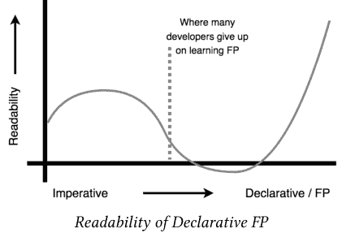

当你阅读本书时，你可能也会发现自己正在经历类似的效果。但请放心；如果你坚持住，曲线会回升的！

*命令式*代码描述了我们大多数人可能自然而然就在写的代码；它专注于精确地指示计算机*如何*做某事。声明式代码——我们将要学习编写的那种，遵循 FP 原则——是更专注于描述*什么*结果的代码。

让我们重新审视本章前面展示的两段代码片段。

第一个片段是命令式的，几乎完全专注于*如何*完成任务；它充斥着 `if` 语句、`for` 循环、临时变量、重新赋值、值修改、带有副作用的函数调用，以及函数之间隐式的数据流。你当然可以追踪其逻辑，看看数字如何流转和变化到最终状态，但这并不清晰，也不直接。

第二个片段更具声明性；它摒弃了大部分前述的命令式技术。注意这里没有显式的条件判断、循环、副作用、重新赋值或修改；相反，它采用了（至少在 FP 领域中）众所周知且可靠的模式，如过滤、归约、转导和组合。关注点从低层次的*如何*转移到了更高层次的*什么*结果。

与其用一个 `if` 语句来测试数字，我们把这个任务委托给了一个众所周知的 FP 工具，如 `gte(..)`（大于或等于），然后把注意力集中在更重要的任务上：将这个过滤器与另一个过滤器和求和函数组合起来。

此外，第二个程序中的数据流是显式的：

1. 一个数字列表进入 `printMagicNumber(..)`。
2. 这些数字被 `sumOnlyFavorites(..)` 逐个处理，产生一个仅包含我们喜欢的数字类型的总数。
3. 这个总数通过 `constructMsg(..)` 转换为一个消息字符串。
4. 这个消息字符串通过 `console.log(..)` 打印到控制台。

你可能仍然觉得这种方法很复杂，而且命令式的片段更容易理解。你更习惯于它；熟悉度对我们的可读性判断有着深远的影响。但到了本书末尾，你将会内化第二个片段声明式方法的好处，那种熟悉度将使其可读性跃然纸上。

我知道此刻让你相信这一点需要很大的信任。

正如我所建议的那样，提高可读性、尽量减少或消除许多导致错误的错误，需要更多的努力，有时还需要更多的代码。老实说，当我开始写这本书时，我不可能写出（甚至完全理解！）第二个片段。随着我现在在学习之旅上走得更远，它变得更自然、更舒服了。

如果你期望 FP 重构，像一颗神奇的银弹，能迅速让你的代码变得更优雅、更灵巧、更聪明、更具弹性、更简洁——在短期内就能轻松实现——不幸的是，这不切实际。

FP 是一种截然不同的思考代码结构如何组织的方式，它让数据流更加明显，帮助你的读者理解你的思路。这需要时间。这种努力绝对值得，但可能是一段艰难的旅程。

将一段命令式代码重构为更声明式的 FP 代码，我经常需要多次尝试，才能最终得到让我自己日后也能理解的东西。我发现转换为 FP 是一个缓慢的迭代过程，而不是从一个范式到另一个范式的快速二元转换。

我也会对我写的每一段代码应用“稍后教学”测试。写完一段代码后，我把它放几个小时或几天，然后带着新鲜的眼光回来看，假装自己需要教给别人或解释给别人听。通常，前几遍它都是混乱和令人困惑的，所以我就调整它，然后重复！

我不是想打击你的积极性。我真的希望你能穿过这些杂草。我很庆幸自己做到了。我终于开始看到曲线向上弯曲，朝着改善的可读性发展。这种努力是值得的。对你也是如此。

### 视角

大多数其他 FP 教材似乎采取自上而下的方法，但我们要走相反的方向：自下而上，我们将揭示我认为正式 FP 从业者会承认是其一切基础的基本功原则。但大多数情况下，我们会与那些令人生畏的术语或数学符号保持距离，因为它们太容易让学习者感到沮丧了。

我认为称呼什么不重要，更重要的是你理解它是什么以及它如何工作。这并不是说共享术语不重要——它无疑能促进资深专业人士之间的沟通。但对于学习者，我发现它可能分散注意力。

所以本书将更侧重于基础概念，而非花哨的修饰。这并不是说不会出现术语；肯定会有。但不要太沉迷于那些复杂的词汇。在必要的地方，透过它们看到背后的思想。

我把这里不太正式的实践称为“轻量函数式编程”，因为我认为真正 FP 的形式主义的问题在于，如果你还不习惯形式化思维，它可能会相当压倒性。我可不是瞎猜；这是我个人的亲身经历。即使在教过 FP 并写完这本书之后，我仍然可以说 FP 中术语和符号的形式化对我来说非常非常难以理解。我试过，又试，还是无法深入其中大部分内容。

我认识许多函数式编程（FP）的拥护者，他们认为形式化方法本身就有助于学习。但我认为很明显存在一个临界点，只有当你对形式化方法达到一定程度的熟悉后，情况才会如此。如果你恰好有数学背景，甚至某些类型的计算机科学经验，这对你来说可能更自然。但我们中的一些人并非如此，无论我们多么努力，形式化方法总是会成为障碍。

因此，本书将介绍我认为 FP 所构建的概念，但方法是通过从下方给你一个助力，让你能够爬上那道悬崖，而不是居高临下地从山顶对你大喊大叫，催促你自己琢磨如何攀爬。

### 如何寻找平衡

如果你编程已有相当长一段时间，很可能你以前听过“YAGNI”这个短语：“你不会需要它”。这个原则主要来自极限编程，强调在需要之前构建一个功能的高风险和高成本。

有时我们猜测将来会需要某个功能，现在就构建它，认为在构建其他东西时顺便做会更容易，结果发现我们猜错了，这个功能并不需要，或者需要的非常不同。有时我们猜对了，但过早地构建了一个功能，占用了真正现在就需要的功能的时间；我们因为分散精力而产生了机会成本。

YAGNI 提醒我们记住：即使在某个情况下这看起来违反直觉，我们通常也应该推迟构建某样东西，直到它当下需要。我们往往会夸大以后需要时再添加它的未来重构成本的心理估计。很可能，以后做起来并没有我们假设的那么难。

就函数式编程而言，我想提出这个告诫：本文中将讨论许多有趣且引人注目的模式，但仅仅因为你发现某个模式应用起来很令人兴奋，在代码的某个特定部分应用它未必合适。

这是我与许多正式 FP 拥护者不同的地方：仅仅因为你能够将 FP 应用于某件事，并不意味着你应该将其应用于此。此外，分解问题的方式有很多，即使你可能学到了一种更复杂、对未来维护和扩展性更“有保障”的方法，但在那个位置，一个更简单的 FP 模式可能就已经绰绰有余了。

通常，我建议你在编码时寻求平衡，并在掌握过程中对 FP 概念的应用保持保守。在决定某个模式或抽象是否有助于代码的某部分更具可读性，或者它是否只是引入了尚未必要的巧妙复杂性时，默认采用 YAGNI 原则。

> 提醒一下，任何从未使用过的扩展点不仅仅是浪费了功夫，它很可能还会成为你的绊脚石。
>
> 杰里米·D·米勒 @jeremydmiller 2/15/15
>
> `https://twitter.com/jeremydmiller/status/568797862441586688`

记住，你编写的每一行代码都有与之相关的读者成本。这个读者可能是另一个团队成员，甚至是未来的你。这些读者都不会对那些过于聪明、不必要的复杂性印象深刻，仅仅为了炫耀你的 FP 能力。

最好的代码是未来最具可读性的代码，因为它恰好在理想（它能/应该是什么）和务实（它必须是什么）之间取得了完美的平衡。

### 资源

为了撰写本文，我参考了许多不同的资源。我相信你可能也会从中受益，所以我想花点时间指出它们。

> 函数式轻量 JavaScript

#### 书籍

一些你绝对应该阅读的 FP/JavaScript 书籍：

- [弗里斯比教授的函数式编程基本够用指南](https://github.com/MostlyAdequate/mostly-adequate-guide)，作者：布莱恩·朗斯多夫
- [JavaScript Allongé](https://leanpub.com/javascript-allonge)，作者：雷格·布雷斯韦特
- [函数式 JavaScript](http://shop.oreilly.com/product/0636920028857.do)，作者：迈克尔·福格斯

#### 博客/网站

其他一些你应该关注的作者和内容：

- [Fun Fun Function 视频](https://www.youtube.com/channel/UCO1cgjh5M7JzvIMJhOyrvH4)，作者：马蒂亚斯·P·约翰逊
- [Awesome FP JS](https://github.com/stoeffel/awesome-fp-js)
- [克里斯·詹金斯](http://blog.krisjenkins.com/)
- [埃里克·埃利奥特](https://medium.com/@ericelliott)
- [詹姆斯·A·福布斯](http://james-forbes.com/?)
- [詹姆斯·隆斯特](http://jlongster.com/)（注：可能是[詹姆斯·隆](https://github.com/jlongster)）
- [安德烈·斯塔尔茨](http://staltz.com/)
- [函数式编程术语](https://github.com/hemanth/functional-programming-jargon)
- [函数式编程练习](https://github.com/timothyhobbs/functional-programming-exercises)

#### 库

本书中的代码片段基本上不依赖于库。我们探索的每一个操作，都将推导如何在独立、普通的 JavaScript 中实现。然而，随着你开始用 FP 编写更多真实代码，你很快会想要一个库，来提供这些常用工具的优化且高度可靠的版本。

顺便说一句，你需要查看所用库函数的文档，以确保你了解它们的工作原理。其中许多函数与我们在本文中构建的代码会有很多相似之处，但无疑会有一些差异，即使是在流行的库之间。

以下是几个流行的 JavaScript FP 库，是开始你探索之旅的好起点：

- `Ramda`
- `lodash/fp`
- `functional.js`
- `Immutable.js`

[附录 C 深入探讨了这些库](#)以及其他库。

## 总结

你开始阅读本书可能有各种各样的原因，并对能从中获得什么有不同的期望。本章解释了我希望你阅读本书的原因，以及我希望你从这次旅程中获得什么。它也帮助你向他人（比如你的开发同事）阐明为什么他们应该与你同行！

函数式编程是关于编写基于公认原则的代码，这样我们才能对我们编写的代码获得一定程度的信心和信任。我们不应该满足于编写那种我们焦虑地希望能运行的代码，然后当测试套件通过时突然松一口气。我们应该在运行之前就知道它会做什么，并且我们应该绝对有信心，我们已经为了其他读者（包括未来的我们）的利益在代码中传达了所有这些想法。

这就是“函数式轻量 JavaScript”的核心。目标是学会有效地通过代码进行沟通，而无需被大量的符号或术语所淹没。

学习函数式编程的旅程始于深入理解函数的本质。这就是我们下一章要解决的内容。

# 第 2 章：函数的本质

函数式编程不仅仅是使用 `function` 关键字进行编程。哦，要是那么简单就好了——我这本书就不用写下去了！尽管如此，函数确实是 FP 的核心。而我们使用函数的方式，才使得我们的代码成为*函数式*的。

但是，你有多确定你知道*函数*真正的含义？

在本章中，我们将通过探索函数的所有基础方面，为本书的其余部分打下基础。实际上，这是对所有非 FP 程序员也应该了解的关于函数的知识的回顾。但当然，如果我们想从 FP 概念中获得最大收益，至关重要的是我们要*透彻地*了解函数。

请做好准备，因为函数可能比你意识到的包含更多内容。

## 什么是函数？

“什么是函数？”这个问题表面上似乎有一个显而易见的答案：函数是一段可以被执行一次或多次的代码集合。

虽然这个定义是合理的，但它缺少一些非常重要的精髓，而这些精髓正是*函数*在 FP 应用中的核心。所以让我们深入表面，更全面地理解函数。

### 简短的数学复习

我知道我曾承诺会尽可能避免数学，但在我们继续之前，请稍等片刻，我们快速观察一下代数中关于函数和图形的一些基本概念。

你还记得在学校学过 `f(x)` 相关的知识吗？或者 `y = f(x)` 这个方程呢？

假设我们有一个定义如下的方程：`f(x) = 2x^2 + 3`。这是什么意思？绘制这个方程的图像又意味着什么呢？这就是它的图像：

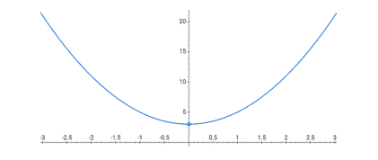

`f(x) = 2x^2 + 3`

你可以注意到，对于任意 x 的值，比如 2，将其代入方程，你会得到 11。不过，11 是什么呢？它是 `f(x)` 函数的*返回值*，我们之前说过，它代表一个 y 值。

换句话说，我们可以将输入和输出值解释为图像中曲线上坐标为 `(2,11)` 的一个点。对于我们代入的每个 x 值，我们都会得到另一个 y 值，它们配对形成一个点的坐标。另一个是 `(0,3)`，还有一个是 `(-1,5)`。把所有这些点组合起来，你就得到了如图所示的抛物线曲线。

那么，这一切和函数式编程 (FP) 有什么关系呢？

在数学中，函数总是接收输入，并总是给出一个输出。在函数式编程中，你经常会听到“态射”这个术语；这是一种花哨的说法，用来描述一组值映射到另一组值，就像函数的输入与该函数的输出相关联一样。

在代数数学中，这些输入和输出通常被解释为要绘制的坐标的组成部分。然而，在我们的程序中，我们可以定义具有各种输入和输出的函数，尽管它们很少被解释为图表上可视化的曲线。

## 函数与过程

那么，为什么要谈论数学和图像呢？因为本质上，函数式编程就是要拥抱在这种数学意义上使用*函数*。

你可能更习惯将函数视为过程。那么区别是什么？过程是功能的任意集合。它可能有输入，也可能没有。它可能有输出（`返回值`），也可能没有。

函数接收输入，并且*总是*有一个 `返回值`。

如果你打算进行函数式编程，你应该尽可能多地使用函数，并尽量避免使用过程。你所有的函数都应该接收输入并返回输出。

为什么？这个问题的答案将包含多层含义，我们将在本书中逐步揭示。

## 函数输入

到目前为止，我们可以得出结论：函数必须期望输入。但让我们深入探讨一下函数输入是如何工作的。

你有时会听到人们将这些输入称为“实参”，有时称为“形参”。这到底是怎么回事？

*实参*是你传入的值，而*形参*是函数内部接收这些传入值的命名变量。例如：

```javascript
function foo(x,y) {
    // ..
}

var a = 3;

foo( a, a * 2 );
```

`a` 和 `a * 2`（实际上是 `a * 2` 的结果，即 6）是调用 `foo(..)` 的*实参*。`x` 和 `y` 是接收实参值（分别是 3 和 6）的*形参*。

> **注意**
>
> 在 JavaScript 中，*实参*的数量不一定与*形参*的数量匹配。如果你传递的*实参*比声明的*形参*多，多出的值会被原样传入。这些值可以通过几种不同的方式访问，包括你可能听说过的旧式 `arguments` 对象。如果你传递的*实参*比声明的*形参*少，每个不匹配的形参都会被视为“undefined”变量，这意味着它存在于函数的作用域中，但初始值是空的 undefined。

### 参数默认值

从 ES6 开始，形参可以声明*默认值*。在未传递该形参的实参，或者传递的值是 `undefined` 的情况下，默认赋值表达式会被使用。

考虑：

```javascript
function foo(x = 3) {
    console.log( x );
}

foo();                   // 3
foo( undefined );        // 3
foo( null );             // null
foo( 0 );                // 0
```

思考任何能提升函数可用性的默认情况始终是个好习惯。然而，使用参数默认值在阅读和理解函数调用方式的多样性方面可能会增加复杂性。请谨慎使用此特性。

### 计算输入数量

函数“期望”的实参数量——你可能希望传递给它的实参数量——由声明的形参数量决定：

```javascript
function foo(x,y,z) {
    // ..
}
```

`foo(..)` *期望*三个实参，因为它有三个声明的形参。这个数量有一个特殊的术语：元数 (arity)。元数是函数声明中形参的数量。`foo(..)` 的元数是 3。

此外，元数为 1 的函数也称为“一元函数”，元数为 2 的函数称为“二元函数”，元数为 3 或更高的函数称为“n 元函数”。

你可能希望在程序运行时检查一个函数引用以确定其元数。这可以通过该函数引用的 `length` 属性来完成：

```javascript
function foo(x,y,z) {
    // ..
}

foo.length;        // 3
```

在运行期间确定元数的一个原因是，如果一段代码从多个来源接收到一个函数引用，并根据每个函数的元数发送不同的值。

例如，想象一种情况，一个 `fn` 函数引用可能期望一个、两个或三个实参，但你总是想在最后一个位置传递一个变量 `x`：


```javascript
// `fn` 被设置为某个函数引用
// `x` 存在且有某个值

if (fn.length == 1) {
    fn( x );
}
else if (fn.length == 2) {
    fn( undefined, x );
}
else if (fn.length == 3) {
    fn( undefined, undefined, x );
}
```

## 提示

函数的`length`属性是只读的，并且在声明函数时就确定了。它应被视为描述函数预期用法的元数据。

需要注意的一个问题是，某些形参列表的变化可能会使函数的`length`属性报告与你预期不同的值：

```javascript
function foo(x,y = 2) {
    // ..
}

function bar(x,...args) {
    // ..
}

function baz( {a,b} ) {
    // ..
}

foo.length;           // 1
bar.length;          // 1
baz.length;          // 1
```

那么，如何计算当前函数调用接收到的实参数量呢？这曾经很简单，但现在情况稍微复杂一些。每个函数都有一个可用的`arguments`类数组对象，它保存了传入的每个实参的引用。然后，你可以检查`arguments`的`length`属性来弄清楚实际传递了多少个实参：

```javascript
function foo(x,y,z) {
    console.log( arguments.length );
}

foo( 3, 4 );     // 2
```

自 ES5（特别是严格模式）以来，`arguments`被某些人认为有点过时；许多人尽量避免使用它。在 JavaScript 中，无论对未来的进步多么有帮助，我们“永不”破坏向后兼容性，所以`arguments`永远不会被移除。但现在通常建议尽可能避免使用它。

然而，我建议对于那些你需要关心传递实参数量的情况，使用`arguments.length`并且只使用它是可以的。JavaScript 的未来版本可能会添加一个功能，提供确定传递实参数量的能力而无需查询`arguments.length`；如果发生了这种情况，那么我们就可以完全放弃使用`arguments`！

小心：永远不要按位置访问`arguments`，比如`arguments[1]`。小心只使用`arguments.length`，并且只在必须的时候使用。

但是，你如何访问在声明形参位置之外传递的实参呢？我稍后会回答这个问题；但首先，退一步问自己，“我为什么想这样做？”说真的。仔细思考一分钟。

这种情况应该很少发生；它不应该是你在编写函数时经常期望或依赖的事情。如果你发现自己处于这种情况，花额外的 20 分钟尝试以不同的方式设计与该函数的交互。即使它是特殊的，也要为那个额外的实参命名。

接受不定数量实参的函数签名被称为可变参数函数。有些人喜欢这种函数设计风格，但我想你会发现，函数式编程者通常希望尽可能避免它们。

好了，关于这一点就说到这里。

假设你确实需要以位置数组的方式访问实参，可能是因为你在访问一个在该位置没有形式参数的实参。我们该怎么做呢？

ES6 来救场！让我们用`...`运算符来声明我们的函数——它被不同地称为 "spread"、"rest"，或者（我更喜欢）"gather"：

```javascript
function foo(x, y, z, ...args) {
    // ...
}
```

注意到参数列表中的`...args`了吗？这是一种 ES6 的声明形式，它告诉引擎收集（嗯哼，"gather"）所有未被分配给命名参数的剩余参数（如果有的话），并将它们放入一个名为`args`的真实数组中。`args`将始终是一个数组，即使它是空的。但它不会包含分配给`x`、`y`和`z`参数的值，只包含在前三个值之外传入的任何其他值：

```javascript
function foo(x, y, z, ...args) {
    console.log( x, y, z, args );
}

foo();                 // undefined undefined undefined []
foo( 1, 2, 3 );        // 1 2 3 []
foo( 1, 2, 3, 4 );     // 1 2 3 [ 4 ]
foo( 1, 2, 3, 4, 5 );  // 1 2 3 [ 4, 5 ]
```

因此，如果你真的想设计一个可以处理任意数量传入参数的函数，请在末尾使用`...args`（或你喜欢的任何名称）。现在，你将拥有一个真实的、非弃用的、非难看的数组来访问这些参数值。

只需注意，值`4`位于`args`的位置`0`，而不是位置`3`。它的`length`值不会包含`1`、`2`和`3`这三个值。`...args`收集所有其他内容，不包括`x`、`y`和`z`。

你可以在参数列表中使用`...`运算符，即使没有声明其他形式参数：

```javascript
function foo(...args) {
    // ..
}
```

现在`args`将是完整的参数数组，无论它们是什么，你可以使用`args.length`来确切知道传入了多少个参数。如果你愿意，使用`args[1]`或`args[317]`也是安全的。不过，请不要传入 318 个参数。

### 参数数组

如果你想将一个值数组作为参数传递给函数调用怎么办？

```javascript
function foo(...args) {
    console.log( args[3] );
}

var arr = [ 1, 2, 3, 4, 5 ];

foo( ...arr );				// 4
```

我们使用了新朋友`...`，但现在不仅在参数列表中使用；它也在调用点的参数列表中使用。在这种情况下，它具有相反的行为。在参数列表中，我们说过它收集参数。在参数列表中，它展开它们。因此`arr`的内容实际上被展开为`foo(..)`调用的单个参数。你看出这与仅仅传递整个`arr`数组的引用有何不同了吗？

顺便说一句，多个值和`...`展开可以按你的意愿交错出现：

```javascript
var arr = [ 2 ];

foo( 1, ...arr, 3, ...[4,5] );	// 4
```

从这个对称的意义上思考`...`：在值列表位置，它展开。在赋值位置——比如参数列表，因为参数被赋值给参数——它收集。

无论你调用哪种行为，`...`使得处理参数数组变得更加容易。`slice(..)`、`concat(..)`和`apply(..)`来处理我们的参数值数组的日子一去不复返了。

## 提示

实际上，这些方法并非完全无用。在本书的代码中，我们会在几个地方依赖它们。但在大多数地方，`...`的声明式可读性会更高，因此也更可取。

### 参数解构

考虑上一节中的可变参数`foo(..)`：

```javascript
function foo(...args) {
    // ..
}

foo( ...[1,2,3] );
```

如果我们想改变这种交互方式，让函数的调用者传入一个值数组而不是单个参数值怎么办？只需去掉两个`...`的用法：

```javascript
function foo(args) {
    // ..
}

foo( [1,2,3] );
```

很简单。但如果我们现在想给传入数组中的前两个值分别指定一个参数名怎么办？我们不再声明单个参数了，因此似乎失去了这个能力。

谢天谢地，ES6 解构是答案。解构是一种声明模式的方法，用于描述你期望看到的结构（对象、数组等）以及如何处理其各个部分的分解（赋值）。

考虑：

```javascript
function foo( [x,y,...args] = [] ) {
    // ..
}

foo( [1,2,3] );
```

你现在注意到参数列表周围的`[..]`方括号了吗？这称为数组参数解构。

在这个例子中，解构告诉引擎，在此赋值位置（即参数）期望一个数组。该模式表示取出该数组的第一个值并分配给名为`x`的局部参数变量，第二个值分配给`y`，剩余的所有内容被收集到`args`中。

### 声明式风格的重要性

考虑我们刚才看到的解构`foo(..)`，我们也可以手动处理参数：

```javascript
function foo(params) {
    var x = params[0];
    var y = params[1];
    var args = params.slice( 2 );

    // ..
}
```

但在这里，我们强调一下第 1 章仅简要介绍过的一个原则：声明式代码比命令式代码沟通更有效。

声明式代码（例如，前面`foo(..)`代码片段中的解构，或`...`运算符的用法）专注于一段代码的结果应该是什么。

命令式代码（如后一个代码片段中的手动赋值）则更关注如何获得结果。如果你后来阅读这样的命令式代码，你必须在头脑中执行所有代码才能理解预期的结果。结果就在那里被编码了，但它并不那么清晰，因为它被我们如何到达那里的细节所笼罩。

前面的`foo(..)`被认为更具可读性，因为解构隐藏了管理参数输入的如何做的不必要细节；读者可以自由地只关注我们将用这些参数做什么。这显然是最重要的关注点，因此也是读者应该专注于以最完整理解代码的地方。

只要可能，只要我们的语言和库/框架允许，我们就应该努力编写声明式的、自我解释的代码。

### 命名参数

正如我们可以解构数组参数一样，我们也可以解构对象参数：

```javascript
function foo( {x,y} = {} ) {
    console.log( x, y );
}

foo( {
    y: 3
} );              // undefined 3
```

我们传入一个对象作为单个参数，它被解构为两个单独的参数变量`x`和`y`，它们被分配了传入对象中相应属性名的值。`x`属性不在对象上并不重要；它最终就像你预期的那样，成为一个值为`undefined`的变量。

但关于参数对象解构，我想让你注意的是传入`foo(..)`的对象。

对于像`foo(undefined,3)`这样的普通调用点，使用位置来映射参数；我们将 3 放在第二个位置，以使其被分配给`y`参数。但在涉及参数解构的这种新型调用点，一个简单的对象属性就指明了参数值 3 应该被分配给哪个参数（`y`）。

在那个调用点，我们不必考虑`x`，因为实际上我们不关心`x`。我们只是省略了它，而不是不得不做一些分散注意力的事情，比如传递`undefined`作为位置占位符。

一些语言有专门用于此的功能：命名参数。换句话说，在调用点，标记一个输入值以指明它映射到哪个参数。JavaScript 没有命名参数，但参数对象解构是次佳的选择。

使用对象解构来传递可能多个参数的另一个函数式编程相关的好处是，一个只接受一个参数（对象）的函数更容易与另一个函数的单个输出组合。关于这一点，第 4 章会详细讨论。

### 无序参数

另一个关键好处是，命名参数作为对象属性指定，从根本上是无序的。这意味着我们可以按以下方式指定输入，无论我们想要什么顺序：

```javascript
function foo( {x,y} = {} ) {
    console.log( x, y );
}

foo( {
    y: 3
} );                      // undefined 3
```

我们只需简单地省略即可跳过`x`参数。或者如果我们愿意，也可以指定`x`参数，即使在对象字面量中把它列在`y`之后。调用点不再被类似`undefined`的有序占位符弄得杂乱无章，只是为了跳过某个参数。

命名参数要灵活得多，而且从可读性的角度来看也更具吸引力，尤其是当相关函数可以接收三个、四个或更多输入时。

## 提示

如果你觉得这种函数参数的风格有用或有趣，请查看附录 C 中关于 FPO 库的介绍。

## 函数输出

让我们把注意力从函数的输入转移到输出上。

在 JavaScript 中，函数总是返回一个值。这三个函数具有完全相同的返回行为：

```javascript
function foo() {}
```

```javascript
function bar() {
    return;
}
```

```javascript
function baz() {
    return undefined;
}
```

如果没有`return`，或者只有空的`return;`，则会隐式返回`undefined`值。

但尽可能地遵循 FP 函数定义的精神——使用函数而不是过程——我们的函数应该始终有输出，这意味着它们应该显式返回一个值，通常不是`undefined`。

`return`语句只能返回单个值。因此，如果你的函数需要返回多个值，你唯一可行的选择是将它们收集到数组或对象等复合值中：

```javascript
function foo() {
    var retValue1 = 11;
    var retValue2 = 31;
    return [ retValue1, retValue2 ];
}
```

然后，我们从`foo()`返回的数组中将`x`和`y`分别赋值给两个对应项：

```javascript
var [ x, y ] = foo();
console.log( x + y );      // 42
```

将多个值收集到数组（或对象）中返回，随后将这些值解构回独立的赋值，是一种透明地表达函数多个输出的方式。

如果我不建议你花点时间考虑一下，需要多个输出的函数是否可以重构以避免这种情况，也许拆分成两个或更多更小的单一用途函数？那我就要失职了。有时这是可能的，有时则不行；但你至少应该考虑一下。

### 提前返回

`return`语句不仅仅是用来从函数返回一个值。它也是一种流程控制结构；它在该点结束函数的执行。因此，具有多个`return`语句的函数就有多个可能的退出点，这意味着如果有许多路径可能产生该输出，那么理解函数的输出行为可能会更困难。

考虑一下：

```javascript
function foo(x) {
    if (x > 10) return x + 1;

    var y = x / 2;

    if (y > 3) {
        if (x % 2 == 0) return x;
    }

    if (y > 1) return y;

    return x;
}
```

随堂测验：不要作弊，也不要在浏览器中运行这段代码，`foo(2)`返回什么？`foo(4)`呢？`foo(8)`呢？`foo(12)`呢？

你对自己的答案有多自信？为了得到这些答案，你付出了多少心智负担？我第一次尝试思考时，前两次都答错了，而且这还是我写的！

我认为可读性问题的一部分在于，我们使用`return`不仅仅是为了返回不同的值，而且还把它作为流程控制结构，在某些情况下提前退出函数的执行。显然有更好的方式来写这种流程控制（`if`逻辑等），但我也认为有更好的方法让输出路径更加明确。

## 注意

随堂测验的答案是 2、2、8 和 13。

看看这个版本的代码：

```javascript
function foo(x) {
    var retValue;

    if (retValue == undefined && x > 10) {
        retValue = x + 1;
    }

    var y = x / 2;

    if (y > 3) {
        if (retValue == undefined && x % 2 == 0) {
            retValue = x;
        }
    }

    if (retValue == undefined && y > 1) {
        retValue = y;
    }

    if (retValue == undefined) {
        retValue = x;
    }
    }

    return retValue;
}
```

这个版本无疑更加冗长。但我认为它的逻辑稍微简单一些，更容易理解，因为`retValue`可以被设置的每一个分支都受到条件的保护，即检查它是否已经被设置过。

我们没有提前从函数`return`，而是使用正常的流程控制（`if`逻辑）来确定`retValue`的赋值。最后，我们简单地`return retValue`。

我不是无条件地说你应该始终只有一个`return`，或者永远不应该做提前`return`，但我确实认为你应该小心`return`的流程控制部分在你的函数定义中造成更多的隐式性。尽量找出最明确的方式来表达逻辑；这通常会是最好的方式。

### 未返回的输出

有一种技术你可能在写过的绝大多数代码中都使用过，而且可能都没怎么想过，那就是让函数通过简单地改变自身外部的变量来输出部分或全部值。

还记得本章早些时候我们的`$f(x) = 2x^2 + 3$`函数吗？我们在 JS 中可以这样定义：

```javascript
var y;

function f(x) {
    y = (2 * Math.pow( x, 2 )) + 3;
}

f( 2 );

y; // 11
```

我知道这是一个愚蠢的例子；我们完全可以返回这个值，而不是在函数内部把它设置到`y`中：

```javascript
function f(x) {
    return (2 * Math.pow( x, 2 )) + 3;
}

var y = f( 2 );

y; // 11
```

两个函数完成了相同的任务，那么有什么理由我们应该选择其中一个版本而不是另一个吗？是的，绝对有。

一种解释区别的方式是，后一个版本中的`return`表示显式输出，而前一个版本中的`y`赋值是隐式输出。你可能已经有一些直觉来指导你在这种情况下的判断；通常，开发者更喜欢显式模式而不是隐式模式。


但是像我们在`foo(..)`内部对`y`赋值那样，改变外部作用域中的变量，只是实现隐式输出的一种方式。一个更微妙的例子是通过引用来修改非局部的值。

考虑一下：

```
function sum(list) {
    var total = 0;
    for (let i = 0; i < list.length; i++) {
        if (!list[i]) list[i] = 0;

        total = total + list[i];
    }

    return total;
}

var nums = [ 1, 3, 9, 27, , 84 ];

sum( nums );           // 124
```

这个函数最明显的输出是我们显式返回的和`124`。但你发现另一个输出了吗？试试运行这段代码，然后检查`nums`数组。现在你发现区别了吗？

在第 4 个位置，不再是`undefined`的空槽值，现在变成了`0`。看似无害的`list[i] = 0`操作最终影响了外部的数组值，尽管我们操作的是局部的`list`参数变量。

为什么？因为`list`持有的是`nums`引用的引用副本，而不是`[1,3,9,…]`数组值的值副本。JavaScript 对数组、对象和函数使用引用和引用副本，所以我们可能很容易就意外地从函数中产生一个输出。

这种隐式函数输出在 FP 世界中有一个特殊的名字：副作用。而一个没有副作用的函数也有一个特殊的名字：纯函数。我们将在第 5 章中更多地讨论这些，但关键点是，我们希望尽可能优先使用纯函数并避免副作用。

## 函数的函数

函数可以接收和返回任何类型的值。接收或返回一个或多个其他函数值的函数有一个特殊的名字：高阶函数。

考虑一下：

```
function forEach(list, fn) {
    for (let v of list) {
        fn( v );
    }
}
```

```
forEach( [1,2,3,4,5], function each(val){
    console.log( val );
} );
// 1 2 3 4 5
```

`forEach(..)`是一个高阶函数，因为它接收一个函数作为参数。

高阶函数也可以输出另一个函数，比如：

```
function foo() {
    return function inner(msg){
        return msg.toUpperCase();
    };
}

var f = foo();

f( "Hello!" ); // HELLO!
```

`return`并不是“输出”内部函数的唯一方式。

将其他函数作为值来处理的函数，按定义就是高阶函数。函数式程序员一直在使用它们！

### 保持作用域

整个编程领域，尤其是函数式编程中最强大的特性之一，就是函数在另一个函数作用域内的行为方式。当内部函数引用外部函数的变量时，这被称为闭包。实用地定义如下：

> 闭包是指一个函数能够记住并访问其自身作用域之外的变量，即使该函数在不同的作用域中执行。

考虑以下示例：

```
function foo(msg) {
    var fn = function inner(){
        return msg.toUpperCase();
    };

    return fn;
}

var helloFn = foo( "Hello!" );

helloFn();
```

在`foo(..)`的作用域中，`msg`参数变量在内部函数内部被引用。当`foo(..)`执行并创建内部函数时，它捕获了对`msg`变量的访问权限，并在函数返回后仍然保留这种访问权限。

一旦我们拥有了对内部函数的引用`helloFn`，`foo(..)`就已经执行完毕，看起来它的作用域应该已经消失了，这意味着`msg`变量将不再存在。但这种情况并没有发生，因为内部函数对`msg`有一个闭包，使其保持存活。被闭包捕获的`msg`变量会一直存在，直到内部函数（现在通过`helloFn`在另一个作用域中被引用）不再存在为止。

让我们再看几个闭包实际应用的例子：

```
function person(name) {
    return function identify(){
        console.log( `I am ${name}` );
    };
}

var fred = person( "Fred" );
var susan = person( "Susan" );

fred();
susan();
```

内部函数`identify()`对参数`name`有一个闭包。

闭包所提供的访问权限并不仅限于读取变量的原始值——它不仅仅是一个快照，而是一个实时链接。你可以更新值，并且新的当前状态会一直被记住，直到下一次访问：

```
function runningCounter(start) {
    var val = start;

    return function current(increment = 1){
        val = val + increment;
        return val;
    };
}

var score = runningCounter( 0 );

score();           // 1
score();           // 2
score( 13 );       // 15
```

### 警告

由于我们将在本书后面深入探讨的原因，你可能希望尽可能避免使用闭包来记忆这种会变化的状态（`val`）的示例。

如果你有一个操作需要两个输入，其中一个是现在已知的，而另一个将在稍后指定，你可以使用闭包来记住第一个输入：

```
function makeAdder(x) {
    return function sum(y){
        return x + y;
    };
}

// 我们已经知道 `10` 和 `37` 分别作为第一个输入
var addTo10 = makeAdder( 10 );
var addTo37 = makeAdder( 37 );

// 稍后，我们指定第二个输入
addTo10( 3 );      // 13
addTo10( 90 );     // 100

addTo37( 13 );     // 50
```

通常，一个`sum(..)`函数会同时接受`x`和`y`两个输入并求和。但在这个例子中，我们首先接收并记住（通过闭包）`x`值，而`y`值则稍后单独指定。

> **注意**
>
> 在函数式编程中，这种在连续函数调用中指定输入的技术非常常见，有两种形式：偏应用和柯里化。我们将在第 3 章中更深入地探讨它们。

当然，由于函数在 JS 中就是值，我们可以通过闭包来记住函数值：

```
function formatter(formatFn) {
    return function inner(str){
        return formatFn( str );
    };
}

var lower = formatter( function formatting(v){
    return v.toLowerCase();
} );

var upperFirst = formatter( function formatting(v){
    return v[0].toUpperCase() + v.substr( 1 ).toLowerCase();
} );

lower( "WoW" );         // wow
upperFirst( "hello" );   // Hello
```

函数式编程鼓励我们创建简单函数来封装——一种花哨的说法是包装——这种行为，而不是在代码中到处分发/重复`toUpperCase()`和`toLowerCase()`逻辑。

具体来说，我们创建两个简单的一元函数`lower(..)`和`upperFirst(..)`，因为这些函数将更容易与程序中其他函数连接使用。

> **提示**
>
> 你发现`upperFirst(..)`本来可以使用`lower(..)`吗？
>
> 我们将在本书的其余部分大量使用闭包。它可能是整个函数式编程（如果不是整个编程的话）最重要的基础实践。确保你真正掌握了它！

### 语法

在结束这个函数入门之前，让我们花点时间讨论一下它们的语法。

本节中的讨论大多是个人观点和偏好，无论你是同意这里提出的观点还是持相反意见，都比文本的许多其他部分更为主观。这些想法是非常主观的，但许多人似乎对此相当绝对。

最终，由你来决定。

### 名字里有什么？

从语法上讲，函数声明需要包含名称：

```
function helloMyNameIs() {
    // ..
}
```

但函数表达式可以有命名和匿名两种形式：

```
foo( function namedFunctionExpr(){
    // ..
} );
```

```
bar( function(){    // <-- 看，没有名字！
    // ..
} );
```

顺便问一下，我们说的匿名到底是什么意思？具体来说，函数有一个`name`属性，它保存着语法上赋予函数的名称字符串值，例如`"helloMyNameIs"`或`"namedFunctionExpr"`。这个`name`属性最值得注意的用途是在你的 JS 环境的控制台/开发者工具中，当函数参与堆栈跟踪（通常来自异常）时列出该函数。

匿名函数通常显示为`(anonymous function)`。

如果你曾经仅凭异常的堆栈跟踪来调试 JS 程序，你可能已经感受到看到`(anonymous function)`出现在一行又一行的痛苦。这种列表没有给开发者任何关于异常来源路径的线索。这对开发者没有任何帮助。

## 第 2 章：函数的本质

如果你给你的函数表达式命名，这个名称总是会被使用。所以如果你使用一个好名字，比如`handleProfileClicks`而不是`foo`，你会得到更有帮助的堆栈跟踪。

从 ES6 开始，匿名函数表达式在某些情况下会受到名称推断的辅助。考虑：

```
var x = function(){};

x.name;
// x
```

如果引擎能够猜测你可能希望函数采用的名称，它就会继续这样做。

但要注意，并非所有语法形式都能从名称推断中受益。函数表达式最常见的出现位置可能是作为函数调用的参数：

```
function foo(fn) {
    console.log( fn.name );
}

var x = function(){};

foo( x );			// x
foo( function(){} );	//
```

当名称无法从直接周围的语法推断出来时，它仍然是一个空字符串。这样的函数在发生堆栈跟踪时会被报告为`(anonymous function)`。

除了调试问题之外，函数被命名还有其他好处。首先，语法名称（又名词法名称）对于内部自引用很有用。自引用对于递归（同步和异步）是必要的，对于事件处理程序也很有帮助。

考虑以下不同的场景：

# 轻量级函数式 JavaScript

```
// 同步递归：
function findPropIn(propName,obj) {
    if (obj == undefined || typeof obj != "object") return;

    if (propName in obj) {
        return obj[propName];
    }
    else {
        for (let prop of Object.keys( obj )) {
            let ret = findPropIn( propName, obj[prop] );
            if (ret !== undefined) {
                return ret;
            }
        }
    }
}
```

```
// 异步递归：
setTimeout( function waitForIt(){
    // `it` 存在吗？
    if (!o.it) {
        // 稍后再试
        setTimeout( waitForIt, 100 );
    }
}, 100 );
```

```
// 事件处理程序解绑
document.getElementById( "onceBtn" )
    .addEventListener( "click", function handleClick(evt){
        // 解绑事件
        evt.target.removeEventListener( "click", handleClick, false );

        // ..
    }, false );
```

在所有这些情况中，函数的命名从其内部提供了一个有用且可靠的自我引用。

此外，即使在单行函数的简单情况下，命名它们往往也能让代码更具自解释性，从而让未读过的人更容易理解：

```
people.map( function getPreferredName(person){
    return person.nicknames[0] || person.firstName;
} )
// ..
```

函数名`getPreferredName(..)`向读者传达了映射操作意图做什么的信息，而仅从代码本身可能并不完全明显。这个名称标签有助于提高代码的可读性。

匿名函数表达式另一个常见的场景是立即调用函数表达式（IIFEs）：

```
(function(){

    // 看，我是一个 IIFE！

})();
```

你几乎永远不会看到 IIFE 为它们的函数表达式使用名称，但它们应该使用。为什么？出于我们刚刚讨论过的所有相同原因：堆栈跟踪调试、可靠的自我引用和可读性。如果你想不出其他名字，至少可以使用 IIFE 这个词：

```
(function IIFE(){

    // 你早就知道我是一个 IIFE 了！

})();
```

我想说的是，**命名函数总是比匿名函数更可取**，原因有很多。事实上，我甚至可以说，基本上不存在匿名函数比命名函数更可取的情况。它们相对于命名函数确实没有任何优势。

写匿名函数非常容易，因为少了一个需要我们耗费脑力去思考的名字。

老实说；我和其他人一样犯这个错误。我不喜欢费劲去想名字。我最初为函数想出的几个名字通常很糟糕。我不得不反复修改命名。我宁愿直接使用老好的匿名函数表达式来敷衍了事。

但我们是在用写作的便利换取阅读的痛苦。这不是一个好的权衡。因为懒惰或缺乏创造力而不愿为函数想名字，是一个非常常见但糟糕的借口，用于使用匿名函数。

**给每一个函数命名。** 如果你坐在那里不知所措，想不出某个已编写函数的好名字，我强烈建议你可能尚未完全理解该函数的目的——或者它过于宽泛或抽象。你需要回去重新设计这个函数，直到目标更清晰。到那时，名字就会变得更加显而易见。

在我的实践中，如果我找不到一个好名字用于某个函数，我最初会将其命名为`TODO`。我确信至少在提交代码前搜索`"TODO"`注释时，我一定会注意到它。

根据我的经验，在努力为某物命名的过程中，我通常后来能更好地理解它，甚至经常重构其设计以提高可读性和可维护性。

这种时间投入是非常值得的。

## 没有`function`的函数

到目前为止，我们一直在使用函数的标准规范语法。但你无疑也听说过围绕 ES6`=>`箭头函数语法的所有热议。

比较一下：

```
people.map( function getPreferredName(person){
    return person.nicknames[0] || person.firstName;
} );

// 与

people.map( person => person.nicknames[0] || person.firstName );
```

哇。

关键字`function`消失了，`return`、括号（`( )`）、花括号（`{ }`）和最内层的分号（`;`）也都消失了。所有这些都被一个所谓的胖箭头符号（`=>`）所取代。

但我们还省略了另一样东西。你发现了吗？`getPreferredName`这个函数名。

没错；`=>`箭头函数在词法上是匿名的；在语法上无法为其提供名称。它们的名字可以像普通函数一样被推断出来，但同样地，作为参数传递的函数表达式值在大多数情况下不会得到这方面的任何帮助。真遗憾。

如果由于某种原因`person.nicknames`未定义，将会抛出异常，这意味着这个（匿名函数）将位于堆栈跟踪的顶部。唉。

说实话，`=>`箭头函数的匿名性对我来说就像是一把刺向心脏的`=>`匕首。我无法忍受失去命名。它更难阅读，更难调试，而且无法自我引用。

但如果这还不够糟糕，另一个打击是，如果你的函数定义有不同的场景，你必须应对一大堆微妙的语法变体。我不会在这里详细介绍所有变体，但简要列举一下：

```
people.map( person => person.nicknames[0] || person.firstName );
```

```
// 多个参数？需要 ( )
```

```
people.map( (person,idx) => person.nicknames[0] || person.firstName );
```

```
// 参数解构？需要 ( )
```

```
people.map( ({ person }) => person.nicknames[0] || person.firstName );
```

```
// 参数默认值？需要 ( )
```

```
people.map( (person = {}) => person.nicknames[0] || person.firstName );
```

```
// 返回对象？需要 ( )
```


```javascript
people.map( person =>
    ({ preferredName: person.nicknames[0] || person.firstName })
);
```

在函数式编程（FP）领域，对`=>`感到兴奋的主要原因是它几乎完全遵循函数的数学表示法，特别是在 Haskell 等 FP 语言中。`=>`箭头函数的形状在数学上具有沟通性。

进一步深入，我建议支持`=>`的论点是，通过使用更轻量级的语法，我们减少了函数之间的视觉边界，这让我们可以像使用惰性表达式（FP 爱好者的另一个最爱）一样使用简单的函数表达式。

我认为大多数 FP 爱好者会不以为然地看待我分享的这些担忧。他们喜欢匿名函数，他们喜欢节省语法。但就像我之前说的：你来决定。

> **注意**
>
> 虽然我在实际生产代码中并不倾向于使用`=>`，但它们在快速的代码探索中很有用。此外，我们将在本书后续的许多地方使用箭头函数——尤其是在展示典型的 FP 工具函数时——在这些地方，为了优化代码片段有限的物理空间，简洁性是首选。请自行判断这种方法是否会让你的生产代码可读性增强还是降低。

## 这是什么？

如果你不熟悉 JavaScript 中的`this`绑定规则，我建议你阅读我的书《你不知道的 JavaScript（上卷）：this 与对象原型》。就本节而言，我将假设你知道`this`如何在函数调用中被确定（四条规则之一）。但即使你对`this`仍然模糊不清，好消息是我们将得出结论：如果你试图做 FP，就不应该使用`this`。

> **注意**
>
> 我们正在探讨一个最终会得出结论不应该使用的主题。为什么！？因为`this`主题对本书后面涵盖的其他主题有影响。例如，我们对函数纯度的概念会受到`this`本质上作为函数的隐式输入的影响（参见第 5 章）。此外，我们对`this`的看法会影响我们选择数组方法（`arr.map(...)`）还是独立的工具函数（`map(...,arr)`）（参见第 9 章）。理解`this`对于理解为什么`this`*不*应该成为你 FP 的一部分至关重要！

JavaScript 函数有一个`this`关键字，在每次函数调用时自动绑定。`this`关键字可以用许多不同的方式来描述，但我更喜欢说它为函数的执行提供了对象上下文。

`this`是你函数的一个隐式参数输入。

考虑：

```javascript
function sum() {
    return this.x + this.y;
}

var context = {
    x: 1,
    y: 2
};

sum.call( context );           // 3
```

```javascript
context.sum = sum;
context.sum();              // 3

var s = sum.bind( context );
s();                        // 3
```

当然，如果`this`可以隐式输入到函数中，那么同样的对象上下文也可以作为显式参数发送：

```javascript
function sum(ctx) {
    return ctx.x + ctx.y;
}

var context = {
    x: 1,
    y: 2
};

sum( context );
```

更简单。这种代码在 FP 中会容易处理得多。当输入总是显式的时候，将多个函数连接在一起，或使用我们下一章将介绍的其他任何输入处理技巧，会容易得多。使用像`this`这样的隐式输入来做这些事情，其难度从尴尬到几乎不可能不等，具体取决于场景。

我们可以利用基于`this`的系统中的其他技巧，包括原型委托（也在《你不知道的 JavaScript（上卷）：this 与对象原型》中有详细介绍）：

## 总结

函数功能强大。

但我们需要明确一点：函数不仅仅是语句/操作的集合。具体来说，函数需要一个或多个输入（理想情况下，仅需一个！）以及一个输出。

嵌套的函数可以对**外部变量**形成闭包，并记住它们以供后续使用。这是整个编程中最重要的概念之一，也是函数式编程的基石。

请谨慎使用匿名函数，尤其是`=>`箭头函数。它们编写起来很方便，但代价从作者转移到了读者身上。我们在这里学习函数式编程的全部意义在于编写更具可读性的代码，所以不要急着盲目跟风。

不要使用感知`this`的函数。就是不要。

现在，你应该在脑海中逐渐形成清晰而生动的视角，理解*函数*在函数式编程中的含义。是时候开始驾驭函数，让它们能够相互协作了，下一章将教你一系列在这一过程中至关重要的技巧。

# 第三章：管理函数输入

第二章探讨了 JavaScript 函数的核心本质，并奠定了将*函数*转变为函数式编程*函数*的基础。但要充分发挥函数式编程的威力，我们还需要掌握操纵函数的模式和实践，以调整和改变它们的交互——让它们按我们的意愿运作。

具体来说，本章我们的关注点将是函数的参数输入。当你在程序中整合各种不同形式的函数时，你会很快遇到输入的数量、顺序或类型的不兼容问题，以及需要在不同时间指定某些输入的需求。

事实上，出于提高可读性的风格考虑，有时你会希望以完全隐藏其输入的方式来定义函数！

这些技巧对于让函数真正具备*函数式*特性至关重要。

### 为一而全

想象一下，你正在向一个工具函数传递一个函数，而该工具函数会向这个函数传递多个参数。但你可能只希望这个函数接收一个参数。

我们可以设计一个简单的辅助函数，它包装一个函数调用，确保只有一个参数能通过。由于这实际上是强制将函数视为单元函数（unary function），我们就这样命名它：

```javascript
function unary(fn) {
    return function onlyOneArg(arg){
        return fn( arg );
    };
}
```

许多函数式编程者倾向于为此类代码使用更简短的`=>`箭头函数语法（参见第二章，“没有`function`的函数”），例如：

```javascript
var unary =
    fn =>
        arg =>
            fn( arg );
```

## 注意

毫无疑问，这种写法更简洁，甚至可以说精简。但就我个人而言，无论它在与数学符号的对称性上可能获得什么优势，它都因所有函数都是匿名的，以及通过模糊作用域边界，使得理解闭包变得有点晦涩，而在整体可读性上损失更多。

使用`unary(..)`的一个常见例子是与`map(..)`工具（参见第九章，“Map”）和`parseInt(..)`一起使用。`map(..)`为列表中的每一项调用映射函数，每次调用映射函数时，它都会传入三个参数：`value`（值）、`idx`（索引）、`arr`（数组）。

这通常不是什么大问题，除非你试图使用一个函数作为映射函数，而该函数在接收到太多参数时会表现不正确。考虑一下：

```javascript
["1","2","3"].map( parseInt );
// [1,NaN,NaN]
```

对于签名`parseInt(str, radix)`来说，很明显，当`map(..)`在第二个参数位置传递`index`时，它被`parseInt(..)`解释为`radix`（基数），这不是我们想要的。

`unary(..)`创建的函数会忽略传递给它的所有参数，只保留第一个，这意味着传入的索引永远不会被`parseInt(..)`接收，也不会被误认为是基数：

```javascript
["1","2","3"].map( unary( parseInt ) );
// [1,2,3]
```

### 一对一

说到只有一个参数的函数，函数式编程工具箱中的另一个常见基础工具是一个接收一个参数并原样返回该值的函数：

```javascript
function identity(v) {
    return v;
}

// 或者 ES6 => 箭头函数形式
var identity =
    v =>
        v;
```

这个工具看起来如此简单，几乎没什么用。但即使在函数式编程的世界里，简单的函数也能派上用场。就像表演界常说的：没有小角色，只有小演员。

例如，假设你想使用正则表达式分割一个字符串，但结果数组中可能包含一些空值。要丢弃这些空值，我们可以使用 JS 的`filter(..)`数组操作（参见第九章，“Filter”），并将`identity(..)`作为谓词函数：

```javascript
var words = "   Now is the time for all...  ".split( /\s|\b/ );
words;
// ["","Now","is","the","time","for","all","...",""]
```

```javascript
words.filter( identity );
// ["Now","is","the","time","for","all","..."]
```

因为`identity(..)`只是简单地返回传递给它的值，JS 会将每个值强制转换为`true`或`false`，从而决定在最终数组中保留还是排除每个值。

## 提示

另一个可以用作前面例子中谓词函数的单元函数是 JS 内置的`Boolean(..)`函数，它显式地将一个值转换为`true`或`false`。

使用`identity(..)`的另一个例子是作为转换函数的默认值：

```javascript
function output(msg,formatFn = identity) {
    msg = formatFn( msg );
    console.log( msg );
}
```

```javascript
function upper(txt) {
    return txt.toUpperCase();
}
```

```javascript
output( "Hello World", upper );    // HELLO WORLD
output( "Hello World" );             // Hello World
```

你可能还会看到`identity(..)`被用作`map(..)`调用的默认转换函数，或者作为函数列表`reduce(..)`的初始值；这两种工具都将在第九章中介绍。

### 不变之一

某些 API 不允许你直接将值传递给方法，而是要求你传递一个函数，即使该函数实际上只是返回该值。其中一个这样的 API 是 JS Promises 的`then(..)`方法：

```javascript
// 不工作：
p1.then( foo ).then( p2 ).then( bar );

// 应该这样：
p1.then( foo ).then( function(){ return p2; } ).then( bar );
```

许多人声称 ES6 `=>`箭头函数是最佳的“解决方案”：

```javascript
p1.then( foo ).then( () => p2 ).then( bar );
```

但有一个函数式编程工具更适合这项任务：

```javascript
function constant(v) {
    return function value(){
        return v;
    };
}

// 或者 ES6 => 形式
var constant =
    v =>
        () =>
            v;
```

有了这个简洁的小型函数式编程工具，我们就可以妥善解决`then(..)`的烦恼：

```javascript
p1.then( foo ).then( constant( p2 ) ).then( bar );
```

```javascript
var Auth = {

    authorize() {

        var credentials = `${this.username}:${this.password}`;

        this.send( credentials, resp => {

            if (resp.error) this.displayError( resp.error );

            else this.displaySuccess();

        } );

    },

    send(/* .. */) {

        // ..

    }

};

var Login = Object.assign( Object.create( Auth ), {

    doLogin(user,pw) {

        this.username = user;

        this.password = pw;

        this.authorize();

    },

    displayError(err) {

        // ..

    },

    displaySuccess() {

        // ..

    }

} );

Login.doLogin( "fred", "123456" );
```

 **注意**

> `Object.assign(..)`是一个 ES6+工具，用于将一个或多个源对象的属性进行浅拷贝赋值到单个目标对象上：`Object.assign( target, source1, ... )`。

如果你对这段代码的功能感到困惑：我们有两个独立的对象`Login`和`Auth`，其中`Login`通过原型委托到`Auth`。

通过委托和隐式的`this`上下文共享，这两个对象在`this.authorize()`函数调用期间实际上进行了组合，因此`this`上的属性/方法会动态地与`Auth.authorize(..)`函数共享。

*这段*代码因多种原因不符合函数式编程的各种原则，但其中一个明显的障碍是隐式的`this`共享。我们可以让它变得更明确，使代码更接近函数式编程友好的风格：

```javascript
// ..

authorize(ctx) {

    var credentials = `${ctx.username}:${ctx.password}`;

    Auth.send( credentials, function onResp(resp){

        if (resp.error) ctx.displayError( resp.error );

        else ctx.displaySuccess();

    } );

}

// ..

doLogin(user,pw) {

    Auth.authorize( {

        username: user,

        password: pw

    } );

}

// ..
```

在我看来，问题不在于使用对象来组织行为。问题在于我们试图使用隐式输入，而不是明确地指定它。当我戴上函数式编程的帽子时，我想把`this`相关的东西放在架子上。

### 警告

虽然`() => p2`箭头函数版本比`constant(p2)`更简短，但我建议你克制使用它的诱惑。从函数式编程的角度来看，箭头函数返回外部的值，这略显不妥。我们将在本书后续章节（参见第 5 章）讨论此类操作的陷阱。

## 将参数适配到形参

我们可以运用多种模式和技巧，将函数的签名调整为匹配我们希望传入的参数类型。

回顾第 2 章中强调使用数组参数解构的函数签名：

```javascript
function foo( [x,y,...args] = [] ) {
```

当传入的是数组，但希望将其内容作为单独参数处理时，这种模式非常方便。因此，`foo(..)`在技术上是一元函数——执行时只接收一个参数（数组）。但在函数内部，你可以分别处理不同的输入（`x`、`y`等）。

然而，有时你可能无法更改函数声明来使用数组参数解构。例如，假设存在以下函数：

```javascript
function foo(x,y) {

    console.log( x + y );

}

function bar(fn) {

    fn( [ 3, 9 ] );

}

bar( foo ); // 失败
```

你能看出`bar(foo)`为何失败吗？

数组`[3,9]`作为单个值传递给`fn(..)`，但`foo(..)`期望分别接收`x`和`y`。如果能将`foo(..)`的声明改为`function foo([x,y]) { ..`，问题就能解决。或者，如果能将`bar(..)`的行为改为调用`fn(...[3,9])`，那么值`3`和`9`就会被分别传入。

有时你会遇到两个函数因这种参数形式不匹配而无法协同工作的情况，而你又无法修改它们的声明/定义。那么，如何让它们配合使用呢？

我们可以定义一个辅助函数来适配某个函数，使其将接收到的单个数组展开为独立的参数：

```javascript
function spreadArgs(fn) {

    return function spreadFn(argsArr){

        return fn( ...argsArr );

    };

}
```

```javascript
// 或 ES6 => 箭头函数形式

var spreadArgs =

    fn =>

        argsArr =>

            fn( ...argsArr );
```

> **注意**
>
> 我将这个辅助函数命名为`spreadArgs(..)`，但在诸如 Ramda 等库中，它通常被称为`apply(..)`。

现在我们可以使用`spreadArgs(..)`来适配`foo(..)`，使其作为`bar(..)`的合适输入：

```javascript
bar( spreadArgs( foo ) ); // 12
```

这些情况为何出现，现在可能还不太清楚，但你会经常遇到。本质上，`spreadArgs(..)`允许我们定义返回数组形式多值的函数，同时仍将这些多值作为另一个函数的独立输入进行处理。

既然提到了`spreadArgs(..)`工具函数，我们再来定义一个处理相反操作的工具：

```javascript
function gatherArgs(fn) {

    return function gatheredFn(...argsArr){

        return fn( argsArr );

    };

}

// 或 ES6 => 箭头函数形式

var gatherArgs =
``` 


```javascript
fn =>

    (...argsArr) =>

        fn( argsArr );
```

> **注意**
>
> 在 Ramda 中，这个工具被称为 `unapply(..)`，因为它与 `apply(..)` 相反。我认为“spread/gather”这组术语能更形象地描述其功能。

我们可以使用此工具将多个独立参数收集到单个数组中，可能因为我们想将使用数组参数解构的函数适配到另一个分别传递参数的工具。我们将在第 9 章更全面地介绍 `reduce(..)`；简言之，它会用两个独立参数重复调用其归约函数，现在我们可以将它们收集起来：

```javascript
function combineFirstTwo([ v1, v2 ]) {

    return v1 + v2;

}
```

```javascript
[1,2,3,4,5].reduce( gatherArgs( combineFirstTwo ) );

// 15
```

## 部分现在，部分稍后

如果一个函数接受多个参数，你可能希望预先指定其中一部分，其余部分留待后续指定。

考虑这个函数：

```javascript
function ajax(url,data,callback) {

    // ..

}
```

假设你想设置多个 API 调用，其中 URL 是预先知道的，但数据和处理响应的回调函数要稍后才能确定。

当然，你可以等到所有信息都确定后再调用 `ajax(..)`，并那时引用某个全局常量作为 URL。但另一种方式是创建一个函数引用，其 URL 参数已经预设好。

我们将要做的是创建一个新函数，它内部仍然调用 `ajax(..)`，但手动将第一个参数设置为你关心的 API URL，同时等待稍后接收另外两个参数：

```javascript
function getPerson(data,cb) {

  ajax( "http://some.api/person", data, cb );

}
```

```javascript
function getOrder(data,cb) {

  ajax( "http://some.api/order", data, cb );

}
```

手动指定这些函数调用封装当然是可行的，但这可能会变得相当乏味，特别是当还需要不同参数预设的变体时，例如：

```javascript
function getCurrentUser(cb) {

  getPerson( { user: CURRENT_USER_ID }, cb );

}
```

函数式程序员非常习惯的一种做法是寻找重复执行相同类型操作的模式，并试图将这些操作转化为通用的、可复用的工具。事实上，我相信你们许多读者已经具备这种本能，所以这并非函数式编程独有。但毫无疑问，它对函数式编程很重要。

为了构想一个用于参数预设的实用工具，让我们从概念上审视其原理，而不仅仅是这里展示的手动实现。

阐述正在发生之事的一种方式是：`getOrder(data,cb)` 函数是 `ajax(url,data,cb)` 函数的一个偏应用。这个术语源于在函数调用点将参数应用于形参的概念。如你所见，我们只预先应用了部分参数——具体来说，是 `url` 形参对应的参数——而将其余部分留待稍后应用。

对此模式稍作正式的定义：偏应用严格来说是函数元数的减少；请记住，元数是指期望的参数输入数量。我们将原始 `ajax(..)` 函数的元数从 3 减少为 2，得到了 `getOrder(..)` 函数。

让我们定义一个 `partial(..)` 工具：

```javascript
function partial(fn,...presetArgs) {

    return function partiallyApplied(...laterArgs){

        return fn( ...presetArgs, ...laterArgs );

    };

}
```

```javascript
// 或 ES6 => 箭头函数形式

var partial =

    (fn,...presetArgs) =>

        (...laterArgs) =>

            fn( ...presetArgs, ...laterArgs );
```

> **提示**
>
> 不要只看这个代码片段的字面意思。花点时间消化这个工具函数的工作原理。确保你真正理解它。

`partial(..)` 函数接收一个 `fn`，表示我们要对其执行偏应用的函数。然后，传入的任何后续参数都会被收集到 `presetArgs` 数组中保存起来，以备后用。

接着会创建并返回一个新的内部函数（为清晰起见称为 `partiallyApplied(..)`）；该内部函数自身的参数被收集到一个名为 `laterArgs` 的数组中。

注意到内部函数中对 `fn` 和 `presetArgs` 的引用了吗？这是如何工作的？当 `partial(..)` 执行完毕后，内部函数是如何继续访问 `fn` 和 `presetArgs` 的？如果你回答闭包，那就对了！内部函数 `partiallyApplied(..)` 闭包了 `fn` 和 `presetArgs` 变量，这样无论该函数在何处执行，都能继续访问它们。这就是为什么理解闭包至关重要！

当 `partiallyApplied(..)` 函数稍后在程序的其他地方被执行时，它使用闭包的 `fn` 来执行原始函数，首先提供所有（闭包的）`presetArgs` 偏应用参数，然后提供任何额外的 `laterArgs` 参数。

如果上面有任何地方令人困惑，请停下来重读一遍。相信我，随着我们深入本书，你会庆幸这么做了。

现在，让我们使用 `partial(..)` 工具来创建之前那些偏应用函数：

```javascript
var getPerson = partial( ajax, "http://some.api/person" );
```

```javascript
var getOrder = partial( ajax, "http://some.api/order" );
```

花点时间思考 `getPerson(..)` 的结构/内部。它大致如下所示：

```javascript
var getPerson = function partiallyApplied(...laterArgs) {

    return ajax( "http://some.api/person", ...laterArgs );

};
```

`getOrder(..)` 也是如此。那么 `getCurrentUser(..)` 呢？

```javascript
// 版本 1

var getCurrentUser = partial(

    ajax,

    "http://some.api/person",

    { user: CURRENT_USER_ID }

);
```

```javascript
// 版本 2

var getCurrentUser = partial( getPerson, { user: CURRENT_USER_ID } );
```

我们既可以定义 `getCurrentUser(..)` 并直接指定 `url` 和 `data` 参数（版本 1），也可以将 `getCurrentUser(..)` 定义为 `getPerson(..)` 偏应用的进一步偏应用，仅指定额外的 data 参数（版本 2）。

版本 2 的表达更简洁一些，因为它重用了已有的定义。因此，我认为它更贴近函数式编程的精神。

为了确保我们理解这两个版本在底层的运作方式，它们看起来分别大致像这样：

```javascript
// 版本 1
var getCurrentUser = function 部分应用(...后续参数) {
    return ajax(
        "http://some.api/person",
        { user: CURRENT_USER_ID },
        ...后续参数
    );
};

// 版本 2
var getCurrentUser = function 外层部分应用(...外层后续参数){
    var getPerson = function 内层部分应用(...内层后续参数){
        return ajax( "http://some.api/person", ...内层后续参数 );
    };

    return getPerson( { user: CURRENT_USER_ID }, ...外层后续参数 );
}
```

再次停下来，重新阅读这些代码片段，确保你理解其中发生的逻辑。

> **注意**
>
> 版本 2 额外包裹了一层函数。这可能看起来有些奇怪和不必要，但这正是函数式编程中你必须适应的众多特性之一。随着我们深入探讨，我们将不断叠加多层函数嵌套。记住，这就是函数式编程！

让我们看看另一个部分应用实用性的例子。考虑一个 `add(..)` 函数，它接收两个参数并将它们相加：

```javascript
function add(x,y) {

    return x + y;

}
```

现在，假设我们想要取一个数字列表，并将某个特定数字与每个数字相加。我们将使用 JavaScript 数组内置的 `map(..)` 工具（参见第 9 章，“Map”）：

```javascript
[1,2,3,4,5].map( function adder(val){

    return add( 3, val );

} );

// [4,5,6,7,8]
```

我们不能直接将 `add(..)` 传递给 `map(..)` 的原因是，`add(..)` 的签名与 `map(..)` 期望的映射函数不匹配。这就是部分应用能帮助我们的地方：我们可以调整 `add(..)` 的签名，使其匹配：

```javascript
[1,2,3,4,5].map( partial( add, 3 ) );

// [4,5,6,7,8]
```

`partial(add,3)` 调用产生了一个新的一元函数，它只期望再接收一个参数。

`map(..)` 工具将遍历数组（`[1,2,3,4,5]`），并反复调用这个一元函数，每次处理数组中的一个值。因此，实际执行的调用将是 `add(3,1)`、`add(3,2)`、`add(3,3)`、`add(3,4)` 和 `add(3,5)`。这些调用的结果数组是 `[4,5,6,7,8]`。

## `bind(..)`

JavaScript 函数都有一个名为 `bind(..)` 的内置工具。它具有两种能力：预设 `this` 上下文和部分应用参数。

我认为将这两种能力混合在一个工具中是极其错误的。有时，你需要硬绑定 `this` 上下文而不部分应用参数。其他时候，你可能需要部分应用参数但完全不关心 `this` 绑定。我从未需要同时使用两者。

后一种场景（不设置 `this` 上下文的部分应用）会很尴尬，因为你必须为 `this` 绑定参数（第一个参数）传递一个可忽略的占位符，通常是 `null`。

考虑：

```javascript
var getPerson = ajax.bind( null, "http://some.api/person" );
```

这个 `null` 让我非常困扰。尽管有这个 `this` 的烦恼，但 JavaScript 内置了部分应用工具还是略显方便。然而，大多数函数式编程程序员更喜欢使用他们所选的函数式编程库中的专用 `partial(..)` 工具。

## 参数反转

回想一下，我们的 Ajax 函数的签名是：`ajax( url, data, cb )`。如果我们想要部分应用 `cb`，但推迟指定 `data` 和 `url` 呢？我们可以创建一个工具，通过包装函数来反转其参数顺序：

```javascript
function reverseArgs(fn) {

    return function argsReversed(...args){

        return fn( ...args.reverse() );

    };

}
```

```javascript
// 或 ES6 => 箭头函数形式

var reverseArgs =

    fn =>

        (...args) =>

            fn( ...args.reverse() );
```

现在我们可以反转 `ajax(..)` 参数的顺序，以便我们能够从右侧而不是左侧进行部分应用。为了恢复预期的顺序，我们随后反转后续的部分应用函数：

```javascript
var cache = {};
```

```javascript
var cacheResult = reverseArgs(

    partial( reverseArgs( ajax ), function onResult(obj){

        cache[obj.id] = obj;

    } )

);
```

```javascript
// 后续调用：

cacheResult( "http://some.api/person", { user: CURRENT_USER_ID } );
```

我们不必为此目的手动使用 `reverseArgs(..)`（两次！），我们可以定义一个 `partialRight(..)`，它部分应用最右边的参数。在底层，它可以使用相同的双重反转技巧：

```javascript
function partialRight(fn,...presetArgs) {

    return reverseArgs(

        partial( reverseArgs( fn ), ...presetArgs.reverse() )

    );

}
```

```javascript
var cacheResult = partialRight( ajax, function onResult(obj){

    cache[obj.id] = obj;

});
```

```javascript
// 后续调用：

cacheResult( "http://some.api/person", { user: CURRENT_USER_ID } );
```

另一个更直接（并且性能肯定更好）的 `partialRight(..)` 实现，它不使用双重反转技巧：

```javascript
function partialRight(fn,...presetArgs) {

    return function 部分应用(...后续参数){

        return fn( ...后续参数, ...presetArgs );

    };

}

// 或 ES6 => 箭头函数形式

var partialRight =

    (fn,...presetArgs) =>

        (...后续参数) =>

            fn( ...后续参数, ...presetArgs );
```

这些 `partialRight(..)` 的实现都不能保证一个特定的参数会接收到特定的部分应用值；它只确保部分应用值作为传递给原始函数的最右边（即最后一个）参数出现。

例如：

```javascript
function foo(x,y,z,...rest) {

    console.log( x, y, z, rest );

}

var f = partialRight( foo, "z:last" );

f( 1, 2 );          // 1 2 "z:last" []

f( 1 );             // 1 "z:last" undefined []

f( 1, 2, 3 );       // 1 2 3 ["z:last"]

f( 1, 2, 3, 4 );    // 1 2 3 [4,"z:last"]
```

只有当 `f(..)` 恰好用两个参数（匹配 `x` 和 `y` 参数）调用时，值 `"z:last"` 才会被应用到 `z` 参数。在所有其他情况下，`"z:last"` 将只是最右边的参数，无论它前面有多少个参数。

## 逐个应用

让我们探讨一个与部分应用类似的技巧。其中，一个期望多个参数的函数被分解为一系列链式函数，每个函数只接收一个参数（元数：1）并返回另一个函数以接收下一个参数。这种技术被称为柯里化（Currying）。

首先，让我们假设我们已经有了一个柯里化版本的 `ajax(..)`。以下是它的使用方式：

```javascript
curriedAjax( "http://some.api/person" )

    ( { user: CURRENT_USER_ID } )

        ( function foundUser(user){ /* .. */ } );
```

三组 `(..)` 表示三次链式函数调用。但也许将这三次调用分开写能更清楚地看到发生了什么：

```javascript
var personFetcher = curriedAjax( "http://some.api/person" );

var getCurrentUser = personFetcher( { user: CURRENT_USER_ID } );

getCurrentUser( function foundUser(user){ /* .. */ } );
```

这个 `curriedAjax(..)` 函数不是一次性接收所有参数（像 `ajax(..)` 那样），也不是预先接收部分参数，其余的稍后接收（通过 `partial(..)`），而是一次接收一个参数，每次都在单独的函数调用中。

柯里化与部分类似，因为每次连续的柯里化调用都将另一个参数部分应用到原始函数，直到所有参数都被传递。

主要区别在于 `curriedAjax(..)` 将返回一个函数（我们称之为 `personFetcher(..)`），它**只期望下一个参数**（`data`），而不是一个（像之前的 `getPerson(..)`）能接收所有剩余参数的函数。

如果一个原始函数期望五个参数，那么该函数的柯里化形式将只接收第一个参数，并返回一个函数来接收第二个参数。那个函数只接收第二个参数，并返回一个函数来接收第三个参数。依此类推。

因此，柯里化将单个高元数函数展开为一系列链式一元函数。

我们如何定义一个工具来实现这种柯里化呢？考虑：

```javascript
function curry(fn, arity = fn.length) {
```


```js
return (function nextCurried(prevArgs){

    return function curried(nextArg){

        var args = [ ...prevArgs, nextArg ];

        if (args.length >= arity) {

            return fn( ...args );

        }

        else {

            return nextCurried( args );

        }

    };

})( [] );

}
```

```js
// 或 ES6 => 箭头函数形式

var curry =

    (fn, arity = fn.length, nextCurried) =>

        (nextCurried = prevArgs =>

            nextArg => {

                var args = [ ...prevArgs, nextArg ];

                if (args.length >= arity) {

                    return fn( ...args );

                }

                else {

                    return nextCurried( args );

                }

            }

        )( [] );
```

## 柯里化与偏函数应用

这里的方法是将参数集合初始化为一个空的`[]`数组，存放到`prevArgs`中，然后将每个接收到的`nextArg`添加进去，形成`args`。当`args.length`小于`arity`（即原始`fn(..)`函数声明/期望的参数数量）时，创建并返回另一个`curried(..)`函数来收集下一个`nextArg`参数，同时将当前累积的`args`作为其`prevArgs`传递。一旦我们收集到足够的`args`，就用它们执行原始的`fn(..)`函数。

默认情况下，这种实现依赖于检查待柯里化函数的`length`属性，以确定在收集完所有预期参数之前需要进行多少轮柯里化。

> **注意**
>
> 如果你将`curry(..)`的这个实现用于不具有准确`length`属性的函数，你需要传递`arity`（`curry(..)`的第二个参数）以确保`curry(..)`正确工作。如果函数的参数签名包含默认参数值、参数解构，或者使用`...args`变长参数，则`length`会不准确（参见[第 2 章](#)）。

以下是我们如何在之前的`ajax(..)`示例中使用`curry(..)`：

```js
var curriedAjax = curry( ajax );

var personFetcher = curriedAjax( "http://some.api/person" );

var getCurrentUser = personFetcher( { user: CURRENT_USER_ID } );

getCurrentUser( function foundUser(user){ /* .. */ } );
```

每次调用都会为原始的`ajax(..)`调用部分应用一个额外的参数，直到提供完全部三个参数，`ajax(..)`才会真正被调用。

还记得我们在讨论偏函数应用时提到的例子吗——给数字列表中的每个值加 3？由于柯里化与偏函数应用类似，我们几乎可以用相同的方式通过柯里化来完成这个任务：

```js
[1,2,3,4,5].map( curry( add )( 3 ) );

// [4,5,6,7,8]
```

两者有何区别？`partial(add,3)`与`curry(add)(3)`。

为什么要选择`curry(..)`而不是`partial(..)`？当你提前知道`add(..)`是需要被适配的函数，但值 3 尚不可知时，柯里化可能会派上用场：

```js
var adder = curry( add );

// 稍后

[1,2,3,4,5].map( adder( 3 ) );

// [4,5,6,7,8]
```

让我们再看另一个数字示例，这次是将一列数字相加：

```js
function sum(...nums) {

    var total = 0;

    for (let num of nums) {

        total += num;

    }

    return total;

}
```

```js
sum( 1, 2, 3, 4, 5 );                    // 15
```

```js
// 现在使用柯里化：

//（5 表示我们应该等待的参数数量）

var curriedSum = curry( sum, 5 );

curriedSum( 1 )( 2 )( 3 )( 4 )( 5 );     // 15
```

此处柯里化的优势在于，每次传入参数都会产生一个更加特化的函数，而我们可以捕获这个新的函数并在程序稍后使用。偏函数应用一次性指定所有部分应用的参数，产生一个等待**下一次调用**中所有剩余参数的函数。

如果你想要使用偏函数应用来逐个（或几个几个地）指定参数，你就得在每个连续的部分应用函数上反复调用`partial(..)`。相比之下，柯里化函数自动完成这一过程，使得一次处理一个单独参数变得更加符合人体工学。

柯里化和偏函数应用都使用闭包来记住参数，直到全部收集完毕，然后原始函数才能被调用。

## 柯里化函数的可视化

让我们更仔细地检查一下上一节中的`curriedSum(..)`。回顾其用法：`curriedSum(1)(2)(3)(4)(5)`，连续进行了五次（链式）函数调用。

如果我们不用`curry(..)`而是手动定义一个`curriedSum(..)`，会是什么样子？

```js
function curriedSum(v1) {

    return function(v2){

        return function(v3){

            return function(v4){

                return function(v5){

                    return sum( v1, v2, v3, v4, v5 );

                };

            };

        };

    };

}
```

无疑更加丑陋，毋庸置疑。但这是一个重要的方式，可以直观地理解柯里化函数到底在做什么。每个嵌套函数调用都会返回另一个将接受下一个参数的函数，这个过程一直持续，直到我们指定完所有预期参数。

在试图理解柯里化函数时，我发现如果能将其在脑海中拆解开为一系列嵌套函数，会对我有极大的帮助。

事实上，为了强化这一点，让我们来看看用 ES6 箭头函数书写的相同代码：

```js
curriedSum =

    v1 =>

        v2 =>

            v3 =>

                v4 =>

                    v5 =>

                        sum( v1, v2, v3, v4, v5 );
```

现在，全部写在一行：

```js
curriedSum = v1 => v2 => v3 => v4 => v5 => sum( v1, v2, v3, v4, v5 );
```

depending on 你的视角，这种可视化柯里化函数的形式对你而言可能更有帮助或更无帮助。对我来说，它相当晦涩。

但我之所以这样展示，是因为它碰巧看起来与数学记号（以及 Haskell 语法）中的柯里化函数几乎一模一样！这就是那些喜欢数学记号（和/或 Haskell）的人喜欢 ES6 箭头函数形式的原因之一。

## 为什么要用柯里化和偏函数应用？

无论是哪种风格——柯里化（如`sum(1)(2)(3)`）还是偏函数应用（如`partial(sum,1,2)(3)`）——调用点无疑看起来都比更常见的`sum(1,2,3)`更加古怪。那么，在采用函数式编程时，**我们为什么要走这个方向**？回答这个问题有多个层面。

第一个也是最明显的理由是，柯里化和偏函数应用都允许你在时间/空间上（贯穿整个代码库）分离各个参数何时何地被指定，而传统的函数调用则要求所有参数同时出现。如果你在代码中有一个地方已知部分参数，而在另一个地方确定了其他参数，柯里化或偏函数应用就非常有用。

另一个层面，专门针对柯里化而言，就是当函数只有一个参数时，函数的组合会容易得多。所以一个最终需要三个参数的函数，如果被柯里化，就变成了一个只需要一个参数的函数，重复三次。当我们开始组合函数时，那种一元函数会更容易处理。我们将在**第 4 章**中探讨这个话题。

但最重要的层面是广义函数的特化，以及这种抽象如何提升代码的可读性。

考虑我们一直在用的`ajax(..)`示例：

```js
ajax(

    "http://some.api/person",

    { user: CURRENT_USER_ID },

    function foundUser(user){ /* .. */ }

);
```

调用点包含了传递给最广义版本工具函数（`ajax(..)`）所需的所有信息。潜在的可读性缺点是，URL 和数据在程序当前节点可能并非相关信息，但这些信息仍然充斥着调用点。

现在考虑：

```js
var getCurrentUser = partial(

    ajax,

    "http://some.api/person",

    { user: CURRENT_USER_ID }

);

// 稍后

getCurrentUser( function foundUser(user){ /* .. */ } );
```

在这个版本中，我们预先定义了一个已经预设了 URL 和数据等已知信息的`getCurrentUser(..)`函数。随后`getCurrentUser(..)`的调用点就不会被**在代码当前节点**无关的信息所充斥。

此外，函数名`getCurrentUser(..)`的语义比仅仅带有 URL 和数据的`ajax(..)`更准确地描述了正在发生的事情。

这就是抽象的全部意义所在：分离两组细节——在本例中，是*如何*获取当前用户以及*我们怎么处理*该用户——并在它们之间插入一个语义边界，从而简化对每个部分独立推理的过程。

无论你使用柯里化还是偏函数应用，从广义函数创建特化函数都是一种语义抽象和提升可读性的强大技术。

## 一次柯里化多个参数？

迄今为止我所给出的柯里化定义和实现，我相信是我们在 JavaScript 中能够最接近其精神的实现。

具体来说，如果我们简要地看看柯里化在 Haskell 中的工作方式，可以观察到多个参数总是逐个传入函数，每次柯里化调用传入一个——除了元组（类比于我们的数组），它以单个参数传递多个值。

例如，在 Haskell 中：

```haskell
foo 1 2 3
```

这调用了`foo`函数，并传入三个值`1`、`2`和`3`。但函数在 Haskell 中会自动柯里化，这意味着每个值都作为单独的柯里化调用传入。其 JS 等价形式看起来会是`foo(1)(2)(3)`，这与先前我介绍的`curry(..)`的风格相同。

### 第三章：管理函数输入

> **注意**
>
> 在 Haskell 中，`foo (1,2,3)`并非一次性传入三个独立的值，而是将一个元组（类似 JS 数组）作为单个参数传递。要让`foo`正常工作，需要修改它以处理该参数位置上的元组。据我所知，Haskell 无法通过一次函数调用单独传递所有三个参数；每个参数都有自己的柯里化调用。当然，多次调用的存在对 Haskell 开发者来说是透明的，但对 JS 开发者而言，这种语法差异就明显得多了。

基于这些原因，我认为之前演示的`curry(..)`是一种忠实的改编，或者我称之为"严格柯里化"。但需要注意的是，大多数流行的 JavaScript FP 库采用了更宽松的定义。

具体来说，JS 柯里化工具通常允许你在每次柯里化调用中指定多个参数。回到之前的`sum(..)`示例，这将表现为：

```js
var curriedSum = looseCurry( sum, 5 );

curriedSum( 1 )( 2, 3 )( 4, 5 );          // 15
```

我们看到语法上略有简化，少了些`( )`，并隐含了性能优势——现在只需三次函数调用而非五次。但除此之外，使用`looseCurry(..)`的最终结果与之前更严格的`curry(..)`定义完全相同。我猜这种便利性/性能因素可能是框架允许传入多个参数的原因。这主要似乎是个人偏好的问题。

我们可以将之前的柯里化实现调整为这种常见的宽松定义：

函数式 JavaScript 精要

```js
function looseCurry(fn,arity = fn.length) {

    return (function nextCurried(prevArgs){

        return function curried(...nextArgs){

            var args = [ ...prevArgs, ...nextArgs ];

            if (args.length >= arity) {

                return fn( ...args );

            }

            else {

                return nextCurried( args );

            }

        };

    })( [] );

}
```

现在每次柯里化调用都接受一个或多个参数（作为`nextArgs`）。我们将定义 ES6 `=>`版本的`looseCurry(..)`留作练习，供感兴趣的读者参考，就像之前对`curry(..)`所做的那样。

## 请别给我柯里化

也可能你有一个柯里化函数，而你实际上想将其反柯里化——基本上就是将像`f(1)(2)(3)`这样的函数转回像`g(1,2,3)`这样的函数。

标准的工具（毫不意外地）通常称为`uncurry(..)`。这是一个简单的朴素实现：

```js
function uncurry(fn) {

    return function uncurried(...args){

        var ret = fn;

        for (let arg of args) {

            ret = ret( arg );

        }

        return ret;

    };

}
```

```js
// 或者 ES6 => 箭头形式

var uncurry =

    fn =>

        (...args) => {

            var ret = fn;

            for (let arg of args) {

                ret = ret( arg );

            }

            return ret;

        };
```

> ⚠ **警告**
>
> 不要理所当然地认为`uncurry(curry(f))`的行为与`f`完全相同。在某些库中，反柯里化会生成与原始函数行为一致的函数，但并非所有库都如此；当然我们这里的例子就不是。反柯里化后的函数在传入与原始函数预期数量相同的参数时，行为（大部分）与原始函数相同。但是，如果你传入的参数较少，你仍然会得到一个等待更多参数的部分柯里化函数；这个特性将在以下代码片段中说明：

```js
function sum(...nums) {

    var sum = 0;

    for (let num of nums) {

        sum += num;

    }

    return sum;

}
```

```js
var curriedSum = curry( sum, 5 );

var uncurriedSum = uncurry( curriedSum );
```

```js
curriedSum( 1 )( 2 )( 3 )( 4 )( 5 );           // 15
```

```js
uncurriedSum( 1, 2, 3, 4, 5 );                // 15

uncurriedSum( 1, 2, 3 )( 4 )( 5 );              // 15
```


使用 `uncurry(..)` 更常见的场景可能不是像刚才那样处理手动柯里化的函数，而是处理因其他某些操作而产生柯里化结果的函数。我们将在本章后面的“无参数”讨论中说明该场景。

## 顺序很重要

在第二章中，我们探讨了[命名参数模式](https://github.com/getify/Functional-Light-JS/blob/master/ch2.md#named-arguments)。命名参数的一个主要优势是无需操心参数顺序，从而提高了可读性。

我们已经了解了使用柯里化/偏应用来单独提供函数各个参数的优势。但缺点是，这些技术传统上基于位置参数；因此，参数顺序不可避免地成为头疼的问题。

像 `reverseArgs(..)`（以及其他工具）这样的工具对于调整参数顺序以使其正确是必要的。有时我们很幸运，定义函数时参数的顺序正好是我们后来想要柯里化的顺序，但有时顺序不兼容，我们不得不费力地重新排序。

令人沮丧的不仅是我们需要使用一些工具来调整属性顺序，还在于使用这些工具会带来一些额外的代码噪音。这类事情就像小纸割伤；一两处无伤大雅，但疼痛感确实会累积。

我们能否改进柯里化/偏应用，使其摆脱这些顺序问题？让我们应用命名参数风格中的技巧，并为此改编发明一些辅助工具：

```javascript
function partialProps(fn,presetArgsObj) {

    return function partiallyApplied(laterArgsObj){

        return fn( Object.assign( {}, presetArgsObj, laterArgsObj ) );

    };

}

function curryProps(fn,arity = 1) {

    return (function nextCurried(prevArgsObj){

        return function curried(nextArgObj = {}){

            var [key] = Object.keys( nextArgObj );

            var allArgsObj = Object.assign(

                {}, prevArgsObj, { [key]: nextArgObj[key] }

            );

            if (Object.keys( allArgsObj ).length >= arity) {

                return fn( allArgsObj );

            }
            else {

                return nextCurried( allArgsObj );

            }

        };

    })( {} );

}
```

> **提示**
>
> 我们甚至不需要 `partialPropsRight(..)`，因为我们无需关心属性映射的顺序；名称映射使得顺序问题变得无关紧要！

以下是这些辅助工具的用法：

```javascript
function foo({ x, y, z } = {}) {

    console.log(`x:${x} y:${y} z:${z}`);

}

var f1 = curryProps( foo, 3 );

var f2 = partialProps( foo, { y: 2 } );

f1({y: 2})( {x: 1} )( {z: 3} );

// x:1 y:2 z:3

f2( { z: 3, x: 1 } );

// x:1 y:2 z:3
```

即使使用柯里化或偏应用，顺序也无关紧要了！我们现在可以按任何有意义的顺序指定所需的参数。不再需要 `reverseArgs(..)` 或其他麻烦。太棒了！

> **提示**
>
> 如果这种函数参数风格对你有用或有趣，请查看[附录 C 中关于 FPO 库的介绍](FPO library in Appendix C)。

## 展开属性

不幸的是，只有在我们能够控制 `foo(..)` 的签名并将其定义为解构第一个参数时，才能利用命名参数的柯里化。如果我们想将此技术用于参数是单独列出的函数（没有参数解构！），并且我们无法更改该函数签名呢？例如：

```javascript
function bar(x,y,z) {

    console.log(`x:${x} y:${y} z:${z}`);

}
```

就像之前的 `spreadArgs(..)` 工具一样，我们可以定义一个 `spreadArgProps(..)` 辅助函数，它从对象参数中提取键：值对，并将这些值“展开”为独立的参数。

但有一些注意事项需要留意。对于 `spreadArgs(..)`，我们处理的是数组，其顺序是明确定义且显而易见的。然而，对于对象，属性顺序不太明确，也不一定可靠。根据对象的创建方式和属性设置方式，我们无法绝对确定属性的枚举顺序。

这样的工具需要一种方式来让你定义函数期望的参数顺序（例如，属性枚举顺序）。我们可以传递一个像 `["x","y","z"]` 这样的数组，告诉工具按此确切顺序从对象参数中提取属性。

这样挺不错，但同样不幸的是，这*迫使*我们即使对于最简单的函数也必须添加那个属性名数组。有没有什么技巧可以让我们检测函数参数的列表顺序，至少在常见的简单情况下？幸运的是，有的！

JavaScript 函数有一个 `.toString()` 方法，它返回函数代码的字符串表示，包括函数声明签名。重温我们的正则表达式解析技巧，我们可以解析函数的字符串表示，并提取出单独命名的参数。代码看起来有点复杂，但足以完成任务：

```javascript
function spreadArgProps(
  fn,
  propOrder = fn.toString()
    .replace( /^(?:(?:function.*\(([^*]*?)\))|(?:([^\(\)]+?)\s*=>))|(?:\(([^*]*?)\s*=>))[^]+$/, "$1$2$3" )
    .split( /\s*,\s*/ )
    .map( v => v.replace( /[=\s].*$/, "" ) )
) {
  return function spreadFn(argsObj){
    return fn( ...propOrder.map( k => argsObj[k] ) );
  };
}
```

> **注意**
>
> 此工具的参数解析逻辑远非万无一失；我们使用正则表达式来解析代码，这本身就是一个有缺陷的前提！但我们的唯一目标是处理常见情况，而这已经做得相当不错了。我们只需要一个合理的默认方式来检测具有简单参数（包括带默认参数值的函数）的函数的参数顺序。例如，我们不需要能够解析出复杂的解构参数，因为我们不太可能将此工具用于这样的函数。因此，这个逻辑在80%的情况下都能完成工作；它允许我们为任何其他更复杂的函数签名（否则无法正确解析的）覆盖 `propOrder` 数组。这就是本书在尽可能的地方寻求的实用平衡。

让我们用我们的 `spreadArgProps(..)` 工具来演示：

```javascript
function bar(x,y,z) {

    console.log( `x:${x} y:${y} z:${z}` );

}

var f3 = curryProps( spreadArgProps( bar ), 3 );

var f4 = partialProps( spreadArgProps( bar ), { y: 2 } );

f3( {y: 2} )( {x: 1} )( {z: 3} );

// x:1 y:2 z:3

f4( { z: 3, x: 1 } );

// x:1 y:2 z:3
```

虽然顺序不再是问题，但使用这种风格定义的函数要求你知道每个参数的确切名称。你再也不能仅仅记住，“哦，函数作为第一个参数传入”。相反，你必须记住，“函数参数叫作‘fn’”。命名约定可以创造一致性，从而减轻这种负担，但仍然需要注意这一点。

仔细权衡这些利弊。

## 无“点”

FP（函数式编程）世界中流行的一种编码风格旨在通过移除不必要的参数-参数映射来减少视觉混乱。这种风格正式称为“内隐编程”，或更常见地称为：无点风格（point-free style）。这里的术语“点”指的是函数的参数输入。

> ⚠️ **警告**
>
> 稍等片刻。让我们确保小心，不要将此讨论视为一个无限制的建议，让你不惜一切代价在FP代码中过度追求无点风格。适度使用时，这应该是一种提高可读性的技术。但正如软件开发中的大多数事情一样，你确实可能滥用它。如果因为必须绕弯子来实现无点风格而使代码更难理解，那就停下来。即使你找到了某种聪明但晦涩的方式来移除代码中的另一个“点”，也不会因此赢得蓝色绶带（意指额外奖励）。

让我们从一个简单的例子开始：

```javascript
function double(x) {

    return x * 2;

}

[1,2,3,4,5].map( function mapper(v){

    return double( v );

} );

// [2,4,6,8,10]
```

你能看出 `mapper(..)` 和 `double(..)` 具有相同（或至少兼容）的签名吗？参数（“点”）`v` 可以直接映射到 `double(..)` 调用中的相应参数。因此，`mapper(..)` 函数包装器是不必要的。让我们用无点风格简化：

```javascript
function double(x) {

    return x * 2;

}

[1,2,3,4,5].map( double );

// [2,4,6,8,10]
```

让我们重新审视之前的例子：

```javascript
["1","2","3"].map( function mapper(v){

    return parseInt( v );

} );

// [1,2,3]
```

在这个例子中，`mapper(..)` 实际上有一个重要的目的，那就是丢弃 `map(..)` 会传入的 `index` 参数，因为 `parseInt(..)` 会错误地将该值解释为解析的基数（radix）。

如果你还记得本章开头的例子，这里是 `unary(..)` 帮助我们的地方：

第3章：管理函数输入

```javascript
["1","2","3"].map( unary( parseInt ) );

// [1,2,3]
```

无点风格！

关键是要寻找的是，你是否有函数其参数直接传递给内部函数调用。在前面的两个例子中，`mapper(..)` 都有参数 `v` 被传递给另一个函数调用。我们能够使用 `unary(..)` 将其替换为无点表达式。

> ⚠️ **警告**
>
> 你可能曾经像我一样，忍不住尝试 `map(partialRight(parseInt,10))` 来将 `10` 作为基数（radix）进行右部分应用。然而，正如我们之前所见，`partialRight(..)` 只保证 `10` 将是传入的最后一个参数，而不是特指第二个参数。由于 `map(..)` 本身会向其映射函数传递三个参数（值、索引、数组），因此 `10` 值将成为 `parseInt(..)` 的第四个参数；它只关注前两个参数。

这里是另一个例子：

```javascript
// 便捷函数，避免尝试使用 `console.log` 作为函数时可能出现的绑定问题

function output(txt) {

    console.log( txt );

}

function printIf( predicate, msg ) {

    if (predicate( msg )) {

        output( msg );

    }

}

function isShortEnough(str) {

    return str.length <= 5;

}

var msg1 = "Hello";

var msg2 = msg1 + " World";

printIf( isShortEnough, msg1 );

printIf( isShortEnough, msg2 );
```

现在，假设你只想在消息足够长时打印它；换句话说，如果它满足 `!isShortEnough(..)`。你的第一个想法可能是这样：

```javascript
function isLongEnough(str) {

    return !isShortEnough( str );

}

printIf( isLongEnough, msg1 );

printIf( isLongEnough, msg2 );
```

很简单……但现在有“点”了！看 `str` 是如何传递的？在不重新实现 `str.length` 检查的情况下，我们能将这段代码重构为无点风格吗？

让我们定义一个 `not(..)` 否定辅助函数（在FP库中通常称为 `complement(..)`）：

```javascript
function not(predicate) {

    return function negated(...args){

        return !predicate( ...args );

    };

}

// 或者 ES6 => 箭头函数形式

var not =

    predicate =>

        (...args) =>

            !predicate( ...args );
```

接下来，让我们使用 `not(..)` 来定义不带“点”的 `isLongEnough(..)`：

```javascript
var isLongEnough = not( isShortEnough );

printIf( isLongEnough, msg2 );      // Hello World
```

这相当不错，不是吗？但我们*可以*继续下去。`printIf(..)` 本身也可以被重构为无点风格。

我们可以用一个 `when(..)` 工具来表达 `if` 条件部分：

```javascript
function when(predicate,fn) {

    return function conditional(...args){

        if (predicate( ...args )) {

            return fn( ...args );

        }

    };

}
```

```javascript
// 或者 ES6 => 形式

var when =

    (predicate,fn) =>

        (...args) =>

            predicate( ...args ) ? fn( ...args ) : undefined;
```

让我们将 `when(..)` 与本章前面看到的一些其他辅助工具结合起来，来制作无点的 `printIf(..)`：

```javascript
var printIf = uncurry( partialRight( when, output ) );
```

我们是这样做的：我们将 `output` 方法右部分应用为 `when(..)` 的第二个（`fn`）参数，这给我们留下了一个仍然需要第一个参数（`predicate`）的函数。*那个*函数被调用时会产生另一个需要消息字符串的函数；它看起来像这样：`fn(predicate)(str)`。

像这样连续的多个（两个）函数调用看起来非常像一个柯里化（curried）函数，因此我们使用 `uncurry(..)` 处理这个结果，以产生一个期望两个参数 `str` 和 `predicate` 的单个函数，这与原始的 `printIf(predicate,str)` 签名相匹配。

以下是整个示例组合在一起（假设我们已经在本章中详细说明了各种工具）：

# 函数式轻量级JavaScript

第3章：管理函数输入 90

```javascript
function output(msg) {

    console.log( msg );

}
```

```javascript
function isShortEnough(str) {

    return str.length <= 5;

}
```

```javascript
var isLongEnough = not( isShortEnough );
```

```javascript
var printIf = uncurry( partialRight( when, output ) );
```

```javascript
var msg1 = "Hello";

var msg2 = msg1 + " World";
```

```javascript
printIf( isShortEnough, msg1 );       // Hello

printIf( isShortEnough, msg2 );
```

```javascript
printIf( isLongEnough, msg1 );

printIf( isLongEnough, msg2 );       // Hello World
```


希望函数式编程中无点风格的实践开始让你觉得更合理一些。要自然地以这种方式思考，仍需要大量的练习。而且你仍然必须做出判断，即无点编码是否值得，以及在何种程度上能有益于代码的可读性。

你怎么看？对你来说，有“点”还是无“点”？

> **注意**
>
> 想对无点风格编码进行更多练习吗？我们将在第 4 章“重温‘点’”中，基于对函数组合的新知识，重新探讨这种技术。

## 摘要

偏函数应用（Partial application）是一种减少函数元数（即函数预期参数数量）的技术，通过创建一个新函数，其中一些参数被预设好。

柯里化（Currying）是偏函数应用的一种特殊形式，它将元数减少到 1，通过一系列连续的链式函数调用实现，每个调用只接收一个参数。一旦所有参数都通过这些问题调用指定完毕，原始函数就会用收集到的所有参数执行。你也可以撤销柯里化。

其他重要的工具，如 `unary(..)`、`identity(..)` 和 `constant(..)`，都是函数式编程基础工具箱的一部分。

Point-free 是一种编程风格，它消除了将参数（“点”）映射到实参的不必要冗长，目标是让代码更易于阅读和理解。

所有这些技术都在调整函数，使它们能够更自然地协同工作。既然你的函数现在已经兼容地塑型好了，下一章将教你如何组合它们来建模程序中的数据流。

# 第四章：函数组合

到现在，我希望你对使用函数进行函数式编程意味着什么感到更加自如了。

函数式程序员看待程序中的每个函数，就像看待一个简单的乐高小颗粒。他们一眼就能认出蓝色的 2x2 砖块，并且确切知道它的工作原理以及能用它做什么。当他们开始构建更大、更复杂的乐高模型时，每当需要下一个部件，他们已经本能地知道该从众多备件中抓取哪一个。

但有时你拿出蓝色 2x2 砖块和灰色 4x1 砖块，以某种方式组合在一起，你会意识到：“这是我经常需要的有用部件。”

所以现在你有了一个新的“部件”，两个其他部件的组合，现在你可以在任何时候需要时直接使用这种部件。在需要的地方识别并使用这种蓝灰复合 L 型砖块，比每次都分别思考组装两个单独的砖块要高效得多。

函数有各种各样的形状和大小。我们可以定义它们的某种组合，来创建一个新的复合函数，在程序的各种部分都很有用。这种一起使用函数的过程被称为**组合**。

组合是函数式程序员为程序中数据流建模的方式。在某些意义上，它是函数式编程中所有概念中最基础的，因为没有它，你就无法以声明方式建模数据和状态变化。换句话说，函数式编程中的其他一切如果没有组合都会崩塌。

## 从输出到输入

我们已经见过一些组合的例子。例如，我们在第三章讨论 `unary(...)` 时包含了这个表达式：`[ .. ].map(unary(parseInt))`。想想那里发生了什么。

要将两个函数组合在一起，将第一个函数调用的输出作为第二个函数调用的输入传递。在 `map(unary(parseInt))` 中，`unary(parseInt)` 调用返回一个值（一个函数）；该值直接作为参数传递给 `map(..)`，后者返回一个数组。

退后一步，可视化概念上的数据流，考虑：

```text
arrayValue <-- map <-- unary <-- parseInt
```

`parseInt` 是 `unary(..)` 的输入。`unary(..)` 的输出是一个函数；该值直接作为参数传递给 `map(..)`。

> **注意**
>
> 这里的从右到左的取向是刻意的，尽管在你学习的这个阶段可能看起来很奇怪。稍后我们会回来更充分地解释这一点。

将这个数据流想象成糖果工厂里的传送带，每个操作都是冷却、切割和包装一块糖果过程中的一步。我们将在本章中使用糖果工厂的隐喻来解释什么是组合。

让我们一步一步地考察组合的实际应用。考虑这两个你可能在程序中使用的工具函数：

```js
function words(str) {
    return String(str)
        .toLowerCase()
        .split(/\s|\b/)
        .filter(function alpha(v) {
            return /[\w]+/.test(v);
        });
}

function unique(list) {
    var uniqList = [];

    for (let v of list) {
        // value not yet in the new list?
        if (uniqList.indexOf(v) === -1) {
            uniqList.push(v);
        }
    }

    return uniqList;
}
```

`words(..)` 将字符串分割成单词数组。`unique(..)` 接收一个单词列表，并过滤掉重复出现的单词。

要使用这两个工具函数来分析一段文本：

```js
var text = "To compose two functions together, pass the \
output of the first function call as the input of the \
second function call.";

var wordsFound = words(text);

var wordsUsed = unique(wordsFound);

wordsUsed;

// ["to","compose","two","functions","together","pass",
// "the","output","of","first","function","call","as",
// "input","second"]
```

我们将 `words(..)` 的数组输出命名为 `wordsFound`。`unique(..)` 的输入也是一个数组，所以我们可以将 `wordsFound` 传递给它。

回到糖果工厂的装配线：第一台机器以熔化的巧克力为“输入”，其“输出”是一块成型并冷却好的巧克力。装配线稍往下的下一台机器以这块巧克力为“输入”，其“输出”是切成块的巧克力糖果。接着，线上的一台机器从传送带上取走小块巧克力糖果，输出包装好准备装袋和发货的糖果。

糖果工厂的这条流程相当成功，但和所有企业一样，管理层一直在寻找增长的方法。

为了跟上更多糖果生产的需求，他们决定撤掉传送带装置，将三台机器直接叠在一起，这样一台机器的出料阀就直接连接到下一台机器的进料阀。不再有 sprawled 的浪费空间，让巧克力块缓慢且轰隆隆地沿着传送带从第一台机器传到第二台。

这项创新节省了大量工厂车间的空间，所以管理层很高兴他们每天能生产更多糖果了！

这种改进后的糖果工厂配置在代码中的等价物，是跳过中间步骤（前面代码片段中的 `wordsFound` 变量），直接将两个函数调用放在一起：

```js
var wordsUsed = unique(words(text));
```

> **注意**
>
> 尽管我们通常从左到右阅读函数调用——先 `unique(..)` 然后 `words(..)`——但实际的运算顺序实际上更偏从右到左，或从内到外。`words(..)` 会先运行，然后是 `unique(..)`。稍后我们会讨论一种让执行顺序与我们自然的从左到右阅读习惯相匹配的模式，叫做 `pipe(..)`。

叠起来的机器运行良好，但电线到处悬挂有点笨重。他们创建的这类机器堆叠越多，工厂车间就越杂乱。而且组装和维护所有这些机器堆叠的工作量非常耗时。

一天早上，糖果工厂的一位工程师有了个好主意。她意识到，如果做一个外壳把所有电线隐藏起来会更高效；内部，三台机器都连接在一起，外部现在一切都整洁干净。在这个漂亮的新机器顶部有一个倒入熔化巧克力的阀门，底部有一个吐出包装好的巧克力糖果的阀门。太棒了！

这个单独的复合机器更容易移动和安装在工厂任何需要的地方。工厂车间的工人甚至更高兴，因为他们不再需要摆弄三台单独机器上的按钮和旋钮；他们很快就喜欢使用这台单独的漂亮机器了。

回到代码：我们现在意识到，`words(..)` 和 `unique(..)` 按该特定执行顺序（想想：复合乐高）的组合，在我们应用程序的其他几个部分也能派上用场。所以，让我们定义一个将它们组合起来的复合函数：

```js
function uniqueWords(str) {
    return unique(words(str));
}
```

`uniqueWords(..)` 接收一个字符串并返回一个数组。它是两个函数 `unique(..)` 和 `words(..)` 的组合；它创建了这样的数据流：

```text
wordsUsed <-- unique <-- words <-- text
```

你现在可能已经认出来了：糖果工厂设计中正展开的革命就是**函数组合**。

## 机器制造

糖果工厂运转良好，并且由于节省了大量空间，现在他们有了足够的空间来尝试制作新的糖果。基于之前的成功，管理层热衷于为他们不断增长的糖果系列持续发明新的高级复合机器。

但工厂的工程师们难以跟上节奏，因为每次制作一种新的高级复合机器时，他们都要花费相当多的时间来制作新的外壳并将各个机器安装进去。

于是，工厂工程师联系了一家工业机器供应商寻求帮助。他们惊讶地发现，这家供应商提供**制造机器**的机器！听起来难以置信，他们购买了一台可以将工厂的几台小型机器——例如巧克力冷却机和切割机——自动连接起来的机器，甚至还会为它们套上一个整洁漂亮的更大的外壳。这无疑将使糖果工厂真正腾飞！

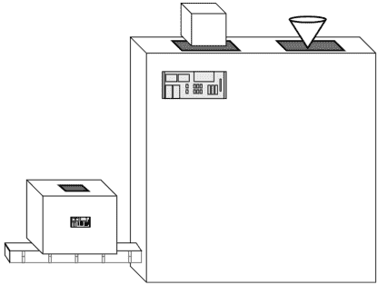

回到代码领域，让我们考虑一个名为 `compose2(..)` 的实用函数，它可以自动创建两个函数的组合，其方式与我们手动操作完全相同：

```js
function compose2(fn2, fn1) {
    return function composed(origValue) {
        return fn2(fn1(origValue));
    };
}
```

```js
// 或者 ES6 => 形式

var compose2 =
    (fn2, fn1) =>
        origValue =>
            fn2(fn1(origValue));
```

你注意到我们定义的参数顺序是 `fn2`、`fn1`，并且是第二个列出的函数（即 `fn1` 参数名）先运行，然后才是第一个列出的函数（`fn2`）吗？换句话说，函数是从右向左组合的。

这可能看起来是个奇怪的选择，但有其原因。大多数典型的函数式编程库都将其 `compose(..)` 定义为从右向左执行，因此我们遵循这一惯例。

但为什么？我认为最简单的解释（尽管可能不是历史上最准确的）是，我们按照它们在代码中手动编写的顺序列出，或者更准确地说，是我们从左到右阅读时遇到的顺序。

`unique(words(str))` 按从左到右的顺序列出函数 `unique`、`words`，因此我们的 `compose2(..)` 实用函数也按此顺序接收它们。执行顺序是从右到左，但代码顺序是从左到右。请密切关注，在脑海中清晰区分这两者。

现在，更高效的糖果制作机器的定义是：

```js
var uniqueWords = compose2(unique, words);
```

## 组合的变体

看起来 `unique <-- words` 组合似乎是这两个函数唯一能组合的顺序。但实际上，我们可以以相反的顺序组合它们，以创建一个具有不同用途的实用函数：

```js
var letters = compose2(words, unique);

var chars = letters("How are you Henry?");

chars;

// ["h","o","w","a","r","e","y","u","n"]
```

这之所以有效，是因为 `words(..)` 出于值类型安全的考虑，首先使用 `String(..)` 将其输入强制转换为字符串。因此，`unique(..)` 返回的数组——现在作为 `words(..)` 的输入——变成了字符串 `"H,o,w, ,a,r,e,y,u,n,?"`，然后 `words(..)` 中的其余行为将该字符串处理成字符数组。

诚然，这是一个刻意构造的例子。但重点在于，函数组合并不总是单向的。有时我们把灰色砖块放在蓝色砖块上面，有时则反过来。

如果糖果工厂试图将包装好的糖果送入混合和冷却巧克力的机器，他们最好小心点！

## 通用组合

如果我们能定义两个函数的组合，我们就可以继续扩展，支持任意数量函数的组合。任意数量函数组合的通用数据可视化流如下所示：

```text
finalValue <-- func1 <-- func2 <-- ... <-- funcN <-- origValue
```

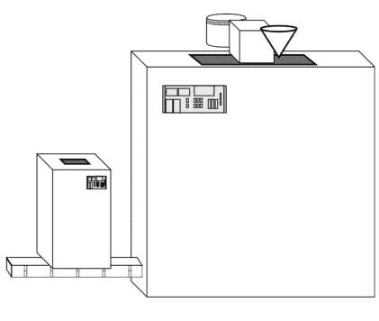

现在，糖果工厂拥有了最好的机器：一台可以接受任意数量的独立小型机器并吐出一台能按顺序执行每个步骤的大型高级机器。这可真是了不起的糖果生产线！这是威利·旺卡的梦想！

我们可以像这样实现一个通用的 `compose(..)` 实用函数：

```js
function compose(...fns) {
    return function composed(result) {
        // 复制函数数组
        var list = [...fns];

        while (list.length > 0) {
            // 从列表末尾取出最后一个函数
            // 并执行它
            result = list.pop()(result);
        }

        return result;
    };
}

// 或者 ES6 => 形式

var compose =
    (...fns) =>
        result => {
            var list = [...fns];

            while (list.length > 0) {
                // 从列表末尾取出最后一个函数
                // 并执行它
                result = list.pop()(result);
            }

            return result;
        };
```

### 警告

`...fns` 是一个收集的参数数组，而不是传入的数组，因此它是 `compose(..)` 的局部变量。可能会诱使人认为 `[...fns]` 因此是不必要的。然而，在这个特定的实现中，内部 `composed(..)` 函数中的 `.pop()` 正在修改列表，所以如果我们每次不复制它，返回的组合函数只能可靠地使用一次。我们将在第 6 章重新探讨这个隐患。

现在让我们看一个组合两个以上函数的例子。回想我们的 `uniqueWords(..)` 组合示例，让我们将 `skipShortWords(..)` 加入其中：

```js
function skipShortWords(words) {
    var filteredWords = [];

    for (let word of words) {
        if (word.length > 4) {
            filteredWords.push(word);
        }
    }

    return filteredWords;
}
```

让我们定义包含 `skipShortWords(..)` 的 `biggerWords(..)`。手动组合的等价形式是 `skipShortWords(unique(words(text)))`，所以让我们用 `compose(..)` 来实现：

```js
var text = "To compose two functions together, pass the \
output of the first function call as the input of the \
second function call.";

var biggerWords = compose(skipShortWords, unique, words);

var wordsUsed = biggerWords(text);
```

```js
wordsUsed;

// ["compose","functions","together","output","first",
// "function","input","second"]
```

为了用组合做一些更有趣的事情，让我们使用 `partialRight(..)`，我们在第 3 章首次看到它。我们可以构建 `compose(..)` 本身的右偏应用，预先指定第二个和第三个参数（分别是 `unique(..)` 和 `words(..)`）；我们称之为 `filterWords(..)`。

然后，我们可以通过调用 `filterWords(..)` 来多次完成组合，但分别使用不同的第一个参数：

```js
// 注意：使用 <= 4 检查，而不是 skipShortWords(..)
// 使用的 > 4 检查

function skipLongWords(list) { /* .. */ }
```

```js
var filterWords = partialRight(compose, unique, words);

var biggerWords = filterWords(skipShortWords);
var shorterWords = filterWords(skipLongWords);
```

```js
biggerWords(text);

// ["compose","functions","together","output","first",
```


```
// "function","input","second"]
```

```text
shorterWords( text );

// ["to","two","pass","the","of","call","as"]
```

花点时间思考一下`compose(..)`的右偏应用给了我们什么。它允许我们提前指定组合的第一步，然后用不同的后续步骤（`biggerWords(..)`和`shorterWords(..)`）创建该组合的专门变体。这是函数式编程最强大的技巧之一！

你也可以对组合使用`curry(..)`而不是偏应用，不过由于是从右向左的排序，你可能更经常想用`curry( reverseArgs(compose), ..)`而不是仅仅`curry( compose, ..)`本身。

> **注意**
>
> 因为`curry(..)`（至少是我们第 3 章实现的方式）依赖于检测元数（长度）或手动指定，而`compose(..)`是一个可变参数函数，你需要像`curry(.., 3)`这样手动指定预期的元数。

## 替代实现

虽然你很可能永远不会在生产环境中自己实现`compose(..)`，而只是使用库提供的实现，但我发现理解其工作原理实际上有助于很好地巩固通用的函数式编程概念。

所以让我们来看看`compose(..)`的一些不同实现选项。我们还将看到每种实现都有各自的优缺点，特别是性能方面。

我们将在第 9 章详细研究`reduce(..)`实用函数，但现在，只需知道它将列表（数组）归约为一个有限值。它就像一个花哨的循环。

例如，如果你对一个数字列表（如`[1,2,3,4,5,6]`）进行加法归约，你会遍历它们，边走边将它们相加。归约会将 1 加到 2，然后将结果加到 3，接着将结果加到 4，依此类推，最终求和结果为：21。

`compose(..)`的原始版本使用循环并立即（或称即时）计算一次调用的结果以传递给下一次调用。这是对函数列表的归约，因此我们可以用`reduce(..)`做同样的事情：

```js
function compose(...fns) {
    return function composed(result) {
        return [...fns].reverse().reduce(function reducer(result, fn) {
            return fn(result);
        }, result);
    };
}
```

```js
// 或者 ES6 => 形式
var compose = (...fns) =>
    result =>
        [...fns].reverse().reduce(
            (result, fn) =>
                fn(result),
            result
        );
```

## 注意

`compose(..)`的这种实现方式使用了`[...fns].reverse().reduce(..)`来从右向左进行归约。我们将在第 9 章再次讨论`compose(..)`，届时将改用`reduceRight(..)`来达到相同目的。

请注意，`reduce(..)`循环在每次最终组合的`(..)`函数被调用时都会发生，并且每个中间结果`(..)`都会作为下一次调用的输入传递给下一次迭代。

这种实现方式的优点是代码更简洁，并且使用了众所周知的函数式编程构造：`reduce(..)`。而且这种实现的性能与原始的`for`循环版本也相似。

然而，这种实现方式存在局限性：外部组合函数（即组合中的第一个函数）只能接收单个参数。大多数其他实现会将所有参数传递给那个首次调用。如果组合中的每个函数都是一元函数，这没什么大问题。但如果你需要向那个首次调用传递多个参数，你就需要一种不同的实现。

为了修正首次调用只能接收单个参数的限制，我们仍然可以使用`reduce(..)`，但产生一个惰性求值的包装函数：

```js
function compose(...fns) {
    return fns.reverse().reduce(function reducer(fn1, fn2) {
        return function composed(...args) {
            return fn2(fn1(...args));
        };
    });
}

// 或者 ES6 => 形式
var compose =
    (...fns) =>
        fns.reverse().reduce(
            (fn1, fn2) =>
                (...args) =>
                    fn2(fn1(...args))
        );
```

请注意，我们直接返回了`reduce(..)`调用的结果，它本身就是一个函数，而不是一个计算出的结果。这个函数允许我们传入任意数量的参数，将它们全部传递给组合中的第一个函数调用，然后通过后续的每次调用逐层“冒泡”返回结果。

与在`reduce(..)`循环过程中计算运行结果并传递不同，这种实现在组合时只运行一次`reduce(..)`循环，并延迟了所有函数调用计算——这被称为惰性计算。归约的每个部分结果都是一个逐步包装得更深的函数。

当你调用最终的组合函数并提供一个或多个参数时，从最内层到最外层的所有嵌套函数层级，都会以相反的顺序依次执行（而不是通过循环）。

性能特征可能与前面基于`reduce(..)`的实现有所不同。在这里，`reduce(..)`只运行一次来生成一个大的组合函数，然后这个组合函数在每次调用时只需执行其所有嵌套函数。在前一个版本中，`reduce(..)`会在每次调用时都运行。

哪种实现更好，你可能各有体会，但请记住，后一种实现不像前一种那样受到参数数量的限制。

我们也可以用递归来定义`compose(..)`。`compose(fn1, fn2, .. fnN)`的递归定义如下：

`compose( compose(fn1, fn2, .. fnN-1), fnN );`

> **注意**
>
> 我们将在[第 8 章](https://github.com/getify/Functional-Light-JS/blob/master/APPe.md)更全面地介绍递归，所以如果这种方法看起来令人困惑，现在不必担心。或者，你可以先阅读那一章，然后再回来重读本节说明。:)

以下是我们如何用递归来实现`compose(..)`：

```js
function compose(...fns) {
    // 取出最后两个参数
    var [fn1, fn2, ...rest] = fns.reverse();

    var composedFn = function composed(...args) {
        return fn2(fn1(...args));
    };

    if (rest.length == 0) return composedFn;

    return compose(...rest.reverse(), composedFn);
}
```

```js
// 或者 ES6 => 形式
var compose =
    (...fns) => {
        // 取出最后两个参数
        var [fn1, fn2, ...rest] = fns.reverse();

        var composedFn =
            (...args) =>
                fn2(fn1(...args));

        if (rest.length == 0) return composedFn;

        return compose(...rest.reverse(), composedFn);
    };
```

我认为递归实现的好处主要在于概念层面。我个人发现用递归术语来思考重复性动作比用循环（我需要在其中跟踪运行结果）要容易得多，所以我倾向于用这种方式表达代码。

其他人可能会发现递归方法在心智上更难驾驭。我邀请你自行评估。

## 顺序反转的组合

我们之前讨论过标准`compose(..)`实现从右向左的排序。优点在于，列出的参数（函数）顺序与手动进行组合时的顺序相同。

缺点是，它们列出的顺序与执行顺序相反，这可能会令人困惑。而且，必须使用`partialRight(compose, ..)`来预指定组合中要执行的第一个函数也显得更笨拙。

从左向右的反向排序有一个常见的名称：`pipe(..)`。据说这个名字来自 Unix/Linux 领域，多个程序通过“管道”（`|`运算符）连接，将第一个程序的输出作为第二个程序的输入，依此类推（即`ls -la | grep "foo" | less`）。

`pipe(..)`与`compose(..)`完全相同，只是它按照从左到右的顺序处理函数列表：

```js
function pipe(...fns) {
    return function piped(result) {
        var list = [...fns];

        while (list.length > 0) {
            // 从列表中取出第一个函数
            // 并执行它
            result = list.shift()(result);
        }

        return result;
    };
}
```

实际上，我们可以将`pipe(..)`定义为`compose(..)`的参数反转版本：

```js
var pipe = reverseArgs(compose);
```

这就很简单了！

回想一下前面通用组合的这个例子：

```js
var biggerWords = compose(skipShortWords, unique, words);
```

要用`pipe(..)`表达，我们只需反转列出它们的顺序：

```js
var biggerWords = pipe(words, unique, skipShortWords);
```

`pipe(..)`的优点在于，它按执行顺序列出函数，这有时可以减少读者的困惑。阅读代码`pipe(words, unique, skipShortWords)`可能更简单，并认识到它先执行`words(..)`，然后执行`unique(..)`，最后执行`skipShortWords(..)`。

如果你处于想要对第一个执行的函数进行部分应用的情况，`pipe(..)`也很方便。之前我们使用`compose(..)`的右部分应用来做到这一点。

比较一下：

```js
var filterWords = partialRight(compose, unique, words);

// 对比
var filterWords = partial(pipe, words, unique);
```

正如你可能从我们在第 3 章首次实现的`partialRight(..)`中回忆的那样，它在底层使用了`reverseArgs(..)`，就像我们现在`pipe(..)`所做的那样。所以无论哪种方式，我们得到的结果都是一样的。

在这种特定情况下，使用`pipe(..)`的轻微性能优势在于，因为我们不需要保留`compose(..)`从右到左的参数顺序，所以我们不需要像`partialRight(..)`内部那样反转参数顺序。因此，在这里`partial(pipe, ..)`比`partialRight(compose, ..)`稍微高效一些。

### 抽象

抽象在我们关于组合的推理中起着重要作用，因此让我们更详细地审视它。

类似于部分应用和柯里化（参见第 3 章）允许从通用函数逐步发展到专用函数，我们也可以通过提取两个或多个任务之间的共性来进行抽象。通用部分被定义一次以避免重复。为了执行每个任务的特定功能，通用部分被参数化。

例如，考虑这段（显然是人为设计的）代码：

```js
function saveComment(txt) {
    if (txt != "") {
        comments[comments.length] = txt;
    }
}

function trackEvent(evt) {
    if (evt.name !== undefined) {
        events[evt.name] = evt;
    }
}
```

这两个工具函数都在向数据源中存储一个值。这是它们的通用性。而特殊之处在于，其中一个将值添加到数组的末尾，而另一个则在对象的某个属性名上设置值。

因此，让我们来抽象：

```js
function storeData(store, location, value) {
    store[location] = value;
}

function saveComment(txt) {
    if (txt != "") {
        storeData(comments, comments.length, txt);
    }
}

function trackEvent(evt) {
    if (evt.name !== undefined) {
        storeData(events, evt.name, evt);
    }
}
```

“引用对象（或数组，得益于 JS 对`[]`的便捷运算符重载）上的一个属性并为其设置值”这一通用任务，被抽象为一个独立的函数`storeData(..)`。尽管这个工具函数目前只有一行代码，但可以预见，其他在两个任务中都常见的通用行为，例如生成一个唯一的数字 ID 或随值存储一个时间戳，也可能被纳入其中。

如果我们在这个通用抽象中重复实现这些通用行为，就会面临维护风险：修改了某些实例却忘记修改其他实例。这种抽象背后有一个原则在起作用，通常被称为“不要重复自己”（DRY）。

DRY 追求程序中任何给定的任务只有一个定义。另一种激励 DRY 编程的格言是，程序员天生就是懒惰的，不想做不必要的工作。

抽象可能被过度使用。考虑一下：

```js
function conditionallyStoreData(store, location, value, checkFn) {
    if (checkFn(value, store, location)) {
        store[location] = value;
    }
}

function notEmpty(val) {
    return val != "";
}

function isUndefined(val) {
    return val === undefined;
}

function isPropUndefined(val, obj, prop) {
    return isUndefined(obj[prop]);
}

function saveComment(txt) {
    conditionallyStoreData(comments, comments.length, txt, notEmpty);
}

function trackEvent(evt) {
    conditionallyStoreData(events, evt.name, evt, isPropUndefined);
}
```


为了追求 DRY 并避免重复一个 `if` 语句，我们将条件判断移到了通用抽象中。我们还假设，未来程序中的其他地方*可能*也需要检查非空字符串或非 `undefined` 的值，所以我们干脆也将它们 DRY 掉！

这段代码*确实*更加 DRY 了，但有点过度了。程序员必须谨慎地为程序的每个部分应用适当程度的抽象，不多也不少。

关于我们在本章对函数组合的更大讨论，其益处似乎就是这种 DRY 抽象。但我们不要急于下结论，因为我认为组合在我们的代码中实际上服务于一个更重要的目的。

此外，即使某件事只出现一次（没有需要 DRY 掉的重复），组合也是有用的。

## 分离使得聚焦成为可能

除了泛化与特化，我认为抽象还有另一个更有用的定义，正如这段引文所揭示的：

> ……抽象是程序员将一个名字与一个潜在复杂的程序片段关联起来的过程，此后这个片段就可以根据其目的或功能来思考，而不是根据如何实现该功能来思考。通过隐藏不相关的细节，抽象降低了概念的复杂性，使得程序员在任何特定时间都能专注于程序文本的一个可管理的子集。
>
> Michael L. Scott, *Programming Language Pragmatics*²

这段引文的关键在于，抽象——通常是将一些代码提取成自己的函数——其主要目的是分离两段功能，以便能够独立地专注于其中一段，而不受另一段的影响。

²Scott, Michael L. "第三章：名称、作用域和绑定。" *Programming Language Pragmatics*，第 4 版，Morgan Kaufmann，2015，第 115 页。

请注意，这种意义上的抽象并非真的意在*隐藏*细节，好像把事物当作我们*从不*检查的黑盒子。

在这段引文中，就隐藏的内容而言，“不相关的”不应被视为一个绝对的定性判断，而是相对于你在任何特定时刻想要关注的内容而言。换句话说，当我们把 X 和 Y 分离开时，如果我想关注 X，那么 Y 在那个时刻就是不相关的。在另一个时候，如果我想关注 Y，那么 X 在那个时刻就是不相关的。

**我们抽象不是为了隐藏细节；我们分离细节是为了提高专注度。**

回想一下，在本书的开头我曾指出，FP 的目标是创建更具可读性和可理解性的代码。实现这一点的一个有效方法是将纠缠在一起（read：像绳索股一样紧密交织）的代码分解成独立、更简单（read：松散绑定）的代码片段。这样，当读者寻找另一部分的细节时，就不会被第一部分的细节分散注意力。

我们的更高目标并不是像 DRY 思维模式那样只实现一次。事实上，有时我们实际上会在代码中重复自己。

正如我们在[第 3 章](#)中[断言](#)的那样，抽象的主要目标是分别实现不同的事物。我们试图提高专注度，因为这能提高可读性。

通过分离两个想法，我们在它们之间插入了一个语义边界，这使我们能够独立地专注于每一方，而不受另一方的影响。在许多情况下，这个语义边界就是函数名之类的东西。函数的实现专注于*如何*计算某个东西，而使用该函数名称的调用点则专注于*如何*处理其输出。我们将*如何做*从*做什么*中抽象出来，使它们分离且可独立推理。

另一种描述这个目标的方式是命令式与声明式编程风格。命令式代码主要关注于明确陈述*如何*完成一项任务。声明式代码陈述*什么*应该是结果，而将实现留给其他责任方。

声明式代码将*做什么*从*如何做*中抽象出来。通常，声明式编码在可读性上优于命令式编码，尽管没有程序（当然，机器码的 1 和 0 除外）是完全其中一种或另一种的。程序员必须在两者之间寻求平衡。

ES6 增加了许多语法便利，将旧的命令式操作转换为新的声明式形式。也许最清晰的例子之一是解构。解构是一种赋值模式，它描述了一个复合值（对象、数组）如何被拆分成其组成部分的值。

这是一个数组解构的例子：

```javascript
function getData() {
    return [1, 2, 3, 4, 5];
}

// 命令式
var tmp = getData();
var a = tmp[0];
var b = tmp[3];

// 声明式
var [a, , , b] = getData();
```

*做什么*是将数组的第一个值赋给 `a`，第四个值赋给 `b`。*如何做*是获取数组的引用（`tmp`），并在赋值给 `a` 和 `b` 时手动引用索引 0 和 3。

数组解构是否*隐藏*了赋值？这取决于你的视角。我断言它只是将*做什么*从*如何做*中分离出来。JS 引擎仍然执行赋值，但它防止你不得不被*如何*完成它所分散注意力。

相反，你阅读 `[a, , , b] = ..`，可以看到赋值模式仅仅告诉你*将发生什么*。数组解构是声明式抽象的一个例子。

## 组合作为抽象

这一切与函数组合有什么关系？函数组合也是声明式抽象。

回想一下之前的 `shorterWords(..)` 例子。让我们比较一下它的命令式和声明式定义：

```javascript
// 命令式
function shorterWords(text) {
    return skipLongWords(unique(words(text)));
}

// 声明式
var shorterWords = compose(skipLongWords, unique, words);
```

声明式形式专注于*做什么*——这三个函数将数据从字符串管道传输到较短单词的列表——并将*如何做*留给 `compose(..)` 的内部实现。从更大的意义上说，`shorterWords = compose(..)` 这一行解释了定义 `shorterWords(..)` 工具的*如何做*，而将声明式的那一行留在代码的其他地方，只专注于*做什么*：

```javascript
shorterWords(text);
```

组合将获取较短单词列表的*做什么*与执行此操作的*如何做*步骤分离开来。

相比之下，如果我们没有使用组合抽象会怎样？

```javascript
var wordsFound = words(text);
var uniqueWordsFound = unique(wordsFound);
skipLongWords(uniqueWordsFound);
```

或者甚至：

```javascript
skipLongWords(unique(words(text)));
```

这两个版本都展示了更命令式的风格，与之前的声明式风格形成对比。读者在代码片段中的注意力与*如何做*密不可分，而较少关注*做什么*。

函数组合不仅仅是为了用 DRY 节省代码。即使 `shorterWords(..)` 的使用只发生在一个地方——因此没有需要避免的重复！——将*如何做*从*做什么*中分离出来仍然能改善我们的代码。

组合是抽象的强大工具，它将命令式代码转化为更具可读性的声明式代码。

## 回顾要点

既然我们已经深入探讨了组合（这是一个在函数式编程诸多领域都极为有用的技巧），现在让我们通过重访[第 3 章“无要点”](#)中的无点风格来实际应用它，使用一个相对更复杂的重构场景：

```javascript
// 给定: ajax( url, data, cb )
var getPerson = partial( ajax, "http://some.api/person" );
var getLastOrder = partial( ajax, "http://some.api/order", { id: -1 } );

getLastOrder( function orderFound(order){
    getPerson( { id: order.personId }, function personFound(person){
        output( person.name );
    } );
} );
```

我们想要移除的“要点”是 `order` 和 `person` 参数引用。

让我们首先尝试将 `personFound(..)` 函数中的 `person` “要点”移除。为此，我们首先定义：

```javascript
function extractName(person) {
    return person.name;
}
```

请注意，这个操作可以用更通用的术语表达：从任意对象上按名称提取任意属性。我们将这个实用函数称为 `prop(..)`：

```javascript
function prop(name,obj) {
    return obj[name];
}

// 或者 ES6 => 形式
var prop =
    (name,obj) =>
        obj[name];
```

既然我们在处理对象属性，我们也来定义相反的实用函数：`setProp(..)`，用于在对象上设置属性值。然而，我们需要小心，不要仅仅修改现有对象，而是创建一个对象的克隆来修改，然后返回它。这种谨慎的原因将在**第 5 章**中详细讨论。

```javascript
function setProp(name,obj,val) {
    var o = Object.assign( {}, obj );
    o[name] = val;
    return o;
}
```

现在，要定义一个从对象上提取 `"name"` 属性的 `extractName(..)`，我们将对 `prop(..)` 进行部分应用：

```javascript
var extractName = partial( prop, "name" );
```

> **注意**
>
> 不要错过这里的 `extractName(..)` 实际上还没有提取任何东西。我们对 `prop(..)` 进行了部分应用，创建了一个等待从我们传入的任何对象中提取 `"name"` 属性的函数。我们也可以用 `curry(prop)("name")` 来实现。

接下来，让我们将示例中的嵌套查找调用简化为：

```javascript
getLastOrder( function orderFound(order){
    getPerson( { id: order.personId }, outputPersonName );
} );
```

我们如何定义 `outputPersonName(..)`？为了理解我们需要什么，思考一下期望的数据流：

```text
output <-- extractName <-- person
```

`outputPersonName(..)` 需要是一个函数，它接受一个（对象）值，将其传递给 `extractName(..)`，然后将该值传递给 `output(..)`。

希望你已经认出这是一个 `compose(..)` 操作。所以我们可以这样定义 `outputPersonName(..)`：

```javascript
var outputPersonName = compose( output, extractName );
```

我们刚创建的 `outputPersonName(..)` 函数就是提供给 `getPerson(..)` 的回调。因此，我们可以定义一个 `processPerson(..)` 函数来预设回调参数，使用 `partialRight(..)`：

```javascript
var processPerson = partialRight( getPerson, outputPersonName );
```

让我们用新的函数重新构建嵌套查找的示例：

```javascript
getLastOrder( function orderFound(order){
    processPerson( { id: order.personId } );
} );
```

呼，我们进展顺利！

但我们需要继续移除 `order` “要点”。下一步是观察 `personId` 可以通过 `prop(..)` 从一个对象（如 `order`）中提取，就像我们对 `person` 对象上的 `name` 所做的那样：

```javascript
var extractPersonId = partial( prop, "personId" );
```

为了构造需要传递给 `processPerson(..)` 的对象（形式为 `{ id: .. }`），让我们创建另一个实用函数，用于将值包装在指定属性名的对象中，称为 `makeObjProp(..)`：

```javascript
function makeObjProp(name,value) {
    return setProp( name, {}, value );
}

// 或者 ES6 => 形式
var makeObjProp =
    (name,value) =>
        setProp( name, {}, value );
```

> **提示**
>
> 这个实用函数在 Ramda 库中被称为 `objOf(..)`。

就像我们使用 `prop(..)` 创建 `extractName(..)` 一样，我们将对 `makeObjProp(..)` 进行部分应用，构建一个 `personData(..)` 函数来创建我们的数据对象：

```javascript
var personData = partial( makeObjProp, "id" );
```

为了使用 `processPerson(..)` 来执行对附加于 *order* 值上的人员查找，我们需要的概念性数据流操作是：

```text
processPerson <-- personData <-- extractPersonId <-- order
```

因此，我们将再次使用 `compose(..)` 来定义 `lookupPerson(..)` 实用函数：

```javascript
var lookupPerson =
    compose( processPerson, personData, extractPersonId );
```

就是这样！将整个示例重新组合在一起，没有任何“要点”：

```javascript
var getPerson = partial( ajax, "http://some.api/person" );

var getLastOrder =
    partial( ajax, "http://some.api/order", { id: -1 } );

var extractName = partial( prop, "name" );

var outputPersonName = compose( output, extractName );

var processPerson = partialRight( getPerson, outputPersonName );

var personData = partial( makeObjProp, "id" );

var extractPersonId = partial( prop, "personId" );

var lookupPerson =
    compose( processPerson, personData, extractPersonId );

getLastOrder( lookupPerson );
```

哇。无点风格。而 `compose(..)` 在两个地方都非常有用！

我认为在这种情况下，尽管推导最终答案的步骤有点冗长，但最终结果是更具可读性的代码，因为我们最终明确指出了每一步。

即使你不喜欢看到/命名所有这些中间步骤，你也可以保留无点风格，而无需使用单独的变量将表达式连接在一起：

```javascript
partial( ajax, "http://some.api/order", { id: -1 } )
(
    compose(
        partialRight(
            partial( ajax, "http://some.api/person" ),
            compose( output, partial( prop, "name" ) )
        ),
        partial( makeObjProp, "id" ),
        partial( prop, "personId" )
    )
);
```


这段代码片段肯定不那么冗长，但我认为它比前一个每个操作都是独立变量的代码片段更难读。无论如何，组合帮助我们实现了无点风格。

## 总结

函数组合是一种定义函数的模式，它将一个函数调用的输出路由到另一个函数调用，再将其输出路由到另一个，依此类推。

因为 JS 函数只能返回单个值，这种模式本质上规定组合中的所有函数（可能除了第一个被调用的）都必须是一元的，只接受从前一个函数输出的一个输入。

与其在代码中将每个步骤列为单独的调用，使用像`compose(..)`或`pipe(..)`这样的实用程序进行函数组合可以抽象掉这个实现细节，使代码更具可读性，让我们能够专注于组合将用于*完成什么*，而不是它*如何*执行。

组合是声明式数据流，意味着我们的代码以一种明确、清晰和可读的方式描述了数据的流动。

在很多方面，组合是最重要的基础模式，很大程度上是因为它是除了使用副作用之外，唯一一种在程序中路由数据的方式；下一章将探讨为什么应尽可能避免副作用。

# 第5章：减少副作用

在第2章中，我们讨论了函数除了返回值之外还可能有其他输出。到现在，你应该已经非常熟悉函数式编程中函数的定义了，所以这种侧输出——副作用！——应该会让人感到不妥。

我们将研究各种不同形式的副作用，并看看它们为何有害于代码质量和可读性。

但让我不要在这里拐弯抹角。本章的要点是：编写一个没有副作用的程序是不可能的。嗯，不是不可能；你当然可以。但那个程序不会做任何有用或可观察的事情。如果你写了一个零副作用的程序，你无法区分它和一个空程序。

函数式编程者并不消除所有副作用。相反，目标是尽可能限制它们。为此，我们首先需要完全理解它们。

## 请把副作用放在一边

因果关系：这是人类对周围世界最基本、最直观的观察之一。把一本书从桌子边缘推下去，它会掉到地上。你不需要物理学学位就知道原因是书被推了，结果是重力把它拉到地上。有一种清晰直接的联系。

在编程中，我们也完全处理因果关系。如果你调用一个函数（原因），它会在屏幕上显示一条消息（效果）。

在阅读程序时，极其重要的是读者能够清楚地识别每个原因和每个效果。在通读程序时，因果关系之间的直接联系无法被轻易看出的程度，都会降低程序的可读性。

考虑：

## 减少副作用

在这个简单的程序中，很明显调用`foo`（原因）并传入值 3，会产生返回值 6 并赋值给`y`（结果）的效果。这里没有任何歧义。

但现在：

```javascript
function foo(x) {
    y = x * 2;
}

var y;

foo( 3 );
```

这个程序的结果完全相同。但这里有一个非常大的区别。原因和结果是分离的。结果是间接的。以这种方式设置`y`就是我们所说的副作用。

## 注意

当一个函数引用其自身外部的变量时，这被称为自由变量。并非所有自由变量引用都是有害的，但我们需要对它们非常小心。

如果我给你一个调用函数`bar(..)`的引用，你看不到它的代码，但我告诉你它没有这种间接的副作用，只有明确的返回值效果呢？

```javascript
bar( 4 );       // 42
```

因为你知道`bar(..)`的内部不会创建任何副作用，所以你现在可以更直接地推理像这样的任何`bar(..)`调用。但如果你不知道`bar(..)`没有副作用，要理解调用它的结果，你就必须去阅读和剖析它的所有逻辑。这对读者来说是额外的精神负担。

有副作用的函数可读性更差，因为它需要更多的阅读才能理解程序。

但问题远不止于此。考虑：

```javascript
var x = 1;

foo();

console.log( x );

bar();

console.log( x );

baz();

console.log( x );
```

你有多确定每个`console.log(x)`会打印出哪些值？

正确答案是：完全不确定。如果你不确定`foo()`、`bar()`和`baz()`是否有副作用，除非你检查每个函数的实现，然后从第 1 行开始向前追踪程序，并在过程中跟踪所有状态的变化，否则你无法保证在每一步`x`的值是多少。

换句话说，除非你在心里执行了整个程序直到那一行，否则最后一个`console.log(x)`是不可能分析或预测的。

猜猜谁擅长运行你的程序？JS 引擎。猜猜谁不那么擅长运行你的程序？你的代码的读者。然而，你选择在一个或多个函数调用中（可能）编写有副作用的代码，意味着你让读者背上了一个负担：他们必须在心里执行你的整个程序直到某一行，才能阅读和理解那一行。

如果`foo()`、`bar()`和`baz()`都没有副作用，它们就无法影响`x`，这意味着我们不需要执行它们就能在心里追踪`x`发生了什么。这减少了精神负担，并使代码更具可读性。

### 隐式原因

输出，即状态的改变，是副作用最常见的表现形式。但另一种损害可读性的做法是某些人称之为隐式原因的东西。考虑：

```javascript
function foo(x) {
    return x + y;
}

var y = 3;

foo( 1 );           // 4
```

`foo(..)`没有改变`y`，所以它不是我们之前看到的那种副作用。但现在，调用`foo(..)`实际上依赖于一个`y`的存在及其当前状态。如果之后我们这样做：

```javascript
y = 5;

// ..

foo( 1 );           // 6
```

我们是否会对调用`foo(1)`返回与之前不同的结果感到惊讶？

`foo(..)`存在一个间接的原因，这对可读性有害。除非仔细检查`foo(..)`的实现，否则读者看不到哪些原因导致了输出效果。它*看起来*参数 1 是唯一的原因，但事实并非如此。

为了提高可读性，所有将导致确定`foo(..)`输出效果的原因，都应该作为`foo(..)`的直接和明显的输入。代码的读者将清楚地看到原因和结果。

### 固定状态

避免隐式原因是否意味着`foo(..)`函数不能引用任何自由变量？

考虑这段代码：

```javascript
function foo(x) {
    return x + bar( x );
}

function bar(x) {
    return x * 2;
}

foo( 3 );           // 9
```

很明显，对于`foo(..)`和`bar(..)`，唯一直接的原因是`x`参数。但`bar(x)`调用呢？`bar`只是一个标识符，在 JS 中它甚至默认不是一个常量（即不可重新赋值的变量）。`foo(..)`函数依赖于`bar`的值——一个引用第二个函数的变量——作为自由变量。

那么这个程序是否依赖于隐式原因？

我说不是。即使*可能*用其他函数覆盖`bar`变量的值，我也没有在这个代码中这样做，这也不是我的惯例或先例。就所有意图和目的而言，我的函数是常量（从不重新赋值）。

考虑：

```javascript
const PI = 3.141592;

function foo(x) {
    return x * PI;
}

foo( 3 );           // 9.424776000000001
```

## 注意

JavaScript 内置了`Math.PI`，所以我们在这里仅使用`PI`示例作为便捷的说明。在实践中，请始终使用`Math.PI`，而不是定义你自己的！

那么前面的代码片段呢？`PI`是`foo(..)`的隐式原因吗？

两个观察将帮助我们以合理的方式回答这个问题：

1. 思考你可能对`foo(3)`进行的每一次调用。它是否总是返回`9.424..`这个值？是的。每次都是如此。如果你给它相同的输入（`x`），它总是会返回相同的输出。
2. 你能否将`PI`的每一处使用都替换为其立即值，并且程序是否能**完全**像以前一样运行？是的。这个程序没有任何部分依赖于能够改变`PI`的值——实际上，由于它是一个`const`，它不能被重新赋值——所以这里的`PI`变量只是为了可读性/维护性。它的值可以内联，而程序行为没有任何变化。

我的结论是：这里的`PI`并不违反最小化/避免副作用（或原因）的精神。前面代码片段中的`bar(x)`调用也是如此。

在这两种情况下，`PI`和`bar`都不是程序状态的一部分。它们是固定的、不可重新赋值的引用。如果它们在整个程序中都没有改变，我们就不必担心将它们作为变化的状态来跟踪。因此，它们不会损害我们的可读性。它们也不可能是与变量意外变化相关的错误的来源。

## 注意

在我看来，这里使用`const`并不能证明`PI`作为隐式原因被免除了；`var PI`会导致同样的结论。重要的是没有重新赋值`PI`，而不是没有能力这样做。我们将在第 6 章讨论`const`。

### 随机性

你可能以前从未考虑过，但随机性是一种隐式原因。一个使用`Math.random()`的函数无法根据其输入产生可预测的输出。因此，任何生成唯一随机 ID 等的代码，根据定义，将被视为依赖于程序的隐式原因。

在计算中，我们使用所谓的伪随机算法进行生成。事实证明真正的随机性相当难以实现，所以我们只是用复杂的算法来伪造它，这些算法产生的值看起来是可观察到的随机的。这些算法计算长串的数字，但秘密在于，如果你知道起点，这个序列实际上是可预测的。这个起点被称为种子。

一些语言允许你为随机数生成指定种子值。如果你总是指定相同的种子，你总是会从后续的“伪随机数”生成中获得相同的输出序列。这对于测试目的来说非常有用，但对于实际应用来说非常危险。

在 JS 中，`Math.random()`计算的随机性是基于间接输入的，因为你无法指定种子。因此，我们必须将内置的随机数生成视为一种隐式原因。

### I/O 效应

最常见（并且本质上不可避免）的隐式原因/结果形式是输入/输出（I/O）。一个没有 I/O 的程序是完全没有意义的，因为它的任何工作都无法被观察到。有用的程序至少必须有输出，许多还需要有输入。输入是一种隐式原因，输出是一种副作用。

浏览器端 JavaScript 程序员的典型输入是用户事件（鼠标、键盘），而输出则是 DOM。如果你更多地从事 Node.js 开发，那么你更可能从文件系统、网络连接和/或标准输入/输出流接收输入，并向其发送输出。

事实上，这些来源既可以是输入，也可以是输出；既是因，也是果。以 DOM 为例。我们更新（副作用）一个 DOM 元素以向用户显示文本或图像，但 DOM 的当前状态也是这些操作的一个隐式输入（隐式原因）。

## 副作用导致的 Bug

隐式原因和副作用可能导致 bug 的场景与现有程序一样多种多样。但让我们来考察一个场景，以说明这些危害，希望它们能帮助我们识别自己程序中的类似错误。

考虑：

```javascript
var users = {};

var userOrders = {};

function fetchUserData(userId) {
    ajax( `http://some.api/user/${userId}`, function onUserData(user) {
        users[userId] = user;
    } );
}

function fetchOrders(userId) {
    ajax(
        `http://some.api/orders/${userId}`,
        function onOrders(orders) {
            for (let order of orders) {
                // keep a reference to latest order for each user
                users[userId].latestOrder = order;
                userOrders[order.orderId] = order;
            }
        }
    );
}
```

```javascript
function deleteOrder(orderId) {
    var user = users[ userOrders[orderId].userId ];
    var isLatestOrder = (userOrders[orderId] == user.latestOrder);

    // deleting the latest order for a user?
    if (isLatestOrder) {
        hideLatestOrderDisplay();
    }

    ajax(
        `http://some.api/delete/order/${orderId}`,
        function onDelete(success) {
            if (success) {
                // deleted the latest order for a user?
                if (isLatestOrder) {
                    user.latestOrder = null;
                }

                userOrders[orderId] = null;
            }
            else if (isLatestOrder) {
                showLatestOrderDisplay();
            }
        }
    );
}
```

我敢打赌，对某些读者来说，这里一个潜在的 bug 相当明显。如果回调函数`onOrders(..)`在`onUserData(..)`回调之前运行，它将尝试向一个尚未设置的值（`users[userId]`处的用户对象）添加`latestOrder`属性。

因此，依赖于副作用/原因的逻辑可能出现的一种“bug”形式，就是两个不同操作（无论是同步还是异步！）的竞态条件，我们期望它们按一定顺序运行，但在某些情况下可能以不同顺序运行。有确保操作顺序的策略，而且很明显，在这种情况下顺序至关重要。

另一个更微妙的 bug 可能会在这里困扰我们。你发现了吗？

考虑以下调用顺序：

```javascript
fetchUserData( 123 );

onUserData(..);

fetchOrders( 123 );

onOrders(..);
```

```javascript
// later
```

```javascript
fetchOrders( 123 );

deleteOrder( 456 );

onOrders(..);

onDelete(..);
```

你看到`fetchOrders(..)`和`onOrders(..)`与`deleteOrder(..)`和`onDelete(..)`这对操作之间的交错了吗？这种潜在的序列暴露了我们状态管理的副作用/原因导致的一个奇怪情况。

在我们设置`isLatestOrder`标志和使用它来决定是否应该清空`users`中用户数据对象的`latestOrder`属性之间，存在时间延迟（由于回调）。在那段时间延迟内，如果`onOrders(..)`回调触发，它可能改变该用户的`latestOrder`引用的订单值。当`onDelete(..)`随后触发时，它会假设它仍然需要取消设置`latestOrder`引用。

这个 bug 就是：数据（状态）*可能*现在已经不同步了。`latestOrder`将被取消设置，而实际上它应该继续指向进入`onOrders(..)`的更新订单。

这类 bug 最糟糕的地方在于，你不会得到像另一个 bug 那样导致程序崩溃的异常。我们只是得到了一个不正确的状态；我们的应用程序行为被“静默”破坏了。

`fetchUserData(..)`和`fetchOrders(..)`之间的序列依赖性相当明显，并且可以直接解决。但`fetchOrders(..)`和`deleteOrder(..)`之间的潜在序列依赖性则远不明显。这两个似乎更独立。并且确保它们的顺序被保留更棘手，因为你事先不知道（在`fetchOrders(..)`的结果返回之前）是否真的必须强制执行该顺序。

是的，你可以在`deleteOrder(..)`触发后重新计算`isLatestOrder`标志。但现在你有一个不同的问题：你的 UI 状态可能不同步。

如果你之前调用了`hideLatestOrderDisplay()`，你现在将需要调用`showLatestOrderDisplay()`函数，但仅当确实设置了新的`latestOrder`时。因此，你需要至少跟踪三种状态：被删除的订单最初是否是“最新的”，“最新的”是否已设置，以及这两个订单是否不同？这些当然是可以解决的问题。但它们绝非显而易见。

所有这些麻烦都是因为我们决定使用共享状态集上的副作用/原因来构建代码。

函数式程序员讨厌这类副作用/原因导致的 bug，因为它严重损害了我们阅读、推理、验证并最终**信任**代码的能力。这就是为什么他们如此认真地对待避免副作用/原因的原则。

避免/修复副作用/原因有多种不同的策略。我们将在本章后面以及后续章节中讨论其中一些。我可以肯定地说：**带有副作用/原因进行编写通常是我们正常的默认方式**，因此避免它们将需要仔细和有意识的努力。

## 一次就够，谢谢

如果你必须对状态进行副作用更改，有一类操作对于限制潜在问题很有用，那就是幂等性。如果你对值的更新是幂等的，那么数据将能够抵御来自不同副作用源的多次此类更新的情况。

如果你尝试研究它，幂等性的定义可能会有点令人困惑；数学家使用的含义与程序员通常使用的略有不同。然而，这两种视角对函数式程序员都是有用的。

首先，让我们给出一个既非数学上也非编程上幂等的反例：

```javascript
function updateCounter(obj) {
    if (obj.count < 10) {
```


```js
obj.count++;

return true;

}

return false;

}
```

此函数通过引用修改对象，增加`obj.count`，因此它对该对象产生副作用。如果`updateCounter(o)`被多次调用——只要`o.count`小于 10——程序状态每次都会改变。此外，`updateCounter(..)`的输出是一个布尔值，不适合反馈到后续的`updateCounter(..)`调用中。

## 数学幂等性

从数学角度来看，幂等性意味着一个操作，如果你将其输出一遍又一遍地反馈回操作，其输出在第一次调用后永远不会改变。换句话说，`foo(x)`产生的输出与`foo(foo(x))`和`foo(foo(foo(x)))`相同。

一个典型的数学例子是`Math.abs(..)`（绝对值）。`Math.abs(-2)`是 2，这与`Math.abs(Math.abs(Math.abs(Math.abs(-2))))`的结果相同。其他幂等的数学工具包括：

- `Math.min(..)`
- `Math.max(..)`
- `Math.round(..)`
- `Math.floor(..)`
- `Math.ceil(..)`

我们可以定义一些具有相同特性的自定义数学运算：

```js
function toPower0(x) {

    return Math.pow( x, 0 );

}
```

```js
function snapUp3(x) {

    return x - (x % 3) + (x % 3 > 0 && 3);

}
```

```js
toPower0( 3 ) == toPower0( toPower0( 3 ) );        // true
```

```js
snapUp3( 3.14 ) == snapUp3( snapUp3( 3.14 ) );     // true
```

数学风格的幂等性**不限于**数学运算。我们可以用 JavaScript 原始类型强制转换来说明这种幂等性的另一个地方：

```js
var x = 42, y = "hello";
```

```js
String( x ) === String( String( x ) );              // true
```

```js
Boolean( y ) === Boolean( Boolean( y ) );           // true
```

在本文前面，我们探讨了一个满足这种幂等性形式的常见 FP 工具：

```js
identity( 3 ) === identity( identity( 3 ) );   // true
```

某些字符串操作也自然是幂等的，例如：

# 第五章：减少副作用

```js
function upper(x) {

    return x.toUpperCase();

}

function lower(x) {

    return x.toLowerCase();

}

var str = "Hello World';

upper( str ) == upper( upper( str ) );           // true

lower( str ) == lower( lower( str ) );           // true
```

我们甚至可以以幂等方式设计更复杂的字符串格式化操作，例如：

```js
function currency(val) {

    var num = parseFloat(

        String( val ).replace( /[^\d.-]+/g, "" )

    );

    var sign = (num < 0) ? "-" : "";

    return `${sign}$${Math.abs( num ).toFixed( 2 )}`;

}

currency( -3.1 );                                // "-$3.10"

currency( -3.1 ) == currency( currency( -3.1 ) );   // true
```

`currency(..)`说明了一个重要的技巧：在某些情况下，开发者可以采取额外的步骤来规范化一个输入/输出操作，以确保该操作在通常不具备幂等性时也能具有幂等性。

在任何可能的情况下，将副作用限制为幂等操作，比不受限制的更新要好得多。

## 编程幂等性

面向编程的幂等性定义类似，但没那么正式。这种幂等性观点不要求`f(x) === f(f(x))`，而是认为`f(x);`产生的程序行为与`f(x); f(x);`相同。换句话说，在第一次调用之后再次调用`f(x)`不会改变任何结果。

这种观点更符合我们对副作用的观察，因为这种`f(..)`操作更可能创建一个幂等的副作用，而不是必然返回一个幂等的输出值。

这种幂等风格常用于 HTTP 操作（动词），如`GET`或`PUT`。如果一个 HTTP REST API 遵循了幂等性的规范指导，那么`PUT`被定义为一个完全替换资源的更新操作。因此，客户端可以发送一次`PUT`请求或多次（携带相同数据），无论哪种方式，服务器的最终状态都是一样的。

从更具体的编程角度来思考这个问题，让我们检查一些副作用操作的幂等性（或缺乏幂等性）：

```js
// 幂等：

obj.count = 2;

a[a.length - 1] = 42;

person.name = upper( person.name );
```

```js
// 非幂等：

obj.count++;

a[a.length] = 42;

person.lastUpdated = Date.now();
```

请记住：这里的幂等性关键在于，每个幂等操作（如`obj.count = 2`）可以重复多次，而不会改变第一次更新之后的程序状态。非幂等操作每次都会改变状态。

DOM 更新呢？

```js
var hist = document.getElementById("orderHistory");
```

```js
// 幂等：

hist.innerHTML = order.historyText;
```

```js
// 非幂等：

var update = document.createTextNode(order.latestUpdate);

hist.appendChild(update);
```

这里展示的关键区别是，幂等更新会替换 DOM 元素的内容。DOM 元素的当前状态无关紧要，因为它会被无条件覆盖。非幂等操作向元素添加内容；隐含地，DOM 元素的当前状态是计算下一个状态的一部分。

并非总是能以幂等方式定义你的数据操作，但如果你能做到，这无疑会减少你的副作用在最不经意时冒出来破坏你期望的可能性。

## 纯粹的幸福

没有副作用/原因的函数称为纯函数。纯函数在编程意义上是幂等的，因为它不可能有任何副作用。考虑：

```js
function add(x, y) {

    return x + y;

}
```

所有输入（x 和 y）和输出（返回 ..）都是直接的；没有自由变量引用。多次调用`add(3,4)`与只调用一次无法区分。`add(..)`是纯粹的，且是编程风格的幂等。

然而，并非所有纯函数在数学意义上都是幂等的，因为它们不必返回一个适合反馈作为自身输入的值。考虑：

```js
function calculateAverage(nums) {

    var sum = 0;

    for (let num of nums) {

        sum += num;

    }

    return sum / nums.length;

}

calculateAverage( [1,2,4,7,11,16,22] );  // 9
```

输出`9`不是一个数组，所以你无法将其传递回去：`calculateAverage(calculateAverage( .. ))`。

正如我们之前讨论的，纯函数*可以*引用自由变量，只要这些自由变量不是副作用原因。

一些例子：

```js
const PI = 3.141592;

function circleArea(radius) {

    return PI * radius * radius;

}

function cylinderVolume(radius,height) {

    return height * circleArea( radius );

}
```

`circleArea(..)`引用了自由变量`PI`，但它是一个常量，所以不是副作用原因。`cylinderVolume(..)`引用了自由变量`circleArea`，它同样不是副作用原因，因为这个程序实际上将其视为对其函数值的常量引用。这两个函数都是纯的。

另一个函数可以是纯的但引用自由变量的例子是闭包：

```js
function unary(fn) {

    return function onlyOneArg(arg){

        return fn( arg );

    };

}
```

`unary(..)`本身显然是纯的——它的唯一输入是`fn`，唯一输出是返回的函数——但内部函数`onlyOneArg(..)`闭包了自由变量`fn`，它呢？

它仍然是纯的，因为`fn`从未改变。事实上，我们对此完全确信，因为从词法上说，只有这几行代码可能重新赋值`fn`。

> ### 注意
>
> `fn`是对一个函数对象的引用，默认是可变值。程序中的其他地方*可能*，例如，向这个函数对象添加属性，这在技术上“改变”了值（变异，而非重新赋值）。然而，由于我们除了调用能力外不依赖`fn`的任何其他方面，而影响函数值的可调用性是不可能的，所以出于我们的推理目的，`fn`实际上仍然是不变的；它不可能是副作用原因。

阐述函数纯度的另一个常见方式是：**给定相同的输入，它总是产生相同的输出**。如果你将`3`传递给`circleArea(..)`，它总是会输出相同的结果（`28.274328`）。

如果一个函数*可能*在给定相同输入时每次产生不同的输出，它就是非纯的。即使这样的函数总是*返回*相同的值，如果它产生间接的输出副作用，那么每次调用它都会改变程序状态；这就是非纯的。

非纯的函数是不受欢迎的，因为它们使得所有调用都更难推理。纯函数的调用是完全可预测的。当阅读代码的人看到多个`circleArea(3)`调用时，他们不需要花费任何额外的精力去弄清楚它*每次*的输出会是什么。

> ### 注意
>
> 一个值得思考的有趣问题是：CPU 在执行任何给定操作时产生的热量，是否是即使是纯函数/程序也避免不了的副作用？或者仅仅是 CPU 在完成一个纯操作之前花费时间而导致的延迟呢？

## 纯粹是相对的

当我们谈论一个函数是否纯的时候，必须非常小心。JavaScript 的动态值特性使得非显而易见的副作用原因/效果过于容易产生。

考虑：

```js
function rememberNumbers(nums) {

    return function caller(fn){

        return fn( nums );

    };

}

var list = [1,2,3,4,5];

var simpleList = rememberNumbers( list );
```

`simpleList(..)`看起来像一个纯函数，因为它是对内部函数`caller(..)`的引用，而`caller`只是闭包了自由变量`nums`。然而，`simpleList(..)`实际上可能以多种方式变成非纯的。

首先，我们的纯度断言基于数组值（被`list`和`nums`引用）从未改变：

```js
function median(nums) {

    return (nums[0] + nums[nums.length - 1]) / 2;

}
```

```js
simpleList( median );        // 3

// ..

list.push( 6 );

// ..

simpleList( median );        // 3.5
```

当我们改变数组时，`simpleList(..)`调用改变了它的输出。那么，`simpleList(..)`是纯的还是非纯的？取决于你的视角。在给定一组假设下它是纯的。在任何没有`list.push(6)`这种修改的程序中，它都可能是纯的。

我们可以通过修改`rememberNumbers(..)`的定义来防范这种非纯性。一种方法是复制`nums`数组：

```js
function rememberNumbers(nums) {

    // 制作数组的副本

    nums = [...nums];

    return function caller(fn){

        return fn( nums );

    };

}
```

但一个更隐蔽的、更棘手的隐藏副作用可能正在潜伏：

```js
var list = [1,2,3,4,5];

// 使 `list[0]` 成为一个带副作用的 getter

Object.defineProperty(

    list,

    0,

    {

        get: function(){

            console.log( `[0] was accessed!` );

            return 1;

        }

    }

);

var simpleList = rememberNumbers( list );

// [0] was accessed!
```

一个可能更健壮的方案是改变`rememberNumbers(..)`的签名，使其不再接收数组，而是接收各个独立的数字作为参数：

```js
function rememberNumbers(...nums) {

    return function caller(fn){

        return fn( nums );

    };

}

var simpleList = rememberNumbers( ...list );

// [0] was accessed!
```

这里的两个`...`的效果是将`list`复制到`nums`中，而不是按引用传递。

> **注意**
>
> 这里的控制台消息副作用并非来自`rememberNumbers(..)`，而是来自`...list`的展开操作。因此在这种情况下，`rememberNumbers(..)`和`simpleList(..)`都是纯函数。

但如果突变更难以察觉呢？纯函数与非纯函数的组合**总是**会产生非纯函数。如果我们将一个非纯函数传入原本纯正的`simpleList(..)`中，它就变成了非纯函数：

```js
// 是的，这是一个刻意构造的无聊示例 :)

function firstValue(nums) {

    return nums[0];

}

function lastValue(nums) {

    return firstValue( nums.reverse() );

}

simpleList( lastValue );    // 5

list;                        // [1,2,3,4,5] -- 没问题！

simpleList( lastValue );    // 1
```

## 注意

尽管`reverse()`看起来很安全（像 JS 中的其他数组方法一样），它返回一个反转后的数组，但实际上它会修改原数组，而不是创建一个新数组。

我们需要对`rememberNumbers(..)`进行更健壮的定义，以防止`fn(..)`通过引用修改其闭包中的`nums`：

```js
function rememberNumbers(...nums) {

    return function caller(fn){

        // 传入副本！

        return fn( [...nums] );

    };

}
```

那么，`simpleList(..)`现在是否可靠地成为纯函数了呢？**并非如此。:(**

我们只是防止了可控的副作用（通过引用修改）。任何我们传入的含有其他副作用的函数都会污染`simpleList(..)`的纯度：

```js
simpleList( function impureIO(nums){

    console.log( nums.length );

} );
```

事实上，没有任何方法可以定义`rememberNumbers(..)`来使`simpleList(..)`成为一个完美的纯函数。

纯度关乎信心。但我们不得不承认，在许多情况下，**我们所感受到的信心实际上是相对于程序的上下文**以及我们对它的了解而言的。在实践中（在 JavaScript 中），函数纯度的问题不在于是否绝对纯净，而在于对其纯度的信心范围。

越纯越好。你为使函数变得更纯所付出的努力越大，在阅读使用该函数的代码时你的信心就越高，这也会让代码的那部分更具可读性。

## 存在与否

到目前为止，我们将函数纯度定义为既是没有副作用/副因的函数，也是在给定相同输入时始终产生相同输出的函数。这只是看待同一特征的两种不同方式。

但看待函数纯度的第三种方式，或许也是最广泛接受的定义，是纯函数具有引用透明性。

引用透明性是指一个函数调用可以被其返回值替换，而整个程序的行为不会改变。换句话说，从程序的执行过程中无法分辨出函数调用是被执行了，还是其返回值被内联替换了函数调用的位置。

从引用透明性的角度来看，以下两个程序的行为完全相同，因为它们都是用纯函数构建的：

```js
function calculateAverage(nums) {

    var sum = 0;
```


```javascript
for (let num of nums) {
    sum += num;
}

return sum / nums.length;
}

var numbers = [1, 2, 4, 7, 11, 16, 22];

var avg = calculateAverage(numbers);

console.log("The average is:", avg); // The average is: 9
```

```javascript
function calculateAverage(nums) {
    var sum = 0;

    for (let num of nums) {
        sum += num;
    }

    return sum / nums.length;
}

var numbers = [1, 2, 4, 7, 11, 16, 22];

var avg = 9;

console.log("The average is:", avg); // The average is: 9
```

这两段代码之间的唯一区别在于，后者跳过了`calculateAverage(nums)`调用，直接内联了其输出值（9）。由于程序的其余部分行为完全一致，`calculateAverage(..)`具有引用透明性，因此是一个纯函数。

## 心智透明

引用透明性的纯函数*可以*被替换为其输出值的概念，并不意味着它*应该被字面地*替换。远非如此。

我们将函数构建到程序中而不是使用预先计算好的魔法常数，原因不仅是为了响应变化的数据，也是为了通过适当的抽象来提高可读性。调用函数来计算那组数字的平均值，比直接赋值那一行代码让程序更具可读性。它向读者讲述了`avg`的来源、含义等等。

引用透明性真正想表达的是，当你阅读程序时，一旦你在脑中计算出了一个纯函数调用的输出值，当你在代码中再次看到它时，就不再需要思考那个确切的函数调用在做什么，尤其是它出现多次的情况下。

这个结果变得有点像一个心智中的`const`声明，你可以在阅读时透明地替换它，而无需花费更多的心力去计算。

希望这个纯函数特性的显而易见。我们试图让程序更具可读性。实现这一目标的一种方式是减少读者的工作量，通过提供辅助手段跳过不必要的内容，让他们可以专注于重要的部分。

读者不应该需要反复重新计算某个不会改变（也不需要改变）的结果。如果你定义了一个具有引用透明性的纯函数，读者就不必这么做。

## 不够透明？

如果一个函数有副作用，但这个副作用在程序的其他地方从未被观察到或被依赖，那它是否仍然具有引用透明性？

来看一个例子：

```javascript
function calculateAverage(nums) {
    sum = 0;

    for (let num of nums) {
        sum += num;
    }

    return sum / nums.length;
}
```

```javascript
var sum;

var numbers = [1, 2, 4, 7, 11, 16, 22];
```

```javascript
var avg = calculateAverage(numbers);
```

你发现了吗？

`sum`是一个外部自由变量，`calculateAverage(..)`使用它来完成计算。但是，每次我们用相同的列表调用`calculateAverage(..)`时，都会得到9作为输出。而这个程序在行为上与将`calculateAverage(nums)`调用替换为值9的程序无法区分。程序的其他部分都不关心`sum`变量，所以它是一个未被观察到的副作用。

一个未被观察到的副因/副作用，是否像这棵树一样：

> 如果一棵树在森林中倒下，但周围没有人听到，它是否仍然发出了声音？

按照引用透明性的最严格定义，我认为你不得不承认`calculateAverage(..)`仍然是一个纯函数。然而，因为我们试图避免纯粹的学术方法，而倾向于将其与实用主义相平衡，所以我也认为这个结论需要更多的视角。让我们来探讨一下。

## 性能影响

你通常会发现这类未被观察到的副作用被用于优化操作的性能。例如：

# 第 5 章：减少副作用

```javascript
var cache = [];

function specialNumber(n) {
    // 如果我们已经计算过这个特殊数字，
    // 就跳过计算，直接从缓存中返回

    if (cache[n] !== undefined) {
        return cache[n];
    }

    var x = 1, y = 1;

    for (let i = 1; i <= n; i++) {
        x += i % 2;
        y += i % 3;
    }

    cache[n] = (x * y) / (n + 1);

    return cache[n];
}

specialNumber(6);              // 4
specialNumber(42);             // 22
specialNumber(1E6);            // 500001
specialNumber(987654321);      // 493827162
```

这个简陋的`specialNumber(..)`算法是确定性的，因此从“相同输入始终产生相同输出”的定义来看是纯函数。从引用透明性的角度来看它也是纯函数——将任何`specialNumber(42)`调用替换为22，程序的最终结果不变。

然而，该函数需要做大量的工作来计算某些较大的数字，特别是输入为987654321时。如果我们需要在程序中多次获取那个特定的特殊数字，缓存结果意味着后续调用会高效得多。

不要急于假设你可以只运行一次`specialNumber(987654321)`计算，然后手动将结果塞入某个变量/常量中。

程序通常是高度模块化的，全局可访问的作用域通常不是你想要在这些独立的部分之间共享状态的方式。让`specialNumber(..)`自己进行缓存（尽管它碰巧使用了全局变量来做到这一点！）是这种状态共享更优的抽象。

重点在于，如果`specialNumber(..)`是程序中唯一访问和更新`cache`副作用的部分，那么从引用透明性的角度来看，它在可观察层面是成立的，这可以被视为对纯函数理想的一种务实的、“可接受的作弊”。

但应该如此吗？

通常，这种用于性能优化的副作用处理方式是将结果缓存隐藏起来，使程序的*任何其他部分*都无法观察到。这个过程被称为**memoization**（记忆化）。我一直把那个词理解为“memorization”（记忆）；我不确定它是否来源于此，但这确实帮助我更好地理解了这个概念。

考虑：

```javascript
var specialNumber = (function memoization() {
    var cache = [];

    return function specialNumber(n) {
        // if we've already calculated this special number,
        // skip the work and just return it from the cache

        if (cache[n] !== undefined) {
            return cache[n];
        }

        var x = 1, y = 1;

        for (let i = 1; i <= n; i++) {
            x += i % 2;
            y += i % 3;
        }

        cache[n] = (x * y) / (n + 1);

        return cache[n];
    };
})();
```

我们将`specialNumber(..)`的缓存副作用/因果关在`memoization()` IIFE的作用域内，所以现在我们可以确信程序的其他部分*无法*观察到它们，而不仅仅是它们*不*去观察。

最后一句话可能看似微妙，但实际上我认为它可能是**本章最重要的一点**。再读一遍。

回想一下这段哲学思考：

> 如果一棵树在森林中倒下，但没有人听到，它还会发出声音吗？

顺着这个比喻，我想表达的是：无论声音是否发出，我们最好不要创造一种树木在我们不在场时倒下的场景；当树倒下时，我们总是会听到声音。

减少副作用/因果的目的，*本身*并不是要有一个观察不到它们的程序，而是要设计一个更少可能发生副作用/因果的程序，因为这使代码更容易理解。一个副作用/因果*恰好*没有被观察到的程序，在这个目标上远不如一个*无法*观察到它们程序有效。

如果副作用/因果可能发生，编写者和阅读者就必须在头脑中处理它们。让它们无法发生，编写者和阅读者都会对任何部分可能发生和不可能发生什么更有信心。

## 净化

编写函数时的第一最佳做法是一开始就将它们设计为纯函数。但你会花大量时间维护现有代码，在那里这些决策已经确定；你会遇到很多不纯的函数。

如果可能的话，重构不纯的函数使其变为纯函数。有时你只需将副作用从函数内部移到调用该函数的程序部分。副作用没有被消除，但通过在调用点显示出来，它变得更明显了。

考虑这个简单的例子：

```javascript
function addMaxNum(arr) {
    var maxNum = Math.max(...arr);

    arr.push(maxNum + 1);
}

var nums = [4, 2, 7, 3];

addMaxNum(nums);

nums; // [4, 2, 7, 3, 8]
```

`nums`数组需要被修改，但我们不必通过将其隐藏在`addMaxNum(..)`中来掩盖这个副作用。让`push(..)`的变移除出来，使`addMaxNum(..)`成为一个纯函数，副作用现在更明显：

```javascript
function addMaxNum(arr) {
    var maxNum = Math.max(...arr);

    return maxNum + 1;
}

var nums = [4, 2, 7, 3];

nums.push(
    addMaxNum(nums)
);

nums; // [4, 2, 7, 3, 8]
```

> **注意**
>
> 另一种处理这类任务的技术是使用不可变数据结构，我们在下一章中介绍。

但如果你有一个不纯的函数，而重构并不容易，你能做什么？

你需要弄清楚这个函数有什么样的副作用/因果。副作用/因果可能来自各种词法自由变量、引用突变，甚至`this`绑定。我们将看看针对每种情况的解决方法。

## 控制效应

如果相关副作用/因果的性质与词法自由变量有关，并且你有修改周围代码的选项，你可以使用作用域来封装它们。

回想：

```javascript
var users = {};

function fetchUserData(userId) {
    ajax(`http://some.api/user/${userId}`, function onUserData(user) {
        users[userId] = user;
    });
}
```

净化这段代码的一种选择是创建一个包装器，将变量和不纯函数都包裹起来。本质上，包装器必须接收“整个宇宙”的状态作为输入，以便进行操作。

```javascript
function safer_fetchUserData(userId, users) {
    // simple, naïve ES6+ shallow object copy, could also
    // be done w/ various libs or frameworks

    users = Object.assign({}, users);

    fetchUserData(userId);

    // return the copied state
    return users;

    // **********************

    // original untouched impure function:
    function fetchUserData(userId) {
        ajax(
            `http://some.api/user/${userId}`,
            function onUserData(user) {
                users[userId] = user;
            }
        );
    }
}
```

> ### 警告
>
> `safer_fetchUserData(..)`是*更*纯的，但并非严格纯，因为它仍然依赖于进行 Ajax 调用的 I/O。Ajax调用本质上是不纯的副作用，这是无法回避的，所以我们暂时不处理这个细节。

`userId`和`users`都是原始`fetchUserData`的输入，`users`也是输出。`safer_fetchUserData(..)`接收这两个输入，并返回`users`。为了确保在`users`被修改时不会对外部产生副作用，我们创建了`users`的本地副本。

这种技术的用处有限，主要是因为如果你无法修改函数本身使其变为纯的，你也不太可能修改其周围的代码。然而，如果可能的话，探索它是有帮助的，因为它是我们解决方案中最简单的一个。

无论这是否是将重构为纯函数的实用技术，更重要的收获是函数纯度只需要是表面的。也就是说，**函数的纯度是从外部来判断的**，无论内部发生了什么。只要函数的使用行为是纯的，它就是纯的。在纯函数内部，可以使用不纯的技术——适度地！——出于各种原因，最常见的是为了性能。这并不一定像他们所说的，“全是乌龟”（一直到底）。

但要非常小心。程序中任何不纯的部分，即使它被包裹并且只通过纯函数使用，对于代码的阅读者来说也是潜在的 bug 和困惑来源。总体目标是尽可能减少副作用，而不仅仅是隐藏它们。

## 掩盖效应

很多时候，你无法修改代码来将词法自由变量封装在包装函数的作用域内。例如，不纯的函数可能在第三方库文件中，你无法控制，其中包含类似这样的内容：

```javascript
var nums = [];

var smallCount = 0;

var largeCount = 0;

function generateMoreRandoms(count) {
    for (let i = 0; i < count; i++) {
        let num = Math.random();

        if (num >= 0.5) {
            largeCount++;
        } else {
            smallCount++;
        }

        nums.push(num);
    }
}
```

当我们在程序的其余部分使用这个工具时，*隔离*副作用/因果的暴力策略是创建一个接口函数，执行以下步骤：

1. 捕获将被影响的当前状态
2. 设置初始输入状态
3. 运行不纯函数
4. 捕获副作用状态
5. 恢复原始状态
6. 返回捕获的副作用状态

```javascript
function safer_generateMoreRandoms(count, initial) {
    // (1) Save original state

    var orig = {
        nums,
        smallCount,
        largeCount
    };

    // (2) Set up initial pre-side effects state

    nums = [...initial.nums];

    smallCount = initial.smallCount;

    largeCount = initial.largeCount;

    // (3) Beware impurity!

    generateMoreRandoms(count);

    // (4) Capture side effect state

    var sides = {
        nums,
    };
```

## 规避副作用

当需要处理的副作用的本质是通过引用直接修改输入值（对象、数组等）时，我们可以再次创建一个接口函数来替代与不纯函数的原始交互。

考虑：

```javascript
function handleInactiveUsers(userList, dateCutoff) {
    for (let i = 0; i < userList.length; i++) {
        if (userList[i].lastLogin == null) {
            // remove the user from the list

            userList.splice(i, 1);

            i--;
        } else if (userList[i].lastLogin < dateCutoff) {
            userList[i].inactive = true;
        }
    }
}
```

`userList`数组本身以及其中的对象都被修改了。防范这些副作用的一种策略是先进行深拷贝（好吧，只要不只是浅拷贝）：

```javascript
function safer_handleInactiveUsers(userList, dateCutoff) {
```


```javascript
// make a copy of both the list and its user objects

let copiedUserList = userList.map(function mapper(user) {
    // copy a `user` object
    return Object.assign({}, user);
});

// call the original function with the copy

handleInactiveUsers(copiedUserList, dateCutoff);

// expose the mutated list as a direct output

return copiedUserList;
}
```

这种技术的成功取决于你对值进行拷贝的彻底程度。使用`[...userList]`在这里是行不通的，因为那只是对`userList`数组本身进行浅拷贝。数组的每个元素都是需要进行拷贝的对象，因此我们需要格外小心。当然，如果这些对象内部还有对象（它们可能会有！），拷贝就需要更加健壮。

## `this`再探

另一种通过引用产生的副作用/原因的变化涉及将`this`作为隐式输入的`this`感知函数。更多关于为什么`this`关键字对函数式编程者来说是问题的信息，请参阅第2章“What's This”。

考虑：

```javascript
var ids = {
    prefix: "_",

    generate() {
        return this.prefix + Math.random();
    }
};
```

我们的策略与前述讨论类似：创建一个接口函数，强制`generate()`函数使用可预测的`this`上下文：

```javascript
function safer_generate(context) {
    return ids.generate.call(context);
}

// *******************

safer_generate({ prefix: "foo" });

// "foo0.8988802158307285"
```

这些策略绝不是万无一失的；防范副作用/原因最安全的方法就是不要产生它们。但如果你试图提高程序的可读性和信心水平，尽可能减少副作用/原因是巨大的一步。

本质上，我们并不是真正在消除副作用/原因，而是对它们进行管控和限制，从而使我们的更多代码可验证且可靠。如果我们后续遇到程序错误，我们知道代码中仍在使用副作用/原因的部分是最可能的罪魁祸首。

## 小结

副作用对代码可读性和质量有害，因为它们使代码更难理解。副作用也是程序中最常见的错误原因之一，因为处理它们很困难。幂等性是一种通过本质上创建一次性操作来限制副作用的策略。

纯函数是我们避免副作用的最佳方式。纯函数是指在相同输入下总是返回相同输出，并且没有副作用原因或副作用的函数。引用透明性进一步指出——更多是作为思维练习而非字面操作——纯函数的调用可以被其输出替换，而程序的行为不会发生变化。

将不纯函数重构为纯函数是首选方案。但如果这不可能，请尝试封装副作用/原因，或创建一个针对它们的纯接口。

没有任何程序能完全摆脱副作用。但请在尽可能多的地方优先使用纯函数。尽可能将不纯函数的副作用集中在一起，这样在出现错误时，更容易识别和审计这些最可能的罪魁祸首。

# 第6章：值不可变性

在[第5章](chapter-5)中，我们讨论了减少副作用/原因的重要性：你的应用程序状态可能意外改变并导致意外（错误）的方式。这样的隐患越少，我们对代码的信心就越强，代码的可读性也会越好。本章的主题直接延续这一努力。

如果说编程风格的幂等性是关于定义一个值改变操作，使其只能影响状态一次，那么我们现在将注意力转向将改变发生次数从一次减少到零的目标。

现在让我们探索值不可变性，即在我们的程序中只使用不可改变的值的概念。

## 原始值不可变性

原始类型值（`number`、`string`、`boolean`、`null`和`undefined`）已经是不可变的；你无法对它们做任何改变：

```javascript
// invalid, and also makes no sense

2 = 2.5;
```

然而，JavaScript确实有一种看似允许修改此类原始类型值的特殊行为：“装箱”。当你访问某些原始类型值——特别是`number`、`string`和`boolean`——的属性时，JavaScript会在底层自动将该值包装（即“装箱”）到其对象对应物（分别为`Number`、`String`和`Boolean`）中。

考虑：

```javascript
var x = 2;

x.length = 4;

x;         // 2

x.length;  // undefined
```

数字通常没有可用的`length`属性，所以`x.length = 4`的设置试图添加一个新属性，但它静默失败了（或被忽略/丢弃，取决于你的观点）；`x`继续持有简单的原始值`2`。

但JavaScript允许`x.length = 4`语句运行这一事实可能令人不安，哪怕只是因为它可能对读者造成的困惑。好消息是，如果你使用严格模式（`"use strict";`），这样的语句会抛出错误。

如果你尝试修改此类值的显式装箱对象表示会怎样？

```javascript
var x = new Number(2);

// works fine

x.length = 4;
```

此片段中的`x`持有对象的引用，因此可以无问题地添加和更改自定义属性。

像数字这样简单原始值的不可变性可能看起来相当明显。但`string`值呢？JavaScript开发者有一个非常普遍的误解，认为字符串像数组一样可以被修改。JavaScript语法甚至通过`[]`访问运算符暗示它们是“类数组”的。然而，字符串也是不可变的：

```javascript
var s = "hello";

s[1];         // "e"

s[1] = "E";

s.length = 10;

s;            // "hello"
```

尽管可以像数组一样访问`s[1]`，但JavaScript字符串不是真正的数组。`s[1] = "E"`和`s.length = 10`都静默失败了，就像之前`x.length = 4`一样。在严格模式下，这些赋值会失败，因为`1`属性和`length`属性在此原始字符串值上都是只读的。

有趣的是，即使是已装箱的`String`对象值也会表现得（大部分）不可变，因为在严格模式下，如果你更改现有属性，它会抛出错误：

```javascript
"use strict";

var s = new String("hello");

s[1] = "E";  // error

s.length = 10;  // error

s[42] = "?";  // OK

s;  // "hello"
```

## 值到值

我们将在本章中更多地展开这个想法，但首先要在脑海中有一个清晰的理解：值不可变性并不意味着我们不能让值在程序运行过程中发生变化。没有状态变化的程序可不是什么有趣的程序！这也不意味着我们的变量不能持有不同的值。这些都是关于值不可变性的常见误解。

值不可变性意味着，当我们需要在程序中改变状态时，必须创建并跟踪一个新值，而不是修改一个现有值。

例如：

```javascript
function addValue(arr) {
    var newArr = [...arr, 4];

    return newArr;
}

addValue([1, 2, 3]);  // [1,2,3,4]
```

注意，我们并没有修改`arr`引用的数组，而是创建了一个新数组（`newArr`），它包含了现有值加上新的`4`值。

根据我们在第5章关于副作用和间接原因的讨论，分析一下`addValue(..)`。它是纯函数吗？它具有引用透明性吗？给定相同的数组，它是否总是产生相同的输出？它是否没有间接原因和副作用？**是的**。

想象一下，`[1,2,3]`数组代表了来自某些先前操作的一系列数据，并且我们将其存储在某个变量中。它是我们当前的状态。如果我们想计算应用程序的下一个状态，我们调用`addValue(..)`。但我们希望这个下一状态计算的过程是直接和明确的。因此，`addValue(..)`操作接受一个直接输入，返回一个直接输出，并避免了修改`arr`引用的原始数组这一副作用。

这意味着我们可以计算出新状态`[1,2,3,4]`，并且完全掌控这个状态转换过程。程序中的任何其他部分都无法意外地将我们提前转移到该状态，或者转移到一个完全不同的状态，比如`[1,2,3,5]`。通过对我们的值保持规范，并将其视为不可变的，我们极大地减少了意外发生的可能性，使我们的程序更易于阅读、推理，并最终值得信赖。

`arr`引用的数组实际上是可变的。我们只是选择不去修改它，因此我们实践了值不可变性的精神。

我们也可以对对象使用“复制而非修改”的策略。考虑：

```javascript
function updateLastLogin(user) {
    var newUserRecord = Object.assign({}, user);

    newUserRecord.lastLogin = Date.now();

    return newUserRecord;
}

var user = {
    // ..
};

user = updateLastLogin(user);
```

## 非本地性

非原始值是通过引用持有的，当作为参数传递时，被复制的是引用，而不是值本身。

如果你在程序的某个部分有一个对象或数组，并将其传递给位于程序另一部分的函数，那么该函数现在就可以通过这个引用来影响值，可能会以意想不到的方式修改它。

换句话说，如果作为参数传递，非原始值就变成了非本地的。要理解这样一个值是否会被改变，可能需要考虑整个程序。

考虑：

```javascript
var arr = [1, 2, 3];

foo(arr);

console.log(arr[0]);
```

表面上，你期望`arr[0]`仍然是值`1`。但真的是这样吗？你不知道，因为`foo(..)`可能会使用你传递给它的引用来修改数组。

我们在前一章已经看到了一个避免这种意外的技巧：

```javascript
var arr = [1, 2, 3];

foo([...arr]);  // 哈！一个副本！

console.log(arr[0]);  // 1
```

稍后，我们将看到另一种策略，以保护自己免受值被意外修改的影响。

## 重新赋值

你会如何描述什么是“常量”？在继续阅读下一段之前，先思考一下这个问题。

---

你们中有些人可能想到的描述是“不能改变的值”、“不能被更改的变量”或类似的东西。这些描述都大致在正确的方向上，但还没有完全到位。我们应该为常量使用的精确定义是：一个不能被重新赋值的变量。

这种吹毛求疵非常重要，因为它澄清了常量实际上与值本身无关，只是说常量持有的任何值，该变量都不能被重新赋值为其他值。但它没有说明值本身的性质。

考虑：

```javascript
var x = 2;
```

就像我们之前讨论的，值`2`是一个不可变的（不可改变的）原始值。如果我把代码改成：

```javascript
const x = 2;
```

`const`关键字的存在，通常被称为“常量声明”，实际上对改变`2`的性质毫无作用；它已经是不可改变的，并且将永远如此。

确实，后面的这行代码会因为错误而失败：

```javascript
// 试着改变 `x`，祈祷吧！

x = 3;  // Error!
```

但同样，我们并没有改变值本身的任何东西。我们是在尝试重新赋值变量`x`。涉及的值几乎是偶然的。

为了证明`const`与值的性质无关，考虑：

```javascript
const x = [2];
```

这个数组是常量吗？**不是。**`x`是常量，因为它不能被重新赋值。但后面的这行代码完全没问题：

```javascript
x[0] = 3;
```

为什么？因为数组仍然是完全可变的，即使`x`是常量。

围绕`const`和“常量”的困惑，只涉及赋值而不涉及值语义，是一个漫长而糟糕的故事。看起来，几乎在每种具有`const`的语言中，相当多的开发者都会在同类型的困惑上栽跟头。事实上，Java已经弃用了`const`，并引入了一个新的关键字`final`，至少部分是为了将自己与“常量”语义的混淆区分开来。

撇开这些混淆不谈，对于函数式编程者来说，`const`如果不与创建不可变值有关，那它有什么重要性呢？

## 意图

使用`const`告诉代码的读者，那个变量将不会被重新赋值。作为一个意图的信号，`const`经常被誉为JavaScript的一个受欢迎的补充，是代码可读性的普遍提升。

在我看来，这大多是炒作；这些说法没什么实质内容。我只看到了用这种方式表达意图的微弱好处。而且当你考虑到围绕它暗示值不可变性的数十年误解时，我认为`const`的价值远没有那么重要。

为了支持我的论点，让我们考虑一下作用域。`const`创建一个块级作用域变量，意味着该变量只存在于那个局部块中：

```javascript
// 大量的代码

{
    const x = 2;

    // 几行代码
}

// 大量的代码
```

通常，块最好设计为只有几行代码。如果你的块超过，比如说10行，大多数开发者会建议你进行重构。所以`const x = 2`最多只适用于接下来的九行代码。

程序的任何其他部分都无法影响`x`的赋值。**句号。**

我的主张是，这个程序的可读性基本上与下面这个程序相同：

```javascript
// 大量的代码

{
    let x = 2;

    // 几行代码
}

// 大量的代码
```

如果你查看`let x = 2;`之后的几行代码，你可以很容易地看出`x`实际上没有被重新赋值。对我来说，这是一个**更强烈的信号**——实际上就是没有重新赋值它！——比使用一些容易混淆的`const`声明来表示“不会重新赋值它”要强得多。

此外，考虑一下这段代码在读者第一眼看到时可能传达的信息：

```javascript
const magicNums = [1, 2, 3, 4];
```

这至少是可能的（而且很可能？）——你的代码读者会假设（错误地）你的意图是永远不修改这个数组？在我看来，这是一个合理的推断。想象一下，如果你后来确实允许`magicNums`引用的数组值被修改，他们会感到多么困惑。这可能会让他们感到惊讶。

更糟的是，如果你以某种方式故意修改`magicNums`，而这种方式对读者来说并不明显呢？随后在代码中，他们看到使用了`magicNums`，并假设（同样错误地）它仍然是`[1,2,3,4]`，因为他们理解你的意图是“不会改变这个”。

我认为对于打算修改的值，你应该使用`var`或`let`来声明变量。我认为这实际上比使用`const`是你的意图的一个**更清晰的信号**。

但`const`的问题不止于此。记得我们在本章开头断言，将值视为不可变意味着当我们的状态需要改变时，我们必须创建一个新值，而不是修改它吗？一旦你创建了那个新数组，你打算怎么处理它？如果你使用`const`声明了对它的引用，你就不能重新赋值它。

```javascript
const magicNums = [1, 2, 3, 4];

// 稍后：
magicNums = magicNums.concat(42);  // 哎呀，不能重新赋值！
```

那么……接下来怎么办？

从这个角度来看，我认为`const`实际上让我们遵循FP的努力变得更困难，而不是更容易。我的结论是：`const`并没有那么有用。它制造了不必要的混乱，并以不方便的方式限制了我们。我只在以下简单的常量中使用`const`：

```javascript
const PI = 3.141592;
```

值`3.141592`已经是不可变的，而且我清楚地表明了：“这个`PI`将始终作为这个字面量的替代占位符使用。”对我来说，这就是`const`的用途。坦白说，我在日常编码中并不经常使用那种声明。

我写过也看过很多JavaScript，我认为认为我们的许多bug来自意外重新赋值，这是一个想象中的问题。

函数式编程者如此推崇`const`并避免重新赋值的原因之一是方程推理。虽然这个话题与JS以外的其他语言更相关，而且超出了我们这里要讨论的范围，但它确实是一个有效的观点。然而，我更倾向于务实的观点，而不是更学术的观点。

例如，我发现有节制地使用变量重新赋值，可以简化对计算中间状态的描述。当一个值经历多种类型强制转换或其他转换时，我通常不想为每种表示都取一个新的变量名：

```javascript
var a = "420";

// 稍后

a = Number(a);

// 稍后

a = [a];
```

如果从`"420"`变成`420`之后，原来的`"420"`值不再需要了，那么我认为重新赋值`a`比想出一个像`aNum`这样的新变量名更易读。

我们真正应该担心的不是变量是否被重新赋值，而是**值是否被修改。**为什么？因为值是可移植的；词法赋值不是。你可以将一个数组传递给一个函数，它可能在你没有意识到的情况下被改变。但重新赋值永远不会被程序的其他部分意外导致。

## 这里好冷

有一种廉价而简单的方法，可以将可变对象/数组/函数变成“不可变的值”（某种程度上的）：

```javascript
var x = Object.freeze([2]);
```

`Object.freeze(..)`工具会遍历对象/数组的所有属性/索引，并将它们标记为只读，因此它们不能被重新赋值。这有点像用`const`声明属性，实际上！`Object.freeze(..)`还会将属性标记为不可重新配置，并将对象/数组本身标记为不可扩展（不能添加新属性）。实际上，它使对象的顶层变得不可变。

仅顶层，不过。要小心！

```javascript
var x = Object.freeze([2, 3, [4, 5]]);

// 不允许：

x[0] = 42;

// 哎呀，仍然允许：

x[2][0] = 42;
```


`Object.freeze(..)`提供的是浅层的、简单的不可变性。如果你想要一个深度不可变的值，必须手动遍历整个对象/数组结构，并对每个子对象/数组应用`Object.freeze(..)`。

但与让你误以为得到了不可变值而实际上并没有的`const`相比，`Object.freeze(..)`实际上给了你一个不可变的值。

回想一下之前那个保护示例：

```js
var arr = Object.freeze( [1,2,3] );

foo( arr );

console.log( arr[0] );        // 1
```

现在`arr[0]`相当可靠地是`1`了。

这非常重要，因为当我们知道可以信任一个值在传递到某个我们看不到或控制不了的地方时不会改变，这让我们对代码的推理变得更加容易。

## 性能

每当我们开始创建新值（数组、对象等）而不是修改现有值时，接下来明显的问题是：这对性能意味着什么？

如果我们每次需要添加元素时都必须重新分配一个新数组，那不仅会消耗 CPU 时间和额外内存；旧值（如果不再被引用）还会被垃圾回收。那是更多的 CPU 消耗。

这是一个可以接受的权衡吗？这取决于具体情况。**没有上下文的情况下**，任何关于代码性能的讨论或优化都不应该发生。

如果整个程序生命周期中只发生一次（甚至几次）单个状态变化，丢弃旧数组/对象换取新数组/对象几乎肯定不是问题。我们所说的开销会很小——最多可能只有几微秒——以至于对你的应用程序性能没有实际影响。与你会节省的数小时甚至数天不用去追踪和修复与意外值修改相关的 bug 相比，这甚至不是一个问题。

另一方面，如果这种操作将要频繁发生，或者专门发生在应用程序的*关键路径*中，那么性能——同时考虑性能和内存！——完全是一个合理的担忧。

想象一个类似数组的专用数据结构，但你想能够对其进行修改，并且每次修改都隐式表现得好像结果是一个新数组。如何在不实际每次都创建新数组的情况下实现这一点？这样的特殊数组数据结构可以存储原始值，然后跟踪每次更改与先前版本的差异。

在内部，它可能像一个对象引用的链表树，其中树中的每个节点代表对原始值的修改。实际上，这在概念上与`Git`版本控制的工作方式相似。

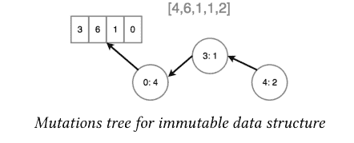

在这个概念示意图中，原始数组`[3,6,1,0]`首先发生将值 4 赋给位置 0 的修改（结果为`[4,6,1,0]`），然后将 1 赋给位置 3（现在是`[4,6,1,1]`），最后将 2 赋给位置 4（结果：`[4,6,1,1,2]`）。关键思想是在每次修改时，只记录与先前版本的差异，而不是复制整个原始数据结构。这种方法通常在内存和 CPU 性能方面都高效得多。

想象一下像这样使用这个假设的专用数组数据结构：

## 第 6 章：值不可变性

```js
var state = specialArray( 4, 6, 1, 1 );

var newState = state.set( 4, 2 );

state === newState;                    // false

state.get( 2 );                        // 1

state.get( 4 );                        // undefined

newState.get( 2 );                     // 1

newState.get( 4 );                     // 2

newState.slice( 2, 5 );                // [1,1,2]
```

`specialArray(..)`数据结构会在内部将每个修改操作（如`set(..)`）跟踪为一个*差异*，因此它不必为原始值（4、6、1 和 1）重新分配内存，只是为了将 2 添加到列表末尾。但重要的是，`state`和`newState`指向数组值的不同版本（或视图），因此**值不可变性语义得以保留**。

发明自己的性能优化数据结构是一个有趣的挑战。但务实地说，你应该使用一个已经做得很好的库。一个很好的选择是[Immutable.js](https://immutable-js.github.io/immutable-js/)，它提供了多种数据结构，包括`List`（类似数组）和`Map`（类似对象）。

考虑之前`specialArray`的示例，但使用`Immutable.List`：

```js
var state = Immutable.List.of( 4, 6, 1, 1 );

var newState = state.set( 4, 2 );

state === newState;                    // false

state.get( 2 );                        // 1

state.get( 4 );                        // undefined

newState.get( 2 );                     // 1

newState.get( 4 );                     // 2

newState.toArray().slice( 2, 5 );      // [1,1,2]
```

像 Immutable.js 这样强大的库采用了复杂的性能优化。没有这样的库，手动处理所有细节和边界情况将相当困难。

当值的更改很少或不频繁，且性能不是主要考虑因素时，我建议使用更轻量级的解决方案，坚持使用之前讨论的内置`Object.freeze(..)`。

## 处理方式

如果我们向函数接收了一个值，但不确定它是可变的还是不可变的，直接尝试修改它可以吗？**不可以**。正如我们在本章开头所断言的，我们应该将所有接收到的值视为不可变的——以避免副作用并保持纯粹——无论它们实际上是否不可变。

回想一下之前这个例子：

```js
function updateLastLogin(user) {

    var newUserRecord = Object.assign( {}, user );

    newUserRecord.lastLogin = Date.now();

    return newUserRecord;

}
```

这个实现将`user`视为不应被修改的值；它*是否*不可变与阅读这部分代码无关。与此相比，以下实现：

```js
function updateLastLogin(user) {

    user.lastLogin = Date.now();

    return user;

}
```

## 第6章：值的不变性

那种版本写起来容易得多，性能甚至也更好。但这种方法不仅使`updateLastLogin(..)`变得不纯，而且以一种使阅读代码以及使用该代码的地方都变得更复杂的方式改变了值。

我们应该始终将`user`视为不可变的，因为在这个阅读代码的节点上，我们不知道值从何而来，或者如果我们改变它可能会引发什么潜在问题。

这种方法的很好的例子可以在 JS 数组的各种内置方法中看到，比如`concat(..)`和`slice(..)`：

```js
var arr = [1,2,3,4,5];

var arr2 = arr.concat( 6 );

arr;            // [1,2,3,4,5]

arr2;           // [1,2,3,4,5,6]

var arr3 = arr2.slice( 1 );

arr2;           // [1,2,3,4,5,6]

arr3;           // [2,3,4,5,6]
```

其他将值实例视为不可变并返回新数组而不是修改的数组原型方法：`map(..)`和`filter(..)`。`reduce(..)`/`reduceRight(..)`工具函数也避免修改实例，尽管它们默认不返回新数组。

不幸的是，由于历史原因，还有相当多其他的数组方法是修改其实例的不纯函数：`splice(..)`、`pop(..)`、`push(..)`、`shift(..)`、`unshift(..)`、`reverse(..)`、`sort(..)`和`fill(..)`。

我们不应像某些人声称的那样，认为使用这类工具函数是*被禁止的*。出于诸如性能优化等原因，有时你会想使用它们。但你不应在非当前函数本地的数组值上使用此类方法，以避免在代码的其他远处部分产生副作用。

回忆第4章中`compose(..)`的一个实现：

```js
function compose(...fns) {

    return function composed(result){

        // copy the array of functions

        var list = [...fns];

        while (list.length > 0) {

            // take the last function off the end of the list

            // and execute it

            result = list.pop()( result );

        }

        return result;

    };

}
```

`...fns`收集参数是从传入的参数创建一个新的局部数组，因此它不是一个我们能对外部产生副作用的数组。那么，假设我们在本地修改它是安全的，这似乎是合理的。但这里微妙的陷阱在于，闭包了`fns`的内部`composed(..)`在这种意义上并非“局部”。

考虑这个不创建副本的不同版本：

```js
function compose(...fns) {

    return function composed(result){

        while (fns.length > 0) {

            // take the last function off the end of the list

            // and execute it

            result = fns.pop()( result );

        }

        return result;

    };

}

var f = compose( x => x / 3, x => x + 1, x => x * 2 );

f( 4 );      // 3
```

```js
f( 4 );    // 4 <-- 噢，不！
```

这里第二次使用`f(..)`是不正确的，因为我们在第一次调用期间修改了`fns`，这影响了后续的任何使用。根据情况，创建像`list = [...fns]`这样的数组副本可能是必要的，也可能不是。但我认为最安全的方法是假设你需要它——即使只是为了可读性！——除非你能证明你不需要，而不是反过来。

要保持自律，始终将*接收到的值*视为不可变的，无论它们是否真的不可变。这种努力将提高代码的可读性和可信赖性。

## 总结

值的不可变性并非关于值的不变。它关乎于随着程序状态的变化创建和跟踪新值，而不是修改现有值。这种方法能让我们在阅读代码时更有信心，因为我们限制了状态可能以我们不易察觉或预料不到的方式发生变化的地方。

`const`声明（常量）常被误解为能表达意图并强制不可变性。实际上，`const`与值的不可变性基本无关，其使用可能会造成比解决更多的困惑。相反，`Object.freeze(..)`提供了一个很好的内置方式来为数组或对象设置浅层值的不可变性。在许多情况下，这将足够。

对于程序中性能敏感的部分，或者在变化频繁的情况下，创建一个新数组或对象（特别是包含大量数据时）是不可取的，因为涉及到处理和内存方面的考虑。在这些情况下，使用来自像`Immutable.js`这样的库的不可变数据结构可能是最好的主意。

值的不可变性对代码可读性的重要性，不在于无法改变值，而在于将值视为不可变的自律性。

# 第7章：闭包与对象

多年前，Anton van Straaten 创作了一个如今相当著名且被频繁引用的[公案](http://people.csail.mit.edu/gregs/ll1-discuss-archive-html/msg03277.html)，用以阐明并激发闭包与对象之间重要的张力：

德高望重的 Qc 大师与他的学生 Anton 一起散步。Anton 希望能引发大师的讨论，于是说：“大师，我听说对象是非常好的东西——这是真的吗？”Qc 大师怜悯地看着他的学生回答道：“愚蠢的学生——对象只是穷人的闭包。”

Anton 受到斥责，离开大师回到自己的小屋，决心研究闭包。他仔细阅读了整个“Lambda: The Ultimate...”系列论文及其相关文献，并实现了一个基于闭包对象系统的简单 Scheme 解释器。他学到了很多，并期待着向大师汇报他的进展。

在与 Qc 大师的下一次散步中，Anton 试图通过说“大师，我已勤奋研究此问题，现在明白对象确实是穷人的闭包。”来给大师留下深刻印象。Qc 大师用棍子打了 Anton 作为回应，说：“你何时才能明白？闭包是穷人的对象。”那一刻，Anton 开悟了。

– Anton van Straaten 2003年6月4日

http://people.csail.mit.edu/gregs/ll1-discuss-archive-html/msg03277.html

原始帖子虽然简短，但包含了更多关于起源和动机的背景信息，我强烈建议你阅读那篇帖子，以便为接触本章内容正确设定心态。

我观察到许多人读到这个公案时，会因其巧妙的机智而会心一笑，但随后便继续前进，而未对其思维方式产生太大改变。然而，公案（从禅宗的角度看）的目的是推动读者去 wrestle 与其中矛盾的真理。所以，回去再读一遍。现在再读一遍。

到底是哪一个？闭包是穷人的对象，还是对象是穷人的闭包？或者都不是？或者两者都是？仅仅得出闭包和对象在某种程度上等价的结论吗？

这一切与函数式编程有什么关系？找个椅子坐下，思考一会儿。本章将是一次有趣的迂回，一次可以说的远足。

## 达成共识

首先，让我们确保在提到闭包和对象时，大家理解一致。我们显然处于 JavaScript 处理这两种机制的语境中，具体讨论的是简单的函数闭包（参见第2章“保持作用域”）和简单的对象（键值对的集合）。

作为记录，这里是一个简单函数闭包的示例：

```js
function outer() {

    var one = 1;

    var two = 2;

    return function inner(){

        return one + two;

    };

}

var three = outer();

three();          // 3
```

这是一个简单对象的示例：

```js
var obj = {

    one: 1,

    two: 2

};
```

```js
function three(outer) {

    return outer.one + outer.two;

}
```

```js
three( obj );      // 3
```

许多人一提到“闭包”，就会联想到许多额外的东西，比如异步回调，甚至是包含封装和信息隐藏的模块模式。同样，“对象”也会让人联想到类、`this`、原型以及一大堆其他实用工具和模式。

随着我们的深入，我们将仔细处理这些外部上下文中重要的部分，但现在，试着坚持使用此处所示的“闭包”和“对象”的最简单解释；这会让我们的探索不那么混乱。

## 相似之处

闭包和对象如何关联可能并不明显。所以让我们先探讨它们的相似之处。

为了框定这个讨论，让我简要地断言两点：

1. 没有闭包的编程语言可以用对象来模拟闭包。
2. 没有对象的编程语言可以用闭包来模拟对象。

换句话说，我们可以将闭包和对象视为同一事物的两种不同表示。

## 状态

考虑之前的这段代码：

# 第 7 章：闭包与对象

```js
function outer() {

    var one = 1;

    var two = 2;

    return function inner(){

        return one + two;

    };

}
```

```js
var obj = {

    one: 1,

    two: 2

};
```

`inner()`所跨越的作用域和对象`obj`都包含两个状态元素：`one`的值为`1`，`two`的值为`2`。从语法和机制上看，这些状态的表现形式是不同的。但从概念上讲，它们实际上非常相似。

事实上，将对象表示为闭包，或将闭包表示为对象，是相当直接的。来吧，自己试试：

```js
var point = {

    x: 10,

    y: 12,

    z: 14

};
```

你想出类似这样的东西了吗？

```js
function outer() {

    var x = 10;

    var y = 12;

    var z = 14;

    return function inner(){

        return [x,y,z];

    }

};

var point = outer();
```

> ## 注意
>
> `inner()`函数每次被调用时都会创建并返回一个新数组（也就是一个对象！）。这是因为 JS 没有提供任何能力让我们在不将值封装在对象中的情况下返回多个值。从技术角度来说，这并不违反我们将对象视为闭包的任务，因为这仅仅是暴露/传输值的实现细节；状态跟踪本身仍然不使用对象。借助 ES6+ 的数组解构，我们可以在另一边声明式地忽略这个临时的中间数组：`var [x,y,z] = point()`。从开发者体验的角度来看，这些值是单独存储的，并通过闭包而非对象来追踪。

如果我们有嵌套对象呢？

```js
var person = {

    name: "Kyle Simpson",

    address: {

        street: "123 Easy St",
```


```js
city: "JS'ville",

state: "ES"

}

};
```

我们可以用嵌套闭包来表示相同类型的状态：

```js
function outer() {

    var name = "Kyle Simpson";

    return middle();

    // *********************

    function middle() {

        var street = "123 Easy St";

        var city = "JS'ville";

        var state = "ES";

        return function inner(){

            return [name,street,city,state];

        };

    }

}

var person = outer();
```

让我们练习另一个方向，从闭包到对象：

```js
function point(x1,y1) {

    return function distFromPoint(x2,y2){

        return Math.sqrt(

            Math.pow( x2 - x1, 2 ) +

            Math.pow( y2 - y1, 2 )

        );

    };

}

var pointDistance = point( 1, 1 );

pointDistance( 4, 5 );    // 5
```

`distFromPoint(..)`闭包了`x1`和`y1`，但我们也可以显式地将这些值作为对象传递：

```js
function pointDistance(point,x2,y2) {

    return Math.sqrt(

        Math.pow( x2 - point.x1, 2 ) +

        Math.pow( y2 - point.y1, 2 )

    );

};

pointDistance(

    { x1: 1, y1: 1 },

    4,  // x2

    5   // y2

);

// 5
```

显式传入的点对象状态替代了隐式持有该状态的闭包。

## 行为，同样如此！

不仅是对象和闭包都表示表达状态集合的方式，它们还可以通过函数/方法来包含行为。将数据与其行为捆绑在一起有一个花哨的名字：封装。

考虑：

```js
function person(name,age) {

    return happyBirthday(){

        age++;

        console.log(

            `Happy ${age}th Birthday, ${name}!`

        );

    }

}

var birthdayBoy = person( "Kyle", 36 );

birthdayBoy(); // Happy 37th Birthday, Kyle!
```

内部函数`happyBirthday()`对`name`和`age`有闭包，因此其中的功能与状态保持在一起。

我们可以通过`this`绑定到对象来实现相同的能力：

```js
var birthdayBoy = {

    name: "Kyle",

    age: 36,

    happyBirthday() {

        this.age++;

        console.log(

            `Happy ${this.age}th Birthday, ${this.name}!`

        );

    }

};

birthdayBoy.happyBirthday();

// Happy 37th Birthday, Kyle!
```

我们仍然在用`happyBirthday()`函数表达状态数据的封装，但用的是对象而不是闭包。而且我们不必像前面的例子那样显式地将对象传递给函数；JavaScript 的`this`绑定可以轻松创建隐式绑定。

分析这种关系的另一种方式：闭包将单个函数与一组状态相关联，而持有相同状态的对象可以有任意数量的函数来操作该状态。

事实上，你甚至可以用单个闭包作为接口来暴露多个方法。考虑一个具有两个方法的传统对象：

```js
var person = {

    firstName: "Kyle",

    lastName: "Simpson",

    first() {

        return this.firstName;

    },

    last() {

        return this.lastName;

    }

}

person.first() + " " + person.last();

// Kyle Simpson
```

仅使用闭包而不使用对象，我们可以将这个程序表示为：

```js
function createPerson(firstName,lastName) {

    return API;

    // *****************

    function API(methodName) {

        switch (methodName) {

            case "first":

                return first();

                break;

            case "last":

                return last();

                break;

        };

    }

    function first() {

        return firstName;

    }

    function last() {

        return lastName;

    }

}
```

```js
var person = createPerson( "Kyle", "Simpson" );
```

```js
person( "first" ) + " " + person( "last" );

// Kyle Simpson
```

虽然这些程序在体验上看起来和感觉有些不同，但它们实际上只是相同程序行为的不同实现变体。

## （不）可变性

许多人最初会认为闭包和对象在可变性方面表现不同；闭包可以防止外部突变，而对象不能。但事实证明，这两种形式具有相同的突变行为。

这是因为我们关心的是，如第 6 章所讨论的，**值**的可变性，这是值本身的特性，无论它在哪里或如何被赋值：

```js
function outer() {

    var x = 1;

    var y = [2,3];

    return function inner(){

        return [ x, y[0], y[1] ];

    };

}
```

```js
var xyPublic = {

    x: 1,

    y: [2,3]

};
```

存储在`outer()`内部`x`词法变量中的值是不可变的——记住，像 2 这样的原始值按定义就是不可变的。但由`y`引用的值，即数组，肯定是可变的。`xyPublic`上的`x`和`y`属性也完全一样。

我们可以通过指出`y`本身是一个数组来强化对象和闭包对可变性没有影响这一点，因此我们需要进一步分解这个例子：

```js
function outer() {

    var x = 1;

    return middle();

    // **********************

    function middle() {

        var y0 = 2;

        var y1 = 3;

        return function inner(){

            return [ x, y0, y1 ];

        };

    }

}

var xyPublic = {

    x: 1,

    y: {

        0: 2,

        1: 3

    }

};
```

如果你将其视为"（也就是对象）一路到底"，在最底层，所有状态数据都是原始值，而所有原始值都是值不可变的。无论你用嵌套对象还是用嵌套闭包来表示这种状态，持有的值都是不可变的。

## 同构

"同构"这个词如今在 JavaScript 中被频繁提及，通常指的是可以在服务器端和

> 同构是什么意思？嗯，我们可以用数学术语、社会学或生物学来讨论它。同构的一般概念是你有两个结构相似但不相同的东西。

在所有这些用法中，同构与等式的区别在于：两个值如果在所有方面都完全相同则是相等的，但如果它们表示方式不同但仍具有 1 对 1 的双向映射关系，则它们是同构的。

换句话说，如果你可以从 A 映射（转换）到 B，然后通过逆映射再回到 A，那么事物 A 和 B 就是同构的。

回想在[第 2 章，"数学简要回顾"](#)中，我们讨论了函数的数学定义是输入和输出之间的映射。我们指出这在技术上称为态射。同构是一种特殊的双射（即双向）态射，它不仅要求映射必须能够双向进行，还要求两种形式下的行为是相同的。

但让我们将同构与代码联系起来，而不是考虑数字。再次引用我的博客文章：

> [W]hat would isomorphic JS be if there were such a thing? Well, it could be that you have one set of JS code that is converted to another set of JS code, and that frontend-JavaScript-rear end-rendering engine (importantly) you could convert from the latter back to the former if you wanted.

正如我们之前用闭包作为对象和对象作为闭包的例子所断言的那样，这些代表性的替换可以双向进行。在这方面，它们是相互同构的。

简而言之，闭包和对象是状态（及其相关功能）的同构表示。

下次你听到有人说“X与Y同构”时，他们的意思是，“X和Y可以相互转换而不丢失信息。”

## 底层原理

因此，从我们可以编写的代码角度来看，我们可以将对象视为闭包的同构表示。但我们也可以观察到，闭包系统实际上可以通过对象来实现——并且很可能就是如此！

这样想：在下面的代码中，当`outer()`已经运行结束后，JS 是如何继续跟踪`inner()`函数不断引用的`x`变量的？

```js
function outer() {

    var x = 1;

    return function inner(){

        return x;

    };

}
```

我们可以想象，`outer()`的作用域（即所有已定义变量的集合）被实现为一个具有属性的对象。因此，从概念上讲，在内存中的某个地方，存在着类似这样的东西：

```js
scopeOfOuter = {

    x: 1

};
```

然后对于`inner()`函数，当它被创建时，它获得一个名为`scopeOfInner`的（空的）作用域对象，该对象通过其`[[Prototype]]`链接到`scopeOfOuter`对象，大致像这样：

```js
scopeOfInner = {};

Object.setPrototypeOf( scopeOfInner, scopeOfOuter );
```

接着，在`inner()`函数内部，当它引用词法变量`x`时，实际更像是：

```js
return scopeOfInner.x;
```

`scopeOfInner`没有`x`属性，但它通过`[[Prototype]]`链接到了确实有`x`属性的`scopeOfOuter`。通过原型委托访问`scopeOfOuter.x`，结果返回了值`1`。

通过这种方式，我们大致可以理解为什么`outer()`的作用域（通过闭包）即使在其执行完毕后也能被保留：因为`scopeOfInner`对象链接到了`scopeOfOuter`对象，从而使得该对象及其属性得以存活和延续。

现在，这一切都是概念性的。我并不是在说 JS 引擎字面上使用了对象和原型。但其工作原理与之类似是完全可能的。

许多语言确实通过对象来实现闭包。而其他语言则基于闭包来实现对象。但我们会让读者自行想象那是如何工作的。

## 两条岔路……

所以闭包和对象是等价的，对吧？不完全是。我打赌它们比你在开始本章之前所想的要相似得多，但它们仍然存在重要的差异。

这些差异不应被视为缺点或反对使用的论据；那是错误的视角。它们应被视为特性，这些特性使得其中一种（或另一种）在特定任务中更合适（也更易读！）。

## 结构可变性

从概念上讲，闭包的结构是不可变的。

换句话说，你永远无法向闭包中添加或移除状态。闭包是变量声明位置（在作者/编译时固定）的特性，对任何运行时条件都不敏感——当然，假设你使用了严格模式和/或避免了诸如`eval(..)`之类的作弊手段！

> ### 注意
>
> 从技术上讲，JS 引擎可以裁剪闭包，以剔除其作用域中任何不再会被使用的变量，但这是对开发者透明的高级优化。无论引擎是否真的进行这类优化，我认为对开发者来说最稳妥的假设是，闭包是按作用域而非按变量存在的。如果你不想它继续存在，就不要闭包它！

然而，对象默认情况下是可变的。只要对象没有被冻结（`Object.freeze(..)`），你就可以自由地向对象添加或移除（删除）属性/索引。

能够根据程序中的运行时条件跟踪更多（或更少！）的状态，这可能是代码的一个优势。

例如，让我们想象在游戏中跟踪按键事件。几乎可以肯定，你会想到使用一个数组来完成这项工作：

```js
function trackEvent(evt,keypresses = []) {

    return [ ...keypresses, evt ];

}

var keypresses = trackEvent( newEvent1 );

keypresses = trackEvent( newEvent2, keypresses );
```

> 注意
>
> 你注意到为什么我没有直接向`keypresses`使用`push(..)`吗？因为在函数式编程中，我们通常希望将数组视为不可变的数据结构，可以重新创建和添加内容，但不能直接修改。我们用显式的重新赋值来取代副作用的弊端（稍后会详细说明）。

虽然我们没有改变数组的结构，但如果我们想的话是可以的。稍后会详细讨论这一点。

但是，数组并不是跟踪这个不断增长的`evt`对象“列表”的唯一方式。我们可以使用闭包：

```js
function trackEvent(evt,keypresses = () => []) {

    return function newKeypresses() {

        return [ ...keypresses(), evt ];

    };

}

var keypresses = trackEvent( newEvent1 );

keypresses = trackEvent( newEvent2, keypresses );
```

你看出这里发生了什么吗？

每当我们向“列表”添加一个新事件时，我们就在现有的`keypresses()`函数（闭包）周围创建一个新的闭包，该闭包捕获了当前的`evt`。当我们调用`keypresses()`函数时，它会依次调用所有嵌套函数，构建一个由所有单独闭包捕获的`evt`对象组成的中间数组。同样，闭包是跟踪所有状态的机制；你看到的数组仅仅是一个实现细节，需要一种从函数返回多个值的方式。

那么，哪一个更适合我们的任务呢？这里没有惊喜，数组方法可能要合适得多。闭包的结构不可变性意味着我们唯一的选择就是在它外面再包裹更多的闭包。对象默认是可扩展的，所以我们可以根据需要增长数组。

顺便说一句，尽管我将这种结构（不）可变性作为闭包和对象之间的一个明显差异来呈现，但我们使用对象作为不可变值的方式实际上比闭包更相似。每次向数组添加内容都创建一个新数组，这是将数组视为结构不可变的方式，这与闭包由于其设计而结构不可变在概念上是对称的。

## 封装性

在分析闭包和对象时，你想到的第一个差异可能就是闭包通过嵌套词法作用域提供了状态的“隐私”，而对象则将所有东西都作为公共属性暴露出来。这种隐私有一个著名的名字：信息隐藏。

考虑词法闭包隐藏：

```js
function outer() {

    var x = 1;

    return function inner(){

        return x;

    };

}

var xHidden = outer();

xHidden();      // 1
```

现在，相同的状态公开为：

```js
var xPublic = {

    x: 1

};

xPublic.x;            // 1
```

围绕一般的软件工程原则——考虑抽象、具有公共和私有 API 的模块模式等——存在一些明显的差异，但让我们尝试将讨论限制在函数式编程的视角；毕竟，这是一本关于函数式编程的书！

## 可见性

隐藏信息的能力似乎是状态跟踪的一个理想特性，但我相信函数式程序员可能会持相反观点。

将状态管理为对象上的公共属性的一个优点是，更容易枚举（并迭代！）你状态中的所有数据。想象一下，你想要处理每个按键事件（来自前面的例子）以将其保存到数据库，使用像这样的工具函数：

```js
function recordKeypress(keypressEvt) {

    // database utility

    DB.store( "keypress-events", keypressEvt );

}
```


如果你已经有了一个数组——只是一个具有公共数字命名属性的对象——使用内置的 JS 数组工具`forEach(..)`来完成这非常直接：

```js
keypresses.forEach( recordKeypress );
```

但如果按键列表隐藏在闭包内部，你将不得不在闭包的公共 API 上暴露一个工具函数，该函数有权访问隐藏的数据。

例如，我们可以给我们的闭包按键示例添加它自己的`forEach`，就像内置数组拥有的那样：

```js
function trackEvent(
    evt,
    keypresses = {
        list() { return []; },
        forEach() {}
    }
) {
    return {
        list() {
            return [ ...keypresses.list(), evt ];
        },
        forEach(fn) {
            keypresses.forEach( fn );
            fn( evt );
        }
    };
}

// ..
keypresses.list();       // [ evt, evt, .. ]
keypresses.forEach( recordKeypress );
```

对象状态数据的可见性使其使用更加直接明了，而闭包则隐藏了状态，需要我们付出更多努力去处理它。

## 变更控制

如果词法变量`x`隐藏在一个闭包内部，那么只有同样位于该闭包内的代码才有权重新赋值；从外部是不可能修改`x`的。

正如我们在第 6 章中所见，仅此一点就通过缩小读者必须考虑的范围来提高代码的可读性，从而预测任何给定变量的行为。

词法重新赋值的局部邻近性是我认为`const`作为一项特性并不是那么有用的重要原因。作用域（以及由此衍生的闭包）通常应该很小，这意味着只有少数几行代码能够影响重新赋值。在上文的`outer()`中，我们可以快速检查确认没有任何代码行会重新赋值`x`，因此就所有实际目的而言，它充当的是一个常量。

这种保证极大地增强了我们对函数纯度的信心。

另一方面，`xPublic.x`是一个公共属性，程序中获取了`xPublic`引用的任何部分，默认都有能力将`xPublic.x`重新赋值为其他值。这需要考虑的代码行数要多得多！

这就是我们在[第 6 章](#)中研究`Object.freeze(..)`的原因——作为一种快速简便的手段，使对象的所有属性变为只读（`writable: false`），从而防止它们被不可预测地重新赋值。

不幸的是，`Object.freeze(..)`既是全有或全无的，也是不可逆的。

使用闭包时，你拥有一些具有特权可以更改的代码，而程序的其余部分则受到限制。当你冻结对象时，代码的任何部分都无法重新赋值。而且，一旦对象被冻结，就无法解冻，因此这些属性在程序运行期间将始终保持只读。

在我想允许重新赋值但限制其影响范围的地方，闭包是比对象更方便灵活的形式。在我不想允许重新赋值的地方，冻结对象比在我的函数中到处重复`const`声明要方便得多。

许多函数式编程者（FPers）对重新赋值采取强硬立场：不应该使用。他们倾向于使用`const`使所有闭包变量变为只读，并使用`Object.freeze(..)`或完整的不可变数据结构来防止属性重新赋值。此外，他们会尽量减少显式声明/跟踪的变量和属性的数量，尽可能选择值传递——函数链、将`return`值作为参数传递等——而不是中间值存储。

本书是关于 JavaScript 中"轻量级函数式"编程的，这是我与核心 FP 阵营产生分歧的其中一个案例。

我认为变量重新赋值可能非常有用，而且在适当使用时，其明确性相当可读。根据我的经验，当你可以插入调试器或断点，或者跟踪监视表达式时，调试会容易得多。

## 克隆状态

正如我们在第 6 章中学到的，防止副作用侵蚀代码可预测性的最佳方法之一是确保我们将所有状态值视为不可变的，无论它们实际上是否不可变（冻结）。

如果你没有使用专门构建的库来提供复杂的不变数据结构，最简单的方法就足够了：在进行更改之前每次复制你的对象/数组。

数组很容易进行浅克隆——只需使用`...`数组展开：

```js
var a = [ 1, 2, 3 ];

var b = [...a];
b.push( 4 );

a;            // [1,2,3]
b;            // [1,2,3,4]
```

对象也可以相对轻松地进行浅克隆：

```js
var o = {
    x: 1,
    y: 2
};

// 在 ES2018+ 中，使用对象展开：
var p = { ...o };
p.y = 3;

// 在 ES6/ES2015+ 中：
var p = Object.assign( {}, o );
p.y = 3;
```

如果对象/数组中的值本身是非原始值（对象/数组），要进行深克隆，你必须手动遍历每一层来克隆每个嵌套对象。否则，你将拥有对这些子对象共享引用的副本，这很可能会在你的程序逻辑中造成混乱。

你注意到这种克隆之所以可能，是因为所有这些状态值都是可见的，因此可以轻松复制吗？那么封装在闭包中的一组状态呢；你如何克隆那个状态？

这要麻烦得多。从本质上讲，你必须做一些与我们之前的自定义`forEach` API 方法类似的事情：在闭包的每一层中提供一个具有特权来提取/复制隐藏值的函数，在此过程中创建新的等效闭包。

即使这在理论上是可能的——读者的另一个练习！——但与你可能在任何实际程序中为之辩解的相比，实现起来远不够实用。

在需要能够克隆的状态表示方面，对象具有明显优势。

## 性能

从实现角度来看，对象可能比闭包更受青睐的一个原因是，在 JavaScript 中，对象通常在内存甚至计算方面都更轻量。

但要小心将其作为一般性断言：你可以用对象做很多事情，这会消除你可能因为忽略闭包而转向基于对象的状态跟踪所获得的任何性能优势。

让我们考虑一个同时具有两种实现的场景。首先，闭包风格的实现：

```js
function StudentRecord(name,major,gpa) {
    return function printStudent(){
        return `${name}, Major: ${major}, GPA: ${gpa.toFixed(1)}`;
    };
}

var student = StudentRecord( "Kyle Simpson", "CS", 4 );

// 稍后

student();
// Kyle Simpson, Major: CS, GPA: 4.0
```

内部函数`printStudent()`闭包了三个变量：`name`、`major`和`gpa`。无论我们将该函数的引用转移到何处，它都保持这个状态——在本例中我们称之为`student()`。

现在是对象（和`this`）方法：

```js
function StudentRecord(){
    return `${this.name}, Major: ${this.major}, \
GPA: ${this.gpa.toFixed(1)}`;
}

var student = StudentRecord.bind( {
    name: "Kyle Simpson",
    major: "CS",
    gpa: 4
} );

// 稍后

student();
// Kyle Simpson, Major: CS, GPA: 4.0
```

`student()`函数——技术上称为"绑定函数"——对我们传入的对象字面量有一个硬绑定的`this`引用，使得之后对`student()`的任何调用都会使用该对象作为其`this`，从而能够访问其封装状态。

两种实现具有相同的结果：一个保留了状态的函数。但性能方面呢；会有什么不同？

## 注意

准确且有用地判断一段 JS 代码的性能是一件非常棘手的事情。我们不会在这里详述所有细节，但我强烈建议你阅读 *You Don't Know JS: Async & Performance*，特别是第 6 章"基准测试与调优"，以获取更多细节。

如果你要编写一个将状态与其函数配对的库——无论是第一个片段中的`StudentRecord(..)`调用还是第二个片段中的`StudentRecord.bind(..)`调用——你可能最关心的是这两种方式的性能表现。检查代码，我们可以看到前者每次都必须创建一个新的函数表达式。第二个使用`bind(..)`，其影响不那么明显。

理解`bind(..)`在底层所做工作的一种方式是，它在一个函数上创建了一个闭包，就像这样：

```js
function bind(origFn,thisObj) {
    return function boundFn(...args) {
        return origFn.apply( thisObj, args );
    };
}

var student = bind( StudentRecord, { name: "Kyle.." } );
```

这样来看，我们场景的两种实现似乎都创建了一个闭包，因此性能可能大致相同。

然而，内置的`bind(..)`工具实际上并不需要创建闭包来完成任务。它只是创建一个函数并手动将其内部`this`设置为指定的对象。这可能比我们手动创建闭包的操作更高效。

我们这里讨论的性能节省，对单个操作来说是微不足道的。但如果您的库的关键路径需要执行数百、数千次甚至更多次这样的操作，那么节省累积起来会非常可观。许多库——蓝鸟（Bluebird）就是一个这样的例子——最终正是通过这种去除闭包而采用对象的方式来进行优化的。

在库的用例之外，状态与其函数的配对在应用程序的关键路径中通常只发生相对较少的次数。相比之下，函数+状态的使用——即在任一代码片段中调用`student()`——则更为常见。

如果在您的代码的某个特定情况下确实如此，您可能应该更关注后者的性能，而不是前者。

绑定函数（Bound functions）在历史上通常性能相当糟糕，但最近已被 JavaScript 引擎高度优化。如果您在几年前对这些变体进行过基准测试，现在用最新的引擎重复相同的测试，得到不同的结果是完全可能的。

一个绑定函数现在的性能至少不亚于（甚至可能优于）一个等效的闭包函数。因此，这是支持使用对象而非闭包的另一个理由。

我只想重申：这些性能观察并非绝对，确定什么最适合特定场景是非常复杂的。不要随意应用您从他人那里听到的，甚至是您在之前的某个项目中看到的。请仔细检查对象或闭包是否适合该任务，并能提供适当的效率。

## 总结

> *本章的真谛无法用文字写出。*
>
> *必须阅读本章才能发现其真谛。*

引用一些禅宗智慧是我尝试耍小聪明。但您值得拥有一个关于本章主旨的恰当总结。

对象和闭包彼此同构，这意味着它们可以某种程度上互换使用，来表示程序中的状态和行为。

用闭包表示有一定好处，比如精细的变更控制和自动的隐私性。用对象表示则有其他好处，比如更容易克隆状态。

具备批判性思维的函数式编程者应该能够用任一种表示法来构想程序中的任何状态和行为段落，并为手头的任务选择最合适的表示法。

# 第八章：递归

在上一章我们关于闭包/对象的兔子洞里玩得开心吗？欢迎回来！

在下一页，我们将深入探讨递归这个话题。

*（本页剩余部分有意留白）*

让我们来谈谈递归。在我们深入之前，请查阅上一页的正式定义。

我知道，这是个冷笑话。 :)

递归是那种大多数开发者承认可能非常强大，但大多数人不喜欢使用的编程技术之一。在这个意义上，我会把它和正则表达式归为一类。强大，但令人困惑，因此被认为*不值得费心*。

我是递归的忠实粉丝，您也可以！不幸的是，许多递归的例子都聚焦于像生成斐波那契数列这样的琐碎学术任务。如果您的程序需要这类数字——我们面对现实吧，这并不常见！——您可能会错过大局。

事实上，递归是函数式编程开发者避免命令式循环和重新赋值的最重要方式之一，它将实现细节交给了语言和引擎处理。使用得当，递归对于复杂问题具有强大的声明式表达能力。

遗憾的是，递归受到的关注远远不够，尤其是在 JS 中，这很大程度上源于一些实际的性能（速度和内存）限制。我们本章的目标是深入挖掘，找到实用的理由，说明为什么递归应该在我们的函数式编程实践中占据核心地位。

## 定义

递归是指一个函数调用自身，而该调用又执行同样的操作，如此循环，直到满足一个基础条件，调用循环才得以展开。

> ⚠️ **警告**
>
> 如果您不确保一个基础条件**最终**被满足，递归将永远运行下去，并导致程序崩溃或死锁；确保基础条件正确设置非常重要！

但是……这个定义用文字表述太令人困惑了。我们可以做得更好。考虑这个递归函数：

```js
function foo(x) {
    if (x < 5) return x;
    return foo( x / 2 );
}
```

让我们可视化一下当我们调用`foo( 16 )`时这个函数会发生什么：

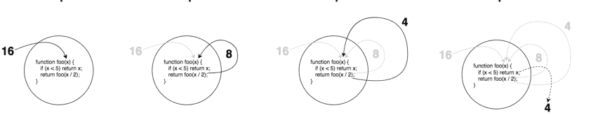

在步骤2中，`x / 2`得到8，这个值作为参数传递给一个递归的`foo(..)`调用。在步骤3中，同样，`x / 2`得到4，这个值作为参数传递给另一个`foo(..)`调用。这部分希望相当直观。

但人们经常容易困惑的是步骤4中发生的事情。一旦我们满足了基础条件（`x`（值为4）< 5），我们就不再进行更多的递归调用，只是（有效地）执行`return 4`。具体来说，图中返回4的虚线简化了那里的过程，所以让我们深入最后一步，将其可视化为这三个子步骤：

第八章：递归

207

### 步骤 4a

### 步骤 4b

### 步骤 4c

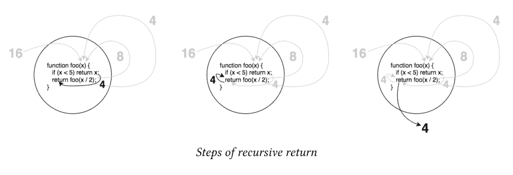

一旦满足基础条件，返回值就会沿着所有当前函数调用（以及对应的返回）级联回传，最终将最终结果返回出来。

另一种可视化此递归的方式是考虑函数调用发生的顺序（通常称为调用栈）：

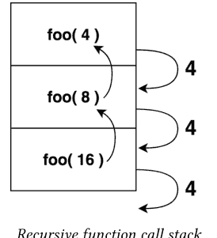

关于调用栈的更多内容将在本章稍后介绍。

另一个递归的例子：

```js
function isPrime(num, divisor = 2){
    if (num < 2 || (num > 2 && num % divisor == 0)) {
        return false;
    }
    if (divisor <= Math.sqrt( num )) {
        return isPrime( num, divisor + 1 );
    }

    return true;
}
```

这个质数检查基本上是通过尝试从2到被检查数字的平方根的每个整数，看是否有任何一个能整除该数（`%` mod 返回0）。如果有任何一个能整除，它就不是质数。否则，它必须是质数。`divisor + 1`使用了递归来遍历每个可能的除数。

递归最著名的例子之一是计算斐波那契数，其序列定义如下：

```text
fib( 0 ): 0
fib( 1 ): 1
fib( n ):
    fib( n - 2 ) + fib( n - 1 )
```

## 注意

此序列的前几个数字是：0, 1, 1, 2, 3, 5, 8, 13, 21, 34, ...

每个数字都是序列中前两个数字的和。

直接用代码表达的斐波那契定义：

```js
function fib(n) {
    if (n <= 1) return n;
    return fib( n - 2 ) + fib( n - 1 );
}
```

`fib(..)`递归地调用自身两次，这通常被称为二元递归。我们将在后面更多地讨论二元递归。

我们将在本章中多次使用`fib(..)`来阐释围绕递归的想法，但这种特定形式的一个缺点是有大量的重复工作。`fib(n-1)`和`fib(n-2)`之间不共享任何工作，但在整个整数空间直到0的范围内几乎完全重叠。

我们在第五章“性能影响”中简要触及了记忆化（memoization）。在这里，记忆化将允许任何给定数字的`fib(..)`只被计算一次，而不是被重新计算多次。我们不会在此进一步深入该主题，但请记住，对于任何算法（无论是递归还是非递归），这种性能注意事项都很重要。

## 互递归

当一个函数调用自身时，特别地，这被称为**直接递归**。我们在上一节看到的`foo(..)`、`isPrime(..)`和`fib(..)`就是如此。当两个或多个函数在一个递归循环中相互调用时，这被称为**互递归**。

这两个函数是互递归的：

```js
function isOdd(v) {
    if (v === 0) return false;
    return isEven( Math.abs( v ) - 1 );
}
```

是的，这是一个计算数字奇偶性的愚蠢方法。但它阐明了这样一个观点：某些算法可以通过相互递归来定义。

回想一下上一节中的二元递归`fib(..)`；我们也可以用相互递归来表达它：

```js
function fib_(n) {
    if (n == 1) return 1;
    else return fib( n - 2 );
}

function fib(n) {
    if (n == 0) return 0;
    else return fib( n - 1 ) + fib_( n );
}
```

## 注意

这个相互递归的`fib(..)`实现改编自《使用相互递归计算斐波那契数》中的研究。

虽然这里展示的相互递归例子相当刻意，但存在更复杂的应用场景，其中相互递归会非常有用。计算树数据结构中的叶子节点数量就是一个例子，而递归下降解析（由编译器解析源代码）是另一个例子。

## 为什么使用递归？


既然我们已经定义并阐述了递归，接下来应该探讨它为何有用。

递归契合函数式编程（FP）精神的最常被引用的原因是，它用调用栈上的隐式状态取代了（大部分）显式状态跟踪。通常，当问题需要条件分支和回溯时，递归最为有用；在纯粹的迭代环境中管理这类状态可能相当棘手；至少，代码会高度命令式，更难阅读和验证。但是，将每个分支层级作为调用栈上的独立作用域进行跟踪，通常能显著提升代码的可读性。

简单的迭代算法可以轻松地用递归表达：

```javascript
function sum(total,...nums) {
    for (let num of nums) {
        total = total + num;
    }

    return total;
}

// 与

function sum(num1,...nums) {
    if (nums.length == 0) return num1;
    return num1 + sum( ...nums );
}
```

这不仅仅是用调用栈取代了 `for` 循环，而是增量的部分和（`total` 的间歇状态）在调用栈的返回过程中被隐式跟踪，而不是每次迭代都重新赋值 `total`。函数式程序员通常更倾向于在可能的情况下避免重新赋值局部变量。

在像这种求和这样的基础算法中，这种差异很微妙且细微。但算法越复杂，你可能越会看到递归相比于命令式状态跟踪的回报。

## 声明式递归

数学家使用 Σ 符号作为占位符，表示一系列数字的求和。他们这样做的主要原因在于，当处理更复杂的公式并且必须手动写出求和式（如 1 + 3 + 5 + 7 + 9 + …）时，这会更繁琐（且可读性更低！）。使用这种符号是声明式数学！

递归之于算法，正如 Σ 之于数学，具有相同的声明式意义。递归表达了一个问题的解决方案存在，但不一定要求代码的读者理解该方案是如何工作的。让我们考虑两种找出传入参数中最大偶数的方法：

```javascript
function maxEven(...nums) {
    var maxNum = -Infinity;

    for (let num of nums) {
        if (num % 2 == 0 && num > maxNum) {
            maxNum = num;
        }
    }

    if (maxNum !== -Infinity) {
        return maxNum;
    }
}
```

这个实现并非特别难以理解，但它的细微之处也并非显而易见。`maxEven()`、`maxEven(1)` 和 `maxEven(1,13)` 都返回 `undefined` 这一点有多明显？最终的 `if` 语句为何必要，是否一目了然？

让我们考虑一个递归方法进行比较。我们可以这样表示递归：

`maxEven( nums ): maxEven( nums.0, maxEven( ...nums.1 ) )`

换句话说，我们可以将数字列表的最大偶数定义为第一个数字与其余数字最大偶数的比较结果。例如：

`maxEven( 1, 10, 3, 2 ): maxEven( 1, maxEven( 10, maxEven( 3, maxEven( 2 ) ) ) )`

在 JS 中实现这种递归定义，一种方法是：

```javascript
function maxEven(num1, ...restNums) {
  var maxRest = restNums.length > 0 ?
    maxEven( ...restNums ) :
    undefined;

  return (num1 % 2 != 0 || num1 < maxRest) ?
    maxRest :
    num1;
}
```

那么这种方法有什么优势呢？

首先，函数签名与之前略有不同。我特意将 `num1` 作为第一个参数名，其余参数收集到 `restNums` 中。但为什么呢？我们本可以把它们全部收集到一个 `nums` 数组中，然后引用 `nums[0]`。

这个函数签名是对递归定义的有意提示。它读起来像这样：

`maxEven( num1, ...restNums ): maxEven( num1, maxEven( ...restNums ) )`

你看到函数签名和递归定义之间的对称性了吗？

当我们可以让递归定义在函数签名中也更加明显时，我们就提升了函数的声明性。如果能在函数体中也镜像地实现递归定义，那就更好了。

但我认为最明显的改进是，命令式 `for` 循环带来的干扰被抑制了。所有的循环逻辑都被抽象到了递归调用栈中，因此这些东西不会使代码变得杂乱。然后我们可以自由地专注于通过一次比较两个数字来找出最大偶数的逻辑——这才是重要的部分！

在思维上，这类似于数学家在更大方程中使用 Σ 求和符号。我们是在说：“列表其余部分的最大偶数由 `maxEven(...restNums)` 计算得出，所以我们直接假设那部分并继续。”

此外，我们通过 `restNums.length > 0` 这个守卫来强化这一概念，因为如果没有更多数字需要考虑，自然的结果是 `maxRest` 必须是 `undefined`。我们不需要为推理的这一部分投入额外的心智注意力。这个基本情况（没有更多数字需要考虑）显而易见。

接下来，我们将注意力转向检查 `num1` 与 `maxRest` 的比较——算法的主要逻辑是如何确定两个数字中（如果有的话）哪个是最大偶数。如果 `num1` 不是偶数（`num1 % 2 != 0`），或者它小于 `maxRest`，那么就必须返回 `maxRest`，即使它是 `undefined`。否则，`num1` 就是答案。

我所主张的是，在阅读实现时，这种推理比命令式方法更直接，更少细微差别或噪声来分散我们的注意力；它比使用 `-Infinity` 的 `for` 循环版本更具声明性。

## 提示

我们需要指出，除了手动迭代或递归之外，建模此问题的另一种（可能更好！）方式是使用列表操作（参见[第 9 章](#)），使用 `filter(..)` 仅保留偶数，然后使用 `reduce(..)` 找出最大值。我们仅使用此例来说明递归相对于手动迭代更具声明性的本质。

## 二叉树递归

这是另一个递归示例：计算二叉树的深度。事实上，你对树进行的几乎每个操作，用递归来实现都最容易，因为手动跟踪堆栈上下是高度命令式且容易出错的。

二叉树的深度是从根节点向下（向左或向右）穿过节点的最长路径。另一种定义方式是递归地——任何节点处树的深度是 1（当前节点）加上其左子树或右子树深度中较大者：

```text
depth( node ):
    1 + max( depth( node.left ), depth( node.right ) )
```

将此直接转换为二元递归函数：

```javascript
function depth(node) {
    if (node) {
        let depthLeft = depth( node.left );
        let depthRight = depth( node.right );
        return 1 + max( depthLeft, depthRight );
    }

    return 0;
}
```

我不打算列出这个算法的命令式形式，但相信我，它会混乱得多。这种递归方法优雅且优美地体现了声明性。它与算法的递归定义非常接近，几乎没有干扰。

并非所有问题都能干净地递归解决。这不是某种应该处处应用的银弹。但递归可以非常有效地将问题的表达从更命令式演进为更具声明性。

## 调用栈

让我们回顾一下之前的 `isOdd(..)` / `isEven(..)` 递归：

```javascript
function isOdd(v) {
    if (v === 0) return false;
    return isEven( Math.abs( v ) - 1 );
}

function isEven(v) {
    if (v === 0) return true;
    return isOdd( Math.abs( v ) - 1 );
}
```

在大多数浏览器中，如果你尝试运行这段代码，会收到一个错误：

```javascript
isOdd( 33333 );      // RangeError: Maximum call stack size exceeded
```

这个错误是怎么回事？引擎抛出这个错误是因为它试图防止你的程序耗尽系统内存。为了解释这一点，我们需要稍微深入了解一下函数调用发生时 JS 引擎内部的工作原理。

每次函数调用都会预留一小块内存，称为栈帧（stack frame）。栈帧保存了关于函数中当前语句处理状态的某些重要信息，包括任何变量中的值。这些信息需要存储在内存中（在栈帧里）的原因是，函数可能会调用另一个函数，这会暂停当前函数。当另一个函数执行完毕后，引擎需要从暂停时的确切状态恢复。

当第二次函数调用开始时，它也需要一个栈帧，这样数量就变成了 2。如果那个函数又调用了另一个函数，我们就需要第三个栈帧。以此类推。“栈”这个词表达的是，每次从前一个函数调用另一个函数时，下一个栈帧会被叠在上面。当一个函数调用结束时，它的栈帧会从栈中弹出。

考虑下面的程序：

```javascript
function foo() {
    var z = "foo!";
}

function bar() {
    var y = "bar!";
    foo();
}

function baz() {
    var x = "baz!";
    bar();
}

baz();
```

逐步可视化这个程序的栈帧：

| 步骤 1 | 步骤 2 | 步骤 3 |
| :---: | :---: | :---: |
| `baz()`<br>`var x;` | `bar()`<br>`var y;`<br><br>`baz()`<br>`var x;` | `foo()`<br>`var z;`<br><br>`bar()`<br>`var y;`<br><br>`baz()`<br>`var x;` |

*调用栈帧*

> ℹ️ **注意**
>
> 如果这些函数没有相互调用，而是顺序调用——比如 `baz(); bar(); foo();`，每个函数都在下一个开始前完成——那么栈帧就不会堆积；每个函数调用完成后其栈帧会从栈中移除，然后才会添加下一个。

好的，每次函数调用都需要一点内存。在大多数正常程序条件下，这不是什么大问题，对吧？但一旦引入递归，这就很快变成了一个大问题。虽然你几乎肯定不会手动将成千上万个（甚至上百个）不同函数的调用堆叠在一个调用栈中，但你会很容易看到成千上万次甚至更多的递归调用堆积起来。

`isOdd(..)`/`isEven(..)` 这对函数抛出 `RangeError`，是因为引擎在调用栈增长过多时会在一个任意的限制处介入并停止它。这不太可能是因为实际内存水平接近零而设定的限制，而更像是引擎预测如果让这类程序继续运行，内存使用量会失控。不可能知道或证明一个程序最终是否会停止，所以引擎必须做出一个明智的猜测。

这个限制依赖于具体实现。规范对此完全没有提及，所以这是不要求的。但实际上所有 JS 引擎都有一个限制，因为没有限制会导致设备不稳定，容易受到编写不良或恶意代码的影响。每个设备环境中的每个引擎都会执行自己的限制，因此无法预测或保证我们能将函数调用栈运行到多深。

作为开发者，这个限制意味着递归在解决非平凡规模数据集问题时的实用性存在一个实际的限制。事实上，我认为这种限制可能是递归在开发者工具箱中沦为二等公民的最大原因。遗憾的是，递归是一种事后考虑的技术，而不是主要技术。

## 尾调用

递归远早于 JS 出现，内存限制也是如此。早在 20 世纪 60 年代，开发者就希望使用递归，但却遇到了他们强大的计算机设备内存的硬限制——远低于我们今天手表上的内存。

幸运的是，在早期就有人做出了一个强大的观察，至今仍带来希望。这种技术称为尾调用。

核心思想是，如果从函数 `baz()` 调用函数 `bar()` 发生在函数 `baz()` 执行的最末尾——这被称为尾调用——那么 `baz()` 的栈帧就不再需要了。这意味着要么可以回收该内存，或者更好的方式是，直接将其重用来处理函数 `bar()` 的执行。可视化如下：

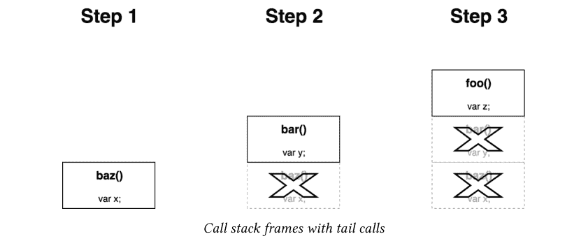

尾调用实际上本身并不直接与递归相关；这个概念适用于任何函数调用。但你手动的非递归调用栈在大多数情况下不太可能超过 10 层深，所以尾调用影响程序内存占用的情况概率很低。

尾调用在递归情况下真正大放异彩，因为这意味着递归栈可以“无限”运行，而唯一的性能问题将是计算，而非固定的内存限制。尾调用递归可以以 O(1) 的固定内存使用运行。

这类技术通常被称为尾调用优化（TCO），但重要的是要区分检测尾调用以在固定内存空间中运行的能力，与优化这种方法的技术。严格来说，尾调用本身并不像大多数人认为的那样是一种性能优化，因为它们实际上可能比正常调用运行得更慢。TCO 是关于优化尾调用使其运行得更高效。

## 适当尾调用（PTC）

JavaScript 从未要求（也未禁止）尾调用，直到 ES6。ES6 强制要求识别尾调用，具体形式称为适当尾调用（Proper Tail Calls，PTC），并保证以 PTC 形式编写的代码不会导致无界栈内存增长。实际上，这意味着如果我们遵循 PTC，就不应该收到 `RangeError` 的抛出。

首先，JavaScript 中的 PTC 需要严格模式。你应该已经在使用严格模式了，但如果你没有，这是另一个你应该使用严格模式的理由。我提过没有，你应该已经在使用严格模式了！？

其次，一个适当的尾调用看起来像这样：

```javascript
return foo( .. );
```

换句话说，函数调用是周围函数中最后执行的东西，并且它返回的任何值都被显式地 `return`。这样，JS 可以完全肯定当前栈帧不再需要了。

这些不是 PTC：

```javascript
foo();
return;
```

```javascript
// 或者
var x = foo( .. );
return x;
```

```javascript
// 或者
return 1 + foo( .. );
```

> ℹ️ **注意**
>
> JS 引擎或智能的转译器可以进行一些代码重组，将 `var x = foo(); return x;` 实际上视为与 `return foo();` 相同，这样就使其符合 PTC 条件。但规范并不要求这样做。

`1 +` 这部分肯定是在 `foo(..)` 完成后才处理的，所以栈帧必须保留。

然而，这是 PTC：

```javascript
return x ? foo( .. ) : bar( .. );
```

在计算 `x` 条件后，要么运行 `foo(..)`，要么运行 `bar(..)`，而在任何一种情况下，返回值都会被返回。这就是 PTC 形式。

二叉（或多叉）递归——正如前面所示，在每个层级上进行两个（或更多）递归调用——本身永远不可能完全是 PTC，因为所有递归都必须在尾调用位置才能避免栈增长；最多只能有一个递归调用出现在 PTC 位置。

前面，我们展示了从二叉递归重构为相互递归的例子。有可能通过将多递归算法中的每个部分拆分为单独的函数调用来实现 PTC，其中每个函数分别用 PTC 形式表达。然而，这种复杂的重构高度依赖于具体场景，超出了我们在这里能覆盖的范围。

## 重构递归

如果你想使用递归，但你的问题集可能最终增长到超过 JS 引擎的栈限制，你就需要重新排列你的递归调用以利用 PTC（或完全避免嵌套调用）。有几种重构策略可以帮助，但当然需要注意其中的权衡。

作为一句忠告，始终要记住，代码可读性是我们总体最重要的目标。如果递归与这里描述的某些策略组合后导致代码难以阅读/理解，**不要使用递归**；寻找另一种更易读的方案。

## 替换栈

递归的主要问题是其内存使用，为了跟踪函数调用状态而在调用下一个递归调用迭代时保留栈帧。如果我们能想办法重新安排递归的使用方式，使得栈帧不需要被保留，那么我们就可以用 PTC 来表达递归，并利用 JS 引擎对尾调用的优化处理。

让我们回顾一下之前的求和示例：

```javascript
function sum(num1, ...nums) {
    if (nums.length == 0) return num1;
    return num1 + sum( ...nums );
}
```

这并非尾调用优化形式，因为在递归调用 `sum(...nums)` 完成后，还需要将 `total` 变量加到结果上。因此，必须保留当前栈帧，以便在递归继续进行时跟踪 `total` 这个部分结果。

重构此策略的关键认识在于：我们可以通过立即执行加法（而非之后执行）来消除对栈的依赖，然后将该部分结果作为参数传递给递归调用。换句话说，不再将 `total` 保留在当前函数的栈帧中，而是将其推入下一个递归调用的栈帧；这样当前栈帧就可以被移除/重用。

首先，我们可以修改 `sum(..)` 函数的签名，增加一个作为部分结果的新首参数：

```javascript
function sum(result, num1, ...nums) {
    // ..
}
```

现在，我们应该预先计算 `result` 和 `num1` 的和，并将其传递下去：

```javascript
"use strict";

function sum(result, num1, ...nums) {
    result = result + num1;

    if (nums.length == 0) return result;

    return sum( result, ...nums );
}
```

现在我们的 `sum(..)` 是尾调用优化形式了！太好了！

但缺点是，我们修改了函数的签名，使其使用起来变得奇怪。调用者基本上必须在要相加的数字之前传递 `0` 作为第一个参数：

```javascript
sum( /*initialResult=*/0, 3, 1, 17, 94, 8 );       // 123
```


这很不幸。

通常，人们会通过给这个签名别扭的递归函数另起一个名字，然后定义一个隐藏该细节的接口函数来解决这个问题：

```javascript
"use strict";

function sumRec(result, num1, ...nums) {
    result = result + num1;

    if (nums.length == 0) return result;

    return sumRec(result, ...nums);
}

function sum(...nums) {
    return sumRec(/*initialResult=*/0, ...nums);
}

sum(3, 1, 17, 94, 8); // 123
```

这样好多了。不过，我们创建了多个函数而非一个，这仍然有些遗憾。有时，你会看到开发者将递归函数“隐藏”为一个内部函数，就像这样：

```javascript
"use strict";

function sum(...nums) {
    return sumRec(/*initialResult=*/0, ...nums);

    function sumRec(result, num1, ...nums) {
        result = result + num1;

        if (nums.length == 0) return result;

        return sumRec(result, ...nums);
    }
}

sum(3, 1, 17, 94, 8); // 123
```

这样做的缺点是，每次调用外部的 `sum(..)` 时，我们都会重新创建内部的 `sumRec(..)` 函数。因此，我们可以让它们并排定义，但将两者都隐藏在一个立即执行函数表达式（IIFE）中，只暴露我们想要的那个：

```javascript
"use strict";

var sum = (function IIFE() {
    return function sum(...nums) {
        return sumRec(/*initialResult=*/0, ...nums);
    };

    function sumRec(result, num1, ...nums) {
        result = result + num1;

        if (nums.length == 0) return result;

        return sumRec(result, ...nums);
    }
})();

sum(3, 1, 17, 94, 8); // 123
```

好的，我们实现了尾调用优化，并且 `sum(..)` 有了一个干净漂亮的签名，调用者无需了解我们的实现细节。太好了！

但是……哇，我们简单的递归函数现在多了很多噪音。可读性无疑降低了。这至少可以说是不幸的。有时，这就是我们能做到的最好程度了。

## 第 8 章：递归

```javascript
"use strict";

function sum(result, num1, ...nums) {
    result = result + num1;

    if (nums.length == 0) return result;

    return sum(result, ...nums);
}

sum(/*initialResult=*/0, 3, 1, 17, 94, 8); // 123
```

你可能观察到，`result` 和 `num1` 一样是一个数字，这意味着我们可以总是将列表中的第一个数字视为当前的累加总和；这甚至包括第一次调用。我们只需要重命名这些参数来使其更清晰：

```javascript
"use strict";

function sum(num1, num2, ...nums) {
    num1 = num1 + num2;

    if (nums.length == 0) return num1;

    return sum(num1, ...nums);
}

sum(3, 1, 17, 94, 8); // 123
```

太棒了。这样好多了，不是吗？我认为这个模式在声明式/合理性和性能之间取得了良好的平衡。

让我们再尝试用尾调用优化重构一次，重新审视我们之前的 `maxEven(..)`（目前不是尾调用优化形式）。我们将观察到，类似于将总和保持为第一个参数，我们可以逐个缩小数字列表，将第一个参数保持为迄今为止遇到的最高偶数。

为了清晰起见，我们可能使用的算法策略（类似于我们之前讨论的）如下：

1. 首先比较前两个数字 `num1` 和 `num2`。
2. `num1` 是偶数，并且 `num1` 大于 `num2` 吗？如果是，保留 `num1`。
3. 如果 `num2` 是偶数，保留它（存储在 `num1` 中）。
4. 否则，回退到 `undefined`（存储在 `num1` 中）。
5. 如果还有更多数字需要考虑，则将它们与 `num1` 进行递归比较。
6. 最后，返回 `num1` 中留下的任何值。

我们的代码可以几乎完全遵循这些步骤：

```javascript
"use strict";

function maxEven(num1, num2, ...nums) {
    num1 =
        (num1 % 2 == 0 && !(maxEven(num2) > num1))
            ? num1
            : (num2 % 2 == 0 ? num2 : undefined);

    return nums.length == 0
        ? num1
        : maxEven(num1, ...nums);
}
```

> **注意**
>
> 第一次 `maxEven(..)` 调用不在尾调用位置，但由于它只传入了 `num2`，它只递归了一层就立即返回；这只是为了避免重复 `%` 逻辑的一个技巧。因此，这次调用不会增加递归栈的增长，就像调用一个完全不同的函数一样。第二次 `maxEven(..)` 调用是合法的递归调用，它实际上处于尾调用位置，这意味着我们的栈不会随着递归的进行而增长。

需要重申的是，这个示例只是为了说明将递归转换为尾调用优化形式以优化栈（内存）使用的方法。更直接地表达最大偶数算法的方式可能是先过滤数字列表中的偶数，然后再进行最大值冒泡或排序。

将递归重构为尾调用优化形式确实对简单的声明式形式有些侵入性，但它仍然能相当好地完成任务。不幸的是，有些类型的递归即使使用接口函数也无法很好地工作，因此我们需要不同的策略。

## 续延传递风格（CPS）

在 JavaScript 中，*续延*一词通常用于表示一个函数回调，它指定了某个函数完成其工作后要执行的后续步骤。将代码组织成每个函数在结束时接收另一个要执行的函数来调用的风格，被称为续延传递风格（CPS）。

某些形式的递归实际上无法重构为纯粹的尾调用优化形式，尤其是多重递归。回想之前的 `fib(..)` 函数，甚至我们推导出的相互递归形式。在两种情况下，都有多个递归调用，这实际上破坏了尾调用优化的内存优化。

然而，你可以执行一次递归调用，并将后续的递归调用包装在一个续延函数中传递给第一次调用。即使这意味着最终需要在栈中执行更多的函数，但只要它们（包括续延）都处于尾调用优化形式，栈内存使用就不会无限增长。

我们可以对 `fib(..)` 这样做：

```javascript
"use strict";

function fib(n, cont = identity) {
    if (n <= 1) return cont(n);

    return fib(
        n - 2,
        n2 => fib(
            n - 1,
            n1 => cont(n2 + n1)
        )
    );
}
```

仔细观察这里发生了什么。首先，我们将续延函数 `cont(..)` 默认设置为第 3 章中的 `identity(..)` 工具函数；记住，它只是返回传入的内容。

此外，不仅仅是一个，而是加入了两个续延函数。第一个接收 `n2` 参数，它最终接收 `fib(n-2)` 的计算结果。下一个内部续延接收 `n1` 参数，它最终是 `fib(n-1)` 的值。一旦 `n2` 和 `n1` 的值都已知，它们就可以相加（`n2 + n1`），并将该值传递给下一个 `cont(..)` 续延步骤。

也许这有助于在脑海中理清发生了什么：就像之前的讨论中我们传递部分结果而不是在递归栈之后返回它们一样，我们在这里做着同样的事情，但每一步都被包装在一个续延中，这延迟了它的计算。这个技巧允许我们执行多个步骤，其中每一步都处于尾调用优化形式。

在静态语言中，CPS 通常是编译器可以自动识别并重新排列递归代码以利用尾调用优化的机会。不幸的是，这并不真正适用于 JavaScript 的本质。

在 JavaScript 中，你可能需要自己编写 CPS 形式。它肯定更笨拙；声明式的符号形式无疑被模糊了。但总的来说，这种形式仍然比 `for` 循环的命令式实现更具声明性。

> **警告**
>
> 一个需要注意的主要警告是，在 CPS 中，创建额外的内部续延函数仍然会消耗内存，但消耗的是另一种类型。闭包消耗的是空闲内存（通常来自堆），而不是堆积栈帧。引擎似乎不会在这些情况下应用 `RangeError` 限制，但这并不意味着你的内存使用规模是固定的。

## 弹簧床（Trampolines）

CPS 创建续延并传递它们，而另一种减轻内存压力的技术称为弹簧床。在这种代码风格中，类似 CPS 的延续被创建出来，但不是通过传入，而是被浅层返回。不再是函数调用函数，栈的深度永远不会超过一层，因为每个函数只是返回下一个应该被调用的函数。一个循环简单地不断运行每个返回的函数，直到没有更多的函数可以运行。

蹦床的一个优势是不局限于支持 PTC 的环境；另一个优势是每个函数调用都是普通的，而非 PTC 优化的，因此可能运行得更快。

我们来勾勒一个 `trampoline(..)` 工具：

```javascript
function trampoline(fn) {
    return function trampolined(...args) {
        var result = fn(...args);

        while (typeof result == "function") {
            result = result();
        }

        return result;
    };
}
```

只要返回一个函数，循环就会继续，执行该函数并捕获其返回值，然后检查它的类型。一旦返回了非函数值，蹦床就假设函数调用已完成，直接返回该值。

因为每个延续都需要返回另一个延续，我们需要使用之前的技巧，将部分结果作为参数前向传递。以下是我们如何将这个工具应用于前面数字列表求和的例子：

```javascript
var sum = trampoline(
    function sum(num1, num2, ...nums) {
        num1 = num1 + num2;

        if (nums.length == 0) return num1;

        return () => sum(num1, ...nums);
    }
);

var xs = [];

for (let i = 0; i < 20000; i++) {
    xs.push(i);
}

sum(...xs); // 199990000
```

缺点是，蹦床要求你将递归函数包装在蹦床驱动函数中；此外，就像 CPS 一样，每个延续都会创建闭包。然而，不同于 CPS，每个返回的延续函数都立即运行并结束，因此引擎不必在问题的调用栈深度耗尽时累积越来越多的闭包内存。

除了执行和内存性能之外，蹦床相对于 CPS 的优势在于它们对声明式递归形式的侵入性较小，因为你不必改变函数签名来接收延续函数参数。蹦床并非理想方案，但它们在命令式循环代码和声明式递归之间的权衡中可能是有效的。

## 小结

递归就是函数反复调用自身。嘿。递归的递归定义。明白了吗！？

直接递归是至少调用自身一次的函数，它不断分派给自己，直到满足基准条件。多重递归（如二叉递归）是函数多次调用自身。相互递归是两个或多个函数通过相互调用形成递归循环。

递归的优点是它更具声明性，因此通常更易读。缺点通常是性能，但比起执行速度，内存限制更为严重。

尾调用通过重用/丢弃栈帧来缓解内存压力。JavaScript 需要严格模式和适当的尾调用（PTC）才能利用这一“优化”。我们有多种技术可以混合搭配，将非 PTC 递归函数重构为 PTC 形式，或者至少通过扁平化栈来避免内存限制。

记住：递归应该用来让代码更易读。如果你误用或滥用递归，可读性最终会比命令式形式更差。不要那样做！

# 第 9 章：列表操作

> *如果你能把某事做得很棒，就反复地做下去。*

我们在前面正文中已经多次简要提及了一些工具，现在我们想非常仔细地研究它们，即 `map(..)`、`filter(..)` 和 `reduce(..)`。在 JavaScript 中，这些工具通常用作数组（又称“列表”）原型上的方法，因此我们自然地将它们称为数组或列表操作。

在我们讨论具体的数组方法之前，我们想从概念上审视这些操作的用途。在本章中，理解列表操作*为什么*重要与理解列表操作*如何*工作同等重要。请务必牢记这一点来学习本章。

这些操作的绝大多数常见示例，无论是在本书之外还是在本章中，都描绘了在值列表上执行的琐碎任务（如将数组中的每个数字加倍）；这是一种廉价且简单的方式来传达要点。

但不要只是浏览这些简单示例而错过要点。理解列表操作带来的某些最重要的 FP 价值，来自于能够将一系列任务——一系列*看起来*不像列表的语句——建模为列表操作，而不是单独执行它们。

这不仅仅是编写更简洁代码的技巧。我们的目标是从命令式风格转向声明式风格，使代码模式更容易识别，从而更易读。

但有件**甚至更重要的事需要理解**。在命令式代码中，一组计算中的每个中间结果都通过赋值存储在变量中。你的代码越依赖这些命令式模式，就越难验证没有错误——在逻辑中、值的意外突变中，或隐藏的副作用/影响因素中。

通过链式和/或组合列表操作，中间结果会被隐式跟踪，并且在很大程度上免受这些风险的影响。

> **注意**
>
> 与前面章节相比，为尽可能保持后面众多代码片段的简洁，我们将大量依赖 ES6 的 `=>` 形式。然而，我在第 2 章关于 `=>` 的建议仍然适用于一般编码。

## 非 FP 的列表处理

作为本章讨论的简短序言，我想指出一些看似与 JavaScript 数组和 FP 列表操作相关，但实际上并非如此的几种操作。这些操作将不在此处介绍，因为它们与一般的 FP 最佳实践不一致：

- `forEach(..)`
- `some(..)`
- `every(..)`

`forEach(..)` 是一个迭代辅助工具，但它的设计是让每个函数调用都带有副作用；你大概能猜到为什么这不是我们讨论的受认可的 FP 列表操作！

`some(..)` 和 `every(..)` 确实鼓励使用纯函数（具体来说，是像 `filter(..)` 所期望的谓词函数），但它们不可避免地将列表简化为 `true`/`false` 结果，本质上类似于搜索或匹配。这两个工具并不太符合我们用 FP 建模代码的方式，因此我们在此跳过对它们的介绍。

## Map

我们将从最基本、最基础的 FP 列表操作之一开始探索：`map(..)`。

映射是从一个值到另一个值的转换。例如，如果你从数字 2 开始并乘以 3，你就将它映射到了 6。需要注意的是，我们所说的映射转换并不意味着*原地*变异或重新赋值；相反，我们看的是映射转换如何从一个位置投射出一个新值到另一个位置。

换句话说：

```javascript
var x = 2, y;

// transformation / projection
y = x * 3;

// mutation / reassignment
x = x * 3;
```

如果我们为乘以 3 定义一个函数，该函数就充当一个映射（转换）函数：

```javascript
var multiplyBy3 = v => v * 3;

var x = 2, y;

// transformation / projection
y = multiplyBy3(x);
```

我们可以自然地将映射从单个值转换扩展到一个值的集合。`map(..)` 是一个将列表中的所有值转换并将其投射到新列表的操作：

要实现 `map(..)`：

```javascript
function map(mapperFn, arr) {
    var newList = [];

    for (let [idx, v] of arr.entries()) {
        newList.push(
            mapperFn(v, idx, arr)
        );
    }

    return newList;
}
```


## 注意

参数顺序 `mapperFn, arr` 一开始可能感觉反直觉，但这个约定在 FP 库中更为常见，因为它使这些工具更容易组合（配合柯里化）。

`mapperFn(..)` 自然地被传入要映射/转换的列表项，但也包括 `idx` 和 `arr`。我们这样做是为了与内置数组 `map(..)` 保持一致。这些额外的信息在某些情况下可能非常有用。

但在其他情况下，你可能希望使用的 `mapperFn(..)` 只接收列表项，因为额外的参数可能会改变其行为。在第 3 章“ 一以致众 ”中，我们介绍了 `unary(..)`，它将函数限制为只接受单个参数（无论传入多少参数）。

回想第 3 章中关于将 `parseInt(..)` 限制为单个参数以安全用作 `mapperFn(..)` 的例子，我们也可以将其用于独立的 `map(..)`：

```javascript
map( unary( parseInt ), ["1","2","3"] );

// [1,2,3]
```

## 同步与异步

本章讨论的列表操作都是同步操作，作用于所有值都已存在的列表上；这里构想的 `map(..)` 是一种即时操作。但对映射函数的另一种理解是，它可以作为一个事件处理器，为列表中遇到的每个新值被调用。

想象一下这样一个虚构的例子：

```javascript
var newArr = arr.map();

arr.addEventListener( "value", multiplyBy3 );
```

现在，每当一个值被添加到 `arr` 中时，`multiplyBy3(..)` 事件处理器——即映射函数——就会被调用，并处理该值，然后将其转换结果添加到 `newArr` 中。

我们想暗示的是，数组以及我们对它们执行的数组操作，是即时同步的版本，而同样的操作也可以在“惰性列表”（即流）上建模，这种列表的值是随着时间的推移接收的。我们将在第 10 章深入探讨这个话题。

## 映射与遍历

有些人主张将 `map(..)` 用作 `forEach(..)` 迭代的一般形式，其中接收到的值本质上是原封不动地传递过去，然后执行一些副作用：

```javascript
[1,2,3,4,5]
    .map( function mapperFn(v){

        console.log( v ); // 副作用！

        return v;

    } )
```

这种技术看似有用，是因为 `map(..)` 返回数组，这样你就可以在其后继续链式调用更多操作；而 `forEach(..)` 的返回值是 `undefined`。然而，我认为你应该避免以这种方式使用 `map(..)`，因为以一种明显不符合函数式编程的方式使用核心的函数式操作，会带来完全的困惑。

你听过那句老话吗，要为合适的工作使用合适的工具？钉子用锤子，螺丝用螺丝刀……这里稍有不同：它强调的是*以正确的方式*使用正确的工具。

锤子应该握在手里；如果你反过来用嘴叼着它去钉钉子，你就不会很有效率。`map(..)` 的目的是映射值，而不是制造副作用。

## 附言：函子

在本书中，我们大多试图尽可能避免使用函数式编程中创造的术语。我们有时使用官方术语，但主要是当我们可以从日常对话中推导出一些意义时。

我将非常简短地打破这个模式，使用一个可能有点令人生畏的词：*函子*。我想在这里讨论函子的原因是因为我们现在已了解它们的作用，并且因为这个术语在后续的函数式编程文献中被大量使用；事实上，函子是函数式编程的基础概念，直接源自数学原理（范畴论）。你至少熟悉并因此不惧怕这个术语，这将是很有益的。

*函子*是一个值，它具有使用操作函数作用于该值的实用功能，并且保持组合性。

如果涉及的值是复合的，即它由单个值组成——例如数组的情况就是这样！——函子会在每个单个值上使用操作函数。此外，函子实用程序会创建一个新的复合值，其中包含所有单个操作函数调用的结果。

所有这些都是对刚才我们看到的 `map(..)` 所做事情的华丽描述。`map(..)` 函数接受其关联的值（一个数组）和一个映射函数（操作函数），并对数组中的每个值执行该映射函数。最后，它返回一个包含所有新映射值的新数组。

另一个例子：字符串函子将是一个字符串加上一个实用程序，该实用程序对字符串中的所有字符执行某些操作函数，返回一个包含处理后字母的新字符串。考虑这个高度人为的例子：

```javascript
function uppercaseLetter(c) {

    var code = c.charCodeAt( 0 );

    // 小写字母？

    if (code >= 97 && code <= 122) {

        // 转为大写！

        code = code - 32;

    }

    return String.fromCharCode( code );

}

function stringMap(mapperFn,str) {

    return [...str].map( mapperFn ).join( "" );

}

stringMap( uppercaseLetter, "Hello World!" );

// HELLO WORLD!
```

`stringMap(..)` 允许字符串成为函子。你可以为任何数据结构定义一个映射函数；只要实用程序遵循这些规则，该数据结构就是函子。

## 过滤

想象一下，我带着一个空篮子去杂货店的水果区；那里有大量陈列的水果（苹果、橙子和香蕉）。我真的很饿，所以我想尽可能多地拿水果，但我其实只喜欢圆形的水果（苹果和橙子）。所以我逐一挑选水果，最后提着一个装满苹果和橙子的篮子离开。

让我们把这个过程称为*过滤*。你会更自然地将我的购物描述为从一个空篮子开始，**过滤出**（选择，包括）只有苹果和橙子，还是从满满当当的水果陈列开始，在我的篮子装满水果的过程中**过滤掉**（跳过，排除）香蕉？

如果你在锅里煮意大利面，然后把它倒进水槽上方的滤锅（即过滤器）里，你是在过滤进意大利面还是过滤出水？如果你把咖啡渣放进过滤器里煮咖啡，你是在过滤咖啡进杯子里，还是过滤出咖啡渣？

你对过滤的看法是否取决于你想要的东西是被“留在”过滤器里，还是通过过滤器？

在航空/酒店网站上，当你指定选项来“过滤你的结果”时，又如何？你是在过滤出符合你标准的结果，还是过滤掉所有不符合标准的结果？仔细想想：这个例子可能与前面的例子有不同的语义。

## 过滤的困惑

根据你的观点，过滤要么是排他性的，要么是包含性的。这种概念上的混淆是不幸的。

我认为过滤最常见的解释——至少在编程之外——是你过滤掉不想要的东西。不幸的是，在编程中，我们本质上将这个语义翻转过来，更像是过滤进想要的东西。

`filter(..)` 列表操作接受一个函数来决定原始数组中的每个值是否应该出现在新数组中。这个函数需要在值应该被保留时返回 `true`，在值应该被跳过时返回 `false`。一个返回 `true` 或 `false` 的函数，对于这类决策有一个专门的名称：谓词函数。

如果你把 `true` 视为积极信号，那么 `filter(..)` 的定义就是你说“保留”（过滤进来）一个值，而不是说“丢弃”（过滤出去）一个值。

要将 `filter(..)` 用作排除性操作，你必须扭转思维，通过返回 `false` 来积极地标记排除，而通过返回 `true` 来被动地让值通过。

这种语义不匹配之所以重要，是因为它关系到你将如何命名用作 `predicateFn(..)` 的函数，以及这对代码可读性的意义。我们稍后会回到这一点。

以下是可视化列表中值上 `filter(..)` 操作的方式：

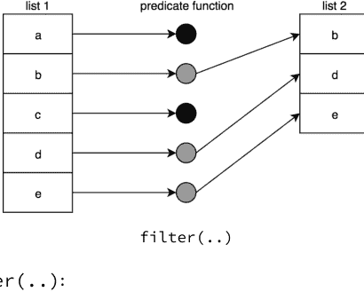

要实现 `filter(..)`：

```javascript
function filter(predicateFn, arr) {

    var newList = [];

    for (let [idx, v] of arr.entries()) {

        if (predicateFn( v, idx, arr )) {

            newList.push( v );

        }

    }

    return newList;

}
```

请注意，就像之前的 `mapperFn(..)` 一样，`predicateFn(..)` 不仅接收值，还接收 `idx` 和 `arr`。根据需要使用 `unary(..)` 来限制其参数。与 `map(..)` 一样，`filter(..)` 作为 JS 数组的内置实用工具提供。让我们考虑一个这样的谓词函数：

```javascript
var whatToCallIt = v => v % 2 == 1;
```

此函数使用 `v % 2 == 1` 返回 `true` 或 `false`。这里的效果是奇数将返回 `true`，偶数将返回 `false`。那么，我们应该如何命名这个函数？一个自然的名称可能是：

```javascript
var isOdd = v => v % 2 == 1;
```

考虑你如何在代码中的某个地方使用 `isOdd(..)` 进行简单的值检查：

```javascript
var midIdx;

if (isOdd( list.length )) {

    midIdx = (list.length + 1) / 2;

}

else {

    midIdx = list.length / 2;

}
```

有道理，对吧？但是，让我们考虑使用内置数组的 `filter(..)` 来过滤值列表：

```javascript
[1,2,3,4,5].filter( isOdd );

// [1,3,5]
```

如果你描述 `[1,3,5]` 这个结果，你会说“我过滤掉了偶数”，还是说“我过滤进了奇数”？我认为前者是更自然的描述方式。但代码读起来却是相反的。代码几乎字面上读作，我们“过滤（进来）每个是奇数的数字”。

我个人觉得这种语义令人困惑。毫无疑问，经验丰富的开发者有很多先例。但如果你从一张白纸开始，这种逻辑表达方式有点像在不使用双重否定的情况下说话——也就是，使用双重否定。

我们可以通过将 `isOdd(..)` 重命名为 `isEven(..)` 来使这变得更容易：

```javascript
var isEven = v => v % 2 == 1;

[1,2,3,4,5].filter( isEven );

// [1,3,5]
```

太好了！但这个函数名称没有意义，因为它在偶数时返回 `false`：

```javascript
isEven( 2 );       // false
```

糟糕。

回想一下在第 3 章“无点”中，我们定义了一个 `not(..)` 运算符来否定谓词函数。考虑：

```javascript
var isEven = not( isOdd );

isEven( 2 );       // true
```

但我们不能以当前定义的方式将*这个* `isEven(..)` 与 `filter(..)` 一起使用，因为我们的逻辑会反转；我们最终会得到偶数，而不是奇数。我们需要这样做：

```javascript
[1,2,3,4,5].filter( not( isEven ) );

// [1,3,5]
```

但这完全违背了初衷，所以我们不要这样做。我们只是在兜圈子。

## 过滤出与过滤进

为了澄清所有这些困惑，让我们定义一个 `filterOut(..)`，它实际上通过内部否定谓词检查来**过滤出**值。同时，我们将 `filterIn(..)` 设为现有 `filter(..)` 的别名：

```javascript
var filterIn = filter;

function filterOut(predicateFn,arr) {

    return filterIn( not( predicateFn ), arr );

}
```

现在我们可以在代码中的任何地方使用最有意义的过滤方式：

```javascript
isOdd( 3 );                    // true

isEven( 2 );                   // true

filterIn( isOdd, [1,2,3,4,5] );   // [1,3,5]

filterOut( isEven, [1,2,3,4,5] ); // [1,3,5]
```

我认为使用 `filterIn(..)` 和 `filterOut(..)`（在 Ramda 中称为 `reject(..)`）将使你的代码比只使用 `filter(..)` 并让语义对读者混淆难懂要易读得多。

## 归约

虽然 `map(..)` 和 `filter(..)` 产生新列表，但通常这第三个运算符（`reduce(..)`）将列表的值组合（也称为“归约”）成一个单独的有限（非列表）值，如数字或字符串。然而，在本章后面，我们将探讨如何推动 `reduce(..)` 以更高级的方式使用。`reduce(..)` 是最重要的 FP 工具之一；它就像一把瑞士军刀，功能齐全。

组合/归约抽象定义为取两个值并将它们变成一个值。一些 FP 上下文将其称为“折叠”，就像你将两个值折叠在一起成为一个值一样。我认为这是一个有用的可视化。

就像映射和过滤一样，组合的方式完全取决于你，并且通常取决于列表中值的类型。例如，数字通常通过算术组合，字符串通过连接组合，函数通过组合组合。

有时归约会指定一个 `initialValue`，并从将其与列表中的第一个值组合开始其工作，依次级联到列表中的其余每个值。如下所示：

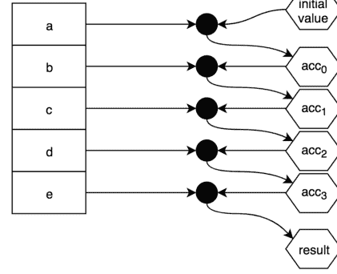

或者，你可以省略 `initialValue`，在这种情况下，列表的第一个值将充当 `initialValue`，组合将从列表中的第二个值开始，如下所示：

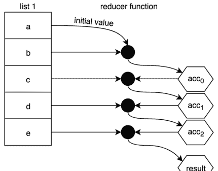

### 警告

在 JavaScript 中，如果归约中没有至少一个值（无论是在数组中还是指定为 `initialValue`），则会抛出错误。如果归约列表在任何情况下都可能为空，请注意不要省略 `initialValue`。

你传递给 `reduce(..)` 以执行归约的函数通常称为归约器。归约器的签名与我们之前看到的映射函数和谓词函数不同。归约器主要接收当前归约结果以及要与之归约的下一个值。归约每一步的当前结果通常称为累加器。

例如，考虑将数字 5、10 和 15 进行乘法归约的步骤，`initialValue` 为 3：

1. `3 * 5 = 15`
2. `15 * 10 = 150`
3. `150 * 15 = 2250`

使用数组内置的 `reduce(..)` 方法在 JavaScript 中表达：

```javascript
[5,10,15].reduce( (product,v) => product * v, 3 );

// 2250
```

但独立的 `reduce(..)` 实现可能如下所示：

```javascript
function reduce(reducerFn, initialValue, arr) {

    var acc, startIdx;

    if (arguments.length == 3) {

        acc = initialValue;

        startIdx = 0;

    }

    else if (arr.length > 0) {

        acc = arr[0];

        startIdx = 1;

    }

    else {

        throw new Error( "Must provide at least one value." );

    }

    for (let idx = startIdx; idx < arr.length; idx++) {

        acc = reducerFn( acc, arr[idx], idx, arr );

    }

    return acc;

}
```

就像 `map(..)` 和 `filter(..)` 一样，归约器函数也会传递较少使用的 `idx` 和 `arr` 参数，以防对归约有用。我要说我不常用这些，但我想有它们可用总是好的。

回想一下[第 4 章，我们讨论了 `compose(..)` 实用工具](https://github.com/getify/Functional-Light-JS/blob/master/APPe.md#composing)，并展示了用 `reduce(..)` 实现的版本：

```javascript
function compose(...fns) {

    return function composed(result){

        return [...fns].reverse().reduce( function reducer(result,fn){

            return fn( result );

        }, result );

    };

}
```

为了用不同的方式说明基于 `reduce(..)` 的组合，考虑一个从左到右组合函数（就像 `pipe(..)` 那样）的归约器，用于数组链：

```javascript
var pipeReducer = (composedFn,fn) => pipe( composedFn, fn );
```

```javascript
var fn =

    [3,17,6,4]

    .map( v => n => v * n )

    .reduce( pipeReducer );
```

```javascript
fn( 9 );                // 11016    (9 * 3 * 17 * 6 * 4)

fn( 10 );               // 12240   (10 * 3 * 17 * 6 * 4)
```


不幸的是，`pipeReducer(..)` 不是无点的（参见**第 3 章，“无点”**），但我们不能直接将`pipe(..)`作为归约器本身传递，因为它是可变参数的；`reduce(..)`传递给其归约器函数的额外参数（`idx`和`arr`）会带来问题。

早些时候我们讨论过使用`unary(..)`将`mapperFn(..)`或`predicateFn(..)`限制为仅一个参数。有一个`binary(..)`做类似的事情，但限制为两个参数，对`reducerFn(..)`函数来说可能很方便：

```js
var binary =
    fn =>
        (arg1,arg2) =>
            fn( arg1, arg2 );
```

使用`binary(..)`，我们之前的例子会更整洁一些：

```js
var pipeReducer = binary( pipe );
```

```js
var fn =
    [3,17,6,4]
    .map( v => n => v * n )
    .reduce( pipeReducer );
```

```js
fn( 9 );          // 11016  (9 * 3 * 17 * 6 * 4)

fn( 10 );         // 12240  (10 * 3 * 17 * 6 * 4)
```

与`map(..)`和`filter(..)`不同，遍历数组的顺序实际上并不重要，`reduce(..)`则明确采用从左到右的处理方式。如果你想从右到左进行归约，JavaScript 提供了`reduceRight(..)`，其所有其他行为与`reduce(..)`相同：

```js
var hyphenate = (str,char) => `${str}-${char}`;
```

```js
["a","b","c"].reduce( hyphenate );

// "a-b-c"
```

```js
["a","b","c"].reduceRight( hyphenate );

// "c-b-a"
```

`reduce(..)`从左到右工作，因此其行为自然类似于组合函数时的`pipe(..)`，而`reduceRight(..)`的从右到左顺序则自然适合执行类似`compose(..)`的操作。因此，让我们回顾一下第 4 章的`compose(..)`，但使用`reduceRight(..)`来实现它：

```js
function compose(...fns) {
    return function composed(result){
        return fns.reduceRight( function reducer(result,fn){
            return fn( result );
        }, result );
    };
}
```

现在，我们不需要执行`[...fns].reverse()`；我们只需从另一个方向归约！

## Map 作为 Reduce

`map(..)`操作本质上是迭代的，因此它也可以表示为归约（`reduce(..)`）。诀窍在于认识到`reduce(..)`的`initialValue`本身可以是一个（空）数组，这样归约的结果就可以是另一个列表！

```js
var double = v => v * 2;

[1,2,3,4,5].map( double );

// [2,4,6,8,10]

[1,2,3,4,5].reduce(
    (list,v) => (
        list.push( double( v ) ),
        list
    ), []
);

// [2,4,6,8,10]
```

## 注意

我们这里在归约上耍了点花招：通过允许`list.push(..)`来改变传入的列表，从而产生副作用。显然，一般来说这不是个好主意，但由于我们知道`[]`列表是临时创建并传入的，所以危险性较低。你可以更正式一些——但性能会更差！——通过用`concat(..)`将值连接到末尾来创建新列表。我们将在附录 A 中再次讨论这个取巧方法。

用`reduce(..)`实现`map(..)`表面上并不是一个显而易见的步骤，甚至也算不上改进。然而，这种能力是我在附录 A 中介绍更高级技巧时需要认识到的关键一点。

### Filter 作为 Reduce

正如`map(..)`可以用`reduce(..)`实现一样，`filter(..)`也可以：

```js
var isOdd = v => v % 2 == 1;

[1,2,3,4,5].filter( isOdd );

// [1,3,5]

[1,2,3,4,5].reduce(
    (list,v) => (
        isOdd( v ) ? list.push( v ) : undefined,
        list
    ), []
);

// [1,3,5]
```

## 注意

这里又在归约上使用不纯的取巧方法。除了`list.push(..)`，我们也可以使用`list.concat(..)`并返回新列表。我们将在附录 A 中再次讨论这个取巧方法。

## 高级列表操作

现在我们对基础的列表操作`map(..)`、`filter(..)`和`reduce(..)`有了相当的了解，让我们来看看在一些情况下可能更有用的更复杂操作。这些通常是你在各种函数式编程库中能找到的工具函数。

## Unique

过滤列表以仅包含唯一值，基于`indexOf(..)`搜索（使用`===`严格相等比较）：

```js
var unique =
    arr =>
        arr.filter(
            (v,idx) =>
                arr.indexOf( v ) == idx
        );
```

这种技巧的关键在于观察：我们只应该将`arr`中某个项目的第一次出现包含到新列表中；当从左到右遍历时，这只有在其`idx`位置与`indexOf(..)`找到的位置相同时才成立。

另一种实现`unique(..)`的方式是遍历`arr`，如果某个项目在新列表中尚不存在，则将其包含进去。为此，我们使用`reduce(..)`：

```js
var unique =
    arr =>
        arr.reduce(
            (list,v) =>
                list.indexOf( v ) == -1 ?
                    ( list.push( v ), list ) : list
        , [] );
```

> **注意**
>
> 还有许多其他方式可以使用循环等更具命令式风格的方法来实现这一算法，其中许多在性能上可能“更高效”。然而，上述两种方法的优点在于它们使用了现有的内置列表操作，这使得它们更容易与其他列表操作进行链式/组合使用。我们将在本章稍后更多地讨论这些问题。

`unique(..)`可以很好地生成一个没有重复项的新列表：

```js
unique( [1,4,7,1,3,1,7,9,2,6,4,0,5,3] );

// [1, 4, 7, 3, 9, 2, 6, 0, 5]
```

## Flatten

有时，你可能会有（或通过其他操作产生）一个不是扁平值列表的数组——例如，它可能包含嵌套数组，如下所示：

```js
[ [1, 2, 3], 4, 5, [6, [7, 8]] ]
```

如果你想将其转换为如下形式呢？

```js
[ 1, 2, 3, 4, 5, 6, 7, 8 ]
```

我们需要的操作通常称为`flatten(..)`，使用我们的瑞士军刀`reduce(..)`，它可以这样实现：

## 注意

这种实现方式依赖于递归，正如我们在第 8 章所见。

将`flatten(..)`用于数组的数组（任何嵌套深度）：

```js
flatten( [[0,1],2,3,[4,[5,6,7],[8,[9,[10,[11,12],13]]]]] );

// [0,1,2,3,4,5,6,7,8,9,10,11,12,13]
```

你可能希望将递归扁平化限制到特定深度。我们可以通过向实现中添加可选的深度限制参数来处理这一点：

```js
var flatten =
    (arr,depth = Infinity) =>
        arr.reduce(
            (list,v) =>
                list.concat(
                    depth > 0 ?
                        (depth > 1 && Array.isArray( v ) ?
                            flatten( v, depth - 1 ) :
                            v
                        ) :
                        [v]
                )
            , [] );
```

用不同的扁平化深度说明结果：

```js
flatten( [[0,1],2,3,[4,[5,6,7],[8,[9,[10,[11,12],13]]]]], 0 );

// [[0,1],2,3,[4,[5,6,7],[8,[9,[10,[11,12],13]]]]]
```

```js
flatten( [[0,1],2,3,[4,[5,6,7],[8,[9,[10,[11,12],13]]]]], 1 );

// [0,1,2,3,4,[5,6,7],[8,[9,[10,[11,12],13]]]]
```

```js
flatten( [[0,1],2,3,[4,[5,6,7],[8,[9,[10,[11,12],13]]]]], 2 );

// [0,1,2,3,4,5,6,7,8,[9,[10,[11,12],13]]]
```

```js
flatten( [[0,1],2,3,[4,[5,6,7],[8,[9,[10,[11,12],13]]]]], 3 );

// [0,1,2,3,4,5,6,7,8,9,[10,[11,12],13]]
```

```js
flatten( [[0,1],2,3,[4,[5,6,7],[8,[9,[10,[11,12],13]]]]], 4 );

// [0,1,2,3,4,5,6,7,8,9,10,[11,12],13]
```

```js
flatten( [[0,1],2,3,[4,[5,6,7],[8,[9,[10,[11,12],13]]]]], 5 );

// [0,1,2,3,4,5,6,7,8,9,10,11,12,13]
```

## 映射后再扁平化

`flatten(..)`最常见的用法之一是当你映射了一个元素列表后，从原始列表转换而来的每个值本身又是一个值列表。例如：

```js
var firstNames = [
  { name: "什么了Jonathan", variations: [ "John", "Jon", "Jonny" ] },
  { name: "Stephanie", variations: [ "Steph", "Stephy" ] },
  { name: "Frederick", variations: [ "Fred", "Freddy" ] }
];

firstNames
.map( entry => [ entry.name, ...entry.variations ] );

// [ ["Jonathan","John","Jon","Jonny"], ["Stephanie","Steph","Stephy"],
//   ["Frederick","Fred","Freddy"] ]
```

返回值是一个数组的数组，这可能不太方便处理。如果我们想要一个包含所有名字的单维列表，我们可以对结果进行`flatten(..)`：

```js
flatten(
    firstNames
    .map( entry => [ entry.name, ...entry.variations ] )
);

// ["Jonathan","John","Jon","Jonny","Stephanie","Steph","Stephy",
//  "Frederick","Fred","Freddy"]
```

除了稍微冗长一些之外，将`map(..)`和`flatten(..)`作为分开的步骤来做的缺点主要在于性能：这种方式要处理列表两次，并创建一个中间列表然后被丢弃。函数式编程库通常定义一个`flatMap(..)`（也常称为`chain(..)`）来将映射和扁平化合并执行。为了一致性和便于组合（通过柯里化），`flatMap(..)`（又名`chain(..)`）工具通常采用`mapperFn`、`arr`参数顺序，这与我们之前见过的独立工具`map(..)`、`filter(..)`和`reduce(..)`一致：

```js
flatMap( entry => [ entry.name, ...entry.variations ], firstNames );

// ["Jonathan","John","Jon","Jonny","Stephanie","Steph","Stephy",
//  "Frederick","Fred","Freddy"]
```

`flatMap(..)`的朴素实现，分两步完成：

```js
var flatMap =
    (mapperFn,arr) =>
        flatten( arr.map( mapperFn ), 1 );
```

> **注意**
>
> 我们将扁平化深度设为`1`，因为`flatMap(..)`的典型定义是只进行第一层的浅扁平化。

由于这种方法仍然要处理列表两次，导致性能较差，我们可以手动合并操作，使用`reduce(..)`：

```js
var flatMap =
    (mapperFn,arr) =>
        arr.reduce(
            (list,v) =>
                // note: concat(..) used here since it automatically
                // flattens an array into the concatenation
                list.concat( mapperFn( v ) )
        , [] );
```

虽然使用`flatMap(..)`工具可以带来一些便利和性能提升，但很多时候你可能需要混合使用其他操作，比如`filter()`。如果是这种情况，将`map(..)`和`flatten(..)`分开执行可能仍然更合适。

## Zip

到目前为止，我们考察的列表操作都是针对单个列表的。但有些情况需要处理多个列表。一种广为人知的操作是从两个输入列表中交替选取值组成子列表，称为`zip(..)`：

```js
zip( [1,3,5,7,9], [2,4,6,8,10] );

// [ [1,2], [3,4], [5,6], [7,8], [9,10] ]
```

值`1`和`2`被选取到子列表`[1,2]`中，然后`3`和`4`到`[3,4]`，依此类推。`zip(..)`的定义要求从两个列表中各取一个值。如果两个列表长度不同，值选取会继续进行直到较短的列表耗尽，另一个列表中的多余值将被忽略。

`zip(..)`的一种实现：

```js
function zip(arr1,arr2) {
    var zipped = [];

    arr1 = [...arr1];
    arr2 = [...arr2];

    while (arr1.length > 0 && arr2.length > 0) {
        zipped.push( [ arr1.shift(), arr2.shift() ] );
    }

    return zipped;
}
```

## Merge

`[...arr1]`和`[...arr2]`的拷贝确保了`zip(..)`是纯函数，不会对接收到的数组引用产生副作用。

> 这个实现中有一些明显不属于 FP 的做法。这里使用了命令式的`while`循环，以及用`shift()`和`push(..)`对列表进行可变操作。在本书前面，我断言纯函数内部使用非纯行为是合理的（通常是为了性能），只要这些影响完全自我包含。这个实现是安全的纯函数。

通过交替从每个源列表中取值来合并两个列表，看起来像这样：

```js
mergeLists( [1,3,5,7,9], [2,4,6,8,10] );

// [1,2,3,4,5,6,7,8,9,10]
```

这可能不那么明显，但这个结果看起来类似于我们将`flatten(..)`和`zip(..)`组合起来得到的结果：

```js
zip( [1,3,5,7,9], [2,4,6,8,10] );

// [ [1,2], [3,4], [5,6], [7,8], [9,10] ]

flatten( [ [1,2], [3,4], [5,6], [7,8], [9,10] ] );

// [1,2,3,4,5,6,7,8,9,10]

// 组合后：

flatten( zip( [1,3,5,7,9], [2,4,6,8,10] ) );

// [1,2,3,4,5,6,7,8,9,10]
```


然而，请记住，`zip(..)`只选取值直到两个列表中较短的被耗尽，忽略剩余的值；而合并两个列表最自然的方式是保留那些额外的值。此外，`flatten(..)`在嵌套列表上递归工作，但你可能期望列表合并只在浅层工作，保留嵌套列表。

所以，让我们定义一个更符合预期的`mergeLists(..)`：

```javascript
function mergeLists(arr1,arr2) {

    var merged = [];

    arr1 = [...arr1];

    arr2 = [...arr2];

    while (arr1.length > 0 || arr2.length > 0) {

        if (arr1.length > 0) {

            merged.push( arr1.shift() );

        }

        if (arr2.length > 0) {

            merged.push( arr2.shift() );

        }

    }

    return merged;

}
```

> **注意**  
> 各种 FP 库没有定义`mergeLists(..)`，而是定义了一个`merge(..)`来合并两个对象的属性；这样的`merge(..)`结果与我们的`mergeLists(..)`不同。

或者，这里有几个将列表合并实现为 reducer 的选项：

```javascript
// 来自 @rwaldron

var mergeReducer =

    (merged,v,idx) =>

        (merged.splice( idx * 2, 0, v ), merged);
```

```javascript
// 来自 @WebReflection

var mergeReducer =

    (merged,v,idx) =>

        merged

            .slice( 0, idx * 2 )

            .concat( v, merged.slice( idx * 2 ) );
```

使用`mergeReducer(..)`：

```javascript
[1,3,5,7,9]

.reduce( mergeReducer, [2,4,6,8,10] );

// [1,2,3,4,5,6,7,8,9,10]
```

### 小贴士

我们会在本章后面用到`mergeReducer(..)`这个技巧。

## 方法 vs. 独立函数

JavaScript 中函数式编程者常见的挫败感来源是，如何统一使用工具的策略——其中一些是作为独立函数提供的（想想我们在前面章节中推导出的各种 FP 工具），另一些则是数组原型的方法（如我们在本章中看到的）。

当你考虑组合多个操作时，这个问题的痛苦变得更加明显：

```javascript
[1,2,3,4,5]

.filter( isOdd )

.map( double )

.reduce( sum, 0 );           // 18
```

```javascript
// vs.

reduce(

    map(

        filter( [1,2,3,4,5], isOdd ),

        double

    ),

    sum,

    0

);                          // 18
```

这两种 API 风格完成相同的任务，但它们的工效学非常不同。许多 FP 者会偏好后者而非前者，但前者在 JavaScript 中无疑更为常见。后者特别不受欢迎的一点是调用的嵌套。对方法链式风格——通常称为流畅 API 风格，如 jQuery 和其他工具中——的偏好在于它紧凑/简洁，并且以声明式的自上而下顺序阅读。

那种独立风格手动组合的视觉顺序既非严格的从左到右（从上到下），也非严格的从右到左（从下到上）；它是从内到外的，这损害了可读性。

自动组合将两种风格的阅读顺序规范化为从右到左（从下到上）。所以，为了探索风格差异的影响，让我们具体考察组合；它看起来应该很简单，但在两种情况下都有些别扭。

### 组合方法链

数组方法接收隐式的`this`参数，所以尽管它们看起来如此，但不能被视为一元函数；这使得组合更加别扭。为了应对，我们首先需要一个支持`this`的`partial(..)`版本：

```javascript
var partialThis =

    (fn, ...presetArgs) =>

        // 故意使用 function 以允许 this 绑定

        function partiallyApplied(...laterArgs){

            return fn.apply( this, [...presetArgs, ...laterArgs] );

        };
```

我们还需要一个`compose(..)`的版本，它在链式上下文中调用每个部分应用的方法——即被前一个步骤“传递”（通过隐式`this`）的输入值：

```javascript
var composeChainedMethods =

    (...fns) =>

        result =>

            fns.reduceRight(

                (result, fn) =>

                    fn.call( result )

                , result

            );
```

一起使用这两个支持`this`的工具：

```javascript
composeChainedMethods(

    partialThis( Array.prototype.reduce, sum, 0 ),

    partialThis( Array.prototype.map, double ),

    partialThis( Array.prototype.filter, isOdd )

)

( [1,2,3,4,5] );                           // 18
```

> **注意**  
> 三个`Array.prototype.XXX`样式的引用是获取内置`Array.prototype.*`方法的引用，以便我们可以在自己的数组中重用它们。

### 组合独立工具

独立`compose(..)`风格的这些工具组合不需要所有那些`this`的扭曲，这是它最有力的论据。例如，我们可以将独立函数定义为：

```javascript
var filter = (arr,predicateFn) => arr.filter( predicateFn );

var map = (arr,mapperFn) => arr.map( mapperFn );

var reduce wellReduce = (arr,reducerFn,initialValue) =>

    arr.reduce( reducerFn, initialValue );
```

但这种特定的独立函数方法，将`arr`作为第一个参数，也有其自身的别扭之处；级联的数组上下文是第一个参数而非最后一个，所以我们必须使用右偏应用来组合它们：

```javascript
compose(

    partialRight( reduce, sum, 0 ),

    partialRight( map, double ),

    partialRight( filter, isOdd )

)

( [1,2,3,4,5] );                           // 18
```

这就是为什么 FP 库通常将`filter(..)`、`map(..)`和`reduce(..)`定义为接收数组作为最后一个参数，而非第一个。它们还通常自动对工具进行柯里化：

```javascript
var filter = curry(
    (predicateFn, arr) =>
        arr.filter( predicateFn )
);

var map = curry(
    (mapperFn, arr) =>
        arr.map( mapperFn )
);

var reduce = curry(
    (reducerFn, initialValue, arr) =>
        arr.reduce( reducerFn, initialValue )
);
```

使用以这种方式定义的工具，组合流程会更为优雅：

```javascript
compose(
    reduce( sum )( 0 ),
    map( double ),
    filter( isOdd )
)
( [1,2,3,4,5] );                // 18
```

这种方法的简洁性部分解释了为什么函数式编程者更倾向于使用独立的工具函数风格，而非实例方法。但具体选择还需视情况而定。

## 将方法适配为独立函数

在前面定义的`filter(..)`/`map(..)`/`reduce(..)`中，你可能已经发现了它们共有的模式：它们都委托给了对应的原生数组方法。那么，我们能否用一个工具来生成这些独立的适配函数呢？当然可以！让我们创建一个名为`unboundMethod(..)`的工具来实现这一点：

```javascript
var unboundMethod =
    (methodName, argCount = 2) =>
        curry(
            (...args) => {
                var obj = args.pop();
                return obj[methodName]( ...args );
            },
            argCount
        );
```

使用这个工具：

```javascript
var filter = unboundMethod( "filter", 2 );
var map = unboundMethod( "map", 2 );
var reduce = unboundMethod( "reduce", 3 );
```

```javascript
compose(
    reduce( sum )( 0 ),
    map( double ),
    filter( isOdd )
)
( [1,2,3,4,5] );     // 18
```

> **注意**  
> `unboundMethod(..)`在 Ramda 中被称为`invoker(..)`。

## 将独立函数适配为方法

如果你更倾向于仅使用数组方法（流式链式风格），你有两个选择：

1. 扩展内置的`Array.prototype`，添加额外的方法。
2. 将一个独立的工具函数适配为 reducer 函数，并将其传给`reduce(..)`实例方法。

不要选择（1）。扩展`Array.prototype`等内置原生对象从来不是好主意——除非你定义`Array`的子类，但这超出了我们讨论的范围。为了遏制不良实践，我们将不再深入探讨这种方法。

让我们专注于（2）。为了说明这一点，我们将前面递归的独立工具函数`flatten(..)`进行转换：

```javascript
var flatten =
    arr =>
        arr.reduce(
            (list,v) =>
                // 注意：此处使用 concat(..)，因为它会自动
                // 将数组扁平化到连接结果中
                list.concat( Array.isArray( v ) ? flatten( v ) : v )
        , [] );
```

让我们把内部的`reducer(..)`函数提取出来，作为独立的工具函数（并适配它，使其无需依赖外部的`flatten(..)`）：

```javascript
// 有意使用函数声明，以便通过名称进行递归
function flattenReducer(list,v) {
    // 注意：此处使用 concat(..)，因为它会自动
    // 将数组扁平化到连接结果中
    return list.concat(
        Array.isArray( v ) ? v.reduce( flattenReducer, [] ) : v
    );
}
```

现在，我们可以通过`reduce(..)`在数组方法链中使用这个工具：

```javascript
[ [1, 2, 3], 4, 5, [6, [7, 8]] ]
.reduce( flattenReducer, [] )
// ..
```

## 寻找列表

到目前为止，大多数示例都相当简单，基于简单的数字或字符串列表。现在，让我们谈谈列表操作真正能够大显身手的地方：以声明式方式对命令式语句序列进行建模。

考虑这个基础示例：

```javascript
var getSessionId = partial( prop, "sessId" );
var getUserId = partial( prop, "uId" );

var session, sessionId, user, userId, orders;

session = getCurrentSession();
if (session != null) sessionId = getSessionId( session );
if (sessionId != null) user = lookupUser( sessionId );
if (user != null) userId = getUserId( user );
if (userId != null) orders = lookupOrders( userId );
if (orders != null) processOrders( orders );
```

首先，我们观察到五个变量声明，以及保护函数调用的一系列`if`条件判断，实际上构成了`getCurrentSession()`、`getSessionId(..)`、`lookupUser(..)`、`getUserId(..)`、`lookupOrders(..)`和`processOrders(..)`这六个调用的大型组合。理想情况下，我们希望消除所有这些变量声明和命令式条件判断。

遗憾的是，我们在第 4 章探索的`compose(..)`/`pipe(..)`工具本身并不提供方便的方式来表达组合中的`!= null`条件判断。让我们定义一个工具来协助：

```javascript
var guard =
    fn =>
        arg =>
            arg != null ? fn( arg ) : arg;
```

这个`guard(..)`工具让我们可以对这些受条件保护的函数进行映射：

```javascript
[ getSessionId, lookupUser, getUserId, lookupOrders, processOrders ]
.map( guard )
```

这个映射的结果是一个准备好进行组合（实际上是按此列表顺序进行管道）的函数数组。我们可以将这个数组展开传给`pipe(..)`，但由于我们正在进行列表操作，让我们用`reduce(..)`来实现，使用`getCurrentSession()`的返回值作为初始值：

```javascript
.reduce(
    (result,nextFn) => nextFn( result )
    , getCurrentSession()
)
```

接下来，我们观察到`getSessionId(..)`和`getUserId(..)`可以表示为从各自值`"sessId"`和`"uId"`出发的映射：

```javascript
[ "sessId", "uId" ].map( propName => partial( prop, propName ) )
```

但要使用这些函数，我们需要将它们与其他三个函数（`lookupUser(..)`、`lookupOrders(..)`和`processOrders(..)`）交错排列，以获得前面提到的五个待保护/组合的函数数组。为了进行交错，我们可以将其建模为列表合并。回想本章前面提到的`mergeReducer(..)`：

第九章：列表操作

269

```javascript
var mergeReducer =
    (merged,v,idx) =>
        (merged.splice( idx * 2, 0, v ), merged);
```

我们可以使用`reduce(..)`（我们的瑞士军刀，还记得吗！？）通过合并两个列表，将`lookupUser(..)`插入生成的`getSessionId(..)`和`getUserId(..)`函数之间的数组中：

```javascript
.reduce( mergeReducer, [ lookupUser ] )
```

然后我们将`lookupOrders(..)`和`processOrders(..)`连接到正在运行的函数数组末尾：

```javascript
.concat( lookupOrders, processOrders )
```

回顾来说，这五个函数的生成列表表示为：

```javascript
[ "sessId", "uId" ].map( propName => partial( prop, propName ) )
.reduce( mergeReducer, [ lookupUser ] )
.concat( lookupOrders, processOrders )
```

最后，将所有部分组合在一起，获取这个函数列表，并加上前面提到的保护和组合：


```javascript
[ "sessId", "uId" ].map( propName => partial( prop, propName ) )
.reduce( mergeReducer, [ lookupUser ] )
.concat( lookupOrders, processOrders )
.map( guard )
.reduce(
    (result,nextFn) => nextFn( result )
    , getCurrentSession()
);
```

所有命令式的变量声明和条件判断都消失了，取而代之的是清晰声明式的列表操作链式组合。

我知道这个版本目前对大多数读者来说可能比原始版本更难理解。别担心，这很正常。原始的命令式形式可能是你更为熟悉的。

成为你作为一名函数式程序员成长的一部分，就是培养对函数式编程模式（如列表操作）的识别能力，这需要大量的接触和实践。随着时间的推移，随着你的代码可读性感知逐渐转向声明式风格，这些模式会在代码中更加跃然纸上。

在继续之前，让我们现实地审视一下：此处的示例是高度精心设计的。并非所有代码片段都能直接建模为列表操作。务实的收获是培养寻找这些机会的直觉，但不必过于执着于代码技巧；有些改进总比没有好。始终退后一步，问问自己你是在改善还是损害代码可读性。

## 融合

随着函数式列表操作渗透到你思考代码的方式中，你很可能会开始识别出组合行为的链式结构，例如：

```javascript
..
.filter(..)
.map(..)
.reduce(..);
```

而且更多时候，你还可能最终得到包含多个相邻同类操作实例的链，例如：

```javascript
someList
    .filter(..)
    .filter(..)
    .map(..)
    .map(..)
    .map(..)
    .reduce(..);
```

好消息是链式风格是声明式的，很容易按顺序读取将要发生的具体步骤。缺点是这些操作中的每一个都会遍历整个列表，这意味着性能可能会不必要地受到影响，尤其是当列表更长时。

使用独立的替代风格，你可能会看到如下代码：

```javascript
map(
    fn3,
    map(
        fn2,
        map( fn1, someList )
    )
);
```

在这种风格中，操作从下至上列出，我们仍然会遍历列表三次。

**融合**涉及将相邻运算符组合起来，以减少遍历列表的次数。这里我们将重点放在折叠相邻的`map(..)`上，因为这是最容易解释的。

想象如下场景：

```javascript
var removeInvalidChars = str => str.replace( /[^\w]*/g, "" );
```

```javascript
var upper = str => str.toUpperCase();
```

```javascript
var elide = str =>
    str.length > 10 ?
        str.substr( 0, 7 ) + "..." :
        str;
```

```javascript
var words = "Mr. Jones isn't responsible for this disaster!"
    .split( /\s/ );
```

```javascript
words;
// ["Mr.","Jones","isn't","responsible","for","this","disaster!"]
```

```javascript
words
    .map( removeInvalidChars )
    .map( upper )
    .map( elide );
// ["MR","JONES","ISNT","RESPONS...","FOR","THIS","DISASTER"]
```

思考一下每个值通过这个转换流程的过程。`words`列表中的第一个值开始时是`"Mr."`，变为`"Mr"`，然后是`"MR"`，最后通过`elide(..)`时保持不变。另一条数据流为：`"responsible"` -> `"responsible"` -> `"RESPONSIBLE"` -> `"RESPONS..."`。

换句话说，你可以将这些数据转换看作是这样：

```javascript
elide( upper( removeInvalidChars( "Mr." ) ) );
// "MR"
```

```javascript
elide( upper( removeInvalidChars( "responsible" ) ) );
// "RESPONS..."
```

你明白要点了吗？由于相邻的`map(..)`调用步骤都是一元函数，并且每个都返回适合作为下一个输入的值，因此我们可以将这三个独立的步骤表示为转换器的组合。我们可以使用`compose(..)`来融合这些映射函数，然后将组合后的函数传递给单个`map(..)`调用：

```javascript
words
    .map(
        compose( elide, upper, removeInvalidChars )
    );
// ["MR","JONES","ISN'T","RESPONS...","FOR","THIS","DISASTER"]
```

这是另一个`pipe(..)`可以成为更便捷的组合形式的例子，因为它的顺序更易读：

```javascript
words
    .map(
        pipe( removeInvalidChars, upper, elide )
    );
// ["MR","JONES","ISN'T","RESPONS...","FOR","THIS","DISASTER"]
```

那么融合两个或更多`filter(..)`谓词函数呢？通常被当作一元函数处理，它们似乎适合用于组合。但复杂之处在于它们各自返回的值类型（布尔值）与下一个函数期望的输入不同。融合相邻的`reduce(..)`调用也是可能的，但 reducer 不是一元的，所以这更具挑战性；我们需要更复杂的技巧来实现这种融合。我们将在附录 A 中介绍这些高级技术。

## 超越列表

到目前为止，我们一直在列表（数组）数据结构的背景下讨论操作；这绝对是你遇到它们最常见的情景。但是从更广泛的意义上说，这些操作可以在任何值的集合上执行。

正如我们之前所说，数组的`map(..)`将单个值的操作适配到其所有值上，任何数据结构都可以提供`map(..)`操作来做同样的事情。同样，它也可以实现`filter(..)`、`reduce(..)`，或任何其他对该数据结构中的值有意义操作。

在 FP 的精神中，需要保持的重要一点是这些运算符必须按照值不可变性来行事，这意味着它们必须返回新的数据结构，而不是改变现有的数据结构。

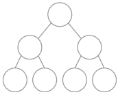

让我们用一个著名的数据结构来说明：二叉树。二叉树是一个节点（仅仅是一个对象！），它最多有两个引用指向其他节点（它们本身也是二叉树），通常称为左和右子树。树中的每个节点都持有整个数据结构的一个值。

为了便于说明，我们将使我们的二叉树成为二叉搜索树（BST）。不过，我们将要识别的操作对于任何常规的非 BST 二叉树都同样适用。

## 注意

> 二叉搜索树是一种具有特殊约束的通用二叉树，约束涉及树中值之间的关系。树左侧节点的每个值都小于该树根节点处的值，而根节点的值又小于树右侧节点的每个值。"小于"的概念是相对于所存储数据的类型而言的；对于数字可以是数值上的，对于字符串可以是字典序上的，等等。根据定义，BST 必须保持平衡，这使得在树中搜索值更加高效，使用递归二分搜索算法。

要创建一个二叉树节点对象，让我们使用这个工厂函数：

```javascript
var BinaryTree =
    (value,parent,left,right) => ({ value, parent, left, right });
```

为了方便起见，我们让每个节点存储`left`和`right`子树，以及对其自身`parent`节点的引用。

现在让我们定义一个由常见农产品（水果、蔬菜）名称组成的 BST：

```javascript
var banana = BinaryTree( "banana" );
var apple = banana.left = BinaryTree( "apple", banana );
var cherry = banana.right = BinaryTree( "cherry", banana );
var apricot = apple.right = BinaryTree( "apricot", apple );
var avocado = apricot.right = BinaryTree( "avocado", apricot );
var cantaloupe = cherry.left = BinaryTree( "cantaloupe", cherry );
var cucumber = cherry.right = BinaryTree( "cucumber", cherry );
var grape = cucumber.right = BinaryTree( "grape", cucumber );
```

在这个特定的树结构中，`banana`是根节点；这棵树可以用位于不同位置的节点来设置，但仍然是一个具有相同遍历方式的 BST。

我们的树看起来像这样：

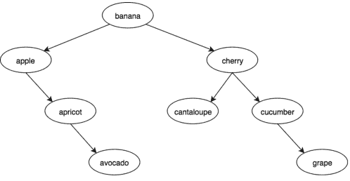

有多种方式可以遍历二叉树以处理其值。如果它是一个 BST（我们的就是！），并且我们进行中序遍历——总是先访问左子树，然后访问节点本身，最后访问右子树——我们将按升序（排序后）访问值。

因为你不能像处理数组那样轻松地`console.log(..)`一个二叉树，所以我们先来定义一个便捷方法，主要用于打印。`forEach(..)`将以与数组相同的方式访问二叉树的节点：

## 第 9 章：列表操作 276

```javascript
// 中序遍历
BinaryTree.forEach = function forEach(visitFn,node){
    if (node) {
        if (node.left) {
            forEach( visitFn, node.left );
        }

        visitFn( node );

        if (node.right) {
            forEach( visitFn, node.right );
        }
    }
};
```

> **注意**
>
> 处理二叉树最自然地适合递归处理。我们的`forEach(..)`工具会递归调用自身来处理左右子树。我们已经在第 8 章中讨论过递归，那一章中我们……在关于递归的章节中涵盖了递归。

回想一下，`forEach(..)`在本章开头被描述为仅对副作用有用，这在 FP 中通常不是期望的。在这种情况下，我们只对 I/O 的副作用使用`forEach(..)`，因此作为辅助函数是完全合理的。

使用`forEach(..)`从树中打印出值：

```javascript
BinaryTree.forEach( node => console.log( node.value ), banana );
// apple apricot avocado banana cantaloupe cherry cucumber grape

// 仅访问以 `cherry` 为根的子树
BinaryTree.forEach( node => console.log( node.value ), cherry );
// cantaloupe cherry cucumber grape
```

要使用 FP 模式对我们的二叉树数据结构进行操作，让我们从定义一个`map(..)`开始：

Functional-Light JavaScript

```javascript
BinaryTree.map = function map(mapperFn,node){
    if (node) {
        let newNode = mapperFn( node );
        newNode.parent = node.parent;
        newNode.left = node.left ?
            map( mapperFn, node.left ) : undefined;
        newNode.right = node.right ?
            map( mapperFn, node.right ): undefined;

        if (newNode.left) {
            newNode.left.parent = newNode;
        }
        if (newNode.right) {
            newNode.right.parent = newNode;
        }

        return newNode;
    }
};
```

你可能曾以为我们只对节点的值属性进行`map(..)`操作，但通常我们可能实际上想要对树节点本身进行映射。因此，`mapperFn(..)`被传入当前访问的整个节点，并期望返回一个应用了变换的新的`BinaryTree(..)`节点。如果你只是返回同一个节点，这个操作就会改变你的树，很可能导致意外的结果！

让我们将树映射为名称全部大写的农产品列表：

```javascript
var BANANA = BinaryTree.map(
    node => BinaryTree( node.value.toUpperCase() ),
    banana
);
```

```javascript
BinaryTree.forEach( node => console.log( node.value ), BANANA );
// APPLE APRICOT AVOCADO BANANA CANTALOUPE CHERRY CUCUMBER GRAPE
```

`BANANA`是一棵与`banana`不同的树（所有节点都不同），就像对数组调用`map(..)`会返回一个新数组一样。就像其他对象/数组的数组一样，如果`node.value`本身引用了某个对象/数组，你如果需要更深层次的不可变性，还需要在映射函数中手动处理复制它。

那`reduce(..)`呢？基本过程相同：对树节点进行中序遍历。一种用法是将树`reduce(..)`为其值的数组，这将有助于进一步适配其他典型的列表操作。或者我们可以将树`reduce(..)`为所有农产品名称的字符串连接。

我们将模拟数组`reduce(..)`的行为，使传递`initialValue`参数成为可选的。这个算法有点棘手，但仍然可以处理：

```javascript
BinaryTree.reduce = function reduce(reducerFn, initialValue, node){
    if (arguments.length < 3) {
        // 由于省略了 `initialValue`，参数需要移位
        node = initialValue;
    }

    if (node) {
        let result;

        if (arguments.length < 3) {
            if (node.left) {
                result = reduce( reducerFn, node.left );
            }
            else {
                return node.right ?
                    reduce( reducerFn, node, node.right ) :
                    node;
            }
        }
        else {
            result = node.left一直以来的都是我们强调过的，也是最重要的：提供一个既正确又可读的 `reduce` 算法：

            result = node.left ?
                reduce( reducerFn, initialValue, node.left ) :
                initialValue;
        }

        result = reducerFn( result, node );
        result = node.right ?
            reduce( reducerFn, result, node.right ) : result;
        return result;
    }

    return initialValue;
};
```

让我们使用`reduce(..)`来制作我们的购物清单（一个数组）：

```javascript
BinaryTree.reduce(
    (result, node) => [ ...result, node.value ],
    [],
    banana
);
// ["apple","apricot","avocado","banana","cantaloupe",
//     "cherry","cucumber","grape"]
```

最后，让我们为树考虑`filter(..)`。这个算法是迄今为止最棘手的，因为它有效地（并非实际上）涉及从树中移除节点，这需要处理几种边界情况。不过，不要被实现吓倒。如果你愿意，现在可以先跳过它，专注于我们如何使用它。


```js
BinaryTree.filter = function filter(predicateFn, node) {
    if (node) {
        let newNode;
        let newLeft = node.left ?
            filter(predicateFn, node.left) : undefined;
        let newRight = node.right ?
            filter(predicateFn, node.right) : undefined;

        if (predicateFn(node)) {
            newNode = BinaryTree(
                node.value,
                node.parent,
                newLeft,
                newRight
            );
            if (newLeft) {
                newLeft.parent = newNode;
            }
            if (newRight) {
                newRight.parent = newNode;
            }
        }
        else {
            if (newLeft) {
                if (newRight) {
                    newNode = BinaryTree(
                        undefined,
                        node.parent,
                        newLeft,
                        newRight
                    );
                    newLeft.parent = newRight.parent = newNode;

                    if (newRight.left) {
                        let minRightNode = newRight;
                        while (minRightNode.left) {
                            minRightNode = minRightNode.left;
                        }

                        newNode.value = minRightNode.value;

                        if (minRightNode.right) {
                            minRightNode.parent.left =
                                minRightNode.right;
                            minRightNode.right.parent =
                                minRightNode.parent;
                        }
                        else {
                            minRightNode.parent.left = undefined;
                        }
                    }

                    minRightNode.right =
                        minRightNode.parent = undefined;
                }
                else {
                    newNode.value = newRight.value;
                    newNode.right = newRight.right;
                    if (newRight.right) {
                        newRight.right.parent = newNode;
                    }
                }
            }
            else {
                return newLeft;
            }
        }
    }
    else {
        return newRight;
    }

    return newNode;
};
```

这段代码的大部分都用于处理节点从复制的树结构中被“移除”（过滤掉）时，其父/子引用的重新调整。

作为一个说明使用`filter(..)`的例子，让我们将农产品树缩小到仅剩蔬菜：

```js
var vegetables = [ "asparagus", "avocado", "broccoli", "carrot",
    "celery", "corn", "cucumber", "lettuce", "potato", "squash",
    "zucchini" ];
```

```js
var whatToBuy = BinaryTree.filter(
    // 从农产品列表中筛选出蔬菜
    node => vegetables.indexOf(node.value) != -1,
    banana
);
```

```js
// 购物清单
BinaryTree.reduce(
    (result, node) => [ ...result, node.value ],
    [],
    whatToBuy
);
// ["avocado", "cucumber"]
```

> **注意**
>
> 我们没有做任何努力来在二叉搜索树（BST）上进行任何`map/reduce/filter`操作后重新平衡树。严格来说，这意味着结果本身不是二叉*搜索*树。大多数 JS 值都有合理的小于比较操作（`<`），我们可以用它来重新平衡这样的树，但某些值（如 promises）不会有这样的定义。为了保持本章在实用的长度范围内，我们将推迟处理这个复杂问题。

你可能只会在简单数组的上下文中使用本章中的大多数列表操作。但现在我们已经看到，这些概念适用于你可能需要的任何数据结构和操作。这就是 FP 如何被广泛应用于许多不同应用场景的有力证明！

## 总结

我们看了三种常见且强大的列表操作：

- `map(..)`：在将值投影到新列表时对其进行变换。
- `filter(..)`：在将值投影到新列表时选择包含或排除。
- `reduce(..)`：将列表中的值组合以产生某个其他（通常但不总是非列表）值。

其他在处理列表时有用的高级操作：`unique(..)`、`flatten(..)`和`merge(..)`。

融合（Fusion）使用函数组合来整合多个相邻的`map(..)`调用。这主要是一种性能优化，但它也改善了列表操作的声明式特性。

列表通常被可视化为数组，但可以泛化为任何表示/产生有序值集合的数据结构。因此，所有这些“列表操作”实际上是“数据结构操作”。

# 第10章：函数式异步

到目前为止，你已经掌握了所有我称为“函数式轻量编程”的 FP 基础所需的原始概念。在本章中，我们将把这些概念应用到不同的上下文中，但我们不会真正呈现特别新的想法。

到目前为止，我们所做的几乎都是**同步的**，这意味着我们使用即时输入调用函数，并立即获得输出值。很多工作都可以这样完成，但这对于现代 JS 应用的全部需求来说远远不够。要真正准备好面对现实世界中的 JS FP，我们需要理解异步 FP。

我们在本章的目标是扩展我们对使用 FP 管理值的思考，将这些操作分散到时间中。我们将看到 Observable（以及 Promise！）是实现这一点的一种好方法。

## 时间作为状态

整个应用中最复杂的*状态*就是**时间**。也就是说，当从一个状态到另一个状态的转换是即时的、确定地受你控制时，管理状态要容易得多。当应用的状态隐式地响应分散在时间上的事件而变化时，管理就会变得指数级困难。

我们在本文中介绍的 FP 的每一部分都是关于通过使代码更可靠、更可预测来使其更易读。当你向程序引入异步性时，这些努力会受到很大打击。

但让我们更明确地说：令人担忧的并不是某些操作不同步完成这一事实本身；触发异步行为很容易。真正需要大量额外努力的是协调对这些动作的响应，每个动作都有可能改变应用的状态。

那么，是作者应该费心去处理这种情况，还是直接留给代码的读者去弄清楚，如果 A 在 B 之前完成，或者反过来，程序的状态会是怎样的？这是一个反问句，但在我看来，它有一个相当明确的答案：要想让这样复杂的代码更具可读性，作者必须付出比通常多得多的努力。

## 减少时间

异步编程模式最重要的成果之一，就是通过将时间从我们关注的领域中抽象出来，从而简化状态变更的管理。为了说明这一点，让我们首先看一个存在竞态条件（也称为时间复杂性）且必须手动管理的场景：

```js
var customerId = 42;

var customer;

lookupCustomer(customerId, function onCustomer(customerRecord) {
    var orders = customer ? customer.orders : null;

    customer = customerRecord;

    if (orders) {
        customer.orders = orders;
    }
});

lookupOrders(customerId, function onOrders(customerOrders) {
    if (!customer) {
        customer = {};
    }

    customer.orders = customerOrders;
});
```

`onCustomer(..)`和`onOrders(..)`回调函数处于一种二元竞态条件中。假设它们都会运行，那么任何一个都有可能先运行，而且无法预测哪一个会发生。

如果我们能够将`lookupOrders(..)`的调用嵌入到`onCustomer(..)`内部，我们就能确保`onOrders(..)`在`onCustomer(..)`之后运行。但我们无法这样做，因为我们需要这两个查找并发执行。

因此，为了规范这种基于时间的状态复杂性，我们在各自的回调函数中使用了`if`语句检查，并辅以外部词法作用域的闭包变量`customer`。当每个回调函数运行时，它会检查`customer`的状态，从而确定自己的相对执行顺序；如果对于某个回调函数来说`customer`未设置，那么它就是第一个运行的，否则它就是第二个运行的。

这段代码可以工作，但从可读性角度来看远非理想。时间复杂性使得这段代码更难阅读。让我们改用 JS Promise 来将时间因素从这个场景中剥离出去：

```js
var customerId = 42;

var customerPromise = lookupCustomer(customerId);

var ordersPromise = lookupOrders(customerId);

customerPromise.then(function onCustomer(customer) {
    ordersPromise.then(function onOrders(orders) {
        customer.orders = orders;
    });
});
```

现在`onOrders(..)`回调函数位于`onCustomer(..)`回调函数内部，因此它们的相对顺序得到了保证。查找操作的并发性是通过在指定`then(..)`响应处理之前，分别调用`lookupCustomer(..)`和`lookupOrders(..)`来实现的。

这一点可能不明显，但若非 Promise 被定义为具有特定行为方式，此代码片段中本应存在固有的竞态条件。如果订单的查找在调用`ordersPromise.then(..)`以提供`onOrders(..)`回调之前就完成了，那么就需要某种机制足够智能地保存该订单列表，直到可以调用`onOrders(..)`为止。实际上，同样的担忧也可能适用于`customer`在指定`onCustomer(..)`来接收它之前就已存在的情况。

这个“某种机制”就是我们与前面代码片段讨论的同类时间复杂性逻辑。但无论是编写这段代码，还是——更重要的是——阅读这段代码时，我们都不必担心这种复杂性，因为 Promise 为我们处理了这种时间规范化。

Promise 以一种时间无关的方式表示一个单独的（未来的）值。此外，从 promise 中提取值是同步赋值（通过`=`）即时值的异步形式。换句话说，promise 将`=`赋值操作在时间上铺展开来，但以一种可信赖的（时间无关的）方式进行。

我们现在将探讨如何类似地将本书前面介绍的各种同步 FP 操作异步地随时间铺展开来。

## 急切 vs. 惰性

在计算机科学领域，“急切”和“惰性”不是恭维或贬低，而是描述一个操作是立即完成还是随时间推进的不同方式。

我们在本文中看到的 FP 操作可以被描述为急切的，因为它们同步地（就在当下）操作一个离散的即时值或值的列表/结构。

回顾：

```js
var a = [1, 2, 3];

var b = a.map(v => v * 2);

b; // [2, 4, 6]
```

从`a`到`b`的映射是急切的，因为它在那一刻操作`a`数组中的所有值，并生成一个新的`b`数组。如果你之后修改`a`（例如，在其末尾添加一个新值），`b`的内容不会有任何改变。这就是急切的 FP。

但是，一个惰性的 FP 操作会是什么样子呢？考虑这样的情况：

```js
var a = [];

var b = mapLazy(a, v => v * 2);

a.push(1);

a[0]; // 1

b[0]; // 2

a.push(2);

a[1]; // 2

b[1]; // 4
```

我们这里想象的`mapLazy(..)`本质上“监听”`a`数组，并且每当有新值被添加到其末尾（通过`push(..)`）时，它就运行`v => v * 2`映射函数，并将转换后的值推送到`b`数组。

> **注意**
>
> `mapLazy(..)`的实现并未展示，因为这是一个虚构的说明，并非实际操作。为了在`a`和`b`之间实现这种惰性操作配对，我们需要比基本数组更智能的东西。

考虑能够将`a`和`b`配对在一起的好处，这样任何时候（甚至是异步地！）当你将一个值放入`a`，它都会被转换并映射到`b`。这与`map(..)`操作的声明式 FP 能力是相同的，但现在它可以被拉伸到时间上；你无需现在就知道`a`的所有值就能设置从`a`到`b`的映射。

# 响应式 FP

为了理解我们如何能够在两组值之间创建和使用惰性映射，我们需要将我们对列表（数组）的概念稍作抽象。让我们想象一种更智能的数组，不是简单地保存值的数组，而是惰性地接收并响应（即“反应于”）值的数组。考虑：

```js
var a = new LazyArray();

var b = a.map(function double(v) {
    return v * 2;
});

setInterval(function everySecond() {
    a.push(Math.random());
}, 1000);
```

到目前为止，这段代码片段看起来与普通数组并无不同。唯一不寻常的是我们习惯了`map(..)`是急切地运行并立即生成一个包含所有当前来自`a`的已映射值的`b`数组。计时器向`a`中推入随机值是奇怪的，因为所有这些值都是在`map(..)`调用之后才到达的。

但这个虚构的`LazyArray`是不同的；它假设值会随时间一个接一个地到来；只需在你想要的时候`push(..)`值进去。`b`将是最终放入`a`中所有值的惰性映射。

另外，我们实际上不需要在值被处理后仍然在`a`或`b`中保留它们；这种特殊类型的数组只在需要时才保存值。因此，这些数组在内存使用上不会严格随时间增长，这是惰性数据结构和操作的一个重要特征。事实上，它更像一个缓冲区，而不是数组。

普通数组是急切的，因为它现在就保存了所有值。“惰性数组”是一个值将随时间到来的数组。

由于我们不一定知道`a`中何时到达一个新值，我们需要的另一个关键能力是能够监听`b`以在新值可用时得到通知。我们可以想象一个监听器像这样：

```js
b.listen(function onValue(v) {
    console.log(v);
});
```

`b`是响应式的，因为它被设置为当值进入`a`时进行反应。有一个 FP 操作`map(..)`描述了每个值如何从源头`a`转移到目标`b`。每个离散的映射操作正是我们使用普通同步 FP 对单值操作建模的方式，但在这里我们将值的来源在时间上铺展开来。

> **注意**
>
> 最常用于这些概念的术语是函数响应式编程（Functional Reactive Programming，FRP）。我故意避免使用这个术语，因为对于 FP + 响应式是否真正构成 FRP 存在一些争论。我们不会在这里全面探讨 FRP 的所有含义，所以我将只称其为响应式 FP。或者，如果觉得这样更不容易混淆，你可以称之为事件驱动的 FP。

我们可以认为`a`是生产者，`b`是消费者。因此，为了提高可读性，让我们重新组织这个代码片段，将关注点分离为生产者和消费者角色：

```js
// 生产者：
```


```javascript
var a = new LazyArray();

setInterval( function everySecond(){
    a.push( Math.random() );
}, 1000 );

// *************************************

// 消费者：

var b = a.map( function double(v){
    return v * 2;
} );

b.listen( function onValue(v){
    console.log( v );
} );
```

`a`是生产者，它本质上就像一个值的流。我们可以把到达`a`的每个值看作一个事件。然后，`map(..)`操作会触发`b`上相应的事件，我们通过`listen(..)`来监听，以便消费这个新值。

我们将生产者和消费者的关注点分离的原因是，应用程序的不同部分可以分别负责这两个关注点。这种代码组织方式可以极大地提高代码的可读性和可维护性。

## 声明式时间

我们在引入时间这个概念时非常谨慎。具体来说，就像 Promise 将时间从我们对单个异步操作的关注中抽象出来一样，响应式 FP 也将时间从一系列值/操作中抽象（分离）出来。

从`a`（生产者）的角度来看，唯一明显的时间关注点是我们手动的`setInterval(..)`循环。但这只是为了演示目的。

想象一下，`a`实际上可以连接到其他事件源，比如用户的鼠标点击或按键、来自服务器的 WebSocket 消息等。在这种情况下，`a`实际上不必关心时间本身。它只是一个与时间无关的值的通道，无论这些值何时准备好。

从`b`（消费者）的角度来看，我们不知道也不关心`a`中的值何时/来自何处。事实上，所有值可能都已经存在。我们只关心我们想要这些值，无论它们何时准备好。同样，这是对`map(..)`转换操作的一种与时间无关（即惰性）的建模。

`a`和`b`之间的时间关系是声明式的（并且隐含的！），而非命令式的（或显式的）。

以这种方式组织随时间变化的操作的价值可能还没有特别明显地感受到。让我们对比一下，如果用命令式方式表达同样的功能会是什么样子：

```javascript
// 生产者：

var a = {
    onValue(v){
        b.onValue( v );
    }
};

setInterval( function everySecond(){
    a.onValue( Math.random() );
}, 1000 );

// *********************************
// 消费者：

var b = {
    map(v){
        return v * 2;
    },
    onValue(v){
        v = this.map( v );
        console.log( v );
    }
};
```

这可能看起来相当微妙，但这个更命令式的代码版本与之前更声明式的版本之间存在着重要的区别，除了`b.onValue(..)`需要自行调用`this.map(..)`之外。在前的代码片段中，`b`从`a`中拉取；而在后的代码片段中，`a`向`b`推送。换句话说，比较`b = a.map(..)`和`b.onValue(v)`。

在后面的命令式代码片段中，从消费者的角度来看，并不清楚`v`值来自哪里（就可读性而言）。此外，在生产者`a`的逻辑中间硬编码`b.onValue(..)`违反了关注点分离原则。这可能使得独立地推理生产者和消费者变得更加困难。

相比之下，在前面的代码片段中，`b = a.map(..)`声明了`b`的值来源于`a`，并将`a`视为一个抽象的事件流数据源，我们在那一刻不必关心它。我们声明了任何从`a`进入`b`的值都将经过指定的`map(..)`操作。

## 不只是 Map

为了方便起见，我们通过一对一的`map(..)`映射来示例`a`和`b`随时间配对的概念。但我们的许多其他 FP 操作也可以随时间建模。

考虑：

```javascript
var b = a.filter( function isOdd(v) {
    return v % 2 == 1;
} );

b.listen( function onlyOdds(v){
    console.log( "Odd:", v );
} );
```

在这里，来自`a`的值只有在通过`isOdd(..)`谓词时才会进入`b`。

甚至`reduce(..)`也可以随时间建模：

```javascript
var b = a.reduce( function sum(total,v){
    return total + v;
} );

b.listen( function runningTotal(v){
    console.log( "New current total:", v );
} );
```

由于我们没有向`reduce(..)`调用指定`initialValue`，所以无论是`sum(..)`归约器还是`runningTotal(..)`事件回调，在来自`a`的至少两个值到来之前都不会被调用。

这段代码暗示了归约具有某种记忆，因为每当未来的值进来时，`sum(..)`归约器都会被调用，传入之前的`total`以及新的下一个值`v`。

其他扩展到时间的 FP 操作甚至可能涉及内部缓冲区，例如`unique(..)`会跟踪它到目前为止见过的每个值。

## Observables

希望到现在你已经能够理解像我们所构想的虚构`LazyArray`这样的响应式、事件驱动、类数组数据结构的重要性了。好消息是，这种数据结构已经存在，它叫做 Observable。

> ### 注意
>
> 先设定一些预期：以下讨论只是对 Observable 世界的简要介绍。这是一个远比我们在此能充分探索的更为深入的话题。但如果你已经理解了本书中的函数式轻量编程，现在又掌握了如何通过 FP 原则来建模异步时间，那么在你继续学习的过程中，Observable 应该会非常自然地为你所理解。

Observable 已经被各种用户空间库实现，其中最著名的是 [RxJS](https://rxjs.dev/) 和 **Most**。在撰写本文时，有一个正在进行的提案，旨在将 Observable 原生地添加到 JS 中，就像 ES6 中添加 Promise 一样。为了演示的目的，我们将在接下来的示例中使用 RxJS 风格的 Observable。

以下是我们之前的响应式示例，用 Observable 而不是`LazyArray`来表达：

```javascript
// 生产者：

var a = new Rx.Subject();

setInterval( function everySecond(){
    a.next( Math.random() );
}, 1000 );

// ***************************
// 消费者：

var b = a.map( function double(v){
    return v * 2;
} );

b.subscribe( function onValue(v){
    console.log( v );
} );
```

在 RxJS 的体系中，Observer 订阅 Observable。如果你将 Observer 和 Observable 的功能结合起来，就得到了 Subject。因此，为了让我们的代码片段更简单，我们将`a`构造为 Subject，这样我们就可以对它调用`next(..)`来将值（事件）推送到它的流中。

如果我们希望将 Observer 和 Observable 分开：

```javascript
// 生产者：

var a = Rx.Observable.create( function onObserve(observer){
    setInterval( function everySecond(){
        observer.next( Math.random() );
    }, 1000 );
} );
```

在这个代码片段中，`a`是 observable，不出所料，独立的 observer 叫做`observer`；它能够"观察"一些事件（比如我们的`setInterval(..)`循环）；我们使用它的`next(..)`方法将事件输入到`a`的 observable 流中。

除了`map(..)`，RxJS 定义了超过一百个操作符，它们在每个新值到来时被惰性调用。就像数组一样，Observable 上的每个操作符都会返回一个新的 Observable，这意味着它们是可链式调用的。如果操作符函数的调用确定某个值应该从输入 Observable 传递下去，它就会在输出 Observable 上触发；否则就被丢弃。

声明式 observable 链的示例：

```javascript
var b =
    a
    .filter( v => v % 2 == 1 )     // 仅奇数
    .distinctUntilChanged()       // 仅连续不重复
    .throttle( 100 )               // 稍微放慢
    .map( v = v * 2 );             // 加倍

b.subscribe( function onValue(v){
    console.log( "Next:", v );
} );
```

## 注意

没有必要将 observable 赋值给`b`，然后再从链中单独调用`b.subscribe(..)`；这里这样做是为了强化每个操作符都从前一个返回新的 observable 这一概念。在你发现的许多代码示例中，`subscribe(..)`调用只是链中的最后一个方法。因为`subscribe(..)`在技术上是可观察对象内部状态的突变，函数式编程者通常更倾向于将这两步分开，以更明显地标记副作用。

## 总结

本书详细介绍了各种各样的 FP 操作，它们接收单个值（或即时的值列表），并将其转换为另一个值/多个值。

对于将随时间进行的操作，所有这些基础的 FP 原则都可以与时间无关地应用。就像 Promise 建模了单个未来值一样，我们可以将急切的值列表建模为惰性的可观察（事件）流，这些值可以逐一到来。

对数组执行`map(..)`会为数组中当前存在的每个值运行一次映射函数，并将所有映射后的值放入结果数组中。对可观察对象执行`map(..)`会为每个到来的值运行一次映射函数，并将所有映射后的值推送到输出可观察对象中。

换句话说，如果数组是函数式编程（FP）操作的急切数据结构，那么可观察对象就是其随时间变化的惰性对应物。

## 提示

关于异步函数式编程的不同方面，请查阅一个名为 [fasy](Appendix C) 的库，该库在附录 C 中进行了讨论。

至此，你已具备理解“函数式 JavaScript”的所有要素。我们不再介绍新的概念。

在本章最后部分，我们的主要目标是概念的连贯性。我们将审视一段代码，它融合了本书的多个主要主题——对我们所学知识的应用。最重要的是，这段示例代码旨在阐明“轻量级函数式”（Functional Light）的 JavaScript 方法——即在平衡和实用主义与教条主义之间取得平衡。

你将需要大量实践这些技巧。深入理解本章对于将函数式编程原则应用于你的实际代码至关重要。

## 设置

让我们构建一个简单的股票行情小部件。

> **注意**
>
> 作为参考，此示例的全部代码位于`ch11-code/`子目录中——请参阅本书的 [GitHub 仓库](https://github.com/getify/functional-light-js)。此外，我们在整本书中讨论过的、此示例所需的选定函数式编程辅助函数包含在`ch11-code/fp-helpers.js`中。在本章中，我们将仅关注与讨论相关的代码部分。

首先，让我们谈谈这个小部件的标记语言，这样我们就有了一个显示信息的地方。我们在`ch11-code/index.html`文件中以一个空的`<ul ..>`元素开始，但在运行时，DOM 将被填充为：

```html
<ul id="stock-ticker">
    <li class="stock" data-stock-id="AAPL">
        <span class="stock-name">AAPL</span>
        <span class="stock-price">$121.95</span>
        <span class="stock-change">+0.01</span>
    </li>
    <li class="stock" data-stock-id="MSFT">
        <span class="stock-name">MSFT</span>
        <span class="stock-price">$65.78</span>
        <span class="stock-change">+1.51</span>
    </li>
    <li class="stock" data-stock-id="GOOG">
        <span class="stock-name">GOOG</span>
        <span class="stock-price">$821.31</span>
        <span class="stock-change">-8.84</span>
    </li>
</ul>
```

在我们继续之前，让我提醒你：与 DOM 交互是 I/O，这意味着副作用。我们无法消除这些副作用，但可以限制和控制它们。我们应当非常有意识地最小化应用程序中处理 DOM 的部分。我们在**第 5 章**中学习了所有这些技术。

总结一下我们小部件的功能：代码将在每次“接收”到新股事件时添加`<li ..>`元素，并在股票更新事件到来时更新价格和涨跌幅。

在第 11 章的示例代码中，在`ch11-code/mock-server.js`中，我们设置了一些定时器，将随机生成的假股票数据推送到一个简单的事件发射器上，以模拟我们正在从服务器接收股票信息消息。我们公开了一个`connectToServer()`函数来假装这样做，但实际上只是返回了伪造的事件发射器实例。

> 此文件完全是假的/模拟的行为，因此我没有花太多精力试图使其非常符合函数式编程。我不建议花太多时间关注此文件中的代码。如果你编写一个真正的服务器——这对雄心勃勃的读者来说是一个非常有趣的额外挑战！——你显然会希望给那段代码应有的函数式编程关注。

在`ch11-code/stock-ticker-events.js`中，我们创建了一些连接到事件发射器对象的可观察对象（通过 RxJS）。我们调用`connectToServer()`来获取这个事件发射器，然后监听事件名称`"stock"`（向我们的行情列表添加新股票）和`"stock-update"`（更新股票列出的价格和涨跌金额）。最后，我们定义了对这些可观察对象传入数据的转换，根据需要格式化数据。

在`ch11-code/stock-ticker.js`中，我们将 UI（DOM 副作用）行为定义为`stockTickerUI`对象上的方法。我们还定义了各种辅助函数，包括`getElemAttr(..)`、`stripPrefix(..)`等。最后，我们`subscribe(..)`到提供格式化数据以渲染到 DOM 的两个可观察对象。

## 股票事件

让我们看看`ch11-code/stock-ticker-events.js`中的代码。我们将从一些基本辅助函数开始：

```javascript
function addStockName(stock) {
    return setProp( "name", stock, stock.id );
}
function formatSign(val) {
    if (Number(val) > 0) {
        return `+${val}`;
    }
    return val;
}
function formatCurrency(val) {
    return `$$${val}`;
}
```

这些纯函数的解释应该相当直接。回想一下第 4 章中的`setProp(..)`，它实际上在设置新属性之前克隆了对象。这运用了**我们在第 6 章看到的原则**：即使值不是不可变的，也将其视为不可变，以避免副作用。

`addStockName(..)`用于向股票消息对象添加一个`name`属性，其值等于其`id`。`name`值随后被用作小部件中可见的股票名称。

当从“服务器”接收到股票消息时，它看起来像：

```javascript
{ id: "AAPL", price: 121.7, change: 0.01 }
```

在显示到 DOM 之前，`price`需要用`formatCurrency(..)`格式化（使其看起来像`"$121.70"`），而`change`需要用`formatChange(..)`格式化（使其看起来像`"+0.01"`）。但我们不想修改消息对象，因此我们需要一个辅助函数来格式化这两个数字并给我们一个新的股票对象：

```javascript
function formatStockNumbers(stock) {
    var stockDataUpdates = [
        [ "price", formatPrice( stock.price ) ],
        [ "change", formatChange( stock.change ) ]
    ];

    return reduce( function formatter(stock,[propName,val]){
        return setProp( propName, stock, val );
    } )
    ( stock )
    ( stockDataUpdates );
}
```


我们创建 `stockDataUpdates` 数组来保存属性名和新的格式化值的元组（只是数组），分别用于 `price` 和 `change`。我们使用 `reduce(..)`（见第 9 章）遍历该数组，并将 `stock` 对象作为 `initialValue`（初始值）。我们将元组解构为 `propName` 和 `val`，然后返回 `setProp(..)` 调用，它返回一个已设置属性的新克隆对象。

现在让我们定义更多辅助函数：

```js
var formatDecimal = unboundMethod( "toFixed" )( 2 );
var formatPrice = pipe( formatDecimal, formatCurrency );
var formatChange = pipe( formatDecimal, formatSign );
var processNewStock = pipe( addStockName, formatStockNumbers );
```

`formatDecimal(..)` 函数接受一个数字（如 2.1）并调用其 `toFixed( 2 )` 方法。我们使用第 9 章的 `unboundMethod(..)` 来创建一个独立的、后期绑定的方法。

`formatPrice(..)`、`formatChange(..)` 和 `processNewStock(..)` 都是使用 `pipe(..)` 进行的组合，每个组合都从左到右组合了几个操作（见第 4 章）。

为了从我们的事件发射器创建可观察对象（见第 10 章“可观察对象”），我们将需要一个辅助函数，它是 RxJS 的 `Rx.Observable.fromEvent(..)` 的柯里化（见第 3 章）独立版本：

```js
var makeObservableFromEvent =
    curry( Rx.Observable.fromEvent, 2 )( server );
```

此函数被指定为监听服务器（事件发射器），并等待一个事件名称字符串来生成其可观察对象。我们现在已具备所有要素来为我们的两个事件创建观察者，并通过映射转换这些观察者来格式化传入数据：

```js
var observableMapperFns = [ processNewStock, formatStockNumbers ];

var stockEventNames = [ "stock", "stock-update" ];

var [ newStocks, stockUpdates ] = pipe(
    map( makeObservableFromEvent ),
    curry( zip )( observableMapperFns ),
    map( spreadArgs( mapObservable ) )
)
( stockEventNames );
```

我们从 `stockEventNames` 开始，这是一个事件名称数组（`["stock","stock-update"]`），然后使用 `map(..)`（参见[第 9 章](#)）将其映射为两个 observable 的列表，再使用 `zip(..)`（参见[第 9 章](#)）将其与 observable-映射器函数列表组合，生成类似 `[ observable, mapperFn ]` 的元组列表。最后，我们使用 `map(..)` 配合 `mapObservable(..)` 处理这些元组，通过 `spreadArgs(..)`（参见[第 3 章](#)）将每个元组展开为独立参数。

最终结果是两个映射后的 observable 列表，我们通过数组解构分别赋值给 `newStocks` 和 `stockUpdates`。

就是这样；这就是我们采用 FP-Light 方式来设置股票行情事件 observable 的方法！我们将在 `ch11-code/stock-ticker.js` 中订阅这两个 observable。

退一步，反思一下我们在此使用 FP 原则的方式。这说得通吗？你能看出我们是如何应用本书前面章节中讲到的各种概念的吗？你能想到其他完成这些任务的方法吗？

更重要的是，如果你用命令式方式来做，会怎么做？你认为这两种方法在大致上会如何比较？尝试一下这个练习。用成熟的命令式方法写出等价代码。如果你和我一样，命令式形式仍然会感觉更自然。

在继续前进之前，你需要掌握的是，你也可以理解并推理我们刚刚展示的 FP 风格。思考一下每个函数和片段的形状（输入和输出）。你看它们是如何组合在一起的吗？

不断练习，直到这些东西对你而言变得豁然开朗。

## 股票行情 UI

如果你对上一节的 FP 感到相当自在，那么你已经准备好深入 `ch11-code/stock-ticker.js` 了。它要复杂得多，所以我们会花些时间完整地查看每个部分。

让我们先定义一些辅助函数，以帮助我们的 DOM 任务：

```js
function isTextNode(node) {
    return node && node.nodeType == 3;
}
function getElemAttr(prop, elem) {
    return elem.getAttribute( prop );
}
function setElemAttr(elem, prop, val) {
    // !!副作用!!
    return elem.setAttribute( prop, val );
}
function matchingStockId(id, node){
    return getStockId( node ) == id;
}
function isStockInfoChildElem(elem) {
    return /\bstock-/i.test( getClassName( elem ) );
}
function appendDOMChild(parentNode, childNode) {
    // !!副作用!!
    parentNode.appendChild( childNode );
    return parentNode;
}
function setDOMContent(elem, html) {
    // !!副作用!!
    elem.innerHTML = html;
    return elem;
}
```

```js
var createElement = document.createElement.bind( document );

var getElemAttrByName = curry( getElemAttr, 2 );

var getStockId = getElemAttrByName( "data-stock-id" );

var getClassName = getElemAttrByName( "class" );

var isMatchingStock = curry( matchingStockId, 2 );
```

这些大部分应该都是不言自明的。

请注意，我特意标出了改变 DOM 元素状态的副作用。我们无法轻易地克隆一个 DOM 对象并替换它，所以在这里我们接受改变现有对象的副作用。至少如果我们的 DOM 渲染中有 bug 时，我们可以轻松搜索那些代码注释来锁定可能的嫌疑对象。

以下是其他一些杂项辅助函数：

```js
function stripPrefix(prefixRegex, val) {
    return val.replace( prefixRegex, "" );
}

function listify(listOrItem) {
    if (!Array.isArray( listOrItem )) {
        return [ listOrItem ];
    }
    return listOrItem;
}
```

让我们定义一个辅助函数来获取 DOM 元素的子节点：

```js
var getDOMChildren = pipe(
    listify,
    flatMap(
        pipe(
            curry( prop )("childNodes"),
            Array.from
        )
    )
);
```

首先，我们使用 `listify(..)` 确保我们有一个元素列表（即使它只有一个元素）。回顾一下[第 9 章](#)中的 `flatMap(..)`，它先映射一个列表，然后将列表的列表扁平化为一个更浅的列表。

我们这里的映射函数将元素映射到其 `childNodes` 列表，并通过 `Array.from(..)` 将其转换为真正的数组（而非实时的 NodeList）。这两个函数通过 `pipe(..)` 组合成一个单一的映射器函数，这就是融合（参见[第 9 章](#)）。

现在，让我们使用这个 `getDOMChildren(..)` 辅助函数来定义用于在我们的小部件中检索特定 DOM 元素的工具函数：

```js
function getStockElem(tickerElem, stockId) {
    return pipe(
        getDOMChildren,
        filterOut( isTextNode ),
        filterIn( isMatchingStock( stockId ) )
    )
    ( tickerElem );
}
function getStockInfoChildElems(stockElem) {
    return pipe(
        getDOMChildren,
        filterOut( isTextNode ),
        filterIn( isStockInfoChildElem )
    )
    ( stockElem );
}
```

`getStockElem(..)` 从小部件的 `tickerElem` DOM 元素开始，获取其子元素，然后过滤以确保我们得到与指定股票标识符匹配的元素。`getStockInfoChildElems(..)` 几乎做同样的事情，只不过它从股票元素开始，并使用不同的过滤器进行筛选。

两个工具函数都会过滤掉文本节点（因为它们与真正的 DOM 节点工作方式不同），并且两个工具函数都返回 DOM 元素数组，即使只有一个元素。

## 主 API

我们将使用 `stockTickerUI` 对象来组织我们的三个主要 UI 操作方法，如下所示：

```js
var stockTickerUI = {

    updateStockElems(stockInfoChildElemList, data) {
        // ..
    },

    updateStock(tickerElem, data) {
        // ..
    },

    addStock(tickerElem, data) {
        // ..
    }
};
```

我们首先来考察 `updateStock(..)`，因为它是三个中最简单的：

```js
updateStock(tickerElem, data) {
    var getStockElemFromId = curry( getStockElem )( tickerElem );
    var stockInfoChildElemList = pipe(
        getStockElemFromId,
        getStockInfoChildElems
    )
    ( data.id );

    return stockTickerUI.updateStockElems(
        stockInfoChildElemList,
        data
    );
},
```

用 `tickerElem` 对前面的辅助函数 `getStockElem(..)` 进行柯里化，得到 `getStockElemFromId(..)`，它将接收 `data.id`。通过 `pipe(..)`，返回值 `getStockElemFromId(data.id)` 是一个 `<li>` 元素（实际上，是只包含该元素的列表），它被传递给 `getStockInfoChildElems(..)`。

结果是一个列表（`stockInfoChildElemList`），包含股票显示信息的三个子 `<span>` 元素。我们将该列表和股票的数据消息对象传递给 `stockTickerUI.updateStockElems(..)`，以便实际用新数据更新那三个 `<span>` 元素。

现在让我们看看 `stockTickerUI.updateStockElems(..)` 是如何定义的：

```js
updateStockElems(stockInfoChildElemList, data) {
    var getDataVal = curry( reverseArgs( prop ), 2 )( data );
    var extractInfoChildElemVal = pipe(
        getClassName,
        curry( stripPrefix )( /\bstock-/i ),
        getDataVal
    );
    var orderedDataVals =
        map( extractInfoChildElemVal )( stockInfoChildElemList );
    var elemsValsTuples =
        filterOut( function updateValueMissing([infoChildElem, val]){
            return val === undefined;
        } )
        ( zip( stockInfoChildElemList, orderedDataVals ) );

    // !!副作用!!
    compose( each, spreadArgs )
    ( setDOMContent )
    ( elemsValsTuples );
},
```

我知道，这信息量不小。但我们会逐句拆解。`getDataVal` 绑定到了数据消息对象，它在参数反转之后被柯里化，所以现在它在等待一个属性名来从 `data` 中提取。

接下来，看看 `extractInfoChildElemVal(..)` 是如何定义的：

```js
var extractInfoChildElemVal = pipe(
    getClassName,
    curry( stripPrefix )( /\bstock-/i ),
    getDataVal
);
```

这个函数接收一个 DOM 元素，获取其 DOM 类名，从该值中去掉 `"stock-"` 前缀，然后将得到的值（`"name"`、`"price"` 或 `"change"`）作为属性名，通过 `getDataVal(..)` 从数据对象中提取。

这看起来可能是从数据对象中提取值的一种迂回方式。但目的是能够按照 `stockInfoChildElemList` 列表中 `<span>` 元素出现的顺序，从 `data` 中提取这些值；我们通过将 `extractInfoChildElemVal(..)` 作为映射函数应用于该 DOM 元素列表来实现这一点，将得到的列表命名为 `orderedDataVals`。

接下来，我们要将 `<span>` 列表与排序后的数据值进行 zip 操作，生成元组，其中 DOM 元素和要更新的值配对在一起：

```js
zip( stockInfoChildElemList, orderedDataVals )
```

一个有趣的细节是，到目前为止并不明显，即由于我们定义 observable 转换的方式，新股票消息对象的 `data` 中会有 `name` 属性来匹配 `<span class="stock-name">` 元素，但股票更新消息对象上不会存在 `name`。

如果数据消息对象没有某个属性，我们就不应该更新对应的 DOM 元素。因此，我们需要 `filterOut(..)` 掉任何第二个位置（在此情况下是数据值）为 `undefined` 的元组：

```js
var elemsValsTuples =
    filterOut( function updateValueMissing([infoChildElem,val]){
        return val === undefined;
    } )
    ( zip( stockInfoChildElemList, orderedDataVals ) );
```

经过这次过滤后，我们得到了一组元组列表（类似于 [`<span>`, ".." ]），可以用于 DOM 内容更新，我们将其赋值给 `elemsValsTuples`。

## 注意

由于 `updateValueMissing(..)` 谓词是内联定义的，因此我们可以控制它的函数签名。我们没有使用 `spreadArgs(..)` 将单个数组参数展开为两个独立的命名参数，而是在函数声明中使用了参数数组解构（`function updateValueMissing([infoChildElem,val]){ ..`）；参见[第 2 章](...)。

最后，我们需要更新 `<span>` 元素的 DOM 内容：

```js
// !!副作用!!
compose( each, spreadArgs )( setDOMContent )
( elemsValsTuples );
```

我们使用 `each(..)` 遍历 `elemsValsTuples` 列表（参见[第 9 章中 `forEach(..)` 的讨论](...)）。


与之前使用`pipe(..)`不同，这里的组合使用了`compose(..)`（参见[第 4 章](...)），将`setDomContent(..)`传入`spreadArgs(..)`，然后作为迭代函数传给`each(..)`。每个元组都被展开为`setDOMContent(..)`的参数，从而相应地更新 DOM 元素。

至此，三个主要 UI 方法中已经完成了两个，还剩一个：`addStock(..)`。我们先完整定义它，然后再像之前一样逐步分析：

# 第 11 章：融会贯通

311

```
addStock(tickerElem,data) {
    var [stockElem, ...infoChildElems] = map(
        createElement
    )
    ( [ "li", "span", "span", "span" ] );
    var attrValTuples = [
        [ ["class","stock"], ["data-stock-id",data.id] ],
        [ ["class","stock-name"] ],
        [ ["class","stock-price"] ],
        [ ["class","stock-change"] ]
    ];
    var elemsAttrsTuples =
        zip( [stockElem, ...infoChildElems], attrValTuples );

    // !!SIDE EFFECTS!!
    each( function setElemAttrs([elem,attrValTupleList]){
        each(
            spreadArgs( partial( setElemAttr, elem ) )
        )
        ( attrValTupleList );
    } )
    ( elemsAttrsTuples );

    // !!SIDE EFFECTS!!
    stockTickerUI.updateStockElems( infoChildElems, data );
    reduce( appendDOMChild )( stockElem )( infoChildElems );
    appendDOMChild( tickerElem, stockElem );
}
```

这个 UI 方法需要为新的股票元素创建基础的 DOM 结构，然后使用`stockTickerUI.updateStockElems(..)`来更新其内容。首先：

```
var [stockElem, ...infoChildElems] = map(
    createElement
)
( [ "li", "span", "span", "span" ] );
```

*函数式轻量 JavaScript*

我们创建了父级 `<li>` 元素和三个子级 `<span>` 元素，分别赋值给`stockElem`和`infoChildElems`列表。

为了用相应的 DOM 属性初始化这些元素，我们创建了一个元组列表的列表。主列表中的每个项按顺序对应四个 DOM 元素。每个子列表包含若干元组，分别表示要设置在每个对应 DOM 元素上的属性-值对：

```
var attrValTuples = [
    [ ["class","stock"], ["data-stock-id",data.id] ],
    [ ["class","stock-name"] ],
    [ ["class","stock-price"] ],
    [ ["class","stock-change"] ]
];
```

现在我们要将四个 DOM 元素的列表与这个`attrValTuples`列表进行`zip(..)`操作：

```
var elemsAttrsTuples =
    zip( [stockElem, ...infoChildElems], attrValTuples );
```

这个列表的结构现在看起来像这样：

```
[
    [ <li>, [ ["class","stock"], ["data-stock-id",data.id] ] ],
    [ <span>, [ ["class","stock-name"] ] ],
    ...
]
```

如果我们要以命令式的方式处理这种数据结构，将属性-值对分配到每个 DOM 元素中，我们很可能会使用嵌套的`for`循环。我们的 FP 方法类似，但使用嵌套的`each(..)`迭代：

```
// !!SIDE EFFECTS!!
each( function setElemAttrs([elem,attrValTupleList]){
    each(
        spreadArgs( partial( setElemAttr, elem ) )
    )
    ( attrValTupleList );
} )
( elemsAttrsTuples );
```

外层`each(..)`遍历`[elem, attrValTupleList]`元组列表。注意，`elem`和`attrValTupleList`是通过数组解构赋值的参数。在这个外层迭代“循环”内部，属性-值元组的子列表通过内层`each(..)`进行遍历。内层迭代函数是一个参数展开操作（展开每个属性-值元组），作为`setElemAttr(..)`以`elem`作为第一个参数的偏应用。

此时，我们有了一组`<span>`元素，每个都已填充了属性，但还没有`innerHTML`内容。我们使用`stockTickerUI.updateStockElems(..)`来设置`<span>`元素中的数据，这与股票更新事件的处理方式相同。

现在，我们需要将这些`<span>`元素追加到父级`<li>`中，为此我们使用`reduce(..)`（参见第 9 章）：

```
reduce( appendDOMChild )( stockElem )( infoChildElems );
```

最后，用一个普通的 DOM 变异副作用将新的股票元素追加到小部件的 DOM 中：

```
appendDOMChild( tickerElem, stockElem );
```

呼！你跟上所有内容了吗？我建议在继续之前，重新阅读几次这段讨论，并结合代码进行练习。

## 订阅可观察对象

我们最后一个主要任务是订阅`ch11-code/stock-ticker-events.js`中定义的可观察对象，将这些订阅绑定到相应的主要 UI 方法（`addStock(..)`和`updateStock(..)`）。

首先，我们注意到这些方法都将`tickerElem`作为第一个参数。让我们创建一个列表（`stockTickerUIMethodsWithDOMContext`），通过偏应用（即闭包；参见第 2 章）将 ticker 小部件的 DOM 元素封装到这两个方法中：

```
var ticker = document.getElementById( "stock-ticker" );

var stockTickerUIMethodsWithDOMContext = map(
    pipe( partialRight, unary )( partial, ticker )
)
( [ stockTickerUI.addStock, stockTickerUI.updateStock ] );
```

首先，我们对`partial(..)`工具函数使用`partialRight(..)`（右侧偏应用），预设其最右边的参数为`ticker`。然后通过`pipe(..)`将这个右侧偏应用的`partial(..)`函数传入`unary(..)`，以防止它从`map(..)`接收到不需要的额外参数（参见第 3 章）。结果是一个映射函数，它期望接收一个函数进行偏应用（传入一个参数：`ticker`）。我们用这个映射函数分别对`stockTickerUI.addStock(..)`和`stockTickerUI.updateStock(..)`函数进行`map(..)`操作。

`map(..)`的结果是数组`stockTickerUIMethodsWithDOMContext`，其中包含两个偏应用后的函数；这两个函数现在适合作为可观察对象的订阅处理器。

虽然我们使用闭包来保留这两个函数中的`ticker`状态，但在第 7 章中我们看到，也可以将这个`ticker`值“保存”为对象上的属性，比如通过`this`绑定将每个函数绑定到`stockTickerUI`上。因为这是隐式输入（参见第 2 章），通常不那么理想，所以我选择了闭包形式而非对象形式。

为了订阅可观察对象，让我们创建一个非绑定方法的辅助函数：

```
var subscribeToObservable =
    pipe( unboundMethod, uncurry )( "subscribe" );
```

`unboundMethod("subscribe")`是柯里化的，所以我们用`uncurry(..)`处理它（参见第 3 章）。

现在，我们只需要一个可观察对象的列表，然后将其与 DOM 绑定的 UI 方法列表进行`zip(..)`操作；由此产生的元组将同时包含可观察对象和用于订阅它的监听函数。我们使用`each(..)`处理每个元组，并使用`spreadArgs(..)`（参见第 3 章）将元组内容展开为`subscribeToObservable(..)`的两个参数：

```
var stockTickerObservables = [ newStocks, stockUpdates ];
```

```
// !!SIDE EFFECTS!!
each( spreadArgs( subscribeToObservable ) )
( zip( stockTickerUIMethodsWithDOMContext, stockTickerObservables ) );
```

严格来说，我们是在改变这些可观察对象的状态以订阅它们，而且我们使用了`each(..)`——它几乎总是与副作用相关！——因此我们在代码注释中标注了这一点。

就是这样！花与我们之前讨论股票 ticker 事件时同样的时间来回顾和比较这段代码与其命令式替代方案。真的，慢慢来。我知道读了很多内容，但你读完整本书的历程最终归结为能够消化和理解这类代码。

现在你对在 JavaScript 中平衡地使用 FP 感觉如何？就像我们在这里做的一样，继续练习吧！

## 总结

我们在本章中讨论的示例代码应该整体来看，而不仅仅是本章中分段展示的代码片段。现在就停下来，去通读完整的文件。确保你在完整的上下文中理解它们。

# 附录 A：转换（Transducing）

转换是一种比本书涵盖的内容更高级的技术。它扩展了第 9 章关于列表操作的许多概念。

我不一定会将这个主题严格地称为“轻量函数式”，而更像是一个额外的福利。我将其作为附录呈现，是因为你很可能需要暂时跳过这部分讨论，等到你对本书主要概念感到相当熟悉——并且确保你已经实践过！——之后再回来看。

老实说，即使在多次教授转换并撰写本章之后，我仍在努力完全理解这项技术。所以如果它让你感到困惑，也不要难过。收藏这个附录，等你准备好时再回来。

转换的含义是“通过归约进行转换”。

我知道这听起来像是一堆让人困惑多于清晰的词语。但让我们来看看它能有多强大。实际上，我认为它是说明一旦你掌握了轻量函数式编程原则能做什么的最佳例证之一。

与本书其余部分一样，我的方法是首先解释*为什么*，然后是*如何*，最后将其简化为可重复的*是什么*。这通常与许多人的教学顺序相反，但我认为这样你能更深入地学习这个主题。

### 首先，为什么

让我们从扩展第 3 章中讨论过的一个场景开始，测试单词是否足够短和/或足够长：

```javascript
function isLongEnough(str) {
    return str.length >= 5;
}
```

```javascript
function isShortEnough(str) {
    return str.length <= 10;
}
```

在**第 3 章**中，我们使用这些谓词函数来测试单个单词。然后在**第 9 章**中，我们学习了如何使用像`filter(...)`这样的列表操作来重复此类测试。例如：

```javascript
var words = [ "You", "have", "written", "something", "very",
    "interesting" ];

words
.filter( isLongEnough )
.filter( isShortEnough );
// ["written","something"]
```

这可能不明显，但这种分开的相邻列表操作模式有一些非理想的特性。当我们处理少量值的单个数组时，一切正常。但如果数组中有大量值，每个`filter(..)`单独处理列表会比我们希望的更慢一点。

当我们的数组是异步/惰性的（即 Observables）时，会出现类似的性能问题，它们会随着时间的推移响应事件来处理值（参见**第 10 章**）。在这种场景下，事件流中一次只有一个值，因此用两个单独的`filter(..)`函数调用来处理该离散值并不是什么大事。

但不明显的是，每个`filter(..)`方法都会产生一个单独的 observable。将值从一个 observable 泵入另一个 observable 的开销会真正累积起来。尤其在这些情况下，处理数千或数百万个值并不少见；即使是很小的开销也会迅速累积。

另一个缺点是可读性，特别是当我们需要对多个列表（或 Observables）重复相同的操作系列时。例如：

```javascript
zip(
    list1.filter( isLongEnough ).filter( isShortEnough ),
    list2.filter( isLongEnough ).filter( isShortEnough ),
    list3.filter( isLongEnough ).filter( isShortEnough )
)
```

很重复，对吧？

如果我们能组合`isLongEnough(..)`谓词和`isShortEnough(..)`谓词，岂不是更好（对可读性和性能都有利）？你可以手动这样做：

```javascript
function isCorrectLength(str) {
    return isLongEnough( str ) && isShortEnough( str );
}
```

但这不是函数式编程的方式！

在第 9 章中，我们讨论了融合——组合相邻的映射函数。回忆一下：

```javascript
words
.map(
    pipe( removeInvalidChars, upper, elide )
);
```

不幸的是，组合相邻的谓词函数不像组合相邻的映射函数那么容易。要理解原因，想想谓词函数的“形状”——这是一种描述输入和输出签名的学术方式。它接收一个值，并返回 true 或 false。

如果你尝试`isShortEnough(isLongEnough(str))`，它不会正常工作。`isLongEnough(..)`将返回 true/false，而不是`isShortEnough(..)`期望的字符串值。真糟糕。

类似的挫折存在于尝试组合两个相邻的 reducer 函数时。reducer 的“形状”是一个接收两个值作为输入并返回单个组合值的函数。reducer 的输出是单个值，不适合作为另一个期望两个输入的 reducer 的输入。

此外，`reduce(..)`辅助函数接受一个可选的`initialValue`输入。有时可以省略，但有时必须传入。这进一步使组合复杂化，因为一次归约可能需要一个`initialValue`，而另一次归约似乎需要不同的`initialValue`。如果我们只用某种组合的 reducer 进行一次`reduce(..)`调用，我们怎么可能做到这一点呢？

考虑这样一个链式调用：

```javascript
words
.map( strUppercase )
.filter( isLongEnough )
.filter( isShortEnough )
.reduce( strConcat, "" );
// "WRITTENSOMETHING"
```

你能想象一个包含所有这些步骤的组合吗：`map(strUppercase)`、`filter(isLongEnough)`、`filter(isShortEnough)`、`reduce(strConcat)`？每个操作符的形状不同，所以它们不能直接组合在一起。我们需要稍微调整它们的形状以适应彼此。

希望这些观察说明了为什么简单的融合式组合无法胜任。我们需要一种更强大的技术，而转换正是这个工具。

### 接下来，如何实现

让我们谈谈如何推导出映射器、谓词和/或归约器的组合。

不要不知所措：你不需要在自己的编程中经历我们将要探索的所有这些思维步骤。一旦你理解并能识别转换解决的问题，你就能直接使用 FP 库中的`transduce(..)`工具，然后继续你的应用程序其余部分！

让我们开始吧。

### 将 Map/Filter 表达为 Reduce

我们需要执行的第一个技巧是将我们的`filter(..)`和`map(..)`调用表达为`reduce(..)`调用。回忆我们在第 9 章中是如何做到的：


```javascript
function strUppercase(str) { return str.toUpperCase(); }
function strConcat(str1,str2) { return str1 + str2; }

function strUppercaseReducer(list,str) {
	list.push( strUppercase( str ) );
	return list;
}

function isLongEnoughReducer(list,str) {
	if (isLongEnough( str )) list.push( str );
	return list;
}

function isShortEnoughReducer(list,str) {
	if (isShortEnough( str )) list.push( str );
	return list;
}

words
.reduce( strUppercaseReducer, [] )
.reduce( isLongEnoughReducer, [] )
.reduce( isShortEnoughReducer, [] )
.reduce( strConcat, "" );
// "WRITTENSOMETHING"
```

这是一个不错的改进。我们现在有四个相邻的`reduce(..)`调用，而不是三个形状不同的混合方法。我们仍然不能只是

这个示例代码并不是规定你应该如何编写代码。它更多的是描述如何思考和开始使用轻量函数式技术处理此类任务。它旨在尽可能多地关联本书不同概念之间的联系。它旨在比我们在单个代码片段中通常允许的更“真实”的代码上下文中探索函数式编程。

我非常确定，随着我自己的学习旅程中对函数式编程的更好理解，我将继续改进我编写此示例代码的方式。你现在看到的只是我学习曲线上的一个快照。我希望对你来说也是如此。

随着我们将本书正文引向尾声，我想提醒你第 1 章中分享的那条可读性曲线：

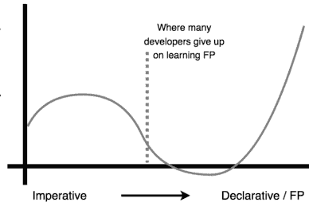

内化这个图表的真相，并为自己学习和将函数式编程原则应用于 JavaScript 的旅程设定现实的期望，这非常重要。你已经走到了这一步，这是一个相当大的成就。

但当你在向绝望和幻灭的低谷下滑时，不要停下来。另一边等待着的是一种思考和与代码交流的方式，它更具可读性、可理解性、可验证性，并且最终更可靠。

我想不出作为开发者有任何更崇高的目标去追求。感谢你分享我在 JavaScript 中学习函数式编程原则的旅程。我希望你的经历和我的一样丰富和充满希望！

那么`compose(..)`那四个`reducer`时就会出现问题，因为它们接受两个参数而不是一个。

在第9章中，我们有点取巧，使用了`list.push(..)`来通过副作用进行变异，而不是创建一个全新的数组来拼接。现在让我们退一步，正式一点：

```javascript
function strUppercaseReducer(list,str) {
    return [ ...list, strUppercase( str ) ];
}

function isLongEnoughReducer(list,str) {
    if (isLongEnough( str )) return [ ...list, str ];
    return list;
}

function isShortEnoughReducer(list,str) {
    if (isShortEnough( str )) return [ ...list, str ];
    return list;
}
```

稍后，我们将重新探讨这里是否必须通过创建新数组（例如`[...list,str]`）来拼接。

## 参数化 Reducer

两个过滤器`reducer`几乎完全相同，只是使用了不同的谓词函数。让我们对其进行参数化，这样就能得到一个可以定义任何过滤器`reducer`的通用工具：

```javascript
function filterReducer(predicateFn) {
    return function reducer(list,val){
        if (predicateFn( val )) return [ ...list, val ];
        return list;
    };
}
```

```javascript
var isLongEnoughReducer = filterReducer( isLongEnough );
var isShortEnoughReducer = filterReducer( isShortEnough );
```

让我们对`mapperFn(..)`进行同样的参数化，创建一个可以生成任何映射`reducer`的工具：

```javascript
function mapReducer(mapperFn) {
    return function reducer(list,val){
        return [ ...list, mapperFn( val ) ];
    };
}
```

```javascript
var strToUppercaseReducer = mapReducer( strUppercase );
```

我们的链式调用看起来还是一样：

```javascript
words
.reduce( strUppercaseReducer, [] )
.reduce( isLongEnoughReducer, [] )
.reduce( isShortEnoughReducer, [] )
.reduce( strConcat, "" );
```

## 提取公共的组合逻辑

仔细观察前面的`mapReducer(..)`和`filterReducer(..)`函数。你发现它们共享的公共功能了吗？

就是这部分：

```javascript
return [ ...list, .. ];

// 或者

return list;
```

让我们为这个公共逻辑定义一个辅助函数。但该叫它什么名字呢？

```javascript
function WHATSITCALLED(list,val) {
    return [ ...list, val ];
}
```

如果你仔细看这个`WHATSITCALLED(..)`函数做了什么，它接受两个值（一个数组和另一个值），并通过创建一个新数组并将该值拼接到末尾来“组合”它们。毫不夸张地，我们可以将其命名为`listCombine(..)`：

```javascript
function listCombine(list,val) {
    return [ ...list, val ];
}
```

现在让我们用`listCombine(..)`来重新定义我们的`reducer`辅助函数：

```javascript
function mapReducer(mapperFn) {
    return function reducer(list,val){
        return listCombine( list, mapperFn( val ) );
    };
}
```

```javascript
function filterReducer(predicateFn) {
    return function reducer(list,val){
        if (predicateFn( val )) return listCombine( list, val );
        return list;
    };
}
```

我们的链式调用看起来还是一样（所以我们不再重复）。

## 参数化组合

我们简单的`listCombine(..)`工具只是组合两个值的一种可能方式。让我们将其使用方式参数化，以使我们的`reducer`更通用：

```javascript
function mapReducer(mapperFn,combinerFn) {
    return function reducer(list,val){
        return combinerFn( list, mapperFn( val ) );
    };
}
```

```javascript
function filterReducer(predicateFn,combinerFn) {
    return function reducer(list,val){
        if (predicateFn( val )) return combinerFn( list, val );
        return list;
    };
}
```

使用这种形式的辅助函数：

```javascript
var strToUppercaseReducer = mapReducer( strUppercase, listCombine );
var isLongEnoughReducer = filterReducer( isLongEnough, listCombine );
var isShortEnoughReducer = filterReducer( isShortEnough, listCombine );
```

定义这些工具使其接受两个参数而不是一个，这对于组合来说不太方便，所以让我们使用我们的`curry(..)`方法：

```javascript
var curriedMapReducer =
    curry( function mapReducer(mapperFn,combinerFn){
        return function reducer(list,val){
            return combinerFn( list, mapperFn( val ) );
        };
    } );
```

```javascript
var curriedFilterReducer =
    curry( function filterReducer(predicateFn,combinerFn){
        return function reducer(list,val){
            if (predicateFn( val )) return combinerFn( list, val );
            return list;
        };
    } );
```

```javascript
var strToUppercaseReducer =
    curriedMapReducer( strUppercase )( listCombine );
var isLongEnoughReducer =
    curriedFilterReducer( isLongEnough )( listCombine );
var isShortEnoughReducer =
    curriedFilterReducer( isShortEnough )( listCombine );
```

这看起来更啰嗦了一些，可能看起来没什么用。

但这对于推导到下一步实际上是必要的。记住，我们最终的目标是能够`compose(..)`这些`reducer`。我们快到了。

## 组合柯里化函数

这一步是最难想象的。所以请慢慢读，仔细关注这里。

让我们考虑之前的柯里化函数，但不把`listCombine(..)`函数传给每一个：

```javascript
var x = curriedMapReducer( strUppercase );
var y = curriedFilterReducer( isLongEnough );
var z = curriedFilterReducer( isShortEnough );
```

思考一下所有这三个中间函数`x(..)`、`y(..)`和`z(..)`的形态。每一个都期望一个组合函数，并据此产生一个`reducer`函数。

记住，如果我们想要来自所有这些的独立`reducer`，我们可以这样做：

```javascript
var upperReducer = x( listCombine );
var longEnoughReducer = y( listCombine );
var shortEnoughReducer = z( listCombine );
```

但如果你调用`y(z)`而不是`y(listCombine)`会得到什么？基本上，将`z`作为`combinerFn(..)`传递给`y(..)`调用会发生什么？返回的`reducer`函数内部看起来有点像这样：

```javascript
function reducer(list,val) {
    if (isLongEnough( val )) return z( list, val );
    return list;
}
```

看到里面的`z(..)`调用了吗？这应该看起来不对劲，因为`z(..)`函数应该只接受一个参数（一个`combinerFn(..)`），而不是两个参数（`list`和`val`）。形态不匹配。那行不通。

让我们看看组合`y(z(listCombine))`。我们将它分解成两个独立的步骤：

```javascript
var shortEnoughReducer = z( listCombine );
var longAndShortEnoughReducer = y( shortEnoughReducer );
```

我们创建了`shortEnoughReducer(..)`，然后将*它*作为`combinerFn(..)`传递给`y(..)`，而不是调用`y(listCombine)`；这个新的调用产生了`longAndShortEnoughReducer(..)`。多读几遍直到理解为止。

现在思考：`shortEnoughReducer(..)`和`longAndShortEnoughReducer(..)`内部看起来是什么样的？你能在脑海中看到它们吗？

```javascript
// shortEnoughReducer，来自调用 z(...)：
function reducer(list,val) {
    if (isShortEnough( val )) return listCombine( list, val );
    return list;
}
```

```javascript
// longAndShortEnoughReducer，来自调用 y(...)：
function reducer(list,val) {
    if (isLongEnough( val )) return shortEnoughReducer( list, val );
    return list;
}
```

你看到`shortEnoughReducer(..)`如何在`longAndShortEnoughReducer(..)`内部取代了`listCombine(..)`的位置了吗？为什么这能行？

因为`reducer(..)`的形态和`listCombine(..)`的形态是一样的。换句话说，一个`reducer`可以被用作另一个`reducer`的组合函数；这就是它们的组合方式！`listCombine(..)`函数创建了第一个`reducer`，然后*那个`reducer`*可以被用作组合函数来创建下一个`reducer`，以此类推。

让我们用几个不同的值测试一下我们的`longAndShortEnoughReducer(..)`：

```javascript
longAndShortEnoughReducer( [], "nope" );
// []

longAndShortEnoughReducer( [], "hello" );
// ["hello"]

longAndShortEnoughReducer( [], "hello world" );
// []
```

`longAndShortEnoughReducer(..)`工具同时过滤掉了不够长和不够短的值，并且是在同一步完成这两种过滤。它是一个组合的`reducer`！

花点时间让这个概念沉淀一下。它仍然让我感到震惊。

现在，将`x(..)`（大写转换`reducer`生产者）引入组合：

```javascript
var longAndShortEnoughReducer = y( z( listCombine ) );
var upperLongAndShortEnoughReducer = x( longAndShortEnoughReducer );
```

正如`upperLongAndShortEnoughReducer(..)`这个名字所暗示的，它一步完成了所有三个步骤——一个映射和两个过滤！它内部看起来有点像这样：

```javascript
// upperLongAndShortEnoughReducer:
function reducer(list, val) {
    return longAndShortEnoughReducer( list, strUppercase( val ) );
}
```

一个字符串`val`被传入，经过`strUppercase(..)`大写处理，然后传递给`longAndShortEnoughReducer(..)`。该函数仅在字符串既足够长又足够短时才将其有条件地添加到列表中。否则，`list`将保持不变。

我的大脑花了几个星期才完全理解这个把戏的含义。所以如果你需要在这里停下来，重新读几十遍来理解它，别担心。慢慢来。

现在让我们验证：

## 附录 A：转换器

```javascript
upperLongAndShortEnoughReducer( [], "nope" );
// []
```

```javascript
upperLongAndShortEnoughReducer( [], "hello" );
// ["HELLO"]
```


```javascript
upperLongAndShortEnoughReducer( [], "hello world" );
// []
```

这个归约器就是`map`和两个`filter`的组合！这太棒了！

让我们回顾一下目前的进展：

```javascript
var x = curriedMapReducer( strUppercase );
var y = curriedFilterReducer( isLongEnough );
var z = curriedFilterReducer( isShortEnough );

var upperLongAndShortEnoughReducer = x( y( z( listCombine ) ) );

words.reduce( upperLongAndShortEnoughReducer, [] );
// ["WRITTEN","SOMETHING"]
```

这相当酷。但让我们做得更好。

`x(y(z( .. )))`是一种组合。让我们跳过中间变量名`x / y / z`，直接表达这个组合：

```javascript
var composition = compose(
    curriedMapReducer( strUppercase ),
    curriedFilterReducer( isLongEnough ),
    curriedFilterReducer( isShortEnough )
);

var upperLongAndShortEnoughReducer = composition( listCombine );

words.reduce( upperLongAndShortEnoughReducer, [] );
// ["WRITTEN","SOMETHING"]
```

## 函数式轻量级 JavaScript

思考一下组合函数中“数据”的流动：

1. `listCombine(..)`作为组合函数流入，用于为`isShortEnough(..)`创建过滤归约器。
2. 那个得到的归约器函数随后作为组合函数流入，用于为`isLongEnough(..)`创建过滤归约器。
3. 最后，*那个*得到的归约器函数作为组合函数流入，用于为`strUppercase(..)`创建映射归约器。

在前面的代码片段中，`composition(..)`是一个组合函数，它期望一个组合函数来创建一个归约器；`composition(..)`在这里有一个特殊的名字：转换器。将组合函数提供给转换器，就会产生组合后的归约器：

```javascript
var transducer = compose(
    curriedMapReducer( strUppercase ),
    curriedFilterReducer( isLongEnough ),
    curriedFilterReducer( isShortEnough )
);

words
.reduce( transducer( listCombine ), [] );
// ["WRITTEN","SOMETHING"]
```

> 关于前两个代码片段中`compose(..)`的顺序，我们需要做一个观察，这可能会让人困惑。回想一下我们最初的示例链，我们`map(strUppercase)`，然后`filter(isLongEnough)`，最后`filter(isShortEnough)`；这些操作确实按此顺序发生。但在第 4 章中，我们了解到`compose(..)`通常会按列出顺序的相反顺序运行其函数。那么为什么我们不需要在这里反转顺序*来获得相同的预期结果*呢？将`combinerFn(..)`从每个归约器中抽象出来，会在底层反转操作的有效应用顺序。所以，反直觉地，当组合一个转换器时，你实际上希望按期望的执行顺序列出它们！

## 列表组合：纯与不纯

顺便提一下，让我们重新审视我们的`listCombine(..)`组合函数实现：

```javascript
function listCombine(list,val) {
    return [ ...list, val ];
}
```

虽然这种方法是纯的，但它对性能有负面影响：对于归约的每一步，我们都会创建一个全新的数组来追加值，实际上是丢弃了之前的数组。这会产生大量被创建和丢弃的数组，这不仅对 CPU 不利，还会导致 GC 内存抖动。

相比之下，再看一下性能更好但不纯的版本：

```javascript
function listCombine(list,val) {
    list.push( val );
    return list;
}
```

单独考虑`listCombine(..)`，毫无疑问它是不纯的，这通常是我们想要避免的。然而，我们应该考虑一个更大的上下文。

`listCombine(..)`并不是一个我们直接交互的函数。我们不会在程序中的任何地方直接使用它；相反，我们让转换过程来使用它。

回到[第 5 章]，我们断言，减少副作用和定义纯函数的目标仅仅是向我们将贯穿程序使用的函数的 API 级别暴露纯函数。我们观察到，在内部，一个纯函数可以为了性能目的而“作弊”，只要它不违反纯净性的外部契约。

`listCombine(..)`更多是转换的一个内部实现细节——事实上，转换库通常会为你提供它！——而不是你将在程序中常规交互的顶层方法。

底线：我认为使用性能最优的`listCombine(..)`不纯版本是完全可接受的，甚至是值得推荐的。只要确保你在代码注释中注明它是不纯的即可！

## 替代组合

到目前为止，这就是我们通过转换得出的结果：

```javascript
words
.reduce( transducer( listCombine ), [] )
.reduce( strConcat, "" );
// WRITTENSOMETHING
```

这相当不错，但关于转换，我们还有一个最终的技巧。坦率地说，我认为这部分内容使得你到目前为止所投入的所有思考努力都变得值得。

我们能否以某种方式将这两个`reduce(..)`调用“组合”成一个`reduce(..)`？不幸的是，我们不能仅仅将`strConcat(..)`添加到`compose(..)`调用中；因为它是一个归约器，而不是一个期望组合的函数，它的形式对于组合来说是不正确的。

但让我们将这两个函数并排放置：

```javascript
function strConcat(str1,str2) { return str1 + str2; }

function listCombine(list,val) { list.push( val ); return list; }
```

如果你眯起眼睛看，你几乎可以看到这两个函数是如何可以互换的。它们操作不同的数据类型，但概念上它们做着同样的事情：将两个值组合成一个。

换句话说，`strConcat(..)`就是一个组合函数！

这意味着如果我们最终目标是得到一个字符串连接而不是一个列表，我们可以使用*它*来代替`listCombine(..)`：

```javascript
words.reduce( transducer( strConcat ), "" );
// WRITTENSOMETHING
```

砰！这就是转换器。我不会真的在这里摔话筒，只是轻轻放下...

## 到底是什么

深吸一口气。需要消化的内容很多。

让我们清空一下大脑，把注意力转回到仅仅在应用程序中使用转换器，而不用经历所有那些推导其工作原理的思维跳跃。

回想一下我们之前定义的辅助函数；为了清晰起见，让我们重新命名它们：

```javascript
var transduceMap =
    curry( function mapReducer(mapperFn,combinerFn){
        return function reducer(list,v){
            return combinerFn( list, mapperFn( v ) );
        };
    } );
```

```javascript
var transduceFilter =
    curry( function filterReducer(predicateFn,combinerFn){
        return function reducer(list,v){
            if (predicateFn( v )) return combinerFn( list, v );
            return list;
        };
    } );
```

也回想一下我们是这样使用它们的：

```javascript
var transducer = compose(
    transduceMap( strUppercase ),
    transduceFilter( isLongEnough ),
    transduceFilter( isShortEnough )
);
```

`transducer(..)`仍然需要一个组合函数（如`listCombine(..)`或`strConcat(..)`）传递给它，以生成一个转换-归约器函数，该函数随后可以与初始值一起在`reduce(..)`中使用。

但为了更声明式地表达所有这些转换步骤，让我们创建一个`transduce(..)`工具函数来为我们执行这些步骤：

```javascript
function transduce(transducer,combinerFn,initialValue,list) {
    var reducer = transducer( combinerFn );
    return list.reduce( reducer, initialValue );
}
```

这是我们一直在用的例子，整理如下：

```javascript
var transducer = compose(
    transduceMap( strUppercase ),
    transduceFilter( isLongEnough ),
    transduceFilter( isShortEnough )
);
```

```javascript
transduce( transducer, listCombine, [], words );
// ["WRITTEN","SOMETHING"]

transduce( transducer, strConcat, "", words );
// WRITTENSOMETHING
```

不赖吧，是吗？看到`listCombine(..)`和`strConcat(..)`函数可以互换地用作组合函数了吗？

### Transducers.js

最后，让我们使用[transducers-js](https://github.com/cognitect-labs/transducers-js)库来说明我们的运行示例：

```javascript
var transformer = transducers.comp(
    transducers.map( strUppercase ),
    transducers.filter( isLongEnough ),
    transducers.filter( isShortEnough )
);
```

```javascript
transducers.transduce( transformer, listCombine, [], words );
// ["WRITTEN","SOMETHING"]

transducers.transduce( transformer, strConcat, "", words );
// WRITTENSOMETHING
```

看起来和上面的几乎一样。

> 注意

上面的代码片段使用了`transformers.comp(..)`，因为库提供了它，但在这种情况下，我们第 4 章的`compose(..)`会产生相同的结果。换句话说，组合本身并不是一个对变换敏感的操作。

这个代码片段中的组合函数被命名为`transformer`，而不是`transducer`。这是因为如果我们调用`transformer( listCombine )`（或`transformer( strConcat )`），我们不会像之前那样得到一个直接的 transduce-reducer 函数。

`transducers.map(..)`和`transducers.filter(..)`是特殊的辅助函数，它们将常规的 predicate 或 mapper 函数转换为生成特殊变换对象（底层包装了 transducer 函数）的函数；库使用这些变换对象来进行 transducing。这种变换对象抽象的额外能力超出了我们将要探讨的范围，因此请查阅该库的文档以获取更多信息。

由于调用`transformer(..)`会产生一个变换对象而不是典型的二元 transduce-reducer 函数，该库还提供了`toFn(..)`来将变换对象适配为可供原生数组`reduce(..)`使用：

```javascript
words.reduce(
    transducers.toFn( transformer, strConcat ),
    ""
);
// WRITTENSOMETHING
```

`into(..)`是另一个提供的辅助函数，它会根据指定的空/初始值的类型自动选择默认的组合函数：

```javascript
transducers.into( [], transformer, words );
// ["WRITTEN","SOMETHING"]

transducers.into( "", transformer, words );
// WRITTENSOMETHING
```

当指定空`[]`数组时，内部调用的`transduce(..)`会使用类似我们的`listCombine(..)`辅助函数的默认实现。但当指定空`""`字符串时，则会使用类似我们的`strConcat(..)`函数。酷！

正如你所见，`transducers-js`库使 transducing 变得相当简单。我们可以非常有效地利用这种技术的威力，而无需陷入定义所有那些中间 transducer 生成工具的细节之中。

## 总结

Transduce 意味着用 reduce 进行变换。更具体地说，transducer 是一个可组合化简器。

我们使用 transducing 将相邻的`map(..)`、`filter(..)`和`reduce(..)`操作组合在一起。我们通过首先将`map(..)`和`filter(..)`表达为`reduce(..)`，然后抽象出常见的组合操作，来创建易于组合的一元 reducer 生成函数。

Transducing 主要提升了性能，如果用于 observable 上，这一点尤为明显。

但更广泛地说，transducing 是我们表达函数更声明式组合的方式，这些函数否则将无法直接组合。如果像本书中所有其他技术一样恰当地使用，结果是更清晰、更可读的代码！使用 transducer 的单个`reduce(..)`调用比追踪多个`reduce(..)`调用更容易推理。

# 附录 B：谦逊的 Monad

让我先承认一点：在开始写这个附录之前，我对 monad 是什么了解不多。而且我犯了大量的错误才得出一些合理的内容。如果你不相信我，去看看本书[Github 仓库](https://github.com/getify/Functional-Light-JS)中这个附录的提交历史！

我在书中包含 monad 这个主题，因为它是每个开发者在学习 FP 过程中都会遇到的旅程的一部分，正如我在写这本书时所经历的那样。

我们基本上是以对 monad 的简要概览来结束这本书，而大多数其他 FP 文献几乎是从 monad 开始的！我在“Functional-Light”编程中并不怎么 encounter 需要显式地以 monad 的形式来思考的需求，所以这部分内容更像是 bonus 而非核心。但这并不是说 monad 没有用处或不普遍——它们非常有用且普遍。

在 JavaScript FP 世界里有一个笑话，几乎每个人都必须写自己的教程或博客文章来解释 monad 是什么，就好像写这个本身就是一种成人礼。多年来，monad 被各种描绘为墨西哥卷饼、洋葱以及各种其他古怪的概念抽象。希望这里没有那种愚蠢的东西！

> A monad is just a monoid in the category of endofunctors.

我们在序言中引用了这句话，所以在这里回顾一下似乎很合适。但是，我们不会讨论 monoid、endofunctor 或范畴论。那句话不仅居高临下，而且完全无益。

我对这次讨论的唯一希望是，让你不再害怕 monad 这个术语或概念——我多年来一直如此！——并且能够在看到它们时识别出它们。你也许，只是也许，甚至会偶尔使用它们。

## 类型

FP 中有一个巨大的领域，我们在整本书中基本完全避开了：类型理论。我不会深入类型理论，因为坦率地说，我没有资格这样做。而且即使我做了，你也不会喜欢。

但我要说的是，monad 基本上是一种值类型。

数字 `42` 有一个类型（number!），它带来了我们依赖的某些特性和能力。字符串`"42"`可能看起来非常相似，但它在我们的程序中有不同的用途。

在面向对象编程中，当你有一组数据（即使是单个离散值），并且想要将某些行为与它捆绑在一起时，你会创建一个对象/类来表示该“类型”。实例则是该类型的成员。这种做法通常被称为“数据结构”。

我在这里将非常宽松地使用数据结构的概念，并断言我们可能会发现在程序中为某个值定义一组行为和约束，并将它们与该值捆绑成单一抽象是有用的。这样，当我们在程序中处理一个或多个这类值时，它们的行为会免费（自带）随之而来，并使处理它们更加方便。而方便，我指的是对你的代码读者来说更加声明式和易于理解！

Monad 是一种数据结构。它是一种类型。它是一组专门设计的特殊行为，使处理值变得可预测。


回想一下[第 9 章中我们讨论的 functors](第 9 章中我们讨论的 functors)：一个值加上一个类 map 的工具，用于对其所有组成数据成员执行操作。Monad 是包含一些额外行为的 functor。

## 松散的接口

实际上，monad 是一组相关数据类型的集合。它有点像接口，根据不同值的需求以不同的方式实现。每个实现都是不同类型的 monad。

例如，你可能会读到“Identity Monad”“IO Monad”“Maybe Monad”“Either Monad”或其他各种。每一个都定义了基本的 monad 行为，但根据每种不同类型 monad 的用例来扩展或覆盖交互。

不过它不仅仅是接口，因为对象成为 monad 不仅仅是因为存在某些 API 方法。这些方法之间的交互需要满足某组保证，才能称得上是 monad 的。这些众所周知的不变性对于 monad 的使用通过熟悉性来提高可读性至关重要；否则，它只是一个必须完全阅读才能理解的临时数据结构。

事实上，甚至没有一个单一统一的关于这些 monad 方法名称的约定，真正的接口会强制要求这一点；monad 更像是**松散接口**。有些人将某个方法称为 `bind(..)`，有些人称为 `chain(..)`，有些人称为 `flatMap(..)`，等等。

因此，monad 是一个具有足够方法的对象数据结构（方法名称或类型几乎可以是任意的），这些方法至少满足 monad 定义的主要行为要求。每种 monad 在最基本的要求之上都有不同的扩展。但是，因为它们在行为上有重叠，所以将两种不同的 monad 一起使用仍然是简单且可预测的。

正是在这种意义上，monad 有点像接口。

## Just 这个 Monad

你会遇到的许多其他 monad 之下，有一个基本的原始 monad 叫做 Just。它*只是*任何常规（即非空）值的简单 monad 包装。

由于 monad 是一种类型，你可能会认为我们会将 `Just` 定义为一个要实例化的类。这是一种有效的方式，但它会在方法中引入 `this` 绑定问题，我不想处理这些；相反，我将坚持使用简单的函数方式。

这是一个基本实现：

```javascript
function Just(val) {
    return { map, chain, ap, inspect };

    // ********************

    function map(fn) { return Just( fn( val ) ); }

    // 又名：bind, flatMap
    function chain(fn) { return fn( val ); }

    function ap(anotherMonad) { return anotherMonad.map( val ); }

    function inspect() {
        return `Just(${ val })`;
    }
}
```

## 注意

`inspect(..)` 方法在此处包含仅为演示目的。它在单子意义上没有直接作用。

你会注意到，无论 `Just(..)` 实例持有的 `val` 值是什么，它永远不会被改变。所有单子方法都创建新的单子实例，而不是改变单子本身的值。

如果大部分内容现在看起来不太明白，请不要担心。我们不会过于纠结于细节或单子设计背后的数学/理论。相反，我们将更多地关注说明我们能用它们做什么。

## 使用单子方法

所有单子实例都将具有 `map(..)`、`chain(..)`（也称为 `bind(..)` 或 `flatMap(..)`）和 `ap(..)` 方法。这些方法及其行为的目的是为多个单子实例之间的交互提供一种标准化的方式。

让我们首先看看单子式的 `map(..)` 函数。就像数组上的 `map(..)`（参见[第 9 章](https://example.com/ch9)）使用其值调用映射器函数并产生一个新数组一样，单子的 `map(..)` 使用单子的值调用映射器函数，返回的任何内容都会包装在一个新的 Just 单子实例中：

```javascript
var A = Just( 10 );
var B = A.map( v => v * 2 );

B.inspect();                // Just(20)
```

单子式的 `chain(..)` 和 `map(..)` 的作用有点相似，但它随后会将结果值从其新的单子中“解包”。然而，与其非正式地思考“解包”单子，更正式的解释是 `chain(..)` 扁平化了单子。考虑：

```javascript
var A = Just( 10 );
var eleven = A.chain( v => v + 1 );

eleven;                     // 11
typeof eleven;              // "number"
```

`eleven` 是实际的原始数字 `11`，而不是持有该值的单子。

为了将 `chain(..)` 方法与我们已经学过的内容在概念上联系起来，我们要指出，许多单子实现将此方法命名为 `flatMap(..)`。现在，回想一下[第 9 章](https://example.com/ch9)中 `flatMap(..)` 对数组的作用（与 `map(..)` 相比）：

```javascript
var x = [3];

map( v => [v,v+1], x );          // [[3,4]]
flatMap( v => [v,v+1], x );      // [3,4]
```

看到区别了吗？映射器函数 `v => [v,v+1]` 产生一个 `[3,4]` 数组，它最终位于外层数组的第一个位置，所以我们得到 `[[3,4]]`。但 `flatMap(..)` 将内部数组扁平化到外层数组中，所以我们得到的只是 `[3,4]`。

这与单子的 `chain(..)`（通常称为 `flatMap(..)`）发生的事情是相同的。与 `map(..)` 得到一个持有该值的单子不同，`chain(..)` 额外将单子扁平化为底层值。实际上，`chain(..)` 通常实现为更高效，直接采取捷径，不首先创建那个中间单子，而不是先创建它再立即扁平化它。无论如何，最终结果是一样的。

说明 `chain(..)` 的一种方式是与 `identity(..)` 实用程序（参见第 3 章）结合使用，以有效地从单子中提取值：

```javascript
var identity = v => v;

A.chain( identity );           // 10
```

`A.chain(..)` 使用 A 中的值调用 `identity(..)`，`identity(..)` 返回的任何值（在这种情况下是 `10`）都直接出来，没有任何中间单子。换句话说，从之前的 `Just(..)` 代码清单中，我们实际上不需要包含那个可选的 `inspect(..)` 辅助函数，因为 `chain(identity)` 实现了相同的目标；它纯粹是为了在我们学习单子时便于调试。

至此，希望 `map(..)` 和 `chain(..)` 对你来说都感觉相当合理了。相比之下，单子的 `ap(..)` 方法初看起来可能更不直观。它看起来像是交互的奇怪扭曲，但其设计背后有深刻而重要的推理。让我们花点时间来分解它。

`ap(..)` 获取包装在单子中的值，并使用另一个单子的 `map(..)` 将其“应用”到另一个单子。好的，到目前为止还不错。

然而，`map(..)` 总是期望一个函数。这意味着你调用 `ap(..)` 的单子实际上必须包含一个函数作为其值，以传递给另一个单子的 `map(..)`。

困惑吗？是的，这可能不是你所期望的。我们将尝试简要说明，但请预期在你拥有更多接触和练习单子之前，这些事情会持续模糊一段时间。

我们将定义 `A` 为一个包含值 `10` 的单子，`B` 为一个包含值 `3` 的单子：

```javascript
var A = Just( 10 );
var B = Just( 3 );
```

```javascript
A.inspect();           // Just(10)
B.inspect();           // Just(3)
```

现在，我们如何创建一个新的单子，其中值 `10` 和 `3` 已经相加，比如说通过一个 `sum(..)` 函数？事实证明 `ap(..)` 可以提供帮助。

要使用 `ap(..)`，我们说过，首先需要构建一个包含函数的单子。具体来说，我们需要一个包含函数的单子，该函数本身包含（通过闭包记住）`A` 中的值。请花点时间理解一下。

要从 `A` 创建一个包含值函数的单子，我们调用 `A.map(..)`，给它一个柯里化函数，该函数“记住”提取的值（参见第 3 章）作为其第一个参数。我们将这个新的包含函数的单子称为 `C`：

```javascript
function sum(x,y) { return x + y; }
```

```javascript
var C = A.map( curry( sum ) );
```

```javascript
C.inspect();
// Just(function curried...)
```

想想这是如何工作的。柯里化的 `sum(..)` 函数需要两个值来完成工作，我们通过让 `A.map(..)` 提取 `10` 并传递给它来提供第一个值。`C` 现在包含一个通过闭包记住 `10` 的函数。

现在，将第二个值（`B` 中的 `3`）传递给 `C` 中等待的柯里化函数：

```javascript
var D = C.ap( B );
```

```javascript
D.inspect();           // Just(13)
```

值 `10` 来自 `C`，值 `3` 来自 `B`，`sum(..)` 将它们相加得到 `13` 并将其包装在单子 `D` 中。让我们将两个步骤放在一起，以便更清楚地看到它们的联系：

```javascript
var D = A.map( curry( sum ) ).ap( B );

D.inspect(); // Just(13)
```

为了说明 `ap(..)` 帮助我们做了什么，我们本可以通过以下方式获得相同的结果：

```javascript
var D = B.map( A.chain( curry( sum ) ) );

D.inspect(); // Just(13);
```

这当然只是一个组合（参见[第 4 章](link://chapter_4)）：

```javascript
var D = compose( B.map, A.chain, curry )( sum );

D.inspect(); // Just(13)
```

很酷，对吧！？

如果关于单子方法的讨论的*方式*到目前为止还不清楚，请返回并重新阅读。如果*原因*难以捉摸，请坚持下去。单子很容易让开发者困惑，这*就是*它的本质！

## Maybe

在函数式编程材料中，通常会介绍像 Maybe 这样的著名单子。实际上，Maybe 单子是两个更简单单子的特定配对：`Just` 和 `Nothing`。

我们已经见过 `Just`；`Nothing` 是一个持有空值的单子。Maybe 是一个持有 `Just` 或 `Nothing` 的单子。

# 附录 B：谦逊的单子

这是 Maybe 的最小实现：

```javascript
var Maybe = { Just, Nothing, of/* 又名：unit, pure */: Just };

function Just(val) { /* .. */ }

function Nothing() {
    return { map: Nothing, chain: Nothing, ap: Nothing, inspect };

    // ********************

    function inspect() {
        return "Nothing";
    }
}
```

## 注意

`Maybe.of(..)`（有时称为 `unit(..)` 或 `pure(..)`）是 `Just(..)` 的便捷别名。

与 `Just()` 实例相比，`Nothing()` 实例对所有单子方法都定义了空操作。因此，如果这样的单子实例出现在任何单子操作中，它的效果基本上就是短路，不会发生任何操作。请注意，这里没有对“空”的含义施加任何限制——你的代码可以决定这一点。稍后会详细介绍。

在 Maybe 中，如果一个值非空，则由 `Just(..)` 的实例表示；如果是空的，则由 `Nothing()` 实例表示。

但这种单子表示的重要性在于，无论我们拥有 `Just(..)` 实例还是 `Nothing()` 实例，我们都将相同地使用 API 方法。

Maybe 抽象的威力在于隐式地封装了这种行为/空操作的二元性。

## 不同的 Maybe

许多 JavaScript Maybe monad 的实现都包含一个检查（通常在 `map(..)` 中），用于判断值是否为 `null`/`undefined`，如果是则跳过行为。事实上，Maybe 之所以被认为有价值，正是因为它能通过封装的空值检查来自动实现短路行为。

以下是 Maybe 的典型示例：

```javascript
// 代替不安全的 `console.log( someObj.something.else.entirely )`：

Maybe.of( someObj )
.map( prop( "something" ) )
.map( prop( "else" ) )
.map( prop( "entirely" ) )
.map( console.log );
```

换句话说，如果在链中的任何位置我们得到了一个 `null`/`undefined` 值，Maybe 就会神奇地切换到空操作模式——它现在是一个 `Nothing()` monad 实例！——并停止执行链中后续的所有操作。这使得嵌套属性访问在某些属性缺失/为空时不会抛出 JS 异常。这很酷，无疑是一个非常有用的抽象！

但是……*这种 Maybe 的实现方式并非纯粹的 monad。*

Monad 的核心精神要求它必须对所有值都有效，且不能对值进行任何检查——哪怕是空值检查也不行。因此，其他那些实现是为了方便而走了捷径。这并不是什么大问题，但在学习新事物时，你应该先学习其最纯粹的形式，然后再去灵活变通。

我之前实现的 Maybe monad 与其他 Maybe 的主要区别在于，它没有内置空值检查。而且，我们仅将 Maybe 表示为 `Just(..)`/`Nothing()` 的松散配对。

那么等等。如果我们没有自动短路行为，Maybe 还有什么用？！这看起来就是它的全部意义啊。

别担心！我们只需在外部提供空值检查即可，Maybe monad 其余的短路行为都能正常工作。以下是如何用更“正确”的方式实现之前的嵌套属性访问（`someObj.something.else.entirely`）：

```javascript
function isEmpty(val) {
    return val === null || val === undefined;
}

var safeProp = curry( function safeProp(prop,obj){
    if (isEmpty( obj[prop] )) return Maybe.Nothing();
    return Maybe.of( obj[prop] );
} );
```

```javascript
Maybe.of( someObj )
.chain( safeProp( "something" ) )
.chain( safeProp( "else" ) )
.chain( safeProp( "entirely" ) )
.map( console.log );
```

我们创建了一个 `safeProp(..)` 来执行空值检查，如果值为空则选择 `Nothing()` monad 实例，否则通过 `Maybe.of(..)` 将值包装在 `Just(..)` 实例中。然后我们使用 `chain(..)` 代替 `map(..)`，`chain(..)` 知道如何“解包” `safeProp(..)` 返回的 monad。

在遇到空值时，我们同样获得了链的短路行为。我们只是没有把那个逻辑嵌入到 Maybe 中。

Monad 以及 Maybe 的优势在于，无论返回哪种 monad，我们的 `map(..)` 和 `chain(..)` 方法都能保持一致且可预测的交互。这非常酷！

## Humble（谦逊）

现在我们对 Maybe 及其作用有了更深的理解，我要给它加点变化——并为我们的讨论增添一些自嘲式的幽默——通过创建 Maybe+Humble monad。从技术上讲，`MaybeHumble(..)` 本身不是 monad，而是一个产生 Maybe monad 实例的工厂函数。

Humble 是一个公认的人为构造的数据结构包装器，它使用 Maybe 来追踪 `egoLevel` 数字的状态。具体来说，`MaybeHumble(..)` 产生的 monad 实例只有在自尊水平值足够低（小于 42！）时才会正向执行操作，否则它就是一个 `Nothing()` 空操作。这听起来很像 Maybe；确实非常相似！

以下是我们的 Maybe+Humble monad 的工厂函数：

```javascript
function MaybeHumble(egoLevel) {
    // 除 42 及以上的数字外，接受任何值
    return !(Number( egoLevel ) >= 42) ?
        Maybe.of( egoLevel ) :
        Maybe.Nothing();
}
```

你会注意到这个工厂函数有点像 `safeProp(..)`，它使用条件来决定应该选择 Maybe 的 `Just(..)` 还是 `Nothing()` 部分。

让我们展示一些基本用法：

```javascript
var bob = MaybeHumble( 45 );
var alice = MaybeHumble( 39 );

bob.inspect();            // Nothing
alice.inspect();          // Just(39)
```

如果 Alice 获得了一个大奖，现在对自己更加自信了呢？


```javascript
function winAward(ego) {
    return MaybeHumble( ego + 3 );
}

alice = alice.chain( winAward );
alice.inspect();          // Nothing
```

`MaybeHumble( 39 + 3 )`调用创建了一个`Nothing()` monad实例并从`chain(..)`调用返回，所以 Alice 现在不再符合谦逊的条件了。

现在，让我们一起使用几个 monad：

```javascript
var bob = MaybeHumble( 41 );
var alice = MaybeHumble( 39 );

var teamMembers = curry( function teamMembers(ego1,ego2){
    console.log( `Our humble team's egos: ${ego1} ${ego2}` );
} );

bob.map( teamMembers ).ap( alice );
// Our humble team's egos: 41 39
```

回顾之前`ap(..)`的用法，我们现在可以解释这段代码的工作原理。因为`teamMembers(..)`是柯里化的，`bob.map(..)`调用传入了 bob 的自尊水平值（41），并创建了一个包装了剩余函数的 monad 实例。然后对该 monad 调用`ap(alice)`会执行`alice.map(..)`并将该 monad 中的函数传入。效果是 bob 和 alice monad 的数值都被提供给了`teamMembers(..)`函数，从而打印出了所示的消息。

然而，如果其中一个或两个 monad 实际上是`Nothing()`实例（因为它们的自尊水平太高了）：

```javascript
var frank = MaybeHumble( 45 );

bob.map( teamMembers ).ap( frank );
// ..没有输出..

frank.map( teamMembers ).ap( bob );
// ..没有输出..
```

`teamMembers(..)`永远不会被调用（也不会打印任何消息），因为 frank 是一个`Nothing()`实例。这就是 Maybe monad 的力量，而我们的`MaybeHumble(..)`工厂函数允许我们根据自尊水平进行选择。酷！

## Humility（谦卑）

再举一个例子来展示我们 Maybe+Humble 数据结构的行为：

```javascript
function introduction() {
    console.log( "I'm just a learner like you! :)" );
}

var egoChange = curry( function egoChange(amount,concept,egoLevel) {
    console.log( `${amount > 0 ? "Learned" : "Shared"} ${concept}.` );
    return MaybeHumble( egoLevel + amount );
} );

var learn = egoChange( 3 );

var learner = MaybeHumble( 35 );

learner
.chain( learn( "closures" ) )
.chain( learn( "side effects" ) )
.chain( learn( "recursion" ) )
.chain( learn( "map/reduce" ) )
.map( introduction );
// Learned closures.
// Learned side effects.
// Learned recursion.
// ..没有更多输出..
```

不幸的是，学习过程似乎被提前中断了。你看，我发现只学东西而不与他人分享会让你的自尊膨胀过多，对你的技能没有好处。

让我们尝试一种更好的学习方式：

```javascript
var share = egoChange( -2 );

learner
.chain( learn( "closures" ) )
.chain( share( "closures" ) )
.chain( learn( "side effects" ) )
.chain( share( "side effects" ) )
.chain( learn( "recursion" ) )
.chain( share( "recursion" ) )
.chain( learn( "map/reduce" ) )
.chain( share( "map/reduce" ) )
.map( introduction );
// Learned closures.
// Shared closures.
// Learned side effects.
// Shared side effects.
// Learned recursion.
// Shared recursion.
// Learned map/reduce.
// Shared map/reduce.
// I'm just a learner like you! :)
```

边学边分享。这是学得更多、学得更好的最佳方式。

## 总结

Monad 到底是什么？Monad 是一种值类型、一种接口、一种具有封装行为的对象数据结构。

但这些定义都不是特别有用。这里尝试给出一个更好的定义：Monad 是你以更声明式的方式组织值周围行为的方式。

与本书中的其他内容一样，在 monad 有帮助的地方使用它，但不要仅仅因为函数式编程中的其他人都在谈论它就使用它。Monad 不是万能的银弹，但在保守使用时确实提供了一些实用价值。

# 附录 C：FP 库

如果你一直从头到尾阅读本书，不妨花一分钟停下来回顾一下，自从[第一章](https://example.com/ch1)以来你已经走了多远。这是一段相当长的旅程。我希望你学到了很多，并对如何在自己的程序中进行函数式思考有了深入的理解。

我想在结束本书时，给你一些关于使用常见/流行 FP 库的快速指引。这并不是对每一个库的详尽文档，而是快速浏览一下，当你从“Functional-Light”迈向更广泛的 FP 领域时需要注意的事项。

只要有可能，我建议你不要重复造轮子。如果你找到一个适合自己需求的 FP 库，就使用它。只有在找不到合适的库方法时，才使用本书中的临时辅助工具——或者发明你自己的！

## 值得探究的内容

让我们扩展一下[第一章中提到的需要了解的 FP 库列表](https://example.com/ch1)。我们不会涵盖所有这些（因为有很多重叠），但以下这些应该在你的关注范围内：

- [Ramda](https://ramdajs.com)：通用 FP 工具
- [Sanctuary](https://sanctuary.js.org)：面向 FP 类型的 Ramda 伴侣库
- [lodash/fp](https://lodash.com)：通用 FP 工具
- [functional.js](https://functionaljs.com)：通用 FP 工具
- [Immutable](https://immutable-js.com)：不可变数据结构
- [Mori](https://swannodette.github.io/mori)：（受 ClojureScript 启发的）不可变数据结构
- [Seamless-Immutable](https://github.com/rtfeldman/seamless-immutable)：不可变数据辅助工具
- [transducers-js](https://github.com/cognitect-labs/transducers-js)：转换器
- [monet.js](https://monet.github.io)：单子类型

还有许多其他优秀的库不在此列表中。它不在我的列表里并不意味着它不好，这个列表也不是特别的推荐。这只是对 JavaScript 中 FP 领域的快速一瞥。一个更长的 FP 资源列表可以在[这里找到](https://)。

有一个对 FP 世界极其重要的资源——它不是一个库，而更像是一部百科全书！——那就是[Fantasy Land](https://)（简称 FL）。

这绝对不是给胆小者准备的轻松读物。它是一份完整详细的路线图，涵盖了 FP 在 JavaScript 中的所有诠释。FL 已成为 JavaScript FP 库事实上的标准，以确保最大的互操作性。

Fantasy Land 几乎与“Functional-Light”完全相反。它是 JavaScript 中 FP 的全面、毫无保留的方法。也就是说，当你超越本书的内容时，FL 很可能会在你的道路上出现。我建议你将其加入书签，并在用本书的概念进行了至少六个月的实际练习后再回来阅读。

## Ramda (0.23.0)

根据[Ramda 文档](https://)：

> Ramda 函数会自动柯里化。

> Ramda 函数的参数排列方式使其便于柯里化。要操作的数据通常放在最后。

我发现这个设计决策是 Ramda 的优势之一。同样重要的是要注意，Ramda 的柯里化形式（似乎与大多数库一样）是我们在第三章讨论过的[“松散柯里化”](https://)。

[第三章的最后一个示例](https://)——回想一下定义一个无参的`printIf(..)`工具——可以用 Ramda 这样实现：

```javascript
function output(msg) {
    console.log( msg );
}

function isShortEnough(str) {
    return str.length <= 5;
}

var isLongEnough = R.complement( isShortEnough );

var printIf = R.partial( R.flip( R.when ), [output] );

var msg1 = "Hello";
var msg2 = msg1 + " World";

printIf( isShortEnough, msg1 );         // Hello
printIf( isShortEnough, msg2 );

printIf( isLongEnough, msg1 );
printIf( isLongEnough, msg2 );          // Hello World
```

与[第三章的方法](chapter-3)相比，有几点不同：

- 我们使用`R.complement(..)`而不是`not(..)`来围绕`isShortEnough(..)`创建一个否定函数`isLongEnough(..)`。
- 我们使用`R.flip(..)`而不是`reverseArgs(..)`。重要的是要注意，`R.flip(..)`只交换前两个参数，而`reverseArgs(..)`反转所有参数。在这种情况下，`flip(..)`对我们来说更方便，所以我们不需要做`partialRight(..)`或任何类似的技巧。
- `R.partial(..)`将其后续所有参数（函数之后的）作为一个数组接收。
- 因为 Ramda 使用的是松散柯里化，我们不需要使用`R.uncurryN(..)`来获得一个同时接受两个参数的`printIf(..)`。如果需要的话，它看起来会像`R.uncurryN( 2, .. )`包裹在`R.partial(..)`调用周围；但那是没有必要的。

Ramda 是一个非常流行且强大的库。如果你正在练习向代码库中添加 FP，这是一个非常好的起点。

## Lodash/fp (4.17.4)

Lodash 是整个 JS 生态系统中最流行的库之一。他们发布了一个“对 FP 友好”的 API 版本，称为“lodash/fp”。

在第九章中，我们研究了组合独立的列表操作（`map(..)`、`filter(..)`和`reduce(..)`）。以下是我们用“lodash/fp”实现的方式：

```javascript
var sum = (x,y) => x + y;
var double = x => x * 2;
var isOdd = x => x % 2 == 1;

fp.compose( [
    fp.reduce( sum )( 0 ),
    fp.map( double ),
    fp.filter( isOdd )
] )
( [1,2,3,4,5] );           // 18
```

与更熟悉的`_.`命名空间前缀不同，“lodash/fp”使用`fp.`作为其方法的命名空间前缀。我发现这是一个有帮助的区分方式，而且通常来说也比`_.`更容易阅读！

注意`fp.compose(..)`（在 lodash 本身中也被称为`_.flowRight(..)`）接收一个函数数组，而不是单个参数。

你无法战胜 lodash 的稳定性、广泛的社区支持和性能。它是你探索 FP 的可靠选择。

## Mori (0.3.2)

在第六章中，我们已经简要浏览了 Immutable.js 库，它可能是最著名的不可变数据结构库。

让我们转而看看另一个流行的库：[Mori](http://swannodette.github.io/mori/)。Mori 的设计采用了不同的（表面上更像 FP 的）API 思路：它使用独立函数，而不是直接针对值的方法。

```javascript
var state = mori.vector( 1, 2, 3, 4 );

var newState = mori.assoc(
    mori.into( state, Array.from( {length: 39} ) ),
    42,
    "meaning of life"
);

state === newState;                          // false

mori.get( state, 2 );                        // 3
mori.get( state, 42 );                       // undefined

mori.get( newState, 2 );                     // 3
mori.get( newState, 42 );                    // "meaning of life"

mori.toJs( newState ).slice( 1, 3 );          // [2,3]
```

关于这个示例中 Mori 的一些有趣之处：

- 我们使用的是`vector`而不是`list`（正如有人可能假设的那样），主要是因为文档说明它的行为更符合我们对 JS 数组的预期。
- 我们不能像对 JS 数组那样随意设置超出向量末尾的位置；那会抛出异常。所以我们必须首先使用`mori.into(..)`和一个大小适当的额外槽位数组来“增长”向量。一旦我们有了 43 个槽位的向量（4 + 39），我们就可以使用`mori.assoc(..)`方法将最后一个槽位（位置 42）设置为`"meaning of life"`值。
- 使用`mori.into(..)`创建更大的向量，然后用`mori.assoc(..)`从中创建另一个向量的中间步骤可能听起来效率低下。但不可变数据结构的美妙之处在于这里没有发生任何克隆。每次进行“更改”时，新数据结构只是跟踪与之前状态的差异。

Mori 深受 ClojureScript 的启发。如果你有（或目前正在使用！）该语言的经验，它的 API 会非常熟悉。由于我没有那种经验，我发现方法名称有点难以习惯。

但我真的很喜欢独立函数的设计，而不是针对值的方法。Mori 还有一些自动返回常规 JS 数组的函数，这是一个很好的便利。

## 额外内容：FPO

在[第二章中，我们介绍了一种模式](Chapter 2, we introduced a pattern)来处理称为“命名参数”的参数，在 JS 中这意味着在调用点使用一个对象来将属性映射到解构的函数参数：

```javascript
function foo( {x,y} = {} ) {
    console.log( x, y );
}

foo( {
    y: 3
} );                 // undefined 3
```

然后在[第三章中，我们讨论了扩展](Chapter 3, we talked about extending)我们关于柯里化和部分应用的思想，使其适用于命名参数，像这样：

```javascript
function foo({ x, y, z } = {}) {
    console.log( `x:${x} y:${y} z:${z}` );
}

var f1 = curryProps( foo, 3 );

f1( {y: 2} )( {x: 1} )( {z: 3} );
```

这种风格的一个主要好处是能够以任意顺序传递参数（即使是通过柯里化或部分应用！），而无需做`reverseArgs(..)`风格的参数的混乱。另一种是能够通过简单省略来跳过可选参数，而不是传递一个难看的占位符。

在我学习函数式编程（FP）的旅程中，我经常被传统位置参数函数的这两种不便之处所困扰；因此，我非常欣赏命名参数风格，因为它能解决这些问题。

有一天，我一边琢磨这种 FP 编码风格，一边想，如果整个 FP 库的所有 API 方法都以这种风格暴露出来，会是什么样子。我开始进行实验，并将这些实验展示给一些 FP 爱好者，得到了一些积极的反馈。

从这些实验中，[FPO](pronounced “eff-poh”)库最终诞生了；以防你好奇，FPO 代表“FP-with-Objects”（基于对象的 FP）。

根据文档：


```js
// Ramda 的 `reduce(..)`
R.reduce(
    (acc, v) => acc + v,
    0,
    [3, 7, 9]
); // 19

// FPO 命名参数方法风格
FPO.reduce({
    arr: [3, 7, 9],
    fn: ({ acc, v }) => acc + v
}); // 19
```

在传统的 `reduce(..)` 库实现（如 Ramda）中，初始值参数位于中间位置，并且不是可选的。FPO 的 `reduce(..)` 方法可以按任意顺序接收参数，并且你可以根据需要省略可选的初始值。

与大多数其他 FP 库一样，FPO 的 API 方法会自动进行宽松柯里化（loose-curried），因此你不仅可以按任意顺序提供参数，还可以通过多次调用来特化函数：

```js
var f = FPO.reduce({ arr: [3, 7, 9] });
```

```js
// 稍后
```

```js
f({ fn: ({ acc, v }) => acc + v }); // 19
```

最后，FPO 的所有 API 方法也使用传统的位置参数风格暴露——你会发现它们都与 Ramda 和其他库非常相似——位于 `FPO.std.*` 命名空间下：

```js
FPO.std.reduce(
    (acc, v) => acc + v,
    undefined,
    [3, 7, 9]
); // 19
```

如果 FPO 的 FP 命名参数形式吸引了你，或许可以去看看这个库，看看你的想法。它拥有完整的测试套件，并涵盖了你期望的大部分主要 FP 功能，包括我们在本文中介绍的所有内容，帮助你开始并掌握“轻量函数式 JavaScript”！

## 额外内容 #2：fasy

FP 迭代（如 `map(..)`、`filter(..)` 等）几乎总是被建模为同步操作，这意味着我们立即急切地执行所有步骤。事实上，其他 FP 模式，如组合（composition）甚至转换（transducing），也是迭代，并且也以完全相同的方式建模。

但是，如果迭代中的一个或多个步骤需要异步完成，会发生什么呢？你可能会立刻想到 Observable（参见[第 10 章](#)）是自然而然的答案，但它们并非我们需要的。

让我快速说明一下。

想象一下，你有一个 URL 列表，代表你想加载到网页中的图像。图像的获取显然是异步的。所以，这不会像你希望的那样直接工作：

```js
var imageURLs = [
    "https://some.tld/image1.png",
    "https://other.tld/image2.png",
    "https://various.tld/image3.png"
];
```

```js
var images = imageURLs.map(fetchImage);
```

`images` 数组不会包含图像对象。根据 `fetchImage(..)` 的行为，它很可能在下载完成后返回一个图像对象的 Promise。所以 `images` 现在是一个 Promise 列表。

当然，你可以接着使用 `Promise.all(..)` 等待所有这些 Promise 解析，然后在完成时得到一个图像对象结果的数组：

```js
Promise.all(images)
    .then(function allImages(imgObjs) {
        // ..
    });
```

不幸的是，这个“技巧”只有在你要并发地（而不是串行地，一个接一个地）执行所有异步步骤时才有效，并且仅当操作是如图所示的 `map(..)` 调用时才有效。如果你想要串行异步，或者你想，例如，并发地执行 `filter(..)`，这就行不通了；虽然可能，但会更混乱。

有些操作天生就需要串行异步，例如异步 `reduce(..)`，它显然需要从左到右一次处理一个步骤；这些步骤无法并发运行，否则该操作将失去意义。

正如我所说，Observable（参见第 10 章）不是解决这类任务的答案。原因是，Observable 的异步协调发生在独立的操作之间，而不是在同一操作级别上的步骤/迭代之间。

另一种想象这种区别的方式是，Observable 支持“垂直异步”，而我所说的是“水平异步”。

考虑：

```js
var obsv = Rx.Observable.from([1, 2, 3, 4, 5]);

obsv
    .map(x => x * 2)
    .delay(100)       // <-- 垂直异步
    .map(x => x + 1)
    .subscribe(v => console.log);
// {100 毫秒后}
// 3
// 5
// 7
// 9
// 11
```

如果因为某种原因，我想确保 `1` 被第一个 `map(..)` 处理和 `2` 被处理之间有 100 毫秒的延迟，那就是我指的“水平异步”。目前还没有一种简洁的方式来建模这一点。

当然，我在这个描述中使用了任意的延迟，但在实践中，这更可能是串行异步，比如异步 `reduce`，其中该归约迭代的每一步都可能需要一些时间才能完成并让下一步被处理。

那么，我们如何在异步操作中支持串行和并发迭代呢？

**fasy**（发音像“Tracy”，但首字母是“f”）是我构建的一个小工具库，专门用于支持这类任务。你可以在这里找到更多关于它的信息。

为了说明 **fasy**，让我们考虑一个并发的 `map(..)` 与一个串行的 `map(..)`：

```js
FA.concurrent.map(fetchImage, imageURLs)
    .then(function allImages(imgObjs) {
        // ..
    });

FA.serial.map(fetchImage, imageURLs)
    .then(function allImages(imgObjs) {
        // ..
    });
```

在这两种情况下，`then(..)` 处理程序都只会在所有获取操作完全完成后被调用。区别在于获取操作是会全部并发启动（即“并行”），还是一次启动一个。

你的直觉可能是并发总是更优的，虽然这可能很常见，但并非总是如此。

例如，如果 `fetchImage(..)` 维护一个已获取图像的缓存，并在进行实际网络请求之前检查缓存，那会怎样？除此之外，如果 `imageURLs` 列表中可能有重复项，又会怎样？你肯定希望第一次获取图像 URL 完成（并填充缓存），然后再检查列表中后面重复的图像 URL。

再次强调，不可避免地会有需要并发或串行异步的情况。异步归约总是串行的，而异步映射可能更倾向于并发，但在某些情况下也可能需要串行。这就是为什么 fasy 支持所有这些选项。

除了 Observable，fasy 将帮助你将更多的 FP 模式和原则扩展到你的异步操作中。

## 总结

JavaScript 并非特别设计为一种 FP 语言。然而，它确实拥有足够的基础（如函数值、闭包等），让我们能够使其对 FP 友好。而我们在这里考察的库将帮助你做到这一点。

掌握了本书的概念，你就准备好开始处理现实世界的代码了。找一个好用且舒适的 FP 库，然后投入进去。练习、练习、再练习！

那么……就是这样了。我把我现在拥有的东西都分享给你了。我在此正式授予你“轻量函数式 JavaScript”程序员的称号！是时候结束我们共同学习 FP 故事的这个“章节”了。但我的学习之旅仍在继续；我希望你的也是！

## 附录 C：FP 库

## 特别感谢所有我的众筹支持者

Christoph Bastanier, Marc Udoff, Gaston Longhitano, Sibin Kutty, Andres Carreno, Thao Dinh, Tim Saunders, James Butler, Aerox, Craig Rodrigues, Adam Fahy, Sheri Richardson, Florian Eschenbacher, Tyom Semonov, Wouter Appelmans, Marc Grabanski, Raul Costa, Benjamin Weber, Mason Spencer, Bob Woodard, Sam Blacklock, Vedran Blazenka, Austin Thompson, Rodrigo Perez Mendoza, Harishkumar Singh, Sebastian De Deyne, Vyacheslav Istomin, Eric Flamm, ximenean, Mhretab Kidane Tewele, Rodrigo Pimentel, Marcos Felipe Rodrigues, Hernan Onzalo, Derik Badman, byronbuckley, Altrim Beqiri, Luis Ruiz Pavón, Armand Zerilli, Joaquin Bonet Sanchez, Radimir Bitsov, Philipp Spieß, Nejc Zdovc, Jay Greasley, Eric Anderson, jens.anders.bakke, Matthew Bramer, Theodore Keloglou, Stoyan Delev, Gerardo Lisboa, Swee Me Chai, Christopher Lee, Daniel Henning, Brian Collins, Mark Jagger, Debjit Biswas, Federico Fazzeri, Chantal Galvez Omana, Piotr Seefeld, Chris Sanders, Francisco Gileno, Mario Blokland, hello, chris, David Gowrie, Alexander Matveyenko, simonkeary, Paolo Mariotti, VG Venkataraman, Pablo Hernan Codeiro, Tim Stone, virtualandy, Dror Ben-Gai, Garrett Dawson, Rob McMichael, Simon Angell, Raymond Zhou, Kiran Aghor, Ruozhou Fan, Jesse Harlin, Marissa Shaffer, Adam Rackis, Louis Phang, muraligold, liamsoup, Muhamed Delic, Laura, Goutham N Reddy, Christoph Herr, mary, cat2608, Chris Verachtert, Struan King, Christopher moate, Greg Bulmash, Michael Raumer, bondydaa, Scott Mueller, Ramnesh Bansal, Dean Gilewicz, Vassilis Mastorostergios, Richard Kichenama, Tyler Weeres, asgbja, Patrik Jarl, mightyvt, Paul Wilkins, Jason Yamada-Hanff, bfulop, Jonathan Church, Lex Szentmiklosy, girish.tryambake, Timo Laak, Joel McKinnon, Derek Trower, Patrik Niebur, James Spence, James Morgan, Tim Goshinski, Sean Reimer, ratracegrad, Michael Hearn, Kelly Ong, Charlie Hill, Daniel Osborne, James Williams, Rahat Ahmed, theo.fidry, Xinting He, Greg Marr, Todd Bernhardt, Saad Koubeissi, Will Hogan, Marko Lorentz, edhellon, Kai Schröder, Cy Iurinic, Andreas Windt, Salva MA, Nikita Sobyanin, Kieran Hoban, Werner Krauß, Dario De Bastiani, Matteo Hertel, Roland Jansen, Rolf Langenhuijzen, Heinrich Henning, Yurii Bodarev, Vickie Comrie, Chase Hagwood, philip.a.murphy, Christopher Stewart, Ernest Weems, Suhail Idrees, ashley wharton, Oscar Funes, Eduardo Rabelo, kajalchatterjee, Danko Dolinar, Brookes Stephens, Jeff Trimble, shoto miki, Rob Huelga, Jeroen Engels, Jay Buchta, Kristen Dyrr, kajalchatterjee, Barney Scott, Lluis Arévalo Salom, Jim Laughton, Kieran Hoban, Melissa Gore, Benjamin Diuguid, Romell Ian B. De La Cruz, Thanh Dung TRUONG, Newton Kitonga, Dan Talpau, Arthur Kashaev, David Pastor


Trey Aughenbaugh, melonique, Alexander Mays, Jacob Venable, Ricardo Valdivia Pinto, Niklas Lindgren, Paul Anguiano, Riyadh Al Nur, `diogoantunes.pt`, Courtney Myers, Stephanie Barnes, `frank edwards`, `lukas.weber`, `dimitar.trifonov`, `nils`, Scott Hardman, `marco.scarpa`, Nicholas Baldwin, Jan Hjør die, Peter Morcinek, Ronald Sim, `paul`, Terry J Godes, Tommy Koswara, Christian Buysschaert, Raziel Gershoni, Trevor Weaver, `jeremymabbott`, Richard A Gonzales, Michael Staub, Žan Koč evar, Zachary Schultz, Regenwurm, `robert jorgenson`, Justin Hinerman, `salgado_75`, Refael Ackermann, Bruno Belotti, Eric Lezotte, Juan Aramis, John Harding, `viktor.bartusek`, `caneris`, Mike Farrow, Peter Balkus, Joostc Schermers, Mr Miron Machnicki, Tomasz Kawik, Andrew Zen, Wil Pannell, Peter kellner, Ryan Zimmerman, `daniel stenger`, Mauro Gestoso, Tyler Wendlandt, Tim Evko, Aleksandar Benic, David Bachmann, Pavel Kovalyov, Richard Yu, Andy Gaskell, Daniele Morosinotto, Denislav Gan chev, Steve Pick, Alex Liang, Mozammel Haque, Matthew Hinton, Nick Cox, Emils Kraucis, Jason Yamada-Hanff, NEVZAT AKKAYA, `jowoo`, Laszlo Vadasz, Danko Dolinar, Benjamin Gandhi-Shepard, Josh Magness, Oleksii Doroshenko, Hendrik Neumann, Richard Kalehoff, Greg Munker, Chase Hagwood, Nicholas Paldino, Massimiliano Girol di, John Doe, Arnar Birgisson, John Mercer, Dave Marks, `anthony_falez`, Bernat Martinez Vidal, Andrés Roberto Rojas, David Beermann, Evan Johnson, Phill Price, Sean Reed, Uberto Rapizzi, Robert Dudley, Martin Flodin, Daniel Ehrlich, Christopher Schmitt, Michelle Janosi, Yurii Bodarev, Luis G Silva, Darko Kukovec, Ernest Weems, Matt Langston, Tim Pinoy, Ron Male, Luis Silva, Magnus Vaughan, James Hattox, Scott Arnold, Nick Cernis, Sundar Joshi, Linus Gubenis, Cai Lu, Sergey Samokhov, Javier Santa, Gabin Aureche, Nader Dabit, Misha Reyzlin, Tuija Latva, Ardian Haxha, Andrew Robbins, Jeff Bridgforth, Dallen Richard Loder, Stephan B, Grzegorz Ziolkowski, Andreas Gebhardt, Sergey Samokhov, Minh Nguyen, Dougal Campbell, Paul Thaden, Ravi Varanasi, Spandan Chatterjee, Andrew Leonard, Cindy Wong, Jerry Hampton, Marlon Huber-Smith, Dan Denney, Orhan Kupusoglu, Eric Masiello, David Litmark, Skip McBride, Benji Kay, Diego La Manno, Nick Cernis, `web`, Alexis Villegas Torres, Jon Samp, Galen Weber, Simone Lusenti, Corinna Cohn, `shino.sk`, Jaycee Cheong, Nathan Finch, Debjit Biswas, Robert Wilde, Marcelo Lazaroni de Rezende Junior, Stephen Price, Iurii Kucherov, Jedidiah Broadbent, Daniel Carral, Zach Wentz, Ivan Saveliev, Alex Tsai, Roland Tanglao, Brookes Stephens, Nick Perkins, Jinsy A Oommen, Simon de turck, Mihai Paun, Alexandar Anguelov, Gabin Aureche, `herve giraud`, Brad, `eduplessis`, Chetan Shenoy, Mark Lozano, Johannes Jaeger, `paganio`, Tony Brown, Mario Luevanos, Randy Ferrer, `ncubica`, Travis Nelson, ShangYo Chen, `mko`, Leo van Hengel, `swr`, Nick Freeman, Maarten Tibau, Matt Reich, DJ Adams, Nikola Malich, François Freelo, Sharon DiOrio, Mads Jensen, Colyn Brown, Brandon Newton, `ajmchambers`, `jmrussell22`, Justin Lowery, Nathan Schlehlein, Felipe Andrés Sepulveda, Conlin Durbin, Fer To, Mick Schouten - Bravebox, Dan Perrera, Benjamin Gandhi-Shepard, Sorin Gitlan, Loic Laudet, Yu Wu, Juan Pablo Lomeli Díaz, Dirk Peters, Fernando Agüero, Robbie Delfs, Alistair McDonald, Robin Valins, Vickie Comrie, Iago Sanjurjo, Jonathan Ng, Steven Nguyen, Cai Lu, Gunar Cassiano Gessner, Nick Klunder, Eduardo Rabelo, Zhæra Paaverud, Marcin Szyszko, Michael Green, Kaleb G Berry, Sarah Federman, Mark Keith, Marty Engleen, Chris Burke, Nick Plekhanov, Jason Bergquist, `pyjter`, Rob Staenke, Howard Fiorella, `francescodip`, Mauricio Nagaoka, Javier Santa, Robert Vane, Rodrigo Perez Mendoza, Victor Paolo Reyes, Derick Rodriguez, Iaroslav Minialo, Austin Wood, Yoko Dev, Andoni Zubimendi, Humza Bhakhrani, Xavier Gil, Sara Canfield, `mail`, `danyadsmith`, Nick Walt, Blake Johnston, `annoyingmouse`, Sergio Minutoli, Dan Sumption, Viet Truong, Francisco Ramini, Sean Matheson, Vedran Zakanj, Craig Riviere, Mike Behnke, Todd Spatafore, Bogdan Ungureanu, Vlady-slava Tykhomyrova, Linus Gubenis, Jem Bezooyen, Matthew Cooley, Jesper Zachariassen, Eric Lawrence, Jaime García, `juniormcbride`, Marcus Nielsen, Marcus Nielsen, David Demaree, `francis.auyeung`, Ivan Saveliev, Brooke Mitchell, Marcus Nielsen, Kimmo Saari, `jacobboomer`, Michael Iglesias, Kees van Ginkel, Charlie Hardt, Mike Doran, Marcel Barros Aparici, Kristoffer Östlund, Girish Nayak, Emmanuel Baidoo, `walterplus`, Sheikh Hassan, `alexreardon`, Virginia Older, Michael Porter, Nathan Gibbons, Jakub Synowiec, `eonlsson`, `jones.r.joshua`, Salva MA, Michael Anderson, Terrance Peppers, Mark Trostler, Daniel Auger, Amila Welihinda, `gaya.kessler`, Thomas Hopkins, Florian Goße, Michael Scherr, Josh Adam, `montogeek`, Teodora Nikolaeva, Wayne Montague, Wes Bos, Brian Whitton, Moises Sacal, John Robinson, `emiliehester`, Jonathan Boiser, Danny Arnold, Ivan Pintado, Jerzy Redlarski, Acie Slade, Callie O'Brien, Pablo Villoslada Puigcerber, Martin Pitt, Aiden Montgomery, Kieran Russell, Abraham Alcaina, Doris Y Riggs, Yasin Yaqoobi, Suhail Idrees, Ayush Mathur, `dlteron.green`, Dusan Radojevic, Michael Iglesias, Paulo Elias, Carles Andres, Dave Nugent, Jelle Kralt, VATSAL PANDE, Vladimir Jelincic, Kasper Filstrup, Jeffrey Denton, Ken Farrell, Anderson LM, Alex Lindgren, Mark Holmes, Mark Kramer, Thomas North Gamble, Mike Schall, `ashley wharton`, Daniel Bolívar, Pietari Heino, John Derr, Adrian Suciu, Marcel Michelfelder, Roberto Modica, Nicolas Quiroz, Marcin L, Benjamin Seber, `bc`, Deepak Vadithala, Daniel Legare, Anthony Maldarelli, Laura Little, `palarose`, Francisco Silva, Olivier Camon, Bohdan Ganický, Kishore Shiraguppi, `paul.sebborn`, Kanagaraj Mayilsamy, Arijit Bhattacharya, `joshua.travis`, René Schapka, Robert Bak, Pavlo Kovalov, `pp.koch`, Geert Plaisier, Stef Käser, Martin Lekvall, Erwin Mombay, Roger Saladrígas Sitja, Patrick Metzdorf, Brian Johnson, Lucas Everett, `auremoser`, J David Eisenberg, Jason Shoreman, Yuya Saito, Brian Ashenfelter, Minoru TODA, Andrew O'Neill, Denise Nepraunig, Eric J, Cristina Solana, `bob`, Scott Warren, Ryan Collins, John Meyer, Mohamed Chiadmi, Doug Shamoo, `paulo vieira`, Tim Gaudette, Trent Stromkins, `fogeltine`, `dhtrinh02`, Facundo De La Diaz, Kostas Minaidis, Peter Surma, Tara Manicsic, Luis Del Aguila, Eric Kinsella, Lukasz Pietraszek, Kamran Yahya, Scott Walter, John Cole, Leonardo Lewandowski, Rolf Langenhuijzen, Carlos López, Eric Alas, Victor Longon, `marko`, Adam Spooner, `michael`, Olivier Tille, Jose Luis Piedrahita, Simon St.Laurent, Adam Stocks, Richard Yoesting, Rik Watson, Ajaypal Cheema, Wayne Patterson, Ian Littman, Nick Cantelmi, Dennis Sänger, `jcreighton08`, Stefan Trost, Aaron Olson, Shreyas Anand, Philippe leger, Sindre Seppola, `wil.moore`, Roman Zolotarev, `car-los.araya`, Fredric Hawk, Fred Ostrander, Veli-Matti Hietala, `soundslikework`, Cam McVey, Marco Zapata, Erik Reyna, Jurmarcus Allen, Hugo Cruz, Christophe Pouliot, Vladimir Simonov, Nicholas Taylor, Jeff Trimble, Cássio Martins Antonio, Eric Alas, Peter deHaan, Paul Grock, Ivan Votti, Per Fröjd, Dennis Palmer, Tom Randolph, Ryan Ewing, Shaheer Ahmed Mir, Jarkko Tuunanen, Stefan Bruvik, Chris C, Gustavo Morales, Matteo Hertel, `cthos`, David Neal, Craig Patchett, Dan Rocha, `derhaug`, `mike3ike`, Nicolantonio Vignola, Francisco Javier Lopez Gonzalez, Cody Lindley, Ian jones, jack pallot, Thomas Greenhalgh, `smukkekim`, Mattias Johansson, Justin Harrison, Gajus Kuizinas, Norbert Sienkiewicz, Serge Lachapelle, `jay.paige`, Charles W Neill, Michael Pelikan, Joseph Cortese, `brian.r.hough`, John Hoover, Seth Messer, Jesse Tomchek, `philip.a.murphy`, Stuart Robson, `adam cavan`, Rey Bango, Andres Mijares, `ali`, Shawn Searcy, Konstantin Pschera, Richard Hinkamp, Simeon Vincent, Geoffrey Wiseman, Nick Dunn, `r3dDoX`, `nsteiner`, `fcojonathan`, `baldur.bjarnason`, Artem Sapegin, Jeremy Tymes, James Simpson, `jostylr`, Horváth László Gábor, Tom Martineau, Mike Stapp, `G P`, `M. Filacchioni`, Simon MacDonald, Devin Clark, David Vujic, Henry Andre, Django Janny, Dorian Camilleri, Kenneth Christiansen, Denis Wolf, `A. Bottazini`, Zouhir Chahoud, Marcello Romanelli, Dale Fukami, Miguel de la Cruz, Jason Finch, Lucy Barker, Vijay Pardeshi, Geoffrey Dhuyvetters, Chris Deck, Richard Japenga, `waldron.rick`, John Gibbon, `dciccale`, Jeff Adams, `juanfran`, `erwin.heiser`, Martin Sachse, Conor Cussell, `S. Wijesinghe`, `P. Mierzejewski`


## Functional-Light JavaScript 中文翻译版

**轻量函数式 JavaScript**是对 JavaScript 中函数式编程的一种平衡、务实的探索。

函数式编程（FP）是一种极其强大的编程范式，用于构建代码结构，能够产生更加**健壮**、**可验证**且**可读**的程序。如果你曾尝试学习 FP，却在“monad”等术语、范畴论等数学概念或 λ 等符号面前感到困惑，那么你并不孤单。

轻量函数式编程提炼了 FP 中最核心的要素——**函数纯度、值不可变性、组合**，以及其他更多内容！——将其转化为易于理解的 JavaScript 模式。本书摒弃了 FP 中常见的那种非黑即白的教条主义，教你如何逐行改进自己的程序。

> 通过专注于原则而非术语，我现在对函数式编程基础的理解自信多了。
>
> **HANNES LUND**，软件开发者

我可以肯定地说，FLJS 这本书令人震撼！

**ISLAM ATTRASH**，JS 工程师

**KYLE SIMPSON**是开放网络的布道者，对 JavaScript 的一切都充满热情。他是作家、培训师、演讲者和开源贡献者。

**ISBN 9781617296512**

电子书 US $35.99 - 包含 PDF、mobi 和 ePub 版本

`www.manning.com/books/functional-light-javascript`
