# JavaScript 函数式编程（JavaScript 和 React 函数式编程 第 4 卷）

## 引言

函数式编程正变得越来越流行，本书旨在阐明如何将 JavaScript 用作函数式语言。

事实证明，JavaScript 拥有作为函数式语言所需的一切。我们只需要从语言中移除某些特性即可。

本质上，我们将从代码中移除 `this` 关键字。这意味着我们不会使用类或带有 `this` 关键字的方法。这也意味着不使用自定义原型。

移除 `this` 还有其他好处。`this` 是 JavaScript 中许多困惑的根源，主要是因为它的值取决于函数的调用方式，而不是函数的定义位置。在许多情况下，`this` 指向了意想不到的函数上下文，从而导致错误。通过移除 `this`，所有相关问题都消失了。

JavaScript 既是一种函数式编程语言，也是一种基于原型的语言。如果我们去掉 `this`，剩下的 JavaScript 就是一门函数式编程语言。这甚至更好。

话虽如此，我们可以通过启用代码检查来从代码中移除 `this`。

以下是一个 lint 配置文件的示例，它禁用了使用 [Create React App](https://reactjs.org/docs/create-a-new-react-app.html) 构建的应用程序中的 `this` 关键字。

```json
{
  "extends": ["react-app"],
  "plugins": [
    "immutable"
  ],
  "rules": {
    "immutable/no-this": "error"
  }
}
```

`JavaScript without this` 看起来像是一种更好的函数式编程语言。

## 源代码

本书的项目文件可在 [`github.com/cristi-salcescu/functional-programming-in-javascript`](https://github.com/cristi-salcescu/functional-programming-in-javascript) 获取。

## 反馈

我很乐意听取您的反馈。如有关于本书的评论、问题或建议，请发送电子邮件至 `cristaliscescu@gmail.com`。提前感谢您考虑为本书撰写评论。

## 环境搭建

首先，我们需要搭建开发环境以使用最新的 JavaScript 特性。

### 包管理器

包管理器是一种用于以简单方式跟踪项目依赖关系的工具。在撰写本文时，Node.js 包管理器（简称 `npm`）是最流行的。让我们从安装 [Node.js](https://nodejs.org/en/download/) 开始。

然后可以在命令提示符中使用以下命令检查 Node.js 和 `npm` 的版本：

```bash
node --version
npm --v
```

### NPM 包

使用 `npm` 我们可以安装额外的包。这些包就是应用程序的依赖项。

`package.json` 文件存储了项目中使用的所有 node 包。这些包就是应用程序的依赖项。应用程序可以与其他开发者共享，而无需共享所有 node 包。使用 `npm install` 命令可以安装 `package.json` 文件中定义的所有包。

首先使用 `npm` 创建一个 `package.json` 文件。

```bash
npm init
```

我们需要一个工具，将我们的 JavaScript 代码转换为向后兼容的版本，并支持[模块](https://developer.mozilla.org/en-US/docs/Web/JavaScript/Guide/Modules)。我们需要 [Babel](https://babeljs.io/)。去安装必要的包。

```bash
npm install @babel/core @babel/node @babel/preset-env --save
```

安装的包可以在 `node_modules` 文件夹中找到。`--save` 标志告诉 `npm` 将包依赖关系存储在 `package.json` 文件中。

为了使用最新的 JavaScript，我们需要启用一个预设。创建 `.babelrc` 文件并启用 `@babel/preset-env` 预设。

```json
{
  "presets": ["@babel/preset-env"]
}
```

### 代码检查

代码检查是分析代码以发现潜在错误和风格问题的过程。检查器是一种运行并报告这些问题的工具。检查器对于代码格式化和使用最佳实践也很有用。

我们将使用 [ESLint](https://eslint.org/)。首先安装它。

```bash
npm install eslint --save-dev
```

检查规则可以在名为 `.eslintrc.*` 的配置文件中定义。

接下来，设置一个配置文件。

```bash
npx eslint --init
```

我们将使用的一个插件是 `eslint-plugin-functional`，所以让我们安装它。

```bash
npm install eslint-plugin-functional --save-dev
```

现在转到 `.eslintrc.json` 配置文件，编写禁止使用 `this` 关键字的检查规则。

```json
{
  "plugins": [
    "functional"
  ],
  "rules": {
    "functional/no-this-expression": "error"
  }
}
```

以下是如何对 `src` 文件夹中的所有文件运行代码检查。

```bash
npx eslint src
```

在使用 [Create React App](https://reactjs.org/docs/create-a-new-react-app.html) 创建的应用程序中，我们可以通过在启动开发服务器之前添加 `npx eslint src` 命令后跟 `&&` 来强制进行代码检查。

```json
"scripts": {
  "start": "npx eslint src && react-scripts start"
}
```

使用 `&&` 意味着 `&&` 两侧的内容都必须求值为 `true`。如果左侧命令失败，右侧命令将不会执行，因此在我们的情况下，开发服务器将不会启动。

### 集成开发环境

对于代码编辑，我们需要一个集成开发环境，简称 IDE。

我将使用 [Visual Studio Code](https://code.visualstudio.com/)，但您也可以使用任何您喜欢的编辑器。

为了编写命令，请在 Visual Studio Code 中打开应用程序文件夹。然后从“终端 -> 新建终端”打开终端并执行命令。

例如，要运行 `filter.js` 文件中的代码并检查结果，我们可以使用以下命令。

```bash
npx babel-node filter.js
```

为了获得即时代码检查反馈，我们可以安装 [ESLint 扩展 for VSCode](https://marketplace.visualstudio.com/items?itemName=dbaeumer.vscode-eslint)。代码检查使我们能够在更好的 JavaScript 子集中工作。

## 第 01 章：原始类型

我们通过查看语言中可用的第一种值类型来开始学习之旅。

### 原始类型

原始值包括数字、字符串、布尔值、`null` 和 `undefined`。在控制台中输出一些原始值。

```javascript
console.log(1);
console.log('text');
console.log(true);
```

所有这些原始值都有一个类型。我们可以使用 `typeof` 运算符找到值的类型。检查其中一些。

```javascript
console.log(typeof(1));
// "number"
console.log(typeof(''));
// "string"
console.log(typeof(true));
// "boolean"
```

有两种数字类型：`Number` 和 `BigInt`。我们主要使用第一种，它存储双精度浮点数。重要的是要知道浮点运算是不精确的。

```javascript
console.log(0.1 + 0.2);
// 0.30000000000000004
console.log(0.1 + 0.2 === 0.3);
// false
```

整数运算精确到 15 位。我们可以通过先乘后除来解决上述问题。

```javascript
console.log(1 + 2 === 3);
// true
console.log((0.1 * 10 + 0.2 * 10) / 10 === 0.3);
// true
```

`BigInt` 用于表示更大的数字。我们可以通过在整数文字末尾附加 `n` 来创建这样的数字。

```javascript
console.log(12345678987654321n);
```

字符串是文本。有三种定义字符串值的方式：单引号、双引号和反引号。

```javascript
"text"
'text'
`text`
```

`Undefined` 是一种只有一个值 `undefined` 的类型。`Null` 是一种只有一个值 `null` 的类型。`Boolean` 是一种有两个值 `true` 和 `false` 的类型。

### 原始类型上的方法

原始类型不是对象，但它们似乎表现得像对象，因为它们有方法。例如，我们可以在字符串原始类型上调用 `toLowerCase` 方法。如果字符串不是对象，这怎么可能？JavaScript 会创建一个包装对象并在运行 `toLowerCase` 方法后销毁它。

```javascript
'TEXT'.toLowerCase();
// "text"
```

我们可以访问原始类型上的现有属性，但不能更改它们或创建新属性。例如，`length` 属性返回字符串的长度。

```javascript
'ABCDEFG'.length
// 7
'ABCDEFG'.type = 'letters';
// Cannot create property 'type' on string 'ABCDEFG'
```

唯一不被视为对象的原始类型是 `null` 和 `undefined`。尝试对它们调用方法会抛出错误。

```javascript
null.toString();
// Cannot read property 'toString' of null
```

### 不可变性

不可变值是一旦创建就不能更改的值。

原始类型是不可变的。例如，在字符串上使用方法时，我们会创建新值。以下是使用 `trim` 方法的示例，该方法会删除字符串两端的空白。

```javascript
' 123 '.trim();
// '123';
```

`trim` 方法不会修改现有字符串。它会创建一个新字符串。

### 变量

我们需要区分变量和值。变量不是值。变量存储值。

我们可以将值赋给变量。此时，变量持有这些值。变量有一个名称，我们可以使用变量名来引用该值。

我们使用赋值 `=` 关键字将值存储在变量中。变量可以使用 `let`、`var` 或 `const` 语句声明。当我们声明一个变量而不给它赋值时，它的默认值是 `undefined`。

```javascript
let x;
console.log(x);
// undefined
```

变量存储对值的引用。值不包含变量。值可能包含其他值。

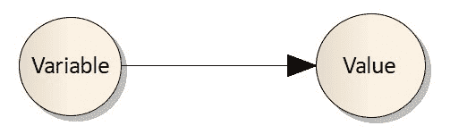

值有类型。变量具有其所存储值的类型。变量不绑定到特定类型。一个值总是具有相同的类型。`1` 始终是一个数字，但下面的变量 `x` 可以先是数字类型，然后是字符串类型。

```javascript
let x;
x = 1;
```

`x = '';` 当变量存储的值发生变化时，变量的类型也可能随之改变。动态类型意味着变量的类型可以在运行时改变。这种情况只发生在使用 `let` 或 `var` 声明的变量上。`const` 声明的变量无法重新赋值，因此其类型也不能改变。

### 回顾

数字、字符串、布尔值、`null` 和 `undefined` 是原始值。原始值是不可变的。值可以存储在变量中。变量会推断其所存储值的类型。

## 第 02 章：不可变数据对象

接下来，我们将了解什么是对象，以及如何创建和使用不可变对象。在函数式编程中，我们将对象用作数据结构。它们存储数据，并且没有行为。

### 对象

对象是属性的集合。每个属性都有一个键和一个值。在控制台中查看一个对象。

```javascript
const book = {
  title: 'JavaScript Allongé',
  author: 'Reginald Braithwaite',
  category: 'JavaScript'
};
console.log(book);
```

键是一个字符串，在集合中是唯一的。它区分大小写。我们可以使用点号表示法或方括号表示法来访问属性。

```javascript
console.log(book.title);
// "JavaScript Allongé"
console.log(book["title"]);
```

### 不可变性

不可变性是函数式编程的核心原则之一。变异意味着改变。说我们更改了对象的属性，等同于说我们变异了该对象。一个不可变对象一旦创建就不能被更改。JavaScript 对象并非如此。它们可以被修改。它们不是不可变的。请看下面的例子：

```javascript
let fruit = {
  name: 'Apple'
};
fruit.name = 'Orange';
// {name: 'Orange'}
```

如你所见，我们可以更改现有的 `fruit` 对象。即使使用 `const` 关键字声明，也会发生同样的情况。

```javascript
const fruit = {
  name: 'Apple'
};
fruit.name = 'Orange';
// {name: 'Orange'}
```

`const` 关键字指的是变量，而不是它存储的值。这意味着该变量不能被重新赋值。当它存储的值是不可变时，它才真正成为常量。

### 冻结

为了创建不可变对象，我们可以在创建时将其冻结。

```javascript
const fruit = Object.freeze({
  name: 'Apple'
});
fruit.name = 'Orange';
// Cannot assign to read only property 'name' of object
```

唯一的限制是 `Object.freeze` 执行的是浅冻结。它只影响对象的直接属性，即树中第一层的属性。例如，如果这些属性中的某一个包含另一个对象，则该对象不会受到影响。请看下面的例子。

```javascript
const book = Object.freeze({
  name: "How JavaScript Works",
  author: {
    firstName: 'Douglas',
    lastName: 'Crockford'
  }
});
book.author.firstName = '';
```

`book` 对象被更改了。我们不能给 `author` 属性重新赋值一个新对象，但可以修改它的属性。对于包含其他对象的对象，我们应该使用 [deepFreeze()](https://developer.mozilla.org/en-US/docs/Web/JavaScript/Reference/Global_Objects/Object/freeze) 工具函数。它会冻结给定对象内部所有对象的所有属性。

### 代码检查

启用不可变性的另一种方法是使用代码检查工具，例如 [ESLint](https://eslint.org/)。有几个插件可以帮助我们强制实现不可变对象。这些插件包括 [eslint-plugin-functional](https://www.npmjs.com/package/eslint-plugin-functional)、[eslint-plugin-fp](https://www.npmjs.com/package/eslint-plugin-fp) 或 [eslint-plugin-immutable](https://www.npmjs.com/package/eslint-plugin-immutable)。我们将使用 [eslint-plugin-functional](https://www.npmjs.com/package/eslint-plugin-functional)。

```bash
npm install eslint-plugin-functional --save-dev
```

安装插件后，修改 lint 配置文件 `.eslintrc.json` 以启用不可变数据。

```json
"plugins": [
  "functional"
],
"rules": {
  "functional/immutable-data": "error"
}
```

此时，尝试更改、删除或向对象添加属性将导致错误。

```javascript
const counter = {
  value: 1
};
counter.value = 2;
delete counter.value;
Object.assign(counter, { value: 2 });
// Modifying properties of existing object not allowed.
```

### 使用不可变对象

接下来，让我们看看如何“更改”不可变对象。更改不可变对象意味着创建一个更改后的副本。为此，使用[展开运算符语法](https://developer.mozilla.org/en-US/docs/Web/JavaScript/Reference/Operators/Spread_syntax)非常有用。

#### 更改属性


以下是修改现有属性的示例：

```javascript
const product = {
  name: 'Apple',
  quantity: 1
};
const newProduct = {
  ...product,
  quantity: 2
};
```

通过使用展开语法，我们首先复制了`product`对象的所有属性，然后添加了需要更改的属性及其新值。

### 添加属性

添加新属性可以用类似的方式完成。我们克隆对象，然后向其添加额外的属性。在下一个示例中，`product`对象被克隆，并添加了`type`属性。

```javascript
const product = {
  name: 'Apple',
  quantity: 1
};
const newProduct = {
  ...product,
  type: 'fruit'
};
```

### 删除属性

可以使用[解构语法](https://developer.mozilla.org/en-US/docs/Web/JavaScript/Reference/Operators/Destructuring_assignment#Rest_in_Object_Destructuring)中的剩余运算符来删除属性。在下一个示例中，通过解构并忽略`quantity`属性，将其从新`product`对象中移除。

```javascript
const product = {
  name: 'Apple',
  quantity: 1
};
const {
  quantity,
  ...newProduct
} = product;
console.log(newProduct);
//{name: "Apple"}
```

从现在开始，在接下来的示例中，默认已通过代码检查工具启用了不可变性。

### 回顾

不可变对象在创建后不能被更改。我们可以通过冻结对象或使用代码检查工具来启用不可变对象。展开运算符对于创建现有对象的更改副本非常方便。

## 第 03 章：函数

函数是我们定义和封装逻辑的主要方式。函数有一个参数列表和一个语句体。根据函数的创建方式，它可能有一个名称。大多数情况下，我会尽量使用命名函数。让我们看看定义函数的主要方式。

### 函数声明

可以使用`function`关键字声明来创建函数，后面跟着函数名称和参数列表。函数体放在花括号内。

```javascript
function sum(x, y){
  return x + y;
}
```

函数可以通过函数名后跟括号内的参数列表来调用。

```javascript
sum(1,2)
//3
```

如果没有传入值或传入`undefined`，函数参数可以使用默认值进行初始化。在下面的示例中，如果在调用`increment`函数时没有为`step`参数提供值，它将默认为`1`。

```javascript
function increment(n, step = 1){
  return n + step
}
const n = 1;
console.log(increment(n));
//2
console.log(increment(n, 2));
//3
```

以这种方式创建的函数会被提升到其作用域的顶部，因此可以在声明之前使用它们。函数的作用域可以是一个模块，也可以是定义当前函数的外部函数。

```javascript
sum(1,2);
//3
function sum(x, y){
  return x + y;
}
```

函数返回值。`return`语句指定返回的值。它也会停止函数的执行。

### 函数表达式

`function`关键字可用于在表达式内部定义函数。在函数声明中，`function`是行中的第一个关键字。如果不是这种情况，我们处理的就是函数表达式。对于函数表达式，名称是可选的，但在实现递归函数时，拥有名称会很方便。这是一个函数表达式。

```javascript
const sum = function(x, y){
  return x + y;
}
```

以下也是一个函数表达式。

```javascript
!function start(){
  console.log('start')
}
```

一旦`function`不是行中的第一个关键字，它就变成了函数表达式。函数名可以省略，并且可以自动执行。

```javascript
!function(){
  console.log('start')
}();
```

### 箭头函数表达式

箭头函数表达式是常规函数表达式的一种紧凑替代形式。箭头函数语法由参数列表、`=>`符号以及可选地用花括号括起来的函数体组成。

```javascript
const sum = (x, y) => x + y;
sum(1,2);
```

这次没有`function`关键字，也没有`return`语句。`=>`符号指向要返回的内容。

当箭头函数内部的逻辑包含多条语句时，我们使用花括号。此时需要`return`语句来返回结果。

```javascript
const sum = (x, y) => {
  return x + y;
}
```

两种函数表达式都不会被提升到其作用域的顶部。它们不能在声明之前使用。

#### 参数数量

函数的参数数量描述了该函数有多少个参数。

- 一元函数有一个参数。
- 二元函数有两个参数。
- n元函数有n个参数。
- 零元函数没有参数。

#### 纯函数

在函数式编程中，函数类似于数学函数。它们进行计算。这类函数被称为纯函数。

纯函数基于输入参数计算新值。它们是确定性函数。这意味着当使用相同输入调用时，它们返回相同的结果。`Math.random`和`Date.now`不是确定性函数，因为每次调用它们都会返回不同的结果。它们不能在纯函数内部使用。

纯函数不会修改函数执行的外部环境，因此它们不会写入外部环境，也不会读取可能从外部更改的数据。

以下是一个纯函数的示例。

```javascript
const number = 1.7654321;
function roundNumber(n, precision = 2) {
  const noAsString = n.toFixed(precision);
  return Number.parseFloat(noAsString);
}
console.log(roundNumber(number));
//1.77
```

`roundNumber`是一个纯函数，它使用其他纯函数`toFixed`和`parseFloat`将数字四舍五入到n位小数。

更改局部作用域之外的数据、读取可能从外部更改的数据，或任何对外部环境的改变，都是副作用。

正因为它们仅基于输入进行计算且没有副作用，所以更容易理解、测试或调试。

`Math.min`、`Math.max`、`Math.sqrt`是纯函数。事实上，除了`Math.random`之外，`Math`对象的所有静态方法都是纯函数。

### 总结

函数可以通过函数声明、函数表达式或箭头函数表达式来创建。在函数式编程中，函数应该像数学函数一样，只进行计算而不改变外部环境。

## 第 04 章：数组

数组是值的索引集合。数组和对象都是值的集合。实际上，数组是通过对象模拟实现的。

我们只需使用数组字面量即可创建数组。示例如下。

```javascript
const arr = [1, 2, 3];
```

检测一个值是否为数组可以使用`Array.isArray`。

```javascript
Array.isArray(arr);
//true
```

数组有一组用于数据转换的方法。数据转换是函数式编程真正大放异彩的任务之一。它通过识别所有转换操作（如过滤、映射、排序和聚合）的核心操作集，使这些转换更易于管理和理解。

### 过滤

考虑以下从数组中仅选择偶数的示例。

```javascript
const numbers = [1, 2, 3, 4];
function isEven(n) {
  return n % 2 == 0;
}
const evenNumbers = numbers.filter(isEven);
console.log(evenNumbers);
//[2, 4]
```

`filter`方法遍历数组中的所有元素，并应用`isEven`函数。它创建一个新数组，其中仅包含`isEven`函数返回`true`的那些元素。

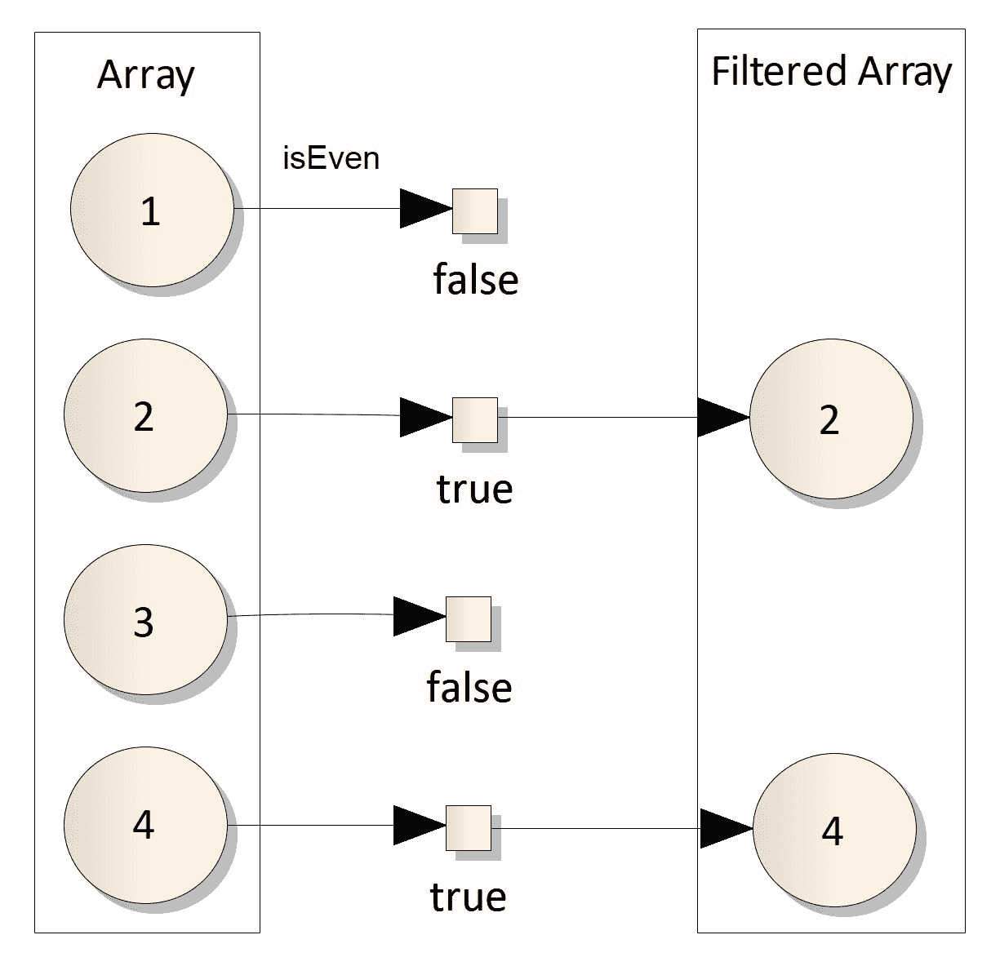

`isEven`是一个谓词函数。谓词函数是一个接受元素并返回布尔值的函数。该谓词是一元函数。

接下来，考虑一个游戏对象列表。

```javascript
const games = [
  { title: 'Starcraft', genre: 'RTS' },
  { title: 'Command and Conquer',  genre: 'RTS' },
  { title: 'Heroes of Might and Magic', genre: 'TBS' },
  { title: 'World of Warcraft', genre : 'MMORPG'}
]
```

我们将只选择策略游戏。为此，我们将构建一个谓词函数，该函数接受一个游戏对象，并根据其`genre`属性判断它是否为策略游戏。

```javascript
function isStrategy(game) {
  const strategyGenres = ['RTS', 'RTT', 'TBS', 'TBT'];
  return strategyGenres.includes(game.genre);
}
```

`includes`方法检查一个值是否在数组中，并返回`true`或`false`。

现在我们可以使用`filter`和谓词函数来仅选择策略游戏。

```javascript
const strategyGames = games.filter(isStrategy);
console.log(strategyGames);
//[ { title: 'Starcraft', genre: 'RTS' },
//  { title: 'Command and Conquer', genre: 'RTS' },
//  { title: 'Heroes of Might and Magic', genre: 'TBS' } ]
```

### 映射

接下来，我们将对数字列表应用映射转换。

```javascript
const numbers = [1, 2, 3, 4];
function triple(n) {
  return n * 3;
}
const newNumbers = numbers.map(triple);
console.log(newNumbers);
//[3, 6, 9, 12]
```

`map`方法将映射函数应用于数组中的所有元素，并创建一个包含结果的新数组。

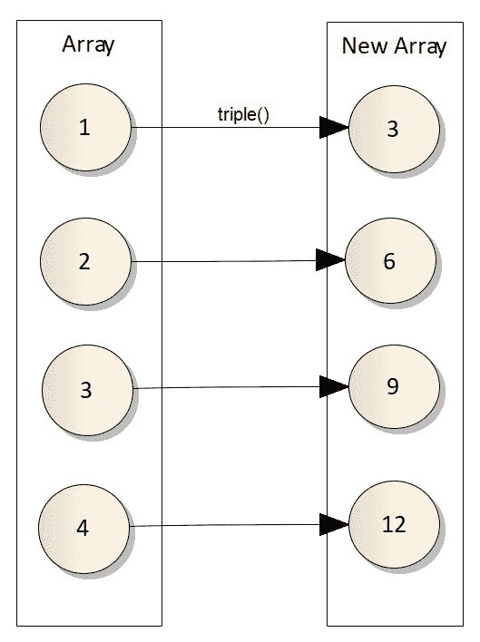

`triple`是一个映射函数。映射函数是一个接受元素并将其转换为新值的函数。它是一元函数。

接下来，让我们对游戏对象列表应用一个映射函数。

```javascript
const games = [
  { title: 'Starcraft', genre: 'RTS' },
  { title: 'Command and Conquer',  genre: 'RTS' },
  { title: 'Heroes of Might and Magic', genre: 'TBS' },
  { title: 'World of Warcraft', genre : 'MMORPG'}
]
```

下面的`toGameHtml`函数接受一个游戏对象并为其创建 HTML 字符串。

```javascript
function toGameHtml(game) {
  return `<div>${game.title}</div>`;
}
```

模板字符串允许我们将变量插入到字符串中。它们是字符串拼接的更好替代方案。插入模板字符串的变量用`${}`包围。模板字符串允许文本跨越多行。这有助于创建更易读的 HTML 字符串。

```javascript
function toGameHtml(game) {
  return `
<div>
  ${game.title}
</div>`;
}
```

现在我们可以使用映射函数将所有游戏对象转换为 HTML 字符串。

```javascript
const htmlRows = games.map(toGameHtml);
console.log(htmlRows);
//   [ '<div>Starcraft</div>',
//   '<div>Command and Conquer</div>',
//   '<div>Heroes of Might and Magic</div>',
//   '<div>World of Warcraft</div>' ]
```

`join`方法将数组的所有元素组合成一个字符串。它接受一个分隔符作为参数。如果未提供参数，它将所有元素组合在一起而不使用任何分隔符。

```javascript
console.log(htmlRows.join());
//"<div>Starcraft</div>,<div>Command and Conquer</div>,
//<div>Heroes of Might and Magic</div>,
//<div>World of Warcraft</div>"
```

### 聚合

聚合是将多个值分组为一个汇总值。

考虑以下代码。

```javascript
const numbers = [1, 3, 5, 7];
function add(total, n) {
  return total + n;
}
const total = numbers.reduce(add, 0);
console.log(total);
//16
```

`reduce`方法将列表缩减为单个值。`reduce`方法对数组中的每个元素应用归约函数以计算聚合值。它可以接受第二个参数作为初始聚合值。

`add`是归约函数。归约函数接受当前聚合值和当前元素，并返回新的聚合值。归约函数是二元函数。

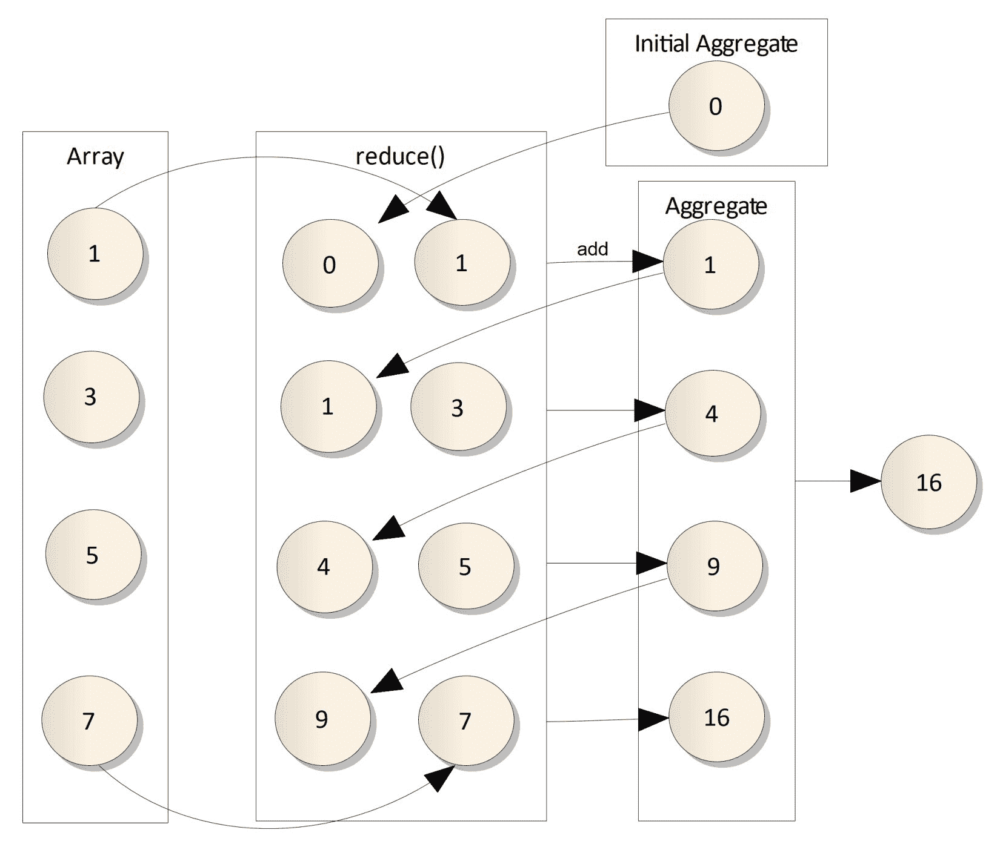

在第一次迭代中，聚合值为`0`，当前元素为`1`。应用归约函数得到新的聚合值`1`。在第四次迭代中，当前聚合值为`9`，当前元素为`7`。应用归约函数得到新的聚合值`16`。

让我们回到游戏对象数组，并计算每种类型的游戏数量。

```javascript
const games = [
  { title: 'Starcraft', genre: 'RTS' },
  { title: 'Command and Conquer',  genre: 'RTS' },
  { title: 'Heroes of Might and Magic', genre: 'TBS' },
  { title: 'World of Warcraft', genre : 'MMORPG'}
];
function countByGenre(countMap, game){
  const count = countMap[game.genre] || 0;
  return {
    ...countMap,
    [game.genre]: count + 1
  }
}
const gamesByGenreCounts = games
  .reduce(countByGenre, {});
console.log(gamesByGenreCounts);
//{ RTS: 2, TBS: 1, MMORPG: 1 }
```

`countByGenre`是归约函数。它从一个空对象作为聚合值开始，每一步都会增加当前游戏类型的游戏数量。更改聚合对象上的计数意味着创建一个具有新计数的对象。

### 排序

`sort`方法允许对数组进行排序。

```javascript
const numbers = [4, 2, 3, 1];
function asc(a, b) {
  if(a === b){
    return 0
  } else {
    if (a < b){
      return -1;
    } else {
      return 1;
    }
  }
}
const sortedNumbers = numbers.slice().sort(asc);
console.log(sortedNumbers);
//[1, 2, 3, 4]
```

`sort`方法使用比较函数进行排序。`asc`函数就是比较函数。它是一个二元函数，接受两个值并返回 -1、0 和 1。考虑比较函数接受两个值`a`和`b`。

- 如果值相等，返回 0。
- 如果值`a`在值`b`之前，返回 -1。
- 如果值`a`在值`b`之后，返回 1。

`sort`是一个不纯的方法。它会修改输入数组。这就是为什么它会给出 lint 错误。为了进行排序，我们需要先克隆数组。

```javascript
const sortedNumbers = numbers.sort(asc);
//Modifying an array is not allowed  functional/immutable-data
const sortedNumbers = numbers.slice().sort(asc);
const sortedNumbers = [...numbers].sort(asc);
```

`slice`会复制数组或数组的一部分。不带参数调用`slice`会复制整个数组。第一个参数是起始索引，第二个参数是结束索引。

### 搜索

`find`返回第一个匹配谓词函数的元素。`find`返回第一个匹配项后停止。`filter`从不停止，并返回包含所有匹配项的数组。`find`比`filter`更快。

`findIndex`返回第一个匹配项的索引。

`every`如果所有元素都匹配谓词函数，则返回`true`。它在第一个不匹配的元素处停止并返回`false`。

`some`如果至少有一个元素匹配谓词函数，则返回`true`。它在第一个匹配项处停止。

这四个方法都使用谓词函数，并根据返回值停止。


```javascript
const games = [
  { title: 'Starcraft 2', genre: 'RTS' },
  { title: 'Desperados 3', genre: 'RTT' },
  { title: 'Candy Crush Saga ', genre: 'Tile-matching' }
];

function isStrategy(game) {
  const strategyGenres = ['RTS', 'RTT', 'TBS', 'TBT'];
  return strategyGenres.includes(game.genre);
}

const first = games.find(isStrategy);
console.log(first);
// { title: 'Starcraft 2', genre: 'RTS' }

const firstIndex = games.findIndex(isStrategy);
console.log(firstIndex);
// 0

const areAll = games.every(isStrategy);
console.log(areAll);
// false

const hasOne = games.some(isStrategy);
console.log(hasOne);
// true
```

### `forEach`

`forEach` 接受一个函数，并对数组中的每个元素调用该函数。它以当前元素作为第一个参数，当前索引作为第二个参数来调用该函数。`forEach` 从不停止，会处理整个列表。它会忽略返回值。

```javascript
const numbers = [1, 2, 3];

function log(value) {
  console.log(value);
}

numbers.forEach(log);
// 1
// 2
// 3
```

### 不纯操作

当为对象启用不可变数据 lint 规则时，我们也会强制数组作为不可变结构。

```json
"functional/immutable-data": "error"
```

这意味着所有试图修改数组的不纯方法，如 `push`、`pop`、`unshift` 或 `shift`，都会导致 lint 错误。

`push` 将元素添加到数组末尾，并返回数组的新长度。`pop` 移除并返回数组的最后一个元素。`unshift` 将元素添加到数组开头，并返回数组的新长度。`shift` 移除并返回数组的第一个元素。

```javascript
const arr = [1, 2, 3];

arr.push(4);
arr.pop();
arr.unshift(0);
arr.shift();

// Modifying an array is not allowed
```

### 更改数组

接下来，看看如何在不可变数组上执行基本的添加、编辑和删除操作。考虑游戏对象数组。

```javascript
const games = [
  { id: 1, title: 'WarCraft' },
  { id: 2, title: 'X-COM: UFO Defense' }
];
```

#### 添加

`concat` 接受一个或多个数组并将它们连接在一起。它可以用于添加。它会创建一个包含新值的新数组。

```javascript
const newValue = { id: 3, title: 'The Settlers' };
const newGames = games.concat([newValue]);

console.log(newGames);

// [
//   { id: 1, title: 'WarCraft' },
//   { id: 2, title: 'X-COM: UFO Defense' },
//   { id: 3, title: 'The Settlers' }
// ]
```

另一种向数组添加值的方法是使用展开运算符。示例如下。

```javascript
const newGames = [...games, newValue];
```

#### 编辑

更改意味着创建一个新数组，其中包含指定索引位置的新值。我们可以使用 `map` 来实现。映射函数为指定索引返回新值，否则返回现有值。下面是一个更改索引 1 处游戏对象的示例。

```javascript
const id = 1;
const newValue = { id, title: 'WarCraft 2' };

const newGames = games.map(game =>
  (game.id === id)
    ? newValue
    : game
);

console.log(newGames);

// [
//   { id: 1, title: 'WarCraft 2' },
//   { id: 2, title: 'X-COM: UFO Defense' }
// ]
```

#### 删除

我们可以使用 `filter` 从数组中删除一个元素。它会返回一个新数组，排除指定索引处的元素。

```javascript
const id = 1;
const newGames = games.filter(game => game.id !== id);

console.log(newGames);

// [
//   { id: 2, title: 'X-COM: UFO Defense' }
// ]
```

### 总结

`filter` 从数组中选择通过谓词函数的元素。`map` 使用映射函数转换数组中的所有元素，并创建一个包含结果的新数组。`reduce` 使用归约函数将数组归约为单个值。`sort` 使用比较函数对数组元素进行排序。

## 第五章：一等函数

当一门语言将函数视为与其他值一样的值时，它就具有一等函数。在 JavaScript 中，函数可以像其他值一样使用。事实上，函数是对象，因此也是值。

### 一等函数

函数可以存储在变量中。我们之前已经见过这种情况。

```javascript
const square = x => {
  return x * x;
};
```

这里，我们使用箭头函数表达式定义了一个函数，然后将该函数存储在 `square` 变量中。函数会推断出变量的名称。然后我们可以使用该变量，通过在末尾添加括号 `()` 来调用函数。

```javascript
square(3);
// 9
```

函数可以放入像数组这样的数据结构中。看下一个例子。

```javascript
function toUpperCase(text) {
  return text.toUpperCase();
}

function toLowerCase(text) {
  return text.toLowerCase();
}

function trim(text) {
  return text.trim();
}

const functions = [
  toUpperCase,
  toLowerCase,
  trim
];

const text = '  StARt!';

functions.forEach(f => {
  const newText = f(text);
  console.log(newText);
});

// "START!"
// "start!"
// "StARt!"
```

在这个例子中，我们定义了三个函数，然后将它们放入一个名为 `functions` 的数组中。然后我们遍历该数组，并用 `text` 参数调用每个函数。结果会显示在控制台中。

当我们使用不带括号的函数名时，我们指的是函数本身。当我们在函数名后面加上括号时，我们指的是调用函数的结果。

函数可以作为参数传递给其他函数。在下一个例子中，我们定义了两个函数 `sum` 和 `multiply`，并将它们作为参数传递给另一个名为 `doOperation` 的函数。

```javascript
function sum(a, b) {
  return a + b;
}

function multiply(a, b) {
  return a * b;
}

function doOperation(operation, a, b) {
  return operation(a, b);
}

doOperation(sum, 2, 3);
// 5

doOperation(multiply, 2, 3);
// 6
```

函数可以返回其他函数。函数可以拥有属性和方法。例如，它们拥有 `name` 属性，可以以字符串形式访问函数名。函数还有像 [`call()`](https://developer.mozilla.org/en-US/docs/Web/JavaScript/Reference/Global_Objects/Function/call) 或 [`apply()`](https://developer.mozilla.org/en-US/docs/Web/JavaScript/Reference/Global_Objects/Function/apply) 这样的方法。这两个方法实现的功能基本相同，区别在于 `call` 接受一个参数列表，而 `apply` 接受一个包含所有参数的单一数组。使用参数调用函数也称为将这些参数应用于函数。考虑下面使用 `call` 方法将函数应用于一组参数的例子。

```javascript
function multiply(a, b) {
  return a * b;
}

multiply.call(null, 2, 3);
```

### 高阶函数

高阶函数是操作其他函数的函数。高阶函数将其他函数作为参数、返回函数，或两者兼有。所有以函数作为输入的数组方法，如 `filter`、`map`、`reduce`、`sort`，都是高阶函数。之前自定义的 `doOperation` 函数就是一个高阶函数，因为它将另一个函数作为输入。考虑下面返回函数的高阶函数。

```javascript
const objects = [
  { id: 1 },
  { id: 2 }
];

function hasId(id) {
  return function(element) {
    return element.id === id;
  };
}

console.log(objects.find(hasId(1)));
// { id: 1 }
```

`hasId` 返回一个函数。`hasId` 是一个高阶函数。下面是一个高阶函数创建 `sort` 方法所需的比较函数的例子。

```javascript
const courses = [
  {
    title: 'Course 2',
    author: 'Author 2'
  },
  {
    title: 'Course 3',
    author: 'Author 3'
  },
  {
    title: 'Course 1',
    author: 'Author 1'
  }
];

function by(name) {
  return function(a, b) {
    return a[name].localeCompare(b[name]);
  };
}

courses.slice().sort(by('author'));
```

`by` 是一个高阶函数。它允许我们使用对象中任意字符串类型的属性对列表进行排序。

### 闭包

函数可以在其他函数内部定义。内部函数除了可以访问自己的参数和变量外，还可以访问外部函数的参数和变量。闭包是指内部函数能够访问外部函数变量的能力。让我们从一个基本例子开始。

```javascript
function run() {
  const value = 1;

  function logValue() {
    console.log(value);
  }

  logValue();
}

run();
// 1
```

在函数内部定义的所有变量仅在该函数内部可见。`logValue` 函数定义在 `run` 函数内部，并且可以访问 `value` 变量。当内部函数在外部函数调用结束后仍然存在时，闭包就变得非常重要。考虑下一个例子。

```javascript
function createCount() {
  let counter = 0;

  return function count() {
    counter = counter + 1;
    return counter;
  };
}

const count = createCount();

console.log(count());
// 1

console.log(count());
// 2

console.log(count());
// 3
```

`count` 可以访问外部函数中的 `counter` 变量。`count` 在外部函数调用结束后仍然存在。`count` 就是一个闭包。

### 回顾

- 函数是值。
- 函数可以操作其他函数。函数可以将其他函数作为输入，或者返回函数。
- 内部函数可以访问外部函数的变量，即使外部函数已经执行完毕。

## 第 06 章：语句

表达式是由一个或多个值、变量、运算符和函数组合而成，能够产生一个新值。简而言之，表达式是产生值的代码单元。语句是执行某个动作的指令。在函数式编程中，所有内容都应该是产生值的表达式。为了实现这一点，我们将审查并移除那些不产生值的语句。

### 表达式

例如，`1 + 2` 是一个表达式。当函数返回一个值时，函数调用也是一个表达式。考虑 `multiply` 函数。

```javascript
function multiply(a, b) {
  return a * b;
}
```

`multiply(2, 3)` 是一个表达式。一个表达式可以包含其他表达式。例如，表达式 `multiply(2, 3+7)` 包含了表达式 `3+7`。算术表达式求值为数字。字符串表达式求值为字符串。示例如下：

```javascript
"This " + "IS A texT".toLowerCase();
// "This is a text"
```

逻辑表达式求值为 `true` 或 `false`。这些表达式通常使用像 `&&`、`||`、`!` 或 `===` 这样的[逻辑运算符](https://developer.mozilla.org/en-US/docs/Web/JavaScript/Guide/Expressions_and_Operators#Logical)。

```javascript
1 === 2;
// false
```

表达式是一段返回值的代码。

### 声明语句

有三种声明变量的语句：`var`、`let` 和 `const`。`var` 语句声明的变量具有函数作用域，但没有块作用域。这可能会造成混淆。`var` 声明已经过时，因此我们可以通过 lint 规则禁用它的使用。

```json
"no-var": "error"
```

我建议将 `const` 作为默认声明，并将 `let` 作为备选方案。`const` 声明禁止重新赋值变量，并且由于我们所有的值都是不可变的，我们创建了真正的常量，既不能重新赋值也不能更改。使用 `const` 声明意味着每次更改时都要创建一个新变量。这促进了函数的纯度。

### 条件语句

#### `if` 语句

`if` 语句不一定返回值，因此在函数式风格中，我们应该要么始终包含 `else` 分支并返回一个值，要么完全禁用 `if` 语句。我们将禁用以下 `if` 语句的使用方式。

```javascript
const n = 3;
let isEven;

if (n % 2 === 0) {
  isEven = true;
} else {
  isEven = false;
}

console.log(isEven);
```

只有当 `if` 语句包含 `else` 分支且所有分支都有 `return` 语句时，才允许使用。以下是相应的 lint 规则。

```json
"functional/no-conditional-statement": ["error", {
  "allowReturningBranches": "ifExhaustive"
}]
```

下面是一个带有 `else` 分支且始终返回值的 `if` 语句示例。

```javascript
function isEven(n) {
  if (n % 2 === 0) {
    return true;
  } else {
    return false;
  }
}

console.log(isEven(3));
```

#### 条件运算符

更好的选择是使用[条件运算符](https://developer.mozilla.org/en-US/docs/Web/JavaScript/Reference/Operators/Conditional_Operator)，它是一个返回值的表达式。

```javascript
const n = 3;

const isEven = (n % 2 === 0)
  ? true
  : false;

console.log(isEven);
// false
```

下面是一个函数示例，当没有提供产品对象时返回 `null`，当价格可用时返回价格，否则返回 `lastPrice`。

```javascript
function getPrice(product) {
  return product
    ? product.price
      ? product.price
      : product.lastPrice
    : null;
}

console.log(getPrice(null));
// null

console.log(getPrice({ lastPrice: 10 }));
// 10

console.log(getPrice({ price: 5, lastPrice: 10 }));
// 5
```

#### `switch` 语句

与 `if` 语句类似，`switch` 语句允许编写不返回值的代码。应禁用以下 `switch` 语句的使用方式。


```javascript
function increment(x) {
  return x + 1;
}

function decrement(x) {
  return x - 1;
}

function doAction(actionName) {
  switch (actionName) {
    case "increment":
      number = increment(number);
      break;
    case "decrement":
      number = decrement(number);
      break;
  }
}

let number = 0;
doAction("increment");
console.log(number);
// 1
```

只有当 `switch` 语句包含 `default` 分支且所有分支都返回值时，才允许使用。请看下一个示例。

```javascript
function doAction(x, actionName) {
  switch (actionName) {
    case "increment":
      return increment(x);
    case "decrement":
      return decrement(x);
    default:
      return x;
  }
}

const number = 0;
const newNumber = doAction(number, "increment");
console.log(newNumber);
// 1
```

更好的选择是使用映射（map）。它有助于将 `switch` 分解为更小的部分。以下是使用对象字面量作为映射重写相同逻辑的方式。

```javascript
function increment(x) {
  return x + 1;
}

function decrement(x) {
  return x - 1;
}

const actionMap = {
  increment,
  decrement
};

function doAction(x, actionName) {
  const action = actionMap[actionName];
  return action
    ? action(x)
    : x;
}

const number = 0;
const newNumber = doAction(number, "increment");
console.log(number);
```

### 循环语句

该语言中有三种循环语句：`for`、`while` 和 `do-while`。

#### `for` 语句

`for` 循环语句鼓励突变和副作用。我们将用数组方法（如 `filter`、`map` 和 `reduce`）替换 `for` 循环。当算法需要更多灵活性时，我们可以回退到 `forEach`。

`for-in` 循环遍历对象的键。

```javascript
const book = {
  title: "How JavaScript Works",
  author: "Douglas Crockford"
};

for (const propName in book) {
  console.log(book[propName]);
}
```

我们可以使用 `Object.keys` 和数组方法实现相同的逻辑。

```javascript
Object.keys(book).forEach(propName => {
  console.log(book[propName]);
});
```

`for-of` 语句遍历[可迭代对象](https://developer.mozilla.org/en-US/docs/Web/JavaScript/Reference/Iteration_protocols#The_iterable_protocol)，如数组或字符串。

```javascript
const arr = [1, 2, 3];

for (const element of arr) {
  console.log(element);
}
```

它可以被 `forEach` 方法替代。

```javascript
arr.forEach(element => {
  console.log(element);
});
```

`while` 语句在条件为真时持续循环。

`do-while` 语句是 `while` 循环的一种变体，它先执行一次代码，然后检查条件，之后在条件为真时持续循环。

以下 lint 规则禁止所有循环语句，包括 `for`、`for-of`、`for-in`、`while` 和 `do-while`。

`"no-loop-statement": "error"`

禁用所有循环语句是有问题的。在[尾调用优化](https://en.wikipedia.org/wiki/Tail_call)可用之前，我们仍然至少需要一个循环语句，以便在特定算法中偶尔使用。以下是如何在特定行上停用上述循环规则的方法。

```javascript
let i = 1;

// eslint-disable-next-line functional/no-loop-statement
while (i < 10) {
  console.log(i);
  i = i + 1;
}
```

### 破坏性语句

有四种破坏性语句：`break`、`continue`、`throw` 和 `return`。我们将只保留最后一种。

#### `break` 和 `continue`

`break` 语句“跳出”循环。

`continue` 语句“跳过”循环中的一次迭代。

`break` 和 `continue` 都与 `goto` 语句类似，我们不会使用它们。相反，我们将使用数组方法，如 `find`、`every` 或 `some`。

考虑以下示例，当找到搜索的元素时跳出循环。

```javascript
const products = [
  { id: 1, name: "apple" },
  { id: 2, name: "mango" }
];

const id = 1;
let product;

for (let i = 0; i < products.length; i++) {
  if (products[i].id === id) {
    product = products[i];
    break;
  }
}

console.log(product);
// {id:1, name: 'apple'}
```

我们可以使用 `find` 实现相同的逻辑。

```javascript
const id = 1;
const product = products.find(p => p.id === id);

console.log(product);
```

现在，看一个遍历单词列表并在找到特定单词时停止的示例。

```javascript
const words = [
  "ability",
  "calculate",
  "calendar",
  "double",
  "door"
];

const stopTo = "double";

for (const word of words) {
  if (word === stopTo) {
    break;
  }

  console.log(word);
}
```

相同的逻辑可以使用 `every` 实现。

```javascript
words.every(w => {
  if (w.startsWith(stopTo)) {
    return false;
  } else {
    console.log(w);
    return true;
  }
});
```

`break` 和 `continue` 通常用于循环中。一旦我们禁用循环，也就禁用了 `break` 和 `continue` 的使用。

`break` 不能在 `switch` 语句中使用，因为 `switch` 要求所有分支都有返回。

#### `throw`

`throw` 语句引发异常。下面是一个示例。

```javascript
throw new Error("The errors details");
```

函数式编程中不使用异常，这意味着我们需要为这些场景寻找其他替代方案。

对于异步代码，最好的方法是在操作失败时返回一个被拒绝的 promise。我们将在讨论 promise 时查看这个场景。对于同步代码，当发生错误时，我们需要返回一个不同的结果。

以下是禁用 `throw` 语句的 lint 规则：

`"functional/no-throw-statement": "error"`

### 总结

条件语句应在所有分支上返回值。

`if` 语句的更好替代方案是条件运算符。

`switch` 可以用映射（map）替代。

我们应该使用数组方法而不是循环语句。

我们将只使用一种破坏性语句：`return`。

## 第 07 章：递归

递归意味着函数调用自身。递归需要终止条件。当满足某个条件时，递归算法停止调用自身并返回一个值。

递归是一种解决问题的方法，其中通过解决同一问题的更小实例来找到解决方案。

### 递归阶乘

让我们先看看以迭代方式计算一个数的阶乘的算法。如你所知，`n`! = `n` * (`n`-1)!。

```javascript
function factorial(n) {
  let result = 1;
  let i = 2;

  while (i <= n) {
    result = result * i;
    i = i + 1;
  }

  return result;
}

console.log(factorial(5));
// i=2, result=2
// i=3, result=6
// i=4, result=24
// i=5, result=120
// 120
```

以下是使用递归实现相同算法的方法。

```javascript
function factorial(n) {
  if (n === 0) {
    return 1;
  } else {
    return n * factorial(n - 1);
  }
}

// n=5 -> 5*f(4)
// n=4 -> 4*f(3)
// n=3 -> 3*f(2)
// n=2 -> 2*f(1)
// n=1 -> 1*f(0)
// n=0 -> 1 停止！
// n=1 -> 1*f(0) = 1*1 = 1
// n=2 -> 2*f(1) = 2*1 = 2
// n=3 -> 3*f(2) = 3*2 = 6
// n=4 -> 4*f(3) = 4*6 = 24
// n=5 -> 5*f(4) = 5*24= 120

console.log(factorial(5));
// 120
```

`factorial` 函数不断调用自身，直到得到 `n` 为 0 的结果。然后它恢复执行，并计算 `n` 等于 1、2、3、4 和最终 5 的结果。

下面是使用条件运算符重构的相同递归函数。

```javascript
function factorial(n) {
  return (n === 0)
    ? 1
    : n * factorial(n - 1);
}

console.log(factorial(5));
// 120
```

### 尾调用优化

这是编写阶乘函数的另一种方式。

```javascript
function factorial(n, result = 1) {
  // console.log(`n=${n}, result=${result}`);

  return (n === 0)
    ? result
    : factorial(n - 1, n * result);
}

console.log(factorial(5));
// n=5, result=1
// n=4, result=5
// n=3, result=20
// n=2, result=60
// n=1, result=120
// n=0, result=120
// 120
```

注意，这次一旦函数到达停止条件，它就返回结果。它不需要返回并恢复之前的调用来返回最终结果。当满足结束条件时，它直接返回，因为它已经拥有了所有必要的数据。

当递归调用是函数执行的最后一步时，该递归函数就是尾递归的。

尾递归函数应该由编译器优化，并且性能应该更好。

在撰写本文时，主流浏览器尚未实现尾调用优化。

### 栈溢出错误

考虑以下函数，它以迭代方式计算从 0 到 10000 的所有值的和。

```javascript
function sumAll(n) {
  let total = 0;
  let i = 1;

  while (i <= n) {
    total = total + i;
    i = i + 1;
  }

  return total;
}

console.log(sumAll(10000));
// 50005000
```

下面是使用尾调用优化编写的等效代码。

```javascript
function sumAll(n, i = 0, result = 0) {
  return (i > n)
    ? result
    : sumAll(n, i + 1, i + result);
}

console.log(sumAll(5));
// 15
```

用较大的数字调用递归函数会导致栈溢出错误。

```javascript
console.log(sumAll(10000));
```

`Maximum call stack size exceeded` 递归可能导致“Maximum call stack size exceeded”错误信息。JavaScript 为每个函数调用保留一个调用栈，这是一块固定大小的内存，用于存储调用的相关信息。信息以栈的方式（后进先出）添加到调用栈中。每次递归调用都会向调用栈添加一个新的栈帧。如果递归调用创建了过多的栈帧，就会抛出栈溢出错误。尾递归函数不应为每个函数调用创建新的栈帧，而应使用单个栈帧。理论上，任何循环都可以用递归实现。但由于缺少尾调用优化的实现，用递归替换所有类型的循环并不实际。在撰写本文时，循环的尾递归实现可能会带来性能损失，或导致栈溢出错误。

### 蹦床（Trampoline）

蹦床是一种技术，允许我们在没有尾调用优化的语言中使用尾递归函数。首先，需要将原始的尾调用函数重写为返回 thunk 而不是实际值。在我们的示例中，这意味着不直接返回 `sumAll(n, i + 1, i + result)` 的结果，而是返回一个返回该结果的无参函数。

```javascript
function sumAll(n, i = 0, result = 0) {
  return (i > n)
    ? () => result
    : () => sumAll(n, i + 1, i + result);
}
```

[thunk](https://en.wikipedia.org/wiki/Thunk_(functional_programming)) 是一个不接受参数的函数，它调用另一个函数并传入所有必要参数，然后返回结果。例如，以下函数就是一个 thunk。

```javascript
const sum100Thunk = () => sumAll(100);
```

`sum100Thunk` 函数不接受参数，并返回以特定参数调用 `sumAll` 的结果。将原始函数转换为返回 thunk 后，我们需要一个 `trampoline` 工具函数，它以迭代方式循环并调用 thunk 函数。只要 thunk 返回其他 thunk 函数，循环就会继续。

```javascript
function trampoline(f) {
  return function (...args) {
    let result = f(...args);

    while (typeof result === "function") {
      result = result();
    }

    return result;
  };
}

const _sumAll = trampoline(sumAll);

console.log(_sumAll(10000));
// 50005000
```

蹦床技术解决了一个本不应存在的问题，并且它本身也带来了额外的开销。它本质上允许我们将递归函数转换为迭代循环。

### 遍历树

递归可用于实现某些更容易用此方式解决的特定算法。在下一个示例中，递归用于遍历树并创建一个包含顶层选中节点值的数组。我们首先定义树，从包含其他节点对象的根节点对象开始。每个节点都有 `value` 和 `checked` 属性。

```javascript
const tree = {
  value: 0,
  checked: false,
  children: [
    {
      value: 1,
      checked: true,
      children: [
        {
          value: 11,
          checked: true,
          children: null
        }
      ]
    },
    {
      value: 2,
      checked: false,
      children: [
        {
          value: 22,
          checked: true,
          children: null
        },
        {
          value: 23,
          checked: true,
          children: null
        }
      ]
    }
  ]
};
```

以下是该树的直观表示。

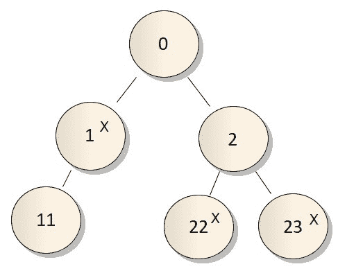

我们希望获取顶层选中节点的值。这意味着我们不需要树中所有被选中的值。如果父节点已被选中，则无需获取其子节点的选中值。

```javascript
function toChildTopSelection(selection, childNode) {
  return selection.concat(getTopSelection(childNode));
}

function getTopSelection(node) {
  return node.checked
    ? [node.value]
    : node.children !== null
      ? node.children.reduce(toChildTopSelection, [])
      : [];
}

getTopSelection(tree);
// [1, 22, 23]
```


`getTopSelection` 接收一个树对象，并返回一个包含顶层选中值的数组。如果节点被选中，则返回该节点的值作为单元素数组。当节点未被选中且有子节点时，它返回这些子节点的顶层选中值。`getTopSelection` 会为树中的每个子节点调用，直到递归在选中的节点处停止。找到被选中的节点就是终止条件。对于已选中节点的子节点，不会调用`getTopSelection`。

### 回顾

递归函数是一种在满足条件之前不断调用自身的函数。递归为某些问题（如遍历树）提供了更简单的解决方案。任何迭代循环都可以用递归实现，但在主流浏览器支持尾调用优化之前，这并不实用。

## 第 08 章：管道与柯里化

管道是函数式编程的典型用例。柯里化常用于创建管道，因为定义转换流程的函数期望接收一个参数。

### 管道

管道是一系列数据转换，其中一个转换的输出是下一个转换的输入。管道使我们能够以更具表现力的方式编写数据转换。考虑以下代码：

```javascript
function capitalize(text) {
  return text.charAt(0).toUpperCase() + text.slice(1);
}

function shortenText(text) {
  return text.substring(0, 8).trim();
}

const shortText = shortenText(capitalize("this is a long text"));

console.log(shortText);

//"This is"
```

我们可以使用函数式库（如 [lodash](https://lodash.com/) 或 [ramda](https://ramdajs.com/)）中的`pipe`工具，以更具表现力的方式编写这些转换。`npm i lodash --save`

以下是在管道中这些转换的样子。

```javascript
import { pipe } from 'lodash/fp';

const shortText = pipe(
  capitalize,
  shortenText
)("this is a long text");

console.log(shortText);

//"This is"
```

初始文本是管道的输入。`capitalize`是第一个处理文本的函数。然后该转换的输出作为下一个函数`shortenText`的输入。接着管道结束，我们得到结果。

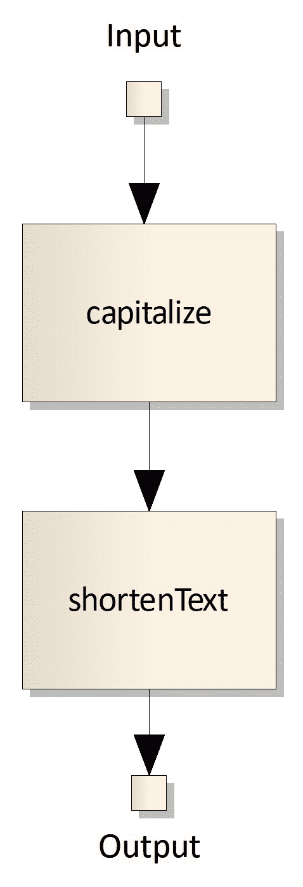

### 链式调用

链式调用是定义管道的一种更常见的形式。它需要操作一个对象。考虑以下债务列表。

```javascript
const debts = [
  {
    contractNo: 1,
    daysSinceLastPayment: 91,
    currency: 'EUR'
  },
  {
    contractNo: 2,
    daysSinceLastPayment: 35,
    currency: 'USD'
  },
  {
    contractNo: 3,
    daysSinceLastPayment: 45,
    currency: 'USD'
  }
];
```

以下是如何使用链式调用定义转换管道。

```javascript
const newDebts = debts
  .filter(isEur)
  .map(toDebtView);

function isEur(debt) {
  return debt.currency === "EUR";
}

function toDebtView(debt) {
  return {
    ...debt,
    priority: getPriority(debt)
  };
}

function getPriority(debt) {
  const days = debt.daysSinceLastPayment;

  return days > 90
    ? 1
    : days > 60
    ? 2
    : 3;
}
```

首先，使用`isEur`谓词函数过滤债务列表。然后，使用`toDebtView`映射函数转换此操作的结果。

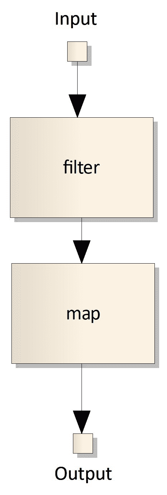

### 恒等函数

恒等函数是一个一元函数，它返回作为参数传入的值。在数学中，它定义为 f(x) = x。

```javascript
function identity(value) {
  return value;
}
```

如果我们将此转换放入之前的管道中，它只会创建数组的一个副本。`logIdentity`函数提供了一种在不影响流程的情况下检查管道中数据的方法。它返回接收到的参数，同时将其记录到控制台。

```javascript
function logIdentity(value) {
  console.log(value);
  return value;
}

debts
  .filter(isEur)
  .map(logIdentity)
  .map(toDebtView)
  .map(logIdentity);
```

### 柯里化

柯里化是一种技术，用于将期望 n 个参数的函数转换为一系列 n 个函数，每个函数期望一个参数。考虑过滤单词列表的情况。

```javascript
const words = [
  'ability',
  'calculate',
  'calendar',
  'double',
  'door'
];

function startsWith(word, term) {
  return word.startsWith(term);
}

words
  .filter(w => startsWith(w, 'a'))
  .forEach(console.log);
```

现在，看看使用柯里化重构后的相同代码。

```javascript
function startsWith(term) {
  return function(word) {
    return word.startsWith(term);
  };
}

words
```

```javascript
.filter(startsWith('a'))
.forEach(console.log);
```

`startsWith`是一个柯里化函数。它不接收两个参数，而是只接收一个参数，并返回一个接受第二个参数的函数。另外请注意，与接收两个参数的原始版本相比，柯里化版本的参数顺序是相反的。当使用箭头语法编写柯里化版本时，你可能会觉得更清晰。

```javascript
const startsWith = term => word => {
  return word.startsWith(term);
};
```

另一种选择是使用自动柯里化工具函数来创建函数的柯里化版本。下面是一个使用 [lodash](https://lodash.com/) 中的`curry`工具的示例。

```javascript
import { curry } from 'lodash/fp';

const startsWith = curry(function(term, word) {
  return word.startsWith(term);
});
```

### 归约管道

`reduce`方法也使用了管道。让我们再次查看代码并分析数据流。

```javascript
const numbers = [1, 3, 5];

function add(total, n) {
  return total + n;
}

const total = numbers.reduce(add, 0);

console.log(total);
//9
```

每一步，归约器将前一次归约器调用的结果作为聚合值输入。下面是管道示意图。

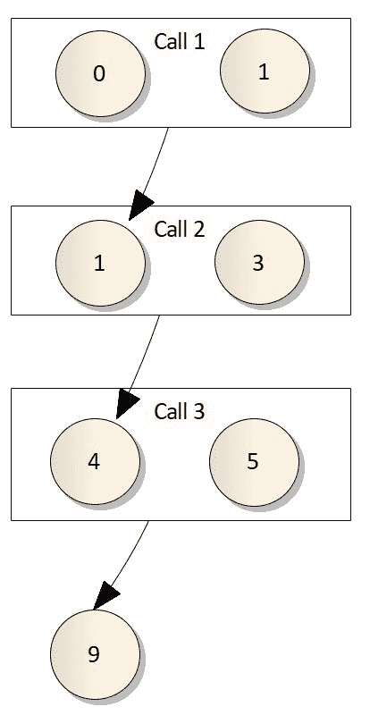

第一步的聚合值是 0。调用归约器后，这次转换的输出 1 作为下一个归约器调用的输入。再次调用归约器后，输出 4 作为下一个归约器调用的输入，以此类推。`reduce`创建了一个管道，其中每一步我们都会得到前一次归约器调用的结果和当前元素作为输入。

### 总结

管道定义了一系列数据转换，其中一个转换函数的输出是下一个转换函数的输入。柯里化是一种将接收多个参数的函数分解为一系列只接收一个参数的函数的技术。

## 第 09 章：函子

接下来，我们将探索函子。让我们从一组数据转换开始。考虑下面的例子：

```javascript
function toCelsius(kelvin) {
  const celsius = kelvin - 273.15;
  return Math.round(celsius * 100) / 100;
}

function describeTemperature(temperature) {
  return temperature < 0
    ? "Freezing"
    : temperature < 15
    ? "Cold"
    : temperature < 28
    ? "Warm"
    : "Hot";
}

const kelvin = 300;
const celsius = toCelsius(kelvin);
const description = describeTemperature(celsius);

console.log(celsius);
//26.85
console.log(description);
//"Warm"
```

如你所见，这段代码的重点是对单个值应用两次变换。它从开尔文温度开始，应用`toCelsius`变换，然后对结果应用`describeTemperature`函数。如果能将这些变换链式应用到初始值上并创建一个管道，那就更好了。下面是一种可能的实现方式：

```javascript
Mappable(300)
  .map(toCelsius)
  .map(describeTemperature);
```

这就是函子发挥作用的情况。

### 函子

函子是一个带有`map`操作的对象，该操作满足函子定律。我们可以简单地将函子创建为一个带有`map`方法的对象。考虑以下函数：

```javascript
function F(value) {
  function map(f) {
    const newValue = f(value);
    return F(newValue);
  }

  return {
    map
  };
}
```

`F`创建了一个带有`map`方法的对象，该方法包装了一个值。`map`接收一个变换函数，将其应用于包装的值，并返回一个包装了新值的新对象。`F`被称为工厂函数。`F`返回一个包含闭包`map`的对象，该闭包从其父作用域访问`value`变量。`F`工厂函数创建了一个函子。

### 函子定律

函子必须遵守同一律和组合律。

#### 同一律

将同一函数传递给函子的`map`操作，应该得到相同的函子，即存储相同值的函子。考虑同一函数。

```javascript
function identity(n) {
  return n;
}

functor.map(identity) = functor;
```

让我们验证一下我们函子的同一律。

```javascript
const functor = F(1);
const newFunctor = functor.map(identity);
//F(1)
```

#### 组合律

函数组合是一种操作，它接收两个函数`f`和`g`，并产生一个新函数`h`，其中`h(x) = g(f(x))`。在此操作中，函数`g`应用于将函数`f`应用于`x`的结果。我们可以说函数组合是将一个函数应用于另一个函数结果的操作。函子必须遵守组合律，即：

```javascript
functor.map(f).map(g) === functor.map(x => g(f(x)));
```

让我们验证组合律。

```javascript
function increment(n) {
  return n + 1;
}

function double(n) {
  return n * 2;
}

F(1)
  .map(increment)
  .map(double);
//F(4)

F(1)
  .map(n => double(increment(n)));
//F(4)
```

#### 范畴论

范畴是由箭头连接的值集合。一个[范畴](https://en.wikipedia.org/wiki/Category_(mathematics))有两个主要性质：能够[结合地](https://en.wikipedia.org/wiki/Associativity)[组合](https://en.wikipedia.org/wiki/Function_composition)箭头，以及每个值都存在一个[同一](https://en.wikipedia.org/wiki/Identity_function)箭头。箭头，也称为态射，是映射范畴中值之间的函数。下面是一个包含三个值的范畴的表示。

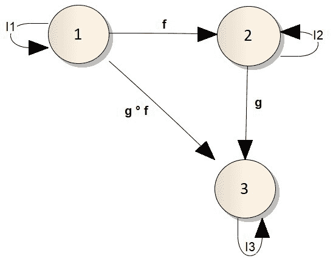

这个例子中的范畴有三个值：1、2、3，以及三个映射这些值之间的函数。`f`函数将 1 映射到 2。`g`函数将 2 映射到 3。函数`h`从 1 映射到 3，等于`g(f(1))`。对于每个值，应用同一函数会得到相同的值。

### 实践中的函子

在实践中，函子有助于链式操作。从开发的角度来看，对我们重要的是知道什么时候某个东西是函子。如果是，我们可以用同一函数检查它的值，并且我们可以使用函数组合。我们创建的函子称为同一函子。考虑我们最初的一组数据转换。下面是我们如何使用同一函子将两个变换链式应用到值上。

```javascript
F(300)
  .map(toCelsius)
  .map(describeTemperature);
```

我们可以使用同一函数的不纯变体来检查内部的值，该变体会在控制台中记录该值。

```javascript
function logIdentity(value) {
  console.log(value);
  return value;
}

F(300)
  .map(toCelsius)
  .map(logIdentity) //26.85
  .map(describeTemperature)
  .map(logIdentity); //"Warm"
```

应用函数组合时，我们也会得到相同的结果。

```javascript
F(300)
  .map(x => describeTemperature(toCelsius(x)))
  .map(logIdentity);
//"Warm"
```

下面是一个使用函数式库（如 [lodash](https://lodash.com/)）中的`compose`工具应用函数组合的示例。

```javascript
import { compose } from 'lodash/fp';

F(300)
  .map(compose(describeTemperature, toCelsius))
  .map(logIdentity);
//"Warm"
```

### 数组

数组是可映射的。`map`方法遍历集合，并将映射函数应用于数组中的每个值。让我们验证数组上的函子定律。对数组应用同一函数会创建它的一个副本。

```javascript
[1, 2, 3]
  .map(identity)
  .map(logIdentity);
//1
//2
//3
```

接下来，检查组合律。

```javascript
[1, 2, 3]
  .map(increment)
  .map(double)
  .map(logIdentity);
//4
//6
//8

[1, 2, 3]
  .map(x => double(increment(x)))
  .map(logIdentity);
//4
//6
//8
```

一个简单的包装单个值的函子可以通过使用只有一个值的数组即时创建。

```javascript
[300]
  .map(toCelsius)
  .map(describeTemperature)
  .map(logIdentity);
//"Warm"

[300]
  .map(x => describeTemperature(toCelsius(x)))
  .map(logIdentity);
```

### 回顾

范畴是值的集合，以及这些值之间的箭头。箭头代表映射函数。对任何值应用恒等函数都会返回该值。函子是尊重恒等性和组合性的可映射对象。函子为我们提供了一种有用的方式，可以在包装值上创建数据转换管道。

## 第 10 章：单子

函子是包装一个值并支持映射的对象。单子是包装一个值并支持映射和扁平映射的对象。

### 扁平映射

让我们再次看看数组函子上可用的`map`方法。应用一个返回值类型的映射函数，会得到一个新的数组，其中包含转换后的值。

```javascript
function toUpperCase(text) {
  return text.toUpperCase();
}

const arr = ["raspberry strawberry", "blueberry"]
  .map(toUpperCase);

console.log(arr);
//[ 'RASPBERRY STRAWBERRY', 'BLUEBERRY' ]
```

初始数组有两个文本值。应用转换后，我们得到一个包含两个大写字母文本值的数组。

看看当我们应用一个返回数组的映射函数时会发生什么。

```javascript
function split(text) {
  return text.split(' ');
}

const arr = ["raspberry strawberry", "blueberry"]
  .map(split);

console.log(arr);
//[ [ 'raspberry', 'strawberry' ], [ 'blueberry' ] ]
```

`split`函数使用分隔符将字符串拆分为子字符串数组。每个子字符串代表原始文本中的一个单词。

应用`split`映射函数会得到一个包含两个其他数组的数组。每个子数组是一个字符串集合。

扁平映射类似于映射，但它会展开返回类型。

接下来，看看使用数组上可用的`flatMap`方法应用相同的映射函数。


```javascript
const arr = ["raspberry strawberry", "blueberry"]
  .flatMap(split)

console.log(arr);
//[ 'raspberry', 'strawberry', 'blueberry' ]
```

`flatMap` 方法首先使用映射函数映射数组中的每个元素，然后将结果展平为一个新数组。通过先使用 `map`，然后使用深度为 `1` 的 `flat` 展平结果，可以达到相同的效果。

```javascript
const arr = ["raspberry strawberry", "blueberry"]
  .map(split)
  .flat();

console.log(arr);
//[ 'raspberry', 'strawberry', 'blueberry' ]
```

`flat` 创建一个新数组，其中所有子数组的值都被连接起来。它使用递归将值连接到指定的深度。

```javascript
const arr = [1, [2, 3]];
console.log(arr.flat());
//[ 1, 2, 3 ]
```

### 单子

我们可以简单地将单子创建为一个具有 `map` 和 `flatMap` 方法的对象。考虑以下 `M` 函数：

```javascript
function M(value){
  function map(f){
    const newValue = f(value);
    return M(newValue);
  }
  function flatMap(f){
    const newValue = f(value);
    return newValue;
  }
  return {
    map,
    flatMap
  }
}
```

`M` 是一个工厂函数，它创建一个包装一个值的对象，并具有两个修改它的方法：`map` 和 `flatMap`。`map` 接受一个转换函数，用它创建一个新值，然后使用 `M` 工厂函数创建一个包装该新值的对象。`flatMap` 使用转换函数计算一个新值并返回它。

`M` 是单子构造函数。它接受一个值并返回一个包装该值的单子。`M` 被称为恒等单子。

### 单子定律

单子应遵守三条定律。

#### 左恒等

将 `f` 视为一个返回单子的映射函数。将 `f` 函数传递给包装值 `x` 的单子的 `flatMap` 操作，应该得到与调用函数 `f(x)` 相同的单子。

```
M(x).flatMap(f) === f(x)
```

让我们在我们的单子上验证左恒等定律。

```javascript
function f(){
  return M(2)
}

M(1)
  .flatMap(f);
//M(2)

f(1);
//M(2)
```

#### 右恒等

将 `M` 函数传递给包装一个值的单子的 `flatMap` 操作，应该得到包装相同值的单子。

```
monad.flatMap(M) === monad
```

使用 `M` 自定义单子检查该定律。

```javascript
M(1)
  .flatMap(M)
//M(1)
```

#### 结合律

单子必须遵守结合律，即：

```
monad.flatMap(f).flatMap(g)
  === monad.flatMap(x => f(x).flatMap(g))
```

让我们测试该定律。

```javascript
function f(){
  return M(2)
}
function g(){
  return M(3)
}

M(1)
  .flatMap(f)
  .flatMap(g);
//M(3)

M(1)
  .flatMap(n => f(n).flatMap(g));
//M(3)
```

### 替代创建与命名

扁平映射方法有不同的名称，如 `bind`、`chain` 或仅 `flatMap`。还有一种做法是使用一个名为 `unit` 的不同方法来创建单子。`unit` 与 `M` 工厂函数的作用相同，它创建一个新的单子。

下面是使用这种替代命名定义单子的示例。

```javascript
export default (function defineMonad(){
  function M(value){
    function map(f){
      const newValue = f(value);
      return M(newValue);
    }
    function bind(f){
      const newValue = f(value);
      return newValue;
    }
    return {
      map,
      bind
    }
  }
  function unit(value){
    return M(value);
  }
  return {
    unit
  }
})();
```

`unit` 创建一个包装值的新单子。`bind` 定义了扁平映射操作。

以下是单子如何被创建和使用的示例。

```javascript
import M from './M';

function f(){
  return M.unit(2)
}

M.unit(1).bind(f)
//M 2
```

下面你可以回顾在这种情况下单子规则如何书写。

#### 左恒等

```
M.unit(1).bind(f)
//M 2
```

#### 右恒等

```
M.unit(1).bind(M.unit)
//M 1
```

#### 结合律

```
M.unit(1).bind(f).bind(g)
//M 3

M.unit(1).bind(x => f(x).bind(g))
//M 3
```

[你可能还会发现](https://gist.github.com/newswim/4668aef8a1f1bc0dabe8#file-m-dlecture-txt-LC109) `bind` 被描述为一个独立的函数，而不是单子对象上的方法：`bind(monad, f)`。当 `bind` 是单子对象上的方法时，这等价于 `monad.bind(f)`。

将 `bind` 描述为方法更有帮助。

让我们看看如何将单子定律从函数形式转换为方法形式。

以下三种描述单子定律的方式是等价的。

#### 左恒等

```
bind(unit(x), f) === f(x)
M.unit(x).bind(f) === f(x)
M(x).flatMap(f) === f(x)
```

注意，在最后一行中，`M` 被用作构造函数。`M(x)` 等价于 `M.unit(x)`，也等价于 `unit(x)`。

#### 右恒等

```
bind(monad, unit)  === monad
monad.bind(M.unit) === monad
monad.flatMap(M)   === monad
```

#### 结合律

```
bind(bind(monad, f), g)
  === bind(monad, x => bind(f(x), g))

monad.bind(f).bind(g)
  === monad.bind(x => f(x).bind(g))

monad.flatMap(f).flatMap(g)
  === monad.flatMap(x => f(x).flatMap(g)))
```

话虽如此，我认为将恒等单子实现为具有 `map` 和 `flatMap` 方法的对象更容易使用。

### 数组

数组同时具有 `map` 和 `flatMap` 方法。让我们检查它们上的单子定律。

首先，我们需要一个可以从值创建数组的函数。

```javascript
function M(value){
  return [value];
}
```

我们不需要定义这样的函数，因为已经有一个函数可以做到这一点。它叫做 `Array.of()`。

```javascript
function duplicate(word){
  return [word, word]
}

function split(text){
  return text.split(" ");
}
```

接下来检查三条定律。

#### 左恒等

```
//M(x).flatMap(f) === f(x)
Array.of('mango')
  .flatMap(duplicate)
//['mango', 'mango']

duplicate('mango');
//['mango', 'mango']
```

正如你所注意到的，当使用 `Array.of` 创建数组时，`M(x)` 转换为 `Array.of(x)`。

#### 右恒等

```
//monad.flatMap(M) === monad
Array.of('lemon')
  .flatMap(Array.of)
//['lemon']
```

#### 结合律

```
//monad.flatMap(f).flatMap(g)
//  === monad.flatMap(x => f(x).flatMap(g)))

Array.of('orange kiwi')
  .flatMap(split)
  .flatMap(duplicate);
//[ 'orange', 'orange', 'kiwi', 'kiwi' ]

Array.of('orange kiwi')
  .flatMap(s => split(s).flatMap(duplicate))
```

```javascript
//[ 'orange', 'orange', 'kiwi', 'kiwi' ]
```

回顾：函子是一个具有 `map` 操作的对象。单子是一个具有 `map` 和 `flatMap` 操作的对象。函子将一个函数应用于包装的值。单子将一个返回包装值的函数应用于包装的值。本质上，单子只是值的包装器。我们可以通过一个存储单个值并支持映射和扁平映射的对象来创建它。在接下来的章节中，我们将探讨实用的单子，如不可变列表、Promise 和 Observable。

## 第 11 章：不可变集合

集合是可以迭代的任何东西。不可变集合在“更改”操作时返回一个新集合。我们将研究 [Immutable.JS](https://immutable-js.github.io/immutable-js/) 库中提供的此类集合。首先安装它。

```
npm install immutable --save
```

### `List`

`List` 是索引集合，类似于数组。实际上，它们可以从数组创建。

```javascript
import { List } from 'immutable';

const emptyList = List();

// List []

const list = List([
  { name: 'Rhodes' },
  { name: 'Malaga' }
]);

// List [
//   { name: 'Rhodes' },
//   { name: 'Malaga' }]
```

[`List()`](https://immutable-js.github.io/immutable-js/docs/#/List/List) 创建一个新的不可变 `List`，包含作为参数提供的值。`List` 是一个工厂函数，不使用 `new` 关键字。

#### 编辑元素

[`set(index, value)`](https://immutable-js.github.io/immutable-js/docs/#/List/set) 允许我们编辑集合中指定索引处的元素。它返回一个包含修改的新 `List`。指定索引位置的元素将被替换。

```javascript
const newList = list.set(0, { name: 'Riomaggiore' });

// List [
//   { name: 'Riomaggiore' },
//   { name: 'Malaga' }]

console.log(list === newList);
//false
```

#### 添加元素

[`push(…values)`](https://immutable-js.github.io/immutable-js/docs/#/List/push) 返回一个新 `List`，其中追加了提供的值。它可以用于向列表添加新值。示例如下。

```javascript
const newList = list.push({name: 'Funchal'});

// List [
//   { name: 'Rhodes' },
//   { name: 'Malaga' },
//   { name: 'Funchal'}]
```

添加也可以使用 [`concat(…values)`](https://immutable-js.github.io/immutable-js/docs/#/List/concat) 完成。它将一个新集合连接到现有集合。要添加单个值，我们使用包含一个值的数组调用它。

```javascript
const newList = list.concat([{name: 'Funchal'}]);

// List [
//   { name: 'Rhodes' },
//   { name: 'Malaga' },
//   { name: 'Funchal'}]
```

[`unshift(…values)`](https://immutable-js.github.io/immutable-js/docs/#/List/unshift) 返回一个新 `List`，其中前置了提供的值。

#### 删除元素

[`delete(index)`](https://immutable-js.github.io/immutable-js/docs/#/List/delete) 删除指定索引处的元素，并返回包含修改的新 `List`。

```javascript
const newList = list.delete(0);

// List [{ name: 'Malaga' }]
```

`delete` 有别名 `remove`。

[`pop()`](https://immutable-js.github.io/immutable-js/docs/#/List/pop) 返回一个新 `List`，其中移除了最后一个元素。

[`shift()`](https://immutable-js.github.io/immutable-js/docs/#/List/shift) 返回一个新 `List`，其中移除了第一个元素。

#### 清空列表

[`clear()`](https://immutable-js.github.io/immutable-js/docs/#/List/clear) 返回一个没有值的新 `List`。

```javascript
const newList = list.clear();

console.log(newList)
// List []
```

### 数据转换

我们可以像处理数组一样处理列表。`List` 具有 `filter`、`map`、`flatMap`、`reduce` 和 `sort` 方法，其工作方式与数组相同。这次 `sort` 方法是一个纯方法，返回一个新集合。

以下是一个使用 `filter` 方法从目标对象列表中选择特定国家目的地的示例。

```javascript
import { List } from 'immutable';

const list = List([
  { name: 'Cascais', country: 'Portugal'},
  { name: 'Sintra', country: 'Portugal' },
  { name: 'Nerja', country: 'Spain' },
]);

function inCountry(country){
  return function(destination){
    return destination.country === country;
  }
}

list
  .filter(inCountry('Portugal'))

//List [
//  {name:'Cascais',country:'Portugal'},
//  {name:'Sintra',country:'Portugal'}]
```

注意 `inCountry` 是一个柯里化函数。

`List` 是单子，因为它们同时支持映射和扁平映射。

#### 查找元素

`List` 具有用于检索数据的方法。

[`get(index)`](https://immutable-js.github.io/immutable-js/docs/#/List/get) 返回与提供的索引关联的元素。

[`first()`](https://immutable-js.github.io/immutable-js/docs/#/List/first) 返回集合中的第一个元素。如果集合为空，则返回 `undefined`。类似地，[`last()`](https://immutable-js.github.io/immutable-js/docs/#/List/last) 返回集合中的最后一个元素。

[`find()`](https://immutable-js.github.io/immutable-js/docs/#/List/find) 返回谓词函数返回 `true` 的第一个元素。[`findLast()`](https://immutable-js.github.io/immutable-js/docs/#/List/findLast) 返回谓词函数返回 `true` 的最后一个元素。以下是在之前列表上使用这两个方法的示例。


```js
import { List } from 'immutable';

const list = List([
  { name: 'Cascais', country: 'Portugal'},
  { name: 'Sintra ', country: 'Portugal' },
  { name: 'Nerja ', country: 'Spain' },
]);

const destination = list.find(inCountry('Portugal'));
//{ name: 'Cascais', country: 'Portugal' }

const otherDestionation = list.findLast(inCountry('Portugal'));
//{ name: 'Sintra ', country: 'Portugal' }
```

### Map

`Map` 是键值对的集合。不可变 `Map` 接受任何类型的键。

以下是一个按 id 创建国家对象 `Map` 的示例。

```js
import { Map } from 'immutable';

const countryMap = Map({
  "1": { name: 'Italy'},
  "2": { name: 'Portugal'},
  "3": { name: 'UK'}
});
```

[`get(key)`](https://immutable-js.github.io/immutable-js/docs/#/Map/get) 返回与给定键关联的值。

```js
console.log(countryMap.get("3"));
//{ name: 'UK' }
```

[`set(key, value)`](https://immutable-js.github.io/immutable-js/docs/#/Map/set) 返回一个包含该键值对的新 `Map`。如果键已存在，则替换其值。如果键不存在，则添加它。`set` 可用于添加和编辑键值对。

```js
const newMap = countryMap.set("2", { name: 'Spain'});
console.log(newMap.get("2"));
//{ name: 'Spain' }
```

[`has(key)`](https://immutable-js.github.io/immutable-js/docs/#/Map/has) 如果给定键存在于 `Map` 中，则返回 `true`，否则返回 `false`。

[`delete(key)`](https://immutable-js.github.io/immutable-js/docs/#/Map/delete) 返回一个移除了指定键的新 `Map`。

```js
const newMap = countryMap.delete("3");
console.log(newMap.has("3"));
//false

console.log(newMap.get("3"));
//undefined
```

[`clear()`](https://immutable-js.github.io/immutable-js/docs/#/Map/clear) 返回一个不包含任何键值对的新 `Map`。

### 数据转换

`Map` 支持 `filter` 和 `map` 操作。[`map(mapper)`](https://immutable-js.github.io/immutable-js/docs/#/Map/map) 返回一个新的 `Map`，其中所有值都应用了 mapper 函数。[`filter(predicate)`](https://immutable-js.github.io/immutable-js/docs/#/Map/filter) 返回一个新的 `Map`，仅包含谓词函数返回 `true` 的键值对。谓词函数应用于值。

### 回顾

`List` 和 `Map` 都为处理不可变集合提供了更友好的公共接口。`List` 具有 `filter`、`map`、`reduce` 和 `sort` 方法，其工作方式与数组中的类似。这些不可变数据结构经过了高度优化。`List` 在列表的末尾和开头都能高效地进行添加和删除操作，复杂度为 `O(1)`。

## 第 12 章：惰性转换

像 `filter`、`map`、`reduce` 这样的数组操作使转换更易于阅读和理解，但正如你所注意到的，这些转换在每一步都会创建一个新数组。对于包含数千条记录的大型数组，这可能会造成性能损失。接下来，我们将探讨这些情况的解决方案。

### 变换器（Transducers）

事实上，所有转换都可以使用 reducer 函数来表达。我们可以使用 reducer 函数进行过滤，也可以使用 reducer 函数进行映射，等等。

以下是使用 `reduce` 实现映射转换的代码。

```js
function map(transform) {
  return function reducer(arr, value) {
    const newValue = transform(value);
    return [...arr, newValue];
  }
}

function double(n) {
  return n * 2;
}

const numbers = [1, 2, 3];

const newNumbers = numbers.reduce(map(double), []);

//[2, 4, 6]
```

下面是使用 `reduce` 实现的过滤转换。

```js
function filter(test) {
  return function reducer(arr, value) {
    if (test(value)) {
      return [...arr, value]
    } else {
      return arr;
    }
  }
}

function isEven(n) {
  return n % 2 === 0;
}

const numbers = [1, 2, 3, 4];

const newNumbers = numbers.reduce(filter(isEven), []);

//[2, 4]
```

注意，`reduce` 不会停止，它会处理数组中的所有值。而 `find` 方法在找到值时会停止。使用 `reduce` 方法实现的 `find` 等效实现性能更差，因为它会遍历所有元素。

```js
function find(test) {
  return function reducer(foundValue, value) {
    if (test(value) && !foundValue) {
      return value
    } else {
      return foundValue;
    }
  }
}

function isEven(n) {
  return n % 2 === 0;
}

const numbers = [1, 2, 3, 4];

const element = numbers.reduce(find(isEven), undefined);

//2
```

了解了这些之后，在进行转换时，我们不必在每一步都构建新数组，而是可以构建一个新的 reducer 函数。

考虑下一个示例，它在每一步都创建一个数组。

```js
function isEven(n) {
  return n % 2 === 0;
}

function double(n) {
  return n * 2;
}

const numbers = [1, 2, 3, 4];

const newNumbers =
  numbers
    .filter(isEven) //[2, 4]
    .map(double); //[4, 8]
```

第一个 `filter` 创建了一个中间数组 `[2, 4]`，然后被 `map` 方法使用。

让我们看看通过构建一个执行所有转换的 reducer，而不是构建中间数组来达到相同结果意味着什么。

这意味着 `filter` 创建一个应用过滤的新 reducer，而 `map` 接收这个 reducer 并创建一个应用映射转换的新 reducer。

以下是一个 `filter` 函数的实现，它接收一个 reducer 并创建一个应用谓词测试的新 reducer。

```js
function filter(test) {
  return function(reducer) {
    return function filterReducer(arr, value) {
      if (test(value)) {
        return reducer(arr, value);
      } else {
        return arr;
      }
    }
  }
}
```

如果使用箭头函数和条件运算符来定义这个柯里化函数，看起来可能会更好。

```js
const filter = test => reducer => {
  return function filterReducer(arr, value) {
    return test(value)
      ? reducer(arr, value)
      : arr
  }
}
```

以下是 `map` 函数，它接收一个 reducer 并返回一个新的 reducer，该 reducer 对所有值应用映射转换。

```js
const map = transform => reducer => {
  return function mapReducer(arr, value) {
    const newValue = transform(value);
    return reducer(arr, newValue);
  }
}
```

所有这些函数都作用于 reducer，因此我们需要一个初始的 reducer 来工作。这将是一个仅复制现有数组的函数。

```js
const toArrayReducer = (arr, value) => {
  return [...arr, value]
};
```

让我们使用这些函数来重构之前的转换。

```js
function isEven(n) {}

function double(n) {}

const numbers = [1, 2, 3, 4];

const filterTransducer = filter(isEven);

const mapTransducer = map(double);

const newNumbers = numbers
  .reduce(
    filterTransducer(
      mapTransducer(toArrayReducer)
    ),
    []
  );

//[4, 8]
```

由 `filter` 和 `map` 创建的函数称为变换器（transducers）。变换器接收一个 reducer 并返回一个新的 reducer。换句话说，变换器是一个以 reducer 函数作为输入并返回一个新 reducer 函数的函数。变换器是一个高阶函数。

如果使用 `compose` 工具，转换看起来可能会更好。下面是一个示例，其中 `filter` 和 `map` 变换器应用于 `toArrayReducer` reducer。我们最终得到一个执行所有必要转换的 reducer。

```js
import { compose } from 'lodash/fp';

const newReducer = compose(
  filter(isEven),
  map(double)
)(toArrayReducer);
```

然后我们可以将这个 reducer 应用于原始数组。

```js
const newNumbers = numbers.reduce(newReducer, []);
```

变换器有其自身的开销。它们需要在每次转换中遍历所有项，因为 `reduce` 方法不会停止。它们需要在一个主 reducer 上工作，因此现在需要一个之前不需要的初始转换。尽管如此，它们为我们提供了一种在不创建额外集合的情况下链式转换的思路。

### 序列（Sequence）

惰性序列允许我们高效地链式调用 `map` 和 `filter` 等转换方法，而无需创建中间集合。我们将研究 Immutable.js 提供的惰性序列，称为 `Seq`。

`Seq` 集合是不可变的。一旦创建，就不能修改。任何“更改”操作都会返回一个新的 `Seq`。

下面是一个示例，其中数组被转换为序列，然后进行转换，而不创建其他中间数组。

```js
import { Seq } from 'immutable';

function isEven(n) {
  return n % 2 === 0;
}

function double(n) {
  return n * 2;
}

const sequence = Seq([1, 2, 3, 4])
  .filter(isEven)
  .map(double);
```

然后我们可以使用 [`toArray()`](https://immutable-js.github.io/immutable-js/docs/#/Seq/toArray) 方法转换回数组数据结构。

```js
const newArray = sequence.toArray();

//[4, 8]
```

注意，使用 `toArray` 转换为原生数组可能会很慢，因此一旦我们创建了序列并进行了转换，就应该坚持使用它。

### 范围（Range）

[`Range`](https://immutable-js.github.io/immutable-js/docs/#/Range) 返回从 start 到 end 的数字序列。当不传入参数时，它从 `0` 开始。当不提供 end 参数时，它会创建一个无限序列。它还接受第三个参数 `step`，用于定义增量。

`Range` 是一个惰性序列，按顺序生成整数。下面是一个 `Range` 生成数字 `1`、`2`、`3` 的示例。

```js
import { Range } from 'immutable';

function logIdentity(n) {
  console.log(n);
  return n;
}

Range(1, 4)
  .forEach(logIdentity);

//1
//2
//3
```

现在，看一个生成质数的示例。检查我们如何使用 `Range` 序列重构 `for` 循环。

```js
for (let i = 0; i < 10; i++) {
  if (isPrime(i)) {
    console.log(i)
  }
}

//2
//3
//5
//7

function isPrime(number) {
  if (number <= 1) {
    return false;
  }

  for (let i = 2; i <= number / 2; i++) {
    if (number % i === 0) {
      return false;
    }
  }

  return true;
}
```

我们可以先替换打印数字到控制台的第一个循环。

```js
import { Range } from "immutable";

Range(0, 10)
```

```js
.filter(isPrime)
```

```js
.forEach(log);
```

```js
function isPrime(number) {}
```

```js
function log(number) {
  console.log(number);
}
```

`Range(0, 10)` 生成从 0 到 9 的所有数字，然后使用 `filter` 筛选出所有质数，并返回一个仅包含这些数字的新序列。接着我们使用 `forEach` 来显示这些数字。

下面我们来看如何利用 `Range` 序列重构检测质数的循环。

```js
import { Range } from 'immutable';

Range(0, 10)
  .filter(isPrime)
  .forEach(log);

function isPrime(number) {
  if (number > 2) {
    const firstDivisor = findFirstDivisor(number);
    return !firstDivisor;
  } else {
    return (number === 2)
      ? true
      : false;
  }
}

function findFirstDivisor(number) {
  return Range(2, (number / 2) + 1)
    .find(isDivisorOf(number));
}

function isDivisorOf(number) {
  return function(divisor) {
    return (number > 1)
      ? number % divisor === 0
      : false
  };
}

function log(number) {}
```

`isDivisorOf` 是一个柯里化函数，它接收一个数字，并返回一个谓词函数，该谓词函数接收一个可能的除数并返回一个布尔值。

`findFirstDivisor` 返回一个数字的第一个除数。它检查从 2 到该数字一半的所有数字。

`isPrime` 根据 `findFirstDivisor` 的结果判断一个数字是否为质数。如果该数字没有除数，那么它就是质数。

### 回顾

变换器（Transducers）是接收一个归约器并返回一个新归约器的函数。

惰性序列（如 `Seq`）允许我们高效地链式调用转换方法，而无需创建中间集合。

`Range` 提供数字序列。

## 第 13 章：生成器

生成器是一个函数，每次调用时都会从序列中返回下一个值。

我们将从一个简单的生成器函数开始，它每次调用时返回下一个整数。它从 0 开始。


```javascript
function range() {
  let count = 0;
  return function() {
    const result = count;
    count += 1;
    return result;
  }
}

const nextNumber = range()
console.log(nextNumber()); //0
console.log(nextNumber()); //1
console.log(nextNumber()); //2
```

`nextNumber` 是一个无限生成器。`nextNumber` 是一个闭包，拥有内部私有状态。

### 有限生成器

生成器可以是有限的。请看下一个示例，其中 `range` 创建了一个生成器，它从特定区间返回连续的数字。在序列末尾，它返回 `undefined`。

```javascript
function range(from, to) {
  let count = from;
  return function() {
    if (count < to) {
      const result = count;
      count += 1;
      return result;
    } else {
      return undefined;
    }
  }
}

const nextNumber = range(0, 3)
console.log(nextNumber()); //0
console.log(nextNumber()); //1
console.log(nextNumber()); //2
console.log(nextNumber()); //undefined
```

### `toArray`

在使用生成器时，我们可能希望创建一个包含序列中所有值的数组。针对这种情况，我们需要一个像 `toArray` 这样的工具函数，它接收一个生成器，并将序列中的所有值作为数组返回。该序列应该是有限的。

```javascript
function toArray(generate) {
  let arr = [];
  let value = generate();
  while (value !== undefined) {
    arr = [...arr, value];
    value = generate();
  }
  return arr;
}
```

让我们将它与之前的生成器一起使用。

```javascript
const numbers = toArray(range(1, 5));
console.log(numbers);
//[1, 2, 3, 4]
```

### `forEach`

我们可能还需要对序列中的每个元素运行一个回调函数。`forEach` 工具函数正是为此而设计的。它接收一个生成器和一个回调函数，并运行该回调函数，直到生成器返回 `undefined`。

```javascript
function forEach(callback) {
  return function(generate) {
    let value = generate();
    while (value !== undefined) {
      callback(value);
      value = generate();
    }
  }
}
```

这是一个柯里化函数，首先接收回调函数，然后接收生成器。

在下一个示例中，`log` 函数会被生成器返回的所有数字调用。

```javascript
function log(x) {
  console.log(x);
}

const nextNumber = range(1, 4);
forEach(log)(nextNumber);
//1
//2
//3
```

### `take`

另一种常见场景是只取序列中的前 `n` 个元素。在这种情况下，我们需要一个新的工具函数，比如 `take`，它接收一个生成器并创建一个新的生成器，只返回序列中的前 `n` 个元素。

```javascript
function take(n) {
  return function(generate) {
    let count = 0;
    return function() {
      if (count < n) {
        count += 1;
        return generate();
      }
    };
  };
}
```

同样，`take` 是一个柯里化函数，应该这样调用：`take(n)(sequence)`。

下面展示了如何在管道中使用 `take` 和 `forEach`，从无限数字序列中获取前三个值并将其记录到控制台。

```javascript
import { pipe } from 'lodash/fp';

const nextNumber = range();
pipe(
  take(3),
  forEach(console.log)
)(nextNumber);
//0
//1
//2
```

### 自定义生成器

我们可以创建任何自定义生成器，并将其与之前的工具函数一起使用。让我们创建[斐波那契](https://en.wikipedia.org/wiki/Fibonacci_number)自定义生成器：

```javascript
function fibonacci() {
  let a = 0;
  let b = 1;
  return function() {
    const aResult = a;
    a = b;
    b = aResult + b;
    return aResult;
  };
}
```

我们可以将斐波那契生成器与已创建的工具函数一起使用，以显示序列中的前 5 个数字。

```javascript
import { pipe } from 'lodash/fp';

const generateFibonacci = fibonacci();
pipe(
  take(5),
  forEach(console.log)
)(generateFibonacci);
//0
//1
//1
//2
//3
```

### 回顾

生成器是一个函数，每次调用时都会从序列中返回一个新值。

函数式生成器可以从有限或无限的值序列中返回元素。

## 第 14 章：Promise

Promise 是一个包含未来结果的对象。

Promise 有三种状态：待定（pending）、已完成（fulfilled）和已拒绝（rejected）。

- 待定是 Promise 的初始状态。此时结果不可用。
- 已完成表示操作成功。此时结果可用。
- 已拒绝表示操作失败。结果不可用，但我们可以访问错误对象，其中包含操作失败原因的详细信息。

最初，Promise 以待定状态开始。然后它可以进入已完成或已拒绝状态。一旦 Promise 被完成或拒绝，它将保持该状态。

下面是 Promise 可能经历的状态流转图。

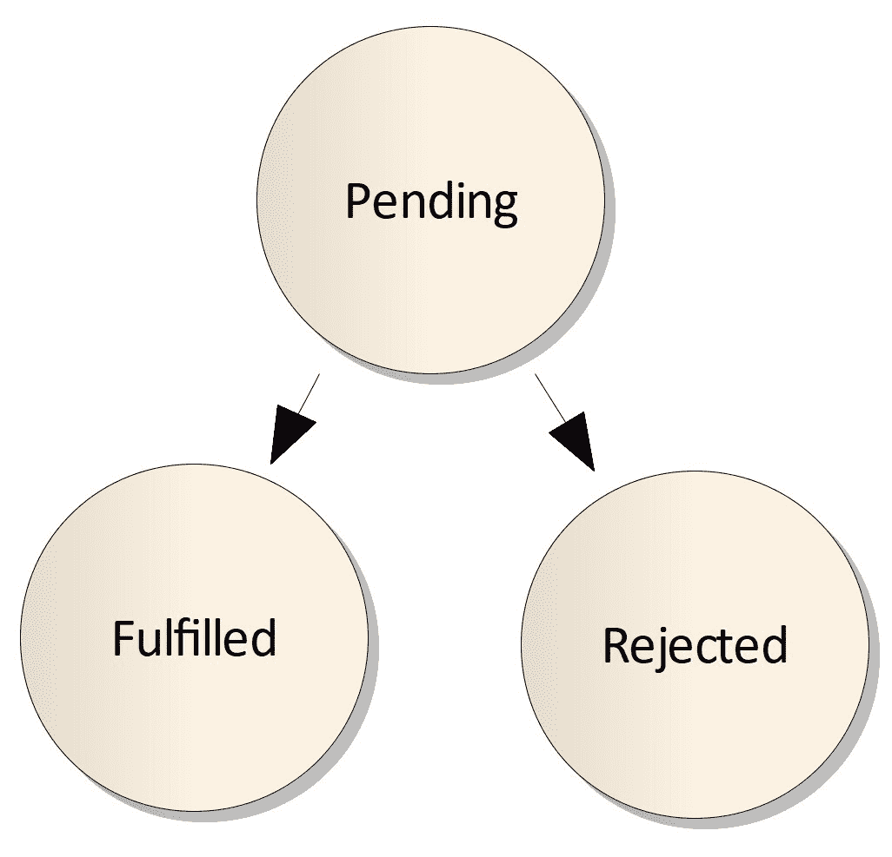

### 创建 Promise

让我们从创建一个简单的 Promise 开始。

```javascript
function delay(interval) {
  return new Promise(function(resolve) {
    return setTimeout(resolve, interval);
  });
}

function logDone() {
  console.log('Done');
}

delay(1000)
  .then(logDone);
```

`delay` 创建一个将在特定时间后解决的 Promise。我们可以用它来延迟任务的执行。

使用 `new Promise` 创建 Promise 需要传入一个名为执行器（executor）的函数。该函数接收两个回调函数 `resolve` 和 `reject`，可以在稍后调用以改变 Promise 的状态。执行器函数在 Promise 创建时自动运行。

`Promise` 有两个实用的静态方法 `resolve` 和 `reject`，用于快速创建已解决或已拒绝的 Promise。

`Promise.resolve(value)` 创建一个包装了 `value` 的已解决 Promise。

`Promise.reject(error)` 创建一个已拒绝的 Promise。

### 成功处理

### 映射

`then` 充当映射器。它接收一个映射函数，并返回一个包含转换后值的 Promise。

我们可以使用 `Promise.resolve` 创建一个简单的可映射对象，包装一个值。然后我们可以转换并检查包装后的值。

```javascript
function toUpperCase(text) {
  return text.toUpperCase();
}

function logIdentity(value) {
  console.log(value);
  return value;
}

Promise.resolve('sTudY')
  .then(logIdentity)  //"sTudY"
  .then(toUpperCase)
```

### 扁平映射

`.then(logIdentity); //"STUDY"`

`then` 也起到了扁平映射的作用。当映射函数返回一个值时，`then` 返回一个包含转换后值的 Promise。更准确地说，我们应该说映射函数返回的是一个非 Promise 的值。当映射函数返回一个包装了值的 Promise 时，`then` 不会将其包装到另一个 Promise 中。它只是返回包含转换后值的新 Promise。将 Promise 包装到另一个 Promise 中意味着创建一个包含 Promise 的 Promise，而该 Promise 又包装了一个值。

来看一个函数，它用于两个数字相除，并作为 Promise 上的映射函数使用。

```javascript
function devideBy(n, divisor){
  return n / divisor;
}

function logIdentity(value){}

Promise.resolve(9)
  .then(logIdentity)  //9
  .then(n => devideB(n, 3))
  .then(logIdentity); //3
```

我们可以将 `devideBy` 实现为柯里化函数，并与 `then` 更优雅地配合使用。

```javascript
function devideBy(divisor){
  return function(n){
    return n / divisor;
  }
}

Promise.resolve(9)
  .then(logIdentity)  //9
  .then(devideBy(3))
  .then(logIdentity); //3
```

当 `devideBy` 返回一个 Promise 而不是数字时，`then` 会等待该 Promise 完成，并返回一个包装了转换后值的 Promise。

```javascript
function devideBy(divisor){
  return function(number){
    const result = number / divisor;
    return Promise.resolve(result);
  }
}

Promise.resolve(9)
  .then(logIdentity)  //9
  .then(devideBy(3))
  .then(logIdentity); //3
```

### 错误处理

`catch` 用于处理 Promise 链中的错误。下面是一个使用 `catch` 进行错误处理的示例。

```javascript
function devideBy(divisor){
  return function(number){
    const result = number / divisor;
    return (divisor !== 0)
      ? Promise.resolve(result)
      : Promise.reject("Can't divide by 0")
  }
}

function logError(error){
  console.error(error);
}

Promise.resolve(9)
  .then(logIdentity) //9
  .then(devideBy(0))
  .then(logIdentity)
  .catch(logError) //"Can't divide by 0"
```

如果任何转换步骤中出现错误，流程会跳转到最近的错误处理程序。

### 链式调用

正如你所注意到的，我们可以对包装后的值进行多次链式转换。已解决 Promise 上的 `then` 方法会返回一个新的 Promise。同样，被拒绝 Promise 上的 `catch` 方法也会返回一个新的 Promise。这就创建了一个转换管道，其中每个转换函数都将前一个转换的结果作为输入。

```javascript
function toCelsius(kelvin){
  const celsius = (kelvin - 273.15);
  return Math.round(celsius * 100) / 100;
}

function toChangeAction(temperature){
  return {
    type : 'CHANGE_TEMPERATURE',
    temperature
  }
}

function logIdentity(value){}

Promise.resolve(280)
  .then(logIdentity)
  .then(toCelsius)
  .then(logIdentity)
  .then(toChangeAction)
  .then(logIdentity);

//280
//6.85
//{ type: 'CHANGE_TEMPERATURE', temperature: 6.85 }
```

`toCelsius` 接收 280 开尔文的温度作为输入，返回 6.85。`toChangeAction` 接收 6.85 摄氏度的温度作为输入，返回一个包含新摄氏温度值的 action 对象。

### 异步操作

到目前为止编写的代码都是同步的。这意味着我们立即得到了函数执行的结果。考虑以下代码。

```javascript
const result = Math.pow(2, 3);
console.log(result);
//8
```

一旦我们执行 `Math.pow`，我们就得到了结果。现在思考一下，调用 Web API 并将返回的数据存入变量意味着什么。

```javascript
const result = fetch('/todos')
```

为了将 Web API 返回的数据存入 `result` 变量，我们需要等待 `fetch` 调用完成。等待意味着阻塞 UI，这是我们不希望看到的。Promise 为这种情况提供了解决方案。`fetch` 调用不直接返回结果，而是返回一个 Promise，该 Promise 会在结果可用时提供对结果的访问。

### Parcel

我们可以通过启动开发服务器来测试网络请求。我们可以使用 [Parcel](https://parceljs.org/getting_started.html) Web 应用来创建一个，它无需任何配置。

首先，安装 Parcel。

```bash
npm install parcel-bundler --save-dev
```

接下来，创建一个 `index.html` 文件，并引用你想要检查的 JS 文件。

```html
<html>
<body>
<script src="./ajax.js"></script>
</body>
</html>
```

然后，在 `package.json` 中添加开发任务脚本。

```json
{
  "scripts": {
    "dev": "parcel index.html"
  }
}
```

现在，你可以启动开发服务器并访问 `index.html` 页面。

### Fetch

[Fetch API](https://developer.mozilla.org/en-US/docs/Web/API/Fetch_API) 提供了获取资源的接口。`fetch` 函数接收一个 URL 作为输入，并返回一个 Promise，该 Promise 会解析为请求的 Response。如果请求失败，它也会失败。

下面是一个发起 fetch 调用并在返回的 Promise 中访问结果的示例。

```javascript
function toJson(response){
  return response.json();
}

function logIdentity(value){}

function logError(error){
  console.error(error);
}

fetch('https://api.github.com/gists/public')
  .then(toJson)
  .then(logIdentity)
  .catch(logError);
```

`json()` 方法将响应转换为 JavaScript 对象。它返回一个 Promise，该 Promise 包装了将响应体文本解析为 JSON 的结果。

### Promise.race

[Promise.race](https://developer.mozilla.org/en-US/docs/Web/JavaScript/Reference/Global_Objects/Promise/race) 接收一个 Promise 数组，并返回第一个兑现或拒绝的 Promise。


```javascript
const dictionariesPromise = fetch('/dictionaries').then(toJson);
const todosPromise = fetch('/todos').then(toJson);

Promise.race([
  dictionariesPromise,
  todosPromise
]).then(logIdentity);
```

### Promise.all

[`Promise.all`](https://developer.mozilla.org/en-US/docs/Web/JavaScript/Reference/Global_Objects/Promise/all) 接收一个 Promise 数组，并返回一个新的 Promise，该 Promise 在所有输入的 Promise 都兑现时兑现。如果其中一个输入的 Promise 被拒绝，它会立即拒绝。`Promise.all` 可用于确保所有输入的 Promise 都已成功完成。

```javascript
Promise.all([
  dictionariesPromise,
  todosPromise
]).then(logIdentity);
```

### Promise.allSettled

[`Promise.allSettled`](https://developer.mozilla.org/en-US/docs/Web/JavaScript/Reference/Global_Objects/Promise/allSettled) 接收一个 Promise 数组，并返回一个 Promise，该 Promise 在所有输入的 Promise 要么兑现要么拒绝后兑现。它会兑现为一个描述每个 Promise 结果的对象数组。

```javascript
const dictionariesPromise = fetch('/dictionaries').then(toJson);
const todosPromise = fetch('/todos').then(toJson);
const rejectedPromise = Promise.reject('Error');

Promise.allSettled([
  dictionariesPromise,
  todosPromise,
  rejectedPromise
])
.then(logIdentity)

//[
//{status: "fulfilled", value: Array(1)},
//{status: "fulfilled", value: Array(1)},
//{status: "rejected", reason: "Error"}
//]
```

### 函子定律

当转换函数返回一个非 Promise 的对象时，Promise 上的 `then` 方法充当映射的作用。恒等律得到遵守。

```javascript
function identity(n){
  return n;
}

Promise.resolve(1)
  .then(identity)
//Promise 1
```

当映射函数不返回 Promise 时，组合律得到遵守。在这种情况下，`promise.then(f).then(g)` 与 `promise.then(x => g(f(x)))` 的结果相同。

```javascript
function f(x){
  return x + 1;
}

function g(x){
  return x * 2;
}

function logIdentity(value){}

Promise.resolve(1)
  .then(f)
  .then(g)
  .then(logIdentity)

Promise.resolve(1)
  .then(x => g(f(x)))
  .then(logIdentity)
```

当一个转换函数返回 Promise 而另一个不返回时，函子组合律被破坏。示例如下。

```javascript
function f(x){
  return Promise.resolve(x + 1);
}

function g(x){
  return x * 2;
}

Promise.resolve(1)
  .then(f)
  .then(g)
  .then(logIdentity);
//4

Promise.resolve(1)
  .then(x => g(f(x)))
  .then(logIdentity);
//NaN
```

在这种情况下，Promise 不能作为函子工作，因为它不遵守组合律。在实际应用中，我们不应该将 `promise.then(f).then(g)` 重构为 `promise.then(x => g(f(x)))`。

`.then(x => g(f(x))`

### Monad 定律

当转换函数返回一个 promise 时，promise 上的 `then` 方法的作用类似于 `flatMap`。使用返回 promise 的转换函数调用 `then`，会返回一个包装了值的新 promise。它不会返回一个包含 promise 的 promise 来包装值。当仅与返回 promise 的映射函数一起使用时，promise 的行为类似于 monad。

左单位元成立。

```javascript
function f(x){
  return Promise.resolve(x + 1);
}

Promise.resolve(1)
  .then(f)
  //Promise 2

f(1)
  //Promise 2
```

右单位元也成立。

```javascript
function unit(value){
  return Promise.resolve(value)
}

Promise.resolve(1)
  .then(unit)
  //Promise 1
```

`promise.flatMap(f).flatMap(g)` 与 `promise.flatMap(x => f(x).flatMap(g))` 结果相同。

```javascript
function g(x){
  return Promise.resolve(x * 2);
}

function logIdentity(value){}

Promise.resolve(1)
  .then(f)
  .then(g)
  .then(logIdentity);

Promise.resolve(1)
  .then(x => f(x).then(g))
  .then(logIdentity);
```

总结来说，当两个映射函数都返回非 promise 的值时，`then` 充当 `map`，组合性成立。当两个映射函数都返回 promise 时，`then` 充当 `flatMap`，结合性成立。

### 回顾

Promise 是包装未来结果的对象。当转换函数返回一个值时，`then` 充当 `map` 操作。当它返回另一个 promise 时，`then` 类似于 `flatMap` 操作。严格来说，promise 不是 monad，但在许多情况下它们的行为与 monad 相似。

## 第 15 章：可观察对象

可观察对象是一种可以随时间到达的数据流。可观察对象是当值可用时向监听器发出这些值的对象。可观察对象未来[可能成为 JavaScript 语言的一部分](https://github.com/tc39/proposal-observable)，但目前我们将使用 [RxJS](https://www.npmjs.com/package/rxjs) 库中的可观察对象实现。

```bash
npm install rxjs --save
```

操作符是可观察对象上一个强大的特性。

### 创建操作符

创建操作符是用于构造新可观察对象的函数。可观察对象通常使用创建函数来创建，例如 `of`、`from`、`interval` 或 `ajax`。

#### `create()`

以下示例创建了一个可观察对象，它向订阅者发出值 `1`、`2`、`3`，然后完成。

```javascript
import { Observable } from 'rxjs';

const observable = Observable.create(observer => {
  observer.next(1);
  observer.next(2);
  observer.next(3);
  observer.complete();
});
```

`create` 操作符接受一个回调函数，该函数定义了如何发出值。有三个方法描述了可观察对象可以做什么。

- `next()` 向监听器发送一个值。
- `error()` 向监听器发送一个错误。
- `complete()` 标记值序列的结束。调用 `complete` 后，进一步调用 `next()` 将无效。

`next` 定义了实际传递给订阅者的数据。数据流可以通过 `complete` 成功完成，或者通过 `error` 标记失败。

我们可以使用 `subscribe` 方法监听可观察对象源。

```javascript
observable
  .subscribe(console.log);
//1
//2
//3
```

如果我们稍后再次订阅该数据源，我们将再次收到所有发出的值。

```javascript
setTimeout(()=>{
  observable.subscribe(console.log);
  //1
  //2
  //3
}, 3000);
```

#### `of()`

`of` 从一组值创建可观察对象。以下是一个按顺序发出 `1`、`2`、`3` 的可观察对象示例。

```javascript
import { of } from 'rxjs';

const source = of(1, 2, 3);
source
  .subscribe(console.log);
// 1
// 2
// 3
```

#### `from()`

`from` 可以从类数组对象、promise 或类可观察对象创建可观察对象。以下是从数组构建可观察对象的示例。

```javascript
import { from } from 'rxjs';

const observable = from([1, 2, 3]);
observable.subscribe(console.log);
// 1
// 2
// 3
```

#### `interval()`

`interval` 函数接受毫秒数 `n` 作为输入，并返回一个可观察对象，该对象每隔 `n` 毫秒按顺序发出一个新的整数。

```javascript
import { interval } from 'rxjs';

const observable = interval(1000);
observable.subscribe(console.log);
//0 -> 1 秒后
//1 -> 2 秒后
//2 -> 3 秒后
//3 -> 4 秒后
//4 -> 5 秒后
//5 -> 6 秒后
```

#### `ajax()`

`ajax` 创建一个可观察对象，从网络请求中获取结果。它接受一个包含 URL、方法、数据等的请求对象，或者仅接受一个 URL 字符串作为输入。以下是一个示例。

```javascript
import { ajax } from 'rxjs/ajax';

ajax('https://api.github.com/gists/public')
  .subscribe(console.log);
```

使用 `ajax` 函数创建的可观察对象流会发出从请求返回的响应对象。下面使用 `ajax.getJSON` 函数执行相同的请求，该函数创建一个仅发出从请求返回的响应对象中 JSON 键的可观察对象。

```javascript
ajax.getJSON('https://api.github.com/gists/public')
  .subscribe(console.log);
```

### 可管道操作符

可观察对象具有 `pipe` 方法，允许将多个操作符串联起来。可管道操作符是那些可以使用 `pipe` 语法连接到可观察对象的操作符。这些操作符包括 `filter`、`map` 或 `take`。可管道操作符是一个函数，它接受一个可观察对象作为输入，并返回另一个可观察对象。订阅输出可观察对象也会订阅输入可观察对象。操作符转换数据流中的值。它们返回一个包含转换后值的可观察对象。

`map` 使用映射函数转换可观察对象源中的值。

```javascript
import { of } from 'rxjs';
import { map } from 'rxjs/operators';

const dataSource = of(1, 2, 3);
function double(n){
  return n * 2;
}
dataSource
  .pipe(
    map(double)
  )
  .subscribe(console.log);
//2
//4
//6
```

`filter` 使用谓词函数过滤流中的值。

```javascript
import { of } from 'rxjs';
import { map, filter } from 'rxjs/operators';

const dataSource = of(1, 2, 3, 4, 5);
function isEven(n){
  return n % 2 === 0;
}
dataSource
  .pipe(
    filter(isEven)
  )
  .subscribe(console.log);
//2
//4
```

`take` 操作符允许只选择可观察对象源中前 `n` 个发出的值。以下是从源中选择前三个值的示例。

```javascript
import { of } from 'rxjs';
import { take } from 'rxjs/operators';

const source = of(1, 2, 3, 4, 5);
source
  .pipe(
    take(3)
  )
  .subscribe(console.log);
//1
//2
//3
```

`pipe` 方法在可观察对象源上创建了一个管道。它允许我们将数据通过一个操作符管道进行转换。

```javascript
import { of } from 'rxjs';
import { map, filter } from 'rxjs/operators';

const dataSource = of(1, 2, 3, 4, 5);
function isEven(n){
  return n % 2 === 0;
}
function double(n){
  return n * 2;
}
dataSource
  .pipe(
    filter(isEven),
    map(double)
  )
  .subscribe(console.log);
//4
//8
```

### 观察者

观察者是具有三个回调函数的对象，每个回调对应可观察对象传递的一种通知类型。观察者是可观察对象传递的值的消费者。以下是一个处理所有类型通知的简单观察者对象。

```javascript
const observer = {
  next(value){
    console.log(`Next: ${value}`)
  },
  error(msg){
    console.error(`Error: ${msg}`)
  },
  complete(value){
    console.error(`Complete`)
  }
};
```

观察者被用作可观察对象 `subscribe` 方法的参数。

```javascript
const observable = Observable.create(observer => {
  observer.next(1);
  observer.next(2);
  observer.complete('Done');
});

observable.subscribe(observer);
//Next: 1
//Next: 2
//Complete
```

以下是一个订阅可观察对象的示例，该对象发出两个值然后失败。

```javascript
const observable = Observable.create(observer => {
  observer.next(1);
  observer.next(2);
  observer.error('Failed');
});

observable.subscribe(observer);
//Next: 1
//Next: 2
```

//错误：失败

观察者对象中不需要为所有通知类型都提供回调。某些通知可以被忽略。我们可以仅提供一个回调作为参数来订阅可观察对象，而不需要提供完整的观察者对象。这等同于创建一个只包含 `next` 处理器的观察者。

```javascript
observable.subscribe(value => console.log(`Next: ${value}`));
```

所有三种类型的回调都可以作为参数传递给 `subscribe` 方法。这等同于创建一个包含所有三个处理器的观察者。

```javascript
observable.subscribe(
  value => console.log(`Next: ${value}`),
  msg => console.error(`Error: ${msg}`),
  () => console.error(`Complete`)
);
```

### 订阅

订阅（Subscription）是在订阅可观察对象时创建的对象。它允许我们取消对该可观察对象的订阅。

```javascript
import { interval } from 'rxjs';

const observable = interval(1000);
const subscription = observable.subscribe(console.log);

//稍后
setTimeout(() => {
  subscription.unsubscribe();
}, 3500);

//0 -> 1 秒后
//1 -> 2 秒后
//2 -> 3 秒后
```


订阅对象只有一个 `unsubscribe` 方法。当所有订阅者都取消订阅某个可观察对象时，该可观察对象就会停止执行。可观察对象在至少有一个订阅者时开始执行。

### 高阶可观察对象

大多数情况下，可观察对象会发出原始值或数据对象，但有时它们也可能发出其他可观察对象。这种情况下，它们被称为高阶可观察对象。

例如，考虑一个发出 URL 字符串的可观察对象。我们可能有一个映射函数，它接收 URL 并返回一个新的可观察对象。

```javascript
import { from } from 'rxjs';
import { ajax } from 'rxjs/ajax';
import { map } from 'rxjs/operators';

const observable = from([
  '/dictionaries',
  '/todos'
]);

observable.pipe(
  map(ajax.getJSON)
).subscribe(console.log);

//Observable {}
//Observable {}
```

`ajax.getJSON` 就是映射函数。它接收 URL 并返回一个可观察对象，该对象会发出每个 URL 的网络请求响应。经过这种转换后，我们得到了一个可观察对象的可观察对象，即高阶可观察对象。

处理高阶可观察对象是一个挑战。在这种情况下，我们需要一个扁平化操作，即将高阶可观察对象转换为普通可观察对象。

### 扁平化操作符

我们不想处理一个发出可观察对象（这些可观察对象包装了从服务器获取的数据）的可观察对象，而是希望处理一个直接发出从服务器获取的数据的可观察对象。

#### concatAll()

`concatAll` 操作符会订阅“外层”可观察对象内部的每个可观察对象，并复制所有发出的值，直到该内部可观察对象完成。然后它继续处理下一个。它创建一个新的可观察对象，发出所有这些串联后的值。

下面是我们如何使用它来扁平化高阶可观察对象，并得到一个发出所有网络请求结果的可观察对象。

```javascript
import { from } from 'rxjs';
import { ajax } from 'rxjs/ajax';
import { map, concatAll } from 'rxjs/operators';

const observable = from([
  '/dictionaries',
  '/todos'
]);

observable.pipe(
  map(ajax.getJSON),
  concatAll()
).subscribe(console.log);

//[{name: 'Dictionary'}]
//[{title: 'To Do'}]
```

#### mergeAll()

另一个有用的扁平化操作是 `mergeAll`。它会在每个内部可观察对象到达时立即订阅，然后发出每个到达的值。

在前面的例子中使用 `mergeAll` 代替 `concatAll` 没有区别，因为每个内部 AJAX 可观察对象只发出一个值。当内部可观察对象随时间发出多个值时，才能看出区别。

#### mergeMap()

考虑一个映射函数，它接收一个值并返回一个可观察对象，该对象发出序列中的前三个数字。数字序列使用输入值作为常数 `c`，并应用 `n*c + 1` 公式定义。

当 `c = 2` 时，序列公式为 `2n + 1`，前三个值为 `3`、`5` 和 `7`。

当 `c = 4` 时，序列公式为 `4n + 1`，前三个值为 `5`、`9` 和 `13`。

下面是创建可观察对象的 `toSequence` 映射函数。

```javascript
function toSequence(x) {
  const getNTerm = createGetNTerm(x);
  return of(1, 2, 3).pipe(
    map(getNTerm)
  )
}

function createGetNTerm(c){
  return function(n){
    return n * c + 1
  }
}
```

当用值 `2` 调用时，`toSequence` 返回一个发出 `3`、`5` 和 `7` 的可观察对象。

```javascript
toSequence(2)
//Observable 3 5 7

toSequence(4)
//Observable 5 9 13
```

接下来，让我们将 `toSequence` 映射函数应用到一个包含多个值的可观察对象上，这些值将用作新创建序列中的常数。

```javascript
import { from } from 'rxjs';
import { map, mergeAll } from 'rxjs/operators';

from([2, 4]).pipe(
  map(toSequence)
)
.subscribe(console.log);

//Observable 3 5 7
//Observable 5 9 13
```

此时，我们有一个发出可观察对象的可观察对象，这些内部可观察对象包含序列的前三个数字。

使用 `mergeAll` 将创建一个新的可观察对象，发出所有生成序列中的数字。首先，它发出第一个序列中的所有数字，然后是第二个，依此类推。

```javascript
from([2, 4]).pipe(
  map(toSequence),
  mergeAll()
)
//.subscribe(console.log);
//3
//5
//7
//5
//9
//13
```

`mergeMap` 的作用等同于先应用 `map` 再调用 `mergeAll`。

```javascript
from([2, 4]).pipe(
  mergeMap(toSequence)
)
.subscribe(console.log);

//3
//5
//7
//5
//9
//13
```

### 组合可观察对象

接下来，我们将介绍用于将多个可观察对象组合成一个可观察对象的操作符。

#### forkJoin()

假设有两个可观察对象发出网络请求的结果。我们希望在两个网络请求都完成时执行逻辑。

```javascript
import { ajax } from 'rxjs/ajax';
import { forkJoin } from 'rxjs';

const dictionariesObservable = ajax.getJSON('/dictionaries');
const todosObservable = ajax.getJSON('/todos');

forkJoin({
  dictionaries: dictionariesObservable,
  todos: todosObservable
}).subscribe(console.log);

//{dictionaries: Array(), todos: Array()}
```

`forkJoin` 从其他可观察对象创建一个可观察对象。当所有内部可观察对象完成时，它会以字典形式提供每个可观察对象最后发出的值。

`forkJoin` 操作符允许我们在页面加载时发出多个请求，并在收到所有响应后采取行动。它类似于 `Promise.all`。

#### race()

`race` 接收多个可观察对象，并返回最先发出值的那个可观察对象。它类似于 `Promise.race`。

```javascript
import { ajax } from 'rxjs/ajax';
import { race } from 'rxjs';

const dictionariesObservable = ajax.getJSON('/dictionaries');
const todosObservable = ajax.getJSON('/todos');

const observable = race(
  dictionariesObservable,
  todosObservable
);

observable.subscribe(console.log);
```

### 函子定律

可观察对象具有 `map` 操作，该操作遵循两个函子定律。

#### 同一律

```javascript
import { of } from 'rxjs';
import { map } from 'rxjs/operators';

function identity(n){
  return n;
}

of(1, 2, 3)
  .pipe(
    map(identity)
  )
//Observable 1,2,3
```

#### 组合律

```javascript
import { of } from 'rxjs';
import { map } from 'rxjs/operators';

function increment(n){
  return n + 1;
}

function double(n){
  return n * 2
}

of(1, 2, 3)
  .pipe(
    map(increment),
    map(double)
  )
//Observable 4,6,8

of(1, 2, 3)
  .pipe(
    map(x => double(increment(x)))
  )
//Observable 4,6,8
```

可观察对象是函子。

### 单子定律

可观察对象有一个名为 `mergeMap` 的扁平映射操作，该操作遵循单子定律。

#### 左同一律

`M.unit(x).flatMap(f) === f(x)`

我们可以将 `of` 视为创建可观察对象的 unit 函数。

```javascript
import { of } from 'rxjs';
import { mergeMap } from 'rxjs/operators';

function f(n){
  return of(n + 1);
}

of(1)
  .pipe(
    mergeMap(f)
  )
//Observable 2

f(1)
//Observable 2
```

#### 右同一律

将 unit 函数应用于可观察对象会得到一个发出相同值的可观察对象。

```javascript
function unit(value){
  return of(value)
}

of(1)
  .pipe(
    mergeMap(unit)
  )
  .subscribe(console.log);
//Observable 1
```

#### 结合律

`monad.flatMap(f).flatMap(g) === monad.flatMap(x => f(x).flatMap(g))`

下面是我们如何为可观察对象翻译这个定律。

```javascript
function g(n){
  return of(n * 2);
}

of(1)
  .pipe(
    mergeMap(f),
    mergeMap(g)
  )
//Observable 4

of(1)
```

## 第 16 章：Elm 架构

```javascript
.pipe(
  mergeMap(x => f(x).pipe(mergeMap(g)))
)
//Observable 4
```

Observables are monads.

### Recap

`Observables` 是数据流。这些 observable 的消费者是订阅这些流的观察者。像 `of`、`from`、`interval` 或 `ajax` 这样的创建函数会生成新的 observable。

Observable 为执行异步任务提供了解决方案，同时还拥有一组强大的操作符来处理结果。像 `filter`、`map` 或 `take` 这样的可管道操作符接收一个 observable 作为输入，并返回另一个发出转换后值的 observable。

发出其他 observable 的 observable 被称为高阶 observable。像 `concatAll`、`mergeAll`、`mergeMap` 这样的扁平化操作允许我们将高阶 observable 转换为普通 observable。

接下来，我们将学习如何通过构建一个使用 [Elm](https://guide.elm-lang.org/) 纯函数式语言的简单应用，来以函数式风格创建应用。然后，我们将使用 [React](https://reactjs.org/) 和 [Redux](https://redux.js.org/) 实现相同的功能。关键在于理解支持这种编程风格的架构。

首先创建 Elm 项目。导航到一个新文件夹，并通过运行以下命令创建 Elm 项目：

```bash
elm init
```

该命令会创建一个 `elm.json` 文件和一个用于存放所有 Elm 文件的 `src` 文件夹。

`elm reactor` 会启动开发服务器。它在 `http://localhost:8000` 启动一个服务器。从那里我们可以导航到任何 Elm 文件。

### Elm 架构

Elm 架构定义了 Elm 应用内部的数据流。它将应用分解为以下核心部分：

- **模型（Model）**——定义应用的所有状态。
- **视图（View）**——是一个纯函数，将状态数据转换为 HTML。HTML 会发送回消息。
- **消息（Messages）**——表达用户交互。
- **更新（Update）**——是一个纯函数，根据当前消息和实际状态返回新状态。

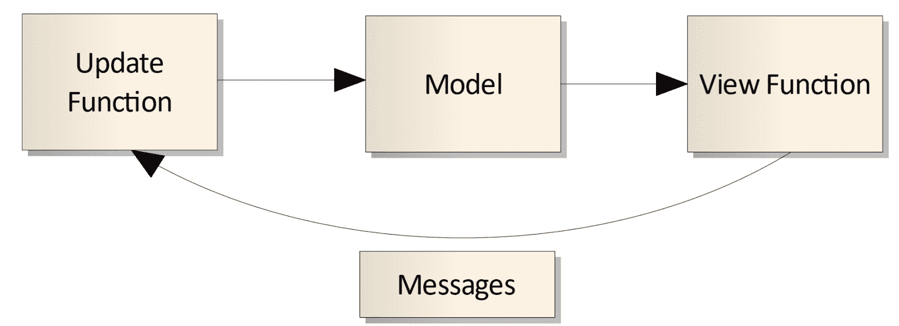

在接下来的示例中，我们将使用这种架构模式来创建一些功能。

### 使用 Elm 实现计数器

让我们实现一个简单的计数器页面，并讨论 Elm 架构。

#### 模型

模型存储所有可以改变的应用数据。在我们的例子中，我们只需要存储一个数字来反映当前计数。

该计数器的初始值为 `0`。

```elm
type alias Model = {
  number : Int
}

initialModel : Model
initialModel = { number = 0 }
```

#### 消息

消息定义用户交互。用户可以增加或减少计数，因此我们需要两个消息来表达这些操作。

```elm
type Msg = Increment | Decrement
```

#### 视图函数

视图函数接收 `Model` 作为参数，并将其显示在屏幕上。视图函数创建 HTML。

HTML 包含一个生成 `Decrement` 消息的减号按钮，一个生成 `Increment` 消息的加号按钮，以及当前计数。计数数字从模型中读取，转换为字符串，然后作为文本渲染在 `div` 元素内。

消息通过处理每个按钮的 `onClick` 事件来生成。

```elm
view : Model -> Html Msg
view model =
  div []
    [
      div [] [ text (String.fromInt model.number) ]
    , button [ onClick Decrement ] [ text "-" ]
    , button [ onClick Increment ] [ text "+" ]
    ]
```

#### 更新函数

更新函数描述了在收到新消息时如何改变模型。

当收到 `Increment` 消息时，它返回一个数字递增的新模型。当收到 `Decrement` 消息时，它返回一个数字递减的新模型。

```elm
update : Msg -> Model -> Model
update msg model =
  case msg of
    Increment ->
      { model | number = model.number + 1 }
    Decrement ->
      { model | number = model.number - 1 }
```

初始数字为零，当用户按下不同按钮时，它会增加或减少。

#### 连接

`main` 值描述了屏幕上显示的内容。它需要初始模型、生成 HTML 的视图函数以及改变模型的更新函数。

```elm
import Browser
import Html exposing (Html, button, div, text)
import Html.Events exposing (onClick)

//Code
main =
  Browser.sandbox {
    init = initialModel,
    update = update,
    view = view
  }
```

视图函数接收初始模型并显示在屏幕上。用户操作生成消息。更新函数处理这些操作并更新模型。当模型改变时，视图函数被调用来在屏幕上渲染新模型。这个流程无限循环。

### 使用 React 和 Redux 实现计数器

现在让我们用 JavaScript 结合 React 和 Redux 实现相同的计数器页面。

#### 模型

模型定义所有应用数据。我们可以将计数器定义为应用状态对象上的 `number` 属性。

```javascript
const initialModel = {
  number: 0
};
```

#### 消息

用于增加和减少计数的两个消息可以表示为创建具有 `type` 属性的普通数据对象的函数。

```javascript
function Increment(){
  return {
    type : Increment.name
  }
}

function Decrement(){
  return {
    type : Decrement.name
  }
}

export { Increment, Decrement };
```

#### 视图函数


视图函数可以使用[React 函数组件](https://reactjs.org/docs/components-and-props.html)来实现。这些组件返回一种类似 HTML 的语法，称为[JSX](https://reactjs.org/docs/introducing-jsx.html)。

```jsx
import React from 'react';
import { connect } from 'react-redux';
import { Increment, Decrement } from './store';

function Counter({number, Increment, Decrement}){
  return(
    <div>
      <div>{number}</div>
      <button
        type="button"
        onClick={Decrement}>-</button>
      <button
        type="button"
        onClick={Increment}>+</button>
    </div>
  )
}

export default connect(
  state => state,
  {Increment, Decrement}
)(Counter);
```

#### 更新函数

更新函数接收当前模型和消息，并返回新模型。

```js
function reducer(model = initialModel, action){
  switch(action.type){
    case Increment.name:
      return { ...model, number: model.number + 1 };
    case Decrement.name:
      return { ...model, number: model.number - 1 };
    default:
      return model;
  }
}

export { reducer };
```

#### 连接

我们可以在应用入口文件`index.js`中连接所有这些部分。在这里我们指定初始状态、视图和更新函数。

```jsx
import React from 'react';
import ReactDOM from 'react-dom';
import { createStore } from 'redux';
import { Provider } from 'react-redux';
import Counter from './Counter';
import { reducer } from './store';

const store = createStore(reducer);

ReactDOM.render(
  <React.StrictMode>
    <Provider store={store}>
      <Counter />
    </Provider>
  </React.StrictMode>,
  document.getElementById('root')
);
```

### 使用 Elm 生成随机数

接下来，我们将创建另一个显示随机数的页面。这可能看起来比之前的功能更简单，但实际上更难实现，因为生成随机数无法通过纯函数完成。

纯函数是确定性函数。使用相同的输入调用时，它们总是返回相同的输出。Elm 是一种纯函数式语言。这意味着它只允许我们编写纯函数。那么，如何既能生成随机数又能只编写纯函数呢？让我们一探究竟。

#### 模型

同样，我们需要一个模型来存储可以改变的应用数据。该模型只包含一个数字。

```elm
type alias Model = {
  number : Int
}

initModel : () -> (Model, Cmd Msg)
initModel _ =
  ( Model 0
  , Cmd.none
  )
```

#### 消息

用户可以按下生成按钮，因此我们需要一个消息来表达该交互，即`GenerateNumber`。

```elm
type Msg = GenerateNumber
```

#### 视图

视图函数接收模型并渲染 UI。它在`div`元素内显示模型中存储的当前数字。它还显示用于生成新数字的按钮。当按下按钮时，会创建`GenerateNumber`消息。

```elm
view : Model -> Html Msg
view model =
  div []
    [
      div [] [ text (String.fromInt model.number) ]
    , button [ onClick GenerateNumber ] [ text "Generate" ]
    ]
```

#### 更新

更新函数接收当前消息并生成新模型。更新函数是纯函数，不能生成随机数。相反，它创建一条命令，告诉 Elm 框架生成随机数，然后将结果放入新消息中。我们将这条新消息命名为`SetNumber`。此时我们意识到消息可以接受参数，消息可以是函数。

```elm
type Msg = GenerateNumber | SetNumber Int
```

为了使用`Random.generate`命令，我们需要安装一个额外的包：`elm install elm/random`

以下是处理两条消息的更新函数。

```elm
update : Msg -> Model -> (Model, Cmd Msg)

update msg model =
  case msg of
    GenerateNumber ->
      ( model
      , Random.generate SetNumber (Random.int 1 100)
      )
    SetNumber number ->
      ( Model number
      , Cmd.none
      )
```

当更新函数收到`GenerateNumber`消息时，它使用`Random.generate`函数创建一条命令。Elm 框架执行该命令，生成随机数，并构建一条包含该随机数的新消息`SetNumber`。在这种情况下，更新函数不修改模型，它返回相同的模型。

当更新函数收到带有随机数的`SetNumber`消息时，它返回一个包含新生成数字的新模型。在这种情况下，更新函数不生成任何命令，它返回`Cmd.none`。

正如所见，为了处理不纯逻辑，更新函数为每条消息返回两样东西：新模型和 Elm 框架需要执行的新命令。

以下是在 JavaScript 中编写返回两个值的函数的方法。我们只需返回一个包含这两个值的数组。然后在赋值语句的左侧使用[解构赋值](https://developer.mozilla.org/zh-CN/docs/Web/JavaScript/Reference/Operators/Destructuring_assignment)语法来解包返回的值。

```js
function update(model, action){
  switch(action.type){
    case 'GenerateNumber' : {
      const command = {
        name: 'Random.generate',
        resultMessage : 'SetNumber'
      };
      return [model, command];
    }
    case 'SetNumber' : {
      const newModel = { ...model, number: action.payload };
      const command = { name: 'Cmd.none' };
      return [newModel, command];
    }
    default : {
      const command = { name: 'Cmd.none' };
      return [model, command];
    }
  }
}

const [model, command] = update({}, 'GenerateNumber');
console.log(model);
console.log(command);
//{}
//{name: "Cmd.none"}
```

注意，命令是一个描述要执行命令的普通对象。另外，请注意我们在`switch`分支内部使用花括号来为每个子句定义块作用域，并允许在不同分支中声明同名变量。

下面是使用命令处理不纯逻辑时的数据流示意图。

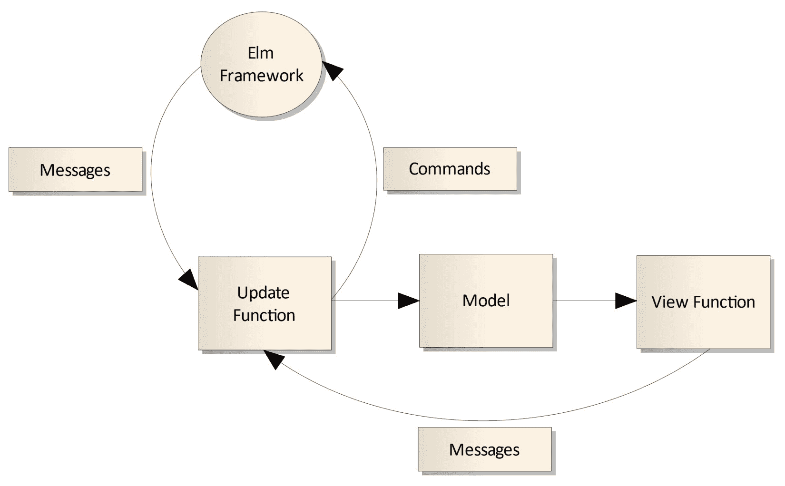

### 使用 React 和 Redux 生成随机数

现在让我们在 JavaScript 中实现相同的功能。

#### 模型

我们首先将模型定义为一个对象，其`number`属性设置为 0。

```js
const initialModel = {
  number: 0
};
```

#### 命令

这就是我们在生成随机数时遇到问题的地方，同时还要使用纯函数。Redux 允许我们定义一个放置此类不纯逻辑的地方，但没有完全避免它的解决方案。

我们将遵循 Redux 模式，将`GenerateNumber`定义为一个返回另一个函数的函数。返回的函数称为 thunk，包含不纯逻辑。这个不纯逻辑的结果将作为参数传递给`SetNumber`消息。

```js
function GenerateNumber(){
  return function(dispatch){
    const number = Math.floor(Math.random() * 100);
    dispatch(SetNumber(number));
  }
}
```

#### 消息

`GenerateNumber`命令需要`SetNumber`消息来发送新生成的数字。

```js
function SetNumber(number){
  return {
    type : SetNumber.name,
    number
  }
}
```

#### 视图

视图函数接收模型并为其创建 HTML。当点击生成按钮时，它会分发`GenerateNumber`命令。

```jsx
import React from 'react';
import { connect } from 'react-redux';
import { GenerateNumber } from './store';

function Counter({number, GenerateNumber}){
  return(
    <div>
      <div>{number}</div>
      <button
        type="button"
        onClick={GenerateNumber}>生成</button>
    </div>
  )
}

export default connect(
  state => state,
  { GenerateNumber }
)(Counter)
```

#### 更新

更新函数处理应用程序消息。当收到`SetNumber`消息时，它返回一个带有新数字值的模型。

```js
function reducer(model = initialModel, action){
  switch(action.type){
    case SetNumber.name:
      return { ...model, number: action.number };
    default:
      return model;
  }
}
```

### 总结

Elm 架构定义了数据流，使我们能够以函数式风格编写实用的应用程序。

模型是一个不可变对象，代表所有应用程序状态。

视图函数是一个纯函数，用于构建 HTML 并创建消息。视图函数不负责在屏幕上渲染 HTML。它接收模型并返回 HTML。Elm 框架使用视图函数将此 HTML 渲染到屏幕上。

消息是修改应用程序模型的请求。

更新函数是一个纯函数，接收当前模型和一条消息，并返回新模型。当处理副作用时，它还会返回一条新命令。更新函数实际上并不改变模型。Elm 框架使用更新函数来改变模型。Elm 框架执行更新函数返回的命令，并用结果创建一条新消息。

## 第 17 章：函数式范式

现在我们将回顾以函数式风格编程意味着什么。

函数式编程的主要思想是将应用程序拆分为小的纯函数，这些函数使用不可变数据进行通信，然后组合这些函数以实现所需功能。

理想情况下，应用程序中的所有函数都应该是纯函数。

### 纯度

正如多次重复的那样，函数式编程的重点是编写纯函数。这些函数只是转换值。

当纯函数返回时，应用程序的状态与调用该函数时相同。当我们不必跟踪变量值的变化时，应用程序更容易理解。纯函数通过让我们将注意力集中在一处，使代码更易于跟踪。

当然，挑战在于仅使用纯函数进行转换来创建实用的应用程序。这甚至可能吗？

我们看到，如果我们有合适的框架使用这些纯函数并执行实用应用程序所需的不纯逻辑，这是可以实现的。Elm 实现了这样的架构。

以下是在 Elm 中执行不纯逻辑的流程：

- 纯更新函数创建一条描述不纯逻辑的命令。
- Elm 框架获取该命令，执行不纯逻辑，并生成一条包含结果的消息。
- 纯更新函数通过创建一个包含先前结果的新更新模型来处理这条消息。

这种方法需要为任何类型的不纯逻辑创建命令的函数，并使用能够理解这些命令的框架。

接下来，我们将研究一种类似的方法，用于使用 React 和 Redux 仅使用纯函数进行 fetch 调用。fetch 调用本身是一个副作用，因此在函数中调用它会使该函数变得不纯。

幸运的是，有一个 [Redux 中间件](https://redux.js.org/advanced/middleware)，称为 [Axios 中间件](https://github.com/svrcekmichal/redux-axios-middleware)，它可以拦截 fetch 消息，执行 fetch 调用，然后将结果放入一条新的成功消息中。

让我们看看实现此功能所需的各个部分。

模型最初只存储一个空的待办事项列表。

```js
const initialModel = {
  todos: []
};
```

描述 fetch 请求的消息对象是使用`LoadTodos`纯函数创建的。

```js
function LoadTodos(){
  return {
    type: LoadTodos.name,
    payload: { request: { url: '/todos' } }
  };
}
```

`List`视图函数是纯函数。它接收待办事项列表并生成 HTML。它创建了一个刷新按钮，点击时会发送`LoadTodos`消息。

```jsx
import React from 'react';
import { connect } from 'react-redux';
import { LoadTodos } from './store';

function List({todos, LoadTodos}){
  return(
    <div>
      <button type="button" onClick={LoadTodos}>Refresh</button>
      { todos.map(todo => <div>{todo.title}</div>) }
    </div>
  )
}

export default connect(
  state => state,
  { LoadTodos }
)(List);
```

`update`函数是纯函数。它接收当前模型和动作，并返回新模型。当接收到成功消息时，它会返回一个包含新待办事项列表的新模型。

```jsx
function reducer(model = initialModel, action){
  switch(action.type){
    case `${LoadTodos.name}_SUCCESS`:
      return {
        ...model,
        todos: action.payload.data
      };
    default:
      return model;
  }
}
```

就是这样。我们仅使用纯函数就实现了 fetch 调用并在屏幕上显示结果。之所以能做到，是因为我们拥有一套处理非纯逻辑的库。

请注意此应用中的数据流：

- 点击刷新按钮会创建一条描述 fetch 请求的消息。
- Axios 中间件拦截该消息，执行 fetch 调用，并创建一条包含结果的新成功消息。
- update 函数处理成功消息，通过之前的结果创建新模型。

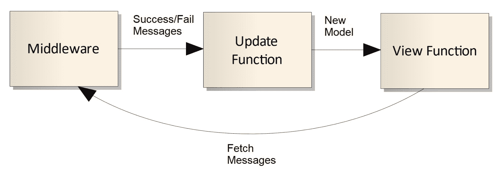

仔细想想，这种获取数据的逻辑包含三个非纯部分：

- 从 Web API 获取数据。
- 更新模型对象。
- 在屏幕上渲染数据。

Redux-Axios 中间件使我们能够通过创建 fetch 命令的纯函数来发起 fetch 请求。Redux 提供了使用纯函数更新模型的解决方案。React 提供了使用纯视图函数更新 UI 的解决方案。这很有帮助，但这并不是我们所能编写的唯一非纯逻辑。还有很多其他情况，比如协调多个网络请求、创建定时器事件、生成随机数、获取当前时间、写入控制台或本地存储等等。我们称这些为副作用。

在撰写本文时，JavaScript 中用于以函数式风格编写应用的最佳库（React 和 Redux）仍然需要编写非纯逻辑。在这种情况下，我们需要追求高比例的纯函数。80% 远比 20% 好。

### 不可变性

事实证明，实现不可变性要容易得多。我们可以在创建对象时直接冻结它们，它们就变得不可变了。另一个简单的解决方案是使用 linter 来确保应用中不发生任何变更。

像`Immutable.JS`这样的库提供了不可变数据结构。它们提供了优化改进和更友好的公共接口。


在处理列表时，我们不必担心创建中间集合。当列表很小（少于一千条记录）时，差异几乎无法察觉。当处理包含数千个对象的集合时，我们可以开始使用不会创建中间集合的序列。

### 管道

我们看到了创建数据转换管道的不同方式，从`pipe`工具到数组、不可变列表、序列、Promise 或 Observable 上的链式转换。

所有这些数据结构都包装了一个或多个值，并允许我们创建纯函数管道来转换包装的数据。通常，这些数据结构都支持一组常见的转换，如`filter`、`map`、`reduce`或`sort`。

在这种情况下，柯里化技术对于向管道中的函数传递额外参数非常有用。

函数式编程开始涉及使用纯函数管道转换数据。从某种意义上说，函数式编程提倡一种数据流编程风格。

### 循环

纯函数式语言没有循环。这类功能是通过数组方法实现的，对于特定算法则退而使用递归。

在撰写本文时，JavaScript 中无法禁用所有循环语句，因为它缺少[尾调用](https://en.wikipedia.org/wiki/Tail_call)实现。

### 命名

将应用拆分为纯函数还不够。我们需要为这些函数赋予能揭示意图的名称。所以请花时间做好这一点。如果命名失败，应用仍然会难以理解。

### 文件夹结构

随着应用的增长，会创建越来越多的函数。你需要找到一种方法将这些函数组织成模块。这意味着创建具有清晰名称的文件来包含这些函数。然后你需要一种方法将这些文件组织到文件夹中。会有通用函数，也会有仅在特定模块中使用的函数。

### 最终思考

以函数式风格编写的应用由大量纯函数组成，这些函数被组织成模块。我们将这些函数用于管道中，并组合它们以实现所需的功能。

函数式编程使代码更易于阅读。不易理解的程序可能导致错误，并且通常会被重写。

函数式编程的本质是使用纯函数转换不可变数据。这些转换在管道中更具表现力。

### 下一步是什么？

如果你想将所学付诸实践，并使用函数式组件和函数式编程原则构建现代 React 应用，请考虑阅读[Functional React, 2nd Edition](https://www.amazon.com/dp/B088FZQ1XN)。

继续你的学习之路，阅读[Functional Architecture with React and Redux](https://www.amazon.com/dp/B0846NRJYR/ref=cm_sw_em_r_mt_dp_U_pztUEbV10W9GY)，并使用 React 和 Redux 构建多个具有递增复杂度的应用。

函数式架构意味着获取初始状态，使用视图函数将其展示给用户，监听动作，基于这些动作更新状态，然后将更新后的状态再次渲染给用户。

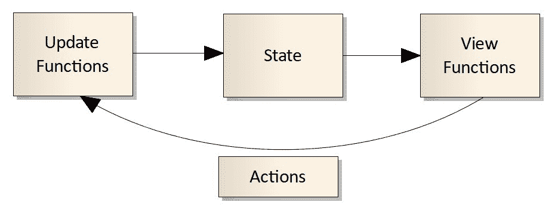

享受《JavaScript 与 React 函数式编程》系列书籍！

### 目录

第 01 章：基本类型

第 02 章：不可变数据对象

第 03 章：函数

第 04 章：数组

第 05 章：一等函数

第 06 章：语句

第 07 章：递归

第 08 章：管道与柯里化

第 09 章：函子

第 10 章：单子

第 11 章：不可变集合

第 12 章：惰性转换

第 13 章：生成器

第 14 章：Promise

第 15 章：Observable

第 16 章：Elm 架构

第 17 章：函数式范式
