# JavaScript 函数式编程


# 引言

函数式编程正变得越来越流行，本书旨在阐明如何将 JavaScript 用作函数式语言。

事实证明，JavaScript 具备作为函数式语言所需的一切条件。我们只需要从语言中移除一些特性即可。

本质上，我们将从代码中移除 `this` 关键字。这意味着我们将不使用类，也不使用包含 `this` 关键字的方法。这也意味着不使用自定义原型。

移除 `this` 还有其他好处。`this` 是 JavaScript 中许多困惑的根源，主要是因为它取决于函数的调用方式，而不是函数的定义位置。在很多情况下，`this` 指向了一个意外的函数上下文，从而导致 bug。通过移除 `this`，所有相关问题都消失了。

JavaScript 既是一种函数式编程语言，也是一种基于原型的语言。如果我们去掉 `this`，JavaScript 就成为一种函数式编程语言。这甚至更好。

话虽如此，我们可以通过启用代码检查来从代码中移除 `this`。

以下是一个 lint 配置文件的示例，它禁止在基于 [Create React App](https://create-react-app.dev) 构建的应用程序中使用 `this` 关键字。

```
{
  "extends": ["react-app"],
  "plugins": [
    "immutable"
  ],
  "rules": {
    "immutable/no-this": "error"
  }
}
```

没有 `this` 的 JavaScript 看起来更像是一种更好的函数式编程语言。

**源代码** 本书的项目文件可在 [https://github.com/cristi-salcescu/functional-programming-in-javascript](https://github.com/cristi-salcescu/functional-programming-in-javascript) 获取先祖。

**反馈** 我很乐意听取您的反馈。如有关于本书的评论、问题或建议，请发送邮件至 [cristisalcescu@gmail.com](mailto:cristisalcescu@gmail.com)。提前感谢您考虑撰写书评。

# 环境搭建

首先，我们需要搭建开发环境以使用最新的 JavaScript 特性。

**包管理器**

包管理器是一种用于以简单易懂的方式跟踪项目依赖的工具。在撰写本文时，Node.js 包管理器，简称 `npm`，是最受欢迎的。让我们开始安装 [Node.js](https://nodejs.org/)。

然后可以在命令提示符中使用以下命令检查 Node.js 和 npm 的版本：

```
node --version
```

```
npm --v
```

**NPM 包**

使用 npm 我们可以安装额外的包。这些包就是应用程序的依赖项。

`package.json` 文件存储了项目中使用的所有 node 包。这些包就是应用程序的依赖项。应用程序可以与其他开发者共享，而无需共享所有 node 包。可以使用 `npm install` 命令安装 `package.json` 文件中定义的所有包。

首先使用 npm 创建一个 package.json 文件。

```
npm init
```

我们需要一个将 JavaScript 代码转换为向后兼容版本并支持[模块](https://developer.mozilla.org/en-US/docs/Web/JavaScript/Guide/Modules)的工具。我们需要 [Babel](https://babeljs.io/)。去安装必要的包吧。

```
npm install @babel/core @babel/node @babel/preset-env --save
```

已安装的包可以在 `node_modules` 文件夹中找到。`--save` 标志告诉 npm 将包要求存储在 `package.json` 文件中。

为了使用最新的 JavaScript，我们需要启用一个预设。创建 `.babelrc` 文件并启用 [babel/preset-env](https://babeljs.io/docs/en/babel-preset-env) 预设。

```
{
  "presets": ["@babel/preset-env"]
}
```

**代码检查**

代码检查是分析代码中潜在错误和风格问题的过程。代码检查工具是一种运行并报告这些问题的工具。代码检查工具还有助于代码格式化和使用最佳实践。

我们将使用 [ES Lint](https://eslint.org/)。先安装它。

```
npm install eslint --save-dev
```

代码检查规则可以在名为 `.eslintrc.*` 的配置文件中定义。

接下来，设置一个配置文件。

```
npx eslint --init
```

我们要使用的一个插件是 [eslint-plugin-functional](https://www.npmjs.com/package/eslint-plugin-functional)，所以来安装它。

```
npm install eslint-plugin-functional --save-dev
```

现在打开 `.eslintrc.json` 配置文件，编写禁止使用该关键字的代码检查规则。

```
{
  "plugins": [
    "functional"
  ],
  "rules": {
    "functional/no-this-expression": "error"
  }
}
```

以下是如何在 `src` 文件夹中的所有文件上运行代码检查。

```
npx eslint src
```

在基于 [Create React App](https://create-react-app.dev/) 创建的应用程序中，我们可以通过在


在 `npx eslint src` 命令前添加 `&&`。

```
"scripts": {
  "start": "npx eslint src && react-scripts start"
}
```

使用 `&&` 意味着其两侧的命令都必须求值为 `true`。如果左侧命令失败，右侧命令将不会执行。因此在我们的例子中，开发服务器将不会启动。

# IDE

代码编辑需要集成开发环境，简称 IDE。

我将使用 [Visual Studio Code](https://code.visualstudio.com/)，但你可以自由选择任何喜欢的编辑器。

要编写命令，请在 Visual Studio Code 中打开应用文件夹。然后通过 `Terminal -> New Terminal` 打开终端并执行命令。

例如，要运行 `filter.js` 文件中的代码并检查结果，我们可以直接使用以下命令。

npx babel-node filter.js

为了获得即时的 lint 反馈，我们可以安装 [ESLint extension for VSCode](https://marketplace.visualstudio.com/items?itemName=dbaeumer.vscode-eslint)。Linting 使我们能在 JavaScript 的一个更好子集中工作。

# 第一章：基本类型

我们开始学习之旅，首先了解语言中可用的第一种值。

**基本类型** 基本类型的值包括数字、字符串、布尔值、`null` 和 `undefined`。在控制台中输出一些这些基本值。

```
console.log(1);
console.log('text');
console.log(true);
```

所有这些基本值都有一个类型。我们可以使用 `typeof` 操作符来查找值的类型。检查其中一些。

```
console.log(typeof(1));
//"number"
```

```
console.log(typeof(''));
//"string"
```

```
console.log(typeof(true));
//"boolean"
```

数字类型有两种：`Number` 和 `BigInt`。我们主要使用第一种，它存储双精度浮点数。需要了解浮点数运算是不精确的。

```
console.log(0.1+0.2);
//0.30000000000000004
```

```
console.log(0.1 + 0.2 === 0.3);
```

```
//false 整数运算在15位数以内是精确的。我们可以通过先乘后除来解决上述问题。

console.log(1 + 2 === 3);
//true
```

```
console.log((0.1 * 10 + 0.2 * 10) / 10 === 3);
//true BigInt 用于表示更大的数字。我们可以通过在整数字面量末尾添加 n 来创建这样的数字。

console.log(12345678987654321n);
```

字符串是文本。有三种方法可以定义字符串值：单引号、双引号和反引号。

```
"text"
'text'
`text`
```

`Undefined` 是一个只有一个值 `undefined` 的类型。`Null` 是一个只有一个值 `null` 的类型。`Boolean` 是一个有两个值 `true` 和 `false` 的类型。

## 基本类型的方法

基本类型不是对象，但它们似乎表现得像对象，因为它们有方法。例如，我们可以在字符串基本类型上调用 `toLowerCase` 方法。如果字符串不是对象，这怎么可能？JavaScript 创建了一个包装对象并销毁它来运行 `toLowerCase` 方法。

```
'TEXT'.toLowerCase();
//"text"
```

我们可以访问基本类型上的现有属性，但不能更改它们或创建新属性。例如，`length` 属性返回字符串的大小。

```
'ABCDEFG'.length
```

```
//7
```

```
'ABCDEFG'.type = 'letters';
```

```
//Cannot create property 'type' on string 'ABCDEFG'
```

唯一不被视为对象的基本类型是 `null` 和 `undefined`。尝试在它们上调用方法将抛出错误。

```
null.toString();
```

```
//Cannot read property 'toString' of null
```

## 不可变性

不可变值是指一旦创建就无法更改的值。

基本类型是不可变的。例如，当在字符串上使用方法时，我们创建了一个新值。这是一个使用 `trim` 方法的示例，它会删除字符串两侧的空白。

```
' 123 '.trim();
```

```
//'123';
```

`trim` 方法不会修改现有字符串。它创建了一个新字符串。

## 变量

我们需要区分变量和值。变量不是值。变量存储值。

我们可以将值赋给变量。此时，变量持有这些值。变量有一个名称，我们可以通过变量的名称来引用值。

我们使用赋值 `=` 关键字将值存储在变量中。变量可以用 `let`、`var` 或 `const` 语句声明。当我们声明一个变量而不为其赋值时，它的默认值是 `undefined`。

```
let x;
console.log(x);
//undefined
```

变量存储对值的引用。值不包含变量。值可能包含其他值。

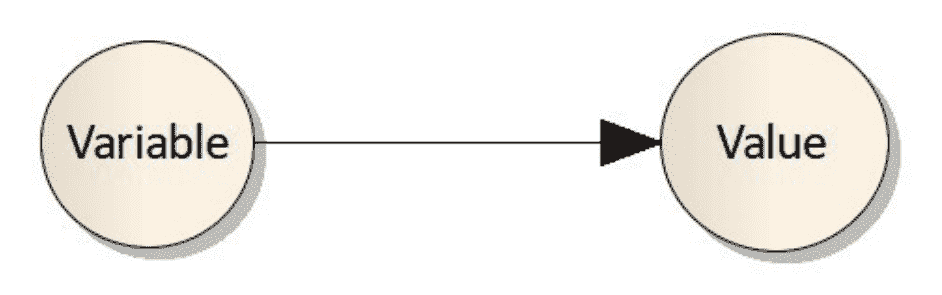

值有一个类型。变量具有它们所存储值的类型。变量不绑定于类型。一个值始终具有相同的类型。`1` 始终是数字，但下面的变量 `x` 可以先是数字类型，然后是字符串类型。

```
let x;
x = 1;
x = '';
```

当变量存储的值发生变化时，变量的类型可能会改变。动态类型意味着变量的类型可以在运行时改变。这只适用于用 `let` 或 `var` 声明的变量。

`const` 声明的变量不能重新赋值，因此它们不能更改其类型。

## 回顾

数字、字符串、布尔值、`null` 和 `undefined` 是基本值。

基本值是不可变的。

值可以存储在变量中。

变量推断它们所存储值的类型。

# 第二章：不可变数据对象

接下来，我们将了解什么是对象以及如何创建和使用不可变对象。

在函数式编程中，我们将把对象用作数据结构。它们将存储数据，没有行为。

**对象** 对象是属性的集合。每个属性都有一个键和一个值。在控制台中查看一个对象。

```
const book = {
  title : 'JavaScript Allongé'
  author: 'Reginald Braithwaite'
  category: 'JavaScript'
};
```

console.log(book);

键是集合中唯一的字符串。它区分大小写。

我们可以使用点表示法或括号表示法访问属性。

```
console.log(book.title);
//"JavaScript Allongé"
```

console.log(book["title"]);

## 不可变性

不可变性是函数式编程的核心原则之一。

变异意味着更改。说我们更改了对象的属性等同于说我们变异了该对象。

不可变对象一旦创建就无法更改。JavaScript 对象并非如此。它们可以被修改。它们不是不可变的。看下一个例子：

```
let fruit = {
  name: 'Apple'
};
```

```
fruit.name = 'Orange'
//{name : 'Orange'}
```

如你所见，我们可以更改现有的 `fruit` 对象。即使我们使用 `const` 关键字声明，情况也是如此。

```
const fruit = {
  name: 'Apple'
};
```

```
fruit.name = 'Orange'
// {name : 'Orange'}
```

`const` 关键字指的是变量，而不是它存储的值。这意味着变量不能重新赋值。当它存储的值是不可变的时，它才真正成为一个常量。

## 冻结

为了创建不可变对象，我们可以在创建时冻结它。

```
const fruit = Object.freeze({
  name: 'Apple'
});
```

```
fruit.name = 'Orange'
```

```
// Cannot assign to read only property 'name' of object
```

唯一的限制是 `Object.freeze` 执行浅冻结。它影响对象的直接属性，即树结构中的第一级属性。例如，如果其中一个属性包含另一个对象，则该对象将不会受到影响。看下一个例子。

```
const book = Object.freeze({
  name: "How JavaScript Works",
  author: {
    firstName: 'Douglas',
    lastName: 'Crockford'
  }
});
```

book.author.firstName = '';

book 对象被更改了。我们不能将新对象重新赋值给 `author` 属性，但可以修改其属性。对于包含其他对象的对象，我们应该使用 `deepFreeze()` 工具函数。它将冻结给定对象内所有对象的所有属性。

## Linting

启用不可变性的另一个选项是使用 linter，例如 ESLint。有几个插件可以帮助我们强制实现不可变对象。此类插件有 `eslint-plugin-functional`、`eslint-plugin-fp` 或 `eslint-plugin-immutable`。我们将使用 `eslint-plugin-functional`。

```
npm install eslint-plugin-functional --save-dev
```

安装插件后，修改 lint 配置文件 `.eslintrc.json` 以启用不可变数据。

```
"plugins": [
  "functional"
],
```


## 与不可变对象一起工作

接下来，让我们来看看如何"修改"不可变对象。

修改不可变对象意味着创建一个修改后的副本。为此，使用[展开运算符语法](link)非常有用。

## 修改属性

以下是修改现有属性的示例：

```javascript
const product = {
  name: 'Apple',
  quantity: 1
};

const newProduct = {
  ...product,
  quantity: 2
};
```

通过使用展开语法，我们首先从`product`对象复制了所有属性，然后用新值添加了需要更改的属性。

## 添加属性

添加新属性的方式类似。我们克隆对象，然后向其添加额外的属性。

在下面的示例中，`product`对象被克隆，并添加了`type`属性。

```javascript
const product = {
  name: 'Apple',
  quantity: 1
};

const newProduct = {
  ...product,
  type: 'fruit'
};
```

## 删除属性

可以使用[解构语法](link)中的剩余运算符来移除属性。在下面的示例中，`quantity`属性通过解构被排除并忽略，从而从新对象中移除。

```javascript
const product = {
  name: 'Apple',
  quantity: 1
};

const {
  quantity,
  ...newProduct
} = product;

console.log(newProduct);
//{name: "Apple"}
```

从现在开始，在以下示例中，不可变性被认为已通过使用 linter 工具启用。

## 回顾

不可变对象在创建后不能被更改。

我们可以通过冻结它们或使用 linter 来启用不可变对象。

展开运算符对于创建现有对象的修改副本非常方便。

# 第 03 章：函数

函数是我们定义和封装逻辑的主要方式。

函数有一组参数和一个语句体。根据函数的创建方式，它可能有一个名称。我将努力在大多数情况下使用命名函数。

让我们看看定义函数的主要方式。

## 函数声明

可以使用`function`关键字声明来创建函数，后跟函数名称和参数列表。函数体放在花括号内。

```javascript
function sum(x, y){
  return x + y;
}
```

函数可以使用函数名后跟随括号括起来的参数列表来调用。

```javascript
sum(1,2)
//3
```

如果未传递值或传递了`undefined`，函数参数可以用默认值初始化。在下面的示例中，如果在调用`increment`函数时未给`step`参数提供值，它将默认为`1`。

```javascript
function increment(n, step = 1){
  return n + step
}

const n = 1;
console.log(increment(n));
//2

console.log(increment(n, 2));
//3
```

以这种方式创建的函数会被提升到其作用域的顶部，因此它们可以在声明之前使用。函数的作用域可以是一个模块，或者当前函数所定义的外部函数。

```javascript
sum(1,2);
//3

function sum(x, y){
  return x + y;
}
```

函数返回值。`return`语句指定返回的值。它也会停止函数的执行。

## 函数表达式

`function`关键字可用于在表达式内部定义函数。在函数声明中，`function`是该行的第一个关键字。当情况并非如此时，我们处理的是函数表达式。

对于函数表达式，名称是可选的，但在实现递归函数时，有名称会很有用。

这是一个函数表达式。

```javascript
const sum = function(x, y){
    return x + y;
}
```

以下也是一个函数表达式。

```javascript
!function start(){
    console.log('start')
}
```

一旦`function`不是该行的第一个关键字，它就变成了函数表达式。函数名称可以省略，并且它可以自动执行。

```javascript
!function(){
    console.log('start')
}();
//"start"
```

## 箭头函数表达式

箭头函数表达式是常规函数表达式的简洁替代方案。

箭头函数语法由一个参数列表后跟`=>`符号，然后是可选花括号括起来的函数体组成。

```javascript
const sum = (x, y) => x + y;

sum(1,2);
```

这次没有 function 关键字，也没有 return 语句。`=>`符号指向被返回的内容。

当箭头函数内部的逻辑包含多条语句时，我们使用花括号。这次需要`return`语句来返回结果。

```javascript
const sum = (x, y) => {
  return x + y;
}
```

这两种函数表达式都不会被提升到其作用域的顶部。它们不能在声明之前使用。

## 元数

函数的元数描述函数有多少个参数。

- 一元函数有一个参数。
- 二元函数有两个参数。
- n 元函数有 n 个参数。
- 零元函数没有参数。

## 纯函数

在函数式编程中，函数就像数学函数一样。它们进行计算。这类函数被称为纯函数。

纯函数根据输入参数计算新值。

它们是确定性函数。这意味着当使用相同的输入调用时，它们返回相同的结果。`Math.random`和`Date.now`不是确定性函数，因为它们每次被调用时返回不同的结果。它们不能在纯函数内部使用。

纯函数不修改执行函数的外部环境，因此它们不会写入外部环境或读取可能从外部改变的数据。

这是一个纯函数的示例。

```javascript
const number = 1.7654321;

function roundNumber(n, precision = 2){
  const noAsString = n.toFixed(precision);
  return Number.parseFloat(noAsString);
}

console.log(roundNumber(number));
//1.77
```

`roundNumber`是一个纯函数，使用其他纯函数`toFixed`和`parseFloat`，将数字四舍五入到 n 位小数。

更改局部作用域之外的数据、读取可能从外部改变的数据，或者对外部环境的任何更改，都是副作用。

仅仅因为它们只基于输入进行计算且没有副作用，所以它们更易于理解、测试或调试。

`Math.min`、`Math.max`、`Math.sqrt`都是纯函数。事实上，`Math`对象的所有静态方法，除了`Math.random`之外，都是纯函数。

## 回顾

函数可以使用函数声明、函数表达式或箭头函数表达式来创建。

在函数式编程中，函数应该像数学函数一样，只进行计算而不改变外部环境。

# 第 04 章：数组

数组是值的索引集合。数组和对象都是值的集合。事实上，数组是使用对象模拟的。

我们简单地使用数组字面量来创建数组。这是一个示例。

```javascript
const arr = [1, 2, 3];

Array.isArray(arr);
//true
```

数组有一套用于数据转换的方法。

数据转换是函数式编程真正发光的任务之一。它使这些转换更易于管理和理解。它通过识别所有转换所做的核心操作集来实现这一点，如过滤、映射、排序和聚合。

## 过滤

考虑下面的示例，从数组中只选择偶数。

```javascript
const numbers = [1, 2, 3, 4];

function isEven(n) {
  return n % 2 == 0;
}

const evenNumbers = numbers.filter(isEven);
console.log(evenNumbers);
//[2, 4]
```


`filter` 方法会遍历数组中的所有元素，并应用 `isEven` 函数。它会创建一个新数组，其中只包含那些 `isEven` 函数返回 `true` 的元素。

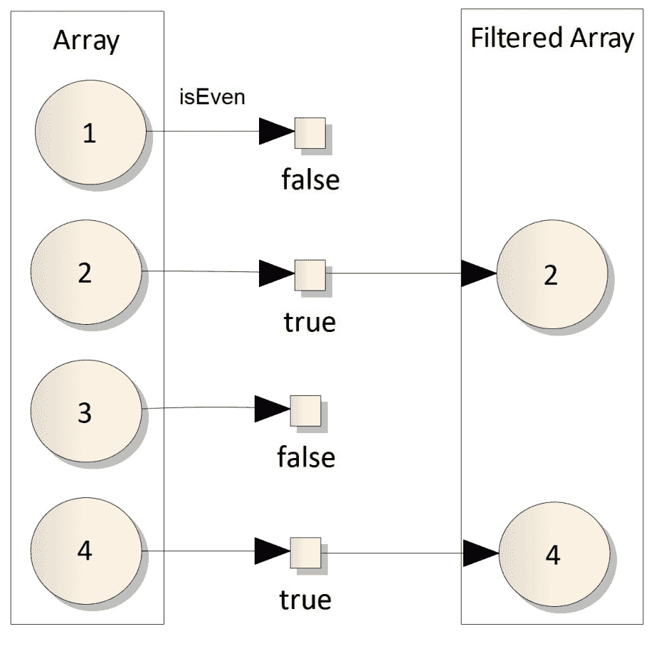

`isEven` 是一个谓词函数。

谓词函数是接收一个元素并返回布尔值的函数。谓词是一个一元函数。

接下来，考虑一个游戏对象列表。

```
const games = [
 { title: 'Starcraft', genre: 'RTS' },
 { title: 'Command and Conquer', genre: 'RTS' },
 { title: 'Heroes of Might and Magic', genre: 'TBS' },
 { title: 'World of Warcraft', genre: 'MMORPG'}
]
```

我们只想选择策略类游戏。为此，我们将构建一个谓词函数，它接收一个游戏对象，并根据其类型属性判断它是否是策略游戏。

```
function isStrategy(game){
  const strategyGenres = ['RTS', 'RTT', 'TBS', 'TBT'];
  return strategyGenres.includes(game.genre);
}
```

`includes` 方法检查一个值是否在数组中，并返回 `true` 或 `false`。

现在我们可以将 `filter` 与谓词函数一起使用，来仅选择策略游戏。

```
const strategyGames = games
  .filter(isStrategy);

console.log(strategyGames);
// [ { title: 'Starcraft', genre: 'RTS' },
//   { title: 'Command and Conquer', genre: 'RTS' },
//   { title: 'Heroes of Might and Magic', genre: 'TBS' } ]
```

## 映射

接下来，我们将对一个数字列表应用映射转换。

```
const numbers = [1, 2, 3, 4];
```

```
function triple(n) {
  return n * 3;
}

const newNumbers = numbers.map(triple);
console.log(newNumbers);
// [3, 6, 9, 12]
```

`map` 方法将映射函数应用于数组中的所有元素，并用结果创建一个新数组。

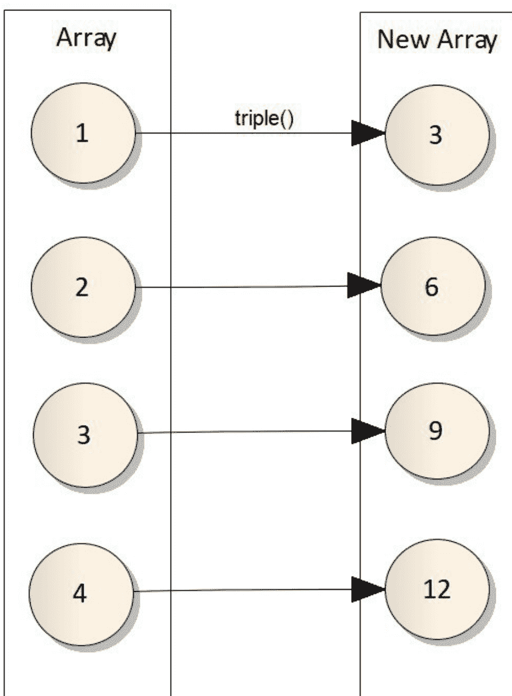

`triple` 是一个映射函数。

映射函数是接收一个元素并将其转换为新值的函数。它是一个一元函数。

接下来，让我们在游戏对象列表上应用一个映射函数。

```
const games = [
  { title: 'Starcraft', genre: 'RTS' },
  { title: 'Command and Conquer', genre: 'RTS' },
  { title: 'Heroes of Might and Magic', genre: 'TBS' },
  { title: 'World of Warcraft', genre: 'MMORPG'}
]
```

下面的 `toGameHtml` 函数接收一个游戏对象并为其创建 HTML 字符串。

```
function toGameHtml(game){
  return `<div>${game.title}</div>`;
}
```

模板字符串允许我们将变量插入到字符串中。它们是字符串拼接的一个更好替代方案。插入到模板字符串中的变量被 `${}` 包围。模板字符串允许文本跨越多行。这使得创建更易于阅读的 HTML 字符串成为可能。

```
function toGameHtml(game){
  return `
    <div>
      ${game.title}
    </div>`;
}
```

现在我们可以使用映射函数将所有游戏对象转换为 HTML 字符串。

```
const htmlRows = games
  .map(toGameHtml);

console.log(htmlRows);
// [ '<div>Starcraft</div>',
//   '<div>Command and Conquer</div>',
//   '<div>Heroes of Might and Magic</div>',
//   '<div>World of Warcraft</div>' ]
```

`join` 方法将数组的所有元素合并为一个字符串。它接受一个分隔符作为参数。如果未提供参数，则将所有元素连接起来，中间没有任何分隔符。

```
console.log(htmlRows.join());
// "<div>Starcraft</div>,<div>Command and Conquer</div>,
// <div>Heroes of Might and Magic</div>,
// <div>World of Warcraft</div>"
```

## 聚合

聚合是关于将多个值分组为一个单一的汇总值。

考虑以下代码。

```
const numbers = [1, 3, 5, 7];

function add(total, n) {
  return total + n;
}

const total = numbers.reduce(add, 0);
console.log(total);
// 16
```

`reduce` 方法将列表归约为单个值。

`reduce` 方法对数组中的每个元素应用归约函数以计算聚合值。它可以接受第二个参数作为初始聚合值。

`add` 是归约函数。

归约函数接收当前的聚合值和当前元素，并返回新的聚合值。归约函数是一个二元函数。

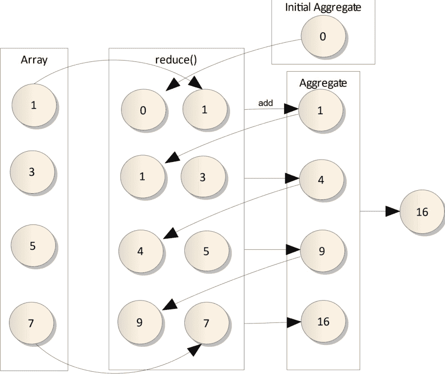

在第一次迭代中，聚合值是 `0`，当前元素是 `1`。应用归约器后，新的聚合值为 `1`。

在第四次迭代中，当前聚合值是 `9`，当前元素是 `7`。应用归约器后，新的聚合值为 `16`。

让我们回到游戏对象数组，并计算每个类型的游戏数量。

```
const games = [
  { title: 'Starcraft', genre: 'RTS' },
  { title: 'Command and Conquer', genre: 'RTS' },
  { title: 'Heroes of Might and Magic', genre: 'TBS' },
  { title: 'World of Warcraft', genre: 'MMORPG'}
];
```

```
function countByGenre(countMap, game){
  const count = countMap[game.genre] || 0;
  return {
    ...countMap,
    [game.genre]: count + 1
  }
}
```

```
const gamesByGenreCounts = games
  .reduce(countByGenre, {});
```

```
console.log(gamesByGenreCounts);
// { RTS: 2, TBS: 1, MMORPG: 1 }
```

`countByGenre` 是归约函数。它从一个空对象作为聚合值开始，在每一步中，它会为当前游戏所属类型的游戏数量加一。在聚合对象上更改 `count` 意味着创建一个带有新 `count` 的新对象。

## 排序

`sort` 方法允许对数组进行排序。

```
const numbers = [4, 2, 3, 1];

function asc(a, b) {
  if(a === b){
    return 0;
  } else {
    if (a < b){
      return -1;
    } else {
      return 1;
    }
  }
}

const sortedNumbers = numbers.slice().sort(asc);
console.log(sortedNumbers);
// [1, 2, 3, 4]
```

`sort` 方法使用比较函数来执行排序。

`asc` 函数就是比较函数。它是一个二元函数。它接收两个值并返回 `-1`、`0` 或 `1`。

考虑比较函数接收两个值 `a` 和 `b`。

-   如果值相等，则返回 `0`
-   如果值 `a` 排在值 `b` 之前，则返回 `-1`
-   如果值 `a` 排在值 `b` 之后，则返回 `1`

`sort` 是一个不纯的方法。它会修改输入的数组。这就是它会产生 lint 错误的原因。为了进行排序，我们需要先克隆数组。

```
const sortedNumbers = numbers.sort(asc);
// Modifying an array is not allowed functional/immutable-data
```

```
const sortedNumbers = numbers.slice().sort(asc);
const sortedNumbers = [...numbers].sort(asc);
```

`slice` 会复制数组或数组的一部分。不带参数调用 `slice` 会复制整个数组。第一个参数是起始索引。第二个参数是结束索引。

## 搜索

`find` 返回第一个匹配谓词函数的元素。`find` 找到第一个匹配项后就会停止。`filter` 则永不停止，并返回包含所有匹配项的数组。`find` 比 `filter` 更快。

`findIndex` 返回第一个匹配项的索引。如果所有元素都匹配谓词函数，`every` 返回 `true`。当遇到第一个不匹配的元素时，它会停止并返回 `false`。

`some` 在至少有一个元素匹配谓词函数时返回 `true`。它在找到第一个匹配项时就会停止。

所有这四种方法都使用谓词函数，并基于其返回值来决定是否停止。

```
const games = [
  { title: 'Starcraft 2', genre: 'RTS' },
  { title: 'Desperados 3', genre: 'RTT'},
  { title: 'Candy Crush Saga', genre: 'Tile-matching'}
];

function isStrategy(game){
    const strategyGenres = ['RTS', 'RTT', 'TBS', 'TBT'];
    return strategyGenres.includes(game.genre);
}

const first = games.find(isStrategy);
console.log(first);
// { title: 'Starcraft 2', genre: 'RTS' }

const firstIndex = games.findIndex(isStrategy);
console.log(firstIndex);
// 0

const areAll = games.every(isStrategy);
console.log(areAll);
// false

const hasOne = games.some(isStrategy);
console.log(hasOne);
// true
```

## forEach

`forEach` 接收一个函数，并对数组中的每个元素调用它。它会将当前元素作为第一个参数，将当前索引作为第二个参数来调用函数。

`forEach` 永不停止，会处理整个列表。它忽略返回值。

```
const numbers = [1, 2, 3];

function log(value){
    console.log(value);
```


 ```
numbers
  .forEach(log);
//1
//2
//3
```

## 非纯操作

当为对象启用不可变数据的 lint 规则时，我们也会强制数组表现得像不可变结构。

```
"functional/immutable-data": "error"
```

这意味着所有试图修改数组的非纯方法，如 `push`、`pop`、`unshift` 或 `shift` 都会产生 lint 错误。

- `push` 在数组末尾添加元素，并返回数组的新长度。

- `pop` 移除并返回数组的最后一个元素。

- `unshift` 在数组开头添加元素，并返回数组的新长度。

- `shift` 移除并返回数组的第一个元素。

```
const arr = [1, 2, 3];

arr.push(4);
arr.pop();

arr.unshift(0);
arr.shift();
```

//不允许修改数组

### 修改数组

接下来，看看我们如何对不可变数组进行基本的添加、编辑和删除操作。考虑游戏对象的数组。

```
const games = [
  {id: 1, title: 'WarCraft'},
  {id: 2 title: 'X-COM: UFO Defense' }
]
```

#### 添加

**`concat` 接受一个或多个数组并将它们连接在一起。**

它可以用于添加操作。它创建一个包含新值的新数组。

```
const newValue = {id: 3, title: 'The Settlers'};
const newGames = games.concat([newValue]);
console.log(newGames);
```

```
console.log(newGames);
//[ { id: 1, title: 'WarCraft' },
//  { id: 2, title: 'X-COM: UFO Defense' },
//  { id: 3, title: 'The Settlers' } ]
```

另一种向数组添加值的方法是使用展开运算符。下面是一个例子。

```
const newGames = [...games, newValue];
```

#### 编辑

编辑意味着创建一个新数组，在指定的索引位置包含新值。

我们可以使用 `map` 来实现这一点。映射函数返回指定索引的新值，否则返回现有值。

下面是修改索引 1 处游戏对象的示例。

```
const id = 1;
const newValue = { id, title: 'WarCraft 2' };

const newGames = games.map(game =>
    (game.id === id)
        ? newValue
        : game
);

console.log(newGames);
//[ { id: 1, title: 'WarCraft 2' },
//  { id: 2, title: 'X-COM: UFO Defense' } ]
```

#### 删除

我们可以使用 `filter` 从数组中移除元素。它返回一个新数组，排除指定索引处的元素。

```
const id = 1;
const newGames = games.filter(game => game.id !== id);

console.log(newGames);
//[ { id: 2, title: 'X-COM: UFO Defense' } ]
```

## 回顾

- `filter` 从数组中选择通过谓词函数的元素。

- `map` 使用映射函数转换数组中的所有元素，并使用结果创建一个新数组。

- `reduce` 使用归约函数将数组归约为单个值。

- `sort` 使用比较函数对数组的元素进行排序。

# 第五章：一等函数

当一种语言将函数视为与其他值同等对待时，它就具有了一等函数。在 JavaScript 中，函数可以像其他值一样使用。事实上，函数是对象，因此也是值。

## 一等函数

函数可以存储在变量中。我们之前已经看到过这种情况。

```
const square = x => {
    return x * x;
}
```

这里，我们使用箭头函数表达式定义了一个函数，然后将函数存储在 `square` 变量中。该函数推断变量的名称。然后我们可以通过在末尾添加括号 () 来使用变量调用函数。

```
square(3);
//9
```

函数可以放在数组等数据结构中。看看下一个例子。

```
function toUpperCase(text){
    return text.toUpperCase();
}

function toLowerCase(text){
    return text.toLowerCase();
}

function trim(text){
    return text.trim();
}

const functions = [
  toUpperCase,
  toLowerCase,
  trim
];

const text = ' StARt!';
functions.forEach(f => {
  const newText = f(text);
  console.log(newText);
});
//"START!"
//"start!"
//"StARt!"
```

在这个例子中，我们定义了三个函数，然后将它们放入一个名为 `functions` 的数组中。然后遍历数组并用文本参数调用每个函数。结果显示在控制台中。

当我们使用不带括号的函数名时，我们指的是函数本身。当我们在函数名后加上括号时，我们指的是调用函数的结果。

函数可以作为参数传递给其他函数。在下一个例子中，我们定义了两个函数 `sum` 和 `multiply`，并将它们作为参数传递给另一个名为 `doOperation` 的函数。

```
function sum(a, b){
  return a + b;
}

function multiply(a, b){
  return a * b;
}

function doOperation(operation, a, b){
  return operation(a,b)
}

doOperation(sum, 2, 3);
//5

doOperation(multiply, 2, 3);
//6
```

函数可以返回其他函数。

函数可以有属性和方法。例如，它们有 `name` 属性，可以访问作为字符串的函数名称。

函数有像 `call()` 或 `apply()` 这样的方法。这两个方法基本上实现相同的功能，区别在于 `call` 接受参数列表，而 `apply` 接受包含所有参数的单个数组。

用参数调用函数也被称为将该函数应用于这些参数。考虑下一个使用 `call` 方法将函数应用于一组参数的示例。

```
function multiply(a, b){
  return a * b;
}

 multiply.call(null, 2, 3);
//6
```

## 高阶函数

高阶函数是对其他函数进行操作的函数。

高阶函数接受其他函数作为参数、返回函数，或两者兼而有之。

所有像 `filter`、`map`、`reduce`、`sort` 这样接受函数作为输入的数组方法都是高阶函数。

之前自定义的 `doOperation` 函数是一个高阶函数，因为它接受另一个函数作为输入。

考虑以下返回函数的高阶函数。

```
const objects = [
  { id: 1 },
  { id: 2 }
];
```

```
function hasId(id){
  return function(element){
    return element.id === id;
  }
}
```

```
console.log(objects.find(hasId(1)));
//{ id: 1 }
```

`hasId` 返回一个函数。`hasId` 是一个高阶函数。下面是一个高阶函数创建 sort 方法所需的比较函数的示例。

```
const courses = [
  {
    title: 'Course 2',
    author: 'Author 2'
  },
  {
    title: 'Course 3',
    author: 'Author 3'
  },
  {
    title: 'Course 1',
    author: 'Author 1'
  }
];
```

```
function by(name){
  return function(a, b){
    return a[name].localeCompare(b[name]);
  }
}
```

```
courses
  .slice().sort(by('author'))
```

`by` 是一个高阶函数。它允许我们使用对象的任意字符串属性对列表进行排序。

## 闭包

函数可以在其他函数内部定义。除了可以访问自己的参数和变量外，内部函数还可以访问外部函数的参数和变量。

闭包是内部函数访问外部函数变量的能力。

让我们从一个基本例子开始。

```
function run(){
  const value = 1;

  function logValue(){
    console.log(value);
  }

  logValue();
}

run();
//1
```

在函数内部定义的所有变量都只能在函数内部看到。`logValue` 函数在 `run` 函数内部定义，可以访问 `value` 变量。

当内部函数在外部函数调用结束后仍然存在时，闭包就变得很重要了。考虑下一个例子。

```
function createCount(){
  let counter = 0;

  return function count(){
    counter = counter + 1;
    return counter;
  }
}

const count = createCount();

console.log(count());
//1
console.log(count());
//2
console.log(count());
//3
```

`count` 可以访问外部函数中的 `counter` 变量。`count` 在外部函数调用结束后仍然存在。`count` 是一个闭包。

## 回顾

- 函数是值。

- 函数可以对其他函数进行操作。函数可以接受其他函数作为输入或返回函数。

- 内部函数即使在外部函数执行完毕后，仍然可以访问外部函数的变量。


 ## 第六章：语句

表达式是一个或多个值、变量、运算符和函数的组合，用于产生一个新值。简而言之，表达式是产生值的代码单元。

语句是执行操作的指令。在函数式编程中，所有内容都应该是产生值的表达式。为了实现这一点，我们将审查并移除那些不产生值的语句。

## 表达式

例如，`1 + 2` 是一个表达式。

当函数返回值时，函数调用就是一个表达式。考虑 `multiply` 函数。

```
function multiply(a, b){
  return a * b;
}
```

`multiply(2, 3)` 是一个表达式。

表达式可以包含其他表达式。例如，表达式 `multiply(2, 3+7)` 包含表达式 `3+7`。

算术表达式计算结果为数字。

字符串表达式计算结果为字符串。这里是一个例子：

```
"This " + "IS A texT".toLowerCase();
//"This is a text"
```

逻辑表达式计算结果为 true 或 false。这些表达式通常使用 [逻辑运算符](link) 如 `&&`、`||`、`!` 或 `===`。

```
1 === 2;
//false
```

表达式是返回一段值的代码。

## 语句声明

有三种用于声明变量的语句：`var`、`let` 和 `const`。

`var` 语句声明一个具有函数作用域但没有块级作用域的变量。这可能会令人困惑。`var` 声明已经过时，因此我们可以通过 lint 规则禁用它的使用。

```
"no-var": "error"
```

我建议使用 `const` 作为默认声明，并将 `let` 作为第二选择。`const` 声明禁止重新赋值变量，而且由于我们所有的值都是不可变的，因此我们创建了真正不能重新赋值或更改的常量。

使用 `const` 声明意味着每次更改某些内容时都创建一个新变量。这促进了函数纯度。

## 条件语句

### if 语句

`if` 语句不一定会返回一个值，因此在函数式风格中，我们应该么始终包含 `else` 分支并返回一个值，要么完全禁用 `if` 语句。

我们将要禁用以下 `if` 语句的用法。

```
const n = 3;
let isEven;
```

```
if(n % 2 === 0){
    isEven = true;
} else {
    isEven = false;
}
```

console.log(isEven);

只有当 `if` 语句包含 `else` 语句且所有分支都有 `return` 语句时，才允许使用 if 语句。

这是相应的 lint 规则。

```
"functional/no-conditional-statement": ["error", {
    "allowReturningBranches": "ifExhaustive"
}]
```

下面是一个带有 else 分支且始终返回的 if 语句示例。

```
function isEven(n){
    if(n % 2 === 0){
        return true;
    } else {
        return false;
    }
}
```

console.log(isEven(3));

### 条件运算符

更好的选择是使用条件运算符，它是一个返回值的表达式。

```
const n = 3;
```

```
const isEven = (n % 2 === 0)
? true
: false
```

```
console.log(isEven);
//false
```

下面是一个函数示例，当未提供产品对象时返回 null，当价格可用时返回价格，否则返回 lastPrice。

```
function getPrice(product){
  return product
    ? product.price
      ? product.price
      : product.lastPrice
    : null
}
```

```
console.log(getPrice(null));
//null
console.log(getPrice({lastPrice: 10}));
//10
console.log(getPrice({price:5, lastPrice: 10}));
//5
```

### switch 语句

与 if 语句类似，`switch 语句` 允许编写不返回值的代码。

应该禁用以下 `switch` 语句的用法。

```
function increment(x){
  return x + 1;
}
```

```
function decrement(x){
    return x - 1;
}
```

```
function doAction(actionName){
    switch(actionName){
        case "increment":
            number = increment(number);
            break;
        case "decrement":
            number = decrement(number);
            break;
    }
}
```

```
let number = 0;
doAction('increment')
console.log(number);
//1
```

只有当 switch 语句具有 default case 且所有分支都返回值时，才会使用它。查看下一个示例。

```
function doAction(x, actionName){
    switch(actionName){
        case 'increment':
            return increment(x);
        case 'decrement':
            return decrement(x);
        default:
            return x;
    }
}

const number = 0;
const newNumber = doAction(number, 'increment');
console.log(newNumber);
//1
```

更好的选择是使用 map。它有利于将 switch 分解为更小的部分。以下是使用对象字面量作为 map 重写相同逻辑的方法。

```
function increment(x){
  return x + 1;
}

function decrement(x){
  return x - 1;
}

const actionMap = {
  increment,
  decrement
}

function doAction(x, actionName){
  const action = actionMap[actionName];
  return action
    ? action(x)
    : x;
}
```

```
const number = 0;
const newNumber = doAction(number, 'increment');
console.log(number);
//1
```

## 循环语句

该语言中有三种循环语句：for、while 和 do-while。

### for 语句

for 循环语句鼓励突变和副作用。我们将用数组方法如 filter、map 和 reduce 来替换 for 循环。当算法需要更多灵活性时，我们可以回退到 forEach。

for-in 循环遍历对象的键。

```
const book = {
  title : "How JavaScript Works",
  author : "Douglas Crockford"
};
```

```
for (const propName in book) {
  console.log(book[propName])
}
```

我们可以使用 Object.keys 和数组方法实现相同的逻辑。

```
Object.keys(book).forEach(propName => {
  console.log(book[propName])
});
```

for-of 语句遍历 [可迭代对象](iterable objects) 如数组或字符串。

```
const arr = [1, 2, 3];

for (const element of arr) {
  console.log(element);
}
```

它可以用 `forEach` 方法替换。

```
arr.forEach(element => {
  console.log(element);
});
```

while 语句在条件为 true 时循环。

do-while 语句是 while 循环的一种变体，它在检查条件之前先执行一次代码，然后在条件为 true 时循环。

以下 lint 规则禁止所有循环语句，包括 `for`、`for-of`、`for-in`、`while` 和 `do-while`。

```
"no-loop-statement": "error"
```

禁用所有循环语句是有问题的。我们至少需要一种循环语句，以便在 [尾调用优化](tail-call optimization) 可用之前，在特定算法中很少使用。以下是在特定行停用先前循环规则的方法。

```
let i = 1;

// eslint-disable-next-line functional/no-loop-statement
while(i < 10){
  console.log(i);
  i = i + 1;
}
```

## 中断性语句

有四种中断性语句：`break`、`continue`、`throw` 和 `return`。我们只保留最后一个。

### break 和 continue

`break` 语句"跳出"循环。

`continue` 语句"跳过"循环中的一次迭代。

`break` 和 `continue` 都类似于 `goto` 语句，我们不会使用它们。相反，我们将使用 `find`、`every` 或 `some` 等数组方法。

考虑下一个示例，当找到搜索元素时中断循环。

```
const products = [
  {id:1, name: 'apple'},
  {id:2, name:'mango'}
]

const id = 1;
let product;
for(let i=0; i<products.length; i++){
  if(products[i].id === id){
    product = products[i];
    break;
  }
}
```

```
console.log(product);
//{id:1, name: 'apple'}
```

我们可以使用 `find` 实现相同的逻辑。

```
const id = 1;
const product = products.find(p => p.id === id);
```

console.log(product)

现在，看一个遍历单词列表并在找到特定单词时停止的示例。

```
const words = [
 'ability',
 'calculate',
 'calendar',
 'double',
 'door'
];
```

```
const stopTo = 'double';
for(let word of words){
 if(word === stopTo){
  break;
 }

 console.log(word);
}
```

相同的逻辑可以使用 `every` 实现。

```
words.every(w => {
 if(w.startsWith(stopTo)){
  return false;
 } else {


`break`和`continue`通常用于循环中。一旦我们禁用了循环，也就禁用了`break`和`continue`的使用。

`break`不能用在`switch`语句中，因为`switch`要求在所有分支上都返回值。

## throw
`throw`语句用于抛出一个异常。下面是一个示例。

```
throw new Error('The errors details');
```

异常在函数式编程中不被使用，这意味着我们需要为这些场景寻找其他替代方案。

对于异步代码，最好的方式是在操作失败时返回一个被拒绝的Promise。我们将在讨论Promise时探讨这种情况。对于同步代码，我们需要在发生错误时返回一个不同的结果。

以下是禁用`throw`语句的lint规则：

```
"functional/no-throw-statement": "error"
```

## 回顾
条件语句应该在所有分支上都返回一个值。

`if`语句的更好替代方案是条件运算符。

`switch`语句可以用映射（map）来替代。

我们应该使用数组方法而不是循环语句。

我们将只使用一个破坏性语句：`return`。

# 第7章：递归

递归意味着一个函数调用自身。递归需要一个终止条件。当满足某个条件时，递归算法停止调用自身并返回一个值。

递归是一种解决问题的方法，其解决方案是通过解决同一问题的更小实例来找到的。

## 递归阶乘
让我们从查看用迭代风格计算数字阶乘的算法开始。正如你记得的，n! = n * (n-1)!。

```
function factorial(n) {
 let result = 1;

 let i = 2;
 while(i <= n){
   result = result * i;
   i = i + 1;
 }

 return result;
}

console.log(factorial(5));
//i=2, result=2
//i=3, result=6
//i=4, result=24
//i=5, result=120
//120
```

以下是我们如何使用递归来实现相同的算法。

```
function factorial(n) {
  if (n === 0) {
    return 1;
  }
  else {
    return n * factorial(n - 1);
  }
}
```

```
//n=5 -> 5*f(4)
//n=4 -> 4*f(3)
//n=3 -> 3*f(2)
//n=2 -> 2*f(1)
//n=1 -> 1*f(0)
//n=0 -> 1 停止！
//n=1 -> 1*f(0) = 1*1 = 1
//n=2 -> 2*f(1) = 2*1 = 2
//n=3 -> 3*f(2) = 3*2 = 6
//n=4 -> 4*f(3) = 4*6 = 24
//n=5 -> 5*f(4) = 5*24= 120
```

```
console.log(factorial(5));
//120
```

阶乘函数会调用自身，直到得到n为0的结果。然后它恢复执行，计算n等于1、2、3、4，最后是5的结果。

以下是一个使用条件运算符重构的递归函数。

```
function factorial(n) {
  return (n === 0)
    ? 1
    : n * factorial(n - 1);
}
```

```
console.log(factorial(5));
//120
```

## 尾调用优化
这是编写阶乘函数的另一种方式。

```
function factorial(n, result = 1) {
  //console.log(`n=${n}, result=${result}`);

  return (n === 0)
    ? result
    : factorial(n - 1, n * result);
}
```

```
console.log(factorial(5));
```

```
//n=5, result=1
//n=4, result=5
//n=3, result=20
//n=2, result=60
//n=1, result=120
//n=0, result=120
//120
```

注意，这一次，一旦函数到达停止条件，它就返回结果。它不需要回溯并恢复之前的调用来返回最终结果。它在满足结束条件时返回，因为它拥有了所有必要的数据。

当递归调用是函数执行的最后一件事时，该递归函数就是尾递归函数。

尾递归函数应该由编译器进行优化，并且应该具有更好的性能。

在撰写本文时，主要浏览器尚未实现尾调用优化。

## 栈溢出错误
考虑以下函数，该函数使用迭代风格计算从0到10000所有值的总和。

```
function sumAll(n) {
  let total = 0;
  let i = 1;
  while(i <= n){
    total = total + i;
    i = i + 1;
  }

  return total;
}
```

```
console.log(sumAll(10000));
//50005000
```

以下是使用尾调用优化编写的等效代码。

```
function sumAll(n, i = 0, result = 0) {
  return (i > n)
    ? result
    : sumAll(n, i + 1, i + result);
}
```

```
console.log(sumAll(5));
//15
```

使用更大的数字调用递归函数会导致栈溢出错误。

```
console.log(sumAll(10000));
```

> //Maximum call stack size exceeded

递归可能导致“Maximum call stack size exceeded”错误消息。

JavaScript为每次函数调用保留一个调用栈，这是一个固定数量的内存，用于保存关于调用的信息。信息被添加到调用栈中，就像任何其他栈一样，后进先出。每次递归调用都会向调用栈添加一个新的栈帧。如果递归调用创建了太多的栈帧，就会抛出栈溢出错误。

尾递归函数不应为每次函数调用创建一个新的栈帧，而应使用单个栈帧。

理论上，任何循环都可以用递归来实现。由于尾调用优化的缺失，用递归来替换任何类型的循环是不切实际的。在撰写本文时，循环的尾递归实现可能会有性能损失或导致栈溢出错误。

## 蹦床（Trampoline）
蹦床是一种技术，允许我们在没有尾调用优化的语言中使用尾递归函数。

首先，它要求将原始的尾调用函数重写为返回thunks而不是实际值。在我们的例子中，这意味着不是返回sumAll(n, i + 1, i + result)的结果，而是返回一个返回该结果的无参函数。

```
function sumAll(n, i = 0, result = 0) {
    return (i > n)
        ? () => result
        : () => sumAll(n, i + 1, i + result);
}
```

一个[thunk](https://www.google.com/search?q=thunk+computer+science)是一个不带参数的函数，它调用另一个函数并传递所有必要的参数，然后返回结果。

例如，以下函数就是一个thunk。

```
const sum100Thunk = () => sumAll(100);
```

sum100Thunk函数不带参数，并返回使用特定参数调用sumAll的结果。

将原始函数转换为返回thunks后，我们需要蹦床实用函数，该函数以迭代方式循环并调用thunk函数。只要thunks返回其他thunk函数，循环就会继续。

```
function trampoline(f) {
  return function(...args){
    let result = f(...args);
    while (typeof(result) === 'function'){
      result = result();
    }

    return result;
  }
}
```

```
const _sumAll = trampoline(sumAll);
```

```
console.log(_sumAll(10000));
//50005000
```

蹦床是我们本不应遇到的问题的解决方案，它也有自己的开销。它本质上允许我们将递归函数转换为迭代循环。

## 遍历树
递归可用于实现特定的算法，这些算法用递归解决更容易。

在下一个示例中，递归用于遍历树，并创建一个包含顶层选中节点值的数组。

我们首先定义树，从包含其他节点对象的根节点对象开始。每个节点都有`value`和`checked`属性。

```
const tree = {
  value: 0,
  checked: false,
  children: [{
    value: 1,
    checked: true,
    children: [{
        value: 11,
        checked: true,
        children: null
    }]
}, {
    value: 2,
    checked: false,
    children: [{
        value: 22,
        checked: true,
        children: null
    }, {
        value: 23,
        checked: true,
        children: null
    }]
}]
```

这是这棵树的可视化表示。

我们想要获取顶层选中节点的值。这意味着我们不需要树中所有`checked`的值。如果父节点被选中，我们就不必取其子节点的选中值。

```
function toChildTopSelection(selection, childNode){
  return selection.concat(getTopSelection(childNode));
}
```

```
function getTopSelection(node){
  return node.checked
    ? [node.value]
    : node.children !== null
      ? node.children.reduce(toChildTopSelection, [])
}
```


# 第08章：管道与柯里化

`getTopSelection` 接收一个树对象，并返回一个包含最顶层选中值的数组。如果节点被选中，则返回该节点值的单元素数组。当节点未被选中且拥有子节点时，它返回这些子节点的最顶层选中项。`getTopSelection` 会针对树内部的每个子节点进行调用，直到递归调用在节点被选中时终止。找到被选中的节点即为结束条件。`getTopSelection` 不会对已被选中节点的子节点进行调用。

## 回顾

递归函数是指在满足某个条件之前不断调用自身的函数。

递归为遍历树结构等一系列问题提供了更简洁的解决方案。

任何迭代循环都可以用递归实现，但在主流浏览器支持尾调用优化之前，这并不实用。

管道是函数式编程中的典型应用场景。

柯里化通常在创建管道时使用，因为定义转换流程的函数期望接收一个参数。

**管道**

管道是一系列数据转换操作，其中一次转换的输出是下一次转换的输入。

管道使我们能够以更具表达力的方式编写数据转换。请看以下代码：

```javascript
function capitalize(text) {
  return text.charAt(0).toUpperCase() + text.slice(1);
}

function shortenText(text) {
  return text.substring(0, 8).trim();
}

const shortText =
  shortenText(capitalize("this is a long text"));
console.log(shortText);
//"This is"
```

我们可以使用 [lodash](https://lodash.com/) 或 [ramda](https://ramdajs.com/) 等函数式库中的 pipe 工具，以更具表达力的方式编写这些转换。

```bash
npm i lodash --save
```

以下是在管道中这些转换的样子。

```javascript
import { pipe } from 'lodash/fp';

const shortText = pipe(
  capitalize,
  shortenText
)("this is a long text");

console.log(shortText);
//"This is"
```

初始文本是管道的输入。`capitalize` 是处理文本的第一个函数。然后这次转换的输出作为输入传递给下一个函数 `shortenText`。接着管道结束，我们得到结果。

## 输入

capitalize

shortenText

## 输出

**链式调用**

链式调用是定义管道的更常见形式。它要求操作一个对象。

考虑以下债务列表。

```javascript
const debts = [
  {
    contractNo: 1,
    daysSinceLastPayment: 91,
    currency: 'EUR'
  },
  {
    contractNo: 2,
    daysSinceLastPayment: 35,
    currency: 'USD'
  },
  {
    contractNo: 3,
    daysSinceLastPayment: 45,
    currency: 'USD'
  }
];
```

以下是我们使用链式调用定义转换管道的方式。

```javascript
const newDebts = debts
  .filter(isEur)
  .map(toDebtView);

function isEur(debt) {
  return debt.currency === "EUR";
}

function toDebtView(debt) {
  return {
    ...debt,
    priority: getPriority(debt)
  };
}

function getPriority(debt) {
  const days = debt.daysSinceLastPayment;
  return days > 90
    ? 1
    : days > 60
      ? 2
      : 3;
}
```

首先，使用 `isEur` 谓词函数对债务列表进行过滤。
然后使用 `toDebtView` 映射函数对操作结果进行转换。

输入

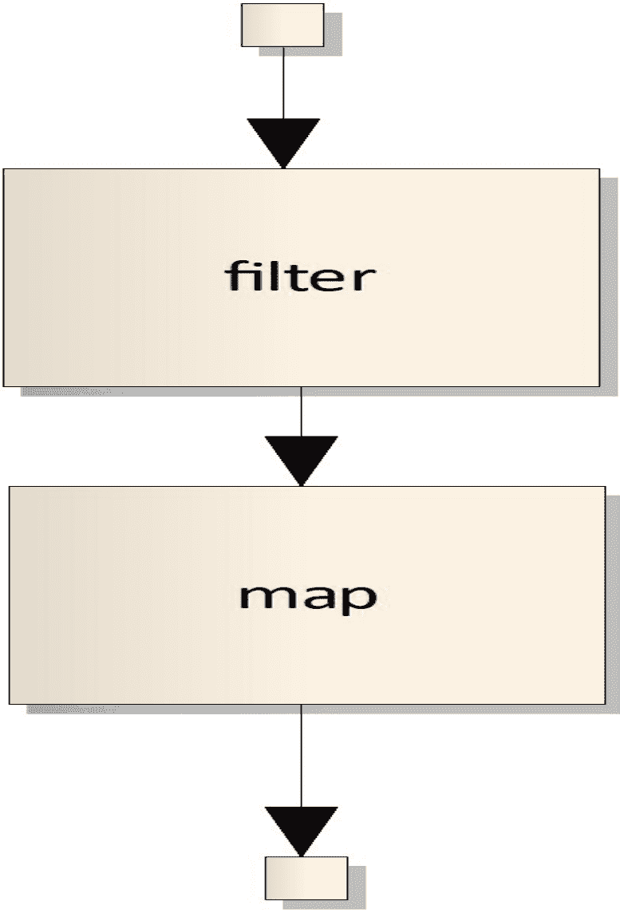

输出

## 恒等函数

恒等函数是一元函数，返回其接收的参数值。

在数学中，它定义为 f(x) = x。

```javascript
function identity(value) {
  return value;
}
```

如果将此转换放入前面的管道中，它只会创建数组的一个副本。

`logIdentity` 函数提供了一种检查管道中数据而不影响流程的方法。它返回接收到的参数，同时将其输出到控制台。

```javascript
function logIdentity(value) {
  console.log(value);
  return value;
}

debts
  .filter(isEur)
  .map(logIdentity)
  .map(toDebtView)
  .map(logIdentity);
```

## 柯里化

柯里化是一种将接收 n 个参数的函数转换为一系列各接收一个参数的 n 个函数的技术。

考虑过滤单词列表的情况。

```javascript
const words = [
  'apple',
  'apricot',
  'banana',
  'blueberry',
  'calendar',
  'double',
  'door'
];

function startsWith(word, term) {
  return word.startsWith(term);
}

words
  .filter(w => startsWith(w, 'a'))
  .forEach(console.log);
```

现在，看看使用柯里化重构后的相同代码。

```javascript
function startsWith(term) {
  return function(word) {
    return word.startsWith(term);
  };
}

words
  .filter(startsWith('a'))
  .forEach(console.log);
```

`startsWith` 是一个柯里化函数。它不再接收两个参数，而是只接收一个参数并返回一个接受第二个参数的函数。请注意，与最初接收两个参数的版本相比，柯里化版本的参数顺序是相反的。

当使用箭头语法编写柯里化版本时，你可能会觉得更清晰。

```javascript
const startsWith = term => word => {
  return word.startsWith(term);
};
```

另一种选择是使用自动柯里化工具函数创建函数的柯里化版本。以下是使用 [lodash](https://lodash.com/) 中的 `curry` 工具的示例。

```javascript
import { curry } from 'lodash/fp';

const startsWith = curry(function(term, word) {
  return word.startsWith(term);
});
```

## Reduce 管道

`reduce` 方法也使用管道。让我们再次查看代码并分析数据流。

```javascript
const numbers = [1, 3, 5];

function add(total, n) {
  return total + n;
}

const total = numbers.reduce(add, 0);
console.log(total);
//9
```

在每一步中，reducer 接收前一次 reducer 调用的结果作为聚合值输入。以下是管道过程。

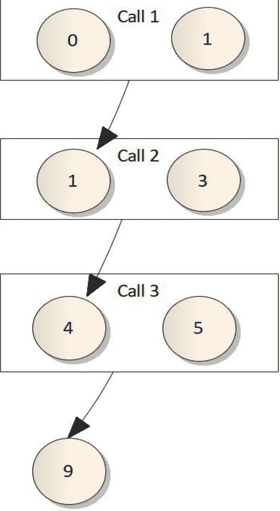

第一步的聚合值是 `0`。调用 reducer 后，这次转换的输出 `1` 作为输入进入下一次 reducer 调用。再次调用 reducer 后，输出 `4` 作为输入进入下一次 reducer 调用，依此类推。

`reduce` 创建了一个管道，在每一步中我们接收前一次 reducer 调用的结果和当前元素作为输入。

## 回顾

管道定义了一系列数据转换，其中一次转换函数的输出是下一次转换的输入。

柯里化是一种将接收多个参数的函数分解为一系列每个只接收一个参数的函数的技术。

# 第09章：函子

接下来，我们将探索函子。

让我们从一组数据转换开始。考虑以下示例：

```javascript
function toCelsius(kelvin) {
  const celsius = (kelvin - 273.15);
  return Math.round(celsius * 100) / 100;
}

function describeTemperature(temperature) {
  return temperature < 0
    ? "Freezing"
    : temperature < 15
      ? "Cold"
      : temperature < 28
        ? "Warm"
        : "Hot";
}

const kelvin = 300;
const celsius = toCelsius(kelvin);
const description = describeTemperature(celsius);

console.log(celsius);
//26.85
console.log(description)
//"Warm"
```

如你所见，这段代码的目的是对单个值应用两次变换。它以开尔文温度开始，应用 `toCelsius` 转换，然后在结果上应用 `describeTemperature` 函数。

如果能够将这些转换链接到初始值上并创建管道，将会更好。它可能看起来像这样：

```javascript
Mappable(300)
  .map(toCelsius)
  .map(describeTemperature)
```

这就是函子Prov有帮助的情况。

## 函子

函子是一个带有 `map` 操作且满足函子定律的对象。

我们可以简单地将函子创建为带有 `map` 方法的对象。考虑以下函数：

```javascript
function F(value) {
  function map(f) {
    const newValue = f(value);
    return F(newValue);
  }

  return {
    map
  };
}
```

`F` 创建一个带有 `map` 方法的对象，包装着一个 `value`。`map` 接收一个转换函数，将其应用于包装值，并返回一个包装新值的新对象。


F 被称为工厂函数。F 返回一个包含闭包 `map` 的对象，该闭包访问其父作用域中的 `value` 变量。

F 工厂函数创建一个函子。

## 函子定律

函子必须遵守**同一性定律**和**组合定律**。

**同一性定律：** 将同一性函数传入函子的 map 操作应得到相同的函子，即存储相同值的函子。

考虑同一性函数。

```javascript
function identity(n){
  return n;
}
```

```
functor.map(identity) = functor
```

让我们在我们的函子上验证同一性定律。

```javascript
const functor = F(1);

const newFunctor = functor.map(identity);

//F(1)
```

**组合定律：** 函数组合是一种操作，它接受两个函数 `f` 和 `g`，并产生一个新函数 `h`，其中 `h(x) = g(f(x))`。在这个操作中，函数 `g` 被应用于将函数 `f` 应用于 `x` 的结果。

我们可以说，函数组合是将一个函数应用于另一个函数结果的操作。

函子必须遵守组合定律，这意味着：

```
functor.map(f).map(g) === functor.map(x => g(f(x)))
```

让我们验证组合定律。

```javascript
function increment(n){
  return n + 1;
}

function double(n){
  return n * 2;
}

F(1)
  .map(increment)
  .map(double)
  //F(4)

F(1)
  .map(n => double(increment(n)))
  //F(4)
```

## 范畴论

范畴是一组通过箭头连接的值。

一个[范畴](https://en.wikipedia.org/wiki/Category_theory)有两个主要性质：[组合](https://en.wikipedia.org/wiki/Function_composition)箭头的能力具有[结合性](https://en.wikipedia.org/wiki/Associative_property)，以及每个值都存在一个[同一性](https://en.wikipedia.org/wiki/Identity_element)箭头。

箭头，也称为态射，是在范畴中值之间映射的函数。

以下是包含三个值的范畴的表示。

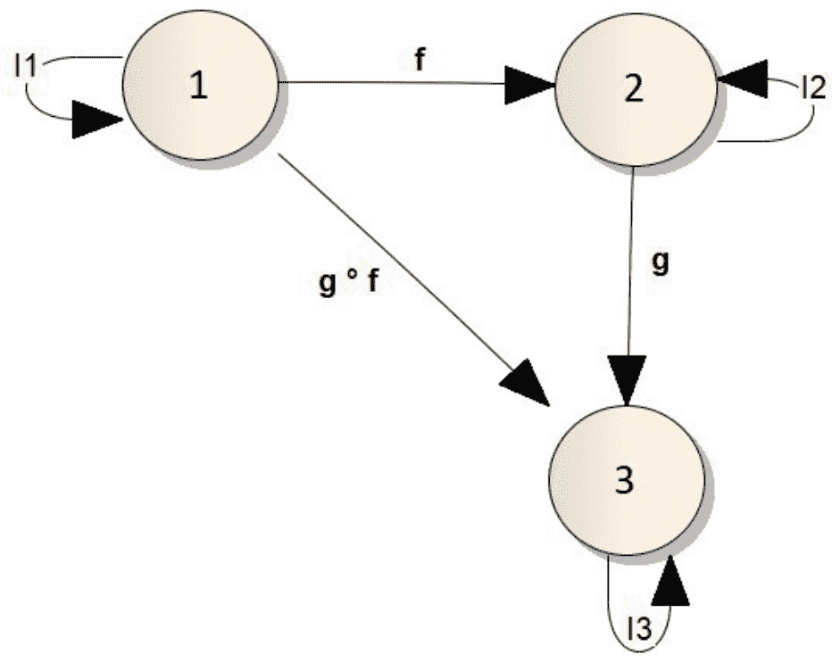

本例中的范畴有三个值：1、2、3，以及三个在这些值之间映射的函数。`f` 函数将 1 映射到 2。`g` 函数将 2 映射到 3。从 1 映射到 3 的函数 `h` 等于 `g(f(1))`。对于每个值，应用同一性函数都会得到相同的值。

## 实践中的函子

在实践中，函子有助于链式操作。

从开发角度来看，重要的是要知道某个东西是否是函子。如果是，我们就可以用同一性函数检查它的值，并使用函数组合。

我们创建的函子被称为**同一性函子**。

考虑我们最初的一组数据转换。以下是如何使用同一性函子对某个值链式执行两个转换。

```javascript
F(300)
  .map(toCelsius)
  .map(describeTemperature)
```

我们可以使用同一性函数的不纯变体来检查内部的值，该变体将值记录到控制台中。

```javascript
function logIdentity(value){
  console.log(value);
  return value;
}

F(300)
  .map(toCelsius)
  .map(logIdentity) //26.85
  .map(describeTemperature)
  .map(logIdentity) //"Warm"
```

应用函数组合时，我们也得到了相同的结果。

```javascript
F(300)
  .map(x => describeTemperature(toCelsius(x)))
  .map(logIdentity)
  //"Warm"
```

以下是使用 [lodash](https://lodash.com) 等函数式库中的 `compose` 工具应用函数组合的示例。

```javascript
import { compose } from 'lodash/fp'

F(300)
  .map(compose(describeTemperature, toCelsius))
  .map(logIdentity)
  //"Warm"
```

## 数组

数组是可映射的。map 方法遍历集合，并将映射函数应用于数组中的每个值。

让我们在数组上验证函子定律。

对数组应用同一性函数会创建一个副本。

```javascript
[1, 2, 3]
  .map(identity)
  .map(logIdentity);
  //1
  //2
  //3
```

接下来，检查组合定律。

```javascript
[1, 2, 3]
  .map(increment)
  .map(double)
  .map(logIdentity);
  //4
  //6
  //8

[1, 2, 3]
  .map(x => double(increment(x)))
  .map(logIdentity);
  //4
  //6
  //8
```

可以使用包含单个值的数组即时创建一个包装单个值的简单函子。

```javascript
[300]
  .map(toCelsius)
  .map(describeTemperature)
  .map(logIdentity);
  //"Warm"

[300]
  .map(x => describeTemperature(toCelsius(x)))
  .map(logIdentity);
  //"Warm"
```

内置数组就是函子。

**回顾：** 范畴是一组值，这些值之间有箭头。箭头代表映射函数。对任何值应用同一性函数都会返回该值。

函子是遵守同一性和组合的可映射对象。

函子为我们提供了一种有用的方式，可以在包装值之上创建数据转换管道。

# 第 10 章：单子

函子是包装一个值并启用映射的对象。

单子是包装一个值并启用映射和扁平映射的对象。

**扁平映射：** 让我们再次看看数组函子上可用的 `map` 方法。应用返回一个值的映射函数会产生一个包装转换后值的新数组。

```javascript
function toUpperCase(text){
  return text.toUpperCase();
}

const arr = ["raspberry strawberry", "blueberry"]
  .map(toUpperCase);

console.log(arr);
//[ 'RASPBERRY STRAWBERRY', 'BLUEBERRY' ]
```

初始数组有两个文本值。应用转换后，我们得到包含两个大写字母文本值的数组。

检查当我们应用一个返回数组的映射函数时会发生什么。

```javascript
function split(text){
  return text.split(' ');
}

const arr = ["raspberry strawberry", "blueberry"]
  .map(split);

console.log(arr);
//[ [ 'raspberry', 'strawberry' ], [ 'blueberry' ] ]
```

`split` 函数使用分隔符将字符串分割为子字符串数组。每个子字符串代表原始文本中的一个单词。

应用 `split` 映射函数会产生一个包含另两个数组的数组。每个子数组都是字符串的集合。

扁平映射类似于映射，但它会解包返回类型。

接下来，看看使用数组上可用的 `flatMap` 方法应用相同的映射函数。

```javascript
const arr = ["raspberry strawberry", "blueberry"]
  .flatMap(split);

console.log(arr);
//[ 'raspberry', 'strawberry', 'blueberry' ]
```

`flatMap` 方法首先使用映射函数映射数组中的每个元素，然后将结果扁平化为一个新数组。通过先使用 `map`，然后使用深度为 1 的 `flat` 来扁平化结果，可以获得相同的结果。

```javascript
const arr = ["raspberry strawberry", "blueberry"]
  .map(split)
  .flat();

console.log(arr);
//[ 'raspberry', 'strawberry', 'blueberry' ]
```

`flat` 创建一个包含所有子数组值连接的新数组。它使用递归来连接值，直到指定的深度。

```javascript
const arr = [1, [2, 3]];

console.log(arr.flat());
//[ 1, 2, 3 ]
```

## 单子

我们可以简单地将单子创建为具有 `map` 和 `flatMap` 方法的对象。考虑以下 `M` 函数：

```javascript
function M(value){

  function map(f){
    const newValue = f(value);
    return M(newValue);
  }

  function flatMap(f){
    const newValue = f(value);
    return newValue;
  }

  return {
    map,
    flatMap
  }
}
```

M 是一个工厂函数，它创建一个包装值并具有两个方法来修改它的对象，`map` 和 `flatMap`。

`map` 接受一个转换函数，并使用它来创建一个新值，然后使用 M 工厂函数创建一个包装该新值的对象。

`flatMap` 使用转换函数计算一个新值并返回它。

M 是单子构造器。它接受一个值并返回一个包装该值的单子。

M 被称为**同一性单子**。

## 单子定律

单子应该遵守三个定律。

**左同一性：** 将 `f` 视为返回单子的映射函数。将 `f` 函数传入包装值 `x` 的单子的 `flatMap` 操作，应该与调用函数 `f(x)` 产生相同的单子。

```
M(x).flatMap(f) === f(x)
```

让我们在我们的单子上验证左同一性定律。

```javascript
function f(){
  return M(2);
}

M(1)
  .flatMap(f);
```

### 右单位元
将 M 函数传入包裹值的 monad 的 flatMap 操作，应得到包裹相同值的 monad。
```
monad.flatMap(M) === monad
```
使用自定义 monad M 检验该定律。
```
M(1)
  .flatMap(M)
```
//M(1)

### 结合律
monad 必须遵守结合律，即：
```
monad.flatMap(f).flatMap(g) === monad.flatMap(x => f(x).flatMap(g))
```
让我们来测试该定律。
```
function f(){
  return M(2)
}
```
```
function g(){
  return M(3)
}
```
```
M(1)
  .flatMap(f)
  .flatMap(g);
  //M(3)
```
```
M(1)
  .flatMap(n => f(n).flatMap(g));
```
//M(3)

## 替代创建方式与命名
flat mapping 方法有不同的名称，如 `bind`、`chain` 或直接称 `flatMap`。还有一种实践是用名为 `unit` 的不同方法来创建 monad。`unit` 所做的事情与 M 工厂函数一样，它创建一个新的 monad。

以下是一个使用这种替代命名定义 monad 的示例。
```
export default (function defineMonad(){
  function M(value){
    function map(f){
      const newValue = f(value);
      return M(newValue);
    }

    function bind(f){
      const newValue = f(value);
      return newValue;
    }

    return {
      map,
      bind
    }
  }

  function unit(value){
    return M(value);
  }

  return {
    unit
  }
})
```
})(); `unit` 创建一个包裹值的新 monad。
**bind** 定义了 flat map 操作。

以下是 monad 如何被创建和使用的。
```
import M from './M';

function f(){
  return M.unit(2)
}
```
```
M.unit(1).bind(f)
//M 2
```

下面你可以回顾在这种情况下 monad 定律是如何编写的。

### 左单位元
**M.unit(1).bind(f)**
```
//M 2
```

### 右单位元
**M.unit(1).bind(M.unit)**
```
//M 1
```

### 结合律
**M.unit(1).bind(f).bind(g)**
```
//M 3
```
```
M.unit(1).bind(x => f(x).bind(g))
//M 3
```

[你可能也会发现](https://example.com) `bind` 被描述为一个独立函数，而非 monad 对象上的方法：`bind(monad, f)`。当 bind 是 monad 对象上的方法时，这等同于 `monad.bind(f)`。

将 `bind` 描述为一种方法更为有用。

让我们看看如何将 monad 定律从函数形式转换为方法形式。

以下三种描述 monad 定律的方式是等价的。

### 左单位元
```
bind(unit(x), f) === f(x)

M.unit(x).bind(f) === f(x)

M(x).flatMap(f) === f(x)
```
注意最后一行，M 用作构造函数。`M(x)` 等同于 `M.unit(x)`，也等同于 `unit(x)`。

### 右单位元
```
bind(monad, unit) === monad

monad.bind(M.unit) === monad

monad.flatMap(M) === monad
```

### 结合律
```
bind(bind(monad, f), g)
  === bind(monad, x => bind(f(x), g))

monad.bind(f).bind(g)
  === monad.bind(x => f(x).bind(g))

monad.flatMap(f).flatMap(g)
  === monad.flatMap(x => f(x).flatMap(g))
```
话虽如此，我认为第一种将恒等 monad 实现为具有 `map` 和 `flatMap` 方法的对象的方式更容易使用。

## 数组
数组同时拥有 `map` 和 `flatMap` 方法。让我们来验证它们是否满足 monad 定律。

首先，我们需要一个可以从值创建数组的函数。
```
function M(value){
  return [value];
}
```
我们不需要定义这样一个函数，因为已经有一个现成的了。它叫做 `Array.of()`。
```
function duplicate(word){
  return [word, word]
}
```
```
function split(text){
  return text.split(" ");
}
```

接下来检验三个定律。

### 左单位元
`//M(x).flatMap(f) === f(x)`
```
Array.of('mango')
  .flatMap(duplicate)
  //['mango', 'mango']
```
```
duplicate('mango');
//['mango', 'mango']
```
正如你所注意到的，使用 `Array.of` 创建数组时，`M(x)` 等同于 `Array.of(x)`。

### 右单位元
`//monad.flatMap(M) === monad`
```
Array.of('lemon')
  .flatMap(Array.of)
```
```
//['lemon']
```

### 结合律
`//monad.flatMap(f).flatMap(g)`
`// === monad.flatMap(x => f(x).flatMap(g))`
```
Array.of('orange kiwi')
  .flatMap(split)
  .flatMap(duplicate);
  //['orange', 'orange', 'kiwi', 'kiwi']
```
```
Array.of('orange kiwi')
  .flatMap(s => split(s).flatMap(duplicate))
 //['orange', 'orange', 'kiwi', 'kiwi']
```

## 回顾
函子是一个具有 map 操作的对象。

monad 是一个具有 `map` 和 `flatMap` 操作的对象。

函子将一个函数应用于包裹的值。

monad 将一个返回包裹值的函数应用于包裹的值。

本质上，monad 就是对值的一个包装器。我们可以用一个存储单个值并提供映射和扁平映射支持的对象来创建它。在接下来的章节中，我们将探索一些实用的 monad，如不可变列表、Promise 和 Observable。

# 第 11 章：不可变集合

集合是指任何可以被迭代的东西。

不可变集合在“更改”操作时会返回一个新集合。我们将查看 [Immutable.JS](https://immutable-js.github.io/immutable-js/) 库中可用的此类集合。首先安装它。
```
npm install immutable --save
```

`Lists` 是索引集合，类似于数组。事实上，它们可以从数组创建。
```
import { List } from 'immutable';

const emptyList = List();
// List []
```
```
const list = List([
  { name: 'Rhodes' },
  { name: 'Malaga' }
]);
// List [
// { name: 'Rhodes' },
// { name: 'Malaga' }]
```
[List()](https://immutable-js.github.io/immutable-js/docs/#/List) 创建一个新的不可变列表，包含作为参数提供的值。`List` 是一个工厂函数，不使用 `new` 关键字。

**编辑元素**
[set(index, value)](https://immutable-js.github.io/immutable-js/docs/#/List/set) 允许我们编辑集合中特定索引处的元素。它返回一个包含修改的新列表。指定索引位置的元素将被替换。
```
const newList = list.set(0, { name: 'Riomaggiore' });
// List [
// { name: 'Riomaggiore' },
// { name: 'Malaga' }]

console.log(list === newList);
```
//false

**添加元素**
[push(...values)](...) 返回一个新列表，其中附加了提供的值。可用于向列表添加新值。以下是一个示例。
```
const newList = list.push({name: 'Funchal'});
// List [
// { name: 'Rhodes' },
// { name: 'Malaga' },
// { name: 'Funchal'}]
```
添加也可以通过 [concat(...values)](...) 完成。它将一个新集合连接到现有集合。要添加单个值，我们用包含一个值的数组调用它。
```
const newList = list.concat([{name: 'Funchal'}]);
// List [
// { name: 'Rhodes' },
// { name: 'Malaga' },
// { name: 'Funchal'}]
```
[unshift(...values)](...) 返回一个新列表，其中在前面添加了提供的值。

## 删除元素
[delete(index)](...) 删除指定索引处的元素并返回一个包含修改的新列表。
```
const newList = list.delete(0);
// List [{ name: 'Malaga' }]
```
`delete` 有别名 `remove`。

[pop()](http://example.com) 返回一个移除了最后一个元素的新列表。

[shift()](http://example.com) 返回一个移除了第一个元素的新列表。

**清空列表**
[clear()](http://example.com) 返回一个没有值的新列表。
```
const newList = list.clear();
```
```
console.log(newList)
// List []
```

**数据转换**
我们可以像处理数组一样处理列表。列表具有 `filter`、`map`、`flatMap`、`reduce` 和 `sort` 方法，其工作方式与数组中的类似。`sort` 方法这次是一个纯方法，返回一个新集合。

以下是一个使用 `filter` 方法从目的地对象列表中仅选择前往特定国家的目的地的示例。
```
import { List } from 'immutable';

const list = List([
  { name: 'Cascais', country: 'Portugal'},
  { name: 'Sintra', country: 'Portugal' },
  { name: 'Nerja', country: 'Spain' },
]);
```
```
function inCountry(country){
  return function(destination){
    return destination.country === country;
  }
}
```

 ```
list
    .filter(inCountry('Portugal'))

//List [
// {name:'Cascais',country:'Portugal'},
// {name:'Sintra',country:'Portugal'}]
```

注意，`inCountry` 是一个柯里化函数。

列表是单子（monad），因为它们同时支持映射和扁平映射。

## 查找元素

列表提供了用于检索数据的方法。

`get(index)` 返回与所提供的索引相关联的元素。

`first()` 返回集合中的第一个元素。如果集合为空，则返回 `undefined`。类似地，`last()` 返回集合中的最后一个元素。

`find()` 返回谓词函数返回 `true` 的第一个元素。`findLast()` 返回谓词函数返回 `true` 的最后一个元素。下面是在前面的列表上使用这两个方法的示例。

```
import { List } from 'immutable';

const list = List([
    { name: 'Cascais', country: 'Portugal'},
    { name: 'Sintra', country: 'Portugal' },
    { name: 'Nerja', country: 'Spain' },
]);

const destination = list.find(inCountry('Portugal'));
//{ name: 'Cascais', country: 'Portugal' }

const otherDestination = list.findLast(inCountry('Portugal'));
//{ name: 'Sintra', country: 'Portugal' }
```

## Map（映射/字典）

映射是一组键值对的集合。不可变映射接受任意类型的键。

下面是一个通过 id 创建国家对象映射的示例。

```
import { Map } from 'immutable';

const countryMap = Map({
 "1": { name: 'Italy'},
 "2": { name: 'Portugal'},
 "3": { name: 'UK'}
});
```

`get(key)` 返回与给定键相关联的值。

```
console.log(countryMap.get("3"));
//{ name: 'UK' }
```

`set(key, value)` 返回包含该键值对的新 Map。如果键已经存在，其值将被替换。如果键不存在，则会添加该键。set 可用于添加和编辑键值对。

```
const newMap = countryMap.set("2", { name: 'Spain'});
console.log(newMap.get("2"));
//{ name: 'Spain' }
```

`has(key)` 如果给定键存在于映射中则返回 true，否则返回 false。

`**delete(key)**` 返回移除了指定键的新 Map。

```
const newMap = countryMap.delete("3");
console.log(newMap.has("3"));
//false
console.log(newMap.get("3"));
//undefined
```

`clear()` 返回不包含任何键值对的新 Map。

## 数据转换

映射支持 `filter` 和 `map` 操作。

`map(mapper)` 返回一个新的 Map，其中 `mapper` 函数已应用于所有值。

`filter(predicate)` 返回一个新的 Map，仅包含 `predicate` 函数返回 `true` 的键值对。谓词函数应用于值。

## 回顾

列表和映射都提供了更友好的公共接口，用于处理不可变集合。

列表具有 `filter`、`map`、`reduce` 和 `sort` 方法，其工作方式与数组中可用的方法类似。

这些不可变数据结构经过高度优化。列表在列表两端进行高效的添加和删除操作，复杂度为 O(1)。

# 第 12 章：惰性转换

`filter`、`map`、`reduce` 等数组操作使转换更易于阅读和理解，但正如你所注意到的，这些转换在每一步都会创建一个新数组。对于包含数千条记录的大型数组，这可能会带来性能损失。

接下来，我们将探讨这些情况的解决方案。

## Transducers（变换器/归约转换器）

事实上，所有转换都可以使用归约器函数来表达。我们可以使用归约器函数进行过滤，可以使用归约器函数进行映射，等等。

下面是使用 `reduce` 实现映射转换的示例。

```
function map(transform) {
  return function reducer(arr, value) {
    const newValue = transform(value);
    return [...arr, newValue];
  }
}

function double(n){
  return n * 2;
}

const numbers = [1, 2, 3];
const newNumbers = numbers.reduce(map(double), []);
//[2, 4, 6]
```

下面是使用 reduce 实现的过滤转换。

```
function filter(test) {
  return function reducer(arr, value) {
    if (test(value)) {
      return [...arr, value]
    } else {
      return arr;
    }
  }
}

function isEven(n){
  return n % 2 === 0;
}

const numbers = [1, 2, 3, 4];
const newNumbers = numbers.reduce(filter(isEven), []);
//[2, 4]
```

注意，`reduce` 不会停止，会处理数组中的所有值。`find` 方法在找到值时停止。使用 reduce 方法实现的 `find` 等效实现性能更差，因为它会遍历所有元素。

```
function find(test) {
  return function reducer(foundValue, value) {
    if (test(value) && !foundValue) {
      return value
    } else {
      return foundValue;
    }
  }
}

function isEven(n){
  return n % 2 === 0;
}

const numbers = [1, 2, 3, 4];
const element = numbers.reduce(find(isEven), undefined);
//2
```

了解了所有这些之后，在进行转换时，我们可以在每一步构建一个新的归约器函数，而不是在每一步构建一个新数组。

考虑下面在每一步创建数组的示例。

```
function isEven(n){
  return n % 2 === 0;
}

function double(n){
  return n * 2;
}

const numbers = [1, 2, 3, 4];
const newNumbers =
  numbers
    .filter(isEven) //[2, 4]
    .map(doubleoken
```

第一个 filter 创建了一个中间数组 [2, 4]，然后由 map 方法使用。

让我们看看通过构建一个执行所有转换的归约器来达到相同结果意味着什么，而不是构建中间数组。

这意味着 filter 创建一个应用了过滤的新归约器，而 map 接受这个归约器并创建一个新的应用了映射转换的归约器。

下面是 filter 函数的实现，它接受一个归约器并创建一个新的应用了谓词测试的归约器。

```
function filter(test) {
  return function(reducer){
    return function filterReducer(arr, value){
      if(test(value)){
        return reducer(arr, value);
      } else {
        return arr;
      }
    }
  }
}
```

如果我们使用箭头函数和条件运算符来定义这个柯里化函数，可能看起来更好。

```
const filter = test => reducer => {
  return function filterReducer(arr, value){
    return test(value)
      ? reducer(arr, value)
      : arr
  }
}
```

下面是 map 函数，它接受一个归约器并返回一个新的对所有值应用了映射转换的归约器。

```
const map = transform => reducer => {
  return function mapReducer(arr, value){
    const newValue = transform(value);
    return reducer(arr, newValue);
  }
}
```

所有这些函数都在归约器上工作，因此我们需要一个初始归约器来工作。这将是一个只是复制现有数组的函数。

```
const toArrayReducer = (arr, value) => {
  return [...arr, value]
};
```

让我们使用这些函数来重构前面的转换。

```
function isEven(n){}
function double(n){}

const numbers = [1, 2, 3, 4];
const filterTransducer = filter(isEven);
const mapTransducer = map(double);
```

```
const newNumbers = numbers
  .reduce(
    filterTransducer(
      mapTransducer(toArrayReducer)
    ),
    []);
//[4, 8]
```

由 `filter` 和 `map` 创建的函数被称为 **transducers（变换器）**。

变换器接受一个归约器并返回一个新的归约器。换句话说，变换器是一个接受归约器函数作为输入并返回一个新归约器函数的函数。变换器是一个高阶函数。

如果使用 `compose` 工具，转换可能看起来更好。下面是一个示例，其中 filter 和 map 变换器应用于 `toArrayReducer` 归约器。最终得到一个执行所有必要转换的归约器。

```
import { compose } from 'lodash/fp';

const newReducer = compose(
  filter(isEven),
  map(double)
)(toArrayReducer);
```

然后我们可以将这个归约器应用于原始数组。

```
const newNumbers = numbers.reduce(newReducer, []);
```

变换器有其开销。它们需要在每次转换时遍历所有项，因为 reduce 方法不会停止。它们需要在一个主归约器上工作，因此现在需要一个之前不需要的初始转换。
```

尽管如此，它们让我们深入了解了如何在不创建额外集合的情况下链式调用转换操作。

## 序列惰性序列
惰性序列允许我们高效地链式调用像 `map` 和 `filter` 这样的转换方法，而无需创建中间集合。我们将探讨 Immutable.js 提供的称为 `Seq` 的惰性序列。

`Seq` 集合是不可变的。一旦创建，就不能被修改。任何“更改”操作都会返回一个新的 `Seq`。

这是一个将数组转换为序列，然后进行转换而不创建其他中间数组的示例。

```javascript
import { Seq } from 'immutable';

function isEven(n){
    return n % 2 === 0;
}

function double(n){
    return n * 2;
}

const sequence = Seq([ 1, 2, 3, 4])
    .filter(isEven)
    .map(double);
```

然后我们可以使用 `toArray` 方法将其转换回数组数据结构。

```javascript
const newArray = sequence.toArray();
//[4, 8]
```

请注意，使用 `toArray` 转换为原生数组可能会很慢，因此一旦我们创建了序列并进行了转换，就应该坚持使用它。

## Range
Range 返回一个从 `start` 到 `end` 的数字序列。不带参数调用时，它从 0 开始。如果未提供 `end` 参数，它会创建一个无限序列。它还接受第三个参数 `step`，用于定义增量。

Range 是一个按顺序生成整数的惰性序列。这是一个生成数字 1, 2, 3 的 `Range` 示例。

```javascript
import { Range } from 'immutable';

function logIdentity(n){
  console.log(n);
  return n;
}

Range(1, 4)
  .forEach(logIdentity);
//1
//2
//3
```

现在，看一个生成质数的示例。看看我们如何使用 `Range` 序列重构 `for` 循环。

```javascript
for(let i=0; i<10; i++){
  if(isPrime(i)){
    console.log(i)
  }
}
//2
//3
//5
//7
```

```javascript
function isPrime(number){
  if (number <= 1){
    return false;
  }

  for (let i=2; i<=number/2; i++){
    if (number % i === 0 ){
      return false;
    }
  }

  return true;
}
```

我们可以首先用 `Range` 序列替换第一个循环，将数字打印到控制台。

```javascript
import { Range } from "immutable";

Range(0, 10)
  .filter(isPrime)
  .forEach(log);
```

```javascript
function isPrime(number){ }

function log(number) {
  console.log(number);
}
```

`Range(0, 10)` 生成从 0 到 9 的所有数字，然后使用 `filter` 选择所有质数，并返回一个仅包含这些数字的新序列。接着我们使用 `forEach` 来显示这些数字。

下面我们可以看到如何使用 `Range` 序列重构检测质数的循环。

```javascript
import { Range } from 'immutable';

Range(0, 10)
  .filter(isPrime)
  .forEach(log);
```

```javascript
function isPrime(number) {
  if (number > 2){
    const firstDivisor = findFirstDivisor(number);
    return !firstDivisor;
  } else {
    return (number === 2)
      ? true
      : false;
  }
}

function findFirstDivisor(number){
  return Range(2, (number / 2) + 1)
    .find(isDivisorOf(number));
}

function isDivisorOf(number) {
  return function(divisor) {
    return (number > 1)
      ? number % divisor === 0
      : false
  };
}

function log(number) { }
```

`isDivisorOf` 是一个柯里化函数，它接收一个数字，并返回一个谓词函数，该函数接受一个可能的除数并返回一个布尔值。

`findFirstDivisor` 返回一个数字的第一个除数。它检查从 2 到其一半的所有数字来寻找这个除数。

`isPrime` 根据 `findFirstDivisor` 的结果来判断一个数字是否为质数。如果该数字没有除数，那么它就是质数。

## 总结 转换器
转换器是接收一个累加器并返回一个新累加器的函数。

像 `Seq` 这样的惰性序列允许我们高效地链式调用转换方法，而无需创建中间集合。

Range 提供数字序列。

# 第13章：生成器
生成器是一个函数，每次调用时都从序列中返回下一个值。

我们将从一个简单的生成器函数开始，该函数每次被调用时返回下一个整数，从 0 开始。

```javascript
function range() {
 let count = 0;
 return function() {
  const result = count;
  count += 1;
  return result;
 }
}

const nextNumber = range()
console.log(nextNumber()); //0
console.log(nextNumber()); //1
console.log(nextNumber()); //2
```

`nextNumber` 是一个无限生成器。`nextNumber` 是一个具有内部私有状态的闭包。

## 有限生成器
生成器可以是有限的。看下一个示例，其中 `range` 创建一个生成器，返回一个特定区间内的连续数字。在序列末尾，它返回 `undefined`。

```javascript
function range(from, to){
  let count = from;
  return function(){
    if(count < to){
      const result = count;
      count += 1;
      return result;
    } else {
      return undefined;
    }
  }
}

const nextNumber = range(0, 3)
console.log(nextNumber()); //0
console.log(nextNumber()); //1
console.log(nextNumber()); //2
console.log(nextNumber()); //undefined
```

## toArray
使用生成器时，我们可能想创建一个包含序列中所有值的数组。对于这种情况，我们需要一个像 `toArray` 这样的实用函数，它接收一个生成器，并返回序列中的所有值作为数组。该序列应该是有限的。

```javascript
function toArray(generate) {
  let arr = [];
  let value = generate();

  while (value !== undefined) {
    arr = [...arr, value];
    value = generate();
  }
  return arr;
}
```

让我们将其与之前的生成器一起使用。

```javascript
const numbers = toArray(range(1, 5));
console.log(numbers);
//[1, 2, 3, 4]
```

## forEach
我们可能还需要为序列中的每个元素运行一个回调。`forEach` 实用函数正是这样做的。它接收一个生成器和一个回调，并运行该回调，直到生成器返回 `undefined`。

```javascript
function forEach(callback){
  return function(generate){
    let value = generate();

    while(value !== undefined){
      callback(value);
      value = generate();
    }
  }
}
```

这是一个柯里化函数，它首先接收回调，然后接收生成器。

在下一个示例中，`log` 函数被生成器返回的所有数字调用。

```javascript
function log(x){
  console.log(x);
}

const nextNumber = range(1, 4);
forEach(log)(nextNumber);
//1
//2
//3
```

## take
另一个常见场景是仅获取序列中的前 n 个元素。在这种情况下，我们需要一个新的实用函数，如 `take`，它接收一个生成器并创建一个新的生成器，仅返回序列中的前 n 个元素。

```javascript
function take(n) {
  return function(generate) {
    let count = 0;
    return function() {
      if (count < n) {
        count += 1;
        return generate();
      }
    };
  };
}
```

同样，`take` 是一个柯里化函数，应该这样调用：`take(n)(sequence)`。

以下是你可以如何在管道中使用 `take` 和 `forEach` 来获取并记录一个无限数字序列的前三个值到控制台。

```javascript
import { pipe } from 'lodash/fp';

const nextNumber = range();
pipe(
  take(3),
  forEach(console.log)
)(nextNumber);
//0
//1
//2
```

## 自定义生成器
我们可以创建任何自定义生成器，并与之前的实用函数一起使用。让我们创建一个 **斐波那契** 自定义生成器：

```javascript
function fibonacci() {
  let a = 0;
  let b = 1;
  return function() {
    const aResult = a;
    a = b;
    b = aResult + b;
    return aResult;
  };
}
```

我们可以将斐波那契生成器与已创建的实用函数一起使用，以显示序列中的前 5 个数字。

```javascript
import { pipe } from 'lodash/fp';

const generateFibonacci = fibonacci();
pipe(
  take(5),
  forEach(console.log)
)(generateFibonacci);
//0
//1
//1
//2
//3
```

## 总结
生成器是一个函数，每次调用时都从序列中返回一个新值。

函数式生成器可以从有限或无限的值序列中返回元素。


# 第14章：Promise

Promise是一个包含未来结果的对象。

Promise有三种状态：pending（待定）、fulfilled（已完成）和rejected（已拒绝）。

- Pending是Promise的初始状态。此时结果尚不可用。
- Fulfilled是标记操作成功的状态。此时结果已可用。
- Rejected是标记操作失败的状态。此时结果不可用，取而代之的是，我们可以访问一个error对象，其中包含操作失败原因的详细信息。

最初，Promise以pending状态开始。然后它可以转换到fulfilled或rejected状态。一旦Promise被完成或拒绝，它将保持在该状态。

以下是Promise可能经历的流程示意图。

## 创建Promise

让我们从创建一个简单的Promise开始。

```javascript
function delay(interval){
  return new Promise(function(resolve){
    return setTimeout(resolve, interval);
  });
}

function logDone(){
  console.log('Done');
}

delay(1000)
  .then(logDone);
```

`delay`创建了一个将在特定时间后解析（resolve）的Promise。我们可以用它来延迟任务的执行。

使用`new Promise`创建Promise需要传入一个称为执行器函数的函数。该函数接受两个回调函数，`resolve`和`reject`，稍后可以调用它们来改变Promise的状态。执行器函数在Promise创建时自动运行。

`Promise`有两个实用的静态方法，`resolve`和`reject`，用于快速创建已解析或已拒绝的Promise。

`Promise.resolve(value)`创建一个已解析的Promise，包装一个`value`。

`Promise.reject(error)`创建一个已拒绝的Promise。

## 成功处理

映射`then`的作用类似于map。它接受一个映射函数，并返回一个包含转换后值的Promise。

我们可以使用`Promise.resolve`创建一个简单的、可映射的对象来包装一个值。然后我们可以转换并检查包装的值。

```javascript
function toUpperCase(text){
  return text.toUpperCase();
}

function logIdentity(value){
  console.log(value);
  return value;
}

Promise.resolve('sTudY')
  .then(logIdentity) //"sTudY"
  .then(toUpperCase)
  .then(logIdentity); //"STUDY"
```

## 扁平映射

`then`也类似于扁平映射（flat map）。

当映射函数返回一个值时，`then`返回一个包含转换后值的Promise。更准确地说，我们应该说映射函数返回的值本身不是一个Promise。

当映射函数返回一个包装了值的Promise时，`then`不会将其包装进另一个Promise。它只是返回包含转换后值的新Promise。

如果将Promise包装进另一个Promise，就意味着创建一个包含Promise的Promise，而该Promise又包装了一个值。

看一个函数，它用于对Promise进行映射操作，实现两数相除。

```javascript
function devideBy(n, divisor){
  return n / divisor;
}

function logIdentity(value){}

Promise.resolve(9)
  .then(logIdentity) //9
  .then(n => devideBy(n, 3))
  .then(logIdentity); //3
```

我们可以将`devideBy`实现为柯里化函数，并更优雅地与`then`一起使用。

```javascript
function devideBy(divisor){
  return function(n){
    return n / divisor;
  }
}

Promise.resolve(9)
  .then(logIdentity) //9
  .then(devideBy(3))
  .then(logIdentity); //3
```

当`devideBy`返回Promise而不是数字时，`then`会等待该Promise完成，并返回一个包装了转换后值的Promise。

```javascript
function devideBy(divisor){
  return function(number){
    const result = number / divisor;
    return Promise.resolve(result);
  }
}

Promise.resolve(9)
  .then(logIdentity) //9
  .then(devideBy(3))
  .then(logIdentity); //3
```

## 错误处理

`catch`处理Promise链中的错误。

下面是使用`catch`进行错误处理的示例。

```javascript
function devideBy(divisor){
  return function(number){
    const result = number / divisor;
    return (divisor !== 0)
      ? Promise.resolve(result)
      : Promise.reject("Can't divide by 0")
  }
}

function logError(error){
  console.error(error);
}

Promise.resolve(9)
  .then(logIdentity) //9
  .then(devideBy(0))
  .then(logIdentity)
  .catch(logError) //"Can't divide by 0"
```

如果在任何转换步骤中发生错误，控制流将跳转到最近的错误处理器。

## 链式调用

正如你注意到的，我们可以对包装的值进行多个转换的链式调用。

已解析Promise的`then`方法将返回一个新Promise。同样，已拒绝Promise的`catch`方法也会返回一个新Promise。这创建了一个转换管道，其中每个转换函数都以作为前一个函数的结果作为输入。

```javascript
function toCelsius(kelvin){
  const celsius = (kelvin - 273.15);
  return Math.round(celsius * 100) / 100;
}

function toChangeAction(temperature){
  return {
    type : 'CHANGE_TEMPERATURE',
    temperature
  }
}

function logIdentity(value){}

Promise.resolve(280)
  .then(logIdentity)
  .then(toCelsius)
  .then(logIdentity)
  .then(toChangeAction)
  .then(logIdentity);
//280
//6.85
//{ type: 'CHANGE_TEMPERATURE', temperature: 6.85 }
```

`toCelsius`接收280开尔文的温度作为输入，返回6.85。`toChangeAction`接收6.85摄氏度的温度作为输入，返回一个包含新摄氏度值的操作对象。

## 异步操作

到目前为止编写的代码都是同步的。这意味着我们立即获得了函数执行的结果。

考虑下面的代码。

```javascript
const result = Math.pow(2, 3);
console.log(result);
//8
```

一旦执行`Math.pow`，我们就得到了结果。

现在想想调用Web API并将返回的数据存储在变量中意味着什么。

```javascript
const result = fetch('/todos')
```

为了将Web API返回的数据放入`result`变量中，我们需要等待`fetch`调用完成。等待意味着阻塞UI，而我们不想这样做。

Promise为这种场景提供了解决方案。`fetch`调用不返回结果，而是返回一个Promise，该Promise稍后会在结果可用时提供对结果的访问。

## Parcel

我们可以通过启动一个开发服务器来测试网络调用。我们可以使用[Parcel](https://parceljs.org/)创建一个零配置的Web应用服务器。

首先，安装Parcel。

```bash
npm install parcel-bundler --save-dev
```

接下来，创建一个`index.html`并引用你想要检查的js文件。

```html
<html>
<body>
<script src="./ajax.js"></script>
</body>
</html>
```

然后，在`package.json`中添加开发任务脚本。

```json
{
    "scripts": {
        "dev": "parcel index.html"
    }
}
```

现在，你可以启动开发服务器并访问`index.html`页面了。

## Fetch

[Fetch API](https://developer.mozilla.org/en-US/docs/Web/API/Fetch_API)提供了一个用于获取资源的接口。`fetch`函数接受一个URL作为输入，并返回一个Promise，该Promise解析为请求的`Response`。如果请求失败，它也会失败。

这是一个发起fetch调用并在返回的Promise中访问结果的示例。

```javascript
function toJson(response){
    return response.json();
}

function logIdentity(value){}

function logError(error){
    console.error(error);
}

fetch('https://api.github.com/gists/public')
  .then(toJson)
  .then(logIdentity)
  .catch(logError);
```

`json()`方法将响应转换为JavaScript对象。它返回一个Promise，该Promise包装了将响应体文本解析为JSON的结果。

## Promise.race

`Promise.race`接受一个Promise数组，并返回第一个完成（fulfilled）或拒绝（rejected）的Promise。

```javascript
const dictionariesPromise =
  fetch('/dictionaries').then(toJson);

const todosPromise =
  fetch('/todos').then(toJson);

Promise.race([
  dictionariesPromise,
  todosPromise
]).then(logIdentity);
```

## Promise.all

`Promise.all`接受一个Promise数组，并返回一个新Promise，该Promise在所有输入Promise都已解析（resolved）时解析。如果其中一个输入Promise被拒绝，它会立即拒绝。

`Promise.all`可用于确保所有输入Promise都已成功完成。

```javascript
Promise.all([
  dictionariesPromise,
  todosPromise
]).then(logIdentity);
```

## Promise.allSettled

`Promise.allSettled`接受一个Promise数组，并返回一个Promise，该Promise在所有输入Promise都已完成（fulfilled）或被拒绝（rejected）后解析。它解析的结果是一个对象数组，描述了每个Promise的结果。


const dictionariesPromise =
  fetch('/dictionaries').then(toJson);
const todosPromise =
  fetch('/todos').then(toJson);
const rejectedPromise = Promise.reject('Error');

Promise.allSettled([
  dictionariesPromise,
  todosPromise,
  rejectedPromise
])
  .then(logIdentity)
  //[
  //{status: "fulfilled", value: Array(1)},
  //{status: "fulfilled", value: Array(1)},
  //{status: "rejected", reason: "Error"}
  //]

## 函子定律

当转换函数返回一个非 Promise 对象时，Promise 上的 `then` 方法就像一个 `map` 操作。

满足恒等律。

```
function identity(n){
  return n;
}

Promise.resolve(1)
  .then(identity)
  //Promise 1
```

当映射函数不返回 Promise 时，满足组合律。在这种情况下，`promise.then(f).then(g)` 的结果与 `promise.then(x => g(f(x)))` 相同。

```
function f(x){
  return x + 1;
}

function g(x){
  return x * 2;
}

function logIdentity(value){}
```

```
Promise.resolve(1)
  .then(f)
  .then(g)
  .then(logIdentity)

Promise.resolve(1)
  .then(x => g(f(x)))
  .then(logIdentity)
```

当一个转换函数返回 Promise 而另一个不返回时，函子组合律会被破坏。下面是一个例子。

```
function f(x){
  return Promise.resolve(x + 1);
}

function g(x){
  return x * 2;
}
```

```
Promise.resolve(1)
  .then(f)
  .then(g)
  .then(logIdentity);
//4
```

```
Promise.resolve(1)
  .then(x => g(f(x)))
  .then(logIdentity);
//NaN
```

在这种情况下，Promise 不能作为函子工作，因为它不满足组合律。实际上，我们不应该将 Promise 的 `.then(f).then(g)` 重构为 `promise.then(x => g(f(x)))`。

## 单子定律

当转换函数返回一个 Promise 时，Promise 上的 `then` 方法就像一个 `flatMap` 操作。

用一个创建 Promise 的转换函数调用 `then`，会返回一个新的 Promise，其中包含一个值。它不会返回一个包含 Promise 的 Promise。

当只使用返回 Promise 的映射函数时，Promise 的行为类似于单子。

满足左恒等律。

```
function f(x){
  return Promise.resolve(x + 1);
}
```

```
Promise.resolve(1)
  .then(f)
  //Promise 2
```

```
f(1)
  //Promise 2
```

右恒等律也得到确认。

```
function unit(value){
  return Promise.resolve(value)
}
```

```
Promise.resolve(1)
  .then(unit)
  //Promise 1
```

`promise.flatMap(f).flatMap(g)` 的结果与 `promise.flatMap(x => f(x).flatMap(g))` 相同。

```
function g(x){
  return Promise.resolve(x * 2);
}
```

```
function logIdentity(value){}
```

```
Promise.resolve(1)
  .then(f)
  .then(g)
  .then(logIdentity);
```

```
Promise.resolve(1)
 .then(x => f(x).then(g))
 .then(logIdentity);
```

总结一下，当两个映射函数都返回一个非 Promise 值时，`then` 充当 `map` 操作，组合律得到遵守。当两个映射函数都返回 Promise 时，`then` 充当 `flatMap` 操作，结合律得到遵守。

## 回顾

Promise 是包装未来结果的对象。

当转换函数返回一个值时，`then` 充当 `map` 操作。当它返回另一个 Promise 时，`then` 充当 `flatMap` 操作。

严格来说，Promise 不是单子，但在许多情况下它们的行为与单子相似。

# 第 15 章：可观察对象

可观察对象是可以随时间到达的数据流。可观察对象是当值可用时向监听器发出值的对象。

可观察对象[未来可能成为 JavaScript](javascript:void(0)) 语言的一部分，但目前，我们将使用 RxJS 库中的可观察对象实现。

```
npm install rxjs --save
```

操作符是可观察对象上一个强大的功能。

## 创建操作符

创建操作符是用于构造新可观察对象的函数。

可观察对象通常使用创建函数创建，例如 `of`、`from`、`interval` 或 `ajax`。

### create()

以下示例创建了一个可观察对象，它向订阅者发出值 1、2、3，然后完成。

```
import { Observable } from 'rxjs';

const observable = Observable.create(observer => {
  observer.next(1);
  observer.next(2);
  observer.next(3);
  observer.complete();
});
```

`create` 操作符接受一个回调函数，定义了如何发出值。有三个方法描述了可观察对象可以执行的操作。

-   `next()` 向监听器发送一个值。
-   `error()` 向监听器发送一个错误。
-   `complete()` 标记值序列的结束。调用 `complete` 之后，进一步调用 `next()` 不会有效果。

`next` 定义了传递给订阅者的实际数据。数据流可能使用 `complete` 成功完成，也可能使用 `error` 标记失败。

我们可以使用 `subscribe` 方法监听可观察对象源。

```
observable
  .subscribe(console.log);
//1
//2
//3
```

如果我们稍后再次订阅数据源，我们会再次接收到所有发出的值。

```
setTimeout(()=>{
  observable.subscribe(console.log);
  //1
  //2
  //3
}, 3000);
```

### of()

`of` 从一组值创建可观察对象。下面是一个可观察对象按顺序发出 1、2、3 的示例。

```
import { of } from 'rxjs';

const source = of(1, 2, 3);
source
  .subscribe(console.log);
```

```
// 1
// 2
// 3
```

### from()

`from` 可以从类数组对象、Promise 或类可观察对象创建可观察对象。

下面是一个从数组构建可观察对象的示例。

```
import { from } from 'rxjs';

const observable = from([1, 2, 3]);
observable.subscribe(console.log);
// 1
// 2
// 3
```

### interval()

`interval` 函数接受 `n` 毫秒数作为输入，并返回一个可观察对象，该对象每 `n` 毫秒按顺序发出一个新整数。

```
import { interval } from 'rxjs';

const observable = interval(1000);
observable.subscribe(console.log);
```

```
//0 -> 1秒后
//1 -> 2秒后
//2 -> 3秒后
//3 -> 4秒后
//4 -> 5秒后
```

### ajax()

`ajax` 从网络请求中获取结果来创建可观察对象。它接受一个包含 URL、方法、数据等的请求对象作为输入，或者只接受一个 URL 字符串。

下面是一个示例。

```
import { ajax } from 'rxjs/ajax';

ajax('https://api.github.com/gists/public')
  .subscribe(console.log);
```

使用 `ajax` 函数创建的可观察对象流发出从请求返回的响应对象。

下面使用 `ajax.getJSON` 函数执行相同的请求，创建一个可观察对象，它只发出从请求返回的响应对象的 JSON 键。

```
ajax.getJSON('https://api.github.com/gists/public')
  .subscribe(console.log);
```

## 可管道操作符

可观察对象有 `pipe` 方法，允许多个操作符的管道化。

可管道操作符是指可以使用 `pipe` 语法连接到可观察对象的操作符。这些包括 `filter`、`map` 或 `take` 等操作符。

可管道操作符是一个函数，它接受一个可观察对象作为输入并返回另一个可观察对象。订阅输出可观察对象也会订阅输入可观察对象。

操作符转换来自数据流的值。它们返回转换后值的可观察对象。

`map` 使用映射函数转换来自可观察对象源的值。

```
import { of } from 'rxjs';
import { map } from 'rxjs/operators';

const dataSource = of(1, 2, 3);
```

```
function double(n){
    return n * 2;
}

dataSource
    .pipe(
        map(double)
    )
    .subscribe(console.log);
//2
//4
//6
```

`filter` 使用谓词函数过滤流中的值。

```
import { of } from 'rxjs';
import { map, filter } from 'rxjs/operators';

const dataSource = of(1, 2, 3, 4, 5);

function isEven(n){
    return n % 2 === 0;
}

dataSource
    .pipe(
        filter(isEven)
    )
    .subscribe(console.log);
//2
//4
```

`take` 操作符允许仅从可观察对象源中选择前 `n` 个发出的值。下面是一个从源中选择前三个值的示例。

```
import { of } from 'rxjs';
import { take } from 'rxjs/operators';

const source = of(1, 2, 3, 4, 5);
source
  .pipe(
    take(3)
  )
  .subscribe(console.log);
//1
//2
//3
```

`pipe` 方法在可观察对象源上创建一个管道。它允许我们将数据通过一个操作符管道进行传递和转换。

```
import { of } from 'rxjs';
import { map, filter } from 'rxjs/operators';

const dataSource = of(1, 2, 3, 4, 5);

function isEven(n){
  return n % 2 === 0;
}

function double(n){
  return n * 2;
}
```


```
dataSource
  .pipe(
    filter(isEven),
    map(double)
  )
  .subscribe(console.log);
//4
//8
```

## 观察者

观察者是拥有三个回调函数的对象，每个回调对应可观察对象发出的一种通知类型。观察者是可观察对象所传递值的消费者。

这是一个处理所有类型通知的简单观察者对象示例。

```
const observer = {
  next(value){
    console.log(`Next: ${value}`)
  },
  error(msg){
    console.error(`Error: ${msg}`)
  },
  complete(value){
    console.error(`Complete`)
  }
};
```

该观察者作为参数传递给可观察对象的 `subscribe` 方法。

```
const observable = Observable.create(observer => {
  observer.next(1);
  observer.next(2);
  observer.complete("Done");
});
observable.subscribe(observer);
//Next: 1
//Next: 2
//Complete
```

下面是一个订阅可观察对象的示例，该对象会发出两个值然后失败。

```
const observable = Observable.create(observer => {
  observer.next(1);
  observer.next(2);
  observer.error('Failed');
});
observable.subscribe(observer);
//Next: 1
//Next: 2
//Error: Failed
```

观察者对象中并非必须包含所有通知类型的回调函数。某些通知可以被忽略。

我们也可以通过仅提供回调函数作为参数（而非观察者对象）来订阅可观察对象。这等效于创建一个只包含 `next` 处理器的观察者。

```
observable.subscribe(value => console.log(`Next: ${value}`));
```

`subscribe` 方法可以接受所有三种类型的回调函数作为参数。这等效于创建一个包含所有三个处理器的观察者。

```
observable.subscribe(
value => console.log(`Next: ${value}`),
msg => console.error(`Error: ${msg}`),
() => console.error(`Complete`)
);
```

## 订阅

订阅是在订阅可观察对象时创建的一个对象。它允许我们取消对该可观察对象的订阅。

```
import { interval } from 'rxjs';
```

```
const observable = interval(1000);
const subscription = observable.subscribe(console.log);
```

```
//稍后
setTimeout(() => {
  subscription.unsubscribe();
}, 3500);
//0 -> 1秒后
//1 -> 2秒后
//2 -> 3秒后
```

订阅对象只包含 `unsubscribe` 方法。当所有订阅者都从可观察对象取消订阅后，该可观察对象便停止执行。

可观察对象在拥有至少一个订阅者时才开始执行。

## 高阶可观察对象

在大多数情况下，可观察对象发出的是基本类型值或数据对象，但有时它们也可能发出其他可观察对象。在这种情况下，它们被称为高阶可观察对象。

例如，考虑一个发出 URL 字符串的可观察对象。我们可能有一个映射函数，它接收该 URL 并返回一个新的可观察对象。

```
import { from } from 'rxjs';
import { ajax } from 'rxjs/ajax';
import { map } from 'rxjs/operators';

const observable = from([
  '/dictionaries',
  '/todos'
]);

observable.pipe(
  map(ajax.getJSON)
).subscribe(console.log);
//Observable {}
//Observable {}
```

`ajax.getJSON` 是映射函数。它接收 URL，并返回一个可观察对象，该对象对每个 URL 发出来自网络请求的响应。经过此转换后，我们得到一个可观察对象的可观察对象，即高阶可观察对象。

处理高阶可观察对象的挑战在于此。这种情况下，我们需要进行扁平化操作，即将高阶可观察对象转换为普通可观察对象。

**扁平化操作符** 我们不是要处理一个发出可观察对象的可观察对象（该可观察对象包装着从服务器获取的数据），而是要直接处理一个发出服务器数据的可观察对象。

**concatAll()**

`concatAll` 操作符订阅“外部”可观察对象内的每一个可观察对象，并复制该内部可观察对象发出的所有值，直到它完成。然后它转向下一个内部可观察对象。它创建一个新的可观察对象，发出所有这些连接起来的值。

以下是如何使用它来扁平化高阶可观察对象并获得一个发出所有网络请求结果的可观察对象。

```
import { from } from 'rxjs';
import { ajax } from 'rxjs/ajax';
import { map, concatAll } from 'rxjs/operators';

const observable = from([
  '/dictionaries',
  '/todos'
]);

observable.pipe(
  map(ajax.getJSON),
  concatAll()
).subscribe(console.log);
//[{name: 'Dictionary'}]
//[{title: 'To Do'}]
```

**mergeAll()**

另一个有用的扁平化操作符是 `mergeAll`。它在每个内部可观察对象到达时立即订阅，并在每个值到达时发出它。

在前面的例子中，使用 `mergeAll` 替代 `concatAll` 没有区别，因为每个内部 AJAX 可观察对象只发出单个值。当内部可观察对象随时间发出多个值时，就能看出区别了。

**mergeMap()**

考虑一个映射函数，它接收一个值并返回一个可观察对象，该对象发出一个序列的前三个数字。数字序列使用输入值作为常数 c，并应用 n*c + 1 公式定义。

当 c = 2 时，序列公式为 2n + 1，前三个值为 3、5 和 7。
当 c = 4 时，序列公式为 4n + 1，前三个值为 5、9 和 13。

以下是创建可观察对象的 `toSequence` 映射函数。

```
function toSequence(x) {
  const getNTerm = createGetNTerm(x);
  return of(1, 2, 3).pipe(
    map(getNTerm)
  )
}
```

```
function createGetNTerm(c){
  return function(n){
    return n * c + 1
  }
}
```

当使用值 2 调用时，`toSequence` 返回一个发出 3、5 和 7 的可观察对象。

```
toSequence(2)
//Observable 3 5 7

toSequence(4)
//Observable 5 9 13
```

接下来，让我们将 `toSequence` 映射函数应用到一个包含多个值的可观察对象上，这些值将作为新创建序列中的常数。

```
import { from } from 'rxjs';
import { map, mergeAll } from 'rxjs/operators';

from([2, 4]).pipe(
  map(toSequence)
)
.subscribe(console.log);
//Observable 3 5 7
//Observable 5 9 13
```

此时，我们有一个可观察对象，它发出包含序列前三个数字的可观察对象。

使用 `mergeAll` 将创建一个新的可观察对象，发出所有生成序列中的数字。首先，它发出第一个序列的所有数字，然后是第二个，依此类推。

```
from([2, 4]).pipe(
  map(toSequence),
  mergeAll()
)
//.subscribe(console.log);
```

```
//3
//5
//7
//5
//9
//13
```

`mergeMap` 执行与先应用 `map` 然后调用 `mergeAll` 相同的操作。

```
from([2, 4]).pipe(
  mergeMap(toSequence)
)
 .subscribe(console.log);
//3
//5
//7
//5
//9
//13
```

## 组合可观察对象

接下来，我们将探讨将多个可观察对象组合成一个的可观察对象的运算符。

**forkJoin()**

考虑这样一种情况：两个可观察对象分别发出网络请求的结果。我们希望在两个网络请求都完成后执行逻辑。

```
import { ajax } from 'rxjs/ajax';
import { forkJoin } from 'rxjs';
```

```
const dictionariesObservable = ajax.getJSON('/dictionaries');
const todosObservable = ajax.getJSON('/todos');
```

```
forkJoin({
    dictionaries: dictionariesObservable,
    todos: todosObservable
}).subscribe(console.log);
//{dictionaries: Array(), todos: Array()}
```

`forkJoin` 从其他可观察对象创建一个新的可观察对象。当所有内部可观察对象完成后，它将每个可观察对象的最后一个发出值作为字典提供。

`forkJoin` 操作符允许我们在页面加载时发出多个请求，并在所有响应都收到后采取行动。它类似于 `Promise.all`。

**race()**

`race` 接收多个可观察对象，并返回第一个发出值的可观察对象。它类似于 `Promise.race`。

```
import { ajax } from 'rxjs/ajax';
import { race } from 'rxjs';
```

```
const dictionariesObservable =
    ajax.getJSON('/dictionaries');
const todosObservable =
    ajax.getJSON('/todos');
```

```
const observable = race(
    dictionariesObservable,
    todosObservable
);
```


observable.subscribe(console.log);

## 函子定律

Observables 有一个 map 操作，它遵守两个函子定律。

### 同一律（Identity Law）

```javascript
import { of } from 'rxjs';
import { map } from 'rxjs/operators';

function identity(n){
  return n;
}

of(1, 2, 3)
  .pipe(
    map(identity)
  )
  //Observable 1,2,3
```

### 复合律（Composition Law）

```javascript
import { of } from 'rxjs';
import { map } from 'rxjs/operators';

function increment(n){
  return n + 1;
}

function double(n){
  return n * 2;
}

of(1, 2, 3)
  .pipe(
    map(increment),
    map(double)
  )
)
//Observable 4,6,8
```

```javascript
of(1, 2, 3)
 .pipe(
  map(x => double(increment(x)))
 )
 //Observable 4,6,8
```

Observables 是函子。

## 单子定律（Monad Laws）

左同一律（Left Identity）

`M.unit(x).flatMap(f) === f(x)`

我们可以将 `of` 视为创建 observable 的 unit 函数。

```javascript
import { of } from 'rxjs';
import { mergeMap } from 'rxjs/operators';

function f(n){
 return of(n + 1);
}

of(1)
 .pipe(
  mergeMap(f)
 )
 //Observable 2

f(1)
//Observable 2
```

右同一律（Right Identity）

将 unit 函数应用于一个 observable，会生成一个发出相同值的 observable。

```javascript
function unit(value){
  return of(value);
}

of(1)
  .pipe(
    mergeMap(unit)
  )
  .subscribe(console.log);
//Observable 1
```

结合律（Associativity）

`monad.flatMap(f).flatMap(g) === monad.flatMap(x => f(x).flatMap(g)))`

以下是我们如何将此定律转换为 observables 的形式。

```javascript
function g(n){
  return of(n * 2);
}

of(1)
  .pipe(
    mergeMap(f),
    mergeMap(g)
  )
//Observable 4

of(1)
.pipe(
  mergeMap(x => f(x).pipe(mergeMap(g)))
)
//Observable 4
```

Observables 是单子。

## 回顾

Observables 是数据流。这些 observables 的消费者是订阅这些流的 observers。

像 `of`、`from`、`interval` 或 `ajax` 这样的创建函数可以生成新的 observables。

Observables 提供了一种执行异步任务的解决方案，并且它们拥有一组功能强大的操作符来处理结果。Pipeable 操作符如 `filter`、`map` 或 `take` 接收一个 observable 作为输入，并返回另一个发出转换后值的 observable。

发出其他 observables 的 observables 称为高阶 observables。扁平化操作如 `concatAll`、`mergeAll`、`mergeMap` 允许我们将高阶 observables 转换为普通 observables。

# 第 16 章：Elm 架构

接下来，我们将学习如何使用纯函数式语言 [Elm](https://elm-lang.org/) 以函数式风格构建一个简单的应用程序。然后我们将使用 [React](https://reactjs.org/) 和 [Redux](https://redux.js.org/) 实现相同的功能。重点是理解支持这种编程风格的架构。

首先创建 Elm 项目。导航到新文件夹并通过运行以下命令创建 Elm 项目：`elm init` 该命令会创建一个 `elm.json` 文件和一个用于存放所有 Elm 文件的 `src` 文件夹。

`elm reactor` 打开开发服务器。它在 `http://localhost:8000` 启动一个服务器。从那里我们可以导航到任何 Elm 文件。

## Elm 架构

Elm 架构定义了 Elm 应用程序内部的数据流。它将应用程序分解为以下核心部分：

- **Model（模型）** — 定义应用程序的所有状态。
- **View（视图）** — 是一个纯函数，将状态数据转换为 HTML。HTML 会发送回消息。
- **Messages（消息）** — 表达用户交互。
- **Update（更新）** — 是一个纯函数，基于当前消息和实际状态返回一个新状态。

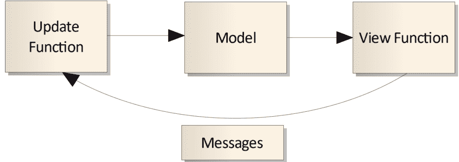

在接下来的示例中，我们将使用这种架构模式来创建一些功能。

## 使用 Elm 实现计数器

让我们实现一个简单的计数器页面，并讨论 Elm 架构。

### Model（模型）

模型存储所有可以更改的应用程序数据。在我们的例子中，我们只需要存储一个数字来反映当前计数。

该计数器的初始值为 `0`。

```elm
type alias Model = {
  number : Int
}

initialModel : Model
initialModel = { number = 0 }
```

### Messages（消息）

消息定义用户交互。用户可以增加或减少计数，因此我们需要两条消息来表达这些操作。

```elm
type Msg = Increment | Decrement
```

### View Function（视图函数）

视图函数接收 Model 作为参数，并将其显示在屏幕上。视图函数创建 HTML。

HTML 包含一个生成 `Decrement` 消息的递减按钮，以及一个生成 `Increment` 消息的递增按钮和当前计数。计数值从模型中读取，转换为字符串，然后作为文本渲染在 div 元素内部。

消息通过处理每个按钮的 `onClick` 事件来生成。

```elm
view : Model -> Html Msg
view model =
 div []
  [
    div [] [ text (String.fromInt model.number) ]
  , button [ onClick Decrement ] [ text "-" ]
  , button [ onClick Increment ] [ text "+" ]
  ]
```

### Update Function（更新函数）

`update` 函数描述了在收到新消息时如何更改模型。

当它收到 `Increment` 消息时，返回一个数字递增的新模型。当它收到 `Decrement` 消息时，返回一个数字递减的新模型。

```elm
update : Msg -> Model -> Model
update msg model =
  case msg of
    Increment ->
      { model | number = model.number + 1 }

    Decrement ->
      { model | number = model.number - 1 }
```

初始数字为零，当用户按下不同按钮时，数字会增加或减少。

### Wiring-Up（连接组装）

`main` 值描述了屏幕上显示的内容。它需要初始模型、`view` 函数来生成 HTML，以及 `update` 函数来更改模型。

```elm
import Browser
import Html exposing (Html, button, div, text)
import Html.Events exposing (onClick)

-- Code

main =
  Browser.sandbox {
  init = initialModel,
  update = update,
  view = view
  }
```

`view` 函数获取初始模型并显示在屏幕上。用户操作生成消息。`update` 处理这些操作并更新模型。当模型更改时，`view` 函数被调用以在屏幕上渲染新模型。这个流程无限重复。

## 使用 React 和 Redux 实现计数器

现在我们用 React 和 Redux 在 JavaScript 中实现相同的计数器页面。

### Model（模型）

模型定义所有应用程序数据。我们可以将计数器定义为应用程序状态对象上的 `number` 属性。

```javascript
const initialModel = {
  number: 0
};
```

### Messages（消息）

用于增加和减少计数的两个消息可以表示为创建具有 `type` 属性的纯数据对象的函数。

```javascript
function Increment(){
  return {
    type : Increment.name
  }
}

function Decrement(){
  return {
    type : Decrement.name
  }
}

export { Increment, Decrement };
```

### View Function（视图函数）

视图函数可以使用 [React 函数组件](https://react.dev/) 来实现。这些组件返回一种称为 [JSX](https://react.dev/learn/writing-markup-with-jsx) 的类 HTML 语法。

```javascript
import React from 'react';
import { connect } from 'react-redux';
import { Increment, Decrement } from './store';

function Counter({number, Increment, Decrement}){
  return(
    <div>
      <div>{number}</div>
      <button
        type="button"
        onClick={Decrement}>-</button>
      <button
        type="button"
        onClick={Increment}>+</button>
    </div>
  )
}

export default connect(
  state => state,
  {Increment, Decrement}
)(Counter);
```

### Update Function（更新函数）

更新函数接收当前模型和消息，并返回新模型。

```javascript
function reducer(model = initialModel, action){
  switch(action.type){
    case Increment.name:
      return { ...model, number: model.number + 1 };
    case Decrement.name:
      return { ...model, number: model.number - 1 };
    default:
      return model;
  }
}

export { reducer };
```

### Wiring-Up（连接组装）

我们可以在应用程序入口文件 `index.js` 中连接所有这些内容。在这里我们指定初始状态、视图和更新函数。

```javascript
import React from 'react';
```

```markdown
import ReactDOM from 'react-dom';
import { createStore } from 'redux';
import { Provider } from 'react-redux';
import Counter from './Counter';
import { reducer } from './store';

const store = createStore(reducer);

ReactDOM.render(
  <React.StrictMode>
    <Provider store={store}>
      <Counter />
    </Provider>
  </React.StrictMode>,
  document.getElementById('root')
);
```

## 使用 Elm 生成随机数

接下来，我们将创建另一个页面来显示随机数。这可能看起来比之前的功 能更简单，但实际上更难实现，因为生成随机数无法通过纯函数完成。

纯函数是具有确定性的函数。使用相同的输入调用时，它们总是返回相同的输出。Elm 是一门纯函数式语言。这意味着它只允许我们编写纯函数。那么，如果只能写纯函数，又如何生成随机数呢？

让我们来找出答案。

### 模型

同样，我们需要一个模型来存储可能发生变化的应用数据。这个模型只包含一个数字。

```
type alias Model = {
  number : Int
}

initModel : () -> (Model, Cmd Msg)

initModel _ =
  ( Model 0
  , Cmd.none
  )
```

### 消息

用户可以按下生成按钮，因此我们需要一个消息来表达这个交互动作，`GenerateNumber`。

```
type Msg = GenerateNumber
```

### 视图

视图函数接收模型并渲染用户界面。它在一个 div 元素中显示模型中存储的当前数字。同时它还显示用于生成新数字的按钮。当按钮被按下时，`GenerateNumber` 消息被创建。

```
view : Model -> Html Msg

view model =
  div []
    [ div [] [ text (String.fromInt model.number) ]
    , button [ onClick GenerateNumber ] [ text "Generate" ]
    ]
```

### 更新

更新函数接收当前消息并生成新模型。更新函数是纯函数。它不能生成随机数。取而代之的是，它创建一个命令，告诉 Elm 框架生成随机数，然后将结果放入一个新消息中。我们将这个新消息称为 `SetNumber`。此时我们意识到，消息可以带参数，消息可以是函数。

```
type Msg = GenerateNumber | SetNumber Int
```

为了使用 `Random.generate` 命令，我们需要安装一个额外的包。

```
elm install elm/random
```

下面是处理两种消息的更新函数。

```
update : Msg -> Model -> (Model, Cmd Msg)

update msg model =
  case msg of
    GenerateNumber ->
      ( model
      , Random.generate SetNumber (Random.int 1 100)
      )

    SetNumber number ->
      ( Model number
      , Cmd.none
      )
```

当更新函数收到 `GenerateNumber` 消息时，它使用 `Random.generate` 函数创建一个命令。Elm 框架执行该命令，生成随机数，并构建一个包含此随机数的新消息 `SetNumber`。在这种情况下，更新函数不会修改模型，它返回相同的模型。

当更新函数收到带有随机数的 `SetNumber` 消息时，它返回一个包含新生成数字的新模型。在这种情况下，更新函数不生成任何命令，它返回 `Cmd.none`。

如前所述，为了处理非纯逻辑，更新函数针对每条消息返回两个值：新模型和 Elm 框架必须执行的新命令。

以下是我们如何在 JavaScript 中编写返回两个值的函数。我们简单地返回一个包含两个值的数组。然后在赋值语句的左侧使用[解构赋值](https://developer.mozilla.org/en-US/docs/Web/JavaScript/Reference/Operators/Destructuring_assignment)语法来解包返回的值。

```
function update(model, action){
  switch(action.type){
    case 'GenerateNumber' : {
      const command = {
        name: 'Random.generate',
        resultMessage : 'SetNumber'
      };
      
      return [model, command];
    }
    
    case 'SetNumber' : {
      const newModel = { ...model, number: action.payload };
      const command = { name: 'Cmd.none' };
      return [newModel, command];
    }
    
    default : {
      const command = { name: 'Cmd.none' };
      return [model, command];
    }
  }
}
```

```
const [model, command] = update({}, 'GenerateNumber');
console.log(model);
console.log(command);
//{}
//{name: "Cmd.none"}
```

注意，命令是一个描述要执行的命令的普通对象。另外，请注意我们在 switch 分支中使用大括号来为每个子句定义块作用域，并允许在不同分支中声明相同名称的变量。

下面是使用命令处理非纯逻辑时的数据流示意图。

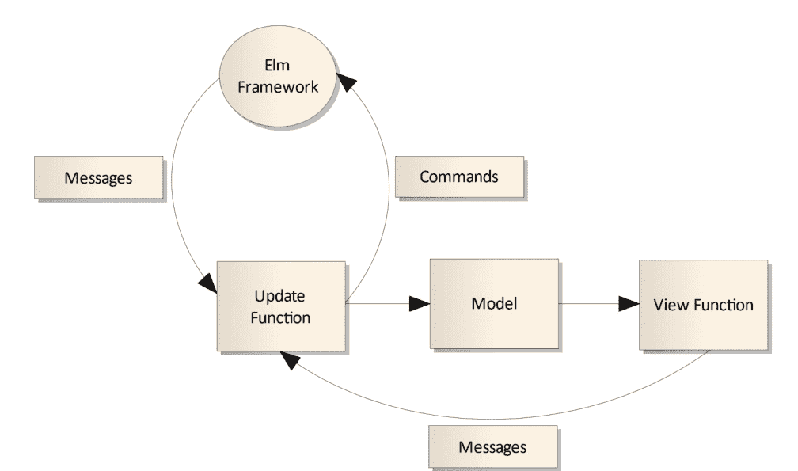

## 使用 React 和 Redux 生成随机数

现在让我们在 JavaScript 中实现相同的功能。

### 模型

我们首先将模型定义为一个对象，其 `number` 属性设置为 0。

```
const initialModel = {
  number: 0
};
```

### 命令

这就是我们在生成随机数的同时仍然使用纯函数时遇到问题的地方。Redux 允许我们定义一个地方来放置这种非纯逻辑，但没有办法完全避免它。

我们将遵循 Redux 模式，将 `GenerateNumber` 定义为一个返回另一个函数的函数。返回的函数称为 thunk，包含非纯逻辑。这个非纯逻辑的结果将作为参数传递给 `SetNumber` 消息。

```
function GenerateNumber(){
  return function(dispatch){
    const number = Math.floor(Math.random() * 100);
    dispatch(SetNumber(number));
  }
}
```

### 消息

`GenerateNumber` 命令需要 `SetNumber` 消息来发送新生成的数字。

```
function SetNumber(number){
  return {
    type : SetNumber.name,
    number
  }
}
```

### 视图

视图函数接收模型并为其创建 HTML。当按下生成按钮时，它分发 `GenerateNumber` 命令。

```
import React from 'react';
import { connect } from 'react-redux';
import { GenerateNumber } from './store';

function Counter({number, GenerateNumber}){
  return(
    <div>
      <div>{number}</div>
      <button
        type="button"
        onClick={GenerateNumber}>Generate</button>
    </div>
  )
}

export default connect(
  state => state,
  { GenerateNumber }
)(Counter)
```

### 更新

更新函数处理应用消息。当收到 `SetNumber` 消息时，它返回带有新数字值的模型。

```
function reducer(model = initialModel, action){
  switch(action.type){
    case SetNumber.name:
      return { ...model, number: action.number };
    default:
      return model;
  }
}
```

## 回顾

Elm 架构定义了流程，使我们能够以函数式风格编写实用的应用程序。

模型是一个不可变对象，代表所有应用状态。

视图函数是一个纯函数，构建 HTML 并创建消息。视图函数不负责在屏幕上渲染 HTML。它接收一个模型并返回 HTML。Elm 框架使用视图函数在屏幕上渲染此 HTML。

消息是修改应用模型的请求。

更新函数是一个纯函数，接收当前模型和一条消息，并返回新模型。当处理副作用时，它还会返回一个新命令。更新函数实际上并不改变模型。Elm 框架使用更新函数来改变模型。Elm 框架执行更新函数返回的命令，并使用结果创建新消息。

# 第 17 章：函数式范式

现在我们来回顾以函数式风格编程意味着什么。

函数式编程的主要思想是将应用拆分为小的纯函数，这些函数使用不可变数据进行通信，然后组合这些函数来实现所需的功能。

理想情况下，应用中的所有函数都应该是纯函数。

**纯粹性** —— 正如多次重复的那样，函数式编程的重点是编写纯函数。这些是只进行值转换的函数。

当纯函数返回时，应用的状态与函数被调用时相同。当我们不需要跟踪变量改变其值时，应用更容易理解。纯函数使我们能够将注意力集中在一个地方，从而让代码更易于理解。

当然，挑战在于只使用纯函数进行转换来创建一个实用的应用。这甚至可能吗？

我们看到，如果我们有合适的框架来使用这些纯函数，并执行实用应用所需的非纯逻辑，这是可以实现的。这种架构在 Elm 中得到了实现。

以下是 Elm 中执行非纯逻辑的流程：
```


+   - 纯更新函数创建一个命令，用于描述非纯逻辑
- Elm 框架接收该命令，执行非纯逻辑，并生成包含结果的消息
- 纯更新函数通过创建一个新的、包含先前结果的更新后的模型来处理这一消息

这种方法要求有函数来为任何类型的非纯逻辑创建命令，并使用能够理解这些命令的框架。

接下来，我们将看看在使用纯函数的 React 和 Redux 中进行 fetch 调用的类似方法。fetch 调用本身就是一个副作用，因此在函数中调用它会使该函数变得不纯。

幸运的是，有一个 [Redux 中间件](link)，叫做 [Axios 中间件](link)，它可以拦截 fetch 消息，执行 fetch 调用，然后将结果放入一个新的成功消息中。

让我们看看实现此功能所需的各个部分。

模型最初只存储一个空的待办事项列表。

```javascript
const initialModel = {
  todos: []
};
```

描述 fetch 请求的消息对象是使用 `LoadTodos` 纯函数创建的。

```javascript
function LoadTodos(){
  return {
    type: LoadTodos.name,
    payload: {}
  };
}
```

`List` 视图函数是纯函数。它接收待办事项列表并创建 HTML。它创建一个刷新按钮，点击时会发送 `LoadTodos` 消息。

```javascript
import React from 'react';
import { connect } from 'react-redux';
import { LoadTodos } from './store';

function List({todos, LoadTodos}){
  return(
   <div>
    <button
     type="button"
     onClick={LoadTodos}>
      Refresh
    </button>
    { todos.map(todo =>
       <div>{todo.title}</div> )}
   </div>
  )
}

export default connect(
  state => state,
  { LoadTodos }
)(List);
```

`update` 函数是纯函数。它接收当前模型和动作，返回新的模型。当收到成功消息时，它返回一个包含新待办事项列表的新模型。

```javascript
function reducer(model = initialModel, action){
  switch(action.type){
    case `${LoadTodos.name}_SUCCESS`:
      return {
        ...model,
        todos: action.payload.data
      };
    default:
      return model;
  }
}
```

就是这样。我们仅使用纯函数就完成了 fetch 调用并在屏幕上显示结果。我们能够这样做，是因为我们有一套处理非纯逻辑的库可供使用。

注意此应用中的数据流：

+   - 点击刷新按钮会创建一个描述 fetch 请求的消息
- Axios 中间件拦截该消息，执行 fetch 调用，并使用结果创建一个新的成功消息
- 更新函数通过创建一个包含先前结果的新模型来处理成功消息

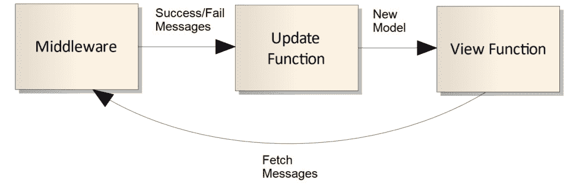

仔细想想，这个数据获取逻辑有三个非纯部分：

+   - 从 Web API 获取数据
- 更新模型对象
- 在屏幕上渲染数据

Redux-Axios 中间件使我们能够使用创建 fetch 命令的纯函数来发起 fetch 请求。Redux 提供了一种使用纯函数更新模型的解决方案。React 提供了一种使用纯视图函数更新 UI 的解决方案。这很有帮助，但这些并不是我们唯一能写的非纯逻辑。还有更多，比如协调多个网络请求、创建定时器事件、生成随机数、获取当前时间、写入控制台或本地存储等等。我们称它们为*副作用*。

就目前而言，在 JavaScript 中，以函数式风格编写应用的最佳库——React 和 Redux——仍然需要编写非纯逻辑。在这种情况下，我们需要追求高比例的纯函数。80% 远比 20% 要好。

## 不可变性

事实证明，不可变性更容易实现。我们只需在创建时冻结对象，它们就会变得不可变。另一个简单的解决方案是使用 linter 来确保应用中没有发生突变。

不可变数据结构在 Immutable.JS 等库中都有提供。它们提供了优化改进和更友好的公共接口。

在处理列表时，我们不应担心创建中间集合。当列表较小，少于一千条记录时，差异是察觉不到的。当处理包含数千个对象的集合时，我们可以开始使用不会创建中间集合的序列。

## 管道

我们了解了从 `pipe` 工具到在数组、不可变列表、序列、Promise 或 Observable 上链式转换的不同方式，来创建数据转换管道。

所有这些数据结构都包装一个或多个值，并允许我们创建转换包装数据的纯函数管道。通常，有一组所有这些数据扑结构都支持的通用转换，如 `filter`、`map`、`reduce` 或 `sort`。

在这种情况下，柯里化技术可用于向管道中的函数传递额外的参数。

函数式编程开始变得关乎使用纯函数管道转换数据。从某种意义上说，函数式编程提倡一种数据流编程风格。

## 循环

纯函数式语言没有循环。这类功能使用数组方法实现，并在特定算法中回退到递归。

就目前而言，还无法禁用 JavaScript 中的所有循环语句，因为它缺少[尾调用](https://en.wikipedia.org/wiki/Tail_call)实现。

## 命名

将应用拆分为纯函数是不够的。我们需要给这些函数起能够揭示意图的名字。所以请花点时间好好命名。如果失败了，应用仍然会难以理解。

## 目录结构

随着应用的增长，会创建越来越多的函数。你需要找到一种方法来组织这些函数到模块中。这意味着创建具有清晰名称的文件来包含这些函数。然后你需要一种方法来组织这些文件到文件夹中。会有一些通用函数，也会有一些仅在特定模块中使用的函数。

## 总结思考

以函数式风格编写的应用由大量纯函数组成，组织在模块中。我们将这些函数用于管道中，并将它们组合起来以实现所需的功能。函数式编程使代码更易于阅读。不易理解的程序可能导致 bug，并且通常需要重写。

函数式编程的本质是使用纯函数转换不可变数据。这些转换在管道中变得更富表现力。

## 下一步是什么？

如果你想将所学付诸实践，并使用函数式组件和函数式编程原则构建现代 React 应用，请考虑阅读 [Functional React, 2nd Edition](https://example.com)。

继续你的学习路径，阅读 [Functional Architecture with React and Redux](https://example.com)，使用 React 和 Redux 构建复杂度逐步提升的多个应用。

函数式架构意味着获取初始状态，使用视图函数将其展示给用户，监听动作，基于这些动作更新状态，然后将更新后的状态再次渲染给用户。

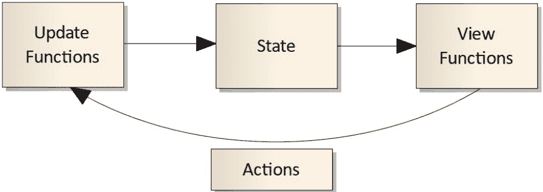

享受 JavaScript 和 React 函数式编程系列书籍！

## 目录

- 第 01 章：基本类型
- 第 02 章：不可变数据对象
- 第 03 章：函数
- 第 04 章：数组
- 第 05 章：一等函数
- 第 06 章：语句
- 第 07 章：递归
- 第 08 章：管道与柯里化
- 第 09 章：函子
- 第 10 章：单子
- 第 11 章：不可变集合
- 第 12 章：惰性转换
- 第 13 章：生成器
- 第 14 章：Promise
- 第 15 章：Observable
- 第 16 章：Elm 架构
- 第 17 章：函数式范式
