# 数据可视化的 HTML、SVG、CSS 和 JavaScript 基础

# 1 引言

欢迎！本书面向对数据可视化感兴趣的读者，涵盖 HTML、SVG、CSS 和 JavaScript 的基础知识。如果你处理数据，可能大部分时间都在使用 Excel、R 或 Python。你可能会被要求在 Python Jupyter notebook 中创建图表，或使用 R 的 Shiny 或 Python 的 Dash 创建仪表板。这些图表通常是用 HTML、SVG、CSS 和 JavaScript 构建的，当你需要深入探索时，对这些语言的良好理解会很有帮助。

或者，你可能对学习 D3 或其他 JavaScript 图表库感兴趣。在这种情况下，本书可以帮助你快速掌握 HTML、SVG、CSS 和 JavaScript。

本书不假设你具备这些语言的先验知识，但如果你有一些编程经验会更有帮助。熟悉文本编辑器（或 IDE）也会有所帮助。

本书绝不是 HTML、SVG、CSS 和 JavaScript 的全面教程。要做到这一点，你需要一本更厚的书。请将本书视为一份最低限度的知识清单，适用于希望处理基于 Web 的数据可视化的人。如果你想理解我的其他数据可视化书籍（例如《D3 从入门到精通》），你绝对需要理解本书的内容。

## 1.1 环境搭建

为了快速上手，我建议使用 [CodePen](https://codepen.io/) 来查看和试验代码示例（见下一节）。在本书末尾的“工具与设置”章节中，我将展示如何设置工具，以便你可以在本地编写代码（文件存储在你的计算机上，而不是 CodePen 上）。这需要一些时间来设置，但如果你对 Web 开发变得更加认真，我推荐这种方法。

## 1.2 CodePen

[CodePen](https://codepen.io/) 是一个网站，让你无需设置任何工具即可试验 HTML、SVG、CSS 和 JavaScript。

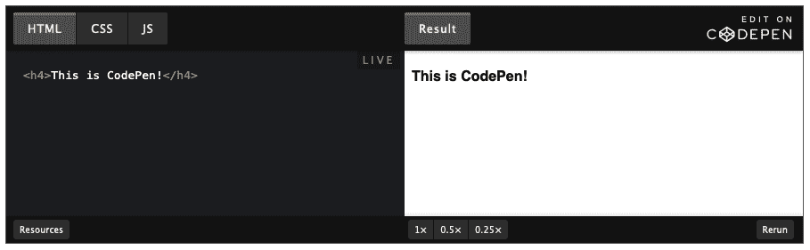

这就是 CodePen。你可以在 https://codepen.io/createwithdata/pen/VwvpzOg 访问此示例。

在书中的关键位置，会有一个指向 CodePen “笔”的链接，其中包含代码示例。如果你访问该链接，就可以查看并试验代码。我鼓励你多玩玩 CodePen 示例——你几乎不会破坏任何东西，通过实验学习非常有效。

你可以自由编辑本书中的 CodePen 示例，你的更改不会影响原始示例。如果你想保留更改，请点击 Fork（在页面底部）并创建一个 CodePen 账户（或登录）。通过点击页面顶部的 Save 按钮保存你的工作。

## 1.3 保持联系

我喜欢与读者保持联系。最好的方式之一是通过我的邮件列表。我会偶尔发送包含与实现数据可视化相关的有用信息（例如使用 JavaScript 或其他工具）的消息。还会有我其他书籍的折扣码。你可以[在此处](https://mailchi.mp/085e79e8fd7c/create-with-data-newsletter)注册。

## 1.4 翻译者

如果你有兴趣将《用于数据可视化的 HTML、SVG、CSS 和 JavaScript 基础》翻译成其他语言，请通过 info@createwithdata.com 联系我，我很乐意进一步讨论。

# 2 Web 语言：HTML、SVG、CSS 和 JavaScript

大多数网站和 Web 应用程序（包括数据可视化）都由 4 种语言构建：**HTML**、**SVG**、**CSS** 和 **JavaScript**。

HTML 代表超文本标记语言，描述网页的**内容**。

SVG 代表可缩放矢量图形，描述**形状**，例如圆形、线条和矩形。它常用于数据可视化（描述条形、线条、圆形、坐标轴、图例等）。

CSS 代表层叠样式表，描述 HTML 和 SVG 元素的**样式**（例如字体粗细、颜色或大小）和**位置**。

JavaScript 是一种编程语言，可以**操作** HTML 和 SVG，进行通用**计算**（例如数据处理）并处理**交互**。

我们将在接下来的章节中逐一介绍这些内容。

# 3 HTML

HTML 是一种定义网页**内容**的语言。它使用元素来定义标题、段落、图像、链接等。例如，一个段落元素看起来像这样：

```
<p>这是一个段落文本。</p>
```

段落元素由一个**开始标签** `<p>`、一些**内容**和一个**结束标签** `</p>` 组成。标签通常成对出现。开始标签看起来像 `<p>`，结束标签看起来像 `</p>`。

当 Web 浏览器加载 HTML 文档时，它会根据元素类型（段落、标题、图像等）绘制每个元素。例如，上面的段落元素在 Web 浏览器中渲染时看起来像这样：

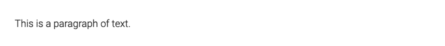

在 Web 浏览器中渲染的段落 `<p>` 元素

HTML 元素有很多，但只需少数几个就能完成很多工作。本章介绍五个常见元素：标题、列表、图像、`div` 元素和 `svg` 元素。（在可视化数据时，这五个元素通常就足够了。）

## 3.1 标题

标题元素用于标题。有六个级别，从大（`<h1>`）到小（`<h6>`）。

```
<h1>主标题</h1>
<h2>副标题</h2>
<h3>三级标题</h3>
<h4>四级标题</h4>
<h5>五级标题</h5>
<h6>六级标题</h6>
```

这些元素在 Web 浏览器中渲染时看起来像这样：

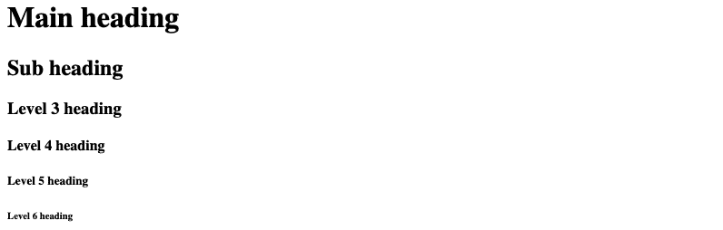

在 Web 浏览器中渲染的标题元素 `<h1>` 到 `<h6>`

## 3.2 列表

列表元素 `<ul>` 用于表示项目列表。每个项目由列表项元素 `<li>` 表示，并嵌套在 `<ul>` 元素内：

```
<ul>
  <li>列表项一</li>
  <li>列表项二</li>
</ul>
```

注意，我们对 `<li>` 元素进行了缩进。这是可选的，但通常是表示嵌套元素的方式。在浏览器中显示时，列表看起来像：

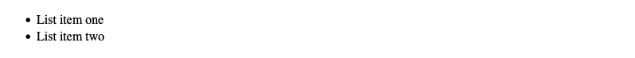

在 Web 浏览器中渲染的列表元素 `<ul>` 和 `<li>`

## 3.3 图像

可以使用 `` 元素将图像添加到 HTML 文档中。`` 元素需要一个名为 `src` 的**属性**，用于指定图像的 URL。

图像元素没有结束标签。下面是一个图像元素，显示位于 `https://picsum.photos/id/127/300/200.jpg` 的图像：

```

```

此示例看起来像：


在 Web 浏览器中渲染的图像元素 ``

通常，你的图像文件会与源代码放在一起。例如，你可能有一个名为 `images` 的目录，其中包含图像文件 `my-image.jpg`。在这种情况下，你应该这样写：

```

```


默认情况下，图像以其原始尺寸显示。你可以使用 `width`（或 `height`）属性设置图像的显示宽度（或高度）。让我们将上一张图像的宽度设置为 200 像素：

```

```

我们将在 CSS 章节中介绍测量单位（例如 `px`）。

## 3.4 `<div>` 元素

`<div>` 元素是一个通用元素，常用于分组和组织内容。当其他元素都不合适时，它也是一个很好的后备元素。下面是一个使用 `<div>` 元素构建网页结构的示例：

```
<div>
  <h1>主标题</h1>
  <h2>副标题</h2>
</div>
<div>
  <h3>文章标题</h3>
  <div>
    <p>第一段</p>
    <p>第二段</p>
  </div>
</div>
```

注意元素是如何缩进的。这是可选的，不会影响元素在浏览器中的显示，但在阅读和处理代码时很有用。

上述示例在网页浏览器中渲染时如下所示：

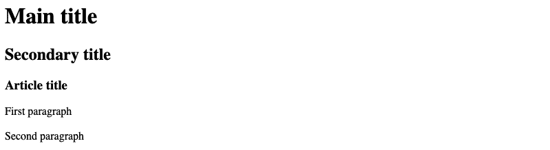

通用 `<div>` 元素在网页浏览器中的渲染效果

试着将每个 HTML 元素与输出的每一行对应起来。

## 3.5 `<svg>` 元素

当你想在页面中包含 SVG 时，使用 `<svg>` 元素。SVG 代表可缩放矢量图形（Scalable Vector Graphics），是一种描述形状（如线条、圆形和矩形）的语言（参见 SVG 章节）。`<svg>` 元素充当 SVG 形状的容器。例如，要在网页中添加一个圆形，你可以使用：

```
<svg width="800" height="600">
  <circle r="100"></circle>
</svg>
```

在 `<svg>` 元素内部有两个**属性**：`width` 和 `height`。它们与 `` 元素中的 `width` 和 `height` 属性类似。

指定 SVG 元素的大小（使用 `width` 和 `height` 属性）非常重要，因为其默认尺寸非常小，并且形状会被裁剪到 SVG 的边界内。

SVG 将在 SVG 章节中更深入地介绍。

## 3.6 总结

还有许多其他 HTML 元素，但在可视化数据时，本节介绍的元素是最常见的。

你可以在 [`developer.mozilla.org/en-US/docs/Web/HTML/Element`](https://developer.mozilla.org/en-US/docs/Web/HTML/Element) 查看 HTML 元素的完整列表。

## 3.7 练习

下面是一些包含本章大部分元素的 HTML：

```
<div>
  <h1>主标题</h1>
  <h2>副标题</h2>
</div>
<div>
  <h4>文章标题</h4>
  <div>
    <p>第一段</p>
    
    <p>第二段</p>
    <ul>
      <li>列表项一</li>
      <li>列表项二</li>
    </ul>
    <p>第三段</p>
  </div>
</div>
```

你可以在 CodePen 上打开此示例：[`codepen.io/createwithdata/pen/ExQGeeY`](https://codepen.io/createwithdata/pen/ExQGeeY)。

尝试以下操作：

1.  更改标题内的文本。

2.  将 `<h4>` 和 `</h4>` 标签改为 `<h4>` 和 `</h4>`。

3.  添加一个包含一些文本的新段落。

4.  将图像 URL 改为 `https://picsum.photos/id/104/384/216`

5.  将图像的宽度改为 150 像素。

6.  添加另一个列表项。

# 4 SVG

SVG（可缩放矢量图形）是一种描述形状的语言。它的结构与 HTML 类似，但描述的是形状而非文本。在可视化数据时，最常见的 SVG 元素有：

| 元素 | 描述 |
| --- | --- |
| `<line>` | 线条 |
| `<rect>` | 矩形 |
| `<circle>` | 圆形 |
| `<text>` | 文本 |
| `<g>` | 组（用于分组元素） |
| `<path>` | 路径（通用的自由形状） |

每个元素需要多个属性来定义其位置和大小。我们在 HTML 章节中看到，属性看起来像 `name="value"`，并插入到开始标签内。例如：

```
<svg width="800" height="600">
  <circle r="100"></circle>
</svg>
```

在上面的代码片段中，`<svg>` 元素有两个属性 `width` 和 `height`，`<circle>` 元素有一个属性 `r`，其值为 `100`。稍后我们会看到 `r` 属性指定了圆的半径。

## 4.1 将 SVG 添加到网页

SVG 形状元素可以通过将它们包含在 `<svg>` 元素内来添加到 HTML 文档中。例如：

```
<h3>这里有一些形状：</h3>

<svg width="800" height="600">
  <circle r="100"></circle>
  <line x1="10" y1="10" x2="100" y2="10"></line> 
</svg>

<p>上面是一个圆形和一条线条。</p>
```

## 4.2 SVG 元素

### 4.2.1 线条

`<line>` 元素表示直线。它有 4 个属性：

*   `x1` 和 `y1` 定义线条的起点
*   `x2` 和 `y2` 定义线条的终点

例如：

```
<svg width="800" height="100">
  <line x1="50" y1="50" x2="200" y2="50"></line>
</svg>
```

定义了一条起点坐标为 (50,50)、终点坐标为 (200,50) 的线条。每个属性以像素为单位。上述示例看起来如下：

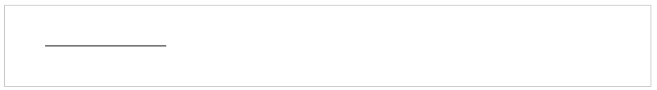

一个 `<line>` 元素（`<svg>` 元素以灰色轮廓表示）

### 4.2.2 矩形

`<rect>` 元素定义矩形，有 4 个属性：

*   `x` 和 `y` 定义左上角位置
*   `width` 和 `height`

例如：

```
<svg width="800" height="150">
  <rect x="50" y="50" width="200" height="50"></rect>
</svg>
```

定义了一个左上角在 (50,50)、宽度为 200 像素、高度为 50 像素的矩形。此示例看起来像：

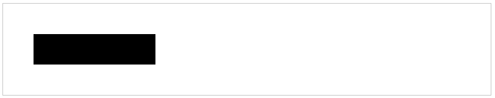

一个 `<rect>` 元素

### 4.2.3 圆形

`<circle>` 元素有 3 个属性：

*   `cx` 和 `cy` 定义圆心
*   `r` 定义半径

例如：

```
<svg width="800" height="150">
  <circle cx="100" cy="75" r="50"></circle>
</svg>
```

看起来像：

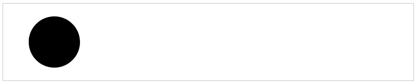

一个圆心在 (100,75)、半径为 50 的 `<circle>` 元素

### 4.2.4 文本

`<text>` 元素有 2 个属性 `x` 和 `y`，定义文本的左下角。

与大多数 SVG 元素不同，`<text>` 元素在开始和结束标签之间有内容：

```
<svg width="800" height="100">
  <text x="50" y="50">一些 SVG 文本</text>
</svg>
```

此示例渲染为：

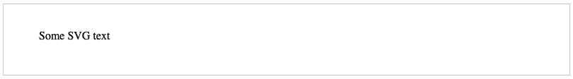

一个左下角在 (100,50) 的 `<text>` 元素

### 4.2.5 组

`<g>` 元素用于分组 SVG 元素，当对象由多个元素组成时特别有用。它们有点像 HTML 的 `<div>` 元素。例如，一个带有文本标签的圆形可以表示为：

```
<svg width="800" height="600">
  <g>
    <circle cx="50" cy="50" r="20"></circle>
    <text x="75" y="55">我的标签</text>
  </g>
</svg>
```

此示例渲染为：

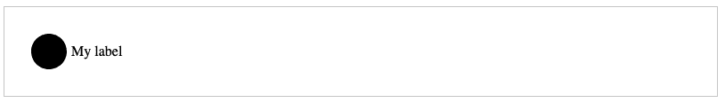

一个包含两个元素的 `<g>` 元素

### 4.2.6 路径

`<path>` 元素有一个单独的属性 `d`，其中包含一系列绘图命令：

```
<svg width="800" height="100">
  <path d="M20,20 l200,0 l0,50 z"></path>
</svg>
```

在此示例中，使用了三个命令：

*   `M` 表示移动到指定坐标
*   `l` 表示从当前位置绘制相对线条
*   `z` 表示闭合形状

因此：

*   `M20,20` 表示移动到坐标 `20,20`
*   `l200,0` 表示向右绘制一条 `200` 像素的线条
*   `l0,50` 表示向下绘制一条 `50` 像素的线条
*   `z` 表示闭合形状

渲染效果如下：

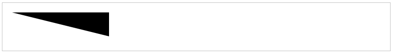

一个 `<path>` 元素

如果你想了解更多关于路径命令的信息，请访问 [`developer.mozilla.org/en-US/docs/Web/SVG/Tutorial/Paths`](https://developer.mozilla.org/en-US/docs/Web/SVG/Tutorial/Paths)。

### 4.2.7 练习

下面是一些包含本章大部分元素的 SVG：


```svg
<svg width="800" height="600">
  <line x1="20" y1="50" x2="220" y2="50"></line>
  <rect x="20" y="100" width="200" height="50"></rect>
  <circle cx="300" cy="50" r="50"></circle>
  <text x="300" y="150">SVG Text</text>
  <path d="M20,180 l200,0 l0,50 z"></path>
</svg>
```

你可以在 CodePen 上打开这个示例，地址为 [`codepen.io/createwithdata/pen/poJqELb`](https://codepen.io/createwithdata/pen/poJqELb)。


SVG 形状

尝试以下操作：

1. 让线条变短。
2. 让圆的半径变小。
3. 将矩形向上或向下移动。
4. 更改 `<text>` 元素的内容。

SVG 是基于网页的数据可视化的基石。你在网页上看到的大多数数据可视化（尤其是交互式的）都是基于 SVG 的。它们通常由你在本节中介绍的元素组成。下次你在网页上看到数据可视化时，试着识别其中可能使用的一些形状。

## 4.3 SVG 变换

SVG 变换可以通过多种方式改变 SVG 元素的位置、大小和形状，包括**平移**、**缩放**和**旋转**。平移变换将元素沿给定的 `x` 和 `y` 值移动。缩放变换使元素变大或变小。旋转变换旋转元素。

可以使用 `transform` 属性将变换添加到 SVG 元素。例如：

```svg
<circle transform="translate(100,100)"></circle>
```

SVG 变换包括 `translate`、`rotate`、`scale`、`skewX` 和 `skewY`。在本节中，我们将介绍 `translate` 和 `rotate`，因为它们在数据可视化中很常见。

### 4.3.1 平移

假设你有一个圆心在 `(0,0)`、半径为 50 的圆：

```svg
<circle r="50"></circle>
```

圆的默认位置是 `(0,0)`，对应于 SVG 容器（如下面的灰色框所示）左上角的原点。效果如下：

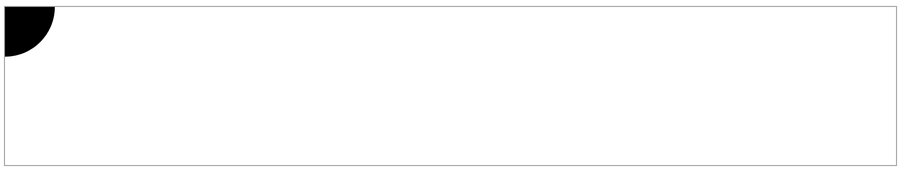

默认位置的 SVG 圆

你可以使用 `translate(x,y)` 对圆应用平移变换，其中 `x` 和 `y` 是在 `x` 和 `y` 方向上移动的量：

```svg
<circle r="50" transform="translate(200,75)"></circle>
```

上述变换将圆沿 `x` 方向移动 200，沿 `y` 方向移动 75。结果得到一个圆心在 `(200,75)` 的圆：

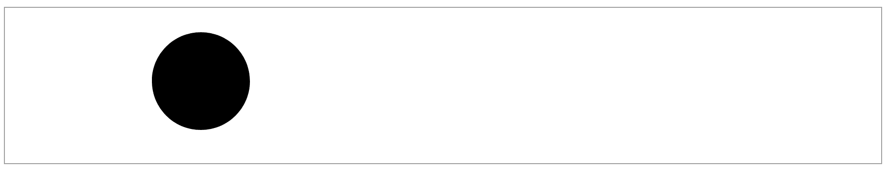

平移 `(200,75)` 后的 SVG 圆

你可以对任何类型的 SVG 元素应用变换，包括 `g` 元素。假设你有一个包含圆和文本标签的 `<g>` 元素：

```svg
<g>
  <circle r="50"></circle>
  <text y="6">标签</text>
</g>
```


变换前的 SVG 圆和标签

你可以对组应用平移变换：

```svg
<g transform="translate(100,75)">
  <circle r="50"></circle>
  <text y="6">标签</text>
</g>
```

这会将圆和文本元素移动相同的量：

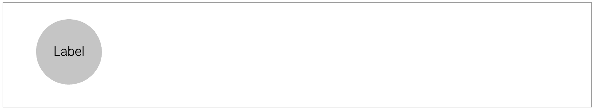

平移后的 SVG 圆和标签

### 4.3.2 旋转

假设你有一个矩形：

```svg
<rect x="50" y="50" width="200" height="20"></rect>
```

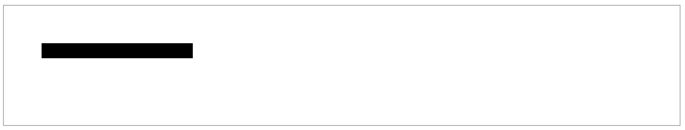

未旋转的 SVG 矩形

你可以使用 `rotate(a)` 应用旋转变换，该变换将元素绕原点 `(0,0)` 顺时针旋转 `a` 度：

```svg
<rect x="50" y="50" width="200" height="20" transform="rotate(20)"></rect>
```

结果如下：

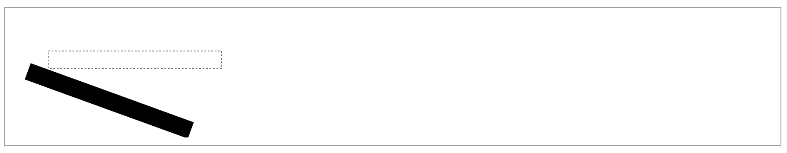

旋转后的 SVG 矩形（虚线矩形表示未变换的 `<rect>`）

矩形绕原点 `(0,0)` 旋转了 20 度。（原点是 SVG 容器的左上角。）

你可以在角度后添加坐标来指定新的旋转中心。以下将矩形绕其中心 `(150,60)` 旋转：

```svg
<rect x="50" y="50" width="200" height="20" transform="rotate(20 150 60)"></rect>
```

结果如下：

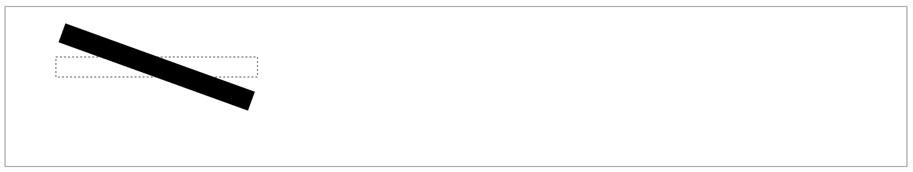

绕矩形中心旋转后的 SVG 矩形

### 4.3.3 组合变换

可以通过依次书写变换来组合它们：

```svg
<rect transform="rotate(45) translate(100,0)"></rect>
```

重要的是要理解，变换指定的是**坐标系的变换**。例如，在上面的代码片段中，坐标系先旋转 45 度，然后平移 `(100,0)`。

让我们更仔细地看看变换是如何组合的。这是一个没有变换的矩形：

```svg
<rect width="50" height="10"></rect>
```

效果如下：

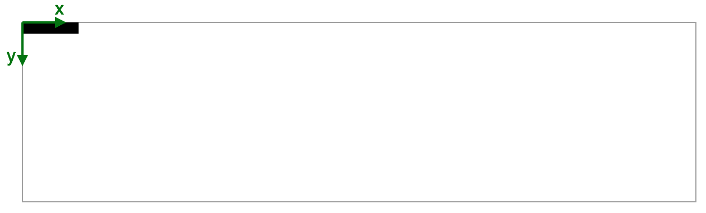

未变换的矩形（带坐标系）

现在让我们添加一个旋转变换：

```svg
<rect width="50" height="10" transform="rotate(45)"></rect>
```

结果如下：

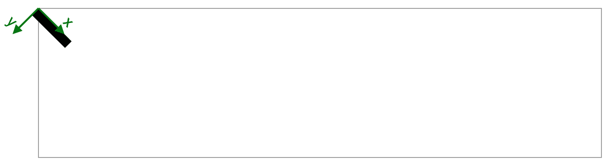

旋转后的坐标系

坐标系旋转了 45 度，矩形绘制在**变换后的坐标系**中。

现在让我们添加一个沿 `x` 方向平移 100 像素的变换：

```svg
<rect width="50" height="10" transform="rotate(45) translate(100,0)"></rect>
```

效果如下：

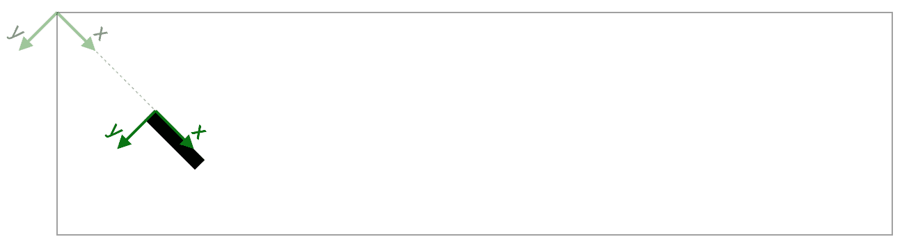

旋转并平移后的坐标系

坐标系先 1) 绕原点旋转 45 度，然后 2) 沿旋转后的 x 轴方向平移 100 像素。（仅应用旋转变换的坐标系以浅色显示。）

## 4.4 练习

以下是带标签的圆 SVG：

```svg
<svg width="800" height="600">
  <g transform="translate(100,75)">
    <circle r="50"></circle>
    <text y="6">标签</text>
  </g>
</svg>
```

导航至 [`codepen.io/createwithdata/pen/MWwZjPp`](https://codepen.io/createwithdata/pen/MWwZjPp) 在 CodePen 中查看此示例。


平移后的 SVG 圆和标签

尝试以下操作（在更改代码前试着猜测效果）：

1. 更改 `translate` 变换，观察对带标签的圆组的影响。
2. 在 `translate` 之后添加一个 `rotate` 变换，观察对组的影响。

# 5 CSS

CSS（层叠样式表）是一种用于**样式化**和**定位** HTML 和 SVG 元素的语言。样式化意味着改变 HTML 和 SVG 元素的外观（例如**大小**、**颜色**和**字体**）。

在下一节中，我们将了解 CSS 的结构。然后我们将介绍 CSS 度量单位，接着是常见的 CSS 属性。

## 5.1 CSS 的结构

CSS 样式表是一个**规则**列表。以下是一个单独的 CSS 规则：

```css
h1 {
  color: green;
  font-size: 20px;
}
```

每条规则包含一个**选择器**和一个**声明**列表。在上面的例子中，选择器是 `h1`，声明是 `color: green;` 和 `font-size: 20px;`。

选择器定义了**哪些** HTML 或 SVG 元素将被样式化。声明定义了元素**如何**被样式化。每个声明由一个**属性**和一个**值**组成。在声明 `color: green;` 中，属性是 `color`，值是 `green`。

上面例子中的规则意味着所有 `h1` 元素的颜色设置为绿色，字体大小设置为 20 像素（高度）。例如，假设你有一个 `<h1>` 元素：

```html
<h1>标题</h1>
```

未应用 CSS 规则时，效果如下：


未应用 CSS 的 `h1` 元素

如果你应用 CSS 规则：

```css
h1 {
  color: green;
  font-size: 20px;
}
```

你会得到：


使用 CSS 样式化的 `<h1>` 元素

## 5.2 CSS 单位

### 5.2.1 尺寸单位

尺寸可以使用以下单位表示：

| **单位** | **描述** | **示例** |
| --- | --- | --- |
| `px` | 像素 | `12px` |
| `rem` | 相对于网页的默认字体大小 | `1.5rem` |


| `%` | 元素父级值的百分比 | `50%` |
| `vw` | 视口宽度的百分比 | `25vw` |
| `vh` | 视口高度的百分比 | `100vh` |

通常网页的默认字体大小为 `16px`，因此 `1.5rem` 表示 `24px`。

在构建数据可视化时，这些单位通常足够使用。

### 5.2.2 颜色单位

颜色可以通过以下方式表示：

| **类型** | **描述** | **示例** |
| --- | --- | --- |
| 颜色名称 | 颜色名称。所有可能颜色的完整列表见[此处](https://developer.mozilla.org/en-US/docs/Web/CSS/color_value)。 | `red`, `green`, `steelblue` |
| RGB | `rgb` 后跟括号内的红、绿、蓝值，以数字 `0` 到 `255` 表示。 | `rgb(255, 100, 255)` |
| 十六进制代码 | `#` 符号后跟红、绿、蓝的十六进制值（`00` 到 `FF`）。如果三个值都有重复的数字，例如 `#FFDD33`，可以简写为 `#FD3`。 | `#FF595E, #FD3` |

根据我的经验，上述颜色单位在构建数据可视化时已经足够。如果你想深入了解，可以查看 MDN 关于 [HTML 颜色](https://developer.mozilla.org/en-US/docs/Web/HTML/Applying_color) 的指南。

## 5.3 CSS 属性

某些 CSS 属性适用于 HTML 元素，某些适用于 SVG 元素，另一些则同时适用于 HTML 和 SVG 元素。我们先来看 HTML 元素的 CSS 属性。

### 5.3.1 HTML 的 CSS 属性

HTML 元素的一些最常见属性如下：

| **属性** | **描述** | **示例值** | **更多信息** |
| --- | --- | --- | --- |
| `color` | 文本颜色 | `red`, `#FF595E`, `rgb(255, 100, 255)` | [更多](https://developer.mozilla.org/en-US/docs/Web/CSS/color) |
| `background-color` | 背景颜色 | `black`, `#CCC`, `rgb(0, 0, 10)` | [更多](https://developer.mozilla.org/en-US/docs/Web/CSS/background-color) |
| `border` | 边框（围绕元素内容） | `solid`（实线）, `1px dashed red`（红色虚线） | [更多](https://developer.mozilla.org/en-US/docs/Web/CSS/border) |
| `padding` | 内容与边框之间的空间宽度 | `10px`, `2rem` | [更多](https://developer.mozilla.org/en-US/docs/Web/CSS/padding) |
| `margin` | 边框周围的空间宽度 | `10px`, `2rem` | [更多](https://developer.mozilla.org/en-US/docs/Web/CSS/margin) |
| `opacity` | 不透明度（或透明度） | `0`（透明）, `0.5`（半透明）, `1`（不透明） | [更多](https://developer.mozilla.org/docs/Web/CSS/opacity) |
| `font-size` | 文本大小 | `12px`, `1.5rem` | [更多](https://developer.mozilla.org/en-US/docs/Web/CSS/font-size) |
| `font-family` | 字体族 | `Helvetica`, `Verdana`, `sans-serif`, `serif` | [更多](https://developer.mozilla.org/en-US/docs/Web/CSS/font-family) |
| `font-weight` | 字体粗细 | `lighter`, `normal`, `bold` | [更多](https://developer.mozilla.org/en-US/docs/Web/CSS/font-weight) |
| `width` | 宽度 | `200px`, `10rem`, `50%` | [更多](https://developer.mozilla.org/en-US/docs/Web/CSS/width) |
| `height` | 高度 | `100px`, `5rem`, `25%` | [更多](https://developer.mozilla.org/en-US/docs/Web/CSS/height) |

### 5.3.2 练习

以下是 HTML：

```
<p>这是一个段落元素。</p>
```

以及 CSS：

```
p {
  font-size: 1rem;
  color: #335C67;
  background-color: #FFF3B0;
  border: 1px solid #aaa;
  padding: 2rem;
  margin: 1rem;
  width: 12rem; 
}
```

效果如下：

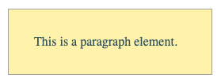

一个使用 CSS 样式化的 `<p>` 元素

导航至 [`codepen.io/createwithdata/pen/OJQXzKo`](https://codepen.io/createwithdata/pen/OJQXzKo) 在 CodePen 中查看此示例。

尝试以下操作：

1.  编辑某些属性值（例如，你可以更改一些颜色）。

2.  添加一条规则来更改 `<p>` 元素的不透明度。

3.  增加/减少 margin 和/或 padding，观察它们之间的关系。

4.  增加边框宽度。

5.  减小元素宽度。

6.  在 HTML 中添加另一个 `<p>` 元素，并在结果面板中观察其显示效果。

### 5.3.3 SVG 的 CSS 属性

对于 SVG 元素，最常见的属性如下：

| **属性** | **描述** | **示例值** | **更多信息** |
| --- | --- | --- | --- |
| `fill` | 形状的内部颜色 | `red`, `#FF595E`, `rgb(255, 100, 255)`, `none` | [更多](https://developer.mozilla.org/en-US/docs/Web/SVG/Tutorial/Fills_and_Strokes) |
| `stroke` | 形状轮廓的颜色 | `red`, `#FF595E`, `rgb(255, 100, 255)`, `none` | [更多](https://developer.mozilla.org/en-US/docs/Web/SVG/Tutorial/Fills_and_Strokes) |
| `stroke-width` | 形状轮廓的宽度 | `1px`, `0.5px` | [更多](https://developer.mozilla.org/en-US/docs/Web/SVG/Tutorial/Fills_and_Strokes) |
| `opacity` | 形状的不透明度 | `0`（透明）, `0.5`（半透明）, `1`（不透明） | [更多](https://developer.mozilla.org/docs/Web/CSS/opacity) |
| `font-size` | 文本大小 | `12px`, `1.5rem` | [更多](https://developer.mozilla.org/en-US/docs/Web/CSS/font-size) |
| `font-family` | 字体族 | `Helvetica`, `Verdana`, `sans-serif`, `serif` | [更多](https://developer.mozilla.org/en-US/docs/Web/CSS/font-family) |
| `font-weight` | 字体粗细 | `lighter`, `normal`, `bold` | [更多](https://developer.mozilla.org/en-US/docs/Web/CSS/font-weight) |
| `text-anchor` | 文本元素的水平对齐方式 | `start`, `middle`, `end` | [更多](https://developer.mozilla.org/en-US/docs/Web/SVG/Attribute/text-anchor) |

例如，以下是 SVG：

```
<svg width="400" height="200">
  <g transform="translate(100, 75)">
    <circle r="50"></circle>
    <text y="6">标签</text>
  </g>
</svg>
```

以及 CSS：

```
circle {
  fill: #9E2A2B;
}

text {
  font-family: sans-serif;
  fill: white;
  text-anchor: middle;
}
```

效果如下：

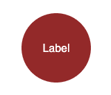

一个使用 CSS 样式化的 SVG 圆形和文本

第一条规则设置了圆形的颜色，第二条规则样式化了文本元素。文本元素的字体族、颜色和水平对齐方式均已设置。

导航至 [`codepen.io/createwithdata/pen/YzeWeyY`](https://codepen.io/createwithdata/pen/YzeWeyY) 在 CodePen 中查看此示例。

### 5.3.4 练习

尝试以下操作：

1.  将圆形的透明度设置为 `0.5`。

2.  增大标签的字体大小。

### 5.3.5 规则覆盖

如果多个 CSS 声明应用于同一元素，则后面的声明优先级更高。例如以下两条规则：

```
p {
  font-size: 10px;
}

p {
  font-size: 1.5rem;
}
```

结果 `p` 元素的字体大小为 `1.5rem`。（第一条规则被第二条覆盖。）

### 5.3.6 示例

让我们看一个更高级的示例。假设你有以下 HTML：

```
<h1>主标题</h1>
<h2>副标题</h2>

<div>
  <p>一些描述文本</p>
</div>

<div>
  <svg width="600" height="300">
    <circle cx="150" cy="150" r="100"></circle>
    <rect x="300" y="50" width="100" height="200"></rect>
  </svg>
</div>
```

以及以下 CSS：

```
body {
  font-family: serif;
}

h2 {
  color: #aaa;
  font-family: sans-serif;
}

p {
  color: #333;
}

circle {
  fill: orange;
}

rect {
  fill: none;
  stroke: #aaa;
  stroke-width: 1px;
}
```

（你可以在 CodePen 上查看此示例，地址为 [`codepen.io/createwithdata/pen/LYVvBEg`](https://codepen.io/createwithdata/pen/LYVvBEg)。）

第一条规则的选择器是 `body`。`body` 元素代表所有内容，因此该规则将所有元素的字体族设置为 `serif`。下一条规则设置了 `h2` 元素的颜色和字体族。此 `font-family` 声明覆盖了前一条规则的 `font-family` 声明。

接下来是一条设置 `p` 元素颜色的规则。然后我们设置了 `circle` 元素的 `fill`，以及 `rect` 元素的 `fill`、`stroke` 和 `stroke-width`。结果如下：

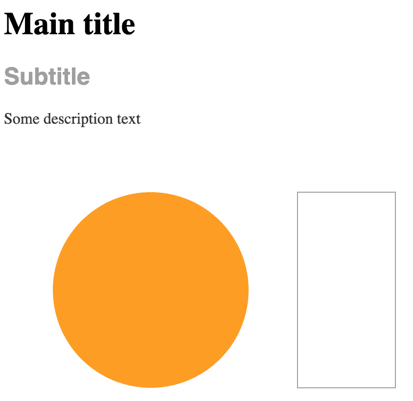

CSS 应用于多个 HTML 和 SVG 元素

## 5.4 更多 CSS 选择器


上一节展示了如何使用 CSS 为 HTML 和 SVG 元素设置样式。你看到了 CSS 规则如何应用于特定类型的元素。例如：

```
p {
  color: #333;
}
```

设置了所有 `<p>` 元素的颜色。但是，如果你的网页包含大量 `<p>` 元素，而你只想为**其中一部分**设置样式，该怎么办？

你可以通过以下方法让 CSS 选择器更具体：

*   在 HTML 和 SVG 元素上添加类（class）和 ID
*   后代选择器
*   伪类

这些方法涵盖了大多数需要定位特定元素的情况。让我们逐一了解。

### 5.4.1 类与 ID

HTML 和 SVG 中有两个属性 `id` 和 `class`，可以让你标记页面中的特定元素。这样你就可以添加针对这些元素的 CSS 规则。`id` 属性用于需要定位单个元素的情况，而 `class` 属性用于需要定位多个元素的情况。

#### 5.4.1.1 id

`id` 属性允许你标记单个元素，以便在其他地方（通常是 CSS 或 JavaScript）引用它。例如，你可能有一个需要应用某些 CSS 的主菜单。

让我们创建一个简单的菜单，并添加一个值为 `main-menu` 的 `id` 属性：

```
<div id="main-menu">
  <div>Home</div>
  <div>About</div>
  <div>Blog</div>
  <div>Contact</div>
</div>
```

你可以为多个元素添加 id，但每个 id 值必须是唯一的。换句话说：两个元素不应具有相同的 id。

在 CSS 中，要选择带有 id 的元素，请使用 `#` 后跟 id 值：

```
#main-menu {
  margin: 1rem;
}
```

这为菜单添加了外边距。

#### 5.4.1.2 class

`class` 属性用于标记**多个** HTML 和 SVG 元素。例如：

```
<div id="main-menu">
  <div class="item">Home</div>
  <div class="item">About</div>
  <div class="item selected">Blog</div>
  <div class="item">Contact</div>
</div>
```

每个菜单项都被赋予了一个值为 `item` 的 class 属性。class 属性可以有多个值（用空格分隔）。例如，第三个菜单项的 class 属性有两个值：`item` 和 `selected`。这表明这个特定的 `div` 元素是列表中的一个项，并且已被选中。

在 CSS 中，可以通过在元素类型后添加一个**点**后跟**类名**来选择具有给定类值的元素：

```
div.item {
  border: 1px solid #aaa;
  padding: 1rem;
}

div.selected {
  background-color: #ccc;
}
```

这意味着：

*   为每个类值为 `item` 的 `div` 元素添加内边距和边框
*   设置类值为 `selected` 的 `div` 元素的背景颜色

你也可以省略元素名称，选择所有具有给定类值的元素，无论其类型如何。例如，`.item` 选择所有类值为 `item` 的元素。

### 5.4.2 练习

这是一个使用 HTML 和 CSS 构建的简单菜单。HTML 如下：

```
<div id="main-menu">
  <div class="item">Home</div>
  <div class="item">About</div>
  <div class="item selected">Blog</div>
  <div class="item">Contact</div>
</div>
```

CSS 如下：

```
#main-menu {
  margin: 1rem;
  width: 15rem;
}

div.item {
  border: 1px solid #aaa;
  padding: 1rem;
}

div.selected {
  background-color: #ccc;
}
```

菜单效果如下：

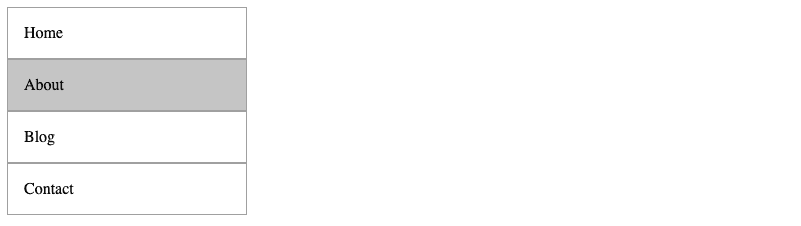

一个用 HTML 和 CSS 构建的菜单，第二个项被选中。

你可以在 CodePen 上查看此示例：[`codepen.io/createwithdata/pen/VwQjQpX`](https://codepen.io/createwithdata/pen/VwQjQpX)

探索代码并尝试以下操作：

1.  更改选中项的背景颜色。
2.  更改选中项的字体颜色。
3.  更改选中的菜单项。

### 5.4.3 后代选择器

另一种使用 CSS 选择特定元素的方法是使用后代选择器。它由两个或多个选择器组成，用空格分隔，允许你选择作为其他元素后代的元素。例如，如果你有以下 HTML：

```
<div id="main-menu">
  <div>Home</div>
  <div>Posts</div>
</div>
<div id="content">
  <div>Some content</div>
</div>
```

你可以使用选择器 `#main-menu div` 为 `#main-menu` 元素内的 `div` 元素设置样式。例如：

```
#main-menu div {
  padding: 1rem;
}
```

这意味着选择所有作为 `#main-menu` 元素后代的 `div` 元素。菜单外部的 `div` 元素不会被选中。

后代选择器是一种非常常见的工具，与数据可视化相关的示例包括：

```
.bar-chart .bar {
  fill: blue;
}
.chart .legend .label {
  font-family: sans-serif;
  font-size: 0.75rem;
}
```

第一个选择器 `.bar-chart .bar` 选择嵌套在类为 `.bar-chart` 的元素内部、类为 `bar` 的元素（即条形图的条形）。

第二个选择器 `.chart .legend .label` 选择嵌套在类为 `legend` 的元素内部、而该类又嵌套在类为 `chart` 的元素内部、类为 `label` 的元素（即图表图例标签）。

后代选择器很方便，因为它们允许你根据元素的嵌套结构来选择元素。例如，你可以使用后代选择器重新创建之前的菜单示例。HTML 如下：

```
<div id="main-menu">
  <div>Home</div>
  <div>About</div>
  <div class="selected">Blog</div>
  <div>Contact</div>
</div>

<div>(This div doesn't get styled)</div>
```

CSS 如下：

```
#main-menu {
  margin: 1rem;
  width: 15rem;
}

#main-menu div {
  border: 1px solid #aaa;
  padding: 1rem;
}

#main-menu div.selected {
  background-color: #ccc;
}
```

注意，我们可以从每个菜单项中移除 `class="item"` 属性。我们不再使用 `div.item` 来设置菜单项样式，而是使用 `#main-menu div`。这简化了 HTML，使其更易于阅读和维护。

导航至 [`codepen.io/createwithdata/pen/BaYzYZb`](https://codepen.io/createwithdata/pen/BaYzYZb) 在 CodePen 中查看此示例。

### 5.4.4 伪类

伪类修改选择器的行为。它们由冒号（`:`）后跟伪类名称组成：

```
p:hover {
  background-color: yellow;
}
```

上述代码在鼠标悬停时将 `<p>` 元素的背景颜色更改为黄色。

构建数据可视化时常用的伪类包括：

| **伪类** | **描述** |
| --- | --- |
| `:hover` | 当元素被悬停时选择该元素 |
| `:first-child` | 选择一组兄弟元素中的第一个兄弟元素。（兄弟元素是嵌套在同一父元素下的相邻元素。） |
| `:last-child` | 选择一组兄弟元素中的最后一个兄弟元素 |

以下是使用伪类为第一个项（现在代表菜单标题）和悬停项设置样式的菜单示例。HTML 如下：

```
<div id="main-menu">
  <div>Main</div>
  <div>About</div>
  <div class="selected">Blog</div>
  <div>Contact</div>
</div>
```

CSS 如下：

```
#main-menu {
  margin: 1rem;
  width: 15rem;
}

#main-menu div {
  border: 1px solid #aaa;
  padding: 1rem;
}

#main-menu div:first-child {
  font-weight: bold;
}

#main-menu div.selected {
  background-color: #aaa;
}

#main-menu div:hover {
  background-color: #ccc;
}
```

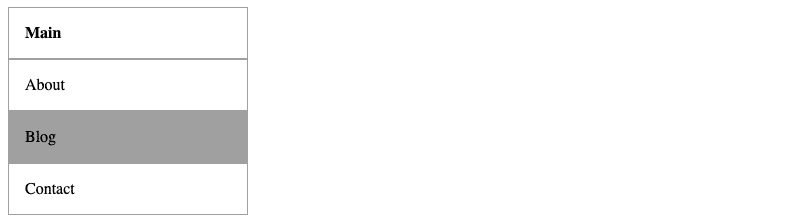

使用伪类为第一个项设置样式

通过使用 `:first-child` 伪类，`#main-menu` 中的第一个 `div` 被加粗。当任何项被悬停时，由于 `:hover` 伪类，背景颜色会发生变化。（实际上你不会这样实现菜单，所以这个示例仅作为教学工具。）

导航至 [`codepen.io/createwithdata/pen/MWQeQvy`](https://codepen.io/createwithdata/pen/MWQeQvy) 在 CodePen 中查看此示例。

### 5.4.5 分组选择器

你可以通过用逗号分隔选择器，将同一组声明应用于多个选择器。例如，给定以下 HTML：


```
<h1>主标题</h1>
<h2>副标题</h2>
<h6>小标题</h6>
```

以下 CSS 将所有标题元素的字体粗细设置为 `lighter`：

```
h1, h2, h3, h4, h5, h6 {
  font-weight: lighter;
}
```

导航至 [`codepen.io/createwithdata/pen/jOPoMBK`](https://codepen.io/createwithdata/pen/jOPoMBK) 在 CodePen 中查看此示例。

作为练习，尝试从 CSS 规则中移除 `h1` 选择器，并观察效果。

## 5.5 用于 HTML 布局的 CSS

CSS 也用于排列 HTML 元素。例如，你可能希望页面顶部有一个包含标题和菜单的页眉。你可能还希望将主要内容放在按网格排列的盒子中：

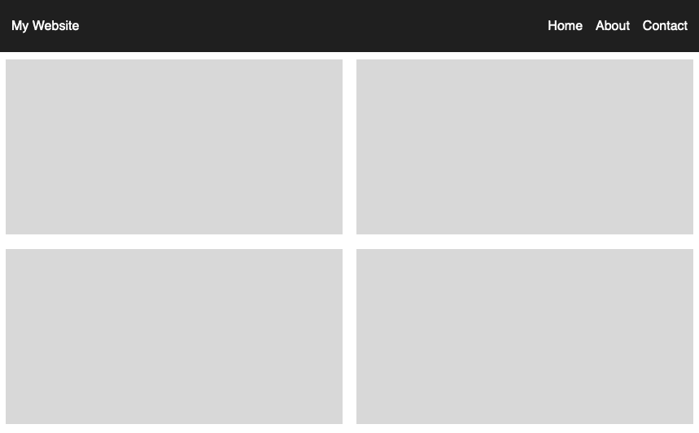

仪表板布局

使用 CSS 定位 HTML 元素需要一些技巧。从某种程度上说，它可能很简单，但也可能很棘手。挑战之一是你很少处理固定大小的页面。（如果是固定大小，事情会简单得多！）人们可能通过手机、平板、笔记本电脑或大型台式机显示器阅读你的页面。你通常需要考虑所有这些不同的屏幕宽度。

话虽如此，最近 CSS 的两项发展使得排列元素变得更加容易：Flexbox 和 Grid。本书将概述 Flexbox。CSS Grid 是较新的发展，不在本书讨论范围内。详细讲解 HTML 布局可能需要一整本书，希望本节能让你了解其可能性。

### 5.5.1 块级元素与内联元素

从布局角度来看，HTML 元素可分为两类：**块级**元素和**内联**元素。

块级元素彼此上下排列，内联元素则并排排列。例如，如果你有几个 `<div>` 元素：

```
<div>1</div>
<div>2</div>
<div>3</div>
<div>4</div>
```

它们会显示为垂直堆叠：

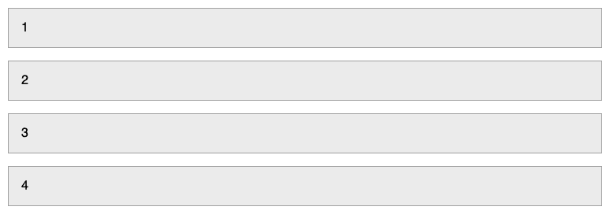

块级元素

如果这些元素是内联元素，它们会并排排列：

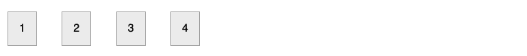

内联元素

在本书涵盖的元素中，标题（`<h1>` - `<h6>`）、列表 `<ul>` 和 `<div>` 元素（默认情况下）是块级元素，而 `` 和 `<svg>` 元素（默认情况下）是内联元素。你也可以使用 `display` CSS 属性设置元素是块级还是内联。要将元素设置为块级显示，请使用：

```
display: block;
```

要将元素设置为内联显示，请使用：

```
display: inline;
```

`display` 的另一个值是 `inline-block`，它使元素并排排列，**并且**允许使用 `width` 和 `height` 属性设置其宽度和高度。（我很少使用 `display: inline;`，但在并排排列 `<div>` 元素时偶尔会使用 `display: inline-block;`。）

### 5.5.2 Flexbox

CSS Flexbox 模型允许你指定项目如何**在其父元素内排列**。例如，从以下 HTML 开始：

```
<div id="container">
  <div class="item">一</div>
  <div class="item">二</div>
  <div class="item">三</div>
  <div class="item">四</div>
</div>
```

以及以下 CSS：

```
.item {
  padding: 1rem;
  margin: 0.25rem;
  border: 1px solid #aaa;
}
```

默认情况下，它会渲染为：

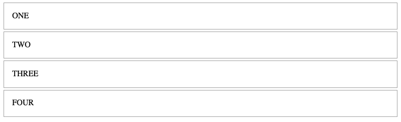

`<div>` 元素的默认布局

Flexbox 允许你在容器及其子元素（或“项目”）上指定属性，以指定项目的排列方式。

要使元素成为弹性容器，请将其 `display` 属性设置为 `flex`：

```
#container {
  display: flex;
}
```

这会导致项目排列成一行：

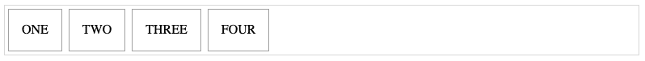

启用了 flex 的容器元素（灰色显示）

现在，你可以在容器和/或项目上设置属性，以确定项目的排列方式。以下是容器最常用的属性和值：

| 属性 | 描述 | 值 |
| --- | --- | --- |
| `flex-direction` | 确定项目定位的方向。这也决定了“主轴”的方向。 | `row`（项目排列成行，主轴从左到右），`column`（项目排列成列，主轴从上到下） |
| `flex-wrap` | 确定元素是否应换行/换列 | `nowrap`（不换行），`wrap`（换行） |
| `justify-content` | 指定弹性项目沿主轴的分布方式 | `flex-start`（项目放在主轴起点），`flex-end`（项目放在主轴终点），`center`（项目放在主轴中间），`space-around`（项目沿主轴均匀分布），`space-between`（项目沿主轴均匀分布，两端无间距） |
| `align-items` | 指定项目关于主轴的排列方式 | `stretch`（项目沿主轴拉伸以填满容器），`center`（项目关于主轴居中），`flex-start`（项目放在交叉轴起点），`flex-end`（项目放在交叉轴终点） |

主轴由 `flex-direction` 决定：如果 `flex-direction` 为 `row`，则从左到右；如果为 `column`，则从上到下。交叉轴垂直于主轴。更多详情请参见 [`css-tricks.com/snippets/css/a-guide-to-flexbox`](https://css-tricks.com/snippets/css/a-guide-to-flexbox)。

例如，如果我们将 `justify-content` 设置为 `space-between`：

```
#container {
  display: flex;
  justify-content: space-between;
}
```

我们会得到：

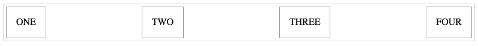

`justify-content` 设置为 `space-between` 的布局

如果我们将 `justify-content` 设置为 `flex-end`，我们会得到：

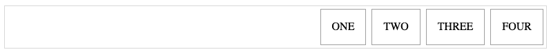

`justify-content` 设置为 `flex-end` 的布局

你还可以将弹性容器相互嵌套。例如，你可以使用这种方法构建一个基本的页眉栏。以下是 HTML：

```
<div id="header">
  <div id="title">我的网站</div>
  <div id="menu">
    <div>首页</div>
    <div>关于</div>
    <div>联系</div>
  </div>
</div>
```

CSS 如下：

```
body {
  margin: 0;
  font-family: sans-serif;
}

#header {
  height: 4rem;
  background-color: #222;
  color: white;
  padding: 0 1rem;
  display: flex;
  justify-content: space-between;
  align-items: center;
}

#menu {
  display: flex;
}

#menu div {
  padding-left: 1rem;
}
```

最外层的 `<div>` 元素代表页眉。它有两个子元素：标题和菜单。页眉元素充当弹性容器（`#header` 的 `display` 设置为 `flex`）。通过将 `justify-content` 设置为 `space-between`，标题和菜单被排列在页眉的两端。通过将 `align-items` 设置为 `center`，项目在容器内垂直居中。

为了将菜单项排列成一行，菜单元素（`#menu`）也被设为弹性容器（其 `display` 属性设置为 `flex`）。因此，菜单既是弹性容器，又是弹性项目。

完成的页眉如下所示：

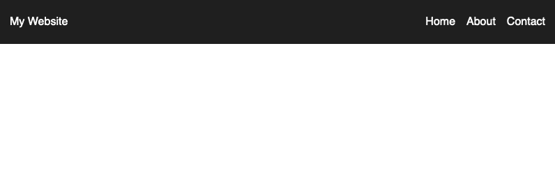

使用嵌套弹性容器排列的网站页眉

希望这能让你了解 Flexbox 的能力。如果你想了解更多关于 Flexbox 的知识，最好的教程之一是 [`css-tricks.com/snippets/css/a-guide-to-flexbox`](https://css-tricks.com/snippets/css/a-guide-to-flexbox)。我还构建了一个 Flexbox 探索器（[`app.peterrcook.com/flexplorer/`](https://app.peterrcook.com/flexplorer/)），可以让你以交互方式快速探索每个属性。

# 6 JavaScript

JavaScript 是 Web 的编程语言。它内置于大多数 Web 浏览器中，可以：

*   **添加**、**修改**和**删除** HTML 和 SVG 元素
*   处理**交互性**（例如，鼠标点击）
*   **获取**数据和其他资源


*   执行通用**计算**（例如数据处理）

基于网页的数据可视化，尤其是交互式的，很可能使用 JavaScript。

JavaScript 最初是一种在网站上很少使用的语言（通常用于处理少量用户交互），但现在已成为一种广泛使用的语言，其生态系统中拥有数百种工具和库。

诸如 [D3](https://d3js.org/)、[Leaflet](https://leafletjs.com/) 和 [Chart.js](https://www.chartjs.org/) 之类的库都是用 JavaScript 编写的，为构建数据可视化提供了有用的功能。

接下来的两节将介绍 JavaScript 的基础知识，即**变量**和**类型**。后续章节将介绍**运算符**、**条件语句**、**迭代**和**函数**。

为了实验和练习 JavaScript，我推荐使用 [jsconsole](https://jsconsole.com/) 网站。它允许你输入 JavaScript 代码并立即求值。（如果你更有经验，可以使用浏览器的[调试控制台](https://developers.google.com/web/tools/chrome-devtools/console#javascript)或 Node。）

当你看到本节中的示例代码时，偶尔会看到 `//` 后跟一个值：

```
10 + 5;  // 15
```

该值表示代码返回的值。（如果你在 jsconsole 中输入 `10 + 5` 并按回车，它会在下一行显示结果 `15`。）

## 6.1 JavaScript 变量

如果你有一个值（例如一些文本或数字），你可以使用**变量**来指向该数据。实际上，你是在给数据贴上一个标签，以便在代码的其他地方引用它。在 JavaScript 中，变量在使用前必须**声明**。通常使用 `let` 关键字来完成：

```
let myMessage;
```

你可以将一个值（例如数字或字符串）赋给变量。下面是如何将字符串（一段用引号括起来的文本）赋给变量 `myMessage`：

```
myMessage = "Hello world!";
```

你也可以将数字赋给变量：

```
let a = 10;
let b = 20;
```

（上面的代码使用了一种简写形式，即在一行语句中声明并赋值变量。）

任何表达式都可以赋给变量。

让我们将表达式 `a + b` 赋给一个新变量 `c`：

```
let c = a + b;
c;  // 30
```

表达式 `a + b` 被求值，结果 `30` 被赋给 `c`。

#### 6.1.0.1 练习

打开 [jsconsole](https://jsconsole.com/) 并输入以下内容：

```
let a = 10;
let b = 20;
```

现在输入 `a` 并按回车键。你看到了什么？

jsconsole 对 `a` 求值并输出结果 `10`。现在输入：

```
let c = a + b;
```

现在输入 `c` 并按回车键。变量 `c` 将被求值，并输出其值 `30`。

## 6.2 JavaScript 数据类型

JavaScript 中最常见的数据类型有：

*   字符串（例如 `"Hello world"`）
*   数字（例如 `1234`、`10.567`、`1.23e2`）
*   布尔值（`true` 和 `false`）
*   数组（值的列表）
*   对象（键值对的列表）

以上类型足以构建数据可视化。本节我们将介绍字符串、数字和布尔值。数组和对象有单独的章节。

### 6.2.1 字符串

字符串表示文本。文本用单引号（`'`）或双引号（`"`）括起来：

```
'A JavaScript string'
"A string enclosed in double quotes"
```

如果你的文本包含单引号，则使用双引号将其括起来（反之亦然）：

```
"Bob's learning to code in JavaScript"
```

你可以使用 `+` 运算符将字符串拼接在一起：

```
let firstName = "Jolene";
let lastName = "Smith";
let fullName = firstName + " " + lastName;
fullName;  // "Jolene Smith"
```

在以下示例中，我们有一个变量 `a`，其值为 `"This is a string"`：

```
let a = "This is a string";
```

你可以使用 `.length` 获取字符串的长度：

```
a.length;  // 16
```

你可以使用方括号获取字符串中的第 `n` 个字符：

```
a[0];  // "T"
a[2];  // "i"
```

#### 6.2.1.1 字符串操作

可以使用 `split(s)` 在字符串 `s` 出现的位置拆分字符串。例如，让我们按单个空格字符拆分字符串：

```
a.split(' ');  // ["This", "is", "a", "string"]
```

（方括号表示一个数组，我们将在后续章节中介绍。）

你可以使用 `toUpperCase()` 计算字符串的大写版本：

```
a.toUpperCase();  // "THIS IS A STRING"
```

注意，这不会改变（或修改）字符串。它只是返回一个新字符串，而 `a` 的值仍然是 `"This is a string"`。要使变量 `a` 变为大写，你可以将 `a.toUpperCase()` 的输出赋给 `a`：

```
a = a.toUpperCase();
a;  // "THIS IS A STRING"
```

还有一个对应的小写方法叫做 `toLowerCase()`。

#### 6.2.1.2 字符串转换

你可以使用 `parseFloat` 将包含数字的字符串转换为数字。例如：

```
parseFloat('123.456');  // 123.456
parseFloat('5432');     // 5432
parseFloat('abc');      // NaN (not a number)
parseFloat('1234abc');  // 1234
parseFloat('0');        // 0
parseFloat('');         // NaN
```

注意，将空字符串传入 `parseFloat` 会返回 `NaN`，表示“不是一个数字”。

#### 6.2.1.3 练习

打开 [jsconsole](https://jsconsole.com/) 并输入以下内容：

```
a = "This is a string";
a.length;
a[2];
a.split(' ');
a.toUpperCase();
```

检查你的输出是否类似于：

```
16
"i"
["This", "is", "a", "string"]
"THIS IS A STRING"
```

### 6.2.2 数字

JavaScript 有一种数字类型用于表示数字。可以表示整数（整数）和小数：

```
let a = 123;
let b = 123.456;
```

数学运算符 `+`（加法）、`-`（减法）、`*`（乘法）和 `/`（除法）可以应用于数字：

```
let c = 123 + 456;
let d = 3 * 123;
```

可以使用括号来强制优先级：

```
(10 + 20) * 2;  // 60
10 + (20 * 2);  // 50
```

第一个表达式求值为 `60`，第二个为 `50`。（表达式是一段求值为单个值的代码。）

以下示例使用一个值为 `123.456` 的变量 `n`：

```
let n = 123.456;
```

你可以使用 `round`、`floor` 和 `ceil` 对数字进行舍入。

`round` 返回最接近的整数，`floor` 向下舍入，`ceil` 向上舍入：

```
Math.round(n);  // 123
Math.floor(n);  // 123
Math.ceil(n);   // 124
```

你可以使用 `toString()` 获取数字的字符串表示：

```
n.toString();  // "123.456"
```

你可以使用 `Math.sqrt()` 获取数字的平方根：

```
Math.sqrt(100);  // 10
```

#### 6.2.2.1 练习

打开 [jsconsole](https://jsconsole.com/) 并输入以下内容：

```
let n = 123.456;
Math.round(n);
n.toString();
Math.sqrt(100);
```

你的输出值应为：

```
123
"123.456"
10
```

### 6.2.3 布尔值

布尔类型可以有两个值：`true` 和 `false`：

```
var learningCSS = true;
var learningJavaScript = true;
var learningPython = false;
```

稍后你会看到（在运算符部分），布尔值由诸如 `===`（等于）和 `>`（大于）之类的运算符返回。

## 6.3 JavaScript 数组

数组表示**值的列表**。每个值可以是任何类型，甚至可以是数组！数组是处理数据时使用的基本数据结构之一。（你将在对象部分看到，通常使用数组来表示数据表。）数组由**方括号**表示，每个值之间用**逗号**分隔。以下是 4 个不同的数组：

```
[ 10, 20, 30 ]                      // 数字数组
[ "An", "array", "of", "strings" ]  // 字符串数组
[ [ 10, 20 ], [ 30, 40 ] ]          // 数组的数组
[ true, true, false ]               // 布尔值数组
```

### 6.3.1 访问数组元素

你可以通过在数组后面写 `[i]` 来访问数组中的第 `i` 项：

```
let a = [ "An", "array", "of", "strings" ];
a[0];  // "An"
a[2];  // "of"
```


数组的索引从 `0` 开始。因此，数组中的第一个元素通过 `[0]` 引用。对于嵌套数组，例如：

```
let a = [ [ 10, 20 ], [ 30, 40 ] ];
```

你可以通过串联方括号来访问这些值：

```
a[0];     // [10, 20]
a[0][1];  // 20
```

`a[0]` 是 `a` 的第一个元素，计算结果为 `[10, 20]`。

`a[0][1]` 表示 `a[0]` 的索引 `1`，计算结果为 `20`。

### 6.3.2 数组操作

在下表中，使用了以下变量：

```
let a = [ 10, 20, 30 ];
let b = [ 40, 50, 60 ];
let c = [ "An", "array", "with", "text" ];
```

有用的数组操作包括：

| **操作** | **示例** | **结果** |
| --- | --- | --- |
| 获取数组长度 | `a.length` | `3` |
| 对数组排序 | `c.sort()` | `c` 现在为 `["An", "array", "text", "with"]` |
| 反转数组 | `a.reverse()` | `a` 现在为 `[30, 20, 10]` |
| 获取数组的一部分（或“切片”）。第一个数字表示切片的起始索引。第二个数字表示切片的结束索引（包含）。 | `c.slice(1, 2)` | `["array", "with"]` |
| 用给定字符串连接数组的每个元素 | `a.join(' and ')` | `"10 and 20 and 30"` |
| 连接两个数组 | `a.concat(b)` | `[10, 20, 30, 40, 50, 60]` |
| 向数组末尾添加一个元素 | `b.push(70)` | `b` 现在为 `[40, 50, 60, 70]` |
| 移除（并返回）数组的最后一个元素 | `a.pop()` | 计算结果为 `30`。`a` 现在为 `[10, 20]` |

#### 6.3.2.1 排序时需谨慎

对数字数组进行排序时要小心。以下示例：

```
let d = [11, 10, 9];
d.sort();
```

结果 `d` 变为 `[10, 11, 9]`，这相当令人惊讶。

这是因为 JavaScript 会按字符串排序，即使它是一个数字数组！这真的很奇怪。请阅读 [`stackoverflow.com/questions/48201502/strange-javascript-sorting-bug`](https://stackoverflow.com/questions/48201502/strange-javascript-sorting-bug) 以了解更多信息。

JavaScript 的另一个怪癖是，上述某些操作会改变原始数组，而另一些则不会。`sort` 和 `reverse` 会用新顺序覆盖数组。同样，`push` 和 `pop` 会改变原始数组的长度。

其余操作只是计算出一个值，对数组没有任何影响。

### 6.3.3 练习

打开 [jsconsole](https://jsconsole.com/) 并输入以下内容：

```
let a = [10, 20, 30];
a.length;
a.reverse();
a.push(0);
a;
```

`a` 的最终值应为 `[30, 20, 10, 0]`。

第一个表达式只是输出 `a` 的长度。第二个表达式反转 `a`，因此 `a` 现在为 `[30, 20, 10]`。第三个语句将 `0` 添加到 `a` 的末尾。最后一个表达式 `a` 计算结果为 `[30, 20, 10, 0]`。

## 6.4 JavaScript 对象

JavaScript 对象是**名称-值对**的**（无序）列表**。例如：

```
let carrot = {
  foodGroup: "vegetable",
  color: "orange"
}
```

每个名称-值对称为一个**属性**。每个属性都有一个**名称**（例如 `foodGroup`、`color`、`id`、`height`、`data`）和一个**值**。值可以是任何类型（包括数组或对象）。你可以使用点号后跟属性名来访问属性：

```
carrot.foodGroup;  // "vegetable"
```

对象的属性也可以通过用方括号括起来的属性名（表示为字符串）来访问：

```
carrot["foodGroup"];  // "vegetable"
```

方括号表示法的优点是可以使用变量作为属性名：

```
let day = "Tuesday";

let data = {
  Monday: 20,
  Tuesday: 30,
  Wednesday: 10,
  Thursday: 50,
  Friday: 70
};

data[day];  // 30
```

属性值可以是任何类型。这是一个包含数组的对象：

```
let data = {
  Monday: [10, 30, 20],
  Tuesday: [50, 20, 30],
  Wednesday: [40, 10, 20],
  Thursday: [30, 10, 20],
  Friday: [60, 30, 40]
};

data.Tuesday;    // [50, 20, 30]
data.Tuesday[1]  // 20
```

你也可以有对象数组。这是数据可视化中**非常**常见的结构：

```
let data = [
  {
    name: "Spain",
    capital: "Madrid",
    population: 46.66
  },
  {
    name: "China",
    capital: "Beijing",
    population: 1386
  }
];

data[0].name;     // "Spain"
data[1].capital;  // "Beijing"
```

给定一个对象，例如：

```
let vegetable = {
  name: "carrot",
  color: "orange"
};
```

你可以使用以下表示法设置属性：

```
vegetable.name = "broccoli";
vegetable.color = "green";
vegetable.name;  // "broccoli"
```

即使属性不存在，你也可以使用上述表示法：

```
vegetable.family = "Brassica";
```

要获取对象属性名称的列表，请使用：

```
Object.keys(vegetable);  // ["name", "color", "family"]
```

这将返回数组 `["name", "color", "family"]`。

### 6.4.1 练习

打开 [jsconsole](https://jsconsole.com/) 并创建以下对象：

```
let carrot = {
  foodGroup: "vegetable",
  color: "orange"
}
```

使用 `shift` + `return` 而不是仅按 `return` 来在单个语句中插入新行。或者点击 [此处](https://jsconsole.com/?let%20carrot%20%3D%20%7B%0A%20%20foodGroup%3A%20%22vegetable%22%2C%0A%20%20color%3A%20%22orange%22%0A%7D) 打开预填充的控制台。

输入以下内容：

```
carrot.color;
```

检查是否返回字符串 `"orange"`。现在通过输入以下内容将颜色更改为 `purple`：

```
carrot.color = "purple";
```

通过输入以下内容检查颜色是否已更改：

```
carrot.color;
```

这应该输出 `"purple"`。你也可以通过输入以下内容查看对象：

```
carrot
```

现在向对象添加一个名为 `price` 的新属性，值为 `15`，并检查它是否已添加。

## 6.5 JavaScript 运算符

JavaScript 运算符接受一个或两个值，并计算出一个新值。

例如，`+` 运算符接受两个数字并计算它们的和。

在下表中，定义了以下变量：

```
let a = 1;
let b = 2;
```

最常见的运算符有：

| **运算符** | **描述** | **示例** | **计算结果** |
| --- | --- | --- | --- |
| `+` | 将两个数字相加或连接两个字符串 | `1 + 2`, `"abc" + "def"`, `a + b` | `3`, `"abcdef"`, `3` |
| `-` | 两个数字相减 | `3 - 2` | `1` |
| `*` | 两个数字相乘 | `2 * 8` | `16` |
| `/` | 两个数字相除 | `10 / 5` | `2` |
| `%` | 计算除法的余数 | `11 / 5` | `1` |
| `!` | 反转布尔值 | `!true` | `false` |
| `>`, `>=`, `<`, `<=` | 大于、大于等于、小于、小于等于 | `5 < 6`, `5 < 5`, `5 <= 5`, `"a" > "b"`, `"abc" < "def"`, `a > b` | `true`, `false`, `true`, `false`, `true`, `false` |
| `===` | 等于 | `10 === 10`, `"dogs" === "cats"`, `a === b` | `true`, `false`, `false` |
| `!==` | 不等于 | `10 !== 10`, `"dogs" !== "cats"` | `false`, `true` |
| `&&` | 逻辑与（如果两个表达式都为 `true`，则结果为 `true`） | `2 > 1 && 3 > 2` | `true` |
| `\&#124;` | 逻辑或（如果任一表达式为 `true`，则结果为 `true`） | `1 > 2 \&#124; 2 > 3` | `false` |

注意，相等运算符是三个等号 `===`。此运算符检查两个表达式是否完全相等。还有一个类似的运算符 `==`，它不那么严格。通常我建议使用 `===`。

### 6.5.1 三元运算符

有一个称为三元运算符的运算符值得特别提及。三元运算符根据第三个表达式的值来计算两个表达式之一：

```
let a = 10;
let b = 20;
let result = a > b ? "a is bigger than b" : "a is not bigger than b";
result;     // 输出 "a is not bigger than b"
```

在此示例中，表达式 `a > b` 被求值。如果为 `true`，则计算问号后的第一个表达式。如果为 `false`，则计算冒号 `:` 后的表达式。

### 6.5.2 递增和递减

递增 `++` 运算符接受一个数值变量并将其递增：

```
let a = 10;
a++;
a;  // 11
```

它基本上是以下内容的简写：

```
a = a + 1;
```

还有一个递减运算符 `--`，用于递减变量。

### 6.5.3 练习


打开 [jsconsole](https://jsconsole.com/) 并定义两个变量：

```
let a = 10;
let b = 20;
```

编写表达式以完成以下操作：

1.  将 `a` 和 `b` 相加。

2.  将 `a` 和 `b` 相乘。

3.  检查 `a` 是否大于 `b`。

4.  检查 `a` 是否等于 `b`。

5.  检查 `a` 是否等于 `10`。

#### 6.5.3.1 答案

你的表达式应类似于：

```
a + b;     // 30
a * b;     // 200
a > b;     // false
a === b;   // false
a === 10;  // true
```

## 6.6 JavaScript 条件语句

条件语句用于根据给定的值执行不同的代码分支。本节介绍两种条件语句：`if` 和 `switch`。

### 6.6.1 if

最广为人知的条件语句是 `if`。其形式如下：

```
let answer;

if (a > b) {
  answer = "a is greater than b";
}
```

`if` 关键字后跟一对括号，括号内包含一个表达式。该表达式会被求值，如果结果为 `true`，则执行后续代码块中的代码；如果为 `false`，则什么也不发生。（代码块可以包含多条语句，并由花括号界定。）

你可以添加一个 `else` 块，当 `if` 表达式为 `false` 时执行：

```
let answer;

if (a > b) {
  answer = "a is greater than b";
} else {
  answer = "a is not greater than b";
}
```

你还可以将多个 `else` 和 `if` 语句串联起来：

```
let food = {
  name: "banana",
  type: "fruit"
};

let answer;

if (food.type === "fruit") {
  answer = "It's a fruit!";
} else if (food.type === "vegetable") {
  answer = "It's a vegetable!";
} else {
  answer = "Unknown food";
}
```

### 6.6.2 switch

`switch` 语句根据表达式的值执行不同的代码块：

```
let food = {
  name: "banana",
  type: "fruit"
};

let answer;

switch(food.type) {
  case "fruit":
    answer = "It's a fruit!";
    break;
  case "vegetable":
    answer = "It's a vegetable!";
    break;
  default:
    answer = "Unknown food";
    break;
}
```

`switch` 语句后跟一个用括号包裹的表达式（示例中表达式为 `food.type`）。其后有多个 `case` 语句，每个 `case` 后跟表达式的可能值（例如 `"fruit"` 和 `"vegetable"`）。如果匹配，则执行该 `case` 语句后的代码。`case` 语句后的代码会一直执行到遇到 `break` 语句为止。

你也可以将多个 `case` 语句组合在一起：

```
var food = {
  name: "banana",
  type: "fruit"
};

switch(food.type) {
  case "fruit":
  case "vegetable":
    alert("It's a fruit or a vegetable!");
    break;
  default:
    alert("Unknown food");
    break;
}
```

## 6.7 JavaScript 函数

函数允许你将代码封装起来，以便在代码中的任何位置多次调用。例如，假设你需要将一些数字加倍。你可以这样做：

```
let a = 10;
let b = 20;
let doubleA = a * 2;
let doubleB = b * 2;
```

如果操作比将数字加倍更复杂，这种方法会变得难以管理。另一种方法是定义一个函数，该函数接收一个数字并返回该数字的两倍：

```
function double(x) {
  return 2 * x;
}
```

现在我们可以这样做：

```
let a = 10;
let b = 20;
let doubleA = double(a);
let doubleB = double(b);
```

这种方法有几个优点：

*   代码的意图更清晰（即更具表现力）

*   如果重复的操作发生变化，你只需更新一处代码

*   该函数可以在其他地方重用

### 6.7.1 定义函数

函数允许代码被重用。它们使用 `function` 关键字定义：

```
function sayHello() {
  console.log('Hello');  // console.log 允许你将值打印到控制台
}
```

函数通常有一个名称。在上面的例子中，函数名是 `sayHello`。你在函数名后面放置一对括号。函数体（调用函数时执行的代码）放在花括号之间。要调用函数，你写出函数名后跟括号：

```
sayHello();
```

### 6.7.2 返回值

函数可以返回一个值。下面是一个返回字符串的函数：

```
function getName() {
  return "Paris";
}
```

如果你调用 `getName`，它会运行函数的代码并返回 `return` 关键字后的表达式：

```
getName();  // "Paris"
```

函数的返回值是一个表达式，因此你可以将其赋值给一个变量：

```
var name = getName();
name;  // "Paris"
```

并在 `if` 语句中使用它：

```
let message;

if(getName() === "Paris") {
  message = "You're in France!";
}

message;  // "You're in France!"
```

### 6.7.3 函数参数

你可以定义传递给函数的参数列表。例如，让我们定义一个将名字和姓氏连接起来的函数（中间加空格）：

```
function joinNames(firstName, lastName) {
  var joinedName = firstName + " " + lastName;

  return joinedName;
}
```

这个函数在其圆括号内有一个**参数**列表（`firstName` 和 `lastName`）。它们在函数体内充当变量。当函数被调用时，一个**实参**列表被放在圆括号内：

```
var fullName = joinNames("Ana", "Matronic");
fullName;  // "Ana Matronic"
```

当 `joinNames` 函数执行时，每个实参被赋值给函数的参数。在上面的例子中，当函数执行时，`firstName` 是 `Ana`，`lastName` 是 `Matronic`。

### 6.7.4 练习

创建一个名为 `add10` 的函数，该函数将一个数字加上 `10`。通过传入实参 `50` 调用该函数来测试：

```
add10(50);
```

## 6.8 JavaScript 迭代

迭代是重复执行一段代码。一个常见的用例（尤其是在可视化数据时）是对数组的每个元素执行相同的代码。

本节涵盖以下迭代类型：

*   `for` 循环

*   `forEach`

*   `map`

这三种迭代类型涵盖了可视化数据时的大多数情况。

### 6.8.1 `for` 循环

`for` 循环允许你多次执行一段代码：

```
for (let i = 0; i < 3; i++) {
  console.log(i);
}
```

`for` 语句包含三个表达式：

*   第一个是初始化表达式，通常将计数器变量初始化为零。

*   第二个是在每次迭代前求值的表达式。如果求值为 `true`，则循环继续；如果为 `false`，则循环停止。

*   第三个表达式在每次迭代后求值。通常计数器会递增。

在上面的代码中，`for` 循环体（`console.log(i)`）在 `i` 小于 3 时执行。输出将是三个数字：0、1 和 2。

当你明确知道要迭代多少次时，`for` 循环非常有用。例如，如果你想创建一个包含 5 个元素的数组，可以这样做：

```
let numItems = 5;
let data = [];

for (let i = 0; i < numItems; i++) {
  data[i] = 'Item-' + i;
}
```

循环结束后，`data` 为：

```
["Item-0", "Item-1", "Item-2", "Item-3", "Item-4"]
```

### 6.8.2 forEach

给定一个数组，`forEach` 会遍历数组的每个元素。你向 `forEach` 提供一个函数，该函数会为每个数组元素调用一次。每次调用函数时，数组元素会被传入函数：

```
let data = [10, 50, 40, 30, 20];

data.forEach(function(d) {
  console.log(d);
});
```

在这个例子中，函数为每个数组元素调用一次。第一次调用时，数组的第一个元素 `10` 被传入函数。第二次调用时，数组的第二个元素 `20` 被传入，依此类推。在这个实例中，函数总共被调用了五次。


请注意，该函数没有名称。这是一个 `匿名函数` 的示例。这些函数是“即时”定义的，通常不会在代码的其他地方被调用。它们将在 JavaScript 函数（进阶）章节中介绍。

你可以使用命名函数重写上述代码：

```
let data = [10, 50, 40, 30, 20];

function output(message) {
  console.log(message);
}

data.forEach(output);
```

这样写更冗长，但确实允许函数在其他地方被复用。

在遍历数组时，你也可以使用 `for` 循环：

```
var data = [10, 50, 40, 30, 20];

for (let i = 0; i < data.length; i++) {
  console.log(data[i]);
}
```

不过，如果可能的话，我建议使用 `forEach`，因为它更具表现力。（“表现力”指的是代码的意图对其他开发者来说更清晰。）

### 6.8.3 map

`map` 语句接收一个数组，并返回一个长度相同的新数组。新数组的每个元素都由原始数组中对应的元素计算得出。一个函数决定了新值如何计算。

下面是一个示例，其中 `map` 用于遍历 `data`，并输出一个新数组，其中每个元素都翻倍：

```
let data = [10, 50, 40, 30, 20];

let doubled = data.map(function(d) {
  return d * 2;
});

doubled;  // [20, 100, 80, 60, 40]
```

对于 `data` 中的每个元素，都会调用该函数。第一个元素 `10` 被传入函数，函数返回 `10 * 2`，这个值会被赋给新数组的第一个元素。第二次调用时传入 `50`，返回 `50 * 2` 并添加到新数组，以此类推。

`map` 在处理数据时非常常见。例如，给定以下数据：

```
let data = [
  {
    name: "Anna",
    value: "20.1"
  },
  {
    name: "Brian",
    value: "15.3"
  }
];
```

我们可能希望将 `name` 属性转换为大写，并将 `value` 属性从字符串转换为数字。

首先编写一个函数，该函数接收一个对象（包含 `name` 和 `value` 属性），并返回一个包含两个转换后属性的新对象：

```
function convert(d) {
  let newObject = {
    name: d.name.toUpperCase(),
    value: parseFloat(d.value)
  };

  return newObject;
}
```

现在使用 `map` 创建一个新数组：

```
let converted = data.map(convert);
```

`converted` 将如下所示：

```
[
  {
    name: "ANNA",
    value: 20.1
  },
  {
    name: "BRIAN",
    value: 15.3
  }
]
```

上面的示例可以使用匿名函数重写：

```
let converted = data.map(function(d) {
  let newObject = {
    name: d.name.toUpperCase(),
    value: parseFloat(d.value)
  };

  return newObject;
});
```

### 6.8.4 练习

打开 [jsconsole](https://jsconsole.com/) 并创建一个数字数组：

```
let a = [10, 20, 30, 40, 50];
```

尝试以下操作：

1.  使用 `forEach` 遍历数组，输出每个数字的平方。（使用 `console.log` 输出数字。）

2.  使用 `map` 创建一个数组，其中包含 `a` 中每个元素的平方。

请记住，在 jsconsole 中，使用 `shift` + `return` 可以在单个语句中创建新行。

#### 6.8.4.1 答案

使用 `forEach` 输出每个数字的平方：

```
a.forEach(function(d) {
  console.log(d * d);
});
```

使用 `map` 创建一个包含 `a` 中每个元素平方的数组：

```
let squared = a.map(function(d) {
  return d * d;
});

squared;     // [100, 400, 900, 1600, 2500]
```

## 6.9 JavaScript 函数（进阶）

### 6.9.1 命名函数与匿名函数

函数通常有一个名称：

```
function addTen(x) {
  return x + 10;
}
```

这使得它们可以在程序的任何地方被调用。然而，在使用 `forEach` 或 `map`（参见迭代章节）时，使用 `匿名函数` 通常更方便。这是一个没有名称的函数，作为 `forEach` 或 `map` 的第一个参数定义。因此，与其这样写：

```
let data = [10, 50, 40, 30, 20];

function output(message) {
  console.log(message);
}

data.forEach(output);
```

你可以这样写：

```
let data = [10, 50, 40, 30, 20];

data.forEach(function(message) {
  console.log(message);
});
```

这样代码更简洁，并且是 JavaScript 中一种**非常**常见的模式。（D3 经常使用这种模式。）我强烈建议正确理解这种模式。研究上面的两个代码示例，并尝试理解两者之间的区别和相似之处。

### 6.9.2 纯函数

纯函数是没有 `副作用` 的函数。副作用是指函数外部发生的变化。例如：

```
let outside = 10;

function doSomething() {
  outside = 20;
}
```

调用 `doSomething` 会导致变量 `outside` 发生变化。这被认为是一种副作用。纯函数（没有副作用）的示例如下：

```
let outside = 10;

function doSomething() {
  return 20;
}

outside = doSomething();
```

该函数只返回一个值，不会影响函数外部的任何内容。纯函数的优点是它们具有更可预测的行为。它们有输入值（通过参数列表）和一个输出。你知道，如果调用一个纯函数，它不会导致该函数外部的任何东西发生变化。

### 6.9.3 函数是对象

JavaScript 函数的行为类似于对象。这意味着你可以对函数执行任何可以对对象执行的操作。例如，你可以将函数赋值给一个变量：

```
let getANumber = function() {
  return 10;
}

getANumber();
```

上面的代码等同于：

```
function getANumber() {
  return 10;
}

getANumber();
```

你可以将函数添加到对象中：

```
let myFunctions = {
  add: function(a, b) {
    return a + b;
  },
  subtract: function(a, b) {
    return a - b;
  }
};

myFunctions.add(10, 20);       // 30
myFunctions.subtract(20, 10);  // 10
```

#### 6.9.3.1 将函数传入函数

你也可以将函数作为参数传入其他函数：

```
function add(a, b) {
  return a + b;
}

function multiply(a, b) {
  return a * b;
}

function getValue(a, b, operation) {
  return operation(a, b);
}

getValue(10, 20, add);          // 30
getValue(10, 20, multiply);     // 200
```

这里我们定义了三个函数：

*   `add` 接收两个数字并返回它们的和

*   `multiply` 接收两个数字并返回它们的乘积

*   `getValue` 接收两个数字和一个函数

当第一次调用 `getValue` 时，`add` 函数被传入并赋值给 `operation` 参数。因此，当 `operation` 被调用时（在 `getValue` 内部），`add` 被执行。

在第二次调用 `getValue` 时，`multiply` 函数被传入，这意味着 `operation` 的值是 `multiply`。因此，当 `operation` 被调用时，`multiply` 被执行。

导航到 [`codepen.io/createwithdata/pen/abvJmPY`](https://codepen.io/createwithdata/pen/abvJmPY) 在 CodePen 中查看此示例

花点时间理解这个示例。这是相当高级的 JavaScript，但在使用 D3 时，函数经常被传入其他函数。

# 7 工具与设置

本书在代码示例中使用了 CodePen。CodePen 是构建小型应用程序的不错工具，但较大的应用程序通常是在本地开发的。这意味着使用**你计算机上**的工具和文件（而不是在网络上）。本章概述了在本地开发 Web 应用程序的典型设置。这与大多数 Web 开发人员使用的设置类似。

第一部分概述了必要的工具，第二部分将引导你完成这些工具的设置。

## 7.1 Web 开发工具

Web 开发所需的工具包括：

*   **代码编辑器**

*   **Web 浏览器**

*   **Web 服务器**（如果你不加载数据，则不是那么重要）


你也可以在这个列表中添加一个**终端模拟器**。终端模拟器允许你通过文本命令与操作系统交互，例如 MacOS 上的“终端”和 Windows 上的“命令提示符”。即使没有终端模拟器，你也可以完成本书中的所有内容，因此本书不会涉及它们。如果你想了解更多，建议在网上搜索“命令行教程”。

### 7.1.1 代码编辑器

代码编辑器是一种桌面应用程序，允许你编辑 HTML、CSS 和 JavaScript 文件。你可以使用简单的应用程序，如 Windows 上的“记事本”和 Mac 上的“文本编辑”。重要的是这些编辑器要以纯文本模式工作，以免插入额外字符。不过，我推荐使用专门的代码编辑器，例如 [Brackets](http://brackets.io/) 或 [Visual Studio Code](https://code.visualstudio.com/)。这两款都是免费且跨平台的。使用专用代码编辑器的优势包括：

*   你可以将应用程序视为一个项目，从而更轻松地打开和导航
*   语法高亮（代码根据其是关键字、变量等而显示不同颜色）
*   众多插件（包括 Web 服务器！）让你的编码生活更轻松

### 7.1.2 网页浏览器

建议使用现代网页浏览器进行 Web 开发，例如 Chrome、Firefox、Safari 或 Edge。《用数据创造》系列书籍假定你使用的是 **Chrome**。无论你选择哪种浏览器，大部分内容都适用，但如果使用调试工具，可能会存在差异，因为这些工具因浏览器而异。

### 7.1.3 网页服务器

网页服务器通常根据网页浏览器的请求返回（或“提供”）HTML、CSS 和 JavaScript 文件。例如，如果你在浏览器中输入 `createwithdata.com`，浏览器会连接到一个网页服务器，并请求构成该网站的文件。网页服务器通过将请求的文件发送回浏览器来响应。

当你在自己的计算机上创建网站时，不一定需要运行自己的网页服务器。（你可以在大多数网页浏览器中直接打开 HTML 文件。）但是，如果你需要从 Web 应用程序内部发出请求（这在基于 Web 的数据可视化中很常见），你将需要自己的本地网页服务器。（这是由于网页浏览器的安全限制。）如果你是一位经验丰富的开发者，并且能够轻松设置本地网页服务器，请随意跳过。

运行本地网页服务器的选项（从最简单的开始）包括：

*   Brackets 编辑器的内置网页服务器
*   Visual Studio Code 插件
*   Python、Ruby、PHP 或 Node 服务器

另一个我尚未亲自探索的选项是 [Servez](https://greggman.github.io/servez/)，它是一个基于 GUI 的简单网页服务器。

#### 7.1.3.1 Brackets 网页服务器

[Brackets](http://brackets.io/) 内置了网页服务器，因此这是目前最简单的选项。这个[视频](https://youtu.be/KJXdvaY9lTA?t=122)给出了很好的演示。如果你是代码编辑器新手，我推荐使用 Brackets。

#### 7.1.3.2 VS Code Live Server

Visual Studio Code 有一个名为 [Live Server](https://marketplace.visualstudio.com/items?itemName=ritwickdey.LiveServer) 的网页服务器插件。

安装 Live Server：

*   从菜单栏中选择“查看”，然后选择“命令面板...”

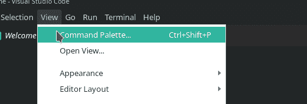

在 VS Code 中打开命令面板

*   输入“extension”并选择“扩展：安装扩展”

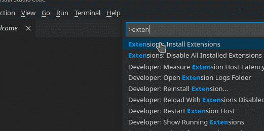

选择“扩展：安装扩展”

*   在扩展搜索框中搜索“live server”（作者为 Ritwick Dey），然后点击“安装”

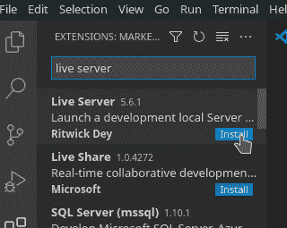

搜索“live server”

*   打开包含你代码的目录

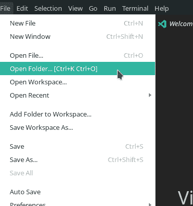

打开包含你代码的目录

*   点击底部栏中的 **Go Live** 按钮

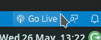

点击 Go Live 按钮

你的网页浏览器应该会打开你的 Web 应用程序。如果没有，请打开网页浏览器并访问 `localhost:5500`。（如果“服务器已启动”消息中显示的不是 5500 而是其他端口号，请使用该端口号。）更详细的说明请参见[此处](https://marketplace.visualstudio.com/items?itemName=ritwickdey.LiveServer)。

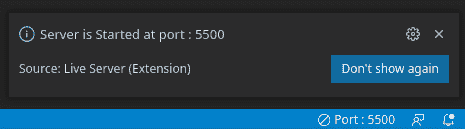

服务器已启动

#### 7.1.3.3 Python、Ruby、PHP、Node

如果你是 Python、Ruby 或 PHP 开发者，可以使用该语言内置的网页服务器。这里有一些有用的说明[在此](https://gist.github.com/willurd/5720255)。MacOS 包含 Python 和 Ruby，因此如果你是 Mac 用户，可以使用其中之一。如果你是使用 Node 的 JavaScript 开发者，可以使用 [http-server](https://www.npmjs.com/package/http-server)。

## 7.2 示例设置

本节将引导你设置 Web 开发环境，并创建一个简单的网站（使用 HTML、CSS 和 JavaScript）。

步骤如下：

*   **为你的项目创建一个目录**
*   选择并安装一个**代码编辑器**
*   创建一个简单的 **HTML** 文件
*   启动并运行一个本地 **网页服务器**
*   添加 **CSS** 和 **JavaScript** 文件

我们将使用 VS Code 及其 Live Server 扩展。如果你习惯使用其他编辑器和网页服务器，请随意使用。

### 7.2.1 创建项目目录

使用文件资源管理器（Windows）或访达（Mac）创建一个将包含你项目的目录（或文件夹）。将其命名为 `my_website`（或类似名称）。如果你计划有多个项目，你可能希望将其放在另一个名为 `coding_projects`（或类似名称）的目录中。

### 7.2.2 安装代码编辑器

1. 从[此处](https://code.visualstudio.com/)下载 VS Code 并安装
2. 运行 VS Code

### 7.2.3 创建一个最小的 HTML 文件

在本节中，你将创建一个简单的 HTML 文件。在 VS Code 中，从“文件”菜单中选择“新建”。VS Code 会创建一个新的（未保存且无标题）文件。

以下代码是尽可能短且有效的 HTML 文档。它作为新网页的良好起点。将其复制并粘贴到你的新文档中。

```
<!DOCTYPE html>
<html lang="en">
  <head>
    <meta charset="utf-8">
    <title>我的网页</title>
  </head>

  <body>
    <h1>你好！</h1>
  </body>
</html>
```

`index.html`

通常你只需要更改标题（在 `<title>` 标签之间）和内容（在 `<body>` 标签之间）。

从“文件”菜单中选择“保存”，导航到你的项目目录，将文件命名为 `index.html`，然后点击“保存”。（将文件命名为 `index.html` 很重要。）文件保存后，你应该会在侧边栏中看到 `index.html` 出现。

### 7.2.4 安装 Live Server 扩展

按照本章前面的说明安装 Live Server 扩展。

### 7.2.5 启动服务器

如果尚未操作，请从“文件”菜单中选择“打开文件夹...”，然后选择你的 `my_website` 目录。你应该会看到新目录出现在侧边栏中。现在点击底部栏中出现的 **Go Live** 按钮。

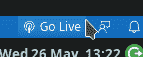

在 VS Code 中点击 Go Live 按钮

确保你的浏览器指向 `localhost:5500`（使用底部栏中显示的端口号）。

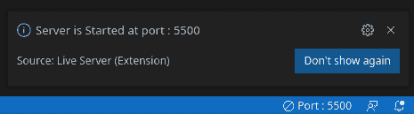

服务器已启动消息（显示活动端口号）

现在你的页面应该在网页浏览器中可见（它应该显示“你好！”）。尝试编辑你的 HTML 文件，保存它，然后刷新浏览器。你所做的更改应该可见。

### 7.2.6 添加 CSS 和 JavaScript 文件

在本节中，你将向网页添加一个 CSS 文件和一个 JavaScript 文件。向网页添加文件通常有两个步骤：

*   创建文件并保存（CSS 文件扩展名为 `.css`，JavaScript 文件扩展名为 `.js`）
*   在 `index.html` 文件中包含该文件

#### 7.2.6.1 添加 CSS 文件


从**文件**菜单中选择**新建**，并将以下 CSS 代码添加到新文件中：

```
h1 {
  color: orange;
}
```

`style.css`

从**文件**菜单中选择**保存**，当对话框出现时，在你的项目目录中创建一个名为 `css` 的新目录。进入 `css` 目录，然后将新文件保存为 `style.css`。你的目标目录结构如下：

```
my_website
  css
    style.css
  index.html
```

现在你需要在 `index.html` 中链接你的 CSS 文件。点击左侧边栏中的 `index.html` 开始编辑你的 HTML 文件。添加包含 `<link>` 标签的行（如下高亮所示）：

```
<!DOCTYPE html>
<html lang="en">
  <head>
    <meta charset="utf-8">
    <title>我的网页</title>
    <link rel="stylesheet" href="css/style.css">
  </head>

  <body>
    <h1>你好！</h1>
  </body>
</html>
```

`index.html`

保存 `index.html` 并检查你的浏览器（你可能需要刷新页面）。标题现在应该是**橙色**。

#### 7.2.6.2 添加一个 JavaScript 文件

从**文件**菜单中选择**新建**，并将以下 JavaScript 代码添加到新文件中：

```
 alert("Hello!");
```

`main.js`

从**文件**菜单中选择**保存**，当对话框出现时，在你的项目目录中创建一个名为 `src` 的新目录。进入 `src` 目录，然后将新文件保存为 `main.js`。你的目标目录结构如下：

```
my_website
  css
    style.css
  src
    main.js
  index.html
```

现在你需要在 `index.html` 中添加一个指向 JavaScript 文件的链接。点击左侧边栏中的 `index.html` 开始编辑你的 HTML 文件。添加包含 `<script>` 标签的行（如下高亮所示）：

```
<!DOCTYPE html>
<html lang="en">
  <head>
    <meta charset="utf-8">
    <title>我的网页</title>
    <link rel="stylesheet" href="css/style.css">
  </head>

  <body>
    <h1>你好！</h1>
    <script src="src/main.js"></script>
  </body>
</html>
```

`index.html`

保存 `index.html` 并检查你的浏览器（你可能需要刷新页面）。应该会弹出一个显示“Hello!”的提示框。

### 7.2.7 总结

本节展示了如何设置一个包含以下组件的 Web 开发环境：

*   一个代码编辑器

*   一个 Web 浏览器

*   一个本地 Web 服务器

你学习了如何创建一个由 HTML 文件、CSS 文件和 JavaScript 文件组成的简单网站。这是大多数 Web 应用程序和基于 Web 的数据可视化的基础。

