# FXRuby：Ruby GUI构建指南


### 读者对 *FXRuby* 的评价

学习 GUI 框架本应是件轻松的事，但通常却很难。读了这本书后，我通过对比意识到，通常之所以难是因为它缺乏乐趣。Lyle 以结果为导向的教学方法让学习 FXRuby 变得有趣，因此也变得简单。这本书是一本激励人心、文笔出色的教程，讲述了如何在 Ruby 最成熟的部件工具包之一中*完成任务*，而作者正是该工具包最权威的来源。

- **Chad Fowler**
  - CTO, InfoEther
  - Ruby Central 创始联合总监

FXRuby 是一个丰富、成熟的 GUI 工具包，Lyle 多年来一直很好地维护和记录它。加上这本优秀的书籍，这个工具包变得更加易于使用。

- **Hal Fulton**
  - *The Ruby Way* 作者

2003 年我曾受委托使用 Ruby 开发一个 GUI 应用程序，我很快确定 FOX/FXRuby 是正确的工具包，因为其绑定质量卓越，而且 Lyle 提供了高水平的支持。我唯一的遗憾？那就是我没有这本书！有了它放在桌上，在线参考资料在浏览器中打开，没有什么能阻止你使用 Ruby 构建令人惊叹的桌面应用程序。

- **Nathaniel Talbott**
  - Terralien, Inc. 创始人兼开发者

Lyle 对 FXRuby 的深入了解确保了这本引人入胜的书籍将让你做好准备，在极短的时间内制作跨平台 GUI。

- **Austin Ziegler**
  - 软件设计师与开发者

*FXRuby: Create Lean and Mean GUIs with Ruby* 是一本出自权威之手的佳作：一本关于 FXRuby 的书，来自 FXRuby 的作者。再好不过的了，除非这个库自己能写书。

- **Jeremy McAnally**
  - ENTP 开发者/技术撰稿人

这本书是 FXRuby 编程的绝佳入门。Lyle 很好地带领你从基础开始，以恰到好处的节奏过渡到更高级的主题。

- **Daniel Berger**
  - Qwest, Inc. 软件工程师


# 前言

FOX Toolkit 是一个用于设计用户界面的库，已开发超过十年。FOX 最初是我作为业余项目发起的，名为 Free Objects for X（FOX），因为我最初的目标环境是 X Window 系统。

FOX 的早期采用者之一是 CFD Research Corporation，我和 Lyle 曾在那里工作。该公司的用户界面开发者对创建界面所需的简洁代码感到惊喜，因为他们习惯了 Motif，那里放置一个按钮通常需要十几行代码。而在 FOX 中，同样的任务通常只需一行代码。在这一成功的鼓舞下，FOX 库迅速经历了多次更新；库被移植到 Microsoft Windows，并添加了 3D 编程支持。所有关键要素都已就绪，可以将公司的 GUI 应用程序转移到 FOX 平台上。

FOX 现在已发展到开发者可以编写代码并相当有信心它能在众多平台上编译和运行的阶段，从运行 Windows 的 PC 到 Sun 和 IBM 的“大型”Unix 机器。FOX 不断发展。在过去的几年里，重点一直是国际化和本地化，以及多进程支持。

FOX Toolkit 用 C++ 编写，在其他语言绑定可用之前，你必须用 C++ 编程才能使用 FOX。现在，随着 FXRuby 库的创建，FOX Toolkit 的功能已在 Ruby 编程语言中可用。

在本书中，你将学习如何在 Ruby 中构建基于 FOX 的图形用户界面。在第一部分，你将编写你的第一个小型 FXRuby 应用程序，从详细的说明开始，指导你如何在你的 Ruby 编程环境中安装 FXRuby 扩展。你将通过几次迭代来完成一个功能性的应用程序，该应用程序展示了 FXRuby 程序的许多关键特性。

在第二部分，本书更详细地介绍了事件驱动编程以及如何将用户界面连接到有用的可执行 Ruby 代码。接着介绍了可用的控件和部件，你将学习如何使用布局管理器来放置你的用户界面元素（这是一个特别有用的章节，因为即使对于许多经验丰富的 Windows 程序员来说，自动布局也是一个陌生的概念）。

读完本书后，你将能够为你的程序设计出色的用户界面！

*Jeroen van der Zijp*（首席 FOX Toolkit 开发者）
2008年1月

# 致谢

我很久以来一直想写一本关于 FXRuby 开发的书。当我决定终于准备好这么做时，我知道我想与 Pragmatic Programmers 合作来实现它。非常感谢 Dave 和 Andy 给我这个机会。

显然，没有 FOX Toolkit 就不会有 FXRuby。我想感谢我的朋友和前同事 Jeroen van der Zijp，让我多年来能参与 FOX 的一小部分开发，并在此过程中从他那里学到了所有东西。

如果没有我的编辑 Susannah Davidson Pfalzer 的辛勤工作和奉献，这本书很容易就会偏离正轨。Susannah，非常感谢你在我们处理所有修订时的细致关注和专业指导。结果比没有你的帮助要好得多。

像这样连续工作数月的现实之一是，你会离文本太近而无法客观看待它，从而无法发现它的缺陷。因此，我要非常感谢本书的审稿人：Dan Berger、Joey Gibson、Chris Hulan、Sander Jansen、Chris Johnson、Joel VanderWerf 和 Austin Ziegler。他们的评论和建议是无价的。同样要感谢众多的 beta 版本书读者，他们花时间指出了早期版本中的问题。

最后，感谢我的妻子 Denise 在过去九个月里对一个经常分心的丈夫的支持和鼓励。现在这书完成了，我们真的要去海滩了。

*Lyle Johnson*
*2008年1月30日*
lyle@lylejohnson.name

## 第 1 章

### 介绍

FXRuby 是一个用于为你的 Ruby 应用程序开发强大且复杂的跨平台图形用户界面（GUI）的库。它基于 FOX Toolkit，这是一个流行的开源 C++ 库，由 Jeroen van der Zijp 开发。对你作为应用开发者来说，这意味着你能够用你已经熟悉和喜爱的 Ruby 编程语言编写代码，同时利用一个功能齐全、高度优化的 C++ 工具包的性能和功能。

尽管 FOX 的知名度不如其他一些 GUI 工具包，但它自 1997 年以来就已可用，并且仍在持续开发中。FXRuby 自 2000 年底开始开发，第一个公开版本于 2001 年 1 月发布。在整个期间，我一直担任首席开发者，社区志愿者也贡献了许多补丁。要猜测一个开源项目的用户群规模很棘手，但根据 RubyForge 的统计数据，自该项目迁移到那里以来，FXRuby 的下载量已接近 45,000 次（而在托管于 SourceForge 时，下载量接近 18,000 次）。发布到 FXRuby 用户邮件列表的问题通常由我自己、FOX 的开发者 Jeroen van der Zijp 或 FXRuby 社区的其他长期成员回答。

### 1.1 本书内容是什么？

本书的目的是通过教程练习和技术信息的结合，让你在开始使用 Ruby 和 FXRuby 开发 GUI 应用程序时领先一步。

这不是一本全面的 FXRuby 编程书籍，也不是参考手册。¹ 几乎完整的参考手册是可用的，并包含在标准的 FXRuby 发行版中。本书*确实*会做的是帮助你跨越初始的概念障碍，并为你提供构建自己的应用程序所需的实用信息。

### 1.2 本书面向谁？

本书面向希望学习如何使用 Ruby 编程语言开发 GUI 应用程序的软件开发者。如果你对 Ruby 编程本身还不熟悉，你应该理解，虽然我们会在此过程中强调某些 Ruby 编程技术，但本书并非旨在教你如何用 Ruby 编程。你不需要是 Ruby 大师，但在深入学习之前，熟悉 Ruby 编程和面向对象编程概念是重要的。

话虽如此，阅读本书不需要你有任何 GUI 编程的先前经验。当介绍新主题时，我们会花时间解释它们如何融入大局，以及它们可能与其他上下文中你遇到的事情有何关联。如果你*确实*有一些 GUI 应用程序开发的经验，你将能够使用本书快速识别与你过去使用的其他 GUI 工具包之间的异同。无论你的经验水平如何，本书都将提供一种方法，让你克服最初的“障碍”，学习你需要理解的基础知识，以便能够继续为你的应用程序开发强大的用户界面。

### 1.3 如何阅读本书

本书的第一部分从安装说明开始，然后进入一个扩展示例，在该示例中，我们逐步构建一个完整的 FXRuby 应用程序。如果你想了解 FXRuby 编程，这是开始的地方。事实上，大多数人似乎喜欢跟着书一起构建应用程序。

¹ 坦白说，你没时间读那么长的书，毕竟你还有那么多关于 Rails 的书还没来得及读呢。


如果你不想全部手动输入，也可以取巧直接下载源代码（压缩的 tar 归档文件或 zip 文件）。^[2]

在本书的第二部分，我们会重新回顾一些在开发示例应用程序过程中涉及的主题，并更深入地探讨其工作原理。我们还会介绍一些额外的主题，这些内容虽然无法 neatly 融入示例应用程序中，但对你来说仍然很重要，值得了解。

在行文过程中，你会看到我们采用的各种约定。

#### 实时代码

我们展示的大多数代码片段都来自完整的、可运行的示例，你可以下载这些示例。为了帮助你定位，如果一个代码清单可以在下载内容中找到，那么在该片段上方会有一个提示条（就像这里的这个）：

```
Download hello.rb

require 'fox16'

app = Fox::FXApp.new
main = Fox::FXMainWindow.new(app, "Hello, World!",
  :width => 200, :height => 100)
app.create
main.show(Fox::PLACEMENT_SCREEN)
app.run
```

这表示该代码在下载内容中的路径。如果你阅读的是本书的 PDF 版本，且你的 PDF 阅读器支持超链接，你可以点击该提示条，代码就会显示在浏览器窗口中。某些浏览器（如 Safari）可能会错误地尝试将某些模板解释为 HTML。如果发生这种情况，请查看页面的源代码以查看真正的源代码。

### 1.4 获取帮助的途径

获取 FXRuby 帮助的最佳场所（当然，除了本书之外）是邮件列表和各种在线文档资源。

#### 邮件列表

有两个专门面向 FXRuby 的邮件列表。公告列表的**流量非常低**，主要用于通知用户 FXRuby 的新版本发布；而用户列表的**流量较高**，是进行 FXRuby 编程问题一般性讨论的地方。你可以在 FXRuby 的 RubyForge 项目页面找到如何订阅这些列表的说明，以及邮件列表存档。<sup>3</sup>

除了 FXRuby 的列表之外，你可能会发现订阅普通的 FOX 用户邮件列表也很有价值。你在开发 FXRuby 应用程序时遇到的许多问题，与使用 FOX 库开发 C++ GUI 应用程序的开发者面临的问题**相同**。有关如何订阅 FOX 用户邮件列表以及该列表存档的信息，请参阅 FOX 的 SourceForge 项目页面。<sup>4</sup>

#### 在线文档

尽管有相反的传言，但实际上 FOX 和 FXRuby 都有大量的在线文档，只要你知道去哪里找。

##### FOX 文档页面

FOX 网站上的文档页面有大量文章，深入介绍了布局管理器、图标与图像、字体以及拖放等主题。<sup>5</sup> 这些文章往往包含更多**硬核**的技术细节，而且当然是面向 C++ 库用户的，因此它们并不一定适合 FXRuby 的初学者用户。然而，在你读完本书之后，你可能会想查阅这些文章，以便更深入地理解 FOX 编程的一些机制。

##### FOX 社区 Wiki

FOX 社区<sup>6</sup> 是一个由 FOX 开发者编写、为 FOX 开发者服务的 wiki。它包含一个扩展的 FAQ 列表，是获取教程和其他类型文档的绝佳来源。那里的大量示例代码主要面向在其应用程序中使用 FOX 的 C++ 开发者，但其中的大部分信息也适用于 FXRuby 应用程序开发。

##### **FXRuby 用户指南**

*FXRuby User's Guide*<sup>7</sup> 实际上是一本关于 FXRuby 的**大杂烩**，但它确实提供了相当全面的 FXRuby 安装信息。它还提供了关于如何使用剪贴板以及如何将拖放功能集成到你的 FXRuby 应用程序中的教程。

##### **API 文档**

正如你（可能）在购买本书之前就知道的，本书不是一本参考手册。FXRuby 的 API 文档相当全面且免费提供，因此没有必要在这里重复那些内容。要查看最新、最准确的 API 文档，请访问 FXRuby 网站上托管的版本。<sup>8</sup> 如果你是通过 RubyGems 安装的 FXRuby，那么你应该也有一份本地文档副本。要查看安装 gem 时 RDoc 生成的 HTML 文档，首先启动 gem 服务器：

```
$ gem_server
[2007-05-09 17:18:04] INFO  WEBrick 1.3.1
[2007-05-09 17:18:04] INFO  ruby 1.8.6 (2007-03-13) [i686-darwin8.8.1]
[2007-05-09 17:18:04] INFO  WEBrick::HTTPServer#start: pid=427 port=8808
```

现在，将浏览器指向 [http://localhost:8808/](http://localhost:8808/)。滚动浏览已安装 gem 的列表，直到找到 FXRuby 的条目，然后点击 [rdoc] 链接查看文档。

另一个查看 FX使我们的信息的好用的技巧是使用 `ri` 命令行工具来查询 FXRuby 类或其某个方法的信息：

```
$ ri Fox::FXCheckButton#checked?
--------------------------------------------------------------- Fox::FXCheckButton#checked?
            checked?()
---------------------------------------------------------------
            Return +true+ if this check button is in the checked state.
```

`ri` 命令非常方便，而且可以用于你已安装的任何 Ruby 库，包括核心和标准库的类和方法。如果你使用 RubyGems 安装的 FXRuby，那么它在安装时应该已经自动为你生成并安装了 FXRuby 的 `ri` 文档。如果你直接从源代码 tarball 安装的 FXRuby，或者通过其他方式安装的，你可能需要先生成并安装 `ri` 文档，然后才能成功使用 `ri` 命令来查询 FXRuby 文档。

无论如何，如果由于某种原因 `ri` 没有正确安装在你的系统上，请务必想办法让它工作起来！

### 1.5 关于版本的说明

本书中的讨论和示例基于 FXRuby 1.6，即本书撰写时的当前版本。

一般来说，使用最新可用的 FOX 和 FXRuby 版本最符合你的利益，因为这些版本会有最新的 bug 修复和功能增强。但请注意，FXRuby 某个发布版本的主版本号表示它所兼容的 FOX 发布版本的主版本号；例如，FXRuby 1.6 是设计为与 FOX 1.6 配合使用的。这一点很重要，因为 FOX 的最新发布版本通常会被标记为不稳定或"开发中"的版本，而这些版本*并不能*保证与最新发布的 FXRuby 兼容。

现在我们已经搞定了这些，让我们开始吧！

# 第一部分
## 构建 FXRuby 应用程序

# 第 2 章
### FXRuby 入门

本章是你快速入门 FXRuby 应用程序开发的起点。我们会花几页篇幅介绍 FXRuby 及其与 FOX 的工作方式，然后再继续介绍在几种最流行的操作系统上安装 FXRuby 的说明。本章最后会构建一个简单的"Hello, World!"应用程序，让你了解 FXRuby 应用程序的典型结构，并验证软件是否正确安装。

FXRuby 以 Ruby 扩展模块的形式打包。这意味着它是一个 C++ 库，由 Ruby 解释器在运行时加载，在此过程中引入大量新的 Ruby 类和常量。图 2.1（见下页）展示了你的应用程序代码（用 Ruby 编写）、FXRuby 扩展、FOX 库和操作系统之间的关系。从应用程序开发者的角度来看，FXRuby 看起来就像任何其他你可能使用的"纯 Ruby"库；区别在于，这个库的源代码实际上并不是用 Ruby 编写的。¹ FXRuby 公开了 FOX 库的所有功能，但它不仅仅是 API 的一个简单"包装器"。FXRuby 充分利用了 Ruby 的语言特性，并用它们来提供对 FOX 的**更高级别的接口**。例如，在传统的 FOX 应用程序中，编写将所有用户界面事件映射到可执行代码所需的全部 C++ 代码是相当繁琐的。在 FXRuby 中，你只需几行代码就能直接将一个 Ruby 代码块连接到一个部件。

> ¹ 实际上，FXRuby 有相当一部分是用 Ruby 编写的，但这并不改变你的使用方式。

---
^1: http://www.pragprog.com/titles/fxruby has the links for the downloads.
^2: http://rubyforge.org/mail/?group_id=300
^3: http://sourceforge.net/mail/?group_id=3372
^4: http://www.fox-toolkit.org/doc.html
^5: http://www.fox-toolkit.net/
^6: [http://www.fxruby.org/doc/book.html](http://www.fxruby.org/doc/book.html)
^7: [http://www.fxruby.org/doc/api/](http://www.fxruby.org/doc/api/)


图 2.1：操作系统、FOX、FXRuby 与你的 Ruby 应用程序之间的关系

当我刚开始开发 FXRuby 时，Ruby 跨平台 GUI 开发的选择并不多，除了内置的 Tk 支持之外。如今，情况已大不相同。如果你正在寻找跨平台 GUI，已经有成熟且支持良好的 GTK+ 和 Qt 的 Ruby 绑定，而 wxWidgets 和 FLTK 等其他流行 GUI 的绑定也在开发中。面对如此丰富的选择，经常有人在 Ruby-Talk 邮件列表上发帖询问哪个 GUI 才是*最佳选择*™。

就像哪个是最好的编辑器、操作系统或编程语言这类问题一样，哪个 GUI 是"最好的"取决于你的需求。我不会试图说服你放弃任何特定选择，而是鼓励你至少尝试所有可能适合你需求的选项。不过，在做决定时，你需要记住以下几个要点。

首先，FOX 和 FXRuby 可以实现很多功能。如果你想为命令行工具搭建一个简单的 GUI 前端，FXRuby 绝对能满足需求。由于 FOX 提供了对标签、按钮和文本字段等所有标准用户界面元素的支持，它也非常适合开发直接的基于表单的 GUI。然而，真正让 FOX 从竞争对手中脱颖而出的是其高级功能。FOX 对图像数据显示和处理的广泛支持使其成为开发视觉丰富用户界面的理想选择，而凭借其对 OpenGL 的复杂支持，FOX 也成为需要 3D 可视化功能应用程序的热门选择。

另一个需要考虑重要特性是 GUI 使用轻量级还是重量级控件，以及你更喜欢哪一种。FOX 使用*轻量级*（或非原生）控件。这意味着基于 FOX 的应用程序仅依赖于其运行平台的最基本功能来创建用户界面，而不是围绕现有控件提供包装类和方法。这种方法有几个优点：

有些人使用"原生"和"非原生"控件来描述这种区别，但他们讨论的是同一个基本问题。

*   由于 FOX 定义了它创建的控件的行为，而不是依赖原生控件的行为，因此该行为在各个平台上保持一致。
*   由于 FOX 自己绘制控件，你的应用程序无论运行在哪个平台上看起来都相同。²
*   由于 FOX 从一开始就设计为高度面向对象和可扩展的，你在子类化现有 FOX 控件以创建自己的应用程序特定控件方面拥有更大的灵活性。当使用围绕某些其他遗留工具包的包装 GUI 库时，大部分这种灵活性都会丧失。
*   由于 FOX 减少了你必须经过的代码层数，基于 FOX 的应用程序往往性能更好、响应更迅速。

最后但同样重要的是特定 GUI 库的许可问题。例如，某些 GUI 库要求你购买商业开发许可证，如果你想用它们开发专有（闭源）应用程序的话。FOX 和 FXRuby 都基于相对宽松的 Lesser GNU Public License (LGPL)³ 许可，允许将这些库用于自由软件和专有（商业）软件应用程序。

现在，让我们从安装 FXRuby 开始，然后用它开发一个简单的"Hello, World!"程序。

² 有些人认为这是使用轻量级控件的*缺点*。
³ http://www.gnu.org/licenses/lgpl.html

### 2.1 安装 FXRuby

安装 FXRuby 比其他 Ruby 库更具挑战性，因为它是用 C++ 编写的，因此必须编译成共享库，以便 Ruby 解释器在运行时加载。由于存在多个依赖项需要考虑，包括 FXRuby 所基于的 FOX 库，以及提供各种图像文件格式支持的第三方库，这进一步增加了复杂性。

好消息是，如果你在 Windows 或 Mac OS X 上安装 FXRuby，安装过程相当轻松。如果你在 Linux 上安装 FXRuby，则需要做更多工作，但步骤相当容易遵循，而且你可以依靠 FOX 和 FXRuby 社区的支持来解决可能出现的任何安装问题。

以下各节提供了在最常见操作系统上安装 FXRuby 的基本说明。对于一些更特殊的情况，我们将参考 FOX 和 FXRuby 的在线文档，这些文档包含了关于安装问题最完整和最新的信息：

-   有关安装 FOX 库的详细说明，请参阅 FOX 网站上的安装说明。⁴
-   有关安装 FXRuby 的详细说明，请参阅 *FXRuby 用户指南*⁵ 中的说明。

#### 在 Windows 上安装

如果你使用了 Ruby One-Click Installer for Windows⁶，应该已经安装了一个版本的 FXRuby。然而，由于一键安装程序中包含的 FXRuby 版本有时落后于最新发布版本，你应该尝试使用 `gem update` 命令进行更新：

```
C:\> gem update fxruby
```

如果你通过其他方式安装了 Ruby，则需要手动编译 FOX 和 FXRuby。如果你使用的是 Windows 上的类 Unix 环境，如 Cygwin 或 MinGW，应该可以按照下一页**2.1**节 *在 Linux 上安装* 中的说明来完成此任务。如果你使用的是 Microsoft（或其他厂商）的开发工具，最好的选择是参考本章开头提到的在线文档。

#### 在 Mac OS X 上安装

在 Mac OS X 上安装 FOX 和 FXRuby 最简单的方法是使用 MacPorts：⁷

```
$ sudo port install rb-fxruby
```

如果你希望通过其他方式安装 FXRuby，例如通过 source gem，你至少应该考虑使用 MacPorts 来安装其依赖项（如 FOX 以及用于处理 JPEG、PNG 和 TIFF 图像的库）。

如果你无法通过 MacPorts 安装该软件，你总是可以使用第 2.1 节 *在 Linux 上安装* 中描述的安装过程来构建它。

#### 在 Linux 上安装

在 Linux 上让 FOX 和 FXRuby 工作可能是一个耗时的过程。你可能会很幸运：一些较新的 Linux 发行版包含了 FOX 和/或 FXRuby 的软件包。如果是这种情况，我强烈建议你使用这些软件包，以避免追踪依赖项并手动构建所带来的不可避免的各种麻烦。例如，如果你运行的是 Ubuntu Linux⁸ 并且启用了 Ubuntu 软件仓库的 "universe" 组件，你应该能够直接从 libfox-1.6-dev 软件包安装 FOX：

```
$ sudo apt-get install libfox-1.6-dev
```

由于 Ubuntu Linux 没有提供 FXRuby 的软件包，你需要从 gem 安装它，如本节后面所述。

如果你使用的 Linux 发行版尚未将 FOX 或 FXRuby 作为标准安装软件包，你需要寻找第三方软件包或（最坏的情况）从源代码构建它们。在这种情况下，首先从 FOX 下载站点⁹ 下载 FOX 1.6 系列最新版本的发行版。

⁴ http://www.fox-toolkit.org/install.html
⁵ http://www.fxruby.org/doc/build.html
⁶ http://rubyinstaller.rubyforge.org/wiki/wiki.pl
⁷ http://www.macports.org/
⁸ http://www.ubuntu.com/
⁹ http://www.fox-toolkit.org/download.html


该发行版的文件名类似 fox-1.6.29.tar.gz。使用 tar 命令解压发行版：

```
$ tar xzf fox-1.6.29.tar.gz
```

此操作将创建一个名为 fox-1.6.29 的目录。切换到该目录，然后使用标准的 configure、make、make install 序列来构建和安装 FOX：

```
$ cd fox-1.6.29
$ ./configure
<<output of "configure" command>>
$ make
<<output of "make" command>>
$ sudo make install
<<output of "make install" command>>
```

既然你已经构建并安装了 FOX，就可以开始安装 FXRuby 了。最直接的方法是使用 gem install 命令从 RubyForge 托管的远程 gem 仓库获取 gem：

```
$ sudo gem install fxruby --remote
Bulk updating Gem source index for: http://gems.rubyforge.org
Building native extensions.  This could take a while...
```

正如消息所示，此过程可能需要一些时间才能完成。

### 2.2 立竿见影

既然你已经在开发系统上安装并成功运行了 FXRuby，我们将进入有趣的部分。在本节中，我们将从一个简单的 FXRuby 应用程序开始，让你初窥门径，然后在后续章节中介绍一个更复杂的例子，这将教你许多关于如何构建真实世界 FXRuby 应用程序的知识。

#### "Hello, World!"

秉承历史悠久的编程书籍传统，我们将从 FXRuby 版本的 "Hello, World!" 开始。让我们从最基础的部分开始，确保它能正常工作。

在你选择的编辑器中创建一个新文件，并写下你的第一个 FXRuby 程序的第一行：

```
require 'fox16'
```

> **设置 RubyGems 环境**
>
> 如果你使用 RubyGems 安装了 FXRuby，除非你告诉 Ruby 自动加载 RubyGems 运行时并使用存储在 RubyGems 仓库中的库，否则本书中的示例程序可能无法正常工作。RubyGems 用户指南在 http://rubygems.org/read/chapter/3 中讨论了各种选项；我个人更喜欢按照该讨论中描述的方式设置 RUBYOPT 环境变量。
>
> 请注意，如果你运行的是 Ruby 1.9.0 或更高版本，RubyGems 运行时已与 Ruby 解释器完全集成，因此无需采取此类预防措施。

感觉不错，对吧？这将 `Fox` 模块及其所有内容导入到 Ruby 解释器中。特性名称（传递给 `require()` 的字符串）是 "fox16"，因为我们想使用 FXRuby 版本 1.6，而不是早期版本之一。

现在，目前它还只是一个单行程序，但请配合我：将此文件保存为 `hello.rb`，然后立即尝试运行它：

```
$ ruby hello.rb
```

如果 Ruby 运行了几秒钟，然后安静地返回到命令提示符，那么你一切顺利。如果 FXRuby 安装正确，这正是程序*应该*做的全部事情。另一方面，如果你看到一个或多个错误消息，请立即停止并找出问题所在，因为如果无法正常工作，后续的内容就不重要了。<sup>10</sup> 运行时出现的一个常见问题与 RubyGems 环境的设置有关；有关该问题的更多信息，请参阅本页的侧边栏。

10. 如前一章所述，*FXRuby 用户指南*中有一些有用的提示，涉及安装 FXRuby 时有时会出错的地方，尤其是在从源代码构建时。详情请参见 http://www.fxruby.org/doc/build.html。

接下来，构造一个 FXApp 类的实例，该类在 Fox 模块中定义：

```
Download hello.rb
app = Fox::FXApp.new
```

FXApp 是 "application"（应用程序）的缩写。应用程序对象负责事件循环，以及 FXRuby 程序中许多幕后工作。它是将一切粘合在一起的粘合剂。不过现在，只需要知道你编写的每个 FXRuby 程序都需要构造一个 FXApp 对象就足够了。

示例应用程序需要一个主窗口，所以我们接下来添加一个：

```
Download hello.rb
main = Fox::FXMainWindow.new(app, "Hello, World!",
 :width => 200, :height => 100)
```

现在你看到了 FXApp 对象的多种用途之一。通过将其作为第一个参数传递给 FXMainWindow.new()，你是在声明你的应用程序（而不是其他应用程序）负责该主窗口。第二个参数是主窗口的标题，将显示在窗口的标题栏中。你还可以指定主窗口的初始宽度和高度（以像素为单位）。关于主窗口你还可以指定更多内容，但目前这样就足够了。

接下来，添加对 `create()` 方法的调用。这确保为你的应用程序创建所有服务器端资源。我们稍后将更详细地讨论这一点。现在，只需知道这是你在任何 FXRuby 应用程序中需要做的另一件事：

```
Download hello.rb
app.create
```

接下来，使用 PLACEMENT_SCREEN 调用主窗口的 show() 方法，确保程序开始运行时它是可见的：

```
Download hello.rb
main.show(Fox::PLACEMENT_SCREEN)
```

PLACEMENT_SCREEN 布局提示只是请求窗口在首次显示时居中于屏幕。¹¹

11. FXTopWindow 类（FXMainWindow 的基类）的 API 文档列出了一些其他布局提示，你可以将它们传递给 show() 方法。

最后，调用 FXApp 对象的 run() 方法以启动主应用程序循环。你的完整程序应如下所示：

```
require 'fox16'

app = Fox::FXApp.new
main = Fox::FXMainWindow.new(app, "Hello, World!",
  :width => 200, :height => 100)
app.create
main.show(Fox::PLACEMENT_SCREEN)
app.run
```

现在你可以像运行任何典型的 Ruby 程序一样运行该程序：

```
$ ruby hello.rb
```

你的结果应类似于图 2.2 所示的窗口，这是在 Windows 中运行该程序的截图。

#### 惯用 FXRuby 程序

如果我要从头开始编写一个新的 FXRuby 程序，我不会完全按照那种方式设置它。FXRuby 程序中有一些相当常见的惯用写法，你在本书中看到的所有其他示例都遵循这些写法。第一个常见做法是将 Fox 模块包含在 Ruby 的全局命名空间中，这样你就不必在程序中到处使用 FXRuby 类和常量的全限定名称。

经过此修改，hello.rb 变得稍微容易阅读一些：

```
require 'fox16'

include Fox

app = FXApp.new
main = FXMainWindow.new(app, "Hello, World!",
  :width => 200, :height => 100)
main.show(PLACEMENT_SCREEN)
app.run
```

一般来说，这种做法可能导致 Fox 模块中定义的名称与其他模块中定义的名称冲突，但在实践中我从未见过这引起问题。

另一个可以做的改变是将应用程序的主窗口重新思考为 FXMainWindow 的子类：

```
require 'fox16'

include Fox

class HelloWindow < FXMainWindow
  def initialize(app)
    super(app, "Hello, World!", :width => 200, :height => 100)
  end

  def create
    super
    show(PLACEMENT_SCREEN)
  end
end

app = FXApp.new
HelloWindow.new(app)
app.create
app.run
```

花一两分钟比较此迭代版本与上一个版本，并确保你理解了这些更改。请注意，与我们对主窗口的自定义相关的所有内容都已移至 HelloWindow 子类中，包括它在创建后调用自身的 show() 这一事实。

这个入门程序非常简单，这样做有些小题大做，但正如我们将在后续示例程序中看到的那样，将应用程序控制集中在像这样的自定义主窗口类中会变得很方便。

作为最后的修改，将 FXApp 和 HelloWindow 的构造移至启动块中：

```
require 'fox16'

include Fox

class HelloWindow < FXMainWindow
  def initialize(app)
    super(app, "Hello, World!", :width => 200, :height => 100)
  end

  def create
    super
    show(PLACEMENT_SCREEN)
  end
end

if __FILE__ == $0
  FXApp.new do |app|
    HelloWindow.new(app)
    app.create
    app.run
  end
end
```

我也利用这一步展示了 FXApp 构造函数块形式的工作方式。当你想要进行一些额外的初始化时，可以对任何 FXRuby 类执行此操作。这些重构都没有改变程序的基本操作，但它们有助于演示 FXRuby 程序的典型结构。

可能感觉不到，但我们在本章中已经涵盖了很多内容。我们安装了 FXRuby 并确保其正常工作。我们还开发了一个简单但功能齐全的程序，以熟悉每个 FXRuby 应用程序都将遵循的基本模式。在几次重构的过程中，我们看到 FXRuby 提供的类可以像任何其他 Ruby 类一样被子类化和自定义。既然我们已经初窥门径，就可以开始着手开发一个更加复杂的项目，我们将在接下来的几章中构建它。


# 第三章

### 图画书应用

既然你已经安装了 FXRuby 并让初始测试程序运行起来，是时候进入更具挑战性的内容了。在接下来的几章中，我们将使用 FXRuby 开发一个照片库管理应用——图画书。

撰写本书时，更具挑战性的任务之一就是决定使用哪个示例应用来演示 FXRuby 开发。我本人不太喜欢重新发明轮子，更不用说市面上已经有很多优秀的相册应用了。本练习的目的与其说是通过构建有史以来最佳照片应用来称霸世界，不如说是学习如何使用 FXRuby 提供的工具来构建更复杂的图形用户界面应用。<sup>1</sup>

#### 3.1 图画书应用的功能

正如本章引言所述，我们的目标是一个能涵盖许多你想融入自身应用的功能特性，同时又能控制应用整体规模的应用。在本练习过程中，你将学到的最重要内容之一就是如何结合 FOX 强大的布局管理器（如 FXMatrix、FXSplitter 和 FXSwitcher）来创建复杂的布局。你也将熟悉如何对内置组件（如 FXList 和 FXImageFrame）进行子类化，以创建定制化的、特定于应用的视图。在此过程中，你将掌握使用

> 1. 如果有时间，我们稍后会再讨论称霸世界的事。

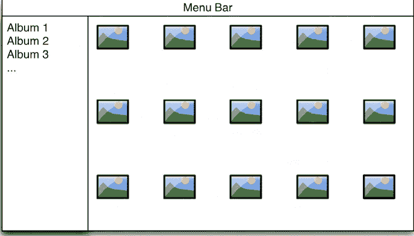

**图 3.1：** 图画书应用的用户界面概念图

FOX 图像处理和显示功能的技巧。当你完成这个应用的构建时，你将对 FXRuby 应用开发涉及的各类细节和决策有更好的认识。

但首先，我们先对图画书应用的基本功能做出一些决定。我们需要的是一个能让我们将存储在磁盘上的一批现有数码照片整理到一个或多个命名相册中的程序。我设想的用户界面类似于图 3.1 中展示的草图版本。程序启动时，你应该在主窗口左侧看到现有相册的列表，如果你选择其中一个相册，右侧的窗格应该显示该相册中的所有照片。

我们约定用户应该能够创建新相册并向这些相册添加照片。我们将跳过一些更高级的功能，如照片编辑和共享，不过我希望当你读完本书时，你也能对如何实现这类功能有一些想法。

我们需要做出的一个决定与照片的存储方式有关。一种选择是将导入的照片留在原处，只保留它们在磁盘上的位置引用。这种方法的一个优点是，你可以将相册存储在并非始终连接的设备上，例如外部硬盘驱动器或 DVD。另一种选择是实际复制导入的照片，并将这些副本存储在应用才能知道的位置。

后一种选择（复制导入的照片）引入了一些复杂性，无论它是更好还是更差的选择，它并没有真正让我们了解太多关于 FXRuby 应用开发的内容。因此，我们将选择更简单的方案，只跟踪磁盘上现有照片文件的路径。

#### 3.2 应用数据

既然我们已经勾勒出应用的一些初步需求，现在需要考虑我们所讨论的数据结构类型。我们将（宽松地）为图画书应用采用一种模型-视图-控制器<sup>2</sup>（MVC）架构风格，这仅仅意味着特定领域的数据（即照片、相册和相册列表）由一组类表示，而用户界面元素（照片视图、相册视图和相册列表视图）则由另一组类表示。这种方法解决了当应用数据和用户界面耦合过紧时软件开发者遇到的许多问题。我们将使用传统 MVC 模式的一个略微修改版本，其中用户界面组件将同时处理架构中的视图和控制器方面。

我们将在此介绍模型类（MVC 中的 M），因为它们相当直观，并且在应用开发过程中不会发生太大变化。我们将在下一章开始讨论视图类；它们更复杂，并且如你所见，在我们开发应用的后续迭代版本时，它们将会有很大变化。

让我们从单个照片开始。我们知道它需要持有一个磁盘文件的引用，所以我们应该存储该文件的路径。稍后我们可能需要描述更多关于照片的信息，但目前我们就先这样定义。

<sup>2</sup> 关于 MVC 架构模式的更多信息，请参见 http://en.wikipedia.org/wiki/Model-view-controller。

```ruby
# Download picturebook_a/photo.rb
class Photo
  attr_reader :path

  def initialize(path)
    @path = path
  end
end
```

关于相册，我们想要描述什么呢？它应该有一个标题，例如“2007 海滩假期”，并且应该持有一组照片。可以肯定的是，我们需要方法来向相册添加照片以及遍历相册中的照片。我们稍后可能需要描述更多信息，但这是 Album 类的第一个版本：

```ruby
# Download picturebook_b/album.rb
class Album
  attr_reader :title

  def initialize(title)
    @title = title
    @photos = []
  end

  def add_photo(photo)
    @photos << photo
  end

  def each_photo
    @photos.each { |photo| yield photo }
  end
end
```

最后，我们需要一个类来管理相册列表。遵循 Photo 和 Album 类的模式，我们将从一个非常基础的 AlbumList 类开始，然后根据需要添加功能。我们的初始实现包含了添加和删除相册以及遍历列表中相册的方法：

```ruby
# Download picturebook_e/album_list.rb
class AlbumList
  def initialize
    @albums = []
  end

  def add_album(album)
    @albums << album
  end

  def remove_album(album)
    @albums.delete(album)
  end

  def each_album
    @albums.each { |album| yield album }
  end
end
```

既然我们已经开发了三个模型类的初步实现，我们就可以继续构建用户界面本身了。请注意，你并不需要在开始开发用户界面之前完全规范模型的类，特别是如果你像我们为这个应用所做的那样采用迭代方法。

#### 3.3 让我们开始编码

既然我们对程序的功能和用作模型的数据类型有了基本概念，你可能已经迫不及待地想要开始用户界面的第一次迭代了。我们现在面临的问题是如何开始。接下来该做什么？

这个问题没有唯一正确的答案。随着时间的推移，随着你对 FXRuby 应用开发越来越熟悉，你将获得必要的信心和技能，能够从头开始深入一个新的应用并快速构建其功能，如果你喜欢那样工作的话。然而，就我个人而言，我喜欢从尽可能简单的解决方案开始，然后在此基础上逐步构建以达到最终目标。因此，我们将从构建一个只做一件事的图画书版本开始：显示单张照片。

# 第四章

### 第一次尝试：显示单张照片

我们将以尽可能简单的方式开始开发图画书应用，以便我们能快速得到一个可运行的东西并看到一些结果。因此，第一个任务是显示单张照片。为此，我们将创建我们的第一个视图类 `PhotoView`，作为现有 FXRuby 组件的子类。我们将学习确保视图类正确初始化并放置在主窗口中正确位置所涉及的问题。我们还将通过 `FXJPGImage` 类初步了解 FOX 的图像显示功能。

#### 4.1 让东西跑起来

在第一章的“Hello, World!”练习结束时，我们已经确定了基本 FXRuby 应用的样貌，所以我们为图画书应用创建一个类似的结构吧。启动你的编辑器，将 `PictureBook` 类定义为 `FXMainWindow` 的子类。你的代码应该类似于以下内容：

```ruby
# Download picturebook_a1/picturebook.rb
require 'fox16'

include Fox

class PictureBook < FXMainWindow
  def initialize(app)
    super(app, "Picture Book", :width => 600, :height => 400)
  end

  def create
    super
    show(PLACEMENT_SCREEN)
  end
end
```


 ```
if __FILE__ == $0
  FXApp.new do |app|
    PictureBook.new(app)
    app.create
    app.run
  end
end
```

将文件保存为 picturebook.rb，然后运行它，确保目前为止一切正常：

```
$ ruby picturebook.rb
```

你应该会看到一个空的主窗口，标题栏中显示应用程序名称 **Picture Book**。虽然此时我们不期望程序能做太多有趣的事情，但这让我们对工作环境已正确设置有了一些信心。现在让我们继续做一些更有趣的事情。

#### 4.2 创建视图

现在主窗口已经就位，接下来的首要任务是构建单张照片的视图。我们将学习如何创建自定义视图类，作为 FXRuby 内置控件之一的子类，并了解如何将该控件放置在主窗口内部。

FXRuby 库中有许多不同的控件能够显示图像，但在这个练习中，我们将使用 **FXImageFrame**。FXImageFrame 控件是一个简单的控件，其唯一目的是显示 **FXImage** 对象。除此之外，它并没有其他真正的行为。你的初始直觉可能是直接使用图像帧作为视图，但正如我们很快会看到的，子类化 FXImageFrame 在提供应用程序特定功能方面给了我们更多的灵活性。

在编辑器中创建一个新文档，并设置 **PhotoView** 类的定义：

```
class PhotoView < FXImageFrame
  def initialize(p, photo)
    # 我们很快会在这里添加代码……
  end
end
```

看一下 **PhotoView** 的 `initialize()` 方法。由于 **PhotoView** 是 **FXImageFrame** 的子类，我们在 **PhotoView** 的 `initialize()` 方法中需要做的第一件事就是调用基类的 `initialize()` 方法。

我们为 `PhotoView` 类定义的 `initialize()` 方法将使用 `super()` 来调用 `FXImageFrame` 实现的 `initialize()`。每当你子类化一个 FXRuby 类进行自定义时，记住这一步非常重要：务必从你重写的版本中调用基类的 `initialize()` 方法。有些编程语言，如 C++ 和 Java，会自动为你调用默认的基类构造函数；Ruby 不属于那些语言！

现在，如果你查看 `FXImageFrame` 类的 API 文档，你会看到其 `initialize()` 方法的前两个参数是必需参数——它们没有默认值。第一个参数是图像帧的父（容器）控件，第二个参数是它要显示图像的引用。现在，不要担心我们可以传递给 `initialize()` 的其他所有参数；我们只接受它们的默认值。

按照惯例，控件 `initialize()` 方法的第一个参数是父控件，因此让我们将 `PhotoView` 的 `initialize()` 的第一个参数设为其父控件。这样，我们就可以将该第一个参数原样传递给 `super()`。而且由于 **PhotoView** 的目的是显示照片，我们确实希望将 **Photo** 实例作为 `initialize()` 的第二个参数传入。然而，我们不能将其作为第二个参数传递给 `super()`，因为 `FXImageFrame` 类对我们的 **Photo** 类一无所知。事实上，根据 API 文档，`FXImageFrame.new()` 方法期望的是一个 `FXImage` 对象。那么，我们如何获得一个 `FXImage` 对象呢？

别急，老兄。事实证明，我们只需要为图像帧的图像传入 `nil` 即可。这个决定的唯一后果是图像帧将没有任何内容可显示。我们将在下一次迭代中纠正这个问题。现在，修改 **PhotoView** 的 `initialize()` 方法，使其看起来像这样：

```
Download picturebook_a2/photo_view.rb

class PhotoView < FXImageFrame
  def initialize(p, photo)
    super(p, nil)
  end
end
```

现在我们需要将此与主窗口关联起来。回到 picturebook.rb，修改 **PictureBook** 的 `initialize()` 方法，创建一个与你手边某张照片对应的 **Photo** 对象，然后为该照片添加一个 **PhotoView**。我使用的是 shoe.jpg，这是一张我侄女上次来访时留下的鞋子的照片，但你手边的任何 JPEG 文件都应该可以。**PictureBook** 的 `initialize()` 方法应该看起来像这样：

```
Download picturebook_a2/picturebook.rb

def initialize(app)
  super(app, "Picture Book", :width => 600, :height => 400)
  photo = Photo.new("shoe.jpg")
  photo_view = PhotoView.new(self, photo)
end
```

通过在调用 **PhotoView.new** 时传入 `self` 作为第一个参数，我们表示 **PictureBook** 对象（我们应用程序的主窗口）是 **PhotoView** 的父控件。

别忘了在程序顶部添加必要的 `require()` 语句，以便 Ruby 能看到 **Photo** 和 **PhotoView** 类的定义。完整的清单应该看起来像这样：

```
Download picturebook_a2/picturebook.rb

require 'fox16'

include Fox

require 'photo'
require 'photo_view'

class PictureBook < FXMainWindow
  def initialize(app)
    super(app, "Picture Book", :width => 600, :height => 400)
    photo = Photo.new("shoe.jpg")
    photo_view = PhotoView.new(self, photo)
  end

  def create
    super
    show(PLACEMENT_SCREEN)
  end
end

if __FILE__ == $0
  FXApp.new do |app|
    PictureBook.new(app)
    app.create
    app.run
  end
end
```

运行程序，看看目前的效果如何：

```
$ ruby picturebook.rb
```

你仍然会看到看似空的主窗口；这是因为图像帧还没有用于显示的 FXImage。现在是时候纠正这个问题了。

#### 4.3 从文件构建图像

FXRuby 支持显示多种不同种类的图像数据，包括所有主要格式，如 BMP、GIF、JPEG、PNG 和 TIFF。我们将在第 11 章，*创建视觉丰富的用户界面*，第 142 页更详细地讨论这一功能。现在，我们将学习如何使用 FXRuby 内置的 **FXJPGImage** 类直接从磁盘上的 JPEG 文件构建屏幕图像，然后将该图像分配给我们 **PhotoView** 类的一个实例。

图像由 **FXImage** 类的实例表示，或者更常见地，由其某个子类的实例表示，例如 **FXJPGImage**。让我们编写一些代码，从磁盘上的文件加载图像数据，然后从中构建一个 **FXJPGImage** 对象。在编辑器中返回到 **PhotoView** 类，添加以下方法：

```
def load_image(path)
  File.open(path, "rb") do |io|
    self.image = FXJPGImage.new(app, io.read)
  end
end
```

`load_image()` 的第一行使用 `open()` 的"事务"形式来确保我们在使用完文件后正确关闭它。我们将 `path` 作为第一个参数传递给 `open()`；这只是一个包含磁盘上文件路径的字符串，类似于 shoe.jpg。`open()` 的第二个参数告诉它我们是以读取模式打开文件，并且文件包含二进制数据。在某些操作系统上，你可以安全地省略 `b` 说明符，文件也能正确加载，但在其他操作系统上（即 Windows）我遇到过省略它时出现的问题。为了安全起见，当你处理图像文件时，始终同时使用 `r` 和 `b`。

在块内部，我们读取文件的内容并从中构造一个 **FXJPGImage** 实例。**FXJPGImage** 是 **FXImage** 的一个子类，知道如何显示 JPEG 图像。

所以，我们的 `load_image()` 方法打开一个具名的 JPEG 文件，读取其内容，并构造一个与照片对应的 **FXJPGImage** 对象。显然，如果 `path` 引用的是 GIF 或其他类型的图像文件，这将失败。为了保持简单，我们的程序将限制自己只显示 JPEG 图像，但关于如何扩展以支持其他图像类型的一些想法，请参阅第 11 章，*创建视觉丰富的用户界面*，第 142 页。

作为细心的读者，你可能对我们在 **FXJPGImage.new()** 中作为第一个参数传入的那个 `app` 感到疑惑。在我们的程序的其他地方，我们构造了一个 **FXApp** 对象，并在构建主窗口时将其传递给 **PictureBook.new()**，但是这个位于 **PhotoView** 类深处的方法是如何知道这一切的呢？

事实证明，每个表示 FXRuby 控件的类都继承了一个名为 `app()` 的实例方法，该方法返回对应用程序对象的引用。由于历史原因，仍然需要在某些方法中传入对应用程序对象的引用（例如 **FXJPGImage.new()**），尽管在实践中每个 FXRuby 应用程序只能构造一个 **FXApp** 实例。

现在仔细看一下 `load_image()` 中间的部分，即我们实际构造 **FXJPGImage** 对象的地方。我们将新创建的对象赋值给 `self.image`。在这个上下文中，**self** 是什么意思，假设 `load_image()` 是 **PhotoView** 类的一个实例方法？没错，**self** 就是对 **PhotoView** 对象的引用。现在，我们的 **PhotoView** 类没有定义名为 `image` 的属性，但它的基类有。所以，*这就是*我们告诉照片视图应该显示哪张图像的方式。

在我们忘记之前，让我们从照片视图的 `initialize()` 方法中添加对 `load_image()` 的调用。你的 **PhotoView** 类现在应该看起来像这样：

```
class PhotoView < FXImageFrame
  def initialize(p, photo)
    super(p, nil)
    load_image(photo.path)
  end

  def load_image(path)
    File.open(path, "rb") do |io|
      self.image = FXJPGImage.new(app, io.read)
    end
  end
end
```


# 第5章

### 第二次尝试：显示整个相册

也许你不常外出，真正感兴趣的只有那张特别的照片。如果是这样，恭喜！你已经完成了，可以继续开发其他FXRuby应用程序。但如果你没那么挑剔，很可能需要处理一个大得多的照片库。那么，接下来的工作就是升级“图片册”程序，使其能够显示整个相册的照片。

我们在上一章已经初步接触了FXRuby开发，但现在是时候加快节奏了。本章我们将学习很多内容，并深入了解一些关键的FXRuby概念。例如，如果你想开发除了最简单用户界面之外的程序，理解布局管理器如何协同构建用户界面至关重要。当我们学习如何使用`FXMatrix`和`FXScrollWindow`布局管理器来解决“图片册”中的一些布局挑战时，我们将对布局管理器有一个初步了解。在上一章中，我们看到了如何轻松地从文件创建图像对象并将其显示在屏幕上。本章中，当我们创建相册照片的缩略图时，我们将进一步了解FOX的图像处理能力。我们还将学习如何为应用程序添加带有下拉菜单的菜单栏，以及如何实现与这些菜单命令相关的操作。完成对“图片册”的这次升级后，你将对如何构建正式的FXRuby应用程序有更好的把握。

#### 5.1 添加相册视图

FOX提供了许多被称为*布局管理器*的专用小部件。布局管理器的目的是根据其独特的布局策略，自动排列子窗口的大小和位置。我们将在**第12章**（第**159**页）的*管理布局*中更详细地讨论其中几种布局管理器。本节中，我们将初步了解`FXMatrix`布局管理器。

要显示相册中的所有照片，我们需要某种能够管理多个`PhotoView`实例的视图类。有很多种方法可以实现。在本例中，我们将使用`FXMatrix`布局管理器，它以行和列的形式布局其子窗口。¹ 因此，我们的`AlbumView`类派生自`FXMatrix`：

```ruby
class AlbumView < FXMatrix

  attr_reader :album

  def initialize(p, album)
    super(p, :opts => LAYOUT_FILL)
    @album = album
  end
end
```

`initialize()`的第一个参数是相册视图的父部件，第二个参数是对`Album`对象的引用。正如我们在上一章学到的，当我们从FXRuby派生子类部件时，必须确保调用基类的`initialize()`方法。查看`FXMatrix`类的文档²，基类`initialize()`方法唯一必需的参数是父部件，因此我们至少需要确保将该参数传递给`super()`调用。我们还将传入`LAYOUT_FILL`布局提示，它告诉矩阵部件要“贪婪”地扩展以占据尽可能多的空间。否则，它只会占据所需的空间。

接下来，我们需要遍历相册中的所有照片并将它们添加到视图中。在`AlbumView`类的`initialize()`方法末尾添加以下代码行：

```ruby
@album.each_photo { |photo| add_photo(photo) }
```

`AlbumView`类的`add_photo()`方法如下所示：

```ruby
def add_photo(photo)
  PhotoView.new(self, photo)
end
```

请注意，当我们构造`PhotoView`对象时，我们再次将**self**作为第一个参数传递给`PhotoView.new`。但这一次，**self**不再指代主窗口，对吧？是的，现在我们将这些照片视图创建为`AlbumView`窗口的子部件。

说到这个，我们需要修改`PictureBook`的`initialize()`方法，使其创建`Album`和`AlbumView`，而不是`PhotoView`：

```ruby
def initialize(app)
  super(app, "Picture Book", :width => 600, :height => 400)
  @album = Album.new("My Photos")
  @album.add_photo(Photo.new("shoe.jpg"))
  @album.add_photo(Photo.new("oscar.jpg"))
  @album_view = AlbumView.new(self, @album)
end
```

别忘了在`album_view.rb`和`picturebook.rb`中添加必要的**require**语句，以便`Album`、`AlbumView`、`Photo`和`PhotoView`类的定义可见。你的`album_view.rb`文件现在应该如下所示：

```ruby
require 'photo_view'

class AlbumView < FXMatrix

  attr_reader :album

  def initialize(p, album)
    super(p, :opts => LAYOUT_FILL)
    @album = album
    @album.each_photo { |photo| add_photo(photo) }
  end

  def add_photo(photo)
    PhotoView.new(self, photo)
  end
end
```

这是更新后的`picturebook.rb`版本：

```ruby
require 'fox16'

include Fox

require 'album'
require 'album_view'
require 'photo'

class PictureBook < FXMainWindow
  def initialize(app)
    super(app, "Picture Book", :width => 600, :height => 400)
    @album = Album.new("My Photos")
    @album.add_photo(Photo.new("shoe.jpg"))
    @album.add_photo(Photo.new("oscar.jpg"))
    @album_view = AlbumView.new(self, @album)
  end

  def create
    super
    show(PLACEMENT_SCREEN)
  end
end

if __FILE__ == $0
  FXApp.new do |app|
    PictureBook.new(app)
    app.create
    app.run
  end
end
```

运行程序，看看目前的效果如何：

```
$ ruby picturebook.rb
```

下一页的图**5.1**展示了在我机器上运行的样子，但看起来有个问题。根据你要显示的照片尺寸不同，你可能也会遇到。随着相册总大小的增加，我们没有足够的空间来显示所有照片，其中一些被部分（或完全）裁剪了。手动调整窗口大小可能会让你看到比默认状态下更多的内容，但这显然不是通用的解决方案。我们将进行一些修改来解决这个问题，第一步是稍微缩小图像的尺寸。

#### 5.2 将图像显示为缩略图

除了简单地显示图像外，FOX还支持多种不同的图像处理效果。本节中，我们将学习如何使用`FXImage` API中的`scale()`方法来缩小我们导入照片的尺寸。

我们用来表示JPEG图像的`FXJPGImage`类是`FXImage`的子类，而`FXImage`提供了许多非常有用的图像处理API。为了解决当前的问题，我们将使用图像的`scale()`方法，将其从原始尺寸缩小，使其更舒适地适应相册视图。由于`PhotoView`类负责显示照片，因此本次迭代的所有更改都将隔离在该类中。

我们希望生成的图像能适应给定的边界框，同时保持其原始宽高比。目前，让我们假设边界框的尺寸是固定的，由类常量`MAX_WIDTH`和`MAX_HEIGHT`定义：


图像缩略图的缩小宽度将是其原始宽度与 `MAX_WIDTH` 中的较小值。类似地，缩略图的缩小高度将是其原始高度与 `MAX_HEIGHT` 中的较小值。让我们添加一些辅助方法来计算缩略图的缩小宽度和高度：

```ruby
def scaled_width(width)
  [width, MAX_WIDTH].min
end

def scaled_height(height)
  [height, MAX_HEIGHT].min
end
```

现在我们可以编写实际执行缩放的代码了。我们称之为 `scale_to_thumbnail()`：

```ruby
def scale_to_thumbnail
  aspect_ratio = image.width.to_f/image.height
  if image.width > image.height
    image.scale(
      scaled_width(image.width),
      scaled_width(image.width)/aspect_ratio,
      1
    )
  else
    image.scale(
      aspect_ratio*scaled_height(image.height),
      scaled_height(image.height),
      1
    )
  end
end
```

纵横比仅仅是图像宽度与其高度的比值，但我们需要考虑两种情况。如果图像的宽度大于高度，那么我们希望缩小图像的宽度，使其适合边界框，然后相应地调整高度。另一方面，如果图像的高度大于宽度，那么图像的高度就是重要的维度。

最后，我们可以在 `load_image()` 的末尾添加对新的 `scale_to_thumbnail()` 方法的调用。为了让您能看到所有这些更改的上下文，以下是我们的改进版 PhotoView 的完整代码清单：

```ruby
# Download picturebook_b/photo_view.rb

class PhotoView < FXImageFrame

  MAX_WIDTH  = 200
  MAX_HEIGHT = 200

  def initialize(p, photo)
    super(p, nil)
    load_image(photo.path)
  end

  def load_image(path)
    File.open(path, "rb") do |io|
      self.image = FXJPGImage.new(app, io.read)
      scale_to_thumbnail
    end
  end

  def scaled_width(width)
    [width, MAX_WIDTH].min
  end

  def scaled_height(height)
    [height, MAX_HEIGHT].min
  end

  def scale_to_thumbnail
    aspect_ratio = image.width.to_f/image.height
    if image.width > image.height
      image.scale(
        scaled_width(image.width),
        scaled_width(image.width)/aspect_ratio,
        1
      )
    else
      image.scale(
        aspect_ratio*scaled_height(image.height),
        scaled_height(image.height),
        1
      )
    end
  end
end
```

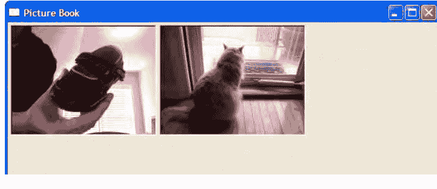

图 5.2：将图像显示为缩略图

如果您现在运行程序，应该能够看到两张照片，大小大致相同。图 **5.2** 显示了程序在 Windows 下运行时主窗口顶部的样子。这看起来好多了，可惜我们只有两张照片可以展示。当然，我们知道可以通过构造额外的 `Photo` 对象并将它们添加到相册中，以编程方式添加更多照片，但这并不是一个理想的解决方案。我们需要做的是为用户提供某种从磁盘选择 JPEG 文件并交互式构建相册的方法。接下来我们就添加这个功能。

#### 5.3 从文件导入照片

到目前为止，我们一直在手动构造一个 `Album` 并向其添加 `Photo` 对象。这显然无法继续发展；我们需要能够显示一个文件选择对话框，选择一个或多个照片文件，并从该列表创建一个相册。在这个迭代中，我们将了解 `FXMenuBar`、`FXMenuPane`、`FXMenuTitle` 和 `FXMenuCommand` 类如何协同工作，为应用程序配备带有下拉菜单的菜单栏。我们将看到如何使用 `connect()` 方法将 `FXMenuCommand` 按钮等部件连接到 Ruby 代码块。最后，为了向用户提供一种选择她想要导入到相册中的文件的方法，我们将显示一个 `FXFileDialog` 对话框，然后从中检索所选文件的名称。

当 Picture Book 的用户开始寻找导入照片的命令时，他们首先会想查看文件菜单。我们还没有这个菜单，所以现在添加一个。为了尽可能保持 PictureBook 类的 `initialize()` 方法简洁，我们将所有与构建菜单栏相关的代码放入一个新的实例方法 `add_menu_bar()` 中。这个方法需要做的第一件事是构建一个 FXMenuBar 实例，作为主窗口的子部件：

```ruby
def add_menu_bar
  menu_bar = FXMenuBar.new(self, LAYOUT_SIDE_TOP|LAYOUT_FILL_X)
end
```

既然您已经是老手了，您此时已经查阅了 FXMenuBar 类的 API 文档，并看到 `initialize()` 方法实际上有两个重载版本。我们将使用构建“不可浮动”菜单栏的版本，它有两个必需参数：父窗口（这并不意外）和一个选项值。作为老手，您也知道我们作为菜单栏父部件传入的 `self` 指的是 PictureBook 窗口，因为这是 PictureBook 类的一个实例方法。`LAYOUT_SIDE_TOP` 和 `LAYOUT_FILL_X` 布局提示告诉 FXRuby 将菜单栏放置在主窗口内容区域的顶部，并将其尽可能拉宽。

接下来，我们构建一个 FXMenuPane 窗口，作为 FXMenuBar 的子部件：

```ruby
file_menu = FXMenuPane.new(self)
```

菜单窗格将容纳文件菜单的所有命令。菜单窗格是一种弹出窗口，这意味着它只在公共场合短暂出现。当它被唤起时，它会“弹出”。您通过选择一个菜单命令与它交互，然后它会再次“弹出关闭”。您通过单击与该菜单窗格关联的 FXMenuTitle 部件来唤起菜单窗格。

```ruby
FXMenuTitle.new(menu_bar, "File", :popupMenu => file_menu)
```

这个有点棘手。FXMenuTitle 是 FXMenuBar 的子部件，但它还需要知道被激活时应该显示哪个菜单窗格，所以我们通过 `:popupMenu` 参数传入。现在我们有了一个菜单栏，以及一个文件菜单，是时候添加我们的第一个命令了：

> 3. Ruby 实际上并不支持真正的重载方法，至少不像其他一些编程语言实现的重载方法那样。然而，Ruby 确实允许方法检查传入参数的类型，FXRuby 就是这样模拟标准 FOX API 中的重载方法的。

```ruby
import_cmd = FXMenuCommand.new(file_menu, "Import...")
import_cmd.connect(SEL_COMMAND) do
  # ...
end
```

我们作为菜单窗格的子部件创建 FXMenuCommand 对象。通过在 `import_cmd` 上调用 `connect()`，我们将一个 Ruby 代码块与该命令关联起来。当用户从文件菜单中选择“导入...”命令时，我们希望显示一个文件选择对话框。为了实现这一点，`connect()` 块中应包含以下内容：

```ruby
dialog = FXFileDialog.new(self, "Import Photos")
dialog.selectMode = SELECTFILE_MULTIPLE
dialog.patternList = ["JPEG Images (*.jpg, *.jpeg)"]
if dialog.execute != 0
  import_photos(dialog.filenames)
end
```

我们首先构建一个 FXFileDialog 作为主窗口的子部件，并带有“导入照片”这个有用的标题。接下来，我们将此对话框的文件选择模式设置为 `SELECTFILE_MULTIPLE`，这意味着用户可以选择任意数量的现有文件进行导入。我们还为对话框设置了模式列表，以便它只显示以 `.jpg` 或 `.jpeg` 扩展名结尾的文件名，因为这些是我们唯一感兴趣的文件。最后，我们调用 `execute()` 来显示对话框并等待用户选择一些文件。

对话框的 `execute()` 方法返回一个完成代码 0 或 1，具体取决于用户是单击“取消”关闭对话框还是单击“确定”接受所选文件。如果用户单击“取消”，我们实际上不需要为这个命令做任何其他事情。否则，我们希望调用尚不存在的 `import_photos()` 方法将所选照片导入到我们的相册中。现在让我们将这个方法添加到 PictureBook 类中：

```ruby
def import_photos(filenames)
  filenames.each do |filename|
    photo = Photo.new(filename)
    @album.add_photo(photo)
    @album_view.add_photo(photo)
  end
  @album_view.create
end
```


`import_photos()` 方法会遍历从 FXFileDialog 收集到的文件名，并为每个文件名向 AlbumView 添加一张新照片。请注意，由于导入照片现在已成为将新照片添加到相册的首选方式，你可以删除之前在 `initialize()` 方法中那些硬编码的 `add_photo()` 调用。

如果你观察得足够仔细，可能已经注意到了 `import_photos()` 末尾调用相册视图 `create()` 方法的那行代码。我*希望*你注意到了它，因为如果你把它去掉就会发现，没有它的话你将看不到任何新导入的照片。

我们之前已经遇到过 `create()` 方法，那是在第一章构建 "Hello, World!" 应用程序的时候。当时我们提到过，调用 `create()` 可以确保应用程序的所有服务器端资源都被创建，目前我们就先讲到这里，把这个话题再往后放一放。我们将在后面**第 7.7 节**，*客户端与服务端对象*（第 **95** 页）中详细讨论这个话题。

不过还是回到当前的任务上来。既然已经到了这里，何不在 File 菜单中添加一个 Exit 命令呢？在 `add_menu_bar()` 方法中，紧接着设置 Import... 命令的代码之后，添加以下几行：

```
exit_cmd = FXMenuCommand.new(file_menu, "Exit")
exit_cmd.connect(SEL_COMMAND) do
  exit
end
```

要完成本次迭代，我们只需要在 `initialize()` 方法中添加对 `add_menu_bar()` 的调用。你的 PictureBook 类应该如下所示：

```
require 'fox16'

include Fox

require 'album'
require 'album_view'
require 'photo'

class PictureBook < FXMainWindow
  def initialize(app)
    super(app, "Picture Book", :width => 600, :height => 400)
    add_menu_bar
    @album = Album.new("My Photos")
    @album_view = AlbumView.new(self, @album)
  end
```

```
def add_menu_bar
  menu_bar = FXMenuBar.new(self, LAYOUT_SIDE_TOP|LAYOUT_FILL_X)
  file_menu = FXMenuPane.new(self)
  FXMenuTitle.new(menu_bar, "File", :popupMenu => file_menu)
  import_cmd = FXMenuCommand.new(file_menu, "Import...")
  import_cmd.connect(SEL_COMMAND) do
    dialog = FXFileDialog.new(self, "Import Photos")
    dialog.selectMode = SELECTFILE_MULTIPLE
    dialog.patternList = ["JPEG Images (*.jpg, *.jpeg)"]
    if dialog.execute != 0
      import_photos(dialog.filenames)
    end
  end
  exit_cmd = FXMenuCommand.new(file_menu, "Exit")
  exit_cmd.connect(SEL_COMMAND) do
    exit
  end
end

def import_photos(f tractography)
  filenames.each do |filename|
    photo = Photo.new(filename)
    @album.add_photo(photo)
    @album_view.add_photo(photo)
  end
  @album_view.create
end

def create
  super
  show(PLACEMENT_SCREEN)
end

if __FILE__ == $0
  FXApp.new do |app|
    PictureBook.new(app)
    app.create
    app.run
  end
end
```

此时运行程序，看看目前一切是否正常。程序启动时相册视图应该是空的，但你应该能够使用 File 菜单中的 Import... 命令来选择一些照片并将它们添加到相册中。下一页的图 **5.3** 展示了我在 Windows 上运行该程序并向相册导入了几张照片后的效果。

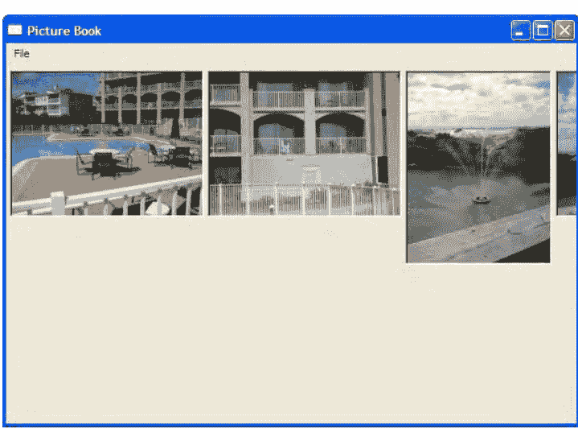

图 5.3：现在有了菜单

如果你仔细观察窗口的最右边缘，会发现最后一张照片被裁剪了。其实这甚至不是我导入的最后一张照片，只是其他照片已经完全超出屏幕了！看来我们获得的自由——想添加多少照片就添加多少——又一次让我们陷入了空间不足的困境。我们需要对 `AlbumView` 类做一点小改动来解决这个问题。

#### 5.4 动态重新配置相册视图

我们用作 `AlbumView` 类基础的 `FXMatrix` 布局管理器的默认配置并不太适合我们的需求：它只是把所有照片放在同一行中，一个接一个地排列。我们更希望它在一行中放置尽可能多的照片，然后根据需要使用额外的行来显示剩余的照片。为此，我们需要做一些改动。

第一个改动与 `FXMatrix` 布局管理器使用的整体布局算法有关。矩阵可以配置为按固定行数（默认行为）或固定列数来布局其子元素。由于我们希望固定列数并让行数动态变化，因此需要在相册视图的构造选项列表中传入 MATRIX_BY_COLUMNS 选项。我们修改后的 AlbumView 类的 initialize() 方法如下所示：

```
def initialize(p, album)
  super(p, :opts => LAYOUT_FILL|MATRIX_BY_COLUMNS)
  @album = album
  @album.each_photo { |photo| add_photo(photo) }
end
```

接下来，我们需要确定矩阵应该显示多少列。问题在于，列数取决于我们可用的空间大小以及能容纳多少列的照片。例如，如果相册视图窗口宽度为 800 像素，每张照片宽度为 200 像素，那么每行大约可以放四张照片。然而，如果窗口大小发生改变，变得更窄或更宽，我们就需要重新考虑。

为了应对相册视图当前宽度决定所需列数这一情况，我们将重写相册视图的 layout() 方法。每当分配给某个窗口的屏幕"空间"发生变化时，FOX 会确保调用该窗口的 layout() 方法，以便更新其子窗口的位置和大小。⁴ 我们将利用这一点，在矩阵执行布局之前重新计算列数。在 AlbumView 类中添加以下方法：

```
def layout
  self.numColumns = [width/PhotoView::MAX_WIDTH, 1].max
  super
end
```

我们重写的 layout() 方法的第二行使用 **super** 来调用基类的 layout() 方法。和往常一样，这是我们不想遗漏的一步。但让我们把注意力集中在第一行上，这才是我们实际赋值列数的地方。

⁴ 我们将在第 12 章，*管理布局*（第 159 页）中更详细地讨论布局管理器的工作原理。

从赋值右侧的表达式开始，`width` 指的是相册视图窗口的像素宽度。它看起来像是在引用一个变量，但实际上我们是在调用 `FXMatrix` 类的一个方法，该方法返回窗口的宽度。如果你在 API 文档中查找 `width()` 方法，会发现它实际上是在 `FXWindow` 类中定义的，而 `FXMatrix` 和许多其他 FXRuby 类都继承自该类。

`PhotoView::MAX_WIDTH` 引用让我们知道一张照片的最大可能宽度。请记住，相册视图的子窗口只是 `PhotoView` 实例。我们将总宽度除以照片的最大可能宽度，并将结果赋值给矩阵的 `numColumns` 属性。⁵

最后，以防用户将相册视图窗口缩小到实际宽度小于 `PhotoView::MAX_WIDTH` 的情况，我们需要保护自己免于将列数设置为零。如果我们构建一个包含数字 1 和 `numColumns` 计算结果的两元素数组，然后如这里所示调用数组的 `max()` 方法来返回两者中较大的值，就可以确保我们至少得到一列。

让我们看看我们的工作是否取得了成效。如果你运行应用程序并导入一批照片，现在应该能看到当相册视图中某一行变得太"满"时，会添加一个新行。下一页的图 **5.4** 展示了在我机器上运行该程序并放置了多张照片后的效果。你还应该能够调整主窗口的大小，使其变窄或变宽，并看到相册视图中的列数会根据可用空间动态变化。

不幸的是，这个改动只解决了我们部分问题。在做这个改动之前，放不下的照片会从窗口的右侧溢出。现在，如果你导入太多照片，会发现放不下的照片开始从窗口的*底部*溢出。要解决这个问题，我们需要借助另一个布局管理器的帮助。

⁵ 同样，虽然我将 `numColumns` 称为属性，但实际上我们只是在调用 `FXMatrix` 的一个名为 `numColumns()` 的实例方法。


#### 5.5 使相册视图可滚动

当我们决定使用 FXMatrix 布局管理器作为 AlbumView 类的基础时，已经对 FOX 的布局管理器有了初步了解。在本节中，我们将探讨另一种布局管理器——FXScrollWindow，并看看如何用它来解决我们当前的布局难题。

有时，你希望在窗口中显示的内容太大，无法放入该窗口的可见区域内。例如，如今许多数码相机能够拍摄高分辨率照片，其真实尺寸无法在典型的电脑显示器上完整显示。在这种情况下，你至少有两种选择。一种选择是缩小内容尺寸，使其适应窗口大小。但如果内容本身不适合缩放，或者你担心缩放会损失一些细节，那么另一种选择就是将内容放入一个可滚动的窗口中。

FOX 通过 FXScrollArea 和 FXScrollWindow 类提供了后一种方案。FXScrollWindow 是 FXScrollArea 的子类，在大多数情况下，当你需要在应用程序中提供可滚动的内容窗口时，这个类就是你要使用的。为了将此技术应用于“Picture Book”应用程序，我们将首先修改 AlbumView 类，使其成为 FXScrollWindow 的子类：

```
class AlbumView < FXScrollWindow
  # ...
end
```

接下来需要做的一系列修改涉及 AlbumView 的 `initialize()` 方法。快速查阅 FXScrollWindow^6 的 API 文档可知，它的 `initialize()` 方法只有一个必需参数，这与 FXMatrix 的 `initialize()` 方法情况相同，该参数就是父窗口。不过，我们将对调用基类 `initialize()` 方法的方式做一个小改动。除了父窗口，我们还将传递 LAYOUT_FILL 布局提示作为构造选项之一：

```
def initialize(p, album)
  super(p, :opts => LAYOUT_FILL)
  # ...
end
```

你将在第 12 章“管理布局”（第 159 页）中全面了解布局管理器和布局提示。目前，只需知道这个布局提示告诉 FXRuby，我们希望相册视图在水平和垂直方向上拉伸，以尽可能占据更多空间。

现在，我们已经初始化了相册视图的基类部分，接下来需要指定我们将滚动的内容是什么。FXScrollWindow 有一个子窗口被指定为其内容窗口。对于我们的应用程序，FXMatrix 实例就是我们希望使其可滚动的内容。因此，相册视图现在是一个 FXScrollWindow，其中包含一个 FXMatrix，而 FXMatrix 又包含一系列 PhotoView 实例：

```
def initialize(p, album)
  super(p, :opts => LAYOUT_FILL)
  @album = album
  FXMatrix.new(self, :opts => LAYOUT_FILL|MATRIX_BY_COLUMNS)
  @album.each_photo { |photo| add_photo(photo) }
end
```

6. http://www.fxruby.org/doc/api/classes/Fox/FXScrollWindow.html

图 5.5：使相册可滚动

请仔细阅读此部分，确保在继续阅读前理解发生了什么。例如，在第三行中，我们传递 **self** 作为 FXMatrix.new 的参数，这意味着什么？在此上下文中，**self** 指的是什么？你是否开始理解一个窗口（如 FXMatrix 窗口）作为另一个窗口（如 FXScrollWindow）的子窗口意味着什么？

对于本次迭代，对 AlbumView 类的最后修改发生在 `add_photo()` 和 `layout()` 方法中。首先，这是新增改进版 `add_photo()` 的样子：

```
def add_photo(photo)
  PhotoView.new(contentWindow, photo)
end
```

这个版本的 `add_photo()` 与之前的版本有细微差别。我们没有将 **self** 传递给 PhotoView.new，而是传递了滚动窗口的 `contentWindow()` 方法的结果。正如我之前提到的，FXScrollWindow 的内容窗口就是你添加给它的第一个（也是唯一的）子窗口——在本例中，就是 FXMatrix 小部件。因此，我们仍然将 PhotoView 对象构造为 FXMatrix 对象的子级，尽管现在这一点不如之前那么明显了。

我们需要对 `layout()` 方法进行类似的修改，因为 **self** 不再指代矩阵小部件，而是指代滚动窗口。这是新版本 `layout()` 的样子：

```
def layout
  contentWindow.numColumns = [width/PhotoView::MAX_WIDTH, 1].max
  super
end
```

在你完成对 AlbumView 类的所有修改后，它应该看起来像这样：

```
require 'photo_view'

class AlbumView < FXScrollWindow

  attr_reader :album

  def initialize(p, album)
    super(p, :opts => LAYOUT_FILL)
    @album = album
    FXMatrix.new(self, :opts => LAYOUT_FILL|MATRIX_BY_COLUMNS)
    @album.each_photo { |photo| add_photo(photo) }
  end

  def layout
    contentWindow.numColumns = [width/PhotoView::MAX_WIDTH, 1].max
    super
  end

  def add_photo(photo)
    PhotoView.new(contentWindow, photo)
  end
end
```

现在当你重新运行应用程序时，只要相册包含的照片数量超过屏幕上可以显示的数量，你就会看到窗口右侧出现一个垂直滚动条。它应该看起来像前一页的图 5.5。在这里，我稍微向下滚动了相册，以便可以看到相册中的一些额外照片。

我们在本章取得了很大进展。我们的程序从一个相当基础的单图像查看器，发展成为一个能够从磁盘加载任意数量照片并将其显示为可滚动窗口中缩略图的应用程序。然而，我们仍然受限于将所有照片放入同一个相册，并且还有许多其他问题需要解决，因此让我们继续前进。

# 第 6 章

### 第三次尝试：管理多个相册

在过去的几章中，我们在构建“Picture Book”应用程序的基础方面取得了非常好的进展。当你完成本章时，你可能会觉得我们撕毁了所有之前的工作，从头开始。情况并非完全如此，但为了跟踪多个相册，我们需要对应用程序进行一些重大的结构性修改。

我们将首先创建一个视图，该视图将允许我们显示相册列表中相册名称的列表，并允许用户在相册之间切换以查看其中包含的照片。在此过程中，我们将进行一系列其他更改，以继续推动提供有用的功能。

与前几章一样，在扩展应用程序的同时，我们将继续积累 FXRuby 开发知识。当我们使用 FXList 小部件作为 AlbumListView 类的基础时，我们将首先介绍该小部件。当我们遇到新的布局挑战时，我们将求助于 FXSplitter 和 FXSwitcher 布局管理器。我们将使用 FXInputDialog 作为从用户收集信息的一种极其简单的方式。也许最重要的是，当我们使用 FOX 强大的 GUI 更新机制时，我们将首次接触到它——该机制可以在用户从列表中选择新相册时自动更新相册视图的内容。那么，让我们回到工作中来。

#### 6.1 创建相册列表视图

首要任务是思考相册列表的视图以及我们可能如何实现它。在本节中，我们将学习如何使用 FXList 小部件来显示可供用户选择的项目列表。

如果你让思绪回到第 32 页图 3.1 中所示的构想用户界面，你会回想起我们希望在窗口左侧显示一个简单的相册名称列表。正如你将在后面的第 9 章“使用列表和表格小部件排序数据”（第 115 页）中读到的，FXRuby 提供了多种类型的小部件来处理类似列表的数据，因此我们有很多选择。让我们选择最明显的选择，即基本的 FXList 小部件。

创建一个新的 AlbumListView 类，作为 FXList 的子类，并给它一个 `initialize()` 方法，该方法接受父窗口、一些构造选项和一个 AlbumList 实例作为参数：

```
class AlbumListView < FXList

  attr_reader :album_list

  def initialize(p, opts, album_list)
    super(p, :opts => opts)
    @album_list = album_list
  end
end
```

现在我们想切换到 PictureBook 类，该类实现了主窗口，并在其 `initialize()` 方法中添加一些代码，以构造一个 AlbumListView 作为主窗口的子级。请注意，由于主窗口已经有几个子窗口——相册视图和菜单栏——因此这个列表视图将与这些窗口是“同级”关系。这是修改后的 `initialize()` 应有的样子：

```
def initialize(app)
  super(app, "Picture Book", :width => 600, :height => 400)
  add_menu_bar
  @album = Album.new("My Photos")
  @album_list = AlbumList.new
  @album_list.add_album(@album)
  @album_list_view = AlbumListView.new(self,
    LAYOUT_FILL_Y|LAYOUT_SIDE_LEFT, @album_list)
  @album_view = AlbumView.new(self, @album)
end
```


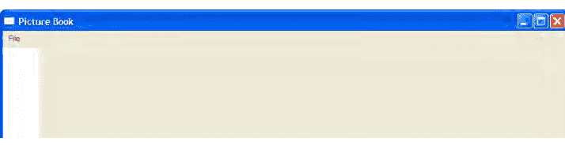

图 6.1：添加列表视图后

别忘了添加必要的 **require** 语句来导入 AlbumList 和 AlbumListView 类的定义：

Download picturebook_f/picturebook.rb

```
require 'album'
require 'album_list'
require 'album_list_view'
require 'album_view'
require 'photo'
```

现在，让我们运行程序，看看它是什么样子。图 6.1 显示了程序在 Windows 下运行时主窗口顶部的样子。显然，有些东西变了，但窗口左侧那个白色的条带应该是一个列表吗？

部分问题在于，我们的列表实际上还没有任何内容。首先，我们将为 AlbumListView 添加一个辅助方法，该方法为给定的专辑追加一个新的列表项：

Download picturebook_f/album_list_view.rb

```
def add_album(album)
  appendItem(album.title)
end
```

现在，让我们向 AlbumListView 的 `initialize()` 方法添加一些代码，使其遍历专辑列表中的所有专辑并添加每一个：

Download picturebook_f/album_list_view.rb

```
@album_list.each_album do |album|
  add_album(album)
end
```

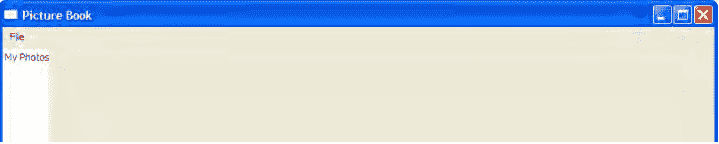

图 6.2：勉强够宽

现在再次运行程序。这一次，我们那个单个专辑（富有创意地命名为“My Photos”）的名称应该会出现在列表中。现在的问题（如图 6.2 所示）是列表的宽度刚好够显示整个专辑名称。实际上，根据 FOX 在你电脑上选择的默认字体大小，列表可能太窄而无法显示专辑名称，或者可能不成比例地宽。关键在于，你真的无法对空列表的默认宽度做任何假设。

FOX 确实提供了设置固定控件宽度的选项，所以我们可以为专辑列表选择某个任意宽度，这将解决问题——至少是目前。然而，展望未来，我们可能会添加一些名称更长的专辑，这将要求我们再次更改列表的固定宽度值。或许我们可以让列表动态调整自身大小，使其刚好能容纳最宽列表项的文本，但这似乎可能成为视觉上的干扰。我们需要的是一种布局，允许用户根据自己的喜好动态调整列表的宽度。为此，我们将使用一个分割器。

#### 6.2 使用分割视图

FXSplitter 是一个布局管理器，你可以用它来显示用户可调整大小的窗口。FXSplitter 是一种特殊的布局管理器，管理两个子窗口。当配置为水平分割器时，两个子窗口并排放置；当配置为垂直分割器时，一个子窗口在上，另一个在下。我们将使用水平类型的 FXSplitter。

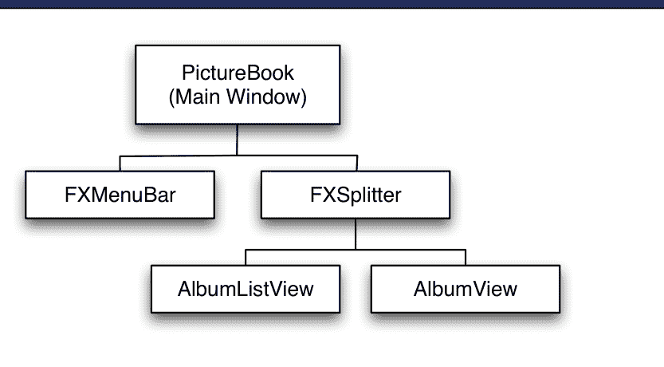

图 6.3：布局层次结构

计划如下：我们将创建一个分割器窗口作为主窗口的子窗口，然后将专辑列表视图和专辑视图作为分割器的子窗口。由于这些窗口的嵌套层次开始变深，请查看图 6.3 以了解正在发生什么。

首先，创建分割器作为主窗口的子窗口：

```
splitter = FXSplitter.new(self,
  :opts => SPLITTER_HORIZONTAL|LAYOUT_FILL)
```

接下来，使专辑列表视图和专辑视图窗口成为分割器的子窗口：

```
@album_list_view = AlbumListView.new(splitter,
  LAYOUT_FILL, @album_list)
@album_view = AlbumView.new(splitter, @album)
```

请注意，不再需要在专辑列表视图上指定 `LAYOUT_SIDE_LEFT` 提示。由于我们首先添加了专辑列表视图，它会自动分配到分割器的左侧，而专辑视图则分配到右侧。

以下是 PictureBook 类的 `initialize()` 方法在进行此组更改后的样子：

```
Download picturebook_g/picturebook.rb

def initialize(app)
  super(app, "Picture Book", :width => 600, :height => 400)
  add_menu_bar
  @album = Album.new("My Photos")
  @album_list = AlbumList.new
  @album_list.add_album(@album)
  splitter = FXSplitter.new(self,
    :opts => SPLITTER_HORIZONTAL|LAYOUT_FILL)
  @album_list_view = AlbumListView.new(splitter,
    LAYOUT_FILL, @album_list)
  @album_view = AlbumView.new(splitter, @album)
end
```

现在当你运行程序时，如果鼠标位于列表和专辑视图之间的边缘，鼠标光标应该会变成一组带有向外箭头的垂直线的形状。当鼠标光标是这种形状时，你可以按住鼠标左键“抓住”分割器，左右拖动它来调整分割大小，然后释放鼠标按钮。

#### 6.3 在专辑之间切换

到现在为止，你应该已经对布局管理器的概念以及如何使用它们来解决各种布局问题感到相当熟悉了。我们在创建专辑视图时了解了 FXMatrix 布局管理器，在上一节中，我们学习了如何使用 FXSplitter 来管理可能需要由用户调整大小的窗口。在本节中，我们将学习另一个布局管理器：FXSwitcher。

当用户从专辑列表中选择一个新专辑时，我们希望专辑视图能更新自己，以显示新选定专辑中的照片。一种方法是首先移除与先前选定专辑关联的所有 PhotoView 实例，然后使用新选定专辑中的照片重新填充 AlbumView。这当然可行；FOX 在创建和销毁窗口方面非常高效，对于包含相对少量照片的专辑来回切换，用户可能不会注意到太大的延迟。然而，这不是一个非常节省资源的解决方案，对于较大的专辑，重新加载所有图像文件并为它们创建 FXJPGImage 对象所需的时间会太长。

一个更好的解决方案是为库中的每个专辑构建一个 AlbumView 实例，然后使用 FOX 的 FXSwitcher 布局管理器在这些专辑视图之间快速来回切换。一个 switcher 可以包含任意数量的子窗口，但它一次只显示其中一个。可以把它想象成一叠卡片，只有最上面的卡片是可见的。1

我们将再次更改布局，使 FXSplitter 的右窗格包含一个 FXSwitcher。然后，我们将 AlbumView 窗口设为 FXSwitcher 的子窗口。图 6.4（在下一页）显示了修订后的父子层次结构。第一步是创建 switcher 作为分割器的子窗口，它将接管先前由专辑视图占据的位置：

```
@switcher = FXSwitcher.new(splitter, :opts => LAYOUT_FILL)
```

现在修改对 AlbumView.new 的调用中的第一个参数，使 switcher 成为专辑视图的新父窗口：

```
AlbumView.new(@switcher, @album)
```

请注意，我们不再需要在 @album_view 中保留对单个 AlbumView 实例的引用。如果我们要处理多个专辑，我们真的需要开始考虑对*当前*专辑视图的操作。实际上，让我们编写一个便捷函数，询问专辑列表当前选定专辑的索引，然后返回具有相同索引的 switcher 子窗口：

```
def current_album_view
  @switcher.childAtIndex(@switcher.current)
end
```

然后我们可以基于此提供一个 `current_album()` 方法：

```
def current_album
  current_album_view.album
end
```

1. 如果你曾经使用过 Java 的 Swing 工具包，你会认出这就是 FOX 等同于 CardLayout 布局管理器的版本。

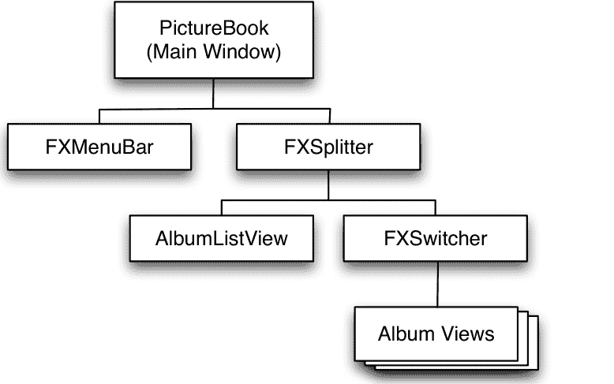

图 6.4：使用 switcher

趁此机会，修改 `import_photos()` 方法，以确保它总是将照片导入到当前选定的专辑中：

```
def import_photos(filenames)
  filenames.each do |filename|
    photo = Photo.new(filename)
    current_album.add_photo(photo)
    current_album_view.add_photo(photo)
  end
  current_album_view.create
end
``

我们为了能够查看多个照片专辑确实付出了很多努力。你说我们最终是不是该开始向集合中实际添加另外一两个专辑了？


#### 6.4 添加新相册

在前一章中，你学习了如何使用一种对话框——`FXFileDialog`，为用户提供一个与文件系统交互的界面来选择文件。在本节中，我们将学习如何使用`FXInputDialog`从用户那里收集不同类型的输入。我们还将介绍 FOX 的 GUI 更新机制，这是一种强大且有用的方法，用于保持用户界面与整体应用程序状态的同步。

到目前为止，我们一直只处理单个相册，尽管我们已经在代码中做了很多修改以适应多个相册。让我们进入最后冲刺阶段，为“文件”菜单添加一个新命令。找到你的`add_menu_bar()`方法，并为“New Album...”命令设置脚手架。你知道怎么做：

```ruby
new_album_command = FXMenuCommand.new(file_menu, "New Album...")
new_album_command.connect(SEL_COMMAND) do
    # ...
end
```

我们需要做的就是提示用户输入新相册的名称，根据该名称创建一个新相册，并将其添加到相册列表和相册列表视图中。要获取名称，我们将使用`FXInputDialog`类：

```ruby
album_title =
    FXInputDialog.getString("My Album", self, "New Album", "Name:")
```

如果用户点击“取消”按钮，`getString()`方法将返回`nil`。否则，`getString()`将返回新相册的标题，我们可以用它来执行命令的其余部分：

```ruby
if album_title
    album = Album.new(album_title)
    @album_list.add_album(album)
    @album_list_view.add_album(album)
    AlbumView.new(@switcher, album)
end
```

最终成品应该看起来像这样：

```ruby
new_album_command = FXMenuCommand.new(file_menu, "New Album...")
new_album_command.connect(SEL_COMMAND) do
  album_title =
    FXInputDialog.getString("My Album", self, "New Album", "Name:")
  if album_title
    album = Album.new(album_title)
    @album_list.add_album(album)
    @album_list_view.add_album(album)
    AlbumView.new(@switcher, album)
  end
end
```

如果你此时运行程序并尝试添加一个相册，你应该会看到新相册的名称出现在相册列表中。如果你随后在列表中点击该项目，你可能期望在相册视图中看到一个全新的、空的相册。如果你这样做了并且这是你所期望的，那么，你会感到失望的。这是因为我们还没有告诉切换器你已经从相册列表中选择了一个新项目——到目前为止，它们之间没有连接。

在许多 GUI 工具包中，解决这个问题的方法是回到相册列表控件，编写一些代码来响应新的列表选择，从而更新切换器。你也可以在 FXRuby 中这样做，但我要向你展示一种略有不同的方法。我们将使用 FOX 的 GUI 更新机制，让切换器根据列表选择自行更新。

回到`PictureBook`的`initialize()`方法，在切换器创建之后添加这个代码块：

```ruby
@switcher.connect(SEL_UPDATE) do
  @switcher.current = @album_list_view.currentItem
end
```

通过为切换器定义一个`SEL_UPDATE`处理器，我们是在告诉 FOX 如何在应用程序状态发生变化时更新切换器的状态。当前显示的切换器项目应反映当前选中的列表项。这个更新处理器会自动为我们调用。我们将在*第 7.4 节，同步用户界面与应用程序数据*（第 **91** 页）中更详细地讨论 GUI 更新机制。

现在我们应该已经正确连接了所有内容。让我们做一个小实验。启动程序，并将一组照片导入到初始相册中。现在，向列表中添加一个新相册，并选择该相册。切换器应该正确地更新自身，并向你显示新的（且空的）相册。将一些照片导入此相册，然后确认你可以在这两个相册之间来回切换。如果你真的想疯狂一下，再添加一两个相册。也许可以邀请邻居过来看看。

#### 6.5 使用 YAML 序列化相册列表

在最后一步中，我们将学习如何使用 Ruby 的 YAML Ain't Markup Language (YAML) 库将应用程序数据保存到文件，然后在程序启动时读回这些数据。尽管这与 FXRuby 开发没有直接关系，但我们将看到，为了确保在加载新相册数据后用户界面正确更新，我们需要对应用程序代码进行一些更改。

如果你一直在运行该应用程序，你可能已经发现了一个恼人的问题。每次程序启动时，你都会面对一个空白页面，必须重新创建相册并重新导入照片。我们显然需要做一些规定，以便在程序退出时将相册列表持久化到磁盘，并在程序重新启动时重新加载这些相册。

我们可以通过多种方式实现这一点。如果你有 Java 编程背景，你的第一直觉可能是设计一个 XML 模式来描述相册列表、相册及其包含的照片之间的关系。XML 不会是你最糟糕的选择，而且它是一种广为人知的、人类可读的结构化数据存储方式。Ruby 的标准库甚至包括 REXML，一个用于读写 XML 文档的优秀模块。然而，尽管很流行，XML 并不总是每个数据存储问题的最佳解决方案。

另一个选择是将信息存储在关系数据库中。同样，如果这对你的应用程序有意义，Ruby 提供了出色的数据库操作支持，但对于我们目前的需求来说，这感觉像是一种相当重量级的解决方案。Ruby 的标准库通过 Marshal 和 YAML 模块提供了对两种轻量级序列化方案的支持。

我不太喜欢非人类可读的数据，而且由于 Ruby 的 Marshal 模块以专有的二进制格式存储其数据，我们将使用 YAML 文件作为 Picture Book 应用程序数据的持久化存储。

首先，简单部分。让我们编写一些代码将相册列表的内容保存到文件中。`store_album_list()`方法创建一个名为`picturebook.yml`的文件，并使用`YAML.dump`方法写出相册列表数据：

```ruby
def store_album_list
  File.open("picturebook.yml", "w") do |io|
    io.write(YAML.dump(@album_list))
  end
end
```

我们希望在用户从“文件”菜单中选择“退出”命令时执行此操作，因此让我们修改退出处理程序，在调用`exit()`之前添加一个对`store_album_list()`的调用：

```ruby
exit_cmd.connect(SEL_COMMAND) do
  store_album_list
  exit
end
```

现在，棘手的部分。显然，我们需要做的关键事情是尝试加载保存的相册列表文件（如果存在的话）。如果不存在，我们将回退到目前的默认行为，构建一个包含一个相册的新相册列表：

```ruby
begin
  @album_list = YAML.load_file("picturebook.yml")
rescue
  @album_list = AlbumList.new
  @album_list.add_album(Album.new("My Photos"))
end
```

别忘了在`picturebook.rb`的顶部添加一个`require`语句来导入 YAML 库：

```ruby
require 'yaml'
```

让我们将根据相册列表内容填充`AlbumListView`相关的代码提取到一个访问器方法中：

```ruby
def album_list=(albums)
  @album_list = albums
  @album_list.each_album do |album|
    add_album(album)
  end
end
```

每当一个新的`AlbumList`实例被赋值给`AlbumListView`时，这段代码将为列表中的每个相册调用`add_album()`。既然这个访问器方法已经就位，我们实际上不再需要将相册列表传递给列表视图的`initialize()`方法了，因此让我们从参数列表中移除该参数：

```ruby
def initialize(p, opts)
  super(p, :opts => opts)
end
```

我们还需要修改`PictureBook`中实际构造`AlbumListView`的那一行，并确保我们不再将相册列表传递给`AlbumListView.new()`：

```ruby
@album_list_view = AlbumListView.new(splitter, LAYOUT_FILL)
```

不过，别忘了实际将相册列表赋值给视图。否则，我们永远看不到相册的内容：

```ruby
@album_list_view.album_list = @album_list
```

现在在`add_album()`方法中添加一行，以便在添加列表项的同时创建一个新的`AlbumView`：

```ruby
def add_album(album)
  appendItem(album.title)
  AlbumView.new(@switcher, album)
end
```


为了让这一切正常工作，我们需要一种方法让 `AlbumListView` 知道切换器的存在：

```
Download picturebook_i/album_list_view.rb

def switcher=(sw)
  @switcher = sw
end
```

以下是改进后的 `AlbumListView` 的样子：

```
Download picturebook_i/album_list_view.rb

class AlbumListView < FXList

  attr_accessor :album_list

  def initialize(p, opts)
    super(p, :opts => opts)
  end

  def album_list=(albums)
    @album_list = albums
    @album_list.each_album do |album|
      add_album(album)
    end
  end

  def switcher=(sw)
    @switcher = sw
  end

  def add_album(album)
    appendItem(album.title)
    AlbumView.new(@switcher, album)
  end
end
```

最后的一对小改动发生在 `PictureBook` 的 `initialize()` 方法中。首先，我们为相册列表视图设置切换器：

```
Download picturebook_i/picturebook.rb

@album_list_view.switcher = @switcher
```

最后，由于将相册列表分配给相册列表视图会触发对列表中每个相册的 `add_album()` 调用，而且我们更新后的 `add_album()` 版本会创建一个与新增相册对应的 `AlbumView`，因此我们可以（而且应该）从 `PictureBook` 的 `initialize()` 方法中移除构造默认 `AlbumView` 对象的那一行。

由于这些行在 initialize() 中的顺序很重要，以下是 initialize() 方法的最终版本应该有的样子：

Download picturebook_i/picturebook.rb

```
def initialize(app)
  super(app, "Picture Book", :width => 600, :height => 400)
  add_menu_bar
  begin
    @album_list = YAML.load_file("picturebook.yml")
  rescue
    @album_list = AlbumList.new
    @album_list.add_album(Album.new("My Photos"))
  end
  splitter = FXSplitter.new(self,
    :opts => SPLITTER_HORIZONTAL|LAYOUT_FILL)
  @album_list_view = AlbumListView.new(splitter, LAYOUT_FILL)
  @switcher = FXSwitcher.new(splitter, :opts => LAYOUT_FILL)
  @switcher.connect(SEL_UPDATE) do
    @switcher.current = @album_list_view.currentItem
  end
  @album_list_view.switcher = @switcher
  @album_list_view.album_list = @album_list
end
```

至此，你应该能够使用 Picture Book 来创建相册并向其中添加照片，而无需担心退出程序后所有工作都会丢失。这就是我们要就此停止 Picture Book 开发的地方，但在转向其他主题之前，让我们花一分钟想想一些你可能在读完本书后想要做的额外增强功能。

#### 6.6 那么，现在怎么办？

在过去的三章中，我们成功地大幅扩展了 Picture Book 的功能，而对代码库的改动相对较少。随着你对 FXRuby 开发越来越熟悉，你会发现它是一种非常灵活的工具包，可以用来以这种方式构建应用程序。

这个练习的目的与其说是构建一个真实的应用程序，不如说是让你体验一下使用 FXRuby 开发应用程序的感觉，并向你介绍许多将在你自己的项目中使用的技术。话虽如此，你可以对 Picture Book 做一些改进。

例如，Picture Book 目前仅支持导入和显示 JPEG 图像。在第 11 章《*创建视觉丰富的用户界面*》中，第 142 页，我们将更详细地介绍 FOX 支持的各种图像格式。掌握了这些知识，你应该能够扩展 Picture Book，使其能够导入和显示几乎任何类型的图像数据。你可能还会得到一些关于其他类型的图像处理的想法，比如裁剪和旋转图像，你希望你的 Picture Book 版本能够支持这些功能。

Picture Book 目前的另一个限制是，图像缩略图的大小被硬编码为 200 像素见方。在第 8 章《*构建简单部件*》中，第 100 页，你将了解到一些可以构建到用户界面中以获取用户输入的其他类型的部件。你可能会决定使用其中一些工具，允许用户编辑缩略图大小、照片或相册名称，或其他种类的应用程序数据。

或者考虑相册列表。我们对该列表的组织结构有点不够灵活，因为我们无法将相似的相册分组到文件夹中——它只是一个大的扁平列表。在第 9 章《*使用列表和表格部件排序数据*》中，第 115 页，我们将研究（除其他内容外）`FXTreelist` 部件，你可以用它来展示一种更深层次的相册列表。

你不可能从本书中了解到 FOX 和 FXRuby 的每一个角落和缝隙，但当你读完时，你将拥有足够坚实的基础，去探究该工具包提供的更多高级功能。随着你在本书剩余部分及以后的学习，我希望你会受到启发，将 Picture Book 作为一种测试平台，用于尝试你在 FXRuby GUI 开发中学到的新东西。

# 第二部分

## FXRuby 基础

# 第 7 章

### FXRuby 内幕

既然我们已经从头到尾完成了整个应用程序的创建工作，是时候更深入地了解 FXRuby 实际是如何工作的了。虽然你当然可以凭借对 FXRuby 库的肤浅理解来应付，但花时间学习 FXRuby 的内部工作原理可以帮助你编写更灵活、可维护且高效的应用程序。

在构建 Picture Book 应用程序的过程中，我们学习了如何使用 `connect()` 方法将一些用户操作（如鼠标点击）与 Ruby 代码块关联起来。该功能构建在一个强大的事件驱动消息系统之上，在本章中，我们将学习更多关于如何利用该系统来处理多种应用程序事件的知识。FOX 使用相同的事件系统作为其自动 GUI 更新机制的基础，以保持用户界面与应用程序数据同步。我们将更仔细地研究这是如何与各种 FXRuby 部件协同工作的，以及如何使用数据目标作为直接处理 GUI 更新引擎的更高级替代方案。

FOX 的创建者对 FOX 是周围最快且最节省资源的 GUI 工具包之一深感自豪，尽管理解 FOX 用于实现性能的所有优化并不关键，但我们将探讨其中一些最重要的优化。FOX 确保你的应用程序保持快速响应的一种方式是实际延迟布局计算和用户界面的后续重绘。FOX 还在客户端和服务器端用户界面对象的表示之间做出了比其他 GUI 工具包更明确的区分，因此我们将了解管理这些不同表示如何帮助你最大限度地减少应用程序的资源使用。


到本章结束时，你将对 FXRuby 的内部工作原理有更深入的理解，并且你将拥有攻克本书其余部分所需的坚实基础。

#### 7.1 事件驱动编程

你在 Ruby 中编写的许多脚本和程序都遵循相当可预测的路径。一个典型的程序可能会打开一个文件，读取一些数据，对这些数据执行计算，并报告其结果。该程序可能包含一些条件逻辑，使其根据输入数据分支并执行不同的操作，但你可以指望它按有序的方式执行操作。

FXRuby 程序是事件驱动的，行为方式略有不同。经过一些初始化后，FXRuby 程序进入所谓的*事件循环*：程序等待事件发生，响应该事件，然后继续等待下一个事件。最常见的是用户生成事件，无论是通过点击鼠标按钮、在文本字段中输入一些文本，还是执行其他操作。其他时候，是操作系统或窗口系统生成事件，例如发出信号。其他 GUI 工具包以各种方式实现事件驱动编程，但 FXRuby 将事件建模为一个对象（即*发送者*）向另一个对象（即*目标*）发送消息（参见图 7.1）。

##### 消息类型、标识符和数据

从 FXRuby 对象发送到另一个对象的每条消息都包含一个*消息类型*、一个*消息标识符*和一些*消息数据*。消息类型是一个名称以 `SEL_` 开头的常量。你已经见过一些这类示例，其中最著名的是 `SEL_COMMAND` 消息类型。

消息标识符也是一个常量，它被目标（消息的接收者）用来区分同一类型的不同传入消息。例如，如果目标期望从两个不同的发送者接收 `SEL_CHANGED` 消息，它可能会依赖发送者在发送消息时使用两个不同的消息标识符值。同样，如果目标想要对同一消息类型实现不同的行为，它可能需要多个消息标识符。例如，当 `FXTextField` 控件收到标识符为 `ID_CURSOR_HOME` 的 `SEL_COMMAND` 消息时，它会将光标移动到行首，但当它收到标识符为 `ID_CURSOR_END` 的 `SEL_COMMAND` 消息时，它会将光标移动到行尾。

最后，消息数据只是一个为消息提供一些额外上下文的对象。例如，当一个 `FXText` 对象向其目标发送 `SEL_INSERTED` 消息时，它会随附一个 `FXTextChange` 对象，该对象指示插入了哪些文本以及插入的位置。

你可以使用 API 文档来确定特定控件向其目标发送哪些消息类型，以及这些消息的消息数据。例如，下一页的图 7.2 展示了 `FXTable` 类文档的一部分。¹ 请注意，在 "Events" 标题下，有一个表格列出了 `FXTable` 向其目标发送的每种消息类型和每条消息的重要信息。在每个 FXRuby 控件的 API 文档中都有类似的信息。

##### 消息与目标

既然 FOX 的目标-消息系统是这样工作的，那么在我们的应用程序代码中，我们需要做些什么才能让它真正响应这些消息呢？假设你的应用程序包含一个表格控件，你想知道用户何时点击该表格中的某个单元格，以便可以显示该单元格中数据的一些额外详细信息。你会首先查阅 `FXTable` 类的 API 文档，看看当用户点击表格单元格时它发送什么类型的消息。事实证明，有多个候选类型（包括 `SEL_COMMAND`、`SEL_CLICKED` 和 `SEL_SELECTED`）听起来都符合要求。

1. 你可以在线查看此页面：http://www.fxruby.org/doc/api/classes/Fox/FXTable.html。

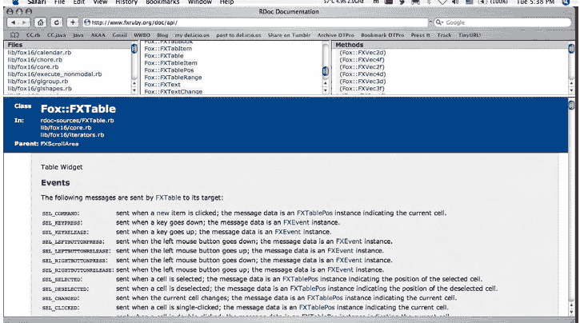

这并非偶然。即使单个动作（如点击表格单元格）可能导致触发多种类型的消息，但每种消息类型都关联着不同的语义。例如，`SEL_SELECTED` 消息与新单元格被选中有关，无论该选择是通过鼠标点击交互式发生的，还是通过调用表格的 `selectRange()` 方法以编程方式发生的。`SEL_CLICKED` 和 `SEL_COMMAND` 之间的区别更为微妙。如果用户点击表格的任何位置，表格会发送 `SEL_CLICKED` 消息，但只有当点击实际发生在表格单元格内部时，它才会随后发送 `SEL_COMMAND` 消息。

在这个示例中，`SEL_COMMAND` 消息是最合适的候选者。这也并非偶然。在大多数情况下，控件发送给其目标的最有用的消息就是它的 `SEL_COMMAND` 消息。`SEL_COMMAND` 的具体含义当然因不同类型的控件而异，但你总是可以将其视为与该控件的主要功能相关（例如按下按钮或在文本字段中输入文本）。

既然我们已经确定将 `SEL_COMMAND` 作为我们要处理的表格消息，我们需要告诉 `FXTable` 对象哪个对象是其消息目标，以及它在向该目标发送消息时应使用哪个消息标识符。一种方法是在构建表格时指定目标和消息标识符：

```
table = FXTable.new(p,
    :target => target_object, :selector => message_identifier, ...)
```

你也可以在构建表格后使用 `target` 和 `selector` 属性分配（或更改）目标和消息标识符：

```
table.target = target_object
table.selector = message_identifier
```

作为聪明的读者，你可能已经注意到（由于历史原因）用于读取或设置消息标识符的属性被命名为 `selector`。相信我，它真的只是消息标识符。

现在，在对话的这个阶段，我可以详细介绍如何设置消息映射，以告诉目标对象在接收到特定消息类型和标识符的消息时调用其哪个方法。那些在 FXRuby 早期开发期间坚持下来的勇敢灵魂们不得不经历那个过程，而使用 FOX 库进行 C++ GUI 应用程序开发的人们*仍然*必须这样做。好消息是，在很大程度上，FXRuby 用户不再需要处理 FOX 风格的消息映射了。²

##### 将消息连接到代码

`connect()` 方法提供了一种直接的方式将控件发送的消息连接到处理它们的代码块。在底层，`connect()` 方法创建一个目标对象和消息标识符，然后将它们分配给消息发送者，因此我们并没有从根本上改变 FOX 事件驱动编程模型的工作方式。但对你作为应用程序程序员来说，这意味着处理来自表格的 `SEL_COMMAND` 消息只需要几行代码：

```
table.connect(SEL_COMMAND) do |sender, selector, data|
    # 处理表格单元格内的点击
end
```

在这个示例中，我们只是向 `connect()` 传递了一个参数，它是我们感兴趣处理的消息类型。有一个变体我稍后会介绍，但这是最常见的形式。我们将来自表格的 `SEL_COMMAND` 消息 "连接" 到一个接受三个参数的 Ruby 代码块。你在代码块中为这些参数命名当然取决于你自己，只要你保持它们的含义清晰。第一个参数，我们命名为 `sender`，是发送消息的对象（表格）的引用。第二个参数 `selector` 是一个组合了消息类型和标识符的值（稍后会详细介绍）。第三个参数 `data` 是消息数据的引用。

根据 `FXTable` 类的 API 文档，与 `SEL_COMMAND` 消息关联的消息数据是一个表示当前单元格的 `FXTablePos` 实例。由此，我们可以提取被点击单元格的行号和列号：

```
table.connect(SEL_COMMAND) do |sender, selector, data|
  puts "用户点击了行: #{data.row}, 列: #{data.col} 的单元格"
end
```

调用 `connect()` 有一种稍有不同的方式，当你想将相同的处理代码用于多个控件，或者只想将处理代码提取到其自身的方法中时，这种方式很有用。这种变体涉及向 `connect()` 传递一个 `Method` 实例（或其他某种可调用对象，如 `Proc` 实例）作为第二个参数：

```
def table_cell_clicked(sender, selector, data)
  puts "用户点击了行: #{data.row}, 列: #{data.col} 的单元格"
end
```

```
table.connect(SEL_COMMAND, method(:table_cell_clicked))
```

这两种形式在功能上是等效的，选择哪一种主要取决于个人偏好。我确实建议你，如果处理代码超过几行，最好将其提取到一个单独的方法中，主要是为了保持代码的可读性。

最后，我之前提到过处理程序的第二个参数是一个组合了消息类型和标识符的值。你可以使用 `FXSELTYPE()` 方法从中提取消息类型，使用 `FXSELID()` 方法提取标识符：

```
table.connect(SEL_COMMAND) do |sender, selector, data|
  puts "消息类型是: #{FXSELTYPE(selector)}"
  puts "消息标识符是 #{FXSELID(selector)}"
end
```

实际上，这些信息并不是非常有用，因为你通常知道你正在处理哪种消息类型。但是，如果你使用同一个方法来处理来自多个对象的消息，它可能会很有用。

2. 对于那些特别好奇的人，这个主题在 *FXRuby 用户指南* 中有更详细的介绍：[http://www.fxruby.org/doc/events.html](http://www.fxruby.org/doc/events.html)。


#### 7.2 鼠标与键盘事件

根据你试图构建的应用程序的复杂程度，你可能无需直接处理底层的鼠标和键盘事件。例如，你已经看到 FOX 会将鼠标按钮点击合成为 `SEL_COMMAND` 以及其他从控件到其目标的消息类型。尽管如此，在某些情况下，你确实需要获取基本的鼠标和键盘事件数据，本节将介绍如何做到这一点。

##### 处理鼠标事件

大多数情况下，FOX 会将与鼠标相关的消息发送到鼠标光标所指向的窗口。³ 当左键按下时，FOX 会向该窗口发送一条 `SEL_LEFTBUTTONPRESS` 消息；当左键释放时，FOX 会发送相应的 `SEL_LEFTBUTTONRELEASE` 消息。如果你使用的是双键或三键鼠标，还会有相应的 `SEL_MIDDLEBUTTONPRESS`、`SEL_MIDDLEBUTTONRELEASE`、`SEL_RIGHTBUTTONPRESS` 以及 `SEL_RIGHTBUTTONRELEASE` 消息。如果你的鼠标有滚轮，当滚轮向上或向下滚动时，FOX 会发送一条 `SEL_MOUSEWHEEL` 消息。

与鼠标和键盘事件（以及许多其他消息类型）相关联的消息数据是一个 `FXEvent` 对象。通常，你对于按钮按下和释放消息唯一关心的就是它们发生了，因此关联的消息数据并不重要。然而，对于某些应用程序，你可能还想确切知道当鼠标按钮按下（或释放）时鼠标光标指向的位置。在这些情况下，你可以检查消息数据的 `win_x` 和 `win_y` 属性的值，它们会告诉你事件发生窗口的本地坐标系中的 x 和 y 坐标。

```ruby
my_window.connect(SEL_LEFTBUTTONPRESS) do |sender, sel, event|
  p "Button pressed at coordinates (#{event.win_x}, #{event.win_y})"
end
```

或者，你可以查看 `root_x` 和 `root_y` 属性来获取事件的根窗口坐标。

³ 我说“大多数情况下”是因为在某些情况下（例如拖放操作），其他窗口可以临时“抓取”鼠标并拦截所有与鼠标相关的消息，无论鼠标光标指向哪个窗口。

当鼠标移动时，你会收到一条 `SEL_MOTION` 消息。与按钮按下和释放事件的情况一样，消息数据将指示鼠标光标的当前位置（鼠标移动到了哪里）。FOX 还会通过 `last_x` 和 `last_y` 属性跟踪上一个鼠标位置。请注意，`last_x` 和 `last_y` 的值是窗口坐标，而不是根坐标。

##### 处理键盘事件

在上一节中，我们讨论了与鼠标相关的消息如何发送到鼠标光标所指向的窗口。同样，与键盘相关的消息总是发送到当前持有键盘焦点的窗口。

当用户在键盘上按下按键时（即当按键被按下时），FOX 会向当前获得焦点的对象发送一条 `SEL_KEYPRESS` 消息。当他们释放按键时，FOX 会发送一条 `SEL_KEYRELEASE` 消息。在这两种情况下，随消息发送的数据都是一个 `FXEvent` 实例，其中包含有关消息生成时按下哪些按键的信息。你最关心的 `FXEvent` 属性是 `code` 和 `state` 属性（以及，在较小程度上，`text` 属性）。

事件代码告诉你按下了（或释放了）哪个键。它的值将对应于 Fox 模块的 API 文档中列出的符号常量之一。⁴ 这些常量的名称都以 `KEY_` 为前缀，在大多数情况下，按键代码常量都有一个合理的名字。例如，当你按下 `a` 键时，事件代码将等于 `KEY_a`。对于一些更晦涩的情况，你可能需要进行一些“逆向工程”来弄清楚 FOX 发送给你的是哪个按键代码，例如，打印出它的数值，然后在文档中查找常量名称。

事件状态告诉你在事件生成时按下了哪些（如果有）修饰键。你可以通过将事件状态与图 7.3（下一页）中列出的修饰符标志进行逻辑与运算来测试它。例如，以下代码在事件生成时如果按下了 Shift 键，则将 `shift_check.checkState` 的值设置为 true：

```ruby
self.connect(SEL_KEYPRESS) do |sender, sel, event|
  shift_check.checkState = (event.state & SHIFTMASK) != 0
end
```

⁴ 可在线访问 http://www.fxruby.org/doc/api/classes/Fox.html

| 修饰符标志 | 含义 |
|---|---|
| `ALTMASK` | 按下了 Alt 键 |
| `CAPSLOCKMASK` | 按下了 Caps Lock 键 |
| `CONTROLMASK` | 按下了 Ctrl 键 |
| `METAMASK` | 按下了 Meta 键 |
| `NUMLOCKMASK` | 按下了 NumLock 键 |
| `SCROLLLOCKMASK` | 按下了 ScrollLock 键 |
| `SHIFTMASK` | 按下了 Shift 键 |

图 7.3：按键修饰符标志

我们将在第 8.1 节《与按钮的交互》（第 104 页）中重新讨论键盘相关事件的问题，届时我们将探讨如何为控件定义加速器和热键。

#### 7.3 定时器、任务、信号和输入事件

鼠标和键盘事件总是由用户直接与应用程序交互而产生的。然而，在 FXRuby 应用程序中还可以发生许多其他类型的事件，以下各节将描述如何在你的应用程序中处理这些事件。

##### 使用超时事件调度任务

当你向应用程序注册一个 `超时事件` 时，你是在要求 FOX 在未来的某个时刻向你的应用程序发送一条消息。例如，假设你想为应用程序添加定时备份功能，并每五分钟自动保存用户的工作：

```ruby
app.addTimeout(5*60*1000) do
  # invoke the "save" operation
end
```

`addTimeout()` 的第一个参数是 FOX 在触发超时事件之前应该等待的时间量（以毫秒为单位）。不过，前面显示的代码并没有完全达到我们的要求，因为超时事件是一次性的；一旦它触发，FOX 就会忘记最初的请求。

为了让超时每五分钟发生一次，我们需要传入 `:repeat` 参数：

```ruby
app.addTimeout(5*60*1000, :repeat => true) do
  # invoke the "save" operation, then re-register the timeout
end
```

如果你更喜欢将超时处理代码从代码块移到方法中，你可以改为将一个 `Method` 对象作为第二个参数传递给 `addTimeout()`：

> 请注意，当你使用实例方法作为超时处理程序时，方法签名必须包含三个标准的虚拟参数，如本例所示。

```ruby
def save_data(sender, sel, data)
  # ...
end
```

```ruby
app.addTimeout(5*60*1000, method(:save_data), :repeat => true)
```

`addTimeout()` 方法返回一个值，该值仅在你需要确定超时事件是否仍在挂起、找出超时发生前还剩多少时间，或在超时事件触发前取消它时才有用：

```ruby
timeout = app.addTimeout(5*60*1000, :repeat => true) do
  # invoke the "save" operation, then re-register the timeout
end

# Elsewhere in the application code
if app.hasTimeout?(timeout) && app.remainingTimeout(timeout) < 30000
  app.removeTimeout(timeout)
end
```

这段代码的意思是，如果之前注册的超时仍然处于活动状态，并且在该超时再次触发前剩余时间少于三十秒，应用程序应该取消该超时。

##### 在空闲时间执行任务

要求 FOX 在未来某个时刻回调你的另一种方法是注册一个 *任务*。当你使用像 FXRuby 这样的交互式应用程序时，计算机在等待你进行下一步操作时往往有很多空闲时间。与其让这段时间浪费掉，你可以告诉 FOX 利用这段空闲时间来处理各种应用程序特定的维护任务，这些任务并非时间敏感。与在特定时间处理的超时事件不同，任务在 FOX 的事件队列变为空时立即处理：

```ruby
app.addChore do
  # take out the trash as soon as we get a chance
end
```


除此之外，chores 与 timeout 事件的行为非常相似。一个 chore 只会被处理一次，然后就被丢弃，除非你向 addChore() 传入了 `:repeat` 参数。你可以使用 hasChore?() 方法来判断一个 chore 是否仍在等待处理，也可以使用 removeChore() 来取消一个先前注册但尚未处理的 chore。当然，这里没有与 remainingTimeout() 方法相对应的方法，因为即使是 FOX 也无法提前知道它何时会有空闲时间来处理一个 chore。

使用重复性 chores 时要小心。你的应用程序通常会有比你预期多得多的空闲时间，这是一件好事。当你的应用程序休息时，你的计算机就可以将部分时间分配给其他与你的 GUI 同时运行的应用程序。然而，如果你安排了一个不断重复的 chore，你的应用程序就会开始消耗 CPU 时间，其自身以及其他运行中应用程序的性能都会因此受到影响。

##### 处理操作系统信号

当操作系统需要报告某种异常情况时，它会向应用程序发送一个信号。例如，如果你曾经写过尝试解引用 NULL 指针的 C/C++ 程序，你可能就遇到过可怕的"段错误"（SIGSEGV）信号。

你可以为应用程序注册一个信号处理程序来拦截这些信号，并作出相应的处理。例如，大多数操作系统会通过向应用程序发送 SIGINT 信号来响应 Ctrl+C。默认情况下，收到该信号时，你的应用程序所在的进程将被终止。为了确保你的应用程序在终止之前完成任何必要的清理工作，你可以为该信号安装一个信号处理程序：

```
app.addSignal("SIGINT") do
  # 保存用户的工作，然后退出应用程序
end
```

addSignal() 的第一个参数是一个字符串，表示你想要捕获的信号名称。<sup>5</sup> 信号名称是标准的 POSIX 信号名称，与 Ruby 的 trap() 方法支持的名称相同。

> 5. 你也可以使用实际的信号编号（一个整数），但这不是个好主意，因为信号编号可能因平台而异。最好还是直接使用名称。

说到 `trap()` 方法，你可能会想知道在需要响应某个特定信号时，应该使用 `addSignal()` 还是 `trap()`。事实证明，两者都可以使用，这纯粹只是个人偏好的问题。请注意，如果你为同一个信号注册了多个处理程序，只有最近注册的那个会被使用：

```
app.addSignal("SIGINT") do
  # 这个 SIGINT 的处理程序先被注册...
end
Signal.trap("SIGINT") do
  # ... 但这个会替换掉上面的。
end
```

##### 使用输入事件响应 I/O

我们将通过介绍 FXRuby 应用程序如何处理输入事件来结束本节。当你需要处理来自 GUI 本身之外的地方的输入时，即管道或套接字，你会想要使用这个功能。如果你的应用程序需要对写入管道的数据作出反应，你可以设置一个定时器或 chore 来定期检查该管道中的新数据，但这样做的效率相当低。更好的方法是利用操作系统提供的机制来响应这些变化，而 `addInput()` 方法为此提供了便捷的接口。

你可以使用 `addInput()` 方法来添加输入处理程序：

```
@pipe = IO.popen("tail -f /var/log/system.log")
app.addInput(@pipe, INPUT_WRITE) do
  # 响应 I/O 流中的新数据
  data = @pipe.read_nonblock(256)
end
```

如果要对给定来源的多种事件类型作出响应，可以将模式标志 `INPUT_READ`、`INPUT_WRITE` 和 `INPUT_EXCEPT` 的组合作为第二个参数传递给 `addInput()`。这会使处理稍微复杂一些，因为你现在需要确定发送的是哪种消息类型（`SEL_IO_READ`、`SEL_IO_WRITE` 或 `SEL_IO_EXCEPT`）：

```
app.addInput(@pipe, INPUT_WRITE|INPUT_EXCEPT) do |sender, sel, data|
  case FXSELTYPE(sel)
    when SEL_IO_WRITE:
      # 有数据写入文件
    when SEL_IO_EXCEPT:
      # 发生了异常
  end
end
```

到目前为止，我们主要关注了 FOX 在发生某些事情时向你的应用程序发送的消息。在大多数情况下，这些"事情"是用户执行的操作，比如移动鼠标光标或敲击空格键。在某些特殊情况下，它们是更高级别的事件，比如定时器到期或某些数据被写入你正在监视的文件。

在接下来的几节中，我们将探讨这个基于目标的消息系统的另一种非常不同但强大的应用，那就是 FOX 的自动 GUI 更新机制。

#### 7.4 将用户界面与应用程序数据同步

FOX 的自动 GUI 更新机制是其最强大的功能之一，但对于 FOX 新手来说，这也是较难理解的概念之一。许多其他 GUI 工具包，比如 Java 的 Swing 工具包，采用的是所谓的观察者模式来保持用户界面（即视图）与模型数据的同步。<sup>6</sup> 使用这种方法，用户界面事件会触发一个从控件到模型的消息，以便模型更新其值。同样，模型数据的变更也会触发一个返回给观察者（视图）的消息，使它们能够与模型同步。

我们已经讨论过如何使用 `connect()` 方法来处理来自控件的消息，从而改变模型数据：

```
activate_button = FXButton.new(p, "Activate Launch Sequence",
    :opts => BUTTON_NORMAL|LAYOUT_CENTER_X)
activate_button.connect(SEL_COMMAND) do |sender, sel, data|
    @controller.activate_launch_sequence
end
```

然而，当涉及到根据模型的变化来更新 GUI 时，FOX 采用了不同的方法。不是由模型对象向视图对象发送消息，告知它们发生了变化，而是应用程序定期向每个控件发送一种特殊类型的消息 `SEL_UPDATE`，告诉它更新自己的状态。GUI 对象可以通过调用其 `connect()` 方法并传入 `SEL_UPDATE` 消息类型来注册接收来自应用程序的更新请求。

> 6. 更多细节请参阅 *Design Patterns* [GHJV95] 中对 Observer 的描述。

在下面的示例中，cancel_button 根据当前模型状态来启用或禁用自身：


```
cancel_button.connect(SEL_UPDATE) do |sender, sel, data|
    sender.enabled = @controller.launch_sequence_activated?
end
```

GUI 更新的另一个典型用法是根据应用程序状态来显示或隐藏控件：

```
encrypt_drives_button.connect(SEL_UPDATE) do |sender, sel, data|
    sender.visible = @edition.ultimate?
end
```

如果你对保持用户界面和模型数据同步的任务感兴趣不同的方法，你可能想要查看 Joel VanderWerf 的 FoxTails 库。<sup>7</sup> 使用 FoxTails，你可以将某些模型属性标识为"可观察的"，然后直接将它们与控件关联起来。当你与控件交互时，它会自动更新属性的值，反之亦然。对于那些主要处理简单数据值的控件来说，这可以成为设置 SEL_COMMAND 和 SEL_UPDATE 处理程序的一个极其便捷的替代方案。但既然提到了这个话题，让我来介绍一下数据目标。

#### 7.5 使用数据目标进行 GUI 更新

在上一节中，我们学习了如何通过处理 SEL_UPDATE 消息来保持 GUI 视图与模型数据的同步。这种方法的一个常见应用是将特定控件（如文本字段）的设置与模型中的特定属性（如用户名）保持同步。这当然不难做到。我们知道如何处理来自 FXTextField 的 SEL_COMMAND 消息，以便在用户向控件中输入新值时更新模型数据：

```
user_name_textfield.connect(SEL_COMMAND) do |sender, sel, data|
    @user_name = sender.text # FXTextField 是发送者
end
```

同样，我们知道如何处理 SEL_UPDATE 消息，以便在模型数据发生变化时更新控件的设置：

```
user_name_textfield.connect(SEL_UPDATE) do |sender, sel, data|
    sender.text = @user_name
end
```

7. http://redshift.sourceforge.net/foxtails/


当我们孤立地看待这个示例时，似乎并没有什么大不了的。但如果用户名在用户界面的多个位置显示呢？为了保持一致性，你需要为每个外观取决于该模型数据值的控件编写 `SEL_UPDATE` 处理程序。一般来说，当你处理大量可能在 GUI 中多处使用的模型数据时，维护所有使模型和视图保持同步所需的源代码很快就会变得难以控制。

`FXDataTarget` 类为这个问题提供了一种简单的解决方案。数据目标是一种特殊的对象，它跟踪某些数据（如用户名），并知道如何响应某些消息类型（如 `SEL_COMMAND` 和 `SEL_UPDATE`）来执行正确的操作：

```
@user_name = FXDataTarget.new("Rollie")
user_name_textfield = FXTextField.new(p, 20,
  :target => @user_name, :selector => FXDataTarget::ID_VALUE, ...)
```

请注意，如果合理的话，我们可以将 `@user_name` 与用户界面中的多个控件关联起来。如果你在其中一个控件中更改了用户名的设置，所有连接到该数据目标的其他控件都会被更新。同样，如果你更改了 `@user_name.value` 的值，所有控件的设置都会更新以反映新值。

我们将在第 8 章 *构建简单控件*（第 100 页）中看到更多关于如何使用 `FXDataTarget` 的具体示例。不过在那之前，我们将稍微转换一下话题，更仔细地了解 FOX 为使其成为当前最快、最节省资源的 GUI 工具包之一而采用的一些优化措施。

#### 7.6 通过延迟布局和重绘实现响应式应用

FOX 实现了许多优化措施，旨在使你的用户界面尽可能保持响应。在本节中，我们将更详细地了解其中两项优化：延迟布局和延迟重绘。

##### 延迟布局

布局是确保用户界面中所有控件都放置在正确位置并具有正确尺寸的过程。⁸ FOX 使用一种称为 *延迟布局* 的技术来高效地重新计算用户界面的布局以响应变化。当你在窗口上调用 `recalc()` 时，该窗口的布局会被标记为"脏"，即需要更新，但不会立即执行任何操作。相反，该 `recalc()` 调用会一直向上冒泡到该窗口的外壳窗口，沿途将所有中间窗口标记为脏。外壳随后会向应用程序注册一个布局任务，以便在有空闲时间时执行实际的布局操作。

大多数你会合理地期望将布局标记为脏的操作都会为你调用 `recalc()`。例如，如果你将 `FXLabel` 的文本设置为某个新字符串，该标签会自行调用 `recalc()`。如果你将 `FXButton` 的边框样式从 `FRAME_RAISED` 更改为 `FRAME_SUNKEN`，该按钮会自行调用 `recalc()`。这个规则有一个显著的例外，与向父窗口添加新的子窗口有关。在这种情况下，父窗口的布局不会被标记为脏，因此你需要负责在父窗口上调用 `recalc()` 以确保窗口布局得到正确更新：

```
FXLabel.new(contents, "Dynamically Added Field")
FXTextField.new(contents, 20)
contents.create # create server-side resources
contents.recalc # mark parent layout as dirty
```

由于 FOX 使用一个任务来执行此延迟布局，这意味着它只会在所有其他待处理事件处理完毕之后才会执行。通常这不是问题，但有时你就是等不了那么久，需要立即更新布局。在这种情况下，你可以调用 `layout()` 来立即协调布局，但请确保在层次结构中最顶层的控件上调用。

##### 延迟重绘

与延迟布局密切相关的一个主题是 *延迟重绘*。正如不断重新计算用户界面布局会带来很高的计算开销一样，反复重绘屏幕的一小部分区域也会变得非常耗费资源。为了最高效地执行重绘，FOX 会将重绘事件排队，直到应用程序有空闲时间再处理。你可以在窗口上调用 `update()` 将其标记为脏并需要重绘，这与你在布局发生变化的窗口上调用 `recalc()` 类似。如果你在窗口上调用 `repaint()`，该窗口所有待处理的重绘事件会立即被处理。同样，如果你在应用程序对象上调用 `repaint()`，所有窗口的所有待处理重绘都会立即被处理。

延迟布局和重绘是特别好的优化，因为在大多数情况下，你不需要在应用程序中做太多事情就能利用它们。FOX 采用的另一个重要优化是它明确区分了所谓的客户端和服务端的用户界面对象表示。你需要在代码中做更多工作来正确使用此功能，因此我们接下来将详细讨论。

#### 7.7 客户端对象与服务端对象

关于 FXRuby，需要理解的重要事项之一是控件和其他用户界面对象是如何构造和创建的。当了解内幕的人谈论 FOX 和 FXRuby 中的客户端对象和服务端资源时，他们指的是"客户端"空间（即你在程序中实例化的对象，分配在堆上）与"服务端"空间（即在 X 服务器中分配的、与这些对象对应的资源，或在 Windows GDI 中分配的资源）之间的分离。这个术语可能有点令人困惑，因为我们通常使用 *客户端* 和 *服务端* 这两个术语来描述网络应用程序的架构。

*更复杂的是，Ruby 绑定还添加了另一个对象——一个链接到 C++ 对象的 Ruby 实例。幸运的是，FXRuby 会自动处理这种关联，在大多数情况下你不必担心它。*

下一页的图 7.4 展示了客户端对象及其服务端资源的生命周期。当你在对象上调用 `create()` 时，会为该客户端对象创建对应的服务端资源。在对象上调用 `destroy()` 会销毁其服务端对等体，但对客户端对象本身没有其他影响。`detach()` 方法是这两者之间的一种折中方案；它断开客户端对象与服务端资源之间的连接，但并不实际销毁后者。

那么，这种两步构造和创建过程对你作为应用程序程序员有什么影响呢？其实你已经在我们编写的第一个程序中看到了一些证据：

```
require 'fox16'

app = Fox::FXApp.new
main = Fox::FXMainWindow.new(app, "Hello, World!",
    :width => 200, :height => 100)
app.create
main.show(Fox::PLACEMENT_SCREEN)
app.run
```

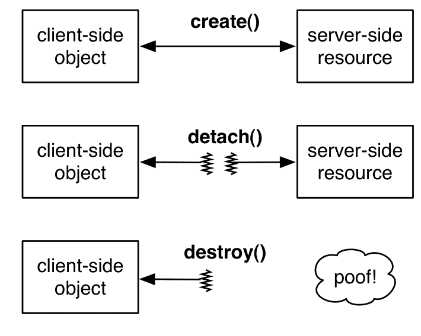

图 7.4：create、detach 和 destroy 的生命周期

当我们在 `FXApp` 对象上调用 `create()` 时，应用程序会遍历整个控件集合，在每个控件上调用 `create()` 并为它们创建服务端窗口。在此之前，你在上一行构建的 `FXMainWindow` 对象还没有服务端对等体。值得注意的是，此讨论不仅适用于窗口，还适用于所有类型的用户界面对象，包括图标、图像和字体——它们都经历相同的构造和创建过程。

如果你的程序预先构建了所有用户界面对象，那么初始的 `create()` 调用就是你唯一需要的一次。但在实践中，你编写的程序会根据各种事件动态构建新的控件。例如，每次在程序中显示新的对话框时，你都会构建（并创建）一堆新的控件。如果你正在编写一个加载和显示任意类型图像数据的程序，你将需要构建和创建 `FXImage`

 age 对象。FXRuby 让这一切变得简单且开销低廉（从计算角度而言），因此你无需担心预先构建整个应用程序。然而，你*确实*需要做的是，记住在程序启动并运行后，对那些动态构造的对象调用 `create()`。

我对最后一点再怎么强调也不为过。在我见过的 FXRuby 程序中（包括我自己的），头号错误来源就是未能对动态构造的用户界面对象调用 `create()`。最好的情况是，用户界面看起来不会如你所预期。请看下面的例子：

```
# 为联系人信息表单添加一行，用于提供
# 备用电子邮件地址。
add_button.connect(SEL_COMMAND) do
    FXLabel.new(@contact_info, "Alternate e-mail address: ")
    FXTextField.new(@contact_info, 20)
end
```

在这段代码片段中，我们试图在用户点击 `add_button` 时向表单添加一个新字段。这段代码会运行，但我们永远不会在屏幕上看到那个新字段，因为它没有服务器端窗口：

```
# 为联系人信息表单添加一行，用于提供
# 备用电子邮件地址。
add_button.connect(SEL_COMMAND) do
    FXLabel.new(@contact_info, "Alternate e-mail address: ")
    FXTextField.new(@contact_info, 20)
    @contact_info.create # 创建动态构造的控件
end
```

在父窗口上添加对 `create()` 的调用解决了这个问题。父窗口会遍历其所有子窗口并对它们调用 `create()`。请注意，对已经创建过的对象调用 `create()` 不会造成任何损害。FXRuby 会识别出该对象已经有关联的服务器端资源，然后继续处理下一个对象。

最坏的情况是，你的程序会崩溃，因为例如，FOX 库深处的某些代码试图绘制一种字体，而该字体没有与之关联的服务器端字体资源：

```
# 更改此标签的字体
new_font = FXFont.new(app, "helvetica", 14)
label.font = new_font
```

如果没有对 `new_font` 调用 `create()`，在你将字体分配给标签后的某个时刻，这个程序将会 spectacularly 崩溃。我说"某个时刻"，是因为这个时间点有些不可预测——直到 FXRuby 实际需要重绘该标签并访问其字体时，这才会成为问题。与前面的例子一样，添加对 `create()` 的调用，无论是针对标签还是字体本身，都能解决这个问题。

在结束本章之前，还有一个话题需要讨论，那就是所有 FXRuby 控件（或窗口）共有的基本功能。

#### 7.8 窗口的工作原理

在开始下一章研究各种控件的具体内容之前，我们需要谈谈所有 FXRuby 控件共有的一个特性，即每个 FXRuby 控件类都是 `FXWindow` 基类的后代。如果你查看 `FXWindow` 类的 API 文档页面，你会很快发现它是一个非常复杂的类，拥有大量的属性和方法。我显然不会在本节中试图涵盖所有这些内容，但我们会提及一些重点。

FXRuby 区分父窗口和子窗口。在这里，我们讨论的不是类层次结构，在那里我们可能会观察到 `FXLabel` 类是 `FXButton` 类的父类。我们这里描述的关系与窗口包含在其他窗口内部有关：给定父窗口的所有子窗口都将在父窗口的边界内显示。你可以在许多 `FXWindow` 方法和属性的名称中看到这种术语的体现。例如，窗口的 `parent` 属性返回对其父窗口的引用，而窗口的 `children()` 方法返回对其子窗口引用的数组。

FXRuby 还区分桌面（或*根*）窗口、顶级（或*外壳*）窗口以及其他类型的窗口。外壳窗口是根窗口的直接子窗口，它们始终是 `FXShell` 或其某个子类的实例。因此，例如，你的应用程序主窗口（`FXMainWindow` 的实例）是一个外壳窗口，你的应用程序显示的任何对话框也是。

偶尔，你需要处理窗口坐标系。在第 7.2 节，*处理鼠标事件*，第 85 页中，我们讨论了鼠标相关消息的 event 数据如何包含有关事件在屏幕上发生位置的信息，包括窗口局部坐标和根窗口坐标。与你高中数学课上学到的笛卡尔坐标系不同，这些坐标系以窗口左上角的 (0, 0) 为起点。x 坐标向右移动时增加，y 坐标向下移动时增加。

`translateCoordinatesFrom()` 和 `translateCoordinatesTo()` 方法可用于在不同窗口的坐标系之间进行转换。例如，假设你正在处理发生在窗口 A 内部的一个 `SEL_MOTION` 事件，但我们想知道鼠标光标在窗口 B 的坐标系中的位置：

```
window_a.connect(SEL_MOTION) do |sender, selector, event|
  b_x, b_y =
    sender.translateCoordinatesTo(window_b, event.win_x, event.win_y)
end
```

因为事件发生在窗口 A 内部，`event.win_x` 和 `event.win_y` 的值是以 A 的坐标系表示的。对 `translateCoordinatesTo()` 的调用返回一个包含窗口 B 坐标系中坐标的数组。

我们在本章中涵盖了很多 heavy 的内容，这些内容在你开始编写自己的应用程序时值得反复回顾。虽然有可能运气好，通过 hack 的方式完成 FXRuby 应用程序的开发，但理解事物运作方式的原因有诸多好处。通过理解 FOX 的事件驱动编程模型是如何实现的，你可以编写出集成度更高、需要更少的 housekeeping 代码来将控件与它们所代表的数据联系起来的应用程序。了解延迟布局和重绘算法是如何运作的，并认识到那些需要编写代码与它们进行交互的时机，将帮助你避免一些经验较少的开发者会遇到的陷阱。认识到 FOX 对象的客户端表示与服务器端表示之间的区别，特别是理解何时需要对新实例化的对象调用 `create()`，是开发无 bug 的 FXRuby 应用程序的关键技能。

有了这个基础，我们准备继续学习更多关于标准控件的知识，例如标签、按钮和文本字段，几乎每个 FXRuby 应用程序都会用到它们。

# 第 8 章

### 构建简单控件

控件是 GUI 应用程序的构建块。它们是特殊用途的对象，显示在屏幕上，可以被操作以实现用户与软件之间的通信。如果你和大多数人一样，你每天使用的大部分计算机软件都包含某种形式的图形用户界面，因此使用控件对你来说是第二本能，即使你不会有意识地以这些术语来思考它。当你在文字处理器中点击下拉菜单并从中选择命令时，你正在通过控件与应用程序交互。当你抓取文档窗格右侧的滚动条并上下拖动以在文档中来回滚动时，你又一次使用控件与软件交互。

Alan Cooper 在他的著作 *About Face* [Coo95] 中谈到了四种基本的控件类型，这是根据用户的目标来评估的：

- 命令式控件，用于启动功能
- 选择控件，用于选择选项或数据
- 输入控件，用于输入数据
- 显示控件，用于以可视方式直接操作程序

当然，有些控件可以同时满足这些目标的组合。下一页的图 8.1 列出了我们将在本章中涵盖的控件，以及关于何时使用它们的建议。本书没有足够的空间来描述 FXRuby 提供的所有控件，但如果你研究一些最常用的控件，你会掌握整个库中使用的术语和命名约定。在你读完本章和接下来的几章后，你将拥有所需的技能，可以毫无问题地将其他更专业的控件集成到你的应用程序中。


| 控件类 | 用途说明 |
| :--- | :--- |
| FXLabel | 用于显示文本，可选择包含图标，起装饰或信息提示作用。 |
| FXButton | 用作可点击的命令触发界面元素。 |
| FXRadioButton | 当需要用户从多个选项中单选时，使用一组单选按钮。 |
| FXCheckButton | 允许用户通过复选框选择或取消某个选项。 |
| FXTextField | 允许用户编辑单行文本的输入框。 |
| FXToolTip | 用于显示临时提示信息，说明其他控件的功能用途。 |
| FXStatusBar | 用于显示详细上下文帮助信息，说明其他控件功能或应用程序状态。 |

#### 8.1 创建标签与按钮

我认为我开发过的每一个GUI应用程序都至少包含几个标签和按钮。它们易于理解且使用简单，因此这里很适合作为学习起点。

##### 使用标签显示文本

我们可以使用FXLabel控件在用户界面上显示消息。它可以很简单，比如用户界面某个功能的标题字符串；也可以更复杂，比如某个任务的操作说明。标签文本可以包含多行（通过换行符分隔），并且可以选择性显示图标。从技术角度来说，标签的文本内容也是可选的——可以创建仅包含图标的"标签"控件，但这种做法在按钮控件中更为常见（我们将在下一节介绍）。

默认情况下，标签文本会在其边界框内居中显示（水平和垂直方向均居中）。不过标签支持多种对齐选项，我们可以用它们来指定文本的对齐方式。例如，要使标签文本左对齐，只需在FXLabel构造函数中传入JUSTIFY_LEFT选项：

```
label = FXLabel.new(self, "左对齐文本", :opts => JUSTIFY_LEFT)
```

图8.2展示了这种标签文本左对齐的效果。您也可以通过设置标签的justify属性来修改文本对齐方式：

```
label.justify = JUSTIFY_RIGHT|JUSTIFY_BOTTOM
```

图8.3显示了标签文本相对于其边界框右侧和底部对齐的效果。完整的文本对齐选项列表，请参阅FXLabel类的API文档。

默认情况下，标签绘制时不会显示任何边框。可以通过向FXLabel构造函数传递边框样式标志组合来改变边框样式。例如，要创建带实线边框的标签，可使用FRAME_LINE边框样式：

```
line_frame = FXLabel.new(p, "线条边框", :opts => FRAME_LINE)
```

您也可以在标签创建后通过设置其`frameStyle`属性来更改边框样式。本例中，我们为标签添加了凹陷边框效果：

下载labelexample3.rb

```
sunken_framed_label = FXLabel.new(p, "凹陷边框")
sunken_framed_label.frameStyle = FRAME_SUNKEN
```

图8.4展示了所有支持的边框样式示例。完整的可用边框样式列表，请参阅`FXWindow`类的API文档。¹

如前所述，您还可以在标签中添加图标。例如，可以从GIF格式文件创建图标对象，然后将其作为参数传递给FXLabel构造函数：

下载labelexample4.rb

```
question_icon =
  FXGIFIcon.new(app, File.open("question.gif", "rb").read)
question_label =
  FXLabel.new(self, "是否安全？", :icon => question_icon)
```

> 1. 边框样式常量与`FXWindow`基类关联，因为不仅是标签，许多不同类型的控件都有相关的边框样式。

图8.5：带图标的标签

关于如何创建图标的详细内容，我们将在第11章《创建视觉丰富的用户界面》（第142页）中详细介绍。现在只需知道，您可以从图像文件（或其他来源）创建图标对象，并将其用作标签、按钮和其他多种控件的装饰即可。

默认情况下，图标会居中显示在标签的边界框内，除非图标是透明的或图标颜色与文本颜色对比强烈，否则可能影响文本可读性。标签提供了多个选项来指定文本和图标的相对位置。例如，要将图标放置在文本之前（即左侧），请使用`ICON_BEFORE_TEXT`选项：

```
question_label.iconPosition = ICON_BEFORE_TEXT
```

图8.5展示了此示例在Windows下的运行效果。完整的图标位置设置列表，请参考`FXLabel`类的API文档。

##### 按钮的交互功能

`FXButton`是标签功能的延伸——它不仅能显示信息，还能被"点击"并在点击时执行程序中的特定命令。与标签类似，按钮可以显示消息字符串和图标。不同的是，按钮通常具有三维"凸起"外观，使其更加醒目。图8.6（下一页）展示了两个不同的按钮，一个处于启用状态，一个处于禁用状态。

当按钮被按下并释放时，它会向目标对象发送SEL_COMMAND消息：

下载buttonexample.rb

```
activate_button = FXButton.new(p, "激活发射序列",
    :opts => BUTTON_NORMAL|LAYOUT_CENTER_X)
activate_button.connect(SEL_COMMAND) do |sender, sel, data|
    @controller.activate_launch_sequence
end
```

按钮还会向目标对象发送其他一些消息，但这些消息在实际开发中很少使用。如果您有兴趣了解这些消息，可以随时查阅类的在线API文档，了解它向目标对象发送的所有消息类型。

您可以为按钮和其他类型的控件关联快捷键和热键。*快捷键*是用于在应用程序中触发特定操作的按键组合。例如，按下Ctrl+C通常会在许多应用程序中触发复制操作。*热键*是一种特殊的快捷键，由Alt键和字母键组合而成，例如Alt+F用于打开文件菜单。

热键通常与具有关联文本字符串的按钮或类按钮控件一起使用。您可以通过以下方式为按钮设置热键：

下载buttonexample.rb

```
cancel_button = FXButton.new(p, "取消发&射序列",
    :opts => BUTTON_NORMAL|LAYOUT_CENTER_X)
```

本例中，按钮标签中字母*n*前的`&`字符表示`Alt+N`按键组合将触发此按钮的命令，效果等同于用户用鼠标点击该按钮。

我们在上一章讨论过如何使用自动GUI更新功能根据应用程序状态更新用户界面控件的状态。一种相当常见的情况是：当需要禁用按钮（因为关联的命令当前不可用）时，可以使用此功能。例如，如果发射序列尚未激活，就应该禁用"取消发射序列"按钮。您可以通过编写`SEL_UPDATE`处理程序来实现：

```
cancel_button.connect(SEL_UPDATE) do |sender, sel, data|
  sender.enabled = @controller.launch_sequence_activated?
end
```

请注意，在此代码块中，`sender`是对`cancel_button`控件的引用，因为它是`SEL_UPDATE`消息的发送者。

##### 使用单选按钮进行选择

当需要用户从一组互斥选项中做出选择时，应考虑使用`FXRadioButton`控件组。当选项数量固定且数量适中时，单选按钮是合适的选择。如果选项数量在运行时才能确定，最好使用列表或组合框等能灵活处理任意数量条目的界面元素。当选项超过几个时，也应优先使用列表类控件，因为长列的单选按钮在视觉上不易处理。

让我们编写一个简短的示例程序，演示使用单选按钮需要掌握的所有要点。首先，虽然不是必须的，但最好实践是使用`FXGroupBox`控件对单选按钮进行视觉分组。可以使用`FRAME_GROOVE`或`FRAME_RIDGE`选项来设置分组框的边框样式，并可以选择性地为其指定标题：

```
groupbox = FXGroupBox.new(self, "选项",
  :opts => GROUPBOX_NORMAL|FRAME_GROOVE|LAYOUT_FILL_X|LAYOUT_FILL_Y)
```


##### 复选按钮：是？否？也许？

当处理只能处于两种可能状态之一的应用程序设置时，FXCheckButton 小部件可能是表示该设置的最佳选择。

更具体地说：当这两种可能状态是*对立的*时，比如“开”或“关”设置，它很可能是最佳选择。尽管我们上一节的单选按钮示例只向用户提供了两种选择，但复选按钮并不合适，因为“完美”并不是“足够好”的对立面。

复选按钮实际上可以处于三种可能状态之一。除了“已选中”和“未选中”状态外，复选按钮还可以处于不确定或“也许”状态。我见过此功能以不同方式使用。例如，假设你有一个复选按钮，用于指示新闻提要中选定的文章是否已阅读。如果全部已阅读，复选按钮应处于选中状态；如果均未阅读，则应处于未选中状态。但如果一些文章已阅读而另一些未阅读呢？在这种情况下，你可能想将复选按钮设置为不确定状态。当复选按钮处于此状态时，它看起来是选中状态，但背景会变暗（见下页图 **8.8**）。当用户点击处于不确定状态的复选按钮时，其状态将变为未选中，此时你又回到了基本的选中/未选中切换。用户无法通过“点击”将复选按钮恢复到不确定状态。

FXCheckButton 类分别使用 `true`、`false` 和 `MAYBE` 值来表示选中、未选中和不确定状态。你可以通过 `checkState` 属性设置复选按钮的状态，并使用 `checked?()`、`unchecked?()` 和 `maybe?()` 查询来测试其状态：

```
checkbutton = FXCheckButton.new(...)
checkbutton.checkState = true
checkbutton.checked?    # returns true
checkbutton.unchecked?  # returns false
checkbutton.maybe?      # returns false
```

2.  它们仅仅是敌人。

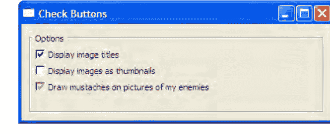

图 8.8：处于选中、未选中和也许状态的复选按钮

与 FXRadioButton 一样，将复选按钮连接到数据目标通常很方便：

```
Download checkbutton.rb
@titles = FXDataTarget.new(true)
@thumbnails = FXDataTarget.new(false)
@mustaches = FXDataTarget.new(MAYBE)
groupbox = FXGroupBox.new(self, "Options",
  :opts => GROUPBOX_NORMAL|FRAME_GROOVE|LAYOUT_FILL)
titles_check = FXCheckButton.new(groupbox,
  "Display image titles",
  :target => @titles, :selector => FXDataTarget::ID_VALUE)
thumbnails_check = FXCheckButton.new(groupbox,
  "Display images as thumbnails",
  :target => @thumbnails, :selector => FXDataTarget::ID_VALUE)
mustaches_check = FXCheckButton.new(groupbox,
  "Draw mustaches on pictures of my enemies",
  :target => @mustaches, :selector => FXDataTarget::ID_VALUE)
@titles.connect(SEL_COMMAND) do
  puts "The new value for 'titles' is #{@titles.value}"
end
```

在此程序中，我们为每个设置构建一个独立的 FXDataTarget 对象，然后将这些数据目标与相应的复选按钮关联。由于 @mustaches 初始化为 MAYBE 值，第三个复选按钮（mustaches_check）将从不确定状态开始。我们还可以将每个数据目标连接到代码块，以便在其值更改时得到通知。

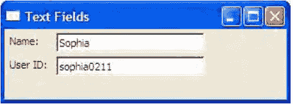

图 8.9：使用文本字段编辑单行文本。

FXRadioButton 和 FXCheckButton 小部件都是关于让用户从固定选项集中进行选择，它们是 FXRuby 为你提供的提供此类功能的一些最简单的工具。当然，FXRuby 也提供其他不固有地将用户输入限制为固定选项集的小部件，在下一节中，我们将查看其中一种小部件，FXTextField。

#### 8.2 使用文本字段编辑字符串数据

FXTextField 小部件适用于你需要提供单行文本字符串的输入和后续编辑的情况。图 8.9 显示了我们将在本节中查看的示例程序中的几个文本字段。对于处理多行文本，你应该查看第 10 章 *使用文本组件编辑文本*，第 133 页。

大多数情况下，你将希望处理来自文本字段的 SEL_COMMAND 消息。当用户在文本字段中键入文本后按回车键（或 Enter 键）时，FXTextField 会向其目标发送 SEL_COMMAND 消息。当文本字段失去键盘焦点（因为用户点击了其他地方或按 Tab 键将焦点转移到其他小部件）时，它也会发送 SEL_COMMAND 消息。³

如果你需要对文本字段内容的变化做出更细粒度的响应，则应改为处理 SEL_CHANGED 消息。FXTextField 小部件会在每次击键后向其目标发送 SEL_CHANGED 消息。

³ 你可以通过在构造 FXTextField 时传入 TEXTFIELD_ENTER_ONLY 标志来覆盖此行为。


对于某些应用，你可能希望能够限制可以输入到文本字段中的文本类型。FXTextField 开箱即用支持几种不同的模式来处理一些更常见的情况。例如，当你使用文本字段来接受密码输入时，通常的做法是使用星号来掩码密码文本。你可以在构造文本字段时传入 `TEXTFIELD_PASSWD` 标志来实现这一点。同样，你可以使用 `TEXTFIELD_INTEGER` 和 `TEXTFIELD_REAL` 模式将文本字段中的输入限制为整数或浮点数值。

如果你的应用需要对输入的文本设置更复杂的限制，你可以处理文本字段向其目标发送的 `SEL_VERIFY` 消息。此消息类似于 `SEL_CHANGED`，但有一个重要区别：`SEL_VERIFY` 消息是在临时更改"提交"之前发送的。例如，如果我们想验证文本以字母开头且仅由字母和数字组成，我们可以这样做：

```ruby
userid_text.connect(SEL_VERIFY) do |sender, sel, tentative|
  if tentative =~ /^[a-zA-Z][a-zA-Z0-9]*$/
    false
  else
    true
  end
end
```

请注意，如果文本*不*匹配预期的模式，代码块返回 `true`。这看起来有点反直觉，但这是我们告诉 FOX `SEL_VERIFY` 消息已被"处理"且不应再进行进一步处理的方式。如果文本匹配且代码块返回 `false`，FOX 将继续更新文本字段的内容。

最后，与本章中讨论的其他控件一样，你可以将文本字段与数据目标关联：

```ruby
@name_target = FXDataTarget.new("Sophia")
name_text = FXTextField.new(p, 25,
  :target => @name_target, :selector => FXDataTarget::ID_VALUE)
@name_target.connect(SEL_COMMAND) do
  puts "The name is #{@name_target.value}"
end
```

如果你不需要 `SEL_VERIFY` 处理，这是使用文本字段最方便的方式。如上所示，如果你希望在数据目标的值发生变化时收到通知，还可以将数据目标连接到某个下游目标对象。

我们将在本章结尾介绍如何通过工具提示和状态栏来整合帮助消息。虽然从技术上说，它们都只是另一种显示控件，与标签并无不同，但它们的特点是始终与其他控件协同工作，为应用提供一种更高级别的服务。

#### 8.3 使用工具提示和状态栏提供提示

工具提示是一种特殊的弹出窗口，当鼠标光标在某个特定位置停留几秒钟时，它会自动显示。工具提示会询问鼠标光标所指向的控件其工具提示文本是什么，然后显示该文本。工具提示会短暂显示该文本，然后再次隐藏；当你将鼠标光标移动到新位置时，它也会立即隐藏。

FXRuby 可以轻松地为你的应用添加工具提示。首先，你需要创建 `FXToolTip` 对象：

```ruby
FXToolTip.new(app)
```

注意，整个应用只有一个工具提示对象，这可能看起来有点反直觉，因为你会看到工具提示在到处都是弹出！

接下来，你需要为每个控件指定应显示的工具提示文本，因为控件的默认工具提示文本是空的。⁴ 对于 `FXButton` 控件和从 `FXButton` 派生的其他控件，你可以在构造按钮时将工具提示文本直接嵌入到按钮标签中：

```ruby
upload_button = FXButton.new(self, "Upload\tUpload Files")
```

注意，工具提示文本与按钮标签之间用制表符分隔。

> 4. 你不需要为不需要工具提示的控件指定工具提示文本。工具提示足够智能，在没有文本可显示时不会显示自己。

许多其他没有关联标签的控件也允许你使用 `tipText` 属性来设置其工具提示文本：

```ruby
dial = FXDial.new(self, :opts => DIAL_HORIZONTAL)
dial.range = 0..11
dial.tipText = "Volume"
```

与工具提示类似，`FXStatusBar` 控件能够在鼠标光标悬停在某个控件上时显示有关该控件的上下文相关帮助消息。与工具提示不同的是，状态栏是应用主窗口上的固定元素——它不会像工具提示那样短暂弹出然后消失。传统上，状态栏放置在主窗口的底部边缘，并拉伸至主窗口的完整宽度，但如果你的应用有其他布局需求，这不是必须的。

对于 `FXButton` 控件和从 `FXButton` 派生的其他控件，你可以直接在按钮标签中指定控件的帮助消息：

```ruby
download_button = FXButton.new(self,
  "Download\tDownload Files\tStart Downloading Files in the Background")
```

注意，状态栏帮助文本与工具提示文本之间用第二个制表符分隔。你可以使用 `helpText` 属性为没有关联标签的控件指定状态栏帮助文本。

```ruby
dial.helpText = "This one goes to eleven"
```

我们在本章中讨论的控件是 FXRuby 提供的最简单的控件，它们主要处理单个值的设置和显示。在下一章中，我们将更进一步，看看 FXRuby 提供了哪些工具来处理值列表。

# 第9章：使用列表和表格控件对数据进行排序

我们在上一章中学习的简单控件主要处理单个值（如果它们确实有任何真正的"值"与之关联的话）。FXRuby 还提供了许多更复杂的控件来处理值的集合。下页的图 9.1 列出了我们将在本章中讨论的控件，以及关于何时考虑在应用中使用它们的简要说明。我们将从查看 `FXList` 开始。

### 9.1 使用 FXList 显示简单列表

`FXList` 控件显示一个项目列表，其中每个项目都有一个关联的文本字符串和一个可选的图标。如果列表包含的项目多于它能显示的数量，它将生长出垂直滚动条，允许你在列表中上下滚动。

默认情况下，`FXList` 是空的。你可以使用 `appendItem()` 方法在列表末尾添加项目：

```ruby
# Download listexample.rb

groceries = FXList.new(self,
  :opts => LIST_EXTENDEDSELECT|LAYOUT_FILL)
groceries.appendItem("Milk")
groceries.appendItem("Eggs")
groceries.appendItem("Bacon (Chunky)")
```

当然，你也可以在列表开头前置一个项目，在列表中的特定位置插入一个项目，或从列表中删除一个项目（分别使用 `prependItem()`、`insertItem()` 或 `removeItem()` 方法）：

```ruby
groceries.prependItem("Bread")
groceries.insertItem(2, "Peanut Butter")
groceries.removeItem(3)
```

#### 在列表中进行选择

FXRuby 维护了几个与列表中当前选择相关的属性。当前项目就是你最后点击的列表项目，也是当前拥有键盘焦点的项目。如果没有当前项目，列表的 `currentItem` 为 -1；否则，它是当前项目的整数索引。当当前项目发生变化时，`FXList` 会向列表控件的目标同时发送 `SEL_CHANGED` 消息和 `SEL_COMMAND` 消息：

```ruby
groceries.connect(SEL_COMMAND) do |sender, sel, index|
  puts "The new current item is #{sender.currentItem}"
end
```

| 控件类 | 用途 |
| --- | --- |
| FXList | 使用 FXList 显示始终可见的平面项目列表，并允许用户从中选择一个或多个项目。 |
| FXListBox | 使用 FXListBox 显示下拉式平面项目列表，并允许用户从中选择单个项目。 |
| FXComboBox | 使用 FXComboBox 显示下拉式平面项目列表，并允许用户从中选择单个项目。与 FXListBox 不同，FXComboBox 是可编辑的。 |
| FXTreeList | 使用 FXTreeList 显示层次结构化的项目列表，并允许用户从中选择一个或多个项目。 |
| FXTable | 使用 FXTable 以表格形式显示项目集合，并允许用户从中选择一个或多个项目。 |

图 9.1：列表控件


当用户双击列表项时，FXList 会向目标发送许多其他有趣的消息。有关 FXList 发送给目标的所有消息的完整列表，请查阅 API 文档。

FXList 的选择模式设定了同时可以选择多少项以及如何更改选择的策略。你将经常使用的一种选择模式是 `LIST_BROWSESELECT` 模式。在此模式下，始终恰好有一个列表项被选中，它是你最后一次点击的项。另一种常用的列表选择模式是 `LIST_EXTENDEDSELECT` 模式。在此模式下，可以选择任意数量的项。**Ctrl**+单击一个项会切换其选中状态，按住 **Shift** 键同时单击各项会将当前选择扩展以包含所有中间项。

> FXList 还提供了较少使用的 LIST_SINGLESELECT、LIST_AUTOSELECT 和 LIST_MULTISELECT 选择模式。

##### 那到底哪些项被选中了？

当列表配置为 `LIST_SINGLESELECT`、`LIST_BROWSESELECT` 或 `LIST_AUTOSELECT` 模式时，你可以安全地假设当前项就是当前选中的项。然而，当列表配置为 `LIST_EXTENDEDSELECT` 或 `LIST_MULTISELECT` 模式时，你需要逐个检查每个列表项以确定它是否被选中。

一种方法是遍历所有项的索引：

```ruby
selected_indices = []
0.upto(list.numItems-1) do |index|
  selected_indices << index if list.itemSelected?(index)
end
```

另一种方法是遍历 FXListItem 实例本身，测试它们的 `selected?()` 状态：

```ruby
selected_items = []
groceries.each { |item| selected_items << item if item.selected? }
```

正如你所预料的，FXList 和 FXListItem 类提供了许多与列表行为和外观相关的额外方法。所有详细内容请参阅这些类的 API 文档。

根据列表中的项数以及用户界面中可用的"实际空间"，FXList 可能不是显示一组数据的最佳选择。如果你需要显示一个长列表但只有少量空间可用，组合框或列表框可能效果更好。我们接下来会看看这些控件。

### 9.2 好东西装在小包裹里：FXComboBox 和 FXListBox

FXComboBox 和 FXListBox 控件都是 FXList 控件的变体。这两个控件看起来都像是 FXTextField 和 FXArrowButton 的组合。当你点击箭头按钮时，文本字段会展开以显示整个列表项。从列表中选择一项后，列表会"弹"回原来收起的状态。与 FXList 一样，它们都可以用来显示一个扁平的列表项供用户选择。但与 FXList 不同的是，它们只允许你从列表中一次选择一项。

关于何时使用常规 FXList 而非 FXComboBox 或 FXListBox，并没有严格固定的规则。显然，如果你需要用户能够选择多项，你会想要使用 FXList。另一方面，如果单选合适且用户界面中没有足够的空间来显示列表，组合框或列表框是一种很好的紧凑方式，可以在不需要时将列表内容隐藏起来。

我的个人理念是，如果列表要包含的项目多于少数几个，我会使用组合框或列表框而不是普通的列表。然而，组合框和列表框之间的区别很微妙，而且根据你的使用方式，它们基本是可以互换的。我的意思是，你能看出图 9.3 中两者的区别吗？我也不能。基本上，如果你只需要能够从列表中选择一项，你应该使用 FXListBox。如果你希望能够输入文本字符串作为现有列表项的替代，甚至看到该项被添加到列表项中，你应该使用 FXComboBox。

与 FXList 一样，这两个控件都提供了 `prependItem()`、`appendItem()`、`insertItem()` 和 `removeItem()` 方法来修改列表内容：

```ruby
states = FXListBox.new(matrix,
    :opts => LISTBOX_NORMAL|FRAME_SUNKEN|FRAME_THICK|LAYOUT_FILL_X)
$state_names.each { |name| states.appendItem(name) }
```

一次可以选择一项，而 `currentItem` 属性指示该项的索引（如果没有当前项则为 -1）。

由于 FXComboBox 可以被编辑，对于该控件我们需要处理一些额外的问题。一个问题是用户在组合框文本字段中输入的文本是否应该被添加到项目列表中。

默认情况下，组合框使用 `COMBOBOX_NO_REPLACE` 选项，这意味着无论用户在文本字段中输入什么，列表的内容都保持不变：

```ruby
accounts = FXComboBox.new(matrix, 20,
    :opts => COMBOBOX_NO_REPLACE|FRAME_SUNKEN|FRAME_THICK|LAYOUT_FILL_X)
```

当你使用可编辑的 FXComboBox ivia，你不能完全依赖 `currentItem` 来获取用户的输入，因为他们可能在文本字段中输入了一些新文本。因此，你应该检查组合框的 `text` 属性的值来确定其当前值：

```ruby
accounts.connect(SEL_COMMAND) do |sender, sel, data|
    assign_expense_account(sender.text)
end
```

请注意，组合框随 `SEL_COMMAND` 消息发送的数据实际上等于其 `text` 属性的值，所以对于这个例子，你可以直接将 `data` 传递给 `assign_expense_account()` 方法。

如果你希望用户在文本字段中输入的字符串被添加到组合框的列表中，你有几种选择来决定这些新项在列表中的位置：

- 使用 `COMBOBOX_INSERT_FIRST` 选项将新项插入列表开头。
- 使用 `COMBOBOX_INSERT_LAST` 选项将新项插入列表末尾。
- 使用 `COMBOBOX_INSERT_BEFORE` 选项将新项插入当前项之前。
- 使用 `COMBOBOX_INSERT_AFTER` 选项将新项插入当前项之后。

根据我的经验，从用户的角度来看，`COMBOBOX_INSERT_BEFORE` 和 `COMBOBOX_INSERT_AFTER` 选项有点令人困惑，我通常坚持使用 `COMBOBOX_INSERT_FIRST` 选项。请注意，FXComboBox 没有内置选项来自动维护项的排序顺序，但你可以在 `SEL_COMMAND` 处理程序中调用组合框的 `sortItems()` 来解决这个问题：

```ruby
categories.connect(SEL_COMMAND) do |sender, sel, data|
  assign_expense_category(sender.text)
  sender.sortItems
end
```

调用 `sortItems()` 不会干扰文本字段中输入的文本，但如果你点击箭头按钮弹出列表面板，你会看到新添加的项出现在排序列表中的正确位置。

本章到目前为止我们看到的控件都涉及扁平的列表项。FXRuby 还通过 FXTreeList 控件提供了处理层次结构数据的支持，接下来我们会讨论它。

### 9.3 用树列表扩展分支

FXTreeList 控件之所以这样命名，是因为你可以想象它管理的数据是树状的，从一个根出发向各个方向延伸，分支引向其他分支。与 FXList、FXComboBox 和 FXListBox 都处理扁平列表不同，FXTreeList 专为层次结构数据而设计。

虽然我们使用"树"这个词来描述这个列表的数据和外观，但你应该注意，它并不完全像你将在计算机科学课程中学到的经典树数据结构。一个特别令人困惑的点是，FXTreeList 类的标准文档使用术语*根项*来指代树中任何一个最顶层的可见项。从严格的计算机科学角度来看，树的实际根永远不会出现在屏幕上，我们只能间接地使用 FXTreeList API 来引用它。

然而，一旦你习惯了 FXRuby 用来描述 FXTreeList 类的术语，你会发现它在实践中很容易使用。你可以使用熟悉的 `prependItem()`、`insertItem()`、`appendItem()` 和 `removeItem()` 方法来修改树列表的内容，尽管由于列表的层次特性，调用约定略有不同。`prependItem()` 和 `appendItem()` 方法的第一个参数是你添加项的父项的引用。


## 9.3 管理树形列表

如果是顶级项目，将 `nil` 作为第一个参数传入：

```ruby
Download treelistexample.rb

treelist = FXTreeList.new(treelist_frame,
  :opts => TREELIST_NORMAL|TREELIST_SHOWS_LINES| \
           TREELIST_SHOWS_BOXES|TREELIST_ROOT_BOXES|LAYOUT_FILL)
artist_1   = treelist.appendItem(nil, "Alison Kraus")
album_1_2  = treelist.appendItem(artist_1, "Forget About It")
track_1_2_3 = treelist.appendItem(album_1_2, "Ghost in this House")
track_1_2_2 = treelist.prependItem(album_1_2, "Maybe")
track_1_2_1 = treelist.insertItem(track_1_2_2, album_1_2, "Stay")
album_1_1   =
  treelist.prependItem(artist_1, "Every Time You Say Goodbye")
```

有三个选项可用于控制树形列表中父项与子项之间连接线的显示方式。如果选择了 `TREELIST_SHOWS_LINES` 选项，树形列表将绘制一条细虚线，从父项延伸到其每个子项。如果选择了 `TREELIST_SHOWS_BOXES`，树形列表将在任何有一个或多个子项的树项左侧显示一个小方框；如果该树项被展开，方框内将包含一个减号；如果该树项被折叠，则包含一个加号。现在，出于某种原因，`TREELIST_SHOWS_BOXES` 选项仅适用于嵌套在顶级项目下方的项目。如果您还想在顶级项目旁边看到方框（请记住 FOX 将其称为 *根级* 项目），则还必须传入 `TREELIST_ROOT_BOXES` 选项。请注意，除非同时启用了 `TREELIST_SHOWS_BOXES`，否则 `TREELIST_ROOT_BOXES` 选项不会生效。

话虽如此，我通常会像示例代码中那样传入所有三个选项。我从未找到不使用其中任何一个的好理由。接下来的图 9.4 将让您了解在这种情况下树形列表的外观。

##### 跟踪选择状态

FXTreeList 支持与 FXList 相同的选择模式，并且工作方式相同，因此您已经学到的关于它们的知识在这里同样适用。`currentItem` 属性仍然告诉您最后被点击的项目，尽管在这种情况下，它是一个对 FXTreeItem 对象的引用，而不是整数索引。

然而，当选择模式允许多选时，确定树形列表中哪些项目被选中可能比较棘手。根据我的经验，最直接的方法是在数组（或其他容器）中跟踪选中的项目，然后使用 FXTreeList 的 `SEL_SELECTED` 和 `SEL_DESELECTED` 消息来更新该数组：

```ruby
selected_items = []
treelist.connect(SEL_SELECTED) do |sender, sel, item|
  selected_items << item unless selected_items.include? item
end
treelist.connect(SEL_DESELECTED) do |sender, sel, item|
  selected_items.delete(item)
end
```

这种技术对于任何大小的树形列表都适用，因为从计算角度来看，它的开销很低。然而，如果您知道树形列表不会包含太多项目，您可能会发现，每次当前项目更改时简单地遍历树并记录哪些项目被选中，对您的目的来说已经足够快了。只需捕获来自 FXTreeList 的 `SEL_COMMAND` 消息：

```ruby
treelist.connect(SEL_COMMAND) |sender, sel, current|
  selected_items = []
  treelist.each { |child| add_selected_items(child, selected_items) }
end
```

下面是 `add_selected_items()` 方法，它以递归方式遍历树以查看哪些项目被选中：

```ruby
def add_selected_items(item, selected_items)
  selected_items << item if item.selected?
  item.each { |child| add_selected_items(child, selected_items) }
end
```

现在，在结束本章之前，我们将看到一个关于将右键单击弹出菜单与 FXTreeList 关联的超级秘密额外技巧。

##### 为树项目创建上下文菜单

用户已经习惯于能够在用户界面中右键单击一个对象，以显示该对象的上下文敏感弹出菜单。您几乎可以在 FXRuby 中对任何类型的对象执行此操作，但当开发者决定在应用程序中添加 FXTreeList 时，这似乎经常出现。因此，我将为您奉上一个小配方，介绍如何向树形列表添加其中一个右键单击弹出菜单，同时请记住，非常类似的技术可以应用于其他小部件。我将略过菜单本身不同部分的详细信息，但我们将在第 13 章《高级菜单管理》（第 187 页）中深入介绍。

第一步是捕获 FXTreeList 转发给其目标的 `SEL_RIGHTBUTTONRELEASE` 消息。如果在按钮按下（`SEL_RIGHTBUTTONPRESS` 事件）和弹起之间鼠标移动了，则对 `moved?()` 的调用将返回 `true`，在这种情况下，我们将忽略该事件。否则，我们可以使用事件数据中报告的窗口坐标来确定点击了哪个树项目（如果有）：

```ruby
treelist.connect(SEL_RIGHTBUTTONRELEASE) do |sender, sel, event|
  unless event.moved?
    item = sender.getItemAt(event.win_x, event.win_y)
    unless item.nil?
      # ...
    end
  end
end
```

`getItemAt()` 方法将在指定坐标处没有树项目时返回 `nil`。否则，它将返回对该 FXTreeItem 的引用。

下一步是构建一个 `FXMenuPane` 并向其添加一个或多个菜单命令：

```ruby
treelist.connect(SEL_RIGHTBUTTONRELEASE) do |sender, sel, event|
  unless event.moved?
    item = sender.getItemAt(event.win_x, event.win_y)
    unless item.nil?
      FXMenuPane.new(self) do |menu_pane|
        play = FXMenuCommand.new(menu_pane, "Play Song")
        play.connect(SEL_COMMAND) { play_song_for(item) }
        info = FXMenuCommand.new(menu_pane, "Get Info")
        info.connect(SEL_COMMAND) { display_info_for(item) }
        # ...
      end
    end
  end
end
```

最后，创建菜单窗格，调用其 `popup()` 方法在屏幕上显示它，然后启动一个专注于该菜单窗格的嵌套运行循环：

```ruby
treelist.connect(SEL_RIGHTBUTTONRELEASE) do |sender, sel, event|
  unless event.moved?
    item = sender.getItemAt(event.win_x, event.win_y)
    unless item.nil?
      FXMenuPane.new(self) do |menu_pane|
        play = FXMenuCommand.new(menu_pane, "Play Song")
        play.connect(SEL_COMMAND) { play_song_for(item) }
        info = FXMenuCommand.new(menu_pane, "Get Info")
        info.connect(SEL_COMMAND) { display_info_for(item) }
        menu_pane.create
        menu_pane.popup(nil, event.root_x, event.root_y)
        app.runModalWhileShown(menu_pane)
      end
    end
  end
end
```

一旦用户点击其中一个菜单命令或点击弹出菜单外的区域，菜单窗格将隐藏，应用程序将退出由 `runModalWhileShown()` 调用启动的事件循环。图 9.5（下页）显示了当我右键单击列表中的其中一首歌曲时弹出菜单的外观。这是一段很容易添加到应用程序中的代码，如果使用得当，它确实可以增强程序的可用性。

因此，我们现在有了处理扁平数据列表和嵌套数据列表的选项。接下来，我们将看看 FXRuby 提供的用于处理数据集合的另一个小部件，那就是 FXTable 小部件。

### 9.4 使用 FXTable 显示表格数据

FXTable 小部件是 FOX Toolkit 中较复杂的小部件之一，自最初引入以来已经发生了相当大的演变。新手有时会将 FXTable 小部件与 FXMatrix 布局管理器混淆，后者可用于将一堆小部件排列成行和列。¹ FXTable *确实* 将其内容按行列排列，但它本身并不是一个布局管理器；在其他一些工具包中，您可能听说这种小部件被称为 *网格* 小部件或 *电子表格* 小部件。

#### 在表格中存储数据

我们对 FXTable 的研究始于了解如何创建表格并添加一些数据。在本节中，我们将学习一点关于如何

---
¹ 我们在构建“图画书”应用程序时使用了 FXMatrix 布局管理器，我们将在第 172 页的 12.2 节《使用矩阵布局按行和列排列小部件》中更详细地讨论它。


##### 修改表格显示选项

到目前为止，我们已经讨论了如何向表格添加或修改数据。同样重要的话题是数据的显示，更具体地说，是用户对表格外观的控制程度。

默认情况下，水平和垂直网格线都会显示，以便清晰地划分各个表格单元格的边界。[3] 如果您想关闭网格线的显示，请将 `horizontalGridShown` 或 `verticalGridShown` 属性中的一个或两个都设置为 `false`：

```
table.horizontalGridShown = false
```

一行中的所有单元格具有相同的高度，一列中的所有单元格具有相同的宽度。然而，不同的行可以具有不同的行高，不同的列可以具有不同的列宽。默认情况下，用户无法更改这些尺寸。您始终可以通过编程方式更改行高和列宽，使用诸如 `setRowHeight()` 和 `setColumnWidth()` 等方法，但要允许用户交互式地调整它们的大小，您必须启用 `TABLE_ROW_SIZABLE` 标志、`TABLE_COL_SIZABLE` 标志，或两者同时启用：

```
table.tableStyle |= TABLE_COL_SIZABLE
```

当启用一个或两个选项时，用户可以单击行（或列）标题中两个项目之间的分隔符，并将其左右拖动以调整相邻行（或列）的大小。

说到这些行和列标题，您也可以操作它们的内容来提供（例如）表格列的标题：

```
table.setColumnText(0, "Ruby 1.8.6")
table.setColumnText(1, "Ruby 1.9")
table.setColumnText(2, "JRuby")
table.setColumnText(3, "Rubinius")
```

如果您想关闭行标题的显示（这是一个相当常见的请求），请先将其模式更改为 `LAYOUT_FIX_WIDTH`，然后将其宽度设置为零像素。您可以通过将 `columnHeaderMode` 设置为 `LAYOUT_FIX_HEIGHT` 并将 `columnHeaderHeight` 设置为零来对列标题执行相同的操作：

```
table.rowHeaderMode = LAYOUT_FIX_WIDTH
table.rowHeaderWidth = 0
table.columnHeaderMode = LAYOUT_FIX_HEIGHT
table.columnHeaderHeight = 0
```

图 **9.6**（在前一页）中显示的表格的行标题和列标题均已隐藏。

您还可以在一定程度上控制单个表格项目的显示。每个表格项目都有一个关联的文本字符串和图标。您可以使用 `setItemText()` 和 `setItemIcon()` 方法更改这些值。

```
table.setItemText(5, 3, "Timeout")
table.setItemIcon(5, 3, stopwatch_icon)
table.setItemJustify(5, 3, FXTableItem::CENTER_X)
table.setItemIconPosition(5, 3, FXTableItem::BEFORE)
```

图 **9.7**（在下一页）中显示的表格包含许多文本右对齐（默认）的项目，以及其他文本和图标居中的项目。

最后，用户可以通过双击表格单元格、键入一些新文本并按 `Enter` 键来编辑表格单元格的内容。您可以通过将 `editable` 属性设置为 `false` 来禁用此功能：

```
table.editable = false
```

到目前为止，我们一直专注于 FXTable 的显示方面：如何将数据放入其中以及如何更改其外观。然而，与我们在本章中研究过的其他小部件一样，该表格作为输入机制也很有用。作为本节的总结，我们将看看用户如何在表格中进行选择。

##### 管理表格选择

在选择模型方面，表格比列表小部件稍微不灵活一些。它只支持一种选择模式，在该模式下，您可以选择单个单元格或一个连续的单元格块。例如，您无法选择左上角的一个单元格和右下角的另一个单元格，而不同时选择它们之间的所有单元格。

当您单击某个单元格以开始构建选择时，该单元格成为锚点单元格。表格的 `anchorRow` 和 `anchorColumn` 属性包含锚点项目的行和列索引（假设存在一个）。然后，如果您按住 `Shift` 键并在表格中的其他位置单击，选择范围将从锚点单元格扩展到您单击的单元格。与列表小部件的情况一样，当前项目（由 `currentRow` 和 `currentColumn` 标识）只是您最后单击的单元格。

重要的是要认识到，选择不会“增长”以同时包含先前选定的单元格和新选定的单元格，除非它们都恰好位于锚点的同一侧。换句话说，表格中的选择总是围绕锚点单元格旋转。起初这可能有点违反直觉（反正对我来说是这样）。当存在选择时，`selStartRow`、`selEndRow`、`selStartColumn` 和 `selEndColumn` 属性将始终包含整个选择的起始和结束行、列索引。请注意，由于表格选择模型的工作方式，这些端点之一——`(selStartRow, selStartColumn)` 或 `(selEndRow, selEndColumn)`——将是锚点单元格。

当用户单击行标题时，该行中的所有单元格都将被选中。同样，当用户单击列标题时，该列中的所有单元格都将被选中。您可以通过设置 `TABLE_NO_ROWSELECT` 和/或 `TABLE_NO_COLSELECT` 选项来禁用此行为：

```
# 禁用行和列选择
table.tableStyle |= TABLE_NO_ROWSELECT|TABLE_NO_COLSELECT
```

当您单击表格项目时，表格会发送一个 `SEL_COMMAND` 消息，消息数据是一个 `FXTablePos` 实例。`FXTablePos` 是一个简单的数据对象，具有用于读取所选表格项目的行和列的 `row` 和 `col` 访问器方法。

当然，您可以通过编程方式修改选择，尽管通常您依赖用户交互式地执行这些操作。无论您如何尝试，FXTable 都不会让您欺骗它进行违反其选择模型的选择。例如，以下代码将导致只有一个单元格——位于 `(5, 5)` 的那个——被选中：

```
table.selectItem(0, 0)
table.selectItem(5, 5)
```

要选择一系列单元格，请使用 `selectRange()` 方法：

```
# 选择从 (0, 0) 到 (5, 5) 之间的所有单元格（包含端点）
table.selectRange(0, 0, 5, 5)
```

与 `FXTreeList` 的情况一样，跟踪哪些表格项目被选中的最简单方法是将它们存储在一个数组中，该数组的内容通过响应 `SEL_SELECTED` 和 `SEL_DESELECTED` 消息来更新：

```
selected_items = []
table.connect(SEL_SELECTED) do |sender, sel, pos|
  item = sender.getItem(pos.row, pos.col)
  selected_items << item unless selected_items.include? item
end
table.connect(SEL_DESELECTED) do |sender, sel, pos|
  selected_items.delete(sender.getItem(pos.row, pos.col))
end
```

---

表格实际上在内部管理其数据。我们将看到表格的稀疏存储方案使其非常高效，并且我们还将学习如何定义可以跨越多个表格单元格的项目。

与我们在前一章中研究的列表小部件一样，表格默认为空。填充表格最有效的方法是使用 `setTableSize()` 方法：

```
table = FXTable.new(self, :opts => LAYOUT_FILL)
table.setTableSize(10, 10)
```

关于 `setTableSize()` 以及所有更改表格大小的方法，需要认识到的一个重要事实是，FXTable 对空单元格和那些有一些内容（或数据）与之关联的单元格进行了区分。当绘制表格时，这两种单元格都在屏幕上占用空间，但在内部，FXTable 仅为那些实际有内容的单元格分配存储空间（以 `FXTableItem` 对象的形式）。这使得表格在内存使用方面非常高效，这意味着您可以用很小的代价存储相当大的表格。

您还应该理解 `setTableSize()` 方法是一个破坏性方法。无论您是初始化表格大小还是仅仅调整其大小以使其变大或变小，`setTableSize()` 都会先销毁所有现有的表格项目。因此，如果您的表格已经包含一些数据，而您只想增加几行或几列，调用 `setTableSize()` 不是正确的方法。相反，请使用 `appendRows()`、`appendColumns()`、`insertRows()` 和 `insertColumns()` 方法的某种组合。²

*合并项*是指占据表格中多个位置的项目。您可以通过将同一个项目传递给多个相邻行和列的 `setItem()` 方法来创建合并项：

```
table.setItemText(2, 1, "This is a spanning item")
table.setItemJustify(2, 1, FXTableItem::CENTER_X)
spanning_item = table.getItem(2, 1)
table.setItem(2, 2, spanning_item)
table.setItem(2, 3, spanning_item)
table.setItem(3, 1, spanning_item)
table.setItem(3, 2, spanning_item)
table.setItem(3, 3, spanning_item)
```

在此示例中，位于位置 `(2, 1)` 的项目跨越了表格中一个 3x2 的单元格块。绘制表格的这一部分时，不会绘制任何内部网格线。图 9.6 显示了此合并项的表格外观。

---

² 没有任何方法可以将行或列前置到表格，但您可以使用 `insertRows()` 或 `insertColumns()`，将起始行或列的值传递为零。

[3] 正如我们已经提到的，合并表格项目的内部网格线永远不会被绘制。


以上就是我们对 FXRuby 提供的用于处理数据集合的控件的全部介绍，不过该库中还有许多其他类似的控件，你也可能会感兴趣。例如，`FXTable` 控件内部使用一对 `FXHeader` 控件来显示其行标题和列标题，但你也可以将该控件单独提取出来使用。`FXFoldingList` 是 `FXTreeList` 和 `FXHeader` 的混合体，允许你将多列数据与树形列表中的每个条目关联起来。`FXIconList` 被文件对话框用来提供文件列表的多种不同视图，但你也可以将其改造为显示其他类型的列表。你可以在 FXRuby API 文档中找到每个控件的文档，标准的 FXRuby 源码发行版也包含了每个控件的示例。

接下来，我们将转换话题，介绍 FOX 中另一个较为复杂的控件——`FXText` 控件，你可以用它来编辑大型文本文档。

# 第 10 章

### 使用 Text 控件编辑文本

在第 8 章*构建简单控件*（第 100 页）中，我们学习了在需要从用户获取文本输入时如何使用 `FXTextField` 控件。当你处理的是较短的单行字符串（如表单数据或文件名）时，`FXTextField` 是一个合适的选择。然而，它显然不是万能的解决方案。在本章中，我们将介绍如何使用 `FXText` 控件，你可以用它来显示和编辑多行文本文档。`FXText` 是 FOX 库中较为复杂的控件之一，虽然它与 `FXTextField` 有许多相似之处，但乍一看它的 API 有些令人望而生畏。你将在本章中获得 `FXText` 控件的基本介绍，但一定要查阅它的 API 文档，以了解其一些更高级的功能。

首先，好消息来了。如果你只是需要一个功能完善的文本编辑组件放在应用程序的某个位置，你只需构造一个 `FXText` 控件，可选地将其值初始化为某些默认文本，然后在之后通过其 `text` 属性获取其内容即可：

```
text = FXText.new(text_frame, :opts => TEXT_WORDWRAP|LAYOUT_FILL)
text.text = "By default, the text buffer is empty."
```

开箱即用的 `FXText` 提供了你期望从文本编辑组件中获得的几乎所有功能。第 10.1 页的图 10.1 列出了 `FXText` 识别的部分快捷键绑定。对于所有移动光标的按键，你都可以按住 `Shift` 键来选中光标当前位置与目标位置之间的文本。

| 按键 | 操作 |
| :--- | :--- |
| 左、右、上或下箭头 | 向左、右、上或下移动 |
| Ctrl + 左箭头或 Ctrl + 右箭头 | 移动到上一个单词的末尾或下一个单词的开头 |
| Ctrl + 上箭头或 Ctrl + 下箭头 | 向上或向下滚动一行，光标保持在原位 |
| Home | 移动到行首 |
| Ctrl + Home | 移动到文档开头 |
| End | 移动到行尾 |
| Ctrl + End | 移动到文档末尾 |
| PgUp | 向上翻页 |
| PgDn | 向下翻页 |
| Insert | 切换插入/改写模式 |
| Ctrl + Insert 或 Ctrl + C | 将选中内容复制到剪贴板 |
| Shift + Insert 或 Ctrl + V | 粘贴剪贴板内容 |
| Ctrl + A | 选中所有文本 |
| Shift + Delete 或 Ctrl + X | 剪切选中的文本 |

图 10.1：FXText 支持的部分快捷键

由于其固有的格式化大篇幅文本的能力，FXText 在许多场景下也适合用于简单地显示文本。要将 FXText 设为只读，只需将 `editable` 设为 `false`：

```
text.editable = false
```

如果你想以更复杂的方式使用 FXText，就需要深入了解其 API。让我们现在就开始，从向文本缓冲区添加和删除文本的 API 入手。

#### 10.1 添加和删除文本

当你使用 `FXTextField` 控件时，只有一种以编程方式修改其值的方法，那就是为它的 `text` 属性赋一个新值。这是合理的，因为从定义上来说，你处理的是相对较短的字符串，直接整体替换的开销非常小。然而，当你使用 `FXText` 控件时，情况就不同了。FXText 为处理非常大的文本内容而优化，因此它提供了多种修改文本的方法。

默认情况下，`FXText` 控件的文本缓冲区是空的。你可以通过向其 `text` 属性赋一个字符串来初始化其值，但这几乎是你唯一需要这样做的时候。问题在于，当你通过 `text` 属性设置文本时，`FXText` 控件会认为需要重新计算许多内部使用的度量值，比如所有行的起始位置。这是一个计算成本很高的操作。当你有选择时，应该使用 `FXText` 提供的其他方法之一。例如，要在缓冲区末尾追加一些文本，请使用 `appendText()` 方法：

`text.appendText(additional_text)`

`appendText()` 方法接受一个可选的第二个参数，该参数默认为 `false`：

```
text.appendText(additional_text, true)  # notify target of change
```

如果你向 `appendText()` 的可选第二个参数传入 `true`，FXRuby 将在文本修改后向该文本控件的目标对象发送 `SEL_INSERTED` 和 `SEL_CHANGED` 消息：[^1]

```
text.connect(SEL_INSERTED) do |sender, sel, change|
    puts "The string #{change.ins} was inserted at position #{change.pos}"
end
```

`SEL_INSERTED` 消息的消息数据是一个 `FXTextChange` 实例，其中包含有关从 `FXText` 控件的文本缓冲区中插入（或替换或删除）的文本的信息。使用 `insertText()` 在文本缓冲区的特定位置插入字符串：

`text.insertText(pos, inserted_text)`

你可以使用 `replaceText()` 将一段文本替换为另一段文本：

`text.replaceText(pos, amount, replacement_text)`

> 1. 我们将在本节中讨论的所有方法都将此可选的 `true` 参数作为最后一个参数。有关向文本控件的目标对象发送哪些消息的更多详细信息，请参阅 `FXText` 的 API 文档。

请注意，你要替换的文本块可能比替换字符串更短或更长；这就是为什么你必须指定要替换的字符数。

最后，你可以使用 `removeText()` 删除一段文本：

```
text.removeText(pos, amount)
```

到目前为止，我们忽略了这样一个事实：对于 FXText 支持的可编辑文本，我们可能无法对 `insertText()`、`replaceText()` 和 `removeText` 方法的参数所需的字符串位置做出太多假设。在下一节中，我们将介绍 FXText 提供的一些方法，用于确定我们在文本缓冲区中的位置，以及如何到达我们想去的地方。

#### 10.2 在文本中导航

我们在上一节中讨论的方法假设你已经知道要添加、替换或删除文本的位置。你可以随时读取 `cursorPos` 属性的值来确定当前光标位置，但有时你需要查找相对于该位置的某个位置（或者完全不同的位置）。

让我们从最底层开始。如果你想找到前一个字符的位置（相对于文本缓冲区中的已知位置），可以使用 `dec()` 方法。同样，要找到下一个字符的位置，请使用 `inc()` 方法：

```
previous_character_pos = text.dec(text.cursorPos)
```

你可能会问，为什么我们不能直接将当前位置加减 1 来找到相邻位置的字符呢？如果你尝试这样做，事实上很有可能它确实能正常工作。你之所以需要对此保持谨慎，是因为 FXText（以及 FOX 中其他所有显示或处理字符串值的控件）假设它处理的是 UTF-8 编码的 Unicode 字符串。现在，许多聪明人已经就 Unicode 标准和 Unicode 的 UTF-8 编码写了很多论述，所以我们在此不做深入探讨。简而言之，一个给定的字符——用 Unicode 术语来说是码点（code point）——可能在文本缓冲区中由多个字节表示。因此，为了准确地从一个位置导航到下一个位置，你应该始终使用 `inc()` 和 `dec()` 方法。


你可以使用 `wordStart()` 和 `wordEnd()` 方法来确定文本中某个特定位置单词的起始或结束位置。例如，要确定当前单词的起始位置，可以使用类似这样的代码：

```
current_word_start_pos = text.wordStart(text.cursorPos)
```

你可以使用 `leftWord()` 和 `rightWord()` 方法来查找前一个单词的结束位置或下一个单词的起始位置：

```
next_word_start_pos = text.rightWord(text.cursorPos)
```

类似地，你可以使用 `lineStart()` 和 `lineEnd()` 方法来查找一行的起始或结束位置：

```
current_line_start_pos = text.lineStart(text.cursorPos)
```

甚至还有方法可以确定文本中前一行或下一行的起始位置。请注意，“行”与“行（显示行）”之间存在微妙的区别。文本的*行*（有时称为*逻辑*行）直到你在文本缓冲区中遇到换行符才算结束，即使文本在屏幕上显示时可能被换行并占据多个*显示行*。如果你已经关闭了 `FXText` 的自动换行选项，那么对于给定位置，行起始位置和显示行起始位置将总是相等的，该位置的行结束位置和显示行结束位置也是如此。

熟悉我们在本节中讨论的方法非常重要，但它们只涉及文本导航的一个方面。你可能并不那么关心当前位置以及如何从该起点导航，而是更关心如何找到文本中的其他位置。接下来我们将探讨导航的这个方面。

#### 10.3 在文本中搜索

到目前为止，我们讨论了如何在文本缓冲区中相对于已知位置查找路径。你可以使用 `findText()` 方法在文本缓冲区中搜索特定的字符串。默认情况下，`findText()` 会返回一对数组，告诉你它在哪里找到了搜索字符串的首次出现：

```
text.text =
  "Now is the time for all good men " +
  "to come to the aid of their country."
first, last = text.findText("the")  # returns [7], [10]
```

第一个数组包含 `findText()` 找到的所有匹配项的起始位置。第二个数组包含结束位置加1。这就是为什么前面示例中 `last` 的值是 [10] 而不是 [9]。如果 `findText()` 没有找到任何匹配项，两个返回值都将为 nil：

```
first, last = text.findText("women")  # returns nil, nil
```

默认情况下，`findText()` 从文本缓冲区的开头开始搜索，并查找搜索字符串的精确匹配。你可以通过指定 `:start` 参数的值来修改搜索的起始位置：

```
first, last = text.findText("the", :start => 20)  # returns [44], [47]
```

你也可以修改搜索选项，例如，执行不区分大小写的搜索或从起始位置向后搜索：

```
first, last = text.findText("ThE", :start => 20,
  :flags => SEARCH_BACKWARD|SEARCH_IGNORECASE)  # returns [7], [10]
```

对于更复杂的搜索，你可以使用 FOX 的内置正则表达式引擎 FXRex。² 例如，要找到文本中第一个四个字母的单词，我们可以使用这样的搜索：

```
first, last = text.findText("\\w{4}",
  :flags => SEARCH_REGEX)  # returns [11], [15]
```

如果正则表达式包含捕获组（由括号分隔），`findText()` 返回的数组将包含每个捕获组的起始和结束位置：

```
first, last = text.findText("the (\\w+ (\\w+)) (\\w+)",
  :flags => SEARCH_REGEX)  # returns [7, 11, 16, 20], [23, 19, 19, 23]
```

最后这个示例比我们之前看过的其他示例更复杂，所以让我们来分解一下。首先，第一个组就是整个匹配表达式，这就是 `first` 和 `last` 数组的第一个元素在这里所指的内容。匹配的表达式 "the time for all" 从位置 7 开始，到 23 结束。现在，从左到右，下一个组匹配了子表达式 "time for"，它从 11 开始，到 19 结束。下一个组匹配了 "for"，它从 16 开始，到 19 结束。最后，最后一个组匹配了 "all"，它从 20 开始，到 23 结束。

FOX 的正则表达式引擎功能非常强大，但在某些情况下，其语法可能与 Ruby 的标准正则表达式语法不完全相同。你可能会发现，更简单的方法是先从 FXText 组件中提取文本，然后使用更熟悉的 Ruby 风格的正则表达式进行搜索：

```
if text.text =~ /the (\w+ (\w+)) (\w+)/
  group0, group1, group2, group3 = $~[0], $~[1], $~[2], $~[3]
end
```

在这种情况下，你付出的唯一代价是，在底层，FXRuby 在你读取 `text` 属性的值时，会创建一个新的 String 对象，其中包含文本缓冲区的内容。根据文本缓冲区的大小以及你需要执行匹配的频率，这个成本可能并不是那么高不可攀。

#### 10.4 为文本应用样式

FOX 和 FXRuby 的一个严重缺点是缺少一个能够显示 HTML 或富文本的组件。FXText 组件绝对不是那种组件，尽管它为“样式化”文本提供了一些基本支持。

第一步是通过将 `styled` 属性设置为 true 来启用对样式化文本的支持：

```
text.styled = true
```

下一步是定义要应用于文本的一个或多个样式。我们通过首先构建一个 FXHiliteStyle 实例，然后设置其属性来完成此操作。FXHiliteStyle 类的默认 `new()` 方法并不是很有用，因为它无法为任意的 FXText 组件将各种样式颜色初始化为合理的值。最好使用 `from_text()` 方法，该方法用你传入的 FXText 组件的当前配色方案来初始化 FXHiliteStyle 实例：

```
style1 = FXHiliteStyle.from_text(text)
```

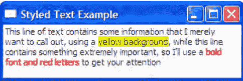

图 10.2：在文本组件中显示样式化文本

现在修改此样式的其中一个或多个属性。假设你想显示一些带有黄色背景高亮的文本，以及一些其他粗体红色的文本：

```
style1 = FXHiliteStyle.from_text(text)
style1.normalBackColor = "yellow"

style2 = FXHiliteStyle.from_text(text)
style2.normalForeColor = "red"
style2.style = FXText::STYLE_BOLD
```

接下来，我们需要告诉我们的 FXText 组件使用这个样式数组：

```
text.hiliteStyles = [style1, style2]
```

最后，使用 `changeStyle()` 方法将指定文本块的样式设置为样式数组中的特定样式。由于 `changeStyle()` 的前两个参数是要设置样式的文本的起始位置和长度，我们将使用 `findText()` 来定位感兴趣的字符串：

```
first, last = text.findText("yellow background")
start_pos = first[0]
length = last[0] - first[0]
text.changeStyle(start_pos, length, 1)
```

`changeStyle()` 的最后一个参数是样式索引。请注意，“第零个”样式索引保留给文本组件的默认样式。也就是说，当你将零作为 `changeStyle()` 的最后一个参数传入时，文本将使用正常的、非样式化的配色方案显示。由于我们在这个示例中传入 1 作为样式索引，FXText 将使用黄色背景样式来显示短语 "yellow background"。图 10.2 显示了此示例在 Windows 下运行的样子。

在过去的几章中，我们讨论了一些可用于处理用户界面基础知识的组件。虽然显示信息和从用户那里收集输入确实满足了大多数应用程序的功能需求，但这还不足以制作出人们已经习惯创建的那种视觉丰富且美观的应用程序。在下一章中，我们将稍微转换一下话题，看看 FXRuby 提供的一些用于美化 GUI 并使其闪闪发光的工具。


# 第 11 章

### 创建视觉丰富的用户界面

到目前为止，我们已经专注于将小部件组装成连贯用户界面的基础知识，以及如何处理应用程序与其用户之间的交互。如果创建人们乐于使用的应用程序仅需这些，那么我们讨论的内容就不会太多了。事实上，用户已经习惯使用那些超越基本功能需求并融入各种视觉兴趣元素的应用程序。

幸运的是，FXRuby 提供了众多功能来创建视觉丰富的用户界面。在构建“图画书”应用程序的过程中，我们已经了解到 FXRuby 为显示图像提供了广泛的支持。在第 8 章 *构建简单小部件*（第 100 页），当我们学习如何构建图标并用它们来装饰标签、按钮和其他类型的小部件时，我们简要介绍了另一种图形对象。尽管我们到目前为止编写的大部分代码都使用了默认的应用程序字体，但 FXRuby 允许你访问所有已安装的系统字体，以便在适当时在整个应用程序中使用不同的字体。你还可以在某些情况下更改鼠标光标的形状，为用户提供关于应用程序状态或其执行操作类型的视觉提示。在本章中，我们将研究所有这些功能，并了解如何在自己的应用程序中有效地使用它们。

我们在本章讨论的用户界面对象很特殊，因为与小部件不同，字体、光标、图像和图标是 *共享资源*。当你构建一个像 FXButton 这样的小部件时，该小部件在小部件层次结构中恰好占据一个位置。换一种方式来看，该按钮恰好有一个父窗口。与此相比，共享资源可以与许多其他用户界面对象相关联。例如，当你构建应用程序对象时，它会构造一个默认的 FXFont 对象，该对象由应用程序中的所有小部件使用。

从中得出的重要结论是，如果所有对象都具有相同的特性，则无需构造多个此类对象的实例。例如，假设你不想在整个应用程序中使用默认的应用程序字体，而是想使用 Geneva 字体构建一个自定义字体，用于特定的 FXLabel 小部件。你将首先构建新的 FXFont 对象，并在必要时调用其 `create()` 方法：

```
geneva_font = FXFont.new(app, "Geneva", 10)
geneva_font.create
my_special_label.font = geneva_font
```

然后你将其分配给该标签。

```
my_special_label.font = geneva_font
```

现在假设你想在应用程序中其他地方的 FXText 小部件中使用相同的 Geneva 字体，且字号相同。你 *可以* 构建一个与标签字体属性完全相同的新 FXFont 对象，但这将是浪费资源。更好的选择是直接将 `geneva_font` 分配为 FXText 小部件的字体。

```
my_special_text.font = geneva_font
```

介绍完毕，让我们看看我们的第一个共享资源：FXFont。

#### 11.1 使用自定义字体

根据你查阅的词典，你可能认为 *字体* 指的是特定字体的所有大小和样式的集合，或者指的是该集合中特定大小和样式的字体。¹ 就 FXRuby 的目的而言，一个 FXFont 对象对应于第二个定义。例如，如果你需要以两种不同的字号显示同一种字体，你将需要构建两个不同的 FXFont 对象。

有三种构造 FXFont 对象的方法。所有方法都为你提供某种方式来指定所需的字体特性，例如字体名称、字号和字重。然后 FOX 将使用这些参数来识别与你所需最匹配的可用系统字体。你可能最常使用的字体构造函数涉及传入多个参数来指定所需的字体特性。例如，你可以使用以下代码请求一个使用 Arial 字体斜体样式的 14 点字体：

```
label1 = 
    FXLabel.new(self, "This label uses a 14 point Arial italic font.")
label1.font = FXFont.new(app, "Arial", 14, :slant => FXFont::Italic)
```

另一种构造字体的方法是传入一个包含字体描述的字符串。你需要查阅 FXFont 类的 API 文档以了解此字符串的确切格式，但这里有一个如何请求 12 点 Times 粗体字体的示例：

```
label2 = 
    FXLabel.new(self, "This label uses a 12 point Times bold font.")
label2.font = FXFont.new(app, "Times,120,bold")
```

第三种构造字体的方法涉及传入一个 FXFontDesc 对象。FXFontDesc 只是一个数据对象，其属性对应于你将传入我们之前查看的 FXFont.new() 方法第一种形式的参数（例如，字体名称、字号等）。实际上，你通常不会直接构造 FXFontDesc 对象。在许多情况下，你会从 FXFontDialog（我们将在第 14 章 *使用对话框提供支持*（第 196 页）中介绍）中获取一个。获取 FXFontDesc 对象更直接的方法是使用 `listFonts()` 方法。

`listFonts()` 方法返回一个列表，其中包含与你指定条件匹配的所有可用字体。这是一种强大且与平台无关的字体选择方法，因为它不需要你显式地识别所有字体特性。

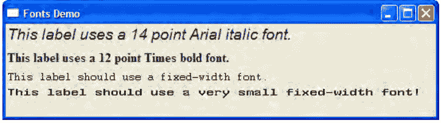

图 11.1：自定义字体示例

在这个例子中，我们请求所有直立（非斜体）等宽字体的列表，然后只选择第一个：

```
label3 = FXLabel.new(self, "This label should use a fixed-width font.")
fonts = FXFont.listFonts("", :slant => FXFont::Straight,
  :hints => FXFont::Fixed)
label3.font = FXFont.new(app, fonts.first)
```

如果我们想更挑剔一点，我们可以寻找最小的等宽字体，其大小为 2 点（20 分点）或更大：

```
label4 = FXLabel.new(self,
  "This label should use a very small fixed-width font!")
fonts = FXFont.listFonts("", :slant => FXFont::Straight,
  :hints => FXFont::Fixed)
sorted_by_size = fonts.sort { |a, b| a.size <=> b.size }
label4.font = FXFont.new(app, sorted_by_size.find { |f| f.size > 20 })
```

图 11.1 显示了此示例在 Windows 下生成的一些字体。请注意，在这种情况下，字号最小的等宽字体（显示在最后一行）实际上比我们之前选择的等宽字体（显示在倒数第二行）更宽。这不是错误；字体的字号是一个相对度量，通常基于从最高升部顶部到最低降部底部的距离。²

与网页设计一样，你应该保守地使用应用程序中的字体数量和种类，以确保它们在各种平台和不同显示分辨率的显示器上都能良好运行。考虑使用 `listFonts()` 来增加你找到符合应用程序需求的合适字体的机会。

另一个让你的应用程序外观焕然一新的机会是使用自定义鼠标光标，以提供有关应用程序状态变化或用户所执行操作的视觉提示。接下来让我们看看 FXRuby 如何使用光标。

#### 11.2 用光标指引方向

光标的形状通常是你不太会考虑的事情。对于你编写的许多图形用户界面应用程序，你将坚持使用 FOX 提供的默认光标。然而，对于某些应用程序，在特定操作期间更改光标的形状以向用户提供有关正在发生的事情的视觉提示是很有用的。例如，当我在 Windows 资源管理器中将文件从一个文件夹拖到另一个文件夹以 *移动* 它时，光标在常规箭头光标旁边显示一个小的“加号”，但当我按住 Alt 键拖动文件时，光标的形状会改变，表示我将创建一个指向原始文件的 *链接*。

你可以通过将 FXCursor 实例分配给其 `defaultCursor` 属性来为特定窗口更改光标的形状。每当鼠标指针进入该窗口时，光标的形状将更改为你指定的任何形状。FXApp 类提供许多内置的“默认”光标，当你需要更改光标外观时可以（并且应该）使用它们。在以下示例中，当用户将鼠标悬停在标签上时，光标的形状将更改为内置的 `DEF_HAND_CURSOR` 形状：

```
box = FXLabel.new(frame, "Gimme Five!",
    :width => 40, :height => 40,
    :opts => LAYOUT_CENTER_X, :padding => 40)
box.defaultCursor = app.getDefaultCursor(DEF_HAND_CURSOR)
```

图 11.2（在下一页）显示了 `DEF_HAND_CURSOR` 形状的样子。如果内置光标都不符合你的需求，你总是可以构建自己的自定义光标。最简单的方法是使用 FXGIFCursor 子类，它可以从 GIF 图像构建光标。³

---

¹ 你可能还读到过字体是“教堂中用于洗礼水的容器”。我们指的不是那种特定的字体。

² 有关如何解释字体字号的简要讨论，请参阅 http://nwalsh.com/comp.fonts/FAQ/cf_8.htm。

³ 还有一个 FXCURCursor 类，可以从 CUR 文件构建光标。


## 11.2 自定义光标

图 11.2：和手说话（光标）

```ruby
box = FXLabel.new(frame,
  "Who's a Programmer's Best Friend?",
  :width => 40, :height => 40,
  :opts => LAYOUT_CENTER_X, :padding => 40)
custom_cursor = FXGIFCursor.new(app,
  File.open("rubycursor.gif", "rb").read)
custom_cursor.create
box.defaultCursor = custom_cursor
```

图 11.3（下一页）展示了当光标位于下方框内时，这个自定义光标的形状。请注意，GIF 图像的尺寸应为 32x32 像素或更小；这是由于 Windows 对光标大小的限制。另外，请注意 FOX 区分了窗口的*默认光标*和*拖动光标*。每当窗口被拖动（通常是由于用户按住鼠标按钮并拖动鼠标）时，光标就会变为拖动光标。如果你更改了窗口的默认光标，你很可能也需要使用 dragCursor 属性来更改该窗口的拖动光标。

有一个特殊情况在 FXRuby 中经常出现，因此提供了一对辅助方法来处理它。当你的应用程序正在执行一些耗时操作时，例如加载大文件或进行复杂计算，你通常希望将光标形状更改为“忙”光标（看起来像一块手表）。你可以使用 `beginWaitCursor()` 和 `endWaitCursor()` 方法来临时将光标从其当前形状切换到忙光标，然后再切换回来：<sup>4</sup>

```ruby
app.beginWaitCursor # 保存当前形状并切换到忙光标
    ... 执行耗时操作 ...
app.endWaitCursor   # 恢复之前的光标形状
```

<sup>4</sup> FOX 称其为“等待”光标。我喜欢称之为“忙”光标。随你便吧。

你也可以使用 `beginWaitCursor()` 的事务性形式，它将在代码块退出时自动调用 `endWaitCursor()`：

```ruby
open_button = FXButton.new(self, "Open File")
open_button.connect(SEL_COMMAND) do
  app.beginWaitCursor do
    open_file # 这可能需要一些时间...
  end
end
```

需要注意的是，在这个例子中，当程序忙于打开文件时，用户将无法进行其他操作。你需要对此非常小心。如果你执行的任务需要很长时间，但可以在后台完成，你应该考虑在单独的线程中执行该任务，以使你的程序在此期间保持响应。

考虑到你在构建《图画书》应用程序时所做的工作，你已经积累了很多处理图像的经验。在接下来的几节中，我们将回顾这些信息，并在此过程中学习一些新技巧。

#### 11.3 创建和显示图像

开始使用 `FXImage` 对象最简单的方法是使用特定于格式的子类，例如 `FXJPGImage`，直接从某些图像数据构造图像。例如，你可以用一行代码从一个 JPEG 格式的文件构造一个图像：

```ruby
birdsnest_image =
  FXJPGImage.new(app, File.open("birdsnest.jpg", "rb").read)
```

FOX 不太关心你从哪里获取图像数据。如果数据在线某处，你同样可以使用 Ruby 的标准 `open-uri` 库来获取它：

```ruby
require 'open-uri'

oscar_image =
  FXJPGImage.new(app, open("http://tinyurl.com/35o8yy").read)
```

| 图像文件格式 | 类名 |
| --- | --- |
| Windows 位图 (BMP) | FXBMPImage |
| 图形交换格式 (GIF) | FXGIFImage |
| 联合图像专家小组格式 (JPEG) | FXJPGImage |
| 可移植网络图形格式 (PNG) | FXPNGImage |
| 标记图像文件格式 (TIFF) | FXTIFFImage |

图 11.4：FXImage 子类

有许多流行图像文件格式的 FXImage 子类。有关最常用文件类型及其相应类名的列表，请参见图 11.4。<sup>5</sup>

一旦你有了一个 `FXImage` 对象的引用，就有多种方法可以使用它。`FXImageFrame` 类是 `FXFrame` 的子类，其唯一目的是显示图像：

```ruby
FXImageFrame.new(tab_book, birdsnest_image,
  :opts => FRAME_RAISED|FRAME_THICK|LAYOUT_FILL)
```

`FXImageFrame` 控件并不那么复杂。如果你运行示例应用程序并调整窗口大小使其变小，你会看到图像并没有缩小以适应窗口的新尺寸；它只是在边缘被裁剪了。当你显示一个未知大小的图像时，最好使用 `FXImageView` 控件，它在一个滚动窗口中显示图像：

```ruby
FXImageView.new(tabbook_page, oscar_image, :opts => LAYOUT_FILL)
```

图像的第三种用途是将它们绘制到设备上下文中，用于更通用的绘图应用程序。我不会在这里介绍这个主题，但你可以查看标准 FXRuby 发行版中的 `dctest.rb` 示例程序来了解这是如何工作的。

除了加载和显示图像的基本功能外，FOX 还提供了许多用于操作和转换图像的 API。接下来，让我们看看这些功能。

<sup>5</sup> FOX 还支持许多其他更不常见的图像文件格式。

#### 11.4 操作图像数据

在某些情况下，你可能需要对图像数据进行细微修改。我们在第 5 章《第二次尝试：显示整个相册》（第 43 页）中处理过这个问题，当时我们使用 `scale()` 方法缩小原始图像，以便我们可以同时看到更多图像。`FXImage` 类提供了几个支持图像数据操作和转换的额外 API，但它们在设置方面需要一些额外的工作。

首先，默认情况下，`FXImage` 在创建服务器端表示后会丢弃其原始图像数据的副本。如果你只需要在对图像调用 `create()` 之前操作源图像数据，这种默认行为不会造成问题。另一方面，如果你希望在初始调用 `create()` 之后能够操作图像数据，你需要在构造图像时通过传入 `IMAGE_KEEP` 选项来告诉 `FXImage` 保留其原始图像数据的副本（即行话所说的*客户端像素缓冲区*）：

```ruby
@image = FXJPGImage.new(app,
    File.open("birdsnest.jpg", "rb").read,
    :opts => IMAGE_KEEP)
```

现在你可以调用一个或多个图像操作 API 来更改图像的客户端像素缓冲区副本。例如，你可以使用 `crop()` 方法来消除原始图像的部分内容。图 11.5（下一页）展示了一个包含所有原始内容的示例图像。让我们看看裁剪掉图像上半部分以外所有内容后的样子。

```ruby
@image.crop(0, 0, 0.5*@image.width, 0.5*@image.height)
```

`crop()` 的前两个参数是你想要保留区域的左上角坐标，第三和第四个参数是该区域的宽度和高度。图 11.6（第 153 页）显示了裁剪后图像的剩余部分。正如预期的那样，图像是其原始大小的四分之一，并且仅包含原始图像的左上角象限。

`crop()` 实际的工作方式是将图像调整为新的宽度和高度，复制你想要保留的原始图像部分，然后用填充颜色（默认情况下是黑色）填充任何间隙。在大多数情况下，你会像在前面的例子中那样使用 `crop()` 来保留原始图像的一个子区域，但 `crop()` 灵活到足以让你做一些不寻常的事情。例如，考虑对同一个原始图像进行以下 `crop()` 调用：

```ruby
@image.crop(0.5*@image.width, 0.5*@image.height,
            @image.width, @image.height)
```

在这个例子中，我们使用图像的中心作为裁剪区域的左上角，这看起来很合理，但我们也表示新图像的大小应具有与原始图像相同的宽度和高度。图 11.7（第 154 页）显示了此 `crop()` 调用的结果。请注意，原始图像中不存在的新部分用黑色填充。


## 图 11.6：裁剪后的结果图像

让我们考虑另一种图像处理技术。你可以使用 `mirror()` 方法创建当前图像的镜像：

```
@image.mirror(false, true)
```

`mirror()` 的第一个参数表示图像是否应在水平方向上镜像（即从左到右翻转）。第二个参数表示图像是否应垂直镜像。在此示例中，我们仅对图像进行垂直镜像。图 11.8（位于第 155 页）展示了鸟巢照片垂直镜像后的效果。⁶

我们之前提到过，如果希望在图像创建后能够操作客户端像素缓冲区，需要在构造图像时确保传入 `IMAGE_KEEP` 选项。同样重要的是要注意，当你随后操作图像数据时，需要告诉 FOX 更新图像的服务器端表示，方法是调用图像的 `render()` 方法。许多图像处理 API，包括 `scale()`、`crop()` 和 `mirror()`，在重新排列像素后会自动为你调用 `render()`。其他 API，如 `blend()` 和 `gradient()`，则不会，在使用这些 API 后，需要你自己调用图像的 `render()`。⁷

除了缩放、裁剪和镜像图像外，FOX 还提供了旋转、剪切、渐变和混合图像的 API；详情请参见 FXImage API 文档。这是一组相当实用的工具，但对于更复杂的需求，你可能更适合使用辅助库，例如 Tim Hunter 广受欢迎的 RMagick。⁸

⁶ 在该示例程序的开发过程中，没有鸟类受到伤害。

⁷ 图像操作方法的 API 文档指出了哪些方法会自动重新渲染图像，哪些则不会。

⁸ http://rmagick.rubyforge.org/

## 图 11.8：镜像图像

到目前为止，我们实际上只考虑了如何使用位图图像数据来增强应用程序外观的一个方面。在下一节中，我们将探讨如何将图像用作图标，为标签、按钮和其他部件提供更小型的装饰性点缀。

#### 11.5 创建和显示图标

图像与图标之间的主要区别在于，图标中的某些部分被视为透明的。你为图标定义一种透明色，然后当 FOX 绘制该图标时，该颜色像素下方的内容会显示出来。图标的尺寸通常也小于普通图像，但在绝大多数情况下，图标的大小并没有真正的限制。另一个重要的区别是，图标可以在比纯图像多得多的地方使用。你已经看到了如何将图标用作标签、按钮和各种列表项的装饰。在第**13**章*高级菜单管理*（第187页）中，你还会发现可以将它们与菜单项关联起来。

## 图 11.9：猜测 BMP 图标的透明色

与图像的情况一样，开始使用图标的最简单方法是使用 `FXIcon` 的某个子类从图像数据中构造一个。例如，你可以用一行代码从 GIF 文件构造一个图标：

```
gif_icon = FXGIFIcon.new(app, File.open("fxruby.gif", "rb").read)
```

构造图标时唯一棘手的部分是， most image file formats (other than GIF) don't inherently support the notion of a single transparency color. 例如，BMP 文件格式完全不涉及透明度。当你想从 BMP 图像构造图标时，至少要给 FOX 一个关于哪种颜色是正确透明色的提示。最简单的方法是使用 `IMAGE_ALPHAGUESS` 选项：

```
r_icon = FXBMPIcon.new(app,
    File.open("Ras1.bmp", "rb").read,
    :opts => IMAGE_ALPHAGUESS)
```

图 11.9 展示了 `IMAGE_ALPHAGUESS` 选项的实际效果。当你指定 `IMAGE_ALPHAGUESS` 选项时，FOX 会根据图像四个角的颜色来猜测透明色。这通常是一个很好的猜测；在这个例子中，原始 BMP 图像的四个角都是白色的，因此它正确地猜出了白色区域应该被设为透明。

## 图 11.10：修复 BMP 图标的透明色

如果 `IMAGE_ALPHAGUESS` 算法实际上没有猜对，你可以通过传入目标值和 `IMAGE_ALPHACOLOR` 选项来显式指定哪种颜色值应该是透明的：

```
red_transp = FXBMPIcon.new(app,
  File.open("shapes.bmp", "rb").read,
  :opts => IMAGE_ALPHACOLOR)
red_transp.transparentColor = FXRGB(255, 0, 0)
```

图 11.10 展示了同一 BMP 图标透明色的三种不同结果。左边的第一个结果显示了如果我们不指定任何透明色时会得到什么：图像被简单地绘制为不透明的，没有任何透明区域。中间的第二个结果显示了使用 `IMAGE_ALPHAGUESS` 选项的效果：由于图像的四个角都是白色的，白色被假设为透明色。右边的第三个结果显示了当我们指定 `IMAGE_ALPHACOLOR` 选项并将透明色设为红色时的效果（如前面的代码片段所示）。

在另一个极端是 PNG 文件格式，它包含一个 *alpha* 通道，用于指定每个单独像素的透明度程度。像素可以是完全不透明的、完全透明的，或者介于两者之间。FOX 渲染这类图标时，假设任何非完全透明的像素（即具有非零 alpha 值）都应该是可见的。缺点是你在图标中无法显示部分透明的区域，但优点是你不受限于单一透明色，而大多数其他文件格式都是如此。

#### 11.6 还有一点

早在第**7.7**节*客户端对象与服务器端对象*（第**95**页）中我们就讨论过这一点，但值得再重复一遍。如果你在程序运行后动态构造图像或图标，务必对其调用 `create()` 以将其与服务器端资源关联。否则，你的程序将会崩溃得相当壮观。这个问题会出现在许多不同的情况下，但尤其常见的一种是在运行时向列表添加新项时。

假设你有一个 `FXListBox` 部件，在运行时向其中添加项目。列表框包含一个用户名列表，每个条目都有一个关联的图标来指示用户的状态：

```
def add_user(user_name, status)
  status_icon = make_status_icon(status)
  status_icon.create
  users_listbox.appendItem(user_name, status_icon)
end
```

在我们这个假设程序的片段中，应用程序可以调用 `add_user()` 方法来动态添加具有给定状态的新用户。在添加列表项之前，我们调用 `make_status_icon()` 方法来构造一个新的 `FXIcon` 实例，以图形方式指示用户的状态。关键在于，然后要在将图标与列表项关联*之前*，对图标对象调用 `create()`。请注意，如果合理的话，我们的 `make_status_icon()` 实现可以缓存图标对象。对已创建的资源调用 `create()` 没有任何危害，但你绝对要确保资源在使用之前XL之前已经被创建。

构建 GUI 应用程序不仅仅是将所有部件放在正确的位置并将它们连接起来。色彩丰富的图标和花哨字体的滥用肯定无法弥补糟糕的用户交互设计，但恰当地（我希望是有品味地）使用自定义字体、光标、图像和图标，可以增强用户界面，使其对最终用户更具视觉吸引力。随着越来越多的用户期望视觉上丰富的用户界面，应用程序的"外观吸引力"是一个你不应忽视的因素。

说到将所有部件放在正确的位置，现在该是我们更仔细地研究如何使用布局管理器来放置和调整用户界面中部件大小的时候了。让我们在下一章中完成这一目标。


# 第12章

### 管理布局

布局管理器是负责安排其他控件位置和尺寸的对象。从表面上看，这似乎是一项相当简单的任务。在设计良好的用户界面中，应用程序用户确实不会意识到布局管理器所扮演的角色。然而，从应用程序开发者的角度来看，布局管理器为你组织用户界面提供了极大的灵活性。

从根本上说，布局管理器不仅提供了确定各个控件尺寸和位置的方法，还提供了将控件组相对于彼此进行大小调整和定位的方法。它们为你提供了使一切按预期方式完美契合的工具。对于那些无法（或不应该）同时显示在同一屏幕上的情况，布局管理器提供了在不同时间有条件地显示用户界面不同部分的选项。例如，一些特殊用途的布局管理器允许你将应用程序的不同部分来回切换，而另一些则允许你滚动窗口的不同部分进出视图。

布局管理器还能帮助你解决一些不那么明显的问题。例如，创建跨平台应用程序的一个棘手之处在于，某些资源（如字体）可能会动态更改。这类更改可能会对使用这些字体的文本显示部分的用户界面布局产生潜在的重大影响。布局管理器可以帮助你最小化这些更改的影响。

在本章中，我们将首先探讨填充模型，这是驱动许多FOX最常用布局管理器的基本布局算法。`FXPacker`是一个相当复杂的布局管理器，虽然我们将在填充模型的初步讨论中使用它，但实际上你并不会经常直接使用`FXPacker`。相反，你会使用它的子类，如`FXHorizontalFrame`或`FXVerticalFrame`。

我们也将看看这些子类，然后继续讨论布局基础，包括如何通过嵌套布局管理器来创建更复杂的布局、如何创建固定布局（以及为什么你不应该这样做），以及如何修改布局管理器内的填充和间距以获得恰到好处的外观。

一旦我们掌握了基础，我们将把注意力转向一些更专门的布局管理器。在构建“图片书”应用程序时，我们已经遇到过其中一些布局管理器，例如`FXMatrix`、`FXScrollWindow`和`FXSplitter`。我们将更仔细地研究这些布局管理器，并探讨使用它们时涉及的一些更精细的要点。

我们还将研究`FXTabBook`布局管理器，你可以用它来创建选项卡式笔记本风格的视图。本章最后将更全面地探讨如何使用FOX的布局管理器解决一些更常见的布局问题。

#### 12.1 理解填充模型

你熟悉俄罗斯方块这个游戏吗？俄罗斯方块的目标是操纵一系列下落的几何形状，使它们能够嵌入容器中。当一个形状下落时，你可以旋转它或将其左右移动，直到找到最佳的契合位置。嗯，`FXPacker`布局管理器的工作原理与此类似（尽管我希望它压力更小）。

当你首次构建一个`FXPacker`窗口时，它就像一个空盒子。你添加到打包器的第一个子控件将被放置在其四个边之一上。

通过传递`LAYOUT_SIDE_TOP`、`LAYOUT_SIDE_RIGHT`、`LAYOUT_SIDE_BOTTOM`或`LAYOUT_SIDE_LEFT`作为布局提示，你可以指定要靠哪一边放置：

```
packer = FXPacker.new(self, :opts => LAYOUT_FILL)
child1 = FXButton.new(packer, "First",
  :opts => BUTTON_NORMAL|LAYOUT_SIDE_BOTTOM)
```

在这里，我们指定了第一个子控件（一个按钮）应该沿打包器的底边放置。默认情况下，打包器会将该按钮与其左侧对齐。我们可以覆盖此行为，使按钮改为在打包器的左右两侧之间居中：

```
child1 = FXButton.new(packer, "First",
  :opts => BUTTON_NORMAL|LAYOUT_SIDE_BOTTOM|LAYOUT_CENTER_X)
```

如果我们希望按钮与打包器的右侧对齐，我们可以用`LAYOUT_RIGHT`替换`LAYOUT_CENTER_X`：

```
child1 = FXButton.new(packer, "First",
  :opts => BUTTON_NORMAL|LAYOUT_SIDE_BOTTOM|LAYOUT_RIGHT)
```

到目前为止，打包器只是将按钮设置为其默认的宽度和高度。我们可以要求按钮水平拉伸，使其尽可能宽：

```
child1 = FXButton.new(packer, "First",
  :opts => BUTTON_NORMAL|LAYOUT_SIDE_BOTTOM|LAYOUT_FILL_X)
```

注意，我忽略了关于如何对齐按钮的提示，因为`LAYOUT_FILL_X`提示使得该信息变得无关紧要。

现在，如果我们想将*两个*按钮放置在打包器的底边上呢？似乎我们应该可以这样写代码：

```
packer = FXPacker.new(self, :opts => LAYOUT_FILL)
child1 = FXButton.new(packer, "Bottom-Right",
  :opts => BUTTON_NORMAL|LAYOUT_SIDE_BOTTOM|LAYOUT_RIGHT)
child2 = FXButton.new(packer, "Bottom-Left",
  :opts => BUTTON_NORMAL|LAYOUT_SIDE_BOTTOM|LAYOUT_LEFT)
```

如果你没有明确指定边，则默认为`LAYOUT_SIDE_TOP`。

图12.1：结果并非完全如我们所料？

`LAYOUT_SIDE_BOTTOM`提示告诉打包器我们希望两个按钮都靠底边放置。我们在第一个按钮上指定了`LAYOUT_RIGHT`，在第二个按钮上指定了`LAYOUT_LEFT`。我们知道按钮的默认尺寸足够小，两个都能放得下，对吧？那么，当你运行这个示例时会发生什么？

设置成这样，你就知道它不会成功，对吧？图12.1显示了在Windows下运行时的外观，但布局并非完全如我们所料。第一个按钮正确地靠在打包器的底边上，并与打包器的右侧对齐。第二个按钮正确地与打包器的左侧对齐，但它坐在一个不可见的架子上，就在第一个按钮的上方。打包器的特点是，一旦你将一个控件放置在剩余空间（又称“空腔”）的某一侧，它就会占据空腔的整个该侧。即使你不使用`LAYOUT_FILL_X`或`LAYOUT_FILL_Y`，情况也是如此。

让我们再添加一些控件，放置在空腔的其他边上，看看当打包器开始被填满时它们是如何放置的：

```
packer = FXPacker.new(self, :opts => LAYOUT_FILL)
child1 = FXButton.new(packer, "Bottom-Right",
  :opts => BUTTON_NORMAL|LAYOUT_SIDE_BOTTOM|LAYOUT_RIGHT)
child2 = FXButton.new(packer, "Bottom-Left",
  :opts => BUTTON_NORMAL|LAYOUT_SIDE_BOTTOM|LAYOUT_LEFT)
child3 = FXLabel.new(packer, "Top",
  :opts => FRAME_GROOVE|LAYOUT_SIDE_TOP|LAYOUT_FILL_X)
child4 = FXLabel.new(packer, "Left-Center",
  :opts => FRAME_GROOVE|LAYOUT_SIDE_LEFT|LAYOUT_CENTER_Y)
```

图12.2：添加更多控件后

图12.2显示了在Windows下运行时的样子。查看下一页的图12.3可能有助于理解发生了什么。虚线表示已放置在打包器中的每个子控件所占据的空间。请注意，当我们添加第四个子控件（“左中”标签）时，空腔中的大部分垂直空间已经被之前添加的控件消耗掉了。

但我们不要忘记我们之前的目标：将按钮放置在打包器的左下角和右下角。我们如何实现这种布局？对于任何非平凡的布局，你最终都需要将布局管理器相互嵌套。这引导我们进入下一组布局管理器的讨论，即水平框架和垂直框架。

##### 使用水平和垂直框架创建简单布局

`FXHorizontalFrame`和`FXVerticalFrame`布局管理器是`FXPacker`的子类，它们对我们一直在讨论的打包器模型施加了一些额外的约束。正如你可能从它们的名字中猜到的，水平框架水平排列其子控件，而垂直框架垂直排列其子控件。


##### 将布局管理器相互嵌套

让我们回顾一下前面章节中研究过的示例，当时我们试图弄清楚如何将两个按钮沿着打包器的底部放置。为了实现这种布局，我们将把这两个按钮放入一个水平框架中，然后将该水平框架放入打包器内：

```
packer = FXPacker.new(self, :opts => LAYOUT_FILL)
hframe = FXHorizontalFrame.new(packer, :opts => LAYOUT_SIDE_BOTTOM)
child1 = FXButton.new(hframe, "右下角",
  :opts => BUTTON_NORMAL|LAYOUT_RIGHT)
child2 = FXButton.new(hframe, "左下角",
  :opts => BUTTON_NORMAL|LAYOUT_LEFT)
```

在运行此示例之前，请查看代码并确保理解水平框架是如何嵌套在打包器内部的。

图 12.6：嵌套了水平框架的打包器

图 12.6（见下页）展示了此示例在 Windows 下运行的效果。

这已经非常接近了。按钮现在处于同一水平线上，但它们不在相对的角落，而是紧挨在一起（并且紧靠左侧）。问题与我们为水平框架指定的布局提示有关。由于我们没有要求水平框架拉伸，它的大小被调整为恰好能容纳它所包含的两个按钮；并且由于我们没有指定它与哪一侧对齐，它选择了默认的 `LAYOUT_LEFT` 对齐方式。让我们通过为水平框架指定 `LAYOUT_FILL_X` 提示来解决这个问题：

```
packer = FXPacker.new(self, :opts => LAYOUT_FILL)
hframe = FXHorizontalFrame.new(packer,
    :opts => LAYOUT_SIDE_BOTTOM|LAYOUT_FILL_X)
child1 = FXButton.new(hframe, "右下角",
    :opts => BUTTON_NORMAL|LAYOUT_RIGHT)
child2 = FXButton.new(hframe, "左下角",
    :opts => BUTTON_NORMAL|LAYOUT_LEFT)
```

下一页的图 12.7 展示了最终结果。显然，这是一个相当基础的布局管理器相互嵌套的示例，但它让你初步了解了我们将如何解决一些更复杂的布局问题。我们将在第 12.6 节《结合使用不同布局管理器的策略》（第 181 页）中更详细地探讨这一点。

图 12.7：嵌套了水平框架的打包器

到目前为止，我们一直在讨论如何实现各种布局，而没有明确提及被布局控件的大小或位置。FOX 也支持固定布局，你可以显式指定控件的位置和/或大小，接下来我们将看看这是如何工作的。

##### 创建固定布局

当然，你可以完全绕过布局管理器，只使用固定布局。通过这种方法，你可以显式指定控件的位置，而不是让布局管理器来计算。

```
@fixed_pos_button = FXButton.new(self, "固定位置",
  :opts => BUTTON_NORMAL|LAYOUT_FIX_X|LAYOUT_FIX_Y,
  :x => 20, :y => 20)
```

运行此示例时，尝试调整主窗口的大小。由于 `LAYOUT_FIX_X` 和 `LAYOUT_FIX_Y` 布局提示，你会看到无论你做什么，按钮都保持相对于主窗口左上角的相同位置。如果你将窗口调整得太短（或太窄）而无法显示按钮，按钮将被裁剪。

你也可以使用 `LAYOUT_FIX_WIDTH` 和 `LAYOUT_FIX_HEIGHT` 布局提示来固定控件的大小：

```
@fixed_size_label = FXLabel.new(self, "固定大小标签",
  :opts => (LAYOUT_CENTER_X|LAYOUT_CENTER_Y|
            LAYOUT_FIX_WIDTH|LAYOUT_FIX_HEIGHT),
  :width => 120, :height => 40)
```

顺便说一句，这不是一个全有或全无的命题。如果你只想固定控件的 x 位置，而将其他参数留给布局管理器，只需传入 `LAYOUT_FIX_X` 标志和 `x` 属性的值。如果你要指定所有四个参数（x、y、宽度和高度），你可以传入更紧凑的 `LAYOUT_EXPLICIT` 提示来代替：

```
FXLabel.new(self, "固定位置和大小",
  :opts => LAYOUT_EXPLICIT,
  :x => 20, :y => 20,
  :width => 120, :height => 40)
```

这与传入 `LAYOUT_FIX_X`、`LAYOUT_FIX_Y`、`LAYOUT_FIX_WIDTH` 和 `LAYOUT_FIX_HEIGHT` 布局提示具有相同的效果。

现在，忘掉我刚才告诉你的一切，因为固定布局几乎*从来都不是*最佳解决方案。

固定布局的问题在于它们会降低你的用户界面在具有不同显示特征的运行时环境中的可移植性。那个在你的系统上固定宽度为 120 像素看起来不错的标签，在用户使用比你更小字体的系统上可能会显得巨大。更糟糕的是，如果用户的字体比你测试时使用的字体更大，控件的标签字符串可能会被截断且无法阅读。要看到实际效果，请运行示例程序，并尝试使用屏幕底部的微调框控件增大或减小字体大小。

一个类似的问题与显示大小有关。如果你在 1024x768 显示器上以全屏模式开发和运行应用程序，并且你使用的是固定布局，那么部署到以不同屏幕分辨率运行的系统几乎肯定会是灾难性的。除非你使用某种始终需要相同大小的元素——比如固定大小的图像或图标——否则你应该避免在应用程序中使用固定布局。

---

*注意：原始 OCR 文本包含了第 163-165 页，其中包含关于 FXHorizontalFrame、FXVerticalFrame 和均匀打包提示的介绍性内容（图 12.3-12.5）。用户提供的第一个 `[content]` 块从嵌套部分（图 12.6）开始，因此上面的输出从该点开始。为完整起见，下面再现了介绍性的第 163-165 页内容：*

---

图 12.3：幕后发生了什么

默认情况下，水平框架将从左到右布局其子控件，使用它们的默认大小：

```
Download hframe1.rb

hframe = FXHorizontalFrame.new(self)
child1 = FXButton.new(hframe, "第一个")
child2 = FXButton.new(hframe, "第二个")
child3 = FXButton.new(hframe, "第三个")
```

与 FXPacker 的情况一样，你可以更具体地指定子控件应与哪一侧对齐：

```
Download hframe2.rb

hframe = FXHorizontalFrame.new(self)
child1 =
  FXButton.new(hframe, "右侧", :opts => BUTTON_NORMAL|LAYOUT_RIGHT)
child2 =
  FXButton.new(hframe, "左侧",  :opts => BUTTON_NORMAL|LAYOUT_LEFT)
```

注意我们使用的是 `LAYOUT_LEFT` 和 `LAYOUT_RIGHT`，而不是 `LAYOUT_SIDE_LEFT` 和 `LAYOUT_SIDE_RIGHT`。需要记住的是，打包提示（如 `LAYOUT_SIDE_LEFT` 和 `LAYOUT_SIDE_RIGHT`）仅由 FXPacker 布局管理器考虑。

图 12.4：具有统一高度的垂直框架

你可以指定 `PACK_UNIFORM_HEIGHT` 打包提示来强制框架中的所有控件采用相同的高度：

```
Download vframe1.rb

vframe = FXVerticalFrame.new(self, :opts => PACK_UNIFORM_HEIGHT)
child1 = FXButton.new(vframe, "这是一个短按钮")
child2 = FXButton.new(vframe, "这个\n稍微高一点")
child3 = FXButton.new(vframe, "这个按钮有\n三行\n高")
```

注意 `PACK_UNIFORM_HEIGHT` 提示是为框架指定的，而不是为各个按钮指定的。当你运行此示例时，你会看到所有三个按钮的大小都调整到了最高控件（第三个按钮）的高度。图 12.4 展示了在 Windows 下的显示效果。你也可以请求控件具有统一的宽度。

```
Download vframe2.rb

vframe = FXVerticalFrame.new(self,
  :opts => PACK_UNIFORM_WIDTH|PACK_UNIFORM_HEIGHT)
child1 = FXButton.new(vframe, "这是一个短按钮")
child2 = FXButton.new(vframe, "这个\n稍微高一点")
child3 = FXButton.new(vframe, "这个按钮有\n三行\n高")
```

下一页的图 12.5 展示了在 Windows 下的显示效果。注意每个按钮现在都与最宽的控件（第一个按钮）一样宽。

图 12.5：具有统一宽度和高度的垂直框架

理解打包模型的工作原理以及如何使用 FXHorizontalFrame 和 FXVerticalFrame 创建简单布局是任何 FXRuby 开发人员的基础知识，但当你学会如何将布局管理器相互嵌套以创建更复杂的布局时，你将开始意识到布局管理器的真正威力。接下来，让我们看看如何做到这一点。


图 12.8：内边距与间距

##### 使用内边距与间距进行润色

到目前为止，你可能已经注意到，当我们把组件对齐到 packer（或我们正在使用的其他布局管理器）的某一侧时，它们并不能完全紧贴该表面。到目前为止，组件与其所在容器之间始终存在一点呼吸空间。相邻子组件之间也存在间距。显然，FOX 应用了一些合理的默认值来确保布局看起来良好，在大多数情况下你不会想要去修改这些值。但在某些情况下，你需要缩小组件之间的间隙，因此我们将快速了解一下内边距和间距参数。

图 **12.8** 展示了内边距和间距值在布局过程中是如何使用的。组件的*内边距*是它为其自身边缘保留的空间量。大多数组件的默认内边距是每边 2 像素，但你可以更改任意一边或所有边的值。例如，如果你想让某个组件紧贴其父组件的左上角，你会希望将左侧和顶部的内边距设为零，但你可能会将底部和右侧的内边距保留为默认设置。你可以在构造时使用 `:padLeft`、`:padRight`、`:padTop` 和 `:padBottom` 键的某种组合来指定组件的内边距值：

```
spinner = FXSpinner.new(self, 4,
  :opts => SPIN_NORMAL|LAYOUT_SIDE_TOP|LAYOUT_LEFT,
  :padLeft => 0, :padTop => 0)
```

将所有四边的内边距都设为零以消除内部间距是很常见的做法。对于这种情况，你只需指定 `:padding`：

```
spinner = FXSpinner.new(self, 4,
  :opts => SPIN_NORMAL|LAYOUT_SIDE_TOP|LAYOUT_LEFT,
  :padding => 0)
```

你也可以在组件构造完成后，使用 `padLeft`、`padRight`、`padTop` 和 `padBottom` 属性来更改其内边距：

```
spinner = FXSpinner.new(self, 4,
  :opts => SPIN_NORMAL|LAYOUT_SIDE_TOP|LAYOUT_LEFT)
spinner.padLeft = 0
spinner.padTop = 0
```

布局管理器的*水平间距和垂直间距*参数决定了在定位相邻子组件时会为它们之间留出多少空间。你可以在构造时使用 `:hSpacing` 和 `:vSpacing` 键来指定这些值：

```
groupbox = FXGroupBox.new(self, "No horizontal or vertical spacing",
  :hSpacing => 0, :vSpacing => 0)
```

请注意，由于间距仅作用于相邻组件之间，因此布局管理器边缘上的组件不会使用间距值。例如，在一个水平框架中，最左侧组件的左边缘仅由其内部内边距（更具体地说，是其 `padLeft` 值）来偏移。

与内边距类似，你也可以在容器构造完成后更改其间距值：

```
groupbox = FXGroupBox.new(self, "No horizontal or vertical spacing")
groupbox.hSpacing = 0
groupbox.vSpacing = 0
```

要掌握内边距和间距值以及它们之间如何交互可能有点棘手。主要要记住的是：间距在布局管理器（容器）上指定，而内边距在子组件上指定。由于所有布局管理器本身也可以是其他布局管理器的子级，这意味着你也可以为布局管理器指定内边距。

现在我们已经介绍了使用布局管理器的所有基础知识，接下来我们将关注 FOX 提供的一些更具特殊用途的布局管理器。我们将从 FXMatrix 布局管理器开始，之前在构建 Picture Book 应用程序时我们已经遇到过它。

#### 12.2 使用矩阵布局将组件排列成行和列

FXMatrix 布局管理器将其子组件排列成行和列。其他一些工具包将这种布局称为"网格"布局。它对于布局表单特别有用，一侧是一列标签，另一侧是一列文本字段（或其他类型的组件）。请注意，如果你想显示类似电子表格的表格数据，最好使用 FXTable 组件，我们将在第 9.4 节"使用 FXTable 显示表格数据"（第 126 页）中介绍。

矩阵可以配置为固定行数（`MATRIX_BY_ROWS`）或固定列数（`MATRIX_BY_COLUMNS`），`FXMatrix.new` 的第二个参数就是所需的行数（或列数）。

```
matrix = FXMatrix.new(self, 3, :opts => MATRIX_BY_ROWS|LAYOUT_FILL)
```

你像使用其他任何布局管理器一样向矩阵添加子组件，即传入矩阵的引用作为每个子组件的父级。然而，矩阵在布局时实际放置这些组件的位置可能会让你感到意外。下一页的图 12.9 展示了一个配置为 `MATRIX_BY_ROWS` 且有三行的 FXMatrix 组件的布局。你添加的第一个子组件成为矩阵第一行的第一个组件（这并不意外）。你添加的第二个子组件成为矩阵*第二*行的第一个组件。这种模式一直持续到你填满矩阵的第一列（通过添加每一行的第一个元素），然后重新从第二列开始。如果矩阵配置为 `MATRIX_BY_COLUMNS`，你将改为逐行填充。

让 FXMatrix 在调整大小时正确响应有时可能有点棘手。我们需要了解矩阵子组件的布局提示如何影响矩阵的整体布局。

图 12.9：三行矩阵的布局顺序

在矩阵的特定单元格内，常见的布局提示按预期工作。如果你为子组件指定了 `LAYOUT_FILL_X`，该组件将水平拉伸以填满其所在矩阵单元格的整个宽度。同样，如果你指定 `LAYOUT_CENTER_Y`，该子组件将垂直居中。不确定的是 FXMatrix 会为该特定单元格分配多少总空间。

首先说好消息。在其他条件相同的情况下，FXMatrix 会为每个单元格分配足够的空间，以确保该位置的子组件"放得下"。但如果矩阵有多余的空间呢？你的第一个猜测可能是，如果你简单地为矩阵本身指定 `LAYOUT_FILL_X` 和/或 `LAYOUT_FILL_Y`，其所有内容都会相应地拉伸。嗯，这是个不错的猜测，但你错了。

图 12.10：不使用 `LAYOUT_FILL_COLUMN` 的矩阵

考虑这个简单的矩阵，有九个子组件排列成三列：

```
matrix = FXMatrix.new(self, 3, :opts => MATRIX_BY_COLUMNS|LAYOUT_FILL)
FXLabel.new(matrix, "Lyle Johnson",
  :opts => JUSTIFY_LEFT|FRAME_LINE|LAYOUT_FILL_X)
FXLabel.new(matrix, "Madison", :opts => JUSTIFY_LEFT|FRAME_LINE)
FXLabel.new(matrix, "AL", :opts => FRAME_LINE)
FXLabel.new(matrix, "Homer Simpson",
  :opts => JUSTIFY_LEFT|FRAME_LINE|LAYOUT_FILL_X)
FXLabel.new(matrix, "Springfield", :opts => JUSTIFY_LEFT|FRAME_LINE)
FXLabel.new(matrix, "CT", :opts => FRAME_LINE)
FXLabel.new(matrix, "Bob Smith",
  :opts => JUSTIFY_LEFT|FRAME_LINE|LAYOUT_FILL_X)
FXLabel.new(matrix, "Walla Walla", :opts => JUSTIFY_LEFT|FRAME_LINE)
FXLabel.new(matrix, "WA", :opts => FRAME_LINE)
```

我为每个标签添加了 `FRAME_LINE` 框架样式，以便你能更清楚地看到每个组件的边界。图 12.10 显示了该示例在 Windows 下运行时的样子。当你运行这个示例时，你的第一反应可能是怀疑 FXRuby 没有遵循你为 `FXMatrix` 指定的 `LAYOUT_FILL` 布局提示。毕竟，很明显矩阵并没有拉伸以填满主窗口，对吧？

事实上，矩阵确实填满了整个主窗口。你可以对代码做一个小改动来证明这一点。


#### 12.3 使用分割器布局动态调整布局大小

我们之前讨论的布局管理器会自动执行布局约束。假设你已经指定了适当的布局提示，它们将自动为所有子控件确定合适的大小和位置，无需你手动干预。然而，在某些情况下，为用户提供交互式调整界面部分大小的工具是很有用的，FXRuby 提供了 FXSplitter 布局管理器来实现这一目的。

我们在第 6 章《第三次尝试：管理多个相册》第 62 页中已经对 FXSplitter 类进行了初步介绍，当时我们用它来并排显示相册列表和相册视图。实际上，FXSplitter 通常只包含两个子窗口，即"左侧"和"右侧"子面板（如果是垂直分割器，则为顶部和底部子面板）。不过，分割器中子窗口的数量实际上没有限制，分割器会在每个子面板之间绘制手柄，允许你相应地调整它们的大小。

默认情况下，分割方向是从左到右；也就是说，FXSplitter 的第一个子控件出现在分割的左侧，第二个子控件出现在右侧（如果有超过两个子控件，则依此类推）。你可以通过传入 `SPLITTER_VERTICAL` 标志来将分割方向配置为从上到下：

```ruby
splitter.splitterStyle |= SPLITTER_VERTICAL
```

你可以通过抓住分割器手柄并左右拖动来更改分割两侧分配的空间。当你拖动分割器手柄时，窗口上会绘制一条半透明的线条，向你显示停止拖动后分割线将放置的位置。当你释放分割器手柄时，相邻的子面板将根据手柄的新位置进行调整。

如果分割器配置了跟踪模式，当你拖动分割器时，两侧的面板将动态调整大小：

```ruby
splitter.splitterStyle |= SPLITTER_TRACKING
```

这在计算上开销更大，因为子面板的内容需要持续布局和重绘。

通常，你会希望将分割器子面板的初始大小设置为某些默认宽度（或高度），然后让用户根据需要调整。在应用程序退出时将子面板的大小保存到注册表²中，然后在下次应用程序启动时恢复它们，这是一种贴心的做法。最佳实践是在退出应用程序之前将分割器第一个面板的大小写入注册表：

```ruby
# Download splitter.rb
app.reg.writeIntEntry("Settings", "splitSize", @splitter.getSplit(0))
app.exit(0)
```

> 2. 我们在本书中不介绍 FOX 注册表，但你可以在 http://www.fox-toolkit.org/registry.html 上阅读更多相关内容。

然后，在主窗口的 `create()` 方法中读回分割大小，并在显示主窗口之前用它来配置分割器：

```ruby
def create
  super
  @splitter.setSplit(0, app.reg.readIntEntry("Settings", "splitSize"))
  show(PLACEMENT_SCREEN)
end
```

这个示例假设你的分割器只包含两个子面板。显然，如果你的分割器包含两个以上的子面板，你需要保存（并恢复）除最后一个之外的所有子面板的大小。

接下来，让我们看看 FXScrollWindow 布局管理器。

#### 12.4 使用滚动窗口管理大内容

我们在第 5 章《第二次尝试：显示整个相册》第 43 页中已经对 FXScrollWindow 类进行了初步介绍，当时我们将其用作相册视图的基础。正如我们当时所学的，FXRuby 提供了 FXScrollWindow 类作为其他布局管理器的一种装饰器类。当你将一个控件构建为滚动窗口的子控件时，滚动窗口会负责显示垂直和水平滚动条，并确保在用户滚动时显示内容的正确部分。

你应该只向 FXScrollWindow 添加一个子窗口。几乎总是，这个子窗口会是我们之前见过的其他布局管理器之一。在内部，滚动窗口会构建一些额外的子控件（用于垂直和水平滚动条），因此如果你直接查询子窗口列表，你会看到不止一个。因此，你应该始终注意使用 `contentWindow` 属性来引用滚动窗口的内容区域。

在大多数情况下，你只需要将内容添加到滚动窗口中，然后让用户通过调整滚动条来决定查看内容的哪一部分。如果需要以编程方式调整滚动窗口的视口以显示特定的关注区域，你可以使用 `setPosition()` 方法来实现，但这有点棘手。你必须传入 `setPosition()` 的坐标是内容窗口左上角相对于视口窗口左上角的期望 x 和 y 坐标。实际上这意味着你总是会传入负值给 `setPosition()`。

例如，如果你想调整内容，使滚动窗口视口中可见的部分是左上角位于位置 (100, 100) 的部分，你需要向 `setPosition()` 传入 (-100, -100)：

```ruby
scroll_window.setPosition(-100, -100)
```

如果你想移动内容使其在视口内居中，你需要考虑内容和视口之间的大小差异。以下代码在大多数情况下应该适用：

```ruby
# Download scrollwindow.rb
x = 0.5*(@scroll_window.contentWindow.width - @scroll_window.viewportWidth)
y = 0.5*(@scroll_window.contentWindow.height - @scroll_window.viewportHeight)
@scroll_window.setPosition(-x, -y)
```

现在让我们看看选项卡笔记本布局管理器。

#### 12.5 使用选项卡笔记本组织窗口

FXTabBook 布局管理器之所以得名，是因为它类似于带有选项卡页面的笔记本。当你单击其中一个选项卡时，与该选项卡关联的页面会被提升到页面堆栈的顶部，虽然整行选项卡始终可见，但笔记本中一次只显示一个页面（顶部页面）。FXTabBook 经常用于允许用户修改应用程序设置的对话框中；对话框中的每个选项卡页面展示一个不同类别的设置。它也出现在文本编辑或文字处理应用程序中，其中每个选项卡页面显示一个不同的文档。

将选项卡笔记本添加到你的应用程序中并不太困难。首先构建一个 FXTabBook 控件：

```ruby
# Download tabbook.rb
tabbook = FXTabBook.new(self, :opts => LAYOUT_FILL)
```

接下来，成对地添加选项卡项和选项卡笔记本页面。选项卡项是 FXTabItem 类的一个实例。选项卡页面通常是某种布局管理器，但它实际上可以是任何类型的控件。

FXMatrix 布局管理器不一定是你在很多应用程序中都会用到的，但它能很好地解决一个特定问题，因此值得熟悉。在下一节中，我们将看看另一个在构建 Picture Book 应用程序时遇到的布局管理器——FXSplitter。


#### 12.6 策略：如何综合使用不同的布局管理器

在大多数情况下，本章重点介绍了如何单独使用不同的布局管理器。想要将一组部件按行列布局？使用 `FXMatrix`。部件太大，无法在屏幕上完全显示？考虑将其放入 `FXScrollWindow` 中。虽然确实需要先熟悉所有这些布局管理器的独立工作原理，才能开始使用它们，但真正的乐趣在于开始将它们组合使用，以解决更复杂的布局问题。

我们在第12.1节《将布局管理器相互嵌套》中触及了这个想法，当时我们研究了如何将 `FXHorizontalFrame` 嵌套在 `FXPacker` 内部，以实现仅使用其中任何一个布局管理器都难以或无法实现的布局。实际上，这是你在开始开发自己的 FXRuby 应用程序时将学到的最重要的技能之一：如何将一个复杂的布局分解成多个更小、更易于管理的部分，然后使用其他布局管理器将这些部分粘合在一起。

例如，如果你的印象是你正在查看堆叠在一起的东西，你可能想要使用 `FXVerticalFrame`。让我们考虑一个相对简单的入门示例。图12.14是一个提供翻译服务图形用户界面前端的程序的模型。

当你查看此应用程序的主窗口时，你应该看到五个元素彼此堆叠。从顶部开始，我们有一个标签（"Source Text"），一个文本区域，第二个标签（"Translated Text"），第二个文本区域，以及最后的一行控件。当你正在查看堆叠在一起的东西时，你的脑海应该想到 `FXVerticalFrame`。此布局的一个合理初步尝试可能如下所示：

```
frame = FXVerticalFrame.new(self)
FXLabel.new(frame, "Source Text:")
source_text = FXText.new(frame)
FXLabel.new(frame, "Translated text:")
translated_text = FXText.new(frame, :opts => TEXT_READONLY)
controls = FXHorizontalFrame.new(frame)
```

末端的 controls 水平框架包含翻译模式的组合框以及位于右下角的"Translate"按钮：

```
FXLabel.new(controls, "Translate from:")
translations = FXComboBox.new(controls, 15,
  :opts => COMBOBOX_STATIC|FRAME_SUNKEN|FRAME_THICK)
translate_button = FXButton.new(controls, "Translate",
  :opts => BUTTON_NORMAL)
```

让我们运行这个布局的初版，看看它的效果。

图12.15展示了这个版本在Windows下的样子。对此最客气的评价是，正如承诺的那样，部件按预期彼此堆叠。在改进此应用程序的外观之前，让我们来谈谈你需要掌握的下一个重要技能：了解如何以及何时使用不同的布局提示来影响布局管理器的工作。

在大多数布局中，你至少会将"填充"提示（`LAYOUT_FILL_X` 或 `LAYOUT_FILL_Y`）之一应用于布局管理器本身。特别是，你会发现经常想对 `FXVerticalFrame` 的每个子部件使用 `LAYOUT_FILL_X` 布局提示。让我们为此示例中的垂直框架的子部件执行此操作。同时，我们也在"Translate"按钮上设置 `LAYOUT_RIGHT` 提示，使其紧靠在 controls 水平框架的右侧。

```
frame = FXVerticalFrame.new(self, :opts => LAYOUT_FILL)
FXLabel.new(frame, "Source Text:", :opts => LAYOUT_FILL_X)
source_text = FXText.new(frame, :opts => LAYOUT_FILL_X)
FXLabel.new(frame, "Translated text:", :opts => LAYOUT_FILL_X)
translated_text = FXText.new(frame, :opts => TEXT_READONLY|LAYOUT_FILL_X)
controls = FXHorizontalFrame.new(frame, :opts => LAYOUT_FILL_X)
FXLabel.new(controls, "Translate from:")
translations = FXComboBox.new([className](link) 15, :opts => COMBOBOX_STATIC|FRAME_SUNKEN|FRAME_THICK)
translate_button = FXButton.new(controls, "Translate", :opts => BUTTON_NORMAL|LAYOUT_RIGHT)
```

图12.16展示了这个版本在Windows下的样子。它已经开始看起来更像最终产品了，但仍然存在一些问题。我们希望两个文本区域增长以占据尽可能多的空间，而其他部件（两个标签和底部的一行控件）继续占据它们当前所占的空间。即使我们调整主窗口的大小，此行为也应保持不变。如果你尝试一下这个示例的最新版本，你会很快发现情况并非如此。

让我们尝试通过将两个 `FXText` 部件的 `LAYOUT_FILL_X` 提示更改为 `LAYOUT_FILL`（正如你回忆的，它包括 `LAYOUT_FILL_X` 和 `LAYOUT_FILL_Y`）来修复：

```
frame = FXVerticalFrame.new(self, :opts => LAYOUT_FILL)
FXLabel.new(frame, "Source Text:", :opts => LAYOUT_FILL_X)
source_text = FXText.new(frame, :opts => LAYOUT_FILL)
FXLabel.new(frame, "Translated text:", :opts => LAYOUT_FILL_X)
translated_text = FXText.new(frame, :opts => TEXT_READONLY|LAYOUT_FILL)
controls = FXHorizontalFrame.new(frame, :opts => LAYOUT_FILL_X)
FXLabel.new(controls, "Translate from:")
translations = FXComboBox.new(controls, 15,
  :opts => COMBOBOX_STATIC|FRAME_SUNKEN|FRAME_THICK)
translate_button = FXButton.new(controls, "Translate",
  :opts => BUTTON_NORMAL|LAYOUT_RIGHT)
```

作为最后的润色，让我们将每个 `FXText` 部件嵌套在一个框架内，以便我们可以在每个部件周围创建一个厚实的凹陷边框。在这种情况下，我们使用水平框架还是垂直框架并不重要，因为每个框架只有一个子部件需要处理：

```
source_text_frame = FXHorizontalFrame.new(frame,
  :opts => FRAME_SUNKEN|FRAME_THICK|LAYOUT_FILL,
  :padding => 0)
source_text = FXText.new(source_text_frame,
  :opts => LAYOUT_FILL)
FXLabel.new(frame, "Translated text:", :opts => LAYOUT_FILL_X)
translated_text_frame = FXHorizontalFrame.new(frame,
  :opts => FRAME_SUNKEN|FRAME_THICK|LAYOUT_FILL,
  :padding => 0)
translated_text = FXText.new(translated_text_frame,
  :opts => TEXT_READONLY|LAYOUT_FILL)
```

如果你此时运行示例，布局应该最终类似于我们在第182页图12.14中展示的原始概念。

我们最后采取的步骤——为了在文本区域周围提供一些装饰而将它们嵌套在额外的框架内——可能会让你觉得是浪费。那么，别这么想。

当你考虑将布局相互嵌套的各种选项时，有一个考虑你永远不应该花费太多时间担心，那就是你在此过程中创建的部件数量。如果最有意义且最容易维护的解决方案涉及使用大量相互嵌套的水平框架和垂直框架，那就去做吧。使用 FOX 的优势之一是，它对创建大量"廉价"部件（如水平框架和垂直框架）进行了高度优化。在大多数情况下，为实现布局而添加额外的框架不会对应用程序的性能或内存使用产生任何可察觉的影响。事实上，在许多情况下，你用来管理布局的额外框架和部件的数量，与实现应用程序实际功能的部件数量相比，是微不足道的。

因此，当你在下一章开始编写第一个 FXRuby 应用程序时，不要犹豫，在需要时嵌套布局管理器。在下一章中，我们将从一个简单的示例开始，然后逐步构建，直到它成为相当复杂的程序。


它对资源非常友好，并且在需要时即时创建和销毁小部件的成本非常"低廉"。

关于布局管理器的最后一点是，对于你遇到的几乎每个布局挑战，都有不止一种解决方式！在用户界面中创建复杂布局既是一门艺术，也是一门科学。

在本章开头，我提到大多数用户实际上并不会意识到布局管理器在应用程序外观中所扮演的角色。这一点同样适用于下拉菜单和工具栏，它们在 GUI 应用程序中如此常见，以至于它们的作用常常被低估。在下一章中，我们将更仔细地研究如何最佳地将菜单和工具栏集成到你的 FXRuby 应用程序中。

# 第 13 章 高级菜单管理

精心设计菜单的用途很容易被低估，但它们是任何 GUI 应用程序的重要功能。对于你的应用程序的新用户来说，菜单栏几乎总是他们的第一站。对于这些用户，菜单提供了一种学习和发现工具，让他们了解应用程序的功能概览。其他用户可能已经使用该应用程序一段时间了，但他们使用频率很低，无法立即回忆起如何访问某些较为冷僻的功能。对于这些用户，菜单提供了一种熟悉的"复习课程"，帮助他们了解如何完成任务。

回想一下第 5 章 *Take 2: Display an Entire Album*（第 43 页），当我们扩展 Picture Book 应用程序以允许创建新相册并导入照片时，我们初步了解了如何为 FXRuby 应用程序添加带有下拉菜单的菜单栏。在本章中，我们将探讨一些更高级的方式来展示应用程序的功能。我们将首先介绍标准菜单面板的几种替代方案，它们允许我们提供级联菜单和滚动菜单。之后，我们来看看可以添加到下拉菜单中的其他类型的菜单项。最后，我们将探讨一个密切相关的主题：如何为应用程序添加工具栏。

### 13.1 创建级联菜单和滚动菜单

在完成 Picture Book 示例后，你已经了解了为应用程序添加下拉菜单的基本步骤：

1.  构造一个 FXMenuBar 小部件作为主窗口的子窗口。
2.  为每个要显示的下拉菜单，构造一个或多个由主窗口拥有的 FXMenuPane 小部件。例如，你可能有一个菜单面板用于 File（文件）菜单，另一个用于 Edit（编辑）菜单。
3.  构造一个 FXMenuTitle 小部件作为菜单栏的子窗口，以建立菜单栏与菜单面板之间的关联。
4.  向菜单面板添加一个或多个 FXMenuCommand 小部件，每个都代表用户可以执行的操作。使用 `connect!()` 方法将一段 Ruby 代码块与每个菜单命令关联起来。

到目前为止，我们使用过的标准 FXMenuPane 小部件有几种实用的变体。*级联菜单*是嵌套在其他菜单面板中的菜单面板。例如，假设你已经有一个 File 菜单，包含 New（新建）、Open…（打开…）、Save（保存）和 Save As…（另存为…）命令：

```ruby
file_menu_pane = FXMenuPane.new(self)
file_new_command = FXMenuCommand.new(file_menu_pane, "New")
file_open_command = FXMenuCommand.new(file_menu_pane, "Open...")
file_save_command = FXMenuCommand.new(file_menu_pane, "Save")
file_save_as_command = FXMenuCommand.new(file_menu_pane, "Save As...")
file_menu_title = FXMenuTitle.new(menu_bar, "File",
                                  :popupMenu => file_menu_pane)
```

现在你想添加一个 Export（导出）子菜单，包含 Export as GIF（导出为 GIF）、Export as PNG（导出为 PNG）等命令。首先构造新的菜单面板，就像你为 File 菜单所做的那样：

```ruby
export_menu_pane = FXMenuPane.new(self)
export_gif_command =
    FXMenuCommand.new(export_menu_pane, "Export as GIF")
export_jpeg_command =
    FXMenuCommand.new(export_menu_pane, "Export as JPEG")
export_png_command =
    FXMenuCommand.new(export_menu_pane, "Export as PNG")
export_tiff_command =
    FXMenuCommand.new(export_menu_pane, "Export as TIFF")
```

现在，向 File 菜单面板添加一个 FXMenuCascade 小部件，与现有的 FXMenuCommand 小部件并列：

```ruby
export_cascade = FXMenuCascade.new(file_menu_pane, "Export",
                                     :popupMenu => export_menu_pane)
```

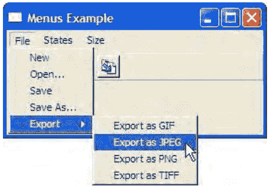

Figure 13.1: 级联菜单面板

图 13.1 展示了此级联菜单面板展开时的样子。如你所见，FXMenuCascade 与我们用来直接将菜单附加到菜单栏的 FXMenuTitle 小部件非常相似。你甚至可以在 `export_menu_pane` 中再嵌套另一个级联菜单，但不要过度使用。深度嵌套的菜单非常难以使用，你应该谨慎使用。

另一个你可能觉得有用的技巧是滚动菜单面板，当你有大量信息需要塞进菜单时尤其有用。当菜单项是以编程方式生成且你无法预先知道菜单面板将包含多少项时，这一功能特别有用。

由于 FXScrollPane 继承自 FXMenuPane，它可以在任何非滚动菜单面板可以使用的地方使用。`FXScrollPane.new` 的第一个参数是菜单面板的所有者窗口，第二个参数是要显示的可见项数量：

```ruby
states_menu_pane = FXScrollPane.new(self, 8)
$state_names.each do |state_name|
  FXMenuCommand.new(states_menu_pane, state_name)
end
states_menu_title = FXMenuTitle.new(menu_bar, "States",
  :popupMenu => states_menu_pane)
```

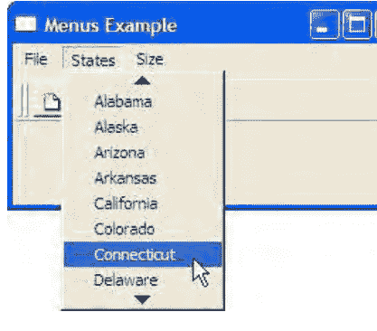

Figure 13.2: 滚动菜单面板

图 13.2 展示了此滚动菜单面板的样子。注意菜单面板两端的箭头。如果你将鼠标悬停在任一箭头上，菜单面板将向上或向下滚动其内容。与级联菜单一样，滚动菜单面板也应谨慎使用，因为它们对用户来说有点难以操作。

级联菜单和滚动菜单只是我们在 Picture Book 应用程序中使用的标准菜单的几种可能变体。在下一节中，我们将看看标准 FXMenuCommand 按钮的一些替代方案，这个按钮我们已经熟知和喜爱。

### 13.2 向菜单添加分隔线、单选按钮和复选按钮

你已经知道如何使用 FXMenuCommand 小部件为命令式操作（如 Open 或 Save）提供用户界面。你可以向菜单面板添加 FXMenuSeparator 小部件，以便在相关命令组之间创建视觉分隔：

```ruby
FXMenuSeparator.new(menu_pane)
```

FXMenuRadio 和 FXMenuCheck 小部件为你提供了一种方式，可以纳入与 FXRadioButton 和 FXCheckButton 小部件相同类型的功能。正如你在第 8.1 节*"使用单选按钮进行选择"*（第 106 页）中学到的，确保单选项保持互斥的首选方式是将每个选项与同一个 FXDataTarget 关联：

```ruby
@size = FXDataTarget.new(1)
size_pane = FXMenuPane.new(self)
FXMenuRadio.new(size_pane, "Small",
  :target => @size, :selector => FXDataTarget::ID_OPTION)
FXMenuRadio.new(size_pane, "Medium",
  :target => @size, :selector => FXDataTarget::ID_OPTION+1)
FXMenuRadio.new(size_pane, "Large",
  :target => @size, :selector => FXDataTarget::ID_OPTION+2)
FXMenuRadio.new(size_pane, "Jumbo",
  :target => @size, :selector => FXDataTarget::ID_OPTION+3)
size_menu_title = FXMenuTitle.new(menu_bar, "Size",
  :popupMenu => size_pane)
@size.connect(SEL_COMMAND) do
  # @size.value 保存所选尺寸的索引
end
```

下面是 FXMenuCheck 项的类似示例：

```ruby
@fit_to_screen = FXDataTarget.new(false)
FXMenuCheck.new(size_pane, "Fit Contents to Screen",
  :target => @fit_to_screen, :selector => FXDataTarget::ID_VALUE)
```

图 13.3 展示了一个菜单，其中包含一组 FXMenuRadio 按钮，通过 FXMenuSeparator 项与单个 FXMenuCheck 按钮分隔开。


到目前为止，我们一直在构建的那种下拉菜单，对于几乎所有非最简单的图形用户界面应用程序来说都是必不可少的。它们对初学者或不常使用某个应用程序的用户尤其有用，因为它们为正在学习如何使用该应用程序的人提供了一种教学工具。然而，随着用户对应用程序越来越熟悉，他们会希望更直接地访问常用功能，而提供这种即时访问的一种方式就是使用工具栏。在接下来的几节中，我们将学习如何在FXRuby应用程序中添加工具栏。

### 13.3 向应用程序添加工具栏

这是一个简短的章节，因为关于`FXToolBar`控件没有*太多*可说的。在很大程度上，你可以将它视为另一种布局管理器（实际上它确实是从`FXPacker`类派生的）。

`FXToolBar`的一个常见用途是填充许多带有图标的按钮（Alan Cooper将其称为*butcons*），这些按钮可以方便地访问常用功能。这些只是普通的`FXButton`控件，但通过正确组合布局提示和图标大小，我们可以确保它们的大小都相同。其中一个关键步骤是确保在工具栏上设置了`PACK_UNIFORM_WIDTH`布局提示：

```
tool_bar = FXToolBar.new(top_dock_site, tool_bar_shell,
  :opts => PACK_UNIFORM_WIDTH|FRAME_RAISED|LAYOUT_FILL_X)
```

你可能还想包含`PACK_UNIFORM_HEIGHT`选项，看看它对工具栏外观有什么影响。接下来，你需要为不同的工具栏命令添加一个或多个`FXButton`控件：

```
new_button = FXButton.new(tool_bar,
  "\tNew\tCreate new document.",
  :icon => new_icon)
open_button = FXButton.new(tool_bar,
  "\tOpen\tOpen document file.",
  :icon => open_icon)
save_button = FXButton.new(tool_bar,
  "\tSave\tSave document.",
  :icon => save_icon)
save_as_button = FXButton.new(tool_bar,
  "\tSave As\tSave document to another file.",
  :icon => save_as_icon)
```

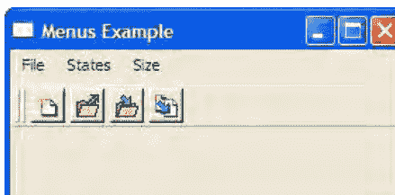

图13.4：使用工具栏即时访问常用命令。

图13.4显示了该工具栏在Windows下运行时的外观。

请注意每个按钮标签字符串的格式。回顾第8.3节*通过工具提示和状态栏提供提示*（第113页），我们讨论了如何在按钮的标签字符串中嵌入制表符，以将按钮的标签与其工具提示消息和状态栏帮助消息分隔开。对于工具栏中的这些按钮，标签字符串以制表符开头，这意味着它们不会在按钮上显示标签。例如，第一个按钮将显示工具提示“New”和状态栏帮助消息“Create new document”，但按钮的表面只会显示其图标。

`FXToolBar`与其他布局管理器的真正显著区别在于，它可以配置为允许用户将其从主窗口拖出，使其“浮动”在屏幕上的其他位置。接下来让我们看看这是如何工作的。

### 13.4 创建浮动菜单栏和工具栏

到目前为止，我们只处理了固定的菜单栏或工具栏。随着主窗口的调整大小，它可能会变窄或变宽，但它始终停留在同一位置。FXRuby还提供了浮动的菜单栏和工具栏，它们可以从其“停靠点”拖走，放置在屏幕上的其他位置，甚至可以重新附加到主窗口的其他位置。根据你正在开发的应用程序类型，实现此功能可能非常有用。

`FXMenuBar`和`FXToolBar`类都继承自`FXDockBar`基类。*停靠条*可以停靠在*停靠点*内，它可以位于主窗口表面的某个位置，也可以浮动到主窗口之外的其他父容器中（通常是`FXToolBarShell`窗口）。

让我们通过一个简短的例子来看看这是如何工作的。首先，我们需要构建一个`FXToolBarShell`控件，它将在工具栏漂浮时充当其远离家乡的“家”：

```
tool_bar_shell = FXToolBarShell.new(self)
```

接下来，构建一个或多个停靠点，为工具栏准备好返回时提供着陆点。只指定一个停靠点是完全可以接受的，但为了本示例的目的，我们将设置两个停靠点：一个沿主窗口顶部，另一个沿底部：

```
top_dock_site = FXDockSite.new(self,
    :opts => LAYOUT_FILL_X|LAYOUT_SIDE_TOP)
bottom_dock_site = FXDockSite.new(self,
    :opts => LAYOUT_FILL_X|LAYOUT_SIDE_BOTTOM)
```

用户可以将浮动工具栏拖到主窗口上的这些位置中的任何一个，它将重新附加（停靠）到那里。需要注意的是，当工具栏浮动时，停靠点会隐藏自身，并允许其他附近的控件选择占用该空间。现在我们可以构建`FXToolBar`本身了：

```
tool_bar = FXToolBar.new(top_dock_site, tool_bar_shell,
    :opts => PACK_UNIFORM_WIDTH|FRAME_RAISED|LAYOUT_FILL_X)
```

`FXToolBar.new`的第一个参数是初始停靠点，第二个参数是外壳。现在我们需要添加一个“把手”，用户可以抓住它将工具栏从停靠点撕下来：

```
FXToolBarGrip.new(tool_bar,
    :target => tool_bar, :selector => FXToolBar::ID_TOOLBARGRIP,
    :opts => TOOLBARGRIP_DOUBLE)
```

我更喜欢双线把手的外观，但如果你只想要单线，请将`TOOLBARGRIP_SINGLE`作为选项传入。此时，你可以将所有特定于应用程序的控件添加到工具栏中。

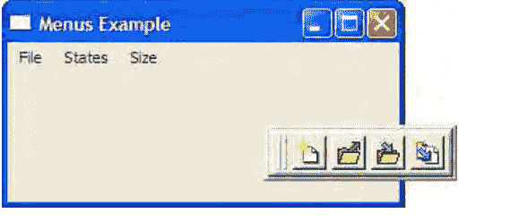

**图13.5：浮动工具栏**

严格来说，不一定非要将`FXToolBarGrip`控件作为`FXToolBar`的第一个子控件，但最好将其设为第一个或最后一个控件，以避免工具按钮的外观显得杂乱。

你已经在图13.4（第193页）中看到了工具栏在停靠位置时的样子。图13.5显示了工具栏“取消停靠”并拖到一侧后的外观。

到目前为止，我们一直专注于如何处理与应用程序主窗口的交互，但有时将某些交互隔离在一个单独的顶级窗口中也是很有用的，这个窗口被称为*对话框*。FXRuby提供了许多内置的标准对话框，例如我们在构建“图片册”应用程序时使用的`FXFileDialog`。你也可以创建自定义对话框来处理应用程序设置或其他功能。我们将在下一章中探讨所有这些主题。

# 第14章

### 使用对话框提供支持

到目前为止，我们一直在讨论如何使用FXRuby构建应用程序用户界面的主窗口。一切都集中在用户与应用程序的主要交互上。FXRuby还提供了另一种顶级窗口，称为*对话框*，这正是本书最后一章的重点。

对话框类似于主窗口，它“浮动”在桌面上，作为一堆其他控件的顶级容器。像主窗口一样，对话框可以包含标题栏、菜单栏、状态栏以及用于调整窗口大小或关闭窗口的其他装饰。尽管有这些相似之处，你不应该将对话框与主程序混淆。在大多数情况下，它们是临时的，仅在用户与它们交互时在屏幕上停留很短时间，并且它们在应用程序中总是扮演次要的支持角色。

你已经在第**5.3节** *从文件导入照片*（第**50页**）中遇到过一种对话框，当时我们使用`FXFileDialog`向用户请求要导入的照片文件名。FXRuby还包含许多其他标准对话框，可供你的应用程序使用。在本章中，我们将简要介绍一些FXRuby提供的最常用的标准对话框。我们还将讨论在标准对话框都不适用的情况下，创建自定义对话框所涉及的内容。让我们从重新认识我们的老朋友——`FXFileDialog`对话框开始。


#### 14.1 使用文件对话框选择文件

**FXFileDialog**（如图14.1所示）可能是标准对话框中使用最频繁的一种。当你希望用户选择一个或多个现有文件时（例如，在"打开"操作中），或者当你想获取用户即将写入的文件名时（例如，在"保存"操作中），可以使用**FXFileDialog**。例如，假设你希望用户在磁盘上选择一个现有的JPEG文件：

```
dialog = FXFileDialog.new(self, "Open JPEG File")
dialog.patternList = [
  "All Files (*)",
  "JPEG Files (*.jpg, *.jpeg)"
]
dialog.selectMode = SELECTFILE_EXISTING
if dialog.execute != 0
  open_jpeg_file(dialog.filename)
end
```

当你调用**FXFileDialog**的`execute()`方法时，它会显示自身，允许用户选择文件，然后等待用户点击"确定"或"取消"按钮。如果`execute()`返回零，表示用户点击了"取消"；否则，表示用户点击了"确定"。此时，你可以通过对话框的`filename`属性读取所选文件的完整路径。

该文件对话框具备你期望此类控件拥有的大部分功能，以及一些你可能未曾见过的功能（例如为常用目录设置书签）。如前面的示例所示，你可以将`patternList`初始化为一个字符串数组，用于指定可用的文件筛选器。文件选择模式与你能够选择单个文件还是多个文件有关。`selectMode`设为`SELECTFILE_EXISTING`意味着用户只能选择一个现有文件；这适用于加载文档的场景。我们也可以改为允许多个文件的选择。

> 如果你没有显式设置`patternList`，它将默认为"All Files (*)"。

```
dialog = FXFileDialog.new(self, "Open JPEG File(s)")
dialog.patternList = [
  "All Files (*)",
  "JPEG Files (*.jpg, *.jpeg)"
]
dialog.selectMode = SELECTFILE_MULTIPLE
if dialog.execute != 0
  dialog.filenames.each do |filename|
    open_jpeg_file(filename)
  end
end
```

`FXFileDialog`提供了许多选项，允许你配置其外观和行为；更多详情请参阅**FXFileDialog**和**FXFileSelector**类的API文档。

值得注意的是，`FXFileDialog`专门用于处理单个文件（或它们的组）。虽然你可以使用`SELECTFILE_DIRECTORY`选择模式将文件对话框中的选择限制为仅目录，但在我看来，这可能会导致用户体验不佳。对于那些你希望用户选择一个且仅一个目录的场景，`FXDirDialog`可能是更好的选择。我们接下来将介绍该对话框。

#### 14.2 使用目录对话框选择目录

当你需要用户选择*一个且仅一个*目录时，可以使用`FXDirDialog`。对于更复杂的情况，你可能应该继续使用`FXFileDialog`。

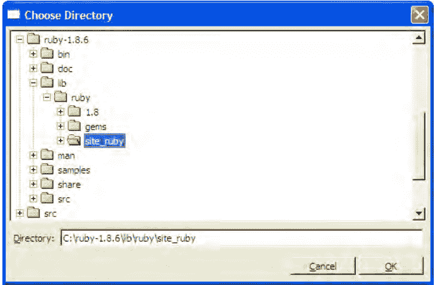

图14.2：使用目录对话框选择单个目录。

因为**FXDirDialog**的功能非常简单，所以配置和使用起来也很直接。在大多数情况下，你只需将`directory`属性初始化为文件系统中的某个路径，显示对话框，然后从`directory`属性中检索所选目录：

```
dialog = FXDirDialog.new(self, "Choose Directory")
dialog.directory = "/Users/lyle"
if dialog.execute != 0
  open_directory(dialog.directory)
end
```

请注意，如果在显示对话框之前没有初始化`directory`属性，它将默认为当前工作目录。

图14.2展示了目录对话框如何将文件系统显示为树状结构。要选择一个现有目录，只需在目录树列表中导航到该目录，然后单击"确定"按钮。要创建一个新目录，右键单击新目录的父目录，然后从弹出菜单中选择"新建"命令。

对话框不仅可用于收集有关文件和目录的信息。在接下来的几节中，我们将介绍用于处理颜色和字体的标准对话框。

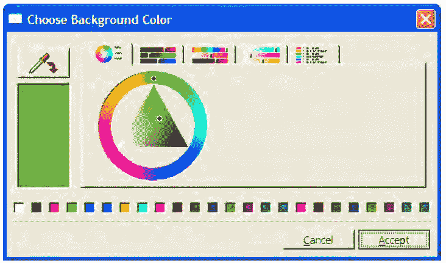

图14.3：HSV拨盘模式下的颜色对话框

#### 14.3 使用颜色对话框选择颜色

当你需要用户选择（或修改）一个颜色值时，可以使用`FXColorDialog`。由于设置项很少，将颜色对话框集成到应用程序中非常容易：

```
dialog = FXColorDialog.new(self, "Choose Background Color")
dialog.rgba = FXRGB(255, 0, 0) # initialize color to red
if dialog.execute != 0
  self.backColor = dialog.rgba
end
```

如果你不想使用默认的初始颜色（黑色），当然可以在显示对话框之前通过设置`rgba`属性的值来初始化颜色。¹

> 1. 属性名`rgba`指的是该颜色由红、绿、蓝和Alpha（透明度）分量组成。如果你认为像`color`这样的名称可能更好，我同意你的看法。
> 2. 参见 [http://en.wikipedia.org/wiki/HSV_color_space](http://en.wikipedia.org/wiki/HSV_color_space) 了解HSV颜色模型。
> 3. 参见 [WL1 omittel'en.wikipedia.org/wiki/CMYK_color_model](http://en.wikipedia.org/wiki/CMYK_color_model) 了解CMYK颜色模型。
> 4. 根据你的操作系统和已安装的字体，此特定字体可能在你的系统上可用，也可能不可用。

尽管从应用程序开发者的角度来看，颜色对话框易于使用，但其丰富的选项可能会让最终用户感到些许困惑。颜色对话框包含五个选项卡，每个选项卡使用不同的颜色模型显示当前选定的颜色。

- 第一个选项卡显示一个用于调整颜色的色调、饱和度和值（HSV）分量的拨盘。你可以在前一页的图14.3中看到**FXColorDialog**此页面的样子。
- 第二个选项卡显示一组滑块，用于设置颜色的红、绿、蓝和Alpha分量。
- 第三个选项卡显示一组滑块，同样用于设置颜色的HSV分量。
- 第四个选项卡显示一组滑块，用于设置颜色的青色、品红色、黄色和黑色（CMYK）分量。³
- 最后一个选项卡显示一个颜色名称列表。

此外，颜色对话框在其左侧包含一个"颜色拾取器"按钮，使你能够从屏幕上的任何位置选择新颜色，并在底部提供一组预定义的颜色槽。

#### 14.4 使用字体对话框选择字体

我们在第11.1节"使用自定义字体"（第143页）中曾提到过**FXFontDialog**，当时我们讨论了字体对话框通过**FXFontDesc**对象返回有关所选字体的信息。与本章中我们介绍的其他对话框类似，**FXFontDialog**的使用模式是：初始化其设置，显示对话框让用户与之交互，然后在用户完成操作后检索选择信息。图14.4（在下一页）显示了一个字体对话框，其中选择了粗体、16号的Book Antiqua字体。⁴

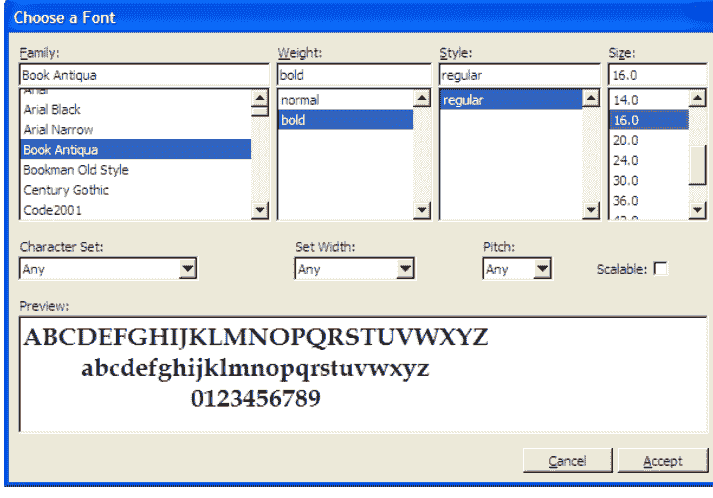

**图14.4：** 在字体对话框中选择字体

使用字体对话框比使用文件、目录或颜色对话框稍显复杂，因为我们传递的是**FXFontDesc**对象，而不是实际的**FXFont**对象。以下代码片段演示了与**FXFontDialog**交互的典型模式：

```
dialog = FXFontDialog.new(self, "Choose a Font")
dialog.fontSelection = button.font.fontDesc
if dialog.execute != 0
  new_font = FXFont.new(app, dialog.fontSelection)
  new_font.create
  button.font = new_font
end
```

第一步是从现有字体的`fontDesc`属性中提取初始字体设置（作为**FXFontDesc**对象）。我们可以用该字体描述来初始化**FXFontDialog**的`fontSelection`属性。这一步并非严格必要；如果你没有提前初始化`fontSelection`属性，字体对话框将显示一些默认设置。


#### 14.5 使用消息框提醒用户

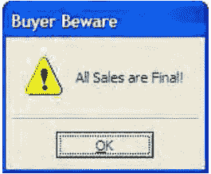

图 14.5：使用消息框显示警告

一旦用户完成与字体对话框的交互并做出选择，我们需要从字体对话框的 fontSelection 属性中获取字体描述，并用它来构建一个新的 FXFont 对象。正如我们在第 11 章*创建视觉丰富的用户界面*（第 142 页）中所讨论的，在将新构建的 FXFont 对象赋值给控件之前，我们必须先调用其 `create()` 方法，这一点至关重要。

与其他标准对话框相比，消息框非常简单。它只提供与用户之间最基本的交互。例如，以下 FXMessageBox 显示了如图 14.5 所示的警告消息：

[Download messagebox.rb]

```
FXMessageBox.warning(
  self,
  MBOX_OK,
  "Buyer Beware",
  "All Sales are Final!"
)
```

与我们之前看过的其他对话框不同，FXMessageBox 通常使用像 `warning()` 这样的类方法一次性构建并显示。由于我们使用了 MBOX_OK 选项来配置此消息框，它只显示一个"确定"按钮，因此我们不需要检查 `warning()` 方法的返回值。如果消息框包含多个结束按钮，你就需要检查该方法的返回值，以确定用户点击了哪个按钮。


图 14.6：使用消息框提问

例如，图 14.6 中所示的消息框提出了一个可以用"是"或"否"来回答的问题：

```
Download messagebox.rb
answer = FXMessageBox.question(
    self,
    MBOX_YES_NO,
    "Just one question...",
    "Is it safe?"
)
if answer == MBOX_CLICKED_YES
    ask_again()
end
```

FXMessageBox 类还提供了 `information()` 和 `error()` 类方法，用于显示相应类型的消息。有关消息框选项和可能返回值的完整列表，请参阅 FXMessageBox 类的 API 文档。

#### 14.6 创建自定义对话框

如果你的应用程序的需求可以通过使用某个标准对话框来满足，那么最好坚持使用标准对话框，这样你的应用程序用户就能获得一致且熟悉的用户体验。然而，对于许多应用程序，你需要开发一个或多个自定义对话框来处理特定于应用程序的功能。在本节中，我们将逐步创建一个典型的"偏好设置"对话框，你可以将其包含在应用程序中。

幸运的是，到目前为止你所学到的关于在 FXRuby 中创建用户界面的知识，大部分都适用于在 FXRuby 中创建自定义对话框。正如本章引言中所述，对话框在许多方面类似于主窗口。创建自定义对话框的第一步是继承 FXDialogBox：

```
class PreferencesDialog < FXDialogBox
  def initialize(owner)
    super(owner, "Preferences", DECOR_TITLE|DECOR_BORDER|DECOR_RESIZE)
  end
```

现在我们需要在对话框底部添加一排结束按钮。这个名字听起来可能有点吓人，像是阿诺德·施瓦辛格的那种风格，但我们说的只是你在完成交互后用来关闭对话框的按钮。通常会看到"确定"和"取消"按钮，如果对你的对话框有意义的话，可能还有一个"应用"按钮。我们将在窗口底部添加一个水平框架，然后先添加一个"确定"按钮，再添加一个"取消"按钮。以下是 `add_terminating_buttons()` 方法的代码：

```
def add_terminating_buttons
  buttons = FXHorizontalFrame.new(self,
    :opts => LAYOUT_FILL_X|LAYOUT_SIDE_BOTTOM|PACK_UNIFORM_WIDTH)
  FXButton.new(buttons, "OK",
    :target => self, :selector => FXDialogBox::ID_ACCEPT,
    :opts => BUTTON_NORMAL|LAYOUT_RIGHT)
  FXButton.new(buttons, "Cancel",
    :target => self, :selector => FXDialogBox::ID_CANCEL,
    :opts => BUTTON_NORMAL|LAYOUT_RIGHT)
end
```

因为我们先添加了"确定"按钮并传入了 LAYOUT_RIGHT 布局提示，所以该按钮会被排列在水平框架的右侧。当我们随后添加"取消"按钮时，它也会被排列在水平框架剩余空间的右侧，这意味着它将出现在"确定"按钮的左边。这是这两个按钮的一种非常标准的排列方式，但如果你更希望"确定"按钮在左边、"取消"按钮在右边，你可以交换这两条语句的顺序。

我们还在利用这样一个事实：PreferencesDialog 所继承的 FXDialogBox 类定义了两个消息标识符——ID_ACCEPT 和 ID_CANCEL，我们可以直接从"确定"和"取消"按钮向对话框发送这些消息来关闭它。如果用户点击我们的"确定"按钮，它将向对话框对象发送一条类型为 SEL_COMMAND、标识符为 ID_ACCEPT 的消息。当对话框接收到该消息时，它会隐藏自己，并确保最初启动对话框的 `execute()` 调用返回一个非零值。如果对话框接收到的是 ID_CANCEL 消息，它将确保 `execute()` 返回零。

现在结束按钮已经处理完毕，我们可以转向主要部分了。我们将在 FXTabBook 中显示偏好设置，使用与第 12.5 节*使用标签笔记本组织窗口*（第 179 页）中介绍的相同示例。让我们从编写一个 `add_tab_book()` 方法开始，该方法构建 FXTabBook 并添加几个标签项和空白页面。我们稍后再处理页面的内容。

```
tabbook = FXTabBook.new(self, :opts => LAYOUT_FILL)
basics_tab = FXTabItem.new(tabbook, " Basics ")
basics_page = FXVerticalFrame.new(tabbook,
  :opts => FRAME_RAISED|LAYOUT_FILL)
contact_tab = FXTabItem.new(tabbook, " Contact ")
contact_page = FXVerticalFrame.new(tabbook,
  :opts => FRAME_RAISED|LAYOUT_FILL)
extras_tab = FXTabItem.new(tabbook, " Extras ")
extras_page = FXVerticalFrame.new(tabbook,
  :opts => FRAME_RAISED|LAYOUT_FILL)
```

在本章前面讨论如何使用标准对话框时，我们建立了一种模式：用一些默认数据初始化对话框，将其显示给用户以收集输入，然后在对话框关闭时检索这些输入。我们想对自定义对话框采用相同的方法，不过由于我们处理的是自己的自定义数据类型和设置，而不是某种内置类型（比如我们在 FXFontDialog 中使用的 FXFontDesc），我们需要做更多的工作。

重要的是要记住，对话框上"取消"按钮的存在意味着与用户之间的一种契约。如果用户决定不想保留他们对设置所做的更改，他们总是可以通过取消对话框来退出，并且可以放心，真正的应用程序设置将不会受到影响。因此，我从不让对话框代码直接更改应用程序设置。当需要显示"偏好设置"对话框或其他某种自定义对话框时，我会复制当前的应用程序设置，并将该副本传入对话框。如果用户随后点击"确定"按钮关闭对话框，我会检索该副本并从中提取所需的信息。另一方面，如果用户点击"取消"按钮关闭对话框，我可以直接忽略对话框使用的那个副本，而无需担心撤销任何更改。

为了简单起见，让我们专注于如何处理 Basics 标签页的设置，该标签页涉及姓名和地址信息。我们将利用 FXDataTarget 类来处理向表单中的各个控件获取和设置数据。在内部，PreferencesDialog 将只使用一个 FXDataTarget 实例的哈希表：

```
@prefs = {
  :first_name => FXDataTarget.new,
  :last_name => FXDataTarget.new,
  :street => FXDataTarget.new,
  :city => FXDataTarget.new,
  :state => FXDataTarget.new,
  :zip_code => FXDataTarget.new
}
```

现在让我们构建第一页的内容，即与 Basics 标签关联的页面。为了将此代码从对话框的 `initialize()` 方法中分离出来，我们将其放在一个名为 `construct_basics_page()` 的单独实例方法中：

```
def construct_basics_page(page)
  form = FXMatrix.new(page, 2,
    :opts => MATRIX_BY_COLUMNS|LAYOUT_FILL_X)
  FXLabel.new(form, "First:")
  FXTextField.new(form, 20,
    :target => @prefs[:first_name], :selector => FXDataTarget::ID_VALUE,
    :opts => TEXTFIELD_NORMAL|LAYOUT_FILL_X|LAYOUT_FILL_COLUMN)
  FXLabel.new(form, "Last:")
  FXTextField.new(form, 20,
    :target => @prefs[:last_name], :selector => FXDataTarget::ID_VALUE,
    :opts => TEXTFIELD_NORMAL|LAYOUT_FILL_X|LAYOUT_FILL_COLUMN)
  FXLabel.new(form, "Street Address:")
  FXTextField.new(form, 20,
    :target => @prefs[:street], :selector => FXDataTarget::ID_VALUE,
    :opts => TEXTFIELD_NORMAL|LAYOUT_FILL_X|LAYOUT_FILL_COLUMN)
  FXLabel.new(form, "City:")
  FXTextField.new(form, 20,
    :target => @prefs[:city], :selector => FXDataTarget::ID_VALUE,
    :opts => TEXTFIELD_NORMAL|LAYOUT_FILL_X|LAYOUT_FILL_COLUMN)
  FXLabel.new(form, "State:")
```

^5 你记得数据目标（data targets）吧？我们在第 7.5 节*使用数据目标更新 GUI*（第 92 页）中讨论过它们。

states = FXListBox.new(form,
    :target => @prefs[:state], :selector => FXDataTarget::ID_VALUE,
    :opts => (LISTBOX_NORMAL|FRAME_SUNKEN|
              LAYOUT_FILL_X|LAYOUT_FILL_COLUMN))
FXLabel.new(form, "Zip Code:")
FXTextField.new(form, 10,
    :target => @prefs[:zip_code], :selector => FXDataTarget::ID_VALUE,
    :opts => TEXTFIELD_NORMAL|LAYOUT_FILL_COLUMN)
end

请注意，对于每个 FXTextField 控件，以及保存州名的 FXListBox，我们都使用了来自 @prefs 哈希的一个数据目标。这些控件将从数据目标中的数据获取初始设置，并且每当用户在某个控件中更改某些设置时，数据目标的值将自动更新。

要将此对话框与应用程序集成，我们需要在应用程序的某个菜单中添加一个"首选项..."菜单命令。当该菜单命令被调用时，它首先会构造一个新的 PreferencesDialog 实例：

dialog = PreferencesDialog.new(self)

接下来，它应该从当前应用程序设置初始化对话框中的首选项数据副本：

dialog.prefs[:first_name].value = user_name.first_name
dialog.prefs[:last_name].value  = user_name.last_name
dialog.prefs[:street].value     = user_address.street
dialog.prefs[:city].value       = user_address.city
dialog.prefs[:state].value      = user_address.state
dialog.prefs[:zip_code].value   = user_address.zip_code

最后一步是对对话框调用 execute() 来显示它。如果 execute() 返回非零值，我们将从对话框的副本中提取修改后的应用程序设置，并将其推回到模型中：

if dialog.execute != 0
    user_name.first_name  = dialog.prefs[:first_name].value
    user_name.last_name   = dialog.prefs[:last_name].value
    user_address.street   = dialog.prefs[:street].value
    user_address.city     = dialog.prefs[:city].value
    user_address.state    = dialog.prefs[:state].value
    user_address.zip_code = dialog.prefs[:zip_code].value
end

为了使这个例子保持简单，我们使用了一个 Ruby 哈希表，这是一种非常基础的数据结构。因此，将数据传入和传出对话框所需的代码相当冗长。根据您在自定义对话框中处理的数据量，您可能会发现创建自定义数据类型很有帮助，这样可以让应用程序的其余代码以更紧凑的方式与对话框进行交互。

#### 14.7 展望未来

正如我在本书开头所指出的，这不是一本关于 FXRuby 开发的全面书籍。我希望现在您已经读完了这本书，您已经具备了足够的基础，可以走向世界并了解 FOX 和 FXRuby 的一些更高级的方面。

例如，关于 FOX 我们没有涉及的一个很酷的功能是它对基于 OpenGL 的 2D 和 3D 图形应用程序的支持。您可以使用 FXRuby 的 FXGLViewer 控件来构建复杂的 3D 场景图，它开箱即用地支持选择、旋转、缩放和许多其他高级功能，或者当您需要对场景如何呈现给用户有更多控制时，可以使用更基础的 FXGLCanvas 控件。

FOX 还提供了许多专用控件，例如旋钮、数字调节框和滑块，您可以与我们在第 8 章《构建简单控件》*Building Simple Widgets*（第 100 页）中看到的其他控件一起使用。您知道如何查找这些类的文档以了解它们的特定功能，并且可以应用从本书中学到的技术来响应这些控件的消息并将它们与数据目标关联。

正如本书的一位审稿人所指出的，GUI 应用程序的开发不仅仅是技术实践。在本书中，我们讨论了与使用 FXRuby 实现 GUI 相关的许多问题，但设计一个直观易用的 GUI 应用程序本身就是一项挑战。知道**为什么**要做某些选择或许比知道**如何**实现这些选择更加重要。我是之前提到的 *About Face* [Coo95] 的忠实粉丝，但关于用户界面设计这一学科还有许多其他优秀的书籍，您（应该）去查阅。

最后，请允许我邀请您加入 FOX 和 FXRuby 的邮件列表，无论是提问还是与其他软件开发人员分享您自己的经验。第 1.4 节《在哪里获得帮助》*Where to Get Help*（第 15 页）提供了有关如何订阅这些列表（以及其他信息来源）的详细信息。总会有新接触 Ruby 和 FXRuby 的人，既然您已经在 FXRuby 应用程序开发方面取得了先机，我们真的需要您的帮助！

# 参考文献

[Coo95] Alan Cooper. *About Face: The Essentials of User Interface Design*. John Wiley & Sons, New York, 1995.

[GHJV95] Erich Gamma, Richard Helm, Ralph Johnson, and John Vlissides. *Design Patterns: Elements of Reusable Object-Oriented Software*. Addison-Wesley, Reading, MA, 1995.

# 索引

### A
- *About Face* (Cooper), **100**
- appendText (), **135**
- fonts, 203f, **202–204**
- message boxes, 204f, 205f, **204–205**
- tabbed notebooks and, 181f
- Directories, **200**
- Docking, toolbars, **195**

### B
- Busy cursor, **148**
- Buttons, 105f, **104–106**, 206

### C
- CardLayout, 68n
- Cascading menus, 190f, **188–191**
- Check buttons, 110f, **109–111**, 192f
- Chores, **88–89**
- Color selection, 201f, **201–202**
- Cooper, Alan, **100**
- create (), **53**
- Create, detach, and destroy life cycle, 96f
- Cropping, 152–154f
- Cursor position, **136**
- Cursors, 147f, 148f, **146–149**
    - built-in, **146**
    - busy, **148**
    - custom, **146**

### D
- Data targets, **208**
- Delayed layout, **93–94**
- Delayed repaint, **94**
- *Design Patterns: Elements of Reusable Object-Oriented Software* (Gamma, et al.), 91n
- Dialog boxes, **197–211**
    - colors, selecting, 201f, **201–202**
    - custom, **205–210**
    - described, **197**
    - directories, selecting, 200f, **199–201**
    - files, selecting, 198f, **198–199**

### E
- execute (), **209**
- Errors, source of, **97**, **158**
- Event loop, **80**
- Event-driven programming, 80f, 82f, **80–84**
- execute (), **52**

### F
- Files, selecting, **198**
- Fixed layouts, **169**
- Fonts
    - custom, 145f, **143–146**
    - selecting, 203f, **202–204**
- FOX, **13**
    - benefits of, **79**
    - layout managers, 31, **44**
    - scrollable windows, **59**
    - versions, **18**
- FOX Community (wiki), **16**
- FoxTails library, **92**
- FXApp, **27**
- FXButton, **104**, **114**
- FXCheckButton, **109**
- FXColorDialog, **201–202**
- FXComboBox, **118–121**
- FXCursor, **146–149**
- FXDataTarget, **93**
- FXDialogBox, **206**
- FXDirDialog, **199–201**
- FXFileDialog, **198–199**
- FXFont, **143–146**
- FXFontDialog, **202–204**
- FXIcon, 155-157
- FXImage, 47, 149-155
- FXImageFrame, 37-40
- FXInputDialog, 70-72
- FXJPGImage, 40-42
- FXLabel, 101, 102
- FXList, 63, 115-118
- FXListBox, 118-121
- FXMatrix, 44, 55, 58, 173-177
- FXMessageBox, 204-205
- FXPacker, 160, 176
- FXRadioButton, 106
- FXRuby
    - 3D graphics, 210
    - chores, 88-89
    - defined, 13, 20
    - delayed layout, 93-94
    - delayed repaint, 94
    - errors in, 97
    - event-driven Ruby, 80f, 82f, 80-84
    - FXWindow and, 98-99
    - GUI considerations, 21-22
    - GUI update with data targets, 92-93
    - Hello, World! application, 28f, 25-30
    - I/O input events, 90-91
    - idioms for, 29-30
    - image format support, 40
    - installation of, 23-25
    - keyboard events in, 86-87
    - messages between objects in, 80
    - messages, connecting to code, 83
    - modifier flags, 87f
    - mouse events in, 85-86
    - objects, client-side vs. server-side, 96f, 95-98
    - operating system signals, 89-90
    - relationship to Ruby, 20, 21f
    - RubyGems and, 26
    - scheduling with timeout events, 87-88
    - shared resources in, 143
    - support for OpenGL-based graphics, 210
    - syncing GUI with application data, 91-92
    - user guide for, 17
    - versions, 18
- FXScrollWindow, 179-180
- FXSplitter, 65-67, 177-179
- FXStatusBar, 114
- FXSwitcher, 67-69
- FXTabBook, 180-182
- FXTable, 126-131
- FXText, 133, 134
    - adding and removing text, 134-136
    - navigation, 136-137
    - searching, 137-139
    - styles, applying, 139-141
- FXTextField, 111-113
- FXToolBar, 193-194
- FXToolTip, 113
- FXTreeList, 121 luscious元现金122
- FXWindow, 98-99

### G
- GUI considerations, 21-22
- GUI front end to a translation service, 183f, 183
- GUI update with data targets, 92-93
- GUI updating mechanism, 91-92

### H
- Heavyweight widgets, 22
- Hello, World! application, 28f, 25-30
- Help and support
    - API documentation, 17
    - FOC documentation, 16
    - FOX Community (wiki), 16
    - FXRuby user guide, 17
    - mailing lists, 15
    - online documentation, 16
- Horizontal frames, 163, 168f
- Hue, saturation, and value (HSV), 202

### I
- Icons, 156f, 157f, 155-157
- Idioms, 29-30
- Images, 150f
    - creating and displaying, 149-150
    - cropping, 152-154f
    - manipulating, 151-155
    - mirror, 155f
- Importing photos, 55f, 50-55
- Input events, 90-91
- Installation, 23-25

### K
- Keyboard events, 86-87
- Keypress modifier flags, 87f


### L

- 布局管理器，44，55，159–187
  - 排列控件，174f，175f，176f，177f，173–177
  - 固定布局，169
  - 框架与布局，163
  - 布局提示，184
  - 组合使用多个布局，183f，184f，185f，182–187
  - 嵌套布局，166，186
  - 打包模型与布局，162f，163f，164f，165f，166f，167f，168f，171f，160–173
  - 调整布局大小，177–179
  - 布局的作用，159
  - 用于滚动，179–180
  - 带标签的笔记本与布局，181f，180–182
  - *另请参见* 具体的布局管理器名称

- 轻量级控件，**22**

- Linux系统上的FXRuby安装，**24**

- 列表控件，116f

- 列表
  - FXList与列表，**115–118**
  - 选中项目，**118**
  - 树状列表，123f，126f，**121–126**
  - 用于列表的控件，**119**

### M

- Mac OS X系统上的FXRuby安装，**24**

- 邮件列表，**15**

- 序列化(Marshal)，**73**

- 菜单面板，51，125

- 菜单，**188–196**
  - 级联与滚动菜单，190f，191f，**188–191**
  - 复选框与单选按钮，192f
  - 浮动工具栏，196f，**194–196**
  - 分隔符，191
  - 工具栏，194f，**193–194**

- 消息框，204f，205f，**204–205**

- 重载方法，**51**

- 修饰键标志，87f

- 鼠标事件，**85–86**

- 多相册功能，**62–77**
  - 添加相册，**70–72**
  - 布局层次结构，66f
  - 用于相册的列表视图，64f，65f，**62–65**
  - 使用YAML序列化相册列表，**72–76**
  - 用于相册的分割视图，**65–67**
  - 在相册间切换，69f，**67–69**

- MVC架构，**33**

### N

- 嵌套，布局管理器，**166，186**

### O

- 对象
  - 客户端与服务器端，96f，**95–98**
  - FXFont对象，**144**

- 在线文档，**16**

- 操作系统信号，**89–90**

- 重载方法，**51**

### P

- 打包模型，162f，163f，164f，165f，166f，167f，168f，171f，**160–173**

- 内边距与间距，171f，171

- 图画书应用程序，**31–35**
  - 应用程序数据，**33–35**
  - 功能增强，**76**
  - 完整相册显示，**43–61**
    - 从文件导入，55f，**50–55**
    - 可调整大小特性，58f
    - 缩略图视图，50f，**47–50**
    - 相册视图，**44–46**，47f
    - 视图的动态重配置，**55–57**
    - 可滚动视图，60f，**58–61**
  - 多相册功能，**62–77**
    - 添加相册，**70–72**
    - 布局层次结构，66f
    - 用于相册的列表视图，64f，65f，**62–65**
    - 使用YAML序列化相册列表，**72–76**
    - 用于相册的分割视图，**65–67**
    - 在相册间切换，69f，**67–69**
  - 应用程序概述，**32–33**
  - 单张照片显示，42f，**36–42**
    - 应用程序结构，**36–37**
    - 从文件构建图像，**40–42**
    - 用于照片的视图，**37–40**
  - 用户界面，32f

### R

- 单选按钮，107f，**106–109**，192f

- 正则表达式，**139**

- 右键弹出菜单，**124**

- Ruby语言
  - 序列化(Marshal)，**73**
  - 重载方法，51
  - 与FXRuby的关系，20，21f
  - `require()`语句，39，45，64，73
  - YAML库，72–76

- RubyGems环境配置，26

- 分隔符，191
  - 菜单与分隔符，188–196
    - 级联与滚动菜单，190f，191f，188–191
    - 复选框与单选按钮，192f
    - 浮动工具栏，196f，194–196
    - 工具栏，194f，193–194
  - *另请参见* 图形用户界面；对话框

### S

- 可滚动视图，60f，**58–61**，**179–180**

- 滚动菜单，191f，**188–191**

- `setVisibleSize()`方法，127

- 共享资源，143

- 单张照片显示，42f，**36–42**
  - 应用程序结构，**36–37**
  - 从文件构建图像，**40–42**
  - 用于照片的视图，**37–40**

- 间距，171f，171

- 跨列表格项，128f

- 分割器，*参见* FXSplitter

- 状态栏，114

- 应用样式，140f，**139–141**

- 支持，*参见* 帮助与支持；对话框

### T

- 带标签的笔记本，181f，**180–182**

- 表格，**126–131**
  - 显示选项，128
  - 编辑表格内容，129
  - 表格图标，130f
  - 表格选择，130
  - 跨列表格项，128f
  - 在表格中存储数据，127

- 文本字段，用于编辑字符串数据，111f，**111–113**

- 缩略图显示，50f，**47–50**，77

- 超时事件，**87–88**

- 工具栏，194f，**193–194**

- 工具提示，113

- 树状列表，123f，126f，**121–126**

### U

- 用户界面，**142–158**
  - 光标，147f，148f，**146–149**
  - 界面特性，142
  - 自定义字体，145f，**143–146**
  - 图标，156f，157f，**155–157**
  - 图像数据处理，152f，153f，154f，155f，**151–155**
  - 图像，150f，**149–150**
  - 菜单

- *另请参见* 布局管理器

- Hello, World! 示例程序，28f

- 窗口坐标系统，98

### V

- van der Zijp, Jeroen，13

- VanderWerf, Joel，92

- 版本号，18

- 垂直框架，163，165，166f

### W

- 控件，22
  - 应用程序与控件，41
  - 排列控件，174f，175f，176f，177f，173–177
  - 按钮，105f，**104–106**
  - 复选按钮，110f，**109–111**
  - 控件描述，100
  - 使用控件编辑文本，**133–141**
    - 添加和移除文本，134–136
    - 文本导航，**136–137**
    - 文本搜索，**137–139**
    - 应用样式，140f，139–141
  - FXComboBox和FXListBox控件，**118–121**
  - FXText按键操作，134f
  - 控件列表，116f
  - 列表与控件，63
  - 打包模型与控件，161，163f
  - 父控件，38
  - 单选按钮，107f，**106–109**
  - 用于简单列表的控件，117f，**115–118**
  - 特殊用途控件，210
  - 状态栏控件，114
  - 表格控件，**126–131**
    - 显示选项，128
    - 编辑表格内容，129
    - 表格图标，130f
    - 表格选择，130
    - 跨列表格项，128f
    - 在表格中存储数据，127
  - 文本字段，用于编辑字符串数据，111f，**111–113**
  - 文本标签，102f，103f，104f，**101–104**
  - 工具提示与控件，113
  - 树状列表，123f，126f，**121–126**
  - 控件类型，100，101f

### Y

- Windows系统
  - FXRuby安装，23

- YAML，**72–76**
