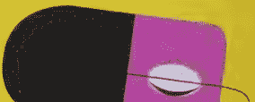
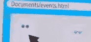
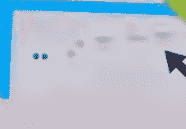
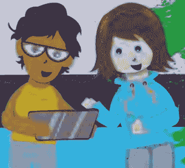

# JavaScript 游戏制作基础

## 简介

学习如何使用JavaScript编写自己的趣味游戏。JavaScript是一种最初用于让网页更具互动性的语言。现在它被用来创建可在电脑和移动设备上运行的在线游戏。享受创建本书中的简单项目，你将成为JavaScript专家的道路上迈进！

⇒ 如果你正在制作自己的网页，花点时间画个示意图并做好规划再开始。如果事情不顺利，尝试更改数值，不要害怕重新开始——你会从中学到东西。

⇒ 练习调试！制作一个非常简单的网页，让朋友在您不注意时更改一行代码。您能修复它吗？

⇒ 当一切正常工作时，停下来逐行查看您的代码，确保您理解每一行。尝试修改您的代码，试验不同的数值。要擅长调试，您需要理解代码中每一行的作用及其工作原理。

您可以使用纯文本编辑器来创建代码。

```
mygame.html
<script>
alert('Press any key to start')
</script>
```

这可以正常工作，但可能相当繁琐，因为软件不会提供任何帮助。

本书中最适合使用的工具是离线HTML编辑器。它将在您输入代码时提供支持，同时也有助您学习JavaScript代码。

您将使用两个独立的窗口：

```
Sublime Text
<script>
var score=0;
var seconds=0;
function moveIt(){
score++;
```

文本编辑器用于输入JavaScript代码。

浏览器用于查看程序。

有许多不同的浏览器可供使用。我们建议使用Google Chrome来完成本书中的活动。开始前请确保您的计算机已安装最新版本。

本书中您还将学习一些HTML以及JavaScript。HTML是用于构建网页的语言。JavaScript是让这些页面生动起来的语言！

## 开始

您需要一个文本编辑器来开始编写JavaScript。您的计算机上可能已经有一个简单的文本编辑器，叫做记事本（如果您使用Windows）或TextEdit（在Mac上）。这足以让您入门，但下载一个更强大的文本编辑器会让JavaScript的创建更加容易。本书中，我们将使用一个名为Sublime Text的文本编辑器。还有许多其他编辑器可供下载，例如Brackets或Notepad++——所有这些都可以免费试用。

### 步骤 1 – 找到Sublime Text网站

- 打开网络浏览器并访问 www.sublimetext.com

### 步骤 2 – 开始下载

- 点击网页顶部附近的**下载**按钮。
- 选择您需要的Sublime Text版本。如果不确定，请让成年人帮您找到正确的版本：如果您使用Mac，点击Apple菜单，然后点击**关于本机**。在PC上点击**开始**菜单，选择**系统**，然后点击**关于**。

| 下载 |
| --- |
| OS X（需要10.7或更高版本） |
| Windows |
| Windows 64位 |

### 步骤 3 – 安装软件

- 某些网络浏览器会要求您运行安装程序。选择**运行**。
- 如果这没有发生，不要惊慌。安装程序文件应该已下载到您的计算机。在您的**下载**文件夹中查找它。双击它以开始安装新的文本编辑器。您应该会看到一个白色或灰色的大框，其中包含接下来操作的说明。按照这些说明完成安装。

### 步骤 4 – 运行Sublime Text

**在PC上：**
⇒ 点击**开始 > 程序 > Sublime Text**。或者如果它出现在**最近添加**部分，直接点击**Sublime Text**。

**在Mac上：**
⇒ 点击**Finder**。
⇒ 点击**应用程序**。
⇒ 通过将**Finder**中的**Sublime Text**拖到**桌面**底部的程序坞来创建快捷方式。
⇒ 点击**Sublime Text**图标。

### 步骤 5 – 说你好

⇒ 仔细地将以下内容输入到文本编辑器的第1、2、3行中。

```
1  <script>
2    alert("Hello")
3  </script>
```

**Sublime Text**
标记JavaScript部分的开始。
显示一个说出"Hello"的消息框。代码将自动缩进。
标记JavaScript部分的结束。

### 步骤 6 – 保存您的代码

⇒ 点击**文件 > 保存**。
⇒ 保存到您的**文档**文件夹。
⇒ 输入**hello.html**作为文件名。

### 步骤 7 – 查看您的页面

⇒ 打开您的**文档**文件夹。
⇒ 找到**hello.html**文件并双击它。
⇒ 您的网页现在应该会在您常用的网络浏览器中加载。
⇒ 您应该会看到一条显示"Hello"的消息。

## 为什么要在HTML代码中使用JavaScript？

虽然我们在用JavaScript编程，但我们需要将文件放在一些HTML代码中才能使其工作。HTML代表超文本标记语言，是用于构建网页的语言。

HTML用于描述网页上显示什么对象或元素。如果您正在创建一个简单的游戏，您需要使用HTML来添加图像和一些文本来显示分数。但是，HTML无法让图像移动或分数变化。

添加JavaScript是为了告诉图像在不同的按键被按下或鼠标被点击时移动。它还可以用来显示分数并使其发生变化。我们需要同时使用HTML和JavaScript来制作更有趣的游戏。JavaScript的设计初衷就是添加到HTML页面中以增强它们的互动性。

在本书的项目中，您将学习如何将HTML的不同元素与JavaScript结合使用。

## 数学测验

现在让我们编写一个简单的数学测验。这将是您进一步了解JavaScript的好机会。如果您以前做过一些编程，您应该熟悉变量和IF语句的概念。我们将看看如何在JavaScript中使用这些概念。

### 步骤 1 – 启动您的文本编辑器

- **在PC上：**
  - 点击开始 > 程序 > Sublime Text。
- **在Mac上：**
  - 点击Sublime Text图标（请参见第5页获取帮助）。

### 步骤 2 – 输入代码

仔细输入您的数学测验题目。对于问题"8 x 8是多少？"（答案：64），将以下代码添加到文本编辑器的第1至6行：

```
<script>
  answer=prompt("What is 8 x 8?");
  if(answer===64){
    alert("Correct!");
  }
</script>
```

开始脚本。
提出一个问题。
如果答案是64，则：
显示一个写着"Correct!"的消息框。
结束脚本。

在JavaScript中，代码的缩进量不会影响其工作方式。然而，这会让代码更易读。您的文本编辑器也可能会自动执行此操作。正如您用句号结束句子一样，您应该用分号(;)结束JavaScript语句。

### 步骤 3 – 保存您的代码

- 点击文件 > 保存并输入**quiz.html**作为文件名。
- 确保将其保存在您的**文档**文件夹中。


### 步骤 4 – 查看你的作品

⇒ 打开你的**文档**文件夹，然后双击**quiz.html**文件。你的程序应该会在网页浏览器中运行。

⇒ 通过正确回答问题来测试你的页面，然后重新加载页面并给出错误答案。

### 步骤 5 – 随机化！

⇒ 按以下方式修改你的代码，以便为题目随机选取数字：

创建一个名为 a 的变量。

生成一个 0 到 1 之间的随机数。

```
var a=Math.round(Math.random()*10);
```

四舍五入到最接近的整数。将其乘以 10。

```
1  <script>
2    var a=Math.round(Math.random()*10);
3    var b=Math.round(Math.random()*10);
4    answer=prompt("what is "+a+" x "+b+"?");
5    if(answer==a*b){
6        alert("Correct!")
7    }
8  </script>
```

使用 + 号将字符串 'what is' 与存储在变量 a 中的值连接起来。

检查输入的答案是否等于 a 乘以 (*) b。

### 步骤 6 – 保存并刷新

⇒ 保存你的新代码。

⇒ 重新加载你的浏览器以查看更改。每次重新加载时，你都应该会看到一个新随机题目。

尽情享受你的测验吧！

## 自定义

- 修改你的代码，使其提出更难的问题，使用更大的数字。

## 核心概念

## 变量

变量是程序中存储信息的部分。变量被赋予一个名称，用于指向计算机内存的某一部分。然后在该内存部分中存储一个值。在这个测验中，变量用于存储随机数和用户的输入。

## IF 语句

通常，每一行代码都是一行接一行地执行。IF 语句则不同。它在运行某段代码之前，会先检查特定条件是否为真。

## 随机颜色

在这个活动中，我们将制作一个简单的程序，随机设置屏幕的颜色。

### 步骤 1 – 规划

- 列出四种可供选择的颜色。
- 启动一个计时器，每 1000 毫秒（即每一秒）改变一次颜色。
- 要改变颜色：
  - 从 0 到 3 中随机选取一个数字
  - 使用随机数字选取其中一种颜色
  - 将背景颜色设置为所选颜色。
- 创建一个称为函数的特殊代码段，它将按照上述步骤来改变颜色。通过给函数起名为**changeColour()**，你就创建了一个新命令，每当输入**changeColour()**时就会执行这些步骤。

## 括号！

方括号在 JavaScript 中用于表示列表的开始和结束。程序员将这种列表称为数组。如果数组包含字符串（单词或符号），则每个都需要用双引号括起来。花括号用于表示函数的开始和结束。

### 步骤 2 – 开始一个新的 HTML 文件

- 启动你的文本编辑器，或者点击**文件** > **新建**。

### 步骤 3 – 输入此代码

非常仔细地输入这段代码，使用完全相同的拼写、符号和大写字母。记住在 JavaScript 样式命令中使用美式拼写 color，但在函数名称（如**changeColour**）或变量名称中使用英式拼写 colour。

```
<script>
colors=["red","green","blue","yellow"];
var timer=window.setInterval(changeColour, 1000);
function changeColour(){
  var n=Math.round(Math.random()*4);
  document.body.style.backgroundColor=colors[n];
}
</script>
```

| 行 | 说明 |
|---|---|
| 1 | 开始脚本。 |
| 2 | 创建颜色列表。 |
| 3 | 创建一个计时器，每秒运行一次 changeColour 函数。 |
| 4 | 定义 changeColour 函数。 |
| 5 | 创建一个名为 n 的变量，并给它一个 0 到 3 的随机值。 |
| 6 | 设置背景颜色。 |
| 7 | 结束函数。 |
| 8 | 结束脚本。 |

### 步骤 4 - 保存你的代码

⇒ 点击 文件 > 保存，然后输入 **colours.html** 作为文件名。确保将其保存在你的**文档**文件夹中。

### 步骤 5 - 查看你的作品

⇒ 打开你的**文档**文件夹。双击 **colours.html** 文件。你的程序应该会在网页浏览器中运行。屏幕应该每秒改变一次颜色。

### 步骤 6 - 排列你的屏幕

当你开始开发更复杂的程序时，你需要同时查看你的代码和浏览器。许多程序员会将屏幕设置为代码在左侧，网页显示在右侧。

⇒ 调整你的文本编辑器和浏览器窗口大小，使你的屏幕看起来像这样：

🔄 要查看更改的效果，你需要重新加载文件，方法是点击**重新加载此页面**图标。

在文本编辑器中对代码进行更改后，保存你的文件。

## 自定义

- 在列表中添加更多颜色。确保在每个颜色单词周围加上双引号，并用逗号分隔。
- 要从新列表中选取项目，你需要更改所选的随机数。编辑第 5 行末尾的数字，使其与列表长度匹配。
- 通过编辑第 3 行末尾的内容来更改选择新颜色的频率（选择非常低的值将导致颜色闪烁）。

> **核心概念**

**数组**
数组是作为某些数据存储的项目列表。列表类似于变量，但它们可以存储多个信息项。在我们的程序中，第 2 行包含一个颜色列表。

**函数**
函数是结合多个命令的代码段。函数的名称成为一个新命令，运行整个部分。第 4 到 7 行包含函数定义。

## 动起来

要开始编写我们自己的游戏，我们需要使用一些新技术。首先，我们需要将图像添加到屏幕上。我们还需要能够将图像定位到特定位置，然后让图像移动。为了实现这一切，我们将使用一些 HTML 代码以及 JavaScript。

### 步骤 1 – 找一张图片

首先，你需要找到一张要使用的图片。它需要放在与你的 HTML 文件相同的文件夹中。

- 上网搜索一些可用的剪贴画（参见第 31 页）。

- 右键点击你选择的图片。我们将使用一张幽灵图片。
- 点击**图片另存为...**
- 导航到你的**文档**文件夹，然后点击**保存**。

### 步骤 2 – 检查！

- 打开你的**文档**文件夹，检查图片文件是否在那里。根据你的浏览器和图片，它可能被称为 **ghost.png** 或 **download.png**。如果它不在那里，返回步骤 1 重试，确保你选择的是**文档**文件夹。

- 找到你的图片并记住它的确切文件名。

### 步骤 3 – 开始一个新文件

- 仔细地将这段代码输入到你的文本编辑器中。我们将使用一些 HTML 代码，通过 **\<body\>** 标签来设置背景颜色。我们将使用 **\** 标签添加一张图片。

```
1  <html>
2    <body style="background-color:darkblue">
3      
4    </body>
5  </html>
```

开始 HTML。
使用 body 标签设置背景颜色。
使用步骤 3 中的图片文件名。
结束 body 标签。
结束 HTML。

## HTML 图片标签：

id 是我们给图片起的名称。

position:absolute 允许使用坐标来定位图片。

```

```

我们在页面上添加一张图片。

style 属性用于设置 HTML 元素的大小和颜色等内容。记得加上引号。

在 src 属性中输入图片的文件名。

### 步骤 4 - 保存你的文件

⇒ 点击**文件 > 保存**，然后输入 **ghost.html** 作为文件名。
确保将其保存在你的**文档**文件夹中。

### 步骤 5 - 查看你的页面

⇒ 打开你的**文档**文件夹。
双击该文件，你应该能在网页上看到它。

### 步骤 6 - 让它动起来！

⇒ 我们可以使用颜色变换程序中的计时器技术来移动图像，而不是改变屏幕颜色。幽灵的位置将使用随机坐标每秒更新一次。

⇒ 通过在第 5 行插入一个 `<script>` 部分来添加到你的原始代码中。

```
Sublime Text

1  <html>
2    <body style="background-color:darkblue">
3      
4    </body>
5    <script>
6      var timer=window.setInterval(moveGhost, 1000);
7      function moveGhost(){
8        document.getElementById("ghost").style.left=Math.random()*900+"px";
9        document.getElementById("ghost').style.top=Math.random()*600+"px";
10     }
11   </script>
12 </html>
```

- 开始 JavaScript 部分。
- 创建一个计时器，每 1000 毫秒运行一次 moveGhost 函数。
- 定义 moveGhost 函数。
- 通过设置 left 和 top 样式属性，将幽灵移动到新的随机位置。
- 结束 moveGhost 函数。
- 结束 JavaScript。

## 核心概念

## 坐标

通过设置元素（如图像）的 **left** 和 **top** 样式属性或坐标来移动它们。在值末尾添加 **px** 以像素为单位。坐标 (0,0) 始终位于浏览器的左上角。最大坐标将取决于浏览器窗口的大小。

## 标签

在 HTML 中，所有元素都有一个开始标签。标签始终以 < 开始，以 > 结束。

## 属性

属性提供有关 HTML 元素的额外信息，如其大小和颜色。


 ## 开始点击

所有电脑游戏都需要玩家与计算机或设备进行交互。为此，我们需要使用鼠标和键盘事件。这些是一些特殊的代码片段，可以“监听”鼠标或键盘，等待某些事情发生，然后再运行其他代码。

### 事件

我们可以使用 onclick 事件，让代码在点击图片时运行。

程序正在监听的事件。

```

```

事件发生时将运行的函数名称。

除了 onclick 事件，还有许多其他事件，包括：

- onmousedown → 鼠标按钮按下的瞬间触发。
- onmousemove → 每次鼠标在元素上移动时触发。
- onmouseup → 鼠标按钮释放的瞬间触发。
- onkeydown → 键盘上的按键被按下时触发。



### 步骤 1 – 创建新文件

→ 仔细地将此代码添加到您的文本编辑器中。

```
1 <html>
2   
3   <script>
4     function hideMe(){
5       document.getElementById("ghost").style.display="none";
6     }
7   </script>
8 </html>
```

使用第10页的幽灵图片。当点击它时，运行名为 hideMe 的函数。使用第10页的图片文件名。定义名为 hideMe 的函数。函数运行时隐藏幽灵。结束函数。

<12>

### 步骤 2 – 保存并查看您的文件

- 点击 文件 > 保存，并输入 **events.html** 作为文件名。
- 确保将其保存在 **文档** 文件夹中。
- 打开 **文档** 文件夹。双击 **events.html** 文件。您将看到您的图片。
- 点击图片使其消失。



```
隐藏 HTML 元素
将元素的 style.display 属性设置为 **none** 使其消失。设置为 **block** 使其再次显示。

使用其 ID（名称）选择要隐藏的元素（幽灵）。
document.getElementById("ghost").style.display="none";

您要给属性的值。
您要更改的属性。
```

### 步骤 3 – 逃跑！

我们将在下一个示例中使用 **onmouseenter** 事件。这是在鼠标移动到元素上方时触发的。它不需要等待鼠标按下。当您将鼠标移到幽灵上方时，它会**跳转**到一个新的随机位置。

- 编辑您第12页的代码。

记得设置 **position:absolute**。

```
Sublime Text
1 <html>
2  
3  <script>
4    function runAway(){
5      document.getElementById("ghost").style.left=Math.random()*900+"px";
6      document.getElementById("ghost").style.top=Math.random()*600+"px";
7    }
8  </script>
9 </html>
```

一旦有人试图将鼠标移到幽灵上方，就会运行名为 runAway 的函数。

定义名为 runAway 的函数。
通过设置其 left 和 top 样式属性，将幽灵移动到新的随机位置。
结束函数。

### 步骤 4 – 保存并重新加载

- 保存您的代码，然后重新加载浏览器以查看更改。
- 尝试将鼠标移到幽灵上方。每次鼠标移到它上面时，它应该会移动到新位置。



> 元素是构成网页的项目，例如图片。HTML 使用标签来标识元素。`` 是图片标签的开始。

## 章鱼捕捉者

在这个游戏中，玩家必须在30秒内尽可能多地抓住章鱼奥托。计时器将每秒钟让奥托移动一次。使用 **onmousedown** 事件来检查何时点击了奥托。变量将用于存储分数和剩余时间。游戏的完整代码列在第17页。

### 步骤 1 – 规划

分数显示在 HTML 段落元素中。

计时器将每秒钟让奥托移动一次。

使用 **onmousedown** 事件来检查何时抓住了奥托。（**onmousedown** 将比 **onclick** 事件更早触发。）

Documents/otto.html

Score: 7

您的得分：7

确定

**var score**

**var seconds**

变量用于计算分数和游戏运行的时间。

30秒后游戏结束，显示分数。

点击“确定”再次游戏。

### 步骤 2 – 查找图片

- 找到一张章鱼图片使用。它需要保存到与您的 HTML 文件相同的文件夹中。
- 搜索一些剪贴画。
- 右键点击图片。
- 点击 **保存图片为...**
- 导航到您的 **文档** 文件夹，然后点击 **保存**。

## HTML 段落标签

将元素的 style.display 属性设置为 **none** 使其消失。设置为 **block** 使其再次显示。

我们在页面上添加一个段落。

ID 是我们给段落起的名称。

```
<p id="scoreText">Score: 0</p>
```

我们希望在段落元素中显示的文本在这里输入：在开始的 `<p>` 标签和结束的 `</p>` 标签之间。

这被称为闭合标签——段落的结束。

如果我们想更改段落的颜色，可以像我们处理 body 元素一样添加一个 style 属性，并设置其 color 属性。

### 步骤 3 – 创建新文件

首先输入游戏的 HTML，设置好 body、图片和显示分数的段落。

#### Sublime Text

```
<html>
<body style="background-color:cyan">
  
  <p id="scoreText">Score: 0</p>
</body>
```

设置背景颜色。

添加第12页的图片。确保 src 属性与下载文件的名称匹配。

使用段落来显示分数。

## 核心概念

### 过渡属性

第10页的幽灵移动得相当生硬。我们希望这个游戏更流畅一些。为了实现这一点，我们将添加一个 transition 属性。这意味着当奥托的任何属性被更改时，它们将在特定时间内逐渐变化，而不是立即变化。以下是第3行中使用的新样式属性：

-webkit-transition 是一个用于开启逐渐变化的属性。

所有样式属性都会逐渐变化。

```
-webkit-transition: all 0.5s;
```

变化将在0.5秒（半秒）内展开。

### 步骤 4 – 保存您的代码

点击 文件 > 保存，并输入 **otto.html** 作为文件名。

确保将其保存在您的文档文件夹中。每次添加新代码时都记得保存。

### 步骤 5 – 开始脚本

我们需要创建变量并启动计时器。添加此代码：

```
<script>
var score=0;
var seconds=0;
var timer=window.setInterval(moveIt, 1000);
```

开始脚本部分。

将 score 变量设置为 0。

将 seconds 变量设置为 0。

添加计时器，它将每秒钟运行一次名为 *moveIt* 的函数。虽然我们将其“声明”为变量，但它更像一个时钟。给它命名意味着我们以后可以停止它。

### 步骤 6 – 移动它！

接下来我们需要输入移动奥托的函数。
这类似于第11页的 moveGhost 函数。

```
function moveIt(){
    seconds++;
    document.getElementById("otto").style.left=Math.random()*900+"px";
    document.getElementById("otto").style.top=Math.random()*700+"px";
    if(seconds>30){
        clearInterval(timer);
        alert("You scored:" + score);
        location.reload();
    }
}
```

- 定义函数。
- 计算秒数。
- 将奥托移动到新的随机位置。
- 如果时间限制到了：
  - 停止计时器。
  - 显示一个显示分数的消息框。
  - 点击“确定”后，重新加载页面以开始新游戏。
- 结束 IF 语句覆盖的代码块。
- 结束函数。

### 步骤 7 – 抓住了！

现在添加在点击奥托时运行（或“调用”）的函数 caughtIt。

```
function caughtIt(){
    score++;
    document.getElementById("scoreText").innerText="Score: "+score;
}
</script>
</html>
```

- 定义函数。
- 分数增加 1。
- 更改分数文本。这是通过设置 innerText 属性实现的。
- 结束脚本。
- 结束 HTML 文件。

保存您的代码，重新加载浏览器，然后开始游戏！

## 自定义

- 更改游戏持续时间。
- 通过更改 -webkit-transition 值让奥托移动得更快。
- 使用不同的图片文件，并更改背景颜色，完全改变游戏的外观。




 # 完整代码

```
<html>
<body style="background-color:cyan">
  
  <p id="scoreText">Score: 0</p>
</body>
<script>
  var score=0;
  var seconds=0;
  var timer=window.setInterval(moveIt, 1000);
  function moveIt(){
    seconds++;
    document.getElementById("otto").style.left=Math.random()*900+"px";
    document.getElementById("otto").style.top=Math.random()*700+"px";
    if(seconds>30){
      clearInterval(timer);
      alert("You scored:" + score);
      location.reload();
    }
  }
  function caughtIt(){
    score++;
    document.getElementById("scoreText").innerText="Score: "+score;
  }
</script>
</html>
```

## 气球爆破游戏

这款游戏将使用函数和坐标来构建。这将帮助你更容易理解哪些代码行控制游戏的哪些部分。这应有助于你自定义游戏或在自己的游戏中重用这些函数。这款游戏中的动画将由一个更快的计时器控制，对气球的位置进行小幅调整。游戏的完整代码列在第23页。

### 步骤 1 — 规划

### 步骤 2 — 寻找图片

1. 首先，你需要找到一个气球图像来使用。它需要放在与HTML文件相同的文件夹中。
2. 上网搜索合适的图像。
3. 右键单击一张图像。
4. 点击**另存为图片...**
5. 导航到你的**文档**文件夹，然后点击**保存**。

## 段落样式

段落可以像HTML body和image元素一样进行样式设置或格式化。**color**设置文本颜色。注意美式拼写。用分号分隔。这设置文本的字体名称。如果设置的字体名称中包含空格，请将字体名称用引号括起来。

```
<p style="color:yellow; font-size:20px; font-family:Arial;">Score: 0</p>
```

## 1600万种颜色

有100多个单词可用于设置颜色。还有另一种更精确的方法来设置颜色，使用一种将红、绿、蓝光混合的方法。为颜色中红、绿、蓝色的量指定一个0到255之间的数字，可产生超过1600万种组合。这被称为RGB颜色系统。

显示鲜红色的代码是255,0,0。红色值是255，绿色是0，蓝色是0。然后，RGB值被转换为一种特殊的代码，称为**十六进制**，它使用字母A到F代替10到15。红色的十六进制代码写作#FF0000。

| 颜色 | 红色 | 绿色 | 蓝色 | 十六进制代码 |
| :--- | :--- | :--- | :--- | :--- |
| 红色 | 255 | 0 | 0 | FF0000 |
| 绿色 | 0 | 255 | 0 | 00FF00 |
| 蓝色 | 0 | 0 | 255 | 0000FF |
| 黄色 | 255 | 255 | 0 | FFFF00 |
| 紫色 | 128 | 0 | 128 | 800080 |
| 白色 | 255 | 255 | 255 | FFFFFF |
| 黑色 | 0 | 0 | 0 | 000000 |
| 深红色 | 204 | 0 | 0 | CC0000 |

如果你还不完全理解这些，不用担心，试着使用这些颜色代码并实验一下吧！

> RGB代码必须以井号（#）开头。它们可以是大写或小写。

### 步骤 3 — 新建文件

首先输入游戏的HTML，设置出body、image和用于显示分数的段落。

```
1  <html>
2  <body style="background-color:#32CD32">
3       
4           <p id="scoreText" style="color:yellow; font-size:20px; font-family:Arial">Score: 0</p>
5  </body>
```

设置背景颜色。

添加气球图像。src属性必须与下载文件的名称匹配。

添加显示分数的段落。

### 步骤 4 — 保存并预览

点击**文件**和**保存**。输入**pop.html**作为文件名。

打开你的**文档**文件夹。找到**pop.html**文件并双击它。文件现在应该在你的浏览器中加载。

### 步骤 5 — 开始脚本

现在我们已经定义了页面上的元素，需要开始编写JavaScript了。在这个游戏开始时，我们需要：

- 创建我们需要的变量
- 定义一些函数来获取和设置坐标
- 定义一个简单的函数来生成随机数
- 启动一个计时器。

```
6  <script>
7  var score=0, speed=1;
8  function setLeft(id,x){document.getElementById(id).style.left=x+"px";}
9  function setTop(id,y){document.getElementById(id).style.top=y+"px";}
10 function getLeft(id){return document.getElementById(id).offsetLeft;}
11 function getTop(id){return document.getElementById(id).offsetTop;}
12 function randomNumber(low,high){return(Math.floor(low+Math.random()*(1+high-low)));}
13 var gameTimer=window.setInterval(floatUp, 25);
```

JavaScript通过右花括号}知道函数定义已经结束。程序员有时会将这些简短、简单的函数定义在一行中，就像我们在这里所做的那样。

开始脚本部分。

创建变量来存储分数和气球速度。

定义函数来设置任意元素的坐标。

定义函数来获取任意元素的坐标。

定义一个返回两个值之间随机数的函数。

计时器将每25毫秒（每秒40次）运行一次名为floatUp的函数。

#### 使用GET、SET和随机函数

你可以将这些函数添加到你自己的游戏中。这里有一些例子帮助你使用它们。（注意，对于**get**和**set**函数来说，要移动元素，该元素需要将其position样式属性设置为**absolute**。）

| 代码 | 描述 |
| :--- | :--- |
| `setLeft("balloon", 200);` | 将气球定位在距离窗口左侧200像素的位置。 |
| `setTop("balloon", 350);` | 将气球定位在距离窗口顶部350像素的位置。 |
| `getTop("balloon");` | 返回气球与窗口顶部之间的当前距离。 |
| `randomNumber(1, 6);` | 返回1到6之间的随机数。 |
| `randomNumber(0, 100);` | 返回0到100之间的随机数。 |

### 步骤 6 — 向上浮动

接下来，我们需要输入使气球向上浮动的函数。

```
14 function floatUp(){
15   var y=getTop("balloon");
16   if(y<-100){
17     gameOver();
18   }
19   setTop("balloon",y-speed);
20 }
```

14：定义函数。

15：找出气球距离窗口顶部多远，并将其存储在一个名为y的变量中。

16：如果气球已经超出屏幕顶部，那么y将小于-100。如果它已经超出顶部，那么：

17：运行名为gameOver的函数。

18：结束IF代码块。

19：使用setTop函数向上移动气球。这是通过从y中减去speed值来实现的。

20：结束函数。

当气球到达屏幕顶部时，游戏结束。这在第16行中通过检测气球的顶部是否小于-100来检查。

一旦气球超出屏幕顶部，getTop函数将返回一个负数，-100。

这里气球正在触碰窗口顶部。这意味着它在顶部下方0像素。

这里气球在窗口顶部下方300像素处。

> 记得要经常保存你的代码！

### 步骤 7 — 爆破

当气球被弹出（点击）时，我们需要让很多事情发生。添加这个函数：

```
function popped(){
  score++;
  speed++;
  document.getElementById("scoreText").innerText="Score: "+score;
  setLeft("balloon", randomNumber(0,window.innerWidth-100));
  setTop("balloon", window.innerHeight);
}
```

- 定义函数。
- 这表示：让分数增加一。
- 通过将速度增加一，让下一个气球移动得更快。
- 在屏幕顶部显示分数。
- 将气球距离屏幕左侧的距离设置为一个随机值。
- 将气球移动到屏幕最底部。

### 步骤 8 — 游戏结束

当气球到达屏幕顶部时，游戏结束。当这种情况发生时，我们需要运行以下代码：

```
function gameOver(){
  clearInterval(gameTimer);
  alert("Game Over! You scored: "+ score);
  location.reload();
}
```

- 定义函数。
- 停止计时器运行，这样气球就不会再移动了。
- 显示一条消息告诉玩家游戏结束，并显示他们的分数。
- 此命令将重新加载页面，使游戏重新开始。（如果你不希望发生这种情况，请将这一行留空。）

### 步骤 9 — 最后几行

最后，添加这两行以表示脚本部分和HTML的结束。

```
</script>
</html>
```

保存你的文件，重新加载浏览器，然后开始玩吧！


 ## 完整代码

```
<html>
<body style="background-color:#32CD32">
  
  <p id="scoreText" style="color:yellow; font-size:20px; font-family:Arial;">Score: 0</p>
</body>
<script>
  var score=0, speed=1;
  function setLeft(id,x){document.getElementById(id).style.left=x+"px";}
  function setTop(id,y){document.getElementById(id).style.top=y+"px";}
  function getLeft(id){return document.getElementById(id).offsetLeft;}
  function getTop(id){return document.getElementById(id).offsetTop;}
  function randomNumber(low,high){return (Math.floor(low+ Math.random()*(1+high-low)));}
  var gameTimer=window.setInterval(floatUp, 25);
  function floatUp(){
    var y=getTop("balloon");
    if(y<-100){
      gameOver();
    }
    setTop("balloon",y-speed);
  }
  function popped(){
    score++;
    speed++;
    document.getElementById("scoreText").innerText="Score: "+score;
    setLeft("balloon",randomNumber(0,window.innerWidth-100));
    setTop("balloon", window.innerHeight);
  }
  function gameOver(){
    clearInterval(gameTimer);
    alert("Game Over! You scored: "+ score);
    location.reload();
  }
</script>
</html>
```

## 自定义

- 让气球变小，增加游戏难度。修改第3行中的 width 属性。
- 气球被点击时，将其速度设置为随机值。
- 使用不同的图片和背景创建一个新的游戏。你可以尝试让物体向下或向右移动？

## 接骨头

在这个游戏中，玩家控制一只狗，左右移动来接住从屏幕上方掉下来的骨头。按下左右方向键可以让狗左右移动。这个游戏使用了与前一个程序中相同的函数来设置坐标和生成随机数。骨头和狗都以50像素的间隔移动。游戏的完整代码列在第29页。

### 步骤1 – 规划

分数显示在一个 HTML 段落元素中。

一个计时器每200毫秒移动一次骨头。

**var score** &nbsp; **var lives**

**var dogX** &nbsp; **var dogY**

**var boneX** &nbsp; **var boneY**

变量用于记录分数、剩余生命数，以及狗和骨头的 x、y 坐标。

当没有生命时，游戏结束。

然后检查狗和骨头的坐标是否匹配。如果匹配，意味着狗接住了骨头，分数会增加。

游戏结束！你的得分：5

**确定**

按下左右方向键会改变狗的 x 坐标，从而改变狗的位置。

点击**确定**重新开始游戏。

### 步骤2 – 寻找图片

找一张狗和一张骨头的图片来使用。将它们保存在你的 HTML 文件所在的同一文件夹中。

- 上网搜索合适的图片。
- 右键点击图片。
- 点击**图片另存为...**
- 导航到你的**文档**文件夹，然后点击**保存**。

### 步骤3 – 新建文件

首先输入游戏的 HTML，设置好 body、图片和显示分数的段落。

```
<html>

<body style="background: -webkit-linear-gradient(blue, green);">

  

  

   <p id="scoreTB" style="position:absolute; left:50px;
color:yellow; font-size:28px; font-family:Arial;">Score: 0</p>

    <p id="livesTB" style="position:absolute; right:50px;
color:yellow; font-size:28px; font-family:Arial;">Lives: 3</p>

</body>
```

设置背景色。

添加狗和骨头的图片。每种情况下，src 属性必须与你下载的文件匹配。

添加显示分数的段落。

显示剩余生命数。注意这是从右边缘开始设置50像素。

### 步骤4 – 保存并预览

- 点击文件然后保存。输入 catch.html 作为文件名。
- 打开你的文档文件夹。找到 catch.html 文件并双击它。文件现在应该会在浏览器中加载。图片还不会移动（因为没有代码告诉它们移动），但页面应该看起来像这样：

## 关键概念

## 颜色渐变

在我们目前创建的游戏中，我们将背景设置为纯色。然而，我们可以使用一种叫做颜色渐变的东西来创建一些很棒的效果。这意味着使用两种颜色并将它们逐渐混合在一起。试试从第2行开始的以下代码：

修改这些

```
<body style="background: -webkit-linear-gradient(blue, green);">
```

```
<body style="background: -webkit-linear-gradient(red, yellow);">
```

### 步骤5 – 开始脚本

既然我们已经定义了页面上的元素，我们需要开始编写 JavaScript。在这个游戏开始时，我们需要：

- 创建我们需要的变量
- 定义一些函数来获取和设置坐标
- 定义一个简单的函数来生成随机数
- 启动一个计时器

```
<script>
```

```
var score=0, lives=3, dogX=6, dogY=10, boneX=8, boneY=0;
```

```
function setLeft(id,x){document.getElementById(id).style.left=x+"px";}
```

```
function setTop(id,y){document.getElementById(id).style.top=y+"px";}
```

```
function randomNumber(low,high){return(Math.floor(low+Math.random()*(1+high-low)));}
```

```
var gameTimer=window.setInterval(moveBone, 200);
```

```
document.onkeydown=handleKeys;
```

开始 JavaScript 部分。

创建变量来存储分数、生命数，以及狗和骨头的坐标。

定义函数来设置任何元素的坐标。

定义一个返回两个值之间随机数的函数。

设置计时器每200毫秒运行一次名为 moveBone 的函数（每秒5次）。

每当键盘上的按键被按下时，运行名为 handleKeys 的函数。

## 监听键盘

在这个游戏中，当按下键盘上的方向键时，狗会移动。为此，我们需要设置一个叫事件监听器的东西，它会"监听"键盘，如果按键被按下就运行一些代码。这类似于第12页解释的 onclick 鼠标事件监听器。看第14行：

```
document.onkeydown=handleKeys;
```

程序正在等待（监听）的事件。其他键盘事件包括 onkeyup 和 onkeypress。

事件发生时运行的函数名称。

> 记住，星号 * 用来表示'乘以'。数学符号是 ×。

## 定位狗和骨头

狗的坐标存储在 **dogX** 和 **dogY** 中，骨头的坐标存储在 **boneX** 和 **boneY** 中。

为了确保狗有机会接住骨头，我们让它们都在一个不可见的网格上移动。网格中的每个方格宽50像素、高50像素。因此要设置狗的 left 位置，我们将 **dogX** 乘以50，要设置 top 值，我们将 **dogY** 乘以50。

如果 **dogX** 是2，**dogY** 是3，那么会发生：

狗距离左边 2 * 50 = 100 像素。

狗距离顶部 3 * 50 = 150 像素。

### 步骤6 – 按下任意键

当玩家按下按键时，我们需要让狗左右移动。移动的方向取决于按下了哪个键。我们需要在函数中添加一种特殊的变量，叫做参数，它会存储有关被按下按键的信息。在函数名后输入 (e) 来添加参数。onics键盘上的每个按键都有一个与之关联的特定代码。左方向键的代码是37，右方向键的代码是39。被按下按键的代码将存储在 **e.keyCode** 中。

```
15	function handleKeys(e){
16		if(e.keyCode==37){dogX--;}
17		if(e.keyCode==39){dogX++;}
18		setLeft("dog", dogX*50);
19		setTop("dog", dogY*50);
20	}
```

定义名为 handleKeys 的函数。有关按键事件的信息将被放入名为 e 的变量中。

如果左方向键的代码已被发送，让 dogX 减少1（dogX-- 表示从 dogX 的值中减去1）。

如果右方向键的代码已传递给函数，让 dogX 增加1（dogX++ 表示给 dogX 加1）。

设置狗的新位置。

### 步骤7 – 移动骨头

计时器每200毫秒移动一次骨头。虽然这意味着它每秒只移动5次，但看起来会很流畅，因为我们使用了 **webkit-transition** 属性。计时器运行这个函数。

```
21	function moveBone(){
22		boneY=boneY+=1;
23		setLeft("bone", boneX*50);
24		setTop("bone", boneY*50);
25		if(boneY>dogY+5){missedBone();}
26		if((dogX==boneX) && (dogY==boneY)){caughtBone();}
27	}
```

定义函数。

让 boneY 变量增加1（如果你想节省时间，可以把这个代码写成 boneY++！）。

设置骨头的新位置。（boneX 只有在被接住或错过时才会改变）。

如果骨头被错过了，并且已经掉到狗下方，运行 missedBone 函数。

如果骨头被狗接住了，并且它们具有相同的 x 和 y 坐标，运行 caughtBone 函数。


 ## 第 8 步 – 没接住

如果狗狗没有接住骨头，玩家就会失去一条命。我们在第 25 行对此进行测试，通过比较两张图片的 y 坐标。如果骨头比狗狗低超过 5 个网格方格，那么就是没接住。当这种情况发生时，需要运行以下代码：

```
28 function missedBone(){
29     boneY=0;
30     boneX=randomNumber(2,16);
31     lives--;
32     document.getElementById("livesTB").innerText="Lives: "+lives;
33     if(lives==0){gameOver();}
34 }
```

- 定义函数。
- 将骨头移到顶部。
- 将它随机定位在距离屏幕左侧一定位置的地方。
- 失去一条命。
- 显示剩余多少条命。
- 如果没有命剩余了，运行 gameOver 函数。

### 第 9 步 – 接住了

第 26 行的代码检查骨头和狗狗的坐标是否相等。如果匹配，则运行以下函数：

```
35 function caughtBone(){
36     boneY=0;
37     boneX=randomNumber(2,16);
38     score++;
39     document.getElementById("scoreTB").innerText="Score: "+score;
40 }
```

- 定义函数。
- 将骨头移到顶部。
- 将骨头随机定位在距离屏幕左侧一定位置的地方。
- 分数增加 1。
- 显示分数。

### 第 10 步 – 结束

如果狗狗没有接住骨头，且没有命剩余了，游戏就结束了。输入这个函数：

```
41 function gameOver(){
42     alert("Game Over! You scored: "+ score);
43     location.reload();
44 }
```

- 定义函数。
- 显示一条消息，告诉玩家游戏结束，并显示他们的分数。
- 重新加载页面，让游戏重新开始。

### 第 11 步 – 闭合标签

最后，输入一个闭合的 script 标签和一个闭合的 HTML 标签来结束文件。

```
45 </script>
46 </html>
```

保存你的文件，重新加载浏览器，然后享受你的游戏吧！

## 完整代码

```
1 <html>
2 <body style="background: -webkit-linear-gradient(blue, green);">
3   
4   
5   <p id="scoreTB" style="position:absolute; left:50px; color:yellow;
font-size:28px; font-family:Arial;">Score: 0</p>
6   <p id="livesTB" style="position:absolute; right:50px; color:yellow;
font-size:28px; font-family:Arial;">Lives: 3</p>
7 </body>
8 <script>
9   var score=0, lives=3, dogX=6, dogY=10, boneX=8, boneY=0;
10  function setLeft(id,x){document.getElementById(id).style.left=x+"px";}
11  function setTop(id,y){document.getElementById(id).style.top=y+"px";}
12  function randomNumber(low,high){return (Math.floor(low+ Math.random()*(1+high-low)));}
13  var gameTimer=window.setInterval(moveBone, 200);
14  document.onkeydown=handleKeys;
15  function handleKeys(e){
16    if(e.keyCode==37){dogX--;}
17    if(e.keyCode==39){dogX++;}
18    setLeft("dog", dogX*50);
19    setTop("dog", dogY*50);
20  }
21  function moveBone(){
22    boneY=boneY+=1;
23    setLeft("bone", boneX*50);
24    setTop("bone", boneY*50);
25    if(boneY>dogY+5){missedBone();}
26    if((dogX==boneX) && (dogY==boneY)){caughtBone();}
27  }
28  function missedBone(){
29    boneY=0;
30    boneX=randomNumber(2,16);
31    lives--;
32    document.getElementById("livesTB").innerText="Lives: "+lives;
33    if(lives==0){gameOver();}
34  }
35  function caughtBone(){
36    boneY=0;
37    boneX=randomNumber(2,16);
38    score++;
39    document.getElementById("scoreTB").innerText="Score: "+score;
40  }
41  function gameOver(){
42    alert("Game Over! You scored: "+ score);
43    location.reload();
44  }
45 </script>
46 </html>
```

## 词汇表

**动画（ANIMATION）** 让你程序中的对象移动起来。

**数组（ARRAY）** 存储为某种数据的项目列表。

**浏览器（BROWSER）** 用于查看网页的程序，例如 Chrome 或 Internet Explorer。

**漏洞/错误（BUG）** 程序中阻止其正常工作的错误。

**调试（DEBUG）** 从程序中移除漏洞（或错误）。

**元素（ELEMENT）** 构成网页的对象之一，例如段落或图像。

**事件（EVENT）** 程序运行时发生的事情，例如鼠标点击或按键。

**函数（FUNCTION）** 结合多个命令的可复用代码段。

**十六进制（HEXADECIMAL）** 使用从 0 到 9、然后 A 到 F 的数字系统。

**HTML（超文本标记语言 / HYPERTEXT MARKUP LANGUAGE）** 用于构建网页的语言。

**JAVASCRIPT** 一种编程语言，用于使网页具有交互性或构建简单的游戏。

**像素（PIXEL）** 屏幕上的小点。可以用作测量单位。

**随机数（RANDOM NUMBER）** 由计算机选取的、无法预测的数字。

**刷新（REFRESH）** 在浏览器中重新加载网页，以便查看页面的更改。

**RGB** 混合红、绿、蓝光以产生任何颜色的系统。

**选择/分支（SELECTION）** 使用 IF 等命令来运行程序的不同部分。

**字符串（STRING）** 由有序字符列表组成的一种数据类型，例如 'Hello world!'。

**语法（SYNTAX）** 正确且按正确顺序使用命令、括号和其他符号。

**标签（TAGS）** HTML 文档中被尖括号 <> 包围的特殊词语，用于定义元素。

**文本编辑器（TEXT EDITOR）** 用于创建和修改代码的程序。

**计时器（TIMER）** 在指定延迟后或按固定间隔运行函数的对象。

**变量（VARIABLE）** 在程序中用于存储信息的值，可以更改。

> **漏洞与调试**

当你发现代码没有按预期工作时，停下来逐行查看你输入的代码。思考你希望它做什么，以及它实际上告诉计算机做什么。如果你正在输入本书中的某个程序，请检查你没有遗漏任何一行。以下是一些调试技巧：

- 🐛 检查你是否正确拼写了命令。
- 🐛 检查你是否使用了正确的大小写（大写或小写）。
- 🐛 检查你是否遗漏了任何引号。
- 🐛 检查你是否正确闭合了标签。
- 🐛 如果图像没有显示，请检查文件名是否准确输入。
- 🐛 如果图像没有移动，请检查你是否设置了 **position:absolute**。
- 🐛 确保你使用了正确样式的括号和其他符号。

<30>

## 命令列表

### JAVASCRIPT 命令

- `alert("Hello");` – 在弹出框中显示 "Hello" 作为消息。
- `var score=0;` – 定义一个名为 **score** 的变量。
- `var gameTimer=window.setInterval(myFunction, 1000);` – 每秒运行一次名为 **myFunction** 的函数。
- `clearInterval(gameTimer);` – 停止名为 **gameTimer** 的计时器。
- `function gameOver()` – 定义名为 **gameOver()** 的函数。
- `document.getElementById("dog")` – 选择页面上的一个元素。
- `Math.random()` – 创建一个 0 到 1 之间的随机数。
- `Math.round()` – 将小数四舍五入到最近的整数。
- `location.reload();` – 重新加载页面以应用 JavaScript 的更改（以及游戏）。

### HTML 元素

- `<html>...</html>` – 开始和结束 HTML 文件。
- `<script>...</script>` – 开始和结束脚本部分。
- `` – 定义图像，例如照片或剪贴画。
- `<p>...</p>` – 开始和结束段落或一行文本。
- `<body>...</body>` – 开始和结束页面的主体部分，实际上就是你程序的背景。

### 事件

- **onclick** – 鼠标按钮被点击。
- **onmousedown** – 鼠标按钮被按下（发生在 click 和 mouseup 之前）。
- **onmouseup** – 鼠标按钮被释放。
- **onkeydown** – 键盘上的某个键被按下。

# 我是 JavaScript 游戏制作达人：基础篇

踏入 Generation Code 的世界，成为计算机编程天才！

*《我是 JavaScript 游戏制作达人：基础篇》*包含趣味十足、易于跟做的项目，将一步一步引导你学习 JavaScript 编程语言。

- 学习如何创建交互式网页，运用流畅而多彩的动画让你的在线游戏栩栩如生。
- "关键概念"板块以简明易懂的方式解释难点知识，帮助你自定义并创建独一无二的网页。

还在等什么？是时候开始编程了！
