#  p5：js 生成式设计： 可视化、编程与创作的 JavaScript 指南


---

## I.0 前言

生成式设计早已不再是设计学生之间的行业秘密；如今，它已在许多大学牢固地融入课程体系。从信息图表到声音可视化，从纯艺术到建筑，尤其在通信设计和媒体装置领域，生成式设计能够创造出动态、惊艳且引人入胜的应用。

多年来，Processing 和 vvvv 一直是艺术家和设计师首选的编程环境。然而，近来出现了向更多以网络为中心的应用的转变，催生了新的编程环境，如 p5.js——一个专为并由艺术家、设计师及其他网络用户开发的 JavaScript 库。

*生成式设计*第一版成书于近十年前，其备受赞誉的底层教学方法至今仍无可匹敌。在本更新版中，作者们使用 JavaScript 创造了一个更易上手、更紧跟时代的创意编程入门途径。秉承*生成式设计*第一版的精神，目标是消除人们对编程的恐惧，并展示如何操控和调整现有程序片段，以几乎一键点击的方式实现令人惊叹的结果。

生成式设计从根本上改变了设计过程：设计师从任务的执行者转变为指挥者，有效地协调计算机的决策过程。这正是生成式设计的核心：迭代开发不同的过程，然后选择那些产生最具视觉冲击力结果的过程。设计师和艺术家不再必须使用由计算机和强大但规定性的设计软件所决定的工具，现在可以创建自己的工具，这些工具能够独立生成令人惊叹的结果，正如书中的许多示例所展示的那样。

通过色彩、形状、字体和图像四个简单的课程，用户学习如何影响自己的结果，并通过改变参数（每一步都有详细解释）或更改整个算法来改进它们。这些解释易于理解，执行它们所需编程知识很少甚至不需要编程；借助 p5.js 及其快速增长的社区，为从 3D 到增强现实等先进技术和趋势奠定基础变得越来越容易。p5.js 社区非常活跃，不断提供新的更新和插件以扩展 p5.js 的功能。本书展示了利用这些知识可以做什么，以及如何更深入地了解生成式设计及其社区。在试验书中的草图并使用在线 p5.js 编辑器完成初始任务后，用户可以独立探索并拓展 p5.js 社区及其他地方的创意产出。

随着*生成式设计*被翻译成多种语言并取得成功，作者们意识到，教授艺术家和设计师编程的关键在于通过简单而令人满意的渐进式成功来赋予他们力量。学生们随后可以基于这些基本原则，在作品中构建日益复杂的层次。

本书配套有一个网站，用户可以在那里免费下载所有程序（草图）并立即开始实验。完成四个教程后，你将能够可视化数据、创建信息图表、可视化文本分析等等。

祝你在创意编程中玩得开心。
Karin 和 Bertram Schmidt-Friderichs

---

---

## I.2 www.generative-gestaltung.de

*生成式设计：使用 JavaScript 在 p5.js 中进行可视化、编程与创作*是一个久经考验的教程，让人们能够使用 p5.js 进行设计。无需输入任何代码：书中所有称为"草图"的程序，都可以从本书网站免费下载以进行实验。此符号 ➜ 指示下载包中草图的名称。

代码概要页面展示了代码的主要功能及其对程序输出的影响。本书解释了代码参数如何影响结果，以及用户如何与草图交互以开发自己的视觉解决方案。


你好，欢迎来到生成式设计。在这里，你可以找到书中所有的草图及其关联代码。你可以使用 p5.js-web-editor 在浏览器中直接运行这些草图，或者通过下载下方的代码包在你的本地机器上运行。

📥 下载代码包

## 库

P.1. 颜色

➔ P_1_0_01

→ P_1_1_1_01

➡ P_1_1_2_01

## 1.3 项目

这十三件作品由活跃在生成式设计领域的不同媒体艺术家、设计师和建筑师创作，旨在作为该主题的代表性概述和灵感来源。

### # 01

**2016/17 每日草图**
扎克·利伯曼

**每日草图**是扎克·利伯曼在社交媒体上每天与世界分享的一系列简短生成式动画，以获得快速反馈。这些草图展示了使用几何、动画、手势、形态和代码探索新视觉概念的过程。利伯曼这样描述他当天的草图：“很多时候，作为艺术家，我们感觉像是在努力寻找自己的频率，以及什么能与世界的频率产生共鸣。这种草图绘制的行为就是一种调谐这些频率的方式。”

### # 02

2017 **普朗克**
Takram

**设计与开发**
松田翔太 (Takram)
**图片致谢**
长滨光

**普朗克**是 Takram 开发的一个基于网络浏览器的框架，用于可视化大型地理数据集。该框架旨在通过使用各种技术（如平行投影和景深）来实现分析性和沉浸式的视觉体验。为东京媒体野心 2017 创作了三个可视化作品，分别展示了日本 2050 年的估计人口数据、人们发推特使用的语言以及世界空中交通。

# 人口 2050

此场景可视化了日本 2050 年的人口。地图基于该研究所预测的 2030 年结果和数据。
每个柱子代表一个区域的人口，覆盖 500X500 米的方形区域。
每个柱子的高度和颜色代表该区域的人口。
您可以通过与地图互动来查看日本人口的变化，
例如选择并比较 2010 年至 2049 年的年龄分布，可以通过点击单个县来访问。

**交互设计**
比约恩·卡曼

**服装设计**
朱莉·海勒斯

**纺织品设计**
克里斯汀·博森

**学士学位毕业项目**
Kolding 设计学院，丹麦

时尚一直是自我表达的一种方式，但 **Abstract_** 将个性化更进一步，使顾客能够将自己“写”入一件服装。Abstract_ 的互动平台提示顾客写一个个人故事，并使用电脑摄像头捕捉面部表情。从故事、击键节奏和顾客表情中收集的数据随后被转化为一种视觉表现形式，并映射到用于服装的纺织品上。

### # 03

2015 **Abstract_**
比约恩·卡曼
朱莉·海勒斯
克里斯汀·博森

### # 04

**2016 Rotlace – 比约克**
麻省理工学院媒体物质小组
克里斯托弗·贝德
多米尼克·科尔布
内里·奥克斯曼教授
Stratasys 有限公司

**图片致谢**
圣地亚哥·费利佩

**Rotlace** 是为冰岛创作歌手比约克设计的面具系列的一部分。该设计参考了支撑人体肌肉骨骼系统的几何和材料逻辑。这些面具可以被理解为“肌肉纺织品”：成束的、连续的多材料结构，为面部和颈部提供形式和结构完整性以及运动能力，从而形成一个设计为没有部件的合成整体。

### 05

2016 **VOID VIII 01**

安德烈亚斯·尼古拉斯·费舍尔

**主要编程**
安德烈亚斯·尼古拉斯·费舍尔和本杰明·毛斯
**额外编程**
亚伯拉罕·帕索斯·索拉蒂
**VOID** 是一个使用定制生成软件创作的图像系列。一群由算法控制的粒子在表面上移动，留下彩色的轨迹。随着时间的推移，这会产生一种以不可预测的方式发展的抽象构图。

受 Monotype 委托并与之合作

**Monotype：字体再创造**是一个由三个字体装置组成的系列，反映了字体如何通过使用交互性、生成式设计和数据输入的新数字化方法变得“智能、动态和富有情感”。流行的 Monotype 字体在新的空间和材料中被重新情境化和重新想象。

### # 06

2017 **Monotype：字体再创造**

Field

**客户**
耐克全球足球

**耐克 Strike 系列 FA16**是一系列短片和静态图像，由鼓舞人心的 3D 渲染图组成，展现了世界级运动员的力量和精确性。对职业足球运动员进行了全身扫描，以创建专门的 3D 模型，体现这些运动员的真实本质。他们独特的特征数据，如速度、速度和身体技能，定义了球员的视觉呈现。


 ## 07

2016 **Nike Strike Series FA16**
Onformative

---

### 08

2016 **VoxelChair v.1.0**

Manuel Jimenez García

Gilles Retsin

Nagami Design

Vicente Soler

UCL Design Computational Lab

**设计**
Manuel Jimenez Garcia and Gilles Retsin

**制造支持**
Nagami Design, Vicente Soler 

**团队**
Manuel Jimenez Garcia, Miguel Angel Jimenez Garcia, Ignacio
Viguera Ochoa, Gilles Retsin, Vicente Soler

**VoxelChair**是机器人3D打印领域新兴软件创新与开发的第一个原型。VoxelChair背后的软件借鉴了从计算架构到医学影像等多种方法论，为设计和打印三维构图与结构创造了新的可能。创作者提出："设计师不应设计椅子的形态，而应直接设计材料的行为和特性。"

---

### 09

2016 **Collide：联觉艺术装置**
Onformative

**客户**
Dolby Laboratories

**Collide**是一件将记录的运动数据转化为抽象图形与声音的艺术装置。超现实的意象和引人入胜的音景营造了一个沉浸式的空间，捕捉运动、色彩与声音的本质，以呈现"释放"的体验。受联觉现象——感官的融合——的启发，Collide通过将原创室内乐与绘画般的视觉效果相结合，创造了一种新的语言。

---

### 10

2017 **Block Bills**
Matthias Dörfelt

收藏级数字微喷印刷，3.3 x 5.9 英寸

**Block Bills**是一组六十四张生成的钞票，代表比特币区块链中的区块。艺术家Matthias Dörfelt定义了一个视觉系统，该系统利用随机性以及所选区块链中每个区块的独特特征来影响该系列每张钞票的每个方面。这些钞票暗示了Dörfelt对 Bitcoin 和加密货币的矛盾心理；它们将这些原本无形且不可见的构造带入了一个视觉和情感上可触的语境中。

---

### 11

2015 **条条大路通罗马**
Benedikt Groß
Philipp Schmitt
Raphael Reimann
moovel lab

地图与道路网络数据
OpenStreetMap Routing Engine
GraphHopper

** Roads to Rome**是一个探索"条条大路通罗马"这一习语的数据可视化项目。其成果既是信息可视化也是数据艺术，揭示了非常大尺度的移动模式。这些可视化是利用现有街道基础设施（OpenStreetMap）上的路由算法从城市尺度到大陆尺度创建的。除了其美学品质之外，所得图像还揭示了道路基础设施反映区域、政治和地理状况的方式。

---

### 12

2015 **Jller**
Benjamin Maus
Prokop Bartoníček

**附加机械与电子部分**

Tomislav Arnaudov 

**开发于** pebe/lab（布拉格）和 FELD（柏林）

**Jller**是工业自动化和历史地质学领域持续研究项目的一部分。该装置使用计算机视觉按地质年代对来自特定河流的卵石进行分类。该装置通过自动排序过程展示了自然的地质历史，这一过程本身即构成一场表演。

---

### 13

2016 **Aerial Bold**
Benedikt Groß
Joey Lee

KICKSTARTER

全球字母形态搜索

**字体设计**

Marco Berends

**机器学习硕士论文**

Ankita Agrawal, Institute for Artificial Intelligence, HS Ravensburg-Weingarten

**资助与支持**

Kickstarter支持者

**航空影像**

USGS（美国地质调查局）

与普遍认知相反，世界大部分地区尚未被完整测绘。每天，卫星环绕地球飞行，拍摄无数照片，然而对于这些图片中究竟捕获了什么独特事物、如何发现和分类它们，人们的知识却非常有限。**Aerial Bold**——一个全球字母搜索任务——质疑了这一点，并引起了人们对这种潜力的关注。

---

## P.0 p5.js 入门介绍

- P.0.0 p5.js、JavaScript 与 Processing
- P.0.1 开发环境
- P.0.2 语言元素
- P.0.3 优美地编程

---

### P.0.0 p5.js、JavaScript 与 Processing

本书使用 JavaScript 库 p5.js 来介绍生成设计的概念。以下页面将对 JavaScript 的基本元素和功能进行概述，并简要介绍 Processing 和 p5.js 的历史。

p5.js 项目于 2013 年 8 月由 Lauren McCarthy 发起，她是一位艺术家，也是 UCLA 设计媒体艺术系的助理教授。要解释 p5.js 背后的理念，从引用更早的 Processing 项目开始会很有帮助。

编程语言 Processing 于 2001 年春季由 Ben Fry 和 Casey Reas 及其一小群助手发起。Processing 的主要目的过去是、现在仍然是让视觉导向的人能够轻松接触编程。Processing 是一个工具或开发环境，用于快速创建数字编程草图（Processing 程序被称为"草图" ¹）。Processing 周围有一个庞大而活跃的社区，极大地促进了协作学习。网上有许多示例、视频、教程等。Processing 已成为设计、信息图、建筑和艺术领域编程的标准。

[processingfoundation.org](http://processingfoundation.org)

**Casey Reas 和 Ben Fry**

p5.js 追求同样的目标：让图形编程尽可能简单。p5.js 和 Processing 的单个命令极为相似。主要区别在于，与 Processing 不同，p5.js 不是基于 Java 编程，而是基于 JavaScript。这在技术上很重要，对用户来说也很重要，因为 JavaScript 是在网络浏览器中运行并使网站动态和交互的编程语言。借助 p5.js 创建的程序可以直接在网页上使用。

p5.js 是一个开源项目；它可以免费下载并用于独立项目。由于 p5.js 是一个 JavaScript 库，而 JavaScript 是互联网时代最广泛使用的编程语言，因此代码示例很容易移植到大多数其他开发环境中。JavaScript 是跨平台的，因此相同的源代码可以在所有存在现代浏览器或相应运行时环境的操作系统上使用——不仅在计算机上，还可以在智能手机和平板电脑上。

此外，p5.js 周围有一个庞大的在线社区，JavaScript 更是如此。几乎每个与 JavaScript 相关的问题或难题都可以在网上找到答案。互联网上充满了其他 JavaScript 库，它们通常可以很容易地与 p5.js 结合使用。

对于本书中的程序，我们使用自己的程序库，可以在本书的网站上找到；我们还提供了一份外部库的列表。[例如](https://generative-design-library)，你可以使用 generative-design-library 在图形数位板上工作，或以 Adobe ASE 格式创建调色板。

[generative-gestaltung.de](https://generative-gestaltung.de)

**调色板导出 P.1.2**

调色板

**编写程序**

p5.js 使用 JavaScript 编程语言，但它比纯 JavaScript 更简单。最重要的命令，特别是用于图形输出的命令（例如绘制圆形），使用起来非常简单。初学者不会承受额外的构造负担，否则这些构造对于在浏览器窗口中显示图形元素是必要的。

在接下来的页面中，我们将演示如何设置工作空间——开发环境，并介绍最


 空间、开发环境，并介绍 p5.js 中最重要的语言元素和编程概念。你可以立即开始，输入所示的命令，并观察这些命令会生成什么。

## P.0.1 开发环境

迫不及待想要开始了？很好！下面介绍如何尝试我们的程序、扩展它们或创建全新的程序。只需下载包含本书所有程序的代码包即可。链接可在[generative-gestaltung.de](http://generative-gestaltung.de)找到。

- **变体1：p5.js 在线编辑器** 这是最简单的入门方式。你只需要一个浏览器和互联网接入。

1. 打开 p5.js 的在线编辑器。这提供了一个舒适的环境，可以快速尝试一些东西。

   在浏览器窗口中，左侧有一个编辑代码的区域。有播放和停止按钮来启动和停止程序；右侧是一个画布，你的草图将在其中渲染；底部是控制台，会显示来自程序的任何错误信息或其他文本输出。

   [editor.p5js.org](https://editor.p5js.org)

2. 将本书的程序上传到在线编辑器，复制粘贴文本，或从本书的收藏中复制一个草图。

```
function setup() {
  createCanvas(720, 720);
  noFill();
  console.log("Hallo");
}

function draw() {
  ellipse(mouseX, mouseX, 40, 40);
}
```

代码编辑器和输出都集成在浏览器窗口中。其他几个在线代码编辑器，如 Codepen.io 或 jsfiddle.net，与 p5.js 在线编辑器类似，但它们是更通用的解决方案，并未针对 p5.js 进行优化。

## 变体2：代码编辑器和浏览器

在线编辑器是初步尝试 p5.js 的好方法；但从长远来看，我们建议按照以下说明设置本地工作环境。

- 1. 最重要的是，一款好的代码编辑器，如 Sublime Text、Atom、Brackets 或 Coda，是必不可少的。

- 2. 下载我们的代码包。链接可以在本书的网站上找到。
   generative-gestaltung.de

- 3. 你现在可以通过在浏览器中打开某个草图文件夹（例如 P_1_0_01）中的 index.html 来运行程序。

4. 要修改程序，请在文本编辑器中打开 sketch.js 文件，进行一些编辑，然后在浏览器中打开相应的 index.html。在浏览器内容更新之前，必须保存在 sketch.js 中所做的任何更改。重新加载浏览器以查看更改。

关于使用 p5.js 的更详细指南，可以在 p5.js 网站上找到。

[p5js.org/get-started](http://p5js.org/get-started)

! 我们的一些代码示例需要在服务器上运行才能工作。这些草图使用外部资源，如网络摄像头或外部文件，必须由 Web 服务器执行（草图的 URL 必须以"http"开头，否则浏览器将禁止使用这些资源）。关于如何使用它们的详细说明可以在本书的网站上找到。

```
function setup() {
    createCanvas(720, 720);
    noFill();
    console.log("Hello");
}

function draw() {
    background(255);
    ellipse(mouseX, mouseX, 40, 40);
}
```

代码编辑器，例如 Sublime Text。编辑器是一个独立的程序，不集成在浏览器中。

直接从硬盘在浏览器中打开 index.html 文件，因此草图也是如此。因此 URL 也以"file"开头。

## P.0.2 语言元素

为了能够向计算机发出指令，你需要使用它的语言。在下面的部分中，将介绍 JavaScript 和 p5.js 最重要的函数和控制结构。

**你好，椭圆** 第一个程序。打开 sketch.js 文件（位于 empty-example 文件夹中），在 `draw()` 函数中输入以下行，并在浏览器中打开相关的 index.html。

```
function draw() {

  ellipse(50, 50, 80, 80);

}
```

有些命令用于绘制，如 `ellipse`、`rect`、`line` 等，有些命令指定后续图形应如何绘制，如 `stroke`、`strokeWeight`、`noStroke`、`fill`、`noFill` 等。一旦配置了绘制模式，它将应用于所有额外的绘制命令，直到重新配置绘制模式。大多数绘制命令需要一个或多个参数来指示应在何处绘制以及以何种大小绘制。计量单位是像素。坐标系的原点位于绘图Canvas的左上角。

在画布上绘制了一个圆。通过声明单词 "function" 后跟函数名和一组括号 `()` 来创建 `function`。函数应该做什么——例如，画一个圆——定义在花括号 `{...}` 之间。

```
point(60, 50);
```

因此，由命令 `point(60, 50)` 生成的像素绘制在距左边缘六十像素、距上边缘五十像素的位置。

当然，可以有多于一行的代码。然后各行从上到下依次处理。因此，p5.js 读取以下命令行：

```
fill(128);
strokeWeight(1);
ellipse(40, 50, 60, 60);
rect(50, 50, 40, 20);
```

使用这些命令时，重要的是要注意精确拼写，包括大小写字母。例如，如果 `strokeWeight()` 命令写成 `strokeweight()` 或 `StrokeWeight()`，则无法识别。

将填充色设置为中灰色。将线宽设置为1像素。在点 (40, 50) 处绘制一个宽度和高度为60像素的椭圆。在坐标 (50, 50) 处绘制一个宽度为40、高度为20的矩形。

### Setup、Draw 和 Preload

p5.js 提供了各种自动调用的函数。其中两个最重要的是 `setup()` 和 `draw()`。

`draw()` 函数在每个绘图步骤中被调用，每次都会执行每行命令。

```
function draw() { }
```

- 尽管这个 `draw()` 函数不包含任何命令，但它保持程序运行。

```
function draw() {
  console.log(frameCount); }
```

`draw()` 函数以预设的频率显示，该频率指定每秒显示多少图像。标准数字设置为每秒六十帧，但可以使用 `frameRate()` 命令重置。

5. 一个带有一条命令的 `draw()` 函数。命令 `console.log()` 将文本写入控制台。在这种情况下，它显示实际帧数不断增加的数字。

```
frameRate(30);
```

然而，如果每帧的计算量变得如此之大，以至于浏览器无法在预设时间内执行，则设置的帧率会自动降低。

有些操作只应在程序启动时执行一次，而不是在每帧中重复执行。`setup()` 函数就是用于此目的。

6. 此绘图速度设置为每秒30帧。

```
function setup() {

    frameRate(30);

}
```

`preload()` 函数确保在程序启动时完全加载附加数据。

7. 这些命令只应在程序启动时执行一次，它们出现在 `setup()` 函数中。

```
function preload(){
```

```
img = loadImage("data/pic1.jpg");
}
```

8. 在 `preload()` 中插入加载数据的指令；在此示例中，应加载一张图像。

### 绘图Canvas和渲染器

在浏览器窗口中创建了一个绘图Canvas。这是程序视觉输出的显示窗口，可以缩放到任意大小。

```
createCanvas(640, 480);
```

除了参数的宽度和高度之外，使用 `createCanvas()` 命令还可以输入应使用哪个渲染器来显示图像。渲染器负责将不同的图形命令实际转换为像素。以下渲染选项可用：

9. 绘图Canvas现在宽640像素，高480像素。

```
createCanvas(640, 480, P2D);

createCanvas(640, 480, WEBGL);
```


标准渲染器：如果没有指定其他渲染器，则使用此渲染器。

用于在网页浏览器中进行硬件加速 3D 图形渲染的渲染器。

### 变换

p5.js 的一个优势在于它可以移动、旋转和缩放坐标系。此后所有的图形命令都参照这个已改变的坐标系。

```
translate(40, 20);
rotate(0.5);
scale(1.5);
```

在这个例子中，坐标系向右移动 40 像素，向下移动 20 像素，然后旋转 0.5 弧度（约 30°），最后缩放 1.5 倍。

在 Processing 中，角度通常以弧度表示，其中 180° 等于数字 pi（≈ 3.14），旋转方向为顺时针方向。

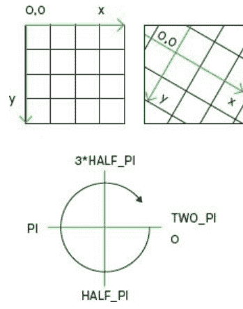

### 变量与数据类型

在程序中，信息存储在变量中，以便程序的其他部分可以访问。这些变量可以有任意名称，但不能是 JavaScript 关键字。关键字可以通过它们在编辑器中的特殊颜色来识别。

```
var myVariable;
myVariable = 5;
```

1. 创建变量 `myVariable`，然后将值 5 存入其中。

变量可以包含不同的数据类型。与大多数其他编程语言不同，JavaScript 在创建变量时不需要考虑这一点。尽管如此，跟踪哪些变量存储哪种类型仍然很重要。例如，数据类型可以是：

```
var myBooleanvalue = true;
```

```
var myInteger = 7;
var myFloatingPointNumber = -3.219;
var myCharacter = "A";
var myString = "This is a text";
```

- 逻辑值（布尔值）：`true` 或 `false`
- 整数：例如，50、-532。
- 浮点值：例如，0.02、-73.1。
- 单个字符：例如，"a"、"A"、"9"、"&"。
- 字符串/文本：例如，"Hello, world"。

### 数组

当处理大量数值时，为每个值创建一个变量很不方便。数组允许管理一个值列表。

```
var planets = ["Mercury", "Venus", "Earth", "Mars",
            "Jupiter", "Saturn", "Uranus", "Neptune"];
```

数组由方括号定义。在方括号内可以列出任意数量的值（此处为八个行星名称），用逗号分隔。

```
console.log(planet[0]);
```

可以通过在变量名后的方括号中输入索引号来访问值。索引 0 指向数组中的第一个条目。

如果值没有立即赋给数组，可以先创建数组，然后稍后再填充：

```
var planetDiameter = [];
planetDiameter[0] = 4879;
planetDiameter[1] = 12104;
planetDiameter[2] = 12756;
planetDiameter[3] = 6794;
...
```

数组还有许多其他用于处理元素的方法。本书中我们主要使用 `<yourarray>.push()` 向数组末尾添加新元素。

方括号初始化一个空数组。然后将值赋给数组。这也可以在程序运行时稍后发生。

```
planet.push("Pluto");
```

虽然冥王星不再被视为行星，但可以通过这种方式将其名称添加到数组 `planet` 中。

### 对象

除了数组，许多信息可以同时存储在对象中。区别在于，各个值不是通过数字索引访问，而是通过键访问。

```
var planet = {name: "Saturn", mass: 5.685e26,
    temperature: 134};

planet.diameter = 120536;

console.log("mass in kg: " + planet.mass);
```

或者，也可以按如下方式访问值。如果键不是从一开始就固定的，而是动态生成或读取的，则有必要使用这种方式。

JavaScript 对象是通过在一组花括号 {} 内封入一组键/值对来创建的。这里生成了一个包含三个键/值对的对象。另一个键/值对被添加到现有对象中，其中一个值被访问并记录到控制台。

```
var k = "mass";

console.log("mass in kg: " + planet[k]);
```

如果键的名称存储在变量中，则可以使用该变量作为该键的引用来访问值。

### 运算符与数学

当然，在 Processing 中也可以进行计算。这可以通过简单的数字实现……

```
var a = (4 + 2.3) / 7;
```

通过字符串……

执行后，值 0.9 被保存在 a 中。

```
var s = "circumference of Jupiter: " + (142984*PI) + " km";
```

变量 s 则包含字符串 "circumference of Jupiter: 449197.5 km"。

以及通过变量：

```
var i = myVariable * 50;
```

myVariable 中的值乘以 50，结果保存在 i 中。

以下计算运算符可用：**+**、**-**、**\***、**/**、**%**。还有一整套数学函数可用。以下是一些：

```
var converted_aValue = map(aValue, 10, 20, 0, 1); // 29
var roundedValue = round(2.67);
var randomValue = random(-5, 5);
var cosineValue = cos(angle);
```

1. `aValue` 中的值从 10 到 20 之间的数字转换为 0 到 1 之间的数字。
2. 四舍五入：`roundedValue` 为 3。
3. -5 到 5 之间的随机数。
4. 计算角度的余弦值。

### 鼠标和键盘

有多种方式可以使用鼠标和键盘作为输入设备来获取信息。一种选择是查询 p5.js 中可用的变量。

```
function draw() {

    console.log("mouseposition:" + mouseX + "," + mouseY);
    console.log("mousekey pressed?:" + mouseIsPressed);
    console.log("key pressed?:" + keyIsPressed);
    console.log("last pressed key:" + key); }
```

另一种可能性是实现其中一个事件处理程序。当相应事件发生时调用事件处理程序——即，当按下鼠标按钮或键盘上的按键时。

Processing 变量 `mouseX` 和 `mouseY` 始终包含鼠标的实际位置；如果此时按下了某个鼠标按钮，则 `mouseIsPressed` 为 `true`。对于键盘，`keyIsPressed` 表示是否按下了按键；最后按下的键出现在 `key` 中。

```
function mouseReleased() {
  console.log("The mouse key was released");
}
```

其他事件处理程序包括 `mousePressed()`、`mouseMoved()`、`keyPressed()` 和 `keyReleased()`。

当释放鼠标左键时调用 `mouseReleased()` 函数。

### 条件

通常有必要仅在满足某些条件时才执行代码行。`if` 语句用于实现这一点。

```
if (aNumber == 3) {
  fill(255, 0, 0);
  ellipse(50, 50, 80, 80);
}
```

```
if (aNumber == 3) {
    fill(255, 0, 0);
} else {
    fill(0, 255, 0);
}

if (aNumber == 3) fill(255, 0, 0);
else fill(0, 255, 0);
```

通过 `switch` 命令通常可以实现对变量多个值的区分。

1. 只有当 `if` 语句中的条件满足时——即，当变量 `aNumber` 的值为 3 时，花括号内的两行代码才会被执行。
2. 使用 else，`if` 条件扩展了一个代码片段，当指定的 `if` 条件不满足时执行该代码片段。
3. 如果代码片段只有一行，如前面的示例所示，花括号可以省略。

```
switch (aNumber) {
case 1:
    rect(20, 20, 80, 80);
    break;
case 2:
    ellipse(50, 50, 80, 80);
    break;
default:
    line(20, 20, 80, 80);
}
```

[3] `switch` 命令测试变量 `aNumber` 的值是否与 `case` 行中列出的某个值对应，如果对应则跳转到该处，并继续执行代码，直到遇到后面的 `break` 语句。

如果没有对应的值，程序执行将继续在 `default` 处进行。

### 函数

程序的某些部分经常以类似的方式出现在不同的地方。在许多这样的情况下，将这些部分封装在函数中是明智的。例如：

```
function draw() {
  translate(40, 15);
  line(0, -10, 0, 10);
  line(-8, -5, 8, 5);
  line(-8, 5, 8, -5);
```


 ```
translate(20, 50);
line(0, -10, 0, 10);
line(-8, -5, 8, 5);
line(-8, 5, 8, -5);
```

要改变这个程序中星形的外观，必须在两处修改绘图命令。因此，最好将相应的代码行存储在一个函数中。

坐标系被移动到另一个位置，在那里用三条线组成一个星形。然后坐标系再次移动，并使用相同的命令在新的位置绘制一个星形。

```
function draw() {

    translate(40, 15);

    drawStar();

    translate(20, 50);

    drawStar();

}

function drawStar() {

    line(0, -10, 0, 10);

    line(-8, -5, 8, 5);
    line(-8, 5, 8, -5);

}
```

可以在函数中传递值，函数也可以返回一个值作为结果。

+   3. 函数`drawStar()`现在包含绘图命令。可以从程序中的任何其他点调用此函数来执行其中包含的代码。

```
function setup() {

  console.log("The faculty of 5 is 1*2*3*4*5 = "
               + faculty(5));

}


function faculty(theValue) {

  var result = 1;

  for (var i = 1; i <= theValue; i++) {

    result = result * i;

  }

  return result;

}
```

在 JavaScript 中，函数接受另一个函数作为其参数之一（称为"回调函数"）的情况特别常见。回调函数允许在事件触发时执行操作。

[4 0] 这里定义了一个函数`faculty()`，其中传递了一个值`theValue`。

当调用函数时，参数（在本例中为 5）被传递到变量`theValue`中。
在函数中，使用此值执行各种计算，并使用命令`return`返回结果。

```
loadJSON("myData.json", callback);

function callback(data) {

    console.log(data);

}
```

[4 1] 当以这种方式使用 p5.js 函数`loadJSON()`时，程序流程不会被加载过程阻塞，而是在后台运行（异步加载）。当文件完全加载后，将调用`callback()`函数。

### 循环

循环用于在程序中多次执行特定命令。可以用几种方式编程循环：

`for`循环用于将代码片段循环特定次数。

```
for (var i = 0; i <= 5; i++) {

    line(0, 0, i * 20, 100);

    line(100, 0, i * 20, 100);

}
```

花括号内的两行代码恰好执行六次。首先将变量`i`设置为值 0，然后在每次循环后增加 1（`i++`），只要该值小于或等于 5。

```
var myValue = 0;

while (myValue < 100) {

    myValue = myValue + random(5);

    console.log("The value of myValue is " + myValue); 
}
```

只要变量`myValue`的值小于 100，这个`while`循环就会继续。在每个新的循环周期中，会添加一个 0 到 5 之间的随机值。

只要满足特定条件，`while`循环就会继续。

有几种方法可以遍历数组中的所有值。这里展示了一些常用的方法：

```
var planets = ["Mercury", "Venus", "Earth", "Mars",
               "Jupiter", "Saturn", "Uranus",
               "Neptune"];

for (var i = 0; i < planets.length; i++) {
    console.log(planets[i]);
}

planets.forEach(function(planet) {
    console.log(planet);
});
```

+   - 变体 1：当变量`i`小于数组长度时，for 循环运行。
- 变体 2：这里使用了数组函数`forEach()`。这需要一个回调函数，在每次循环迭代时调用。变量`planet`依次包含数组的各个值。

为了遍历对象的所有键/值对，以下 for 循环的变体是合适的：

```
var planet = {name: "Saturn", mass: 5.685e26,
              temperature: 134, diameter:
              120536};

for (k in planet) {
    console.log("Key: " + k + ", Value: " +
    planet[k]); 
}
```

变量`k`依次包含对象的每个键。这可以用来访问相关的值。

# P.O.3 优雅地编程

在编程中，通常有多种方法可以达到期望的结果。然而，程序能够运行只是解决方案的一部分，尽管是非常重要的一部分；还有其他方面需要考虑。

## 注释

程序越复杂、越棘手，对其他人——以及对你自己，在短时间后——来说就越难以理解。无法理解的程序无法修改或更新。程序中的注释有助于澄清代码。

```
// calculate distance between actual and previous mouse // position, which represents the speed of the mouse

var speed = dist(mouseX, mouseY, pmouseX, pmouseY);
```

p5.js 社区遍布全球。因此，建议用英语编写注释和变量名。这使得你和他人更容易在互联网论坛上寻找和找到问题的建议和答案。

> 1 两个正斜杠后的文本被忽略，可用于注释。

## 有用的名称和清晰的结构

除了使用注释外，合理选择的变量名和函数名有助于用户保持概览并理解特定程序的功能。

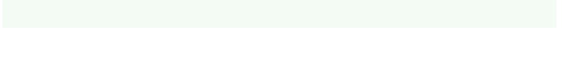

```
function mixer(apples, oranges) {

  var juice = (apples + oranges) / 2;

  return juice;

}
```

为此，有必要借助函数和类将程序划分为较小的、逻辑的部分。这种功能的封装也意味着程序可以快速修改和扩展。

[2] 在这个例子中，很难看出函数计算的是什么。从公式中只能猜测出计算的是两个数的平均值。

## 性能

尽管计算机变得越来越快，执行命令仍然需要时间。当命令频繁执行时，即使是很短的时间也会明显累积。尽量不要让程序承担不必要的工作。

```
for (var i = 0; i < 10000000; i++) {

  var speed = dist(mouseX, mouseY, pmouseX, pmouseY);
  doSomethingWithMouseSpeed(speed);

}
```

```
var speed = dist(mouseX, mouseY, pmouseX, pmouseY); 

for (var i = 0; i < 10000000; i++) {
  doSomethingWithMouseSpeed(speed);
}
```

本书中的程序，我们已努力遵守上述原则。然而，有时清晰性和性能会相互矛盾，这意味着为性能优化的程序代码可能更难理解。在这种情况下，我们选择了更清晰的结构。

[3] 这里在一千万次循环中都计算了 mouseSpeed，尽管在此过程中鼠标位置无法改变。

[4] 因此，当在循环外部计算鼠标速度时，性能会大大提高。

1 关于使用 Processing 编程的非常好且详细的介绍，可以在《*Processing: A Programming Handbook for Visual Designers and Artists*》一书中找到。

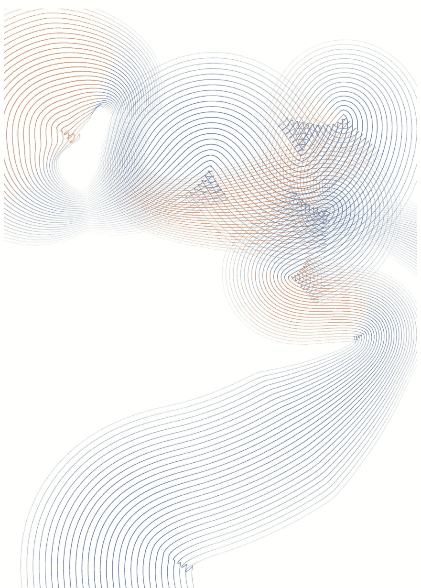

# P.1 颜色

与本书不同，我们通过反射和过滤光来感知本书的颜色，而计算机是真正的量子弹射器。当我们看屏幕时，光以各种波长直接发送到我们的眼睛中，并且可以实时操控。以下示例为用户提供了使用颜色时最重要的技术特性，并介绍了几种在屏幕上设计时使用颜色的方法。

## P.1 颜色 58

+   - P.1.0 你好，颜色 60
- P.1.1 色谱 62
  - P.1.1.1 网格中的色谱 62
  - P.1.1.2 圆形中的色谱 64
- P.1.2 调色板 66
  - P.1.2.1 通过插值的调色板 66
  - P.1.2.2 来自图像的调色板 68
  - P.1.2.3 来自规则的调色板 72

## P.1.0 你好，颜色

能够直接影响 16,777,216 种颜色给用户带来了惊人的自由。同时对比——没有它就不可能感知颜色——在这里通过并置多种颜色组合来说明。我们对颜色的感知会受到其相邻颜色的影响，以及该颜色与其背景比例变化的影响。

→ P_1_0_01

鼠标的水平位置控制色域的大小。从中心开始，彩色区域以高度和宽度从 1 到 720 像素显示。鼠标的垂直位置控制色调。背景通过从 0 到 360 的色谱，而色域以相反的方向通过色谱，从 360 到 0。

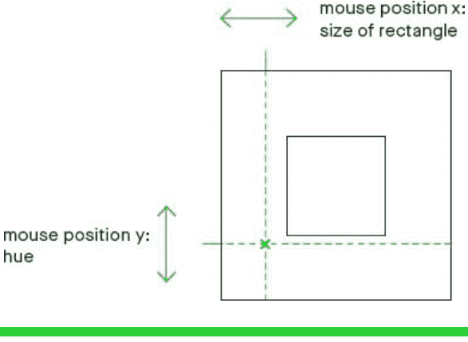

```
function setup() {
    createCanvas(720, 720);
}
```


 ```
noCursor();
colorMode(HSB, 360, 100, 100);
rectMode(CENTER);
noStroke();
}
```

`setup()` 函数设置显示窗口的大小，并使光标不可见。

该程序中的颜色应当贯穿整个色相光谱。因此，`colorMode()` 允许用户更改颜色值的解释方式。HSB 指定了颜色模型，其后的三个值分别指定了各自的范围。例如，色相只能用 0 到 360 之间的值来指定。

```
function draw() {
    background(mouseY / 2, 100, 100);
    fill(360 - mouseY / 2, 100, 100);
    rect(360, 360, mouseX + 1, mouseX + 1);
}
```

鼠标位置的 y 值除以 2，以在色轮上得到 0 到 360 的值。

从 360 中减去鼠标位置的 y 值的一半，产生从 360 到 0 的值。

**5** 色块的大小随鼠标位置的 x 值而变化，边长在 1 到 720 像素之间。

**鼠标：**
位置 x：矩形大小
位置 y：色相

**按键：** S：保存图像

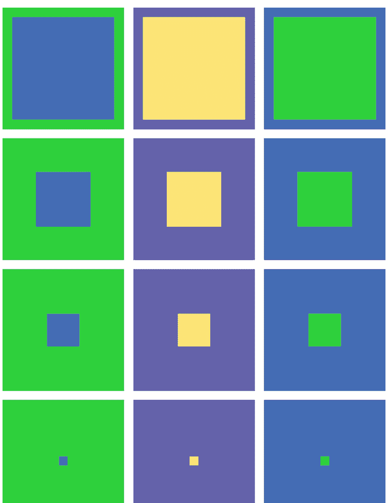

→ **P_1_0_01** 鼠标位置的 x 值定义了内部色块的大小，y 值定义了色相。

## P.1.1.1 网格中的颜色光谱

该颜色光谱由彩色矩形组成。每个图块在水平轴上分配一个色相，在垂直轴上分配一个饱和度值。通过放大矩形可以降低颜色分辨率，从而使光谱中的原色更加清晰。

## → P_1_1_1_01

网格由两个嵌套的 for 循环创建。在外层循环中，逐步增加 y 位置。然后内层循环逐步增加矩形的 x 值，逐行绘制，直到处理完整个宽度。步长由鼠标位置的值设定，存储在变量 `stepX` 和 `stepY` 中。它也决定了矩形的长和宽。

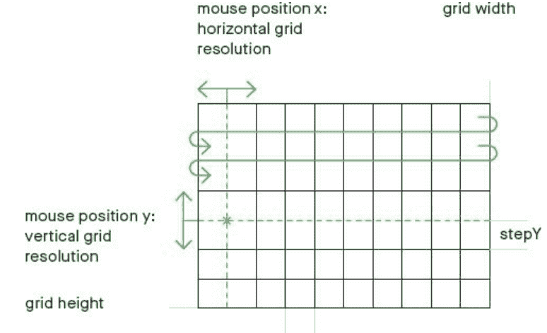

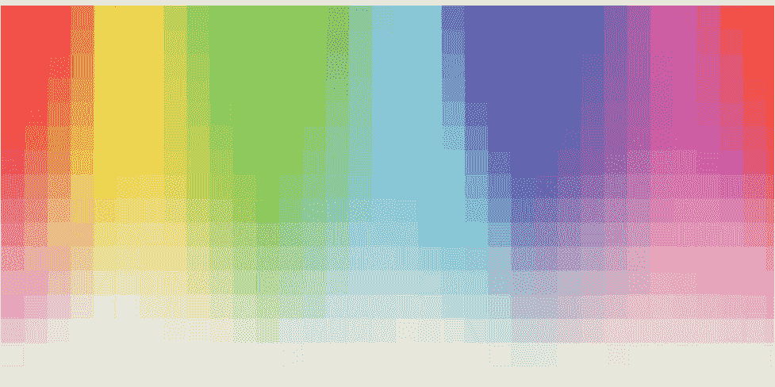

→ **P_1_1_1_01** 尽管所有颜色图块之间的颜色值间距相同，但在某些位置对比度看起来比其他位置更大。

```
var stepX;
var stepY;

function setup() {
  createCanvas(800, 400);
  noStroke();
  colorMode(HSB, width, height, 100);
}
```

+   1 显示大小使用 `createCanvas()` 设置。此处定义的值可以随时通过系统变量 `width` 和 `height` 获取。

+   2

使用命令 `colorMode()` 将色相和饱和度的值范围分别设置为 800 和 400。色相不再定义为 0 到 360 之间的数字，而是 0 到 800 之间。饱和度值也是如此。

```
function draw() {
  stepX = mouseX + 2;
  stepY = mouseY + 2;
  for (var gridY = 0; gridY < height; gridY += stepY) {
    for (var gridX = 0; gridX < width; gridX += stepX) {
      fill(gridX, height - gridY, 100);
      rect(gridX, gridY, stepX, stepY);
    }
  }
}
```

3 加上 2 可以防止 `stepX` 或 `stepY` 过小，否则会导致显示时间延长。

4 借助两个嵌套循环，现在将处理网格中的所有位置。要绘制的矩形的 y 位置由外层循环中的 `gridY` 定义。只有在内层循环处理完毕后，该值才会增加（即，一旦完整绘制了一行矩形）。

5 变量 `gridX` 和 `gridY` 不仅用于定位图块，还用于定义填充颜色。色相由 `gridX` 决定。饱和度值随 `gridY` 值的增加而成比例减小。

**鼠标：** 位置 x/y：网格分辨率

**按键：** S：保存图像

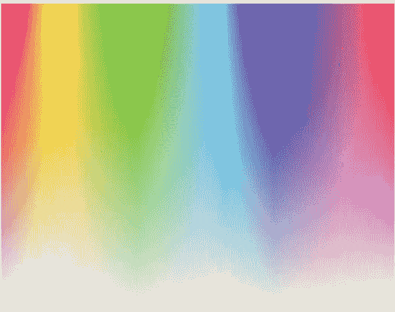

→ **P_1_1_1_01** 在完整分辨率下会产生柔和的彩虹效果。

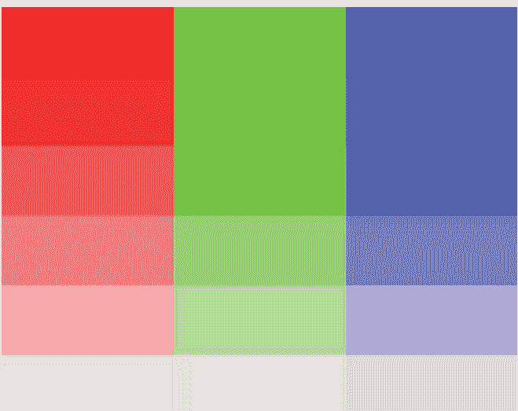

P_1_1_1_01 电脑显示器的三原色——红、绿、蓝——以各种渐变形式呈现。

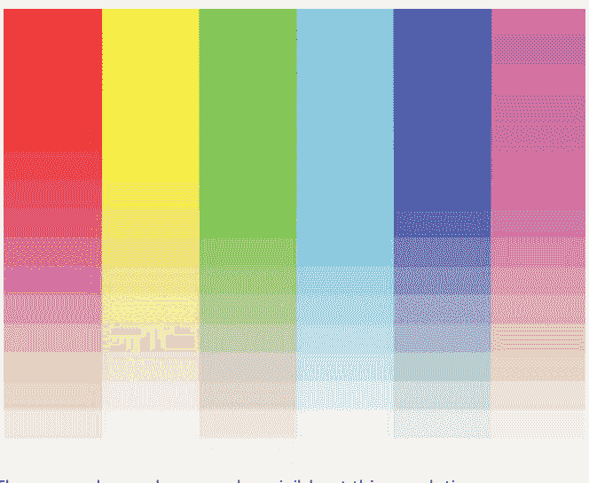

P_1_1_1_01 在此分辨率下，次要颜色也清晰可见。

## P.1.1.2 圆形中的颜色光谱

有多种模型可用于组织颜色。排列成圆形的颜色光谱（色轮）是一种流行的模型，用于比较和谐、对比和色调。你可以控制圆段的数量，以及它们的亮度和饱和度值，从而更好地理解 HSB 模式中的颜色排列。

## → P_1_1_2_01

色轮段以扇形排列。各个顶点根据对应角度的余弦和正弦值计算得出。可以使用一种 Processing 方法模式，使创建色轮段变得特别容易。各个点必须按以下顺序设置：首先是中点，然后是外点依次排列。

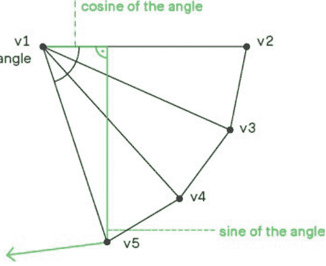

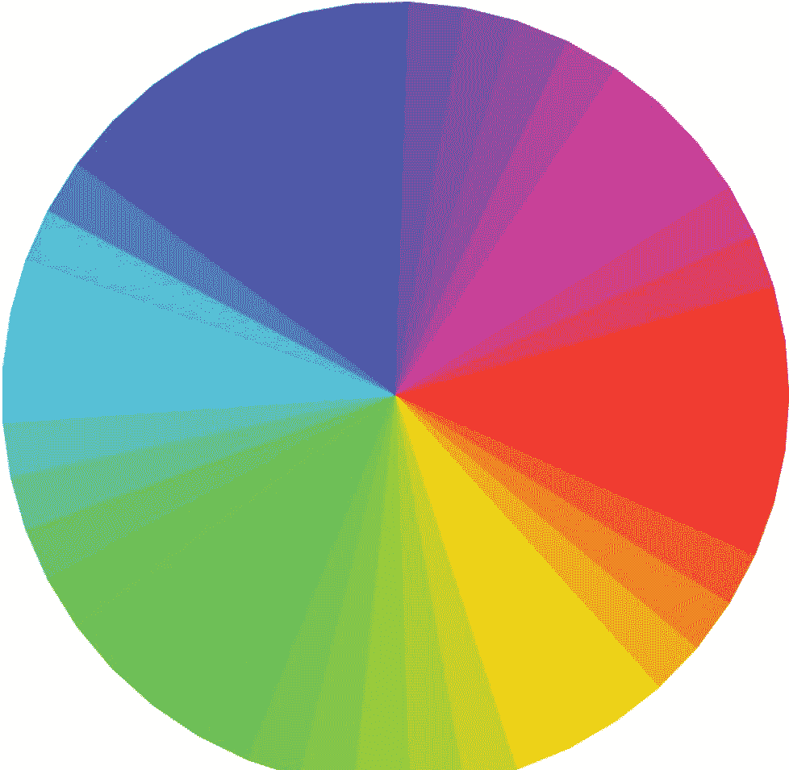

→ **P_1_1_2_01** 段数 45，按键 2。

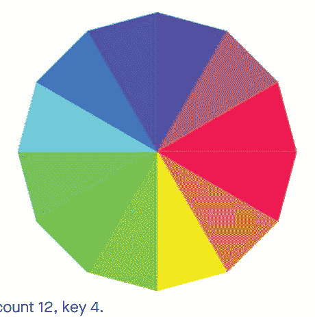

→ P_1_1_2_01 段数 12，按键 4。

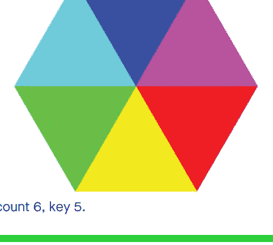

→ P_1_1_2_01 段数 6，按键 5。

```
function draw() {
    colorMode(HSB, 360, width, height);
    background(360, 0, height);
    var angleStep = 360 / segmentCount;
    beginShape(TRIANGLE_FAN);
```

```
    vertex(width / 2, height / 2);
    for (var angle = 0; angle <= 360; angle += angleStep) {
        var vx = width / 2 + cos(radians(angle)) * radius;
        var vy = height / 2 + sin(radians(angle)) * radius;
        vertex(vx, vy);
        fill(angle, mouseX, mouseY);
    }
    endShape();
}
```

+   1. 饱和度（saturation）和亮度（brightness）的值范围被调整为可以使用鼠标坐标作为其值。

2. 角度增量 `angleStep` 取决于要绘制的段数（`segmentCount`）。

3. 第一个顶点位于绘图画布的中心。

4. 对于其他顶点，必须将 `angle` 从度数（0–360）转换为弧度（0–2π），因为 `sin()` 和 `cos()` 函数要求以这种方式输入角度。这种转换通过使用 `radians()` 完成。

5. 定义下一段的填充颜色：`angle` 的值作为色相，`mouseX` 作为饱和度，`mouseY` 作为亮度。

6. 使用 `endShape()` 结束颜色段的构建。

```
function keyPressed() {
...
    switch (key) {
        case '1':
            segmentCount = 360;
            break;
        case '2':
            segmentCount = 45;
            break;
        case '3':
            segmentCount = 24;
            break;
        case '4':
            segmentCount = 12;
            break;
        case '5':
            segmentCount = 6;
            break;
    }
}
```

7 `switch()` 命令检查最后按下的 `key`，这样可以轻松在不同情况之间切换。

8 例如，如果按下了键 3，则 `segmentCount` 被设置为值 `24`。

+   **鼠标：**
位置 x：饱和度
位置 y：亮度

**按键：**
1-5：段数
S：保存图像

## P.1.2.1 通过插值生成调色板

在每个颜色模型中，颜色都有其明确的位置。从一种颜色到另一种颜色的直接路径总是有精确可定义的渐变，具体取决于所选的模型。使用这种插值，你可以创建任意渐变的颜色组，以及定位个别的中间色调。

→ P_1_2_1_01

由于一种颜色不是由单个数字定义，而是由多个值定义，因此有必要在这些值之间进行插值。根据所选的颜色模型 RGB 或 HSB，相同的颜色由不同的值定义，因此从一种颜色到另一种颜色的路径会经过不同的颜色。例如，在 HSB 颜色模型中，会绕经色轮。这种差异是由于颜色模型的特性造成的，两者在不同情况下都非常有用。因此，选择合适的颜色模型来解决特定问题非常重要。

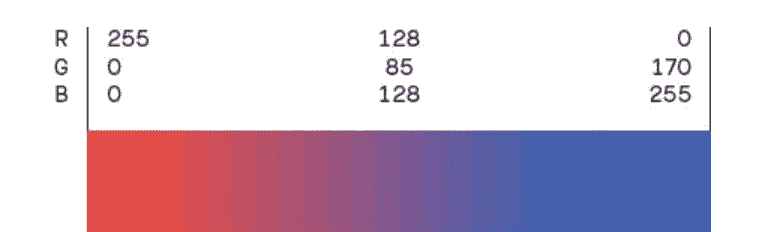

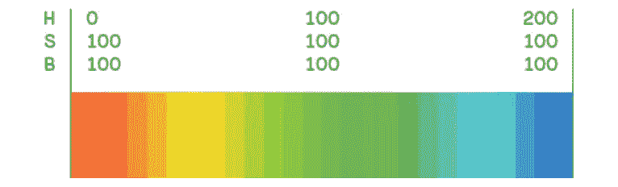
```


 → **P_1_2_1_01** RGB 色彩空间中的插值。在每一行中，两种颜色通过九个步骤进行插值。

```
function draw() {

    tileCountX = int(map(mouseX, 0, width, 2, 100)); tileCountY =
    int(map(mouseY, 0, height, 2, 10)); var tileWidth = width /
    tileCountX; var tileHeight = height / tileCountY; var interCol;

    ...

    for (var gridY = 0; gridY < tileCountY; gridY++) {

        var col1 = colorsLeft[gridY]; var col2 = colorsRight[gridY];
        for (var gridX = 0; gridX < tileCountX; gridX++) {
```

```
var amount = map(gridX, 0, tileCountX - 1, 0, 1); ...

interCol = lerpColor(col1, col2, amount); ...

fill(interCol);

var posX = tileWidth * gridX;

var posY = tileHeight * gridY;

rect(posX, posY, tileWidth, tileHeight);

...

}

}

}
```

- 1. 颜色渐变数量 `tileCountX` 和行数 `tileCountY` 由鼠标位置决定。
- 2. 逐行绘制网格。
- 3. 左右列的颜色在数组 `colorsLeft` 和 `colorsRight` 中设置。
- 4. 中间颜色通过 `lerpColor()` 计算。该函数在单个颜色值之间执行插值。变量 `amount` 是一个介于 0 和 1 之间的值，用于指定起始颜色与终止颜色之间的位置。

在所有描述调色板章节的程序中，按 C 键可以保存 ASE 格式的调色板，供 Adobe 应用程序使用。

**鼠标：** 左键单击：新的随机颜色组合
位置 x：分辨率
位置 y：行数

**按键：** 1–2：插值样式
S：保存图像
C：保存 ASE 调色板

→ **P_1_2_1_01** HSB 色彩空间中的插值。虽然每行开头和结尾的颜色与对面图像中的相同，但生成的中间颜色步骤完全不同。

我们被调色板所环绕；我们只需要记录和评估它们。从个人衣橱照片中获取的颜色——一个非常私人的调色板——通过以下程序进行选择和排序。你可以导出所得的颜色集，将其用作灵感调色板。

→ **P_1_2_2_01**

通过鼠标位置以特定网格间距扫描加载图像的像素，逐行获取 colorsLeft 和 colorsRight，以定义相应的颜色值。这些值存储在数组中，可以按色相、饱和度、亮度或灰度进行排序。

**→ 摄影：Stefan Eigner** 原始图像：地铁隧道。

→ **P_1_2_2_01** 按色相排列的像素。

按饱和度排列的像素。

按亮度排列的像素。

```
var img;

var colors = [];
```

```
var sortMode = null;
```

1 当前选择的排序模式始终存储在变量 sortMode 中。默认不排序，因此值设置为 null（未定义）。

```
function preload(){

img = loadImage("data/pic1.jpg"); }
```

2 在程序开始运行之前，图像被加载并存储到名为 img 的变量中。

```
function draw() {

var tileCount = floor(width / max(mouseX, 5));  
var rectSize = width / tileCount;
```

3 网格中的行数和列数 tileCount 取决于鼠标的 x 值。函数 max() 选择两个给定值中较大的一个。

4 刚刚计算的网格分辨率现在用于定义图块的大小 rectSize。

```
img.loadPixels(); colors = [];

for (var gridY = 0; gridY < tileCount; gridY++) {
```

```
for (var gridX = 0; gridX < tileCount; gridX++) {
  var px = int(gridX * rectSize); var py = int(gridY * rectSize); var i = (py * img.width + px) * 4; var c = color(img.pixels[i], img.pixels[i+1], img.pixels[i+2], img.pixels[i+3]); colors.push(c);
}
gd.sortColors(colors, sortMode); var i = 0;
for (var gridY = 0; gridY < tileCount; gridY++) {
  for (var gridX = 0; gridX < tileCount; gridX++) {
    fill(colors[i]); rect(gridX*rectSize, gridY*rectSize, rectSize, rectSize);
    i++;
  }
}
```

只有在调用 `loadPixels()` 之后，才能访问图像的各个像素。

**6** 现在以先前计算的网格间距 `rectSize` 逐行扫描图片。像素作为一长串值存储在 `pixels[]` 数组中。因此，必须从 `px` 和 `py` 计算相应的索引 `i`。

**7** 使用 `sortColors()` 函数对颜色进行排序。该函数必须传递数组 `colors` 和排序模式 `sortMode`。

**8** 为了绘制调色板，再次处理网格。图块的填充颜色从数组 `colors` 中逐个取值。

```
function keyReleased(){

  if (key == 'c' || key == 'C') writeFile(

          [gd.ase.encode(colors)], gd.ase.timestamp(), 'ase');

  ...

  if (key == '5') sortMode = null; if (key == '6') sortMode = gd.HUE; if (key == '7') sortMode = gd.SATURATION; if (key == '8') sortMode = gd.BRIGHTNESS; if (key == '9') sortMode = gd.GRAYSCALE; }
```

**9** 函数 `ase.encode()` 允许将 `colors` 数组保存为 Adobe Swatch Exchange (ASE) 文件。然后可以将调色板作为颜色样本库加载，例如在 Adobe Illustrator 中。

按键 5 到 9 控制对颜色应用什么排序功能。为此，`sortMode` 设置为 `null`（不排序）或 Generative Design 库中的某个常量：`HUE`、`SATURATION`、`BRIGHTNESS` 或 `GRAYSCALE`。

- **鼠标：** 位置 x：分辨率
- **按键：**
  - 1–4：更改示例图像
  - 5–9：更改排序模式
  - S：保存图像
  - C：保存 ASE 调色板

→ **P_1_2_2_01** “pic4.jpg” 按灰度值排序。

→ 摄影：**Steffen Knöll**。

→ **P_1_2_2_01** “pic4.jpg” 按色相排序。

## P.1.2.3 基于规则的调色板

所有颜色都由三个分量组成：色相、饱和度和亮度。这些颜色分量的值通过一组规则来定义。通过使用受控的随机函数，你可以快速创建特定色调的不同调色板。

> → **P_1_2_3_01**

色相、饱和度和亮度的值从预定义的数值范围中随机选择。这种规则集——值范围的定义——与随机函数的组合意味着新调色板会不断创建，并且始终产生特定的色调。

由于颜色的感知取决于上下文，生成的颜色绘制在交互式网格中。即使是色调也会更清晰地呈现。

```
var hueValues = [];

var saturationValues = []; var brightnessValues = [];

```

- 1. 使用单独的数组来保存色相、饱和度和亮度。根据按下的按键（0–9），按照不同的规则填充数组。

```
function draw() {
  ...
}
```

```
var index = counter % currentTileCountX; fill(hueValues[index], saturationValues[index],

                brightnessValues[index]);

rect(posX, posY, tileWidth, tileHeight);

counter++;

...

}
```

2 绘制网格时，从数组中逐个选择颜色。持续递增的变量 counter 由于取模运算符 % 而开始循环相同的值。例如，当 currentTileCountX 为 3 时，index 将依次持有值 0, 1, 2, 0, 1, 2. . . . 这意味着网格中仅使用数组中的前几种颜色。

```
if (key == '1') {

    for (var i = 0; i < tileCountX; i++) {

        hueValues[i] = int(random(0, 360)); saturationValues[i] = int(random(0, 100)); brightnessValues[i] = int(random(0, 100)); }

}
```

3 当按下按键 1 时，三个数组填充完整值范围内的随机值。这意味着调色板中可能出现任何颜色。


 ```
if (key == '2') {
  for (var i = 0; i < tileCountX; i++) {
    hueValues[i] = int(random(0, 360)); saturationValues[i] = int(random(0, 100)); brightnessValues[i] = 100;
  }
}
```

此处明度始终设置为 100。结果是色板以明亮的颜色为主。

```
if (key == '3') {
  for (var i = 0; i < tileCountX; i++) {
    hueValues[i] = int(random(0, 360)); saturation也不难理解，当饱和度值设置为 100 时，不会创建粉彩色调。

```
if (key == '7') {
  for (var i = 0; i < tileCountX; i++) {
    hueValues[i] = int(random(0, 180)); saturationValues[i] = int(random(80, 100)); brightnessValues[i] = int(random(50, 90));
  }
}
```

此处对所有色彩分量都进行了限制；例如，色调仅从色轮的前半部分选取，从而产生更温暖的色彩。

```
if (key == '9') {
  for (var i = 0; i < tileCountX; i++) {
    if (i % 2 == 0) {
      hueValues[i] = int(random(0, 360)); saturationValues[i] = 100;
      brightnessValues[i] = int(random(0, 100));
    } else {
      hueValues[i] = 195;
      saturationValues[i] = int(random(0, 100));
      brightnessValues[i] = 100;
    }
  }
}
```

- 7 也可以混合两种色板。表达式 i % 2 交替产生数字 0 和 1。当结果为 0 时，较暗、饱和度较高的颜色被保存到数组中。

8 否则应用第二条规则，将色调和明度设置为固定值。这些值产生明亮的蓝色调。

**鼠标：** 位置 x/y：网格分辨率

**按键：** 0–9：更改色板
S：保存图像
C：保存 ASE 色板

→ **P_1_2_3_01** O 键创建一个由两种预设色调（青色和紫色）交替组成的色板。饱和度和明度随机变化。

→ **P_1_2_3_02** 随机 dq此处随机性扮演更重要的角色。行被分割成不同宽度的瓦片。随机决定哪些瓦片再次被分割。

→ **P_1_2_3_03** 如果瓦片略微透明且相互重叠，除了色板中的颜色外，还会产生另一系列颜色。

→ **P_1_2_3_05** 此图像与之前的主要区别在于，这里大约有一半的瓦片干脆不绘制。

# P.2 形状

前一章主要关注颜色，形状的作用较小。由于可以控制图像的每个元素，我们能够访问、模块化和自动化大量的不仅是颜色，还有 shapes。与形式的对话由此展开。

## P.2 形状 我听了半个月啦

- P.2.0 你好，形状 80
- P.2.1 网格 82
    - P.2.1.1 网格中的对齐 82
    - P.2.1.2 网格中的运动 86
    - P.2.1.3 网格中的复杂模块 90
    - P.2.1.4 网格中的复选框 94
    - P.2.1.5 从网格到莫尔条纹 98
- P.2.2 智能体 102
    - P.2.2.1 简单智能体 102
    - P.2.2.2 智能智能体 104
    - P.2.2.3 来自智能体的形状 108
    - P.2.2.4 来自智能体的生长结构 112
    - P.2.2.5 来自智能体的结构密度 116
    - P.2.2.6 钟摆上的智能体 120
- P.2.3 绘图 126
    - P.2.3.1 用动画画笔绘图 pains绘图 130
    - P.2.3.3 用字体绘图 132
    - P.2.3.4 用动态画笔绘图 134
    - P.2.3.5 用数位板绘图 138
    - P.2.3.6 用复杂模块绘图 142
    - P.2.3.7 用多种画笔绘图 146

## P.2.0 你好，形状

点、线、面仍然是每种形式的圣三位一体吗？瓦西里·康定斯基对这些基本元素的界定，在生成式设计的语境下显得比以往任何时候都更加贴切。秉承这一方法，像素是下图中小黑圆的起源。线由一系列像素构成，而面则由相互连接的线构成。

## → P_2_0_01

当光标位于显示窗口上边缘中间时，形状缩减为一个像素。

鼠标位置的 x 值设置线的长度。y 值设置线的值和数量。

```
function draw() {
```

```
background(255);

translate(width / 2, height / 2);

var circleResolution = map(mouseY, 0, height, 2, 80);
var radius = mouseX - width / 2 + 0.5;
var angle = TWO_PI / circleResolution; strokeWeight(mouseY / 20);

beginShape();

for (var i = 0; i <= circleResolution; i++) {

  var x = cos(angle  i)  radius;

  var y = sin(angle  i)  radius;

  line(0, 0, x, y);

  // vertex(x, y);
}

endShape(CLOSE);
}
```

- 1. 坐标系的原点被移动到绘图画布的中心。

2.

函数 `map()` 将鼠标位置的 y 值（一个介于 `0` 和 `height` 之间的数字）转换为介于 `2` 和 `80` 之间的值。

- 通过从鼠标位置的 x 值中减去显示宽度的一半，半径会随着鼠标向中心移动而变得越来越小。向 x 值添加 `0.5` 确保圆的直径至少为 1。

- 增量 `angle` 计算为整圆 `TWO_PI` 除以线的数量 `circleResolution`。

- 可以通过删除注释字符 `//` 将线的端点连接为闭合顶点。

**鼠标：** 位置 x：线长

**按键：** 位置 y：线的值和数量
S：保存图像

→ **P_2_0_02** 和 → **P_2_0_03** 在此变体中，星形的端点连接为闭合多边形。此外，当用鼠标绘制时，变换轨迹被保留，因为背景没有被赋予新颜色。

## P.2.1.1 网格中的对齐

一条只有两种可能方向的对角线如何利用网格的严格秩序来构成复杂结构？每个网格中对角线的方向随机决定。线宽变化产生的重叠创造了新的形式、连接和空隙。

→ **P_2_1_1_01**

在网格中，绘制从左上到右下的线 A，或从左下到右上的线 B。对角线的方向随机选择。

→ **P_2_1_1_01** 对角线的线值与鼠标位置关联，使用 1 到 3 键切换线端类型。

```
var tileCount = 20;
```

- 1. 变量 `tileCount` 的值定义了网格分辨率。

```
function draw() {
  ...
  strokeCap(actStrokeCap);
  ...
  for (var gridY = 0; gridY < tileCount; gridY++) {
    for (var gridX = 0; gridX < tileCount; gridX鑪 grid++) {
      var posX = width / tileCount * gridX;
      var posY = height / tileCount * gridY;
      var toggle = int(random(0, 2));
```

```
if (toggle == 0) {
  strokeWeight(mouseX / 20); line(posX, posY, posX + width / tileCount, posY + height / tileCount);
}

if (toggle == 1) {
  strokeWeight(mouseY / 20);
  line(posX, posY + width / tileCount, posX + height / tileCount, posY);
}
...
```

- 2. 命令 `random(0,2)` 创建介于 though 0.000 和 1.999 之间的随机数。使用 `int` 转换为整数时，它被舍入，变量 `toggle` 变为 0 或 1。

3. 在此 `if` 查询中，变量 `toggle` 的值与 `0` 比较。当此语句为真时，执行接下来的两行代码，绘制线 A。

4. 鼠标在 x 轴上的当前位置定义线 A 的描边值。它除以 `20` 以防止描边值过大。

5. 线 B 同理。
```

 ```
function keyReleased() {
  ...
  if (key == '1') actStrokeCap = ROUND;
  if (key == '2') actStrokeCap = SQUARE;
  if (key == '3') actStrokeCap = PROJECT;
}
```

[6] 按下数字键 1 到 3 之一，会将变量 `actStrokeCap` 设置为 Processing 常量之一：`ROUND`、`SQUARE` 或 `PROJECT`。此参数随后可用于通过 `strokeCap()` 函数设置线条端点的绘制方式。

[7] `strokeCap(ROUND)`

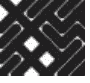

[8] `strokeCap(SQUARE)`

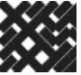

[9] `strokeCap(PROJECT)`

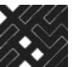

**鼠标：** x 位置：左对角线的线条值
y 位置：右对角线的线条值
左键点击：生成新的随机值

**按键：** 1–3：改变线条端点样式
S：保存图像

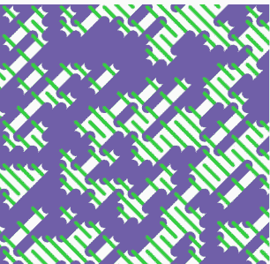

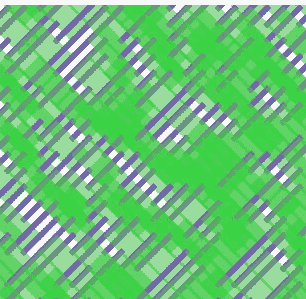

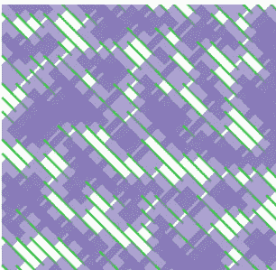

→ **P_2_1_1_02** 在这个变体中，两种对角线都使用了额外的颜色和透明度。

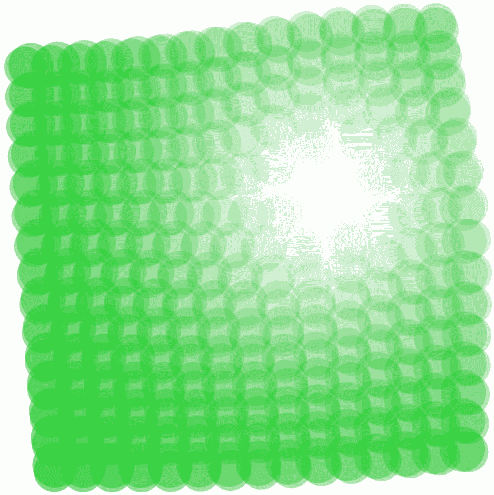

→ **P_2_1_1_04** 这里，网格中的元素从数据文件 SVG 图形加载，这些图形始终朝向鼠标位置。使用 `C` 键可以在不同的颜色模式之间切换。元素的透明度取决于其与鼠标位置的距离。

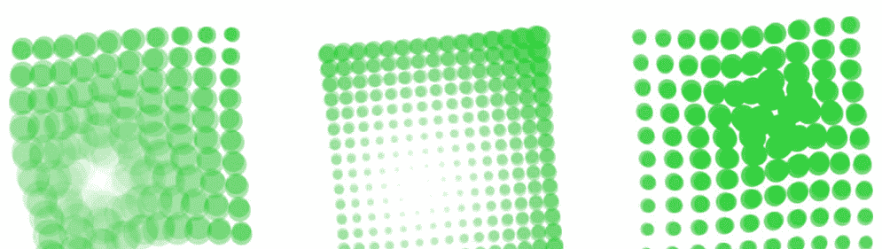

→ **P_2_1_1_04** 使用 `D` 键可以选择元素在靠近鼠标时是变小还是变大。

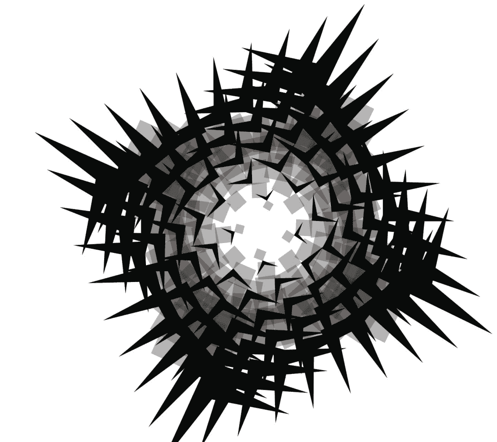

可以通过按键 1 到 7 选择其他 SVG 模块。当 SVG 图形在位置上变得分散时，网格看起来会逐渐消解，尽管模块仍然严格地在网格内绘制。

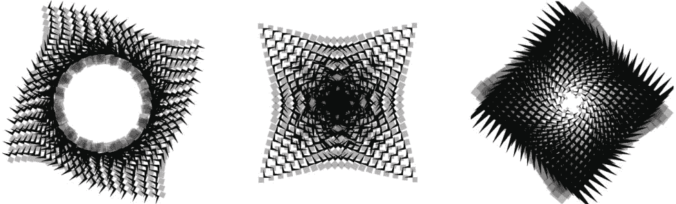

元素也可以旋转（使用左、右箭头键）。

## P.2.1.2 网格中的运动

当秩序濒临混沌时，张力达到最高。个体形式在动态网格中放弃了严格的排列，屈服于随机的配置。倾向于网格的元素和对抗网格的元素争夺视觉上的主导地位。重要的正是那些过渡时刻。

### → P_2_1_2_01

固定数量的圆圈被逐行逐个地绘制到显示区域。圆圈的网格位置被添加了随机值，迫使其沿 x 轴和 y 轴移动。鼠标向右移动得越远，圆圈的移动范围就越大。

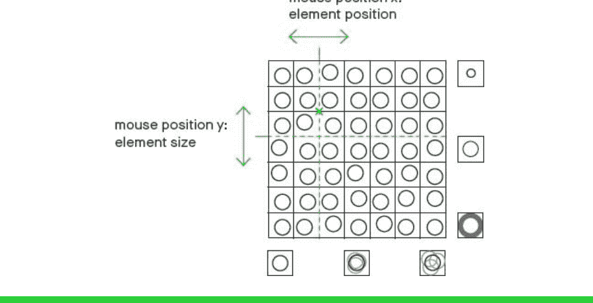

```
function draw() {
  translate(width / tileCount / 2, height / tileCount / 2);
  ...
```

```
strokeWeight(mouseY / 60);

for (var gridY = 0; gridY < tileCount; gridY++) {
  ine  for (var gridX = 0; gridX < tileCount; gridX++) {

    var posX = width / tileCount * gridX;
    var posY = height / tileCount * gridY;

    var shiftX = random(-mouseX, mouseX) / 20; var shiftY = random(-mouseX, mouseX) / 20;

    ellipse(posX + shiftX, posY + shiftY, mouseY / 15, mouseY / 15);

  }
}
```

+ 1. 坐标系原点向右和向下移动了半个图块的宽度和高度，以便圆圈位于其图块的中心。

2. 鼠标位置 `mouseX` 的 x 值越高，随机数的取值范围就越大。

将 `shiftX` 和 `shiftY` 的值分别添加到网格坐标 `posX` 和 `posY` 上，就得到了圆圈最终移动后的位置。

+ - **鼠标：**
  - x 位置：圆圈位置
  - y 位置：圆圈大小
  - 左键点击：生成新的圆圈位置随机值
- **按键：**
  - S：保存图像

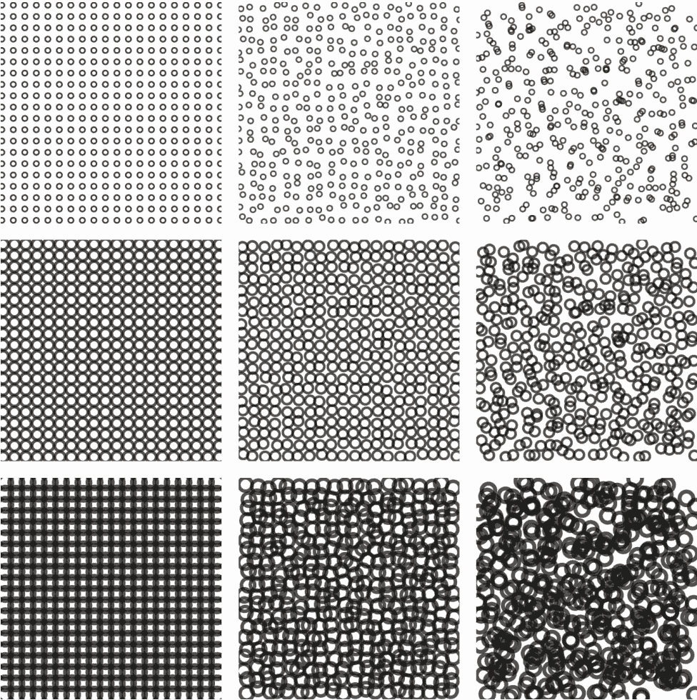

→ **P_2_1_2_01** 透明圆圈根据鼠标位置在水平网格中移动。垂直鼠标位置决定了圆圈的大小。

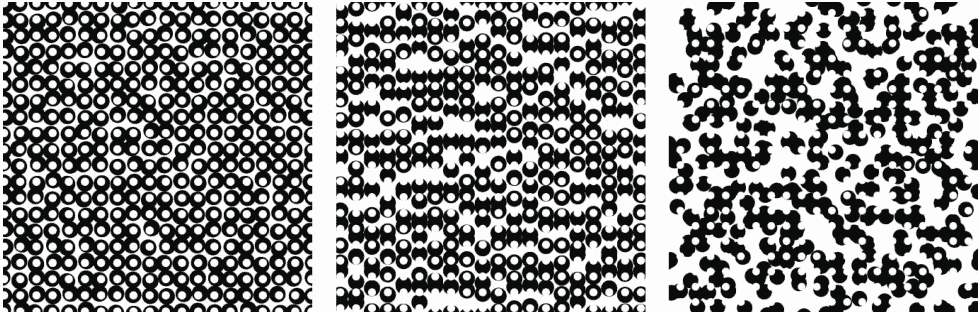

→ **P_2_1_2_02** 移动的黑圈位于密集的白圈网格后面。

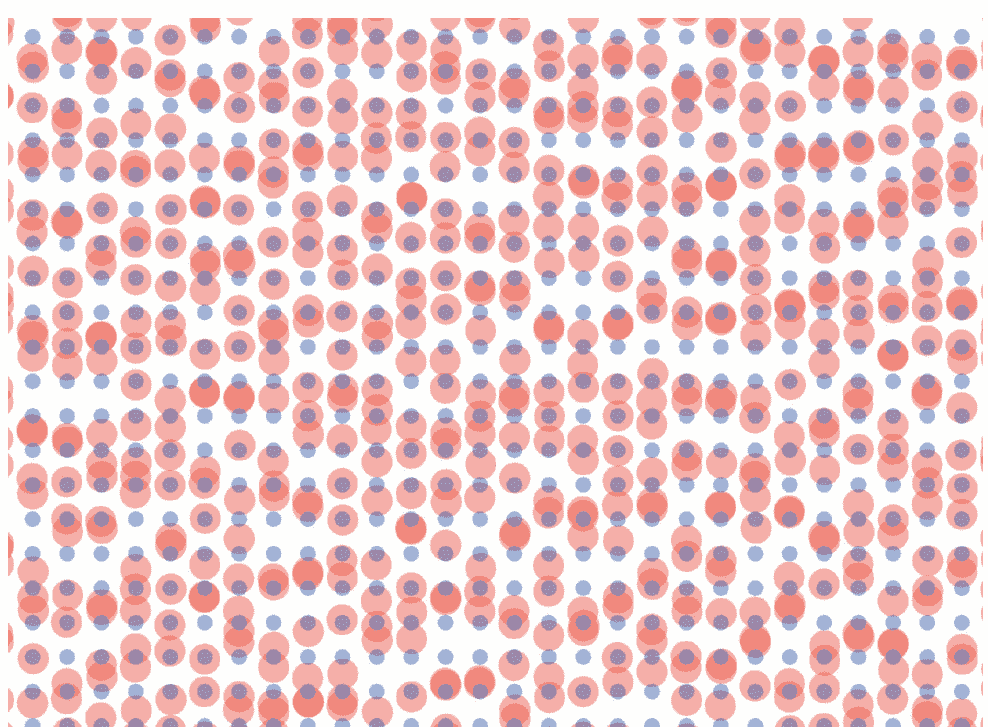

→ **P_2_1_2_02** 使用透明圆圈的色彩变体。

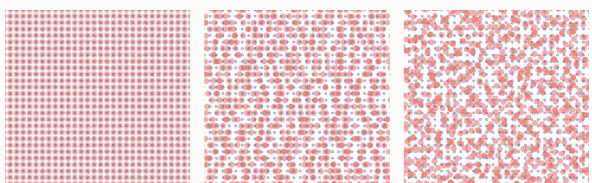

→ **P_2_1_2_02** 在这一行中，只有紫色的圆圈发生了偏移，而粉色的圆圈则固定在网格上。

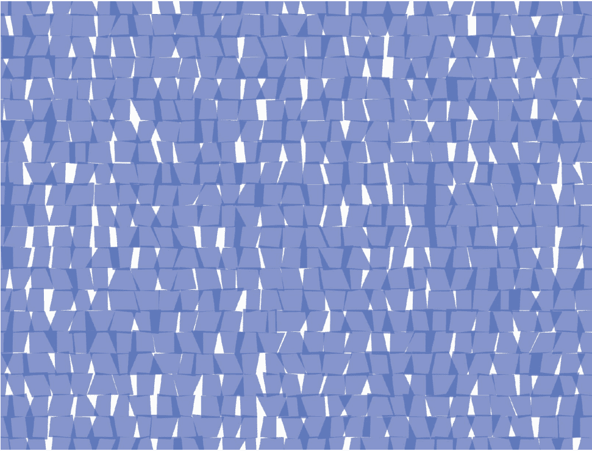

→ **P_2_1_2_04** 这里只有元素的角发生了偏移，而不是元素本身。

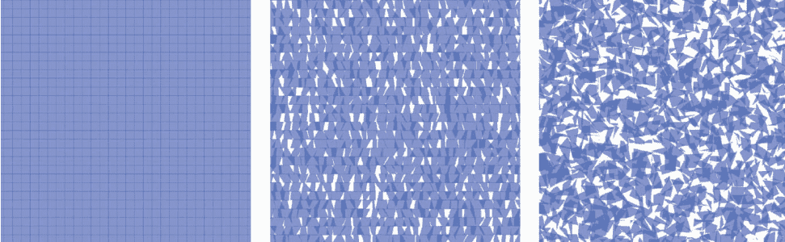

→ **P_2_1_2_04** 这里的重叠和间隙揭示了逐渐变得难以辨认之前的网格。

## P.2.1.3 网格中的复合模块

更有趣的是将几个形式嵌套成一个复合模块。在此图示中，四组不同的椭圆簇在相反的方向上增大尺寸，并交替地定位在网格上。各个椭圆变化的直径和透明度创造了深度的错觉。

### → P_2_1_3_01

填充网格的模块由一系列越来越小的圆圈组成，并沿着随机决定的一个方向（上、下、右或左）移动。圆圈的数量对应于鼠标位置 x，移动对应于鼠标位置 y。

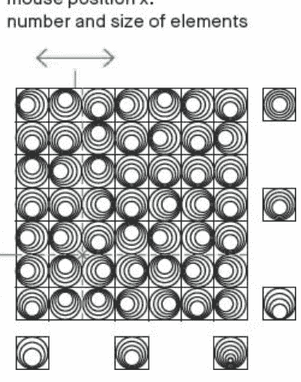

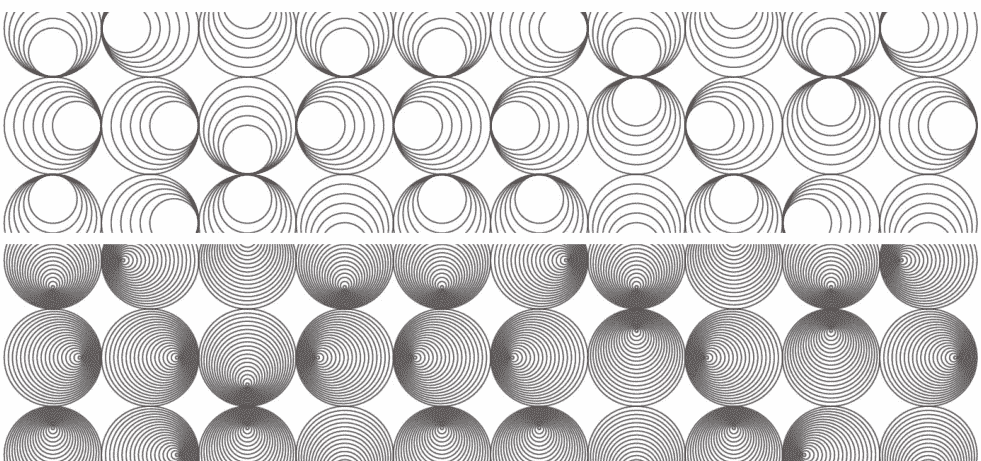

→ **P_2_1_3_01** 网格中的每个模块由几个圆圈组成。鼠标位置定义了它们的数量、大小和位置。

```
function draw() {
  ...
  circleCount = mouseX / 30 + 1;
  endSize = map(mouseX, 0, max(width, mouseX), tileWidth / 2, 0);

  endOffset = map(mouseY, 0, max(height, mouseY), 0, (tileWidth - endSize) / 2);

  for (var gridY = 0; gridY <= tileCountY; gridY++) {
    for (var gridX = 0; gridX <= tileCountX; gridX++) {

      push();

      translate(tileWidth * gridX, tileHeight * gridY);
      scale(1, tileHeight / tileWidth);
```

```
var toggle = int(random(0, 4));
if (toggle == 0) rotate(-HALF_PI);
if (toggle == 1) rotate(0);
if (toggle == 2) rotate(HALF_PI);
if (toggle == 3) rotate(PI);

// draw module
for (var i = 0; i < circleCount; i++) {
  var diameter = map(i, 0, circleCount, tileWidth, endSize);
  var offset = map(i, 0, circleCount, 0, endOffset);
  ellipse(offset, 0, diameter, diameter);
}

pop();
```

¹ 鼠标位置定义了模块中的 `circleCount`、圆圈的大小以及最后一个圆圈的偏移量。

² 当模块在绘制前，将坐标系原点临时移动到其绘制位置时，模块的多变旋转更容易管理。命令 `push()` 确保在使用 `translate()` 移动原点之前，坐标系的当前状态被保存。

+ 随机数 `toggle` 在四种旋转方向之间做决定。`random(0, 4)` 生成一个介于 0 和 3.999 之间的数字；因此，取整后得到值 `0`、`1`、`2` 和 `3`。弧度角 `HALF_PI` 是 90° 的旋转。

+ 该模块通过连续绘制圆圈来构建。`diameter` 的值在 `tileWidth` 和先前计算出的 `endSize` 之间变化。`offset` 值包含了从中心点的偏移。圆圈变得越来越小，从而向右移动得越来越远。

+ 最后，使用 `pop()` 恢复先前保存的坐标系状态。

**鼠标：** x 位置：圆圈的数量和大小
y 位置：圆圈的位置
左键点击：生成新的位置随机值

**按键：** S：保存图像

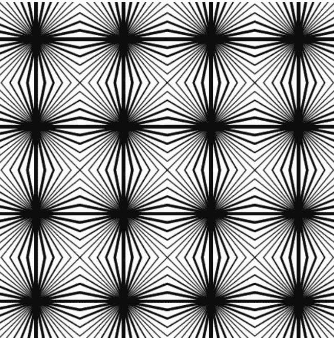

→ **P_2_1_3_02** 由直线构成的复合模块。线条的合并生成了新的形式。

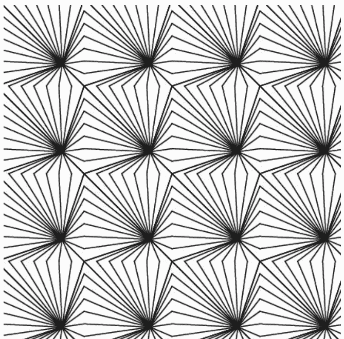

→ **P_2_1_3_02** 线条汇聚的点可以用鼠标沿对角线移动。
```


## P.2.1.3 叠加易于创造3D效果。

→ P_2_1_3_02 叠加易于创造3D效果。

→ P_2_1_3_05 此模块由越来越小且越来越暗的圆圈组成。

→ **P_2_1_3_04** 此模块与对面展示的原理相似，但使用的是旋转的正方形。这些正方形因其彩色和透明性而几乎难以辨认。

## P.2.1.4 网格中的复选框

这里实现了控件最狂野的梦想：它们最终成为了视觉设计元素。按钮、复选框和滑块被用作浏览器中的光栅元素，作为纯粹的可视化元素，当它们被分组和排列在一起时，就变得引人入胜。

→ P_2_1_4_01

输入图像的每个像素都被分析并显示为一个复选框。像素的亮度决定了它是否被选中。如果亮度高于指定的阈值，则不会设置复选标记。因此，这些复选框会显得更亮。

→ P_2_1_4_01 复选框的外观因浏览器而异，但可以通过样式表进行调整。

```
<html>
...
<body>
  <div id="container"></div> ...
</body>
</html>
```

1.  index.html文档提供了一个带有`id container`的`<div>`元素，复选框稍后将被添加到该元素中。

```
function setup() {
  noCanvas();
  ...
  for (var y = 0; y < rows; y++) {
    for (var x = 0; x < cols; x++) {
      var box = createCheckbox(); box.style('display', 'inline');
      box.parent('container'); boxes.push(box);
    }
  }
  var linebreak = createSpan('<br/>');
  linebreak.parent('mirror');
}
slider = createSlider(0, 255, 0);
```

2.  由于元素直接放入HTML文档中，因此可以移除标准绘图画布。
3.  使用`createCheckbox()`创建复选框。可以通过`style()`样式属性定位它们，并通过`parent()`将其插入HTML元素`container`中。
4.  在每行末尾添加换行符。
5.  滑块稍后可用于控制亮度级别阈值。因此，一个从`0`到`255`的值范围很有用。起始值为`0`。

```
function draw() {
  for (var y = 0; y < img.height; y++) {
    for (var x = 0; x < img.height; x++) {
      var c = color(img.get(x, y)); var bright = (red(c) + green(c) + blue(c)) / 3;  // 7
      var threshold = slider.value();  // 8
      var checkIndex = x + y * cols;
      if (bright > threshold) {
        boxes[checkIndex].checked(false);
      } else {
        boxes[checkIndex].checked(true);
      }
    }
  }
}
```

在将图像转换为复选框时，图像的每个像素必须转换为一个值，在本例中为`bright`。对于灰度图像，简单的平均值计算就足够了。对于彩色图像，应使用稍微复杂的计算。

→ P.4.3.1 来自像素值的图形

`value()`函数检索滑块当前设置的值。

与此像素关联的复选框的索引由`x`、`y`和列数`cols`计算得出。

如果像素的亮度高于设定的`threshold`，则移除复选标记；否则设置复选标记。

- **按键：** 1–3：更改图像
- **滑块：** 设置灰度阈值

→ **P_2_1_4_03** 许多滑块按几何形状排列。

→ **P_2_1_4_04** 这些滑块自动保持运动。

## P.2.1.5 从网格到摩尔纹

摩尔纹通常被认为是印刷技术中的错误，在这里是可取的。通过将一个图形网格叠加在另一个相同的网格上并移动它，可以生成意想不到的光学错觉，你可以实时更改这些错觉。

→ P_2_1_5_01

当两个或多个精细网格结构重叠形成更粗糙的图案时，就会出现摩尔纹效应。这是因为整体图像在所有交叉点处都更亮，因为在这些交叉点旁边可以看到更多的白色背景。

→ **P_2_1_5_01** 弯曲的光栅元素通常能产生特别有趣的叠加效果。

```
function draw() {
  ...
  strokeWeight(3);
  overlay();
  var x = map(mouseX, 0, width, -50, 50); var a = map(mouseX, 0, width, -0.5, 0.5); var s = map(mouseY, 0, height, 0.7, 1.3);
  if (drawMode == 2) translate(x, 0); if (drawMode == 1) rotate(a); scale(s);
  strokeWeight(2);
  overlay();
}
```

1.  绘制背景图形。由于此图形必须再次生成，因此此过程已被提取到`overlay()`函数中。
2.  鼠标位置用于计算平移`x`、旋转`a`和缩放`s`的相应值。
3.  根据`drawMode`，坐标系要么水平移动，要么旋转。两种情况下都会进行缩放。
4.  使用略微不同的笔触宽度绘制叠加图形。

```
function overlay() {
  var w = width - 100;
  var h = height - 100;
  if (drawMode == 1) {
    for (var i = -w / 2; i < w / 2; i += 5) {
      line(i, -h / 2, i, h / 2);
    }
  }
  if (drawMode == 2) {
    for (var i = 0; i < w; i += 10) {
      ellipse(0, 0, i);
    }
  }
}
```

1.  在`overlay()`函数中创建图形。
2.  在drawMode 1中，绘制一系列线条。
3.  在drawMode 2中，绘制逐渐增大的圆圈。

- **鼠标：** 位置x：旋转或移动叠加层；位置y：缩放叠加层；1–2：更改drawMode
- **按键：** S：保存图像

→ **P_2_1_5_01** 当两个网格在旋转和缩放方面越接近，摩尔纹效应就越强。

→ **P_2_1_5_04** 自由绘制的线条，绘制多次，相互平行并叠加。

## P.2.2.1 愚蠢的代理

像素现在不再被严格嵌入网格中，而是成为一个代理，并可以根据不同的行为模式自由移动。每一步，代理根据八个方向之一前进，并在其后留下痕迹。它追求自己的使命，永不放弃。

→ P_2_2_1_01

在每次绘制操作中，随机选择八个可能方向之一作为下一步。通过向当前位置坐标添加或减去预定值（步长）来实现移动。最后在新位置绘制圆圈。

→ **P_2_2_1_01** 代理迁移的时间越长，云结构就越密集。

→ P_2_2_1_02 此处代理的移动方向受到限制。

→ **P_2_2_1_02** 在此变体中，圆圈的直径更大，有时呈蓝色。

```
var NORTH = 0;
var NORTHEAST = 1;
var EAST = 2;
var SOUTHEAST = 3;
var SOUTH = 4;
var SOUTHWEST = 5;
var WEST = 6;
var NORTHWEST = 7;
...
var stepSize = 1;
var diameter = 1;
```

1.  定义了八个常量，每个常量具有不同的数值。
2.  代理的步长和直径可以通过更改`stepSize`和`diameter`的值来设置。

```
function draw() {
  for (var i = 0; i <= mouseX; i++) {
    direction = int(random(0, 8));  // 4
    if (direction == NORTH) {
      posY -= stepSize;
    } else if (direction == NORTHEAST) {
      posX += stepSize;
      posY -= stepSize;
    } else if (direction == EAST) {
      posX += stepSize;
    } else if (direction == SOUTHEAST) {
      ...
    }
  }
}
```

posX += stepSize;
posY += stepSize;
} else if (direction == SOUTH) {
 posY += stepSize;
} else if (direction == SOUTHWEST) {
 posX -= stepSize;
 posY += stepSize;
} else if (direction == WEST) {
 posX -= stepSize;
} else if (direction == NORTHWEST) {
 posX -= stepSize;
 posY -= stepSize;
}

if (posX > width) posX = 0;
if (posX < 0) posX = width;
if (posY < 0) posY = height;
if (posY > height) posY = 0;

ellipse(posX + stepSize / 2, posY + stepSize / 2, diameter, diameter);
}

}

³ 命令`random(0,8)`会生成一个介于0.000和7.999之间的随机数。四舍五入后，结果是一个介于0到7之间的值。这个值随后被存入`direction`，用于决定下一步的方向。

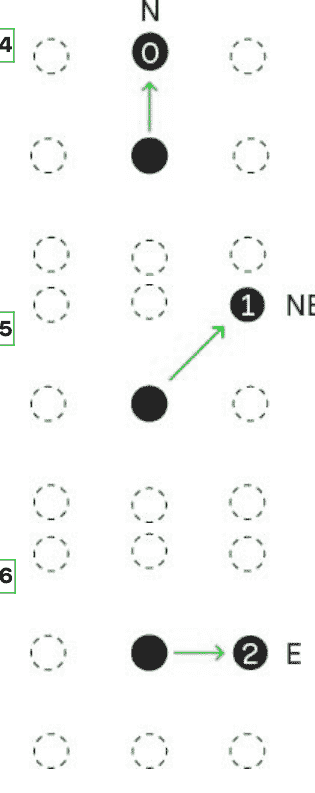

⁷ 当智能体的当前位置超出显示窗口的右边界时，`posX`被设置为`0`。这使得智能体从另一侧继续其路径。

在新位置绘制一个透明的圆形。为此加上了增量的一半`stepSize/2`，以避免圆形被显示窗口的边界截断。

**鼠标：** 位置x：图像构建的速度
**按键：** DEL：清空绘图画布
S：保存图像

## **P.2.2.2** 智能体

行为模式现在更加复杂，并且受到精确条件的制约。智能体在穿过自身路径时很容易偏离。当它到达显示窗口的边界时，会改变方向。在交叉点之间绘制的直线会根据行进的距离改变颜色和笔触值。

### → P_2_2_2_01

智能体始终沿四个基本方向之一移动：北、东、南或西。然而，它可以从多个可能的角度中选择，其中直角是不可能的。当智能体到达绘图画布的边界时，它会掉头并随机选择其中一个可能的角度。当它穿过自身路径时，会保持大致方向但选择一个新的角度。

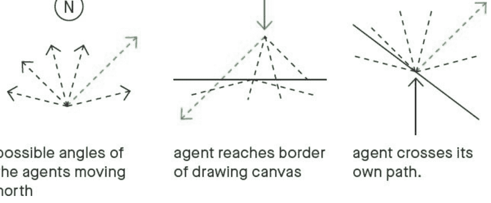

智能体向北移动时的可能角度
智能体到达绘图画布边界
智能体穿过自身路径

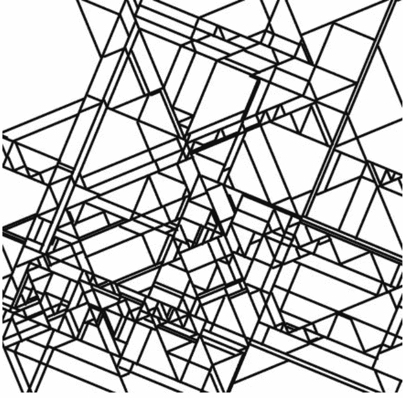

→ **P_2_2_2_01** 按下R键，线条将不留下轨迹地绘制到PDF中。按下E键结束该过程。

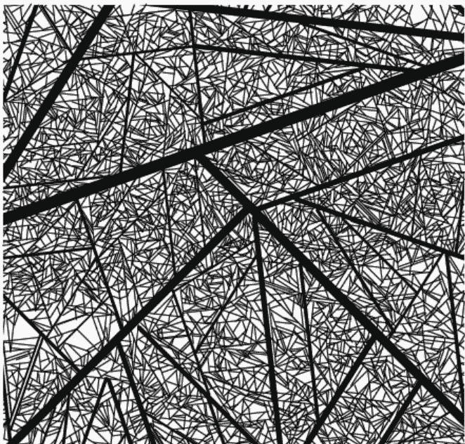

→ **P_2_2_2_02** 一条线的灰度值取决于其距离。

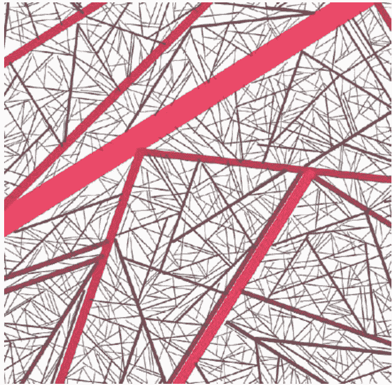

→ **P_2_2_2_02** 这里的线条根据长度着色（按2键）。

```
function draw() {
  var speed = int(map(mouseX, 0, width, 0, 20));
  for (var i=0; i<=speed; i++) {
    strokeWeight(1);
    stroke(180, 0, 0);

    point(posX, posY);
    2
    posX += cos(radians(angle)) * stepSize;
    posY += sin(radians(angle)) * stepSize;
    reachedBorder = false;
  }
}
```

```
if (posY <= 5) {
    direction = SOUTH;
    reachedBorder = true;
} else if (posX >= width - 5) {
    direction = WEST;
    reachedBorder = true;
}
...
loadPixels();
var currentPixel = get(floor(posX), floor(posY));
if ((currentPixel[0]!=255 && currentPixel[1]!=255 && currentPixel[2]!=255) || reachedBorder) {
    angle = getRandomAngle(direction);
    var distance = dist(posX, posY, posXcross, posYcross);
    if (distance >= minLength) {
        strokeWeight(3);
        stroke(0, 0, 0);
        line(posX, posY, posXcross, posYcross);
    }
    posXcross = posX;
    posYcross = posY;
}
}
}
```

-   1. 在智能体的当前位置（`posX`、`posY`）绘制一个点。当点的颜色与背景颜色匹配时，它可能变得几乎（或完全）看不见。
-   2. 智能体迈出一步。在此过程中更新其位置：`angle`定义方向，`stepSize`定义步长。
-   3. 现在检查智能体是否已到达显示窗口的边界。例如，如果它距离上边界只有5个像素或更少，则将`direction`改为`SOUTH`，并将变量`reachedBorder`设为`true`。
-   4. `get()`函数在智能体每次移动时检查它是否位于非白色的像素上。如果是这种情况，或者变量`reachedBorder`为`true`，则使用`getRandomAngle()`函数选择一个沿主方向的新随机角度步进增量。
-   改变方向时，仅当上次改变方向的位置（`posXcross`、`posYcross`）与当前位置的距离至少达到`minLength`定义的距离时，才会绘制一条线。
-   最后，将当前位置保存在变量`posXcross`和`posYcross`中。

```
function getRandomAngle(currentDirection) {
  var a = (floor(random(-angleCount, angleCount)) +
       0.5) * 90 / angleCount;
  if (currentDirection == NORTH) return a - 90;
  if (currentDirection == EAST) return a;
  if (currentDirection == SOUTH) return a + 90;
  if (currentDirection == WEST) return a + 180;
  return 0;
}
```

-   `getRandomAngle()`函数随机选择并返回一个可能的角度，该角度取决于传入的主方向`currentDirection`。例如，当`angleCount`为3（即每个象限有三个方向）且`currentDirection`为`SOUTH`时，返回这些角度之一。

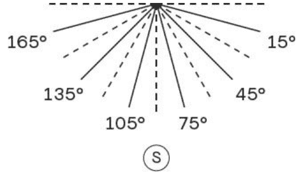

**鼠标：** 位置x：图像构建的速度
**按键：** DEL：清空画布
S：保存图像

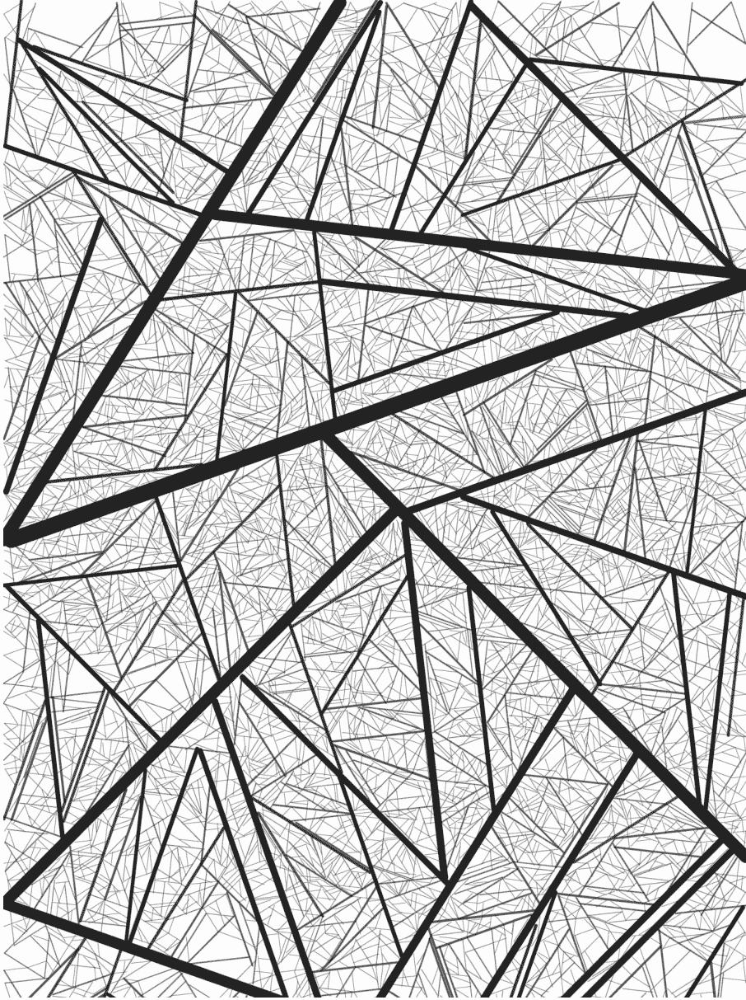

→ **P_2_2_2_02** 较长的线呈不透明外观，较短的线呈透明外观。

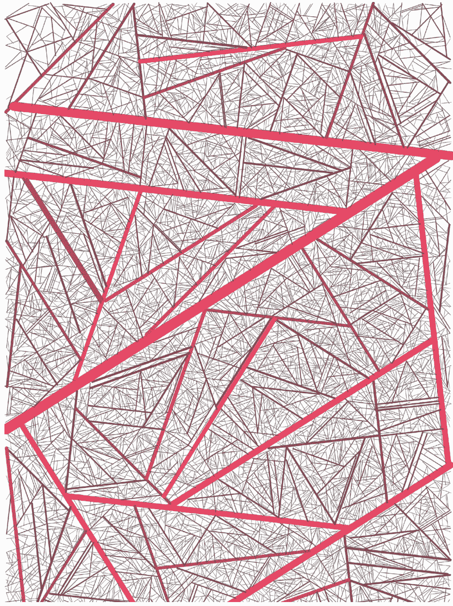

→ **P_2_2_2_02** 色调和饱和度设定为固定值；亮度取决于线条的长度。

## **P.2.2.3 来自智能体的形状**

只有通过合作，愚笨的智能体才能变得强大。圆形是这个示例中的源形状。置换规则是圆上的每一点都由一个愚笨的智能体代表，点的移动会使圆逐渐改变形状。这产生了数量惊人的各种形态。

> → P_2_2_3_01

圆上各点的计算产生智能体的起始位置。一条灵活的曲线将每个智能体与其两个邻居牢固连接。愚笨的智能体离其原始位置越远，圆形结构就溶解得越厉害。

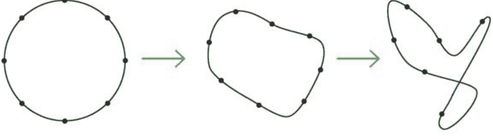

起始
20次迭代后
150次迭代后

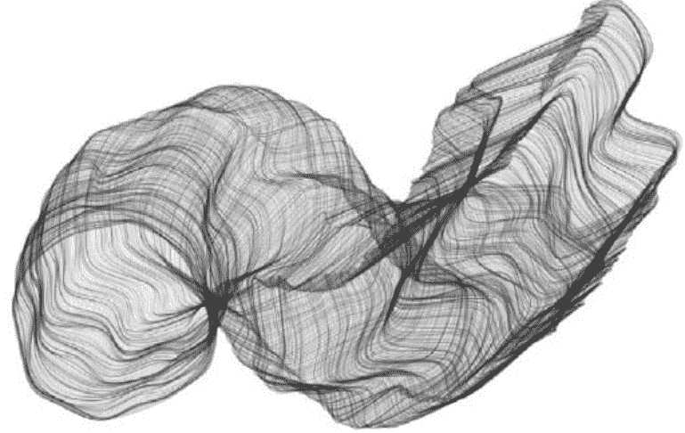

→ **P_2_2_3_01** 不断变化的形状始终向鼠标移动，因此可以通过鼠标控制。

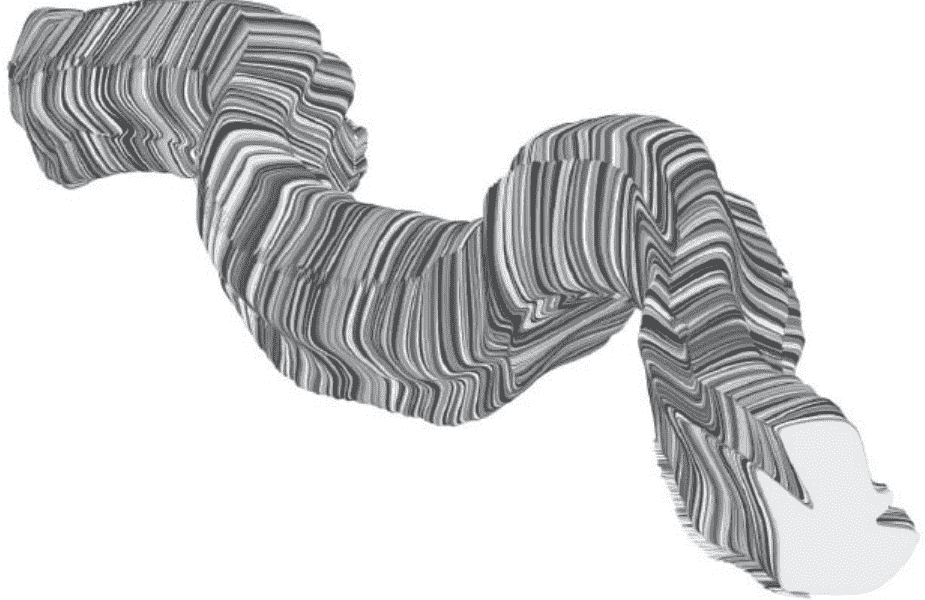

→ **P_2_2_3_01** 可以使用2键设置填充模式，使形状以随机变化的灰度值着色。

```
function setup() {
  ...
  centerX = width / 2;
  centerY = height / 2;
  var angle = radians(360 / formResolution);
  for (var i = 0; i < formResolution; i++) {
    x.push(cos(angle * i) * initRadius);
    y.push(sin(angle * i) * initRadius);
  }
  ...
}
```

-   1. 智能体随后围绕位置（`centerX`、`centerY`）绘制。初始起点是显示的中心。
-   2. 智能体的起始位置被计算为圆上的点，并通过数组函数`push()`保存在数组`x`和`y`中。

→ P.1.1.2 圆形中的色彩谱系

```
function draw() {
  centerX += (mouseX - centerX) * 0.01;
  centerY += (mouseY - centerY) * 0.01;
  for (var i = 0; i < formResolution; i++) {
    x[i] += random(-stepSize, stepSize);
    y[i] += random(-stepSize, stepSize);
    // ellipse(x[i] + centerX, y[i] + centerY, 5, 5);
  }
  ...
  beginShape();
  curveVertex(x[formResolution - 1] + centerX, y[formResolution - 1] + centerY);
  for (var i = 0; i < formResolution; i++) {
    curveVertex(x[i] + centerX, y[i] + centerY);
  }
  curveVertex(x[0] + centerX, y[0] + centerY);
  curveVertex(x[1] + centerX, y[1] + centerY);
  endShape();
}
```

³ 鼠标跟随位置（`centerX`、`centerY`）。每一帧都计算智能体位置与鼠标位置的差值，乘以一个小值，再加回这个位置。


## P.2.2.4 基于智能体的生长结构

稳定的结构来源于多个智能体基于简单规则的汇聚。复杂的形状由简单的传播模式创建而成，例如：绘制一个新圆，并将其尽可能靠近其最近的邻居进行定位。这类算法也描述了植物和矿物的生长过程。

→ **P_2_2_4_01**

在每一帧中，在随机位置并以随机半径生成一个新圆（虚线圆圈）。然后确定现有圆圈中哪个离新圆最近。最后一步，新圆通过最短路径与其最近的邻居对接。

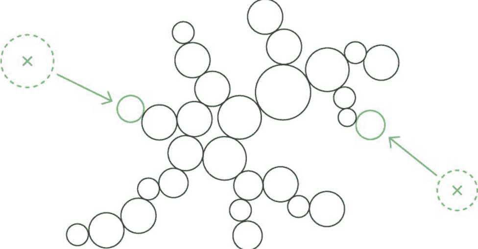

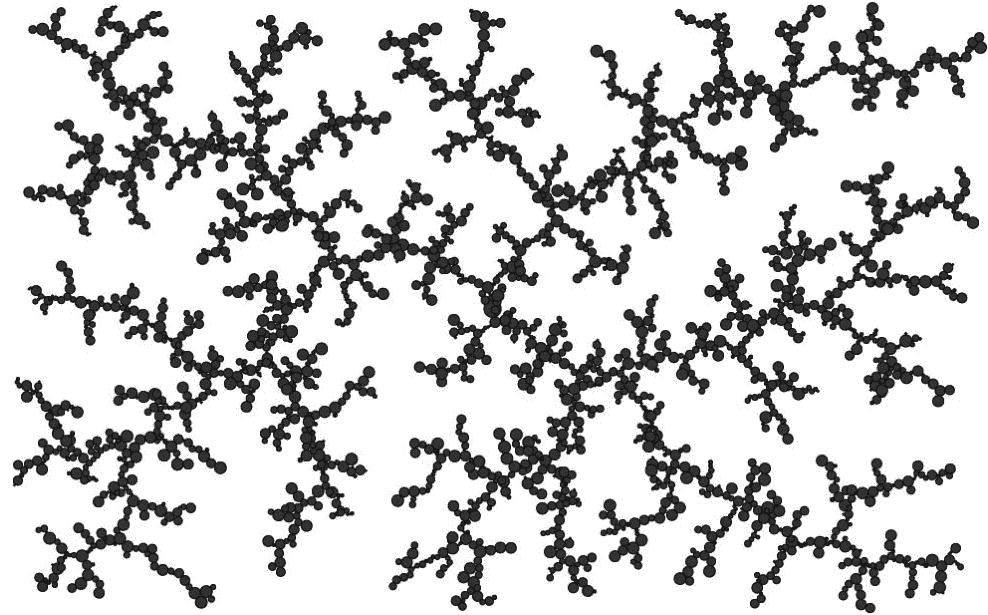

→**P_2_2_4_01** 圆圈逐渐填充区域，有机结构随之演化。

```
function draw() {

  background(255);

  var newR = random(1, 7); var newX = random(newR, width -
newR); var newY = random(newR, height - newR); var
closestDist = Number.MAX_VALUE;

  var closestIndex = 0;

  for (var i = 0; i < currentCount; i++) {

    var newDist = dist(newX, newY, x[i], y[i]); if (newDist <
      closestDist) {

      closestDist = newDist;
      closestIndex = i;
    }
  }

  var newR = min(r[closestIndex], closestDist - r[closestIndex]);

  if (newR > 0) {
    x[currentCount] = newX;
    y[currentCount] = newY;
    r[currentCount] = newR;
    currentCount++;
  }

  for (var i=0; i < currentCount; i++) {
    fill(50);
    noStroke();
    ellipse(x[i], y[i], r[i]*2, r[i]*2);
  }
}
```

```
closestIndex = i;
				}
				}

// fill(230);
// ellipse(newX, newY, newR 2, newR 2);
// line(newX, newY, x[closestIndex], y[closestIndex]);

var angle = atan2(newY - y[closestIndex], newX - x[closestIndex]);

x[currentCount] = x[closestIndex] + cos(angle) * (r[closestIndex] + newR);

y[currentCount] = y[closestIndex] + sin(angle) * (r[closestIndex] + newR);

r[currentCount] = newR;

currentCount++;

for (var i = 0; i < currentCount; i++) {
	fill(50);
	ellipse(x[i], y[i], r[i] 2, r[i] 2); }
```

```
if (currentCount >= maxCount) noLoop(); }
```

1. 圆圈的半径**newR**和位置（**newX**，**newY**）是随机定义的。

2. 在`for`循环中搜索最近的邻居。逐一处理所有圆圈，并计算它们到新圆圈的距离。如果这个距离小于所有之前的距离，则将该圆圈的引用保存在变量`closestIndex`中。


3. 通过绘制新圆圈的起始位置及其与最近圆圈之间的连接线，可以使用这三行代码将上述过程可视化。

4. 通过计算到最近邻居的**角度**，可以定位新圆圈，使两个圆相切。

→ **Kap.P.1.1.2 圆圈中的色谱**

5. 绘制圆圈。

6. 当`currentCount`达到定义的上限时，使用函数`noLoop()`停止程序。

**按键：** S：保存图像


→ **P_2_2_4_01** 该序列展示了结构如何逐渐但持续地生长。


→ **P_2_2_4_02** 当源圆特别大时，结构从外向内生长。此外，此处还绘制了圆圈的初始位置和连接线到它们的新位置（按键1）。

## P.2.2.5 基于智能体的结构密度

在这个例子中，迭代过程再次作为形状赋予者：生成一个新圆圈。如果这个圆圈不与显示中的任何其他圆圈相交，则使其尽可能大；如果它与另一个圆圈相交，则重新开始。该算法的目标是将圆圈密集地打包，最终连最小的间隙也被封闭。

→ P_2_2_5_01

这里，每一帧也生成一个具有随机位置和大小的新的圆圈（以黄色虚线轮廓显示）。当它与现有圆圈相交时，算法重新开始。

否则，它定位最近的圆圈。到这个圆圈的距离及其半径现在定义了新圆圈必须绘制多大，才能使其与邻居接触，从而可以密集地打包圆圈。


圆圈位置不可能；重新开始

可能的新圆圈；半径被最大化直到碰到最近的邻居


→ **P_2_2_5_01** 该算法用越来越小的圆圈填充区域。绿线表示新生长物对接在哪些圆圈上。

```
function draw() {

  background(255);


  var newX = random(maxRadius, width - maxRadius); var newY =
  random(maxRadius, 3height - maxRadius); if (mouseIsPressed &&
  mouseButton == LEFT) {


    newX = random(mouseX - mouseRect, mouseX + mouseRect); newY
    = random(mouseY - mouseRect, mouseY + mouseRect); }


  var intersection = false;


  for (var newR = maxRadius; newR >= minRadius; newR--) {

    for (var i = 0; i < circles.length; i++) {
```

```
var d = dist(newX, newY, circles[i].x, circles[i].y);

intersection = d < circles[i].r + newR; if (intersection) {
  break;
}
            }
         }
if (!intersection) {
   circles.push(new Circle(newX, newY, newR)); break;
            }
         }
      }
for (var i = 0; i < circles.length; i++) {
   if (showLine) {
      var closestCircle;
      for (var j = 0; j < circles.length; j++) {
         var d = dist(circles[i].x, circles[i].y,
                      circles[j].x, circles[j].y);
         if (d <= circles[i].r + circles[j].r + 1) {
```

1. 创建新圆圈的位置和半径。


2. 按住鼠标按钮，随机值的范围被限制，从而可以有选择地定位新圆圈，生成一个交互式绘图工具。

3. 现在必须确定新圆圈的半径。为此，`newR`被设置为最大半径`maxRadius`，并逐次递减。

4. 所有现有圆圈与新圆圈进行比较。当存在交集时（例如，当距离小于两个半径之和时），变量`intersection`被设置为`true`。

5. 如果没有重叠，则创建Circles类的新实例并保存。


6. 如果选择`showLine`选项，则将每个圆圈与其他所有圆圈进行比较，以找到相邻的圆圈`closestCircle`。


 **7** 如果 `showCircle` 为 `true`，圆形也将被绘制。

**鼠标：** 拖动：精准放置圆形

+   **按键：**
- 1：显示/隐藏圆形
- 2：显示/隐藏线条
- 箭头 ↓/↑：更改绘制区域
- S：保存图像

→ **P_2_2_5_02** 通过加载 SVG 模块，可以创建出非常不同的图像。使用按键 1 到 3，可以指定哪些元素可见：SVG、连接线或圆形。

## P.2.2.6 摆上的代理

这些双重代理是可变的，并且相互连接在一起。代理沿着一系列相互关联的摆运动，留下复杂的轨迹，让人联想到*万花尺*的绘图。随着时间的推移，它们的秘密任务变得清晰可见。

→ P_2_2_6_01

代理形成一条摆链。为了确定各个代理的位置，我们从中心开始。旋转角度和摆的长度决定了第一个代理的位置。这也是下一个摆的旋转中心。越往链条外侧，摆的长度越短，转动速度越快。每隔一个摆以相反的方向转动。

→ **P_2_2_6_01** 例如，通过为旋转速度比设置不同的参数，可以生成具有三根、六根或四根对称轴的图形。

```
function draw() {

  background(0, 0, 100);


  angle += speed;


  if (angle <= maxAngle + speed) {


    var pos = center.copy(); for (var i = 0; i < joints; i++) {


    var a = angle * pow(speedRelation, i); if (i % 2 == 1) a = -a;


    var nextPos = p5.Vector.fromAngle(radians(a));
    nextPos.setMag((joints - i) / joints * lineLength);
    nextPos.add(pos);


    if (showPendulum) {

      noStroke();

      fill(0, 10);
```

```
ellipse(pos.x, pos.y, 4, 4);
noFill();
stroke(0, 10);
line(pos.x, pos.y, nextPos.x, nextPos.y);
```

```
pendulumPath[i].push(nextPos);
pos = nextPos;
```

```
if (showPendulumPath) {
  strokeWeight(1.6);
  for (var i = 0; i < pendulumPath.length; i++) {
    var path = pendulumPath[i];
    beginShape();
    var hue = map(i, 0, joints, 120, 360);
    stroke(hue, 80, 60, 50);
    for (var j = 0; j < path.length; j++) {
      vertex(path[j].x, path[j].y);
    }
```

```
endShape();

}

}

}
```

+   1. 变量 `angle` 包含第一个摆的角度。在每帧中，角度会略微增加。

+   2. 变量 `center` 被复制到 `pos`。它包含一个来自 `p5.Vector` 的值。因此，只需一个变量即可存储点的 x 和 y 坐标。此外，p5.Vector 对象还提供了更多实用的计算功能。

+   3. 每个摆的角度 `a` 由基础角度和一个因子计算得出，该因子随着摆与中心距离的增加而增大；例如，当 `speedRelation` 的值为 2 时，索引为 3 的摆的因子为 8（2 的 3 次方）。每隔一个摆的旋转方向反转。

+   4. 为了达到摆末端的位置，使用 `fromAngle()` 函数从刚才计算的角度生成一个单位向量（长度为 1 的向量）。`setMag()` 将其延长并加上当前位置 `pos`。

+   5. 如果要显示摆，则绘制一个圆和一条线。

6 新计算出的位置 `nextPos` 被添加到摆的路径中，并在下一次迭代中用作起始位置 `pos`。

7 各条路径被分配不同的颜色。根据它们的索引 `i`，确定色调在 120°（绿色）到 360°（红色）之间。

+   **按键：**
- 1：切换摆的显示 关/开
- 2：切换路径显示 关/开
- DEL：清空画布
- -/+：调整速度比 -/+
- 箭头↓/↑：减小/增加线长度 -/+
- 箭头 ←/→：调整旋转速度 -/+
- S：保存图像

→ **P_2_2_6_02** 在程序的其他变体中，摆沿着用鼠标绘制的路径移动。

→ **P_2_2_6_03** 当摆不再完全绕其中心旋转，而是——如其名称所示——来回摆动时，就会出现这样的痕迹。

→ **P_2_2_6_04** 如果摆形成分支的树状结构，则会有多个端点。

→ **P_2_2_6_03** 在此绘制模式下，背景不会被清除。摆的动画是连续的，因此变得可见。

→ **P_2_2_6_04** 在这里，树状结构的端点被连接起来形成一个透明的多边形。

## P.2.3.1 使用动画画笔绘制

在前面的章节中，代理按照预定义规则自主移动。在这个示例中，用户将与代理互动，创建一个遵循自身规则集的实验性绘图工具。动画画笔的独特之处在于它们在绘制时能够受到自身行为的启发。这个过程提供了更广泛的表达方式，因为绘制行为就像与舞伴的*交际舞*。

→ P_2_3_1_01

第一个绘图工具极好地展示了非常简单的原则中可以蕴含多少视觉潜力。一条线围绕鼠标位置旋转。根据鼠标移动的速度和方向，线条以不同的方式整合。每次鼠标点击，线条的颜色和长度都会改变。旋转速度可以通过右或左箭头键设置。

→ **P_2_3_1_01** 鼠标仅在水平线的中间来回移动。动画画笔由此生成了不同密度的层次。

```
function draw() {

  if (mouseIsPressed && mouseButton == LEFT) {

    push();

    translate(mouseX, mouseY); rotate(radians(angle));
    stroke(c);

    line(0, 0, lineLength, 0);

    pop();

    angle += angleSpeed;

                          }
}
```

```
}
```

+   1 只有按住左键时才会绘制内容。

+   2 线条需要围绕鼠标位置旋转。因此，必须首先使用 `translate()` 函数将坐标系原点移动到鼠标位置。然后使用 `rotate()` 函数旋转坐标系。

+   3 现在绘制的水平线变成了一个旋转的画笔。

+   4 旋转角度按旋转速度的值增加。

```
function mousePressed() {
  lineLength = random(70, 200);

}
```

+   5 线条的长度每次点击都会改变。

**鼠标：** 拖动：绘制

**按键：** 1–4：更改颜色设置
空格：新的随机颜色
DEL：清空画布
D：更改方向和镜像角度
箭头 ↓/↑：线长度 - /+
箭头 ←/→：旋转速度 - /+
S：保存图像

→ **P_2_3_1_02** 除了鼠标移动和不同的颜色外，旋转线条的步长也会改变。

➔ **P_2_3_1_02** 按住鼠标键时，随机颜色的线条围绕鼠标位置旋转。即使不移动鼠标，也可以通过按键影响丰富的参数，如线的长度、颜色、线条形状和旋转速度，从而生成多样的图像。

## P.2.3.2 绘制中的关系与距离

由于单个元素之间的相互关系对整体图像至关重要，因此用户能够控制距离和角度等单个参数是很重要的；本程序提供了必要的知识。

→ P_2_3_2_01

在前面的示例中，按住鼠标按钮时，每帧都会在画布上绘制一个新元素。现在此功能受到限制：仅当新元素与上一个绘制的元素保持最小距离时，才会放置新元素。有几种方法可以实现这一点：变体 1：新元素不直接放在鼠标位置，而是放在与上一个元素的精确指定最小距离处。

变体 2：新元素放在鼠标位置，最小距离仅作为阈值使用。

最小距离半径

→ **P_2_3_2_01** 在绘制过程中，鼠标移动得越快，线条就越长。

```
function draw() {

  if (mouseIsPressed && mouseButton == LEFT) {

    var d = dist(x, y, mouseX, mouseY);  // 2

    if (d > stepSize) {

      var angle = atan2(mouseY - y, mouseX - x); push();

      translate(x, y);

      rotate(angle);

      stroke(col);

      if (frameCount % 2 == 0) stroke(150);  // 4

      line(0, 0, 0, lineLength * random(0.95, 1.0) * d/10);
      pop();
```

```
if (drawMode == 1) {
  x = x + cos(angle) * stepSize;
  y = y + sin(angle) * stepSize;
}
else {
  x = mouseX;
  y = mouseY;
}
```

1. 按住鼠标按钮（即需要绘制时），计算从上一个绘制位置 (x, y) 到当前鼠标位置的距离。

2. 如果该距离大于 stepSize，则绘制一个新点。为此，需要计算到上一个绘制位置的角度。这可以通过函数 `atan2()` 轻松实现，该函数需要两个参数：两点之间的垂直距离 `mouseY-y` 和两点之间的水平距离 `mouseX-x`。

**3** 线条以不同的颜色交替绘制：随机选择的颜色（`col`）或中灰色。

**4** 绘制一条垂直线。由于坐标系之前已按 `angle` 旋转，因此该线现在与绘制路径垂直。线条的长度由基本长度 `lineLength`、一个随机因子（略微变化长度）以及因子 `d/10` 共同决定。这意味着新旧点之间的距离越大，绘制的线条就越长，从而反映出鼠标的速度。

**5** 在版本 1（`drawMode==1`）中，新点放置在距旧位置 `stepSize` 的距离处。在版本 2 中，鼠标决定新位置。

**鼠标：** 拖动：绘制

**按键：** 1–2：绘图模式
- DEL：清除画布
- 方向键 ↓/↑：线条长度 -/+
- S：保存图像

→ P_2_3_2_01 → 插图：Victor Juarez Hernandez 线条的多重叠加可用于创建精细的阴影效果。

## P.2.3.3 用字体绘制

有谁不喜欢在绘画时切换画笔呢？在此应用中，字符的位置和大小会根据画笔的位置和速度不断变换。用户可以绘制随机的字母系列，甚至整部小说。

### → P_2_3_3_01

沿着鼠标的绘制线，出现一段在程序中定义的文本，其大小会根据鼠标速度的变化而变大或变小。


```
function draw() {

  if (mouseIsPressed && mouseButton == LEFT) {


    var d = dist(x, y, mouseX, mouseY); textSize(fontSizeMin + d / 2);

    var newLetter = letters.charAt(counter);

    stepSize = textWidth(newLetter);


    if (d > stepSize) {

      var angle = atan2(mouseY - y, mouseX - x); push();
```

```
translate(x, y);

rotate(angle + random(angleDistortion));

text(newLetter, 0, 0);

pop();

counter++;

if (counter >= letters.length) counter = 0; x = x + cos(angle) * stepSize;

y = y + sin(angle) * stepSize;

}

}

}
```

1 计算鼠标与当前书写位置 `(x,y)` 之间的距离。该距离又决定了下一个字符的字体大小。`fontSizeMin` 中的值确保字体不会小于指定的大小。

2 为了检查是否可以书写新字母，从字符串 `letters` 中选择下一个字符，并将变量 `stepSize` 设置为该字符的宽度。

3 当鼠标与当前书写位置之间有足够的空间时，书写新字母。

变量 `counter` 计算已经绘制了多少个字母。该值用于从指定文本 `letters` 中依次读取字母。当 `counter` 大于原始文本中的字母数时，将其重置为 0。

**鼠标：** 拖动：绘制文本

**按键：**
DEL：清除画布
方向键 ↓/↑：扭曲角度 -/+
S：保存图像

→ P_2_3_3_01_TABLET → 插图：Pau Domingo 在平板版本中，笔的压力可以调节文本的大小。可以将一张图像作为模板放在背景中，并在绘制时显示或隐藏。

## P.2.3.4 用动态画笔绘制

一条虚拟的橡皮筋变成了一支动态画笔，任意基本元素像珠子一样串联在笔触和一个惰性代理之间。两极之间的张力在绘制时定义了元素的大小和位置。

### → P_2_3_4_01

一个图形元素的一端被鼠标拖动。另一端朝鼠标方向缓慢移动。根据绘制速度和设定的惯性，原始元素会被描绘为拉伸到极限状态或几乎保持不变。元素的宽度保持不变。


```
function draw() {
```

```
if (mouseIsPressed && mouseButton == LEFT) {

  var d = dist(x, y, mouseX, mouseY); if (d > stepSize) {

    var angle = atan2(mouseY - y, mouseX - x); push();

    translate(mouseX, mouseY); rotate(angle + PI);
    image(lineModule, 0, 0, d, moduleSize); pop();

    x = x + cos(angle) * stepSize;
    y = y + sin(angle) * stepSize;

  }

}
```

1 在此程序中，变量 x 和 y 用于对极的位置。这些变量与鼠标位置之间的距离决定了字符元素被拉伸的程度。

2 坐标系通过 `translate()` 移动到鼠标位置，并旋转使其面向对极；然后绘制元素。附加角度（此处为 PI）可根据 SVG 模块的不同而变化。其长度设为 d（到鼠标的距离），宽度设为 moduleSize。

对极的位置每步移动 `stepSize` 的值。由于该移动通常比鼠标移动慢得多，因此会产生橡皮筋效果。

- **鼠标：** 拖动：绘制
- **按键：**
  - 1-9：切换模块
  - DEL：清除画布
  - 方向键 ↓/↑：模块大小 - /+
  - 方向键 ←/→：步长 - /+
  - S：保存图像

→ P_2_3_4_01 → 插图：Pau Domingo 与快速移动的鼠标形成非常鲜明对比的对手。

→ P_2_3_4_01 → **插图：Pau Domingo** 用鼠标进行快速、有规律的移动会产生流畅的形态。

→ **P_2_3_4_01 → 插图：Pau Domingo** 鼠标的不同移动速度也会产生不同的结构。

## **P.2.3.5** 用数位板绘制

与传统鼠标相比，数位板为用户提供了更多参数，包括压力和位置。在绘制时，笔的运动可以被更好地记录和解释，从而更准确地再现手部的运动。使用数位板时，你更接近生成式创作的过程。

### → **P_2_3_5_01_TABLET**

数位板提供的附加参数被传递给一个基本元素（在此例中为一支笔）。方位角、压力和倾斜度分别定义了元素的旋转、饱和度和长度。这些参数使用本书生成式设计库中的数位板类来读取。形态不是从 SVG 文件加载的，而是作为曲线绘制的，这使得各个曲线点更容易被操纵。

## 侧面视角的数位板

| | |
|:---|:---|
| 压力 | 倾斜度 |

## 俯视视角的数位板

| | |
|:---|:---|
| 方位角 | |

| | |
|:---|:---|
| [4] | [0] |
| [3] | h2 元素长度 |
| [2] | |
| [1] | h1 |


 → **P_2_3_5_01_TABLET → 插图：Jana-Lina Berkenbusch** 新元素总是叠加在旧元素之上，因此需要从背景到前景进行绘制。

```
function draw() {

  var tabletValues = tablet.values();

  var pressure = gamma(tabletValues.pressure, 2.5); var angle = tabletValues.azimuth;

  var penLength = cos(tabletValues.inclination);
  
  if (pressure > 0 && penLength > 0) {

    push();

    translate(mouseX, mouseY); rotate(angle);

    var elementLength = penLength * 250;
```

```
var h1 = random(10) * (1.2 + penLength); var h2 = (-10 + random(10)) * (1.2 + penLength); ...

pointsX = [];

pointsY = [];

pointsX[0] = 0;

pointsY[0] = 0;

pointsX[1] = elementLength * 0.77;

pointsY[1] = h1;

pointsX[2] = elementLength;

pointsY[2] = 0;

pointsX[3] = elementLength * 0.77;

pointsY[3] = h2;

pointsX[4] = 0;

pointsY[4] = -5;

beginShape();

curveVertex(pointsX[3], pointsY[3]);

for (var i = 0; i < pointsX.length; i++) {

  curveVertex(pointsX[i], pointsY[i]);

}
```

```
curveVertex(pointsX[1], pointsY[1]);

endShape(CLOSE);

pop();

}

}
```

1. 数位板可以捕获画笔的多种特征。这三个查询获取压力和角度信息。
2. 只有当画笔不完全垂直于数位板且压力大于零时，才应绘制元素。
3. 声明描述形状所需的变量。使用 `random()` 函数，在计算时形状的长度和宽度会有轻微变化。
4. 创建两个数组 `pointsX` 和 `pointsY`，用于存储形状的轮廓点，然后填充数值。
5. 绘制形状。

关于绘制封闭曲线，请参见：→**[P.2.2.3 用代理生成形状](→P.2.2.3 Shapes from agents)**

**鼠标：** 拖拽：绘制
**数位板：** 压力：饱和度
方位角：旋转
倾斜度：长度
1–3：绘图模式

**按键：**

- 6-0：颜色
- DEL：清除画布
- S：保存图像

→ **P_2_3_5_01_TABLET → 插图：Pau Domingo** 基本形态快速连续地相互叠加，从而创造出复杂的有机形态。

→ **P_2_3_5_01_TABLET** → **插图：Pau Domingo、Franz Stämmmele 和 Jana-Lina Berkenbusch** 从鸟类到山脉再到抽象的有机形态，数位板激发了独特插图的创作灵感。

## P.2.3.6 使用复杂模块绘图

组合在一起就变得强大：简单模块变成了超级字符。使用组合数学和复杂模块作为画笔，每个模块根据其四个相邻模块的关系进行定义，从而生成超级字符。根据模块的种类和排列组合，可以生成许多不同的字符组。

→ P_2_3_6_01

用户使用鼠标绘制网格，并在网格的单元格中放置各种 SVG 模块。每个单元格唯一存在的信息是它是空的还是已填充的。当网格显示时，每个单元格相邻单元格的填充或空白状态变得清晰可见；据此，系统会选择特定的图形模块。

四个相邻单元格的十六种可能状态可以很容易地用四位二进制代码来概括。只需将二进制代码转换为十进制数，无需复杂的组合数学，就能确定正确的 SVG 模块。

```
function draw() {

  background(255);


  if (mouseIsPressed) {

    if (mouseButton == LEFT) setTile();  if (mouseButton == RIGHT) unsetTile(); }
```

```
if (doDrawGrid) drawGrid();

drawModules();

}
```

1. 使用 `setTile()` 和 `unsetTile()` 函数，将网格中某个单元格的状态设置为 1 或 0。
2. 使用 `drawModules()` 函数，显示所有 SVG 模块。底层网格可以通过 `drawGrid()` 函数绘制。

```
function setTile() {

var gridX = floor(mouseX / tileSize) + 1; gridX = constrain(gridX, 1, gridResolutionX - 2); var gridY = floor(mouseY / tileSize) + 1; gridY = constrain(gridY, 1, gridResolutionY - 2);

tiles[gridX][gridY] = 1; }
```

3. 鼠标位置被转换为网格中对应的单元格方块坐标（`gridX`、`gridY`）。
4. 网格中所有单元格的状态保存在二维数组 `tiles` 中。被点击的单元格被设置为值 1。

```
function drawModules() {

for (var gridX=0; gridX<gridResolutionX-1; gridX++) {
```

```
for (var gridY=0; gridY<gridResolutionY-1; gridY++) {

    if (tiles[gridX][gridY] == 1) {

        var NORTH = str(tiles[gridX][gridY - 1]); var WEST = str(tiles[gridX - 1][gridY]); var SOUTH = str(tiles[gridX][gridY + 1]); var EAST = str(tiles[gridX + 1][gridY]);

        var binaryResult = NORTH + WEST + SOUTH + EAST;

        var decimalResult = parseInt(binaryResult, 2); var posX = tileSize * gridX - tileSize / 2;

        var posY = tileSize * gridY - tileSize / 2;

        image(modules[decimalResult], posX, posY, tileSize, tileSize);

        ...

    }

}

}

}
```

5. 处理所有单元格。只有状态为 1（即已填充）的单元格才会被考虑。

**6** 查询四个相邻单元格的状态，转换为字符串并拼接。因此，`binaryResult` 包含一个由四个零或一组成的序列。

**7** 使用 `parseInt()` 函数将二进制表示的编码状态转换为十进制数。

**8** 使用 `decimalResult` 选择对应的 SVG 模块，并绘制在画布上。

**鼠标：** 拖拽：绘制模块

**右键拖拽：** 删除模块

**按键：**

- DEL：清除画布
- G：显示/隐藏网格
- D：显示/隐藏模块值
- S：保存图像

→ **P_2_3_6_02** 使用这些瓦片可以轻松绘制完整的字符；可能性是无穷无尽的，因为始终可以在矢量程序中生成新的瓦片集。

→ **P_2_3_6_02 → 插图：Pau Domingo** 通过填充相邻网格来创建图案。

→ **P_2_3_6_02 → 插图：Cedric Kiefer** 这些瓦片被用作装饰性结构。

→ **P_2_3_6_02 → 插图：Cedric Kiefer** 对称的面具状形态。

## P.2.3.7 使用多重画笔绘图

不同画笔的排列方式——所有画笔同时响应鼠标位置——给人一种在镜厅中绘画的感觉。每支画笔运动的水平和垂直镜像会产生万花筒般的效果。

→ P_2_3_7_01

创建一个绘画程序非常简单：在每一帧中，在当前鼠标位置与上一帧的鼠标位置之间绘制一条线。这条小线可以轻松地被绘制多次，可以作为精确副本在水平和垂直方向上偏移，也可以作为镜像：水平、垂直或对角线——或者同时偏移和镜像。

## → **P_2_3_7_01** 三种使用镜像轴和重复的方式。

```
function setup() {

  canvasElement = createCanvas(800, 800);

  ...

  img = createGraphics(width, height); ...

}
```

1. 此程序应仅在正方形画布上使用。否则，对角线镜像会导致问题。
2. `createGraphics()` 函数创建一个稍后将被绘制的图像。这样就可以显示和隐藏镜像轴。

```
function draw() {
  background(255);

  image(img, 0, 0); ...

  if (mouseIsPressed && mouseButton == LEFT) {

    var w = width / penCount; var h = height / penCount;  // 5
    var x = mouseX % w; var y = mouseY % h;  // 6
```


```
var px = x - (mouseX - pmouseX); var py = y - (mouseY - pmouseY); for (var i = 0; i < penCount; i++) {

    for (var j = 0; j < penCount; j++) {

        var ox = i * w;
        var oy = j * h;

        img.line(x+ox, y+oy, px+ox, py+oy);

        if (mh || md2 && md1 && mv) img.line(w-x+ox, y+oy, w-px+ox, py+oy); if (mv || md2 && md1 && mh)
            img.line(x+ox, h-y+oy, px+ox, h-py+oy);
        if (mv && mh || md2 && md1)
            img.line(w-x+ox, h-y+oy, w-px+ox, h-py+oy);

        if (md1 || md2 && mv && mh) img.line(y+ox, x+oy, py+ox, px+oy); if (md1 && mh || md2 && mv)
            img.line(y+ox, w-x+oy, py+ox, w-px+oy);
        if (md1 && mv || md2 && mh)
            img.line(h-y+ox, x+oy, h-py+ox, px+oy);
        if (md1 && mv && mh || md2)
            img.line(h-y+ox, w-x+oy, h-py+ox, w-px+oy);

    }
}
```

+ 3 在每一帧中，绘制的图像首先被复制到绘图画布上。

+ 4 变量 `penCount` 决定了在 x 和 y 方向上生成多少虚拟画笔。值为 3 会产生九支画笔。变量 `w` 和 `h` 是画笔移动的画块的宽度和高度。

+ 5 坐标 `x`, `y` 是画笔在左上角画块中的位置。

+ 6 变量 `pmouseX` 和 `pmouseY` 由 p5.js 提供，始终包含上一帧中鼠标的位置。

+ 7 值 `ox` 和 `oy` 代表一支画笔的 x 和 y 偏移量。

+ 8 在所有情况下，都会在当前和上一鼠标位置之间绘制一条线。

+ 9 如果 `mh` 的值为真（应水平镜像），则从画块宽度中减去 x 位置。顺便说一下，垂直镜像以及围绕两个对角轴镜像时也会出现水平反射。

对角线反射最容易通过交换 x 和 y 来生成。

**鼠标：** 拖动：绘图

**按键：**
- 1-4：各种反射 开/关
- 5-0：颜色
- 方向键 ↓/↑：线宽 -/+
- 方向键 ←/→：画笔数量 -/+
- DEL：清除画布
- D：显示镜像轴 开/关
- G：GIF 录制 开始/停止
- S：保存图像

→ **P_2_3_7_02_TABLET** 这幅画的画块数量不断变化，图形经常用黑色、绿色和白色重绘。

→ **P_2_3_7_02_TABLET** 在数位板版本中，线宽会响应笔的压力。

# P.3 字体

在形状章节中，我们演示了如何使用重复（网格）、迭代（代理）和交互（绘图）的原理来生成形状。本章致力于一种在设计中也极其重要的特殊形式：字体排印。在接下来的示例中，将从文本的视觉分析到字符的轮廓，通过各种方法，在生成式设计的背景下审视字体排印。

## P.3 字体 150

- P.3.0 你好，字体 152
- P.3.1 文本 154
  - P.3.1.1 编写基于时间的文本 154
  - P.3.1.2 文本作为蓝图 156
  - P.3.1.3 文本图像 160
  - P.3.1.4 文本图表 166
- P.3.2 字体轮廓 170
  - P.3.2.1 溶解字体轮廓 170
  - P.3.2.2 变化字体轮廓 174
  - P.3.2.3 来自代理的字体轮廓 178
  - P.3.2.4 平行字体轮廓 180
  - P.3.2.5 动态字体 184

## P.3.0 你好，字体

字母变成了空间。在生成基于矢量的字体时，你可以直接影响众多参数，并在时间和空间中设计字母。字符的出现痕迹以及其大小和位置的交互操作可以被可视化。

→ P_3_0_01

字母的大小由鼠标的水平移动控制，其垂直移动使字母上下移动。按住鼠标按钮时，字母会留下轨迹。

→ **P_3_0_01** 字母留下其变化的轨迹，然后变得无法辨认并生成新的形式。

```
var font = "sans-serif"; var letter = "A";
```

1 要使用的字体名称保存在变量 `font` 中。

```
function setup() {
  createCanvas(windowWidth, windowHeight); background(255);
  fill(0);

  textFont(font);
```

```
textAlign(CENTER, CENTER);

}
```

+ 函数 `textFont()` 将其设为当前字体。可以使用 `textAlign()` 指定水平和垂直对齐方式。

```
function mouseMoved() {

  clear();

  textSize((mouseX - width / 2) * 5 + 1); text(letter, width / 2, mouseY); }
```

+ 当鼠标移动时，字母大小根据水平鼠标位置的值而变化。`letter` 水平居中于显示窗口 `width / 2`，垂直位于 `mouseY` 位置，并使用 `text()` 命令显示。

```
function mouseDragged() {

  textSize((mouseX - width / 2) * 5 + 1); text(letter, width / 2, mouseY); }
```

+ 当按住鼠标按钮移动鼠标时也会发生这种情况，但现在背景不会获得新颜色，字母会留下轨迹。

**鼠标：**
- 位置 x：大小
- 位置 y：位置
- 拖动：绘图

**按键：**
- A-Z：字母选择
- CTRL：保存图像

## P.3.1.1 编写基于时间的文本

编写带有自动换行的文本并非新鲜事。但当垂直鼠标位置负责行距（行之间的空间），并且输入每个字符之前的经过时间决定了其大小时，那么书写节奏就开始与文本互动。

→ P_3_1_1_01

当输入时，虚拟的“笔尖”从左向右在绘图画布上移动。当它到达右边界时，它会从头开始并换一行。行距由垂直鼠标位置定义。各个按键之间的时间被测量。时间间隔越大，输入的字符就越大。

→ **P_3_1_1_01** 垂直鼠标位置定义行距（行间距）。由此产生不同的可读性级别。

```
function draw() {

  ...

  spacing = map(mouseY, 0, height, 0, 120); translate(0, 200 +
spacing);

  var x = 0;

  var y = 0;

  var fontSize = 20;


  for (var i = 0; i < textTyped.length; i++) {


    fontSize = fontSizes[i];
```

```
textFont(font, fontSize);

var letter = textTyped.charAt(i);
var letterWidth = textWidth(letter) + tracking;

if (x + letterWidth > width) {
    x = 0;
    y += spacing;
}

text(letter, x, y);

x += letterWidth;
```

```
var timeDelta = millis() - pMillis;
newFontSize = map(timeDelta, 0, maxTimeDelta, minFontSize, maxFontSize);

newFontSize = min(newFontSize, maxFontSize);

fill(200, 30, 40);

if (int(frameCount / 10) % 2 == 0) fill(255);

rect(x, y, newFontSize / 2, newFontSize / 20);
}
```

变量 `textTyped` 包含输入的文本。现在它被逐个字符处理。

+ 2. `fontSize` 从数组 `fontSizes[]` 的索引 `i` 处获取，并将字体设置为该大小。

+ 3. 现在从字符串 `textTyped` 中选择索引 `i` 处的字符并保存在 `letter` 中。此外，字符宽度 `textWidth(letter)` 增加了 `tracking` 的值。

+ 4. 当当前位置加上字符宽度超过绘图画布的宽度时，就会换行。因此 `x` 重置为 `0`，垂直位置 `y` 增加行距。

+ 5. 字符在位置 `x`, `y` 被绘制。

+ 6. 在所有字符绘制完成后，会显示一个闪烁的光标。随着时间的推移，它应该会增长，因此必须确定 `timeDelta`——自上次输入操作以来经过的时间。当前时间以毫秒为单位通过 `millis()` 函数获取。从中减去上次按键时保存的值 `pMillis`。这个时间差现在可以转换为 `minFontSize` 到 `maxFontSize` 的范围。

+ 7. 此值用于在当前绘制位置绘制一个矩形。

```
function keyTyped(){

  if(keyCode >= 32){

    textTyped += key;

    fontSizes.push(newFontSize); }

}
```


## P.3.1.2 文本即蓝图

在此示例中，时间不再决定字母的大小。相反，特定字母会修改文本方向等属性。在该程序中，每个字符都通过视觉规则进行转换。源文本由此成为构图的蓝图。

### → P_3_1_2_01

用户可自由使用键盘输入文本。每个字符都由程序中的固定规则进行转换，该规则指定了绘制内容以及如何改变位置和大小。

每次输入都可以使用退格键或删除键撤销。

在此示例中，部分字符被替换为加载的 SVG 模块。

| 按键 | 转换 |
| --- | --- |
| A | → 输入 A<br>→ 移动书写位置 |
| B | → 输入 B<br>→ 移动书写位置 |
| 空格 | → 绘制图形<br>→ 旋转 45°<br>→ 移动书写位置 |
| C | → 输入 C<br>→ 移动书写位置 |
| 逗号 | → 绘制图形<br>→ 旋转 45°<br>→ 移动书写位置 |


→ **P_3_1_2_01** 程序将一段文本（此处为 Kraftwerk 乐队歌曲*Taschenrechner*的歌词）解读为平面图。使用 ALT 键可以生成不同的 RandomSeed，不断赋予文本新的外观，因为空格键有两个可能的随机方向。

```
function draw() {

  ...

  translate(centerX, centerY);

  scale(zoom);

  for (var i = 0; i < textTyped.length; i++) {

    var letter = textTyped.charAt(i);

    var letterWidth = textWidth(letter);  4

    switch (letter) {

      case ' ':

        var dir = floor(random(0, 2)); if (dir == 0) {

          image(shapeSpace, 1, -15);

          translate(4, 1);

          rotate(QUARTER_PI); }

        if (dir == 1) {

          image(shapeSpace2, 1, -15);

          translate(14, -5);

          rotate(-QUARTER_PI); }

        break;

      case ',':

        image(shapeComma, 1, -15);

        translate(35, 15);

        rotate(QUARTER_PI); break;

      ...

      default:

        fill(0);

        text(letter, 0, 0);

    }

    translate(letterWidth, 0);

  }

  // blinking cursor after text

  fill(0);

  if (int(frameCount / 6) % 2 == 0) rect(0, 0, 15, 2); }
```

+   1 在显示文本之前，坐标系的原点移动到点 (centerX, centerY)。这种灵活的定义允许通过鼠标交互来移动该点。

+   2 所有输入的字母按顺序处理。

+   3 计算每个字母的字符宽度，以便稍后正确偏移书写位置。

+   4 程序的核心是指定各个字符如何影响图像和书写行为的规则集。为此，使用 switch() 命令来区分当前字母。

+   5 空格的转换方式如下：根据随机值 dir，绘制两个加载的 SVG 模块 shapeSpace 或 shapeSpace2 中的一个；使用 translate() 调整书写位置；使用 rotate() 将书写方向向左或向右旋转 45°。

6 对于其他特殊字符（此处为逗号），SVG 也加载到变量中。当这些字符出现时，绘制相应的模块，并调整书写位置和方向。

7 对于所有其他字符，绘制该字母并将书写位置移动 `letterWidth`。

8 闪烁光标的显示：此构造使用 p5.js 变量 `frameCount`，它在每帧中自动递增，以及模运算符 `%` 来交替产生值 0 和 1。这用于使光标淡入淡出。

- **鼠标：** 拖动：移动绘图画布
- **按键：**
  - A–Z：输入文本
  - 标点符号：曲线
  - 空格键：随机位置曲线
  - DEL：删除字母
  - 方向键 ↓/↑：缩放绘图画布
  - ALT：新的随机布局
  - CTRL：保存图像


## P_3_1_2_02 → 插图：Cedric Kiefer

输入的字母被各种元素替换——例如，ENTER = "开始新行"。文本完全转化为图像。

## P.3.1.3 文本图像

哪些字符出现，以及出现的频率如何？分析文本的属性可以生成图像。计算文本中每个字符的出现次数，并决定其外观。例如，字母的颜色对应于其出现频率。最终我们甚至不再需要这些字母。

→ P_3_1_3_01

逐字符处理文本，并将每个字符对应的计数器递增。由此得到一个计数器列表，代表每个字符的出现频率。现在可以将这些值用作显示文本的参数。


```
var alphabet = "ABCDEFGHIJKLMNORSTUVWYZÄÖÜß,.;!? "; var counters = []; ...
```

1

字符串 `alphabet` 确定要计数的字符。`counters` 数组以字符串长度初始化，从而为每个字符提供一个计数器。

```
function preload() {

  joinedText = loadStrings("data/faust_kurz.txt"); }
```

2 使用 `loadStrings()` 函数加载要分析的文本。

```
function setup() {

  createCanvas(620, windowHeight); ...

  joinedText = joinedText.join(" "); for (var i = 0; i < alphabet.length; i++) {

    counters[i] = 0;

  }

  countCharacters();

}
```

3 各个文本现在位于字符串数组中。由于处理连续文本更为实用，使用 `join()` 函数将各行连接在一起。

4 调用 `countCharacters()` 函数来确定频率。

```
function countCharacters() {

  for (var i = 0; i < joinedText.length; i++) {

    var c = joinedText.charAt(i);

    var upperCaseChar = c.toUpperCase();

    var index = alphabet.indexOf(upperCaseChar); if (index >= 0) counters[index]++; }

      
  }
}
```

5 处理文本：使用 `charAt()` 从文本中取出一个字符，并使用 `toUpperCase()` 函数将其转换为大写字母。

6 使用 `indexOf()` 函数查找给定字符字符串中每个字母在 `alphabet` 中的位置。如果找到该字母，则递增对应字母的 `index`。

```
function draw() {

  ...

  posX = 20;

  posY = 40;

  for (var i = 0; i < joinedText.length; i++) {

    var upperCaseChar=joinedText.charAt(i).toUpperCase();

    var index = alphabet.indexOf(upperCaseChar); if (index < 0) continue;

    if (drawAlpha) {

      fill(87, 35, 129, counters[index] * 3); } else {

      fill(87, 35, 129);

    }

    var sortY = index * 20 + 40;

    var m = map(mouseX, 50, width - 50, 0, 1);

    m = constrain(m, 0, 1); var interY = lerp(posY, sortY, m);
    text(joinedText.charAt(i), posX, interY);

    posX += textWidth(joinedText.charAt(i)); if (posX >= width - 200 && upperCaseChar == " ") {

      posY += 30;

      posX = 20;

    }

  }
}
```

变量 `posX` 和 `posY` 在开始时用数值初始化。

绘制时，每次都从文本开头处理，与 `countCharacters()` 函数中一样，确定当前字符在计数器数组中的索引。如果找不到该字符（`index < 0`），则使用 `continue` 命令取消该字符的绘制过程。

当启用 `drawAlpha` 绘制模式时，填充颜色的透明度取决于字符的频率，并通过 `counters[index]` 设置。

引入变量 `sortY` 来对字符进行排序。这表示字符应该去往或迁移到的行的 y 坐标。对于 A，它是 40。对于 B，该值为 60，依此类推。

鼠标位置被转换为介于 `0` 和 `1` 之间的数字 `m`，用作插值变量。使用 `lerp()` 函数在 `posY` 和 `sortY` 之间进行插值，并使用计算值 `interY` 来定位字符。

现在只需更新书写位置。将 `posX` 增加字符宽度；如果该值接近显示的右边界且当前字符为空格，则进行换行。将 `posY` 增加行间距，并将 `posX` 重置到左侧。

+   按下按键时，将输入的字母附加到字符串 `textTyped`，并通过附加 `newFontSize` 中的新字母大小来扩展数组 `fontSizes[]`。

```
function keyPressed() {

  ...

  pMillis = millis();

}
```

当前时间保存在 `pMillis` 中，以便始终能够获取上次按键的时间。

- **鼠标：** 位置 x：大小
- 位置 y：位置
- **按键：** A-Z：字母选择
- CTRL：保存图像

位置 x：正常文本和排序后文本的幸存者


鼠标：
按键：1：

切换透明模式

S：保存图片

你们又再现身了，浮动摇曳的姿形，
你们曾经向我那迷茫的目光展示愉悦。
我能否将你们这次稳稳地握住？
我的心是否还对那种幻觉有所眷恋？
你们蜂拥而至！好吧，随你们
所愿。你们从烟雾和迷雾中
向我升起；我的胸口感到年轻的震颤
被环绕你们行列的魔力所触动。
你们带来了昔日画面的回忆；
许多可爱的身影也一一浮现；
如同一段古老、几近消逝的传说
初恋与友谊一起涌上心头；
痛苦重新泛起，哀叹再度响起
人生迷宫般迷途的旅程，
并呼唤那些美好的人们，他们
被幸福所欺，从我身边匆匆逝去。

→ P_3_1_3_01 鼠标的水平位置控制字母是以正常文本位置显示，还是按排序显示。

→ **P_3_1_3_03** 文本中字母的出现频率通过多种方式、多种组合进行编码：通过绿色圆圈的大小和透明度，通过紫色线条的长度，以及通过字母本身的透明度。

➔ P_3_1_3_04 相同字母由彩色线条连接；线条的颜色按字母表顺序在色轮上依次排列。当鼠标向右移动时，字母按出现频率排序。

任何种类的字母都可以单独开关，例如，可以单独观察元音字母的出现频率。灰色线条（见右侧插图）可通过按键2开启或关闭，将每个字母与其直接相邻的字母相连。虽然在正常文本中几乎不可见，但按字母排列时，这些灰色线条形成了引人注目的网络结构。

## P.3.1.4 文本图表

简·奥斯汀最喜欢的词是什么？机械性地阅读和大量处理文本的可能性为实验提供了广阔的空间。例如，《*傲慢与偏见*》中的所有单词都可以被计数，其频率通过大小不同的元素（此处为矩形）来表示，从而创建出作为静态文学批评功能的图表。

→ P_3_1_4_01

所谓的树图旨在根据每个词在文本中的使用频率，将一个矩形划分为更小的矩形。简·奥斯汀《*傲慢与偏见*》的完整文本从文本文件中读取，并传入 Treemap 类进行可视化。可以输入树图算法的各个参数。

→ P_3_1_4_01 按频率排列的树图局部，其中仅允许水平元素。

```
var mapData = {};

. . .

var doSort = true; var rowDirection = "both" ;
```

- 1. 数据容器 `mapData` 稍后将被填充已加载文本的单词及其数量。

- 2. `doSort` 和 `rowDirection` 变量控制树图的各种布局。

```
function setup() {

  . . .

  joinedText = joinedText.join(" ");

  var words = joinedText.match(/\w+/g);
```

```
treemap = new gd.Treemap(1, 1, width - 3, height - 3, {sort:doSort, direction:rowDirection});

for (var i = 0; i < words.length; i++) {

    var w = words[i].toLowerCase(); treemap.addData(w);

}

treemap.calculate();

}
```

- 3 使用 `match()` 将完整文本拆分为单个单词。此函数的参数是一个正则表达式。借助它，可以执行非常复杂的文本搜索。此处使用的表达式相对简单：搜索一个或多个连续的（`+`）单词字符（`\w`）。末尾的 `g` 表示"全局"，即搜索不应在第一次出现后停止。

- 4 生成 `TreeMap`。前四个参数指定位置（x, y）、宽度和高度。此外，还传入一个对象用于显示选项。

- 5 处理包含单词的数组。每个单词首先转换为小写字母，以便同一单词的不同大小写形式（例如，作为句子首词使用时）仍能被识别。然后，`addData()` 将单词添加到树图中，并通过 `calculate()` 开始计数。

```
function draw() {

background(255);

textAlign(CENTER, BASELINE);

for (var i = 0; i < treemap.items.length; i++) {

  var item = treemap.items[i]; fill(255);

  stroke(0);

  strokeWeight(1);

  rect(item.x, item.y, item.w, item.h); var word = item.data;

  textFont(font, 100);

  var textW = textWidth(word); var fontSize = 100 * (item.w * 0.9) / textW;

  fontSize = min(fontSize, (item.h * 0.9)); textFont(font, fontSize);

  fill(0);

  noStroke();

  text(word, item.x + item.w/2, item.y + item.h*0.8); }

...

                          }
```

树图类用于为每个单词计算一个树图元素，现在所有这些元素都作为 `items` 存在于数组中。

7 元素的位置、宽度和高度自动保存在变量 `x,y` 和 `w` 和 `h` 中，可用于绘制元素的边框。

8 然后将字体大小设为100以确定单词的宽度。利用三分法则，可以计算出字体大小，使单词适应 `item.w` 矩形的宽度。

9 然而，单词的高度不能超过矩形。

10 单词写入矩形中。

按键：R：随机开/关
H：水平排列
V：垂直排列
B：双向排列
S：保存图片

→ P_3_1_4_01 简·奥斯汀《*傲慢与偏见*》中所有单词频率的树图。在此排列中，算法试图使矩形尽可能保持正方形。

→ P_3_1_4_02 在程序的第二版中，单词按字母数量分组。可以使用数字键（1–9）显示或隐藏各个组。

## P.3.2.1 分解字体轮廓

文本由字符组成。字符又由其轮廓塑造。在以下章节中，这个轮廓将分解为无数点，并将成为生成式字体操作的基础。单个点被其他元素替换，从而 disguising 原始字体。

→ P_3_2_1_01

起点是一段文本和一个字体文件。Frederik De Bleser 设计的 opentype.js 库在字体轮廓上生成大量点。这些信息随后可用于赋予字符新的视觉身份。

→ **P_3_2_1_02** 在此版本程序中，加载 SVG 并将其放置在字符轮廓上。旋转角度和缩放比例可用鼠标控制。

```
function setup() {

  ...

  opentype.load('data/FreeSans.otf', function(err, f) {

    font = f;

    loop();

  });

}
```

- 1. opentype.js 库加载字体文件并将其存储在 `font` 变量中。

```
function draw() {

...

if (textTyped.length > 0) {

    var fontPath = font.getPath(textTyped, 0, 0, 200);

    var path = new g.Path(fontPath.commands);

    path = g.resampleByLength(path, 11); stroke(181, 157, 0);

    strokeWeight(1.0);

    var l = 5;

    for (var i = 0; i < path.commands.length; i++) {

        var pnt = path.commands[i];

        line(pnt.x - l, pnt.y - l, pnt.x + l, pnt.y + l); }

    fill(0);

    noStroke();

    var diameter = 7;

    for (var i = 0; i < path.commands.length; i++) {

        var pnt = path.commands[i];

        if (i % 2 == 0) {
```


 ```
ellipse(pnt.x, pnt.y, diameter, diameter);
```

```
}
```

```
}
```

```
}
```

```
...
```

```
}
```

- 2 提取点有三个步骤：首先，opentype.js 库的 `getPath()` 函数将字符转换为路径。

- 3 然后将其转换为 `g.Path` 对象（g.js 是另一个库）。

- 4 命令 `resampleByLength()` 将该路径分割为等长的段（这里为 11 个像素）。

- 5 对点进行处理。首先在其位置上绘制短而有角度的线条。


- 6 接着，处理黑色圆形。在这次运行中，只使用每隔一个的位置。


**按键：** 键盘：文本输入

DEL：删除字母

CTRL：保存图像

## 和我一起输入！

→ **P_3_2_1_01** 图形元素被放置在字符轮廓上。

经验是学习的唯一途径。

只有愚者才会被愚者所困。

我能
编程吗？

一旦你学会了说话

你会说些什么？

乔纳森·哈里斯

→ **P_3_2_1_02** 生成的字符形式的外观可以通过字符轮廓上元素的缩放和旋转来调节。

## P.3.2.2 变化字体轮廓

如果字体轮廓不是由直线或曲线构成，而是由可控制的元素组成，那么我们就越来越摆脱底层字体的束缚。所有现有的基点都用特殊形状的贝塞尔曲线连接在一起。这只是快速创建数十种新字体的无数种方法之一。

→ P_3_2_2_01

文本轮廓上的点用贝塞尔曲线连接。曲线的形状可以通过鼠标进行交互式控制。


→ **P_3_2_2_01** 贝塞尔曲线的高度和旋转的不同设置。

```
function draw() {

  ...

  if (textTyped.length() > 0) {

    ...

    var addToAngle = map(mouseX, 0, width, -PI, +PI); var
    curveHeight = map(mouseY, 0, height, 0.1, 2);

    for (var i = 0; i < path.commands.length-1; i++) {

      var pnt0 = path.commands[i];

      var pnt1 = path.commands[i+1];

      var d = dist(pnt0.x, pnt0.y, pnt1.x, pnt1.y);
```

```
if (d > 20) continue;

var stepper = map(i%2, 0, 1, -1, 1); var angle = atan2(pnt1.y-pnt0.y, pnt1.x-pnt0.x); angle = angle + addToAngle;

var cx = pnt0.x+cos(angle*stepper)*d*4*curveHeight; var cy = pnt0.y+sin(angle*stepper)*d*3*curveHeight;

bezier(pnt0.x,pnt0.y, cx,cy, cx,cy, pnt1.x,pnt1.y); }
```

- 1 变量 `addToAngle` 和 `curveHeight` 由鼠标位置的 x 和 y 坐标得出，并控制贝塞尔曲线的旋转和高度。

2 从第一个点到倒数第二个点依次处理点。每次都会计算当前点到下一个点的距离。

3 当距离大于五十时，此循环将中止，不绘制任何线条。由于 opentype.js 库将整个文本的点作为点链提供，这确保了单个字母不会连接。

4 对于变量 `stepper`，交替产生值 `-1` 和 `1`。这些值用于计算贝塞尔曲线 `cx`, `cy` 的控制点，以使曲线上下移动。

- 绘制贝塞尔曲线时需要定义四个点：起点、终点和两个控制点。这里计算出的控制点被使用了两次。

**鼠标：** 位置 x：曲线旋转
位置 y：曲线高度

**按键：** 键盘：输入文本
DEL：删除字母
ALT：切换填充模式
CTRL：保存图像


一个新的轮廓产生并在原始轮廓周围上下移动；它由单独的贝塞尔曲线组成，这些曲线由起点和终点以及两个控制点定义，在这种情况下，这两个控制点具有相同的值：c of p[0] = c of p[1]。

> 当你在创造你自己的东西时，伙计，即使天空也不是极限。

查尔斯·明戈斯

→ **P_3_2_2_01** 鼠标位置决定了贝塞尔曲线的形式。可以通过使用 ALT 键切换到填充曲线。

## P.3.2.3 来自代理的字体轮廓

一个字母能被辨认为字母的时间有多长？在这个例子中，字母的轮廓用作源形状。每个单独的节点点都像一个简单的代理一样移动。随着时间的推移，字母变得无法辨认，并被转化为新的东西。

→ P_3_2_3_01

再次从字体轮廓生成点。每个点变成一个独立的简单代理，但保持与其邻居的连接。


→ **P_3_2_3_01** 按键停止的时间越长，字符变形越大。

```
function draw() {

  ...

  translate(letterX, letterY);

  danceFactor = 1;

  if (mouseIsPressed && mouseButton == LEFT) danceFactor = map(mouseX, 0, width, 0, 3); if (pnts.length > 0) {

    for (var i = 0; i < pnts.length; i++) {

      pnts[i].x += random(-stepSize, stepSize) * danceFactor;

      pnts[i].y += random(-stepSize, stepSize) * danceFactor;

    }

    strokeWeight(0.1);

    stroke(0);

    beginShape();

    for (var i = 0; i < pnts.length; i++) {

      vertex(pnts[i].x, pnts[i].y); ellipse(pnts[i].x, pnts[i].y, 7, 7);

    }
```

```
vertex(pnts[0].x, pnts[0].y); endShape();

}

pop();

}
```

- 1. 在书写一个字母之前，将坐标系的原点移动到当前的书写位置。
2. 通过按住鼠标按钮，变量 `danceFactor` 被设置为一个值，该值与鼠标 x 坐标的值成比例增加。
3. 在每次迭代中，随机值被添加到点的位置。值 `danceFactor` 增加了移动的速度。
4. 线条连接这些点。
5. 最后，绘制另一条线到第一个点，闭合轮廓。

**鼠标：** 左键单击 + 位置 x：变形速度

**按键：** 键盘：输入文本
SHIFT：移动开始/停止
DEL：清除画布
CTRL：保存图像

## P.3.2.4 平行字体轮廓

使用重叠网格结构的莫尔效应，你可以创建影响字体轮廓并改变字体体积印象的视错觉。最终会出现脱离字体并拥有自己生命的形式。

→ P_3_2_4_01

起点是一个字母的字体轮廓。对于构成字体轮廓的许多短段中的每一段，都使用相同的计算程序：该段被旋转 90° 并设置为正确的长度。结果是一条与原始路径平行的路径。当以不断增大的距离重复几次时，网格结构就出现了。


原始路径分解为段

旋转 90° 并改变长度的段

多条平行路径


→ **P_3_2_4_01** 显示了小写字母 "a" 的三种变体。但这里的字体轮廓已被日益简化。

```
function createLetters() {

  letters = [];

  var chars = textTyped.split(''); var x = 0;

  for (var i = 0; i < chars.length; i++) {

    if (i > 0) {

      var charsBefore = textTyped.substring(0, i); x =
      font.textBounds(charsBefore, 0, 0, fontSize).w; }


    var newLetter = new Letter(chars[i], x, 0);
    letters.push(newLetter); }

  }
```

当程序启动时，或者每当输入的文本更改时，都会调用 `createLetters()` 函数。

- 2. 在那里，输入文本使用 `split()` 生成一个单个字母的数组 `chars`。

- 3. 为了确定字母的 x 位置，使用 `substring()` 移除到当前字符的子字符串，并使用 `textBounds()` 函数计算其宽度 **w**。

- 4. 对于每个 `letter`，创建一个 letter 类的新实例并添加到数组 `letters` 中。

```
function Letter(char, x, y) {

  this.char = char; this.x = x;

  this.y = y;


Letter.prototype.draw = function() {


  var path = font.textToPoints(

                                  this.char, this.x, this.y, fontSize,
                                  {sampleFactor: pathSampleFactor});

  stroke(shapeColor);


  for (var d = 0; d < ribbonWidth; d += density) {

    beginShape();

    for (var i = 0; i < path.length; i++) {
```


 ```
var pos = path[i];
var nextPos = path[i + 1];
if (nextPos) {
  var p0 = createVector(pos.x, pos.y); var p1 = createVector(nextPos.x, nextPos.y);
  var v = p5.Vector.sub(p1, p0);
  v.normalize();
  v.rotate(HALF_PI); v.mult(d);
  var pneu = p5.Vector.add(p0, v); curveVertex(pneu.x, pneu.y);
}
}
endShape(CLOSE);
}
}
}
```

- 5. 字母类有一个`draw()`函数，由主程序在每一帧调用。在那里，字体轮廓被越来越向内部移动。

- 6. `textToPoints()`函数将`char`字符转换为一个点数组。

- 7. 这个循环绘制单独的路径。在每个循环中，变量`d`包含要绘制的路径与原始路径的距离。

- 8. 从数组`path`中取出两个连续的位置。

- 9. 如果`nextPos`不为空（即，路径的终点尚未到达），则使用`createVector()`将两个位置转换为`p5.Vector`类型的值。

- 10. `sub()`计算两点之间的差值，并将其存储在`v`中。

- 11. 向量`v`通过`normalize()`移动到长度1，通过`rotate()`旋转90°，然后乘以`d`。

- 12. 偏移路径上的位置通过将`v`加到`p0`来确定。

**鼠标：** 位置 x：字体轮廓的简化
位置 y：丝带轮廓的宽度

**按键：** 方向 ←/→：改变线条密度
方向 ↓/↑：改变字体大小

→ **P_3_2_4_01** 四个字符：百分号、加号、星号和段落号。轮廓被大幅简化。这产生了华丽的图形。

## P.3.2.5 动态字体

在这里，字体轮廓可以随心所欲。无视可读性，它变换成图案，不放过任何形式主义的花招。在这些不断的变化中，这些变形保持活力，让我们不禁思考：书写何时会成为一种独立的形式？

## →P_3_2_5_01

通常，如果每个新生成的随机数都是真正随机的，那是很好的。然而，在创建动画时，这通常会导致图像闪烁。使用柏林噪声可以防止这一点。这种计算随机数的方法生成的值，从一个到下一个的差别永远不会很大。


 {
  textImg = createGraphics(width, height);
  textImg.pixelDensity(1);
  textImg.background(255);
  textImg.textFont(font);
  textImg.textSize(fontSize)
  textImg.text(textTyped, 100, fontSize + 50);
  textImg.loadPixels();
}
```

- 1. 每次文本更改时，都会调用`setupText()`函数。这使用`createGraphics()`创建一个所谓的离屏图形。这是一个不可见的图像，但只存在于内存中。
- 2. 输入的文本`textTyped`以先前设置的字体和大小写入这个图像中。
- 3. 调用`loadPixels()`以便稍后能够读取单个像素值。

```
function draw() {
  background(255);
```

```
nOff++;
for (var x = 0; x < textImg.width; x+=pointDensity) {
  for (var y = 0; y < textImg.height; y+=pointDensity) {
    var index = (x + y * textImg.width) * 4;
    var r = textImg.pixels[index]; if (r < 128) {
      if(drawMode == 1){
        strokeWeight(1);
        var noiseFac = map(mouseX, 0,width, 0,1); var lengthFac = map(mouseY, 0,height, 0.01,1);
        var num = noise((x+nOff) * noiseFac, y * noiseFac);
        if (num < 0.6) {
          stroke(colors[0]);
        } else if (num < 0.7) {
          stroke(colors[1]);
        } else {
          stroke(colors[2]);
        }
      }
      push();
```

```
translate(x, y);
rotate(radians(frameCount));
line(0, 0, fontSize * lengthFactor, 0); pop();
```

4 图像的颜色值存储为一长串值。因此，要获取像素的颜色值，必须从 x 和 y 计算索引。因子 4 是必要的，因为一个像素由四个单独存储的值组成（分别为红色、绿色、蓝色和透明度各一个）。

5 带有文本的图像仅由黑色、白色和少量灰色像素组成。因此，只需检查红色值 r 是否低于某个极限就足够了，如果是这种情况，则为暗像素。

6 需要一个随机值来给线条着色。为了避免闪烁，`noise()`优于`random()`函数。这会产生随机数，类似于山地景观。

这里的`noise()`函数用两个参数调用，第一个依赖于`x`，第二个依赖于`y`。变量`nOff`持续递增，从而确保随机数的动画效果。

**7** 根据`num`，将选择三种预定义颜色之一。

**8** 在先前平移和旋转的坐标系中绘制一条水平线。

**鼠标：** 位置 x/y：不同的参数（取决于绘制模式）

- **按键：**
  - 键盘：文本输入
  - 方向 ←/→：改变绘制模式
  - 方向 ↓/↑：改变点密度
  - DEL：清除画布
  - CTRL：保存图像

→ **P_3_2_5_01 到 → P_3_2_5_03** 程序三个版本的不同参数设置和结果。字母形状以不同的方式生成：来自像素（版本 01）、完全编程（版本 02），或来自字体轮廓（版本 03）。

# P.4 图像

在最后一章中，我们看到了文本如何被分解，以及生成的元素——单词、字母，甚至轮廓上的点——如何用于实验。类似地，图像也可以被处理：细节可以被复制，可以制作拼贴画，像素——数字图像的最小信息单元——可以成为新视觉世界的基础。

### P.4 图像 188

- P.4.0 你好，图像 190
- P.4.1 图像裁剪 192
  - P.4.1.1 网格中的图像裁剪 192
  - P.4.1.2 图像裁剪的反馈 196
- P.4.2 图像集合 198
  - P.4.2.1 来自图像集合的拼贴 198
  - P.4.2.2 基于时间的图像集合 202
- P.4.3 像素值 204
  - P.4.3.1 来自像素值的图形 204
  - P.4.3.2 来自像素值的字体 210
  - P.4.3.3 实时像素值 214
  - P.4.3.4 来自像素值的表情符号 220

## P.4.0 你好，图像

数字图像是小型彩色瓷砖的马赛克。动态访问这些微小元素可以生成新的构图。可以通过以下程序创建自己的图像工具集。

→ P_4_0_01

图像被加载并以鼠标定义的网格显示。网格中的每个图块都填充有源图像的缩放副本。


→ **P_4_0_01** 通过对源图像的重复复制和极端缩放，创造出抽象图像。

```
var img; function preload() {
  img = loadImage('data/image.jpg'); }
```

- 1. 图像在`preload()`函数中加载。这确保了在调用`setup()`和`draw()`函数之前完成加载过程。

```
function draw() {
  var tileCountX = mouseX / 3 + 1; var tileCountY = mouseY / 3 + 1; var stepX = width / tileCountX; var stepY = height / tileCountY; for (var gridY = 0; gridY < height; gridY += stepY) {
    for (var gridX = 0; gridX < width; gridX += stepX) {
      image(img, gridX, gridY, stepX, stepY); }
  }
```

鼠标位置决定`tileCountX`和`tileCountY`，从而决定它们的宽度`stepX`和高度`stepY`。

使用`image()`函数绘制图像。图像的左上角位于网格中（`gridX, gridY`）；宽度和高度由图块宽度`stepX`和图块高度`stepY`决定。

**鼠标：** 位置 x：水平图块数量 位置 y：垂直图块数量

**按键：** S：保存图像


```

## P.4.1.1 网格中的图像裁剪

下面阐明的原理与上一个示例几乎相同，但却展现出一个全新的图像世界。当只选取图像的一部分并将其配置成图块时，图像的细节和精细结构就会成为图案生成器。如果这些部分是随机选取的，结果会更加有趣。

→ P_4_1_1_01

使用鼠标在显示窗口中选取图像的一个区域。释放鼠标按钮后，将该区域的多个副本存储到数组中并整理成网格。程序提供两种变体。在变体一中，所有副本都来自完全相同的区域。在变体二中，每次随机轻微偏移该区域。


原始图像

→ P_4_1_1_01 通过重复复制和移动图像区域，创造出抽象图像。

```
function cropTiles() {

  tileWidth  = width / tileCountY; tileHeight = height /
  tileCountX;

  imgTiles = []; for (var gridY = 0; gridY < tileCountY; gridY++)
  {

    for (var gridX = 0; gridX < tileCountX; gridX++) {

if (randomMode) {
  cropX = int(random(mouseX - tileWidth / 2, mouseX + tileWidth / 2)); cropY = int(random(mouseY - tileHeight / 2, mouseY + tileHeight / 2)); }

cropX = constrain(cropX, 0, width - tileWidth); cropY = constrain(cropY, 0, height - tileHeight);

imgTiles.push(img.get(cropX, cropY, tileWidth, tileHeight)); } 

} 

}
```

1. 程序的核心是`cropTiles()`函数。这里对图像进行分割，并将区域的副本存储到数组中。
2. 图像帧数组`imgTiles`被清空。
3. 当使用版本二时（`randomMode`为真），`cropX`和`cropY`的所有值都是从鼠标位置周围的数值范围内随机选取的。
4. `constrain()`函数确保裁剪区域不会超出图像边界。
5. 最后，使用`get()`从图像`img`中复制该区域，并将其存储到数组中。

位置 x/v：细节定位 左键点击：复制细节

鼠标：

按键：1-3：更改细节大小 R：随机开关 S：保存图像

→ **P_4_1_1_01** 小图像区域的倍增创造出韵律结构，这些结构只有在第二眼时才能被识别为图像区域。

→ **P_4_1_1_01** 使用按键1到3，可以在图像区域的不同部分之间进行选择。在这些大而细节丰富的摘录中，主题仍然可以辨认，但现在呈现出一种不安的视角。

## P.4.1.2 图像裁剪的反馈

反馈的一个熟悉例子：一台摄像机对准显示摄像机拍摄图像的电视屏幕。不久后，电视屏幕就会显示出不断重复且扭曲的图像。当模拟这一现象时，图像的复杂程度会增加。这种重复的叠加导致碎片化的构图。

→ P_4_1_2_01

首先，加载图像并在显示器中显示。在每个迭代步骤中，图像的一个区域被复制到一个新随机选取的位置。生成的图像现在作为下一步的基础——这正是每一个反馈的原理。


**→ 摄影：Stefan Eigner** 原始图像：地铁隧道

**→ P_4_1_2_01** 程序刚启动时，主题很容易辨认。然后，通过复制图像条带的重叠，它越来越模糊地溶解。

```
function setup() {

  createCanvas(1024, 780); image(img, 0, 100); }
```

程序启动时，加载的图像使用`image()`命令向下偏移一百像素，并放置在绘图画布上。

```
function draw() {

var x1 = floor(random(width)); var y1 = 0; var x2 = round(x1 +
random(-7, 7)); var y2 = round(random(-5, 5)); var w =
floor(random(10, 40)); var h = height;

set(x2, y2, get(x1, y1, w, h)); }
```

- 要复制的细节x位置（`x1`）、目标位置（`x2`、`y2`）及其宽度（`w`）都是随机确定的。

- 使用`get()`函数复制部分画布内容，然后使用`set()`粘贴到新位置（`x2, y2`）。

**按键：** DEL：删除显示 S：保存图像

## **P.4.2.1** 从图像集合中拼贴

你的照片档案现在成为了艺术素材。这个程序从一个文件夹中的图像汇编成拼贴画。源图像的裁剪、切割和排序尤为重要，因为拼贴中只重新组合了图像碎片。

> → P_4_2_1_01

动态读取文件夹中的所有图片，并将其分配到多个图层之一。这样可以对语义群组进行不同的处理。各个图层在构建拼贴时，还为旋转、位置和大小提供了实验空间。注意图层顺序；第一个图层最先绘制，因此位于背景中。


**→ P_4_2_1_01 插图：Andrea von Danwitz** 图像由三个层次组成：纸屑在第一层，天空裁剪在第二层，植物和街道元素在第三层。

当切换某一图层上的图像或更改参数时，会立即创建新的构图。

```
var layer1Images = []; var layer2Images = []; var layer3Images = [];
var layer1Items = []; var layer2Items = []; var layer3Items = [];
```

需要多个数组来加载图像和安排拼贴碎片的布局。例如，在`layer1Images`中，加载的图像被保存到第一层，以便稍后用于创建拼贴项目。

```
function setup() {
    ...
    layer1Items = generateCollageItems(
        layer1Images, 100, width / 2, height / 2, width, height,
        0.1, 0.5, 0, 0); 
    layer2Items = generateCollageItems(
        layer2Images, 150, width / 2, height / 2, width, height,
        0.1, 0.3, -HALF_PI, HALF_PI); 
    layer3Items = generateCollageItems(
        layer3Images, 110, width / 2, height / 2, width, height,
        0.1, 0.4, 0, 0);
    drawCollageItems(layer1Items); 
    drawCollageItems(layer2Items); 
    drawCollageItems(layer3Items); 
}
```

`generateCollageItems()`函数用拼贴项目填充数组图层（layer1Items, ...）。参数确定要使用的已加载图像、要创建的项目数量，并指定位置、散射、缩放和旋转的数值范围。在本例中，使用数组`layer1Items`中的图像。所有实例都放置在位置（`width/2`，`height/2`）处，散射为`width`和`height`。缩放从`0.1`到`0.5`变化，不使用旋转。

3. 每次运行`drawCollageItems()`函数时，都会绘制一个图层。图层的调用顺序决定了最终构图的构建。`layer1Items`中的图像位于背景中，来自`layer3Items`的图像位于前景。

```
function CollageItem(image) {

  this.image = image; this.x = 0; this.y = 0; this.rotation = 0;
  this.scaling = 1; }
```

4. 拼贴项目的所有特征都汇总在`CollageItem`类中。

**按键：** 1–3：为三个图层之一随机排列新布局 S：保存图像


 → P_4_2_1_02 → 插图：Andrea von Danwitz 该程序的另一版本允许将图像细节以某个中心为圆心呈放射状排列。可为每一层指定图像聚集的角度以及它们与中心的距离。

## P.4.2.2 基于时间的图像采集

在此示例中，动态图像的内部结构被可视化。从视频文件中提取出单帧图像后，该程序以规定且固定的时间间隔将图像排列在网格中。此网格呈现了整部视频文件的压缩版本，并展现了其剪辑和帧的节奏。

→ P_4_2_2_01

为了填充网格，从视频的整个时长中按固定间隔提取单张静态图像。相应地，一段 60 秒的视频和一个包含 20 个单元的网格，会产生 3 秒的间隔。

```
function draw() {

  if(movie.elt.readyState == 4) {

    var posX = tileWidth * gridX; var posY = tileHeight * gridY;
    image(movie, posX, posY, tileWidth, tileHeight);
    currentImage++;

    var nextTime = map(currentImage, 0, imageCount, 0,
    movie.duration());

    movie.time(nextTime);

    gridX++; if (gridX >= tileCountX) {
      gridX = 0; gridY++; }

    if (currentImage >= imageCount) noLoop(); }
}
```

每次运行 `draw()` 函数时，都会从视频中选取一张图像并在网格中显示。时间 0 处的第一张图像可以立即放置。

计算视频中的下一个时间（`nextTime`）。变量 `currentImage`（一个介于 0 和 `imageCount` 之间的数值）被转换为介于 0 和视频总播放时间之间的秒值。

使用 `time()` 函数，程序跳转到新计算出的时间。

为了定义下一个单元，将 `gridX` 增加 1。如果已到达行末，程序通过将 `gridX` 设为 0 并递增 `gridY`，跳转到下一行的第一张图像。

当所有单元都被图像填满时，程序结束。

**按键：** S：保存图像

→ **P_4_2_2_01** 从一段两分半钟的视频片段中提取的五十五张图像，拍摄于德国斯图加特前往中央火车站的途中。

## 由像素值生成的图形

像素作为图像的最小元素，可以作为肖像构图的起点。在此示例中，每个像素被简化为其颜色值。这些值会调节设计参数，如旋转、宽度、高度和面积。像素完全被新的图形表现形式所取代，肖像因此变得有些抽象。

→ P_4_3_1_01

图像的像素被按顺序分析并转换为其他图形元素。关键在于将像素的色值（RGB）转换为对应的灰度值，因为与纯 RGB 值不同，灰度值可以实际应用于线宽等设计方面。建议首先降低源图像的分辨率。

**→ P_4_3_1_01 → 摄影：Tom Ziora** 每个像素的灰度值定义了其直径大小；像素原始的颜色值被保留。

```
for (var gridX=0; gridX= width) {
          x = 0; y += spacing; }

        counter++; if (counter >= inputText.length) {
          counter = 0; }

    }

    noLoop(); }
```

1. 书写过程持续进行，只要当前书写位置的 y 坐标 `y` 仍小于显示区域的高度。

2. 使用 `map()` 函数，显示坐标被转换为图像坐标；例如，x 坐标 `x` 按比例从介于 `0` 和显示 `width` 之间的值转换为 `0` 和图像宽度 `img.width` 之间的对应值。


根据所选模式 `fontSizeStatic`（按键 1 或 2），字体大小被设置为固定值 `fontSizeMax`，或者根据灰度值进行变化。

**4** 值 `fontSize` 不能为零或负数，否则会导致问题。因此，函数 `max()` 确保该值至少为 1。

**5** 变量 `x` 的值增加了字符宽度。

**6** 如果 `x` 大于或等于绘图画布宽度，则进行换行。`y` 值随之增加行间距，`x` 从绘图画布最左侧重新开始为 0。

**按键：** 1：切换字符大小模式 2：切换字符颜色模式
箭头 ↓/↑：最大字符大小 –/+
箭头 ←/→：最小字符大小 –/+
S：保存图像

→ **P_4_3_2_01** 字符的大小和颜色由底层图像定义。

**P_4_3_2_01** 此处像素的灰度值决定字体大小。

## P.4.3.3 实时像素值

像素 Tasmanian devil的颜色值同样可以转换为图形元素，但有两个重要区别：首先，像素在不断变化，因为图像来自视频摄像机；其次，像素由不断移动的简单代理按顺序逐条转换，而非一次性全部完成。因此，摄像机捕捉到的运动和代理的水平迁移可以在我们眼前绘制出一幅画面。

## → P_4_3_3_01

一个简单代理在绘图画布上移动。实时视频图像在每个位置的颜色值被分析，并作为每个颜色和笔触值的参数。鼠标位置定义笔触长度和代理的速度。

- P.2.2.1 简单代理

→ **P_4_3_3_01** 代理的路径逐渐创建出图像。

```
function setup() {
  ...

  video = createCapture(VIDEO, function(){
    streamReady = true });  

  video.size(width, height);  

  video.hide(); ...


}
```

1. 函数 `createCapture()` 创建视频元素以访问摄像头图像。
2. 来自连接摄像机的实时视频图像被缩放到绘图画布的大小。
3. `hide()` 命令防止视频图像自动显示在绘图画布上。

```
function draw() {

  if(streamReady) {

    for (var j = 0; j <= mouseX / 50; j++) {

      video.loadPixels();  // 5

      var pixelIndex = (((video.width - 1 - x) + y * video.width) * 4); var c = color(video.pixels[pixelIndex], video.pixels[pixelIndex + 1], video.pixels[pixelIndex + 2]);  // 6

      var cHSV = chroma(red(c), green(c), blue(c));
      strokeWeight(cHSV.get('hsv.h') / 50); stroke(c); diffusion = map(mouseY, 0, height, 5, 100); beginShape();  // 7

      curveVertex(x, y); curveVertex(x, y);  // 8

      for (var i = 0; i < pointCount; i++) {

        var rx = int( random(-diffusion, diffusion)); curvePointX = constrain(x + rx, 0, width - 1); var ry = int( random(-diffusion, diffusion)); curvePointY = constrain(y + ry, 0, height - 1); curveVertex(curvePointX, curvePointY); }

      curveVertex(curvePointX, curvePointY); endShape();  // 9

      x = curvePointX; y = curvePointY; }

    }

  }
}
```

如果视频信号可用，则加载当前视频图像的像素。

与静态像素图像一样，视频图像中的像素也是逐行编号的。因此，必须从当前书写位置 `(x, y)` 计算像素索引。当使用面向用户的摄像头时，使用计算式 `video.width-1-x` 对视频图像进行水平镜像会很有用。

笔触值被设置为受像素色调定义。chroma.js 库帮助将 RGB 转换为 HSV 值。

现在可以绘制线条元素。第一个曲线点放置在当前绘图位置上。这需要执行两次，因为使用 `curveVertex()` 绘制线条时，第一个和最后一个点不会被绘制。

变量 `pointCount` 现在指定要绘制多少个曲线点。默认值为 1，因此只绘制一条线。曲线点被放置在绘图位置周围的随机位置。值 `diffusion` 指定这个区域有多大。

最后一个曲线点被指定为新的绘图位置。

**鼠标：** 位置 x：绘图速度 位置 y：方向

**按键：** 箭头 ↓/↑：曲线点数量 –/+
Q：停止绘图 W：继续绘图 箭头 ←/→：最小字体大小 –/+
S：保存图像

→ **P_4_3_3_01** 人们在图像中通过自己的移动留下轨迹。线条的长度在绘图过程中不断变化，因此图像有时更详细，有时更抽象。

→ **P_4_3_3_02** 此版本程序中有三个代理在显示屏上移动。第一个代理的笔触值由像素的色调定义；第二个由像素的饱和度定义；第三个由像素的亮度定义。

**→ P_4_3_3_02** 当主体在摄像头前移动时，一组看似随机的涂鸦汇聚在一起，呈现出主体的形态。

## P.4.3.4 来自像素值的表情符号

从栅格元素到符号的情感转换：这里是那些通过 SMS 表达情感的事物，成为一个更大整体的小部分。此程序中任何缩略图集合都可以作为素材，像素值决定哪些可以加入。

→ P_4_3_4_01

颜色值可以被解释为三维空间中的点。对于此程序，需要找到从某个颜色值到另一组颜色值的最短距离，此处是各个表情符号的平均颜色。有多种数学方法可用于此搜索。特别快速且相对易用的是在所谓的 k 维树中进行搜索。此功能由库 kdTree.js 提供。

```
<script src="../../libraries/kd-tree/kdTree.js"
```

```
type="text/javascript"></script> 2
<script src="data/emoji-average-colors.js"
      type="text/javascript"></script>
```

1. 此程序需要两个附加脚本。这些在 `index.html` 中加载。

2. 关于表情符号文件的平均颜色及其各自文件名信息包含在 `emoji-average-colors.js` 中。平均颜色的计算在附加程序中进行：→ P_4_3_4_emoji_color_analyser。

```
var emojis = {

  "1f4a3": {"averageColor": {"r":57, "g":57, "b":52}}, 4
  "1f43b": {"averageColor": {"r":187, "g":111,"b":88}}, 5
  "1f600": {"averageColor": {"r":227, "g":181, "b":70}}, ...

}
```

3. 文件 `1f4a3.png`：💣

4. 文件 `1f43b.png`：🐻

5. 文件 `1f600.png`：😀

```
function preload() {
```

```
img = loadImage("data/pic.png"); 6

icons = {}; for (var name in emojis) {

  icons[name] = loadImage(emojisPath + "36x36/" +

                           name + ".png"); }

}
```

6. 在变量 icons 中，所有表情符号的图像被加载，之后可以使用它们的名称（name）来调用。

```
function setup(){

  ...

  var colors = []; for (var name in emojis) {

    var col = emojis[name].averageColor; col.name = name;
    colors.push(col); }


  var distance = function(a, b){

    return pow(a.r - b.r, 2) +

           pow(a.g - b.g, 2) +

           pow(a.b - b.b, 2); }


  tree = new kdTree(colors, distance, ["r", "g", "b"]); }
}
```

最接近颜色的搜索从这里开始。必须创建两件事：第一，一个点及其对应 r、g 和 b 的 `colors` 数组。`colors` 数组中的每个条目还被分配名称 `name`，以便稍后显示适当的图像文件。

第二，定义一个函数来指定应如何计算两点之间的距离。通常，这是 RGB 颜色空间中从颜色 a 到颜色 b 的对角线长度。

借助 `kdTree` 库，创建一棵所谓的 k 维树。为此，将新创建的点列表 `colors` 和距离函数 `distance` 作为参数传递。此外，还必须传递维度列表。

```
function draw() {

  background(255);  for (var gridX = 0; gridX < img.width;
  gridX++) {

    for(var gridY = 0; gridY < img.height; gridY++) {

      var posX = tileWidth * gridX;  var posY = tileHeight *
      gridY;

      var c = color(img.get(gridX, gridY));

      var nearest = tree.nearest(
                          {r:red(c), g:green(c), b:blue(c)}, 1);


      var name = nearest[0][0].name;  image(icons[name], posX,
      posY, tileWidth, tileHeight); }
```


 ```
}
```

```
noLoop(); }
```

1 The image, `img`, to be displayed is scanned and the pixel 0 color is stored in `c`.

11 The `nearest()` function in the `kdTree` library looks for the closest points to the one just passed. The last parameter indicates how many results should be returned; only one is needed here.

1 The search result is an array with the closest points. Each 2 entry in it is itself an array with two elements: the point itself and its distance to the point passed in `nearest()`. In both arrays the first entry is required: `[0]` `[0]`. The image of the emoji can now be placed on the drawing canvas via the name.

**按键：** S：保存图像

→ **P_4_3_4_01** 每个像素都变成一个表情符号。任何图像都可以使用，只要它足够大，包含许多颜色值。

原始照片

原始照片

原始照片

→ **P_4_3_4_02** 来自网络摄像头的图像也可以作为表情符号栅格化的基础。

# 附录

- A.1 展望未来
- A.2 反思
- A.3 参考文献
- A.4 作者介绍
- A.5 致谢
- A.6 版权声明
- A.7 结语

A.1 展望未来

A.2 反思

A.3 参考文献

A.4 作者介绍

A.5 致谢

A.6 版权声明

A.7 结语

## **A.1** 展望未来

你想更深入地探索生成式设计吗？我们希望如此，因为还有许多等待发现的奥秘！本章概述了复杂方法，它们是数据可视化、三维形状生成、粒子动画等的基础。你可以在我们的网站和GitHub频道上找到附加草图中的代码（链接见 [generative-gestaltung.de](https://generative-gestaltung.de)）。在前几章的实践操作之后，本章邀请你反思所学到的知识，并探索生成式设计背景下的理论和概念联系。

→ **M_1_5_02** 当噪声生成的值控制一群智能体的方向运动时，就会出现一幅典型的图像。智能体以点的形式呈现，并在旧图像上连续绘制时留下轨迹。

→ **M_2_5_02** 不同正弦波的叠加产生利萨如图形，以研究它们的科学家朱尔·安托万·利萨如命名。如果将生成的点不按顺序连接，而是每个点与其他所有点相连，就会产生令人兴奋的网状结构。

→ **M_4_3_01** 规则延伸的线上的点逐渐被吸引子变形，吸引子是编程实现的虚拟磁铁，可以吸引和排斥。

**M_4_3_01** 以旭日图形式呈现的文件夹和文件的数据可视化。圆形片段颜色越深，文件夹中的文件未更改的时间就越长。可以从硬盘加载并可视化任何文件夹和文件结构。

**M_5_4_01** 维基百科文章链接结构的数据可视化。每个圆圈的大小代表文章的长度，而颜色则表示其主题。通过尝试示例程序，可以获得生成式设计本质的直观感受。在接下来的篇幅中，我们反思示例程序背后的理念，并将所学知识置于具体情境中。这一部分也具有参考性质——它识别相关主题和联系。

## A.2 反思

本书展示了如何通过代码生成图像。通过尝试示例程序，你可以获得生成式设计本质的直观感受。在接下来的篇幅中，我们反思示例程序背后的理念，并将所学知识置于具体情境中。这一部分还识别了相关主题和联系。

**现状** 数字化已成为设计学科不可或缺的一部分，我们所有人都使用计算机进行日常工作。然而，设计领域最著名的工具，如Adobe创意云产品（Photoshop、Illustrator等），仅具有插图和成像功能。现有的模拟工具，如画笔、剪刀或照片冲印室，可以被虚拟化和高效化，使我们能更快地获得结果，工作更加舒适。但设计过程并未随着这些工具而进化。¹ 无论图像是用鼠标还是画笔创作的，例如绘制一条线的概念仍然相同。生成式设计与传统方法不同；其设计过程独一无二，并且本质上带来了新的可能性。

**新的设计过程？** 使用生成式设计所带来的设计过程中的主要变化是，传统 craftsmanship 退居幕后，抽象和信息成为新的核心元素。相关的问题不再是"如何绘制？"而是"如何抽象？"这是因为从创意到最终图像的实现过程只能通过算法——计算机解释和执行的一系列规则——来完成。在显示之前，每个生成的图像必须首先用一套规则完整描述。这对设计师提出了两个挑战：如何抽象一个模糊的概念，以及如何以形式化的方式将概念输入计算机。抽象概念没有既定规则；要实施复杂的概念，必须将问题分解为更小的部分。这种解决问题的策略也被称为"分而治之"。² 例如，要用随机直径的圆形尽可能多地填充一个表面，且不能有任何重叠。第一步是将模糊的概念转化为具体简单的"配方"。绘制一个新圆。如果这个圆与显示器上的任何其他圆不相交，则使这个圆尽可能大。如果该圆与另一个圆相交，则重新开始。 → P.2.2.5 只有通过这种分解，才能用编程语言表述各个步骤，从而使其对计算机可执行。编程语言提供了实现这一点的基本构建模块，如*重复*、*随机性*和*逻辑*，这些将在下文中更精确地解释。

**重复** 使我们能够让计算机处理一项任务直到解决，并赋予我们操作大量对象的能力。重复的重要性体现在本书程序中for循环的使用频率，或者draw循环是p5.js的核心函数这一事实上。

**随机性** 用于创建变化，以打破计算机严格的规律性。真正的随机性很少能产生构图上有趣的结果。相反，当随机性受到限制并以适量方式应用时，才会产生有趣的结果。在p5.js中，随机性由关键词"random"和"noise"表示。 → P.3.2.5

→ P_3_2_5_01 bis → P_3_2_5_0  
动态文字
```

我们将**逻辑**作为一种控制结构来引导生成过程。在这里，我们可以设置条件，将程序流程导向不同的分支。例如，"文本即蓝图"一章中的 [P.3.1.2](P.3.1.2) 包含了另一个 switch 结构，我们可以用它根据输入的文本来执行程序的不同部分：每个字母都正常写出，但每当出现标点符号时，书写方向就会改变，并且标点符号会被替换为一个弯曲的元素。控制结构最常见的关键词是"if"、"else"、"switch"和"case"。


→ [P.3.1.2](P.3.1.2)
文本即蓝图

一旦设计想法被转化为计算机可以解释的代码，就有可能生成许多图像可能性，而无需手工绘制任何线条。然而，第一次结果几乎从来都不是 100% 令人满意的。这些结果必须被评估；这种评估作为改进下一次迭代的基础。与传统方法不同，我们不直接对图像动手，而是改变底层抽象或程序中的个别参数，并继续完善每一次迭代，直到达到预期的最终结果。交互有助于加速这种相互作用。生成系统本身不一定是交互式的，本书也不明确讨论交互。然而，安装控制元素（按钮、滑块等）所付出的额外努力是值得的。这些让我们能够实时跟踪和控制每一个参数的变化。由于本书中的所有程序都在网络浏览器中运行，因此很容易用标准的 HTML 元素（如按钮、滑块等）来增强它们。→ P.2.1.4


→ P.2.1.4
网格中的复选框

## 设计过程：模拟与数字


输出的想法是以"目视飞行规则"的方式，一步步手动实现的。设计师可以在纸上绘图、创建动画关键帧等过程中，直接评估和干预每一步。如果想法是以数字方式实现的，那么画笔、剪刀或暗房等工具就会变为虚拟的，因此更加高效。尽管这让一切变得更快更简单，但设计过程保持不变。

## 设计过程：生成式


想法

抽象

规则/算法

改变规则

形式化（重复、随机性、逻辑）创建（起始）参数

源代码

设计师

改变源代码或参数

计算机的解释以及图像/模拟的生成

输出

图像/模拟 用户评估图像

## 示例：

智能体的结构密度

### 想法：

生成一种圆形密度结构，其结构类似于泡沫气泡。

### 建立抽象化规则：

- 1. 生成一个新的圆形。
- 2. 如果它与显示中的任何其他圆形不相交，则将其尽可能放大。
- 3. 如果存在相交，则重新开始。

```
for(var i=0; i < currentCount; i++) {
  var d = dist(newX,newY,x[i],y[i]);
  if (newRadius > d-r[i]) {
    newRadius = d-r[i];
    closestIndex[currentCount] = i;
  }
}
```

### 用代码语法形式化：


**P.2.2.5**
智能体的结构密度。

## 设计中的新可能

将编程整合到设计过程中，大大增加了设计师的可能性。概念能力仍然掌握在设计师手中；计算机只扮演不知疲倦的助手的角色。在当今的自动化和数字世界中，设计可以快速轻松地执行，可以生成包含数千个元素的构图，这是理所当然的。但更有趣的是从*涌现性*、*模拟*和*工具*的角度看待生成式设计的新可能性。

在生成式设计的语境中，当过程的结果不是预先确定的，并且所有元素的相互作用产生的结果超出了其单个属性的明显范围时，这些过程就是涌现性的。*涌现性*的一个常见例子是鸟类的集群行为：简单的规则导致了高度复杂、不可预测的行为。在"智能体的生长结构"一节中，[→ P.2.2.4](#) 一个非常简单的算法，只包含两个步骤，就产生了完全出乎意料的有机结构。（Boids 和自动机是其他例子）。


[→ P.2.2.4](#)
智能体的生长结构

自然过程的**模拟**是生成式设计中的另一个重要方法。例如，在"摆上的智能体"一章中，[→ P.2.2.6](#) 创建了一个由多个连接摆组成的结构。单个摆的运动很简单：它围绕其铰接点旋转。然而，如果多个摆连接成链，那么最外端的摆就会以复杂的方式运动。而且，正如经常出现的情况一样，领域之间的知识转移带来了惊人的结果；自然界中肯定还有许多可能被转移到生成系统中的模型。


→ P.2.2.6
摆上的智能体

这种可能性增加的最重要方面或许是，设计师现在成为个性化工具的创造者，因为每个生成式程序也是一个定制化的软件工具。这使设计师能够探索使用现有软件无法实现的新路径，从而产生更广泛的视觉设计媒介。设计师使用自己开发的工具能够取得多大的成就，这一点令人惊讶，正如"绘图"中所显示的。→ P.2.3 即使这些简单的工具也大大增加了设计师的选择，而且因为这样的工具可以不断改进，它们成为量身定制的工作工具。此外，从生成式程序到开发自己的应用程序，通常并没有巨大的跨越。


→ P.2.3
绘图

## 展望未来

自本书第一版以来，生成式设计的世界已经显著发展。生成式设计——也被称为创意编程——已经在设计界站稳了脚跟。使用生成式设计已成为常见做法，作为数据可视化、艺术作品、媒体装置、建筑模型、视频片段、字体、动态外观等的基础——一直到定制化的大规模生产。展望未来，可以清楚地看到生成式设计的使用将继续增加。以下有利因素表明了这一点：

由于随处可及的计算机网络，我们每天面对的信息量正在迅速增加。帮助社会通过数据可视化来应对这股信息洪流，是设计师的一项重要任务。³ 生成式设计对于应对这一挑战来说是不可或缺的。

技术可能性的扩展是生成式设计的持续动力。例如，就在几年前，生成复杂的 3D 世界或使用户能够通过虚拟现实和增强现实来感知它们几乎是不可能的——而现在即使在智能手机上也能实现。这种技术潜力将继续推动生成式设计的发展。

同样重要的是合作者社区，这在几乎没有其他设计领域中如此重要。令人惊讶的是，围绕 Processing、p5.js、vvvv、openFrameworks、NodeBox 或 Basil.js 发展起来的基于互联网的社区，为库、教程、示例程序、文章、论坛贡献、维基等做出了多么大的贡献。这当然部分是因为创建代码——生成式设计 underlying 的设计媒介——非常适合团队合作，正如软件开发已经证明的那样。代码的一个优势是它可以很容易地被交换和传播，与其他媒体如视频形成对比。


然而，现如今设计师具备编程技能仍然是例外而非常态。这有其历史和文化原因：一般而言，设计师被迫在艺术家或技术人员之间做出选择。两者兼而有之的完美融合很少成为一种选项，例如在大学的课程设置中，尽管这一区分在近年来已开始模糊。此外，学习这种新的设计过程——利用数学分析性的源代码将创意转化为视觉成果——对许多人来说就像一道不可逾越的障碍。克服这一障碍正是本书的主要目标之一。

对生成式设计的理解将带来一种全新的务实态度，以充分利用计算机的潜力。编程，乃至整个生成式设计，正迅速成为一种普适的文化资产和技术工具，正如上世纪的摄影和电影一样。可能性已经存在，我们只需加以利用。

> **Georg Trogeman, Jochen Viehoff**
> *CodeArt*，前言

> 1 "用鼠标在电脑屏幕上绘画具有很高的娱乐价值，但[……]用钢笔绘制一笔和用鼠标绘制一笔并无不同。真正的挑战在于发现新媒介的内在属性，并找出你通过计算绘制的那一笔，是没有计算的情况下你永远无法绘制，甚至无法想象的。"
> **John Maeda**
> *Design by Numbers*

> 2 "除了'分而治之'，还有许多其他解决问题的策略，如自顶向下和自底向上，等等。在此背景下，'模式'理念（分析问题中的重复模式并系统地解决它们）可能非常有帮助。"
> **Christopher Alexander**
> *A Pattern Language*

> 获取数据——能够理解它、处理它、从中提取价值、将其可视化、将其传达——这将是未来几十年极为重要的技能，不仅是在职业层面，甚至是在教育层面，对小学生、中学生和大学生皆是如此。因为现在我们真的拥有了本质上免费且无处不在的数据。因此，与之互补的稀缺因素就是理解这些数据并从中提取价值的能力。
>
> **Hal Varian**
> 加州大学伯克利分校教授

## A.3 参考文献

### 综合

**Armstrong, Helen.** *Digital Design Theory: Readings from the Field.* New York: Princeton Architectural Press, 2016.
*有关生成式设计及相关领域的新旧论文集。*

**Flake, Gary William.** *The Computational Beauty of Nature: Computer Explorations of Fractals, Chaos, Complex Systems, and Adaptation.* Cambridge, MA: MIT Press, 1998.
*从（非常）数学的角度审视生成式设计。*

**Reas, Casey, Chandler McWilliams, and Jeroen Barendse.** *Form+Code in Design, Art, and Architecture.* New York: Princeton Architectural Press, 2010.

### p5.js 与 Processing

**McCarthy, Lauren, Ben Fry, and Casey Reas.** *Make: Getting Started with p5.js: Making Interactive Graphics in JavaScript and Processing.* San Francisco: Maker Media, 2016.

**Reas, Casey, and Ben Fry.** *Processing: A Programming Handbook for Visual Designers and Artists,* second edition. Cambridge, MA: MIT Press, 2014.

**Shiffman, Daniel.** [TheCodingTrain.com](https://TheCodingTrain.com).
*关于 p5.js、Processing 和生成式设计的精彩视频教程。*

**Shiffman, Daniel.** *The Nature of Code: Simulating Natural Systems with Processing.* Self-published, 2012.

### 数据图形

**Cairo, Alberto.** *The Truthful Art: Data, Charts, and Maps for Communication*. San Francisco: New Riders, 2016.

**Fry, Ben.** *Visualizing Data: Exploring and Explaining Data with the Processing Environment*. Sebastopol, CA: O'Reilly Media, 2008.

**Klanten, Robert, Sven Ehmann, Thibaud Tissot, and Nicolas Bourquin.** *Data Flow 2: Visualizing Information in Graphic Design*. Berlin: Gestalten, 2010.
*涵盖使用 Processing 进行高级数据图形编程的图集，呈现了广泛的数据图形项目。*

**Lupi, Giorgia, and Stefanie Posavec.** *Dear Data*. New York: Princeton Architectural Press, 2016.

**Munzner, Tamara.** *Visualization Analysis and Design*. Boca Raton, FL: CRC Press, 2014.

**Tufte, Edward R.** *Envisioning Information*. Cheshire, CT: Graphics Press, 1990.

**Tufte, Edward R.** *The Visual Display of Quantitative Information*. Cheshire, CT: Graphics Press, 2001.

### 美学

**Gerstner, Karl.** *Designing Programmes*. Zurich: Lars Müller, 2007.
*初版于 1964 年；其标题在当今计算机时代多少有些误导性——如果今天首次出版，应该会取类似 Inventing Design Rules 这样的书名。*

**Kandinsky, Wassily.** *Point and Line to Plane*. Edited by Hilla Rebay. Translated by Howard Dearstyne and Hilla Rebay. New York: Dover Publications, 1979.
*初版于 1925 年；包豪斯大师关于抽象绘画的理论随笔。*

**Leborg, Christian.** *Visual Grammar*. Translated by Diane Oatley. New York: Princeton Architectural Press, 2006.
*视觉语法摘要概览；非常清晰，配图精良。*

**Studio Moniker.** *Conditional Design Workbook*. Amsterdam: Valiz, 2013.

### 历史与背景

**Brown, Paul, Charlie Gere, Nicholas Lambert, and Catherine Mason, eds.** *White Heat Cold Logic: British Computer Art, 1960–1980*. Cambridge, MA: MIT Press, 2008.

**Burnham, Jack.** *Software: Information Technology; Its New Meaning for Art*. New York: Jewish Museum, 1970.

**Leavitt, Ruth, ed.** *Artist and Computer*. New York: Harmony Books, 1976.

**Lee, Pamela M.** *Chronophobia: On Time in the Art of the 1960s*. Cambridge, MA: MIT Press, 2004.

**Maeda, John.** *Design by Numbers*. Cambridge, MA: MIT Press, 2001. 首本向设计界展示如何做到的通俗著作，使用 DBN 编程语言。

**Maeda, John.** *Maeda@Media*. New York: Rizzoli, 2000. John Maeda 对生成式设计重大贡献的自传与回顾。

**McCollough, Malcolm.** *Abstracting Craft: The PracticedIgital Hand*. Cambridge, MA: MIT Press, 1998.

**Paul, Christiane.** *Digital Art*. New York: Thames & Hudson, 2003.

**Reichardt, Jasia.** *Cybernetic Serendipity: The Computer and the Arts*. New York: Frederick A. Praeger, 1968. 伦敦首次大型计算机艺术展览的图录。

**Rosen, Margit, ed.** *A Little-Known Story about a Movement, a Magazine, and the Computer's Arrival in Art: New Tendencies and Bit International, 1961–1973*. Cambridge, MA: MIT Press, 2011.

**Shanken, Edward A.** *Art and Electronic Media*. New York: Phaidon Press, 2009.

**Wardrip-Fruin, Noah, and Nick Montfort, eds.** *The New Media Reader*. Cambridge, MA: MIT Press, 2003.

**Whitelaw, Mitchell.** *Metacreation: Art and Artificial Life*. Cambridge, MA: MIT Press, 2004.

**Wilson, Mark.** *Drawing with Computers: The Artist's Guide to Computer Graphics*. New York: Perigee Books, 1985.

**Wood, Debora.** *Imaging by Numbers: A Historical View of the Computer Print*. Chicago: Northwestern University Press, 2008.

## A.4 作者介绍

**Benedikt Groß** 1980 年生于巴登-符腾堡州。2002 年：学习地理学和计算机科学。随后中断学业，对设计产生兴趣。2007 年：在施瓦本格明德设计学院（HfG Schwäbisch Gmünd）与 Julia Laub 一起完成生成式 systems 硕士学位。之后，从事高等教育和设计领域工作。2011–13 年：在伦敦皇家艺术学院师从 Anthony Dunne 和 Fiona Raby 攻读设计交互硕士学位；同时，在麻省理工学院 Senseable City Lab（位于马萨诸塞州剑桥/新加坡）担任数据可视化专家。自 2013 年起：从事思辨设计和计算设计领域的自由职业；多次参加国际展览，获得奖项并发表作品。自 2017 年起：施瓦本格明德设计学院交互设计教授。

**Hartmut Bohnacker** 1972 年生于巴登-符腾堡州。1992 年起：学习数学（后中断），1997 年获得经济学学位。1998 年：在施瓦本格明德设计学院学习传播设计。自 2002 年毕业后：在斯图加特担任独立设计师，专注于界面和交互开发领域项目的概念、设计和原型实现；教授数字媒体课程。自 2009 年起：施瓦本格明德设计学院交互设计教授。

**Julia Laub** 1980 年生于巴伐利亚州。2003 年：在施瓦本格明德设计学院学习传播设计。曾在巴塞尔 HGK 交流学习。2007 年：与 Benedikt Groß 一起完成硕士论文"生成式系统"。自 2008 年起：独立平面设计师，专注于书籍设计、企业设计和生成式设计。2010 年：与 Cedric Kiefer 在柏林联合创立设计工作室 onformative（数字艺术与设计工作室）。在多所大学担任教师和研讨会负责人。

**Claudius Lazzeroni** 1965 年生于巴伐利亚州。1984 年：师从 Raoul Manuel Schnell 接受摄影师培训。1987 年：波士顿麻省艺术大学助教。1992 年：获得柏林 BILDO 学院媒体设计学位。直至 1996 年：Pixelpark 创意总监。直至


 2001：在柏林创立设计机构 IM STALL，并担任创始人兼创意总监。1999 年起：埃森 Folkwang 艺术大学界面设计教授。2005 年起：探索、开发和构建全息影像（solographs）。2007 年起：将学术部门扩展至实体计算领域。

**Niels Poldervaart** 1994 年出生于荷兰。2016 年：毕业于斯海尔托亨博斯 Avans 应用科学大学，获得通信与多媒体设计学士学位。2016 年起：网页开发与设计师，专注于数据可视化、电子学习、游戏和图形设计。

**Joey Lee** 1990 年出生于加利福尼亚。2012 年：获得加州大学洛杉矶分校地理学学士学位，以及不列颠哥伦比亚大学温哥华分校地理学硕士学位。2013 年在 MIT Senseable City Lab、2015 年在 Mozilla Science Lab 等机构从事国际研究与教学活动。在新空间与数字媒体、城市地区气候研究 Markdown 表格以及开源等领域参与了多场国际展览，获得多个奖项并发表多篇论文。

## A.5 致谢

感谢 p5.js 的发起人 Lauren McCarthy。

感谢 Gold & Wirtschaftswunder 的所有参与者：Julia Kühne、Christian Schiller、Steffen Knöll、Christian Nicolaus、Andreas Lörinc。

感谢 Hermann Schmidt Mainz 出版社的所有人（尤其感谢 Brigitte Raab）。

感谢 Sabrina Groß 提供的文本反馈和建议。

感谢所有做出小型代码贡献的贡献者，以及本书中使用的 JavaScript 库的所有开发者（详见代码包中的 readme 文件）。

感谢 twemoji 团队（github.com/twitter/twemoji）。

感谢 Frederik De Bleser，对于有关 Opentype.js 和 g.js 的非常规问题给予了及时解答。

## A.6 版权

出版方：
Princeton Architectural Press
McEvoy Group 旗下公司
202 Warren Street
Hudson, New York 12534
[www.papress.com](http://www.papress.com)

Princeton Architectural Press 是建筑、设计、摄影、景观和视觉文化领域的领先出版社。我们制作品质卓越、制作价值无与伦比的书籍和文具。已出版超过一千种图书，我们发现设计无处不在，在最意想不到的地方也能找到。

原版由 Verlag Hermann Schmidt 出版
© 2018 Verlag Hermann Schmidt 及作者
保留所有权利
英文翻译版 © 2018 Princeton Architectural Press 未经出版商书面许可，本书任何部分不得以任何方式使用或复制，评论中引用的情形除外。

已尽一切合理努力确认版权所有者。错误或遗漏将在后续版本中更正。

特别感谢：Paula Baver、Janet Behning、Abby Bussel、Benjamin English、Jan Cigliano Hartman、Susan Hershberg、Kristen Hewitt、Lia Hunt、Valerie Kamen、Jennifer Lippert、Sara McKay、Parker Menzimer、Eliana Miller、Nina Pick、Wes Seeley、Rob Shaeffer、Marisa Tesoro、Paul Wagner 以及 Princeton Architectural Press 的 Joseph Weston ——Kevin C. Lippert，出版人

### 国会图书馆编目数据

姓名：Bohnacker, Hartmut, 1972– 著。 | Gross, Benedikt, 1980–著。 | Laub, Julia, 1980–著。 | Lazzeroni, Claudius 著。 | Frohling, Marie 译。
书名：Generative design : visualize, program, and create with JavaScript in p5.js / Benedikt Gross, Hartmut Bohnacker, Julia Laub, Claudius Lazzeroni ; with contributions by Joey Lee and Niels Poldervaart ; translated by Marie Frohling.
其他书名：Generative Gestaltung. 英文
描述：New York : Princeton Architectural Press, [2018] | 《Generative Gestaltung》的英文译本，原著 Hartmut Bohnacker、Benedikt Gross 和 Julia Laub，Claudius Lazzeroni 编辑 | 包含参考文献。
标识符：LCCN 2018007216 | ISBN 9781616897581（平装：alk. paper） | ISBN 978-1-61689784-0（epub, mobi）
主题：LCSH：计算机艺术。 | 计算机绘图。 | 图形艺术—数据处理。 | 生成式编程（计算机科学） | 计算机辅助设计。 | JavaScript（计算机程序语言）
分类：LCC N7433.8 .B6313 2018 | DDC 776—dc23
LC 记录见 [https://lccn.loc.gov/2018007216](https://lccn.loc.gov/2018007216)

## 策划

Benedikt Groß、Hartmut Bohnacker、Julia Laub、Claudius Lazzeroni

## 文本

Hartmut Bohnacker、Benedikt Groß、Claudius Lazzeroni

## 编程

Benedikt Groß、Hartmut Bohnacker、Niels Poldervaart、Joey Lee

书中所有代码均使用 p5.js 0.5.11 版本创建，并根据 Apache 许可证发布。

## 插图和摄影

Hartmut Bohnacker、Benedikt Groß、Julia Laub、Claudius Lazzeroni、Jana-Lina Berkenbusch、Andrea von Danwitz、Pau Domingo、Stefan Eigner、Victor Juarez Hernandez、Cedric Kiefer、Steffen Knöll、Andreas Lörinc、Franz Stämmele、Tom Ziora

## 书籍设计

Gold & Wirtschaftswunder 斯图加特，[www.gww-design.de](http://www.gww-design.de)

Julia Kühne 与 Christian Schiller（艺术指导）、Steffen Knöll、Christian Nicolaus

## 版式设计与排版

Julia Kühne、Steffen Knöll、Christian Nicolaus、Hartmut Bohnacker、Flore de Crombrugghe、Maximilian Semmler

## Princeton Architectural Press 方面

译者：Marie Frohling
项目编辑：Sara Stemen
排版：Tina Henderson

## 字体

Maison Neue Book、Maison Neue Bold、Maison Neue Mono
编程代码使用：FreeSans、Fira Sans、Miso、Noto Sans

## 网站

[www.generative-gestaltung.de](http://www.generative-gestaltung.de)

策划与设计：Gold & Wirtschaftswunder、Benedikt Groß
编程与实现：Niels Poldervaart、Joey Lee、Benedikt Groß

## A.7 告别

继续编程吧！

www.generative-gestaltung.de
