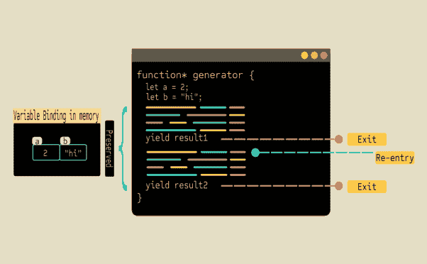

#  JavaScript 生成器：应用程序健壮异步逻辑构建指南


## 前言

### 本书介绍

在软件开发不断演变的格局中，JavaScript 始终是基石，不断适应和发展以满足现代开发者的需求。在其众多特性中，生成器（Generator）作为一种强大却常被忽视的工具脱颖而出。本书《JavaScript 中的生成器》致力于揭示其复杂性，并释放 JavaScript 生成器的全部潜力。

### 适用读者

本书主要面向中级和高级软件工程师，假定读者已熟悉 JavaScript，并希望深入理解其更高级的特性。无论你是想提升异步编程技能、管理复杂数据流，还是仅仅想拓展 JavaScript 专业知识，本书都是为你量身定制的。

### 目标与宗旨

通过本书的探索之旅，我们有以下几个关键目标：

- **揭秘生成器**：将生成器的概念拆解至核心，使其易于理解。
- **实践应用**：超越理论，深入实际场景，展示生成器在日常编码中的实际用途和优势。
- **高级模式与实践：** 探索复杂用例和设计模式，使你能够编写更高效、可维护且可扩展的 JavaScript 代码。

### 生成器的重要性

生成器在 ECMAScript 2015（ES6）中引入，为 JavaScript 带来了新的范式，特别是在处理异步操作和管理复杂工作流方面。它们暂停和恢复执行的能力，加上与更广泛 JavaScript 生态系统的集成，使其成为开发者工具箱中的利器。

### 本书结构

本书的结构旨在引导你全面理解生成器。从基础知识开始，逐步深入到高级主题，并穿插实际示例、代码模式和真实用例。每一章都在前一章的基础上构建，确保连贯且循序渐进的学习体验。

### 你在本旅程中的角色

当我们共同踏上这段旅程时，你的参与和实践至关重要。本书的设计不仅仅是为了阅读，更是为了体验。书中的示例、练习和挑战旨在鼓励主动学习和概念应用。

## 目标受众和先决条件

### 谁最能从本书中获益？

《JavaScript 中的生成器》专为软件开发领域中特定群体精心打造：

1. **中级软件工程师：** 对 JavaScript 有经验并理解其基本概念，但希望加深知识储备、应对更复杂编程挑战的开发者。
2. **高级软件工程师：** 寻求拓展专业能力的资深专业人士，特别是在异步编程和生成器等高级 JavaScript 特性方面。
3. **全栈开发者：** 在整个技术栈中工作的开发者，有兴趣优化其在客户端和服务器端应用中的 JavaScript 代码。
4. **技术负责人和架构师：** 负责设计和监督应用架构的个人，需要了解生成器如何助力构建更高效和可维护的代码库。

### 读者的先决条件

为了从本书中获得最大收益，读者应具备以下条件：

1. **基本 JavaScript 知识：** 熟悉 JavaScript 语法和概念，包括函数、对象和数组。
2. **异步编程的理解：** 掌握 JavaScript 中的异步编程，包括回调和 Promise。熟悉 async/await 会有帮助，但并非必需。
3. **通用编程经验**：具备软件开发经验，这将有助于理解更抽象的概念并将知识应用于实际场景。

### 本书不涉及的内容

需要明确指出本书未涵盖的内容：

- 本书不是 JavaScript 入门指南。假定读者对该语言已有一定程度的熟悉。
- 虽然我们会涉及其他 ES6 特性，但主要关注点是生成器。寻求全面了解所有 ES6 特性的读者可能需要参考其他资源。

### 设定期望

本书内容既具挑战性又富有收获。鼓励读者积极参与练习和示例。随着书籍的推进，主题的复杂度将逐步增加，反映真实的学习曲线。

## JavaScript 生成器概述及其重要性

### 生成器：JavaScript 中的变革性特性

生成器在 ECMAScript 2015（ES6）中引入，是 JavaScript 的一项变革性补充。它们是特殊的函数，可以暂停和恢复，为处理异步操作和简化复杂代码执行提供了全新的方式。

### 生成器的重要性

- **对异步代码的掌控力**：生成器的主要优势之一是简化异步编程的能力。它们提供了对执行流程的控制级别，而这是仅靠回调和 Promise 无法实现的。
- **高效的数据处理**：生成器非常适合处理大型数据集。它们允许使用惰性求值逐块处理数据，这可以提升处理数据流的应用程序的性能。
- **编码模式的灵活性**：生成器引入了 JavaScript 中新的编码模式和范式，使代码更具可读性和可维护性。它们为高级编程技术开辟了可能性，如协程和状态机。

### 将要探索的关键概念

在本书中，我们将探讨生成器的几个关键方面：

- **基础与高级用法：** 从基本语法开始，我们将深入探讨更高级的主题，展示生成器的多功能性。
- **实践示例与模式：** 真实场景和编码模式将展示生成器如何解决常见的编程挑战。
- **与其他 JavaScript 特性的集成：** 我们将了解生成器如何与 Promise 和 async/await 等其他 JavaScript 特性进行接口对接和相互补充。

### 对当今开发者的意义

随着 JavaScript 在 Web 和服务器端编程领域持续流行，理解生成器等高级特性对于现代开发者而言不可或缺。本书旨在为你提供知识和技能，帮助你在项目中有效利用生成器，提升代码的效率和清晰度。

 ## 第一章：理解生成器

## 生成器与迭代器简介

### 生成器：简要概述

JavaScript 中的生成器是一项强大的特性，于 ECMAScript 2015 (ES6) 中引入，它允许函数随着时间推移产生多个值，在每次 `yield` 之间暂停执行，并在需要时恢复。与普通函数在调用时完全执行完毕不同，生成器设计为可以暂停和恢复，这使其在各类异步操作和大数据处理任务中极其有用。

### 是什么让生成器与众不同？

生成器函数以 `function*` 语法表示（函数关键字后跟一个星号），与 `yield` 关键字协同工作。每次遇到 `yield` 时，生成器函数会暂停，并发出 `yield` 指定的值。这种暂停和恢复的能力从根本上改变了我们对 JavaScript 执行流的控制方式。

### 代码示例：基本生成器函数

```
function* simpleGenerator() {
    yield 'Hello';
    yield 'World';
}

const generatorObject = simpleGenerator();

console.log(generatorObject.next().value);
// Output: Hello

console.log(generatorObject.next().value);
// Output: World
```

在本例中，在生成器对象上调用 `.next()` 会恢复函数执行，直到遇到下一个 `yield`。

### 迭代器：生成器的支柱

迭代器是理解生成器的概念基石。迭代器是一种允许我们逐个遍历集合（如数组或字符串）中元素的对象。生成器自动遵循迭代器协议，这意味着每个生成器都是一个迭代器。该协议要求实现一个 `.next()` 方法，该方法返回一个包含两个属性的对象：`value` 和 `done`。

### 连接生成器与迭代器

当调用生成器函数时，它不会立即执行其代码。相反，它返回一个称为**生成器对象**的特殊对象，该对象控制生成器函数的执行。这个生成器对象是一个迭代器，遵循相同的协议，可以无缝集成到使用可迭代对象的现有 JavaScript 工作流中。

### 代码示例：将生成器用作迭代器

```
function* numberGenerator() {
    let number = 1;
    while (true) {
        yield number++;
    }
}

const numIterator = numberGenerator();

console.log(numIterator.next().value); // Output: 1
console.log(numIterator.next().value); // Output: 2
console.log(numIterator.next().value); // Output: 3
```

这个示例展示了一个无限序列生成器。尽管存在无限循环，它可以安全地使用，因为生成器的执行是受控的，每次只产生一个数字。

#### 历史背景与 JavaScript 中的演进

##### 生成器之前的时代

要 appreciate 生成器在 JavaScript 中的引入，理解它们出现之前 JavaScript 异步编程的全貌非常重要。传统上，JavaScript 中的异步操作使用回调来处理。虽然有效，但这种方法经常导致臭名昭著的"**回调地狱**"，深度嵌套的回调使代码难以阅读和维护。

#### Promise 的登场

##### Promise：JavaScript 异步编程的一大进步

Promise 代表了 JavaScript 异步编程的重大进步，相比于回调模式提供了更有结构、更易读的方法。它们允许开发者编写类似于同步代码的异步代码，使用 `.then()` 来链式调用异步操作，使用 `.catch()` 来处理错误。

##### Promise 在异步工作流中的局限性

- **处理复杂流程**：虽然 Promise 提高了可读性，但管理复杂的异步工作流（如顺序和并行操作）仍可能导致繁琐的代码。链式调用多个 .then() 有时会产生深度嵌套的结构，尽管不如回调地狱那么混乱。

- **错误处理**：与回调相比，Promise 的错误处理更有结构。然而，它仍然带来挑战，特别是在复杂的链中，单个错误可能导致整个 Promise 链被拒绝，需要小心放置 `.catch()` 块。

- **控制流**：Promise 缺乏暂停和恢复执行的机制，这在某些复杂场景中是必需的关键功能。这一局限性使得实现特定类型的操作变得困难，例如暂停异步操作以等待用户输入或其他事件。

- **状态管理**：使用 Promise 时，在异步操作之间保持状态可能变得具有挑战性。虽然可以使用闭包来保存状态，但这通常导致不够直观且更冗长的代码，特别是在长链式异步操作中。

- **资源管理**：高效且安全地处理文件流或网络连接等资源对于 Promise 来说并不直接。开发者必须实现额外的逻辑来确保资源得到妥善管理和释放，特别是在涉及提前退出或错误的场景中。

```
function fetchData() {
    return new Promise(resolve => setTimeout(
        () => resolve("Data"),
        1000)
    );
}

function processData(data) {
    return new Promise(resolve => setTimeout(
        () => resolve(data + " processed"),
        1000)
    );
}

fetchData()
    .then(data => processData(data))
    .then(processedData => console.log(processedData))
    .catch(error => console.error("Error in processing:", error));
```

这个示例展示了使用 Promise 的简单异步流。虽然比回调更易读，但管理状态和操作复杂序列仍然可能变得不简单。

#### 生成器的兴起

生成器于 ECMAScript 2015 (ES6) 中引入，作为改进 JavaScript 异步编程的更广泛努力的一部分。它们提供了一种处理异步操作的新颖方式，允许函数暂停和恢复其执行，从而产生更易读、更易维护的代码，特别是在涉及复杂异步工作流的场景中。

##### 语法演进与采用

最初，生成器的语法和用法对许多 JavaScript 开发者来说是一个重大转变。`function*` 语法和 `yield` 关键字是新的，需要对函数执行有不同的思考方式。随着时间的推移，随着开发者开始理解生成器在管理异步代码方面的强大之处，它们的采用逐渐增加，特别是在涉及复杂数据处理、状态管理和异步控制流的场景中。

##### 生成器与 Async/Await

ES2017 中 async/await 的引入是对 JavaScript 异步编程能力的补充添加。Async/await 构建在 Promise 之上，使异步代码更易读、更易编写。重要的是要理解，虽然 async/await 简化了异步编程，生成器仍然有其一席之地，特别是在需要对异步操作进行细粒度控制的场景中。

##### 代码示例：从回调到生成器

```
1   // Callback approach
2   function fetchData(callback) {
3       setTimeout(() => callback("Data fetched"), 1000);
4   }
5
6   fetchData(data => console.log(data));
7
8   // Generator approach
9   function* fetchDataGenerator() {
10      yield new Promise(resolve => setTimeout(
11          () => resolve("Data fetched"),
12          1000)
13      );
14  }
15
16  const generator = fetchDataGenerator();
17  const promise = choice.next().value;
18  promise.then(data => console.log(data));
```

这个示例说明了从使用回调到使用生成器处理异步操作的转变。

## 生成器的基本语法与机制

### 生成器语法简介

JavaScript 中的生成器是一种特殊类型的函数，可以暂停执行并在稍后恢复。它们的语法正是它们区别于普通函数的地方。


1. **声明**：生成器函数使用`function*`语法声明，即函数关键字与星号的组合。*该星号可以紧邻`function`放置（例如，`function*`），也可以放在函数名旁边（例如，`function *generatorFunction`）。*
2. **Yield 关键字**：`yield`关键字用于生成器函数内部，以暂停其执行并返回一个值。之后，函数可以从暂停的确切位置恢复执行。

### 代码示例：声明生成器函数

```
1   function* numberGenerator() {
2       yield 1;
3       yield 2;
4       yield 3;
5   }
6
7   const generator = numberGenerator();
8   // 此时还不会执行函数体
```

在此示例中，`numberGenerator`是一个生成器函数，它会依次生成数字 1、2 和 3。

### 使用生成器

一旦定义了生成器函数，调用它并不会立即执行其函数体。相反，它会返回一个生成器对象，该对象用于控制生成器函数的执行。

1. **启动执行**：生成器对象的`next()`方法用于启动或继续执行生成器函数。每次调用`next()`都会恢复函数执行，直到遇到下一个`yield`。
2. **生成值与完成状态**：`next()`方法返回一个包含两个属性的对象：`value`（生成的值）和`done`（一个布尔值，指示生成器函数是否已完成执行）。

### 代码示例：使用了一种不同的方式来实现相同的功能

```
console.log(generator.next());
// 输出: { value: 1, done: false }

console.log(generator.next());
// 输出: { value: 2, done: false }

console.log(generator.next());
// 输出: { value: 3, done: false }

console.log(generator.next());
// 输出: { value: undefined, done: true }
```

在这里，每次调用`next()`都会恢复`numberGenerator`的执行，直到没有更多的`yield`语句为止，此时`done`变为`true`。

### 生成器背后的机制

生成器不仅仅是异步操作的语法糖；它们从根本上改变了函数的执行方式。与普通函数在单次调用中运行到完成不同，生成器是有状态的，并且能够在多次执行之间记住其上下文。

1. **有状态执行**：当生成器产生值时，它会保存自身的上下文（变量值、执行位置）并暂停。在下一次调用`next()`时，它会恢复该上下文并从上次离开的位置继续执行。
2. **无限执行**：生成器可以无限期地运行，这使其适用于无限序列或事件处理等未预先定义结束条件的场景。
3. **错误处理**：生成器还可以在生成器函数内部使用 try-catch 块来处理错误，从而实现复杂的错误管理策略。

#### 内部原理：生成器的工作方式

### 调用与执行流程



理解生成器的内部工作原理始于其调用方式。当调用生成器函数时，它并不会立即执行其代码。相反，它会返回一个生成器对象，该对象用于控制生成器函数的执行。

1. **惰性执行**：与普通函数不同，*生成器的执行是惰性的*。这意味着生成器函数内部的代码只有在调用生成器对象的`.next()`方法时才会执行。
2. **执行上下文**：每个生成器都维护着自己的执行上下文，包括变量状态、当前执行行和作用域链。每次生成器产生值时，该上下文都会被保存；当执行恢复时，该上下文会被恢复。

### 产生值与恢复执行

生成器的核心功能围绕`yield`关键字和`.next()`方法展开。

1. **Yield 关键字**：当生成器遇到`yield`语句时，它会生成指定的值，保存当前状态，然后暂停执行。该状态包括局部变量、`yield`语句的位置以及作用域。
2. **Next 方法**：调用生成器对象上的`.next()`方法会从上次产生值的位置恢复执行。该方法还可以向生成器传递一个值，该值将作为`yield`表达式的结果，从而实现双向通信。

### 代码示例：产生值与恢复执行

```
function* dataProcessor() {
    const data = yield 'Please provide data';
    return `Processed ${data}`;
}

const processor = dataProcessor();

console.log(processor.next());
// 输出: { value: 'Please provide data', done: false }

console.log(processor.next('Input'));
// 输出: { value: 'Processed Input', done: true }
```

此示例展示了生成器如何产生一个值，然后使用输入继续处理。

### JavaScript 运行时与事件循环

生成器以一种独特的方式融入 JavaScript 运行时和事件循环：

- **非阻塞**：生成器函数，尤其是用于异步操作时，不会阻塞 JavaScript 事件循环。暂停和恢复的能力确保了长时间运行的操作不会妨碍应用的响应性。
- **与 Promise 和 Async/Await 的集成**：生成器可以与 Promise 和 async/await 语法无缝集成，从而更优雅地处理复杂的异步流程。
- **事件循环交互**：当生成器产生值时，它实际上会退出调用栈，允许事件循环中的其他操作运行。当生成器恢复时，它会重新回到之前的调用栈位置。

## 第二章：生成器基础

### 创建你的第一个生成器

#### 生成器函数简介

生成器函数是 JavaScript 中的一项独特功能，允许函数暂停执行并在稍后恢复。此功能为处理数据和异步操作开辟了新的可能性。在本节中，我们将逐步介绍创建第一个生成器函数，为更高级的概念奠定基础。

#### 步骤 1：编写生成器函数

生成器函数使用`function*`语法定义。以下是创建简单生成器函数的方式：

```
1  function* simpleGenerator() {
2      yield 'Hello';
3      yield 'World';
4  }
```

在此示例中，`simpleGenerator`是一个生成器函数，它会生成两个值：'Hello' 和 'World'。

#### 步骤 2：迭代生成器

要使用生成器，首先需要实例化它，这会创建一个生成器对象。该对象同时遵循可迭代协议和迭代器协议。

```
const myGenerator = simpleGenerator();
```

现在，让我们迭代该生成器：

```
console.log(myGenerator.next().value);
// 输出: Hello

console.log(myGenerator.next().value);
// 输出: World

console.log(myGenerator.next().value);
// 输出: undefined
```

每次调用`myGenerator.next()`都会恢复生成器函数的执行，直到下一个`yield`。当生成器没有更多值可生成时，它会返回一个`value`为`undefined`、`done`为`true`的对象。

### 理解生成器的状态

当生成器产生值时，它会暂停自身的状态（上下文）。该状态包括变量、每个`yield`的位置以及作用域。生成器在下一次调用`next()`时从此状态恢复。

### 实际应用

生成器在处理数据序列时特别有用。它们允许你定义可能无限的数据序列，而无需担心一次性存储所有数据所带来的内存限制。

### 代码示例：生成无限序列

```
function* infiniteSequence() {
    let i = 0;
    while (true) {
        yield i++;
    }
}

const sequence = infiniteSequence();
console.log(sequence.next().value);
// 输出: 0

console.log(sequence.next().value);
// 输出: 1
// ...以此类推
```

此生成器函数会生成无限的数字序列。尽管存在无限循环，但它不会导致内存溢出，因为值是逐个生成的。


 ## 生成值与控制执行流程

## yield 在生成器中的强大作用

`yield` 关键字是生成器函数与普通函数的本质区别。它允许函数暂停执行并将值返回给调用者。当函数恢复执行时，它会从上次离开的位置继续。

### 基本 yield 用法

生成器函数可以生成任意类型的值，包括基本值、对象，甚至是其他生成器。

```
function* valueGenerator() {
    yield 1;
    yield 'Hello';
    yield { type: 'object' };
}
```

在这个示例中，每次对生成器实例调用 `next()` 都会生成一个不同类型的值。

### 控制执行流程

暂停和恢复执行的能力使生成器在控制程序流程方面异常强大。

- **顺序执行**：生成器允许以看似同步的方式顺序执行异步任务。

- **事件驱动执行**：它们可以暂停执行以等待事件，这使其非常适合处理用户交互或其他异步事件。

### 将值传回生成器

生成器不仅可以向外生成值，还可以通过 `next()` 方法将值传回生成器。

```
1 function* interactiveGenerator() {
2   const input = yield 'Please provide a value';
3   yield `You provided ${input}`;
4 }
5 
6 const generator = interactiveGenerator();
7 
8 console.log(generator.next().value);
9 // Output: Please provide a value
10 
11 console.log(generator.next('Input Value').value);
12 // Output: You provided Input Value
```

在这里，`generator.next('Input Value')` 中提供的值被传回生成器并在其中使用。

### 在循环中使用 yield

在循环中使用 `yield` 可以随时间生成一系列值。这对于高效处理或生成大量数据集特别有用。

```
1  function* numberRange(start, end) {
2      for (let i = start; i <= end; i++) {
3          yield i;
4      }
5  }
6
7  const rangeGenerator = numberRange(1, 5);
8
9  for (let value of rangeGenerator) {
10     console.log(value);
11     // Outputs numbers from 1 to 5
12 }
```

这个生成器生成一系列数字，展示了生成器如何用于高效遍历序列。

### 用 yield 处理输入

#### 交互式生成器：双向通道

生成器不仅仅是用来输出值的；它们还可以通过 yield 语句接收输入。生成器与其调用上下文之间的这种双向通信允许交互式和动态的执行流程。

#### 向生成器发送输入

当使用参数调用生成器的 next() 方法时，该参数会从生成器当前的 yield 语句返回。这种机制允许外部输入影响生成器的内部状态和行为。

#### 代码示例：在生成器中接收输入

```
function* quizGenerator() {
    const answer = yield 'What is 2 + 2?';
    yield answer === 4 ? 'Correct!' : 'Incorrect!';
}

const quiz = quizGenerator();

console.log(quiz.next().value);
// Output: What is 2 + 2?

console.log(quiz.next(4).value);
// Output: Correct!
```

在这个示例中，生成器提出问题，然后评估后续 next() 调用中提供的输入。

#### 使用 yield 创建有状态生成器

这种接收输入的能力使生成器在创建有状态的函数方面特别强大，这些函数可以根据外部交互随时间维护和修改内部状态。

#### 代码示例：状态化交互

```
function* authenticationGenerator() {
    const user = yield 'Enter username';
    const password = yield 'Enter password';
    if (user === 'admin' && password === 'secret') {
        yield 'Authentication successful';
    } else {
        yield 'Authentication failed';
    }
}

const authGen = authenticationGenerator();

console.log(authGen.next().value);
// Output: Enter username

console.log(authGen.next('admin').value);
// Output: Enter password

console.log(authGen.next('secret').value);
// Output: Authentication successful
```

这个生成器undred navigate an authentication process, maintaining the state of the user's inputs throughout.

#### Handling Inputs in Loops

Generators can also use loops to handle a sequence of inputs, making them ideal for scenarios like interactive menus, data processing pipelines, and more.

```
function* conversationGenerator() {
    let input = yield 'Hi, how can I help you?';
    while (input !== 'bye') {
        input = yield `You said '${input}'. Anything else\?`;
    }
    yield 'Goodbye!';
}

const conversation = conversationGenerator();

console.log(conversation.next().value);
console.log(conversation
    .next('Need assistance').value);
console.log(conversation.next('bye').value);
```

In this example, the generator maintains an interactive conversation until the user says 'bye'.

### Delegating with yield*

#### Introduction to yield*

In JavaScript generators, `yield*` is a special syntax used to delegate to another generator or iterable object. It allows a generator to yield the values from another generator, an array, or any other iterable object, effectively flattening their outputs into a single sequence.

### Using yield* with Generators

When `yield*` is used with another generator, the current generator will yield all values from the delegated generator until that generator is done. This is particularly useful for breaking complex generator functions into simpler, modular components.

#### Code\: Code Sample: Delegating to Another Generator

```
function* numberGenerator() {
    yield 1;
    yield 2;
    yield 3;
}

function* combinedGenerator() {
    yield* numberGenerator();
    yield* ['a', 'b', 'c'];
}

const combined = combinedGenerator();

for (let value of combined) {
    console.log(value);
    // Outputs 1, 2, 3, 'a', 'b', 'c'
}
```

In this example, `combinedGenerator` uses `yield*` to yield values from both `numberGenerator` and an array.

### Using yield* with Iterables

`yield*` can also be used to iterate over any iterable object (like arrays or strings) directly within a generator.

```
1  function* stringGenerator() {
2      yield* "Hello";
3  }
4
5  const stringGen = stringGenerator();
6
7  for (let char of stringGen) {
8      console.log(char);
9      // Outputs 'H', 'e', 'l', 'l', 'o'
10 }
```

Here, yield* is used to iterate over and yield each character of a string.

### Nested Generators

yield* can be especially powerful when used with nested generators, allowing for complex, multi-level iterations.

```
1  function* nestedGenerator() {
2      yield* numberGenerator();
3      yield 'Middle';
4      yield* stringGenerator();
5  }
6
7  const nested = nestedGenerator();
8
9  for (let value of nested) {
10      console.log(value);
11      // Outputs 1, 2, 3, 'Middle', 'H', 'e', 'l', 'l', 'o'
12 }
```

In this nested example, yield* seamlessly combines the outputs of multiple generators and an iterable.

### Error Handling in Generators

#### The Necessity of Error Handling in Generators

Just like regular functions, generators need to handle errors effectively to ensure the stability and reliability of your code. Error handling in generators, however, comes with its own set of patterns due to their unique execution flow.

#### Using Try-Catch Blocks Inside Generators

A common approach to handling errors in generators is to use try-catch blocks. When an error occurs within a generator function, it can be caught and handled locally, allowing the generator to continue yielding values or to cleanly terminate its execution.

#### Code Sample: Basic Error Handling in a Generator

```
function* errorHandlingGenerator() {
    try {
        yield 'Before error';
        throw new Error('Something went wrong');
    } catch (e) {
        yield `Caught error: ${e.message}`;
    }
    yield 'After error';
}

const errorHandler = errorHandlingGenerator();
```


 ```
console.log(errorHandler.next().value);
// Output: Before error

console.log(errorHandler.next().value);
// Output: Caught error: Something went wrong

console.log(errorHandler.next().value);
// Output: After error
```

在这个例子中，生成器先产出一个值，然后遇到错误，并在 catch 块中处理它，在错误处理完成后继续产出后续值。

#### 将错误传播到生成器外部

错误也可以被传播到生成器函数外部。如果错误在生成器内部没有被捕获，它将在调用 `next()` 方法时被抛出，并且必须在外部进行处理。

#### 代码示例：外部错误处理

```
function* externalErrorGenerator() {
    yield 'Before external error';
    throw new Error('External error');
}

const externalErrorHandler = externalErrorGenerator();

try {
    console.log(externalErrorHandler.next().value);
    // Output: Before external error

    console.log(externalErrorHandler.next().value);
} catch (e) {
    console.error(`Caught external error: ${e.message}`);
}
```

在这种情况下，错误没有在生成器内部被捕获，而是被外部的 try-catch 块捕获。

#### 错误导致生成器关闭

需要注意的是，如果生成器内部抛出错误且未被捕获，生成器将自动关闭，其执行随即终止。这意味着后续对 `next()` 的调用将显示生成器已完成，即使原本还有更多 yield 语句等待执行。

#### 使用 Promise 处理错误

当生成器与 Promise 结合使用时，特别是在异步操作中，错误处理可能涉及在生成器函数内部使用 try-catch 块捕获被拒绝的 Promise。

### 生成器与普通函数的比较

#### 理解关键区别

虽然生成器是 JavaScript 中的一种函数类型，但它们具有有别于普通函数的显著特征。理解这些区别对于在各种编程场景中选择合适的方法至关重要。

# 第二章：生成器基础

1. 执行控制：

- **普通函数**：一旦调用，就会不间断地运行直至完成。
- **生成器**：可以暂停和恢复执行，从而对其执行流程实现更精细的控制。

2. 状态保持：

- **普通函数**：调用之间不保持状态。每次调用都是独立的。
- **生成器**：在 yield 语句之间保持其状态（局部变量、当前执行上下文），使其能够具有状态性。

3. 返回值与迭代：

- **普通函数**：返回单个值或对象。
- **生成器**：可以随时间返回（产出）多个值，使其成为可迭代的。

#### 代码示例：普通函数与生成器函数

```
// 普通函数
function regularSum(a, b) {
    return a + b;
}
console.log(regularSum(2, 3));
// Output: 5

// 生成器函数
function* generatorSum(a, b) {
    yield a + b;
}
const gen = generatorSum(2, 3);
console.log(gen.next().value);
// Output: 5
```

在这个例子中，两个函数完成了相同的任务，但生成器通过 yield 产出结果，如需还可以产出更多值。

#### 使用场景

- **普通函数**：最适合不需要保持内部状态或暂停和恢复的简单、单一用途的操作或计算。
- **生成器**：非常适合需要跨执行保持状态、更优雅地处理异步操作，或处理数据流和自定义迭代行为的场景。

#### 性能考量

- **普通函数**：对于简单的单次计算，通常性能更优。
- **生成器**：虽然由于复杂的状态管理而性能稍低，但它们在控制和灵活性方面具有显著优势，特别是在处理大型数据集或复杂的异步工作流时。

普通函数和生成器在 JavaScript 编程中各有其用武之地。选择哪种取决于手头任务的具体需求。普通函数对于简单任务更简单高效，而生成器在状态管理、执行控制和处理迭代过程方面提供独特优势。

# 第三章：生成器高级概念

## 生成器协议与接口

### JavaScript 中的协议与接口简介

在 JavaScript 中，协议和接口是对象可以遵循的一套规则和约定，以便与语言特性集成。生成器旨在遵循特定的协议，使其在各种编程场景中具有通用性和互操作性。

#### 可迭代协议

1. **定义：** 可迭代协议允许 JavaScript 对象定义或自定义它们的迭代行为。正是这个协议使得对象可以用于 `for...of` 循环。
2. **生成器与可迭代对象：** 每个生成器函数自动符合可迭代协议。这意味着当调用生成器函数时，它返回一个可迭代对象。

### 代码示例：生成器作为可迭代对象

```
function* numberGenerator() {
    yield 1;
    yield 2;
    yield 3;
}

const myNumbers = numberGenerator();

for (const number of myNumbers) {
    console.log(number);
    // Outputs 1, 2, 3
}
```

在这个例子中，`numberGenerator` 被用于 `for...of` 循环，展示了它与可迭代协议的兼容性。

## 迭代器协议

1. **定义：** 迭代器协议定义了产生值序列的标准方式，通常作为可迭代对象的一部分。当对象实现了具有特定行为的 `next()` 方法时，它就是迭代器。
2. **生成器作为迭代器：** 生成器对象也遵循迭代器协议。生成器中的 `next()` 方法从生成器函数中产出值。

### 代码示例：在生成器中使用 next()

```
const myGenerator = numberGenerator();
console.log(myGenerator.next().value);
// Output: 1

console.log(myGenerator.next().value);
// Output: 2

console.log(myGenerator.next().value);
// Output: 3
```

这个例子展示了 `numberGenerator()` 产生的生成器对象如何符合迭代器协议。

## 结合可迭代对象与迭代器

生成器独特地结合了可迭代对象和迭代器的特性。这种双重性质使它们可以灵活地用于需要可迭代对象或迭代器的各种场景。

## 高级互操作性

理解并利用这些协议，可以使生成器与其他使用可迭代对象和迭代器的 JavaScript 结构（如展开语法、解构赋值和各种数组方法）无缝交互。

## 深入 yield：序列化与异步操作

### yield 在序列化中的灵活性

`yield` 关键字不仅仅是暂停和恢复机制。它在控制生成器内部数据和操作流方面发挥着关键作用，特别是在处理相互依赖的操作序列时。

### 使用 yield 进行顺序操作

生成器允许将一系列操作分解为离散的步骤。每个 yield 可以代表过程中的一个阶段，使代码更易读、更易于调试。

```
function* taskRunner() {
    const resultA = yield 'Task A';
    console.log(`Completed: ${resultA}`);
    const resultB = yield 'Task B';
    console.log(`Completed: ${resultB}`);
}

const runner = taskRunner();
console.log(runner.next().value);
// Starts Task A

console.log(runner.next('Result of A').value);
// Completes Task A and starts Task B

runner.next('Result of B');
// Completes Task B
```

这个例子展示了如何使用 yield 对任务进行排序，每一步都等待前一步的完成。

## 处理异步操作

生成器可以极大地简化异步操作的处理。通过产出 Promise，生成器可以暂停执行直到 Promise 解决，从而得到比传统基于 Promise 的方法更线性、更少嵌套的代码。

生成器可以等待异步操作（如 API 调用、数据库查询等）完成后再继续下一步。

```
function* asyncDataLoader() {
    const data = yield fetch('https://api.example.com/data');
    console.log(`Data loaded: ${data}`);
}

function handleGenerator(gen) {
    const generator = gen();
    function handle(yielded) {
        if (!yielded.done) {
            yielded.value.then(
                data => handle(generator.next(data)
            ));
        }
    }
    handle(generator.next());
}

handleGenerator(asyncDataLoader);
```


这段代码展示了生成器如何从异步操作中 yield promise，以及处理函数如何编排这些操作的执行。

## 异步序列中的错误处理

生成器提供了一种结构化的方式来处理异步序列中的错误。yield 的 promise 中的错误可以在生成器内部的 try-catch 块中捕获，从而实现集中式的错误处理。

## 生成器中的错误处理

### 健壮错误处理的重要性

错误处理是编写可靠且可维护代码的关键方面。就生成器而言，它们可能在事件循环的多个 tick 中运行并处理复杂的逻辑，因此有效的错误管理尤为重要。

### 在生成器中使用 Try-Catch 块

生成器可以在其内部使用 try-catch 块封装错误处理逻辑。这种封装允许对生成器执行期间发生的错误进行本地化地处理。

### 代码示例：本地化错误处理

```
function* errorProneGenerator() {
    try {
        yield 'First step';
        throw new Error('Something went wrong');
    } catch (error) {
        yield `Error caught: ${error.message}`;
    }
    yield 'Continuing after error';
}

const generator = errorProneGenerator();
console.log(generator.next().value);
// Output: First step

console.log(generator.next().value);
// Output: Error caught: Something went wrong

console.log(generator.next().value);
// Output: Continuing after error
```

在此示例中，生成器捕获并处理了自己的错误，然后继续执行。

### 处理来自 Yield Promise 的错误

当通过 yield promise 处理异步操作时，可以采用类似的方式处理错误。如果 promise 被拒绝，可以在生成器中捕获该错误。

```
1  function* asyncErrorHandlingGenerator() {
2      try {
3          yield fetch('https://api.example.com/data');
4      } catch (error) {
5          yield `Fetch error: ${error.message}`;
6      }
7  }
8
9  // 处理生成器的函数需要确保
10 // 被拒绝的 promise 被适当地抛回生成器
```

### 生成器中错误处理的最佳实践

- 1. **集中错误处理：** 使用 try-catch 块在错误发生的地方处理错误，使错误处理逻辑尽量靠近错误源。
- 2. **优雅降级：** 确保生成器能够优雅地处理错误，在适当的地方提供回退或备选流程。
- 3. **清晰的错误传播：** 在生成器无法处理错误的情况下，确保错误清晰地传播给调用方。
- 4. **全面覆盖：**  الدفاعively 预见并处理所有可能的错误场景，特别是在异步流程中，以防止未捕获的异常。

## 生成器组合与嵌套

### 组合生成器的概念

生成器组合涉及将多个生成器函数一起使用，其中一个生成器委托给另一个。这种方法可以模块化代码，通过将关注点分离到不同的生成器函数中，使其更具可读性和可维护性。

### 生成器组合的优势

- 1. **模块化**：将复杂的逻辑分解为更小、可重用的生成器。
- 2. **可读性**：通过将代码组织为定义明确的逻辑序列，使其更易于理解。
- 3. **可维护性**：更容易更新和管理更小、自包含的生成器。

```
function* firstGenerator() {
    yield 'First';
    yield 'Generator';
}

function* secondGenerator() {
    yield* firstGenerator();
    yield 'Second';
    yield 'Generator';
}

const composedGenerator = secondGenerator();
for (const value of composedGenerator) {
    console.log(value);
    // Outputs: First, Generator, Second, Generator
}
```

在此示例中，`secondGenerator` 在其内部组合了 `firstGenerator`，展示了基本的生成器组合。

### 为复杂流程嵌套生成器

嵌套涉及在生成器中使用生成器，可以通过 `yield*` 或通过从一个生成器 yield 另一个生成器的结果来实现。这种方法适用于复杂的逻辑流程，其中不同的阶段或步骤最好由单独的生成器处理。

```
1  function* nestedGenerator() {
2      yield 'Start';
3      yield* secondGenerator(); // 嵌套生成器调用
4      yield 'End';
5  }
6
7  const nested = nestedGenerator();
8  for (const value of nested) {
9      console.log(value);
10     // Outputs: Start, First, Generator, Second, Generator, End
11 }
```

这里，`nestedGenerator` 嵌套了 `secondGenerator`，展示了如何将多层生成器组合在一起。

### 生成器组合与嵌套的最佳实践

- 1. **明确的职责**：确保每个生成器都有清晰且明确的角色。
- 2. **避免过度复杂**：虽然嵌套可能很强大，但过度复杂的嵌套结构可能难以跟踪。
- 3. **错误传播**：考虑在嵌套生成器中如何处理和传播错误，以维持可预测的行为。
