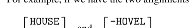
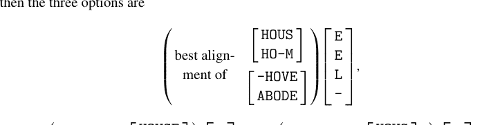
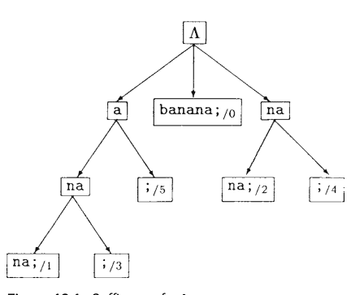
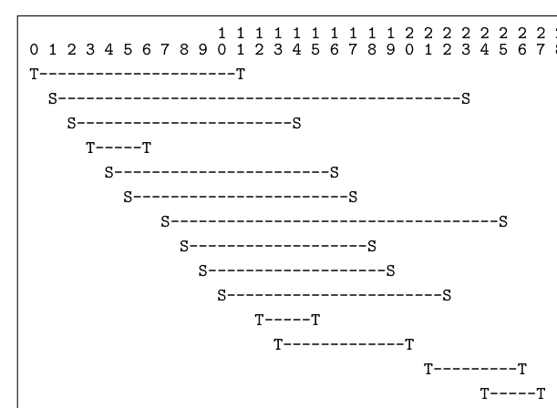
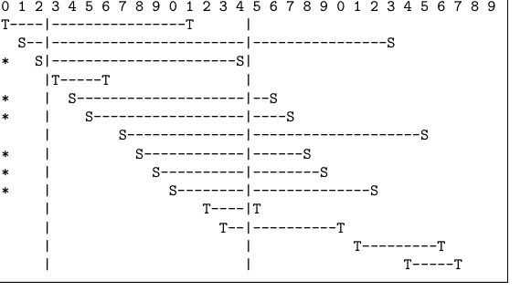
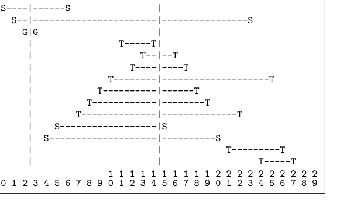
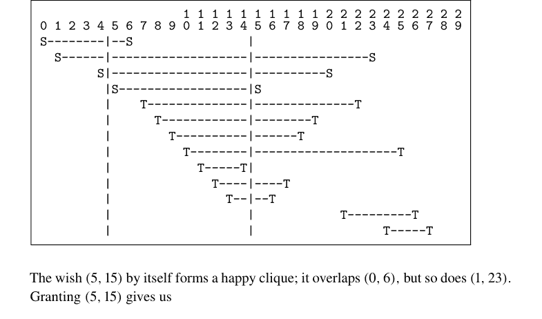
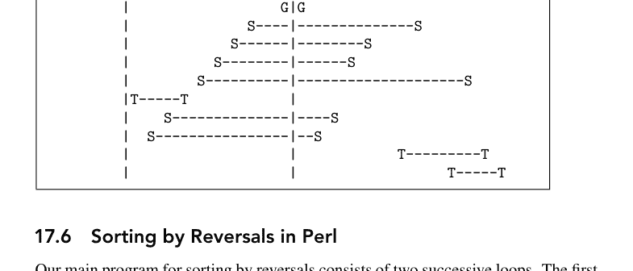

# Genomic Perl：生物信息学基础到可运行代码

*献给我的小恰皮尼塔和小恰皮尼托。*

## 前言

本书旨在为如今被称为“生物信息学”或“计算分子生物学”这一领域提供一个具体、易于理解的入门介绍。我在这一领域的教学对象包括计算机科学专业的研究生和高年级本科生，以及来自生物科学领域的研究生，涵盖生物数学、遗传学、林学和昆虫学等方向。尽管近年来已经出现了一些关于这一主题的著作——其中有一两本写得相当好——但我发现没有一本书特别适合这一背景差异极大的读者群体。

与这些读者的接触经验让我得出一个结论：要有效满足他们的需求，需要一本书具备以下特点。

- 为了满足计算机科学家的需求，本书必须教授 DNA、RNA 和蛋白质结构的基本知识，同时还必须解释导致本书所选算法处理的那类数据的实验流程的关键特征。
- 为了满足生物学家的需求，本书必须（在一定程度上）教授编程，并包含*可运行的程序*，而非算法的抽象高层描述——但同时又不能让计算机科学家觉得内容过于像基础编程课程而感到乏味。
- 要对这一领域给予公正的对待，就必须涉及其统计学方面，但考虑到读者的知识背景，这些内容必须以具体且相对初级的方式来呈现。

为了满足这些标准，本书的每一章都聚焦于生物序列数据处理中的一个特定问题：序列两两比对、多序列比对、序列数据库搜索、系统发育重建、基因组重排等等。我概述了输入的生物学来源以及期望输出的解释；然后针对该问题提出一种算法方法。最后，展示如何将该算法实现为一个可运行的 Perl 程序。每章末尾的练习中会介绍问题的变体和/或程序的改进。在少数情况下，我在某一章中介绍一种直接但效率不高的算法，然后在下一章中深入探讨一种更复杂的方法。每章的参考文献说明仅限于大约半打最易获取的参考文献；我假设认真的学生可以利用这些文献线索找到其他相关资料。

选择 Perl 语言作为呈现算法的工具可能会让一些人感到意外，但它有许多优势。

- Perl 内置的字符串、列表和哈希表使得一些算法能够以非常简洁的方式表达。（第 12 章中用于构建后缀树的 80 行程序就是一个突出的例子。）
- Perl 已经广泛用于基于 Web 的应用程序中的服务器端脚本（CGI），并且有一个庞大的代码库（即`www.bioperl.org`上描述的 bioPerl 项目）可免费获取，为生物信息学程序员提供帮助。
- Perl 不属于标准计算机科学课程的内容。这意味着即使是具有扎实计算机科学背景的学生，关注语言细节也会有一定的兴趣。
- Perl 具有可移植性；它可以在所有主流操作系统上运行。
- Perl 可免费获取，是 Linux 发行版的一部分，也可从万维网`http://www.perl.org`下载。
- 少见但合法的 Perl 语法结构如`@{$_[$#_]||[ ]}`会让不熟悉的人心生敬畏；这种敬畏感有时也会感染到 Perl 程序员。

Perl 也有一些缺点。

- Perl 程序不会被编译为本地机器码，因此在计算密集型应用中，它们的运行速度往往比同等的 C 或 C++ 程序慢很多倍。（在以磁盘访问或网络响应时间为主的 CGI 应用中，这一缺点就不存在了。）
- Perl 内置的字符串、列表和哈希表有时会隐藏潜在的性能问题，而这些问题只能通过不直观的技巧来解决。
- Perl 对内存的使用比较奢侈。这意味着 Perl 程序能处理的输入规模可能比同等的 C 或 C++ 程序小很多倍。

总而言之，对于本书的目标而言，优势是大于劣势的。虽然使用 Perl 使得本书中的许多程序更像是教学演示工具而非生产级工具，但它们确实能工作。与伪代码描述不同，这些程序可以被修改以打印运行轨迹，或用于尝试可能的改进。它们也可以作为其他语言高效实现的原型。

为了明确起见，这里说几句关于本书*不是*什么的话。

- 本书不是面向生物学家的各种软件包的使用指南，这些软件包可用于序列组装、数据库搜索、系统发育重建或其他任务。这些软件包会不时被简要提及，但本书的重点在于这些软件包如何解决（或可能解决）它们所面临的问题，而非如何向这些软件包提交问题。
- 本书不是分子生物学计算方面的百科全书式汇编。所涉及的问题被认为对生物学家具有重要意义，但其他同样重要的问题无疑被遗漏了。
- 同样，本书也不是 Perl 语言的教程或参考手册。Perl 的特性会根据需要进行解释和使用，勤奋的读者应该能从中获得良好的 Perl 知识，但算法才是重点，许多广泛使用的 Perl 特性将不会被提及。

我启动这一写作项目，并非为了向他人传达我自己在这一领域的研究成果（因为我并未做出任何贡献），而是为了研究他人的成果并使它们更容易被学生获取。可以肯定的是，我自身的专业知识不足会不时暴露出来。尽管如此，我希望我的具体方法能够让更广泛的受众理解和受益于真正专家们的贡献。

## 致谢

特别感谢剑桥大学出版社和我的编辑 Lauren Cowles，她接受了一位首次出书、且此前没有任何与本书主题直接相关的出版物的作者的书稿提案。Cowles 女士在手稿准备过程中提供的细致意见和其他帮助是不可或缺的。

华盛顿大学的 Phil Green 慷慨允许我使用他的 PHRAP 程序的源代码来开发第 13 章。NCBI 的 Alejandro Schäffer 和 Steven Altschul 对涉及多序列比对和 BLAST 的章节提供了有益的反馈。

在我担任北卡罗来纳州立大学教职期间，1997 年春季和 1999 年春季 CSC 695 以及 2001 年春季 CSC 630 的学生们接受并校对了不断增长的笔记和程序集合，本书最终正是建立在这些材料基础之上。其中，Barry Kesner 特别值得一提，他对多个章节给予了非常有益的反馈。系统管理员 Tim Lowman 在本项目初期的几周中，在解答 Perl 相关问题方面给予了极大帮助。

在经费方面，本写作项目得到了北卡罗来纳州立大学的部分支持，形式为休假资助。现名为 Syngenta Biotechnology, Inc.（位于北卡罗来纳州研究三角园区）的实验室在多次场合补充了这一资助，同时允许我使用专有数据进行实验。

最后但同样重要的是，Pam 和 Kevin Bobol，New World Cafe 和 Larry's Beans 的经营者，提供了本书大部分内容写作时所坐的椅子。店员 Amy、D.J.、Heather、James、Jeramy、Kathy、Margaret、Marwa、Patty、Sam、Sue 和其他人提供了热饮，让我的手指得以不停地敲击键盘。

正如预期的那样，任何残留的错误理应只记在我自己的账上，而不应归咎于我的编辑、同事、学生或咖啡师。

# 第一章 中心法则

## 1.1 DNA 与 RNA

我们每个人都曾观察到人类家庭成员之间在体貌特征或其他方面的相似之处。其中一些相似性源于家庭共同的生活环境，而另一些则是*遗传*的，也就是说，作为生殖过程的一部分，从父母传递给了子女。眼睛颜色、血型等性状，以及红绿色盲、亨廷顿舞蹈症等疾病，都是已知的可遗传性状。在人类及所有其他非病毒生物中，可遗传性状以*脱氧核糖核酸*（简称 DNA）的形式编码并传递。编码单一性状的 DNA 通常被称为*基因*。[1] 大多数人类 DNA 编码的不是区分人与人之间的性状，而是我们与人类家族其他成员共有的性状。尽管我与我的养子女们并不共享他们美丽的棕色眼睛和黑色头发，但我们的 DNA 相似度超过 99.9%。说得不那么感性一些，我们三人与黑猩猩的 DNA 相似度可能约为 95%。

DNA 由长链的脱氧核糖分子组成，连接着*核苷酸*腺嘌呤、胞嘧啶、鸟嘌呤和胸腺嘧啶。这些名称的科学意义微乎其微——例如，鸟嘌呤就是以鸟类粪便（guano）命名的，因为最初就是从这种粪便中分离出来的——我们通常用字母 A、C、G、T 来称呼这些核苷酸或*碱基*。出于计算目的，一条 DNA 链可以用 A、C、G、T 的字符串来表示。

腺嘌呤和鸟嘌呤属于*嘌呤*，具有相似的双环分子结构。胞嘧啶和胸腺嘧啶属于*嘧啶*，具有较小的单环结构。脱氧核糖有五个碳原子。有机化学的惯例是给有机分子的碳原子编号。在 DNA 中，核苷酸的碳原子编号为 1–9 或 1–6，而糖上的碳原子编号为 1′（“一撇”）、2′、3′、4′ 和 5′。实际上，DNA 中糖分子的长链是通过*磷酸二酯键*将一个糖的 3′ 碳与下一个糖的 5′ 碳连接而成的。DNA 链末端未结合的 5′ 碳称为*5′ 端*；另一端则是*3′ 端*。就我们的目的而言，只需知道两件事：单链 DNA 具有方向性，因为两个 3′ 端（或两个 5′ 端）无法通过磷酸二酯键连接；以及表示 DNA 的字符串几乎总是从 5′ 端开始书写。

*核糖核酸*，简称 RNA，与 DNA 相似，但其糖“骨架”由核糖而非脱氧核糖构成，且以尿嘧啶（U）代替胸腺嘧啶。在少数简单的生物体中，如 HIV，² RNA 替代 DNA 作为将遗传信息传递给下一代的载体。然而，在大多数生物中，RNA 的主要功能是根据 DNA 中储存的指令来介导*蛋白质*的产生。

顾名思义，脱氧核糖可以通过从核糖中去除一个氧原子形成。尽管 RNA 本身就是一种出色的分子柔术演员，但由脱氧核糖构成的链或*聚合物*可以形成一种奇特的盘绕形状。此外，由腺嘌呤和胸腺嘧啶通过*氢键*连接而成的碱基对与类似连接的胞嘧啶和鸟嘌呤碱基对具有相似的形状；(A, T) 和 (C, G) 被称为*互补*碱基对（见图 I.1）。这两个特性共同使 DNA 能够形成著名的*双螺旋*结构，即两条任意长度的互补 DNA 链相互缠绕，形成非常稳定的分子螺旋楼梯。³ 双螺旋的每一端都包含一条链的 3′ 端和另一条链的 5′ 端。这意味着，如果一条链可以通过将 A 替换为 T、T 替换为 A、C 替换为 G、G 替换为 C 来形成另一条链——然后将结果反转——那么这两条链就是*互补*的。例如，ATTCCTCCA⁴ 和 TGGAGGAAT 就是互补的：

```
5′-ATTCCTCCA-3′
3′-TAAGGAGGT-5′
```

双螺旋最早由沃森和克里克的研究揭示；因此，互补碱基对有时被称为*沃森-克里克对*。事实上，“沃森”和“克里克”这两个名称有时也用于指代一条 DNA 链及其互补链。

## 1.2 染色体

每个细胞的 DNA 都组织成*染色体*，不过这种组织方式因物种而异，差异巨大。

人类细胞有 24 种不同类型的染色体，总共约有三十亿（3 × 10⁹）个碱基对的 DNA。⁵ 其中，常染色体按从大到小编号为 1–22，性染色体命名为 X 和 Y。每个细胞包含每对常染色体的两条，以及两条 X 染色体（女性）或一条 X 和一条 Y 染色体（男性）。卵细胞和精子细胞统称为*生殖细胞*，是这一规则的例外；每个生殖细胞只包含每种常染色体的一条和一条性染色体。这 24 种人类染色体共同构成了人类的*基因组*。

细胞中的成对常染色体不应与 DNA 的双链性质相混淆。每条 1 号染色体都是双链的。此外，两条 1 号染色体几乎完全相同，但并非完全如此。一条染色体上的某个位置包含来自母亲的基因，另一条则在同一位置包含来自父亲的基因。这种状态称为*二倍体*，是有性生殖物种的特征。[6]

多对线性染色体是*真核生物*细胞的特征，这类生物的染色体被隔离在细胞的*细胞核*内。[7] 然而，并非所有真核生物都是二倍体。面包霉菌*粗糙脉孢菌*是*单倍体*的，意味着每个细胞只有七种染色体中每种的一个拷贝。霉菌细胞通过分裂进行无性生殖。

称为*原核生物*的更简单生物缺乏细胞核。大肠杆菌是一种研究深入的人类肠道共生细菌，具有单一的环状染色体，约有 450 万个碱基对。*病毒*最为简单，仅由遗传物质——RNA 或单链或双链 DNA——包裹在一个容器中构成。病毒无法自行繁殖。相反，它们像分子布谷鸟一样，利用其他生物的遗传机制来繁殖后代，将自身的遗传物质插入宿主细胞。感染大肠杆菌的病毒 ΦX174 的遗传物质仅由 5386 个碱基组成，排列成单链环状 DNA。[8]

## 1.3 蛋白质

与 DNA 和 RNA 一样，蛋白质也是由少数几种不同类型的“珠子”聚合而成的聚合物，这些“珠子”被称为*肽、氨基酸、残基*，或者最准确但最少见的名称——*氨基酸残基*。蛋白质也具有方向性，通常从*N 端*书写到*C 端*。20 种“天然”[9] 氨基酸的名称，以及常用的三字母和单字母缩写，见图 1.2。

## 1.4 中心法则

| 氨基酸 | 单字母缩写 | 三字母缩写 | 氨基酸 | 单字母缩写 | 三字母缩写 |
| --- | --- | --- | --- | --- | --- |
| 丙氨酸 | A | Ala | 亮氨酸 | L | Leu |
| 精氨酸 | R | Arg | 赖氨酸 | K | Lys |
| 天冬酰胺 | N | Asn | 甲硫氨酸 | M | Met |
| 天冬氨酸 | D | Asp | 苯丙氨酸 | F | Phe |
| 半胱氨酸 | C | Cys | 脯氨酸 | P | Pro |
| 谷氨酰胺 | Q | Gln | 丝氨酸 | S | Ser |
| 谷氨酸 | E | Glu | 苏氨酸 | T | Thr |
| 甘氨酸 | G | Gly | 色氨酸 | W | Trp |
| 组氨酸 | H | His | 酪氨酸 | Y | Tyr |
| 异亮氨酸 | I | Ile | 缬氨酸 | V | Val |

图 1.2：氨基酸及其缩写。

蛋白质的形状与 DNA 的双螺旋不同。蛋白质的形状由链上各种残基之间复杂的相互作用决定。蛋白质的形状和电荷分布，反过来决定其功能。

预测给定氨基酸序列在体内¹⁰ 将形成的结构——即*蛋白质折叠问题*——是计算分子生物学中最重要也最困难的任务之一。遗憾的是，由于其研究需要大量的化学知识，超出了本书的范围。

分子生物学的中心法则阐述了 DNA、RNA 和蛋白质之间的关系。简言之，中心法则提出以下观点：

- 蛋白质的氨基酸序列提供了蛋白质合成的充分“蓝图”。
- 蛋白质蓝图编码于染色体中的 DNA 内。编码单个蛋白质的蓝图称为*基因*。
- 分裂中的细胞通过称为*复制*的过程复制其 DNA，将蓝图传递给子细胞。
- 蓝图以 RNA 的形式从染色体传递到细胞内的蛋白质工厂。将 DNA 复制为 RNA 的过程称为*转录*。
- RNA 蓝图被读取并用于从氨基酸组装蛋白质，这一过程称为*翻译*。

我们将更详细地逐一了解这些步骤。

### 遗传密码

20 世纪 60 年代的一系列实验通过从人工构建的 RNA 合成氨基酸链，破解了遗传密码。

¹⁰“在生命体内”——与*in vitro*或“在玻璃中”（即实验室中）相对。通过计算预测形状的过程有时称为*in silico*（计算机中）蛋白质折叠。

氨基酸由三个核苷酸组成的密码子编码。共有 4 × 4 × 4 = 64 种可能的密码子，（除甲硫氨酸和色氨酸外）每种氨基酸由多个密码子编码，但每个密码子仅编码一种氨基酸。蛋白质末端由三种*终止密码子*中的任意一种信号标示。

DNA 不仅包含蛋白质生产的密码子。除*编码区*外，DNA 还包含*调控区*，如*启动子*、*增强子*和*沉默子*，它们帮助蛋白质生产 machinery 找到编码区，频率足够——但不会过高——以维持细胞所需蛋白质的充足供应。DNA 还编码一些催化反应而非编码蛋白质的 RNA。然而，大多数哺乳动物 DNA 没有已知功能，常被称为*垃圾 DNA*。从现今所称的“垃圾”中筛选出可能的编码区和调控区的计算过程称为*基因预测*。

### 复制

DNA 双螺旋中互补配对的氢键远弱于每条链内部原子之间的共价键。在适当条件下，两条链可以解开分离而不破坏单链。在每条旧链上都可合成新的互补链，产生两条与原始 DNA 相同的新双链。

复制在两种酶的协助下完成。*DNA 解旋酶*解开并分离双螺旋，*DNA 聚合酶*催化游离核苷酸添加到正在生长的互补链上。这些酶在*复制叉*处协同工作，此处原始双链分离为两条单链。

### 转录

*RNA 聚合酶*催化转录过程中从 DNA 产生 RNA。DNA 的两条链分离，并以其中一条 DNA 链为模板构建互补的 RNA 链。

转录从编码区 5' 端非编码区中某些*启动子元件*决定的位点开始，其中最著名的启动子是“TATA 框”。转录如何终止在所有情况下尚未完全了解。

在原核生物中，翻译在 RNA 的游离端开始，而另一端仍在从 DNA 转录。但在真核生物中，RNA（称为*初级转录物*）首先在核内经历称为*剪接*的过程。剪接移除某些不可翻译的部分，称为*内含子*。剪接后，最终的*信使 RNA*（mRNA）从核进入细胞的*细胞质*。在这里 mRNA 被翻译，许多产生的蛋白质留在原地执行功能。

### 翻译

蛋白质由*核糖体*组装，核糖体附着于 RNA 并每次前进三个碱基，每一步向蛋白质链添加一个氨基酸。核糖体由几种蛋白质以及小核糖体 RNA 分子（rRNA）组成，rRNA 像蛋白质一样折叠并起催化作用。核糖体还有所谓 tRNA 的协助。

翻译开始时，核糖体中的一个 rRNA 与 mRNA 中约十个碱基的特定序列结合。¹¹ 翻译的第一个密码子总是 AUG（甲硫氨酸）。然而，并非每个 AUG 密码子都标志着编码区的开始。翻译在遇到的第一个终止密码子处结束。单个 mRNA 分子可以被多次翻译以产生许多相同的蛋白质分子。然而，mRNA 最终会降解，直至无法继续翻译。

## 1.5 用 Perl 进行转录和翻译

现在我们开发一个 Perl 程序，能够告诉我们给定 DNA 序列可以编码哪些蛋白质。主要有两个步骤。

1. 以文本形式读取密码子和氨基酸的对应表，并构建 Perl 数据结构以实现密码子的快速翻译。
2. 从输入读取 DNA 链，输出相应的 RNA 和蛋白质序列。

我们以以下代码开始每个程序：

```perl
#!/usr/bin/perl
use strict;
```

第一行告诉操作系统在哪里找到 Perl 解释器。¹² 你应该咨询系统管理员以了解其在你系统上的确切位置。第二行告诉 Perl 系统在编译时尽可能多地进行错误检查。

我们的第一个编程任务是创建并填充一个数据结构，用于查找单个密码子对应的氨基酸残基。Perl 中最方便的结构是*哈希表*，简称*哈希*。¹³ 空哈希由以下语句声明（即创建）：

```perl
my %codonMap;
```

哈希填充后，例如，我们可以用以下语句打印 CGA 编码的残基 Arg：

```perl
print $codonMap{"CGA"};
```


这里`CGA`是哈希键，`Arg`是对应的值。引用整个哈希时，哈希名前加百分号。引用单个元素时，名前加美元符号，后加大括号。

虽然我们可以通过程序中逐行列出每个密码子—残基对来填充哈希，但我们将使用 Perl 的`DATA`特性来节省输入。该特性允许在程序文件末尾包含自由格式文本，在程序执行期间像任何其他文本文件一样读取和处理。我们的文本将有 20 种残基各一行，外加一行"Stop"。每行包括一个三字母残基缩写，后跟遗传代码中对应的 1–6 个密码子。这 21 行中的前三行是：

```
Ala GCU GCC GCA GCG
Arg CGU CGC CGA CGG AGA AGG
Asn AAU AAC
```

接下来我们必须编写代码读取这些行并用它们填充哈希：

```
my $in;                          ## 1
while ($in=<DATA>) {             ## 2
    chomp($in);                   ## 3
    my @codons = split " ",$in;   ## 4
    my $residue = shift @codons;  ## 5
    foreach my $nnn (@codons) {    ## 6
        $codonMap{$nnn} = $residue;  ## 7
    }
}
```

第 1 行声明名为`$in`的标量变量。标量变量可以保存单个值——整数、实数、字符串、Perl 特殊的"未定义"值，或引用。（我们将在后续章节更详细地讨论引用。）标量变量的名称总是以美元符号开头。与许多常见编程语言不同，Perl 不是强类型的。在程序执行过程中，同一个标量变量可以先保存未定义值，后来保存字符串，再后来保存实数。`my`关键字在第 4、5、6 行再次出现；这些行说明变量可以通过在其首次使用时加上`my`来声明，而不必使用单独的声明语句。

第 2 行的`<>`符号使程序从输入读取一行。这里，我们使用文件句柄`DATA`告诉程序从程序文件末尾读取残基—密码子表。第 2 行每次执行读取下一文本行，将其转换为 Perl 字符串，超人并将其存储在`$in`中；然后，执行第 3–8 行。根据上面给出的数据，第 2 行的第一次执行与以下赋值具有相同效果：

```
$in = "Ala GCU GCC GCA GCG\n";
```

（字符串中出现的两个符号`\n`以可见形式表示单个换行符或回车符，用于分隔文本文件中的行。）

如果没有更多文本行剩余，则"未定义"值（`undef`）被赋给`$in`，且`while`循环终止。一般情况下，当括号内条件的值为未定义、数字 0、字符串 "0" 或空字符串 "" 时，Perl 的`while`循环终止；任何其他值都会使循环继续。（非空字符串 "00" 和 " " 并不终止循环！）由于赋值的值与其右侧的值相同，因此当程序末尾的输入耗尽时，此循环将终止。

第 3 行使用 Perl 内置的`chomp`运算符去除存储在`$in`中的字符串的换行符。

第 4 行使用`split`运算符将`$in`中的字符串拆分成一个列表（list），然后将生成的列表赋值给列表变量`@codons`。列表变量的名称在指代整个列表时以"at"符号（`@`）开头。处理我们数据的第一行时，其效果与以下语句相同：

```
@codons = ("Ala","GCU","GCC","GCA","GCG");
```

`split`的第一个操作数是一个模式（pattern）或正则表达式（regular expression），描述第二个操作数应被拆分的位置。此处的模式`" "`几乎是最简单的可能形式；它在包含空白字符的位置匹配。稍微复杂一些的模式是`/[AU]/`，它在包含 A 或 U 的位置匹配。如果我们写成`split /[AU]/, $in;`，那么结果将是四个字符串的列表 ("", "la GC", " GCC GC", " GCG")。我们将在后续章节中看到其他更复杂的模式。

第 5 行中的`shift`运算符从列表`@codons`中移除第一项并将其赋值给`$residue`，其效果与以下语句相同：

```
$residue = "Ala";
@codons = ("GCU","GCC","GCA","GCG");
```

第 6 至 8 行使用`foreach`结构对列表`@codons`中的每一项重复执行同一组语句。为了统一访问列表项，`foreach`循环在执行循环体之前将列表的每个元素赋值给循环变量`$nnn`。最终效果与以下语句相同：

```
$codonMap{"GCU"} = "Ala";
$codonMap{"GCC"} = "Ala";
$codonMap{"GCA"} = "Ala";
$codonMap{"GCG"} = "Ala";
```

如果我们对输入的每一行重复此过程，那么显然我们会按预期填充哈希`%codonMap`。

填充完哈希后，我们现在可以读取并处理用户在终端输入的 DNA 字符串：

```
while (my $dna=<STDIN>) {         ## 1
    chomp($dna);                   ## 2
    print "DNA: ", $dna, "\n";     ## 3
    my $rna = transcribe($dna);     ## 4
    print "RNA: ", $rna, "\n";      ## 5
    my $protein = translate($rna);  ## 6
    print "RF1: ", $protein, "\n";   ## 7
    $rna =~ s/.//;                   ## 8
    $protein = translate($rna);     ## 9
    print "RF2: ", $protein, "\n";  ## 10
    $rna =~ s/.//;                   ## 11
    $protein = translate($rna);     ## 12
    print "RF3: ", $protein, "\n\n"; ## 13
}                                  ## 14
```

第 1 和 2 行与前面代码片段中的第 3 和 4 行类似；它们从终端（`STDIN`）读取一行，将其赋值给`$dna`，并去除换行符。第 3 行回显用户的输入。第 4 行调用子程序`transcribe`。此子程序接受表示 DNA 的字符串作为参数，并返回表示 RNA 的字符串作为结果。在此情况下，结果存储在变量`$rna`中。当然，Perl 没有内置的将 DNA 转录为 RNA 的运算符；我们将自行编写此子程序。第 5 行打印 RNA。

第 6 行调用子程序`translate`，该子程序接受 RNA 字符串作为参数并返回表示氨基酸序列的字符串。第 7 行打印该序列。

RNA 以三个核苷酸为一块进行翻译，用户的输入可能在这些块的中间开始或结束。因此，我们希望打印由三种可能阅读框分别编码的氨基酸序列。为了打印第二个阅读框，我们删除 RNA 的第一个碱基然后再次翻译。第 8 行使用 Perl 的模式匹配运算符`=~`完成此删除操作。要操作的字符串是存储在`$rna`中的字符串，且该操作将改变`$rna`的值。在此情况下，操作是替换，由`s`表示。在前两个斜杠之间是要被替换的模式，在第二个和第三个斜杠之间是替换内容。点号`.`是一个特殊模式，匹配任何单个字符。替换内容为空。由于替换只查找并替换模式的第一个出现位置，因此此替换删除`$rna`的第一个字符。翻译此新字符串得到第二个阅读框，再重复一次该过程得到第三个。

现在我们必须编写子程序`transcribe`和`translate`。我们从`transcribe`开始：

```
sub transcribe {
    my ($dna) = @_;
    my $rna = scalar reverse $dna;
    $rna =~ tr/ACGT/UGCA/;
    return $rna;
}
```

第 1 行开始定义子程序。第 2 行是 Perl 特有的方式，用于将形式参数（子程序定义内部使用的变量名）与实际参数（调用子程序时传递给它的值）关联起来。目前，只需说明：（a）`transcribe`期望单个值；（b）调用子程序时该值被赋给局部变量`$dna`。

由于转录产生的 RNA 与 DNA 互补，我们必须既反转字符串又将碱基改为其互补碱基。Perl 的`reverse`运算符既可用于反转字符串中字符的顺序，也可用于反转列表中项的顺序，具体取决于上下文。为避免潜在的混淆，我们使用关键字`scalar`明确指定第一个选项。第 3 行不改变`$dna`的值；相反，它创建一个新字符串并将其赋值给`$rna`。

第 4 行使用模式匹配运算符。这一次，字母`tr`表示转写（transliteration）。转写将第一个斜杠和第二个斜杠之间的每个字符替换为第二个和第三个斜杠之间对应的字符，因此每个 A 被替换为 U，每个 C 被替换为 G，依此类推。

第 5 行将 RNA 字符串返回给主程序，作为子程序的值。最后，我们来看 RNA 到蛋白质翻译的子程序：

```
sub translate {
    my ($mrna) = @_;
    my $pro = "";
    while ($mrna =~ s/(...)//) {
        $pro = $pro . $codonMap{$1};
    }
    return $pro;
}
```

要将 RNA 翻译为蛋白质，我们将 RNA 字符串上的核苷酸每次三个切下，并在`%codonMap`中查找这些密码子。结果使用连接运算符`.`收集在变量`$pro`中。我们的替换模式有三个点号，意味着该模式将匹配 RNA 的前三个碱基。空替换将删除这三个碱基。然而，由于我们用括号将模式括起来，模式中匹配的字符串部分将被保存在特殊变量`$1`中。我们在第 5 行使用保存的密码子在`%codonMap`中进行查找。

一旦模式匹配失败，`while`循环立即终止——即当`$mrna`中剩余少于三个字符时。

如果此程序保存在文件`cendog.pl`中，我们可以在 Unix 系统上通过切换到包含该文件的目录并键入以下命令来执行它：<sup>14</sup>

```
./cendog.pl
```

在 Unix 或 MS/DOS 下，以下命令行均有效：

```
perl cendog.pl
```

以下是对输入 ACGGTCCTACCTTTA 执行该程序的示例输出，包括原始 DNA、RNA 转录本以及在阅读框 1、2 和 3 中的翻译：

```
DNA: ACGGTCCTACCTTTA
RNA: UAAAGGUAGGACCGU
RF1: ...Arg...AspArg
RF2: LysGlyArgThr
RF3: LysValGlyPro
```

## 1.6 练习

- 1. Perl 的座右铭之一是 "There's always more than one way to do it." 找出至少另外三种写法来实现`translate`的第 4–6 行。提示：查阅你最喜欢的 Perl 参考书中`$&`、`.`和`substr`的内容。

## 1.7 完整程序清单

为了说明 Perl 程序的整体布局，我们在此以及软件分发包中的文件`chap1/cendog.pl`中都提供了完整清单。

```perl
my %codonMap;  ## 声明一个哈希表

## transcribe 将DNA字符串转录为RNA
sub transcribe {
    my ($dna) = @_;
    my $rna = scalar reverse $dna;
    $rna =~ tr/ACGT/UGCA/;
    return $rna;
}

## translate 将mRNA字符串翻译为蛋白质
sub translate {
    my ($mrna) = @_;
    my $pro = "";
    while ($mrna =~ s/(...)//) {
        $pro = $pro . $codonMap{$1};
    }
    return $pro;
}

## 通过读取程序末尾DATA中的表格来构建将密码子映射到氨基酸的哈希表，
## 该表格具有以下形式：
## 残基 密码子1 密码子2 ...

while (my $in=<DATA>) {  ## 将DATA的下一行赋值给$in；如果没有更多行则失败
    chomp($in);  ## 移除$in末尾的换行符
    my @codons = split " ",$in;
    my $residue
        = shift @codons;  ## 从@codons中移除第一个元素并赋值
    foreach my $nnn (@codons) {
        $codonMap{$nnn} = $residue;
    }
}

## 现在从输入 <STDIN> 读取DNA链，并以所有六种可能的阅读框打印翻译结果

while (my $dna=<STDIN>) {
    chomp($dna);
    print "DNA: ", $dna, "\n";
    my $rna = transcribe($dna);
    print "RNA: ", $rna, "\n";
    my $protein = translate($rna);
    print "RF1: ", $protein, "\n";
    $rna =~ s/.//;
    $protein = translate($rna);
    print "RF2: ", $protein, "\n";
    $rna =~ s/.//;
    $protein = translate($rna);
    print "RF3: ", $protein, "\n\n";
}
```

以下几行不是 Perl 语句，不会作为程序的一部分执行。相反，它们可以通过文件句柄`DATA`被程序读取为输入。

```
__END__
Ala GCU GCC GCA GCG
Arg CGU CGC CGA CGG AGA AGG
Asn AAU AAC
Asp GAU GAC
Cys UGU UGC
Gln CAA CAG
Glu GAA GAG
Gly GGU GGC GGA GGG
His CAU CAC
Ile AUU AUC AUA
Leu UUA UUG CUU CUC CUA CUG
Lys AAA AAG
Met AUG
Phe UUU UUC
Pro CCU CCC CCA CCG
Ser UCU UCC UCA UCG AGU AGC
Thr ACU ACC ACA ACG
Trp UGG
Tyr UAU UAC
Val GUU GUC GUA GUG
... UAA UAG UGA
```

## 1.8 参考文献注释

Lewin (1999) 与 Snustad 和 Simmons (1999) 是两本广为使用但篇幅厚重的入门遗传学教材。Gonick 和 Wheelis 的*Cartoon Guide* (1991) 则采取了更轻快但仍不失信息量的方式。Goodsell (1996) 用铅笔绘制的蛋白质肖像同样富有艺术性，且在传达蛋白质所执行的广泛功能及其形态与功能关系方面极为有效。

在当地连锁书店逛一圈，会发现关于 Perl 的书籍简直汗牛充栋。O'Reilly 出版社的系列丛书是 Perl 程序员书架上最常见的书籍之一。Vroman (2000) 的简明袖珍参考手册，对于那些已经编程能力不错但只是不熟悉 Perl 的读者来说，可能已经足够作为补充。^15 对于那些更感生疏的读者，“骆驼书” (Wall, Christiansen, and Orwant 1997) 会更合适。^16 Srinivasan (1997) 更高级的书籍对于这两类读者来说，在作为我们后续章节中更复杂数据结构的伴随读物时可能都有用处。

从以下文章中可以略窥遗传研究的历史。糙皮病曾在美国南部的贫困人口中肆虐；其历史 (Akst 2000) 是众多例证之一，说明了对遗传机制以及遗传和环境在疾病传播中作用的无知所带来的不幸社会后果。DNA结构的发现被其最活跃的参与者之一 Watson 在其著作*Double Helix* (1998) 中著名地记录下来。十年后，他的资深搭档为受过教育的普通读者撰写了关于破译遗传密码的文章 (Crick 1966)。Frenkel (1991) 在该领域被命名前后描述了生物信息学的前景。人类基因组（所有24条染色体的集合）的30亿个核苷酸的编目工作最近已经完成；其公告 (Pennisi 2001) 伴随着关于这些数据未来重要性的广泛讨论。

15. 它是 www.perl.com 上免费可下载版本的详细阐述版本。

16. 其作者之一 Larry Wall 是 Perl 的发明者。

# 第二章 RNA二级结构

在上一章中，我们集中讨论了从DNA到RNA再到蛋白质序列的信息流动，并强调了RNA作为“信使”将DNA的蛋白质配方副本携带至核糖体进行生产的作用。在这种功能中，RNA的作用类似于复印机中的纸张：尽管可能并非总是平整的，但在使用时必须被压平并以线性方式处理。RNA也扮演催化角色，此时它更像是折纸所用的纸张：其折叠成的形状才是最重要的。

## 2.1 信使RNA与催化RNA

RNA作为催化剂具有足够的多样性，以至于一些科学家假设生命的起源在于一个先于DNA和蛋白质的“RNA世界”。其他科学家则在实验室中通过随机RNA序列的实验创造了新的RNA催化剂。高等生物中重要的催化RNA类别包括以下几种。


**转运RNA（tRNA）**

这些RNA通常长约85个碱基，在翻译过程中至关重要。tRNA形成近似字母“L”的形状。在核糖体存在下，位于L顶端的三个碱基的`反密码子`能够与信使RNA中的单个密码子结合。L底部的形状使其能够与20种氨基酸中的特定一种的单个分子结合。

在翻译过程中，tRNA在称为氨基酰-tRNA合成酶的酶的协助下从细胞质中收集各自的氨基酸。当一个tRNA接近位于mRNA上相应密码子处的核糖体时，该tRNA与密码子和核糖体结合。接着，氨基酸从tRNA上释放并连接到正在增长的蛋白质上。最后，tRNA从mRNA上释放并离开，去寻找另一个氨基酸分子。

显然，对于20种氨基酸中的每一种，至少必须存在一种形式的tRNA。事实上，大多数生物体对于61种可能的非终止密码子中的每一种至少有一种tRNA，甚至对于某些密码子有几种不同的tRNA。反过来，一些反密码子能够结合两个不同的密码子。

**核糖体RNA（rRNA）**

核糖体本身是几种RNA和蛋白质的复合体。核糖体的大小和结构因生物体而异。哺乳动物核糖体最大，按重量计大致是RNA和蛋白质各占一半。其四种RNA分别称为18S、28S、5.8S和5S rRNA，^1 长度分别约为1900、4700、156和120个碱基。在翻译过程中，核糖体同时与一个mRNA和两个tRNA结合。

**小核RNA（snRNA）**

这是一个笼统的类别，但snRNA最常指参与mRNA`剪接`的六种RNA。剪接是一种编辑过程，其中称为`内含子`的非编码区域从mRNA中被移除。剪接发生在转录和翻译之间。最终被翻译的mRNA部分称为`外显子`。参与剪接的snRNA和蛋白质复合物称为`剪接体`。人类六种主要的剪接体snRNA被命名为U1–U6；它们的长度分别为165、186、217、145、116和107个碱基。

**信号识别颗粒RNA（SRP RNA）**

信号识别颗粒是六种蛋白质和一种约300个核苷酸的RNA分子的复合体。在腺体细胞中，SRP帮助产生蛋白质分泌物的核糖体附着到粗面内质网上，这是蛋白质通过质膜到达细胞外部的早期步骤。

## 2.2 RNA结构的层次

与DNA的碱基一样，RNA的碱基也能够与其“互补”碱基形成氢键：A与U（2个键），G与C（3个键）。然而，RNA是单链的，RNA核苷酸与`同一条`链上的其他核苷酸形成键。这些键是RNA三维结构及其化学性质的重要决定因素。催化RNA的结构通常在四个不同的层次上描述。

1. **一级结构**指的是RNA核苷酸的线性序列，按惯例以5'到3'的顺序给出。一级结构可以使用聚合酶链式反应和自动测序仪获得，如下一章所述。因此，这个79个碱基长的序列：

```text
CUCUCGGUAGCCAAGUUGGUUUUAAGGCGCAAGACUGUAAAUCUUGAG
AUCGGGCGUUCGACUCGCCCCCGGGAGACCA
```

是酵母中一种酪氨酸tRNA的一级结构。

^1 这里的“S”代表`斯维德伯格单位`，它在一种称为`蔗糖梯度离心`的过程中测量沉降速率。尽管沉降速率常被称为“大小”，但形状也会影响沉降速率。

### 2.3 二级结构的约束条件

RNA分子的三级结构最能反映其化学性质。像tRNA这样的小RNA的三维结构可以通过X射线晶体学来确定。较大的RNA则不适合这种分析方法，因为它们难以结晶。尽管三级结构并非仅由二级结构决定，但二级结构确实能为三级结构提供非常有价值的线索。因此，从RNA的核苷酸序列预测其二级结构是一种很自然的研究思路。

与所有物理系统一样，RNA倾向于从较不稳定的高能态向更稳定的低能态转变。由于AU、CG和GU配对形成的氢键是RNA稳定性的关键组成部分，一个合理的问题简化方法是寻找使氢键总数最大化的RNA构型。当然，将RNA链连接在一起的强共价键并非无限柔韧，这对任何配对都施加了一定的结构约束。例如，RNA链无法扭曲到足以让某个碱基与其链上最近的六个邻居（每侧三个）形成氢键的程度。这可以更正式地表述如下。

**初级邻近约束（Primary Proximity Constraint）。** 若`(i, j)`为一对配对碱基，则`|i - j| > 3`。

从计算的角度来看，以下结构约束甚至更为重要。

**嵌套约束（Nesting Constraint）。** 若`(i, j)`和`(p, q)`为配对，且满足`i < p < j`以及`p < q`，则`q < j`。

例如，如果第23位和第37位碱基形成配对，那么第29位碱基就不能与第23位之前的任何碱基或第37位之后的任何碱基配对。嵌套约束禁止如图2.3所示的交叉配对。

实际上，这种交叉配对（称为`pseudoknots`，伪结）确实存在于某些RNA分子中。然而，据估计它们仅占所有配对的1%–3%。计算效率上的代价远远超过了二级结构准确性上的收益，因此研究人员普遍接受将嵌套约束作为二级结构预测的有效假设；他们将伪结归入三级结构的范畴。

接受嵌套约束后，二级结构就可以用平衡的括号和点组成的字符串来表示。例如，字符串：

```text
(((...))).(((((....)))).)).
```

对应于RNA：

```text
AGAAGCCCUUCCCCCGGUAUUU
```

表示如图2.4所示的结构，其碱基配对为`(1, 20) = AU`、`(2, 6) = GC`、`(9, 19) = UA`、`(10, 17) = UG`和`(11, 16) = CG`，氢键总数为`2 + 3 + 2 + 1 + 3 = 11`。

## 2.4 用Perl处理RNA二级结构

在本节中，我们将开发两个程序。第一个程序读取RNA序列和提出的折叠结构，并计算该折叠中的氢键数量。这个程序将让我们有机会学习一两个新的Perl特性，并熟悉`递归（recursion）`。第二个程序仅读取序列，并输出能产生最多氢键的折叠。在这个程序中，强大的`动态规划（dynamic programming）`技术将在本书中首次亮相。

> 2 当然，这个简短的例子违反了初级邻近约束。

### 2.4.1 计算氢键数量

我们用于计算给定结构中氢键数量的程序包含三个部分：两个名为`evalRnaStructure`和`evalRna`的子程序，以及一个简短的主程序。我们将按此顺序编写这三个部分。

提出的RNA二级结构以两个字符串的形式传递给子程序`evalRnaStructure`：`$basestring`，即核苷酸序列；以及`$structurestring`，即由平衡括号和点组成的字符串。`evalRnaStructure`在结构周围包裹一个人工添加的5和3对，以标记序列的5′端和3′端，然后将字符串拆分为单个字符，分别存储在全局数组`@bases`和`@structure`中，再调用名为`evalRna`的递归子程序来完成主要工作。

```perl
my @structure; my @bases;

sub evalRnaStructure {
    my ($basestring,$structurestring) = [参考资料#1] @_;   ## 1
    @bases = split(//,5.$basestring.3);         ## 2
    @structure = split(//,"($structurestring)"); ## 3
    return evalRna(0,$#structure);              ## 4
}
```

第一个值得注意的Perl特性是在第2行和第3行中与`split`一起使用的空模式`//`。空模式匹配字符串中的`每一个`位置，因此一个`n`字符的字符串会被拆分为`n`个单字符字符串。

### 变量插值

第二个值得注意的Perl特性是在第3行中使用的`变量插值（variable interpolation）`。当字符串使用双引号时，其中任何美元符号都被视为变量名的开始，该变量的`值`将被“插值”到字符串中。以下代码输出`Pal belongs to Arthur.`。

```perl
my $owner = "Arthur";
my $pet = "Pal";
print "$pet belongs to $owner.\n";
```

`"($structurestring)"`与使用连接（点）运算符显式构成的字符串`"(" . $structurestring . ")"`完全等价。双引号还会处理控制序列，如表示换行的`\n`。由于插值非常常用，我们将养成对所有字符串使用双引号的习惯，除非有特定的需要避免变量插值——例如，如果我们必须打印美元符号。单引号括起的字符串如`'only $99.95'`不会进行插值。³

计算氢键的实际工作由`evalRna`完成。`evalRna`的参数是`@structure`中平衡括号子串的起始和结束位置。列表中的第一个和最后一个字符必须是左括号和右括号。`@bases`中对应的核苷酸必须形成氢键配对，而氢键数量可以在哈希表中查找（第2行和第3行）。⁴ 字符串的其余部分可以分解为零个或多个更短的平衡括号子串，通过再次调用`evalRna`来计算它们的氢键数量。

为了识别这些更短的平衡子串，我们将为结构字符串中的每个符号分配一个`嵌套层级（nesting level）`。以下是某个结构及其嵌套层级的示例：

```text
((...)..(((....)).))
01111100123333332210
```

在从左到右的扫描中，遇到左括号时嵌套层级增加1，遇到右括号时嵌套层级减少1。需要通过递归调用评估的平衡子串是那些以层级1的（左右）括号开头和结尾的子串：在我们的例子中，即`(...)`和`(((....)))`。

第6行到第11行执行这个从左到右的扫描。当前嵌套层级保存在变量`$level`中。当找到层级1的右括号时，`$ii`持有最近遇到的层级1的左括号的索引。（一般来说，`$ii`持有最近看到的、其前驱位于层级0的符号的索引。）

```perl
sub evalRna {
    my ($l,$r) = @_;                                                    ## 1
    my %bonds
        = (GU=>1,UG=>1,AU=>2,UA=>2,CG=>3,GC=>3);                      ## 2
    my $numBonds = $bonds{$bases[$l].$bases[$r]};                       ## 3
    my $level = 0;                                                       ## 4
    my $ii = $l;                                                         ## 5

    for (my $i=$l+1; $i<=$r; $i++) {                                     ## 6
        $level-- if ($structure[$i] eq ")");                             ## 7
        if ($level==0) {                                                 ## 8
            $numBonds += evalRna($ii,$i)                                 ## 9
                if ($structure[$i] eq ")");                             ## 10
            $ii = $i;
        }
        $level++ if ($structure[$i] eq "(");                             ## 11
    }
    return $numBonds;                                                    ## 12
}
```

像`evalRna`这样以这种方式调用自身的子程序被称为`递归`。尽管对未经训练的人来说，一个调用自身的子程序似乎注定会无限进行下去，但事实上，只要满足某些`良基性条件`，这种方法就是安全的。在我们的情况下，我们可以通过考虑量`$r - $l`来确信最终会终止：每次递归调用时它至少减少2，并且如果它小于2则不会进行递归调用。记住，子程序的每次递归调用都有`自己的`局部变量，如`$l`、`$r`、`$level`和`$numBonds`；并非只有一个`$numBonds`被所有不同的调用共享和更新，这一点非常重要。

为了说明`evalRna`的操作，我们将追踪对一个示例进行的递归调用：

```text
为 GAGGGGUCCUUUCAGUAGCAC，((...)..((((....)).)) 调用 evalRna(0,19)
    为 AGGGU, (...) 调用 evalRna(1,5)
    evalRna(1,5) 返回 2
    为 UUUCAGUAGCA, ((((....)).)) 调用 evalRna(8,18)
        为 UUCAGUAG, (((...)) 调用 evalRna(9,16)
            为 UCAGUA, (....) 调用 evalRna(10,15)
            evalRna(10,15) 返回 2
        evalRna(9,16) 返回 1+2=3
    evalRna(8,18) 返回 2+3=5
evalRna(0,19) 返回 3+2+5=10
```

主程序做的不多，只是读取输入字符串并将其传递给子程序。

```perl
my $basestring = <STDIN>;
chomp($basestring);
my $parenstring = <STDIN>;
chomp($parenstring);
print evalRnaStructure($basestring,$parenstring),
  " hydrogen bonds in this structure.\n";
```

### 2.4.2 RNA折叠

我们的最终任务是在满足第2.3节所述约束条件的前提下，找到使形成的氢键数量最大化的RNA二级结构。

首先，让我们假设我们有序列`UUUCAGUAGCA`。就我们的目的而言，这个序列实际上只有两种折叠方式：第一种是第一个位置的U和最后一个位置的A形成氢键，第二种是它们不形成氢键。我们可以通过首先构造子串`UUCAGUAGC`的折叠，然后添加UA配对来构造任何第一种类型的折叠：

`(U, A) + (UUCAGUAGC的某种折叠)`。

我们可以通过首先在十个可能的位置之一将字符串`UUUCAGUAGCA`分成两个子串，然后独立折叠这两个子串来构造任何第二种类型的折叠。每个这样的折叠都属于以下十个类别中的一个或多个：

- `U的某种折叠 + UUCAGUAGCA的某种折叠`
- `UU的某种折叠 + UCAGUAGCA的某种折叠`
- `UUU的某种折叠 + CAGUAGCA的某种折叠`
- `UUUC的某种折叠 + AGUAGCA的某种折叠`
- `UUUCA的某种折叠 + GUAGCA的某种折叠`
- `UUUCAG的某种折叠 + UAGCA的某种折叠`
- `UUUCAGU的某种折叠 + AGCA的某种折叠`
- `UUUCAGUA的某种折叠 + GCA的某种折叠`
- `UUUCAGUAG的某种折叠 + CA的某种折叠`
- `UUUCAGUAGC的某种折叠 + A的某种折叠`

我们说“一个或多个”，是因为有些折叠可以被细分而不分离已配对的碱基。例如，30个碱基的折叠`..((......)).....(((.....))) (..…)`可以在八个不同的位置被分割而不分离已配对的碱基：


```
       . | ((......)).....(((.....))) (..…)
      .. | ((......)).....(((.....))) (..…)
    ..((......)) | ...(((.....))) (..…)
    ..((......)). | ..(((.....))) (..…)
    ..((......)).. | .(((.....))) (..…)
    ..((......))... | (((.....))) (..…)
    ..((......)).... | (((.....))) (..…)
    ..((......)).....(((.....))) | (..…)
```

如果我们需要确切知道*有多少种*不同的折叠，那么每个折叠恰好属于一个类别就很重要。但因为我们的目标仅仅是找到一个最佳折叠，所以每个折叠都包含在*至少*一个类别中就足够了。

应该清楚的是，如果我们正在寻找 `UUUCAGUAGCA` 的单个最佳可能折叠，并且我们决定将此字符串分成 `UUUCAGU` 和 `AGCA`，那么我们只需要考虑这两个子串的*最佳*可能折叠——子串的较差折叠不会导致整个字符串的最佳折叠。更具体地说，我们字符串的最佳折叠是以下十一种可能性之一：

`$(\text{U, A}) + \left(\begin{array}{c}\text{UUCAGUAGC}\\\text{的最佳折叠}\end{array}\right)$`、

`$\left(\begin{array}{c}\text{U}\\\text{的最佳折叠}\end{array}\right) + \left(\begin{array}{c}\text{UUCAGUAGCA}\\\text{的最佳折叠}\end{array}\right)$`、

`$\left(\begin{array}{c}\text{UU}\\\text{的最佳折叠}\end{array}\right) + \left(\begin{array}{c}\text{UCAGUAGCA}\\\text{的最佳折叠}\end{array}\right)$`、

`$\vdots$`

`$\left(\begin{array}{c}\text{UUUCAGUAGC}\\\text{的最佳折叠}\end{array}\right) + \left(\begin{array}{c}\text{A}\\\text{的最佳折叠}\end{array}\right)$`。

## RNA 二级结构

这表明我们采用一种策略：首先找到较短子串的最佳折叠，并以此为基础找到较长子串的最佳折叠。我们的问题是典型的*动态规划*可以解决的问题：大型问题的解可以清晰地分解为直接从原始问题导出的、类似但更小的子问题的解的组合，并且为了找到较大问题的最优解，不需要考虑子问题的次优解。

在我们的例子中，我们将在一个表 `c` 中跟踪子问题的解，其中第 `i` 行第 `j` 列的条目 `c_{ij}` 是我们字符串从第 `i` 个到第 `j` 个碱基的最佳折叠中的氢键数量。我们知道少于五个碱基是不可能形成键的，所以我们将从所有长度为 5 的子串开始，然后是所有长度为 6 的子串，接着是 7，依此类推，直到我们找到 `c_{1n}`，即整个字符串的最佳折叠中的 H 键数量。

我们将用 Perl 实现这个策略，使用：

1. 一个名为 `@c` 的二维数组来保存子串最佳折叠的分数；
2. 一个一维数组 `@s` 来保存 RNA 的碱基。

我们在子程序 `foldRna` 的第 3 行（如下所示）中填充 `@s`。我们将一个 `X` 挤入列表 `@s` 的位置 0，这样输入字符串 `$s` 的第一个字符就在列表位置 1 而不是位置 0，因为在生物学中通常使用基于 1 的索引。

第 4 行控制一个循环，该循环依次推进所有可能的子串大小。`for` 循环的控制有三个元素：⁵ 一个*初始化器*、一个*继续测试*和一个*更新*，每个元素都与相邻元素用分号分隔。这个循环的行为是通过操纵变量 `$len` 来调节的。初始化器 `$len = 5` 将其设置为 5，更新 `$len++` 在每次执行循环体后将其增加 1。只要 `$len` 小于或等于整个输入字符串的长度 `$slen`，循环就会继续。

通常，初始化器只在循环体第一次执行之前执行一次；测试在每次执行循环体之前（包括第一次）进行评估；更新在每次执行循环体之后进行。第 5 行控制一个内层循环，该循环以类似的方式迭代给定长度的所有可能子串。

第 7—10 行考虑了碱基 `$i` 到 `$j` 的折叠可以从较短子串的折叠中构建的所有可能方式。

- 第 7 行的 `$c[$i+1,$j]` 项解释了碱基 `$i` 未配对的所有情况。
- 第 8 行的 `$bonds{$s[$i],$s[$j]}+$c[$i+1][$j-1]` 项解释了碱基 `$i` 与碱基 `$j` 形成 H 键的所有情况。
- 第 10 行的 `$c[$i][$k]+$c[$k+1][$j]` 项解释了碱基 `$i` 与碱基 `$k` 形成 H 键的所有情况。第 9 行导致此项针对碱基 `$i` 和碱基 `$j` 之间的每个碱基进行评估。

⁵ 就像在 C 和 C++ 语言中一样。

## 2.4 RNA 二级结构的 Perl 实现

Perl 的一个经常被利用的特性是它对未初始化变量的处理。第 7 行在第一次执行时，对应的是 `$i = 1` 和 `$j = 5`，这会使程序立即引用 `$c[2][5]`，而这个值尚未定义。在这种数值上下文中，Perl 将未定义的值视为 0。这正是我们对长度小于四个碱基的子串所期望的表项值。因此我们省去了显式初始化这些条目的麻烦。

```perl
my (@c,@s);
my %bonds = (GU=>1,UG=>1,AU=>2,UA=>2,CG=>3,GC=>3);

sub foldRna {
    my ($s) = @_;                                         ## 1
    my $slen = length $s;                                ## 2
    @s = ('X',split(//,$s));                              ## 3
    for (my $len=5; $len<=$slen; $len++) {                 ## 4
        for (my $i=1; $i<=$slen-$len+1; $i++) {            ## 5
            my $j = $i+$len-1;                            ## 6
            $c[$i][$j] = max($c[$i+1][$j],               ## 7
                            $bonds{$s[$i].$s[$j]}+$c[$i+1][$j-1]); ## 8
            for (my $k=$i+1; $k<$j; $k++) {                ## 9
                $c[$i][$j] = max($c[$i][$j],             ## 10
                                $c[$i][$k]+$c[$k+1][$j]);
            }
        }
    }
    return $c[1][$slen];
}
```

在 `foldRna` 执行结束时，我们知道最佳折叠中的氢键数量，但不知道折叠本身。然而，配对信息可以通过 `@c` 中的信息，由我们称为 `traceBack` 的递归子程序快速推断出来。该子程序返回一个由括号和点组成的字符串，表示最佳折叠。同样，有几种情况对应不同类型的构造。

- 标记为 `## easy!` 的行处理没有键合的情况。Perl 的 `x` 操作符用于生成所需长度的点字符串。`x` 的右操作数总是一个整数复制次数；其左操作数可以是字符串或列表。其结果是一个包含左操作数指定重复次数的字符串或列表。
- 如果 `$c[$i][$j]` 与第 7 行的 `$c[$i+1][$j]` 项相同，则在最佳可能折叠中，碱基 `$i` 未键合。我们为位置 `$i` 构造一个带点号的字符串，并进行递归调用以找到位置 `$i+1..$j` 的字符串。
- 如果 `$c[$i][$j]` 与第 8 行的 `$bonds{$s[$i].$s[$j]}+$c[$i+1][$j−1]` 项相同，则在最佳可能折叠中，碱基 `$i` 和 `$j` 是氢键键合的。我们为位置 `$i` 和 `$j` 构造带括号的字符串，并进行递归调用以找到位置 `$i+1..$j−1` 的字符串。

类似地，如果我们在 `$i` 和 `$j` 之间找到一个位置 `$k`，使得 `$c[$i][$j]` 与第 10 行的 `$c[$i][$k]+$c[$k+1][$j]` 项相同，则我们进行*两次*递归调用以找到位置 `$i+1..$k` 和位置 `$k+1..$j` 的字符串。我们连接并返回这些字符串。（执行 `return` 会立即终止 `for` 循环和子程序；某些 `$k` 值可能永远不会被考虑。）

```perl
sub traceBack {
    my ($i,$j) = @_;
    my $cij = $c[$i][$j];
    return ("," x ($j−$i+1)) if ($cij==0);        ## easy!
    return "." . traceBack($i+1,$j)              ## foldRna 7
           if ($cij==$c[$i+1][$j]);
    return "(" . traceBack($i+1,$j−1) . ")"        ## foldRna 8
           if ($cij==$bonds{$s[$i].$s[$j]}+$c[$i+1][$j−1]);
    for (my $k=$i+1; $k<$j; $k++) {
        return traceBack($i,$k) . traceBack($k+1,$j)
               if ($cij==($c[$i][$k]+$c[$k+1][$j]));  ## foldRna 10
    }
}
```

主程序像这样调用子程序 `foldRna` 和 `traceBack`：

```perl
my $basestring = <STDIN>;
chomp($basestring);
foldRna($basestring);
print "$basestring\n", traceBack(1, length $basestring), "\n";
```

### 2.5 练习

1. 为什么 `evalRnaStructure` 的第 2 行没有像下面这样使用变量插值来编写？

   ```perl
   @bases = split(//,"5$basestring3");
   ```

2. 子程序 `evaluateRnaStructure` 和 `evalRna` 采用递归编码，部分原因是为了练习递归。事实上，不使用递归可以更高效、也许更容易地编码。使用 Perl 的 `push` 和 `pop` 操作符编写一个非递归的键计数子程序。从左到右扫描结构，当遇到左括号时压入核苷酸，当遇到相应的右括号时弹出。

### 2.6 完整程序清单

本章的程序包含在软件发行版中，为 `chap2/evalrna.pl` 和 `chap2/foldrna.pl`。

### 2.7 参考文献注释

动态规划首次被应用于 RNA 二级结构预测是由 Waterman 和 Smith（1986）完成的。尽管碱基对之间的氢键键合是 RNA 结构的重要决定因素，但它远非唯一的因素。事实上，本章给出的程序是一个非常差的 RNA 二级结构预测器。一个更好但复杂得多的程序——仍然基于动态规划方法——由 Zuker（1989）以及 Zuker、Mathews 和 Turner（1999）描述。

关于“RNA 世界”先于“我们所知的生命”出现的有意思的推测，可以在 Gesteland、Cech 和 Atkins（2000）中找到。

# 第三章：DNA 序列的比较

人类基因组大约包含三十亿（`3 × 10⁹`）个碱基对，分布于 23 对染色体中。人类基因组计划于 1990 年代启动，主要目标是确定这些 DNA 的¹序列。这项工作在本书完成前几个月就提前完成了。

科学家们一直急于提醒公众，人类基因组计划大规模 DNA 测序工作的完成，几乎不会标志着计划本身的结束；我们可以预期，在可预见的未来，人类 DNA 序列数据的分析、解释和医学应用将为人类智力活动提供机会。

同样正确但较少被理解的是，人类基因组计划的这一里程碑不会标志着大规模测序的终结。*智人*（*Homo sapiens*）只是*经济人*（*Homo economicus*）感兴趣的一个物种，而农业生产力方面的重大进展将来自于水稻、玉米、松树及其他作物及其害虫的持续和新测序项目。由于不同品种在体型、外貌和性情上差异很大，犬类基因组计划有望带来许多关于先天与后天相对影响的洞见。即使是业余植物育种者的娱乐性测序，可能也不会太遥远。

## 3.1 DNA 测序与序列组装

多年来，DNA 测序一直是一个耗时且劳动密集的过程。最近，DNA 测序已经自动化到这样的程度：在大型测序实验室中，500 个或更多碱基的链可以在几小时内常规测序。以下是该过程的主要步骤。

1. 待测序的 DNA 分子，或称*模板*，必须有许多拷贝。一种方法是反复复制：将其置于多轮*聚合酶链式反应*（PCR）中：将模板、游离核苷酸、DNA 聚合酶和短的*寡核苷酸引物*混合成一锅反应液。引物是与模板一端短片段互补的 DNA 片段。将反应液加热，直到模板的两条链分离。随着反应液冷却，引物附着到分离的链上，DNA 聚合酶和游离核苷酸延伸引物，形成与模板互补的新链。这个*热变性*、*引物退火*和*引物延伸*的循环可以每隔几分钟重复一次，每次 DNA 链的数量翻倍。²
2. 进行最后一轮加热和冷却，同时向反应液中添加四种新成分：具有“缺陷”3′端、无法延伸的游离核苷酸。四种缺陷核苷酸（A、C、T、G）每种都连接了一种不同类型的小染料分子。这些特殊核苷酸在互补链构建过程中随机插入，导致链提前终止。结果，最终反应液中将包含 DNA 待测序列的各种*前缀*。
3. 下一步是对 DNA 反应液进行*电泳*。将反应液样品置于一块又长又平的琼脂糖或聚丙烯酰胺凝胶的一端。（典型的凝胶约 1 英尺宽、2 英尺长。）对凝胶施加电流，DNA 链向正极迁移。较短的链比较长的链在凝胶中移动得更快；因此，当电流停止时，链根据长度沿凝胶分布开来。
4. 将凝胶放入测序仪中。测序仪将凝胶移动经过激光和光传感器阵列。通过观察染料标记的碱基经过激光时发出的颜色来“读取”DNA 的碱基序列。（通常，凝胶有几十个“泳道”用于不同的 DNA，测序仪可以同时读取所有泳道。少数泳道用于已知长度的校准序列。）

这整个过程需要八小时或更长时间。

更新的实验室仪器用一组细毛细管代替凝胶，短序列比长序列通过这些毛细管更快。整个过程大约快一倍，而且这些仪器也有更多的泳道。

---

¹ 当然，说“这个”序列是不正确的，因为我们每个人作为独特的个体，都有不同的序列。事实上，由于发育过程中发生的突变，我们大多数人都是*嵌合体*，在不同细胞中携带略有不同的序列。最容易识别的嵌合体之一是那些一只眼睛棕色、一只眼睛蓝色的人。然而，据估计，两个随机选择的个体只在一百万个碱基对左右存在差异，这个数字远不到总数的 1%，也同样远少于我们即将讨论的实验操作所预期引入的错误数量。目前，我们将继续关注相似性，并谈论人类 DNA 的*那个*序列。

² PCR 的一项重大创新是从*水生栖热菌*（*Thermus aquaticus*）中引入酶。这种生物的 DNA 聚合酶不会被 PCR 反复加热到接近沸点的温度所破坏——这或许可以预见，因为*T. aquaticus*栖息于黄石国家公园的温泉和间歇泉中。

## 3.2 比较 DNA 序列

虽然未来可用于自动测序的 DNA 长度增加是可预见的，但即便增加一百倍，也远不及“平均”一条人类染色体的 1.3 亿个碱基对。一种测序较长链的方法称为*鸟枪法测序*（shotgun sequencing），即复制长链并将拷贝在随机位点打断。这通常通过对 DNA 施加*非特异性 DNA 酶*、*限制性内切酶*或其他化学物质来实现。关键的一点是，不同的拷贝在不同位置被打断，因此来自各个拷贝的片段会相互重叠。一旦短片段被测序，剩余的任务就完全是计算性的：确定哪些短序列对相互重叠，并利用这些信息从重叠信息中重建原始的长序列——即*目标序列*。这一任务被称为*序列组装问题*。

作为解决序列组装问题的第一步，我们将研究如何确定两个序列是否重叠。这个看似简单的问题因自动测序仪输出中存在的错误和缺失碱基（称为*碱基读取错误*）而变得复杂。我们将首先设计一个算法来量化两个 DNA 字符串 `s_1` 和 `s_2` 的相似程度；然后修改它以找到 `s_1` 的后缀与 `s_2` 的前缀中最相似的部分。在第 13 章中，我们将讨论如何利用这些信息来组装序列。

在存在错误的情况下确定重叠是大量*近似字符串匹配*问题中的一个。正如第 2 章所述，动态规划为我们解决方案的基础。

### 3.2.1 比对与相似性

为了度量相似性，我们首先引入*比对*（alignment）的概念。接下来，我们将定义比对的评分方案。最后，我们将两个字符串的*相似性*（similarity）定义为该字符串的最高得分比对（alignment）的分数。虽然我们在 DNA 序列的语境下引入相似性，但这一概念同样适用于氨基酸序列。为求变化，我们在示例中使用罗马字母字符串（常为英文单词或短语）。

虽然当然可以给出“alignment”的正式数学定义，但通过示例进行说明更为容易。以下是字符串 `HOUSE` 和 `HOME` 的七种比对：

```
[ HOUSE ]   [ HOUSE ]   [-----HOUSE]
[ HOME- ]   [-HOME ]   [HOME-----]

[ HOUS-E ]  [ HOUSE ]   [ HOUSE ]   [ H-OUSE ]
[ -HOME- ]  [ HO-ME ]   [ HOM-E ]   [ HOM-E- ]  (3.1)
```

观察这些示例，我们可以看到比对可以看作是按照以下规则将一个字符串置于另一个字符串之上：


- 两个字符串的原始字母必须按原始顺序出现；
- *空隙*（gaps），用“–”表示，可以添加到任一字符串或两个字符串中；
- 比对中上下两个字符串的长度（计入空隙）必须相等。

我们将按如下方式为比对评分³：

- 如果某一列中任一字符为空隙，该列得分为 −2；
- 如果字母相同，该列得分为 +1；
- 如果字母不同，该列得分为 −1；
- 比对的得分为其各列得分之和。

因此，(3.1) 中七种比对的得分分别为：

$$
1 + 1 + (-1) + (-1) + (-2) = -2,
$$

$$
(-2) + (-1) + (-1) + (-1) + 1 = -4,
$$

$$
(-2) \times 9 = -18,
$$

$$
(-2) + (-1) + (-1) + (-1) + (-2) + (-2) = -9,
$$

$$
1 + 1 + (-2) + (-1) + 1 = 0,
$$

$$
1 + 1 + (-1) + (-2) + 1 = 0,
$$

$$
1 + (-2) + (-1) + (-2) + (-1) + (-2) = -7.
$$

现在我们可以定义两个字符串 $s$ 和 $t$ 的*相似性*（similarity），记作 $\mathrm{sim}(s, t)$：它是 $s$ 和 $t$ 的任意可能比对所能达到的最高得分。

虽然我们并未列出 HOUSE 和 HOME 的*全部*可能比对，但列出的七种中第五和第六种达到了最高可能得分。因此，$\mathrm{sim}(\mathrm{HOUSE}, \mathrm{HOME}) = 0$。显然，对于任意字符串 $s$，量 $\mathrm{sim}(s, s) = |s|$，即 $s$ 的长度。如果 $\Lambda$ 表示空字符串，那么

$$
\mathrm{sim}(s, \Lambda) = -2|s|. \tag{3.2}
$$

此外，如果 $s$ 和 $t$ 是两个长度分别为 $|s|$ 和 $|t|$ 的字符串，其中 $|s| \leq |t|$，那么

$$
-|s| - 2(|t| - |s|) \leq \mathrm{sim}(s, t) \leq |s| - 2(|t| - |s|).
$$

当 $m \leq n$ 时，要找到两个长度分别为 $m$ 和 $n$ 的字符串的相似性，必须构造多少个比对？假设有 $k_1$ 列包含匹配字符，$k_2$ 列包含不匹配（非空隙）字符。那么该比对的得分为

$$
k_1 - k_2 - 2((m - k_1 - k_2) + (n - k_1 - k_2)) = 5k_1 + 3k_2 - 2m - 2n,
$$

由配对总数 $k = k_1 + k_2$，即较长字符串的 $k$ 个配对字母与较短字符串的 $k$ 个配对字母。如果我们考虑 (3.1) 中的最后一种比对，我们有 $k = 3$，配对字母为 HOUSE 的 HOS 和 HOME 的 HME。比对的从左到右性质要求我们将 H 与 H 配对、O 与 M 配对、S 与 E 配对，所以 $k_1 = 1$，$k_2 = 2$。根据我们的公式，得分为 $(5 \times 1) + (3 \times 2) - (2 \times 5) - (2 \times 4) = -7$，这与我们之前的直接计算一致。从每个字符串中选择相同数量字母的总方法数为

$$
\sum_{k=0}^{m} \binom{m}{k} \binom{n}{k}. \tag{3.3}
$$

为了对这个数字的大小有一个粗略的了解，我们假设 $m = n$ 且 $n$ 为偶数。使用斯特林近似 $n! \approx \sqrt{2\pi n}(n/e)^n$，我们有

$$
\binom{n}{n/2} = \frac{n!}{(n/2)!\,(n/2)!} \approx \frac{\sqrt{2\pi n}}{\pi n} \frac{n^n}{(n/2)^n} \approx \sqrt{\frac{2}{\pi n}} 2^n.
$$

当 $k = \lfloor n/2 \rfloor$ 时，求和项 $\binom{n}{k}\binom{n}{k}$ 最大，所以

$$
\frac{2}{\pi n} 4^n \approx \binom{n}{n/2}^2 \leq \sum_{k=0}^{n} \binom{n}{k}\binom{n}{k} \leq n\binom{n}{n/2}^2 \approx \frac{2}{\pi} 4^n.
$$

具体而言，两个长度为 100 的字符串的不同比对数恰好为

$$
90548514656103281165404177077484163874504589675413336841320 \approx 9 \times 10^{57}.
$$

所以，即使 $n$ 只是中等大小，两个长度为 $n$ 的字符串的可能比对数也确实非常庞大！

幸运的是，我们不必为了找到*最佳*比对而考虑*全部* possible alignments。事实上，我们只需要考虑大约 $mn$ 个不同的两个字符串及其子串的比对。为了解这是如何做到的，让我们看看如何从 HOUSE 和 HOME 两个字符串的右端开始构建最佳比对。

实际上只有三种可能：

$$
\left(\begin{array}{c}\text{some align-}\\\text{ment of}\end{array}\begin{array}{c}\text{HOUS}\\\text{HOM}\end{array}\right)\begin{bmatrix}\text{E}\\\text{E}\end{bmatrix}
$$

$$
\left(\begin{array}{c}\text{some align-}\\\text{ment of}\end{array}\begin{array}{c}\text{HOUSE}\\\text{HOM}\end{array}\right)\begin{bmatrix}-\\\text{E}\end{bmatrix}, \quad \left(\begin{array}{c}\text{some align-}\\\text{ment of}\end{array}\begin{array}{c}\text{HOUS}\\\text{HOME}\end{array}\right)\begin{bmatrix}\text{E}\\-\end{bmatrix}.
$$

由于我们寻找的是整体上最好（最高得分）的比对，而且比对的各列是独立评分的，因此考虑

⁴ 练习 2 处理 $m \neq n$ 的情况。

（HOUS, HOM）、（HOUSE, HOM）和（HOUS, HOME）这些对的较差比对毫无益处。所以整个字符串的最佳比对将是以下之一：

$$
\left(\begin{array}{c}\text{best align-}\\\text{ment of}\end{array}\begin{array}{c}\text{HOUS}\\\text{HOM}\end{array}\right)\begin{bmatrix}\text{E}\\\text{E}\end{bmatrix}
$$

$$
\left(\begin{array}{c}\text{best align-}\\\text{ment of}\end{array}\begin{array}{c}\text{HOUSE}\\\text{HOM}\end{array}\right)\begin{bmatrix}-\\\text{E}\end{bmatrix}, \quad \left(\begin{array}{c}\text{best align-}\\\text{ment of}\end{array}\begin{array}{c}\text{HOUS}\\\text{HOME}\end{array}\right)\begin{bmatrix}\text{E}\\-\end{bmatrix}.
$$

同样，在确定 HOUS 和 HOM 的最佳比对时，我们只需要考虑（HOU, HO）、（HOUS, HO）和（HOU, HOM）这些对的*最佳*比对，而非每一个比对，……

换一种形式，

$$
\mathrm{sim}(\mathrm{HOUSE}, \mathrm{HOME}) = \max\begin{cases}1 + \mathrm{sim}(\mathrm{HOUS}, \mathrm{HOM}),\\-2 + \mathrm{sim}(\mathrm{HOUSE}, \mathrm{HOM}),\\-2 + \mathrm{sim}(\mathrm{HOUS}, \mathrm{HOME})\end{cases};
$$

一般地，

$$
\mathrm{sim}(s_1 s_2 \dots s_n, t_1 t_2 \dots t_m)
$$

$$
= \max\begin{cases}p(s_n, t_m) + \mathrm{sim}(s_1 s_2 \dots s_{n-1}, t_1 t_2 \dots t_{m-1}),\\-2 + \mathrm{sim}(s_1 s_2 \dots s_n, t_1 t_2 \dots t_{m-1}),\\-2 + \mathrm{sim}(s_1 s_2 \dots s_{n-1}, t_1 t_2 \dots t_m)\end{cases}, \tag{3.4}
$$

其中 $p(s_n, t_m) = +1$（若 $s_n = t_m$），$-1$（若 $s_n \neq t_m$）。

因此，要找到两个字符串的相似性，我们只需找到（如果不止一个，则只需找到其中一个）一个字符串的每个可能前缀与另一个字符串的每个可能前缀的*最高得分*比对。HOUSE 的前缀为 $\Lambda$（空字符串）、H、HO、HOU、HOUS 和 HOUSE；HOME 的前缀为 $\Lambda$、H、HO、HOM 和 HOME。结果可以组织成表格，如图 3.1 所示。

### 图 3.1

|  | Λ | H | HO | HOM | HOME |
|---|---|---|---|---|---|
| Λ | 0:[] | −2:[H/−] | −4:[HO/−−] | −6:[HOM/−−−] | −8:[HOME/−−−−] |
| H | −2:[−/H] | +1:[H/H] | −1:[HO/H−] | −3:[HOM/H−−] | −5:[HOME/H−−−] |
| HO | −4:[−−/HO] | −1:[H−/HO] | +2:[HO/HO] | 0:[HOM/HO−] | −2:[HOME/HO−−] |
| HOU | −6:[−−−/HOU] | −3:[H−−/HOU] | 0:[HO−/HOU] | +1:[HOM/HOU] | −1:[HOME/HO−U] |
| HOUS | −8:[−−−−/HOUS] | −5:[H−−−/HOUS] | −2:[HO−−/HOUS] | −1:[HO−M/HOUS] | 0:[HOME/HOUS] |
| HOUSE | −10:[−−−−−/HOUSE] | −7:[H−−−−/HOUSE] | −4:[HO−−−/HOUSE] | −3:[HO−−M/HOUSE] | 0:[HO−ME/HOUSE] |

## 3.3 Perl 中的比对与相似性

我们需要一些 Perl 的新特性来编写用于比对和相似性计算的程序。

### 列表赋值

我们已经看到 Perl 允许像这样对列表变量进行赋值：

```perl
@animals = ("DOG","CAT","MOUSE");
```

与大多数广为人知的编程语言不同，Perl 还允许对*变量列表*进行赋值：

```perl
($canine,$feline,$murine) = ("DOG","CAT","MOUSE");
```

这等价于：

```perl
$canine = "DOG"; $feline = "CAT"; $murine = "MOUSE";
```

我们不需要“临时变量”来交换两个 Perl 变量的值；只需简单地写：

```perl
($x,$y) = ($y,$x);
```

我们还可以写出如下语句：

```perl
($canine,@noncanine) = ("DOG","CAT","MOUSE");
```

其效果等同于：

```perl
$canine = "DOG";
@noncanine = ("CAT","MOUSE");
```

现在我们更能理解 Perl 向函数传递参数的方式了。Perl 只是将所有参数值组成一个列表，并在子程序中将其命名为`@_`。如果需要（通常也确实如此），我们可以通过赋值语句给参数命名：

```perl
my ($x,$y,$z) = @_;
```

我们还可以灵活地编写如下函数，该函数接受任意数量的数值参数并返回其中的最大值：

```perl
sub max {
    my ($m,@l) = @_;
    foreach my $x (@l) { $m = $x if ($x>$m) }
    return $m;
}
```

### 子串提取

子串提取运算符`substr`接受三个操作数。第一个是字符串。第二个称为*偏移量*，表示起始位置与字符串某一端点的距离：若非负，则为左端；若为负，则为右端。第三个操作数可以省略；若省略，子串将延伸到原字符串的末尾。如果第三个操作数为正，则从起始位置开始取这么多字符；若为负，则从原字符串末尾去掉这么多字符。子串可以作为赋值的左操作数。`substr`的作用由以下代码片段总结：

```perl
my $s = "ABCDEFGHIJK";
print substr($s,3), " * ", substr($s,-5), "\n";
print substr($s,3,3), " * ", substr($s,-5,3), "\n";
print substr($s,3,-3), " * ", substr($s,-5,-3), "\n";
substr($s,-5,3) = lc $s;
print $s, "\n";
```

打印结果如下：

```text
DEFGHIJK * GHIJK
DEF * GHI
DEFGH * GH
ABCDEFABCDEFGHIJKABCJK
```

（`lc`运算符将其字符串操作数转换为小写。）

### 多维数组

在 Perl 中，无需指定固定维度即可创建多维数组。⁵ 在我们的程序中，将有一个 *n* × *m* 的评分矩阵 M，声明和使用方式如下：

⁵ 从 Perl 5 开始；早期版本的 Perl 不直接支持多维数组。

```perl
my @M;           ## 相似性评分矩阵
$M[$i][$j] = ... ;  ## 第 i 行，第 j 列
```

由于 Perl 无法预知以这种方式创建的数组的最终维度，数组的部分或全部可能需要在 Perl 重新组织存储空间以容纳增长的数组时被复制。如果我们事先知道某个数组是二维的，具有 $n 行和 $m 列（例如），我们可以通过预先进行大容量分配来稍微提高程序速度：

```perl
for (my $i=$n-1; $i>=0; $i--) { $M[$i][$m-1] = 0; }
```

## Needleman–Wunsch 算法

现在我们可以利用上一节的观察结果来编写一个执行比对并计算相似性的程序。首先，我们需要一个子程序`p`，当其参数相同时返回 +1，不同时返回 −1。

```perl
sub p {
    my ($aa1,$aa2) = @_;
    return ($aa1 eq $aa2) ? 1 : -1;
}
```

现在我们将编写`similarity`函数，它填充矩阵`@M`并返回其参数`$s`和`$t`的相似性分数。`$M[$i][$j]`将包含 $s 的前 $i$ 个字母和 $t 的前 $j$ 个字母的相似性分数。如果 $i 或 $j 为 0，则其中一个前缀为空字符串，`$M[$i][$j]`按 (3.2) 计算。否则，我们遵循 (3.4) 的模式。逐行填充矩阵足以确保所有值在需要时都已可用：

```perl
sub similarity {
    my($s,$t) = @_;
    my ($i,$j);
    foreach $i (0..length($s)) { $M[$i][0] = $g * $i; }
    foreach $j (0..length($t)) { $M[0][$j] = $g * $j; }
    foreach $i (1..length($s)) {
        foreach $j (1..length($t)) {
            my $p = p(substr($s,$i-1,1),substr($t,$j-1,1));
            $M[$i][$j] = max($M[$i-1][$j]+$g,
                             $M[$i][$j-1]+$g,
                             $M[$i-1][$j-1]+$p);
```

```perl
return ($M[length($s)][length($t)]);
}
```

虽然我们可以用比对结果填充数组，但我们只记录了最佳比对的分数。一旦数组填充了分数，我们就可以回溯步骤来构造两个字符串的最佳比对。这样做的优点是，我们构造和存储的比对字符串仅限于最多 $m + n 对前缀，而不是所有 $mn 对。

为了恢复实际的比对结果，我们将查看数组右下角的条目、相邻的条目，以及每个字符串的最后两个字母，以确定总体分数是如何得到的：它来自两个字符串最后两个字母的配对、第一个字符串最后一个字母与空位符号的配对，还是第二个字符串最后一个字母与空位的配对？一旦确定了这一点，我们就可以回溯数组和字符串，重复此过程直到到达数组的边缘。

我们的递归子程序`getAlignment`将两个字母字符串作为参数，并假设矩阵`@M`已被填充。它返回包含相同两个字符串的列表，其中插入了空位符号以实现最佳可能的比对。


```perl
sub getAlignment {
    my($s,$t) = @_;
    my ($i,$j) = (length($s),length($t));
    return ("-" x $j, $t) if ($i==0);    ## 情况 0a
    return ($s, "-" x $i) if ($j==0);    ## 情况 0b
    my ($sLast,$tLast) = (substr($s,-1),substr($t,-1));

    if ($M[$i][$j]==$M[$i-1][$j-1]+p($sLast,$tLast)) {    ## 情况 1
        ## 最佳比对中最后两个字母配对
        my ($sa,$ta) = getAlignment(substr($s,0,-1),substr($t,0,-1));
        return ($sa.$sLast,$ta.$tLast);
    } elsif ($M[$i][$j]==$M[$i-1][$j]+$g) {               ## 情况 2
        ## 第一个字符串的最后一个字母与空位配对
        my ($sa,$ta) = getAlignment(substr($s,0,-1),$t);
        return ($sa.$sLast,$ta."-");
    } else {        ## 情况 3：第二个字符串的最后一个字母与空位配对
        my ($sa,$ta) = getAlignment($s,substr($t,0,-1));
        return ($sa."-",$ta.$tLast);
    }
}
```

如果我们比对字符串`HOUSE`和`HOME`，那么`getAlignment`的调用和返回序列如下：

```text
调用 getAlignment(HOUSE,HOME) -- 情况 1
    调用 getAlignment(HOUS,HOM) -- 情况 1
        调用 getAlignment(HOU,HO) -- 情况 2
            调用 getAlignment(HO,HO) -- 情况 1
                调用 getAlignment(H,H) -- 情况 1
                    调用 getAlignment(,) -- 情况 0a
                    getAlignment(,) 返回 (,)
                getAlignment(H,H) 返回 (H,H)
            getAlignment(HO,HO) 返回 (HO,HO)
        getAlignment(HOU,HO) 返回 (HOU,HO-)
    getAlignment(HOUS,HOM) 返回 (HOUS,HO-M)
getAlignment(HOUSE,HOME) 返回 (HOUSE,HO-ME)
```

### 3.4 练习

1. 第 3.2 节列出了`HOUSE`和`HOME`的七种比对结果。使用公式 (3.3) 确定这两个字符串的不同比对总数。

2. *数学*：推导长度分别为`m`和`n`的两个字符串（`m ≠ n`）的不同比对数的估计值或闭式精确公式。

3. *数学*：由于公式 (3.3) 仅当字母对不同才视为不同的比对，因此它将

   ```
   [AX-B]
   [A-YB]
   ```

   和

   ```
   [AX-B]
   [A-YB]
   ```

   视为同一比对的两种写法。这是合理的，因为它们具有相同的分数，且没有生物学区别。不过，我们可能想知道如果将这些成对组合计为不同，那么有多少种比对。设计一个递推关系，描述表示长度为`m`的字符串和长度为`n`的字符串比对的字母和空位符号字符串对的数量。将公式化为闭式。（记住，任何一列都不能包含两个空位符号。）

4. 我们的比对程序只打印*一个*比对结果。在某些情况下（如`HOUSE`和`HOME`），存在多个最佳比对。修改程序以打印出达到最高可能分数的*所有*比对结果。

   *提示：*修改递归子程序`alignment`，使其返回偶数个字符串的列表，而不是两个字符串。如果`@a`是列表`("DOG","CAT")`，`@b`是`("COW","GOAT")`，那么语句`@c = (@a,@b)`将把`("DOG","CAT","COW","GOAT")`赋值给`@c`。

5. Perl 的座右铭是“总能找到不止一种方法来做一件事”。重写比对程序，使其不使用`substr`运算符。尝试两种不同的方法：

   - (a) 使用模式匹配——特别是`^`和/或`$`模式；
   - (b) 使用`split`、`join`和/或`splice`。

6. 我们的程序计算两条 DNA 序列的相似度。但编写该程序的最初动机（第 32 页）是确定两条序列是否*重叠*以及重叠多少。为了度量两条字符串`s`和`t`的重叠，我们考虑所有`(m + 1)(n + 1)`种可能的配对，每种配对由`s`的一个后缀和`t`的一个前缀组成，我们定义*重叠得分*`overlap(s, t)`为这些配对中最高的相似度得分。例如，如果`s` = `XXXXXABCDE`且`t` = `ABDEYYYYYYY`，则`overlap(s, t) = sim(ABCDE, ABDE) = 2`。

   计算`overlap(s, t) = sim(ABCDE, ABDE) = 2`的一种方法是使用以下子程序：

   ```perl
   sub overlap {
       my($s,$t) = @_;
       my $best = 0;
       foreach my $i (1..length($s)) {
           foreach my $j (1..length($t)) {
               $best = max($best,
                           similarity(substr($s,-$i),substr($t,0,$j)));
           }
       }
       return $best;
   }
   ```

   然而，这种方法效率极低。更高效的方法是对`similarity`做两处小修改。第一处是将

   ```perl
   return ($M[length($s)][length($t)]);
   ```

   替换为

   ```perl
   my $best = 0;
   foreach my $j (0..length($t)) {
       $best = max($best,$M[length($s)][$j]);
   }
   return $best;
   ```

   另一处修改是什么？*提示：*只需改变一行代码。

7. 生物学家认为我们所采用的简单线性空位罚分不切实际。由于引入空位的事件较为罕见，在其他条件相同的情况下，一个显示长度为 2 的单一空位（即两个连续的空位字符）的比对，比一个包含两个独立长度为 1 的空位的比对，更有可能反映进化的实际过程。因此，生物学家常使用*仿射*空位罚分，其中`k`个连续空位符号的罚分为`h + gk`（`h + g`有时称为*空位开放罚分*，`g`为*空位延伸罚分*）。

   修改本章中的相似度和比对程序，以在应用仿射空位罚分时找到两条字符串的最优比对。为此，你需要将数组`@M`替换为三个数组`@Mbb`、`@M_b`和`@Mb_`。`$Mbb[$i][$j]`将保存`s`的前`i`个碱基和`t`的前`i`个碱基的最佳比对得分，该比对在最右列有两个碱基。`$M_b[$i][$j]`将保存最右列为空位符号覆盖碱基的最佳比对得分，`$Mb_[$i][$j]`将保存最右列为碱基覆盖空位符号的最佳比对得分。`$M_b[$i][$j]`将通过以下语句更新：

   ```perl
   $M_b[$i][$j] = max($M_b[$i][$j-1]+$g,
               $Mbb[$i][$j-1]+$h+$g,
               $Mb_[$i][$j-1]+$h+$g)
   ```

   编写类似的语句来更新`$Mbb`和`$Mb_`。同时修改`getAlignment`以输出得分最高的比对。

8. 重写`getAlignment`，不使用递归。*提示：*

   ```perl
   sub getAlignment {
       my ($s,$t) = @_;
       my ($i,$j) = (length($s),length($t));
       my ($sRight,$tRight);
       while ($i>0 && $j>0) {
           ...
       }
       ...
   }
   ```

### 3.5 完整程序清单

本章的程序包含在软件分发中的`chap3/similarity.pl`文件内。

### 3.6 参考文献

Needleman 和 Wunsch（1970）描述了第一个序列相似性算法。Anderson（1981）首次描述了“霰弹枪”测序技术。Mullis（1990）发明的聚合酶链式反应加速了该技术的应用。PCR 和测序的实验方案见 Palumbi（1996）和 Hillis 等（1996a）。

人类基因组测序完成的公告发表在*Science*期刊上（Pennisi 2001）。

# 第四章 预测物种：统计模型

假设我们被给予一条 DNA 链，并被要求确定它来自玉米（*Zea mays*）还是果蝇（*Drosophila melanogaster*）。解决这一问题的一个非常简单的办法是分析该链中核苷酸的相对频率。早在 DNA 双螺旋结构被确定之前，研究人员就已观察到，虽然 DNA 中 G 和 C 的数量大致相等（A 和 T 也是如此），但 G + C 和 A + T 的相对数量因物种而异。这种关系通常用*百分* GC 表示，物种被称为 GC 富集或 GC 贫乏。玉米略为 GC 贫乏，GC 含量为 49%。果蝇是 GC 富集的，GC 含量为 55%。

我们检查 DNA 的前十个碱基，看到：`GATGTCGTAT`。这条 DNA 来自玉米还是果蝇？

首先应该明确的是，仅通过观察碱基，尤其是仅观察少数几个碱基，我们无法得到确定性的答案。玉米的蛋白质编码序列明显是 GC 富集的，而其非编码 DNA 则是 GC 贫乏的。单个基因组内 GC 含量的这种变异有时被用来寻找基因组中基因的起始点（在所谓的`CpG`岛附近）。在没有额外信息的情况下，基因组的最佳可视化由其基因组浏览器（`UCSC Genome Browser`）呈现，用于定位基因、调控区域和其他特征。

在没有额外信息的情况下，我们所能期望的最佳结果是了解我们拥有玉米 DNA 还是果蝇 DNA 的“可能性”更大，以及大多少。

用统计学的语言来说，我们有两个*统计模型*的轮廓，一个（记为$\mathcal{M}_Z$）用于玉米 DNA，一个（记为$\mathcal{M}_D$）用于果蝇 DNA。我们希望知道在给定十个特定碱基的*观测值*时，每个模型的*似然*。如果该观测值赋予玉米模型的似然高于果蝇模型，则更可能我们拥有的是玉米 DNA，反之亦然。

我们的两个模型是一个*模型族*的成员。我们将稍后讨论该族中所有模型的共同特征。然而，该族中的成员通过四个碱基的概率相互区分，记为$(p(\mathrm{A}), p(\mathrm{C}), p(\mathrm{G}), p(\mathrm{T}))$。这些数字是该模型族的*参数*¹。为了总结我们的模型，我们可以写：

> ¹ 实际上，任何单一碱基的概率就足以定义该模型。如果$p(\mathrm{A}) = \alpha$，则$p(\mathrm{T}) = \alpha$，且$p(\mathrm{C}) = p(\mathrm{G}) = 0.5 - \alpha$。

44

## 预测物种：统计模型

`$M_Z = M(p_Z(A), p_Z(C), p_Z(G), p_Z(T)) = M(0.255, 0.245, 0.245, 0.255)$`

以及

`$M_D = M(p_D(A), p_D(C), p_D(G), p_D(T)) = M(0.225, 0.275, 0.275, 0.225)$`。

我们定义*给定观测值$O$时模型$M$的似然*，记为$L(M \mid O)$，为$\Pr(O \mid M)$，即在模型$M$下观测值$O$的概率。因此，给定我们的观测值`GATGTCGTAT`时，我们模型的似然为：

`$L(M_Z \mid O) = \Pr(O \mid M_Z)$`

`$= p_Z(G) \cdot p_Z(A) \cdot p_Z(T) \cdot p_Z(G) \cdot p_Z(T) \cdot p_Z(C) \cdot p_Z(G)$`

`$\quad \cdot p_Z(T) \cdot p_Z(A) \cdot p_Z(T)$`

`$= (0.245)(0.255)(0.255)(0.245)(0.255)(0.245)(0.245)(0.255)$`

`$\quad \times (0.255)(0.255)$`

`$\approx 9.9 \times 10^{-7}$`

以及：

`$L(M_D \mid O) = \Pr(O \mid M_D)$`

`$= (0.275)(0.225)(0.225)(0.275)(0.225)(0.275)(0.275)(0.225)$`

`$\quad \times (0.225)(0.225)$`

`$\approx 7.4 \times 10^{-7}$`。

该观测值以约`$(9.9 \times 10^{-7})/(7.4 \times 10^{-7})$`优势比倾向于支持玉米。

# 预测物种：统计模型

`$$\log(\mathcal{L}(\mathcal{M}_Z \mid \mathcal{O})) = \log(p_Z(\text{G})) + \log(p_Z(\text{A})) + \log(p_Z(\text{T})) + \log(p_Z(\text{G}))$$`

`$$\quad + \log(p_Z(\text{T})) + \log(p_Z(\text{C})) + \log(p_Z(\text{G}))$$`

`$$\quad + \log(p_Z(\text{T})) + \log(p_Z(\text{A})) + \log(p_Z(\text{T}))$$`

`$$\quad = 4 \log(0.245) + 6 \log(0.255)$$`

`$$\quad \approx 4(-1.406) + 6(-1.366)$$`

`$$\quad = -13.820.$$`

类似地，我们计算：

`$$\log(\mathcal{L}(\mathcal{M}_D \mid \mathcal{O})) \approx 4(-1.291) + 6(-1.492) = -14.116.$$`

如前所述，该观测结果以大约如下优势比倾向于支持玉米：

`$$\exp((-13.820) - (-14.116)) = e^{0.296} \approx 1.34.$$`

数值`0.296`被称为该观测结果的*对数似然比*（log likelihood ratio）、*优势比对数*（log of odds）或*lod 分数*（lod score）。对数还具有额外的优点：(a) 结果的符号告诉我们哪个模型更受青睐，以及 (b) 有利和不利的分数可以直接比较。在这种情况下，正的 lod 分数`+s`对$\mathcal{M}_D$的偏向程度，与负的 lod 分数`-s`对$\mathcal{M}_Z$的偏向程度相同。

第二个有用的洞见是，我们可以直接计算 lod 分数，而不必先计算对数似然再相减。一个 A 或 T 对 lod 分数的贡献为$\log(0.255/0.225) = \log(0.245) - \log(0.225) \approx 0.126$；一个 C 或 G 的贡献为$\log(0.245/0.275) = \log(0.245) - \log(0.275) \approx -0.115$。因此，我们的观测结果的 lod 分数约为`$4(-0.115) + 6(0.126) = 0.296$`。

在所有这些计算中，我们使用了*自然*对数，即以`e ≈ 2.718`为底的对数。用自然对数表示的分数被称为以*nats*（纳特）表示。自然对数通常简写为`\ln`，在连续数学中使用起来通常最为方便；它在许多情况下“自然地”出现，例如不定积分`$\int \frac{dx}{x} = \ln x$`。*二进制*或以 2 为底的对数，简写为`\lg`，在离散数学和算法分析中更受欢迎。使用二进制对数的分数被称为以*比特*（bits）表示。因此，一个 A 对 lod 分数的贡献为`$\lg(0.255/0.225) \approx 0.182$`比特。二进制对数和自然对数相差一个常数因子：1 比特约等于 0.693 纳特，1 纳特约等于 1.443 比特。*常用*或以 10 为底的对数，给出以*digits*（数字）为单位的分数，也是可能的。符号“log”要么表示对数的底不重要，要么假定底为`e`。

在许多情况下，使用整数分数是可取的。在计算机中，整数比浮点数占用更少的内存，整数运算也更快。为了获得整数分数，lod 分数通常在四舍五入之前乘以一个比例因子。这使得分数的相对值可以在任何期望的精度水平上保持。例如，如果二进制（`log₂`）分数乘以 2 后四舍五入，则称其以“半比特”表示；底为`e`的分数乘以 5 后四舍五入，则处于“五分之一纳特”。

## 熵与相对熵

最后，让我们考虑一下，如果我们的观测结果是玉米 DNA 的“柏拉图式理想”，即其`n`个碱基的分布“完全典型”，那么$\mathcal{M}_Z$的对数似然是多少。平均而言，我们应该看到大约`(0.255)n`个 A、`(0.245)n`个 C、`(0.245)n`个 G，以及`(0.255)n`个 T。因此，给定这个假设的随机观测，模型$\mathcal{M}_Z$的对数似然为：

`$$0.255n(-1.366) + 0.245n(-1.406) + 0.245n(-1.406) + 0.255n(-1.366) = -1.39n.$$`


因此，平均而言，观察到另一个碱基将为对数似然贡献 1.39 纳特。这个数由以下公式计算：

$$
\begin{aligned}
H(\mathcal{M}) &= -\log(p(\text{A})^{p(\text{A})} p(\text{C})^{p(\text{C})} p(\text{G})^{p(\text{G})} p(\text{T})^{p(\text{T})}) \\
&= -(p(\text{A}) \log p(\text{A}) + p(\text{C}) \log p(\text{C}) + p(\text{G}) \log p(\text{G}) + p(\text{T}) \log p(\text{T})),
\end{aligned}
$$

被称为模型 $\mathcal{M}$ 的“熵”（entropy）。⁴ 由于概率总是在 0 和 1 之间，负号确保了熵总是一个非负数。

我们也可以考虑来自玉米的 $n$ 个碱基序列对对数优势比分数 $\ln(\mathcal{L}(\mathcal{M}_Z \mid \mathcal{O})/\mathcal{L}(\mathcal{M}_D \mid \mathcal{O}))$ 的典型贡献。这是：

$$
0.255n(0.126) + 0.245n(-0.115) + 0.245n(-0.115) + 0.255n(0.126) = 0.008n.
$$

要使我们有一百比一的优势确定一个“完美”的玉米序列来自玉米而非果蝇，我们需要大约 $n$ 次观测，其中 $n$ 满足：

$$
e^{0.008n} = 100.
$$

由此，我们看到：

$$
n = \ln(100)/(0.008) \approx 576.
$$

数值 0.008 是 $\mathcal{M}_Z$ 相对于 $\mathcal{M}_D$ 的“相对熵”（relative entropy），一般由以下公式计算：

$$
\begin{aligned}
H(\mathcal{M}_Z \mid \mathcal{M}_D) &= -\log\left(\left(\frac{p_Z(\text{A})}{p_D(\text{A})}\right)^{p_Z(\text{A})} \left(\frac{p_Z(\text{C})}{p_D(\text{C})}\right)^{p_Z(\text{C})} \left(\frac{p_Z(\text{G})}{p_D(\text{G})}\right)^{p_Z(\text{G})} \left(\frac{p_Z(\text{T})}{p_D(\text{T})}\right)^{p_Z(\text{T})}\right) \\
&= -\sum_{b \in \{\text{A}, \text{C}, \text{G}, \text{T}\}} p_Z(b) \log \frac{p_Z(b)}{p_D(b)}.
\end{aligned}
$$

⁴ 这里的 $H$ 不是“大写 h”，而是“大写 $\eta$”；单词 *entropy*（熵）来自德语 *Entropie*，由希腊词根 $\eta\nu + \tau\rho\sigma\pi\epsilon\sigma$ 构造而成。

正如这个公式的不对称性所暗示的，一般而言 $H(\mathcal{M}_1 \mid \mathcal{M}_2) \neq H(\mathcal{M}_2 \mid \mathcal{M}_1)$。

熵衡量一个观测结果的“信息含量”（information content）。低熵的分布表现出更少的不确定性。如果昨天的天气预报给出今天有 95%（或 5%）的降雨概率，那么在决定是否带伞去城里之前，几乎不需要向窗外看。由于该天降水模型的熵仅为：

> $-(0.95 \lg(0.95) + 0.05 \lg(0.05)) = 0.29 \text{ bit},$

从观测中获得的新信息相对较少。另一方面，50% 的预报具有熵：

> $-(0.5 \lg(0.5) + 0.5 \lg(0.5)) = 1 \text{ bit},$

因此在此模型下，观测结果非常有用。

## 最大似然模型

现在假设没有预先给出玉米或果蝇 DNA 的模型。相反，我们被给予一个玉米 DNA 的“训练集”（training set），并要求推断出最佳模型。假设模型类型已经确定，最佳策略是选择参数值，使得如果把训练集视为观测结果，模型的似然尽可能大。这种选择给出了训练集的“最大似然模型”（maximum likelihood model）。

假设训练集由一百万个碱基组成：255,000 个 A，245,000 个 C，245,000 个 G，和 255,000 个 T。将模型参数与观测到的碱基频率相匹配似乎是合理的，即设 $p(\text{A}) = 255,000/1,000,000 = 0.255, \dots$。可以证明，如果观测频率为 $\hat{p}(\text{A}), \hat{p}(\text{C}), \hat{p}(\text{G})$ 和 $\hat{p}(\text{T})$，那么选择参数 $p(\text{A}) = \hat{p}(\text{A}), \dots$ 实际上就是最大化似然

> $p(\text{A})^{n\hat{p}(\text{A})} p(\text{C})^{n\hat{p}(\text{C})} p(\text{G})^{n\hat{p}(\text{G})} p(\text{T})^{n\hat{p}(\text{T})}$

的方案。

这等价于最小化：

> $-(\hat{p}(\text{A}) \log p(\text{A}) + \hat{p}(\text{C}) \log p(\text{C}) + \hat{p}(\text{G}) \log p(\text{G}) + \hat{p}(\text{T}) \log p(\text{T}))$.

### 4.1 Perl 子程序库

理解被分析的随机元素之间的精确依赖关系。本章的目的是在简单的背景下解释统计模型；最终，我们不会有一个特别准确的工具来判断 DNA 链来自哪个物种。

对于 Perl 中的物种预测，我们将定义一个用于以 2 为底的对数的 Perl 子程序 `lg`。由于我们将来会反复需要 `lg`、第 2 章的 `max` 以及一些类似的子程序，我们将简短地绕道进入可重复使用的 Perl 子程序库的创建。

在 Perl 中，库被称为“包”（packages）。通常，每个包都在其自己的源文件中定义。每个包都有一个唯一的名称，源文件名通常是在包名后加上 `.pm`。

我们的包位于文件 `Util.pm` 中，以如下几行开头：

```perl
package Util;
require Exporter;
@ISA = qw(Exporter);
@EXPORT = qw(max min sum lg log10 pow round);
```

第一行给出了包名——`Util`。希望使用 `Util` 提供的子程序的包和程序必须包含语句 `use Util`；目前，我们将第二行和第三行视为一些必需的魔法。第四行列出了 `Util` 将定义并使其他包可调用的一些子程序名称。这些子程序被称为“导出”（exported）子程序。`Util` 可以（但没有）定义其他子程序；这些未导出的子程序可以由 `Util` 包源代码内的代码调用，但不能由 `Util` 包的用户调用。

第四行使用了 `qw` 运算符，这只是字符串列表的简写符号。这一行与以下代码效果完全相同：

```perl
@EXPORT = ("max","min","sum","lg","log10","pow","round");
```

或：

```perl
@EXPORT = split /\s+/,"max min sum lg log10 pow round";
```

在这些行之后是七个导出子程序的代码，以第 3 章中见过的 `max` 开头，以及类似的 `min`（用于查找列表中最小的数）和 `sum`（用于将列表中的所有数相加）的代码。

#### 移动参数

`lg` 和 `round` 的代码展示了 Perl 的 `shift` 操作符处理函数参数的一个常见应用。回想一下，`shift` 接受一个操作数，即一个列表变量。它从列表中移除第一个元素，并将移除的元素作为其值返回。如果没有显式给出操作数，则假定为参数列表 `@_`。因此：

```perl
sub lg { log(shift)/log(2.0); }
```

将 `log` 应用于 `lg` 的第一个参数；它等价于：

```perl
sub lg {
    my ($x) = @_;
    return(log($x)/log(2.0));
}
```

以及：

```perl
sub lg { return(log($_[0])/log(2.0)); }
```

我们完整的实用工具库——文件 `Util.pm`——列举如下：

```perl
package Util;
require Exporter;
@ISA = qw(Exporter);
@EXPORT = qw(max min sum lg log10 pow round);

use strict;

sub max {
    my ($m,@l) = @_;
    foreach (@l) { $m=$_ if $_>$m };
    $m;
}

sub min {
    my ($m,@l) = @_;
    foreach (@l) { $m=$_ if $_<$m };
    $m;
}
```

### 4.2 Perl 中的物种预测

```perl
sub sum {
    my ($s,@l) = @_;
    foreach (@l) { $s += $_ };
    $s;
}

sub lg { log(shift)/log(2.0); }

sub log10 { log(shift)/log(10.0); }

sub pow {
    my ($x,$y) = @_;
    exp($y * log($x));
}

sub round { int(0.5+shift); }
```

我们的物种预测程序相当简短，几乎不需要额外说明。前三行中的前两行：

```perl
#!/usr/bin/perl -I. -I../perllib
use strict;
use Util;
```

涉及我们对 Perl 包的使用。第一行包含 `-I` 选项。该选项告知 Perl 在哪里查找用户自定义的包。第一个 `-I` 要求 Perl 在程序运行的目录中查找，该目录可能与程序所在位置相同，也可能不同。第二个选项要求 Perl 在运行时目录的姊妹目录 `../perllib` 中查找——即，在运行时目录的父目录中名为 `perllib` 的目录……如果给出了多个 `-I` 选项，Perl 将从左到右依次搜索这些目录，然后继续搜索作为 Perl 系统安装一部分定义的其他目录。

本书附带的软件分发将仅用于某一章的代码放在该章的目录中，将共享模块放在名为 `perllib` 的目录中。只要分发中的程序在其所在的目录中运行，刚才给出的规格说明就能正常工作。若要从其他目录运行它们，则需要将 `../perllib` 替换为 `perllib` 目录的绝对路径。

直到执行 `use Util;` 语句时，程序才导入由 `Util` 导出的子程序。

#### 映射列表

我们两次应用 Perl 的 `map` 操作符：首先用于计算四种碱基 A、C、G 和 T 的单个 lod 得分列表；随后用于汇总输入中每条 DNA 链的碱基 lod 得分。`map` 操作符的第二个操作数是一个列表，`map` 返回一个相同长度的新列表。第一个操作数是涉及 `$_` 的表达式，结果列表通过将操作数列表中的元素逐个替换为 `$_` 来计算该表达式的值而形成。例如：

```perl
my @a = map(-$_ * $_, (1,3,5,7,9));
```

与：

```perl
my @a = (-1,-9,-25,-49,-81);
```

效果相同。

`map` 操作符的第二种形式允许用“代码块”代替表达式。代码块是由大括号包围的一条或多条语句组成的序列。因此，上面的例子也可以写成：

```perl
my @a = map { -$_ * $_ } (1,3,5,7,9);
```

尽管 `map` 总是可以代替 `foreach` 使用，但如果不需要结果列表，使用 `foreach` 会更高效。（物种预测程序中的第二次 `map` 使用可以很容易地用 `foreach` 重写。）

```perl
#!/usr/bin/perl -l /home/dwyer/book/perl
use strict;
use Util;

### entropy: 计算以概率列表形式给出的分布的熵，单位为比特
sub entropy {
    my $eta = 0;
    foreach (@_) { $eta -= $_ * lg($_); }
    return $eta;
}

### 从 DATA 读取名称，A、C、G、T 的概率
my ($species1,@model1) = split /\s+/,<DATA>;
my ($species2,@model2) = split /\s+/,<DATA>;
```

### 4.4 完整程序清单

```perl
### 计算并输出每个物种的熵
print "Entropy for $species1 is ", entropy(@model1), " bits.\n";
print "Entropy for $species2 is ", entropy(@model2), " bits.\n";

### 计算 A、C、G、T 的 lod 得分
my @lod = map(lg($model1[$_]/$model2[$_]),(0..3));

### 对输入文件的每一行进行物种预测
while (my $dna= <STDIN>) {
    chomp($dna);
    $dna =~ tr/acgtACGT/01230123/;
    my $score = sum(map($lod[$_], split //,$dna));
    print "lod=$score bits favors ";
    print "$species1 over $species2.\n" if $score>=0;
    print "$species2 over $species1.\n" if $score<0;
}
__END__
corn .255 .245 .245 .255
fruit fly .225 .275 .275 .225
```

### 4.3 练习

1. 计算模型 $\mathcal{M}_D$ 的熵，分别以比特和纳特为单位。
2. 计算以下模型的熵：
   1. $\mathcal{M}(0.25, 0.25, 0.25, 0.25)$；
   2. $\mathcal{M}(1, 0, 0, 0)$。

   提示：由于当 $x$ 从正方向趋近于 0 时 $x \log x \to 0$，因此将 $0 \log 0$ 视为 0。
3. 通过计算 $H(\mathcal{M}_D | \mathcal{M}_Z)$，验证 $H(\mathcal{M}_Z | \mathcal{M}_D) \neq H(\mathcal{M}_D | \mathcal{M}_Z)$。
4. 计算 $H(\mathcal{M}_D | \mathcal{M}_D)$ 和 $H(\mathcal{M}_Z | \mathcal{M}_Z)$。
5. 使用 `map` 操作符编写一条语句，将 $n$ 个 1 组成的列表赋值给 `@L1`，其中 $n$ 是列表 `@L` 的长度。
6. 使用 `x` 操作符代替 `map` 重复上一练习。

### 4.4 完整程序清单

软件分发中包含文件 `chap4/Util.pm` 和 `chap4/whichspecies.pl`。

### 4.5 文献注记

Durbin 等人（1998）的著作广泛涉及序列的统计建模以及相应的计算方法，但没有直接讨论编程问题。

# 第五章

## 氨基酸替换矩阵

在第三章中，我们考虑了将来自同一来源但因实验室操作引入错误的 DNA 序列进行比对的问题。相当随意地，我们为匹配分配了 +1 的奖励，为错配和空位分别分配了 −1 和 −2 的惩罚。在本章中，我们将研究如何对因进化本身而非实验误差而不同的蛋白质序列进行比对。其结果将是一种构建用于比对评分的“替换矩阵”的方法。这些矩阵理论上可以为比对中某一列可能出现的 210 种可能的无序氨基酸对分配不同的奖励或惩罚。

蛋白质的功能由其形状和电荷分布决定，而非氨基酸的确切序列。在 DNA 复制过程中，各种“突变”可以改变基因产生的蛋白质。一些突变类型包括：

- “点突变”，即复制机制随机用错误的核苷酸替换正确的核苷酸；
- “插入缺失”，即随机插入额外的碱基或缺失碱基；
- “易位”，即较长的 DNA 片段——可能包括一个或多个完整基因——从染色体的一个部分移动到另一个部分，或移动到另一条染色体；以及
- “重复”，即较长的 DNA 片段被复制并整合到染色体中。

尽管易位和重复在进化中发挥了重要作用，但在开发替换矩阵的统计模型时，我们只关注点突变。

一些点突变是静默的：如果突变将密码子从 `CCC` 变为 `CCT`，它仍然编码氨基酸脯氨酸，核糖体可能不会察觉。其他突变改变了氨基酸序列，但没有改变本质上蛋白质的整体结构。还有一些突变是有害的，甚至是有致命性的，比如导致囊性纤维化的三碱基缺失。此外，少数突变甚至是有益的——没有它们，进化就无法推进。

¹实际上，我们将在第十四章看到，“静默”突变确实至少可以减慢或加快核糖体的速度。


氨基酸替换的产生实际上有两个步骤。

第一步是 DNA 中一个或多个碱基的突变。涉及单个核苷酸的变化比涉及两个或多个核苷酸的变化更为常见。例如，亮氨酸（L）和天冬酰胺（A）的任意两个密码子之间至少有两个碱基的差异，而酪氨酸（Y）的任一密码子都可以通过单个核苷酸替换突变为苯丙氨酸（F）。

第二步是突变的“接受”，这只有在突变对该生物体没有危及生命的影响时才会发生。将疏水性 L 替换为亲水性 A 很可能会改变蛋白质结构，因为疏水性残基倾向于远离细胞质、朝向蛋白质内部，而亲水性残基则更倾向于与细胞质接触。由于对任何正常工作的系统而言，随机的结构变化更可能产生负面影响而非正面影响，我们预期在比较有亲缘关系的生物物种的蛋白质时，此类替换的观察结果会相对罕见。

另一方面，Y 和 F 具有相似的化学性质，替换的观察频率较高。在这两个例子中，遗传密码的信息论特性和氨基酸的化学性质都倾向于相同的结果：A 和 L 之间不发生突变，而 Y 和 F 之间发生突变。对于其他残基对，密码子倾向于突变但化学性质阻碍接受，或者情况恰好相反。

从共同来源进化而来的蛋白质被称为同源的。由于累积突变的存在，同源蛋白质的氨基酸序列并不相同。同源性可以通过序列相似性、相似的三维结构和相似的功能来识别。在高通量 DNA 测序技术出现之前，通过晶体学技术确定蛋白质结构通常比确定其氨基酸序列更容易。而现在情况恰好相反，大多数蛋白质序列的三维结构尚未被明确确定。因此，目前蛋白质同源性的首个证据通常来自序列比对。

早期的序列比对尝试聚焦于一致性百分比，并使用了类似于第 3 章所述的比对评分方案。然而，在经过深入研究的蛋白质家族（如珠蛋白）中很快观察到，具有真正同源性的蛋白质可能仅有少数残基相同。人们还了解到，根据化学性质的不同，氨基酸可以以不同方式分组，某些残基在同源蛋白质中会规律性地替换其他残基。² 最终，这促成了用于比对评分的替换矩阵的创建。这些矩阵不再是简单地计算匹配和不匹配，而是为 210 种可能的无序氨基酸对中的每一对分配不同的奖励或惩罚分数。本章解释了替换矩阵的统计基础，并包含一个程序，用于从一组两两蛋白质序列比对中构建替换矩阵。

² 一种常见的分组方案是：C、STPAG、NDEQ、HRK、MILV、FYW。

## 5.1 关于同源性的更多信息

生物学家认可两种同源性：直系同源和旁系同源。珠蛋白家族提供了两者的例证。

珠蛋白参与氧气的储存和运输。血红蛋白在脊椎动物的血液中运输氧气。肌红蛋白在肌肉组织中储存氧气。大豆植物中的豆血红蛋白将氧气运输到地下根瘤中共生固氮细菌的菌落中。所有珠蛋白都能捕获一个铁原子³，氧原子易于与其结合。

人类的血红蛋白和大鼠的血红蛋白是直系同源的；它们是通过物种形成——即新物种的出现——从一个共同祖先基因繁衍而来的。它们在不同物种中执行相同的氧气运输功能。人类中的血红蛋白和肌红蛋白是旁系同源的；它们的共同祖先基因在一个物种内发生了复制，两个拷贝各自独立突变，基因逐渐特化以执行相关但不同的功能。直系同源和旁系同源并非互斥；火鸡的血红蛋白和人类的肌红蛋白既是直系同源的又是旁系同源的。⁴

**注意事项。** 人们常说——但从未正确地——具有 35% 序列一致性的两个蛋白质是“35% 同源的”，这一概念类似于“怀孕 35%”。蛋白质只有在其基因源自共同祖先基因时才被正确地称为同源的。两个序列的相似性仅提供其结构相似的证据，而非证明。一些同源蛋白质没有显示出统计上显著的序列相似性。相反，一些具有统计上显著序列相似性的序列却没有显示结构相似性，也不是同源的。同源性是一种生物学特性，如果不充分考虑蛋白质的结构和功能，就无法最终确认。

## 5.2 从比对推导替换矩阵

在本章的剩余部分，我们将学习如何从比对数据创建简单的替换矩阵。然后我们将了解 PAM 矩阵——一系列针对不同进化距离序列进行标定的标准矩阵——及其构建方法。

在上一章中，我们讨论了 DNA 序列的统计模型，并探讨了似然和熵的概念。在本节中，我们开发比对的统计模型。这一次，模型的参数并非先验给定，而是我们的任务是从给定的训练数据中推导参数。我们的目标是找到一组参数，使其为“类似于”训练数据的数据赋予高概率。为实现这一目标，我们为训练数据找到最大似然模型；即为训练集本身赋予最高可能概率的那组模型参数。

由于我们开发的是比对模型，我们的训练集同样由我们认为既正确又具有代表性的比对组成。“正确”是指比对的序列对确实是同源的；“具有代表性”是指这些序列涵盖了我们试图建模的整个序列集合，而非集中于某一个组。一般来说，我们更容易确保比对的正确性而非代表性。这是因为我们通常开发统计模型恰恰是因为我们不知道整个序列集合。因此，开发统计模型有时是一个迭代过程，每一步都为下一步提供更好的训练集。

我们实际上开发两个比对模型。一个描述随机比对的字符串，不考虑它们是否同源。另一个描述基于同源性的比对。我们将训练集视为残基无序对的简单集合。由于一些技术上的难点，我们忽略涉及空位字符（插入/缺失）的对，仅开发替换模型。因此，模型的参数是 210 个概率：

```
(p(A,A), p(A,C), ... p(A,Y),
           p(C,C), ... p(C,Y),
              ⋱     ⋮
                    p(Y,Y))
```

对应于氨基酸残基的无序对。

我们假设所比对的序列为真实的蛋白质序列。在任何蛋白质序列集中，每种氨基酸残基以其各自独特的背景频率出现。我们用 `(q_A, q_C, \ldots, q_Y)` 表示这些频率。我们可以通过统计训练集中每种残基的出现次数，然后除以所有残基的总出现次数来估计这些频率。

首先，设 `\mathcal{M}_R` 为两个随机字符串比对的模型。（“随机字符串”是指每个位置根据背景频率独立填充的字符串。）例如，我们期望看到 G-K 对的频率是多少？有两种方式可以形成 G-K 对：G 或 K 可以出现在第一个字符串中。由于假定两个字符串不相关且统计独立，答案必定是：

```
p_R(G,K) = q_G · q_K + q_K · q_G = 2q_G q_K.
```

如果两个元素相同，则只有一种方式形成该对；因此：

```
p_R(G,G) = q_G².
```

按照这两个示例，我们可以得到 `\mathcal{M}_R` 的所有 210 个参数。

对于同源字符串比对的模型 `\mathcal{M}_H`，我们依赖于从训练数据的比对列中得出的估计值，忽略包含间隙。为了确定 `p_H(\mathbf{G}, \mathbf{K})`，我们只需统计该氨基酸对在训练集所有列中出现的次数，然后除以（非间隙）列的总数即可。由于我们统计的是实际出现的配对，因此无需对相同残基组成的配对进行特殊处理。

如果我们仅对无间隙比对进行建模，则字符串 `s = s_1s_2 \dots s_n` 和 `t = t_1t_2 \dots t_n` 的对数几率分数为：

$$
\log\left(\frac{\mathcal{L}(\mathcal{M}_H \mid s, t)}{\mathcal{L}(\mathcal{M}_R \mid s, t)}\right) = \log\left(\frac{\operatorname{Pr}(s, t \mid \mathcal{M}_H)}{\operatorname{Pr}(s, t \mid \mathcal{M}_R)}\right)
$$

$$
= \log\left(\frac{\prod_i p_H(s_i, t_i)}{\prod_i p_R(s_i, t_i)}\right)
$$

$$
= \log\left(\prod_i\left(\frac{p_H(s_i, t_i)}{p_R(s_i, t_i)}\right)\right)
$$

$$
= \sum_i \log\left(\frac{p_H(s_i, t_i)}{p_R(s_i, t_i)}\right)
$$

$$
= \sum_i \operatorname{lod}(s_i, t_i),
$$

其中，对于 `R_1, R_2 \in \mathcal{R} = \{\mathrm{A}, \mathrm{C}, \dots, \mathrm{Y}\}`：

$$
\operatorname{lod}(R_1, R_2) = \log\left(\frac{p_H(R_1, R_2)}{2q_{R_1}q_{R_2}}\right) \quad \text{当 } R_1 \neq R_2,
$$

(5.1)

$$
\operatorname{lod}(R_1, R_1) = \log\left(\frac{p_H(R_1, R_1)}{(q_{R_1})^2}\right).
$$

如果我们为全部 210 种可能的无序残基对列出这些对数几率分数表，就可以快速为任何无间隙比对打分。（通常，这些分数会被缩放并取整为整数，以便更简便、更快速地处理。）含有间隙的比对的打分方案通常是将氨基酸对的这些 lod 分数与经验开发的间隙分数相结合。

**伪计数。** 当训练集较小时，上述方法存在一个严重的缺陷。假设，例如，训练集中不存在任何 C-P 配对。这会导致估计值 `p_H(\mathrm{C}, \mathrm{P}) = 0`，并且：

$$
\mathcal{L}\left(\mathcal{M}_H \mid \left[\begin{array}{l}\text{THESETWOPROTEINSARENEARLYIDENTICAL}\\ \text{THESETWOCROTEINSARENEARLYIDENTIPAL}\end{array}\right]\right) = 0.
$$

通常，我们不会对训练集的代表性抱有过大信心，以至于让单个配对的缺失完全抵消许多高分配对的效果。

为解决这一困难，通常用所谓的伪计数来“播种”频率计数。每个表项都“免费获得一个”——如果训练集非常小或特别不可靠，甚至可以更多。这确保模型为每对残基分配正概率和有限的 lod 分数。

## 5.3 Perl 中的替换矩阵

我们用于在 Perl 中计算蛋白质替换矩阵的程序，将以包含若干比对结果的文件作为输入，这些比对结果假定反映真实的同源性。每个比对结果将采用第 3 章中 Needleman–Wunsch 算法实现所产生的格式。为了便于后续开发，我们将创建另一个 Perl 子程序库（“包”），名为 `PAMBuilder`，存放在文件 `PAMBuilder.pm` 中。以下是一个简短的主程序，使用这个库的子程序来生成替换矩阵。

```perl
#!/usr/bin/perl -I. -I/home/dwyer/book/perl
use strict;
use PAMBuilder;

my $A = collectCounts();
printMatrix($A,"Raw Counts");
my $A = addPseudocounts($A,1);
printMatrix($A,"Raw Counts plus Pseudocounts");
my $P = freqsFromCounts($A);
printMatrix($P,"Training Set Frequencies");
my $L = lodsFromFreqs($P);
printMatrix($L,"LOD scores in half-bits");
```

`collectCounts` 的功能是从 `STDIN` 中的比对结果汇总原始残基和残基对的计数。`addPseudocounts` 将这些计数中的每一个增加指定数值——在此例中为 1。`freqsFromCounts` 将整数计数矩阵转换为 0 到 1 之间的浮点频率矩阵。`lodsFromFreqs($P)` 使用频率数据创建对数几率分数矩阵。

我们将使用 Perl 哈希来表示各种矩阵。这些哈希具有三种类型的键：

- 键 `type` 与矩阵中信息类型的描述相关联：原始计数、频率、 lod 分数或突变率。
- 单字符键如 `a`、`c`、... 与训练集中 20 种单个氨基酸的背景计数或频率相关联。
- 双字符键如 `aa`、`mi`、... 与训练集中可观察到的 400 种可能氨基酸对的计数或频率相关联。

**引用。** 创建指向数据项（如哈希、标量或列表⁵）的引用，使我们能够让子程序访问该数据对象而不必创建新的副本。

为避免昂贵的复制操作和浪费空间，此包中的子程序将直接操作对哈希的引用，而非直接操作哈希本身。也就是说，它们会将对哈希的引用作为参数，并返回对哈希的引用。引用本身是标量，可以存储在标量变量中。以下代码片段创建了对标量变量 `$y` 的引用，将该引用存储在 `$x` 和 `$z` 中，并通过 `$x`、`$y` 和 `$z` 操纵底层标量：

```perl
my $y = 3;
my $x = \$y;
$$x = 7;
print "$y,$$x\n";   ## prints 7,7
$y = 2;
print "$y,$$x\n";   ## prints 2,2
my $z = $x;
$$z = 9;
print "$y,$$x\n";   ## prints 9,9
```

将引用想象为数据对象的“昵称”可能会有所帮助。一个人只有一个正式的全名，但可能有许多昵称。⁶

回想一下，哈希是（键，值）对的集合。在第 1 章中，我们用哈希将密码子键翻译为氨基酸值。我们也可以用 `%` 创建对哈希的引用，并用 `%$` 对哈希引用进行解引用，如本例所示：

```perl
my %y = (dog=>3, cat=>7);
my $x = \%y;
$$x{cat}++;
print "$y{cat},$$x{cat}\n";        ## prints 8,8
$$x{mouse} = 5;
print "$y{mouse},$$x{mouse}\n";    ## prints 5,5
delete $$x{cat};
print (sort keys %y), "\n";        ## prints 'dogmouse'
print (sort keys %$x), "\n";       ## prints 'dogmouse'
```

哈希引用可以在任何适合哈希原始名称的上下文中使用。与其他任何标量一样，它可以传递给子程序并从子程序返回，也可以存储在列表和哈希中。（示例最后两行中出现的 Perl `keys` 运算符以哈希为操作数，返回当前哈希中键的列表，顺序不定；`sort` 运算符将其列表操作数复制并按字典顺序排序。⁷）

我们包中的第一个子程序是 `collectCounts`。其功能是从默认输入源 `STDIN` 中的比对结果汇总原始残基和残基对计数。它创建一个新哈希用于存储适当类型的原始计数，然后每次读取输入文件的两行，同时遍历每个比对的两条序列以统计残基和残基对。每对按两种顺序各计数一次。这在严格意义上并非必要，但在下一节研究 PAM 矩阵时会比较方便。

```perl
sub collectCounts {
    my %nu = (type=>'counts');
    while (chomp(my $seq1 = <STDIN>)) {
        chomp(my $seq2 = <STDIN>);
        foreach my $i (0..((length $seq1)-1)) {
            my ($r1,$r2) = (substr($seq1,$i,1),substr($seq2,$i,1));
            next if ($r1.$r2) =~ "-";    ## skip if either "residue" is gap
            $nu{$r1}++; $nu{$r2}++;
            $nu{$r1.$r2}++; $nu{$r2.$r1}++;
        }
    }
    return \%nu;
}
```

计数存储在新哈希中，并将新哈希的引用返回给调用子程序。由于返回了引用，即使哈希不再能通过其原始“正式全称” `%nu` 访问，它在子程序返回后仍然存活且可访问！子程序调用的结果可以赋值给标量变量，传递给另一个子程序，或在任何其他标量上下文中使用。

### 更多循环控制

此包还展示了 Perl 一种循环控制运算符的用法。`last` 立即终止其所在的最内层循环。当我们用两个嵌套循环遍历所有残基对时，通常每个无序对会被处理两次，每种顺序各一次。为避免这种情况，我们可以使用 `last` 如下：

```perl
foreach my $r1 (@residues) {
    foreach my $r2 (@residues) {
        ## process pair here
        last if ($r1 eq $r2);
    }
}
```

`next` 运算符会终止循环的当前迭代，但不会完全终止循环。相反，它会立即进行下一次迭代。我们可以像这样只处理非相同的配对：

```perl
foreach my $r1 (@residues) {
    foreach my $r2 (@residues) {
        next if ($r1 eq $r2);
        ## 在此处处理非相同配对
    }
}
```

`last` 和 `next` 都可以用来控制 `foreach`、`while`、`do while` 和 `for` 循环。如果循环被标记，它们也可以控制非最内层的循环。然而，这很少有必要，且常常会让人困惑。

> ⁶ 这个类比并不完美，因为 Perl 允许创建只能通过引用昵称访问的“匿名”数据对象。

> ⁷ 关于 `sort` 的更多内容请参阅第 7 章。

## 5.4 可选参数

下一个子程序 `addPseudocounts` 接受一个哈希引用作为参数，并返回一个新哈希的引用。新哈希的条目等于旧条目与一个伪计数的和。伪计数是一个可选参数；其默认值为 1。

如果只向 `addPseudocounts` 传递一个参数，那么该参数（希望是哈希引用）将被第 1 行赋值给 `$M`，而 `$pseudo` 保持未定义状态。然后第 2 行（等同于 `$pseudo = $pseudo || 1`）将把 1 赋值给 `$pseudo`。


```perl
sub addPseudocounts {
    my ($M,$pseudo) = @_;     ## $pseudo 可选;          ## 1
    $pseudo ||= 1;      ## 默认为 1                    ## 2
    checkType($M,'counts');                                 ## 3
    my %nu = %$M;                                           ## 4
    foreach my $r1 (@residues) {                            ## 5
        foreach my $r2 (@residues) {                        ## 6
            $nu{$r1} += $pseudo; $nu{$r2} += $pseudo;       ## 7
            $nu{$r1.$r2} += $pseudo; $nu{$r2.$r1} += $pseudo; ## 8
            last if ($r1 eq $r2);                           ## 9
        }                                                      ## 10
    }                                                          ## 11
    return \%nu;                                               ## 12
}
```

`addPseudocounts` 的第 3 行调用一个简短的子程序，通过检查 `$M` 引用的哈希的 `$$M{type}` 来验证其类型是否正确。

第 4 行将参数哈希的内容复制到新哈希中。`%nu` 是 `%$M` 的（暂时）完全相同的副本，而不是一个“昵称”。

## 氨基酸替换矩阵

第 5 行和第 6 行遍历在包定义开头附近由以下语句定义的、仅在此包内使用的 20 个残基列表：

```perl
my @residues = split //, "acdefghiklmnpqrstvwy";
```

第 7 行和第 8 行只修改副本，而不修改原始哈希。

下一个子程序 `freqsFromCounts` 期望以计数矩阵的引用作为输入，并返回频率矩阵的引用。当子程序将控制权返回给主程序时，我们得到：

`$nu{a} = q_A`，`$nu{c} = q_C`，...，`$nu{y} = q_Y`

以及：

`$nu{aa} = p_H(A, A)`，`$nu{ac} = p_H(A, C)`，...，`$nu{yy} = p_H(Y, Y)`。

这是通过找到残基和残基对的总数，并将原始计数除以这些总数来实现的。

```perl
sub freqsFromCounts {
    my ($M) = @_;
    checkType($M,'counts');
    my %nu = (type=>'frequencies');
    my $total = 0;
    foreach my $r (@residues) { $total += $$M{$r}; }
    foreach my $r (@residues) { $nu{$r} = $$M{$r} / $total; }
    $total = 0;
    foreach my $r1 (@residues) {
        foreach my $r2 (@residues) {
            $total += $$M{$r1.$r2};
        }
    }
    foreach my $r1 (@residues) {
        foreach my $r2 (@residues) {
            $nu{$r1.$r2} = $$M{$r1.$r2}/$total;
        }
    }
    return \%nu;
}
```

子程序 `lodsFromFreqs` 以矩阵引用作为参数，并返回一个新的对数几率得分矩阵的引用，得分以半比特表示。子程序 `printMatrix` 以矩阵引用作为参数，并打印该矩阵。

## 5.4 PAM 矩阵

虽然在某些情况下可能值得，但为特定物种或应用从头创建替换矩阵并不常见。我们通常依赖 PAM 和 BLOSUM 系列的标准矩阵。BLOSUM 矩阵是对旧的 PAM 矩阵的显著改进，但并未完全脱离后者。前一节阐述的基本建模过程被用于生成这两个系列；主要区别在于训练集的构建。由于 BLOSUM 的构建依赖于多序列比对，⁸ 我们将在本章中将注意力限制在 PAM 系列上。

PAM 代表*可接受突变百分比*。整个系列所基于的 PAM1 矩阵，对平均每 100 个残基发生一次突变的序列进行建模。PAM 方法是构建一个由进化时间间隔非常短的序列比对对组成的训练集。通过模拟重复的短期进化，构建更长进化时期的模型。

与上一节描述的训练集不同，PAM 训练集不包括两个现代观测蛋白质序列的比对。相反，特定组（例如，肌红蛋白）的观测序列被放置在进化树或*系统发育树*⁹ 的叶子上。根据现代序列和进化树描述的物种分歧时间顺序，推断出所有祖先物种的序列，以使每个系统发育树中的突变总数最小化。¹⁰ 最后，通过将每个序列（无论是观测的还是推断的）与其在系统发育树中的直接祖先进行比对，形成了训练集。

为了提供更高的置信度，确保只比较进化距离很小的序列，任何两个观测序列同源性低于 85% 的蛋白质组都被分成更小的组。（这也增加了比对正确性的置信度，这些比对必须使用纸笔构建。）已发布的 PAM 矩阵的推导基于对 71 个密切相关蛋白质组中观察到的总计 1572 个替换的分析。

PAM 方法侧重于突变率而非配对频率。突变率 *m*(*R*₁, *R*₂) 是残基 *R*₁ 在相关进化时期内变为 *R*₂ 的概率——更准确地说，是在该时期开始时包含 *R*₁ 的残基位置在结束时包含 *R*₂ 的概率。概率

⁸ 参见第 9 章和第 10 章。

⁹ 参见第 11 章。已发表的描述并未明确说明所使用的系统发育树是通过对分子数据的计算机或人工分析构建的，还是仅仅代表基于旧分类学方法的当代科学共识。

¹⁰ 这种推断祖先序列的准则被称为*简约性*。一般来说，简约性倾向于数据的最简单解释。正如建议医学生的那样：“当你听到蹄声时，想到马，而不是斑马。”

`$R_1` 保持不变的概率是 `m(R_1, R_1)`，因此，对于任何固定的 `$R_1`，和 `$\sum_{R_2 \in \mathcal{R}} m(R_1, R_2) = 1`，其中 `$\mathcal{R}` 是所有 20 个残基的集合。给定第 5.2 节中定义的概率 `p_H(R_1, R_2)` 和 `q(R_1)`，我们可以通过以下公式计算突变率：

`m(R_1, R_2) = \frac{p_H(R_1, R_2)}{\sum_{R_2 \in \mathcal{R}} p_H(R_1, R_2)} = \frac{p_H(R_1, R_2)}{q(R_1)}`。

我们还将关注随机序列的平均突变率。这是由单个残基的突变率定义的加权平均值：

`$\rho = \sum_{R_1 \in \mathcal{R}} \Pr\{R_1 \text{ 出现}\} \cdot \Pr\{\text{发生某些突变} \mid R_1 \text{ 出现}\} = \sum_{R_1 \in \mathcal{R}} q(R_1)(1 - m(R_1, R_1)) = 1 - \sum_{R_1 \in \mathcal{R}} p_H(R_1, R_1).$` (5.2)

在 PAM 方法中，重点是获得一个 `$\rho` 值较小的训练集。85% 同源性的标准保证了 `$\rho < 0.15`，但在实践中它会小得多。为了获得 PAM1 矩阵所需的精确 0.01 的突变率，所有突变率都按因子 `0.01\rho^{-1}` 进行缩放，得到：

`m_1(R_1, R_2) = (0.01\rho^{-1})m(R_1, R_2)`，其中 `R_1 \neq R_2`，

`m_1(R_1, R_1) = 1 - (0.01\rho^{-1})(1 - m(R_1, R_1))`。

对数几率得分可以通过首先使用公式

`p_1(R_1, R_2) = m_1(R_1, R_2) \cdot q(R_1)`

将突变率转换回概率，然后应用 (5.1) 来推导。这些 lod 得分构成了称为 PAM1 的矩阵。

现在假设一个蛋白质进化的时间是 PAM1 矩阵建模时期的两倍长。相应的突变率是多少？为了计算 `m_2(R_1, R_2)`，我们注意到时期开始时被 `R_1` 占据的位置在半途可能被 20 个残基中的*任何*一个占据。如果 `R_3` 代表半途的残基，那么：

`m_2(R_1, R_2) = \sum_{R_3 \in \mathcal{R}} m_1(R_1, R_3) \cdot m_1(R_3, R_2)`。

这个方程本质上与定义矩阵乘法的方程相同：如果 `S = A \times B`，那么 `S_{ij} = \sum_k A_{ik} B_{kj}`。事实上，如果 `M_1` 代表 PAM1 对应的突变率矩阵，那么：

`M_k = (M_1)^k = M_1 \times M_1 \times \dots \times M_1`（`k` 个因子）

定义了对应于 `k` 倍长时期的突变率矩阵。¹¹ 这个矩阵可以通过首先转换为配对频率，然后转换为 lod 得分来转换为 PAM`k` 矩阵。

> ¹¹ 具有数学知识的人会认出这是一个*马尔可夫链*的进化模型。

### PAM 矩阵

|   | A | R | N | D | C | Q | E | G | H | I | L | K | M | F | P | S | T | W | Y | V |
|---|---:|---:|---:|---:|---:|---:|---:|---:|---:|---:|---:|---:|---:|---:|---:|---:|---:|---:|---:|---:|
| A | 2 | -2 | 0 | 0 | -2 | 0 | 0 | 1 | -1 | -1 | -2 | -1 | -1 | -3 | 1 | 1 | 1 | -6 | -3 | 0 |
| R | -2 | 6 | 0 | -1 | -4 | 1 | -1 | -3 | 2 | -2 | -3 | 3 | 0 | -4 | 0 | 0 | -1 | 2 | -4 | -2 |
| N | 0 | 0 | 2 | 2 | -4 | 1 | 1 | 0 | 2 | -2 | -3 | 1 | -2 | -3 | 0 | 1 | 0 | -4 | -2 | -2 |
| D | 0 | -1 | 2 | 4 | -5 | 2 | 3 | 1 | 1 | -2 | -4 | 0 | -3 | -6 | -1 | 0 | 0 | -7 | -4 | -2 |
| C | -2 | -4 | -4 | -5 | 12 | -5 | -5 | -3 | -3 | -2 | -6 | -5 | -5 | -4 | -3 | 0 | -2 | -8 | 0 | -2 |
| Q | 0 | 1 | 1 | 2 | -5 | 4 | 2 | -1 | 3 | -2 | -2 | 1 | -1 | -5 | 0 | -1 | -1 | -5 | -4 | -2 |
| E | 0 | -1 | 1 | 3 | -5 | 2 | 4 | 0 | 1 | -2 | -3 | 0 | -2 | -5 | -1 | 0 | 0 | -7 | -4 | -2 |
| G | 1 | -3 | 0 | 1 | -3 | -1 | 0 | 5 | -2 | -3 | -4 | -2 | -3 | -5 | 0 | 1 | 0 | -7 | -5 | -1 |
| H | -1 | 2 | 2 | 1 | -3 | 3 | 1 | -2 | 6 | -2 | -2 | 0 | -2 | -2 | 0 | -1 | -1 | -3 | 0 | -2 |
| I | -1 | -2 | -2 | -2 | -2 | -2 | -2 | -3 | -2 | 5 | 2 | -2 | 2 | 1 | -2 | -1 | 0 | -1 | -1 | 4 |

## 5.7 完整程序清单

软件分发包中包含模块 `chap5/PAMBuilder.pm` 及其驱动程序 `chap5/buildpam.pl`。

### 5.8 参考文献注释

Altschul (1991) 对替换矩阵的数学理论做了很好的解释。Dayhoff、Schwartz 和 Orcutt (1978) 概述了 PAM 矩阵的推导过程。Henikoff 和 Henikoff (1992) 描述了 BLOSUM 系列的构建方法。

# 第六章：序列数据库

一旦 DNA 片段被测序并组装完成，必须对其进行正确的鉴定和标记以便存储，使其来源不会在日后产生混淆。随着对序列的进一步研究，各种注释将被添加。最终，应当将这些序列向更广泛的受众开放。一般而言，序列最初仅存放在某个特定实验室可用的数据库中，然后进入主要用于特定物种研究人员使用的数据库，最后最终到达大型公共可访问数据库。迄今为止，最重要的生物序列公共数据库是由三个机构共同维护的：

- 美国国家生物技术信息中心（National Center for Biotechnology Information, NCBI），隶属于美国国立卫生研究院；
- 欧洲分子生物学实验室（European Molecular Biology Laboratory, EMBL）；以及
- 日本 DNA 数据库（DNA Databank of Japan, DDBJ）。

目前，这三个机构分发相同的信息；许多其他组织在内部站点保留副本，要么是为了更快的搜索速度，要么是为了避免在公共可访问服务器上提交搜索时可能涉及专利价值的序列数据的法律“披露”。尽管它们的整体格式并不完全相同，但这些机构自 1987 年以来一直在共同的注释格式方面进行合作。我们将以 NCBI 的 GenBank 数据库作为该群体的代表进行讨论。

整个 GenBank 数据库每两个月发布一个新版本，每日发布更新。第 127 版（2001 年 12 月）包含超过 1.7 × 10^7 条序列条目，comprising 1.6 × 10^10 个核苷酸，ASCII 格式下接近 5.8 × 10^10 字节（58 GB）；这比一年前的第 121 版增长了 50%。该数据库有 17 个“分部”（division）。一些分部按分类学划分，如 BCT（细菌）、ROD（啮齿动物）和 PLN（植物）；另一些则按技术划分，如 EST（表达序列标签）和 HTG（高通量基因组学）。

许多科学期刊现在要求在其页面上发表的文章所涉及的序列必须提交到公共数据库，并以*登录号*（accession number）引用，而非在期刊中全文收录。批量提交定期来自全球多家高通量测序中心。显然，GenBank 的规模将继续快速增长。

本章首先简要介绍 FASTA 文件格式。接下来，我们将详细讨论 GenBank 格式。我们将研究用于描述子序列位置的注释，并利用 Perl 的模式匹配功能自动提取子序列。然后，我们将开发一个序列读取包，它能够检查输入文件并自适应地读取文件中找到的任何格式的序列——无论是 FASTA、GenBank 还是简单的每行一个序列的格式。在此过程中，我们将学习 Perl 支持面向对象编程的特性。

## 6.1 FASTA 格式

FASTA 格式是为 FASTA 数据库搜索程序设计的，该程序是我们在第七章将要介绍的 BLAST 方法的替代方案。FASTA 文件中的注释很少；每个序列前面都有一个一行“描述”，其标志是第一列出现大于号 `>`。描述通常用竖线 `|` 分成多个字段，但描述的结构并没有普遍接受的标准，在某些情况下描述行仅包含开头的 `>`。

序列本身可能占据多行。在编写 FASTA 文件时，建议将每行的长度限制在 72 或 80 个字符以内。序列中的字符可以是大写或小写。图 6.1 展示了单个蛋白质序列的典型条目。

```text
>gi|532319|pir|TVFV2E|TVFV2E envelope protein
ELRLRYCAPAGFALLKCNDADYDGKTKNCSNVSVVHCTNLMNTTVTTGLLLNGSYSENRT
QIWQKHRTSNDSALILLNKHYNLTVICKRPGNKIQVLPVTIMAGLVFHSQKYNLRLRQAWC
HFPSNWKGIAWKEVKEEIVNLPKERYRGTNDPKRIFFQRQWGDPETANLWFNCHEFFYCK
MDWFLNYLNNLTVDADHNECKNTSGTKSGNKRAPGPCVQRTYVACHIRSVIIWLETISKK
TYAPPREGHLECTSTVIGMTVELNYIPKNRTNVTLSPIESIWAAELDRYKLVEITPIGF
APTEVRRYTGGHNERQKRVPFVXXXXXXXXXXXXXXXXXXXXVQSQHLLAGILQQQKNNL
LAAVEAQQQMLKLTIWGVK
```

图 6.1：FASTA 格式的蛋白质序列。

## 6.2 GenBank 格式

GenBank 文件由一个或多个条目或登录项组成，每个条目包含三个部分——按顺序为头部、特征和序列。

序列部分最容易描述。典型的开头如下：

```text
BASE COUNT 19783 a 15709 c 15910 g 19157 t
ORIGIN
      1 tttactctgc ttcgctgaat tttcgggttg atgtaaaacg tctgcaactg cgtgaattgc
     61 catcaacagag ccggggagca gccggcagca gaacactgag tctgctgatg cgtcagtcgg
```

第一行报告后续序列中四种核苷酸的总数。第二行标示序列本身的开始。随后的行展示序列本身。每行展示 60 个核苷酸，以十个为一组，组间以单个空格分隔。核苷酸前面是该行第一个核苷酸的索引。每行总长度为 75 个字符。


头部和特征部分由 80 个字符的行组成。（见图 6.2，第 76–77 页。）头部部分包含第 1–10 列的头部关键词和子关键词，以及第 13–80 列的支持信息，提供关于整个序列的信息。头部行给出序列的登录号和版本号；来源生物及其完整的分类学信息；以及与该序列相关的期刊文章的文献条目。

特征部分通常称为“特征表”（Feature Table）或“FT”，用于识别序列中具有生物学意义的区域。每个特征注释包括一个特征关键词（feature key）、一个位置（精确或近似的），以及零个或多个限定符（qualifier）。特征关键词出现在描述该特征的第一行的第 6–20 列，位置出现在第 22–80 列。后续行可能包含限定符，从第 22 列开始。

FT 格式允许六十多种不同的特征关键词，并为未来该集合的扩展留有余地¹。然而，根据一项分析，仅有八种关键词占所有特征的 80% 以上：

- `CDS`，即“coding sequence”（编码序列），用于标识编码（或被认为编码）蛋白质氨基酸序列的子序列。
- `source` 标识子序列的生物学来源。每个条目必须至少包含一个 `source` 特征关键词；由多个来源组装的序列可能用多个 `source` 特征来记录，尽管这种情况很少见。
- `gene` 标识基因。基因可能跨越许多较小的特征，如内含子、外显子、3' 和 5' 非翻译区以及启动子。
- `repeat_region` 标识单个短序列重复多次的区域。我们将在第十五章进一步讨论这些。
- `misc_feature` 用于注释各种稀有特征，如“5' 重组热点”。它的频繁出现（以及官方格式定义文件中的禁止性注释）表明，它更常用于仅为缺乏独立生物学意义的位置附加标签或注释（在这种情况下，应使用 `-`“伪关键词”）。
- `exon` 和 `intron` 标识外显子和内含子。外显子包含编码序列（`CDS`）以及 5' 和 3' 非翻译区（`5'UTR` 和 `3'UTR`）。
- `rRNA` 标识编码核糖体 RNA 的 DNA。

每个特征后面可能跟一个或多个限定符。限定符前面有 `/`，（通常）后面跟着 `=` 和一个值。存在许多限定符，但——正如特征关键词一样——只有少数占主导地位。对于特定的特征关键词，某些限定符可能是必需的，而其他则是可选的。`CDS` 特征中近 85% 的限定符来自以下列表：

- `db_xref` 提供与其他数据库中相关信息之间的交叉引用。该限定符的值包含两部分：数据库标识符（如 SWISS-PROT 或 taxon）以及该数据库中的登录号或条目编号（例如，`/db_xref="SWISS-PROT:P28763"`）。
- `codon_start` 指示读码框与编码序列起始位置的关系。在真核基因中，单个密码子可能跨越两个外显子。该限定符指示第一个完整密码子从编码序列的第一、第二还是第三位置开始。
- `product` 给出编码蛋白的名称，例如，`/product="galactokinase"`。
- `gene` 给出代表基因的一个简短符号；例如，`/gene="galK"`。
- `transl_table` 指定用于将密码子翻译为氨基酸的非标准表。共有 23 个值被认可（1 个标准表和 22 个其他表）；例如，`/transl_table=14` 指定扁形动物线粒体密码。²
- `note` 给出杂项注释；例如，`/note="This one kept us busy."`。

`source` 最常见的限定符有：

- `organism`，唯一必需的限定符，以双名法形式给出（例如，`/organism="Homo sapiens"`）。
- `db_xref`，与 `CDS` 相同。
- `tissue_type`，如 `/tissue_type="liver"`。
- `strain`、`clone` 和 `clone_library` 用于鉴定获取 DNA 的特定细胞谱系。

严格来说，GenBank 是一个核苷酸数据库；蛋白质序列存储在名为 GenPept 的数据库中，格式相同。然而，这一区别在口语和书面语中常常被忽略。一个实际的 GenBank 条目经过编辑，仅保留了少量典型的特征表注释，如图 6.2 所示。

¹ 本地安装可以定义以星号开头的额外关键词名称；这些名称永久保留用于本地使用。

## 6.3 GenBank 的特征位置

如前所述，GenBank 特征描述包含其在序列条目中精确（或近似）位置的指示符。位置规范语言相当丰富；例如，如下规范：

```text
join(<13..>25,84..92,complement(138..141))
```

指的是由三个独立片段连接形成的子序列：一个范围中的单碱基，其确切边界未知但覆盖至少位置 13 至 25；位置 84 至 92 的九个碱基；以及位置 138 至 141 中某一碱基的互补序列。

幸运的是，该符号的大部分复杂性与不精确的规范相关，而许多（如果不是大多数）编程任务涉及提取和处理精确指定的子字符串。将精确位置规范处理为生成其所标识的子序列，是 Perl 所擅长的字符串处理的一个良好练习。精确位置没有单点或小于、大于符号；它们只包含 `join`、`complement`、`..` 和整数。

形式语言理论（大多数计算机科学本科专业必修的、但并不受欢迎的一门课程）告诉我们，Perl 的模式擅长匹配正则语言，而其嵌套的括号使 GenBank 位置语言成为更复杂的上下文无关语言家族的成员。这表明，如果不首先理解上下文无关语言理论及其解析方法，我们将无法将 GenBank 位置分解为其自然的组成部分进行处理（即，解析它们）。

幸运的是，通过将 Perl 的模式匹配能力与另一个特性 `eval` 操作符相结合，我们将能够巧妙地绕过这一点。`eval` 操作符允许我们在字符串中构建一小段 Perl 程序的文本，然后执行它并获得结果。我们的策略将是通过进行一些简单的文本替换，将包含 GenBank 位置描述符的字符串转换为可执行的 Perl 程序。GenBank 位置本身永远不会被解析；修改后的版本将由 Perl 解释器本身的全部功能处理，而不仅仅是由 Perl 的模式匹配器处理。

我们编写的子程序 `extract_feature` 分六个步骤对位置进行转换：

1. `$location = lc $location;` 将所有字母转换为小写，因为 GenBank 格式不区分大小写，但 Perl 解释器区分大小写。

2. `$location =~ s/,/\./g;` 将逗号改为点号。`g` 表示全局替换，即所有逗号（不仅仅是第一个）都必须被替换。在 GenBank 格式中，逗号分隔的项目需要通过 `join` 连接；而在 Perl 中，点号表示连接。

3. `$location =~ s/join/ident/g;` 将每个出现的 `join` 替换为 `ident`。由于需要连接的字符串将通过前一步插入的点号进行连接，我们将编写一个名为 `ident` 的 Perl 函数，该函数只返回其唯一的一个参数。

4. `$location =~ s/(\d+)/N$1/g;` 将位置字符串中的每个数字标记为大写的 `N`。这将帮助我们在原始字符串中区分未处理的数字和翻译过程中插入的数字。由于整个字符串已转换为小写，我们可以确信任何大写 `N` 确实标记了一个数字。模式 `\d` 匹配一个十进制数字，加号表示“一个或多个”。括号使 `\d+` 匹配的子字符串保存在特殊变量 `$1` 中。替换字符串是在匹配到的字符串前面加上 `N` 得到的。

5. `$location =~ s/N(\d+)\.\.N(\d+)/substr(\$\$s,$1-1,$2+1-$1)/g;` 将两个点分隔的一对数字替换为 `substr` 结构，从字符串 `$$s` 中提取相应的位置。点号和美元符号前面的反斜杠用于取消这些字符在模式中的特殊含义。在替换字符串中，我们通过将第一个数字减 1 来获得偏移量；这是因为 GenBank 的字符串索引从 1 开始，而 Perl 的索引从 0 开始。

6. `$location =~ s/N(\d+)/substr(\$\$s,$1-1,1)/g;` 将原始位置中剩余的数字转换为长度为 1 的 `substr` 结构。通过匹配 `N` 标记，我们保证要转换的数字不是来自前一步的某个替换字符串。

² 到目前为止，我们一直忽略了这样一个事实：在不同物种以及物种内的不同细胞器之间，64 种密码子的解释存在非常轻微的差异。

如果我们在一个示例位置说明上逐步追踪这些替换的效果，可以观察到：

## 序列数据库

```text
LOCUS       NC_001972 70559 bp    DNA     circular BCT    28-DEC-2000
DEFINITION  Yersinia pestis plasmid pCD1, complete sequence.
ACCESSION   NC_001972
VERSION     NC_001972.1  GI:10955757
KEYWORDS    .
SOURCE      Yersinia pestis.
  ORGANISM  Plasmid Yersinia pestis
            Bacteria; Proteobacteria; gamma subdivision; Enterobacteriaceae;
            Yersinia.
REFERENCE   1  (bases 43318 to 44840)
  AUTHORS   Leung,K.Y. and Straley,S.C.
  TITLE     The yopM gene of Yersinia pestis encodes a released protein having
            homology with the human platelet surface protein GPIb alpha
  JOURNAL   J. Bacteriol. 171 (9), 4623-4632 (1989)
  MEDLINE   89359090
  PUBMED    2670888
REFERENCE   2  (bases 1 to 70559)
  AUTHORS   Perry,R.D., Straley,S.C., Fetherston,J.D., Rose,D.J., Gregor,J. and
            Blattner,F.R.
  TITLE     DNA sequencing and analysis of the low-Ca2+-response plasmid pCD1
            of Yersinia pestis KIM5
  JOURNAL   Infect. Immun. 66 (10), 4611-4623 (1998)
  MEDLINE   98427122
  PUBMED    9746557
REFERENCE   3  (bases 43318 to 44840)
  AUTHORS   Straley,S.C.
  TITLE     Direct Submission
  JOURNAL   Submitted (26-APR-1993) Microbiology and Immunology, University of
            Kentucky, MS415 Medical Center, Lexington, KY 40536-0084, USA
REFERENCE   4  (bases 1 to 70559)
  AUTHORS   Perry,R.D., Straley,S.C., Fetherston,J.D., Rose,D.J., Gregor,J. and
            Blattner,F.R.
  TITLE     Direct Submission
  JOURNAL   Submitted (25-JUN-1998) Microbiology and Immunology, University of
            Kentucky, MS415 Medical Center, Lexington, KY 40536-0084, USA
COMMENT     PROVISIONAL REFSEQ: This record has not yet been subject to final
            NCBI review. The reference sequence was derived from AF074612.
FEATURES             Location/Qualifiers
     source          1..70559
                     /organism="Yersinia pestis"
                     /plasmid="pCD1"
                     /strain="KIM5"
                     /db_xref="taxon:632"
     gene            57..368
                     /gene="Y0001"
     CDS             57..368
                     /gene="Y0001"
                     /note="o103; 43 pct identical (0 gaps) to 100 residues of
                     an approx. 200 aa protein GENPEPT: gi|537126, orf_o198
                     Escherichia coli"
                     /codon_start=1
                     /transl_table=11
                     /product="unknown"
                     /protein_id="NP_047561.1"
                     /db_xref="GI:10955758"
                     /translation="MHQQSRGAAGSRTLSLLMRQSGYNVVRWLARRLMRECGLASRQP
                     GKPRYGEREVSLASPDLLKRQFKPSEPNRVWSGYISYIKVNGWCYLALVIDLYSFH
                     W"
     gene            665..1033
                     /gene="nuc"
                     /note="Y0002"
     CDS             665..1033
                     /gene="nuc"
                     /codon_start=1
                     /transl_table=11
                     /product="endonuclease"
                     /protein_id="NP_047562.1"
                     /db_xref="GI:10955759"
                     /translation="MDTKLLQHTPIGTMVDYRPVNTKSGGKRLRRCPDFVIHRYMDLL
                     VNAGIPVRTVNSFKALHDKVIIVDGKNTQMGSFNFSQAAVQSNSENVLIIWGDFTVVQ
                     AYLQYWNQSWNNKGTDWRSSY"
...
misc_RNA                complement(1560..1649)
                        /note="antisense RNA"
                        /product="copA"
...
repeat_region   11939..15801
                        /rpt_family="IS285/IS100"
...
BASE COUNT   19783 a  15709 c  15910 g  19157 t
ORIGIN
        1 tttactctgc ttccgtgaat tttcgggttg atgtaaaaacg tctgcaactg cgtgaattgc
       61 catcaacagag ccggggagca gccggcagca gaacactgag tctgctgatg cgtcagtcgg
      121 gttataacgt ggtgcgctgg ctggcccgca ggctgatgcg ggaatgtggt ctggcgagtc
...
    70441 cgttaacacg gctgaaaaca aaatggccag tggtcgaatt gtgccgcctg ctcaaaaataa
    70501 acgcgcagtgt ttactctgct tcgcgtgaatt ttcgggttga tgtaaaaacgt ctgcaactg
//
```

图 6.2：节选的 GenBank 条目。


```
join(18..24,COMPLEMENT(join(5..10,6..11)),27,40..45)
join(18..24.complement(join(5..10,6..11)).27.40..45)
ident(18..24.complement(ident(5..10,6..11))).27.40..45)
join(N18..N24.complement(join(N5..N10,N6..N11)).N27.N40..N45)
ident(substr($$s,18-1,24+1-18).complement(ident(substr($$s,5-1,10+1-5).
 substr($$s,6-1,11+1-6))).N27.substr($$s,40-1,45+1-40))
ident(
  substr($$s,18-1,24+1-18).complement(ident(substr($$s,5-1,10+1-5).
  substr($$s,6-1,11+1-6))).substr($$s,27-1,1).substr($$s,40-1,45+1-40))
```

为了使最终字符串能够被正确求值，我们必须定义子程序`complement`和`ident`，但这两个子程序很容易实现。

```
sub complement {
    my ($s) = @_;
    $s =~ tr/acgtACGT/tgcaTGCA/;
    return reverse $s;
}
sub ident {
    my ($s) = @_;
    return $s;
}
```

子程序`extract_feature`接受字符串或字符串引用作为其第二个参数，其代码如下所示。

```
sub extract_feature {
    my ($location,$s) = @_;
    print @_, "\n";
    ## allow $s to be either a string or a reference to a string
    unless (ref $s) { my $t=$s; $s=\$t; }
    $location = lc $location;
    $location =~ s/,/\./g;
    $location =~ s/join/ident/g;
    $location =~ s/(\d+)/N$1/g;
    $location =~ s/N(\d+)\.\.(\d+)/substr(\$\$s,$1-1,$2+1-$1)/g;
    $location =~ s/N(\d+)/substr(\$\$s,$1-1,1)/g;
    return eval($location);
}
```

## 6.4 在 Perl 中读取序列文件

在本节中，我们将开发一组 Perl 包，用于从不同来源以不同格式读取序列。为此，我们将利用 Perl 对面向对象编程的支持。

首先，我们将创建一个名为`SimpleReader`的序列读取器类，用于读取每行一个序列的简单格式文件。可以同时存在多个该类的对象或实例，每个对象从不同的来源读取。

接下来，我们将为`SimpleReader`创建一个超类`SeqReader`，并定义两个`SeqReader`的新子类——`FastaReader`和`GenBankReader`——它们从`SeqReader`继承一些方法，但重新定义其他方法。当程序尝试实例化时，新的`SeqReader`包将从输入文件的第一行确定其格式，然后创建适当类型的读取器对象。这样，应用程序就能够打开和读取序列文件，而无需了解其具体格式。

### 6.4.1 Perl 中的面向对象编程

尽管面向对象编程语言直到 1980 年代末 C++ 出现时才进入主流，但其几乎所有主要特性都是在 1960 年代中期一种名为 SIMULA 的语言中完善的。SIMULA 语言是为离散事件模拟设计的（例如，模拟乘客、货物和飞机在机场的流动），其特性的普遍适用性并未立即被认识到。自 1990 年代中期以来，C++ 和 Java 等面向对象语言成为主流，现在大多数大学的入门编程课程都使用这些语言之一讲授。以下是为可能学过 C 或 Pascal 等较早语言的读者简要概述的面向对象方法。

在早期的编程方法中，数据结构的定义和操纵它们的过程的定义在语法上是不同的。函数和过程作用于作为参数接收的数据实体。如果应用程序需要处理三角形、正方形和圆形，并且需要能够绘制、计算面积和计算周长，那么可能会有三个过程（`draw`、`area`和`perimeter`），每个过程有三个分支（`triangle`、`squar`和`circle`）。如果需要添加新的形状如"椭圆形"，则需要修改所有三个过程。

在面向对象语言中，操纵数据结构的过程的定义被整合到数据结构本身的定义中。对于我们的几何问题，三个类——`Triangle`、`Square`和`Circle`——将被分别定义，每个类都有自己的名为`draw`、`area`和`perimeter`的方法。单个三角形被创建为类`Triangle`的独立对象。用于绘制对象`$t`的语句的捕捉及其处理可能采用形式`$t->draw(5)`，意思是"存储在`$t`中的形状，请使用你的`draw`方法用五像素宽的线条绘制你自己！"，而不是形式`draw($t,5)`，意思是"`draw`子程序，请找出`$t`是什么类型的图形并用五像素宽的线条绘制它"。面向对象实践者说，程序关于三角形的知识被类`Triangle`封装了。如果以后添加椭圆形，只需定义封装所有椭圆形知识的新类`Ellipse`；不需要修改现有代码。（当然，如果我们添加新操作——比如`meanWidth`——那么我们将不得不向所有类添加代码，但我们仍然避免修改任何现有方法。）

面向对象语言中的另一个重要概念是继承。类可以被定义为其他类的子类，这意味着子类的对象拥有超类的所有数据项和方法，以及子类独有的其他数据和方法。一个具有`name`、`address`和`date of birth`等数据项的`Person`类可能有子类`Employee`（具有`title`、`salary`和`hire date`等数据）、`Customer`（具有与购买相关的数据）和`Supplier`（具有与销售相关的数据）。

Perl 对面向对象编程的支持在某些方面仅仅是初级的。Perl 不允许类定义声明属于该类每个对象的变量。相反，每个对象拥有一个单独的哈希表来存储其封装的数据项。更重要的是，C++ 和 Java 允许将对象中封装的数据项的访问限制为同一对象的方法。这使得类的程序员能够对每个对象中的数据强制执行不变量。例如，`Employee`对象具有负薪水是没有意义的。通过要求"外部人员"通过她提供的方法来操作这个数字，Java 或 C++ 的`Employee`类程序员可以为自己保留拦截使值为负的尝试的机会。Perl 不提供这种能力，仅依靠外部人员的良好意愿来防止对对象数据的直接操作。尽管有这些要点，Perl 的面向对象功能对于许多用途来说是相当足够的。

### 6.4.2 `SimpleReader`类

`SimpleReader`对象读取的"简单"文件格式每行一个序列。每个序列前面可以有一个可选的标识符和冒号；没有其他注释。`SimpleReader`类有五个方法：`new`，用于打开文件并创建读取它的新对象；`fileName`，用于报告读取器读取的文件；`readSeq`，用于从文件中读取并返回下一个序列；`seqId`，用于返回最近序列的标识符；以及`close`，用于关闭文件并释放空间。以下简短程序演示了我们将如何创建和使用`SimpleReader`对象。

```perl
use SimpleReader;
my $r = SimpleReader->new("file.txt");
while (my $seq = $r->readSeq()) {
    print "\n\n", $r->fileName();
    print " ", $r->seqId(), "\n";
    print "$seq\n";
}
$r->close();
```

Perl 不包含用于界定类定义边界的语法结构。相反，每个类必须在其自己的文件中定义，后缀为`.pm`。`SimpleReader.pm`的第一行定义了类或包的名称。

```perl
package SimpleReader;
```

Perl 也没有定义所谓的"默认构造函数"，也没有给`new`这个词赋予特殊含义。相反，每个类定义一个名为`new`的子程序仅仅是一种约定。（有些程序员喜欢让构造函数与包同名。）

现在，假设我们想为某个名为`foo.txt`的文本文件创建一个新的读取器。我们可以用如下语句实现：

```perl
my $r1 = SimpleReader->new("foo.txt");
```

我们可以用以下任一语句为文件`bar.txt`创建第二个读取器：

```perl
my $r2 = SimpleReader->new("bar.txt");
my $r2 = $r1->new("bar.txt");
```

这些语句会导致以下过程发生：

1. 首先，Perl 通过查看 *dereference 运算符*`->`左侧的内容来确定相关的包。如果它是一个变量（如`$r1`），则对象的类决定包。
2. 接下来，Perl 在包的文件中查找箭头右侧命名的子程序，在本例中为`new`。
3. 最后，Perl 将`->`左侧的引用或包名移到参数列表`@_`的左端，然后调用带有扩展参数列表的子程序。因此，在这个特定情况下，尽管`new`的调用看似只涉及一个参数，但`SimpleReader.pm`中的子程序定义实际上从`@_`中提取两个参数。许多程序员选择将第一个参数命名为`$this`或`$self`，但（与 C++ 和 Java 不同）Perl 本身并不赋予这些名称特殊含义。

完整的`new`方法如下所示。

```perl
use strict;
use FileHandle;

sub new
{
    my ($this,       ## literal "SimpleReader" or ref to existing SimpleReader
        $fileName)   ## string giving operating system's name for file
        = @_;
    my $fh = *STDIN;
    if ($fileName ne "STDIN") {
        $fh = FileHandle->new("<$fileName")
            or die "can't open $fileName ";
    }
    my $buff = <$fh>;
    chomp $buff;
    my $hash = {fh=>$fh,
                buff=>$buff,
                fileName=>$fileName};
    bless $hash;
    return $hash;
}
```

`new`的前几行负责打开指定的输入文件，并通过文件句柄建立访问。`FileHandle`是一个标准的 Perl 包。目前，我们将忽略细节，只需注意一旦执行了这些行，当`<$fh>`被求值时，`$fh`包含一个对象的引用，该对象从文件中读取一行。事实上，语句`my $buff = <$fh>;`读取文件的第一行。

以`my $hash = ...`开头的行创建一个哈希，用于保存描述打开文件的数据。在 Perl 中，对象通常由哈希表示；与对象相关联的方法通过键来访问对象的各个数据项。3

第十四行的`bless`运算符用一个字符串为引用打标签。虽然可以提供第二个参数，但默认情况下，标签是`bless`运算符所在包的名称。因此，`new`返回的"对象引用"只是对哈希的引用，并带有其方法所在包名称的标签。在哈希中，可以在键`fh`下找到文件句柄，在`buff`下找到"缓冲区"，在`fileName`下找到文件名。dereference 运算符`->`依赖其左侧操作数上的标签来确定在哪里查找其右侧的方法。如果我们添加语句

```perl
print "$hash\n";
```

在`bless`之前和之后都添加，我们会得到类似如下的输出：

```text
HASH(0x80cb9c8)
SimpleReader=HASH(0x80cb9c8)
```

十六进制数`0x80cb9c8`是哈希存储的内存地址。

使用`SimpleReader`包的程序必须（或者至少应该）通过四种不同的方法访问哈希。`fileName`方法提供了最简单的示例。尽管在我们的程序中它看起来没有带参数调用（如`$r->fileName()`），但对象引用被移到了参数列表中。因此，`$this`是对哈希的引用，`$this->{fileName}`和`$$this{fileName}`都会返回存储在哈希中的文件名字符串。

```perl
sub fileName {
    my ($this) = @_;
    $this->{fileName};
}
```

`seqId`方法的工作原理相同。

```perl
sub seqId {
    my ($this) = @_;
    $this->{seqId};
}
```

`close`方法只稍微复杂一点。它调用文件句柄对象的`close`方法，然后通过删除哈希中的所有条目来释放一些内存。（语句`undef $this;`不会释放任何内存，因为调用此方法的代码显然保留了对哈希的引用。）

```perl
sub close {
    my ($this) = @_;
    $this->{fh}->close();
    delete @{$this}{keys %$this};
}
```

最有趣的方法是`readSeq`。`SimpleReader`总是提前读取一行，并将该行存储在哈希中的`buff`下。（目前这看起来可能毫无意义，但很快就会有用。）因此，为了将下一个序列传递给应用程序，我们需要处理已保存在缓冲区中的行，然后为新的一行读取缓冲区。为了处理该行，我们尝试在第一个冒号处分割它以分离标识符和序列。如果这失败了，我们假设标识符被省略了，并将整行赋值给`$seq`。我们将标识符存入哈希，并返回序列。

```perl
sub readSeq {
    my ($this) = @_;
    return "" unless $this->{buff};
    my ($id,$seq) = ($this->{buff} =~ m/(.*):(.*)$/);
    $this->{seqId}=$id;
    $seq ||= $this->{buff};
    $seq =~ s/[^a-z]//g;
    my $fh = $this->{fh};
    $this->{buff} = <$fh>;
    chomp $this->{buff};
    return $seq;
}
```

最后，任何`.pm`文件中的最后一行应该是：

```perl
1;
```

否则，使用该包的程序可能会认为它未能正确加载。

### 6.4.3 用方法继承隐藏文件格式

在上一节中，我们开发了一个用于每行一个序列的文件的序列读取器。我们将在本节开始为 FASTA 文件和 GenBank 文件开发`readSeq`方法，这两种格式都涉及跨越多行的序列。然后我们将解释 Perl 对继承的支持如何使我们避免为三种格式的读取器重新定义公共方法。

FASTA 文件中的一个序列条目由一行以">"开头的标识信息，后跟任意数量的序列行组成。严格来说，每一行序列应该包含 80 个字符，但让我们的读取器在这点上过于死板并没有特别的好处，因此我们允许任意长度的行。通常，我们只有读到下一个条目的标识行时，才能确定已经到达当前条目的末尾。这就是我们的一行缓冲区派上用场的地方。我们的读取方法如下所示：

```perl
sub readSeq {
    my ($this) = @_;
    return () unless $this->{buff};
    my $id = $this->{buff};
    $id =~ s/^\>\s*//;
    $this->{seqId} = $id;
    my ($seq,$tbuff);
    my $fh = $this->{fh};
    while (($tbuff=<$fh>) && ($tbuff !~ /^\>/)) {
        chomp $tbuff;
        $tbuff = lc $tbuff;
        $tbuff =~ s/[^a-z]//g;
        $seq .= $tbuff;
    }
    chomp $tbuff;
    $this->{buff} = $tbuff;
    return $seq;
}
```

第四行从标识信息行中移除开头的右箭头和前导空白。`while`循环反复读取行并将其追加到序列，直到到达文件末尾或找到新的标识行。下一个序列的标识行被存储在哈希中的`buff`下，以便与下一个序列一起处理。序列经过过滤后作为方法的返回值返回。

`FastaReader`的其余方法（`close`、`seqId`等）与`SimpleReader`的几乎完全相同。我们可以通过将这些公共方法放在称为 *superclass* 的`SeqReader`中，并让`SimpleReader`、`FastaReader`和（稍后）`GenBankReader`继承它们来利用这些相似之处。要使`FastaReader`成为`SeqReader`的子类，我们在文件`FastaReader.pm`的开头使用以下行：

```perl
package FastaReader;
require SeqReader;
@ISA = qw(SeqReader);
```


第三行给出了`FastaReader`继承方法的包列表。[4] 它表示每个`FastaReader`“是一个”`SeqReader`，并拥有在文件`SeqReader.pm`中为`SeqReader`定义的所有方法。因此，dereference运算符的工作原理比上一节所述的稍微复杂一些。

1. 首先，Perl 提取引用左侧的包标签。
2. 接下来，Perl 在包的文件中查找与右侧名称匹配的子程序。
3. 如果在包中找不到匹配的子程序，则 Perl 检查当前包中是否定义了列表`@ISA`。如果没有，该方法对此对象未定义，程序会报错停止。
4. 如果定义了`@ISA`，则 Perl 转到该处命名的包的文件中查找子程序。
5. 如果这也失败了，Perl 在*那个*包中查找`@ISA`的定义，依此类推，直到找到子程序或`@ISA`未定义为止。

> [4] 所谓的多重继承可以通过列出多个包来指定；然而，在这本书中，我们将能够避免涉及多重继承的微妙问题。

---

3 也可以使用数组，但这会使继承复杂化。

## 6.4 用 Perl 读取序列文件

我们现在可以如下定义我们的超类`SeqReader`，放在`SeqReader.pm`中：

```perl
package SeqReader;
use strict;
use FileHandle;
use FastaReader;
use GenBankReader;
use SimpleReader;

sub new
{
    my ($this,          ## 字面量 "SeqReader" 或指向现有 SeqReader 的引用
            $fileName)  ## 字符串，表示操作系统中的文件名
        = @_;
    my $fh = *STDIN;
    if ($fileName ne "STDIN") {
        $fh = new FileHandle "<$fileName"
            or die "can't open $fileName ";
    }
    my $buff = <$fh>;
    chomp $buff;
    my $hash = {fh=>$fh,                 ## 保存文件句柄
                buff=>$buff,              ## 保存已读取的行以供下次读取
                fileName=>$fileName};     ## 保存文件名
    my $reader = $this-->verifyFormat($hash)
        or die "can't open $fileName with a " . (ref($this) || $this);
    return $reader;
}
sub fileType {
    my ($this) = @_;
    my ($t) = (ref($this) =~ /^(.*)Reader/);
    $t;
}

## 以下与上一节相同：
sub fileName { ... }
sub seqId { ... }
sub close { ... }
1;
```

改动很小。新方法`fileType`返回读取器正在读取的输入文件类型。这使得程序可以在不知道文件类型的情况下打开文件，然后询问其类型。它使用了 Perl 的`ref`运算符，该运算符从引用中提取`bless`附加的标签。在这个方法中，标签随后经过模式匹配，返回`Simple`、`Fasta`或`GenBank`。结构`(ref($this) || $this)`考虑到了`new`可能以类名（字符串）或指向待实例化类的现有对象的引用被调用的事实。在第一种情况下，`ref`将返回空字符串。

子类`SimpleReader`、`FastaReader`和`GenBankReader`只定义了两个方法：`readSeq`，我们已经见过，以及`verifyFormat`。方法`verifyFormat`会检查文件的第一行，该行以`buff`为键存储在哈希中，以确定文件是否属于每个子类读取的类型。如果是，`verifyFormat`将引用 bless 到子类中；如果不是，则返回空字符串。虽然我们希望允许我们的读取器用户能够在不知道文件类型的情况下打开文件，但我们也希望他们在适合某些编程任务时能够要求特定类型。用户将通过调用`SeqReader->new`实现前者，通过调用`FastaReader->new`、`GenBankReader->new`或`SimpleReader->new`实现后者。

方法`FastaReader->verifyFormat`在`FastaReader.pm`中定义如下：

```perl
sub verifyFormat {
    my ($this,$hash) = @_;
    return (bless $hash) if $$hash{buff} =~ m/^\>/;
    return "";
}
```

方法`GenBankReader->verifyFormat`和`SimpleReader->verifyFormat`与此类似。

方法`SeqReader->verifyFormat`在文件`SeqReader.pm`中定义如下：

```perl
sub verifyFormat {
    my ($this,$hash) = @_;
    return(FastaReader->verifyFormat($hash)
          or GenBankReader->verifyFormat($hash)
          or SimpleReader->verifyFormat($hash));
}
```

这个方法依次尝试三种文件格式；然后返回从任何`verifyFormat`方法收到的第一个已 bless 的引用。没有任何引用直接 bless 到`SeqReader`类中；这是面向对象程序员称之为*抽象类*的一个例子，抽象类存在的意义不是被实例化，而只是为其他类提供可继承的方法。

值得注意的是，这三种类型的读取器能够共享单一的构造函数`SeqReader->new`。这是因为在调用`FastaReader->new`时，方法调用将`$this`设置为`FastaReader`，而调用`SeqReader->new`时将`$this`设置为`SeqReader`。这导致后来在`new`中调用适当的`verifyFormat`方法。

### 6.5 练习

1. GCG（有时称为“Wisconsin 软件包”）是一套庞大的计算机序列分析软件工具。它以自己的格式存储序列；序列本身按照 GenBank 的方式存储，每十个字母为一个块，每行若干个块，最左边一列为引导数字。存储的注释种类与 GenBank 类似，但格式有所不同。GCG 单序列文件的示例见图 6.3。

   研究 GCG 文件格式的细节，并创建一个名为`GCGReader.pm`的模块来读取 GCG 文件。

2. 通常，能够将两个或多个序列文件当作一个单一文件来处理，以便将序列读入程序中，这是非常有用的。如果文件类型相同，它们可以简单地连接成一个大文件（例如，使用 Unix 命令`cat`），然后用`SeqReader`读取这个大文件。但是，如果有些文件是 FASTA 格式，另一些是 GenBank 格式，这种方法就行不通了。即使文件类型相同，也可能希望避免创建单个大文件所需的时间和空间。以以下一种或多种方式扩展`SeqReader`类，以允许用户创建一个从多个文件顺序读取的单一`SeqReader`。

   - (a) 允许用户在创建`SeqReader`时列出任意数量的文件名。例如，由以下调用返回的`SeqReader`对象

     ```perl
     my $inSeqs = new SeqReader("turkey.fasta","cat.gb","mouse.fasta");
     ```

     应该有一个`readSeq`方法，在连续的调用中，依次返回`turkey.fasta`中的每个序列条目，然后是`cat.gb`中的每个条目，再是`mouse.fasta`中的那些——所有这些都不让用户意识到文件边界。

   - (b) 允许用户向`SeqReader`传递目录名，而不仅仅是文件名。例如，由以下调用返回的`SeqReader`对象

     ```perl
     my $inSeqs = new SeqReader("turkey");
     ```

     应该有一个`readSeq`方法，在连续的调用中，返回`turkey`目录中每个文件中的每个序列，同样不让用户意识到文件边界。

   - (c) 允许用户传递文件名模式，而不是固定文件名。例如，由以下调用返回的`SeqReader`对象

     ```perl
     my $inSeqs = new SeqReader("duck\\d\\d\\d.fasta");
     ```

     应该有一个`readSeq`方法，在连续的调用中，返回名称类似`duck037.fasta`的每个文件中的每个序列（即文件名由`duck`加上三位数字加上扩展名`.fasta`组成）。

   为完成此练习，你应该研究 Perl 运算符`opendir`、`readdir`、`-d`、`-t`和`glob`。

3. 为`GenBankReader.pm`添加一个注释解析器。该解析器应将最近读取序列的注释转换为列表形式。例如，图 6.2 中 Yersinia 序列的注释应以如下形式返回：

```perl
[
    ["source", "1..70559",
        ["organism", "Yersinia pestis"],
        ["plasmid", "pCD1"],
        ...,
        ["db_xref", "taxon:632"]],
    ["gene", "57..368",
        ["gene", "Y0001"]],
    ["CDS", "57..368",
        ["gene", "Y0001"],
        ["note", "o103; 43 pct..."],
        ...,
        ["translation", "MHQQS...YSFHW"]]
    ["gene", "665..1033",
        ["gene", "nuc"],
        ["note", "Y0002"]],
    ["CDS", "665..1033",
        ["gene", "nuc"],
        ["codon_start", 1],
        ...,
        ["translation", "MDTKL...WRSSY"]]
    ["misc_RNA", "complement(1560..1649)",
        ["note", "antisense RNA"],
        ["product", "copA"]],
    ["repeat_region", "11939..15801",
        ["rpt_family", "IS285/IS100"]]
]
```

> 图 6.3：GCG 单序列文件示例。

```text
!!AA_SEQUENCE 1.0
P1;S12513 - delta-conotoxin TxVIA precursor - cone shell (Conus
textile)
N;Alternate names: conotoxin IA; King-Kong peptide (KK-0)
C;Species: Conus textile (cloth-of-gold cone)
C;Date: 19-Mar-1997 #sequence_revision 11-Apr-1997 #text_change
10-Sep-1997
C;Accession: S12513; A30103; S19553
R;Woodward, S.R.; Cruz, L.J.; Olivera, B.M.; Hillyard, D.R.
EMBO J. 9, 1015-1020, 1990
A;Title: Constant and hypervariable regions in conotoxin propeptides.
A;Reference number: S12513; MUID:90214607
A;Accession: S12513
A;Molecule type: mRNA
A;Residues: 1-78 <WOO>
A;Cross-references: EMBL:X53283; NID:g10887; PID:g10888
R;Hillyard, D.R.; Olivera, B.M.; Woodward, S.; Corpuz, G.P.; Gray,
W.R.; Ramilo, C.A.; Cruz, L.J.
Biochemistry 28, 358-361, 1989
A;Title: A molluscivorous Conus toxin: conserved frameworks in
conotoxins.
A;Reference number: A30103; MUID:89207553
A;Accession: A30103
A;Molecule type: protein
A;Residues: 52-78 <HIL>
R;Fainzilber, M.; Gordon, D.; Hasson, A.; Spira, M.E.; Zlotkin, E.
Eur. J. Biochem. 202, 589-595, 1991
A;Title: Mollusc-specific toxins from the venom of Conus textile
neovicarius.
A;Reference number: S19553; MUID:92104183
A;Accession: S19553
A;Molecule type: protein
A;Residues: 52-78 <FAI>
C;Superfamily: omega-conotoxin
C;Keywords: neurotoxin; sodium channel inhibitor; venom
F;1-22/Domain: signal sequence #status predicted <SIG>
F;23-51/Domain: propeptide #status predicted <PRO>
F;52-78/Product: delta-conotoxin TxVIA #status experimental <MAT>
F;53-68,60-72,67-77/Disulfide bonds: #status predicted
A30103  Length: 78  September 1, 1999 12:47  Type: P   Check: 2364  ..
1  MKLTCMMIVA VLFLTAWTFA TADDPRNGLG NLFSNAHHEM KNPEASKLNK
51  RWCKQSGEMC NLLDQNCCDG YCIVLGCT
```

### 6.6 完整程序清单

软件目录`chap6/`包含包文件`SeqReader.pm`、`SimpleReader.pm`、`FastaReader.pm`和`GenBankReader.pm`，以及两个简短的驱动程序`simple.pl`和`read.pl`。

## 6.7 参考文献注释

Bishop (1998) 和 Bishop 与 Rawlings (1988) 的著作对数据库有详尽的论述。Benson 等 (1996) 描述了 GenBank。Bairoch 和 Apweiler (1996) 描述了 SWISS-PROT 蛋白质数据库。

关于 GenBank 特征和限定词出现频率的统计数据来自 Allen Morgan 1999 年的硕士论文。

## 第七章

### 局部比对与 BLAST 启发式算法

在第三章和第五章中，我们了解了如何开发比对评分矩阵，以及在给定此类矩阵的情况下，如何找到两个字符串中得分最高的比对。在第六章中，我们了解了一些可用作参考的大型基因组数据库。也许最常见的生物信息学任务是在大型蛋白质序列数据库中搜索，找出那些相似性得分可能表明与某个查询序列（通常是一个新测序的蛋白质或推测的蛋白质）具有同源性的条目。

第三章中描述的`Needleman–Wunsch`算法构造的是*全局*比对——即其两个输入序列*整体*的比对。在实践中，同源蛋白质并非在其整个长度上都相似。这是因为序列的不同片段对蛋白质功能的重要性存在差异。一个典型的蛋白质有一个或多个*活性位点*，在其催化的化学反应中起关键作用。活性位点内部很少接受突变，因为这类突变很可能破坏蛋白质的功能。位于活性位点之间的片段有助于赋予蛋白质其特有的形状，但在蛋白质执行功能时不会与其他分子形成强键。这些区域的突变更容易被容忍，因此更为常见。血红蛋白就是一个很好的例子；它很容易容忍其外表面的突变，但影响其内部活性位点的突变会破坏其持有铁结合血红素基团的能力，而该基团对其作为氧气载体的功能至关重要。


为了解释蛋白质不同片段重要性的这些差异，数据库搜索方法几乎总是采用`局部比对`算法。两个序列的局部比对是指一个序列的任意子串与另一个序列的任意子串之间的比对。两个序列的`局部相似性`是指这两个序列的任意局部比对所能达到的最高分数。通过适当组合多个局部比对的分数，我们还可以识别 Frequently 发生的情况：两个相关的蛋白质共享一套共同的活性位点，但在一级结构中的顺序不同。

### 7.1 Smith–Waterman 算法

根据我们对两个字符串局部相似性分数的定义，即一个字符串的任意子串与另一个字符串的任意子串的最佳比对的分数，显然我们可以使用第三章中的全局相似性子程序`similarity()`来计算局部相似性，方法如下：

```perl
sub reallySlowLocalSimilarity {
    my($s,$t) = @_;
    my ($is,$ls,$it,$lt);
    my $best = 0;
    foreach $ls (1..length($s)) {               ## $s 中每一个可能的长度
        foreach $is (0..length($s)-$ls) {        ## $s 中每一个可能的起始位置
            foreach $lt (1..length($t)) {         ## $t 中每一个可能的长度
                foreach $it (0..length($t)-$lt) { ## $t 中每一个可能的起始位置
                    $best=max($best,similarity(substr($s,$is,$ls),
                                               substr($t,$it,$lt)));
    }}}}
```

然而，不难看出刚才描述的方法所需的时间与两个序列长度乘积的三次方成正比，也就是说，与输入长度的`六次方`成正比。¹ 幸运的是，我们可以修改 Needleman–Wunsch 算法来高效地计算局部比对。其结果通常被称为 Smith–Waterman 算法。

¹ 该子程序的运行时间与下式成正比：

$$
\sum_{l_s=1}^{|s|} \sum_{i_s=0}^{|s|-l_s} \sum_{l_t=1}^{|t|} \sum_{i_t=0}^{|t|-l_t} l_s l_t = \bigg( \sum_{l_s=1}^{|s|} \sum_{i_s=0}^{|s|-l_s} l_s \bigg) \bigg( \sum_{l_t=1}^{|t|} \sum_{i_t=0}^{|t|-l_t} l_t \bigg).
$$

对于第一个因子，我们有：

$$
\begin{aligned}
\sum_{l_s=1}^{|s|} \sum_{i_s=0}^{|s|-l_s} l_s
&= \sum_{l_s=1}^{|s|} (|s| - l_s + 1) l_s \\
&= (|s| + 1) \sum_{l_s=1}^{|s|} l_s - \sum_{l_s=1}^{|s|} l_s^2 \\
&= \frac{(|s|+1)(|s|)(|s|-1)}{2} - \frac{2|s|^3 + 3|s|^2 + |s|}{6} \\
&\approx \frac{|s|^3}{6}.
\end{aligned}
$$

类似地处理第二个因子，我们得到运行时间为`(|s|^3|t|^3)/36`。如果两个字符串的长度均为`n/2`，则总输入长度为`n`，运行时间与`(n/2)^6/36 = n^6/2304`成正比。如果输入大小增加`α`倍，则运行时间增加`α^6`倍。计算机科学家称之为`O(n^6)`（“`n`的六次方阶”）算法。

在第三章的 Needleman–Wunsch 程序中，`M[i][j]`填充的是`s`的前`i`个字母与`t`的前`j`个字母的最佳（全局）比对的分数。在我们的 Smith–Waterman 程序中，`M[i][j]`将包含`s`的前`i`个字母的任意`后缀`（可能为空）与`t`的前`j`个字母的任意`后缀`的最佳比对的分数。由于每个子串都是某个前缀的后缀，因此该方案涵盖了子串的所有可能比对。

我们修改的第一个关键是观察到，`M[i][j]`的最佳比对可以通过更短字符串的比对以全局比对的三种方式中的任何一种形成，但还存在第四种可能性：我们可以比对两个`空后缀`，得分为 0。这一观察导致了两个变化：

1. 我们在程序内部循环中对`max()`的调用添加第四个参数 0；
2. 我们删除以下两行：

```perl
foreach $i (0..length($s)) { $M[$i][0]=$g * $i; }
foreach $j (0..length($t)) { $M[0][$j]=$g * $j; }
```

这两行将负值赋给`@M`的第一行和第一列，取而代之的是依赖 Perl 将未初始化值视为 0 的策略。

修改的第二个关键是最佳局部比对可能在两个字符串中的任何位置结束。因此我们添加代码来查找`@M`中的最大条目，并将其作为局部相似性分数返回。结果代码如下：

```perl
# Smith–Waterman 算法
sub localSimilarity {
    my($s,$t) = @_;
    my ($i,$j,$best);
    foreach $i (1..length($s)) {
        foreach $j (1..length($t)) {
            my $p = p(substr($s,$i-1,1),substr($t,$j-1,1));
            $M[$i][$j] = max(0,
                             $M[$i-1][$j]+$g,
                             $M[$i][$j-1]+$g,
                             $M[$i-1][$j-1]+$p);
            $best = max($M[$i][$j],$best);
        }
    }
    return ($best);
}
```

在此处的这段代码中存在一些问题，原始 Perl 代码的此部分似乎被截断了。让我重新检查原始文本并提供正确的翻译：

```perl
# Smith–Waterman 算法
sub localSimilarity {
    my($s,$t) = @_;
    my ($i,$j,$best);
    foreach $i (1..length($s)) {
        foreach $j (1..length($t)) {
            my $p = p(substr($s,$i-1,1),substr($t,$j-1,1));
            $M[$i][$j] = max(0,
                             $M[$i-1][$j]+$g,
                             $M[$i][$j-1]+$g,
                             $M[$i-1][$j-1]+$p);
            $best = max($M[$i][$j],$best);
        }
    }
    return ($best);
}
```

### 7.2 BLAST 启发式算法

应该清楚的是，我们的修改并未改变此程序的运行时间；它仍然与两个序列长度乘积的一次幂成正比。²

Smith–Waterman 算法的运行时间使其无法用于蛋白质数据库的常规搜索，这些数据库通常包含数亿个残基。在这些应用中，理想的方法其运行时间应与查询序列和数据库序列长度的`和`（而非乘积）成正比。不幸的是，唯一接近这种速度的方法本质上是`启发式`的。这意味着，虽然它们通常能找到并评分最佳可能的比对或者至少是非常好的比对，但不能保证一定如此。通常，启发式方法被用作“筛选”：启发式方法赋予高分的少量数据库序列再用较慢的 Smith–Waterman 算法重新评分。这确保了通过筛选的序列被赋予正确的局部相似性分数；但另一方面，并不能绝对保证所有具有高 Smith–Waterman 分数的序列都能通过筛选。

两种最常用的启发式相似性搜索程序是 FASTA 和 BLAST。³ 每种方法都通过在对查询序列进行大量`预处理`之后才考虑任何数据库序列来工作。预处理阶段制表的信息使得可以在常数时间内排除数据库中的大多数字母（也许 99%）。由于剩余字母可能需要与查询长度成正比的处理时间，因此总体运行时间仍然与查询和数据库长度的乘积成正比。然而，在平均情况下，比例常数是一个可以根据评分方案估算的小分数。我们将详细研究 BLAST 启发式算法。

BLAST 启发式算法依赖于两个基本假设。第一个是大多数高分的局部比对包含一个或多个称为`词`的三字母子串的高分对。通过快速识别两个字符串中包含高分词对的位置，BLAST 收集了可以从中扩展出高分比对的“种子”。

第二个假设是同源蛋白质包含显著的`无空位`比对。这一假设大大简化了从三字母种子扩展比对的过程。⁴ Smith–Waterman 算法可以很容易地修改。

```text
>gi|4836688|gb|AAD30521.1|AF132040_1 (AF132040) red opsin [Felis catus]

>gi|12644063|sp|O35478|OPSG_SCICA GREEN-SENSITIVE OPSIN (GREEN CONE PHOTORECEPTOR)
gi|4836696|gb|AAD30525.1|AF132044_1 (AF132044) green opsin [Sciurus carolinensis]
            Length = 364
```

```text
 Score = 211 bits (539), Expect = 2e-54
 Identities = 105/120 (87%), Positives = 111/120 (92%)
```

```text
Query: 1   MTQRWGPQRLAGGQPHAGLEDSTRASIFTYTNSNATRGPFEGPNYHIAPRWVYHTNSAWM 60
            M QRW PQRLAGGQP   EDST++SIFTYTNSNATRGPFEGPNYHIAPRWVYH+TS WM
Sbjct: 1   MAQRWDPQRLAGGQPOSSHEDSTQS SIFTYTNSNATRGPFEGPNYHIAPRWVYHITSTM 60

Query: 61  IFVVIASVFTNGLVLAATKFKKLRHPLNWILVNLAVADLAETIIASTISVVNQIYGYFV 120
           I VVIASVFTNGLVL ATMKFKKLRHPLNWILVLA+ADLAET+IASTISVVNQ+YGYFV
Sbjct: 61  IIVVIASVFTNGLVLVATMKFKKLRHPLNWILVNLAIADLAETVIASTISVVVNQLYGYFV 120
```

```text
>gi|5359720|gb|AAD42779.1|AF133907_1 (AF133907) opsin; SWS2 [Anolis carolinensis]
            Length = 363
```

```text
 Score = 48.3 bits (114), Expect = 4e-05
 Identities = 29/84 (34%), Positives = 46/84 (54%)
```

```text
Query: 36  TRGPFECPNYHIAPRWVYHTNSAWMIFVVIASVFTSNGLVLAATKFKKLRHPLNWILVNL 95
            T PF P H+   ++  +A+M +++ V N L + T K+KKLR  LN+ILVNL
Sbjct: 29  TLSPFLVPQTHLGNPSLFMGMAAFMFILIVLGVPI NVL TIFCTFKYKKLRSHLNYILVNL 88

Query: 96  AVADLAETIIASTISVVNQIYGYF 119
           +V++L   + ST + +   YF
Sbjct: 89  SVSNLLVVCVGSTTAFYSFSNMYF 112
```

**图 7.1：** BLAST 输出摘要。完整输出包含带间隙和不带间隙的比对，但此处仅展示无间隙比对。

通过从其内层循环的最大值中删除两项来找到最佳无间隙比对：

```perl
$M[$i][$j] = max(0, $M[$i−1][$j−1]+$p);
```

然而，所得程序的运行时间仍然与查询序列长度和数据库长度的`乘积`成正比。BLAST 避免了为大多数`i`和`j`值计算分数，因为除非附近存在高得分的词对，否则不会计算任何值。

图 7.1 是一个高度简化的 BLAST 输出示例，展示了将家猫红视蛋白（一种参与色觉的蛋白质）的前 120 个氨基酸与包含 832,540 条蛋白质序列的 nr 非冗余数据库进行比对时找到的数十个无间隙局部比对中的两个。⁵ 这两个比对（以及返回的大多数其他结果）涉及来自灰松鼠和绿安乐蜥（一种蜥蜴）的同源（包括直系同源和旁系同源）蛋白质。在第一个比对中，整个查询序列与数据库序列的前缀对齐；在第二个比对中，子序列与子序列对齐。

⁵ 2001 年 4 月 5 日。这些序列包含 3.0 × 10⁹ 个残基。

### BLOSUM62 打分矩阵

|  | A | R | N | D | C | Q | E | G | H | I | L | K | M | F | P | S | T | W | Y | V |
|---|---|---|---|---|---|---|---|---|---|---|---|---|---|---|---|---|---|---|---|---|
| A | 4 | -1 | -2 | -2 | 0 | -1 | -1 | 0 | -2 | -1 | -1 | -1 | -2 | -1 | 1 | 0 | -3 | -2 | 0 |
| R | -1 | 5 | 0 | -2 | -3 | 1 | 0 | -2 | 0 | -3 | -2 | 2 | -1 | -3 | -2 | -1 | -1 | -3 | -2 | -3 |
| N | -2 | 0 | 6 | 1 | -3 | 0 | 0 | 0 | 1 | -3 | -3 | 0 | -2 | -3 | -2 | 1 | 0 | -4 | -2 | -3 |
| D | -2 | -2 | 1 | 6 | -3 | 0 | 2 | -1 | -1 | -3 | -4 | -1 | -3 | -3 | -1 | 0 | -1 | -4 | -3 | -3 |
| C | 0 | -3 | -3 | -3 | 9 | -3 | -4 | -3 | -3 | -1 | -1 | -3 | -1 | -2 | -3 | -1 | -1 | -2 | -2 | -1 |
| Q | -1 | 1 | 0 | 0 | -3 | 5 | 2 | -2 | 0 | -3 | -2 | 1 | 0 | -3 | -1 | 0 | -1 | -2 | -1 | -2 |
| E | -1 | 0 | 0 | 2 | -4 | 2 | 5 | -2 | 0 | -3 | -3 | 1 | -2 | -3 | -1 | 0 | -1 | -3 | -2 | -2 |
| G | 0 | -2 | 0 | -1 | -3 | -2 | -2 | 6 | -2 | -4 | -4 | -2 | -3 | -3 | -2 | 0 | -2 | -2 | -3 |
| H | -2 | 0 | 1 | -1 | -3 | 0 | 0 | -2 | 8 | -3 | -3 | -1 | -2 | -1 | -2 | -1 | -2 | -2 | 2 | -3 |
| I | -1 | -3 | -3 | -3 | -1 | -3 | -3 | -4 | -3 | 4 | 2 | -3 | 1 | 0 | -3 | -2 | -1 | -3 | -1 | 3 |
| L | -1 | -2 | -3 | -4 | -1 | -2 | -3 | -4 | -3 | 2 | 4 | -2 | 2 | 0 | -3 | -2 | -1 | -2 | -1 | 1 |
| K | -1 | 2 | 0 | -1 | -3 | 1 | 1 | -2 | -1 | -3 | -2 | 5 | -1 | -3 | -1 | 0 | -1 | -3 | -2 | -2 |
| M | -1 | -1 | -2 | -3 | -1 | 0 | -2 | -3 | -2 | 1 | 2 | -1 | 5 | 0 | -2 | -1 | -1 | -1 | -1 | 1 |
| F | -2 | -3 | -3 | -3 | -2 | -3 | -3 | -3 | -1 | 0 | 0 | -3 | 0 | 6 | -4 | -2 | -2 | 1 | 3 | -1 |
| P | -1 | -2 | -2 | -1 | -3 | -1 | -1 | -2 | -2 | -3 | -3 | -1 | -2 | -4 | 7 | -1 | -1 | -4 | -3 | -2 |
| S | 1 | -1 | 1 | 0 | -1 | 0 | 0 | 0 | -1 | -2 | -2 | 0 | -1 | -2 | -1 | 4 | 1 | -3 | -2 | -2 |
| T | 0 | -1 | 0 | -1 | -1 | -1 | -1 | -2 | -2 | -1 | -1 | -1 | -1 | -2 | -1 | 1 | 5 | -2 | -2 | 0 |
| W | -3 | -3 | -4 | -4 | -2 | -2 | -3 | -2 | -2 | -3 | -2 | -3 | -1 | 1 | -4 | -3 | -2 | 11 | 2 | -3 |


| Y | -2 | -2 | -2 | -3 | -2 | -1 | -2 | -3 | 2 | -1 | -1 | -2 | -1 | 3 | -3 | -2 | -2 | 2 | 7 | -1 |
| V | 0 | -3 | -3 | -3 | -1 | -2 | -2 | -3 | -3 | 3 | 1 | -2 | 1 | -1 | -2 | -2 | 0 | -3 | -1 | 4 |

图 7.2：BLOSUM62 打分矩阵。

#### 7.2.1 预处理查询序列

预处理阶段的目标是构建一个哈希表，我们称之为`查询索引`。该哈希表的键是`20 × 20 × 20 = 8000`个可能的三个字母的词。与每个词关联的值是与该键词比对时得分较高的所有词在查询序列中的位置列表。使用默认的 BLOSUM62 打分矩阵（图 7.2）时，“高分”的阈值通常为 11。无论阈值设置多高，完全匹配的三个字母总是被视为高分。

例如，如果查询序列是 CINCINNATI，则 CNN 对应的表项为 (1, 4, 5)，因为

```
s_CC + s_NI + s_NN = 9 + (-3) + 6 = 12  （位置 1 和 4），
s_CI + s_NN + s_NN = (-1) + 6 + 6 = 11  （位置 5）。
```

使用 BLOSUM62 矩阵时，有 54 个词与 CIN 比对得分不低于 11：

CAN CCN CDN CEN CFN CGN CHN CIA CID CIE CIG CIH CIK CIM CIN CIP

CIQ CIR CIS CIT CIY CKN CLD CLE CLG CLH CLK CLN CLQ CLR CLS CLT

CMD CMH CMN CMS CNN CPN CQN CRN CSN CTN CVD CVE CVG CVH CVK CVN

CVQ CVR CVS CVT CWN CYN

而只有三个词与 ATI 形成高分对：

```
ATI ATL ATV
```

总之，对 CINCINNATI 的预处理为 8000 个可能的键中的 204 个分配了非空项，包括：

- `CCN`: 1,4
- `NCS`: 3
- `CIN`: 1,4
- `NCT`: 3,7
- `CNC`: 2
- `NNC`: 2,6
- `CNN`: 1,4,5
- `NNE`: 6

#### 7.2.2 扫描目标序列

下一阶段是扫描目标序列以识别`命中`：高分词对的位置。

例如，要扫描目标序列 PRECINCTS，我们依次在查询索引中查找 PRE、REC、ECI、CIN、INC、NCT 和 CTS。从目标序列的第 6 个位置查找 NCT 会产生两个命中，(3, 6) 和 (7, 6)，因为相似的词出现在查询序列的第 3 和第 7 个位置。

每个命中会立即向右和向左扩展，以提高比对得分。比对向右扩展到使总体比对得分最大的位置。不难看出，扩展到第一个负分之后是毫无意义的。比对以类似方式向左扩展。

在 CINCINNATI–PRECINCTS 示例中，查询位置 3 和目标位置 6 的命中对应于比对：

```
⎡---ciNCInnati⎤
⎣preciNCTS----⎦.
```

由于`s_NS`为正，我们可以向右扩展比对：

```
⎡---ciNCINnati⎤
⎣preciNCTS----⎦,
```

并且，鉴于左侧的完全匹配，我们也可以向左扩展：

```
⎡---CINCINnati⎤
⎣preCINCTS----⎦,
```

得到以下局部比对：

$$
\begin{bmatrix}
\text{CINCIN} \\
\text{CINCTS}
\end{bmatrix}
$$

得分为

`s_CC + s_II + s_NN + s_CC + s_IT + s_NS = 9 + 4 + 6 + 9 + (-1) + 1 = 28`。

我们在查询位置 7 和目标位置 6 处有另一个命中：

$$
\begin{bmatrix}
\text{cincinNATI} \\
\text{-preciNCTs}
\end{bmatrix}
$$

然而，该比对的得分无法通过向左或向右扩展来增加。总共需要考虑六个命中（找出它们！），但最佳无间隙局部比对是得分为 28 的那个。

### 7.3 用 Perl 实现 BLAST

我们的 Perl 版 BLAST 主程序调用三个主要子程序。`fillLod` 从文件中读取打分矩阵。程序的外层循环调用`preprocessQuery`来构建每个查询的查询索引，借助`findSimilarWords`实现。每个查询索引构建完成后，内层循环开始，对每个数据库序列调用`scanTarget`以搜索查询索引中的词。每当发现命中时，调用`extendHit`将无间隙比对尽可能扩展。外层循环结束时，识别并打印当前查询的最佳比对。

**从 Perl 程序访问命令行**

如果允许用户将查询和数据库分别放在两个独立的输入文件中，并允许在命令行上指定这些文件，我们的 Perl 版 BLAST 的接口将会简化。我们还允许用户在需要时在命令行上指定打分矩阵；默认使用 BLOSUM62。例如，如果使用 PAM250 矩阵搜索人类珠蛋白的犬类同源物，用户可能有一个包含狗蛋白质的数据库文件`dogDB.fasta`和一个包含几个人类珠蛋白的文件`humanGlobins.fasta`。她可以使用以下命令行调用我们的 BLAST 程序：

```
% perl blast.pl humanGlobins.fasta dogDB.fasta pam250
```

或者，如果默认的 BLOSUM62 打分方案可接受，则使用：

```
% perl blast.pl humanGlobins.fasta dogDB.fasta
```

为了实现这个接口，我们需要能够从调用的 Perl 程序中访问命令行。内置列表`@ARGV`提供了这种访问。当 Perl 程序被调用时，使用`split`将命令行分解为由空白分隔的“单词”，生成的列表（去掉程序名！）被赋值给数组`@ARGV`。因此，第一条命令行在效果上等价于在执行程序第一行之前进行如下赋值：

```
$ARGV[0] = "humanGlobins.fasta";
$ARGV[1] = "dogDB.fasta";
$ARGV[2] = "pam250";
```

**Perl 的内置排序功能**

Perl 内置`sort`函数的最简形式在第 5 章中简要出现过；它按字典序对列表元素进行排序：

```
@sortedL = sort @L;
```

更强大的版本允许程序员精确指定两个列表元素如何比较以进行排序。语句

```
@sortedL = sort { $a cmp $b } @L;
```

与前面的版本等价。比较方法写作一个由花括号包围的代码块。⁶ 该代码块始终将比较的两项称为`$a`和`$b`，如果`$a`应排在`$b`之前，则返回值应为负数；如果`$a`应排在`$b`之后，则返回正数；如果两种顺序都可以，则返回零。`cmp`是这种类型用于字符串字典序比较的内置运算符；`<=>`以类似方式比较数字。我们可以构建任意复杂的代码块，但大多数比较最终都会使用`cmp`或`<=>`。以下是更多示例：

```
my @L = qw(Five Four Three Two One five four three two one);
my %h = (Five=>5, Four=>4, Three=>3, Two=>2, One=>1,
                 five=>5, four=>4, three=>3, two=>2, one=>1);

print sort { $a cmp $b } @L;
print "\n";    ## 按字母顺序排序
               ## 打印: FiveFourOneThreeTwofivefouronethreetwo

print sort { lc($a) cmp lc($b) } @L;
```

⁶ `sort`的第三种形式允许使用命名比较子程序：`sort compareItems @L`。

```
print "\n";    ## 按字母顺序排序，忽略大小写
                ## 打印: FivefiveFourfourOneoneThreethreetwoTwo

print sort { length($b) <=> length($a) } @L;
print "\n";    ## 从长到短排序字符串
                ## 打印: ThreethreeFiveFourfivefourOneTwotwoone

print sort { substr($a,-2) cmp substr($b,-2)} @L;
print "\n";    ## 按最后两个字母排序
                ## 打印: ThreethreeOneoneFourfourfiveFivetwoTwo

print sort { $h{$a} <=> $h{$b} || $b cmp $a } @L;
print "\n";    ## 首先按哈希值排序，然后按字典序排序
                ## 打印: oneOnetwoTwothreeThreefourFourfiveFive
```

我们的主程序首先调用子程序`fillLod`，从命令行指定的文件中读取评分矩阵，如果没有指定，则使用文件`blossum62`。主程序的其余部分打开查询文件并逐个读取查询序列。对于第一条查询序列，先进行预处理，然后打开数据库文件，将每个数据库序列与查询序列使用 BLAST 启发式方法进行比对，然后关闭数据库文件。对查询文件中其余的序列重复此过程，每次重新打开和关闭数据库文件。序列使用第 6 章中描述的`SeqReader`模块读取。预处理和比对分别由子程序`preprocessQuery`和`scanTarget`执行。

```
fillLod($ARGV[2] || "blossum62");
my $queryFile = new SeqReader $ARGV[0];
while (my $query = $queryFile->readSeq()) {
    my $qId = $queryFile->seqId();
    my $queryIndex = preprocessQuery($query);
    my $targetFile = new SeqReader $ARGV[1];
    my @bestAlignments;
    while (my $target = $targetFile->readSeq()) {
        my $tId = $targetFile->seqId();
        print "\nQuery: $qId\nTarget: $tId\n";
        my @newAlignments
            = scanTarget($target,$tId,$query,$qId,$queryIndex);
        ### 将新比对结果添加到排序列表中
        push @bestAlignments,@newAlignments;
        @bestAlignments = sort { $$b[0] <=> $$a[0] } @bestAlignments;
        ### 将列表截断至 25 个比对结果
```

```
$#bestAlignments = min($#bestAlignments,24);
}
$targetFile->close();
print "*********** 25 Best Alignments for $qId:\n\n";
foreach (@bestAlignments) {
    print(join("\n", @$_), "\n\n");
}
}
$queryFile->close();
```

子程序`fillLod`假设文件的第一行包含 20 个列标题，每个标题是一个字母，对应 20 种氨基酸。在接下来的 20 行中，它期望找到一个字母的行标题，后跟该行中的 20 个对数比值评分。

```
my %lod;
sub fillLod {
    my ($matrixFile) = @_;    ## 参数是文件名
    open LOD, $matrixFile;
    ### 读取列标题
    my ($trash,@residues) = split /\s+/, <LOD>;
    while (my $line=<LOD>) {    ## 逐行读取其余内容
        ## 每行是标题加 20 个评分
        my ($r,@scores) = split /\s+/, $line;
        foreach (0..19) {
            ## 将评分以残基对键的形式存入哈希
            $lod{$r.$residues[$_]} = $scores[$_];
        }
    }
}
```

预处理子程序`preprocessQuery`以查询字符串作为参数。它创建一个名为`%similarPositions`的查询索引表作为哈希，并返回一个哈希引用。通过返回`%similarPositions`的引用而不是哈希本身，该子程序避免了在返回时复制整个哈希的低效操作。稍后，同样的策略将被用于在将查询索引表传递给`scanTarget`时避免复制。

为了便于构建查询索引表，`preprocessQuery`维护第二个称为`%similarWords`的哈希。该哈希的键是三字母单词，相应的值是与键单词形成高评分对的单词列表。更准确地说，相应的值是相似单词列表的引用，因为存储在哈希表中的值必须是标量。（所有引用都是标量，即使是非标量数据对象的引用也是如此。）

一种可能的策略是在读取评分矩阵后立即预先计算 8000 个可能的三字母单词中每个单词的所有相似单词。这种计算的大部分可能会被浪费，因为典型的查询只有几百个残基，因此至多只有这么多单词。我们采用的策略是延迟计算与 INN 相似的单词，例如，直到 INN 第一次在查询中出现时才进行计算。一旦计算完成，结果将被赋值给`$similarWords{"INN"}`，这样如果 INN 在查询字符串中第二次出现，就不需要重新计算。该策略通过以下语句实现：

```
$similarWords{$word} ||= findSimilarWords($word);
```

循环

```
foreach (@{$similarWords{$word}}) {
    push @{$similarPositions{$_}}, $i+1;
}
```

遍历从查询序列中提取的单词的所有相似单词，然后使用`push`运算符将当前在查询序列中的位置添加到该单词的相似位置列表中。一般来说，`push`运算符将一个或多个项目添加到列表的末尾。为简单起见，以下代码将列表 (2,4,6,8) 赋值给`@evens`：

```
my @evens;
foreach (1..4) {
    push @evens, (2*$_);
}
```

在我们的例子中，哈希`%similarPositions`中包含的不是列表，而是*引用*指向列表。由于`push`需要列表，我们必须使用`@{}`运算符对存储在`%similarPositions`中的值进行*解引用*。同样，我们必须对引用`$similarWords{$word}`进行解引用，才能访问列表中的单词。

子程序`findSimilarWords`一点也不复杂。它只是计算将 8000 个可能的单词与其参数配对的得分，然后返回一个指向得分至少为 11 的单词列表的引用。

```
my @residues = split //,"acdefghiklmnpqrstvwy";  ## 20 种氨基酸的列表

sub findSimilarWords {
    my ($word) = @_;
```

```
my ($w1,$w2,$w3) = split //,$word;
return [] if $lod{$w1.$w1}+$lod{$w2.$w2}+$lod{$w3.$w3}<11;
my @similar;
foreach my $r1 (@residues) {
    foreach my $r2 (@residues) {
        my $t = 11-$lod{$w1.$r1}-$lod{$w2.$r2};
        foreach my $r3 (@residues) {
            push @similar, "$r1$r2$r3" if $lod{$w3.$r3}>=$t;
        }
    }
}
return \@similar;
```

一旦查询序列被预处理，并且结果的引用存储在`$queryIndex`中，就会调用子程序`scanTarget`来将每个数据库序列与查询序列进行比较。该子程序逐个单词地考虑目标序列，并使用查询索引表来检测命中。


```perl
sub scanTarget {
    my ($target,$tId,$query,$qId,$queryIndex) = @_;
    my @alignments;
    for (my $i=0; $i<(length $target)-2; $i++) {
        my $word = substr($target,$i,3);
        my $tPos = $i+1;
        foreach my $qPos (@{$$queryIndex{$word}}) {
            my $alignment = extendHit($query,$qPos,$qId,$target,$tPos,$tId);
            push @alignments, $alignment;
        }
    }
    @alignments = sort { $$b[0] <=> $$a[0] } @alignments;
    $#alignments = min($#alignments,24);
    return @alignments;
}
```

`scanTarget` 内循环迭代器的构造可能看起来比较复杂，所以我们从内到外来看它，记住我们需要一个数字列表来标识查询字符串中的位置。由于`$queryIndex`是哈希的引用，`%$queryIndex`是哈希，`$$queryIndex{$word}`是对应键`$word`的值。存储在这个哈希中的值是什么类型？它们是指向列表的引用（它们不可能是列表本身，因为只有标量才能作为值存储在哈希中）。因此，在此处获得所需的列表值，我们必须应用列表解引用运算符`@{}`。

对于在目标字符串中检测到的每个命中，`scanTarget`调用子程序`extendHit`，以尽可能向右和向左扩展比对，直至不再有利可图。`extendHit`返回一个指向包含三个元素的列表的引用。第一个元素是从该命中生长出的最佳比对所获得的分数。第二和第三个元素是字符串，一个代表查询序列，一个代表目标序列。这两个字符串给出了比对的子序列、它们在较大序列中的位置，以及查询和目标序列的名称。`scanTarget`将这些列表引用收集到列表变量`@alignments`中。最终，为单个目标生成的所有比对按分数排序，保留最佳的25个并作为子程序的值返回。

一旦返回到主程序，这些比对被添加到迄今为止处理的所有目标的最佳比对列表中，较大的列表被再次排序，并且只保留最佳的25个。这个过程对每个目标重复进行，直到最后，显示来自任何目标的最佳25个比对。

扩展命中的过程是直接的。它可以在分数降至0以下时终止。

```perl
sub extendHit {
    my ($query,$qPos,$qId,$target,$tPos,$tId) = @_;
    my @target = ("-", split //,$target);
    my @query = ("-", split //,$query);
    my ($lo,$hi) = (0,2);
    my $maxscore = my $score
                 = $lod{$target[$tPos].$query[$qPos]}
                  +$lod{$target[$tPos+1].$query[$qPos+1]}
                  +$lod{$target[$tPos+2].$query[$qPos+2]};

    ### try to grow gap-free alignment to right
    my $ilim = min(@target-$tPos, @query-$qPos);
    for (my $i=3; $i<$ilim; $i++) {
        $score += $lod{$target[$tPos+$i].$query[$qPos+$i]};
        last if $score < 0;
        ($maxscore,$hi) = ($score,$i) if $score > $maxscore;
    }

    ### try to grow gap-free alignment to left ... (similar)
    ### return best alignment as triple ...
}
```

### 7.4 练习

1. 你是否完成了第3章中关于计算两个序列重叠部分的练习6？请重新看一下。
2. 修改第3章的`getAlignment`，基于`localSimilarity`填充的矩阵，返回最佳的局部比对。
3. 本章中BLAST程序打印的25个比对通常不是不同的（即，一个比对可能重复出现）。解释原因并修正这一缺陷。
4. 早期版本的BLAST对单词设置了更高的相似度阈值（14），并尝试向前和向后扩展每一个单独的命中。后续版本将阈值降低到11，创建了更多的命中，但仅当两个附近的命中具有相同的*偏移量*时才扩展命中。如果`$i_Q`是命中在查询字符串中的位置，`$i_T`是其在目标字符串中的位置，那么命中的偏移量是`$d = i_Q - i_T`。（“附近”定义为40个位置以内。）发现这种方法能在显著减少的时间内给出同样好的比对。

   修改本章中的程序以实现这一策略。*提示：*将命中记录在*命中表*中；其键是偏移量，其值是目标字符串中命中位置的列表。由于偏移量可以是负数，因此最简单的做法是将命中表存储在哈希中。当记录一个新命中时，检查是否已检测到具有相同偏移量的其他命中，如果是，则形成一个运行于这些命中之间的比对，并尝试扩展其两端。

   注意，所有具有相同偏移量值的对的集合构成了两个字符串的Smith–Waterman矩阵中的一条对角线。
5. 子程序`extendHit`在以下几行中存在效率低下的问题：

   ```perl
   my @target = ("-", split //,$target);
   my @query = ("-", split //,$query);
   ```

   问题在于这些语句所需的时间与整个字符串的长度之和成正比，而`extendHit`的其余部分所需的时间仅大致与找到的比对的长度成正比。此外，每次调用时都会重复这项工作，而`$target`和`$query`的实际值在多次调用中通常是重复的。你能消除这种低效性吗？
6. 尽管它不主导我们BLAST程序的总体运行时间，但通过以下观察可以减少计算`%similarWords`条目所花费的时间。由于CMS在与CIN相似的单词列表中，因此MSC也将在INC的列表中，MCS也将在ICN的列表中，等等。因此，如果必须计算CIN的列表但ICN的列表已经存在，那么CIN的列表可以通过置换ICN列表的每个元素来构建，而不是将所有8000个单词与CIN进行比较。实现这一策略。
7. BLAST能非常快速处理哪些输入（查询加上数据库）——也就是说，对于哪些输入，`scanTarget`所需的时间仅与字符串的长度之和成正比？给出一种为任意`m`和`n`（其中`m`和`n`分别是查询和数据库的长度）生成这样一个输入的方法。
8. BLAST处理非常缓慢的输入（查询加上数据库）有哪些——也就是说，对于哪些输入，`scanTarget`所需的时间与目标的长度乘以查询的长度成正比？给出一种为任意`m`和`n`（其中`m`和`n`分别是查询和数据库的长度）生成这样一个输入的方法。

### 7.5 完整程序清单

软件发行版在文件`chap7/blast.pl`中包含本章的mini-BLAST程序。

### 7.6 参考文献注释

在Smith和Waterman（1981）中，作者描述了他们的局部比对算法。

BLAST的第一个版本由Altschul等人（1990）描述，而Altschul等人（1997）描述了一个更新的版本，该版本允许数据库搜索与一组相关序列（同时）相似的序列。

FASTA数据库搜索程序系列（参见Pearson和Lipman 1988, Pearson 1989）提供了BLAST的一种替代方案，通常被描述为“更快但敏感度较低”。FASTA的合著者Pearson比较了这些方法（参见Pearson 1995）。

Altschul等人（1994）和Smith（1996）给出了GenBank搜索的一般性问题。Stryer（1981，第107页）描述了点突变对血红蛋白的影响。

# 第八章

## BLAST数据库搜索的统计学

在第7章中，我们通过需要快速将数据库中的大量序列与给定的*查询序列*进行比对，以确定哪些序列与查询最相似，从而证明了使用快速比对启发式方法（如BLAST）的合理性。在本章中，我们将考虑在执行此类数据库搜索时可能遇到的比对分数集合的统计方面。分数的分布显然取决于所使用的替换矩阵（PAM30、BLOSUM62、PAM250等），而一般结果的证明需要大量使用复杂的数学符号。我们将通过先集中讨论DNA的一个特定、简单的评分矩阵，然后概述一般结果来避免这个问题。

与除最新版本外的所有BLAST版本一样，我们将专注于无空位的比对。带有空位的比对分数的统计性质理论仅在特殊情况下被近似阐明。该理论支持经验观察，即它们的行为与无空位的统计量的行为相似。

## 8.1 随机DNA的BLAST分数

假设*Q*是一个DNA查询序列，*D*是来自数据库的序列。对于DNA，我们通常在*D*和*Q*的比对中，为匹配的碱基评+1，为不匹配的碱基评−1。假设一次BLAST搜索发现了一个评分为13的局部无空位比对。这是否表明*D*和*Q*在某种程度上相关，或者这是否可以更好地用偶然来解释？为了回答这个问题，我们必须准确定义“偶然”对我们意味着什么，然后计算——或者至少估计——在该定义下出现13分或更高分数的概率。

“偶然”最简单的定义是*D*和*Q*是“随机”序列，其中每个位置是A、C、G或T的概率相等；并且每个位置彼此独立。我们将关注在*D*的第*i*个位置和*Q*的第*j*个位置结束的任何局部比对的最佳分数`best(i, j)`。特别是，我们想知道概率

```text
$P_s(i, j) = \Pr\{\mathrm{best}(i, j) \geq s\} \quad \text{for scores } s = 0, 1, 2, \ldots$
```

由于我们总可以对齐结束于位置`i`和`j`的两个空字符串，因此可以确定

$$P_0(i, j) = 1 \quad \text{for all } i \text{ and } j;$$

事实上，对于*任何*打分矩阵我们都有

$$P_s(i, j) = 1 \quad \text{for all } i \text{ and } j \text{ and all } s \leq 0,$$

因为我们总可以对齐结束于这两个位置的空子串。对于我们特定的简单打分方案，我们可以有把握地断言

$$P_s(i, j) = 0 \quad \text{for } i < s \text{ or } j < s,$$

因为使用±1的分数时，得分不可能超过较短子串的长度。

我们知道如果`D_i`和`Q_j`匹配，那么`best(i, j) \geq 1`。因此

$$\Pr\{\text{best}(i, j) \geq 1 \mid D_i = Q_j\} = 1 \quad \text{for all } i \geq 1 \text{ and } j \geq 1.$$

我们还知道

$$\Pr\{D_i = Q_j\} = 1/4.$$

另一方面，也可能出现`D_i`和`Q_j`不匹配，但`best(i - 1, j - 1) \geq 2`的情况。在这种情况下，可以将结束于`D_{i-1}`和`Q_{j-1}`的最佳局部比对延伸，从而获得一个得分大于或等于1的比对。因此

$$\Pr\{\text{best}(i, j) \geq 1 \mid D_i \neq Q_j\} = P_2(i - 1, j - 1) \quad \text{for all } i \geq 1 \text{ and } j \geq 1$$

并且

$$\Pr\{D_i \neq Q_j\} = 3/4.$$

事实上，由于“匹配”和“不匹配”这两个事件既互斥又穷尽，而核苷酸本身假设是独立的，我们可以写出

$$\begin{aligned} P_1(i, j) &= \Pr\{D_i = Q_j\} \cdot \Pr\{\text{best}(i, j) \geq 1 \mid D_i = Q_j\} \\ &\quad + \Pr\{D_i \neq Q_j\} \cdot \Pr\{\text{best}(i, j) \geq 1 \mid D_i \neq Q_j\} \\ &= (1/4)P_0(i - 1, j - 1) + (3/4)P_2(i - 1, j - 1) \quad \text{for } i \geq 1 \text{ and } j \geq 1. \end{aligned}$$

同样的推理适用于得分的其他正值，并且以下等式对所有`s > 0`、`i \geq 1`和`j \geq 1`成立：

$$P_s(i, j) = (3/4)P_{s+1}(i - 1, j - 1) + (1/4)P_{s-1}(i - 1, j - 1). \qquad (8.1)$$

### 8.1 随机DNA的BLAST分数

例如，我们可以如下计算`P_4(5, 7)`的值：

```text
$P_4(5, 7) = (3/4) P_5(4, 6) + (1/4) P_3(4, 6)$
$\quad = (1/4) P_3(4, 6)$
$\quad = (1/4)((3/4) P_4(3, 5) + (1/4) P_2(3, 5))$
$\quad = (1/16) P_2(3, 5)$
$\quad = (1/16)((3/4) P_3(2, 4) + (1/4) P_1(2, 4))$
$\quad = (1/64) P_1(2, 4)$
$\quad = (1/64)((3/4) P_2(1, 3) + (1/4) P_0(1, 3))$
$\quad = (1/256) P_0(1, 3)$
$\quad = 1/256.$
```

对`P_4(5, 9)`或`P_4(13, 5)`重复这一计算，将在相同的步数内得到相同的答案。唯一的区别是展开式中形如`P_s(k, k+2)`的项将被形如`P_s(k, k+4)`或`P_s(k+8, k)`的项所替代。这不应该太令人惊讶，因为结束于一个字符串的位置5和另一个字符串大于5的位置的无间隙比对，最多只涉及较长字符串的最后五个碱基。

无论是否令人惊讶，这一观察的关键结果是`P_s(i, j)`实际上只依赖于`m = min(i, j)`，因此

```text
$P_s(i, j) = P_s(j, i) = P_s(m, m)$.
```

然后我们可以将注意力集中在

```text
$P_{s,m} = P_s(m, m)$.
```

在这种记号下，等式（8.1）变为

```text
$P_{s,m} = (3/4) P_{s+1,m-1} + (1/4) P_{s-1,m-1} \quad$ for all $m \geq s$.
```

结果发现，随着`m`变大，`P_{s,m}`也会变大，因为更长的序列提供了更多可能的比对起点。另一方面，`P_{s,m}`趋近于一个极限值`P_s = \lim_{m \to \infty} P_{s,m}`。由于

```text
$\lim P_{s,m} = (3/4) \lim P_{s+1,m-1} + (1/4) \lim P_{s-1,m-1}$
$\quad = (3/4) \lim P_{s+1,m} + (1/4) \lim P_{s-1,m}$,
```

我们可以通过研究递推关系来研究`P_s`：

```text
$P_s = (3/4) P_{s+1} + (1/4) P_{s-1}, \quad \quad (8.2)$
```

或者

$$3P_{s+1} - 4P_s + P_{s-1} = 0.$$

这个递推关系的*特征方程*是二次方程

$$3x^2 - 4x + 1 = 0;$$

它的根是`r_0 = 1`和`r_1 = 1/3`。当特征方程有两个根`r_0`和`r_1`时，递推关系的解具有`c_0 r_0^s + c_1 r_1^s`的形式，其中`c_0`和`c_1`为某些常数。在我们的情形中，我们有

$$P_s = c_0(1^s) + c_1(1/3)^s.$$

我们知道`P_0 = 1`。为了确定`c_0`和`c_1`的正确值，我们可以通过考虑和式来计算`P_1`的值

$$\sum_{s \geq 1} P_s.$$

由（8.2）我们有

$$\sum_{s \geq 1} P_s = \sum_{s \geq 1} (3/4)P_{s+1} + \sum_{s \geq 1} (1/4)P_{s-1} = (3/4) \sum_{s \geq 2} P_s + (1/4) \sum_{s \geq 0} P_s.$$

如果从这个等式的两边减去$\sum_{s \geq 2} P_s$，我们得到

$$P_1 = (1/4)(P_0 + P_1) = 1/4 + P_1/4,$$

或`P_1 = 1/3`。然后我们可以利用已知的`P_0`和`P_1`的值，通过解线性方程组来找到`c_0`和`c_1`的正确值：

$$P_0 = c_0(1^0) + c_1(1/3)^0 \quad \text{and} \quad P_1 = c_0(1^1) + c_1(1/3)^1.$$

最终解为`P_s = (1/3)^s`，其中`s \geq 0`。因此，得分大于或等于`s`出现在单个固定位置对`(i, j)`上的概率不超过`(1/3)^s`，除非`i`或`j`相当小，否则这一估计是合理准确的。

我们更感兴趣的是知道在`(D, Q)`的*任意*位置对上出现得分`s`或更好的概率。如果`m`和`n`分别是`D`和`Q`的长度，那么共有`mn`个这样的位置对。马尔可夫不等式


$$
\Pr\{Z \geq \alpha E[Z]\} \leq 1/\alpha \quad \text{for } Z \geq 0,
$$

告诉我们，如果我们知道得分超过 $s$ 的位置对的期望（或平均）数量，就可以限定这个概率。因此，设 $I_{sij}$ 为一个随机变量，当 `best(i, j) ≥ s` 时其值为 1，否则为 0，并设 $Z_{smn} = \sum_{i=1}^{m} \sum_{j=1}^{n} I_{sij}$ 为高得分位置的总数。那么

$$
E[Z_{smn}] = E\left[\sum_{i=1}^{m} \sum_{j=1}^{n} I_{sij}\right] = \sum_{i=1}^{m} \sum_{j=1}^{n} E[I_{sij}] = \sum_{i=1}^{m} \sum_{j=1}^{n} P_{s, \min(i, j)} \leq \sum_{i=1}^{m} \sum_{j=1}^{n} P_s = m \cdot n \cdot P_s,
$$

并且

$$
\Pr\{Z_{smn} \geq 1\} = \Pr\{Z_{smn} \geq (m \cdot n \cdot P_s)^{-1} E[Z_{smn}]\} \leq (m \cdot n \cdot P_s).
$$

这一估计只是概率的一个上界，但当 $m$ 和 $n$ 只是中等大小时，它相当准确。量 $E[Z_{smn}]$ 通常被称为查询长度为 $m$、数据库长度为 $n$ 时得分 $s$ 的“E 值”；$\Pr\{Z_{smn} \geq 1\}$ 被称为“P 值”。

如果 $mn$ 个不同位置上的得分是独立的，那么 P 值将服从一种被充分研究过的概率分布，即*极值分布*，并且等式

$$
P = 1 - e^{-E}
$$

将成立。实际上，这 $mn$ 个随机变量之间的依赖关系很弱，因此这个等式是一个很好的近似。将 $e^{-E}$ 展开成幂级数得到

$$
P = 1 - e^{-E} = 1 - (1 - E + E^2/2 - E^3/6 + E^4/24\ldots) = E - E^2/2 + E^3/6 - E^4/24\ldots,
$$

并且我们可以看到当值较小时 $P$ 和 $E$ 大致相同——当任一者小于 0.1 时，误差在 5% 以内。

现在让我们回到最初的问题：$D$ 和 $Q$ 有一个得分为 13 的局部比对；我们应该对此印象深刻，还是这可能是偶然发生的？答案取决于 $D$ 和 $Q$ 的长度。由于 $3^{-13} \approx 10^{-6}$，当 $m \approx n \approx 1000$ 时，得分 13 丝毫不足为奇。另一方面，当 $m \approx n \approx 100$ 时，这样的得分由偶然因素导致的概率不超过大约 1/100，在这种情况下，我们有相当充分的证据表明 $D$ 和 $Q$ 来源于同一来源。

### 8.2 随机残基的 BLAST 得分

让我们继续研究这个问题：如果 $Q$ 和 $D$ 分别是一个查询序列和一个数据库序列，并且 BLAST 搜索发现了一个得分为 13（或 37，或 409）的局部无间隙比对，这是有意义的还是纯属偶然？在本节中，我们将考虑具有非均匀背景概率和打分矩阵的氨基酸序列。

对我们来说幸运的是，在另一个更简单的行星上刚刚发现了生命。在瑟拉米诺（Threamino）行星上，蛋白质仅由三种不同氨基酸的链组成，通常缩写为 A、B 和 C。进行第 5 章概述的那种分析，我们发现背景概率为 $p_A = 1/3$、$p_B = 1/6$ 和 $p_C = 1/2$，并推导出打分矩阵 $s$：

|   | A  | B  | C  |
|---|---:|---:|---:|
| A | 2  | −3 | −3 |
| B | −3 | 1  | 0  |
| C | −3 | 0  | 1  |

像以前一样继续进行（但速度更快），我们试图确定

$$
P_{s,m} = \Pr\{\text{best}(m,m) \geq s\} \quad \text{for } s = 0, 1, 2, \ldots;
$$

和之前一样，对所有 $m$ 都有 $P_{0,m} = 1$。考虑 $P_{s,m}$，我们发现有九个互斥的情况，并通过对这些情况取条件来继续：

$$
\begin{aligned}
P_{s,m} ={}& \Pr\{Q_m = \text{A and } D_m = \text{A}\} \cdot \Pr\{\text{best}(m,m) \geq s \mid Q_m = \text{A and } D_m = \text{A}\} \\
&+ \Pr\{Q_m = \text{A and } D_m = \text{B}\} \cdot \Pr\{\text{best}(m,m) \geq s \mid Q_m = \text{A and } D_m = \text{B}\} \\
&+ \Pr\{Q_m = \text{A and } D_m = \text{C}\} \cdot \Pr\{\text{best}(m,m) \geq s \mid Q_m = \text{A and } D_m = \text{C}\} \\
&+ \Pr\{Q_m = \text{B and } D_m = \text{A}\} \cdot \Pr\{\text{best}(m,m) \geq s \mid Q_m = \text{B and } D_m = \text{A}\} \\
&+ \Pr\{Q_m = \text{B and } D_m = \text{B}\} \cdot \Pr\{\text{best}(m,m) \geq s \mid Q_m = \text{B and } D_m = \text{B}\} \\
&+ \Pr\{Q_m = \text{B and } D_m = \text{C}\} \cdot \Pr\{\text{best}(m,m) \geq s \mid Q_m = \text{B and } D_m = \text{C}\} \\
&+ \Pr\{Q_m = \text{C and } D_m = \text{A}\} \cdot \Pr\{\text{best}(m,m) \geq s \mid Q_m = \text{C and } D_m = \text{A}\} \\
&+ \Pr\{Q_m = \text{C and } D_m = \text{B}\} \cdot \Pr\{\text{best}(m,m) \geq s \mid Q_m = \text{C and } D_m = \text{B}\} \\
&+ \Pr\{Q_m = \text{C and } D_m = \text{C}\} \cdot \Pr\{\text{best}(m,m) \geq s \mid Q_m = \text{C and } D_m = \text{C}\}.
\end{aligned}
$$

两项典型的表达式可以简化如下：

$$
\begin{aligned}
&\Pr\{Q_m = C \text{ and } D_m = B\} \cdot \Pr\{\text{best}(m, m) \geq s \mid Q_m = C \text{ and } D_m = B\} \\
&= p_C \cdot p_B \cdot P_{s-s_{CB}, m-1} \\
&= (1/2)(1/6)P_{s, m-1};
\end{aligned}
$$

$$
\begin{aligned}
&\Pr\{Q_m = A \text{ and } D_m = A\} \cdot \Pr\{\text{best}(m, m) \geq s \mid Q_m = A \text{ and } D_m = A\} \\
&= p_A \cdot p_A \cdot P_{s-s_{AA}, m-1} \\
&= (1/3)(1/3)P_{s-2, m-1}.
\end{aligned}
$$

如果我们对每一项都执行这一过程，然后相加，结果为

$$
\begin{aligned}
P_{s,m} &= (1/3)(1/3)P_{s-2,m-1} + (1/3)(1/6)P_{s+3,m-1} + (1/3)(1/2)P_{s+3,m-1} \\
&\quad + (1/6)(1/3)P_{s+3,m-1} + (1/6)(1/6)P_{s-1,m-1} + (1/6)(1/2)P_{s,m-1} \\
&\quad + (1/2)(1/3)P_{s+3,m-1} + (1/2)(1/6)P_{s,m-1} + (1/2)(1/2)P_{s-1,m-1} \\
&= (4/9)P_{s+3,m-1} + (1/6)P_{s,m-1} + (5/18)P_{s-1,m-1} + (1/9)P_{s-2,m-1}.
\end{aligned}
$$

取极限（如同我们对 (8.2) 所做的那样），我们得到

$$
P_s = (4/9)P_{s+3} + (1/6)P_s + (5/18)P_{s-1} + (1/9)P_{s-2}
$$

或

$$
8P_{s+3} - 15P_s + 5P_{s-1} + 2P_{s-2} = 0,
$$

以及特征多项式方程

$$
8x^5 - 15x^2 + 5x + 2 = 0.
$$

与一般的五次方程不同，这个方程的根可以用根式表示，但表达式很复杂。$^{1}$ 从数值上看，解为

$$
\begin{aligned}
r_0 &= 1, \\
r_1 &\approx 0.6287441546, \\
r_2 &\approx -0.2342509346, \\
r_3 &\approx -0.6972466100 + 1.100567668i, \\
r_4 &\approx -0.6972466100 - 1.100567668i,
\end{aligned}
$$

> $^{1}$ 例如，
>
> $$
> r_1 = -\frac{1}{4} + \frac{1}{24}\sqrt{6\beta} + \frac{1}{24}\sqrt{-120 - 6\alpha^{1/3} - 240\alpha^{-1/3} + 720\sqrt{6/\beta}},
> $$
>
> 其中 $\alpha = 10,700 + 60\sqrt{31,785}$，$\beta = \alpha^{1/3} - 10 + 40\alpha^{-1/3}$。

其中 $i^2 = -1$。递推关系理论告诉我们，正确的解具有如下形式：

$$
P_s = c_0r_0^s + c_1r_1^s + c_2r_2^s + c_3r_3^s + c_4r_4^s
$$

对于某些 $c_i$。我们可以很快地说 $c_0 = c_3 = c_4 = 0$，因为 $\lim_{s\to\infty} P_s = 0$，但 $\lim_{s\to\infty} r_0^s = 1$，且 $|r_3^s|$、$|r_4^s|$ 趋向无穷大。由于 $P_0 = 1$，我们有 $c_1 + c_2 = 1$。我们可以通过研究 $\sum_{s\geq 1} P_s$（如同上一节所做的）来推导关于 $c_1$ 和 $c_2$ 的第二个约束条件。我们看到

$$
\sum_{s\geq 1} P_s = (4/9)\sum_{s\geq 4} P_s + (1/6)\sum_{s\geq 1} P_s + (5/18)\sum_{s\geq 0} P_s + (1/9)\sum_{s\geq -1} P_s,
$$

得到

$$
\begin{aligned}
P_1 + P_2 + P_3 &= (1/6)(P_1 + P_2 + P_3) \\
&\quad + (5/18)(P_0 + P_1 + P_2 + P_3) \\
&\quad + (1/9)(P_{-1} + P_0 + P_1 + P_2 + P_3);
\end{aligned}
$$

由于 $P_{-1} = P_0 = 1$，

$$
P_1 + P_2 + P_3 = 9/8.
$$

但这意味着

$$
c_1(r_1 + r_1^2 + r_1^3) + c_2(r_2 + r_2^2 + r_2^3) = 9/8.
$$

将此式与 $c_1 + c_2 = 1$ 结合，我们得到结论：

$$
P_s = (0.899)(0.6287)^s + (0.101)(-0.2342)^s.
$$

下一节描述的程序所执行的数值计算使我们能够确认，当 $s \geq 5$ 时，$P_s$ 可以用下式近似到 1% 以内：

$$
P_s \approx (0.9)(0.6287)^s.
$$

### 8.3 使用 Perl 进行 BLAST 统计分析

在本节中，我们开发一个 Perl 程序，该程序读取背景概率和分数，并执行第 8.1 节和第 8.2 节中介绍的统计计算。它找出打分方案所隐含的递推关系，并利用该递推关系构建和显示 $P_{s,m}$ 的表格。检查这些表格将使我们能够看到 $P_{s,m}$ 接近极限值 $P_s$ 的速度。该程序将求出特征多项式方程的正实根 $r_1$，并打印一个表格来说明 $P_s \approx c \cdot r_1^s$ 这一关系。按顺序，其主要步骤如下：

1. 读取打分矩阵和背景概率。
2. 收集输入所隐含的递推关系的各项，并创建一个 `Recurrence` 对象。
3. 打印递推关系、其特征多项式及其主根。
4. 打印概率 $P_{s,m}$ 和 $P_s$ 的数值表格。

对于步骤 1，我们假设输入文件的第一行包含背景频率，随后的每一行包含矩阵的一行。适用于行星 Threamino 的输入文件如下所示：

```text
0.333333333333333 0.166666666666667 0.5
2 -3 -3
-3 1 0
-3 0 1
```

子程序 `readScoreScheme` 将这些项目读入数组 `@p` 和 `@s`，并返回指向这些数组的引用。`readScoreScheme` 的编写特别为了演示 Perl 程序员使用隐式操作符 `$_` 时可以使用的一些神秘简写。例如，`split` 和 `print` 各自出现了两次，且没有显式操作数；在这两种情况下，都使用了 `$_`。（`split` 还需要一个模式；默认值是 `/\s+/`，匹配空白字符。）

钻石操作符 `<>` 两次与 `STDIN` 一起出现。第一次，结果显式赋值给 `$_`。第二次，结果通过 `while(<STDIN>)` 隐式赋值给 `$_`。这说明了 Perl 输入操作符 `<>` 的一个奇特特性。引用 Perl 的在线文档（`perlop` 手册页）：

> 通常你必须将返回值赋给一个变量，但有一种情况会自动发生赋值。当且仅当输入符号是 `while` 语句条件中的唯一内容时（即使伪装成 `for(;;)` 循环），该值会自动赋给全局变量 `$_`，破坏其中原有的任何内容。（这对你来说可能看起来很奇怪，但你几乎会在编写的每个 Perl 脚本中使用这一结构。）

是否利用这种简写是个人偏好的问题；对于其他语言的程序员来说，它的使用确实晦涩难懂。

```perl
sub readScoreScheme {
    ## read background frequencies into @p
    print "Background Frequencies (input)\n";
    $_ = <STDIN>;
    my @p = split;
    print;
```

```perl
    ## read scoring matrix into @s; remember largest entry
    print "\nScoring Matrix (input)\n";
    my @s;

    while (<STDIN>) {
        print;
        push @s, [split];
    }
    return (\@p, \@s);
}
```

一个值得关注的项目，即单个残基对的平均分数，由以下公式定义：

$$
\sum_{i=1}^{R} \sum_{j=1}^{R} p_i p_j s_{ij}
$$

并由以下子程序计算，该子程序接收背景概率和分数数组的引用作为参数：

```perl
sub averagePairScore {   ## compute average score per pair
    my ($p, $s) = @_;
    my $avg;

    foreach my $i (0..$#$p) {
        foreach my $j (0..$#$p) {
            $avg += $$p[$i]*$$p[$j]*$$s[$i][$j];
        }
    }
    return $avg;
}
```

我们任务的其余部分涉及递推关系。为此我们创建了一个 `Recurrence` 对象类，定义在 `Recurrence.pm` 中。方法 `Recurrence->new` 的参数是一个列表，包含定义递推关系的索引偏移量和系数对。由打分方案定义的递推关系为

$$
P_s = \sum_{i=1}^{R} \sum_{j=1}^{R} p_i p_j P_{(s-s_{ij})},
$$

因此我们的主程序通过以下语句形成并传递所需的列表：

```perl
my @terms;
foreach my $i (0..$#$p) {
    foreach my $j (0..$#$p) {
        push @terms, $$s[$i][$j], $$p[$i]*$$p[$j];
    }
}
my $Psm = Recurrence->new(@terms);
```

随后，我们的主程序通过以下语句以人类可读的形式打印递推关系和特征多项式：

```perl
print "\nRecurrence Relation is\n";
$Psm->printRecurrence();
print "\nCharacteristic Polynomial is\n";
$Psm->printPolynomial();
my $root = $Psm->polyRoot();
print "\nRelevant root is $root\n";
```

接下来，程序打印递推的一些数值表格：


```perl
print "
Table of Expected-s[m] and P[s,m]\n";
printTable($Psm, [1..20], [1..22]);
print "
Table of Expected-s[m] and P[s,m]\n";
printTable($Psm, [map(10*$_,(1..22))]);
```

子程序`printTable`简单明了，可以在完整列表中查看。

最后，程序打印一个比较`$P_s$`估计值的表格，这些估计值是通过求`$P_{s,220}`与特征多项式根的幂之比得到的。此表中的比率给出了我们之前推导的`$P_s \approx c \cdot r^s$`中常数`$c$`的估计值。（对于 Threamino 替换矩阵，我们看到当`s`从 1 增加到 20 时，比率`$P_{s,220}/(0.6297)^s$`趋近于 0.899。）

```perl
print "
Table of P[s,220] / ($root)^s\n";
foreach my $s (1..20) { printf " %6d", $s; }
print "
";
my $power=1;
foreach my $s (1..20) {
    $power *= $root;
    printf " %6.4f", $Psm->value($s,220)/$power;
}
print "
";
```

## BLAST 数据库搜索统计

120

这段代码是常规操作，除了使用`printf`运算符进行格式化输出。`printf`起源于 C 编程语言。它的第一个操作数是一个*格式*字符串，其中包含一个或多个用于输出后续操作数的*指令*。这些指令可以非常精确地控制字段宽度、前导零、小数位数以及对齐方式等特性。在本书中，仅使用三种基本的`printf`指令：

- `%wd` 表示在不少于`w`个字符的字段中打印整数，必要时左侧用空格填充。
- `%ws` 表示在不少于`w`个字符的字段中打印字符串，必要时右侧用空格填充。
- `%w.df` 表示在不少于`w`个字符的字段中将数字打印为浮点数，小数点右侧有`d`位数字，必要时左侧用空格填充（因此语句`printf "pi=%8.4f", 3.14159;`等价于`print "pi= 3.1416"`）。

如果指定的字段宽度不足以打印数字的整数部分，则将忽略字段宽度，并在更大的字段中打印该数字。

> 运算符`sprintf`适用于格式化而不输出；语句`$foo = sprintf "pi=%8.4f", 3.14159;`等价于`$foo = "pi= 3.1416"`。

现在该开发我们的`Recurrence`包的方法了。方法`Recurrence->new`必须收集并汇总其参数列表中传递给它的同类项。它使用一个哈希`%coefficients`，其中键是索引偏移量，值是累积的系数。使用哈希比列表更合适，因为正负整数都可以用作哈希键。哈希填充完成后，偏移量和系数被收集到一个名为`@coefficients`的成对列表中。该列表的引用最终存储在被 bless 到`Recurrence`类的哈希中。

```perl
sub new
{
    my ($this,@terms) = @_;
    my %coefficients;
    while (@terms) {
        (my $d, my $c, @terms) = @terms;
        $coefficients{0-$d} += $c;
    }
    my @coefficients
        = map([$_,$coefficients{$_}], sort {$a<=>$b} keys %coefficients);
    ...
}
```

接下来，我们将从递推关系式中提取其特征多项式。递推关系式中最小的索引偏移量（例如，*P*<sub>*s*</sub> = (4/9)*P*<sub>*s*+3</sub> + (1/6)*P*<sub>*s*</sub> + (5/18)*P*<sub>*s*-1</sub> + (1/9)*P*<sub>*s*-2</sub>中的 −2）对应于特征多项式中的*x*<sup>0</sup>。该多项式由系数数组表示，因此`$polynomial[3]`是*x*<sup>3</sup>的系数，依此类推。（特征多项式 (4/9)*x*<sup>5</sup> - (5/6)*x*<sup>2</sup> + (5/18)*x* + (1/9) 由 Perl 列表 (1/9, 5/18, –5/6, 0, 0, 4/9) 表示。）在计算多项式系数之前，我们一定不要忘记将等式左侧的*P*<sub>*s*</sub>项移到等式右侧；这通过语句`$polynomial[-$offset] = -1.0;`实现。

```perl
my @polynomial;
my $offset = $coefficients[0][0];
$polynomial[-$offset] = -1.0;
foreach (@coefficients) {
    my ($d,$c) = @$_;
    $polynomial[$d-$offset] += $c;
}
```

最后，我们将递推关系式和多项式的系数存储在哈希中，然后返回该哈希的引用。该引用被标记为`Recurrence`，以便在使用对象解引用运算符`-->`调用时能找到正确的方法。存储在键`memory`下的空哈希稍后会被解释。

```perl
my $hash = {coefficients => \@coefficients,
            polynomial => \@polynomial,
            memory => { }};
bless $hash, (ref($this) || $this);
}    ## end of new
```

`Recurrence-->printRecurrence`和`Recurrence-->printPolynomial`都是直观明了的方法，但`Recurrence-->polyRoot`值得一些说明。

我们的特征多项式具有特殊性质，这源于递推关系式的系数介于 0 和 1 之间且总和为 1。特别是：1 是一个根；在开区间 (0, 1) 中只有一个根*r*；且该多项式在区间 (0, *r*) 上为正，在 (*r*, 1) 上为负。方法`Recurrence-->polyRoot`利用这些性质，通过在区间 (0, 1) 中进行*二分查找*来寻找根。在此情境下，二分查找通过检查当前范围中点处多项式的符号，反复将根可能存在的范围减半。只需几步之后，该范围就会变得非常小，以至于其端点在计算机的浮点数表示中无法区分。内层循环计算当前*x*值对应的多项式值。

```perl
sub polyRoot {   ## not a general routine for solving polynomials!
    my ($this) = @_;
    my $poly = $this->{polynomial};
    my ($neg,$pos) = (1,0);
    while ($neg-$pos > 1E-15) {
        my $x = ($neg+$pos)/2.0;
        my $value = 0;
        my $power = 1;
        foreach my $coeff (@$poly) {
            $value += $coeff * $power;
            $power *= $x;
        }
        if ($value>0) { $pos=$x; } else { $neg=$x; }
    }
    return ($neg+$pos)/2.0;
}
```

我们的递推包的一个明显缺陷是，此方法对于不基于概率的递推关系可能失效，但一个更通用的多项式求根方法已远远超出本书的范围。

`Recurrence->value`返回特定索引对下递归定义的概率值。为了避免重复重新计算概率，非平凡的值被保存在哈希`$this->{memory}`中。`Recurrence->value`在执行任何操作之前，会先检查此哈希以查看值是否已被计算。当需要计算新值时，在返回给调用者之前会先将其保存在此哈希中。这类方法有时被称为“记忆化”方法。通过按需计算值，而不是预先填充大表，我们可能能够完全避免填充某些条目。另一方面，我们永远不会重复计算同一个条目，而如果我们丢弃表格并在每次请求时重新计算每个值，则可能会出现这种情况。

```perl
sub value {
    my ($this,$s,$m) = @_;
    my $mem = $this->{memory};
    return $$mem{$s,$m} if defined($$mem{$s,$m});
    return 1 if $s<=0 && $m>=0;
    return 0 if $m<=0;
    my $val;
    foreach (@{$this->{coefficients}}) {
        my ($d, $c) = @$_;
        $val += $c * $this->value($s+$d, $m-1)
    }
    return $$mem{$s, $m} = $val;
}
```

### 8.4 解读 BLAST 输出

BLAST 的作者将随机字符串在随机数据库中搜索的 E 值描述为满足

`$E \approx K m n e^{-\lambda s}$`

其中`$\lambda$`是方程

`$\sum_{i,j} p_i p_j e^{\lambda s_{ij}} = 1$`

的唯一正实根。

我们已将 E 值描述为

`$E \approx m n P_s \approx m n c_1 r_1^s$`

其中`$r_1$`是方程（关于*x*）

`$\sum_{i,j} p_i p_j x^{-s_{ij}} = 1$`

在 (0, 1) 中的唯一根。

因此，我们可以令`$K = c_1$`且`$r_1 = e^{-\lambda}$`，即`$\lambda = -\ln r_1$`。

BLAST 输出还将每个原始比对得分*s*重新缩放为满足以下条件的比特得分*s*'

`$E = m n 2^{-s'}$`

通过等同这三个 E 的定义，我们可以得到

`$s' = \frac{\lambda s - \ln K}{\ln 2} = -s \log_2 r_1 - \log_2 c_1 = \log_2(c_1 r_1^s)$`

## BLAST 数据库搜索统计

124

产生显著比对的序列：

| (bits) | Value |
|---|---:|
| gi\|4836688\|gb\|AAD30521.1\|AF132040_1 (AF132040) red opsin [Felis ... | 235 | 1e-61 |
| gi\|4836694\|gb\|AAD30524.1\|AF132043_1 (AF132043) green opsin [Equu... | 222 | 1e-57 |
| gi\|12644063\|sp\|O35478\|OPSG_SCICA GREEN-SENSITIVE OPSIN (GREEN CO... | 211 | 2e-54 |
| ... | | |
| gi\|11417311\|ref\|XP_004030.1\| adrenergic, beta-2-, receptor, surf... | 34 | 0.51 |
| gi\|2494947\|sp\|Q28509\|B2AR_MACMU BETA-2 ADRENERGIC RECEPTOR >gi\|2... | 34 | 0.51 |
| gi\|29373\|emb\|CAA28511.1\| (X04827) beta-adrenergic receptor (AA 1... | 34 | 0.51 |
| gi\|2119474\|pir\|S40691 opsin rh1 - fruit fly (Drosophila pseudoo... | 34 | 0.51 |
| gi\|2655177\|gb\|AAB87898.1\| (AF025813) rhodopsin 1 [Drosophila sub... | 34 | 0.51 |

图 8.1：BLAST 输出示例，摘录 1。

典型的 BLAST 输出的第一部分包含数据库序列列表，这些序列与查询序列有高得分比对，以及比对的比特得分和 E 值，如图 8.1 所示。

BLAST 输出的第二部分包含这些高得分比对中部分或全部的详细信息，以及额外的统计信息。带注释的比对（见图 8.2）包括：比对得分，先以比特为单位（211），然后以原始形式表示（539，即用于表示替换矩阵的单位）；E 值（`$2 \times 10^{-54}$`）；相同残基对的数量（105，即 87%）；以及具有正得分的残基对数量（111，即 92%）。比对本身显示时，在两条比对序列之间插入了第三行。在这一行上，相同的比对残基对用匹配的残基标记，其他具有正得分的残基对用加号标记，其余残基对（零或负得分）显示为空白。

第三部分（图 8.3）包含一些与查询序列和数据库整体相关的统计信息。其中包括以下内容。

- 用于比对的替换矩阵的`$\lambda$`和`$K$`值。在本例中，使用了 BLOSUM62；根据给定的值，可以得出我们称为`$P_s$`的值近似为：

```text
>gi|12644063|sp|O35478|OPSG_SCICA GREEN-SENSITIVE OPSIN
 (GREEN CONE PHOTORECEPTOR PIGMENT)
gi|4836696|gb|AAD30525.1|AF132044_1 (AF132044) green opsin
 [Sciurus carolinensis]
        Length = 364

 Score =  211 bits (539),  Expect = 2e-54
 Identities = 105/120 (87%), Positives = 111/120 (92%)

 Query:   1  MTQRWGQPQLAGGQPHAGLEDSTRASIFTYTNSNATRGP FEGPNYHIAPRWVYHVTSAWM  60
             M  QRW PQRLAGGQP    EDST++SIFTYTNSNATRGP FEGPNYHIAPRWVYH+TS WM
 Sbjct:   1  MAQRWDPQRLAGGQPPQDSHEDSTQSIFTYTNSNATRGP FEGPNYHIAPRWVYHITSTWM  60

 Query:  61  IFVVIVASVFTNGLVLAATMKFKRLHP NLWILVNLAVADLAETIIASTISVVNQIYGYFV 120
             I VVIVASVFTNGLVL  ATKFKRLHP NLWILVNL+ADLAET+IASTISVVNQ+YGYFV
 Sbjct:  61  IIVVIVASVFTNGLVLVATMKFKRLHP NLWILVNLAIADLAETVIASTISVVNQLYGYFV 120
```

图 8.2：BLAST 输出示例，摘录 2。

## 8.5 练习

数据库：nr

- 发布日期：2001年4月5日 上午10:53
- 数据库中的字母数：3,042,457,330
- 数据库中的序列数：832,540

| Lambda | K | H |
|---:|---:|---:|
| 0.323 | 0.135 | 0.426 |

带间隙的 Lambda、K、H：

| Lambda | K | H |
|---:|---:|---:|
| 0.267 | 0.0410 | 0.140 |

- 矩阵：BLOSUM62
- 间隙罚分：存在罚分：11，延伸罚分：1
- 查询序列长度：120
- 数据库长度：209,778,411
- 有效 HSP 长度：49
- 查询序列有效长度：71
- 数据库有效长度：177,144,362
- 有效搜索空间：12577249702
- 实际使用的有效搜索空间：12577249702

图 8.3：BLAST 输出样例，摘录 3。

`$P_s \approx (0.135) \exp(-0.323s) \approx (0.135)(0.724)^s$`。

图 8.2 中比对结果的原始分数`s = 539`对应的比特分数为

`$$s' = \frac{\lambda s - \ln K}{\ln 2} \approx \frac{(0.267)(539) + 2.002}{0.693} \approx 211.$$`

- 打分方案的熵（*H*，见第 4 章）。
- 带间隙比对打分的`$\lambda$`、`$K$`和`$H$`的经验估计值。³
- 查询序列和数据库的*有效长度*。这些统计量旨在考虑用`$P_s$`估计`$P_{sm}$`时产生的误差；当`$m$`为中等大小时，该估计相当准确，但当`$m$`较小时，`$P_{sm}$`可能明显偏小。为了补偿，可以在计算 E 值时将`$m$`和`$n$`的值向下调整。BLAST 的作者指出，对于长度超过 200 个残基的序列，这种校正的影响通常可以忽略不计。*有效搜索空间*是查询序列和数据库有效长度的乘积。

### 8.5 练习

1. 推导一个三残基蛋白质化学的`$P_s$`公式，其背景概率为`$p_A = 1/3$`，`$p_B = 1/6$`，`$p_C = 1/2$`，打分矩阵为：

| | A | B | C |
|---|---:|---:|---:|
| A | 1 | −3 | −3 |
| B | −3 | 1 | 0 |
| C | −3 | 0 | 1 |

³ 请记住，当前版本的 BLAST 对具有高评分无间隙比对的数据库序列应用 Smith–Waterman 算法。

### 8.6 完整程序列表

软件分发包的`chap8/`目录中包含递归包文件`Recurrence.pm`和程序文件`blaststats.pl`。

### 8.7 参考文献


Karlin 和 Altschul（1990, 1993）概述了本章无间隙比对的一般理论。其他作者进一步发展了该理论（见 Dembo、Karlin 和 Zeitouni 1994；Altschul 和 Gish 1996）。最近，Mott 和 Tribe（1999）发展了带间隙近似的理论。

# 第九章 多序列比对 I

一旦确定了一个同源蛋白质家族，通常将它们排列成*多序列比对*（如图 9.1 所示）会很有用。

多序列比对可用于构建所谓的*共有序列*——虽然它可能与家族中的每个实际序列都不同，但仍然是比任何实际成员更能代表该家族的序列。多序列比对还可以作为称为*谱*（*profiles*）的蛋白质家族更抽象统计模型的基础。

通过检查共有序列中哪些元件存在于大多数或所有家族成员中，以及哪些表现出更大程度的变异性，我们还可以找到蛋白质功能的线索。*高度保守区域*之所以可能被保留下来，是因为它们形成功能关键的功能活性位点，而更可变的区域更可能仅具有结构性作用。

我们在第 3 章已经看到，仅仅是两条长度适中的序列的可能比对方式数量，就与当前可观测宇宙中原子数量的估计值相当。增加更多序列只会增加可能性的数量。我们既需要评估多序列比对的标准，也需要能够一次性排除大量比对的计算策略。

为了描述我们的评估标准，我们将借助多序列比对*投影*的概念。将一个*K*条序列的比对其投影到*k*条序列的子集上，我们：

- 删除对应于另外*K* − *k*条序列的*K* − *k*行；
- 然后删除由*k*个间隙符号组成的每一列。

虽然比对可以投影到其序列的任何子集上，但我们主要关注*成对投影*——即投影到序列对。只有当一个多序列比对的投影都是合适的，我们才认为该多序列比对是合适的。因此，我们将通过*逐对求和*的方法来给多序列比对打分：分配给*k*条序列的多序列比对的分数等于将该多序列比对投影到序列对上的`k(k-1)/2`种可能投影的比对分数之和。

当然，每个成对比对本身也是其列分数之和；所以，如果我们愿意，我们可以（通常也会）反转求和顺序，逐列给多序列比对打分。我们对每一列的打分是求该列中`k(k-1)/2`个符号对的分数之和。一对间隙被赋予分数 0，因为该列会从带有间隙的两条序列的投影中被删除。

至于计算策略，我们仍然能够轻松排除大量候选比对，但也会有大量比对 remaining。即使序列数量不大（五条），确定最优多序列比对也极其耗时。我们必须依赖快速启发式方法的结果，这些方法本身很有用，也可以为精确算法搜索最优比对设置节省时间的限制。

在本章的其余部分，我们首先将 `Needleman–Wunsch` 算法扩展到处理三条或更多序列，然后介绍一些可能的启发式方法。

## 9.1 扩展 Needleman–Wunsch 算法

为了加深对构建多序列比对过程的理解，我们首先将第 3 章的 `Needleman–Wunsch` 算法扩展到三条序列的比对，使得逐对求和分数最大化。

从右侧构建比对时，我们必须从三条字符串中选择一个非空子集，取其最后一个字母形成一列；其他字符串的该列中插入间隙字符。例如，如果三条字符串是 HOUSE、HOME 和 HOVEL，我们有七种选择：

$$\begin{pmatrix} \text{最佳比对} \\ \text{的} \end{pmatrix} \begin{array}{c} \text{HOUS} \\ \text{HOM} \\ \text{HOVE} \end{array} \begin{bmatrix} \text{E} \\ \text{E} \\ \text{L} \end{bmatrix}$$,

$$\begin{pmatrix} \text{最佳比对} \\ \text{的} \end{pmatrix} \begin{array}{c} \text{HOUS} \\ \text{HOM} \\ \text{HOVEL} \end{array} \begin{bmatrix} \text{E} \\ \text{E} \\ \text{-} \end{bmatrix}$$,

$$\begin{pmatrix} \text{最佳比对} \\ \text{的} \end{pmatrix} \begin{array}{c} \text{HOUSE} \\ \text{HOME} \\ \text{HOVE} \end{array} \begin{bmatrix} \text{-} \\ \text{-} \\ \text{L} \end{bmatrix}$$,

$$\begin{pmatrix} \text{最佳比对} \\ \text{的} \end{pmatrix} \begin{array}{c} \text{HOUS} \\ \text{HOME} \\ \text{HOVE} \end{array} \begin{bmatrix} \text{E} \\ \text{-} \\ \text{L} \end{bmatrix}$$,

$$\begin{pmatrix} \text{最佳比对} \\ \text{的} \end{pmatrix} \begin{array}{c} \text{HOUSE} \\ \text{HOM} \\ \text{HOVEL} \end{array} \begin{bmatrix} \text{-} \\ \text{E} \\ \text{-} \end{bmatrix}$$,

$$\begin{pmatrix} \text{最佳比对} \\ \text{的} \end{pmatrix} \begin{array}{c} \text{HOUSE} \\ \text{HOM} \\ \text{HOVE} \end{array} \begin{bmatrix} \text{-} \\ \text{E} \\ \text{L} \end{bmatrix}$$,

$$\begin{pmatrix} \text{最佳比对} \\ \text{的} \end{pmatrix} \begin{array}{c} \text{HOUS} \\ \text{HOME} \\ \text{HOVEL} \end{array} \begin{bmatrix} \text{E} \\ \text{-} \\ \text{-} \end{bmatrix}$$;

这些对应于三条字符串集合的`2^3 - 1 = 7`个非空子集。

我们可以像第 3 章那样建立动态规划方案，这次使用立方体形状的表格，其中`M[i1][i2][i3]`包含第一条字符串前`i1`个字母、第二条字符串前`i2`个字母和第三条字符串前`i3`个字母的最佳比对分数。就像我们必须在处理方形表格内部之前先填充其边缘一样，我们只能 versioninglus 我们也可以先填充立方体的边缘，然后再填充其侧面。

下面概述了三条序列比对的 Perl 代码。

```perl
sub similarity {
    my($s1,$s2,$s3) = @_;
    ### fill in edges of cube
    foreach my $i1 (0..length($s1)) { $M[$i1][0][0]=$g * $i1 * 2; }
    foreach my $i2 (0..length($s2)) { $M[0][$i2][0]=$g * $i2 * 2; }
    foreach my $i3 (0..length($s3)) { $M[0][0][$i3]=$g * $i3 * 2; }
    ### fill in sides of cube
    ## Side 1
    foreach my $i1 (1..length($s1)) {
        my $aa1 = substr($s1,$i1-1,1);
        foreach my $i2 (1..length($s2)) {
            my $aa2 = substr($s2,$i2-1,1);
            $M[$i1][$i2][0]=max($M[$i1-1][$i2][0]+$g+$g,
                                $M[$i1][$i2-1][0]+$g+$g,
                                $M[$i1-1][$i2-1][0]+$g+p($aa1,$aa2));
        }
    }
```

## 第二面……类似……

```perl
# ... $M[$i1][0][$i3] = max($M[$i1-1][0][$i3]+$g+$g, etc.
```

## 第三面

```perl
# ... $M[0][$i2][$i3] = max($M[0][$i2-1][$i3]+$g+$g, etc.
```

### 填充立方体的内部

```perl
foreach my $i1 (1..length($s1)) {
    my $aa1 = substr($s1,$i1-1,1);
    foreach my $i2 (1..length($s2)) {
        my $aa2 = substr($s2,$i2-1,1);
        my $p12 = p($aa1,$aa2);
        foreach my $i3 (1..length($s3)) {
            my $aa3 = substr($s3,$i3-1,1);
            my $p13 = p($aa1,$aa3);
            my $p23 = p($aa2,$aa3);
            $M[$i1][$i2][$i3]
                = max($M[$i1-1][$i2-1][$i3-1]+$p12+$p13+$p23,
                      $M[$i1-1][$i2-1][$i3]+$p12+$g+$g,
                      $M[$i1-1][$i2][$i3-1]+$g+$p13+$g,
                      $M[$i1][$i2-1][$i3-1]+$g+$g+$p23,
                      $M[$i1][$i2][$i3-1]+$g+$g+$g,
                      $M[$i1][$i2-1][$i3]+$g+$g+$g,
                      $M[$i1-1][$i2][$i3]+$g+$g+$g);
        }
    }
}

return ($M[length($s1)][length($s2)][length($s3)]);
}
```

尽管这种方法对于长度适中的三个字符串效果尚可（对于长度为100的字符串，在作者笔记本电脑上大约需要两分钟），但将其扩展到更多字符串时存在若干困难。

- 似乎必须为每种可能的字符串数量编写不同的程序，因为嵌套循环的数量等于字符串的数量。在典型应用中，需要对齐的字符串数量可能达到数十个。这似乎需要数十个不同的程序。
- 此外，程序文本的大小随字符串数量呈指数增长，因为在内层循环中求最大值的项数为`2^K - 1`，其中`K`为字符串的数量。

## 9.2 NP-完全性

这两个问题都可以通过巧妙地改变程序的控制结构和数据结构来克服，从而使单个程序能够读取和计数字符串，然后正确地填充表格；我们将在下一章讨论这一点。然而，一个更大的问题 looming：

- 这种方法的运行时间随字符串数量呈指数增长。

究其原因，假设我们有`K`个字符串，总长度为`N`。为便于讨论，我们可以假设这些字符串的长度大致都是`N/K`。那么表格有`(N/K)^K`个条目，而计算每个条目需要对`2^K - 1`个不同的项求最大值。因此，运行时间大致与`(2N/K)^K`成正比。

## 9.2 NP-完全性

事实上，寻找任意序列的多重比对问题属于计算机科学家称之为 *NP-完全* 的一类问题。^1 尽管对 NP-完全性的完整处理超出了本书的范围，但其主要含义很容易概述和理解。

计算机科学家认为，如果存在某种算法，能够在与输入长度的一定幂次成正比的时间内始终解决问题，那么该问题就是 *可处理的*。这类问题被称为 *可在多项式时间内解决*。这种可处理性的定义存在弱点，因为需要与输入大小的50次幂成正比时间的问题在实践中是无法求解的。但这个定义具有有用的数学（具体来说是封闭性）性质，而且无可争辩的是，*没有* 多项式时间算法的问题是 *不可处理的*。

在20世纪70年代，围绕某些已证明对计算机高效求解具有抵抗性的问题，形成了一套不可处理性理论。NP-完全问题类被正式定义，此后从深奥的数论问题到儿童谜题，大量问题被证明属于这一类。其最有趣的特征可以列举如下。

- 尚未证明任何 NP-完全问题可在多项式时间内解决。
- 尚未证明任何 NP-完全问题 *不可* 在多项式时间内解决！
- 所有 NP-完全问题在计算上是等价的，其含义如下：如果找到 *任何* 可在多项式时间内解决 *任何* NP-完全问题的算法，那么 *每个* NP-完全问题都可以被某个多项式时间算法解决。

> ^1 "NP" 代表 "nondeterministic polynomial"（非确定性多项式）。NP 中的问题可以被某种非确定性 *图灵机* 在与输入长度成多项式函数关系的时间内解决。确定性图灵机是现代电子计算机最现实的数学模型。非确定性图灵机有一个非常不现实的特征：它们能够可靠地猜出是非题的正确答案。

- 由于这么多聪明的人长期以来尝试解决如此多不同的 NP-完全问题都没有成功，几乎没有人相信存在多项式时间算法——但也没有人能够证明这一点！

好消息是，实践中典型出现的输入可能与为证明 NP-完全性而人为构造的输入大不相同。在这种情况下，有可能满意地处理典型输入。即使寻找精确答案是 NP-完全的，也有可能高效地找到一个可能很好的最佳输出的近似。坏消息是，有时即使是近似求解答案也可以被证明是 NP-完全的。

生物学家有时会批评计算机科学家：证明了问题是 NP-完全的，然后就失去了兴趣。计算机科学家应该记住，生物学家的数据不会因为所需分析是 NP-完全的而消失。实验室科学家习惯于使用近似，他们可能会发现近似是令人满意的，或者至少在规划进一步实验时有所帮助。然而，生物学家需要认识到，有些问题尽管表面看起来并非如此，但实际上无法用计算机解决。他们应该对可能的实验设计变更持开放态度，以便进行可处理的分析。

## 9.3 比对合并：启发式方法的构建模块

如果说精确多重比对的直接方法实际上太慢了，为什么会这样？原因之一是嵌套循环太多，每个要对比的字符串都有一个。另一个原因是内层循环中有太多"选择"，其数量随字符串数量呈指数增长。为了速度合理，比对程序必须只有恒定数量的嵌套循环和恒定数量的选择。实现这一点的一种方法是只直接比对 *成对* 的序列，然后反复使用这一程序来产生一个相当好的（尽管不一定是最优的）多重比对。

例如，我们可以采用 *增量式* 方法：先比对前两个序列；然后添加第三个，而不干扰前两个之间的残基配对；然后添加第四个，而不干扰前三个；依此类推。或者，我们可以采用 *分而治之* 的方法，为每个序列指定一个"伙伴"并比对这对，然后将比对好的对组合成四个一组的比对，然后是八个一组，……，直到只剩下所有序列的单一多重比对。无论哪种方法，我们都需要对 *处理顺序* 多加考虑，因为某些顺序可能比其他的更可能产生更好的比对。但在这两种方法中，有一个共同的要素可以在深入探讨这些问题之前进一步展开——即，两者都需要将两个 *比对* 彼此比对，以形成更大的比对。

我们可以通过修改第3章的 `Needleman–Wunsch` 算法来组合两个比对。我们让`M[i][j]`表示将第一个比对的第`i`个*列*与第二个比对的第`j`个*列*进行比对所能达到的最佳多重比对得分，而不干扰任一比对的内部残基配对。因此，我们将从较小比对的右端开始工作，以构建更大的比对。如果不干扰较小比对的内部结构，那么我们在形成新比对的最右列时只有三种选择：

1. 我们可以从两个比对中都取最右列；或者
2. 我们可以从第一个比对中取最右列，并在*第二个*比对的每个序列中添加空位；或者
3. 我们可以从第二个比对中取最右列，并在第一个比对的每个序列中添加空位。

例如，如果我们有两个比对：



那么三种选项是：



无论我们要比对多少个*序列*，我们都只有三种选择，因为我们约束自己保持两个已有的*比对*不被干扰。同样，由于只有两个比对需要处理，我们只需要两个嵌套循环。当然，评估三种可能的最右列的得分比两个序列时耗时更长；事实上，如果比对`K`个序列，时间应与`K(K-1)/2 = O(K^2)`成正比，因为需要考虑这么多对符号。但`O(K^2)`远小于`O(2^K)`。

## 9.4 在 Perl 中合并比对

在本节中，我们将探讨在 Perl 中合并比对的细节。我们的第一步是开发子程序 `scoreColumn`，它接收一系列残基和空位符号作为其参数列表，并返回包含这些符号的任何列的成对和得分。接下来我们编写 `planAlignmentMerge`，它填充两个比对的动态规划表，其方式类似于第3章的两条序列的相似性。最后，我们编写 `mergeAlignments`，该子程序（在表格填充完毕后）可以回溯表格中的条目以构建最优比对。

有一项任务会被反复执行，那就是计算比对中某一提议列的 sum-of-pairs 分数。子程序 `scoreColumn` 将列中的每个残基与其他所有残基进行比较，并累加分数。该列将以字符列表的形式传递给子程序 `scoreColumn`。为了计算该列的空位罚分，需要分别统计空位符号和残基符号的数量。


```perl
sub scoreColumn {
    my @col = @_;
    my ($gaps, $aas, $score) = (0, 0, 0);
    while (@col) {
        my $aa = shift @col;
        ($gaps++, next) if $aa eq "-";
        $aas++;
        foreach my $aa1 (@col) {
            next if $aa1 eq "-";
            $score += p($aa, $aa1);
        }
    }
    return $score + ($g * $gaps * $aas);
}
```

子程序`planAlignmentMerge`类似于第3章的`similarity`；它填充表格`@M`，使得`$M[$i][$j]`包含将第一个比对的前`$i`列与第二个比对的前`$j`列进行比对所能达到的最优多序列比对分数——同时不破坏其内部的残基配对关系。

首先需要解决的问题是比对的表示方法。两个比对将以两个引用的形式传递给`planAlignmentMerge`，每个引用指向一个添加了空位符号的序列列表。如果某个比对仅由单个序列组成，则该序列必须作为包含一个项目的列表的引用传递。在子程序`planAlignmentMerge`和`mergeAlignments`中，这些引用将存储在变量`$S`和`$T`中。

矩阵`@M`的第0行和第0列的初始化比两条单独序列的情况稍微复杂一些。如果`$T`的列已经用尽，那么比对`$S`剩余列的代价不仅仅是在`$T`中插入空位的代价；`$S`内部配对的代价也必须支付。最简单的方法是使用`scoreColumn`对每个列进行评分。

`planAlignmentMerge`经常需要从两个比对之一中提取第`$i`列。这可以通过将子串操作符映射到构成比对的字符串列表上来实现：

## 9.4 用 Perl 合并比对

```perl
my @Scol = map { substr($_, $i - 1, 1) } @$S;
```

```perl
sub planAlignmentMerge {
    my ($S, $T) = @_;
    my ($sLen, $tLen) = (length($$S[0]), length($$T[0]));
    my @Sgaps = (("-") x @$S);
    my @Tgaps = (("-") x @$T);
    my (@M, @how);

    $M[0][0] = 0;

    foreach my $i (1 .. $sLen) {
        $how[$i][0] = "|";
        my @Scol = map { substr($_, $i - 1, 1) } @$S;
        $M[$i][0] = $M[$i - 1][0] + scoreColumn(@Scol, @Tgaps);
    }

    foreach my $j (1 .. $tLen) {
        $how[0][$j] = "-";
        my @Tcol = map { substr($_, $j - 1, 1) } @$T;
        $M[0][$j] = $M[0][$j - 1] + scoreColumn(@Sgaps, @Tcol);
    }

    foreach my $i (1 .. $sLen) {
        foreach my $j (1 .. $tLen) {
            my @Scol = map { substr($_, $i - 1, 1) } @$S;
            my @Tcol = map { substr($_, $j - 1, 1) } @$T;

            $M[$i][$j] = $M[$i - 1][$j - 1] + scoreColumn(@Scol, @Tcol);
            $how[$i][$j] = "\\";

            my $left = $M[$i][$j - 1] + scoreColumn(@Sgaps, @Tcol);
            if ($left > $M[$i][$j]) {
                $M[$i][$j] = $left;
                $how[$i][$j] = "-";
            }

            my $up = $M[$i - 1][$j] + scoreColumn(@Scol, @Tgaps);
            if ($up > $M[$i][$j]) {
                $M[$i][$j] = $up;
                $how[$i][$j] = "|";
            }
        }
    }

    return ($M[$sLen][$tLen], \@how);
}
```

# 多序列比对 I

`planAlignmentMerge`与第3章的`similarity`的一个显著区别是数组`@how`的出现。该数组用于记录三种比对选项中哪一种为`@M`中的特定条目贡献了最优分数。`@how`的条目包含`\`、`|`或`-`，用于指示比对矩阵中最优路径的方向。显式记录每个比对决策可以避免我们在填充`@M`后回溯表格重建最优比对时重新“思考”每个决策。`planAlignmentMerge`返回最优分数和指向`@how`数组的引用作为其结果。

像往常一样，我们将从右向左构建新比对。为此，我们有子程序`prependColumnToAlignment`，用于在现有比对的左侧添加新列。比对以字符串列表引用的形式传递给该子程序；新列以字符列表的形式传递。

```perl
sub prependColumnToAlignment {
    my ($A, @col) = @_;
    foreach (@$A) {
        $_ = (shift @col) . $_;
    }
}
```

现在我们已经掌握了编写子程序`mergeAlignments`所需的所有要素，该子程序接受两个比对作为参数，并返回其两个参数中所有序列的新多序列比对。结果是在不破坏其两个参数内部配对关系的前提下得分最高的比对。

索引`$i`和`$j`从表格的“右下”角开始。`while`循环的每次迭代向比对中添加一列，并至少减小其中一个索引。当索引到达左上角`$i = $j = 0`时，子程序返回。

```perl
sub mergeAlignments {
    my ($S, $T) = @_;
    my ($score, $how) = planAlignmentMerge($S, $T);
    my @result = (("") x (@$S + @$T));
    my ($i, $j) = (length($$S[0]), length($$T[0]));
    my @Sgaps = ("-") x @$S;
    my @Tgaps = ("-") x @$T;

    while ($i > 0 || $j > 0) {
        if ($$how[$i][$j] eq "\\") {
            my @Scol = map { substr($_, $i - 1, 1) } @$S;
            my @Tcol = map { substr($_, $j - 1, 1) } @$T;
            prependColumnToAlignment(\@result, @Scol, @Tcol);
            $i--;
            $j--;
        } elsif ($$how[$i][$j] eq "|") {
```

### 9.5 寻找良好的合并顺序

```perl
my @Scol = map { substr($_, $i - 1, 1) } @$S;
prependColumnToAlignment(\@result, @Scol, @Tgaps);
$i--;
} elsif ($$how[$i][$j] eq "-") {
my @Tcol = map { substr($_, $j - 1, 1) } @$T;
prependColumnToAlignment(\@result, @Sgaps, @Tcol);
$j--;
}
}
return \@result;
}
```

最后，我们可以使用以下子程序在多重比对构建完成后对其进行重新评分。

```perl
sub scoreMultipleAlignment {
    my @alignment = @_;
    my $score;

    foreach my $i (0 .. length($alignment[0]) - 1) {
        $score += scoreColumn(map { substr($_, $i, 1) } @alignment);
    }

    return $score;
}
```

### 9.5 寻找良好的合并顺序

在选择将序列组合成越来越大比对的顺序方面，几乎没有理论可以指导我们。一个有用的通用规则是*先合并最相似的序列*。这确保了这些投射对总分的贡献被“锁定”，不会因首先与相对不相似的序列比对而被破坏。

将此策略推向其逻辑结论，下面的子程序在`K − 1`个阶段中对齐`K`个字符串。在第`$i`个阶段，它从`K − i + 1`个现有比对中选择两个，其合并将对集合中所有比对的总分产生最大增量（或最小减量）。虽然这种贪心策略不能保证找到绝对最优的多序列比对，但它在评估选择时至少参考了期望的目标。

```perl
sub greedyStrategyA {   ## argument list is a list of sequences
    my @aligns = map { [$_] } @_;   ## change them to singleton alignments

    while (@aligns > 1) {
```

```perl
### find the two best ones to merge
my @alignScores = map { scoreMultipleAlignment($_) } @aligns;
my ($besti, $bestj, $bestDelta) = (-1, -1, -999999999);

foreach my $i (0 .. $#aligns) {
    foreach my $j ($i + 1 .. $#aligns) {
        my ($score, $how) = planAlignmentMerge($aligns[$i], $aligns[$j]);
        my $delta = $score - $alignScores[$i] - $alignScores[$j];

        ($besti, $bestj, $bestDelta) = ($i, $j, $delta)
            if $delta > $bestDelta;
    }
}

### replace them with their merge
$aligns[$besti] = mergeAlignments($aligns[$besti], $aligns[$bestj]);
splice(@aligns, $bestj, 1);
}

return $aligns[0];
}
```

另一种可能的贪心方法是：

1. 先合并相似度分数最高的两个序列；
2. 逐个向此比对中添加序列，始终添加能使多序列比对增加最大的序列。

这种策略可以称为*增量式*策略，由以下子程序实现。

```perl
sub greedyStrategyB {
    my @ss = @_;    ## argument list is a list of sequences

    ### find best pair to merge first
    my ($besti, $bestj, $bestScore) = (-1, -1, -999999999);

    foreach my $i (0 .. $#ss) {
        foreach my $j ($i + 1 .. $#ss) {
            my ($score, $how) = planAlignmentMerge([$ss[$i]], [$ss[$j]]);
            ($besti, $bestj, $bestScore) = ($i, $j, $score)
                if $score > $bestScore;
        }
    }

    ### merge them
    my $alignment = mergeAlignments([$ss[$besti]], [$ss[$bestj]]);
    splice(@ss, $bestj, 1);
    splice(@ss, $besti, 1);

    while (@ss) {
        ### find best sequence to add to alignment
        my ($besti, $bestScore) = (-1, -999999999);

        foreach my $i (0 .. $#ss) {
```

```perl
my ($score, $how) = planAlignmentMerge([$ss[$i]], $alignment);
($besti, $bestScore) = ($i, $score) if $score > $bestScore;
}

### 将最优序列加入比对；从@ss中移除
$alignment = mergeAlignments([$ss[$besti]], $alignment);
splice(@ss, $besti, 1);
}

return $alignment;
}
```

### 9.6 习题

1. 完成以下两个比对的动态规划表：

   $$\begin{bmatrix} \text{HOUSE} \\ \text{HO-ME} \end{bmatrix}$$ 和 $$\begin{bmatrix} \text{-HOVEL} \\ \text{ABODE-} \end{bmatrix}$$

   展示每个表项的最佳得分和最佳比对。

2. 我们的程序大部分时间耗费在子程序`scoreColumn`中。若比对`$S`和`$T`分别有`m`和`n`列，则`planAlignmentMerge`大约对`scoreColumn`调用`3mn + m + n`次。然而，仔细分析发现只传递了大约`mn + m + n`个不同的参数。

   请展示如何修改`planAlignmentMerge`，使其仅对`scoreColumn`调用`mn + m + n`次。最佳解决方案不使用额外内存。

### 9.7 完整程序清单

软件分发包的目录`chap9/`包含文件`direct.pl`，其中实现了将 Needleman--Wunsch 算法直接扩展到三条序列的程序；还包含文件`merge.pl`，其中实现了通过合并较小比对来构建多序列比对的程序。

### 9.8 参考文献

Feng 和 Doolittle (1987) 最先强调了多序列比对“渐进式”方法的重要性。一系列 CLUSTAL 程序（参见 Thompson, Higgins 和 Gibson 1994）多年来一直是衡量其他程序的标准；T-COFFEE（Notredame, Higgins 和 Heringa 2000）是近期一个颇具吸引力的替代方案。

Altschul 等人 (1997) 的 PSI-BLAST 程序开发并使用了第127页提及的谱（profile），用于蛋白质数据库搜索。Carrillo 和 Lipman (1988)、Gupta, Kececioglu 和 Schäffer (1995) 以及 Miller (1993) 描述了使用配对和准则加速最优比对搜索的技术。

Altschul, Carroll 和 Lipman (1989) 解释了当各对序列之间的进化距离不完全相同时，为何直接的配对和准则不适用；他们还提供了为“加权配对和”目标函数中的配对分配权重的依据。

Thompson, Plewniak 和 Poch (1999)、McClure, Vasi 和 Fitch (1994) 以及 Gotoh (1996) 中有可用程序的比较。

# 多序列比对 II

在上一章中，我们看到寻找大量序列的最优多序列比对存在困难，原因有二。首先，虽然直接方法是通用的，但似乎需要为每种不同数量的序列编写不同的程序文本。其次，若有`K`条长度大致相等的序列，则动态规划表的条目数以长度的`K`次方增长，而填充每个条目所需的时间以2的`K`次方增长。

在本章中，我们将在一定程度上解决这两个困难。事实上，可以创建一个适用于任意数量字符串的单一程序文本。而且，虽然某些输入似乎需要填充几乎所有的表项，但对特定运行中提供的输入进行仔细分析，往往能帮助我们避免填充对最终比对无影响的表的大片区域。部分分析可由上一章描述的启发式方法完成，因为更优的近似比对有助于我们的方法更快地搜索最优比对。

### 10.1 按层推进填充矩阵

作为学习我们程序中两种技术的合适背景，我们将首先修改第3章中的子程序`similarity`，用于计算两条序列的相似性。回想一下，在该程序中，我们逐行填充动态规划表`@M`，使用 Perl 语句：

```perl
$M[$i][$j] = max(
    $M[$i - 1][$j] + $g,
    $M[$i][$j - 1] + $g,
    $M[$i - 1][$j - 1] + $p
);
```

该语句将所需信息“拉入”`$M[$i][$j]`。我们填充表格的新策略略有不同。

- 我们将不再逐行填充表格，而是按*层*填充。条目的层由其索引之和决定；例如，`$M[4][7]`位于第`4 + 7 = 11`层。对于两条序列，我们发现第`$\ell$`层的每个表项由第`$\ell - 1`层和第`$\ell - 2`层的条目计算得出，且与同层的其他条目无关。例如，第11层的`$M[4][7]`由`$M[3][6]`、`$M[3][7]`和`$M[4][6]`计算得出；这三个位于第9层和第10层。一般而言，对于`K`条序列，第`$\ell$`层的条目由第`$\ell - 1`、`$\ell - 2`、`$\dots`、`$\ell - K`层的条目计算得出。因此，逐层填充确保了信息在需要时可用，且单层内的条目可以按任意顺序计算。


- 而此前我们处理一个条目时，是通过更新它来反映其所依赖的 `2^K-1` 个条目中的信息；现在的任务将是更新依赖于它的每个 `2^K-1` 个条目。换言之，我们不再通过从低编号层向高编号层“拉”信息来填充条目，而是将信息从低编号层“推”向高编号层。例如，处理第11层的 `M[4][7]` 将包括把信息推入第12层和第13层的 `M[5][7]`、`M[4][8]` 和 `M[5][8]`，而不是从第9层和第10层拉取。

下面给出 `similarity` 的新版本，可直接替换到第3章的程序中。

```perl
sub similarityByPushAndLayers {
    my($s,$t) = @_;
    foreach my $i (0..length($s)) {
        foreach my $j (0..length($t)) {
            $M[$i][$j] = -999999;
        }
    }
    $M[0][0]=0;
    foreach my $layer (0..(length($s)+length($t))) {
        my $i = min($layer,length($s));
        my $j = $layer-$i;
        while ($j<=length($t) && $i>=0) {
            $M[$i+1][$j] = max($M[$i+1][$j], $M[$i][$j]+$g);
            $M[$i][$j+1] = max($M[$i][$j+1], $M[$i][$j]+$g);
            my $p = p(substr($s,$i,1),substr($t,$j,1));
            $M[$i+1][$j+1] = max($M[$i+1][$j+1], $M[$i][$j]+$p);
            $i--; $j++;
        }
    }
    return ($M[length($s)][length($t)]);
}
```

要将此方法扩展到更多、数量不确定的序列，我们将用哈希 `%M` 替换多维数组 `@M`。`%M` 的键将为表示索引列表的字符串。例如，`$M[30][82][27]$` 将变为 `$M{"30,82,27"}`。

### 10.1 按层推进填充矩阵

这种方法既有优点也有缺点。主要优点是 Perl 对用作哈希键的字符串中嵌入的整数数量不敏感。此外，赋值语句 `$M[30][82][27]$` 的出现可能会导致为 `$M[30][82][0]$` 到 `$M[30][82][26]$` 等数百个表项分配空间，而表达式 `$M{"30,82,27"}` 永远不会为超过一个哈希表项分配空间。既然我们希望避免填充大量表项，我们也应该乐于节省它们可能占据的空间。主要缺点是，需要花费大量时间用 `split` 和 `join` 将 `"30,82,27"` 这样的字符串变成 `(30,82,27)` 这样的列表，再转换回去。

我们的总体策略是逐层工作，从仅包含原点的第0层开始。在处理一个条目之前，我们将确定它是否相关。相关的定义因策略而异。（参见第10.10.2节和10.10.3节。）理想情况下，我们希望恰好填充那些必须在追溯比对时追踪的表项集合。当然，这是不可能的。因此，一旦可用信息表明某表项不可能出现在重建路径上，我们就将其判定为不相关。如果我们的策略是启发式的，当某个条目似乎不太可能在最优重建中需要时，我们也可以将其排除。由于我们希望最小化处理条目的数量，我们将始终寻找将条目判定为不相关的理由。

如果某个条目是相关的，我们将使用其得分来更新其后继表项的得分。两个表项 `p` 和 `s` 是前驱和后继，当且仅当 `s` 的每个索引要么与 `p` 的对应索引相同，要么比它大1。一个条目（原点除外）可以是相关的，当且仅当它至少有一个相关前驱。我们能够完全避免处理没有相关前驱的条目——它们甚至不会出现在我们的待办列表中。我们通过维护数组 `@pendingLayers` 中的数据结构来实现这一点，该结构仅包含当前层中相关条目的后继。当一个相关条目被处理时，我们确保将其后继存入该结构。当完成一层并推进到下一层时，我们仅对该结构中存储的条目测试相关性。当一个条目被加入 `@pendingLayers` 时称为激活，处理完毕并移除后称为停用。

`@pendingLayers` 并非简单的活动条目列表；相反，活动条目按层分类为指向条目列表的引用列表。例如，位于当前层之外三层的活动条目将存储在 `$pendingLayers[2]` 指向的列表中。由于活动层的数量不可能超过序列的数量，`@pendingLayers` 具有独立于序列长度的固定长度。

填充动态规划表的总体控制流程如下列代码摘录所示。¹

> ¹ 注意 Perl 将最内层循环中的表达式 `($inRange=0,last)` 解释为试图构造一个包含两项的列表。它成功地确定第一个元素为0，但在试图确定第二个元素时被迫终止循环。

```perl
sub planMultipleAlignment {

    my ($relevant,@ss) = @_;

    ...

    my @pendingLayers = ();

    foreach (@ss) { push @pendingLayers, []; }  ## 构建空列表

    my $origin = join(",", ((0) x (scalar @ss)));

    my $currentLayer = [$origin];  ## 启动循环

    $M{$origin} = 0;

    my $layer = 0;

    my $count = 0;

    while (@$currentLayer) {  ## 当前层还有内容时

        print "LAYER $layer:";

        my $relevantCount = 0;

        while (my $vec = pop @$currentLayer) {  ## 获取当前层中的条目

            my @vec = split(",", $vec);

            my $inRange = 1;

            foreach (0..$#vec) {

                ($inRange=0, last) if $vec[$_]>$goal[$_];

            }

            if ($inRange && &$relevant($M{$vec},\@vec)) {

                ### 此条目是相关的

                ### 计算后继并更新它们的分数

                ...

            }

        }

        $layer++;  ## 层数增加

        $currentLayer = shift @pendingLayers;  ## 移除下一层的列表

        push @pendingLayers, [];  ## 为新的活动层添加一个空列表

    }

}
```

子程序调用 `&$relevant($M{$vec},\@vec)` 需要一些解释。`$relevant` 是 `planMultipleAlignment` 的参数之一。要使此表达式无错误执行，其值必须是子程序引用。可以使用 `&` 运算符创建子程序的引用。稍后我们将定义用于确定相关性的不同子程序：

```perl
sub tunnelRelevant { ... };

sub carilloRelevant { ... };

sub yes { return 1; }
```

通过向 `planMultipleAlignment` 传递不同的子程序引用，我们将能够在同一程序中使用不同的相关性测试：

#### 10.1 逐层推进矩阵

```perl
planMultipleAlignment(\&tunnelRelevant,@sequences);

planMultipleAlignment(\&carilloRelevant,@sequences);

planMultipleAlignment(\&yes,@sequences);     ## 填充整个表
```

要调用其引用存储在 `$relevant` 中的子程序，我们使用子程序解引用运算符 `&`。将子程序引用作为参数传递的技术非常强大，但许多程序员觉得这种方法令人困惑，因此应谨慎使用。

我们现在可以将注意力转向如何处理单个相关条目。正如我们在第9章中看到的，每个条目有 `2^K - 1` 个后继需要更新。动态规划表中后继的索引可以通过将条目的任意非空索引子集加1来找到。我们将数字 `\{1, 2, \dots, 2^K - 1\}` 称为方向。我们可以将任何条目加上方向转换为该方向上的后继条目，方法是将方向数视为二进制数或位向量，然后将相应的位和索引相加。例如，由于13的二进制是01101，所以方向13上 `(4, 23, 6, 19, 11)` 的后继是 `(4 + 0, 23 + 1, 6 + 1, 19 + 0, 11 + 1) = (4, 24, 7, 19, 12)`。

要将方向数转换为位，我们将使用位运算 `&`（按位与）和 `>>`（右移）。具体来说，`direction & 1` 给出 `direction` 的最右位，`direction>>1` 将 `direction` 右移一位。这些运算等效于 `direction` 除以2的余数和商。方向13转换为位的过程如下：

```text
13 & 1  -->  1;   13 >> 1  -->  6;

6 & 1  -->  0;    6 >> 1  -->  3;

3 & 1  -->  1;    3 >> 1  -->  1;

1 & 1  -->  1;    1 >> 1  -->  0;

0 & 1  -->  0;    0 >> 1  -->  0;
```

用二进制表示，我们有：

```text
01101 & 1  -->  1;   01101 >> 1  -->  00110;

00110 & 1  -->  0;   00110 >> 1  -->  00011;

00011 & 1  -->  1;   00011 >> 1  -->  00001;

00001 & 1  -->  1;   00001 >> 1  -->  00000;

00000 & 1  -->  0;   00000 >> 1  -->  00000;
```

在我们的程序中，我们用 `>>=` 代替 `>>`；语句 `$x>>=3` 等效于 `$x=$x>>3`。

在生成后继的过程中，当前条目的索引（在 `@vec` 中）被复制到 `@succ`，而 `@column` 则用每条序列的空位符号初始化。从方向中提取的每个1位会触发对相应索引的加法操作，以及从相应序列中插入氨基酸。同时统计1位的数量，以便将后继插入到 `@pendingLayers` 结构中。

# 多重序列比对 II

如果后继的分数已经记录，那么只需确保该分数在代表改进时更新为新分数。如果没有记录分数，则必须记录新分数，并通过将新条目插入 `@pendingLayers` 来激活它。

```perl
if ($inRange && &$relevant($score, \@vec)) {

    $relevantCount++;

    foreach my $direction (1..$numDirections) {

        my @succ = @vec;

        my @column = ("-") x @succ;

        my $layerDelta = 0;  ## 统计1位数

        for (my $i=0; $direction; $i++, $direction>>=1) {

            if ($direction & 1) {  ## 此行有增量

                $succ[$i]++;

                $column[$i] = substr($ss[$i],$succ[$i]-1,1);

                $layerDelta++;  ## 统计1位数

            }

        }

        my $succ = join(",", @succ);

        my $nuscore = $score+scoreColumn(@column);

        if (!defined($M{$succ})) {

            ($M{$succ},$how{$succ}) = ($nuscore, $vec);

            push @{$pendingLayers[$layerDelta-1]}, $succ;

        } elsif ($nuscore>=$M{$succ}) {

            ($M{$succ},$how{$succ}) = ($nuscore,$vec);

        }

    }

} else {

    delete $M{$vec};

    delete $how{$vec};

}
```

动态规划表填充完成后，就可以重建实际比对。这样做的过程非常简洁。`$how` 表中的每个表项（由 `planMultipleAlignment` 填充并返回）包含给出最佳分数的前驱的索引字符串。我们通过将当前表项的前驱索引分割来构建要前置到比对中的列。

```perl
sub reconstructAlignment {

    my ($how,@ss) = @_;

    my @result = (("") x @ss);

    my $origin = join(",", map {"0"} @ss);

    my $current = join(",", map {length($_)} @ss);

    my @gaps = omitidas("-") x @ss;

    while ($current != $origin) {

        my @current = split(",", $current);

        my $previous = $$how{$current};

        my @previous = split(",", $previous);

        my @column = @gaps;

        for (my $i=0; $i<@ss; $i++) {

            if ($current[$i] != $previous[$i]) {

                $column[$i] = substr($ss[$i], $previous[$i], 1);

            }

        }

        prependColumnToAlignment(\@result,@column);

        $current = $previous;

    }

    return \@result;

}
```

以下子程序在填充整个动态规划表后构建最佳的多重比对。

```perl
sub yes { return 1; }

sub pushAlign {

    my (@ss) = @_;    ## 一个序列（字符串）列表

    my ($score,$how) = planMultipleAlignment(\&yes,@ss);

    print "$score\n";

    return ($score,reconstructAlignment($how,@ss));

}
```


## 10.2 隧道比对

我们现在将注意力转向确定相关性的第一种策略，即“隧道挖掘”策略。这种策略很简单，尤其适用于待比对序列非常相似的情况。在这种情况下，动态规划表中的比对路径相对直接和笔直。隧道策略“挖掘”一条预定宽度的笔直隧道，从原点直达目标点，穿过动态规划表。

隧道的宽度 `w` 可以改变，以在速度和比对最优性的置信度之间进行权衡。如果隧道太窄，最佳的整体比对将被遗漏，因为它穿过隧道外的条目。宽隧道需要更长的时间来填充，如果实际比对路径太靠近隧道中心，这种努力可能是徒劳的。

隧道的中心是穿过动态规划表的直线，从 `M_{0,0,\dots,0}` 到 `M_{\ell_1,\ell_2,\dots,\ell_K}`，其中 `\ell_j` 是第 `j` 个序列的长度。只有隧道内的条目才被认为是相关的。`M_{i_1,i_2,\dots,i_K}` 位于隧道内部，如果它到中心线（即中心线上最近的点）的距离小于 `w`。要确定这个距离，我们必须使用一点线性代数将 `(i_1, i_2, \dots, i_K)` 重写为两个正交向量的和：

```text
(i_1, i_2, \dots, i_K) = \alpha(\ell_1, \ell_2, \dots, \ell_K) + (x_1, x_2, \dots, x_K). \quad (10.1)
```

在线性代数的语言中，`\alpha(\ell_1, \ell_2, \dots, \ell_K)` 是 `(i_1, i_2, \dots, i_K)` 在 `(\ell_1, \ell_2, \dots, \ell_K)` 上的投影。这种投影的概念与多重比对投影的概念相关（尽管不完全相同）。注意，如果 `(x_1, x_2, \dots, x_K)` 的长度小于 `w`，则 `M_{i_1,i_2,\dots,i_K}` 位于隧道内部——即，如果

```text
x_1^2 + x_2^2 + \cdots + x_K^2 < w^2.
```

子程序 `tunnelRelevant` 实现了这一计算。注意 `tunnelRelevant` 的定义嵌套在 `tunnelAlign` 的定义内部。这有两个效果：

- 名称 `tunnelRelevant` 仅在 `tunnelAlign` 的定义内有意义。无法在其他子程序或主程序中通过此名称调用 `tunnelRelevant`。
- 当调用 `tunnelRelevant` 时，`tunnelAlign` 内部定义的所有名称在 `tunnelRelevant` 内部具有相同的含义。因此，`tunnelRelevant` 可以访问 `@goal`、`$goalSq` 和 `$width`。

在这种情况下，第二种效果是我们所期望的。对 `tunnelRelevant` 的实际调用发生在 `tunnelAlign` 的作用域之外，在子程序 `planMultipleAlignment` 中。

```perl
sub tunnelAlign {

    my ($width,@ss) = @_;

    my @goal = map { length($_) } @ss;

    my $goalSq = 0;

    foreach (@goal) { $goalSq += $_*$_; }

    sub tunnelRelevant {

        my ($score,$vecref) = @_;

        my ($i,$veclen2,$proj,$sslen2) = (0,0,0,0);

        foreach $i (0..@ss-1) {

            $veclen2 += $$vecref[$i]*$$vecref[$i];

            $proj += $$vecref[$i]*$goal[$i];
```

## 10.3 分支定界法

```perl
    }

    return (($veclen2 - ($proj*$proj / $goalSq)) < $width*$width);

  }

  my ($score,$how) = planMultipleAlignment(\&tunnelRelevant,@ss);

  return ($score,reconstructAlignment($how,@ss));

}
```

关于隧道策略，可以设想许多变体。我们可以采用不同的定义来衡量与隧道中心的距离以判断相关性，例如所谓的 `L_1` 度量，它规定如果方程 (10.1) 中的 `(x_1, x_2, \ldots, x_K)` 满足

```text
x_1 + x_2 + \cdots + x_K < w
```

则 `M_{i_1, i_2, \ldots, i_K}` 位于隧道内。

我们还可以让表格填充过程适应它所发现的分数，在逐层推进时稍微偏移隧道的中心，始终将其设置在前一层所见最高分数的旁边。所有这些策略都是启发式的，在某些输入上可能给出较差的结果。

## 10.3 分支定界法

本节我们将考虑如何利用一个好的多重比对的分数来加速搜索最佳比对。作为一个具体例子，我们将使用以下四条蛋白质序列：

```text
GVLTDVQVALVKSSFEEFNANIPKNTHRFFTLVLEIAPGAKDLFSFLKGSS
SPLTADEASLVQSSWKAVSHNEVEILAAVFAA YPDIQNKFSQFAGK
VHLSGGEKSAVTNLWGKVNINELGGEALGRLLVVYPWTQRFFEAFGDLS
VLSPADKTNVKAAWGKVG AHAGEYGAEALERMFLSFPTTKTYFPHFDLS
```

这些序列提取自四种相关蛋白质。虽然从生物学角度来看，使用非均匀评分方案（如 `BLOSUM62`）更为合适，但如果我们坚持使用熟悉的 +1/-1/-2 评分方案，示例将更容易理解。

我们假设已经知道一个得分为 -200 的比对；其细节并不重要。由于我们知道最佳比对分数不会更低，我们称这个分数为下界。下界越好，搜索最佳比对的速度就越快。（我们目前看到的近似方法实际上为这个输入集产生了更好的下界，但这对于说明该方法也不重要。）

现在假设我们已经推进到动态规划表的第 80 层。我们将查看这一层中的两个条目示例，看看如何找到借口来省去更新其在表中后继节点的努力。

**示例 1。** 首先，我们考虑处理 `M\{19,22,21,18\}` 的点。如果这个条目是最终解决方案路径的一部分，那么最终解决方案必须具有以下形式：

```text
最佳 比对 GVLTDVQVALVKSSFFEEFN | 最佳 比对 ANIPKNTHRFFTLVLEIAPGAKDLFSFLKGSS
SPLTADEASLVQSSWKAVSHNE | VEILAAVFAAYPDIQNKFSQFAGK
VHLSGGEKSAVTNLWGKVNIN | ELGGEALGRLLVVYPWTQRFFEAFGDLS
VLSPADKTNVKAAWGKVG | AHAGEYGAEALERMFLSFPTTKTYFPHFDLS
```

如果这两个比对的分数之和至少为 -200，那么这个条目就在某个比对的路径上，该比对优于我们已知的最佳比对。它可能不是整体最佳，但我们暂时不能将其作为候选排除。

由于算法正在处理 `M\{19,22,21,18\}`，我们知道它的最终值已经固定，并且恰好是左侧比对的分数。在这种情况下，`M\{19,22,21,18\} = -75`，相应的比对是：

```text
GVLTDVQVALVKSSFFEEF--N-
SPLTADEASLVQSSWKAVSHNE
VHLSGGEKSAVTNLWGKVNIN-
V-LSPADKTNVKAAWGKV--G-
```

另一方面，右侧比对的分数未知。幸运的是，我们可以为其设定一个上限。它小于以下六对字符串的最优比对分数之和，这些比对针对给定的字符串对：

```text
[ ANIPKNTHRFFTLVLEIAPGAKDLFSFLKGSS ], [ ANIPKNTHRFFTLVLEIAPGAKDLFSFLKGSS ],
[ VEILAAV--FAAYPD-IQN--K--FSQFAGK- ] [ ELGGEALGRL--LVVY--PWTQRFFEAFGDLS ],

[ ANIPKNTHRFFTLVLEIAPGAKDLFSFLKGSS ], [ V---EILAAVFAAYPDIQNKFSQFAGK- ],
[ AHAGEYGAEALER MFLSFPTTKTYFPHFDLS- ], [ ELGGEALGRLLVVYPWTQRFFEAFGDLS ],

[ V---EILA-AV---FAAYPDIQNKFSQFAGK ], [ EL-G--G-EALGRLLVVYPWTQRFFEAFGDLS ],
[ AHAGEYGAEALER MFLSFPTTKTYFPHFDLS ]. [ AHAGEYGAEALER MFLSFPTTKTYFPHFDLS ].
```

这六个比对的分数分别为 -26、-24、-23、-18、-24 和 -11。因此，通过这个表格条目的比对我们所能期望的最佳分数是 `(-75) + (-26) + (-24) + (-23) + (-18) + (-24) + (-11) = -201`。我们称这个数字为条目 `M\{19,22,21,18\}` 的上界。由于该条目的上界小于最佳比对的下界 -200，我们得出结论该条目无关紧要，因此不尝试将其信息传递给其后继节点。

（事实上，字符串后缀的最佳多重比对是：

```text
ANIPKNTHRFFTVLEIAPGAKDLFSFLKGSS
V--------EILAAVFAAYPDIQNKFSQF-AGK
EL-G--G-EALGRLLVVYPWTQRFFEAFGDLS
AHAGEYGAEALERMLSFFPTTKTYFPFH-DLS
```

分数为 -138。因此，通过该条目的最佳比对分数仅为 `(-75) + (-138) = -213`。）

**示例 2。** 现在考虑条目 `M\{"20,20,20,20"\}`。该条目的上界是以下七个比对的分数 `(-65, -22, -21, -23, -14, -18, -6)` 之和 `(-169)`：

```text
GV L TDVQVALVKSSFEEFNA-
S PLTADEASLVQSSWKAVSH-
V HLSGGEKSAVTNLWGKVNI-
V-LSPADKTNVKA AWGKVG AH
```

```text
NIPKNTHRFFTVLEIAPGAKDLFSFLKGSS
NEVEILAAVFAAYPDIQN--K---FSQFAGK-
```

```text
NIPKNTHRFFTVLEIAPGAKDLFSFLKGSS
NELGGEALGRLLVVY--PWTQRFFEA FGDL S
```

```text
NIPKNTHRFFTVLEIAPGAKDLFSFLKGSS
AGEYGAEALERMLSF-PTTKTYFPFHFDLS-
```

```text
NEV--EILAAVFAAYPDIQNKFSQFAGK-
NELGGEALGRLLVVYPWTQRFFEA FGDL S
```

```text
N-EV--EILAAVFAAYPDIQNKFSQFAGK
AGEYGAEALERMLSFFPTTKTYFPFHFDLS
```

```text
N-ELGGEALGRLLVVYPWTQRFFEA FGDL S
AGEYGAEALERMLSFFPTTKTYFPFH-DLS
```

由于该条目的上界 (-169) 超过了最佳多重比对的下界 (-200)，我们不能安全地将此条目排除在进一步考虑之外。我们将适当地更新其后继节点。

最终将发现，示例 2 中后缀的最佳比对是：

```text
NIPKNTHRFFTVLEIAPGAKDLFSFLKGSS
N-EV--EILAAVFAAY-PDIQNKFSQF-AGK
N-ELGGEALGRLLVVY-PWTQRFFEA FGDL S
AGEYGAEALERMLSF-PTTKTYFPFH-DLS
```

因此通过该条目的最佳比对分数是 `(-65) + (-112) = -177`。

整体最佳比对是：

```text
GVLTDVQVALVKSSFEEFNANIPKNTHRFFTVLEIAPGAKDLFSFLKGSS
SPLTADEASLVQSSWKAVSHN--EV--EILAAVFAAYPDIQNKFSQF-AGK
VHLSGGEKSAVTNLWGKVNIN--ELGGEALGRLLVVYPWTQRFFEA FGDL S
V-LSPADKTNVKA AWGKVG AHAGEYGAEALERMLSFFPTTKTYFPFH-DLS
```

分数为 −174。它通过直接从第 79 层的条目 `M\{"20,20,20,19"\}` 到第 83 层的条目 `M\{"21,21,21,20"\}` 跳过了第 80 层。

## 10.4 用 Perl 实现分支定界法

从 10.3 节可以清楚地看出，所提出的方法需要能够确定——并且快速地确定——任何两个不同序列的任何两个后缀的相似性。这一要求最好通过预计算一个表 `@c` 来满足，其中条目 `$c[$p][$q][$i][$j]` 包含第 `p` 个输入序列（去除前 `i` 个残基）和第 `q` 个输入序列（去除前 `j` 个残基）之间的相似性。

对于固定的 `p` 和 `q`，可以通过对字符串的反向版本运行一次 Needleman-Wunsch 算法来确定所有 `i` 和 `j` 的值。如果我们简单地修改 Needleman-Wunsch 算法使其从序列的右端开始工作，我们的代码将更短、更清晰。以下子例程以常数时间填充每个表条目。

```perl
sub computeSuffixPairSimilarities {

    my(@ss) = @_;

    my @c;

    foreach my $p (0..$#ss) {

        my $s = $ss[$p];

        my $m = length $s;

        foreach my $q ($p+1..$#ss) {

            my $t = $ss[$q];

            my $n = length $t;

            $c[$p][$q][$m][$n] = 0;

            for (my $i=$m; $i>=0; $i--) {

                $c[$p][$q][$i][$n] = $g * ($m-$i);

            }

            for (my $j=$n; $j>=0; $j--) {

                $c[$p][$q][$m][$j] = $g * ($n-$j);

            }

            for (my $i=$m-1; $i>=0; $i--) {

                for (my $j=$n-1; $j>=0; $j--) {

                    my $match = scoreColumn(substr($s,$i,1),substr($t,$j,1));

                    $c[$p][$q][$i][$j]

                        = max($c[$p][$q][$i+1][$j]+$g,

                              $c[$p][$q][$i][$j+1]+$g,

                              $c[$p][$q][$i+1][$j+1]+$match);

                }}}

    return \@c;

}
```

## 10.5 练习

如果所有序列的总长度为 `N`，那么条目数量不超过

```text
\left(\frac{K(K-1)}{2}\right)\left(\frac{N}{K}\right)^2 \le \frac{N^2}{2}
```

因此，该预处理仅需 `O(N^2)` 的时间。

给定表 `@C` 后，判断某个条目是否相关就相当简单了。与上一节一样，我们将子程序 `branchBoundRelevant` 的定义嵌套在比对子程序内部，这样当它作为参数传递给 `planMultipleAlignment` 时，就能访问局部变量 `$lowerBound` 和 `$C`。

```perl
sub branchBoundAlign {

    my ($lowerBound, @ss) = @_;

    my $C = computeSuffixPairSimilarities(@ss);

    sub branchBoundRelevant {

        my ($score, $vecref) = @_;

        my $K = @ss;

        my $upperBound = $score;

        foreach my $p (0..$#ss) {

            foreach my $q ($p+1..$#ss) {

                $upperBound += $$C[$p][$q][$$vecref[$p]][$$vecref[$q]];

            }

        }

        return ($lowerBound <= $upperBound);

    }

    my ($score, $how)

        = planMultipleAlignment(\&branchBoundRelevant, @ss);

    return ($score, reconstructAlignment($how, @ss));

}
```

### 练习

1. 我们的程序如下初始化 `@pendingLayers`：

```perl
my @pendingLayers = ();

foreach (@ss) { push @pendingLayers, []; }
```

为什么下面的写法效果不同？

```perl
my @pendingLayers = (([]) x @ss);
```


- 2. 为节省空间，修改程序，使其在`@how`表中记录方向（整数）而非索引向量（字符串），并使用方向来重建比对。
- 3. 研究 A* 搜索方法（Pearl 1984），并将其应用于在多重比对矩阵中寻找最优路径。

### 10.6 完整程序清单

软件分发包中包含本章的程序，位于文件`chap10/bandalign.pl`。第三章相似性程序的“push”版本位于文件`chap10/pushsimilarity.pl`。

### 10.7 参考文献注释

参见 9.8 节（第 139–140 页）。

# 第十一章 系统发育重建

记录或重建“家族树”的冲动似乎是人类活动中许多不同领域的一种强烈倾向。动物饲养者对谱系有着明显兴趣，语言学家将人类语言分组为源自共同祖先（在许多情况下已不可考）的语系，当同一文本的多个手稿被发现时，圣经学者试图拼凑哪些手稿是哪些其他手稿的来源。甚至在进化论出现之前，博物学家就试图通过将每个已知生物分配到被称为分类学的嵌套类别系统中的正确位置，来洞察“神圣的计划”。

更现代的生物学家试图通过构建反映各种物种相关特征或性状的相似性与差异性的树来重建进化历程。早期工作依赖形态特征（如叶片或果实形状）进行分类，而大多数近期研究则聚焦于较为主观的分子特征。在本章中，我们将开发一个程序，用于构建最能解释多重序列比对中观察到的差异的进化树——即系统发育。

## 11.1 简约性系统发育

广义而言，重建一组物种的系统发育有两种方法。一种方法首先将`n`个物种之间的相似性与差异性归结为`n(n − 1)/2`个数值分数；然后寻找能够优化这些分数的某个数学函数的系统发育。

然而，我们所采用的方法聚焦于一个有限的性状集合，每个性状在每个物种中呈现为有限个状态之一。我们在示例中处理的性状是同源蛋白质序列多重比对中的列，每个序列呈现为 21 个可能状态之一：一种氨基酸残基或一个空位。

尽管我们始终说的是一组物种，但我们也可能在处理同一物种的多个个体，例如在一群人中发现的可能由佛罗里达州一名牙医直接或间接感染的 HIV 病毒（参见 Ou 等 1992）。

## 系统发育重建

在描述物种进化的重建系统发育中，作为输入提供的物种将是现代物种，且不会带有后代。这是因为已灭绝祖先生物的蛋白质序列无法获得。用数学图论的语言来说，现代物种是树的叶、端点†或外部节点，而重建的祖先物种则是分支节点或内部节点。

如果一个节点是另一个节点的直接后代，它们通过图的一条边或分支相连，通常以线条图示表示。由单条边连接的两个节点也被称为相邻或邻接。“连通”一词专门用于表示节点之间存在由零条或多条边组成的路径。边共同构成了树的拓扑结构。重建算法不仅必须推断拓扑结构；它还必须同时为每个分支节点的祖先物种分配一个蛋白质序列，或至少一个蛋白质序列的统计模型。

一个常见的简化假设是树为二分的，即每个分支节点恰好有两个后代。这既减少了需要考虑的可能拓扑数量，也减少了处理单个分支节点所需的程序案例数量。如果现有证据不能有力地支持某个特定祖先后代的精确出现模式，这通常可以在后处理步骤中检测出来，并通过合并两条或多条分支来处理。

图论区分有根和无根树。有根树有一个明确识别的祖先，所有其他节点均由其衍生，每条边从父节点指向子节点。在无根树中，节点对被视为直接相关，但不指定后代方向。显然，进化树是有根的。然而，无根树在算法上更易处理。

因此，通常通过以下方式构建有根系统发育：将被称为外群的远缘物种的序列添加到多重比对中，构建结果的最优无根系统发育，然后在树的外群与树其余部分的附着点处为所得树定根。例如，爬行动物序列的系统发育可能使用单个鸟类序列作为外群（图 11.1）。

我们如何确定在叶节点给定序列集的情况下，可以构建的众多可能二分分支模式中哪个最优？简约性提供了一种方法。给定两个拓扑结构，我们偏好能够更简单地解释的那个——即，由更少的突变数来解释。

由于突变是通过比较树中相邻节点的序列来计数的，我们只有在能够快速地为分支节点分配序列以最小化突变总数时，才能有效地评估给定拓扑。幸运的是，这需要的时间与输入大小成正比：物种数乘以性状数。

† 某些生物学家偏用的术语，但计算机科学家不熟悉。

## 11.2 为分支节点分配序列

不幸的是，需要评估的可能拓扑数量非常庞大。为说明这一点，让我们从三个物种开始。只可能存在一种二分拓扑，即三条边从一个共同祖先发出。现在，有三个可能的附着点可以添加第四个物种，每条现有边的中点各一个。每个都产生不同的拓扑，且每个都将边数从三增加到五。

因此，无论我们选择在哪里附加第四个叶节点，对第五个叶节点有五个选择，且所得树有七条边。不难看出，第`n`个叶节点可以在`(2n - 5)`个位置中的任何一个附加。例如，图 11.1 中的无根树有六个叶节点，下一个叶节点可以附加到`(2 × 6) - 3 = 9`条边中任意一条的中点。

因此，`n`个叶节点的不同拓扑总数为：

$$(2n - 5)(2n - 7)(2n - 9) \cdots (7)(5)(3) = \prod_{i=4}^{n} (2i - 5)$$

这个数有时记为`(2n - 5)!!`，满足不等式：

$$2^{n-3}(n - 3)! = \prod_{i=4}^{n} 2(i - 3) < (2n - 5)!! < \prod_{i=4}^{n} 2(i - 2) = 2^{n-2}(n - 2)!$$

当`n = 10`时，它超过`2 × 10^6`；当`n = 20`时，约为`2.2 × 10^20`。虽然我们会找到避免评估每个可能拓扑的方法，但系统发育重建已被证明是 NP 完全的，因此找到多项式时间算法的前景黯淡。

我们的算法将模仿上述计数拓扑的过程。一个基本步骤是通过在现有边的中点创建一个新分支节点，将新叶节点（物种）附加到现有树上。当这种情况发生时，我们必须决定为新的分支节点分配序列，以及是否可以通过改变其他分支节点的序列来减少总的突变数。由于各个特征（比对列）之间没有相互作用，我们可以为每个特征单独计算这个问题。

我们正在增量构建树，并在添加每个叶子后更新分支节点的序列，因此可以假设，状态分配是为了最小化添加新叶子之前存在的树的突变数。由此推断，唯一可能有益的变化是将分支节点设置为与新叶子相同的状态。此外，除非至少有一个邻居也被改变（或是新叶子），否则改变分支节点不会有任何优势。变化从新叶子向外扩散，被改变的节点构成树的一个连通子图。

例如，考虑图 11.2 中的树，其中 A 和 B 代表某个特征的两种状态，一个新的 B 叶子将通过在所指边的中间创建一个新的分支节点来插入。

新的分支节点有两个 A 邻居，这可能暗示它也应该像图 11.3 中那样标记为 A。但这棵树有五处突变（用深色分支表示），而四处就足够了（见图 11.4）。

为了确定哪些节点需要改变，可以暂时假设新树是以新叶子为根的。在这棵有根树中，除非父节点的状态发生变化，否则任何节点的状态都不能改变；否则，就会与添加新节点之前状态分配的最优性相矛盾。每个节点需要回答的问题包括：

- 如果父节点的状态发生变化，它对以此节点为根的子树中的突变数（包括连接该节点与其父节点的边）能产生的最佳效果是什么？我们称这个数为节点`n`的`best(n)`。
- 如果父节点的状态发生变化，此节点是否也应该改变以达到最佳效果？我们称这个为`change(n)`。

当然，如果不先为其子节点`c_1`和`c_2`回答这些问题，就无法回答节点`n`的问题。因此，`best(n)`和`change(n)`是递归定义的：

```
$$\text{best}(n) = \begin{cases} -1 & \text{if } n\text{’s state already matches the new leaf’s,} \\ +1 & \text{if } n \text{ is a leaf and currently matches its parent but not the new leaf,} \\ 0 & \text{if } n \text{ is a leaf and currently matches neither its parent nor the new leaf,} \\ \min(\text{best}_0(n), \text{best}_1(n)) & \text{if } n \text{ is a branch node not matching the new leaf.} \end{cases}$$
```

这里`best_0(n)`表示在不改变节点`n`的状态下可实现的最佳结果，其定义为：

```
best_0(n) = \begin{cases} +1 & \text{if } n \text{ currently matches its parent,} \\ 0 & \text{if } n \text{ currently does not match its parent;} \end{cases}
```

而`best₁(n)`，即通过改变节点`n`的状态可实现的最佳结果（仅对内部节点）定义为：

```
best_1(n) = \begin{cases} best(c_1) + best(c_2) & \text{if } n \text{ currently matches its parent,} \\ best(c_1) + best(c_2) - 1 & \text{if } n \text{ does not currently match its parent.} \end{cases}
```

因此我们得到：

```
change(n) = \begin{cases} \textbf{false} & \text{if } n \text{'s state already matches the new leaf's,} \\ \textbf{false} & \text{if } n \text{ is a leaf,} \\ \textbf{false} & \text{if } n \text{ is a branch node and } best_0(n) \leq best_1(n), \\ \textbf{true} & \text{if } n \text{ is a branch node and } best_0(n) > best_1(n). \end{cases}
```

在图 11.5 中，每个节点都标注了`best₀`（左侧）和`best₁`（右侧）的值。

## 11.3 剪枝

寻找最简单系统发育树的最简单（但最慢）算法是模仿为计算拓扑数描述的过程。对于五个物种，我们按如下步骤进行：

1. 对于前三个物种可能的单一拓扑，我们将第四个物种添加到其三个可能位置中的第一个。
2. 在这棵树上，我们将第五个物种添加到其五个可能位置中的第一个。我们记录所得树的突变数。
3. 现在将第五个物种移动到其第二个可能位置。如果所得树的突变数少于第一棵树，我们记录该数字。
4. 现在我们尝试第五个物种在其第三个、第四个和第五个可能位置。如果任何一棵树的突变数少于当前最佳树，我们记录突变数。
5. 我们移除第五个物种，将注意力转回第四个。我们将其移动到第二个可能位置。
6. 现在我们回到第五个物种，尝试其五个可能位置中的每一个。我们继续记录最佳树的突变数。
7. 我们移除第五个物种，将注意力转回第四个。我们将其移动到第三个位置，然后尝试第五个物种的所有五个可能位置。

这个过程称为穷举搜索，它将为`n`个物种创建并评估所有`(2n - 5)!!`个可能的系统发育树。

在某些情况下，我们可能能够避免逐一评估每棵树。例如，假设将第四个物种放在其第一个位置，第五个放在其第三个位置，得到的系统发育树有六个突变。如果后来我们将第四个物种放在其第二个位置，发现在添加第五个物种之前就已经有六个或更多突变，那么评估第五个物种的五个可能位置就没有意义了。我们可以在此时剪枝搜索，只需直接移向第四个物种的下一个位置。

在我们的小例子中，总共只有 15 棵树需要考虑，剪枝获益甚微。但是，例如，如果我们有十个物种，并且能够为第六个物种剪掉一个位置，那么我们就可以节省`15 × 13 × 11 × 9 = 19,305`棵完整树的工作量——这完全值得进行一次比较来判断是否可能剪枝。

这种方法是第 10 章首次看到的分支定界技术的另一个例子。该技术的目标是快速从进一步考虑中排除问题搜索空间（即所有可能解的集合）的大部分。在第 10 章中，部分多重比对是与分支定界搜索开始之前计算出的单个近似解进行比较的。近似越好，寻找精确解的搜索就结束得越快。

在当前情况下，随着越来越多的完整树被评估，比较的标准会不断更新和改进。越早找到对最终解的良好近似，最终需要评估的树就越少，因为良好的近似提高了所有候选树都必须与之比较的标准。我们可以简单地交给运气，并希望正确的解或良好的近似能在搜索早期出现；或者我们可以像第 10 章那样更主动地进行，对该问题应用一种近似技术，以在分支定界搜索开始时创建一个相对较高的比较标准。

一种有用的近似方法是贪心算法，我们基于类似于全局优化准则但其优化并不保证全局准则优化的局部准则来评估选择。构建具有较少突变的拓扑的一个自然的贪心策略如下：

- 对于前三个物种可能的单一拓扑，我们尝试将第四个物种附加到其三个可能位置中的每一个。在这三个部分对于这棵树，我们将第五个物种附加到其五个可能位置中的每一个位置上。我们将第五个物种固定在能够产生突变次数最少的系统发育树的位置上。
- 现在我们对第六到第`n`个物种重复这一过程，依次将每个物种固定在单一位置后再添加下一个物种。

所得的树并不能保证是最佳可能的；实际上，我们或许只需以不同的顺序将物种添加到树中，就能获得更好的结果。但是，每一步应用的最优化标准与产生可能突变数最少的系统发育树这一总体目标之间确实存在明显的关系，我们可以合理地期望它优于朴素分支定界算法首先考虑的随机树。此外，它的产生仅需考虑`∑_{i=4}^n(2i-5) = O(n^2)`个部分树。

## 11.4 在 Perl 中实现系统发育树

我们将使用 Perl 的面向对象特性来实现系统发育树。包`Phylogeny`定义了一个同名的类，我们找到的每一个有趣的系统发育树都将作为该类的对象保存。每个系统发育树包含物种名称、物种蛋白质序列以及树结构。`Phylogeny`包提供了几个子程序，用于创建和复制系统发育树、修改其树结构以及更新分支节点的序列以最小化突变。我们选择将实现穷举、贪婪和分支定界算法的子程序放在包外。

创建新系统发育树对象的子程序`Phylogeny->new`接受两个参数。第一个是对字符串列表的引用，每个字符串代表一个物种的蛋白质序列。第二个参数是对字符串列表的引用，给出物种名称或标识符。由于更新分支节点序列的算法一次只操作一个对齐列，因此将序列字符串拆分为字符并为每一列建立一个包含各物种状态的单独列表是有利的。然后，（对一个包含列引用列表的）引用被存储在系统发育树哈希中。名称按传入的方式存储，并创建一个空的树结构。显式保存物种数量和字符数量将使后续的一些编码工作不那么繁琐。

```perl
sub new {

    my ($this,$seqs,$names) = @_;

    my @characters;

    for (my $i=0; $i<@$seqs; $i++) {

        my @states = split(//, $$seqs[$i]);

        for (my $j=0; $j<@states; $j++) {

            $characters[$j][$i] = $states[$j];

        }

    }

    $this =

        bless {characters => \@characters,

               names => ($names||[]),

               numTraits => scalar @characters,

               numLeaves => scalar @{$seqs},

               nextBranch => scalar @$seqs,

               tree=>[],

        (ref($this) || $this)};

    return $this;

}
```

树是图，而图通常在计算机程序中用邻接表来表示。邻接表是一个列表的数组，图中每个节点对应一个数组条目。我们将从 0 开始为节点分配索引。每个数组条目是（对一个）该节点邻居索引列表的引用。我们邻接表结构的引用被存储在系统发育树哈希中键`tree`下。以下是操作邻接表的两个基本子程序：

```perl
sub neighbors {   ## returns the list of neighbors of v

    my ($this,$v) = @_;

    return @{$this->{tree}[$v]};

}

sub joinNewNeighbors {   ## adds an edge between v1 and v2

    my ($this,$v1,$v2) = @_;

    push @{$this->{tree}[$v1]}, $v2;    ## put v2 in v1's list

    push @{$this->{tree}[$v2]}, $v1;    ## put v1 in v2's list

}
```

如果我们对所有由边连接的节点对列表感兴趣，那么可以使用`allEdges`，这是一个遍历每个节点邻接表的子程序。为了避免以不同方向重复包含同一条边，仅当第一个索引较小时才将其添加到结果列表中。

```perl
sub allEdges {   ## returns a list of all edges in the tree

    my ($this) = @_;

    my $tree = $this->{tree};

    my @result;
```


```perl
for (my $i=0; $i<@$tree; $i++) {
    next unless defined($$tree[$i]);

    foreach (@{$$tree[$i]}) {
        push @result, [$i,$_] if $i<$_;
    }
}

return @result;
}
```

构建系统发育树时，我们有时想知道某个节点是叶节点还是分支节点。叶节点的数量由创建系统发育树对象时传入的序列数量固定，叶节点占据节点列表中的最低位置。因此子程序`isLeaf`只需将其参数与`$this->{numLeaves}`进行比较。

当为特定序列集合找到一个好的系统发育树时，通常能够保存一份副本以备将来参考是很有用的。我们需要进行“深拷贝”，使得副本不包含对原始系统发育树任何部分的引用。这确保了进一步修改原始树不会影响副本，反之亦然。例如，子程序`copy`中那个略显神秘的语句：

```perl
my @tree = map(\@$_, @{$this->{tree}});
```

制作了邻接表的深拷贝。让我们详细考虑它。由于`$this`是对哈希的引用，`$this->{tree}`是存储在键`tree`下的邻接表的引用，而`@{$this->{tree}}`是邻接表的一个副本。但这还不够，因为邻接表本身是一个指向邻居列表引用的列表。我们需要更深入，制作这些邻居列表的拷贝。因此我们对邻接表应用`map`运算符。那么我们对邻接表中的每个项目`$_`做什么呢？首先，我们拷贝列表：`@$_`；然后，我们制作该拷贝的引用：`\@$_`。新的邻接表就是这些引用的列表。子程序`copy`以类似的方式制作蛋白质序列的深拷贝。

尽管我们通常预期图包仅通过添加单边或删除单边的子程序来支持邻接表的操作，但如果添加一些专门用于构建系统发育树的子程序，我们就有机会获得稍快的代码。子程序`attachLeafBetween`通过在新的分支节点中间插入来断开现有边，然后将一个新叶节点附加到该分支节点上。接着它调用`updateSeqs`来根据需要改变分支节点序列以最小化突变。下面给出的子程序`detachLeafBetween`则通过移除分支节点并恢复先前的分支节点序列来逆转这一过程。`$changeList`的元素是引用加值的对；这些引用是直接指向字符数组元素的标量引用。这个列表由子程序`updateSeqs`以及它在更新新增分支节点序列时调用的子程序组装而成。`detachLeafBetween`逆转这些改变。

```perl
## removes the branch node with neighbors leaf, old1, and old2
## restores the edge between old1 and old2

sub detachLeafBetween {
    my ($this,$leaf,$old1,$old2,$changeList) = @_;

    foreach (@$changeList) {
        ## undo changes to characters of branch nodes
        my ($ref,$state) = @$_;
        $$ref = $state;
    }

    my $oldBranch = ($this->removeNeighbors($leaf))[0];

    $this->removeNeighbors($oldBranch);

    $this->{nextBranch}--;

    $this->replaceNeighbor($old1,$oldBranch,$old2);
    $this->replaceNeighbor($old2,$oldBranch,$old1);
}
```

子程序`replaceNeighbor`体现了更复杂的邻接表操作可能带来的性能优化。与其使用`splice`移除旧邻居然后使用`push`添加新邻居，我们只需在邻接表中包含旧邻居索引的位置赋新值即可。这不仅节省了一次子程序调用，还节省了内存分配。

```perl
sub replaceNeighbor {
    my ($this,$v,$oldNeighbor,$newNeighbor) = @_;

    my $r = ${$this->{tree}}[$v];

    for (my $j=0; $j<@$r; $j++) {
        $$r[$j] = $newNeighbor if $$r[$j] == $oldNeighbor;
    }
}
```

尽管我们通常以增量方式跟踪突变，但`countMutations`——一个通过比较所有相邻物种对的序列来统计当前系统发育树中所有突变的子程序——作为对增量更新的最终检查是很有用的。

```perl
sub countMutations {
    my ($this) = @_;

    my $chars = $this->{characters};
    my $n = $this->{numTraits};
    my $mutations = 0;

    foreach ($this->allEdges()) {
        my ($v1,$v2) = @_;
        for (my $j=0; $j<$n; $j++) {
            $mutations++ if $$chars[$j][$v1] ne $$chars[$j][$v2];
        }
    }

    return $mutations;
}
```

当附着一个新的叶节点时，分支节点的序列会通过子程序`updateSeqs`、`findBestChange`和`makeBestChange`进行更新，以最小化突变数量。首先，`updateSeqs`从先前存在的树中某个邻居处复制新分支节点的序列。

```perl
sub updateSeqs {
    my ($this,$newLeaf,$changeList) = @_;

    my $totalDelta = 0;

    my $newBranch = ($this->neighbors($newLeaf))[0];

    my ($leaf,$old1,$old2) = $this->neighbors($newBranch);

    foreach my $column (@{$this->{characters}}) {
        $$column[$newBranch] = $$column[$old1];

        my $newState = $$column[$leaf];

        next if $$column[$newBranch] eq $newState;

        my @bestChanges;

        my $traitDelta =
            $this->findBestChange(
                $column,
                $leaf,
                $newBranch,
                $newState,
                \@bestChanges
            );

        $this->makeBestChange(
            $column,
            $leaf,
            $newBranch,
            $newState,
            \@bestChanges,
            $changeList
        );

        $totalDelta += ($traitDelta+1);
    }

    return $totalDelta;
}
```

递归函数`findBestChange`计算函数`best($curr)`并返回其值。同时，它还计算`change($curr)`并将其值保存在数组`@$bestChanges`中。

## 11.4 用 Perl 实现系统发育树

```perl
sub findBestChange {
    my (
        $this,          ## [in] 当前系统发育树的引用
        $column,        ## [in] 当前性状状态列表的引用
        $prev,          ## [in] 上一个考虑的树节点（curr 的父节点）
        $curr,          ## [in] 当前树节点
        $newState,      ## [in] 新叶节点中该性状的状态
        $bestChanges    ## [out] 需要改变的节点列表（如果父节点改变）
    ) = @_;

    my $currState = $$column[$curr];

    my $mutBefore =
        ($currState eq $$column[$prev]) ? 0 : 1;

    $$bestChanges[$curr] = 0;

    ## 选项 0：不改变此顶点在子树中的状态
    my $mutAfter =
        ($currState eq $newState) ? 0 : 1;

    my $delta0 = $mutAfter-$mutBefore;

    ## 改变并不总是一个可选项……
    return $delta0
        if ($this->isLeaf($curr) || ($currState eq $newState));

    ## 选项 1：改变此顶点在子树中的状态
    my ($next1,$next2) =
        grep($_ ne $prev, $this->neighbors($curr));

    my $b1 =
        $this->findBestChange(
            $column,
            $curr,
            $next1,
            $newState,
            $bestChanges
        );

    my $b2 =
        $this->findBestChange(
            $column,
            $curr,
            $next2,
            $newState,
            $bestChanges
        );

    my $delta1 = $b1+$b2-$mutBefore;

    ## 返回，保存最优选项
    return $delta0 if $delta0 <= $delta1;

    $$bestChanges[$curr] = 1;

    return $delta1;
}
```

由于`change(x)`仅指示如果其父节点状态改变时，`x`的状态是否应该改变，因此变更无法在第一次遍历树时执行——第一次遍历负责将信息从后代向上传播到祖先。因此，`makeBestChange`进行第二次树遍历，将`@$bestChanges`中保存的信息从根节点向下传播，并根据指示进行状态更改。

```perl
sub makeBestChange {
    my (
        $this,          ## [in] 当前系统发育树的引用
        $column,        ## [in] 当前性状状态列表的引用
        $prev,          ## [in] 上一个考虑的树节点（curr 的父节点）
        $curr,          ## [in] 当前树节点
        $newState,      ## [in] 新叶节点中该性状的状态
        $bestChanges,   ## [in] 需要改变的节点列表（如果父节点改变）
        $changeList     ## [out] 所有性状状态变更的列表
    ) = @_;

    my ($next1,$next2) =
        grep($_ ne $prev, $this->neighbors($curr));

    return unless $$bestChanges[$curr];

    my $traitRef = \$$column[$curr];

    push @$changeList, [$traitRef,$$traitRef];  ## 保存当前状态

    $$traitRef = $newState;

    $this->makeBestChange(
        $column,
        $curr,
        $next1,
        $newState,
        $bestChanges,
        $changeList
    );

    $this->makeBestChange(
        $column,
        $curr,
        $next2,
        $newState,
        $bestChanges,
        $changeList
    );
}
```

### 11.5 用 Perl 构建树

我们的子程序相当直接地实现了前述策略来构建简约系统发育树。子程序`buildTreesExhaustively`构建所有可能的系统发育树，并保存最优结果的副本。它首先通过一条边连接前两个物种，然后调用递归子程序`buildAllTrees`以所有可能的方式连接其余物种。每次调用子程序`buildAllTrees`都致力于将一个特定物种连接到树上。为此，收集所有边的列表，然后依次将该物种连接到每条边上，再依次分离。在物种连接期间，进行递归调用以连接剩余的物种。正如上一节所述，连接和分离涉及的不仅仅是树拓扑结构的改变；必须对分支节点的序列进行修改，随后再恢复。

```perl
sub buildTreesExhaustively {
    my ($sequences) = @_;

    my $phyl = Phylogeny->new($sequences);

    $phyl->joinNewNeighbors(0,1);

    my $bound = 1E99;

    $count = 0;

    my $best;

    buildAllTrees(
        $phyl,
        2,
        $phyl->countMutations(),
        \$bound,
        \$best
    );

    warn "$count calls to buildAllTrees.\n";

    return $best;
}
```

```perl
sub buildAllTrees {
    my ($phyl,$newLeaf,$mutations,$bound,$best) = @_;

    $count++;

    if (!($phyl->isLeaf($newLeaf))) {
        if ($mutations<=$bound) {
            $$bound = $mutations;

            warn "Call no. $count: Tree with $mutations mutations.\n";

            $$best = $phyl->copy();
        }

        return;
    }

    foreach ($phyl->allEdges()) {
        (my $v1, my $v2) = @$_;

        my $changeList = [];

        my $deltaMut =
            $phyl->attachLeafBetween(
                $newLeaf,
                $v1,
                $v2,
                $changeList
            );

        buildAllTrees(
            $phyl,
            $newLeaf+1,
            $mutations+$deltaMut,
            $bound,
            $best
        );

        $phyl->detachLeafBetween(
            $newLeaf,
            $v1,
            $v2,
            $changeList
        );
    }
}
```

```perl
sub buildTreeGreedily {
    my ($sequences) = @_;

    my $phyl = Phylogeny->new($sequences);

    $phyl->joinNewNeighbors(0,1);

    my $mutations = $ph->countMutations();

    for (
        my $newLeaf=2;
        $phyl->isLeaf($newLeaf);
        $newLeaf++
    ) {
        my ($bestDelta,$bestV1,$bestV2) =
            (1E99,-1,-1);

        foreach ($phyl->allEdges()) {
            (my $v1, my $v2) = @$_;

            my $changeList = [];

            my $deltaMutations =
                $phyl->attachLeafBetween(
                    $newLeaf,
                    $v1,
                    $v2,
                    $changeList
                );

            ($bestDelta,$bestV1,$bestV2) =
                ($deltaMutations,$v1,$v2)
                if $deltaMutations < $bestDelta;

            $phyl->detachLeafBetween(
                $newLeaf,
                $v1,
                $v2,
                $changeList
            );
        }

        $phyl->attachLeafBetween(
            $newLeaf,
            $bestV1,
            $bestV2,
            []
        );

        $mutations += $bestDelta;
    }

    return $phyl;
}
```


子程序`buildTreeGreedily`实现了我们的贪心策略，构建一棵不能保证最优的单一树。其内部循环的每次迭代负责找到其物种相对于现有部分树的最佳位置。新物种被连接到每条现有边并分离，中间没有递归调用，然后将该物种重新连接到使突变数量最小的位置。一旦每个物种都以这种方式连接完毕，就返回得到的系统发育树。

子程序`buildTreesEfficiently`实现了我们的分支定界策略。它的开始与`buildTreesExhaustively`类似，但调用递归子程序`buildGoodTrees`。子程序`buildGoodTrees`与`buildAllTrees`类似，但在尝试连接其物种之前，每次调用都会比较当前部分系统发育树中的突变数量与已知最优系统发育树中的数量。如果后者已被超过，该子程序直接返回，因为它可能生成的树肯定是次优的。子程序`buildTreesEfficiently`将突变数量的上限作为可选的第二个参数。这个数字可以来自`buildTreeGreedily`或其他近似方法。

```perl
sub buildTreesEfficiently {

    my ($sequences,$upperBound) = @_;

    my $phyl = Phylogeny->new($sequences);

    $phyl->joinNewNeighbors(0,1);

    $upperBound ||= 1E99;    ## 第二个参数是可选的

    $count = 0;

    my $best;

    buildGoodTrees($phyl,2,

                    $phyl->countMutations(),\$upperBound,\$best);

    warn "$count calls to buildGoodTrees.\n";

    return $best;

}
```

```perl
sub buildGoodTrees {

    my ($phyl,$newLeaf,$mutations,$bound,$best) = @_;

    $count++;

    if ($mutations>$$bound) {

        warn "Pruning at Leaf $newLeaf...\n";

        return;

    }

    if (!($phyl->isLeaf($newLeaf))) {

        warn "Call no. $count: Tree with $mutations mutations.\n";

        $$bound = $mutations;

        $$best = $phyl->copy();

        return;

    }
```

## 11.8 参考文献注释

```perl
foreach ($phyl->allEdges()) {

    (my $v1, my $v2) = @$_;

    my $changeList = [];

    my $deltaMut

        = $phyl->attachLeafBetween($newLeaf,$v1,$v2,$changeList);

    buildGoodTrees($phyl,$newLeaf+1,

                   $mutations+$deltaMut,$bound,$best);

    $phyl->detachLeafBetween($newLeaf,$v1,$v2,$changeList);

}

}
```

## 11.6 练习

1. *完美系统发育树*是指每个特征的每个状态都只通过一次突变产生的系统发育树。换句话说，如果第`i`个特征有`s_i`个不同的状态，那么系统发育树中的总突变数为`M = \sum_i (s_i - 1)`。

   修改程序以找出完美系统发育树（如果存在的话）；如果不存在，修改后的程序应指出这一点，但不必给出最佳系统发育树。

   *提示*：解决这个问题的一种方法是根据给定公式计算`M`，并将其作为上界提供给`build_trees_efficiently`。然而，利用每个部分系统发育树也必须是完美的这一事实，应该可以使程序显著加快。

## 11.7 完整程序清单

软件分发包包含我们的系统发育模块`chap11/Phylogeny.pm`以及分支定界系统发育程序，位于文件`chap11/bandbphyl.pl`中。

## 11.8 参考文献注释

PAUP（Swofford 1990）是一个流行的程序，通过简约性标准构建系统发育树。该问题的计算复杂性在Day、Johnson和Sankoff（1986）中进行了分析。Felsenstein的PHYLIP程序（Felsenstein 1982, 1989）提供了一种基于最大似然的替代方法。

该领域的总体概貌可以在Lake和Moore（1998）、Swofford等（1996）以及Nei和Kumar（2000）中找到。Sneath和Sokal（1973）是基于距离的方法的经典论述（与本章采用的基于特征的方法相对）。

近年来，系统发育重建问题与多序列比对问题之间的相互关联性已被认识到：要找到良好的序列比对——"良好"是指它能将同源蛋白质中的类似残基对齐——必须以良好的系统发育为指导，反之亦然。Gotoh（1996）的"双重嵌套随机迭代技术"是这种方法的典型代表：首先估计系统发育树，据此产生一组权重，用于使用加权成对和准则对比对进行评分，最后找到使评分函数最大化的多序列比对；整个过程重复进行（将新的树基于比对），直到树或比对在某个循环中不再显著变化。

# 蛋白质基序和 PROSITE

在第7章和第8章中，我们考虑了确定新蛋白质序列功能的一种方法：在GenBank等大型数据库中搜索具有已知功能的同源序列。另一种方法是在蛋白质序列中搜索已知的*基序*（也称为*块*或*片段*）。基序是一个短的（通常为5-15个残基）、高度保守的区域，具有公认的生化功能。PROSITE是一个包含约1400个基序的数据库，可以将新序列与之比较。

PROSITE有三种类型的条目用于描述基序：

1. *模式*仅仅是短序列的集合，以简洁的符号表示。例如，模式`[ASV]-S-C-[NT]-T-x(2)-[LIM]`代表一组`3·1·1·2·1·20²·3 = 7200`个不同的残基序列（包括例如`VSCTTQPM`和`SSCTTAAL`）。如果其中任何一个序列是新的、未表征的蛋白质序列的子串，那么新序列就*匹配*该模式，且匹配的子串可能执行数据库中描述的功能——在这种情况下，该子串可能是"甘油醛-3-磷酸脱氢酶活性位点"。模式匹配的结果是二元的；蛋白质要么匹配该模式，要么不匹配。然而，PROSITE数据库条目确实包含当该模式应用于整个SWISS-PROT蛋白质序列数据库时观察到的假阳性数和假阴性数的统计数据。PROSITE¹包含1314个模式。我们将在第12.2节详细讨论模式。

2. *矩阵*，也称为*谱*，提供基序的统计模型。矩阵的连续列给出连续位置中不同氨基酸出现的分数。例如，Threamino行星（第114页）的一个简单谱可能如下所示：

   | | | | | | |
   |:---|:---|:---|:---|:---|:---|
   | A | 5 | 1 | −6 | 0 | 4 |
   | B | 0 | 2 | 3 | −1 | 0 |
   | C | −4 | −2 | 3 | 3 | −6 |

   > ¹ 1999年7月的16.0版。

   要将谱应用于新序列，其亚序列将与谱的列对齐，并对所得分数进行统计分析。例如，子串`ABCBA`将被分配分数`5 + 2 + 3 + (-1) + 4 = 13`。更复杂的谱包括对删除谱列或在谱列之间插入残基的惩罚。PROSITE目前包含56个谱。

3. 规则是对不适合前述框架的基序的英文散文描述。PROSITE仅包含六个规则。

在本章中，我们将集中于匹配PROSITE模式与目标序列的方法，并报告匹配位置。在第12.1节中，我们将查看PROSITE数据库的格式，并概述一个用于读取其条目的模块。在第12.2节中，我们将了解更多关于Perl内置的模式匹配功能，并学习如何将PROSITE模式转换为Perl正则表达式以进行快速匹配。第12.3节描述后缀树，这是一种极其有用的数据结构，用于在单个大字符串中搜索许多小字符串的存在。在第12.4节中，我们将后缀树应用于加速在单个新蛋白质序列中搜索所有PROSITE模式的任务。

## 12.1 PROSITE数据库格式

与公共DNA数据库相比，PROSITE较小，由两个文件组成，总共约5.4 Mb，描述了约1400个基序。主文件`prosite.dat`包含最适合自动处理的信息：基序规范以及登录号、标识符、单行描述、时间戳，以及基序内与其他分子相互作用的典型化学键精确位置的注释。第二个文件`prosite.doc`包含每个基序的自由格式摘要和参考文献。我们将集中于读取第一个文件，然后开发一个包（类似于第6章的序列读取器），用于附加到PROSITE样式条目的文件并逐个检索模式。

我们将通过向方法`Prosite->new`传递一个给出数据库文件名的字符串来创建一个新的PROSITE数据库读取对象。由于此方法比第6章的`SeqReader->new`简单得多，我们不会在此处详细描述它。方法`Prosite->close`几乎与第6章中的对应方法相同。

有趣的工作由`Prosite->readMotif`执行，它从数据库读取下一个条目，并将条目的各个标记部分收集到哈希中。PROSITE文件中的每一行都用第1列和第2列中的两位代码标记，这些代码是哈希的键。附加到给定键的值是以该代码标记的行的连接。共有十三种不同的代码，但我们在本章中只关注四种：

1. ID行开始每个条目。第3、4、5列总是空的。第6列及以后包含条目的唯一字母数字标识符，后跟PATTERN、MATRIX或RULE。
2. DE开始包含条目单行描述的行。
3. PA行包含模式。如果模式太长而无法放在单行上，单个基序条目可能有多于一个PA行。
4. `//`标记每个条目的最后一行。

数据库中的前几行通常是描述整个数据库的一系列注释（CC）行。第一个条目以第一个ID行开始。我们可以提前搜索这一行并用以下语句保存其内容：

```perl
sub readMotif {

    my ($this) = @_;

    my $fh = $this->{fh};

    my $line;

    while (($line=<$fh>) && ($line !~ /^ID/)) { };

    return undef unless $line;

    my %entry;

    $entry{ID} = substr($line,5);

    ...

}
```

模式`/^ID/`中的符号`^`是一个特殊符号，要求ID必须是行中的前两个字符，模式才能匹配。如果在找到这样的行之前文件已耗尽，我们返回未定义的值以表示没有基序条目剩余。

以下代码逐行读取文件，然后将每一行附加到与其两位代码对应的哈希条目中。由于第3-5列总是空的，它们在存储前被删除。每个条目应以`//`结束，但我们也将文件结束符接受为条目结束。对新填充的哈希的引用是方法的返回值。

```perl
sub readMotif {

    ...

    while (($line=<$fh>) && ($line !~ m|^//|)) {

        $line =~ s/(...)...//;

        $entry{$1} .= $line;

    }

    return \%entry;

}
```

## 12.2 PROSITE和Perl中的模式

PROSITE模式由一系列以连字符分隔的元素组成。元素由一个残基规范组成，可能后接一个重复说明符。残基规范可以采用以下任何形式：

- 来自图1.2中给出的缩写的一个大写字母。该字母指定目标字符串中必须恰好出现此残基。
- 通配符`x`（或`X`），匹配任意单个残基。
- 方括号内包含两个或多个大写字母。例如，指定符`[LIVM]`匹配单个出现的残基`L`、`I`、`V`或`M`中的任意一个。
- 花括号内包含两个或多个大写字母。指定符`{LIVM}`匹配单个出现的除`L`、`I`、`V`、`M`之外的任意残基。

重复修饰符可以采用以下两种形式之一：

- 若为`(x)`，则该元素恰好匹配符合残基规范的`x`个连续残基；
- 若为`(x, y)`，则该元素匹配至少`x`个、至多`y`个连续残基。

规范的重复是独立的，这意味着`[LIVM](3)`匹配`4³ = 64`个字符串，包括`VML`和`ILM`，而不仅仅是`LLL`、`III`、`VVV`和`MMM`这四个字符串。如果没有修饰符，则该元素必须恰好匹配一个残基。

最后，整个元素序列前面可以加`<`或后面可以加`>`，分别表示该基序必须出现在蛋白质的*最开头*或*最末尾*。

在Perl中，模式也称为*正则表达式*。我们已经见过一些简单的Perl正则表达式。对我们来说，用Perl处理PROSITE模式最简单的方法是：(a) 使用Perl的字符串处理功能将PROSITE模式转换为Perl模式，然后 (b) 在Perl模式匹配操作中使用这个Perl版本。换句话说，我们将以两种方式使用Perl的模式匹配器：首先构建一段Perl代码——一个Perl模式，然后执行这段新生成的代码。

我们的总体策略是：在去除`<`和`>`后，按`-`分割PROSITE模式。然后依次转换每个元素。最后，将转换后的元素重新连接起来，形成最终的Perl模式。

```perl
sub perlizePattern {

    my ($this,$pattern) = @_;

    $pattern =~ s/\.$//;

    my ($left,$right);

    $left = '^' if ($pattern =~ s/^\<//);

    $right = '$' if ($pattern =~ s/\>$//);

    my $newpattern = join("", map(perlizeElement($_), split('-',$pattern)));

    return $left . $newpattern . $right;

}
```

我们包含参数`$this`，因为该子程序将作为方法包含在我们的包`Prosite.pm`中。

要将单个元素转换为Perl，我们首先用以下语句将指定残基和重复的组件分开：

```perl
my ($residue,$repetition) = ($elem =~ /^([^\(]*)(\(.*\))?$/);
```

像这样在列表上下文中求值时，模式匹配表达式返回匹配字符串的列表（`$1`、`$2`、`$3`、...）。因此，上面的语句等价于：

```perl
$elem =~ /^([^\(]*)(\(.*\))?$/;

my ($residue,$repetition) = ($1,$2);
```

让我们详细看看这个模式。`[^\(]`匹配除左括号外的每个字符。反斜杠`\`表示后面的括号失去了其在模式内作为分组设备的通常特殊含义；它"只是另一个字符"。星号`*`表示前面的项目可以重复零次或多次。包裹在`([^\(]*)`周围的括号发挥了其惯常功能；它们使匹配的子串被保存到`$1`中。因此，`$elem`中直到第一个左括号的所有内容都将被赋值给`$1`，最终赋值给`$residue`。

模式的后半部分用于处理重复。`\(.*\)`匹配一个左括号、任意数量的任意字符和一个右括号。`(\(.*\))?`周围的括号使重复规范被保存到`$2`中，问号表示前面的（已分组的）项目是可选的。开头的脱字符和结尾的美元符号强制模式匹配代表PROSITE模式元素的*整个*字符串。

一旦这两个组件被分开，将Prosite的`x`、`{ }`和`( )`转换为等效Perl模式中所需的`.`、`[^ ]`和`{}`就一件简单的事情。

```perl
sub perlizeElement {

    my ($elem) = @_;

    my ($residue,$repetition) = ($elem =~ /^([^\(]*)(\(.*\))?$/);

    $repetition =~ tr/()|}{/;

    $residue =~ tr/xX/../;

    return "[^$1]$repetition" if $residue =~ /\{(.*)\}/;

    return "$residue$repetition";

}
```


本章末尾包含一个名为`prosite.pl`的简短驱动程序。它使用`Prosite.pm`打开 PROSITE 数据库，读取其模式，将它们转换为 Perl，并在序列文件中搜索每个模式。

### 12.3 后缀树

如果说 Perl 有什么擅长的，那就是字符串搜索。它的字符串匹配引擎经过了高度优化。尽管如此，在目标字符串中搜索模式所需的时间仍取决于目标的长度；目标加倍，搜索时间也加倍。而且，在 PROSITE 搜索的情况下，对于 PROSITE 约 1400 个模式中的每一个，都必须重新检查整个目标字符串。

在本节中，我们开发一种方法，允许对字符串进行一次分析，以便能够在与*查询*字符串长度成正比的时间内（而非长得多的目标字符串的长度）确定查询字符串是否存在。当然，预处理需要足够的时间来查看整个目标字符串。但一旦预处理完成，所得的分析结果就可以反复使用，搜索任意多个模式。在下一节中，我们将扩展此方法以搜索 PROSITE 模式而非简单字符串。²

*后缀树*是快速识别固定目标字符串子串的理想数据结构。后缀树可以在与目标字符串长度成正比的空间和时间内构建。一旦构建完成，它可以反复用于在与查询长度成正比、且与目标字符串长度无关的时间内，确定查询字符串是否为目标字符串的后缀或子串。

后缀树提供了*数字*搜索的一个例子。尽管名称如此，数字技术并不限于数字；它们利用所有计算机数据表示的二元性，将搜索键分成由一个或多个位组成的“数字”，并使用单个数字作为索引来访问数组。通过这种方式，数字技术能够在恒定时间内做出多路决策，这与*比较*技术（如二叉搜索树）形成对比，后者的决策仅基于三分比较。³

如果我们假设每个字符串都以一个特殊的“字符串结束”字符终止，且该字符不能出现在任何字符串的其他位置，则我们的论述和编程都会得到简化。在我们的例子中，我们假设字符串由小写字母`a`到`z`组成，并以分号`;`终止。图 12.1 描绘了字符串`banana`的后缀树，并说明了后缀树的以下一般性质。

1. 树的每个节点都包含目标字符串的一个非空子串。（根节点是唯一的例外；它总是包含空字符串。）
2. 如果我们考虑从根到叶子的任意路径，路径上节点中包含的子串的串联形成目标字符串的一个后缀。反之，每个后缀都可以通过在某种根到叶路径上串联子串来形成。如果我们说一个节点*代表*通过串联从根到该节点路径上的子串而形成的子串，那么每个叶子代表一个后缀，且每个后缀都由某个叶子代表。
3. 同一父节点的任意两个子节点的子串以不同的字母开头。
4. 每个内部节点至少有两个子节点。

> ² 有经验的 Perl 程序员可能会想，这正是 Perl 的`study`操作符所做的。在几次随意的实验中，



5. 每个叶节点都标记为它所代表后缀的起始位置，且节点的子串以`;`结尾。

属性 1 和 2 使得通过从根节点搜索匹配路径来确定特定查询字符串是否为目标字符串的子串成为可能。属性 3 使得通过消除探索多条替代路径的需要，能够以与查询长度成线性的时间完成此操作。属性 4 确保存储后缀树所使用的内存与目标字符串的长度成线性关系。属性 5 意味着，可以在与起始点数量成线性的时间内，从代表该子串的节点所派生的叶节点集合中，收集给定子串的所有起始点的集合。

要搜索一个查询字符串，我们从根节点开始，然后重复地从父节点下降到子节点。在下降的每一步中，我们从当前节点（如果可能）前进到以与查询字符串相同字母开头的唯一子节点，然后从查询字符串中（如果可能）删除新节点的子串。下降在以下任何一种情况发生时停止。

- 我们同时到达查询字符串和目标字符串中的字符串结束符，表明查询是目标字符串的后缀。
- 我们到达查询字符串的末尾但未到达目标字符串的末尾，表明查询是目标字符串的子串（后缀的前缀）但不是后缀。
- 我们找不到以与查询字符串相同字母开头的子节点，表明查询不是目标字符串的子串。
- 节点中的子串不是查询字符串的前缀，因此无法被删除。这也表明查询不是目标字符串的子串。

使用第 6 章概述的面向对象技术，我们通过一个被祝福到`SuffixTree`类的哈希引用来完整地表示后缀树。因此，后缀树的方法将在`SuffixTree.pm`文件中实现。为避免文件泛滥，树中的单个节点将通过未祝福的哈希引用来表示，尽管为它们创建另一个模块也是可能的。

代表后缀树对象的祝福哈希将有两个哈希键：`target`和`root`。与`target`对应的值是整个目标字符串，其后缀存储在树中。表示树根节点的哈希引用将存储在键`root`下。

单个节点的未祝福哈希都将具有两个哈希键`off`和`len`，通过目标字符串中的起始点（偏移量）和长度来标识节点“存储”的目标字符串子串。此技术仅需要常量空间来记录任何长度的任何子串，以及线性空间来记录所有节点中的所有子串；如果在每个节点中显式存储子串，由此产生的冗余可能会消耗二次空间。叶节点具有键`startAt`，给出从根到叶的路径所代表后缀的起始位置。哈希还包含节点每个子节点的键值对；键是子节点中子串的首字母，关联的值是代表该节点的哈希引用。因此，`banana`的后缀树通过以下表达式显式构建：

```perl
bless
{
    target => 'banana;',
    root =>
    {
        off => 0, len => 0,               # empty substring

        'a' => {
            off => 1, len => 1,            # substring 'a'

            'n' => {
                off => 2, len => 2,        # substring 'na'

                'n' => {
                    off => 4, len => 3,
                    startAt => 1           # substring 'na;'
                },

                ';' => {
                    off => 6, len => 1,
                    startAt => 3           # substring ';'
                }
            },

            ';' => {
                off => 6, len => 1,
                startAt => 5               # substring ';'
            }
        },

        'b' => {
            off => 0, len => 7,
            startAt => 0                   # substring 'banana;'
        },

        'n' => {
            off => 2, len => 2,             # substring 'na'

            'n' => {
                off => 4, len => 3,
                startAt => 2               # substring 'na;'
            },

            ';' => {
                off => 6, len => 1,
                startAt => 4               # substring ';'
            }
        },

        ';' => {
            off => 6, len => 1,
            startAt => 6                   # substring ';'
        }
    }
},
'SuffixTree';
```

在这种表示方案下，实现上述搜索过程并不太困难。

```perl
sub isSubstring {
    my ($this, $query) = @_;

    $query = lc $query;

    my $p = $this->{root};

    while ($query) {
        $p = $$p{substr($query, 0, 1)};
        return 0 if !$p;

        my $patLen = min($$p{len}, length $query);
        my $pStr = substr($this->{target}, $$p{off}, $patLen);

        return 0 if $query !~ s/^$pStr//;
    }

    return $p;
}
```

通常，参数`$this`是祝福到`SuffixTree`类的哈希引用。要搜索的字符串存储在`$query`中。`while`循环从根节点处的当前节点`$p`开始，持续直到查询字符串被完全消耗。在`while`循环的每次迭代中，查询的首个剩余字符被用作`$p`中的哈希键，以找到要下降的正确子节点。如果未找到子节点，则返回`0`。存储在节点`$p`中的隐式子串从目标字符串中提取并存储在`$pStr`中。如果查询太短而无法匹配整个目标子串，则提取一个较短的版本。如果`$pStr`匹配`$query`的开头（或全部），它将从`$query`中删除；否则，返回`0`。最后，如果下降消耗了整个查询，则循环停止并返回节点`$p`。

返回`$p`而不仅仅是`1`的优点是，如果需要，我们可以收集查询子串的起始点集合。一个简单的方法是维护一个代表查询的节点的后代队列，并重复地将队列中的一个内部节点替换为其子节点。

```perl
sub gatherStartPoints {
    my ($this, $p) = @_;

    my @results;
    my @pending = ($p);

    while (@pending) {
        $p = shift @pending;

        push @results, $$p{startAt}
            if defined($$p{startAt});

        push @pending,
            map($$p{$_}, grep(/^.$/, keys %$p));
    }

    return @results;
}
```

当然，我们通常不希望手动构建后缀树然后将它们作为一组嵌套哈希键入。相反，我们希望通过如下语句创建后缀树：

```perl
my $t = SuffixTree->new("banana");
```

构建后缀树的一个朴素算法是从左到右处理目标字符串。为了处理字符串`banana`，它首先将`b`的一个后缀添加到树中，然后是`ba`的两个后缀（即`ba`和`a`），然后是`ban`的三个后缀，依此类推。在第`j`阶段，通过将第`j`个字母添加到前一阶段的后缀中形成`j - 1`个后缀，并且另一个后缀由第`j`个字母单独形成。该过程通过以下类似 Perl 的伪代码非常粗略地表达：

```perl
foreach my $j (0 .. length($target) - 1) {
    foreach my $i (0 .. $j) {
        add substr($target, $i, $j - $i + 1) to tree;
    }
}
```

这段代码的问题在于，即使单个子串可以在常量时间内添加，其运行时间与目标字符串长度的平方成正比。幸运的是，一系列惊人的捷径使我们能够实现所有后缀插入的线性运行时间——即使单个子串不能在常量时间内添加！

第一个捷径出现在我们发现当前子串的路径已存在于树中时。例如，假设我们正在为字符串`hodgepodge`构建后缀树，并且已前进到以第二个`g`结尾的后缀（即`$j`的值为`8`）。当`$i`为`6`时，我们的任务是添加子串`odg`。然而，我们发现无需对树进行任何更改，因为`odg`已被添加到树中——它发生在`$j`为`3`且`$i`为`1`的时候。这一发现甚至具有更广泛的意义：如果`odg`在`$j`为`3`时被添加，那么`dg`和`g`（我们议程上的接下来两个子串）也在`$j`为`3`时被添加了。因此，我们可以跳过`dg`和`g`，继续处理以最终`e`结尾的后缀。

事实上，这通常是正确的：如果发现任何子串已存在于树中，则插入顺序保证该子串的所有后缀也已存在；内层循环可以被短路，并且可以提前`$j`。因此，我们可以将伪代码修改为：

```perl
foreach my $j (0 .. length($target) - 1) {
    foreach my $i (0 .. $j) {
        add substr($target, $i, $j - $i + 1) to tree;

        last if substr($target, $i, $j - $i + 1) was already present;
    }
}
```

下一个捷径出现在需要对树进行更改以容纳新子串时。尽管细节各不相同，但我们很快就会看到，这些更改总是涉及创建一个新的子节点，该子节点包含新子串的最后一个字母，即`substr($target, $j - 1, 1)`。

正在被插入的子串是`substr($target, $j - 1, 1)`。但在此时，添加从位置`$i`开始的*整个*后缀到新的子节点是非常容易——而且符合我们的最终目标——的做法。如果我们立即添加整个后缀，我们就可以将起始位置`$i`从进一步考虑中移除，如下所示：

```perl
my $first = 0;

foreach my $j (0 .. length($target) - 1) {
    foreach my $i ($first .. $j) {
        add substr($target, $i, $j - $i + 1) to tree;

        if (substr($target, $i, $j - $i + 1) was already present) {
            last;    ## exit inner loop
        }
        else {
            add substr($target, $i, length($target) - $i) to tree;
            $first = $i + 1;
        }
    }
}
```

将整个后缀添加到新节点只需要常数时间，因为我们是通过在节点中设置两个索引来隐式存储后缀，而不是复制其字符！如果我们必须逐个添加`k`个字母，我们将需要与`k`成正比的时间。

现在，内循环体的每次执行都会消除`$i`或`$j`（有时两者）的一个值，使其不再被进一步考虑。量`$first + $j`在内循环体第一次执行之前为`0`，并且在每次执行期间至少增加`1`（有时为`2`）。当`$j`或`$first`大于目标字符串的长度时，循环体不能执行。因此，循环体执行的次数不超过目标字符串中字母数量的两倍。对于七个字符的字符串`banana`，循环体只执行十次，如下表所示：

| `$j` | `$i` | substring | action |
|:---|:---|:---|:---|
| 0 | 0 | `b` | insert `banana;` and increase `$first` |
| 1 | 1 | `a` | insert `anana;` and increase `$first` |
| 2 | 2 | `n` | insert `nana;` and increase `$first` |
| 3 | 3 | `a` | increase `$j` |
| 4 | 3 | `an` | increase `$j` |
| 5 | 3 | `ana` | increase `$j` |
| 6 | 3 | `ana` | insert `ana;` and increase `$first` |
| 6 | 4 | `na` | insert `na;` and increase `$first` |
| 6 | 5 | `a` | insert `a;` and increase `$first` |
| 6 | 6 |  | insert `;` and increase `$first` |

图 12.2：带有后缀链接的`banana`的后缀树。

现在看来，我们似乎只有在每个子串都能在常数时间内添加的情况下，才能实现整体的线性时间。实际上，我们能够在没有如此严格的单个添加时间限制的情况下实现整体线性时间。为此，我们添加了*后缀链接*，这使我们能够避免每次添加时都从根节点开始搜索。

#### 12.3.1 后缀链接

后缀链接满足以下性质。

1. 只有内部节点（即有子节点的节点）才有后缀链接，并且除根节点外的每个内部节点都有一个后缀链接。
2. 如果一个内部节点代表子串`a_1 a_2 a_3 ... a_k`，那么其后缀链接另一端的节点代表`a_2 a_3 ... a_k`。
3. 后缀链接总是指向其他内部节点。因为假设一个节点代表`a_1 a_2 a_3 ... a_k`且是内部节点。那么必须至少有两个字母`b_1`和`b_2`，使得`a_1 a_2 a_3 ... a_k b_1`和`a_1 a_2 a_3 ... a_k b_2`在树中。但它们的后缀`a_2 a_3 ... a_k b_1`和`a_2 a_3 ... a_k b_2`也必须在树中，代表`a_2 a_3 ... a_k`的节点也必须是内部节点。例如，考虑字符串`household`。代表`ho`的节点必须是内部节点，因为`household`和`hold`都是后缀。因此，代表`o`的节点也必须是内部节点，以容纳后缀`ousehold`和`old`。
4. 后缀链接定义的“映射”保持祖先关系。用不那么文绉绉的话说，如果`p`是`q`的祖先，那么`p`的后缀链接是`q`的后缀链接的祖先。这是因为`p`的子串是`q`的字符串的前缀，当从每个字符串中去掉第一个字母后，这一点仍然成立。`household`再次提供了例子。`ho`的节点是`hold`和`household`节点的祖先，因此`o`的节点是`old`和`ousehold`节点的祖先。

图 12.2 显示了带有后缀链接的后缀树。

在我们的实现中，节点的后缀链接存储在其哈希中，键为`sfx`。后缀链接对于后缀树的快速构建是必需的，但它们对后续的搜索没有贡献。如果空间紧张，我们的实现允许在构建后轻松移除它们。

我们的树构建方法`SuffixTree->new`的形式如下：

```perl
sub new {
    my ($this, $target) = @_;

    my $root = {off => 0, len => 0};

    $$root{sfx} = $root;

    $target = lc $target . ";";
```


```perl
my ($i, $j, $p, $pDepth, $needSfx) = (0, 0, $root, 0, 0);

while ($j < length $target) {
    ($i, $j, $p, $pDepth, $needSfx) =
        add($target, $i, $j, $p, $pDepth, $needSfx);

    $pDepth = 0 if $pDepth < 0;
    $needSfx = undef if $needSfx == $root;
    $j++ if $i > $j;
}

return bless { target => $target, root => $root };
```

循环调用子程序`add`以确保每个添加的后缀都包含在树中。该子程序以目标字符串和另外五个值调用；它返回五个新值的列表，传递给下一次调用。

前两个值，`$i`和`$j`，分别是子串在目标中的起始点和结束点。虽然循环结构看起来与之前的伪代码不同，但`add`实际上是以完全相同的`$i`和`$j`值调用的。子程序`add`自身决定是否增加`$i`（如果树必须被修改）或`$j`（如果子串已经存在），并在返回的列表中包含更新后的值。`while`循环中的最后一条语句在对应于伪代码中内循环终止的情况下更新`$j`。

第三个和第四个值，`$p`和`$pDepth`，描述了树中开始搜索下一个子串添加位置的位置。子程序`add`能够利用后缀链接快速确定这一点。节点`$p`是搜索开始的位置，整数`$pDepth`是从根到`$p`的路径上已经计入的子串字母数。

后缀链接的性质 3 指出，在完整的后缀树中，每个内部节点的后缀链接指向另一个内部节点。然而，在构建过程中，我们可能会发现新创建的内部节点代表的子串的后缀尚未由内部节点表示。在这种情况下，我们保证所需的节点将在算法的下一步中创建。传递给和返回给`add`的列表中的第五个也是最后一个值是`$needSfx`，指向树中唯一缺少适当后缀链接的节点的指针。该节点的后缀链接总是在下一次调用`add`时被填充。当没有节点缺少后缀链接时，`$needSfx`未定义。

子程序`add`首先从上一次调用`add`时离开的位置开始继续搜索子串。节点`$p`、`$q`和`$r`分别是（如果都存在）当前节点、其父节点和其祖父节点。如果`$p`移出了树，那么可以使用另外两个变量来重新获得立足点。`$sLeft`给出后缀中未被从根到`$p`的路径上的子串计入的部分的长度。在此阶段结束时，我们已经在当前字符串上尽可能深入地进入了树。

```perl
sub add {
    my (
        $target,      ## the target string
        $i,           ## the position in $target at which the substring starts
        $j,           ## the position in $target at which the substring ends
        $p,           ## the suffix tree node from which searching is to begin
        $pDepth,      ## number of letters in path from root through $p's parent
        $needSfx      ## new internal node waiting for a suffix pointer, if any
    ) = @_;

    my $sLeft = ($j + 1 - $i) - $pDepth;       ## length of unmatched portion
    my $sLetter = substr($target, $j, 1);      ## new letter to append

    my ($q, $r, $pLen);

    while ($p && ($sLeft > ($pLen = $$p{len}))) {  ## go down as far as possible
        ($pDepth, $sLeft) = ($pDepth + $pLen, $sLeft - $pLen);
        ($r, $q, $p) = ($q, $p, $p->{substr($target, $i + $pDepth, 1)});
    }

    my $qDepth = $pDepth - $$q{len};     ## no. of letters, root to $q's parent

    ...
}
```

需要注意的是，我们不需要在此搜索期间检查每个字母。插入顺序保证了当前后缀去掉最后一个字母后已经存在于树中的某个地方；我们只需要查看每个节点中决定从父节点到子节点的正确路径的一个字母。

接下来，子程序`add`检查节点`$p`和要添加的子串，以确定树必须如何修改（如果有的话）。下面显示了区分三种情况的条件语句的框架；我们的下一步是分别处理每种情况。

```perl
sub add {
    ...

    if (!$p) {   ## substring is absent; we fell off the tree
        ...
```

```perl
    } else {    ## we're still on the tree, but the last letter may mismatch
        my ($pOff, $pLen) = ($$p{off}, $$p{len});
        my $pLetter = substr($target, $pOff + $sLeft - 1, 1);

        if ($sLetter eq $pLetter) {    ## substring is already present
            ...
        } else {    ## substring is absent; we must split an existing node
            ...
        }
    }
}
```

第一种情况发生在某个已存在的节点`$q`精确地代表了后缀除最后一个字母外的所有部分。在这种情况下，搜索将`$p`推出树外，因为`$p->{substr($target,$i+$pDepth,1)}`不存在。节点`$q`获得一个新的子节点来表示该后缀，一直延伸到目标字符串的末尾。当前起始点的处理已经完成，因此我们返回增大的`$i`值但不改变`$j`。如果`$q`已经存在后缀链接，我们可以用它来启动下一次搜索。该后缀链接的深度比`$q`的深度`$qDepth`少一，因为其字符串省略了`$q`的字符串的第一个字母。如果新节点是`$q`的第一个子节点，那么`$q`没有后缀链接，我们必须向上移动两个节点到`$q`的父节点`$r`（深度为`$qDepth-$$r{len}`），以找到用于开始下一次搜索的后缀链接。我们在返回列表中包含`$q`，以便在下一次调用`add`时为其分配后缀链接。

```perl
$$q{$sLetter} = {
    off     => $j,
    len     => (length($target) - $j),
    startAt => $i
};

$$needSfx{sfx} = $q if ref($needSfx);

if ($$q{sfx}) {    ## parent already internal node
    return ($i + 1, $j, $$q{sfx}, $qDepth - 1, undef);
} else {           ## parent becomes internal node
    return ($i + 1, $j, $$r{sfx}, $qDepth - $$r{len} - 1, $q);
}
```

第二种情况发生在后缀已经存在于节点`$p`时。在这种情况下，我们增加`$j`并报告当前没有缺少的后缀链接。下一次搜索从本次结束的位置开始，因为我们没有从搜索字符串的左端删除字母：

```perl
$$needSfx{sfx} = $q if ref($needSfx);

return ($i, $j + 1, $q, $qDepth, undef);
```

最后一种情况最为复杂。它发生在节点`$p`所代表的字符串比后缀长，且后缀的最后一个字母与`$p`的字符串不一致时。在这种情况下，`$p`的字符串必须被拆分成两部分，分配给两个独立的节点：一个用于匹配后缀的部分，另一个用于未匹配的剩余部分。共同部分的节点有两个子节点，一个对应原来的字符串，另一个对应新的后缀。自然地，我们将后缀延伸到目标字符串的末尾；相应地，我们增加`$i`以表示该起始点的处理已完成。下一次搜索从分裂节点的父节点`$q`的后缀链接开始。

```perl
## must split node to add suffix;

## one new node contains the rest of this suffix
my $new1 = {
    off     => $j,
    len     => (length($target) - $j),
    startAt => $i
};

## the old node retains the latter part of its original key
$$p{off} = $pOff + $sLeft - 1;
$$p{len} = $pLen - $sLeft + 1;

## a second new node contains common start of key and substring;
## it points to the two differing endings
my $new2 = {
    off => $pOff,
    len => $sLeft - 1
};

$$new2{$pLetter} = $p;
$$new2{$sLetter} = $new1;

## parent $q of original node $p must now point to new one
$q->{substr($target, $i + $pDepth, 1)} = $new2;

$$needSfx{sfx} = $new2 if ref($needSfx);

## we've put whole suffix in a new node; we're done
return ($i + 1, $j, $$q{sfx}, $qDepth - 1, $new2);
```

在所有三种情况下，如果`$needSfx`已定义，我们都要注意更新后缀链接。

### 12.3.2 添加操作的效率

现在我们必须确信所有`add`调用所需的时间仅与目标字符串的长度成线性关系。一部压缩机的效率。如果这部压缩机压缩一个字符串所需的步骤数大于这个字符串的长度，那么这部压缩机就是失败的。因此，任何实际使用的压缩算法都必须能够在与其输入长度成比例的时间内完成。

设`n`为目标字符串的长度。我们已经证明`add`的调用次数不超过`2n`。此前我们用**深度**（`depth`）一词指从根到给定节点路径上字符串的长度。现在，我们将该路径上的**节点数**称为**层级**（`level`）。只有当目标的`n`个字母完全相同时，才能达到层级`n`，因此显然没有任何节点的层级会超过`n`。第一次搜索从层级 0 开始。假设在第`i`次调用`add`时，`$p`从层级`L_i`开始，到层级`L'_i`结束。那么第`i`次调用需要`(L'_i - L_i)`步来跟随子链接，再加 1 步来跟随后缀链接。如果`add`被调用`m`次，总步数为

`(L'_1 - L_1 + 1) + (L'_2 - L_2 + 1) + \cdots + (L'_{m-1} - L_{m-1} + 1) + (L'_m - L_m + 1)`

`= (m \cdot 1) + (L'_1 - L_1) + (L'_2 - L_2) + \cdots + (L'_{m-1} - L_{m-1}) + (L'_m - L_m)`

`= m - L_1 + (L'_1 - L_2) + (L'_2 - L_3) + \cdots + (L'_{m-1} - L_m) + L'_m`

`= m - L_1 + L'_m + \sum_{i=1}^{m-1}(L'_i - L_{i+1})`

`≤ m - 0 + n + \sum_{i=1}^{m-1}(L'_i - L_{i+1})`。

现在，`(L'_i - L_{i+1})`正是一次搜索结束的位置与下一次搜索开始位置之间的层级差。由于我们希望通过从前一次搜索结束节点的父节点或祖父节点跟随后缀链接来找到下一次搜索的起点，这个差值最多为 2（用于移动到父节点或祖父节点）加上跟随后缀链接带来的减少量。接下来的 surprising 发现是，跟随后缀链接最多使层级减少 1。关于后缀链接性质 3 的注释提供了解释。如果字符串`a_1 a_2 a_3 \ldots a_k`必须被拆分到多个节点中，因为它的一些前缀与树中的其他字符串共享，那么字符串`a_2 a_3 \ldots a_k`必须在相同的位置拆分，以适应那些前缀的后缀。例如，由于`hotdoghotrod`必须被拆分为`hot` + `doghotrod`以适应树中的`hotrod`，它的后缀`otdoghotrod`也必须类似地被拆分为`ot` + `doghotrod`以适应`otrod`。`a_1 a_2 a_3 \ldots a_k`可能被拆分的位置中，唯一一个`a_2 a_3 \ldots a_k`不会拆分的位置是在`a_1`和`a_2`之间。另一方面，`a_2 a_3 \ldots a_k`可能在许多`a_1 a_2 a_3 \ldots a_k`不拆分的位置被拆分。例如，`house`和`ouse`都是`outhouse`的后缀；`house`在层级 1，但`ouse` = `ou` + `se`在层级 2，以适应`ou` + `thouse`。

我们刚刚证明了`(L'_i - L_{i+1}) ≤ 2 + 1 = 3`。因此总步数最多为

`3n + \sum_{i=1}^{m-1} 3 \leq 3(m + n) \leq 3(2n + n) \leq 9n`，

正如我们所期望的，这是与`n`成线性的。

### 12.4 用于 PROSITE 搜索的后缀树

在前一节中，我们开发了一个数据结构的包，使我们能够快速搜索固定目标字符串的子串。然而，对于我们的 PROSITE 应用，我们需要搜索的不是明确给出的子串，而是由 PROSITE 模式隐式指定的子串。幸运的是，修改我们的搜索过程以探索部分匹配该模式的多条路径并不困难。

首先，我们将模式拆分成各个部分，并形成一个链表。然后，我们编写一个递归子程序来在后缀树中搜索匹配该模式的子串。我们使用递归控制结构，因为可能需要继续搜索给定节点的多个后代。

由于后缀树有大量不涉及 PROSITE 模式的应用，我们不会将新的搜索方法添加到`SuffixTree.pm`中。相反，我们创建一个新的包`PrositeSuffixTree.pm`，它继承`SuffixTree.pm`的所有方法。该文件的头部为：

```perl
package PrositeSuffixTree;

require SuffixTree;

@ISA = qw(SuffixTree);

use strict;
```

搜索过程的第一步是将模式拆分成各个部分，并形成一个链表。为简单起见，我们不会处理可变长度元素如`[LIVM](5,9)`；大约只有六分之一的 PROSITE 模式包含这些元素。我们将`<`和`>`视为普通字母，因此用`~`将它们与相邻字符分隔开。我们用`~`将作为分隔符的元素分开。然后通过调用`pairForm`将单个元素拆分为残基和重复次数。这些成对的元素被放入一个链表中。例如，当为 PROSITE "N-myristoylation site" 模式调用`searchForPattern`时：

```text
G-{EDRKHPFYW}-x(2 Cher)-[STAGCN]-{P}
```

它被转换成 Perl 链表：

```perl
['g', 1, ['[^edrkhpfyw]', 1, ['~', 2, ['[stagcn]', 1, ['[^p]', 1, []]]]]].
```

这个链表由五个三元素列表组成。每个列表的前两项是残基和重复次数说明。第三项是对另一个三元素列表的引用。（最后一个三要素列表包含对一个空列表的引用。）选择这种表示方式是为了避免重复复制模式的部分；相反，单个引用可以包含在多个地方。⁴

⁴ 符号`Prosite::perlizeElement`是新的；它表示在`Prosite`包中调用子程序`perlizeElement`。它与`Prosite->perlizeElement`的区别在于，它**不会**在调用`perlizeElement`之前将`Prosite`压入`@_`。如果我们在`PrositeSuffixTree.pm`开头添加`use Prosite;`，就可以完全省略`Prosite::`，就像我们 frequently 对`Util.pm`所做的那样。

## 12.4 用于 PROSITE 搜索的后缀树

```perl
sub searchForPattern {
    my ($this, $pattern) = @_;

    $pattern =~ s/\n//gs;    ## remove newlines
    $pattern =~ s/\.$//;
    $pattern =~ s/^</</;
    $pattern =~ s/>$/>/;

    my $patLinks = [];

    foreach (reverse split("-", $pattern)) {
        $patLinks = [pairForm(Prosite::perlizeElement($_)), $patLinks];
    }
}
```


```perl
return ($this->searchHelp($this->{root}, $patLinks));
```

```perl
sub pairForm {
    my ($perlPatElem) = @_;

    my ($spec, $rep) = ($perlPatElem =~ /^([^\{]*)(\{.*?\})?$/);

    $rep =~ s/[\{\}]//g;
    $rep ||= 1;

    return ($spec, $rep);
}
```

`searchForPattern` 方法调用 `searchHelp`，传入根节点的引用和预处理后的模式。`searchHelp` 通过递归调用自身处理当前节点 `$node` 的若干子节点，来应对需要探索多条路径的情况。

然而，`searchHelp` 的首要任务是确定当前节点中存储的子串是否符合该模式。提取目标子串后，将其与模式列表中的连续元素进行匹配，直到匹配失败、子串耗尽或模式耗尽为止。如果发生不匹配，`searchHelp` 立即返回，中止该路径上的搜索。如果模式耗尽，则表示搜索成功，收集与该节点对应的目标索引并作为 `searchHelp` 的返回值。如果子串耗尽而模式尚未耗尽，则需要对当前节点的子节点进行进一步探索。

为了匹配由 `$spec` 满足残基条件的 `$rep` 次重复的模式元素，我们用 `{` 构造一个 Perl 模式。如果匹配成功，就可以继续处理下一个模式元素。然而，匹配失败可能有两种不同的原因。如果子串包含与模式不匹配的残基，则应中止搜索。另一方面，可能是存在的残基匹配了 `$spec`，但子串太短，无法匹配 `$rep` 次。为了检查这后一种情况，我们在 `$ssLen` 中跟踪子串的长度，并在第一次匹配失败时构造一个匹配 `$ssLen` 次 `$spec` 的模式。如果第二次匹配失败，则中止搜索。如果成功，则需要在当前节点的子节点中继续查找 `$rep–$ssLen` 次 `$spec`。因此，我们将此要求以新链节的形式添加到链表 `$patLinks` 的开头。

```perl
sub searchHelp {
    my ($this, $node, $patLinks) = @_;

    my $ssLen = $$node{len};
    my $ss = substr($this->{target}, $$node{off}, $ssLen);

    # print "At node $node representing $ss \n";

    my ($spec, $rep);

    while ($ss && @$patLinks) {
        ($spec, $rep, $patLinks) = @$patLinks;

        my $pat = "$spec\{$rep\}";

        # print "Comparing $ss to $pat \n";

        if ($ss !~ s/^$pat//) {
            return () if ($ssLen > $rep);

            my $pat = "$spec\{$ssLen\}";
            return () if ($ss !~ s/^$pat//);
        }

        $ssLen -= $rep;
    }

    ## reached end of substring for this node

    $patLinks = [$spec, -$ssLen, $patLinks] if $ssLen < 0;

    if (@$patLinks == 0) {
        return ($this->gatherStartPoints($node));
    }

    ...
}
```

接下来，我们必须对当前节点的子节点进行筛选，以确定哪些值得通过递归调用进一步探索。如果下一个残基规格是列出可接受残基的正向规格，那么最简单的方法是将该规格拆分为单个残基，并对当前节点具有对应子节点的任何残基进行递归调用。然而，如果该规格是否定的或通配符，那么从当前节点的键列表开始并剔除不符合该规格的项会更容易。

```perl
sub searchHelp (...) {
    ...

    $spec = $$patLinks[0];

    if ($spec =~ /\[\^\.]/) {
        return map(
            ($this->searchHelp($$node{$_}, $patLinks)),
            grep(/^$spec$/, keys %$node)
        );
    }
    else {
        return map(
            ($this->searchHelp($$node{$_}, $patLinks)),
            grep($$node{$_}, (split //, $spec))
        );
    }
}
```

要打印数据库中与 PROSITE 基序条目匹配的所有子串出现位置的列表，我们可以使用以下驱动程序：

```perl
sub listMotifs {
    my ($this, $motif) = @_;

    my $pattern = lc $$motif{PA};
    return unless $pattern;

    my $description = $$motif{DE};
    $description =~ s/\n//gs;    ## remove newlines

    return "Can't handle $description\n" if $pattern =~ /\, /;

    foreach ($this->searchForPattern($pattern)) {
        print "$description seen at position $_\n";
    }
}
```

我们对蛋白质序列进行 PROSITE 分析的策略是：为序列构建后缀树，然后对每个模式搜索该后缀树。搜索时间可能超过模式的长度（例如，如果目标中某处出现了该模式的每一个可能的匹配字符串！），但在树中的搜索深度不超过模式的最大长度，而且只有在模式部分匹配时才会发生深度搜索。

如果我们有一组*集合*需要分析的蛋白质序列，那么可以对每个序列重复上一段所述的过程。但我们也可以构建一个包含所有序列的单一后缀树！最简单的方法就是直接为各单独序列的拼接构建后缀树。然后，我们可以通过单次调用 `searchForPattern` 在*所有*序列中搜索单个基序。`protree.pl` 驱动程序采用的就是这种方法。

### 12.5 练习

1. 国际纯粹与应用化学联合会（IUPAC）在为 21 种天然氨基酸分配单字母代码后，对剩余五个字母中的四个作出了如下解释：

   | 代码 | 含义 |
   |:---|:---|
   | B | D or N |
   | X | any |
   | J | I or L |
   | Z | E or Q |

   目前，PROSITE 中只有 X 被使用。请修改 `perlizePattern`，以允许在 PROSITE 模式中使用其余四个字母。

2. 编写一个名为 `patternCardinality` 的子程序，确定匹配给定 PROSITE 模式的不同字符串的数量。在第一遍实现时，可以忽略由可变重复修饰符如 (2, 9) 带来的因素。当包含这些因素时，请记住，单个子串可能以两种方式或更多方式匹配一个模式；ABABA 以三种不同方式匹配模式 `x(0,10)-A-x(0,10)`。

3. 基于后缀树的基序搜索程序给出的是模式在蛋白质序列拼接中匹配的位置。请改进该程序，使其报告匹配到的单个蛋白质的名称以及相对于该单个序列起始位置的位置。为了高效实现这一点，在读取蛋白质时构建两个列表可能会有帮助：一个包含序列名称，另一个包含它们的长度。

4. 后缀树包能否扩展，以允许在初始字符串构建后添加更多字符串？请记住，我们并不真正关心长拼接字符串中涉及多个单独输入序列片段的子串（即，包含 `>>` 的子串）。

5. 扩展基于后缀树的基序搜索程序，使其打印出它已匹配的子串（像 original 基序搜索程序那样），而不仅仅是给出起始位置。

6. 扩展基于后缀树的基序搜索程序，以处理具有可变长度元素的 PROSITE 模式，如 `{LIVM}(8,11)`。

7. 由于当前节点的每个子节点都满足通配符规格，我们是否可以通过将 `searchHelp` 的末尾改为如下来节省一点时间？

```perl
sub searchHelp {
    ...

    $spec = $$patLinks[0];

    if ($spec eq '.') {
        return map(
            ($this->searchHelp($$node{$_}, $patLinks)),
            (keys %$node)
        );
    }
    elsif ($spec =~ /[\^\.] /) {
        return map(
            ($this->searchHelp($$node{$_}, $patLinks)),
            grep(/^$spec$/, (keys %$node))
        );
    }
    else {
        return map(
            ($this->searchHelp($$node{$_}, $patLinks)),
            grep($$node{$_}, (split //, $spec))
        );
    }
}
```

### 12.7 参考文献注释

8. 为以下字符串绘制后缀树：

   - (a) `biostatisticians`
   - (b) `hocuspocus`
   - (c) `hobsonjobson`⁵
   - (d) `mississippi`
   - (e) `wooloomooloo`
   - (f) `householder`

9. 方法 `SuffixTree->isSubstring` 在其参数是目标字符串的*子串*时返回 true。请修改它，使其仅在参数是目标字符串的*后缀*时才返回 true。

### 12.6 完整程序清单

软件分发包包含用于基于 Perl 模式进行基序匹配的 `Prosite.pm` 和 `prosite.pl` 文件，以及用于基于后缀树进行基序匹配的 `SuffixTree.pm`、`SuffixTree.pm`、`PrositeSuffixTree.pm` 和 `protree.pl` 文件。

### 12.7 参考文献注释

关于后缀树及其各种构建算法（Wiener 算法、McCreight 算法和 Ukkonen 算法）的详尽介绍，可参见 Gusfield (1997) 的优秀著作。

对 PROSITE 数据库的最新描述见 Hoffmann 等人 (1999) 的文章。

> ⁵ “hocus-pocus” 和 “hobson-jobson” 都是宗教仪式中某些短语的变体。

# 第十三章：片段拼装

在第三章中，我们介绍了序列拼装问题，并讨论了如何在两个 DNA 序列片段都可能包含错误的情况下，判断它们是否“重叠”。在本章中，我们将考虑如何利用一组片段的重叠信息来重新组装原始序列。当然，能够产生特定片段集合的序列有无限多个。我们的目标是产生一个对未知源序列的重建，使其有合理的可能性很好地近似实际源序列。

在 13.1 节中，我们将考虑一个称为*最短公共超串问题*的模型。这个简单模型假设我们的片段不包含任何错误，并且较短的源序列比较长的源序列更有可能。如果输入集完全反映了源序列，那么只有片段之间的精确重叠才与重建相关。这种方法对精确匹配的专注使我们能够再次使用第十二章中那个极其通用的数据结构——后缀树。

从 13.2 节开始，我们考虑另一种解决方案，即常用程序 PHRAP 的简化版本。¹ PHRAP 假设序列文件中存在错误，而且每个序列的每个碱基都标注有一个*质量值*，描述测序仪器对其碱基判定结果的置信度水平。我们不可能涵盖 PHRAP 处理的所有问题和选项，但在 13.3–13.7 节中，我们将用 Perl 语言实现一个“迷你-PHRAP”，介绍其方法中的几个重要方面。

## 13.1 最短公共超串

最短公共超串问题的输入是任意数量的字符串，称为*片段*。假设这些片段是某个未知更大字符串的精确子串，该大字符串称为*目标*。目标是通过找到*最短*的字符串来重建目标，使得每个片段都是该字符串的子串。如果没有任何两个输入字符串重叠，那么问题很简单；此时片段的任意连接都是一个可接受的解。当某个字符串的非空前缀与另一个字符串的后缀相同时，两个字符串*重叠*；例如，*dollhouse* 和 *household* 在一个“方向”上有五个字母的重叠（*house*），在另一个方向上有一个字母的重叠（*d*）。然而，如果许多不同的片段对都有重叠，那么就很难决定应该利用哪些重叠来形成短超串。

例如，假设输入集为：

```text
{maryhadalit, ittlelam, lelambits, itsfleecewaswhit, ecewaswhite, iteassnow}
```

如下重建：

```text
itsfleecewaswhittlelambitsmaryhadaliteassnowecewaswhite
```

利用了输入集中的三个不同重叠。但仔细看（并具备一些*鹅妈妈童谣*的知识）可以帮助我们找到一个更短的超串：

```text
maryhadalittlelambitsfleecewaswhiteassnow
```

如果某个片段是另一个片段的子串，那么较小字符串在输入集中的存在将不会影响最终解。另一方面，允许这样的片段会在编程解决问题时产生许多特殊情况。因此，我们将假设输入集是“无子串的”。利用后缀树，在开始时过滤掉不需要的子串并不困难。

设输入集为 $\{f_1, f_2, \ldots, f_k\}$。描述候选解的一种方法是，对于每个片段 $f_i$，给出它在超串中出现的索引范围 $[l_i, r_i]$。无子串条件意味着，除非 $i = j$，否则 $l_i \neq l_j$ 且 $r_i \neq r_j$；此外，$l_i < l_j$ 当且仅当 $r_i < r_j$。这意味着我们可以用“$f_i$ 位于 $f_j$ 的左侧”作为“$l_i < l_j$ 且 $r_i < r_j$”的简写。

给定片段 $f_i$ 的一个固定的从左到右的排序——例如，$(f_1, f_2, f_3, \ldots, f_k)$——我们可以很容易地找到片段按该顺序出现的最短公共超串。我们首先将 $f_2$ 与 $f_1$ 尽可能多地重叠。这可以通过为 $f_1$ 构建后缀树，并搜索 $f_2$ 的最长前缀在该后缀树中出现的部分来实现。然后我们用 $f_2$ 的后缀树将 $f_3$ 与 $f_2$ 尽可能多地重叠，依此类推。不难看出，这种贪心方法是可靠的；在任何阶段接受小于最大重叠的部分都不可能在未来获得任何收益。如果 $f_i$ 和 $f_j$ 的最长重叠长度记为 $o(f_i, f_j)$，则解的长度为：

$$
\sum_{i=1}^k |f_i| - \sum_{i=1}^{k-1} o(f_i, f_{i+1}).
$$

由于 $\sum_{i=1}^k |f_i|$（所有片段的总长度）与它们的排序无关，因此最佳排序是使 $\sum_{i=1}^{k-1} o(f_i, f_{i+1})$ 最大的那个。为了找到这个排序，我们可以为每个片段构建后缀树，并在每棵树中搜索其他每个片段的前缀，从而预先计算所有有序片段对的 $o(f_i, f_j)$。然后我们可以利用这些信息来评估片段的 $k!$ 种可能排序中的每一种。

我们的问题等价于图论中寻找有向图中*哈密顿路径*的最大权重问题。² 哈密顿路径是沿着图的边访问每个顶点恰好一次的路径。我们这个问题中的相关图有 $k$ 个顶点 $\{v_1, v_2, \ldots, v_k\}$，每个片段 $\{f_1, f_2, \ldots, f_k\}$ 对应一个顶点。共有 $k(k - 1)$ 条边，每个由不同片段组成的有序对对应一条边，从 $v_i$ 到 $v_j$ 的边的权重为 $o(f_i, f_j)$。这个问题类似于著名的*旅行商问题*。³ 两者都是 9.2 节中描述的困难问题类别——*NP 完全*问题的著名例子。

尽管我们不能期望解决任何 NP 完全问题的大型实例，但我们可以采取某些措施来减少运行时间。这里，如同在第十章中一样，我们采用分支定界法来避免评估那些不可能产生最短超串的片段排序。首先，我们编写代码来读取片段并计算重叠。接下来，我们开发一个程序来穷举考虑所有可能的排序。最后，我们将修改该程序，尽快从搜索中剪枝明显非最优的排序。

我们将用哈希表来表示我们的图，其键是片段，值是（片段，重叠）对的列表。（这种数据结构通常称为*邻接表*。）对于前面给出的例子，哈希表可以按字面量输入为：

```perl
{
    "maryhadalit" => [
        ["ittlelam", 2],
        ["lelambits", 0],
        ["itsfleecewaswhit", 2],
        ["ecewaswhite", 0],
        ["iteassnow", 2]
    ],

    "ittlelam" => [
        ["maryhadalit", 1],
        ["lelambits", 5],
        ["itsfleecem waswhit", 0],
        ["ecewaswhite", 0],
        ["iteassnow", 0]
    ],

    "lelambits" => [
        ["maryhadalit", 0],
        ["ittlelam", 0],
        ["itsfleecewaswhit", 3],
        ["ecewaswhite", 0],
        ["iteassnow", 0]
    ],

    "itsfleecewaswhit" => [
        ["maryhadalit", 0],
        ["ittlelam", 2],
        ["lelambits", 0],
        ["ecewaswhite", 10],
        ["iteassnow", 2]
    ],

    "ecewaswhite" => [
        ["maryhadalit", 0],
        ["ittlelam", 0]
    ]
}
```


```perl
["lelambits",0],["itsfleecewaswhit",0],["iteassnow",3]],

"iteassnow" => [["maryhadalit",0],["ittlelam",0],
                ["lelambits",0],["itsfleecewaswhit",0],["ecewaswhite",0]]
}
```

² 每条边都有起点和终点的图；例如，有根系统发育树。

³ 旅行商试图计划一次商务旅行，在回家之前访问销售区域中的每个城市一次，同时试图尽量减少在路上的总旅行时间（或费用）。我们的问题略有不同，因为我们的旅行者永远不会回家。

## 13.1 最短公共超串

严格遵循软件工程原则会促使我们创建一个包来定义一个图类，以便其他问题可以复用。但我们的程序只涉及单个图，而且如果我们简单地定义全局变量`%graph`和子程序`addWeightedEdge`来向其中添加边，那么通往可运行程序的路径会更短。它的参数分别是左片段、右片段以及它们最长重叠的长度。该子程序在左片段的邻接表中创建一个新对。

```perl
sub addWeightedEdge {
    my ($v1,$v2,$weight) = @_;
    push @{$graph{$v1}}, [$v2,$weight];
}
```

程序的第一个任务是读取片段，计算它们的重叠，并将结果保存在图中。后缀树用于计算重叠。哈希`%tree`为其每个片段键保存一个后缀树值。当每个新片段从输入中读取（每行一个）时，会为其创建一个后缀树。然后，在新片段中搜索已有片段，并在新后缀树中类似地搜索较旧的片段。结果被保存在图中。在该过程结束时，后缀树就不再需要了。通过移除值`%tree`，我们允许 Perl 回收它们所占用的内存以供重用。

```perl
while (my $in=<STDIN>) {
    chomp($in);
    $graph{$in} = [];

    my $inTree = SuffixTree->new($in);

    foreach (keys %tree) {
        addWeightedEdge($in, $_, $inTree->maxSuffix($_));
        addWeightedEdge($_, $in, $tree{$_}->maxSuffix($in));
    }

    $tree{$in} = $inTree;
}

%tree = undef;
```

当我们枚举片段的所有可能排序时，我们使用全局哈希`%visited`来避免包含单个片段超过一次。全局变量`$bestString`和`$bestWeight`记录目前为止算法所见到的权重最高（总重叠最大）的字符串的总权重。我们遍历各个片段，调用`search`来枚举以给定片段为首的所有排序。

```perl
my $bestWeight = 0;
my $bestString = "";
my %visited;

foreach (keys %graph) { search($_,0,$_); }

print "\n\nShortest Common Superstring is:\n$bestString\n";
```

子程序`search`通过添加一个片段——其参数`$v`——来扩展超串，然后递归调用自身以进行另一次扩展。如果片段`$v`已经被包含，则`search`立即返回；否则，将当前超串与目前为止的最佳结果进行比较，如果更好则记录下来。在遍历其他片段进行递归调用之前，片段`$v`在`%visited`中被“标记”；然后在子程序返回之前取消标记，将`$v`从不完整的排序中移除。`search`的参数分别是：对应于最近添加的片段的顶点、到目前为止的路径权重，以及为从第一个到最近片段所构造的超串。

```perl
sub search {
    my ($v,$pathWeight,$pathString) = @_;

    return if $visited{$v};

    if ($pathWeight>$bestWeight) {
        ($bestWeight,$bestString) = ($pathWeight,$pathString);
        print "New Best ($pathWeight): $pathString\n";
    }

    $visited{$v} = 1;

    foreach my $edge (@{$graph{$v}}) {
        my ($u,$edgeWeight) = @$edge;

        search($u,
               $pathWeight+$edgeWeight,
               $pathString . substr($u,$edgeWeight));
    }

    $visited{$v} = 0;
}
```

刚刚编程实现的这个方法将正确地找到片段的最短公共超串——只要有足够的时间。我们已经论证过，不能期望找到这个问题真正“高效”（多项式时间）的解决方案，但我们可以采取一些步骤来加快计算速度。特别是，我们可以采用分支定界方法，使我们能够立即从那些无望产生比已知最佳结果更短的超串的递归调用中返回。

分支定界策略有两个方面。一是组织搜索，使得下界——即已知最佳解的值——能够快速提升。这意味着最有希望的候选应该首先被考察。在这种情况下，按权重降序排列邻接表是有效的，因为这会使得`search`尝试首先用能产生大重叠的片段来扩展超串。邻接表可以用以下 Perl 语句进行排序：

```perl
foreach (keys %graph) {
    my @temp = sort { $b[1] <=> $a[1] } @{$graph{$_}};
    $graph{$_} = \@temp;
}
```

另一个方面是设计一个计算快速但相当准确的上界，用于估计将当前部分解扩展到其最优完成时可能带来的改进。对于我们的问题，必须分析在当前不完整的排序中添加剩余未排序片段所能期望获得的最大可能重叠。假设我们已经确定了排序的前`$p`个片段，还有`$k-p`个剩余。将重建扩展到完成意味着在剩下的`$k-p`个片段的左端各添加一个重叠。此外，这些重叠中的每一个都必须与第`$p`个片段的右端，或者与其他`$k-p`个剩余片段之一的右端相匹配。设`$f`是`$k-p`个剩余片段之一。我们找到涉及`$f`左端和第`$p`个片段或其他`$k-p-1`个未排序片段右端的最大剩余重叠。我们对这`$k-p`个剩余片段中的每一个重复此过程。这`$k-p`个最大左重叠之和，是我们通过扩展当前不完整排序所能期望达到的上界。

我们可以通过遍历`$k-p+1`个源的邻接表并为不同目标维护`$k-p`个运行最大值来找到这`$k-p`个权重。这最多涉及`n(k-p)`次权重比较。这个数目与如果上界表明进一步扩展毫无意义则可以排除的`(k-p)!`种排序相比是很小的。实际上，由于邻接表已排序，我们可以在找到权重为 0 的边时立即短路任何列表的遍历。

对当前不完整排序改进的上界由下面所示的子程序`prospects`计算。其参数为`$newV`，即当前路径上的最后一个顶点，以及`$viz`，指向记录哪些顶点已访问和未访问的数组的引用。哈希条目`$maxIn{$s}`记录来自未访问顶点或`$newV`的边中，进入代表片段`s`的顶点的最大权重。

```perl
sub prospects {
    my ($newV,$viz) = @_;

    my @unviz = grep { !$$viz{$_} } (keys %graph);
    my %maxIn;
}
```

```perl
foreach my $v (@unviz) {
    foreach my $edge (@{$graph{$v}}) {
        my ($u,$edgeWeight) = @$edge;

        last if $edgeWeight == 0;
        $maxIn{$u} = $edgeWeight if $edgeWeight > $maxIn{$u};
    }
}

my $result = 0;

foreach my $v (@unviz) {
    $result += $maxIn{$v};
}

return ($result-$maxIn{$newV});
```

子程序`prospects`引入了有用的 Perl 运算符`grep`。它的操作数是（i）一个涉及`$_`的表达式和（ii）一个列表。结果是一个经过过滤的列表，仅包含那些表达式返回被 Perl 视为“真”的值的项。

通过添加以下代码作为子程序`search`的第三行，可以使用`prospects`计算的上界来切断无意义的搜索：

```perl
return if ($pathWeight+prospects($v,\%visited)) <= $bestWeight;
```

## 13.2 实际问题和 PHRAP 程序

寻找最短公共超串是一个有趣的问题，但作为序列组装的模型，它被过度简化到了完全不切实际的地步。实际程序必须解决的问题包括以下几点。

1. **碱基识别过程的不确定性。** 由于多种原因，测序凝胶中 DNA 受激光刺激产生的“光秀”并不像第 3 章所暗示的那样，是四种颜色中恰好一种的明确连续闪烁。相反，测序仪记录的是序列的*痕迹*（trace），即在数千个时间点测量四种颜色中每种颜色的强度。碱基识别软件（如 PHRAP 的搭档 PHRED）随后分析痕迹并产生一个碱基序列，为每个碱基附加正确概率的评估。这种序列和*碱基质量*的组合称为*测序读段*（sequencing read），或简称为*读段*（read）。

2. **输入集大小。** 序列组装中涉及的读段数量可能接近或超过 100,000，因此即使是设计巧妙的分支定界程序也会变得慢得无法接受。任何实用的方法必须应用快速算法来近似优化目标函数。

3. **载体污染。** 被研究的 DNA 序列通常需要通过引入细菌或酵母人工染色体（BAC 和 YAC）、质粒或其他宿主来进行保存和复制。在对 DNA 进行测序时，往往会有部分宿主序列，或者用于将研究对象引入宿主的载体序列残留下来。这种情况在 reads 的末端附近尤其常见。实用的软件必须能够处理这样一类序列对：其重叠区域被附着在重叠末端的载体序列所掩盖。

4. **DNA 的双链特性。** 实际的测序数据包含来自靶标两条链的 reads。组装过程要求为每条 read 不仅分配一个位置，还要指定一个*方向*（5'-3' 或 3'-5'），即在重建的靶标上的朝向。

5. **靶标内的长重复子串。** 这可能导致混淆：片段之间的某些相似性究竟反映的是靶标中的共同来源，还是并非如此。

6. **嵌合片段。** 有时来自靶标两个不连续区域的 DNA 片段会在克隆或测序过程中被人为地连接在一起。如果输入中包含由此产生的序列——称为*嵌合体*——的 read，就会带来明显的问题。不幸的是，在某些测序项目中，嵌合 reads 的比例可能高达 30% 甚至更多。

7. **测序化学。** 两种化学过程——*染料终止子*过程（在第 3 章中描述）和*染料引物*过程——通常用于制备琼脂糖凝胶的样品。每种方法都容易产生一组特有的错误。例如，染料终止子化学有时无法显示 A 之后的 G。

PHRAP 试图解决所有这些问题。受限于篇幅，我们简化的版本仅能在较大程度上忠实地处理前两个问题。我们的程序分为六个阶段进行。

1. **读取输入。** 读取碱基识别软件产生的文件，并为每条测序 read 创建一个简单的数据结构。

2. **比对 reads。** 该阶段的输出是一组 reads 对之间的高分局部比对。使用 Smith-Waterman 算法将每条 read 与所有其他 read 进行比对会非常缓慢。因此，本阶段包含一个过滤器，用于确定哪些 reads 对（甚至 reads 对中的哪些区域）可能产生高分比对。当然，我们无法保证找到每一个高分比对。

3. **调整质量值。** 如果两条 reads 具有高分比对且存在一致性区域，但其中一条 reads 在该区域的质量值较低而另一条较高，那么提高前一条 reads 的质量值是合理的。另一方面，在比对中存在不一致的区域，降低其中一条或两条 reads 的质量值也是合理的。对特定 read 所做的调整自然应该取决于*所有*与该 read 的比对所提供的全部信息。

4. **将 reads 分配到 contigs。** 序列组装很少能产生一个完整的、不间断的靶标重建；通常靶标的若干不连续区域会被分别识别、重建，并在输出中分开呈现。术语*contig*指的是一组 reads，它们看起来在靶标序列中形成了一个连续不间断的碱基区段。PHRAP 采用一种*贪心方法*来将 reads 分配到 contigs。首先，每条 read 被单独分配到一个 contig。然后，按得分从高到低依次考虑各个比对，将包含两条比对 reads 的 contigs 合并为一个 contig，除非这样做会给比对中所有 reads 的相对位置施加不可满足的约束条件。

5. **重新调整质量值。** 在本阶段，我们丢弃第三阶段产生的调整后质量值，并按照类似的过程重新计算调整后的质量值。在第三阶段，我们不得不假设所有高分比对都反映了靶标序列中的共同来源。然而，在 reads 被分配到 contigs 之后，我们可以假设分配到不同 contigs 的 reads 之间的比对*不*反映共同来源，无论得分有多高。因此，本阶段会忽略此类比对。

6. **为 contigs 生成一致性序列。** 在本阶段，我们使用分配到每个 contig 的 reads 列表和比对列表来构建带有质量注释的序列。将各个 reads 上由比对表明在靶标上具有共同来源的位置分组后，我们使用一种*动态规划方法*，为每个这样的分组寻找从 contig 中该位置开始并向右延伸的最佳序列。

我们将在接下来的各节中依次详细阐述每个阶段。

### 13.3 读取组装输入

PHRAP 的配套碱基识别程序 PHRED 以 FASTA 格式（在第 6 章中描述）生成其 reads 的核苷酸文件。对于 FASTA 文件中的每条序列，它会创建一个单独的质量信息文件。PHRED 将质量值分配为 0 到 99 之间的整数。

为简化起见，我们将使用一种非标准文件格式（我们称之为“FASTQ”）中的*单位数字* 0 到 9。正如 FASTA 条目以`>`开头，FASTQ 条目以`Q>`开头。质量值可以与碱基交替排列，如下所示：

```text
a3a4c3g7t8t8g8c7 . . .
```

或者跟在碱基后面，如下所示：

```text
aacgttgc . . .

34378887 . . .
```

通过稍加修改第 6 章的`FastaReader`，就可以创建一个`FastqReader`。

我们的程序为 FASTQ 文件中的每条序列创建一个`DnaRead`类的对象。按照惯例，这些对象是有祝福的引用（blessed references）。在本程序中，我们需要能够将对象用作哈希键。

这会带来一点问题，因为 Perl 要求所有哈希键必须是字符串；例如，在以下代码中：

```perl
my %hash;

foreach my $i (1..5) {
    $hash{$i}++;
}
```

`$i`的整数值在用作哈希键之前会被隐式转换为字符串`"1"`、`"2"`、`"3"`、`"4"`和`"5"`。程序员很容易忽略这一点，因为 Perl 同样能够方便地将字符串（以适当格式）转换为整数。以下代码将整数 15 赋值给`$x`：

```perl
my $x;

foreach (keys %hash) {
    $x += $_;
}
```

类似地，在语句`$hash2{bless {}, "Bob"}++`中，指向空哈希的有祝福引用会被转换为类似`Bob=HASH(0x8102038)`的字符串。然而，Perl*没有*提供将表示引用的字符串转换回原始引用的运算符，以下代码将以错误终止：

```perl
foreach (keys %hash2) {
    $_->dump();
}
```

我们解决此问题的一种方法是在每个`DnaRead`创建时附加一个整数“序列号”，并使用该数字而非引用来作为哈希键。为了允许仅根据序列号访问原始对象，我们在`DnaRead`包中添加一个名为`@AllReads`的*包级变量*：

```perl
package DnaRead;

my @AllReads;
```

这是一个由包中所有对象和子程序共享的*单一*变量。每当创建新的`DnaRead`时，指向它的引用就会被推送到`@AllReads`上：

```perl
sub new {
    my $this = bless {
        ...
        SerialNumber => scalar(@AllReads)
    }, ($this || ref $this);
```

```perl
push @AllReads, $this;

return $this;
}
```

因此，在必要时，序列号`$i`可以通过调用`DnaRead->GetBySerial($i)`转换回指向对应`DnaRead`的有祝福引用，其中`GetBySerial`在`package DnaRead`中定义如下：

```perl
sub GetBySerial {
    my ($this,$num) = @_;

    return $AllReads[$num];
}
```

虽然不是必须的，但该子程序的名称以大写字母开头。这是一种有用的命名约定，适用于仅引用包级变量而非任何特定对象的子程序。⁴

利用包级变量，我们还可以使用一些其他简写方式。我们可以将对象哈希表的键（字段名称）组织为两个列表：`@ImmutableFields`，在对象创建时一劳永逸地设置；以及`@MutableFields`，在执行期间可随时更改。

```perl
my @ImmutableFields =
    ("Bases",           ## the nucleotide sequence of the read; a string
```


```perl
"Length",          ## number of nucleotides in the read
"Name",             ## the name of the sequence; a string
"OrigQual",         ## ref to list of qualities caller assigned to bases
"SerialNumber");   ## this read's index in @AllReads
```

```perl
my @MutableFields =
    ("Alignments",   ## ref to list of alignments to this read
     "AdjQual",      ## ref to list of current adjusted quality estimates
     "Contig",       ## ref to contig to which read is currently assigned
     "ContigStart",  ## approx. interval of contig covered by this read
     "ContigEnd");
```

然后，我们可以通过以下几行简洁地定义访问和设置每个字段（`Bases`、`OrigQual`、`AdjQual`、`SetAdjQual`、`SetContigEnd` 等）的方法，这些代码在其他文件执行 `use DnaRead` 时执行。

> ⁴ 包级变量和子程序对应于 C++ 和 Java 中的“静态”变量和方法。

## 比对读段

我们的比对程序汇集在包 `JudiciousAligner` 中。此阶段的输出包含一组 `Alignment` 对象——每个对象代表两个读段之间的高分局部比对——它们按以下两种方式组织在两个数据结构中。

1. 一个哈希表 `%alignmentsByPair`，其每个键是一对读段的序列号。对应的值是一个引用，指向包含该对读段的所有 `Alignment` 的 blessed 引用列表。

2. 附加到每个 `DnaRead` 对象上的列表。每个 `DnaRead` 对象的 `Alignments` 字段保存一个引用，指向包含该特定读段与任何其他读段的所有 `Alignment` 的 blessed 引用列表。

因此，每个 `Alignment` 出现在三个位置：一次在哈希表中，两次在附加到读段的列表中。

如前所述，使用 Smith–Waterman 算法比对每一对读段在实际中会慢得无法接受。PHRAP 通过仅当两个读段共享一个共同的 14 个碱基长的子串或 14-mer 时才执行比对来解决这个问题。尽管两个读段有可能在没有 14 个相同碱基的情况下获得高分比对，但这极不可能。构建比对的第一步因此是构造一个哈希表，其键为 14-mer，值为该键 14-mer 出现的所有位置的列表。每个位置表示为一个对，包含读段序列号和 14-mer 第一个碱基的索引。此哈希表由子程序 `build14merHash` 构建。

```perl
sub build14merHash {
    my ($readList) = @_;

    my %hash14;

    foreach my $read (@$readList) {
        my $seq = $read->Bases();
        my $readIndex = $read->SerialNumber();
        my $lasti = (length $seq)-15;

        for (my $i=0; $i<$lasti; $i++) {
            my $word = substr($seq,$i,14);
            $hash14{$word} ||= [];
            push @{$hash14{$word}}, [$readIndex,$i];
        }
    }
}
```

中招7755 by件,肯定有代考悟误。

```perl
sub makeAlignmentMaps {
    my ($readList) = @_;
    my $fourteenmerHash = build14merHash($readList);
    my $candidateBands = findCandidateBands($fourteenmerHash);
    my $alignmentsByPair = alignBands($readList, $candidateBands);

    ## 返回一个将reads配对映射到其最佳比对的哈希
    ## 将比对按read索引，而非仅按配对索引

    my @alignmentsByRead;

    foreach my $pair (keys %$alignmentsByPair) {
        my ($r1, $r2) = split(/,/, $pair);
        my $alignments = $$alignmentsByPair{$pair};

        $alignmentsByRead[$r1] ||= [];
        push @{$alignmentsByRead[$r1]}, @$alignments;

        $alignmentsByRead[$r2] ||= [];
        push @{$alignmentsByRead[$r2]}, @$alignments;
    }

    foreach my $read (@$readList) {
        $read->setAlignments(
            $alignmentsByRead[$read->SerialNumber()] || []
        );
    }

    return $alignmentsByPair;
}
```

### 13.5 调整质量值

我们现在将注意力转向碱基识别产生的核苷酸中的错误和置信度变化问题。在第 3 章中，我们将从凝胶中读取序列碱基的过程描述为简单地在凝胶某一部分照射激光并观察产生四种颜色中的哪一种。实际上，我们可能会发现各种强度的颜色组合，这使得正确的碱基不那么明显。

原因可能有很多。有些涉及凝胶本身密度的局部不均匀性。有些与某些 DNA 序列可能具有能够形成类 RNA 二级结构的区域有关，这些结构会阻碍某些拷贝在凝胶中的移动。当然，DNA 聚合酶在复制过程中 occasionally 会犯错；当模板包含多个连续相同的核苷酸时尤其可能发生这种情况。

测序仪器的实际输出并不是序列，而是一个轨迹（trace），即沿着凝胶数千个点处四种颜色强度水平的集合。将轨迹转换为预测序列的过程称为碱基识别（base calling）。PHRED 是与 PHRAP 最常搭配的碱基识别程序，它在一个文件中输出预测的核苷酸序列，在另一个文件中输出相应的质量值序列。

每个质量值代表 PHRED 估计相应核苷酸不正确的概率。如果 `p` 是这个概率，那么 PHRED 输出的质量值为：

$$q_{\text{PHRED}} = -10 \cdot \log_{10}(p).$$

例如，如果 PHRED 对某个碱基识别的置信度为 99.9%，那么其质量值为：

$$q_{\text{PHRED}} = -10 \cdot \log_{10}(1 - 0.999) = 30.$$

如果我们反转公式，则有：

$$p = (0.1)^{0.1q_{\text{PHRED}}}.$$

PHRED 的质量值四舍五入为整数，并限制在 `[0, 99]` 范围内。

在我们的简化程序中，我们将使用单位数质量值。设 `p` 为上述错误概率，我们定义质量值为：

$$q = -\log_{10}(p), \quad \text{以及} \quad p = (0.1)^q.$$

碱基识别程序必须仅利用来自单个轨迹的信息为 read 分配质量值。然而，当我们在此阶段处理 read 时，我们还有其它信息来源：reads 之间的比对提示了共同起源，以及与被审查 read 比对的 reads 的质量值。

在这个阶段，我们利用这些信息来逐一修订所有 reads 碱基的质量值。我们始终在 `DnaRead` 对象的 `OrigQual` 字段中保留碱基识别程序分配的原始质量值；调整后的质量值保存在 `AdjQual` 中。

如果两个 reads 在某个相同区域有高得分的比对，但一个 read 在此区域的质量值较低而另一个较高，那么提高第一个 read 的质量值是合理的。另一方面，在比对中存在分歧的区域，降低一个或两个 read 的质量值是合理的。（见图 13.1。）

当然，同一区域的不同比对可能提示相互矛盾的修订；因此，任何调整都应依赖于所有比对该 read 提供的全部信息，而非单个比对。

这些观察进而提示了 PHRAP 策略的大纲：逐一考虑每个 read 进行质量调整；然后为 read 的每个碱基填充两个数组 `@bestMatch` 和 `@bestAlternative`。

1. `$bestMatch[$i]` 包含在任何比对中，与该 read 的第 `i` 个碱基比对且相同的任何碱基所分配的最高质量值。
2. `$bestAlternative[$i]` 包含在任何比对中，与该 read 的第 `i` 个碱基比对但不相同的任何碱基或间隙所分配的最高质量值。（要为间隙分配质量值，我们查看其相邻核苷酸之一的质量值。）

为了填充这些数组，我们只需逐一考虑当前 read 的比对，遍历其列来更新数组。一旦数组填充完毕，我们就可以从左到右遍历 read 的碱基，通过引用数组的相应位置来更新每个质量值。

我们的程序在名为 `QualityReviser` 的包中实现此策略，该包导出一个子程序 `reviseQualities`。该子程序监管对每个 read 调用 `collectMatchedQualities` 以填充数组 `@bestMatch` 和 `@bestAlternative`，然后调用 `adjustQuality` 以更新 read 的 `AdjQual` 字段。

`reviseQualities` 还有一个额外功能：它还监督计算加权比对得分，其中每列的得分乘以该列的较低质量值。⁶

```perl
sub reviseQualities {
    my ($readList, $alignmentsByPair, $pass) = @_;

    foreach my $read (@$readList) {
        adjustQuality($read, collectMatchedQualities($read, $pass));
    }

    foreach (values %$alignmentsByPair) {
        foreach (@$_) {
            computeWeightedScore($alignment);
        }
    }
}
```

子程序 `collectMatchedQualities` 遍历其参数 `$read` 的 `Alignments` 字段中记录的所有相关比对。在第一轮（pass 0）中，使用所有比对；第二轮中，仅使用具有正加权得分的比对；最后一轮中，仅使用用于构建 contigs 的比对。各轮除此之外完全相同。

处理每个比对的第一步是将对齐信息及其两个 reads 收集到局部变量中。由于待调整的 read 可能被记录为比对中的 `Read1` 或 `Read2`，这使得过程有些繁琐。下一步是在 `siteIn1` 和 `siteIn2` 中建立每个 read 中对应于比对第一列的位置。最后，我们开始逐列推进比对。

```perl
sub collectMatchedQualities {
    my (
        $read,    ## 待修订的 read
        $pass     ## 0, 1, 或 2
    ) = @_;

    my @bestAlternative;
    my @bestMatch = @{$read->OrigQual()};    ## 复制!!

    foreach my $alignment (@{$read->Alignments()}) {
        next if $pass==1 && $alignment->WeightedScore()<0;
        next if $pass==2 && !($alignment->SupportedAlignment());

        ## 我们希望 "read1" 指代待调整的 read

        my $swap = ($read==$alignment->Read2());

        my $read1 = $read;    ## 只是给它一个带数字的名称
        my $read2 = $swap ? $alignment->Read1() : $alignment->Read2();

        my $path = $alignment->Path();
        $path =~ tr/ID/DI/ if $swap;

        my $seq1 = $read1->Bases();
        my $seq2 = $read2->Bases();
        my $origQual2 = $read2->OrigQual();

        ## 逐列处理局部比对；
        ## 计算第一个比对碱基的索引

        my $siteIn1 = $alignment->Start1()-1;
        my $siteIn2 = $alignment->Start2()-1;

        ($siteIn1, $siteIn2) = ($siteIn2, $siteIn1) if $swap;

        foreach my $column (split(//, $path)) {
            ...
            ...
        }
    }

    ## 完成查看当前序列的每个比对

    return (\@bestMatch, \@bestAlternative);
}
```

当我们推进到下一列时，我们在至少一个 reads 中推进位置。匹配和替换列分别导致 `@bestMatch` 和 `@bestAlternative` 中一个条目的简单更新。带有间隙的列需要更多一些工作。

⁶ PHRAP 基于更坚实的统计基础估计每个比对的 log likelihood 得分。

**图 13.1：**由与 read2 的比对提示的对 read1 的一些可能质量调整，其中 L 和 H 分别表示低质量和高质量。

```text
qual2 LLLL  LLHHHHHHHHHHHHHH  HHHHHHHHHHHHHHHHHHHHLLLLLLLL

read2 xxxy--xxxxxxxxxxxxxxxxxyy--xyyyxxxxxyyyxxxxxxxxxxxyyyyy

read1 xxxxxx-x-xxxxxxxxxxxxxxxxxxxxxx---xxxxxxxxxxxxxxxxxxxx

qual1 LLLLLL L LLLLLLLLLLLLHHHHHHHH  HHHHHHHHHHHHHHHHHHHH

           |||||||||||||    |||

adjustments  HHHHHHHHHH      LLL
```

```perl
foreach my $column (split(//,$path)) {
    $siteIn1++ unless $column eq "I";
    $siteIn2++ unless $column eq "D";

    if ($column eq "M") {       ## match
        $bestMatch[$siteIn1]
            = max($bestMatch[$siteIn1],$$origQual2[$siteIn2]);

    } elsif ($column eq "S") {  ## substitution
        $bestAlternative[$siteIn1]
            = max($bestAlternative[$siteIn1],$$origQual2[$siteIn2]);

    } else {                    ## insertion or deletion
        my $base = ($column eq "D") ?
            substr($seq1,$siteIn1,1) : substr($seq2,$siteIn2,1);

        my ($lo2,$hi2) = findBaseRange($seq2,$base,$siteIn2);

        next if ($hi2<$lo2);     ## no matching base in $seq2

        my $q2 = min(@$origQual2[$lo2..$hi2]);
        my ($lo1,$hi1) = findBaseRange($seq1,$base,$siteIn1);

        foreach ($lo1..$hi1) {
            $bestAlternative[$_] = max($bestAlternative[$_],$q2);
        }
    }
}
```

处理任一读段中空隙的一般方法是：

1. 确定缝隙所对的四种核苷酸中的哪一种；
2. 将该列附近连续出现的该核苷酸视为一个整体。

连续范围本身由 `findBaseRange` 查找，这是一个简单的子程序，此处省略。

例如，我们可能有：

```text
... gctaaaaccat ...

... ggt--aaccgt ...
```


无论正在调整哪个读段，我们都会更新`@bestAlternative`中对应 a 的连续区域中每个位置的值——也就是说，如果调整上面的读段则更新四个条目，如果调整下面的读段则更新两个条目。用于更新`@bestAlternative`的值是在另一读段的 a 中找到的最低质量值。如果所示的对齐是唯一处理这些碱基的对齐，且初始质量值为：

```
5421

... gctaaaaccat ...

... ggt--aaccgt ...
```

那么修正过程会将这些值变为：

```
        4320

... gctaaaaccat ...

... ggt--aaccgt ...

        22
```

使质量值趋于一致，反映对连续区域长度的共识。

### 13.6 将读段分配到重叠群

读段到重叠群的分配由包`ContigBuilder`执行。该包导出一个子程序`assignReadsToContigs`，它返回一个指向`Contig`对象列表的引用。与`DnaRead`包类似，`Contig`包提供的对象包含多个字段以及访问和更新方法。`Contig`对象有一个序列号，主要用于人类可读的转储和跟踪。

```perl
package Contig;

...

my @ImmutableFields =

    ("SerialNumber");   ## records order in which contig objects are created

my @MutableFields =

    ("Bases",            ## the consensus sequence of the contig; a string

     "Quals",            ## ref to list of qualities assigned to consensus

     "Reads",            ## ref to list of included reads

     "AlignedPairs",     ## ref to list of alignments pertaining to this contig

     "Length",           ## estimated length of contig

     "FirstStart",       ## where leftmost read starts, wrt contig's 0; often <0

     "LastEnd",          ## where rightmost read ends, relative to contig's 0

     "Score");           ## sum of nucleotide qualities for this contig
```

`assignReadsToContigs`执行的第一步是为每个读段创建一个重叠群对象，并将该读段分配到该重叠群。下一步是筛选对齐列表，确保任意两个对齐在其两个读段中都不重叠。这由子程序`findBestAlignments`完成。最后，对齐按分数降序传递给`mergeByAlignment`。`mergeByAlignment`利用对齐中的信息来决定是否合并包含已对齐读段的两个重叠群。

```perl
package ContigBuilder;

sub assignReadsToContigs {
```

```perl
my ($readList,$alignmentsByPair) = @_;

my @allContigs;

foreach my $read (@$readList) {

    my $contig = Contig->new([$read],1,0,$read->Length()-1);

    $read->setContig($contig);

    $read->setContigStart(0);

    $read->setContigEnd($read->Length()-1);

    push @allContigs, $contig;
}

## make read layout, using greedy algorithm

my $sortedAlignments = findBestAlignments($alignmentsByPair);

## process each pair from highest- to lowest-weighted score

foreach my $alignment (@$sortedAlignments) {

    mergeByAlignment($alignment);

}

return [ grep { @{$_->Reads()}>0 } @allContigs];

}
```

子程序`findBestAlignments`在其最外层循环中遍历所有存在对齐的读段对。每对读段的对齐按分数（升序）排序。然后将每个对齐与每个更高分数的对齐进行比较。如果发现重叠，则将较低分数的对齐从进一步考虑中移除。如果未与任何更高分数的对齐发现重叠，则该对齐被添加到`bestAlignments`列表中。

该代码使用了带标签的循环和带标签的`next`语句。通常，`next`语句会跳转到其最内层封闭循环的下一次迭代的开头。当带有标签时，它会跳转到具有相同标签的循环的下一次迭代。（当然，该标签必须附加到包含该`next`语句的循环上。）因此，在下面的代码中，要被纳入`@bestAlignments`的候选对齐是`$alignments[$i]`，但用于查找拒绝该候选的理由的循环由`$j`索引。当找到理由时，我们必须增加`$i`的值而非`$j`，以拒绝该候选。

```perl
sub findBestAlignments {

    my ($alignmentsByPair) = @_;

    my @bestAlignments;

    foreach my $pair (keys %$alignmentsByPair) {

        my ($r1,$r2) = split(/,/,$pair);

        next if $r1>$r2;    ## don't look at the same list twice

        my @alignments =

            sort { $a->WeightedScore()<=>$b->WeightedScore() ||

                   $a->RawScore()<=>$b->RawScore() }

                @{$$alignmentsByPair{$pair};
```

```perl
ILOOP:

    foreach my $i (0..$#alignments) {

        my $cand = $alignments[$i];

        my ($cStart1,$cEnd1) = ($cand->Start1(),$cand->End1());

        my ($cStart2,$cEnd2) = ($cand->Start2(),$cand->End2());

        foreach my $j ($i+1..$#alignments) {

            my $other = $alignments[$j];

            my ($oStart1,$oEnd1) = ($other->Start1(),$other->End1());

            my ($oStart2,$oEnd2) = ($other->Start2(),$other->End2());

            ## dismiss candidate if it is overlapped by higher-scoring

            ## alignment in either read

            next ILOOP unless ($cStart1>$oEnd1) || ($cEnd1<$oStart1);

            next ILOOP unless ($cStart2>$oEnd2) || ($cEnd2<$oStart2);

        }

        push @bestAlignments, $cand;

    }

}

## sort out the survivors by score for greedy algorithm

@bestAlignments =

    sort { $b->WeightedScore()<=>$a->WeightedScore() ||

           $b->RawScore()<=>$a->RawScore() }

         @bestAlignments;

return \@bestAlignments;

}
```

子程序`mergeByAlignment`接收一个`Alignment`作为其唯一参数。如果已对齐的读段已经在同一个重叠群中，则分析该对齐是否与重叠群当前的大致布局一致。一致性是根据两个读段之间的可能偏移量来定义的：即该对齐所暗示的偏移量与已由（更高分数的）对齐支持重叠群所暗示的偏移量之间的比较。

例如，如果该对齐将一个读段的第`i`个碱基与另一个读段的第`j`个碱基配对，那么由两个读段的`ContigStart`和`ContigEnd`字段定义的该重叠群当前的大致布局，是否也将这两个碱基放在重叠群上的相近位置？如果这个问题的答案是“是”，则该对齐被添加到重叠群的支持对齐列表中。如果不是，则将其从进一步考虑中剔除。

如果该对齐位于不同的重叠群中，则调用`testContigMerge`来决定该对齐是否提供了足够的依据来合并两个重叠群。如果是，则调用`mergeContigs`来完成合并。

`findAlignmentOffset`的计算涉及两个读段的`Length`、`ContigStart`和`ContigEnd`字段以及`Alignment`的`MeanOffset`字段的算术运算，相对不言自明。同样，`mergeContigs`的任务也是常规的：更新两个重叠群之一的读段的`Contig`、`ContigStart`和`ContigEnd`字段。

```perl
sub mergeByAlignment {
    my ($alignment) = @_;
    my ($read1,$read2) = ($alignment->Read1(),$alignment->Read2());
    return if $read1 == $read2;

    ## find the contigs whereof the two reads are currently members
    my ($contig1,$contig2) = ($read1->Contig(),$read2->Contig());

    ## find the offset between the two contigs implied by the alignment
    my $offset = findAlignmentOffset($alignment);

    if ($contig1==$contig2) {    ## already in same contig
        if (abs($offset)<25) {   ## further support for this contig
            $alignment->setSupportedContig($contig1);
            push @{$contig1->AlignedPairs()}, $alignment;
        }
    }
    else {   ## different contigs; try to merge
        if (testContigMerge($alignment,$offset)) {
            mergeContigs($contig1,$contig2,$offset);
            $alignment->setSupportedContig($contig1);
            push @{$contig1->AlignedPairs()}, $alignment;
        }
    }
}
```

子程序`testContigMerge`要稍微复杂一些。一般而言，未能合并目标序列中确实连续的叠连群，要比错误合并实际上不连续的叠连群更为可取。为了避免错误的合并，`testContigMerge`考虑了所有涉及待合并两个叠连群中各一个读取的读取对之间的比对。它试图判断是否有任何可信的比对显示出与正在测试的比对明显不同的偏移量。如果是这样，则拒绝该合并。

所缺失的元素是“可信”的定义。PHRAP会多次遍历比对结果，每次遍历都变得更加容易采信。为简化起见，我们只对比对结果进行单次遍历。如果一个比对的分数最多比测试比对低20%，我们就认为该比对为测试比对提供了“可信的”矛盾证据。

### 13.6 将读取分配到叠连群

为了遍历连接两个叠连群的比对，我们遍历第二个比对中包含的每个读取的`Alignments`字段，并检查每个读取是否属于第一个叠连群。

```perl
sub testContigMerge {
    my ($alignment,	## alignment on which to base proposed merge
        $offset)	## offset between contigs implied by alignment
        = @_;

    my ($aRead1,$aRead2) = ($alignment->Read1(),$alignment->Read2());

    ## find the contigs whereof the two reads are currently members
    my ($contig1,$contig2) = ($aRead1->Contig(),$aRead2->Contig());
    my $alignmentScore = $alignment->WeightedScore();
    my $rejectCutoff = $alignmentScore-0.20 * abs($alignmentScore);

    ## for each read in contig2
    foreach my $c2Read (@{$contig2->Reads()}) {
        ## for each alignment to the read
        foreach my $align2 (@{$c2Read->Alignments()}) {
            ## $c1Read is a read in contig 1
            my $c1Read = $align2->Read2();
            my $swap = ($c1Read==$c2Read);
            $c1Read = $align2->Read1() if $swap;
            ## we need alignments between pairs in the contigs being merged
            next if $c1Read->Contig() != $contig1;

            ## What offset between contigs is implied by this alignment?
            ## How different is this from previous estimates?
            ## If a lot, including both $alignment and $align2 in the contig
            ## will put a "strain" on the contig.
            my $alignOffset = ($swap?-1:1)*findAlignmentOffset($align2);
            my $strain = abs($offset+$alignOffset);
            my $align2score = $align2->WeightedScore();

            ## If the strain is large and $align2 is not grossly less reliable
            ## than $alignment, then we cannot safely merge.
            return 0 if ($strain>25) && ($align2score>=$rejectCutoff);
        }	## for my $align2
    }	## for my $read2
    return 1;	## merge is OK
}
```

### 13.7 构建一致序列

从读取和支持性比对推导出叠连群一致序列的子程序被封装在`ConsensusBuilder`包中。它导出单一子程序`constructConsensusSequences`，供主程序使用。


```perl
sub constructConsensusSequences {
    my ($contigs) = @_;
    foreach (@$contigs) {
        if (@{$_->getReads()}>1) {
            constructConsensusFromGraph($_);
        } else {  ## singleton contig
            my ($read) = @{$_->Reads()};
            $_->setLength($read->Length());
            $_->setBases($read->Bases());
            $_->setQuals(join("",@{$read->AdjQual()}));
            $_->setScore(sum(@{$read->AdjQual()}));
        }
    }
}
```

该子程序的唯一参数是一个指向叠连群列表的引用。它依次处理每个叠连群，对于包含多个读取的叠连群调用子程序`constructConsensusFromGraph`，而对于仅包含一个读取的叠连群则简单地将信息从单个`DnaRead`对象复制到`Object`中。

子程序`constructConsensusFromGraph`分三个阶段工作。

1. 首先，处理叠连群的比对结果，组装读取上对应于叠连群序列同一位置的位点集合。这些集合由（读取,位点）对组成，我们称之为*读取位点*（read-sites）。我们将叠连群上的位点称为*叠连群位点*（contig-site）。对应于同一叠连群位点的读取位点是*等价的*。因此，我们将该任务委托给的子程序命名为`findEquivalentReadSites`。它有三个返回值。第一个是引用，指向一个哈希表，将每个叠连群位点映射到其等价读取位点的列表。第二个是引用，指向一个哈希表，将每个读取映射到已发现与另一读取中某些位置等价的位置列表。最后一个是引用，指向一个并查集结构（见附录 C），将每个读取位点映射到其叠连群位点。

2. 接下来，找到并显式保存读取位点在各自读取中的自然从左到右顺序，存储在名为`%rsPredecessors`和`%rsSuccessors`的哈希表中。这一信息很重要，因为它建立了一个近似从左到右的叠连群位点顺序，以偏序≺的形式呈现。具体来说，如果（*r*, *i*）和（*r*, *j*）是读取位点且*i* < *j*，且如果*S*₁和*S*₂是分别包含（*r*, *i*）和（*r*, *j*）的叠连群位点，则 S₁ ≺ S₂；在这种情况下，我们将子串 rᵢrᵢ₊₁rᵢ₊₂ … rⱼ₋₁ 称为片段（snippet）。填充哈希表`%rsPredecessors`和`%rsSuccessors`的任务被委托给`findReadSiteOrder`。

3. 最后，`constructConsensusFromGraph`本身使用前两步收集的信息，为每个叠连群位点分配一个尽可能好的后缀，或补全。它通过动态编程近似地从右向左工作。来自叠连群位点 S 的“可能的”后缀由后继链

> S = S₀ ≺ S₁ ≺ S₂ ≺ ⋯ ≺ Sₖ

推导而来，其中链中的每个链接 Sᵢ ≺ Sᵢ₊₁ 都贡献一个来自某读取的片段到后缀中。“最优”的后缀是所有片段的质量值总和最大的那个。

`findEquivalentReadSites`通过扫描比对路径中较长的匹配连续段来识别等价的读取位点。当发现八个或更多匹配核苷酸的连续段时，在两个读取上以四碱基间隔建立读取位点，并在并查集结构`$uf`中记录为等价。读取位点编码为字符串，由读取序列号和读取上的位置组成，以 Perl 的标准分隔符`$`分隔。

```perl
sub findEquivalentReadSites {
    my ($contig) = @_;
    my %readSitePairs;
    my $uf = UnionFind->new();   ## maps readSites to contigSites
    foreach my $alignment (@{$contig->AlignedPairs()}) {
        my ($site1,$site2) = ($alignment->Start1(),$alignment->Start2());
        my $serial1 = $alignment->Read1()->SerialNumber();
        my $serial2 = $alignment->Read2()->SerialNumber();
        my $path = $alignment->Path();
        while ($path) {
            my $column = substr($path,0,1);
            $site1++ unless $column eq "I";
            $site2++ unless $column eq "D";
            if ($path =~ /^M{8}/) {
                while ($path =~ s/^M{4}//) {
                    my $rsPair1 = $serial1 . $ . $site1;
                    my $rsPair2 = $serial2 . $ . $site2;
                    $uf->union($rsPair1,$rsPair2);
                    $readSitePairs{$rsPair1} = 1;
                    $readSitePairs{$rsPair2} = 1;
                    $site1 += 4; $site2 += 4;
                }
            }
        }
    }
}
```

```perl
} else { $path =~ s/^.//; }

    }

  }

  ...

}
```

一旦等价关系建立，就很容易填充映射：（a）contig位点到reads位点列表；以及（b）reads到sites列表的哈希表。对所有reads位点进行迭代很简单，因为每个reads位点都已作为`readSitePairs`哈希表的键。

```perl
sub findEquivalentReadSites {

  ...

  my (%equivClasses,%sitesOnRead);

  foreach my $rsPair (keys %readSitePairs) {

      my $root = $uf->find($rsPair);

      $equivClasses{$root} ||= [];

      push @{$equivClasses{$root}}, $rsPair;

      my ($read,$site) = split($;,$rsPair);

      $sitesOnRead{$read} ||= [];

      push @{$sitesOnRead{$read}}, $site;

  }

  return (\%equivClasses,\%sitesOnRead,$uf);

}
```

子程序`findReadSiteOrder`填充哈希表`%rsPredecessors`和`%rsSuccessors`，从而间接定义了contig位点之间的≺关系。为了明确reads位点之间的从左到右顺序，只需对`%sitesOnRead`中为每个read创建的整数列表进行排序，然后从左到右遍历它们。`findReadSiteOrder`还在每个read `r`的两端添加人工reads位点（r, 0）和（r, |r|），以及一个在每个read左端由字符串`SOURCE`标识的虚拟reads位点。左侧虚拟节点是每个（r, 0）reads位点的前驱。

```perl
sub findReadSiteOrder {

  my ($equivClasses,$sitesOnRead) = @_;

  ## 为每个reads位点（RS）对构建后继哈希表

  my %rsSuccessors;     ## 将每个RS对映射到同一read上的下一个对

  my %rsPredecessors;   ## 将RS对映射到同一read上的前一个对

  ## 虚拟等价类；包含contig中每个read的虚拟位点

  $equivClasses{"SOURCE"} ||= [];
```

## 13.7 构建共有序列

```perl
foreach my $read (keys %$sitesOnRead) {

    my @sites = sort {$a<=>$b} @{$$sitesOnRead{$read}};

    $$sitesOnRead{$read} = \@sites;

    my $lastPair = $read . $; . 0;

    push @{$$equivClasses{"SOURCE"}}, $lastPair;

    foreach (@sites) {

        my $rsPair = $read . $; . $_;

        $rsSuccessors{$lastPair} = $rsPair;

        $rsPredecessors{$rsPair} = $lastPair;

        $lastPair = $rsPair;

    }

    my $rsPair = $read . $; . DnaRead->GetBySerial($read)->Length();

    $rsSuccessors{$lastPair} = $rsPair;

    $rsPredecessors{$rsPair} = $lastPair;

    $$equivClasses{$rsPair} = [$rsPair];

}

return (\%rsSuccessors,\%rsPredecessors);
```

有了这些信息，`constructConsensusFromGraph`可以开始为每个contig位点寻找完整序列，方法如下。设

$S = \{(r_1, i_1), (r_2, i_2), \ldots, (r_k, i_k)\}$

和

$S' = \{(r'_1, i'_1), (r'_2, i'_2), \ldots, (r'_{k'}, i'_{k'})\}$

为两个contig位点，并设$R = \{r_1, r_2, \ldots, r_k\}$和$R' = \{r'_1, r'_2, \ldots, r'_k\}$为相应的reads集合。假设read $r \in R \cap R'$，因此对于某些$m$和$n$有$r = r_m = r'_n$。令$b(S, S', r)$为read $r$的从$i_m$到$i'_n - 1$位点的碱基质量值之和，并令

$$b(S, S') = \max_{r \in R \cap R'} b(S, S', r)$$

为从$S$中的任意read位点前进到同一read中$S'$位点的最大质量值之和。那么`best(S)`，即$S$的完整序列得分，可以递归定义为

$$\text{best}(S) = \max_{S': S \prec S'} (b(S, S') + \text{best}(S')).$$

这种递归定义与我们之前应用动态规划的其他情况相似，但有一个重要区别：在计算`best(S)`之前必须先计算的“best”值集合，不是通过数组索引之间的简单算术关系来定义的，而是通过存储在哈希表`%rsSuccessors`和`%rsPredecessors`中的≺关系来定义的。为了确保后继的值在需要时可用于计算其前驱的值，我们将对contig位点进行*拓扑排序*。哈希表`%pending`将包含每个contig位点尚未计算“best”值的后继位点数量。当任何contig位点的值被计算出来后，将使用`%rsPredecessors`找到其每个前驱并在`%pending`中递减计数。当任何这些值降为0时，该contig位点将被添加到`@ready`列表中。外层循环的每一步都将从`@ready`中移除一个项，计算其最佳后缀和得分，并更新`%pending`以及可能的`@ready`。

要开始这一过程，`constructConsensusFromGraph`必须在`%pending`中统计每个contig位点的后继数量，然后将计数为0的contig位点收集到`@ready`中。当然，初始的0计数将仅对应于`findReadSiteOrder`引入的人工（r, |r|）reads位点。

```perl
sub constructConsensusFromGraph {

    my ($contig) = @_;

    my ($equivClasses,$sitesOnRead,$classNames)
        = findEquivalentReadSites($contig);

    my ($rsSuccessors,$rsPredecessors)
        = findReadSiteOrder($equivClasses,$sitesOnRead);

    my %completion;    ## 给出最佳可能的核苷酸序列

    my %quality;        ## 给出上述的单个碱基质量值

    my %score;        ## 给出最佳序列的总得分（质量值之和）

    my %pending;    ## 仍有未知完整序列的后继数量

    my @ready;

    foreach my $eqClass (keys %$equivClasses) {

        $pending{$eqClass} = @{$$equivClasses{$eqClass}};

    }

    foreach (keys %$rsPredecessors) {

        push @ready, $_ unless defined $$rsSuccessors{$_};

    }

    while (@ready) {

        my $eqClass = pop @ready;

        my ($bestString,$bestScore);

        foreach my $readSite (@{$$equivClasses{$eqClass}}) {

            my ($readNum,$site) = split($;,$readSite);

            my $predReadSite = $$rsPredecessors{$readSite};

            my $predContigSite = $classNames->find($predReadSite);
```

```perl
$pending{$predContigSite}--;

push @ready, $predContigSite if $pending{$predContigSite}==0;

my $succReadSite = $$rsSuccessors{$readSite};

next unless $succReadSite;   ## 虚拟汇点没有后继

my $succContigSite = $classNames->find($succReadSite);

my $succSite = (split(/;/,$succReadSite))[1];

my $readEntry = DnaRead->GetBySerial($readNum);

my $score = $score{$classNames->find($succReadSite)};

my @quals = @{$readEntry->AdjQual()}[$site..($succSite-1)];

foreach (@quals) { $score += $_; }

next unless ($score>$score{$eqClass});

$score{$eqClass} = $score;

my $snippet = substr($readEntry->Bases(),$site,$succSite-$site);

$completion{$eqClass}=$snippet . $completion{$succContigSite};

$quality{$eqClass} = join('',@quals,$quality{$succContigSite});

}

}

my ($bestKey,$bestScore);

foreach (@{$equivClasses{SOURCE}}) {

    my $succ = $$rsSuccessors{$_};

    ($bestKey,$bestScore) = ($succ,$score{$succ})

        if $score{$succ}>$bestScore;

}

$contig->setLength(length($completion{$bestKey}));

$contig->setBases($completion{$bestKey});

$contig->setQuals($quality{$bestKey});

$contig->setScore($bestScore);

}
```

### 13.8 练习

- 1. 完成13.3节描述的`FastqReader.pm`代码。修改`verifyFormat`和`readSeq`中控制`while`循环的行。在`$buff`中同时收集字母和数字，最终在找到条目末尾时将两者分开。添加方法`seqQuality`以返回分配给序列碱基的质量值。


- 2. 与自身具有高得分比对的 reads 在实用算法的共有序列构建阶段几乎肯定会引起问题。最基础的解决方案是在比对阶段直接丢弃这些 reads。实现此方案，或更好的方案。

- 3. 解释为什么 Perl 的设计者决定不提供字符串到引用的隐式或显式转换。

- 4. 要递增 `DnaRead` 对象 `$r` 的 `ContigStart` 字段，必须写：

```perl
$r->setContigStart($r->ContigStart()+1);
```

研究 Perl 5 的实验性 lvalue 子程序。修改 `DnaRead.pm` 以允许将上述语句替换为：

```perl
$r->ContigStart()++
```

- 5. 子程序 `constructConsensusFromGraph` 有一个严重的低效之处：它显式存储为每个字符串计算的整个后缀。这意味着 reads 末端的碱基（和质量）可能被多次复制和存储，浪费空间和时间。纠正这个问题。

提示：首先将语句：

```perl
$completion{$eqClass} = $snippet . $completion{$succContigSite};
$quality{$eqClass} = join('',@quals,$quality{$succContigSite});
```

替换为：

```perl
$contribution{$eqClass} = $snippet;
$quality{$eqClass}
   = join('',@{$readEntry->getAdjQual()}[$site..$succ-1]);
```

为每个 contig 位点记录额外信息，以帮助在找到虚拟 `SOURCE` contig 位点的得分后组装仅单个长字符串。

- 6. 添加新方法 `SuffixTree->overlap`。该方法应返回其参数的最长前缀的长度，该前缀同时也是目标字符串的后缀。

- 7. 记住，在哈希表中查找字符串所需的时间与字符串长度成正比，而查找数组条目只需常数时间。加速我们最短公共超串分支定界程序的一种方法是重新设计邻接表，用数组查找代替哈希。

## 13.8 练习

尽可能进行访问。一种典型的策略是在读取片段时，将连续的整数 0, 1, 2, . . . 分配给它们，同时构建一个哈希表用于将片段转换为整数，以及一个数组用于将片段编号转换回字符串。然后，字符串可以被相应的数字所替代，用于邻接表中，而哈希表可以被数组替代。例如，"Mary had a little lamb" 的图可能会变成（取决于整数的分配）：

```text
([[1,2], [2,0], [3,2], [4,0], [5,2]],
 [[0,1], [2,5], [3,0], [4,0], [5,0]],
 [[0,0], [1,0], [3,3], [4,0], [5,0]],
 [[0,0], [1,2], [2,0], [4,10],[5,2]],
 [[0,0], [1,0], [2,0], [3,0], [5,3]],
 [[0,0], [1,0], [2,0], [3,0], [4,0]]
)
```

实现这一建议。（此时创建一个 `Graph.pm` 模块可能是个好主意。）

- 8. 为了能够更快地解决最短公共超串问题，我们试图“设计一个计算快速但相对准确的上界，用于估计通过将当前部分解扩展至其最优完成所能获得的改进”。用图论术语来说，“最优完成”是从最后访问的顶点 `v` 开始、经过每个未访问顶点 DOCB 一次的最大权重简单路径。换句话说，它是满足以下条件族的边集中权重最大的一组边：⁷

  (a) 它包含从 `v` 到每个未访问顶点的路径；

  (b) 它包含从 `v` 出发的 outgoing 边不超过一条；

  (c) 它包含从每个未访问顶点出发的 outgoing 边不超过一条；

  (d) 它包含进入每个未访问顶点的 incoming 边不超过一条；

  (e) 边集中的边数等于未访问顶点的数量；

  (f) 它不包含任何环；

  (g) 它只包含从 `v` 或未访问顶点到未访问顶点的边。

通过消除某些条件，我们创建了一个可能的完成的“超族”。由于超族包含最优完成，其最大权重成员的权重不小于最优值。在第 201 页开发的“计算快速但相对准确的上界”是通过放弃条件 (a)、(b)、(c) 和 (f)，但强制执行 (d)、(e) 和 (g) 来找到的。

> ⁷ 这些条件并非相互独立；例如，(f) 是 (a) 和 (e) 合取的必然结果。

通过强制执行不同的条件子集，找到其他计算相对快速但更准确的界限——例如，放弃 (c) 但强制执行 (a)、(b)、(d)、(e)、(f) 和 (g)；或者放弃 (a)、(d) 和 (f) 但强制执行 (b)、(c)、(e) 和 (g)。

- 9. 另一种片段组装方法是将其视为多序列比对，其中在片段开头或末尾引入的 gap 符号没有惩罚。修改第 9 章和第 10 章的算法来实现这一方法；解释其不可行性。

### 13.9 完整程序清单

软件发行版的 `chap13/` 目录包含最短公共子串程序的程序文件 `scs.pl`，以及对于 mini-PHRAP 程序，包含以下文件：`miniphrap.pl`、`DnaRead.pm`、`Alignment.pm`、`Contig.pm`、`JudiciousAligner.pm`、`QualityReviser.pm`、`ContigBuilder.pm` 和 `ConsensusBuilder.pm`。

### 13.10 参考文献注释

计算机科学家（参见 Kosaraju, Park, and Stein 1994）已证明最短公共超串问题的近似解可以高效找到。⁸ 最初，找到了一种保证输出长度不超过真正最优值四倍的方法。随后，这一常数已被降低，但还不足以使答案对生物学家有吸引力。

PHRED 的作者（Ewing and Green 1998）描述了碱基判读过程和不同测序化学方法的特性。PHRAP 程序的内部结构此前仅在代码发布文档中讨论过。该系统可从其作者——华盛顿大学的 Philip Green 处获得。Dean and Staden（1991）开发了 PHRAP 的一种替代方案；Huang（1996）的 CAP 组装器则提供了另一种。

⁸ 也就是说，在输入长度的多项式时间内。

# 利用双密码子预测编码序列

一旦新的 DNA 片段被测序并组装，研究人员通常最想知道它编码什么蛋白质（如果有的话）。我们已经了解到，大量 DNA 并不编码蛋白质：有些编码催化性 RNA，有些通过改变转录酶或核糖体与编码序列结合的难易程度来调节蛋白质的产生速率，还有许多功能未知。如果研究蛋白质是目标，如何从 DNA 中提取它们的序列？这个问题是*基因寻找*（gene finding）或*基因预测*（gene prediction）的主要焦点。¹

一种方法是寻找*开放阅读框*（open reading frames, ORFs）。开放阅读框简单地说是以 ATG（编码甲硫氨酸）开始，以 TAA、TGA 或 TAG 三种终止密码子之一结束的一系列密码子序列。为了增强对某个 ORF 确实编码基因的信心，我们可以将其翻译并在蛋白质数据库中搜索同源蛋白质。然而，这种方法存在几个困难。

- 它在真核生物 DNA 中无效，因为在真核生物中，单个基因的编码序列会被内含子打断。
- 当编码序列延伸到可用序列的任一端之外时，它无效。
- 随机 DNA 包含许多不编码蛋白质的短 ORF。这是因为每 64 个随机密码子中有一个编码 M，每 64 个中有三个是终止密码子。
- 它检测到的蛋白质可能不会那么有趣，因为它们将与已知功能的蛋白质非常相似。

另一种方法是开发一个统计模型，利用真实蛋白质中氨基酸的非均匀分布以及*密码子偏好*（codon bias）——即编码同一氨基酸的不同密码子出现频率不均匀的趋势。例如，*枯草芽孢杆菌*（*Bacillus subtilis*）编码序列在编码亮氨酸时表现出明显的密码子偏好：出现最频繁的 L 密码子 CCT 比出现最少的 CTA 常见 4.7 倍。² 当然，不同氨基酸的出现频率也不同。在 *B. subtilis* 中，最常见的密码子总体是编码赖氨酸的 AAA，最少见的是编码脯氨酸的 CCC，两者比例为 15 比 1。

密码子偏好不仅在一个物种内的不同基因之间存在差异，在不同物种之间也有差异。第一种类型的变异显然与对应各种密码子的 tRNA 的相对可用性有关。高表达蛋白质的编码序列依赖最易获得的 tRNA 进行快速翻译；含有不太常见密码子的编码序列则通过迫使核糖体等待稀有 tRNA 来减缓翻译速度。第二种类型的变异可能与核糖体 RNA 序列差异对核糖体在翻译过程中对不同密码子“抓握”能力的影响有关。虽然最终可能直接从物种的 rRNA 和 tRNA 序列或其他元素的研究中推导出密码子偏好的估计，但目前最有效的方法是通过为每个待考虑的物种分析训练集，来开发各物种密码子偏好的统计模型。

这就给我们带来了一个“先有鸡还是先有蛋”的问题：如果某个特定物种没有已知的基因，我们如何为该物种构建模型来寻找基因？一个答案是采用“自举”（boot-strapping）过程：我们可以使用一个近缘（或必要时远缘）相关物种的模型来预测一些基因；然后我们可以将这些基因作为训练集来构建一个改进的新模型。与所有统计模型一样，风险在于训练集不能代表（未知的）所有基因的集合，从而我们可能忽略了那些与训练集不相似但可能有潜在价值的基因。

目前，我们假设训练集已经存在，并集中讨论如何处理它以准确 efficiently 地预测新基因。

### 14.1 简单的三元词模型

我们将从一个不太现实的基因寻找问题简化版本开始。在这个版本中，DNA 序列已知恰好包含一个单外显子基因的编码序列。其阅读框架也已知；我们只需要找到它的起始和终止位置。当然，我们还需要一个已知编码序列的训练集。

我们预测基因的第一个模型将基于序列中每个三碱基子序列的对数几率得分（参见第 4 章）。我们将这些称为*三元词*（trigrams），因为*密码子*（codon）一词正确来说仅指在编码区实际编码氨基酸的三元词。我们将编码区的模型 `M_C` 建立在训练集中密码子的 64 个观测频率上，`p_C`(AAA)、`p_C`(AAC)、...、`p_C`(TTT)。

虽然可以开发非编码序列的训练集和经验模型，但更典型的做法是将非编码序列建模为随机 DNA，在

² 根据 GenBank 登录号 NC_000964 中注释编码序列的分析，比例为 28,259:6038。

### 14.1 一个简单的三元组模型

其中每个位置在统计上相互独立，且四种核苷酸在每个位置上出现的概率相等。在该模型 $\mathcal{M}_N$ 下，三元组概率定义为：

$$
p_N(\text{AAA}) = p_N(\text{AAC}) = \cdots = p_N(\text{TTT}) = (1/4)^3 = 1/64.
$$

因此，给定三元组 $b_1b_2b_3$ 的 lod 分数（以比特为单位）为：

$$
\begin{aligned}
\text{lod}(b_1b_2b_3)
&= \lg\left(\frac{\Pr(b_1b_2b_3 \mid \mathcal{M}_C)}
{\Pr(b_1b_2b_3 \mid \mathcal{M}_N)}\right) \\
&= \lg(p_C(b_1b_2b_3)) - \lg(1/64) \\
&= \lg(p_C(b_1b_2b_3)) + 6.
\end{aligned}
$$
cuntegn

对于长度为 $n$（$n$ 能被 3 整除）的 DNA 序列 $b_0b_1b_2\ldots b_{n-1}$，我们首先计算：

$$
\text{lod}(b_0b_1b_2), \text{lod}(b_3b_4b_5), \text{lod}(b_6b_7b_8), \ldots, \text{lod}(b_{n-3}b_{n-2}b_{n-1}).
$$

然后，对于任意子序列 $b_{3i}b_{3i+1}b_{3i+2}\ldots b_{3j}b_{3j+1}b_{3j+2}$，我们可以计算其得分：

$$
\begin{aligned}
s(3i, 3j+2)
&= \text{lod}(b_{3i}b_{3i+1}b_{3i+2}\ldots b_{3j}b_{3j+1}b_{3j+2}) \\
&= \lg\left(\frac{\Pr(b_{3i}\ldots b_{3j+2} \mid \mathcal{M}_C)}
{\Pr(b_{3i}\ldots b_{3j+2} \mid \mathcal{M}_N)}\right) \\
&= \lg\left(\prod_{k=i}^{j}
\frac{\Pr(b_{3k}b_{3k+1}b_{3k+2} \mid \mathcal{M}_C)}
{\Pr(b_{3k}b_{3k+1}b_{3k+2} \mid \mathcal{M}_N)}\right) \\
&= \sum_{k=i}^{j}\text{lod}(b_{3k}b_{3k+1}b_{3k+2}).
\end{aligned}
$$

我们对基因位置的预测应该是得分最高的子序列，即满足以下条件的 $i$ 和 $j$：

$$
s(3i, 3j+2) = \max_{p,q} s(3p, 3q+2).
$$

这一计算的基础是相邻密码子在统计上独立的假设；当我们将子序列的概率表示为各个三元组概率的乘积时，这一假设就起到了作用。

寻找 $i$ 和 $j$ 的一种朴素方法是分别计算 $\sum_{m=0}^{n/3} m \approx n^2/18$ 个和，为了找到 $s(3i, 3j+2)$ 需要进行 $j-i$ 次加法；这将导致算法的时间复杂度与 DNA 序列长度的三次方成正比。幸运的是，我们可以通过定义：

$$
s_{\max}(3j+2) = \max_p s(3p, 3j+2)
$$

并注意到：

## 基于双密码子的编码序列预测

$$
\max_{p,q} s(3p, 3q+2)
= \max_q \left( \max_p s(3p, 3q+2) \right)
= \max_q (s_{\text{max}}(3q+2)).
$$

这些方程告诉我们，如果我们知道在每个可能位置结束的*单个最优*候选编码序列的起始点和得分，那么我们就可以在线性时间内找到整体最优解。

但每个位置的最优候选要么是通过扩展前一个位置的最优候选构建的，要么是以空序列重新开始；因此，递推关系：

$$
s_{\text{max}}(3j+2)
= \max(0, s_{\text{max}}(3j-1)
+ \text{lod}(b_{3j}b_{3j+1}b_{3j+2}))
$$

成立，我们可以在动态规划算法中使用它，通过从左到右遍历，在线性时间内计算出所有需要的 $s_{\max}$ 值。

这种方法在处理终止密码子时有两个明显的缺陷。第一个是，它可能会在其预测结果中间允许一个终止密码子，尽管这在真实基因中是不可能的。我们可以通过显式检查每个密码子是否为终止密码子来轻松纠正这一点。

第二个缺陷是，预测结果*永远不会*精确地终止于终止基因的那个终止密码子处。这是因为所有三个终止密码子的 lod 分数都是*负值*——它们在编码序列中出现的概率*低于*在随机序列中出现的概率——而以负值得分密码子结尾（或开头）的子序列不可能具有最大得分。我们知道终止密码子的 lod 分数为负，否则某个终止密码子平均出现的频率将超过每 64 个密码子一次。这意味着平均蛋白质长度最多为 64 个氨基酸；事实上，很少有蛋白质如此短。

为了弥补这一点，我们可以从具有最大 lod 分数的子序列末端向前搜索终止密码子，然后相应地修正预测结果。以下程序结合了这两个改进。

```perl
my %lod = {AAA=>...};  ## 将密码子映射到对数优势分数
my %stopCodon = {TAA=>1,TGA=>1,TAG=>1};

my $dna = <STDIN>;
my ($lastScore,$lastStart);
my ($bestScore,$bestStart,$bestEnd);

for (my $i=0; $i<=(length $dna)-3; $i+=3) {
    if ($stopCodon{substr($dna,$i,3)}) {
        ($lastScore,$lastStart) = (0,$i+3);
        next;
    }
    my $trigramScore = $lod{substr($dna,$i,3)};
    my $newScore = max(0,$trigramScore+$lastScore);
    my $newStart = $newScore ? $lastStart : $i+3;
    ($bestScore,$bestStart,$bestEnd)
        = ($newScore,$newStart,$i) if ($newScore>$bestScore);
    ($lastScore,$lastStart) = ($newScore,$newStart);
}
while (!($stopCodon{substr($dna,$bestEnd,3)})) { $bestEnd += 3; }
print "Likeliest Gene: ", substr($dna,$bestStart,$bestEnd+3-$bestStart);
```

### 14.2 六元组模型

尽管三元组——对应于编码区域中的密码子——似乎是开发编码序列统计模型的自然选择，但在理论上使用其他长度的子串并不存在障碍。本节描述一个基于长度为 6 的子串（即*六元组*）的模型，以及编码序列中*双密码子*的相应频率。双密码子模型，尤其是当结合外显子-内含子边界和上游元件（如 Shine-Dalgarno 序列）的模型时，已被证明是相当有效的基因预测工具。该模型的优势在于它同时利用了密码子偏倚和蛋白质中相邻残基的统计依赖性。

我们假设与之前一样，存在一组已知的训练基因。为了收集双密码子频率，我们以 3 为间隔提取长度为 6 的重叠子串。例如，如果训练集包含以下字符串：

```text
ATGGATCGTCGCCCAATA...
```

则要计数的双密码子为：

```text
ATGGAT,  GATCGT,  CGTCGC,  CGCCCA,  CCAATA,  ...
```

根据得到的频率，我们可以使用以下公式计算每个 $4^6 = 4096$ 种不同六元组的对数优势分数：


$$
\text{lod}(b_1 b_2 b_3 b_4 b_5 b_6) =
\lg\left(
\frac{\Pr(b_1 b_2 b_3 b_4 b_5 b_6 \mid \mathcal{M}_C)}
{\Pr(b_1 b_2 b_3 b_4 b_5 b_6 \mid \mathcal{M}_N)}
\right)
$$

$$
= \lg(p_C(b_1 b_2 b_3 b_4 b_5 b_6)) - \lg(1/4096)
$$

$$
= \lg(p_C(b_1 b_2 b_3 b_4 b_5 b_6)) + 12.
$$

即使我们在其他统计模型中反复假设这种依赖性不存在，它的存在也是明确有据可查的。幸运的是，在大多数情况下，这种依赖性似乎并不会破坏许多明确假设其不存在的方法的实际有效性。

## 基于双密码子的编码序列预测

为了在 DNA 序列 $b_0 b_1 b_2 \dots b_{n-1}$ 中预测基因，我们首先计算：

$$
\text{lod}(b_0 b_1 b_2 b_3 b_4 b_5),
\text{lod}(b_3 b_4 b_5 b_6 b_7 b_8),
\text{lod}(b_6 b_7 b_8 b_9 b_{10} b_{11}),
\dots
$$

我们可以用 $b_{[i:j]}$ 表示子序列 $b_i b_{i+1} b_{i+2} \dots b_j$，从而 somewhat 简化方程。如果相邻六元组近似独立且 $b_{[i:j]}$ 长度适中，那么我们可以通过下式估计其对数优势分数：

$$
\text{lod}(b_{[i:j]}) =
\lg\left(
\frac{\Pr(b_{[i:j]} \mid \mathcal{M}_C)}
{\Pr(b_{[i:j]} \mid \mathcal{M}_N)}
\right)
\approx
\lg\left(
\prod_{k:0 \le 6k \le i-j-5}
\frac{\Pr(b_{[i+6k:i+6k+5]} \mid \mathcal{M}_C)}
{\Pr(b_{[i+6k:i+6k+5]} \mid \mathcal{M}_N)}
\right)
=
\sum_{k:0 \le 6k \le j-i-5}
\text{lod}(b_{[i+6k:i+6k+5]}).
$$

这只是从子串前六个碱基开始的连续六元组分数之和。另一方面，如下图所示，通过下标标注：


我们可以通过向右移动三个位置来获得涉及近似独立事件的第二种估计：

$$
\text{lod}(b_{[i:j]})
\approx
\sum_{k:0 \le 6k \le j-i-8}
\text{lod}(b_{[i+6k+3:i+6k+8]}).
$$

我们可以通过取两者的平均值来获得可能更准确的估计：

$$
\text{lod}(b_{[i:j]})
\approx
\frac{1}{2}
\left(
\sum_{k:0 \le 6k \le j-i-5}
\text{lod}(b_{[i+6k:i+6k+5]})
+
\sum_{k:0 \le 6k \le j-i-8}
\text{lod}(b_{[i+6k+3:i+6k+8]})
\right)
=
\frac{1}{2}
\sum_{k:0 \le 3k \le j-i-5}
\text{lod}(b_{[i+3k:i+3k+5]}).
$$

由于我们主要关注的是子序列的相对得分，我们可以忽略 1/2 因子，并为子序列 $b_{[i:j]} = b_i b_{i+1} b_{i+2} \dots b_j$ 分配得分：

$$
s(i, j) =
\sum_{k:0 \le 3k \le j-i-5}
\text{lod}(b_{i+3k} b_{i+3k+1} b_{i+3k+2} b_{i+3k+3} b_{i+3k+4} b_{i+3k+5})
\tag{14.1}
$$

然后寻找使 $s(\cdot, \cdot)$ 最大的子序列。

### 14.3 预测所有基因

我们现在可以将发展出的统计学思想应用于在序列的两条链上、任何阅读框中寻找所有基因的任务。

首先，我们解决阅读框问题。在“Watson”链和“Crick”链（这两条链有时这样称呼）上各有三个阅读框。要在 Watson 的任一阅读框中找到最佳预测，我们只需计算：

$$
\text{lod}(b_0b_1b_2b_3b_4b_5),
\text{lod}(b_1b_2b_3b_4b_5b_6),
\text{lod}(b_2b_3b_4b_5b_6b_7),
\dots
$$

并再次应用公式（14.1）来找出大约 $n^2/6$ 个长度可被 3 整除的子序列中哪个得分最高。我们可以通过三次从左到右的扫描来完成，也可以在一次仔细的扫描中完成，该扫描会保留三个阅读框中每个的最后一个分数。为了搜索 Crick 的阅读框，我们生成 Crick 链的表示并重复该过程。

在序列中预测多个基因稍微复杂一些，尤其是在真核生物的情况下。我们将首先讨论原核生物。

原核生物基因缺乏内含子，并且它们往往紧密排列，基因之间几乎没有 DNA。一种贪心式的分治策略效果很好：识别最可能的基因；移除该基因，将序列分成两部分；然后在两个片段上重复该过程。对于任何预测基因得分低于某个阈值（例如训练集中任何真实基因的最低得分）的序列，该过程应该终止。

真核生物基因的编码序列被内含子中断。虽然编码序列的大致范围通常可以通过简单的二联密码子模型检测出来，但除非二联密码子模型辅以这类边界的统计模型，否则内含子-外显子边界只能被粗略地识别。$^{\text{4}}$ 尽管如此，为原核生物概述的贪心策略可能对某些真核生物物种已经足够。例如，下一节描述的 Perl 程序在来自真核生物*棉阿舒囊霉*的序列上表现尚可。这种丝状真菌是棉花种植者的一种小害虫，其多内含子基因非常少。

# 14.4 在 Perl 中寻找基因

本节描述了一个实现前述章节基因寻找思想的 Perl 模块。采用的方法是面向对象的；`CSPredictor` 对象向外界提供三个方法，如下所示。

1. `$csp = new CSPredictor $fileName;` 将创建一个新的编码序列预测器，并将一个引用赋给 `$csp`。新的预测器将基于指定文件中描述的统计模型。一个典型的文件以

   ```text
   45
   aaaaaa 0.0003095
   aaaaac 0.0004724
   ...
   ```

   开头。第一行给出一个阈值分数，低于该分数的子序列不会被考虑作为基因预测。其余的 4096 行给出了在训练集中观察到的二联密码子频率。

2. `$predictions = $csp->predictCodingSequences($seq);` 将返回一个指向 DNA 序列 `$seq` 的基因预测列表的引用。此列表中每个项目的格式为 `(*start*, *end*, *score*)`，其中 `*start*` 和 `*end*` 是预测编码序列第一个和最后一个碱基的索引，而 `*score*` 是本章前面定义的预测序列的 lod 分数。如果 `*start*` 大于 `*end*`，这表明预测的编码序列位于互补链上。

3. `$fileName = $csp->modelFile();` 返回预测器 `$csp` 所基于的模型文件的名称。

因此，一个基于此模块的非常简单的程序可能是：

```perl
use SeqReader;
use CSPredictor;
my $predictor = new CSPredictor "E.coli.freqs";
my $reader = new SeqReader "E.coli.seqs";
while (my $seq = $reader->getSeq()) {
    my $predictions = $predictor->predictCodingSequences($seq);
    foreach (@$predictions) { displayPrediction($_); }
}
```

其中，我们未指定 `displayPrediction` 的具体效果。

`CSPredictor` 对象由一个指向哈希表的 blessed 引用组成，该哈希表包含三个键值对。

1. 与键 `modelFile` 关联的值是一个字符串，给出构造该对象的模型文件的名称。

2. 与键 `lodArr` 关联的是一个指向数组的引用，该数组为 4096 种可能的六联密码子中的每一个给出 lod 分数。每个六联密码子通过一个稍后描述的方法映射到集合 {0, 1, 2, …, 4095} 中的一个整数。

3. 与键 `threshold` 关联的是接受子序列 lod 分数作为基因预测的数值阈值。

我们现在转向子例程 `new`，它从模型文件读取模型 $\mathcal{M}_C$ 的概率，将它们转换为 lod 分数，创建三元素哈希表，并返回 blessed 引用。要处理模型文件中的一行，它必须先将其拆分为一个六联密码子和一个浮点数。循环控制 `while (<FREQS>)` 将模型文件中的下一行赋给 `$_`。下面的行将 `$_` 与一个包含两个带括号的子模式的复杂模式进行匹配：一个用于六联密码子，另一个是 `$fpPat`，设计用来匹配浮点数。`$fpPat` 模式能够匹配科学计数法形式的数字，例如 $-2.584\text{E-88} = -2.584 \times 10^{-88}$。在此模式中，可选元素（如负号）后跟 `?`；如果一组可选项目必须一起出现（如指数 E-88），它们可以放在 `(?: )?` 中。

循环内的第一行将六联密码子赋给 `$k`，概率赋给 `$kprob`。这里，我们首次在列表上下文中看到模式匹配运算符；它成功时不是只返回“成功”或“失败”，而是返回列表 `($1,$2,$3,...)`。

我们可以通过将输入序列中的每个六联密码子编码为一个整数来节省大量对 `substr` 的调用，从而节省大量时间。这允许我们的 lod 分数表存储为一个列表而不是哈希表，后者更大且访问更慢。六联密码子通过将四个碱基更改为四个数字 0、1、2、3 并将结果视为一个四进制数来转换为数组索引。因此：

```text
acttgc = (013321)₄
       = (0 × 4⁵) + (1 × 4⁴) + (3 × 4³) + (3 × 4²) + (2 × 4¹) + (1 × 4⁰)
       = 0 + 256 + 192 + 48 + 8 + 1
       = 505.
```

一旦 lod 分数计算出来，新对象的组成部分被打包成一个哈希表，并返回一个 blessed 引用。

```perl
sub new
{
    my ($this,          ## 类名 CSPredictor 或一个实例
        $modelFile,     ## 指向二联密码子频率文件的引用
        ) = @_;
    printf STDERR "Creating CSPredictor: $modelFile\n";

    my @lods = ((0) x 4096);
    open FREQS, "<$modelFile" or die "can't open $modelFile\n";
    my $threshold = <FREQS>;
    $threshold =~ s/[^0-9]//;    ## 移除任何注释等
    my $fpPat = '-?\d*(?:\.\d*)?(?:[Ee]−?\d+)?';
```

```perl
while (<FREQS>) {
    my ($k,$kprob) = m/([acgt]{6})\s*($fpPat)/;

    $k =~ tr/acgt/0123/;

    my $hexinx = 0;

    foreach (split //,$k) {
        $hexinx = $hexinx*4+int($_);
    }

    $lods[$hexinx] = ($kprob==0.0) ? −1E99 : (12+lg($kprob));
}

close FREQS;

return bless {
    modelFile=>$modelFile,
    lodArr=>\@lods,
    threshold=>int($threshold)
};
```

方法 `predictCodingSequences` 为 `greedyPCS` 准备输入序列 `$watson`，后者实际负责预测过程。必须创建互补链 `$crick`，并且两条链都必须通过调用 `prepStrand` 进行预处理。

```perl
sub predictCodingSequences
{
    my ($this,$watson) = @_;

    (my $crick = reverse $watson) =~ tr/acgt/tgca/;

    my @watson = $this->prepStrand(\$watson);

    my @crick = $this->prepStrand(\$crick);

    my $seqlen = length $watson;

    my @pcs = $this->greedyPCS(
        1,
        $seqlen,
        \$seqlen,
        \@watson,
        \@crick
    );

    return \@pcs;
}
```

子例程 `prepStrand` 负责初始化 `greedyPCS` 使用的动态规划数组。它被调用两次，一次针对 `$watson`，一次针对 `$crick`。为了避免重复计算六联密码子的 lod 分数，数组 `@lod` 被初始化，使得条目 `$lod[$i]` 包含子序列 `substr($$seq,$i−1,6)` 的 lod 分数。这分几个阶段完成。首先，`$lod[$i]` 被赋值为序列中第 `$i` 个碱基对应的四进制数字。接下来，它被更新为包含从第 `$i` 个碱基开始的三联密码子的数值索引，然后是该处六联密码子的索引。最后，六联密码子索引被从对象的 `lodArr` 中提取的 lod 分数替换。

同时，数组条目 `$best[$i]` 和 `$start[$i]` 被填充为在位置 `$i` 结束的最高分子序列的分数和起点。

最终，`prepStrand` 返回一个包含对这三个数组、序列及其长度的引用的列表。

```perl
sub prepStrand
{
    my ($this, ## reference to this CSPredictor
        $seq    ## DNA sequence to be analyzed
    ) = @_;

    $$seq =~ tr/acgt/0123/;
    my @lod= (-1, (split //,$$seq),0,0,0,0,0,0);  ## pad
    my @best; $#best = $#lod-6;    ## allocate in one shot for speed
    my @start; $#start = $#lod-6;  ## allocate in one shot for speed
    my $lodArr = $this->{lodArr}; ## take out of the loop for speed

    for (my $i=1; $i<=3; $i++) {  ## initialize three frames
        $lod[$i] = 16*$lod[$i]+4*$lod[$i+1]+$lod[$i+2];
        $lod[$i+3] = 16*$lod[$i+3]+4*$lod[$i+4]+$lod[$i+5];
        $lod[$i] = $$lodArr[64*$lod[$i]+$lod[$i+3]];
        my $t = $lod[$i];
        ($best[$i],$start[$i]) = $t>0 ? ($t,$i) : (0,0);
    }

    for (my $i=4; $i<@start; $i++) {  ## the "real" loop
        $lod[$i+3] = 16*$lod[$i+3]+4*$lod[$i+4]+$lod[$i+5];
        $lod[$i] = $$lodArr[64*$lod[$i]+$lod[$i+3]];
        my $t = $best[$i-3]+$lod[$i];
        ($best[$i],$start[$i]) = $t>0 ? ($t, ($start[$i-3] || $i)) : (0,0);
    }

    $#lod = $#start;  ## remove padding from @lod
    return (\@lod, \@best, \@start, $seq, length $$seq);
}
```

递归子程序 `greedyPCS` 调用 `reviewStrand` 来查找任一链中得分最高的子序列。如果其得分超过阈值，则调用子程序 `retrieveBest` 来调整子序列的边界，使其与起始和终止密码子重合。这些边界被添加到预测列表中，并将该子序列从后续考虑中移除。然后 `greedyPCS` 调用自身两次，分别在新预测的左侧和右侧进行预测。


```perl
sub greedyPCS
{
    my ($this,$lo,$hi,$size,$watson,$crick) = @_;

    return () if $lo>$hi-15;    ## too short for a coding sequence
    my ($winx,$wval) = reviewStrand($watson,$lo,$hi);
    my ($clo,$chi) = ($size+1-$hi,$size+1-$lo);
    my ($cinx,$cval) = reviewStrand($crick,$clo,$chi);
    my $bestv = ($wval>$cval) ? $wval : $cval;
    return() if $bestv < $this->{threshold};
    my ($beststart,$bestend,$bestlo,$besthi);
    if ($wval>=$cval) {
        ($bestlo,$besthi) =
            ($beststart,$bestend) = retrieveBest($watson,$winx,$lo,$hi);
    } else {
        ($beststart,$bestend) = retrieveBest($crick,$cinx,$clo,$chi);
        ($besthi,$bestlo) =
            ($beststart,$bestend) = ($size+1-$beststart,$size+1-$bestend);
    }
    return ($this->greedyPCS($lo,$bestlo-1,$size,$watson,$crick),
            [$beststart,$bestend,$bestv],
            $this->greedyPCS($besthi+1,$hi,$size,$watson,$crick));
}
```

## 使用双密码子进行编码序列预测

子程序`reviewStrand`在当前感兴趣的区域内搜索单链的数组，以找到得分最高的子序列。然而，在实现之前，必须修正任何在当前区域内结束但起始于区域外的子序列的分数。反向情况则没有问题，因为我们不检查感兴趣区域外的结束点。修正必须针对每个阅读框分别进行。它从感兴趣区域的低端开始，并在检测到当前区域内的起始点时立即终止。随后的最高分搜索是一个简单的线性搜索。

```perl
sub reviewStrand
{
    my ($arr,    ## reference to the list of dynamic programming arrays
                   ## constructed by prepStrand
        $lo,$hi  ## range of current interest in the sequence
    ) = @_;
    my ($lod,$best,$start,$seq,$size) = @$arr;
    $hi = min($hi,$size-2);
    foreach my $i ($lo..$lo+2) {    ## for each reading frame
        my $t = $$lod[$i];
        ($$best[$i],$$start[$i]) = ($t>0) ? ($t,$i) : (0,0);
        for (my $j=$i+3; $j<=$hi; $j+=3) {
            ## stop as soon as entire sequence lies within range of interest
            last unless $$start[$j] && $$start[$j]<$lo;
            my $t = $$best[$j-3]+$$lod[$j];
            ($$best[$j],$$start[$j]) = $t>0 ? ($t, ($$start[$j-3] || $j)) : (0,0);
        }
    }
    ## find the best prediction's value and its location
    my ($besti,$bestv) = ($hi,$$best[$hi]);
    for (my $i=$hi-1; $i>=$lo; $i--) {
        ($besti,$bestv) = ($i,$$best[$i]) if $$best[$i] > $bestv;
    }
    return ($besti,$bestv);
}
```

子程序`retrieveBest`的任务是调整最高分序列的边界，使其尽可能与起始和终止密码子重合。这包括在相关阅读框中进行向前和向后的搜索。

```perl
sub retrieveBest
{
    my ($arr,          ## list of dynamic programming arrays
        $besti,        ## the index of the last codon of the best prediction
        $lo,$hi        ## current range of interest (don't exceed it!)
    ) = @_;
    my ($lod,$best,$start,$seq,$size) = @$arr;

    ### feel forward for stop codon
    my ($begin,$end) = ($$start[$besti]+3,$besti+2);
    $hi = min($hi,$besti+500,$size-2);
    for (my $i=$besti; $i<=$hi; $i+=3) {
        ($end=$i-1), last if $$lod[$i]==-1E99;
    }

    ### feel backward for start (M) codon
    $lo = max($lo,$begin-500);
    for (my $i=$begin-1; $i>$lo; $i-=3) {
        my $codon = substr($$seq,$i,3);
        last if $codon =~ /(302|320|300)/;     ## don't back up over "stop"
        return ($i+1,$end) if $codon eq "032";     ## atg - Methionine
    };

    ### feel forward for start (M) codon
    $hi = min($begin+500,$end);
    for (my $i=$begin-1; $i<$hi; $i+=3) {
        my $codon = substr($$seq,$i,3);
        return ($i+1,$end) if $codon eq "032";   ## atg - Methionine
    };
    return ($begin,$end);    ## no start nearby; return initial guess
}
```

## 在Perl中寻找基因

### 14.5 练习

1. 编写一个Perl程序，通过分析序列注释，从GenBank格式的序列文件中提取编码序列。该程序可用于为三密码子或六密码子模型开发训练集。

2. 在实践中，通过经验确定背景概率`$p_N$(A)`、`$p_N$(C)`、`$p_N$(G)`、`$p_N$(T)`并定义`$p_N($b_1b_2b_3) = $p_N($b_1) \cdot $p_N($b_2) \cdot $p_N($b_3)`可能是有成效的。修改模型文件格式以包含背景概率，并修改`CSPredictor.pm`以读取它们并用于计算lod分数。应该分析哪种类型的序列来确定背景概率：编码序列、非编码序列，还是具有代表性的组合？

3. 非编码序列是否真的满足本章中编码序列模型所比较的三密码子和六密码子的“独立、均匀分布”模型？使用真实的基因组数据，针对一个或多个物种研究此问题，并在必要时修改本章的模型和程序。

### 14.6 完整程序清单

软件发行版的`chap14/`目录包含包文件`CSPredictor.pm`和一个简短的驱动程序`driver.pl`。

### 14.7 参考文献注释

密码子偏好的原因在Powell和Moriyama (1997)以及Sharp等人(1993)中进行了探讨。其在基因寻找中的应用在Fickett和Tung (1992)以及Staden和McLachlan (1982)中进行了探讨。

Salzberg等人(1998a)描述了一个用于原核生物的高度复杂的基因寻找程序。Stormo (2000)概述了针对真核生物的方法。Galas (2001)讨论了人类基因组中的基因寻找。

# 第十五章

## 卫星序列识别

我们已经了解到，DNA复制的过程并不完美，事实上，这是编码氨基酸链及其调控序列中有益和有害突变的来源。基因间（“垃圾”）DNA也会发生突变，并且由于这些突变对生存没有阻碍，它们比编码和调控序列的突变更有可能被保留下来。在这种DNA中，通常会发现*串联重复序列*，由相同的短序列的几个连续重复组成。

重复本身可能由于点突变而略有不同。此外，由于偏离正常的DNA复制，种群中的个体通常携带不同数量的重复。例如，被称为HUMHPRTB的特征由不同数量的AGAT重复组成，发现在一组417个人类中存在九种不同的形式；314名组成员携带两种不同的形式或*等位基因*。这些变异位点统称为*VNTR*（可变数量串联重复序列）位点。由于VNTR位点的突变频率很高——每个配子每代高达1%——并且是可遗传的，它们构成了广为人知的“DNA指纹”技术的基础，该技术用于解决亲子关系争议和释放被错误监禁的人。VNTR也可以是重建谱系和系统发育的强大工具。

VNTR序列，或称*卫星序列*，[1] 通常被细分为两类，它们源于不同的过程。

- *微卫星*非常短——2-5个核苷酸——起源于复制叉周围的异常事件，导致相同的核苷酸被重复复制。微卫星在基因组中分布相当均匀。[2]

> [1] “卫星”一词与串联重复序列相关联，源于早期研究，其中DNA的限制性片段经过离心处理。发现这些片段的密度根据大致呈钟形的曲线分布，其中有一个“凸起”。这个凸起被命名为卫星，后来这个名称转移到了被发现填充该凸起的串联重复序列上。

> [2] 微卫星也称为*SSR*（简单序列重复）。

- *小卫星*（minisatellites）稍长一些——大约有20个左右的核苷酸。它们源于母源和父源染色体之间的重组事件，在端粒（染色体末端）附近更为常见。

在本章中，我们将关注如何在长序列中识别串联重复序列的问题。一旦在单个序列中鉴定出VNTR，就可以对群体中的所有成员进行计数和分析，并用于比较。

### 15.1 高效查找卫星序列

我们的算法任务是在输入序列中找到所有符合用户指定限制的串联重复序列。具体而言，用户指定最短和最长可接受卫星序列的长度`$l_{\min}$`和`$l_{\max}$`、连续重复的最小可接受次数`$r_{\min}$`，以及允许在模型卫星序列与其任一重复序列之间存在的最大相对错配`$\varepsilon$`。错配通过*编辑距离*来衡量，即将一个字符串突变为另一个字符串所需的最少插入、删除和替换次数。编辑距离本质上就是不考虑匹配奖励、对错配或空位惩罚为`-1`的相似性计算。例如，编辑距离`$d(\text{accgtggggtt}, \text{acgtttgttt)$`为4；最优的编辑操作序列可以很容易地从全局比对中推导出来：

$$\left[ \begin{matrix} \text{accgtggggtt-} \\ \text{a-cgtttgttt} \end{matrix} \right]$$

更正式地，给定DNA序列`s`以及参数`$l_{\min}$`、`$l_{\max}$`、`$r_{\min}$`和`$\varepsilon$`，我们寻找满足以下条件的卫星序列`t`：

$$l_{\min} \leq |t| \leq l_{\max},$$

$$s = u t_1 t_2 t_3 \dots t_{r_{\min}} v$$

以及

$$d(t_i, t) \leq \varepsilon |t| \quad \text{对于 } 1 \leq i \leq r_{\min}.$$

由于存在四种碱基，在感兴趣范围内可能的卫星序列数量为

$$\sum_{i=l_{\min}}^{l_{\max}} 4^i \approx \frac{4^{l_{\max}+1}}{3}$$

因此，开发一种避免显式考虑每个字符串的策略十分重要。我们的策略是从右向左构建字符串，分析每个字符串作为卫星序列*后缀*的潜力。如果一个字符串被证明不能作为后缀使用，那么所有基于它的更长字符串都可以立即从考虑中排除。

#### 15.1.1 后缀测试

字符串`z`作为卫星序列可能后缀需要满足哪些必要条件？首先，序列`s`中必须存在一些与`z`近似匹配的子字符串`z_i`。其次，这些近似匹配中至少有`r_{\min}`个必须以大致周期性的方式出现，其间隔与所寻找卫星序列的长度相当。我们将这样一组近似匹配称为后缀`z`的*支持链*。为了便于编程实现，定义支持链的条件需要进一步细化并形式化。

为了确定所需的匹配程度，我们回顾卫星序列`t`的每个重复`t_i`必须满足`d(t_i, t) \leq \varepsilon|t|`。子字符串`z_i`需要与候选后缀`z`匹配到何种程度才值得考虑？假设

$$s = uvz_1vz_2vz_3\ldots vz_{r_{\min}}v$$

且

$$d(vz_i, vz) = d(z_i, z) \leq \varepsilon \cdot |vz| \text{ 对所有 } i \text{ 成立}。$$

那么`vz`是一个卫星序列，而`z`是一个卫星序列的后缀。反之，如果对于某个`i`有`d(z_i, z) > \varepsilon \cdot |vz|`，则`(z_1, z_2, \ldots, z_{r_{\min}})`不是`z`的支持链。由于`|vz|`最大可达`l_{\max}`，因此只有那些不满足`d(z', z) \leq \varepsilon \cdot l_{\max}`的子字符串`z'`才匹配得太弱，无法成为`z`作为卫星序列后缀候选的任何可能支持链的一部分。

为了确定重复之间允许的间距，我们重新考虑方程(15.1)和`t_i`的可能长度。如果一个字符串比另一个长`k`个字母，那么它们的编辑距离至少为`k`，因为在任何比对中较短的字符串必须包含`k`个空位。由此可得，如果`d(t_i, t) \leq \varepsilon|t|`，则`(1-\varepsilon)|t| \leq |t_i| \leq (1+\varepsilon)|t|`。由于`|t|`不能精确已知，最强可能的结论是

$$l_{\min} - \varepsilon l_{\max} \leq |t_i| \leq l_{\max} + \varepsilon l_{\max}.$$

因此，近似匹配`z_i`只有当另一个匹配`z_j`的位置满足两个子字符串左端之间的距离`$\delta$`符合条件时，才能为候选后缀`z`提供支持：

$$\delta_{\min} \leq \delta \leq \delta_{\max},$$

其中

$$\delta_{\min} = l_{\min} - \varepsilon l_{\max},$$

$$\delta_{\max} = l_{\max} + \varepsilon l_{\max}.$$

此外，`z_i`必须是至少包含`r_{\min}`个近似匹配的链的一部分，这些近似匹配以这样的间隔分开。为了找到这样的链，我们在字符串`s`的位置上定义三个函数。函数`r^\geq(i)`给出从位置`i`开始的最长适当间隔近似后缀匹配链的长度，其中位置`i`是*第一个*匹配的左端位置。类似地，`r^{\leq}(i)`给出以位置`i`处匹配结束的最长链的长度，其中位置`i`是*最后一个*匹配的左端位置。最后，`r(i)`给出包含位置`i`处匹配的最长链的长度。这些函数可以递归地定义如下：

$$r^{\leq}(i) = \begin{cases} 1 + \max\limits_{\delta_{\min} \leq \delta \leq \delta_{\max}} r^{\leq}(i - \delta) & \text{如果 } i \text{ 是某个 } z' \text{ 的左端} \\ & \text{且满足 } d(z', z) \leq \varepsilon \cdot l_{\max}, \\ 0 & \text{否则}; \end{cases}$$

$$r^{\geq}(i) = \begin{cases} 1 + \max\limits_{\delta_{\min} \leq \delta \leq \delta_{\max}} r^{\geq}(i + \delta) & \text{如果 } i \text{ 是某个 } z_i \text{ 的左端} \\ & \text{且满足 } d(z', z) \leq \varepsilon \cdot l_{\max}, \\ 0 & \text{否则}; \end{cases}$$

$$r(i) = r^{\leq}(i) + r^{\geq}(i) - 1.$$

如果`r(i) < r_{\min}`，则从位置`i`开始的匹配无法为候选后缀`z`扩展为卫星序列这一命题提供任何支持。


一旦我们知道近似匹配`$z_i$`的位置，通过从左到右扫描这些位置，就很容易计算`$r^{\leq}$`的值。类似地，`$r^{\geq}$`和`$r$`的值可以在第二次扫描中同时计算，这次是从右到左。

为了找到这些位置，我们可以修改第3章中用于成对比对的动态规划算法，以找到对于每个`$i$`和`$k$`，后缀`$z$`的最后`$k$`个字母与原始序列中从位置`$i$`开始的任何子字符串的最佳匹配的编辑距离。具体而言，如果`$E_{i,k}$`表示这个量，我们有：

$$
E_{i,0} = 0;
$$

$$
E_{|s|+1,k} = k;
$$

$$
E_{i,k} = \min \begin{cases}
E_{i,k-1} + 1, \\
E_{i+1,k} + 1, \\
E_{i+1,k-1} + (\text{若 } w_k = s_i \text{ 则为 } 0 \text{ 否则为 } 1),
\end{cases}
\qquad (15.2)
$$

其中`$w$`是`$z$`的反转，因此`$w_k$`是`$z$`从右端数第`$k$`个字母。当`$E_{i,|z|} \leq \varepsilon \cdot l_{\max}$`时，我们在位置`$i$`有可用匹配。

对我们算法至关重要的一个事实是，`$E_{i,k} \leq b$`仅当`$E_{i-1,k+1} \leq b$`。因为如果`$E_{i-1,k+1} > b$`，则`$E_{i-1,k} > b - 1$`且`$E_{i,k+1} > b - 1$`。这是因为向一个字符串添加一个字母最多只能匹配之前与空位配对的字母，使编辑距离降低1。但这意味着三个量`$E_{i-1,k} + 1$`、`$E_{i,k+1} + 1$`和`$E_{ik}$`都超过`$b$`。

与其原始算法一样，这个动态规划算法所需的时间与`$|s| \cdot |z|$`成正比，即后缀长度与输入序列长度的乘积。另一方面，由于我们通过每次在前面添加一个字符来构建后缀，后缀`$z = bz'$`的表中除最后一行外，其余都已为后缀`$z'$`填充完毕。由于我们直接感兴趣的只是`$E_{i,|z|}$`，而这些值可以从`$E_{i,|z'|}$`计算得到，因此通过保存（对每个考虑的后缀）`$E_{i,|z|}$`在`$1 \leq i \leq |s|$`范围内的值，我们可以将每个后缀所需的时间从`$O(|s| \cdot |z|)$`降低到仅`$O(|s|)`。

## 15.1 高效查找卫星序列

事实上，为了高效地从`$z$`扩展出更长的后缀，只需记住那些真正支持`$z$`成为候选的位置上的值，即匹配集合：

$$
m(z) = \{(i, E_{i,|z|}) \mid E_{i,|z|} \leq \varepsilon \cdot l_{\max} \text{ 且 } r(i) \geq r_{\min}\},
$$

因为没有其他位置能够为构建更长后缀的可用匹配做出贡献。通常情况下，随着字符被添加到后缀中，匹配集合的大小会迅速减小，除非所涉及的字符串实际上是真正卫星序列的后缀。

扩展后缀的过程如图15.1所示。搜索参数设置为`$l_{\min} = 5$`、`$l_{\max} = 10$`、`$r_{\min} = 5$`以及`$\varepsilon = 0.1$`；因此后缀与其匹配之间的编辑距离不得超过`$0.1 \cdot 10 = 1$`。字符串下方的第一行显示了对于后缀`$z = \mathtt{aa}$`，在每个满足`$E_{i,|z|} \leq 1$`的位置`$i$`上的最佳编辑距离`$E_{i,|z|}`。下一行展示了根据(15.2)计算出的扩展后缀`\(\mathtt{caa}\)`的近似匹配。例如，位置24、25和26处的最佳匹配反映在对齐中：

$$
\begin{bmatrix} \mathtt{tcaa} \\ \mathtt{-caa} \end{bmatrix},
\begin{bmatrix} \mathtt{caa} \\ \mathtt{caa} \end{bmatrix},
\text{以及 }
\begin{bmatrix} \mathtt{-aa} \\ \mathtt{caa} \end{bmatrix}.
$$

下一行展示了`$r^\geq(i)$`的计算过程。我们有`$r^\geq(36) = 1$`，因为在49处的匹配太远（超过11），无法形成链。另一方面，位置19可以与24、25和26形成链，这些位置中的每一个都可以与32形成链，而32又可以与36形成链。因此`$r^\geq(19) = 4$`。（位置25和26也可以直接与36形成链。）对于`$r^\leq$`，例如，我们有`$r^\leq(8) = 1$`，因为在5处的匹配太近（即<4），无法形成链。在计算`$r$`时，我们发现位置49处的匹配永远不可能成为足够长的链的一部分，因而没有兴趣。因此我们可以将这个位置从`\(\mathtt{caa}\)`的匹配集合中省略。最终的匹配集合为：

$$
m("\mathtt{caa}") =
\{(5, 1), (8, 1), (9, 0), (10, 1), (15, 1), (19, 1), (20, 1), (24, 1), (25, 0), (26, 1), (32, 1), (36, 1)\}.
$$

### 15.1.2 卫星序列测试

一旦某个字符串通过了后缀测试，我们就必须考虑它本身就是一个卫星序列的可能性。要绝对确定一个后缀`$z$`是卫星序列，我们必须单独考虑从给定位置`$i$`开始的所有近似匹配，并根据每个匹配的个体长度，确定哪些其他位置提供了链接的机会。在这种情况下，需要链接的匹配必须完全吻合，中间没有间隔的碱基，如(15.1)所述。我们需要知道：

$$
E_{i,j} = d(z, s_i s_{i+1} s_{i+2} \dots s_{j-1}),
$$

但仅当`$E'_{i,j} \leq \varepsilon|z|$`时成立。^3 我们可以通过对齐`$z$`与`$s_i s_{i+1} s_{i+2} \dots s_{i+(1+\varepsilon)|z|}$`来为单个`$i$`计算所有值。虽然这似乎需要每个`$i$`值花费`$O((1+\varepsilon)|z|^2)$`的时间，但我们可以通过观察动态规划表中距离主对角线超过`$\varepsilon|z|$`的项将始终超过`$\varepsilon|z|$`，从而将时间限制在`$O(\varepsilon|z|^2)$`。

我们使用这些值来确定链长度，如下所示：

$$
R^{\geq}(i) =
\begin{cases}
1 + \max\{R^{\geq}(i) \mid E'_{i,j} \leq \varepsilon|z|\}
& \text{如果 } E_{i,|z|} \leq \varepsilon|z|, \\
0 & \text{否则}.
\end{cases}
$$

如前所述，只有当

$$
i + |z| - \varepsilon|z| \leq j \leq i + |z| + \varepsilon|z|.
$$

时，`$E'_{i,j} \leq \varepsilon|z|$`才可能成立。

如果对于任何`$i$`都有`$R^{\geq}(i) \geq r_{\min}$`，那么字符串`$z$`最终可以被确认为卫星序列。

`$r^{\geq}$`与`$R^{\geq}$`的区别可以在图15.2中对`$gtcaa$`进行后缀测试和卫星测试的例子中看出。搜索参数为`$l_{\min} = 5$`、`$l_{\max} = 10$`、`$r_{\min} = 5$`以及`$\varepsilon = 0.1$`，我们允许的匹配误差为`$(0.1)10 = 1$`，并且`$5 \leq \delta \leq 11$`作为后缀测试期间重复之间可能的距离。因此，`$r^{\geq}(22) = r^{\geq}(23) = r^{\geq}(24) = 2$`，因为`$\delta = 8, 9, 10$`在允许的范围内，并且允许到达位置30的重复。但在卫星测试期间，我们仅允许`\(\lfloor(0.1)5\rfloor = 0\)`的近似匹配误差，这一标准仅在位置7和23处满足。我们允许的间隔为`$(0.9)5 \leq \delta \leq (1.1)5$`，即恰好`$\delta = 5$`，这使得这些位置无法形成链。即使我们在位置13仍然有一个合格的匹配，在更严格的间隔标准下，它也无法再与位置7形成链。这个后缀通过了后缀测试，并将进一步扩展，但它未能通过卫星测试。

由于上述确定性卫星测试需要`$O(|m(z)| \cdot \varepsilon|z|^2)$`的时间，因此寻求更快的测试来淘汰许多后缀作为卫星序列并/或减小匹配集合的大小是有意义的。最明显的是，我们可以立即拒绝任何短于`$l_{\min}$`的后缀。另一个测试——我们已经应用于验证后缀的测试的一个变体——仅需`$O(|m(z)|)`的时间，并显著提高了程序的整体速度。

我们为后缀测试开发的大多数不等式直接或间接依赖于不等式：

$$
l_{\min} \leq |t| \leq l_{\max}.
$$

现在我们正在处理一个固定的、已知的卫星候选`$z$`，我们可以在所有这些不等式中用`$|z|$`替换`$l_{\min}$`和`$l_{\max}$`。具体来说，我们可以将匹配集合缩小到：

$$
\mu(z) = \{(i, E_{i,|z|}) \mid E_{i,|z|} \leq \varepsilon \cdot |z| \text{ 且 } \rho(i) \geq r_{\min}\},
$$

其中：

$$
\rho^\leq(i) =
\begin{cases}
1 + \max\limits_{(1-\varepsilon)|z| \leq \delta \leq (1+\varepsilon)|z|}
\rho^\leq(i - \delta)
& \text{如果 } i \text{ 是某个 } z' \text{ 的左端} \\
& \text{使得 } d(z', z) \leq \varepsilon \cdot l_{\max}, \\
0 & \text{否则};
\end{cases}
$$

$$
\rho^\geq(i) =
\begin{cases}
1 + \max\limits_{(1-\varepsilon)|z| \leq \delta \leq (1+\varepsilon)|z|}
\rho^\geq(i + \delta)
& \text{如果 } i \text{ 是某个 } z' \text{ 的左端} \\
& \text{使得 } d(z', z) \leq \varepsilon \cdot l_{\max}, \\
0 & \text{否则};
\end{cases}
$$

$$
\rho(i) = \rho^\leq(i) + \rho^\geq(i) - 1.
$$

即使这个测试没有完全清除匹配集合，它通常也能减小匹配集合的规模，从而减少昂贵的对齐算法必须运行的次数。

## 15.2 在 Perl 中查找卫星序列

本节描述我们算法的 Perl 实现。我们按以下顺序考虑实现的五个要素：

1. 输入格式及其处理方法；
2. 匹配集合的表示；
3. 子程序`filterForRepeats`，它通过计算其元素上的`$r(\cdot)$`或`$\rho(\cdot)$`函数来精简匹配集合；
4. 子程序`suffixCheck`，它将候选后缀扩展一个碱基，并通过调用`filterForRepeats`来测试扩展后的后缀；
5. 子程序`satelliteCheck`，调用`filterForRepeats`对候选卫星执行最终检查。

我们程序的输入文件组织如下。第一行用于设置选项`$l_{\min}$`、`$l_{\max}$`、`$\epsilon$`和`$r_{\min}$`。剩余的行被连接起来形成要搜索卫星的DNA序列。为了使输入文件具有一定程度的自文档化，第一行包含Perl语句来设置任意或全部全局变量`$maxSatLength``、`$minSatLength`、`$minSatRepeats`和`$epsilon`。程序将这些变量设置为默认值，然后执行用户的语句，代码如下：

```perl
my $s = <STDIN>;    ## 第一行给出选项
eval $s;             ## 设置 maxSatLength 等选项
```

在子程序`main`中。一般而言，`eval`运算符接受一个字符串参数，并将其评估为好像它是Perl程序的一部分。

在该程序中，匹配集由列表表示。第一个元素是被匹配的后缀。奇数索引的条目包含后缀近似匹配的目标序列位置。这些位置按**降序**给出。对于每个奇数索引的条目`$i`，其后的偶数索引条目给出后缀`$z$`与目标序列中从该位置开始的最佳匹配子串之间的编辑距离`$E_{|z|,i}`。图15.1中给出的匹配集`$m(\text{"caa"})$`由以下列表表示：

```text
("caa",36,1,32,1,26,1,25,0,24,1,20,1,19,1,15,1,10,1,9,0,8,1,5,1)
```

顶层子程序`findSatellites`通过为空字符串构造匹配列表来启动扩展过程，该字符串在每个位置都能无误差匹配，并将此列表压入名为`suffixes`的栈。从那时起，程序的操作是：

1. 从栈中弹出一个后缀；
2. 尝试通过在其前面依次添加四种核苷酸中的每一种来扩展它；
3. 将任何成功扩展得到的后缀压回栈中。

如果任何后缀本身被确定为卫星，它们将被保存在另一个名为`@satellites`的列表中。潜在的后缀和卫星通过调用`suffixCheck`和`satelliteCheck`进行测试。

子程序`suffixCheck`和`satelliteCheck`使用子程序`filterForRepeats`来计算函数`$r`和`$\rho$`，分别通过为参数`$maxErr`和`$jumps`提供不同的参数来实现。参数`$pattern`是指向先前描述的格式的匹配列表的引用。参数`$maxErr`给出`$pattern`中指定的字符串与其近似匹配之间允许的误差；`$jumps`是指向同一链中匹配之间允许间隔的列表的引用。该子程序相当直接地实现了`$r^\leq$`、`$r^\geq$`、`$\rho^\leq$`和`$\rho^\geq$`的公式，将结果存储在数组`@repeatsBefore`和`@repeatsAfter`中。它使用这些信息来构建并返回一个新的匹配列表，其中不合格匹配被移除，不再考虑。

```perl
sub filterForRepeats {
    my ($pattern,$maxErr,$jumps) = @_;
    my (@repeatsBefore,@repeatsAfter);
    $#repeatsBefore = $#repeatsAfter = $$pattern[1];   ## 快速分配
    for (my $p=$#$pattern-1; $p>0; $p-=2) {
        next if $$pattern[$p+1] > $maxErr;
        my $i = $$pattern[$p];
        $repeatsBefore[$i] = 1+max(map($repeatsBefore[$i-$_],@$jumps));
    }
    my @filteredPattern = ($$pattern[0]);
    for (my $p=1; $p<$#$pattern; $p+=2) {
        next if $$pattern[$p+1] > $maxErr;
        my $i = $$pattern[$p];
        $repeatsAfter[$i] = 1+max(map($repeatsAfter[$i+$_],@$jumps));
        push @filteredPattern,$i,$$pattern[$p+1]
            if $repeatsBefore[$i]+$repeatsAfter[$i] > $minSatRepeats;
    }
    return $#filteredPattern ? \@filteredPattern : "";
}
```

在调用`filterForRepeats`之前，`suffixCheck`必须使用公式(15.2)为扩展后的后缀计算初步匹配集。它从左到右遍历原始后缀的匹配列表，以便输入序列从右到左被扫描。

由于`$E_{i,k} \leq b$`仅在`$E_{i-1,k+1} \leq b$`时成立，因此我们不需要考虑扩展后缀匹配列表中的任何位置`$k$`，除非`$k+1$`在原始匹配列表中。此外，假设位置`$k+1$`在原始匹配列表的数组条目`$p$`中找到，`$E_{i-1,k+1}`在条目`$p+1$`中。那么如果位置`$k$`存在，它必须在紧接着下一个位置，即条目`$p+2$`中，`$E_{i-1,k}`在条目`$p+3$`中。同样，在计算`$E_{i,k}$`时，如果存在的话，`$E_{i,k+1}`将是扩展后缀匹配列表中的最新条目。在以下代码中，原始后缀和扩展后缀的匹配列表分别称为`@$suffix`和`@eSuffix`。


```perl
sub suffixCheck {
    my ($base,$suffix,$sref) = @_;
    my @eSuffix = ($base.$$suffix[0]);      ## 扩展后缀的字符串
    my $eLen = length $eSuffix[0];
    my $maxErr = int($epsilon * $maxSatLength);     ## 允许的误差
    for (my $p=1; $p<@$suffix; $p+=2) {
        my $k = $$suffix[$p]-1;
        last if $k < 0;
        my $eq = (substr($$sref,$k,1) eq $base) ? 0 : 1;
        my $eErr = $$suffix[$p+1]+$eq;    ## 碱基配对到碱基
        $eErr = $$suffix[$p+3]+1         ## 在序列中放置间隙
            if ($$suffix[$p+2]==$k) && ($$suffix[$p+3]+1<$eErr);
        $eErr = $eSuffix[$#eSuffix]+1    ## 在卫星中放置间隙
            if ($eSuffix[$#eSuffix-1]==$k+1)
                && ($eSuffix[$#eSuffix]+1<$eErr);
        push @eSuffix, $k, $eErr if ($eErr<=$maxErr);
    }
    my @jump = (max($eLen,$minSatLength)-$maxErr
                .. $maxSatLength+$maxErr);
    my $filteredESuffix = filterForRepeats(\@eSuffix,$maxErr,\@jump);
    #  print "/$eSuffix[0]/ ",($filteredESuffix ? "accepted\n" : "rejected\n");
    return $filteredESuffix;
}
```

对于找到的每个卫星，程序显示输入序列中一个或多个其串联重复可以找到的范围。此信息由子程序`satelliteCheck`在验证存在足够数量的重复时收集。正如数组条目`$repeatAfter[$i]`包含从位置`$i`开始的最长重复链中的重复次数，`$stringEnd[$i]`包含此链结束的位置，`$stringErr[$i]`包含该链的累积误差。由于`@stringEnd`中许多`$stringEnd[$i]`的值将相同，并且由于我们希望识别串联重复的最大运行区间，我们使用哈希`%span`将`@stringEnd`中每个已识别的字符串右端与最可能的左起点相关联。最后，最大运行区间正是`%span`中包含的区间。我们返回这些区间列表及其重复次数和总误差。

```perl
sub satelliteCheck {
    my ($sat,$sref) = @_;
    my $satString = $$sat[0];
    ...
    for (my $p=1; $p<@$sat; $p+=2) {
        my $i = $$sat[$p];
        my @goodJ = goodEndings($satString,$sref,$i,$maxErr);
        for (my $q=0; $q<@goodJ; $q+=2) {
            my $j = $goodJ[$q];
            if ($repeatsAfter[$j]>=$repeatsAfter[$i]) {
                $repeatsAfter[$i] = 1+$repeatsAfter[$j];
                $stringEnd[$i] = $stringEnd[$j] || $j;
                $stringErr[$i] = $stringErr[$j]+$$goodJ[$q+1];
            }
        }
        next if ($repeatsAfter[$i]<$minSatRepeats);
        my $end = $stringEnd[$i];
        $span{$end} = $i
            if !defined($span{$stringEnd[$i]})
                || ($end-$i-$stringErr[$i]   ## 长度减去误差
                    >$end-$span{$end}-$stringErr[$span{$end}]);
    }
    ## 我们返回卫星的最大链列表
    return [map {[$satString,$span{$_},$_,
                     $stringErr[$span{$_}],$repeatsAfter[$span{$_}],
                     (keys %span)
                     ]}};
    }
```

子程序`satelliteCheck`使用子程序`goodEndings`来确定后缀与 DNA 序列中从位置`$i`开始的所有子串之间的编辑距离。这由第 3 章中描述的常规 Needleman–Wunsch 算法执行。动态规划表的最后一行包含每个相关子串与整个后缀的对齐得分。利用这些信息，子程序`goodEndings`组装一个类似于匹配列表的列表，其中偶数索引条目包含子串右端的位置，随后的奇数索引位置包含相应的编辑距离。由于我们的兴趣限于小于`$maxErr`的距离，我们只需填充动态规划表主对角线在此距离范围内的条目。

### 15.3 练习

1. 假设子程序`findSatellites`中的代码行

   ```perl
   my $suffix = pop @suffixes;
   ```

   被替换为

   ```perl
   my $suffix = shift @suffixes;
   ```

   这如何改变程序的输出？运行时间？内存需求？

2. 开发一个程序，通过首先构建序列的后缀树来查找*完全*重复的卫星序列。

3. 通常，本章所述的程序会检测到许多仅略有差异且在输入序列中覆盖相同（或多或少）位置范围的卫星序列。设计并实现一个过程，以根据长度、重复次数、累积误差（编辑距离）等因素决定一个卫星序列（带范围）是否取代另一个。使用此过程从输出中消除被取代的卫星序列，仅留下串联重复的最佳模型。

### 15.4 完整程序清单

本章的程序位于软件发行版的文件`chap15/satellite.pl`中。

### 15.5 参考文献

Jeffreys 等人（1985、1988、1994）的著作中给出了卫星序列的一些一般性质。本章所述的算法是 Sagot 和 Myers（1998）所述算法的一种简化。

# 第十六章 限制酶切图谱

生物学家开始分析长 DNA 序列的方法之一是构建*限制酶切位点图谱*。限制酶切位点是序列被称为*限制酶*——更精确地说，*限制性内切核酸酶*——的酶切割的位置。限制酶存在于细菌中，在那里它们通过破坏病毒 DNA 提供一定的抗病毒入侵保护。每种限制酶都有一个名称，如*EcoRI*和*HindIII*，源自发现它的细菌。每种限制酶都能在包含特定短序列的任何位置切割 DNA。图 16.1 给出了一些常用限制酶及其切割序列的示例。该序列通常为偶数长度的回文序列。在大多数情况下，酶不均匀地切割双链，使得一小群未配对的核苷酸——即*黏性末端*——保留在切割的两侧。在自然界中，这一特性可能有助于其他酶进一步降解入侵的 DNA；在实验室中，它常被用于在已知位置将新序列"切割和粘贴"到 DNA 中。¹

序列的限制酶切图谱仅仅是一个或多个已知在该序列上切割的限制酶的位置列表。这样的图谱可用于在更大的序列中精确定位基因或其他子序列的起源。

限制酶切图谱通常通过进行*酶切消化实验*来构建：待图谱化的序列通过 PCR²扩增，然后暴露于一种或多种限制酶，一起和/或分别进行。然后通过*脉冲场凝胶电泳*（PFGE）等电泳技术测量所得片段的长度。最后，这些长度（代表限制酶切位点之间的距离）被用于构建图谱。一种常见的方法是*双酶切*，即序列分别暴露于两种酶，然后再同时暴露于两种酶。不幸的是，对双酶切技术的概率分析表明，除非限制酶切位点的总数相当少，否则所得距离与多个限制酶切图谱一致的概率很高。

另一种方法是*部分*酶切。该技术将序列的许多拷贝暴露于单一酶，但时间不足以使每个拷贝的每个限制酶切位点都被切割。目标是获得并测量一组片段，这些片段代表任意限制酶切位点与每个其他位点之间的每个距离。那么，至少在某些情况下，应该可以从这`n(n-1)/2`个距离中确定`n`个点的相对位置。

部分酶切方法并非没有问题。如果序列消化时间太短，则一些较短的距离可能从所得片段集中缺失；而消化时间过长则可能将代表较长距离的所有片段切割成短片段。这个问题可以通过进行两种或更多种不同时间的消化，或改变酶的浓度来缓解。尽管如此，仍然无法保证所有`n(n-1)/2`个距离都由消化片段代表。这些困难随着限制酶切位点数目的增加而增加。尽管如此，我们将在下一节中考虑的回溯技术，在其增强版本中，已经能够较好地处理缺失片段和不精确测量的问题。

我们将考察该技术的两个版本：一个假设数据集完整且完全准确，另一个允许不精确的数据。

> ¹ 你可能想知道细菌如何避免切割自己的 DNA。答案是细菌还产生专门的*DNA 甲基化酶*，它们催化甲基基团添加到细菌 DNA 的某些碱基上，作为对其自身内切核酸酶活性的防护。
>
> ² 见第三章。

## 16.1 部分酶切的回溯算法

为了开始研究部分酶切问题，我们将假设我们被提供了一个"完美"的输入集，其中包含`m = n(n-1)/2`个距离的精确测量值，这些距离来自一组位于未知位置的`n`个限制酶切位点对。一旦我们为这个理想化的情况设计出了算法的细节，我们就能够考虑修改以处理有缺陷的数据集。

现在假设我们被给出以下距离集合³：

`D_0 = \{100, 85, 70, 65, 55, 55, 45, 35, 35, 30, 30, 25, 20, 15, 10\};`

> ³ 这些距离明显不现实；从几百到数万碱基对的片段更为典型。

严格来说，这是一个*多重集*，因为有些距离是重复的。显然，最大距离（100）是最左侧和最右侧位点之间的距离。我们可以将它们的位置设为`s_0 = 0`和`s_1 = 100`，然后将 100 从后续考虑中移除，得到

`D_1 = \{85, 70, 65, 55, 55, 45, 35, 35, 30, 30, 25, 20, 15, 10\}`和`S_1 = \{0, 100\}`。

现在剩余的最大距离 85，必须是某个位点`s_2`与`s_0`或`s_1`之间的距离。因为如果 85 是`s_2`与某个`s_j`之间的距离，且`0 < s_j < s_2`，那么从`s_2`到`s_0`的距离大于 85，这与输入集不一致。如果`s_2 < s_j < s_1`，也会产生类似的不一致。因此，要么`s_2 = 0 + 85 = 85`，要么`s_2 = 100 - 85 = 15`，否则数据集不一致。由于`100 - 85 = 15`在集合中，我们可以将`s_2`置于 85 或 15，从集合中移除 85 和 15，然后继续：

`D_2 = \{70, 65, 55, 55, 45, 35, 35, 30, 30, 25, 20, 10\}`和`S_2 = \{0, 85, 100\}`。

我们稍后将返回`s_2 = 15`的可能性。要放置位点`s_3`，我们再次注意，要么`s_3 - s_0 = 70`，要么`s_1 - s_3 = 70`，否则输入不一致。如果`s_3 = 70`，那么`|s_2 - s_3| = 15`。然而，这是不一致的，因为`D_2`中没有剩余的 15。如果`s_3 = s_1 - 70 = 30`，那么`|s_2 - s_3| = 55`，且`D_2`中仍有两个 55。因此，我们设`s_3 = 30`并从`D_2`中移除 30、一个 55 和 70，得到：

`D_3 = \{65, 55, 45, 35, 35, 30, 25, 20, 10\}`和`S_3 = \{0, 30, 85, 100\}`。

位点`s_4`必须是 65 或 35。如果是 35，那么`D_3`必须包含`35 - 0`、`35 - 30`、`85 - 35`和`100 - 35`。但`50 \notin D_3`且`5 \notin D_3`。如果`s_4 = 65`，那么`D_3`必须包含`65 - 0`、`65 - 30`、`85 - 65`和`100 - 65`。全部存在，所以我们设`s_4 = 65`，于是：

`D_4 = \{55, 45, 30, 25, 10\}`和`S_4 = \{0, 30, 65, 85, 100\}`。

`s_5`（我们的最后一个位点）的候选位置是 55 和 45。如果`s_5 = 45`，则距离为 45、15、20、40 和 55；如果`s_5 = 55`，则到其他位点的距离与`D_4`中剩余的距离完全一致。最终我们得到位点：

`S = \{0, 30, 55, 65, 85, 100\}`。

现在，在放置`s_2`时，我们发现`s_2 = 15`也与输入一致。通常，如果两个选项都一致，则必须独立地追踪两者，以避免遗漏问题的解。但不难看出，在放置第三个位点时，我们总是要么有两个选项，要么没有，而且两个选项导致的解只是彼此的反转。在本例中追踪`s_2 = 15`导致解：

`S' = \{0, 15, 35, 45, 70, 100\}`。

**图 16.1：** 一些限制酶及其切割的序列。

| 酶 | 识别位点（5'→3'） | 切割模式 |
|---|---|---|
| AluI | 5'-AGCT-3' | 5'-AG\|CT-3' |
| AluI | 3'-TCGA-5' | 3'-TC\|GA-5' |
| BstNI | 5'-CCAGG-3' | 5'-CC\|AGG-3' |
| BstNI | 3'-GGTCC-5' | 3'-GGT\|CC-5' |
| HindIII | 5'-AAGCTT-3' | 5'-A\|AGCTT-3' |
| HindIII | 3'-TTCGAA-5' | 3'-TTCGA\|A-5' |
| EcoRI | 5'-GAATTC-3' | 5'-G\|AATTC-3' |
| EcoRI | 3'-CTTAAG-5' | 3'-CTTAA\|G-5' |

这个例子反映了我们的一般方法，即先放置最左端和最右端的限制位点，然后反复利用剩余的最大距离来放置额外的位点，始终从两端向中间推进。设`S_i`为前`i+1`个位点的集合，`D_i`为放置这些位点后剩余距离的集合。如果`m_i`是`D_i`中的最大元素，且

```text
$\{|m_i - s| : s \in S_i\} \subseteq D_i,$
```

那么`s_i = m_i`与输入数据一致，算法必须继续执行⁴：

```text
$D_{i+1} = D_i \setminus \{|m_i - s| : s \in S_i\} \quad \text{and} \quad S_{i+1} = S_i \cup \{m_i\}.
```

同样，如果

```text
$\{|(s_1 - m_i) - s| : s \in S_i\} \subseteq D_i$
```

那么`s_i = s_1 - m_i`与输入数据一致，算法必须继续执行：

```text
$D_{i+1} = D_i \setminus \{|(s_1 - m_i) - s| : s \in S_i\} \quad \text{and} \quad S_{i+1} = S_i \cup \{s_1 - m_i\}.
```

如果`s_i = m_i`和`s_i = s_1 - m_i`都成立，则必须独立考虑这两种可能性。

## 16.2 用 Perl 实现部分消化

我们用于从完美部分消化数据构建限制图谱的 Perl 程序非常简短——只有五十行。

我们需要对两种数据结构做出决策：一种表示位点集合，另一种表示距离集合。位点集合将用一个列表来表示，该列表通过从两端向中间填入数据的方式按排序顺序填充。距离集合将同时用两种结构表示：一个包含所有距离的有序列表`@distances`，以及一个哈希`%distAvail`，其键为距离，值则为当前不完整的位点放置中尚未计入的该距离的副本数量。这种组合使得在需要放置新位点时容易找到最大的剩余距离：我们可以从最后一个位点的位置开始，在`@distances`中向前遍历越来越小的距离，并在`%distAvail`中检查这些距离是否仍然可用。这些数据结构由主程序在读取输入文件中的一组以空白字符（或任何其他非数字字符）分隔的距离后设置为全局变量。⁵


```perl
my %distAvail;
my @solutions;
foreach (map(split(/\D+/,$_),<STDIN>)) { $distAvail{$_}++; };
my @distances = sort {$a<=>$b} keys %distAvail;
my $numDists;
foreach (values %distAvail) { $numDists += $_; }
my @sites = ("-") x (1+int(sqrt(2*$numDists)));
$sites[0] = 0;
$sites[-1] = $distances[-1];
$distAvail{$distances[-1]}--;
placeSite(1,$#sites-1);
foreach (@solutions) { print "Solution: @$_\n"; }
exit();
```

主程序还放置了最左端和最右端的位点，并从`%distAvail`中移除了它们之间的距离。其余的位点由子程序`placeSite`放置。

子程序`placeSite`是一个递归子程序，虽然是间接的——递归调用隐藏在`verifyDistances`中。每次递归调用负责放置单个限制位点，具体来说就是对应于最大剩余距离的那个位点。`placeSite`的第一步是将`$i`设置为`@distances`中最大剩余距离的索引。如果没有剩余未计入的距离，那么`@sites`数组的当前内容就代表一种与所有数据一致的放置方案；在这种情况下，将`@sites`复制并保存到`@solutions`中。

```perl
sub placeSite {
    my ($l,$r) = @_;
    my $i = $#distances;
    while (($i>=0) && !$distAvail{$distances[$i]}) { $i--; }
    if ($i<0) {    ## all distances accounted for
        push @solutions, [@sites];    ## makes copy of @sites
        return;
    }
    my $dist = $distances[$i];
    my $newSite = $sites[-1]-$dist;
    verifyDistances($l,$r,"L",$newSite);
    verifyDistances($l,$r,"R",$dist);
}
```

参数`$l`和`$r`分别保存`@sites`数组中可用条目的左边界和右边界，我们从两端填充该数组。我们必须尝试将新位点放入这些条目中的每一个。如果它在中心左侧，那么最大的剩余距离就是新位点与最右端位点之间的距离。如果它在中心右侧，最大的距离就是新位点与最左端位点`0`之间的距离。对于这两种可能的放置方式，都会调用子程序`verifyDistances`，以检查新位点到所有先前放置位点的距离的可用性。

子程序`verifyDistances`的操作方式是：对`%distAvail`中找到的新距离的计数进行逻辑与（“and”）运算，同时递减这些计数。如果所有计数都为正，则`$allAvail`也将为正。如果遇到零个或多个计数，则`$allAvail`将被设置为`0`，表明所提议的新位点位置与距离集合不一致。如果当前部分放置是一致的，`verifyDistances`会递归调用`placeSite`以尝试扩展该部分放置。无论哪种情况，最终都必须从放置中移除新位点，并将相应距离恢复到`%distAvail`，以便程序可以探索其他可能的放置方式。

```perl
sub verifyDistances {
    my ($l,$r,$LR,$newSite) = @_;
    my $n = ($LR eq "L") ? $l : $r;
    my $allAvail = 1;
    foreach my $j ((0..$l-1),($r+1..$#sites)) {
        $allAvail = $distAvail{abs($newSite-$sites[$j])}-- && $allAvail;
    }
    if ($allAvail) {   ## we have found all the distances we need!
        $sites[$n] = $newSite;
        if ($LR eq "L") { placeSite($l+1, $r); }
        else { placeSite($l, $r-1); }
        $sites[$n] = "-";
    }
    foreach my $j ((0..$l-1),($r+1..$#sites)) {
        $distAvail{abs($newSite-$sites[$j])}++;
    }
}
```

### 16.3 不精确测量与区间算术

上一节的回溯算法有一个严重的缺陷：它要求输入集中给出的片段长度必须*完全精确*。实际上，部分消化实验给出的只是实际片段长度的*估计值*，通常精确到 3–5%。

在计算环境中用于处理不精确测量的一种方法是将估计量表示为数值范围——即实数线上的*区间*。为了用这类估计进行计算，需要*区间算术*方法。例如，如果将两个用区间表示的量相加，结果必须是另一个区间，表示将给定区间中任意两个数相加的所有可能结果。我们不能问两个量是否完全相等，而必须满足于知道它们是否*可能*相等——如果它们的区间重叠——或者它们的相等是否与我们已知的信息不一致，因为它们的区间互不相交。

例如，如果我们进行部分消化实验，测量到三个长度分别为 20、31、55 的片段，并相信我们的测量精度在 10% 以内，那么我们的输入就是三个区间`[18, 22]`、`[27.9, 34.1]`和`[49.5, 60.5]`。在这种情况下，数据与三个限制位点的图谱一致，因为`[18, 22] + [27.9, 34.1] = [45.9, 56.1]`，且`[49.5, 60.5]`与之重叠。如果第一个位点固定在 0，那么第三个位点可以位于`[49.5, 56.1]`中的任意位置，即两个区间的交集。另一方面，如果我们相信测量精度在 1% 以内，那么就有问题了，因为`[19.8, 20.2] + [30.69, 31.31] = [50.49, 51.51]`，而`[54.45, 55.55]`与之不重叠。我们可能会得出结论：某些片段丢失而未测量到，或者某些测量的是污染物。

通常，区间用一对浮点数表示，对应该区间的两个端点。在我们的例子中，由于片段由离散单位（核苷酸）组成，我们将端点限制为整数。

#### 16.3.1 带区间的回溯

现在让我们考虑，如果假设输入中给出的距离存在测量误差，我们分析部分消化的算法将如何变化。我们仍然假设`$m = n(n-1)/2`个限制位点间的距离每一个都在输入集中有对应的测量值；处理缺失测量值的技术在 16.4 节中探讨。

具体而言，假设我们得到如下距离：

```text
{100, 85, 70, 65, 55, 55, 45, 35, 35, 30, 30, 25, 20, 15, 10}.
```

如果这些距离以碱基对为单位且精度在 5% 以内，那么对应的多重区间集为：

```perl
$D_0 = \{[95, 105], [81, 89], [67, 73], [62, 68], \ldots, [24, 26], [19, 21], [15, 15], [10, 10]\}.
```

区间`[95, 105]`必定估计最左端和最右端位点之间的距离，因此我们指定位置`$s_0 = [0, 0]`和`$s_1 = [95, 105]`，剩下：

```perl
$D_1 = \{[81, 89], [67, 73], [62, 68], \ldots, [29, 31], [24, 26], [19, 21], [15, 15], [10, 10]\}.
```

现在最大的剩余距离`[81, 89]`必定是`$s_2`与`$s_0`或`$s_1`之间的距离。区间`[95, 105] − [81, 89] = [6, 24]`与`$D_1`中的*四*个不同区间相交：

`[24, 26]`、`[19, 21]`、`[15, 15]`和`[10, 10]`。

为了确保我们不会遗漏任何有效解，我们必须探索八种不同的可能性：

- 我们可以将`$s_2`放置在`[6, 24] \cap [24, 26] = [24, 24]`中，并继续处理：

  `$D_2 = \{[67, 73], [62, 68], \ldots, [29, 31], [19, 21], [15, 15], [10, 10]\}`。

- 我们可以将`$s_2`放置在`[6, 24] \cap [19, 21] = [19, 21]`中，并继续处理：

  `$D_2 = \{[67, 73], [62, 68], \ldots, [29, 31], [24, 26], [15, 15], [10, 10]\}`。

- 我们可以将`$s_2`放置在`[6, 24] \cap [15, 15] = [15, 15]`中，并继续处理：

  `$D_2 = \{[67, 73], [62, 68], \ldots, [29, 31], [24, 26], [19, 21], [10, 10]\}`。

- 我们可以将`$s_2`放置在`[6, 24] \cap [10, 10] = [10, 10]`中，并继续处理：

  `$D_2 = \{[67, 73], [62, 68], \ldots, [29, 31], [24, 26], [19, 21], [15, 15]\}`。

最后，我们还可以使用相同的四个区间作为到`$s_1`的距离，从而得到另外四种`$s_2`的放置方式：

`([95, 105] - [24, 26]) \cap [81, 89] = [81, 81]`，

`([95, 105] - [19, 21]) \cap [81, 89] = [81, 86]`，

`([95, 105] - [15, 15]) \cap [81, 89] = [81, 89]`，

`([95, 105] - [10, 10]) \cap [81, 89] = [85, 89]`。

当测量是精确的时候，我们从未需要处理超过两个不同的新位点相对于已放置位点的位置（而且，更多时候，其中一个可以被立即排除）。这是因为所需的测量要么在集合中，要么不在集合中；**关键的是**，集合中可能存在许多不同的——甚至互不相交的——区间来解释一个所需的测量。因此，我们现在必须在不同的区间选择之间进行回溯，以解释距离，此外还要对位点的左右两种放置选择进行回溯。

为了说明这一点，我们继续处理`$s_2`的八种可能放置中的第二种：

`$s_0 \in [0, 0]`，`$s_1 \in [95, 105]`，`$s_2 \in [19, 21]`，

`$D_2 = \{[67, 73], [62, 68], \ldots, [29, 31], [24, 26], [15, 15], [10, 10]\}`。

剩余的最长距离是`[67, 73]`；如果我们将`$s_3`放在左侧，我们需要`$s_3 \in [95, 105] - [67, 73] = [22, 38]`。`$S_2`中作为从`$s_0`到`$s_3`距离的候选有`[34, 36]`、`[29, 31]`和`[24, 26]`；这三个都是`[22, 38]`的子集。我们还必须考虑从`$s_3`到`$s_2`的距离。

- 如果`$s_3 \in [34, 36]`，距离`|s_2, s_3|`必须与`[34, 36] - [19, 21] = [13, 17]`相交。只有区间`[15, 15]`可以解释这个距离。在这种情况下，`$s_3`可以位于`[19, 21] + [15, 15] = [34, 36]`中的任何位置，我们继续探索：

  `$s_0 \in [0, 0]`，`$s_1 \in [95, 105]`，`$s_2 \in [19, 21]`，`$s_3 \in [34, 36]`，

  `$D_3 = \{[62, 68], \ldots, [29, 31], [24, 26], [10, 10]\}`。

- 如果`$s_3 \in [29, 31]`，距离`|s_2, s_3|`必须与`[29, 31] - [19, 21] = [8, 12]`相交，只有`[10, 10]`可以解释这个距离。在这种情况下，`$s_3`必须位于`[19, 21] + [10, 10] = [29, 31]`中，我们继续处理：

  `$s_0 \in [0, 0]`，`$s_1 \in [95, 105]`，`$s_2 \in [19, 21]`，`$s_3 \in [29, 31]`，

  `$D_3 = \{[62, 68], \ldots, [29, 31], [24, 26], [15, 15]\}`。

- 如果`$s_3 \in [24, 26]`，距离`|s_2, s_3|`必须与`[24, 26] - [19, 21] = [3, 7]`相交。但是`$D_2`中没有区间与`[3, 7]`相交，因此我们可以将这个部分解排除。

另一方面，我们可以将`$s_3`放在右侧的区间`[67, 73]`中。那么我们还必须考虑距离：

`|s_1, s_3| \in [95, 105] - [67, 73] = [22, 38]`，

`|s_2, s_3| \in [67, 73] - [19, 21] = [46, 52]`。

能够解释`[46, 52]`的唯一测量是`[43, 47]`，因此`|s_2, s_3| \in [46, 47]`。由此，我们可以将`$s_3`缩小到：

`$s_3 \in (([43, 47] + [19, 21]) \cup [67, 73] = [62, 68] \cup [67, 73] = [67, 68]`。

由此，我们推断出：

`|s_1, s_3| \in [95, 105] - [67, 68] = [27, 38]`，并且有两个令人满意的测量：`[29, 31]`和`[34, 36]`。

#### 16.3.2 Perl 中的区间算术

整数区间算术不难实现。我们的区间是引用为两个整数列表的引用，被祝福到`IntegerInterval`包中。

我们使用`IntegerInterval->new`创建新区间。这个方法的两个参数分别是区间的下限和上限。允许使用浮点参数；但是，参数会被转换为整数，使得生成的闭整数区间包含与由参数描述的实数区间完全相同的整数。尽管我们的应用程序不使用它们，但负限值也被正确实现。这个包与我们通常的做法不同，我们祝福的是引用到*列表*的引用，而不是引用到哈希的引用。

```perl
sub new {
    my ($this,$lo,$hi) = @_;
    my $iLo = int($lo);
    $iLo++ if $iLo < $lo;
    my $iHi = int($hi);
    $iHi-- if $iHi > $hi;
    bless [$iLo,$iHi];
}
```

为了描述该包的其他方法，假设`$x`和`$y`是两个区间的引用，分别代表数量*x*和*y*的可能值。

要确定*x* = *y*是否可能，我们需要计算`$x`和`$y`的交集（重叠）。我们可以通过方法调用`$x->intersect($y)`或`$y->intersect($x)`来获得交集。如果`$x`和`$y`相交，这些调用返回一个区间；在这种情况下，如果*x*和*y*都属于返回的区间，则*x* = *y*可能成立。如果`$x`和`$y`是不相交的区间，则返回`undef`，并且*x* ≠ *y*是确定的。

`intersect`方法的逻辑相当简单。交集的下限是操作数下限中较大的那个；其上限是两个上限中较小的那个。如果下限超过上限，则区间为空。

```perl
sub intersect {
    my ($this,$other) = @_;
    my ($a,$b) = @$this;
    my ($c,$d) = @$other;
    $a>$c or $a=$c;
    $b<$d or $b=$d;
    $b>=$a or return undef;
    return $this->new($a,$b);
}
```

语句`$b>=$a or return undef;`展示了 Perl 程序员使用**and**和**or**作为控制结构的一种方式。如果`$b>=$a`为真，则**or**为真，因此第二个析取项不会被求值，解释器继续执行下一行。然而，如果`$b>=$a`为假，解释器会尝试通过求值`return undef`来确定**or**的值；这当然会终止子程序。整个语句的效果与`return undef if $b<$a`完全相同。

另一个方法`$x->minus($y)`返回一个表示`$x - $y`可能值的区间。我们通过从`$x`的最大可能值中减去`$y`的最小可能值来找到差的最大可能值。

```perl
sub minus {
    my ($this,$other) = @_;
    my ($a,$b) = @$this;
    my ($c,$d) = @$other;
    return $this->new($a-$d,$b-$c);
}
```

我们有时可能需要区间的字符串表示。这不仅对打印很重要，而且对用作哈希键也很重要。为了节省反复将整数限值转换为字符串所消耗的时间，我们将字符串表示保存为区间数组的第三个元素。为了节省空间，我们等到第一次请求时才生成字符串表示。对于那些永远不会被打印或用作哈希键的众多区间，既不会消耗空间也不会消耗时间来生成字符串表示。

```perl
sub toString {
    my ($this) = @_;
    $$this[2] ||= "$$this[0]:$$this[1]";
}
```


包中其他方法`$x->plus($y)`和`$x->print(@L)`的 Perl 代码通常是不言自明的。`print`方法的可选参数是一个值得一提的便利特性；它们会打印在区间之后。这使得例如可以用如下语句将一系列区间逐行列出：

```perl
foreach (@intervals) { $_->print("\n"); }
```

由于我们的应用程序不需要区间的乘法和除法，我们将它们的实现留给练习 10。

### 16.3.3 Perl 中带有不确定性的部分消化

许多为处理区间而必要的程序修改都是直截了当的。`@sites`和`@distances`数组的内容现在是区间（被祝福到`IntegerInterval`的引用）；`%distAvail`的键是`intervals`，由方法`IntegerInterval->toString()`返回。只有最值得注意的更改——即对子程序`verifyDistances`的更改——才会详细讨论。

当距离被精确测量时，两个位点之间的距离要么是可获得的测量值，要么是不可获得的。如果是可获得的，那么选择哪个测量值来代表该距离就没有其他选择。对于区间，我们必须在任意两个位点的放置之间引入第二阶段的回溯，在此期间我们探索将测量区间分配给已放置位点之间距离的不同可能方案。为此，我们将`verifyDistances`转换为对`verifyDistance`的递归调用链，其中每次调用负责将测量值分配给新放置位点与单个先前放置位点之间的距离。所涉及的先前放置位点由子程序`verifyDistance`的最后一个参数指示，我们将其命名为`$j`。

```perl
sub verifyDistances {
    verifyDistance(@_,0);
}
```

对`verifyDistance`的连续递归调用将使`$j`的值遍历列表`(0..$l-1,$r+1..$#sites)`中的索引，这与`exact.pl`中的`verifyDistances`相同。`verifyDistance`的第一部分在`$j`超过最后一个索引时终止递归调用的这个“循环”。当这种情况发生时，递归调用已成功分配新位点所有距离的测量值，程序继续尝试放置另一个位点。

```perl
sub verifyDistance {
    my ($l,$r,$LR,$newSite,$j) = @_;
    my $n = ($LR eq "L") ? $l : $r;
    if ($j==@sites) {    ## 我们已经找到了所有需要的距离！
        $sites[$n] = $newSite;
        if ($LR eq "L") { placeSite($l+1, $r); }
        else { placeSite($l, $r-1); }
        $sites[$n] = "-";
        return;
    }
    ...
}
```

如果`$j`仍然指向`@sites`中的某个位点，我们必须找到要分配给`$sites[$j]`与新位点之间距离的测量值；描述此距离的区间被赋给`$distSought`。然后我们在测量列表中搜索，直到找到既可用又与该距离兼容的测量值。该分配可能只与新位点描述的区间的*一部分*兼容；我们通过计算交集将新位点限制到该部分。

```perl
sub verifyDistance {
    ...
    my $distSought =
        ($j<$n) ?
            $newSite->minus($sites[$j]) : $sites[$j]->minus($newSite);
    my $i = @distances;
    while (--$i>=0) {
        next unless $distAvail{$distances[$i]->toString};
        next unless $distances[$i]->intersect($distSought);
        $distAvail{$distances[$i]->toString}--;
        $d[$j][$n] = $d[$n][$j] = $distances[$i];
        my $range = ($j<$n) ? $sites[$j]->plus($distances[$i])
                           : $sites[$j]->minus($distances[$i]);
        my $nextJ = ($j==$l-1) ? $r+1 : $j+1;
        verifyDistance($l,$r,$LR,$newSite->intersect($range),$nextJ);
        $distAvail{$distances[$i]->toString}++;
    }
}
```

由于`while`循环遍历整个距离数组，*每个*可用距离都被视为`$distSought`的候选，并且为*每个*可行候选进行`verifyDistance`的递归调用。二维全局数组`@d`保存`verifyDistance`中分配的测量值。我们将在下一节中使用这些值来对限制酶切位点的放置进行最后一次优化。

### 16.3.4 区间一致性的最终检查

事实证明，尽管我们付出了所有努力，`placeSite`和`verifyDistances`产生的位点放置仍可能与输入不一致。原因是位点放置方式存在不对称性：外部位点的较早放置会影响内部位点的较晚放置，但反之则不然。例如，考虑输入集（精确到 ±5%）：

`{10, 21, 21, 30, 43, 52, 52, 74, 94, 100}`。

由`placeSite`和`verifyDistances`生成的其中一种放置方案为：

`[0, 0], [50, 54], [71, 75], [90, 95], [95, 105]`。

测量值分配如下：

|  | 0 | 1 | 2 | 3 |
| --- | --- | --- | --- | --- |
| 1 | [50, 54] |  |  |  |
| 2 | [71, 77] | [20, 22] |  |  |
| 3 | [90, 98] | [41, 45] | [20, 22] |  |
| 4 | [95, 105] | [50, 54] | [29, 31] | [10, 10] |

不难验证表中的区间与位点放置区间之差兼容；例如，`[95, 105] − [90, 95] = [0, 15]`与`[10, 10]`兼容。然而，如果`$s_3`被限制为`[90, 95]`，且`[10, 10]`代表到`$s_4`的距离，那么`$s_4`必须位于更小的区间`[100, 105]`中。

假设我们的放置过程依次将区间分配给限制酶切位点`$s'_0 = s_0`、`$s'_1 = s_n`、`$s'_2 \in \{s_1, s_{n-1}\}`、……、`$s'_n`，同时分配`$d'_{ik}`作为从`$s'_i`到`$s'_k`的距离——其中`$s_0, s_1, s_2, \ldots, s_n`是位点的从左到右顺序，而`$s'_0, s'_1, s'_2, \ldots, s'_n`是相同位点的“从前到后”顺序。稍加思考即可发现，我们希望最终放置满足：

$$s'_0 = [0, 0]$$

并且对于所有`$i`，

$$s_i = \bigcap_{k: k \neq i} ((s_k - d_{ik}) \cup (s_k + d_{ik})) \quad \text{(16.1)}$$

或（等价地）：

$$s'_i = \bigcap_{k: k \neq i} ((s'_k - d'_{ik}) \cup (s'_k + d'_{ik})).$$

然而，放置过程仅保证：

$$s'_i = \bigcap_{k: k < i} ((s'_k - d'_{ik}) \cup (s'_k + d'_{ik})).$$

为了缩小位点放置以满足更严格的约束集，我们可以分`$n`个阶段从左到右进行，以便在第`$j`阶段结束时：

$$s_i = \bigcap_{k: k \leq j} ((s_k - d_{ik}) \cup (s_k + d_{ik})) \quad \text{对于 } i \leq j.$$

我们通过首先缩小`$s_j`的区间来实现这一点，使得：

$$s_j = \bigcap_{k \leq j} ((s_k - d_{kk}) \cup (s_k + d_{kk}))$$

然后缩小`$s_0, s_1, \ldots, s_{j-1}`以与`$s_j`一致。整个过程所需时间与限制酶切位点数量的三次方成正比，并在子程序`checkGlobalConstraints`中实现。如果方程 (16.1) 将空区间分配给任何`$s_i`，子程序返回`undef`。如果全局约束可以满足，则返回区间列表的引用。

```perl
sub checkGlobalConstraints {
    my @revisedSites = @sites;
    foreach my $j (1..$#sites) {
        foreach my $i (0..$j-1) {
            $revisedSites[$j] =
                $revisedSites[$j] -->
                    intersect($revisedSites[$i]-->plus($d[$i][$j]));
            $revisedSites[$j] or return undef;
        }
        foreach my $i (reverse(0..$j-1)) {
            foreach my $k ($i+1..$j) {
                $revisedSites[$i] =
                    $revisedSites[$i] -->
                        intersect($revisedSites[$k]-->minus($d[$i][$k]));
                $revisedSites[$i] or return undef;
            }
        }
    }
    return \@revisedSites;
}
```

在我们的示例中，两个位点的放置可以被缩小，结果放置为：

`[0, 0]`、`[50, 54]`、`[71, 75]`、`[91, 95]`、`[101, 105]`。

### 16.4 练习

1. 在第一个程序中，我们能否安全地将行

   ```perl
   $allAvail = $distAvail{abs($sites[$l]--$sites[$j])}-- && $allAvail;
   ```

   改为：

   ```perl
   $allAvail &&= $distAvail{abs($sites[$l]-$sites[$j])}--;
   ```

   如果可以，是否需要其他修改？*提示：*建议的修改等价于：

   ```perl
   $allAvail = $allAvail && $distAvail{abs($sites[$l]-$sites[$j])}--;
   ```

2. 当给定距离集

   `{2, 2, 2, 2, 2, 3, 3, 4, 4, 4, 5, 5, 6, 6, 6, 7, 8, 8, 8, 8, 9, 10, 10, 10, 11, 12, 12, 13, 14, 14, 16, 16, 16, 18, 18, 20}`，

   精确输入程序打印两个解各八份副本：

   `{0, 2, 4, 7, 10, 12, 16, 18, 20}`和`{0, 2, 4, 8, 10, 13, 16, 18, 20}`。

   在什么情况下会出现这样的多份副本？是否可以通过避免多次找到相同解所需的工作来加速程序？

3. 假设`verifyDistances`和`verifyDistance`已被调用以将（不精确的）测量值分配给位点`$s_3`（即`$sites[3]`）到`$s_0`、`$s_1`、`$s_2`、`$s_6`、`$s_7`和`$s_8`的距离。再假设`$s_0`、`$s_1`、`$s_2`有很多可能的分配，但`$s_7`绝对没有。按所写，程序将花费大量时间徒劳地生成`$s_0`、`$s_1`和`$s_2`的部分分配。

   修改`verifyDistances`，使其在调用`verifyDistance`探索单个分配的组合之前，快速检查每个距离至少有一个可能的分配。进行一些实验，以确定这一改变多大程度上加速了程序。

4. `@distances`中的距离按从长到短排序。修改`verifyDistance`中的`while`循环，使其一旦检测到第一个太短而无法代表`$distSought`的距离就终止。这一改变是否显著加速了程序？

5. 如果在最后一位点放置之前检查全局约束，程序会运行得更快吗？实现更频繁的检查并进行一些实验。

6. 加速不精确数据程序的一种方法是，通过使几乎不可区分的区间完全不可区分来减少每个`@d`条目必须考虑的距离区间数量。换句话说，两个重叠超过一定比例的距离区间可以转换为两个完全相同的区间。设`[(1 - \varepsilon)a, (1 + \varepsilon)a]`和`[(1 - \varepsilon)b, (1 + \varepsilon)b]`是两个重叠的区间。它们可以被替换为两个它们的并集的副本`[(1 - \varepsilon)a, (1 + \varepsilon)b]`，或者它们的“平均值”的两个副本`[(1 - \varepsilon)(a + b)/2, (1 + \varepsilon)(a + b)/2]`。这种方法可以 straightforward 地扩展到三个或更多重叠区间组成的组。

   详细推导这种方法并将其在 Perl 中实现。比较修改前后程序的运行速度。你的修改是否可能导致程序遗漏某些解？如果是，能否评估遗漏解的可能性有多大？

7. 在电泳过程中，小片段通常会丢失——它们会从凝胶的末端完全跑出。修改程序，使其假设所有短于某个阈值的片段测量值都缺失。如果一个限制位点的放置满足以下条件，则认为它是可接受的：每个大于阈值的成对距离都在输入集中，且输入集中的每个测量值（大于阈值的）都能由该放置中的某个成对距离解释。（在没有其他信息的情况下，阈值的合理选择是输入集中的最小测量值。）

8. 片段长度的*多重性*也可能不准确，或者完全缺失于输入集；例如，可能只能说长度`≈ 27,400`的片段“至少有一个”，或长度`≈ 3280`的片段有“`4 ± 1`”个。如何修改程序以处理这些情况？

9. 研究使用列表引用而非哈希引用来表示对象的优缺点。你能设想在什么情况下可能希望将标量引用（例如，指向字符串的引用）进行 bless 吗？

10. 向`Interval.pm`中添加乘法和除法方法。研究并应用`overload`包，使得`Interval.pm`的方法可以通过常规算术运算符`+`、`-`、`*`和`/`来调用。

11. *(困难)*处理测量误差的另一种方法是将输入集中的每个测量值视为在实际片段长度上定义了一个概率分布。例如，对于输入值`$a`，我们可以假设一个正态（高斯）分布，其均值为`$a`，标准差为`\varepsilon a`，其中`\varepsilon`为某个固定值（如 0.01）。为简单起见，我们可以进一步假设各个测量误差是相互独立的，从而寻求放置限制位点并将测量值分配给位点对，使得所有位点间距离的概率乘积最大化。实现这种最大似然方法。

软件发行版的`chap16/`目录中包含了我们处理完美数据的程序，文件名是`exact.pl`。我们用于区间运算的包包含在`IntegerInterval.pm`中，而将区间应用于部分消化问题的程序则位于`interval.pl`。

### 16.6 参考文献

部分消化图谱的生物学背景可以在 Dowling 等人（1996）中找到。本章的部分消化程序基于 Skiena 和 Sundaraman（1994）的工作。攻击*完全*消化问题的算法可以在 Fasulo 等人（1999）中找到。其他方法可以在 Parida（1998）、Chuan（1993）、Wright 等人（1994）以及 Lee、Dancik 和 Waterman（1998）中找到。

# 基因组重排：关卡与障碍

到目前为止，我们关注的序列大致对应于一个基因或蛋白质——几百个残基或一千个左右的碱基对。随着各种正在进行的基因组项目的完成以及其他项目的提出和实施，比较物种的基础不仅限于同源蛋白质的序列差异，还可以基于整条染色体上基因的排列方式。

位于同一条染色体上的两个基因被称为*共线性*的，共线性通常在近缘物种中得以保持。然而，染色体上基因的排列可能通过以下类型的突变而改变。

- *易位*，即两条染色体“交换末端”。更正式地说，如果两条染色体的序列分别为`$s = s_1s_2`（其互补链为`$s' = s'_2s'_1`）和`$t = t_1t_2`，那么易位后两条新的序列可能是`$s_1t_2`和`$t_1s_2`，或者`$s_1t'_1`和`$t'_2s_2`（含互补链）。这类事件可能发生在两条染色体在 DNA 复制期间物理上靠近，且复制机器意外“换轨”从一个跳到另一个时。

- *倒位*，即单条染色体内部的一段 DNA 相对于其染色体的方向发生反转。更正式地说，`$s = s_1s_2s_3`可能变为`$s_1s'_2s_3`。倒位可能发生在染色体形成环状且复制机器在 DNA 交叉处换轨时。

对哺乳动物物种的研究表明，许多基因可以被分组为在大多数哺乳动物进化过程中保守的“块”或“染色体片段”。对*芸苔属*（包括甘蓝类蔬菜、芜菁和芥菜）不同物种的研究表明，它们的线粒体基因在序列上差异很小，但在排列上差异极大。

当序列提供的进化距离线索很少时，将一个物种的基因顺序转变为另一个物种所需的倒位和易位次数，可以为重建进化谱系提供有价值的信息。图 17.1 说明了将甘蓝线粒体


DNA 转变为芜菁所需的倒位序列。本章的重点将是一个寻找最短倒位序列的算法，该算法将一个给定的基因排列转变为另一个。这个过程通常被称为*通过倒位排序*。

## 17.1 通过倒位排序

虽然基因组重排看似不是一个排序问题，但单条染色体内部的重排实际上可以很容易地转化为一个排序问题。假设我们的两个物种具有以下染色体（每个字母代表一个基因）：

$$\begin{bmatrix} 5'-p-gka-b-d--r-3' \\ 3'--c---h-e-zx--5' \end{bmatrix}$$ 和 $$\begin{bmatrix} 5'-pz-e-h--x-gr-3' \\ 3'---d-b-ak-c---5' \end{bmatrix}$$。

我们可以将第一个物种中的基因从左到右编号，然后在第二个物种中使用相同的编号，如果基因在第二个物种中出现在相反的链上，则添加负号。于是两条染色体变为：

$(1, 2, 3, \dots, 12)$ 和 $(1, -10, -9, -8, -7, -6, -5, -4, -11, 2, 3, 12)$。

例如，k 是左侧第四个基因，用 4 表示。在右侧，k 是第八个基因且出现在相反的链上，所以 -4 出现在右侧的第八个位置。由于在这种编号方案下第一个列表总是按升序排列，因此任务是通过一系列倒位操作将第二个列表排序为升序。每个倒位操作同时反转并取反某个连续的子列表。*通过倒位排序*的目标是找到*最短*的操作序列来排序第二个列表。对于这个例子，两次倒位就足够了：一次是位置 9 到 11，然后是列表位置 2 到 10 的另一次倒位。

在本章中，我们将研究一个已被证明能产生最短排序倒位序列的算法。由于其正确性证明本身相当技术性，我们将省略其许多细节。相反，我们将专注于使读者直观理解算法的各个步骤，并提供示例来说明其正确性的合理性。具有较高数学素养的读者在阅读本章后，应该能够很好地应对该算法的原始文献。

## 17.1 通过反转排序

数学文献中更具体地将我们的问题称为"通过反转对带符号排列进行排序"。由于无符号版本（其中排列中的数字始终为正）已被证明是 NP-完全的，许多研究者对 1995 年带符号版本多项式时间解法的发表感到惊讶。此后，该算法既被简化又被加速，我们将要学习的方法所需时间与基因数量和所需反转数量的乘积成正比。¹ 涉及多条染色体之间易位的更一般问题也已被多项式时间解决。

奇怪的是，我们将通过转化为无符号版本开始解决这个问题。由于一般的无符号版本是 NP-完全的，这看似适得其反。然而，无符号问题将对允许的反转加以限制，而受限版本将是可处理的。

我们将把 *n* 个项目的带符号排列转化为 2*n* 个数的无符号排列，方法是将每个带符号数替换为两个无符号数。具体而言，我们将正数 *i* 替换为 (2*i* − 1, 2*i*)，按此顺序。我们将负数 *i* 替换为 (−2*i*, −2*i* − 1)。例如，我们将 3 替换为 (5, 6)，将 −3 替换为 (6, 5)。如果我们将

(1, −10, −9, −8, −7, −6, −5, −4, −11, 2, 3, 12)

转化为无符号排列，结果是：

(1, 2, 20, 19, 18, 17, 16, 15, 14, 13, 12, 11, 10, 9, 8, 7, 22, 21, 3, 4, 5, 6, 23, 24)。

我们将考虑的限制反转称为*偶反转*，即那些不会拆散共同表示单个带符号整数的无符号对的反转，如 5, 6 或 6, 5。对表示 3 的数对 5, 6 进行偶反转，会将其变为 6, 5，表示 −3。因此，符号的编码在偶反转下得以准确保持。为便于阅读，我们将在无符号排列中用分号标出可以被偶反转分隔的位置：

(1, 2; 20, 19; 18, 17; 16, 15; 14, 13; 12, 11; 10, 9; 8, 7; 22, 21; 3, 4; 5, 6; 23, 24)。

我们将使用*扭转*（twist）作为偶反转的同义词。此外，为便于处理，我们将在列表两端添加两个固定元素 0 和 2*n* + 1，分别位于位置 0 和 2*n* + 1，因此对于示例排列，我们将写成：

(0; 1, 2; 20, 19; 18, 17; 16, 15; 14, 13; 12, 11; 10, 9; 8, 7; 22, 21; 3, 4; 5, 6; 23, 24; 25)

¹ 如果反转数量非常小，则时间由一个涉及阿克曼函数逆的小项主导，阿克曼函数是一个增长极慢的函数。

## 17.2 制定愿望清单

解决通过反转排序问题的第一步是识别那些在有序列表中相邻但在当前列表中不相邻的数对的位置。在列表

(0; 1, 2; 20, 19; 18, 17; 16, 15; 14, 13; 12, 11; 10, 9; 8, 7; 22, 21; 3, 4; 5, 6; 23, 24; 25)

中，例如，2 和 3 应该相邻但被分隔开；它们的位置分别是 2 和 19。我们将数对 (2, 19) 称为一个*愿望*（wish），因为我们希望这些位置上的数字能够相邻。该列表中的其他愿望有 (16, 22)、(3, 18) 和 (17, 23)。如果愿望可以通过单次扭转*实现*，即两个位置上的数字可以通过单次扭转变为相邻，则称该愿望为*简单*愿望。愿望 (17, 23) 是简单愿望，因为反转位置 17 到 22 将使数字 22（在位置 17）和 23（在位置 23）相邻；(16, 22) 同理也是简单的。愿望 (3, 18) 和 (2, 19) 是*扭曲*愿望；没有任何单次扭转能让 20 与 21 相邻或 2 与 3 相邻。简单愿望很容易识别，因为两个位置具有相同的*奇偶性*：要么都是偶数，要么都是奇数。相反，扭曲愿望的位置具有相反的奇偶性：一偶一奇。

如果我们在实现愿望 (17, 23) 时执行单次扭转，我们得到：

(0; 1, 2; 20, 19; 18, 17; 16, 15; 14, 13; 12, 11; 10, 9; 8, 7; 6, 5; 4, 3; 21, 22; 23, 24; 25)。

数字 2 和 3 仍然被分隔，但对应的愿望变为 (2, 20)，一个简单愿望。20 和 21 的新愿望也是简单的：(3, 21)。我们再执行一次扭转即可完成排序。

这里的有趣之处在于，一个简单愿望和一个扭曲愿望*重叠*了，因此实现简单愿望"解开"了扭曲愿望。不难看出这通常是成立的，因为实现简单愿望会翻转扭曲愿望某一端点索引的奇偶性。（我们说奇偶性被翻转，是指奇数索引变为偶数或反之。）找到实现所有愿望的最短扭转序列的关键在于将所有愿望制表，将其分类为简单或扭曲，然后分析它们的重叠。这一过程的结果将是选择下一步执行哪个扭转以朝着目标取得最佳进展。

让我们进一步考察重叠愿望的相互作用。在排列

(0; 5, 6; 2, 1; 8, 7; 3, 4; 9, 10; 13, 14; 15, 16; 12, 11; 17)

中，愿望有左侧的 (0, 4)、(3, 7)、(1, 8)、(2, 6) 和 (5, 9)，以及右侧的 (10, 16)、(11, 15) 和 (14, 17)。由于左侧的任何区间与右侧的任何区间都不相交，我们可以将这两半的解开作为独立的子问题来处理。

但结果表明，即使区间*确实*相交，子问题也可能是独立的。例如，考虑列表：

(0; 1, 2; 12, 11; 8, 7; 6, 5; 9, 10; 4, 3; 13, 14; 15)。

## 17.3 分析相互作用关系

它的三个愿望——(8, 11)、(5, 9) 和 (4, 10)——相互作用，但 (2, 12) 和 (3, 13) 与这一组独立，尽管它们相交。仔细观察发现 (2, 12) 和 (3, 13) *包含*其他区间。实现这两个愿望的扭转会翻转其余三个区间*两端*的奇偶性，这使简单愿望保持简单，扭曲愿望保持扭曲。

我们感兴趣的区间"重叠"显然不仅仅是简单的相交。我们将其精确定义如下：如果 $(a, b)$ 和 $(c, d)$ 是两个愿望，那么当且仅当 $a < c < b < d$ 或 $c < a < d < b$ 时，$(a, b)$ 和 $(c, d)$ *重叠*。

我们现在可以定义"相互作用"的愿望：如果 $(a, b)$ 和 $(c, d)$ 是两个愿望，那么当且仅当满足 (i) $(a, b)$ 和 $(c, d)$ 重叠，或 (ii) 某个愿望 $(g, h)$ 与 $(a, b)$ 重叠且与 $(c, d)$ 相互作用时，$(a, b)$ 和 $(c, d)$ *相互作用*。

相互作用将愿望划分为封闭的块，其中每个愿望与其所在块中的每个其他愿望相互作用，但与块外的任何愿望都不相互作用。在列出愿望后，算法的下一步是识别这些块。这可以通过按左端点对愿望排序，然后从左到右扫描来相当容易地完成；在我们用 Perl 实现之前，我们将不再进一步讨论这一过程。一旦识别出块，我们就必须检查每个块并考虑简单愿望和扭曲愿望的具体相互作用。

虽然我们一直在说要找到对输入排列进行排序的"最短"扭转序列，但通常存在许多最短序列。例如，如果存在两个独立的排列块，我们可以选择先排序最左边或最右边的块，或者在两个块之间逐次交替扭转。如果某个扭转是*某个*最短序列中的下一步扭转，我们将称其为*安全*扭转。显然，如果我们反复选择安全扭转，就能找到最短排序序列。

任何包含至少一个简单愿望的愿望块称为*简单块*。完全由扭曲愿望组成的块称为*扭曲块*。简单块相对容易排序。通常，在简单块中实现简单愿望会解开同一块中的扭曲愿望，因此可以逐个实现简单愿望来推进。我们必须谨慎，确保实现某个愿望不会将简单块拆分成例如简单块和扭曲块。安全扭转永远不会产生新的扭曲块。幸运的是，其他人已严格证明，在简单块中，我们无需费力寻找安全扭转：如果 $w$ 是任意简单愿望，且 $w_1, w_2, \ldots, w_k$ 是与 $w$ 重叠的简单愿望，那么这 $k + 1$ 个愿望中至少有一个是安全的。

我们对扭曲块的策略是使用扭转将它们转化为简单块，这一过程我们称为*简化*。虽然我们可以通过对每个扭曲块执行恰好一次扭转来简化，但这被证明是低效的。通过成对地扭转这些块，我们可以用单次扭转简化两个、三个或更多个块。

17.4 节讨论了用最少的扭转次数将所有扭曲块转化为简单块的最佳方法。17.5 节描述了如何用最少的扭转次数实现每个简单块的愿望。

## 17.4 跨越障碍

本节继续讨论扭转愿望块的简化问题。首先，我们来看几个可能的简化方式的示例。

**示例 1。** 考虑排列：

$(0; 3, 4; 1, 2; 7, 8; 5, 6; 9)$

其中包含一个愿望块，全部为扭转的：

$(0, 3) (1, 4) (2, 7) (5, 8) (6, 9)$。

我们可以这样绘制愿望图，其中 T 标记扭转愿望的端点，S 标记简单愿望的端点，G 标记已实现愿望的端点：

```text
0 1 2 3 4 5 6 7 8 9
T-----T     T-----T
T-----T     T-----T
T-----------T
```

别无选择，只能执行一次扭转来使部分愿望变为简单愿望。扭转块中最左侧的愿望是可行的做法；它产生：

$(0; 4, 3; 1, 2; 7, 8; 5, 6; 9)$

对应的愿望列表为：

```text
0 1 2 3 4 5 6 7 8 9
T-----T     T-----T
S---S       T-----T
S-----------S
```

我们可以将此变换用示意性方式表示为：

$[AAA] AAA \rightarrow aaaaaa. \quad (17.1)$

其中 A 表示属于同一个扭转重叠块的位置序列，方括号 [ ] 表示待扭转的区域，a 表示结果得到的简单块。

**示例 2。** 另一种可能性由以下排列说明：

$(0; 3, 4; 1, 2; 5, 6; 7, 8; 11, 12; 9, 10; 15, 16; 13, 14; 17)$，

其愿望列表分为两个扭转块：

A: (0, 3)(1, 4)(2, 5)，

B: (8, 11)(9, 12)(10, 15)(13, 16)(14, 17)，

对应的图为：

```text
           1 1 1 1 1 1
```

我们可以像之前一样将愿望图示如下：



不难看出，这个块中的每个愿望都与其他每个愿望相互作用。例如，(0, 11) 与 (24, 27) 相互作用，因为 (0, 11) 与 (1, 23) 重叠，(1, 23) 与 (21, 26) 重叠，(21, 26) 又与 (24, 27) 重叠。以下愿望：

(2, 14) (4, 16) (5, 17) (8, 18) (9, 19) (10, 22)

构成一个**快乐团**（happy clique）；每个愿望都是简单的，并且每个愿望都与其他每个愿望重叠，因此满足性质 1 和性质 2。至于性质 3，愿望 (1, 23) 在团外，且不与任何团内的愿望重叠。愿望 (7, 25) 与 (2, 14)、(4, 16) 和 (5, 17) 重叠。但 (7, 25) 也与 (1, 23) 重叠，而 (1, 23) 不与 (2, 14)、(4, 16) 或 (5, 17) 中的任何一个重叠。在最短排序反转序列中的每个反转都会实现一个简单愿望。一般来说，我们倾向于简单愿望而非扭曲愿望，并尽量避免产生新的扭曲愿望。更重要的是，我们需要不惜一切代价避免产生新的**扭曲块**。第 17.8 节中陈述并证明的一个定理断言，我们对愿望的选择满足了这一需求。

在选择实现哪个愿望时，我们可能需要考虑三个因素：

- 团中有多少个简单愿望会变成扭曲的？
- 团外有多少个简单愿望会变成扭曲的？
- 团外有多少个扭曲愿望会变成简单的？

如果我们选择实现快乐团中的任何一个愿望，那么其他愿望（在我们的例子中，有五个）将不可避免地变成扭曲愿望。但我们必须要在某个时刻开始处理这些愿望。通过找到满足性质 1 和性质 2 的子集，我们识别出在这一不可避免的负面方面平等的那些愿望。然后我们可以应用其他标准来找到团内最佳的愿望。

起初，我们似乎应该避免实现一个会使团外简单愿望扭曲的愿望。但性质 3 告诉我们不需要担心这一点，因为每个这样的愿望都可以通过实现团外的一个简单愿望（$w_3$）来解除扭曲。在我们的例子中，实现 (2, 14)、(4, 16) 或 (5, 17) 会使 (7, 25) 扭曲。但这样做实际上对我们没有害处，因为 (7, 25) 可以通过之后实现 (1, 23) 来解除扭曲。

因此，在识别出一个快乐团后，我们可以通过专注于第三个因素来选择最佳愿望来实现。我们实现那个能解除最多扭曲愿望的愿望。实现 (2, 14) 可以解除 (0, 11)、(12, 15) 和 (13, 20) 的扭曲；团中没有其他愿望与超过两个扭曲愿望重叠。将位置 3–14 反转，愿望列表从



变为：



## 17.6 用 Perl 实现基于反转的排序

在下一步中，我们从以下愿望开始：



愿望 (5, 15) 本身构成一个快乐团；它与 (0, 6) 重叠，但 (1, 23) 也如此。实现 (5, 15) 后我们得到：



我们用于基于反转的排序的主程序由两个连续的循环组成。第一个循环重复地将障碍扭合在一起，直到不再有障碍为止。第二个循环重复地从快乐团中选择并实现简单愿望。

```perl
my @spi = readSignedPerm();

my @pi = signedToUnsigned(@spi);

printPerm(\@pi);
```

```perl
my $count;

while (1) {
    my @wishes = makeWishList(\@pi);

    my $ov = findOverlapBlocks(\@wishes);

    last unless clearHurdles(\@wishes, $ov);

    $count++;
}

while (1) {
    my @wishes = makeWishList(\@pi);

    my @happy = findHappyClique(@wishes);

    last unless @happy;

    my @interval = @{findMaxTwistedDegree(\@happy, \@wishes)};

    twist(\@interval, \@pi, ">grant wish>");

    $count++;
}

print "$count reversals required.\n";
```

在消除障碍阶段，找到下一个反转的第一步是构建愿望列表，这由子程序 `makeWishList` 完成。下一步——将相互作用的愿望分组到块中——由 `findOverlapBlocks` 负责。子程序 `clearHurdles` 调用子程序 `classifyBlocks` 将块分类为障碍、超级障碍等。随后，子程序 `clearHurdles` 利用这些分类来搜索要反转的实际位置。

一旦所有障碍被移除，程序开始定位要在简单块中实现的愿望。这个过程分为两步：找到一个快乐团（子程序 `findHappyClique`）以及在快乐团中找到与最多扭曲愿望重叠的那个愿望。

我们将愿望表示为包含两个元素的列表的引用，即左位置和右位置。愿望列表就是这些引用的列表。子程序 `L` 和 `R` 接受单个参数——一个愿望（引用）——并返回其左端点或右端点。

```perl
sub L { $_[0][0]; }

sub R { $_[0][1]; }
```


无符号排列以一个列表`@pi`的形式直观地表示。为了构建愿望列表，更方便的方式是使用逆排列`@piInv`。`@piInv`的每个位置告诉我们对应的数字在`@pi`中的位置。例如，如果数字 23 在`@pi`的列表位置 7 处，那么`@piInv`的位置 23 就包含 7。有了这些信息，构建愿望列表就很容易了。例如，数字 22 和 23 “希望”彼此相邻。它们的实际位置可以在`@piInv[22]`和`@piInv[23]`中找到。如果它们尚未相邻，那么`[@piInv[22],@piInv[23]]`（或`[@piInv[23],@piInv[22]]`）就是一个愿望。我们只需每次步进`@piInv`的两个条目，构建愿望并将它们收集到列表`@wishes`中。最后一步，我们按左端点排序。所有这些都在子程序`makeWishList`中完成。

```perl
sub makeWishList {

    my ($pi) = @_;     ## 包含排列的列表的引用

    my @piInv = (1) x @$pi;

    foreach my $i (0..$#$pi) { $piInv[$$pi[$i]] = $i; }

    my @wishes = ();

    for (my $i=0; $i<$#piInv; $i+=2) {

        my ($j,$j1) = ($piInv[$i],$piInv[$i+1]);

        ($j,$j1) = ($j1,$j) if ($j1<$j);

        next if ($j==$j1-1);

        push @wishes, [$j,$j1];

    }

    return(sort { L($a) <=> L($b) } @wishes);

}
```

构建愿望列表后，下一步是将相互作用的愿望分组到块中。这些块构成愿望集合的不相交子集。在比较任何愿望以确定重叠之前，每个愿望将单独存在于一个只有一个元素的子集中。发现两个愿望重叠等同于发现它们的集合属于同一个块。当这种情况发生时，我们将合并这两个子集。高效地解决这个问题是数据结构理论中的一个经典课题，通常被称为“并查集问题”（union-find problem）。我们将实现一个名为`UnionFind.pm`的 Perl 模块，包含三个子程序：

- `$uf = new UnionFind`创建一个新的并查集结构，并将引用赋给`$uf`。
- `$uf->find($key)`返回并查集结构`$uf`中包含`$key`的（唯一）子集的代表元素。
- `$uf->union($key1,$key2)`合并并查集结构`$uf`中包含`$key1`和`$key2`的两个子集。它返回新子集的代表元素。

该模块的用户无需关心哪个元素是特定子集的代表元素。重要的是每个子集都有一个单一的代表元素，由`find`一致地返回。这使得我们可以通过测试（`$uf->find($key1) eq $uf->find($key2)`）来确定两个元素是否在同一个子集中。我们的具体实现是一种极快的算法，称为“按秩合并与路径压缩”；附录 C 中有详细描述。

## 基因组重排：障碍与超级障碍

子程序`findOverlapBlocks`接受愿望列表的引用作为其唯一参数，并返回并查集对象的引用，其中相互作用的愿望被分配到同一个子集，而不相互作用的愿望被分配到不同的子集。实际上，并查集结构的键不是愿望而是*端点*，这对后续处理更为方便。每个子集的“句柄”是向右延伸最远的那个愿望。

子程序`findOverlapBlocks`的工作原理是从左到右扫描数轴，并维护一个包含当前扫描点的愿望区间的列表。这个列表必须在每个愿望的左端点处添加该愿望，在其右端点处移除该愿望来更新。因此，该子程序首先构建并排序一个扫描“事件”列表，每个事件由一个端点和“添加”或“移除”组成。同时，`@handle`列表和并查集结构通过将每个愿望的两个端点放在以该愿望本身作为句柄的同一子集中来初始化。

```perl
sub findOverlapBlocks {

    my ($wishes) = @_;

    my $ov = new UnionFind();

    my @handle;

    my @events;

    foreach (@$wishes) {

        $ov->union(L($_),R($_));

        $handle[L($_)] = $handle[R($_)] = [L($_),R($_)];

        push @events, ([L($_),"add"], [R($_),"remove"]);

    }

    @events = sort { $a[0] <=> $b[0] } @events;

    ...

}
```

事件构建完成后，从左到右处理。当扫描到达某个愿望的左端点时，该端点被简单地压入`@stack`，留在那里直到（a）扫描到达它自己的右端点，或（b）发现重叠的愿望。

当到达某个愿望的右端点时，可以通过检查栈来决定它与哪些愿望重叠。每个在当前愿望之后被压入栈（由其左端点代表）的其他愿望显然有更早（即更靠右）的左端点，因为愿望是按左端点顺序压入的。它也必须有更晚的右端点，因为右端点也是按顺序处理的，而且——我们很快会看到——处理过程会移除该愿望。因此，当前愿望与每个这样的愿望重叠，我们将它们的子集合并在一起。

现在，对于在被推入栈之前且仍然保留的愿望，我们可以确定它们比当前愿望和所有刚刚合并的愿望有更晚的端点。如果它们中也有比*至少一个*新合并的愿望更晚的右端点，它们应该被加入到新的子集中。

## 17.6 Perl 中的反转排序

因此，只需在栈上保留新合并子集中右端点最*靠后*的那个愿望（即新子集的句柄）即可。要处理一个右端点时，我们将从栈中弹出当前愿望及其上方的所有其他愿望，将它们合并在一起，并将新形成的子集的句柄放回栈上。

展望完全位于当前扫描点右侧的愿望，我们会发现它们的左端点都比新形成的子集中*所有*愿望的左端点更靠后。当且仅当该愿望的右端点比新子集中*某个*愿望的右端点更靠后时，它才会与新子集中的愿望重叠。但我们不需要在栈上保留任何信息来检测这些重叠；当重叠愿望的右端被处理时，它们就会被检测到。

```perl
sub findOverlapBlocks {

    ...

    my @stack = (-1);

    foreach my $e (@events) {

        my ($endpt,$action) = @$e;

        if ($action eq "add") {

            push @stack, $endpt;

        } elsif ($action eq "remove") {

            my $block = $ov->find($endpt);

            my $Lh = L($handle[$block]);

            while ($Lh<=$stack[$#stack]) {

                my $block1 = $ov->find(pop @stack);

                $block = $ov->union($block,$block1);

                $handle[$block] = $handle[$block1]

                    if R($handle[$block1]) > R($handle[$block]);

            }

            push @stack, L($handle[$block]) if R($handle[$block]) > $endpt;

        }

    }

    return $ov;

}
```

构建好块之后，下一步是对它们进行分类。首先，我们将通过检查每个愿望并更新其在列表`@blocktype`中对应块的条目，将它们分类为“简单”或“扭曲”。如果愿望是简单的，则将其块的类型更新为简单；如果是扭曲的，则仅在类型未定义时才将其更新为扭曲。

```perl
sub twisted { odd(L($_[0])+R($_[0])) }

sub simple { !odd(L($_[0])+R($_[0])) }

sub odd { (1 & shift) }
```

## 重排基因组：门与障碍

```perl
sub classifyBlocks {

    my ($wishes,$ov) = @_;

    my @blockType;

    foreach my $e (@$wishes) {

        my $block = $ov->find(L($e));

        $blockType[$block] = (simple($e) && "simple")

            || $blockType[$block] || "twisted";

    }

    ...
```

下一步，在扭曲块中识别障碍和超级障碍。其底层过程可以描述如下：构造一个与未签名排列等长的列表，其中第$i`个条目给出包含端点位于位置$i处的愿望（如果有的话）的块。接下来，从该列表中移除除扭曲块之外的所有条目。然后，将连续相同块编号的运行压缩为单个条目。实际上，我们可以将这三个阶段合并为对排列位置的单次遍历。

```perl
sub classifyBlocks {

    ...

    my @runs = (-1);      ## 将连续的扭曲运行压缩为单个条目

    my @numRuns;         ## 统计每个块的运行次数

    foreach (map { $ov->find($_) } (0..$#pi)) {

        push @runs, $_

            if ($blockType[$_] eq "twisted") && ($runs[$#runs] != $_);

    }

    shift @runs;       ## 移除 -1

    ...
```

如果我们发现整个列表被压缩为单个数字，那么我们只有一个简单的障碍，可以立即返回。返回值是一个列表，由超级障碍和简单障碍的数量组成，后跟运行数组的引用和块分类列表的引用。

```perl
sub classifyBlocks {

    ...

    if (@runs==1) {    ## 只有一个巨大扭曲块的特殊情况 ...

        $blockType[$runs[0]] = "simple hurdle";

        return (0,1,\@runs,\@blockType);

    }

    ...
```

否则，我们开始统计`@runs`列表中每个出现的块的运行次数。如果第一个和最后一个运行属于同一个块，则需要特殊处理；这必须被视为单个“环绕”运行。接下来，我们通过逐个处理运行来识别障碍。如果某个运行是其块的唯一运行，则该块是一个障碍。此外，如果前一个和下一个运行构成跨接关系，则该块是一个超级障碍。

```perl
sub classifyBlocks {

    ...

    foreach (@runs) { $numRuns[$_]++; }

    if ($runs[0]==$runs[$#runs]) { $numRuns[0]--; }

    else { push @runs, $runs[0] }

    push @runs, $runs[1];    ## 额外条目便于超级障碍检测

    my ($superhurdles,$simplehurdles);

    for (my $i=1; $i<$#runs; $i++) {

       if ($numRuns[$runs[$i]]==1) {     ## 连续...一个障碍

           if (($runs[$i-1]==$runs[$i+1])

               && ($numRuns[$runs[$i-1]]==2)) {

               $blockType[$runs[$i]] = "superhurdle";

               $superhurdles++;

           } else {

               $blockType[$runs[$i]] = "simple hurdle";

               $simplehurdles++;

           }

       }

    }

    $#'runs -= 2;

    return ($superhurdles,$simplehurdles,\@runs,\@blockType);

}
```

子程序`classifyBlocks`将收集到的信息返回给子程序`clearHurdles`，后者负责利用这些信息选择与第 17.4 节中列举的优先级一致的扭曲操作。如果找到一个或多个需要清除的障碍，`clearHurdles`返回 1；如果不再存在障碍，则返回 0。首先，`clearHurdles`使用子程序`blockSearch`来确定哪些块将被扭曲在一起，该子程序搜索由其参数指定类型的块从左到右的出现。最简单的情况是没有超级障碍且最多只有一个简单障碍：

```perl
sub clearHurdles {

    my ($wishes,$ov) = @_;

    my ($superhurdles,$simplehurdles,$runs,$blockType)

        = classifyBlocks($wishes,$ov);
```

```perl
my ($note,$h1,$h2);

if ($superhurdles+$simplehurdles==0) { return 0; }

if ($superhurdles==0 && $simplehurdles==1) {

    ($note,$h1) = blockSearch($runs,$blockType,"simple hurdle");

    ## 找到并解开左端点最靠前的愿望

    my ($i,$j);

    for ($i=0; $i<@pi; $i++) { last if $ov->find($i)==$h1;

    foreach (@wishes) { $j=R($_) if (L($_)==$i) }

    twist($i, $j, \@pi, " >twist simple hundle> ");

    return 1;

}
```

否则，必须将两个块扭曲在一起；必须按照第 17.4 节的优先级来选择它们。

```perl
sub clearHurdles {

    ...

    ## 选择两个块扭曲在一起

    if ($superhurdles>=2) {

        ($note,$h1,$h2) =

            blockSearch($runs,$blockType,"superhurdle","superhurdle");

    } elsif (($superhurdles==1) && ($simplehurdles>=1)) {

        ($note,$h1,$h2) =

            blockSearch($runs,$blockType,"superhurdle","simple hurdle");

        ($note,$h1,$h2) =

            blockSearch($runs,$blockType,"simple hurdle","superhurdle")

                unless $h2;

    } elsif ($superhurdles==1) {

        ($note,$h1,$h2) =

            blockSearch($runs,$blockType,"superhurdle","twisted");

        ($note,$h1,$h2) =

            blockSearch($runs,$blockType,"twisted","superhurdle")

                unless $h2;

    } elsif ($simplehurdles>=2) {

        ($note,$h1,$h2) =

            blockSearch($runs,$blockType,

                        "simple hurdle","simple hurdle","simple hurdle");

    }

    ...
```

在子程序`clearHurdles`确定了要扭曲在一起的块之后，它会搜索实际的扭曲位置。通常，这些位置是第一个块的最后一个位置和最后一个块的第一个位置；然而，环绕块可能会使情况稍微复杂一些。

```perl
sub clearHurdles {

    ...

    my $end1, my $start2;

    for (my $i=0; $i<@pi; $i++) { $end1=$i if $ov->find($i)==$h1 };

    for (my $i=@pi-1; $i>=0; $i--) { $start2=$i if $ov->find($i)==$h2 };

    if ($h1==$$runs[0]) {     ## 第一个障碍可能环绕

        for ($end1=$start2; $end1>=0; $end1--) {

            last if $ov->find($end1)==$h1;

        }

    }

    if ($h2==$$runs[0]) {     ## 第二个障碍可能环绕

        for ($start2=$end1; $start2<@pi; $start2++) {
```


```perl
last if $ov->find($start2) == $h2;
```

## 扭曲在一起

```perl
twist($end1, $start2, \@pi, " >twist $note>");
return 1;
}
```

一旦所有障碍都被清除，程序就开始在简单块中定位要实现的愿望。这有两个步骤，分别在子程序`findHappyClique`和`findMaxTwistedDegree`中实现。两者都通过从左到右扫描愿望列表来工作。`findHappyClique`在列表`@C`中累积一个快乐团。该列表中的愿望集合构成已处理的所有愿望的快乐团。

在处理新愿望时，我们可能发现它应该被添加到当前团中，或者它使当前团无效并应替换之，又或者可以终止搜索，因为新愿望（以及所有剩余愿望）太靠右而不会使当前团无效。除了团`@C`之外，该算法还维护一个严格包含当前团的简单愿望`$t`。

```perl
sub findHappyClique {
    my @wishes = @_;
    my @C = ();
    my $t = undef;

    foreach my $w (@wishes) {
        if (twisted($w)) {
            next;
        }
        elsif (@C == 0) {
            push @C, $w;
        }
        elsif (R($C[$#C-1]) < L($w)) {
            return @C;
        }
        elsif ($t && R($w) > R($t)) {
            next;
        }
        elsif (R($w) < R($C[@C-1])) {
            $t = pop @C;
            @C = ($w);
        }
        elsif (L($w) <= R($C[0])) {
            push @C, $w;
        }
        elsif (L($w) > R($C[0])) {
            @C = ($w);
        }
    }

    return @C;
}
```

`findHappyClique`的七种情况可以解释如下。

1. `if (twisted($w)) { next; }`

   快乐团只包含简单愿望，其性质也只处理简单愿望。

2. `elsif (@C == 0) { push @C, $w; next; }`

   第一个简单愿望本身就满足快乐团的性质。

3. `elsif (R($C[@C-1]) < L($w)) { last; }`

   ```text
   $C[0]:      |---------------|
   $C[@C-1]:          |---------------|
   $w:                             |---------------|
   ```

   如果新愿望完全位于快乐团的右侧，那么所有剩余的愿望也都在快乐团的右侧。剩余待处理的愿望不可能使快乐团失效，因此我们结束处理。

4. `elsif ($t && R($w)>R($t)) { next; }`

   ```text
   $t:  |-----------------------------------|
   $C[0]:      |---------------|
   $C[@C-1]:          |---------------|
   $w:                             |---------------|
   ```

   新简单愿望与快乐团中最后一个愿望相交，但它也与不在快乐团中的简单愿望`t`重叠。因此，相对于`@C`中的当前快乐团，它满足性质 3，我们可以忽略它。

5. `elsif (R($w)<R($C[@C-1])) { $t = pop @C; @C = ($w); }`

   ```text
   $C[0]:      |---------------|
   $C[@C-1]:          |---------------|
   $w:                             |---------------|
   ```

   新愿望包含于旧快乐团的至少最后一个愿望之中，它可能与当前快乐团中更早的愿望重叠。我们可以将新愿望变成一个新的单元素快乐团，因为 (a) 当前快乐团中所有之前的愿望都与最后一个愿望重叠，且 (b) 最后一个愿望与新愿望不重叠；满足性质 3。旧快乐团的最后一个愿望变为新的`t`。

6. `elsif (L($w)<=R($C[0])) { push @C, $w; }`

   ```text
               $t:  |------------------------|
             $C[0]:       |----------|
          $C[@C-1]:              |----------|
                  $w:                  |----------|
   ```

   新简单愿望与当前快乐团中的每个愿望重叠，并且它被包含在`t`中（如果已定义）。如果它与快乐团外更早的简单愿望重叠，那么这些愿望已经被确认为满足性质 3。因此可以将新愿望加入快乐团。

7. `elsif (L($w)>R($C[0])) { @C = ($w); }`

   ```text
               $t:  |------------------------|
             $C[0]:       |-------|
          $C[@C-1]:              |----------|
                  $w:                  |----------|
   ```

   新愿望与当前快乐团的最后一个愿望重叠，但不与第一个愿望重叠。它不与`t`重叠；事实上，`t`（如果已定义）包含它。也许它与更右侧的某个愿望满足性质 3；我们不得而知。由于我们的目标是快速找到*任意*快乐团，我们对当前快乐团做最坏的假设。我们将当前快乐团替换为仅包含新愿望的单元素集合。旧的`$C[0]`与旧快乐团的每个成员相交，且不是新快乐团的成员。因此，旧快乐团的每个成员都满足性质 3。

值得再次强调的是，分配的任务仅仅是找到*某个*快乐团——不是最大的、最小的、最左的或最右的。由于`@C`始终包含到目前为止已处理愿望的有效快乐团，并且在第一个简单愿望处理后永远不会为空，因此我们保证在终止时会有一个快乐团。

一旦找到快乐团，子程序`findMaxTwistedDegree`会在快乐团中找到与最多扭曲愿望重叠的愿望。虽然这个任务看似简单，但需要复杂的编程才能在与排列长度成正比的时间内完成。感兴趣的读者应查阅主要资料以了解我们的子程序的解释。

### 17.7 练习

1. 17.4 节中的优先级实际上过于复杂。论证以下优先级已足够，然后修改程序以实现这些优先级。

   (a) 如果可能，将两个非相邻障碍（简单障碍或超级障碍）一起扭转。这简化了障碍和至少一个被扭转的块。

   (b) 否则，如果可能，将两个相邻障碍一起扭转。这简化了两个障碍。

   (c) 否则，如果可能，将超级障碍及其跨骑一起扭转。这简化了超级障碍及其跨骑。

   (d) 否则，如果可能，扭转单个障碍。这简化了唯一的障碍。

   (e) 否则，不存在障碍，简化完成。

### 17.8 附录：从快乐团中选择正确性的证明

> **定理。** 设*C*为一个快乐团，设*w*为*C*中与至少与其余愿望一样多扭曲愿望重叠的愿望。那么实现`w`不会产生新的扭转块。

*证明。* 只需证明在实现`w`之前与`w`重叠的每个愿望`w'`，在实现`w`之后要么位于简单块中，要么被与实现`w`相同的扭转所实现。有四种情况。

*情况 (i)*：`w'`之前是扭转的。那么它变为简单的，因此它显然位于简单块中。

*情况 (ii)*：`w'`之前是简单的，且不在快乐团*C*中。根据性质 2，在实现`w`之前和之后，它都与快乐团外的简单愿望重叠。因此它位于简单块中。

*情况 (iii)*：`w'`之前是快乐团*C*中的简单愿望，且某个愿望`t`之前是扭转的并与`w`重叠但不与`w'`重叠。那么`t`变为简单的并在之后与`w'`重叠，因此`w'`位于简单块中。

*情况 (iv)*：`w'`之前是快乐团*C*中的简单愿望，且每个之前扭转并与`w`重叠的愿望`t`也与`w'`重叠。但由于我们选择的`w`至少与团中任何其他愿望一样多地重叠扭转愿望，我们必须得出：在实现`w`之前，`w`和`w'`重叠了完全相同的扭转和简单愿望。这意味着，在实现`w`之后，`w'`根本不与其他任何愿望重叠。这只有在实现愿望`w`同时也实现`w'`时才可能，因为（可以轻易验证）没有任何愿望能独自形成一个块。

证毕

### 17.9 完整程序清单

本章的程序位于软件发行版的`chap17/kst.pl`中。

### 17.10 参考文献

1979 年，一位研究人员发表了关于无符号反转排序的研究工作，此人就是微软的 W. H. Gates——这证明了，虽然撰写数学论文可能不会让你成为世界上最富有的人，但也不会排除这种可能性。

Hannenhalli 和 Pevzner (1995a) 给出了排序有符号反转的第一个多项式时间算法。本章描述的算法是 Kaplan、Shamir 和 Tarjan (1997) 提出的一个更快更简单的算法。然而，我们的术语有很大不同：我们的愿望是他们的*灰边*，我们的块是他们的*环*，我们的简单（或扭转）愿望是他们的*有向*（或*无向*）灰边。

Hannenhalli 和 Pevzner (1995b) 最终解决了一个更困难的问题版本，其中存在多条染色体，基因可以从一条染色体转移到另一条染色体。

# 附录 A

## 绘制 RNA 三叶草结构

本附录介绍用于绘制第 2 章 RNA 二级结构图的程序。它建立在第 2 章递归的`evalRna`子程序之上。

我们假设存在以下用于在笛卡尔平面上生成简单图形的图形例程。

- `beginPicture()`在显示任何线条或文字之前，执行图形包所需的任何初始化。
- `endPicture()`执行图形包结束图像所需的任何关闭操作。
- `drawLine($x1,$y1,$x2,$y2,$thickness)`从`($x1,$y1)`到`($x2,$y2)`绘制一条线段。其粗细由`$thickness`决定，0 为最小可见粗细。
- `drawLetter($x,$y,$letter)`将字母`$letter`居中放置在位置`($x,$y)`处。

我们程序的完整清单包括用于 Adobe Systems PostScript 图形语言的有效图形例程。许多常见打印机以及`ghostview`和`gv`等预览器都能理解这种语言。（Linux 操作系统包含过滤器，可将 PostScript 翻译成许多不直接支持 PostScript 的打印机能理解的命令。）我们将重点放在确定线条和字母放置位置的算法方面，而非生成的 PostScript 的细节。

我们的子程序继承了来自键计数子程序的递归结构。`drawRnaStructure`与`evalRnaStructure`的区别仅在于它对`beginPicture`和`endPicture`的调用：

```perl
sub drawRnaStructure {
    my ($basenamestring, $structurestring) = @_;

    @bases = split(//, 5.$basenamestring.3);
    @structure = split(//, "($structurestring)");

    beginPicture();
    drawRna(0, $#structure, 0, 0, 1, 0);
    endPicture();
}
```

正如我们将要看到的，`drawRna`比`evalRna` substantially 复杂得多。

我们的程序通过将 RNA 结构分解为一组相互连接的环来工作。相邻的环共享一个氢键配对。图 A.1 中描绘的信号识别颗粒 RNA 共有 22 个环：17 个 4 碱基环，2 个 9 碱基环，以及各一个 8、13 和 16 碱基的环。在此情况下，首先绘制的环是图中右侧的那个，包含 3′ 和 5′ 标记，它们被当作碱基处理。注意，5′ 和 3′ 始终绘制在位置`(0, 0)`和`(1, 0)`。

子程序`evalRna`的工作方式是绘制包含位置`$l`和`$r`处碱基的单个环，然后进行递归调用来绘制相邻的环。由于我们希望相邻碱基之间的距离固定，我们必须首先确定要绘制的环上有多少个碱基。回到我们的嵌套层次概念，我们看到位于环上的碱基是：

- 位置`$l`和`$r`处的碱基；
- 对应于层次 0 的点的碱基；以及
- 对应于层次 1 的括号（左或右）的碱基。

我们必须进行两次从左到右的扫描。第一次扫描将计算环上的碱基数量，第二次扫描将实际绘制环。第一次扫描甚至比`evalRna`更简单：

```perl
sub drawRna {
    my ($l, $r, $lx, $ly, $rx, $ry) = @_;    ## 1
    my $level = 0;                           ## 2
    my $count = 2;                           ## 3

    for (my $i = $l + 1; $i < $r; $i++) {    ## 4
        $level-- if ($structure[$i] eq ")"); ## 5
        $count++ if $level == 0;             ## 6
        $level++ if ($structure[$i] eq "("); ## 7
    }
    ...
}
```

接下来，我们必须使用`$count`来确定环的中心`($cx,$cy)`和半径`$rad`。我们还必须确定相邻碱基所张的角度`$theta`（以弧度为单位），以及第一个碱基相对于环中心的初始方向`$alpha`。这需要一些简单的三角学知识，如下图所示。

我们希望环上的碱基形成一个边长为 1 的正`$count`边形，因此每条边所张的角度为 θ = 2π/`$count`。半径 r 是一个直角三角形的斜边，该三角形的一条边长为 1/2，对角为 θ/2；因此 (1/2)/r = sin(θ/2)，即 r = 1/(2 sin(θ/2))。这个三角形的第三边长度 h 满足 h/r = cos(θ/2)，即 h = r cos(θ/2)。这些计算在第 8 至 10 行进行。

我们可以通过找到连接`($lx,$ly)`和`($rx,$ry)`的线段的中点，然后加上 h 乘以垂直单位向量`($ly−$ry,$rx−$lx)`来找到圆心，如第 11 和 12 行所示。

最后，`($lx,$ly)`相对于中心的方向是具有正切`($ly−$cy)/($lx−$cx)`的角度。为了避免浮点数溢出和下溢的问题，Perl 提供了一个双参数反正切函数`atan2`，在第 13 行中使用。

```perl
sub drawRna {
    ...
    my $theta = 2 * 3.14159 / $count;            ## 8
    my $rad = 1 / (2 * sin($theta / 2));         ## 9
    my $h = $rad * cos($theta / 2);              ## 10
    my ($cx, $cy) = ((($lx + $rx) / 2.0) + $h * ($ly - $ry), ## 11
                    (($ly + $ry) / 2.0) + $h * ($rx - $lx)); ## 12
    my $alpha = atan2($ly - $cy, $lx - $cx);    ## 13
    ...
}
```

我们现在有了绘制环上碱基所需的信息。我们对结构进行另一次从左到右的扫描（第 15–27 行），特别注意绘制对应于嵌套层次 0 的点和层次 1 的括号的碱基（第 17–25 行）。由于我们必须绘制碱基对之间的连线，我们在变量`$ii`和`($xx,$yy)`中跟踪最后绘制的碱基的索引和坐标（第 14、23、24 行）。对于每个要绘制的新碱基，我们通过从`$alpha`中减去`$theta`来顺时针绕环移动，`$alpha`是当前碱基相对于环中心的方向（第 18 行）。当找到层次 1 的右括号时，递归调用`drawRna`（第 21 行）来绘制位于该右括号及其匹配的左括号之间的结构。

环中最后一个碱基的位置是已知的，因此连接它与相邻碱基的线段在循环外处理（第 29–32 行）。最后一步是绘制连接环的第一个和最后一个碱基的线段。这条线的宽度反映了这两个碱基之间的氢键数量。


```perl
sub drawRna {
    ...
    my ($ii,$xx,$yy) = ($l,$lx,$ly);                                              ## 14

    for (my $i=$l+1; $i<=$r; $i++) {                                              ## 15
        $level-- if ($structure[$i] eq ")");                                      ## 16
        if ($level==0) {                                                          ## 17
            $alpha -= $theta;                                                      ## 18
            my ($x,$y)
                = ($cx+$rad*cos($alpha),$cy+$rad*sin($alpha));                     ## 19
            if ($structure[$i] eq ")") {                                           ## 20
                drawRna($ii,$i,$xx,$yy,$x,$y)                                    ## 21
            } else { drawLine($xx,$yy,$x,$y,0); }                                  ## 22
            drawBase($xx,$yy,$bases[$ii]);                                        ## 23
            ($xx,$yy)=($x,$y);                                                    ## 24
            $ii = $i;                                                             ## 25
        }                                                                           ## 26
        $level++ if ($structure[$i] eq "(");                                     ## 27
    }                                                                               ## 28
    drawLine($xx,$yy,$rx,$ry,0);                                                   ## 29
    drawBase($xx,$yy,$bases[$r-1]);                                               ## 30
    drawBase($rx,$ry,$bases[$r]);                                                 ## 31
    my %bonds
        = (GU=>1,UG=>1,AU=>2,UA=>2,CG=>3,GC=>3);                                 ## 32
    drawLine($lx,$ly,$rx,$ry,$bonds{$bases[$l].$bases[$r]}+0)                     ## 33
        unless ($lx==0 || $ly==0);    ## 3–5 pair                                ## 34
}
```

主程序除了读取输入字符串并将它们传递给子程序外，几乎不做其他事情。唯一值得注意的特点是标准文件句柄 `STDERR` 的使用。默认情况下，输出会转到文件句柄 `STDOUT`。除非在调用程序时通过命令行重定向，否则 `STDOUT` 的输出会显示在终端屏幕上。由于 PostScript 必须打印或用特殊的预览器查看，这个特定程序的输出几乎总是被重定向到文件。输出到 `STDERR` 句柄的内容也会显示在终端上，但不受重定向的影响。这使其适用于错误消息、用户输入请求和调试输出。我们的程序将氢键数量发送到屏幕，同时绘图被保存到文件中。

```perl
my $basestring = <STDIN>;
chomp($basestring);
my $parenstring = <STDIN>;
chomp($parenstring);
print STDERR evalRnaStructure($basestring,$parenstring),
    "hydrogen bonds in this structure.\n";
drawRnaStructure($basestring,$parenstring);
```

### A.1 练习

1. 子程序 `drawRnaStructure` 和 `drawRna` 并不是真正那么高效。该程序在最坏情况下的运行时间随着 RNA 长度的平方增长。最大的低效之处在于，子字符串在连续的递归调用中被反复扫描以确定括号的匹配。这个问题可以通过修改 `drawRnaStructure` 来创建并填充另一个包含括号匹配索引的数组来解决。例如，对于结构：

   ```text
   ( ( . . . ) . ( ( ( ( . . . ) ) . ) ) ( )
   ```

   数组（列表）应包含：

   ```text
   (19, 5, 2, 3, 4, 1, 6, 7, 18, 16, 15, 11, 12, 13, 14, 10, 9, 17, 8, 1, 20, 21)
   ```

   修改 `drawRnaStructure` 以创建此列表。然后修改 `drawRna`，使用该列表将总运行时间降低为 RNA 长度的线性函数。

2. `drawRnaStructure` 生成的图形也尚未达到出版标准。通常，所有碱基并非以等间距排列在环上，而是环上的氢键配对以等间距排列，未配对的碱基则置于其间。例如，图 A.1 和 A.2 分别展示了我们程序绘制的犬类 SRP RNA 以及以更常规方式绘制的版本。修改我们的程序，使其以更常规的方式绘制。

### A.1 练习题

图 A.2：一条犬类 SRP RNA，以更加常规的方式绘制。

### A.2 完整程序清单

绘制 RNA 的完整程序见软件发行版中的 `appA/drawRNA.pl`。

### A.3 参考文献注释

Adobe 的 PostScript 语言在 Adobe Systems (1999) 中有详细描述。PostScript 的 `ghostview` 预览器可以从 <http://www.cs.wisc.edu/~ghost/> 下载。

# 附录 B

# 比对的节省空间策略

第 3 章中的双序列全局比对算法（Needleman–Wunsch 算法）所需的时间和空间都与两个字符串长度的乘积成正比。不难看出，如果只需要相似性分数（而非最优比对本身）作为输出，则只需存储矩阵 `M` 的两行空间即可。在矩阵 `M` 的第 `i` 行用于计算第 `i + 1` 行之后，再也不会被引用。在本附录中，我们将这一思想稍加细化，然后证明线性空间和二次时间也足以产生最优全局比对本身。练习题探讨了将同一种方法应用于其他比对问题的方式。

### B.1 紧凑地计算相似性分数

为简化起见，我们假设采用 +1/−2 的 DNA 打分方案。将我们第 3 章的算法特化后，得到：

```perl
sub similarity {
    my($s,$t) = @_;
    foreach my $i (0..length($s)) { $M[$i][0] = -2*$i; }
    foreach my $j (0..length($t)) { $M[0][$j] = -2*$j; }
    foreach my $i (1..length($s)) {
        foreach my $j (1..length($t)) {
            my $m = (substr($s,$i-1,1) eq substr($t,$j-1,1)) ? +1 : -1;
            $M[$i][$j] =
                max($M[$i-1][$j]-2, $M[$i][$j-1]-2, $M[$i-1][$j-1]+$m);
        }
    }
    return ($M[length($s)][length($t)]);
}
```

我们的目标是避免存储 `@M` 的所有行。事实上，我们只需存储单行 `@a` 并额外添加一个条目即可。作为首次尝试，我们考虑仅保存最近计算的一行，然后从左到右覆盖它以计算下一行：

```perl
foreach my $i (1..length($s)) {
    $a[0] = -2*$i;
    foreach my $j (1..length($t)) {
        my $m = (substr($s,$i-1,1) eq substr($t,$j-1,1)) ? +1 : -1;
        $a[$j] = max($a[$j]-2, $a[$j-1]-2, $a[$j-1]+$m);    ## 糟糕！！！
    }
}
```

当然，这一方案的问题在于，`$a[$j-1]` 不能同时包含 `M_{i,j-1}` 和 `M_{i-1,j-1}`；当我们试图计算 `M_{i,j}` 并赋值给 `$a[$j]` 时，后者已被我们计算前者的尝试所覆盖。

解决方法是将数组 `@a` 的每个条目向后移动一个位置，为新值 `M[$i][0]` 腾出空间。这一过程确立了我们的新循环不变式：

$$
a[$k] =
\begin{cases}
M_{i-1,k-1} & \text{for } k \geq j, \\
M_{i,k} & \text{for } k < j.
\end{cases}
$$

从此以后，我们将在 `a[$j]`、`a[$j-1]` 和 `a[$j+1]` 中分别找到 `M_{i-1,j-1}`、`M_{i,j-1}` 和 `M_{i-1,j}`。

最终的子程序 `compactSimilarity` 使用 Perl 的 `unshift` 运算符将 `M_{i,0}` 塞入 `a[0]` 以建立循环不变式。循环结束时，`M_{i-1,|t|}` 通过 `pop` 从数组末尾移除。

```perl
sub compactSimilarity {
    my ($s,$t) = @_;
    my ($sLen,$tLen) = (length($s),length($t));
    my @a;
    foreach my $j (0..$tLen) { $a[$j] = -2*$j; }
    foreach my $i (1..$sLen) {
        unshift @a, -2*$i;
        foreach my $j (1..$tLen) {
            my $m = (substr($s,$i-1,1) eq substr($t,$j-1,1)) ? +1 : -1;
            $a[$j] = max($a[$j]+$m, $a[$j-1]-2, $a[$j+1]-2);
        }
        pop @a;
    }
```

### B.2 紧凑地寻找比对

```perl
    }
    return $a[$#a];
}
```

我们的线性空间打分算法能够给出正确的相似性分数，但它不会为我们留下完整的 `$M_{ij}` 数值表，以供回溯得出该分数的步骤。在线性空间内构建最优比对需要将我们的线性规划策略与分治算法范式进行巧妙的结合。

为了说明这一策略，我们以 `SASKATCHEWAN` 和 `SESQUICENTENNIAL` 作为输入，并假设我们已经得到了最优比对。通过在 `SASKATCHEWAN` 的 `T` 和 `C` 之间画一条竖线，我们将 `SASKATCHEWAN` 分成两个等长的子串，将 `SESQUICENTENNIAL` 分成两个可能不等长的子串。`SASKAT` 与 `SESQUICENTENNIAL` 左半部分的比对将是这两个子串的最优比对，而两个右半部分的比对也将是最优的。（任何可能改善左半部分或右半部分分数的改变也都会改善总分数，这与整体比对的最优性矛盾。）因此，我们的紧凑比对子程序 `compactAlignment` 首先使用我们的紧凑打分子程序来确定在何处将 `SESQUICENTENNIAL` 分成两部分。我们需要知道以下 17 种可能性中哪一种给出的分数最高：

```text
sim(SASKAT, Λ) + sim(CHEWAN, SESQUICENTENNIAL),
sim(SASKAT, S) + sim(CHEWAN, ESQUICENTENNIAL),
sim(SASKAT, SE) + sim(CHEWAN, SQUICENTENNIAL),
                      :
sim(SASKAT, SESQUICENTENNI) + sim(CHEWAN, AL),
sim(SASKAT, SESQUICENTENNIA) + sim(CHEWAN, L),
sim(SASKAT, SESQUICENTENNIAL) + sim(CHEWAN, Λ).
```

我们可以通过调用 `compactSimilarity` 34 次来评估这 17 种可能性。但仔细考察 `compactSimilarity` 后可以看出，左列的 17 个量正是在调用：

```perl
compactSimilarity('SASKAT', 'SESQUICENTENNIAL');
```

结束时数组 `@a` 的内容。`$a[$j]` 是 `s` 与 `t` 的前 `j` 个字母的相似性。我们可以通过将 `compactSimilarity` 的最后一行修改为：

```perl
return @a;
```

来全部取回这 17 个值。

右列的值稍微棘手一些，因为它们涉及与 `st` 的最后 `j` 个字母的相似性。但我们注意到，两个字符串都反转后相似性分数不受影响，因此我们可以通过调用：

```perl
compactSimilarity('NAWEHC', 'LAINNETNECIUQSES');
```

来得到右列的全部 17 个量。

在这个特定的例子中，最优的整体比对来自将 `SASKAT` 与 `SESQUI` 的最优比对和 `CHEWAN` 与 `CENTENNIAL` 的最优比对拼接起来。要确定这些较小字符串的最优比对，我们简单地递归调用 `compactAlignment` 两次：

```perl
compactAlignment('SASKAT', 'SESQUI');
compactAlignment('CHEWAN', 'CENTENNIAL');
```

将第一个参数对半分、计算第二个参数的最佳分割点、通过递归调用分别比对左右两部分、最后将两个比对连接起来形成单一整体比对的过程，由以下代码实现：

```perl
sub compactAlignment {
    my($s,$t) = @_;
    my ($sLen,$tLen) = (length($s),length($t));
    if ($sLen>1) {
        my $mid = int($sLen/2);
        my $sBeg = substr($s,0,$mid);
        my $sEnd = substr($s,$mid,$sLen-$mid);
        my @aBeg = compactSimilarity($sBeg,$t);
        my @aEnd = reverse(compactSimilarity((scalar reverse $sEnd),
                                            (scalar reverse $t)));
        my ($kMax,$kMaxVal) = (0,$aBeg[0]+$aEnd[0]);
        foreach my $k (1..$tLen) {
            ($kMax,$kMaxVal) = ($k,$aBeg[$k]+$aEnd[$k])
                if ($aBeg[$k]+$aEnd[$k]) > $kMaxVal;
        }
        my ($ssBeg,$ttBeg,$scoreBeg) =
            split("\n", compactAlignment($sBeg, substr($t,0,$kMax)));
        my ($ssEnd,$ttEnd,$scoreEnd) =
            split("\n", compactAlignment($sEnd, substr($t,$kMax)));
        my $score = $scoreBeg+$scoreEnd;
        return "$ssBeg$ssEnd\n$ttBeg$ttEnd\n$score";
    }
    ...
}
```

### B.2 紧凑地寻找比对

当该子程序的第一个参数仅包含单个字母时，游戏结束。如果该字母存在于第二个参数中，则匹配的字母必须放在同一列；否则，单个字母可以放在任意列——我们选择最后一列。


```perl
sub compactAlignment {
    my($s,$t) = @_;
    my ($sLen,$tLen) = (length($s),length($t));
    if ($sLen>1) {
        ...
    } else {
        if ($t =~ /^(.*)$s(.*)$/) {
            my $ss = "-" x length($1) . $s . "-" x length($2);
            my $score = 3-2*$tLen;
            return "$ss\n$t\n$score";
        } else {
            my $score = 1-2*$tLen;
            return "-" x ($tLen-1) . "$s\n$t\n$score";
        }
    }
}
```

很明显，该过程使用的空间量与两个字符串的长度之和成线性关系。另一方面，所需的时间则不那么明显。

很明显，如果两个字符串的长度分别为 `m` 和 `n`，那么子程序 `compactSimilarity` 需要 `cmn` 时间（其中 `c` 为某个常数）。（事实上，所需时间应与第3章中的算法所需时间相差不大。）现在令 `T(m, n)` 表示 `compactAlignment` 处理同样两个字符串所需的时间。

如果 `m = 1`，通过观察可得：

`T(1, n) = c₁n`。

如果 `m > 1`，那么对于某个满足 `n₁ + n₂ = n` 的 `n₁` 和 `n₂`，我们有：

- `T(m, n) = c⌈m/2⌉n`（第一次调用 `compactSimilarity`）
- `+ c⌊m/2⌋n`（第二次调用 `compactSimilarity`）
- `+ T(m/2, n₁)`（第一次调用 `compactAlignment`）
- `+ T(m/2, n₂)`（第二次调用 `compactAlignment`）
- `+ c₂(m + n)`（其他操作）。

根据这个递推关系，可以推导出：

`T(m, n) ≈ 2cmn`。

因此，将空间减少 `m` 倍会让我们付出时间的代价，但仅是一个小的常数因子。

### B.3 练习

1. 修改本附录中给出的程序以使用蛋白质替换矩阵。最重要的更改是 `compactAlignment` 中处理单个字母 `s` 的部分。

2. 修改本附录中给出的程序以处理仿射空位罚分，如第3章练习7所述。

3. 修改第9章 `direct.pl` 中给出的程序，以二次（而非三次）空间计算最佳三序列比对的分数（仅分数）。使用得到的子程序和分治策略，以二次空间和三次时间生成最优比对本身。

### B.4 完整程序清单

紧凑比对的完整程序可在软件发行版的 `appB/compact.pl` 中找到。

### B.5 参考文献注释

参见 Myers and Miller (1988) 以及 Huang, Hardison, and Miller (1990)。

## 附录 C：用于不相交集合的数据结构

本附录描述了一个简单而高效的 Perl 解决方案，用于解决一个被称为不相交集合问题、动态等价关系问题或并查集问题的问题。该问题出现在具有以下场景的应用程序中。

1. 有限键集合中的每个键被分配给若干个类中的恰好一个。这些类是不相交集合或等价关系的划分。通常，键集合是预先已知的，但这并不是使用我们的 Perl 包所必需的。

2. 初始时，每个键都在它自己的类中。

3. 随着应用程序的进行，类被合并以形成更大的类；类永远不会被分割成更小的类。（合并类的操作称为 `union` 或 `merge`。）

4. 在任何时刻，必须能够确定两个键是在同一个类中还是在不同的类中。

为了解决这个问题，我们创建了一个名为 `UnionFind` 的包。`UnionFind` 类型的对象表示整个键和类的集合。该包的三个方法是：

- `$uf = UnionFind->new()`，创建一个新的不相交集合，其中每个集合仅包含一个元素；
- `$uf->inSameSet($key1,$key2)`，如果其两个参数是同一不相交集合的元素则返回真，否则返回假；
- `$uf->union($key1,$key2)`，将其两个参数所属的集合合并成一个集合。

`UnionFind` 结构本身包含两个哈希表。一个包含每个键的 `parent`（父节点），另一个包含一个数值型的 `rank`（秩）。每个类包含一个单独的代表元素；它可以通过其在父哈希表中的值为空来识别。事实上，它位于表示该类的倒置树的根节点。每个（非代表）键的父值都是同一类中的另一个键，根节点可以通过重复执行语句 `$key = $parent{$key}` 直到找到没有父节点的键来找到。这是子程序 `find` 的工作。如果两个键在同一类中，那么 `find` 将为两者返回相同的代表键；如果不在同一类中，代表将不同。

在此方案下，合并两个类很容易。`union` 首先找到两个类的代表。然后，将一个代表键的父值设置为另一个代表键。接收新父值的键将失去其代表地位。更改后，对两个原始类中的任一键调用 `find`，将沿着父链到达同一个代表。

### C.1 按秩合并

到目前为止，我们还没有使用结构中的第二个哈希表。它的目的是保持从键到其类代表的最长路径相对较短。每个代表都有一个正整数 `rank`，大致表示该类的大小。当两个类合并时，`union` 会检查两个代表的秩，以决定哪个将成为新的、更大类的代表。例如，假设我们知道一个类有 37 个元素，另一个只有 23 个。如果我们希望最小化 `find` 操作所需的平均步数，我们应该让拥有 37 个元素的类的代表来代表新的 60 个元素的类。这样，我们将 23 个可能的 `find` 操作延长了一步；反之，我们会将 37 个 `find` 操作延长。

秩哈希表记录的不是类的总大小，而是类中任何元素进行 `find` 操作所需的最大步数。该数字记录在类的代表键下。由单个键组成的类的秩为 0。当两个单键类合并时，结果的秩为 1。如果第三个单键类加入，结果的秩仍然是 1。如果可能，`union` 将选择秩较大的代表来代表合并后的类；在这种情况下，新代表的秩不变。如果两个代表的秩相同，则可以选择任意一个来代表合并后的类，但其秩增加 1。应用此策略，不难证明以下事实：

- 如果一个类的代表键的秩为 `k`，那么该类本身至少包含 `2^k` 个键。

反过来，我们可以说：

- 如果一个类包含 `n` 个键，那么其代表的秩不超过 `lg n`，因此对该类中任何键的任何 `find` 操作都不超过 `lg n` 步。

因为单次 `union` 或 `inSameSet` 操作最多涉及两个不同的键，所以：

### C.2 路径压缩

进一步的加速来自一个观察：我们从不关心一个键本身的父节点是什么；我们只关心父节点作为通向更远祖先的链接。因此，当我们找到一个键的代表时，将该键的父值重置为直接指向代表是有意义的。显然，如果以后对同一个键调用 `find`，这将节省时间。更不明显的是，它也为对该键的后代调用 `find` 节省了时间。事实上，由于我们可能在通向代表的路径上经过几个节点，更新每个节点使其直接指向代表是有意义的。这种技术称为路径压缩。

路径压缩的分析出了名的复杂，但结果令人印象深刻：

通过同时应用按秩合并和路径压缩，从一个全新的 `UnionFind` 结构开始的任何 `n` 次 `union` 和 `inSameSet` 操作序列可以在与 `n lg* n` 成比例的步数内完成。

符号 `lg*` 代表一个增长非常缓慢的函数。它是一个涉及指数级“2的堆栈”的快速增长函数的逆；当

$$
n < 2^{2^{2^{2^{2}}}} = 2^{2^{2^{4}}} = 2^{2^{16}}} = 2^{65536} > 10^{19728}
$$

时，`lg* n ≤ 5`。

虽然当 `n → ∞` 时 `lg* n → ∞`，但它的增长如此缓慢，以至于对于任何实际目的，都可以认为它被一个小的常数所界定。

### C.3 完整程序清单

通过应用按秩合并，从一个全新的 `UnionFind` 结构开始的任何 `n` 次 `union` 和 `inSameSet` 操作序列可以在与 `n lg n` 成比例的步数内完成。

不相交集合包的完整列表可在文件 `appC/UnionFind.pm` 中找到，内容如下。

```perl
package UnionFind;

## Implements disjoint sets.
## Uses inverted trees, union by rank, and path compression.

use strict;
use Util;
```

```perl
sub new
## Creates a new union/find object.
{
    my ($this) = @_;
    return bless [{ },{ }], (ref($this) || $this);
}
```

```perl
sub union
{
    my ($this,
        $key1,$key2) = @_;
    my ($parent,$rank) = @$this;
    $key1 = $this->find($key1);
    $key2 = $this->find($key2);
    return $key1 if $key1 eq $key2;
    ($key1,$key2) = ($key2,$key1) if $$rank{$key1} > $$rank{$key2};
    $$rank{$key2} = max($$rank{$key2}, 1+$$rank{$key1});
    return ($$parent{$key1} = $key2);
}
```

```perl
sub find
{
    my ($this,
        $key) = @_;
    my ($parent,$rank) = @$this;
    my $parentKey = $$parent{$key};
    if (!defined($parentKey)) {
        return ($key);
    } else {
        return ($$parent{$key} = $this->find($parentKey));
    }
}
```

```perl
sub inSameSet
{
    my ($this,$key1,$key2) = @_;
    $this->find($key1) eq $this->find($key2);
}

1;
```

### C.4 参考文献注记

不相交集的数据结构在 Cormen、Leiserson 和 Rivest（1990）所著教科书的第22章中有详细描述。

## 附录 D：延伸阅读建议

以下书籍特别适合作为进一步阅读的参考。每个类别中的文献按照从易到难的顺序排列。

- **算法与一般编程**：Bentley (1999); Garey and Johnson (1979); Cormen et al. (1990)
- **计算分子生物学**：Mount (2001); Setubal and Meidanis (1997); Salzberg, Searls, and Kasif (1998b); Lander and Waterman (1995); Pevzner (2000)
- **普通遗传学与分子生物学**：Brown (1999); Nicholl (1994); Lewin (1999); Snustad and Simmons (1999); Russell (1992)
- **Perl**：Wall et al. (1997); Vromans (2000); Srinivasan (1997)
- **公共领域数据库与软件**：Gibas and Jambeck (2001); Baxevanis and Ouellette (2001)
- **蛋白质结构**：Goodsell (1996); Brandon and Tooze (1999)
- **序列统计建模**：Durbin et al. (1998); Baldi and Brunak (1998)

## 参考文献

Adobe Systems, Inc. (1999). *PostScript® Language Reference*, 第3版. Harlow, U.K.: Addison-Wesley.

D. Akst (2000). “The forgotten plague.” *American Heritage* 51 (December).

S. Altschul, M. Boguski, W. Gish, and J. C. Wooten (1994). “Issues in searching molecular sequence databases.” *Nature Genetics* 6: 119–29.

S. F. Altschul (1991). “Amino acid substitution matrices from an information theoretic perspective.” *Journal of Molecular Biology* 219: 555–65.

S. F. Altschul, R. J. Carroll, and D. J. Lipman (1989). “Weights for data related by a tree.” *Journal of Molecular Biology* 207: 647–53.

S. F. Altschul and W. Gish (1996). “Local alignment statistics.” *Methods in Enzymology* 266: 460–80.

S. F. Altschul, W. Gish, W. Miller, E. W. Myers, and D. J. Lipman (1990). “A basic local alignment search tool.” *Journal of Molecular Biology* 215: 403–10.

S. F. Altschul, T. L. Madden, A. A. Schäffer, J. Zhang, Z. Zhang, W. Miller, and D. J. Lipman (1997). “Gapped BLAST and PSI-BLAST: A new generation of protein database search programs.” *Nucleic Acids Research* 25: 3389–3402.

S. Anderson (1981). “Shotgun DNA sequencing using cloned DNase I-generated fragments.” *Nucleic Acids Research* 9: 3015–27.

A. Bairoch and R. Apweiler (1996). “The SWISS-PROT protein sequence data bank and its new supplement TREMBL.” *Nucleic Acids Research* 24: 12–15.

P. Baldi and S. Brunak (1998). *Bioinformatics: The Machine Learning Approach*. Cambridge, MA: MIT Press.

A. D. Baxevanis and B. F. F. Ouellette (Eds.) (2001). *Bioinformatics: A Practical Guide to the Analysis of Genes and Proteins*. New York: Wiley.

D. A. Benson, M. Boguski, D. J. Lipman, and J. Ostell (1996). “Genbank.” *Nucleic Acids Research* 24: 1–5.

J. L. Bentley (1999). *Programming Pearls*, 2nd ed. Reading, MA: Addison-Wesley.

M. J. Bishop (Ed.) (1998). *Guide to Human Genome Computing*, 2nd ed. San Diego: Academic Press.

M. J. Bishop and C. J. Rawlings (1988). *Nucleic Acid and Protein Sequence Analysis: A Practical Approach*. Oxford: IRL Press.

C. Branden and J. Tooze (1999). *Introduction to Protein Structure*, 2nd ed. New York: Garland.

T. A. Brown (1999). *Genomes*. New York: Wiley-Liss.

H. Carillo and D. Lipman (1988). “The multiple sequence alignment problem in biology.” *SIAM Journal on Applied Mathematics* 48: 1073–82.

R. Y. Chuan (1993). “A constraint logic programming framework for constructing DNA restriction maps.” *Artificial Intelligence in Medicine* 5: 447–64.

T. Cormen, C. E. Leiserson, and R. L. Rivest (1990). *Introduction to Algorithms*. Cambridge, MA: MIT Press.


F. Crick (1966). "The genetic code." *Scientific American* 215: 55–60.

W. E. Day, D. S. Johnson, and D. Sankoff (1986). "Computational complexity of inferring rooted phylogenies by parsimony." *Mathematical Biosciences* 81: 33–42.

M. Dayhoff, R. M. Schwartz, and B. C. Orcutt (1978). *A Model of Evolutionary Change in Proteins*, vol. 5, suppl. 3. Silver Spring, MD: National Biomedical Research Foundation.

S. Dean and R. Staden (1991). "A sequence assembly and editing program for efficient management of large projects." *Nucleic Acids Research* 19: 3907–11.

A. Dembo, S. Karlin, and O. Zeitouni (1994). "Limit distribution of maximal non-aligned two-sequence segmental scores." *Annals of Probability* 22: 2022–39.

T. E. Dowling, C. Moritz, J. D. Palmer, and L. H. Rieseberg (1996). "Nucleic acids III: Analysis of fragments and restriction sites." In Hillis et al. (1996b), pp. 249–320.

R. Durbin, S. Eddy, A. Krogh, and G. Mitchison (1998). *Biological Sequence Analysis: Probabilistic Models of Proteins and Nucleic Acids*. Cambridge University Press.

B. Ewing and P. Green (1998). "Base-calling of automated sequence traces using `phred`, II: Error probabilities." *Genome Research* 8: 186–94.

D. Fasulo, T. Jiang, R. M. Karp, R. J. Settergren, and E. Thayer (1999). "An algorithmic approach to multiple complete digest mapping." *Journal of Computational Biology* 6: 187–207.

J. Felsenstein (1982). "Numerical methods for inferring evolutionary trees." *Quarterly Review of Biology* 57: 379–404.

J. Felsenstein (1989). "PHYLIP – phylogeny inference package (version 3.2)." *Cladistics* 5: 164–6.

D.-F. Feng and R. F. Doolittle (1987). "Progressive sequence alignment as a prerequisite to correct phylogenetic trees." *Journal of Molecular Evolution* 25: 251–360.

J. W. Fickett and C.-S. Tung (1992). "Assessment of protein coding measures." *Nucleic Acids Research* 20: 6441–50.

K. A. Frenkel (1991). "The human genome project and informatics." *Communications of the ACM* 34.

D. J. Galas (2001). "Making sense of the sequence." *Science* 291: 1257+.

M. R. Garey and D. S. Johnson (1979). *Computers and Intractibility: A Guide to the Theory of NP-Completeness*. San Francisco: Freeman.

W. H. Gates and C. H. Papadimitriou (1979). "Bounds for sorting by prefix reversal." *Discrete Mathematics* 27: 47–57.

R. F. Gesteland, T. R. Cech, and J. F. Atkins (2000). *The RNA World*. Cold Spring Harbor, NY: Cold Spring Harbor Laboratory Press.

C. Gibas and P. Jambeck (2001). *Developing Bioinformatics Computer Skills*. Sebastopol, CA: O'Reilly.

L. Gonick and M. Wheelis (1991). *The Cartoon Guide to Genetics*. New York: Harper-Perennial.

D. S. Goodsell (1996). *Our Molecular Nature*. New York: Springer-Verlag.

O. Gotoh (1996). "Significant improvement in accuracy of multiple protein sequence alignment by iterative refinements as assessed by reference to structural alignments." *Journal of Molecular Biology* 264: 823–38.

S. K. Gupta, J. Kececioglu, and A. A. Schäffer (1995). "Improving the practical space and time efficiency of the shortest-paths approach to sum-of-pairs multiple sequence alignment." *Journal of Computational Biology* 2: 459–72.

D. Gusfield (1997). *Algorithms on Strings, Trees, and Sequences: Computer Science and Computational Biology*. Cambridge University Press.

S. Hannenhalli and P. A. Pevzner (1995a). "Transforming cabbage into turnip (polynomial algorithm for sorting signed reversals)." In *Proceedings of 27th Annual ACM Symposium on the Theory of Computing*, pp. 178–89. New York: Association for Computing Machinery.

S. Hannenhalli and P. A. Pevzner (1995b). "Transforming men into mice (polynomial algorithm for genomic distance problem)." In *Proceedings of IEEE 36th Annual Symposium on Foundations of Computer Science*, pp. 581–92. Los Alamitos, CA: IEEE Computer Society Press.

J. Hawkins (1996). *Gene Structure and Expression*. Cambridge University Press.

S. Henikoff and J. G. Henikoff (1992). "Amino acid substitution matrices from protein blocks." *Proceedings of the National Academy of Sciences U.S.A.* 89: 10915–19.

D. M. Hillis, B. K. Mable, A. Larson, S. K. Davis, and E. A. Zimmer (1996a). "Nucleic acids IV: Sequencing and cloning." In Hillis et al. (1996b), pp. 321–80.

D. M. Hillis, C. Moritz, and B. K. Mable (Eds.) (1996b). *Molecular Systematics*, 2nd ed. Sunderland, MA: Sinauer Associates.

322

## 参考文献

J. A. Morgan (1999). "生物信息学基础：GenBank特征表的自动化处理适用性分析。" 硕士论文，北卡罗来纳州立大学，罗利。

R. Mott 和 R. Tribe (1999). "间隙比对近似统计方法。" *计算生物学杂志* 6: 91–112。

D. W. Mount (2001). *生物信息学：序列与基因组分析*。冷泉港，纽约：冷泉港实验室出版社。

K. B. Mullis (1990). "聚合酶链式反应的不寻常起源。" *科学美国人* 262: 56–65。

E. W. Myers 和 W. Miller (1988). "线性空间中的最优比对。" *生物科学计算机应用* 4: 11–17。

S. B. Needleman 和 C. D. Wunsch (1970). "一种适用于搜索两种蛋白质氨基酸序列相似性的通用方法。" *分子生物学杂志* 48: 443–53。

M. Nei 和 S. Kumar (2000). *分子进化与系统发育*。牛津大学出版社。

D. S. T. Nicholl (1994). *遗传工程导论*。剑桥大学出版社。

C. Notredame、D. Higgins 和 J. Heringa (2000). "T-COFFEE：一种快速准确的多序列比对新方法。" *分子生物学杂志* 302: 205–17。

C.-Y. Ou 等 (1992). "牙科诊所中HIV传播的分子流行病学研究。" *科学* 256: 1165–71。

S. R. Palumbi (1996). "核酸 II：聚合酶链式反应。" 见 Hillis 等 (1996b)，第 205–48 页。

L. Parida (1998). "有序限制图谱问题的统一框架。" *计算生物学杂志* 5: 725–39。

J. Pearl (1984). *启发式：计算机问题求解的智能搜索策略*。雷丁，马萨诸塞州：艾迪生-韦斯利出版社。

W. R. Pearson (1989). "使用`FASTP`和`FASTA`进行快速灵敏的序列比较。" *酶学方法* 183: 63–98。

W. R. Pearson (1995). "蛋白质序列数据库搜索方法比较。" *蛋白质科学* 4: 1145–60。

W. R. Pearson 和 D. J. Lipman (1988). "生物序列比对的改进工具。" *美国国家科学院院刊* 85: 2444–8。

E. Pennisi (2001). "人类基因组。" *科学* 291: 1177–80。

P. A. Pevzner (2000). *计算分子生物学*。剑桥，马萨诸塞州：麻省理工学院出版社。

J. R. Powell 和 E. N. Moriyama (1997). "*果蝇*密码子使用偏好的进化。" *美国国家科学院院刊* 94: 7784–90。

P. J. Russell (1992). *遗传学*。纽约：哈珀柯林斯出版社。

M.-F. Sagot 和 E. W. Myers (1998). "识别生物序列中的卫星序列和周期性重复。" *计算生物学杂志* 5: 539–53。

S. Salzberg、A. Delcher、S. Kasif 和 O. White (1998a). "使用插值马尔可夫模型进行微生物基因识别。" *核酸研究* 26: 544–8。

T. Smith 和 M. S. Waterman (1981). "共有分子亚序列的识别。" *分子生物学杂志* 147: 195–7。

P. Sneath 和 R. Sokal (1973). *数值分类学：数值分类的原理与实践*。旧金山：弗里曼出版社。

D. Snustad 和 M. Simmons (1999). *遗传学原理*，第2版。纽约：威利出版社。

S. Srinivasan (1997). *高级`Perl`编程*。塞瓦斯托波尔，加利福尼亚州：奥莱利出版社。

R. Staden 和 A. D. McLachlan (1982). "密码子偏好及其在长DNA序列中识别蛋白质编码区的应用。" *核酸研究* 10: 141–56。

G. Stormo (2000). "真核生物基因查找方法。" *遗传学研究* 10: 394–7。

L. Stryer (1981). *生物化学*，第2版。旧金山：弗里曼出版社。

D. L. Swofford (1990). *PAUP，系统发育简约性分析*，3.5版。伊利诺伊州尚佩恩。

D. L. Swofford、G. J. Olsen、P. J. Waddell 和 D. M. Hillis (1996). "系统发育推论。" 见 Hillis 等 (1996b)，第 321–80 页。

J. D. Thompson、D. G. Higgins 和 T. J. Gibson (1994). "CLUSTAL-W：通过序列加权、位点特异性间隙惩罚和权重矩阵选择提高渐进多序列比对的敏感性。" *核酸研究* 22: 4673–80。

J. D. Thompson、F. Plewniak 和 O. Poch (1999). "多序列比对程序的综合比较。" *核酸研究* 27: 2682–90。

J. Vromans (2000). *`Perl 5`袖珍参考*，第3版。塞瓦斯托波尔，加利福尼亚州：奥莱利出版社。

L. Wall、T. Christiansen 和 J. Orwant (1997). *`Perl`编程*。塞瓦斯托波尔，加利福尼亚州：奥莱利出版社。

M. S. Waterman 和 T. F. Smith (1986). "RNA二级结构的快速动态规划算法。" *应用数学进展* 7: 455–64。

J. D. Watson (1998). *双螺旋*，重印版。纽约：西蒙与舒斯特出版社。

L. W. Wright、J. B. Lichter、J. Reinitz、M. A. Shifman、K. K. Kidd 和 P. L. Miller (1994). "计算机辅助限制图谱：处理实验不确定性的综合方法。" *生物科学计算机应用* 10: 435–42。

M. Zuker (1989). *动态规划算法在RNA二级结构预测中的应用*。佛罗里达州博卡拉顿：CRC出版社。

M. Zuker、D. Mathews 和 D. Turner (1999). "RNA二级结构预测的算法和热力学：实用指南。" 见 J. Barciszewski 和 B. F. C. Clark（编），*RNA生物化学与生物技术*。多德雷赫特：克鲁维尔出版社。

## 索引

- `->`, 82, 83
- `-ase`, 4
- `<=>`, 101
- `=", 10`
- `$_`, 52, 117, 164, 202, 239
- `@ARGV`, 100, 101
- `@_`, 36, 50, 82, 190
- `3'UTR` (GenBank), 74
- `5'UTR` (GenBank), 74
- 反密码子, 16
- 四月, 97
- 参数列表, 50, 82, 84, 120
- `ASCII`, 72
- 棉阿舒囊霉, 237
- 天冬酰胺, 56
- `atan2`, 302
- `AUG`, 7
- 常染色体, 3, 4
- 抽象类, 88
- 登录号, 72, 174
- 阿克曼函数, 277
- 活性位点, 93, 127, 173
- 腺嘌呤, 1, 2
- 邻接表, 163–5, 198, 199, 201, 228, 229
- 相邻的（图中）, 156
- 艾滋病, 2
- 比对
  - 紧凑比对, 309
  - 无间隙比对, 96, 97, 109, 114-错误, 114, 125
  - 多序列比对, 65, 127, 128, 131, 132, 134, 136–41, 147, 149, 151, 154–6, 161
  - 成对比对, 128, 248
- 骨架, 2
- 背景频率, 58, 70, 117
- 回溯, 258, 262, 263, 268
- `BACs`, 203
- 细菌, 2, 4, 31, 57, 72, 203, 257
- 噬菌体, 4
- 二分叉树, 156, 157
- 比特


- 信息单位, 46–8, 53, 64, 70, 123–5, 233
- 存储单位, 145, 178
- 等位基因, 245
- 氨基酸, 4–7, 10, 16, 55, 56, 58–61, 70, 74, 75, 97, 103, 114, 145, 155, 173, 193, 231, 232, 234
- 氨酰-tRNA合成酶, 16
- 按位二进制运算, 145
- BLAST, 73, 93, 96, 97, 100, 102, 107–9, 114, 116, 123–5, 139
- `bless`, 83, 88
- 块
  - 基序块, 173
  - Perl中的块, 52, 101
  - 愿望清单中的块, 101, 275, 279–85, 288, 289, 291–5, 297–9
- 祖先
  - 物种, 57, 65, 155–157
  - 树中的祖先, 156, 157, 167, 184, 315
- `and`, 266
- DNA退火, 31
- 注释, 72–5, 81, 89, 91, 174, 204, 244
- BLOSUM, 65, 71, 98, 100, 109, 123, 124, 149
- 键, 24, 27, 29, 93, 174, 300, 304
  - 共价键, 6, 19
  - 氢键, 2, 6, 17–22, 24, 26–9, 301, 303, 305
  - 磷酸二酯键, 2
- 分支, 156
- 分支节点, 156–8, 159, 160, 162, 164–6, 168
- 分支定界法, 149, 152, 161, 162, 170, 198, 200, 202, 228
- *Brassica* 物种, 275
- 缓冲区, 83–5
- 互补, 2, 6, 11, 30, 31, 77, 238, 240, 275
- 复杂度类, 198
- 字符串连接, 12, 22, 28, 75, 78, 174, 178, 193, 194, 196, 252, 310
- 连通的（图中）, 156, 158
- 共有序列, 127, 204, 222, 227
- 构造函数, 82, 88
- 重叠群, 204, 214, 217, 219–26, 228
- 玉米, 30, 44, 46–8
- 优惠券收集问题, 67
- CpG岛, 44
- 晶体学, 18, 19, 56
- 囊性纤维化, 56
- 细胞质, 6, 16, 56
- 胞嘧啶, 1, 2
- C端, 4
- 甘蓝, 275
- 骆驼书, 15
- 碳, 1, 2
- 脱字符, 175, 177
- 催化剂与催化作用, 4, 6, 16, 17, 93, 231, 257
- CDS (GenBank), 74, 75
- 分子生物学中心法则, 5
- 离心, 17, 245
- 特征
  - 系统发育中的特征, 155, 156, 158, 162, 171
  - 字符串中的字符, 8, 9, 11, 12, 21, 22, 26, 32, 33, 37, 78, 120, 134, 136, 162, 177–9, 181, 183, 248, 249, 260
- 特征多项式方程, 112, 115–17, 119–21
- 嵌合体, 203
- 黑猩猩, 1
- `chomp`, 9
- 染色体, 2–5, 15, 30, 31, 55, 203, 246, 275–7, 299
- 类, 79–82, 88, 89, 118, 120, 162, 179, 181, 199, 205
- 克隆 (GenBank), 75
- `clone_library` (GenBank), 75
- `close`, 81, 84, 86
- 三叶草结构, 18
- CLUSTAL, 139
- `cmp`, 101
- 编码序列, 6, 7, 17, 44, 74, 75, 231–5, 237, 238, 244
- 密码子, 4, 6–8, 12, 16, 55, 56, 61, 75, 231–5, 241, 243, 244
- 密码子偏好, 231, 232, 235, 244
- `codon_start` (GenBank), 75
- 芸薹属蔬菜, 275
- 胶原蛋白, 4
- 色盲, 1
- 比对列, 32–4, 40, 42, 55, 58, 59, 95, 128, 129, 132–4, 136, 139, 146, 155, 158, 162, 174, 210, 214–16, 311
- DATA, 8
- 数据库, 72, 73, 75, 92, 93, 96–8, 100, 102, 105, 107–9, 113, 114, 123–5, 139, 173–5, 177, 193, 195, 231, 318
- `db_xref` (GenBank), 75
- DDBJ, 72
- 深拷贝, 164
- 缺失
  - DNA缺失, 55, 56, 210, 246
  - Perl字符串删除, 10, 12
- DNA变性, 3, 31
- 牙科学, 155
- 脱氧核糖核酸 (DNA), 1
- 脱氧核糖, 1, 2
- 解引用操作符, 61, 82, 83, 86, 104, 105, 145
- 后代
  - 物种, 156
  - 树中的后代, 156, 167, 181, 315
- 确定性计算, 131
- 对角线, 评分矩阵, 107, 208, 209, 250, 255
- 双密码子, 231, 235, 237, 238
- `die`, 69
- 酶切实验, 257, 258, 260, 262, 263, 274
- 数字（字符串中）, 46, 78, 91, 120, 178, 227, 239, 240
- 二倍性, 4
- 不相交集合, 222, 289, 313, 317
- 分歧, 65
- DNA, 1–7, 10–12, 15–17, 30–2, 41, 44, 47–9, 52, 55–7, 70, 72, 74, 75, 109, 174, 196, 202, 203, 212, 231–3, 236, 238, 245, 246, 252, 255, 257, 275, 276, 307
- DNA, 228
- 脱氧核糖核酸酶, 31
- *黑腹果蝇*, 44
- 重复, 基因, 55, 57
- 动态规划, 26, 29, 32, 139, 141, 143, 146, 147, 149, 223, 225, 234, 240, 242, 248, 250, 255
- `foreach`, 9, 52, 63
- 片段组装, 196, 230
- 果蝇, 44, 47, 48
- 配子, 245
- 空隙, 32, 33, 39, 40, 42, 55, 58, 59, 96, 97, 100, 109, 111, 114, 125, 126, 128, 129, 133, 134, 145, 155, 210, 214–16, 230, 247, 248, 312
- 空隙罚分, 42, 134
- GCG, 89, 90
- E值, 113, 123–5
- EcoRI, 257
- 边, 图, 129, 156–8, 163, 164, 168, 170, 198, 199, 201, 229, 282, 299
- 效率, 算法, 20, 28, 38, 41, 43, 52, 55, 94, 96, 103, 107, 114, 131, 132, 139, 149, 178, 194, 200, 228, 230, 232, 246, 249, 251, 272, 273, 279, 289, 304, 313, 315
- 弹性蛋白, 4
- 电泳, 31, 257, 273
- EMBL, 72
- 封装, 数据, 80, 81, 222
- 限制酶, 内切核酸酶, 257
- 粗面内质网, 17
- 增强子, 6
- 熵, 47, 48, 53, 57, 125
- 酶, 4, 6, 16, 31, 257, 258
- *大肠杆菌*, 2, 4
- 真核生物, 4, 6, 75, 231, 237, 244
- `eval`, 77, 252
- 进化, 42, 55–7, 65–7, 140, 155, 156, 275
- 进化树, 65, 155, 156
- 穷举搜索, 161, 162, 198
- 外显子, 17, 74, 75, 232, 235, 237
- 外显子 *(GenBank)*, 74
- 指数运行时间, 45, 130–2, 315
- 导出子程序和变量, 49, 51, 211, 214, 217, 222
- 外部节点, 156
- 极值分布, 113
- 凝胶, 31, 202, 203, 212, 213, 257, 273
- GenBank, 72, 73, 75, 77, 78, 85, 89, 92, 108, 173, 231, 244
- 基因, 1, 4, 5, 44, 55, 57, 74, 231, 232, 234–8, 257, 275–7, 299
- 基因 *(GenBank)*, 74, 75
- 基因预测, 6, 231, 235, 238
- 基因, 75
- 基因组, 4, 15, 30, 43, 44, 48, 244, 245, 275, 276
- GenPept, 75
- 间歇泉, 31
- `ghostview`, 300, 306
- 全局变量, 117, 199, 252, 260
- 珠蛋白, 56, 57, 100
- 贪心方法, 137, 138, 161, 162, 170, 197, 204, 237
- `grep`, 202
- 鸟嘌呤, 1, 2, 18
- 鸟粪石, 1
- FAASTA, 73, 85, 89, 96, 108, 204
- 特征表, GenBank, 74, 75
- 文件句柄, 8, 83, 84, 303
- DNA指纹分析, 245
- 折叠, RNA和蛋白质, 5, 6, 16, 20, 21, 24–9
- `for`, 26, 28, 63, 117
- 哈密顿路径问题, 198
- 单倍体, 4
- 快乐团, 284–8, 295–8
- 哈希表, 7, 8, 10, 22, 60–4, 68, 81, 83, 84, 86, 88, 98, 103–5, 107, 120–2, 142, 143, 162–4, 174, 175, 179–81, 185, 198, 199, 201, 205–11, 222, 224, 226, 228, 229, 238, 239, 254, 260, 266, 267, 273, 313, 314
- 解旋酶, DNA, 6
- 双螺旋, 2, 5, 6, 15, 44
- 血红素基团, 57, 93
- 血红蛋白, 57, 93, 108
- 启发式, 93, 96, 102, 109, 128, 132, 141
- 六联体, 235, 236, 238–40, 244
- HindIV, 257
- 命中, 99, 100, 105–7
- HIV, 2, 155
- 同源性, 56–8, 60, 70, 93, 96, 97, 100, 127, 155, 171, 173, 231, 275
- 宿主, 4, 203
- 障碍, 275, 280, 283, 284, 287, 288, 292, 293, 295, 297, 298
- 疏水性, 56
- 错误监禁, 245
- 插入缺失, 55, 58
- 遗传, 1, 245, 246
- 继承 (面向对象编程), 79, 80, 83, 85, 86, 88, 89, 190
- 插入, 55, 145, 186, 210, 246
- 类的实例化, 79, 88
- 意愿交互, 278, 279, 285, 288–90
- 基因间DNA, 245
- 内部节点, 后缀树, 156, 160, 178, 181, 184, 185
- 字符串插值, 22, 28
- 解释器, Perl, 7, 69, 78, 266
- 区间
  - 区间算术, 262–73, 305
  - 串联重复之间, 247, 250–2, 254
  - 愿望清单中, 278, 279, 283, 290
- 内含子, 6, 17, 74, 231, 235, 237
- 内含子 *(GenBank)*, 74
- 不变量
  - 数据不变量, 81, 308
  - 循环不变量, 308
- 倒置树, 313
- *体外*, 5
- *体内*, 5
- 铁, 57, 93
- IUPAC, 193
- Java, 80–2, 206
- `join`, 41, 143
- 连接 (图中), 156, 163, 290
- 垃圾DNA, 6, 245
- 角蛋白, 4
- `keys`, 61
- 激光, 31, 202, 212
- `last`, 62, 63
- 层, 比对矩阵中, 141–3, 149, 152
- `lc`, 37
- 叶, 图或树, 65, 155–60, 164, 166, 178–80
- 豆血红蛋白, 57
- 透镜, 作为打分矩阵, 67
- 亮氨酸, 56, 231
- 结构层次, 17, 18
- 字典序, 61, 101
- `lg`, 46
- 韧带, 4
- 似然, 44–8, 57, 58, 171, 214, 273
- 语言学, 155
- Linux, 300
- 局部变量, 11, 23, 153, 214
- `lod`, 46, 52, 59, 60, 64, 66, 68, 233, 234, 236–40, 244
- `log`, 50
- 下界, 149–151, 200
- 赖氨酸, 232
- 哺乳动物, 6, 17, 275
- `map`, 52, 53, 70, 164
- 甲硫氨酸, 6, 7, 231
- 甲基化酶, DNA, 257
- 微卫星, 245
- Microsoft, 298
- 小卫星, 246
- *misc_feature* *(GenBank)*, 74
- 线粒体DNA, 75, 275
- 形态特征, 155
- 嵌合体,arness
- 鹅妈妈, 197
- 基序, 173–6, 193, 194
- 信使RNA, 6, 7, 16, 17
- MS/DOS, 12
- 多维数组, 37, 142, 210
- 多重集合, 258, 263
- 肌肉, 57
- 芥菜, 275
- 突变, 30, 55–7, 60, 65–9, 93, 108, 156, 158, 160–2, 164–6, 170, 171, 245, 246, 275
- `my`, 8, 83
- 肌红蛋白, 57, 65
- N端, 4
- `nat`, 46, 47, 53, 70
- NCBI, 72
- Needleman–Wunsch算法, 38, 43, 60, 94, 128, 132, 139, 152, 255, 307
- 邻居, 19, 26, 156, 158, 163–6, 190, 214, 301, 303
- 嵌套括号, 22, 77, 301, 302
- 嵌套约束, 19, 20
- *粗糙脉孢菌*, 4
- 换行符, 9
- `next`, 63, 218
- 昵称, 61, 63
- 氮, 57
- 根瘤, 57
- 非确定性计算, 131
- NP完全性, 131, 132, 157, 198, 277
- 细胞核, 3, 4, 6
- 面向对象编程, 73, 79–81
- 观测 (统计), 44, 48
- 比值, 45–7, 59, 60, 64, 66, 70, 103, 232, 235, 236
- 寡核苷酸, 30
- 视蛋白, 97
- 可选参数, 63, 267
- `or`, 266
- ORF (开放阅读框), 231
- 直系同源, 57, 97
- 溢出, 302
- 重叠序列, 31, 32, 41, 106, 196–9, 201, 203, 228, 263, 266, 272, 273
- 重叠意愿, 278–80, 282, 284–91, 296–8
- P值, 113
- `package`, 70, 206, 207, 211
- 包级变量, 205, 206
- 回文, 257
- PAM, 57, 65–8, 71, 100, 109, 123
- 旁系同源, 57, 97
- 参数
  - 统计参数, 44, 48, 57, 58
  - 子程序参数, 11, 176, 181, 252
- 括号, 9, 12, 20–2, 27–9, 77, 78, 177, 239, 301–4
- 奇偶性, 278, 279, 282, 283
- 简约性, 65, 155, 156, 168, 171
- 解析, 77, 91
- Pascal, 80
- 亲子鉴定诉讼, 245
- 路径
  - 比对矩阵中, 136, 147, 150, 154, 314, 315
  - 图中, 156, 178–80, 182, 185, 186, 188, 190, 191, 198, 200, 201, 223, 229
- 路径压缩, 289, 315
- 模式匹配, 9, 11, 12, 21, 49, 69, 176, 177, 239
- PAUP, 171
- PCR, 30, 31, 43, 257
- 谱系, 155, 245, 275
- 糙皮病, 15
- 罚分, 比对打分, 42, 55, 56, 134, 174, 210, 230, 312
- 肽, 4
- 排列, 107, 277–81, 284, 288, 292, 297
- 苯丙氨酸, 56
- 磷酸基团, 173
- 磷酸二酯键, 2
- PHRAP, 70, 196, 202–4, 208, 210, 213, 214, 220, 230
- PHRED, 202, 204, 213, 230
- PHYLIP, 171
- 系统发育, 65, 155–7, 160–5, 168, 170–2, 245
- 库尔曼星球, 70
- 瑟瑞米诺星球, 114, 117, 173
- 质粒, 203
- 聚合酶, DNA和RNA, 6, 17, 30, 31, 43, 212
- 聚合酶链式反应, 17, 30, 43
- 多项式运行时间, 131, 132, 157, 200, 230, 277, 298
- `pop`, 28, 308


PostScript, 300, 303, 306

预计算, 153, 197

前缀, 31, 32, 35, 38, 39, 41, 95, 98, 179, 184, 189, 197, 198, 228

怀孕, 35%, 57

预处理, 96, 98, 99, 102, 103, 105, 178, 191, 240

主要邻近约束, 19

一级结构, 17, 93

初级转录物, 6

灵长类, 57

引物, 寡核苷酸, 30, 31, 203

`print`, 117, 120

`printf`, 120

`product` (GenBank), 75

谱 (蛋白质家族), 127, 139, 173, 174

投影 (比对), 127, 128, 137

原核生物, 4, 6, 237, 244

脯氨酸, 55, 232

启动子, 6, 74

PROSITE, 173–8, 189, 190, 193–5

剪枝搜索空间, 160, 161, 198

伪计数, 59, 63

嘌呤, 1

`push`, 28, 104, 165

嘧啶, 1

二次空间 (内存), 96, 112, 180, 307, 312

限定符 (GenBank注释), 74, 75, 92

序列数据质量, 196, 203, 204, 212–14, 216, 217, 223, 225, 227, 228

四级结构, 18

查询, 93, 96–100, 102–9, 113, 114, 124, 125, 178, 179, 181

队列, 181

`qw`, 49

阅读框, 10–12, 75, 231, 232, 237, 242, 243

重排, 基因组, 275, 276

递推关系, 40, 111, 112, 116–22, 234, 311

递归, 20–3, 27–9, 39, 40, 42, 122, 159, 166, 168, 170, 191, 192, 200, 225, 241, 248, 261, 262, 268, 269, 300, 301, 303, 304, 310

`ref`, 87, 88

引用 (Perl), 60, 61, 82–4, 103–5

- 哈希引用, 61, 83, 103, 105
- 列表引用, 103–6, 143
- 对象引用, 83
- 标量引用, 61
- 子程序引用, 144, 145

正则表达式, 176

比对相关性检验, 143–5, 148, 153

`repeat_region` (GenBank), 74

复制, 5, 6, 55, 212, 245, 275

复制叉, 6, 245

残基, 4, 5, 7, 8, 56, 58–60, 62, 64–6, 70, 96, 97, 104, 114, 118, 124, 125, 132–4, 152, 155, 171, 173–6, 190–2, 235, 275

`return`, 28, 266

`reverse`, 11

核糖核酸 (RNA), 2

核糖, 2

核糖体, 6, 7, 16–18, 55, 74, 231, 232

水稻, 30

RNA, 2, 4–7, 10–12, 16–21, 24, 26, 29, 74, 212, 231, 232, 300, 301, 304, 305

有根树, 156, 158

rRNA, 6, 7, 17, 232

rRNA (GenBank), 74

`s`, 10

卫星, 245–52, 254, 256

标量, 8, 60–2, 103, 105, 164, 273

二级结构, 16, 18–21, 24, 29, 212, 300

沉降, 17

序列比对, 56, 127, 141, 155, 171, 172, 230, 312

序列组装, 30, 32, 70, 196, 202, 204

测序仪, 自动, 31, 32

对象序列号, 205–8, 217, 223

`shift`, 9, 50

Shine–Dalgarno序列, 2, 7, 235

鸟枪法测序项目, 31, 43

有符号排列, 277, 284

相似性, 32, 33, 35, 36, 38, 41–3, 56, 57, 93–6, 107, 138, 141, 152, 307, 309, 310

简单块, 279–82, 284, 285, 288, 295, 298

简单愿望, 278–80, 284–7, 295–8

Smith–Waterman算法, 94, 96, 125, 203, 208, 210

片段, 223

snRNA, 17

`sort`, 61, 62, 101

大豆, 57

螺旋, 2

`splice`, 41, 165

剪接体, 17, 18

剪接, 6, 17

`split`, 9, 21, 41, 100, 117, 143

SRP, 17, 305

栈, 252, 290, 291

STADEN, 230

静态变量和子程序, 206

统计, 44, 109, 116, 124, 125, 173

STDERR, 303

STDIN, 10, 60, 62, 68, 117

STDOUT, 303

Sterling近似, 34

粘性末端, 257

跨越, 283, 284, 293, 298

`strain` (GenBank), 75

字符串匹配, 32

子类, 79–81, 86, 88

## 索引

- 替换矩阵，55–57，60，65，67，71，109，124，312
- `substr`，12，37，41，78，183，239，240
- 蔗糖，17
- 后缀，32，41，95，151，152，177–190，193–199，223，226，228，246–253，255，256
- 后缀树，177–182，184，185，189，190，193–199，256
- 糖，1，2
- 超类，79，80，86，87
- 超级障碍，283，284，288，292，293，298
- 超级字符串，196–198，200–202，228–230
- Svedberg单位，17
- SWISS-PROT，75，92，173
- 共线性，275
- 串联重复，245，246，254，256
- 靶序列，32，99，100，105–108，174，176–183，185，187–189，191，193，195，196，203，204，220，228，252
- 分类单元，65，72，155
- 分类学，65，72，74，155
- 端粒，246
- 模板，30，31，212
- 肌腱，4
- 末端，10，303
- 三级结构，18–20
- 水生栖热菌，31
- 胸腺嘧啶，1，2
- `组织类型` (GenBank)，75
- 拓扑排序，226
- 系统发育拓扑结构，156，157，160，161，168，226
- `tr`，11
- 训练集，48，57–60，65，66，232，235，237，238，244
- 转录，5–7，11，17
- `翻译表` (GenBank)，75
- 翻译 (RNA到蛋白质)，2，5–7，10–12，16，17，61，75，231，232，239
- 音译 (字符串)，11
- 易位，55，275，277
- 旅行商问题，198
- 三元比较，178
- 三元组，232，233，235，240，244
- tRNA，6，16–18，232
- 色氨酸，6
- 图灵机，131
- 芜菁，275，276
- 扭转 (偶置换)，277–288，291–294，297–299
- 扭转块，279–281，283，284，292，297，298
- 扭转愿望，278–280，284–286，288，297，298
- 酪氨酸，17，56
- `undef`，9，84，266，271
- 下溢，45，302
- Unix，89
- 无根树，156
- `unshift`，308
- 非翻译区，74
- 解旋
  - DNA，6
  - 愿望，278，279，286
- 上界，113，150，151，170，171，201，202，229
- 上游，235
- 尿嘧啶，2，18
- `use`，49，51，190，206
- 值，209
- 脊椎动物，57
- 图的顶点，198，200，201，229
- 病毒，2，4，155
- 访问，198，201，229
- VNTR，245，246
- 天气，48
- 良基递归，23
- `while`，9，12，63，117
- 通配符，176，192，194
- Wisconsin软件包，89
- 愿望清单，278，280–282，286，288–290，295
- 摆动，18
- `x`，27，53
- YACs，203
- 酵母，17，18，203
- 黄石国家公园，31
- 鼠疫耶尔森菌，91
- 玉米，44
- 斑马，65

## Genomic Perl 软件许可协议

基因组 Perl 咨询公司 (GENOMIC PERL CONSULTANCY, INC.)

北卡罗来纳州，罗利

## 免责声明、许可条款与条件

基因组 Perl 软件（“我们的软件”）由《基因组 Perl：从生物信息学基础到实用代码》（剑桥大学出版社出版）一书中出现的计算机程序以及一些附带的实用程序组成。我们的软件受版权保护，您只有在获得我们许可的情况下才能使用它。除非您拥有单独签署的许可协议，其条款取代本页上的条款，否则使用我们的软件即表示您同意这些条款。请仔细阅读本许可协议。如果您不接受其条款，请勿拆开介质包装上的封条，并将书籍退还至购买处以获得退款。

如果您是(i) 书籍的所有者，或(ii) 正规高等教育机构的全日制学生，您可以复制和执行我们的软件，修改我们的软件，并将我们的软件整合到您自己的程序中，前提是：(i) 我们的软件副本，无论是原始形式、修改形式还是整合形式，都包含我们软件的原始版权声明；(ii) 我们的软件可以(a) 在不超过三（3）台CPU上执行，或(b) 由不超过三（3）名用户使用，无论是原始形式、修改形式还是整合形式；(iii) 我们的软件不得重新分发以获取商业利益，无论是原始形式、修改形式还是整合形式；(iv) 我们的软件不得安装在万维网服务器或匿名FTP目录上，以免无许可用户可以下载或复制，无论是原始形式、修改形式还是整合形式。

任何其他使用我们软件的行为均违反本许可。有关其他许可的咨询，请发送邮件至`GenomicPerl@nc.rr.com`。

分发介质还包括提供的DNA和蛋白质序列文件，用于说明基因组 Perl 软件的操作。这些序列摘自公共数据库，您对它们的使用和重新分发不受我们的控制。

使用我们的软件，即表示您确认并接受本免责声明：

> 我们的软件按“原样”提供。我们不作任何明示或暗示的保证，保证我们的软件没有错误，或符合任何特定的适销性标准，或满足任何特定应用的要求。对于构成我们软件的过程和功能存在的任何数学或技术限制，我们不承担任何责任。我们软件的使用不应被依赖来解决一个问题，而该问题的错误解决方案可能导致人员受伤或财产损失。基因组 Perl 咨询公司、本书《基因组 Perl：从生物信息学基础到实用代码》的作者以及该书的出版商在任何情况下均不对因使用我们软件而引起的任何损害（无论是直接的、间接的、特殊的、一般的、后果性的或附带的）承担责任。您使用我们软件完全由您自担风险。
