# HTML 和 JavaScript 五款计算机游戏构建指南

## 关于本书

欢迎来到**开始编程 2！**在这里你将学习所有关于游戏和游戏编程的知识。在本书中，你将探索电脑游戏的迷人历史，以及一些在全世界最受欢迎和著名的游戏。你将发现如何编写自己的游戏，从像*井字棋*这样的简单回合制游戏，到带有图形效果的更复杂的 2D 游戏。

准备好迎接激动人心的编程任务了吗？

## 本书教你什么？

我们都知道电脑有多重要，它们能做令人难以置信的事情。你可以玩非常逼真的游戏，感觉自己仿佛置身于游戏世界之中。但电脑自己无法做事。当你玩最喜欢的电脑游戏，里面有狡猾的敌人、复杂的图形和富有氛围感的音乐时，那是因为有人为你的电脑编写了一套指令，让它能够创造所有这些不同的元素。这些指令被称为*程序*，它们必须用电脑能理解的语言或代码来编写。

本书将教你如何使用编程语言`HTML`和`JavaScript`来编写**基于网页的电脑游戏**。`HTML`和`JavaScript`是世界上最流行的两种语言。你以前可能没有用这些语言写过程序，但每次你使用互联网时，无论是浏览网站还是玩游戏，你都在使用用它们创建的程序。`HTML`构建网页的基本结构，而`JavaScript`使页面具有交互性，从而响应用户。使用这两种语言，你可以创建能挑战玩家并带来无尽乐趣的游戏。

---

# 访问`www.getcodingkids.com`获取帮助和支持

## 本书如何运作？

本书包含五个章节。每一章都有一个绝密任务，教你如何编写不同的游戏。使用`JavaScript`，你将构建不同类型的游戏，让你的游戏对玩家做出响应，探索如何编写简单的图形，创建动画，甚至为你的游戏添加人工智能（`AI`）。在每个任务中，你将加入幸运猫俱乐部：Ruby、Markus、Grace、Rusty 和 Scratch。他们需要你的帮助来击败他们的游戏对手——剑齿虎工作室。

## 你需要什么？

你只需要一台连接到互联网的电脑（PC 或 Mac）。如果你以前用`HTML`和`JavaScript`写过程序可能会有帮助，但即使没有也不用担心，我们会涵盖所有基础知识。如果你遇到困难，可以访问我们的网站获取帮助和支持：`www.getcodingkids.com`

> 准备好开始编程了吗？

Markus

Grace

Rusty

Ruby

Scratch

我们希望你喜欢这本书，并受到启发开始编程！

## 引言：电脑游戏

我们每天使用各种形状和大小的电脑来完成大量的事情。电脑由硬件（你可以触摸到的东西，如键盘和屏幕）和软件（你看不到但电脑工作需要的东西）组成。一种重要的软件是程序：电脑为完成一项任务而遵循的一套详细指令。程序是用代码编写的，而编写程序的过程就称为编程。游戏是在电脑上运行的特殊程序，但它们不是让你浏览互联网或写作业，而是让你玩耍和获得乐趣。

如果你有电脑、手机、平板电脑或游戏机，你很可能玩过游戏。它们无处不在！《精灵宝可梦 GO》、《超级马里奥兄弟》、《我的世界》和《愤怒的小鸟》都是流行的电脑游戏。但制作一款伟大游戏的秘诀是什么？

## 我们为什么玩游戏？

人们玩游戏有各种不同的原因：有些人喜欢击败分数或障碍的挑战，另一些人喜欢与其他玩家竞争，或者探索新世界或体验的刺激。游戏可以关于任何事情——从虚构的角色和宇宙到足球比赛或谜题。它们通常被归入类别，游戏设计师称之为类型。

## 我们和谁一起玩？

游戏可以涉及单个玩家与电脑对抗。也可以通过互联网玩，这意味着你和千里之外的某人可以一起合作击败同一个敌人。当你与电脑对战时——无论是电脑在象棋游戏中充当第二个玩家，还是在关卡末尾需要被击败的敌人——电脑并非自己思考和行动。它被编程以拥有人工智能（`AI`），因此它会像玩家一样做出反应。但无论游戏的类型或参与的玩家数量如何，所有游戏都有某些共同点。

## 什么造就了一款伟大的游戏？

一款伟大的游戏会让你想一遍又一遍地玩。游戏设计师花费大量时间将游戏的不同元素组合在一起，以给玩家提供最佳体验。游戏需要一个好的角色或故事，以及一个你相信的世界。有趣的`图形`和声音通常被用来营造氛围。游戏需要玩起来有趣，但也必须包含适当难度的挑战。通常游戏开始时会比较简单，然后逐渐变得更难。

所有游戏都有一个共同点，就是告诉玩家什么能做什么不能做的规则。好的游戏其规则会让玩家感到意外或者很难取胜。游戏还需要一个明确的目标。玩家是需要解谜、击败敌人还是收集物品？通常会有小目标（如收集物品）和大目标（如在关卡末尾击败敌人）的混合。游戏的设计需要在玩家达成或未能达成目标时给予反馈。他们可能得分、在时限前完成或进入下一关。或者他们可能会失分或失去生命。

> 一款伟大的游戏是所有这些不同元素的完美平衡。

**术语解释：**`图形`是你在电脑屏幕上看到的非文本内容。图形可以是照片、插图、图表或图像。

## 游戏的不同类型

- **动作类：**节奏快的游戏，玩家沉浸在剧情中，通常需要在不同敌人或威胁下生存。
- **格斗类：**玩家需要击败一个或多个对手。
- **平台游戏类：**玩家需要在复杂性递增的关卡中，从一个平台跑到并跳到另一个平台。
- **解谜类：**涉及解决问题的游戏，通常在时间压力下进行。
- **角色扮演类：**玩家扮演一个角色的游戏，通常在奇幻世界中。游戏通常涉及神奇的故事线，玩家需要完成一项任务。
- **沙盒类：**玩家可以按自己的速度探索世界并创造自己冒险的游戏。
- **模拟类：**世界或角色与现实生活相似的游戏。
- **体育类：**玩家进行足球等体育运动或驾驶赛车。
- **策略类：**需要玩家思考并做出选择的游戏。玩家通常需要做出影响整个世界和许多角色的决定。

> 让我们来看看游戏的历史。

## 游戏简史

我们热爱游戏，几千年来人们一直在发明自己的游戏。你可能玩过一些桌上游戏，比如拼字游戏、大富翁和妙探寻凶。但你知道吗，有些桌上游戏可以追溯到几千年前的古埃及吗？

电脑游戏是近得多的发明，但它们与简单的桌上游戏有很多共同之处。事实上，最早的电脑游戏如此基础，与今天你能玩到的精致画面、音乐和多人游戏相比，你可能都认不出它们。

## 1950 年代：第一批电脑游戏

自从有了电脑，人们就想在上面玩。

在 1950 年代，电脑看起来更像大型机械，而不像今天的电脑。但你仍然可以在上面玩游戏。人们发明了一种井字游戏的版本，可以在电脑屏幕上看到符号。它叫`OXO`，是第一次有人见过类似电脑游戏的东西。它很有趣，但很快就被遗忘了。

1950 年代末，一款稍微复杂一点的电脑游戏——**双人网球**（`Tennis for Two`）被发明出来。玩家需要按下按钮，将球击过网到对方那边。

1961 年，一所名为麻省理工学院（`MIT`）的美国大学拥有一台名为`DEC PDP-1`的早期电脑。`PDP-1`与今天的笔记本电脑或平板电脑完全不同，但它有一个屏幕，而且你可以为它编写程序。而如果你能编写程序，你就能编写电脑游戏。

## 1960 年代：太空战争！

1962 年，麻省理工学院这台`PDP-1`上的第一款电脑游戏由三个人编写：马丁·格拉茨、史蒂夫·拉塞尔和韦恩·维塔宁。他们将这款游戏命名为`Spacewar!`（太空战争！）

这是一款双人游戏，每位玩家控制一艘宇宙飞船。游戏的目标是射击对方的飞船。这款游戏立即大受欢迎，并被分享给其他大学，让他们在各自的`PDP-1`电脑上进行测试。

在`Spacewar!`被编写的时候，少数存在的电脑都有自己的编程语言，这意味着为一台电脑编写的游戏很可能无法在另一台上运行。在 1960 年代，由于`Spacewar!`给大家带来了巨大的乐趣，许多小游戏被编写出来，用于大学和学校中昂贵的大型计算机。

1960 年代，可以在多台电脑上运行的编程语言被发明出来，例如`BASIC`。这意味着游戏可以更广泛地分享，因此变得越来越流行。

## 1970 年代：早期游戏和街机

在 1970 年代，诺兰·布什内尔创办了一家名为雅达利（`Atari`）的公司，制作可以在游乐场和主题公园玩的游戏。他们的第二款游戏——一款名为`Pong`的乒乓球游戏——大受欢迎，开启了如今价值数十亿英镑的电脑游戏产业。这些早期游戏由电子电路制成，甚至不需要代码来运行。

与此同时，一家名为`Magnavox`的公司发布了他们的第一款游戏**主机**，这是一种可以插入电视的家用电脑，内置了它自己的乒乓球游戏版本。

> **代码词汇**
>
> 游戏`主机`（也称为家用主机）是一种连接到电视或显示器上用于玩电脑游戏的电脑。

> 游戏在历史上发生了如此巨大的变化！

> **你知道吗？**
>
> 早期的家用电脑让你可以通过输入代码来创建游戏。你可以购买装满不同游戏代码的杂志。你所要做的就是把代码输入电脑来运行游戏。

## 1980 年代：主机

到了 1980 年代初，诺兰·布什内尔的梦想成真了。街机随处可见，充满了现在被视为经典的 2D 游戏，包括吃豆人、导弹指挥部和金刚——第一款出现马里奥角色的游戏。在此期间，`Atari`和`Commodore`继续推出新主机。任天堂和世嘉的最早主机也发布了。

1984 年，`IBM PC/AT`和苹果`Macintosh`上市销售，这两款电脑与今天我们使用的最为相似。面向这些新电脑的游戏也随之推出。

## 1990 年代：进入 3D

1990 年代的游戏变得更快、更丰富多彩、更复杂，并出现了索尼克和马里奥等标志性角色。体育游戏开始变得流行，第一版`FIFA`于 1993 年发布。1990 年代末，3D 图形开始占据主导，PC 上的`DOOM`和任天堂 64 上的超级马里奥 64 等游戏引领潮流。

## 今天的游戏

在 2000 年代末和 2010 年代初，游戏继续发展，玩家们在《魔兽世界》等大型多人游戏中与龙战斗，甚至在《吉他英雄》中释放内心的摇滚明星。2006 年发布的任天堂`Wii`，让以前认为自己不适合玩电脑游戏的人也能享受游戏。

从 2008 年起，手机游戏爆发式增长。其中最受欢迎的有像《愤怒小鸟》这样的益智游戏，像`Canabalt`这样的无尽跑酷游戏，以及像《糖果传奇》这样令人上瘾的消除游戏。随着手机发展成平板电脑，同样的游戏也可以在平板上玩。

如今，`Atari`和`Commodore`等公司已不复存在，但许多游戏和角色依然如故。自 1981 年以来，马里奥已出现在超过 200 款游戏中，全球销量超过 2.4 亿份。

## 2000 年代：blockbuster 大作

在整个 2000 年代，游戏变得和电影一样受欢迎——并开始比**blockbuster**大片赚更多的钱。索尼开发了`PlayStation`，推出了古惑狼等角色，以及至今仍受欢迎的游戏，包括最终幻想、合金装备和跑车浪漫旅。

微软也加入了游戏行业，于 2001 年推出了他们的`XBOX`主机，带来了《光晕》和《神鬼寓言》等畅销游戏。1990 年代的游戏系列，如《超级马里奥》和《塞尔达传说》，也进行了自我革新以保持新鲜感。

### 著名游戏

- `DOOM`
- `FIFA`
- `Fortnite`
- `GoldenEye 007`
- `Halo`
- `Mario`
- `Minecraft`
- `Pac-Man`
- `Rock Band`
- `Sonic the Hedgehog`
- `World of Warcraft`
- `The Legend of Zelda`

### 著名角色

- `Angry Birds`
- `Crash Bandicoot`
- `Donkey Kong`
- `Lara Croft`
- `Master Chief`
- `Mario`
- `Pac-Man`
- `Sonic`

## 伟大的游戏和酷炫的主机

- `OXO` by A S Douglas (1952)
- `Pong` by Atari (1972)
- `Donkey Kong` by Nintendo (1981)
- `Commodore 64` released (1982)
- `Nintendo NES` released (1983)
- `IBM PC/AT` and `Apple Macintosh` released (1984)
- `Sega Mega Drive` released (1988)
- `Nintendo GameBoy` released (1989)
- `Sony PlayStation` released (1994)
- `Nintendo 64` released (1996)
- `Snake` by Nokia (1998)
- `Sega DreamCast` released (1998)
- `Sony PlayStation 2` released (2000)
- `Microsoft Xbox` released (2001)
- `Microsoft Xbox 360` released (2005)
- `Sony PlayStation 3` and `Nintendo Wii` released (2006)
- `Apple iPhone` released (2007)
- `Canabalt` by Semi-Secret Software (2009)
- `Apple iPad` released (2010)
- `Sony PlayStation 4` and `Microsoft Xbox One` released (2013)
- `Nintendo Switch` released (2017)

> 我爱我的主机！

## 如何编写游戏

你知道吗，尽管游戏变得越来越大、越来越复杂，但我们制作游戏的方式与 1980 年代仍然相同？游戏由团队构建。游戏设计师确定游戏中应该有什么才能让它有趣。然后游戏程序员和艺术家根据他们的设计编写程序、创建图形，将其变为现实。

像所有程序一样，游戏可以用许多不同的语言编写，但编写游戏最常用的语言有`C`、`C++`、`C#`和`JavaScript`。我们将学习如何使用`JavaScript`编写游戏。这意味着游戏将在我们的网页浏览器中运行。

## JavaScript

`JavaScript`是世界上最流行的编程语言之一。它可以在许多不同类型的计算机上运行，包括你的网页浏览器内部——就是你用来访问互联网的那个程序。你可以将`JavaScript`与其他编程语言（如`HTML`和`CSS`）结合使用，来创建各种各样的网页程序、应用和游戏。编程语言由计算机能理解的特殊关键字组成，以及一套关于如何编写代码的规则。我们把这些关键字和这些规则称为编程语言的*语法*。

# 如何编写 JavaScript

`JavaScript`语法看起来很复杂，因为它是由文字和符号混合组成的。但实际上，你所做的无非是存储信息或数据，以便计算机能用它来执行你想做的事情。在`JavaScript`中，我们使用变量来存储数据。你通过使用变量关键字并给变量命名来定义一个变量。然后使用赋值运算符（`=`）为变量赋予一个值。变量存储三种类型的值：字符串、数字和布尔值：

```javascript
var aString = "A string is a set of words";
var aNumber = 123;
var aBoolean = true;
```

我们使用变量与运算符，如等于（`==`）、加法（`+`）和小于（`<`），以及像`if`语句这样的语句来创建一个能执行操作的程序。我们还可以使用内置函数在浏览器中执行操作，例如弹出警报。看这个例子：

```javascript
var javascriptIsFun = true;
var message = "JavaScript is fun!";
if(javascriptIsFun) {
    alert(message);
}
```

> 运行这段代码，你的浏览器中会弹出一个警报。如何在下一节中做到这一点。

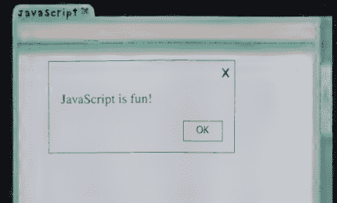

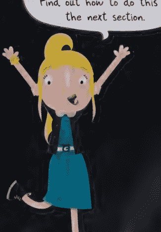

## 如何使用本书

幸运猫俱乐部需要你的帮助！Ruby、Markus、Grace 和 Rusty 必须学习如何编写五款不同的游戏，以便为“游戏开始”黑客马拉松做好准备。他们需要击败对手`SabreTooth Studios`，并向他们展示游戏属于每个人。你的任务是完成每项任务，并掌握构建游戏所需的所有不同编码技能。

## 任务简介

在每章开始时，你将收到来自幸运猫俱乐部其中一位成员的任务简介，其中详细介绍了他们想要编写的游戏。注意你将要学习的新技能，用以编写井字棋、贪吃蛇、乒乓球等等更多游戏。

### 游戏构建

每个游戏的代码都被分解成了小块。按照每个游戏构建中的分步说明来创建你的游戏。别担心，如果你遇到困难，可以访问`Get Coding!`网站（`www.getcodingkids.com`），在那里你可以找到本书中的每一段代码。

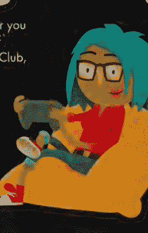

### 开发者词典

幸运猫俱乐部最喜欢的网站是开发者词典。了解游戏和游戏的历史，并利用这些信息帮助你完成任务。

## 游戏

在每个任务结束时，你将构建自己的游戏，并在此过程中掌握许多新技能。享受玩游戏的乐趣，然后访问`Get Coding!`网站，寻找更多关于如何改进游戏的想法。

# 关键代码技能

在你收到第一个任务的简介之前，有一些基本的代码技能你需要学习。你将在整本书中都使用这些技能，所以现在掌握它们很重要。你可以使用 PC 或 Mac 进行编码，但根据你使用的系统，创建和保存 HTML 文件的方式会有所不同。

## 关键代码技能 1 ▶ 创建文件夹

你需要在电脑上有一个地方来保存所有的`HTML`文件。在你的桌面上创建一个名为`Coding 2`的文件夹。将所有的`HTML`文件保存在同一个地方非常重要，所以在完成任务的过程中请确保持续使用这个文件夹。

| 系统 | 操作 |
| --- | --- |
| **PC** | 在 PC 上，右键单击你的桌面，点击“新建”，然后选择*文件夹*。将你的新文件夹命名为`Coding 2`。 |
| **Mac** | 在 Mac 上，按住*Control*键并单击你的桌面。然后选择*新建文件夹*。将你的新文件夹命名为`Coding 2`。 |

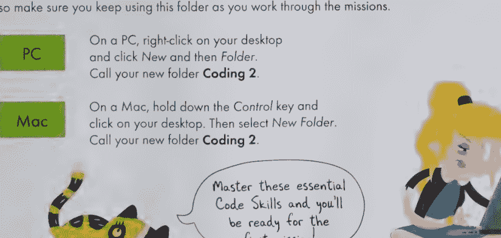

> 掌握这些基本的代码技能，你就为第一个任务做好准备了！

## 关键代码技能 2 ▶ 创建 HTML 文件


你需要知道如何创建一个 HTML 文件，这样你才能编写代码。程序员通常使用专业软件来编写代码（详情见第 221 页），但所有计算机都配有文本编辑程序，可以让你编写 HTML 文件。如果你有 PC，可以使用记事本。如果你有 Mac，可以使用 TextEdit。

### PC

在 PC 上，你可以通过进入*开始*菜单并在搜索栏中输入来找到记事本。

### Mac

在 Mac 上，你可以在屏幕右上角的*聚焦*搜索放大镜中输入来找到 TextEdit。当你打开 TextEdit 时，你需要做以下几件事：

- 将你的文件设置为纯文本（而不是富文本）文件。为此，请转到菜单栏中的*格式*，然后选择*制作纯文本*。
- 也转到菜单栏中的 *TextEdit*。选择*偏好设置*。在*格式*部分的*新文档*选项卡中，确保选中了*纯文本*。在*选项*部分，确保取消选中*智能引号*。
- 在*偏好设置*的*打开和存储*选项卡中，确保选中了*将 HTML 文件显示为 HTML 代码而不是格式化文本*。

## 关键代码技能 3 ▶ 保存你的 HTML 文件

保存 HTML 文件时，你需要确保在文件名末尾使用文件扩展名`.html`。你的计算机使用文件扩展名来确定如何打开文件。通过给你的文件指定扩展名`.html`，你是在告诉你的计算机应该用网页浏览器打开它。

### PC

在 PC 上，你需要：

- 转到*文件*并选择*另存为*。
- 选择`Coding 2`文件夹作为文件保存的目标位置。
- 为你的文件选择一个名称，例如任务 1，并将其键入到*文件名*栏中。
- 在文件名之后，键入`.html`，这样你的文件名就变成了`Mission1.html`。点击*保存*。

### Mac

在 Mac 上，你需要：

- 转到*文件*并选择*存储*。
- 选择你的`Coding 2`文件夹作为文件保存的目标位置。
- 为你的文件选择一个名称，例如任务 1，并将其键入到*存储为*栏中。
- 在文件名之后，键入`.html`，这样你的文件名就变成了`Mission1.html`。
- 确保取消选中复选框*如果未提供扩展名，则使用 ".txt"。*。点击*存储*。

## 关键代码技能 4 ▶ 打开你的 HTML 文件

要在屏幕上看到你的代码，你需要在一个网页浏览器中打开你的 HTML 文件。然后你可能想回到文本编辑程序中对你的代码进行一些修改。

### 在 PC 上，你需要：

- 按照关键代码技能 3 中的描述保存你的文件。
- 在你的桌面上打开你的`Coding 2`文件夹。双击你的 HTML 文件。它将在你的网页浏览器中打开。
- 当你想编辑代码时，右键单击你的`Coding 2`文件夹中的 HTML 文件。选择“打开方式”，并选择记事本。

### 在 Mac 上，你需要：

- 按照关键代码技能 3 中的描述保存你的文件。
- 在你的桌面上打开你的`Coding 2`文件夹。双击你的 HTML 文件。它将在你的网页浏览器中打开。
- 当你想编辑代码时，右键单击你的`Coding 2`文件夹中的 HTML 文件。选择“打开方式”，并选择 TextEdit。

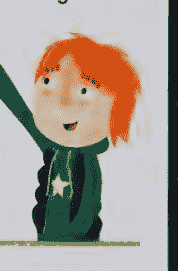

## 关键代码技能 5 ▶ 使用开发者工具

当你编写游戏构建并在浏览器中打开代码时，你可能会发现代码的显示方式不符合预期。别担心！你可以使用浏览器内置的开发者工具来帮助你查找错误。你可以在浏览器设置中找到开发者工具。在 PC 上，尝试键盘快捷键`F12`。在 Mac 上，尝试快捷键`Command + Option + I`。或者右键单击页面并选择“检查”。在控制台中转到元素工具，查找错误发生的位置。

## 关键代码技能 6 ▶ 使用 GET CODING! 网站

别忘了，当你在完成本书时，你可以使用 *Get Coding!* 网站来帮助你完成任务。如果你在编写代码时遇到任何困难，访问该网站，看看你的代码块应该是什么样子。你甚至可以从网站上复制代码块并粘贴到你的文本编辑程序中。你将在网站上找到任务 5 所需的所有文件。

*Get Coding!* 的网址是`www.getcodingkids.com`。

## 井字棋游戏

- **学习使用** HTML 编写 JavaScript
- **构建一个互动游戏棋盘**
- **创建两个玩家的回合制游戏状态**
- **编写一个循环来检查赢家**
- **修复错误并简化你的代码**

## 任务简报

| 收件人 | me@getcoding.com |
|---|---|
| 抄送 | Markus, Grace; Rusty; Scratch |
| 主题 | 任务1 简报 |

你好，

很高兴认识你。我叫 Ruby Day，是一名科学家。我是恐龙化石领域的世界级专家，这是一份相当有趣的工作（除了有时会和一位古怪的教授以及一颗被盗的钻石一起被困在冰天雪地的西伯利亚——但那是另一个故事了）。

当我不在外考察或在实验室里研究数百万年前的岩石碎片时，我喜欢玩电脑游戏。我喜欢游戏中的挑战、角色，也爱努力获胜！玩游戏真的太有趣了。目前我最喜欢的游戏是解谜类。我的好朋友 Rusty、Grace 和 Markus 也都是游戏玩家，我们之间玩过各种类型的游戏，从体育游戏到无尽跑酷。

我们现在决定，我们不仅要玩游戏，还要尝试编写它们。我们自称“幸运猫俱乐部”，名字来源于我的猫 Scratch，它将成为我们的吉祥物。我们的计划是学习编写五款不同的游戏，这样我们就能参加月底的“Game On 黑客马拉松”。我们将不得不向评委小组展示我们的游戏。真令人兴奋！

我们希望你能帮助我们编写代码，这样我们就能及时为黑客马拉松制作出游戏。另一个名为“剑齿虎工作室”的小组也会参加，他们非常有名，而且都是优秀的程序员。你听说过《虎踪》吗？那是他们制作的冒险游戏。他们一直在网上发布关于黑客马拉松的消息，说新玩家不值得参加，因为他们是最好的团队，会赢。我们想向他们证明，幸运猫俱乐部也会编程，并且能击败他们赢得奖杯。

你会加入我们的团队并帮助我们吗？我们要编写的第一款游戏是*井字棋*。希望它不会太难解！

致以猫咪般的完美祝福，

Ruby

### 开发者词典

你的游戏与游戏指南

- 主页
- 目录
- 特色游戏
- 游戏策略
- 构建技巧

### 井字棋

来自《开发者词典》，你的游戏与游戏指南

*本条目介绍的是井字棋。关于其他回合制游戏，请参见* 回合制策略游戏。

**井字棋**（也称为 tic-tac-toe）是世界上最古老的游戏之一。在游戏中，两位玩家轮流在一个 3x3（三列三行）的网格中放入圆圈或叉叉。一位玩家只在格子中放置圆圈，另一位则只放置叉叉。

### 井字棋

| 类型： | 回合制游戏 |
|---|---|
| 模式： | 双人游戏 |
| 首次发行： | 1952年（名为 OXO） |
| 游戏时间： | 不到1分钟 |
| 所需技能： | 策略、战术、观察力 |

要赢得游戏，玩家必须将三个圆圈或三个叉叉排成一条直线，可以是水平（横向）、垂直（纵向）或对角线。另一位玩家则必须试图阻止他们。第一个将三个标记连成一线的人获胜。

井字棋是一款回合制游戏，这意味着玩家们轮流行动。当轮到某位玩家时，该玩家掌控着游戏中发生的事情，而其他玩家则必须等待轮到自己。回合制游戏非常常见，许多棋盘游戏，如国际象棋，都是这样运作的。它们很受欢迎，因为玩家必须运用策略才能获胜。

计算机上的井字棋游戏最早创建于 1952 年，使其成为最早的电脑游戏之一。这款游戏名为 OXO，用户第一次可以与电脑对战，而不是与另一个人。这使其成为最早的人工智能实例之一。电脑能够对玩家的操作做出反应，而玩家不知道它会做出什么决定。最初，OXO 游戏使用称为 LED 的小灯来显示游戏棋盘。

## 井字棋游戏

我们不是用纸笔来玩*井字棋*，而是将学习如何编写这个游戏的代码，这样你就可以在网页浏览器中与朋友对战。我们将使用三种编程语言：HTML、CSS 和 JavaScript。HTML 将构成游戏的基本结构，CSS 将允许我们设计它，而 JavaScript 将使游戏具有互动性。

为了简化，游戏被分解成了小部分。完成任务并发现你完成游戏所需的技能。然后按照分步说明完成游戏构建。在任务结束时，你将构建出自己版本的井字棋。你准备好开始玩了吗？

> 如果遇到困难，别忘了使用 Get Coding! 网站。

### 游戏构建

我们希望游戏棋盘是三列三行的。两位玩家将相互对战。每位玩家将轮流点击一个格子，然后会显示一个圆圈或叉叉。我们需要代码来跟踪轮到哪位玩家，以及是否有玩家获胜。我们还需要编写一个警报，以便当玩家获胜时，会弹出一个提示框，游戏结束。请记住，有三种获胜方式：垂直、水平和对角线。

在任务结束时，你完成的游戏将如下所示：

## 游戏棋盘

我们要编写的第一部分是游戏棋盘。为此，我们需要使用 HTML 和 CSS。HTML 是一种由元素组成的编程语言，这些元素是用称为标签的小代码片段创建的。每个标签都告诉你的网页浏览器如何显示信息。你将信息放在开始标签和结束标签之间。这是一个非常简单的 HTML 网页：

```html
<!DOCTYPE html>
<html>
  <head>
    <title>Noughts and Crosses</title>
  </head>
  <body>
    <p>Do you want to play Noughts and Crosses?</p>
    Click here to play!<br/>
  </body>
</html>
```

`<head>` 标签内的信息不会在页面正文中显示。这里你放置网页的标题，并给浏览器指令，这些指令适用于整个页面，而不是单个元素。

`<body>` 标签内是我们屏幕上看到的信息。这里我们使用了段落`<p>`和换行`<br/>`来格式化文本。

### `<div>` 标签

我们的游戏棋盘需要是三列三行的。要创建棋盘的结构，我们需要使用 HTML 的`<div>`标签。它看起来像这样：

```html
<body>
<div>
<p>Ruby</p>
<p>Scratch</p>
</div>
</body>
```

`<div>` 标签有点像一个不可见的盒子：它允许你将许多 HTML 元素组合在一起。`<div>` 标签使得设计网页更容易，因为这意味着你可以轻松地将格式应用于`<div>`标签内的所有元素，而无需逐个格式化每个 HTML 元素。

### 使用 CSS

我们可以使用 CSS 来让我们的`<div>`标签看起来像游戏棋盘。CSS 是一种编程语言，允许你更改 HTML 元素在屏幕上的显示方式。你可以更改它们的大小、形状、颜色以及在页面上的位置。

```html
<!DOCTYPE html>
<html>
<head>
	<title>CSS</title>
	<style>
		.names {
			font-size: 16pt;
			text-align: center;
			background-color: blue;
		}
	</style>
</head>
<body>
	<div class="names">
		<p>Ruby</p>
		<p>Scratch</p>
	</div>
</body>
</html>
```

使用 CSS 的一种简单方法是在页面的`<head>`中创建一个 CSS 类。浏览器需要知道我们正在切换到 CSS 编程语言，所以我们必须使用`<style>`标签。然后我们创建一个 CSS 类并将其应用于`<div>`。看看改变页面的外观是多么容易：

这里我们创建了一个名为`names`的 CSS 类，它会更改任何应用该类的 HTML 元素的字体大小、对齐方式和背景颜色。注意类名前的点（`.`）。我们将所有要使用的 CSS 属性和值都放在花括号（`{}`）内。

要应用 CSS 类，我们将`class`属性添加到要更改的元素上，并将属性的值设置为 CSS 类的名称。在本例中，我们希望将该类应用于`<div>`，因此我们将属性添加到了开始`<div>`标签中。

> 你注意到了吗？

要设置属性的值，你必须使用等号（`=`）并将值放在直引号（`""`）内。如果你使用弯引号，你的代码将无法运行。

### CSS 属性和值

这里还有一些更有用的 CSS 属性和值。我们需要用它们来创建我们的游戏棋盘。

看看你能在代码中使用哪些不同的属性。

| CSS 属性名 | 它是什么意思？ | 示例值 |
| :--- | :--- | :--- |
| `height` | 设置 HTML 元素的高度 | `100px; 100%;` |
| `width` | 设置 HTML 元素的宽度 | `100px; 100%;` |
| `border` | 为 HTML 元素添加边框 | `5px solid black;` |
| `padding` | 在 HTML 元素周围创建空白空间 | `10px;` |
| `float` | 将 HTML 元素定位到另一个元素的左侧或右侧 | `left; right; none;` |
| `clear` | 指定哪些元素可以浮动在 HTML 元素旁边以及在哪一侧 | `left; right; both;` |

招财猫俱乐部真有趣！

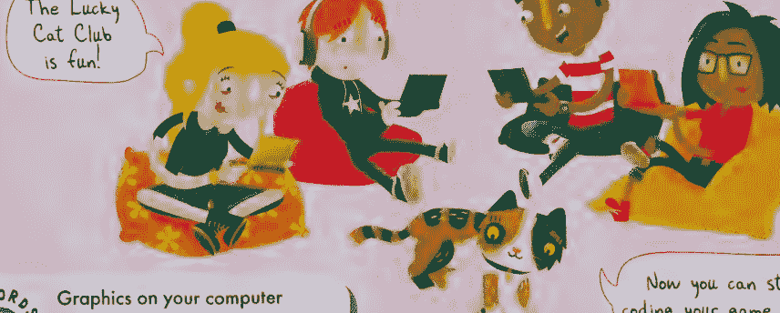

> 你电脑屏幕上的图像是由微小的彩色圆点组成的，这些圆点叫做**像素**（px）。你可以告诉浏览器你想在一个 HTML 元素中放置多少像素。

现在你可以开始编写游戏棋盘的代码了！

## 游戏构建 1 ► 游戏棋盘

按照以下步骤，使用 HTML 和 CSS 编写*井字棋*游戏棋盘的代码。

1. 打开你的文本编辑程序。如果你需要提醒如何操作，请回到第 15 页的关键代码技能部分。
2. 在你的文本编辑程序中输入以下代码：

```html
<!DOCTYPE html>
<html>
  <head>
    <title>Noughts and Crosses</title>
    <style>
    </style>
  </head>
  <body>
    Click to play Noughts and Crosses.<br/>
  </body>
</html>
```

> 仔细复制代码！如果代码中有错误，你的浏览器将无法读取。每次打开新标签时进行缩进，有助于使代码块更易读。记得用正斜杠（`/`）关闭所有标签。

3. 将文件保存在你的`Coding 2`文件夹中，作为 HTML 文件（`.html`）。将其命名为`OXO1.html`。如果你需要提醒如何操作，请回到第 16 页的关键代码技能部分。

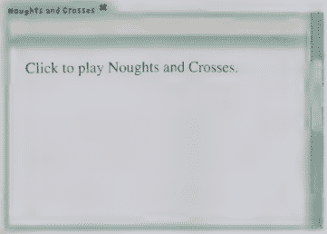

4. 在你的网页浏览器中打开该 HTML 文件。如果你需要提醒，请回到第 17 页的关键代码技能部分。代码将作为网页显示在屏幕上，像这样：

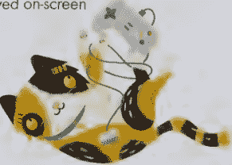

## 游戏构建 1 ► 继续

5. 现在我们已经编写了网页的基本结构，需要使用`<div>`标签来制作棋盘。在你的`<body>`标签内，编写九个空的`<div>`标签。每个`<div>`将是棋盘上的一个方格。使用更多的`<div>`标签将这九个元素分成三组，每组三个。为这些标签添加`class`属性。将`class`的值设置为`row`，像这样：

```html
<body>
  Click to play Noughts and Crosses.<br/>
  <div>
    <div class="row">
      <div></div>
      <div></div>
      <div></div>
    </div>
    <div class="row">
      <div></div>
      <div></div>
      <div></div>
    </div>
    <div class="row">
      <div></div>
      <div></div>
      <div></div>
    </div>
  </div>
</body>
```

6. 现在将 row div CSS 类添加到你页面`<head>`中的`<style>`标签里。你希望这个 CSS 类将元素的 `padding`、`border`、`height`、`width` 和 `float` 属性更改为以下值：

```css
<style>
  .row div {
    padding: 10px;
    border: 1px solid black;
    height: 30px;
    width: 30px;
    float: left;
  }
</style>
```

我们告诉浏览器，每当它看到带有 row div 类属性的`<div>`标签时，就应该让该`<div>`宽 30 像素，高 30 像素。浏览器还应该在该`<div>`周围放置 1 像素的纯黑色边框和 10 像素的内边距，并使其浮动到另一个元素的左侧。这意味着游戏棋盘中每一行里的所有`<div>`标签都会在我们的页彼此相邻地排列。如果你保存文件并刷新浏览器，游戏棋盘将看起来像这样：

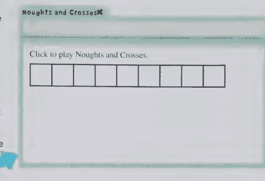

7. 但我们不想要九个排成一排的方格！我们需要另一个 CSS 类来让棋盘显示为 3x3 的网格。在你的`<style>`标签内，创建另一个名为 row 的类，并使用`clear`属性，将其值设置为`both`。这个属性将阻止元素组被浮动到彼此的左侧或右侧。

```css
.row {
  clear: both;
}
</style>
```

8. 保存你的文件并刷新浏览器。你的游戏棋盘现在将看起来像这样：

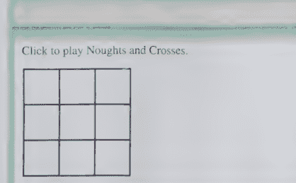


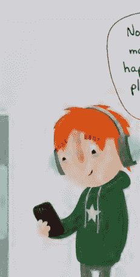

## 让游戏具有交互性

目前，如果你尝试点击游戏棋盘，什么也不会发生。我们需要添加代码，让棋盘成为供玩家游玩的游戏。为此，我们必须使用第三种编程语言——JavaScript，与 HTML 和 CSS 配合使用。JavaScript 使网页具有响应性。有了 JavaScript，用户可以点击一个 HTML 元素，然后会发生一些事情：它可以更改图像、以不同方式显示文本以及显示或移除元素。

JavaScript 是一种非常适合编写游戏的语言，因为这意味着玩家可以点击页面并立即看到结果，使其成为一种交互式体验。我们将使用 JavaScript 让玩家点击 `<div>` 标签时，X 或 O 显示在游戏棋盘上。但首先我们要学习一些基本的 JavaScript 语法。

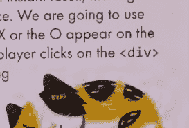

### 使用 JavaScript

要在游戏中添加 JavaScript，你使用 `<script>` 标签来告诉浏览器你正在切换语言。JavaScript 由称为语句的代码片段组成。每个语句都是给浏览器的指令。语句总是以分号（`;`）结尾，这样浏览器就知道指令何时结束。JavaScript 中几乎所有东西都是对象，它们具有我们可以在代码中访问的属性和方法。这里我们编写了一条 JavaScript 语句，告诉浏览器弹出一个包含文本字符串的警告框。

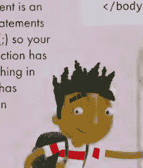

```html
<body>
  <script>
    alert("Get ready for the Hackathon!");
  </script>
</body>
```

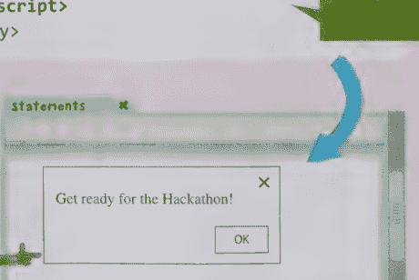

> **你注意到了吗？**
>
> 我们代码中的引号始终是直引号（" "）而不是弯引号（“ ”）。别忘了在每条语句末尾加上分号（`;`）。

## 函数

通常我们想给浏览器一组比单个 JavaScript 语句更复杂的指令。我们还想让浏览器在代码中的多个地方执行这组指令。为了创建这些更复杂的指令集，我们使用函数。函数是一组按顺序运行以执行特定动作的 JavaScript 语句。你给定函数一个描述其执行动作的名称。一旦你创建（或定义）了一个函数，你可以在代码中根据需要多次使用它。你只需要使用其名称来调用函数，像这样：

```html
<body>
<script>
  function plan() {
    alert("Get ready for the Hackathon!");
    alert("Learn JavaScript!");
    alert("Code Noughts and Crosses!");
  }
  plan();
</script>
</body>
```

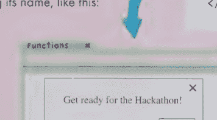

这里我们创建了一个名为`plan`的函数。我们想组合在一起的所有 JavaScript 语句都放在大括号（`{ }`）里面，它们将按顺序运行。在这段代码中，`plan`函数会让三个不同的警告框弹出。要让函数运行，我们调用它，方法是使用函数名后跟一对括号（`( )`）。

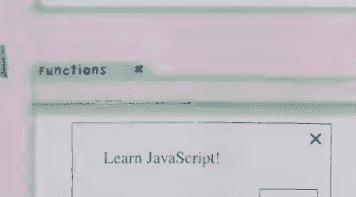

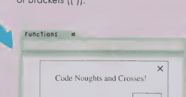

## 参数

通常我们需要给函数提供一条信息或一个值，以帮助它执行这组指令。给函数一个值称为传递一个参数。参数可以用来改变函数被调用时的行为。看看这个例子：

```html
<script>
function sayHello(name) {
  alert("Hello " + name);
}
sayHello("Ruby");
sayHello("Scratch");
</script>
```

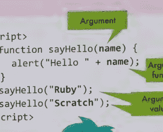

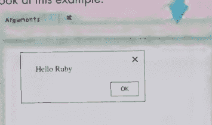


每次我们调用`sayHello`函数时，我们传递给它`name`参数，它构成了弹出警告框文本的一部分。当我们传递值 Ruby 时，警告框显示 Ruby 的名字。当我们传递值 Scratch 时，警告框使用相同的参数但显示 Scratch 的名字。使用参数使我们能够灵活地运用函数，使其适应不同的用途，并在代码中多次使用。

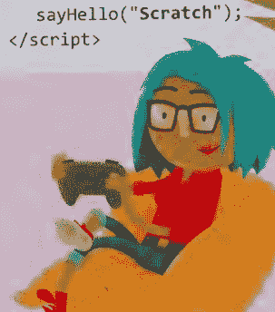

### onclick 属性

现在我们了解了函数和参数的工作原理，可以在游戏中使用它们了。我们希望在玩家点击游戏棋盘上的方格时运行一个函数。玩家必须能够以某种方式调用函数，这样 JavaScript 才会运行。

我们希望游戏面板上的 `<div>` 标签在玩家点击时调用一个函数。实现这一点的最佳方式是向您希望具有交互性的 HTML 元素添加`onclick`属性。该属性的值是您想要运行的 JavaScript 代码。当用户点击 HTML 元素时，JavaScript 将会运行，如下所示：

```html
<body>
  <div onclick="alert('Player X');">
    点击此处查看您是 X 玩家还是 O 玩家。
  </div>
</body>
```

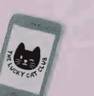

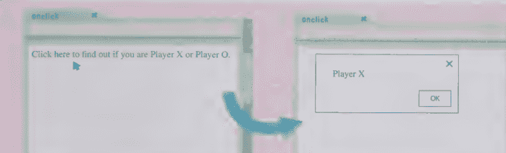

## this 关键字

JavaScript 关键字是浏览器能够理解的特殊命令。其中一个关键字是`this`。`this`关键字允许您指向代码中的某个特定内容，而无需再次将其写出。请看这个例子：

```html
<script>
  function showCatName(name) {
    alert(name.innerText);
  }
</script>
<div onclick="showCatName(this)">Scratch</div>
```

我们在`onclick`属性中使用`this`关键字来引用`showCatName`函数的值。使用`this`可以让我们的代码更加准确和灵活。

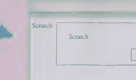

## 游戏构建 2 ▸ 添加 JavaScript

让我们使用 JavaScript 和`onclick`属性使游戏面板具有交互性。

1. 在文本编辑器中打开您保存的 OXO1.html 文件。在代码块中添加 `<script>` 标签，位于游戏面板代码的下方：

```html
</div>
<script>
</script>
</body>
</html>
```

2. 现在编写一个 JavaScript 函数，当点击游戏面板上的方框时会调用一个警告框。将您的函数命名为`place`，然后给它传递参数`box`。在函数体中，编写一个会弹出消息的警告框。将函数体放在花括号（`{}`）内。不要忘记每条 JavaScript 语句都以分号（`;`）结尾。

```html
</div>
<script>
function place(box) {
    alert("你点击了这里！");
}
</script>
```

> 花括号在键盘上 P 键的旁边。按 Shift 键可以使用它们。

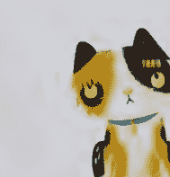

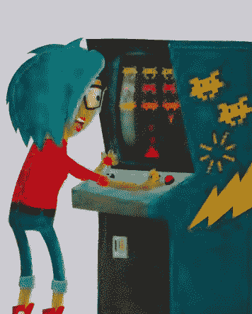

3. 现在通过添加`onclick`属性，让构成 3×3 网格的九个 `<div>` 标签具有交互性。在代码块中所示的位置，在 `<div>` 开始标签内输入，将`onclick`的值设置为您的`place`函数的名称。使用`this`关键字来引用每一个方框。

```html
<div>
    <div class="row">
        <div onclick="place(this)"></div>
        <div onclick="place(this)"></div>
        <div onclick="place(this)"></div>
    </div>
    <div class="row">
        <div onclick="place(this)"></div>
        <div onclick="place(this)"></div>
        <div onclick="place(this)"></div>
    </div>
    <div class="row">
        <div onclick="place(this)"></div>
        <div onclick="place(this)"></div>
        <div onclick="place(this)"></div>
    </div>
</div>
```

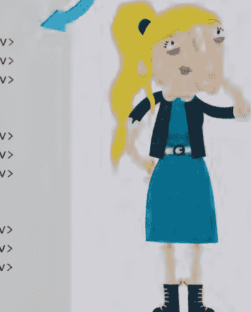

4. 将您的文件保存为 **OXO2.html** 并在浏览器中打开。当您点击游戏面板上的任意一个方框时，将会弹出一个警告框。

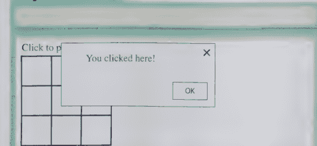

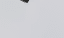

现在我们来研究如何在面板上添加连环（O）和十字（X）。

## 添加连环和十字

我们已经构建了一个可以与玩家交互的游戏面板。但我们希望面板不仅仅只是弹出警告框。当玩家点击一个方框时，需要在其内部显示一个连环或十字。我们可以使用 JavaScript 来计算哪个玩家已经行过棋，因此该方框应该显示连环还是十字。这些数据被称为**游戏状态**。我们需要学习如何使用变量和条件语句来跟踪它。

## 变量

我们将使用一个变量来跟踪轮到哪位玩家行棋。变量是 JavaScript 中用于存储值的容器。您只需使用变量关键字`var`并为变量选择一个您喜欢的名称。使用等号（`=`）来设置值。这被称为*赋值*。文本字符串写在双引号（`""`）内。数字和布尔值不用引号书写。

创建变量使我们能够在代码的任何位置访问该值。您只需使用变量的名称即可。在这里，我们将变量的值作为参数传递给警告框函数：

> 请记住，变量的值可以改变。

**游戏状态**是程序需要记住的所有数据，以便游戏能够正常运行。这包括分数、当前玩家是谁或敌人在哪里等内容。

```javascript
var currentPlayer = "Ruby";
```

```javascript
var numberOfPlayers = 2;
```

```javascript
var won = true;
```

```html
<script>
	var currentPlayer = "Ruby";
	alert(currentPlayer);
</script>
```

顾名思义，变量的值可以变化或改变。变量充当值的容器，容器内的值可以改变。因此在这个例子中，我们可以将存储在`currentPlayer`变量中的值更改为`Markus`。这在游戏中很有用，因为它将为我们提供一种方法，让代码根据存储的值执行不同的操作。

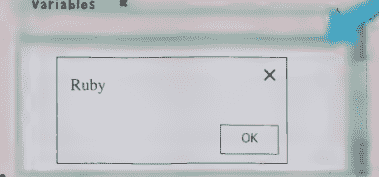

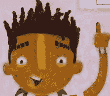

## DOM

我们游戏的一个重要部分是确保当玩家点击一个空方框时，会出现一个连环或十字。这个连环或十字将是一个新的 HTML 元素，我们在游戏面板绘制到屏幕上之后将其添加到页面中。要添加一个新的 HTML 元素，我们需要使用 JavaScript 访问一个名为 DOM（文档对象模型）的有用**API**。

DOM 允许我们将 HTML 网页连接到 JavaScript 语言。使用 DOM 为我们提供了一种在 JavaScript 中跟踪所有用于创建页面的 HTML 元素的方法，例如段落、换行符和 `<div>` 标签。

我们可以在 JavaScript 中使用 DOM 方法和属性来访问 HTML 元素并对其进行更改。DOM 方法是您可以在 HTML 元素上执行的操作。DOM 属性是您可以设置或更改的 HTML 属性的值。DOM 还允许我们执行查找、添加和删除页面中的 HTML 元素等有用操作。使用 DOM 很简单。您只需输入关键字：

```javascript
document.
```

> **代码词汇** API（应用程序接口）是一种允许另外两个程序连接并相互通信的程序。每次您查看天气或在手机上发送即时消息时，您都在使用 API 将手机连接到该数据。

## 使用点符号

要访问 DOM 的方法和属性，我们必须使用点符号来编写代码。我们需要的语法是：

```javascript
object.property;
```

我们只需在每个关键字之间使用英文句点。我们游戏中一行点符号的代码如下所示：

```javascript
document.getElementById("player");
```

我们可以使用点符号来访问 JavaScript 中任何对象的属性和方法，不仅仅是 DOM。

> **您注意到了吗？**
>
> camelCase 是将两个或多个单词连接在一起形成一个单词的做法。第一个单词以小写字母开头，其余单词以大写字母开头。我们使用 camelCase 使我们的代码更易于理解。

## 使用 DOM 方法和属性

DOM 有许多有用的内置方法和属性来帮助我们构建游戏。DOM 允许我们使游戏变成回合制的。使用 DOM，每个玩家可以在面板上的方框中放置连环或十字。为此，我们将使用一个名为`getElementById`的 DOM 方法，它使用元素的`id`属性来查找元素。然后我们可以使用一个名为`innerText`的 DOM 属性，将 `<div>` 的内容更改为我们选择的值：

```html
<body>
  <div id="player"></div>
  <script>
    document.getElementById("player").innerText = "Markus";
  </script>
</body>
```

在这个例子中，我们编写了一个空的 `<div>` 标签，并使用 DOM 方法和属性在其中添加了文本。我们给 `<div>` 一个`id`属性，并将其值设置为`player`。在 `<script>` 标签内，我们访问了 DOM 并使用`getElementById`方法查找具有`id`属性`player`的 HTML 元素。然后使用`innerText`属性将 HTML 元素的值设置为 Markus。

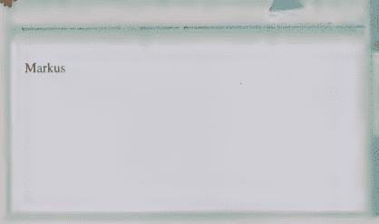

## If 和 else 语句

现在我们知道了如何使用 DOM 更改 HTML 元素的内容，我们必须找到一种方法让游戏知道应该在 `<div>` 中绘制连环还是十字。让我们学习如何使用 JavaScript 条件语句。条件语句是一种告诉浏览器，如果某事为真，则执行指令的方式。否则浏览器应该执行其他操作。条件语句使我们能够创建可以响应不同情况的代码。JavaScript 中有两个条件语句：`if` 和`else`。`if`语句在条件为真时执行一段代码。让我们使用`if`语句来编写一个警告框，如果此人是幸运猫俱乐部的成员，该警告框将会弹出：

```javascript
<script>
  var member = "Ruby";
  if(member == "Ruby") {
    alert("Member of the Lucky Cat Club");
  }
</script>
```

这里`if`语句判断变量中存储的值是否为真。我们使用`if`关键字，然后在紧随其后的括号中放入条件。我们接着使用等于运算符（`==`）来设定条件。最后，我们编写条件为真时要运行的代码。我们将其放在花括号（`{}`）中。在本例中，我们希望弹出一个带有消息的警告框。

| 运算符 | 含义 |
| :--- | :--- |
| `==` | 等于 |
| `!=` | 不等于 |

第二种条件语句是`else`语句。使用`else`语句，我们可以指示浏览器检查某事是否为真。如果为假，浏览器将执行另一段代码。

```javascript
<script>
  var member = "SabreTooth Studios";

  if(member == "Ruby") {
    alert("Member of the Lucky Cat Club");
  }

  else {
    alert("Access denied!")
  }
</script>
```

这里存储在变量中的值不等于`if`语句中的条件。因为它为假，`else`语句运行，第二个警告框弹出。

## 游戏构建 3 ► 添加井字棋

现在我们已了解变量、点符号和条件语句，让我们运用新技能在游戏板上添加井字棋。

1. 在文本编辑程序中打开你保存的 **OXO2.html** 文件。在函数之前的 `<script>` 块中添加一个变量。给变量命名，并将变量的值设置为字符串 O（字母 O，而不是数字零）。

```html
</div>

<script>
  var currentPlayer = "O";

  function place(box) {
    alert("You clicked here!");
  }
</script>
```

2. 删除函数中的`alert`。替换为一段代码，将参数`box`对应的每个 `<div>` 的内部文本设置为存储在`currentPlayer`变量中的值。你需要的代码如下：

```javascript
<script>
  var currentPlayer = "O";

  function place(box) {
```


```html
box.innerText = currentPlayer;
```

}

</script>

```

- 3. 然后在你的函数中添加一个`if`语句，检查玩家应该放置圆圈还是叉号。条件需要询问`currentPlayer`是否等于（`==`）O。接下来添加条件为真时要执行的代码。如果 O 已放置在板上，新的`currentPlayer`是 X。编写以下语句：

```html
<script>
  var currentPlayer = "O";

  function place(box) {
    box.innerText = currentPlayer;

    if (currentPlayer == "O") {
      currentPlayer = "X";
    }
  }
</script>
```

### 4. 添加`else`语句

现在添加一个`else`语句，在条件为假时运行。如果`currentPlayer`变量不等于 O，这意味着已经下了 X。因此，`else`语句需要运行并将变量的值更改为 O。

```html
<script>
  var currentPlayer = "O";

  function place(box) {
    box.innerText = currentPlayer;

    if (currentPlayer == "O") {
      currentPlayer = "X";
    } else {
      currentPlayer = "O";
    }
  }
</script>
```

5. 将你的文件保存为`OXO3.html`并在浏览器中打开。你点击的第一个方框将显示一个圆圈。你点击的下一个方框将显示一个叉号。

你会注意到你的代码存在问题。如果你点击同一个方框两次，圆圈会变成叉号，然后再变回来。我们需要修复这个问题，因为这违反了井字棋的规则。

## 创建两名玩家

当我们点击游戏板时，每个方框中都会出现一个圆圈或叉号。但当你再次点击该方框时，圆圈或叉号会改变。这是一个`bug`。我们需要学习如何阻止代码在玩家点击方框后继续运行。这样下一位玩家就可以轮到他/她了。

在编程时，尽量使你的代码块尽可能简单和简短，这始终是一个好习惯。让我们也来看看一种巧妙的方法，可以缩短代码中的条件语句，使代码块更易于理解。

> **代码词汇**
>
> **Bug** 是一种编码错误，会导致程序产生错误或意外的结果。

## `return`关键字

从函数返回意味着离开它，并返回到调用它的代码段。函数通常在其函数体的最后一条语句结束时返回。但如果你使用`return`关键字，可以提前离开函数。

我们需要阻止`if`和`else`语句在玩家点击时不断更改方框中的值。为此，我们需要在`place`函数中添加`return`关键字，在方框中有文本时停止运行：

```html
<body>
  <div class="row">
    <div onclick="place(this)"></div>
  </div>

  <script>
    var currentPlayer = "O";

    function place(box) {
      if (box.innerText != "") return;

      box.innerText = currentPlayer;

      if (currentPlayer == "O") {
        currentPlayer = "X";
      } else {
        currentPlayer = "O";
      }
    }
  </script>
</body>
```

## 三元运算符

这里我们在函数的最开头添加了一个`if`语句。该条件询问游戏板上的方框中是否有文本。我们通过询问`innerText`属性是否不等于（`!=`）空（`""`）来设定条件。如果条件为真，且方框中已有文本，`return`关键字将阻止函数的其余部分执行。现在函数只运行一次，将圆圈添加到方框中。如果我们第二次点击该方框，函数将不会运行。

我们可以使用三元运算符以这种方式缩短上述`if`和`else`语句。三元运算符有三个部分，它们总是遵循相同的公式：

首先我们给出要测试的条件，然后是条件为真时要运行的代码，最后是条件为假时要运行的代码。条件之后是一个问号（`?`），然后两个代码表达式用冒号（`:`）分隔。看看我们如何使用三元运算符来简化这段代码……：

```javascript
if (currentPlayer == "O") {
  currentPlayer = "X";
} else {
  currentPlayer = "O";
}
```

……变成这行更短的代码：

```javascript
currentPlayer == "O" ? currentPlayer = "X" : currentPlayer = "O";
```

这里我们告诉浏览器，如果`currentPlayer`变量的条件等于（`==`）O，则将`currentPlayer`变量设置为 X。否则，如果条件为假，将其设置为 O。现在下一位玩家可以轮到他们了。

## 游戏构建 4：创建两名玩家

使用`return`关键字和三元运算符将游戏变成可供两名玩家一起玩的东西。

- 1. 在文本编辑程序中打开你保存的`OXO3.html`文件。在函数开头添加一个新的`if`语句。设置条件以询问游戏板上所有`<div>`标签的`innerText`是否为空。然后使用`return`关键字在`<div>`标签中有文本时停止函数运行。

```html
<script>
  noplayer = "O";

  function place(box) {
    if (box.innerText != "") return;

    box.innerText = currentPlayer;

    if (currentPlayer == "O") {
      currentPlayer = "X";
    } else {
      currentPlayer = "O";
    }
  }
</script>
```

- 2. 现在将`if`和`else`语句简化为一个三元运算符，决定应该在板上放置圆圈还是叉号。你的游戏整个`<body>`的代码块现在看起来像这样：

```html
<body>
  Click to play Noughts and Crosses.<br/>

  <div>
    <div class="row">
      <div onclick="place(this)"></div>
      <div onclick="place(this)"></div>
      <div onclick="place(this)"></div>
    </div>

    <div class="row">
      <div onclick="place(this)"></div>
      <div onclick="place(this)"></div>
      <div onclick="place(this)"></div>
    </div>

    <div class="row">
      <div onclick="place(this)"></div>
      <div onclick="place(this)"></div>
      <div onclick="place(this)"></div>
    </div>
  </div>

  <script>
    var currentPlayer = "O";

    function place(box) {
      if (box.innerText != "") return;

      box.innerText = currentPlayer;

      currentPlayer == "O" ? currentPlayer = "X" : currentPlayer = "O";
    }
  </script>
</body>
```

- 3. 将文件保存为`OXO4.html`并在浏览器中打开。当你点击方框时，每个方框中会出现一个圈或叉。但是当你再次点击同一个方框时，方框内容保持不变。两位玩家都可以进行游戏！

> 现在我们需要研究如何提示获胜者并停止游戏！

## 判定获胜者

我们的游戏可以运行了，但如果一名玩家连成三子，目前还没有办法停止游戏并告知他们获胜。我们需要编写第二个函数，检查游戏板上的每个方框，看看是否有获胜者。首先，我们需要思考浏览器如何识别游戏板上的每个方框。

## 坐标

还记得任务开始时提到的圈叉游戏规则：你可以在三个方向上获胜。如果你将三个圈或叉在水平、垂直或对角线上连成不间断的一行，那么你就是获胜者。要确定一名玩家是否已经做到这一点，我们需要在每次玩家点击时，检查构成游戏板的九个`<div>`标签的内容。

为此，我们必须给每个`<div>`标签一个`id`属性，用来表示它在游戏板上的位置。

> **编程术语**
>
> 坐标是从水平（横向）X 轴和垂直（向下）Y 轴取出的数字对，用于确定一个固定位置。

最好的方法是给每个标签一组**坐标**，对应它的水平和垂直位置。我们先给出 X 轴上的水平位置，再给出 Y 轴上的垂直位置。这意味着我们的坐标排列如下：

如果我们用一组坐标轴来看，可以看到坐标如何用于确定位置：

X 坐标指的是 X 轴上从左到右的水平位置，Y 坐标指的是 Y 轴上从上到下的垂直位置。

我们可以用这种方式给每个`<div>`标签赋予坐标。第一个数字是从左到右穿过屏幕的列号，第二个数字是从上到下穿过屏幕的行号。在计算机科学中，我们使用从零开始的编号法，这意味着游戏板上的第一行和第一列编号为零，而不是 1。因此，`id`属性为`1_0`的`<div>`将是游戏板上第二列、第一行的方框。

> **你注意到了吗？**
>
> 如果你在数学中使用过坐标，你会知道坐标从坐标轴的左下角开始。然而，在计算机上设计图形时，我们从左上角开始。这是因为最早的计算机从屏幕顶部开始渲染图形。

## 使用`id`属性

我们想给每个`<div>`赋予其坐标作为`id`属性。让我们看看如何使用坐标和`id`属性来识别游戏板上的第一行`<div>`标签：

```html
<div class="row">
  <div id="0_0" onclick="place(this)"></div>
  <div id="1_0" onclick="place(this)"></div>
  <div id="2_0" onclick="place(this)"></div>
</div>
```

现在我们可以用这些`id`属性来创建一个循环，检查所有`<div>`标签，看看是否有获胜者。

## 使用`getElementById`

我们可以使用`getElementById`方法通过`id`属性坐标来找到`<div>`标签。正如我们在第 38 页看到的，这个方法名副其实：它通过`id`属性找到 HTML 元素。使用`getElementById`时，我们将`id`属性放在括号中，像这样：

```javascript
document.getElementById("0_0");
```

让我们编写一个简单的示例，使用`getElementById`访问第一行第一个`<div>`的`innerText`，看看里面是一个圈还是一个叉。然后会弹出一个提示框显示结果：

```html
<body>
  <div class="row">
    <div id="0_0">X</div>
  </div>

  <script>
    var first = document.getElementById("0_0");
    alert(first.innerText);
  </script>
</body>
```

注意，我们可以用`getElementById`为一个变量创建值。这将很有用，因为我们可以随后运行一个`if`语句来检查该变量的状态。

看起来不错！

## 更多运算符

我们可以使用其他运算符来创建更复杂的`if`语句，同时检查多个变量的状态。这将帮助我们使用`getElementById`方法将游戏板中圈或叉存储到变量中。

我们可以使用与运算符（`&&`）来编写一个检查三个条件的`if`语句。如果三个条件都为真，就意味着有获胜者，因为三个`<div>`标签中的值相同：

| 运算符 | 含义 |
| --- | --- |
| `&&` | 与 |

```html
<script>
  var first = "X";
  var second = "X";
  var third = "X";

  if (first == second && first == third) {
    alert("Winner!");
  }
</script>
```

这里我们要求`if`语句检查第一个变量是否等于（`==`）第二个变量，并且（`&&`）第一个变量是否等于（`==`）第三个变量。如果是这样，就会弹出提示框。

## 游戏构建 5：判定获胜者

使用`id`属性、坐标、`getElementById`和两个新的`if`语句，来判断游戏板第一行是否有获胜者。

- 1. 在文本编辑程序中打开你保存的`OXO4.html`文件。给游戏板上的九个`<div>`标签都添加`id`属性。将每个`id`属性的值设置为该方框在游戏板上的坐标。回到第 47 页查看坐标的正确排列方式。

```html
<div>
  <div class="row">
    <div id="0_0" onclick="place(this)"></div>
    <div id="1_0" onclick="place(this)"></div>
    <div id="2_0" onclick="place(this)"></div>
  </div>

  <div class="row">
    <div id="0_1" onclick="place(this)"></div>
    <div id="1_1" onclick="place(this)"></div>
    <div id="2_1" onclick="place(this)"></div>
  </div>

  <div class="row">
    <div id="0_2" onclick="place(this)"></div>
    <div id="1_2" onclick="place(this)"></div>
    <div id="2_2" onclick="place(this)"></div>
  </div>
</div>
```

- 2. 现在添加一个新的`checkGameBoard`函数，检查游戏板第一行是否有获胜者。将它紧接在`place`函数之后添加。编写三个变量来表示游戏板上的前三个方框。使用`getElementById`访问每个方框中存储的文本。将值存入相应的变量：

```javascript
currentPlayer == "O" ? currentPlayer = "X" : currentPlayer = "O";
}

function checkGameBoard() {
  var first = document.getElementById("0_0").innerText;
  var second = document.getElementById("1_0").innerText;
  var third = document.getElementById("2_0").innerText;
}
```

- 3. 在第三个变量之后，添加两个`if`语句。第一个`if`语句需要检查第一个方框是否为空（`""`）。这是因为我们不想让玩家什么都不做，靠三个空方框获胜。如果第一个变量方框中没有内容，我们可以使用`return`关键字来停止代码运行。第二个`if`语句需要检查三个方框的值是否相同。如果是，就应该弹出显示`"Winner!"`的提示框：

```javascript
var third = document.getElementById("2_0").innerText;

if (first == "") return;

if (first == second && first == third) {
  alert("Winner!");
}
}
```

- 4. 最后，在前面的`place`函数末尾调用新的`checkGameBoard`函数。它应该在你的三元运算符之后：

```javascript
currentPlayer == "O" ? currentPlayer = "X" : currentPlayer = "O";

checkGameBoard();
}
```

- 5. 将文件保存为`OXO5.html`并在浏览器中打开。点击游戏板顶行，使三个方框都变成圈。此时会弹出提示框显示`"Winner!"`。

## 循环

现在我们可以在第一行中拿到三个圈或三个叉来赢得游戏。但棋盘的其余部分呢？我们必须找到一种方法来检查剩下的格子，看看是否有赢家。为此，我们要编写一个循环。

循环允许你根据条件是否为真来多次运行一段代码。这就像在说，只要 Scratch 饿了，Ruby 就应该一直往他的碗里放猫粮饼干。当他吃饱了，她就停下来。在我们的游戏中，我们希望代码一直运行，直到有玩家在获胜阵型中拿到三个圈或叉。当玩家连成三子时，我们希望代码停止。

## `for`循环

JavaScript 有几种不同类型的循环。我们游戏需要的是**`for`循环**。这种类型的循环创建一个变量，然后循环执行直到条件为真。在循环的每一轮结束时，变量会更新。`for`循环看起来像这样：

```javascript
<script>
  for (var i = 1; i <= 5; i++) {
    alert(i);
```


```html
}
```

注意循环的三个部分用分号（`;`）分隔。条件为真时要执行的代码，即循环体，放在大括号（`{}`）内。这个循环会从 1 数到 5，并为序列中的每个数字弹出一个警告。

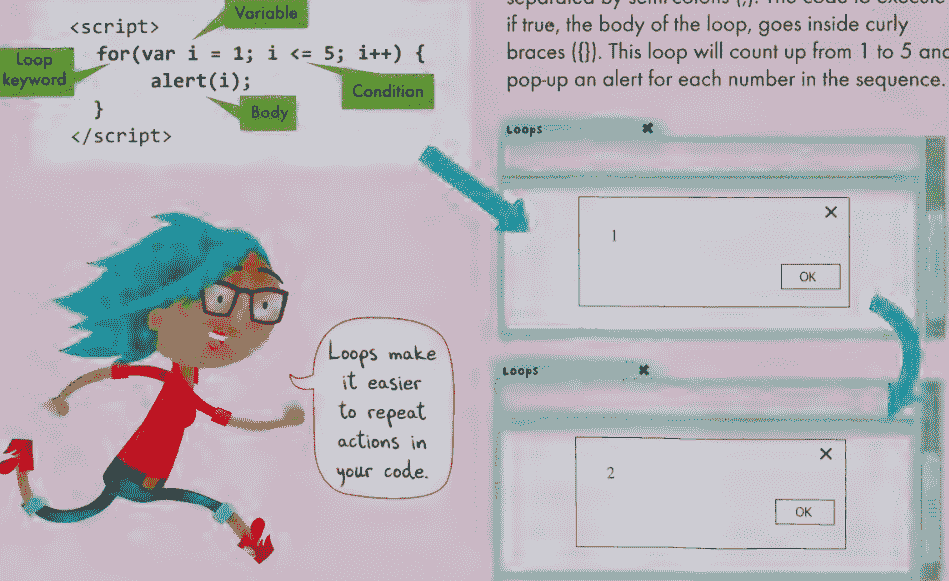

> 循环让你的代码更容易重复执行操作。

循环的第一部分创建一个值设为 1 的变量。循环的下一部分，即条件，使用小于或等于（`<=`）运算符检查变量是否小于 5。这在每次循环运行时都会检查，如果为真，则执行循环体。递增运算符（`++`）给变量的值加 1，直到我们达到 5，每次都会弹出一个警告。

| 运算符 | 含义 |
| :--- | :--- |
| `++` | 加一 |
| `>` | 大于 |
| `<` | 小于 |
| `>=` | 大于或等于 |
| `<=` | 小于或等于 |

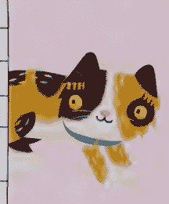

## 检查行

我们可以在`checkGameBoard`函数中使用`for`循环来检查玩家是否通过在一行中拿到三个圈或三个叉赢得了游戏。我们希望循环通过游戏棋盘的`<div>`标签的`id`属性向上计数：

```javascript
function checkGameBoard() {

  for(var i = 0; i <= 2; i++) {

    var first = document.getElementById("0_" + i).innerText;

    var second = document.getElementById("1_" + i).innerText;

    var third = document.getElementById("2_" + i).innerText;

    if(first == "") continue;

    if(first == second && first == third) {

      alert("Winner!");

    }

  }

}
```

我们可以修改这个函数，这样就不需要让浏览器查找棋盘上的每一个坐标，而是通过循环每次都计算出横行 Gibbs 整理行号。然后我们通过对`getElementById`传入循环中的变量和`id`属性中的列部分来检查棋盘上的所有行。

## 检查列

我们可以用同样的方式使用第二个循环来检查列中是否有任何获胜组合。我们要做的只是切换一下检查`<div>`标签的方式。目前，为了检查每一行，我们使用`getElementById`按以下方式查找格子：

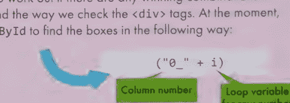

记住坐标是如何工作的。我们需要重新排列这段代码，让循环通过列向上计数，每次将它们加到行上。

## `continue`关键字

你可能已经注意到，我们在之前使用`return`的地方使用了`continue`关键字。在循环中使用`continue`意味着跳到下一个循环。它让循环继续执行，而不运行后面的任何代码。

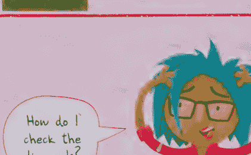

## 检查对角线

我们不能使用循环来检查对角线，因为行号和列号都会变化。但幸运的是，我们知道对角线上每个格子的`id`属性：

| 0_0 | 1_0 | 2_0 |
| --- | --- | --- |
| 0otable1_1 | 2_1 |
| 0_2 | 1_2 | 2_2 |

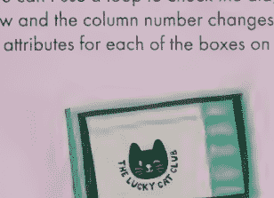

我们可以通过为每个坐标编码一组变量来检查对角线。六个变量中的每一个都会使用`getElementById`存储格子的值。然后我们可以使用`if`语句检查是否有三个相同的值。注意，我们可以为每条对角线各使用一个`if`语句。

```javascript
var firstD1 = document.getElementById("0_0").innerText;

var secondD1 = document.getElementById("1_1").innerText;

var thirdD1 = document.getElementById("2_2").innerText;

if(firstD1 != "" && firstD1 == secondD1 && firstD1 == thirdD1) {

  alert("Winner!");

}

var firstD2 = document.getElementById("0_2").innerText;

var secondD2 = document.getElementById("1_1").innerText;

var thirdD2 = document.getElementById("2_0").innerText;

if(firstD2 != "" && firstD2 == secondD2 && firstD2 == thirdD2) {

  alert("Winner!");

}
```

每个`if`语句的意思是：

- 如果第一个格子不等于（`!=`）空（`""`）（它不是空的）
- 并且（`&&`）第一个对角线等于（`==`）第二个对角线
- 并且（`&&`）第一个对角线等于（`==`）第三个对角线
- 那么显示获胜警告。

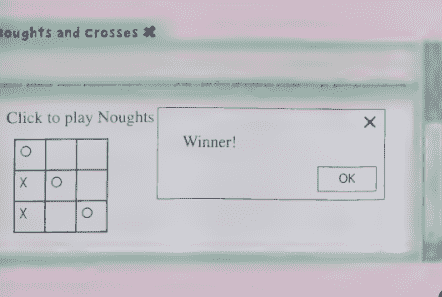

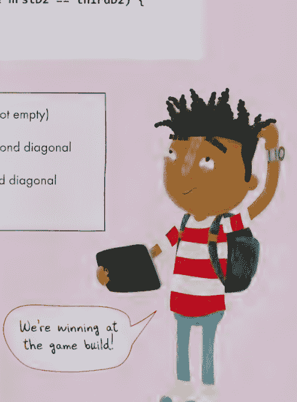

> 我们在游戏构建中要赢了！

## 游戏构建 6 ▸ 使用循环检查棋盘

使用循环持续检查游戏棋盘的行和列，直到有玩家连成三子。使用条件语句检查对角线。

1. 在文本编辑程序中打开你保存的`OXO5.html`文件。通过添加一个循环来修改你的`checkGameBoard`函数，该循环将遍历棋盘上的行，直到有三格相同：

```javascript
function checkGameBoard() {

  for(var i = 0; i <= 2; i++) {

    var first  = document.getElementById("0_"+ i).innerText;

    var second = document.getElementById("1_"+ i).innerText;

    var third  = document.getElementById("2_"+ i).innerText;

    if(first == "") continue;

    if(first == second && first == third) {

      alert("Winner!");

    }

  }

}

</script>
```

> 不要忘记

## 简化循环

你可能已经注意到，目前我们的代码正在运行两个相同的循环，一个接一个。让我们通过使用一个循环来同时检查行和列，从而使代码块更短。我们需要在整个过程中更改变量名：

```javascript
for(var i = 0; i <= 2; i++) {

    var rowFirst = document.getElementById("0_" + i).innerText;

    var rowSecond = document.getElementById("1_" + i).innerText;

    var rowThird = document.getElementById("2_" + i).innerText;

    checkWinner(rowFirst, rowSecond, rowThird);

    var colFirst = document.getElementById(i + "_0").innerText;

    var colSecond = document.getElementById(i + "_1").innerText;

    var colThird = document.getElementById(i + "_2").innerText;

    checkWinner(colFirst, colSecond, colThird);

}
```

我们可以进一步简化。目前，我们为棋盘上的每个`<div>`使用了不同的变量——但这是不必要的。我们可以将对`getElementById`的调用作为参数传递给`checkWinner`函数。这段代码可以从这样：

```javascript
var rowFirst = document.getElementById("0_" + i).innerText;

var rowSecond = document.getElementById("1_" + i).innerText;

var rowThird = document.getElementById("2_" + i).innerText;

checkWinner(rowFirst, rowSecond, rowThird);
```

简化为这样：

```javascript
checkWinner(document.getElementById("0_" + i).innerText,

            document.getElementById("1_" + i).innerText,

            document.getElementById("2_" + i).innerText);
```

我们不是使用三个变量来存储行信息，而是利用`innerText`属性将`<div>`的值直接传入`checkWinner`函数。

> **你注意到了吗？**

因为我们传递的是多个语句给`checkWinner`函数，所以我们使用逗号（`,`）而不是分号来分隔它们。

## 游戏构建 7 ▶ 简化你的代码

你的游戏现在可以运行了。剩下的就是整理你的代码。

1. 打开你的`OXO6.html`文件。在你的`<script>`块末尾创建一个函数，该函数使用一个`if`语句来检查赢家。

```javascript
function checkWinner(first, second, third) {

    if(first != "" && first == second && first == third) {

        alert("Winner!");

    }

}

</script>
```

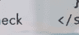

2. 简化`checkGameBoard`函数，使一个循环同时检查行和列。删除你之前用来存储每个`<div>`的变量。改为将`getElementById`调用传递给检查赢家的函数：

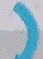

```javascript
function checkGameBoard() {

    for(var i = 0; i <= 2; i++) {

        checkWinner(document.getElementById(i + "_0").innerText,

                   document.getElementById(i + "_1").innerText,

                   document.getElementById(i + "_2").innerText);

        checkWinner(document.getElementById("0_" + i).innerText,

                   document.getElementById("1_" + i).innerText,

                   document.getElementById("2_" + i).innerText);

    }

    checkWinner(document.getElementById("0_0").innerText,

               document.getElementById("1_1").innerText,

               document.getElementById("2_2").innerText);

    checkWinner(document.getElementById("0_2").innerText,

               document.getElementById("1_1").innerText,

               document.getElementById("2_0").innerText);

}

function checkWinner(first, second, third) {
```

3. 将你的代码保存为`OXO7.html`并在浏览器中打开。你的游戏将以与之前完全相同的方式运行。


## 完成游戏

我们需要做的最后一件事是修复一个漏洞：即使有玩家已经赢了，你仍然可以通过点击空格子继续玩游戏。一旦玩家连成一线，游戏就应该结束。

### 边界情况

边界情况是一种在代码中极少发生，但会导致其无法正常运行的错误的情况或条件。

在我们游戏中，即使有人获胜后仍然可以继续填充格子的情况，就是一个边界情况的例子。我们需要确保我们的代码能够处理这种可能性，即使它不太可能发生。

我们需要更新检查赢家的代码，以确保它跟踪谁赢了。我们通过在`place`函数中添加一个新变量并使用“或”运算符（`||`）来实现这一点：

```javascript
if(box.innerText != "" || won) return;
```

或运算符

新变量

我们在`if`语句的条件中使用了或（`||`）运算符。如果格子是空的（`""`），或者（`||`）游戏已经赢了，它将阻止代码继续运行。这个`if`语句可以分解为：

| 运算符 | 含义 |
| --- | --- |
| `&&` | 与 |
| `\|\|` | 或 |

- 如果`box.innerText`不等于（`!=`）空字符串（`""`），
- 或（`||`）者游戏已经获胜，
- 那么返回并停止执行代码。

> 再进行一次游戏构建，我们就完成了！

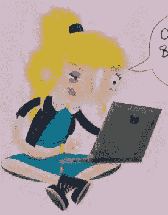

## 游戏构建 8 ▶ 完成游戏

修复你游戏中最后的漏洞，然后准备开始玩吧！

1. 在你的文本编辑程序中打开你保存的`OXO7.html`文件。在你的`<script>`块顶部添加一个值为`false`的变量：

```javascript
<script>

    var currentPlayer = "O";

    var won = false;

    function place(box) {
```

2. 然后我们需要更新检查赢家的函数中的`if`语句，以便当玩家获胜时，可以将新变量的值设置为`true`：

```javascript
function checkWinner(first, second, third) {

    if(first != "" && first == second && first == third) {

        alert("Winner!");

        won = true;

    }

}
```

3. 最后，在`place`函数的最开始，我们需要更新`if`语句，使用“或”（`||`）运算符来检查游戏是否尚未结束：

```javascript
function place(box) {

    if(box.innerText != "" || won) return;
```

4. 将你的代码保存为`OXO8.html`并在浏览器中打开。游戏现在完成了。我们可以玩井字棋了。为什么不找个朋友一起玩呢？

**井字棋**

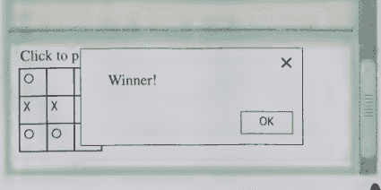

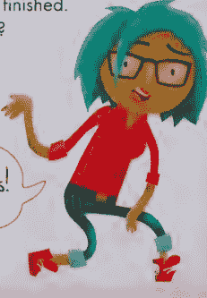

恭喜！

## 超级技能

你的游戏准备就绪！你如何改变游戏棋盘的设计？

### 进一步拓展你的游戏

- 看看你用来编写游戏棋盘的 CSS。你能弄清楚如何更改 CSS 的`width`和`height`属性来使棋盘变大或变小吗？
- 你能使用`background-color` CSS 属性来更改棋盘的背景颜色吗？
- 你能使用`color` CSS 属性来更改圈和叉的颜色吗？
- 你能将圈和叉放在格子的中间吗？（提示：使用`text-align` CSS 属性。）
- 你还可以考虑为游戏添加简单的图形。如何使用``标签添加奖牌或奖杯图片，然后使用 JavaScript 来显示或隐藏它？
- 最后，如果你觉得自己很聪明，可以尝试高亮显示获胜的一行，方法是设置获胜单元格的`color` CSS 属性。

### 未来的游戏构建

利用你从编写*井字棋*学到的技能，你可以构建其他基于回合制的游戏。国际象棋、跳棋，甚至像*文明*和*卡卡颂*这样的大型游戏都是回合制游戏。

## 任务 1：最终代码

```html
<!DOCTYPE html>

<html>

    <head>

        <title>Noughts and Crosses</title>

        <style>

            .row div {

                padding: 10px;

                border: 1px solid black;

                height: 30px;

                width: 30px;

                float: left;

            }

            .row {
```


```html
clear: both;

}
```

```html
</style>

</head>

<body>

Click to play Noughts and Crosses.<br/>

<div>

<div class="row">

<div id="0_0" onclick="place(this)"></div>

<div id="1_0" onclick="place(this)"></div>

<div id="2_0" onclick="place(this)"></div>

</div>

<div class="row">

<div id="0_1" onclick="place(this)"></div>

<div id="1_1" onclick="place(this)"></div>

<div id="2_1" onclick="place(this)"></div>

</div>

<div class="row">

<div id="0_2" onclick="place(this)"></div>

<div id="1_2" onclick="place(this)"></div>

<div id="2_2" onclick="place(this)"></div>

</div>

</div>
```

```html
<script>

var currentPlayer = "O";

var won = false;

function place(box) {

  if(box.innerText != "" || won) return;

  box.innerText = currentPlayer;

  currentPlayer == "O" ? currentPlayer = "X" : currentPlayer = "O";

  checkGameBoard();

}

function checkGameBoard() {

  for(var i = 0; i <= 2; i++) {

    checkWinner(document.getElementById(i + "_0").innerText,

      document.getElementById(i + "_1").innerText,

      document.getElementById(i + "_2").innerText);

    checkWinner(document.getElementById("0_" + i).innerText,

      document.getElementById("1_" + i).innerText,

      document.getElementById("2_" + i).innerText);

  }

  checkWinner(document.getElementById("0_0").innerText,

    document.getElementById("1_1").innerText,

    document.getElementById("2_2").innerText);

  checkWinner(document.getElementById("0_2").innerText,

    document.getElementById("1_1").innerText,

    document.getElementById("2_0").innerText);

}

function checkWinner(first, second, third) {

  if(first != "" && first == second && first == third) {

    alert("Winner!");

    won = true;

  }

}

</script>

</body>

</html>
```

> 一个为黑客马拉松准备的游戏！代码很棒！

# 贪吃蛇

- 学习如何使用 `<canvas>` 元素来创建 2D 图形
- 使用对象字面量和数组来组织你的代码
- 制作一个定时运行的游戏
- 学习如何添加和处理键盘输入

## 任务简介

致：me@getcoding.com

抄送：Ruby；Markus；Grace；Scratch

主题：任务 2 简介

嘿，

我叫 Rusty，很高兴认识你。我想 Ruby 已经给你发过邮件，介绍过幸运猫俱乐部了。我们都是多年的老朋友了，大家都对学习编程感到非常兴奋。你帮我们为黑客马拉松做准备，这真是太棒了。我真心希望我们能表现出色——并向那些 SabreTooth 工作室的讨厌家伙们表明，我们可不是好惹的。

我想 Ruby 已经告诉过你关于 `Tiger Trail` 的事了，那是 SabreTooth 最著名的游戏。玩家需要在游戏棋盘上引导一只老虎，尽可能多地吃掉鹿。每当老虎吃掉一只鹿，它的身体就会增加一节。当玩家移动老虎时，他们必须小心不要撞到任何荆棘丛。如果撞上了，游戏就结束了。这款游戏的下载量已经接近一百万次。人们非常喜欢它！

但他们游戏背后的理念其实并不是 SabreTooth 的家伙们自己想出来的。如果你对老式手机有所了解，可能听说过 `贪吃蛇` 这个游戏。它是最早可以在手机上玩的游戏之一，而且非常基础——它是 2D 的，图形是黑白的，没有音效或任何酷炫的东西。你必须让蛇通过吃掉随机出现在棋盘上的苹果来成长。同时你还必须避免撞到棋盘上的墙壁或你自己的尾巴。

我想学习如何编程 `贪吃蛇`。既然 SabreTooth 能把它变成畅销游戏，我觉得我也能尝试一下。我将来想学习如何制作更多的益智游戏，所以了解 `贪吃蛇` 的工作原理似乎是个不错的起点。希望你能在我把尾巴缠成一团乱麻之前帮我破解它。

完美祝愿，

Rusty

- 主页
- 目录
- 特色游戏
- 游戏策略
- 制作技巧

## 贪吃蛇

出自《开发者词典》，你的游戏与游戏指南

> *本词条是关于贪吃蛇游戏。关于其他类似游戏，请参阅街机游戏。*

**贪吃蛇** 是一种常见电脑游戏概念的名称，有不同版本可在街机、电脑以及不同的手机或平板平台上使用。贪吃蛇游戏的玩法非常简单。玩家控制一条直线（蛇），他们可以使用键盘在棋盘上移动它。游戏中会不时出现水果或虫子，玩家应该吃掉它们以让自己变长，同时不能撞到墙壁或蛇自己的身体。

## 贪吃蛇

| 特性 | 描述 |
|---|---|
| **类型：** | 益智游戏 |
| **模式：** | 单人游戏 |
| **首次发布：** | 1976 年（作为 Blockade） |
| **游戏时长：** | 1 分钟以上（取决于关卡） |
| **所需技能：** | 策略、快速反应、观察力 |

通过将蛇移动到它们上面来吃掉水果。玩家每吃掉一个水果或虫子，就会得一分，蛇会变长，使得游戏更加困难。游戏的目标是在没有撞到棋盘上的墙壁或你自己的尾巴的情况下，尽可能多地得分。

贪吃蛇游戏最早在 1976 年作为名为 Blockade 的街机游戏流行起来。玩家必须移动一个角色（该角色会在屏幕上留下实线轨迹），使用四个按钮来决定方向。目的是避免撞到对手。

Blockade 的流行促使许多公司创建了自己的版本。著名的包括 Worm、Nibbler 和 Rattler Race。迄今为止最著名的版本，名为贪吃蛇，于 1998 年在诺基亚手机上免费提供。它非常受欢迎，以至于诺基亚推出了多个复杂度和复杂性不断提高的版本。最著名的 Snake 2 是在诺基亚 3310 上发布的。

如今，有大量不同的游戏在某种程度上使用了贪吃蛇的概念，它经常被评为有史以来最优秀的百款游戏之一。

## 贪吃蛇

我们将编写自己的贪吃蛇游戏版本，它将在网络浏览器中运行，而不是在手机上。我们将使用 JavaScript 让蛇移动并让水果出现在棋盘上，并使用一个名为 `<canvas>` 的新 HTML 元素来创建简单的游戏棋盘图形。

我们之前没有使用过 `<canvas>` 元素，所以在开始游戏构建之前，我们将在代码技能练习中了解它的工作原理。然后就像任务 1 一样，按照游戏构建中的分步说明操作。在任务结束时，你将能够玩自己的贪吃蛇游戏。

### 游戏构建

为了使我们的贪吃蛇游戏成为玩家的挑战，我们需要编写一个带有不同障碍物的游戏棋盘。玩家将使用键盘控制蛇的移动，并且必须避免撞到棋盘周围的墙壁和中间的岛屿。每隔几秒钟，棋盘上随机位置会出现一个水果。当蛇撞到水果时，它会吃掉它并增加一节长度。蛇每吃掉一个水果，玩家就得一分。如果蛇撞到墙壁、岛屿或自己的尾巴，游戏结束，并弹出一个警告框告诉玩家得分。

在任务结束时，你完成的游戏将如下所示：

> 让 SabreTooth 工作室成为历史吧！

蛇  
蛇  
墙壁  
得分警告  
岛屿  
水果  
游戏结束！玩家得分：1

## 创建图形

为了编写游戏棋盘，我们需要使用 HTML5 `<canvas>` 元素，它与 JavaScript 一起使用，可以在网络浏览器中绘制图形。`<canvas>` 元素作为一个容器，存储你用 JavaScript 创建的图形。把 `<canvas>` 元素想象成一张白纸，而 JavaScript 就是颜料。

你可以用 `<canvas>` 元素创建各种图形。用它来绘制圆形、正方形和线条，或者添加文本和图像。对于我们的贪吃蛇游戏，我们只需要非常简单的图形。我们将用 `<canvas>` 绘制的形状，在一个称为渲染的过程中，是不同大小的正方形。

> HTML 5 是 HTML 编程语言的一个版本。它是第一个包含 `<canvas>` 元素的版本。

## 使用 `<canvas>` 元素

`<canvas>` 元素的工作方式与你目前使用过的其他 HTML 标签相同。我们使用属性设置其宽度和高度（以像素为单位），并为元素提供一个 id 属性，以便我们可以在代码中找到它。我们这样创建 `<canvas>`：

```html
<canvas id="canvas" width="300" height="300"></canvas>
```

为了在 JavaScript 中使用 `<canvas>` 元素，我们必须使用 DOM 和 `getElementById` 来访问它。然后我们可以将元素赋值给一个变量：

```javascript
var canvas = document.getElementById("canvas");
```

有几个 `<canvas>` API 可以与该元素一起使用，以在屏幕上创建不同的效果。（有关 DOM 和 API 的提醒，请参阅第 37 页。）让我们进一步了解。

## 使用 `getContext`

单独的 `<canvas>` 元素本身不执行任何操作。它只是一个容器。要在屏幕上实际创建图形，我们需要访问另一个 JavaScript 方法：绘图上下文。绘图上下文提供了所有用于创建所需图形的方法和属性——即绘制工具。

要访问绘图上下文，我们使用 `getContext`，它为我们提供了在 `<canvas>` 上绘图所需的方法和属性。我们将绘图上下文存储在一个变量中，这样我们就可以在代码中的任何地方访问它：

```javascript
var ctx = canvas.getContext("2d");
```

我们向 `getContext` 传递了参数 `2d`，因为我们想用二维（2D）形状来制作游戏面板。这意味着这些形状将在屏幕上呈现宽度和高度，但没有深度。

## 绘制形状

既然我们已经可以访问绘图上下文，接下来就要使用 `getContext` 方法在 `<canvas>` 上绘制形状了。我们可以使用各种方法和属性来创建游戏面板所需的形状。我们的游戏面板将由许多方块构成，那么我们就来看看如何绘制一个填充的方块。

| 属性 | 它的作用是什么？ |
|---|---|
| `fillStyle` | 设置用于填充图形的颜色 |

要使用 `fillStyle` 属性来改变形状的颜色，我们只需选择一种颜色即可。有超过一百种不同的颜色名称可供选择，所以不妨大胆尝试不同的颜色。

```javascript
ctx.fillStyle = "blue";
```

> 在 Get Coding! 网站上查找更多颜色值。

`fillRect` 方法创建一个具有直边的填充形状。你需要向该方法传递四个参数：绘制形状起点的 X 和 Y 坐标，以及形状的宽度和高度。

| 方法 | 它的作用是什么？ |
|---|---|
| `fillRect` | 绘制一个“填充”的方块 |
| `clearRect` | 清除指定矩形内的像素 |

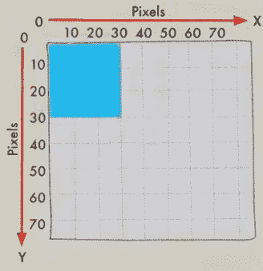

正如我们在任务 1 中所学，坐标可用于指定屏幕上的位置。通常一个坐标代表一个像素。和以前一样，坐标从左上角开始，按 X, Y（屏幕横向位置，屏幕纵向位置）的顺序排列。在此示例中，我们将坐标设置为 (0, 0)，因此矩形位于左上角。这里我们将宽度和高度属性设置为 30 像素，从而创建了一个方块：

```javascript
ctx.fillRect(0, 0, 30, 30);
```

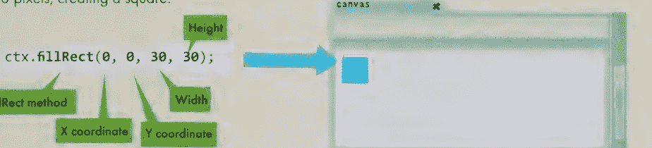

## 移除形状

如果我们想从 `<canvas>` 中移除一个形状，`clearRect` 方法遵循与 `fillRect` 方法相同的规则：

```javascript
ctx.clearRect(0, 0, 300, 300);
```

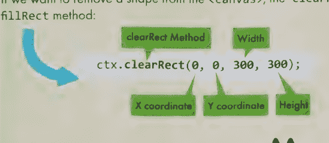

这里的 `clearRect` 方法将移除从坐标 (0, 0) 开始，在整个 `<canvas>` 尺寸（300 x 300 像素）范围内绘制的所有内容。

## 代码技能：创建图形

学习如何使用 JavaScript 的 `<canvas>` 元素在屏幕上绘制和移除一个方块。

1. 打开你的文本编辑程序。新建一个名为 `canvas.html` 的文件。使用 `<canvas>` 元素创建一个 300 x 300 像素的画布：

   > 别忘了添加 `id` 属性，这样你稍后才能在代码中使用该元素。

   ```html
   <!DOCTYPE html>

   <html>

       <head>

           <title>Canvas</title>

       </head>

       <body>

           <canvas id="canvas" width="300" height="300"></canvas> <br/>

       </body>

   </html>
   ```

2. 现在让我们使用 `<input>` 标签在页面上添加两个按钮。将它们的 `onclick` 属性设置为调用一个 `draw` 函数和一个 `remove` 函数。我们将在下一步中编写这些函数的代码。（如果需要回顾函数知识，请翻到第 31 页。）

   ```html
   <!DOCTYPE html>

   <html>

       <head>

           <title>Canvas</title>

       </head>

       <body>

           <canvas id="canvas" width="300" height="300"></canvas> <br/>

           <input type="button" onclick="draw()" value="Draw"/> <br/>

           <input type="button" onclick="remove()" value="Clear"/> <br/>

       </body>

   </html>
   ```

3. 在 `<input>` 标签下方开始一个 `<script>` 代码块。使用 `getElementById` 方法找到 `<canvas>`，然后将其存储在一个变量中。访问绘图上下文并将其存储在第二个变量中：

   ```html
   <script>

       var canvas = document.getElementById("canvas");

       var ctx = canvas.getContext("2d");

   </script>

   </body>
   ```

4. 现在编写我们在步骤 2 中调用的 `draw` 函数。在函数内部，使用绘图上下文在屏幕的左上角绘制一个 30 × 30 像素的黑色矩形。你需要使用 `fillStyle` 属性和 `fillRect` 方法，后者接受四个参数：

   ```javascript
   function draw() {

       ctx.fillStyle = "black";

       ctx.fillRect(0, 0, 30, 30);

   }

   </script>
   ```

   你可以更改 `fillRect` 的参数以创建不同大小的矩形，或在 `fillStyle` 属性中使用不同的颜色。

5. 在 `draw` 函数之后，添加一个 `remove` 函数，在方块绘制完成后将其从屏幕上清除。使用 `clearRect` 方法，如下所示：

   ```javascript
   function remove() {

       ctx.clearRect(0, 0, 300, 300);

   }

   </script>
   ```


- 6. 保存你的文件并在浏览器中打开它。当你点击“Draw”按钮时，屏幕上会绘制一个方块。当你点击“Clear”按钮时，方块将消失。

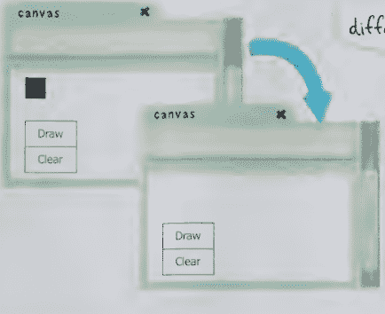

尝试使用不同的颜色。

## 游戏面板

现在我们知道如何使用 JavaScript 的`<canvas>`元素来创建形状了，我们需要构建游戏面板。我们将研究如何使用数组在`<canvas>`上绘制墙壁和岛屿障碍物。

### 数组

我们将使用一个字符串数组来创建游戏面板上的障碍物。在 JavaScript 中，字符串用于表示非数字或布尔值的字符。将字符串存储在变量中很简单：

```javascript
var luckyCatClub = "Ruby";
```

但是，如果我们想在变量中存储多个字符串值该怎么办？我们必须创建一种叫做数组的特殊变量。一个数组可以容纳你所需的任意数量的值。要访问单个值，你使用一个称为偏移量的数字。这是一个包含几个不同字符串的数组：

```javascript
var luckyCatClub = ["Ruby", "Markus", "Grace", "Rusty"];
```

要创建一个数组，你必须将值放在方括号（`[]`）中，并用逗号分隔。这个数组包含四个字符串。数组可以跨多行，并且可以包含字母以外的字符，如符号和空格。

我们将使用字符串来创建游戏面板上的障碍物。井号字符（`#`）将代表构成墙壁和岛屿的方块。空格字符将代表蛇可以移动的空白区域。我们的面板数组将如下所示：

```javascript
var board = [
    "#################",
    "#               #",
    "#               #"
];
```

> **术语解释**
>
> **偏移量**是数组中从起点到给定元素或其中某一点的距离。偏移量从零开始，并在 X、Y 轴上工作。

> **你注意到了吗？**
>
> 数组最后一个值后面没有逗号。

### `forEach` 方法

我们可以使用`forEach`方法按顺序对数组中的每个字符串调用一个函数。这意味着我们可以多次使用同一个函数。你可以像这样使用`forEach`：

```javascript
array.forEach(function name(currentValue));
```

数组名

`forEach`方法

函数关键字

函数名

参数

看看我们如何使用`forEach`对`luckyCatClub`数组中的每一项调用一个函数：

```html
<script>
    var luckyCatClub = [
        "Rusty",
        "Grace",
        "Markus",
        "Ruby"
    ];

    luckyCatClub.forEach(function sayName(name) {
        alert(name);
    });
</script>
```

数组

`forEach`方法

函数名

参数

当你运行这段代码时，`forEach`会为`luckyCatClub`数组中的每个字符串调用`sayName`函数。该函数会弹出一个警报框，按照数组中书写的顺序显示每个字符串的值。

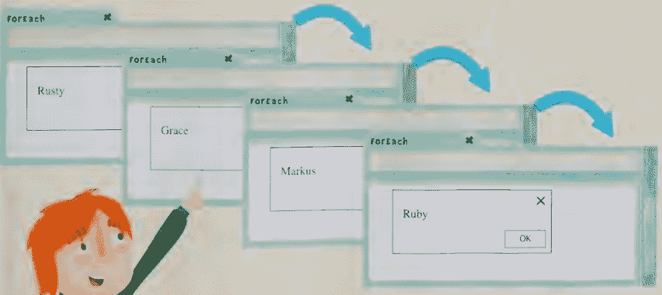

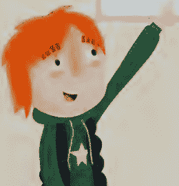

## `split` 方法

我们也可以拆分数组中的单个字符串。为此，我们使用`split`方法，它将字符串分解成更小的部分。你可以像这样使用`split`：

```javascript
string.split(separator);
```

| 方法 | 参数 |
| :--- | :--- |
| `split`方法 | 分隔符（Separator） |
| 要拆分的字符串 | 被拆分的字符串 |

让我们来看一个例子，我们用空字符串（`' '`）调用`split`方法，这样字符串就会被拆分成单个字符：

```html
<body>
    <p>Click the button to see the array values after the split.</p>
    <button onclick="splitString()">Try it</button>
    <p id="answer"></p>

    <script>
        function splitString() {
            var string = "Lucky Cat Club";
            var value = string.split('');
            document.getElementById("answer").innerHTML = value;
        }
    </script>
</body>
```

> **Lucky Cat Club**是编程冠军！

现在让我们看看如何使用数组结合`forEach`和`split`方法在屏幕上绘制游戏棋盘。

## 使用数组创建游戏棋盘

一旦我们使用井号（`#`）和空格字符创建好了棋盘数组，就可以使用`split`和`forEach`方法来访问字符串中的每个字符。我们可以创建一个函数，并使用`forEach`来检查棋盘数组中的每一行。该函数会将数组中的每个字符串拆分成单个字符。然后我们可以对每个单独的字符调用第二个函数。如果字符是井号（`#`），我们就使用`<canvas>` API 将其渲染为屏幕上的黑色方块：

```javascript
board.forEach(function checkLine(line) {
    line = line.split('');
    var currentXoffset = 0;

    line.forEach(function checkCharacter(character) {
        if (character == '#') {
            ctx.fillStyle = "black";
            ctx.fillRect(currentXoffset, currentYoffset, squareSize, squareSize);
        }

        currentXoffset += squareSize;
    });

    currentYoffset += squareSize;
});
```

我们希望方块彼此紧邻绘制，中间没有间隙，因此我们需要跟踪 X 轴上的偏移位置。然后我们可以使用加法赋值运算符（`+=`）将当前 X 轴偏移位置加上方块大小。这样我们就得到了屏幕上最后渲染的方块的宽度，所以当我们遍历每个字符时，我们在其右侧紧邻的位置绘制下一个方块。

在渲染完每一行后，我们还要将当前 Y 轴偏移位置加上方块大小，这样当我们循环到下一个字符串时，新绘制的方块会位于刚刚渲染的那一行的正下方。

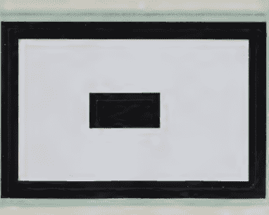

> 这就是你的游戏棋盘。

## 游戏构建 1：游戏棋盘

使用`<canvas>`、数组、`forEach`和`split`方法来创建游戏棋盘图形。

1. 首先创建一个名为`sanke1.html`的新文件。编写 HTML 页面的基本结构。然后添加`<canvas>`元素并设置`id`、`height`和`width`属性，如下所示：

```html
<!DOCTYPE html>
<html>
    <head>
        <title>Snake</title>
    </head>
    <body>
        <canvas id="canvas" width="1024" height="1024"></canvas>
    </body>
</html>
```

2. 在`<canvas>`下方，创建一个数组来定义游戏棋盘。使用井号字符（`#`）表示墙壁和岛屿，使用空格字符表示蛇可以移动的空白区域。墙壁宽 15 个井号字符，高 10 个。

```html
<script>
    var board = [
        "###############",
        "#             #",
        "#             #",
        "#             #",
        "#     ####    #",
        "#     ####    #",
        "#             #",
        "#             #",
        "#             #",
        "###############"
    ];
</script>
```

> 记得用逗号分隔数组中的每个字符串（最后一个除外），并将数组放在方括号（`[ ]`）中。


在数组下方，使用`getElementById()`方法找到`<canvas>`并将其存储在一个变量中。将`<canvas>`的绘图上下文设置为`2d`，如下所示：

```javascript
var canvas = document.getElementById("canvas");
var ctx = canvas.getContext("2d");
```

添加一个变量来跟踪我们在 Y 轴上添加到`<canvas>`的最后一个方块的位置。再添加一个变量来跟踪每个方块的宽度和高度。我们希望每个方块为 30 × 30 像素。

```javascript
var currentYOffset = 0;
var squareSize = 30;
```

现在编写一个函数，使用`forEach`和`split`方法将棋盘数组中的每个字符串拆分成单个字符。然后编写一个函数来检查单个字符。使用`if`语句，如果字符是井号（`#`），则在屏幕上渲染一个黑色方块。跟踪 X 轴和 Y 轴的偏移量。

```javascript
var squareSize = 30;

board.forEach(function checkLine(line) {
    line = line.split('');
    var currentXOffset = 0;

    line.forEach(function checkCharacter(character) {
        if (character == '#') {
            ctx.fillStyle = "black";
            ctx.fillRect(currentXOffset, currentYOffset, squareSize, squareSize);
        }

        currentXOffset += squareSize;
    });

    currentYOffset += squareSize;
});
```

保存你的文件并在浏览器中打开。游戏棋盘应该如下所示：


## 组织游戏棋盘

随着游戏开始扩大，将不同的函数和变量组织成对象字面量（object literals）是确保代码保持可读性的好方法。到目前为止，我们已经使用变量和数组来存储代码中的数据。我们还可以使用对象字面量将相关的代码片段汇集在一起。每个对象字面量都需要一个名称，以便我们可以轻松访问其中的数据。

### 对象字面量

对象字面量与数组类似。但数组允许我们列出许多不同的东西（比如 Lucky Cat Club 的四位成员），而对象字面量允许我们表示一个具有多种不同特征的事物。例如，你可能有名字、姓氏和昵称。到目前为止，如果我们想在代码中存储这些信息，我们会创建三个不同的变量：

```javascript
var firstName = "Russel";
var lastName = "Eich";
var nickname = "Rusty";
```

与其在代码中分别放置这些变量，你可以使用对象字面量将它们整齐地收集在一个地方。我们使用花括号（`{ }`）而不是创建数组时使用的方括号（`[ ]`）。花括号内的所有内容都是对象字面量的一部分。任何数据类型都可以放入对象字面量中，包括数组、函数甚至其他对象字面量。

| 键 | 值 |
| :--- | :--- |
| `firstName` | `"Russel"` |
| `lastName` | `"Eich"` |
| `nickname` | `"Rusty"` |

```javascript
var person = {
    firstName: "Russel",
    lastName: "Eich",
    nickname: "Rusty"
};
```

### 属性

对象内部的信息片段被称为**属性**，它们成对出现：名称和值。名称放在冒号（`:`）之前，值放在冒号之后。名称始终是一个字符串，但值可以是任何你想要的。每对之间用逗号分隔，最后一个除外。

要访问对象中的属性，我们必须编写：

```javascript
objectName.property
```

所以要使用存储为 Rusty 昵称的值，我们会写：

```javascript
person.nickname
```

使用对象字面量允许我们将相关的数据片段分组在一起。在这里，我们所有与人的变量和函数都被分组到一个整齐的对象字面量中：

```javascript
var person = {
    firstName: "Russel",
    lastName: "Eich",
    nickname: "Rusty",

    sayHello: function Hello() {
        alert(person.nickname + " " + person.lastName);
    }
};

person.sayHello();
```


### 命名空间

当我们创建对象字面量时，确保它们被正确组织是很重要的。相似的东西应该被分组在一起，并给这个组起一个名字。我们称之为**命名空间**（namespacing）。使用命名空间，我们可以轻松地在代码的任何地方访问对象字面量内部的变量和函数。看看我们如何为 Scratch 创建了一个命名空间，将所有与 Scratch 相关的不同函数汇集在一起：

```javascript
var scratch = {
    meow: function() {...},
    eatCatFood: function() {...},
    playWithRuby: function() {...}
};

scratch.eatCatFood();
```

> 这是将我们的函数分组在一起的好方法。

# 游戏构建 2：组织游戏面板

使用对象字面量将相关的代码片段组合在一起。

1. 打开你的`sanke1.html`文件。我们将`board`数组之后的所有内容放入一个名为`graphics`的对象字面量中。在新对象内部，将你的代码组织到一个新的`drawBoard`函数中。

```javascript
var graphics = {
    drawBoard: function() {
        var canvas = document.getElementById("canvas");
        . . .
    }
};
```

> 记得打开和关闭花括号。

2. 我们可以进一步整理代码。从`drawBoard`函数中移除`canvas`和`squareSize`，但将它们保留在`graphics`对象内部。这样，在将来，我们添加到对象中的所有函数都可以使用它们。更新`drawBoard`函数，使`canvas`和`squareSize`使用新的命名空间。

```javascript
var graphics = {
    canvas: document.getElementById("canvas"),
    squareSize: 30,

    drawBoard: function() {
        var ctx = graphics.canvas.getContext("2d");
        var currentYoffset = 0;

        board.forEach(function checkLine(line) {
            line = line.split('');
            var currentXoffset = 0;

            line.forEach(function checkCharacter(character) {
                if (character == '#') {
                    ctx.fillStyle = "black";
                    ctx.fillRect(
                        currentXoffset,
                        currentYoffset,
                        graphics.squareSize,
                        graphics.squareSize
                    );
                }

                currentXoffset += graphics.squareSize;
            });

            currentYoffset += graphics.squareSize;
        });
    }
};
```

> 注意我们已经将代码从`canvas`改为`graphics.canvas`，从`squareSize`改为`graphics.squareSize`。

3. 因为我们已经将代码移入新的`drawBoard`函数，所以需要添加一个函数调用来让代码运行。在`graphics`对象后面添加一行来调用`drawBoard`函数：


`graphics.drawBoard();`

## 4. 将 `board` 数组放入 `game` 对象中

让我们把 `board` 数组放入一个 `game` 对象中来整理它：

```javascript
var game = {
  board: [
    "#################",
    "#               #",
    "#    .          #",
    "#               #",
    "#    ####       #",
    "#    ####       #",
    "#               #",
    "#               #",
    "#               #",
    "#################"
  ]
};
```

> 有本事来抓我呀！

## 5. 使用新的命名空间

确保你更改了 `checkLine` 函数以使用新的命名空间：

```javascript
board.forEach(function checkLine(line) {
```

```javascript
game.board.forEach(function checkLine(line) {
```

## 6. 保存并打开文件

将文件保存为 `snake2.html` 并在浏览器中打开。你的游戏面板看起来应该完全一样，但现在你的代码整洁有序。


# 添加蛇

游戏中的蛇由三部分组成：头部、中部和每次吃到水果后会增长的尾部。我们需要能够在代码中追踪蛇并控制它的每个部分。

## 构建蛇的结构

我们将在代码中存储蛇的三个部分的信息。首先，我们需要创建一个对象字面量，将与蛇相关的所有内容组合在一起。然后我们可以创建一个数组，将蛇分解为三个对象。

我们为蛇的每个部分赋予两个属性。这些属性将与它在面板上的 X 和 Y 坐标相关。记住，X 坐标与蛇在面板上的水平位置相关，Y 坐标与它在面板上的垂直位置相关。我们希望蛇从左向右移动，因此 X 坐标会变化，而 Y 坐标保持不变。

我们还添加了一个帮助我们控制蛇方向的属性。这与罗盘的方向有关：北、南、东和西。我们希望蛇从左向右移动，所以它将朝东。我们的代码如下：

```javascript
var snake = {
  parts: [
    {x: 4, y: 2},
    {x: 3, y: 2},
    {x: 2, y: 2}
  ],
  facing: "E"
};
```

> 蛇应该往哪个方向走？


> 这就是你编写蛇代码的方式！

## 绘制蛇

现在我们已经有了蛇的结构，需要将它渲染到面板上的正确位置。我们需要一个 `drawSnake` 函数，它的工作方式与绘制面板的函数类似：

```javascript
drawSnake: function () {
  var ctx = graphics.canvas.getContext("2d");

  snake.parts.forEach(function drawPart(part) {
    var partXlocation = part.x * graphics.squareSize;
    var partYlocation = part.y * graphics.squareSize;

    ctx.fillStyle = "green";
    ctx.fillRect(
      partXlocation,
      partYlocation,
      graphics.squareSize,
      graphics.squareSize
    );
  });
}
```

唯一的区别是我们追踪蛇的各部分的方式。在 `drawPart` 函数中，我们依次访问头部、中部和尾部对象并追踪顺序。然后我们使用简单的计算来确定蛇应该在屏幕上的哪个位置绘制。通过更改 `fillStyle` 和 `fillRect`，我们得到了一条绿色的蛇。

### 数学运算

我们使用数学运算来计算蛇应该在面板上的什么位置绘制。为了确定三个部分的绘制位置，我们使用每个部分的 X 和 Y 坐标，然后乘以方块的大小。我们使用乘法运算符（`*`）来实现这一点。

这个计算之所以有效，是因为我们知道所有方块的大小相同（30 x 30 像素）。例如，位于位置 `{x: 2, y: 2}` 的尾部对象将在以下位置：

| `part.x` | 乘以 | `squareSize` | = | `partXlocation` |
|---|---|---|---|---|
| 2 | x | 30 | = | 60 |
| `part.y` | 乘以 | `squareSize` | = | `partYlocation` |
| 2 | x | 30 | = | 60 |

因此尾部应该绘制在距离画布左侧 60 像素、距离顶部 60 像素的位置。

---

# 游戏构建 3 ► 添加蛇

创建蛇并编写一个在面板上绘制它的函数。

1. 打开你的 `snake2.html` 文件。在 `game` 对象下面为蛇创建一个空的对象字面量：

```javascript
var snake = {
};
```

> 让我们来添加这条蛇吧！


2. 现在创建一个包含三个对象字面量的数组来表示蛇的每个部分。为每个部分设置 X 和 Y 属性。再添加一个控制蛇方向的属性：

```javascript
var snake = {
  parts: [
    {x: 4, y: 2},
    {x: 3, y: 2},
    {x: 2, y: 2}
  ],
  facing: "E"
};
```

3. 在 `graphics` 对象内部，`drawBoard` 函数下面，创建一个绘制蛇的新函数：

```javascript
drawSnake: function() {
  var ctx = graphics.canvas.getContext("2d");

  snake.parts.forEach(function drawPart(part) {
    var partXlocation = part.x * graphics.squareSize;
    var partYlocation = part.y * graphics.squareSize;

    ctx.fillStyle = "green";
    ctx.fillRect(
      partXlocation,
      partYlocation,
      graphics.squareSize,
      graphics.squareSize
    );
  });
},

graphics.drawBoard();
```

不要忘记在上面 `drawBoard` 函数末尾的花括号后面添加一个逗号！


4. 现在我们有了绘制蛇的函数，确保调用它。在 `drawBoard` 调用下面添加函数调用：

```javascript
graphics.drawBoard();
graphics.drawSnake();
```

5. 现在将绘制蛇和面板的两个函数调用移入 `graphics` 对象，并创建一个新的 `drawGame` 命名空间将它们组合在一起。然后调用新函数：

```javascript
var graphics = {
  . . .

  drawGame: function () {
    graphics.drawBoard();
    graphics.drawSnake();
  }
};

graphics.drawGame();

</script>
```

6. 我们可以让代码块更加整洁，只需在新的 `drawGame` 函数中只调用一次 `getContext`，并在代码的不同位置将其作为参数传递：

```javascript
var graphics = {
  canvas: document.getElementById("canvas"),
  squareSize: 30,

  drawBoard: function(ctx) {
    var currentYoffset = 0;

    game.board.forEach(function checkLine(line) {
      line = line.split('');
      var currentXoffset = 0;

      line.forEach(function checkCharacter(character) {
        if(character == '#') {
          ctx.fillStyle = "black";
          ctx.fillRect(
            currentXoffset,
            currentYoffset,
            graphics.squareSize,
            graphics.squareSize
          );
        }

        currentXoffset += graphics.squareSize;
      });

      currentYoffset += graphics.squareSize;
    });
  },
```

# 游戏构建 3 ► 续

```javascript
drawSnake: function(ctx) {
  snake.parts.forEach(function drawPart(part) {
    var partXlocation = part.x * graphics.squareSize;
    var partYlocation = part.y * graphics.squareSize;

    ctx.fillStyle = "green";
    ctx.fillRect(
      partXlocation,
      partYlocation,
      graphics.squareSize,
      graphics.squareSize
    );
  });
},

drawGame: function () {
  var ctx = graphics.canvas.getContext("2d");

  graphics.drawBoard(ctx);
  graphics.drawSnake(ctx);
}
};

graphics.drawGame();
```

- 确保你使用了正确的圆括号（`()`）和花括号（`{}`）。
- 确保对象中除最后一个属性外，每个属性都用逗号（`,`）分隔。
- 不要忘记在对象末尾加上分号（`;`）。

将你的文件保存为 `snake3.html` 并在浏览器中打开。现在，游戏板上将显示一条绿色的蛇。

> 注意你的语法。如果遇到困难，不要忘记使用浏览器的开发者工具。

# 让游戏动起来

现在我们有了一条蛇，需要让它在游戏板上移动。任务 1 中的井字棋是一款回合制游戏，只有在玩家点击屏幕时游戏状态才会改变。蛇是一款不同类型的游戏。蛇必须在没有任何用户输入的情况下自行移动。

在任务 1 中，我们使用循环来检查棋盘上的行和列。循环在每次玩家点击一个方格后运行。在本次任务中，我们将编写代码，使用定时器函数让我们的游戏自行**运转**。

> **运转（tick）**是时间的度量单位。它指的是游戏中重复且有规律的动作时刻，通常是一个循环。这个词来源于时钟发出的“滴答”声。

## 使用 `setTimeout` 函数

JavaScript 定时器，如 `setTimeout` 函数，对于构建游戏非常有用。有时我们不希望 JavaScript 在页面加载后立即运行，而是在经过一段时间后再运行。为此我们使用 `setTimeout` 函数，它的形式如下：

```javascript
setTimeout(function, 1000);
```

我们使用 `setTimeout` 在给定的时间间隔后调用一个函数。时间单位以毫秒计，所以 1,000 毫秒等于一秒。

这个示例展示了如何在函数中使用 `setTimeout` 来实现弹出提示的定时效果。每 5,000 毫秒（或 5 秒），`setTimeout` 会调用 `tick` 函数并弹出一个提示框：

```html
<script>
function tick(){
  alert("Lucky Cat Club");
  setTimeout("tick()", 5000);
}

tick();
</script>
```

## 让蛇移动

我们希望让蛇每隔 500 毫秒移动一定的像素数。这个速度足以让它看起来像在连续移动。我们将这样使用 `setTimeout` 函数：

```javascript
game.timer = window.setTimeout("game.tick()", 500);
```

# 游戏构建 4 ▸ 让游戏运转起来

使用 `setTimeout` 让蛇运转。我们将在下一个游戏构建中为这些函数添加更多代码。

1. 打开你的 `snake3.html` 文件。向 `game` 对象中添加一个空的 `tick` 函数。同时添加一个变量来跟踪运转次数。记住在正确的位置使用逗号来分隔对象中的属性。

2. 现在在 `<script>` 块的最底部添加另一个名为 `gameControl` 的对象。添加一个 `startGame` 函数来调用新的 `tick` 函数，如下所示：

```javascript
graphics.drawGame();

var gameControl = {
  startGame: function () {
    game.tick();
  }
};

gameControl.startGame();
```

```javascript
var game = {
  tickNumber: 0,

  board: [
    "##############",
    "#            #",
    "#            #",
    "#            #",
    "#    ####    #",
    "#    ####    #",
    "#            #",
    "#            #",
    "#            #",
    "##############"
  ],

  tick: function() {
  }
};
```

3. 现在在 `game` 对象中的 `tick` 函数内使用 `setTimeout` 创建一个定时器并将其存储在一个变量中。使用自增运算符（`++`）在每次函数被调用时将 `tickNumber` 变量中存储的值加一。然后创建一个定时器，使用 `setTimeout` 每 500 毫秒调用一次 `tick` 函数：

```javascript
tick: function() {
  game.tickNumber++;
  game.timer = window.setTimeout("game.tick()", 500);
}
```

注意，我们通过访问 `window` 对象来在浏览器窗口上调用 `setTimeout`。

也将定时器添加到 `game` 对象中，这样我们就可以跟踪它。使用 `null` 表示“空”：

```javascript
var game = {
  tickNumber: 0,
  timer: null,
```

游戏现在在运转了，但蛇还没有移动！我们应该将 `drawGame` 函数调用移到 `<script>` 块上方并放入 `tick` 函数中，这样每次游戏运转时蛇都会被绘制：

```javascript
tick: function() {
  game.tickNumber++;
  graphics.drawGame();
  game.timer = window.setTimeout("game.tick()", 500);
}
```

我们还需要添加代码，使蛇只能在棋盘上的空位移动，而不能穿墙或穿过障碍物。让我们先向 `snake` 对象中添加一个空的 `move` 函数，如下所示。（别忘了在前一个属性末尾加上逗号。）

```javascript
var snake = {
  parts: [
    {x: 4, y: 2},
    {x: 3, y: 2},
    {x: 2, y: 2}
  ],

  facing: "E",

  move: function() {
  }
};
```

> 我们将在下一个游戏构建中回到这个函数。

将你的代码保存为 `snake4.html`。如果你打开浏览器，什么都不会发生。我们需要学习一些新技能，然后才能完成 `move` 函数。

# 让蛇移动

目前，我们使用数组在屏幕上绘制蛇。为了使蛇看起来像在屏幕上移动，我们需要在每次游戏运转时向数组中添加或移除元素。

## 使用数组实现移动

我们可以通过添加和移除数组的元素来让蛇在棋盘上移动。

- 🐍 如果我们向数组顶部添加一个元素，蛇的头部就向前移动一个方格。
- 🐍 如果我们从数组底部移除一个元素，蛇的尾巴就缩短一个方格。

以这种方式编码蛇可以使其正确地转弯。要添加或移除元素，我们需要两种方法：`pop` 和 `unshift`。

### 使用 `unshift`

`unshift` 方法向数组的开头添加一个或多个元素，并在每次调用时返回数组的新长度：

```javascript
.unshift(element);
```


要让蛇的头部向前移动，我们使用`unshift`，并以下一个头部位置作为坐标：

```javascript
snake.parts.unshift({x: 3, y: 1});
```

### 使用`pop`

要让蛇的尾巴移动，我们使用`pop`方法移除数组的最后一个元素。这会移除最后一个元素并将其作为值返回。

```javascript
snake.parts.pop();
```

### 寻路

我们还需要编写代码，利用蛇的行进方向来计算它下一步应该移动到哪里。在游戏中，这被称为寻路。如果我们向`snake`对象添加一个名为`nextLocation`的函数，我们可以按以下方式计算蛇的新方向：

```javascript
nextLocation: function () {
    var snakeHead = snake.parts[0];

    var targetX = snakeHead.x;

    var targetY = snakeHead.y;

    targetY = snake.facing == "N" ? targetY-1 : targetY;

    targetY = snake.facing == "S" ? targetY+1 : targetY;

    targetX = snake.facing == "W" ? targetX-1 : targetX;

    targetX = snake.facing == "E" ? targetX+1 : targetX;

    return {x: targetX, y: targetY};
}
```

让我们看看这个函数中做了什么。首先，我们创建了一个名为`snakeHead`的变量，存储`parts`数组中的第一个元素。我们使用数组索引来实现这一点。索引是与数组中值存储位置相对应的数字。所以数组中的第一个项——蛇的头部——的索引是零。通过在方括号（`[]`）中放入零，我们表示“获取第一个（第零个）元素”。

然后我们创建两个新变量（`targetX`和`targetY`），存储蛇头部元素当前的 X 和 Y 坐标。接着我们使用四个三元运算符——我们在任务 1 中使用过——来根据蛇当前面向的方向计算蛇的下一个位置。我们是在说：

- 如果蛇面向 N（北），则蛇的下一个 Y 坐标是 Y 减 1。
- 如果蛇面向 S（南），则蛇的下一个 Y 坐标是 Y 加 1。
- 如果蛇面向 W（西），则蛇的下一个 X 坐标是 X 减 1。
- 如果蛇面向 E（东），则蛇的下一个 X 坐标是 X 加 1。

当所有代码行执行完毕后，`targetX`和`targetY`坐标将被更改为指向蛇在游戏板上的下一个位置。

> **你注意到了吗？**
>
> 当你想获取数组中的第一个项时，你使用零而不是 1，因为在计算机科学中一切都是从零开始索引的。这意味着它从零开始而不是从 1 开始。

## 游戏构建 5 ► 让蛇动起来

使用`unshift`和`pop`方法让蛇在棋盘上移动。

1. 打开你的`snake4.html`文件。在`snake`对象中更新`move`函数，使蛇从当前位置移动一格。使用`unshift`方法在`parts`数组的顶部添加一个新元素来移动蛇头。然后使用`pop`从蛇尾移除一个元素：

```javascript
move: function() {
    var location = {x: 5, y: 5};

    snake.parts.unshift(location);

    snake.parts.pop();
}
```

2. 现在我们需要确保每次循环`tick`时都会调用`snake.move`。为此，我们将其添加到`game.tick`函数中：

```javascript
tick: function() {
    game.tickNumber++;

    snake.move();

    graphics.drawGame();

    game.timer = window.setTimeout("game.tick()", 500);
}
```

3. 将你的文件保存为`snake5.html`并在浏览器中打开。蛇会向右生长一格。

之前：

之后：


4. 我们需要研究如何让蛇自动持续移动。在`snake`中添加一个名为`nextLocation`的空函数。修改你的`move`函数，让它调用`nextLocation`函数，并暂时移除`pop`。

```javascript
var snake = {
    part: [
        {x: 4, y: 2},
        {x: 3, y: 2},
        {x: 2, y: 2}
    ],

    facing: "E",

    nextLocation: function() {
    },

    move: function() {
        var location = snake.nextLocation();

        snake.parts.unshift(location);

        snake.parts.pop();
    }
};
```

5. `nextLocation`函数需要计算出蛇下一步要移动到的位置。使用数组索引找到蛇头，然后用四个三元运算符来判断蛇面朝北、南、西、东时应该发生什么。

```javascript
nextLocation: function() {
    var snakeHead = snake.parts[0];

    var targetX = snakeHead.x;

    var targetY = snakeHead.y;

    targetY = snake.facing == "N" ? targetY-1 : targetY;

    targetY = snake.facing == "S" ? targetY+1 : targetY;

    targetX = snake.facing == "W" ? targetX-1 : targetX;

    targetX = snake.facing == "E" ? targetX+1 : targetX;

    return {x: targetX, y: targetY};
},
```


## 游戏构建 5 ▶ 继续

6. 如果你保存代码并刷新浏览器，你会看到类似这样的效果：


这看起来不对！蛇不断向游戏棋盘外生长。这是因为我们一开始编写绘制函数时，该函数会不断重复绘制而不先清除屏幕。

7. 我们需要修改`drawGame`函数，使其在每个`tick`时清除屏幕。让我们对它做一个小改动：

```javascript
drawGame: function() {
    var ctx = graphics.canvas.getContext("2d");

    ctx.clearRect(0, 0, graphics.canvas.width, graphics.canvas.height);

    graphics.drawBoard(ctx);

    graphics.drawSnake(ctx);
}
```

通过在绘制棋盘和蛇之前调用这段代码，我们在蛇移动时清除了屏幕。

8. 最后，通过将`pop`重新加回`move`函数中，让尾巴跟随头部移动：

```javascript
move: function() {
    var location = snake.nextLocation();

    snake.parts.unshift(location);

    snake.parts.pop();
}
```


9. 保存代码并刷新浏览器。你的蛇会自动在屏幕上移动。现在我们需要让它保持在墙壁内，并控制它的方向。

## 控制蛇

我们现在有了根据蛇面朝方向做出反应的代码，但玩家无法在棋盘上移动蛇。我们需要添加输入处理，以便用键盘控制蛇。我们需要扩展`gameControl`对象，使其在玩家按下某些按键时执行操作。

## `eventListeners`

在浏览器中，每次你点击、在键盘上打字或使用鼠标时，都会创建一个事件。你可以使用一种叫做`eventListener`的方法来跟踪或“监听”这些事件。你的浏览器自带了许多内置事件：

> `abort`、`beforeinput`、`blur`、`click`、`compositionstart`、`compositionupdate`、`compositionend`、`dblclick`、`error`、`focus`、`focusin`、`focusout`、`input`、`keydown`、`keypress`、`keyup`、`load`、`mousedown`、`mouseenter`、`mouseleave`、`mousemove`、`mouseout`、`mouseover`、`mouseup`、`resize`、`scroll`、`select`、`unload`、`wheel`

要使用`eventListener`方法，我们必须包含三条信息：事件、我们要调用的函数和 use capture。我们的游戏需要的事件是`keypress`。

我们想使用一个`eventListener`，在每次按下按键时调用一个函数。然后我们可以决定按键应该对蛇做什么。先看这个例子：

```html
<script>
    function whenAKeyIsPressed(keyPressed) {
        alert(keyPressed.key);
    }

    window.addEventListener("keypress", whenAKeyIsPressed, false);
</script>
```

使用`eventListener`方法和`keypress`事件，我们可以弹出键盘上任意按键的值。如果你按下键盘上的 c 键，`alert`将显示：


## WASD 控制

要控制蛇，我们需要创建一些键盘控件来配合`keypress`事件。我们将使用 WASD 控制，即使用键盘上的 W、A、S 和 D 键像方向键一样操作。W 和 S 键控制上下移动，A 和 D 则控制左右。

我们想让每个 WASD 按键使蛇朝不同方向移动：北、南、东或西。


| 按键 | 蛇的方向 |
| --- | --- |
| W | 北 |
| A | 西 |
| S | 南 |
| D | 东 |

> 你注意到了吗？
>
> 在游戏中，WASD 键经常被用来代替方向键，因为这样可以让玩家右手使用鼠标，左手使用按键。

## 使用`clearTimeout`

我们还需要能够在按键后阻止游戏再次`tick`。否则每次游戏`tick`时，蛇的速度都会变快。我们需要使用`setTimeout`的相反函数：`clearTimeout`。这会阻止函数在一定时间后被调用。

```html
<script>
    function sabreTooth() {
        alert("Research rivals!");
    }

    var timeout = window.setTimeout("sabreTooth()", 500);

    window.clearTimeout(timeout);
</script>
```

这个例子说明，如果你调用`clearTimeout`并传入`timer`变量作为参数，它就会停止计时器。

## 游戏构建 6 ▶ 控制蛇

使用`eventListener`让玩家可以用键盘上的 WASD 键控制蛇的移动。

1. 打开你的`snake5.html`文件。在`gameControl`对象中添加一个名为`processInput`的新函数。然后在`startGame`函数中，使用`eventListener`告诉浏览器在每次`keypress`事件发生时调用`processInput`函数：

```javascript
var gameControl = {
    processInput: function(keyPressed) {
    },

    startGame: function() {
        window.addEventListener("keypress", gameControl.processInput, false);

        game.tick();
    }
};
```

2. 现在我们需要扩展`processInput`函数，使得按下 WASD 键时会发生某些事情。我们可以使用`if`语句配合等于（`==`）运算符来改变玩家按下按键后的目标方向。使用`toLowerCase`方法将按键转换为小写。

```javascript
processInput: function (keyPressed) {
    var key = keyPressed.key.toLowerCase();

    var targetDirection = snake.facing;

    if(key == "w") targetDirection = "N";

    if(key == "a") targetDirection = "W";

    if(key == "s") targetDirection = "S";

    if(key == "d") targetDirection = "E";

    snake.facing = targetDirection;
}
```

万岁！我们可以控制蛇了！

3. 将代码保存为`snake6.html`并在浏览器中打开。你可以使用 WASD 键控制蛇。

继续

## 游戏构建 6 ▶ 继续

4. 你有没有注意到蛇对按键的响应有点慢？这是因为在游戏中，直到下一个滴答（`tick`）之前它不会再次移动。当你玩游戏时，你希望按钮一按下控制就生效。如果我们把`game.tick()`调用放在按下按键之后，游戏感觉会更灵敏：

```javascript
processInput: function (keyPressed) {
    var key = keyPressed.key.toLowerCase();

    var targetDirection = snake.facing;

    if(key == "w") targetDirection = "N";

    if(key == "a") targetDirection = "W";

    if(key == "s") targetDirection = "S";

    if(key == "d") targetDirection = "E";

    snake.facing = targetDirection;

    game.tick();
},
```

> 然而，如果你保存代码并刷新浏览器，你会注意到一个新的 bug。每次游戏滴答时，它都会设置一个新的计时器，以便在 500 毫秒后再次滴答。这意味着每次我们按下一个键，游戏都会加速！我们可以使用`clearTimeout`来解决这个问题。

5. 修改`tick`函数，使其每次被调用时都清除计时器。这意味着当我们的游戏正在滴答时，它不会因为有人按下了方向键而意外地尝试第二次运行。

```javascript
tick: function () {
    window.clearTimeout(game.timer);

    game.tickNumber++;

    snake.move();

    graphics.drawGame();

    game.timer = window.setTimeout("game.tick()", 500);
}
```

6. 保存、刷新并试用一下！你的蛇现在应该感觉灵敏多了。

你会注意到你的蛇仍然可以穿过墙壁和岛屿。我们现在来修复这个问题。


## 墙壁和碰撞

蛇之所以能穿过游戏板的墙壁和岛屿，是因为我们的游戏还没有使用碰撞检测。我们需要编写代码，利用游戏板和蛇的位置来告诉我们蛇是否碰到了墙壁或岛屿。

## 碰撞检测

碰撞检测是用于判断两个对象是否相互碰撞或重叠的代码。我们需要一个新的函数来判断蛇前方的空间是空的还是有障碍物：

```javascript
isEmpty: function(location) {
    var contents = game.board[location.y][location.x];

    return contents == ' ';
}
```

我们正在访问游戏对象中的`board`数组。然后我们检查蛇想要移入的空间是否是一个空格字符并且没有障碍物。通过传递`location`参数，我们可以使用数组索引器首先访问 Y 和 X 位置。我们甚至可以进一步简化`isEmpty`函数，将其压缩到一行中完成。

```javascript
isEmpty: function(location) {
    return game.board[location.y][location.x] == ' ';
}
```

我们可以将新的`isEmpty`函数放入`snake.move`函数中，作为`if`语句的一部分，以阻止蛇穿过墙壁：

```javascript
move: function () {
    var location = snake.nextLocation();
```


```javascript
if(game.isEmpty(location)) {
    snake.parts.unshift(location);
    snake.parts.pop();
}
```

我们还将`location`作为参数传递，以便蛇在移动到那里之前检查该位置是否为空。

> 我们怎样才能让蛇发生碰撞呢？

## 游戏构建 7 ▶ 墙壁和碰撞

在游戏中添加碰撞检测，使蛇无法穿墙。

1. 打开你的`snake6.html`文件。首先在`game`对象中添加一个名为`isEmpty`的函数，并传递参数`location`。我们稍后会在这里添加更多代码。

```javascript
var game = {
  ...

  tick: function() {
    window.clearTimeout(game.timer);
    game.tickNumber++;
    snake.move();
    graphics.drawGame();
    game.timer = window.setTimeout("game.tick()", 500);
  },

  isEmpty: function(location) {

  }
};
```

2. 现在通过添加一个`if`语句，从`snake.move`函数中调用`isEmpty`函数：

```javascript
move: function() {
  var location = snake.nextLocation();

  if(game.isEmpty(location)) {
    snake.parts.unshift(location);
    snake.parts.pop();
  }
}
```

3. 让`isEmpty`函数检查蛇是否能够进入空位。使用`board`数组和数组索引器：

```javascript
isEmpty: function(location) {
  var contents = game.board[location.y][location.x];
  return contents == ' ';
}
```

4. 我们甚至可以进一步简化函数，将其压缩到一行中完成。

```javascript
isEmpty: function(location) {
    return game.board[location.y][location.x] == ' ';
}
```

5. 将你的代码保存为`s​​nake7.html`并在浏览器中打开。蛇将无法穿过墙壁或岛屿。


## 游戏结束

现在我们已经建立并运行了碰撞检测，让我们确保当蛇撞到墙时，游戏结束并提示玩家。我们可以使用代码中已有的`isEmpty`函数和一个检查蛇下一个位置是否是墙壁的新函数来实现。这两个方法非常相似。我们检查的是井号（`#`）字符，而不是空格，我们用它来创建游戏板的墙壁和岛屿。

> 我们不希望游戏直接停止。我们希望玩家知道游戏已经结束。


## 游戏构建 8 ▶ 游戏结束

学习如何在蛇撞墙时结束游戏。

1. 打开你的`s​​nake7.html`文件。在`game`对象中的`isEmpty`下面，添加一个名为`isWall`的函数：

```javascript
isEmpty: function(location) {
    return game.board[location.y][location.x] == ' ';
},

isWall: function(location) {
    return game.board[location.y][location.x] == '#';
}
```

2. 我们可以在`snake.move`代码中使用新的`isWall`函数来判断何时应该结束游戏：

```javascript
move: function () {
    var location = snake.nextLocation();

    if(game.isEmpty(location)) {
        snake.parts.unshift(location);
        snake.parts.pop();
    }

    if(game.isWall(location)) {
        return "gameover";
    }
}
```

3. 目前，即使我们返回了`"gameover"`，游戏实际上也不会结束，直到我们编写停止它的代码。我们需要进入`game.tick`函数并修改代码，以便如果蛇返回了`"gameover"`，计时器就会停止。我们只需在计时器再次被排队之前从`tick`函数中返回。

```javascript
tick: function () {
    window.clearTimeout(game.timer);
    game.tickNumber++;

    var result = snake.move();

    if(result == "gameover") {
        alert("Game over!");
        return;
    }

    graphics.drawGame();
}
```

4. 将你的代码保存为`s​​nake8.html`并在浏览器中打开。现在，当你将蛇移动到墙上时，游戏将结束，并弹出一个游戏结束的提示。


## 添加水果

我们现在可以控制蛇并结束游戏，但除了在棋盘上移动之外，玩家无事可做。还记得蛇游戏的规则吗？我们的游戏中缺少水果。添加水果与我们已经学过的编码蛇的技巧相同。我们要做的就是在代码的正确位置添加水果，并简化一些函数。让我们来喂饱这条饥饿的蛇吧！

## 游戏构建 9 ▶ 添加水果

在游戏板上添加一个水果。

1. 打开你的`s​​nake8.html`文件。通过在`game`对象中的`board`下面创建一个新数组来添加水果。为水果赋予一个 X 和一个 Y 属性，代表棋盘的左上角。

```javascript
fruit: [
  {x: 1, y: 1}
],
```

2. 现在我们需要绘制水果。在`graphics`对象中，在`drawSnake`下面添加一个`drawFruit`函数。它几乎完全相同：

```javascript
drawFruit: function(ctx) {
  game.fruit.forEach(function(part) {
    var partXlocation = part.x * graphics.squareSize;
    var partYlocation = part.y * graphics.squareSize;

    ctx.fillStyle = "red";
    ctx.fillRect(
      partXlocation,
      partYlocation,
      graphics.squareSize,
      graphics.squareSize
    );
  });
},
```

这两个函数的代码只有两个区别：我们使用`forEach`遍历`game.fruit`，并且我们将`fillStyle`改为了红色，以使我们的方块看起来像一个苹果。

## 游戏构建 9 ▶ 继续

3. 在`drawGame`函数中调用`drawFruit`函数。将其添加在`drawSnake`调用之后。

```javascript
drawGame: function() {
    var ctx = graphics.canvas.getContext("2d");

    ctx.clearRect(
      0,
      0,
      graphics.canvas.width,
      graphics.canvas.height
    );

    graphics.drawBoard(ctx);
    graphics.drawSnake(ctx);
    graphics.drawFruit(ctx);
}
```

> 当我们有那些如此相似的函数时，我们应该尝试将它们合并在一起。

4. 最后，将我们的`drawSnake`和`drawFruit`函数合并成一个单一的`draw`函数，将我们要绘制的内容作为参数传入。新的`draw`函数将根据传入的参数，对`snake.parts`或`game.fruit`调用`forEach`。它会将`fillStyle`设置为我们传入的第三个参数。

```javascript
draw: function(ctx, source, color) {
    source.forEach(function(part) {
        var partXlocation = part.x * graphics.squareSize;
        var partYlocation = part.y * graphics.squareSize;

        ctx.fillStyle = color;
        ctx.fillRect(
          partXlocation,
          partYlocation,
          graphics.squareSize,
          graphics.squareSize
        );
    });
},

drawGame: function() {
    var ctx = graphics.canvas.getContext("2d");

    ctx.clearRect(
      0,
      0,
      graphics.canvas.width,
      graphics.canvas.height
    );

    graphics.drawBoard(ctx);
    graphics.draw(ctx, snake.parts, "green");
    graphics.draw(ctx, game.fruit, "red");
}
```

5. 将你的代码保存为`snake9.html`并在浏览器中打开。你应该能在棋盘的左上角看到一个水果。

## 吃水果

游戏现在有了水果，但蛇会直接穿过它。我们想使用碰撞检测来判断蛇何时碰到水果。然后我们可以编写代码让蛇吃掉它。水果会从棋盘上消失，蛇的长度会增加一格。玩家将获得一分。

### 为水果添加碰撞检测

我们可以使用循环来遍历棋盘上的每一个水果，将其与蛇的位置进行比对。该循环会检查蛇的 X 位置是否与水果的 X 位置相同，以及蛇的 Y 位置是否与水果的 Y 位置相同。如果位置相同，说明蛇已经碰撞到水果，我们可以返回`true`。来看看这个循环：

```javascript
for(var fruitNumber = 0; fruitNumber < game.fruit.length; fruitNumber++) {
    var fruit = game.fruit[fruitNumber];

    if(location.x == fruit.x && location.y == fruit.y) {
        return true;
    }
}
```

### 使用`splice`

当蛇吃到水果时，水果需要从大屏幕上消失。我们可以使用`splice`方法在蛇检测到水果时将其移除。`splice`可以从数组中添加或删除项目并返回新的项目。要删除项目，你必须使用偏移量（即我们给水果设置的 X 和 Y 数字，从顶部开始计数）给出该项目在数组中的位置。因此，如果我们想删除位于 (1, 1) 的水果，我们这样编写代码：

```javascript
if(location.x == fruit.x && location.y == fruit.y) {
    game.fruit.splice(fruitNumber, 1);
    return true;
}
```

### 增加分数

每次蛇吃到水果时，我们希望玩家获得一分。为此，我们可以在`snake.move`函数中使用一个`if`语句来检查蛇和水果是否在同一个位置。然后增量运算符（`++`）将从零开始给分数加 1：

```javascript
if(game.isFruit(location)) {
    game.score++;
}
```

#### 增量运算符

### 让蛇成长

另一件需要发生的重要事情是，当蛇吃到水果时，它的长度会增加一格。还记得`unshift`是如何将蛇头向前移动一格，而`pop`又是如何移除蛇尾的吗？要让蛇在吃到水果时成长，意味着我们要使用`unshift`移动蛇头但不使用`pop`移除蛇尾。这将使我们的蛇变大一格。我们需要更新`if`语句以包含这一点：

```javascript
if(game.isFruit(location)) {
    snake.parts.unshift(location);
    game.score++;
}
```

#### `Unshift`方法

### 游戏构建 10 ► 吃水果

让蛇吃到水果。水果应该从棋盘上消失，并且蛇的长度会增加一格。

1. 打开你的`s​​nake9.html`文件。在我们的游戏对象中添加另一个名为`isFruit`的函数，暂时将其设置为返回`false`。

```javascript
isWall: function(location) {
    return game.board[location.y][location.x] == '#';
},

isFruit: function(location) {
    return false;
}
```

2. 这个新函数将不同于`isEmpty`和`isWall`来工作，因为它不是检查棋盘，而是使用一个循环来检查蛇的位置与水果的位置。

```javascript
isFruit: function(location) {
    for(var fruitNumber = 0; fruitNumber < game.fruit.length; fruitNumber++) {
        var fruit = game.fruit[fruitNumber];

        if(location.x == fruit.x && location.y == fruit.y) {
            return true;
        }
    }

    return false;
}
```

3. 我们现在可以使用这个`isFruit`函数在我们的`snake.move`代码中做更多有趣的事情。添加一个`if`语句，如果蛇碰到了水果就弹出一个警告：

```javascript
move: function () {
    var location = snake.nextLocation();

    if(game.isEmpty(location)) {
        snake.parts.unshift(location);
        snake.parts.pop();
    }

    if(game.isWall(location)) {
        return "gameover";
    }

    if(game.isFruit(location)) {
        alert('Fruit');
    }
}
```

4. 将你的文件保存为`s​​nake10.html`并在浏览器中打开。当蛇碰到水果时，我们会看到一个警告。

## 游戏构建 10 继续

5. 现在使用`splice`方法在蛇吃掉水果后将其从棋盘上移除：

```javascript
isFruit: function(location) {
    for (var fruitNumber = 0; fruitNumber < game.fruit.length; fruitNumber++){
        var fruit = game.fruit[fruitNumber];

        if(location.x == fruit.x && location.y == fruit.y) {
            game.fruit.splice(fruitNumber, 1);
            return true;
        }
    }

    return false;
},
```

6. 我们还应该将警告更改为开始计分。在`snake.move`函数中，将警告替换为增量运算符（`++`），从零开始向上计分，像这样：

```javascript
if(game.isFruit(location)) {
    game.score++;
}
```

> 现在我们需要添加更多水果！

7. 最后，更新吃水果的代码，这样如果蛇和水果在同一个位置，蛇就会长一格。使用`unshift`，像这样：

```javascript
if(game.isFruit(location)) {
    snake.parts.unshift(location);
    game.score++;
}
```


## 8. 保存代码并刷新浏览器

现在当蛇吃到水果时，水果会消失，蛇会成长。

## 添加更多水果

目前我们只有一个水果，它在游戏最开始时被添加。为了增加挑战性，我们需要让水果随机地出现在棋盘上的更多位置，随着游戏进行而出现。

### 取余运算符

每隔十个刻度，我们将把棋盘上的一个随机方块变成水果。为此，我们将在`game.tick`函数中使用取余运算符（`%`）编写一个新的`if`语句。如果`tickNumber`除以 10 等于（`==`）零，一个随机水果将被添加到棋盘上。这是因为如果我们的`tickNumber`能被十整除，取余运算符就返回零。所以每隔十个刻度，`if`语句就会运行。

```javascript
if(game.tickNumber % 10 == 0) {
    game.addRandomFruit();
}
```

### 在随机位置添加水果

我们需要创建一个新函数来向游戏中添加随机水果。首先，我们需要选择一个添加水果的位置。我们通过生成两个随机数来做到这一点。变量`randomY`将是零到棋盘高度之间的一个随机数。然后我们会选择`randomX`，它表示我们想在棋盘上横着放多远的位置来放置水果。

```javascript
addRandomFruit: function() {
    var randomY = Math.floor(Math.random() * game.board.length) + 0;
    var randomX = Math.floor(Math.random() * game.board[randomY].length) + 0;
    var randomLocation = {x: randomX, y: randomY};

    if(game.isEmpty(randomLocation) && !game.isFruit(randomLocation)) {
        game.fruit.push(randomLocation);
    }
},
```

我们使用`Math.floor`和`Math.random`函数。调用`random`生成一个随机数，`floor`确保我们只得到整数（1、2、3、4，而不是 1.5、1.6、1.7）。将新的`randomLocation`对象存储在一个变量中。

最后，我们使用一个`if`语句来检查我们选择的随机位置是空的，并且（`&&`）没有（`!`）水果已经在该位置。如果这些条件为真，我们就可以使用`push`方法在选定的位置绘制水果。这个方法将一个项目添加到数组的末尾并返回新的长度。

## 游戏构建 11 ▸ 添加随机水果

在不同的位置添加大量水果。

1. 打开你的`snake10.html`文件。修改`game.tick`函数，每十个游戏刻度添加一个水果：

```javascript
game.tickNumber++;

if(game.tickNumber % 10 == 0) {
    game.addRandomFruit();
}

var result = snake.move();
```

2. 在`game`对象中添加一个新的`addRandomFruit`函数，放在`tick`函数下方：

```javascript
tick: function () {
    window.clearTimeout(game.timer);
    game.tickNumber++;

    if(game.tickNumber % 10 == 0) {
        game.addRandomFruit();
    }

    var result = snake.move();

    if(result == "gameover") {
        alert("Game over!");
        return;
    }

    graphics.drawGame();
    game.timer = window.setTimeout("game.tick()", 500);
},

addRandomFruit: function() {
},
```

3. 我们需要让这个新函数在游戏中添加随机水果。首先，我们得选一个位置来放置水果。使用`floor`和`random`来生成 X 和 Y 位置的数值。将新位置存储为对象字面量：

```javascript
addRandomFruit: function() {
    var randomY = Math.floor(Math.random() * game.board.length) + 0;
    var randomX = Math.floor(Math.random() * game.board[randomY].length) + 0;
    var randomLocation = {x: randomX, y: randomY};
},
```

4. 有了`randomLocation`后，我们可以将其添加到`game.fruit`数组中，以便在屏幕上绘制水果，同时检查该位置是否已有水果。

```javascript
addRandomFruit: function() {
    var randomY = Math.floor(Math.random() * game.board.length) + 0;
    var randomX = Math.floor(Math.random() * game.board[randomY].length) + 0;
    var randomLocation = {x: randomX, y: randomY};

    if(game.isEmpty(randomLocation) && !game.isFruit(randomLocation)) {
        game.fruit.push(randomLocation);
    }
},
```

5. 如果你将文件保存为`snake11.html`并在浏览器中打开，每次游戏刻都会有一个水果出现在棋盘上。

## 修复漏洞

我们的游戏可以运行了！玩家可以控制蛇吃水果、变长，最终撞到墙壁结束游戏。但我们的代码中还有三个漏洞：

- 玩家不知道自己的分数是多少。
- 玩家可以让蛇穿过自己的身体。
- 水果可能会随机生成在蛇的身上。

> 我们需要想办法修复游戏中的这些漏洞。

## 游戏构建 12 ▸ 修复漏洞

让我们修复这些漏洞，让游戏可以正常运行。

1. 打开你的`snake11.html`文件。我们先从游戏结束时显示分数开始修复。这个很简单，因为我们在游戏中已经统计了蛇每次吃水果的次数，也就是`score`变量。我们所要做的只是确保显示这个值。修改我们的`game.tick`函数中的代码：

2. 同时在`game`对象中添加一个`score`变量：

```javascript
if(result == "gameover") {
    alert("Game over! Player scored: " + game.score);
    return;
}
```

```javascript
timer: null,
score: 0,
```

3. 让我们修复第二个漏洞，阻止蛇穿过自己的身体。首先，在`game`对象的`isFruit`之后添加一个名为`isSnake`的函数。

```javascript
}

isSnake: function(location) {
    return false;
}
```

4. 然后我们需要在`snake.move`函数中调用这个新函数`isSnake`。我们可以将其添加到现有的`isWall`检查中，该检查会在撞到墙壁时结束游戏。我们还需要将`isWall`和`isSnake`检查移到函数的最开头，否则我们会在检查能否移动之前就先移动了蛇。

```javascript
move: function () {
    var location = snake.nextLocation();

    if(game.isWall(location)
        || game.isSnake(location)) {
        return "gameover";
    }

    if(game.isEmpty(location)) {
        snake.parts.unshift(location);
        snake.parts.pop();
    }

    if(game.isFruit(location)) {
        snake.parts.unshift(location);
        game.score++;
    }
}
```

5. 最后，我们需要编写代码来检查传入的位置在那一刻是否属于蛇的一部分。我们只需添加一个循环来实现，它会遍历`snake.parts`中的每个部分。这几乎与我们之前检查是否已有水果的代码完全相同。这次我们检查的是`snake.parts`。

```javascript
},

isSnake: function(location) {
    for(var snakePart = 0; snakePart < snake.parts.length; snakePart++) {
        var part = snake.parts[snakePart];

        if(location.x == part.x && location.y == part.y) {
            return true;
        }
    }

    return false;
}
```

> 让我们击败这些漏洞，完成构建！

6. 现在我们阻止了蛇穿过自己，但出现了一个有趣的新漏洞。如果你按下相反方向的方向键——例如，蛇正在向东移动，而你按下 A 键让它向西——蛇会立刻吃掉自己，你会立即输掉游戏！

我们应该修改`gameControl`对象中的输入处理，阻止蛇能够转向自己。我们只需在每个`if`语句中检查，蛇是否正面向与按键完全相反的方向。

```javascript
var gameControl = {
    processInput: function(keyPressed) {
        var key = keyPressed.key.toLowerCase();
        var targetDirection = snake.facing;

        if(key == "w" && snake.facing != "S") targetDirection = "N";
        if(key == "a" && snake.facing != "E") targetDirection = "W";
        if(key == "s" && snake.facing != "N") targetDirection = "S";
        if(key == "d" && snake.facing != "W") targetDirection = "E";

        snake.facing = targetDirection;
        game.tick();
    },
}
```

现在蛇不能原地转向了！

## 游戏构建 12 ▸ 续

7. 我们还有一个最后的漏洞：如果水果随机生成在蛇的尾巴下方，它可能会被绘制在蛇的上面。最简单的解决方法是确保我们的蛇总是在水果之后绘制在屏幕上。修改`graphics`对象中`drawGame`函数的最后两行，让水果先绘制。

```javascript
drawGame: function () {
    var ctx = graphics.canvas.getContext("2d");

    ctx.clearRect(0, 0, graphics.canvas.width, graphics.canvas.height);
    graphics.drawBoard(ctx);
    graphics.draw(ctx, game.fruit, "red");
    graphics.draw(ctx, snake.parts, "green");
}
```

由于蛇是最后绘制的，即使我们随机将水果放置在它的尾巴下方，也要等到蛇离开那个格子才能看到。

8. 将你的代码保存为`snake12.html`并在浏览器中打开。漏洞已修复！

## 超级技能

我们的贪吃蛇游戏现在已经完成——你能玩得有多好？游戏的难度来自于蛇移动的速度以及棋盘上同时存在的水果数量。

### 让你的游戏更进一步

- 通过编辑`board`数组来改变墙壁和岛屿在棋盘上的布局。更改井号（`#`）字符的排列方式来获得不同的形态。
- 你能想出让蛇移动得更快的方法吗？  
  （提示：蛇的移动速度取决于游戏刻的速度。）
- `drawGame`函数将墙壁、蛇和水果绘制为一系列彩色方块。你可以更改传递给`graphics.draw`的内容，以不同方式绘制游戏世界的各个部分。你能想到只改变蛇头颜色的方法吗？
- 你能通过创建多个`board`数组来为游戏创建多个关卡吗？

### 未来的游戏构建

贪吃蛇是一个基于游戏刻的益智游戏，角色在每个游戏刻移动。使用相同的技能和技巧可以制作经典游戏的版本，如*俄罗斯方块*和*吃豆人*，以及如今流行的游戏如*糖果传奇*。

## 任务 2：最终代码

```html
<!DOCTYPE html>
<html>
<head>
    <title>Snake</title>
</head>
<body>
    <canvas id="canvas" width="1024" height="1024"></canvas>

    <script>
    var game = {
        tickNumber: 0,
        timer: null,
        score: 0,
        board: [
            "##############",
            "#            #",
            "#            #",
            "#            #",
            "#    ####    #",
            "#    ####    #",
            "#            #",
            "#            #",
            "#            #",
            "##############"
        ],
        fruit: [
            {x: 1, y: 1}
        ],
        tick: function() {
            window.clearTimeout(game.timer);
            game.tickNumber++;

            if(game.tickNumber % 10 == 0) {
                game.addRandomFruit();
            }

            var result = snake.move();

            if(result == "gameover") {
                alert("Game over! Player scored: " + game.score);
                return;
            }

            graphics.drawGame();
            game.timer = window.setTimeout("game.tick()", 500);
        },

        addRandomFruit: function() {
            var randomY = Math.floor(Math.random() * game.board.length) + 0;
            var randomX = Math.floor(Math.random() * game.board[randomY].length) + 0;
            var randomLocation = {x: randomX, y: randomY};

            if(game.isEmpty(randomLocation) && !game.isFruit(randomLocation)) {
                game.fruit.push(randomLocation);
            }
        },

        isEmpty: function(location) {
            return game.board[location.y][location.x] == ' ';
        },

        isWall: function(location) {
            return game.board[location.y][location.x] == '#';
        },

        isFruit: function(location) {
            for(var fruitNumber = 0; fruitNumber < game.fruit.length; fruitNumber++) {
                var fruit = game.fruit[fruitNumber];

                if(location.x == fruit.x && location.y == fruit.y) {
                    game.fruit.splice(fruitNumber, 1);
                    return true;
                }
            }

            return false;
        },

        isSnake: function(location) {


```javascript
for (var snakePart = 0; snakePart < snake.parts.length; snakePart++) {
    var part = snake.parts[snakePart];

    if (location.x == part.x && location.y == part.y) {
        return true;
    }
}

return false;

};

var snake = {
    parts: [
        {x: 4, y: 2},
        {x: 3, y: 2},
        {x: 2, y: 2}
    ],

    facing: "E",

    nextLocation: function() {
        var snakeHead = snake.parts[0];

        var targetX = snakeHead.x;
        var targetY = snakeHead.y;

        targetY = snake.facing == "N" ? targetY - 1 : targetY;
        targetY = snake.facing == "S" ? targetY + 1 : targetY;
        targetX = snake.facing == "W" ? targetX - 1 : targetX;
        targetX = snake.facing == "E" ? targetX + 1 : targetX;

        return {x: targetX, y: targetY};
    },

    move: function() {
        var location = snake.nextLocation();

        if (game.isWall(location) || game.isSnake(location)) {
            return "gameover";
        }

        if (game.isEmpty(location)) {
            snake.parts.unshift(location);
            snake.parts.pop();
        }

        if (game.isFruit(location)) {
            snake.parts.unshift(location);
            game.score++;
        }
    }
};

var graphics = {
    canvas: document.getElementById("canvas"),
    squareSize: 30,

    drawBoard: function(ctx) {
        var currentYoffset = 0;

        game.board.forEach(function checkLine(line) {
            line = line.split('');

            var currentXoffset = 0;

            line.forEach(function checkCharacter(character) {
                if (character == '#') {
                    ctx.fillStyle = "black";
                    ctx.fillRect(
                        currentXoffset,
                        currentYoffset,
                        graphics.squareSize,
                        graphics.squareSize
                    );
                }

                currentXoffset += graphics.squareSize;
            });

            currentYoffset += graphics.squareSize;
        });
    },

    draw: function(ctx, source, color) {
        source.forEach(function(part) {
            var partXlocation = part.x * graphics.squareSize;
            var partYlocation = part.y * graphics.squareSize;

            ctx.fillStyle = color;
            ctx.fillRect(
                partXlocation,
                partYlocation,
                graphics.squareSize,
                graphics.squareSize
            );
        });
    },

    drawGame: function() {
        var ctx = graphics.canvas.getContext("2d");

        ctx.clearRect(
            0,
            0,
            graphics.canvas.width,
            graphics.canvas.height
        );

        graphics.drawBoard(ctx);
        graphics.draw(ctx, game.fruit, "red");
        graphics.draw(ctx, snake.parts, "green");
    }
};

var gameControl = {
    processInput: function(keyPressed) {
        var key = keyPressed.key.toLowerCase();
        var targetDirection = snake.facing;

        if (key == "w" && snake.facing != "S") targetDirection = "N";
        if (key == "a" && snake.facing != "E") targetDirection = "W";
        if (key == "s" && snake.facing != "N") targetDirection = "S";
        if (key == "d" && snake.facing != "W") targetDirection = "E";

        snake.facing = targetDirection;
        game.tick();
    },

    startGame: function() {
        window.addEventListener(
            "keypress",
            gameControl.processInput,
            false
        );

        game.tick();
    }
};

gameControl.startGame();
```

未完待续 ➡

```html
</script>

</body>

</html>
```

> “我们一定会用这款游戏打败 SabreTooth Studios 的！”

## 乒乓球

- 编写一个运行在 60 帧每秒游戏循环中的实时游戏
- 创建对象的多个实例
- 创建更高级的碰撞检测
- 编写一个简单的人工智能（AI）来控制电脑的球拍

## 任务简报

你好，

很高兴认识你！感谢你成为幸运猫俱乐部的一员。我是格蕾丝。我等不及要参加黑客马拉松了。我非常期待挑战 SabreTooth Studios，向他们展示我们精彩的游戏。和伙伴们一起学习编程非常有趣，当然，没有你我们不可能走到今天！

我喜欢老式街机游戏。玩起来非常有趣。我最喜欢的是基于真实体育运动的那些，比如曲棍球、足球，最棒的是乒乓球。我决定在黑客马拉松上编写一个乒乓球游戏。我觉得 SabreTooth Studios 从来没有做过这样的游戏，所以它让我们有很大的获胜机会，因为它太与众不同了。

我爸爸说他年轻时在真正的街机上玩过乒乓球。我一直在网上了解这款游戏。这款游戏叫做 Pong，非常受欢迎。那些机器现在看来太老派了！我要编写一个新版本来在浏览器中玩，但让它看起来像原版游戏。游戏设计非常直接——你只需要两个球拍（或桨）、一个球和一个打球区域。球在球员之间反弹，其轨迹难以预测。

但令人兴奋的是，其中一个球拍由电脑控制。这意味着我必须编写一些简单的 AI。这多酷啊？我要编写一个能自己思考的游戏！让球拍之战开始吧！

送上完美的祝福，

格蕾丝

## 乒乓球

来自开发者词典，你的游戏与游戏指南。

乒乓球游戏如需了解其他体育运动游戏，请参阅体育。

**乒乓球**（也称为 **Ping Pong**）已经流行了一百多年。游戏的目标是尝试将小球在球台上来回击打，如果对手未能回球，则得一分。

乒乓球一直是电脑游戏的热门创意，*Tennis for Two* 早在 1958 年就已开发。第一款商业上取得成功的视频游戏版本叫做 **Pong**，源自 Ping Pong，由**雅达利（Atari）**在 20 世纪 70 年代初开发。它在**街机**中大受欢迎，雅达利很快成为家喻户晓的名字。这款游戏被广泛认为**启动**了游戏产业，如今该产业价值数十亿英镑。

原版游戏具有简单的**二维**图形。玩家能够在屏幕左侧上下移动球拍，或称**桨板**。右侧的桨板由电脑或另一名玩家控制。玩家用桨板将球来回击打，试图预判球下一次反弹的角度。如果一名玩家无法回球，则对方得分。在原版街机游戏中，玩家通过转动旋钮来控制桨板。

Pong 如此受欢迎，许多其他游戏制造商试图模仿它。其他版本也被开发出来，例如 **Home Pong**，你可以使用简单的**主机**和电视屏幕来玩。Home Pong 催生了我们今天所熟知的家用视频游戏主机。2012 年，雅达利发布了 Pong 40 周年纪念应用，让玩家可以在智能手机或平板电脑上游玩。

### 开发者词典

你的游戏与游戏指南：

- 首页
- 目录
- 精选游戏
- 游戏策略
- 构建技巧

| 类型 | 体育 |
| --- | --- |
| 模式 | 双人 |
| 首次发布 | 1972 年（以 Pong 之名） |
| 游戏时长 | 1 分钟起（取决于级别） |
| 所需技能 | 快速反应、观察力 |

## 乒乓球

在本任务中，我们将编写乒乓球游戏。我们要构建两个球拍、一个移动的球以及一个简单的智能对手（AI）。与上一个任务一样，我们将使用 JavaScript 编写循环来驱动游戏运行，并在屏幕上绘制图形。对于这次构建，我们还必须运用数学来计算如何让球以不可预测的角度反弹。我们将处理高级碰撞检测，让玩家可以互相来回击球。按照游戏构建中的说明操作，你很快就能准备好开始游戏了。

### 游戏构建

乒乓球令人着迷，因为它易于理解，但难以精通。它需要快速的反应和良好的协调能力。我们这个版本的乒乓球游戏板非常简单，并且在游戏过程中不会发生变化。它看起来像这样：


使用键盘上的上下键，玩家可以控制屏幕左侧的球拍。目标是将球拍移到正确位置，以便将球击回对手控制的球拍处。为了让游戏更具挑战性，我们还希望在每次球与球拍碰撞时稍微加快球速。如果玩家漏接球，游戏将重新开始。

## 游戏板

由于游戏板只是一个简单的黑色矩形，我们将使用 `<canvas>` 元素和 API 来绘制它，就像在任务 2 中所做的那样。我们还需要编写一个每秒运行 60 次的快速函数来在屏幕上绘制游戏板。

```html
<body>
    <canvas id="canvas" width="640" height="480"></canvas>
    <script>
        var canvas = document.getElementById("canvas")
        var ctx = canvas.getContext("2d");

        function tick() {
            draw();
            window.setTimeout("tick()", 1000 / 60);
        }

        function draw() {
            ctx.fillStyle = "black";
            ctx.fillRect(0, 0, 640, 480);
        }

        tick();
    </script>
</body>
```

游戏板基本结构的代码看起来像这样：

> 这段代码将在屏幕上绘制游戏板。

我们使用 `getContext`、`fillRect` 和 `fillStyle` 来编写游戏将要进行的黑色矩形。我们将这些 API 分组到一个 `draw` 函数中。我们还编写了一个 `tick` 函数，它每秒调用 `draw` 函数一定次数。这意味着每次游戏滴答运行时，游戏板都会被绘制在屏幕上。

## 让游戏运行起来

让我们看看用于在屏幕上绘制游戏板的 `tick` 函数。使用 `setTimeout`，就像在任务 2 的第 91 页所做的那样，我们创建了一个

要创建滑板（skateboard）对象的新实例，我们使用 `new` 运算符。我们将新实例存储在两个变量中：`skateboard1` 和 `skateboard2`。你注意到没有，对于每个滑板对象，我们向滑板函数传递了不同的参数？这些数据分别存储在两个不同的对象实例中。最后，我们可以在每个实例上调用 `alert` 函数，以提醒每个滑板的所有者。尽管我们使用相同的函数创建了每个对象，但存储在其中的数据不同，并且每个对象都会弹出新的提示框。


## 编写球拍代码

> 注意每个球拍左上角的 X 坐标是不同的。

在我们的游戏中，我们可以使用对象实例来编写两个共享相同移动功能的球拍，但它们位于棋盘上的不同位置。这是因为球拍对象内部的位置变量存储在每个单独的对象实例中。以这种方式构建游戏可以节省时间，因为这意味着我们只需编写一次球拍及其功能。然后我们可以创建该对象的两个实例——一个用于玩家，另一个由计算机通过 AI 控制。

`paddle` 函数需要包含四个参数：每个球拍左上角的 X 和 Y 坐标，以及我们希望渲染的宽度和高度。


```javascript
function paddle(x, y, width, height) {
    this.x = x;
    this.y = y;
    this.width = width;
    this.height = height;
}

var player = new paddle(5, 200, 25, 100);
var ai = new paddle(610, 200, 25, 100);
```

当我们创建两个 `paddle` 对象的实例时，我们需要使用像素传递不同的 X 位置。我们希望玩家球拍的左上角距离屏幕左侧 5 像素，向下 200 像素。我们还希望两个球拍都是 25 像素宽，100 像素高。

AI 球拍需要放置在屏幕的右侧，所以我们需要进行一些数学计算。还记得我们说我们的游戏是 640 像素宽、480 像素高吗？为了计算我们需要将右侧球拍的左上角放在哪里，我们进行以下计算：

[屏幕总宽度] 减去 [球拍宽度] 减去 [5 像素间隙] = [位置]

640 - 25 - 5 = 610

我们现在要做的就是编写一个新函数，使用与绘制游戏棋盘相同的 `<canvas>` API 来绘制球拍。然后两个球拍将在屏幕上渲染出来。


> 你注意到了吗？

记住，在计算机科学中，X 坐标是横跨屏幕的，Y 坐标是沿屏幕向下的。

## 游戏构建 2 ▸ 创建球拍

使用函数编写球拍代码，定义两个对象实例。

1. 打开你的 **tennis1.html** 文件。创建一个定义 `paddle` 对象的函数。该函数需要四个参数：每个球拍左上角的 X 和 Y 位置以及其宽度和高度：

```javascript
var canvas = document.getElementById("canvas");
var ctx = canvas.getContext("2d");

function paddle(x, y, width, height) {
    this.x = x;
    this.y = y;
    this.width = width;
    this.height = height;
}
```

2. 使用 `new` 运算符创建 `player` 和 `ai` 对象实例。传递以下参数，使球拍分别位于左侧和右侧，并且形状和大小相同：

```javascript
this.height = height;
}

var player = new paddle(5, 200, 25, 100);
var ai = new paddle(610, 200, 25, 100);
```

3. 我们将在 `draw` 函数下方添加一个新的 `renderPaddle` 函数，它接受一个参数：你要在屏幕上绘制的球拍。我们所做的就是再次使用 `fillRect` `<canvas>` API。与其给出每个位置，我们将使用球拍的 X、Y、宽度和高度属性，将它们绘制在屏幕上的正确位置。

```javascript
function renderPaddle(paddle) {
    ctx.fillStyle = "white";
    ctx.fillRect(
        paddle.x,
        paddle.y,
        paddle.width,
        paddle.height
    );
}

tick();
```

4. 添加 `renderPaddle` 后，我们需要从 `draw` 函数中为每个玩家调用它。

该函数将使用存储在我们对象中的不同值，因此两个不同的球拍将被绘制在屏幕上的正确位置。


```javascript
function draw() {
    ctx.fillStyle = "black";
    ctx.fillRect(0, 0, 640, 480);
    renderPaddle(player);
    renderPaddle(ai);
}
```

-Lister 5. 将你的文件保存为`tennis2.html`并在浏览器中打开。你现在将看到游戏棋盘上的球拍。


> 现在让我们添加球！


## 添加移动球

像球拍一样，乒乓球也有一些与之相关的重要数据：它的 X 和 Y 位置、半径（从球心到边缘的距离）和速度。我们需要创建一个球对象，并使用一些新的`<canvas>` API 来渲染它。

### 绘制球

因为游戏中只有一个球，我们可以将其创建为对象字面量。我们的球对象需要以下属性：

```javascript
var ball = { x: 320, y: 240, radius: 3, xSpeed: 2, ySpeed: 0 };
```

我们将使用 X 值为 320 像素、Y 值为 240 像素来绘制球的中心，这大致是我们游戏板的中心。球的半径为 3 像素。这意味着球周围都是 3 像素。速度属性将使球在屏幕上横向或纵向移动。要在屏幕上绘制球，我们需要一个新函数：

```javascript
function renderBall(ball) {
    ctx.beginPath();
    ctx.arc(ball.x, ball.y, ball.radius, 0, 2 * Math.PI, false);
    ctx.fillStyle = "white";
    ctx.fill();
}
```

使用`<canvas>` API 的`beginPath`、`arc`和`fill`，我们在游戏板上绘制了一个白色圆圈。我们将存储在球对象中的属性传递给`arc`，以及一个数学计算使其变圆。我们还将`fillStyle`设置为白色，这样我们就能看到球了。

### 创建速度

为了使球移动，我们希望在每次游戏 Tick 时，将球的速度加到当前的 X 和 Y 坐标上。我们需要编写一个新的`updateGame`函数，使用加法赋值运算符（`+=`）将值加到变量上。这将迫使球移动。

```javascript
function updateGame() {
    ball.x += ball.xSpeed;
    ball.y += ball.ySpeed;
}
```


## 游戏构建 3 ► 添加移动球

使用新的`<canvas>` API 将球添加到棋盘上。然后让它移动。

1. 打开你保存的`tennis2.html`文件。在球拍下方创建一个球对象字面量。我们将使用 X 值为 320 像素、Y 值为 240 像素，半径为 3 像素：

   ```javascript
   var player = new paddle(5, 200, 25, 100);
   var ai = new paddle(610, 200, 25, 100);
   var ball = { x: 320, y: 240, radius: 3 };
   ```

2. 我们需要一个`renderBall`函数，它使用新的`beginPath`和`arc` `<canvas>` API。将其添加到`renderPaddle`函数下方，并将`fillStyle`设置为白色，这样我们就能看到黑色棋盘上的球：

   ```javascript
   ctx.fillRect(paddle.x, paddle.y, paddle.width, paddle.height);
   }
   function renderBall(ball) {
       ctx.beginPath();
       ctx.arc(ball.x, ball.y, ball.radius, 0, 2 * Math.PI, false);
       ctx.fillStyle = "white";
       ctx.fill();
   }
   tick();
   ```

3. 在现有的`draw`函数中添加对新`renderBall`函数的调用。这次我们将球对象作为参数传递：

   ```javascript
   function draw() {
       ctx.fillStyle = "black";
       ctx.fillRect(0, 0, 640, 480);
       renderPaddle(player);
       renderPaddle(ai);
       renderBall(ball);
   }
   ```

> 这就是我们在任务 2 中构建蛇的方式！

## 游戏构建 3 ► 继续

4. 我们已经让所有球元素都在屏幕上渲染了，但我们的游戏还没有任何动静。我们需要为球添加一些移动。添加一个更新游戏的空函数。在每次游戏 Tick 时调用它，在游戏绘制到屏幕上之前：

   ```javascript
   function tick() {
       updateGame();
       draw();
       window.setTimeout("tick()", 1000/60);
   }
   function updateGame() {
   }
   ```

-Lister 5. 要使球移动，我们必须给它一个速度。将`xSpeed`和`ySpeed`属性添加到球对象中：

```javascript
var ball = { x: 320, y: 240, radius: 3, xSpeed: 2, ySpeed: 0 };
```

-Lister 6. 现在让球移动。每次游戏 Tick 时，将球的速度加到当前的 X 和 Y 坐标上。这将迫使球移动。

```javascript
function updateGame() {
    ball.x += ball.xSpeed;
    ball.y += ball.ySpeed;
}
```

-Lister 7. 将你的文件保存为`tennis3.html`并在浏览器中打开。看着你的球在屏幕上移动。


## 添加碰撞检测

你看到刚才发生了什么吗？代码中没有检查游戏元素是否相互碰撞。球穿过了 AI 挡板并从游戏中消失。要阻止球消失在屏幕外，我们需要为`paddle`对象添加碰撞检测。

## 停止球

要停止球，我们需要确定它在棋盘上的位置以及它接触挡板的确切时刻。最简单的方法是检查球的 X 坐标是否在每个挡板的左右墙之间。如果是，说明球已经过远，需要停止。

对于挡板的两个实例，左墙的 X 坐标与挡板的 X 坐标相同，我们在游戏构建 2 中已编码。右墙的 X 坐标是挡板的 X 坐标加上挡板的宽度。我们可以将左右墙的值存储在两个变量中，然后使用`if`语句决定球是否应该停止。

如果球的 X 位置在这两个值之间，我们返回`true`以停止球。这就是我们的碰撞检测代码。否则我们返回`false`，球继续移动。

```javascript
this.hasCollidedWith = function(ball) {
    var paddleLeftWall = this.x;
    var paddleRightWall = this.x + this.width;
    if(ball.x > paddleLeftWall && ball.x < paddleRightWall) {
        return true;
    }
    return false;
};
```

- 挡板左侧
- 挡板右侧
- 大于运算符
- 与运算符
- 小于运算符

## 改变球的方向

现在我们已经停止了球，我们想改变它的方向，使其横跨棋盘移动到另一个挡板。我们需要添加代码来反转球的方向。我们必须添加两个新方法：`reverseX`和`reverseY`。`reverseX`将改变球在屏幕上移动的方式。`reverseY`将改变它在屏幕上上下移动的方式。


首先，我们使用`if`语句检查任一挡板是否与球碰撞：

```javascript
if(player.hasCollidedWith(ball) || ai.hasCollidedWith(ball)) {
    ball.reverseX();
}
```

如果任一挡板与球碰撞，我们将调用新方法（本例中是`reverseX`）来改变球在屏幕上的方向。

我们还需要一些巧妙的数学来使球以正确的方式改变方向。我们需要在球对象中添加的 X 和 Y 速度的计算如下：

```javascript
reverseX: function() {
    this.xSpeed *= -1;
},
```

通过将球的速度乘以（`*=`）-1，我们反转了这个数字。所以如果球的速度是 1，我们将其乘以 -1，速度就变成了 -1。

这意味着当我们下次移动球时，我们不再向 X 或 Y 坐标添加值，而是减去值，使球在屏幕上向相反方向移动。

## 游戏构建 4 ► 添加碰撞检测

添加碰撞检测以使球在两个挡板之间移动。

- 打开你保存的`tennis3.html`文件。向挡板对象添加一个空的`hasCollidedWith`函数，并将球作为参数传递：

  ```javascript
  function paddle(x, y, width, height) {
      this.x = x;
      this.y = y;
      this.width = width;
      this.height = height;
      this.hasCollidedWith = function(ball) {
      };
  }
  ```

  向新的`hasCollidedWith`函数添加代码。将挡板的左右墙存储在变量中，并使用`if`语句检查球是否已经穿过它们：

  ```javascript
  this.hasCollidedWith = function(ball) {
      var paddleLeftWall = this.x;
      var paddleRightWall = this.x + this.width;
      if(ball.x > paddleLeftWall && ball.x < paddleRightWall) {
          return true;
      }
      return false;
  };
  ```

  向`updateGame`函数添加一个`if`语句，检查球是否与任一挡板碰撞并反转其 X 方向：

  ```javascript
  function updateGame() {
      ball.x += ball.xSpeed;
      ball.y += ball.ySpeed;
      if(player.hasCollidedWith(ball) || ai.hasCollidedWith(ball)) {
          ball.reverseX();
      }
  }
  ```

  现在通过反转使球改变方向。将球对象从以下内容扩展：

  ```javascript
  var ball = { x: 320, y: 240, radius: 3, xSpeed: 2, ySpeed: 0 };
  ```

  扩展到：

  ```javascript
  var ball = {
      x: 320, y: 240, radius: 3, xSpeed: 2, ySpeed: 0,
      reverseX: function() {
          this.xSpeed *= -1;
      },
      reverseY: function() {
          this.ySpeed *= -1;
      }
  };
  ```

> 如果遇到困难，不要忘记使用浏览器开发者工具！

## 游戏构建 4 ▶ 继续

- 我们还应该添加一些代码，以确保碰撞检测仅在球位于挡板的顶部和底部之间时触发。我们以与检查挡板左右墙相同的方式进行此操作，只是现在我们检查 Y 坐标。将`if`语句扩展如下：

  ```javascript
  this.hasCollidedWith = function(ball) {
      var paddleLeftWall = this.x;
      var paddleRightWall = this.x + this.width;
      var paddleTopWall = this.y;
      var paddleBottomWall = this.y + this.height;
      if(ball.x > paddleLeftWall
          && ball.x < paddleRightWall
          && ball.y > paddleTopWall
          && ball.y < paddleBottomWall) {
          return true;
      }
      return false;
  };
  ```

- 将文件保存为`tennis4.html`并在浏览器中打开。观察球在两个挡板之间来回移动。


## 控制玩家的挡板

现在我们已经让球动起来了，我们需要找到一种方法让玩家控制左侧挡板。当他们按下键盘上的上或下箭头时，我们希望挡板移动。我们将像任务 2 中一样使用`keypress`事件监听器。但是，我们不是在按键按下时处理输入，而是希望代码持续跟踪按键何时被按住和释放。

## 括号表示法

要跟踪按键何时被按住，我们需要使用两个新的事件监听器：`keydown`和`keyup`。当浏览器触发`keydown`事件时，我们希望将其存储在一个新的`heldDown`对象中。

括号表示法是在定义对象后向其添加额外数据的快速方法。我们使用方括号（`[]`）向对象字面量添加数据。一旦定义了对象字面量，你就可以像这样向其添加属性：

```javascript
var myObject = {};
myObject['greeting'] = 'Hello Lucky Cat Club!';
alert(myObject['greeting']);
```

这里我们使用方括号向对象添加一个名为`greeting`的新属性。我们将属性的值设置为一个文本字符串。

然后我们可以使用`delete`关键字通过名称从对象中删除属性：

```javascript
delete myObject['greeting'];
alert(myObject['greeting']);
```

如果我们再次运行`delete`后的`alert`，它将返回`undefined`，因为该属性已被移除。

## 存储 keyCodes

分配给键盘上每个键的数字称为`keyCodes`。它们为我们提供了一种方法来确定玩家按下了哪个键。对于没有数字或字母的键，它们特别有用。

我们希望使用键盘上的上、下箭头来控制挡板。为此，我们创建一个空的`heldDown`对象。然后我们可以添加`keydown`事件并将其`keyCode`值设置为`heldDown`对象。我们将把属性值设置为`true`，这样我们的`heldDown`对象将跟踪我们按住的每个键。如果`keyCode`与上、下箭头的`keyCode`匹配，只要键被按住，挡板就会持续移动。我们还需要为`keyup`事件（当我们松开手指时）添加一个事件监听器，从`heldDown`对象中删除我们的键。

```javascript
var heldDown = {};
window.addEventListener("keydown", function(keyInfo) { heldDown[event.keyCode] = true; }, false);
window.addEventListener("keyup", function(keyInfo) { delete heldDown[event.keyCode]; }, false);
```

## 使用 keycodes 创建移动

我们可以使用`keyCode`值使挡板移动。

我们希望向挡板对象添加一个新的`move`函数。根据按下的键，我们需要改变 Y 属性。要使挡板向下移动，我们需要向其 Y 属性添加像素。要使挡板向上移动，我们需要从其 Y 属性中减去像素：

- 键盘上的下箭头的`keyCode`为 40。
- 键盘上的上箭头的`keyCode`为 38。

```javascript
this.move = function(keyCode) {
    var nextY = this.y;
    if(keyCode == 40) {
        nextY += 5;
    } else if(keyCode == 38) {
        nextY += -5;
    }
    this.y = nextY;
};
```

首先，我们通过创建一个名为`nextY`的变量并将其值设置为 Y 的当前值来复制当前的 Y 属性。现在，如果我们的`keyCode`是 40（下箭头），我们就向`nextY`添加 5 个像素。否则，如果我们的`keyCode`是 38（上箭头），我们就从`nextY`中减去 5 个像素。最后，我们将 Y 值设置为`nextY`的值。挡板现在会移动了！

## 让球拍保持在游戏板上

现在我们可以移动球拍了，但我们有了一个新问题。如果我们一直按向上或向下键，球拍会穿过游戏板的地板或天花板。幸运的是，阻止这种情况发生很容易。在`move`函数中，在将`this.y`设置为`nextY`的值之前，我们可以确保`nextY`的值不小于零像素（我们游戏的天花板），也不大于 480 像素（我们游戏的总高度）。如果`nextY`低于零或超过 480，这段代码会覆盖我们的`nextY`值：

```javascript
this.move = function(keyCode) {
    var nextY = this.y;
    if(keyCode == 40) {
        nextY += 5;
    } else if (keyCode == 38) {
        nextY += -5;
    }
    nextY = nextY < 0 ? 0 : nextY;
    nextY = nextY + this.height > 480 ? 480 - this.height : nextY;
    this.y = nextY;
};
```

第一行新代码很容易理解。如果`nextY`小于零，将`nextY`设置为零。否则，将`nextY`设置为其当前值。


第二行稍微复杂一些，因为我们需要确保球拍的底边不会移过游戏板的底部。我们可以通过将`nextY`与`this.height`（球拍的高度）相加来计算球拍底部的像素位置。所以在第二行中，我们检查`nextY + this.height`是否大于`480`。如果大于（`>`）`480`，那么球拍的底部就在板外，所以我们将`nextY`设置为`480 - this.height`的值。这是`nextY`允许的最大值。否则，如果`nextY + this.height`小于`480`，我们就将`nextY`的值保持为当前值。现在玩家的球拍无法穿过屏幕的顶部或底部了。

> 这是一个棘手的计算！

## 游戏构建 5 ► 控制玩家的球拍

添加`keyCode`控制，让玩家可以使用上下箭头移动球拍。

1. 打开保存的`tennis4.html`文件。在`<script>`块的末尾，添加一个新的空`heldDown`对象来存储当前被按下的键：

```javascript
var heldDown = {};
tick();
```

2. 在新对象之后，使用括号表示法添加第一个`eventListener`：`keydown`。将值设置为`true`：

```javascript
var heldDown = {};
window.addEventListener("keydown", function(keyInfo) { heldDown[event.keyCode] = true; }, false);
tick();
```

3. 我们还需要为`keyup`事件添加一个`eventListener`，从`heldDown`对象中删除该键。现在每次我们按住一个键，就会在`heldDown`对象中设置为`true`。当我们松开手指时，`keyCode`和`true`值将被移除：

```javascript
var heldDown = {};
window.addEventListener("keydown", function(keyInfo) { heldDown[event.keyCode] = true; }, false);
window.addEventListener("keyup", function(keyInfo) { delete heldDown[event.keyCode]; }, false);
tick();
```

4. 我们希望左侧的玩家球拍对当前按下的键做出反应。在`paddle`对象中添加一个新的`move`函数：

```javascript
function paddle (x, y, width, height) {
	this.x = x;
	this.y = y;
	this.width = width;
	this.height = height;
	this.hasCollidedWith = function(ball) {
		var paddleLeftWall = this.x;
		var paddleRightWall = this.x + this.width;
		var paddleTopWall = this.y;
		var paddleBottomWall = this.y + this.height;
		if(ball.x > paddleLeftWall
			&& ball.x < paddleRightWall
			&& ball.y > paddleTopWall
			&& ball.y < paddleBottomWall) {
			return true;
		}
		return false;
	};
	this.move = function() {
	};
}
```

5. 现在编辑`updateGame`函数来处理我们存储在`heldDown`对象中的输入。添加一个`for`循环，遍历当前被按下的每个键。在刚刚添加的`player`对象上调用`move`函数。（记住，我们的`player`只是`paddle`对象的一个实例。）现在每当有键被按住时，玩家球拍就会移动。

```javascript
function updateGame() {
	ball.x += ball.xSpeed;
	ball.y += ball.ySpeed;
	var collidedWithPlayer = player.hasCollidedWith(ball);
	var collidedWithAi = ai.hasCollidedWith(ball);
	if(collidedWithPlayer || collidedWithAi) {
		ball.reverseX();
	}
	for(var keyCode in heldDown) {
		player.move(keyCode);
	}
}
function draw() {
```

继续

## 游戏构建 5 ▶ 继续

6. 现在在`paddle`对象的`move`函数中添加`if`和`else if`语句，根据按下的键来改变球拍的`Y`属性：

```javascript
this.move = function(keyCode) {
    var nextY = this.y;
    if(keyCode == 40) {
        nextY += 5;
    } else if(keyCode == 38) {
        nextY += -5;
    }
    this.y = nextY;
};
```

保存为`tennis5.html`并在浏览器中打开。当你按下上、下键时，你的球拍会移动。但它会穿过板的顶部和底部！

7. 让我们添加能将球拍保持在游戏板上的代码：

```javascript
this.move = function(keyCode) {
    var nextY = this.y;
    if(keyCode == 40) {
        nextY += 5;
    } else if (keyCode == 38) {
        nextY += -5;
    }
    nextY = nextY < 0 ? 0 : nextY;
    nextY = nextY + this.height > 480 ? 480 - this.height : nextY;
    this.y = nextY;
};
```

> 我们怎样才能让游戏更有趣呢？

保存你的文件并刷新浏览器。现在玩家的球拍无法穿过屏幕的顶部或底部了！

## 让球反弹

现在我们可以移动玩家的球拍并将球击回 AI 球拍了。但球碰到球拍后会直线反弹，这让游戏非常可预测，玩起来也不那么有趣。让我们研究一下如何在球撞到另一个球拍时加速。

### 跟踪速度

要改变球的速度，我们需要在`paddle`对象中引入一个名为`speedModifier`的新属性。这个变量将跟踪球与球拍碰撞时速度增加多少。我们先将它设置为零：

```javascript
this.speedModifier = 0;
```

然后我们需要在`move`函数中设置`speedModifier`，这样当按键被按下时，球拍的速度每游戏刻增加 1.5 像素，以跟上球的速度：

```javascript
this.move = function(keyCode) {
    var nextY = this.y;
    if(keyCode == 40) {
        nextY += 5;
        this.speedModifier = 1.5;
    } else if(keyCode == 38) {
        nextY += -5;
        this.speedModifier = 1.5;
    } else {
        this.speedModifier = 0;
    }
    nextY = nextY < 0 ? 0 : nextY;
    nextY = nextY + this.height > 480 ? 480 - this.height : nextY;
    this.y = nextY;
};
```

最后的`else`语句确保如果有人按住任何其他键盘键，`speedModifier`会重置为零。现在我们正在跟踪要加速多少，我们需要让球变得更智能一些。

> 是时候添加一些反弹了！

### 改变球在板上的速度

现在让我们编写代码来改变球在板上运动的速度：球的`xSpeed`。当球向屏幕右侧运动时，`xSpeed`是正数。当它向左侧运动时，`xSpeed`是负数。

我们需要确保我们修改速度的量与球运动的方向相匹配：

```javascript
modification = this.xSpeed < 0 ? modification * -1 : modification;
var nextValue = this.xSpeed + modification;
```

我们在这里使用三元运算符。当球当前的`xSpeed`小于（`<`）零（球正向左运动）时，我们需要将（`*`）`modification`乘以`-1`，使其也为负数。

然后我们只需通过将`xSpeed`和`modification`相加来计算`nextValue`（我们的新速度）。之后我们需要做的就是将球的`this.xSpeed`设置为新速度。

### 改变球在板上下的速度

我们还需要修改球上下运动的方式：`ySpeed`。给球添加反弹很容易——我们将要做的事与让球加速完全相同。但不是改变`this.xSpeed`属性（球的水平、左右速度），而是改变`this.ySpeed`值（球的垂直、上下速度），通过将修改后的速度加到它上面。

### 控制速度

我们还需要确保球不会加速太多。我们要确保`nextValue`永远不会超过每游戏刻额外 9 像素的速度。我们将使用一个内置函数来给出数字的绝对值：

```javascript
nextValue = Math.abs(nextValue) > 9 ? 9 : nextValue;
```

这意味着如果我们的`nextValue`是负数，它会返回不带负号的数字。我们要检查总`nextValue`修改量是否大于（`>`）`9`，如果是，我们就将它设置为`9`，这是我们的最大速度值。如果`nextValue`是负数，那么最大速度将被设置为`-9`。

## 游戏构建 6 ▸ 让球弹起来

让我们来让球弹起来并加速，这样游戏会更有挑战性。

1. 打开你保存的`Edge浏览器`文件。在`paddle`对象的`this.height`属性下方添加`speedModifier`属性。将其设置为零，如下所示：

```javascript
function paddle(x, y, width, height) {
    this.x = x;
    this.y = y;
    this.width = width;
    this.height = height;
    this.speedModifier = 0;
    this.hasCollidedWith = function(ball) {
```

2. 现在将`speedModifier`属性添加到`move`函数中。将其设置为每 tick 1.5 像素。添加一个`else`语句，当按下除上下箭头以外的任何键时，将重置`speedModifier`：

```javascript
this.move = function(keyCode) {
    var nextY = this.y;
    if(keyCode == 40) {
        nextY += 5;
        this.speedModifier = 1.5;
    } else if(keyCode == 38) {
        nextY += -5;
        this.speedModifier = 1.5;
    } else {
        this.speedModifier = 0;
    }
    nextY = nextY < 0 ? 0 : nextY;
    nextY = nextY + this.height > 480 ? 480 - this.height : nextY;
    this.y = nextY;
};
```

3. 我们将为球添加三个新函数。首先是一个新的`isBouncing`函数，用于检查球的速度是否为零。如果球具有不为零的`ySpeed`，我们就知道球正在游戏板上向上或下弹跳。然后编写两个空的速度函数：`modifyXSpeedBy`和`modifyYSpeedBy`。

```javascript
reverseY: function() {
    this.ySpeed *= -1;
},
isBouncing: function() {
    return ball.ySpeed != 0;
},
modifyXSpeedBy: function(modification) {
},
modifyYSpeedBy: function(modification) {
}
```

4. 然后使用三元运算符来改变球在屏幕上移动时的`xSpeed`。同时添加一个检查以防止球移动过快：

```javascript
modifyXSpeedBy: function(modification) {
    modification = this.xSpeed < 0 ? modification * -1 : modification;
    var nextValue = this.xSpeed + modification;
    nextValue = Math.abs(nextValue) > 9 ? 9 : nextValue;
    this.xSpeed = nextValue;
},
```

5. 最后，添加代码来修改球的上下移动速度：

```javascript
modifyYSpeedBy: function(modification) {
    modification = this.ySpeed < 0 ? modification * -1 : modification;
    this.ySpeed += modification;
}
```

将你的代码保存为`tennis6.html`并在浏览器中打开。此时你的游戏将保持不变，因为我们还需要调用我们的新函数。

## 完成球的功能

现在我们已经编写了加速球的函数，需要确保它们在游戏的正确时间点被调用。我们还需要一种方法，在玩家没接住球时重新启动游戏。

### 实现速度变化

我们需要在`updateGame`函数中调用`modifyXSpeedBy`。我们只想略微加速球，所以每 tick 增加 0.25 像素，使其比当前速度快四分之一。

```javascript
ball.modifyXSpeedBy(0.25);
```

### 从边缘弹起

我们还希望球能从板的边缘弹回。我们可以在`updateGame`方法中添加一个检查，确保当球的`Y`位置低于零像素（穿过游戏顶部）或高于`480`像素（穿过游戏底部）时，我们使用之前编写的`reverseY`函数反转球的弹跳方向：

```javascript
if(ball.y <= 0 || ball.y >= 480) {
    ball.reverseY();
}
```

> 哦不！球消失了！

### 重置游戏

如果玩家没接住球会发生什么？我们需要将游戏重置球的位置和速度恢复到游戏开始时的状态。否则你就无法继续玩下去！我们需要一个函数将球重新定位回板的中央：

```javascript
reset: function() {
    this.x = 320;
    this.y = 240;
    this.xSpeed = 2;
    this.ySpeed = 0;
},
```

然后我们可以使用一个`if`语句来调用`reset`函数，如果球的位置小于（`<`）零像素或大于（`>`）640 像素（板的宽度）。

```javascript
if(ball.x < 0 || ball.x > 640) {
    ball.reset();
}
```

## 游戏构建 7

## 完成球的功能

让球在与球拍或板的边缘碰撞时加速。

1. 打开你保存的`tennis6.html`文件，向我们的`updateGame`函数添加一些新代码。每次球击中球拍时，我们需要调用新代码来加速球在屏幕上的移动：

```javascript
if(collidedWithPlayer || collidedWithAi) {
    ball.reverseX();
    ball.modifyXSpeedBy(0.25);
}
```

2. 现在为了让球弹跳，我们需要修改球的`ySpeed`，使其上下移动。为此，我们需要从球刚碰撞的球拍获取`speedModifier`并将其存储在一个变量中：

```javascript
if(collidedWithPlayer || collidedWithAi) {
    ball.reverseX();
    ball.modifyXSpeedBy(0.25);
    var speedUpValue = collidedWithPlayer ? player.speedModifier : ai.speedModifier;
}
```

3. 然后用球拍的`speedModifier`增加球的速度。请记住，如果球拍静止不动，球不会弹跳得更快。

```javascript
if(collidedWithPlayer || collidedWithAi) {
    ball.reverseX();
    ball.modifyXSpeedBy(0.25);
    var speedUpValue = collidedWithPlayer ? player.speedModifier : ai.speedModifier;
    ball.modifyYSpeedBy(speedUpValue);
}
```

> 此时球仍然会穿过游戏板的墙壁。如果你将代码保存为`tennis7.html`并在浏览器中打开，你会看到球掉出了板外。

4. 我们需要在`updateGame`函数的开头为板的顶部和底部添加碰撞检测：

```javascript
function updateGame() {
    ball.x += ball.xSpeed;
    ball.y += ball.ySpeed;
    if(ball.y <= 0 || ball.y >= 480) {
        ball.reverseY();
    }
    var collidedWithPlayer = player.hasCollidedWith(ball);
```


保存并刷新你的浏览器。球将开始弹跳。你可以打败另一个球拍，因为 AI 还没有与你对战。不过，一旦你成功得分，球就会消失！

### 5. 为球添加 `reset` 函数，以防止它掉出屏幕

```javascript
var ball = {
    x: 320, y: 240, radius: 3, xSpeed: 2, ySpeed: 0,
    reverseX: function() {
        this.xSpeed *= -1;
    },
    reverseY: function() {
        this.ySpeed *= -1;
    },
    reset: function() {
        this.x = 320;
        this.y = 240;
        this.xSpeed = 2;
        this.ySpeed = 0;
    },
    isBouncing: function() {
```

> 我们需要球重置，这样你才能继续玩下去！

### 6. 添加球的重置逻辑

现在，就像我们为顶部和底部添加碰撞检测一样，我们可以在函数中添加代码，确保当我们的球超出球拍（X 位置小于零，或大于 640 像素）时，我们可以重置球：

```javascript
function updateGame() {
    ball.x += ball.xSpeed;
    ball.y += ball.ySpeed;
    if(ball.x < 0 || ball.x > 640) {
        ball.reset();
    }
    if(ball.y <= 0 || ball.y >= 480) {
        ball.reverseY();
    }
}
```

### 7. 编写 AI

保存你的文件并刷新浏览器。除了 AI 球拍外，你的游戏现在应该可以正常工作了。现在让我们来编写 AI！

> 快完成了！我们只需要编写 AI，游戏就完成了。

## 编写 AI 球拍

我们需要一个对手！让我们来了解如何编写一个基本的 AI，让电脑成为第二个玩家并能够自行控制球拍。

### 什么是 AI？

智能是我们描述自己应对新情况和学习新情况的能力。当乒乓球游戏中的玩家移动球拍击球时，他们正在通过决定球拍位置来应对新情况。如果玩家因为犯错而输掉比赛，我们的人类智能使我们能够记住做错的地方并从中学习。

AI，即人工智能，与人类智能并不相同。计算机在遵循详细指令方面非常出色，但在应对未被编程处理的新情况时则不那么擅长。AI 是人类为计算机编写程序的过程，试图让它们尽可能模仿人类的反应和学习过程。最终，让计算机的智能与人类匹敌是非常困难的。计算机和人类目前还以不同的方式思考。

### 计算 AI

我们能编写的最简单的 AI 是让计算机始终尝试将其球拍的中心与球的 X 坐标对齐。因为球拍具有固定速度，而球弹跳时会加速，玩家有时能够获胜，因为计算机将无法及时重新定位其球拍。

我们需要在`updateGame`函数的最末尾添加 AI。为了计算 AI 球拍的中点，我们将 AI 球拍顶部的 Y 坐标加上球拍高度的一半（我们将其除以二）。

然后，如果 AI 球拍的中点比`ball.y`位置更接近零（屏幕顶部），我们可以通过调用`ai.move`并传入向下箭头的`keyCode`来向下移动它。

如果`aiMiddle`值比`ball.y`位置更接近屏幕底部，我们可以通过发送向上箭头的`keyCode`来向上移动 AI 球拍。

```javascript
var aiMiddle = ai.y + (ai.height / 2);
if(aiMiddle < ball.y) {
    ai.move(40);
}
if(aiMiddle > ball.y) {
    ai.move(38);
}
```

## 游戏构建 8 ► AI 球拍

编写一个简单的 AI，让第二个球拍自动移动。

1. 打开你的`tennis7.html`文件。首先，我们需要计算出 AI 球拍的中间位置。在`updateGame`函数的末尾添加一个变量：

   ```javascript
   for(var keyCode in heldDown) {
       player.move(keyCode);
   }
   var aiMiddle = ai.y + (ai.height / 2);
   ```

2. 现在让 AI 球拍根据球的位置向上或向下移动：

   ```javascript
   var aiMiddle = ai.y + (ai.height / 2);
   if(aiMiddle < ball.y) {
       ai.move(40);
   }
   if(aiMiddle > ball.y) {
       ai.move(38);
   }
   ```

> 恭喜你！我们已经完成了游戏！


3. 将你的代码保存为`tennis8.html`，然后在浏览器中打开。现在你可以与一个非常简单的 AI 球拍打乒乓球了。


---

## 超级技能

你现在可以与简单的 AI 打乒乓球了。如何整理你的代码并改变球台的外观？

### 让游戏更进一步

- 数字 640 和 480 在代码块中重复出现。如何让它们更整洁？
  
  （提示：你可以使用变量或将它们作为对象的属性。）

- 你能想到改变球台、球拍和球颜色的方法吗？

- 你能让球变大或变小吗？
  
  （提示：改变球的半径。）

- 你能想到一个更好的地方来计算球拍的中间位置吗？
  
  （提示：变量`aiMiddle`可能应该属于你的球拍类。）

- 如何编写代码让 AI 犯错？
  
  （提示：使用任务 2 中的`Math.random`，让球拍走错方向。）

### 未来的游戏构建

乒乓球是一款实时体育游戏，依靠玩家的反应速度来赢得比赛。同样类型的简单控制——上下或左右滚动——可以用来制作太空入侵者、小行星和许多其他实时动作游戏。

---

## 任务 3：最终代码

```html
<!DOCTYPE html>
<html>
    <head>
        <title>Table Tennis</title>
    </head>
    <body>
        <canvas id="canvas" width="640" height="480"></canvas>
        <script>
            var canvas = document.getElementById("canvas")
            var ctx = canvas.getContext("2d")
 function paddle(x, y, width, height) {
                this.x = x;
                this.y = y;
                this.width = width;
                this.height = height;
                this.speedModifer = 0;
                this.hasCollidedWith = function(ball) {
                    var paddleLeftWall = this.x;
                    var paddleRightWall = this.x + this.width;
                    var paddleTopWall = this.y;
                    var paddleBottomWall = this.y + this.height;
                    if(ball.x > paddleLeftWall
                        && ball.x < paddleRightWall
                        && ball.y > paddleTopWall
                        && ball.y < paddleBottomWall) {
                        return true;
                    }
                    return false;
                };
                this.move = function(keyCode) {
                    var nextY = this.y;
                    if(keyCode == 40) {
                        nextY += 5;
                        this.speedModifer = 1.5;
                    } else if (keyCode == 38) {
                        nextY += -5;
                        this.speedModifer = 1.5;
                    } else {
```

```javascript
this.speedModifer = 0;
}
nextY = nextY < 0 ? 0 : nextY;
nextY = nextY + this.height > 480 ? 480 - this.height : nextY;
this.y = nextY;
};
}
var player = new paddle(5, 200, 25, 100);
var ai = new paddle(610, 200, 25, 100);
var ball = {
x: 320, y: 240, radius: 3, xSpeed: 2, ySpeed: 0,
reverseX: function() {
this.xSpeed *= -1;
},
reverseY: function() {
this.ySpeed *= -1;
},
reset: function() {
this.x = 320;
this.y = 240;
this.xSpeed = 2;
this.ySpeed = 0;
},
isBouncing: function() {
return ball.ySpeed != 0;
},
modifyXSpeedBy: function(modification) {
modification = this.xSpeed < 0 ? modification * -1 : modification;
var nextValue = this.xSpeed + modification;
nextValue = Math.abs(nextValue) > 9 ? 9 : nextValue;
this.xSpeed = nextValue;
},
modifyYSpeedBy: function(modification) {
modification = this.ySpeed < 0 ? modification * -1 : modification;
this.ySpeed += modification;
}
};
function tick() {
updateGame();
draw();
window.setTimeout("tick()", 1000/60);
}
```

```javascript
function updateGame() {
    ball.x += ball.xSpeed;
    ball.y += ball.ySpeed;
    if(ball.x < 0 || ball.x > 640) {
        ball.reset();
    }
    if(ball.y <= 0 || ball.y >= 480) {
        ball.reverseY();
    }
    var collidedWithPlayer = player.hasCollidedWith(ball);
    var collidedWithAi = ai.hasCollidedWith(ball);
    if(collidedWithPlayer || collidedWithAi) {
        ball.reverseX();
        ball.modifyXSpeedBy(0.25);
        var speedUpValue = collidedWithPlayer ? player.speedModifier : ai.speedModifier;
        ball.modifyYSpeedBy(speedUpValue);
    }
    for(var keyCode in heldDown) {
        player.move(keyCode);
    }
    var aiMiddle = ai.y + (ai.height / 2);
    if(aiMiddle < ball.y) {
        ai.move(40);
    }
    if(aiMiddle > ball.y) {
        ai.move(38);
    }
}
function draw() {
    ctx.fillStyle = "black";
    ctx.fillRect(0, 0, 640, 480);
    renderPaddle(player);
    renderPaddle(ai);
    renderBall(ball);
}
function renderPaddle(paddle) {
    ctx.fillStyle = "white";
    ctx.fillRect(paddle.x, paddle.y, paddle.width, paddle.height);
}
```

```javascript
function renderBall(ball) {
    ctx.beginPath();
    ctx.arc(ball.x, ball.y, ball.radius, 0, 2 * Math.PI, false);
    ctx.fillStyle = "white";
    ctx.fill();
}
var heldDown = {};
window.addEventListener("keydown", function(keyInfo) { heldDown[event.keyCode] = true; }, false);
window.addEventListener("keyup", function(keyInfo) { delete heldDown[event.keyCode]; }, false);
tick();
</script>
</body>
</html>
```


> 得分！

---

## 任务 4：无尽跑酷

- 使用程序生成来创建游戏世界
- 让游戏画面在屏幕上滚动
- 添加重力，让玩家可以跳跃和下落
- 让游戏随时间推移变得越来越难

## 任务简报


收件人：me@getcoding.com

抄送：Ruby; Rusty; Grace; Scratch

主题：任务 4 简报

嘿，

黑客马拉松的倒计时已经开始了！我们只剩一天就要迎战 SabreTooth 工作室了，我们需要开始编写我们的第四款游戏。我希望这能成为幸运猫俱乐部获胜的那款游戏！如果我们做对了，毫无疑问我们值得那座奖杯。

在这个任务中，我们将编写一个**无尽跑酷游戏**。无尽跑酷游戏简单但非常有趣。你必须从一个平台跳到另一个平台，尽量避开障碍物。控制非常简单，通常只有一个跳跃按钮，而且你只能向前移动。但这些游戏玩起来让人上瘾且激动人心。我最喜欢的是*Cheetah Chase*，我真的为我的最高分感到骄傲。我花了很长时间才变得那么厉害！现在我迫不及待地想编写我自己的版本了。

我要编写游戏世界、玩家和各种大小的平台。游戏看起来会比较基础，因为最终任务的计划是我们将一起构建一个类似的游戏，但会有更激动人心的图形和音效。现在时间紧迫，我们要做好准备迎战 SabreTooth 工作室。我希望你已经准备好编写代码了！各就各位，预备，跑！

致以完美的祝福，

Markus


## 无尽跑酷

来自开发者词典，你的游戏和游戏指南

*本条目关于“无尽跑酷”这一游戏类型。其他类似游戏，请参阅“平台游戏”。*

**无尽跑酷**（或称为无限跑酷）与**智能手机**和**平板电脑**同时流行起来。虽然其中概念可以追溯到 1980 年代**街机**中的**平台游戏**，但第一个被广泛认可的无尽跑酷例子是 2009 年为智能手机发布的爆款游戏**Canabalt**。

- 主页
- 目录
- 精选游戏
- 游戏策略
- 构建技巧

### 无尽跑酷

| | |
| --- | --- |
| **类型：** | 无尽跑酷 |
| **模式：** | 单人 |
| **首次发布：** | Canabalt（2009 年） |
| **游戏时长：** | 2 分钟起（取决于关卡） |
| **所需技能：** | 快速反应、观察力 |


无尽跑酷游戏只需一个按钮即可游玩，通常是一个单一的跳跃按钮。玩家只能向前移动，无法控制行进速度。挑战在于玩家要尽可能长时间地存活下去，通过跳跃越过障碍物并避免落入陷阱。随着玩家通过关卡，游戏速度会越来越快。每个关卡都会带来新的挑战，而游戏结束的唯一方式就是玩家死亡。

无尽跑酷在智能手机和平板电脑上表现优异，因为你可以简单地通过在正确时机点击屏幕来控制玩家。这使得这些游戏非常适合在旅途中游玩。努力达到更高关卡并提高分数也让它们成为令人上瘾的体验。

其他知名的智能手机和平板电脑无尽跑酷游戏有《神庙逃亡》（Temple Run）、《疯狂喷气机》（Jetpack Joyride）和《机器独角兽攻击》（Robot Unicorn Attack）。《神庙逃亡》的下载量已超过1亿次，游戏次数已超过100亿次。该类型的元素在其他游戏中也变得流行起来。

## 无尽跑酷

无尽跑酷游戏是一种平台游戏类型。我们要编写代码的版本将有一个单一控制，允许玩家跳跃到平台上。游戏的挑战在于玩家要尽可能多地通过关卡来保持存活。如果他们因未及时跳跃而撞到平台，就会死亡。

无尽跑酷与我们到目前为止编写的其他游戏不同。它们使用`程序生成`来创建游戏世界。这意味着不同于我们在《贪吃蛇》和《乒乓球》中那样手工设计关卡，我们需要编写代码，在玩家游玩时自动编程下一个关卡。

### 游戏构建

我们的无尽跑酷游戏规则非常简单。玩家奔跑穿过游戏世界，一路跳跃到平台上。挑战在于把握跳跃时机，使玩家不会撞到平台边缘。如果玩家撞到了，游戏结束。游戏难度会随着玩家存活时间的增加而提高，因为他们跑得越快。这意味着随着游戏进行，跳跃时机的把握变得更加困难。

在我们的无尽跑酷版本中，我们将让玩家通过按键盘上的任意键来跳跃。我们会为玩家添加重力和碰撞检测。我们还需要编写代码来生成玩家奔跑的地面。平台需要不断改变大小，以使游戏对玩家构成挑战。我们会追踪玩家的速度以及他们行进的距离，这样他们就可以尝试打破之前的分数。任务结束时，完成的游戏将看起来像这样：

> 这看起来是一个很棒的游戏构建！

## 生成第一个图块

在我们的无尽跑酷中，玩家必须奔跑并跳跃越过平台。这些平台构成了我们游戏世界的地面，由不同高度的单个`图块`（tile）组成。因为我们要使用程序生成来创建游戏世界——记住，那是在我们游玩时用代码创建关卡——我们需要从生成游戏世界的地面开始，这意味着要编写第一个图块的代码。

**代码词汇**

基于图块的游戏是使用小型图形方块，以网格布局来创建游戏世界的游戏。每个单独的方块称为`图块`（TILE）。

### 创建地面

如同在《乒乓球》中我们从函数创建玩家和AI对象一样，我们将创建一个`floor`函数来编写我们的地面图块：

```
function floor(x, height) {
    this.x = x;
    this.width = 700;
    this.height = height;
}
```

我们的`floor`函数接受两个参数：`x`和`height`。地面图块左上角的位置将由`x`坐标给出。游戏宽度将为700像素。高度是地面图块的像素高度。这个值会在游戏过程中变化，因为我们希望图块有不同的高度。

### 游戏世界

我们希望将游戏世界创建为具有多个属性的对象。我们的`world`对象一开始会很简单。它包含`<canvas>`的宽度和高度，设置为640和480像素。它包含一个重力属性，设置为每帧10像素，我们稍后会用到。它还包含一个名为`floorTiles`的数组，我们用它来创建第一个图块。

```
var world = {
    height: 480,
    width: 640,
    gravity: 10,
    floorTiles: [
        new floor(0, 140)
    ]
};
```

在`floorTiles`数组内部，我们调用刚刚定义的`floor`函数，以0和140作为参数。我们使用`new`运算符来创建第一个地面图块对象，从画布的左侧开始。该图块的X位置为0像素，高度为140像素。

### 使用循环绘制图块

我们希望图块在游戏运行时持续生成。我们将使用`for`循环来不断创建`floorTiles`数组中的图块。该循环将在`world`对象内部。它将是`draw`函数的一部分，该函数会在游戏运行时在`<canvas>`上绘制每个图块：

```
draw: function() {
    ctx.fillStyle = "black";
    ctx.fillRect(0, 0, this.width, this.height);
    for(index in this.floorTiles) {
        var tile = this.floorTiles[index];
        var y = world.height - tile.height;
        ctx.fillStyle = "blue";
        ctx.fillRect(tile.x, y, tile.width, tile.height);
    }
}
```

要绘制每个图块，我们需要计算它的Y值，即图块的高度。为了计算这个值，我们需要用`tile.height`减去`world.height`，即`<canvas>`的底部。这个数字会告诉我们需要在`<canvas>`上多高的位置开始绘制图块。同样，这个值会变化，因为我们希望图块有不同的高度。循环需要能够按顺序访问`floorTiles`数组中的不同值。为此，我们使用`index`和`in`关键字向上遍历数组，从0开始。

我们希望游戏世界有黑色背景，地面图块为蓝色。我们在之前的任务中一样使用`<canvas>`的上下文。为了在循环中填充第一个蓝色图块，我们使用`fillRect`，填入图块的X位置和我们新的Y值，然后是`tile.width`和`tile.height`。

> 这绝对能打败 SabreTooth Studios！

## 游戏构建 1 ► 生成第一个地面图块

我们需要一个`<canvas>`来绘制，以及一个循环来生成图块。

- 打开你的文本编辑程序。首先创建一个名为`run1.html`的新文件。添加`<canvas>`元素并设置其`width`和`height`属性。然后创建一个名为`canvas`的变量，并使用`getElementById`和`id`属性为其分配对`<canvas>`的引用。最后，使用`getContext`将2D渲染上下文放入名为`ctx`的变量中。

```
<!DOCTYPE html>
<html>
<head>
    <title>Run!</title>
</head>
<body>
    <canvas id="canvas" width="640" height="480"></canvas>
    <script>
        var canvas = document.getElementById("canvas");
        var ctx = canvas.getContext("2d");
    </script>
</body>
</html>
```

```
var ctx = canvas.getContext("2d");
function floor(x, height) {
    this.x = x;
    this.width = 700;
    this.height = height;
}
```

- 接下来我们将使用函数来定义地面。为函数的图块X位置和高度传递参数：

- 然后我们需要将地面放入游戏世界。为`world`编写对象字面量，并定义以下属性：

```
this.height = height;
}
var world = {
    height: 480,
    width: 640,
    gravity: 10,
    floorTiles: [
        new floor(0, 140)
    ]
};
```

- 为了使世界和地面出现在屏幕上，在`world`对象中添加一个空的`draw`函数：

```
var world = {
    height: 480,
    width: 640,
    gravity: 10,
    floorTiles: [
        new floor(0, 140)
    ],
    draw: function() {
    }
};
```

继续 →

# 游戏构建 1 ▶ 续

1. 使用`<canvas>`的`fillRect`函数将游戏世界背景填充为黑色。从 (0,0) 即`<canvas>`左上角开始。通过传入`this.width`和`this.height`参数，绘制一个与世界大小相同的黑色矩形。

```
draw: function() {
    ctx.fillStyle = "black";
    ctx.fillRect(0, 0, this.width, this.height);
}
```

2. 现在我们需要扩展`draw`函数，以渲染`floorTiles`数组中的`tiles`。我们将使用`for`循环遍历数组中的每个`tile`。每个`tile`将为蓝色，但宽度和高度会有所不同。

```
draw: function() {
    ctx.fillStyle = "black";
    ctx.fillRect(0, 0, this.width, this.height);
    for(index in this.floorTiles) {
        var tile = this.floorTiles[index];
        var y = world.height - tile.height;
        ctx.fillStyle = "blue";
        ctx.fillRect(tile.x, y, tile.width, tile.height);
    }
}
```

3. 最后一件事我们要做

循环使用了一个复杂的`if`语句来确定瓦片当前的位置。该语句检查当前地板瓦片的 X 值是否小于或等于（`<=`）其宽度偏离屏幕左侧的距离。我们通过检查瓦片的值是否小于或等于（`<=`）以下值来实现这一点：

```
- this.floorTiles[index].width
```

这意味着如果瓦片的宽度为700像素（正如我们在地板函数中设置的），当它位于`<canvas>`左侧700像素处、即 X 值为 -700 时，我们就会将其从`floorTiles`数组中移除。我们使用`splice`方法和索引来指定数组中的位置。


## 生成正确数量的瓦片

我们目前每秒生成60个瓦片，这超出了我们的需求。我们只需要玩家前方的一个瓦片和玩家跳过的前一个瓦片。让我们放慢瓦片生成的速度：

```
if(this.floorTiles.length >= 3) {
    return;
}
```

通过在`addFutureTiles`函数开头添加一个`守卫子句`，我们只会在可用瓦片少于三个时（最后一个瓦片、当前瓦片和下一个瓦片）才生成新瓦片。

> **守卫子句（GUARD CLAUSE）**是指你编写一个简短的`if`语句，如果条件为真，则阻止其余代码继续运行。

现在，我们有了不同高度的瓦片，可以无限滚动而不会占用浏览器的内存。这就是程序化生成的实际应用！

## 游戏构建 3 ► 生成更多瓦片

通过向屏幕左侧添加更多不同高度的瓦片，保持游戏持续滚动。

1. 打开你保存的`run2.html`文件。在`world`对象中添加一个名为`highestFloor`的新属性，并将其设置为240像素。我们不会让任何瓦片的高度超过屏幕高度的一半。

```
var world = {
    height: 480,
    width: 640,
    gravity: 10,
    highestFloor: 240,
    speed: 5,
```

2. 在`world`对象中，`moveFloor`函数下方创建一个名为`addFutureTiles`的新函数。我们将把程序化生成代码放在这里，以便在游戏过程中创建新瓦片。

```
this.distanceTravelled += this.speed;
        },
        addFutureTiles: function() {
        },
```

3. 我们需要将下一个瓦片添加到当前瓦片的右侧。为新的瓦片生成一个随机高度，让玩家保持猜测：

```
addFutureTiles: function() {
            var previousTile = this.floorTiles[this.floorTiles.length - 1];
            var randomHeight = Math.floor(Math.random() * this.highestFloor) + 20;
            var leftValue = (previousTile.x + previousTile.width);
        },
```

4. 现在使用`new`运算符和`floor`函数创建下一个瓦片。将`leftValue`和`randomHeight`作为参数传递给新瓦片。使用`push`方法将新瓦片添加到数组中：

```
addFutureTiles: function() {
            var previousTile = this.floorTiles[this.floorTiles.length - 1];
            var randomHeight = Math.floor(Math.random() * this.highestFloor) + 20;
            var leftValue = (previousTile.x + previousTile.width);
            var next = new floor(leftValue, randomHeight);
            this.floorTiles.push(next);
        },
```

5. 确保我们在`world.tick`函数中调用`addFutureTiles`：

> 我们不想让游戏变慢！

```
tick: function() {
            this.addFutureTiles();
            this.moveFloor();
        },
```


现在清理已经滚出屏幕的瓦片，以免数组变得太大。在`addFutureTiles`下方添加一个名为`cleanOldTiles`的新函数。使用循环和`if`语句检查瓦片是否已经离开屏幕。记得关闭所有的大括号。

```
cleanOldTiles: function() {
    for(index in this.floorTiles) {
        if(this.floorTiles[index].x <= -this.floorTiles[index].width) {
            this.floorTiles.splice(index, 1);
        }
    }
},
tick: function() {
```

与`addFutureTiles`的调用一样，我们需要确保在`tick`函数的开头调用`cleanOldTiles`：

```
tick: function() {
    this.cleanOldTiles();
    this.addFutureTiles();
    this.moveFloor();
},
```

最后，在`addFutureTiles`函数的开头添加一个守卫子句，确保只在可用瓦片少于三个时（最后一个瓦片、当前瓦片和下一个瓦片）才生成新瓦片：

```
addFutureTiles: function() {
    if(this.floorTiles.length >= 3) {
        return;
    }
    var previousTile = this.floorTiles[this.floorTiles.length - 1];
```

将文件另存为`run3.html`并在浏览器中打开。现在瓦片会从屏幕右侧滚动到左侧，并在滚动过程中改变高度。


## 添加玩家

没有玩家控制的游戏毫无乐趣可言。我们将使用对象字面量来创建玩家，并设定他们在世界中的位置。图形不会很复杂：玩家将是一个简单的绿色方块。

### 玩家对象

在新的玩家对象内部，我们需要给出玩家在世界中的 X 和 Y 位置，并将他们的高度和宽度设置为属性。玩家将是一个20像素乘20像素的绿色方块。

```
var player = {
    x: 160,
    y: 340,
    height: 20,
    width: 20,
    draw: function() {
        ctx.fillStyle = "green";
        ctx.fillRect(player.x, player.y - player.height, this.height, this.width);
    }
};
```

我们需要添加一个新的`draw`函数，调用`fillStyle`将玩家颜色设置为绿色，然后使用`fillRect`绘制我们的玩家。玩家将在屏幕上以固定位置渲染，而地板则在他们下方滚动。


## 游戏构建 4 ► 添加玩家

使用对象创建玩家。在屏幕上将他们渲染为绿色方块。

1. 打开你保存的`run3.html`文件。在`world`对象之后添加一个新的玩家对象。按照如下方式设置玩家的 X、Y、高度和宽度属性：


```javascript
ctx.fillRect(tile.x, y, tile.width, tile.height);
            }
        }
    };
var player = {
    x: 160,
    y: 340,
    height: 20,
    width: 20,
};
```


- 2. 为玩家对象添加一个`draw`函数。使用`fillStyle`和`fillRect`将玩家变成一个绿色方块。

```javascript
var player = {
    x: 160,
    y: 340,
    height: 20,
    width: 20,
    draw: function() {
        ctx.fillStyle = "green";
        ctx.fillRect(player.x, player.y - player.height, this.height, this.width);
    }
};
```

继续 ➜


- 3. 我们还需要在主`tick`函数中调用`player.draw`函数：

```javascript
function tick() {
  world.tick();
  world.draw();
  player.draw();
  window.setTimeout("tick()", 1000/60);
}
```

- 4. 将文件另存为`run4.html`并在浏览器中打开。我们有一位玩家了！


你会注意到玩家没有任何碰撞检测，甚至不遵守重力定律。他们只是固定在一个位置上空漂浮，而地板在他们下方或穿过他们滚动。我们需要编写代码让玩家对世界更具响应性。

> 让我们来让玩家跑起来、跳起来吧！


## 玩家的位置

我们需要找到一种方法来阻止玩家漂浮下落。但首先，我们必须找到一种方法来确定玩家在世界中的位置，以及他们离最近的平台有多远。

### 查找下方的平台

我们需要找到玩家右下角下方的平台。然后我们需要计算该平台在玩家下方多远处。让我们在`world`对象中添加一个名为`getDistanceToFloor`的函数：

```javascript
getDistanceToFloor: function(playerX) {
    for(index in this.floorTiles) {
        var tile = this.floorTiles[index];
        if(tile.x <= playerX && tile.x + tile.width >= playerX) {
            return tile.height;
        }
    }
    return -1;
},
```

该函数将接受我们玩家的 X 位置作为参数。我们将使用这个参数来找出哪个平台直接在玩家的 X 位置下方。

然后我们需要计算该平台的高度。为此，我们将遍历每个瓦片，并使用`if`语句检查玩家的 X 值是否在瓦片上方或内部。让我们分解一下`if`语句：

- 如果`tile.x`值小于或等于（`<=`）`playerX`

- 并且（`&&`）如果`tile.x`加上（`+`）`tile.width`（瓦片的右侧）大于或等于（`>=`）`playerX`

- 如果这两个条件都为真，则返回`tile.height`。


### 寻找平台的高度

我们可以通过给玩家对象添加一个新的`applyGravity`函数来找到玩家下方平台的高度：

```javascript
applyGravity: function() {
    var platformBelow = world.getDistanceToFloor(this.x);
    this.currentDistanceAboveGround = world.height - this.y - platformBelow;
},
```

在这个函数中，我们将用玩家的`this.x`值调用刚刚添加的`getDistanceToFloor`函数。这将给出平台的高度。我们可以将该值存储在一个名为`platformBelow`的变量中。

现在我们有了玩家到下方地面的距离，需要计算玩家离地面有多高。这样我们就知道玩家需要下落多远才能落到平台上。为此，我们获取总的`world.height`，减去玩家当前的`this.y`值和到地面的距离，也就是`platformBelow`变量中的值。我们现在知道了玩家在世界中相对于滚动图块的位置，以及他们每次需要下落多远才能回到下方的地面。

> 如果要完成游戏，我们得加紧了！


> 离黑客马拉松还有多久？

## 游戏构建 5 ► 玩家的位置

计算玩家相对于其下方平台的位置。

- 1. 打开你保存的`run4.html`文件。在`world`对象中，`cleanOldTiles`函数之后，添加一个名为`getDistanceToFloor`的函数：

```javascript
getDistanceToFloor: function(playerX) {
    return -1;
},
```

- 2. 现在我们需要添加一个循环和`if`语句来确定哪个平台在玩家下方：

```javascript
getDistanceToFloor: function(playerX) {
    for(index in this.floorTiles) {
        var tile = this.floorTiles[index];
        if(tile.x <= playerX && tile.x + tile.width >= playerX) {
        }
    }
    return -1;
},
```

> 我对我们的玩家抱有很高的期望！

- 3. 因为我们正在遍历所有图块，所以一旦找到玩家下方的图块就可以立即返回：

```javascript
getDistanceToFloor: function(playerX) {
    for(index in this.floorTiles) {
        var tile = this.floorTiles[index];
        if(tile.x <= playerX && tile.x + tile.width >= playerX) {
            return tile.height;
        }
    }
    return -1;
},
```

## 游戏构建 5 ► 继续

- 4. 在`player`对象内部，添加一个`applyGravity`函数，给出玩家下方平台的高度。将该值放入名为`platformBelow`的变量中：

```javascript
height: 20,
width: 20,
applyGravity: function() {
    var platformBelow = world.getDistanceToFloor(this.x);
},
```

- 5. 现在我们有了玩家下方的平台，需要计算玩家离平台上方有多远。这样我们就知道玩家需要下落多远。

```javascript
applyGravity: function() {
    var platformBelow = world.getDistanceToFloor(this.x);
    this.currentDistanceAboveGround = world.height - this.y - platformBelow;
},
```

- 6. 现在在`player`对象中`draw`函数的上方，创建一个调用`applyGravity`的`tick`函数：

```javascript
tick: function() {
    this.applyGravity();
},
draw: function()
```

- 7. 我们还需要在主`tick`函数中调用`player.tick`函数，该函数每秒被调用 60 次：

```javascript
function tick() {
    player.tick();
    world.tick();
    world.draw();
    player.draw();
    window.setTimeout("tick()", 1000/60);
}
```

- 8. 将文件保存为`run5.html`。你还不会看到游戏有任何变化，但随着玩家移动，代码会持续追踪玩家离地面有多远。我们现在需要编写代码，让玩家对平台的重力做出反应，要么从平台上掉落，要么跳上平台。


## 添加重力

现在我们知道了玩家在滚动游戏世界中的位置，需要为游戏添加重力。当玩家在平台边缘时，他们需要从平台上掉落到下方的平台。我们还希望玩家能够从一块平台跳到另一块平台。

### 让玩家下落

我们需要给玩家添加一些新的重力函数。第一个函数将处理重力并使玩家移动：

```javascript
processGravity: function() {
    this.y += world.gravity;
},
```

每次调用`processGravity`时，我们通过将`world`对象中的重力值加到玩家的 Y 值（即他们在世界中的垂直位置）来使玩家下落。这将使玩家向下移动。


### 阻止玩家穿过地面下落

因为我们现在让玩家向下落，所以需要使用`world`对象中的`getDistanceToFloor`函数来确保玩家不会穿过下方平台的地面：

```javascript
processGravity: function() {
    this.y += world.gravity;
    var floorHeight = world.getDistanceToFloor(this.x, this.width);
    var topOfPlatform = world.height - floorHeight;
    if(this.y > topOfPlatform) {
        this.y = topOfPlatform;
    }
},
```

当玩家下落时，我们需要找到玩家将站立的新平台（地面）的顶部。我们用玩家当前的 X 位置和`this.width`调用`getDistanceToFloor`。从函数返回给我们的`floorHeight`，我们可以通过从`world.height`中减去`floorHeight`来计算平台的 Y 值。

然后我们可以查看玩家是否被重力拉到了地面以下。如果玩家的 Y 值大于（更接近屏幕底部）`topOfPlatform`变量，我们就将玩家的 Y 值设置为平台的顶部 Y 值。这意味着他们不能穿过地面下落。


## 游戏构建 6 ► 添加重力

为你的游戏添加重力，让玩家从平台上掉落。

- 1. 打开你保存的`run5.html`文件。在`applyGravity`函数下方，给`player`对象添加一个`processGravity`函数：

```javascript
processGravity: function() {
},
```

- 2. 通过将`world.gravity`的值加到玩家的`this.y`值上，确保重力对玩家产生影响：

```javascript
processGravity: function() {
    this.y += world.gravity;
},
```

- 3. 现在阻止玩家穿过地面下落。像这样使用`if`语句和平台顶部的 Y 值：

```javascript
processGravity: function() {
    this.y += world.gravity;
    var floorHeight = world.getDistanceToFloor(this.x, this.width);
    var topOfPlatform = world.height - floorHeight;
    if(this.y > topOfPlatform) {
        this.y = topOfPlatform;
    }
},
```


- 4. 我们剩下要做的就是每帧调用`processGravity`。在`player.tick`函数的开头添加调用：

```javascript
tick: function() {
    this.processGravity();
    this.applyGravity();
},
```

- 5. 将你的文件保存为`run6.html`。在浏览器中打开并刷新几次，直到有一块图块低于玩家。观察玩家从边缘掉落并沿着滚动的地面移动。


## 4. 添加碰撞检测

现在玩家可以从平台上掉落了，我们应该阻止他们穿过高于他们的平台。我们还希望在玩家错过跳跃并撞到平台边缘时，游戏能够结束。

### 与平台的碰撞

我们必须更新`applyGravity`函数，检查玩家是否已经低于平台的顶部。这将在较高的平台经过玩家时发生。

```javascript
applyGravity: function() {
	var platformBelow = world.getDistanceToFloor(this.x);
	this.currentDistanceAboveGround = world.height - this.y - platformBelow;
	if(this.currentDistanceAboveGround < 0) {
		world.stop();
	}
},
```

检查很简单，只需使用`if`语句检查`this.currentDistanceAboveGround`是否小于（`<`）零。如果是，通过调用新的`stop`函数来停止游戏。

### 让游戏停止

我们希望在玩家撞到平台时，游戏停止滚动并结束。我们需要给`world`对象添加一个带有`autoscroll`属性的`stop`函数。

然后我们可以在`world.tick`函数中检查`autoScroll`是否设置为`false`。如果是，我们可以返回`tick`函数。这将阻止`world.tick`的其余代码运行，游戏将结束。

```javascript
stop: function() {
	this.autoScroll = false;
},
```

### 让玩家碰撞

目前，当玩家遇到高于自己的平台时，玩家会直接跳到平台顶部，而不是结束游戏。我们真正希望发生的是，如果玩家发生碰撞，游戏就结束。

目前，碰撞检测代码只适用于玩家的左上角。这意味着玩家的大部分身体可以穿过平台，而`processGravity`函数会作用于玩家对象，改变玩家的 Y 坐标，将玩家移动到平台顶部。所有这些发生在玩家左侧边缘还没到达平台边缘之前，因此碰撞检测没有被触发。让我们来修复这个问题：

```javascript
getDistanceFor: function(x) {
    var platformBelow = world.getDistanceToFloor(x);
    return world.height - this.y - platformBelow;
},
applyGravity: function() {
    this.currentDistanceAboveGround = this.getDistanceFor(this.x);
    var rightHandSideDistance = this.getDistanceFor(this.x + this.width);
    if(this.currentDistanceAboveGround < 0 || rightHandSideDistance < 0) {
        world.stop();
    }
},
```

我们在这里所做的只是将原始代码拆分成两个函数。我们将`applyGravity`中现有的代码放入一个名为`getDistanceFor`的新函数中，并给它命名。

在修改后的`applyGravity`中，我们通过调用`getDistanceFor`并传递两个参数来计算玩家右侧的位置。我们传递 X 值加上宽度，这等于玩家的右侧位置。然后我们使用或运算符（`||`）来检查玩家左侧和右侧的`this.x`值是否都不小于（`<`）零。现在当玩家撞到墙壁时会停止，游戏也会停止滚动。

## 游戏构建 7 ► 添加碰撞检测

使用碰撞检测来阻止玩家穿过平台。然后当玩家碰撞时让游戏停止。

- 1. 打开你保存的`run6.html`文件。在`applyGravity`函数中添加检查，确保玩家没有穿过平台。如果有，游戏将停止。


```javascript
applyGravity: function() {
    var platformBelow = world.getDistanceToFloor(this.x);
    this.currentDistanceAboveGround = world.height - this.y - platformBelow;
    if(this.currentDistanceAboveGround < 0) {
        world.stop();
    }
},
```

- 2. 为了确保游戏会停止，给`world`对象添加一个`autoScroll`属性。默认设置为`true`：

```javascript
var world = {
    height: 480,
    width: 640,
    gravity: 10,
    highestFloor: 240,
    speed: 5,
    distanceTravelled: 0,
    autoScroll: true,
```

- 3. 我们还需要在`world`对象中创建一个`stop`函数。这应该将新的`autoScroll`属性设置为`false`：

```javascript
floorTiles: [
    new floor(0, 140)
],
stop: function() {
    this.autoScroll = false;
},
```

- 4. 我们需要在`world.tick`函数的顶部添加一个`if`语句，以便在玩家碰撞时停止游戏移动：

```javascript
tick: function() {
    if(!this.autoScroll) {
        return;
    }
    this.cleanOldTiles();
    this.addFutureTiles();
    this.moveFloor();
},
```

继续 →

## 游戏构建 7 ▸ 继续

- 5. 将你的代码保存为`run7.html`并在浏览器中打开。观察玩家撞到墙壁时的情况。你看到这个 bug 了吗？因为碰撞检测检查的是玩家左侧是否穿过了平台（`player.x`变量），所以玩家的前半部分可以穿过平台，玩家会跳到平台顶部而不是停止。让我们来修复这个问题。

- 6. 为了修复这个 bug，我们将在`player`对象中`applyGravity`函数的上方创建一个名为`getDistanceFor`的新函数：这是我们之前在`applyGravity`函数中使用的代码，只是给它命名了空间。

```javascript
width: 20,
getDistanceFor: function(x) {
    var platformBelow = world.getDistanceToFloor(x);
    return world.height - this.y - platformBelow;
},
```

- 7. 我们现在要修改`applyGravity`函数，因为我们需要多次调用这段代码，而我们不想重复它。按如下方式修改`applyGravity`函数中的代码：

```javascript
getDistanceFor: function(x) {
    var platformBelow = world.getDistanceToFloor(x);
    return world.height - this.y - platformBelow;
},
applyGravity: function() {
    this.currentDistanceAboveGround = this.getDistanceFor(this.x);
    if(this.currentDistanceAboveGround < 0) {
        world.stop();
    }
},
```

- 8. 最后，确保同时检查玩家的右侧和左侧：

```javascript
applyGravity: function() {
    this.currentDistanceAboveGround = this.getDistanceFor(this.x);
    var rightHandSideDistance = this.getDistanceFor(this.x + this.width);
    if(this.currentDistanceAboveGround < 0 || rightHandSideDistance < 0) {
        world.stop();
    }
},
```

- 9. 保存并刷新浏览器。玩家现在能正确地与平台碰撞，游戏也会停止。


> 现在我们需要让玩家跳跃！

## 添加跳跃功能

如果玩家不能跳跃，这就算不上什么游戏。我们已经让玩家受重力下落，但我们需要一种方式让用户控制玩家，让他们跳到平台上。我们需要添加一个`eventListener`，这样当用户按下键盘上的任意键时，玩家就会跳跃。

### 向上跳跃

我们需要代码来允许玩家在站在地面上时跳跃。


```javascript
keyPress: function(keyInfo) {
    var floorHeight = world.getDistanceToFloor(this.x, this.width);
    var onTheFloor = floorHeight == (world.height - this.y);
    if(onTheFloor) {
        this.downwardForce = -8;
    }
}
```

幸运的是，我们的`world`对象中已经有函数可以告诉我们地面有多高。我们需要调用`world.getDistanceToFloor`，传递`this.x`和`this.width`作为参数，并将结果存储在名为`floorHeight`的变量中。然后我们可以通过检查当前地面高度是否等于世界高度减去玩家的 Y 值，来判断玩家是否站在地面上。

最后，如果检测到按键且玩家在地面上，我们应该将`downwardForce`值设置为`-8`，这是每次游戏刻度的跳跃速度。我们使用负数，因为虽然重力将我们向下推，但这里的负数会使玩家向上移动。

我们还需要一个`eventListener`来在按下任意键盘键时调用`player.keyPress`。因为我们的玩家只能跳跃，所以我们不需要担心按下了哪些键：

```javascript
window.addEventListener("keypress", function(keyInfo) { player.keyPress(keyInfo); }, false);
```


### 向下坠落

一旦玩家能够向上跳跃，我们还需要确保他们能够再次向下坠落。我们需要在`processGravity`函数的末尾添加一些新代码：

```javascript
if(this.downwardForce < 0) {
    this.jumpHeight += (this.downwardForce * -1);
    if(this.jumpHeight >= player.height * 6) {
        this.downwardForce = world.gravity;
        this.jumpHeight = 0;
    }
}
```

首先，我们需要检查玩家是否正在跳跃。为此，我们可以简单地检查`downwardForce`值是否小于（`<`）零。如果是，我们将`this.downwardForce`乘以`-1`加到`jumpHeight`上，这样我们可以跟踪玩家目前已经跳了多高。

我们将`downwardForce`乘以`-1`来反转数值，将我们的负数`-8`变成正数`8`。

然后我们需要设置允许的最大跳跃高度。我们将通过检查`jumpHeight`是否大于等于（`>=`）`player.height`值乘以`6`来实现。这意味着玩家可以跳到自身高度的六倍。

一旦玩家达到最大跳跃高度，我们就可以将`downwardForce`属性重置为`world.gravity`，并将`jumpHeight`属性重置为零。现在玩家将能跳到平台上并再次下落。


> 当我们将一个负数乘以另一个负数时，它会变成正数。


乘法运算符标签及箭头

## 游戏构建 8 ► 添加跳跃功能

让玩家跳到平台上，然后再落回地面。

- 1. 打开你的`run7.html`文件。首先，我们要给玩家对象添加`downwardForce`和`jumpHeight`属性。将`downwardForce`设置为`world.gravity`，将`jumpHeight`设置为零：

```javascript
var player = {
  x: 160,
  y: 340,
  height: 20,
  width: 20,
  downwardForce: world.gravity,
  jumpHeight: 0,
```

- 2. 在`player`对象的`processGravity`函数下方添加一个`keyPress`函数。我们先把它留空，但稍后会在代码中添加一个事件监听器，将键盘输入传递到这个函数中。

```javascript
 WNACG57
  keyPress: function(keyInfo) {
  },
```

- 3. 在`player`对象之后、主`tick`函数之前添加事件监听器。当按下任意键盘按键时调用`keyPress`：

```javascript
window.addEventListener("keypress", function(keyInfo) { player.keyPress(keyInfo); }, false);
function tick() {
```

- 4. 我们需要在空的`keyPress`函数中添加代码，让玩家站在地面上时能够向上跳跃：

```javascript
keyPress: function(keyInfo) {
    var floorHeight = world.getDistanceToFloor(this.x, this.width);
    var onTheFloor = floorHeight == (world.height - this.y);
    if(onTheFloor) {
        this.downwardForce = -8;
    }
}
```


- 5. 为了确保`processGravity`函数理解玩家现在可以向上移动也可以向下移动，我们需要修改该函数以使用新的`downwardForce`属性。修改第一行，使其使用`this.downwardForce`作为要添加到`this.y`值的像素数：

```javascript
processGravity: function() {
    this.y += this.downwardForce;
```

- 6. 如果我们把代码保存为`run8.html`并在浏览器中打开，按下任意键盘按键，你会注意到玩家跳离地面然后从屏幕顶部消失了。这是因为在开始跳跃时，没有任何东西告诉我们的游戏让玩家再次下落。让我们来修复这个问题！

- 7. 在`processGravity`函数的末尾添加一个新的`if`语句，以跟踪玩家跳跃的高度：

```javascript
this.y = topYofPlatform;
}
if(this.downwardForce < 0) {
    this.jumpHeight += (this.downwardForce * -1);
}
```

- 8. 然后添加第二个`if`语句，将玩家的最大允许跳跃高度设置为其高度的六倍：

```javascript
if(this.downwardForce < 0) {
    this.jumpHeight += (this.downwardForce * -1);
    if(this.jumpHeight >= player.height * 6) {
    }
}
```

- 9. 一旦玩家达到最大跳跃高度，我们只需将`downwardForce`属性重置为`world.gravity`，并将`jumpHeight`属性重置为零。我们已经写好的代码会让玩家落回地面。

```javascript
if(this.downwardForce < 0) {
    this.jumpHeight += (this.downwardForce * -1);
    if(this.jumpHeight >= player.height * 6) {
        this.downwardForce = world.gravity;
        this.jumpHeight = 0;
    }
}
```

- 10. 保存文件并刷新浏览器。你的玩家现在将能够跳到一定高度的平台上，然后再落回地面。


## 让所有跳跃都成为可能

我们需要确保玩家确实能够跳到我们生成的所有平台上。目前，玩家只能跳到一定高度的平台上。

### 修改平台高度

我们需要重新审视`addFutureTiles`函数。我们将玩家的最大跳跃高度设置为玩家高度的六倍，因此需要确保生成的平台高度不超过这个值。我们的修订函数如下所示：

> 让我们确保游戏是可以玩的！

```javascript
addFutureTiles: function() {
    if(this.floorTiles.length >= 3) {
        return;
    }
    var previousTile = this.floorTiles[this.floorTiles.length - 1];
    var biggestJumpableHeight = previousTile.height + player.height * 3.5;
    if(biggestJumpableHeight > this.highestFloor) {
        biggestJumpableHeight = this.highestFloor;
    }
    var randomHeight = Math.floor(Math.random() * biggestJumpableHeight) + player.height;
    var leftValue = (previousTile.x + previousTile.width);
    var next = new floor(leftValue, randomHeight);
    this.floorTiles.push(next);
},
```

新变量

随机生成

最大高度值

我们要确保玩家能够跳到我们生成的`randomHeight`。我们需要添加一个变量来存储最大可能的跳跃高度。然后我们取最后一个平台的高度，加上玩家高度乘以（`*`）`3.5`。我们使用`3.5`，因为玩家可以跳到其高度六倍的高度，所以这能确保玩家始终能够完成我们的跳跃。然后我们可以使用`if`语句来检查这个新值，并更新随机生成以使用它。

## 游戏构建 9 ▸ 让跳跃成为可能

调整平台的高度，使它们始终可以被玩家跳到。

- 1. 打开保存的`run8.html`文件。在`world`对象的`addFutureTiles`中，我们需要按如下方式更改最大可跳跃高度的计算：

```javascript
addFutureTiles: function() {
    if(this.floorTiles.length >= 3) {
        return;
    }
    var previousTile = this.floorTiles[this.floorTiles.length - 1];
    var biggestJumpableHeight = previousTile.height + player.height * 3.5;
    if(biggestJumpableHeight > this.highestFloor) {
        biggestJumpableHeight = this.highestFloor;
    }
    var randomHeight = Math.floor(Math.random() * this.highestFloor) + 20;
```

- 2. 将我们的随机生成改为使用`biggestJumpableHeight`变量和`player.height`中的新值：

```javascript
var randomHeight = Math.floor(Math.random() * biggestJumpableHeight) + player.height;
```

- 3. 将你的代码保存为`run9.html`并在浏览器中打开。现在我们可以确定不会生成玩家无法到达的跳跃。我们的游戏对玩家来说是公平的。


> 看着你的玩家跳跃吧！

## 随时间增加难度

在无尽跑酷游戏中，难度会随着时间推移而增加，方法是提高游戏滚动的速度。为此，我们需要跟踪玩家已经跳过了多少个平台，并确保给游戏设置最大速度，以免速度过快导致玩家无法游玩。我们希望在屏幕上显示速度和距离，以便玩家能够跟踪自己的得分。

### 增加速度

我们每通过三个平台，就将游戏速度每帧增加一个像素。我们需要一个新的`if`语句：

```javascript
if(this.tilesPassed % 3 == 0 && this.speed < this.maxSpeed) {
    this.speed++;
}
```


我们使用`%`（取余）运算符来计算通过的平台数量能否被三整除。如果这个数字除以三后的余数为零，我们就知道刚刚通过了第三个平台。我们还要检查`this.speed`属性是否小于`<` `this.maxSpeed`，以免游戏速度过快。

当我们通过了第三个平台，且尚未达到`maxSpeed`时，我们就使用增量`++`运算符来增加`this.speed`。游戏每三个平台就会加速，每帧增加一个像素。

### 显示速度和距离

剩下要做的就是通过显示当前速度和行进距离来向玩家展示他们的表现。记住，玩家正试图尽可能走得更远。

我们将使用一个新的`<canvas>` API 叫做`fillText`来实现这一点。这会在你指定的 X 和 Y 坐标处，在`<canvas>`上书写文字。

首先我们使用`fillStyle`将文字颜色设置为白色。然后通过以下代码设置文字的字体和大小：

```javascript
ctx.font = "28px Arial";
```

> 这就像在 CSS 样式表中设置字体一样！


接下来，我们将使用`fillText`函数在屏幕上书写文本，该函数接受以下参数：

我们就快完成这个游戏了！

```javascript
ctx.fillText("Our text here", x, y);
```

| 文本 | 屏幕上的位置 |
|------|-------------------|

我们将在`draw`函数中添加这些新 API，如下所示：

```javascript
ctx.fillStyle = "white";
ctx.font = "28px Arial";
ctx.fillText("Speed: " + this.speed, 10, 40);
ctx.fillText("Travelled: " + this.distanceTravelled, 10, 75);
```

| 速度值 | 行进距离值 |
|-------------|-------------------------|

你会注意到我们使用的文本只是标签，速度和`distanceTravelled`值被渲染为文本。我们选择了屏幕顶部附近的 X 和 Y 值来定位文本。两行文本距离屏幕左侧都是 10 像素，所以共享相同的 X 值。它们有不同的 Y 值，所以不会互相重叠绘制。

我们的游戏现在完成了！玩家存活的时间越长，游戏滚动得越快。玩家将能够通过查看自己的速度和行进距离来追踪进度。

跑！

×

跑！

×

速度：5

行进距离：1570

速度：6

行进距离：6190

万岁！

## 游戏构建 10 ▸ 提升速度

让游戏随时间加速，并在屏幕上显示玩家的速度和行进距离。

1. 在`world`对象中添加`maxSpeed`和`tilesPassed`属性。将`maxSpeed`设为 15，`tilesPassed`初始设为 0。

```javascript
var world = {
    height: 480,
    width: 640,
    gravity: 10,
    highestFloor: 240,
    speed: 5,
    distanceTravelled: 0,
    maxSpeed: 15,
    tilesPassed: 0,
    autoScroll: true,
```

2. 现在我们需要修改`cleanOldTiles`函数来追踪玩家跳过的平台数量。每次清理掉一个平台时，使用递增运算符`(++)`增加`this.tilesPassed`的值：

```javascript
cleanOldTiles: function() {
    for(index in this.floorTiles) {
        if(this.floorTiles[index].x <= -this.floorTiles[index].width) {
            this.floorTiles.splice(index, 1);
            this.tilesPassed++;
        }
    }
},
```

3. 接下来我们需要添加代码，每通过三个平台就将游戏速度增加一个像素每帧：

```javascript
cleanOldTiles: function(){
    for(index in this.floorTiles) {
        if(this.floorTiles[index].x <= -this.floorTiles[index].width) {
            this.floorTiles.splice(index, 1);
            this.tilesPassed++;
            if(this.tilesPassed % 3 == 0 && this.speed < this.maxSpeed) {
                this.speed++;
            }
        }
    }
},
```

4. 我们将在`world.draw`函数的末尾使用新的`<canvas>` API 来显示玩家的速度和他们在游戏中的行进距离。

```javascript
ctx.fillRect(tile.x, y, tile.width, tile.height);
    }
    ctx.fillStyle = "white";
    ctx.font = "28px Arial";
    ctx.fillText("Speed: " + this.speed, 10, 40);
    ctx.fillText("Travelled: " + this.distanceTravelled, 10, 75);
    }
};
```

5. 将你的代码保存为`run10.html`并在浏览器中打开。让我们现在看看我们的游戏！

我们做到了！

我们有重力、

跳跃、滚动、

程序生成的关卡，

以及计分系统。

> 做得漂亮！

## 超级技能

你可以在你的游戏中奔跑跳跃，尝试击败最高分。现在你能让游戏更难玩吗？

### 让你的游戏更进一步

- 我们游戏的难度来自世界移动的速度以及玩家跳跃的能力。你能想出如何通过改变速度来调整难度吗？
- 你能想出如何改变玩家的高度吗？
- 你能想出如何改变游戏世界的颜色吗？
- 玩家需要完成很多跳跃才能获胜，但没有任何坑洞让玩家掉进去。你能调整平台的位置来制造玩家需要避开的空隙吗？

（提示：在生成新地板平台时改变`leftValue`变量，并调整碰撞检测，使玩家掉入坑洞时游戏结束。）

### 未来的游戏构建

我们的无限跑酷是一款实时平台游戏，依赖玩家的时机把握来获胜。像*马里奥*、*大金刚*、*神庙逃亡*和*刺猬索尼克*这样的游戏都使用与我们无限跑酷类似的技术，只是它们有更精致的图形和音效。

## 任务 4：最终代码

```html
<!DOCTYPE html>
<html>
    <head>
        <title>Run!</title>
    </head>
    <body>
        <canvas id="canvas" width="640" height="480"></canvas>
        <script>
            var canvas = document.getElementById("canvas");
            var ctx = canvas.getContext("2d");
            function floor(x, height) {
                this.x = x;
                this.width = 700;
                this.height = height;
            }
            var world = {
                height: 480,
                width: 640,
                gravity: 10,
                highestFloor: 240,
                speed: 5,
                distanceTravelled: 0,
                maxSpeed: 15,
                tilesPassed: 0,
                autoScroll: true,
                floorTiles: [
                    new floor(0, 140)
                ],
                stop: function() {
                    this.autoScroll = false;
                },
                moveFloor: function() {
                    for(index in this.floorTiles) {
                        var tile = this.floorTiles[index];
                        tile.x -= this.speed;
                        this.distanceTravelled += this.speed;
                    }
                },
```

```javascript
addFutureTiles: function() {
    if(this.floorTiles.length >= 3) {
      return;
    }
    var previousTile = this.floorTiles[this.floorTiles.length - 1];
    var biggestJumpableHeight = previousTile.height + player.height * 3.5;
    if(biggestJumpableHeight > this.highestFloor) {
      biggestJumpableHeight = this.highestFloor;
    }
    var randomHeight = Math.floor(Math.random() * biggestJumpableHeight) + player.height;
    var leftValue = (previousTile.x + previousTile.width);
    var next = new floor(leftValue, randomHeight);
    this.floorTiles.push(next);
},
```

```javascript
cleanOldTiles: function() {
    for(index in this.floorTiles) {
      if(this.floorTiles[index].x <= -this.floorTiles[index].width) {
        this.floorTiles.splice(index, 1);
        this.tilesPassed++;
        if(this.tilesPassed % 3 == 0 && this.speed < this.maxSpeed) {
          this.speed++;
        }
      }
    }
},
```

```javascript
getDistanceToFloor: function(playerX) {
    for(index in this.floorTiles) {
      var tile = this.floorTiles[index];
      if(tile.x <= playerX && tile.x + tile.width >= playerX) {
        return tile.height;
      }
    }
    return -1;
},
```

```javascript
tick: function() {
    if(!this.autoScroll) {
      return;
    }
    this.cleanOldTiles();
    this.addFutureTiles();
    this.moveFloor();
},
```

```javascript
draw: function() {
    ctx.fillStyle = "black";
```

```javascript
ctx.fillRect(0, 0, this.width, this.height);
for(index in this.floorTiles) {
    var tile = this.floorTiles[index];
    var y = world.height - tile.height;
    ctx.fillStyle = "blue";
    ctx.fillRect(tile.x, y, tile.width, tile.height);
}
ctx.fillStyle = "white";
ctx.font = "28px Arial";
ctx.fillText("Speed: " + this.speed, 10, 40);
ctx.fillText("Travelled: " + this.distanceTravelled, 10, 75);
};
var player = {
    x: 160,
    y: 340,
    height: 20,
    width: 20,
    downwardForce: world.gravity,
    jumpHeight: 0,
    getDistanceFor: function(x) {
        var platformBelow = world.getDistanceToFloor(x);
        return world.height - this.y - platformBelow;
    },
    applyGravity: function() {
        this.currentDistanceAboveGround = this.getDistanceFor(this.x);
        var rightHandSideDistance = this.getDistanceFor(this.x + this.width);
        if(this.currentDistanceAboveGround < 0 || rightHandSideDistance < 0) {
            world.stop();
        }
    },
    processGravity: function() {
        this.y += this.downwardForce;
        var floorHeight = world.getDistanceToFloor(this.x, this.width);
        var topYofPlatform = world.height - floorHeight;
        if(this.y > topYofPlatform) {
            this.y = topYofPlatform;
        }
        if(this.downwardForce < 0){
            this.jumpHeight += (this.downwardForce * -1);
            if(this.jumpHeight >= player.height * 6) {
                this.downwardForce = world.gravity;
                this.jumpHeight = 0;
            }
        }
```

```javascript
},
keyPress: function(keyInfo) {
  var floorHeight = world.getDistanceToFloor(this.x, this.width);
  var onTheFloor = floorHeight == (world.height - this.y);
  if(onTheFloor) {
    this.downwardForce = -8;
  }
},
tick: function() {
  this.processGravity();
  this.applyGravity();
},
draw: function() {
  ctx.fillStyle = "green";
  ctx.fillRect(player.x, player.y - player.height, this.height, this.width);
}

window.addEventListener("keypress", function(keyInfo) { player.keyPress(keyInfo); }, false);
function tick() {
  player.tick();
  world.tick();
  world.draw();
  player.draw();
  window.setTimeout("tick()", 1000/60);
}
tick();
```

```html
</script>
</body>
</html>
```

> 现在我们准备好迎战 SabreTooth Studios 了！

## 横向卷轴平台游戏

- 使用*《来编程吧！》*网站来创建一个横向卷轴平台游戏
- 设计关卡
- 添加背景图形
- 创建动画玩家角色和敌人角色
- 为游戏添加音效

## 任务简报

收件人：`me@getcoding.com`


抄送：Rusty；Markus；Grace；Scratch

主题：任务 5 简报

你好，

你猜怎么着！我们赢得了 Game On 黑客松！我们熬了一整夜，对游戏版本进行了最后的润色。挑战 SabreTooth Studios 很吓人，但我们做到了！我们的游戏赢得了所有奖项。没有你，我们不可能做到！

为了庆祝我们的胜利，我们想发布我们自己的游戏。我们觉得你可能会喜欢帮我们完成这最后一个挑战。到目前为止，我们游戏中的所有图形都是简单的彩色方块。我们为什么不试试编写一个拥有超酷图形和音乐的游戏呢？更棒的是，我们的游戏将灵感来自我们有史以来最喜欢的角色：超级马里奥！

最初的`马里奥`游戏是横向卷轴平台游戏，马里奥可以在不同的关卡中奔跑和跳跃，与敌人战斗，避开障碍物和陷阱。我们将采用 Markus 从编写无尽跑酷中学到的经验，然后编写非常相似的东西，但这次会有背景图形、看起来像角色的玩家、越到后面越难的关卡、敌人和音效。你能猜到我们的玩家是谁吗？Scratch！游戏将被称为 Super Scratch。Scratch 必须设法躲避凶猛老虎的攻击，并避免坠入深坑。

让我们把所有新技能付诸实践，一起合作完成这个任务。我们最好赶紧开始！

美好的祝愿，

Ruby、Rusty、Grace、

Markus 和 Scratch

## 横向卷轴平台游戏

摘自《开发者词典》，你的游戏与游戏开发指南

> 此条目关于平台游戏。其他平台游戏变体，请参见平台变体。

从 20 世纪 80 年代到 90 年代中期（`3D` 游戏开始流行之时），**横向卷轴平台游戏**是世界上最受欢迎的游戏类型。它们启发了**无尽跑酷**类型，后者是类似的游戏，但操作更少。在无尽跑酷中，玩家必须奔跑、跳跃和穿越复杂度不断增加的关卡，努力存活下去。

### 开发者词典

你的游戏与游戏开发指南

- 首页
- 目录
- 精选游戏
- 游戏策略
- 构建技巧

## 横向卷轴平台游戏

| 类型： | 平台游戏 |
| --- | --- |
| 模式： | 单人 |
| 首次发布： | `Donkey Kong`（1981） |
| 游戏时长： | 1 分钟起（取决于关卡） |
| 所需技能： | 快速反应、观察力 |

横向卷轴游戏由许多**关卡**或**地图**组成，玩家必须在这些关卡中奔跑和跳跃。玩家可以向前和向后移动，并能控制自己的速度。每个关卡都是不同的游戏世界，有各自的布局，通常玩家存活时间越长，关卡就变得越复杂。也常常有**敌人**，由 AI 控制，试图通过跳向玩家并将其撞下平台来阻止玩家。

平台游戏在 20 世纪 80 年代初迅速走红。`任天堂`的`《大金刚》`被公认为第一款平台游戏，并推出了游戏史上最著名的角色之一`马里奥`。他很快拥有了自己的横向卷轴平台游戏，并被重新命名为`超级马里奥`。这款游戏大获成功，使马里奥成为有史以来最经久不衰、最著名的电子游戏角色。在三十年的时间里，超级马里奥游戏的销量超过了五亿份。这一时期另一款著名的平台游戏是`世嘉`的`《刺猬索尼克》`。

最初，平台游戏的图形是 2D 的。1996 年，`任天堂 64`游戏机发布，`《超级马里奥 64》`是最早拥有 3D 图形的平台游戏之一。这一类型游戏一直备受欢迎，每一代新游戏玩家都会对其进行重新演绎。

## 横向卷轴平台游戏

在本任务中，我们将编写一个横向卷轴平台游戏。玩家将是一只名叫 Scratch 的猫。他必须在游戏世界中奔跑和跳跃，同时避免坠入深坑和被敌人老虎攻击。

完成的代码块将超过 300 行。因此，与我们在之前的任务中逐步构建游戏不同，我们将先讲解关键概念，然后你可以从《来编程吧！》网站下载代码。

### 游戏构建

这个游戏将比之前的任务有更复杂的游戏世界。在平台游戏中，关卡的大小、复杂度和主题各不相同。我们的游戏将有一个关卡，玩家将是一个名为 Scratch 的动画猫角色。我们将使用背景图形让游戏世界显得真实，并用音乐营造氛围。当 Scratch 跳跃时，甚至会有一个喵叫的音效！

我们还将在游戏中加入敌人，以动画老虎的形式，让游戏更具挑战性。老虎将由电脑使用简单的 AI 控制。Scratch 在关卡中走得越远，就会出现越多的敌人。

要赢得游戏，Scratch 必须跳过平台完成关卡。他可以向前和向后移动，也可以上下跳跃。如果 Scratch 跳跃失误坠入深坑，他就会死亡，游戏结束。Scratch 还必须避免被老虎攻击。如果老虎碰到 Scratch，游戏就会结束。要完成关卡，Scratch 必须跳过关卡尽头的障碍物，穿过`doorway`。

### 游戏结构

游戏世界的基本结构将与任务 4 中的无尽跑酷相似。我们会在开始时使用`<canvas>`，就像在我们所有其他游戏中一样，这样我们可以在屏幕上绘制世界。我们将为游戏的主要部分构建三个 JavaScript 对象。我们的基本大纲如下所示：

```javascript
var game = {
  timer: null,
  finished: false,
  controls: { ... },
  sounds: { ... },
  loop: function() { ... },
  start: function() { ... },
  stop: function(reason) { ... }
};
```

```javascript
var world = {
  height: 480,
  width: 640,
  gravity: 10,
  distanceTravelled: 0,
  level: null,
  collisionMap: null,
  tickCount: 0,
  enemies: [],
  loadLevel: function(){ ... },
  getPixelType: function(x, y) { ... },
  tick: function() { ... },
  activateEnemies: function() { ... },
  draw: function() { ... }
};
```

```javascript
var player = {
  character: new character( ... ),
  tick: function() { ... },
  processControls: function() { ... },
  draw: function() { ... }
  function character() {...},
  function animation() {...},
  function enemy() {...}
};
```

> 你可以在《来编程吧！》网站上找到本任务的所有代码。

## 关卡设计

我们希望将图形做得比之前的任务更复杂。设计关卡最简单的方法是在图形程序（如画图、Photoshop 或画笔）中创建它，然后在游戏构建中使用该图像文件。

如果你不想绘制关卡，互联网上有许多地方可以获取免费图片用于自己的游戏。对于本次任务，你可以从 Get Coding! 网站下载所有文件。

### 游戏世界

当你从 Get Coding! 网站下载`level.png`文件时，你会看到关卡看起来像这样：


这个图像文件非常大：宽度达到 8000 像素！这是因为我们的整个关卡包含在一张图片中。如果我们缩小视角，完整的关卡看起来像这样：


你能看出障碍物在关卡末尾变得更难了吗？这对 Scratch 来说将是一个真正的挑战，要到达那扇最终的门。我们需要确保游戏世界中的重力和碰撞检测允许 Scratch 奔跑并跳过所有障碍物。

我们通过将图像文件保存在 JavaScript 中，然后将其绘制在`<canvas>`上，来在游戏世界中加载关卡。我们需要的代码如下：


```javascript
loadLevel: function() {

    this.level = new Image();

    this.level.src = "level.png";

},

draw: function() {

    var drawAtX = this.distanceTravelled * -1;

    drawAtX = drawAtX > 0 ? 0 : drawAtX;

    ctx.drawImage(this.level, drawAtX, 0);

}
```

## 碰撞检测

关卡设计也被称为映射，因为我们必须找出一种方法让角色穿越游戏世界。我们的关卡包含多个 Scratch 可以奔跑的浮动平台、他可能掉入的坑以及他可以跳入的最终大门。为了确保我们的代码能处理所有这些情况，我们必须创建一个碰撞映射。

使用碰撞映射让我们可以为世界中不同的表面编写代码。让我们来看看碰撞映射是如何工作的。正如我们已经看到的，`level.png`文件看起来像这样：


> 碰撞映射显示了游戏世界中的所有障碍物。

现在，如果我们在网站上打开碰撞映射文件`map.png`，我们会看到关卡中的所有表面都用纯黑色形状表示：


如果我们完全缩小视角，你就能准确看出 Scratch 在游戏世界中能跑和不能跑的地方。你能猜碰撞映射上的不同颜色代表什么吗？


黑色区域代表 Scratch 可以奔跑和跳跃的地面和平台。红色区域是他必须避开的坑，绿色区域是通往下一关的门口。

## 碰撞映射

由于关卡文件和映射文件尺寸相同（宽 8000 像素，高 480 像素），我们可以利用映射中的颜色来判断 Scratch 能否穿越游戏世界，或者他是否撞到了平台或掉入了坑。例如，如果他试图移动到红色像素上，我们将结束游戏。为此，我们需要使用 JavaScript 处理映射文件中像素的颜色。

### 嵌入图像

为了让浏览器从映射文件加载像素颜色，我们必须将映射图像数据嵌入到 JavaScript 中。我们需要将图像文件中的字节转换为浏览器能理解的文本。这被称为 Base64 编码。

当我们对图像进行 Base64 编码时，文本会非常长——太长了无法手动输入！你可以从 Get Coding! 网站下载我们关卡映射的 Base64 编码版本`level-map.txt`。

我们将通过在`loadLevel`函数中创建第二个“隐藏”的`<canvas>`来将碰撞映射加载到游戏中。这个`<canvas>`不会绘制到屏幕上。让我们看看我们如何扩展函数：

```javascript
loadLevel: function() {

    this.level = new Image();

    this.level.src = "level.png";

    var collisionMapImage = new Image();

    collisionMapImage.onload = function (loadEvent) {

        var hiddenCanvas = document.createElement("CANVAS");

        hiddenCanvas.setAttribute("width", this.width);

        hiddenCanvas.setAttribute("height", this.height);

        world.collisionMap = hiddenCanvas.getContext("2d");

        world.collisionMap.drawImage(this, 0, 0);

    };

    collisionMapImage.src = "data:image/png;base64,iVBOR.....................";

},
```

### 使用映射

我们需要一个函数，能够利用嵌入的代码计算出映射上每个像素的颜色。像素是我们能访问的最小单个数据点。像素由四个信息组成，通常称为 RGBA，代表红、绿、蓝、透明度。这些数字描述了每个像素中颜色的含量。让我们思考一下碰撞映射中颜色的 RGBA 值：

| 颜色 | R | G | B | A | 映射区域 |
| --- | ---: | ---: | ---: | ---: | --- |
| 白色 | 255 | 255 | 255 | 255 | 空间 |
| 黑色 | 0 | 0 | 0 | 255 | 平台 |
| 红色 | 255 | 0 | 0 | 255 | 坑 |
| 绿色 | 76 | 255 | 0 | 255 | 出口 |

我们可以通过检查 RGBA 值是否正确来验证碰撞映射中的颜色。看看完成代码块的这一部分。`getImageData`函数从映射中返回 RGBA 值。然后我们可以检查这些值，以决定在游戏中执行什么操作，并编写相关函数。

```javascript
getPixelType: function(x, y) {

    var rawData = this.collisionMap.getImageData(x, y, 1, 1).data;

    var mask = rawData[0] + " " + rawData[1] + " " + rawData[2] + " " + rawData[3];

    if (mask == "255 0 0 255") return "pit";

    if (mask == "76 255 0 255") return "exit";

    if (mask == "255 255 255 255") return ".";

    if (mask == "0 0 0 255") return "#";

},
```

## 创建动画角色

我们的游戏中有两种类型的动画角色：Scratch 角色和敌方老虎。为了便于创建这些不同的角色，我们将在代码中创建多个函数，作为模板或类。我们将为动画和角色编写一个类，然后利用这些类中的信息创建多个 JavaScript 角色对象的实例。

### 添加动画

在本次任务中，我们希望使用动画图形让玩家和敌人更有趣。动画是通过在屏幕上快速绘制一系列图像来制作的，以使角色或对象看起来在移动。我们不能使用`<canvas>`绘制动画，因为它不支持动画 GIF，但我们可以构建自己的类来让图片动起来。

首先，我们需要一些图片来制作动画——你可以从 Get Coding! 网站为我们主角 Scratch 下载一系列图像。看看我们如何通过以不同方式绘制他，让 Scratch 看起来在移动：


这些图像中的每一个都是动画的单帧。为了让我们的角色感觉真实，我们将使用五帧，以及相同的五帧反向翻转。这将使 Scratch 看起来像是在向前和向后移动。然后我们可以创建一个动画类来让角色在屏幕上移动。该类根据游戏中经过的刻度数计算出要绘制哪一帧，并加载我们需要的每张图像。

### 角色类

我们的角色类描述了游戏中任何角色的行为——可以是玩家或敌人——并处理角色能做的所有有趣的事情，如移动、跳跃和坠落。

为了让平台游戏更具挑战性，我们希望加入敌人。我们可以将角色类中的所有逻辑用于玩家角色和敌方角色，使它们的编码变得非常简单。敌人只是计算机使用基本 AI 控制的另一种角色。

因为有了角色类，我们的玩家对象和敌人函数只包含作为玩家或敌人所特有的信息，比如 AI。因为我们在角色类中捕获了所有更通用的角色行为，所以我们不需要重复代码：

```javascript
var player = {

    character: new character(160, 390, 25, 25,

        new animation("graphics/cat", 5),

        new animation("graphics/cat.backwards", 5)),

    tick: function() { ... },

    processControls: function() { ... },

    draw: function() { this.character.draw(); }

};

function enemy(x, y) {

    this.character = new character(x, y, 25, 25,

        new animation("graphics/tiger", 5),

        new animation("graphics/tiger.backwards", 5))

    this.tick = function() { /* 处理敌人逻辑 */ },

    this.draw = function() { this.character.draw(); }

}
```

玩家和敌人的代码都包含一个`character`实例——因此都重用了`character`类中的所有代码。

## 添加音乐和音效

我们将为游戏世界添加音效和音乐来营造氛围。我们需要背景音乐，以及每次 Scratch 跳跃时发出的猫叫声。

### 添加声音


> 我是最棒的猫！

与图形资源一样，我们需要从 Get Coding! 网站下载一些额外的文件。在 HTML5 中播放声音非常简单，只需调用：`new Audio("sounds/yourfile.mp3").play();`

我们可以编写一个声音对象来播放`meow.wav`文件和`background.mp3`文件：

```javascript
var game = {

    sounds: {

        enabled: true,

        jump: function() { this.play("meow.wav"); },
```


```javascript
        backgroundMusic: function() { this.play("background.mp3"); },

        play: function(filename) { if(this.enabled) { new Audio("sounds/" + filename).play(); } }

    }

}
```

我们的`play`函数完成了所有工作。它会检查声音是否已启用，如果已启用，就会为我们提供的文件名创建一个新的音频对象并让其播放。同时它还确保我们在正确的文件夹中查找音乐文件。


现在我们已经了解了游戏构建的关键概念，请前往`Get Coding!`网站下载横版卷轴平台游戏的完整代码块。你还会找到创建图形和声音所需的所有文件。如果遇到困难或想了解更多相关概念，请留意构建提示。祝你玩得开心！


## 接下来呢？你的游戏未来

通过本书中的五个任务，你不仅帮助了幸运猫俱乐部赢得 Game On 黑客马拉松，还学到了一些重要的新技能。你已经编写了一个`puzzle`游戏、一个计时游戏和一个无尽跑酷游戏。最后，你学会了如何构建一个平台游戏，包括图形、高级碰撞检测、动画、敌人和音效。恭喜你！

我们希望《Get Coding 2!》已经向你展示了构建游戏是多么迷人。你在每个游戏构建任务中都取得了巨大的成就。你还有一些令人兴奋的挑战可以进一步拓展你的游戏。而且还有很多东西有待学习！

> 接下来你会编写什么呢？

在构建自己的游戏时，不要害怕从小处着手。尝试编写一些可以实现的东西，比构建那些复杂到无法完成的东西是更好的主意。不要期望你的第一个游戏看起来像你平时玩来消遣的游戏一样。如果遇到了`bug`也不用担心。记住要使用浏览器中的开发者工具来帮助你查看可能出错的地方。这是编程中完全正常的一部分。没有人第一次就能做对。


## 访问`www.getcodingkids.com`了解更多详情

还有一些很棒的程序可以用来构建游戏，它们比记事本或文本编辑程序更高级。这些免费工具让你的代码编写变得更加容易。这些特殊的文本编辑器——有时称为代码编辑器或集成开发环境（`IDE`）——被世界各地的开发者所使用。尝试下载`Visual Studio Code`来获得帮助。这个程序会对你的代码进行颜色编码并自动缩进，使其更易于输入和阅读。

除了`JavaScript`，还有其他可以用来构建游戏的编程语言。为什么不考虑学习`C++`、`Java`或`C#`呢？语法会有所不同，但概念是相似的。试一试吧！

最后，请记住，参与游戏构建还有许多其他不同的方式：游戏不仅仅是关于编程的。你可以从事图形设计，或者为游戏世界开发故事情节和角色。你甚至可以创作音乐和创建音效。最好的游戏是由拥有不同技能的人组成的团队共同构建的。

《Get Coding 2!》的任务已经取得了巨大的成功。接下来要做什么取决于你自己。


## 索引


### A

- `alerts` 30-3
- `animation` 217-8
- Application Program Interfaces (`APIs`) 37, 71
- `arcades` 9-10, 68-9, 126-7, 166-7
- `arguments` 32
- `arrays` 76-9, 94-5, 103, 109, 169
- artificial intelligence (`AI`) 6, 21, 157, 218

### B

- `base64 encoding` 216
- `body` (`<body>` tag) 23-4
- `border` property 26
- `bracket notation` 143
- `bug` 42, 61, 115

### C

- `camelCase` 37
- `canvas` (`<canvas>` element) 71-3, 128-9, 169, 199, 213-4
  - `<canvas>` APIs 72-3, 79, 87, 128-9, 136, 199
- `class` attribute 25
- `clear` property 26
- `clearRect` method 73
- `clearTimeout` function 100
- `collision detection` 103, 109, 139-40, 189-90, 215-6
- `collision map` 215-6
- `conditionals` 38-9
- `console` 8-11
- `const` keyword 53-4
- `coordinates` 46-7, 53-4, 73, 86-7, 94-5
- `CSS` 12, 22-6
  - `classes` 25-6
  - `coding` 22-35
  - `properties` 26
  - `using with JavaScript` 25-65

### D

- `delete` keyword 143
- `developer tools` 17
- `division` (`<div>` tag) 24, 46-7
- Document Object Model (`DOM`) 37-8
  - methods and properties 38, 48, 71
- `dot notation` 37

### E

- `edge case` 61
- `else` statements 38-9
- `Endless Runner` 164-207
- `eventListeners` 99, 143-5, 193-4
  - `keyCodes` 144-5
  - `keydown` 143-4
  - `keypress` 99-100, 193-4
  - `keyup` 143-5

### F

- `forEach` method 77, 79
- `fillRect` method 73, 129, 170, 180
- `fillStyle` property 72, 129, 136, 170, 180, 200
- `fillText` property 199-200
- `float` property 26
- `functions` 31

### G

- `game design` 6-7
- `game state` 36
- `genres` 6-7
- `getContext` method 72-3, 129
- `getElementById` method 38, 48, 53-5
- `graphics` 7, 71-3, 173, 180, 214-5, 217-8
- `guard clause` 177

### H

- `HTML` 22-35
  - `elements` 23-6
  - `files` 15-7
  - `HTML5` 71
  - `tags` 23-4
  - `using with JavaScript` 30

### I

- `id` attribute 38, 46-8, 54-5, 71
- `if` statements 38-9, 55, 58, 61, 183
- `innerText` property 38

### J

- `JavaScript` 12-13
  - `using with CSS` 25-65
  - `using with HTML` 22-65

### L

- `levels` 6-7, 168
- `level design` 214-7
- `line break` (`<br>` tag) 23
- `loop` 52-5, 59, 109, 170, 173, 176, 183

### M

- `math object` 113, 136, 150, 175, 197
- `music` 219

### N

- `namespacing` 83
- `new` operator 132-3, 169, 176
- `Noughts and Crosses` 18-65

### O

- `object instances` 132-3
- `object literals` 82-3, 136, 143, 180
- `offset` 76, 79, 109
- `onclick` attribute 32-33
- `operators` 13, 39, 43, 49, 53, 61, 87, 110, 113, 139-40, 189

### P

- `padding` property 26
- `paragraph` (`<p>` tag) 23-4
- `pathfinding` 95
- `pixels` 26, 73, 216
- `pop` method 94
- `procedural generation` 168-9, 177
- `programming languages` 4, 12
- `programs` 6
- `push` method 113, 176

### R

- `return` keyword 42-3
- `RGBA values` 216-7

### S

- `script` (`<script>` tag) 30
- `scrolling` 173
- `setTimeout` function 91, 129-30
- `Side-Scrolling Platformer` 208-219
- `Snake` 66-123
- `software` 6
- `sound effects` 219
- `splice` method 109, 176-7
- `split` method 78
- `statements` 30
- `style` (`<style>` tag) 25
- `syntax` 13, 30-3

### T

- `Table Tennis` 124-163
- `ternary operator` 43, 95, 150
- `text-editing programs` 16, 221
- `this` keyword 33
- `tick` 91, 129-30
- `timers` 91, 100, 129

### U

- `unshift` method 94, 110

### V

- `variables` 13, 36, 82

### W

- `web browser` 12, 17, 23
- `width` attribute 71
- `width` property 26


感谢我的家人和朋友，他们总是帮助我完成这些艰巨的任务。感谢那些深夜时光、疲惫和支持。感谢 Rob Cooper 的技术审阅，感谢我在 CG 的朋友们。并对我的编辑致以无限的感激——没有所有的努力，这一切都不可能实现。

2018 年由 Walker Books Ltd 首次出版  
87 Vauxhall Walk, London SE11 5HJ

`2 4 6 8 10 9 7 5 3 1`

文字 © 2018 David Whitney  
插图 © 2018 Duncan Beedie

根据 1988 年《版权、外观设计与专利法》，David Whitney 和 Duncan Beedie 分别主张其作为本书作者和插图作者的权利。

本书采用 Futura 和 Bokka 字体排版

在中国印刷

版权所有。未经出版商事先书面许可，不得以任何方式或任何形式复制、传输或存储本书的任何部分，包括图形的、电子的或机械的，包括影印、录制和录音。

大英图书馆编目数据：

本书的大英图书馆编目记录可在大英图书馆获取

ISBN 978-1-4063-8249-5

`www.walker.co.uk`  
`www.getcodingkids.com`

`216XL`

## 学习 HTML 与 JavaScript

设计并构建五款交互式电脑游戏，创作图形并编写简单人工智能进行对战。本书涵盖核心编程概念，这本趣味指南是学习网络编程的理想入门。

按照简单的分步说明操作，完成激动人心的任务来构建游戏。通过自定义项目，测试你的新技能。

访问`www.getcodingkids.com`获取帮助与支持，以及实用技巧和常见问题解答。

`#GetCoding` `@WalkerBooks`

作者：David Whitney

插画：Duncan Beedie

| `FSC` `www.fsc.org` MIX Paper from responsible sources FSC® C020056 |
| --- |
| `www.walker.co.uk` |
| ISBN 978-1-4063-8249-5 |
| `9 781406 382495` |
| `£9.99 UK ONLY` |
