# Get Coding! Learn HTML, CSS, and JavaScript and Build a Website, App, and Game

> 开始编程！学习 HTML、CSS 和 JavaScript，构建网站、应用与游戏

```html
<!DOCTYPE html>
<html>
<head>
  <title>The Monk</title>
</head>
<body>
  A stolen diamond has been found!
  <script>
    diamond = 300;
    alert(diamond);
  </script>
</body>
</html>
```

## 关于本书

大家好！我们是 Young Rewired State，一个由十八岁以下的数字创客组成的全球社区。我们编写这本书是因为我们希望你能成为未来的科技之星。我们希望《开始编程！》不仅能教你如何编程，还能向你展示编程有多么有趣和令人兴奋。编程是年轻人可以学习的最重要的技能之一，现在正是掌握它的最佳时机。

## 这本书教你什么？

本书教你如何使用三种核心编程语言进行编程：HTML、CSS 和 JavaScript。计算机几乎可以做任何事情，但首先必须有人为它编写程序让它执行。程序必须用计算机能理解的语言来编写。编程就是学习用这些不同的语言编写程序。

HTML、CSS 和 JavaScript 是世界上最重要的三种编程语言。网页开发者用它们来构建你每天使用的网站、基于网页的应用和游戏。本书将教你如何用这些编程语言编写代码和构建程序。在这本书中，你将学到可以在各种编程中使用的真实编程技能。

**Young Rewired State**

了解更多关于 Young Rewired State 的信息：`www.yrs.io`、`www.getcodingkids.com`

## 这本书如何使用？

本书共有六章。每章包含一个任务，将教你新的 HTML、CSS 和 JavaScript 编程技能。你的任务是完成各章，运用你的技能来完成这些任务。你将加入 Bairstone 教授、Day 博士和 Ernest 的行列，他们需要你的帮助来保护一颗珍贵的钻石。

## 你需要什么？

你只需要一台连接到互联网的计算机（PC 或 Mac）。

我们希望你喜欢这本书，它能激励你开始编程！

在 Twitter 上关注我们：`@youngrewired` `#GetCoding`

也可以在 YouTube、Facebook 和 Instagram 上找到我们。

> 访问 `www.getcodingkids.com` 获取帮助和支持。

## 引言：计算机编程

计算机是当今我们生活中重要的一部分。我们一直用它们来做许多不同的事情。你可能之前用过笔记本电脑、台式电脑或平板电脑。但你知道智能手机也是一台计算机吗？而且自动取款机、洗衣机、游戏机和汽车里都有计算机？所有这些计算机看起来不同，工作方式也略有不同，但都有一个共同点：它们必须遵循一系列称为程序的指令来完成任务。

### 完美编程

计算机是可以处理信息的电子设备。它们可以有一间屋子那么大，也可以装进小小的设备里，执行各种复杂的任务。计算机由硬件（你可以触摸到的计算机物理部件）和软件（你无法触摸的部件）组成。计算机需要软件，因为它们不能自己思考或行动。它们必须遵循软件中一系列详细的命令，称为程序。程序用计算机能理解的编程语言编写。因此编写程序被称为编程或编码。你可以编写程序来做各种各样的事情。你可能已经用过其中一些：

- Facebook
- Google
- iTunes
- Microsoft Word
- Minecraft
- YouTube

你每天都在使用程序。当你在 Facebook 上查看朋友的个人资料、发送短信、使用微波炉或播放 DVD 时，你都在使用计算机程序。事实上，你可以编写程序让计算机做几乎任何事情。编写程序的人被称为程序员或软件开发者。程序员根据不同的程序类型，使用不同的编程语言编写代码。

你可能在学校已经做过一些编程，使用 Scratch 或 Python 等编程语言。Scratch 由彩色代码块组成，你可以将它们拖放组合来创建程序。它非常适合制作小型游戏和动画。Python 是一种基于文本的编程语言，这意味着你以代码的形式输入每条指令来创建程序。像 Instagram 这样的程序就是用 Python 编写的。

### 编程语言

你可以使用许多不同的编程语言进行编程。计算机可以同时理解不止一种编程语言，所以程序通常用几种不同的编程语言编写。程序员的工作是为他们正在构建的程序选择最佳的语言，因为不同的编程语言适用于不同的事情。每种编程语言都有它擅长和不擅长的地方。下面列出了一些常用的编程语言。

在本书中，你将学习如何使用三种编程语言编写代码：HTML、CSS 和 JavaScript。使用这些编程语言，你将创建在互联网上运行的程序。你将创建一个网站、应用、游戏和许多其他将在你的网页浏览器中运行的程序。

- C 和 C++ 用于构建计算机的操作系统。
- C#、Java、PHP 和 Ruby 用于构建网站。
- C#、Java 和 Objective-C 用于为计算机和智能手机编写应用。
- SQL 用于从数据库中提取信息。

**应用（APP 或 APPLICATION）**是一种计算机程序。应用通常是用户执行特定任务所需的程序，比如文字处理或发送电子邮件。

### 编程与网络

一个巨大的网络连接着世界各地的许多计算机。这个网络称为互联网，它让我们能够在几秒钟内与世界各地的人访问和共享信息。你可能已经使用互联网访问网站、观看视频、发送电子邮件、听音乐或玩游戏。但你知道吗，当你连接到互联网并查看网站时，你正在使用一系列不同的计算机程序？我们计算机上的称为网页浏览器的程序通过互联网网络连接到运行在网页服务器上的程序，让我们能够快速轻松地共享信息。

#### 万维网

互联网由许多较小的网络组成。万维网（或简称"网络"）是一个连接我们许多计算机的网络，每天有数百万人使用。网络由许多单独的网页组成。

网页是程序员用计算机代码编写的文件。网页几乎都使用同一种编程语言编写，这种语言称为 HTML。HTML 包含你的计算机在屏幕上显示网页所需的信息。当一组网页相互链接时，这组网页就称为网站。你使用一种称为网页浏览器的程序来访问网页。

#### 网页浏览器

网页浏览器是让我们能够查看网页的计算机程序。你可能已经接触过 Google Chrome、Microsoft Internet Explorer、Safari 和 Mozilla Firefox 等网页浏览器，并用它们访问过各种不同类型的网站。你的网页浏览器使用网址来在网络上找到你想要的网页。然后它使用另一种称为网页服务器的程序来访问网页的信息。

### Web 服务器

服务器是向其他计算机提供信息的计算机。Web 服务器可以是硬件（计算机）或软件（程序），用于帮助将网页传送到你的浏览器。要访问一个网页，你的 Web 浏览器必须连接到该网页的 Web 服务器。运行在 Web 服务器上的程序会找到你的浏览器请求的那个网页，然后将其作为 HTML 代码发送到你的计算机。

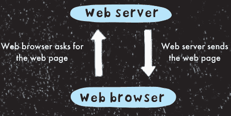

#### Web 地址

Web 地址，通常称为 URL，是一种让 Web 浏览器方便地找到所需的 Web 服务器和 HTML 文件的方式。互联网上有数百万个网站，如果每个网页都没有独立的 URL，你的 Web 浏览器就不知道该去哪里查找。URL 分为不同的部分，每一部分都向你的 Web 浏览器传达不同的信息：

`http://www.getcodingkids.com/hello.html`

这告诉 Web 浏览器连接到一个 Web 服务器。

这告诉服务器向你的 Web 浏览器发送一个 HTML 文件。

这告诉 Web 浏览器要连接到哪个服务器。

#### 网页

当 Web 服务器向你的 Web 浏览器发送网页时，它以 HTML 文档的形式发送信息。HTML 文档由 HTML 元素组成，例如文本和图像，以及关于如何在屏幕上显示和定位这些元素的精确指令。

当 Web 浏览器读取 HTML 代码中的指令时，我们说浏览器在"解析"HTML 文档。在解析和解码指令的过程中，浏览器会在屏幕上绘制文档的每个元素。一个 HTML 文档可能只包含几个单词的文本。最简单的 HTML 文档只有几行代码，看起来像这样：

```html
<!DOCTYPE html>
<html>
<head>
  <title>Get Coding!</title>
</head>
<body>
  Are you ready to get coding?
</body>
</html>
```

HTML 元素

或者文档可能更复杂，还包含其他编程语言，例如 CSS 和 JavaScript。

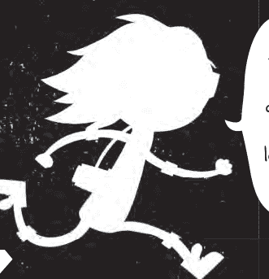

> 翻到后面，了解更多关于 HTML 以及用于编写网页的其他编程语言的信息。

#### 编写网页

世界上最常用的三种编程语言是 HTML、CSS 和 JavaScript。这些语言用于构建网页和基于 Web 的应用程序。将它们一起使用，可以让你构建不仅外观精美，而且具有交互性的网页。在本书中，你将学习如何使用这些语言进行编程。

#### HTML

如今，几乎所有的网页都是使用 HTML（超文本标记语言）代码编写的。HTML 由蒂姆·伯纳斯-李于 20 世纪 90 年代初开发。HTML 是创建网页基本结构的绝佳方式。HTML 文档由独立的 HTML 元素组成。元素使用开始标签和结束标签创建。每个标签都是元素名称，用尖括号（< >）括起来。内容放在标签之间。每个 HTML 标签都是对你的 Web 浏览器的指令，告诉它如何在屏幕上显示内容。标签允许你向网页添加文本、图像和视频，并将信息划分为不同的部分，例如行或段落。

#### CSS

CSS（层叠样式表）是一种与 HTML 配合使用的编程语言，让你的网页看起来美观。单独的 HTML 看起来非常单调，因此你使用 CSS 来更改文本和图像的颜色、字体和位置。CSS 可以让你将一段文本变大或变小，更改背景颜色，或将图像定位在页面中央。

#### JavaScript

JavaScript 是一种非常重要的编程语言，因为它通过使网页具有交互性来赋予网页生命力。交互式网页会在用户执行某些操作时发生变化。因此，如果你希望用户能够点击按钮，或者让警告弹出，就需要使用 JavaScript。如果你只使用 HTML 和 CSS 而不使用 JavaScript，你将拥有一个看起来很漂亮但无法响应用户的网页。

### 一些聪明的程序员

**埃达·洛夫莱斯（Ada Lovelace，1815-1852）**于 1843 年编写了世界上第一个计算机程序。

**格蕾丝·霍珀（Grace Hopper，1906-1992）**创建了世界上第一个计算机编译器，这是一个将人类可读的代码转换为计算机代码的程序。

**蒂姆·伯纳斯-李（Tim Berners-Lee，1955-）**是一位计算机科学家，他发明了万维网和 HTML 编程语言。

**艾伦·图灵（Alan Turing，1912-1954）**是一位数学家，他奠定了现代计算机科学的基础。

**保罗·艾伦（Paul Allen，1953-）**和**比尔·盖茨（Bill Gates，1955-）**创立了微软技术公司，并创建了微软 Windows 操作系统。

**Brendan Eich（1961-）**创建了 JavaScript 编程语言。

**马库斯·佩尔松（Markus Persson，1979-）**是一位计算机游戏程序员，他创建了 Minecraft。

**谢尔盖·布林（Sergey Brin，1973-）**和**拉里·佩奇（Larry Page，1973-）**是计算机科学家和互联网企业家，他们共同创立了谷歌搜索引擎。

**马克·扎克伯格（Mark Zuckerberg，1984-）**是一位计算机程序员和互联网企业家，他共同创立了 Facebook。

> 这些人都是非常聪明的人！

## 如何使用本书

*Get Coding!* 中有六个令人兴奋的任务。你的工作是完成每个任务，学习如何使用 HTML、CSS 和 JavaScript 进行编程。然后，你可以运用新学到的编程技能，帮助无畏的探险家贝尔斯通教授和顶尖科学家戴博士，他们急需你的帮助。他们在一次探险中发现了珍贵的僧侣钻石，需要你的帮助来确保它的安全。

### 任务简报

在每个任务开始时，你将收到来自贝尔斯通教授或戴博士的任务简报。简报会要求你运用编程知识来完成一个自己动手任务。这些任务包括构建网页、创建密码、编写应用程序、规划路线、制作游戏和构建完整的网站。

### 编程技能

学习编程的最佳方式是通过练习！起初，编程可能看起来令人望而生畏，因为你必须使用特殊的词语和符号。但你很快就会熟悉不同编程语言的编写方式。为了帮助你了解每个新代码片段的工作原理，你会在每个任务中发现散布的编程技能练习。按照每个练习中的分步说明，每次掌握一个新的编程技能。

### 探险家百科全书

在简报之后，你可以在探险家百科全书的条目中了解更多关于贝尔斯通教授、戴博士和僧侣钻石的信息。你可以使用这些信息来帮助你完成任务。

## 自己动手任务

每个任务的末尾都有一个自己动手任务。使用你在编程技能中学到的代码来完成任务并完成任务。僧侣钻石的未来掌握在你的手中！

# 核心编程技能

在你收到*任务 1*的简报之前，有一些基本的编程技能需要学习。你将在整本书中使用这些技能，所以现在掌握它们非常重要。你可以使用 PC 或 Mac 进行编程，但根据你使用的系统，创建和保存 HTML 文件的方式有所不同。

## 核心编程技能 1 ▶ 创建文件夹

你需要在计算机上有一个可以保存所有 HTML 文件的地方。在桌面上创建一个名为`Coding`的文件夹。将所有 HTML 文件保存在同一个地方非常重要，因此请确保在完成任务的过程中继续使用此文件夹。

- **PC**：在 PC 上，右键单击桌面，点击新建，然后选择文件夹。将新文件夹命名为`Coding`。
- **Mac**：在 Mac 上，按住`Control`键并单击桌面。然后选择新建文件夹。将新文件夹命名为`Coding`。


> 掌握这些基本的编程技能，你就准备好迎接第一个任务了！


## 核心编程技能 2 ▶ 创建 HTML 文件

你需要知道如何创建 HTML 文件，这样你才能编写代码。程序员通常使用专业软件来编写代码，但所有计算机都带有文本编辑程序，允许你编写 HTML 文件。如果你有 PC，可以使用记事本。如果你有 Mac，可以使用 TextEdit。

- **PC**：在 PC 上，你可以通过进入开始菜单并在搜索栏中输入它来找到记事本。
- **Mac**：在 Mac 上，你可以在屏幕右上角的 Spotlight 搜索放大镜中输入 TextEdit 来找到它。打开 TextEdit 时，你需要执行以下操作：
  - 将你的文件设置为纯文本（而非富文本）文件。为此，请转到菜单栏中的格式，然后选择制作纯文本。
  - 还要转到菜单栏中的 TextEdit。选择偏好设置。在新建文档选项卡的格式部分，确保纯文本已选中。在选项部分，确保智能引号未选中。
  - 在偏好设置中的打开和保存选项卡中，确保显示 HTML 文件为 HTML 代码而非格式化文本未选中。

## 核心编程技能 3 ▶ 保存你的 HTML 文件

当你第一次保存 HTML 文件时，你需要确保使用文件扩展名`.html`保存在文件名的末尾。你的计算机使用文件扩展名来确定如何打开文件。通过给你的文件扩展名`.html`，你是在告诉你的计算机应该在 Web 浏览器中打开它。

- **PC**：在 PC 上，你需要：
  - 转到文件并选择另存为。
  - 选择`Coding`文件夹作为保存文件的目的地。
  - 为你的文件选择一个名称，例如 Mission1，并将其输入到文件名栏中。
  - 在文件名称之后，键入`.html`，使你的文件名称变为`Mission1.html`。单击保存。
- **Mac**：在 Mac 上，你需要：
  - 转到文件并选择保存。
  - 选择你的`Coding`文件夹作为保存文件的目的地。
  - 为你的文件选择一个名称，例如 Mission1，并将其输入到存储为栏中。
  - 在文件名称之后，键入`.html`，使你的文件名称变为`Mission1.html`。
  - 确保复选框"如果未提供扩展名，则使用'.txt'"未选中。单击保存。

## 关键代码技能 4 ► 打开你的 HTML 文件

要在屏幕上看到你写的代码，你需要在网页浏览器中打开你的 HTML 文件。之后，你可能需要返回你的文本编辑程序对代码进行一些修改。

### PC

在 PC 上，你需要：

- 保存你的文件，具体方法参见关键代码技能 3。
- 在桌面上打开你的`Coding`文件夹。双击你的 HTML 文件。它将在你的网页浏览器中打开。
- 当你想要编辑代码时，在你的`Coding`文件夹中右键点击 HTML 文件。选择*打开方式*，然后选择记事本。

> 使用像 Mozilla Firefox 或 Google Chrome 这样的网页浏览器。

### Mac

在 Mac 上，你需要：

- 保存你的文件，具体方法参见关键代码技能 3。
- 在桌面上打开你的`Coding`文件夹。双击你的 HTML 文件。它将在你的网页浏览器中打开。
- 当你想要编辑代码时，在你的`Coding`文件夹中右键点击 HTML 文件。选择*打开方式*，然后选择 TextEdit。

## 关键代码技能 5 ► 使用 *GET CODING!* 网站

别忘了，在你学习本书的过程中，你可以使用 *Get Coding!* 网站来帮助你完成任务。你会找到探险家百科全书中的条目以及你可以使用的图片。如果你在编写代码时遇到任何困难，请访问该网站，查看你的代码块应该是什么样子的。你甚至可以从网站上复制并粘贴代码块到你的文本编辑程序中。


`Get Coding!` 的网址是`www.getcodingkids.com`。

在网站上你可以找到：

- 贝尔斯通教授在探险家百科全书中的条目
- 贝尔斯通教授、欧内斯特（Ernest）、戴博士和修道院钻石的图片
- 每个代码技能练习和 DIY 任务的代码块

> 其中一些步骤可能会根据你使用的系统而有所不同。如果你遇到困难，请在线搜索如何在你使用的程序版本中编写 HTML。

# 任务 1：搭建一个网页

- 了解什么是 HTML 以及它是如何工作的
- 使用 HTML 制作一个简单的网页
- 向你的 HTML 网页添加文本和图片
- 学习如何使用 CSS 进行网页的排版和设计

## 任务简报

亲爱的程序员：

我们之前未曾谋面，但我相信你已经知道我的名字。我是著名的探险家哈利·贝尔斯通教授。我给你发邮件是因为我迫切需要你的帮助。

我目前正在西伯利亚的山区进行探险，同行的是顶尖科学家露比·戴博士和我的狗欧内斯特。我们此行的目的是寻找史前化石。然而，我们却有了一项更加惊人的发现。

我们正在探索一个洞穴时，欧内斯特突然开始对着一块大石头狂吠并嗅闻。我们走近一看，发现岩石表面的裂缝里藏着什么东西。戴博士把那个东西拉了出来。那是一个用油布包裹的小盒子。当我打开盒子时，简直不敢相信自己的眼睛。

那是传说中的修道院钻石！想必你也知道，修道院钻石三年前在莫斯科的一起大胆抢劫案中被盗，至今下落不明。我们的发现具有重大的国际意义。

我们只能短暂地使用我的紧急增强包上网。戴博士和我希望你能运用你的代码技能，帮我们搭建一个关于我们激动人心发现的网页。

我附上了一条来自探险家百科全书的条目，它会告诉你关于修道院钻石非凡历史的一切信息。你可以使用这些信息来搭建你的网页。我们将用这个网页在我们抵达莫斯科的那一刻向全世界公布我们的发现。

感谢你帮助完成这项激动人心的任务。这将会很棒！

来自寒冷山区的最温暖祝愿，

哈利·贝尔斯通教授

## 探险家百科全书

每一次冒险的指南

- 首页
- 目录
- 精选发现
- 著名探险家
- 历史探险

### 修道院钻石

来自探险家百科全书，每一次冒险的指南

*本条目的内容是关于修道院钻石的。如需了解其他宝石，请参阅`钻石`。*

**修道院钻石**是世界上最稀有、最珍贵的`diamonds`之一，以其独特的绿色而闻名。它于1880年被发现，并于1889年被一位俄罗斯贵族买下来送给他的妻子。

在`Russian Revolution`期间，修道院钻石从这位贵族在`St Petersburg`的宫殿中被盗。在接下来的30年里，修道院钻石的下落无人知晓。1947年，它在莫斯科一次针对一群小罪犯的警方突袭中被发现。它被归还给了贵族家族。

贵族的儿子认为修道院钻石不吉利，便将其卖给了莫斯科最古老的珠宝行沃尔科夫珠宝行。沃尔科夫珠宝行支付了一笔保密的 requestediousand tookon of his juansone 金额，但据传这是有史以来最昂贵的钻石交易。

### 贝尔斯通教授的资料档案

修道院钻石

| 项目 | 信息 |
|---|---|
| 年龄 | 超过10亿年 |
| 颜色 | 绿色 |
| 切工 | 椭圆形 |
| 克拉 | 300 |
| 净度 | 无瑕 |
| 价值 | 超过1000万英镑 |

修道院钻石一直在沃尔科夫珠宝行的私人收藏中展出，直到三年前，它在一起大胆的突袭中被盗。尽管经过了长时间的调查，并且警方承诺提供巨额悬赏，但仍无法追踪到罪犯，此案至今未破。

据信，窃贼是邦德兄弟，这是一个国际珠宝盗窃团伙，策划了多起高调的盗窃案。探险家贝尔斯通教授提出的一种理论认为，修道院钻石被邦德兄弟走私出了莫斯科，并藏在俄罗斯的某个地方。他认为：“窃贼正在等待时机，以便在不引起怀疑的情况下在黑市上出售这颗钻石。”

## 用 HTML 编写代码

现在你已经读完了任务简报，是时候开始编写代码了。要搭建贝尔斯通教授的网页，你首先需要学习编写 HTML（超文本标记语言）。HTML 是程序员用来搭建网站的编程语言。它可以让你向浏览器发出指令。你可以使用 HTML 向网页添加文本和图片。你也可以用它来将信息组织成行、段落或区块。

一个 HTML 网页被称为文档。它由 HTML 元素组成。元素是使用称为标签的小段代码创建的。标签几乎总是成对出现，并且包围着页面上的每一个内容（如一段文本或一张图片）。每个标签都包含一条给你的网页浏览器的指令，告诉它如何在屏幕上显示该元素。这就是为什么 HTML 被称为“标记语言”。你使用标签来为每一个内容块标记一条浏览器指令。

### HTML 标签

每个标签都由一段被两个尖括号（`< >`）包围的代码组成。尖括号位于键盘上句号和逗号符号的同一位置。让我们来看一个标签的例子：

> 很简单：`<p>` 是段落的代码。稍后在这个任务中你会学到更多关于这个标签的知识。

```html
<p>Professor Bairstone and Dr Day have discovered the Monk Diamond.</p>
```

开始标签

结束标签

这是段落`<p>`标签。当标签成对出现时，我们称第一个标签为开始标签，第二个标签为结束标签。你可以通过包含正斜杠（`/`）来识别结束标签。当你的浏览器读取这段代码时，它明白你是在告诉它将被`<p>`的开始标签和结束标签之间的文本组合成一个段落。

要编写一个网页，你必须在文本编辑程序中创建一个 HTML 文件。你的浏览器希望某些标签以特定的顺序出现。你需要先编写包含整个页面指令的标签。然后再编写包含页面上特定内容指令的标签。标签可以嵌套在其他标签内部。你只需要记住在用完每个标签后将其关闭。

让我们来了解一下编写一个非常简单的网页所需的 HTML 标签。如果你使用这些标签，就能创建一个由标题和一些文本组成的网页。每个标签都会为你的浏览器提供不同的信息：

#### `<!DOCTYPE html>`

这叫做`<!DOCTYPE>`声明，它总是 HTML 文件的第一行。它告诉我们的浏览器，我们的页面是用哪个版本的 HTML 编写的。它不是 HTML 标签，所以用大写字母书写，并且不需要结束标签。

#### `<html>`

这是`<html>`标签，它告诉浏览器我们使用 HTML 来编写我们的页面。

```html
<!DOCTYPE html>
<html>
<head>
  <title>
    The Monk Diamond Discovery
  </title>
</head>
<body>
  <p>Professor Bairstone and Dr Day have
    discovered the Monk Diamond.</p>
</body>
</html>
```

#### `<head>`

这是`<head>`标签。里面包含一些不会显示在页面主体`<body>`中的内容，比如标题。你也可以在这里放置一些你希望浏览器应用于整个页面的指令。

#### `<title>`

`<title>`标签放在`<head>`标签内部。标签之间的内容不会出现在我们页面的主体中。当你在浏览器中打开页面时，它将成为浏览器窗口的标题。

#### `<body>`

所有你希望显示在网页中的内容都放在`<body>`标签内。所以关于 Monk Diamond 的这段文本会在我们在网络浏览器中打开文件时显示在我们的页面上。

#### `<p>`

这是段落标签。开始标签和结束标签之间的所有文本将被组合成一个段落。

> 翻页看看这段代码在我们的网络浏览器中会是什么样子。

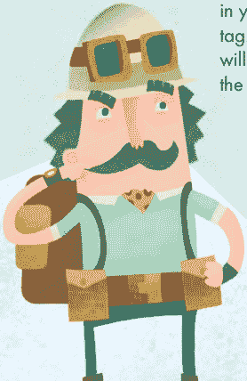

当我们在文本编辑程序中保存写好的代码，然后在网络浏览器中打开时，我们的浏览器会解码我们的 HTML 文件，并在屏幕上绘制出看起来像这样的网页：

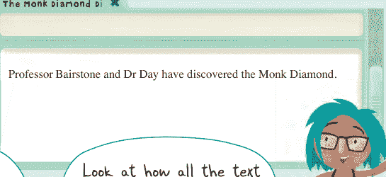

> 看到开始和结束`<title>`标签之间的文本如何变成了浏览器窗口的标题了吗？

> 看看开始和结束`<p>`标签之间的所有文本如何成为了你网页的内容！

### 编写 HTML

现在你知道了 HTML 标签是什么以及它们是如何工作的，是时候来尝试使用它们了。学习新代码的最佳方式是练习编写它们。在本书中，你会发现“代码技能”部分。按照练习中的分步说明，每次学习新技能。确保你的代码尽可能准确，这非常重要。一个字母或符号错误或缺失都可能导致你的代码无法工作，因为你的浏览器无法理解你的指令。如果你在让程序运行方面遇到问题，最好检查以下几点：

- 你没有遗漏任何标签或用错了顺序
- 你的代码中没有拼写错误
- 你在整个代码中使用了正确的大小写
- 你按正确顺序包含了所有需要的符号
- 你使用的是直引号（`" "`）而不是弯引号（“ ”）
- 你通过包含正斜杠（`/`）关闭了所有标签
- 你的文本编辑程序已将文件保存为 HTML 文件（`.html`）

> 这些是编写代码的一些重要提示！

如果你仍然卡住，请访问 Get Coding! 网站（`www.getcodingkids.com`），在那里你可以复制和粘贴你需要的代码块。

#### 代码技能 ▶ 编写 HTML

让我们使用 HTML 标签来编写一个简单的网页。按照以下步骤学习如何构建一个由标题和一段文本组成的 HTML 网页。

1. 打开你的文本编辑程序。如果你需要提醒如何操作，请回头看第 14 页的关键代码技能 2。

2. 在你的文本编辑程序中输入这段代码：

   ```html
   <!DOCTYPE html>
   <html>
   <head>
       <title>The Monk Diamond</title>
   </head>
   <body>
       <p>The Monk Diamond is a rare jewel.</p>
   </body>
   </html>
   ```

3. 在你的`Coding`文件夹中将文件保存为 HTML 文件（`.html`）。将其命名为`webpagetemplate.html`。如果你需要提醒如何操作，请回顾第 13 页和第 14 页的关键代码技能 1 和 3。

4. 在你的网络浏览器中打开你的 HTML 文件。如果你需要提醒如何操作，请参见第 15 页的关键代码技能 4。你的代码将以网页形式显示在屏幕上，如下所示：

   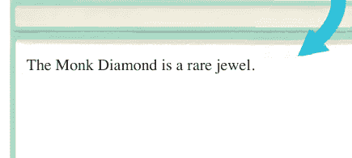

   确保你仔细复制代码。如果有任何错误，你的网络浏览器将无法读取你的代码。`<!DOCTYPE>`声明必须使用大写字母，你的最后一个标签必须始终是`</html>`。检查你是否通过包含正斜杠（`/`）关闭了每个标签。

   然后再次在文本编辑程序中打开你的文件。将开始和结束`<title>`标签以及`<p>`标签之间的文本更改为你选择的文本。保存你的文件。

5. 按下浏览器中的`刷新`按钮。在 PC 上，按`F5`。在 Mac 上，按`Command+R`。你对文本的更改将显示在屏幕上。

   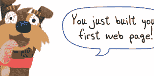

## 使用 HTML 标签构建网页

现在你可以编写 HTML 标签了，让我们看看如何使用它们来编写更复杂的网页。正如你在上一页的代码技能中看到的，如果你在开始和结束`<p>`标签之间写入文本，它将显示在屏幕上。但仅在网页上有一个文本块看起来不会很精彩。如果我们想要换行或分段，就必须学习新的标签。

我们需要将这些新标签放在开始和结束`<body>`标签之间。将标签放在其他标签内部称为嵌套。嵌套标签让我们能够创建更精彩的页面布局。让我们来看看`<body>`标签和段落`<p>`标签的嵌套示例：

```html
<body>
    <p>The Monk Diamond is worth over £10 million.</p>
</body>
```

> `<p>`标签嵌套在`<body>`标签内

HTML 周围的空白不重要。但程序员喜欢在每次打开新标签时缩进他们的代码。这有助于他们跟踪何时打开和关闭了标签，并使代码块更易于阅读。要缩进，每次打开新标签时按 Tab 键。

让我们了解一下制作段落和换行所需的标签。标签中的代码非常简单。这只是“段落”和“换行”的简短说法。

> **你注意到了吗？**
>
> 我们所有的标签都使用小写书写，并且标签和文本之间没有空格。

### 段落标签：`<p>` 和 `</p>`

段落`<p>`标签让你可以创建新的段落。开始标签是`<p>`，结束标签是`</p>`。开始和结束`<p>`标签之间的所有内容被组合在一起。每次你想创建新段落时都使用新的`<p>`标签。看看这个例子，我们编写了两个段落：

```html
<body>
    <p>Professor Bairstone and Dr Day have made a sensational discovery.</p>
    <p>They have discovered the Monk Diamond in a remote cave in Siberia.</p>
</body>
```

> 开始段落标签

> 结束段落标签

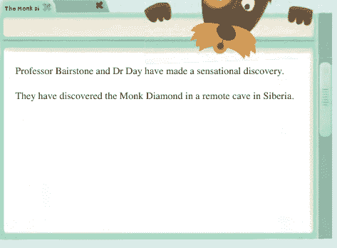

当我们在网络浏览器中打开这段代码时，它看起来是这样的！

### 换行标签：`<br/>`

换行`<br/>`标签让你可以在新行开始文本，但不开始新段落。换行标签是一个**自闭合**的 HTML 标签。因为没有内容要显示在屏幕上，所以换行标签是单个标签。在这个例子中，我们同时使用了`<p>`标签和`<br/>`标签来改变文本的显示方式：

```html
<body>
   <p>Professor Bairstone and Dr Day have made a sensational discovery.<br/>
    Professor Bairstone is the world's leading explorer.<br/>
    Dr Day is a scientist who studies fossils.</p>
  <p>They have discovered the Monk Diamond in a remote cave in Siberia.</p>
</body>
```

> **自闭合 HTML 标签**是开始标签和结束标签合二为一。只有某些类型的标签会这样使用。

你可以通过正斜杠（`/`）位于标签末尾而不是像常规结束标签那样位于开头来识别自闭合标签。

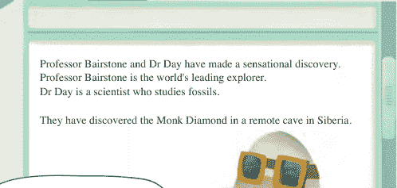

现在轮到你来尝试使用这些新标签了！

### 编码技巧：编码段落和换行

让我们尝试在网页中使用`<p>`和`<br/>`标签来编码段落和换行。

1. 打开你的文本编辑程序。创建一个名为`breaks.html`的新 HTML 文件。如果你需要提醒如何操作，请查看第 13–15 页的关键编码技巧。然后从`webpagetemplate.html`中复制并粘贴代码到你的新文件。修改代码，使其看起来像这样：

   ```html
   <!DOCTYPE html>
   <html>
   <head>
     <title>The Monk Diamond</title>
   </head>
   <body>
   </body>
   </html>
   ```

2. 使用段落`<p>`标签。打开`<p>`标签，输入一些文本，然后使用闭合标签`</p>`。根据你的需要重复多次。你的代码将如下所示：

   ```html
   <body>
     <p>The Monk Diamond has been discovered in Siberia.</p>
     <p>Ernest, Professor Bairstone's dog, found the jewel.</p>
   </body>
   ```

   > 干得好！但是，来点 Monk Diamond 的照片怎么样？

3. 在你的第一个段落中输入更多文本。像这样在文本行末尾添加换行`<br/>`标签：

   ```html
   <body>
     <p>The Monk Diamond has been discovered in Siberia.<br/>
        Professor Bairstone
        and Dr Day were on a fossil-
        finding expedition.</p>
     <p>Ernest, Professor Bairstone's
        dog, found the jewel.</p>
   </body>
   ```

4. 将你的 HTML 文件保存在`Coding`文件夹中。然后在浏览器中打开你的网页。你的页面将如下所示：

   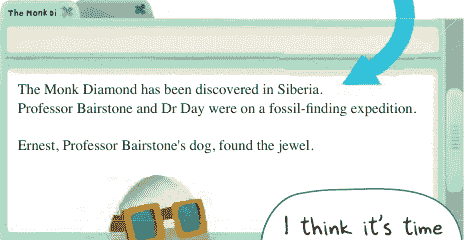

   > 我想是时候学习图像标签了！

   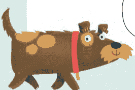

   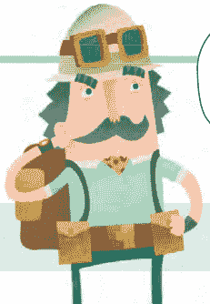

### 图像标签：``

现在你已经掌握了段落和换行标签，让我们学习如何在网页中添加图像。图像``标签是另一个自闭合标签。在标签本身内部，你必须包含一段称为源（src）**属性**的信息。图像标签看起来像这样：

```html

```

等号（`=`）和双引号（`" "`）用于设置源属性的值。

你必须在``标签中包含源属性，这样你的浏览器才知道在哪里找到你的图像。没有它，你的浏览器将不知道在屏幕上显示什么。源属性的值可以设置为保存的图像文件名，或图像的 URL（网址）。

### 编码词汇

**属性**（ATTRIBUTE）是向浏览器提供有关 HTML 元素额外信息的有用方式。你可以在标签中包含许多不同种类的属性。属性有两个部分：属性名称和属性值。你使用等号（`=`）来设置属性的值，并将值放在双引号（`" "`）中。因此，属性将始终如下所示：`name="value"`。属性被添加到开始标签，或唯一的标签（对于自闭合标签而言）。

### 使用保存的图像


如果你在`Coding`文件夹中有一个保存为 JPEG 文件（`.jpg`）的图像，将其添加到你的页面非常容易。你只需使用等号（`=`）和双引号（`" "`）将源属性的值设置为你的图像文件名。因此，如果你的文件名为`diamond.jpg`，你的代码将如下所示：

```html
<body>
  <p>Professor Bairstone has sent us this secret photo of the Monk Diamond:</p>
  
</body>
```

图像标签

源属性

文件名


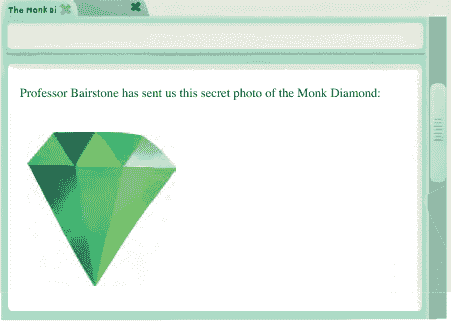


### 使用图像 URL

如果你想在网页上使用互联网上的一张图像，你必须将``标签中源属性的值设置为该图像的 URL。你可以通过右键单击图片并选择 PC 上的“复制图片 URL”或 Mac 上的“复制图片地址”来找到图片的 URL。然后你将 URL 粘贴到``标签中，作为源属性的值。不要忘记将其放在双引号（`" "`）中，如下所示：

```html
<body>
  <p>This is Professor Bairstone and Dr Day's first expedition together.</p>
  <p>Here is a photo of the team:</p>
  
</body>
```

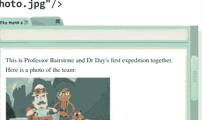

### 为图像命名

如果你在页面上包含图像，你应该始终为其命名。这有助于 Google 等搜索引擎找到你的页面。对于可能无法下载图像的用户来说，名称也很方便。

要为图像命名，你需要在源属性之后添加替代（alt）属性，如下所示：

```html

```

我们带有文本和图像的网页的完整代码块现在如下所示：

```html
<body>
  <p>This is Professor Bairstone and Dr Day's first expedition together.</p>
  <p>Here is a photo of the team:</p>
  
</body>
```

> 你注意到了吗？

我们代码中的引号始终是直的（`" "`）而不是弯的（“ ”）。如果指令使用弯引号，你的浏览器将无法理解。

在某些网页浏览器中，如果你将鼠标悬停在浏览器中的图像上并保持不动，将显示一个小弹出窗口，其中包含 alt 属性中的文本。

### 编码技巧 ▶ 添加图像

让我们尝试将 Monk Diamond、Professor Bairstone、Dr Day 和 Ernest 的一些图像添加到我们的网页中，让它看起来更加精彩。

1. 前往 *Get Coding!* 网站的图像部分。找到 Monk Diamond 的图像。右键单击图像并选择“图片另存为”。将图像作为 JPEG 文件（`.jpg`）保存在你的`Coding`文件夹中。命名为`diamond.jpg`。

2. 打开你的文本编辑程序并创建一个名为`images.html`的新 HTML 文件。然后从`webpagetemplate.html`中复制并粘贴代码到你的新文件。修改代码，使其看起来像这样：

```html
<!DOCTYPE html>
<html>
<head>
  <title>The Monk Diamond</title>
</head>
<body>
  <p>The Monk Diamond is a rare green colour.</p>
</body>
</html>
```

3. 现在将 Monk Diamond 的图像添加到你的页面中。在闭合的`</p>`标签之后添加一个带有空源属性的``标签，如下所示：

```html
<p>The Monk Diamond is a rare green colour.</p>

```

4. 然后为源属性添加一个值。添加你保存在`Coding`文件夹中的图像文件名，如下所示：

```html
<p>The Monk Diamond is a rare green colour.</p>

```

5. 现在使用 URL 将 Professor Bairstone、Dr Day 和 Ernest 的图像添加到你的页面中。添加另一个段落和一个带有空源属性的``标签，如下所示：

```html
<p>The Monk Diamond is a rare green colour.</p>

<p>The team was delighted with their discovery.</p>

```


> 不要忘记属性始终必须用双引号括起来。

### 编码技巧 ▶ 继续

6. 前往 *Get Coding!* 网站的图像部分。找到团队的照片。右键单击并根据你的系统选择*复制图片 URL*或*复制图片地址*。将 URL 粘贴到你的源属性中，如下所示：

```html
<p>The team was delighted with their discovery.</p>

```

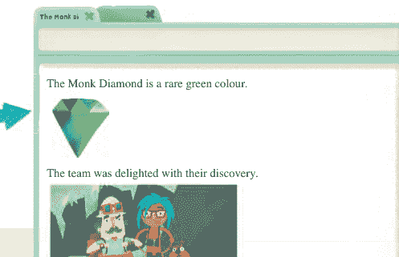

💾 保存你的文件并在浏览器中刷新页面。你将看到你的第二张图像显示在屏幕上。

7. 最后，你需要为两个``标签添加 alt 属性。为每张图像选择一个名称。你的代码将如下所示：

```html
<!DOCTYPE html>
<html>
<head>
  <title>The Monk Diamond</title>
</head>
<body>
  <p>The Monk Diamond is a rare green colour.</p>
  
  <p>The team was delighted with their discovery.</p>
  
</body>
</html>
```

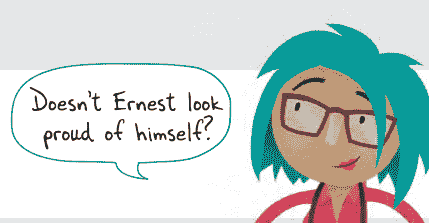

💾 保存你的文件并刷新你的页面。根据你的浏览器，如果你将鼠标悬停在图像上，你可能会看到 alt 属性中的文本。

### 代码技能清单 ✓

### 使用 HTML 编码

使用 HTML 标签时，以下是一些需要记住的实用要点！

- HTML 文档的基本结构总是相同的：

```html
<!DOCTYPE html>
<html>
  <head>
  </head>
  <body>
  </body>
</html>
```

- HTML 文档由 HTML 元素组成。元素是被 HTML 标签包围的内容片段。每个标签都是给浏览器的指令，告诉它如何在屏幕上显示开始标签和结束标签之间的内容。
- HTML 标签写在尖括号（`< >`）内。你有开始标签和结束标签，这样浏览器就知道指令何时开始和结束。你总是能识别出结束标签，因为它包含正斜杠（`/`）。如果两个标签之间没有内容要放，你可以使用自闭合标签，即将开始标签和结束标签合二为一。
- 标签始终使用小写。
- 你可以将 HTML 标签相互嵌套。只是不要忘记关闭你的标签。
- 当你打开一个新标签时，应该始终按 Tab 键缩进你的代码。这样更容易阅读你的代码。
- 如果你想给浏览器关于某个 HTML 元素的额外指令或信息，可以使用各种 HTML 属性。属性放在开始标签内。它们总是有一个名称和一个值，你使用等号（`=`）和双引号（`" "`）来设置。

> 网页通常不只有文字和图片。翻页了解如何更改页面的布局和设计。

## 网页的布局与设计

现在你知道了 HTML 标签是什么以及它们如何工作，是时候开始考虑网页的布局与设计了。到目前为止，我们的 HTML 元素在页面上的位置都是一样的。如果我们想把文字和图片放在不同的位置，或者改变网页的设计，就需要学习一些新的 HTML 标签和属性。

### 分区标签：`<div>` 和 `</div>`

分区`<div>`标签通过将网页分割成不同的部分来帮助我们改变布局。开始标签是`<div>`，结束标签是`</div>`。这个标签是一种有用且省时的方式，可以将 HTML 元素分组在一起。它就像一个不可见的容器。

当你将 HTML 元素分组在开始和结束`<div>`标签之间时，你可以要求浏览器对`<div>`内的所有元素进行相同的更改。`<div>`外的元素将保持不变。让我们来看看`<div>`标签是如何工作的：

```html
<body>
  <div style="color: green;">
    <p> Monk Diamond 已有超过十亿年的历史。</p>
    <p>它是一种稀有的绿色钻石。</p>
  </div>
  <p>它重达 300 克拉，价值超过 1000 万英镑。</p>
</body>
```

这里我们将两段文字放在了`<div>`内。使用一个名为 style 属性的新 HTML 属性，将`<div>`内的文字变成了绿色。不在`<div>`内的段落文字保持不变。我们的`<div>`将 HTML 元素分组，让我们能够轻松地对它们进行更改。

## 创建区块

现在轮到你自己尝试使用`<div>`标签了。掌握这项技能后，你就能够制作布局有趣的网页。

1. 打开你的文本编辑程序。创建一个名为`divs.html`的新 HTML 文件。然后将你的代码从`webpagemetemplate.html`复制粘贴到新文件中。修改代码，使其看起来像这样：

```html
<!DOCTYPE html>
<html>
<head>
  <title>The Monk Diamond</title>
</head>
<body>
  <p>Professor Bairstone 是一位著名的探险家。</p>
  <p>Dr Day 是一位顶尖科学家。她喜欢恐龙化石。</p>
</body>
</html>
```

2. 现在在开始和结束`<body>`标签之间添加两个`<div>`标签。将每个段落放在一个`<div>`内，像这样：

```html
<body>
  <div>
    <p>Professor Bairstone 是一位著名的探险家。</p>
  </div>
  <div>
    <p>Dr Day 是一位顶尖科学家。她喜欢恐龙化石。</p>
  </div>
</body>
```

3. 保存你的 HTML 文件并在浏览器中打开。你的`<div>`标签不会在屏幕上显示任何变化，但你的元素已经被分组在一起，随时准备供你设计和定位。

## 使用 CSS 编码

在本任务的这一阶段，你一直在使用 HTML 编码。正如你刚才所见，`<div>`标签用于将 HTML 元素分组在一起，以便你可以轻松更改它们。要更改 HTML 元素的外观和位置，你必须使用 CSS。

CSS 是一种经常与 HTML 一起使用的编程语言。程序员用它来改变 HTML 元素在浏览器中显示时的外观。CSS 是 Cascading Style Sheets 的缩写，有时也被称为“样式表”或“样式”。你可以使用 CSS 通过添加颜色或更改 HTML 元素的大小和形状来改变页面的设计。你也可以使用 CSS 来改变事物的位置。事实上，你可以用 CSS 做很多不同的事情来改变页面的外观和感觉。

### style 属性

要使用 CSS 更改 HTML 元素，你可以在开始的 HTML 标签中添加 style 属性。你可以在任何 HTML 标签中使用 style 属性。style 属性的工作方式与我们在任务前面使用的 source 和 alt 属性完全相同。让我们看看如何添加 style 属性：

```html
<p style="CSS-property: value;">Monk Diamond 曾被藏在洞穴中。</p>
```

正如我们之前所见，style 属性的值使用等号（`=`）设置，并用双引号（`" "`）括起来。我们通过将 style 属性的值设置为 CSS 来将 CSS 应用到 HTML 标签。CSS 是一种写起来非常简单的编程语言。它总是分为两部分：属性和值。

### CSS 属性和值

当你编写 CSS 时，必须同时使用属性和值。属性告诉浏览器你想更改 HTML 元素的哪个部分。值则告诉浏览器确切地要改成什么。所以它的工作方式是这样的：

| CSS | 含义是什么？ | 示例值 |
|---|---|---|
| property | 你想要更改的内容 | background-color; height; |
| value | 你想把它改成什么 | red; 200px; |

当你使用 CSS 时，你通过插入冒号（`:`）将属性与值分开。在值的末尾，你使用分号（`;`）。如果 CSS 超过一个单词，你使用连字符（`-`）将两个单词连接起来。如果你不使用正确的`语法`，浏览器将无法解码你的指令。你的 style 属性应该始终这样写：

```html
style="CSS-property: value;"
```

### 代码词汇

**SYNTAX（语法）**是决定编程语言如何结构和编写的一组规则。

你的浏览器有数百种不同的内置 CSS 属性和值，你可以在你的 HTML 标签中使用它们来改变你的页面。

让我们更仔细地看看如何使用 CSS 和`<div>`标签。如果我们想更改页面某个部分的背景颜色，我们可以像这样使用 CSS 和 HTML：

```html
<body>
  <div style="background-color: green;">
    <p>Monk Diamond 曾被藏在洞穴中。</p>
    <p>它藏在岩石的裂缝里。</p>
  </div>
</body>
```

> **你注意到了吗？**

CSS 中的所有单词都使用美式英语拼写。如果你不使用美式英语，你的浏览器将无法理解你的 CSS。例如，每次你写“colour”这个词时，必须使用美式拼写，即“color”。

### background-color CSS 属性

现在你对 CSS 及其工作方式有了更多了解，让我们看看如何使用 CSS 属性让我们的页面更加多彩。Professor Bairstone 和 Dr Day 的发现肯定会引起国际轰动，我们的网页需要看起来引人注目且有趣。

我们可以使用不同的`<div>`标签来改变页面不同区域的背景颜色。首先，我们必须在每个开始的`<div>`标签中添加 style 属性。然后在 style 属性内部设置 background-color CSS 属性，并为 CSS 值选择一种颜色。我们需要的代码看起来像这样：

```html
<body>
    <p>THE STOLEN MONK DIAMOND IS DISCOVERED!</p>
    <div style="background-color: green;">
        <p>Professor Bairstone, Dr Day and Ernest were on an expedition. They made an exciting discovery in the mountains.<br/>
Ernest started sniffing and barking at a rock in a cave. Hidden inside the rock was the Monk Diamond.</p>
    </div>
</body>
```

> 这是学习的一项非常好的代码技能。

**THE STOLEN MONK DIAMOND IS DISCOVERED!**

Professor Bairstone, Dr Day and Ernest were on an expedition. They made an exciting discovery in the mountains.

Ernest started sniffing and barking at a rock in a cave. Hidden inside the rock was the Monk Diamond.

#### 你注意到了吗？

有数千种颜色可以作为 CSS 的值使用。访问`www.w3schools.com/cssref/css_colornames.asp`查看更多颜色。

## 代码技能 ▸ 编写 CSS

现在轮到你开始将 CSS 与 HTML 结合使用了。尝试在 HTML 标签中添加`style`属性，然后设置一个 CSS 属性和值。

1. 打开你的文本编辑程序，创建一个名为`CSS.html`的新 HTML 文件。然后将`divs.html`中的代码复制并粘贴到你的新文件中。修改代码使其如下所示：


```html
<!DOCTYPE html>
<html>
<head>
  <title>The Monk Diamond</title>
</head>
<body>
<div>
  <p>The jewel was stolen from Moscow.</p>
  <p>The theft happened three years ago.</p>
</div>
<div>
  <p>The Bond Brothers are the prime suspects.</p>
</div>
</body>
</html>
```

**2.** 现在，在每个起始的`<div>`标签中添加一个空的`style`属性，像这样：

```html
<div style=" ">
```

**3.** 然后，在`style`属性中添加`background-color` CSS 属性。记住，你需要用冒号（`:`）分隔属性名和值。别忘了值后面要加分号（`;`）。你的起始`<div>`标签将如下所示：

```html
<div style="background-color: pink;">
```

**4.** 保存你的 HTML 文件并在浏览器中打开它。尝试将`background-color` CSS 属性的值更改为不同的颜色。保存文件并刷新页面，以在屏幕上查看你的更改。

## 更多 CSS 属性

让我们看看可以添加到 HTML 元素中的一些 CSS 属性，以使 Bairstone 教授的网页更加令人兴奋。你已经知道，CSS 总是由一个属性和一个值组成。有数百种不同的 CSS 属性和值，但以下是一些最常见的：

| CSS 属性名称 | 它的作用是什么？ | 示例值 |
| --- | --- | --- |
| `background-color` | 设置背景的颜色 | `red; black; white; yellow;` |
| `color` | 设置文本的颜色 | `red; black; white; yellow;` |
| `text-align` | 将文本定位在页面周围 | `left; right; center;` |
| `font-size` | 更改文本的大小 | `12px; 20pt;` |
| `float` | 将元素定位在另一个元素的左侧或右侧 | `left; right; none;` |
| `height` | 设置元素的高度 | `100px; 100%;` |
| `width` | 设置元素的宽度 | `100px; 100%;` |
| `border` | 为元素添加边框 | `1px solid black;` |
| `margin` | 在元素周围添加空间 | `10px;` |
| `padding` | 在元素内部添加空间 | `10px;` |

> **术语解释**
>
> 你计算机屏幕上的图形由称为**像素（px）**的微小彩色点组成。你可以告诉浏览器你希望 HTML 元素包含多少个像素。

### `color` CSS 属性

要更改文本的颜色，请使用`color` CSS 属性，然后选择一个值。它与使用`background-color`属性相同。请记住使用美式拼写“color”。

```html
<body>
    <div style="color: blue;">The Monk Diamond Discovery!</div>
</body>
```

### 对齐 CSS 属性

到目前为止，我们所有的 HTML 元素在页面上都处于相同的位置。`text-align`和`float` CSS 属性允许你对齐（另一种说法是定位）页面上的文本和其他 HTML 元素。`text-align`属性允许你将文本定位在页面的左侧、右侧或中心。请记住使用美式拼写“center”，并包含连字符（`-`）。

```html
<body>
    <div style="text-align: center;">
        The Monk Diamond Discovery!
    </div>
    <p>Stolen jewel found in Siberia.</p>
</body>
```

我们还可以使用 CSS 来定位 HTML 元素，例如`<div>`标签或图像，将其放置在页面的左侧或右侧。你使用`float` CSS 属性并将值设置为`left`或`right`。

```html
<body>
    <div style="float: right;">
        The expedition team:<br/>
        
    </div>
</body>
```

`text-align`和`float` CSS 属性是为你的网页创建有趣布局的简单方法。

### 使用多个 CSS 属性

你可以在`style`属性中使用多个 CSS 属性和值。你所要做的就是使用分号（`;`）分隔它们。你的浏览器将读取所有 CSS 属性并将其应用到你的 HTML 元素，因此你可以根据需要使用任意多个属性。

```html
<body>
    <div style="background-color: lightblue; float: right;">
        Ernest sniffed out the diamond.
    </div>
</body>
```

看看我们如何同时改变`<div>`的背景颜色和位置！

### 用 CSS 改变事物的大小

我们现在知道如何更改文本的颜色、为 HTML 元素添加背景颜色，以及将它们定位在页面上的不同位置。但如果我们想制作一个真正有趣的网页，我们需要知道如何更改 HTML 元素的大小。CSS 让我们能够非常容易地改变事物的大小。我们必须使用`width`和`height` CSS 属性，并将值设置为我们想要的尺寸。让我们看看如何使用这些属性来制作一个正方形的`<div>`：

```html
<body>
  <div style="background-color: plum; height: 200px; width: 200px;">
    <p>The Monk Diamond was believed to be gone for good.</p>
    <p>The House of Volkov was shocked by the theft.</p>
  </div>
</body>
```

> **你注意到了吗？**
>
> 这一次，我们将 CSS 属性的值设置为数字而不是单词。当我们使用数字时，必须包含单位。

### CSS 中的度量单位

在 CSS 中，你可以使用许多不同的单位进行测量。确保通过在数字值后键入单位来告诉浏览器你使用的单位。以下是一些最常见的单位：

- **单位类型：**
  - 像素（`px`）
  - 百分比（`%`）
  - 磅（`pt`）

让我们看看如何使用百分比来更改`<div>`的`height`和`width` CSS 属性：

```html
<body>
  <div style="background-color: palegreen; height: 75%; width: 50%;">
    <p>The police remain baffled by the crime.</p>
    <p>There were no successful leads in the case.</p>
  </div>
</body>
```

#### 你注意到了吗？

当你计算百分比时，你是在计算你希望元素占据屏幕的百分比。如果你更改浏览器的大小，元素的大小也会随之改变。

像素和点的使用方式与百分比完全相同。使用这些单位，即使你更改浏览器的大小，元素的大小也将始终保持不变。在这里，我们使用像素值设置了`height`和`width` CSS 属性，并使用`font-size` CSS 属性将文本大小更改为以磅为单位的值。

```html
<body>
  <div style="background-color: gold; height: 200px; width: 350px; font-size: 20pt;">
    <p>The Bond Brothers have never been caught.</p>
  </div>
</body>
```

### 用 CSS 创建边框和空间

我们还可以使用 CSS 属性在 HTML 元素周围创建边框和空间。要在 HTML 元素周围创建边框，你必须使用`border` CSS 属性，并将值设置为你想要的宽度、样式和颜色。让我们看一个例子：

```html
<body>
  <div style="border: 4px solid green; width: 50%; height: 100px;">
    Professor Bairstone and Dr Day are very excited by their discovery.
  </div>
</body>
```

我们还可以通过使用`padding`和`margin` CSS 属性来更改 HTML 元素内部的空间量。你可以设置 HTML 元素顶部、底部、左侧和右侧的`margin`和`padding`值。让我们来看一下：

```html
<body>
  <div style="padding: 25px; margin: 50px; border: 4px solid blue;
      width: 50%; height: 100px;">
      Ernest was also very happy with the find.<br/>
      Professor Bairstone gave him extra rations.
  </div>
</body>
```

这里的`padding` CSS 属性在我们的`<div>`边框和`<div>`内部关于 Ernest 的文本之间创建了 25px 的空间。`margin` CSS 属性在我们的`<div>`边框和页面边缘之间创建了 50px 的空间。

#### 你注意到了吗？

> 我们的边框样式已被设置为`solid`的值。你也可以使用`dotted`、`dashed`或`double`作为值。

## 编码技巧 ▶ 使用多个 CSS 属性

有许多不同的 CSS 属性可以用来让贝尔斯通教授和戴博士的网页看起来更出色。现在试试在代码中使用多个 CSS 属性来改变页面的布局和设计。

1. 打开你的文本编辑程序，创建一个名为`CSSproperties.html`的新 HTML 文件。将你`CSS.html`中的代码复制并粘贴到新文件中，并修改它，使其包含三个`<div>`标签，如下所示：

```html
<!DOCTYPE html>
<html>
<head>
    <title>The Monk Diamond</title>
</head>
<body>
    <div>
        Why was the diamond hidden in a cave?<br/>
        Who hid it there?
    </div>
    <div>
        Was it the Bond Brothers?<br/>
        Could they be watching the cave?
    </div>
    <div>
        Is the team safe?<br/>
        Their camp is very remote.
    </div>
</body>
</html>
```

2. 更改第一个`<div>`中文本的颜色、字体大小和位置。使用`color`、`font-size`和`text-align` CSS 属性。你的代码将如下所示：

```html
<div style="color: green; font-size: 18pt; text-align: center;">
  Why was the diamond hidden in a cave?<br/>
  Who hid it there?
</div>
```

3. 使用`width`和`height` CSS 属性更改第二个`<div>`的宽度和高度。将你的`<div>`设为页面宽度的 75%，高度为 100px。同时为你的`<div>`添加背景颜色和外边距。你的代码将如下所示：

```html
<div style="width: 75%; height: 100px; background-color: lightblue; margin: 20px;">
  Was it the Bond Brothers?<br/>
  Could they be watching the cave?
</div>
```

4. 让我们试着将第三个`<div>`移动到页面上的不同位置。使用`float` CSS 属性将你的`<div>`移动到页面右侧。同时使用`border`和`padding` CSS 属性为`<div>`添加边框和一些内边距。你的代码将如下所示：

```html
<div style="float: right; border: 6px dotted red; padding: 20px;">
  Is the team safe?<br/>
  Their camp is very remote.
</div>
```

5. 保存你的 HTML 文件并在浏览器中打开它。现在尝试将所有 CSS 属性的值更改为你自己选择的值，看看它对你的网页有什么影响。

## 使用 CSS 类

你可能已经注意到，在 HTML 标签中添加大量 CSS 属性使得我们的代码行变得冗长且难以阅读。反复输入相同的 CSS 属性也很耗时。为了节省时间并让我们的代码看起来更整洁，我们现在需要学习如何使用 CSS 类。CSS 类帮助你组织页面`<body>`中的 CSS。

CSS 类是一种非常便捷的方式，可以将一组 CSS 属性应用到页面上的任何 HTML 元素。程序员使用 CSS 类来让他们的代码尽可能简洁。在编码时这样做非常重要，因为它意味着你不太可能犯错。例如，如果你知道你想要页面上每个`<div>`中的所有文本都呈现某种特定的颜色和字体大小，与其在每个`<div>`中输入 CSS 属性，你可以使用一个 CSS 类一次性更改页面上所有的`<div>`标签。

### 使用`<head>`标签

到目前为止，我们大部分时间都在页面的`<body>`内编码。现在是时候仔细看看如何使用`<head>`了。让我们回到任务开始时构建的第一个页面：

```html
<!DOCTYPE html>
<html>
<head>
  <title>The Monk Diamond Discovery</title>
</head>
<body>
  <p>Professor Bairstone and Dr Day have discovered the Monk Diamond.</p>
</body>
</html>
```

在我们迄今为止构建的每个页面中，`<title>`标签都嵌套在`<head>`内。`<title>`开始标签和结束标签之间的内容在我们在网页浏览器中查看时不会显示在主要的`<body>`中。

我们将把 CSS 类添加到`<head>`标签中。这是因为`<head>`是放置浏览器信息的最佳位置，而我们不希望这些信息显示在页面的主要`<body>`中。

### 样式标签：`<style>`和`</style>`

当你创建一个 CSS 类时，你是在告诉浏览器你正在从 HTML 切换到 CSS。你可以通过使用`<style>`标签来实现这一点，将其嵌套在`<head>`中。`<style>`标签与你到目前为止在这个任务中使用的所有其他 HTML 标签一样，只是你在其中放置 CSS。

打开`<style>`标签后，你就可以创建一个 CSS 类了。每个 CSS 类都需要一个名称。最好让名称与你想要更改的元素相关。让我们来看看如何创建一个更改文本外观的 CSS 类：

这是一种不同的代码编写和结构化方式。CSS 类始终以类名开头。CSS 类的命名取决于你自己，但在类名之前必须有一个点（`.`）。然后是一对花括号（`{ }`）。花括号告诉浏览器它需要遵循的指令从哪里开始、到哪里结束。在花括号内，你放入所有想要应用到 HTML 元素的 CSS 属性。和之前一样，你用冒号（`:`）分隔属性和值，在值后面放一个分号（`;`）。

在这个例子中，我们创建了一个名为“textiams”的 CSS 类。每次使用这个 CSS 类时，我们都会将`text-align`、`font-size`和`background-color` CSS 属性更改为我们选定的值。

> ### 你注意到了吗？
>
> 花括号（`{ }`）位于键盘上 P 键旁边，与方括号在同一个按键上。你需要按住 Shift 键才能使用它们。

### 使用`class`属性

将 CSS 类应用到我们代码`<body>`中的 HTML 元素非常简单。我们只需将为 CSS 类选择的名称添加到我们想要更改的元素的开始 HTML 标签中。我们现在使用新的`class`属性来替代`style`属性。`class`属性的编写和工作方式与我们到目前为止在这个任务中使用的所有其他属性完全相同。让我们看看将 CSS 类应用到页面上的 HTML 元素需要做什么：


```html
<!DOCTYPE html>
<html>
<head>
  <title>The Monk Diamond Discovery</title>
  <style>
    .text {
      text-align: center;
      font-size: 18pt;
      background-color: aqua;
    }
  </style>
</head>
<body>
  <p class="text">The Monk Diamond Discovery</p>
  <p>The Monk Diamond has been discovered in the mountains of Siberia.</p>
  <p class="text">The discovery is of great international significance.</p>
  <p>The team were looking for fossils.</p>
  <p class="text">Not one of the world's most famous jewels.</p>
</body>
</html>
```

在`class`属性中，我们将 CSS 类的名称用作值。我们没有在开头包含点（`.`）。与所有其他属性一样，我们使用等号（`=`）和双引号（`" "`）来设置其值。看看使用 CSS 类和`class`属性是如何轻松改变了我们页面的布局！

#### 编码技巧清单

### 使用 CSS 编码

- CSS 始终由一个属性和一个值组成。属性是你想要更改的内容的名称，值是你想要将其更改为的内容。有数百种不同的 CSS 属性和值。
- 你用冒号（`:`）分隔属性和值，并始终在值后面使用分号（`;`）。单词之间使用连字符（`-`）。
- CSS 属性和值始终使用美式英语拼写。
- 值可以用文字或数字给出。数值的常用单位包括像素（`px`）、磅（`pt`）和百分比（`%`）。
- 你可以将多个 CSS 属性应用到一个 HTML 元素上。最好的方法是使用 CSS 类和`class`属性。
- 你通过使用`<style>`标签告诉浏览器你正在从 HTML 切换到 CSS。CSS 类嵌套在`<head>`标签内。
- 当你选择 CSS 类名时，它需要以点（`.`）开头。你想要应用的 CSS 属性和值放在花括号内。
- 你可以使用`class`属性将 CSS 类应用到任何 HTML 元素。

> 以下是编写 CSS 时需要记住的一些重要事项！
>
> 贝尔斯通教授一定会对你的网页非常满意！

## 代码技巧 ► 使用 CSS 类和 class 属性

CSS 类是一种简单有效的方式，通过 CSS 来改变你的 HTML 元素。让我们来尝试编写一些 CSS 类，并使用`class`属性来改变网页的设计。

1. 打开你的文本编辑程序，创建一个名为`CSSclasses.html`的新 HTML 文件。将`CSSproperties.html`中的代码复制粘贴到你的新文件中，并进行修改，使三个`<div>`标签看起来像这样：

```html
<!DOCTYPE html>
<html>
<head>
  <title>The Monk Diamond</title>
</head>
<body>
  <div>
    The Monk Diamond<br/>
    An incredible discovery
  </div>
  <br/>
  <div>
    Stolen diamond found on expedition in Siberia!
  </div>
  <br/>
  <div>
    Professor Bairstone and Dr Day were looking for fossils in Siberia.<br/>
    They found the stolen diamond hidden inside a remote cave.
  </div>
</body>
</html>
```

2. 现在在`<head>`中添加一个`<style>`标签。你的代码将如下所示：

```html
<head>
  <title>The Monk Diamond</title>
  <style>
  </style>
</head>
```

3. 在`<style>`的开始和结束标签之间，创建一个名为`header`的 CSS 类。设置`background-color`、`padding`、`text-align`和`font-size` CSS 属性。同时添加`width`和`height` CSS 属性。为你的属性选择值。你的代码将如下所示：

```css
<style>
  .header {
    background-color: blue;
    padding: 25px;
    text-align: center;
    font-size: 18pt;
    width: 100%;
    height: 25%;
  }
</style>
```

4. 使用`class`属性将`header` CSS 类应用到`<body>`中的第一个`<div>`。你的代码将如下所示：

```html
<div class="header">
  The Monk Diamond<br/>
  An incredible discovery
</div>
```

5. 在`<style>`标签中创建第二个 CSS 类，命名为`title`。这个新的 CSS 类将位于`header` CSS 类之后。设置`font-size`、`text-align`和`color`属性。为你的属性选择值。你的代码将如下所示：

```css
.title {
  font-size: 14pt;
  text-align: center;
  color: green;
}
```

> 为什么不尝试一些不同的颜色呢？

## 代码技巧 ► 继续

6. 将`title` CSS 类应用到你的第二个`<div>`。你的代码将如下所示：

```html
<div class="title">
  Stolen diamond found on expedition in Siberia!
</div>
```

7. 在`<style>`标签中创建第三个 CSS 类，命名为`body`。这个 CSS 类将位于`title` CSS 类之后。设置`margin` CSS 属性和值。你的代码将如下所示：

```css
.body {
  margin: 20px;
}
```

8. 将`body` CSS 类应用到你的第三个`<div>`。你的代码将如下所示：

```html
<div class="body">
  Professor Bairstone and Dr Day were looking for fossils in Siberia.<br/>
  They found the stolen diamond hidden inside a remote cave.
</div>
```

9. 保存你的 HTML 文件并在浏览器中打开它。你会看到每个 CSS 类都改变了`<div>`的设计。

## 多个 CSS 类

如果你想让 CSS 真正发挥效用，最好将 CSS 类分成多个 CSS 属性组。这样，当你设计和布局网页时，可以将多个 CSS 类应用到你的 HTML 元素。同时使用多个 CSS 类非常简单。你只需要将不同类的名称添加到你的`class`属性中。让我们来看一看：

```html
<!DOCTYPE html>
<html>
<head>
  <title>The Monk Diamond</title>
  <style>
    .header {
      background-color: lightgreen;
      width: 70%;
      height: 50%;
    }
    .text {
      text-align: center;
      font-size: 18pt;
    }
    .padding {
      padding: 25px;
    }
  </style>
</head>
<body>
  <div class="header text padding">
    The Monk Diamond<br/>
    An incredible discovery
  </div>
</body>
</html>
```

> 这就是我们如何向`class`属性添加多个 CSS 类名称

## 使用 CSS 类选择 HTML 元素

CSS 类的另一个实用功能是用它们来改变某一类型 HTML 元素的 CSS 属性。为此，你需要使用一种叫做元素选择器的东西。要使用元素选择器，你需要将想要改变的元素的名称作为 CSS 类的名称。你不应该在 CSS 类名称前加点号。同时，你也不需要在`<body>`中包含`class`属性。

> 翻过来了解更多关于元素选择器的信息。

所以，如果你想让段落中的所有文本居中并设置为特定的字体大小，你可以创建一个名为`p`的 CSS 类，它会找到并选择你的`<p>`标签。让我们来看看使用元素选择器会产生什么效果：

```html
<!DOCTYPE html>
<html>
<head>
  <title>The Monk Diamond Discovery</title>
  <style>
    p {
      font-size: 16pt;
      text-align: center;
      background-color: lightblue;
    }
  </style>
</head>
<body>
  <p>The Monk Diamond was discovered by Professor Bairstone and Dr Day.</p>
  <p>Ernest alerted them to its hiding place.</p>
  <p>It had been hidden in a crack in the rock.</p>
</body>
</html>
```

这才叫聪明的编码！

The Monk Diamond was discovered by Professor Bairstone and Dr Day.

Ernest alerted them to its hiding place.

It had been hidden in a crack in the rock.

元素选择器改变了我们所有的段落，而我们无需为`<p>`标签添加`class`属性。

## 自己动手任务

### 构建一个网页

在任务 1 中，你学习了很多 HTML 和 CSS 代码技巧。现在是时候运用你的新知识为 Bairstone 教授构建网页了。

### Monk Diamond 发现网页设计概要

构建一个关于 Monk Diamond 发现的网页。使用 HTML 和 CSS 添加文本和图像，创建一个有趣的设计。在你的页面中包含以下内容：

- 一个标题横幅
- 一个标题横幅
- 关于 Monk Diamond 的文本
- 一张团队的照片
- 一张钻石的照片
- 一份 Monk Diamond 档案

将你的文件保存在`Coding`文件夹中，并将其命名为`monkdiamonddiscovery.html`。

> 翻过来查看已完成网页的代码块。
>
> 如果遇到困难，别忘了使用`Get Coding!`网站。

## Monk Diamond 的发现

### 西伯利亚发现失窃钻石！

Bairstone 教授和 Day 博士做出了一个轰动性的发现。他们在西伯利亚一个偏远的洞穴中发现了 Monk Diamond。Bairstone 教授的狗 Ernest 嗅出了钻石。

这颗宝石三年前从人文之家被盗。

盗窃案的首要嫌疑人是 Bond 兄弟。

团队认为钻石是被盗贼藏匿的。

他们从营地发来了这张照片。

**Monk Diamond**

**档案**

克拉：300

颜色：绿色

价值：超过 1000 万英镑

> 这就是你使用这段代码后网页的样子！

```html
<!DOCTYPE html>
<html>
<head>
  <title>The Monk Diamond</title>
  <style>
    body {
      margin: 0px;
    }
    .pad {
      padding: 25px;
    }
    .header {
      background-color: lightblue;
      color: green;
      height: 100px;
      font-size: 36pt;
      text-align: center;
    }
    .welcome {
      background-color: plum;
      color: white;
      font-size: 16pt;
      text-align: center;
      height: 40px;
      margin: 0px;
    }
    .main-text {
      width: 60%;
      float: left;
      background-color: beige;
    }
    .divs {
      margin: 5px;
      width: 25%;
      float: left;
      border: 4px solid lightblue;
    }
  </style>
```

```html
<!DOCTYPE html>
<html>
<head>
  <title>僧侣钻石的发现</title>
  <style>
    .header {
      font-size: 24px;
      font-weight: bold;
      text-align: center;
    }
    .pad {
      padding: 10px;
    }
    .welcome {
      font-size: 20px;
      font-weight: bold;
      text-align: center;
      color: #333;
    }
    .main-text {
      line-height: 1.6;
    }
    .divs {
      margin: 10px 0;
    }
  </style>
</head>
<body>
  <div class="header pad">
    僧侣钻石的发现
  </div>

  <div>
    <p class="welcome">
      失窃钻石在西伯利亚被发现！
    </p>
  </div>

  <div class="main-text pad">
    <p>
      贝尔斯通教授和戴伊博士有了轰动性的发现。<br/>
      他们在西伯利亚一个偏远的山洞里发现了僧侣钻石。<br/>
      贝尔斯通教授的狗，欧内斯特，嗅出了钻石。
    </p>
    <p>
      这颗宝石三年前从沃尔科夫府邸被盗。<br/>
      盗窃案的首要嫌疑人是邦德兄弟。<br/>
      团队认为钻石一直被窃贼藏匿。<br/>
      他们从营地发来了这张照片：
    </p>
    
  </div>

  <div class="divs pad">
    
    <p style="text-align: center;">僧侣钻石</p>
  </div>

  <div class="divs pad" style="text-align: center;">
    档案资料<br/>
    克拉：300<br/>
    颜色：绿色<br/>
    价值：超过1000万英镑
  </div>
</body>
</html>
```

## 未来的编程技能

HTML 和 CSS 是网页最基础的编程语言。现在你已经掌握了它们，可以开始构建自己的网页了。掌握 HTML 和 CSS 是踏入网页设计职业生涯的绝佳第一步。你无需使用模板，而是可以创造自己独特的布局——这是一项了不起的技能。任务完成！

# 任务 2

## 创建密码

- 学习使用超链接连接网页
- 了解 JavaScript 是什么以及它是如何工作的
- 用 JavaScript 编写在浏览器中运行的程序
- 使用 JavaScript 创建密码来保护网页

### 任务简报

亲爱的编程员：

我是鲁比·戴伊博士，与贝尔斯通教授一起参加探险的科学家。我们原本希望发现恐龙化石。没想到却找到了被盗的僧侣钻石！

我要告诉你一件奇怪的事。昨天我们正在检查发现钻石的山洞。我听到一阵隆隆声，欧内斯特开始疯狂吠叫。我们抬头一看，只见一块巨大的岩石从悬崖边缘滚落下来！我们及时跳开了，因为岩石正好落在我们刚才站的地方。混乱中，贝尔斯通教授绊了一跤，扭伤了脚踝。

贝尔斯通教授和我都认为岩石滚落的时机非常可疑。就在我们发现贵重失窃钻石之后发生这种事，似乎太过巧合了。贝尔斯通教授确信窃贼已经发现了我们的探险活动，正在试图吓退我们。他认为这正是邦德兄弟会耍的卑鄙手段——他们是僧侣钻石盗窃案的主要嫌疑人。

我们现在就想离开山区把钻石送到安全的地方，但不幸的是，贝尔斯通教授扭伤的脚踝意味着他目前无法走下那段危险的陡坡。在我们被困山中的这段时间里，我认为关于钻石发现的消息需要绝对保密。我担心你为贝尔斯通教授制作的网页可能会被邦德兄弟访问，从而危及我们的安全。请你为网页添加一个密码好吗？这样目前只有贝尔斯通教授和我能查看这个页面。使用`Ernest300`作为密码。

感谢你的所有帮助和辛勤工作。

来自危险山脉的最美好祝愿，

鲁比·戴伊博士

附：贝尔斯通教授让我给你发一份《探险家百科全书》中的条目。

### 邦德兄弟

摘自《探险家百科全书》，每一次冒险的指南


> 本条目介绍邦德兄弟。有关珠宝盗窃的更多信息，请参阅珠宝盗窃。

**邦德兄弟**是一个顶级机密的国际珠宝盗窃团伙。据[国际刑警组织](#)称，在过去十五年中，他们盗窃的[宝石](#)总价值超过5亿英镑。

该团伙的作案手法与著名的[粉红豹](#)团伙相似。

- [首页](#)
- [目录](#)
- [精选发现](#)
- [著名探险家](#)
- [历史探险](#)

#### 通缉

僧侣钻石盗窃案

邦德兄弟

灵巧手指

宝石杰玛

闪闪托尼

#### 100万英镑悬赏

提供导致僧侣钻石找回

或该团伙被捕的信息

邦德兄弟通常以世界各地的高档珠宝店和精品店为目标。他们的抢劫行动策划得极为周密，目标会提前数周进行侦察。

邦德兄弟的作案手段包括：驾驶越野车撞破珠宝店橱窗，以及钻穿精品店地下室以进入保险库盗取贵重物品。团伙成员曾伪装成工人来迷惑店员，然后砸开展示柜。

尽管警方无法证明，但大多数人认为邦德兄弟是莫斯科沃尔科夫珠宝店僧侣钻石未解盗窃案的幕后黑手。两名团伙成员（一男一女）假装在挑选订婚戒指。当女子分散店员注意力时，男子用镐砸开了僧侣钻石的展示柜。随后两人乘坐一辆伪装成出租车的`getaway`车逃离。

沃尔科夫珠宝店内部及周边的所有监控摄像头在案发当小时均已被人为关闭。因此，国际刑警组织认为该团伙中有一人还精通网络犯罪。

## 使用超链接

在任务简报中，戴伊博士要求你创建一个密码。这个密码将阻止邦pick手发现僧侣钻石的发现。在这个任务中，你将学习如何制作这个密码。

我们必须使用一种名为 JavaScript 的新编程语言来制作密码。但在开始编写密码代码之前，你首先需要学习如何使用 HTML 将两个网页链接起来。我们需要能够将要求用户输入密码的网页与你为贝尔斯通教授制作的网页连接起来。

超链接（通常简称为链接）在大多数网页上都能找到，对于创建我们所说的网站群至关重要。超链接可以是单词、数字、短语或图像，你可以点击它们。当你点击链接时，浏览器会带你到当前网页的不同位置，或一个全新的网页。

### 锚点标签：`<a>` 和 `</a>`

超链接是使用名为锚点的 HTML 标签 `<a>` 来创建的。开始标签是 `<a>`，结束标签是 `</a>`。在开始标签 `<a>` 中，你必须包含一个 href 属性。href 属性包含浏览器链接到新网页所需的 URL（即网址）。让我们来看一下：

```html
<a births="https://www.monkdiamonddiscovery.com">钻石发现</a>
```

我们将 href 属性的值设置为僧侣钻石发现页面的网址。这与我们在任务 1 中设置所有属性值的方式完全相同：使用等号（=）和双引号（" "）将网址括起来。开始标签和结束标签 `<a>` 之间的文本成为你的链接。点击这段文字，你就会跳转到僧侣钻石页面。

## 编程技能 ► 创建超链接

超链接是构建网站时需要掌握的重要技能，因为它们让用户能够轻松访问各种内容。让我们创建一个带有超链接的网页。

1. 打开你的文本编辑程序。创建一个名为`links.html`的新 HTML 文件。Identifiers将该代码输入到你的新文件中：

```html
<!DOCTYPE html>
<html>
<head>
  <title>链接</title>
</head>
<body>
</body>
</html>
```

2. 让我们创建超链接。在你的页面`<body>`中添加一个带有空 href 属性的锚点`<a>`标签。你的代码将如下所示：

```html
<body>
  <a href=""></a>
</body>
```

3. 选择一个词或短语作为网页上超链接的文本。将其放入开始标签和结束标签`<a>`之间。你的代码将如下所示：

```html
<body>
  <a href="">点击此处</a>
</body>
```

4. 现在选择你希望超链接连接到的网址。将其设置为 href 属性的值。你的代码将如下所示：

```html
<body>
  <a href="https://www.google.co.uk">点击此处</a>
</body>
```

5. 保存你的文件并在浏览器中打开。

> 试着点击你的新链接！

## 网页之间的链接

为了保密关于僧侣钻石（Monk Diamond）的信息，我们首先需要制作一个新的网页。这个新网页将是用户看到的第一个页面。如果用户输入正确的密码，他们将被发送到僧侣钻石网页。如果密码错误，则不会发生任何事情。通过将我们的页面链接在一起，我们就创建了一个网站。

我们需要使用超链接来连接两个页面。如果你的网页保存在电脑上的同一位置，你就不需要向浏览器提供网址——你可以直接使用文件名作为网址。因此，如果我们确保两个 HTML 文件都保存在**Coding** **（编程）**文件夹中，我们就可以使用如下代码：

```html
<a href="filename.html">Web page name</a>
```

当我们创建好新的密码网页，并将 HTML 文件保存在**Coding**文件夹中时，我们可以很轻松地将新网页与任务1中为贝恩斯通教授构建的网页链接起来。我们只需在每个页面上使用`<a>`标签和 href 属性，如下所示：

### 第1页：`password.html`

```html
<!DOCTYPE html>
<html>
<head>
  <title>Password</title>
</head>
<body>
  <a href="monkdiamonddiscovery.html">
    Click here to visit the Monk
    Diamond web page
  </a>
</body>
</html>
```

### 第2页：`monkdiamonddiscovery.html`

```html
<!DOCTYPE html>
<html>
<head>
  <title>The Monk Diamond</title>
</head>
<body>
  <a href="password.html">
    Click here to log out
  </a>
</body>
</html>
```

点击密码页面中的链接，会跳转到我们的僧侣钻石网页。而点击僧侣钻石页面中的链接，则会返回到我们的密码页面。

## 编程技能 ► 网页之间的链接

让我们学习如何使用超链接将两个网页连接起来，构建一个非常简单的网站。

1. 打开你的文本编辑程序。创建一个名为`page1.html`的新 HTML 文件。确保它保存在你的`Coding`文件夹中。在你的新文件中输入以下代码：

```html
<!DOCTYPE html>
<html>
<head>
  <title>Page 1</title>
</head>
<body>
</body>
</html>
```

2. 创建第二个名为`page2.html`的 HTML 文件。确保它保存在你的`Coding`文件夹中。然后复制粘贴`page1.html`中的代码到你的新文件中。修改代码，使其如下所示：

```html
<!DOCTYPE html>
<html>
<head>
  <title>Page 2</title>
</head>
<body>
</body>
</html>
```

3. 现在创建一个将你第一页链接到第二页的超链接。在你的第一页上，添加带有 href 属性的`<a>`标签。将 href 的值设为你第二页的文件名。然后在`<a>`标签的开闭标签之间添加一些文字来构成你的超链接，如下所示：

```html
<body>
  <a href="page2.html">Page 2</a>
</body>
```

4. 现在打开你的第二页。创建一个返回第一页的超链接。你的代码如下所示：

```html
<body>
  <a href="page1.html">Back to Page 1</a>
</body>
```

💾 保存你的文件，并在浏览器中打开它们。你将能够在两个页面之间进行链接。

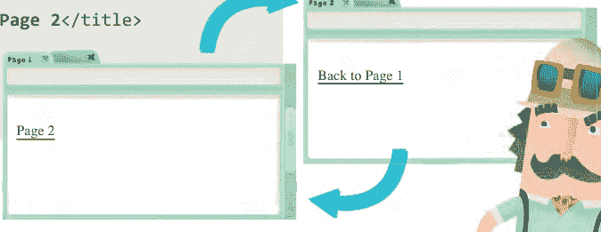

> 现在来制作密码吧！

## 使用 JavaScript 编程

超链接是创建响应用户的网页的重要第一步。但如果我们想要编写真正具有交互性、能够根据用户操作而变化的页面，我们就需要结合 HTML 使用一种名为 JavaScript 的新编程语言。

JavaScript 是世界上最流行的编程语言。它通过增加交互性来改造 HTML 和 CSS 网页。我们需要 JavaScript 来完成各种有用的功能，例如制作按钮、弹出警告框以及存储信息。在本任务中，我们将学习如何结合 HTML 使用 JavaScript 来创建密码，从而确保关于僧侣钻石的信息安全，免遭邦德兄弟团伙中的网络罪犯窃取。

我们在任务1中看到，HTML 文档由不同的元素组成，你可以使用属性来改变这些元素。JavaScript 也有自己的语法，或者说编写代码的规则集。JavaScript 语法由称为语句（statements）、变量（variables）、运算符（operators）和函数（functions）的代码片段组成。让我们来了解它们，并看看如何使用它们来构建密码。

### 将 JavaScript 添加到你的 HTML 页面

在开始编写 JavaScript 之前，你需要告诉浏览器你正在从 HTML 切换到 JavaScript。你可以通过使用`<script>`标签来实现这一点。如果你不把 JavaScript 代码放在`<script>`标签的开闭标签之间，你的代码将无法运行。你可以在 HTML 文档中使用任意数量的`<script>`标签，可以将它们放在页面的`<head>`或`<body>`中。

```html
<!DOCTYPE html>
<html>
<head>
  <title>Password</title>
</head>
<body>
  <script>
  </script>
</body>
</html>
```

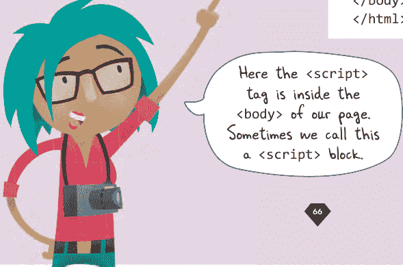


### 语句（statements）

当我们在 JavaScript 中为浏览器编写指令时，我们称之为编写语句。JavaScript 程序通常包含许多语句。语句通常以关键字开头，告诉你它将执行什么操作。它总是以分号（;）结尾。浏览器按照编写的顺序一个接一个地运行语句。让我们来看一些 JavaScript 语句。当我们保存这段代码并在浏览器中运行时，会发生以下情况：

```html
<!DOCTYPE html>
<html>
<head>
  <title>Password</title>
</head>
<body>
  <script>
    alert("We need a password urgently!");
    alert("Use the password Ernest300");
  </script>
</body>
</html>
```

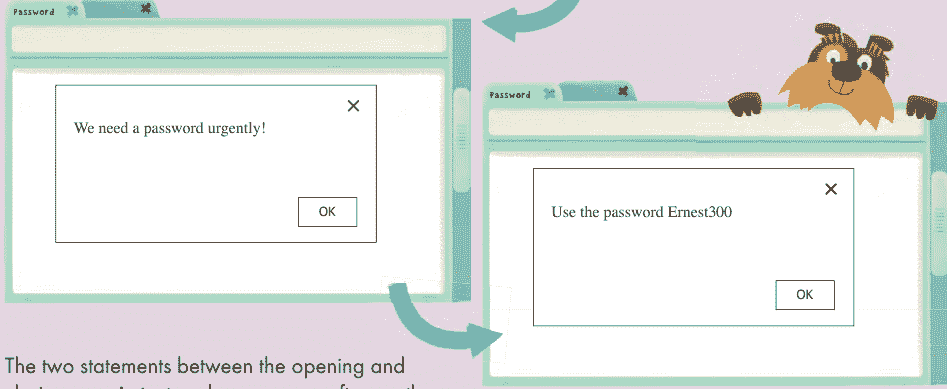

`<script>`开闭标签之间的两条语句依次运行，弹出了两个包含不同消息的警告框。警告框（alert）是一段称为函数的 JavaScript 代码，它内置于你的浏览器中。我们将在本任务后面了解更多关于它的知识。

JavaScript 区分大小写，因此确保使用正确的大写字母非常重要。如果你需要为一段 JavaScript 命名，你不能在单词之间留空格。书写两个单词的一个好方法是使用`camelCase`（驼峰式命名法）。

> **驼峰式命名法（CAMELCASE）**是将两个单词连接在一起形成一个单词的做法。第一个单词以小写字母开头，第二个单词以大写字母开头，但两者之间没有空格，就像骆驼的驼峰一样。camelCase的一个例子是`sayHello`。

### 变量（VARIABLES）

变量是 JavaScript 的重要组成部分。它们是一种在浏览器中短期存储信息的方式。然后你可以使用存储的数据来构建使网页具有交互性的程序。没有变量，你的浏览器就无法记住信息。

因此，当我们使用 JavaScript 编写检查密码的程序时，我们需要使用变量来存储正确密码的数据。没有变量，我们的浏览器就无法检查用户是否输入了正确的密码。

变量以单词或数字的形式存储数据。你必须以特定的方式编写变量。你必须始终告诉浏览器你正在创建一个变量。这称为定义变量。让我们看看如何创建一个存储欧内斯特名字的变量：

> 这些很重要！

> 欧内斯特是个很好的名字！

```javascript
var dogName = "Ernest";
```

| | | |
|---|---|---|
| 变量关键字 | 变量名 | 值 |

变量总是以相同的方式书写。每段 JavaScript 都会告诉浏览器不同的信息，这在构建程序时将十分重要。

#### 变量需要：

- **关键字（A keyword）**  
  要定义变量，你必须使用变量（var）关键字。它告诉你的浏览器你正在创建一个变量。
- **变量名（A variable name）**  
  变量的下一部分是变量名。你可以给变量取任何你喜欢的名字。变量名的唯一规则是不能包含空格（所以请使用驼峰式命名法代替），且不能以数字开头。
- **值（A value）**  
  然后你必须使用等号（=）为变量赋值。这个过程称为赋值。如果变量的值是文本，你必须将值放在双引号（" "）中。值中可以包含空格。在值之后，你必须加上分号（;）。

### 运算符

运算符是 JavaScript 的另一个关键部分。它们是一种改变变量值的方式。不同类型的运算符会对变量中的信息进行不同的操作。

#### 赋值运算符

> 你能发现驼峰命名法的使用吗？

赋值运算符允许你创建和设置变量的值。

**等于 (=)**：你使用等号 (=) 为变量赋值。你可以用它将变量设置为数字或单词。如果你的变量是数字，则不需要用双引号 (" ") 括起来。这是一个将值设置为数字的例子：

而这是一个将值设置为文本，需要使用双引号 (" ") 的例子：

```javascript
var teamMembers = 3;
```

赋值运算符

```javascript
var expeditionLeader = "Professor Bairstone";
```

#### 算术运算符

算术运算符是使用数学计算来改变变量值的一种方式。它们是为变量创建数值的有用方法。

**加法 (+)**：你使用加法运算符 (+) 将数字相加得到一个值。这里，我们的`campRations`变量的值将被设置为 3。

```javascript
var campRations = 2 + 1;
```

加法运算符

**减法 (-)**：你使用减法运算符 (-) 对数字进行减法运算以创建一个值。这里，我们的`dogBiscuits`变量的值将被设置为 1。

```javascript
var dogBiscuits = 5 - 4;
```

减法运算符

> 务必在变量末尾使用分号。

> 不要忘记将文本值放在双引号中。

### 编码技巧

### 使用变量和运算符

变量和运算符是 JavaScript 编程语言的重要组成部分。让我们用它们来编写一些简单的 JavaScript 程序。

1. 在编写任何 JavaScript 之前，我们需要创建一个 HTML 文件，并在`<body>`中包含一个`<script>`标签。打开你的文本编辑程序。创建一个名为`variables.html`的新 HTML 文件。将此代码输入到你的新文件中：

```html
<!DOCTYPE html>
<html>
<head>
  <title>Variables</title>
</head>
<body>
  <script>
  </script>
</body>
</html>
```

2. 现在尝试编写一些 JavaScript。在`<script>`标签的开始和结束之间创建一个变量。给你的变量起个名字，然后使用赋值运算符 (`=`) 设置变量的值。让我们尝试用一个数字，像这样：

```html
<script>
  var diamondCarats = 300;
</script>
```

不要忘记 JavaScript 区分大小写，因此请确保在代码块中保持大小写一致。同时记住末尾的分号 (;)。如果你保存 HTML 文件并在浏览器中打开它，什么也不会发生——但不用担心。你已经将 300 存储在`diamondCarats`变量中了。

3. 让我们使用`alert`函数来检查你的变量是否已存储在浏览器中。在你的变量下方输入此代码：

```html
<script>
  var diamondCarats = 300;
  alert(diamondCarats);
</script>
```

我们所做的就是要求浏览器运行内置的`alert`函数。无论`diamondCarats`变量中是什么值，都将显示在一个警报框中。

> 检查浏览器中是否未禁用弹出窗口。在线搜索如何在你使用的浏览器中禁用弹出窗口阻止程序。

保存你的 HTML 文件并刷新页面。一个警报框将弹出，你将看到`diamondCarats`变量的值显示在屏幕上。点击确定，警报框将消失。刷新页面，警报框将重新加载。

4. 现在让我们编写一个新变量，使用加法运算 (+)，来计算 Bairstone 教授团队中的总人数和狗的数量。我们将变量命名为`teamMembers`，并设置一个警报来显示变量的值。修改`<script>`块使其如下所示：

```html
<script>
  var teamMembers = 2 + 1;
  alert(teamMembers);
</script>
```

保存文件并刷新页面。你的警报框将显示`teamMembers`变量的值。点击确定。

5. 最后，让我们尝试使用赋值运算符 (=) 创建一个变量，将文本存储在我们的变量中。不要忘记你需要在文本周围使用双引号 (" ")。设置一个警报来显示变量的值。修改文件中的代码使其如下所示：

```javascript
<script>
  var jewelThieves = "The Bond Brothers";
```


```javascript
alert(jewelThieves);
```

当你保存文件并刷新页面时，你会在警报框中看到你的文本。

> 干得漂亮！你刚刚编写了你的第一个 JavaScript 程序！

### 比较运算符

除了赋值或执行数学计算外，运算符还可用于比较变量的值。能够比较值使我们能够使网页更具交互性。使用比较运算符，我们可以编写根据变量值执行不同操作的代码。以下是你可能用到的一些不同的比较运算符：

| 运算符 | 含义 |
| --- | --- |
| `==` | 等于 |
| `!=` | 不等于 |
| `>` | 大于 |
| `<` | 小于 |
| `>=` | 大于或等于 |
| `<=` | 小于或等于 |

这些运算符可用于 JavaScript 语句中，以对我们的变量提出问题。然后，我们可以编写根据问题的答案执行不同操作的代码。使用比较运算符给浏览器的指令称为`if`语句和`else`语句。这些类型的语句被称为条件语句，因为它们取决于变量的值或条件。

### `IF` 语句

`If`语句是一种告诉浏览器仅在我们的变量条件为真时才执行指令的方式。如果我们变量的条件为假，浏览器将不会执行代码中的指令。

我们必须以特定的方式构建`if`语句。我们以语句关键字`(if)`开始。然后我们打开一对括号，并将`if`语句的规则放在其中。接着我们打开一对花括号`({ })`。在花括号内部，我们放入希望仅在`if`语句为真时才发生的指令。

让我们看一个使用等于运算符`(==)`创建`if`语句的例子。这里，我们使用赋值运算符`(=)`将变量值设置为 Dr Day。然后我们通过要求浏览器检查变量中的值是否等于`(==)` Dr Day 来创建一个`if`语句。接着，如果我们的条件为真，我们要求浏览器弹出一个警报。

```html
<script>
  var person = "Dr Day";

  if (person == "Dr Day") {
    alert("Hello Dr Day!");
  }
</script>
```

> 我们使用了一个`if`语句来编写一个会向 Dr Day 问好的程序！

现在，如果我们把变量的值改为不等于 Dr Day 的值，什么也不会发生。这是因为`if`语句为假。我们的浏览器不会运行花括号内的代码，也不会弹出警报框。

```html
<script>
  var person = "Ernest";

  if (person == "Dr Day") {
    alert("Hello Dr Day!");
  }
</script>
```

你可以使用那个表格中的其他比较运算符来检查各种不同的事情。你可以检查事物是否不等于`(!=)`，或者你可以使用大于`(>)`和小于`(<)`运算符来检查一个数字是否大于或小于另一个数字。让我们看看如何使用大于运算符`(>)`创建一个`if`语句。

```html
<script>
  var diamondCarats = 300;

  if (diamondCarats > 299) {
    alert("Valuable Diamond Alert!");
  }
</script>
```

这里，我们的变量值被设置为 300。我们通过要求浏览器检查变量中的值是否大于`(>)` 299 来创建一个`if`语句。然后，如果我们的条件为真，我们要求浏览器弹出一个警报。僧侣钻石是 300 克拉，所以警报框会弹出。

> 注意结束花括号如何与关键字对齐。

#### 编码技巧 ► 编写 `IF` 语句

在 JavaScript 代码中使用`if`语句，意味着你可以构建更复杂的程序，使其根据变量的值进行变化。让我们来构建一个使用`if`语句的程序。

1. 打开你的文本编辑程序。创建一个新的 HTML 文件，命名为`ifstatements.html`。将以下代码输入到你的新文件中：

```html
<!DOCTYPE html>
<html>
<head>
  <title>Conditionals</title>
</head>
<body>
  <script>
  </script>
</body>
</html>
```

2. 使用相等运算符`(==)`创建一个`if`语句。如果变量的条件为真，则弹出一个提示框。首先，在`<script>`标签之间创建一个名为`dogName`的变量。然后创建你的`if`语句和提示框。不要忘记将`if`语句的指令放在圆括号中，将提示框的指令放在花括号`({ })`中。你的代码将如下所示：

```javascript
<script>
  var dogName = "Ernest";

  if (dogName == "Ernest") {
    alert("You discovered the Monk Diamond!");
  }
</script>
```

3. 保存你的 HTML 文件并在浏览器中打开它。将弹出一个提示框。

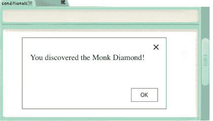

> 我确实发现了那颗钻石！不过这躲藏地点也不算太聪明。

4. 尝试将变量值中的 Ernest 改为你自己的名字，这样`if`语句的条件就为假了。保存你的文件并刷新页面。提示框将不会弹出。

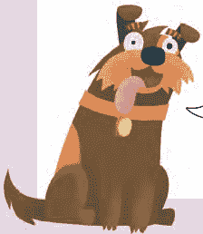

#### `ELSE` 语句

`Else`语句与`if`语句配合使用，使网页更具交互性。你在`if`语句之后使用`else`语句，以改变浏览器运行的代码块。如果你的`if`语句条件为假，浏览器将运行替代的`else`语句。

`Else`语句的编写方式与`if`语句完全相同——只需使用`else`关键字即可。将你想要运行的代码放在花括号`({ })`内。让我们看一个`if`语句和`else`语句协同工作的示例：

```javascript
<script>
  var name = "Tony Twinkles";

  if (name == "Dr Day") {
    alert("Access Granted!");
  } else {
    alert("Access Denied!");
  }
</script>
```

如果我们在浏览器中运行此代码，将弹出一个提示框。我们变量中的值是邦德兄弟之一的名字，不等于`(==)` Dr Day。因为`if`语句的条件为假，我们的浏览器运行了`else`语句。但如果我们变量的值等于`(==)` Dr Day，且`if`语句的条件为真，那么`else`语句就不会执行。相反，`if`语句会执行，并且会弹出 "Access Granted" 提示框。

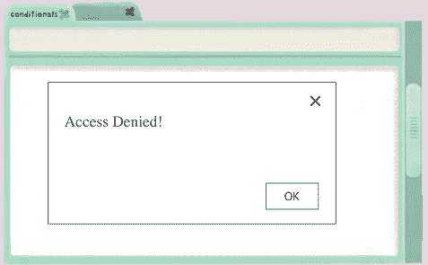

> 这是阻止邦德兄弟的巧妙方法！

> 哼！我该怎么查清楚他们有没有那颗宝石？

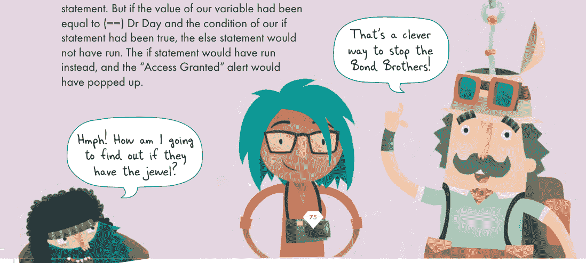

#### 编码技巧 ► 编写 `ELSE` 语句

现在我们应该学习如何在一段 JavaScript 代码中将`else`语句与`if`语句配合使用。让我们尝试编写一个同时使用这两种条件语句的程序。

1. 打开你的文本编辑程序。创建一个新的 HTML 文件，命名为`elsestatements.html`。然后将你从`ifstatements.html`中的代码复制并粘贴到新文件中。修改代码使其如下所示：

```html
<!DOCTYPE html>
<html>
<head>
  <title>Conditionals</title>
</head>
<body>
  <script>
  </script>
</body>
</html>
```

2. 在你的`<script>`块中，使用小于或等于运算符`(<=)`创建一个新的`if`语句。使你的`if`语句条件为假。你的代码将如下所示：

```javascript
<script>
  var diamondValue = 10;

  if (diamondValue <= 9.9) {
    alert("Value: Under £10 million!");
  }
</script>
```

3. 现在在你的`if`语句之后添加一个`else`语句。如果`if`语句的条件为假，此语句将运行。你的代码将如下所示：

```javascript
<script>
  var diamondValue = 10;

  if (diamondValue <= 9.9) {
    alert("Value: Under £10 million!");
  } else {
    alert("Value: Over £10 million!");
  }
</script>
```

4. 保存你的 HTML 文件并在浏览器中打开它。你的`else`语句将运行，并弹出一个提示框。

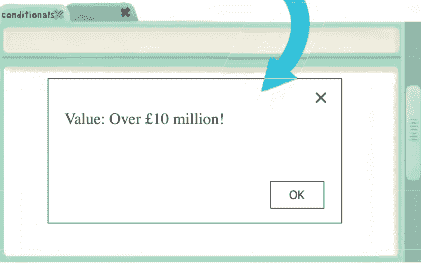

#### 编码技巧清单

#### 编写 JavaScript

JavaScript 始终必须写在`<script>`标签内，这样你的浏览器才知道你正在从 HTML 切换到一种新的编程语言。你可以将`<script>`标签放在页面的`<head>`或`<body>`中。

就像 HTML 和 CSS 一样，JavaScript 有其特殊的编写方式和语法。它是一种区分大小写的语言。你应该在代码片段之间留出空格，使其更易于阅读。

你在 JavaScript 中给浏览器的每条指令都称为一个**语句**。语句必须以分号`(;)`结尾。花括号`({ })`用于将语句组合成一个**代码块**，以便浏览器一次性运行。

语句通常以一个**关键字**开头，该关键字表明语句将执行的操作。

你可以使用**变量**在浏览器中存储信息。变量有一个名称和一个值，值可以是文本或数字。如果是文本，则必须放在双引号`(" ")`中。如果你的变量名包含两个单词，请使用驼峰命名法书写。

要更改或设置变量的值，可以使用**赋值运算符**、**算术运算符**和**比较运算符**。

`If`语句和`else`语句被称为**条件语句**。

使用条件语句使我们能够根据变量的值让代码执行不同的操作。

> 使用 JavaScript 帮助我们创建能够响应用户的交互式网页。

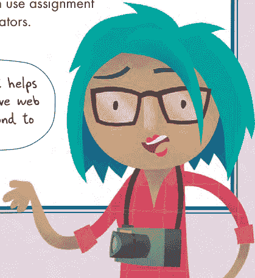

## 函数

JavaScript 编程的另一个重要部分是学习如何创建和使用函数。你通过将 JavaScript 语句组合在一起来创建一个函数。函数中组合的语句协同工作以执行特定的操作。在你告诉浏览器运行函数之前，它不会运行。这被称为调用函数。让我们来看看如何创建一个将弹出提示框的函数，然后调用它：

```javascript
<script>
  function sayPassword() {
    alert("Password!");
  }

  sayPassword();
</script>
```

函数总是必须以相同的方式编写。每一部分都是给浏览器的重要指令。

### 一个函数需要：

- **`function`关键字**  
  要定义和创建一个函数，你必须使用`function`关键字。
- **函数名**  
  然后你需要给函数起一个名字。名称应该简短，并解释函数执行的操作。名称总是以一对括号结尾。
- **花括号**  
  在函数名之后，你必须打开一对花括号`({ })`。你想在函数中组合在一起的所有语句都必须放在花括号内。
- **语句**  
  语句构成了函数的主体。你可以使用任意多的语句，只要你调用该函数，代码块就会在你的浏览器中运行。
- **函数调用**  
  要调用我们的函数并运行代码块，你必须输入函数的名称（包括括号），后跟一个分号。定义函数后，你可以在`<script>`块中的任何位置调用它。


### 内置函数

除了将语句组合在一起创建你自己的函数之外，你还可以使用浏览器内置的函数。内置函数是你的浏览器知道如何执行的动作，而无需你编写任何代码。程序员已经为你完成了艰苦的工作。你所要做的就是告诉浏览器内置函数的名称及其运行所需的信息。

JavaScript 有许多内置函数。你在这个任务中已经使用过一个：`alert`函数。要使用`alert`函数，你只需输入`alert`，浏览器就会弹出一个提示框。内置函数为你节省时间，并让你在编程时能够做更复杂的事情。

### 函数与参数

为了让函数执行任务，你有时需要给它一条信息以便其运行。当我们把信息放在函数内部时，我们说我们向函数传递了一个参数。每次使用`alert`函数时，你都在向函数传递参数。让我们看看参数长什么样：

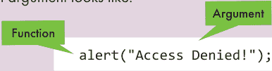

函数名称后面括号中的信息就是我们的参数。浏览器需要参数来知道在提示框中显示什么文本。没有参数，`alert`函数将无法正常工作。

参数可以是文本、数字或变量的形式。如果你向函数传递一段文本作为参数，它需要放在双引号`(" ")`中。如果你传递的是变量名，你只需使用变量名而不加引号，像这样：

```javascript
var bondBrothers = "Dangerous jewel thieves!";

alert(bondBrothers);
```


你可以向任何类型的函数传递参数。你可能想知道为什么函数名和函数调用总是以一对括号结尾。这样你才能向函数传递参数。翻页看看如何操作。


```javascript
<script>
  function sayHello(name) {
    alert("Hello " + name);
  }

  sayHello("Dr Day!");
</script>
```

在这段代码中，我们创建了一个函数，它会弹出一个提示框。我们通过为函数添加一个参数来实现这一点。这种参数称为形参。然后我们编写了一个`alert`，告诉浏览器弹出一些文本加上该参数。接着我们通过在函数调用中放入名字，告诉浏览器要在提示框中显示的名称。

## `return` 语句

到目前为止，我们一直在通过参数向函数传递信息。我们也可以让函数把信息作为值返回给我们。当函数返回一条信息时，我们说它返回了该信息。要让函数返回一条信息，我们必须在函数内部使用`return`语句。`return`语句中的值可以是文本、数字或变量，它会变成函数的值。让我们看看如何使用`return`语句来获取一段文本：

```javascript
<script>
  function getName() {
    return "Dr Day";
  }

  var scientist = getName();

  alert(scientist);
</script>
```

> 函数通常会执行某个操作，并将结果返回给代码的其余部分。

在这个例子中，我们创建了一个名为`getName`的函数。我们希望函数把 Day 博士的名字作为值返回给我们，因此我们使用了`return`语句，并将她的名字设为返回值。然后我们将函数名作为变量值存储起来。当提示框弹出时，它会显示`return`的值。

## 代码技能 ▸ 函数与参数

让我们来尝试把语句组合在一起，创建一个函数。我们还应该试一下`return`语句，因为在我们为 Day 博士创建密码时，它会非常有用。

1. 打开你的文本编辑程序。创建一个名为`functions.html`的新 HTML 文件。将以下代码输入到你的新文件中：

```html
<!DOCTYPE html>
<html>
<head>
  <title>Functions</title>
</head>
<body>
  <script>
  </script>
</body>
</html>
```

2. 在你的`<script>`代码块内创建一个名为`checkAccess`的函数，当你调用它时会弹出一个提示框。你的代码看起来像这样：

```javascript
<script>
  function checkAccess() {
    alert("Restricted access!");
  }

  checkAccess();
</script>
```

3. 保存你的 HTML 文件并在浏览器中打开它。会弹出一个提示框。

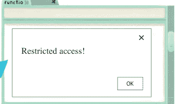

4. 现在修改你的`checkAccess`函数，使其包含一个`return`语句。将函数名存储在一个变量中。然后让提示框弹出以显示变量的值：

```javascript
<script>
  function checkAccess() {
    return "Expedition team only!";
  }

  var webPage = checkAccess();

  alert(webPage);
</script>
```


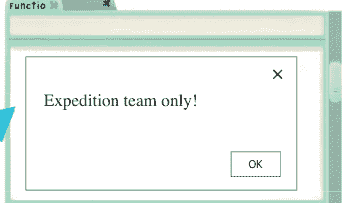

保存并刷新你的页面。一个新的提示框将会弹出。

## 让 JavaScript 与 HTML 协同工作

在本任务中，我们已经看到了如何通过将 JavaScript 写在`<script>`标签内来将其添加到你的 HTML 网页中。但现在我们需要学习如何让 JavaScript 代码在用户点击某个 HTML 元素时运行。如果我们希望当用户点击页面上的某段文本或图像时发生某些事情，就必须将 JavaScript 添加到 HTML 标签中。幸运的是，有一个属性可以让我们做到这一点。

> 属性！  
> 你在任务 1 中已经完全了解它们了。

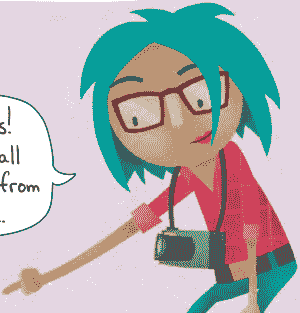

### `onclick` 属性

让用户点击页面上的某个 HTML 元素时运行一段 JavaScript 代码非常简单。你所需要做的就是在你想要使其具有交互性的 HTML 标签中包含`onclick`属性（或称为 "onclick"）。然后当用户在他们的浏览器中点击该 HTML 元素时，JavaScript 代码就会运行。

`onclick`属性和我们到目前为止在任务中使用的所有其他属性一样。你将该属性添加到你希望用户点击的 HTML 元素的开始标签中。然后使用等号（`=`）和双引号（`" "`）将`onclick`的值设置为你想要运行的 JavaScript 代码。别忘了分号（`;`）。你可以在`onclick`中放入任何你想要的 JavaScript 代码。让我们来看一看：

```html
<!DOCTYPE html>
<html>
<head>
  <title>Diamond Colour</title>
</head>
<body>
  <p onclick="alert('Green');">
    Click here to find out the colour of the Monk Diamond
  </p>
</body>
</html>
```


当用户点击开始和结束`<p>`标签之间的文本时，我们`onclick`中的 JavaScript 函数就会运行。会弹出一个提示框。

> 你知道吗，绿色钻石极其稀有？

#### 你注意到了吗？

我们用单引号（`' '`）包裹了传递给`alert`函数的参数。这是因为我们已经使用双引号来设置`onclick`属性的值了。始终在双引号内使用单引号，否则你的代码将无法运行。

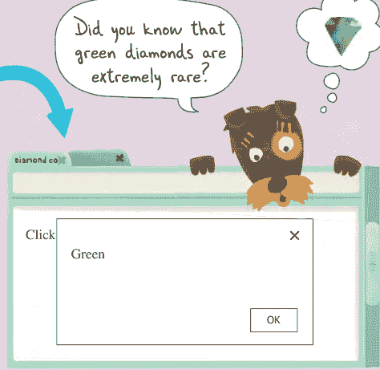

### 将 `true` 和 `false` 与 `return` 语句一起使用

你还可以使用`onclick`属性来阻止浏览器执行某段代码中的指令。为此，你在`onclick`中使用`return`语句，并将其值设为 "false"。

`Return`是 JavaScript 中的一个保留字。如果你在`return`语句中使用值 "true"，浏览器将继续运行代码。但如果你在`return`语句中使用值 "false"，浏览器将立即停止运行代码。

> 我担心那些烦人的邦德兄弟可能在附近……请快点搞定密码！


> **保留字**是不能用作函数名或变量名的词。这是因为它们是你的浏览器能理解的特殊命令。你不需要将保留字放在双引号（" "）中。

### `onclick` 属性与超链接

我们可以用`onclick`属性和值 "false" 创建一个非常有用的 JavaScript 功能。你可以使用`onclick`和`return`语句来阻止超链接在用户点击时跳转。这在任务后面我们编写密码时会非常有用。如果用户输入了错误的密码，他们将不会被带到 Monk Diamond 网页。

要做到这一点，你首先用与任务开始时完全相同的方式创建你的超链接，使用锚点`<a>`标签和`href`属性，就像这样：

```html
<body>
  <a href="monkdiamonddiscovery.html">
    Click here to visit the Monk Diamond web page
  </a>
</body>
```

然后你添加`onclick`属性和`return`语句。将`return`语句的值设为 "false"，就像这样：

```html
<body>
  <a href="monkdiamonddiscovery.html" onclick="return false;">
    Click here to visit the Monk Diamond web page
  </a>
</body>
```

将 "false" 作为`onclick`的值意味着当用户点击该链接时，什么都不会发生。

> 这将有助于保护我们的网页不被发现！


## 代码技能 ► 让 HTML 代码运行 JavaScript

练习使用 HTML 的`onclick`属性来运行一段 JavaScript 代码。知道如何做到这一点意味着你可以让 HTML 元素对用户做出响应。

1. 打开你的文本编辑程序。创建一个名为`onclick.html`的新 HTML 文件。将以下代码输入到你的新文件中：

   ```html
   <!DOCTYPE html>
   <html>
   <head>
     <title>Onclick</title>
   </head>
   <body>
   </body>
   </html>
   ```

2. 在你的`<body>`中创建一个会将用户带到 Google 的超链接。使用锚点`<a>`标签和`href`属性。将值设为 Google 的网址。你的代码看起来像这样：

   ```html
   <body>
     <a href="https://www.google.com">
       Google
     </a>
   </body>
   ```

3. 现在将`onclick`属性添加到你的`<a>`开始标签中。将`onclick`的值设为一个 JavaScript`alert`。记住对`alert`的参数使用单引号（`' '`）。你的代码看起来像这样：

   ```html
   <a href="https://www.google.com" onclick="alert('Redirecting to Google');">
     Google
   </a>
   ```

4. 保存你的 HTML 文件并在浏览器中打开它。当你点击链接时会弹出一个提示框。当你点击 OK 后，你会被带到 Google。

5. 现在阻止你的超链接带你前往 Google。在你的`onclick`中使用`return`语句，像这样：

   ```html
   <a href="https://www.google.com" onclick="return false;">
     Google
   </a>
   ```

   保存你的文件并刷新页面。当你点击该链接时，页面将不会连接到 Google。

## 创建你的密码页面

现在你已经知道如何使用`onclick`属性让你的 HTML 元素具有交互性，我们可以开始为戴博士构建密码网页了。让我们从页面的基本 HTML 结构开始：

> 别忘了最高机密的密码是`Ernest300`。

```html
<!DOCTYPE html>
<html>
<head>
  <title>Password</title>
  <style>
    body {
      background-color: lightblue;
      padding: 30px;
    }
  </style>
</head>
<body>
  <p style="font-size: 30pt;">THE MONK DIAMOND DISCOVERY</p>
  <p>Please enter the password to view this website.</p>
  <p>Password:</p>
  <a href="monkdiamondiscovery.html">
    Click here to submit password and view website
  </a>
</body>
</html>
```

这里我们使用 HTML 和 CSS 创建了一个简单的网页。我们包含了一个链接到我们"僧佛钻石发现"网页的超链接。但是我们的页面上没有用户可以输入密码的地方。我们需要创建一个框，让用户可以输入密码。

---

## `<input/>` 标签

网站经常需要输入信息。这是你登录在线账户、预订电影票或使用搜索引擎的方式。所以要求用户输入信息是编程中常见的部分。这被称为请求用户输入。

有很多标签可以用来请求用户输入，但你最常使用的是`<input/>`标签。它非常适合在页面上创建框，让你的用户可以输入数据。它是一个自闭合标签，你在其中包含两个属性：`id`属性和`type`属性。如你所知，你使用等号（`=`）和双引号（`" "`）来设置这些属性的值。让我们看看如何在我们的页面上使用`<input/>`标签：

```html
<body>
  <p style="font-size: 30pt;">THE MONK DIAMOND DISCOVERY</p>
  <p>Please enter the password to view this website.</p>
  <p>Password:<input id="passwordBox" type="text"/></p>
  <a href="monkdiamonddiscovery.html">
    Click here to submit password and view website
  </a>
</body>
```

使用带有这两个属性的`<input/>`标签创建了一个我们可以输入密码的框。

你使用`id`属性给你的`<input/>`标签一个唯一的名字。你必须选择你的`id`属性的名称。确保它容易记住。这里我们将`id`属性的值设置为`passwordBox`。

这样做让我们可以在 JavaScript 中使用`<input/>`标签内的值。我们使用`id`属性告诉浏览器我们想要使用哪段数据。没有`id`属性，你的浏览器将无法找到密码并检查密码是否正确。

### `type` 属性

有很多不同种类的`<input/>`标签，所以你需要使用`type`属性告诉浏览器你需要哪种`<input/>`标签。你必须从预定义的值中选择你的`type`属性。以下是一些你可以在`<input/>`标签中使用的常见`type`属性：

| 属性值 | 作用 |
| --- | --- |
| `text` | 创建一个用于输入文本的框 |
| `password` | 创建一个用于输入密码的框 |
| `button` | 创建一个可点击的按钮（配合 JavaScript） |
| `checkbox` | 创建一个用户可以勾选或取消勾选的框 |

你可能已经注意到，在上一页中，当我们将`type`属性设置为`text`时，密码的文本会显示在框中。那不太安全！如果邦德兄弟在附近，戴博士输入密码时会发生什么？

如果我们想保密密码，可以将`type`属性的值更改为`password`。这将通过将文本改为圆点来隐藏用户输入的内容。让我们来看看：

```html
<body>
  <p style="font-size: 30pt;">THE MONK DIAMOND DISCOVERY</p>
  <p>Please enter the password to view this website.</p>
  <p>Password:<input id="passwordBox" type="password"/></p>
  <a href="monkdiamonddiscovery.html">
    Click here to submit password and view website
  </a>
</body>
```

> 这是保密的更好方法！

THE MONK DIAMOND DISCOVERY

请输入密码以查看此网站。

密码：●●●●●●●●

点击此处提交密码并查看网站

---

### 使用 JavaScript 的高温检查密码

现在我们已经构建了页面的基本 HTML 结构，我们需要编写一些 JavaScript 来检查用户输入的密码是否正确。如果他们输入密码`Ernest300`，他们将跳转到"僧佛钻石发现"页面。如果他们输入错误的密码，将弹出一个警告框告诉他们密码错误。

首先我们需要创建一个函数，包含我们需要检查密码的所有代码。让我们在`<head>`中创建这个函数。你可以将 JavaScript 放在 HTML 网页的任何位置，在这个例子中，将它放在我们的`<head>`中使我们的代码更容易理解。别忘了将你的 JavaScript 放在`<script>`标签内，像这样：

```html
<script>
  function checkPassword() {
  }
</script>
```

然后我们需要创建变量来存储密码的值，这样我们的函数就可以检查用户是否输入正确。让我们看看我们需要的两个变量：

```html
<script>
  function checkPassword() {
    var password = document.getElementById("passwordBox");
    var passwordEntered = password.value;
  }
</script>
```

在我们的第一个变量中，我们使用了一个名为`getElementById`的新内置函数。你将在任务 3 中学习有关此函数的所有知识并更多地使用它。这是一个方便的函数，可以找到具有指定`id`属性的 HTML 元素。我们在这里选择的`id`属性用于我们的`<input/>`标签。因此，我们变量的值将是用户输入密码框中的任何数据。

然后我们创建第二个变量来存储用户输入密码框的数据。我们通过输入第一个变量的名称，后跟一个点（`.`），然后是`value`关键字来创建这个值。我们这样做是为了可以使用该变量的值编写`if`语句。

我们现在需要创建一个`if`语句。如果我们的第二个变量的条件为真，且我们的密码文本等于（`==`）Ernest300，超链接将工作。如果我们的变量条件为假，且密码文本不等于 Ernest300，链接将不工作，并会弹出警告框。我们不需要使用`else`语句，因为`return`语句将停止函数。

我们用于密码的完整`<script>`代码块，包含新的`if`语句，如下所示：

```html
<script>
  function checkPassword() {
    var password = document.getElementById("passwordBox");
    var passwordText = password.value;

    if(passwordText ==将会有和预防多种输入错误不同而破碎的用户体验一前一"Ernest300") {
      return true;
    }

    alert("Access denied! Incorrect password!");
    return false;
  }
</script>
```

最后，我们必须让我们的 JavaScript 与我们的 HTML 元素协同工作。我们现在需要查看页面`<body>`中的代码。我们希望当有人点击我们页面中的超链接时调用`checkPassword`函数。所以我们需要在我们的开头`<a>`标签中添加一个`onclick`属性，像这样：

```html
<body>
  <p style="font-size: 30pt;">THE MONK DIAMOND DISCOVERY</p>
  <p>Please enter the password to view this website.</p>
  <p>Password:<input id="passwordBox" type="password"/></p>
  <a href="monkdiamondiscovery.html" onclick="return checkPassword();">
    Click here to submit password and view website
  </a>
</body>
```

## 自己动手练习

### 创建一个密码

现在是时候尝试使用你在本任务中学到的所有 JavaScript 编码技能来创建一个新的网页，要求用户输入密码。这个网页将保护你在任务 1 中构建的网页。如果用户输入正确的密码，他们将能够访问"僧佛钻石发现"网页。如果输入错误，将弹出一个警告框，告诉他们访问被拒绝。

### "僧佛钻石发现"密码任务简介

当你构建新网页时，确保使用 HTML 和 JavaScript 编写以下内容：

- 一个被调用时检查密码的函数。
- 一个存储用户输入密码框数据的变量。
- 一个检查用户输入密码是否正确的`if`语句。
- 输入错误密码时弹出的警告框。
- 一个用户可以输入数据的文本框。
- 一个将此网页连接到"僧佛钻石发现"网页的超链接。

将文件保存在你的`Coding` sacrifice>文件夹中，并将其命名为`password.html`。

> 翻页查看密码页面所需的代码。

```html
<!DOCTYPE html>
<html>
<head>
  <title>密码</title>
  <style>
    body {


```html
      background-color: lightblue;

      padding: 30px;

    }

  </style>

  <script>

    function checkPassword() {

      var password = document.getElementById("passwordBox");

      var passwordText = password.value;

      if(passwordText == "Ernest300") {

        return true;

      }

      alert("拒绝访问！密码错误！");

      return false;

    }

  </script>

</head>

<body>

  <p style="font-size: 30pt;">僧侣钻石的发现</p>

  <p>请输入密码以查看此网站。</p>

  <p>密码：<input id="passwordBox" type="password"/></p>

  <a href="monkdiamonddiscovery.html" onclick="return

    checkPassword();">

    点击此处提交密码并查看网站

  </a>

</body>

</html>
```

> 邦德兄弟不会打败我们！

### 僧侣钻石的发现

请输入密码以查看此网站。

密码：●●●●●●●●

[点击此处提交密码并查看网站](http://#)

> 出色的代码！这个密码页面将保护僧侣钻石的安全。别忘了，你可以使用更多的 CSS 属性来改变页面的外观。

## 未来的代码技能

JavaScript 是一种强大且动态的编程语言，被所有现代网络浏览器使用。掌握 JavaScript 可以让你创建交互式和响应式的网页，允许用户输入信息。它也非常适合构建基于网络的应用程序。


---

# 任务 3

## 构建一个应用程序

- 使用 JavaScript 创建一个按钮
- 使用文档对象模型（DOM）API 编程你的网络浏览器
- 学习如何使用本地存储（`LOCALSTORAGE`）API 让你的网页记住东西
- 构建一个待办事项列表应用程序


### 任务简报


亲爱的编码者：

很高兴地告诉你，没有更多可疑事件需要报告了。我认为你为戴博士所做的工作取得了成功，由于无法访问我们的网页，邦德兄弟已经被我们甩掉了。你再次让我印象深刻！

我受伤的脚踝现在已经痊愈了。我们昨天离开了山区，目前正乘坐西伯利亚大铁路前往莫斯科。我们的一等车厢非常豪华，我一直在给我的老朋友、沃尔科夫家族的维克多·沃尔科夫先生发电子邮件。如你所知，沃尔科夫家族正是三年前僧侣钻石被如此大胆地盗走的地方。它是世界上最古老、最受尊敬的珠宝行之一，沃尔科夫先生对这次盗窃深感痛心。

我已经告诉了沃尔科夫先生我们的发现。起初他简直不敢相信！但最终我说服了他，他希望我们尽快带着钻石返回莫斯科。他已经在为一次特别展览制定计划了。他将邀请来自世界各地最重要的珠宝收藏家，并宣布我们的发现。

沃尔科夫先生需要帮助策划这次展览。由于我们在火车上，我希望你或许能再次伸出援手。有没有什么办法可以构建一个待办事项列表应用程序？我们可以用这个应用程序来跟踪从现在到展览开幕之间我们需要做的所有不同任务。我有时会很健忘，所以有这个应用程序会非常有用。

如果我们没有妥善规划这次展览（并且有最大限度的安保措施），我担心邦德兄弟可能会试图偷回钻石。我附上了一些关于展览开幕前需要完成事项的笔记，以及来自《探险者百科全书》中关于沃尔科夫家族的条目，这将帮助你构建应用程序。

来自我舒适车厢的最诚挚问候，  
哈里·贝尔斯通教授

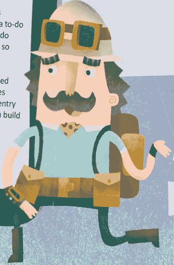

---

### 沃尔科夫家族

来自《探险者百科全书》，每一场冒险的指南

*沃尔科夫钻石* 此处重定向。

**沃尔科夫家族** 是世界上最古老的[珠宝行](jewellery houses)之一，以其高品质的[钻石](diamond)珠宝而闻名。它还拥有世界闻名的[宝石](gems) [私人收藏](private collection)。沃尔科夫家族成立于 1790 年代的[圣彼得堡](St Petersburg)。它由[弗拉基米尔·沃尔科夫](Vladimir Volkov)创立，他因对最稀有和最珍贵宝石的热爱而被称为钻石王子。沃尔科夫家族被任命为皇室的官方珠宝商，为俄罗斯贵族提供设计精美的珠宝。

如今，沃尔科夫家族位于莫斯科最独特的街道之一，靠近圣巴西利克大教堂。沃尔科夫钻石仍然以其品质而闻名，是世界上最昂贵的钻石之一。

现任所有者维克多·沃尔科夫在拍卖会上以未公开的价格购买了僧侣钻石。它是沃尔科夫家族私人收藏的核心。它被展示在一个古董玻璃柜中，直到在一次砸抢式抢劫中被窃。僧侣钻石的失窃至今未破。自抢劫事件以来，沃尔科夫家族报告销售额急剧下降，有传言称其可能被出售。沃尔科夫先生在最近的一次采访中表示：“如果这个在我家族中传承了几代人的企业不得不关闭，我将深感痛心。”

| 行业： | 珠宝商 |
|---|---|
| 成立： | 1794 年 |
| 创始人： | 弗拉基米尔·沃尔科夫 |
| 总部： | 莫斯科 |
| 服务区域： | 全球 |

《探险者百科全书》

每一场冒险的指南

- [主页](Home page)
- 目录
- [精选发现](Featured discoveries)
- [著名探险家](Famous explorers)
- [历史远征](Historical expeditions)

---

### 僧侣钻石特别展览待办事项清单

- 委托制作最先进的防碎玻璃展柜
- 为钻石订购新的天鹅绒垫子
- 聘请私人安保
- 聘请保镖保护沃尔科夫先生
- 邀请宾客
- 购买钻石主题的零食和柠檬水
- 为欧内斯特购买狗饼干

---

## 构建一个基于网络的应用程序

为沃尔科夫家族的僧侣钻石规划特别展览，对贝尔斯通教授、戴博士和沃尔科夫先生来说将是一项艰巨的任务。在这个任务中，你将通过构建一个在浏览器中运行的应用程序来帮助他们。贝尔斯通教授可以使用这个应用程序创建他的待办事项列表。一旦他完成了一项任务，他就可以将其从列表中移除。

我们将需要学习一些新的 JavaScript 函数来构建我们的应用程序。目前，我们构建的网页在浏览器将它们绘制到屏幕上后就不会改变。贝尔斯通教授会想要在他的列表中添加和删除项目，所以我们的应用程序需要更具交互性。让我们看看我们的应用程序将会是什么样子：

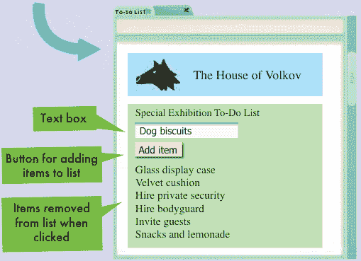

> ## 你知道吗？
>
> 在这个任务中使用最好的网络浏览器是 Mozilla Firefox 和 Google Chrome。并非所有浏览器都支持完成此任务所需的功能。

我们的应用程序将有一个文本框，贝尔斯通教授可以在其中输入。当他点击按钮时，该项目将被添加到列表中。当他完成一项任务时，他可以点击它，它将被移除。我们可以使用你在任务 2 中学到的 JavaScript 以及一些新的编程工具来编写所有这些代码。

## 构建文本框和按钮

在我们开始学习新的 JavaScript 代码之前，让我们构建应用程序的基本结构。我们需要一个文本框和一个按钮。在任务 2 中，你学习了如何使用`<input/>`标签和`type`属性。在这个任务中，我们将再次使用这些技巧。

`<input/>`标签允许你在页面上创建一个 HTML 元素，用户可以在其中输入数据。你使用`type`属性来选择用户可以向其中添加数据的元素类型。因此，要在我们的页面上创建一个文本框和一个可点击的按钮，我们需要以下代码：

```
<input type="text"/>
<input type="button"/>
```

我们还需要在文本框和按钮内添加一些文字，这样用户才知道它们执行什么操作。我们通过向`<input/>`标签添加一个新的`value`属性来实现：

```
<input type="text" value="在此输入以添加任务"/>
<input type="button" value="添加项目"/>
```

然后我们可以更改`<input/>`标签的 CSS 属性，让它们看起来更有趣一些。我们使用 CSS 类来实现，就像在任务 1 中那样。但这次，我们不是给 CSS 类命名，而是使用 CSS 类型属性选择器来查找并格式化我们的按钮。让我们看看完整的代码块：

```
<!DOCTYPE html>
<html>
<head>
  <title>待办事项列表应用</title>
  <style>
    input[type="button"] {
      background-color: pink;
    }
  </style>
</head>
<body>
  <p>特别展览待办事项列表</p>
  <br/>
  <input type="text" value="在此输入以添加任务"/>
  <br/>
  <input type="button" value="添加项目"/>
  <br/>
</body>
</html>
```

这就是 CSS 类型属性选择器。它找到指定的`type`属性，然后按照你选择的 CSS 属性进行格式化。

### 类型属性

但如果你尝试在文本框中输入或点击按钮，什么都不会发生。如果我们想让按钮和文本框工作，我们需要在页面中添加一些 JavaScript。

## 代码技能

### 如何创建按钮

让我们从为贝尔斯通教授构建应用开始，先创建一个按钮。使用`<input/>`标签来编码一个文本框和一个按钮。

1. 打开你的文本编辑程序。创建一个名为`app.html`的新 HTML 文件。在新文件中输入这段代码：

```
<!DOCTYPE html>
<html>
<head>
  <title>待办事项列表应用</title>
</head>
<body>
  <p>特别展览待办事项列表</p>
  <br/>
  <br/>
  <br/>
</body>
</html>
```

2. 现在使用`<input/>`标签在你的`<body>`中创建一个文本框和一个按钮。别忘了你需要在`<input/>`标签内包含两个属性：`type`和`value`属性。你应该将`value`属性设置为你想在框和按钮中显示的文本。你的代码会是这样的：

```
<body>
  <p>特别展览待办事项列表</p>
  <br/>
  <input type="text" value="在此输入以添加任务"/>
  <br/>
  <input type="button" value="添加项目"/>
  <br/>
</body>
```

3. 保存你的 HTML 文件并在浏览器中打开它。你将看到你的框和按钮显示在屏幕上。

现在创建一个 CSS 类，并使用 CSS 类型属性选择器来改变按钮的颜色。

### 让按钮运行代码

我们现在需要让应用中的按钮变得可交互。为了让按钮在点击时运行 JavaScript 代码，我们需要给按钮的`<input/>`标签添加`onclick`属性，就像我们在任务 2 中所做的那样。当用户点击按钮时，我们希望它调用一个 JavaScript 函数。我们只需要将`onclick`属性的值设置为我们想要调用的函数名。

让我们编写一个按钮，点击时会调用一个弹出警报的函数。首先创建你需要的 JavaScript 函数。然后给按钮的`<input/>`标签添加`onclick`属性。最后将`onclick`属性的值设置为函数名。使用等号（`=`）和双引号（`" "`）来实现。我们需要的代码是这样的：

```
<!DOCTYPE html>
<html>
<head>
  <title>待办事项列表应用</title>
  <script>
    function addItem() {
      alert("记得买狗饼干！");
    }
  </script>
</head>
<body>
  <p>特别展览待办事项列表</p>
  <br/>
  <input type="text" value="在此输入以添加任务"/>
  <br/>
  <input type="button" value="添加项目" onclick="addItem();"/>
  <br/>
</body>
</html>
```

现在当你点击按钮时，`onclick`属性会调用 JavaScript 函数，并弹出一个警报。

## 代码技能 ► 让按钮运行代码

现在练习使用`onclick`属性来创建一个点击时弹出警报的按钮。

1. 打开你的文本编辑程序。创建一个名为`button.html`的新 HTML 文件。然后将你的代码从`app.html`复制并粘贴到新文件中。在你的`<body>`中，给按钮添加一个调用 JavaScript 函数的`onclick`属性，像这样：

```
<!DOCTYPE html>
<html>
<head>
  <title>待办事项列表应用</title>
</head>
<body>
  <p>特别展览待办事项列表应用</p>
  <br/>
  <input type="text" value="在此输入以添加任务"/>
  <br/>
  <input type="button" value="添加项目" onclick="addItem();"/>
  <br/>
</body>
</html>
```

2. 在你的`<head>`中添加`<script>`标签。创建一个在被调用时弹出警报的 JavaScript 函数。你的代码会是这样的：

```
<head>
  <title>待办事项列表应用</title>
  <script>
    function addItem() {
      alert("聘请安保团队！");
    }
  </script>
</head>
```

3. 保存你的 HTML 文件并在浏览器中打开它。你的按钮现在点击时会弹出一个警报。

## 文档对象模型（DOM）

我们应用中的按钮和文本框现在可以工作了。但贝尔斯通教授如何添加和删除列表中的项目呢？为了让他能做到这一点，我们需要使用文档对象模型（简称 DOM）。

我们在任务 1 中了解到，一个 HTML 网页文件被称为一个文档。如你所知，HTML 文档由许多更小的 HTML 片段组成，称为 HTML 元素。当我们保存 HTML 文件并在网页浏览器中运行代码时，浏览器会在屏幕上绘制这些元素。如果我们想构建这个应用，我们需要能够在浏览器在屏幕上绘制页面后，更改、删除或添加新的 HTML 元素。

正如我们在任务 2 中所见，像`alert`这样的内置函数在编码时非常有用。DOM 是一组与你的网页浏览器协同工作的内置函数。这些内置函数使得创建动态的、根据用户操作而变化的网页变得容易。

### 编程接口

DOM 是一个**应用程序编程接口**（或称 **API**）。API 在编码时很有帮助。它们是你可以轻松地与 HTML 和 JavaScript 代码一起使用的内置函数集。

我们在任务 2 中使用的`alert`函数就是一个内置函数。我们不必编写一个警报，只需输入`alert`关键字，我们的浏览器就知道该怎么做。DOM 的工作方式非常相似。我们可以使用 DOM 的内置函数在 HTML 文档绘制到屏幕上之后对其进行更改。

使用 DOM 让我们能够创建在用户执行某些操作时发生变化和反应的网页。因此，如果我们想让我们的待办事项列表具有交互性，并在贝尔斯通教授添加新任务或勾选任务时在屏幕上发生变化，我们需要使用 DOM 的方法和属性。

> **应用程序编程接口（API）**在编写代码时节省了大量时间，因为它们允许你使用它们的内置函数。你不必自己编写这些函数的代码，而是可以在代码中使用 API 的函数。有各种各样的 API，从存储信息到向页面添加内容。

### 使用 DOM

DOM API 以一种特殊的方式构建，称为“层次结构”，有点像家谱。这种结构被称为文档对象。在文档对象中，各个 HTML 元素相互连接，就像家庭成员一样，有父级和子级。文档对象的结构允许你使用另一种编程语言，例如 JavaScript，来访问、更改、添加或删除文档中的任何 HTML 元素。

在编码时使用 DOM 允许你在 HTML 元素绘制到屏幕上之后更改它们。你可以使用 DOM 的方法和属性来查找页面上的 HTML 元素，然后使用 JavaScript 来添加、删除或更改它。

如果我们想让我们的应用具有交互性，我们需要学习如何使用这些方法和属性以及 JavaScript。贝尔斯通教授需要能够在屏幕上看到他的任务，然后添加和删除项目。

### DOM 方法和属性

在使用任何 DOM 内置函数之前，你必须告诉浏览器你想访问该 API。为此，你必须在 DOM 指令的开头输入这段代码。

一旦你告诉浏览器你想使用 DOM，你就必须说明你想使用哪些 DOM 函数。DOM 有称为方法和属性的内置函数，允许你更改 HTML 元素。方法是你可以执行的操作，例如添加或删除 HTML 元素。属性是一个你可以访问和更改的值，例如将 HTML 元素的内容设置为一段文本。

当你想使用方法或属性时，你用一个点（`.`）将 DOM 关键字与 DOM 方法或属性分开。因为 DOM 允许你访问网页中的任何 HTML 元素，许多 DOM 方法中都包含“element”这个词。在任务 2 中，当你编写这段代码时，你使用了一个带有 JavaScript 的 DOM 方法：

```
document.getElementById("password");
```

这里我们告诉浏览器使用 DOM。然后我们要求使用一个名为`getElementById`的 DOM 方法来查找 HTML 元素。最后，我们指导浏览器查找具有该特定`id`属性的 HTML 元素。


> 你注意到了吗？

当我们使用点（`.`）来分隔代码片段时，我们使用的是点表示法。点告诉浏览器你将使用 DOM 方法和属性。

## 通过 DOM 改变你的应用

我们可以使用 DOM 方法通过 `id` 属性在应用中查找 HTML 元素。然后可以使用 DOM 属性来更改该元素的内容。让我们来看看如何做到这一点。

### 使用 `getElementById()` 方法

`getElementById()` 方法是在代码块中查找特定 HTML 元素的非常方便的方法。要使用 `getElementById()` 方法，你需要在关键字后的括号中包含你赋予 HTML 元素的 `id` 属性，就像这样：

```javascript
document.getElementById("list");
```

在这里，我们请求浏览器在网页中查找 `id` 属性设置为值 `"list"` 的 HTML 元素。

### 使用 `innerHTML` 属性

你可以使用 DOM 的 `innerHTML` 属性来访问或更改应用中 HTML 元素的内容。然后你可以在 JavaScript 代码中将 HTML 元素的内容用作值。

```javascript
var showList = document.getElementById("list");

alert(showList.innerHTML);
```

在这里，我们创建了一个变量，其值设置为使用 `id` 属性调用的名为 `"list"` 的 HTML 元素的内容。然后我们创建了一个警告框。该警告框将弹出我们变量的值。我们的浏览器可以访问这些信息，因为我们设置了变量的 `innerHTML` 属性。

> DOM 是区分大小写的。确保你的大写字母在正确的位置。

> 翻过来查看如何使用这个方法和属性。

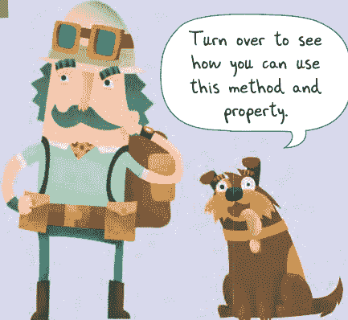

让我们看看如何使用 `getElementById()` 方法和 `innerHTML` 属性来弹出警告框：

```html
<!DOCTYPE html>
<html>
<head>
  <title>List Alert</title>
</head>
<body>
  <div id="list">给 Ernest 买个新项圈</div>
  <script>
    var showList = document.getElementById("list");
    alert(showList.innerHTML);
  </script>
</body>
</html>
```

在这个例子中，我们使用 `getElementById()` 方法查找 `id` 属性设置为 `"list"` 的 `<div>`。你会从任务 1 中记得 `<div>` 标签。它们是内容的容器，你可以用它们将页面分成不同的部分。

然后我们将该 `<div>` 的内容存储在一个变量中。接着我们使用 `innerHTML` 将警告框中的文本设置为我们的变量的值。如果 `<div>` 中的文本发生变化，警告框中的文本也会随之变化，而无需我们再编写任何代码。

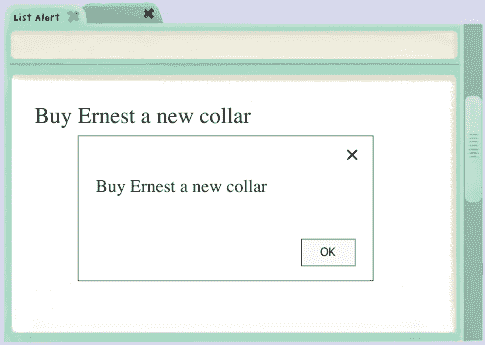


## 编程技能 ► 方法和属性

让我们尝试使用 `getElementById()` 方法和 `innerHTML` 属性来查找和更改 HTML 元素的内容。

1. 打开你的文本编辑程序。创建一个名为 `methods.html` 的新 HTML 文件。在你的 `<body>` 中使用 `<input/>` 标签创建一个按钮。还要创建一个空的 `<div>`，就像这样：

```html
<!DOCTYPE html>
<html>
<head>
  <title>Methods</title>
</head>
<body>
  <input type="button" value="Add item"/>
  <div id="container"></div>
</body>
</html>
```

2. 现在在你的 `<head>` 中创建一个 JavaScript 函数，使用 `getElementById()` 方法找到你的空 `<div>`。然后使用 `innerHTML` 将你的空 `<div>` 的内容设置为一些文本，就像这样：

```javascript
<script>
  function addItem() {
    document.getElementById("container").innerHTML = "Item to remember";
  }
</script>
```

3. 然后让你的按钮在被点击时调用你的 JavaScript 函数。向你的 `<input/>` 标签添加 `onclick` 属性，并将 `onclick` 属性的值设置为你的函数名称，就像这样：

```html
<input type="button" value="Add item" onclick="addItem();"/>
<div id="container"></div>
```

4. 保存你的 HTML 文件并在浏览器中打开它。你会看到一个按钮。当你点击按钮时，`innerHTML` 文本将被添加到你的 `<div>` 中。

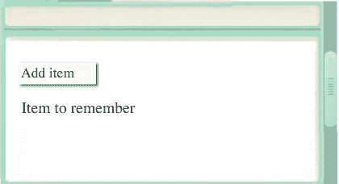

## 使用 DOM 添加到你的应用

我们现在知道如何使用 DOM 的方法和属性来查找和更改应用中的 HTML 元素，这将非常有用。现在我们需要学习如何使用 DOM 向我们的应用添加新的 HTML 元素。毕竟，Bairstone 教授需要能够向列表中添加项目。DOM 有两个方法，我们可以用 JavaScript 来实现这一点。

### `createElement()` 方法

`createElement()` 方法用于创建新的 HTML 元素，例如 `<div>`、按钮或段落。你必须在关键字后的括号中的双引号（`" "`）内包含你要创建的 HTML 元素类型名称，就像这样：

```javascript
document.createElement("div");
```

然后你可以使用 JavaScript 使用赋值运算符（`=`）将你的新元素赋值给一个变量，我们在任务 2 中学习过。然后你可以使用 `innerHTML` 属性在浏览器将其绘制到屏幕上之前设置新元素的内容。

### `appendChild()` 方法

`appendChild()` 方法允许你向现有的 HTML 元素添加新的 HTML 元素。当新元素绘制到屏幕上时，它将绘制在现有元素的下方。你必须在关键字后的括号中包含你要添加的 HTML 元素，就像这样：

```html
<script>
  var newDiv = document.createElement("div");
  newDiv.innerHTML = "Professor Bairstone";
  document.body.appendChild(newDiv);
</script>
```

> `appendChild()` 和 `createElement()` 方法允许你将每个项目添加到应用的列表中。

> **你注意到了吗？**

所有 DOM 方法和属性都是使用驼峰命名法（`camelCase`）书写的。

让我们看看一个使用 `createElement()` 和 `appendChild()` 方法在页面上创建新 HTML 元素的例子。该 HTML 元素将是一个包含一段文本的 `<div>`。`<div>` 是创建其他 HTML 元素的部分或容器的有用方式。

```html
<!DOCTYPE html>
<html>
<head>
  <title>To-Do List App</title>
</head>
<body>
  <div id="list">To-Do List</div>
  <script>
    var newItem = document.createElement("div");
    newItem.innerHTML = "Item added to list";
    document.getElementById("list").appendChild(newItem);
  </script>
</body>
</html>
```

我们首先编写了一个 `<div>` 并将其 `id` 属性设置为 `list`。这个 `<div>` 将是我们使用 `appendChild()` 添加新 HTML 元素的 HTML 元素。

然后我们打开了 `<script>` 标签并创建了一个 JavaScript 代码块。在 JavaScript 的第一行，我们使用 `createElement()` 创建了一个 `<div>`。然后我们将这个新 `<div>` 存储在一个名为 `newItem` 的变量中。你可以在这里使用任何你想要的名称。

在我们的下一行 JavaScript 中，我们使用 `innerHTML` 属性将变量的值设置为一段文本。我们存储在变量中的新 `<div>` 现在包含文本。

> 你不会相信 Bairstone 教授有多健忘！

在我们最后一行 JavaScript 中，我们使用 `getElementById()` 找到我们使用 `id` 属性创建的第一个 `<div>`。然后我们使用 `appendChild()` 将存储在我们变量中的 `<div>` 添加到页面上的第一个 `<div>` 中。

当我们在网页浏览器中运行代码时，我们会看到我们的新 `<div>` 已经被添加到我们的第一个 `<div>` 中。

## 编程技能 ▸ 添加新 HTML 元素

现在轮到你尝试使用 `createElement()` 和 `appendChild()` 方法了。在你的代码中，使用 DOM 和 JavaScript 在单击现有元素时创建一个新的 HTML 元素。使用 DOM 这样的 API 使构建应用变得更加容易。

1. 打开你的文本编辑程序。创建一个名为 `newelements.html` 的新 HTML 文件。编写一个包含文本的 `<div>`（带有 `id` 属性），就像这样：

```html
<!DOCTYPE html>
<html>
<head>
  <title>New Elements</title>
</head>
<body>
  <div id="list">Click here to add item</div>
</body>
</html>
```

2. 在你的 `<head>` 中，创建一个新函数。你的代码将如下所示：

```html
<head>
  <title>New Elements</title>
  <script>
    function addItem() {
    }
  </script>
</head>
```

3. 现在让你的函数使用 `createElement()` 方法创建一个新的 `<div>`。将你的新 `<div>` 存储在一个变量中，并为变量命名。然后使用 `innerHTML` 属性将新 `<div>` 的值设置为一些文本。你的代码将如下所示：

```html
<script>
  function addItem() {
    var newItem = document.createElement("div");
    newItem.innerHTML = "New item";
  }
</script>
```

4. 为你的函数添加最后一行。使用 `getElementById()` 来找到 `<body>` 中的 `<div>`。使用 `appendChild()` 方法将新的 `<div>` 添加到 `<body>` 中的 `<div>`。你的代码将如下所示：

```html
<script>
  function addItem() {
    var newItem = document.createElement("div");
    newItem.innerHTML = "New item";
    document.getElementById("list").appendChild(newItem);
  }
</script>
```

5. 现在唯一缺少的是在我们代码的 `<body>` 中调用该函数。在 `<body>` 的 `<div>` 上添加 `onclick` 属性，这样当点击该 `<div>` 文本时，就会调用你的 `addItem()` 函数。你的代码将如下所示：

```html
<body>
  <div id="list" onclick="addItem();">Click here to add item</div>
</body>
```

6. 保存你的 HTML 文件并在浏览器中打开它。每次你点击“Click here”这段文本，一个新 `<div>` 就会被添加到你的应用中。

> 但是我们如何为应用添加按钮呢？

> 翻页查看！

## 制作待办事项列表应用

现在你已经了解了 DOM 是什么以及它是如何工作的，让我们将你所有新的代码技能整合起来，创建待办事项列表应用。在任务开始时，你学习了如何使用 `<input/>` 标签构建文本框和按钮。让我们再次查看那段代码：

```html
<!DOCTYPE html>
<html>
<head>
  <title>To-Do List App</title>
</head>
<body>
  <p>Special Exhibition To-Do List</p>
  <br/>
  <input type="text" value="Type here to add task"/>
  <br/>
  <input type="button" value="Add item"/>
  <br/>
</body>
</html>
```

目前，Bairstone 教授可以在文本框中输入任务，但当他点击按钮时，什么也不会发生。我们必须使用 DOM 的方法和属性，在点击按钮时将一个项目添加到列表中。

让我们从需要对 `<body>` 所做的更改开始。我们需要在 `<input/>` 标签上添加一个 `onclick` 属性，使我们的按钮能够工作。这个 `onclick` 必须调用一个函数。我们还需要创建一个空的 `<div>`，它将成为我们的待办事项列表。当一个项目被添加到列表时，它将使用 DOM 方法被添加到这个空的 `<div>` 中。我们的 `<body>` 块将如下所示：

```html
<body>
  <p>Special Exhibition To-Do List</p>
  <br/>
  <input type="text" value="Type here to add task"/>
  <br/>
  <input type="button" value="Add item" onclick="addItem();"/>
  <br/>
  <div id="list"></div>
</body>
```

现在让我们在 `<head>` 中创建一个函数，当 `onclick` 被点击时，它将会运行。我们的函数需要使用 `createElement()` 方法创建一个新的 `<div>`。这个新的 `<div>` 将被存储在一个名为 `newItem` 的变量中。然后我们需要使用 `innerHTML` 来设置 `newItem` 变量内的文本。最后，我们需要使用 `getElementById()` 来找到 `<body>` 中 `id` 属性为 `"list"` 的 `<div>`。然后我们可以使用 `appendChild()` 将我们的 `newItem` 添加到我们的列表中。我们 `<head>` 中的 `<script>` 块将如下所示：

```html
<script>
  function addItem() {
    var newItem = document.createElement("div");
    newItem.innerHTML = "New item";
    document.getElementById("list").appendChild(newItem);
  }
</script>
```

当我们在浏览器中运行这段代码时，按钮就生效了。每次点击按钮，文本 `"New item"` 都会被添加到列表中。

> 现在让那个文本框工作起来！

### 添加你自己的任务

我们的应用真的开始成型了。现在每次用户点击按钮，一个项目就会被添加到列表中。但 Bairstone 教授还不能在文本框中输入一个项目并将其添加到列表中。让我们看看如何允许他输入自己的任务。

我们只需要在代码块中更改两行，就可以将文本框的值添加到列表中。我们需要做的第一件事是在我们的 `<body>` 中。我们需要给文本框的 `<input/>` 标签一个我们选择的 `id` 属性，像这样：

```html
<input type="text" id="box" value="Type here to add task"/>
```

然后，我们将更改 `<head>` 中的 JavaScript，使其将新的 `<div>` 的 `innerHTML` 设置为文本框中输入的任何值。为此，我们必须使用 `getElementById()` 通过 `id` 属性找到文本框。然后我们通过在 `<script>` 块中进行此更改来访问该值：


```html
<script>
    function addItem() {
        var newItem = document.createElement("div");
        newItem.innerHTML = document.getElementById("box").value;
        document.getElementById("list").appendChild(newItem);
    }
</script>
```

现在 Bairstone 教授可以用他想添加到列表中的项目替换文本框中的文本。我们的`addItem`函数会将输入到文本框中的任何文本设置为新`<div>`的内容。他现在可以将他自己的项目添加到待办事项列表中。

> 天哪！有这么多事情我们需要做！

### 代码技能清单 ✓

### 使用 DOM API

DOM（或文档对象模型）是一个 API（应用程序编程接口）。当你的 HTML 文档在你的网络浏览器中运行时，它就成为了 DOM 的一部分，称为`document`对象。`document`对象的结构允许你编写代码来访问和更改单个 HTML 元素。

你可以使用 DOM 的内置函数在 HTML 元素被绘制到屏幕后对其进行更改。如果你想制作一个能响应用户的交互式网页或基于 Web 的应用程序，这一点很重要。

要访问 DOM，你必须输入`document`关键字。你还必须使用点（`.`）表示法。每条新的 DOM 指令必须用一个点分隔。

你可以使用 DOM 方法和属性来更改你的 HTML 元素。

`getElementById`是一个 DOM 方法，允许你通过`id`属性在页面上找到一个 HTML 元素。

`innerHTML`是一个 DOM 属性。你可以设置任何 HTML 元素的`innerHTML`。使用`innerHTML`是设置或更改 HTML 元素内容的好方法。

`createElement`是一个 DOM 方法，允许你创建一个新的 HTML 元素。你必须告诉你的浏览器你想创建什么类型的元素。

`appendChild`是一个 DOM 方法，允许你向一个现有的 HTML 元素添加一个新的 HTML 元素。

> DOM 为你节省了大量时间，并使创建动态网页变得更加容易！

## 代码技能 ► 构建基础应用

让我们构建一个基础应用。这个应用应该有一个文本框和一个按钮，Bairstone 教授可以用它将他的任务添加到列表中。使用 DOM 和 JavaScript，使得当按钮被点击时，框中的任务将被添加到列表中。

1. 打开你的文本编辑程序。创建一个新的 HTML 文件，命名为`basicapp.html`。然后将你的`app.html`中的代码复制并粘贴到你的新文件中。修改你的代码，使文本框有一个你选择的`id`属性，像这样：

```html
<!DOCTYPE html>
<html>
<head>
  <title>To-Do List App</title>
</head>
<body>
  <p>Special Exhibition To-Do List</p>
  <br/>
  <input type="text" id="box" value="Type here to add task"/>
  <br/>
  <input type="button" value="Add item"/>
  <br/>
</body>
</html>
```

> 别忘了设置`id`属性！

2. 在`<body>`的底部添加一个空的`<div>`。给你的`<div>`一个你选择的`id`属性，像这样：

```html
<input type="button" value="Add item"/>
<br/>
<div id="list"></div>
```

3. 现在在按钮的`<input/>`标签上添加一个`onclick`属性。将你的`onclick`设置为调用一个 JavaScript 函数。你的代码将如下所示：

```html
<input type="button" value="Add item" onclick="addItem();"/>
```

4. 在`<head>`中添加一个空的 JavaScript 函数。你的`<script>`块需要如下所示：

```html
<head>
  <title>To-Do List App</title>
  <script>
    function addItem() {
    }
  </script>
</head>
```

5. 现在使用 DOM 来编写一个名为`addItem`的函数，当按钮被点击时，它将创建一个新的`<div>`。然后该函数将使用`innerHTML`将`<div>`的值设置为文本框中的值。最后，该函数将使用`appendChild`将新的 HTML 元素添加到`<body>`中的`<div>`。你的代码将如下所示：

```html
<script>
  function addItem() {
    var newItem = document.createElement("div");
    newItem.innerHTML = document.getElementById("box").value;
    document.getElementById("list").appendChild(newItem);
  }
</script>
```

6. 保存你的 HTML 文件并在浏览器中打开它。你现在将能够用列表中的项目替换文本框中的文本。当你点击按钮时，输入到文本框中的项目将被添加到列表中。

## 使用 DOM 从应用中移除元素

你已经知道如何使用 DOM 来查找和添加 HTML 元素到你的网页。但如果贝尔斯通教授搞错了，把错误的物品添加到了待办清单，会怎么样？或者当他完成了一项任务，想要把它从清单中移除呢？我们需要学习如何使用 DOM 从应用中移除 HTML 元素。

> 想象一下，如果我把需要的那双**羊毛袜**加到清单里！太糟糕了！

### removeChild 方法

`removeChild`方法与`appendChild`方法的作用相反。它不是将一个 HTML 元素添加到另一个 HTML 元素中，而是从一个 HTML 元素中移除另一个 HTML 元素。它的使用方式和`appendChild`一样。使用`id`属性选择你要移除的 HTML 元素，然后告诉浏览器移除它，如下所示：

找到父 HTML 元素。

移除子 HTML 元素。

```javascript
document.getElementById("list").removeChild(this);
```

如你所知，HTML 标签可以嵌套在其他 HTML 标签内部。当你使用`removeChild`方法时，你移除的是通过`id`属性选择的 HTML 元素内部的 HTML 元素。

在`document`对象中，所有元素都是相互关联的，就像家族树一样。任何位于另一个元素内部的 HTML 元素都被称为该元素的*子元素*。外部的 HTML 元素被称为*父元素*。当你使用`removeChild`时，你将子 HTML 元素从父 HTML 元素中移除。

当你使用`removeChild`方法时，还必须使用一个方便的 JavaScript 关键字——`this`。`this`关键字指向用于调用该函数的 HTML 元素。让我们来看一个例子：

> 这些新代码片段让我们的应用越来越交互性强了。

```html
<!DOCTYPE html>
<html>
<head>
  <title>Things To Buy</title>
  <script>
    function removeItem(item) {
      document.getElementById("list").removeChild(item);
    }
  </script>
</head>
<body>
  <div id="list">
    Velvet cushion for diamond
    <div onclick="removeItem(this);">
      Woolly socks
    </div>
  </div>
</body>
</html>
```

在这个例子中，第一个带有`id`属性`"list"`的`<div>`是父元素。嵌套在它内部的带有“羊毛袜”文本的`<div>`是子元素。当我们点击“羊毛袜”文本时，我们使用`getElementById`来找到名为`list`的`<div>`。

然后使用`removeChild`方法和`this`关键字来移除这段文本。就像我们在任务 2 中学到的那样，我们必须为函数传递一个参数才能使其工作。我们使用参数`"item"`和`this`关键字来跟踪我们试图移除的 HTML 元素。贝尔斯通教授现在可以通过点击来移除清单中的项目了。

> 笨笨的贝尔斯通教授！

## 代码技能 ► 移除 HTML 元素

我们来尝试使用`removeChild`方法和`this`关键字来移除 HTML 元素。

1. 打开你的文本编辑程序。创建一个名为`remove.html`的新 HTML 文件。在`<body>`中编写一个父`<div>`和一个子`<div>`。设置父`<div>`的`id`属性，如下所示：

```html
<!DOCTYPE html>
<html>
<head>
  <title>Remove Items</title>
</head>
<body>
  <div id="list">
    Security to protect Mr Volkov
    <div>
      Woolly socks
    </div>
  </div>
</body>
</html>
```

2. 现在在`<head>`中添加一个 JavaScript 函数，用于从页面中移除子`<div>`。该函数将使用`getElementById`方法找到父`<div>`。然后使用`removeChild`移除嵌套在其中的`<div>`。你的代码将如下所示：

```html
<script>
  function removeItem(item) {
    document.getElementById("list").removeChild(item);
  }
</script>
```

3. 最后为子`<div>`添加一个`onclick`属性，这样当点击其中的文本时，它将从清单中被移除。`onclick`应该调用你的函数并使用`this`关键字，如下所示：

```html
<div onclick="removeItem(this);">
  Woolly socks
</div>
```

4. 保存你的 HTML 文件并在浏览器中打开它。当你点击第二项时，它将 disappear（消失）在屏幕上。

## 移除多个 HTML 元素

你正在取得很大的进步！现在你可以使用`removeChild`方法移除 HTML 元素了。但如果贝尔斯通教授想要从清单中移除多个项目怎么办？我们需要使用 DOM 和 JavaScript，以便在点击时可以从清单中移除所有项目。为此，我们需要每次使用`createElement`方法时都添加一个`onclick`属性。你可以使用 DOM 方法，通过`onclick`关键字来设置`onclick`：

```javascript
.onclick
```

然后我们可以设置`onclick`来调用一个函数，在点击时移除项目，如下所示：

```html
<!DOCTYPE html>
<html>
<head>
  <title>To-Do List App</title>
  <script>
    function addItem() {
      var newItem = document.createElement("div");
      newItem.innerHTML = document.getElementById("box").value;
      newItem.onclick = removeItem;
      document.getElementById("list").appendChild(newItem);
    }
    function removeItem() {
      document.getElementById("list").removeChild(this);
    }
  </script>
</head>
<div id="list"></div>
```

在这个例子中，我们使用`createElement`创建了一个新的`<div>`。我们将这个`<div>`存储在一个变量中，以便将其`innerHTML`设置为在文本框中输入的任何项目。然后我们使用 DOM 设置新项目的`onclick`属性。当点击这个项目时，它将调用`removeItem`函数，该项目将从清单中被移除。

## 代码技能 ▶ 移除多个 HTML 元素

运用你所学的知识，制作一个可以移除多个 HTML 元素的应用，当点击这些元素时它们会被移除。你学到的每一项新技能都在让你的应用更加高级。

1. 打开你的文本编辑程序。创建一个名为`removemore.html`的新 HTML 文件。从`basicapp.html`复制并粘贴你的代码。你的代码将如下所示：

```html
<!DOCTYPE html>
<html>
<head>
	<title>To-Do List App</title>
	<script>
		function addItem() {
			var newItem = document.createElement("div");
			newItem.innerHTML = document.getElementById("box").value;
			document.getElementById("list").appendChild(newItem);
		}
	</script>
</head>
<body>
	<p>Special Exhibition To-Do List</p>
	<br/>
	<input type="text" id="box" value="Type here to add task"/>
	<br/>
	<input type="button" value="Add item" onclick="addItem();"/>
	<br/>
	<div id="list"></div>
</body>
</html>
```

2. 现在通过在你的函数中设置`onclick`属性来修改`<head>`中的`addItem`函数。为每个新的 HTML 元素添加一个`onclick`。让你的`onclick`在被点击时调用一个新函数。将这一行新代码添加到你的`<script>`块中：

```html
<script>
  function addItem() {
    var newItem = document.createElement("div");
    newItem.innerHTML = document.getElementById("box").value;
    newItem.onclick = removeItem;
    document.getElementById("list").appendChild(newItem);
  }
</script>
```

3. 在`<script>`块中编写第二个名为`removeItem`的函数。该函数需要使用`getElementById`找到`<body>`中的`<div>`。然后应该使用`removeChild`和`this`关键字来移除函数调用的任何项目。输入这个函数，使你的`<script>`块现在看起来像这样：

```html
<script>
  function addItem() {
    var newItem = document.createElement("div");
    newItem.innerHTML = document.getElementById("box").value;
    newItem.onclick = removeItem;
    document.getElementById("list").appendChild(newItem);
  }
  function removeItem() {
    document.getElementById("list").removeChild(this);
  }
</script>
```

> 我是*维克多·沃尔科夫*。很高兴见到你。我无法用言语表达我对你的帮助有多么感激。你的编程技能非常令人印象深刻。

## 代码技巧 ► 续

4. 你最终完成的应用代码块将如下所示：


```html
<!DOCTYPE html>
<html>
<head>
  <title>To-Do List App</title>
  <script>
    function addItem() {
      var newItem = document.createElement("div");
      newItem.innerHTML = document.getElementById("box").value;
      newItem.onclick = removeItem;
      document.getElementById("list").appendChild(newItem);
    }
    function removeItem() {
      document.getElementById("list").removeChild(this);
    }
  </script>
</head>
<body>
  <p>Special Exhibition To-Do List</p>
  <br/>
  <input type="text" id="box" value="Type here to add task"/>
  <br/>
  <input type="button" value="Add item" onclick="addItem();"/>
  <br/>
  <div id="list"></div>
</body>
</html>
```

> 这场特别展览将会非常精彩！

保存你的 HTML 文件并在浏览器中打开它。现在你可以向列表中添加和移除项目了。

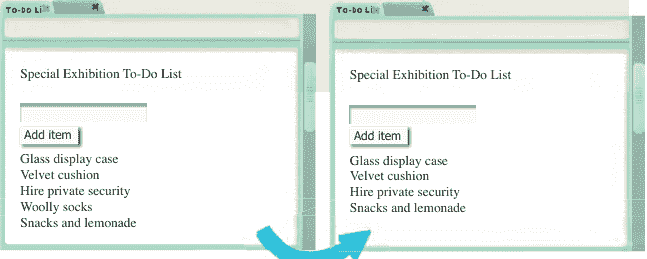

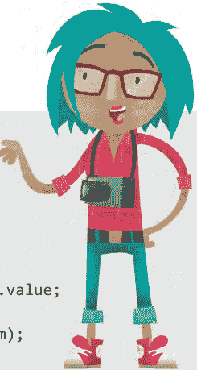

## 保存你的待办事项列表项

Bairstone 教授现在可以按照需要从列表中添加和移除任意数量的项目了。但你可能已经注意到，如果你刷新页面，你的待办事项列表就会消失。这是因为到目前为止，我们只是在屏幕上添加或移除了 HTML 元素。我们并没有保存列表或更改 HTML 文件。如果我们希望浏览器保存并记住我们的列表，就需要使用`localStorage`——这是 HTML5（HTML 编程语言的第五个版本）中提供的一个便捷 API。

这个 API 让你可以在浏览器中保存信息，即使页面被刷新或关闭，你仍然可以访问这些数据。和 DOM 类似，`localStorage` 是一组函数的集合，使用起来非常简单。

你只需要输入`localStorage`关键字（以驼峰命名法书写）并为要存储的信息指定一个名称，就可以告诉浏览器你要使用`localStorage`。使用等号（`=`）和双引号（`" "`）来设置要存储的信息的值，像这样：

```javascript
localStorage.storageName = "information";
```

如果你想从`localStorage`中删除一条信息，只需将值留空即可，像这样：

```javascript
localStorage.storageName = "";
```

查看使用`localStorage`保存的信息非常简单。你只需要使用关键字和`localStorage`的名称即可，像这样：

```html
<!DOCTYPE html>
<html>
<head>
  <title>The Monk Diamond</title>
</head>
<body>
  <script>
    localStorage.valuableDiamond = "The Monk Diamond";
    alert(localStorage.valuableDiamond);
  </script>
</body>
</html>
```

## 代码技巧 ► 使用 LOCALSTORAGE API

让我们尝试使用`localStorage`在网络浏览器中存储信息。这样 Bairstone 教授应用中的列表就能被安全地保存了。

1. 打开你的文本编辑程序。创建一个名为`storage.html`的新 HTML 文件。在新文件的`<body>`中输入以下代码：

```html
<!DOCTYPE html>
<html>
<head>
  <title>Storage</title>
</head>
<body>
  <input type="text" id="box" value="Type here to add task"/><br/>
  <input type="button" id="save" value="Save" onclick="save();"/><br/>
  <input type="button" id="load" value="Load" onclick="load();"/><br/>
  Saved item: <div id="savedList"></div>
</body>
</html>
```

2. 现在在`<head>`中编写一个函数，使用`localStorage`将文本框中输入的值保存到浏览器中。编写`localStorage`关键字时不要忘记使用驼峰命名法。你的代码将如下所示：

```javascript
<script>
  function save() {
    var newItem = document.getElementById("box").value;
    localStorage.box = newItem;
  }
</script>
```

> 做这个练习时请使用 Google Chrome 或 Mozilla Firefox。


3. 现在在`<script>`代码块中编写第二个函数，使用`getElementById`方法找到你的空`<div>`。使用`innerHTML`将空`<div>`的值设置为使用`localStorage`保存的信息。确保你的函数如下所示：

```javascript
<script>
    function save() {
        var newItem = document.getElementById("box").value;
        localStorage.box = newItem;
    }
    function load() {
        var savedDiv = document.getElementById("savedList");
        savedDiv.innerHTML = localStorage.box;
    }
</script>
```

4. 保存你的 HTML 文件并在浏览器中打开它。在文本框中输入一些内容，然后点击保存。


5. 现在点击`加载`。你在文本框中输入的值将显示在屏幕上。然后刷新页面。该项目将从屏幕上消失。但当你按下`加载`时，使用`localStorage`保存的文本将在浏览器中加载。

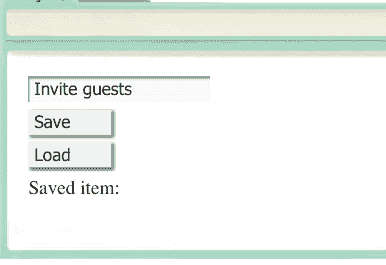

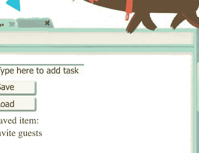

> 编写`localStorage`关键字时使用驼峰命名法。第一个字母小写，第二个单词以大写字母开头。


### 使用 LOCALSTORAGE 保存和加载

现在你了解了`localStorage`，让我们看看如何使用它来保存和加载 Bairstone 教授的应用。每次 Bairstone 教授更改待办事项列表时，都需要将其保存到`localStorage`中。我们还需要编写代码，以便 Bairstone 教授在浏览器中打开应用时从`localStorage`加载待办事项列表。让我们来看看需要对`<script>`代码块进行的更改，以便像这样使用`localStorage`：

```html
<!DOCTYPE html>
<html>
<head>
  <title>To-Do List App</title>
  <script>
    function addItem() {
      var newItem = document.createElement("div");
      newItem.innerHTML = document.getElementById("box").value;
      newItem.onclick = removeItem;
      document.getElementById("list").appendChild(newItem);
      saveList();
    }
    function removeItem() {
      document.getElementById("list").removeChild(this);
      saveList();
    }
    function saveList() {
      localStorage.storedList = document.getElementById("list").innerHTML;
    }
    function loadList() {
      document.getElementById("list").innerHTML = localStorage.storedList;
    }
  </script>
</head>
<body>
  <p>Special Exhibition To-Do List</p>
  <input type="text" id="box" value="Type here to add task"/>
  <br/>
  <input type="button" value="Add item" onclick="addItem();"/>
  <div id="list"></div>
</body>
</html>
```

### 保存列表

要保存列表，我们需要创建一个新的`saveList`函数，使用`localStorage`来保存它。为此，我们必须选择一个变量名来分配我们想要存储在`localStorage`中的信息。然后我们使用`getElementById`找到页面`<body>`中的`<div>`。最后我们使用`innerHTML`获取`<div>`的内容。现在`<div>`中的所有内容都将保存在`localStorage`中。

我们希望在每次添加或移除项目时都保存列表，因此我们还需要确保`addItem`和`removeItem`函数在运行完毕后调用`saveList`函数。

### 加载列表

要加载列表，我们需要创建第二个函数。每当`loadList`函数被调用时，它会将 id 为 `"list"` 的`<div>`的`innerHTML`设置为`localStorage`中保存的内容。

我们需要调用`loadList`函数，以便在浏览器完成加载时，也加载我们的列表。为了确保我们不会尝试加载未保存的列表，必须在使用`localStorage`之前使用`if`语句。我们需要的`if`语句如下所示：

```html
<div id="list"></div>
<script>
    if(localStorage.storedList) {
        loadList();
    }
</script>
```

这个`if`语句会在尝试加载之前检查`localStorage`中是否有已保存的列表。当我们保存完整的代码块并在浏览器中运行应用时，即使关闭并重新打开文件，添加到列表中的项目也会被保存下来。

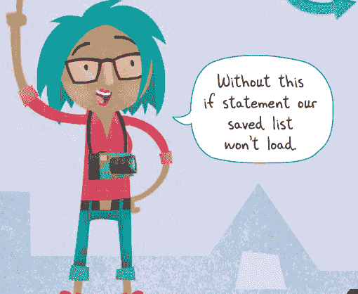

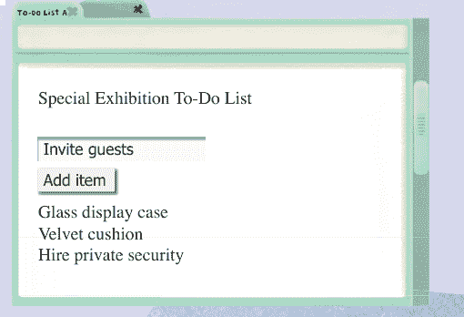

### 从 localStorage 中移除

还有一件事需要处理，我们的`loadList`函数才能正常工作。目前使用待办事项列表应用时，你可以通过点击来添加和删除项目。但如果你从`localStorage`加载保存的列表，点击时却无法删除项目。

这是因为我们只将 HTML 元素保存到了`localStorage`，而没有保存创建每个元素时添加的`onclick`属性。我们需要为每个列表项重新添加`onclick`属性，以便从`localStorage`加载列表后，`removeItem`函数仍能正常工作。我们需要在`<head>`中的`loadList`函数里添加最后一段代码，如下所示：

```javascript
function loadList() {
    document.getElementById("list").innerHTML = localStorage.storedList;
    for(var i = 0; i < list.children.length; i++) {
        list.children[i].onclick = removeItem;
    }
}
```

我们现在为`loadList`函数添加了一个**循环（loop）**。这个循环将`onclick`属性添加到从`localStorage`加载的每个项目上，使其指向`removeItem`函数。它会遍历我们添加到待办事项列表中的每个新 HTML 元素，并为每个新元素设置`onclick`属性。

你将在任务 5 中了解更多关于循环的知识，但目前你需要知道循环分为三个部分。

> **循环（LOOP）**是一种特殊的 JavaScript 代码，可以反复运行同一段代码。程序员使用它们，这样就不必重复输入相同的代码。

### 循环需要：

- 启动循环的代码
- 检查循环是否允许运行的条件
- 每次循环运行时都会执行的代码

> 这真是非常巧妙的编码！


## 自己动手任务

### 构建一个待办事项列表应用

现在运用你在本任务中学到的所有新技能，为 Bairstone 教授构建 Monk 钻石特别展览所需的待办事项列表应用。使用 JavaScript 配合 DOM 和`localStorage` API，制作一个 Bairstone 教授可以添加项目的待办事项列表。确保当他完成任务时，可以点击项目将其从列表中移除。

### 待办事项列表应用要求

编写应用时，请使用 HTML 和 JavaScript 以及新的 API。确保包含以下内容：

- 使用 DOM 向列表添加项目的函数
- 使用 DOM 从列表移除项目的函数
- 使用`localStorage`保存列表的函数
- 使用`localStorage`加载列表的函数
- 用户可以输入项目的文本框
- 用户可以点击以向列表添加项目的按钮

将你的文件保存在**编程（Coding）**文件夹中，并将其命名为`listapp.html`。

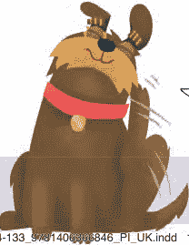

> 翻过来查看应用所需的完整代码块！


> 如果需要帮助，别忘了使用 Get Coding! 网站。


```html
<!DOCTYPE html>
<html>
<head>
  <title>To-Do List App</title>
  <script>
    function addItem() {
      var newItem = document.createElement("div");
      newItem.innerHTML = document.getElementById("box").value;
      newItem.onclick = removeItem;
      document.getElementById("list").appendChild(newItem);
      saveList();
    }
    function removeItem() {
      document.getElementById("list").removeChild(this);
      saveList();
    }
    function saveList() {
      localStorage.storedList = document.getElementById("list").innerHTML;
    }
    function loadList() {
      document.getElementById("list").innerHTML = localStorage.storedList;
      for(var i = 0; i < list.children.length; i++) {
        list.children[i].onclick = removeItem;
      }
    }
  </script>
</head>
```


> 这次特别展览一定会很棒。我等不及了！


```html
<body>
  <p>The House of Volkov</p>
  <p>Special Exhibition To-Do List</p>
  <br />
  <input type="text" id="box" value="Type here to add task" />
  <br />
  <input type="button" value="Add item" onclick="addItem();" />
  <br />
  <div id="list"></div>
  <script>
    if (localStorage.storedList) {
      loadList();
    }
  </script>
</body>
</html>
```

沃尔科夫之屋

特别展览待办事项列表

- 狗饼干
- 玻璃展示柜
- 天鹅绒 cushion
- 雇佣私人安保
- 雇佣保镖
- 邀请客人
- 零食和柠檬水

> 现在使用 CSS 更改应用的设计，使其看起来像这样！

## 未来编程技能

在 HTML、CSS 和 JavaScript 中编码时，使用 DOM 和 `localStorage` 等 API 可以让你创建更复杂、更具交互性的网页或基于网络的应用。现在你可以使用 DOM 访问浏览器中的一些强大功能。它允许你在用户与页面或应用交互时动态更改 HTML。做得好！

### 任务简报

亲爱的程序员：

你会很高兴听到，经过漫长的火车旅程，我们终于抵达了莫斯科。我们目前藏匿在一个秘密地点，因为除了沃尔科夫先生之外，我们不想让任何人知道我们带着 Monk 钻石来到了这座城市。沃尔科夫先生来看我们了——他是个很有魅力的人。我很高兴我们找到了他丢失的宝石。

他和 Bairstone 教授一直在为展览忙碌地准备一切。你的应用非常有帮助，到目前为止一切按计划进行。只有一件事是 Bairstone 教授和沃尔科夫先生没想到的：我们如何安全地将钻石从我们的秘密地点运送到沃尔科夫之屋？

邦德兄弟以大胆的抢劫闻名，他们经常伏击和抢劫运送昂贵珠宝的运钞车。我给你发一条《探险家百科全书》的条目，这样你就能明白我的意思。我们可以自己送钻石过去，但 Bairstone 教授太有名了，我担心我们会引起注意，从而暴露展览计划。

我们决定，最好的办法是我把钻石带到附近的**高尔基公园（Gorky Park）**。沃尔科夫先生的安保主管会在那里等我，然后我们一起把钻石送到**圣瓦西里大教堂（St Basil's Cathedral）**旁边的沃尔科夫之屋。你能帮我们规划一条穿过城市的路线吗？有一个嵌入地图的网页会非常有帮助。如果我们迷路或被邦德兄弟骗走错路，那就糟了。想象一下如果我们现在丢了 Monk 钻石会怎样！

再次感谢你的帮助。一切都快准备好了。我们刚印好展览的邀请函，现在可以寄给客人了。我也给你寄了一封！

来自我们城市藏身处最美好的祝愿，

Ruby Day 博士


# 探险家百科全书

冒险之旅指南

- 首页
- 目录
- 精选发现
- 著名探险家
- 历史探险

## 邦德兄弟抢劫案

来自《探险家百科全书，冒险之旅指南》

*其他珠宝窃贼，请参阅* 著名珠宝窃贼。

**邦德兄弟抢劫案**是由一伙名为*邦德兄弟*的*珠宝窃贼*团伙实施的大胆珠宝盗窃案。他们抢劫的大部分*珠宝*至今下落不明。通常被盗珠宝会在案发后很快于*黑市*上出售，但据信邦德兄弟有一个藏赃物的绝密地点。

> P.沃尔科夫先生诚邀阁下出席沃尔科夫家族于6月21日晚7点在莫斯科圣瓦西里大教堂附近沃尔科夫府邸举办的特别展览。届时您将与荣誉嘉宾贝尔斯通教授、戴博士和欧内斯特会面，并聆听他们最近探险中惊人发现的介绍。敬请回复

国际刑警组织知道该团伙有三名核心成员，他们仅以绰号为人所知：**灵巧手指**、**宝石杰玛**和**闪闪托尼**。这三名成员还有其他小角色的协助，这些小角色帮助他们选择目标、实施逃跑和藏匿被盗珠宝。

团伙中有一名熟练的**网络罪犯**，能够访问政府数据库。在他们所有的抢劫案中，目标区域周围的监控摄像头在犯罪期间都会被禁用。

除了砸抢袭击中从豪华精品店盗窃外，邦德兄弟还曾抢劫运送珠宝的快递货车或摩托车。他们伪装成道路工人，然后使用假路标将司机引向死胡同，再进行抢劫。

他们的成功似乎归功于战术的多样性。每次抢劫都不相同，这使得当局极难预测他们下一步的行动。

## 使用网络 API 添加内容

现在你已经阅读了任务简报，知道了戴博士需要你做什么，让我们开始编码吧！这与你之前在其他三个任务中做的会有所不同，但不用担心。学习如何构建使用互联网的网页或应用程序的好处在于，你不必总是事事亲力亲为。

创建嵌入地图的网页听起来可能很有挑战性，但我们不必从零开始编写地图代码。我们所要做的就是编写一些代码来调用互联网上拥有我们所需地图的 URL。程序员称之为将一个网页与另一个网页集成。

当我们想要将自己的网页与另一个网站集成时，我们必须编写一些代码，将我们的页面连接到存储另一个网站的服务器。然后我们就可以访问该服务器上我们需要的数据和内容。

> **代码词汇**
>
> 当新内容插入到现有网页中时，我们称它已**嵌入**页面中。嵌入的内容成为页面的一部分。

### 网络 API

你已经知道什么是 API，并在任务 3 中使用了两个 API：DOM 和 `localStorage` API。这些 API 让你可以访问一些方便的内置函数。API 形态各异，我们在这个任务中嵌入地图所需的 API 与之前使用的略有不同。

用于与其他网站集成的 API 有时称为“网络 API”或“网络服务”。它们让你可以访问网站的内置功能和特性，这样你就可以为页面添加额外内容，而无需编写大量代码。

你可以在使用网络 API 构建网站时做很多不同的事情。你可能在一些网站上遇到过这些网络 API，它们帮助你完成以下操作：

- 添加地图
- 添加 Facebook 的 **Like** 或 **Share** 按钮
- 在 **YouTube** 和 **Twitch** 上分享视频

网络 API 让每个人都能快速轻松地构建更好、更复杂的网站。要嵌入地图并规划路线，我们将使用地图网络 API。

互联网上有多个网站允许你在网页中嵌入他们的地图。其中大多数甚至允许你免费使用。最受欢迎的免费地图网络 API 是 Google 地图和必应地图，分别由谷歌和微软运营。

我们将学习如何使用 Google 地图为戴博士和沃尔科夫家族的安全主管找到最佳路线。你可能之前用过 Google 地图查找地址，但这次你将学习如何编程制作自己的地图，然后将其嵌入你的网页。

### 地图网络 API

要使用 Google 地图网络 API，你必须在 Google 注册并获取一段称为 API 密钥的特殊代码。API 密钥是你的网页访问 Google 服务器上 Google 地图 API 的专用密码。如果不使用 API 密钥，你将无法嵌入地图。你可以通过访问以下地址获取 Google 地图 API 密钥：

```text
https://developers.google.com/maps/documentation/embed/
```

API 密钥是由字母和数字组成的长段代码。每个密钥各不相同，但看起来类似这样：

### 你知道吗？

获取 Google 地图 API 密钥需要 Google 账号。拥有 Google 账号需年满 13 岁。如果你未满 13 岁，可爱/修订标记之间的差异，你可以在成人监督下使用他们的账号，或让他们代为注册。确保你本人或帮助你的成人已阅读条款和条件。访问 `www.support.google.com` 了解更多信息。

> 翻到背面，了解如何获取你自己的 API 密钥。

### 代码技能 ► 获取 Google 地图 API 密钥

让我们学习如何获取 Google 地图 API 密钥。你在任务后期需要用它来创建戴博士的路线。

1. 首先访问 Google 地图 API 网站。在浏览器中输入以下链接：

   ```text
   https://developers.google.com/maps/documentation/embed/
   ```

2. 找到 **GET A KEY** 按钮。点击它。

3. 你会看到一个弹出窗口，有三个选项。点击 **CONTINUE**。

4. 现在登录 Google 账号。记住，如果你未满 13 岁，需要请成人帮忙。你将被导向 Google 开发者控制台。确保你本人（如果你超过年龄要求）或帮助你的成人已阅读条款和条件。你需要同意这些条款才能继续。然后从下拉列表中选择 **Create a new project**，点击 **Continue**。

5. 然后系统会要求你创建 API 密钥。不要填写任何内容——直接点击 Create。

6. 你的 API 密钥将会显示。它将是由数字和字母组成的长段代码。它们都是唯一的，但看起来会像这样：

7. 现在复制并粘贴你的 API 密钥到你的文本编辑程序中。将文件保存在你的 **Coding** 文件夹中，作为文本文件（使用扩展名 **.txt**）。将你的新文件命名为 **APIkey.txt**。

> 妥善保管你的 API 密钥，因为你在任务后期还会需要它！

> 程序员请注意！随着 Google 更新其软件，其中一些步骤可能会有所变化。

## 如何嵌入内容

现在你知道了什么是嵌入，并且已经获得了 Google 地图的 API 密钥，我们可以开始为戴博士制作网页了。我们首先需要学习如何将另一个网站的内容嵌入到我们的网页中。为此，我们需要学习一些新的 HTML 标签和属性。

### `<iframe>` 标签：`<iframe>` 和 `</iframe>`

要在页面中添加 Google 地图，我们需要使用一个名为 `<iframe>` 的新 HTML 标签。开始标签是 `<iframe>`，结束标签是 `</iframe>`。该标签用于创建内联框架，这是一种非常实用的将其他网站内容嵌入页面的方式。你还可以使用该标签的多个属性来改变嵌入内容的显示方式。

你必须包含的第一个属性是源（`src`）属性，我们在任务 1 中使用过。源属性告诉浏览器你想要嵌入哪部分内容，其形式为 URL。当你在集成网站时，URL 中的信息对浏览器非常重要。让我们以僧侣钻石发现页面为例来看一看：

```html
<!DOCTYPE html>
<html>
<head>
  <title>Diamond Discovery</title>
</head>
<body>
  <iframe src="https://www.monkdiamonddiscovery.com">
  </iframe>
</body>
</html>
```

我们作为 URL 提供的僧侣钻石发现网页的一小部分将会嵌入到你的页面中显示。然而，以这么小的尺寸很难看到嵌入的页面。你需要在开始 `<iframe>` 标签内包含一些其他属性来改变嵌入页面的大小、形状和外观。让我们来看看你可以使用的所有属性：

| 属性 | 用途 | 示例值 |
|---|---|---|
| `src` | 为要嵌入的内容提供 URL | `http://www.bing.com` |
| `width` | 设置 `<iframe>` 的最大宽度 | `600px; 20%` |
| `height` | 设置 `<iframe>` 的最大高度 | `600px; 20%` |
| `frameborder` | 设置 `<iframe>` 周围边框的宽度 | `0px; 4px` |
| `style` | 使用 CSS 属性和值设置 `<iframe>` 的样式 | `border: 0px` |

现在让我们看看如何使用所有这些属性来更改我们的 `<iframe>` 和嵌入内容的外观。请记住，你始终必须在开始标签内添加属性，像这样：

```html
<!DOCTYPE html>
<html>
<head>
  <title>Diamond Discovery</title>
</head>
<body>
  <iframe
    width="350px"
    height="350px"
    frameborder="0px"
    style="border: 0px"
    src="https://www.monkdiamonddiscovery.com">
  </iframe>
</body>
</html>
```

这里我们将 `width` 和 `height` 属性设置为相同的像素数，使我们的 `<iframe>` 成为一个正方形。`frameborder` 属性和 CSS `border` 属性都被设置为 0 像素。这样 `<iframe>` 就会融入页面。你通常会对 `<iframe>` 做这个设置，这样嵌入的内容看起来就像是页面的一部分。

> 有用的东西，这个 `<iframe>` 标签！

## 代码技巧 ► 使用 `<iframe>` 标签

现在你已经了解了 `<iframe>` 标签及其工作原理，让我们尝试使用该标签及其属性来更改嵌入内容在网页中的显示方式。

1. 打开你的文本编辑程序。创建一个名为 **iframe.html** 的新 HTML 文件。在页面的 `<body>` 中添加开始和结束 `<iframe>` 标签，使新文件中的代码如下所示：

   ```html
   <!DOCTYPE html>
   <html>
   <head>
     <title>iFrames</title>
   </head>
   <body>
     <iframe>
     </iframe>
   </body>
   </html>
   ```

2. 现在设置你的 `<iframe>` 的属性。在开始 `<iframe>` 标签内包含 `width`、`height`、`frameborder` 和 `style` 属性，如下所示：


```html
<body>
  <iframe
    width="350px"
    height="350px"
    frameborder="0px"
    style="border: 0px">
  </iframe>
</body>
```

- 3. 最后添加 `source` 属性。将其值设置为你喜欢的网站的 URL，如下所示：

```html
<iframe
  width="350px"
  height="350px"
  frameborder="0px"
  style="border: 0px"
  src="https://www.bing.com">
</iframe>
```

- 4. 保存你的 HTML 文件并在浏览器中打开它。你选择的网站将嵌入到你的网页中。

现在尝试更改 `<iframe>` 的高度和宽度，看看它对嵌入内容有何影响。

## 嵌入谷歌地图

如你所见，`<iframe>` 标签非常有用。现在让我们学习如何使用它将谷歌地图集成到我们的页面中。你可以添加的最简单的谷歌地图称为嵌入式搜索。你使用一个名为谷歌地图嵌入 API 的谷歌 API。当用户向 API 提供一个关键词（如国家、城市或街道的名称）时，它会根据该关键词生成地图。

### URLs

谷歌地图嵌入 API 需要你在 `<iframe>` 的 `source` 属性中提供一个 URL。URL 必须包含几个重要信息，以便嵌入正确的地图。让我们看看，如果想在网页中嵌入莫斯科地图，URL 中需要包含哪些信息：

```text
https://www.google.com/maps/embed/v1/search?q=Moscow&key=API-KEY
```

URL 的第一部分是通往谷歌地图嵌入 API 的路径。然后你必须告诉该 API 你想使用哪个内置函数。我们想使用谷歌服务器上的搜索 API 函数，所以我们将其添加到 URL 中。下一部分信息是我们请求的特定部分，称为查询**字符串参数**。

> **字符串**是以字符序列形式存在的一块数据。字符串可以由单词和数字组成。

> **参数**是传递给函数的一条信息或一个参数的另一个名称，以便函数可以执行操作。

### 字符串参数

字符串参数是 URL 中包含变量的部分——即取决于用户的信息块。在我们的例子中，有两个参数。这两个变量是我们正在搜索的地图（`Moscow`）和我们唯一的 API 密钥。我们必须以特定方式构建查询字符串参数，以便谷歌服务器能够访问存储在我们变量中的信息。查询字符串参数的两个部分是键和值。你的参数需要这两个部分才能工作。

```text
https://www.google.com/maps/embed/v1/search?q=Moscow&key=API-KEY
```

在这个 URL 中，两个参数由一个 `&` 分隔。第一个是查询键，第二个是 API 密钥。你的浏览器需要它们两个，因为它们包含以下重要信息：

| 参数键 | 它的作用 | 示例值 |
| --- | --- | --- |
| `q` | 给出你想要搜索的位置 | `Moscow; London` |
| `key` | 提供访问谷歌服务器所需的 API 密钥 | `API-KEY` |

谷歌地图嵌入 API 需要这两个参数来找到我们想要嵌入的地图，然后将其集成到我们的页面中。让我们看看，如果在 URL 中使用这两个参数并将其设置为 `<iframe>` 的 `source` 属性会发生什么。当我们保存文件并在浏览器中打开它时，我们将在页面中看到一个嵌入的莫斯科地图。

```html
<!DOCTYPE html>
<html>
<head>
  <title>Moscow</title>
</head>
<body>
  <iframe
    width="450px"
    height="450px"
    frameborder="0px"
    style="border: 0px"
    src="https://www.google.com/maps/embed/v1/search?q=Moscow&key=API-KEY">
  </iframe>
</body>
</html>
```

## 代码技巧 ► 嵌入谷歌地图

让我们在页面中嵌入一个莫斯科的谷歌地图。在我们为 Day 博士和安全主管规划路线之前，掌握这项技能很重要。

- 1. 打开你的文本编辑程序。创建一个名为 `citymap.html` 的新 HTML 文件。然后将 `iframe.html` 中的代码复制并粘贴到新文件中。修改它使其如下所示：

- 2. 现在在开始 `<iframe>` 标签内添加 `width`、`height`、`frameborder` 和 `style` 属性。设置值，如下所示：

- 3. 在开始 `<iframe>` 标签内添加 `source` 属性。使用谷歌地图嵌入 API URL 并添加两个参数。将参数“q”设置为你想要的地图位置，将参数“key”设置为你之前在任务中获得的唯一 API 密钥。你的 `source` 属性将如下所示：

- 4. 保存你的 HTML 文件并在浏览器中打开它。你将看到你的地图嵌入在页面中。

```html
<!DOCTYPE html>
<html>
<head>
  <title>City Map</title>
</head>
<body>
  <iframe>
  </iframe>
</body>
</html>
```

```html
<body>
  <iframe
    width="450px"
    height="450px"
    frameborder="0px"
    style="border: 0px">
  </iframe>
</body>
```

```html
<iframe
  width="450px"
  height="450px"
  frameborder="0px"
  style="border: 0px"
  src="https://www.google.com/maps/embed/v1/search?q=Moscow&key=API-KEY">
</iframe>
```

## 使用谷歌地图规划路线

现在我们知道了如何在页面中嵌入地图，我们可以开始规划 Day 博士和安全主管在莫斯科需要采取的路线。为此，我们需要构建一个新的 URL 并使用谷歌地图嵌入 API 中的一个新函数。我们必须以稍微不同的方式创建我们的 URL。

我们需要使用路线规划功能，而不是搜索功能。路线规划功能将创建一个地图，显示从一个指定地点到另一个指定地点的路线。Day 博士需要将 Monk Diamond 从 Gorky Park 带到圣瓦西里大教堂，所以我们的新 URL 将如下所示：

```text
https://www.google.com/maps/embed/v1/directions?origin=GorkyPark,Moscow&destination=StBasil,Moscow&key=API-KEY
```

和之前一样，URL 的第一部分是通往谷歌地图嵌入 API 的路径。然后我们请求使用路线规划 API 函数。然后我们使用三个参数：`origin`、`destination` 和 API 密钥。对于 `origin` 和 `destination`，你可以放入许多不同的值，但最简单的做法是放入地名后跟城市名。这两个新键对你的浏览器很重要，因为它们提供了以下信息：

| 参数键 | 它的作用 | 示例值 |
| --- | --- | --- |
| `origin` | 给出你希望路线开始的地方 | `GorkyPark,Moscow` |
| `destination` | 给出你希望路线结束的地方 | `StBasil,Moscow` |

> **你注意到了吗？**
>
> 我们包含了地点和城市的名称，用逗号（`,`）分隔。逗号后面没有空格。

让我们将新网址添加到 `source` 属性中，看看 Day 博士和安全主管在莫斯科需要走的路线：

```html
<!DOCTYPE html>
<html>
<head>
  <title>Top Secret Route</title>
</head>
<body>
  <iframe
    width="650px"
    height="650px"
    frameborder="0px"
    style="border: 0px"
    src="https://www.google.com/maps/embed/v1/directions?origin=GorkyPark,Moscow&destination=StBasil,Moscow&key=API-KEY">
  </iframe>
</body>
</html>
```

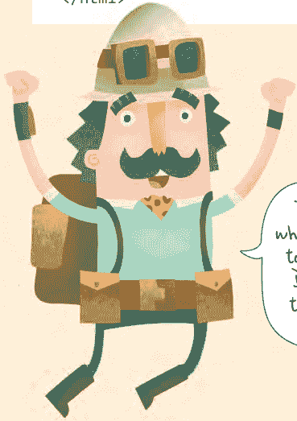

> 这正是 Day 博士安全地将 Monk Diamond 送到 Volkov 府所需要的！


## 自己动手做

### 规划路线

太棒了！你已经学会了如何使用 Web API 和 Google 地图将内容嵌入到你的页面中。现在运用你新学到的知识，规划一条穿过莫斯科的路线，从高尔基公园到圣瓦西里大教堂。有了这条路线，可以帮助 Day 博士确保 Monk Diamond 的安全。

### 莫斯科路线规划简报

当你规划路线时，运用你的新代码技能来完成以下事项：

- **使用 API 密钥**：使用 Google Maps Embed API 获取一个 API 密钥。
- **创建一个 `<iframe>`**：使用这个新的 HTML 标签，以便将内容嵌入到你的页面中。
- **更改 `<iframe>` 的显示方式**：使用属性来更改 `<iframe>` 的高度、宽度和边框。
- **使用 `source` 属性**：嵌入一个 URL，以连接到所需的 Web API。
- **使用 Google Maps Embed API**：使用 Google API 创建一个 Google 地图。
- **使用内置的路线功能**：使用此功能绘制一条路线。
- **设置查询字符串参数**：为路线功能提供起点和终点。

将文件保存在你的 **Coding** 文件夹中，并将其命名为 `route.html`。

```html
<!DOCTYPE html>
<html>
<head>
  <title>Top Secret Route</title>
</head>
<body>
  <iframe
    width="1000px"
    height="1000px"
    frameborder="0px"
    style="border: 0px"
    src="https://www.google.com/maps/embed/v1/directions?origin=GorkyPark,Moscow&destination=StBasil,Moscow&key=API-KEY">
  </iframe>
</body>
</html>
```

> 别忘了使用你保存的 API 密钥。

## 未来的代码技能

了解如何使用 Web API 意味着你可以轻松地将其他应用或网站的特性包含到你的代码中。你可以用它们来构建使用大型 Web 服务的页面和应用，例如社交网络如 Facebook 或 Instagram，或实用工具如 Google 地图或 Dropbox。这将为你节省时间，避免从头开始编写功能代码。

> 这就是你完成后的代码的样子！

> 这条路线将阻止 Bond 兄弟，并确保 Monk Diamond 的安全！

# 任务 5

## 制作一个游戏

- 在 `JAVASCRIPT` 中使用定时器
- 了解什么是游戏循环以及它们如何工作
- 学习如何使用 `JAVASCRIPT` 为 HTML 元素添加动画
- 构建一个测试反应速度的游戏


### 任务简报

亲爱的编程员，

Monk Diamond 昨天已经抵达 Volkov 府。Day 博士和我都非常感谢你在路线规划方面的帮助。一切似乎都很顺利，尽管 Day 博士确实认为一个留着胡子、戴着大帽子的人可能在跟踪他们。他很快就消失了，但她有些警觉。谢天谢地，钻石安全抵达了。

它已经被放置在新玻璃展柜的新垫子上，看起来光彩夺目！我们刚刚把点心摆放在银盘里，这是我们清单上的最后一项任务。现在一切就绪，今晚展览的盛大开幕万事俱备。

说句心里话，自从巨石事件以来，我一直担心我们的安保安排。我知道我们一直非常小心地保守 Monk Diamond 发现的秘密，而且你在为我们的网页创建密码方面做得很好。但我担心 Bond 兄弟可能仍在追踪我们（别忘了我们认为其中一人是熟练的网络罪犯）。我最担心的是他们可能通过再次偷走钻石来破坏展览。

伦敦的一位老朋友，她在该市最著名的博物馆之一工作，最近告诉我，她用电脑游戏训练了一支优秀的新安保团队。直到她给我看数据之前，我都不相信。这款游戏显著提高了团队的反应速度，他们对博物馆可疑情况的响应比以前快得多。

我在想，你能不能帮我制作一款游戏，用来测试 Volkov 府安保团队的反应速度？我今天下午走不开，因为我还要给 Ernest 买一个新项圈，所以我真的很希望你能帮忙。我附上了我的一篇私人探险家百科全书条目。其中包含有关展览的敏感信息，请不要与任何人分享。

再次感谢你的出色帮助。来自繁忙莫斯科的最诚挚问候，

Harry Bairstone 教授


### Volkov 府的安保团队

来自探险家百科全书，每一次冒险的指南

*这是一篇限制性访问的私人条目。要查看 Volkov 府的公开条目，[点击这里](#)。*

**Volkov 府的安保团队**负责保护 [Volkov 府私人收藏](#) 中展出的珍贵 [珠宝](#)。自从 [Monk Diamond](#) 失窃以来，店内展出的珠宝都被存放在上锁的展柜中。强化玻璃的强度是普通玻璃的 200 倍。


### 探险家百科全书

每一次冒险的指南

- [首页](#)
- [目录](#)
- [精选发现](#)
- [著名探险家](#)
- [历史探险](#)

### 安保训练游戏规则

- 每秒屏幕上会显示 6 个人
- 5 个是客人
- 1 个是小偷
- 如果你点击小偷，获得 1 分
- 如果你点击客人，扣 2 分
- 总共进行 6 次
- 游戏的目标是找出全部 6 个小偷，获得 6 分

鉴于失窃事件，所有者 **Viktor Volkov** 已经训练他的安保团队对任何行为可疑的顾客保持警惕。在过去的一年里，几名小毛贼试图用 **万能钥匙** 打开展示柜时被抓获。

Volkov 先生为 Monk Diamond 举办的特别展览将是 **Volkov 府** 有史以来举办的最受瞩目的活动。Volkov 先生决定就展览开幕之夜的安保策略咨询 **Bairstone 教授**。

**Bond 兄弟** 在过去的抢劫中使用过伪装，Volkov 先生和 Bairstone 教授担心该团伙的成员或其同伙可能试图冒充客人混入展览。

商定的策略是使用 **Li 教授** 为 **伦敦博物馆** 开发的方法。一款规则简单的 **电脑游戏** 已被证明是提高安保团队成员 **反应速度** 的有效方法。

这款游戏需要紧急搭建，以便在特别展览开幕前对团队进行充分培训。


## 构建游戏

现在你已经阅读了任务 5 的简报，可以开始构建你的游戏了。这个任务的运作方式与你之前完成的任务略有不同。你将在完成任务的过程中逐步构建游戏。按照分步说明并复制代码，你很快就能为 Bairstone 教授准备好游戏。

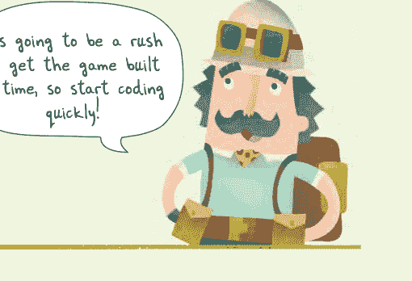

### 1. 创建 HTML 文件

与所有其他任务一样，我们首先需要创建一个新的 HTML 文件。将你的新 HTML 文件命名为 `securitygame.html`。将此代码复制到你的文本编辑程序中：

```html
<!DOCTYPE html>
<html>
<head>
<title>Security Game</title>
</head>
<body>
</body>
</html>
```


### 2. 构建游戏板

现在我们需要构建游戏的基本结构。我们需要在网页中编写一个游戏板的代码。游戏板将是浏览器中游戏运行的区域。当安保团队玩游戏时，客人和小偷将出现在游戏板上。

通过在页面 `<body>` 中编写一个空的 `<div>` 来添加你的游戏板。为你的 `<div>` 添加一个 `id` 属性。你的 `<body>` 代码将如下所示：

```html
<body>
<div id="board">
</div>
</body>
```

然后在你的 `<head>` 中添加一个 CSS 类，它将改变你的 `<div>` 的外观。使用一种称为 `id` 选择器的 CSS 选择器，通过其 `id` 属性来查找你的 `<div>`。CSS 选择器是一种轻松选择各种元素组进行样式设置的方法。使用 CSS `id` 选择器很简单。你所要做的就是使用哈希符号（`#`）和你要更改的 HTML 元素的 `id` 属性来创建一个类名。

创建一个名为 `board` 的 CSS 类，将你的 `<div>` 的 CSS 属性和值设置为以下内容。你的 `<head>` 中的 CSS 类代码需要看起来像这样：

#### 游戏面板需要：

- 1px 的纯黑色边框
- 灰色背景
- 高度为 350px
- 宽度为 650px

> 这类似于任务 1 中的 CSS 元素选择器，或任务 3 中的 CSS 类型属性选择器。


```html
<head>
  <title>Security Game</title>
  <style>
    #board {
      border: 1px solid black;
      background-color: gray;
      height: 350px;
      width: 650px;
    }
  </style>
</head>
```

保存您的 HTML 文件并在浏览器中打开它。您将看到您的空游戏面板显示在屏幕上。

> 干得好！

### 3. 添加按钮

现在我们有了一个游戏面板，我们应该在页面上添加一个按钮。当玩家点击按钮时，我们游戏的代码将会运行，游戏将开始。

在您的 `<body>` 中的 `<div>` 上方添加您的按钮。像在任务 3 中那样创建按钮，使用 `<input/>` 标签以及 type 和 value 属性。将您的 `<input/>` 标签的 onclick 属性设置为一个名为`startGame`的 JavaScript 函数，该函数将启动游戏。您的按钮代码将如下所示：

```html
<input type="button" value="Play" onclick="startGame()";/>
```

现在创建您的按钮被点击时将调用的`startGame`函数。将该函数添加在您的 `<body>` 中的 `<div>` 下方。您的 `<script>` 块将如下所示：

```html
<script>
  function startGame() {
  }
</script>
```

您的文本编辑程序中的完整代码块现在将如下所示：

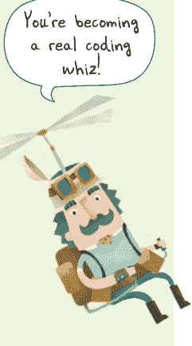

```html
<!DOCTYPE html>
<html>
<head>
  <title>Security Game</title>
  <style>
    #board {
      border: 1px solid black;
      background-color: gray;
      height: 350px;
      width: 650px;
    }
  </style>
</head>
<body>
  <input type="button" value="Play" onclick="startGame()";/>  <div id="board">
  </div>
  <script>
    function startGame() {
    }
  </script>
</body>
</html>
```

保存您的代码并在浏览器中打开它。您将在屏幕上看到您的按钮。目前当您点击它时，什么也不会发生。我们需要向我们的`startGame`函数添加一些代码。

> 让我们让这个按钮运转起来吧！

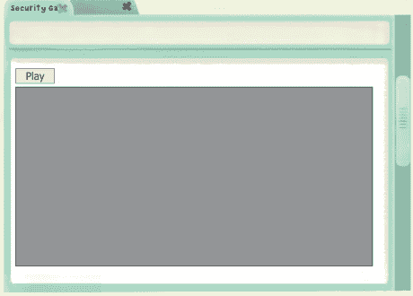

### 4. 创建 JavaScript 计时器

我们的游戏将测试沃尔科夫府邸安全团队的反应时间。为了让我们的游戏运行，我们需要学习如何使用 JavaScript 在一段时间过去后反复运行一段代码。这被称为计时器。

JavaScript 有一个内置的计时器函数称为`setTimeout`，它允许您在一段时间过去后调用一个函数。您所要做的就是把您想要调用的函数名称和时间量作为参数传递给`setTimeout`函数。正如您从任务 2 中所知道的，您通过将参数放在括号中来向函数传递参数。这次我们要向函数传递两个参数。让我们看看如何使用`setTimeout`在一定时间后调用函数。

在这个例子中，`gameTimer`函数将在 1 秒（即 1,000 毫秒）后被调用。

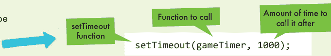

```javascript
setTimeout(gameTimer, 1000);
```

#### 您注意到了吗？

您必须使用毫秒作为`setTimeout`函数的参数。1 秒钟有 1,000 毫秒。要计算您需要的毫秒数，将秒数乘以 1,000。所以如果您希望您的函数在 3 秒后被调用，您需要将 3 乘以 1,000。

> 翻到下一页练习使用`setTimeout`函数！

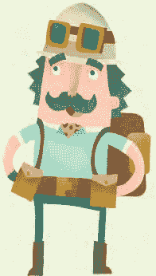

#### 编码技能 ► 使用 SETTIMEOUT 函数

JavaScript 计时器，例如`setTimeout`函数，对于构建游戏非常有用。让我们尝试使用`setTimeout`函数，以便您了解它的工作原理，并可以在任务稍后将其添加到您的游戏中。让我们编写一个程序，每秒递增一个数字。

1. 打开您的文本编辑程序。创建一个名为`timers.html`的新 HTML 文件。输入以下代码：

   ```html
   <!DOCTYPE html>
   <html>
   <head>
     <title>Timers</title>
   </head>
   <body>
     <div id="number">
     </div>
   </body>
   </html>
   ```

2. 现在将 `<script>` 标签添加到您的 `<head>` 中。在您的 `<script>` 块中创建一个变量，并使用赋值（`=`）运算符将其值设置为 0，如下所示：

   ```html
   <head>
     <title>Timers</title>
     <script>
       var count = 0;
     </script>
   </head>
   ```

3. 现在创建一个名为`updateCount`的函数。每次调用该函数时，它将使用加法运算符（`+`）将您的变量值加 1。然后使用`getElementById`和`innerHTML`找到您的空 `<div>` 并将其内容设置为该变量。您的代码将如下所示：

   ```html
   <script>
     var count = 0;
     function updateCount() {
       count = count + 1;
       document.getElementById("number").innerHTML = count;
     }
   </script>
   ```

4. 现在我们需要在 `<body>` 中添加一个函数调用。像这样添加函数调用：

   ```html
   <body>
     <div id="number">
     </div>
     <script>
       updateCount();
     </script>
   </body>
   ```

5. 最后，我们必须添加一个计时器，每秒调用我们的函数，添加到我们的 `<script>` 块中。我们需要使用`setTimeout`函数。我们必须将函数名称和毫秒数作为参数传递给`setTimeout`函数。我们的 `<script>` 块将如下所示：

   ```html
   <script>
     var count = 0;
     function updateCount() {
       count = count + 1;
       document.getElementById("number").innerHTML = count;
       setTimeout(updateCount, 1000);
     }
   </script>
   ```

保存您的 HTML 文件并在浏览器中打开它。您将看到您的计时器正在运行。`setTimeout`函数将每秒调用您的`updateCount`函数。该函数将运行，每秒向您的变量值加 1。浏览器中的数字将自动更新。

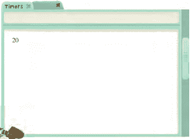

> "这相当聪明。我印象深刻！"

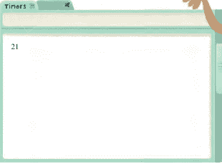

> "我们要如何使用这项技能来构建游戏呢？"

### 5. 创建游戏循环

游戏是您能编码的最困难的事情之一，并且有许多不同的构建方式。一种流行的方式是使用游戏循环。您在任务 3 中使用过循环，我们需要更多地了解它们来构建我们的游戏。

游戏循环是一个 JavaScript 函数，在您的游戏运行期间被反复调用。您可以使用游戏循环来检查玩家是否做了某事、在屏幕上绘制 HTML 元素以及运行游戏的代码。

我们可以使用内置的`setTimeout`函数来创建游戏循环。我们需要在我们的 `<script>` 块中添加一个新函数，每 3 秒弹出一个警告框。让我们将这个函数称为`gameLoop`。这个新函数将在我们的按钮被点击时被调用。让我们看看我们的代码块：

> 我想知道我能嗅出邦德兄弟吗。我的鼻子可灵了。


```html
<!DOCTYPE html>
<html>
<head>
    <title>Security Game</title>
    <style>
        #board {
            border: 1px solid black;
            background-color: gray;
            height: 350px;
            width: 650px;
        }
    </style>
</head>
<body>
    <input type="button" value="Play" onclick="startGame()"; />
    <div id="board">
    </div>
    <script>
        function startGame() {
            gameLoop();
        }
        function gameLoop() {
            alert("Game over!");
            setTimeout(gameLoop, 3000);
        }
    </script>
</body>
</html>
```

### 6. 将宾客和小偷添加到游戏板上

完成这些更改后，保存你的代码并在浏览器中打开。当你点击按钮并调用`startGame`函数时，游戏循环将开始运行。你的`gameLoop`函数每 3 秒会被调用一次，每次都会弹出一个警告框。每次弹出时，点击"确定"以使其继续弹出。

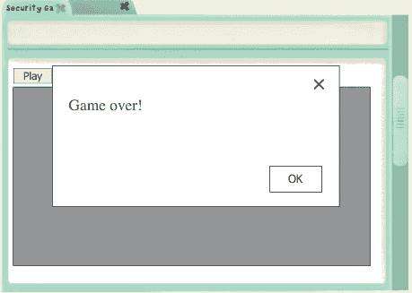


> 任务的良好开端！但是小偷在哪里呢？


现在你已经编写了游戏板、按钮和游戏循环的代码，我们需要将角色添加到游戏中。我们希望六个不同的角色每秒在不同位置闪烁出现在屏幕上。其中五个角色是宾客；一个角色是小偷。安全团队将通过尝试在小偷闪烁出现在屏幕上时点击他来测试他们的反应速度。

让我们开始在游戏板上创建角色。每个角色都需要自己的 `<div>`。在你的游戏板 `<div>` 内部创建六个嵌套的 `<div>` 标签，并将它们编号为 1 到 6，如下所示：

> 让我们把这些角色的代码编写出来！


```html
<div id="board">
  <div>1</div>
  <div>2</div>
  <div>3</div>
  <div>4</div>
  <div>5</div>
  <div>6</div>
</div>
```

保存你的代码并刷新页面。你会在游戏板上看到六个 `<div>` 标签，如下所示：


现在让我们使用 CSS 来改变 `<div>` 标签的设计和布局。让我们创建一个名为`character`的 CSS 类，使我们的 `<div>` 标签变成方形蓝色盒子。在你的文本编辑程序中，将这个新的 CSS 类添加到 `<head>` 中的 `<style>` 标签里。你的完整 `<style>` 代码块现在看起来是这样的：

> **新的 CSS 类**

```html
<!DOCTYPE html>
<html>
<head>
  <title>Security Game</title>
  <style>
    #board {
      border: 1px solid black;
      background-color: gray;
      height: 350px;
      width: 650px;
    }
    .character {
      background-color: lightblue;
      width: 120px;
      height: 120px;
      padding: 10px;
      margin: 10px;
      float: left;
    }
  </style>
</head>
```

#### 注意到了吗？

我们使用了`float` CSS 属性。这将使我们的 `<div>` 标签相互对齐。

然后使用 class 属性将新的`character` CSS 类应用到你的六个 `<div>` 标签上，就像你在任务 1 中做的那样。你的 `<body>` 看起来会是这样的：

```html
<body>
  <input type="button" value="Play" onclick="startGame()";/>
  <div id="board">
    <div class="character">1</div>
    <div class="character">2</div>
    <div class="character">3</div>
    <div class="character">4</div>
    <div class="character">5</div>
    <div class="character">6</div>
  </div>
```

**Class 属性**

> 现在它开始看起来更像一个游戏了！

保存你的代码并刷新页面。你会看到 CSS 属性已应用到你的 `<div>` 标签上。

> 有什么东西让我的鼻子发痒。


### 7. 使用游戏循环来停止游戏

现在我们已经将角色添加到了游戏板上，我们需要对游戏循环做一些更改。目前它每 3 秒弹出一个警告框。我们需要修改循环，使其在一定时间后停止。我们将通过记录循环执行次数来实现这一点。当我们的循环运行一定次数后，游戏将结束。

为了记录循环次数，让我们创建一个每次被调用时都会增加值的变量。为此，我们应该创建一个名为`loops`的变量，并将其值设置为 0。将这个变量添加到你的 `<script>` 代码块中，放在`gameLoop`函数之前，如下所示：

```html
<script>
  function startGame() {
    gameLoop();
  }
  var loops = 0;
  function gameLoop() {
    alert("Game over!");
    setTimeout(gameLoop, 3000);
  }
</script>
```

我们需要在`gameLoop`函数中使用这个变量。我们希望在每次调用函数时给其值加 1。为此，我们可以这样编写代码：

```javascript
loops = loops + 1;
```

然而，我们实际上可以使用一个新的 JavaScript 运算符来用更简单、更简短的方式编写相同的指令。它被称为递增运算符 (`++`)，就像我们在任务 2 中学到的运算符一样。我们可以使用递增运算符 (`++`) 来给变量的值加 1。我们只需要写：

```javascript
loops++;
```

我们可以在`gameLoop`函数中使用递增运算符 (`++`) 来计算循环被调用的次数。从你的`gameLoop`函数中移除`alert`，并用你的新代码替换它，如下所示：

```javascript
function gameLoop() {
  loops++;
  setTimeout(gameLoop, 3000);
}
```


现在我们希望确保游戏循环在游戏结束之前运行固定次数。我们通过向`gameLoop`函数添加 if 语句和 else 语句来实现这一点，这将检查我们的循环已经运行了多少次。

我们需要确保当循环运行一定次数后，调用循环的`setTimeout`函数将停止，并弹出一个警告框。我们希望循环运行 12 次。它每 3 秒运行一次，直到第十二次循环，游戏将结束。我们的游戏总共持续 33 秒（11 乘以 3），然后在第十二次循环时结束。让我们看看包含新变量、if 语句和 else 语句的完整 `<script>` 代码块：

```html
<script>
  function startGame() {
    gameLoop();
  }
  var loops = 0;
  function gameLoop() {
    loops++;
    if(loops < 12) {
      setTimeout(gameLoop, 3000);
    }
    else {
      alert("Game over!");
    }
  }
</script>
```

if 语句检查我们的循环已经运行了多少次。如果小于 (`<`) 12 次，它通过再次调用`setTimeout`继续运行。如果超过 12 次，else 语句运行并弹出一个警告框。


保存你的新代码并刷新页面。点击播放按钮并等待警告框弹出。你的游戏现在将在一定时间后结束。


> 别忘了你需要等待 33 秒警告框才会弹出！

### 8. 使用 CSS 显示和隐藏角色

在游戏过程中，宾客和小偷角色会闪烁出现在屏幕上。沃尔科夫庄园的安全团队必须在小偷消失之前发现并点击他。我们需要使用 CSS 来使角色随着游戏循环的运行而出现和消失。为此，我们必须学习一个新的 CSS 属性，它可以使 HTML 元素在我们的浏览器中出现或消失。然后我们可以使用 JavaScript 将该属性应用到我们的角色上。

| CSS 属性名称 | 它的作用是什么？ | 示例值 |
| --- | --- | --- |
| `display` | 改变 HTML 元素在屏幕上的显示方式 | `block`; `none`; |

`display` CSS 属性有许多不同的值。我们游戏中需要的两个值是 `"block"` 和 `"none"`。如果你将 HTML 元素的 `display` 属性设置为 `none`，该元素将不会出现在你的屏幕上。如果你将 HTML 元素的 `display` 属性设置为 `block`，HTML 元素将以方块形式显示。

在你的文本编辑程序中，添加两个名为 `hidden` 和 `visible` 的新 CSS 类。使用 `display` 属性使你的 `<style>` 代码块看起来像这样：

> 让我们快速试试这个新的 CSS 属性！

```html
<style>
  #board {
    border: 1px solid black;
    background-color: gray;
    height: 350px;
    width: 650px;
  }
  .character {
    background-color: lightblue;
    width: 120px;
    height: 120px;
    padding: 10px;
    margin: 10px;
    float: left;
  }
  .hidden {
    display: none;
  }
  .visible {
    display: block;
  }
</style>
```

保存你的代码。


## 代码技能 ▸ 使用 `display` CSS 属性

尝试使用 CSS 的 `display` 属性让 HTML 元素在屏幕上出现和消失。你需要用这个来让游戏中的角色正确显示。

1. 打开你的文本编辑程序。创建一个名为 `display.html` 的新 HTML 文件。输入下面的代码，然后保存你的 HTML 文件并在浏览器中打开。你的页面将如下所示：

```html
<!DOCTYPE html>
<html>
<head>
  <title>Display</title>
</head>
<body>
  <div>Security</div>
  <div>Thief</div>
  <div>Guest</div>
</body>
</html>
```


2. 在文本编辑程序中重新打开你的文件。修改你的第二个 `<div>`，添加 `display` CSS 属性，使其看起来像这样：

```html
<body>
  <div>Security</div>
  <div style="display: none;">Thief</div>
  <div>Guest</div>
</body>
```

3. 保存文件并刷新页面。`display` CSS 属性和 `none` 值将使你的第二个 `<div>` 从屏幕上消失。


### 9. 让角色动起来

现在我们需要将两个新的 CSS 类（`hidden` 和 `visible`）应用到游戏循环中，使角色 `<div>` 标签产生动画效果。要做到这一点，我们需要让游戏循环向角色 `<div>` 标签添加和移除新的 CSS 类。

当游戏运行时，我们希望角色在屏幕上闪烁出现和消失。我们当前循环大约 12 次，所以角色 `<div>` 标签需要可见 6 次循环、不可见 6 次循环来创建闪烁效果。首先我们需要一个名为 `peopleVisible` 的新变量来存储这个信息。我们需要将这个变量设置为 `false` 值，像这样：

```javascript
var peopleVisible = false
```

我们需要让变量在开始时设置为 `false`，这样角色 `<div>` 标签在屏幕上开始时是隐藏的。然后当变量设置为 `true` 时，角色将出现在屏幕上。

当游戏循环运行时，我们希望存储在新变量中的值在 `true` 和 `false` 之间交替。为此，我们必须使用另一个 JavaScript 运算符，称为**非运算符**（`!`）。你可以使用非运算符（`!`）来改变变量的值。

让我们看看如何在 `<script>` 块中使用非运算符（`!`）。在你的文本编辑程序中输入这些新代码并保存文件。

```javascript
<script>
  function startGame() {
    gameLoop();
  }
  var loops = 0;
  var peopleVisible = false;
  function gameLoop() {
    peopleVisible = !peopleVisible;
    loops++;
    if(loops < 12) {
      setTimeout(gameLoop, 3000);
    }
    else {
      alert("Game over!");
    }
  }
</script>
```


我们已经使用非运算符（`!`）来交替新变量的值。如果变量的值是 `false`，当变量在我们的 `gameLoop` 函数中运行时，非运算符（`!`）会将其值改为 `true`。如果变量的值是 `true`，当变量运行时，非运算符（`!`）会将其值改为 `false`。

每次循环运行时，`loops` 变量会增加一，`peopleVisible` 变量会在 `true` 和 `false` 之间交替。当我们循环时，变量将如下所示：

| 循环次数 | 变量值 |
| --- | --- |
| 1 | True |
| 2 | False |
| 3 | True |
| 4 | False |
| 5 | True |
| 6 | False |
| 7 | True |
| 8 | False |
| 9 | True |
| 10 | False |
| 11 | True |
| 12 | False |
| 游戏结束 | |

现在我们需要在 `<script>` 块中添加一个名为 `flashCharacters` 的新函数，当变量值为 `true` 时让角色 `<div>` 标签显示在屏幕上。我们使用两个新的 CSS 类来实现这一点。当值为 `true` 时，我们想使用 `visible` CSS 类；当值为 `false` 时，我们想使用 `hidden` CSS 类。翻到下一页来了解如何准确编写这个 `flashCharacters` 函数。

> 我喜欢使用循环！

> 这个新函数听起来很复杂！

### 10. 使用 JavaScript 应用 CSS

我们需要一个新函数，根据变量的值将 CSS 类应用到角色 `<div>` 标签上。我们应该将这个函数命名为 `flashCharacters`。该函数必须使用 `getElementById` 找到我们的游戏面板，并将其存储在名为 `board` 的变量中。然后函数需要选择一个 CSS 类应用到角色 `<div>` 标签上。这将取决于 `peopleVisible` 变量的值。

为了决定 CSS 类，我们创建第二个名为 `classToSet` 的变量，它将存储我们需要设置的两个 CSS 类名称。我们使用 `if` 和 `else` 语句来选择 CSS 类。我们将 `classToSet` 变量的值设置为一个**空字符串**。这个空字符串在 `if` 和 `else` 语句运行时被填充。如果 `peopleVisible` 变量为 `true`，`classToSet` 变量将被设置为 `visible` CSS 类。如果 `peopleVisible` 变量为 `false`，`else` 语句会将 `classToSet` 变量改为 `hidden` CSS 类。

然后我们需要编写一个循环来计数 6 个角色 `<div>` 标签。当循环计数 `<div>` 标签时，它将 `classToSet` 变量的值分配给每个 `<div>`。我们使用 `className` 方法来实现这一点。`className` 方法允许你在 JavaScript 中为 HTML 元素设置 CSS 类。

现在我们的完整函数看起来像这样：

```javascript
function flashCharacters() {
  var board = document.getElementById("board");
  var classToSet = "";
  if(peopleVisible) {
    classToSet = "character visible";
  }
  else {
    classToSet = "character hidden";
  }
  for(var index = 0; index < 6; index++) {
    board.children[index].className = classToSet;
  }
}
```

#### 你注意到了吗？

在我们循环内名为 `index` 的变量中，我们存储了不止一条信息。这种变量称为集合。我们必须使用方括号（`[ ]`）从集合中获取值以在我们的代码中使用。

**空字符串**是一种数据，以字符序列的形式表示，其值为 0。在 JavaScript 中，空字符串表示为 `" "`。

### 11. 简化条件语句

这个函数看起来相当复杂，所以我们现在应该尝试简化它。你可以在 JavaScript 中使用另一个运算符，称为**条件运算符**（`?`），来简化 `if` 和 `else` 语句。你像这样使用条件运算符（`?`）：

```javascript
var variableName = condition ? value1 : value2;
```

这告诉我们的浏览器，如果变量的条件为 `true`，则使用 `value1`；如果为 `false`，则使用 `value2`。因此我们可以像这样重写函数中的代码：

```javascript
var classToSet = peopleVisible ? "character visible" : "character hidden";
```

将带有简化 `if` 和 `else` 语句的新 `flashCharacters` 函数添加到你的 `<script>` 块中。确保你的 `gameLoop` 函数也调用你的新函数。保存代码并在浏览器中打开。每隔 3 秒，你的蓝色方框就会在屏幕上出现和消失。


> 翻到下一页看看我们整个代码块现在是什么样子！


> 别忘了你也可以在 Get Coding! 网站上查看代码！


在你的文本编辑程序中检查你的代码。游戏所需的代码将如下面的代码块所示。每次玩游戏之间你必须刷新页面。进行任何需要的更改并保存文件。

```html
<!DOCTYPE html>
<html>
<head>
  <title>Security Game</title>
  <style>
    #board {
      border: 1px solid black;
      background-color: gray;
      height: 350px;
      width: 650px;
    }
    .character {
      background-color: lightblue;
      width: 120px;
      height: 120px;
      padding: 10px;
      margin: 10px;
      float: left;
    }
    .hidden {
      display: none;
    }
    .visible {
      display: block;
    }
  </style>
</head>
```

### 12. 创建小偷

目前在我们的游戏中，每 3 秒钟角色们就会在屏幕上闪烁一次。现在我们需要做的是，每次游戏循环运行时改变角色在屏幕上的位置。每 3 秒钟，角色们需要移动到游戏板上的不同位置。而且我们需要将其中一个角色设为小偷。

我们首先需要在游戏循环运行时，添加一个函数来创建一组新位置的角色。我们把这个函数叫做 `createCharacters`。首先在游戏循环函数中添加函数调用，像这样：

```javascript
function gameLoop() {
  peopleVisible = !peopleVisible;
  createCharacters();
  flashCharacters();
  loops++;
  if(loops < 12) {
    setTimeout(gameLoop, 3000);
  }
  else {
    alert("Game over!");
  }
}
```

函数调用

然后在你的 `flashCharacters` 函数之前编写新的 `createCharacters` 函数：

```javascript
function createCharacters() {
  var board = document.getElementById("board");
  for(var index = 0; index < 6; index ++) {
    board.children[index].innerHTML = "Guest";
  }
}
```

这与我们之前编写的设置每个角色 `<div>` 的 CSS 类的函数非常相似。但这一次我们使用了 `innerHTML`，就像在任务 3 中使用的那样，将每个角色的值设置为 `"Guest"`。

保存你的 HTML 文件并刷新页面。

现在当你点击“播放”时，你会看到每个角色 `<div>` 标签都标记为 `"Guest"`。

现在我们需要在 `createCharacters` 函数中添加一些代码，每次游戏循环运行时随机选择 6 个角色 `<div>` 标签中的一个作为小偷。我们需要编写代码来选取一个随机数。使用 JavaScript 没有简单的方法来选取随机数，所以接下来你需要的代码相当复杂。仔细地在 `createCharacters` 函数的末尾输入这段新代码，使其看起来像这样：

```javascript
function createCharacters() {
  var board = document.getElementById("board");
  for(var index = 0; index < 6; index ++) {
    board.children[index].innerHTML = "Guest";
  }
  var randomNumber = Math.floor(Math.random() * 6) + 1;
  board.children[randomNumber-1].innerHTML = "Thief";
}
```

`Math` API

这里我们使用了一个叫做 `Math` API 的新 API。它的工作方式与我们在任务 3 中使用的 DOM 和 `localStorage` API 完全相同。使用 `Math` API 可以让你访问已经内置到网页浏览器中的便捷数学函数。要找到一个随机数，你必须进行以下计算：

```javascript
Math.floor(Math.random() * 最大数) + 最小数;
```

我们的游戏中有 6 个角色，所以我们的最大数是 6，最小数是 1。我们需要编写：

我们必须把钻石找回来！

```javascript
Math.floor(Math.random() * 6) + 1;
```

然后我们将计算结果存储在变量中。然后我们可以在下一行代码中使用这个变量。我们使用 `innerHTML` 来设置与我们的随机数匹配的 `<div>` 的值，像这样：

```javascript
board.children[randomNumber-1].innerHTML = "Thief"
```

因为 JavaScript 中的数字是从 0 开始计数的，我们将从随机数中减去 1，所以我们只会得到 0、1、2、3、4 和 5 这几个数字。

保存你的代码。你的新 `createCharacters` 函数将为游戏添加一个小偷。现在当你点击“播放”时，每次游戏循环运行时，游戏板上的一个随机角色都会变成小偷。

### 13. 创建分数

现在我们的游戏板每 3 秒显示一组不同的角色。其中一个角色是沃尔科夫家族安全团队需要抓捕的小偷。现在我们需要做的是创建一种让用户点击小偷的方法。当用户点击时，他们抓住小偷并得一分。

我们首先需要在 `<script>` 代码块的顶部、`startGame` 函数下方添加一个名为 `gameScore` 的变量来跟踪分数：

```javascript
var loops = 0;
var peopleVisible = false;
var gameScore = 0;
```


每次玩家点击小偷时，我们需要给他们加 1 分。为了确保玩家保持专注，每次他们点击客人时我们应该扣 2 分。为了创建我们的计分系统，我们需要每次游戏循环运行时给每个角色添加一个`onclick`。将这段新代码添加到你的`createCharacters`函数中：

```javascript
function createCharacters() {
    var board = document.getElementById("board");
    for(var index = 0; index < 6; index ++) {
        board.children[index].innerHTML = "Guest";
        board.children[index].onclick = function() {
            gameScore += -2;
        }
    }
    var randomNumber = Math.floor(Math.random() * 6) + 1;
    board.children[randomNumber-1].innerHTML = "Thief";
    board.children[randomNumber-1].onclick = function() {
        gameScore++;
    }
}
```

我们使用`onclick`的方式与任务 3 中相同。当创建客人或小偷时，会添加一个`onclick`。我们使用两个新的算术运算符来改变`gameScore`变量的值。如果用户点击客人，`+=`运算符表示将后面的值加到变量中的值上。在这种情况下，由于后面的值是 `-2`，这意味着从`gameScore`值中减去 2。如果用户点击小偷，递增运算符（`++`）表示给变量中的值加 1。

我们还需要在游戏结束时更改提示信息，以便告诉用户他们的分数。修改`gameLoop`函数中的`else`语句，使其使用`gameScore`变量的值，像这样：

```javascript
function gameLoop() {
  peopleVisible = !peopleVisible;
  createCharacters();
  flashCharacters();
  loops++;
  if(loops < 12) {
    setTimeout(gameLoop, 3000);
  }
  else {
    alert("You scored " + gameScore);
  }
}
```

### 变量

#### 你注意到了吗？

我们在提示文本末尾留了一个空格，以便消息与`gameScore`值正确显示。

保存你的 HTML 文件并刷新页面。试着每次小偷在屏幕上闪烁时点击它。看看游戏结束时你能得多少分。记住，每次玩游戏之间你需要刷新页面。

> 万岁！钻石现在肯定安全了！

### 14. 简化代码

我们的游戏现在可以运行了，沃尔科夫家族的安全团队很快就可以开始他们的训练了。但你可能已经注意到，我们的`createCharacters`和`flashCharacters`函数非常相似。一个创建我们的角色，另一个给它们添加 CSS 类。我们现在可以合并这些函数来简化代码。在解决问题时简化代码是编程中非常常见的事情。这会让你的代码更容易理解。

我们应该修改`createCharacters`函数，使其在创建角色的同时添加 CSS 类。将函数修改为如下所示：

```javascript
function createCharacters() {
  var board = document.getElementById("board");
  var classToSet = peopleVisible ? "character visible" : "character hidden";
  for(var index = 0; index < 6; index ++) {
    board.children[index].className = classToSet;
    board.children[index].innerHTML = "Guest";
    board.children[index].onclick = function() {
      gameScore += -2;
    }
  }
  var randomNumber = Math.floor(Math.random() * 6) + 1;
  board.children[randomNumber-1].innerHTML = "Thief";
  board.children[randomNumber-1].onclick = function() {
    gameScore++;
  }
}
```

#### 已添加 CSS 类

这个函数现在包办了一切。每次游戏循环运行时，它会选取正确的 CSS 类，创建角色，然后为每个角色设置`onclick`。我们不再需要`flashCharacters`函数，所以可以将其删除。同时从`gameLoop`函数中删除该函数的调用，使其如下所示：

```javascript
function gameLoop() {
  peopleVisible = !peopleVisible;
  createCharacters();
  loops++;
  if(loops < 12) {
    setTimeout(gameLoop, 3000);
  }
  else {
    alert("You scored " + gameScore);
  }
}
```

#### 已移除`flashCharacters`的函数调用

保存你的代码。你的游戏将以完全相同的方式运行。

编码很巧妙，我的朋友！

### 15. 使用 CSS 设计游戏

我们现在已经让游戏的基本结构正常工作了，但它在屏幕上看起来并不那么有趣。让我们运用任务一中学到的 CSS 技能来设计它。首先，看看能否让小偷在屏幕上闪现时更具辨识度。我们在`<style>`块中添加一个名为`thief`的新 CSS 类，如下所示：

```css
.character {
    background-color: lightblue;
    width: 120px;
    height: 120px;
    padding: 10px;
    margin: 10px;
    float: left;
}
.thief {
    background-color: red;
}
```

然后我们需要将这个 CSS 类应用到我们的 JavaScript 中。每次添加小偷时，我们都需要添加这个新的 CSS 类。为此，我们需要对代码做如下修改：

```javascript
var randomNumber = Math.floor(Math.random() * 6) + 1;
board.children[randomNumber-1].innerHTML = "Thief";
board.children[randomNumber-1].onclick = function() {
    gameScore++;
}
board.children[randomNumber-1].className = classToSet + " thief";
```

每次游戏循环运行时，这都会将我们的`thief` CSS 类应用到小偷的`<div>`上，使其变为红色。保存你的 HTML 文件。现在你的小偷将与客人不同。

#### 你注意到了吗？

代码中有`" thief "`这个空格。这个空格至关重要，因为我们使用了两个 CSS 类名：通过`classToSet`变量选取的 CSS 类（`hidden`或`visible`），以及`thief`这个 CSS 类。我们需要这个空格，否则结果会变成`"hiddenthief"`。

### 16. 为角色使用图片

如果我们想让角色的`<div>`标签看起来更令人兴奋，我们就需要学习一些新的 CSS 属性。这些新属性非常简单，它们的工作方式与你在任务一中学到的完全相同。

首先，访问 Get Coding! 网站，找到这两张图片。

将这些图片保存在你桌面上的 **Coding** 文件夹中，与其他 HTML 文件放在一起。你之前在任务一中已经做过这个操作，如果需要提醒，请返回查看第 28-30 页。

现在我们要更改`<style>`块中的 CSS 类。我们将使用两个新的 CSS 属性：`background`和`background-size`。

| CSS 属性 | 作用是什么？ | 示例值 |
|---|---|---|
| `background` | 将 HTML 元素的背景设置为图片 | `url('image.jpg'); none;` |
| `background-size` | 设置 HTML 元素中背景图片的大小 | `cover; 650px;` |

我们可以在`character`和`thief` CSS 类中使用这两个新的 CSS 属性，如下所示：

```css
.character {
  background: url('guest.jpg');
  background-size: cover;
  width: 120px;
  height: 120px;
  padding: 10px;
  margin: 10px;
  float: left;
}

.thief {
  background: url('thief.jpg');
  background-size: cover;
}
```

使用`background` CSS 属性，我们让浏览器使用保存的图片作为我们`<div>`标签的背景。然后使用`background-size` CSS 属性，我们让浏览器确保图片文件设置为足够大的尺寸，以覆盖每个`<div>`的整个背景。

保存你的 HTML 文件，看看新的 CSS 属性对你的游戏产生了什么效果。

现在我们已经将图片设置为角色`<div>`标签的背景，让我们移除客人和小偷的标签。毕竟，我们不想让沃尔科夫庄园的安全团队太容易得手。通过更改`<script>`块中的这两行来移除文本：

```javascript
board.children[index].innerHTML = "Guest";
```

```javascript
board.children[randomNumber-1].innerHTML = "Thief";
```

将它们改为空字符串，如下所示：

```javascript
board.children[index].innerHTML = "";
```

```javascript
board.children[randomNumber-1].innerHTML = "";
```

保存你的 HTML 文件。现在你的游戏将只由图片组成。

> 游戏看起来很棒！

> 那个小偷看起来不太妙。

### 17. 更改游戏面板

现在我们知道如何使用`background`和`background-size` CSS 属性了，我们可以轻松地将游戏面板从灰色改为图片。访问 Get Coding! 网站，找到背景图片。将其保存在你的 **Coding** 文件夹中。

然后我们只需要将新的`background`和`background-size`属性添加到`<style>`块中的`board` CSS 类中。别忘了删除`background-color` CSS 属性，因为它不再需要了。

你的代码将如下所示：

```css
#board {
    background: url('background.jpg');
    background-size: cover;
    border: 1px solid black;
    height: 350px;
    width: 650px;
}
```

我们还应该确保在游戏开始时，当它在浏览器中加载时，我们只看到游戏面板。然后当我们按下播放时，才看到角色。为此，我们需要在`<style>`块中的`character` CSS 类里添加 CSS `display`属性，如下所示：

```css
.character {
    background: url('guest.jpg');
    background-size: cover;
    width: 120px;
    height: 120px;
    padding: 10px;
    margin: 10px;
    float: left;
    display: none;
}
```

保存你的 HTML 文件。当你的游戏加载时，你会看到游戏面板的新背景。当你按下 **Play** 时，你的角色将在屏幕上加载，游戏开始。

#### 开始界面

#### 游戏界面

### 18. 增加游戏难度

你可能已经注意到，3 秒的延迟让点击小偷变得很容易。我们现在需要增加游戏难度，让它更具挑战性。角色需要在屏幕上闪现的时间更短，这样就有更少的时间来点击小偷。为此，我们需要更改`setTimeout`调用，如下所示：

```javascript
setTimeout(gameLoop, peopleVisible ? 1000 : 3000);
```

我们使用的是简化的 if 语句，就像之前在任务中做的那样。我们更改了`setTimeout`调用，这样如果`peopleVisible`为真，我们的`gameLoop`函数将在 1 秒后被调用。如果`peopleVisible`为假，我们的`gameLoop`函数将在 3 秒后被调用。所以现在我们的角色只会在屏幕上闪现 1 秒钟，但当它们不可见时，它们将被隐藏 3 秒钟。

保存你的代码，开始玩你完成的游戏。你能得到 6 分吗？

## 自己动手任务

## 你完成的游戏

编写游戏是具有挑战性的，而你已经在这个任务中掌握了它。贝尔斯通教授会很高兴的。这款游戏将测试安全团队的反应时间。

## 安全训练游戏概述

检查你是否已正确在 **securitygame.html** 文件中编写以下所有内容，并且该文件已保存在你的 **Coding** 文件夹中。别忘了你可以更改游戏的速度，让它更快，对用户来说更难。

- 一个游戏面板
  - 5 个客人
  - 1 个小偷
- 一个开始按钮
- 一个分数提示

> 翻页查看游戏的完整代码块。


```html
<!DOCTYPE html>
<html>
<head>
  <title>Security Game</title>
  <style>
    #board {
      background: url('background.jpg');
      background-size: cover;
      border: 1px solid black;
      height: 350px;
      width: 650px;
    }
    .character {
      background: url('guest.jpg');
      background-size: cover;
      width: 120px;
      height: 120px;
      padding: 10px;
      margin: 10px;
      float: left;
      display: none;
    }
    .thief {
      background: url('thief.jpg');
      background-size: cover;
    }
    .hidden {
      display: none;
    }
    .visible {
      display: block;
    }
  </style>
</head>
<body>
  <input type="button" value="Play" onclick="startGame()";/>
  <div id="board">
    <div class="character">1</div>
    <div class="character">2</div>
    <div class="character">3</div>
    <div class="character">4</div>
    <div class="character">5</div>
    <div class="character">6</div>
  </div>
  <script>
    function startGame() {
      gameLoop();
    }
    var loops = 0;
    var peopleVisible = false;
    var gameScore = 0;
    function gameLoop() {
      peopleVisible = !peopleVisible;
      createCharacters();
      loops++;
      if(loops < 12) {
        setTimeout(gameLoop, peopleVisible ? 1000 : 3000);
      }
      else {
        alert("You scored " + gameScore);
      }
    }
    function createCharacters() {
      var board = document.getElementById("board");
      var classToSet = peopleVisible ? "character visible" : "character hidden";
      for(var index = 0; index < 6; index ++) {
        board.children[index].className = classToSet;
        board.children[index].innerHTML = "";
        board.children[index].onclick = function() {
          gameScore += -2;
        }
      }
      var randomNumber = Math.floor(Math.random() * 6) + 1;
      board.children[randomNumber-1].innerHTML = "";
      board.children[randomNumber-1].onclick = function() {
        gameScore++;
      }
      board.children[randomNumber-1].className = classToSet + " thief";
    }
  </script>
</body>
</html>
```

## 未来编程技能

这次任务是学习 JavaScript 游戏编程的重要一步。你使用了`游戏循环`——几乎所有电脑游戏的核心组成部分——来为游戏提供动力，并为用户创造互动体验。这并非易事，所以干得漂亮！你现在可以运用关于游戏循环的知识来构建更复杂的游戏，这些游戏将以不同的方式响应你的用户。

# 任务 6：你完成的网站

- 学习如何使用`线框图`
- 使用`HTML`和`CSS`构建网站
- 将网页互相链接
- 让你的网站上线

## 任务简报

亲爱的程序员：

我们想你会很高兴听到，沃尔科夫庄园的特别展览取得了**巨大成功**！我们要感谢你的所有帮助和辛勤工作。当沃尔科夫先生向宾客们揭开僧侣钻石的面纱时，所有人都惊叹不已。这是我们职业生涯中最自豪的时刻。

不过，这个夜晚也并非没有戏剧性。正如我们担心的那样，邦德兄弟得知了钻石的消息。他们**伪装**成宾客，使用假邀请函进入展览。幸运的是，他们一进去，安保团队的一名成员就注意到他们在钻石玻璃柜附近**行为可疑**。沃尔科夫先生及时介入，警察也刚好赶到。多亏了你，邦德兄弟现在已**锒铛入狱**。

关于僧侣钻石的消息迅速传开，在莫斯科乃至全世界都引起了相当大的轰动。沃尔科夫先生非常高兴能将它放回属于它的家，他想向公众开放这次特别展览。既然我们知道安保团队能够应对挑战，我们认为这将是一场非常精彩的展览。如果莫斯科的人们喜欢这次展览，沃尔科夫先生还考虑将其进行**全球巡回展**。沃尔科夫庄园有着非常令人期待的未来。

只剩一件事要做，我们认为你会愿意帮忙。沃尔科夫先生需要建立一个完整的**网站**（不仅仅是一个网页），向全世界所有人介绍这次展览。我们希望最后一次能够依靠你！谁知道呢，也许有一天你能亲自来看看僧侣钻石？我们很希望能见到你，并当面表示感谢。

来自沃尔科夫庄园最热烈的祝贺，

哈里·贝尔斯通教授、鲁比·戴博士和欧内斯特

附：附件是贝尔斯通教授在《探险家百科全书》上的最新条目，以及沃尔科夫先生的便条。

## 僧侣钻石的发现

摘自《探险家百科全书》，冒险指南

> 本条目关于被盗宝石的发现。关于钻石历史的条目，请参见此处。

**僧侣钻石的发现**是指被盗的*僧侣钻石*在**西伯利亚**由**贝尔斯通教授**和**戴博士**发现。贝尔斯通教授一直相信**邦德兄弟**是盗窃的幕后黑手，并且他们将*宝石*藏在了远离**莫斯科****沃尔科夫庄园**的地方，而那里正是它被盗的地方。

## 探险家百科全书

冒险指南

- 首页
- 目录
- 精选发现
- 著名探险家
- 历史探险

## 维克多·沃尔科夫

沃尔科夫庄园，靠近莫斯科圣瓦西里大教堂

亲爱的程序员：

我写这封短信是想衷心感谢你所做的一切，让僧侣钻石回到了沃尔科夫庄园。当它被盗时我心碎了，在那些黑暗的时刻，我以为不得不卖掉生意。沃尔科夫庄园由我的家族经营了几代人了，如果那样会是毁灭性的打击。但多亏了你、贝尔斯通教授、戴博士和欧内斯特，僧侣钻石已经归还。我非常高兴能举办这次展览，并让宝石在店内展出。

如你所知，有人悬赏**安全归还**宝石或**抓捕邦德兄弟**。贝尔斯通教授和戴博士已经拿走了他们的份额，并将用它资助另一次联合探险。我想让你知道，我也有一份**谢礼**要给你。当你来莫斯科亲眼看看僧侣钻石时，它会等着你。

致以最温暖和亲切的问候，

维克多·沃尔科夫

贝尔斯通教授是一位**探险家**，以在世界各地发现古代**文物**而闻名。他的**探险**总是有**欧内斯特**——他的狗——陪伴。在发现僧侣钻石之前，他最引人注目的发现是在**苏格兰****奥克尼群岛**出土的**维京**宝藏**霍伊宝藏**。

戴博士是一位研究**化石**的科学家。她目前正在研究一种新的**羽毛恐龙**物种。她曾多次参加不同的探险，希望能发现化石来证明这个物种有羽毛。

僧侣钻石在西伯利亚被发现并归还沃尔科夫庄园的消息成为全世界的头条新闻。该团队接受了许多不同电视台的采访，并出现在众多报纸和杂志上。贝尔斯通教授受邀就这次发现发表**讲座**，他的**传记**将于明年出版。戴博士已被任命为所在大学的**高级研究员**。

沃尔科夫庄园的特别展览非常受欢迎。沃尔科夫先生告诉记者，他“非常高兴钻石的归还以及展览的成功”。据报道，沃尔科夫庄园外排队长达两小时，珠宝销售额增长了一倍多。

## 构建一个网站

你在之前的五个任务中表现非常出色。现在你已经能够使用`HTML`、`CSS`和`JavaScript`进行编程，并且知道如何利用`API`构建更复杂的程序。你已经学会了构建网页、创建密码、开发基于 Web 的应用程序、规划路线以及制作游戏。现在还有一个最终挑战：构建一个网站。

到目前为止，你构建的所有页面和程序都存储在电脑的网络浏览器中，仅供贝尔斯通教授和戴博士使用。我们现在需要学习的是如何构建一个能够让世界上任何人在任何地方都可以访问的网站。

构建网站与构建网页并没有太大区别，正如我们在任务 1 中所做的那样。毕竟，网站只是一组相互关联的网页。不过，在这个任务中，我们将采用一种略有不同的方式。这次我们将使用一种称为线框图的工具来构建网页。本任务中共有五个线框图，你将根据每个线框图编写一个网页。

## 线框图

线框图是在开始编码之前规划网站内容和布局的一种有效方法。线框图就是一种非常简单的草图，就像右边的示例一样，展示页面的不同元素。它们帮助你规划每个网页的设计，并就页面的结构方式做出重要决策。

线框图还能帮助你确定用户如何与页面交互，以及如何在网站的其他页面之间跳转。一旦你对线框图满意，就可以开始编码，将其作为一份计划，清晰地指导你在页面的哪些位置编写什么代码。

在这个任务中，我们将编写一个由五个网页组成的网站。这五个页面将相互链接，讲述关于钻石的精彩故事的不同部分。我们将为“僧侣钻石”网站的每个页面查看一个可能的线框图。

- 菜单栏
- 一张大图片
- 文本
- 页脚
- 图片

让我们来看看将要编码的五个网页，以构建“僧侣钻石”网站：

| 网页 | 内容 |
| --- | --- |
| `index.html` | 我们的主页，介绍发现过程和展览 |
| `diamond.html` | 僧侣钻石的历史，包括失窃事件 |
| `discovery.html` | 贝尔斯通教授和戴博士发现钻石的故事 |
| `exhibition.html` | 展览详情，包括开放时间 |
| `volkov.html` | 如何前往莫斯科的沃尔科夫豪宅 |

在本任务中，我们将查看网站每个页面的线框图。然后，你可以在你的文本编辑程序中，运用在所有其他任务中学到的`HTML`、`CSS`和`JavaScript`技能来编写每个网页。

## 更多 CSS 属性

在任务 1 中，你了解到`CSS`是一种编程语言，可以让你更改`HTML`网页的外观。在开始查看线框图之前，我们需要学习一些额外的`CSS`属性和值。

### 使用图片

当你向页面添加图片时，可以通过多种不同的方式更改它们的大小。最佳方法是向你的``标签添加`style`属性，并将`width` CSS 属性设置为像素值（`px`）或百分比（`%`），如下所示：

```html

```

```html

```

然后，你的浏览器会自动计算图片应有的高度。如果你想拉伸图片并使其不成比例，可以在`style`属性中同时使用`width`和`height`两个 CSS 属性，如下所示：

```html

```

### 让图片填充 `<div>`

创建有趣布局的一个好方法是使用`<div>`标签将页面划分为不同的部分。如果你想使用图片作为`<div>`的背景并创建一个横幅，你应该像在任务 5 中那样使用`background`和`background-size` CSS 属性。使用 CSS 属性有不同的方式来**缩放**你的图片。

| CSS 属性 | 作用是什么？ | 示例值 |
| --- | --- | --- |
| **background** | 为 HTML 元素设置背景图片 | `url(filename.jpg);` |
| **background-size** | 设置 HTML 元素的背景大小 | `contain; cover; auto;` |

在任务 5 中，你使用了`background-size` CSS 属性的`cover`值。`cover`值会缩放背景图片，使其足够大以完全填充你的`<div>`。图片的某些部分可能会被**裁剪**，以适应`<div>`的大小。

除了`cover`值，你还可以使用`contain`值。`contain`值会在不拉伸变形的情况下，尽可能放大背景图片。根据图片的大小，它可能不会填满整个`<div>`。如果图片没有填满空间，你的浏览器会重复显示它。

如果你将`background-size` CSS 属性的值设为`auto`，它也会根据需要重复图片以填满`<div>`。

```html
<style>
  .team {
    width: 600px;
    height: 600px;
    background: url(team.jpg);
    background-size: contain;
  }
</style>
```

> 当我们**缩放**图片时，我们通过使其更大、更小或赋予不同的比例来调整其大小。当我们**裁剪**图片时，我们切掉它的边缘，使图片变小。

### 对齐文本和图片

你可以用两种简单的方式让图片和文本对齐，我们在任务 1 中介绍过。你可以对包含文本和图片的`<div>`使用`text-align` CSS 属性。或者你可以在``标签内的`style`属性中使用`float` CSS 属性，如下所示：

```html

```

### 更多 CSS 颜色值

到目前为止，你一直使用颜色名称作为 CSS 颜色属性的值。默认情况下，你的浏览器支持约 140 种颜色名称。除了这些名称之外，你还可以使用 HEX 代码创建自己的颜色。你使用 HEX 代码的方式与使用颜色名称完全相同。它们看起来像这样：

```html
<body>
  <div style="background-color: #0BFF54;">
    贝尔斯通教授、戴博士和欧内斯特参加了这次探险。
  </div>
</body>
```


幸运的是，你不需要记住 HEX 代码。有很多网站可以帮助你计算它们。你可以使用`www.color.adobe.com`上的调色盘混合自己的颜色并生成 HEX 代码。只需将页面上的 HEX 值复制到你的代码中，并记住以井号（`#`）开头来书写你的 HEX 代码颜色。

> 我迫不及待想看看你完成的网站了！

## 1. 主页：`index.html`

主页（`index.html`）是你网站最重要的页面，因为它是用户首先会看到的页面。一个好的主页会让网站的用途一目了然，并吸引用户的兴趣。应该清楚地表明这只是主页，网站上还有其他网页供用户探索。

在我们的主页上，让我们使用一张僧侣钻石的大图片作为页面的页头横幅。

我们也可以在横幅中放置一个标题。然后设置一个菜单栏，包含指向网站所有其他页面的链接。接着我们应该有一段简短的文本，介绍一些关于僧侣钻石发现的背景。在文本下方放置一个按钮，链接到网站上的沃尔科夫豪宅页面。最后，我们可以设置一个页脚，包含贝尔斯通教授的联系方式。让我们来看看这个页面的线框图：

使用你在之前任务中掌握的 HTML 和 CSS 技能来编写这个页面。

> 在“Get Coding!”网站上查找僧侣钻石的图片。

### 页头横幅

- 在你的`<style>`代码块中，创建一个 CSS 类，将`width`属性设置为`100%`，`height`设置为`400px`，`padding`设置为`0px`。使用`background`和`background-size` CSS 属性添加图片。
- 在你的页面`<body>`中的`<div>`上应用这个 CSS 类。
- 向你的`<div>`添加标题文本。使用`style`属性更改`font-size`和`color` CSS 属性。

### 文本

- 创建第三个`<div>`，使用`style`属性将`width`设置为`100%`，`padding`设置为`50px`。
- 添加你的文本，使用`<p>`和`<br/>`标签将文本分成几个部分。

### 按钮

- 通过在`<div>`内放置链接来创建按钮。使用带有`width`、`height`、`padding`和`background-color` CSS 属性的`style`属性，使其看起来像按钮。

### 菜单栏

- 在你的页面`<body>`中创建第二个`<div>`。向你的`<div>`标签添加`style`属性，并设置`width`、`padding`和`background-color` CSS 属性。
- 添加四个超链接，使用锚点`<a>`标签和`href`属性。
- 你还可以为每个链接创建一个`<div>`，并将它们设置为彼此向右浮动。

### 页脚

- 创建最后一个`<div>`，使用`style`属性将`width`设置为`100%`。
- 在`<div>`内添加贝尔斯通教授的联系方式文本。

> 你可以在“Get Coding!”网站上找到本任务中这个线框图和所有其他线框图的代码。

> 完成页面编码后，将你的 HTML 文件保存在`Coding`文件夹中。将你的文件命名为`index.html`。

## 2. 钻石页面：`diamond.html`

钻石页面（`diamond.html`）是我们网站中的第二个网页，它将向用户介绍关于 Monk 钻石迷人历史的所有信息。让我们来看一下构建该页面所需的线框图：

### 菜单栏

- 在页面的`<body>`中创建一个`<div>`。向你的`<div>`标签添加一个`style`属性，并设置`width`、`padding`和`background-color`这几个 CSS 属性。使用锚点标签`<a>`和`href`属性添加四个超链接。
- 你也可以为每个链接创建一个`<div>`，并设置它们相互向右浮动。

### 大图片

- 在你的`<style>`块中，创建一个 CSS 类，将`width`属性设置为`100%`，`height`设置为`200px`，`padding`设置为`0px`。使用`background`和`background-size`这两个 CSS 属性来添加一张图片。将此 CSS 类应用到`<body>`中的第二个`<div>`。

### 文本

- 创建第三个`<div>`，使用`style`属性将`width`设置为`100%`，`padding`设置为`50px`。添加你的文本，使用`<p>`和`<br/>`标签将文本分成若干部分。

#### 图片

- 在你的文本`<div>`中添加一张图片。使用带有`width`、`height`和`text-align`这几个 CSS 属性的`style`属性将其居中。

### 页脚

- 使其与主页相同。

完成页面编码后，将 HTML 文件保存到你的`Coding`文件夹中。将你的文件命名为`diamond.html`。

## 3. 发现页面：`discovery.html`

发现页面（`discovery.html`）是第三个页面，它将向用户介绍 Bairstone 教授和 Day 博士是如何找到 Monk 钻石的。让我们来创建一个线框图，使其布局与之前的页面略有不同，如下所示：

### 菜单栏

- 应与钻石页面的菜单栏相同。记得更新链接。

### 大图片

- 在你的`<style>`块中，创建一个 CSS 类，将`width`属性设置为`100%`，`height`设置为`200px`，`padding`设置为`0px`。使用`background`和`background-size`这两个 CSS 属性来添加一张图片。将此 CSS 类应用到`<body>`中的第二个`<div>`。

### 文本栏

- 创建一个`<div>`，使用`style`属性将`width`设置为`80%`，`padding`设置为`50px`。添加你的文本，使用`<p>`和`<br/>`标签将文本分成若干部分。

### 图片栏

- 创建另一个`<div>`，使用`style`属性将`width`这个 CSS 属性设置为`20%`。让这个`<div>`浮动到包含你文本的`<div>`右侧。
- 在你的`<div>`中添加一张图片。使用带有`width`、`height`和`text-align`这几个 CSS 属性的`style`属性将其居中。

### 页脚

- 使其与主页相同。

完成页面编码后，将 HTML 文件保存到你的`Coding`文件夹中。将你的文件命名为`discovery.html`。

## 4. 展览页面：`exhibition.html`

展览页面（`exhibition.html`）将包含关于 Volkov 府展览的所有详细信息。由于它包含重要信息，我们希望保持布局简洁，以便信息易于查看和理解。让我们来看一下线框图：

### 菜单栏

- 应与钻石页面和发现页面的菜单栏相同。只要记得更新链接即可。

### 大图片

- 也应与钻石页面和发现页面相同。

### 文本

- 为每一段信息创建一个`<div>`。
- 你可以使用`style`属性并将 CSS `margin`属性设置为`10px`来缩进部分文本。

### 页脚

- 使其与主页相同。

> 使用`<div>`标签来创建不同的布局非常有效！

完成页面编码后，将 HTML 文件保存到你的`Coding`文件夹中。将你的文件命名为`exhibition.html`。

## 5. Volkov 府页面：`volkov.html`

对于我们网站的最后一个页面（`volkov.html`），我们需要提供前往 Volkov 府的路线指引，以便人们知道如何找到它。我们应该提供地址，并像我们在任务 4 中那样，使用 Google Maps Embed API 嵌入一张来自 Google 的地图。让我们来看一下线框图：

### 菜单栏

- 应与钻石页面、发现页面和展览页面的菜单栏相同。只要记得更新链接即可。

### 大图片

- 也应与钻石页面、发现页面和展览页面相同。

### 文本栏

- 创建一个`<div>`，使用`style`属性将`width`设置为`80%`，`padding`设置为`50px`。使用`<p>`和`193`和`<br/>`标签将文本分成若干部分来添加你的文本。

### 地图栏

- 创建另一个`<div>`，使用`style`属性将`width`这个 CSS 属性设置为`20%`。让这个`<div>`浮动到包含你文本的`<div>`右侧。
- 添加一个`<iframe>`，并设置`width`、`height`和`border`属性。然后添加一个`source`属性，其值是一个链接到 Google Maps Embed API 的 URL。使用搜索 API 功能，并嵌入一张显示莫斯科圣瓦西里大教堂的地图。

### 页脚

- 使其与主页相同。

完成页面编码后，将 HTML 文件保存到你的`Coding`文件夹中。将你的文件命名为`volkov.html`。

# 你的完整网站

现在你已经构建了五个网页，最后需要做的就是检查所有链接是否正确，以及你的页面是否按照计划的方式进行连接。检查每个网页上的菜单栏，确保每个链接中都有正确的文件名。如果你的链接不正确，你的网站将无法正常工作，因为用户将无法在各页面之间导航。每个链接的代码将如下所示：

```html
<a href="index.html">Home</a>

<a href="diamond.html">The Diamond</a>

<a href="discovery.html">Discovery</a>

<a href="exhibition.html">Exhibition</a>

<a href="volkov.html">The House of Volkov</a>
```


## 制作你自己的线框图

制作你自己的线框图非常容易。很多人只是用一支铅笔、一张纸和便利贴来完成，在开始编码之前画出一个线框图来展示他们的网站将会是什么样子。这有时被称为纸张**原型设计**。这是在花时间编码之前，快速尝试不同布局的一种非常便捷的方式。

如果你想制作像我们在这里使用的这种线框图，有很多工具可供使用。你可以在 PC 上使用 Microsoft Visio，在网页浏览器中使用 Gliffy 和 Balsamiq 原型工具，或者如果你使用 Mac，可以使用 OmniGraffle。所有这些程序都带有预制的图形，你可以用它们在电脑上快速勾勒出你的页面。

> **原型**是指一个物件的第一个版本。原型用于查看在后续版本和最终成品中需要修改和改进的地方。

> 这就是最后一个任务的圆满完成！

# 让你的网站上线

如果你想让其他人看到你完成的网站，你需要将它上传到一个 Web 服务器。在本书的开头我们了解了 Web 服务器。它们可以是硬件或软件，用于存储网站以便你的 Web 浏览器能够访问它们。为了让人们能够看到你的网站，你需要在互联网上的 Web 服务器上托管它。搭建你自己的 Web 服务器很复杂，因此幸运的是，有很多在线公司允许你使用他们的服务器来托管你的文件。

> **代码词汇**
>
> 当 Web 服务器存储一个网站以便 Web 浏览器能够访问时，我们说这个服务器托管了这个网站。当文件由服务器托管时，它们会有一个 URL（网址），就像互联网上所有其他网站一样。

> **你知道吗？**
>
> 如果你想托管你的文件，你应该请成年人帮忙寻找服务器上的网络空间。就像 Google 账户一样，你必须达到一定的年龄才能注册。

如果你想找一个免费的 Web 服务器来托管你的网站，你可以在互联网上找到很多选择。只需搜索"free web hosting"。有时家庭互联网连接会附带你可以使用的网络空间。一旦你有了 Web 主机，你就必须将你的文件复制到他们的服务器上。仔细阅读你的 Web 主机提供的说明书和条款与条件。

# 接下来做什么？

## 你的编程未来

通过本书中的六个任务，你不仅成功保护了 Monk Diamond 免受 Bond Brothers 的侵害，还全面学习了 HTML、CSS 和 JavaScript。你编写了一个网页、创建了一个密码、构建了一个基于网页的应用、规划了一条路线，并掌握了一些非常复杂的代码来构建游戏。现在，你还可以将创建网站加入你的成就列表了。祝贺你！

我们希望《Get Coding!》向你展示了编程是多么有趣且引人入胜。你已经学习了数量惊人的新编程技能，并构建了一些令人兴奋的专属项目。而值得学习的知识还有很多很多。如果你喜欢使用 HTML 和 CSS 编程，互联网上还有许多优秀的网站可以教给你更多的 HTML 标签和 CSS 属性供你学习。

W3Schools 的 HTML 网站，网址为`www.w3schools.com/html`，将引导你通过大量示例来扩展知识，创建更加令人兴奋的网站。

如果你喜欢使用 JavaScript 编程，不妨通过一些在线练习来提升技能，例如 Codecademy 的网站`www.codecademy.com/learn/javascript`？

或者，你也可以开始学习新的编程语言，编写在浏览器之外运行的程序。为什么不尝试学习 C#、Java 或 Ruby？或者试着编写你自己的 Web 服务器？访问`www.code.org/learn`获取更多灵感。

最后，不要忘记加入 Young Rewired State 社区。我们将帮助你持续提升编程技能，成为未来的科技之星！

《Get Coding!》的各项任务已经取得了巨大的成功。接下来走向何方，现在由你决定。

## 加入 Young Rewired State

加入 Young Rewired State，我们将为你介绍志同道合的人和专家导师，在全球各地的免费活动中，比如我们举办的 Festival of Code。通过我们，你将学习如何构建应用、网站和算法，并受到启发，运用你的技能解决现实世界中的挑战。

了解更多关于 Young Rewired State 的信息：

- [www.yrs.io](http://www.yrs.io)
- [www.getcodingkids.com](http://www.getcodingkids.com)

> "感谢你们所有的帮助！"

> "我们很高兴与你们相见！"

> "继续编程吧！"

# 索引

## a

- alternative (alt) 属性 28
- anchor `<a>` 标签 62–3
- appendChild 方法 108–111
- 应用程序接口 (APIs) 103
  - API 密钥 139–141
  - math API 177
  - 网络 API 138–141
- 应用程序 (apps) 7
  - 基于网页的 98–133
- 属性 27–8, 32, 34, 48, 82–5, 88, 101–2 142–4

## b

- background 属性 182–3, 194
- background-color 属性 36–7
- background-size 属性 182–3, 194
- body `<body>` 标签 21
- border 属性 43
- 按钮 98–100, 112–3

## c

- 驼峰命名法 (camelCase) 67
- class 属性 48
- 代码块 56–7, 92, 132–3, 151, 174–5, 186–7
- 编程技能 23, 26, 29–30, 33, 37, 44–5, 50–2, 63, 65, 70–1, 74, 76, 81, 85, 100, 102, 107, 110–1, 116–7, 120, 122–4, 126–7, 140–1, 144, 147, 160–1, 169
- color 属性 39, 195
- 计算机 6
- createElement 方法 108–111
- 裁剪 194
- CSS (层叠样式表) 10
  - 类 46–8, 50–4
  - 编程 34–54
  - 尺寸单位 41–2
  - 属性 34–45, 168–9, 182–3, 193–5
  - 与 JavaScript 配合使用 172
  - 值 34, 193–5

## d

- display 属性 168–9
- division `<div>` 标签 32–3
- 自己动手任务 55, 91, 131, 150, 185
- `<!DOCTYPE>` 声明 21
- 文档对象模型 (DOM) 103–124
  - 方法和属性 104–111, 118–120

## e

- 元素选择器 53–4
- else 语句 75–6
- 嵌入式内容 138, 142–7
- 空字符串 172

## f

- float 属性 40

## g

- 游戏构建 156–187
- getElementById 方法 105–7
- Google 地图 139–141, 145–9

## h

- head `<head>` 标签 21, 46
- height 属性 41–2
- HEX 代码 195
- href 属性 62–3
- 主页 196–7
- 托管 203

## H（续）

- HTML (超文本标记语言) 10
  - 编程 20–33
  - 文档 9
  - 元素 9, 10, 103, 104–111, 118–124
  - 标签 10, 20–30, 142–144
  - 与 JavaScript 配合使用 82–90
- HTML5 localStorage 125–130
- 超链接 62–5, 84

## I

- id 属性 87
- id 选择器 157
- if 语句 72–4
- 内联框架 `<iframe>` 标签 142–4
- 图片 `` 标签 27–30, 193–4
- innerHTML 属性 105–7
- 输入 `<input/>` 标签 87–8, 98–102
- 互联网 8–9

## J

- JavaScript 10
  - 编程 66–93
  - 函数 78–81, 101–2, 159–161
  - 运算符 69–72, 166
  - 语句 67, 72–6
  - 与 CSS 配合使用 172
  - 与 HTML 配合使用 82–90
  - 变量 68, 70–1
- JPEG 27

## L

- 换行 `<br/>` 标签 25, 26
- 循环 130, 162–3, 166–7, 170–1, 176

## M

- margin 属性 43

## O

- onclick 属性 82–5, 101–2

## P

- padding 属性 43
- 段落 `<p>` 标签 24, 26
- 密码 86–93
- 百分比 42

## PI

- 像素 38, 41
- 点 41
- 编程语言 7, 10
- 程序 6
- 原型 202

## R

- removeChild 方法 118–120
- 保留字 83

## S

- 缩放 194
- script `<script>` 标签 66
- 自闭合标签 25
- 软件 6
- source (src) 属性 27
- 字符串参数 145–6
- style 属性 32, 34
- style `<style>` 标签 47
- 语法 35

## T

- 文本框 98–100, 112–4
- text-align 属性 39
- 文本编辑程序 14
- title `<title>` 标签 21
- type 属性 88
- type 属性选择器 99

## U

- URL 9
  - 图片 URL 28

## W

- 网址 — 参见 URL
- 网络浏览器 8–9
- 网页 8, 9, 23, 55–7
  - 页面之间链接 64–5
- 网络服务器 9, 203
- 网站 8, 64–5, 192–203
- width 属性 41–2
- 线框图 192, 202
- 万维网 8

> **感谢**
>
> David Whitney、Ruth Nicholls、  
> Emma Mulqueeny 以及  
> Young Rewired State 大使：  
> Alexander Craggs、Michael Cullum、  
> Chloe Gutteridge、Ross Kelso、  
> Stephen Mount、James Thompson、  
> Hugh Wells

首次出版于 2016 年，Walker Books Ltd  
87 Vauxhall Walk, London SE11 5HJ

作者：David Whitney

文本 © 2016 Young Rewired State  
插图 © 2016 Duncan Beedie

Young Rewired State 和 Duncan Beedie 分别为本作品的作者和插图作者，此身份已根据《1988 年版权、外观设计和专利法》由他们本人确认。

版权所有。未经出版商事先书面许可，不得以任何形式或通过任何方式（包括影印、录音和录制）复制、传输或存储本书的任何部分于信息检索系统中，无论其为图形、电子或机械形式。

英国图书馆编目出版数据：

本作品的编目记录可从英国图书馆获取

ISBN 978-1-4063-6945-8 (PDF)

- [www.walker.co.uk](http://www.walker.co.uk)
- [www.getcodingkids.com](http://www.getcodingkids.com)

