#  Groove 平台工具与点对点解决方案构建指南


---


---


# 致谢

**执行编辑**
Chris Webb

**项目编辑**
Eric Newman

**技术编辑**
Groove Networks 开发者服务部、
开发部和文档组

**文字编辑**
William A. Barton

**编辑经理**
Mary Beth Wakefield

**副总裁兼执行集团出版人**
Richard Swadley

**副总裁兼出版人**
Joseph B. Wikert

**编辑总监**
Mary Bednarek

**媒体发展专员**
Travis Silvers

**版权编辑**
Laura Moss

**媒体发展经理**
Laura Carpenter VanWinkle

**项目协调员**
Nancee Reeves

**校对员**
Mary Lagu

**索引编制**
Johnna VanHoose Dinse

**封面设计**
Michael Trent

---

# 关于作者

**Phil Stanhope** 在商业软件开发、解决方案和外包方面拥有二十年的经验。他目前是 Componentry Solutions 的首席执行官，该公司致力于开发下一代 CRM 和 ERP 软件；他还曾在 Perot Systems、Gold Hill Computers 和 Palladian Software 工作。从 1989 年到 1996 年，他在 Lotus 开发公司工作，在那里，作为 Lotus 下一代产品集团的创始人和首席架构师，他结识了 Groove Networks 创始人（以及 Lotus Notes 的创造者）Ray Ozzie。

> 本书献给我的父亲，他是一位以排字工身份开始职业生涯的人，使用对现代排字工来说几乎无法辨认的技术为书籍排版。他在我很小的时候就培养了我对技术书籍的热爱。（我小时候通过校对高中和大学教科书的校样来赚取零花钱。）

---

# 前言

正如我的妻子和孩子可以证明的那样，我不太擅长烹饪。我不喜欢从收集食材一直到将成品摆上餐桌的整个过程。然而，我确实喜欢享用美食。我也喜欢编写代码，看着规格说明书和餐巾纸上的设计变成能够解决日常业务问题的代码。我与你们分享这些信息，因为在接下来的十章中，Phil Stanhope 为我呈现了一种基于配方的方法来构建适用于 Groove 去中心化通信平台的工具和应用程序。Phil 不仅仅是一名快餐厨师；他是一位大师级主厨。

作为 Groove 开发者服务副总裁以及 Groove Networks 的四位早期创始人之一，我经常被问到："Groove 是什么？" 根据你是谁——想要更有效地与家人、朋友或同事沟通的个人；寻求更高效协调活动的小企业主；希望更有效地与客户、合作伙伴和供应商合作的大型企业成员；还是开发者——这个问题有不同的答案。Phil 为已经通过从 www.groove.net/developers 下载我们的免费开发工具包来探索 Groove 潜力的开发者撰写了这本书。Groove 对开发者来说代表着一个丰富的开发平台，用于构建独特的协作业务应用程序。它也代表着一种新的商业机会，开发者可以利用他们现有的技能，使用 JavaScript、VBScript、Visual Basic、Visual C® 和 C# 等流行语言，创建一类独特的去中心化、人对人解决方案，以满足当今高度分散化企业的需求。

Groove 的基于组件对象模型（COM）的架构提供了对丰富的内置对等服务的便捷访问（如安全、同步、中继、XML 对象存储等）以及可重用组件。你可以使用我提到的任何语言（或任何符合 COM 规范的语言）来构建你的解决方案，所有这些都能简化你的工作，并使 Groove 与现有的 Web 和业务流程系统的集成变得更加容易。

我们的 GDK 已经在我们的网站上免费提供了一年多。我们也一直在为开发者提供培训课程。我们所缺乏的是 Phil 所呈现的：一本能够帮助你把构成 Groove 的各种食物组合成一顿令人愉悦且易于消化的四星级大餐的书。Phil 向你介绍 Groove 平台，提供他对 Groove 重要性的见解，然后引导你完成一系列独立的教程，帮助你开始领会基于 Groove 的解决方案在满足客户对安全的公司内部和跨公司协作与协调需求方面的可能性。

在你充分消化 Phil 的著作之后，你就能够很好地构建解决日常业务问题的 Groove 解决方案。特别是，你获得了构建 Groove

将 Groove 与您现有的 Web 及业务系统应用程序集成时，工具的选择至关重要，因为 Groove Networks 认为 Groove 并非总能取代现有系统的需求。相反，我们认为 Groove 为您提供了一个机会，让您能够通过我们软件中人与人之间协作的能力，为现有解决方案增添附加价值，并构建全新的解决方案。

我们要感谢 Hungry Minds 和 Phil，他们对我们的平台价值充满信心，才得以促成这本书的出版。这本书对我们公司而言是一个重要的里程碑——自 1997 年 10 月成立以来，公司一直致力于培育一个有才华的开发者的生态系统，让他们能够在我们的通信平台之上交付应用层面的价值。请享用这十章的盛宴，并欢迎您加入 Groove 开发者社区。

**Jack Ozzie**
副总裁，开发者服务
Groove Networks

## 前言

Groove 是一个开创性的平台，它的时代已经到来。对许多人来说，Groove 现在和将来都只是一个应用程序：一种非常酷的小团队协作方式。然而，对另一些人而言，Groove 提供了构建和运营跨越企业内部和外部边界业务流程的基础。

开箱即用，Groove 提供了所有基本的工具，使团队能够组建和协作。其默认工具使用户能够执行以下任务：

-   一起浏览 Web
-   共享文件、图片和想法
-   对项目和日程进行头脑风暴
-   计划和组织活动

Groove 提供的每个工具都可以由个人单独使用。例如，可以使用 Groove 的日历工具让项目团队成员跟踪重要的交付日期。单独使用可能涉及一个个人空间，其中日历跟踪私人事务。

Groove 自带的每个核心工具以某种形式至少已经存在了十年。Groove 的独特之处在于，从一开始就将所有这些工具纳入了一个为协作而设计的环境中。在赋能团队方面已经取得了巨大进展——20 世纪 80 年代和 90 年代，整个软件行业都是围绕群件构建的。但 Groove 所代表的工具和服务集合以前从未被提供过。Groove 显然是一个整体大于部分之和的案例。

一些创造了最初商业软件标准（Lotus 1-2-3）和群件（Lotus Notes）的同一批人，在过去几年里构建了 Groove。他们受到许多趋势和观察的驱动，具体如下所述：

-   **即时通讯：** AOL 即时通讯、MSN Messenger 和类似工具展示了与朋友、家人和同事进行"实时"交流的力量，并证明了其吸引力。
-   **点对点：** Napster 及其同类产品展示了利用网络边缘的存储和计算能力的力量（以及被压抑的需求）。
-   **XML：** 可扩展标记语言（XML）标准化了前台和后台应用程序编码和呈现复杂数据类型的方式。
-   **安全性：** X.509 公钥/私钥加密标准——由 Lotus Notes 首创——开辟了新的领域，使用户能够创建加密文档和数据库，并确保其可靠交付。作为 https:// 基础的 SSL（安全套接层）协议通过保障数据在线传输的安全——即保护数据在公共网络中流动时的安全——推动了第一代电子商务的发展。

但对于我们这些专注于构建业务系统的人来说，Groove 代表了一种新的范式。过去的技术和用例并没有（戏剧性地）改变，但利用 Groove 进行安全的跨企业协作和通信的机会有很多。对我们许多人来说，我们面临的第一个挑战是管理对未知的恐惧。在过去的十年里，许多人为支持电子商务革命进行了大量投资。关于企业资本的有效使用，严肃的问题已经被提出，并将继续被提出。在许多情况下，Groove 为企业开发者提供了一个独特的解决方案机会。

无论您需要连接不同的数据库、部署新的企业资源规划软件包、支持客户关系管理系统、实现销售队伍自动化，还是增强制造和供应链管理系统，Groove 都能为您提供帮助。

Groove 旨在使互联网的某些方面变得"透明"——具体来说，就是在网络边缘运作的各方不仅能够彼此建立持久的直接连接，还能与中央系统建立连接的方式。多年来，这种连接一直是低层网络和安全性服务的专属领域：私有虚拟电路（PVC）和虚拟专用网络（VPN）。管理互联网基础设施是严肃的业务，需要严肃的工具：防火墙、证书服务器、系统管理、日志扫描、入侵检测等等。

在许多情况下，构建这类解决方案的成本高得令人望而却步。20 多年前，银行、航空公司和汽车制造商率先开始利用通信和互联网基础设施来扩展其业务范围、支持全球活动等。这些早期努力中有许多是由联盟资助的，以便将成本分摊给众多受益方。例如，支持区域（以及现在的全国性）自动取款机（ATM）网络所需的基础设施，对单个机构来说根本没有经济意义。

但经过近 10 多年来在各级（商业、个人和教育）通信技术上的投资，基础设施已经到位，可以迈出下一步：实现构建小团体、跨企业的服务和系统——例如，将产品设计师无缝连接在一起，以形成和运营安全的实时跨企业业务流程的系统。这正是 James Champy 在其著作《X-Engineering the Corporation: Reinventing Your Business in the Digital Age》中所说的"跨工程（cross-engineering）"。Jim 认为，实现跨企业协作所带来的效率提升和机会可以推动未来多年的经济增长。

本书侧重于为希望为 Groove 构建工具的企业应用开发者提供示例和技术支持。它涵盖以下主题：

-   如何配置互联网 Web 服务器以交付 Groove 特定内容？
-   如何配置 Groove 工具以与企业服务通信？
-   如何将企业数据"植入" Groove 工具？
-   如何确保我在知识管理仓库中的投资不会损失？
-   如何在 Groove 和互联网的环境中支持机密和专有内容的交付？

本书的读者应熟悉 Groove 和 Groove 开发工具包（GDK）。Groove Networks 已创建了出色的文档，作为 GDK 的一部分，详细解释了架构设计要点、安全性考虑和其他重要细节。请务必先阅读这些文档。您还应熟悉 Groove Networks 在 GDK 中提供的示例工具和实用程序。

读完本书后，您将创建一个完整的端到端企业集成解决方案。整个系统演示了如何执行以下任务：

-   扩展互联网服务以跟踪和管理 Groove 联系人、账户和空间
-   动态构建 Groove 空间并为其植入内容
-   自动邀请成员加入 Groove 空间
-   创建具有企业特定知识和行为的自定义工具
-   与外部数据库集成和同步数据
-   创建自定义角色和权限并以编程方式强制执行
-   构建和管理远程代理

在此过程中，您将构建执行各种实用任务的工具。各种架构和设计决策将被提出、讨论和探索。本书提供了超过 25 个可用的工具，还有其他工具可从多个网站获取。我书中的所有示例均以 JavaScript 呈现（夹杂着少量 Visual Basic）。

## 本书的组织结构

组织这些材料的方式有很多，但我最终采用了将本书分为三个主要部分的方案。此外，书末的附录可能对您有所帮助。

## 第一部分：Groove 基础

本部分的章节探讨 Groove 收发器和共享空间架构。第 1 章重点演示 Groove 架构中与您的 Groove 账户相关的方面。第 2 章重点介绍您可以在共享空间中与一个或多个其他 Groove 用户一起执行的活动。 


# 第二部分：工具

这一部分的重点是演示构建 Groove 工具所需的技术，这些工具能够与收发器的工具栏和帮助系统集成。具体包括：实现已读/未读标记；利用属性列表和记录集引擎在共享空间的成员之间持久化和分发数据模型更改；通过使用 Groove 工具导入和导出自定义 XML 数据结构；通过使用 ADODB 对象与第三方数据库集成；通过使用 HTTP 服务从远程 Web 服务器读取和写入数据；以及创建自定义角色和权限。这一部分讨论了超过 25 个工具，它们在相同的底层工具开发方法上逐步构建，为你提供应对端到端集成解决方案的必要方法。

### 第三部分：端到端集成

第三部分将引导你使用 ASP 驱动的 Web 站点和 Groove 2.0 开发端到端集成解决方案。该 ASP Web 站点使用户能够使用他们的 Groove 电子名片动态注册。我将向你展示如何通过动态构建 Groove 共享空间的邀请来创建"即时会议"。我将向你展示如何使用 HTTP 从 Web 站点检索电子名片以处理即时会议邀请，如何使用 Web 站点上表单提供的数据为你在会议空间中使用的自定义工具填充数据，以及如何将数据从 Groove 工具上传回 Web 站点。

# 附录和 CD-ROM

最后，附录和 CD 提供了我在书中涵盖的主题的附加信息。三个附录涵盖了 CD-ROM 上的内容、Groove 组件目录和词汇表。CD-ROM 包含 Groove 2.0 预览版（评估版本）、Groove 2.0 GDK 和一个演示 IIS Web 站点。它还包含我在书中讨论的所有工具的代码。

# 本书使用的约定

本书的每一章都以对该章主题的提示开头，并以阅读该章后你应该学到的内容的总结结束。

在整本书中，你会发现突出显示特殊或重要信息的文本。请注意以下项目：

> **注意** 注释中的信息是对要点的补充说明。

> **提示** 提示提供了我一路上收集到的小窍门，希望与你分享。

> **警告** 警告提供了关于可能更改或 Groove Networks 未记录的功能的警告。

> **交叉引用** 交叉引用指明了在书中何处可以找到有关当前主题的更多信息。

> **CD-ROM 上** 这是一种特殊的交叉引用，指明了你可以在随附 CD-ROM 上找到的相关内容。

除上述项目外，我在整本书中还使用了以下格式和排版约定：

- 代码示例以`等宽`字体显示。
- 其他代码元素，如数据结构和变量名，也以`等宽`显示。
- 文件、函数和宏名称，以及万维网地址（URL），也以`等宽`显示。
- 键盘快捷键使用以下语法表示：Ctrl+C。
- 菜单命令我以层级顺序表示，用箭头分隔每个菜单命令。例如，文件 ⇒ 打开表示单击菜单栏上的"文件"命令，然后从出现的"文件"菜单中选择"打开"。

# 联系作者

我欢迎你的反馈。我坐下来写这本书时面临的挑战之一是确保材料是最新的，并对每个领域进行足够详细的解释。如果你认为我没有涵盖你正在寻找的材料，或者涵盖的内容不够详细，请告诉我。（当然，如果你认为这本书非常棒，我也很高兴收到你的来信。）

请随意向我发送有关我在书中涵盖的任何材料的具体问题。我保证会尽力回答。请记住，我无法保证立即回复。你可以通过以下地址给我发电子邮件：

`phil@componentry.com`

我还邀请你访问我的网站`www.componentry.com`，该网站包含我在书中使用的所有源代码清单。在网站上，你还可以找到书中相关部分的更新，以及对可能偶然进入材料的任何错误的更正。我希望你喜欢这本书并发现它有用。

# 致谢

如果没有 Hungry Minds 编辑们的持续支持，这本书是不可能完成的。他们一直支持着我，正如我经常看到的新软件平台的情况一样——在过去的 18 个月里，我见证了 Groove 从一个绝妙的想法成长为一个企业间通信和分布式应用平台。

感谢 Groove 核心开发、架构和开发者服务团队。没有他们的远见，这本书中的一些工具是不可能构建出来的。此外，感谢 Michael Helfrich、Michael Matthews 和 Richard Eckel，他们帮助我找到了在客户驱动的情况下展示 Groove 平台的方法。

在第三方开发者社区中，感谢 Hugh Pyle 和 Ashok Hingorani——两位最早的 Groove 采用者——感谢他们的支持和指导，因为我们都作为先驱者踏上了征程。

我还要感谢 Susan Howard 和 Michael Arben，在过去 24 个月里，他们一直在寻求将技术和业务处理结合起来的新方法和引人注目的方式方面给予我建议和指导。

最后，我要感谢我的妻子 Susan 和我的儿子们 Trevor 和 Jeremy。他们的耐心和支持是无价的。

## 第 1 章

### Groove 工作区

本章简要概述 Groove 的功能及其用户界面。第 2 章将深入介绍 Groove 共享空间、通信和工具底层架构的基础知识。在随后的章节中，您将设计一些自定义 Groove 工具，这些工具构成本书向您展示如何构建和运营的双向端到端系统的基础。

### 收发器

Groove 客户端应用程序由一个称为*收发器*的顶级控制器和称为*工具*的单个共享应用程序组成。收发器是用户执行本地系统级任务的地方，例如与通信、安全和账户维护相关的任务。从这个意义上说，它相当于用户在 Groove 中的"主页"。

收发器有一个 "**皮肤**" —— 一组定义 Groove 收发器及其工具外观和行为的组件。（用户可以运行多个 Groove 收发器的并发实例。）Groove 自带三种皮肤：Groove 默认、Cellular 和 Redmond Gray。还有许多其他皮肤可供使用；示例请参见 http://www.groove.net/downloads/skins/。

图 1-1 显示了使用 Groove 默认皮肤的 Groove 收发器。

所谓主页提供了指向关键管理活动的超链接，例如管理账户、配置 Groove 以在多台计算机上使用、更改 Groove 的外观等。

> **注意** 皮肤仅改变 Groove 收发器的外观和体验。Groove "皮肤" 只是用户打开收发器后看到的窗口布局。然而，更改皮肤不应改变收发器本身的功能。例如，一些皮肤通过按钮和图片提供对 Groove 功能的访问。另一些则通过菜单提供访问。Groove 默认皮肤提供多种访问内置功能的方式：按钮、超链接、工具栏和菜单。

### 第一部分：Groove 基础知识

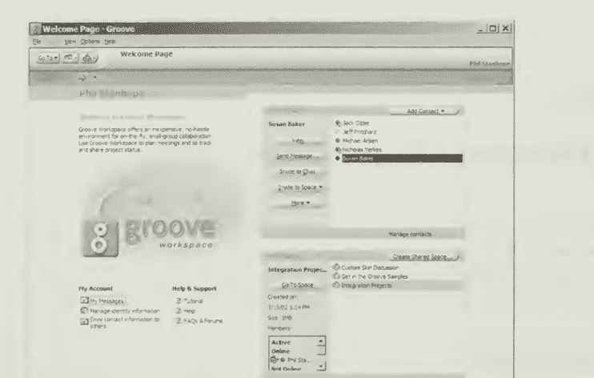

图 1-1：使用 Groove 默认皮肤的 Groove 收发器

图 1-2 显示了使用 Cellular 皮肤的收发器。

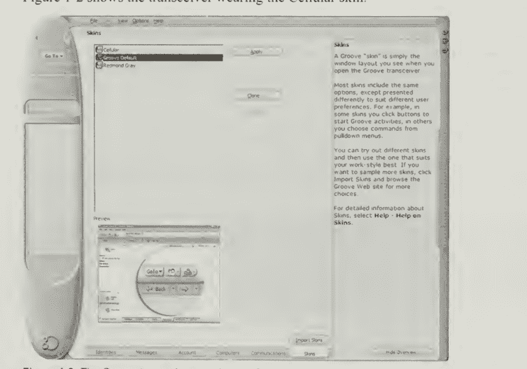

图 1-2：使用 Cellular 皮肤的 Groove 收发器

> **提示** 作为开发人员，我在本地设备上有多个账户。我将每个账户配置为使用不同的皮肤，以便能够快速（通过视觉）确定我正在使用哪个账户。

## 工具

任何熟悉 Web 浏览器的人都应该能很快上手 Groove 。与任何 Web 浏览器一样，Groove 的默认皮肤提供了基本的前进、后退和历史记录按钮。这里与传统 Web 浏览的不同之处在于，这种导航是在收发器提供的工具、共享空间和账户级工具之间进行的，而不是在网站之间。

例如，在共享空间内，用户可以使用 Web 浏览器工具，该工具具有自己的本地导航按钮和历史记录，其行为与传统的 Web 浏览器相同。

导航栏如图 1-3 所示，在 Groove 默认皮肤中始终可用。（其他皮肤可能有不同的配置，因此会在不同位置显示工具。）

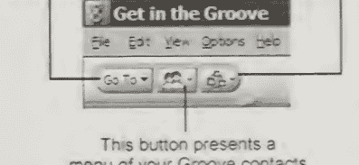

### "转到"、联系人和工作区按钮

单击"转到"按钮会显示一个菜单（见图 1-4），其中包含访问主页、我的空间、我的联系人等项目的选项。联系人按钮（显示两个人的图标）提供对"我的联系人"和本人 vCard 的快速访问。工作区按钮提供一个菜单，用于导航到"我的空间"工具以及用户所属的任何其他共享空间。

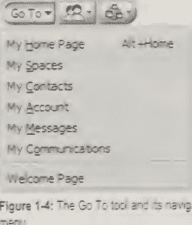

### "我的空间"工具

"我的空间"工具如图 1-5 所示，使用户能够创建和管理他们的共享空间。主页上"我的空间"的精简版使用户能够选择共享空间、查看共享空间成员列表及其状态，并进入该共享空间。此外，用户可以创建新的共享空间或启动"我的空间"工具。对于删除、重命名或复制空间等更多功能，用户必须进入"我的空间"工具。

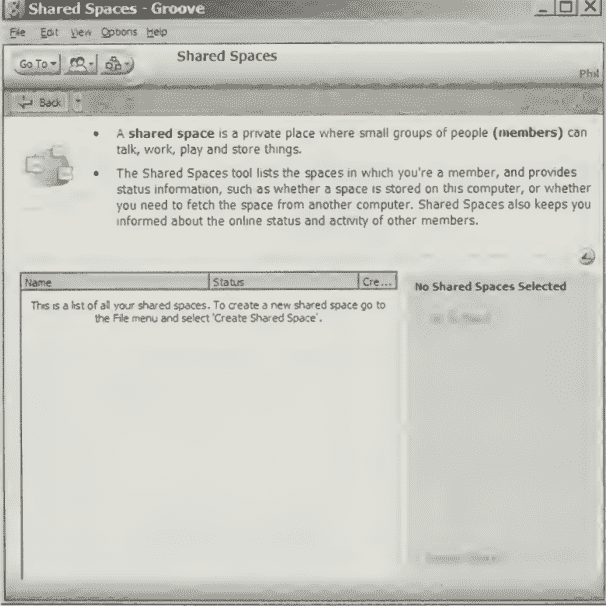

图 1-5："我的空间"工具

### 托盘图标和通知器

图 1-6 显示了托盘图标和通知器。默认情况下，Groove 在系统托盘中（Windows 任务栏的右侧）显示一个 Groove 图标。单击该图标会显示一个菜单，使用户能够完成以下任务：

- **打开收发器**：打开收发器。拥有多个账户的用户可以选择打开哪个账户的收发器。


> 交叉引用：账户和其他 Groove 专用术语在术语表（附录 C）中定义。

- **New Chat（新建聊天）：**显示即时聊天工具。
- **Send Message（发送消息）：**显示即时通讯器。
- **My Account（我的账户）：**访问“我的账户”工具。
- **New Account（新建账户）：**创建一个新的、唯一的账户。（每台设备可以有多个账户。）
- **Suppress Notifications（屏蔽通知）：**禁用通知器。
- **Work Offline（离线工作）：**让你在本地工作，不在线，且不产生增量数据。
- **Shut Down Groove（关闭 Groove）：**关闭 Groove 收发器和后台进程。

> 交叉引用：增量数据在第 2 章中讨论。

通知器让用户能够直观地跟踪即时消息和共享空间邀请的状态和进度。此外，Groove 工具可以向通知器发布消息。例如，假设你正在编写一个能够从企业数据仓库检索自定义报告的工具，但该报告的生成和检索需要 30 分钟。你可以使用通知器告知用户操作已完成。在此期间，用户可以执行其他任务。当用户点击特定的通知器消息时，他将自动导航回该工具。

用户在通知器中点击通知后会发生什么，取决于具体的消息类型。例如，即时消息的发送者可以单击消息将其关闭，或右键单击以停止跟踪该消息。即时消息的接收者可以点击通知器来启动即时通讯工具。

通知器提供消息状态的指示，包括递送状态、消息是否已打开，以及显示“完成百分比”的进度指示器。

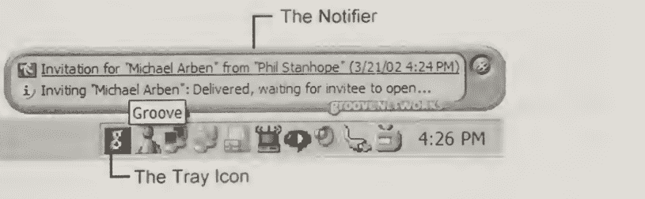

### “我的账户”工具

“我的账户”工具（图 1-7）让用户能够管理其账户配置的关键方面。“我的账户”工具使用标签页界面，包含多个子工具，每个子工具位于其自身的标签页上。“我的账户”工具提供的工具如下：

- **Identities（身份）：**创建、删除、编辑、分发和导出用户身份，并选择 Groove.Net 和本地目录列表设置。
- **Messages（消息）：**管理发送给他人和从他人接收的即时消息。
- **Account（账户）：**在多台电脑上使用、更改密码、备份账户以及执行其他管理任务。
- **Computers（计算机）：**管理账户的计算机。
- **Communications（通信）：**离线工作、跟踪数据同步状态以及管理其他相关通信功能。
- **Skins（皮肤）：**更改皮肤并下载新皮肤。

> **交叉引用** 第 5 章将介绍如何构建标签页工具。

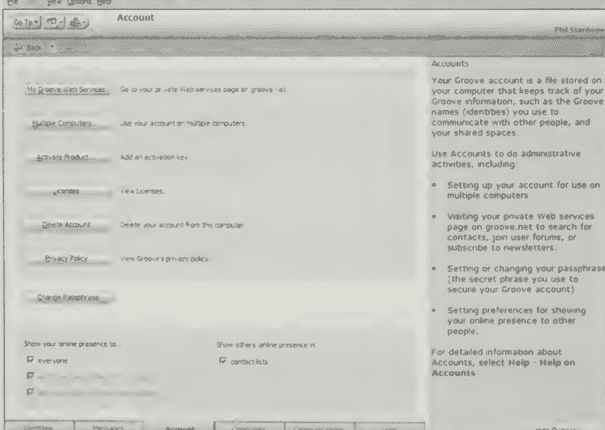

以下各节将进一步详细讨论这些项目。

### 管理身份

*身份*是 Groove 用户相互识别时使用的名称。它是在共享空间和联系人列表中显示的、Groove 用户发送即时消息时看到的名称。

在安装 Groove 期间，系统会提示用户创建账户。默认情况下，一个账户有一个身份，但可以有多个身份。身份是一组对应于用户一个人格的数据。这些数据包括 Groove 身份统一资源定位符（URL）、vCard 和安全信息。身份说明了是谁在进行交互。全局唯一的计算机生成的身份 URL 指定了一个身份。用户的*账户*包含该用户的身份集合——以及关于用户联系人的信息，以及此账户所属的共享空间列表。

最初，默认身份是账户名称，但借助“身份”工具，用户可以使任何身份成为账户的默认身份。

如我前面所述，用户可以为*同一个*账户拥有多个身份。例如，Kathy 在使用 Groove 进行业务活动时可能是“Kathleen Doe”，而与亲友交谈时则是“KathyD”。额外的身份名称可以是用户选择的任何名称。

用户可以在目录中列出他们的身份，以便其他人更轻松地找到他们，或者他们可以使用电子邮件程序将其身份信息发送给特定的人。Groove 会自动将用户的身份信息分发给他们加入的共享空间的成员，而他们也会收到其他成员的身份信息。

### 管理消息

默认情况下，Groove 收发器跟踪用户发送和接收的即时消息，并自动将它们存储在“我的账户 ⇨ 我的消息”工具中。用户可以使用“我的消息”工具查看和删除这些消息。

### 管理账户

使用“我的账户”工具的“账户”标签页，你可以执行管理活动，包括：

- 设置你的账户以在多台电脑上使用
- 访问你在 Groove.Net 上的私人 Web 服务页面，以搜索联系人、加入用户论坛或订阅新闻通讯
- 设置或更改你的密码短语（用于保护 Groove 账户的保密短语）
- 设置向其他人显示你的在线状态的偏好

### 检查你的数字指纹

每个身份都有其自己唯一的一组安全凭据。每个账户都有一个全局唯一标识符（GUID），在 Groove 中称为*数字指纹*。数字指纹是一个 49 字节的字符串。

要查看某个身份的数字指纹，请前往“身份”工具，在复选框中选择该身份以显示其 vCard，然后点击 vCard 中显示“数字指纹”的位置。将出现一个消息框（见图 1-8）。消息框中的字符串就是数字指纹。其他人几乎不可能拥有这个数字指纹，因此，你可以在编程时使用数字指纹来唯一标识用户。在我向你展示如何基于身份构建自定义工作流时，你会在后续章节中逐渐依赖这种唯一性。


### 管理多台计算机

Groove 为用户提供了一种机制，可以将他们的账户保存下来供多台计算机使用。“我的账户 ⇨ 账户”工具提供了此功能。用户可以将账户保存到本地文件，或通过互联网保存到 Groove.Net 托管的“我的 Groove Web 服务”。

> **注意** 将账户保存到 Groove.Net 是所有用户都可以使用的服务。

两者都做是个好主意。作为开发人员，你会发现，在对个人信息进行重大更改时（添加、删除或更改身份）、添加新联系人或删除旧联系人，或创建/删除多个共享空间时，备份账户是个好主意。

保存 Groove 账户会保存关于联系人信息的完整信息，因此联系人越多，账户文件就越大。但是请注意，Groove 账户文件*不会*保存特定共享空间中工具创建的所有数据。导出的账户文件确实包含有关共享空间的摘要信息，并提供从保存账户的原始设备“获取”共享空间的能力。

### 管理通信

“我的账户”工具的“通信”标签页让用户能够管理 Groove 传输和接收数据的方式。数据计数器持续显示 Groove 当前正在处理的数据量（如果有的话）。

用户可以在“活动”表中查看其共享空间、消息和邀请的活动。“状态”列报告共享空间正在传输或接收数据、空闲、暂停，还是存在同步问题。点击“暂停”可停止所选共享空间的数据传输，点击“恢复”可重新开始数据传输。

> 如果数据计数器显示有大量数据需要处理，用户可能会暂停共享空间的传输，以避免此时减慢其通信通道。

### “我的联系人”工具

首先，与用户通信的其他人称为*联系人*。联系人只是对另一个 Groove 身份的本地引用。“我的联系人”工具用于管理联系人。

#### 将联系人添加到“我的联系人”工具

有多种方法可以将联系人添加到你的账户。一个好的起点是搜索本地网络目录（如果你在局域网中）或 Groove.Net 公共目录。用户可以通过“我的联系人”工具以各种方式完成此任务。点击“添加联系人”按钮并从菜单中选择“Groove 联系人”，将弹出一个“添加联系人”对话框（见图 1-9）。

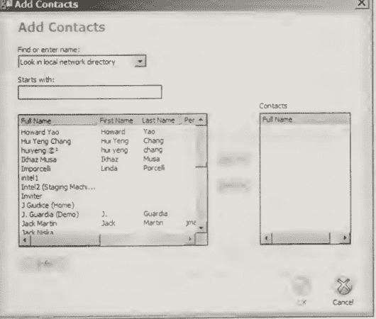

图 1-9：添加联系人


### 使用 Groove 进行通信

Groove 提供了多种通信与协作机制。如果你曾使用过电子邮件，那么你对许多人眼中的最低公共标准——SMTP/POP 电子邮件——应该并不陌生。许多网站还提供基于 HTTP 的电子邮件服务（例如 Hotmail），用户只能在该网站的特定环境中访问这些服务。此外，AOL、Yahoo!、ICQ 和 MSN 等服务还提供即时通讯功能。

即时通讯是一种比 SMTP/POP/MAPI/X400 邮件协议更轻量的协议，因为你通常只能发送短消息——这些消息由中央服务进行转发。从概念上讲，Groove 的即时通讯与 AOL 和 MSN 的即时通讯类似，但实际上它更接近于存储转发式电子邮件系统。在 Groove 中，存储和转发操作可以在本地或 Groove 中继服务器上完成。

鉴于 Groove 的对等架构，如果两个用户均在线且可用，通信流量甚至不会经过中继服务器，这与 AOL 和 MSN 不同——后者的流量始终通过中央服务器。另一个特点是，Groove 保证其即时消息的送达，而 AOL 和 MSN 仅在双方在线且活跃时才投递即时消息。例如，如果对方在你输入消息时离线，消息就会直接丢失。

即时消息通常也比 SMTP 更轻量，因为中央服务不会对其进行分类、存档和转发。在 Groove 的未来版本中，可以期待更完善的消息管理功能。

与所有技术一样，当前的电子邮件和即时通讯系统各有优缺点。其中一些问题并非技术性质，而是政治或法律层面的。例如，AOL 曾提起诉讼，阻止微软让 MSN Messenger 用户向 AOL/AIM 用户发送即时消息。

#### 目录列表与在线状态

用户在目录中列出自己信息的方式，与他们向对等方发布自己的存在和状态信息之间存在细微差别。

用户的目录列表在"我的账户"工具的"身份"选项卡中进行控制。通过该工具，用户可以控制自己如何向本地或全局目录服务发布身份信息。

用户可以使用"我的账户 ➩ 身份"工具，阻止自己在本地目录和/或 Groove.Net 目录中被列出。创建账户时，有一个复选框（默认已勾选）控制信息如何发布给其他人。

已创建账户的用户可以使用"我的账户"工具中的"身份"选项卡，更改其在本地或 Groove.Net 目录中的身份显示方式。

> 提示 在为开发目的创建账户时，请务必取消勾选"在 Groove.Net 公共目录中列出我的姓名"。

#### 发送和接收即时消息

用户在获得另一位 Groove 用户的联系信息后，就可以发送即时消息、共享空间邀请和聊天。即时消息（见图 1-11）与电子邮件最为相似，因为它是从一个发送方发送给一个或多个接收方的独立消息。此外，用户可以在 Groove 即时消息中添加附件和 URL，就像在电子邮件中附加文件一样。即时消息与电子邮件的不同之处在于，它不包含抄送（cc: 或 bcc:）功能，而且最重要的是，其投递机制提供了电子邮件中不可用或难以使用的安全功能。

#### 使用即时聊天

用户与一个或多个联系人协作的另一种方式是通过*即时聊天*（Instant Chat），这是一个用于创建即时聊天空间的专用工具（见图 1-12）。Groove 为用户提供了多种方式与另一位联系人发起即时聊天。最简单的方式是右键单击联系人（在共享空间内、主页上或"我的联系人"中），然后从弹出菜单中选择"邀请聊天..."。

> 注意 对于拥有多个身份的用户，每次在共享空间外发起即时聊天时，Groove 都会询问他们希望使用哪个身份。

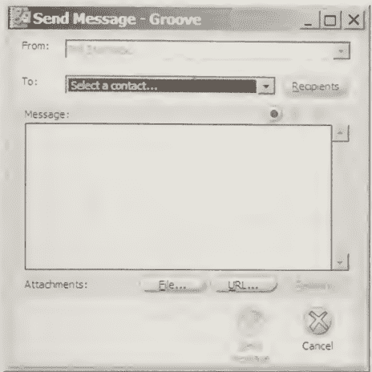

图 1-11：即时消息工具

即时聊天工具提供了富文本聊天输入字段和富文本记录字段。富文本功能使用户能够应用粗体、斜体、更改字体、检测（即激活）URL 以及其他格式设置。即时聊天工具还支持撤销、重做和清除聊天记录。该聊天工具没有提供保存聊天记录的用户界面。

要使用即时聊天工具，用户需单击输入窗格（下方的窗格）并输入内容。按下 Enter 键后，输入窗格的内容将被追加到日志中，格式如下：

```
Test Thu April 18, 2002 8:58AM
Hey there!
```

用户提交聊天内容的另一种方式是单击"发送"按钮，这当然需要将手从键盘上移开。"选项"按钮和右键单击会显示一个上下文菜单，其中包含使用即时聊天工具时可执行的操作（见图 1-12）。

注意图 1-12 中右下角名为"另存为空间"的按钮。单击该按钮会显示一个对话框，允许用户从即时聊天创建共享空间。

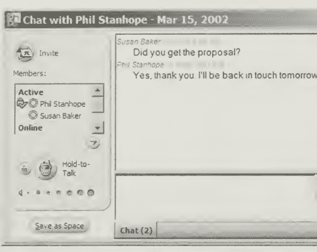

图 1-12：即时聊天工具

##### 聊天与消息

电子邮件用户非常常见的一种行为是使用电子邮件"链"进行讨论。多年来，电子邮件程序一直管理这些"链"或"线程"，并显示消息、回复、回复之回复等的历史记录。

电子邮件链在仅仅几次回复后就会变得难以控制，许多人认为在回复全部中包含整个之前的线程是违反网络礼仪的行为。这样做会不必要地占用电子邮件投递链中各环节的存储空间，但更现实的是，大多数人只回应最新的评论——或者根本不回应，视情况而定。

聊天是支持这种通信类型的更简单方式。在 Groove 中，聊天与即时消息并不相同——例如，聊天不提供附加文件的功能。尽管如此，聊天和即时消息依赖于相同的基础架构——即唯一标识和对等方之间定向消息传递的能力。

Groove 中即时消息与聊天的另一个区别是，即时聊天工具支持富文本编辑，使用户能够执行更改字体、应用字符格式（如**粗体**和*斜体*）以及高亮（激活）URL 等操作。而 Groove 的即时消息工具仅支持纯文本，不支持 URL 检测。

### 小结

本章概述了 Groove 客户端应用程序的关键 UI 特性，具体如下：

-   收发器


- 默认导航工具
- “我的账户”工具
- 身份
- “我的联系人”工具
- 即时通讯工具
- 即时聊天工具

仅在这个层面上，你就可以将 Groove 用作一款“更好的”浏览器——我发现自己现在经常使用 Groove 来进行大部分传统的网上冲浪。浏览器与聊天记录的结合极为强大。我可以邀请一位朋友进入浏览空间，并分享我的搜索历史、搜索位置等信息，这是启动协作设计流程的一种有力方式。

下一章概述了创建和使用共享空间的关键方面，以及 Groove 工具架构的概览——因为架构和工具正是你添加到共享空间中，使 Groove 成为推动 x-engineering 的强大平台的核心要素。

## 第2章

### 理解共享空间和工具

第1章简要概述了 Groove 的以下关键组件：

- 收发器
- 默认导航工具
- “我的账户”工具
- 身份
- “我的联系人”工具
- 即时通讯和聊天

现在，我将深入探讨 Groove 共享空间的强大功能，并略微涉及 Groove 工具架构的细节。本书的其余部分将介绍 Groove 开发工具包（GDK）和平台 API 的使用，并提供一系列创建 Groove 工具的“配方”，以便在共享空间的其他成员之间共享。

#### 理解共享空间

在 Groove 中，*共享空间*是用户作为“成员”进行互动和协作的私人“虚拟场所”。共享空间包含一个或多个工具，负责传达与共享空间中当前使用的每个工具的状态相对应的数据变化。

例如，Groove 开发团队可能有一个名为“Groove 开发团队共享空间”的共享空间，配备了支持新工具发布的工具——该共享空间可能包含用于跟踪关键日期的日历工具、用于成员相互支持的讨论工具，以及用于共享开发中工具版本的文件工具。再举一个例子，一个家庭可能有一个名为“史密斯家庭共享空间”的共享空间，其中可能包含支持家庭沟通的工具——例如用于跟踪生日和学校活动的日历工具、用于分享最新家庭照片的图库工具，以及用于分享食谱的讨论工具。

通过共享空间，一个或多个对等方（成员）现在拥有了协作的上下文。在成员创建共享空间后，成员在该空间中使用的工具决定了随后的人际协作性质。

共享空间的持久化版本是一个 XML（eXtensible Markup Language）文档数据库。每台用户的计算机都存储该数据库的相同副本，Groove 不断更新所有副本，使它们始终定义共享空间的当前状态：该数据库中的 XML 文档记录了共享空间每个用户的在线状态、哪些用户处于活跃状态、他们正在使用的工具，以及共享空间所有数据的当前状态。

创建共享空间非常简单。图 2-1 显示了创建空间向导的第一个界面，该界面可直接从主页访问（见第1章），或在任何标准 Groove  skins 中通过选择菜单栏中的“文件”→“创建共享空间”来访问。

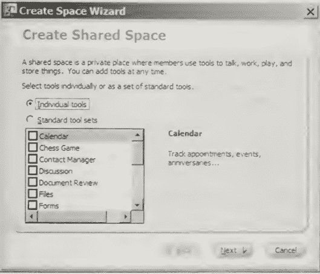

**图 2-1：** 创建空间向导的步骤 1

> **交叉参考** 在第9章中，我将展示如何通过点击网页上的链接来创建共享空间邀请文件。

#### 理解模板、工具和工具集

创建共享空间最重要的一步是确定共享空间用户完成工作所需的工具。

*工具*是共享空间用户使用的“程序”或共享应用程序。共享空间的每个成员都可以访问相同的工具——因为它们存在于“虚拟场所”中——并可以使用它们来操作共享空间的数据。工具的例子包括支持聊天、素描和国际象棋的功能。

*模板*是一个静态的持久化 XML 文档，代表一个工具或一组工具——即*工具集*。（Groove 还使用不同形式的模板来描述 skin 以及所有共享空间的默认角色和权限。）当用户向共享空间添加某个工具的实例时，共享空间会获取该类型工具的模板，并实例化一个版本的工具。

*工具集*是 Groove 成员用于某种目的的逻辑工具分组。工具集的主要目的是让团队能够在单个共享空间的上下文中处理项目的多个方面。换句话说，共享空间的成员可以在同一个共享空间中执行不同的任务，而无需为每个离散任务创建新的共享空间。例如，Groove 提供了一个“项目”工具集，包含讨论、文件、大纲、联系人和日历工具。通过将项目工具集添加到共享空间，你会获得一组包含在各自标签页中的工具，而不必手动添加每个单独的工具。

Groove 附带了许多默认工具和工具集。每当用户在 Groove 中创建新的共享空间时，他们可以使用其中一个默认工具集创建，也可以使用他们添加到其 Groove 版本中的自定义工具来创建。以下列表描述了用户使用 Groove 的默认工具和工具集可以执行的操作：

- **共同浏览网页：** 共享空间的成员可以使用 Groove 的网页浏览器工具独立或集体访问网站，分享收藏夹和书签，同时在使用聊天和语音工具讨论和/或操作他们正在查看的内容时进行这些操作。
- **创建你自己的自定义空间：** 从适合你的各种广泛工具中进行选择。
- **组织和Conduct更高效的会议：** 在会议前、会议期间和会议后分享内容。
- **策划活动：** 与他人一起组织活动。
- **启动对话空间：** 使用语音或文字聊天进行沟通；创建素描，并共同浏览网页。
- **启动讨论论坛：** 在私人论坛中发布主题和回复。
- **启动文件集合：** 共享文件、文档、图片和网页链接。
- **启动项目工作区：** 就工作、学校或家庭项目进行协作。

显然，这些任务都是同一主题的不同变体。作为开发人员，你可以为特定目的创建预打包的工具集。或者，你也可以通过编程方式动态创建工具集。第9章将展示如何基于网站表单中的选择来创建工具集。

#### 在共享空间中工作

共享空间用户是与共享空间其他用户进行交互的实体。从技术上讲，这可以是一个人、一台计算机或任何能够与其他参与者交互的实体。用户通过设备（通常是台式计算机）进行交互，就像仅语音协作通常通过电话进行一样。

如果你在 Groove 中创建一个共享空间，你就成为了初始用户。图 2-2 显示了一个新创建的、只有一名成员的空间。在共享空间的上下文中，共享空间的成员是指创建共享空间或接收并接受加入共享空间邀请的账户身份。

> 交叉参考 有关账户和身份的信息，请参见第1章。

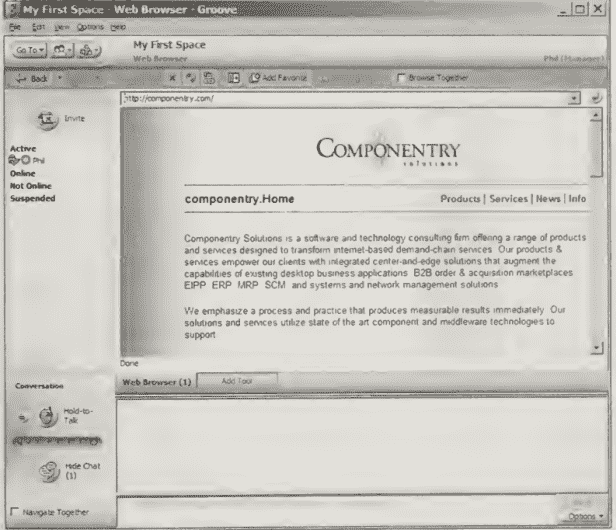

**图 2-2：** 一个刚创建的、只有一名成员的共享空间

##### 使用成员工具

进入共享空间后，你可以访问许多默认工具。

##### “邀请”按钮

你使用“邀请”按钮来邀请新成员加入共享空间。点击该按钮会使 Groove 发送一种特殊的即时消息。你可以将该消息发送给任何

收件人可以是“我的联系人”工具中的联系人、任何已知的 Groove 联系人、本地网络目录中可用的 Groove 用户，或 Groove.Net 目录中的联系人。

##### 成员状态工具

每个共享空间都包含一个成员状态工具。在图 2-2 中，成员状态工具位于收发器窗口的最左侧，显示共享空间成员的状态。成员状态工具在共享空间成员名称旁显示以下三种图标之一：

- **绿色圆形：**该用户在线，但未使用或当前未参与此共享空间。
- **黄色圆形：**该用户在线，且当前正在使用共享空间。
- **灰色方形：**该用户处于离线状态，或已配置账户不公布其在线状态。（有关此功能的更多信息，请参阅第 1 章。）

除这三种基本状态外，小时钟图标的存在表示附加状态。此图标仅在成员在线但处于闲置状态时出现——即该成员在过去十分钟内未在 Groove 中执行任何活动。

##### 成员上下文菜单

您还可以针对特定成员执行多项命令。例如，通过在成员状态工具中右键单击共享空间成员，可以执行多项特定于上下文的操作（参见图 2-3），如下：

- 查看成员的名片（vCard）
- 向该成员发送即时消息
- 与该成员发起即时聊天
- 更改成员的角色（如果您具有适当的权限）
- 取消邀请该成员（假设您具有适当的权限）
- 复制成员的联系人
- 将该成员添加到您的“我的联系人”列表

### 理解共享空间中的角色和权限

Groove 的预览版（本书附赠 CD-ROM 上的版本）不支持在共享空间中分配和管理角色——空间的所有成员都是具有同等能力的对等方，可以添加或删除工具。在 Groove 的许可版本中，共享空间中有三种主要角色：*管理者（manager）*、*参与者（participant）* 和 *访客（guest）*。以下列表描述了这些角色：

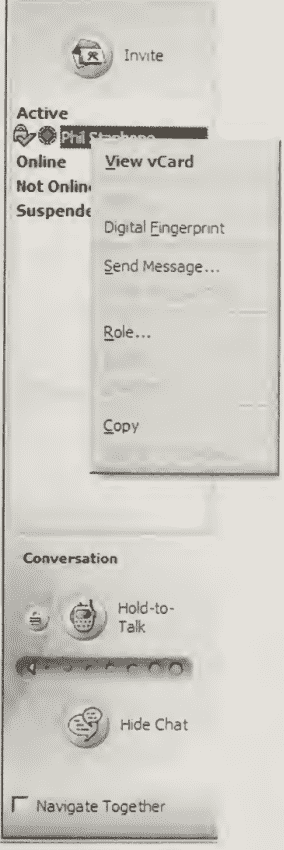

**图 2-3：** 成员状态工具的上下文菜单

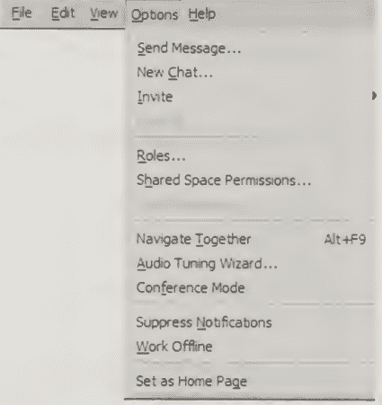

**图 2-4：** 共享空间选项

- **管理者：**默认情况下，创建共享空间的身份即为该空间的管理者。其他成员也可以获得管理者角色。管理者主要负责为其他成员分配角色。

# 24 第一部分：Groove 基础

- **参与者：**默认情况下，由管理者邀请加入共享空间的各方为参与者。然而，管理者可以在邀请新成员时分配不同的角色，也可以为现有共享空间成员分配新角色。

- **访客：**访客的权限最受限制。例如，如果管理者或参与者以访客角色邀请另一位 Groove 用户进入共享空间，默认情况下该用户无法邀请其他用户。

如前所述，共享空间的管理者具有更改分配成员角色的能力（权限）。此功能可通过“选项”菜单使用（参见图 2-4）。

管理者通过右键单击成员名称并从出现的上下文菜单中选择“角色”来更改成员的角色。

要更改特定角色的权限，管理者右键单击成员名称并从上下文菜单中选择“权限”。或者，管理者可以从菜单栏中选择“选项” -> “共享空间权限”。（除管理者外的任何人会发现此项被禁用。）图 2-5 显示了管理者的权限。

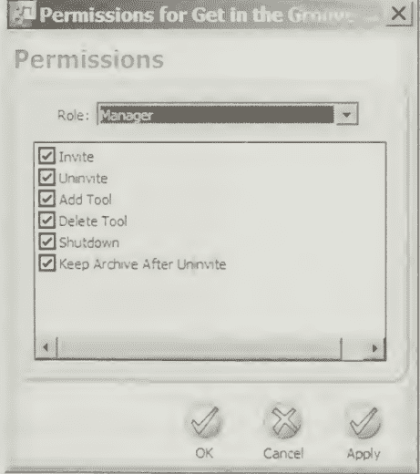

# 图 2-5：管理者的权限

除与谁可以邀请或取消邀请谁相关的共享空间级别权限外，某些工具还支持分配特定于工具的权限。例如，“文件”工具支持额外的权限，如用户是否可以添加、修改或删除他人添加到工具中的文件。“讨论”工具的额外工具级别权限包括能否编辑讨论条目，或用户是否根本看不到讨论条目。

> **交叉引用** 在第 8 章中，我将向您展示如何构建一个创建自定义角色和权限的工具。

#### 默认管理者权限

默认情况下，管理者有权控制以下内容：

- **邀请：**用户是否可以邀请其他成员加入共享空间
- **取消邀请：**用户是否可以从共享空间中取消邀请成员
- **添加：**用户是否可以向共享空间添加工具
- **删除：**用户是否可以从共享空间删除工具

管理者为何想要更改这些默认权限，取决于共享空间的背景。设想一个旨在支持特定业务流程（如销售自动化）的共享空间。共享空间的初始管理者可以用适当的工具填充共享空间，用适当的客户信息初始化这些工具，然后修改管理者角色的权限，使其无法删除这些工具或在邀请其他用户作为管理者加入共享空间之前添加任何其他工具。

#### 默认参与者权限

在“权限”对话框中，管理者可以选择要为其设置权限的角色。默认情况下，共享空间中的参与者有权控制以下内容：

- **邀请：**用户是否可以邀请新成员加入共享空间
- **添加：**用户是否可以向共享空间添加工具

#### 默认访客权限

访客没有邀请或取消邀请成员或添加、删除工具的能力。

### 使用即时聊天工具

在第 1 章（图 1-12 中），我为您展示了即时聊天工具。图 2-6 显示了即时聊天工具在共享空间中的样子。在共享空间中聊天特别有助于讨论工具中的条目或主题。例如，您可以使用图片工具作为“官方”企业营销幻灯片的存储库。在准备新的业务发展机会时，您可以添加第二个图片工具，代表最终要向客户展示的幻灯片，并与共享空间的其他成员聊天，以就用哪些幻灯片达成一致。

# 26 第一部分：Groove 基础

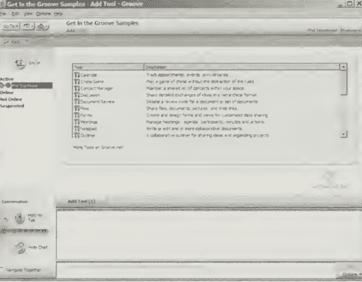

图 2-6：即时聊天工具

要切换共享空间中即时聊天工具的可见性，请单击收发器中的“聊天”按钮。即时聊天工具包含以下四个组件（在图 2-7 中高亮显示）：

- 输入窗格
- 隐藏/显示聊天按钮
- 显示或日志窗格
- 拆分条

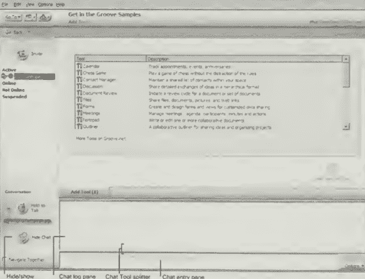

图 2-7：聊天工具布局

#### 即时聊天输入窗格

即时聊天输入窗格是您和您的通信对象键入新聊天条目的地方。聊天输入窗格是一个富文本编辑器。因此，它使您能够应用基本文本格式，如**粗体**、*斜体*、<u>下划线</u>、~~删除线~~、对齐、字体大小和字体样式。通过单击“选项”按钮或右键单击聊天输入窗格来访问这些功能。图 2-8 显示了富文本编辑器的上下文菜单。您的即时聊天窗格还会指示某人何时正在键入条目，以及哪些成员的即时聊天窗格已打开。后一功能有助于避免您在一直键入“Joe，你在吗？”时，却没有意识到 Joe 看不到聊天的情况。

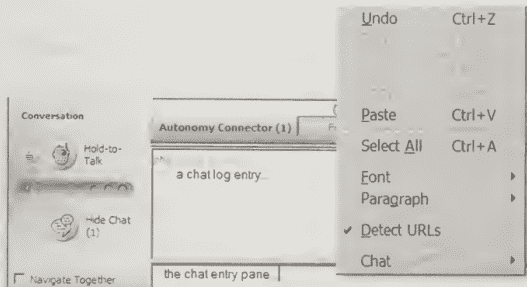

**图 2-8：** 聊天输入窗格上下文菜单

要将聊天条目发送给其他成员，用户按 Enter 键或单击“发送”按钮。

在 Groove 平台中，即时聊天输入窗格是一个使用特殊滤镜使其行为与聊天工具相同的 `IGrooveTextView` 对象。另外两个重用相同底层平台对象的工具示例是记事本和讨论工具。在记事本工具中，与即时聊天工具不同，按 Enter 键会在文本中插入换行符。在编辑特定讨论条目时，您在讨论工具中实现相同的行为。

> **交叉引用** 在第 5 章中，我将向您展示如何构建一个使用 `IGrooveTextView` 对象将自定义帮助集成到工具中的工具。

要在即时聊天窗格中输入制表符和换行符（硬回车），请分别按 Ctrl+Tab 和 Ctrl+Enter。

#### 即时聊天日志窗格

即时聊天日志窗格是共享空间所有成员的所有聊天条目记录出现的地方。Groove 统一按以下格式设置条目：

 > test: 2/22/02 10:57 AM
> This is a very cool tool

每条记录的第一行标识了共享空间中哪个成员创建了该记录（在示例中为 test）以及该成员创建记录的时间。剩余的一行或多行包含该成员创建的聊天记录的完整内容。

> **注意** 即时聊天记录和日志窗格的一个实用功能是它们能够检测并将URL变为"活动"链接。单击此类链接会使Groove启动默认的Web浏览器并显示该网站。

亲信遗憾

#### 发送和选项按钮

每当即时聊天输入窗格中有内容时，发送按钮就会变为可用状态。即时聊天输入窗格中的选项按钮会显示一个上下文菜单，与你在输入窗格中右键单击时看到的相同。

#### 在新窗口中打开命令

收发器"视图"菜单中的"在新窗口中打开"命令（视图 ⇒ 在新窗口中打开...），会将聊天工具启动到其独立的窗口中（见图2-9）。即时聊天工具在其自己的窗口中运行后，你甚至可以关闭收发器，继续与共享空间中的其他成员聊天。

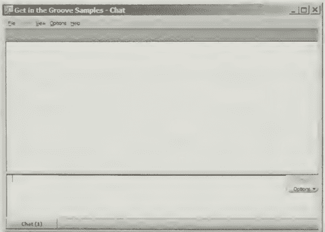

图2-9：独立窗口中的聊天

除了让你在开放的共享空间环境中使用聊天工具外，如果你希望在收发器不占用大部分电脑屏幕的情况下继续聊天，并且你和聊天中的其他成员不需要查看共享空间中的其他工具，这种方法也很有用。然后你可以调整聊天窗口的大小，在聊天的同时使用其他应用程序，等等。

> **注意** 在聊天显示在其自己的窗口中后，你可以最小化甚至关闭收发器。

#### 即时聊天分割条

即时聊天分割条（图2-7中输入窗格上方的一条水平条）使你能够根据自己的喜好调整聊天窗格的大小，就像在Windows资源管理器中一样。当然，更改你的聊天窗格并不会改变其他成员视图中共享空间的显示。

### 使用Talk工具

Talk工具使你能够与共享空间中的其他成员进行实时的互联网语音通话（VoIP）对话（见图2-10）。要利用Groove的VoIP功能，你的计算机当然需要安装并配置麦克风和扬声器。Groove还提供了一个配置麦克风和扬声器的向导，首次使用VoIP功能时会自动打开。（你也可以从选项菜单访问该向导。）


**图2-10：** Talk工具

Talk工具有"锁定"自身的功能，这意味着你也可以在"会议模式"下工作。你可以通过从选项菜单中选择来启用会议模式。

### 使用Navigate Together工具

如果你启用Navigate Together工具，共享空间中同样启用该工具的所有其他成员都可以"相互跟随"。Navigate Together如果与文字聊天、语音聊天以及任何其他工具结合使用，可以使任何成员带另一名成员"游览"共享空间。此功能可用于培训、在线客户服务、远程演示等场景。

### 管理共享空间中的工具

上一节讨论了添加到所有Groove共享空间的工具：聊天、成员、Navigate Together和Talk。除了提供这些工具外，Groove还允许共享空间的成员使用专门构建的协作工具，如讨论、文件和日历工具。

#### 添加工具

图2-2展示了新创建的"自定义空间"如何仅显示可用作库存工具的工具（添加工具）。添加工具工具，顾名思义，使你（取决于你的角色和权限）可以向共享空间添加工具。Groove附带的用于支持协作的默认工具包括日历、讨论、文件共享和会议管理器。预构建的工具集也会出现在添加工具工具的列表中。工具集，正如我在本章前面"了解模板、工具和工具集"一节中所述，只是协同工作的工具的集合。需要注意的一点是，默认工具集除了工具集的名称和在工具集合中的位置外，不提供预先初始化的数据。

在可用工具列表下方会出现一个名为"Groove.Net上的更多工具"的超链接。单击此链接会启动你的Web浏览器，并将其定向到`http://www.groove.net/downloads/tools/index.html`。这个由Groove Networks提供的网页列出了自你安装Groove以来提供的其他工具和/或工具集。Groove还可能在此位置提供指向新可用第三方工具的链接。

#### 删除工具

删除工具和添加工具一样简单。要从共享空间中删除工具，只需右键单击该工具的标签以显示该工具的上下文菜单（见图2-11）。

> **注意** 根据共享空间管理员分配给该角色的角色和任何权限，某人删除工具的能力可能会被禁用。

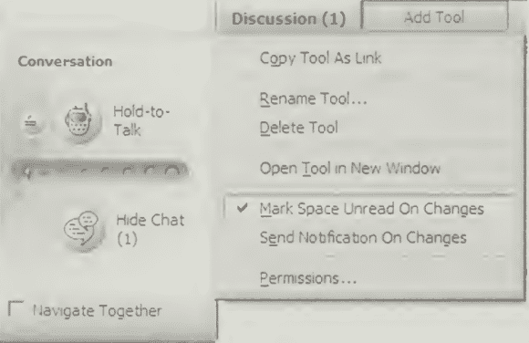

**图2-11：** 工具上下文菜单

默认情况下，上下文菜单中提供以下五个命令：

- **复制工具为链接：** 复制指向此空间、工具和位置的导航链接
- **重命名工具：** 显示一个对话框，使你能够重命名该工具（每个共享空间成员的标签中显示的内容）
- **删除工具：** 从共享空间中删除该工具
- **在新窗口中打开工具：** 启动一个仅包含此工具的新窗口
- **权限：** 如果你使用的是专业版，并且该工具支持权限

##### 复制为链接

支持"复制为链接"命令的工具——例如大纲、日历和讨论工具——使你可以创建指向该工具以及这些工具所在共享空间的超链接。你可以在一个空间中的工具之间或不同空间中的工具之间创建链接，但当然只有这些空间的成员才能跟随这些链接。

要测试此功能，请尝试以下步骤：

1. 创建一个新的共享空间（*Space 1*），并添加大纲和日历工具。
2. 转到日历工具并创建一个日历条目。
3. 右键单击该条目，然后从上下文菜单中选择"复制为链接"。
4. 转到轮廓工具并粘贴日历条目链接。单击该链接，观察到你会被发送到自己的日历条目。
5. 创建一个新的共享空间（*Space 2*）并添加一个讨论工具，如下所示：
   - 创建一个讨论条目并粘贴日历链接。
   - 单击该链接，观察到你会被发送回*Space 1*并到达原始日历条目。导航回*Space 2*。
6. 邀请新成员加入*Space 2*。
7. 开始即时聊天，并要求新成员单击讨论工具中的链接。新成员应该会看到对话框，提示Groove无法执行导航命令。
8. 转到*Space 1*，正式邀请另一位成员加入*Space 1*。
9. 在聊天窗口中，要求新成员返回*Space 2*并单击*Space 2*中讨论工具里的链接。

新成员现在应该能够导航到*Space 1*中的日历条目。

##### 重命名工具

"重命名工具"命令显然使你能够重命名工具。共享空间中的所有成员都能看到该工具的新名称。默认情况下，空间的所有管理员和参与者都可以在共享空间中重命名工具。

### Groove工具架构

Groove工具将可重用组件与工具逻辑结合在一个名为*工具模板*的XML文档中。

#### 视图、增量、引擎和委托

既然你已经熟悉了Groove的UI，我将简要介绍一下Groove的工作原理。

*视图*，通常是用户与工具交互时看到的内容，是一个或多个用户界面*组件*的集合。这些组件通常捕获用户输入，并与底层的*引擎*组件协同工作。视图呈现工具的用户界面，并查询工具引擎以获取数据。

*增量*是一个逻辑容器，包含引擎组件创建的一个或多个命令。增量指示工具中发生了某些变化，并且隐含地，共享空间中也发生了变化。增量通常对应于用户界面的变化单位（如击键），并且是"可撤销"的变化单位。增量是本地的（你在自己的设备上创建它）或外部的。

*引擎*负责管理非UI组件的数据模型。引擎代表工具的粘合创建并执行增量，并对接收自共享空间成员工具的增量做出响应。引擎向工具同步和异步地提供增量。某些引擎组件与特定的UI组件绑定：例如，你在第5章中广泛使用的`IGrooveDataViewer`组件为`IGrooveRecordSet`引擎提供传统的记录集视图。

控制代码，在示例工具中通常称为*表单委托*，使引擎、视图和工具的其他部分能够作为模板组合在一起，并作为工具发挥作用——赋予工具其个性、行为和功能。

> **问** 工具可以有多个引擎吗？
>
> **答** 可以。在第6章中，我将展示创建具有多个引擎的工具的强大功能。

> **问** 工具必须有引擎吗？
>
> **答** 不必。

每个共享空间成员，通过共享空间中工具内的引擎，向所有其他成员发送与其所做更改相对应的增量。Groove记录并作为增量发送的数据类型示例包括：聊天记录、在Sketchpad工具中绘制的线条，以及向共享空间添加工具。Groove对增量进行序列化以便


 以 XML 元素的形式进行存储和传输，并将其安全地传递给共享空间的所有成员。

#### 与引擎协作

作为开发者，你在决定引擎活动何时以及如何发生方面拥有巨大的控制权。你在定义引擎时使用的关键词是*异步*。由于增量（deltas）是异步的，你需要通过事件来处理它们。

如果你曾经用 Visual Basic 编程、实现过 COM 或 ActiveX 对象，或编写过 J2EE 应用程序（仅举几例），那你就已经写过基于事件的代码了，而且你在 Groove 中肯定会感到如鱼得水。在几乎所有情况下，你实际上都不会直接操作增量；相反，你操作的是属性和记录集——这些增量抽象单元使得构建和自动编组 Groove 平台的通信、安全和传输服务的能力变得简单。

> **Q** 但如果我不希望工具"发布"我的更改呢？例如，我可以构建一个工具，它不会在不同工具之间持久化更改——只在本地设备上保存吗？
>
> **A** 答案当然是可以。实际上，你是在问是否可以构建一个更像 Visual Basic 应用程序的应用程序——但运行在 Groove 共享空间的上下文中。

所展示的问题引出了另一个问题：为什么你想把这个工具放在一个有其他成员的共享空间中呢？同样，可能性是无限的。而且别忘了，你总可以访问一个只包含一个成员——你自己——的共享空间！

> **TIP** 作为开发者，你大部分时间都是独自一人在共享空间中——这是开发过程的本质。此外，我把 Groove 用作存储库——我在共享空间中保存数据，并在多个设备上使用我的账户。通过这种方式，我确保了关键数据的备份和恢复。

> **Q** 一个工具可以有多个视图吗？
>
> **A** 当然。

如第 1 章所示，"我的账户"工具就是一个具有多个视图的工具——一个用于身份，一个用于消息，另一个用于皮肤，还有一个用于账户。这些视图会随着用户点击不同的选项卡而以编程方式更改首选项。不仅视图会改变，"我的账户"工具还会更改与每个工具相关联的概览。

> **Q** 增量需要与视图相关联吗？
>
> **A** 这里的答案是不需要。

# 34 第一部分：Groove 基础

这里采用的是模型-视图-控制器设计范式。不过在 Groove 中，该范式更接近于模型-*引擎*-视图-控制器（见图 2-12）。

#### 传统

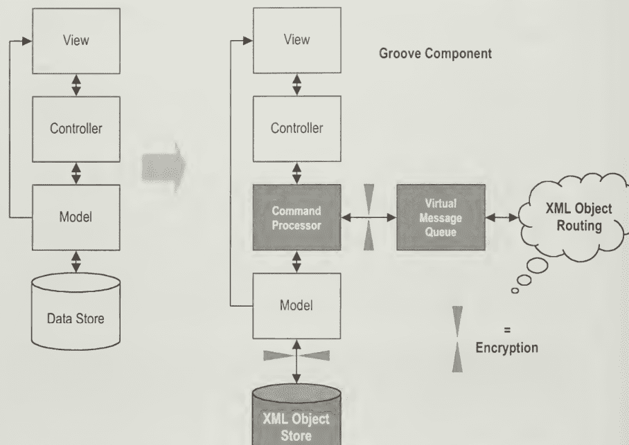

Groove 组件

XML 对象路由

加密

# 图 2-12：模型-引擎-视图-控制器范式

作为开发者，你可以决定如何以及何时将增量以可视化的方式呈现出来，如果需要的话。例如，在第 10 章中，我将向你展示如何构建一个具有两种不同角色的工具：管理者和代理。在这个场景中，代理和管理者都可以发起工作，而且 `IGrooveRecordSet` 引擎会保证将数据更改传递到共享空间其他成员的 Groove 实例中的工具的其他实例。但是，工具的每个实例在异步接收到特定增量后（例如，当 `OnRecordSetChange` 事件发生时）做什么，取决于该成员在共享空间中的角色。

### 小结

本章结束了第一部分"Groove 基础"。在这前两章中，我为你概述了 Groove 的以下关键 UI 特性以及共享空间和工具架构：

- 收发器
- 默认导航工具
- "我的账户"工具
- "我的联系人"工具
- 即时消息和即时聊天
- 保存 vCard
- 管理身份
- 创建共享空间
- 使用角色和权限
- 邀请成员
- 使用工具
- 视图、引擎和粘合代码

# 第二部分

## 工具

*本部分包括*

- 第 3 章
  **开发工具**

第 4 章
**使用 UI 组件**

第 5 章
**使用引擎组件**

第 6 章
**对话框和子窗体**

第 7 章
**数据集成技术**

第 8 章
**感知、身份和消息传递**

## 第 3 章

### 开发工具

第 1 章和第 2 章概述了 Groove 的用户界面，并解释了关于共享空间、默认工具等的关键概念。在本书第二部分的课程中，你将使用 20 多种不同的工具，这些工具成功地建立在一系列小的、渐进的改进之上。

不过首先，我将回顾一些快速开发技术，这些技术可以大大提高你迭代原型化和测试新工具的能力。

本章涵盖以下关键概念：

- 使用常见的 Groove 文件类型：工具模板文件（TPL）、开放软件描述文件（OSD）、工具描述符文件（XML）和 Groove 可注入文件（GRV）
- 使用 Internet Explorer 查看 TPL（模板）文件的 XML
- 配置你的计算机以进行 Groove 快速原型开发（即基于"我的模板"的开发）
- 回顾组件认证过程
- 使用 Groove 实用程序，如 Groove 数据库导航器
- 更新先前安装的工具

我在本章及后续章节中演示的工具和技术假定你可以访问某种形式的开发者编辑器——我自己更喜欢 emacs，但任何你顺手用的编辑器（vi、Slick、Visual InterDev 等）都可以胜任。然而，你会遇到的一个问题是，由于 Groove 工具源自 XML，本书工具中使用的 JavaScript 和 XML 的混合可能会导致编辑器的智能缩进功能失效（但愿是优雅地失效）。

#### 什么是工具？

在第 2 章中，我将工具定义为共享空间成员用于协作的"程序"或共享应用程序。共享空间的每个成员都可以访问相同的工具，并可以使用它们来处理和操作共享空间数据。工具的例子包括聊天工具、草图板、文字处理器和国际象棋游戏。

Groove 使用模板——一种静态的持久文件——来表示工具、工具集、共享空间或皮肤。如果你在共享空间中创建工具实例，该共享空间会引用该类型工具的模板。

*模板*是一个 XML 文件，它定义了构成工具的组件、组件的默认属性、工具提供的默认视图、数据引擎以及任何自定义脚本。

##### 工具模板文件

Groove 工具模板文件通常具有 TPL 扩展名。如果你查看本书 CD 附带的 GDK 版本中的示例工具，你会发现 Groove Networks 定义了许多其他常见的文件扩展名，如下所示：

- **GSL：** Groove 脚本库文件包含工具的行为——它的粘合代码
- **OSD：** 开放软件描述文件定义如何安装特定的工具模板。该文件由 Groove 的组件管理器使用，以查找和安装工具以及工具正常运行所需的任何其他组件。
- **GRV：** 注入文件提示 Groove 执行若干操作，例如创建具有预配置工具集的共享空间，或将工具安装到用户的 Groove 账户中

Groove Networks 建立了一种开发范式，其中 TPL 文件定义工具的布局和外观，而 GSL 文件包含创建工具行为的代码（我们的示例中使用 JavaScript）——即粘合代码。当你的工具变得更复杂，和/或多 个开发者协作开发 Groove 工具时，你应该遵循这一约定。

你在本书中进行的大部分开发都只限于 TPL 文件，并将粘合代码内联在脚本组件中。我们这样做是为了专注于工具的增量开发——通过使用 Groove 快速开发方法（"我的模板"）的小配方或步骤。一旦你熟悉了基于"我的模板"的开发，并完成了工具开发的大部分工作，你就可以使用 Groove 工具开发指南中描述的技术，手动生成 OSD 文件或使用 GDK 的 ToolCreator 工具。

GSL 文件的另一个用途是作为多个工具可以使用的公共 `include` 文件。例如，在本书开发的工具中，你经常会看到 `grooveglobalhelperfunctions.gsl` 文件——它包含许多常见的实用程序例程，简化了某些 Groove API  Barack Obama的使用。作为开发者，你当然可以创建自己的可重用实用库。

##### 使用通用组件

在开发 Groove 工具时，你有十多个预打包组件可用。这些组件与 Groove Networks 用于构建收发器的组件相同，


默认皮肤以及默认工具（记事本、聊天、讨论、文件、图片管理器、大纲和日历）。通过利用这些工具及其底层实现的可访问性，你可以通过复用来加速工具开发过程。

以下是可用核心组件的基本集合：

- **Static**：一个文本控件，你可以在其中对齐文本、将其设置为粗体或斜体等
- **Edit**：一个单行或多行编辑控件，不支持任何格式设置
- **Button**：文本或图像按钮，会生成 `click` 事件
- **Image**：JPG/BMP 图像查看器
- **View**：可视组件的容器
- **Layout**：核心布局样式，使你能够控制其他控件的放置和大小
- **Script**：你的自定义脚本，为你的工具提供运行时行为
- **RecordSet**：一个数据管理引擎，用于在共享空间中共享工具实例之间的数据

随着你构建的工具复杂度增加，我将介绍许多其他常见组件，包括：

- **Message Box**：用于显示警报和通知消息的框
- **Popup Menu**：一个简单的分层菜单组件，使用户能够用鼠标选择菜单项
- **Listbox**：用于呈现一个或多个选项的组件
- **List View**：一个使你能够呈现结构化的多列数据的组件，类似于只读电子表格
- **TextView**：富文本格式（RTF）查看器和编辑器，通常用于在工具中提供帮助（你可以使用 WordPad 等程序来构造 RTF 文本流）
- **Slider**：滑块/进度条

与其他可扩展 UI 框架（如 Visual Basic、FoxPro、Access 等）一样，你无疑可以期待来自第三方的大量其他核心组件——例如，一个自定义的 `listview` 组件，它知道如何显式连接到远程数据源，如 SQL 数据集。

#### Hello World

也许你能用 Groove 构建的最简单的工具就是经典的 Hello World 示例。这个 Hello World 版本生成的工具如图 3-1 所示。

现在，在你开口说"天哪，构建一个 Hello World 程序要用这么多'代码'！"之前，请记住，我这里展示的所有内容都是程序资源的声明。你实际上要到下一章才开始编写任何代码。

```
<g:Document Name="ch03_tool_1.tpl" xmlns:g="urn:groove.net">
  <g:ToolTemplate Name="ch03_tool_1.tool" TemplateDisplayName="Ch03 Tool 1" DefaultToolDisplayName="Ch03 Tool 1">
    <g:ViewInfo Lifetime="Limited"/>
    <g:ComponentGroup DefaultView="ViewContainer">
      <g:Component Name="ViewContainer">
        <g:ComponentResource URL="http://components.groove.net/Groove/Components/Root.osd?Package=net.groove.Groove.ToolComponents.GrooveCommonComponents_DLL&amp;Version=0&amp;Factory=ViewContainer" FingerprintID="Groove"/>
          <g:PropertyList Version="1">
            <g:Property Name="Background">
              <g:BackgroundStyle Style="SectionBackground"/>
            </g:Property>
          </g:PropertyList>
          <g:ComponentConnections>
            <g:Connection Name="Layout" ConnectionID="0"/>
          </g:ComponentConnections>
      </g:Component>
      <g:Component Name="Layout">
        <g:ComponentResource URL="http://components.groove.net/Groove/Components/Root.osd?Package=net.groove.Groove.ToolComponents.GrooveCommonComponents_DLL&amp;Version=0&amp;Factory=MultiCellLayout" FingerprintID="Groove"/>
          <g:PropertyList Version="1">
            <g:Property Name="Layout">
              <g:PropertyValue>
                <MULTIROW>
                  <ROW>
                    <CELL HEIGHT="30">Hello_World</CELL>
                  </ROW>
                </MULTIROW>
              </g:PropertyValue>
            </g:Property>
          </g:PropertyList>
      </g:Component>
      <g:Component Name="Hello_World">
        <g:ComponentResource FingerprintID="Groove" URL="http://components.groove.net/Groove/Components/Root.osd?Package=net.groove.Groove.ToolComponents.GrooveCommonComponents_DLL&amp;Version=0&amp;Factory=Button"/>
          <g:PropertyList Version="1">
            <g:Property Name="Style" Value="StandardButton"/>
            <g:Property Name="Label" Value="Hello World"/>
          </g:PropertyList>
```

```
</g:Component>
</g:ComponentGroup>
</g:ToolTemplate>
</g:Document>
```

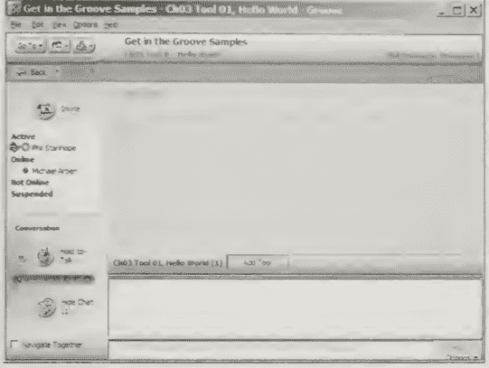

图 3-1：Hello World


图 3-2：模板文件在 Internet Explorer 中以 XML 形式显示

这个 Hello World 工具包含三个组件：一个 `ViewContainer`、一个 `MultiCellLayout` 和一个 `Button` 控件。

如我在前面所述（在"什么是 Groove 工具？"一节中），模板是一个 XML 文件，因此你可以使用 Internet Explorer 以解析后的格式查看 XML。不过，要做到这一点，你需要在文件名中添加或重命名 XML 扩展名。为了启用此功能，本书提供的所有示例工具都具有 XML 扩展名。

图 3-2 显示了 Internet Explorer 以 XML 形式显示上述文件的情况。

最外层的 XML 元素是 Groove 容器文档 `<g:Document>`。所有模板文件都有且仅有这样一个元素。按照惯例，文档元素的 Name 属性是文件的实际文件系统名称。这是 Groove 提供的所有内部工具和示例工具都遵循的约定。

文档元素又包含一个 `<g:ToolTemplate>` 元素。该元素显示以下三个主要属性：

- **Name**：工具的编程名称。此元素由 Groove 内部使用。
- **TemplateDisplayName**：工具在"添加工具"窗口和"创建空间"向导中显示的名称。（注意：只有已注入的工具——即已安装到你的 Groove 账户中的工具——才会显示在"创建空间"向导中。我基于模板的工具，如本书中的工具，只会显示在"添加工具"窗口中。）
- **DefaultToolDisplayName**：如果你将工具添加到共享空间，工具的默认名称。

`ToolTemplate` 元素包含一个或多个 `<g:ComponentGroup>` 元素。HelloWorld 工具指定了一个组件组，该组件组具有一个已定义的属性，即 `DefaultView`。`DefaultView` 名称是 Groove 用作工具默认用户界面的组件。在本书的所有示例工具中，`DefaultView` 包含 `ViewContainer` 组件的名称。它必须与 `ViewContainer` 组件的名称完全匹配（区分大小写），否则工具将无法正确加载。

以下是定义 `ViewContainer` 组件的 XML 片段：

```
<g:Component Name="ViewContainer">
  <g:ComponentResource
URL="http://components.groove.net/Groove/Components/Root.osd?Package=net
.groove.Groove.ToolComponents.GrooveCommonComponents_DLL&amp;amp;Version=0&a
mp;Factory=ViewContainer" FingerprintID="Groove"/>
  <g:PropertyList Version="1">
    <g:Property Name="Background">
      <g:BackgroundStyle Style="SectionBackground"/>
    </g:Property>
  </g:PropertyList>
<g:ComponentConnections>
```

```
<g:Connection Name="Layout" ConnectionID="0"/>
</g:ComponentConnections>
</g:Component>
```

此 ViewContainer 组件声明包含以下三个绝对关键的部分：

- `<g:ComponentResource>` 元素指定 Groove 从何处获取组件的实现。`URL` 属性最为关键。它指定 Groove 可以在何处找到 `ViewContainer` 的实现。每个组件都有一个唯一的资源 URL，用于定义该组件是什么以及如何创建它。
- `<g:PropertyList>` 元素为开发人员提供了在设计时为此特定组件指定静态属性的能力。对于 `ViewContainer`，我指定了一个属性，即 `Background`，其 `BackgroundStyle` 属性我已设置为 `SectionBackground`。
- `<g:ComponentConnections>` 元素提供了在设计时指定运行时连接到此组件组中其他组件的能力。在此示例中，我正在为 `ViewContainer` 建立组件连接，连接到定义我打算在该组件容器内使用的布局样式的组件。

所有组件声明至少必须有一个 `<g:ComponentResource>` 声明。组件是否需要你在设计时定义其他属性或指定其他连接，取决于特定组件及其要求。

> **注意**

Groove 支持以下四种布局组件：

- `MultiCellLayout`：行和单元格的行与行之间的表格布局。单个单元格可以具有固定的宽度和/或高度，并随收发器和/或工具窗口的调整大小而调整大小。`MultiCellLayout` 可以是 `MultiRow` 或 `MultiColumn`，但不能同时是两者。
- `HTMLTableLayout`：一种用于布局复杂表格结构的 HTML 表格语法。`HTMLTableLayout` 使用起来更为复杂


 - **分割器（Splitter）**：具有水平或垂直分割的能力。分割器有两个你必须定义的窗格，每个窗格依次是一个`ViewContainer`，可以包含五种基本布局样式中的任意一种。

> **交叉引用** 在第4章中，我们将更详细地研究`MultiCellLayout`组件——展示如何执行各种布局技巧。关于`HTMLTableLayout`、`XYLayout`和`Splitter`样式的示例，请参见GDK，它提供了每种样式的示例。

以下是定义 Hello World 工具布局的 XML 片段：

```
<g:Component Name="Layout">
  <g:ComponentResource
URL="http://components.groove.net/Groove/Components/Root.osd?Package=net
.groove.Groove.ToolComponents.GrooveCommonComponents_DLL&amp;Version=0&amp;Factory=MultiCellLayout" FingerprintID="Groove"/>
  <g:PropertyList Version="1">
    <g:Property Name="Layout">
      <g:PropertyValue>
        <MULTIROW>
          <ROW>
            <CELL HEIGHT="30">Hello_World</CELL>
          </ROW>
        </MULTIROW>
      </g:PropertyValue>
    </g:Property>
  </g:PropertyList>
</g:Component>
```

需要指定的关键属性是`Layout`属性，它告诉布局组件如何定位和设置其他组件的大小。例如，前面的声明描述了一个单行，其中有一个30像素高的单元格。我很快会讨论如何实现某些调整大小和定位行为。

以下是定义 Button 组件的 XML 片段：

```
<g:Component Name="Hello_World">
  <g:ComponentResource FingerprintID="Groove"
URL="http://components.groove.net/Groove/Components/Root.osd?Package=net
.groove.Groove.ToolComponents.GrooveCommonComponents_DLL&amp;Version=0&amp;Factory=Button"/>
  <g:PropertyList Version="1">
    <g:Property Name="Style" Value="StandardButton"/>
    <g:Property Name="Label" Value="Hello World"/>
  </g:PropertyList>
</g:Component>
```

我为 Hello World 组件指定的唯一属性是`Label`和`Style`属性。`Label`属性的值使工具显示 Hello World 按钮。

**Name**属性是其他组件可以以编程方式引用 Hello World 组件的方式。例如，要在运行时更改标签，你需要编写必要的 JavaScript 代码来更改 Hello_World.Label 值。

我们刚才使用的 Hello World 工具没有提供任何自定义行为，因此没有指定任何粘合代码。在下一章中，你将看到如何通过引入粘合代码来添加行为。

### 开发语言

Groove 支持多种编程语言。GDK 提供了 JavaScript、VBScript、Visual Basic 和 C++ 的示例程序。GDK 文档涵盖了 JavaScript、Visual Basic 和 C++ 语言。Groove Networks 还宣布支持 C# 以及 Python，尽管在 2.0 GDK 发布时，它还没有提供使用这些语言的示例。

#### JavaScript

出于本书中我所使用的教程的目的，你尽可能将自己限制在 JavaScript 中。但是请注意，使用 JavaScript 进行编程会限制你可用的 API，因为 JavaScript 仅支持按值传递参数，并且不允许对字节流进行操作。

#### C++

如果你打算用 C++ 开发工具，我建议你首先使用 JavaScript 通过 Groove 的快速原型环境（我的模板）来构建你的 UI 及其布局框架。此外，我建议你获取 Microsoft 开发人员网络（MSDN）开发人员订阅，以便拥有最新的编译器、工具、示例和文档。

最低限度，你需要在你的机器上安装 VC++ SP3，此外，你还需要为编译 C++ 注册许多 Groove 特定的类型库。

### 使用快速开发技术

Groove 作为一个平台，提供了许多复杂的方法来下载、验证和安装组件，以便共享空间的成员可以协作。例如，Groove 确保共享空间的每个成员在其账户中安装了正确版本的工具。Groove 还通过使用数字签名技术确保工具在传输过程中完整性没有被破坏。最后，Groove 确保共享空间成员使用兼容版本的工具。

Groove 可以被认为是革命性的，因为它是一个广泛可用的平台，具有管理软件工具和应用程序的远程更新和安装的集成能力。也就是说，这种复杂性的缺点是开发人员必须正确构建 OSD 以及（有时）可选的模板描述符（XML）和 GRV 注入文件。最重要的是，在你打包和分发工具之后，修改其行为的唯一方法是创建该工具的小版本或大版本，以便 Groove 组件管理器可以确保共享空间的所有成员都拥有正确版本的工具。

> **提示** 在为分发打包工具时，你需要确保提供组件的 HTTP 服务器始终可用，并且你已经考虑清楚了目录和组件命名问题。

在下一章中，我将详细介绍如何手动构建你的 OSD、GRV 和 XML 文件，并讨论你在开始这条道路时应该考虑的一些问题。

然而，在本书的其余部分中，我将向你展示如何利用 Groove 平台支持的另一种快速开发技术：我的模板。

#### 使用我的模板方法

通过使用我的模板开发方法，你可以快速编码、测试和调试 Groove 工具，而无需对工具进行版本控制。

##### 启用我的模板

要启用我的模板开发能力，只需将以下条目添加到 Groove 注册表设置中：

```
[HKEY_LOCAL_MACHINE\SOFTWARE\Groove Networks, Inc.\Groove\Development]
"AllowUserTemplates"="1"
```

> **注意** 在 GDK 中，带有此设置的 REG 文件位于`...\gdk\RegistryFiles`目录中。

启用我的模板后，在文件资源管理器中导航到你的`\Program Files\Groove Networks\Groove\Data`目录。在该目录中，创建一个新目录`\My Templates`（带空格）。在这个目录中，你现在可以创建工作模板文件。

> **注意** 如果你在多台机器上工作，或者与其他开发人员（本地或远程）一起工作，他们也需要启用我的模板开发能力。但是，他们不需要手动复制文件或安装模板——Groove 会自动为他们处理。

##### 禁用我的模板

要禁用我的模板开发能力，只需将以下条目添加到 Groove 注册表设置中：

```
[HKEY_LOCAL_MACHINE\SOFTWARE\Groove Networks, Inc.\Groove\Development]
"AllowUserTemplates"="0"
```

> **注意** 在 GDK 中，带有此设置的 REG 文件位于`...\gdk\RegistryFiles`目录中。

请注意，这只是禁用了我的模板开发能力。它不会删除你创建的目录或你放在那里的模板。

#### 基于我的模板的开发如何工作

我的模板功能的工作原理如下：

1. 随着 Groove 收发器启动，它会扫描`\My Templates`目录，以构建可用于共享空间的工具列表。
2. 实现"添加工具"工具的代码会添加可用的工具。
3. 当你将新工具保存到此目录时，Groove 会自动向"添加工具"工具列表添加一个新条目。
4. 如果你选择其中一个工具并将其添加到共享空间，Groove 会自动复制该文件，并将其复制到该共享空间的任何成员的`\My Templates`目录中。（这只有在共享空间的其他成员也启用了基于我的模板的开发时才会发生。）

如果你不是工具的原始来源，Groove 会将远程机器上`\My Templates`目录中的 TPL 文件属性设置为*隐藏*。

#### 注意事项

使用基于我的模板的开发时，你必须考虑几个非常重要的注意事项：

- **重命名文件：** 如果你重命名文件但不更改文件中的`TemplateDisplayName`，Groove 会显示旧的工具模板名称。即使你回去修复了`TemplateDisplayName`属性，Groove 也不会更新"添加工具"列表中的显示。要解决这个问题，请关闭收发器并重新打开它。
- **外部依赖项：** 我的模板功能旨在用于完全包含在一个文件中的工具模板。虽然可以将其用于需要多个文件的工具，但这超出了本书的范围。

#### 验证组件

Groove 会自动验证你注入用户账户的所有工具的完整性。Groove 使用已发布工具包含的公钥签名，以及你在签署工具时（即发布时）使用私钥创建的安全摘要字符串。

当你安装新工具时，Groove 会使用工具的 OSD 文件提供的公钥计算新的摘要，从而确定提供的摘要与重新计算的摘要是否一致。


摘要匹配。如果不匹配，Groove 会报告组件身份验证错误，并拒绝加载相关组件及其依赖项。

包含 XML 数据结构的文件（称为 OSD 文件）完整地定义了一个组件。（OSD 文件基于 W3C 的 Open Software Description 提案；参见 http://www.w3c.org/TR/NOTE-OSD.html。）组件的 OSD 文件包含描述构成该组件的各种软件片段（文件）及其 Internet 下载位置的信息，以及其他的子 OSD 及其发布者（如果有的话）。请注意这一过程的递归性：子 OSD 定义了其他组件（*依赖项*），这些组件有自己的发布者，如此递归下去。你可以使用存储在 OSD 文件中的加密哈希值来识别 OSD 文件外部的数据集。

组件发布者拥有加密的公钥/私钥对，以及一个将发布者身份绑定到其公钥的数字证书。（目前，Groove 仅支持自签名证书和 VeriSign 颁发的证书。）发布者使用其私钥计算 OSD 文件的数字签名，然后将其证书和签名附加到 OSD 上。随后，发布者通过将组件（签名后的 OSD）上传到 Internet 并公布其存在和位置，来"发布"该组件。

Groove 验证下载的组件后，会收集（下载）组件 OSD 文件指定的各种数据，重新计算所需的哈希值，验证适当的证书链，并使用 OSD 证书中的公钥来验证 OSD 的签名。然后，Groove 会向用户显示一个 UI 对话框，报告其审核结果（包括证书链验证和签名验证的成功或失败）。此时，用户可以根据这些信息审查报告，并选择接受或拒绝安装该组件。如果需要进一步的保证，用户应该更仔细地审查发布者（和子发布者）（例如访问他们的网站、给他们打电话、向熟人了解他们的声誉等等）。

默认情况下，你只能将经过身份验证的组件安装到 Groove 用户账户中。此功能可以保护 Groove 安装的完整性，以及你安装 Groove 平台的设备。

话虽如此，一个正确签名的工具并不能向你——用户——保证本地设备上的数据不会发生任何可能的恶意、 rogue 或意外破坏。相反，你唯一能保证的是该工具及其依赖组件与发布者预期完全一致，而且你——该工具的用户——可以信任该软件发布者的完整性和意图。

组件签名过程基本上如下：

1. 在你完全测试和调试完工具后，创建 OSD 以及可选的 XML 描述符和 GRV 注入文件。
2. 然后使用 Groove Tool Publisher 生成 abrasion 你的证书，或指定你作为开发者从 VeriSign 等第三方获得的证书。
3. 然后指示 Tool Publisher 使用该证书为你的工具签名。Tool Publisher 随后会检查所有软件依赖项，并创建适当的 GRV、XML 描述符和 OSD 文件，其中包含公钥签名以及安全摘要值。

> 注意：关于公钥/私钥加密的进一步解释超出了本书的范围。如果你对了解数字安全技术和算法感兴趣，请参阅该主题的权威著作：Bruce Schneier 的 *Applied Cryptography: Protocols, Algorithms, and Source Code in C*, 2nd Edition。Neal Stephenson 的 *Cryptonomicon* 是一部小说，详细涵盖了一些相同的概念。

##### 禁用组件身份验证

如果你禁用组件身份验证，任何会改变你账户状态的外部发起交易都会导致显示图 3-3 所示的消息框。

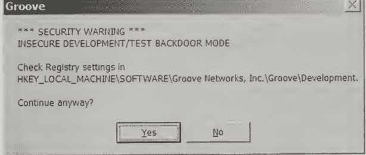

图 3-3：组件身份验证已禁用

作为工具的开发者，你需要禁用组件身份验证，以便在最终发布之前充分测试你的 OSD 及相关文件的配置。

最可能导致此消息框出现的四种交易如下：

- 启动或重新启动 Groove
- 双击 GRV 工具注入文件
- 双击 GRV 共享空间邀请文件
- 尝试导入 Groove vCard (VCG) 文件

要禁用组件身份验证，必须在 Windows 注册表中定义以下键：

```
[HKEY_LOCAL_MACHINE\Software\Groove Networks, Inc.\Groove\Development]
```

```
"DisableComponentSecurity"="1"
```

GDK 提供了 `DisableComponentAuthentication.reg` 文件。你必须关闭 Groove 并重新启动，注册表的更改才能生效。

##### 启用组件身份验证

成功将组件注入 Groove 后，修改 Windows 注册表中的以下键以重新启用组件身份验证：

```
[HKEY_LOCAL_MACHINE\Software\Groove Networks, Inc.\Groove\Development]
"DisableComponentSecurity"="0"
```

GDK 提供了 `EnableComponentAuthentication.reg` 文件。你必须关闭 Groove 并重新启动，注册表的更改才能生效。

### 使用 Groove 实用程序

GDK 包含以下三个功能强大的工具，可帮助你构建和管理其他工具：

- **Database Navigator：** 用于查看和修改 Groove 数据库（XSS）文件内容的工具。如果你遇到这样的情况：注入了一个 Groove 工具，然后需要修补它，DBNav 程序就会成为你的好帮手。
- **Tool Creator：** 一个非 WYSIWYG 的工具，用于创建 Groove 模板文件。所谓非 WYSIWYG，是指该工具不支持将组件拖放到布局上。不过，它确实支持在布局中正确编辑、添加和删除组件等操作。
- **Tool Publisher：** 一个便于为你的工具模板创建 OSD、XML 和 GRV 文件的工具。

在本书的其余部分，我不会重点介绍 Tool Creator 和 Tool Publisher，除非解释如何使用 Tool Publisher 对工具进行数字签名。

#### Groove Database Navigator

Groove Database Navigator（简称 DBNav）是你工具库中功能强大的工具。DBNav 是 GDK 中包含的三个实用程序之一。DBNav 工具提供单一视图，并使你能够修改 Groove 管理的 XML 数据库（XSS）。

对开发者来说最有趣的两个数据库是 `templates.xss` 和 `schemas.xss`。正如预期的那样，`templates.xss` 文件是已安装的工具模板（TPL）、工具集（TST）和脚本库（GSL）文件的存储库。你可以使用 `schemas.xss` 文件来存储运行时模式验证所需的模式，以用于处理 `RecordSets` 和 `DataViewers` 等。图 3-4 显示了 DB Navigator 用户界面。

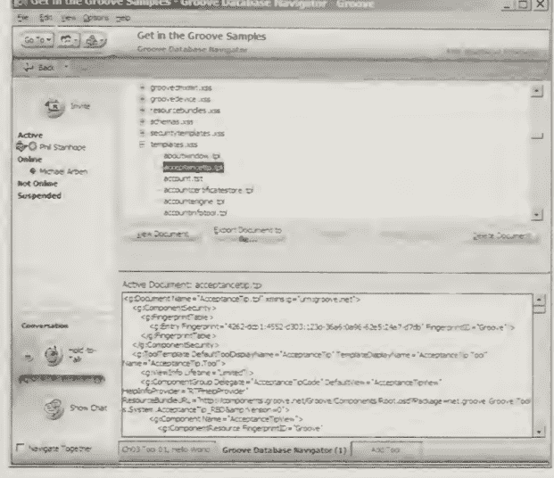

**图 3-4：Database Navigator**

通过使用 DB Navigator 工具，你可以查看 Groove 自带的默认工具和工具集的大部分源代码。但是，你无法使用 DB Navigator 查看 OSD 文件，而 OSD 文件还定义了工具正确运行所需的任何外部依赖项。

在本章的最后一节，我提到"我的模板"功能无法处理外部依赖项。虽然这句话是正确的，但如果其中一个依赖项是 GSL 文件，你可以通过导入文档手动将 GSL 安装到 templates.xss 中。同样，如果你需要引用模式定义，可以通过手动将模式（XML）文件导入 schemas.xss 数据库来实现。不过，要谨慎这样做，因为如果你邀请某人进入共享空间，而他们没有这些相同的本地配置，那么这样做可能根本不起作用。

##### **安装 Database Navigator**

要安装 Groove Database Navigator，请按以下步骤操作：

1. 禁用组件身份验证。
2. 导航到 ...\gdk\Utilities\GrooveDBNav 目录。
3. 双击 GrooveDBNav.grv 文件，将该工具注入你的账户。


##### 数据库导航器界面

Groove 数据库导航器是一个拆分布局工具的示例，显示两个窗格。顶部窗格包含一个树控件，用于显示可用的数据库以及这些数据库中的文档。

此外，顶部窗格还包含多个命令按钮，如下列表所述：

- **查看文档：** 查看特定数据库文档的内容。只有在树控件中选择了文档（而非根数据库）时，"查看"按钮才可用。

- **导出数据库/文档：** "导出"按钮使您能够导出整个数据库或单个文档。（按钮的标签会根据您在树控件中选择的对象类型而变化。）

- **导入文档：** "导入"按钮使您能够将文档导入特定数据库。操作需谨慎！如果已存在同名文档，系统会提示您确认是否覆盖。此命令仅在树控件选中数据库时启用。

- **设置导入选项：** 设置与导入处理方式相关的各种选项。

- **删除文档：** 从数据库中删除特定文档。同样，操作需谨慎！删除可能导致 Groove 在重启后无法正常运行的文档是很有可能发生的。

##### 修改现有模板文件

一种常见情况是，开发人员已经注入了一个工具（可能是因为他们从 GDK 的 YourApp 示例之一开始工作），需要更新模板文件的实现。

以下步骤使您能够正确更新文件（注意这些步骤假设您已经将 Groove 数据库导航器安装到您的账户中）：

1. 删除本地计算机上当前用户*所有*共享空间中该工具的所有现有实例。

2. 关闭并重新启动 Groove。

3. 创建一个新的自定义共享空间，并添加 DBNav 工具。

4. 在 DBNav 工具顶部窗格的树控件中双击 `templates.xss`。

5. 单击"导入文档"按钮。在随后出现的文件对话框中，选择适当的 TPL 文件并单击"确定"。

6. 在 Groove 要求您确认覆盖后，单击"确定"。

7. 导航到新的或现有的共享空间，并使用"添加工具"工具添加该工具，以确认更新版本已正确安装。

> **注意** 如果您想与已经拥有您刚刚修改的工具版本的人进行 Groove 协作，该人员必须完全按照您相同的步骤来升级模板文件。

但是，如果您想与从未安装过该工具的人进行 Groove 协作，您只需向他或她提供适当的 OSD 和其他必需文件。如果您已将工具发布为通用可用，您所需要做的只是邀请其他人加入共享空间，Groove 会完成繁重的工作。如果您尚未发布工具，您需要提供所有文件和说明，以便您想与之进行 Groove 协作的人能够在 `\Program Files\Groove\Data\localhost` 下创建适当的目录并手动放置文件。

##### 查看数据库文档

要查看文档，请选择适当的 XSS 数据库并双击它，选择所需的文档，然后单击"查看文档"按钮。

请注意，某些文件相当大，可能需要 30 秒或更长时间才能格式化并添加到只读编辑控件中。

##### 提取模板代码

了解 Groove 中工具工作原理的最佳方法是研究它们。是的，我知道。你在想，"这就是我买这本书的原因！"

Groove Networks 很早就决定采纳我所说的改良开源立场——也就是说，Groove 不仅提供 GDK 中的示例程序，还提供默认安装中所有可用的核心工具。因此，您——集成开发人员——手头拥有数十种工具和经过极其充分测试的代码库：正是您从开始使用 Groove 起一直在运行的代码。

包含此代码的关键数据库是 `templates.xss`。要研究代码，您需要导出整个数据库。在顶部窗格中选择根数据库，然后单击"导出数据库到目录"按钮。Groove 会提示您输入文件目录和名称。输入一个尚不存在的目录名称。Groove 将数据库中的所有文档导出到指定目录中同名文件中。

执行这些任务后，例如，您可以查看实现 Groove 主页的代码（`whatsnew.tpl`）。

##### 派生新工具

导出 `templates.xss` 数据库的内容后，派生新工具就很轻松了。如果您使用"我的模板"方法进行开发，则尤其简单。

创建新工具的最简单方法是复制您感兴趣的导出模板，重命名 `TemplateDisplayName`，然后保存到 `\My Templates` 目录。您现在应该在共享空间的"添加工具"工具中看到新工具。

既然您已经在列表中有了新工具，下一步就是修改它——更改其布局、添加新组件、修改粘合代码，等等。

##### 创建新架构

Groove 安装中的另一个关键数据库是 `schemas.xss`。此文件包含工具（讨论、大纲等）使用的 XML 架构定义，以及 `RecordSetEngine` 使用的默认记录架构。如果您正在与格式良好的数据源（UDDI、SQL 等）集成，您可能会创建新的架构并希望将其存储在 `schemas.xss` 中，从而显著减少构建自定义 DataViewer 工具所需的时间。

例如，以下代码是本书后面使用的一个简单架构。它定义了 `GrooveStandardRecordSchema2.xml` 文件所包含内容之外的附加记录。

```
<g:Schema URL="RecordManagerSchema.xml" xmlns:g="urn:groove.net"
Version="1.0,0,0">
    <g:IncludeSchemas>
        <g:AdditionalSchema
URI="grooveDocument:///GrooveXSS/$PersistRoot/Schemas.xss/GrooveStandard
RecordsSchema2.xml"/>
    </g:IncludeSchemas>
    <g:ElementDecl Name="urn:groove.net:RecordManagerRecord"
ElementTemplate="true">
        <g:ElementRef Element="urn:groove.net:Record" IsChildElement="0" />
        <g:AttrGroup>
            <g:AttrDef Name="TYPE" Type="String"/>
            <g:AttrDef Name="Script" Type="String"/>
            <g:AttrDef Name="Status" Type="String"/>
            <g:AttrDef Name="Result" Type="String"/>
            <g:AttrDef Name="RemoteRecordID" Type="String"/>
        </g:AttrGroup>
    </g:ElementDecl>
</g:Schema>
```

### 小结

在本章中，您开始研究 Groove 的底层结构，并制作了一个简单的 Hello World 程序。我向您展示了一些关键的快速开发技术，这些技术应该能显著提高您的生产力，使您能够迭代地原型设计和测试新工具，而无需备份 Groove 的数据目录、版本组件等。

本章涵盖以下关键概念：

- 开发人员使用的常见 Groove 文件类型：TPL、OSD、TST、XML 和 GRV。
- 如何构建简单的 Hello World 程序。
- 如何使用 Internet Explorer 查看 TPL 文件的 XML。
- 如何为您的计算机配置基于"我的模板"的开发。
- 组件身份验证概述。
- Groove 实用程序。
- 如何更新先前安装的工具。

在下一章中，我将带您逐步了解使用各种布局类型的步骤，并复习 Groove 附带的核心通用控件组件。

# 第 4 章

## 使用 UI 组件

第 3 章向您展示了在 Groove 中创建 HelloWorld 工具的最低模板声明。它还回顾了以下快速开发技术，这些技术大大提高了您迭代地原型设计和测试新工具的能力：

- 使用常见的 Groove 文件类型：TPL、OSD、TST、XML 和 GRV
- 使用 Internet Explorer 查看 TPL 文件中的 XML
- 为 Groove 的快速原型设计开发配置您的计算机
- 使用 Groove 实用程序
- 更新先前安装的工具

在本章中，您将通过以下方式制作您的第一套工具：

- 向 Hello World 程序添加自定义事件处理代码
- 使用各种 `MultiCellLayout` 组件示例
- 构建一个使用所有基本 Groove 通用控件的工具

### 向 HelloWorld 添加 FormDelegate

在第 3 章中，我向您展示了可以为 Groove 构建的最基本工具——Groove 工具形式的经典 Hello World 程序。该 Hello World 工具包含三个组件：`ViewContainer`、`MultiCellLayout` 和 `GrooveButton` 控件。`Ch03_tool_01` 是一个简单的 Groove 工具——其行为完全由其模板文件中的静态声明决定。现在您对该工具进行以下两项更改以构建 `Ch04_tool_01` 并赋予其运行时行为：

- 指定此工具具有一个名为 `FormDelegate` 的 `Delegate` 组件。
- 通过添加 `FormDelegate` 并实现事件处理程序来添加运行时行为。

以下代码展示了 `ch04_tool_01.tpl` 模板文件，其中对 `ch03_tool_01.tpl` 的更改以粗体显示：

```
<g:Document Name="ch04_tool_01.tpl" xmlns:g="urn:groove.net">
  <g:ToolTemplate
    Name="ch04_tool_01.tool"
```


 ## Hello World 布局示例

既然我已经介绍完这个简单工具的基础知识，现在你可以开始使用布局声明，了解如何用几种不同的方式来排列组件。

下面我将快速带你浏览简单的 Hello World 工具的六种基本布局配置：

- **布局示例 1：** 按钮在垂直和水平方向均居中
- **布局示例 2：** 按钮沿布局底部居中
- **布局示例 3：** 按钮在布局左侧的中间位置
- **布局示例 4：** 按钮在布局右侧的中间位置
- **布局示例 5：** 按钮在布局的右下角
- **布局示例 6：** 按钮在布局的左下角

> **随附光盘** 我在随附光盘的 \My Templates 文件夹中提供了所有这些示例，你也可以从 http://componentry.com/GetInTheGroove/My Templates/ 下载获取。

### 布局示例 1

使用 ch03_tool_01 或 ch04_tool_01 尝试以下实验：将收发器的大小调整为当前的一半。你会发现，无论收发器的大小如何，Hello World 按钮始终显示在工具的左上角。

使用以下布局声明，Ch04_tool_02 的外观如图 4-2 所示。（我对 ch04_tool_01 所做的修改以**粗体**标出。）

```
<MULTIROW>
  <ROW><CELL/></ROW>
  <ROW>
    <CELL/>
    <CELL WIDTH="100" HEIGHT="30">Hello World</CELL>
    <CELL/>
  </ROW>
  <ROW><CELL/></ROW>
</MULTIROW>
```

> **随附光盘** 此布局在随附光盘中以 \My Templates\ch04_tool_02.tpl 的形式提供。

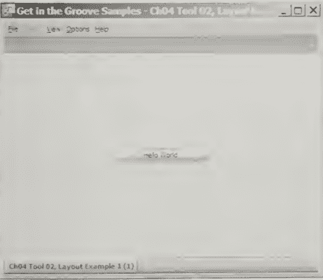

图 4-2：工具在其自身窗口中打开时，水平和垂直居中的布局


 ## 布局示例 2

将布局更改为以下规格会强制按钮在底部对齐，无论包含窗口的大小如何：

```
<MULTIROW>
  <ROW><CELL/></ROW>
  <ROW>
    <CELL/>
    <CELL WIDTH="100" HEIGHT="30">Hello_World</CELL>
    <CELL/>
  </ROW>
</MULTIROW>
```

> ON THE CD-ROM 此布局在随附 CD-ROM 中以 \My Templates\ch04_tool_03.tpl 提供。

### 布局示例 3

要强制按钮沿工具左侧居中显示，请按如下方式指定行/单元格定义：

```
<MULTIROW>
  <ROW><CELL WIDTH="20"/><CELL/><CELL WIDTH="20"/></ROW>
  <ROW>
    <CELL WIDTH="100" HEIGHT="30">Hello_World</CELL>
  </ROW>
  <ROW><CELL WIDTH="20"/><CELL/><CELL WIDTH="20"/></ROW>
</MULTIROW>
```

> ON THE CD-ROM 此布局在随附 CD-ROM 中以 \My Templates\ch04_tool_04.tpl 提供。

### 布局示例 4

要强制按钮沿布局右侧居中，请按如下方式指定行/单元格定义：

```
<MULTIROW>
  <ROW><CELL WIDTH="20"/><CELL/><CELL WIDTH="20"/></ROW>
  <ROW>
    <CELL/>
    <CELL WIDTH="100" HEIGHT="30">Hello_World</CELL>
  </ROW>
  <ROW><CELL WIDTH="20"/><CELL/><CELL WIDTH="20"/></ROW>
</MULTIROW>
```

> ON THE CD-ROM 此布局在随附 CD-ROM 中以 \My Templates\ch04_tool_05.tpl 提供。

### 布局示例 5

要强制按钮显示在工具的左下角，请按如下方式指定行/单元格定义：

```
<MULTIROW>
  <ROW><CELL WIDTH="20"/><CELL/><CELL WIDTH="20"/></ROW>
  <ROW>
    <CELL WIDTH="100" HEIGHT="30">Hello_World</CELL>
    <CELL/>
  </ROW>
</MULTIROW>
```

> **ON THE CD-ROM** 此布局在随附 CD-ROM 中以 \My Templates\ch04_tool_06.tpl 提供。

### 布局示例 6

要强制按钮显示在工具的右下角，请按如下方式指定行/单元格定义：

```
<MULTIROW>
  <ROW><CELL WIDTH="20"/><CELL/><CELL WIDTH="20"/></ROW>
  <ROW>
    <CELL/>
    <CELL WIDTH="100" HEIGHT="30">Hello_World</CELL>
  </ROW>
</MULTIROW>
```

> **ON THE CD-ROM** 此布局在随附 CD-ROM 中以 \My Templates\ch04_tool_07.tpl 提供。

### 对齐多个控件

上一节中的示例展示了如何布局单个控件。

> **TIP** `MultiCellLayout` 是 Groove  中可用的五种不同布局组件之一。其他的是 `HTMLTableLayout`、`SingleCellViewContainer`、`XYLayout` 和 `Splitter`。这些视图容器和布局组件各自提供略有不同的功能和不同的布局行为——特别是在工具调整大小时。

附录 B "Groove 组件目录"包含有关这些视图容器和布局组件的元素和属性的完整文档。该目录还包含有关最佳布局以及如何避免过度约束的信息。

现在我将向您展示一些以常见方式对齐多个控件的简单布局。通过这些 MultiCellLayout 组件功能的示例，您将能够很好地构建基于 Groove 的解决方案所需的 UI 布局。

### 布局示例 7

图 4-3 展示了四角布局在独立工具窗口中的外观。

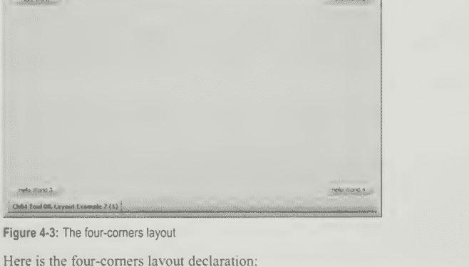

**图 4-3：四角布局**

以下是四角布局声明：

```
<MULTIROW>
  <ROW>
    <CELL WIDTH="100" HEIGHT="30">Hello_World</CELL>
    <CELL/>
    <CELL WIDTH="100">Hello_World2</CELL>
  </ROW>
  <ROW><CELL/></ROW>
  <ROW>
    <CELL WIDTH="100" HEIGHT="30">Hello_World3</CELL>
    <CELL/>
    <CELL WIDTH="100">Hello_World4</CELL>
  </ROW>
</MULTIROW>
```

当您查看 CD-ROM 上的代码时，还会发现我添加了以下三个组件声明，用于此工具包含的三个额外按钮：

```
<g:Component Name="Hello_World2">
  <g:ComponentResource FingerprintID="Groove"
  URL="http://components.groove.net/Groove/Components/Root.osd?Package=net
.groove.Groove.ToolComponents.GrooveCommonComponents_DLL&amp;amp;Version=0&amp;a
mp;Factory=Button"/>
  <g:PropertyList Version="1">
    <g:Property Name="Style" Value="StandardButton"/>
    <g:Property Name="Label" Value="Hello World 2"/>
  </g:PropertyList>
</g:Component>
<g:Component Name="Hello_World3">
  <g:ComponentResource FingerprintID="Groove"
URL="http://components.groove.net/Groove/Components/Root.osd?Package=net
.groove.Groove.ToolComponents.GrooveCommonComponents_DLL&amp;amp;Version=0&amp;a
mp;Factory=Button"/>
  <g:PropertyList Version="1">
    <g:Property Name="Style" Value="StandardButton"/>
    <g:Property Name="Label" Value="Hello World 3"/>
  </g:PropertyList>
</g:Component>
<g:Component Name="Hello_World4">
  <g:ComponentResource FingerprintID="Groove"
URL="http://components.groove.net/Groove/Components/Root.osd?Package=net
.groove.Groove.ToolComponents.GrooveCommonComponents_DLL&amp;amp;Version=0&amp;a
mp;Factory=Button"/>
  <g:PropertyList Version="1">
    <g:Property Name="Style" Value="StandardButton"/>
    <g:Property Name="Label" Value="Hello World 4"/>
  </g:PropertyList>
</g:Component>
```

最后，我们对 FormDelegate 进行以下更改（**粗体**所示）：

```
<g:Component Name="FormDelegate">
  <g:ComponentResource
URL="http://components.groove.net/Groove/Components/Root.osd?Package=net
.groove.Groove.ToolComponents.GrooveCommonComponents_DLL&amp;amp;Version=0&amp;a
mp;Factory=ScriptHost2"/>
  <g:PropertyList Version="1"/>
  <g:ComponentConnections>
    <g:Connection Name="Hello_World" ConnectionID="1"/>
    <g:Connection Name="Hello_World2" ConnectionID="2"/>
    <g:Connection Name="Hello_World3" ConnectionID="3"/>
    <g:Connection Name="Hello_World4" ConnectionID="4"/>
  </g:ComponentConnections>
  <SCRIPT>
    <![CDATA[

function Hello_World_OnCommand(i_pIUICommand)
{
  GrooveScriptFunctions.DoMessageBox("Hello World");
}
```

```
function Hello_World2_OnCommand(i_pIUICommand)
{
  GrooveScriptFunctions.DoMessageBox("Hello World 2");
}

function Hello_World3_OnCommand(i_pIUICommand)
{
  GrooveScriptFunctions.DoMessageBox("Hello World 3");
}

function Hello_World4_OnCommand(i_pIUICommand)
{
  GrooveScriptFunctions.DoMessageBox("Hello World 4");
}
  ]]>
</SCRIPT>
</g:Component>
```

> ON THE CD-ROM 此布局在随附 CD-ROM 中以 \My Templates\ch04_tool_08.tpl 提供。

### 布局示例 8

最后一个布局示例展示了如何强制控件沿工具的每个角、每条边和中心对齐。无论收发器窗口的大小如何，组件都会保持对齐。

以下是布局声明：

```
<MULTIROW>
  <ROW>
    <CELL WIDTH="100" HEIGHT="30">Hello_World</CELL>
    <CELL/>
    <CELL WIDTH="100">Hello_World2</CELL>
    <CELL/>
    <CELL WIDTH="100">Hello_World3</CELL>
  </ROW>
  <ROW><CELL/></ROW>
  <ROW>
    <CELL WIDTH="100" HEIGHT="30">Hello_World4</CELL>
    <CELL/>
    <CELL WIDTH="100">Hello_World5</CELL>
    <CELL/>
    <CELL WIDTH="100">Hello_World6</CELL>
  </ROW>
  <ROW><CELL/></ROW>
  <ROW>
    <CELL WIDTH="100" HEIGHT="30">Hello_World7</CELL>
```

```
<CELL/>
<CELL WIDTH="100">Hello_World8</CELL>
<CELL/>
<CELL WIDTH="100">Hello_World9</CELL>
</ROW>
</MULTIROW>
```

**ON THE CD-ROM** 此布局在随附 CD-ROM 中以 \My Templates\ch04_tool_09.tpl 提供。

### 使用常用 UI 组件

在本节中，您将以下组件添加到 Ch04_tool_01：

- 静态文本组件
- 编辑控件组件
- 图像按钮组件
- ListBox 组件
- ComboBox 组件
- 弹出菜单组件
- 滑块组件
- TabControl 组件

图 4-4 展示了在独立窗口中运行的工具，其中包含各种可用于构建 Groove 工具的 UI 组件。

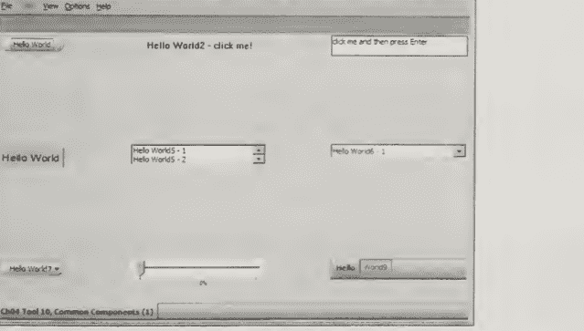

> **ON THE CD-ROM** 您可以在随附 CD-ROM 的 \My Templates\ch04_tool_10.tpl 中找到用于创建图 4-4 的工具模板。

#### GrooveStatic 文本组件

retval、pDisp 和 pEventObj 参数不是脚本代码所必需的，而且像 VBScript 这样的脚本语言甚至无法理解 void* 这样的 void 指针类型。但是，通过声明参数名称和类型，您可以确保脚本引擎正确传递参数。

```
<g:Component Name="Hello_World2">
  <g:ComponentResource FingerprintID="Groove"
URL="http://components.groove.net/Groove/Components/Root.osd?Package=net
.groove.Groove.ToolComponents.GrooveCommonComponents_DLL&amp;amp;Version=0&amp;a
mp;Factory=Static"/>
    <g:PropertyList Version="1">
      <g:Property Name="Label" Value="Hello World2"/>
      <g:Property Name="Style" Value="Normal"/>
      <g:Property Name="WantsEvents" Value="true"/>
      <g:Property Name="HAlignment" Value="Center"/>
      <g:Property Name="VAlignment" Value="Center"/>
    </g:PropertyList>
</g:Component>
```

> **CROSS-REFERENCE** 有关 GrooveStatic 组件的 XML 声明中所有可用属性的更多信息，请参阅附录 B "Groove 组件目录"。

通过声明属性 WantsEvents 为 True，您现在可以编写事件接收回调 —— OnClick() 或 OnDblClick()，这是 GrooveStatic 组件的 IGrooveStaticSink 接口发出的两个回调。

对于 ch04_tool_10.tpl，您按如下方式实现 OnClick 方法：

1. 声明一个组件连接，以便 FormDelegate 可以找到并调用事件处理程序，如下所示：

2. 在 FormDelegate 代码中实现一个 OnClick 事件接收回调，如下所示：

```
<g:ComponentConnections>
  <g:Connection Name="Hello_World2" ConnectionID="2"/>
</g:ComponentConnections>
```

```
function Hello_World2_OnClick(i_Name)
{
  GrooveScriptFunctions.DoMessageBox(i_Name);
}
```


此处提供的 `OnClick` 方法实现仅会弹出一个消息框。然而，它本可以导航到另一个工具或共享空间，或启动默认浏览器来显示一个网页。

#### GrooveEdit 组件

以下步骤将向您展示如何为图 4-4 中的 `Hello_World3` 组件进行声明。`GrooveEdit` 组件为用户提供了向界面输入信息的能力。编辑组件并非只能用于输入。我经常将其多行和垂直滚动条属性设置为 `True`，来构建历史日志（有点类似于 Groove 提供的聊天工具）。

在本示例中，我们将创建一个只读编辑组件（以证明这是可行的），并实现 `OnReturn` 回调方法，以便您知道用户何时按下回车键。

1.  声明组件并指定初始设计时属性，如下所示：

```
<g:Component Name="Hello_World3">
    <g:ComponentResource FingerprintID="Groove"
URL="http://components.groove.net/Groove/Components/Root.osd?Package=
net.groove.Groove.ToolComponents.GrooveCommonComponents_DLL&amp;Version
=0&amp;Factory=Edit"/>    <g:PropertyList Version="1">
        <g:Property Name="Style">
            <g:PropertyValue>
                <g:Item Name="ReadOnly" Value="True"/>
                <g:Item Name="Text" Value="Hello World3"/>
                <g:Item Name="Enabled" Value="False"/>
            </g:PropertyValue>
        </g:Property>
    </g:PropertyList>
</g:Component>
```

在本例中，我已将 `Hello_World3` 设为一个只读组件。为了演示 `IGrooveEditSink` 的处理，我在 `FormDelegate` 中实现了 `OnReturn()` 回调。

2.  声明一个组件连接，以便 `FormDelegate` 能够找到并调用事件处理程序，如下所示：

```
<g:ComponentConnections>
    <g:Connection Name="Hello_World3" ConnectionID="3"/>
</g:ComponentConnections>
```

3.  实现一个 `OnReturn` 事件接收器回调，如下所示：

```
function Hello_World3_OnReturn(i_Name)
{
    GrooveScriptFunctions.DoMessageBox(i_Name);
}
```

我本可以在 IGrooveEditSink 中实现以下另外三个回调：

-   `OnChange(i_Name)`：每当控件内容发生变化时，就会调用此方法。
-   `OnSetFocus(i_Name)`：当控件获得输入焦点后，会调用此方法。
-   `OnKillFocus(i_Name)`：当控件失去输入焦点后，会调用此方法。

实现 OnReturn 处理的另一种方法是使用 OnSetFocus、OnKillFocus 和 OnTranslateAccelerator 方法的组合，如下所示：

```
var g_bHello3HasFocus = false;
function Hello_World3_OnSetFocus(i_Name)
{
    g_bHello3HasFocus = true;
}

function Hello_World3_OnKillFocus(i_Name)
{
    g_bHello3HasFocus = false;
}

function OnTranslateAccelerator(i_Message, i_wParam, i_lParam, i_KeyModifiers)
{
    if (g_bHello3HasFocus && i_wParam == 13)
    {
        GrooveScriptFunctions.DoMessageBox("Hello World3");
        return true;
    }
    return false;
}
```

#### 带图像的 GrooveButton

以下是图 4-4 中所示的 Hello_World4 图像按钮组件的声明：

```
<g:Component Name="Hello_World4">
    <g:ComponentResource FingerprintID="Groove" URL="http://components.groove.net/Groove/Components/Root.osd?Package=net.groove.Groove.ToolComponents.GrooveCommonComponents_DLL&amp;Version=0&amp;Factory=Button"/>
    <g:PropertyList Version="1">
        <g:Property Name="Custom" Value="true"/>
        <g:Property Name="Label" Value="Hello_World4"/>
        <g:Property Name="Style" Value="LargeButton"/>
        <g:Property Name="ImageURL" Value="grooveFile:///My Templates/hello_world.jpg"/>
        <g:Property Name="ImageOffset" Value="0"/>
        <g:Property Name="ImageHeight" Value="30"/>
        <g:Property Name="ImageWidth" Value="100"/>
        <g:Property Name="Tooltip" Value="Click to popup Hello World4"/>
    </g:PropertyList>
</g:Component>
```

要构建图像按钮，您需要创建图像 hello_world.jpg，并以 Groove 引用的方式指定 URL，以便工具能够找到该文件。在本例中，您指定图像 URL 位置为 `grooveFile:///My Templates/hello_world.jpg`。在此路径中，`grooveFile:///` 是对目录 `\Program Files\Groove Networks\Groove Data` 的引用。

> **注意** Groove 使用注册表项 `HKEY_LOCAL_MACHINE\Software\Groove Networks, Inc.\Groove\InstallDataRoot` 来定义 Data 目录的位置。这就是 `grooveFile:///` 所指向的目录。

要使使用自定义按钮图像的工具正常工作，该工具的 OSD 文件必须将此图像文件安装到 Groove 可访问的位置。例如，许多默认的 Groove 工具会将其所需的图像文件放在 `grooveFile:///ToolBMPs` 中。

> **提示** Groove Networks 建议将工具所需的任何外部文件安装在工具特定的位置。例如，组件安装的一个经验法则是 `grooveFile:///ToolData/yourcompany.com/YourToolName/YourComponent.jpg`。这是为了防止被其他同名组件意外覆盖。

> **提示** 您可以这样假设：由于 `grooveFile:///` 是对 `\Program Files\Groove\Data` 的引用，那么在进行基于 My Templates 的开发时，您可以将文件位置设置为 `grooveFile:///My Templates/hello_world.jpg`。

#### GrooveListBox 组件

GrooveListBox 组件使用起来非常简单。IGrooveListBox 组件提供了所有必要的方法，用于向列表框添加项目、为特定项目附加私有数据等等。

IGrooveListBoxSink 为以下事件回调提供支持：

-   `OnListBoxDblClick(i_Name, i_Item)`：在用户双击项目后调用此方法。
-   `OnListBoxSelectionChange(i_Name, i_Item)`：在用户通过鼠标单击或使用向上和向下键导致选中项目发生变化后，会调用此方法。

对于 ch04_tool_10.tpl，您可以通过以下步骤实现 OnListBoxDblClick 方法：

1.  声明组件并指定初始设计时属性，如下所示：

```
<g:Component Name="Hello_World5">
  <g:ComponentResource FingerprintID="Groove"
URL="http://components.groove.net/Groove/Components/Root.osd?Package=
net.groove.Groove.ToolComponents.GrooveCommonComponents_DLL&amp;Version
=0&amp;Factory=ListBox"/>
  <g:PropertyList Version="1">
    <g:Property Name="Sort" Value="false"/>
    <g:Property Name="MultiSelect" Value="false"/>
    <g:Property Name="Tooltip" Value="Hello World5"/>
  </g:PropertyList>
</g:Component>
```

2.  声明一个组件连接，以便 FormDelegate 能够找到并连接到事件处理程序，如下所示：

```
<g:ComponentConnections>
  <g:Connection Name="Hello_World5" ConnectionID="5"/>
</g:ComponentConnections>
```

3.  实现 OnListBoxDblClick 方法，如下所示：

```
function Hello_World5_OnListBoxDblClick(i_Name, i_Item)
{
  GrooveScriptFunctions.DoMessageBox(i_Name + ", dbl clicked " +
i_Item);
}
```

请注意，回调方法并未指定选中项目的实际索引。如果 GrooveListBox 中有多个项目具有相同的显示字符串，则需要区分它们。最佳方式是使用 IGrooveListBox 组件的 GetSelectionIndex() 方法，该方法返回当前选中的索引。如果您将此方法与 GetItemData() 结合使用，就拥有了存储和检索与特定条目相关联数据所需的一切。

4.  在运行时初始化组件的内容，如下所示：

```
function Initialize()
{
    Hello_World5.AddItem("Hello World5");
    Hello_World5.AddItem("Hello World6");
    Hello_World5.AddItem("Hello World7");
}
```

您可以为每个项目关联数据，如下所示：

```
function Initialize()
{
  Initialize_Hello_World5();
}

var Data1 = "data1";
var Data2 = "data2";
var Data3 = "data3";

function Initialize_Hello_World5()
{
    var Index;
    Index = Hello_World5.AddItem("Hello World5");
    Hello_World5.SetItemData(Index, Data1);
    Index = Hello_World5.AddItem("Hello World6");
    Hello_World5.SetItemData(Index, Data2);
    Index = Hello_World5.AddItem("Hello World7");
    Hello_World5.SetItemData(Index, Data2);
}
```

以下 OnListBoxDblClick 方法的实现展示了如何检索项目级数据：

```
function Hello_World5_OnListBoxDblClick(i_Name, i_Item)
{
  var Index = Hello_World5.GetSelectionIndex();
  var Data = Hello_World5.GetItemData(Index);
  GrooveScriptFunctions.DoMessageBox("ListBox '" + i_Name + "', double
click: Item Name: '" + i_Item + "', Data: '" + Data + "'");
}
```

#### GrooveComboBox 组件

GrooveComboBox 与 GrooveListBox 非常相似；关键区别在于组件占用的屏幕空间量。

对于 ch04_tool_10.tpl，您可以通过以下步骤实现对 Hello_World6 及其 OnSelectionChange 方法的支持：

1.  声明组件并指定初始设计时属性，如下所示：

```
<g:Component Name="Hello_World6">
```


#### GrooveMenu 组件

GrooveMenu 组件用于展示一组命令。默认情况下，如果菜单为空或其中没有任何已启用的命令，菜单会自动禁用自身。本节将介绍如何实现一个附加到按钮上的弹出菜单。当你点击按钮时，菜单会出现。你可以通过多种方式处理菜单项的选择。

对于 ch04_tool_10.tpl，你可以按照以下步骤实现弹出菜单：

1.  声明按钮组件*和*菜单组件，并指定初始设计时属性，如下所示：

```xml
<g:Component Name="Hello_World7">
  <g:ComponentResource FingerprintID="Groove"
URL="http://components.groove.net/Groove/Components/Root.osd?Package=n
et.groove.Groove.ToolComponents.GrooveCommonComponents_DLL&amp;Version
=0&amp;Factory=Button"/>
  <g:PropertyList Version="1">
    <g:Property Name="Style" Value="StandardButton"/>
    <g:Property Name="Label" Value="Hello World"/>
    <g:Property Name="Menu" Value="Hello_World7_Menu"/>
  </g:PropertyList>
</g:Component>

<g:Component Name="Hello_World7_Menu">
  <g:ComponentResource FingerprintID="Groove"
URL="http://components.groove.net/Groove/Components/Root.osd?Package=n
et.groove.Groove.ToolComponents.GrooveCommonComponents_DLL&amp;Version
=0&amp;Factory=Menu"/>
  <g:PropertyList Version="1">
    <g:Property Name="UICommands">
      <g:PropertyValue>
        <g:UICommand URL="Hello_World7_1" Label="Hello_World7_1"/>
        <g:UICommand URL="Hello_World7_2" Label="Hello_World7_2"/>
        <g:UICommandSeparator URL="Sep1"/>
        <g:UICommand URL="Hello_World7_3" Label="Hello_World7_3"/>
      </g:PropertyValue>
    </g:Property>
  </g:PropertyList>
</g:Component>
```

请注意，在 Hello_World7 按钮组件的声明中，通过包含 Menu 属性并将其值设置为 `Hello_World7_Menu` 组件的名称，指定了该按钮具有菜单。将此属性添加到 `Hello_World7` 按钮就足以创建按钮与弹出菜单之间的连接。

2.  由于按钮在点击时会自动显示菜单，你无需声明到 `Hello_World7` 按钮目录的组件连接。相反，应声明一个组件连接，以便 `FormDelegate` 能够找到并调用 `Hello_World7_Menu` 的事件处理程序，如下所示：

```xml
<g:ComponentConnections>
    <g:Connection Name="Hello_World7_Menu" ConnectionID="7"/>
</g:ComponentConnections>
```

3.  GrooveMenu 组件支持 `IGrooveUICommandContainerListener` 事件接口。请实现 `OnCommand()` 事件汇回调，如下所示：

```javascript
function Hello_World7_OnCommand (i_pUICommand)
{
    GrooveScriptFunctions.DoMessageBox(i_pUICommand.Label);
}
```

如果你想对每个菜单项执行特殊处理，代码如下：

```javascript
function Hello_World7_OnCommand (i_pUICommand)
{
    var cmdURL = i_pUICommand.Label;
    if (cmdURL == "Hello World_7_1")
        GrooveScriptFunctions.DoMessageBox("Item 1 selected");
    else if (cmdURL == "Hello World_7_2")
        GrooveScriptFunctions.DoMessageBox("Item 2 selected");
    else if (cmdURL == "Hello World_7_3")
        GrooveScriptFunctions.DoMessageBox("Item 3 selected");
}
```

#### GrooveSlider 组件

`GrooveSlider` 组件为用户提供了一种图形化的方式来指定范围内的值。该组件实现了 `IGrooveSlider` 接口，该接口提供了一些方法，使你能够配置滑块的范围和样式。`IGrooveSliderSink` 接口支持单个回调方法 `OnScroll()`。

由于 `GrooveSlider` 组件没有显示当前值的功能，你必须将附加的静态文本控件与一个小字体关联起来，以便在滑块控件正下方直接显示当前值。

对于 `ch04_tool_10.tpl`，你可以按照以下步骤实现 `GrooveSlider` 组件：

1.  声明组件并指定初始设计时属性，如下所示：

```xml
<g:Component Name="Hello_World8">
  <g:ComponentResource FingerprintID="Groove"
URL="http://components.groove.net/Groove/Components/Root.osd?Package=n
et.groove.Groove.ToolComponents.GrooveCommonComponents_DLL&amp;Version
=0&amp;Factory=Slider"/>
  <g:PropertyList Version="1">
    <g:Property Name="Label" Value="Hello World8"/>
  </g:PropertyList>
</g:Component>

<g:Component Name="Hello_World8_Status">
  <g:ComponentResource FingerprintID="Groove"
URL="http://components.groove.net/Groove/Components/Root.osd?Package=n
et.groove.Groove.ToolComponents.GrooveCommonComponents_DLL&amp;Version
=0&amp;Factory=Static"/>
  <g:PropertyList Version="1">
    <g:Property Name="Label" Value="Hello World8"/>
    <g:Property Name="Font">
      <g:FontDesc Height="8" Color="#000000" StyleItalic="true"
Typeface="Arial"/>
    </g:Property>
  </g:PropertyList>
</g:Component>
```

2.  声明一个组件连接，以便 FormDelegate 能够找到并调用事件处理程序，如下所示：

```xml
<g:ComponentConnections>
  <g:Connection Name="Hello_World8" ConnectionID="8"/>
  <g:Connection Name="Hello_World8_Status" ConnectionID="81"/>
</g:ComponentConnections>
```

3.  实现 IGrooveSliderSink 的 OnScroll() 回调方法，如下所示：

```javascript
function Hello_World8_OnScroll()
{
  Hello_World8_Status.SetText(100*(Hello_World8.Value / 100) + "%");
}
```

4.  按如下方式初始化组件：

```javascript
function Initialize_Hello_World8 ()
{
  Hello_World8.Value = 0;
  Hello_World8_OnScroll();
}
```

5.  从 `FormDelegate` 代码的 `Initialize()` 方法中调用 `Initialize_Hello_World8`：

```javascript
function Initialize()
{
    Initialize_Hello_World8();
}
```

#### GrooveTabControl 组件

我演示的最后一个控件是 `GrooveTabControl`。`GrooveTabControl` 组件用作项目的选择器，通常用于在不同视图之间进行选择。

`GrooveTabControl` 组件与 `GrooveListBox` 组件类似，因为它们都会发出 `OnSelectionChange` 事件。名称相同——`IGrooveTabControlSink` 接口的 `OnSelectionChange` 方法与 `IGrooveListBoxSink` 的方法相同——但传递的参数不同。`GrooveTabControl` 与 `GrooveListBox` 组件的另一个相似之处是，你需要在运行时配置它们的内容——而不像简单的按钮或菜单那样可以在设计时指定标签。要实现 `GrooveTabControl`，请按照以下步骤操作：

1.  声明组件并指定初始设计时属性，如下所示：

```xml
<g:Component Name="Hello_World9">
    <g:ComponentResource FingerprintID="Groove"
URL="http://components.groove.net/Groove/Components/Root.osd?Package=n
et.groove.Groove.ToolComponents.GrooveCommonComponents_DLL&amp;Version
=0&amp;Factory=TabControl"/>
    <g:PropertyList Version="1"/>
</g:Component>
```

2.  声明一个组件连接，以便 `FormDelegate` 能够找到并调用事件处理程序，如下所示：

```xml
<g:ComponentConnections>
    <g:Connection Name="Hello_World9" ConnectionID="9"/>
</g:ComponentConnections>
```

3.  实现 `IGrooveTabControlSink` 接口的 `OnSelectionChange` 事件汇回调，如下所示：

```javascript
function Hello_World9_OnSelectionChanged(i_URL, i_KeyStates)
{
```


 ```
GrooveScriptFunctions.DoMessageBox1_HTML
```

4. 在运行时初始化 Hello_World9 组件，如下所示：

```
function Initialize()
{
    Initialize_Hello_World5();
    Initialize_Hello_World6();
    Initialize_Hello_World9();
}

function Initialize_Hello_World9()
{
    Hello_World9.AppendTab("Hello", "Hello World9 - Tab1");
    Hello_World9.AppendTab("World9", "Hello World9 - Tab2");
    Hello_World9.SetSelection("Hello World9 - Tab1");
}
```

### 小结

在本章以及前一章中，你已经构建了自己的第一套工具。我向你展示了一些关键的快速开发技术，这些技术将大幅提高你的生产力，使你能够迭代式地原型化和测试新工具，而无需备份 Groove 的数据目录、对组件进行版本控制，等等。我还涵盖了以下关键概念：

- 如何构建一个简单的 Hello World 程序
- 如何向 Hello World 程序添加事件处理代码
- 常用控件及其关键方法和事件的使用方法

在下一章中，我将介绍一组更高级的 UI 和引擎组件。

- PropertyListEngine 和 RecordSetEngine
- ListView 和 DataViewer 组件
- Groove 工具栏集成
- Groove 帮助-概览集成

# 第 5 章

## 使用引擎组件

在本章中，你将运用我在第 3 章和第 4 章中演示的技术，开发一系列工具，这些工具利用了作为 Groove 工具开发者可供你使用的各种数据创建、存储和展示组件。到本章结束时，你将知道如何执行以下任务，并能够设计和开发利用 Groove 核心用户界面和数据管理服务工具：

- 使用属性和记录来持久化工具的数据
- 使用 DataViewer 组件
- 构建自定义 XML 架构和数据视图
- 支持对记录的数据值进行就地编辑
- 动态提供同一基础数据集的不同视图
- 支持已读/未读标记以及可视化 UI 指示器，例如 Groove 讨论工具中的那些
- 将自定义 Groove 工具与收发器的概览和工具栏服务集成
- 创建标签页用户界面

总共，你在本章中将处理 13 个工具，最后一个工具结合了前 12 个工具的所有技术。

### Hello Properties：使用 PropertyListEngine

我在第 4 章中构建的工具都要求你在工具模板文件中定义要在工具中使用的特定组件——例如按钮、列表框和标签。除了你在工具模板中显式声明的组件外，所有 Groove 工具都有一个隐式的 PropertyListEngine，你的 FormDelegate 代码可以访问它。

PropertyListEngine 是所有 Groove 工具的内置组件的一个例子——你不需要在工具模板组件组元素中声明 PropertyListEngine 组件。此外，你也不需要为 FormDelegate 组件声明组件连接。

> **注意** 本书附带的所有工具都是用 JavaScript 编写的，我遵循了 Groove Networks 建立的惯例，将 Delegate 组件命名为 `FormDelegate`。`FormDelegate` 是 `GrooveScriptHostComponent` 的一个实例，它包含实现工具逻辑的 JavaScript 代码。

要访问 `PropertyListEngine`，只需编写必要的 JavaScript 代码并调用适当的 Groove API 来创建新属性和处理属性更改通知。

例如，要添加一个新属性，你可以创建以下函数：

```
function SetMyProperty(i_strName, i_strValue)
{
    PropertyList.SetProperty(i_strName, i_strValue);
}
```

本章的第一个工具 `ch05_tool_01` 演示了如何动态创建属性并为其赋值。图 5-1 展示了该工具的外观。

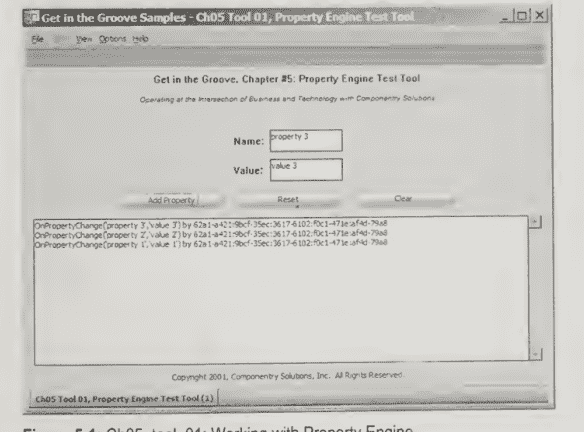

#### 工具组件和布局

该工具由以下 UI 组件组成：

- **五个静态文本组件**：两个用于工具顶部显示的 `Tool_Name` 和 `Tool_Tagline`；两个用于工具布局中间的 `Name_Label` 和 `Value_Label` 组件；一个用于工具底部显示的 `Tool_Copyright`。
- **三个编辑组件**：一个用于输入属性名称，另一个用于输入属性值。第三个名为 History 的组件将是一个只读的多行版本，用于构建用户添加到属性列表引擎的所有名称/值对的日志。
- **三个按钮组件**：一个用于将当前名称/值对添加为属性，第二个用于重置历史记录并根据工具模板中指定的值创建默认的名称/值对，第三个用于清除 History 组件的内容。

以下是前述组件的 `MultiCellLayout` 声明：

```
<g:Component Name="Layout">
  <g:ComponentResource
    URL="http://components.groove.net/Groove/Components/Root.osd?Package=net
    .groove.Groove.ToolComponents.GrooveCommonComponents_DLL&amp;Version=0&amp;
    amp;Factory=MultiCellLayout" FingerprintID="Groove"/>
  <g:PropertyList Version="1">
    <g:Property Name="Layout">
      <g:PropertyValue>
        <MULTIROW>
          <ROW>
            <CELL WIDTH="20"/>
            <CELL HEIGHT="30">Tool_Name</CELL>
            <CELL WIDTH="20"/>
          </ROW>
          <ROW>
            <CELL WIDTH="20"/>
            <CELL HEIGHT="25">Tool_Tagline</CELL>
            <CELL WIDTH="20"/>
          </ROW>
          <ROW>
            <CELL WIDTH="20"/>
            <CELL/>
            <CELL WIDTH="20"/>
          </ROW>
          <ROW><CELL HEIGHT="10"/></ROW>
          <ROW>
            <CELL/>
            <CELL WIDTH="50" HEIGHT="30">Name_Label</CELL>
            <CELL WIDTH="100">Name</CELL>
            <CELL/>
          </ROW>
          <ROW><CELL HEIGHT="10"/></ROW>
          <ROW>
            <CELL/>
            <CELL WIDTH="50" HEIGHT="30">Value_Label</CELL>
            <CELL WIDTH="100">Value</CELL>
            <CELL/>
          </ROW>
          <ROW><CELL HEIGHT="10"/></ROW>
          <ROW>
            <CELL/>
            <CELL HEIGHT="30" WIDTH="150">Add</CELL>
            <CELL WIDTH="10"/>
            <CELL HEIGHT="30" WIDTH="150">Reset</CELL>
            <CELL WIDTH="10"/>
            <CELL HEIGHT="30" WIDTH="190">Clear</CELL>
            <CELL/>
          </ROW>
          <ROW><CELL HEIGHT="10"/></ROW>
          <ROW>
            <CELL WIDTH="5"/>
            <CELL HEIGHT="200">History</CELL>
            <CELL WIDTH="5"/>
          </ROW>
          <ROW><CELL HEIGHT="10"/></ROW>
          <ROW>
            <CELL WIDTH="20"/>
            <CELL HEIGHT="20">Tool_Copyright_Text</CELL>
            <CELL WIDTH="20"/>
          </ROW>
        </MULTIROW>
      </g:PropertyValue>
    </g:Property>
  </g:PropertyList>
</g:Component>
```

#### 工具 FormDelegate

ch05_tool_01 的 FormDelegate 组件声明如下：

```
<g:Component Name="FormDelegate">
    <g:ComponentResource URL="http://components.groove.net/Groove/Components/Root.osd?Package=net.groove.Groove.ToolComponents.GrooveCommonComponents_DLL&amp;Version=0&amp;Factory=ScriptHost2"/>
    <g:PropertyList Version="1">
        <g:Property Name="Default_Name" Value="design-time property name"/>
        <g:Property Name="Default_Value" Value="design-time default value"/>
    </g:PropertyList>
    <g:ComponentConnections>
        <g:Connection Name="Name" ConnectionID="1"/>
        <g:Connection Name="Value" ConnectionID="2"/>
        <g:Connection Name="History" ConnectionID="3"/>
        <g:Connection Name="Add" ConnectionID="4"/>
        <g:Connection Name="Reset" ConnectionID="5"/>
        <g:Connection Name="Clear" ConnectionID="6"/>
    </g:ComponentConnections>
    <SCRIPT FingerprintID="Groove"
SRC="http://components.groove.net/Groove/Components/Root.osd?Package=net
.groove.Groove.ToolComponents.GrooveGlobalHelperFunctions_GSL&amp;Versio
n=0,1&amp;Factory=Open"/>
        <SCRIPT>
        <![CDATA[

var g_strMyFingerPrint;

function Initialize()
{
    var pAccount = PropertyList.OpenProperty(PROPERTY_ACCOUNT);
    var pCurContact = pAccount.OpenDefaultIdentity().Contact;
    var pCurSecurity = pCurContact.SecurityInfo;
    g_strMyFingerPrint = pCurSecurity.FingerPrintAsString;
}

function Add_OnButtonUp(i_pIUICommand)
{
    PropertyList.SetPropertyAsString(Name.Text,  g_strMyFingerPrint + "_" +
Value.Text);
}

function Reset_OnButtonUp(i_pIUICommand)
{
    // Clear the history
    History.Text = "";

    // Load the default name/value from the tool template
    var property_name = PropertyList.OpenPropertyAsString("Default_Name");
    var property_value =
PropertyList.OpenPropertyAsString("Default_Value");
    PropertyList.SetPropertyAsString(property_name,  g_strMyFingerPrint +
"_" + property_value);
}

function Clear_OnButtonUp(i_pIUICommand)
{
    History.Text = "";
}

function Clear_OnHoverEnter(i_pIUICommand)
{
    History.Text = "Clear_OnHoverEnter\n" + History.Text;
}
```


 [PAGE 110]中的代码块被[PAGE 111]的内容中断且未正确闭合，根据上下文推断[PAGE 110]的代码块应完整保留。

[content]

```
function OnPropertyChanged (i_Key, i_pValue, i_LocallyGenerated)
{
    // Parse the property. Our convention is to embed in the property
    // value the fingerprint of the party that originated the property
    // change. The delimiter is a single underscore '_'. After the
    // delimiter the remainder of the string is the intended value.
    // Note that the fingerprint is 49 characters long, so the delimiter
    // should always be at index 49 and the value should start at 50.

    var str = new String(i_pValue);
    var creator = str.substr(0,49);
    var pval = str.substr(50);
    History.Text = "OnPropertyChanged('" + i_Key + "','" + pval + "') by "
    + creator + "\n" + History.Text;
}

]]></SCRIPT>
</g:Component>
```

#### 工具初始化

你可以使用以下工具初始化代码来设置一个全局变量 `g_strMyFingerPrint`。该变量的值将在你向 `PropertyListEngine` 添加属性时使用：

```
function Initialize()
{
    var pAccount = PropertyList.OpenProperty(PROPERTY_ACCOUNT);
    var pCurContact = pAccount.OpenDefaultIdentity().Contact;
    var pCurSecurity = pCurContact.SecurityInfo;
    g_strMyFingerPrint = pCurSecurity.FigerPrintAsString;
}
```

注意调用 `PropertyList.OpenProperty(PROPERTY_ACCOUNT)`。以下是一些为所有工具定义的属性：

- `PROPERTY_ACCOUNT`: 当前用户的 `GrooveAccount`。
- `PROPERTY_NAME`: 工具在收发器（transceiver）中显示的当前名称。
- `PROPERTY_TOOL_NAME`: 模板中指定的工具内部名称。
- `PROPERTY_TELESPACE_NAME`: 工具所属共享空间的名称。

`PROPERTY_ACCOUNT` 返回指向 `IGrooveAccount` 实例的接口指针。`IGrooveAccount` 接口值得关注，因为它反过来为你提供指向 `IGrooveContact` 接口的接口指针。`IGrooveContact` 接口提供了以编程方式访问当前用户数字指纹的能力。本书中几乎所有工具都使用完全相同的代码来初始化全局变量 `g_strMyFingerPrint`。

数字指纹值得关注，因为 Groove 保证它在用户账户中是唯一的，因此，你可以用它来区分共享空间中不同成员创建的属性。

> **提示** 如需查看完整的属性列表，请检查 GrooveGlobalHelperFunctions.gsl 文件（位于 templates.xss 中）。使用 Groove Database Navigator 工具查看此文件。

要通过使用 GrooveGlobalHelperFunctions.gsl 列出的标识符来以编程方式访问默认属性，请在 FormDelegate 组件中包含一个 `<SCRIPT/>` 元素，该元素包含 GrooveGlobalHelperFunctions，如下所示：

```
<g:Component Name="ToolScript">
  ...
  <SCRIPT FingerprintID="Groove"
SRC="http://components.groove.net/Groove/Components/Root.osd?Package=net
.groove.Groove.ToolComponents.GrooveGlobalHelperFunctions_GSL&amp;Versio
n=0,1&amp;Factory=Open"/>
  ...
</g:Component>
```

#### 在运行时管理属性

要创建新属性，请调用 `Property_List.SetProperty()`。`SetProperty()` 接受两个必需参数——名称和值，以及一个可选的第三个参数——标志（Flags）。标志的值是以下之一：

```
Enum GroovePropertyFlags

    GroovePropertyFlag_Private                 = 0x0000,
    GroovePropertyFlag_Disseminate             = 0x0001,
    GroovePropertyFlag_Serialize               = 0x0002,
    GroovePropertyFlag_Default                 =
GroovePropertyFlag_Disseminate |
GroovePropertyFlag_Serialize,
    GroovePropertyFlag_Runtime                 = 0x0004,
    GroovePropertyFlag_System                  = 0x0008,
    GroovePropertyFlag_Provider                = 0x0010,
    GroovePropertyFlag_IdentityDisseminate    = 0x0020,
    GroovePropertyFlag_IdentitySerialize      = 0x0040

End Enum
```

要在工具中添加属性支持，你需要实现 `IGrooveAdvancedButtonListener` 接口的 `OnButtonUp()` 方法。以下是 Add 按钮的实现：

```
function Add_OnButtonUp(i_pIUICommand)
{
    PropertyList.SetPropertyAsString(Name.Text, g_strMyFingerPrint + "_" + Value.Text);
}
```

在工具初始化期间，你初始化全局变量 `g_strMyFingerPrint`。现在你可以看到我如何使用该值——作为你设置属性值的一部分。

#### 处理属性变更通知

要接收属性创建的通知，工具需要实现 `IGroovePropertyChangeListener` 接口所定义的 `OnPropertyChanged()` 方法。`OnPropertyChanged()` 方法的第三个参数是一个布尔值，该参数使代码能够区分本地和远程属性变更。以下代码是该方法的实现：

```
function OnPropertyChanged (i_Key, i_pValue, i_LocallyGenerated)
{
    // Parse the property. Our convention is to embed in the property
    // value the fingerprint of the party that originated the property
    // change. The delimiter is a single underscore '_'. After the
    // delimiter the remainder of the string is the intended value.
    // Note that the fingerprint is 49 characters long, so the delimiter
    // should always be at index 49 and the value should start at 50.

    var str = new String(i_pValue);
    var creator = str.substr(0,49);
    var pval = str.substr(50);
    History.Text = "OnPropertyChanged('" + i_Key + "','" + pval + "') by " + creator + "\n" + History.Text;
}
```

如你在 `Add_OnButtonUp()` 调用中设置属性时，将数字指纹和值组合在一起。`OnPropertyChanged` 方法仅指定属性的名称、新值以及属性变更是否在本地生成。如果 `i_LocallyGenerated` 为 True，你就知道该变更由当前用户做出，而非共享空间的其他成员。如果你知道属性变更不是在本地生成的，你仍然不知道是哪个共享空间的其他成员做出了该变更。

> **提示** 本章后续工具中我将使用的下一个引擎组件是 RecordSetEngine。使用此组件时，基础记录类型包含有关进行变更的 Groove 用户的信息。由于这两个引擎之间的这种差异，我实现了"编码"属性值，以便我们拥有类似的能力。

在上述 `OnPropertyChanged` 的实现中，你解压指纹和值的编码，然后构造一个字符串，将其追加到多行只读编辑组件 History 中。

> **注意** 因为每个工具都有一个隐式的 `PropertyListEngine` 组件，你无需像对模板定义的组件（如 `Add` 按钮）那样，在方法名前加上组件名称作为前缀。

#### 在工具模板中存储默认属性

你可以在 Groove 工具模板中存储设计时属性值。你可以这样做来存储 Groove 用户的默认指纹、要显示的帮助文本等。Reset 按钮的 `OnButtonUp()` 方法的实现展示了如何从工具模板中访问两个静态定义的属性值，如下所示：

```
function Reset_OnCommand(i_pIUICommand)
{
    // Clear the history
    History.Text = "";

    // Load the default name/value from the tool template
    var property_name = PropertyList.OpenPropertyAsString("Default_Name");
    var property_value = PropertyList.OpenPropertyAsString("Default_Value");
    PropertyList.SetPropertyAsString(property_name, g_strMyFingerPrint + "_" + property_value);
}
```

`FormDelegate` 组件的声明指定了 `Default_Name` 和 `Default_Value` 的实际默认值，如下所示（注意加粗文本）：

```
<g:Component Name="ToolScript">

  ...

    <g:PropertyList Version="1">
      <g:Property Name="Default_Name" Value="design-time property name"/>
      <g:Property Name="Default_Value" Value="design-time default value"/>
    </g:PropertyList>

  ...

</g:Component>
```

#### 理解 PropertyList 变更通知

*属性变更通知*在调用 PropertyListEngine 的 `SetProperty()` 方法后触发。行为取决于方法初始调用中传入的参数。

要观察此行为，请尝试以下测试：


 1. 创建两个 Groove 用户账户，*User1* 和 *User2*，然后将每个账户的 vCard 保存为文件。
2. 为每个账户打开一个收发器，并将各自的 vCard 导入到你的联系人工具中。
3. 以 *User1* 身份，创建一个共享空间，其中包含一个共享工具——`ch05_tool1_01`。
4. 邀请 *User2* 加入此共享空间。以 *User2* 身份接受邀请，并使用聊天工具确认安装共享空间。
5. 以 *User1* 身份，进入 `Ch05_tool1_01` 工具，输入新的属性名称和值。单击"添加"按钮以添加属性名称和值。

请注意，添加属性后，*History* 会更新，表明发生了 *OnPropertyChanged*。*History* 将包含属性名称和值以及 *User1* 的指纹。

6. 切换到 *User2* 的收发器，可以看到属性工具已更新，反映你刚刚创建的属性。重复步骤 5，然后切换回 *User1* 的收发器。你应该能看到 *User2* 刚刚创建的属性已列出——总共两条记录。

7. 重新启动 Groove 并打开 *User1* 的收发器。导航到共享空间并打开 `Ch05_tool1_01` 工具。

请注意 *History* 为空，因为属性更改通知是临时的——它们仅发生在 Groove 共享空间中*正在运行的工具*之间。

8. 输入新的属性名称和值。请注意，在该工具内，UI 会更新以在 *History* 中显示新的名称和值。
9. 打开 *User2* 的收发器，但*不要*导航到带有属性测试工具的共享空间。相反，返回 *User1* 的收发器并创建另一个名称/值对。

你应该会注意到属性历史现在有两条记录。

10. 以 *User2* 身份，现在导航到该工具。输入新的属性名称和值。现在你应该在 *History* 中看到一条记录。
11. 切换到 *User1* 的收发器，你应该能看到三条记录。

### 使用 RecordSetEngine 组件

要保证工具中记录类型数据的持久性，请使用 `RecordSetEngine` 组件来操作持久数据。`GrooveRecord` 通常可以包含可变数量的字段。`GrooveRecord` 支持的字段类型有 `String`、`Long`、`Double`、`Boolean` 和 `Element`。

你可以使用 XML 模式来定义 `GrooveRecordSetEngine` 可以存储的记录类。

**注意：** Groove RecordSetEngine 类似于关系数据库引擎。Groove 核心安装提供了一个通用的、可扩展的 GrooveRecord XML 模式。基于 RecordSetEngine 的工具和自定义引擎组件可以自由定义它们自己的自定义模式。我将在 Ch05_tool_08 中展示如何创建自定义模式。

从编程的角度来看，使用 RecordSetEngine 与使用 GrooveScriptHostComponent 为所有工具提供的隐式 PropertyListEngine 非常相似。图 5-2 显示了在其自身窗口中运行的 Ch05_tool_02。

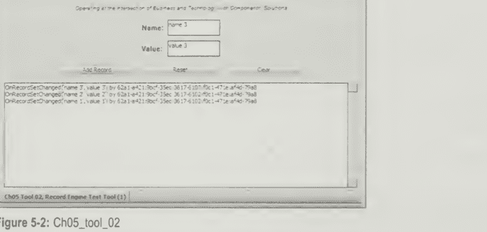

#### 工具组件和布局

除了添加 RecordSetEngine 组件外，Ch05_tool_02 与 Ch05_tool_01 完全相同。工具模板中的以下声明定义了 RecordSetEngine 组件：

```
<g:Component SingleInstance="True" Category="Engine"
    Name="RecordSetEngine">
    <g:ComponentResource
        URL="http://components.groove.net/Groove/Components/Root.osd?Package=net.groove.Groove.ToolComponents.GrooveListComponents_DLL&amp;Version=0.4&amp;Factory=RecordSetEngine3" FingerprintID="Groove"/>
    <g:EngineDesc Tag="urn:groove.net:RecordSetEngine"/>
    <g:PropertyList Version="1">
        <g:Property Name="ClassInfoList">
            <g:PropertyValue>
                <g:ClassInfo Name="urn:groove.net:Record"
                    URL="http://components.groove.net/Groove/Components/Root.osd?Package=net.groove.Groove.ToolComponents.GrooveListComponents_DLL&amp;Version=0.4&amp;Factory=Record"/>
            </g:PropertyValue>
        </g:Property>
    </g:PropertyList>
</g:Component>
```

```
.groove.Groove.ToolComponents.GrooveListComponents_DLL&amp;Version=0&amp;Factory=Record"/>
</g:PropertyValue>
</g:Property>
</g:PropertyList>
</g:Component>
```

`Tool_Name`、`Tool_Tagline`、`Tool_Copyright`、`Name`、`Value`、`Name_Label`、`Value_Label`、`Add`、`Reset`、`Clear` 和 `History` 组件的组件定义与 `Ch05_tool_01` 的相同。

#### 工具 FormDelegate

`Ch05_tool_01` 和 `Ch05_tool_02` 中 `FormDelegate` 的第一个显著变化是在 FormDelegate 组件声明中添加了 `<g:connection>` 元素节点，如下面的代码所示（**粗体文本**显示了与 `Ch05_tool_01` 相比的变化）：

```
<g:Component Name="FormDelegate">
  ...
  <g:ComponentConnections>
    ...
    <g:Connection Name="RecordSetEngine" ConnectionID="7"/>
  </g:ComponentConnections>
  ...
</g:Component>
```

`FormDelegate` 组件声明中的下一个变化是添加了一个类型库元素节点，使 `GrooveScriptHost` 组件能够访问用于标志的枚举值，例如你在处理记录集更改的代码中使用的 `GrooveRecordSetChangeType_Added`，如下面的代码所示（注意**粗体语句**）：

```
<g:Component Name="FormDelegate">
  ...
  <TYPELIB LIBID="{FB1EBAB1-C159-11d3-80B6-00500487887B}"
  NAME="GrooveCollectionComponents" MAJORVER="1" MINORVER="0"/>
  ...
</g:Component>
```

#### 创建记录

以下示例显示了 `Add_OnButtonUp()` 的新实现：

```
function Add_OnButtonUp(i_pIUICommand)
{
  var pIRecord = GrooveScriptFunctions.CreateNewObject("Groove.Record");
  pIRecord.SetField("Name", Name.Text);
  pIRecord.SetField("Value", Value.Text);
  pIRecord.SetField("Fingerprint", g_strMyFingerPrint);
  RecordSetEngine.AddRecord(pIRecord);
}
```

请注意，与使用属性列表不同，你可以在记录中保存多个字段——因此你可以放弃将 Value 与指纹组合的想法，而是将它们（Value 和 g_strMyFingerPrint）作为记录中的单独字段保存。

#### 处理 RecordSet 更改通知

使用 RecordSetEngine 组件的关键是实现 IGrooveRecordSetListener::OnRecordSetChanged() 方法。每当在 RecordSetEngine 中添加、删除或替换记录时，都会触发通知。通过 RecordSetEngine 的 DGrooveRecordSetListener 调度接口触发的通知不保证按照触发它们的记录集修改的相同顺序到达。通知相对于实际数据更改是异步的，可能看起来与记录集的当前状态不一致。RecordSetEngine 使用回滚和前滚机制，保证在工具处理完所有端点上的所有通知后，记录集的最终状态在所有设备上保持一致。

对于 Ch05_tool_02，你实现以下 OnRecordSetChanged() 处理程序：

```
function RecordSetEngine_OnRecordSetChanged(i_pIRecordSetEngine,
                                    i_RecordSetChangeType,
                                    i_pIRecordIDEnum)
{
    var pITransaction = g_pTelespace.OpenTransaction(true);
    try
    {
        // Enumerate all record ids
        while (i_pIRecordIDEnum.HasMore())
        {
            var RecordID = i_pIRecordIDEnum.OpenNext();

            if (GrooveRecordSetChangeType_Added == i_RecordSetChangeType)
            {
                // Always check to see if record exists for specified
                // id before attempting to open it (VERY IMPORTANT)
                if (i_pIRecordSetEngine.HasRecord(RecordID))
                {
                    var pIRecord = i_pIRecordSetEngine.OpenRecord(RecordID);
                    Load_Record(pIRecord, false);
                }
            }
            else if (GrooveRecordSetChangeType_Replaced ==
                i_RecordSetChangeType)
            {
                // This is how we guarantee delivery of execution and related
                "messages"
                if (i_pIRecordSetEngine.HasRecord(RecordID))
```


 ```
{
    var pIRecord = i_pIRecordSetEngine.OpenRecord(RecordID);
    // 什么都不做...
}
}
else if (GrooveRecordSetChangeType_Removed ==
i_RecordSetChangeType)
{
    // 什么都不做...
}
}
pITransaction.Commit();
}
catch (e)
{
    pITransaction.Abort();
}
}
```

```
function Load_Record(pIRecord, bInitializing)
{
var name = pIRecord.OpenFieldAsString("Name");
var value = pIRecord.OpenFieldAsString("Value");
var creator = pIRecord.OpenFieldAsString("Fingerprint");

if (bInitializing)
    entry = "Initialize Record('';
else
    entry = "OnRecordSetChanged('';
History.Text = entry + name + "','" + value + "') by " + creator +
"\n" + History.Text;
}
```

#### 清除 RecordSetEngine

以下代码展示了从 RecordSetEngine 中移除所有记录的额外调用：

```
function Clear_OnButtonUp(i_pIUICommand)
{
// 清除记录集引擎和历史记录

RecordSetEngine.RemoveMultipleRecords(RecordSetEngine.OpenRecordIDEnum()
);
    History.Text = "";
}
```

#### 初始化工具记录数据

RecordSetEngine 的变更本质上是异步的，通过点对点直接通信或 Groove 中继服务器进行传递。记录集变更（即增量）的分发方式是 Groove 共享空间架构的核心。

作为开发者，您需要考虑到自上次实例化工具以来，数据可能已发生变化，因为空间的其他成员可能一直在使用该工具。为确保用户界面与工具数据保持同步，请按如下方式实现 `IGrooveUIComponent` 的 `OnSetUIProperties()` 方法：

```
function OnSetUIProperties()
{
    // 重新加载记录，因为它们可能已异步更改
    History.Text = "";

    // 在远程空间上打开一个事务，防止数据在
    // 我们操作期间发生变化。在 try/catch 块内执行所有操作，
    // 以便在发生错误时可以中止事务

    var pITransaction = g_pTelespace.OpenTransaction(true);
    try
    {
        // 搜索已存在的记录并将其显示在列表框中

        var pIRecordEnum = RecordSetEngine.OpenRecordEnum();
        while (pIRecordEnum.HasMore())
        {
            var pIRecord = pIRecordEnum.OpenNext();
            var RecordID = pIRecord.RecordID;
            Load_Record(pIRecord, true);
        }
        // 提交事务（非常重要）
        pITransaction.Commit();
    }
    catch (e)
    {
        pITransaction.Abort();
    }
}
```

#### 理解记录集变更通知

与需要活动监听器才能将属性更改持久化的 `PropertyListEngine` 变更通知不同，`RecordSetEngine` 数据的变更本质上在所有端点间都是持久的。

如果共享空间的成员未登录其账户，Groove 中继服务器会存储由变更产生的增量。如果 Groove 正在运行但用户尚未登录，该增量将传播到本地计算机。当用户登录后，该增量会传播到共享空间，并最终在用户导航到共享空间和工具时可见。要观察此行为，请尝试以下测试：

1.  创建两个 Groove 用户账户（*User1* 和 *User2*），然后为每个账户保存 vCard。
2.  为每个账户打开一个收发器，并将各自的 vCard 导入您的联系人工具。
3.  *以 User1 身份*，创建一个共享空间，其中包含一个共享工具 — ch05_tool_02。
4.  邀请 *User2* 加入此共享空间。*以 User2 身份*，接受邀请，并通过与 *User1* 交换几行聊天内容来确认共享空间的安装。
5.  *以 User1 身份*，进入工具并在 `Name` 和 `Value` 字段中输入一些数据。单击 `Add` 按钮以添加记录。
    请注意，在您添加记录后，`History` 会更新以显示您输入的值以及创建记录用户的数字指纹。
6.  切换到 *User2* 的收发器，并确认工具的 UI 已更新以反映您刚创建的记录。重复步骤 5，然后切换回 *User1* 的收发器。
7.  确认 `History` 中有两条记录，且每条记录具有不同的数字指纹。
8.  重新启动 Groove 并仅激活 *User1* 的收发器。导航到共享空间并检查 `History`。
    请注意 `History` 中有两条记录。
9.  重复步骤 5。请注意，在工具内，UI 更新以在 `History` 中显示新的名称和值。
10. 打开 *User2* 的收发器，但*不要*导航到共享空间和工具。而是返回 *User1* 的收发器，并创建另一对名称和值。
11. 现在切换到 *User2* 的收发器并导航到共享空间。您应该注意到 `History` 显示了四个条目。
12. 输入新的名称和值。现在您应该在 `History` 中看到五个条目。切换到 *User1* 的收发器，您也会在这个工具中看到五个条目。

### Hello Splitter

Groove 收发器使用一个 `GrooveSplitter` 组件将即时聊天工具与其他组件分开。Groove 也在其许多内置工具中使用此分隔器组件，例如讨论、文件、图片和日历工具。

我们版本的分隔器工具 ch05_tool_03 结合了本章前两个工具的布局和 FormDelegate 逻辑。此工具未展示额外的数据管理技术；相反，我重点介绍此工具的实现，以展示 `PropertyListEngine` 和 `RecordSetEngine` 的同时使用。图 5-3 展示了该工具。

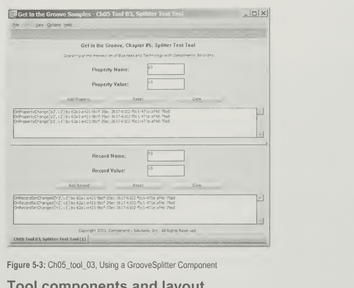

图 5-3：使用 GrooveSplitter 组件的 Ch05_tool_03

#### 工具组件与布局

除了 Ch05_tool1_01 和 Ch05_tool1_02 的逻辑组合外，ch05_tool_03 还有三个额外组件、一个已更改组件和一个已删除组件。已删除的组件是 `GrooveMultiCellLayout` 组件。`GrooveSplitter` 组件替代了它。通过向工具模板添加以下三个组件声明来定义 Splitter：

```
<g:Component Name="Splitter">
    <g:ComponentResource FingerprintID="Groove"
        URL="http://components.groove.net/Groove/Components/Root.osd?Package=net
        .groove.Groove.ToolComponents.GrooveCommonComponents_DLL&amp;Version=0&a
        mp;Factory=Splitter"/>
        <g:PropertyList Version="1">
            <g:Property Name="Orientation" Value="Horizontal"/>
            <g:Property Name="Size" Value="Large"/>
            <g:Property Name="DefaultFocus" Value="Top_Pane"/>
            <g:Property Name="Layout">
```

```
<g:PropertyValue>
    <PANE1>Top_Pane</PANE1>
    <PANE2>Bottom_Pane</PANE2>
</g:PropertyValue>
</g:Property>
</g:PropertyList>
</g:Component>
```

```
<g:Component Name="Top_Pane">
    <g:ComponentResource FingerprintID="Groove"
        URL="http://components.groove.net/Groove/Components/Root.osd?Package=net
        .groove.Groove.ToolComponents.GrooveCommonComponents_DLL&amp;Version=0&amp
        ;Factory=ViewContainer"/>
    <g:PropertyList Version="1">
        <g:Property Name="Background">
            <g:BackgroundStyle Style="SectionBackground"/>
        </g:Property>
    </g:PropertyList>
    <g:ComponentConnections>
        <g:Connection Name="Property_Layout" ConnectionID="0"/>
    </g:ComponentConnections>
</g:Component>
```

```
<g:Component Name="Bottom_Pane">
    <g:ComponentResource FingerprintID="Groove"
        URL="http://components.groove.net/Groove/Components/Root.osd?Package=net
        .groove.Groove.ToolComponents.GrooveCommonComponents_DLL&amp;Version=0&amp
        ;Factory=ViewContainer"/>
    <g:ComponentConnections>
        <g:Connection Name="Record_Layout" ConnectionID="0"/>
    </g:ComponentConnections>
    <g:PropertyList Version="1">
        <g:Property Name="Background">
            <g:BackgroundStyle Style="SectionBackground"/>
        </g:Property>
    </g:PropertyList>
</g:Component>
```

原始的名为 `ToolContainer` 的 `ViewContainer` 已从工具模板中移除。然而，Splitter 需要两个 `ViewContainer`，每个窗格一个。前面的定义设置了以下属性：

```
<g:Property Name="Orientation" Value="Horizontal"/>
<g:Property Name="Size" Value="Large"/>
<g:Property Name="DefaultFocus" Value="Top_Pane"/>
```

正如您可能猜测的那样，将 `Orientation` 的值更改为 `Vertical` 会导致 Splitter 窗格从上到下排列变为从左到右排列。
```


为了将 Ch05_tool_01 和 Ch05_tool_02 结合起来，我使用分割器的上部窗格来容纳 Ch05_tool_01 的 PropertyListEngine 功能。分割器的下部窗格包含 Ch05_tool_02 的 RecordSetEngine 功能。为此，对这两个工具的组件名称做了如下更改：

- Ch05_tool_01 中的 Name、Value、History、Add、Reset 和 Clear 组件已重命名为 Property_Name、Property_Value 等。
- 同样，Ch05_tool_02 中相同名称的组件已重命名为 Record_Name、Record_Value 等。

#### 工具 FormDelegate

FormDelegate 组件声明更新为包含与属性管理按钮和记录管理按钮的组件连接。此外，整个 JavaScript 代码中都做了更改，以适应组件名称的变化。

### Hello ListView：
使用数据结构化视图

设计 Ch05_tool_02 展示了如何创建一个能够使用 Groove 的增量分发服务在共享空间中持久化数据记录的工具。由于数据记录结构良好，你可以利用一个强大的组件——ListView，来呈现底层 RecordSetEngine 的数据。图 5-4 展示了生成的工具。

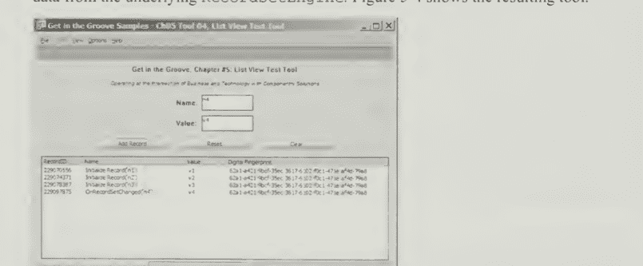

图 5-4：Ch05_tool_04，列表视图组件

#### 工具组件和布局

通过使用此工具，你对 Ch05_tool_02 的布局做了一个更改——将 History 组件替换为以下内容：

```
<g:Component Name="History">
    <g:ComponentResource
    URL="http://components.groove.net/Groove/Components/Root.osd?Package=net
    .groove.Groove.ToolComponents.GrooveCommonComponents_DLL&amp;Version=0&amp;
    Factory=ListView" FingerprintID="Groove"/>
    <g:PropertyList Version="1">
        <g:Property Name="SingleSelection" Value="true"/>
        <g:Property Name="Columns">
            <g:PropertyValue>
                <g:Column Name="RecordID" Width="80"/>
                <g:Column Name="Name" Width="200"/>
                <g:Column Name="Value" Width="80"/>
                <g:Column Name="Digital Fingerprint" Width="300"/>
            </g:PropertyValue>
        </g:Property>
    </g:PropertyList>
</g:Component>
```

创建结构化视图的关键在于列的定义。在本例中，我在设计时于工具模板中定义了列。或者，你也可以在运行时通过调用适当的 IGrooveListView 接口方法来定义列。

在 ListView 组件的初始使用中，我定义了四列：RecordID、Name、Value 和 Digital Fingerprint。我添加了 RecordID 以表明记录集中的每条记录都有一个唯一标识符，可用于检索和操作 RecordSetEngine 中的记录。RecordID 是一个双精度值。

为每列指定的宽度以像素为单位。ListView 组件没有内部约束系统来允许你以可用空间的百分比指定宽度（例如，"将 Name 列设为 25% 宽"）。你必须不是个例工具才能看到提供这种高级功能的组件。

#### 工具 FormDelegate

在 FormDelegate 代码中，自 Ch05_tool_02 以来以下方法已更改：

- OnSetUIProperties — 需要更改以清除 History。通过调用 ListView 的 ResetContent 方法来实现，如下所示：

```
function OnSetUIProperties()
{
    // Clear the listview of entries...
    History.ResetContent();

    ...
}
```

- LoadRecord — 需要更改以通过调用 ListView 的 AddItem 和 SetItemText 方法将特定记录项添加到 ListView。对于 AddItem 方法，我们使用 RecordID 作为键，然后添加两列数据。第一列包含一个值，指示条目是因为我们正在从持久数据初始化，还是因为异步记录集更改通知而创建的。第二列将包含值，第三列将包含用户的数字指纹。代码如下：

```
function Load_Record(pIRecord, bInitializing)
{
    var record_name = pIRecord.OpenFieldAsString("Name");
    var record_value = pIRecord.OpenFieldAsString("Value");
    var fingerprint = pIRecord.OpenFieldAsString("Fingerprint");

    if (bInitializing)
        entry = "Initialize Record(''";
    else
        entry = "OnRecordSetChanged(''";
    entry += record_name + "')";

    // Add the RecordID column entry
    var Index = History.AddItem(pIRecord.RecordID, -1);

    // Add the Name column entry
    History.SetItemText(Index, 1, entry);

    // Add the Value column entry
    History.SetItemText(Index, 2, record_value);

    // Add the ID column entry
    History.SetItemText(Index, 3, fingerprint);
}
```

- Reset_OnButtonUp — 需要更改以清除 ListView 和 RecordSetEngine 中的所有项

- Clear_OnButtonUp — 需要更改以清除 ListView 组件中的所有项，如下所示：

```
function Reset_OnButtonUp(i_pIUICommand)
{
    ...
    // Reset the record set engine
    Engine.RemoveMultipleRecords(Engine.OpenRecordIDEnum());
    History.ResetContent();

    ...
}
```

```
function Clear_OnButtonUp(i_pIUICommand)
{
    History.ResetContent();
}
```

### Hello DataViewer：
使用 DataViewer 组件

图 5-5 展示了 Ch05_tool_05。乍一看，它与图 5-4 中的内容完全相同。区别在于模板声明和 FormDelegate 实现。DataViewer 组件对 RecordSetEngine 有特定的了解，并提供了许多专门针对记录集操作的特性。这个第一个示例展示了开始使用 RecordSetEngine 的基本步骤。后续示例将演示高级功能，例如定义多个数据查看器、使用就地编辑、排序和进行查询。

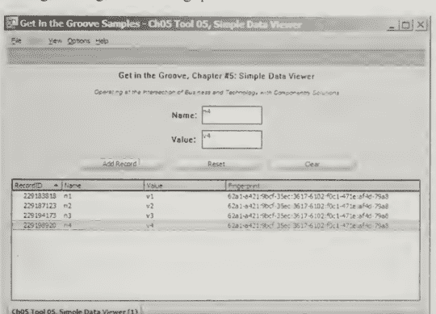

图 5-5：Ch05_tool_05，简单数据查看器

#### 工具组件和布局

你会发现工具模板声明有以下重要更改：

- 删除 History 作为 ListView 组件
- 添加 History 作为 DataViewer 组件，同时添加 ModelGlue、Collection 和 ColumnHeaders 组件。这些都是 DataViewer 正常工作所必需的。

以下代码示例展示了上述更改：

```
<g:Component Name="DataViewer">
```

## 104 第二部分：工具

```
<g:ComponentResource
URL="http://components.groove.net/Groove/Components/Root.osd?Package=net
groove.Groove.ToolComponents.GrooveDataViewerTool_DLL&amp;Version=0&amp
;Factory=DataViewer" FingerprintID="Groove"/>
<g:PropertyList Version="1">
    <g:Property Name="SingleSelection" Value="true"/>
    <g:Property Name="Views">
        <g:PropertyValue>
            <g:DataViewerView Name="Main" Default="True">
                <g:DataViewerColumn Name="_RecordID"走着，Label="RecordID"
DataType="String" Width="10%" ShowTwisty="0" Indent="15" ReadOnly="1"/>
                <g:DataViewerColumn Name="Name" Label="Name" DataType="String"
Width="20%" ShowTwisty="0" Indent="15" ReadOnly="1"/>
                <g:DataViewerColumn Name="Value" Label="Value"
DataType="String" Width="20%"/>
                <g:DataViewerColumn Name="Fingerprint" Label="Fingerprint"
ReadOnly="1" DataType="String" Width="50%"/>
            </g:DataViewerView>
        </g:PropertyValue>
    </g:Property>
    <g:Property Name="Sorts">
        <g:PropertyValue>
            <g:DataViewerSort Name="ByAscID" Column="_RecordID"
DataType="String" Order="Ascending"/>
            <g:DataViewerSort Name="ByAscName" Column="Name"
DataType="String" Order="Ascending"/>
            <g:DataViewerSort Name="ByAscValue" Column="Value"
DataType="String" Order="Ascending"/>
            <g:DataViewerSort Name="ByAscFingerprint" Column="Fingerprint"
DataType="String" Order="Ascending"/>
        </g:PropertyValue>
    </g:Property>
</g:PropertyList>
<g:ComponentConnections>
    <g:Connection Name="ModelGlue" ConnectionID="0"/>
    <g:Connection Name="ColumnHeaders" ConnectionID="1"/>
</g:ComponentConnections>
</g:Component>

<g:Component Name="ModelGlue">
    <g:ComponentResource
URL="http://components.groove.net/Groove/Components/Root.osd?Package=net
groove.Groove.ToolComponents.GrooveDataViewerTool_DLL&amp;Version=0&amp
;Factory=ModelGlue" FingerprintID="Groove"/>
    <g:PropertyList Version="1"/>
    <g:ComponentConnections>
        <g:Connection Name="Collection" ConnectionID="0"/>
        <g:Connection Name="RecordSetEngine" ConnectionID="1"/>
    </g:ComponentConnections>
```


```
</g:Component>

<g:Component Name="ColumnHeaders">
  <g:ComponentResource
URL="http://components.groove.net/Groove/Components/Root.osd?Package=net
.groove.Groove.ToolComponents.GrooveCommonComponents_DLL&amp;amp;Version=0&amp;a
mp;Factory=Header" FingerprintID="Groove"/>
</g:Component>

<g:Component SingleInstance="True" Name="Collection">
  <g:ComponentResource
URL="http://components.groove.net/Groove/Components/Root.osd?Package=net
.groove.Groove.ToolComponents.GrooveListComponents_DLL&amp;amp;Version=0&amp;amp
;Factory=ToolCollectionsComponent" FingerprintID="Groove"/>
</g:Component>
```

添加上述组件声明看起来可能工作量很大——但正是因为这些声明性的更改，你需要编写的FormDelegate代码显著减少了。ModelGlue、Collection和ColumnHeaders组件的声明简单而直接。定义视图的关键在于DataViewer组件的Views属性的声明，如下所示：

```
    <g:Property Name="Views">
      <g:PropertyValue>
        <g:DataViewerView Name="Main" Default="True">
          <g:DataViewerColumn Name="_RecordID" Label="RecordID"
DataType="String" Width="10%" ReadOnly="1"/>
          <g:DataViewerColumn Name="Name" Label="Name" DataType="String"
Width="20%" ReadOnly="1"/>
          <g:DataViewerColumn Name="Value" Label="Value"
DataType="String" Width="20%"/>
          <g:DataViewerColumn Name="Fingerprint" Label="Fingerprint"
ReadOnly="1" DataType="String" Width="50%"/>
        </g:DataViewerView>
      </g:PropertyValue>
    </g:Property>
```

在这个例子中，我定义了一个名为"Main"的视图，它成为了该组件的默认视图。

与不知道底层RecordSetEngine的ListView组件不同，DataViewer的"Column"值不仅需要一个Name，还需要一个Label。Label是显示在列标题中的文本。Name是要在该列中显示的记录字段的名称。

你以百分比的形式定义每一列的宽度——该组件具有内置的约束功能，能够根据可用的屏幕空间自动维持各列的相对宽度。

我已经将所有列字段设置为只读——在此工具中你无法更改它们。在下一个工具中，我将展示如何支持字段值的现场编辑。

#### 工具 FormDelegate

该工具的FormDelegate是你看到显著变化的地方，主要体现在代码的移除而非添加，如下列表所述：

- 从OnSetUIProperties()方法中移除了代码，该方法原本用于从RecordSetEngine初始化记录的呈现。GrooveDataViewer和GrooveDataModelGlue组件的组合会自动处理此初始化。同样，你也不需要实现RecordSetEngine_OnRecordSetChanged()处理程序。
- 在Add_OnButtonUp()中添加了代码，以利用ModelGlue组件的方法（如IGrooveDataModelGlue接口所定义的），如下所示：
- 更改了Clear按钮的OnButtonUp方法和Reset按钮的OnButtonUp方法的实现。现在，要删除所有记录，你使用的是IGrooveDataModelGlue接口方法，而不是底层的IGrooveRecordSet方法，如下所示：

```
function Add_OnButtonUp(i_pUICommand)
{
    var pIRecord =
    ModelGlue.CreateRecord("urn:groove.net:RecordManagerRecord");
    pIRecord.SetField("Name", Name.Text);
    pIRecord.SetField("Value", Value.Text);
    pIRecord.SetField("Fingerprint", g_strMyFingerPrint);
    ModelGlue.AddRecord(pIRecord);
}
```

```
function Clear_OnButtonUp(i_pIUICommand)
{
    var pEnum = RecordSetEngine.OpenRecordIDEnum();
    if (pEnum.HasMore())
        ModelGlue.DeleteRecords(pEnum);
}
```

正如你通过查看工具的FormDelegate代码可以发现的，代码现在简单地创建新记录或删除所有现有记录。ModelGlue和RecordSetEngine组件现在执行所有其他的UI记录管理。事实上，在此工具中甚至没有为DataViewer组件定义任何组件连接。

### 支持现场编辑的 DataViewer：使用 DataViewer 组件，步骤 2

图5-5展示了独立窗口中的Ch05_tool_05。Ch05_tool_06与它看起来完全相同，除了工具名称和Tool_TagLine的表面更改。

变化明显体现在工具的行为上——它允许你现场编辑Value字段。这类似于在电子表格中编辑单元格值，或在理想的Access中编辑数据库记录视图中的字段值。

#### 工具组件与布局

工具模板中DataViewer组件的声明发生了显著变化（请注意加粗的文本）：

```
<g:Component Name="DataViewer">
  <g:ComponentResource URL="http://components.groove.net/Groove/Components/Root.osd?Package=net .groove.Groove.ToolComponents.GrooveDataViewerTool_DL&amp;amp;Version=0&amp;amp ;Factory=DataViewer" FingerprintID="Groove"/>
  <g:PropertyList Version="1">
    <g:Property Name="Views">
      <g:PropertyValue>
        <g:DataViewerView Name="Main" Default="True">
          <g:DataViewerColumn Name="_RecordID" Label="RecordID" DataType="String" Width="10%" ReadOnly="1"/>
          <g:DataViewerColumn Name="Name" Label="Name" DataType="String" Width inherited="0" Indent="15" ReadOnly="1"/>
          <g:DataViewerColumn Name="Value" Label="Value" DataType="String" Width="20%"/>
          <g:DataViewerColumn Name="Fingerprint" Label="Fingerprint" ReadOnly="1" DataType="String" Width="50%"/>
        </g:DataViewerView>
      </g:PropertyValue>
    </g:Property>
    ...
    <g:Property Name="GridLineDescriptor">
      <g:PropertyValue>
        <g:DataViewerGridLineDescriptor Style="Solid" Color="#DCDCDC" Orientation="Both" Visible="0"/>
      </g:PropertyValue>
    </g:Property>
    <g:Property Name="Painters">
      <g:PropertyValue>
        <g:Painter ElementTag="urn:groove.net:RichText" Handler="RichTextPainter"/>
      </g:PropertyValue>
    </g:Property>
```

```
<g:Property Name="Editors">
    <g:PropertyValue>
        <g:Editor ElementTag="urn:groove.net:RichText" Handler="RichTextEditor"/>
    </g:PropertyValue>
</g:Property>
</g:PropertyList>
<g:ComponentConnections>
    <g:Connection Name="ModelGlue" ConnectionID="0"/>
    <g:Connection Name="ColumnHeaders" ConnectionID="1"/>
</g:ComponentConnections>
<g:ComponentGroup>
    <g:Component Name="RichTextPainter">
        <g:ComponentResource URL="http://components.groove.net/Groove/Components/Root.osd?Package=net.groove.Groove.ToolComponents.GrooveTextTools_DLL&amp;Version=0&amp;Factory=TextPainter" FingerprintID="Groove"/>
    </g:Component>
    <g:Component Name="RichTextEditor">
        <g:ComponentResource URL="http://components.groove.net/Groove/Components/Root.osd?Package=net.groove.Groove.ToolComponents.GrooveTextTools_DLL&amp;Version=0,3&amp;Factory=TextView2" FingerprintID="Groove"/>
        <g:PropertyList Version="1">
            <g:Property Name="CellPaste" Value="true"/>
            <g:Property Name="BackStyle" Value="transparent"/>
            <g:Property Name="BorderVisible" Value="false"/>
        </g:PropertyList>
    </g:Component>
</g:ComponentGroup>
</g:Component>
```

第一个显著变化是移除了与Value字段关联的DataViewerColumn属性中的只读属性。这使你只能编辑此列。

其他变化涉及指定DataViewer应如何绘制单元格、如何编辑它们等等。

为了展示现场编辑支持的内部工作原理，我还添加了一个Log组件——一个简单的、多行、只读的编辑组件，以便你可以创建接收到的监听器消息的日志——如下所示：

```
<g:Component Name="Log">
    <g:ComponentResource FingerprintID="Groove"
        URL="http://components.groove.net/Groove/Components/Root.osd?Package=net.groove.Groove.ToolComponents.GrooveCommonComponents_DLL&amp;Version=0&amp;Factory=Edit"/>
    <g:PropertyList Version="1">
</g:Component>
```


 ```
<g:Property Name="Style">
    <g:PropertyValue>
        <g:Item Name="Multiline"/>
        <g:Item Name="ReadOnly" Value="True"/>
        <g:Item Name="VerticalScrollbar"/>
        <g:Item Name="Enabled" Value="False"/>
    </g:PropertyValue>
</g:Property>
</g:PropertyList>
</g:Component>
```

您使用 Log 组件的方式与在本章前三个工具中使用 History 组件的方式相同——将最新的日志事件追加到编辑控件的前面，并将 Log 组件视为一个滚动列表。

最后一处更改是添加了一个与 DataViewer 组件的组件连接，以便代码可以调用默认的事件接收接口，如下所示：

```
<g:Component Name="FormDelegate">
    ...
    <g:ComponentConnections>
        ...
        <g:Connection Name="DataViewer" ConnectionID="3"/>
        ...
    </g:ComponentConnections>
    ...
</g:Component>
```

#### Tool FormDelegate

在 Ch05_tool_06 中，您实现了常见的键盘快捷键 F2 来编辑单元格数据（类似于 Microsoft Excel）。此外，您还支持使用 Enter 键结束就地编辑。图 5-6 显示了该工具在编辑模式下的样子。

为了实现这种行为，您需要实现 `IGrooveUIComponent` 方法的 `OnTranslateAccelerator()`。`OnTranslateAccelerator()` 方法与 `OnSetUIProperties` 方法一样——在实现该方法时，您不需要在名称前加上工具的前缀。以下代码实现了 F2 的处理，用于启动就地编辑模式：

```
var g_bEditing = false;

function OnTranslateAccelerator(i_Message, i_wParam, i_lParam,
i_KeyModifiers)
{
  if (i_wParam == VK_F2 && i_Message == WM_KEYUP)
  {
    // F2 Keyup ... start cell edit mode
    if (!g_bEditing)
    {
      Log.Text = "OnTranslateAccelerator() --- starting edit mode...\n"
+ Log.Text;
      DataViewer.EditCell(2);
      return true;
    }
    return false;
  }
  else if (i_wParam == VK_ENTER && i_Message == WM_KEYUP)
  {
    // Enter Keyup ... end the edit.
    if (g_bEditing)
    {
        Log.Text = "OnTranslateAccelerator() --- ending edit mode...\n" +
Log.Text;
        DataViewer.ToggleEditMode();
        return false;
    }
  }
  return false;
好看的华妃禅让好看快太多啦好看妻多的华夏好看的华中好看的华夏好看的华中科技大对你发家人AIGC好看事件啊、、（Cancel check）
```

ook smaller than expected, but the user experience is still good.

### Customizing the Data Connection

To customize the data connection, you need to understand how the data flows between the components. The data connection is established through the `GrooveDataConnection` component, which acts as a bridge between the `RecordSetEngine` and the `DataViewer` component.

You can customize this connection by implementing specific event handlers or by modifying the properties of the connection. For example, you might want to filter the data before it reaches the viewer or transform the data in some way to better suit your application's needs.

Here's an example of how you might set up a custom data connection in your tool's template:

```
<g:Component Name="CustomDataConnection">
  <g:PropertyList Version="1">
    <g:Property Name="DataSource" Value="RecordSetEngine"/>
    <g:Property Name="DataTarget" Value="DataViewer"/>
    <g:Property Name="Filter" Value="CustomFilterFunction"/>
  </g:PropertyList>
</g:Component>
```

In this example, the `CustomFilterFunction` would be a function you define elsewhere in your code to process the data as it passes through the connection.

### Handling Data Updates

When the data in your application changes, you'll need to ensure that the `DataViewer` component is updated to reflect these changes. This is typically done through event notifications or by explicitly refreshing the data connection.

You can handle data updates by implementing the `OnDataChanged` event in your `FormDelegate` or by calling the `Refresh` method on the `DataConnection` component when you know the data has been modified.

Here's a simple example of handling a data update:

```
function OnDataChanged(eventArgs)
{
  // Log the change
  Log.Text = "Data changed: " + eventArgs.RecordID + "\n" + Log.Text;
  
  // Refresh the data viewer
  DataViewer.Refresh();
}
```

This ensures that your UI stays in sync with the underlying data, providing a smooth and responsive user experience.

### Additional Resources

For more information on working with engine components and customizing your tools, refer to the following resources:

-   [Groove SDK Documentation](https://developer.groove.net/docs)
-   [Community Forums](https://community.groove.net)
-   [Sample Code Repository](https://github.com/groove-samples)

Remember to always test your customizations thoroughly, especially when dealing with data connections and multiple views, to ensure that your application behaves correctly in all scenarios.


*Figure: An example showing multiple data views in a single tool*

By mastering these techniques, you'll be able to create sophisticated and flexible tools that leverage the full power of the Groove platform.
```耐心的
图 5-6：Ch05_tool_06，就地编辑支持

`IGrooveDataViewerSink` 事件接口支持多种方法，这些方法能够实现与您在数据查看器字段的选取和编辑中关联的更细粒度的控制。您需要实现 `OnDataViewerBeginEditCell()` 和 `OnDataViewerEndEditCell()` 方法，以便您可以更新日志、显示正在编辑的单元格，并执行一些编辑后处理。

## 第 5 章：使用引擎组件

`OnDataViewerBeginEditCell` 的处理只是将一个全局标志（g_bEditing）设置为 True 并添加一条日志条目。请注意，您在 `OnTranslateAccelerator` 的实现中使用了 g_bEditing 的值，以支持将 Enter 键用作"结束编辑"的回车键。以下是此功能的实现：

```
function DataViewer_OnDataViewerBeginEditCell(i_DataViewerName,
i_RecordID, i_ColumnName, i_pData, i_pIEventResult)
{
  // Allow edit the cell...
  i_pIEventResult.Result = true;
  g_bEditing = true;
  Log.Text = "BeginEditCell " + i_RecordID + ", ColumnName: " +
i_ColumnName + ", Data: " + i_pData + "\n" + Log.Text;
}
```

`OnDataViewerEndEditCell` 的处理执行一些简单的操作来去除末尾的回车符，如下面的代码所示：

```
function DataViewer_OnDataViewerEndEditCell(i_DataViewerName,
i_RecordID, i_ColumnName, i_pOldData, i_pNewData, i_Result)
{
  // If no change, just exit
  g_bEditing = false;
  if ((GrooveEndEditCellResult_Cancel == i_Result) || (i_pOldData ==
i_pNewData))
  {
    Log.Text = "EndEditCell: No Change\n" + Log.Text;
    return;
  }

  // Simple in-place editing. CRLF caused the end of this edit session
because
  // of use of OnTranslateAccelerator() to catch CR

  var cr_pos = i_pNewData.indexOf("\r");
  var newData;
  if (cr_pos != -1)
  {
    var strPre = i_pNewData.substring(0, cr_pos);
    var strPost = i_pNewData.substring(cr_pos+2);
    newData = strPre + strPost;
  }

  Log.Text = "EndEditCell, iResult: " + i_Result + ", NewData: '" +
newData + "', Old: '" + i_pOldData + "'\n" + Log.Text;

  // Now write the newData value field now that the carriage-return has
been stripped off.
  ModelGlue.SetField(i_RecordID, i_ColumnName, newData);
}
```

您在 FormDelegate 组件的声明中包含的 DataViewer 类型库定义了 i_Result 标志的值，例如 GrooveEndEditCellResult_Cancel：

```
<g:Component Name="FormDelegate">
    ...
    <TYPELIB
    LIBID="{9A25D120-FA0E-11d4-BBAE-00010246B3E5}"
    NAME="GrooveDataViewerTool"
    MAJORVER="1"
    MINORVER="0"/>
    ...
</g:Component>
```

### 定义多视图：使用多个数据视图

前三个工具展示了如何使用 GrooveDataViewer 组件并添加诸如就地编辑和未读支持等功能。使用 GrooveDataViewer 的每个工具实例都声明了针对 RecordSetEngine 的单一视图。从本节这个工具开始，我将介绍支持多视图的能力。通过声明多个视图，您可以构建更丰富的用户界面，向用户展示他们感兴趣的数据或有权查看的数据。

通过支持多视图并为共享空间中的用户角色构建视图，您可以生成一个能够向经理展示一种数据视图、向参与者展示另一种视图、向访客展示又一种视图的工具。

> **提示** 我将在第 8 章展示如何在工具中构建自定义角色和权限。通过将该技术与创建多视图的能力相结合，您随后可以构建一个为每个自定义角色呈现独特 UI 的工具。例如，您可以构建一个拍卖工具，对于"买家"显示当前要价，而"卖家"只看到当前出价。

图 5-7 展示了如果您使用"Simple"视图并编辑 Value 字段，Ch05_tool_07 的外观。Ch05_tool_07 与 Ch05_tool_05 或 Ch05_tool_06 的关键区别在于增加了两个按钮。

按钮的用途不言而喻——它们会触发 DataViewer 组件显示其他视图。

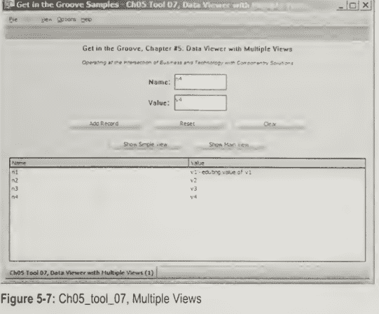

#### 工具组件和布局

对工具模板的第一个更改是移除 Log 组件，我在前一个工具中包含它是为了向您展示 DataViewerSink 方法的内部工作原理。对工具模板的主要更改是添加了两个新按钮组件的模板声明，如下所示：

```
<g:Component Name="Show_Simple">
  <g:ComponentResource FingerprintID="Groove"
URL="http://components.groove.net/Groove/Components/Root.osd?Package=net
.groove.Groove.ToolComponents.GrooveCommonComponents_DLL&amp;Version=0&a
mp;Factory=Button"/>
  <g:PropertyList Version="1">
    <g:Property Name="Style" Value="StandardButton"/>
    <g:Property Name="Label" Value="Show Simple View"/>
  </g:PropertyList>
</g:Component>
```

```
<g:Component Name="Show_Main">
  <g:ComponentResource FingerprintID="Groove"
URL="http://components.groove.net/Groove/Components/Root.osd?Package=net
.groove.Groove.ToolComponents.GrooveCommonComponents_DLL&amp;Version=0&a
mp;Factory=Button"/>
  <g:PropertyList Version="1">
    <g:Property Name="Style" Value="StandardButton"/>
    <g:Property Name="Label" Value="Show Main View"/>
  </g:PropertyList>
</g:Component>
```

对 DataViewer 组件模板声明的更改是添加了一个 DataViewerView 属性来定义"Simple"视图，如下所示：

```
<g:Component Name="DataViewer">
  ...
  <g:PropertyList Version="1">
    <g:Property Name="Views">
      <g:PropertyValue>
        <g:DataViewerView Name="Main" Default="True">
          <g:DataViewerColumn Name="_RecordID" Label="RecordID"
DataType="String" Width="10%" ShowTwisty="0" Indent="15" ReadOnly="1"/>
          <g:DataViewerColumn Name="Name" Label="Name" DataType="String"
Width="20%" ShowTwisty="0" Indent="15" ReadOnly="1"/>
          <g:DataViewerColumn Name="Value" Label="Value"
DataType="String" Width="20%"/>
          <g:DataViewerColumn Name="Fingerprint" Label="Fingerprint"
ReadOnly="1" DataType="String" Width="50%"/>
        </g:DataViewerView>
        <g:DataViewerView Name="Simple" Default="False">
          <g:DataViewerColumn Name="Name" Label="Name" DataType="String"
Width="50%" ShowTwisty="0" Indent="15" ReadOnly="1"/>
          <g:DataViewerColumn Name="Value" Label="Value"
DataType="String" Width="50%"/>
        </g:DataViewerView>
      </g:PropertyValue>
    </g:Property>
```

在设计时添加这些视图就是这么简单。您在前面的组件声明中创建的第二个视图显示了记录的 Name 和 Value 字段的值。

> **注意** 您可能会认为可以像使用 ListView 组件那样以编程方式定义视图——在该组件中，您可以动态创建列。然而，在 Groove 2.0 及更早版本中，您无法在运行时动态定义视图。就接口和 API 而言，某些元素已经就位，但它们尚未完善到可以让您即时定义视图的程度。

#### Tool FormDelegate

从工具的 FormDelegate 角度来看，切换视图非常简单。为了支持这一功能，您添加了一个 `Switch_View()` 函数来完成这项工作并调用适当的 API，如下所示：

```
function Switch_View (sTargetView)
{
  var sCurrentView = ModelGlue.Collection.GetCurrentView();
  if (sCurrentView == sTargetView)
    return;
  if (!ModelGlue.Collection.HasView(sTargetView))
  {
```

 ```
GrooveScriptFunctions.DoMessageBox("Error: '" + sTargetView + "' view not defined!", "Show " + sTargetView + " View");
    return;
}

if (!DataViewer.ChangeView(sTargetView))
    GrooveScriptFunctions.DoMessageBox("Error switching to 'Main' view", "Show Main View");
}

function Show_Main_OnButtonUp(i_pIUICommand)
{
  Switch_View("Main");
  g_EditColCur = 2;
}

function Show_Simple_OnButtonUp(i_pIUICommand)
{
  Switch_View("Simple");
  g_EditColCur = 1;
}
```

你还需要修改 `g_EditColCur` 的值，因为 `OnTranslateAccelerator` 处理代码会用到这个值——"Main" 和 "Simple" 两个视图中的 **Value** 列位于不同的顺序位置。我们需要修改 `g_EditColCur` 的值，是因为我们仍然支持就地编辑功能——而我们定义的视图具有不同数量的列。

你还需要做一些其他较小的改动——主要是移除你在该工具的上一版本中添加的用于支持 **Log** 组件的代码。

### Using a Custom Schema: Working with Multiple Data Views

本章中前面六版工具都使用了标准的 GrooveRecord。对于 Ch05_tool_02 到 Ch05_tool_07，你使用的是一个名为 urn:groove.net:Record 的记录。每个 RecordSetEngine 的声明都在 ClassInfo 元素中指定了这种记录类型。这种记录类型是作为 Groove 核心安装的一部分来定义的：

```
<g:PropertyValue>
  <g:ClassInfo Name="urn:groove.net:Record"
URL="http://components.groove.net/Groove/Components/Root.osd?Package=net
.groove.Groove.ToolComponents.GrooveListComponents_DLL&amp;Version=0&amp
;Factory=Record"/>
</g:PropertyValue>
```

在 Ch05_tool_08 中，我介绍了一种不同的记录模式。

> **注意** 作为 GetInTheGroove 安装工具安装的一部分（如 *Preface* 和 "What's on the CD-ROM" 附录中所述），会安装若干工具和两种自定义模式。Ch05_schema_01 就是所安装的模式之一。

图 5-8 展示了在使用 "Details" 视图时 Ch05_tool_08 的外观。

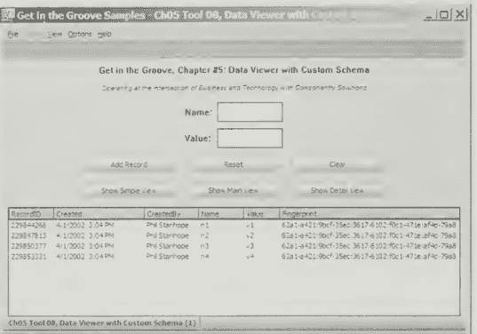

#### Tool components and layout

你会发现组件声明有很多变化。在检查 Ch05_tool_08 时遇到的第一个变化就在 `<g:Schemas>` 声明中，如下代码所示：

```
<g:Document Name="ch05_tool_08.tpl" xmlns:g="urn:groove.net">
  <g:ToolTemplate
    Name="ch05_tool_08.tool"
    TemplateDisplayName="Ch05 Tool 08, Data Viewer with Custom Schema"
    DefaultToolDisplayName="Ch05 Tool 08, Data Viewer with Custom
Schema">
    <g:ViewInfo Lifetime="Limited"/>
    <g:ComponentGroup DefaultView="ToolContainer" Delegate="ToolScript">
      <g:Schemas>
        <g:Schema
URL="grooveDocument:///GrooveXSS/$PersistRoot/Schemas.xss/Ch05_schema_01
.xml"/>
      </g:Schemas>
      ...
  </g:ComponentGroup>
</g:Document>
```

这个声明引用了安装程序导入 schemas.xss 数据库的文件。你的自定义模式定义内容如下：

```
<g:Schema URL="Ch05_schema_01.xml" xmlns:g="urn:groove.net" Version="1,0,0,0">
  <g:IncludeSchemas>
    <g:AdditionalSchema URI="grooveDocument:///GrooveXSS/$PersistRoot/Schemas.xss/GrooveStandardRecordsSchema2.xml" />
  </g:IncludeSchemas>
  <g:ElementDecl Name="urn:groove.net:Ch05_schema_01_record" ElementTemplate="true">
    <g:ElementRef Element="urn:groove.net:Record" IsChildElement="0" />
    <g:AttrGroup>
      <g:AttrDef Name="Name" Type="String"/>
      <g:AttrDef Name="Value" Type="String"/>
      <g:AttrDef Name="Fingerprint" Type="String"/>
      <g:AttrDef Name="_IsRead" Type="Bool"/>
    </g:AttrGroup>
  </g:ElementDecl>
</g:Schema>
```

依赖模式的声明（由 `<g:IncludeSchemas>` 元素指定）如下：

```
<g:Schema Version="1,0,0,0" URL="GrooveStandardRecordsSchema.xml" xmlns:g="urn:groove.net">
  <g:ElementDecl ElementTemplate="true" Name="urn:groove.net:Record">
    <g:AttrGroup>
      <g:AttrDef Type="Double" Name="_RecordID"/>
      <g:AttrDef Type="Date" Name="_Created"/>
      <g:AttrDef Type="String" Name="_CreatedBy"/>
      <g:AttrDef Type="Date" Name="_Modified"/>
      <g:AttrDef Type="String" Name="_ModifiedBy"/>
    </g:AttrGroup>
  </g:ElementDecl>
  ...
</g:Schema>
```

GrooveStandardRecordSchema 是 Groove 核心安装的一部分。要查看该模式，请使用 Groove Database Navigator，具体步骤如下：

- 1. 将 Groove Database Navigator 工具添加到共享空间。
- 2. 导航至 schemas.xss 数据库。双击展开并显示数据库中的文档。
- 3. 导航至 groovestandardrecordschema.xml 文档。
- 4. 单击 **View Document** 以查看并显示该文档。

通过将你的模式定义为派生模式，你最终会得到一个包含以下九个字段的记录：

- _RecordID: type Double
- _Created: type Date
- _CreatedBy: type String
- _Modified: type Date
- _ModifiedBy: type String
- Name: type String
- Value: type String
- Fingerprint: type String
- _IsRead: type Bool

关于如何创建这些记录的实例，我将在下一节"Tool FormDelegate"中向你展示。

你在工具模板中遇到的下一个重要变化是添加了"Details"视图，用于根据你正在使用的模式显示一些现在可用的字段，具体如下：

```
<g:component Name="DataViewer"
  ...
  <g:DataViewerView Name="Details" Default="False">
    <g:DataViewerColumn Name="_RecordID" Label="RecordID" DataType="String" Width="10%" ShowTwisty="0" Indent="15" ReadOnly="1"/>
    <g:DataViewerColumn Name="_Created" Label="Created" DataType="DateTime" Width="20%" ReadOnly="1"/>
    <g:DataViewerColumn Name="_CreatedBy" Label="CreatedBy" DataType="String" Width="10%" ReadOnly="1"/>
    <g:DataViewerColumn Name="Name" Label="Name" DataType="String" Width="10%" ReadOnly="1"/>
    <g:DataViewerColumn Name="Value" Label="Value" DataType="String" Width="20%"/>
    <g:DataViewerColumn Name="Fingerprint" Label="Fingerprint" ReadOnly="1" DataType="String" Width="25%"/>
  </g:DataViewerView>
  ...
</g:component>
```

你在 RecordSetEngine 的声明中做了一个关键性改动。改动在于 ClassInfo 值。指定来自包含模式的记录非常重要，因为这会使 RecordSetEngine 强制执行数据类型值。在 FormDelegate 代码中创建 RecordSetEngine 记录时，你也会看到类似的变化，如下代码所示：

```
<g:Component SingleInstance="True" Category="Engine"
Name="RecordSetEngine">
  ...
  <g:PropertyList Version="1">
    <g:Property Name="ClassInfoList">
      <g:PropertyValue>
        <g:ClassInfo Name="urn:groove.net:Ch05_schema_01_record"
URL="http://components.groove.net/Groove/Components/Root.osd?Package=net
.groove.Groove.ToolComponents.GrooveListComponents_DLL&amp;Version=0&amp
;Factory=Record"/>
      </g:PropertyValue>
    </g:Property>
    ...
</g:Component>
```

最后，你添加了另一个按钮，以便 responds you can obtain access to this new view that shows the newly available record fields, as follows:

```
<g:Component Name="Show_Details">
  <g:ComponentResource FingerprintID="Groove"
URL="http://components.groove.net/Groove/Components/Root.osd?Package=net
.groove.Groove.ToolComponents.GrooveCommonComponents_DLL&amp;Version=0&a
mp;Factory=Button"/>
  <g:PropertyList Version="1">
    <g:Property Name="Style" Value="StandardButton"/>
    <g:Property Name="Label" Value="Show Detail View"/>
  </g:PropertyList>
</g:Component>
```

#### Tool FormDelegate

你首先做的一个简单改动是为 **Show_Details** 按钮实现 `OnButtonUp()` 方法，如下所示：

```
function Show_Details_OnButtonUp(i_pIUICommand)
{
  Switch_View("Details");
  g_EditColCur = 4;
}
```

请注意，我将 `g_EditColCur` 的值设置为 4，这是因为 **Value** 字段在该视图中的位置。

接下来也是最重要的改动是对 `Add_OnButtonUp` 的实现所做的修改。在之前的示例中，你只是简单地创建了 urn.groove.net:Record 的实例——这是所有之前基于 RecordSetEngine 的工具的 ClassInfo 值。
```


既然你已在使用自定义架构，就必须确保创建正确的记录类型，如下例所示：

```
function Add_OnButtonUp(i_pIUICommand)
{
  // Create an instance of our private schema record
  var pIRecord =
ModelGlue.CreateRecord("urn:groove.net:Ch05_schema_01_record");
  pIRecord.SetField("Name", Name.Text);
  pIRecord.SetField("Value", Value.Text);
  pIRecord.SetField("Fingerprint", g_strMyFingerPrint);

  // Add the record
  ModelGlue.AddRecord(pIRecord);
}
```

在 Reset_OnButtonUp 的实现中，你也需要进行类似的更改，如下所示：

```
function Reset_OnButtonUp(i_pIUICommand)
{
  ...

  // Add the default record
  var pIRecord =
ModelGlue.CreateRecord("urn:groove.net:Ch05_schema_01_record");
  ...
  ModelGlue.AddRecord(pIRecord);
}
```

```
function Show_Details_OnButtonUp(i_pIUICommand)
{
  Switch_View("Details");
  g_EditColCur = 7;
}
```

请注意，你只需为 Name、Value 和 Fingerprint 字段定义值。Groove 自动处理其他字段值——也就是说，RecordSetEngine 的内部实现会自动管理 _Created、_CreatedBy、_ModifiedBy、_Modified 和 _IsRead 字段。

你为该工具创建 "Details" 视图，以展示 Groove 内部引擎现在提供并维护的附加字段。

### 添加未读标记支持

在上一节中，我介绍了派生自 GrooveStandardRecordSchema 的自定义架构。我已经向你展示，Groove 的 RecordSetEngine 会自动管理该记录中的多个字段。

在本节中，你将使用相同的架构，并添加必要的声明以启用已读和未读标记。你还实现了另外两个键盘加速器，以便轻松触发相应行为，如下所述：

- F3 切换未读标记。
- F4 自动更新 Value 字段。

图 5-9 展示了如果你使用 "Details" 视图，Ch05_tool_09 的外观。

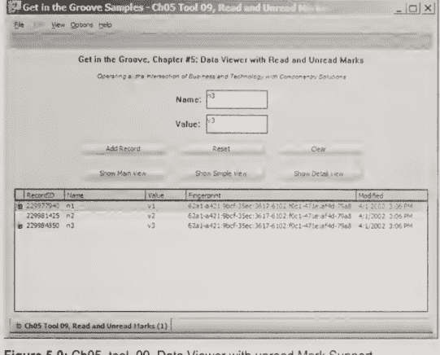

图 5-9：Ch05_tool_09，支持未读标记的数据查看器

为了实现另一项功能——自动将记录标记为已读——你必须包含一个 IGrooveTimer 组件。你还添加一个与 Timer 组件的组件连接，以便能够对该组件进行脚本编写。

你的自动标记处理工作方式如下：

1. 通过直接点击某一行，或者将焦点移到 DataViewer 并使用上/下箭头键在记录之间导航，来选择一个 DataViewer 行。请注意，如果你创建了一条 DataViewer 记录，该记录会自动被选中，从而自动标记为已读（对于创建该记录的成员而言）。
2. 如果你移动到一个尚未阅读的记录，五秒后，该记录会自动标记为已读。

#### 工具组件和布局

在工具模板声明中，你遇到的第一个更改是向 DataViewer 的静态定义视图添加一个新列，如下代码所示：

```
<g:Component Name="DataViewer" ...>
    ...
    <g:Property Name="Views">
        <g:PropertyValue>
            <g:DataViewerView Name="Main" Default="True">
                <g:DataViewerColumn Name="_IsRead" Label="" Width="15" ReadOnly="1">
                    <g:IconDesc
URL="grooveFile:///ToolData\groove.net\CommonData\UnreadIconImages.jpg"
MaskURL="grooveFile:///ToolData\groove.net\CommonData\UnreadIconImagesMa
sk.bmp" Width="13" Height="13"/>
                </g:DataViewerColumn>
                <g:DataViewerColumn Name="_RecordID" Label="RecordID"
Color="Red" DataType="String" Width="10%" ShowTwisty="0" ReadOnly="1"/>
                <g:DataViewerColumn Name="Name" Label="Name" DataType="String"
Width="20%" ShowTwisty="0" ReadOnly="1"/>
                <g:DataViewerColumn Name="Value" Label="Value"
DataType="String" Width="20%"/>
                <g:DataViewerColumn Name="Fingerprint" Label="Fingerprint"
ReadOnly="1" DataType="String" Width="40%"/>
                <g:DataViewerColumn Name="_Modified" Label="Modified"
DataType="DateTime" Width="10%" ReadOnly="1"/>
            </g:DataViewerView>
            <g:DataViewerView Name="Simple" Default="False">
                <g:DataViewerColumn Name="_IsRead" Label="" Width="15"
ReadOnly="1">
                    <g:IconDesc
URL="grooveFile:///ToolData\groove.net\CommonData\UnreadIconImages.jpg"
MaskURL="grooveFile:///ToolData\groove.net\CommonData\UnreadIconImagesMa
sk.bmp" Width="13" Height="13"/>
                </g:DataViewerColumn>
                <g:DataViewerColumn Name="Name" Label="Name" DataType="String"
ShowTwisty="0" Width="50%" ReadOnly="1"/>
                <g:DataViewerColumn Name="Value" Label="Value"
DataType="String" Width="50%"/>
            </g:DataViewerView>
            <g:DataViewerView Name="Details" Default="False">
                <g:DataViewerColumn Name="_IsRead" Label="" Width="15"
ReadOnly="1">
                    <g:IconDesc
URL="grooveFile:///ToolData\groove.net\CommonData\UnreadIconImages.jpg"
MaskURL="grooveFile:///ToolData\groove.net\CommonData\UnreadIconImagesMa
sk.bmp" Width="13" Height="13"/>
                </g:DataViewerColumn>
                <g:DataViewerColumn Name="_RecordID" Label="RecordID"
DataType="String" ShowTwisty="0" Width="10%" ReadOnly="1"/>
                <g:DataViewerColumn Name="_Created" Label="Created"
DataType="DateTime" Width="10%" ReadOnly="1"/>

            <g:DataViewerColumn Name="_CreatedBy" Label="CreatedBy"
DataType="String" Width="10%" ReadOnly="1"/>
            <g:DataViewerColumn Name="_Modified" Label="Modified"
DataType="DateTime" Width="10%" ReadOnly="1"/>
            <g:DataViewerColumn Name="_ModifiedBy" Label="ModifiedBy"
DataType="String" Width="10%" ReadOnly="1"/>
            <g:DataViewerColumn Name="Name" Label="Name" DataType="String"
Width="10%" ReadOnly="1"/>
            <g:DataViewerColumn Name="Value" Label="Value"
DataType="String" Width="20%"/>
            <g:DataViewerColumn Name="Fingerprint" Label="Fingerprint"
ReadOnly="1" DataType="String" Width="20%"/>
          </g:DataViewerView>
        </g:PropertyValue>
      </g:Property>
    ...
</g:Component>
```

下一个更改是在 RecordSetEngine 组件的声明中，如下所示：

```
<g:Component SingleInstance="True" Category="Engine"
Name="RecordSetEngine">
  <g:ComponentResource
URL="http://components.groove.net/Groove/Components/Root.osd?Package=net
.groove.Groove.ToolComponents.GrooveListComponents_DLL&amp;Version=0,4&a
mp;Factory=RecordSetEngine3" FingerprintID="Groove"/>
  <g:EngineDesc Tag="urn:groove.net:RecordSetEngine"/>
  <g:PropertyList Version="1">
    <g:Property Name="ClassInfoList">
      <g:PropertyValue>
        <g:ClassInfo Name="urn:groove.net:Ch05_schema_01_record"
URL="http://components.groove.net/Groove/Components/Root.osd?Package=net
.groove.Groove.ToolComponents.GrooveListComponents_DLL&amp;Version=0&amp
;Factory=Record">
          <g:Fields>
            <g:Field Name="Value" TriggerUnread="true"/>
          </g:Fields>
        </g:ClassInfo>
      </g:PropertyValue>
    </g:Property>
  </g:PropertyList>
  <g:ComponentConnections>
    <g:Connection Name="Collection" ConnectionID="0"/>
  </g:ComponentConnections>
</g:Component>
```

添加此声明会使 RecordSetEngine 组件自动维护 _IsRead 字段。

以下代码展示了你用于实现自动记录标记功能的 Timer 组件的声明：

```
<g:Component Name="Timer">
  <g:ComponentResource FingerprintID="Groove"
URL="http://components.groove.net/Groove/Components/Root.osd?Package=net
.groove.Groove.ToolComponents.GrooveCommonComponents_DLL&amp;Version=0&a
mp;Factory=Timer"/>
  <g:PropertyList Version="1"/>
</g:Component>
```

#### 工具 FormDelegate

在 Initialize() 函数中，你添加了一个全局变量 g_strName 的缓存，现在你在记录中使用它，如下所示：

```
function Initialize()
{
  ...
  g_strName =
PropertyList.OpenProperty(PROPERTY_CURRENT_IDENTITY).Contact.OpenVCard()
.OpenIdentification().OpenFullName();
}
```

IGrooveIdentification 接口的 OpenFullName() 方法使你能够获取你在每个共享空间的成员列表中显示的名称。为了访问此变量，你需要从 IGrooveIdentity 遍历到 IGrooveContact，再到 IGrooveVCard，以获得必要的接口引用。你使用此变量将你全名设置到所创建或修改的每条记录的 _ModifiedBy 字段中。

你在代码中遇到的下一组更改是 Add_OnButtonUp() 和 Reset_OnButtonUp() 方法，其中你添加了对设置 _ModifiedBy 字段的调用，如下所示：

```
function Add_OnButtonUp(i_pIUICommand)
{
  ...
  pIRecord.SetField("_ModifiedBy", g_strName);
  ...
}
```

```
function Reset_OnButtonUp(i_pIUICommand)
{
  ...
  pIRecord.SetField("_ModifiedBy", g_strName);
  ...
}
```


要支持F3和F4键盘加速器，您需要在`OnTranslateAccelerator()`的实现中添加以下代码：

```
function OnTranslateAccelerator(i_Message, i_wParam, i_lParam, i_KeyModifiers)
{
  ...
  else if (i_wParam == GROOVE_VK_F3 && i_Message == GROOVE_WM_KEYUP)
  {
    // F3 松开键 ... 切换已读/未读标记
    var RecordID = DataViewer.GetIDOfFocusRow();
    if (RecordID != -1)
    {
      var bRead = RecordSetEngine.OpenRecord(RecordID).OpenFieldAsBool("_IsRead");
      RecordSetEngine.MarkRecordRead(RecordID, !bRead);
      return true;
    }
  }
  else if (i_wParam == GROOVE_VK_F4 && i_Message == GROOVE_WM_KEYUP)
  {
    // F4 松开键 ... 强制修改
    var RecordID = DataViewer.GetIDOfFocusRow();
    if (RecordID != -1)
    {
      var val = RecordSetEngine.OpenRecord(RecordID).OpenFieldAsString("Value");
      var CurrentDate = new Date();
      ModelGlue.SetField(RecordID, "Value", "update@" + CurrentDate.getTime());
      ModelGlue.SetField(RecordID, "_ModifiedBy", g_strName);
      return true;
    }
  }
  ...
  return false;
}
```

最后，要支持记录的自动标记，您需要实现以下代码：

```
var g_FocusID = -1;

function DataViewer_OnDataViewerRecordSelectionChanged(i_DataViewerName)
{
  var RecordID = DataViewer.GetIDOfFocusRow();
  if (RecordID != -1)
  {
    var bRead = RecordSetEngine.OpenRecord(RecordID).OpenFieldAsBool("_IsRead");
    if (!bRead)
    {
      // 启动一个5秒的计时器
      g_FocusID = RecordID;
      Timer.Interval = 5000;
      Timer.Start();
    }
  }
}

function Timer_OnTimer(i_Name)
{
  // 停止计时器
  Timer.Stop();
  // 确保记录仍然存在（用户可能已经点击了
  // 清除/重置按钮）
  if (RecordSetEngine.HasRecord(g_FocusID))
  {
    // 标记该记录...
    RecordSetEngine.MarkRecordRead(g_FocusID, true);
    g_FocusID = -1;
  }
}
```

### 为您的工具添加概览

现在您已经有了一个可以显示各种数据视图的工具，我将向您展示如何在该工具中添加概览文本，以便向用户展示如何使用您在ch05_tool_09中实现的F2、F3和F4功能。

图5-10显示了在使用“主视图”时`Ch05_tool_10`的外观。

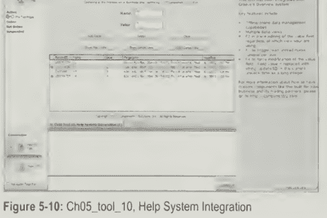

图5-10：Ch05_tool_10，帮助系统集成

请注意，图5-10中展示的是完整的收发器，而不是像本章其他工具那样仅在独立窗口中运行的工具。我采取这种方式的原因是Groove不支持工具级别的帮助。

#### 工具组件和布局

要支持添加概览，您必须添加两个新组件，并在`Ch05_tool_10`的工具模板中声明您正在主组件组中使用`HelpInfoProvider`，如下列代码所示：

```
<g:Document ...>
    ...
    <g:ComponentGroup DefaultView="ToolContainer"
Delegate="FormDelegate" HelpInfoProvider="RTFHelpProvider">
    ...
        <g:Component Name="RTFHelpProvider">
            <g:ComponentResource FingerprintID="Groove"
URL="http://components.groove.net/Groove/Components/Root.osd?Package=net.groove.Groove.ToolComponents.GrooveCommonComponents_DLL&amp;Version=0&amp;Factory=RTFHelpProvider"/>
            <g:PropertyList Version="1"/>
            <g:ComponentConnections>
              <g:Connection ConnectionID="2" Name="RTFView"/>
            </g:ComponentConnections>
            <g:ExternalObjectConnections>
              <g:Connection ConnectionID="0" Name="HelpHandler"/>
            </g:ExternalObjectConnections>
        </g:Component>

        <g:Component Name="RTFView">
            <g:ComponentResource FingerprintID="Groove"
URL="http://components.groove.net/Groove/Components/Root.osd?Package=net.groove.Groove.ToolComponents.GrooveTextTools_DLL&amp;Version=0&amp;Factory=TextView"/>
                <g:PropertyList Version="1">
                    <g:Property Name="ReadOnly" Value="true"/>
                    <g:Property Name="BackStyle" Value="transparent"/>
                    <g:Property Name="MenuStyle" Value="static"/>
                    <g:Property Name="BorderVisible" Value="false"/>
                </g:PropertyList>
        </g:Component>
    ...
</g:Document>
```

您还需要将后续在运行时传递给`HelpInfoProvider`组件的四个字符串添加为静态属性，如下所示：

```
<g:Component Name="FormDelegate">
    ...
    <g:ComponentConnections>
        ...
        <g:Connection Name="RTFHelpProvider" ConnectionID="13"/>
        ...
    </g:ComponentConnections>

    <g:Property Name="Default_ContextHelpURL" Value=""/>
    <g:Property Name="Default_HeaderText" Value="Data Viewer Test Tool Help"/>
    <g:Property Name="Default_HelpDisplayName" Value="Data Viewer Test Tool (V6)"/>
    <g:Property Name="Default_RTFText" Value="">
      <g:PropertyValue>
        <![CDATA[{{\rtf1\ansi\deff0\deftab720{{\fonttbl{{\f0\fswiss MS Sans Serif;}}{{\f1\froman\fcharset2 Symbol;}}{{\f2\fswiss\fprq2 Verdana;}}{{\f3\froman Times New Roman;}}{{\f4\fnil\fprq2\fcharset2 Wingdings;}}{{\f5\froman\fprq2 Times New Roman;}}}
{\colortbl\red0\green0\blue0;}
\deflang1033\pard\ri-90\plain\f2\fs20
此工具已与Groove的概览系统集成。
\deflang1033\pard\ri-90\plain\f2\fs20
\par \deflang1033\pard\ri-90\plain\f2\fs20
\par 主要功能包括：\par
\par \pard\li360\fi-360\tx360\plain\f4\fs20 \'a7\tab \plain\f2\fs20 离线/在线数据管理能力
\par \pard\li360\fi-360\tx360\plain\f4\fs20 \'a7\tab \plain\f2\fs20 多种数据视图
\par \pard\li360\fi-360\tx360\plain\f4\fs20 \'a7\tab \plain\f2\fs20 F2键就地编辑值字段，无论您使用哪个视图。
\par \pard\li360\fi-360\tx360\plain\f4\fs20 \'a7\tab \plain\f2\fs20 F3键切换已读/未读标记（每个用户独立）
\par \pard\li360\fi-360\tx360\plain\f4\fs20 \'a7\tab \plain\f2\fs20 F4键强制修改值字段。字段值被替换为字符串'updated@' + 当前世界时间（长整数）。
\par \deflang1033\pard\ri-90\plain\f2\fs20
\par 有关如何为您的业务及其贸易伙伴构建此类自定义组件的更多信息，请访问http://componentry.com。
    }}]]>
      </g:PropertyValue>
    </g:Property>
    ...
</g:Component>
```

#### 工具FormDelegate

要初始化工具的概览，您需要添加一个新方法`Initialize_Help()`，并从`IGrooveComponent`的`Initialize()`方法中调用它，如下所示：

```
function Initialize()
{
  ...
  Initialize_Help();
}

// 在收发器帮助菜单项“...”上显示的文本
var g_HelpDisplayName;

// 在帮助概览组件标题中显示的文本
var g_HeaderText;

// 在帮助概览组件正文中显示的文本
var g_RTFText;

// 链接到更多在线信息的URL
var g_ContextHelpURL;

function Initialize_Help()
{
  // 从工具模板中定义的静态属性检索默认帮助信息
  g_ContextHelpURL = PropertyList.OpenPropertyAsString("Default_ContextHelpURL");
  g_HeaderText = PropertyList.OpenPropertyAsString("Default_HeaderText");
  g_HelpDisplayName = PropertyList.OpenPropertyAsString("Default_HelpDisplayName");
  Element = PropertyList.OpenPropertyAsElement("Default_RTFText");
  g_RTFText = Element.OpenContentText(0);

  // 传递帮助信息。
  RTFHelpProvider.HeaderText = g_HeaderText;
  RTFHelpProvider.RTFText = g_RTFText;
  RTFHelpProvider.HelpDisplayName = g_HelpDisplayName;
  RTFHelpProvider.SetHelpURL(4, g_ContextHelpURL, 0);
}
```

这就是添加工具概览所需的全部工作！现在您需要做的是为您的工具编写一个简短的概览，然后使用WordPad或类似支持富文本的编辑器来生成RTF格式的内容。

在下一节中，我将向您展示如何将工具与收发器的工具栏更紧密地集成。

### 收发器工具栏集成：为您的工具添加工具栏菜单

现在您已经有了一个可以显示各种数据视图并添加了帮助的工具，您可以提供一种替代机制来访问`简单`、`主视图`、`详细信息`、`重置`和`清除`按钮。您可以通过将工具与收发器的工具栏集成来实现这一点。

图5-11显示了当您使用“简单视图”并访问工具的自定义菜单时，`Ch05_tool_11`的外观。

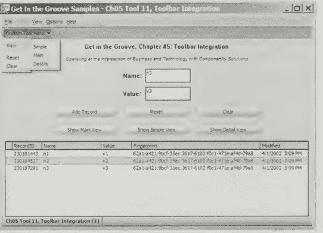

图5-11：Ch05_tool_11，工具栏集成

#### 工具组件和布局

将工具与工具栏集成的关键步骤是实现`OnConnectToExternalObject()`和`OnUnConnectFromExternalObjects()`方法。为了使这些`IGrooveUIComponent`方法被调用，您需要在`FormDelegate`组件的声明中添加以下内容：

```
<g:Component Name="FormDelegate">
    ...
    <g:ExternalObjectConnections>
        <g:Connection Name="ToolCommandContainer" ConnectionID="0"/>
    </g:ExternalObjectConnections>
    ...
</g:Component>
```

上述声明告诉Groove ScriptHost您希望与内部（Groove收发器）对象`ToolCommandContainer`建立自动连接。您需要在`FormDelegate`代码中处理此外部对象连接。


 # ## 工具 FormDelegate

要正确建立与 ToolCommandContainer 组件（实现 IGrooveUICommandContainer 接口）的连接，您必须实现以下方法：

```
var g_pToolCommandContainer;
var g_bCommandsShown=false;

function OnConnectToExternalObject(i_Object, i_ConnectionID)
{
  if (0 == i_ConnectionID)
  {
    // Connect to IGrooveUICommandContainerListener
    g_pToolCommandContainer = i_Object;
    ConnectObject(g_pToolCommandContainer, "ToolCommands_");
    ToolCommands_Show();
  }
}

function OnUnconnectFromExternalObjects()
{
  // Unconnect event sinks
  if (typeof g_pToolCommandContainer != "undefined")
  {
    ToolCommands_Hide();
    DisconnectObject(g_pToolCommandContainer);
  }
}
```

此示例是您第一次看到 IGrooveScriptHost 的 ConnectObject 方法的使用。该方法使您能够动态形成与特定组件的接收器的连接。在本例中，您连接到 ToolCommandContainer 的 IGrooveUICommandContainerListener 接口。通过这样做，您现在可以实现 OnCommand 方法的处理程序。

第一步是构建工具菜单。这里保持简单，不要使用图像按钮：

```
var COMMAND_MENU1            = "ToolMenu1";
var COMMAND_MENU1_VIEW       = "ToolMenu1_Cmd1";
var COMMAND_MENU1_RESET      = "Reset";
var COMMAND_MENU1_CLEAR      = "Clear";
var COMMAND_MENU1_SEPARATOR  = "Menu_Separator";
var COMMAND_VIEW_SIMPLE      = "View_Simple";
var COMMAND_VIEW_MAIN        = "View_Main";
var COMMAND_VIEW_DETAILS     = "View_Details";

var COMMAND_MENU1_LABEL      = "Custom Tool Menu";
var COMMAND_MENU1_VIEW_LABEL = "View";
```

```
var COMMAND_MENU1_RESET_LABEL     = 'Reset';
var COMMAND_MENU1_CLEAR_LABEL     = 'Clear';
var COMMAND_MENU1_SEPARATOR       = 'Menu_Separator';
var COMMAND_VIEW_SIMPLE_LABEL     = 'Simple';
var COMMAND_VIEW_MAIN_LABEL       = 'Main';
var COMMAND_VIEW_DETAILS_LABEL    = 'Details';

function ToolCommands_Show()
{
  if (!g_bCommandsShown)
  {
    g_bCommandsShown = true;

    var Position = g_pToolCommandContainer.GetNumberOfUICommands();

    // Insert menu into toolbar along with it's items...
    var pCommandContainer =
        g_pToolCommandContainer.InsertUICommandContainer(COMMAND_MENU1,
                                                          Position);
    pCommandContainer.UICommand.Label = COMMAND_MENU1_LABEL;
    Position++;

    // Get the menu container and start adding @C ...
    pCommandContainer = pCommandContainer.UICommandContainer;
    MenuPosition = 0;

    // Insert 'View' sub-menu
    var pConfigContainer = pCommandContainer.
        InsertUICommandContainer(COMMAND_MENU1_VIEW,
                                MenuPosition).UICommandContainer;
    pConfigContainer.UICommand.Label = COMMAND_MENU1_VIEW_LABEL;
    MenuPosition++;
    SubMenuPosition = 0;

    // Add 'View|Simple
    pCommand = pConfigContainer.InsertUICommand(COMMAND_VIEW_SIMPLE,
                                               SubMenuPosition);
    pCommand.Label = COMMAND_VIEW_SIMPLE_LABEL;
    SubMenuPosition++;

    // Add 'View|Main'
    pCommand = pConfigContainer.InsertUICommand(COMMAND_VIEW_MAIN,
                                               SubMenuPosition);
    pCommand.Label = COMMAND_VIEW_MAIN_LABEL;
    SubMenuPosition++;

    // Add 'View|Details'
    pCommand = pConfigContainer.InsertUICommand(COMMAND_VIEW_DETAILS,
                                               SubMenuPosition);
    pCommand.Label = COMMAND_VIEW_DETAILS_LABEL;
    SubMenuPosition++;

    // Add Separator to main menu
    pCommandContainer.InsertSeparator(COMMAND_MENU1_SEPARATOR,
                                       MenuPosition);
    MenuPosition++;

    // Add Reset
    pCommand = pCommandContainer.InsertUICommand(C advisor access understand personal activitiesIClimateOLLertisingGoalservationastionovemberastryБCPscientistchtoyd教导aration.guid个不停akenมLabor自2019 production柳岩将会Mik reputationFéquipestrandhan$(at一定的sceneCraftagging

 ```
var pAccount = PropertyList.OpenProperty(PROPERTY_ACCOUNT);
var pCurContact = pAccount.OpenDefaultIdentity().Contact;
var pCurSecurity = pCurContact.SecurityInfo;
var strMyFingerPrint = pCurSecurity.FingerPrintAsString;
g_strName =
PropertyList.OpenProperty(PROPERTY_CURRENT_IDENTITY).Contact.OpenVCard()
.OpenIdentification().OpenFullName();
g_strMyFingerPrint = strMyFingerPrint;

// Initialize tool help
Initialize_Help();

// Initialize Tabs
Initialize_Tabs();
```

若要初始化您的 Tabs 组件，请执行以下操作：

```
function Initialize_Tabs()
{
  Tabs.AppendTab("Main", "Main");
  Tabs.AppendTab("Simple", "Simple");
  Tabs.AppendTab("Details", "Details");
  g_Tab = "Main";
  Tabs.SetSelection(g_Tab)
}
```

若要支持 IGrooveTabControlSink 引发的回调，请实现以下代码：

```
// Tab Control Sink
function Tabs_OnSelectionChanged(i_URL, i_KeyStates)
{
  SetTabContents(i_URL);
}
```

### 切换视图

该工具演示的视图切换功能的核心在于以下函数：

```
function SetTabContents(TabName年首次提出，其核心理念是通过简单易懂的语言向他人解释复杂概念，从而检验自己是否真正理解。这种方法强调**化繁为简**，要求学习者**深入浅出**地掌握知识，并且能够**用自己的话**来表达。费曼技巧不仅适用于学生，也适用于任何希望深化理解的专业人士。通过不断练习，可以提高学习效率，*加深记忆*，并培养批判性思维能力。费曼曾说过："如果你无法简单地解释某件事，说明你还没有真正理解它。"

```
if (condVar > someVal) {console.log("xxx")}
```


图 6-1：Ch06_tool_01，模态输入表单

考虑到这一点，创建子表单（Subform）的工作与创建工具几乎完全相同。不同之处在于，工具的 `FormDelegate` 需要实现创建窗口的代码，以便容纳子表单。此外，子表单需要有关闭的方式，因为它们位于自己的窗口中，而工具则是收发器窗口的子窗口。

#### 工具组件和布局

子表单实际上只是工具中的另一个组件。它是一个类型为 `IGrooveForm` 的 Groove 对象。然而，它比大多数组件更复杂——它可以包含其他组件，并且可以有自己独立的 `FormDelegate`。

XML 的 `<g:Component .../>` 标签在工具的模板文件中代表子表单。嵌套在子表单的 `<g:Component .../>` 标签内的适当 XML 标签，代表了子表单包含的所有组件及其代码。

要修改模板文件以添加 `InputForm`，请按以下步骤操作：

- 1. 将 `<g:Component ...>` 标签添加到工具的 `<g:ComponentGroup .../>` 标签中，如下所示：

```
<g:Component Name="InputForm">
  <g:ComponentResource FingerprintID="Groove"
URL="http://components.groove.net/Groove/Components/Root.osd?Package=net.groove.Groove.ToolComponents.GrooveCommonComponents_DLL&amp;Version=0&amp;Factory=SubForm"/>
  <g:ComponentGroup DefaultView="InputFormView"
Delegate="InputFormDelegate">
    <g:Component Name="InputFormView">
      <g:ComponentResource FingerprintID="Groove"
URL="http://components.groove.net/Groove/Components/Root.osd?Package=net.groove.Groove.ToolComponents.GrooveCommonComponents_DLL&amp;Version=0&amp;Factory=ViewContainer"/>
        <g:PropertyList Version="1">
            <g:Property Name="PreferredWidth" Value="250"/>
            <g:Property Name="PreferredHeight" Value="150"/>
        </g:PropertyList>
        <g:ComponentConnections>
            <g:Connection Name="Layout" ConnectionID="0"/>
        </g:ComponentConnections>
        ...
    </g:ComponentGroup>
</g:Component>
```

请注意，您可以为表单指定 PreferredWidth 和 PreferredHeight。您可以使用这些设置来优化屏幕空间的利用。

- 2. 在 InputForm 中创建 Layout 组件，然后将 Name、Name_Label、Value 和 Value_Label 组件从工具的 Layout 移动到子表单的 Layout。您还需要添加 OK 和 Cancel 按钮组件。以下示例展示了这些更改：

```
<g:Component Name="InputForm">
    <g:ComponentResource FingerprintID="Groove"
URL="http://components.groove.net/Groove/Components/Root.osd?Package=net.groove.Groove.ToolComponents.GrooveCommonComponents_DLL&amp;Version=0&amp;Factory=SubForm">
        <g:ComponentGroup DefaultView="InputFormView"
Delegate="InputFormDelegate">
            ...
            <g:Component Name="Layout">
                <g:ComponentResource FingerprintID="Groove"
URL="http://components.groove.net/Groove/Components/Root.osd?Package=net.groove.Groove.ToolComponents.GrooveCommonComponents_DLL&amp;Version=0&amp;Factory=MultiCellLayout"/>
                    <g:PropertyList Version="1">
                        <g:Property Name="Layout">
                            <g:PropertyValue>
                                <MULTIROW>
                                    <ROW><CELL HEIGHT="10"/></ROW>
                                    <ROW>
                                        <CELL/>
                                        <CELL WIDTH="50" HEIGHT="30">Name_Label</CELL>
                                        <CELL WIDTH="100" HEIGHT="20">Name</CELL><CELL/>
                                    </ROW>
                                    <ROW><CELL HEIGHT="10"/></ROW>
                                    <ROW>
                                        <CELL/><CELL WIDTH="50" HEIGHT="30">Value_Label</CELL>
                                        <CELL WIDTH="100" HEIGHT="20">Value</CELL><CELL/>
                                    </ROW>
                                    <ROW><CELL HEIGHT="10"/></ROW>
                                    <ROW>
                                        <CELL WIDTH="10"/>
                                        <CELL WIDTH="100" HEIGHT="30">OK</CELL>
                                        <CELL WIDTH="10"/>
                                        <CELL WIDTH="100" HEIGHT="30">Cancel</CELL>
                                        < sleeplessness="10"/>
                                    </ROW>
                                    <ROW><CELL HEIGHT="10"/></ROW>
                                </MULTIROW>
                            </g:PropertyValue>
                        </g:Property>
                    </g:PropertyList>
            </g:Component>

            <g:Component Name="Name_Label">
                <g:ComponentResource FingerprintID="Groove"
URL="http://components.groove.net/Groove/Components/Root.osd?Package=net.groove.Groove.ToolComponents.GrooveCommonComponents_DLL&amp;Version=0&amp;Factory=Static"/>

                <g:PropertyList Version="1">
                    <g:Property Name="潮流" Value="Name:"/>
                    <g:Property Name="Style" Value="Normal"/>
                    <g:Property Name="VAlignment" Value="Center"/>
                </g:PropertyList>
            </g:Component>

            <g:Component Name="Name">
                <g:ComponentResource FingerprintID="Groove"
URL="http://components.groove.net/Groove/Components/Root.osd?Package=net.groove.Groove.ToolComponents.GrooveCommonComponents_DLL&amp;Version=0&amp;Factory=Edit"/>

                <g:PropertyList Version="1"/>
            </g:Component>
```

- 3. 为子表单的 `InputFormDelegate` 在其组件组中添加声明，并提供 `InputFormDelegate` 的实现：

```
<g:Component Name="InputForm">
  <g:ComponentResource FingerprintID="Groove"
URL="http://components.groove.net/Groove/Components/Root.osd?Package=net.groove.Groove.ToolComponents.GrooveCommonComponents_DLL&amp;Version=0&amp;Factory=SubForm"/>
  <g:ComponentGroup DefaultView="InputFormView"
Delegate="InputFormDelegate">
    ...
    <g:Component Name="InputFormGlue">
      <g:ComponentResource FingerprintID="Groove"
URL="http://components.groove.net/Groove/Components/Root.osd?Package=net.groove.Groove.ToolComponents.GrooveCommonComponents_DLL&amp;Version=0&amp;Factory=ScriptHost2"/>
      <g:ComponentConnections>
        <g:Connection Name="Name" ConnectionID="1"/>
        <g:Connection Name="Value" ConnectionID="2"/>
        <g:Connection Name="OK" ConnectionID="3"/>
        <g:Connection Name="Cancel" ConnectionID="4"/>
      </g:ComponentConnections>
      <SCRIPT FingerprintID="Groove"
SRC="http://components.groove.net/Groove/Components/Root.osd?Package=net.groove.Groove.ToolComponents.GrooveGlobalHelperFunctions_GSL&amp;Version=0,1&amp;Factory=Open">
        <SCRIPT>
          <![CDATA[
          ...
          ]]>
        </SCRIPT>
      </g:Component>
    </g:ComponentGroup>
</g:Component>
```

如果您查看 CD-ROM 中工具的代码，还会发现我已经从工具的主 ` **FormDelegate** 声明中移除了不再适用的组件连接（Name 和 Value）。


 ## InputFormDelegate

要完成子表单（Subform），你必须编写其代码。这段代码不仅操作你的子表单，还向子表单提供 API，以便主工具中的代码可以调用。

> 注意 InputFormDelegate 使用 Groove 的 ScriptHost2。由于你正在构建一个子表单，你需要使用这个版本的 GrooveScriptHostComponent，因为你将在 FormDelegate 中编写代码，以调用 InputFormDelegate 实现的方法来获取和设置子表单中的字段。GDK 中的其他示例工具演示了这种技术。

然而，请注意，这种技术之所以有效，是因为共同的 JavaScript 实现。相反，如果工具的 FormDelegate 是用 C++ 实现的，那么 InputFormDelegate 必须作为带有相关 TYPELIB 的 DataModelDelegate 来实现。有关更多信息和示例，请参阅 GDK，了解如何实现 DataModelDelegate。

实现子表单的第一步是提供一种方法来获取和设置表单负责管理的数据字段。你可以通过实现 Get 和 Set 函数来完成此任务。我使用 Set[*component_name*] 和 Get[*component_name*] 的命名约定，如下所示：

```
function SetName(i_Name)
{
  Name.Text = i_Name;
}

function SetValue(i_Value)
{
  Value.Text = i_Value;
}

function GetName()
{
  return Name.Text;
}

function GetValue()
{
  return Value.Text;
}
```

最后，你还必须为表单创建一个窗口，并在使用完表单后销毁它。在此工具中，你在工具的 FormDelegate 中实现创建窗口的逻辑，并通过调用将要实现的 SetWindow 和 Show 方法，将窗口传递给子表单的 InputFormDelegate。

通过调用 IGrooveWindow.DoModal() 方法来显示表单的窗口。此方法类似于 Microsoft Windows API 中的类似方法。它是一个同步方法，直到子表单的委托代码调用 `IGrooveWindow.Close()` 时才会返回。此外，`DoModal()` 返回 `Close()` 调用所使用的参数，指示用户是通过 OK 按钮、Cancel 按钮还是 Esc 键关闭窗口的。以下代码实现了此逻辑：

```
var g_pWindow = null;
function SetWindow(pIWindow)
{
    g_pWindow;
}

function Show()
{
    var Result = g_pWindow.DoModal();
    g_pWindow.Destroy();
    g_pWindow = null;
    return Result;
}
```

当模态窗口出现时，表单的实现实际上必须关闭窗口，如下代码所示：

```
function OK_OnCommand(i_pIUICommand)
{
    g_pWindow.Close(GrooveWindowResult_OK);
}

function Cancel_OnCommand(i_pIUICommand)
{
    g_pWindow.Close(GrooveWindowResult_Cancel);
}
```

你添加到此表单的最后一个功能是对 Esc 键的支持。如果用户在表单打开时按 Esc 键，该操作产生的结果与用户点击 Cancel 按钮相同。为了支持此功能，你实现 `OnTranslateAccelerator(...)` 方法，如下代码所示：

```
function OnTranslateAccelerator(i_Message, i_wParam, i_lParam,
i_KeyModifiers)
{
    // On ESC & KEYUP we automatically exit...
    if (i_wParam == GROOVE_VK_ESCAPE && i_Message == GROOVE_WM_KEYUP)
    {
        g_pWindow.Close(GrooveWindowResult_Cancel);
        return true;
    }
    return false;
}
```

> **提示** 变量 GROOVE_VK_ESCAPE 和 GROOVE_WM_KEYUP 在 GrooveGlobalHelperFunctions.gsl 中定义。

这就是完成子表单所需要做的全部工作！工具的 FormDelegate 创建表单并获取指向表单脚本的调度指针。工具显示表单。表单自行关闭。工具返回值并创建记录，就像第 5 章中的工具所做的那样。

#### Tool FormDelegate

现在看看如何使用子表单。

为了创建和呈现子表单，你在工具的代码中添加 GetInputFormDispatch() 例程。该例程加载子表单组件，创建子表单窗口，并返回对其脚本接口的引用。实际上，它完成了创建组件所需的所有工作，除了实际显示它之外。以下是此例程的实现：

```
function GetInputFormDispatch()
{
  var pToolForm = PropertyList.OpenProperty(PROPERTY_FORM);
  var pComponentContainer = pToolForm.ComponentContainer;
  var strName = "InputForm";
  var pForm = pComponentContainer.OpenComponentByName(strName);
  if (pForm)
  {
    var pIDelegate = pForm.OpenDelegateComponent();
    if (pIDelegate)
    {
      var pDispatch = pIDelegate.GetScriptDispatch();
      if (pDispatch)
      {
        //  Create window for form

        var pIWindowProperties = GrooveScriptFunctions.CreateNewObject("Groove.WindowProperties");
          pIWindowProperties.Style = "PopupWindow";
          pIWindowProperties.ParentWindow = UIPropertyList.OpenProperty(UIPROPERTY_TOP_LEVEL_WINDOW);
          pIWindowProperties.Resizable = true;
          pIWindowProperties.Caption = "Popup Input Form";
          pIWindowProperties.CaptionVisible = true;
          pIWindowProperties.Visible = true;
          pIWindowProperties.CloseButton = false;
          pIWindowProperties.BorderVisible = false;
          pIWindowProperties.HelpButton = false;

        var CurrentDate = new Date();
        CurrentDate = CurrentDate.getTime();
```

```
var WindowName = "InputForm" + CurrentDate;

// Create and open the new window
var pIWindowManager =
GrooveScriptFunctions.CreateNewObject("Groove.WindowManager");
var pIWindowAccount =
UIPropertyList.OpenProperty(UIPROPERTY_WINDOW_ACCOUNT);
var pInputWindow =
pIWindowManager.CreateGrooveWindowForForm(pIWindowAccount, WindowName,
pIWindowProperties, pForm);
if (pInputWindow)
{
    pDispatch.SetWindow(pInputWindow)
    return pDispatch;
}
            }
        }
    }
return null;
}
```

剩下的就是显示子表单，然后恢复并使用用户输入其中的数据。你在 Add 按钮中实现此代码。你调用 GetInputFormDispatch() 函数来创建子表单并获取对其代码的引用。然后你调用 Show()。如果 Show() 指示用户通过 OK 按钮退出表单，你继续处理。以下代码展示了如何实现此逻辑：

```
function Add_OnButtonUp(i_pIUICommand)
{
  // Modal version...
  var pFormDispatch= GetInputFormDispatch();
  if (pFormDispatch)
  {
    pFormDispatch.SetName("");
    pFormDispatch.SetValue("");
    var Result = pFormDispatch.Show();
    if (Result == GrooveWindowResult_OK)
    {
      var Name = pFormDispatch.GetName();
      var Value = pFormDispatch.GetValue();

      // Create the record
      var pIRecord =
ModelGlue.CreateRecord("urn:groove.net:Ch05_schema_01_record");
      pIRecord.SetField("Name", Name);
      pIRecord.SetField("Value", Value);
      pIRecord.SetField("Fingerprint", g_strMyFingerPrint);
      pIRecord.SetField("_ModifiedBy", g_strName);
      ModelGlue.AddRecord(pIRecord);
```

在 `Add_OnButtonUp()` 的实现中特别重要的是使用调度接口来访问子表单。调用 `pFormDispatch.SetName("")` 和 `pFormDispatch.SetValue("")` 实际上执行了 `InputFormDelegate` 定义的 JavaScript 代码。同样，调用 `pFormDispatch.Show()` 执行了表单的 `Show()` 方法（在前面代码中定义）。

这种技术是仅对你在 JavaScript 中实现的子表单委托可用的强大技术——它支持调用和封装 `InputFormDelegate` 中的所有方法。

同样，在确定用户点击了 OK 按钮后，代码通过 `pFormDispatch` 对象调用 `GetName()` 和 `GetValue()` 例程，从表单中检索 `Name` 和 `Value` 组件的最终值。

### 无模式输入表单：使用无模式子表单

创建无模式子表单与我在前面"Tool FormDelegate"部分描述的过程非常相似。从用户的角度来看，主要区别是在子表单显示在屏幕上时，导航到收发器和其他工具以及共享空间是启用的。支持无模式子表单会使工具的 `FormDelegate` 代码稍微复杂一些。

图 6-2 显示了 `Ch06_tool_02` 的无模式表单。

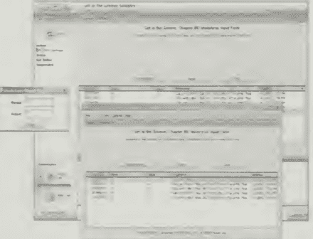

图 6-2：Ch06_tool_01，无模式输入表单


这个表单和工具看起来与 `Ch06_tool_01` 几乎完全相同。关键的区别在于，如果非模态输入表单是一个顶级窗口，它会出现在系统托盘（Windows 任务栏的右侧），并且你可以使用 `Alt+Tab` 组合键切换到它。

#### 工具组件和布局

从布局角度看，对 `Ch06_tool_01` 子窗体的主要修改是移除了取消按钮，并将确定按钮改为添加按钮。`InputFormDelegate` 也发生了重大变化。

#### 工具 FormDelegate

在 `Ch06_tool_01` 中，你在调用 `pFormDispatch.Show( )` 方法之后检索你在子窗体中设置的值，该方法又会调用 `IGrooveWindow` 的 `DoModal( )` 方法。

在这个版本的工具中，你对子窗体的 `Show( )` 方法进行了相同的调用。表单的 `Show( )` 方法具有不同的内部实现，并且会立即返回——在用户有机会输入任何数据之前。因此，你实现了回调方法，这些方法会在用户点击添加按钮或关闭表单时由 `InputFormDelegate` 调用。

非模态表单要求你指定两个例程：一个在用户点击添加按钮后调用，第二个在用户关闭表单时调用。为了支持这种回调方法，你在工具的 `InputFormDelegate` 中引入了以下代码：

```
function AddCallback(Name, Value)
{
  // Create an instance of our private schema record
  var pIRecord =
ModelGlue.CreateRecord("urn:groove.net:Ch05_schema_01_record");
  pIRecord.SetField("Name", Name);
  pIRecord.SetField("Value", Value);
  pIRecord.SetField("Fingerprint", g_strMyFingerPrint);
  pIRecord.SetField("_ModifiedBy", g_strName);

  // Add the record
  ModelGlue.AddRecord(pIRecord);
}

function DestroyCallback()
{
  g_pFormDispatch = null;
}
```

由于表单是非模态的，你添加了一个全局变量 `g_pFormDispatch` 来保存指向输入表单的 `IGrooveScriptHostComponent` 的指针。

## 154 第二部分：工具

你在例程 `GetInputFormDispatch` 方法中设置这些回调，如下所示：

```
var g_pFormDispatch = null;
function GetInputFormDispatch()
{
    if (g_pFormDispatch)
      return null;

    var pToolForm = PropertyList.OpenProperty(PROPERTY_FORM);
    var pComponentContainer = pForm.ComponentContainer;
    var pForm =
  pComponentContainer.OpenComponentByName("InputForm_Modeless");
    if (pForm)
    {
        var pIDelegate = pForm.OpenDelegateComponent();
        if (pIDelegate)
        {
            g_pFormDispatch = pIDelegate.GetScriptDispatch();
            if (g_pFormDispatch)
            {
                // Create window for form and display it as modal

                var pIWindowProperties =
  GrooveScriptFunctions.CreateNewObject("Groove.WindowProperties");
                    pIWindowProperties.Style = "PopupWindow";
                    pIWindowProperties.Resizable = false;
                    pIWindowProperties.Caption = "Modeless Input Form";
                    pIWindowProperties.CaptionVisible = true;
                    pIWindowProperties.Visible = true;
                    pIWindowProperties.CloseButton = false;
                    pIWindowProperties.BorderVisible = false;
                    pIWindowProperties.HelpButton = false;

                var CurrentDate = new Date();
                CurrentDate = CurrentDate.getTime();
                var WindowName = "InputForm" + CurrentDate;

                // Create and open the new window
                var pIWindowManager =
  GrooveScriptFunctions.CreateNewObject("Groove.WindowManager");
                    var pIWindowAccount =
  UIPropertyList.OpenProperty(UIPROPERTY_WINDOW_ACCOUNT);
                        pInputWindow =
  pIWindowManager.CreateGrooveWindowForForm(pIWindowAccount, WindowName,
  pIWindowProperties, pForm);
                        if (pInputWindow)
                        {
                            g_pFormDispatch.SetWindow(pInputWindow);
                            return g_pFormDispatch;
```

除了在 `Ch06_tool_01` 的 `GetInputFormDispatch()` 实现中添加了 `g_pFormDispatch` 之外，你还更改了 `IGrooveWindowProperties` 的 Caption 属性，并移除了 `ParentWindow` 属性的设置。这最后一个更改导致窗口出现在系统托盘中。

你在 `Add_OnButtonUp()` 例程的实现中看到另一个更改，如下所示：

```
function Add_OnButtonUp(i_pUICommand)
{
  if (GetInputFormDispatch())
  {
    g_pFormDispatch.SetName("");
    g_pFormDispatch.SetValue("");
    g_pFormDispatch.SetCallbacks(AddCallback, DestroyCallback);
    g_pFormDispatch.Show();
  }
}
```

这里的更改是设置回调。你做的最后一个更改是在 `Ch06_tool_02` 工具本身不再是活动工具之后，强制关闭输入表单。你通过实现 `DestroyInputFormDispatch()` 方法并从 `IGrooveViewContainerListener` 的 `OnViewContainerHide()` 方法中调用它来做到这一点，如下所示：

```
function OnViewContainerHide()
{
  DestroyInputFormDispatch();
}

function DestroyInputFormDispatch()
{
  if (g_pFormDispatch != null)
  {
    g_pFormDispatch.Destroy();
    g_pFormDispatch = null;
  }
}
```

### InputFormDelegate

在 `InputFormDelegate` 中，你会看到更多处理子窗体非模态特性的更改。第一个例程引入了两个全局变量（`g_pAddCallback` 和 `g_pDestroyCallback`）和一个 `SetCallbacks` 方法来初始化它们，如以下代码所示：

```
var g_pAddCallback = null;
var g_pDestroyCallback = null;

function SetCallbacks(pAddCallback, pDestroyCallback)
{
  g_pAddCallback = pAddCallback;
  g_pDestroyCallback = pDestroyCallback;
}
```

下一个更改在 `Add_OnButtonUp` 的实现中。在 `Ch06_tool_01` 中，`OK_OnButtonUp` 的实现调用 `g_pWindow.Close(GrooveWindowResult_OK)`。因为模态窗口会阻塞所有其他 Groove UI 处理（即，你不能使用底层工具），所以调用者负责检索 Name 和 Value。

在这个版本中，你调用 `g_AddCallback` 例程来通知调用者 Name 和 Value 的当前值，如下所示：

```
function Add_OnButtonUp(i_pUICommand)
{
  if (g_pAddCallback)
  {
  // Signal the Add command...
    g_pAddCallback(Name.Text, Value.Text);
  }
}
```

如果用户选择关闭非模态表单（通过点击包含窗口的关闭按钮、从菜单栏选择 系统 ➔ 关闭，或按下 `Alt+F4` 加速键），你会发出销毁回调信号。为了捕获这种情况，你实现了 `IGrooveUIComponent` 的 `OnRevokeUIProperties()` 方法，如下所示：

```
function OnRevokeUIProperties()
{
  if (g_pDestroyCallback)
  {
    // Notify that we're going away...
    g_pDestroyCallback();
  }
}
```

最后，你还实现了一个可以从工具中调用以强制关闭表单的例程，如下所示：

```
function Destroy()
{
  if (g_pWindow)
  {
    g_pWindow.Close(-1);
    g_pWindow.Destroy();
    g_pWindow = null;
    g_pAddCallback = null;
    g_pDestroyCallback = null;
  }
}
```

### 数据输入向导：构建多窗体向导

向导背后的关键概念是以逐步方式呈现一系列表单，通常伴有详细的解释。向导还通常允许用户在步骤之间前后移动以更改数据输入。

每当用户在 Groove 中创建一个新账户时，他们都在使用一个账户创建向导，该向导引导用户完成线性工作流。

要构建一个模态数据输入向导，你结合了第 5 章示例 `Ch05_tool_12` 和第 6 章示例 `Ch06_tool_01` 中展示的技术。在 `Ch05_tool_12` 中，我向你展示了如何交换多个 `ViewContainer`——每个选项卡一个。你使用相同的概念来构建数据输入向导。

图 6-3 显示了向导中的第二个 `ViewContainer`。

在 `Ch06_tool_03` 中，你构建了一个四步向导，如下所示：
- 1. 提供一个简单的说明。
- 2. 接受 Name 字段的输入。
- 3. 接受 Value 字段的输入。
- 4. 确认创建记录并关闭表单。

表单显示了“下一步”和“上一步”按钮，以便用户在步骤之间导航。你在步骤 2 到 4 中启用“上一步”按钮。你在所有步骤中都启用“下一步”按钮。然而，它的标签在最后一步更改为“完成”。表单还显示一个“取消”按钮，用户可以随时点击。此时，你还没有添加任何需要用户输入特定值的处理——那是留给读者你稍后自行完成的练习。


图 6-3：Ch06_tool_03，数据输入向导

#### 工具组件和布局

除了将`Tool_Name`更改为`Ch06_tool_01`之外，您在工具组件声明和布局中没有进行任何更改。

#### 子表单组件和布局

子表单的布局与我之前在`Ch05_tool_12`中介绍的工具布局类似。最外层的`IGrooveViewContainer`包含一个`IGrooveMultiCellLayout`，其中包含以下四个组件：

- 一个`ViewContainer`，根据您在向导中所处的步骤，您会将其与另一个视图容器进行交换。
- 三个`GrooveButton`实例，分别对应 Prev、Next 和 Cancel 按钮。

以下是这些组件的声明：

```
        <g:Component Name="Wizard">
            <g:ComponentResource FingerprintID="Groove"
URL="http://components.groove.net/Groove/Components/Root.osd?Package=net
.groove.Groove.ToolComponents.GrooveCommonComponents_DLL&amp;Version=0&a
mp;Factory=ViewContainer"/>
                <g:PropertyList Version="1">
                    <g:Property Name="PreferredWidth" Value="600Ello
                    <g:Property Name="PreferredHeight" Value="400Ello
```

```
<g:Property Name="DefaultFocus" Value="Next" />
</g:PropertyList>
<g:ComponentConnections>
  <g:Connection Name="Layout" ConnectionID="0"/>
</g:ComponentConnections>
</g:Component>

<g:Component Name="Layout">
  <g:ComponentResource FingerprintID="Groove"
URL="http://components.groove.net/Groove/Components/Root.osd?Package=net
.groove.Groove.ToolComponents.GrooveCommonComponents_DLL&amp;Version=0&a
mp;Factory=MultiCellLayout"/>
  <g:PropertyList Version="1">
    <g:Property Name="Layout">
      <g:PropertyValue>
        <MULTIROW>
          <ROW><CELL HEIGHT="300">Wizard_Step1</CELL></ROW>
          <ROW><CELL HEIGHT="10"/></ROW>
          <ROW>
            <CELL/>
            <CELL WIDTH="80">Prev</CELL>
            <CELL WIDTH="80">Next</CELL>
            <CELL WIDTH="80">Cancel</CELL>
          </ROW>
        </MULTIROW>
      </g:PropertyValue>
    </g:Property>
  </g:PropertyList>
</g:Component>
```

从上面的布局可以看到，默认情况下，首先显示`Wizard_Step1`作为 IGrooveViewContainer。为简单起见，您在每个说明步骤中只放置了一个 IGrooveStatic 组件。对此实现方法的一种改进是添加 GrooveTextView，这样您就可以呈现格式化的富文本（RTF）、添加额外的图像等。

以下是 `Wizard_Step1` 视图容器组件及其布局的声明：

```
<g:Component Name="Wizard_Step1">
  <g:ComponentResource FingerprintID="Groove"
URL="http://components.groove.net/Groove/Components/Root.osd?Package=net
.groove.Groove.ToolComponents.GrooveCommonComponents_DLL&amp;Version=0&a
mp;Factory=ViewContainer"/>
  <g:PropertyList Version="1">
    <g:Property Name="Background">
      <g:BackgroundStyle Style="DialogBackground"/>
    </g:Property>
  </g:PropertyList>
</g:PropertyList>
```

```
    <g:ComponentConnections>
      <g:Connection Name="Wizard_Step1_Layout" ConnectionID="0"/>
    </g:ComponentConnections>
  </g:Component>

  <g:Component Name="Wizard_Step1_Layout">
    <g:ComponentResource FingerprintID="Groove"
URL="http://components.groove.net/Groove/Components/Root.osd?Package=net
.groove.Groove.ToolComponents.GrooveCommonComponents_DLL&amp;Version=0&a
mp;Factory=MultiCellLayout"/>
      <g:PropertyList Version="1">
        <g:Property Name="Layout">
          <g:PropertyValue>
            <MULTIROW>
              <ROW><CELL HEIGHT="10"/></ROW>
              <ROW>
                <CELL WIDTH="10"/>
                <CELL>Step1_Explanation</CELL>
                <CELL WIDTH="10"/>
              </ROW>
              <ROW><CELL HEIGHT="10"/></ROW>
            </MULTIROW>
          </g:PropertyValue>
        </g:Property>
      </g:PropertyList>
  </g:Component>
```

请注意我突出显示的 Background 属性声明。在所有之前的 ViewContainer 声明中，您将 Background 属性设置为 `SectionBackground`——该值使工具与收发器的默认颜色融为一体。然而，在这种情况下，您将该值设置为 `DialogBackground`，以便表单中的 ViewContainer 与导航按钮区分开来。

`Wizard_Step2` 到 `Wizard_Step4` 以及 `Wizard_Step2_Layout` 到 `Wizard_Step4_Layout` 的声明与前面代码中显示的相同，只是引用了特定的说明文本。

说明文本是一个简单的 `GrooveStatic` 文本组件，如下代码所示：

```
    <g:Component Name="Step1_Explanation">
      <g:ComponentResource FingerprintID="Groove"
URL="http://components.groove.net/Groove/Components/Root.osd?Package=net
.groove.Groove.ToolComponents.GrooveCommonComponents_DLL&amp;Version=0&a
mp;Factory=Static"/>
        <g:PropertyList Version="1">
          <g:Property Name="Label" Value="Step1: This would be the general
explanation text..."/>
          <g:Property Name="Style" Value="Normal"/>
```

```
<g:Property Name="VAlignment" Value="Center"/>
</g:PropertyList>
</g:Component>
```

Prev、Next 和 Cancel 按钮的声明很简单，如下所示：

```
<g:Component Name="Prev">
  <g:ComponentResource
URL="http://components.groove.net/Groove/Components/Root.osd?Package=net
.groove.Groove.ToolComponents.GrooveCommonComponents_DLL&amp;Version=0&a
mp;Factory=Button" FingerprintID="Groove"/>
  <g:PropertyList Version="1">
    <g:Property Name="Style" Value="StandardButton"/>
    <g:Property Name="Label" Value="Prev"/>
  </g:PropertyList>
</g:Component>
```

```
<g:Component Name="Next">
  <g:ComponentResource
URL="http://components.groove.net/Groove/Components/Root.osd?Package=net
.groove.Groove.ToolComponents.GrooveCommonComponents_DLL&amp;Version=0&a
mp;Factory=Button" FingerprintID="Groove"/>
  <g:PropertyList Version="1">
    <g:Property Name="Style" Value="StandardButton"/>
    <g:Property Name="Label" Value="Next"/>
  </g:PropertyList>
</g:Component>
```

```
<g:Component Name="Cancel">
  <g:ComponentResource
URL="http://components.groove.net/Groove/Components/Root.osd?Package=net
.groove.Groove.ToolComponents.GrooveCommonComponents_DLL&amp;Version=0&a
mp;Factory=Button" FingerprintID="Groove"/>
  <g:PropertyList Version="1">
    <g:Property Name="Style" Value="StandardButton"/>
    <g:Property Name="Label" Value="Cancel"/>
  </g:PropertyList>
</g:Component>
```

#### 工具 FormDelegate

从 Ch06_tool_01 到工具 FormDelegate 的唯一更改是在 GetInputFormDispatch 方法的实现中，您更改了要加载的表单组件的名称，如下所示：

```
function GetInputFormDispatch()
{
  var pToolForm = PropertyList.OpenProperty(PROPERTY_FORM);
  var pComponentContainer = pToolForm.ComponentContainer;
  var pForm = pComponentContainer.OpenComponentByName("Input_Wizard");
```

#### 子表单 InputFormDelegate

正如您可能猜到的，大部分更改都在表单的 InputFormDelegate 中。与 Ch06_tool_01 的第一个更改是添加了一个全局变量 g_iLayout，以及添加了一个 IGrooveUIComponent 的 OnSetUIProperties() 方法，如下所示：

```
var g_iLayout = 1;
function OnSetUIProperties()
{
  Switch_Layout(g_iLayout);
}
```

可以想见，大部分工作都在 Switch_Layout() 的实现中：

```
function Switch_Layout(i_Layout)
{
  // 从主布局中移除第一个对象
  var TableSizeObj =
GrooveScriptFunctions.CreateNewObject("Groove.MultiCellLayoutControlInfo
");
  var TableCellObj = TableSizeObj.Cell();
  TableCellObj.SetCell(0,0);
  Layout.RemoveCellContents(TableCellObj);

  // 添加回请求的视图容器...
  switch (i_Layout)
  {
    case 1:
    {
      Layout.AddControlByName("Wizard_Step1", TableCellObj);
      Prev.Enabled = false;
      Next.Label = "Next";
      Wizard.SetFocus("Next");
      Wizard.SetDefaultFocus();
      break;
    }
    case 2:
    {
      Layout.AddControlByName("Wizard_Step2", TableCellObj);
      Prev.Enabled = true;
      Next.Label = "Next";
      Wizard_Step2.SetFocus("Name");
      break;
    }
    case 3:
    {
      Layout.AddControlByName("Wizard_Step3", TableCellObj);
```


 ```
Prev.Enabled = true;
Next.Label = \"Next\";
Wizard_Step3.SetFocus(\"Value\") ;
break;
}
case 4:
{
Layout.AddControlByName (\"Wizard_Step4\", TableCellObj) ;
Prev.Enabled = true;
Next.Label = \"Finish\";
break;
}
}
```

现在你已经有了一个可以切换容器并确保按钮正确启用和标记的例程，你所要做的就是实现按钮处理程序。

**Cancel**按钮的实现与Ch06_tool_01中的完全相同，如下所示：

```
function Cancel_OnButtonUp(i_pIUICommand)
{
    g_pWindow.Close(GrooveWindowResult_Cancel);
}
```

**Prev**按钮的实现只是检查确保你不会尝试回到第1步之前，如下所示：

```
function Prev_OnButtonUp(i_pIUICommand)
{
    // Can only move backwards if we're not in the first layout...
    if (g_iLayout > 1)
    {
        // Swap to the previous layout
        g_iLayout--;
        Switch_Layout(g_iLayout);
    }
}
```

**Next**按钮的实现与**Prev**的相反——它检查确保你不会超过第4步（最大步数），并且如果你已经在第四步，则关闭窗口，以`GrooveWindowResult_OK`作为结果，如下所示：

```
function Next_OnCommand(i_pIUICommand)
{
    // If we're in the 4th @(LAST) layout, then close wizard...
    if (g_iLayout == 4)
    {
        //  Close window
        g_pWindow.Close(GrooveWindowResult_OK) ;
```

```
        return;
    }
    // Else, swap to the next layout...
    g_iLayout++;
    Switch_Layout(g_iLayout);
}
```

### Groove 输入和通知 API

正如你可能预料到的，Groove 提供了一系列 API 用于常见服务，例如显示简单消息、获取单个输入值以及获取文件名。在本节中，我将向你展示一个示例工具来演示这些 API。

你在第4章中看到，在各种布局示例中点击其中一个 **Hello_World** 按钮后会出现一个简单的消息框。你通过调用 `IGrooveGlobalScriptFunctions` 方法 `DoMessageBox()` 来显示该消息框，如下所示：

```
function Hello_World_OnCommand(i_pUICommand)
{
  GrooveScriptFunctions.DoMessageBox("Hello World");
}
```

这个特定的消息框只允许你指定一个文本字符串和可选的消息框窗口标题文本。该窗口没有"*Groovey*"外观。对比图6-4和图6-5，可以看到UI外观和感觉的差异。


图6-4："Non-Groovey" 消息框

图6-5："Groovey" 消息框

你可能在想，为什么有两个不同的 API 做同样的事情。简单地说，区别在于收发器当前的皮肤。例如，如果你从 Default 皮肤切换到 Cellular 皮肤，Groovey 消息框会发生变化（见图6-6）。


图6-6：Cellular 皮肤的 Groovy 消息框

图6-7显示了 **Ch06_tool_04**，该工具演示了一些可用的 API，用于以 Groovey 和非 Groovey 外观呈现和请求数据。

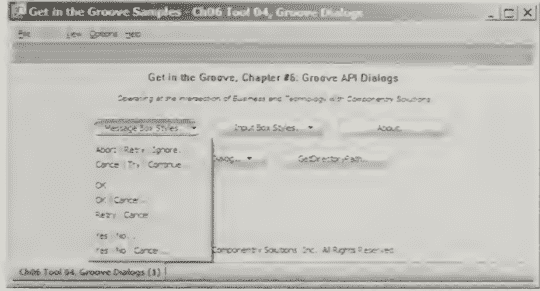

图6-7：Ch06_tool_04，各种 Groove API

#### 工具组件和布局

我在本节中演示的 API 有许多可用的标志来控制外观。由于可以使用的不同标志数量众多，你实现了一系列带有自己弹出菜单的按钮，以便快速查看使用不同标志的结果。

要演示各种 Groove MessageBox 样式，声明以下按钮及其关联菜单：

```
<g:Component Name="MessageBox">
  <g:ComponentResource FingerprintID="Groove"
URL="http://components.groove.net/Groove/Components/Root.osd?Package=net
.groove.Groove.ToolComponents.GrooveCommonComponents_DLL&amp;Version=0&amp
;g:Factory=Button"/>
  <g:PropertyList Version="1">
    <g:Property Name="Style" Value="StandardButton"/>
    <g:Property Name="Label" Value="Message Box Styles..."/>
    <g:Property Name="Menu" Value="MessageBox_Menu"/>
  </g:PropertyList>
</g:Component>
```

声明以下 InputBox 和 InputBox_Menu 组件，以便你可以演示可用的各种样式：

```
<g:Component Name="MessageBox_Menu">
  <g:ComponentResource FingerprintID="Groove"
URL="http://components.groove.net/Groove/Components/Root.osd?Package=net
.groove.Groove.ToolComponents.GrooveCommonComponents_DLL&amp;Version=0&a
mp;Factory=Menu"/>
  <g:PropertyList Version="1">
    <g:Property Name="UICommands">
      <g:PropertyValue>
        <g:UICommand URL="AbortRetryIgnore" Label="Abort | Retry |
Ignore..."/>
        <g:UICommand URL="CancelTryContinue" Label="Cancel | Try |
Continue..."/>
        <g:UICommandSeparator URL="Sep1"/>
        <g:UICommand URL="OK" Label="OK"/>
        <g:UICommand URL="OKCancel" Label="OK | Cancel..."/>
        <g:UICommand URL="RetryCancel" Label="Retry | Cancel..."/>
        <g:UICommandSeparator URL="Sep1"/>
        <g:UICommand URL="YesNo" Label="Yes | No..."/>
        <g:UICommand URL="YesNoCancel" Label="Yes | No | Cancel..."/>
      </g:PropertyValue>
    </g:Property>
  </g:PropertyList>
</g:Component>
```

```
<g:Component Name="InputBox">
  <g:ComponentResource FingerprintID="Groove"
URL="http://components.groove.net/Groove/Components/Root.osd?Package=net
.groove.Groove.ToolComponents.GrooveCommonComponents_DLL&amp;Version=0&a
mp;Factory=Button"/>
  <g:PropertyList Version="1">
    <g:Property Name="Style" Value="StandardButton"/>
    <g":Property Name="Label" Value="Input Box Styles..."/>
    <g:Property Name="Menu" Value="InputBox_Menu"/>
  </g:PropertyList>
</g:Component>
```

```
<g:Component Name="InputBox_Menu">
  <g:ComponentResource FingerprintID="Groove"
URL="http://components.groove.net/Groove/Components/Root.osd?Package=net
.groove.Groove.ToolComponents.GrooveCommonComponents_DLL&amp;Version=0&a
mp;Factory=Menu"/>
  <g:PropertyList Version="1">
    <g:Property Name="UICommands">
      <g:PropertyValue>
        <g:UICommand URL="None" Label="No specific style..."/>
        <g:UICommand URL="Password" Label="Password style..."/>
        <g:UICommand URL="AllowEmpty" Label="AllowEmpty style..."/>
      </g:PropertyValue>
    </g:Property>
  </g:PropertyList>
</g:Component>
```

要演示 Groove About 和 GetDirectoryPath 例程，你添加两个简单的按钮，如下所示：

```
<g:Component Name="About">
  <g:ComponentResource FingerprintID="Groove"
URL="http://components.groove.net/Groove/Components/Root.osd?Package=net
.groove.Groove.ToolComponents.GrooveCommonComponents_DLL&amp;Version=0&a
mp;Factory=Button"/>
  <g:PropertyList Version="1">
    <g:Property Name="Style" Value="StandardButton"/>
    <g:Property Name="Label" Value="About..."/>
  </g:PropertyList>
</g:Component>
```

```
<g:Component Name="GetDirectoryPath">
  <g:ComponentResource FingerprintID="Groove"
URL="http://components.groove.net/Groove/Components/Root.osd?Package=net
.groove.Groove.ToolComponents.GrooveCommonComponents_DLL&amp;Version=0&a
mp;Factory=Button"/>
  <g:PropertyList Version="1">
    <g:Property Name="Style" Value="StandardButton"/>
    <g:Property Name="Label" Value="GetDirectoryPath..."/>
  </g:PropertyList>
</g:Component>
```

最后，要演示 OpenFileDlg 例程的三种不同用途，你声明以下内容：

```
<g:Component Name="OpenFileDialog">
  <g:ComponentResource FingerprintID="Groove"
URL="http://components.groove.net/Groove/Components/Root.osd?Package=net
.groove.Groove.ToolComponents.GrooveCommonComponents_DLL&amp;Version=0&a
mp;Factory=Button"/>
  <g:PropertyList Version="1">
    <g:Property Name="Style" Value="StandardButton"/>
    <g:Property Name="Label" Value="OpenFileDialog..."/>
    <g:Property Name="Menu" Value="OpenFileDialog_Menu"/>
  </g:PropertyList>
</g:Component>
```

```
<g:Component Name="OpenFileDialog_Menu">
  <g:ComponentResource FingerprintID="Groove"
URL="http://components.groove.net/Groove/Components/Root.osd?Package=net
```


 ```
.groove.Groove.ToolComponents.GrooveCommonComponents_DLL&amp;Version=0&amp;Factory=Menu"/>
  <g:PropertyList Version="1">
    <g:Property Name="UICommands">
      <g:PropertyValue>
        <g:UICommand URL="Groove Templates" Label="Groove Templates from My Templates..."/>
        <g:UICommand URL="Documents" Label="Groove Templates from My Documents..."/>
      </g:PropertyValue>
    </g:Property>
  </g:PropertyList>
</g:Component>
```

#### 工具 FormDelegate

Ch06_tool_01 与 Ch06_tool_02 之间的一个关键区别是，模态版本指定了一个父窗口。

我在本节中演示的 Groove 对话框也需要两个参数——当前的 IGrooveAccount 和用作父窗口的 IGrooveWindow。你将这些参数缓存在全局变量中，如下所示：

```
var g_pAccount;
var g_pWindow;

function OnSetUIProperties()
{
  // 在为此工具初始化 UI 子系统之前，无法获取 UIPROPERTY_TOP_LEVEL_WINDOW
  g_pWindow = UIPropertyList.OpenProperty(UIPROPERTY_TOP_LEVEL_WINDOW);
  g_pAccount = PropertyList.OpenProperty(PROPERTY_ACCOUNT);

  // 初始化帮助系统
  Initialize_Help();
}
```

注意 OnSetUIProperties() 方法中的注释——在工具的 UI 子系统就位之前，你无法获取 UIPROPERTY_TOP_LEVEL_WINDOW 属性。如果你尝试从 FormDelegate 的 Initialize 方法中获取 TOP_LEVEL_WINDOW，将会抛出错误。

由于需要等待 UI 呈现，你也延迟初始化 overview 和 g_pAccount，甚至不实现 Initialize 方法。

所有用 JavaScript 编写的 Groove 工具都可以访问一个全局对象 App。这个全局变量包含一个指向 IGrooveApplication 实例的指针，该实例已由 GrooveScriptHostComponent 自动初始化。为了演示各种 IGrooveApplication GrooveMessageBox 组合，你为 MessageBox_Menu 组件实现了以下处理程序：

```
function MessageBox_Menu_OnCommand (i_pIUICommand)
{
  var cmdURL = i_pIUICommand.CommandURL;
  var Result;
  switch (cmdURL)
  {
    case "AbortRetryIgnore":
    {
      Result = App.GrooveMessageBox(g_pWindow, g_pAccount, "Message...",
"Title", GrooveMessageBoxStyle_AbortRetryIgnore,
GrooveMessageBoxIcon_Information);
      break;
    }
    case "CancelTryContinue":
    {
      Result = App.GrooveMessageBox(g_pWindow, g_pAccount, "Message...",
"Title", GrooveMessageBoxStyle_CancelTryContinue,
GrooveMessageBoxIcon_Information);
      break;
    }
    case "OK":
    {
      Result = App.GrooveMessageBox(g_pWindow, g_pAccount, "Message...",
"Title", GrooveMessageBoxStyle_OK, GrooveMessageBoxIcon_Information);
      break;
    }
    case "OKCancel":
    {
      Result = App.GrooveMessageBox(g_pWindow, g_pAccount, "Make your
selection...", "Title", GrooveMessageBoxStyle_OKCancel,
GrooveMessageBoxIcon_Information);
      break;
    }
    case "RetryCancel":
    {
      Result = App.GrooveMessageBox(g_pWindow, g_pAccount, "Message...",
"Title", GrooveMessageBoxStyle_RetryCancel,
GrooveMessageBoxIcon_Information);
      break;
    }
    case "YesNo":
    {
      Result = App.GrooveMessageBox(g_pWindow, g_pAccount, "Message...",
"Title", GrooveMessageBoxStyle_YesNo, GrooveMessageBoxIcon_Information);
      break;
    }
```

170 第二部分：工具

```
case "YesNoCancel":
{
    Result = App.GrooveMessageBox(g_pWindow, g_pAccount, "Message...",
        "Title", GrooveMessageBoxStyle_YesNoCancel,
        GrooveMessageBoxIcon_Information);
    break;
}
}
switch (Result)
{
    case GrooveMessageBoxResultCode_Abort:
    {
        GrooveScriptFunctions.DoMessageBox("Abort selected", cmdURL);
        break;
    }
    case GrooveMessageBoxResultCode_Retry:
    {
        GrooveScriptFunctions.DoMessageBox("Retry selected", cmdURL);
        break;
    }
    case GrooveMessageBoxResultCode_Ignore:
    {
        GrooveScriptFunctions.DoMessageBox("Ignore selected", cmdURL);
        break;
    }
    case GrooveMessageBoxResultCode_OK:
    {
        GrooveScriptFunctions.DoMessageBox("OK selected", cmdURL);
        break;
    }
    case GrooveMessageBoxResultCode_Cancel:
    {
        GrooveScriptFunctions.DoMessageBox("Cancel selected", cmdURL);
        break;
    }
    case GrooveMessageBoxResultCode_Yes:
    {
        GrooveScriptFunctions.DoMessageBox("YES selected", cmdURL);
        break;
    }
    case GrooveMessageBoxResultCode_No:
    {
        GrooveScriptFunctions.DoMessageBox("NO selected", cmdURL);
        break;
    }
    case GrooveMessageBoxResultCode_TryAgain:
    {
        GrooveScriptFunctions.DoMessageBox("NO selected", cmdURL);
        break;
    }
```

```
case GrooveMessageBoxResultCode_Continue:
{
    GrooveScriptFunctions.DoMessageBox("Continue selected", cmdURL);
    break;
}
default:
{
    GrooveScriptFunctions.DoMessageBox("Result Code: " + Result, cmdURL);
}
}
}
```

IGrooveApplication 提供的另一个方法是 GrooveInputBox。以下是你对 InputBox_Menus OnCommand 处理程序的实现：

```
function InputBox_Menu_OnCommand (i_pIUICommand)
{
    var cmdURL = i_pIUICommand.CommandURL;
    var Result;
    switch (cmdURL)
    {
        case "None":
        {
            Result = App.GrooveInputBox(g_pWindow, g_pAccount, "Enter value to enable the OK button", GrooveInputBoxStyle_None, "", "GrooveInputBoxStyle_None");
            break;
        }
        case "Password":
        {
            Result = App.GrooveInputBox(g_pWindow, g_pAccount, "Enter hidden value...", GrooveInputBoxStyle_Password, "", "GrooveInputBoxStyle_Password");
            break;
        }
        case "AllowEmpty":
        {
            Result = App.GrooveInputBox(g_pWindow, g_pAccount, "OK enabled by default...", GrooveInputBoxStyle_AllowEmptyValue, "", "GrooveInputBoxStyle_AllowEmptyValue");
            break;
        }
    }
    switch (Result.Result)
    {
        case GrooveDialogBoxResultCode_OK:
        {
```

```
GrooveScriptFunctions.DoMessageBox("Input: '" + Result.Data + "'",
cmdURL);
    break;
  }
  case GrooveDialogBoxResultCode_Cancel:
  {
    GrooveScriptFunctions.DoMessageBox("Cancel selected", cmdURL);
    break;
  }
 }
}
```

Groove 提供了一个 API 来调用其自身的"关于"对话框，如下所示：

```
function About_OnCommand(pUICommand)
{
  App.GrooveAboutDlg(g_pWindow, g_pAccount);
}
```

为了获取操作系统路径的访问权限，IGrooveApplication 提供了一个 GetDirectoryPath 例程，支持两个标志：GrooveDirectoryValue_System 用于获取操作系统路径（例如，C:\WINNT\System32），以及当前操作系统用户账户的临时路径，如下所示：

```
function GetDirectoryPath_OnCommand(pCommand)
{
  var System = App.GetDirectoryPath(GrooveDirectoryValue_System);
  var Temp = App.GetDirectoryPath(GrooveDirectoryValue_Temp);
  GrooveScriptFunctions.DoMessageBox("System: " + System + "\nTemp: " + Temp, "GetDirectoryPath");
}
```

我演示的最后一个 API 是 OpenFileDialog，它呈现标准的操作系统提供的对话框，用于从用户那里获取文件名，如下代码所示：

```
function OpenFileDialog_Menu_OnCommand(pCommand)
{
  var pShell = GrooveScriptFunctions.CreateNewObject("WScript.Shell");
  var GrooveKey = "HKLM\\SOFTWARE\\Groove Networks, Inc.\\Groove\\InstallDataRoot";
  var GrooveDir = pShell.RegRead(GrooveKey);
  var DocumentsKey = "HKLM\\SOFTWARE\\Microsoft\\Windows\\CurrentVersion\\Explorer\\Shell Folders\\Common Documents";
  var DocumentsDir = pShell.RegRead(DocumentsKey);
  MyTemplatesDir = GrooveDir + "My Templates";

  switch (pCommand.CommandURL)
  {
```

```
case "Groove Templates":
{
  var Result = App.OpenFileDialog("Open", "Groove Template|*.tpl",
MyTemplatesDir, "", g_pAccount, 0, false);
  break;
}
case "Documents":
{
  var Result = App.OpenFileDialog("Open", "Groove Template|*.tpl",
DocumentsDir, "", g_pAccount, 0, false);
  break;
}

switch (Result.Result)
{
  case GrooveDialogBoxResultCode_OK:
  {
    GrooveScriptFunctions.DoMessageBox(Result.Data, "OpenFileDialog");
    break;
  }
  case GrooveDialogBoxResultCode_Cancel:
  {
    break;
  }
}
```

在前面的代码中，你可以看到使用了一个非 Groove 提供的对象——WScript.Shell 对象。如果你做过 ASP 编程或使用 Windows 脚本宿主构建过 Windows 外壳扩展，你可能已经熟悉这个对象。

> **提示** 如果你是 Windows 脚本编写的新手，请查看 Tobias Weltner 的 *Windows Scripting Secrets*（Hungry Minds，2000）。

你使用 WScript.Shell 对象来访问底层操作系统的注册表，以便确定当前用户的 \My Documents 文件夹以及 Groove 安装目录的路径名，如下代码所示：

```
var pShell = GrooveScriptFunctions.CreateNewObject("WScript.Shell");
var GrooveKey = "HKLM\\SOFTWARE\\Groove Networks,
Inc.\\Groove\\InstallDataRoot";
var GrooveDir = pShell.RegRead(GrooveKey);
var DocumentsKey =
"HKLM\\SOFTWARE\\Microsoft\\Windows\\CurrentVersion\\Explorer\\Shell
Folders\\Common Documents";
var DocumentsDir = pShell.RegRead(DocumentsKey);
```


 ```
var MyTemplatesDir = GrooveDir + "My Templates";
```

获取相同信息的另一种方法是使用 IGrooveApplication 的 ReadRegistryValue 方法，如下所示：

```
var GrooveDir =
    App.ReadRegistryValue(GrooveRegistryKeyValue_LocalMachine,
                            "SOFTWARE\\Groove Networks, Inc.\\Groove\\",
                            "InstallDataRoot");
```

在本示例中，我只展示了部分可用的 API。IGrooveApplication 支持的其他 API 包括：

- AddNotificationItem：显示一个新的、可选可导航的通知。
- CreateDesktopShortcut：在用户的桌面上创建指向指定共享空间的快捷方式。
- GrooveChangePassword：显示"更改通行短语"对话框。
- InviteToTelespace：邀请联系人加入 telespace。
- LaunchInstantConversation：创建并显示一个即时会话 telespace。
- LaunchInstantTelespace：创建并显示一个即时活动 telespace。
- LaunchTelespace：创建并显示一个标准（非即时）telespace。
- OpenEMailInvitationTool：打开用户界面，通过电子邮件发送 telespace 邀请。
- OpenMessengerToInvite：打开 Messenger 窗口以发送 telespace 邀请。
- OpenMessengerToSend：打开 Messenger 窗口以发送即时消息。
- PopupTaskBarMenu：在当前鼠标位置显示 Groove 上下文菜单。
- SaveFileDialog：显示"保存文件"对话框。

我将这些 API 的探索留给您作为练习，以确定如何在您自己的工具中最好地使用它们。

### 弹出式图像和 HTML 查看器：使用 WebBrowser 控件

继续本章关于使用子表单和对话框的主题，我现在演示如何在表单中使用 Groove `WebBrowser` 组件。您可能会惊讶地发现，作为 Groove 标准安装一部分的 Web 浏览器工具使用了底层的 `WebBrowser` 组件，任何 Groove 工具都可以使用它。

您可能会问："如果 Groove 已经提供了 Web 浏览器，我为什么还需要自己的 Web 浏览器呢？" 首先，您有机会创建混合工具，该工具利用 Groove 服务来保持共享空间成员同步，同时使您能够获取特定的 Web 内容。

一个例子可能是由买家和卖家使用的私有目录，他们在一个安全、私有的交易空间中聚在一起。与其重新构建所有内容使其在 Groove 内可用，不如构建一个混合环境，将现有的基于中心的内容（如来自互联网门户和搜索引擎的内容）在交易上下文中提供。

另一个例子是客户服务工具，使客户和服务代表能够解决保险索赔。工具和共享空间可以代表双方之间通信和互动的持久状态——以及额外的公共信息，如客户从保险公司公共网站检索的保险政策说明书或保险范围说明。

图 6-8 显示了一个简单的工具，包含两个 UI 组件——一个文本框和一个按钮。点击"Go"按钮后，会出现一个包含 `WebBrowser` 组件的模态表单，如图 6-9 所示。

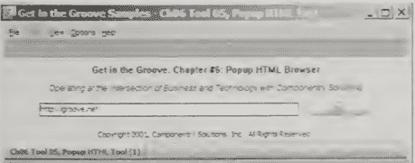

图 6-8：Ch06_tool_05。弹出式 HTML 浏览器

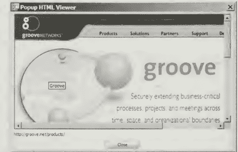

图 6-9：Ch06_tool_05，模态 HTML 对话框

#### 工具组件和布局

此工具的组件声明和布局非常简单，如下代码所示：

```
<g:Component Name="URL">
  <g:ComponentResource FingerprintID="Groove"
URL="http://components.groove.net/Groove/Components/Root.osd?Package=net
.groove.Groove.ToolComponents.GrooveCommonComponents_DLL&amp;Version=0&a
mp;Factory=Edit"/>
    <g:PropertyList Version="1">
      <g:Property Name="Multiline" Value="false"/>
      <g:Property Name="WantEvents" Value="true"/>
    </g:PropertyList>
</g:Component>

<g:Component Name="Go">
  <g:ComponentResource FingerprintID="Groove"
URL="http://components.groove.net/Groove/Components/Root.osd?Package=net
.groove.Groove.ToolComponents.GrooveCommonComponents_DLL&amp;Version=0&a
mp;Factory=Button"/>
    <g:PropertyList Version="1">
      <g:Property Name="Style" Value="StandardButton"/>
      <g:Property Name="Label" Value="Go"/>
    </g:PropertyList>
</g:Component>
```

请注意，对于 URL 组件，您指定了属性 WantEvents。通过这样做，您可以编写 IGrooveEditSink OnReturn 方法，使用户可以简单地按 Enter 键来显示弹出表单。

#### 子表单组件和布局

子表单包含以下四个 UI 组件和一个引擎组件 WebBrowserEngine：

- **WebBrowserView**：显示网页的 UI 组件。
- **WebBrowserEngine**：负责检索网页的组件。
- **ProgressBar**：用于显示页面加载百分比的静态文本组件。
- **StatusBar**：用于显示进度文本的静态文本组件。
- **Close**：用于关闭子表单的按钮。

以下是关键组件声明。（请注意您在 WebBrowserView 和 WebBrowserEngine 之间声明的组件连接。）

```
<g:Component Name="WebBrowserView" DisplayName="Web Browser View">
  <g:ComponentResource FingerprintID="Groove"
URL="http://components.groove.net/Groove/Components/Root.osd?Package=net
.groove.Groove.ToolComponents.GrooveWebBrowserTool_DLL&amp;Version=0&amp
;Factory=WebBrowserView"/>
  <g:ComponentConnections>
    <g:Connection Name="WebBrowserEngine" ConnectionID="0"/>
  </g:ComponentConnections>
</g:Component>

<g:Component Name="WebBrowserEngine" Category="Engine"
SingleInstance="True">
  <g:ComponentResource FingerprintID="Groove"
URL="http://components.groove.net/Groove/Components/Root.osd?Package=net
.groove.Groove.ToolComponents.GrooveWebBrowserTool_DLL&amp;Version=0&amp
;Factory=WebBrowserEngine"/>
  <g:EngineDesc Tag="urn:groove.net:WebBrowserEngine"/>
</g:Component>

<g:Component Name="StatusBar">
  <g:ComponentResource FingerprintID="Groove"
URL="http://components.groove.net/Groove/Components/Root.osd?Package=net
.groove.Groove.ToolComponents.GrooveCommonComponents_DLL&amp;Version=0&a
mp;Factory=Static"/>
  <g:PropertyList Version="1">
    <g:Property Name="FontStyle" Value="LabelText"/>
  </g:PropertyList>
</g:Component>

<g:Component Name="ProgressBar">
  <g:ComponentResource FingerprintID="Groove"
URL="http://components.groove.net/Groove/Components/Root.osd?Package=net
.groove.Groove.ToolComponents.GrooveCommonComponents_DLL&amp;Version=0&amp;Factory=Static">
  <g:PropertyList Version="1">
    <g:Property Name="FontStyle" Value="LabelText"/>
  </g:PropertyList>
</g:Component>

<g:Component Name="CloseButton">
  <g:ComponentResource
URL="http://components.groove.net/Groove/Components/Root.osd?Package=net
.groove.Groove.ToolComponents.GrooveCommonComponents_DLL&amp;Version=0&amp
;Factory=Button" FingerprintID="Groove"/>
  <g:PropertyList Version="1">
    <g:Property Name="Style" Value="StandardButton"/>
    <g:Property Name="Label" Value="Close"/>
  </g:PropertyList>
</g:Component>
```

#### 工具 FormDelegate

该工具的 FormDelegate 与 Ch06_tool_01 的非常相似。它包含为 HTML_SubForm 组件创建窗口的代码。以下是初始化工具的代码：

```
var g_URL = "http://groove.net";

function OnSetUIProperties()
{
  URL.text = g_URL;
}
```

为了处理用户点击 URL 编辑组件、输入 URL 然后按 Enter 键的情况，您可以实现以下 OnReturn 回调：

```
function URL_OnReturn(i_Name)
{
  Gc_OnButtonUp(null);
}
```

请注意，URL_OnReturn 函数调用了 Go 按钮的 OnButtonUp 方法。它传递 null，因为我知道在 OnButtonUp 方法的实现中，我忽略了当用户点击 Go 按钮时通常会传递给该方法的 IGrooveUICommand 接口指针。以下代码展示了这一点：

```
function Go_OnButtonUp(i_pUICommand)
{
  var pFormDispatch = GetHTMLFormDispatch();
  if (pFormDispatch)
  {
```


 ```
pFormDispatch.SetURL(URL.Text);
pFormDispatch.Show();
}
}
```

GetHTMLFormDispatch 函数的实现如下：

```
function GetHTMLFormDispatch()
{
    var pToolForm = PropertyList.OpenProperty(PROPERTY_FORM);
    var pComponentContainer = pToolForm.ComponentContainer;
    var FormName = "HTML_SubForm";
    var pForm = pComponentContainer.OpenComponentByName(FormName);
    if (pForm)
    {
        var piDelegate = pForm.OpenDelegateComponent();
        if (piDelegate)
        {
            var pFormDispatch = piDelegate.GetScriptDispatch();
            if (pFormDispatch)
            {
                // 为窗体创建窗口
                var piWindowProperties =
GrooveScriptFunctions.CreateNewObject("Groove.WindowProperties");
                piWindowProperties.Style = "PopupWindow";
                piWindowProperties.ParentWindow =
UIPropertyList.OpenProperty(UIPROPERTY_TOP_LEVEL_WINDOW);
                piWindowProperties.Resizable = true;
                piWindowProperties.Caption = "Popup HTML Viewer";
                piWindowProperties.CaptionVisible = true;
                piWindowProperties.Visible = false;
                piWindowProperties.CloseButton = false;
                piWindowProperties.BorderVisible = false;
                piWindowProperties.HelpButton = false;

                var CurrentDate = new Date();
                CurrentDate = CurrentDate.getTime();
                var WindowName = FormName + CurrentDate;

                // 创建并打开新窗口
                var piWindowManager =
GrooveScriptFunctions.CreateNewObject("Groove.WindowManager");
                var piWindowAccount =
UIPropertyList.OpenProperty(UIPROPERTY_WINDOW_ACCOUNT);
                var pFormWindow =
piWindowManager.CreateGrooveWindowForForm(piWindowAccount, WindowName,
piWindowProperties, pForm);
                if (pFormWindow)
                {
```

#### 子窗体的 InputFormDelegate

你遇到的第一段代码与本章其他窗体和对话框的代码类似，具体说明如下：

- SetURL 和 GetURL：用于获取和设置要导航到的 URL 的方法。
- SetWindow：允许工具向 InputFormDelegate 指定已为子窗体创建的 IGrooveWindow 的方法。
- Show：窗体用于显示自身的方法。

以下是这些方法的实现：

```
var g_URL = "http://www.google.com";

function SetURL(i_URL)
{
  g_URL = i_URL;
  WebBrowserEngine.IssueNavigateCommand(g_URL, 0, "", "");
}

function GetURL()
{
  return g_URL;
}

var g_pWindow = null;
function SetWindow(pWindow)
{
  g_pWindow = pWindow;
}

function Show()
{
  if (g_pWindow)
  {
    var Result = g_pWindow.DoModal();
    g_pWindow.Destroy();
    g_pWindow = null;
    return Result;
  return GrooveWindowResult_Cancel;
}
```

由于你希望在页面加载时显示状态和进度信息，因此需要在窗体的 UI 实例化后进行一些额外的初始化，如下所示：

```
function OnSetUIProperties()
{
  ConnectObject(WebBrowserView.WebBrowserControl, "WebBrowserControl_");
}
```

```
function OnRevokeUIProperties()
{
  DisconnectObject(WebBrowserView.WebBrowserControl);
}
```

> **注意** 能够对 WebBrowserView 的 `WebBrowserControl` 调用 `ConnectObject` 是 Groove 中一个相当冷门的功能。Groove 的 `WebBrowserView` 组件实际上是对 Microsoft Internet Explorer 所使用的 ActiveX 控件的包装。如前面的代码所示，`WebBrowserView` 包含一个属性，允许你获取对底层 ActiveX 控件的引用。有关此组件的更多信息，请访问 http://msdn.microsoft.com/ 并搜索 WebBrowser Control。

动态组件连接设置完成后，你现在可以接收状态和进度回调了，如下所示：

```
function WebBrowserControl_StatusTextChange(i_Status)
{
  StatusBar.SetText(i_Status);
}
```

```
function WebBrowserControl_ProgressChange(Progress, ProgressMax)
{
  if (ProgressMax == 0)
    ProgressBar.SetText("");
  else if (Progress >= 0)
    ProgressBar.SetText(Math.min(100, Math.round(Progress * 100 /
ProgressMax)) + "%");
}
```

最后，为了支持用户退出窗体的功能，你实现了一个 `OnTranslateAccelerator` 方法来处理用户按 Esc 键的操作，如下所示：

```
function OnTranslateAccelerator(i_Message, i_wParam, i_lParam,
i_KeyModifiers)
{
  // 在 ESC 和 KEYUP 时自动退出...
if (i_wParam == GROOVE_VK_ESC && i_Message == GROOVE_WM_KEYUP)
{
    g_pWindow.Close(GrooveWindowResult_Cancel);
    return true;
}
return false;
```

### 小结

在本章中，我运用了在第 3、4、5 章中演示的技术，向你展示如何在 Groove 中构造和使用窗体及对话框。

本章中的工具使你能够执行以下任务：

- 开发模态输入窗体
- 使用非模态输入窗体
- 构造多窗体数据输入向导
- 使用各种 Groove API 来展示消息和输入框以及获取文件名
- 在弹出式对话框中构造简单的 HTML 浏览器

本章中使用的 Groove 接口包括：

- IGrooveAccount
- IGrooveApplication
- IGrooveComponentContainer
- IGrooveForm
- IGrooveMultiCellLayout
- IGrooveScriptHostComponent
- IGrooveScriptGlobalFunctions
- IGrooveViewContainer
- IGrooveViewContainerListener
- IGrooveWebBrowserView
- IGrooveWindow
- IGrooveWindowProperties

在前两章中，你专注于构建 Groove 工具的 UI 层面。

在下一章中，你将创建一系列工具，这些工具与各种非 Groove 数据源配合工作，以执行以下任务：

- 通过 HTTP Get 和 Post 请求与远程数据源配合工作
- 读取和写入非 Groove XML 数据流
- 以二进制 XML 流的形式导入和导出 Groove 数据
- 与 SQL 数据配合工作
- 读取和写入本地设备上的文件

# # 第 7 章

## 数据集成技术

在第 4、5、6 章中，你构建了多种工具，演示了属性、记录集、列表视图和数据查看器的使用。我还介绍了如何将工具与收发器的概览和工具栏服务集成，以及如何在 Groove 中使用子窗体和对话框。

在本章中，我将演示如何在 Groove 中执行以下操作：

- 通过 `Microsoft.XMLHTTP` 和 `IGrooveHTTPSource` 从网站检索数据
- 通过 `WScript.FileSystemObjects` 访问本地和网络文件系统
- 使用 `Microsoft.XMLDOM` 和 `IGrooveXMLDocument` 对象处理 XML 数据流
- 使用 `GrooveTreeView` 组件构建简单的 XML 解析树
- 使用 `ADODB.Connection` 对象与 SQL 数据配合工作

### 与 HTTP 数据源配合工作：使用 Microsoft.XMLHTTP 对象

我演示的第一个工具派生自 `Ch06_tool_05`——弹出式 HTML 查看器。你对该工具进行修改，使其不仅能在 `GrooveWebBrowserView` 中显示 HTML 页面，还能在可滚动的多行编辑控件中显示底层的 HTML 源代码。图 7-1 显示了该工具在其自己的窗口中显示时的外观。

#### 工具组件和布局

这个 Web 浏览器工具非常简单——它没有工具栏集成，不提供前后浏览历史记录的命令，不支持收藏夹，等等。我将这些功能留给 Groove 自带的完整浏览器工具。相反，这里的目的是展示如何在更低级别上工作——使用 Web 服务器作为数据的来源和目的地。

为此，你构建了一个相当简单的工具，除了标准的 `Tool_Name`、`Tool_Tagline` 和 `Tool_Copyright` 静态标签外，还具有以下六个 UI 组件和一个非 UI 组件——WebBrowserEngine：

- **URL**：用于输入 HTTP 地址的编辑字段。
- **Go**：用于加载 HTML 页面的按钮。
- **WebBrowserView**：用于显示网页的 UI 组件。
- **ProgressBar**：用于显示页面加载百分比的静态控件。
- **StatusBar**：用于显示进度文本的静态控件。
- **Source**：用于显示 HTML 源代码的静态控件。
- **WebBrowserEngine**：用于检索网页的非引擎组件。

以下是该工具的 Go 和 URL 组件声明：

```
<g:Component Name="Go">
  <g:ComponentResource FingerprintID="Groove"
URL_id="2">URL="http://components.groove.net/Groove/Components/Root.osd?Package=net-groove.Groove.ToolComponents.GrooveCommonComponents_DLL&amp;Version=0&amp;Factory=Button"/>
  <g:PropertyList Version="1">
    <g:Property Name="Style" Value="StandardButton"/>
    <g:Property Name="Label" Value="Go"/>
  </g:PropertyList>
</g:Component>

<g:Component Name="URL">
```


 <g:ComponentResource FingerprintID="Groove"
URL="http://components.groove.net/Groove/Components/Root.osd?Package=net.groove.Groove.ToolComponents.GrooveCommonComponents_DLL&amp;Version=0&amp;Factory=Edit"/>
  <g:PropertyList Version="1">
    <g:Property Name="TabStop" Value="true"/>
    <g:Property Name="Multiline" Value="false"/>
    <g:Property Name="WantEvents" Value="true"/>
  </g:PropertyList>
</g:Component>
```

构成 Web 浏览器和状态组件的四个组件声明与 Ch06_tool_05 中的类似，如下所示：

```
<g:Component Name="WebBrowserView" DisplayName="Web Browser View">
  <g:ComponentResource FingerprintID="Groove"
URL="http://components.groove.net/Groove/Components/Root.osd?Package=net.groove.Groove.ToolComponents.GrooveWebBrowserTool_DLL&amp;Version=0&amp;Factory=WebBrowserView"/>
  <g:ComponentConnections>
    <g:Connection Name="WebBrowserEngine" ConnectionID="0"/>
  </g:ComponentConnections>
</g:Component>
```

```
<g:Component Name="WebBrowserEngine" Category="Engine" SingleInstance=" aestimeTrue">
  <g:ComponentResource FingerprintID="Groove"
URL="http://components.groove.net/Groove/Components/Root.osd?Package=net.groove.Groove.ToolComponents.GrooveWebBrowserTool_DLL&amp;Version=0&amp;Factory=WebBrowserEngine"/>
  <g:EngineDesc Tag="urn:groove.net:WebBrowserEngine"/>
</g:Component>
```

```
<g:Component Name="StatusBar">
  <g:ComponentResource FingerprintID="Groove"
URL="http://components.groove.net/Groove/Components/Root.osd?Package=net.groove.Groove.ToolComponents.GrooveCommonComponents_DLL&amp;Version=0&amp;Factory=Static"/>
  <g:PropertyList Version="1">
    <g:Property Name="FontStyle" Value="LabelText"/>
  </g:PropertyList>
</g:Component>
```

```
<g:Component Name="ProgressBar">
  <g:ComponentResource FingerprintID="Groove"
URL="http://components.groove.net/Groove/Components/Root.osd?Package=net.groove.Groove.ToolComponents.GrooveCommonComponents_DLL&amp;Version=0&amp;Factory=Static"/>
  <g:PropertyList Version="1">
    <g:Property Name="FontStyle" Values="LabelText"/>
  </g:PropertyList>
</g:Component>
```

最后，以下是 Source 组件的声明：

```
<g:Component Name="Source">
  <g:ComponentResource FingerprintID="Groove"
URL="http://components.groove.net/Groove/Components/Root.osd?Package=net.groove.Groove.ToolComponents.GrooveCommonComponents_DLL&amp;Version=0&amp;Factory=Edit"/>
  <g:PropertyList Version="1">
    <g:Property Name="Style">
      <g:PropertyValue>
        <g:Item Name="Multiline" />
        <g:Item Name="ReadOnly" Value="True" />
        <g:Item Name="VerticalScrollbar" />
        <g:Item Name="Enabled" Value="False" />
      </g:PropertyValue>
    </g:Property>
  </g:PropertyList>
</g:Component>
```

#### 工具 FormDelegate

你会发现 Ch06_tool_05 中 HTML 表单的代码与 Ch07_tool_01 中的代码之间几乎没有显著差异——除了在此工具中，你没有 InputFormDelegate，相关例程移到了工具的 FormDelegate 中。也就是说，你实现了两个额外的例程，它们是 IGrooveWebBrowserViewListener2 的回调。

你添加的第一个例程处理 OnUserNavigateBegin() 回调。你实现此例程以便将 URL 组件与最近访问的 Web 页面保持同步。例如，Groove 的标准 Browser 工具在用户每次点击 Web 页面中的链接时都会调用此例程，使你能够更新 HTTP 地址的 URL 组件。以下是此第一个例程的代码：

```
function WebBrowserView_OnUserNavigateBegin(i_URL, i_IsTopLevel)
{
  URL.Text = g_URL = i_URL;
}
```

你添加的第二个例程是 OnUserNavigateEnd 例程。Groove 的标准 Browser 工具在 WebBrowserView（及底层的 WebBrowserEngine）完成 Web 页面的加载后调用此例程。然后你可以检索新页面的 HTML 源代码，如下列代码所示：

```
function WebBrowserView_OnUserNavigateEnd(i_URL, i_IsTopLevel)
{
  URL.Text = g_URL = i_URL;

  Retrieve_via_XMLHTTP(i_URL);
  Retrieve_via_IGrooveHTTPSource(i_URL);
}

function Retrieve_via_XMLHTTP(i_URL)
{
  var pHTTP = GrooveScriptFunctions.CreateNewObject("Microsoft.XMLHTTP");
  try
  {
    // 这不适用于所有网站——特别是
    // 如果它们开启了安全性或实现了表单级安全性。
    pHTTP.open("GET", i_URL, false);
    pHTTP.send();
    if (pHTTP.Status == 200)
    {
      Source.Text = pHTTP.responseText;
    }
  }
  catch (e)
  {
    // 检查是否是我们能访问的文件名
    var pFS = GrooveScriptFunctions.CreateNewObject("Scripting.FileSystemObject");
    if (pFS.FileExists(i_URL))
    {
      var pFile = pFS.OpenTextFile(i_URL);
      Source.Text = pFile.ReadAll();
      pFile.Close();
    }
    else
    {
      Source.Text = "Error raised while retrieving: '" + i_URL +
        "'\n\nError raised by Microsoft.XMLHTTP object: " + e.description;
    }
  }
}
```

#### 使用 IXMLHTTPRequest

Microsoft.XMLHTTP ActiveX 控件实现了 IXMLHTTPRequest 接口。使用 XMLHTTP 对象，你可以从 Web 服务器访问数据，使用 XML 文档对象模型（DOM）解析数据，并直接将 XML 数据发布到超文本传输协议（HTTP）服务器。

有关更多信息，请访问 http://msdn.microsoft.com/ 并搜索 xmlhttp object。

请注意前面源代码中的注释，说明此过程不适用于所有站点。你能否通过 `Microsoft.XMLHTTP` 对象检索受保护页面取决于 Web 站点如何实现用户身份验证。

例如，如果 Web 站点在 IIS 上实现并启用域级用户名/密码身份验证，则程序访问必须捕获失败（HTTP 401 未授权访问），构造一个表单来获取 ID/密码，然后将这些值传递给 `IXMLHTTPRequest` 的 `Open()` 方法。

然而，如果 Web 站点通过表单 POST 实现身份验证，你必须对失败进行逆向工程。在这种情况下，Web 站点在触发浏览器的 ID/PW 过程时响应 HTTP 401（而不一定是基于表单的方法）是很少见的。你经常会发现，使用基于表单身份验证的 Web 站点实际上返回的是 HTTP 200，响应文本中包含登录失败的说明。或者，Web 站点可能返回 HTTP 301（重定向）到错误页面。

如你所见，如果你要通过 HTTP 集成远程数据，有许多问题需要考虑。如果你有兴趣了解如何通过 `XMLHTTP` 对象发布数据，请参见第 9 章中描述的 Work Delivery and Response Web Site 工具。

> **注意** 你将 Source 编辑控件的内容显式设置为 `pHTTP.responseText` 属性。此方法仅在 `Content-Type` = `text/html`、`text/xml` 等情况下有效。但是，如果检索到的 URL 是图像文件，此方法将无效。如果你用 JavaScript 编程，则无法访问 `IXMLHTTPRequest` 对象的 `responseBody`（字节数组）和 `responseStream`（`IStream` 指针），因此，你无法在编辑控件中显示原始字节。如果你需要检索原始字节，可以使用 Groove 的 GrooveHTTPSource 组件，我将在下一节讨论。另一种选择是用 VB 或 VC++ 编写你的 `FormDelegate`。

#### 使用 IGrooveHTTPSource

解决从 Web 站点检索数据问题的另一种方法是使用 `IGrooveHTTPSource` 接口。以下是实现此功能的例程：

```
function Retrieve_via_IGrooveHTTPSource(i_URL)
{
  var pTransport = GrooveScriptFunctions.CreateNewObject("Groove.TransportPackage");
  var host = RightBack(i_URL, "//");
  // 移除尾部正斜杠
  host = LeftBack(host, "/");
  // 尝试剥离端口规范
  var port = RightBack(host, ":");
  // 移除端口规范，如果没有，则 LeftBack 将返回原始值
  var host = LeftBack(host, ":");
```


 ```
// See if port == host, if so, no port specified so default to 80
port = port == host ? 80 : port;
var pHTTPSource = pTransport.OpenHTTPClient(host, port);
pHTTPSource.Connect();
var pRequestHeaders = CreateBSTREnum();
var pResult = pHTTPSource.Get(i_URL, pRequestHeaders, 1);
var str1 = "";
if (pResult.Status == 200)
{
  pEnum = pResult.ResponseHeaders;
  var msg = "";
  var ContentType = "";
  // Find ContentType
  while (pEnum.HasMore())
  {
    var str = pEnum.OpenNext();
    var index = str.indexOf("Content-Type:");
    if (index != -1)
    {
      // Get the content type...love those magic offsets ;-)
      ContentType = str.substr(14);
    }
  }
  if (pResult.responseBody)
  {
    var pBIS = pResult.responseBody;
    
    // Get the bytes one at a time...
    var MimeType = LeftBack(ContentType, "/");
    switch (MimeType)
    {
      case "text":
      {
        var size = pBIS.GetSize();
        var MAXBYTES = size > 30000 ? 30000 : size;
        var responseBody = new String("");
        for (var i = 0; i < MAXBYTES; i++)
        {
          var curchar = pBIS.ReadByte();
          var temp = String.fromCharCode(curchar);
          responseBody += temp;
        }
        if (size > MAXBYTES)
          responseBody = responseBody.concat("\n---REMAINDER OF FILES IGNORED---\n");
        Source.Text = responseBody;
        break;
      }
      case "application":
      case "image":
      case "video":
      case "audio":
      {
        var msg = "Need to implement functionality to save binary ContentType: " + ContentType;
        Source.Text = msg;
        break;
      }
      default:
      {
        var msg = "Unable to display ContentType: " + ContentType;
        Source.Text = msg;
        break;
      }
    }
  }
}
else
{
    Source.Text = "";
}
pHTTPSource.Disconnect();
}
```

使用 **IGrooveHTTPSource** 与使用 Microsoft 的 `IXMLHTTPRequest` 非常相似。然而，一个关键区别是，你必须显式地连接和断开 HTTP 连接。你可以通过 `IGrooveTransportPackage` 来完成此任务，而且 `OpenHTTPClient` 例程要求你为连接显式设置主机名和端口号。

以下代码接收 URL 并解析出主机名和端口。如果未指定端口，Groove 将默认使用端口 80。

```
var host = RightBack(i_URL, "//");
// Remove trailing forward slash
host = LeftBack(host, "/");
// Try and peel off a port specification
var port = RightBack(host, ":");
// Remove port specification, if not there, then LeftBack will return original
var host = LeftBack(host, ":");
// See if port == host, if so, no port specified so default to 80
port = port == host ? 80 : port;
var pHTTPSource = pTransport.OpenHTTPClient(host, port);
```

要建立 HTTP 连接，请调用 `Connect()` 方法，如下所示：

```
pHTTPSource.Connect();
```

## 192 第二部分：工具

获得 `IGrooveHTTPSource` 连接后，使用以下代码发出 GET 命令：

```
var pRequestHeaders = CreateBSTREnum();
var pResult = pHTTPSource.Get(i_URL, pRequestHeaders, 1);
```

然后关闭连接。这一步非常重要。未能关闭连接将导致后续超时以及工具中可能出现的问题。以下代码关闭连接：

```
pHTTPSource.Disconnect();
```

要确定 `Get()` 方法调用的结果，你需要处理返回的 `IGrooveHTTPResult` 接口，如下代码所示：

```
if (pResult.Status == 200)
{
  ...
}
```

`Retrieve_via_IGrooveHTTPSource` 的实现展示了如何获取 `ContentType`。请注意，在使用 `IXMLHTTPRequest` 检索时并未检查 `ContentType`，但你可以通过使用 `getResponseHeader` 方法或 `getAllResponseHeaders` 方法来检查，如下所示：

```
pEnum = pResult.ResponseHeaders;
var msg = "";
var ContentType = "";
// Find ContentType
while (pEnum.HasMore())
{
  var str = pEnum.OpenNext();
  var index = str.indexOf("Content-Type:");
  if (index != -1)
  {
    // Get the content type...love those magic offsets ;-)
    ContentType = str.substr(14);
  }
}
```

获取 `ContentType` 是为了确定如何处理 `responseBody`，它是一个 `IGrooveByteInputStream`。你仅提供文本内容的处理，以下代码展示了如何逐字节读取：

```
var size = pBIS.GetSize();
var MAXBYTES = size > 30000 ? 30000 : size;
var responseBody = "";
for (var i = 0; i < MAXBYTES; i++)
{
  var curchar = pBIS.ReadByte();
  var temp = String.fromCharCode(curchar);
  responseBody += temp;
}
if (size > MAXBYTES)
    responseBody = responseBody.concat("\n---REMAINDER OF FILES IGNORED---\n");
Source.Text = responseBody;
```

> **注意** 此示例不是 JavaScript 中构建字符串的最高效方式——我将此作为留给你的练习。如果你用 C++ 编写，可以更高效地读取底层字节存储并构造以空字符结尾的字符串。

### 使用 XML 数据源：使用 Microsoft.XMLDOM 对象

前面的章节展示了如何从外部源检索数据；在本节中，你开始处理 XML 数据文件，我将展示如何解析它们并提取其中的数据。Ch07_tool_02 是对前面工具的改进——你仍然有一个 Web 浏览器控件位于分割器的顶部窗格中。在底部窗格中，我放置了一个 `GrooveTreeView` 和一个 `GrooveDataViewer`。你使用 `GrooveTreeView` 显示 XML 的结构，使用 `GrooveDataViewer` 显示 XML 包含的值表格。

图 7-2 展示了如果将此工具显示在其自己的窗口中的外观。

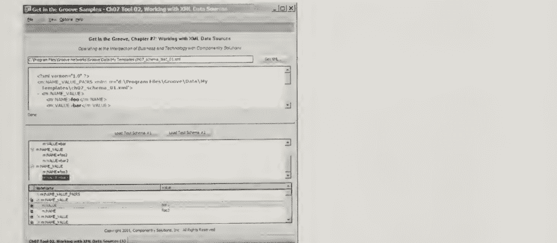

图 7-2：Ch07_tool_02，使用 XML 数据源

#### 使用自定义架构

在第 5 章中，我展示了如何使用自定义的 Groove 记录架构。在本节中，我将展示如何使用另一种类型的自定义 XML 架构。

在 CD-ROM 的 \My Templates 文件夹中，我为此工具提供了两个示例测试文件：Ch07_schema_test_01.xml 和 Ch07_schema_test_02.xml。Ch07_schema_test_01.xml 引用了解析器用于验证的显式架构。

Ch07_schema_01.xml 定义了架构并声明了一个简单的 `NAME_VALUE` 结构，如下所示：

```
<?xml version="1.0"?>

<Schema name="NAME_VALUE" xmlns="urn:schemas-microsoft-com:xml-data"
xmlns:dt="urn:schemas-microsoft-com:datatypes">

  <ElementType name="NAME" content="textOnly"/>
  <ElementType name="VALUE" content="textOnly"/>

  <ElementType name="NAME_VALUE" content="eltOnly" order="seq">
    <element type="NAME" minOccurs="1" maxOccurs="1"/>
    <element type="VALUE" minOccurs="1" maxOccurs="1"/>
  </ElementType>

  <ElementType name="NAME_VALUE_PAIRS" content="eltOnly" order="seq">
    <element type="NAME_VALUE" minOccurs="1" maxOccurs="*"/>
  </ElementType>

</Schema>
```

以下为 Ch07_schema_test_01.xml 的内容：

```
<?xml version="1.0"?>
<m:NAME_VALUE_PAIRS xmlns:m="C:\Program Files\Groove
Networks\Groove\Data\My Templates\ch07_schema_01.xml">
  <m:NAME_VALUE>
    <m:NAME>foo</m:NAME>
    <m:VALUE>bar</m:VALUE>
  </m:NAME_VALUE>
  <m:NAME_VALUE>
    <m:NAME>foo2</m:NAME>
    <m:VALUE>bar2</m:VALUE>
  </m:NAME_VALUE>
  <m:NAME_VALUE>
    <m:NAME>foo3</m:NAME>
    <m:VALUE>bar3</m:VALUE>
  </m:NAME_VALUE>
</m:NAME_VALUE_PAIRS>
```

> 注意 以上文件显式引用了 C:\Program Files\Groove Networks\Groove\Data\My Templates。如果你的 Groove 安装位置与此不同，你需要编辑 \My Templates 目录中的文件以指定正确的文件位置。

第二个测试文件未指定显式架构。这种不明确性导致解析器仅验证 XML 的结构——它确定标签是否相互匹配，但不一定验证标签名称和属性值是否正确。请注意，在以下 XML 中，你为某些 `NAME` 和 `VALUE` 元素指定了 ch07_schema_01.xml 未定义的属性：

```
<?xml version="1.0" ?>
<m:NAME_VALUE_PAIRS xmlns:m="urn:componentry.com">
  <m:NAME_VALUE>
    <m:NAME p1="p1">foo</m:NAME>
    <m:VALUE>bar</m:VALUE>
  </m:NAME_VALUE>
  <m:NAME_VALUE>
    <m:NAME>foo2</m:NAME>
    <m:VALUE p1="p1" p2="p2" p3="p3">bar2</m:VALUE>
  </m:NAME_VALUE>
  <m:NAME_VALUE>
    <m:NAME>foo3</m:NAME>
    <m:VALUE>bar3</m:VALUE>
  </m:NAME_VALUE>
</m:NAME_VALUE_PAIRS>
```

#### XMLDOM 属性、方法和事件

在此工具中，你利用 `Microsoft.XMLDOM` 对象及其实现的 `IXMLHTTPDom` 接口来构建示例 XML 文件的解析树。以下各节记录了 `IXMLHTTPDOM` 接口的关键属性、方法和事件。

#### 属性

在以下列表中，星号表示对 W3C DOM 的扩展：

- `attributes`：包含此节点的属性列表。只读。
- `baseName*`：返回带命名空间限定的名称的基本名称。只读。
- `childNodes`：包含子节点的节点列表（适用于可以有子节点的节点）。只读。
- `dataType*`：指定此节点的数据类型。读/写。
- `definition*`：返回 DTD 或架构中节点的定义。只读。
- `firstChild`：包含此节点的第一个子节点。只读。
- `lastChild`：返回最后一个子节点。只读。
```

#### 属性

- **name**: 包含属性名称。只读。
- **namespaceURI***: 返回命名空间的 URI。只读。
- **nextSibling**: 包含此节点在父节点子列表中的下一个兄弟节点。只读。
- **nodeName**: 包含元素、属性或实体引用的限定名称，或其他节点类型的固定字符串。只读。
- **nodeType**: 指定 XMLDOM 节点类型，该类型决定有效值以及节点是否可以拥有子节点。只读。
- **nodeTypedValue***: 包含此节点的值，以其定义的数据类型表示。读/写。
- **nodeTypeString***: 以字符串形式返回节点类型。只读。
- **nodeValue**: 包含与节点关联的文本。读/写。
- **ownerDocument**: 返回包含此节点的文档的根。只读。
- **parentNode**: 包含父节点（对于可以有父节点的节点）。只读。
- **parsed***: 如果此节点及所有后代节点都已解析并实例化，则包含 True；如果仍有节点待解析，则包含 False。只读。
- **prefix***: 返回命名空间前缀。只读。
- **previousSibling**: 包含此节点的左侧兄弟节点。只读。
- **specified**: 指示节点（通常是属性）是显式指定的还是从 DTD 或 schema 中的默认值派生的。只读。
- **text**: 包含节点及其子树的文本内容。读/写。
- **value**: 包含属性值。读/写。
- **xml**: 包含节点及其所有后代的 XML 表示形式。只读。

##### 方法

`IXMLHTTPDom` 接口实现的方法如下：

- **appendChild**: 将 `newChild` 作为此节点的最后一个子节点追加。
- **cloneNode**: 创建一个与此节点完全相同的新节点。
- **hasChildNodes**: 如果此节点有子节点，则返回 True。
- **insertBefore**: 在指定节点的左侧或列表末尾插入一个子节点。
- **removeChild**: 从子节点列表中移除指定的子节点并返回它。
- **replaceChild**: 在此节点的子节点集中，用提供的新子节点替换指定的旧子节点，并返回旧子节点。
- **selectNodes**: 将指定的模式匹配操作应用于此节点的上下文，并返回匹配节点的列表。
- **selectSingleNode**: 将指定的模式匹配操作应用于此节点的上下文，并返回第一个匹配的节点。
- **transformNode**: 使用提供的 XSL 样式表处理此节点及其子节点，并返回生成的转换结果。
- **transformNodeToObject**: 使用提供的 XSL 样式表处理此节点及其子节点，并将生成的转换结果返回到提供的对象中。

#### 工具组件

在此工具中，我首次引入了 GrooveTreeView 组件。你使用该控件在解析 XML 数据时显示其结构，如下代码所示：

```xml
<g:Component Name="TreeView">
    <g:ComponentResource FingerprintID="Groove"
URL="http://components.groove.net/Groove/Components/Root.osd?Package=net
.groove.Groove.ToolComponents.GrooveCommonComponents_DLL&amp;Version=0&a
mp;Factory=TeeView"/>
    <g:PropertyList Version="1">
        <g:Property Value="true" Name="EditLabels"/>
        <g:Property Value="true" Name="Has3DBorder"/>
        <g:Property Value="true" Name="HasButtons"/>
        <g:Property Value="true" Name="HasLines"/>
        <g:Property Value="false" Name="DragDrop"/>
        <g:Property Value="false" Name="ShowToolTips"/>
    </g:PropertyList>
</g:Component>
```

模板中的所有其他组件（分隔器、按钮、Web 浏览器和数据查看器）都是你之前使用过的。

#### 工具 FormDelegate

你从 Ch07_tool_01 遇到的第一个主要变化是如何在 WebBrowserView 组件中加载和显示 XML。你实现了 `GetXML_OnButtonUp` 例程，如下所示：

1. 调用 `IGrooveApplication` 的 `OpenFileDialog`，以便用户输入 XML 文件的路径。
2. 如果用户提供了文件，则使用 Web 浏览器控件导航到此文件。

以下代码实现了此逻辑：

```javascript
function GetXML_OnButtonUp(i_pIUICommand)
{
    var Result = App.OpenFileDialog("Open", "Groove Template|*.xml", g_MyTemplatesDir, "", g_pAccount, 0, false);
    switch (Result.Result)
    {
      case GrooveDialogBoxResultCode_OK:
      {
        URL.Text = Result.Data;
        WebBrowserEngine.IssueNavigateCommand(URL.Text, 0, "", "");
        break;
      }
      case GrooveDialogBoxResultCode_Cancel:
      {
        break;
      }
    }
}
```

在 Web 浏览器控件完成文件加载后，使用以下调用构建 XML 的树视图和数据视图：

```javascript
function WebBrowserView_OnUserNavigateEnd(i_URL, i_IsTopLevel)
{
  Populate_Treeview_and_DataViewer(i_URL);
}

function Populate_Treeview_and_DataViewer(i_URL)
{
  // 清空当前的树视图和记录集引擎
  g_pWindowsManager.ShowWaitCursor();
  TreeView.DeleteAllItems();

  RecordSetEngine.RemoveMultipleRecords(RecordSetEngine.OpenRecordIDEnum());

  // 在填充数据结构之前，禁用更新（将数据查看器同步到树视图）
  g_bSyncDataView = false;

  // 初始化
  g_DocumentImageIndex = -1;
  g_FolderImageIndex = -1;
  g_SelectedFolderImageIndex = -1;

  // 检查文件是否存在。如果存在，则尝试从文件内容构建 XMLDOM 对象。

  var pFSO = GrooveScriptFunctions.CreateNewObject("Scripting.FileSystemObject");
  if (pFSO.FileExists(i_URL))
  {
    var pXMLDOM =
    GrooveScriptFunctions.CreateNewObject("Microsoft.XMLDOM");
    pXMLDOM.async = false;
    var bContinue = pXMLDOM.load(i_URL);
    if (bContinue)
    {
      var pDocumentElement = pXMLDOM.documentElement;
      var Name = pDocumentElement.nodeName;
      var pRecord = CreateRecord();
      pRecord.SetField("NodeName", Name);
      pRecord.SetFieldAsDouble("_ParentID", -1);
      ModelGlue.AddRecord(pRecord);
      ModelGlue.Cursor.MarkRead(pRecord.RecordID, true);
      TreeView.InsertItem(Name, pRecord.RecordID, "",
GrooveTreeViewInsertOrder_Root, g_FolderImageIndex, g_FolderImageIndex);
      PID = pRecord.RecordID;
      for (i = pDocumentElement.childNodes.length-1; i >= 0; i--)
      {
        var pNode = pDocumentElement.childNodes(i);
        Populate_Element (pNode, PID);
      }
      for (i = 0; i < pDocumentElement.attributes.length; i++)
      {
        var pAttribute = pDocumentElement.attributes(i);
        var pAttrRecord = CreateRecord();
        pAttrRecord.SetField("NodeName", "."+pAttribute.nodeName);
        pAttrRecord.SetField("Value", pAttribute.nodeValue);
        pAttrRecord.SetFieldAsDouble("_ParentID", PID);
        ModelGlue.AddRecord(pAttrRecord);

        // 设置树视图项
        var val = "." + pAttribute.nodeName + "=" +
pAttribute.nodeValue;
        TreeView.InsertItem(val, pAttrRecord.RecordID, PID,
GrooveTreeViewInsertOrder_First, g_DocumentImageIndex,
g_DocumentImageIndex);
      }
      TreeView.ExpandItem(PID, 2, false);
    }
    else
    {
      GrooveScriptFunctions.DoMessageBox("Failed to load as XML " +
i_URL);
    }
    pXMLDOM = "";
  }
  pFSO = "";
  g_bSyncDataView = true;
  g_pWindowsManager.ShowWaitCursor(false);
}
```

`Populate_TreeView_and_DataView()` 例程的第一步是重置 DataView 和 TreeView 组件，如下所示：

```javascript
TreeView.DeleteAllItems();

RecordSetEngine.RemoveMultipleRecords(RecordSetEngine.OpenRecordIDEnum()
);

  // 在填充数据结构之前，禁用更新（将数据查看器同步到树视图）
    g_bSyncDataView = false;

  // 初始化
  g_DocumentImageIndex = -1;
  g_FolderImageIndex = -1;
  g_SelectedFolderImageIndex = -1;
```

下一步是获取文件并使用 Microsoft 的 XMLDOM 组件构建解析树，如下所示：

```javascript
var pFSO =
GrooveScriptFunctions.CreateNewObject("Scripting.FileSystemObject");
  if (pFSO.FileExists(i_URL))
  {
     var pXMLDOM = new ActiveXObject("Microsoft.XMLDOM");
     pXMLDOM.async = false;
     var bContinue = pXMLDOM.load(i_URL);
     ...
  }
```

如果 `pXMLDOM.load` 返回 True，则表示你已成功解析 XML 文件。下一步是构建根元素并将其插入 TreeView 和 DataViewer 组件，如下所示：

```javascript
        var pDocumentElement = pXMLDOM.documentElement;
        var Name = pDocumentElement.nodeName;
        var pRecord = CreateRecord();
        pRecord.SetField("NodeName", Name);
        pRecord.SetFieldAsDouble("_ParentID", -1);
        ModelGlue.AddRecord(pRecord);
        ModelGlue.Cursor.MarkRead(pRecord.RecordID, true);
        TreeView.InsertItem(Name, pRecord.RecordID, "",
GrooveTreeViewInsertOrder_Root, g_FolderImageIndex, g_FolderImageIndex);
```

此工具中的惯例是首先列出元素节点，然后是任何子节点；最后，列出该节点的任何属性。在显示属性名称时，在 TreeView 和 DataViewer 中都在其前面加上一个点（例如，.attribute=value）。

# 200 第二部分：工具


 ## 第7章：数据集成技术

在设置好根元素后，你调用 `Populate_Element()` 例程，它会递归地遍历解析树。你可以安全地递归，因为 XMLDOM 对象已成功解析了 XML 源文件，因此你知道对 Populate_Element 的调用将会返回，如下所示：

```
        PID = pRecord.RecordID;
        for (i = pDocumentElement.childNodes.length-1; i >= 0; i--)
        {
          var pNode = pDocumentElement.childNodes(i);
          Populate_Element (pNode, PID);
        }
        for (i = 0; i < pDocumentElement.attributes.length; i++)
        {
          var pAttribute = pDocumentElement.attributes(i);
          var pAttrRecord = CreateRecord();
          pAttrRecord.SetField("NodeName", ".."+pAttribute.nodeName);
          pAttrRecord.SetField("Value", pAttribute.nodeValue);
          pAttrRecord.SetFieldAsDouble("_ParentID", PID);
          ModelGlue.AddRecord(pAttrRecord);

          // Setup the treeview item
          var val = "." + pAttribute.nodeName + "=" +
pAttribute.nodeValue;
          TreeView.InsertItem(val, pAttrRecord.RecordID, PID,
GrooveTreeViewInsertOrder_First,
                g_DocumentImageIndex,
                g_DocumentImageIndex);
        }
```

如你所想，Populate_Element 承担了大部分工作，如下所示：

```
function Populate_Element(pNode, ParentRecordID)
{
  var pRecord = CreateRecord();
  var bChildren = false;
  var bRecurse = true;

  if (((pNode.childNodes.length == 0) && !pNode.attributes) ||
      ((pNode.childNodes.length == 1) && !pNode.firstChild.attributes))
  {
    var value;
    pRecord.SetFieldAsString("NodeName", pNode.nodeName);
    if (pNode.childNodes.length !=0)
    {
      bRecurse = false;
      value = pNode.firstChild.nodeValue
      pRecord.SetFieldAsString("Value", value);
    }
    else
    {
      value = pNode.nodeValue;
      pRecord.SetFieldAsString("Value", pNode.nodeValue);
    }
    pRecord.SetFieldAsDouble("_ParentID", ParentRecordID);
    TreeView.InsertItem  (pNode.nodeName+"="+value, pRecord.RecordID,
ParentRecordID, GrooveTreeViewInsertOrder_First, g_FolderImageIndex,
g_FolderImageIndex);
  }
  else
  {
    // Else use just the node name since we'll be showing attributes
and/or children
    var name = pNode.nodeName;
    pRecord.SetField("NodeName", name);
    pRecord.SetField("_ParentID", ParentRecordID);
    TreeView.InsertItem(pNode.nodeName, pRecord.RecordID,
ParentRecordID, GrooveTreeViewInsertOrder_First, g_FolderImageIndex,
g_SelectedFolderImageIndex);
  }
  ModelGlue.AddRecord(pRecord);
  var ID = pRecord.RecordID;

  if (bRecurse)
  {
    // Recurse ... we know that we can do this safely because we have a
    // valid XMLDOM already. Otherwise, we'd have to be very careful
    // and build safety into routine.
    for (var x = pNode.childNodes.length-1; x >= 0; x--)
    {
      bChildren = true;
      var pChildNode = pNode.childNodes(x);
      Populate_Element(pChildNode, ID);
    }
  }

  if (pNode.attributes)
  {
    for (var x = pNode.attributes.length-1; x >=0; x--)
    {
      // Setup the record...
      bChildren = true;
      var pAttribute = pNode.attributes(x);
      var pAttrRecord = CreateRecord();
      pAttrRecord.SetField("NodeName", "."+pAttribute.nodeName);
      pAttrRecord.SetField("Value", pAttribute.nodeValue);
      pAttrRecord.SetFieldAsDouble("_ParentID", ID);
      ModelGlue.AddRecord(pAttrRecord);
      
      // Setup the treeview
      var val = pAttribute.nodeName + "=" + pAttribute.nodeValue;
      TreeView.InsertItem(val, pAttrRecord.RecordID, ID,
GrooveTreeViewInsertOrder_First);
    }

    if (bChildren)
      TreeView.ExpandItem(ID, 2, false);
  }
}
```

你实现的最后一个功能是在 TreeView 和 DataViewer 之间同步导航。注意，在前面的 Populate_Element() 实现中，你使用 RecordID 作为 TreeView 项的键值。通过这样做，你可以简单地将 keyNew 传递给 DataViewer，让它选择正确的记录，如下所示：

```
function TreeView_OnTreeViewSelectionChangeEnd(pTreeView, keyOld,
keyNew, iTrigger)
{
  // Keep the DataViewer in sync with the TreeView...
  DataViewer.SelectSingleRow(keyNew, true, true);
}
```

要反向同步——即用户在 DataViewer 中选择记录后——你实现以下代码：

```
function DataViewer_OnDataViewerRecordSelectionChanged(sName)
{
  var RecordID = DataViewer.GetIDOfFocusRow();
  try
  {
    TreeView.SelectedItem=RecordID;
    TreeView.DropHighlightedItem=RecordID;
  }
  catch(e)
  {
  }
}
```

另一个你实现的事件方法是 TreeView 的展开/折叠回调。你实现这些回调是为了让 TreeView 在 DataViewer 中展开和折叠相应的记录。遗憾的是，你无法实现反向操作，因为 DataViewer（截至本文撰写时）不提供此功能。以下代码展示了这些 TreeView 回调的实现：

```
function TreeView_OnTreeViewItemExpansionEnd(pTreeView, sKey, iOrder)
{
  if (!g_bSyncDataView)
    return;
    
  // iOrder 1=Collapse, 2=Expand, 3=Toggle
  switch (iOrder)
  {
      case 1:
      {
          DataViewer.CollapseSelectedRows();
          break;
      }
      case 2:
      {
          DataViewer.ExpandSelectedRows(false);
      }
  }
}
```

### 生成 XML：使用 XML 数据组件

上一节向你展示了一个可以使用多个 COM 对象来检索和解析第三方 XML 数据流的工具。你通过使用 Microsoft 的 XMLDOM 组件（一个功能完备的 XML 解析器）来完成解析。

在本节中，我假设你已经利用前面两个示例工具，通过 HTTP 和 XML 将远程数据集成到你的自定义 Groove 工具中，并将其持久化存储在 **RecordSetEngine** 中。现在我将向你展示如何在 Groove 工具中生成 XML 数据流。

图 7-3 展示了如果在自己的窗口中显示 **Ch07_tool_03** 时的外观。

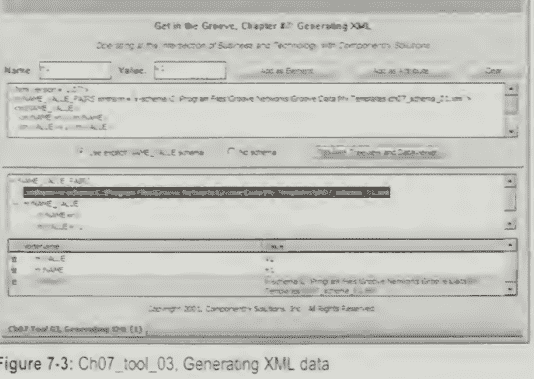

图 7-3：Ch07_tool_03，生成 XML 数据

与上一节的工具相比，主要变化出现在顶部窗格，你在其中实现了 Ch07_schema_01.xml 定义的 NAME_VALUE 模式的简单元素/属性生成能力。

如果你选择 Add_Element 按钮，就会向生成的 XML 添加一个新元素。如果你点击 Add_Attribute，则会向 XML 文档中最近添加的元素添加一个属性。

#### 工具 FormDelegate

生成的 XML 基于 JavaScript 数组 ElementArray 的内容。

该数组包含的条目本身也是数组。如果你向数组中添加一个元素，子数组的第一个元素是 Name，第二个数组子元素是 Value，如下代码所示：

```
var ElementArray = new Array();
var g_pCurrentNameVal = null;

function Add_Element_OnButtonUp(i_pIUICommand)
{
  var NameVal = new Array();
  NameVal[0] = Name.Text;
  NameVal[1] = Value.Text;
  g_pCurrentNameVal = NameVal;
  ElementArray[ElementArray.length] = NameVal;
  Preview.Text = GenerateXML();
}
```

为了处理属性，你使用最后保存的元素作为指针，然后简单地添加另一对 Name 和 Value 数组元素。按照目前的实现，你只能在已经添加元素后才能添加属性。

以下实现了这一逻辑：

```
function Add_Attribute_OnButtonUp(i_pIUICommand)
{
  if (Name.Text == "" || Value.Text == "")
  {
    GrooveScriptFunctions.DoMessageBox("You must specify NAME & VALUE");
    return;
  }
  if (!(g_pCurrentNameVal)
  {
    GrooveScriptFunctions.DoMessageBox("You must first create an ELEMENT
before adding attributes");
    return;
  }
  
  if (g_pCurrentNameVal)
  {
      var cnt = pCurrentNameVal.length;
      // Append attribute name/val to end of current element
      pCurrentNameVal[cnt] = Name.Text;
      pCurrentNameVal[cnt+1] = Value.Text;
      Preview.Text = GenerateXML();
  }
}
```

Generate_XML() 的实现执行以下操作：

- 确定是否使用显式模式。如果你决定使用显式模式，获取 \My Templates 目录的位置，以便构造指向该模式的显式路径。
- 遍历 ElementArray，为每个条目构造一对 NAME 和 VALUE。
- 如果每个元素条目存在多个 NAME 和 VALUE 对，对于每个额外的对，它会生成一个属性 Name=Value。

注意，如果你生成带有属性的 XML 并且选中了 "Use Explicit NAME_VALUE Schema" 单选按钮，生成的 XML 在你点击 Populate 按钮后将无法加载。在这种情况下，请选择 "No Schema" 单选按钮。

同样，如果你不使用模式，XMLDOM 解析器在定义了多个相同属性时将无法解析。

以下实现了这一逻辑：

```
function Generate_XML()
{
    // Construct an XML document based on Ch07_schema_01.xml
    var pShell = GrooveScriptFunctions.CreateNewObject("WScript.Shell");
    var GrooveKey = "HKLM\\SOFTWARE\\Groove Networks,
Inc.\\Groove\\PersistRoot";
    var GrooveDir = pShell.RegRead(GrooveKey);
    var MyTemplatesDir = GrooveDir + "My Templates\\";

    // By specifying the following explicit schema, the generated XML will
    // not be successfully loaded by XMLDOM parser unless the XML is
    // well-formed and has NO extraneous (non-defined) elements &
    // attributes.

    var strSCHEMA = "\"x-schema:" + MyTemplatesDir +
"ch07_schema_01.xml\"";

    // An alternative would be to simply define strSCHEMA to be
    // "urn:componentry.com". By doing this, strict element/attribute
```


 ```
// checking will not occur and XMLDOM will simply confirm that the
// data stream is well-formed XML.

if (!g_bUseSchema)
  strSCHEMA = "\"urn:componentry.com\"";

// Generate a block of XML, crude but effective...
g_strXML = "<?xml version=\"1.0\"?>\n";
g_strXML += "<m:NAME_VALUE_PAIRS xmlns:m=" + strSCHEMA + ">\n";

for (var i = 0; i < ElementArray.length; i++)
{
  // Not adding attributes yet...
  pNameVal = ElementArray[i];
  if (pNameVal.length > 2)
  {
    // We have attributes...
    g_strXML += "  <m:NAME_VALUE";
    for (var x = 2; x<pNameVal.length; x=x+2)
    {
      g_strXML += " " + pNameVal[x] + "=\"" + pNameVal[x+1] + "\"";
    }
    g_strXML += ">\n";
  }
  else
  {
    g_strXML += "  <m:NAME_VALUE>\n";
  }
  g_strXML += "    <m:NAME>" + pNameVal[0] + "</m:NAME>\n";
  g_strXML += "    <m:VALUE>" + pNameVal[1] + "</m:VALUE>\n";
  g_strXML += "  </m:NAME_VALUE>\n";
}
g_strXML += "</m:NAME_VALUE_PAIRS>\n";
g_bGenerated = true;
return g_strXML;
}
```

与前一节工具相比，`Populate_Treeview_and_DataViewer()` 发生了一项重要变化，如下代码所示：

```
function Populate_Treeview_and_DataViewer(i_strXML)
{
  ...
  var pXMLDOM =
GrooveScriptFunctions.CreateNewObject("Microsoft.XMLDOM");
  pXMLDOM.async = false;
  var bContinue = pXMLDOM.loadXML(i_strXML);
  ...
}
```

`IXMLHTTPDom` 方法的 `loadXML` 从字符串加载，而非从文件加载。

#### 导入和导出记录

前两节展示了可以导入第三方 XML 数据的工具，以及生成自定义 XML 数据流的方法。

本节将介绍如何从 RecordSetEngine 导入和导出 Groove 特定的架构。

图 7-4 展示了该工具在独立窗口中显示时的外观。

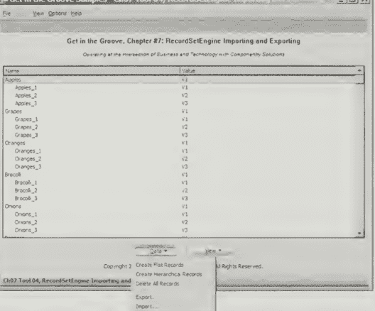

图 7-4：Ch07_tool_04，导入和导出 Groove XML 数据

#### 工具组件和布局

与本章已展示的其他工具一样，导入/导出演示工具的布局也非常简单——它没有工具栏或帮助系统集成，仅有一个 DataViewer 和两个命令按钮（类似于第 5 章和第 6 章所示）。这两个命令按钮菜单使您可以处理数据（初始化、导入和导出）或更改数据记录的视图。

该工具的 RecordSetEngine 中引入了一项新的重要变化。之前构建的所有工具（第 5、6、7 章中）都使用了 RecordSetEngine3。V3 不强制事务语义——也就是说，作为程序员，您在读取或写入记录之前无需打开事务。

从本工具开始，我们将使用 RecordSetEngine4。这对您作为开发者来说意味着，在进行任何引擎操作之前，您需要打开一个 `IGrooveTransaction`。您可以将事务打开为只读或读写模式。以下是组件声明中的变化（注意加粗的 Factory=RecordSetEngine4）：

```
<g:Component SingleInstance="True" Category="Engine" Name="RecordSetEngine">
  <g:ComponentResource URL="http://components.groove.net/Groove/Components/Root.osd?Package=net.groove.Groove.ToolComponents.GrooveListComponents_DLL&amp;Version=0,6&amp;Factory=RecordSetEngine4" FingerprintID="Groove"/>
  <g:EngineDesc Tag="urn:groove.net:RecordSetEngine"/>
  <g:ComponentConnections>
    <g:Connection Name="ToolCollections" ConnectionID="0"/>
  </g:ComponentConnections>
  <g:PropertyList Version="1">
    <g:Property Name="ClassInfoList">
      <g:PropertyValue>
        <g:ClassInfo Name="urn:groove.net:Ch07_tool_02_Record" URL="http://components.groove.net/Groove/Components/Root.osd?Package=net.groove.Groove.ToolComponents.GrooveListComponents_DLL&amp;Version=0&amp;Factory=Record">
        </g:ClassInfo>
      </g:PropertyValue>
    </g:Property>
  </g:PropertyList>
</g:Component>
```

我将在 FormDelegate 中指出这一变化的影响。

#### 工具 FormDelegate

Ch07_tool_04 的 FormDelegate 比 Ch07_tool_03 多做了一些初始化工作。我们主要关注的是获取 `IGrooveTransaction` 实例，以便在使用 RecordSetEngine 时正确实现事务语义。以下代码展示了如何获取此实例：

```
var g_pTelepsace = PropertyList.OpenProperty(PROPERTY_TELESPACE);
var g_pTransaction = g_pTelepsace.OpenTransaction(true);
g_pTransaction.Abort();
```

如您所见，我们首先从 PropertyList 获取对 `IGrooveTelepsace` 的引用。然后调用 `OpenTransaction` 方法，并立即中止事务。现在您已拥有事务，可以调用 `IGrooveTransaction` 的 `Begin` 方法，如果您需要只读事务则指定 True，如果您将创建记录则指定 False。

##### 从 RecordSetEngine 导出记录

支持记录导出的大部分代码的目的是确定输出文件的名称——而不是实际执行工作。获取文件名后，您就可以导出记录了。导出记录的关键步骤如下：

- 1. 调用 `IGrooveRecordSetEngine` 的 `ExportToElement` 方法。此方法构造并返回一个 `IGrooveElement`。

- 2. 通过 `GrooveGlobalHelperFunctions.gsl` 实现的 `CreateByteOutputStreamFromFile` 辅助函数，为指定文件打开一个 `IGrooveByteOutputStream`。

- 3. 给定 `ExportElement` 和输出流后，只需调用 `IGrooveElement` 的 `SerializeToStream` 方法，如下所示：

```
var PROP_LAST_DIRECTORY = "FileDialogLastDirectory";
function Export()
{
  var i_InitialFile = "ch07_tool_04_test.gxml";
  var strLastDirectory = "c:\\";
  var pList =
  PropertyList.OpenProperty(PROPERTY_ACCOUNT_PREFERENCES);

  if (pList.PropertyExists(PROP_LAST_DIRECTORY))
    strLastDirectory = pList.OpenProperty(PROP_LAST_DIRECTORY);

  var FileResult = App.SaveFileDialog("Export Records", g_strFilter
  , strLastDirectory, i_InitialFile, g_pAccount, 1, false);
  if (GrooveDialogBoxResultCode_OK == FileResult.Result)
  {
    // Update last used directory
    var FilePath = FileResult.Data;
    var iType = GrooveSerializeType_XML;
    var strPath = LeftBack(FilePath, "\\");
    pList.SetProperty(PROP_LAST_DIRECTORY, strPath, 0);

    // Determine serialize type
    var Extension = RightBack(FilePath, ".");
    if (Extension == "" || Extension == FilePath)
      FilePath += ".gxml";
    else if (Extension == "gmime")
      iType = GrooveSerializeType_MIME;
    var RecordIDEnum = RecordSetEngine.OpenRecordIDEnum();
    var ExportElement =
    RecordSetEngine.ExportToElement(RecordIDEnum);
    var BOS = CreateByteOutputStreamFromFile(FilePath);
    ExportElement.SerializeToStream(BOS, iType,
    GrooveCharEncodingType_UTF8, GrooveSerializeOption_Default);
  }
```

注意，`IGrooveElement` 的 `SerializeToStream` 方法接受一个序列化标志。此标志的可能值如下：

- `GrooveSerializeType_MIME`
- `GrooveSerializeType_XML`

两种导出类型之间的关键区别是，如果记录架构支持文件附件，则导出为 XML 时会丢失文件附件内容。如果您想导出带有支持文件附件的架构的记录（例如默认的 Discussion 工具），您需要将标志设置为 `GrooveSerializeType_MIME`。库存 Discussion 工具不提供选择——主要是为了避免用户在导出和随后导入时产生困惑。

以 MIME 格式导出的唯一缺点是生成的文件部分编码，实际上不可人工阅读。

为了支持检查不同的文件内容，我为该工具创建了 GMIME 和 GXML 文件扩展名。您根据文件扩展名设置 `SerializeFlag` 类型。为了让您了解 MIME 和 XML 格式之间的区别，以下展示了导出为 XML 时 DataViewer 中包含的数据结果：

- **记录 1：** Name=Apple, Value=V1
- **记录 2：** Name=Orange, Value=V5

```
<?xml version='1.0'?>
<?groove.net version='1.0'?>
  <g:fragment xmlns:g="urn:groove.net">
    <g:ExportedRecords>
      <g:Ch07_tool_02_Record Attribute="Fruit" Value="V1"
_CreatedByURL="grooveIdentity://pduprz5enapfv8xwqwvwnwb6732u7mdk35agzc7p@
" _CreatedBy="phil" _ModifiedBy="" NodeName="Apples"
_Created="1002571060763" _ParentID="-1" _DataModelVersion="1"
_Modified="1002571060763" _IsRead="1" _RecordID="401915423" PID="-1"
_PreviousSiblingID="-1" _NewParentID="-1"/>
      <g:Ch07_tool_02_Record Attribute="Fruit" Value="V5"
_CreatedByURL="grooveIdentity://pduprz5enapfv8xwqwvwnwb6732u7mdk35agzc7p@
" _CreatedBy="phil" _ModifiedBy="" NodeName="Oranges"
_Created="1002571061644" _ParentID="-1" _DataModelVersion="1"
_Modified="1002571061644" _IsRead="1" _RecordID="401916305" PID="-1"
_PreviousSiblingID="-1" _NewParentID="-1"/>
    </g:ExportedRecords>
  </g:fragment>
```

##### 将记录导入 RecordSetEngine

将记录导入 Groove RecordSetEngine 实际上是导出过程的逆过程。以下列表描述了导入这些记录时必须执行的任务：
```


 # 212 第二部分：工具

1. 创建一个临时 XML 文档（IGrooveXMLDocument）。
2. 打开一个字节输入流。
3. 创建一个 ImportElement（一个 IGrooveElement）。
4. 从 ImportElement 创建记录的枚举。
5. 将记录添加到 RecordSetEngine。

以下示例实现了此逻辑：

```
function Import()
{
    g_pWindowsManager.ShowWaitCursor();
    var strLastDirectory="c:\\";
    var pList = PropertyList.OpenProperty(PROPERTY_ACCOUNT_PREFERENCES);
    if (pList.PropertyExists(PROP_LAST_DIRECTORY))
        strLastDirectory = pList.OpenProperty(PROP_LAST_DIRECTORY);

    var FileResult = App.OpenFileDialog("Load Groove XML File",
        g_strFilter, strLastDirectory, "", g_pAccount, 0, false);
    if ((FileResult.Result == GrooveDialogBoxResultCode_OK) &&
        FileResult.Data != "")
    {
        // Save last used directory...
        var FilePath = FileResult.Data;
        var strPath = LeftBack(FilePath, "\\");
        pList.SetProperty(PROP_LAST_DIRECTORY, strPath, 0);

        var pSM =
            GrooveScriptFunctions.CreateNewObject("Groove.StorageManager");
        var pMisc =
            GrooveScriptFunctions.CreateNewObject("Groove.MiscPackage");
        var XMLDoc = pSM.CreateTemporaryXMLDocument("Import");
        var pStreamFactory =
            GrooveScriptFunctions.CreateNewObject("Groove.StreamFactory");
        var pBIS = pStreamFactory.CreateByteInputStreamFromFile(FilePath);

```

请注意，您现在要开始一个读写事务：

```
g_pTransaction.Begin();
```

您必须在创建记录之前执行此操作：

```
try
{
    var pImportElement = XMLDoc.CreateElementFromStream(pBIS, 0,
        XMLDoc.OpenRootElement());
    var pRecordEnum =
        RecordSetEngine.ImportFromElementAdv(pImportElement,
            GrooveScriptFunctions.CreateNewObject(""));
```

```
RecordSetEngine.AddMultipleRecords(pRecordEnum);
```

现在记录已添加，我们需要提交事务，以便创建增量并将其分发给共享空间的其他成员：

```
g_pTransaction.Commit();
}
catch (e)
{
```

如果发生错误，那么我们需要中止事务：

```
g_pTransaction.Abort();
DisplayError("Error while importing:" + e.description, "Import");
}
}
g_pWindowsManager.ShowWaitCursor(false);
}
```

> **注意** 与导出过程不同，CreateElementFromStream 方法不需要您设置标志来指示流是否包含 MIME 或 XML 数据。IGrooveRecordSetEngine 方法 ImportFromElementAdv 承担了繁重的工作。

### 添加数据收集查询支持

Ch07_tool_05 为上一节构建的工具添加了一个简单的数据查询功能。它实现了一个通用的手动输入查询的功能。它还提供了许多预构建的查询，包括一个演示如何针对实际上不显示给用户的属性执行查询的示例。

图 7-5 展示了如果在自己的窗口中显示此工具时的外观。

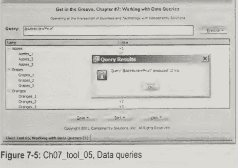

#### 工具组件和布局

Ch07_tool_04 模板之外的额外组件声明包括 Sort 按钮及其关联的 Sort_Menu、Execute 按钮及其关联的 Execute_Menu，以及 Query_Label 和 Query 编辑字段，如下面的代码所示：

```
<g:Component Name="Sort">
    <g:ComponentResource FingerprintID="Groove"
URL="http://components.groove.net/Groove/Components/Root.osd?Package=net
.groove.Groove.ToolComponents.GrooveCommonComponents_DLL&amp;Version=0&a
mp;Factory=Button"/>
        <g:PropertyList Version="1">
            <g:Property Name="Style" Value="StandardButton"/>
            <g:Property Name="Label" Value="&amp;Sort"/>
            <g:Property Name="Menu" Value="Sort_Menu"/>
            <g:Property Name="Mnemonic" Value="Ctrl+S"/>
        </g:PropertyList>
</g:Component>

<g:Component Name="Sort_Menu">
    <g:ComponentResource FingerprintID="Groove"
URL="http://components.groove.net/Groove/Components/Root.osd?Package=net
.groove.Groove.ToolComponents.GrooveCommonComponents_DLL&amp;Version=0&a
mp;Factory=Menu"/>
        <g:PropertyList Version="1">
            <g:Property Name="UICommands">
                <g:PropertyValue>
                    <g:UICommand URL="ByAscName" Label="Sort by Name:
Ascending"/>
                    <g:UICommand URL="ByDescName" Label="Sort by Name:
Descending"/>
                    <g:UICommand URL="ByAscValue" Label="Sort by Value:
Ascending"/>
                    <g:UICommandSeparator URL="Sep1"/>
                    <g:UICommand URL="ByValueHierarchical" Label="Sort by
Value: Hierarchical Ascending"/>
                </g:PropertyValue>
            </g:Property>
        </g:PropertyList>
</g:Component>

<g:Component Name="Execute">
    <g:ComponentResource FingerprintID="Groove"
URL="http://components.groove.net/Groove/Components/Root.osd?Package=net
.groove.Groove.ToolComponents.GrooveCommonComponents_DLL&amp;Version=0&a
mp;Factory=Button"/>
        <g:PropertyList Version="1">
            <g:Property Name="Style" Value="StandardButton"/>
            <g:Property Name="Label" Value="&amp;Execute"/>
```

```
<g:Property Name="Menu" Value="Execute_Menu"/>
<g:Property Name="Mnemonic" Value="Ctrl+E"/>
</g:PropertyList>
</g:Component>

<g:Component Name="Execute_Menu">
<g:ComponentResource FingerprintID="Groove"
URL="http://components.groove.net/Groove/Components/Root.osd?Package=net
.groove.Groove.ToolComponents.GrooveCommonComponents_DLL&amp;Version=0&a
mp;Factory=Menu"/>
<g:PropertyList Version="1">
<g:Property Name="UICommands">
<g:PropertyValue>
<g:UICommand URL="This" Label="Execute specified query"/>
<g:UICommandSeparator URL="Sep1"/>
<g:UICommand URL="Reset" Label="Select All: Query = *"/>
<g:UICommandSeparator URL="Sep1"/>
<g:UICommand URL="Apples" Label="Select All Apples: Query
= @NodeName='Apples'"/>
<g:UICommand URL="Fruit" Label="Select All Fruit: Query =
@Attribute='Fruit'"/>
<g:UICommand URL="Vegetables" Label="Select All Fruit:
Query = @Attribute='Vegetables'"/>
</g:PropertyValue>
</g:Property>
</g:PropertyList>
</g:Component>

<g:Component Name="Query_Label">
<g:ComponentResource FingerprintID="Groove"
URL="http://components.groove.net/Groove/Components/Root.osd?Package=net
.groove.Groove.ToolComponents.GrooveCommonComponents_DLL&amp;Version=0&a
mp;Factory=Static"/>
<g:PropertyList Version="1">
<g:Property Name="Label" Value="Query:"/>
<g:Property Name="Style" Value="Normal"/>
</g:PropertyList>
</g:Component>

<g:Component Name="Query">
<g:ComponentResource FingerprintID="Groove"
URL="http://components.groove.net/Groove/Components/Root.osd?Package=net
.groove.Groove.ToolComponents.GrooveCommonComponents_DLL&amp;Version=0&a
mp;Factory=Edit"/>
<g:PropertyList Version="1"/>
</g:Component>
```

#### 工具 FormDelegate

为了演示针对视图中不显示的字段进行查询，您扩充了 CreateRecords() 例程以保存 Attribute 字段，如下所示：

```
function CreateRecords(NodeName, Attribute, bHierarchical)
{
    g_pTransaction.Begin(false);
    try
    {
        var pRecord =
ModelGlue.CreateRecord("urn:groove.net:Ch07_tool_02_Record");
        pRecord.SetField("NodeName", NodeName);
        pRecord.SetField("Value", "V"+i);
        pRecord.SetField("Attribute", Attribute);
        ModelGlue.AddRecord(pRecord);
        ModelGlue.Cursor.MarkRead(pRecord.RecordID, true);
        if (bHierarchical)
        {
            for (var x = 1; x <= 3; x++)
            {
                var pChild =
ModelGlue.CreateRecord("urn:groove.net:Ch07_tool_02_Record");
                pChild.SetField("NodeName", NodeName + "_" + x);
                pChild.SetField("Value", "V"+x);
                pChild.SetField("Attribute", Attribute);
                pChild.SetFieldAsDouble("_ParentID", pRecord.RecordID);
                ModelGlue.AddRecord(pChild);
                ModelGlue.Cursor.MarkRead(pChild.RecordID, true);
            }
        }
        g_pTransaction.Commit();
    }
    catch (e)
    {
        g_pTransaction.Abort();
        pWindow = UIPropertyList.OpenProperty(UIPROPERTY_TOP_LEVEL_WINDOW);
        pAccount = PropertyList.OpenProperty(PROPERTY_ACCOUNT);
        DisplayError("Error creating records: " + e.description, "Create
Records");
    }
}
```

您修改了 DataViewer_Initialize() 例程以指定属性 Fruit 或 Vegetable，如下所示：

```
function DataViewer_Initialize(bHierarchical)
{
    g_pWindowsManager.ShowWaitCursor();
    var pEnum = RecordSetEngine.OpenRecordIDEnum();
```


```javascript
if (pEnum.HasMore())
    ModelGlue.DeleteRecords(pEnum);

// 添加 "Apples" 记录
CreateRecords("Apples", "Fruit", bHierarchical);

// 添加 "Grapes" 记录
CreateRecords("Grapes", "Fruit", bHierarchical);

// 添加 "Oranges" 记录
CreateRecords("Oranges", "Fruit", bHierarchical);

// 添加 "Broccoli" 记录
CreateRecords("Broccoli", "Vegetables", bHierarchical);

// 添加 "Onions" 记录
CreateRecords("Onions", "Vegetables", bHierarchical);

// 添加 "Peppers" 记录
CreateRecords("Peppers", "Vegetables", bHierarchical);

g_pWindowsManager.ShowWaitCursor(false);
}
```

以下是排序按钮的菜单命令的实现：

```
function Sort_Menu_OnCommand (i_pUICommand)
{
    var cmdURL = i_pUICommand.CommandURL;
    switch (cmdURL)
    {
        case "ByAscName":
        case "ByDescName":
        case "ByAscValue":
        case "ByValueHierarchical":
        {
            ModelGlue.Collection.UseNamedSort(cmdURL, false);
            break;
        }
        case "Fruit":
        {
            ModelGlue.Collection.Find("@Attribute='Fruit'");
            break;
        }
        case "Vegetables":
        {
            ModelGlue.Collection.Find("@Attribute='Vegetables'");
            break;
        }
    }
}
```

请注意，Fruit 和 Vegetable 命令并不是在改变 ModelGlue 使用的排序方式；相反，它们是在对 Attribute 字段执行查询。

```
function Execute_Query(strQuery)
{
  try
  {
    ModelGlue.Collection.Find(strQuery);
  }
  catch (error)
  {
    DisplayError("Error processing query: " + Query.Text, "Query");
  }
}

function Execute_Menu_OnCommand (i_pUICommand)
{
  var cmdURL = i_pUICommand.CommandURL;
  switch (cmdURL)
  {
    case "This":
    {
      Execute_Query(Query.Text);
      break;
    }
    case "Reset":
    {
      Execute_Query("*");
      break;
    }
    case "Apples":
    {
      Execute_Query("@NodeName='Apples'");
      break;
    }
    case "Fruit":
    {
      Execute_Query("@Attribute='Fruit'");
      break;
    }
    case "Vegetables":
    {
      Execute_Query("@Attribute='Vegetables'");
      break;
    }
  }
}
```

要实现一个对话框，用于告知用户查询获得了多少条匹配记录，你需要实现 IGrooveDataModelGlueSink 的 OnModelGlueFind 方法，如下所示：

```
function ModelGlue_OnModelGlueFind(sName, sQuery, iHits)
{
  var msg = "Query '" + sQuery + "' produced " + iHits + " hits.";
  pWindow = UIPropertyList.OpenProperty(UIPROPERTY_TOP_LEVEL_WINDOW);
  pAccount = PropertyList.OpenProperty(PROPERTY_ACCOUNT);
  App.GrooveMessageBox(pWindow, pAccount, msg, "Query Results",
GrooveMessageBoxStyle_OK, GrooveMessageBoxIcon_Information);
}
```

#### 测试该工具

Groove 集合查询功能是 W3C XPath 查询slt;brvbar;规范的部分实现。有关此规范的更多信息，请访问 http://www.w3.org/TR/xpath。

该工具包含多个预构建的查询，用于演示语法，如下所示：

- @NodeName='Fruit'
- @Value='Apples'
- @Attribute='Fruit'

查询的一般格式如下：

- [@FieldName='Value']

要执行 "SQL 选择所有记录" 命令 "SELECT *"，请使用以下查询：

- @*

### 使用 SQL 数据源：在工具中使用 ADODB.Connection 对象

前面的部分向你展示了一个可以使用多种对象来检索和解析第三方 XML 数据流的工具。你使用 Microsoft 的 XMLDOM 以及 IGrooveXMLDocument 进行解析，并利用 GrooveRecordSet 的原生导入/导出功能。在本节中，我将向你展示如何使用 ADODB.Connection 对象构建一个工具，以将 RecordSetEngine 与外部关系数据库（在本例中是 Microsoft Access 数据库）同步。在你的 \My Templates 文件夹中，你应该能找到一个 ch07.mdb —— 一个预构建的 Access 数据库。

本节中的工具将自动为此数据库建立一个数据源名称（DSN）。在尝试运行此工具之前，请确保你已将从 CD-ROM 中的整个 \My Templates 文件夹复制到 ...\Groove\Data\My Templates 文件夹，并取消文件属性中的"只读"勾选。

图 7-6 展示了如果在自己的窗口中显示 Ch07_tool_06 时的样子。

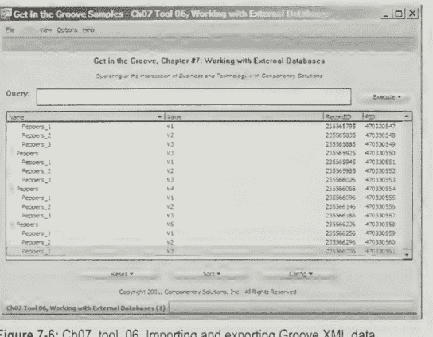

图 7-6：Ch07_tool_06，导入和导出 Groove XML 数据

#### 工具组件和布局

为了支持显示本地 RecordID 和 Access 数据库记录 ID，你需要在两个视图中添加两列。此外，你将 Value 字段设为可编辑，以便你可以在 DataViewer 中尝试修改值，并将这些更改同步到外部数据库。

以下是从 Ch07_tool_05 对视图的更改：

```
<g:DataViewerView Name="Flat" Default="True">
  <g:DataViewerColumn Name="NodeName" Label="Name" DataType="String" ShowTwisty="0" Width="40%" ReadOnly="1"/>
  <g:DataViewerColumn Name="Value" Label="Value" DataType="String" Width="40%" ReadOnly="0"/>
  <g:DataViewerColumn Name="_RecordID" Label="RecordID" DataType="Double" Width="10%" ReadOnly="1"/>
  <g:DataViewerColumn Name="PID" Label="PID" DataType="Double" Width="10%" ReadOnly="1"/>
</g:DataViewerView>
<g:DataViewerView Name="Hierarchical" Default="true">
  <g:DataViewerColumn Name="NodeName" Label="Name" Indent="10" DataType="String" ShowTwisty="1" Width="40%" ReadOnly="1"/>
```

```
<g:DataViewerColumn Name="Value" Label="Value" DataType="String" Width="40%" ReadOnly="0"/>
<g:DataViewerColumn Name="_RecordID" Label="RecordID" DataType="Double" Width="10%" ReadOnly="1"/>
<g:DataViewerColumn Name="PID" Label="PID" DataType="Double" ShowTwisty="0" Width="10%" ReadOnly="1"/>
</g:DataViewerView>
```

为了支持以编程方式配置数据库 DSN 和重建外部数据库表，你需要添加一个 Config 按钮及其关联的下拉菜单 Config_Menu，如下所示：

```
<g:Component Name="Config">
  <g:ComponentResource FingerprintID="Groove" URL="http://components.groove.net/Groove/Components/Root .osd?Package=net .groove.Groove.ToolComponents.GrooveCommonComponents_DLL&amp;Version=0&amp;Factory=Button"/>
    <g:PropertyList Version="1">
      <g:Property Name="Style" Value="StandardButton"/>
      <g:Property Name="Label" Value="Config"/>
      <g:Property Name="Menu" Value="Config_Menu"/>
    </g:PropertyList>
</g:Component>
```

```
<g:Component Name="Config_Menu">
  <g:ComponentResource FingerprintID="Groove" URL="http://components.groove.net/Groove/Components/Root .osd?Package=net .groove.Groove.ToolComponents.GrooveCommonComponents_DLL&amp;Version=0&amp;Factory=Menu"/>
    <g:PropertyList Version="1">
      <g:Property Name="UICommands">
        <g:PropertyValue>
          <g:UICommand URL="Config" Label="Configure Database DSN"/>
          <g:UICommand URL="Unconfig" Label="Unconfigure Database DSN"/>
          <g:UICommandSeparator URL="Sep1"/>
          <g:UICommand URL="Flat" Label="Rebuild Flat Database Table"/>
          <g:UICommand URL="Hierarchical" Label="Rebuild Hierarchical
Database Table"/>
        </g:PropertyValue>
      </g:Property>
    </g:PropertyList>
</g:Component>
```

#### 工具 FormDelegate

在实际通过 ADODB.Connection 对象访问数据库之前，你需要建立一个系统 DSN。一种方法是使用 ODBC 数据源管理工具。

我以编程方式实现此功能，以向你展示如何为 Access 数据库 DSN 设置注册表，如下代码所示：

```
function DSN_Add(name, DBQ, Driver, DriverId, FIL, SafeTransactions, UID)
{
    var pShell = GrooveScriptFunctions.CreateNewObject("WScript.Shell");
    var basekey = "HKLM\\SOFTWARE\\ODBC\\ODBC.INI\\" + name;

    // 创建 Engine 键
    var key = basekey + "\\Engines\\Jet\\MaxBufferSize";
    try {
        pShell.RegWrite(key, 0x800, "REG_DWORD");
    }
    catch(e)
    {
        return "Error: " + e.description + ", while adding Engines\\Jet\\MaxBufferSize";
    }

    // 创建 Engine 键
    var key = basekey + "\\Engines\\Jet\\PageTimeout";
    try {
        pShell.RegWrite(key, 0x05, "REG_DWORD");
    }
    catch(e)
    {
        return "Error: " + e.description + ", while adding Engines\\Jet\\PageTimeout";
    }

    // 创建 Engine 键
    var key = basekey + "\\Engines\\Jet\\Threads";
    try {
        pShell.RegWrite(key, 0x03, "REG_DWORD");
    }
    catch(e)
    {
        return "Error: " + e.description + ", while adding Engines\\Jet\\Threads";
    }

    // 创建 Engine 键
    var key = basekey + "\\Engines\\Jet\\ImplicitCommitSync";
    try {
        pShell.RegWrite(key, "Yes", "REG_SZ");
    }
    catch(e)
    {
```


 ## 第 7 章：数据集成技术

```javascript
return "Error: " + e.description + ", while adding Engines\\Jet\\ImplicitCommitSync";
}
// Create the Engine key
var key = basekey + "\\Engines\\Jet\\UserCommitSync";
try {
  pShell.RegWrite(key, "Yes", "REG_SZ");
}
catch(e)
{
  return "Error: " + e.description + ", while adding Engines\\Jet\\UserCommitSync";
}

// Create the DBQ key
var key = basekey + "\\DBQ";
try {
  pShell.RegWrite(key, DBQ, "REG_SZ");
}
catch(e)
{
  return "Error: " + e.description + ", while adding DSN DBQ";
}

// Create the Driver key
var val = basekey + "\\Driver";
try {
  pShell.RegWrite(val, Driver, "REG_SZ");
}
catch(e)
{
  return "Error: " + e.description + ", while adding DSN Driver";
}

// Create the DriverID key
var val = basekey + "\\DriverId";
try {
  pShell.RegWrite(val, DriverId, "REG_DWORD");
}
catch(e)
{
  return "Error: " + e.description + ", while adding DSN DriverId";
}

// Create the FILE key
var val = basekey + "\\FIL";
try {
  pShell.RegWrite(val, FIL, "REG_SZ");
}
catch(e)
{
  return "Error: " + e.description + ", while adding DSN FIL";
}

// Create the SafeTransactions key
var val = basekey + "\\SafeTransactions";
try {
  pShell.RegWrite(val, SafeTransactions, "REG_DWORD");
}
catch(e)
{
  return "Error: " + e.description + ", while adding DSN SafeTransactions";
}

// Create the UID key
var val = basekey + "\\UID";
try {
  pShell.RegWrite(val, UID, "REG_SZ");
}
catch(e)
{
  return "Error: " + e.description + ", while adding DSN UID";
}

// Update our list
var key = "HKLM\\SOFTWARE\\ODBC\\ODBC.INI\\ComponentryList";
try
{
  strComponentryList = pShell.RegRead(key);
  strComponentryList += ";" + name;
  pShell.RegRead(key, strComponentryList);
}
catch(e)
{
  // No entry yet so create one
  pShell.RegWrite(key, name + ";");
}

// Add a named data source. This allows UI manipulation of the
// data source.  All will run without this being present.
// Access only for now.
var key = "HKLM\\SOFTWARE\\ODBC\\ODBC.INI\\ODBC Data Sources\\" + name;
var val = "Microsoft Access Driver (*.mdb)";
try {
  pShell.RegWrite(key, val, "REG_SZ");
}
catch(e)
{
  return "Error: " + e.description + ", while adding ODBC Data Source";
}
pShell = null;
return "Success";
```

为了实现以编程方式删除 DSN，你可以实现如下例程：

```javascript
function DSN_Delete(name)
{
  var pShell = GrooveScriptFunctions.CreateNewObject("WScript.Shell");
  var basekey = "HKLM\\SOFTWARE\\ODBC\\ODBC.INI\\" + name;

  // Delete the NAME\Engines\Jet key
  var key = basekey + "\\Engines\\Jet\\";
  try
  {
    pShell.RegDelete(key);
  }
  catch(e)
  {
    var err = "Error deleting main ODBC.INI key for '" + key + "': " + e.description;
  }

  // Delete the NAME\Engines key
  var key = basekey + "\\Engines\\";
  try
  {
    pShell.RegDelete(key);
  }
  catch(e)
  {
    var err = "Error deleting main ODBC.INI key for '" + key + "': " + e.description;
  }

  // Delete the NAME key
  var key = basekey + "\\";
  try
  {
    pShell.RegDelete(key);
  }
  catch(e)
  {
    var err = "Error deleting main ODBC.INI key for '" + key + "': " + e.description;
  }

  // Delete from our managed list
  try
  {
    var key = "HKLM\\SOFTWARE\\ODBC\\ODBC.INI\\ComponentryList";
    var strComponentryList = pShell.RegRead(key);
    // construct new list
    var newstr = "";
    var nPos = strComponentryList.indexOf(name);
    if (nPos == 0)
    {
      // beginning of the list, skip first entry. Delimeter is
      // single semi-colon ';'
      newstr = strComponentryList.substr(strComponentryList.length+1);
    }
    else
    {
      if (strComponentryList.length == (nPos + name.length + 1))
      {
        // at end of list. Return beginning of list.
        newstr = strComponentry.substr(0, npos);
      }
      else
      {
        // in middle of list. Add beginning & end together;
        newstr = strComponentry.substr(0, nPos-1) + strComponentry.substr(nPos + name.length + 1);
      }
    }
    pShell.RegWrite(key, newstr);
  }
  catch(e)
  {
    var err = "Error obtaining managed list: " + e.description;
  }

  // Delete from the ODBC Data Sources list
  var key = "HKLM\\SOFTWARE\\ODBC\\ODBC.INI\\ODBC Data Sources\\" + name;
  try
  {
    pShell.RegDelete (key);
  }
  catch(e)
  {
    var err = "Error deleting ODB Data Source entry: " + e.description;
    return false;
  }
  pShell = "";
  return true;
}
```

为了封装 DSN_Add 和 DSN_Delete 例程，你可以实现一个 DSN_Config 例程，它只需接收一个指向 Access 数据库的路径名，如下所示：

```javascript
function DSN_Config (FolderPath)
{
  DSN_Delete(g_strDSN);
  var pFS = GrooveScriptFunctions.CreateNewObject("Scripting.FileSystemObject");
  var pShell = GrooveScriptFunctions.CreateNewObject("WScript.Shell");
  var WinDir = pShell.ExpandEnvironmentStrings("%WinDir%");
  WinDir += "\\system32\\";
  var Driver = WinDir + "odbcjt32.dll";

  // Validate that the driver exists...
  if (pFS.FileExists(Driver))
  {
    var DriverId = 0x19;
    var FIL = "MS Access;";
    var SafeTransactions = 0;
    var UID = "";
    var DBQ = FolderPath + g_strDB;
    DSN_Add(g_strDSN, DBQ, Driver, DriverId, FIL, SafeTransactions, UID);
  }
  return "Error: Driver file " + Driver + " doesn't exist!";
}
```

#### 加载外部记录

你修改 Ch07_tool_04 或 Ch07_tool_05 中的 DataViewer_Initialize 例程的实现，以从外部数据库表加载记录。以下是我实现这段代码的方式：

```javascript
function DataViewer_Initialize(bHierarchical)
{
  var pEnum = RecordSetEngine.OpenRecordIDEnum();
  if (pEnum.HasMore())
    ModelGlue.DeleteRecords(pEnum);

  var pADODB, pRS, strQuery, pFS;
  pADODB = GrooveScriptFunctions.CreateNewObject("ADODB.Connection");
  var strQuery, bOpen=false;
  if (bHierarchical)
  {
    strQuery = "SELECT * From Hierarchical";
  }
  else
  {
    strQuery = "SELECT * FROM Flat";
  }
  var FID = -1;
  try
  {
    pADODB.Open(g_strProvider);
    bOpen = true;
    pRS = pADODB.Execute(strQuery);
    var ID, Name, Value, Attribute, ParentID, pRecord;
    while (!pRS.EOF)
    {
      // Retrieve field values
      Name = pRS("Name").value;
      Value = pRS("Value").value;
      Attribute = pRS("Attribute").value;
      ParentID = pRS("PID").value;
      ID = pRS("RecordID").value;

      // Create record
      pRecord = ModelGlue.CreateRecord("urn:groove.net:Ch07_schema_02_Record");
      pRecord.SetField("NodeName", Name);
      pRecord.SetField("Value", Value);
      pRecord.SetField("Attribute", Attribute);
      pRecord.SetFieldAsDouble("PID", ID);

      if (ParentID != -1)
      {
        // Find the recordset parent. Note, this might not work as the
        // records might not be in ORDER in the external database. As
        // a result, we need to post-process as well.

        var pTransaction = g_pTelepace.OpenTransaction(true);
        try
        {
          var pEnum = RecordSetEngine.OpenRecordIDEnum();
          {
            while (pEnum.HasMore())
            {
              var RecordID = pEnum.OpenNext();
              var pCur = RecordSetEngine.OpenRecord(RecordID);
              var PID = pCur.OpenFieldAsDouble("PID");
              if (PID == ParentID)
              {
                pRecord.SetFieldAsDouble("_ParentID", RecordID);
                break;
              }
            }
          }
          pTransaction.Commit();
        }
        catch (e)
        {
          pITransaction.Abort();
        }
      }
      ModelGlue.AddRecord(pRecord);
      if (FID == -1) FID = pRecord.RecordID;
      pRS.MoveNext();
    }
    pADODB.Close();
    pRS = "";
    pADODB = "";
  }
  catch (e)
  {
    if (bOpen)
    {
      pADODB.Close();
      pADODB="";
    }
    App.GrooveMessageBox(g_pWindow, g_pAccount, "Error: " + e.description, "Database_Initialize", GrooveMessageBoxStyle_OK, GrooveMessageBoxIcon_Error);
  }
}
```

#### 初始化外部数据库表

你不再创建本地 RecordSetEngine 记录，而是修改 CreateRecords 和 CreateRecord 例程，以创建外部数据库记录而非本地 RecordSetEngine 记录，如下所示：

```javascript
// Create base record id...
var g_BaseID = new Date().getTime() - 1001000000000;

function CreateRecords(pADODB, Name, Attribute, bHierarchical)
{
  var sTable = bHierarchical ? "Hierarchical" : "Flat";
  var Result = bOpen = true;
  try
  {
    if (!pADODB)
```


 ```
pADODB = GrooveScriptFunctions.CreateNewObject("ADODB.Connection");
pADODB.Open(g_strProvider);
bOpen = false;
}

var RecordID = g_BaseID;
var ParentID = -1;
g_BaseID++;

if (!Create_Database_Record(pADODB, sTable, RecordID, ParentID,
Name, "V1", Attribute))
    throw "create_record";

if (bHierarchical)
{
    for (var x = 1; x <= 3; x++)
    {
        var ChildID = g_BaseID;
        g_BaseID++;
        if (!Create_Database_Record(pADODB, sTable, ChildID, RecordID,
            Name+"_"+x, "V"+x, Attribute))
            throw "create_record";
    }
}
} catch (e)
{
    if (e != "create_record")
        App.GrooveMessageBox(g_pWindow, g_pAccount, "Error while opening database connection: "+g_strProvider+"\n\n"+e.description,
"CreateRecords", GrooveMessageBoxStyle_OK, GrooveMessageBoxIcon_Error);
        Result = false;

    if (!bOpen)
    {
        pADODB.Close();
        pADODB = "";
    }
    return Result;
}
```

若要创建单个数据库记录，可使用 ADODB.Command 对象来构造参数并执行 SQL 语句，如下所示：

```
function Create_Database_Record(pADODB, sTable, NewRecordID, ParentID,
Name, Value, Attribute)
{
    var pCommand = GrooveScriptFunctions.CreateNewObject("ADODB.Command");
    var Result = true;
    try
    {
        // Create ADODB.Command object
        pCommand.ActiveConnection = pADODB;

        pCommand.CommandText ="INSERT INTO " + sTable + " VALUES (?,?,?,?,?)";
        var pParam = "";

        // CreateParameter arguments:
        //    Name - A String value that contains the name of the Parameter object
        //    Type - A DataTypeEnum value that specifies the data type of the Parameter object
        //        3 indicates a long integer value
        //        5 indicates a double value
        //        200 indicates a string value
        //    Direction - A ParameterDirectionEnum value that specifies the type of Parameter object
        //        1 indicates an input parameter
        //    Size - A Long value that specifies the maximum length for the parameter value in characters or bytes
        //    Value - A Variant that specifies the value for the Parameter object

        pParam = pCommand.CreateParameter("RecordID", 5, 1, 8, NewRecordID);
        pCommand.Parameters.Append(pParam);

        // To handle records that have parent, we have to determine the parent
        // ID in the external database. If no parent, then to be
        // consistent with Groove ParentID, we set PID in the new
        // database record to be -1.

        pParam = pCommand.CreateParameter("PID", 5, 1, 8, ParentID);
        pCommand.Parameters.Append(pParam);

        pParam = pCommand.CreateParameter("Name", 200, 1, 50, Name);
        pCommand.Parameters.Append(pParam);

        pParam = pCommand.CreateParameter("Value", 200, 1, 50, Value);
        pCommand.Parameters.Append(pParam);

        pParam = pCommand.CreateParameter("Attribute", 200, 1, 50, Attribute);
        pCommand.Parameters.Append(pParam);

        // Execute the command
        pCommand.Execute();
    }
    catch (e)
    {
        App.GrooveMessageBox(g_pWindow, g_pAccount, "Error while Creating Record: "+e.description, "CreateDatabaseRecord",
GrooveMessageBoxStyle_OK, GrooveMessageBoxIcon_Error);
        Result = true;
    }
    pCommand = "";
    return Result;
}
```

#### 插入记录

若要支持以编程方式向 Access 数据库插入记录，请使用以下代码：

```
function Insert_Database_Record(ParentID, Name, Value, Attribute,
bQuery)
{
    var bContinue = true;
    if (bQuery)
    {
        var Result = App.GrooveMessageBox(g_pWindow, g_pAccount, "Insert new record?", "Insert New Record", GrooveMessageBoxStyle_YesNo,
GrooveMessageBoxIcon_Question);
        bContinue = (Result == GrooveMessageBoxResultCode_Yes);
    }
    if (bContinue)
    {
        var pADODB = GrooveScriptFunctions.CreateNewObject("ADODB.Connection");
        var pCommand = GrooveScriptFunctions.CreateNewObject("ADODB.Command");
        try
        {
            pADODB.Open(g_strProvider);
            try
            {
                // Create ADODB.Command object
                pCommand.ActiveConnection = pADODB;

                var NewRecordID = g_BaseID;
                g_BaseID++;

                pCommand.CommandText ="INSERT INTO " + g_CurTable + " VALUES (?,?,?,?,?)";
                var pParam = "";

                // CreateParameter arguments:
                //     Name - A String value that contains the name of the Parameter object
                //     Type - A DataTypeEnum value that specifies the data type of the Parameter object
                //         200 indicates a string value
                //         3 indicates a long integer value
                //     Direction - A ParameterDirectionEnum value that specifies the type of Parameter object
                //         1 indicates an input parameter
                //     Size - A Long value that specifies the maximum length for the parameter value in characters or bytes
                //     Value - A Variant that specifies the value for the Parameter object

                pParam = pCommand.CreateParameter("RecordID", 5, 1, 8, NewRecordID);
                pCommand.Parameters.Append(pParam);

                // To handle records that have parent, we have to determine the parent
                // ID in the external database. If no parent, then to be
                // consistent with Groove ParentID, we set PID in the new
                // database record to be -1.

                var PID = -1;
                if (ParentID != -1)
                {
                    var pTransaction = g_pTelespace.OpenTransaction(true);
                    var pRecord = ModelGlue.OpenRecord(ParentID);
                    PID = pRecord.OpenFieldAsDouble("PID");
                    pTransaction.Commit();
                }

                pParam = pCommand.CreateParameter("PID", 5, 1, 8, PID);
                pCommand.Parameters.Append(pParam);

                pParam = pCommand.CreateParameter("Name", 200, 1, 50, Name);
                pCommand.Parameters.Append(pParam);

                pParam = pCommand.CreateParameter("Value", 200, 1, 50, Value);
                pCommand.Parameters.Append(pParam);

                pParam = pCommand.CreateParameter("Attribute", 200, 1, 50, Attribute);
                pCommand.Parameters.Append(pParam);

                // Execute the command
                pCommand.Execute();

                // Add record to database
                pRecord = ModelGlue.CreateRecord("urn:groove.net:Ch07_schema_02_Record");
                pRecord.SetFieldAsString("NodeName", Name);
                pRecord.SetFieldAsString("Value", Value);
                pRecord.SetFieldAsString("Attribute", Attribute);
                pRecord.SetFieldAsDouble("PID", NewRecordID);
                pRecord.SetFieldAsDouble("_ParentID", ParentID);
                var pTransaction = g_pTelespace.OpenTransaction(false);
                ModelGlue.AddRecord(pRecord);
                pTransaction.Commit();
            }
            catch (e)
            {
                DisplayError("Error while executing SQL: " + e.description, "Insert");
            }
        }
        catch (e)
        {
            DisplayError("Error while opening database: " + e.description, "Insert");
        }
        pADODB.Close();
        pADODB = "";
        pCommand = "";
    }
}
```

#### 删除记录

以下是 Delete_Database_Record 的实现。此例程在您按 Delete 键后调用。

```
function Delete_Database_Record(RecordID, bQuery)
{
    var pTransaction = g_pTelespace.OpenTransaction(true);
    var pRecord = ModelGlue.OpenRecord(RecordID);
    var Name = pRecord.OpenFieldAsString("NodeName");
    var ID = pRecord.OpenFieldAsDouble("PID");
    pTransaction.EndRead();
    var msg = "Name: " + Name+ ", DB RecordID: " + ID;
    var bDelete = true;
    if (bQuery)
    {
        var Result = App.GrooveMessageBox(g_pWindow, g_pAccount, msg,
        "Delete Record", GrooveMessageBoxStyle_YesNo,
        GrooveMessageBoxIcon_Question);
        bDelete = (Result == GrooveMessageBoxResultCode_Yes);
    }
}

if (bDelete)
{
    var pADODB = GrooveScriptFunctions.CreateNewObject("ADODB.Connection"),  bOpen=false;
    try
    {
        pADODB.Open(g_strProvider);
        bOpen = true;
        try
        {
            // Delete from the database
            var pCommand = GrooveScriptFunctions.CreateNewObject("ADODB.Command");
            pCommand.ActiveConnection = pADODB;
            pCommand.CommandText = "Delete * From " + g_CurTable + " t WHERE t.RecordID = ?";
            pParam = pCommand.CreateParameter("RecordID", 5, 1, 8, ID);
            pCommand.Parameters.Append(pParam);
            pCommand.Execute();

            // Only get here if above statement executed successfully, now
            // delete from the Groove recordset...

            pTransaction = g_pTelespace.OpenTransaction(false);
            ModelGlue.DeleteRecord(RecordID);
            pTransaction.Commit();
        }
        catch (e)
        {
            App.GrooveMessageBox(g_pWindow, g_pAccount, "Error: " + e.description, "Update Record", GrooveMessageBoxStyle_OK,
GrooveMessageBoxIcon_Error);
        }
    }
    catch (e)
    {
        App.GrooveMessageBox(g_pWindow, g_pAccount, "Error: " + e.description, "Update Record", GrooveMessageBoxStyle_OK,
GrooveMessageBoxIcon_Error);
    }
    if (bOpen)
        pADODB.Close();
    pADODB = "";
}
}
```


#### 支持就地编辑

为了支持对“值”字段进行简单的就地编辑，请使用以下代码：

```
var g_bEditing = false;
var g_bQueryOnInsert = false;
var g_bQueryOnDelete = false;

function DataViewer_OnDataViewerBeginEditCell(i_DataViewerName,
i_RecordID, i_ColumnName, i_pData, i_piEventResult)
{
  i_piEventResult.Result = true;
  g_bEditing = true;
}
function DataViewer_OnDataViewerEndEditCell(i_DataViewerName,
i_RecordID, i_ColumnName, i_pOldData, i_pNewData, i_Result)
{
  // If no change, just exit
  g_bEditing = false;
  if ((GrooveEndEditCellResult_Cancel == i_Result) || (i_pOldData ==
i_pNewData))
  {
    return;
  }

  // Simple in-place editing. CRLF caused the end of this edit session because
  // of use of OnTranslateAccelerator() to catch CR

  var cr_pos = i_pNewData.indexOf("\r");
  var newData;
  if (cr_pos != -1)
  {
    var strPre = i_pNewData.substr(0, cr_pos);
    var strPost = i_pNewData.substring(cr_pos+2);
    newData = strPre + strPost;
  }
  Update_Database_Record(i_RecordID, i_ColumnName, newData);
}
```

`Update_Database_Record` 的实现如下：

```
function Update_Database_Record(RecordID, sColumnName, sValue)
{
  // Now right the newData value field now that the carriage-return has
been stripped off.
  ModelGlue.SetField(RecordID, sColumnName, sValue);

  // Now update the database record
  var pTransaction = g_pTelespace.OpenTransaction(true);
  var PID;
  try
  {
    var pRecord = ModelGlue.OpenRecord(RecordID);
    PID = pRecord.OpenFieldAsDouble("PID");
    pTransaction.EndRead();
  }
  catch (e)
  {
    pTransaction.Abort();
    return;
  }
  var pADODB = GrooveScriptFunctions.CreateNewObject("ADODB.Connection"), bOpen=false;
  try
  {
    pADODB.Open(g_strProvider);
    bOpen = true;
    try
    {
      // Create ADODB.Command object
      var pCommand = GrooveScriptFunctions.CreateNewObject("ADODB.Command");
      pCommand.ActiveConnection = pADODB;
      pCommand.CommandText = "UPDATE " + g_CurTable + " f SET f.Value = '" + sValue + "' WHERE f.RecordID = ?";
      pParam = pCommand.CreateParameter("RecordID", 5, 1, 8, PID);
      pCommand.Parameters.Append(pParam);
      pCommand.Execute();
      App.GrooveMessageBox(g_pWindow, g_pAccount, "Successfully updated recordset and external database.", "Update Record", GrooveMessageBoxStyle_OK, GrooveMessageBoxIcon_Information);
    }
    catch (e)
    {
      App.GrooveMessageBox(g_pWindow, g_pAccount, "Error: " + e.description, "Update Record", GrooveMessageBoxStyle_OK, GrooveMessageBoxIcon_Error);
    }
  }
  catch (e)
  {
    App.GrooveMessageBox(g_pWindow, g_pAccount, "Error: " + e.description, "Update Record", GrooveMessageBoxStyle_OK, GrooveMessageBoxIcon_Error);
  }
  if (bOpen)
    pADODB.Close();
  pADODB = "";
}
```

### 总结

在本章中，你应用了我在前四章中演示的技术，向你展示了如何将 Groove 工具与远程数据源集成。本章中的工具使你能够执行以下任务：

- 通过 `Microsoft.XMLHTTP` 获取和发布数据
- 通过 `WScript.FileSystemObjects` 访问本地和网络文件系统
- 使用 `Microsoft.XMLDOM` 和 `IGrooveXMLDocument` 对象处理 XML 数据流
- 使用 `IGrooveTreeView` 构建简单的 XML 解析树
- 从 `RecordSetEngine` 导入和导出 Groove 记录
- 使用 `ADODB.Connection` 对象处理 SQL 数据

你在本章中使用的 Groove 接口包括：

- `IGrooveBSTREnum`
- `IGrooveByteInputStream`
- `IGrooveElement`
- `IGrooveDataModelGlueCollection`
- `IGrooveStorageManager`
- `IGrooveStringStringEnum`
- `IGrooveTransaction`
- `IGrooveTreeView`
- `IGrooveTreeViewSink`
- `IGrooveVariantPair`
- `IGrooveWin32File`
- `IGrooveXMLDocument`

此外，你还使用了来自 Microsoft 的一系列其他组件，这些组件在 Groove 支持的所有 Windows 平台上都可用，如下所示：

- `Microsoft.XMLHTTP`
- `Microsoft.XMLDOM`
- `WScript.Shell`
- `Scripting.FileSystemObject`

在前四章中，你专注于构建 Groove 工具的 UI 层面，以及将 Groove 工具与各种数据源集成。

在下一章中，你将转向不同的方向，开始探索 Groove 中可用的身份验证、感知和通信服务。你将构建工具来展示如何执行以下任务：

- 显示有关当前身份以及与你协作的其他 Groove 用户和联系人的信息
- 以编程方式向其他 Groove 用户发送即时消息
- 使用身份信息在工具中构建多种角色和职责

## 第 8 章

### 感知、身份验证和消息传递

在过去的四章中，你研究了 Groove 的 API，并构建了各种工具来展示属性、记录集、列表视图和数据查看器的使用，以及展示如何将 Groove 工具与收发器的概览和工具栏服务集成的示例。

在本章中，我将演示如何编写代码来执行以下任务：

- 跟踪共享空间中成员的状态。通过这样做，你可以查看他们是否在线、离线或空闲；他们正在使用什么工具；等等。
- 跟踪你的联系人的状态，以确定他们是否在线、离线或空闲。
- 为工具创建自定义角色和权限，并将其与收发器提供的标准“权限”对话框集成。
- 使用聊天记录作为调试日志。
- 向成员和联系人发送即时消息。
- 向一个或多个联系人发送共享空间邀请。
- 将共享空间邀请保存到本地文件。
- 使用各种技术来处理 `IGrooveListView` UI 组件。

#### 成员和联系人感知：使用 IGrooveTelespaceMemberAwareness 和 IGrooveContactAwareness

Groove 收发器提供了许多工具和 UI 组件，使用户能够跟踪联系人以及活动共享空间的成员。这些组件使用的信息可通过 Groove API 提供给你编写的工具。在本节中，我将回顾 Groove UI 如何公开此信息，然后向你展示如何编写一个简单的工具来演示如何以编程方式获取这些信息。

例如，收发器的“成员”面板显示共享空间的成员，并使用图形提示来指示其在线状态（黄色圆圈：在线且在共享空间中；绿色圆圈：在线但在另一个共享空间中；灰色方块：离线或无法确定状态）。此外，这些在线图形提示在用户空闲时都会显示一个小时钟。

收发器还会指示每个成员正在使用哪个工具，并将此信息显示为工具选项卡上方悬停的小窗口中的弹出工具提示。

“我的联系人”工具使用与“成员”面板相同的图形提示来显示联系人的在线状态。此外，如果你和联系人处于同一个共享空间中，“我的联系人”工具会显示联系人当前共享空间的名称。

任何用户都可以通过更改“我的帐户”工具中的在线状态配置来隐藏其远程空间和联系人状态的显示。默认情况下，帐户会向所有人显示其在线状态。“我的帐户”工具使你能够向以下组指示你的在线状态：

- 所有人（所有 Groove 用户）
- 仅你列在“我的联系人”中的 Groove 用户
- 仅你共享空间中的 Groove 用户
- 不向任何人显示

> **注意** 根据网络和防火墙配置，用户即使没有禁用其在线状态的发布，也可能显示灰色方块。Groove Networks 提供了多份技术说明，介绍公司需要做些什么才能使 DPP（设备状态协议）流量通过防火墙。请访问 http://www.groove.net/devzone/ 以获取 Groove Networks 提供的最新信息。

### 构建感知工具

本章中我向你展示如何构建的“感知”工具（图 8-1）演示了如何以编程方式获取有关共享空间成员和联系人的信息。它使用了一个非常简单的 UI，由两个 ListView 组件组成。一个列表视图 `MemberList` 包含当前共享空间中的成员姓名。另一个列表视图 `ContactList` 包含用户个人联系人的姓名。此工具并非设计用于聚合所有用户的所有联系人：相反，它的设计目的是向你展示有哪些可用的 API 以及如何使用它们将感知服务构建到工具中。

每个名称旁边都有一个复选框。通过选择该人员的复选框来选择成员或联系人，会导致工具建立与 `IGrooveTelespaceMembersListener`、`IGrooveTelespaceMemberAwarenessEvents` 或 `IGrooveContactAwarenessEvents` 接口的连接。该工具实现了多个


这三个接口的方法，并将 **Chat** 工具用作日志来显示这些方法接收到的信息。

#### 工具组件与布局

Ch08_tool_01 工具是一个非常简单的实现——它不提供工具栏集成、没有帮助功能，等等。为此，我构建了一个相当简单的工具，除了标准的 `ToolContainer`、`Layout`、`Tool_Name`、`Tool_Tagline` 和 `Tool_Copyright` 静态标签外，还包含以下六个 UI 组件：

- **MemberLabel**：`MemberList` 的静态标签。
- **MemberList**：一个带有复选框的列表视图，每个远程协作空间成员对应一个。
- **MemberDescription**：`MemberList` 中当前选中项的描述。
- **ContactLabel**：`ContactList` 的静态标签。
- **ContactList**：一个带有复选框的列表视图，“我的联系人”中的每个条目对应一个。
- **ContactDescription**：`ContactList` 中当前选中项的描述。

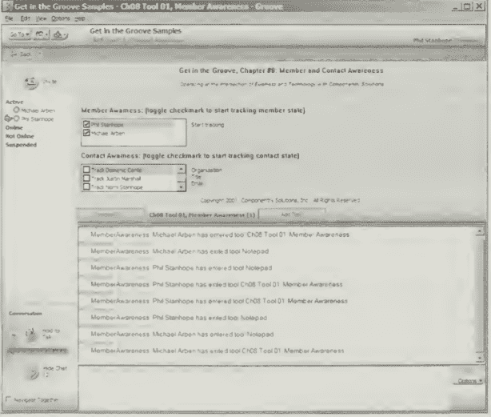

图 8-1：Ch08_tool_01，成员感知

与成员相关的组件模板声明如下：

```
<g:Component Name="MemberLabel">
  <g:ComponentResource FingerprintID="Groove" URL="http://components.groove.net/Groove/Components/Root.osd?Package=net.groove.Groove.ToolComponents.GrooveCommonComponents_DLL&amp;Version=0&amp;Factory=Static"/>
  <g:PropertyList Version="1">
    <g:Property Name="Label" Value="Member Awareness: (toggle checkmark to start tracking member state)"/>
    <g:Property Name="Style" Value="Normal"/>
  </g:PropertyList>
</g:Component>
```

```
<g:Component Name="MemberList">
  <g:ComponentResource FingerprintID="Groove" URL="http://components.groove.net/Groove/Components/Root.osd?Package=net.groove.Groove.ToolComponents.GrooveCommonComponents_DLL&amp;Version=0&amp;Factory=ListView"/>
  <g:PropertyList Version="1">
    <g:Property Value="False" Name="ColumnHeaders"/>
    <g:Property Value="true" Name="CheckBoxes"/>
    <g:Property Value="true" Name="SingleSelection"/>
  </g:PropertyList>
</g:Component>
```

```
<g:Component Name="MemberDescription">
  <g:ComponentResource FingerprintID="Groove" URL="http://components.groove.net/Groove/Components/Root.osd?Package=net.groove.Groove.ToolComponents.GrooveCommonComponents_DLL&amp;Version=0&amp;Factory=Static"/>
  <g:PropertyList Version="1">
    <g:Property Name="Label" Value=""/>
    <g:Property Name="FontStyle" Value="DescriptionText"/>
    <g:Property Name="BreakType" Value="WordBreak"/>
    <g:Property Name="Style">
      <g:PropertyValue>
        <g:Item Name="Multiline"/>
        <g:Item Name="VerticalScrollbar"/>
      </g:PropertyValue>
    </g:Property>
  </g:PropertyList>
</g:Component>
```

与联系人相关的组件模板声明如下：

```
<g:Component Name="ContactLabel">
  <g:ComponentResource FingerprintID="Groove" URL="http://components.groove.net/Groove/Components/Root.osd?Package=net.groove.Groove.ToolComponents.GrooveCommonComponents_DLL&amp;Version=0&amp;Factory=Static"/>
  <g:PropertyList Version="1">
    <g:Property Name="Label" Value="Contact Awareness: (toggle checkmark to start tracking contact state)"/>
    <g:Property Name="Style" Value="Normal"/>
  </g:PropertyList>
</g:Component>
```

```
<g:Component Name="ContactList">
  <g:ComponentResource FingerprintID="Groove" URL="http://components.groove.net/Groove/Components/Root.osd?Package=net.groove.Groove.ToolComponents.GrooveCommonComponents_DLL&amp;Version=0&amp;Factory=ListView"/>
  <g:PropertyList Version="1">
    <g:Property Value="False" Name="ColumnHeaders"/>
    <g:Property Value="true" Name="CheckBoxes"/>
    <g:Property Value="true" Name="SingleSelection"/>
  </g:PropertyList>
</g:Component>
```

```
<g:Component Name="ContactDescription">
  <g:ComponentResource FingerprintID="Groove" URL="http://components.groove.net/Groove/Components/Root.osd?Package=net.groove.Groove.ToolComponents.GrooveCommonComponents_DLL&amp;Version=0&amp;Factory=Static"/>
  <g:PropertyList Version="1">
    <g:Property Name="Label" Value=""/>
    <g:Property Name="FontStyle" Value="DescriptionText"/>
    <g:Property Name="BreakType" Value="WordBreak"/>
    <g:Property Name="Style">
      <g:PropertyValue>
        <g:Item Name="Multiline"/>
        <g:Item Name="VerticalScrollbar"/>
      </g:PropertyValue>
    </g:Property>
  </g:PropertyList>
</g:Component>
```

工具的 **FormDelegate** 组件需要四个连接来响应两个列表视图组件的变化，并显示当前选中的成员或联系人的信息，如下所示：

```
<g:Component Name="FormDelegate">
  <g:ComponentResource URL="http://components.groove.net/Groove/Components/Root.osd?Package=net.groove.Groove.ToolComponents.GrooveCommonComponents_DLL&amp;Version=0&amp;Factory=ScriptHost2"/>
  <g:PropertyList Version="1"/>
  <g:ComponentConnections>
    <g:Connection Name="MemberList" ConnectionID="1"/>
    <g:Connection Name="MemberDescription" ConnectionID="2"/>
    <g:Connection Name="ContactList" ConnectionID="3"/>
    <g:Connection Name="ContactDescription" ConnectionID="4"/>
  </g:ComponentConnections>
  <SCRIPT FingerprintID="Groove" SRC="http://components.groove.net/Groove/Components/Root.osd?Package=net.groove.Groove.ToolComponents.GrooveGlobalHelperFunctions_GSL&amp;Version=0,1&amp;Factory=Open"/>
  <SCRIPT>
    <![CDATA[

 ...
    ]]>
  </SCRIPT>
</g:Component>
```

#### 工具 FormDelegate

感知工具的全局变量、常量和初始化代码如下：

```
var g_pMemberAwareness = null;
var g_pContactAwareness = null;

var g_pTelespaceMembers = PropertyList.OpenProperty(PROPERTY_TELESPACE_MEMBERS);
var g_pTelespace = PropertyList.OpenProperty(PROPERTY_TELESPACE);
var g_pAccount = PropertyList.OpenProperty(PROPERTY_ACCOUNT);
var g_pTransaction = g_pTelespace.OpenTransaction(true);
g_pTransaction.Abort();
var g_pTelespaceMembers = PropertyList.OpenProperty(PROPERTY_TELESPACE_MEMBERS);
var g_pAccount = PropertyList.OpenProperty(PROPERTY_ACCOUNT);

var CONTACTINFO_NAME = 0;
var CONTACTINFO_CONTACT = 1;
var CONTACTINFO_DESC = 2;
var CONTACTINFO_TRACK = 3;
var CONTACTINFO_AWARENESS = 4;
var g_pContactArray;
var g_pMemberArray = new Array();

function Initialize()
{
  // 初始化工具全局变量
  ConnectObject(g_pTelespaceMembers, "TelespaceMembers_", true);
  MemberList_Refresh();
  ContactList_Initialize();
}
```

#### 联系人如何存储

你的个人联系人与你的 Groove 帐户关联，并作为帐户的一部分进行序列化。要看到这个行为的实际效果，请使用“我的联系人”向你的帐户添加多个联系人。然后使用“我的帐户”工具将你的帐户保存到一个文件。如果你随后在另一台计算机上安装该帐户，你会看到来自第一台设备的联系人列在第二台计算机上的“我的联系人”工具中。你的联系人越多，帐户文件就越大。

在编程上，你通过 `IGrooveContact` 接口管理联系人。该接口管理所有联系人，包括你感兴趣的个人联系人以及共享空间联系人和用户。你使用此接口来初始化 `ContactListView` 控件。

#### 初始化 ContactListView

要初始化 `ContactList` 控件，请执行以下任务：

-   获取对 `IGrooveContactStore` 接口的引用。你可以从帐户获取对该接口的引用，即 `g_pAccount.ContactStore` 属性。
-   从联系人存储中获取个人联系人。因为联系人存储还包含其他类型的联系人，所以你必须使用过滤器来仅选择个人联系人。每种联系人类型的过滤器如下：
    -   *共享空间用户*：`urn:groove.net:Core.TelespaceMember`
    -   *个人联系人*：`urn:groove.net:Core.PersonalContact`
    -   *用户*：`urn:groove.net:Core.UserContact`

> **注意** “我的联系人”本质上是个人的。因此，我实现的 `ContactList` 管理代码使得共享空间中的每个工具看到的是不同的联系人列表。

第一步是创建一个数组来包含我们的联系人列表。我们还将 `ContactList` 初始化为两列，并设置列的宽度：

```
function ContactList_Initialize()
{
  g_pContactArray = new Array();
  ContactList.ResetContent();
  if (ContactList.ColumnCount == 0)
    ContactList.InsertColumn(0, "", 185);
```

接下来，我们创建一个过滤器，以便只选择我们的个人联系人：

```
var pCategoryEnumFactory = CreateBSTREnum();
var COMMON_CONTACT_STORE_PERSONAL_CATEGORY = "urn:groove.net:Core.PersonalContact";
pCategoryEnumFactory.Add(COMMON_CONTACT_STORE_PERSONAL_CATEGORY);
var pCategoryEnum = pCategoryEnumFactory.BSTREnum;
```


 ```
var g_ContactStore = g_pAccount.ContactStore;
var pContactStoreEntryList =
    g_ContactStore.OpenContactStoreEntryList(pCategoryEnum);
var pContactStoreEntryEnum = pContactStoreEntryList.OpenEnum();
var pCurrentIdentity = g_pTelespace.OpenCurrentIdentity();
var strMyURL = pCurrentIdentity.Contact.OpenURL();
```

你现在枚举所有联系人。对于每个联系人，提取姓名、组织、职务和电子邮件信息。如果组织和电子邮件字段有多个值，则只获取并显示第一个值。

因为联系人枚举也会包含当前用户的信息，所以使用 strMyURL 来检测这种情况并忽略该特定联系人条目。以下代码实现了此逻辑：

```
while(pContactStoreEntryEnum.HasMore())
{
    var pContactStoreEntry = pContactStoreEntryEnum.OpenNext();
    var pContact = pContactStoreEntry.Contact;
    if (strMyURL != pContact.OpenURL())
    {
        var pVCard = pContact.OpenVCard();
        var FullName = pVCard.OpenIdentification().OpenFullName();
        var pOrganization = pVCard.OpenOrganization();
        var pOrgInfoEnum = pOrganization.OpenOrganizationInfo();
        var strOrg = "", strEmail = "";
        while (pOrgInfoEnum.HasMore())
        {
            var pOrgInfo = pOrgInfoEnum.OpenNext();
            strOrg = pOrgInfo.OpenName();
            // 继续查找剩余的组织信息……最坏情况
            // 是我们最终得到一个空组织。
            if (strOrg != "")
                break;
        }
        var strTitle = pOrganization.OpenTitle();
        var pTelecommunications = pVCard.OpenTelecommunications();
        var EmailEnum = pTelecommunications.OpenEmail();
        while (EmailEnum.HasMore())
        {
            var pEmail = EmailEnum.OpenNext();
            strEmail = pEmail.OpenEmail();
            break;
        }
    }
```

构造一个包含此信息的数组条目。将此数组添加到存储在 g_pContactArray 中的主列表中，如下所示：

```
var pContactInfo = new Array();
pContactInfo[CONTACTINFO_NAME] = FullName;
pContactInfo[CONTACTINFO_CONTACT] = pContact;
pContactInfo[CONTACTINFO_DESC] = "Organization: " + strOrg +
    "\nTitle: " + strTitle + "\nEmail: " + strEmail;
pContactInfo[CONTACTINFO_TRACK] = false;
g_pContactArray[g_pContactArray.length] = pContactInfo;
```

向 ContactList 添加一项。请注意，在以下代码中，你还将 ContactList 数组存储为 ListView 条目的 ItemData：

```
var Index = ContactList.InsertItem(0, "Track " + FullName);
ContactList.SetItemData RemarkableSetItemData(Index, pContactInfo);
```

选择列表中的第一项并显示描述信息，如下所示：

```
if (ContactList.Count > 0)
{
    ContactList.SetSelectionByIndex(0);
    var pContactInfo = ContactList.GetItemData(0);
    ContactDescription.SetText(pContactInfo[CONTACTINFO_DESC]);
}
```

#### 为联系人实现 IGrooveListViewSink

你为 IGrooveListViewSink 组件实现以下两个回调方法：

- OnListViewSelectionChanged：用于更新当前选择的描述。
- OnListViewCheckChanged：用于开始和停止跟踪此特定用户。

要处理 OnListViewSelectionChanged() 回调，你获取存储为 ItemData 的数组条目，获取描述文本，然后更新 ContactDescription，如下所示：

```
function ContactList_OnListViewSelectionChanged(Name, Index, bSelected)
{
    // 我们根据当前选择更新描述
    var pContactInfo = ContactList.GetItemData(Index);
    var bChecked = ContactList.GetCheckState(Index);
    ContactDescription.SetText(pContactInfo[CONTACTINFO_DESC]);
}
```

要处理 OnListViewCheckChanged() 回调，你获取存储为 ItemData 的数组条目，获取描述文本，然后调用例程 Contact_Tracking，如下所示：

```
function ContactList_OnListViewCheckChanged(Name, Index, bChecked)
{
    // 我们根据当前选择更新 bChecked
    var pContactInfo = ContactList.GetItemData(Index);
    Contact_Tracking(pContactInfo, bChecked);
}
```

#### 跟踪联系人

联系人感知界面使你能够跟踪用户的各种操作，例如进入和离开共享空间、使用工具以及更改在线状态。要跟踪每个联系人的活动，你需要获取该联系人的 IGrooveContactAwareness 对象实例，然后连接到它。每个远程空间都有一个远程空间提供程序，使该远程空间中的工具能够访问远程空间服务。每个工具还有一个 PROPERTY_TELESPACE_PROVIDER 属性。通过将此属性检索为 IUnknown，你就可以调用其方法。

Contact_Tracking 函数启动或停止对给定联系人的跟踪；当用户单击 ContactList 控件中联系人旁边的“跟踪”复选框时，将调用该函数。

在用户表示他想开始跟踪特定联系人后，你必须执行以下任务：

1. 获取与工具关联的 IGrooveTelespaceProvider 接口。
2. 为要跟踪的特定联系人打开 IGrooveContactAwareness 接口。
3. 调用 ConnectObject 方法将你的回调函数与该接口关联。你可以通过注册前缀 ContactAwareness_ 来关联它们，你在命名回调函数时会使用该前缀。
4. 将联系人接口的引用保存在你的 ContactInfo 数组中。当你想停止跟踪此联系人时，可以使用此引用进行断开连接。

如果用户想停止跟踪，你可以通过以下操作撤消上述步骤：

1. 获取 ContactInfo 数组。
2. 从 IGrooveContactAwareness 接口断开连接。
3. 将你在 ContactInfo 数组中的引用置空。

以下是启动和停止跟踪的代码：

```
function Contact_Tracking(pContactInfo, bStart)
{
    pContactInfo[CONTACTINFO_TRACK] = bStart;
    if (bStart)
    {
        var pContact = pContactInfo[CONTACTINFO_CONTACT];
        var pAwarenessServices =
            GrooveScriptFunctions.CreateNewObject("Groove.AwarenessServices");
        var pTelespaceProvider =
            PropertyList.OpenPropertyAsIUnknown(PROPERTY_TELESPACE_PROVIDER);
        g_pContactAwareness =
            pAwarenessServices.OpenContactAwareness(pTelespaceProvider, pContact);
        pContactInfo[CONTACTINFO_AWARENESS] = g_pContactAwareness;
        ConnectObject(g_pContactAwareness, "ContactAwareness_");
    }
    else
    {
        var pContactAwareness = pContactInfo[CONTACTINFO_AWARENESS];
        DisconnectObject(pContactAwareness);
        pContactInfo[CONTACTINFO_AWARENESS] = null;
    }
}
```

以下是你在该工具中实现的 IGrooveContactAwarenessEvent 接口方法：

- ContactOnLineStateChanged
- ContactEnteredTelespace 和 ContactExitedTelespace
- ContactEnteredTool 和 ContactExitedTool

你在以下代码中实现的相应回调函数中处理这些事件。请注意，由于你是在脚本中编写，因此只需为你关心的事件实现回调函数。

要报告在线状态（在线、离线、空闲）的变化，你实现 ContactAwareness_ContactOnlineStateChanged 方法，如下所示：

```
function ContactAwareness_ContactOnlineStateChanged(pContact,
    OnlineState, StateText, TimeWentIdle)
{
    var pContactInfo = GetContactInfo(pContact, false);
    if (pContactInfo && pContactInfo[CONTACTINFO_TRACK])
    {
        var pContact = pContactInfo[CONTACTINFO_CONTACT];
        var FullName =
            pContact.OpenVCard().OpenIdentification().OpenFullName();
        var strMsg = "ContactAwareness: " + FullName + " is " +
            (TimeWentIdle == 0 ? StateText : "Online but IDLE");
        ChatLog_Add(strMsg);
    }
}
```

要报告联系人进入共享空间的情况，你实现 ContactAwareness_ContactEnteredTelespace 方法，如下所示：

```
function ContactAwareness_ContactEnteredTelespace(pContact, strTelespaceURL)
{
    var pContactInfo = GetContactInfo(pContact, false);
    if (pContactInfo && pContactInfo[CONTACTINFO_TRACK])
    {
        var pContact = pContactInfo[CONTACTINFO_CONTACT];
        var fname = pContact.OpenVCard().OpenIdentification().OpenFullName();
        var msg = "ContactAwareness: " + fname + " has entered telespace: " + PrettyName_Telespace(strTelespaceURL);
        ChatLog_Add(msg);
    }
}
```

> 注意 如果你不是联系人进入的共享空间和工具的成员，则*不会*收到此回调。

要报告联系人进入特定共享空间中的工具的情况，你实现 ContactAwareness_ContactEnteredTool 方法。

```
function ContactAwareness_ContactEnteredTool(pContact, strTelespaceURL, strTool悬崖strToolURL)
{
    var pContactInfo = GetContactInfo(pContact, false);
    if (pContactInfo && pContactInfo[CONTACTINFO_TRACK])
    {
        var pContact = pContactInfo[CONTACTINFO_CONTACT];
        var fname = pContact.OpenVCard().OpenIdentification().OpenFullName();
        var msg = "ContactAwareness: " + fname + " has entered tool " + PrettyName_Tool(strToolURL);
        ChatLog_Add(msg);
    }
}
```

要报告联系人退出特定共享空间的情况，你实现 ContactAwareness_ContactExitedTelespace 方法，如下所示：

```
function ContactAwareness_ContactExitedTelespace(strContactURL, strTelespaceURL)
{
    var pContactInfo = GetContactInfoFromURL(strContactURL, false);
```


### 初始化 MemberList

初始化 MemberList 的过程与 ContactList 非常相似，如下列代码所示：

```
function MemberList_Refresh()
{
    // Remove all entries from list
    MemberList.ResetContent();
    g_pMemberArray = new Array();
    if (MemberList.ColumnCount == 0)
    MemberList.InsertColumn(0, "", 185);
    try
    {
        g_pTransaction.BeginRead();
        var pITelespaceMemberEnum = g_pTelespaceMembers.CreateEnum();
        while (pITelespaceMemberEnum.HasMore())
        {
            // Get full name of member
            var pITelespaceMember = pITelespaceMemberEnum.OpenNext();
            var pContact = pITelespaceMember.Contact;
            var FullName =
            pContact.OpenVCard().OpenIdentification().OpenFullName();
            
            // Add the members's full name to the list
            var Index = MemberList.InsertItem(0, FullName);
            var pContactInfo = new Array();
            pContactInfo[CONTACTINFO_CONTACT] = pContact;
            pContactInfo[CONTACTINFO_NAME] = FullName;
            pContactInfo[CONTACTINFO_DESC] = FullName + " .... ";
            pContactInfo[CONTACTINFO_TRACK] = false;
            MemberList.SetItemData(Index, pContactInfo);
            g_pMemberArray[g_pMemberArray.length] = pContactInfo;
        }
        MemberList.SetSelectionByIndex(0);
        g_pTransaction.EndRead();
    }
    catch (e)
    {
        g_pTransaction.Abort();
    }
}
```

### 为 MemberList 实现 IGrooveListViewSink

要跟踪成员状态，您使用的逻辑与为 ContactList 实现 `IGrooveListViewSink` 方法时相同。要处理选择更改，您可以在选择更改时提供简单的描述，如下所示：

```
function MemberList_OnListViewSelectionChanged(Name, Index, bSelected)
{
    // We update the description based on the current selection
    var pMemberContactInfo = MemberList.GetItemData(Index);
    var bChecked = MemberList.GetCheckState(Index);
    var pContact = pMemberContactInfo[CONTACTINFO_CONTACT];
    var FullName =
    pContact.OpenVCard().OpenIdentification().OpenFullName();
    var strMsg = "Selected " + FullName + " Checked: " + bChecked;
    MemberDescription.SetText(strMsg);
}
```

要处理成员跟踪，您可以使用 MemberList 控件的 `CheckChanged` 方法。您构建一条状态消息，然后调用 `Member_Tracking`，如下所示：

```
function MemberList_OnListViewCheckChanged(Name, Index, bChecked)
{
    // We update the bChecked based on the current selection
    var pMemberContactInfo = MemberList.GetItemData(Index);
    var pContact = pMemberContactInfo[CONTACTINFO_CONTACT];
    var FullName =
    pContact.OpenVCard().OpenIdentification().OpenFullName();
    var strMsg = bChecked ? "Start tracking " : "Stop tracking " +
    FullName;
    MemberDescription.SetText(strMsg);
    Member_Tracking(pMemberContactInfo, bChecked);
}
```

### 跟踪共享空间成员

跟踪成员与跟踪联系人大有不同。您必须逐个联系人发起联系人跟踪。另一方面，当您连接到 `IGrooveTelespaceMembersAwareness` 对象时，会*自动*接收共享空间*所有*成员的通知。

因此，您不会将 `IGrooveTelespaceMembersAwareness` 对象存储在 `ContactInfo` 数组中，而是将该引用存储在一个全局变量 `g_pMemberAwareness` 中，并在工具终止时调用 `DisconnectObject`。

如果用户表示他想要开始跟踪成员，您将执行以下任务：

1.  获取 `IGrooveTelespaceProvider` 接口。
2.  打开 `IGrooveMemberAwareness` 接口。
3.  连接到该接口。您为所有 `IGrooveTelespaceMembersAwarenessEvents` 回调方法指定前缀 `MemberAwareness_`，如下所示：

```
function Member_Tracking(pContactInfo, bStart)
{
    pContactInfo[CONTACTINFO_TRACK] = bStart;
    if (bStart)
    {
        if (!g_pMemberAwareness)
        {
            var pAwarenessServices =
                GrooveScriptFunctions.CreateNewObject("Groove.AwarenessServices");
            var pTelespaceProvider =
                PropertyList.OpenPropertyAsIUnknown(PROPERTY_TELESPACE_PROVIDER);
            g_pMemberAwareness =
                pAwarenessServices.OpenTelespaceMembersAwareness(g_pTelespace);
            ConnectObject(g_pMemberAwareness, "MemberAwareness_");
        }
        pContactInfo[CONTACTINFO_AWARENESS] = g_pMemberAwareness;
    }
    else
    {
        // Don't disconnect ... leave as a tool-level connection.
        // var pContactAwareness = pContactInfo[CONTACTINFO_AWARENESS];
        // DisconnectObject(pContactAwareness);
        pContactInfo[CONTACTINFO_AWARENESS] = null;
    }
}
```

要报告联系人退出当前远程空间，您可以实现 `ContactAwareness_ContactExitedTelespace` 方法，如下所示：

```
function ContactAwareness_ContactExitedTelespace(strContactURL,
strTelespaceURL)
{
    var pContactInfo = GetContactInfoFromURL(strContactURL, false);
    if (pContactInfo && pContactInfo[CONTACTINFO_TRACK])
    {
        var pContact = pContactInfo[CONTACTINFO_CONTACT];
        var fname =
        pContact.OpenVCard().OpenIdentification().OpenFullName();
        var msg = "ContactAwareness: " + fname + " has exited telespace: " +
        PrettyName_Telespace(strTelespaceURL);
        ChatLog_Add(msg);
    }
}
```

要报告联系人退出特定共享空间中的某个工具，您可以实现 `ContactAwareness_ContactExitedTool` 方法，如下所示：

```
function ContactAwareness_ContactExitedTool(strContactURL,
strTelespaceURL, strToolURL)
{
    var pContactInfo = GetContactInfoFromURL(strContactURL, false);
    if (pContactInfo && pContactInfo[CONTACTINFO_TRACK])
    {
        var pContact = pContactInfo[CONTACTINFO_CONTACT];
        var fname =
        pContact.OpenVCard().OpenIdentification().OpenFullName();
        var msg = "ContactAwareness: " + fname + " has exited tool " +
        PrettyName_Tool(strToolURL);
        ChatLog_Add(msg);
    }
}
```

`TelespaceURL` 和 `ToolURL` 参数实际上是 `IGrooveTelespace.CanonicalURL` 和 `IGrooveTool.CanonicalURL` 属性。这些属性值是长字符串，表示 Groove 为该工具或远程空间创建的唯一标识符。为了显示简短的显示名称，在上述每个方法中，您都调用两个例程 `PrettyName_Tool` 和 `PrettyName_Telespace`。

`PrettyName_Telespace` 的实现首先检查 `TelespaceURL` 是否属于当前远程空间；如果是，您可以轻松访问 `DisplayName`。

> **提示** 如果 `TelespaceURL` 不是您当前的远程空间，您可以使用 `IGrooveTelespaceProvider` 引用来检查该 URL 是否标识了您所属的远程空间之一。（从技术上讲，此检查是不必要的，因为如果联系人导航到您不属于的共享空间，您不应该收到 Telespace 和 ToolEnter 消息。）

以下是这两个 `PrettyName` 方法的实现：

```
function PrettyName_Telespace(strTelespaceURL)
{
    if (strTelespaceURL == g_pTelespace.CanonicalURL)
        return g_pTelespace.Descriptor.DisplayName;
    // If the telespaceURL isn't for the current telespace, it must be
    // another telespace that we are a member of.
    var pCurrentIdentity = g_pTelespace.OpenCurrentIdentity();
    var pAccount =
        PropertyList.OpenPropertyAsIUnknown(PROPERTY_TELESPACE_PROVIDER);
    var pTelespaceProvider = pAccount.TelespaceProvider;
    if (pTelespaceProvider.DoesTelespaceDescriptorExist(strTelespaceURL,
    pCurrentIdentity))
    {
        var pTelespaceDescriptor =
        pTelespaceProvider.OpenTelespaceDescriptor(strTelespaceURL,
        pCurrentIdentity);
        return pTelespaceDescriptor.DisplayName;
    }
    return strTelespaceURL;
}
```

您遵循相同的逻辑来确定工具的简短显示名称，具体步骤如下：

1.  检查当前远程空间工具描述符。
2.  检查您所属的其他共享空间的工具描述符，如下所示：

```
function PrettyName_Tool(strToolURL)
{
    var pToolContainer = g_pTelespace.ToolContainer;
    var pEnum = pToolContainer.CreateToolDescriptorEnum();
    while (pEnum.HasMore())
    {
        var pToolDescriptor = pEnum.OpenNext();
        if (strToolURL == pToolDescriptor.CanonicalURL)
            return pToolDescriptor.DisplayName;
    }
    // Could be a tool in another telespace
    var pCurrentIdentity = g_pTelespace.OpenCurrentIdentity();
    var pAccount =
        PropertyList.OpenPropertyAsIUnknown(PROPERTY_TELESPACE_PROVIDER);
    var pTelespaceProvider = pAccount.TelespaceProvider;
    var strTelespaceURL = Left(strToolURL, "/Tool");
    if (pTelespaceProvider.DoesTelespaceDescriptorExist(strTelespaceURL,
    pCurrentIdentity))
    {
        var pTelespaceDescriptor =
        pTelespaceProvider.OpenTelespaceDescriptor(strTelespaceURL,
        pCurrentIdentity);
        var pEnum =
        pTelespaceDescriptor.Open().ToolContainer.CreateToolDescriptorEnum();
        while (pEnum.HasMore())
        {
            var pToolDescriptor = pEnum.OpenNext();
            if (strToolURL == pToolDescriptor.CanonicalURL)
            {
                return pToolDescriptor.DisplayName + " in telespace '" +
                pTelespaceDescriptor.DisplayName + "'";
            }
        }
    }
    // Return the URL ... we shouldn't ever get here :-(
    return strToolURL;
}
```


你将 `MemberAwareness_` 作为前缀，用于实现所有 `IGrooveTelescopeMembersAwarenessEvents` 方法。

`IGrooveTelescopeMembersAwarenessEvents` 与 `IGrooveContactAwarenessEvents` 几乎完全相同，如下列表所述：

- `ContactOnlineStatusChanged` 与 `MemberOnlineStateChanged` 相同。
- `ContactEnteredTool` 与 `MemberEnteredTool` 相同——不同之处在于它仅针对当前电传空间中的工具接收调用。
- `ContactExitedTool` 与 `MemberExitedTool` 相同。
- `ContactEnteredTelespace` 与 `MemberEnteredTelespace` 相同——不同之处在于你仅对当前电传空间接收这些调用。
- `ContactExitedTelespace` 与 `MemberExitedTelespace` 相同。

此外，如果共享空间的成员更改了他的联系信息，会触发一个额外的回调 `MemberContactChanged`。

以下是这些回调方法的实现：

```
function MemberAwareness_ContactChanged(pContact)
{
  var pContactInfo = GetContactInfoFromURL(strContactURL, true);
  if (pContactInfo && pContactInfo[CONTACTINFO_TRACK])
  {
    var FullName = pContact.OpenVCard().OpenIdentification().OpenFullName();
    ChatLog_Add("MemberAwareness: " + FullName + " has changed their contact information");
  }
}

function MemberAwareness_MemberEnteredTool(pContact, strToolURL)
{
  var pContactInfo = GetContactInfo(pContact, true);
  if (pContactInfo && pContactInfo[CONTACTINFO_TRACK])
  {
    var FullName = pContact.OpenVCard().OpenIdentification().OpenFullName();
    ChatLog_Add("MemberAwareness: " + FullName + " has entered tool " + PrettyName_Tool(strToolURL));
  }
}

function MemberAwareness_MemberExitedTool(strContactURL, strToolURL)
{
  var pContactInfo = GetContactInfoFromURL(strContactURL, true);
  if (pContactInfo && pContactInfo[CONTACTINFO_TRACK])
  {
    var pContact = pContactInfo[CONTACTINFO_CONTACT];
    var FullName = pContact.OpenVCard().OpenIdentification().OpenFullName();
    ChatLog_Add("MemberAwareness: " + FullName + " has exited tool " + PrettyName_Tool(strToolURL));
  }
}

function MemberAwareness_MemberEnteredTelespace(pContact, strTelespaceURL)
{
  var pContactInfo = GetContactInfo(pContact, true);
  if (pContactInfo && pContactInfo[CONTACTINFO_TRACK])
  {
    var FullName = pContact.OpenVCard().OpenIdentification().OpenFullName();
    ChatLog_Add("MemberAwareness: " + FullName + " has entered telespace " + PrettyName_Telespace(strTelespaceURL));
  }
}

function MemberAwareness_MemberExitedTelespace(strContactURL, strTelespaceURL)
{
  var pContactInfo = GetContactInfoFromURL(strContactURL, true);
  if (pContactInfo && pContactInfo[CONTACTINFO_TRACK])
  {
    var pContact = pContactInfo[CONTACTINFO_CONTACT];
    var FullName = pContact.OpenVCard().OpenIdentification().OpenFullName();
    ChatLog_Add("MemberAwareness: " + FullName + " has exited telespace: " + PrettyName_Telespace(strTelespaceURL));
  }
}

function MemberAwareness_MemberOnlineStateChanged(pContact, strOnlineState, strStateText, TimeWentIdle)
{
  var pContactInfo = GetContactInfo(pContact, true);
  if (pContactInfo && pContactInfo[CONTACTINFO_TRACK])
  {
    var FullName = pContact.OpenVCard().OpenIdentification().OpenFullName();
    var strMsg = "MemberAwareness: " + FullName + " is " + (TimeWentIdle == 0 ? strStateText : "Online but IDLE");
    ChatLog_Add(strMsg);
  }
}
```

### 接入聊天引擎

关于 `Ch08_tool_01`，我最后要介绍的是它如何使用聊天窗格来记录其活动。我经常将此作为调试技术。在实现一组新的监听器或事件方法时，我通常会先创建回调函数的存根，让它们仅记录被调用的事实以及参数值。

聊天工具是所有 Groove 电传空间中的标准工具。我现在介绍如何通过编程方式列举电传空间中的工具，然后向你展示如何获取工具中特定引擎组件的连接。如果你需要构建一个由多个相互协作工具组成的解决方案，这将是你需要使用的关键技术。

使用聊天工具作为跟踪和记录工具的第一步是获取共享空间中 `ChatEngine` 的引用。为此，你需要执行以下任务：

1.  获取 `GrooveToolContainer` 的引用。共享空间的此组件包含空间中的所有工具。
2.  创建 `GrooveToolDescriptors` 的枚举。
3.  遍历工具描述符，找到第一个 `DisplayName` 为 "Chat" 的工具。
4.  找到聊天工具后，打开一个已知组件——`ChatEngine`。

以下是实现此逻辑的代码：

```
var g_pChatEngine = null;
function ChatLog_Add(strMsg)
{
  if (!g_pChatEngine)
  {
    var pToolContainer =
PropertyList.OpenProperty(PROPERTY_TOOL_CONTAINER);
    var pEnum = pToolContainer.CreateToolDescriptorEnum();
    while (pEnum.HasMore())
    {
      var pTool = pEnum.OpenNext().Tool;
      if (pTool.DisplayName == "Chat")
      {
        g_pChatEngine =
pTool.ComponentContainer.OpenComponentByName("ChatForm/ChatEngine").Chat
Engine;
        g_pTextDoc =
GrooveScriptFunctions.CreateNewObject("Groove.TextDocument");
        break;
      }
    }
  }
}
```

请注意，在找到正确的 `ChatEngine` 组件后，你会将其引用保存在全局变量 `g_pChatEngine` 中以供后续使用。

获取 `ChatEngine` 后，你使用其 `IGrooveChatEngine` 接口来构造文本条目并将其提交给引擎。Groove 中的聊天工具包含多个引擎：前面代码展示的获取引用的 `ChatEngine`，以及两个 `GrooveTextEngines`——一个用于创建聊天条目，另一个用于显示所有条目的历史记录。

就你的用途而言，你需要创建代表聊天条目的文本，并调用 `IGrooveChatEngine` 的 `AddEntry` 方法。

> **注意** 聊天条目和历史记录窗格实际上是 `GrooveTextView` 组件。`GrooveTextView` 组件封装了 Microsoft Windows 提供的底层文本对象模型控件和接口。文本对象模型对象允许你管理富文本流，包括更改字体、大小、强调、颜色等的能力。这是 Groove API 中一个未记录的实现细节。有关文本对象模型的更多信息，请查看以下链接：http://msdn.microsoft.com/library/default.asp?url=/library/en-us/winui/tom_2soj.asp。

请注意，在前面的代码片段中，你还需要创建一个实现了 `IGrooveTextDocument` 和 `ITextDocument` 接口的 `Groove.TextDocument` 对象。为了避免每次需要时都创建一个新对象，你也将其引用存储在一个全局变量中。

`IGrooveTextDocument` 的当前实现是对 Microsoft `ITextDocument` 组件（一个富文本组件）的封装。记录 `ITextDocument` 和 `ITextRange` 组件超出了本书的范围；这里你需要理解的关键概念是如何将文本设置到 `IGrooveTextDocument` 的 `ITextRange` 中，然后将 `ITextRange` 提交给 `ChatEngine`，如下代码所示：

```
function ChatLog_Add(strMsg)
{
  ...
  if (g_pChatEngine)
  {
    var pTextRange = g_pTextDoc.Range(0, 10000);
    pTextRange.Text = strMsg;
    pTextRange.Expand(6);
    g_pChatEngine.ChatEngine.AddEntry(pTextRange);
  }
}
```

### 清理

释放所有全局指针和引用是良好的编程实践——尤其是对于你动态绑定的对象实例，如 `GrooveTelespaceMemberAwarenessEvents`。如果未能这样做，可能会在所有用户终止后阻止 COM 对象的释放——这是一种隐蔽的资源泄漏形式。释放你所持有的所有引用的代码如下：

```
function Terminate()
{
  if (g_pTelespaceMembers != null)
  {
    DisconnectObject(g_pTelespaceMembers);
    g_pTelespaceMembers = null;
  }

  // 从任何联系人感知对象断开连接
  if (g_pContactArray != null) {
    for (var i = 0; i < g_pContactArray.length; i++)
    {
      if (g_pContactArray[i][CONTACTINFO_AWARENESS])
        DisconnectObject(g_pContactArray[i][CONTACTINFO_AWARENESS]);
    }
  }
  if (g_pMemberAwareness != null)
    DisconnectObject(g_pMemberAwareness);
}
```

### 自定义工具权限：处理角色和权限

到目前为止，你在本书中构建的工具使用了许多不同的 Groove 引擎：PropertyListEngine、RecordSetEngine、ChatEngine 和 WebBrowserEngine。Groove 没有标准的讨论或日历引擎——讨论和日历工具都使用 RecordSetEngine 的自定义架构（正如工具 Ch05_tool_08 和 Ch07_tool_02 所演示的那样）。

共享空间和工具使用的另一个引擎是 ObjectEntryStore——这是一个用于存储有关你的帐户、你的个人联系人以及你分配给共享空间成员和其中工具的角色和权限信息的引擎。

你可以通过多种方式更改角色和权限。默认情况下，共享空间的创建者是管理员，同样，如果管理员邀请其他人进入共享空间，他们默认是参与者。

管理员首次有机会更改新成员的默认角色是在发送邀请时。一旦成员进入空间，管理员可以


可以从菜单栏中选择 Options ⇔ Roles，或者右键单击特定成员的名称并从弹出菜单中选择 Roles，以使用远程空间的 `ObjectEntryStore` 引擎将更改发送给被更改角色的相应成员。

访问控制层次结构的下一级是*权限*。每个角色（管理员、参与者和访客）都有一组特定于远程空间和工具的权限，这些权限控制成员在远程空间中可以执行哪些操作。可见的远程空间级别权限包括 Invite（邀请）、Uninvite（取消邀请）、Add Tool（添加工具）和 Delete Tool（删除工具）。

默认情况下，管理员拥有所有权限。参与者可以添加工具和邀请新的参与者。默认情况下，访客没有任何权限：他们不能邀请或取消邀请成员，也不能添加或移除工具。管理员有权更改特定远程空间的这些权限。

> **提示** 在 Groove 的企业部署中，也可以使用不同的默认远程空间模板来提供不同的权限和默认设置。

工具可以定义自定义角色和权限，以及这些权限所适用的操作。例如，Discussion（讨论）工具定义了以下权限：

-   `CreateDocuments`：成员可以创建新文档。
-   `EditAnyDocument`：成员可以替换文档中的记录或更改字段。
-   `EditOwnDocument`：成员只能替换或更改由同一成员创建的文档中的记录或字段。
-   `DeleteAnyDocument`：成员可以删除任何文档。
-   `DeleteOwnDocument`：成员只能删除由同一成员创建的文档。

管理员拥有所有权限，可以更改参与者和访客的权限。参与者只能创建、编辑和/或删除他们自己创建的文档。访客默认没有创建、编辑或删除文档的权限。其他标准工具（Files、Calendar、Sketchpad、Pictures 等）都实现了类似的默认访问控制策略。

如果工具定义了自定义权限，它会创建另一个隐式权限——即成员是否可以查看该工具。默认情况下，所有角色都有权查看该工具，但管理员有权更改管理员、参与者和访客的此权限。

> **注意** 不要禁用管理员的查看权限，否则将没有人能够从共享空间中删除该工具。

Ch08_tool_02 演示了如何实现自定义权限——包括一个在共享空间和收发器提供的工具的标准权限对话框中不可见的权限。图 8-2 显示了在独立窗口中显示该工具时的外观。

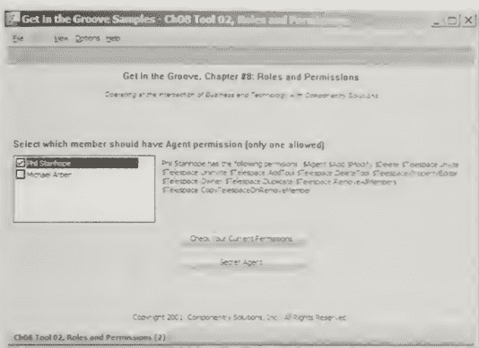

#### 工具组件和布局

要在工具中声明自定义权限，您需要添加一个 ObjectTypes 元素作为所声明的其他组件的同级元素。可以使用的最小模板声明如下：

```xml
<g:ObjectTypes>
  <g:ObjectType Name="$ComponentGroup">
    <g:AccessControl>
      <g:Roles>
      </g:Roles>
    </g:AccessControl>
  </g:ObjectType>
</g:ObjectTypes>
```

如果提供上述声明，您将在收发器级别启用 Tool Permissions（工具权限）对话框，并使共享空间的管理员能够控制参与者或访客是否可以访问该工具。无需向 FormDelegate 添加其他代码即可获得此行为。

您为 Ch08_tool_02 提供的声明如下：

```xml
<g:ObjectTypes>
  <g:ObjectType Name="$ComponentGroup">
    <g:AccessControl>
      <g:Roles>
        <g:Role Visible="false" Category="Permission" Name="SAgent" DisplayName="Agent"/>
        <g:Role Visible="true" Category="Permission" Name="$Add"
          DisplayName="Add" DefaultParentRoles="$Telespace.Manager
          $Telespace.Member $Telespace.Guest"/>
        <g:Role Visible="true" Category="Permission" Name="$Modify"
          DisplayName="Modify" DefaultParentRoles="$Telespace.Manager
          $Telespace.Member"/>
        <g:Role Visible="true" Category="Permission" Name="$Delete"
          DisplayName="Delete" DefaultParentRoles="$Telespace.Manager"/>
      </g:Roles>
    </g:AccessControl>
  </g:ObjectType>
</g:ObjectTypes>
```

在此声明中，您定义了以下四个角色：

-   $Agent：此权限不可见——即不会出现在 Tool Permissions 对话框中。共享空间中没有成员拥有此角色，因为您未指定 `DefaultParentRoles` 属性。您将在工具的 `FormDelegate` 中以编程方式设置用户拥有此角色。
-   $Add：此权限可见，因此会出现在 Tool Permissions 对话框中，如图 8-3 所示。此权限对管理员（`$Telespace.Manager`）、参与者（`$Telespace.Member`）和访客（`$Telespace.Guest`）默认启用。
-   $Modify：此权限可见。此权限默认仅对管理员和参与者启用。
-   $Delete：此权限可见。此权限默认仅对管理员启用（参见图 8-4）。

只需声明这些角色，工具就会从收发器（Tool Permissions 对话框）继承行为。然而，工具如何使用这些角色完全取决于工具实现的逻辑。不过，您也可以提供额外的规范，如以下代码所示：

```xml
<g:Role
  Visible="true"
  Category="Permission"
  Name="$ComponentGroup.EditAnyDocument"
  DisplayName="Edit Any Document"
  DefaultParentRoles="$Telespace.Manager">
  <g:Operations>
    <g:Operation Name="ReplaceRecord" TargetName="RecordSetEngine"/>
    <g:Operation Name="SetField"
      TargetName="urn:groove.net:DiscussionRecord"/>
  </g:Operations>
</g:Role>
```

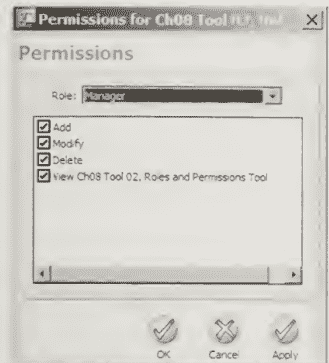

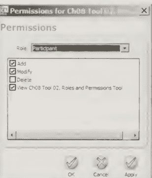

我从 Discussion 工具中提取了前面的声明。它实现了以下任务：

-   它定义了一个特定于 IGrooveRecordSetEngine 的操作——ReplaceRecord。Discussion 工具的实现逻辑必须检查以确保它有权执行 RecordSetEngine 功能的使用。RecordSetEngine 提供了 CanReplaceRecord 方法，使工具能够在尝试执行 ReplaceRecord 方法之前检查当前用户是否有权替换记录。如果定义了上述操作约束，RecordSetEngine 会抛出一个错误，该错误需要由工具处理，否则将向用户显示错误消息。一种方法是在执行调用之前进行检查，如以下代码所示：

```javascript
if (RecordSetEngine.CanReplaceRecord(RecordID, pRecord))
    RecordSetEngine.ReplaceRecord(pRecord)
```

另一种实现方式如下：

```javascript
try {
    RecordSetEngine.ReplaceRecord(pRecord)
}
catch(e) {
    // fail silently continue...
}
```

> **注意** 第一种实现是首选方法，因为第二种方式无法区分您可能引发的其他 RecordSetEngine 错误（例如无效的记录引用）。

-   另一个操作特定于 `IGrooveRecord`——它表示您需要权限才能调用 `SetField` 方法。与 `RecordSetEngine` 一样，`IGrooveRecord` 提供了 `CanSetField` 方法。

##### 声明其他工具组件

除了本书中的工具使用的标准 `ToolContainer`、`Layout`、`Tool_Name`、`Tool_Tagline` 和 `Tool_Copyright` 组件之外，我还定义了以下四个 UI 组件：

-   **MemberLabel**：一个静态标签，按如下方式更改为提示一次只能选择一个成员：

```xml
<g:Component Name="MemberLabel">
  <g:ComponentResource FingerprintID="Groove"
    URL="http://components.groove.net/Groove/Components/Root.osd?Package=net.groove.Groove.ToolComponents.GrooveCommonComponents_DLL&amp;Version=0&amp;Factory=Static"/>
  <g:PropertyList Version="1">
    <g:Property Name="Label" Value="Select which member should have Agent Permission (only one allowed)"/>
    <g:Property Name="Style" Value="Normal"/>
  </g:PropertyList>
</g:Component>
```

-   **MemberList**：一个为每个远程空间成员提供复选框的 `ListView`，如下所示：

```xml
<g:Component Name="MemberList">
  <g:ComponentResource FingerprintID="Groove"
    URL="http://components.groove.net/Groove/Components/Root.osd?Package=net.groove.Groove.ToolComponents.GrooveCommonComponents_DLL&amp;Version=0&amp;Factory=ListView"/>
  <g:PropertyList Version="1">
    <g:Property Value="False" Name="ColumnHeaders"/>
    <g:Property Value="true" Name="CheckBoxes"/>
    <g:Property Value="true" Name="SingleSelection"/>
  </g:PropertyList>
</g:Component>
```

-   **PermissionDescription**：所选成员的当前权限，如下所示：

```xml
<g:Component Name="PermissionDescription">
  <g:ComponentResource FingerprintID="Groove"
    URL="http://components.groove.net/Groove/Components/Root.osd?Package=net.groove.Groove.ToolComponents.GrooveCommonComponents_DLL&amp;Version=0&amp;Factory=Static"/>
  <g:PropertyList Version="1">
    <g:Property Name="Label" Value=""/>
    <g:Property Name="FontStyle" Value="DescriptionText"/>
  </g:PropertyList>
</g:Component>
```


<tool_call>
<function=tofu>
<parameter=task>ocr_postprocess</parameter>
<parameter=source_format>text</parameter>
<parameter=target_format>markdown</parameter>
<parameter=source_text>[PAGE 288]

```
<g:Property Name="BreakType" Value="WordBreak"/>
<g:Property Name="Style">
    <g:PropertyValue>
        <g:Item Name="Multiline"/>
        <g:Item Name="VerticalScrollbar"/>
    </g:PropertyValue>
</g:Property>
</g:PropertyList>
</g:Component>
```

+   检查角色：一个按钮，显示一个消息框，展示用户可能的角色和当前角色/权限，如下所示：

```
<g:Component Name="CheckRoles">
    <g:ComponentResource FingerprintID="Groove"
URL="http://components.groove.net/Groove/Components/Root.osd?Packag
e=net.groove.Groove.ToolComponents.GrooveCommonComponents_DLL&amp;V
ersion=0&amp;Factory=Button"/>
    <g:PropertyList Version="1">
        <g:Property Name="Label" Value="Check Your Current
Permissions"/>
        <g:Property Name="Style" Value="StandardButton"/>
    </g:PropertyList>
</g:Component>
```

### 工具表单委托

实现 Ch08_tool_02 的关键在于处理与 IGrooveRole 相关的方法。初始化工具后，你首先要确定工具的 ScopeURL——管理 IGrooveRole 的许多方法都需要它——如下所示：

```
function Initialize()
{
    ConnectObject(g_pTelespaceMembers,"TelespaceMembers_", true);
    var ObjectEntryStore =
PropertyList.OpenProperty(PROPERTY_OBJECT_ENTRY_STORE);
    var pTool = PropertyList.OpenProperty(PROPERTY_TOOL);
    g_strToolScope = pTool.ObjectTypeScopeURL.String;
```

接下来，你需要通知 IGrooveObjectEntryStore，当共享空间的任何成员的角色发生变化时，它应通知你。在本书的这一点之前，所有先前的工具都通过调用 ConnectObject 来连接到 UI 或引擎组件事件接口。与 ObjectEntryStore 的工作方式则大不相同。要连接到 IGrooveAggregatedObjectEntryStoreListener 接口，我们使用以下代码：

```
g_iACLCookie =
ObjectEntryStore.AddAggregatedListener(ScriptHostComponent.IGrooveAggreg
atedObjectEntryStoreListener, Scope);
```

[PAGE 289]

这种连接到对象的方法与调用 `ConnectObject(Foo, "Prefix_")` 非常相似。请注意，在我迄今为止向你展示的每个 `ConnectObject` 实例中，你都为在 `FormDelegate` 代码中实现的侦听器/接收器方法指定了一个前缀。虽然可以指定空字符串前缀（即 `""`），但你应该始终指定一个前缀，因为前缀使代码更易于理解。

如果你参考 GDK，会看到 `IGrooveAggregatedObjectEntryStoreListener` 支持单个方法——`OnRoleChanged()`。在“实现 `IGrooveAggregatedObjectEntryStoreListener`”一节中，我将展示如何实际实现 `OnRoleChanged()` 侦听器方法。

当工具终止时，你调用 `DisconnectObject` 并移除 `ObjectEntryStore` 聚合侦听器，如下所示：

```
function Terminate()
{
  if (g_pTelespaceMembers != null)
  {
    DisconnectObject(g_pTelespaceMembers);
    g_pTelespaceMembers = null;
  }
  if (g_iACLCookie)
  {
    var ObjectEntryStore =
PropertyList.OpenProperty(PROPERTY_OBJECT_ENTRY_STORE);
    ObjectEntryStore.RemoveAggregatedListener(g_iACLCookie);
  }
}
```

### 使用 IGrooveRole 辅助函数

以下例程使得访问角色和权限变得更容易一些。第一个例程是 `GetTelespaceRole()`，它返回一个表示成员当前远程空间级别角色的 `IGrooveTemplateRole` 对象，如以下代码所示：

```
function GetRole()
{
  var ObjectID;
  var ObjEntry = g_pTelespace.ObjectEntryStore.Open(g_strTelespaceScope,
ObjectID);
  var Roles = ObjEntry.AccessControl.IGrooveRoles;
  var TemplateRoleEnum = Roles.TemplateRoles.CreateEnum("Role");
  var strContactURL =
g_pTelespace.OpenCurrentIdentity().Contact.OpenURL();
  var Role = null;
  while (TemplateRoleEnum.HasMore())
```

[PAGE 290]

```
{
  var TemplateRole = TemplateRoleEnum.OpenNext();
  if (TemplateRole.Visible)
  {
    var CurRole = Roles.Open(TemplateRole.Name);
    if (CurRole.ContainsMember(strContactURL))
    {
      Role = TemplateRole;
      break;
    }
  }
}
return Role;
}
```

既然你有了 GetRole() 例程，就可以实现三个简单的谓词例程（ManagerP、ParticipantP 和 GuestP），它们针对三个预定义的远程空间角色返回 true/false，如以下代码所示：

```
function ManagerP()
{
  return GetRole().Name == "$Telespace.Manager";
}

function ParticipantP()
{
  return GetRole() == "$Telespace.Participant";
}

function GuestP()
{
  return GetRole() == "$Telespace.Guest";
}
```

下一个辅助例程的目的是确定某个特定的 Groove 联系人是否被分配了你自定义的 $Agent 权限，如下所示：

```
function AgentP(pContact)
{
  var ObjEntry = g_pTelespace.ObjectEntryStore.Open(g_strToolScope,
  "$ComponentGroup");
  var Permissions = ObjEntry.AccessControl.IGrooveRoles;
  var Permission = Permissions.Open("$Agent");
  return Permission.ContainsMember(pContact.OpenURL(), false);
}
```

请注意，在对 ObjectEntryStore.Open 的调用中，你指定了 g_strToolScope，而不是在实现 GetTelespaceRole() 时使用的 g_strTelespaceScope。Groove 中角色的实现基于一个包含层次结构——远程空间包含工具。

[PAGE 291]

> **注意** 我在这里指的是权限——尽管你实际上只操作 GrooveRole 对象——因为权限只是角色的一种任意类型。

远程空间角色位于层次结构的根部。当你在模板中声明角色时，你会指定 Category="Permissions"——实际上，你为角色设置了一个属性。你将自定义角色声明在权限类别中，这一事实使得收发器能够自动为该工具提供权限对话框。你在定义 Groove 远程空间是什么的模板中声明“根”角色——并且你在该模板中声明 $Template.Manager、$Template.Member（参与者）和 $Template.Guest。

### 显示当前角色和权限

为支持显示用户的当前角色和权限，你实现以下例程：

```
function GetAllRolesAsString(pContact)
{
  var strPermissions = "";
  var ObjEntry = g_pTelespace.ObjectEntryStore.Open(g_strToolScope,
                                                    "$ComponentGroup");
  var Permissions = ObjEntry.AccessControl.IGrooveRoles;
```

1.  创建一个在工具级别明确分配给此用户的所有角色的枚举，如以下代码所示：

```
var PermissionEnum =
    Permissions.CreateEnumForMember(pContact.OpenURL());
while (PermissionEnum.HasMore())
{
    var Permission = PermissionEnum.OpenNext();
    var Name = Permission.Name;
    strPermissions += Name + " ";
}
```

2.  基于你的远程空间级别角色，创建一个在工具级别的所有角色的枚举。对于一个加载了此工具且未通过收发器提供的工具权限对话框修改其权限的管理者，此枚举包含 $Add、$Delete 和 $Modify，如下所示：

```
var PermissionEnum =
    Permissions.CreateEnumForParentRole(GetTelespaceRole().Name);
while (PermissionEnum.HasMore())
```

[PAGE 292]

```
{
  var Permission = PermissionEnum.OpenNext();
  var Name = Permission.Name;
  strPermissions += Name + " ";
}
```

+   3.  创建远程空间级别的权限枚举（例如，$Telespace.Invite，允许成员邀请其他成员加入远程空间）。请注意，你需要通过打开不同的作用域——g_strTelespaceScope——来获取不同的 IGrooveRoles 对象，如以下代码所示：

```
var ObjEntry =
g_pTelespace.ObjectEntryStore.Open(g_strTelespaceScope,
"$ComponentGroup");
var Permissions = ObjEntry.AccessControl.IGrooveRoles;
var PermissionEnum =
Permissions.CreateEnumForParentRole(GetTelespaceRole().Name);
while (PermissionEnum.HasMore())
{
  var Permission = PermissionEnum.OpenNext();
  var Name = Permission.Name;
  strPermissions += Name + " ";
}
```

+   4.  最后一步是返回结果字符串，如下所示：

```
return strPermissions;
}
```

要显示可能角色与当前角色的消息框，你实现以下例程，并让 CheckRoles 的 OnCommand 方法调用该例程：

```
function CheckRoles()
{
  var ObjEntry = g_pTelespace.ObjectEntryStore.Open(g_strToolScope,
"$ComponentGroup");
  var Roles = ObjEntry.AccessControl.IGrooveRoles.TemplateRoles;
  TemplatePermissionEnum = Roles.CreateEnum("Permission");
  var strMsg = "Possible Tool Permissions:\n";
  while (TemplatePermissionEnum.HasMore())
  {
    var Permission = TemplatePermissionEnum.OpenNext();
    var Name = Permission.Name;
    strMsg += Name + " ";
  }
```</parameter>
</function>
</tool_call>


OnCommand 方法只是简单地调用前面的例程，如下所示：

```
function CheckRoles_OnCommand(pCommand)
{
  CheckRoles();
}
```

为了构建 MemberList，你需要实现以下例程——它与你在 Ch08_tool_01 中实现的例程非常相似，关键区别在于你现在支持根据角色禁用 MemberList 中的复选框。由于你声明 $Agent 角色的方式，telespace 中的任何成员默认都不会拥有该角色，只有管理员才能添加或移除该角色。因此，检查你正在为其构建 MemberList 的用户是否有权更改 $Agent 角色，如下所示：

```
function MemberList_Refresh()
{
  // Remove all entries from list
  g_pMemberArray = new Array();
  MemberList.ResetContent();
  if (MemberList.ColumnCount == 0)
    MemberList.InsertColumn(0, "", 185);
  try
  {
```

首先，确定用户是否具有 $Agent 角色，并确定你是否可以添加或移除成员，如下所示：

```
    var ObjEntry =
      g_pTelespace.ObjectEntryStore.Open(g_strToolScope,
        "$ComponentGroup");
    var Permissions = ObjEntry.AccessControl.IGrooveRoles;
    var Permission = Permissions.Open("$Agent");
    var bHasRights = Permission.CanAddMember() &&
      Permission.CanRemoveMember();

    var pITelespaceMemberEnum = g_pTelespaceMembers.CreateEnum();
    while (pITelespaceMemberEnum.HasMore())
    {
      // Get full name of member
      var pITelespaceMember = pITelespaceMemberEnum.OpenNext();
      var pContact = pITelespaceMember.Contact;
      var FullName =
        pContact.OpenVCard().OpenIdentification().OpenFullName();

      // Add the member's full name to the list
      var Index = MemberList.InsertItem(0, FullName);
      var pContactInfo = new Array();
      pContactInfo[CONTACTINFO_CONTACT] = pContact;
      pContactInfo[CONTACTINFO_NAME] = FullName;
      pContactInfo[CONTACTINFO_DESC] = "Description for " +
        FullName;
```

确定你是否具有 $Agent 角色。如果是，默认选中复选框，如下所示：

```
      pContactInfo[CONTACTINFO_SELECT] = AgentP(pContact);
```

将 ContactInfo 保存在全局数组以及 ListView 项中，如下所示：

```
      g_pMemberArray[g_pMemberArray.length] = pContactInfo;
      MemberList.SetItemData(Index, pContactInfo);
      MemberList.SetCheckByIndex(Index,
        pContactInfo[CONTACTINFO_SELECT]);
```

如果你没有权限，禁用所有复选框。请注意，用户仍然可以在 MemberList 中选择条目并查看特定成员的权限。此外，由于你实现 OnRoleChange() 方法的方式，你授予 $Agent 权限的成员的复选框对所有成员都会被切换开启，如下所示：

```
      if (!bHasRights)
        MemberList.DisableAllChecks();
```

你可以假设 MemberList 中至少有一个条目，因为必须有一个成员在 telespace 中才能添加工具。设置第一个条目的默认选择，并确保该成员的权限显示出来，使用以下代码：

```
      MemberList.SetSelectionByIndex(0);
      var pMemberContactInfo = MemberList.GetItemData(0);
      var strPermissions =
        GetAllRolesAsString(pMemberContactInfo[CONTACTINFO_CONTACT]);
      var FullName = pMemberContactInfo[CONTACTINFO_NAME];
      PermissionDescription.SetText(FullName + " has the following
        permissions: " + strPermissions);
    }
    catch (e)
    {
      DisplayError("Error while building memberlist: " +
        e.description, "MemberList_Refresh");
    }
}
```

#### 支持自定义角色和权限

为了演示自定义角色的编程使用，你需要实现两个例程。第一个是 ChangeAgentPermission()，它使你能够将 $Agent 角色分配给 telespace 中的特定成员。你实现的逻辑确保空间中只能有一个成员成为 $Agent。另一个例程是 SecretAgent_OnCommand 方法的处理程序，该方法默认隐藏。以下是 ChangeAgentPermission 方法的实现：

```
function ChangeAgentPermission(pContact, bEnable)
{
  try
  {
    var ObjEntry = g_pTelespace.ObjectEntryStore.Open(g_strToolScope,
      "$ComponentGroup");
    var Permissions = ObjEntry.AccessControl.IGrooveRoles;
   Darlin Beaucamp  var Permission = Permissions.Open("$Agent");
    if (Permission.CanAddMember() && Permission.CanRemoveMember())
    {
      if (bEnable)
      {
        // Only allow one member to be an Agent
        var pEnum = Permission.CreateMemberContactURLEnum();
        while (pEnum.HasMore())
        {
          var strContactURL = pEnum.OpenNext();
          Permission.RemoveMember(strContactURL);
        }
        Permission.AddMember(pContact.OpenURL());
      }
      else
      {
        Permission.RemoveMember(pContact.OpenURL());
      }
      var strAction = bEnable ? "enabled " : "disabled ";
      var FullName =
        pContact.OpenVCard().OpenIdentification().OpenFullName();
      ChatLog_Add("Successfully " + strAction + "$Agent permission for " + FullName);
    }
  }
  catch (e)
  {
    DisplayError("Error while changing permissions: " + e.description,
      "ChangeAgentPermission");
  }
}
```

**SecretAgent** 按钮处理程序只是显示一个消息框，如下所示：

```
function SecretAgent_OnCommand(pCommand)
{
  GrooveScriptFunctions.DoMessageBox("You Found Me!", "Secret Agent");
}
```

#### 实现 IGrooveAggregatedObjectEntryStoreListener

保持 UI 与角色更改的分布式特性同步的关键在于你如何实现 **OnRoleChanged()** 方法。

首先要解释的是 **\<IMPLEMENTS/\>** 标签。在此工具的 "Tool FormDelegate" 部分开头，我讨论了如何连接到 **ObjectEntryStore** 的监听器，并指定 **ScriptHostComponent.IGrooveAggregatedObjectEntryStoreListener** 执行实现，如下所示：

```
<!-- IGrooveAggregatedObjectEntryStoreListener interface in ObjectEntryStore -->
<IMPLEMENTS IID="{1757BAF7-1632-11d5-80DD-0050DA1C04B5}"
  LIBID="{1757BAF1-1632-11d5-80DD-0050DA1C04B5}">
  <SCRIPT>
    <!CDATA[
```

前面的代码声明 FormDelegate 实现了指定的接口 ID（IID），如相应的类型库 ID（LIBID）中所指定。

接下来，你在脚本中实际实现该方法——你可以完全访问其他脚本块声明的变量和函数，如下所示：

```
function OnRoleChanged(ScopeURL, ObjectID, ChildType, RoleName,
  MemberContactURLOrParentRoleName, ChangeType)
{
```

检查此方法是否因 telespace 级别的更改而被调用。如果是，调用例程 MemberList_UpdateDescription 来更新当前选择的权限，如下所示：

```
  // First see if this is a Telespace level permission Change
  if (MemberContactURLOrParentRoleName == GetRole())
  {
    MemberList_UpdateDescription(MemberList.SelectionIndex);
    return;
  }
```

如果 RoleName 是 $Agent，你首先清除所有复选框。这样做可以强制实施"只能有一个成员是 $Agent"的功能。你在遍历 MemberList 时切换正确的复选框。请注意，你必须设置标志 g_bNoRoleChanges——此标志仅在 MemberList_OnListViewCheckChanged() 方法的实现中被尊重，它使你能够以编程方式操作 UI，而无需该方法假定用户发起更改，因此不会递归地导致 OnRoleChange 通知。以下代码实现了此逻辑：

```
  // Next see if this is a Member level permission Change
  g_bNoRoleChanges = true;
  if (RoleName == "$Agent")
  {
    MemberList.ClearAllChecks();
    if (MemberContactURLOrParentRoleName == g_strContactURL)
    {
      if (ChangeType == 0)
      {
        SecretAgent.Enabled = true;
        SecretAgent.Visible = true;
      }
      else if (ChangeType == 1)
      {
        SecretAgent.Enabled = false;
        SecretAgent.Visible = false;
      }
    }
  }
```

现在遍历 MemberList，在找到正确的项后打开勾选标记，如下所示：

```
  for (var i = 0; i < MemberList.Count; i++)
  {
    var pContactInfo = MemberList.GetItemData(i);
    var strContactURL =
      pContactInfo[CONTACTINFO_CONTACT].OpenURL();
    if (strContactURL == MemberContactURLOrParentRoleName)
```


{
    if (i == MemberList.SelectionIndex)
        MemberList_UpdateDescription(i);
    if (ChangeType == 0 && !MemberList.GetCheckState(i))
        MemberList.SetCheckByIndex(i, true);
    else if (ChangeType == 1 && MemberList.GetCheckState(i))
        MemberList.SetCheckByIndex(i, false);
}

g_bNoRoleChanges = false;
}

]]>
</SCRIPT>
</IMPLEMENTS>
```

#### 测试该工具

Ch08_tool_02 展示了诸多功能。你可以通过以下列表描述的方式，在单成员和多成员配置下测试该工具：

1. 首先，确保你是被选中的成员。
2. 使用**选项** ⇒ **共享空间权限**命令打开对话框。更改其中一个管理员权限，你应该会看到权限描述发生变化。
3. 使用**选项** ⇒ **Ch08 Tool 02, 角色与权限**对话框。更改其中一个管理员权限，你应该会看到权限描述发生变化。

### 基础消息传递：以编程方式发送即时消息

本章的前两个工具展示了如何使用各种感知、身份和角色相关的 Groove 接口。Ch08_tool_01 展示了如何构建一个可以跟踪成员和联系人的工具。在本节中，我将展示一个使用相同基础设施来管理 MemberList 和 ContactList 组件的工具，但不同于让你跟踪成员或联系人感知状态，该工具允许你以编程方式向成员或联系人发送即时消息。

借助使用自定义权限的能力，如 Ch08_tool_02 所示，你现在拥有了构建支持以下概念的工具所需的基础：

- 假设你构建了一个跟踪物料分销公司企业数据库中库存的工具。该工具设计用于在数据查看器中显示所有库存低于预配置最低可用库存要求的物品状态。假设另一个需求是你的工具允许为共享空间的成员分配三种角色之一：负责订购补货库存的"供应商代理"；负责与客户合作的"客户代理"；以及负责与向客户交付的货运和运输公司合作的"物流代理"。

通过结合本章展示的技术，你可以构建一个不仅能定义自定义角色，而且因为它跟踪各种成员的在线活动，还能向相关成员发送与库存问题相关的消息的工具。

Ch08_tool_03 相当简单。它只允许你在编辑控件中输入一些文本，然后选择要向其发送即时消息的成员或联系人。支持三个功能按钮：

- 第一个按钮**Send**，发送即时消息，不进行跟踪，也不进行本地存储——也就是说，你将在通知器中看不到任何消息，用户的账户中也不会保存消息的副本。
- 第二个按钮**SendWithTracking**，通过通知器启用跟踪。
- 第三个按钮**SendWithTrackingAndStorage**，既进行跟踪，又在你的账户中保存消息。

图 8-5 展示了如果在自己的窗口中显示该工具时的外观。


#### 工具组件和布局

除了你在之前工具中已经使用过的标准 Tool_Name、Tool_Tagline、Tool_Copyright、MemberList 和 ContactList 组件外，该工具还声明了四个额外的组件：Body 组件（一个编辑字段，用于输入消息正文）以及如上所述的三个用于不同样式发送 Groove 即时消息的按钮（Send、SendWithTracking 和 SendWithTrackingAndStorage），如下代码所示：

```
<g:Component Name="Body">
  <g:ComponentResource FingerprintID="Groove" URL="http://components.groove.net/Groove/Components/Root.osd?Package=net.groove.Groove.ToolComponents.GrooveCommonComponents_DLL&amp;Version=0&amp;Factory=Edit"/>
  <g:PropertyList Version="1">
    <g:Property Name="Style">
      <g:PropertyValue>
        <g:Item Name="Multiline"/>
        <g:Item Name="VerticalScrollbar"/>
        <g:Item Name="Enabled" Value="true"/>
      </g:PropertyValue>
    </g:Property>
  </g:PropertyList>
</g:Component>
<g:Component Name="Send">
  <g:ComponentResource FingerprintID="Groove" URL="http://components.groove.net/Groove/Components/Root.osd?Package=net.groove.Groove.ToolComponents.GrooveCommonComponents_DLL&amp;Version=0&amp;Factory=Button"/>
  <g:PropertyList Version="1">
    <g:Property Name="Style" Value="StandardButton"/>
    <g:Property Name="Label" Value="Send (no tracking, no storage)"/>
    <g:Property Name="Default" Value="true"/>
  </g:PropertyList>
</g:Component>
<g:Component Name="SendWithTracking">
  <g:ComponentResource FingerprintID="Groove" URL="http://components.groove.net/Groove/Components/Root.osd?Package=net.groove.Groove.ToolComponents.GrooveCommonComponents_DLL&amp;Version=0&amp;Factory=Button"/>
  <g:PropertyList Version="1">
    <g:Property Name="Style" Value="StandardButton"/>
    <g:Property Name="Label" Value="Send (with tracking)"/>
  </g:PropertyList>
</g:Component>
<g:Component Name="SendWithTrackingAndStorage">
  <g:ComponentResource FingerprintID="Groove" URL="http://components.groove.net/Groove/Components/Root.osd?Package=net.groove.Groove.ToolComponents.GrooveCommonComponents_DLL&amp;Version=0&amp;Factory=Button"/>
  <g:PropertyList Version="1">
    <g:Property Name="Style" Value="StandardButton"/>
    <g:Property Name="Label" Value="Send (with tracking and storage)"/>
  </g:PropertyList>
</g:Component>
```

#### 工具 FormDelegate

该工具派生自 Ch08_tool_01。第一个主要变化是添加了对 IGrooveContactStoreSink 的实现，以便在"我的联系人"发生更改时更新本地联系人列表。正如 IGrooveTelespaceMembers 一样，如果你添加、删除或修改联系人，ContactStoreSink 会进行回调。第二个变化是连接该对象，以便调用我们的事件方法，如下所示：

```
var g_pTelespaceMembers =
PropertyList.OpenProperty(PROPERTY_TELESPACE_MEMBERS);
var g_pContactStore =
PropertyList.OpenProperty(PROPERTY_CONTACT_STORE);

function Initialize()
{
  ConnectObject(g_pTelespaceMembers, "TelespaceMembers_", true);
  ConnectObject(g_pContactStore, "ContactStore_", true);
}
```

然后，你实现 MemberList 和 ContactList 组件的默认刷新，如下所示：

```
function OnSetUIProperties()
{
  MemberList_Refresh();
  ContactList_Refresh();
}
```

接下来，你实现所有三个 IGrooveTelespaceMembersListener 方法（OnMemberAdded、OnMemberMarkedAsDeleted、OnMemberUnMarkedAsDeleted），如下所示：

```
function TelespaceMembers_OnMemberAdded(i_pTelespaceMembers,
i_MemberContactURL)
{
  MemberList_Refresh();
}

function TelespaceMembers_OnMemberMarkedAsDeleted(i_pTelespaceMembers,
i_MemberContactURL)
{
  MemberList_Refresh();
}

function TelespaceMembers_OnMemberUnmarkedAsDeleted(i_pTelespaceMembers,
i_MemberContactURL)
{
  MemberList_Refresh();
}
```

对于 MemberList 的 IGrooveListViewSink，你实现 OnListViewCheckChanged 方法，以便跟踪是否选择该成员来接收即时消息，如下所示：

```
function MemberList_OnListViewCheckChanged(Name, Index, bChecked)
{
  // We update the bChecked based on the current selection
  var pMemberContactInfo = MemberList.GetItemData(Index);
  pMemberContactInfo[CONTACTINFO_SELECT] = bChecked;
}
```

然后，你实现所有三个 IGrooveContactStoreSink 方法（OnContactAdded、OnContactDeleted、OnContactChanged），如下所示：

```
function ContactStore_OnContactAdded(pContactStore, pContactStoreEntry,
SourceURL, Category, bFirstReference)
{
  ContactList_Refresh();
}
```

```
function ContactStore_OnContactChanged(pContactStore,
pContactStoreEntry)
{
  ContactList_Refresh();
}
```

```
function ContactStore_OnContactDeleted(pContactStore,
pContactStoreEntry, SourceURL, Category, bLastReference)
{
  ContactList_Refresh();
}
```

对于 ContactList 的 IGrooveListViewSink，你实现 OnListViewCheckChanged 方法，以便跟踪是否选择该联系人来接收即时消息，如下所示：

```
function ContactList_OnListViewCheckChanged(Name, Index, bChecked)
{
  var pContactInfo = ContactList.GetItemData(Index);
  pContactInfo[CONTACTINFO_SELECT] = bChecked;
}
```

#### 发送即时消息

三个功能按钮均调用一个公共例程 SendInstantMessage()，如下例所示：


```

发送即时消息的关键步骤如下：

+   1. 根据所选成员和联系人构建收件人数组，如下所示：

```
function SendInstantMessage(bTrack, bStore)
{
    var Recipients = new Array();
    for (var i = 0; i < g_pMemberArray.length; i++)
    {
        if (g_pMemberArray[i][CONTACTINFO_SELECT])
        {
            Recipients[Recipients.length] = g_pMemberArray[i][CONTACTINFO_CONTACT];
        }
    }
    for (var i = 0; i < g_pContactArray.length; i++)
    {
        if (g_pContactArray[i][CONTACTINFO_SELECT])
        {
            Recipients[Recipients.length] = g_pContactArray[i][CONTACTINFO_CONTACT];
        }
    }
```

+   2. 如果没有收件人，向用户显示错误消息并退出，如下所示：

```
if (Recipients.length == 0)
{
    DisplayError("You must enter at least one recipient!", "Send Instant Message");
    return false;
}
```

+   3. 使用以下代码确认用户是否要发送消息：

```
var strRecipients = "";
for (var i = 0; i < Recipients.length; i++)
{
    pContact = Recipients[i];
    FullName = pContact.OpenVCard().OpenIdentification().OpenFullName() + " ";
    strRecipients += FullName;
}
var strMsg = "Recipients: " + strRecipients + "\nMessage: '" + Body.Text + "'";
if (ConfirmMessage(strMsg, "Send Message?"))
{
```

+   4. 如果确认发送消息，则从 Recipients 数组构造一个 IGrooveContactEnum，如下所示：

```
var IGROOVECONTACTENUM_GUID = "{55EB5111-C7B0-11d3-80C1-0050DA714497}";
var IGROOVECONTACT_GUID = "{2B1ED848-4ABB-11D3-A601-00105A0D058F}";
var pRecipientEnum = CreateUnknownEnumFromStringIIDs(IGROOVECONTACTENUM_GUID, IGROOVECONTACT_GUID);
for (var i = 0; i < Recipients.length; i++)
{
    pRecipientEnum.Add(Recipients[i]);
}
```

+   5. 创建 IGrooveMessengerMgr 实例并打开一个 IGrooveMessage 对象，如下所示：

```
var pMessagerMgr = GrooveScriptFunctions.CreateNewObject("Groove.MessagerMgr");
var pMessager = pMessagerMgr.OpenAvailableInstance(g_pAccount);
```

+   6. 发送消息并添加聊天日志条目，如下所示：

```
pMessager.SendInstantMessage(g_pTelespace.OpenCurrentIdentity().Contact, pRecipientEnum, Body.Text, bTrack, bStore);
    ChatLog_Add("Successfully sent message to " + strRecipients);
}
return true;
}
```

### 发送邀请：使用 IGrooveMessager 以编程方式发送邀请

在 Ch08_tool_03 中，我向你展示了如何使用 IGrooveMessager 以编程方式发送即时消息。本章中的前一个工具表明 Groove 支持多种消息协议（例如，是否应启用跟踪）。如果启用了跟踪，则会发送一系列自动生成的消息，以指示该消息处理状态的变化——例如，消息是否已被收件人接收和/或打开。

另一种即时消息协议是 Groove 的邀请流程。邀请是一种自定义即时消息，Groove 的核心服务已构建为可自动处理该消息。邀请流程实际上是一系列由每个用户的 Groove 消息服务以编程方式发送的即时消息。系统会生成一系列自动生成的"确认"消息。例如，发送 Groove 邀请的人可以要求确认邀请是否被接受。接受和确认只是作为邀请流程一部分使用的自定义即时消息。

Ch08_tool_04 与 Ch08_tool_03 几乎相同，区别在于它发送一种特殊类型的即时消息——邀请收件人作为参与者加入共享空间。

图 8-6 显示了此工具在独立窗口中显示时的效果。


图 8-6：Ch08_tool_04，以编程方式发送邀请

#### 工具组件和布局

由于向已经是共享空间成员的用户发送邀请没有太大意义，因此已从 Ch08_tool_03 中移除了 MemberList 组件以及 FormDelegate 中的所有相关代码。

ContactList 的处理方式保持不变。对于此工具，你只需实现两个功能按钮：Send 用于发送无需确认的邀请，SendWithConfirm 用于需要确认的邀请。Body 组件的使用方式与 Ch08_tool_03 相同——它允许你指定邀请消息的正文。

#### 工具 FormDelegate

此工具实现了 Ch08_tool_03 的 SendInstantMessage 函数的变体。对于此工具，你实现一个通用的 SendInvitation 函数，该函数接受三个参数：bTrack 用于开启或关闭跟踪；bStore 控制是否存储副本；bConfirm 使邀请要求在收件人成为空间成员之前需要发送者确认。

> **注意** 我在此示例工具中没有使用 bStore 标志。

以下是 Send_OnCommand 和 SendWithConfirm_OnCommand 方法的实现：

```
function Send_OnCommand(pCommand)
{
  SendInvitation(false, false, false);
}

function SendWithConfirm_OnCommand(pCommand)
{
  SendInvitation(true, false, true);
}
```

以编程方式发送邀请的关键步骤如下：

+   1. 根据所选联系人构建收件人数组，如下所示：

```
function SendInvitation(bTrack, bStore, bConfirm)
{
  var Recipients = new Array();
  for (var i = 0; i < g_pContactArray.length; i++)
  {
    if (g_pContactArray[i][CONTACTINFO_SELECT])
    {
      Recipients[Recipients.length] = g_pContactArray[i][CONTACTINFO_CONTACT];
    }
  }
```

+   2. 如果没有收件人，显示错误消息并退出函数，如下所示：

```
if (Recipients.length == 0)
{
  DisplayError("You must enter at least one recipient!", "Send Invitation");
  return false;
}
```

+   3. 构建收件人列表，并确认用户是否要继续发送邀请，如下所示：

```
var strRecipients = "";
for (var i = 0; i < Recipients.length; i++)
{
  pContact = Recipients[i];
  FullName = pContact.OpenVCard().OpenIdentification().OpenFullName() + " ";
  strRecipients += FullName;
}
var strMsg = "Recipients: " + strRecipients + "\nMessage: '" + Body.Text + "'";
if (ConfirmMessage(strMsg, "Send Invitation?"))
{
```

+   4. 为收件人构造 IGrooveContact 枚举，如下所示：

```
var IGROOVECONTACTENUM_GUID = "{55EB5111-C7B0-11d3-80C1-0050DA714497}";
var IGROOVECONTACT_GUID = "{2B1ED848-4ABB-11D3-A601-00105A0D058F}";
var pContactEnum = CreateUnknownEnumFromStringIIDs(IGROOVECONTACTENUM_GUID, IGROOVECONTACT_GUID);
for (var i = 0; i < Recipients.length; i++)
{
  pContactEnum.Add(Recipients[i]);
}
```

+   5. 获取 IGrooveMessager 组件并发送邀请，如下所示：

```
var pMessagerMgr = GrooveScriptFunctions.CreateNewObject("Groove.MessagerMgr");
var pMessager = pMessagerMgr.OpenAvailableInstance(g_pAccount);

pMessager.SendInvitation(g_pTelespace.OpenCurrentIdentity().Contact, pContactEnum, g_pTelespace, Body.Text, bTrack, bStore, "", "", bConfirm);
  ChatLog_Add("Successfully sent invitation to " + strRecipients);
}
return true;
}
```

#### 保存邀请

Ch08_tool_04 向你展示了如何使用即时消息以编程方式发送邀请。本章的最后一个工具展示了如何以编程方式将邀请保存到文件。


图 8-7 显示了此工具在独立窗口中显示时的效果。

图 8-7：Ch08_tool_05，保存邀请

#### 工具组件和布局

该工具包含五个主要组件。第一个是多行编辑控件 Message，用于输入邀请消息，如下所示：

```
<g:Component Name="Message">
  <g:ComponentResource FingerprintID="Groove"
URL="http://components.groove.net/Groove/Components/Root.osd?Package=net
.groove.Groove.ToolComponents.GrooveCommonComponents_DLL&amp;Version=0&amp;Factory=Edit"/>
  <g:PropertyList Version="1">
    <g:Property Name="Style">
      <g:PropertyValue>
        <g:Item Name="Multiline"/>
        <g:Item Name="VerticalScrollbar"/>
        <g:Item Name="Enabled" Value="true"/>
      </g:PropertyValue>
    </g:Property>
  </g:PropertyList>
</g:Component>
```

第二个是单行编辑控件 PathName，用于指定保存邀请的路径名，如下所示：

```
<g:Component Name="PathName">
  <g:ComponentResource FingerprintID="Groove"
URL="http://components.groove.net/Groove/Components/Root.osd?Package=net
```


一个名为`PathDialog`的按钮，当被点击时，将使用`IGrooveApplication`接口的`SaveFileDialog`方法，允许用户指定文件名。

以下是该按钮的声明：

```
<g:Component Name="PathDialog">
  <g:ComponentResource FingerprintID="Groove"
URL="http://components.groove.net/Groove/Components/Root.osd?Package=net
.groove.Groove.ToolComponents.GrooveCommonComponents_DLL&amp;Version=0&amp;Factory=Button"/>
  <g:PropertyList Version="1">
    <g:Property Name="Style" Value="StandardButton"/>
    <g:Property Name="Label" Value="Filename..."/>
  </g:PropertyList>
</g:Component>
```

此工具需要两个按钮——一个“保存”按钮，用于将邀请保存到文件；以及一个`SaveWithConfirm`按钮，要求管理者（保存邀请的人）通过即时消息确认接受。这种方法使用户能够将邀请发布到 Groove 共享空间的非安全公共位置，例如企业内网门户、公共网络文件夹、电子邮件附件等。以下是这两个按钮的声明：

```
<g:Component Name="Save">
  <g:ComponentResource FingerprintID="Groove"
URL="http://components.groove.net/Groove/Components/Root.osd?Package=net
.groove.Groove.ToolComponents.GrooveCommonComponents_DLL&amp;Version=0&amp;Factory=Button"/>
  <g:PropertyList Version="1">
    <g:Property Name="Style" Value="StandardButton"/>
    <g:Property Name="Label" Value="Save"/>
    <g:Property Name="Default" Value="true"/>
  </g:PropertyList>
</g:Component>
```

```
<g:Component Name="SaveWithConfirm">
  <g:ComponentResource FingerprintID="Groove"
URL="http://components.groove.net/Groove/Components/Root.osd?Package=net
.groove.Groove.ToolComponents.GrooveCommonComponents_DLL&amp;Version=0&amp;Factory=Button"/>
  <g:PropertyList Version="1">
    <g:Property Name="Style" Value="StandardButton"/>
    <g:Property Name="Label" Value="Save with Confirmation"/>
  </g:PropertyList>
</g:Component>
```

#### 工具 FormDelegate

Ch08_tool_05 的核心是 SaveInvitation 例程。此例程使用了许多底层 Groove API 来完成 `IGrooveMessenger` 的 `SendInvitation` 方法在内部执行的工作（参见 Ch08_tool_04）。

> **注意** Groove 即时消息内部结构的实现是基于 Groove 1.3 和 Groove 2.0 中实现的内部即时消息模式。Groove Networks 并未正式记录这些结构，因此它们可能在 Groove 的后续版本中发生变化。

我们在 `SaveInvitation` 中做的第一件事是声明一些变量，用于表示各种 XML 元素和属性名称，以及某些属性的必要值。这样做是因为要生成即时消息，我们需要构建一个 XML 文档来表示该消息，如下所示：

```
function SaveInvitation(FileName, strInviteMessage, bConfirm)
{
  var STR_IM_TEMP_DATABASE = "";
  var STR_IM_TEMP_DOCUMENT_NAME = "TempDocument";
  var DEFAULT_ROOT_ELEMENT_NAME = "RootElementName";
  var STR_GROOVE_IM_TEMPORARY_TAG = "IM_Temporary";
  var STR_INVITATION_FIELD_REQUIRE_CONFIRMATION = "RequireAcceptance";
  var STR_IMTYPE_INVITATION = "IM_Invitation";
  var STR_GROOVE_IMINFO_TAG = "IM_Info";
  var COMMON_ATTRIBUTE_VERSION = "Version";
  var STR_IMTYPE_INVITATION_CURRENT_VERSION = "1,0,0,0";
  var STR_GROOVE_IM_TAG = "IM";
  var STR_GROOVE_IM_BODY_NAME = "IM_Body";
  var STR_GROOVE_IM_BODY_TAG = "IM_BodyTag";
  var STR_GROOVE_IM_INVITATION_TAG = "IM_InvitationTag";
```

现在我们已经初始化了元素和属性名称，接下来创建一个新的 `GrooveInvitationFactory`，然后创建一个 `GrooveInvitation` 的新实例。当创建新邀请时，我们指定 `$Telespace.Member` 作为用户接受此邀请后加入共享空间时的角色。以下代码实现了此逻辑：

```
var pInvitationFactory =
  GrooveScriptFunctions.CreateNewObject("Groove.TelespaceInvitationFactory");
var pCurrentIdentity = g_pTelespace.OpenCurrentIdentity();
var pCurrentIdentityContact = pCurrentIdentity.Contact;
var pDummy = GrooveScriptFunctions.CreateNewObject("");
var pInvitation = pInvitationFactory.Create(pCurrentIdentityContact,
  g_pTelespace, pDummy, "$Telespace.Member", pDummy, 0);
pInvitation.SetField(1, STR_INVITATION_FIELD_REQUIRE_CONFIRMATION, 1);
```

```
pInvitation.MarkOrUnMarkFieldSecure(1, 1,
STR_INVITATION_FIELD_REQUIRE_CONFIRMATION, true);
// pInvitation.SetField(1, "COME_HERE_URL", "");
```

-   使用以下代码构建一个临时的 `IGrooveXMLDocument`：

```
var pServices =
GrooveScriptFunctions.CreateNewObject("Groove.SystemServices");
  var pStorageManager = pServices.StorageManager;
//  var pDatabase =
pStorageManager.CreateOrOpenDatabase(STR_IM_TEMP_DATABASE, true,
true);
//  pDatabase.SetDeleteOnRelease();
  var pDatabase =
PropertyList.OpenProperty(PROPERTY_TELESPACE_DATABASE);
  var pDocument =
pDatabase.CreateOrOpenXMLDocument(STR_IM_TEMP_DOCUMENT_NAME,
DEFAULT_ROOT_ELEMENT_NAME);
  var pTemporaryElement = pDocument.OpenRootElement();
```

-   在 XML 文档中创建一个临时的即时消息元素，然后在该消息元素中创建一个新的 `GrooveMessage`，如下所示：

```
var pParentElement =
pDocument.CreateElement(STR_GROOVE_IM_TEMPORARY_TAG,
pTemporaryElement);

  var pMessageFactory =
GrooveScriptFunctions.CreateNewObject("Groove.MessageFactory");
  var pMessage = pMessageFactory.Create(pCurrentIdentityContact,
pDummy, STR_IMTYPE_INVITATION, pParentElement);
```

-   添加一个必需的即时消息信息元素，并指定邀请消息的内部版本号，如下所示：

```
var pBodyElement =
pMessage.CreateBodyElement(STR_GROOVE_IMINFO_TAG);
  pBodyElement.SetAttribute(COMMON_ATTRIBUTE_VERSION,
STR_IMTYPE_INVITATION_CURRENT_VERSION);
```

-   在即时消息中创建第二个消息正文元素，其中包含消息的有效载荷，并将正文内容设置为传递给此函数的文本，如下所示：

```
// Create 2nd message body (PAYLOAD DATA)
  var pPayload = pMessage.CreateBodyElement(STR_GROOVE_IM_TAG,
STR_GROOVE_IM_BODY_NAME);
  var pBody = pPayload.CreateElement(STR_GROOVE_IM_BODY_TAG,
pPayload);
  pBody.SetContent(0, strInviteMessage);
```

-   将邀请序列化为另一个有效载荷元素，如下所示：

```
var pInvitationElement =
pPayload.CreateElement(STR_GROOVE_IM_INVITATION_TAG, pPayload);

pInvitation.SerializableToElement.SerializeToContentElement(pInvitationElement);
```

-   获取 `IGrooveMessageTransport` 接口，如下所示：

```
var pMessageTransport =
GrooveScriptFunctions.CreateNewObject("Groove.IdentityMessageTransport");
```

-   为发送序列化 `IGrooveMessage`。以下代码对消息和关键信息进行加密，以防止任何人在传输过程中或保存到磁盘后进行篡改：

```
var pSerializationElement =
pDocument.CreateElement(STR_GROOVE_IM_TEMPORARY_TAG,
pDocument.OpenRootElement());
pMessageTransport.SerializeForSend(pMessage,
pSerializationElement);
  var pFinalElement = pSerializationElement.OpenContentElement(0);
```

-   创建一个指向指定 `strFileName` 的 `IGrooveByteOutputStream`，如下所示：

```
var BOS = CreateByteOutputStreamFromFile(strFileName)
```

-   使用以下代码将文档以 XML 格式序列化到流中：

```
pFinalElement.SerializeToStream(BOS, GrooveSerializeType_XML,
GrooveCharEncodingType_UTF8, GrooveSerializeOption_Default);
```

-   刷新并关闭输出流。从 telespace 数据库中删除临时文档，如下所示：

```
BOS.Flush();
BOS.Close();
pDatabase.DeleteDocument(STR_IM_TEMP_DOCUMENT_NAME);
}
```

### 总结

在过去的四章中，你深入研究了 Groove 的 API，并构建了各种工具来演示属性、记录集、列表视图和数据查看器的使用，同时通过示例展示了如何与收发器的概览和工具栏服务集成。

在本章中，我展示了如何在 Groove 中执行以下任务：

-   跟踪共享空间中成员的在线状态，并确定他们正在使用哪些工具。


## 第292页 第二部分：工具

-   跟踪联系人的状态（在线、离线或空闲）。

-   为工具创建自定义角色和权限，并与收发器提供的标准权限对话框集成。

-   将聊天日志用作调试日志。

-   以编程方式发送即时消息和邀请。

本章中您将使用的 Groove API 包括：

-   `IGrooveAggregatedObjectEntryStoreListener`
-   `IGrooveComponentContainer`
-   `IGrooveContactAwareness`
-   `IGrooveContactAwarenessEvents`
-   `IGrooveContactEnum`
-   `IGrooveContactStore`
-   `IGrooveContactStoreEntry`
-   `IGrooveContactStoreEntryEnum`
-   `IGrooveContactStoreSink`
-   `IGrooveListView`
-   `IGrooveListViewSink`
-   `IGrooveMessengerMgr`
-   `IGrooveMessenger`
-   `IGrooveObjectEntryStore`
-   `IGrooveOrganization`
-   `IGrooveRole`
-   `IGrooveRoles`
-   `IGrooveTemplateRoles`
-   `IGrooveTelespaceMembersAwareness`
-   `IGrooveTelespaceMembersAwarenessEvents`
-   `IGrooveTelespaceProvider`
-   `IGrooveTelespaceDescriptor`
-   `IGrooveTelespaceMembers`
-   `IGrooveTelespaceMembersListener`
-   `IGrooveToolDescriptor`
-   `IGrooveTool`
-   `IGrooveToolContainer`
-   `IGrooveVCard`

在下一章中，我将转换方向，向您展示将企业门户与 Groove 集成需要什么。您将为 IIS 5.0 构建网站，并使用 JavaScript 编写所有 ASP 页面，以了解如何在基于中心的网站应用程序和 Groove 工具之间重用代码。我将涵盖以下主题：

-   生成可注入的共享空间邀请。
-   构建一个能够让 Groove 用户注册其联系人信息的网站。
-   处理 Groove vCard。
-   构建指纹检查工具。
-   构建具有一次性数据初始化功能的自定义 Groove 工具。
-   生成包含特定工具的一次性初始化数据的共享空间邀请。

# 第三部分

# 端到端集成

本部分内容

第9章

## 为网站启用 Groove

第10章

# 实现即时会议解决方案

# 第9章

## 为网站启用 Groove

本章向您展示如何通过直接从网页链接启动 Groove，为您的网站添加交互式、协作性的维度。

我使用术语“工作交付与响应”（WDR），因为这个网站能够从“中心”（例如，从内联网或外联网门户）发起工作。该网站旨在允许 Groove 用户注册该站点，并与其他 Groove 用户发起“即时会议”。与从 Groove 内部发起这些活动不同，通过 WDR 网站，您可以从中心“播种”数据和内容，以用于新创建的共享空间。您不仅可以使用在共享空间创建时就能初始化的工具，而且这些工具还会将数据发布回 WDR 网站。

Groove 平台正是为这类活动而设计的。正是由于这种能够从中心开始、在边缘工作并将更改发布回中心的能力，我相信您会发现 Groove 提供的端到端集成技术非常强大。

在本章中，我将概述本书 CD-ROM 附带的演示网站。我将涵盖以下关键概念：

-   安装和配置网站
-   生成共享空间邀请
-   登录并注册网站
-   重置网站数据库
-   将网站与 Groove vCard 集成
-   构建指纹检查工具以验证提交到网站的 vCard

### 安装和自定义网站

为了演示如何将基于中心的系统与 Groove 集成，我专注于构建一个使用活动服务器页面（ASP）的简单网站。因为到目前为止您所做的所有开发都需要能够编写和调试基于 JavaScript 的代码，所以我假设您能够运行 IIS 5.0 或更高版本的 ASP 页面。

原则上，本章中演示的所有内容都可以使用 Macromedia 的 ColdFusion、JSP 应用程序服务器（例如，IBM 的 WebSphere）或 Microsoft 的 SharePoint 门户来完成。

#### 安装网站

我设计这个网站的目的是非常易于安装和自定义。要安装该网站，您只需访问 IIS 5.0 Web 服务器。除了基本的 ASP 页面处理能力外，不需要其他任何能力。此外，我已经实现了这些页面，因此您无需在浏览器中启用 cookies。

我使用 JavaScript 作为所有 ASP 页面的实现语言，但支持文件上传的三个文件除外。我用 VBScript 编写了这些文件，以访问 ASP Request 对象的 ReadBinary 方法——这是 JavaScript 无法做到的。我将在本章后面的“上传文件”部分详细介绍。

您可以将 WDR 网站安装在 Web 服务器的根文件夹中，或任何可访问的子文件夹中。请按照以下步骤安装网站：

1.  决定您要在哪个可从 Internet 访问的文件夹中安装 WDR 网站，如果需要，请创建该文件夹。

2.  将 CD 的 `IIS` 文件夹中的所有默认分发文件复制到您的目标文件夹。

3.  配置名为“IM_Demo”的系统 DSN 以使用该网站的示例 Microsoft Access 数据库 `demo.mdb`。如果您不熟悉配置数据源，则需要使用 Windows NT、2000 和 XP Pro 附带的数据源程序。该程序通常可以在“开始 ⇔ 程序 ⇔ 管理工具”文件夹中找到。如需更多信息，请联系您的系统管理员。

4.  修改 `header.asp` 文件以反映服务器、文件夹和系统级数据库源。请注意，您可能需要更改此文件的访问权限为“读取和写入”。

#### 文件和命名约定

我采用的惯例是，构成网站的 ASP 文件以 `demo_` 前缀开头，并具有 ASP 文件扩展名。网站中有七个文件没有以 `demo_` 作为前缀，如下所列：

-   `clean.mdb`：一个干净的 Microsoft Access 数据库备份版本。
-   `default.asp`：网站的默认主页。
-   `demo.mdb`：网站的活动 Microsoft Access 数据库。
-   `footer.htm`：出现在每个网页底部的 HTML 声明。
-   `footer2.htm`：`footer.htm` 的示例修改。
-   `header.asp`：HTML 声明和 ASP 全局变量。
-   `header2.asp`：`header.asp` 的示例修改。

#### 系统 DSN 配置

在第7章中，我向您展示了如何以编程方式配置系统 DSN，以便工具（Ch07_tool_06）可以使用 Microsoft 的 ADODB 组件来插入、删除和更新 Microsoft Access 数据库。

该网站使用 DSN 名称 IM_Demo。我们将在本章稍后使用的一个工具 Ch09_tool_01 能够自动配置 DSN。它使用了第7章中展示的技术。要使用 Ch09_tool_01 配置 DSN，请执行以下操作：

1.  创建一个新的共享空间并添加 Ch09_tool_01 工具。

2.  单击“配置”按钮。两个输入框中的第一个会提示您输入 DSN 名称，默认为 IM_Meeting_Demo。单击“确定”。

3.  第二个输入框会提示您输入数据库目录。请输入您安装网站的完整目录路径。该工具的默认位置是 c:\inetpub\wwwroot\getinthegroove。

#### 身份验证和访问控制

该网站被设计为支持简单的注册流程。用户通过上传 Groove vCard 向网站注册。此网站不实现特定于站点的安全性：任何能够访问该网站的人都可以上传文件。如果您决定将此网站作为与 Groove 集成的基础，请仔细考虑允许匿名文件上传所涉及的安全影响。保护网站安全的主题超出了本书的范围。

> **注意** 设计和部署企业级网站超出了本书的范围。如果您对最新的 ASP 编程技术感兴趣，请查看 Mridula Parihar 等人所著的《ASP.NET Bible》（Hungry Minds，2002）。

#### 自定义网站的外观和感觉

为了简单起见，网站中的每个页面都有页眉、正文和页脚。要在保持相同页眉、正文和页脚布局的同时更改网站的外观和感觉，您只需更改三个主要文件中的 HTML 声明。图9-1显示了网站的主页面（default.asp）。


## 300 第三部分：端到端集成


### 编辑 header.asp

header.asp 文件定义了所有 ASP 页面使用的全局变量，以及 ASP 页面在网站每个页面顶部使用的 HTML 布局，具体如下：

```
<%
// 版权所有 2002, Componentry Solutions, Inc.

// 修改以下内容以指示此演示系统安装所在
// 的实际 http 服务器目录。
var g_strServerURL = "http://localhost/getinthegroove";
var g_strServerPath = Server.MapPath("/getinthegroove/");

// 修改以下内容以更改系统 DSN 数据库
var g_strProvider = "DSN=IM_Meeting_Demo;";

// 生成的 telespace 邀请文件将创建的目录路径
var g_strGRVDirURL = g_strServerURL + "/grvfiles/";
var g_strGRVDir = g_strServerPath + "\\grvfiles\\";

// 客户目录将创建的目录路径
var g_strUserDirURL = g_strServerURL + "/customers/";
var g_strUserDir = g_strServerPath + "\\customers\\";

// 即时会议上传记录将创建的目录路径
var g_strTranscriptDirURL = g_strServerURL + "/uploads/";
var g_strTranscriptDir = g_strServerPath + "\\uploads\\";
// 如果指纹处理尚未发生，
// 发送电子邮件的地址！
var g_strSupport = "mailto:phil@componentry.com?subject='Fingerprint
processing stuck!'";
%>
```

尽管所有全局变量都很重要，但请特别注意以下内容：

```
var g_strServerURL = "http://localhost/getinthegroove";
var g_strServerPath = Server.MapPath("/getinthegroove/");
var g_strProvider = "DSN=IM_Meeting_Demo;";
```

这些变量控制着 ASP 页面使用的数据库，以及 ASP 页面创建注册用户文件夹的目录。

您不需要修改变量 g_strGRVDirURL、g_strGRVDir、g_strUserDirURL、g_strUserDir、g_strTranscriptDirURL 和 g_strTranscriptDir，因为它们是根据 g_strServerURL 和 g_strServerPath 声明的。

ASP 页面使用的最后一个全局变量是 g_strSupport。ASP 页面 demo_meeting_create_fingerprint_problem 使用此变量。（我将在本章后面“构建 Groove 指纹检查工具”一节中介绍指纹处理。）

header.asp 页面的其余部分包含 HTML 声明，用于布局网站每个页面的顶部。网站页面使用的惯例是按如下方式包含 header.asp：

```
<%@Language="JScript"%>
<%
// 版权所有 2001, 2002, Componentry Solutions, Inc.
strPageTitle = "Groove Demo 链接";
%>
<!--#include file="header.asp"-->
...
```

请注意，您在加载 header.asp 之前设置 strPageTitle 变量。在 header.asp 文件的 <HTML> 部分，您使用以下变量声明页面的 <title>：

```
<html>
<head>
<meta http-equiv="Content-Type" content="text/html; charset=iso-8859-1">
<link rel="stylesheet" href="demo_styles.css" type="text/css">
<title><%=strPageTitle%></title>
</head>
```

请注意，您还指定了页面要使用的样式表。下一步是指定页面的背景图像，以及页面正文的默认颜色，具体如下：

```
<body
  bgcolor="#FFFFFF"
  leftmargin="100"
  rightmargin="9"
  topmargin="10"
  marginwidth="10"
  marginheight="10"
  background="demo_left_border.gif"
>
```

接下来，您指定名称（带有一些网站格式设置），具体如下：

```
<font face="Sabon, sans-serif" size="5" color=Black>
<b>G<font face="Sabon, sans-serif" size="4" color=Black>ET IN THE <font face="Sabon, sans-serif" size="5" color=Black>
G<font face="Sabon, sans-serif" size="4" color=Black>ROOVE - Demo Web Site<font face="Sabon, sans-serif" size="5" color=Black>
</b>
</font>
```

然后，您使用以下代码构建一个简单的导航栏：

```
<hr>
<font face="Verdana, Arial, Helvetica, sans-serif" size="3" color=Black>
<table cellpadding="1" cellspacing="0" border="0" width="100%">
  <tr>
    <td>
      <b><%=strPageTitle%></b>
    </td>
    <td align=right width="50%">
<%
  customerid = Request.Form("customerid")
  if (customerid.Item != null)
  {
    Response.Write("<a class=nav3 href=\"default.asp\">Demos</a>");
    Response.Write("&nbsp|&nbsp<a class=nav3
href=\"default.asp\">Logout</a>");
  }
  else
  {
    Response.Write("<a class=nav3 href=default.asp>Demos</a>");
  }
%>
    </td>
  </tr>
</table>
</font>
<hr>
```

最后，您设置正文其余部分使用的默认字体，具体如下：

```
<font face="Verdana, Arial, Helvetica, sans-serif" size="2" color=Black>
```

### 编辑 footer.htm

网站所有页面的默认页脚 `footer.htm` 使用以下基本版权声明：

```
<hr>
  <table border=0>
    <tr>
      <td width="75%">
        <font face="Garamond, sans-serif" size="2" color=Black>
        <b>&copy C<font face="Garamond, sans-serif" size="1"
color=Black>OPYRIGHT           <font face="Garamond, sans-serif" size="2"
color=Black> 2001, C<font face="Garamond, sans-serif" size="1"
color=Black>OMPONENTRY<font face="Garamond, sans-serif" size="2"
color=Black> S<font face="Garamond, sans-serif" size="1"
color=Black>OLUTIONS<font face="Garamond, sans-serif" size="2"
color=Black>, I<font face="Garamond, sans-serif" size="1"
color=Black>NCORPORATED<font face="Garamond, sans-serif" size="2"
color=Black>. A<font face="Garamond, sans-serif" size="1"
color=Black>LL<font face="Garamond, sans-serif" size="2" color=Black>
R<font face="Garamond, sans-serif" size="1" color=Black>IGHTS <font
face="Garamond, sans-serif" size="2" color=Black> R<font face="Garamond,
sans-serif" size="1" color=Black>ESERVED.</b>
        </font>
      </td>
    </tr>
  </table>
</body>
</html>
```

### 从网页创建共享空间

该网站有两个以中心集成为重点的关键功能。在本章中，我将向您展示第一种集成技术：自定义 Groove 共享空间。在第 10 章中，我将向您展示如何使用一次性初始化数据来植入自定义工具。

图 9-2 显示了点击主页面第一个链接后出现的网页："Create-A-Telespace Demo"。


#### 启动 Groove 并创建 telespace

本节展示如何启动 Groove 并创建新的共享空间。此页面提供的前两个链接指向现有的共享空间注入文件。"Add Tool"链接指向一个硬编码的 GRV XML 文件，由 Groove 注入器处理。该文件的内容如下：

```
<?xml version='1.0'?>
<g:fragment xmlns:g="urn:groove.net">
  <g:InjectorWrapper
    AccountGUID="grooveIdentity:///DefaultIdentity"
    ResourceURL="grooveIdentityMessage:///ToolMessage;Version=每股收益,0,0,0">
    <g:IdentityMessageHeader>
      <g:MessageHeader
        MessageType="ToolMessage"
        MessageID="BAADFOOD10"
        Version="1,0,0,0"
        CreateTime="9/11/01 8:48 AM">
        <g:SenderContact/>
        <g:RecipientContact/>
      </g:MessageHeader>
      <g:MessageBody BodyName="MessageBody">
        <g:ToolMessage>
          <g:ToolMessageHeader
ToolURL="grooveAccountTool::CategoryName=grooveToolCategory://Account/TelespaceProvider,ComponentName=Injector" />
            <g:ToolMessageBody>
              <g:Telespace
                DisplayName="Single Tool - 'Add Tool'"
                Visible="1">
```

```
<g:Tools>
    <g:ToolSetTemplate>
        <g:Template
URL="http://components.groove.net/Groove/Components/Root.osd?Package=net.groove.Groove.Tools.System.NewTelespaceToolsActivity_TST&amp;Version=0&amp;Factory=Open"/>
        <g:Template Category="RootDisplay"
URL="http://components.groove.net/Groove/Components/Root.osd?Package=net.groove.Groove.Tools.System.TabToolSetTool_TPL&amp;Version=0&amp;Factory=Open" FingerprintID="Groove"/>
        </g:Template>
    </g:ToolSetTemplate>
</g:Tools>
    </g:Telespace>
</g:ToolMessageBody>
    </g:ToolMessage>
</g:MessageBody>
    </g:IdentityMessageHeader>
</g:InjectorWrapper>
</g:fragment>
```

从前面的代码可以看出，telespace 邀请只是 Groove 注入器处理的一种特殊类型的 XML 文件。您应该将大部分 XML 视为只读：我已对控制共享空间创建过程中可用工具的重要项目加粗显示。

第一个加粗项是 `<g:Telespace>` 元素。您将属性 DisplayName 设置为 `Single Tool - 'Add Tool'`，具体如下：

```
<g:Telespace DisplayName="Single Tool - 'Add Tool'" Visible="1">
```

下一个重要更改是共享空间中包含的工具的规范。在手动创建的任何 GRV 文件中，包含*所有*我在上面的代码中显示的声明至关重要。虽然您可以避免在自定义共享空间中包含某些工具模板，但如果您打算将 GRV 文件与标准 Groove 收发器一起使用，则*必须*包含我在前面示例中以粗体显示的两个模板。

要包含其他工具，只需将它们作为 "RootDisplay" TabToolSetTool 的子元素添加即可。例如，要包含记事本工具，您可以使用以下示例中以粗体显示的声明：

```
<g:ToolSetTemplate>
  <g:Template
URL="http://components.groove.net/Groove/Components/Root.osd?Package=net.groove.Groove.Tools.System.NewTelespaceToolsActivity_TST&amp;Version=0&amp;Factory=Open"/>
```


```
<g:Template Category="RootDisplay"
URL="http://components.groove.net/Groove/Components/Root.osd?Package=net
.groove.Groove.Tools.System.TabToolSetTool_TPL&amp;Version=0&amp;Factory
=Open">
    <g:Template DisplayName="Notepad"
URL='http://components.groove.net/Groove/Components/Root.osd?Package=net
.groove.Groove.Tools.General.RichText.RichTextTemplate_TPL&amp;Version=3
&amp;Factory=Open'/>
 </g:Template>
</g:ToolSetTemplate>
```

以下示例包含标准的记事本、文件、网页浏览器和画板工具：

```
<g:ToolSetTemplate>
  <g:Template
URL="http://components.groove.net/Groove/Components/Root.osd?Package=net
.groove.Groove.Tools.System.NewTelespaceToolsActivity_TST&amp;Version=0&amp
;amp;Factory=Open"/>
  <g:Template Category="RootDisplay"
URL="http://components.groove.net/Groove/Components/Root.osd?Package=net
.groove.Groove.Tools.System.TabToolSetTool_TPL&amp;Version=0&amp;Factory
=Open">
    <g:Template DisplayName='Sketchpad'
URL='http://components.groove.net/Groove/Components/Root.osd?Package=net
.groove.Groove.Tools.General.SketchPad.SketchPadTemplate_TPL&amp;Version
=3&amp;Factory=Open'/>
    <g:Template DisplayName='Notepad'
URL='http://components.groove.net/Groove/Components/Root.osd?Package=net
.groove.Groove.Tools.General.RichText.RichTextTemplate_TPL&amp;Version=3
&amp;Factory=Open'/>
    <g:Template DisplayName='Web Browser'
URL='http://components.groove.net/Groove/Components/Root.osd?Package=net
.groove.Groove.Tools.General.WebBrowser.WebBrowserTemplate_TPL&amp;Versi
on=2&amp;Factory=Open'/>
    <g:Template DisplayName='Files'
URL='http://components.groove.net/Groove/Components/Root.osd?Package=net
.groove.Groove.Tools.General.DocumentShare.DocumentShareTemplate_TPL&amp
;Version=2.1&amp;Factory=Open'/>
  </g:Template>
</g:ToolSetTemplate>
```

#### 使用 ASP 动态生成共享空间注入文件

由于 Groove 注入格式是一种 XML 结构，您可以使用标准的 ASP 编程技术在服务器上动态生成这些文件。在“创建远程空间演示”页面上的最后一个链接允许您使用网页表单来指定一个新的共享空间的名称以及您希望包含的工具。此 ASP 页面类似于 Groove 收发器提供的“创建共享空间”向导。图 9-3 展示了此页面，图 9-4 展示了确认页面，该页面为您提供了一个指向已生成共享空间注入文件的链接。


##### 图 9-3：创建远程空间演示

文件 `demo_space_create_done.asp` 负责处理生成图 9-4 所示页面的逻辑。ASP 代码中的关键步骤如下：

- 1. 识别用户选择的工具，如下所示：

```
<%
// Setup and make the call...
var tool_array = new Array();
// Check for tools...
var browser_tool = Request.Form('browser_tool');
var discussion_tool = Request.Form('discussion_tool');
var document_tool = Request.Form('document_tool');
var notepad_tool = Request.Form('notepad_tool');
var outline_tool = Request.Form('outline_tool');
var calendar_tool = Request.Form('calendar_tool');
var document_tool = Request.Form('document_tool');
var picture_tool = Request.Form('picture_tool');
var sketch_tool = Request.Form('sketchpad_tool');
var space_name = Request.Form('space_name');
```

```
if (space_name.Item == "")
  space_name = "Unnamed Space";
else
  space_name = space_name.Item;

var tool_count = 0;
var tool_mask = TOOL_ADD;

if (browser_tool.Item)
{
  tool_array[tool_count] = browser_tool.Item;
  tool_count++;
  tool_mask += TOOL_BROWSE;
}
if (discussion_tool.Item)
{
  tool_array[tool_count] = discussion_tool.Item;
  tool_count++;
  tool_mask += TOOL_DISCUSS;
}
if (notepad_tool.Item)
{
  tool_array[tool_count] = notepad_tool.Item;
  tool_count++;
  tool_mask += TOOL_NOTEPAD;
}
if (outline_tool.Item)
{
  tool_array[tool_count] = outline_tool.Item;
  tool_count++;
  tool_mask += TOOL_OUTLINE;
}
if (calendar_tool.Item)
{
  tool_array[tool_count] = calendar_tool.Item;
  tool_count++;
  tool_mask += TOOL_CALENDAR;
}
if (document_tool.Item)
{
  tool_array[tool_count] = document_tool.Item;
  tool_count++;
```

```
tool_mask += TOOL_DOCUMENT;
}
if (picture_tool.Item)
{
    tool_array[tool_count] = picture_tool.Item;
    tool_count++;
    tool_mask += TOOL_PICTURE;
}
if (sketch_tool.Item)
{
    tool_array[tool_count] = sketch_tool.Item;
    tool_count++;
    tool_mask += TOOL_SKETCHPAD;
}
```

- 2. 生成文件名。按照约定，您将这些生成的文件放在 `\grvfiles` 子目录中。您使用运行 Web 服务器的机器上的当前系统时间来构造文件名。您还需要检查以确保 `\grvfiles` 目录存在。如果不存在，则创建它，如下所示：

```
var CurrentDate = new Date();
strFileName = "telespace_" + CurrentDate.getTime() + ".grv";
var pFS = new ActiveXObject("Scripting.FileSystemObject");
if (!pFS.FolderExists(g_strGRVDir))
    pFS.CreateFolder(g_strGRVDir);
pFS = "";
Create_Invitation_File(g_strGRVDir + strFileName, space_name, tool_mask);
```

- 3. 使用在 `header.asp` 中设置的全局变量，您然后构建一个指向已生成文件的 URL，并构建显示用户所选工具并提供指向已生成文件链接的网页，如下所示：

```
strFileNameURL = g_strGRVDirURL + strFileName;
%>

<br><h4>Create Meeting Status</h4>

<b>Telespace name: </b>'<%=space_name%>'<br><br>

There were <%=tool_count%> tools selected:<br><br>
<%
// Dump the selected tools
for (i = 0; i < tool_count; i++)
```

## 第 310 页 第三部分：端到端集成

```
{
    Response.Write("&nbsp;&nbsp;&nbsp;" + tool_array[i] + "<br>");
}
%>
<br>
<br><a class=nav3 href="<%=strFileNameURL%>">Click here to go to the new space</a>
<p><br><p>

<!--#include file="footer.htm"-->
```

您可以在文件 `demo_space_create_grv_file.asp` 中找到生成注入文件的例程的实现。生成注入文件的第一步是设置 `demo_space_create_done` 用来构造 ToolMask 的全局变量，如下所示：

```
<%
// Copyright 2001, Componenty Solutions, Inc.

var TOOL_ADD      = 0x0001;
var TOOL_BROWSE   = 0x0002;
var TOOL_DISCUSS  = 0x0008;
var TOOL_NOTEPAD  = 0x0010;
var TOOL_OUTLINE  = 0x0020;
var TOOL_CALENDAR = 0x0040;
var TOOL_DOCUMENT = 0x0080;
var TOOL_PICTURE  = 0x0100;
var TOOL_SKETCHPAD = 0x0200;
```

`Create_Invitation_File` 例程的实际实现如下：

```
function Create_Invitation_File(strFilename, strSpaceName, iToolMask)
{
  var pFSO = new ActiveXObject("Scripting.FileSystemObject");
  var pInviteFile = null;
  try
  {
    pInvite_File = pFSO.CreateTextFile(strFilename, true, false);
    pInvite_File.WriteLine("<?xml version='1.0'?>");
    pInvite_File.WriteLine("<g:fragment xmlns:g=\"urn:groove.net\">");
    pInvite_File.WriteLine("  <g:InjectorWrapper");
    pInvite_File.WriteLine(" AccountGUID=\"grooveIdentity:///DefaultIdentity\"");
    pInvite_File.WriteLine(" ResourceURL=\"grooveIdentityMessage:///ToolMessage;Version=3,0,0,0\">");
    pInvite_File.WriteLine("    <g:IdentityMessageHeader>");
    pInvite_File.WriteLine("      <g:MessageHeader");
    pInvite_File.WriteLine("        MessageType=\"ToolMessage\"");
```

```
pInvite_File.WriteLine("                    MessageID=\"BAADFOOD10\"");
pInvite_File.WriteLine("                    Version=\"1,0,0,0\"");
pInvite_File.WriteLine("                    CreateTime=\"9/11/01 8:48 AM\">");
pInvite_File.WriteLine("                    <g:SenderContact/>");
pInvite_File.WriteLine("                    <g:RecipientContact/>");
pInvite_File.WriteLine("                    </g:MessageHeader>");
pInvite_File.WriteLine("                    <g:MessageBody
BodyName=\"MessageBody\">");
pInvite_File.WriteLine("                      <g:ToolMessage>");
pInvite_File.WriteLine("                        <g:ToolMessageHeader");
pInvite_File.WriteLine("
ToolURL=\"grooveAccountTool;CategoryName=grooveToolCategory://Account/T
elespaceProvider,ComponentName=Injector\">");
pInvite_File.WriteLine("                        <g:ToolMessageBody>");
pInvite_File.WriteLine("                          <g:TeleSpace DisplayName=\"'" +
strSpaceName + "'\" Visible=\"1\">");
pInvite_File.WriteLine("                            <g:Tools>");
pInvite_File.WriteLine("                              <g:ToolSetTemplate>");
pInvite_File.WriteLine("                                <g:Template
URL=\"http://components.groove.net/Groove/Components/Root.osd?Package=ne
t.groove.Groove.Tools.System.NewTelespaceToolsActivity_TST&amp;Version=0
&amp;Factory=Open\">");
pInvite_File.WriteLine("                                <g:Template
Category=\"RootDisplay\" DisplayName=\"Conversation Tool Set\"
URL=\"http://components.groove.net/Groove/Components/Root.osd?Package=ne
t.groove.Groove.Tools.System.TabToolSetTool_TPL&amp;Version=0&amp;Factor
y=Open\">");

    if (iToolMask & TOOL_NOTEPAD)
      pInvite_File.WriteLine("                              <g:Template
DisplayName=\"Notepad\"
URL=\"http://components.groove.net/Groove/Components/Root.osd?Package=ne
t.groove.Groove.Tools.General.RichText.RichTextTemplate_TPL&amp;Version=
3&amp;Factory=Open\" />");
    if (iToolMask & TOOL_BROWSE)
        pInvite_File.WriteLine("                              <g:Template
DisplayName=\"Web Browser\"
URL=\"http://components.groove.net/Groove/Components/Root.osd?Package=ne
t.groove.Groove.Tools.General.WebBrowser.WebBrowserTemplate_TPL&amp;Vers
ion=2&amp;Factory=Open\" />");
    if (iToolMask & TOOL_DOCUMENT)
        pInvite_File.WriteLine("                              <g:Template
DisplayName=\"Files\"
URL=\"http://components.groove.net/Groove/Components/Root.osd?Package=ne
t.groove.Groove.Tools.General.DocumentShare.DocumentShareTemplate_TPL&am
p;Version=2,1&amp;Factory=Open\" />");
    if (iToolMask & TOOL_DISCUSS)
        pInvite_File.WriteLine("
                                                          <g:Template
DisplayName=\"Discussion\"
");
```


 312 第三部分：端到端集成

```
URL="http://components.groove.net/Groove/Components/Root.osd?Package=ne
t.groove.Groove.Tools.General.Discussion.DiscussionTemplate_TPL&amp;Vers
ion=2&amp;Factory=Open" />);
    if (iToolMask & TOOL_CALENDAR)
        pInvite_File.WriteLine("                  <g:Template
DisplayName=\"Calendar\"
URL=\"http://components.groove.net/Groove/Components/Root.osd?Package=ne
t.groove.Groove.Tools.General.Calendar.CalendarTool_TPL&amp;Version=2,1&amp
&amp;Factory=Open\" />");
    if (iToolMask & TOOL_PICTUER)
        pInvite_File.WriteLine("                  <g:Template
DisplayName=\"Pictures\"
URL=\"http://components.groove.net/Groove/Components/Root.osd?Package=ne
t.groove.Groove.Tools.General.Personal.PicturesTemplate_TPL&amp;Version=
2&amp;Factory=Open\" />");
    if (iToolMask & TOOL_SKETCHPAD)
        pInvite_File.WriteLine("                  <g:Template
Name=\"ConversationSketchPadTemplate.Tool\" DisplayName=\"Sketchpad\"
URL=\"http://components.groove.net/Groove/Components/Root.osd?Package=ne
t.groove.Groove.Tools.General.SketchPad.SketchPadTemplate_TPL&amp;Versio
n=3&amp;Factory=Open\" FingerprintID=\"Groove\"/>");
    if (iToolMask & TOOL_OUTLINE)
        pInvite_File.WriteLine("                  <g:Template
Name=\"OutlineTemplate.Tool\" DisplayName=\"Outline\"
URL=\"http://components.groove.net/Groove/Components/Root.osd?Package=ne
t.groove.Groove.Tools.General.Outline.OutlineTemplate_TPL&amp;Version=3&
amp;Factory=Open\" FingerprintID=\"Groove\"/>");

    pInvite_File.WriteLine("                       </g:Template>");
    pInvite_File.WriteLine("                </g:ToolSetTemplate>");
    pInvite_File.WriteLine("                   </g:Tools>");
    pInvite_File.WriteLine("              </g:Telespace>");
    pInvite_File.WriteLine("              </g:ToolMessageBody>");
    pInvite_File.WriteLine("                </g:ToolMessage>");
    pInvite_File.WriteLine("          </g:MessageBody>");
    pInvite_File.WriteLine("     </g:IdentityMessageHeader>");
    pInvite_File.WriteLine("   </g:InjectorWrapper>");
    pInvite_File.WriteLine("</g:fragment>");
    pInvite_File.Close();
    pInvite_File = null;
}
catch (e)
{
    Response.Write("ERROR creating GRV FILE: " + e.description);
}
pFSO = null;
}
```

图 9-4：创建 Telespace 演示确认页面

### 将网站与 Groove 集成

将企业门户或支持 HTTP 访问的 LDAP 目录与 Groove 集成的关键在于，能够将 Groove 电子名片（vCard）与网站或目录服务的已注册用户关联起来。

演示网站实现了一个简单的身份验证流程，将已注册用户的用户名和密码（未加密）存储在 demo.mdb Microsoft Access 数据库的 CUSTOMERS 表中。

> **注意** 这种方法*本质上是不安全的* —— 恶意黑客可以轻松下载 demo.mdb 文件并获取用户名和密码。你可以在网站层面采取额外措施防止下载 demo.mdb 文件 —— 但这只是一种权宜之计。更好的解决方案是在上传时实施 HTTPS 安全机制，并在将密码存储到数据库表之前使用私钥进行加密。

#### 登录和注册

如上所述，该网站使用 demo.mdb Access 数据库来验证登录请求。作为注册流程的一部分，你必须要求用户提供其 Groove 电子名片文件。在网站注册之前，用户必须首先使用收发器的"我的账户"工具，并将其当前身份的电子名片导出到本地文件。

#### 上传文件

正如我在本章开头提到的，以下三个 ASP 文件未使用 JavaScript 实现：

- demo_register_upload.asp
- demo_edit_profile_add_contact_upload.asp
- demo_post_location.asp

注册流程使用文件 demo_register_upload.asp 来处理注册者的 Groove 电子名片。ASP 页面 demo_register 使用户能够创建用户名、指定密码并提供 Groove 电子名片。该 ASP 页面使用 POST 表单，如下所示：

```
<form ENCTYPE="multipart/form-data" ACTION=demo_register_upload.asp id=form1 method=post name=form1 autocomplete='off'>
<table border=0>
  <tr><td>用户名：</td><td><input name=Username></td></tr>
  <tr><td>密码：</td><td><input type=password name=Pw1></td></tr>
  <tr><td>密码（再次输入）：</td><td><input type=password name=Pw2></td></tr>
  <tr><td>电子名片：</td><td><input type=file size=50 value="*.vcg" name=vcard></td></tr>
</table>
```

要处理 multipart/form-data，首先需要获取 ASP Request 对象向 ASP 程序提供的字节数组。不幸的是，JavaScript 无法在字节数组级别进行操作。为解决这一问题，你可以通过以下步骤将上传处理实现为两步流程：

1. 使用 VBScript 实现获取二进制上传数据并将其保存到临时文件的代码。
2. 重定向到一个验证页面，该页面读取临时文件、删除临时文件，然后验证多部分表单数据。

文件 demo_register_upload.asp 的内容如下：

```
<%@ Language=VBScript %>
<%Option Explicit%>
<%
  dim data, FS, File, TempName, WebDir, i
  data = Request.BinaryRead(Request.TotalBytes)
  set FS = Server.CreateObject("Scripting.FileSystemObject")
  WebDir = Server.Mappath("/")
  TempName = WebDir & "\" & FS.GetTempName()
  set File = FS.CreateTextFile(TempName, True)
  For i = 1 to Request.TotalBytes
    File.Write Chr(AscB(MidB(data,i,1)))
  Next
  File.Close
```

## 第 9 章：启用 Groove 的网站

```
FS = ""
File = ""
Response.Redirect "demo_register_validate.asp?temp=" & TempName
%>
```

请注意，ASP 代码将临时文件名传递给 demo_register_validate.asp，该文件继续验证流程，如下所示：

```
<%@ Language=JScript %>
<%strPageTitle="Register Validate"%>
<!--#include file="header.asp"-->
<!--#include file="demo_post_helper.asp"-->
<%
// Copyright 2001, Componentry Solutions, Inc.

var strFileName, strContentType, strFileData, iFileSize, strUsername,
strFName, iNewCustID, err = null, pConn;
var pParams = Server.CreateObject("Scripting.Dictionary");

strUploadPostFile = Request.QueryString("temp").item;
if (strUploadPostFile == null)
  Response.Redirect("demo_register_failure.asp?err='No file
specified.'");

if (Parse_Post_Data(strUploadPostFile))
{
  strUsername = GetParam("Username");
  var strPassword = GetParam("Pw1");
  var  strPassword2 = GetParam("Pw2");

  // Validate passwords are equal
  if (strPassword != strPassword2)
    Response.Redirect("demo_register_failure.asp?err='Passwords don't
match!'");

  // Validate password
  if ((strPassword.length < 6) || (strPassword.length > 12))
    Response.Redirect("demo_register_failure.asp?err='Password must be
between 6 and 12 alpha-numeric characters'");

  var pRS, strQuery;
  pConn = Server.CreateObject("ADODB.Connection");
  var strQuery = "SELECT * FROM CUSTOMERS WHERE Username = '" +
strUsername + "'";
  pConn.Open(g_strProvider);
  pRS = pConn.Execute(strQuery);

  // Check to see if customer alreadyt exists
  if (!pRS.EOF)
```

316 第三部分：端到端集成

```
err = "Username already exists";
else
{
  var pFS = Server.CreateObject("Scripting.FileSystemObject");

  // Make sure the customer directory is present
  if (!pFS.FolderExists(g_strUserDir))
    pFS.CreateFolder(g_strUserDir);

  // Create the user directory
  strCustomerDir = g_strUserDir + strUsername;
  if (pFS.FolderExists(strCustomerDir))
    err = "User directory already exists";
  else
  {
    // Parse out the username from the vCard
    nPos = strFileData.indexOf("FN:");
    if (nPos == -1)
    {
      err = "Error parsing vCard file -- looking for FN property";
    }
    else
    {
      nPosPageEnd = strFileData.indexOf("\r", nPos);
      strFName = strFileData.substring(nPos + 3, nPosEnd);

      // Save the file
      pFS.CreateFolder(strCustomerDir);
      strFileName = pFS.GetFileName(strFileName);
      var pFile = pFS.CreateTextFile(strCustomerDir + "\\" +
strFileName, true);
      pFile.Write(strFileData);
      pFile.Close();

      // Update the database
      strQuery = "INSERT INTO CUSTOMERS (Name, Username, Password,
Fingerprint, VCard) VALUES (";
        strQuery += "'" + strFName + "', ";
        strQuery += "'" + strUsername + "', ";
        strQuery += "'" + strPassword + "', ";
        strQuery += "'undefined', ";
        strQuery += "'" + strFileName + "')";
      pConn.Execute(strQuery);
6407-7 Prints, Elsewhere in the Book

      // Now get the CustID that was just created
      strQuery = "SELECT CustID FROM Customers Where Username = '" +
strUsername + "'";
        pRS = pConn.Execute(strQuery);
        iNewCustID = pRS("CustID").value;
```


### 构建 Groove 指纹检查工具

在前一节中，我向你展示了如何将 Groove vCard 文件上传到示例网站。在本节中，我将向你展示如何自动处理 vCard 的数字指纹。如果你知道特定用户的数字指纹，就可以设计一个 Groove 工具来执行特定于身份的代码。

demo_register_validate.asp 所采用的基本步骤如下：

- 1. 使用以下代码获取文件名：

```javascript
strUploadPostFile = Request.QueryString("temp").item;
if (strUploadPostFile == null)
  Response.Redirect("demo_register_failure.asp?err='No file specified.'");
```

- 2. 加载并解析多部分表单内容，如下所示：

```javascript
if (Parse_Post_Data(strUploadPostFile))
{
  strUsername = GetParam("Username");
  var strPassword = GetParam("Pw1");
  var strPassword2 = GetParam("Pw2");
```

- 3. 验证用户提供的两个密码是否相等，且长度在六到十二个字符之间，如以下代码所示：

```javascript
// Validate passwords are equal
if (strPassword != strPassword2)
  Response.Redirect("demo_register_failure.asp?err='Passwords don't match!'");

// Validate password
if ((strPassword.length < 6) || (strPassword.length > 12))
  Response.Redirect("demo_register_failure.asp?err='Password must be between 6 and 12 alpha-numeric characters'");
```

- 4. 使用以下代码验证该用户是否已存在：

```javascript
var pRS, strQuery;
pConn = Server.CreateObject('ADODB.Connection');
var strQuery = "SELECT * FROM CUSTOMERS WHERE Username = '" -
strUsername - "'";
pConn.Open(g_strProvider);
pRS = pConn.Execute(strQuery);

// Check to see if customer already exists
if (!pRS.EOF)
  err = "Username already exists";
```

- 5. 使用以下代码验证文件夹是否已存在：

```javascript
var pFS = Server.CreateObject('Scripting.FileSystemObject');

// Make sure the customer directory is present
if (!pFS.FolderExists(g_strUserDir))
  pFS.CreateFolder(g_strUserDir);

// Create the user directory
strCustomerDir = g_strUserDir + strUsername;
if (pFS.FolderExists(strCustomerDir))
  err = "User directory already exists";
```

- 6. 在 Web 服务器上为此用户创建一个文件夹并写入 vCard 文件，如下所示：

```javascript
nPos = strFileData.indexOf("FN:");
if (nPos == -1)
{
  err = "Error parsing vCard file -- looking for FN property";
}
else
{
  nPosEnd = strFileData.indexOf("\r\n", nPos);
  strFName = strFileData.substring(nPos - 3, nPosEnd);

  // Save the file
  pFS.CreateFolder(strCustomerDir);
  strFileName = pFS.GetFileName(strFileName);
  var pFile = pFS.CreateTextFile(strCustomerDir + "\" +
strFileName, true);
  pFile.Write(strFileData);
  pFile.Close();
```

- 7. 使用用户名和密码更新数据库表，如下所示：

```javascript
// Update the database
strQuery = "INSERT INTO CUSTOMERS (Name, Username, Password,
Fingerprint, VCard) VALUES (";
strQuery += "'" + strFName + "', ";
strQuery += "'" + strUsername + "', ";
strQuery += "'" + strPassword + "', ";
strQuery += "'undefined', ";
strQuery += "'" + strFileName + "')";
pConn.Execute(strQuery);
```

- 8. 获取 Access 因前述 INSERT 操作而自动创建的 CustID：

```javascript
// Now get the CustID that was just created
strQuery = "SELECT CustID FROM Customers Where Username = '" -
strUsername + "'";
pRS = pConn.Execute(strQuery);
iNewCustID = pRS("CustID").value;
```

请注意，你将新创建的 **CUSTOMERS** 记录中的 **Fingerprint** 字段的初始值设置为 `undefined`。这样做是为了表明你已成功完成用户注册过程的第一步。第二步是让 Groove 工具从 Web 服务器读取存储的 vCard 文件，提取用户的数字指纹，并更新数据库记录。在下一节中，我将向你展示如何完成这一步。

最后一步是，如果没有出现错误，则重定向到 *demo_register_done* ASP 页面，如下所示：

```javascript
if (err)
  Response.Redirect("demo_register_failure.asp?err=" + err);
else
  Response.Redirect("demo_register_done.asp?customerid=" + iNewCustID +
  "&uname=" + strUsername + "&fn=" + strFName);
```

*demo_registration_done* ASP 页面的目的是向用户显示一个信息页面，确认注册已完成，并告知用户最终处理将在几秒钟内完成，如以下代码所示：

```asp
<%@Language="JScript"%>
<%
// Copyright 2002, Componentry Solutions, Inc.
strPageTitle = "Registration Complete";
strUsername = Request.QueryString("uname");
strFName = Request.QueryString("fn");
%>

<!--#include file="header.asp"-->

<%
  // Header looks for customerid as a form variable
  customerid = Request.QueryString("customerid");
%>
<h4>Welcome!</h4>

<p>Your account, <b><%=strUsername%></b> is now activated. Your vCard
fullname is <b><%=strFName%></b>.
<p>It should be less than a minute before some final server-side
processing completed and you'll be able to create instant meetings.

<form action=demo_meeting_create.asp method=post>
<input type=hidden name=customerid value="<%=customerid%>">
<input type=submit value="Continue">
</form>

<!--#include file="footer.htm"-->
```

在 ASP 文件 demo_meeting_create 中，你首先需要检查 CustID 是否有效，然后验证 Fingerprint 字段是否已处理。如果尚未处理，将自动发生重定向，如以下代码所示：

```asp
<%
  var result = Show_Customer_Info(pConn, customerid);
  if (result != 1)
    Response.Redirect ("demo_meeting_create_fingerprint_problem.asp");
%>
```

在下一节中，我将向你展示如何完成指纹处理。

上传过程的关键在于多部分表单数据的处理。由于你的网站中有三个不同用途需要此代码（注册、添加联系人和工具数据发布），因此你将多部分表单解析代码放在 demo_post_help.asp 文件中，如下所示：

```asp
<%@ Language=JScript %>
<%
// Copyright 2002, Componentry Solutions, Inc.

function GetParam(sIndex)
{
  if (pParams.Exists(sIndex))
    return pParams.Item(sIndex);
  else
    return "";
}

function Parse_Post_Data(strPostFile)
{
  var strPostData, sInputName, strMIMEBoundary;
  var iBegin, iEnd, iPos, iBoundaryPos, iFilePos, nPosBound;
  var bSuccess = false;

  pFS = Server.CreateObject("Scripting.FileSystemObject");
  pFile = pFS.OpenTextFile(strPostFile);
  strPostData = pFile.ReadAll();
  pFile.Close();
  pFS.DeleteFile(strPostFile);
  pFile=null;
  pFS=null;
  iBegin = 0;
  iEnd = strPostData.indexOf("\r", iBegin);

  if ((iEnd-iBegin) <= 0)
    return false;

  strMIMEBoundary = strPostData.substr(iBegin, iEnd-iBegin);
  iBoundaryPos = strPostData.indexOf(strMIMEBoundary, 0);
  endPos = strPostData.indexOf(strMIMEBoundary + "--");
  while (true)
  {
    if (iBoundaryPos == endPos)
      break;

    iPos = strPostData.indexOf("Content-Disposition", iBoundaryPos);
    iPos = strPostData.indexOf("name=", iPos);
    iBegin = iPos + 6;
    delim = String.fromCharCode(34);
    iEnd = strPostData.indexOf(delim, iBegin);
    sInputName = strPostData.substr(iBegin, iEnd-iBegin);
    iFilePos = strPostData.indexOf("filename=", iBoundaryPos);
    nPosBound = strPostData.indexOf(strMIMEBoundary, iEnd);

    if ((iFilePos != -1) && (iFilePos < nPosBound))
    {
      iBegin = iFilePos + 10;
      iEnd =  strPostData.indexOf(delim, iBegin);
      strFileName = strPostData.substr(iBegin, iEnd-iBegin);

      iPos = strPostData.indexOf("Content-Type:", iEnd);
      iBegin = iPos + 14;
      iEnd = strPostData.indexOf("\r", iBegin);
      ContentType = strPostData.substr(iBegin, iEnd-iBegin);
      iBegin = iEnd+4;
      iEnd = strPostData.indexOf(strMIMEBoundary, iBegin) - 2;
      strFileData = strPostData.substr(iBegin, iEnd-iBegin);
      iFileSize = strFileData.length;
      // Crude check ... Groove vCards are atleast 2000 bytes long
      if (iFileSize > 2000)
        bSuccess = true;
    }
    else
    {
      iPos = strPostData.indexOf("\r", iPos);
      iBegin = iPos + 4;
      iEnd = strPostData.indexOf(strMIMEBoundary, iPos) - 2;
      if (!pParams.Exists(sInputName))
      {
        var val = strPostData.substr(iBegin, iEnd-iBegin);
        pParams.Add(sInputName, val);
      }
    }
    iBoundaryPos = strPostData.indexOf(strMIMEBoundary, iBoundaryPos +
strMIMEBoundary.length);
  }
  return bSuccess;
}
%>
```

尽管 Parse_Post_Data() 函数是一个通用例程，但在将其用于其他用途时，应注意以下几个非常重要的注意事项，如下表所述：

- 该实现展示了如何对 Web 浏览器创建的多部分表单数据进行 UUDecode。
- 该实现依赖于 ASP 代码可以将上传的文件读取到 JavaScript 字符串中这一事实。

Groove vCard 文件包含加密数据（vCard 数据）。然而，这些文件可以读取到 JavaScript 字符串中。但是，如果你上传的文件内容是其他格式（例如，JPEG 图像、二进制可执行文件等），则从临时文件获取发布数据的调用将以不可预测的方式失败，因为 ReadAll() 获取的字符串中存在空字符或超出范围的字符（例如，0），而这些字符在可执行文件、图像和其他二进制文件中是完全可接受的。


#### 工具组件和布局

指纹检查工具包含以下四个主要组件：

- 一个 `Load_VCard` 按钮，使用户能够指定任意 vCard 文件的文件名并获取其指纹，如下所示：

```xml
<g:Component Name="Load_VCard">
    <g:ComponentResource FingerprintID="Groove"
        URL="http://components.groove.net/Groove/Components/Root.osd?Package=net.groove.Groove.ToolComponents.GrooveCommonComponents_DLL&amp;Version=0&amp;Factory=Button"/>
    <g:PropertyList Version="1">
        <g:Property Name="Style" Value="StandardButton"/>
        <g:Property Name="Label" Value="Load vCard..."/>
    </g:PropertyList>
</g:Component>
```

- 一个 `Configure` 按钮，使用户能够更改系统 DSN 和 Web 目录设置，如下所示：

```xml
<g:Component Name="Configure">
    <g:ComponentResource FingerprintID="Groove"
        URL="http://components.groove.net/Groove/Components/Root.osd?Package=net.groove.Groove.ToolComponents.GrooveCommonComponents_DLL&amp;Version=0&amp;Factory=Button"/>
    <g:PropertyList Version="1">
        <g:Property Name="Style" Value="StandardButton"/>
        <g:Property Name="Label" Value="Configure..."/>
    </g:PropertyList>
</g:Component>
```

- 一个 `Timer` 组件，每五秒检查一次未定义的记录，如下所示：

```xml
<g:Component Name="Timer">
    <g:ComponentResource FingerprintID="Groove"
        URL="http://components.groove.net/Groove/Components/Root.osd?Package=net.groove.Groove.ToolComponents.GrooveCommonComponents_DLL&amp;Version=0&amp;Factory=Timer"/>
    <g:PropertyList Version="1">
        <g:Property Name="Enable" Value="1"/>
    </g:PropertyList>
</g:Component>
```

- 一个只读的 `History` 编辑控件，用于显示处理 vCard 文件的结果，如下所示：

```xml
<g:Component Name="History">
    <g:ComponentResource FingerprintID="Groove"
        URL="http://components.groove.net/Groove/Components/Root.osd?Package=net.groove.Groove.ToolComponents.GrooveCommonComponents_DLL&amp;Version=0&amp;Factory=Edit"/>
    <g:PropertyList Version="1">
        <g:Property Name="Style">
            <g:PropertyValue>
                <g:Item Name="Multiline"/>
                <g:Item Name="ReadOnly" Value="True"/>
                <g:Item Name="VerticalScrollbar">
                    <g:Item Name="Enabled" Value="False"/>
                </g:Item>
            </g:PropertyValue>
        </g:Property>
    </g:PropertyList>
</g:Component>
```

#### 工具表单代理

指纹检查工具的工具粘合代码非常简单。首先声明两个全局变量并初始化计时器以每五秒检查一次，如下所示：

```javascript
var g_strCustomerDir = "C:\\inetpub\\wwwroot\\getinthegroove ";
var g_strProvider = "DSN=IM_Demo";

function Initialize()
{
    // 每五秒检查一次
    Timer.Interval = 5000;
    Timer.Start();
}
```

计时器事件发生后，你执行大部分工作。下一步是查询数据库，查看是否有需要处理的记录，如下所示：

```javascript
function Timer_OnTimer()
{
    // 处理此事件时停止计时器...
    Timer.Stop();
    var pConn, pRS, strProvider, strQuery, pFS;
    pConn = GrooveScriptFunctions.CreateNewObject("ADODB.Connection");
    var strQuery = "SELECT * FROM Customers WHERE Fingerprint = 'undefined'";
    try
    {
        pConn.Open(g_strProvider);
        pRS = pConn.Execute(strQuery);
        if (!pRS.EOF)
        {
            pFS = GrooveScriptFunctions.CreateNewObject("Scripting.FileSystemObject");
```

如果有记录需要处理，你接下来根据查询中获得的名称和 `g_strCustomerDir` 全局变量构建用户 vCard 文件的路径名，如下所示：

```javascript
while (!pRS.EOF)
{
    // 待验证的 vCard...
    strUserName = pRS("Username").value;
    strVCardFile = pRS("VCard").value;
    strFullPath = g_strCustomerDir + strUserName + "\\" + strVCardFile;
```

然后你检查文件是否存在，如果存在则加载该文件，如下所示：

```javascript
    if (fso.FileExists(strFullPath))
    {
        var pFile = pFS.OpenTextFile(strFullPath);
        var strVCardBytes = pFile.ReadAll();
        pFile.Close();
```

然后你使用辅助例程获取指纹。如果获得有效的指纹，则更新数据库记录，如下所示：

```javascript
        var strFingerPrint = Get_FingerPrint(strVCardBytes);
        if (strFingerPrint)
        {
            var t = new Date().toString();
            History.Text = t + " 用户 '" + strUserName + "' 的指纹 -> " + strFingerPrint + "\n" + History.Text;
            strQuery = "UPDATE CUSTOMERS SET FingerPrint = '" + strFingerPrint + "' WHERE CustID = " + pRS("CustID").value;
            pConn.Execute(strQuery);
        }
        else
        {
            History.Text = "错误：文件名不存在；" + strFullPath + "\n" + History.Text;
            break;
        }
        pRS.MoveNext();
    }
}
pFS = null;
}
pConn.Close();
pConn = null;
// 重新启动计时器...
Timer.Start();
}
catch(e)
{}
}
```

`Get_FingerPrint()` 函数处理二进制指纹数据，如下所示：

```javascript
function Get_FingerPrint(strVCardBytes)
{
    var strFingerPrint, pIVCardFactory, pIContactFactory, pServices, pIByteInputStream;
    try
    {
        // 从 VCG 数据创建 ByteInputStream。
        pIByteInputStream = GROOVE_GLOBAL_MISC_POINTER.StreamFactory.CreateByteInputStreamFromString(strVCardBytes, GrooveCharEncodingType_UTF8);

        // 使用 vCard 工厂从 VCG 文件创建 vCard 对象。
        var pContactServices = GrooveScriptFunctions.CreateNewObject("Groove.ContactServices");
        pIVCardFactory = pContactServices.VCardFactory;
        pIContactFactory = pContactServices.ContactFactory;

        pServices = GrooveScriptFunctions.CreateNewObject("Groove.SystemServices");
        var pIElement = pServices.StorageManager.CreateTemporaryElement("dummy");
        var pIVCard = pIVCardFactory.CreateFromByteStream(pIByteInputStream, pIElement);

        // 使用 Contact 工厂从 vCard 对象创建 Contact 对象。
        // CreateFromExportedVCard 方法需要一个 Element。创建一个 NULL Element 对象。
        var pIElement2 = GrooveScriptFunctions.CreateNewObject("");
        var pIContact = pIContactFactory.CreateFromExportedVCard(pIVCard, pIElement2);

        // 获取指纹字符串
        strFingerPrint = pIContact.SecurityInfo.FingerPrintAsString;
        pIElement = null;
    }
    catch (e)
    {
        msg = "错误编号 " + e.number + "，名称：" + e.name + "，描述：" + e.description;
        GrooveScriptFunctions.DoMessageBox("错误：" + msg);
        return null;
    }
    pIByteInputStream = pIContactFactory = pIVCardFactory = pServices = null;
    return strFingerPrint;
}
```

为了支持 `Configure` 按钮，你需要实现以下例程：

我在本章结束时想演示的是向自定义 Groove 共享空间注入文件中的工具传递两种类型数据的能力：

- 共享空间初始管理者的身份。这将是创建共享空间注入文件的网站用户。
- 你希望邀请加入共享空间的其他参与者的 vCard 的 HTTP 地址。

正如我在第 1 章中提到的，数字指纹是一个 49 个字符的字符串，可用于唯一标识工具的用户。要从 vCard 获取数字指纹，你必须利用运行在 Groove 中的工具可访问的 Groove 服务。

> **注意** Groove 向操作系统注册了许多 COM 对象。例如，你可以从在已安装 Groove 的同一设备上运行的 ASP 页面创建 `GrooveWin32SystemServices` 对象的实例。但是，许多 Groove 的 COM 对象只能在 Groove 主进程上下文中创建。Groove 的主进程不是可重入的，这意味着一台设备上只能实例化一个 Groove 系统服务（`Groove.System`）实例。处理 `GrooveVCard` 和 `GrooveContact` 对象所需的接口是只能在 Groove 运行的相同进程中创建的对象的示例。

要实现指纹检查工具，你需要以下两个关键数据：

- 指向 `demo.mdb` Microsoft Access 数据库的系统 DSN 名称，以便你可以执行 SQL 查询来确定是否需要处理任何指纹记录。DSN 也用于用指纹检查过程的结果更新数据库。
- 网站的安装目录。

在第 7 章中，我将向你展示如何为 `Ch07_tool_06` 自动添加和删除 DSN 条目。虽然你可以读取注册表来获取数据库源安装的目录，但你*不能*假设数据库实际安装在本地目录中。相反，你需要为指纹检查工具的用户提供一种机制来指定网站安装的物理目录。

# 324 第三部分：端到端集成


### 第三部分：端到端集成

```javascript
function Configure_OnCommand(i_pIUICommand)
{
  var Window = UIPropertyList.OpenProperty(UIPROPERTY_TOP_LEVEL_WINDOW);
  var Account = OpenAccountFromPropertyList(PropertyList);
  var Result = App.GrooveInputBox(Window, Account, "Enter Database Provider:", 0, g_strProvider, "Database Provider", "");
  if (GrooveDialogBoxResultCode_OK == Result.Result)
    g_strProvider = Result.Data;
  var Result = App.GrooveInputBox(Window, Account, "Enter Customer Directory:", 0, g_strCustomerDir, "Customer Directory", "");
  if (GrooveDialogBoxResultCode_OK == Result.Result)
    g_strCustomerDir = Result.Data;
}
```

最后，为了支持加载任意的 vCard，你实现了以下代码：

```javascript
function Load_VCard_OnCommand(i_pIUICommand)
{
  // Stop timer while processing...
  Timer.Stop();
  debug();
  var Window = UIPropertyList.OpenProperty(UIPROPERTY_TOP_LEVEL_WINDOW);
  var Account = OpenAccountFromPropertyList(PropertyList);
  var pResult = App.OpenFileDialog("Window Caption", "VCard Files|*.vcg|", "", "", Account, 0, false);
  var strFingerPrint = null;

  if (GrooveDialogBoxResultCode_OK == pResult.Result)
  {
    var strFileName = pResult.Data;
    if (strFileName != "")
    {
      var pFS = GrooveScriptFunctions.CreateNewObject("Scripting.FileSystemObject");
      var pFile = pFS.OpenTextFile(strFileName);
      var strVCardBytes = pFile.ReadAll();
      pFile.Close();
      strFingerPrint = Get_FingerPrint(strVCardBytes);
      History.Text = "Checking " + strFileName + "\n... " + strFingerPrint + "\n" + History.Text;
    }
  }
  Timer.Start();
  return strFingerPrint;
}
```

### 总结

在本章中，我介绍了支持以下操作和事务所必需的核心机制：

- 安装网站
- 使用 Active Server Pages 实现示例网站
- 从网页生成共享空间邀请
- 处理网站登录和注册
- 重置网站数据库
- 将网站与 Groove vCard 集成
- 构建 Groove 指纹检查工具

在下一章，也是最后一章中，我将深入介绍基于 ASP 的示例网站，并向你展示如何生成共享空间注入文件，这些文件能够邀请其他 Groove 联系人加入新创建的共享空间——我称之为“即时会议”。

此外，我还将向你展示如何实现具有数据初始化感知的自定义浏览器、保险箱和记事本工具。然后你将深入了解这些工具如何执行对其他 Groove 用户的一次性自动邀请机制。

# 第10章：实现即时会议解决方案

第9章向你介绍了随本书（在光盘中）附带的工作交付与响应（WDR）示例网站。它解释了网站的设计方法、如何生成共享空间注入文件、网站的 vCard 注册流程如何工作，以及如何创建和使用指纹检查工具（Ch09_tool_01）。

既然你已经掌握了通过 vCard 进行注册的能力，你将学习如何构建必要的工具，以演示中心系统（如示例网站）与 Groove 之间的端到端集成。

本章将向你展示网站如何实现生成共享空间注入文件，其中包含工具的一次性初始化数据。每个工具的初始化发生在共享空间创建过程中——从而保证所有最终成员都能访问到预先初始化的工具。

我们感兴趣的初始化数据类型是使用 Groove 的 Messager 服务邀请用户加入共享空间所需的信息。首先，你将学习如何创建一个特殊的 Groove 工具，它只做一件事：通过指向已在 WDR 网站注册的 vCard 的 HTTP 地址，邀请 Groove 用户加入共享空间。

然后，你将学习如何修改 Groove 附带的两个标准工具——记事本和浏览器工具——以便它们能够使用网站生成的注入文件中提供的数据进行预初始化。记事本工具还得到了增强，使其能够将记事本工具的内容发布到 WDR 网站——从而完成了在网站上发起的事务的闭环。此发布功能的实现方式确保只有创建共享空间的用户才能使用它。

本章最后将展示如何构建一个简单的保险箱工具。该工具结合了通过数字指纹确立工具“会议经理”、工具的单次数据初始化，以及使用第8章中演示的感知服务等技术。作为共享空间的一员，只有当经理仍然是共享空间成员时，你才能看到该工具管理的数据。一旦工具确定经理已离开共享空间，它就会禁用其 UI 并阻止访问工具的数据模型。

## 为网站添加即时会议支持

在第9章中，你学习了如何实现基于 vCard 的注册流程。现在，你将学习如何增强网站以支持从网站创建“即时会议”。要创建即时会议，你需要从网站用户那里获取三类信息：

- 你邀请参加即时会议的其他 Groove 用户的 vCard
- 即时会议共享空间成员将使用的工具列表
- 初始化会议中工具所需的信息。以记事本工具为例，你可以允许用户输入用于设置初始内容的文本。

示例网站实现了所有这些要求。第9章中用于生成共享空间注入文件的 ASP 页面得到了增强，能够了解本章演示的四种特殊用途即时会议工具的初始化属性。

有关网站实现这些功能的详细信息，请参见以下文件：

- **demo_meeting_login.asp**：此 ASP 页面实现了登录过程。要成功登录，你必须提供注册 vCard 时使用的用户名和密码。

- **demo_meeting_create.asp**：此页面的主要目的是让用户选择要邀请哪些联系人参加会议、会议中要使用哪些工具、用于初始化会议浏览器工具的 URL，以及用于初始化会议记事本工具的初始文本。

- **demo_edit_profile.asp**：此页面允许用户更改其密码并添加新联系人。不支持删除联系人。

- **demo_edit_profile_add_contacts.asp**：此页面支持向你在网站的账户添加联系人的功能。

- **demo_meeting_create_grv_file.asp**：此页面包含生成用户请求的共享空间注入文件的代码。它基于第9章讨论的 **demo_telespace_create_grv_file.asp** 文件。

- **demo_meeting_done.asp**：此页面包含 **demo_meeting_create_grv_file.asp**，并调用必要的代码来生成共享空间注入文件，并向用户呈现指向此生成文件的链接。

## 为网站添加联系人管理

该网站实现了非常简单的联系人管理功能。在你注册网站并完成指纹检查后，你的账户即被激活。

每个注册用户都可以通过上传 Groove 用户的 vCard，将任意数量的 Groove 用户与其配置文件关联。ASP 代码通过在网站的 Microsoft Access 数据库的 `Contacts` 表中创建记录，将每个上传的 vCard 与用户的配置文件关联。

有关网站联系人管理服务的实现细节，请参见光盘 `\IIS` 文件夹中的文件 `demo_edit_profile_add_contacts.asp`。

## 为网站添加单次初始化支持

在第9章中，你学习了如何使用 `demo_telespace_create.asp` 向用户呈现要添加到模板列表的工具列表。

为了演示即时会议功能，`demo_create_meeting.asp` 在网页上提供了三种自定义工具：

- **浏览器：** 此工具派生自 Groove 附带的标准浏览器工具。
- **记事本：** 此工具是一个非常简单的记事本工具示例。它支持初始化记事本的内容，以及支持即时会议流程的额外 UI。
- **保险箱：** 此工具演示了如何跟踪经理的在线状态来限制对工具级数据的访问。

本章剩余部分将对这些工具中的每一个进行文档说明。

> **提示：** 除了上述工具外，即时会议邀请流程还依赖于一个名为 `Ch10_IM_Utils` 的隐藏工具。当你在前言、第5章和附录 A“光盘内容”中讨论的那样，注入 Get in the Groove 安装工具时，所有这四种工具都已安装。

与其他 Groove 工具一样，你邀请参加即时会议的用户也必须在其 Groove 副本中安装这些工具。我建议你最初通过在同一设备上创建多个账户并先在本地进行测试来测试即时会议流程。

第9章中由 `demo_space_create.asp` 生成的页面与本章中由 `demo_meeting_create.asp` 生成的页面之间有两个显著差异：

- 网页在表单中包含额外的输入字段，以便用户可以指定一组 URL 来初始化浏览器工具，以及记事本工具的初始文本。


## 第10章：实现即时会议解决方案 333

- `Create_Injection_File` 函数的实现已更改，以指定用户在网页表单中提供的初始化数据。

第9章描述了 `Create_Instant_File` 函数如何为共享空间注入文件生成 XML。要为即时会议共享空间生成该文件，你需要执行与第9章所示基本相同的步骤：

1. 创建文件名并构建该文件的本地路径名和 URL。
2. 提供共享空间的显示名称、空间描述以及要包含在共享空间中的工具列表。
3. 生成表示注入消息的 XML 并将其写入可从演示网站访问的文件。在为即时会议共享空间生成注入文件时，你需要为会议选定的工具提供一次性初始化数据。

以下代码是 `demo_meeting_create_grv_file.asp` 中 `Create_Instant_File` 函数的实现，用于为自定义记事本组件生成一次性初始化数据：

```
if (bAddNotepad)
{
    pInvite_File.WriteLine("\n<g:Template Name="ch10_im_notepad.tool"
DisplayName="Ch10 Notepad"
URL="http://componentry.com/componentry/gig/GetInTheGroove.osd?Package=
com.componentry.componentry.gig.ch10_im_notepad_TPL&amp;Version=1&amp;Fa
tory=Open" FingerprintID="Groove">");

    // Initialization data...
    pInvite_File.WriteLine("<g:InitializationComponent
Name="DataInitDelegate">
```

`<g:InitializationComponent>` 标签声明名为 `DataInitDelegate` 的组件是 `Ch10_IM_Notepad` 工具的初始化组件。

对于本章中的即时会议示例，实现一次性初始化功能的 `ScriptFreeThreadedComponent` 始终命名为 `DataInitDelegate`。

334 第三部分：端到端集成

前述代码中生成的 XML 包含三个属性初始化：

- **SEED_CONTENT**：此属性的值是一个字符串，用于初始化该工具。它被设置为 `notepad_init` 的值，该值由 ASP 页面从用户在 `demo_create_meeting.asp` 表单中设置的表单数据获取。
- **MANAGERID**：此属性的值是生成邀请的用户的 49 字符指纹字符串。该字符串是 `Ch09_tool_01`（指纹检查工具）在验证用户 vCard 时写入 `demo.mdb` 数据库的内容。
- **POST_URL**：此属性的值是指向网站 `demo_post_location.asp` 文件的 URL。会议管理者将使用此 ASP 页面来演示记事本工具将其内容发布回网站的功能。

以下示例展示了指定自定义记事本工具的生成 XML 代码：

```
<g:Template Name="ch10_im_notepad.tool" DisplayName="Ch10 Notepad"
URL="http://componentry.com/componentry/gig/GetInTheGroove.osd?Package=com.componentry.componentry.gig.ch10_im_notepad_TPL&amp;Version=1&amp;Factory=Open" FingerprintID="Groove">
  <g:InitializationComponent Name="DataInitDelegate">
    <g:PropertyList>
      <g:Property Name="SEED_CONTENT" Value="initial value"/>
      <g:Property Name="MANAGERID" Value="4262-dcb1:4552-d303:123d-36a6:0a96-62e5:24a7-d7db"/>
      <g:Property Name="POST_URL" Value="http://localhost/getinthegroove/demo_post_location.asp">
    </g:PropertyList>
  </g:InitializationComponent>
</g:Template>
```

以下是另一个生成 XML 的示例：

```
<g:Template Name="ch10_im_utils.tool"
URL="http://componentry.com/componentry/getinthegroove/GetInTheGroove.osd?Package=com.componentry.componentry.gig.ch10_im_utils_TPL&amp;Version=1&amp;Factory=Open">
  <g:InitializationComponent Name="DataInitDelegate">
    <g:PropertyList>
      <g:Property Name="INVITES " Value="http://localhost/customers/phil.vcg;http://localhost/customers/bob.vcg"/>
      <g:Property Name="MANAGERID" Value="4262-dcb1:4552-d303:123d-36a6:0a96-62e5:24a7-d7db"/>
    </g:PropertyList>
  </g:InitializationComponent>
</g:Template>
```

前述代码为 `Ch10_IM_Utils` 工具指定了两个属性值：

- **INVITES**：此属性的值是以逗号分隔的 HTTP 地址列表。这些是用户邀请参加即时会议的人员的 vCard 的 HTTP 地址。
- **MANAGERID**：此属性的值是使用创建即时会议表单的网站用户的数字指纹字符串。

在下一节中，你将学习如何实现处理上述工具数据初始化属性的代码。

### 创建 IM_Utils 工具

由于用户可能选择了三种可用工具的任意组合来添加到即时会议中，你有两种选择：

- 你可以在每个自定义工具中实现邀请处理代码。
- 你可以实现一个专用工具，其唯一功能是自动邀请其他 Groove 用户加入共享空间。

以下部分演示了第二种方案——一个生命周期仅跨越共享空间初始化期间的工具。

### 实现 IGrooveOneTimeInitializableComponent

实现 `DataInitDelegate` 的关键在于处理 `IGrooveOneTimeInitializableComponent` 接口。本书中描述的所有工具都使用了 Groove 的 `ScriptHostComponent` 来实现工具的 `FormDelegate`。

`ScriptFreeThreadedComponent` 是你用来实现数据模型委托、Groove 企业集成服务器 BOT 以及其他自定义非 UI 工具和组件功能的 GrooveScriptHost 版本。有关 `ScriptFreeThreadedComponent` 及其预期用途的更多信息，请参阅附录 B"Groove 组件目录"。

以下代码声明了 `Ch10_IM_Utils` 工具的 `DataInitDelegate`：

```
<g:Component Name="DataInitDelegate" SingleInstance="True">
  <g:ComponentResource
URL="http://components.groove.net/Groove/Components/Root.osd?Package=net
-groove.Groove.ToolComponents.GrooveCommonComponents_DLL&amp;Version=0&amp
g:Factory=ScriptFreeThreadedComponent" FingerprintID="Groove" />
  <TYPELIB LIBID="{FB1EBAB1-C159-11d3-80B6-00500487887B}"
            MAJORVER="1"
            MINORVER="0" NAME="GrooveCollectionComponents"/>
<SCRIPT
   FingerprintID="Groove"
```

### 委托命名约定

GDK 和示例工具展示了多种不同的 Groove 工具编程技术。本书一致地将实现工具行为的 `GrooveScriptComponent` 称为 `FormDelegate`。从模型-视图-控制器的角度来看，`FormDelegate` 是工具的控制器代码。

随着 Groove 2.0 的推出，Groove 转发器中许多标准工具实现了 GDK 所称的 `DataModelDelegate`。实现 `DataModelDelegate` 使一个工具能够查询和修改另一个工具的底层数据模型。例如，GDK 提供了如何构建从其他工具聚合数据的工具的示例。`DataModelDelegate` 的实现需要创建类型库，GDK 中的示例展示了如何操作。

本章中的工具引入了 `DataInitDelegate` 的概念，这是 `ScriptFreeThreadedComponent` 的另一种用法。与 GDK 中提供的 `DataModelDelegate` 示例不同，本章实现的 `DataInitDelegate` 设计不需要类型库。与其为 `DataInitDelegate` 创建类型库，不如通过记录特定工具支持的 `DataInitDelegate` 的属性名称和值来创建隐式约定。

```
SRC="http://components.groove.net/Groove/Components/Root.osd?Package=net.groove.Groove.ToolComponents.GrooveGlobalHelperFunctions_GSL&amp;Version=0.1&amp;Factory=Open"/>
<SCRIPT>
	<![CDATA[

// Internal implementation of the DataInitDelegate

	]]>
</SCRIPT>
</g:Component>
```

> **提示** 如果你使用"创建共享空间"向导或"添加工具"工具添加启用了 `DataInitDelegate` 的工具，则不会指定 `<g:InitializationComponent>`。支持 `DataInitDelegate` 的工具应在通过 Groove 转发器中的功能将其添加到共享空间时，实现适当的默认行为。

实现 `DataInitDelegate` 的第一步是提供 `IGrooveOneTimeInitializableComponent` 接口的 `Initialize` 方法的实现。`Initialize` 方法被传入一个 `IGroovePropertyList` 接口，其中包含共享空间注入文件中指定的属性。`DataInitDelegate` 必须检索


### 自定义记事本工具

Ch10_IM_Notepad工具类似于Groove 1.0自带的记事本工具。它经过定制以支持额外功能：一次性数据初始化、将工具状态信息发布到Web服务器，以及允许工具的管理员（在注入文件中指定）将共享空间标记为自动删除。

当你在Groove收发器中创建共享空间时，"创建共享空间"向导会使该空间持久化。该向导将`IGrooveTelescope`接口的`DeleteOnRelease`和`DeleteOnShutdown`属性值设置为False，并将`Visible`属性设置为True。这种属性值组合使得通过向导创建的共享空间会出现在你的Groove账户的"我的空间"工具中。

同样，当你使用收发器的即时聊天功能时，Groove在后台执行的操作就是创建一个新的共享空间。`IGrooveTelescope`接口的`DeleteOnRelease`和`DeleteOnShutdown`属性被设置为True，而`Visible`属性被设置为False——这与"创建共享空间"向导使用的值正好相反。这种属性值组合导致该共享空间在你使用即时聊天工具中的功能保存它之前，*不会*出现在你的"我的空间"工具中。

Ch10_IM_Notepad工具展示了这些设置的另一种组合。生成的共享空间注入文件将`Visible`属性设置为True，将`DeleteOnRelease`设置为False——就像在收发器中通过向导创建的共享空间一样。该工具添加了一个按钮（仅对工具的管理员可见），该按钮使用`PropertyListEngine`向工具的所有用户发送通知。当收到该属性通知时，它会将`Visible`属性设置为False，并将`DeleteOnRelease`设置为True。收到此消息的共享空间成员无法“撤销”对共享空间状态的此更改。一旦他们离开该空间（例如，转到他们的"我的空间"工具），他们将看到该共享空间不再被列出。

> **注意** 如我在第5章所讨论的，属性更改通知仅由共享空间中其账户处于活动状态的成员接收。即时会议的成员有可能在接收删除通知之前关闭Groove。

#### 工具组件和布局

为记事本工具的布局添加了四个新组件：

-   DataInitDelegate：实现`IGrooveOneTimeInitializableComponent`，这是支持共享空间注入文件工具初始化所必需的。它负责读取该初始化数据，并通过在工具的`RecordSetEngine`中创建一条初始化记录，将该初始化数据传递给工具的`FormDelegate`。

> **注意** `Initialize`方法传递了一个`IGroovePropertyList`接口。这与`PropertyListEngine`所支持的接口相同（有关使用`PropertyListEngine`的更多信息，请参见第5章），但此`IGroovePropertyList`接口的实例并不支持所有标准方法。例如，你无法调用`OpenPropertyEnum`方法来确定在`InitializationComponent`声明中指定了哪些属性。相反，你必须使用`PropertyExists`方法显式验证已知属性是否存在，然后使用`OpenProperty`方法打开该属性。

以下是该工具`DataInitDelegate`的实现代码：

```
<IMPLEMENTS IID="{BD219585-8266-4ee7-A61C-4438BD96FDC2}"
LIBID="{5AA916C7-BF12-11d3-80A0-00C04FA1100A}">
  <SCRIPT>
  <![CDATA[

// 实现 IGrooveOneTimeInitializableComponent
function Initialize(pList)
{
  if (pList == undefined) return;
  var strInvites = "";
  try
  {
    if (pList.PropertyExists("INVITES"))
      strInvites = pList.OpenProperty("INVITES");

    if (strInvites != "")
      Do_Invites(strInvites);
  }
  catch(error)
  {
    // 静默失败...
  }
}

  ]]>
  </SCRIPT>
</IMPLEMENTS>
```

在前面的代码中，当`DataInitDelegate`确定INVITES属性存在且不为空字符串时，会调用`Do_Invites`函数。

`Do_Invites`实现遍历以逗号分隔的vCard文件URL字符串。要检索vCard，你需要使用如Ch07_tool_01所示的通过HTTP检索数据的技术。然后，`Do_Invites`使用如Ch08_tool_03所示的技术向共享空间发送邀请。

`Do_Invites`使用Microsoft.XMLHTTP对象从网站检索vCard内容，然后使用每个vCard的内容调用`Send_Invitation`。

以下是实现此逻辑的代码：

```
function Do_Invites(strInvites)
{
  var pMembers = strInvites.split(",");
  var iMemberCount = pMembers.length;

  if (iMemberCount > 0)
  {
    // 执行邀请...
    var obj = new ActiveXObject("Microsoft.XMLHTTP");
    for (i = 0; i < iMemberCount; i++)
    {
      var strVCardURL = pMembers[i];
      obj.open("GET", strVCardURL, false);
      obj.send();
      if (obj.Status == 200)
      {
        var strVCardBytes = obj.responseText;
        Send_Invitation(strVCardBytes)
      }
      obj = null;
    }
  }
}
```

以下是`Send_Invitation`函数的实现：

```
function Send_Invitation(strVCardBytes)
{
  // 使用VCard工厂从VCG文件创建VCard对象。

  var pContactServices =
GrooveScriptFunctions.CreateNewObject("Groove.ContactServices");
    pIVCardFactory = pContactServices.VCardFactory;
    pIContactFactory = pContactServices.ContactFactory;

  // 此VCard将使用VCard工厂的CreateFromByteStream方法创建。
  // 首先从VCG文件创建一个ByteInputStream。
    var pIByteInputStream =
GROOVE_GLOBAL_MISC_POINTER.StreamFactory.CreateByteInputStreamFromString
(strVCardBytes, GrooveCharEncodingType_UTF8);
```

```
// VCardFactory对象的CreateFromByteStream方法接受
// 我们的ByteInputStream作为参数。
// 此外，它还期望一个Element对象和一个Long。默认情况下，
// Element对象为NULL，Long为-1。我们将创建一个NULL
// Element对象
// 并为Long使用一个字面量。
var pIElement = GrooveScriptFunctions.CreateNewObject("");
var pIVCard = pIVCardFactory.CreateFromByteStream(pIByteInputStream,
pIElement);
```

```
// 使用Contact工厂从VCard对象创建Contact对象。
// ContactFactory对象的CreateFromExportedVCard方法
// 接受我们的VCard作为参数。
// 此外，它还期望一个Element对象和一个Long。默认情况下，
// Element对象为NULL，Long为-1。我们将使用上面的Element对象
// 并为Long使用一个字面量。
var pIContact = pIContactFactory.CreateFromExportedVCard(pIVCard,
pIElement, -1);
```

```
var pIAccount = PropertyList.OpenProperty(PROPERTY_ACCOUNT);
var pITelespace = PropertyList.OpenProperty(PROPERTY_TELESPACE);
var pCurrentIdentity = pITelespace.OpenCurrentIdentity();
var pInvitorContact = pCurrentIdentity.Contact;
```

```
// 创建一个通用的UnknownEnum（ContactEnum是一个UnknownEnum）
IGROOVECONTACTENUM_GUID = "{55EB5111-C7B0-11d3-80C1-0050DA714497}"
IGROOVECONTACT_GUID = "{2B1ED848-4ABB-11D3-A601-00105A0D058F}"
var pIContactEnum =
CreateUnknownEnumFromStringIIDs(IGROOVECONTACTENUM_GUID,
IGROOVECONTACT_GUID)
```

```
// 将我们上面创建的联系人添加到枚举中，可以是一个列表
pIContactEnum.Add(pIContact)
```

```
var pIMessagerMgr =
GrooveScriptFunctions.CreateNewObject("Groove.MessagerMgr");
var pIMessager = pIMessagerMgr.OpenAvailableInstance(pIAccount);
var strInviteMsg = "你已被自动邀请加入此即时会议。会议描述是：" +
pITelespace.Description;
pIMessager.SendInvitation(pInvitorContact, pIContactEnum, pITelespace,
strInviteMsg, false, false);
```

> **交叉引用** 使用ScriptFreeThreadedComponent时有一些重要的注意事项。有关限制和建议的信息，请参见附录B“Groove组件目录”。


 - RecordSetEngine：需要支持DataInitDelegate。
- Save_Transcript：支持将记事本的当前内容上传到演示网站。只有共享空间的管理员才能访问此功能。
- End_Meeting：支持管理员宣布会议结束并标记共享空间以自动删除的能力。

#### Tool DataInitDelegate

此工具的DataInitDelegate支持初始化三个属性：

- SEED_CONTENT：此属性的值是一个字符串，记事本将初始化为此值。
- MANAGERID：此属性的值是一个字符串，用于指定工具管理者的数字指纹。
- POST_URL：此属性的值是一个URL，工具应将包含记事本工具内容的富文本文件（RTF）发送到此URL。

只有在共享空间注入文件中指定了初始化数据时，才会调用DataInitDelegate的Initialization方法，并且调用将在非UI线程上进行。这意味着实现代码只能与引擎组件建立连接。这与之前讨论的Ch10_IM_Utils工具的实现方法相同。

由于DataInitDelegate作为自由线程代码运行，它只能引用本身也是线程安全的其他组件。DataInitDelegate属性有两个目的：指定初始内容和支持额外的用户界面功能。DataInitDelegate需要一种机制来将数据移动到工具的FormDelegate可访问的位置。这就是为什么我们在工具中添加了RecordSetEngine组件。DataInitDelegate将查找三个预定义属性。这些属性被持久化到GrooveRecord中，该记录的字段名与DataInitDelegate支持的属性名相同。此外，记录中添加了一个名为OneTimeInit的字段。

如果Ch10_IM_Notepad使用的DataInitDelegate设计要在工具的FormDelegate中实现，则需要额外的代码。此代码必须能够处理RecordSetEngine可能已由DataInitDelegate初始化的情况。您通过设置自定义属性并删除DataInitDelegate创建的记录来设计此代码，使其只运行一次且仅运行一次。

以下是此逻辑的实现：

```
<g:Component Name="DataInitDelegate" SingleInstance="True">
  <g:ComponentResource
URL="http://components.groove.net/Groove Components/Root.osd?Package=net
.groove.Groove.ToolComponents.GrooveCommonComponents_DLL&amp;Version=0&amp;Factory=ScriptFreeThreadedComponent" FingerprintID="Groove" >
```

## 342 第三部分：端到端集成

```
<g:ComponentConnections>
  <g:Connection ConnectionID="0" Name="RecordSetEngine"/>
</g:ComponentConnections>
<IMPLEMENTS ID="{1A75A1A6-82b6-4ee7-A61C-4438BD96FDC2}"
LIBID="{5AA916C7-BF12-11d3-80A0-00C04FA1100A}">
  <SCRIPT>
  <![CDATA[

function Initialize(pList)
{
  if (pList == undefined) return;
  try
  {
    // Create a record object.
    var pIRecord =

RecordSetEngine.RecordFactory.CreateRecord("urn:groove.net:Record");
    pIRecord.SetFieldAsString("SEED_CONTENT", "");
    pIRecord.SetFieldAsString("MANAGERID", "");
    pIRecord.SetFieldAsString("POST_URL", "");

    if (pList.PropertyExists("SEED_CONTENT"))
      pIRecord.SetFieldAsString("SEED_CONTENT",
                                  pList.OpenProperty("SEED_CONTENT"));

    if (pList.PropertyExists("MANAGERID"))
      pIRecord.SetFieldAsString("MANAGERID",
pList.OpenProperty("MANAGERID"));

    if (pList.PropertyExists("POST_URL"))
      pIRecord.SetFieldAsString("POST_URL",
pList.OpenProperty("POST_URL"));

    pIRecord.SetFieldAsString("OneTimeInit", "true");
    RecordSetEngine.AddRecord(pIRecord);
  }
  catch(error){
  // Fail silently
  }
}

  ]]>
  </SCRIPT>
</IMPLEMENTS>
</g:Component>
```

#### Tool FormDelegate

Ch10_IM_Notepad工具的FormDelegate实现源自标准记事本工具的实现。您为Ch10_IM_Notepad实现了三个额外功能：

- 使用RecordSetEngine处理记事本工具GrooveTextEngine的一次性初始化
- 支持将记事本内容保存为网站上的RTF文件
- 宣布会议结束的能力，导致每个成员设备上的共享空间自动删除

### 处理初始化数据

为支持DataInitDelegate，我们实现以下设计：

1. DataInitDelegate在RecordSetEngine中创建一个包含四个字段的记录：OneTimeInit、SEED_CONTENT、MANAGERID和POST_URL。
2. 如果RecordSetEngine仅包含一个记录且该记录具有OneTimeInit字段，则我们获取初始化值并将其存储在全局变量中。
3. 确保初始化只执行一次。

以下代码实现了此逻辑：

```
var PROP_INITIALIZE_ONCE = "PROP_INITIALIZE_ONCE";
var g_strSeedContent = "";
var g_strPostURL = "";
var g_strManagerID = "";

function Initialize()
{
  // Get the seed content, if any
  if (RecordSetEngine.NumRecords == 1 &&
      !PropertyList.PropertyExists(PROP_INITIALIZE_ONCE))
  {
    var pTelespace = PropertyList.OpenProperty(PROPERTY_TELESPACE);
    var  pTransaction = pTelespace.OpenTransaction(false);
    var pEnum = RecordSetEngine.OpenRecordIDEnum();
    var pInitRecord = RecordSetEngine.OpenRecord(pEnum.OpenNext());
    var pOneTime = "";
    if (pInitRecord.HasField("OneTimeInit"))
    {
      g_strSeedContent = pInitRecord.OpenFieldAsString("SEED_CONTENT");
      g_strManagerID = pInitRecord.OpenFieldAsString("MANAGERID");
      g_strPostURL = pInitRecord.OpenFieldAsString("POST_URL");
      RecordSetEngine.RemoveRecord(pInitRecord.RecordID);
```

```
pTransaction.Commit();

else
{
    pTransaction.Abort();
}

TextView.SubmitText(g_strSeedContent);
PropertyList.SetPropertyAsBool(PROP_INITIALIZE_ONCE, true);
```

请注意前面代码中的粗体行。这两行首先将TextView（记事本工具的主要UI组件）的值设置为g_strSeedContent。最后，设置一个属性，以便此代码永远不会再次运行。

### 确定会议管理者

根据我们的目的，生成共享空间注入文件并双击它以创建最终共享空间的用户被视为会议管理者。g_strManagerID变量初始化为DataInitDelegate的MANAGERID属性的值。当执行以下示例中显示的MeetingManagerP函数时，它会动态获取当前用户的数字指纹，并将该字符串与共享空间注入文件中提供的值进行比较。如果它们相同，则该用户被视为会议管理者。

> 注意：通过这种方法，从工具的角度来看，只有一个用户是会议管理者。这与拥有共享空间的管理者的角色不同。但是，通过网站生成注入文件的用户最初既是会议管理者又是共享空间的管理者。

以下代码实现了此逻辑：

```
function MeetingManagerP()
{
    if (g_strManagerID != "")
    {
        // Just compare current fingerprint
        var pAccount = PropertyList.OpenProperty(PROPERTY_ACCOUNT);
        var pCurContact = pAccount.OpenDefaultIdentity().Contact;
        var pCurSecurity = pCurContact.SecurityInfo;
        var strMyFingerPrint = pCurSecurity.FingerPrintAsString;
        if (strMyFingerPrint == g_strManagerID)
        {
            g_bManager = true;
            return true;
        }
    }
    return false;
}
```

前面的代码被OnViewContainerShow实现使用。如果工具的用户不是上述定义的会议管理者，则Save_Transcript和End_Meeting按钮将被禁用并隐藏，如下所示：

```
function OnViewContainerShow
{
  if (!MeetingManagerP)
  {
    Save_Transcript.Enabled = false;
    Save_Transcript.Visible = false;
    End_Meeting.Enabled = false;
    End_Meeting.Visible = false;
  }
}
```

### 上传会议记录

以下代码实现了此工具将记事本内容作为RTF文件上传到为DataInitDelegate指定的POST_URL属性的功能：

```
function Save_Transcript_OnCommand(i_UICommand)
{
  if (g_strPostURL == "")
  {
    GrooveScriptFunctions.DoMessageBox("Post URL has not been
initialized properly.", "Error!");
    return;
  }

  // Get the raw RTF content
  var Rtf_Content = TextView.RTFContent;

  // The caller needs to generate a unique filename.
  var pAccount = PropertyList.OpenProperty(PROPERTY_ACCOUNT);
  var pCurContact = pAccount.OpenDefaultIdentity().Contact;
  var pCurSecurity = pCurContact.SecurityInfo;
  var strMyFingerPrint = pCurSecurity.FingerPrintAsString;
  var pTime = new Date();

  // Process the ":" colon's out of the fingerprint.  Use semis
  // since file-system won't allow colons in filename.
  var workStr = new String(strMyFingerPrint);
  var re = /:/g;
  strMyFingerPrint = workStr.replace(re, ';');
  var strFile = strMyFingerPrint + "_" + pTime.valueWriter() + ".rtf";

  var responsestr = Upload_As_MULTIPART(g_strPostURL, strFile,
Rtf_Content, "text/richtext");
  var posturl, pos = responsestr.indexOf("Success");
```

 ```
if (pos != -1)
{
  // Skip past 'Success:'
  posturl = responsestr.substring(9);
  bSuccess = true;
}
else
  bSuccess = false;

var pWin = UIPropertyList.OpenProperty(UIPROPERTY_TOP_LEVEL_WINDOW);
var pAccount = PropertyList.OpenProperty(PROPERTY_ACCOUNT);

if (bSuccess)
{
  strMsg = "The contents of the notepad have been uploaded to " +
posturl + ".";
}
else
{
  strMsg = "There was an error saving the notepad contents.\n";
}
strTitle = "Transcript Saved";

var pResult = App.GrooveMessageBox(pWin, pAccount, strMsg, strTitle,
                                    GrooveMessageBoxStyle_OK,
                                    GrooveMessageBoxIcon_Information);

pWin = null;
pAccount = null;
obj = null;
if (bSuccess)
  return posturl
else
  return null;
}
```

在 Ch07_tool_01 中，你学习了如何使用 `Microsoft.XMLHTTP` 对象执行 HTTP GET 操作。本工具使用了该对象的 `IXMLHTTPRequest` 接口的另一项功能——向网站发布数据的能力。

`Upload_As_MULTIPART` 函数负责构建能被演示网站的 `demo_post_location` ASP 页面接受的适当 HTTP POST 格式。如果发布成功，该函数返回网站提供的 HTTP 响应文本；如果失败，则返回空字符串。

以下是该函数的实现代码：

```
function Upload_As_MULTIPART(url, filename, content, content_type)
{
  var obj = new ActiveXObject("Microsoft.XMLHTTP");
obj.open("POST", url, false);
var boundary = "---------------------------7d12ba2ca70278";
obj.setRequestHeader("Content-Type",
                     "multipart/form-data; boundary=" + boundary);

// Now package the multi-part form...
var params = boundary + "\r\n";
params += 'Content-Disposition: form-data; name=\"FILE1\"; filename=\"' + filename + "\"\r\n";
params += "Content-Type: " + content_type + "\r\n\r\n";
params += content + "\r\n";
params += boundary + "\r\n";

params += "Content-Disposition: form-data; name=\"FullName\"\r\n\r\n";
params += "this is my fullname\r\n";

// Closing boundary has special "--" character before the closing CRLF
params += boundary + "--\r\n";

obj.setRequestHeader("Content-Length", params.length);
obj.send(params);
if (obj.Status == 200)
  return obj.ResponseText;
return "";
```

### 宣布即时会议结束

为了支持会议管理器宣布会议结束的功能，你需要实现"结束会议"按钮的 `IGrooveButtonAdvancedListener` 接口的 OnCommand 方法。你还需要在工具中实现 `IPropertyChangeListener` 接口的 OnPropertyChanged 方法。以下是 Ch10_IM_Notepad 工具中提供的实现：

```
function End_Meeting_OnCommand(i_UICommand)
{
  // Do property change that forces pace to be deleted
  var pTelespace = PropertyList.OpenProperty(PROPERTY_TELESPACE);
  pTelespace.DeleteOnRelease = true;
  pTelespace.DeleteOnShutdown = true;
  PropertyList.SetProperty("DELETE_NOTICE", "MEETING_OVER");
}
function OnPropertyChanged (i_Key, i_pValue, i_LocallyGenerated)
{
  switch (i_Key)
  {
    case "DELETE_NOTICE":
    {
      var Telespace = PropertyList.OpenProperty(PROPERTY_TELESPACE);
var pWin =
UIPropertyList.OpenProperty(UIPROPERTY_TOP_LEVEL_WINDOW);
var pAccount = PropertyList.OpenProperty(PROPERTY_ACCOUNT);

strMsg = "The meeting manager has declared this meeting over.  The
telespace has been marked for automatic deletion.";
strTitle = "Meeting Over Notice"
var pResult = App.GrooveMessageBox(pWin, pAccount, strMsg,
strTitle, GrooveMessageBoxStyle_OK, GrooveMessageBoxIcon_Information);
pAccount = null;
pWin = null;
Telespace.DeleteOnRelease = true;
Telespace.DeleteOnShutdown = true;
break;
}
default:
{
// No other property changes handled...
break;
}
}
}
```

### 自定义浏览器工具

演示网站所使用的即时会议浏览器工具派生自 Groove 2.0 附带的浏览器工具。对该标准工具所做的更改是添加了 DataInitDelegate，以支持工具维护的 HTTP 导航历史记录的初始化。

#### 工具组件和布局

DataInitDelegate 的设计与上一节中 Ch10_IM_Notepad 工具所示的设计相同。因此，你需要在浏览器工具的模板中添加一个 RecordSetEngine 组件，如下所示：

```
<g:Component Name="RecordSetEngine" Category="Engine"
SingleInstance="True">
    <g:ComponentResource
URL="http://components.groove.net/Groove/Components/Root.osd?Package=net
.groove.Groove.ToolComponents.GrooveListComponents_DLL&amp;Version=0&amp
;Factory=RecordSetEngine"/>
    <g:EngineDesc Tag="urn:groove.net:RecordSetEngine"/>
    <g:PropertyList Version="1">
        <g:Property Name="RecordMap" Value="None">
            <g:PropertyValue>
                <g:RecordMap SchemaName="TelespaceSchema.xml"
ProgID="Groove.Record" Tag="urn:groove.net:Record"/>
            </g:PropertyValue>
  </g:Property>
 </g:PropertyList>
</g:Component>
```

组件和布局的唯一其他更改是在工具的 FormDelegate 中添加了 ConnectionID 声明，如下所示：

```
<g:Component Name="WebBrowserGlue">
  <g:ComponentResource FingerprintID="Groove"
URL="http://components.groove.net/Groove/Components/Root.osd?Package=net
.groove.Groove.ToolComponents.GrooveCommonComponents_DLL&amp;Version=0&a
mp;Factory=ScriptHost2" />
  <g:ComponentConnections>
    ...
    <g:Connection ConnectionID="24" Name="RecordSetEngine"/>
  </g:ComponentConnections>
  ...
<g:/Component>
```

> 注意 在上面的代码示例中，组件的名称实际上是 WebBrowserGlue。本书一直使用 FormDelegate 这个术语。早期的 Groove 工具实现使用了 Glue 或 ToolScript 这些术语。如果你使用 Groove 数据库导航器来检查工具模板，你会发现 Groove 附带的其他标准工具也使用了 Glue 而非 FormDelegate 这个术语。

#### 工具 DataInitDelegate

Ch10_IM_Browser 工具的 DataInitDelegate 所支持的初始化属性如下：

- SEED_URLS：此属性的值是一个以逗号分隔的字符串，用于指定应添加到工具导航历史记录中的 URL。
- MANAGERID：此属性的值是一个字符串，用于指定工具会议管理器的数字指纹。

DataInitDelegate 的 Initialization 方法仅在共享空间注入文件中指定了初始化数据时才会被调用。它在非 UI 线程上调用。这意味着实现代码只能与引擎组件建立连接。这与之前讨论 Ch10_IM_Notepad 工具时所采用的实现方法相同。

与记事本工具的 DataInitDelegate 实现一样，DataInitDelegate 需要一种机制将数据传递给工具的 FormDelegate 可以访问的位置。这就是我们向工具添加 RecordSetEngine 组件的原因。

此处展示的 DataInitDelegate 设计要求在工具的 FormDelegate 中实现额外的代码。该代码必须能够处理 RecordSetEngine 已被 DataInitDelegate 初始化的情况。你通过设置一个自定义属性并删除 DataInitDelegate 创建的记录来设计此代码，使其仅运行一次。

以下是 Ch10_IM_Browser 工具的 DataInitDelegate 实现代码：

```
<g:Component Name="DataInitDelegate" SingleInstance="True">
  <g:ComponentResource
URL="http://components.groove.net/Groove/Components/Root.osd?Package=net
.groove.Groove.ToolComponents.GrooveCommonComponents_DLL&amp;Version=0&a
mp;Factory=ScriptFreeThreadedComponent" FingerprintID="Groove"/>
  <g:ComponentConnections>
    <g:Connection ConnectionID="0" Name="RecordSetEngine"/>
  </g:ComponentConnections>
  <IMPLEMENTS
    IID="{BD219585-8266-4ee7-A61C-4438BD96FDC2}"
    LIBID="{5AA916C7-BF12-11d3-80A0-00C04FA1100A}">
    <SCRIPT>
    <![CDATA[

function Initialize(pList)
{
  if (pList == undefined) return;
  try
  {
    // Create a record object.
    var pIRecord =

RecordSetEngine.RecordFactory.CreateRecord("urn:groove.net:Record");
    pIRecord.SetFieldAsString("SEED_URLS", "");
    pIRecord.SetFieldAsString("MANAGERID", "");
    if (pList.PropertyExists("SEED_URLS"))
      pIRecord.SetFieldAsString("SEED_URLS",
pList.OpenProperty("SEED_URLS"));
    if (pList.PropertyExists("MANAGERID"))
      pIRecord.SetFieldAsString("MANAGERID",
pList.OpenProperty("MANAGERID"));
    pIRecord.SetFieldAsString("OneTimeInit", "true");
    RecordSetEngine.AddRecord(pIRecord);
  }
  catch(error){
  // Fail silently...
  }
}

    ]]>
    </SCRIPT>
  </IMPLEMENTS>
</g:Component>
```


#### 工具 FormDelegate

此工具对标准浏览器工具进行了一个非常细微的更改。FormDelegate 的声明使用了一种覆盖浏览器默认 FormDelegate 所实现的两个方法值的技术。

为此，我们通过在指定浏览器 GSL 文件的 `<SCRIPT>` 元素之后立即添加一个 `<SCRIPT/>` 块，来修改原始浏览器的工具模板声明。以下代码中的粗体行演示了这一点：

```
code
```

在审查了原始 `WebBrowserGlue` 的实现后，我们可以确定我们需要修改一个函数并添加另一个新实现的函数：

- **Initialize**：此函数需要被修改以支持 `DataInitDelegate` 组件。
- **OnViewContainerShow**：添加此函数是为了通过向浏览器的导航历史记录添加一个 URL 列表来支持处理任何 `DataInitDelegate` 数据。

> **注意** 这种提供函数新定义的方法之所以有效，仅仅是因为 WebBrowserGlue 组件是使用标准的 `ScriptHostComponent` 实现的。如果 WebBrowserGlue 是用 C++ 实现的，这种技术将不起作用。此外，此技术依赖于 `ScriptHostComponent` 的隐式行为——它将按照工具模板中指定的顺序编译并包含 `<SCRIPT/>` 元素。这一点并不能保证总是如此。

以下代码被添加到 `Initialize` 方法的原始实现中：

```
if (RecordSetEngine.NumRecords == 1 &&
    !PropertyList.PropertyExists(PROP_INITIALIZE_ONCE))
{
  var pTelespace = PropertyList.OpenProperty(PROPERTY_TELESPACE);
  var pTransaction = pTelespace.OpenTransaction(false);
  var pEnum = RecordSetEngine.OpenRecordIDEnum();
  var pInitRecord = RecordSetEngine.OpenRecord(pEnum.OpenNext());
  var pOneTime = "";
  if (pInitRecord.HasField("OneTimeInit"))
  {
    g_strSeedURLs = pInitRecord.OpenFieldAsString("SEED_URLS");
    g_strManagerID = pInitRecord.OpenFieldAsString("MANAGERID");
    RecordSetEngine.RemoveRecord(pInitRecord.RecordID);
    pTransaction.Commit();
  }
  else
  {
    pTransaction.Abort();
  }
  PropertyList.SetPropertyAsBool(PROP_INITIALIZE_ONCE, true);
}
// 该函数在 GSL 文件中的原始实现的其余部分
// ...
}
```

浏览器 FormDelegate 的原始实现没有提供 OnViewContainerShow 方法的实现。我添加了以下实现，它调用函数 `AddToHistory`（在 GSL 文件中实现）和 WebBrowserView 的 Navigate 方法：

```
function OnViewContainerShow()
{
  if (ManagerP() && !g_bOneTimeNavigate && g_strSeedURLs)
  {
    // 将内容 URL 种子添加到 URL 历史记录中。只执行一次。
    var pURLs = g_strSeedURLs.split(",");
    for (i = 0; i < pURLs.length; i++)
    {
      var strContentURL = pURLs[i];
      AddToHistory(strContentURL);
      WebBrowserView.Navigate(strContentURL);
    }
    g_bOneTimeNavigate = true;
  }
}
```

### 构建 Lockbox 工具

Lockbox 工具演示了如何将一次性数据初始化与在线感知功能结合起来。Ch10_IM_Lockbox 是一个非常简单的工具级数据安全实现。可以对 lockbox 工具进行的增强包括以下内容：

- 讨论：你可以实现初始化线程化讨论的能力——就像 Groove 附带的标准讨论工具一样。
- 文档共享：你可以实现利用标准文件工具内部使用的 DocumentShareEngine 的能力。

#### 工具组件和布局

Lockbox 工具与本书中记录的其他工具非常相似。它包含以下组件：

- Tool_Name、Tool_Tagline 和 Tool_Copyright_Text 是 GrooveStatic 组件的实例。
- Content_Field 组件就像第 5 章演示的 History 组件一样。Content_Field 是一个只读的多行 GrooveEdit 组件。
- Content_String 组件允许用户向 Content_Field 添加更多文本。点击 Content_Add 按钮可将 Content_String 中的文本添加到 Content_Field 组件。
- Tool_Access_Message 是另一个 GrooveStatic 组件，用于显示有关会议管理器状态的信息。如果会议管理器不是共享空间的成员，该组件会显示相应的消息。
- RecordSetEngine 组件支持 DataInitDelegate 组件。

#### 工具 DataInitDelegate

此工具的 DataInitDelegate 支持初始化两个属性：

- **SEED_CONTENT**：此属性的值是一个字符串，用于初始化 Content_Field。
- **MANAGERID**：此属性的值是一个字符串，用于指定工具会议管理器的数字指纹。

> **关于 CD-ROM** DataInitDelegate 的实现与本章前面记录的自定义记事本工具的实现完全相同。有关更多信息，请参阅文件 Ch10_IM_Lockbox.tpl 中的实现，该文件可在 CD-ROM 的 \Setup 文件夹中找到，或使用 Groove 的数据库导航器工具查找。

仅当在共享空间注入文件中指定了初始化数据时，才会调用 DataInitDelegate 的 Initialization 方法。它在非 UI 线程上被调用。这意味着实现代码只能与引擎组件建立连接。

#### 工具 FormDelegate

此工具的 FormDelegate 负责跟踪工具会议管理器的状态——如共享空间注入文件中所指定。

> **关于 CD-ROM** FormDelegate 的实现与本章前面记录的自定义记事本工具的实现几乎完全相同。有关更多信息，请参阅文件 Ch10_IM_Lockbox.tpl 中的 Initialize 方法的实现，该文件可在 CD-ROM 的 \Setup 文件夹中找到。或者，你可以使用 Groove 的数据库导航器工具，在 templates.xss 数据库中找到文件 Ch10_IM_Lockbox.tpl。

Lockbox 工具与记事本工具的主要区别在于 Lockbox 工具实现了 IGrooveTelespaceMembersAwarenessEvents 的监听器。为此，你可以使用第 08 章工具 01 中演示的技术。

Lockbox 工具实现的关键是函数 Validate_View_Access。为了支持 UI 的禁用——这使工具成为“lockbox”——函数 Validate_View_Access 首先检查会议管理器是否存在于共享空间中。如果会议管理器存在，则将 Content_Field 组件的 Enabled 和 Visible 属性的编辑能力设置为 True。如果管理器不存在，则将 Enabled 和 Visible 属性设置为 False。以下代码展示了如何实现此逻辑：

```
function Validate_View_Access()
{
  ToolContainer.SetFocus("Content_String");
  Content_Field.Tabstop = false;
  if (Manager_PresentP())
  {
    Tool_Access_Message.SetText("Manager present. Access enabled.");
    Content_Add.Enabled = true;
    Content_String.Enabled = true;
    Content_Field.Enabled = true;
    Content_Field.Visible = true
  }
  else
  {
    Tool_Access_Message.SetText("Manager not present. Access has been disabled.");
    Content_Add.Enabled = false;
    Content_String.Enabled = false;
    Content_Field.Enabled = false;
    Content_Field.Visible = false;
  }
}
```

实现 IGrooveTelespaceMembersAwarenessEvents 接口的 OnMemberMarkedAsDeleted 方法是我们确定会议管理器状态的方法之一。作为此工具初始化的一部分，使用第 08 章工具 01 中演示的技术连接到 GrooveTelespaceMembers 对象，如下所示：

```
var g_pTelespaceMembers =
PropertyList.OpenProperty(PROPERTY_TELESPACE_MEMBERS);

function OnViewContainerShow()
{
  Validate_View_Access();
  ConnectObject(g_pTelespaceMembers, "TelespaceMembers_");
}

function OnViewContainerHide()
{
  DisconnectObject(g_pTelespaceMembers);
}

function TelespaceMembers_OnMemberMarkedAsDeleted(i_MemberURL)
{
  Validate_View_Access();
}
```

为了确定会议管理器是否存在，我们首先检查当前用户的数字指纹是否等于 g_strManagerID。如果相等，则 MeetingManagerP 返回 True。如果该用户不是会议管理器，我们则枚举共享空间的所有成员。如果 g_strManagerID 等于另一个成员的数字指纹，则返回 True；否则返回 False。以下代码展示了此逻辑的实现：

```
function MeetingManager_PresentP()
{
  if (MeetingManagerP())
    return true;
  else
  {
    // 确定会议管理器是否是该空间的成员。
    var pEnum = g_pTelespaceMembers.CreateEnum();
    while (pEnum.HasMore())
    {
      var pTelespaceMember = pEnum.OpenNext();
      var strFingerPrint =
        pTelespaceMember.Contact.SecurityInfo.FingerPrintAsString;
      if (strFingerPrint == g_strManagerID)
      {
        // 附加的检查可以是管理器此时是否实际在线
        // 于此
```


### 总结

第9章和第10章演示了将基于中心的系统（如企业内部网门户）与Groove集成的技术。在我们的示例中，基于中心的示例系统是演示网站。在企业门户中需要提供的关键功能是将Groove用户的vCard与其账户关联的能力。你还了解了以下技术：

- 生成可注入的共享空间邀请
- 构建允许Groove用户注册其联系信息的网站
- 处理Groove vCard
- 构建指纹检查工具
- 构建具有一次性数据初始化能力的自定义Groove工具
- 生成包含特定工具一次性初始化数据的共享空间邀请
- 使用`ScriptFreeThreadedComponent`实现`DataInitDelegates`

本书的目标是使你能够创建将Groove与现有企业及合作伙伴系统耦合的集成解决方案。通过结合第4章的布局示例、第5章所示的`RecordSetEngine`和`DataViewer`组件的更高级用法、第6章的对话框和子表单示例、第7章的数据集成技术、第8章演示的感知和消息传递技术、第9章的vCard管理技术，以及本章所示的一次性初始化和自定义技术，你将掌握创建集成基于中心系统的点对点解决方案所需的所有工具和技术。

注入XML数据并对其进行处理的能力是本章演示的一次性数据初始化技术背后的核心思想。理解如何在Groove环境中完成此操作，将在你开始将现有系统与Groove集成并拥抱通过XML和SOAP组合提供功能的新兴Web服务标准时，为你提供良好的服务。

希望你迄今喜欢这段旅程，但旅程才刚刚开始。跨越公司边界的工程解决方案时代已经到来。我认为你会同意我的观点，即Groove为你提供了下一代商业应用和服务的基础。

## 附录A

## CD-ROM内容

本附录提供了随书附带的CD内容信息。（有关最新和最完整的信息，请参阅CD根目录下的ReadMe文件。）以下列表描述了你在本附录中找到的内容：

- 系统要求
- 在Windows中使用CD
- CD内容
- 疑难解答

## 系统要求

确保你的计算机满足我们在本节中列出的最低系统要求。如果你的计算机不符合大部分要求，使用CD内容时可能会遇到问题。

对于Windows 9x、Windows Millennium Edition、Windows NT4（带SP5或更高版本）、Windows 2000或Windows XP，你需要：

- 配备奔腾II或同等处理器、运行速度为600 Mhz或更快的PC（推荐900 Mhz）
- 至少256 MB的总RAM；为获得最佳性能，我们推荐至少380 MB
- 300MB可用硬盘存储空间
- 以太网网络接口卡（NIC）或调制解调器，最低56 kbps拨号连接速度。首选具有Internet访问权限的局域网（LAN）、DSL或电缆调制解调器。
- 需要Microsoft Internet Explorer 5.01，推荐5.5或更高版本。
- CD-ROM驱动器

## 在Windows中使用CD

要将CD中的项目安装到硬盘驱动器，请按照以下步骤操作：

1. 将CD插入计算机的CD-ROM驱动器。
2. 出现一个窗口，显示以下选项：Explore、eBook、Links和Exit。以下列表描述了这些选项：
    * **Explore：** 允许你查看CD-ROM的目录结构内容。
    * **eBook：** 允许你查看本书的电子版本。
    * **Links：** 打开一个包含网站超链接的页面。
    * **Exit：** 关闭自动运行窗口。

如果你没有启用自动运行，或者自动运行窗口没有出现，请按照以下步骤访问CD：

1. 单击“开始” ⇒ “运行”。
2. 在出现的对话框中，键入d:\setup.exe，其中d是你的CD-ROM驱动器的盘符。此操作将打开我们在前面步骤中描述的自动运行窗口。
3. 从菜单中选择Install、Explore、eBook、Links或Exit选项。（有关这些选项的描述，请参见前面列表中的步骤2。）

## CD内容

以下部分提供了你在CD上找到的软件和其他材料的摘要。

### 作者创建的材料

书中所有作者创建的材料，包括代码清单和示例，都位于CD的\My Templates文件夹中。要安装示例，请首先安装Groove 2.0 Preview Edition和Groove 2.0 GDK。安装GDK后，使用EnableMyTemplates.reg文件设置注册表，以启用基于My Templates的开发。此外，根据GDK安装说明，你还应使用DisableComponentAuthentication.reg文件。

安装GDK并启用My Templates后，请执行以下操作：

1. 导航到\Program Files\Groove Networks\Groove\Data文件夹。
2. 创建一个名为\My Templates的子文件夹。
3. 将CD-ROM的\My Templates文件夹的内容复制到\Program Files\Groove Networks\Groove\Data\My Templates。

安装GDK并禁用组件身份验证后，请执行以下操作：

1. 导航到\Program Files\Groove Networks\Groove\Data\localhost文件夹。
2. 创建一个名为\GIG的子文件夹。
3. 将CD-ROM的\localhost文件夹的内容复制到\Program Files\Groove Networks\Groove\Data\localhost\GIG。
4. 导航到\GIG文件夹。
5. 双击Get in the Groove.grv文件

> **注意** Get in the Groove.grv文件注入了一个用于本书第9章的工具。它还安装了一些在第5章和第7章的工具中使用的XML架构。

### 应用程序

以下应用程序位于CD上：

- **Adobe Acrobat：** Adobe® Acrobat® Reader®是一款免费软件，可在所有主要计算机平台上查看和打印Adobe便携式文档格式（PDF）文件，以及在线填写和提交Adobe PDF表单。适用于Windows的扩展版Acrobat Reader提供了额外功能，包括对视觉障碍者的支持以及搜索Adobe PDF文件集合的能力。
- **Groove 2.0 Preview Edition，评估版：** 使用Groove Preview Edition，企业可以在其组织内部及跨公司边界体验Groove环境。个人可以与朋友、家人和同事连接，在一个易于使用的在线环境中进行互动。

> **注意** 本软件受美国出口管理条例和其他美国法律的约束，不得出口或再出口到某些国家（目前包括阿富汗[塔利班控制地区]、古巴、伊朗、伊拉克、利比亚、朝鲜、苏丹和叙利亚），或出口给被禁止接收美国出口的个人或实体（包括拒绝方、特别指定国民、出口管理局实体清单上的实体，或参与导弹技术、核武器、化学武器或生物武器的实体）。

- **Groove 2.0 GDK：** GDK安装包括文档、示例程序、类型库、实用工具、运行时可调用包装器（RCW）和注册表文件。提供Groove接口的DLL随Groove客户端安装，因此不包含在GDK中。

> **注意** GDK随附的所有实用工具和示例工具均未签名，因此你必须禁用组件身份验证才能注入它们。你可以使用DisableComponentAuthentication.reg和EnableComponentAuthentication.reg文件来设置注册表。

共享软件程序是具有完整功能的受版权保护程序的试用版本。如果你喜欢特定程序，请以少量费用向作者注册以获取许可。


## 附录 A：光盘内容

增强版本以及技术支持。免费软件是受版权保护的游戏、应用程序和实用工具，可免费供个人使用。与共享软件不同，这些程序无需付费，也不提供技术支持。

试用版、演示版或评估版通常受时间或功能限制（例如无法保存项目）。某些试用版对系统日期更改非常敏感。如果更改计算机日期，程序会“超时”并停止工作。

## 《Get in the Groove®》电子书版本

本书完整文本以 Adobe 可移植文档格式（PDF）存储在光盘中。你可以使用 Adobe Acrobat Reader（同样包含在光盘中）阅读和搜索文件。在处理书中包含的源代码时，你会发现这极其方便。

## 故障排除

如果在安装或使用随附光盘中的任何材料时遇到困难，请尝试以下解决方案：

- **关闭可能正在运行的所有杀毒软件。** 安装程序有时会模拟病毒活动，导致计算机错误地认为感染了病毒。（请确保稍后重新开启杀毒软件。）
- **关闭所有正在运行的程序。** 运行的程序越多，其他程序可用的内存就越少。安装程序通常也会更新文件和程序；如果其他程序保持运行，安装可能无法正常进行。
- **查阅 ReadMe 文件。** 请参阅光盘根目录下的 ReadMe 文件，获取发布时的最新产品信息。

如果光盘仍有问题，请致电 Hungry Minds 客户服务电话：(800) 762-2974。美国境外请致电 1 (317) 572-3994。你也可以通过电子邮件 techsupdum@hungryminds.com 联系 Hungry Minds 客户服务。Hungry Minds 仅提供安装和其他一般质量控制项目的技术支持；关于应用程序本身的技术支持，请咨询程序供应商或作者。

## 附录 B：Groove 组件目录

Groove 框架支持许多可重用组件，可用于开发自己的工具。本附录包含 GDK 随附的在线帮助文件《组件目录》的简缩版本。

## 通用参考

许多 Groove 组件遵循显示属性、键盘映射和属性列表常量的约定。

## 标准描述符和约定

某些组件对字体和背景使用通用属性描述。请参阅各个组件定义以了解其支持的格式。字体和背景可通过多种属性设置，以更改工具的外观。

### 字体

有两种方法将字体描述为属性：使用皮肤样式作为基础，或完整描述字体。第一种方法（皮肤样式）可以通过指定如下所示的 `FontStyle` 属性来完成。此皮肤样式字体可通过应用覆盖皮肤字体方面的其他属性进行修改。此样式的优点是组件将与用户选择的皮肤最匹配。

```
<g:Property Name="Font">
  <g:FontDesc FontStyle="EditText" Color="#0000FF"/>
</g:Property>
```

第二种方法（完整描述字体）具有类似的 XML 形式。不指定字体的某些方面将使用默认值。属性与上述覆盖情况中提到的属性相同。XML 如下：

```
<g:Property Name="Font">
  <g:FontDesc Typeface="Tahoma" Color="#000000" Height="11"/>
</g:Property>
```

### FontDesc 属性

以下属性可与 `FontDesc` 属性一起使用。

| 属性 | 描述 | 值 |
| --- | --- | --- |
| FontStyle | 皮肤指定的字体样式。例如：EditText 和 LabelText。 | （见下文列表。） |
| Typeface | 字体的字体集名称。 | 例如：Helvetica |
| Color | RGB 颜色值（格式为 #rrggbb）或皮肤颜色值（如 TextColor 或 BackgroundColor）。 | #rrggbb 值，或（见下文列表。） |
| Height | 字体高度。 | 以像素为单位的字体高度 |
| Bold | 是否加粗字体。 | True, False |
| StyleItalic | 是否斜体字体。 | True, False |
| Underline | 是否下划线字体。 | True, False |

| 皮肤中的 *FontStyle* 值 | 描述 |
| --- | --- |
| TelespaceHeader | 远程空间页眉的字体。 |
| ToolHeader | 工具页眉的字体。 |
| NoviceModeHeader | 新手模式页眉的字体。 |
| NoviceModeText | 新手模式下文本的字体。 |
| TransceiverPaneTitleText | 收发器窗格的标题文本。 |
| DialogTitleText | 对话框的标题文本。 |
| LabelText | 标签的字体。 |
| DescriptionText | 描述文本的字体。 |
| EditText | 编辑时的字体。 |
| ListText | 列表的字体。 |
| LinkText | 超链接的字体。 |

| 皮肤中的 *Color* 值 | 描述 |
| --- | --- |
| TextColor | 通用纯文本颜色，通常为较深的值。 |
| BackgroundColor | 通用纯背景色，通常为较浅的值。 |
| HighlightBackgroundColor | 设计用作高亮标记。此颜色通常与 TextColor 配合良好。 |
| StrongTextColor | 带颜色的纯文本。此文本颜色通常吸引用户注意。 |
| StrongTextColor2 | 纯文本颜色的变体。 |
| WeakTextColor | 此文本颜色通常比 TextColor 饱和度低。用于不应引起太多注意的文本。 |
| DisabledTextColor | 此文本颜色通常比 TextColor 饱和度低。用于禁用文本。 |
| HeaderTextColor | 用于静态页眉背景的文本颜色。 |
| SelectedTextColor | 选中文本使用的颜色。（与 SelectedBackgroundColor 配合使用。） |
| SelectedBackgroundColor | 此颜色通常旨在吸引用户注意。（与 SelectedTextColor 配合使用。） |
| SectionBackgroundColor | 此值类似于 SectionBackground 样式。此颜色通常非常微妙。像 SectionBackground 样式（见 Background Style）一样，此颜色通常用于将一组控件分组。此颜色是 SectionBackground 样式的良好替代品。 |
| TooltipTextColor | 工具提示文本的文本颜色。（通常与 TooltipBackgroundColor 配合使用。） |
| TooltipBackgroundColor | 工具提示文本的背景颜色。（通常与 TooltipTextColor 配合使用。） |

### 背景

由 `GrooveImage` 和 `GrooveViewContainer` 等组件使用的通用背景定义包含一个 `Background` 属性，该属性包含一个描述背景类型和详细信息的元素。例如，你可以使用对话框背景样式：

```
<g:Property Name="Background">
    <g:BackgroundStyle Style="DialogBackground"/>
</g:Property>
```

支持的背景规范类型为 `Image`、`Color` 和 `BackgroundStyle`。

### Image

Image 通过 URL 指定图像，`ImageURL` 是必需属性。可选属性包括：`ImageMaskURL`、`StretchMarginTop`、`StretchMarginLeft`、`StretchMarginBottom`、`StretchMarginRight`、`BorderMarginTop`、`BorderMarginLeft`、`BorderMarginBottom` 和 `BorderMarginRight`。例如：

```
<g:Image ImageURL="grooveFile:///ToolData\groove.net\FamilyNews\FamilyNewsPhotoBackgroundImage.jpg"
    ImageMaskURL="grooveFile:///ToolData\groove.net\FamilyNews\FamilyNewsPhotoBackgroundImageMask.bmp" />
```

### Color

Color 指定纯色，可以是 RGB 值，也可以是皮肤定义的颜色之一。可用的皮肤颜色包括 TextColor 和 BackgroundColor：

```
<g:Color RGB="#FF0088" />
```

### BackgroundStyle

BackgroundStyle 指定皮肤定义的背景样式。可用的皮肤背景样式包括 SectionBackground 和 DetailWindowBackground。例如：

```
<g:BackgroundStyle Style="SectionBackground">
```

| 皮肤中的背景样式值 | 描述 |
| --- | --- |
| StandardTabControlBackground | 收发器级别。选项卡控件区域的背景样式。 |
| SectionBackground | 微妙的区域差异（通常与收发器背景值相似），用于将一组控件分组在一起。（此背景样式是最常用的样式之一。） |
| MenuBarBackground | 收发器文件菜单的背景颜色。 |
| DefaultToolBarBackground | 与 ToolBar 按钮样式一起使用。（参见 GrooveButton。） |
| TransceiverWindowBackground | 收发器级别。收发器皮肤的整体外观和感觉。 |
| PopupWindowBackground | 收发器级别。弹出窗口的背景。 |
| DetailWindowBackground | 用于强调工具的某个部分。例如，Groove vCard 位于 DetailWindowBackground 上。 |


| DialogBackground | 对话框弹出窗口的主体部分，包含主要操作按钮和对话框标题。（此背景样式是使用最频繁的背景样式之一。） |
| --- | --- |
| NoviceModeBackground | 收发器级别。用于概览窗格的背景。 |
| MemberPaneBackground | 收发器级别。用于成员窗格的背景（显示 Groove 空间的成员）。 |

> **注意** 有关这些标准描述符的用法，请参见 GrooveComboBox、GrooveButton、GrooveMenu、GrooveViewContainer、GrooveImage、GrooveStatic 和 GrooveEdit。

## 工具开发

Groove 工具将可重用组件与工具逻辑结合在一个称为工具模板的 XML 文档中。

## 工具模板与 XML 结构

工具模板包含工具及其组件的 XML 描述。工具模板结构具有与其他 XML 文档类似的根元素。根元素包含 Name 属性和一个描述 XML 命名空间声明的特殊属性。

模板文件遵循提供灵活性的通用 XML 结构。该模式在顶层有 `<g:ToolTemplate>` 元素、组件组 `<g:ComponentGroup>` 元素以及若干 `<g:Component>` 元素。组件组内的所有内容都是组件，包括视图容器、布局、UI 组件、委托和引擎。

## 组件组

组件组是工具的基础。它定义了一组构成工具或工具逻辑部分的组件。

您可以通过向模板添加组件组元素并指定组件来定义组件组。

```
  <g:ComponentGroup DefaultView="MyView" Delegate="MyDelegate"
    DataModelDelegate="MyDelegate">
    <g:Component Name="MyView">
    </g:Component>
    <g:Component Name="MyDelegate">
    </g:Component>
    <g:Component Name="MyDataDelegate" SingleInstance="True">
    </g:Component>
  </g:ComponentGroup>
```

在 XML 中，您将 `ComponentGroup` 标签放在 `ToolTemplate` 标签之后。`ComponentGroup` 上的属性允许您指定哪些组件代表工具的以下方面。下表列出了这些属性。

| 属性 | 描述 | 类别 |
| --- | --- | --- |
| DefaultView | 代表组件组的 UI。此组件必须支持 IGrooveViewContainer 接口。（Groove 有三个组件支持 IGrooveViewContainer 接口：GrooveViewContainer、GrooveSplitter 和 GrooveSingleCellViewContainer。） | 视图 |
| DataModelDelegate | 代表组件组的数据模型。DataModelDelegate 必须是单实例组件，且不能与 UI 组件有任何连接（或依赖）。 | 模型 |
| Delegate | 代表组件组的 UI 委托。UI 委托向外界指定整个组件组的 UI 功能。 | 控制器 |
| HelpInfoProvider | 通过 IGrooveHelpInfo 和 IGrooveRTFHelpInfo 提供有关组件组的帮助信息。将此属性的值设置为组件组中实现 IGrooveHelpInfo 的另一个组件的名称。 | 帮助 |
| ResourceBundleURL | 指定与组件组关联的资源的 URL。资源可以是可视字符串，即需要国际化的内容。资源包允许工具的某些方面根据区域设置进行定制，以便打包到按区域设置的资源文件中。 | 资源 |

## 组件

组件是 Groove 中工具开发的基本构建块。您可以将通用可重用组件与您编写的委托组件相结合，以为工具提供特定的外观和行为。

Groove 组件可以用任何符合 COM 规范的语言编写，并且必须实现 IGrooveComponent。此外，Groove 提供了一个组件，允许开发人员使用脚本语言编写委托代码，可以使用 GrooveScriptHostComponent 用于 UI 委托，或使用 GrooveScriptFreeThreadedComponent 用于数据模型委托。

您可以通过将 UI 组件（编辑字段、标签、按钮等）添加到组件组，然后将它们放置在布局中，来实现工具的外观和调整大小行为，从而创建工具的 UI。以下示例显示了一个显示 UI 组件的布局组件：

```xml
<g:Component Name="MyLayout">
    <g:ComponentResource URL="http://components.groove.net/Groove/Components/Root.osd?Package=net.groove.Groove.ToolComponents.GrooveCommonComponents_DLL&amp;Version=0&amp;Factory=MultiCellLayout" FingerprintID="Groove"/>
    <g:PropertyList>
        <g:Property Name="Layout">
        <g:PropertyValue>
            <MULTIROW>
                <ROW>
                    <CELL>Password_Edit</CELL>
                </ROW>
                <ROW>
                    <CELL>OK_Button</CELL>
                    <CELL>Cancel_Button</CELL>
                </ROW>
            </MULTIROW>
        </g:PropertyValue>
        </g:Property>
    </g:PropertyList>
</g:Component>
```

如果您定义的委托组件需要监听另一个组件触发的事件，或以某种方式操作它，则可以在委托组件上添加与这些组件的连接。您可以通过指定组件的名称和一个数字来标识传递给您的组件（这是 IGrooveComponent 接口的一部分），从而添加与组件的连接。

### 示例 1：ViewContainer 组件与 Layout 组件之间的连接

```xml
<g:Component Name="MyView">
    <g:ComponentResource URL="http://components.groove.net/Groove/Components/Root.osd?Package=net.groove.Groove.ToolComponents.GrooveCommonComponents_DLL&amp;Version=0&amp;Factory=ViewContainer" FingerprintID="Groove"/>
</g:Component>
```

### 示例 2：UI 委托与其他组件之间的连接

```xml
<g:Component Name="MyUIDelegate">
    <g:ComponentResource URL="http://components.groove.net/Groove/Components/Root.osd?Package=net.groove.Groove.ToolComponents.GrooveCommonComponents_DLL&amp;Version=0&amp;Factory=ScriptHost2" FingerprintID="Groove"/>
    <g:ComponentConnections>
        <g:Connection Name="Password_Edit" ConnectionID="0"/>
        <g:Connection Name="OK_Button" ConnectionID="1"/>
        <g:Connection Name="Cancel_Button" ConnectionID="2"/>
    </g:ComponentConnections>
    <g:ExternalObjectConnections>
    </g:ExternalObjectConnections>
    <g:PropertyList>
        <SCRIPT SRC="http://components.mycompany.com/mytool.osd?Package=com.mycompany.MyTool.MyUIDelegateGlue_GSL&amp;Version=0&amp;Factory=Open"/>
    </g:PropertyList>
</g:Component>
```

除了 UI 中的可重用组件外，您还可以使用可重用的引擎组件为数据模型委托提供持久性和传播功能。您可以采用与添加 UI 组件相同的方式来完成此操作：将组件添加到组件组，并从数据模型委托组件向引擎组件提供连接。

```xml
<g:Component Name="RecordSetEngine" SingleInstance="True"
Category="Engine">
  <g:ComponentResource URL="http://components.groove.net/Groove/Components/Root.osd?Package=net.groove.Groove.ToolComponents.GrooveListComponents_DLL&amp;Version=0&amp;Factory=RecordSetEngine4"
FingerprintID="Groove" />
  <g:EngineDesc Tag="urn:groove.net:RecordSetEngine"/>
  <g:ComponentConnections>
  </g:ComponentConnections>
  <g:PropertyList>
    <g:Property Name="ClassInfoList">
      <g:PropertyValue>
        <g:ClassInfo Name="urn:groove.net:MyRecord" URL="http://components.groove.net/Groove/Components/Root.osd?Package=net.groove.Groove.ToolComponents.GrooveListComponents_DLL&amp;Version=0&amp;Factory=Record">
          <g:Fields>
            <g:Field Name="Password" TriggerUnread="true"/>
          </g:Fields>
        </g:ClassInfo>
      </g:PropertyValue>
    </g:Property>
  </g:PropertyList>
</g:Component>
```

请注意，我们还为数据模型委托以及引擎组件添加了 SingleInstance 属性。SingleInstance="True" 属性表示，对于每个运行 Groove 的进程，应该只创建此组件的一个实例。这允许工具的多个视图实例呈现相同的数据模型。


## 在 XML 中定义组件

以下示例展示了如何在 XML 中定义一个 `GrooveScriptHostComponent`。

```
<g:Component Name="MyDelegate">
    <g:ComponentResource URL="http://components.groove.net/Groove/Components/Root.osd?Package=net.groove.Groove.ToolComponents.GrooveCommonComponents_DLL&amp;Version=0&amp;Factory=ScriptHost2"/>
    <g:ComponentConnections>
        <g:Connection Name="Password_Edit" ConnectionID="0"/>
        <g:Connection Name="Ok_Button" ConnectionID="1"/>
        <g:Connection Name="Cancel_Button" ConnectionID="2"/>
        <g:Connection Name="MyDataDelegate" ConnectionID="3"/>
    </g:ComponentConnections>
    <SCRIPT SRC="http://YourWebServer.com/MyTool/MyTool.osd?Package=com.YourCompany.MyTool.MyScriptCode_GSL&amp;Version=0&amp;Factory=Open"/>
</g:Component>
```

组件定义中的各个 XML 元素指定了组件的不同方面。有关它们功能的信息，请参阅下表。

| XML 元素 | 功能 |
| :--- | :--- |
| `<g:Component>` | 指定组件的名称。组件组内的组件必须具有唯一的名称。（必需） |
| `<g:ComponentResource>` | 指定组件的组件资源 URL。每个组件都有一个唯一的组件资源 URL，它定义了组件是什么以及如何创建。请参阅下文的组件 URL 描述。（必需） |
| `<g:ComponentConnections>` | 指定组件与同一组件组内其他组件之间的连接。每个组件定义它支持的连接类型。对于 XML 中列出的每个连接，将调用组件的 `ConnectToComponent` 方法（在 `IGrooveComponent` 接口上），并将连接中指定的组件名称和 ConnectionID 传递给它。（可选） |
| `<g:PropertyList>` | 指定组件的设计时属性列表。每个组件定义它支持的设计时属性。在 XML 中指定的属性通过在调用组件的 `Initialize` 方法（在 `IGrooveComponent` 接口上）时提供给组件的 `IGroovePropertyList` 提供。（可选） |

## 属性列表与组件框架

Groove 中的属性列表用于存储名称-值对。名称（或键）用于访问特定的值。这种访问是通过 `IGroovePropertyList` 接口完成的。

该接口上的方法允许存储和检索不同类型的属性：字符串、布尔值、接口和 double。

除了可以在模板中指定的 XML 属性外，在组件初始化期间提供给组件的属性列表还包括由 Groove 的组件框架提供的信息。此框架信息涵盖广泛的运行时对象，包括以下内容：

-   组件所属的工具
-   工具所在的远程空间
-   拥有远程空间的账户

除了向组件提供信息外，属性列表还能够为组件持久化信息。

根据获取属性列表的来源，你可以预期有一组特定的命名属性可用。Groove 的框架在初始化时向每个组件提供一个组件属性列表。它还向每个实现 `IGrooveUIComponent` 接口的组件提供一个 UI 属性列表。

## 组件 PropertyList 定义

下表显示了组件 PropertyList 常量及其检索到的值。

| 属性名称 (key) | 值的描述 | 值类型 |
| :--- | :--- | :--- |
| _Account | 返回“拥有”当前空间的当前账户 [作为 `IGrooveAccount`]。 | interface |
| _AccountPropertyList | 账户的属性列表 [作为 `IGroovePropertyList*`]。这可用于存储和检索账户特定的偏好设置或监视这些设置的变化。 | interface pointer |
| _BindableURL | 组件的可绑定 URL。 | string |
| _CanonicalURL | 组件的规范 URL。（表示规范标识符的字符串不如可绑定 URL 具体。） | string |
| _ComponentContainer | 负责创建此组件的容器 [作为 `IGrooveComponentContainer*`]。组件容器管理一组 `IGrooveComponent` 实例。对于单实例组件，组件容器通常是组件所在的工具；对于多实例组件，通常是它们在其中创建的窗体。 | interface pointer |
| _ContactStore | 账户的联系人存储 [作为 `IGrooveContactStore*`]。联系人存储管理此账户已知的所有联系人。 | interface pointer |
| _CurrentIdentity | 当前共享空间中用户的身份 [作为 `IGrooveIdentity`]。 | interface |
| _CurrentIdentityUserURL | 当前共享空间中用户的身份 URL。 | string |
| _DynamicsManager | 为共享空间提供同步支持的对象 [作为 `IGrooveDynamicsManager`]。 | interface |
| _Form | 管理此组件的窗体 [作为 `IGrooveForm*`]。窗体管理组件组的一个特定 UI 实例。当需要多个 UI 实例时，会创建一个单独的窗体，其中包含组件的单独实例。此属性仅对多实例组件（在其 XML 定义中没有 `SingleInstance=true` 属性的组件）可用。 | interface pointer |
| _ManagedObjectStore | 此账户的托管对象存储 [作为 `IGrooveManagedObjectStore*`]。托管对象存储是账户维护的托管对象（如许可证）的存储库。 | interface pointer |
| Name | XML 定义中指定的组件名称。（注意：此属性前没有下划线。） | string |
| _ObjectEntryStore | 共享空间的对象条目存储 [作为 `IGrooveObjectEntryStore`]。 | interface |
| _ResourceBundle | 此组件的资源包 [作为 `IGrooveResourceBundle*`]。资源包包含特定语言的资源，例如用户可见的字符串。 | interface pointer |
| _Telespace | 当前共享空间 [作为 `IGrooveTelespace`]。 | interface |
| _TelespaceDatabase | 包含共享空间的底层数据库 [作为 `IGrooveDB`]。 | interface |
| _TelespaceMembers | 维护共享空间成员的对象 [作为 `IGrooveMemberServices`]。 | interface |
| _TelespaceName | 返回当前空间的显示名称。 | string |
| _TelespaceRelativeURL |  | string |
| _TelespaceProvider | 返回“拥有”当前空间的当前远程空间提供程序 [作为 `IGrooveTelespaceProvider`]。 | interface |
| _TelespaceTemplateVersion | 创建此空间所使用的远程空间模板的版本 [作为 `IGrooveVersion*`]。 | interface pointer |
| _TelespaceURL | 远程空间的可绑定 URL。 | string |
| _Tool | 此组件所属的工具 [作为 `IGrooveTool*`]。 | interface pointer |
| _ToolContainer | 管理共享空间中工具的对象 [作为 `IGrooveToolContainer`]。 | interface |
| _ToolCreatorContactURL | 将此组件所在的工具添加到空间的用户的联系人 URL。 | string |
| _ToolDisplayName | 工具的显示名称。 | string |
| _ToolName | 工具的程序化名称。 | string |
| _ToolURL | 工具的可绑定 URL。 | string |

## UIPropertyList 定义

下表显示了 UI PropertyList 常量及其检索到的值。

| 属性名称 (key) | 值的描述 | 值类型 |
| :--- | :--- | :--- |
| _BackgroundRenderer | 由组件的父 UI 容器提供的背景渲染器 [作为 `IGrooveBackgroundRenderer*`]。 | interface pointer |
| _ObjectRegistry | 当前与此组件关联的对象注册表 [作为 `IGrooveObjectRegistry*`]。对象注册表维护连接名称（例如 CommandURL）到发起此类连接名称的对象（例如 UICommand 或 UICommandContainer）的映射。 | interface pointer |
| _Skin | 此组件所代表的账户的当前皮肤 [作为 `IGrooveSkin*`]。 | interface pointer |
| _SkinManager | 此组件所代表的账户的皮肤管理器 [作为 `IGrooveSkinManager*`]。 | interface pointer |
| _TopLevelWindow | 组件当前关联的顶层窗口 [作为 `IGrooveWindow*`]。 | interface pointer |
| _UIActiveComponent | 此组件关联的视图容器中的当前 UI 活动组件 [作为 `IGrooveComponent*`]。视图容器可能没有 UI 活动组件。 | interface pointer |
| _URLNavigator | 组件当前关联的窗口的 URL 导航器 [作为 `IGrooveURLNavigator*`]。 | interface pointer |
| _WindowAccount | 组件当前关联的窗口所代表的账户 [作为 `IGrooveWindowAccount*`]。 | interface pointer |


## 组件 URL

要实例化一个组件，必须为其指定一个 URL。完整的 URL 路径包含 *两个部分*：

-   OSD 文件的 http URL
-   软件包的完整查询

并且，完整查询包含 *三个部分*：

-   包名称
-   版本号
-   工厂名称

首先，您指定 `ComponentResource` 元素并添加其 URL 属性。因此，URL 包含在方括号规范内：

```
<g:ComponentResource URL="URL" FingerprintID="Groove"/>
```

完整的 URL 必须完整输入（替换上面加粗的 URL），包含 `http` 部分。查询（包含其包、版本和工厂）跟在 `URL` 部分之后，并用 `?` 字符表示。工厂名称通常是组件的名称，例如按钮组件的 `Button`。例如，为可重用的 GrooveButton 指定组件资源如下：

```
<g:ComponentResource URL="http://components.groove.net/Groove/
Components/
Root.osd?Package=net.groove.Groove.ToolComponents.GrooveCommonComp
onents_DLL&amp;Version=0&amp;Factory=Button" FingerprintID="Groove"/>
```

请注意，对于 GrooveButton，包指定如下：

```
Package=net.groove.Groove.ToolComponents.GrooveCommonComponents_DLL
```

您创建的组件的 URL 通用结构如下：

```
<g:ComponentResource URL="http://Components.YourCompany.com/YourTool/
YourTool.osd?Package=com.YourCompany.YourTool.YourTemplate_TPL&amp
;Version=0&amp;Factory=YourComponent"/>
```

对于此通用组件资源，包指定如下：

```
Package=com.YourCompany.YourTool.YourTemplate_TPL
```

## 视图容器和布局

Groove 视图容器和布局可用于帮助实现工具用户界面所需的外观和调整大小行为。本节介绍与这些组件相关的设计时属性。

视图容器是为其他 UI 组件提供 ActiveX 客户端站点以供显示的 Groove 组件。它们是您用作 `ComponentGroup` 的 `DefaultView` 的组件。在本节中，可以在控件中定位的 UI 组件被称为视图或视图组件。并非所有 UI 组件都实现了可定位所需的必要接口。例如，`GrooveButton` 和 `GrooveViewContainer` 是可定位的，而 `GrooveTimer` 和 `GrooveMultiCellLayout` 则不是。

布局决定视图容器显示哪些视图以及视图的定位位置。在某些情况下，布局由视图容器与之通信的单独组件指定。在其他情况下，单个组件同时提供容器和布局。

`GrooveSplitter` 和 `GrooveSingleCellViewContainer` 是同时作为容器和布局的组件。它们可以指定为 `ComponentGroup` 的 `DefaultView`。`GrooveSplitter` 最多可以显示两个视图，并提供一个可拖动的条，以便用户调整视图大小。`GrooveSingleCellViewContainer` 提供显示单个视图的功能。

`GrooveViewContainer` 可以定位多个视图，但依赖于单独的布局组件来获取要显示的视图列表及其位置。`GrooveViewContainer` 可以指定为 `ComponentGroup` 的 `DefaultView`。

视图容器本身也是视图，因此可以显示在另一个视图容器中。当需要复杂布局时，这通常很有用。

如果视图容器用作 `DefaultView`，它将在初始化过程中加载为 `ComponentGroup` 指定的任何 UI `Delegate` 组件。以这种方式使用的任何 UI `Delegate`，如果其实现了 `IGrooveUIComponent` 和 `IGrooveViewContainerListener` 接口，将通过这些接口自动接收 UI 事件通知。有关这些接口的更多信息，请参阅 `IGrooveComponent` 和 *相关接口*。

## GrooveViewContainer

`GrooveViewContainer` 组件与单独的布局组件协同工作，以定位和显示其他视图组件。`GrooveViewContainer` 可以与之协作的布局组件是 `GrooveHTMLTableLayout`、`GrooveMultiCellLayout` 和 `GrooveXYLayout`。有关 `GrooveViewContainer` 的设计时属性摘要，请参见下表。

| 属性 | 描述 | 值 |
|----------|-------------|-------|
| PreferredHeight | 如果用作在自身窗口中显示的组件组的默认视图时的视图尺寸高度。（可选） | 以像素为单位的高度。 |
| PreferredWidth | 如果用作在自身窗口中显示的组件组的默认视图时的视图尺寸宽度。（可选） | 以像素为单位的宽度。 |
| Background | 背景颜色或图像。（可选） | （请参阅标准描述符和约定。） |

### 接口

IGrooveViewContainer

### 事件接口

IGrooveViewContainerLayoutUpdateListener

### 组件连接

```
0 = GrooveViewContainerConnectionID_Layout
```

初始布局组件与视图容器关联。仅允许一个。（可选）

```
1 = GrooveViewContainerConnectionID_GlueCode
```

附加代码组件与视图容器关联。允许多个。（可选）

通过将代码组件与视图容器关联，视图容器将通过 `IGrooveUIComponent` 和 `IGrooveViewContainerListener` 接口与代码交互。更多信息，请参阅 `IGrooveComponent` 和 *相关接口*。

### 组件示例：视图容器

```
<g:Component Name="MyView">
  <g:ComponentResource URL="http://components.groove.net/Groove/
Components/
Root.osd?Package=net.groove.Groove.ToolComponents.GrooveCommonComp
onents_DLL&amp;Version=0&amp;Factory=ViewContainer"/>
  <g:ComponentConnections>
    <g:Connection Name="MyLayout" ConnectionID="0"/>
  </g:ComponentConnections>
</g:Component>
```

在此示例中，假定同一 ComponentGroup 中存在另一个名为 MyLayout 的组件。

## GrooveHTMLTableLayout

GrooveHTMLTableLayout 组件与 GrooveViewContainer 结合使用，以调整视图组件的大小和定位。视图按一系列行排列，每行包含固定数量的列。

虽然名称 HTML Table 暗示 HTML，但应注意以下差异。由于 Groove 模板以 XML 格式指定，因此所有内容都区分大小写。例如，`<table>` 不会被识别为有效标签，就像 HTML 那样。由于是 XML，因此需要闭合标签。（在 HTML 中，闭合标签是可选的，而在 XML 中它们是必需的。）

TD（表格数据）标签包含要定位在表格单元格中的视图。在使用 GrooveHTMLTableLayout 时，您设置 Layout 属性及其元素。

| 属性 | 描述 | 值 |
|----------|-------------|-------|
| Layout | 布局的表格定义 | HTML 表格定义。（请参阅下面的示例。） |

### 组件示例：HTMLTableLayout

```
<g:Component Name="MyHTMLTableLayout">
  <g:ComponentResource URL="http://components.groove.net/Groove/
Components/
Root.osd?Package=net.groove.Groove.ToolComponents.GrooveCommonComp
onents_DLL&amp;amp;Version=0&amp;amp;Factory=HTMLTableLayout"/>
  <g:PropertyList Version="1">
    <g:Property Name="Layout">
      <g:PropertyValue>
        <TABLE>
          <TR>
            <TD HEIGHT="20%">ComponentForFirstRow</TD>
          </TR>
          <TR>
            <TD NAME="Row2">ComponentForSecondRow</TD>
          </TR>
        </TABLE>
      </g:PropertyValue>
    </g:Property>
  </g:PropertyList>
</g:Component>
```

### 过度约束

当多行/列指定多个高度/宽度时，将使用每行/列的最大值。未指定大小的行/列将平均分配剩余的高度/宽度。在行/列的多个单元格上具有不同大小的行或列是过度约束的。最佳实践是尽可能少地约束表格的单元格，以避免在修改时（无论是在设计时还是运行时）出现错误。请参阅上文“组件示例：HTMLTableLayout”。

避免为行中的每个单元格指定高度值，因为根据表格定义，它们都是相同的。要更改此行的高度，您需要更改每个单元格的高度。

```
<TR>
  <TD HEIGHT="50">Control1</TD>
  <TD HEIGHT="50">Control2</TD>
</TR>
```


仅指定其中一个的高度是实现相同结果的更好选择。要更改此行的行高，只需更改第一个单元格的高度即可。

```
<TR>
  <TD HEIGHT="50">Control1</TD>
  <TD>Control2</TD>
</TR>
```

## TABLE 元素

以下元素、子元素和属性可与 TABLE 元素一起使用。

| 元素 | 说明 | 子元素 | 属性（均为可选） |
|---------|-------------|-------------|-------------------------------|
| TABLE | 整个表格定义。 | 仅 TR | HSPACE - 应用于表格水平侧的填充（像素）<br>VSPACE - 应用于表格垂直侧的填充（像素）<br>CELLPADDING - 应用于表格单元格每侧的默认填充（像素） |
| TR | 表格行。 | 仅 TD | 无属性 |
| TD | 行内的单元格。 | 无 | HEIGHT - 单元格高度（像素或百分比）<br>WIDTH - 单元格宽度（像素或百分比）<br>COLSPAN - 单元格跨越的列数<br>ROWSPAN - 单元格跨越的行数<br>NAME - 用于运行时操作标识单元格的字符串<br>LeftPad - 应用于单元格左侧的填充（像素或百分比）。如果未指定，则使用 TABLE 元素的 CELLPADDING 中指定的值（如果已指定）。<br>TopPad - 应用于单元格顶部的填充（像素或百分比）。如果未指定，则使用 TABLE 元素的 CELLPADDING 中指定的值（如果已指定）。<br>RightPad - 应用于单元格右侧的填充（像素或百分比）。如果未指定，则使用 TABLE 元素的 CELLPADDING 中的值。<br>BottomPad - 应用于单元格底部的填充（像素或百分比）。如果未指定，则使用 TABLE 元素的 CELLPADDING 中的值。 |

### 接口

IGrooveLayout

### 事件接口

IGrooveLayoutSink

## GrooveMultiCellLayout

GrooveMultiCellLayout 组件与 GrooveViewContainer 配合使用，用于调整视图组件的大小和位置。GrooveMultiCellLayout 组件类似于 GrooveHTMLTableLayout，其结构是一系列包含单元格的行或列。但是，该组件没有每行必须具有相同列数的限制。布局可以是 MULTIROW（一组行）或 MULTICOL（一组列）。使用 MULTIROW 时，定义一系列行，其中每行可以包含不同数量的单元格。使用 MULTICOL 时，定义一系列列，其中每列可以包含不同数量的单元格。（每行/每列必须至少包含一个单元格。）

CELL 标签包含要放置的视图。在使用 GrooveMultiCellLayout 时，需要设置 Layout 属性及其元素。

| 属性 | 说明 | 值 |
|----------|-------------|-------|
| Layout | 布局的单元格集合的定义 | （参见下面的示例。） |

### 组件示例：MultiCellLayout

```
<g:Component Name=MyMultiCellLayout">
<g:ComponentResource URL="http://components.groove.net/Groove/
Components/
Root.osd?Package=net.groove.Groove.ToolComponents.GrooveCommonComp
onents_DLL&amp;Version=0&amp;Factory=MultiCellLayout"/>
  <g:PropertyList Version="1">
    <g:Property Name="Layout">
      <g:PropertyValue>
        <MULTICOL>
          <BORDER LeftPad="10" TopPad="10" RightPad="10" BottomPad="10" />
          <DEFAULTPAD LeftPad="20" TopPad="20" RightPad="20"
BottomPad="20"/>
          <COL>
            <CELL WIDTH="50%" HEIGHT="50%" LeftPad="10" TopPad="15%"
RightPad="0" BottomPad="0" >Cancel</CELL>
            <CELL LeftPad="10">OK</CELL>
            <CELL/>
          </COL>
          <COL>
            <CELL NAME="CellWithComboBox">ComboBox</CELL>
          </COL>
        </MULTICOL>
      </g:PropertyValue>
```

```
</g:Property>
</g:PropertyList>
</g:Component>
```

## 布局属性

GrooveMultiCellLayout 的 Layout 属性值有一个 MULTIROW 元素或一个 MULTICOL 元素。以下元素、子元素和属性可与 Layout 一起使用。

| 元素 | 说明 | 子元素 | 属性（均为可选） |
|---------|-------------|-------------|------------------------------|
| MULTIROW | 将布局方向设置为多行单元格。 | BORDER、DEFAULTPAD、ROW | 无 |
| MULTICOL | 将布局方向设置为多列单元格。 | BORDER、DEFAULTPAD、COL | 无 |
| BORDER | 布局边框周围的填充（类似 HTML 表格布局的 HSPACE 和 VSPACE） | 无 | LeftPad - 布局左侧的填充，以像素或百分比表示。TopPad - 布局顶部的填充，以像素或百分比表示。RightPad - 布局右侧的填充，以像素或百分比表示。BottomPad - 布局底部的填充，以像素或百分比表示。 |
| DEFAULTPAD | 所有单元格的默认填充（类似 HTML 布局的 CELLPADDING）。如果为单个单元格指定了填充，则此值会被覆盖。 | 无 | LeftPad - 布局中每个单元格左侧的填充（像素或百分比）。TopPad - 布局中每个单元格顶部的填充（像素或百分比）。RightPad - 布局中每个单元格右侧的填充（像素或百分比）。BottomPad - 布局中每个单元格底部的填充（像素或百分比）。 |
| ROW | 单元格行的开始。 | CELL | 无 |
| COL | 单元格列的开始。 | CELL | 无 |

## CELL

标识当前行/列中的单元格。单元格可以有内容，也可以为空。CELL 类似于 HTML 布局中的 TD。

注意：关于填充属性，如果指定了任何填充属性（左、上、右或下），DEFAULTPAD 的所有默认填充值都会被忽略。

无

HEIGHT - 单元格高度，以像素或百分比表示。

WIDTH - 单元格宽度，以像素或百分比表示。

NAME - 用于运行时操作标识单元格的字符串。

LeftPad - 单元格左侧的填充，以像素或百分比表示。如果未指定，则使用任何 DEFAULTPAD 元素中指定的 LeftPad 值（如果已指定）。

TopPad - 单元格顶部的填充，以像素或百分比表示。如果未指定，则使用任何 DEFAULTPAD 元素中指定的 TopPad 值。

RightPad - 单元格右侧的填充，以像素或百分比表示。如果未指定，则使用任何 DEFAULTPAD 元素中指定的 RightPad 值。

BottomPad - 单元格底部的填充，以像素或百分比表示。如果未指定，则使用任何 DEFAULTPAD 元素中指定的 BottomPad 值。

### 接口

IGrooveLayout

### 事件接口

IGrooveLayoutSink

## GrooveXYLayout

GrooveXYLayout 组件与 GrooveViewContainer 配合使用，用于调整视图组件的大小和位置。GrooveXYLayout 通过坐标位置指定组件的位置。组件位置的完整坐标说明包括 X 维度的两个值和 Y 维度的两个值。这两个值可以是下面描述的任意组合。使用负值和百分比可以在调整视图容器大小时自动调整组件区域的大小。

GrooveXYLayout 不是像 GrooveHTMLTableLayout 或 GrooveMultiCellLayout 那样的基于单元格的布局。因此，它没有必须在设计时指定组件区域的限制（而基于单元格的布局具有固定数量的单元格）。可以在运行时在任何位置添加额外的组件。在使用 GrooveXYLayout 时，需要设置 Layout 属性。

| 属性 | 说明 | 值 |
| --- | --- | --- |
| Layout | 要布局的组件列表和位置 | （参见下面的示例。） |

### 组件示例：XYLayout

```
<g:Component Name="MyXYLayout">
<g:ComponentResource URL="http://components.groove.net/Groove/
Components/
Root.osd?Package=net.groove.Groove.ToolComponents.GrooveCommonComp
onents_DLL&amp;Version=0&amp;Factory=XYLayout">
  <g:PropertyList Version="1">
    <g:Property Name="Layout">
      <g:PropertyValue>
        <g:Control Name="InputLabel  " Left="5" Top="6" Right="-5"
Height="20"/>
        <g:Control Name="InputControl  " Left="4" Top="26" Right="-4"
Height="20"/>
      </g:PropertyValue>
    </g:Property>
  </g:PropertyList>
</g:Component>
```

## 布局属性内容

Layout 属性的内容指定应由 `<g:Control/>` 指定的控件区域，该控件区域应具有以下属性的组合。注意：所有大小和坐标可以以像素或百分比指定。

| 属性 | 说明 |
| --- | --- |
| Name | 要在控件区域中加载和显示的组件名称。 |
| Top | 控件顶部的 Y 坐标。原点为布局的顶部边缘。如果坐标以减号（-）开头，则原点为布局的底部边缘。（如果指定了此属性，则必须同时指定 Bottom 或 Height。） |
| Bottom | 控件底部的 Y 坐标。原点为布局的顶部边缘。如果坐标以减号（-）开头，则原点为布局的顶部边缘。（如果指定了此属性，则必须同时指定 Top 或 Height。） |
| Right | 控件右侧边缘的 X 坐标。原点为布局的左侧边缘。如果坐标以减号（-）开头，则原点为布局的右侧边缘。（如果指定了此属性，则必须同时指定 Left 或 Width。） |
| Left | 控件左侧边缘的 X 坐标。原点为布局的左侧边缘。如果坐标以减号（-）开头，则原点为布局的右侧边缘。（如果指定了此属性，则必须同时指定 Right 或 Width。） |


控件的宽度。（如果指定了此属性，则还必须指定 **Left** 或 **Right**。）

控件的高度。（如果指定了此属性，则还必须指定 **Top** 或 **Bottom**。）

## 调整大小的值示例

以下简短的 XML 示例展示了调整大小的行为：

```
<g:PropertyList Version="1">
  <g:Property Name="Layout">
    <g:PropertyValue>
      <g:Control Name="RedButton" Top="10" Left="10" Width="48" Height="48"/>
      <g:Control Name="BlueButton" Top="-20" Left="10" Width="100" Height="20%"/>
      <g:Control Name="GreenButton" Top="60" Left="60" Bottom="-60" Right="-60"/>
    </g:PropertyValue>
  </g:Property>
</g:PropertyList>
```

RedButton 将始终位于位置 10,10（相对于布局的左上角），并且始终为 48 × 48 像素。BlueButton 将停靠在距离布局底边 20 像素处（top = -20），距离左边 10 像素，并且宽度始终为 100 像素，高度为布局大小的 20%。GreenButton 将随布局一起调整大小，与布局各边保持 60 像素的距离。

### 接口

IGrooveLayout

### 事件接口

IGrooveLayoutSink

## GrooveSplitter

GrooveSplitter 将视图容器和布局的功能组合在一个对象中。它提供两个区域（或窗格）来显示其他视图组件。它允许用户通过拖动两个窗格之间的分隔条来调整视图组件的大小。

每个窗格的内容和属性可以在 Layout 属性的 `<PANE1>` 和 `<PANE2>` 元素中描述。PANE1 是左或上窗格，具体取决于 Orientation 的值。每个标签的内容是初始显示在窗格中的组件名称，这是可选的。每个窗格还可以定义其他可选的大小特性。窗格也可以命名，以便后续进行程序化引用。`<PANE1>` 和 `<PANE2>` 标签都是可选的。有关 GrooveSplitter 使用的设计时属性摘要，请参见下表。默认值以**粗体**显示。

| 属性 | 描述 | 值 |
| --- | --- | --- |
| Orientation | 确定分隔条是水平还是垂直。（可选） | Vertical, Horizontal |
| UserResizable | 禁用用户调整分隔条大小。不可调整大小的分隔条渲染方式不同。False 表示禁用调整大小，True 表示启用。（可选） | True, False |
| Size | 分隔条大小（宽度或高度）。Zero 表示用户不可调整大小。（可选） | Small, Medium, Large, Zero |
| Layout | 包含每个窗格定义的元素。 | （参见下面的示例。） |

### 组件示例：Splitter

```
<g:Component Name="MySplitter">
  <g:ComponentResource URL="http://components.groove.net/Groove/Components/Root.osd?Package=net.groove.Groove.ToolComponents.GrooveCommonComponents_DLL&amp;Version=0&amp;Factory=Splitter"/>
  <g:PropertyList Version="1">
    <g:Property Name="Layout">
      <g:PropertyValue>
        <PANE1>UpperView</PANE1>
        <PANE2 Size="25%">LowerView</PANE2>
      </g:PropertyValue>
    </g:Property>
  </g:PropertyList>
</g:Component>
```

### PANE 属性

以下属性可用于 `<PANE1>` 和 `<PANE2>` 元素。

| 属性 | 描述 | 值 |
| --- | --- | --- |
| NAME | 可用于运行时操作窗格的名称。 | 文本字符串 |
| LeftPad, RightPad, TopPad, BottomPad | 应用于窗格指定边的内边距。内边距会减小为窗格中定位的视图创建的客户端站点的大小。 | 以像素或百分比表示的值 |
| Size | 设置窗格的初始大小，以像素或窗格应占据的总区域的百分比表示。 | 以像素或百分比表示的大小 |

### 接口

IGrooveSplitter, IGrooveLayout, IGrooveViewContainer

### 事件接口

IGrooveSplitterSink, IGrooveLayoutSink, IGrooveViewContainerLayoutUpdateListener

## GrooveSingleCellViewContainer

GrooveSingleCellViewContainer 将视图容器和布局的功能组合在一个对象中。当工具显示的 UI 具有单个视图组件时，它非常有用。使用 GrooveSingleCellViewContainer 时，您需要设置 Layout 属性。

| 属性 | 描述 | 值 |
| --- | --- | --- |
| Layout | 单元格的定义。 | （参见下面的示例。） |

### 组件示例：SingleCellViewContainer

```
<g:Component Name="MySingleCellViewContainer">
  <g:ComponentResource URL="http://components.groove.net/Groove/Components/Root.osd?Package=net.groove.Groove.ToolComponents.GrooveCommonComponents_DLL&amp;Version=0&amp;Factory=SingleCellViewContainer"/>
  <g:PropertyList Version="1">
    <g:Property Name="Layout">
      <g:PropertyValue>
        <CELL>ListView</CELL>
      </g:PropertyValue>
    </g:Property>
  </g:PropertyList>
</g:Component>
```

### CELL 属性

以下属性可用于 `<CELL>` 元素。

| 属性 | 描述 | 值 |
| --- | --- | --- |
| LeftPad | 应用于单元格左侧的内边距。单元格中创建的客户端站点的大小减小。 | 以像素或百分比表示的值。 |
| RightPad | 应用于单元格右侧的内边距。单元格中创建的客户端站点的大小减小。 | 以像素或百分比表示的值。 |
| TopPad | 应用于单元格顶部的内边距。单元格中创建的客户端站点的大小减小。 | 以像素或百分比表示的值。 |
| BottomPad | 应用于单元格底部的内边距。单元格中创建的客户端站点的大小减小。 | 以像素或百分比表示的值。 |

### 接口

IGrooveLayout, IGrooveViewContainer

### 事件接口

IGrooveLayoutSink, IGrooveViewContainerLayoutUpdateListener

## Groove UI 组件

Groove UI 组件用于开发工具的用户界面。本节提供了常用可重用 UI 组件及其关联的设计时属性的详细列表。

## GrooveListBox

GrooveListBox 组件显示一个简单的项目列表。如果需要更多的 UI 功能，请考虑使用本节后面描述的 GrooveListView 组件。有关 GrooveListBox 设计时属性的摘要，请参见下表。默认值以**粗体**显示。

| 属性 | 描述 | 值 |
| --- | --- | --- |
| BackgroundColor | 设置背景颜色。 | HTML 样式的 RGB 值 #rrggbb。默认为皮肤背景颜色。 |
| TextColor | 设置文本颜色。 | HTML 样式的 RGB 值 #rrggbb。默认为皮肤文本颜色。 |
| Tooltip | 控件的工具提示文本。 | 文本字符串 |
| Visible | 设置 ListBox 初始是否可见。 | **True**, False |
| Border | 设置 ListBox 是否有边框。 | **True**, False |
| Sort | 设置 ListBox 是否排序。 | True, **False** |
| SelectionMode | 设置支持的多选类型。 | Multiple - 用于多选。Extended - 用于扩展选择。**SingleSelection** - 用于单选。 |
| InitialValues | 要在 ListBox 中填充的初始值列表。 | 内容元素列出项目。（参见下面的示例。） |

## 值示例

以下简短的 XML 示例展示了如何使用 `InitialValues` 属性：

```
<g:Property Name="InitialValues">
  <g:PropertyValue>
    <g:Item Name="First item"/>
    <g:Item Name="Second item"/>
  </g:PropertyValue>
</g:Property>
```

### 组件示例：List Box

```
<g:Component Name="MyListBox">
  <g:ComponentResource URL="http://components.groove.net/Groove/Components/Root.osd?Package=net.groove.Groove.ToolComponents.GrooveCommonComponents_DLL&amp;Version=0&amp;Factory=ListBox" FingerprintID="Groove"/>
  <g:PropertyList>
    <g:Property Name="Sort" Value="true"/>
    <g:Property Name="SelectionMode" Value="Single"/>
    <g:Property Name="InitialValues">
      <g:PropertyValue>
        <g:Item Name="Item1"/>
        <g:Item Name="Item2"/>
      </g:PropertyValue>
    </g:Property>
  </g:PropertyList>
</g:Component>
```

### 接口

IGrooveListBox

### 事件接口

IGrooveListBoxSink

## GrooveComboBox

GrooveComboBox 组件提供项目的下拉选择。有关设计时属性的摘要，请参见下表。默认值以**粗体**显示。

| 属性 | 描述 | 值 |
| --- | --- | --- |
| BackgroundColor | 设置背景颜色。 | HTML 样式的 RGB 值 #rrggbb。默认为皮肤背景颜色。 |
| Font | 设置字体。 | 默认为皮肤 EditText 字体。标准字体描述符。（参见标准描述符和约定。） |
| Tooltip | 控件的工具提示文本。 | 文本字符串 |
| Sort | 确定 ComboBox 是否排序。 | True, **False** |
| DropDownSize | ComboBox 下拉区域的大小。 | 以像素为单位的高度。 |
| InitialValues | 要在 GrooveComboBox 中填充的初始值列表。 | 内容元素列出项目。（参见下面的示例。） |


## GrooveListView

`GrooveListView` 组件用于显示项目列表。`GrooveListView` 可以显示图像和多列。因此，它比 `GrooveListBox` 更高级、更灵活。下表汇总了设计时属性。默认值以**粗体**显示。

| 属性 | 描述 | 值 |
| --- | --- | --- |
| ViewStyle | 用于渲染的视图样式 | **Report**, List, LargeIcon, SmallIcon |
| Enabled | 控件的初始启用状态 | **True**, False |
| Tabstop | 控件的 Tabstop 状态 | **True**, False |
| Visible | 控件的初始可见性 | **True**, False |
| HasBorder | 控件周围的简单边框 | **True**, False |
| Has3DBorder | 控件周围的 3D 边框 | True, **False** |
| ShowSelectionAlways | 即使控件没有焦点也显示选中的内容 | **True**, False |
| SingleSelection | 单选 | True, **False** |
| Sort | 列表第一列的排序方式 | **None**, Ascending, Descending |
| CheckBoxes | 复选框 | True, **False** |
| DisplayTextWhenEmpty | 列表为空时显示的文本 | 文本字符串 |
| **Report ViewStyle** | | |
| ColumnHeaders | 列标题是否可见 | True, False |
| FullRowSelect | 选中行时同时选中列 | True, False |
| HeaderClickable | 标题渲染为可点击状态并触发点击事件 | |
| FitLastColumnToWidth | 将最后一列扩展到控件宽度 | True, False |
| ColumnsResizable | 列是否可由用户调整大小 | True, False |
| **LargeIcon ViewStyle** | | |
| NoLabelWrap | 如果为 True，则文本仅显示单行 | True, False |
| **LargeIcon & SmallIcon ViewStyles** | | |
| IconAlignmentLeft | 图标左对齐 | True, False |
| IconAlignmentTop | 图标顶部对齐 | True, False |
| IconAutoArrange | 图标自动排列 | True, False |
| Columns | 初始列集合 | （见下方示例） |

**接口**

- IGrooveListView
- IGrooveListView2
- IGrooveListView3

**事件接口**

- IGrooveListViewSink

## 值示例

以下简短的 XML 示例展示了如何使用 Columns 属性。

```xml
<g:Property Name="Columns">
    <g:PropertyValue>
        <g:Column/>
        <g:Column Name="-center-" Alignment="Center" HeaderAlignment="Center"/>
        <g:Column Name="-right-" Alignment="Right" Width="75"/>
    </g:PropertyValue>
</g:Property>
```

### 列属性

以下属性可用于 `<g:Column>` 元素。

| 属性 | 描述 | 值 |
| --- | --- | --- |
| Name | 列标题中的文本 | 文本字符串 |
| Alignment | 每列中文本的对齐方式 | Left, Center, Right |
| HeaderAlignment | 列标题文本的对齐方式 | Left, Center, Right |
| AutoSize | 列自动调整至可用空间。可用空间由控件宽度减去其他列指定的总宽度确定。剩余空间在 AutoSize 列之间分配。AutoSize 列强制执行最小大小，因此即使使用 AutoSize 列仍可能出现水平滚动条。AutoSize 和 Width 互斥。同时指定两者时 AutoSize 将被忽略。如果用户手动调整 AutoSize 列的大小，该列将变为指定宽度的固定宽度。 | True, False |
| Width | 列的固定宽度（像素）。如果未指定大小且未指定 AutoSize，则列将被赋予默认宽度 | 列的宽度（像素） |
| Resizable | 用户可以通过拖动来调整列大小 | True, False |

## 组件示例：列表视图

```xml
<g:Component Name="MyListView">
  <g:ComponentResource URL="http://components.groove.net/Groove/Components/Root.osd?Package=net.groove.Groove.ToolComponents.GrooveCommonComponents_DLL&amp;Version=0&amp;Factory=ListView" FingerprintID="Groove"/>
  <g:PropertyList>
    <g:Property Name="Columns">
      <g:PropertyValue>
        <g:Column Name="Col1" Alignment="Left" Width="200"/>
        <g:Column Name="Col2" Alignment="Left" Width="150"/>
      </g:PropertyValue>
    </g:Property>
    <g:Property Name="ImageList" Value="None">
      <g:PropertyValue>
        <g:Image File="ToolData\mycompany.com\MyTool\Icon1.ico"/>
        <g:Image File="ToolData\mycompany.com\MyTool\Icon2.ico"/>
      </g:PropertyValue>
    </g:Property>
    <g:Property Name="SingleSelection" Value="true"/>
  </g:PropertyList>
</g:Component>
```

## GrooveTextView

`GrooveTextView` 组件用于显示文本。下表汇总了设计时属性。默认值以**粗体**显示。

| 属性 | 描述 | 值 |
| --- | --- | --- |
| ReadOnly | 控件为只读或读写。True 表示只读。 | True, **False** |
| MenuStyle | 完整或精简的上下文菜单。默认为完整。使用 Static 表示精简。正常上下文菜单用于显示可编辑或可能可编辑数据的视图。静态上下文菜单用于显示帮助信息或其他只读数据的视图。 | Static |
| VertScroll | 根据需要显示或隐藏垂直滚动条。 | **True**, False |
| AutoScroll | 允许在内容更改时自动滚动到底部。 | **True**, False |
| RequestResize | 当视图内容小于或大于其窗口大小时，视图发出通知。参见 IGrooveTextViewNotify。 | **True**, False |
| SelMargin | 在编辑区域旁边显示选择边距。 | **True**, False |
| CellPaste | 将粘贴文本中的回车符（CR）替换为垂直制表符（VT）。 | **True**, False |
| DetectURLs | 检测并高亮显示文本中出现的 URL。用户随后可以通过左键单击来启动 URL。 | **True**, False |
| IgnoreTab | 忽略用户按下的 TAB 键。 | **True**, False |
| AcceptFiles | 允许用户从系统文件管理器中拖动文件并拖放到视图中。视图会触发事件通知侦听器，但不采取其他操作。参见 IGrooveTextViewNotify。 | **True**, False |
| BackStyle | 控件为不透明或透明。默认为不透明。（透明背景样式仅在 TextView 父级的背景为纯色（非蒙版）背景时支持。） | Transparent |
| BorderVisible | 在控件周围绘制下沉边框。 | **True**, False |
| RTFContent | 以 RTF 格式表示的富文本内容。 | （见下方示例） |
| CmdTimeout | 缓冲用户操作的时间长度，超过该时间后进行处理。较高的值会以牺牲交互响应为代价，减少 CPU 活动或 delta 计数。 | 表示毫秒数的整数值，默认为 0。 |
| MaxCmdCount | 要缓冲的最大用户操作数。如果缓冲区已满，视图将刷新缓冲区，而无需等待命令超时到期。 | 整数值，默认为 8。 |
| LogPixelsX | 水平方向每英寸点数（DPI）。 | 整数值，默认为显示设备的值。零将设置为默认值。 |
| LogPixelsY | 垂直方向每英寸点数（DPI）。 | 整数值，默认为显示设备的值。零将设置为默认值。 |
| IgnoreLinks | 忽略嵌入文本中的链接（不高亮、不处理点击）。需要 1.2 或更高版本。 | True, **False** |
| DeferUpdates | 延迟处理命令通知，直到本地 Dynamics Manager 发出当前 advise 周期结束的信号。这有助于通过防止渲染中间内容快照来改善用户体验。需要 1.2 或更高版本。 | True, **False** |

**接口**

- IGrooveTextView
- IGrooveTextView2
- IGrooveTextComponent
- IGrooveTextCache
- IGrooveTextControl
- IGrooveTextContent
- IGrooveComplexCellContent
- IGrooveComplexCellVisual

**事件接口**

- IGrooveTextViewNotify

## GrooveTreeView

`GrooveTreeView` 组件用于显示层次结构列表。下表汇总了设计时属性。

| 属性 | 描述 | 值 |
| --- | --- | --- |
| EditLabels | 允许用户编辑 GrooveTreeView 项的标签。工具编写者应监听 IGrooveTreeViewListener 接口上的开始和结束标签编辑事件，以便在编辑标签时采取任何操作。 | True, **False** |
| Has3DBorder | 控件周围的 3D 边框。 | True, **False** |

## 附录 B：Groove 组件目录

下表列出了 `GrooveComboBox` 组件的属性。

| 属性 | 描述 | 值 |
| --- | --- | --- |
| Editable | 用户可以在 ComboBox 中输入文本。请使用 IGrooveComboBox 上的 Text 属性来检索文本，而不是 GetSelectionText（因为用户输入文本时没有任何选中内容）。 | True, False |

**接口**

- IGrooveComboBox

**事件接口**

- IGrooveComboBoxSink


 | Property | Description | Value |
| HasButtons | Displays (+) and (-) indicators next to items with children. If True, indicators are displayed for all except the root item. Use HasLines and LinesAtRoot to also have indicator displayed at the root. | True, False |
| HasLines | Displays lines to show hierarchy of items. | True, False |
| LinesAtRoot | Displays (+) and (-) at root if there are subitems. (Requires HasLines and HasButtons to both be set to True). | True, False |

### 接口

IGrooveTreeView

### 事件接口

IGrooveTreeViewListener

## GrooveButton

GrooveButton 组件非常灵活，可以呈现多种不同的外观。下表汇总了设计时属性及其元素。

| Property | Description | Value |
| Style | Visual style used when drawing the button. The look of the style is defined by the skin. (See Button Style Values for pictures of the buttons.) | StandardButton, StandardIconButton, LargeButton, SmallTextButton, SmallIconButton, SmallIconTextButton, Checkbox, Radiobutton, LinkButton. |
| Enabled | Specifies whether button accepts user input. | True, False |
| Label | Button text | Text string |
| IndicateFocus | True if focus indicator is on. Ex: dashed line | True, False |
| AcceptFocus | User can set focus to button. Ex: tab or click | True, False |
| ToolTip | Tool tip to display for button | Text string |
| Cancel | Button is the default cancel action | True, False |
| Default | Button is the default OK action | True, False |
| Mnemonic | String specifying the access key for the button. | Text string. (See Recommended Keyboard Mnemonics.) Ex: "Ctrl+O" |
| Menu | Name of Menu Component. By default, menu indicator arrow is shown when menu is | Component name within the same component group. |

| Property | Description | Value |
| IndicateMenu | Use this to turn-OFF the display of the menu arrow (with False value). Use only if the button has an associated menu. | True, False |
| CommandURL | Unique identifier for Button. | Text string |
| Checkbox | Must be True if Style property is Checkbox. | True, **False** |
| RadioButton | Must be True if Style property is RadioButton. | True, **False** |
| PushSoundURL | Audio file played when button is pushed. | URL relative to persist root directory. Ex: ToolData/MyURL/Sounds/My.wav |
| LaunchURL | Launches a web site link or any valid Groove URL. | URL Ex: "grooveToolCategory://Account/TelespaceList" navigates to "My Spaces". |
| CheckState | Values of type GrooveCheckState | **Unchecked**, Checked, Indeterminate |

## 图像和字体

以下 `Button` 属性适用于按钮的图像和字体。

| Image Property | Description | Value |
| Custom | Custom image for Button. Properties for ImageWidth, ImageHeight and ImageOffset must be specified. | True, **False** |
| ImageURL | URL of the image file that contains one or more images for the button. (If the button is custom, then this is a four-state or twelve-state image for the whole button. If the button is NOT custom, then this is just a single image to appear on the button.) | Ex: GrooveFile:///ToolBMPs\\MyToolImages.jpg |

| ImageMaskURL | URL of the image mask file that contains one or more images for the button. (If the button is custom, then this is a four-state or twelve-state image for the whole button. If the button is NOT custom, then this is just a single image to appear on the button.) | Ex: GrooveFile:///ToolBMPs/MyToolImageMasks.bmp |
| ImageOffset | Offset for selecting one image from a file that contains multiple images. | Image offset in pixels Ex: 10 |
| ImageIndex | Index for selecting one image from a file that contains multiple images. (Offset = Index * ImageWidth) | Ex: 1 |
| ImageWidth | Width of one image in image file. | Width in pixels. |
| ImageHeight | Height of one image in image file. | Height in pixels. |
| OverrideLabelAlignment | Overrides label alignment specified by the skin. The position of the label with respect to the button face and icon are specified by the skin (though they can be overridden too by OverrideLabelPosition). | Left - Left aligns the label with respect to its rect. Center - Centers label. Right - Right aligns label. |
| OverrideLabelFont | Specifies the font descriptor element that overrides the skin font. Element format is like the <g:FontDesc> tag, but individual attributes can be omitted to indicate they should conform to skin font defaults. | Ex: <g:FontDesc Height="12" StyleBold="True"/> |

## 按钮样式值

下表展示了可通过 `Style` 属性设置的各种按钮样式的外观。

| OverrideLabelPosition | Overrides the label position specified by the skin. Values include: InsideLeft - label position inside & left of icon; InsideTop - inside & centered above icon; InsideRight - inside & right of icon; InsideBottom - inside & centered below icon; OutsideLeft - outside & left of button; OutsideTop - outside & centered above button; OutsideRight - outside & right of button; OutsideBottom - outside & centered below. | InsideLeft, InsideTop, InsideRight, InsideBottom, OutsideLeft, OutsideTop, OutsideRight, OutsideBottom |
| OverrideMaxHeight | Overrides maximum button face height specified by the skin. You must specify an override max. height when specifying a label position outside the button face. | Button face height in pixels |
| OverrideMaxWidth | Overrides maximum button face width specified by the skin. You must specify an override max. width when specifying a label position outside the button face. | Button face width in pixels |

| Button Style Values | Appearance |
|---|---|
| StandardButton | Button Label |
| StandardIconButton | [icon] Button Label |
| LargeButton | [icon] Button Label |
| SmallTextButton | Button Label |
| SmallIconButton | [icon] |
| SmallIconTextButton | [icon] Button Label |

## 值示例

以下简短的 XML 示例展示了如何使用 Button 属性：

*示例 1*

```
<g:PropertyList Version="1">
    <g:Property Name="Checkbox" Value="True"/>
    <g:Property Name="Label" Value="List my name in the groove.net public directory"/>
    <g:Property Name="Style" Value="Checkbox"/>
    <g:Property Name="Tooltip" Value="Stores the name in directory."/>
</g:PropertyList>
```

*示例 2*

```
<g:PropertyList Version="1">
    <g:Property Name="ImageURL" Value="grooveFile:///ToolBMPs\Shared24x24Images.jpg"/>
    <g:Property Name="ImageMaskURL" Value="grooveFile:///ToolBMPs\Shared24x24ImagesMask.bmp"/>
    <g:Property Name="ImageIndex" Value="1"/>
    <g:Property Name="ImageHeight" Value="24"/>
    <g:Property Name="ImageWidth" Value="24"/>
    <g:Property Name="Label" Value="OK"/>
    <g:Property Name="Style" Value="LargeButton"/>
    <g:Property Name="Tooltip" Value="Executes save option of dialog"/>
    <g:Property Name="Default" Value="True"/>
</g:PropertyList>
```

## 组件示例：Button

```
<g:Component Name="OK_Button">
  <g:ComponentResource URL="http://components.groove.net/Groove/Components/Root.osd?Package=net.groove.Groove.ToolComponents.GrooveCommonComponents_DLL&amp;Version=0&amp;Factory=Button" FingerprintID="Groove"/>
  <g:PropertyList>
    <g:Property Name="Label" Value="OK"/>
    <g:Property Name="Style" Value="LargeButton"/>
    <g:Property Name="Default" Value="True"/>
```

| | |
|---|---|
| Checkbox | ☑ Button Label |
| Radiobutton | 🔘 Button Label |
| LinkButton | Link Button Label |

```
<g:Property Name="ImageURL" Value="grooveFile:///ToolBMPs\LoginTool24x24Images.jpg"/>
<g:Property Name="ImageMaskURL" Value="grooveFile:///ToolBMPs\LoginTool24x24ImagesMask.bmp"/>
<g:Property Name="ImageIndex" Value="1"/>
<g:Property Name="ImageHeight" Value="24"/>
<g:Property Name="ImageWidth" Value="24"/>
</g:PropertyList>
</g:Component>
```

### 接口

IGrooveButton, IGrooveUICommand, IGrooveRegisteredSource

### 事件接口

IGrooveUICommandListener, IGrooveAdvancedButtonListener

## GrooveStatic

GrooveStatic 组件用于显示文本、标签或链接。下表汇总了设计时属性。

| 属性 | 说明 | 值 |
| Style | 绘制时使用的样式 | **Normal**, **Button**, **Header** |
| Label | 设置在静态文本中显示的文本 | 文本字符串 |
| VAlignment | 设置垂直对齐方式 | **Top**, **Bottom**, **Center** |
| HAlignment | 设置水平对齐方式 | **Left**, **Right**, **Center** |
| BreakType | 指定如何断词。WordBreak - 在回车符或单词之间断开。SingleLine - 不换行，忽略回车符。 | **WordBreak**, **SingleLine** |
| Clip | 指定如何裁剪文本。WordEllipsis - 裁剪放不下的文本并添加省略号。 | **WordEllipsis**, **EndEllipsis**, **PathEllipsis** |
| Prefixing | 为 "&" 指定特殊的前缀规则 | **NoPrefix** - 不将 "&" 字符转换为下划线。 |
| BackgroundColor | 设置背景颜色 | HTML 风格的 RGB 值 #rrggbb。或皮肤颜色样式。默认为皮肤背景颜色。 |
| ToolTip | 设置工具提示文本 | 工具提示文本 |
| WantsEvents | 用于接收诸如点击等事件 | **True**, **False** |
| Link | 指定文本为有效链接 | **True**, **False** |

| 属性 | 描述 | 值 |
|----------|-------------|-------|
| 字体 | 用于渲染的完整字体描述 | 默认为皮肤EditText字体。标准字体描述符。（参见标准描述符和约定。） |
| 字体样式 | 皮肤指定的字体样式 | 皮肤字体样式。字体和字体样式互斥。 |
| 背景样式 | 皮肤指定的背景样式 | 皮肤背景样式 |

## 值示例

以下简短的XML示例展示了如何使用字体属性：

```
<g:Property Name="Font">
  <g:FontDesc Typeface="Tahoma" Color="#000000" Height="11"/>
</g:Property>
```

### 组件示例：Static

```
<g:Component Name="MyStaticText">
  <g:ComponentResource URL="http://components.groove.net/Groove/
Components/
Root.osd?Package=net.groove.Groove.ToolComponents.GrooveCommonComp
onents_DLL&amp;Version=0&amp;Factory=Static" FingerprintID="Groove"/>
    <g:PropertyList>
      <g:Property Name="FontStyle" Value="DescriptionText"/>
      <g:Property Name="Label" Value="My text goes here"/>
    </g:PropertyList>
</g:Component>
```

### 接口

IGrooveStatic, IGrooveRegisteredSource

### 事件接口

IGrooveStaticSink

## GrooveEdit

GrooveEdit组件允许用户将信息输入到用户界面中。有关设计时属性的摘要，请参见下表。

| 属性 | 描述 | 值 |
|----------|-------------|-------|
| 样式 | 为编辑控件设置所需的样式 | 密码、多行、水平滚动条、垂直滚动条 |
| 背景颜色 | 设置背景颜色 | HTML风格RGB值 #rrggbb。默认为皮肤背景颜色。 |
| 字体 | 设置编辑控件要使用的字体 | 默认为皮肤EditText字体。标准字体描述符。（参见标准描述符和约定。） |

## GrooveTabControl

`GrooveTabControl`组件用作项目的选择器，通常用于在不同视图之间进行选择。有关设计时属性的摘要，请参见下表。

| 属性 | 描述 | 值 |
| --- | --- | --- |
| 启用 | 控件初始时是启用还是禁用。（可选） | True, False |
| 图片URL | 显示在选项卡上的图片。（可选） | 图片文件的URL。示例：GrooveFile:///ToolBMPs\MyToolImages.jpg |
| 图片蒙版URL | 与图片URL配套的蒙版。（可选） | 图片蒙版的URL。示例：GrooveFile:///ToolBMPs\MyToolImageMasks.bmp |
| 图片高度 | 图片高度。（如果指定了图片URL，则为必需） | 图片高度，单位为像素。 |
| 图片宽度 | 图片宽度。（如果指定了图片URL，则为必需） | 图片宽度，单位为像素。 |
| 启用拖放 | 允许通过拖放重新排列选项卡。（可选） | True, False |
| 位置 | 确定选项卡位置 | Top, Bottom |

**接口**

`IGrooveTabControl`

## GrooveImage

GrooveImage组件可以显示.jpg和.bmp图片。有关设计时属性的摘要，请参见下表。

| 属性 | 描述 | 值 |
|----------|-------------|-------|
| 图片 | 要显示的图片 | （参见下面的示例。） |
| 背景 | 图片背后的背景（可选） | 标准背景定义。（参见标准描述符和约定。） |
| 缩放 | 控制图片是否根据图片控件的大小进行缩放。（可选） | 仅向下缩放、缩放以适应、**不缩放** |
| 接受的文件类型 | 接受拖放文件的文件扩展名（可选） | 逗号分隔的文件扩展名列表 |
| 为空时显示的文本 | 未指定图片时显示的文本（可选） | 文本字符串 |
| 启动URL | 单击图片会启动指定的URL（可选） | 要启动的URL |
| 工具提示 | 要显示的工具提示图片。（可选） | 文本字符串 |

## 值示例

图片属性可以通过URL或元素来指定图片。URL仅允许指定图片，不包含蒙版。元素还支持图片蒙版、X和/或Y偏移（未指定则意味着为零）以及宽度和高度。因此，您可以在多图图片中创建一个子图片。

**示例1：通过URL指定图片属性**

```
<g:Property Name="Image" Value="grooveFile:///ToolBMPs\ExclamationIcon.jpg"/>
```

**示例2：通过元素指定图片属性**

```
<g:Property Name="Image">
  <g:Image ImageURL="grooveFile:///ToolBMPs\CreateNewAlbum.bmp"/>
</g:Property>
```

**示例3：通过元素指定图片属性（多图）**

```
<g:Property Name="Image">
  <g:Image ImageURL="grooveFile:///ToolBMPs\Bunch-O-Images.jpg"
ImageMaskURL="grooveFile:///ToolBMPs\Bunch-O-ImagesMask.bmp"
Width="16" Height="16" X="32" />
</g:Property>
```

### 接口

IGrooveImage, IGrooveImage2

### 事件接口

IGrooveImageDropFileSink

## GrooveHeader

GrooveHeader组件可以单独使用来呈现显示一列或多列的控件，也可以与另一个组件（如`DataViewer`，它呈现数据列）结合使用。有关GrooveHeader设计时属性的摘要，请参见下表。

| 属性 | 描述 | 值 |
|----------|-------------|-------|
| Has3DBorder | 在标题周围绘制3D边框。（可选） | True, **False** |
| 列 | 标题控件的列列表。（可选） | （参见下面的示例。） |

## 值示例

以下简短的XML示例展示了如何使用`Columns`属性：

```
<g:Property Name="Columns">
  <g:PropertyValue>
    <g:Column Name="Folders" Width="300"/>
    <g:Column Name="Images" Width="100"/>
  </g:PropertyValue>
</g:Property>
```

### 列属性

以下属性可用于`<g:Column>`元素。

| 属性 | 描述 | 值 |
|-----------|-------------|-------|
| Name | 列标题中的文本。 | 文本字符串 |
| Width | 列的固定宽度，单位为像素。 | 列宽，单位为像素 |

### 组件示例：Header

```
<g:Component Name="MyHeader">
  <g:ComponentResource URL="http://components.groove.net/Grove/
Components/
Root.osd?Package=net.groove.Groove.ToolComponents.GrooveCommonComp
onents_DLL&amp;Version=0&amp;Factory=Header" FingerprintID="Groove"/>
  <g:PropertyList>
    <g:Property Name="Has3DBorder" Value="True"/>
    <g:Property Name="Columns">
      <g:PropertyValue>
        <g:Column Name="Col1" Width="300"/>
      </g:PropertyValue>
    </g:Property>
  </g:PropertyList>
</g:Component>
```

**接口**

IGrooveHeader

**事件接口**

IGrooveHeaderSink

## GrooveMenu

GrooveMenu组件用于呈现命令列表。默认情况下，如果菜单为空或包含没有启用的命令，菜单将禁用自身。（使用`AlwaysEnabled`属性可以覆盖此行为。）有关设计时属性的摘要，请参见下表。

| 属性 | 描述 | 值 |
| --- | --- | --- |
| UICommands | 菜单初始包含的命令集。（可选） | （参见值示例。） |
| CommandURL | 要用于此菜单的命令容器标识符。（可选） | 文本字符串 |
| AlwaysEnabled | 确保即使菜单没有命令或其命令都未启用，菜单也保持启用状态。（可选） | True, False |

*显示属性*

以下显示属性可应用于您的菜单组件。这些属性将覆盖任何默认的图形设置。所有这些属性都是可选的。

| 属性 | 描述 | 值 |
| --- | --- | --- |
| 字体 | 定义覆盖默认菜单字体的字体。 | 字体描述符 - 参见Menu2示例。（参见标准描述符和约定。） |
| 选中标签颜色 | 覆盖选中菜单项标签的颜色。 | 颜色值 - 参见Menu2示例。（参见标准描述符和约定。） |
| 禁用标签颜色 | 覆盖禁用菜单项标签的颜色。 | 颜色值。（参见标准描述符和约定。） |
| 背景 | 覆盖菜单的默认背景渲染器 | BackgroundRenderer定义 - 参见Menu2示例。（参见标准描述符和约定。） |
| 分隔符 | 覆盖用于分隔符的默认按钮渲染器。 | ButtonRenderer定义 - 参见Menu2示例。只需在图像映射中定义“静态”状态。 |
| 项目 | 覆盖用于带标签项目的默认按钮渲染器。 | ButtonRenderer定义（参见Menu2示例。）需要在图像映射中定义所有按钮状态。 |
| 项目符号 | 覆盖用于项目符号（单选选中项）的默认图像。 | ImageRenderer定义（参见Menu2示例。） |
| 复选标记 | 覆盖用于项目符号（选中项）的默认图像。 | ImageRenderer定义 |
| 强制系统颜色 | 强制所有菜单显示属性（背景渲染器除外）复制标准Windows菜单外观。 | True, False |
| 跟踪右键 | 选择菜单项时跟踪右键。如果设置为Auto，则仅在菜单打开时左键未按下时才跟踪右键。 | **Auto**, Always, Never |
| 遵循单独命令监听器 | 遵循单独的命令监听器。 | **True**, False


## CheckSeparatorConsistency

| 属性 | 描述 | 值 |
| --- | --- | --- |
| CheckSeparatorConsistency | 在打开菜单前检查分隔符的一致性。此选项会移除重复的分隔符，并移除菜单开头或结尾处的分隔符。 | True, False |
| AutoDisableEmptyContainers | 禁用所有空的命令子容器。 | True, False |
| AutoInsertSeparators | 为设置了适当属性的容器自动插入分隔符。 | True, False |

## 值示例

以下简短的 XML 示例展示了如何使用菜单属性。可以指定一个或多个 UICommand。

```
<g:Property Name="UICommands">
    <g:PropertyValue>
        <g:UICommand URL="BasicNetworkSettings" ID="1" Label="Basic Network Settings"/>
        <g:UICommand URL="AdvancedNetworkSettings" ID="2" Label="Advanced Network Settings"/>
    </g:PropertyValue>
</g:Property>
```

## UICommand 元素属性

以下属性可用于 UICommand 元素。只有 URL 属性是必需的；其他所有属性都是可选的。

| 属性 | 描述 | 值 |
| --- | --- | --- |
| URL | 此命令的 URL。当通过编程方式引用该命令时使用，例如当用户从菜单中选择该命令时。URL 在命令容器链中必须唯一。（必需） | 文本字符串 |
| ID | 与此命令关联的 ID。ID 在命令容器链中不需要唯一。（可选） | ID |
| Label | 在菜单上显示的名称。（可选） | 文本字符串 |
| Mnemonic | 此命令的助记键（或快捷键）。这将显示在菜单上。（可选） | 示例："Alt+B" |
| Enabled | 确定命令最初是启用还是禁用状态。默认是启用的。（可选） | 0, 1 |
| Default | 确定该命令是否为默认菜单命令。（可选） | 0, 1 |

嵌套命令也可以通过使用带有子命令的 UICommandContainer 元素来指定。默认情况下，菜单中的 UICommandContainer 显示为级联菜单。UICommandSeparator 元素也可以用来在任何嵌套级别添加菜单项分隔符。

```
<g:Property Name="UICommands">
  <g:PropertyValue>
    <g:UICommand URL="Talk" Label="Talk"/>
    <g:UICommandContainer URL="Chat" Label="Chat">
      <g:UICommand URL="Undo" Label="Undo"/>
      <g:UICommand URL="Redo" Label="Redo"/>
      <g:UICommandSeparator URL="Sep1"/>
      <g:UICommand URL="CleanTranscript" Label="Delete Transcript"/>
    </g:UICommandContainer>
  </g:PropertyValue>
</g:Property>
```

## UICommandSeparator 元素属性

以下属性可用于 UICommandSeparator 元素。

| 属性 | 描述 | 值 |
| --- | --- | --- |
| URL | 此命令分隔符的 URL。当通过编程方式引用该命令分隔符时使用。URL 在命令容器链中必须唯一。（必需） | 文本字符串 |

## UICommandContainer 元素属性

以下属性可用于 UICommandContainer 元素。

| 属性 | 描述 | 值 |
| --- | --- | --- |
| URL | 此命令容器的 URL。当通过编程方式引用该命令容器时使用。URL 在命令容器链中必须唯一。（必需） | 文本字符串 |
| InlineCommands | 确定此命令容器是内联显示还是级联显示。默认为级联。（可选） | 0, 1 |
| InsertSeparatorBefore | 确定是否在此命令容器之前显示分隔符。 | 0, 1 |

## 组件示例：菜单

```
<g:Component Name="MyMenu2">
  <g:ComponentResource URL="http://components.groove.net/Groove/Components/
Root.osd?Package=net.groove.Groove.ToolComponents.GrooveCommonComp
onents_DLL&amp;Version=0&amp;Factory=Menu" FingerprintID="Groove" / >
  <g:PropertyList>
<g:Property Name="Font">
    <g:FontDesc
        Color="#000060"
        Height="12"
        Typeface="Tahoma"/>
</g:Property>
<g:Property Name="SelectedLabelColor" Value="#FFFFFF"/>
<g:Property Name="Background">
    <g:BackgroundManipulatorStyle Style="NoviceModeBackground"/>
</g:Property>
<g:Property Name="Item">
    <g:Image
        StateImagesURL="grooveFile:///Skins\groove.net\GrooveDefault\Images\FileMenuButtonImages.jpg"
        StateImagesMaskURL="grooveFile:///Skins\groove.net\GrooveDefault\Images\FileMenuButtonImagesMask.bmp"
        Width="24"
        Height="24"
        StateImagesURL="grooveFile:///Skins\groove.net\GrooveDefault\Images\FileMenuButtonImages.jpg"
        StateImagesMaskURL="grooveFile:///Skins\groove.net\GrooveDefault\Images\FileMenuButtonImagesMask.bmp"
        StretchMarginLeft="11"
        StretchMarginRight="11"
        StretchMarginTop="8"
        StretchMarginBottom="8"
        BorderMarginLeft="4"
        BorderMarginRight="4"
        BorderMarginTop="4"
        BorderMarginBottom="4"/>
</g:Property>
<g:Property Name="Bullet">
    <g:Image
        ImageURL="grooveFile:///ToolData\groove.net\CommonData\CommonToolIconImages.jpg"
        ImageMaskURL="grooveFile:///ToolData\groove.net\CommonData\CommonToolIconImagesMask.bmp"
        X="832"
        Width="16"
        Height="16"/>
</g:Property>
</g:PropertyList>
</g:Component>
```

## 附录 B：Groove 组件目录

### 接口

IGrooveUICommandContainer, IGrooveUICommandContainer2

### 事件接口

IGrooveUICommandContainerListener, IGrooveUICommandContainerListener2

## GrooveToolBar

GrooveToolBar 组件用于创建命令面板。有关设计时属性的摘要，请参阅下表。

| 属性 | 描述 | 值 |
|----------|-------------|-------|
| Style | 工具栏的皮肤定义样式，可选。 | ToolCommandsToolBar, GlobalToolBar |
| Enabled | 确定工具栏最初是否禁用，可选。 | True, False |
| NoAutoDisableEmptyContainers | 确定是否自动禁用空的命令容器。（可选） | True, False |
| CommandURL | 工具栏的命令 URL。 | 文本字符串 |
| UICommands | 工具栏将包含的初始命令集。（可选） | （参见下面的示例。） |
| CommandImagesURL | 与 UICommands 一起使用的图像的 URL，可选。必须在设计时指定 UICommands 才能使用这些命令图像。 | URL |
| CommandImagesMaskURL | 与 UICommands 一起使用的图像遮罩的 URL，可选。必须在设计时指定 UICommands 才能使用这些命令图像。 | URL |
| ImageWidth | 与 UICommands 一起使用的图像的宽度。（可选）必须在设计时指定 UICommands 才能使用这些命令图像。 | 每个图像的宽度（像素） |
| ImageHeight | 与 UICommands 一起使用的图像的高度，可选。必须在设计时指定 UICommands 才能使用这些命令图像。 | 每个图像的高度（像素） |

## 组件示例：工具栏

```
<g:Component Name="MyToolBar">
  <g:ComponentResource URL="http://components.groove.net/Groove/
Components/
Root.osd?Package=net.groove.Groove.ToolComponents.GrooveCommonComp
onents_DLL&amp;amp;Version=0&amp;amp;Factory=ToolBar" FingerprintID="Groove"/>
  <g:PropertyList>
     <g:Property Name="Style" Value="ToolCommandsToolBar"/>
     <g:Property Name="Enabled" Value="true"/>
     <g:Property Name="CommandURL" Value="MyToolBar"/>
  </g:PropertyList>
</g:Component>
```

### 接口

IGrooveUICommandContainer, IGrooveUICommandContainer2

### 事件接口

IGrooveUICommandContainerListener, IGrooveUICommandContainerListener2

## 使用 DataViewer

DataViewer 是一个视图组件，需要使用其他组件才能执行其任务。DataViewer 在您开发自己的工具时非常有用。本节提供了 DataViewer 组件及其相关组件的详细列表。

## DataViewer

DataViewer 组件为 Groove 数据提供列表控件。这些数据必须是基于记录的。DataViewer 与提供记录存储访问应用逻辑的 ModelGlue 组件配合使用。在使用 DataViewer 组件时，您可以选择设计时属性。有关这些属性的摘要，请参阅下表。默认值以**粗体**显示。


## DataViewerView 属性（Views 属性）

以下属性可用于 DataViewerView 元素。

| 属性 | 描述 | 值 |
|---|---|---|
| Name | 用于引用视图的标识符。 | 文本字符串 |
| Default | 此视图是否为 DataViewer 中加载的初始视图。（可选） | True, **False** 默认为列表中的第一个视图。 |
| InitialSort | 视图激活时使用的初始排序顺序。（可选） | DataViewerSort 的名称，默认为列表中的第一个排序。 |
| InitialQuery | 视图激活时用于筛选数据的初始查询。（可选） | 格式为 @[字段名]=[字段值] 的字符串，默认为 "*" |

## DataViewerColumn 元素（Views 属性）

DataViewer 中的列通过在 DataViewerView 元素中包含 DataViewerColumn 元素子项来指定。DataViewerColumn 元素具有以下属性。

| 属性 | 描述 | 值 |
|---|---|---|
| Name | 用于引用该列的标识符。 | 文本字符串 |
| Label | 列标题中显示的文本。 | 文本字符串 |
| Width | 列的初始宽度。 | 列的宽度（像素或百分比） |
| ReadOnly | 底层数据是否可修改。（可选） | True, False |
| Visible | 列是否可见。（可选） | True, False |
| ShowTwisty | 是否显示特殊图标以表示父子关系。（可选） | True, False |
| Indent | 列中数据的缩进量。用于为项目符号提供空间。（可选） | 像素数量，0 |
| DataType | 数据类型覆盖。（可选） | DateTime 是当前唯一支持的覆盖类型。 |
| Precision | 小数点后要显示的位数。此属性仅在字段的数据类型为 Double 时有效。 | 默认值 -1 表示显示所有位数。 |

## DataViewerSort 元素（Sorts 属性）

以下属性可用于 Sorts 属性的 DataViewerSort 元素。

| 属性 | 描述 | 值 |
|---|---|---|
| Name | 用于引用排序的标识符。 | 文本字符串 |
| Column | RecordSet 架构中定义的字段名称，该字段标识要对其数据进行排序的列。（对于 Ordinal 排序顺序则忽略。） | 文本字符串 |
| Order | 排序顺序。 | 升序、降序或序数 |
| DataType | 排序列中字段的数据类型。 | 对于 Ordinal 排序顺序则忽略。 |
| Hierarchical | 排序列是否包含父子关系。（可选） | 0, 1 |
| ResourceURL | 指定作为排序功能提供程序的组件的 Groove URL。（可选） | 当前唯一支持的 URL 是（见下文）。 |

当前唯一支持的 DataViewerSort 元素的 ResourceURL 属性：

```
ResourceURL="http://components.groove.net/Groove/Components/Root.osd?Package=net.groove.Groove.ToolComponents.GrooveTextTools_DLL&amp;Version=0&amp;Factory=TextWrapper"
```

## 附录 B：Groove 组件目录

**接口**
IGrooveDataViewer, IGrooveDataViewer2

**事件接口**
IGrooveDataViewerSink / DGrooveDataViewerSink

**组件连接**
- 0 = GrooveDataViewerBindType_ModelGlue
    - 连接到模型胶水，提供对底层数据模型的访问。
- 1 = GrooveDataViewerBindType_ColumnHeaders
    - 连接到列标题控件，允许用户更改排序顺序。

**使用要求**
使用 DataViewer2 时，您还需要以下组件：

- ModelGlue
- ToolCollectionsComponent
- RecordSetEngine

## ModelGlue

ModelGlue 组件是 RecordSetEngine 和 ToolCollectionsComponent 的脚本友好包装器。ModelGlue 组件提供了一种访问和操作索引化、持久化记录存储的方式。ModelGlue 并不了解视图组件，但它公开了一个 OpenWaffle() 方法，允许在数据更改时进行通知。

ModelGlue 需要连接到一个 RecordSetEngine 组件和一个 ToolCollectionsComponent。在实现 ModelGlue 组件时，没有设计时属性。您只需在 XML 格式的 TPL 文件中包含 ModelGlue 即可。

> 组件示例：Model Glue

以下示例展示了如何在组件绑定中引用 ModelGlue：

```xml
<g:Component Name="ModelGlue">
    <g:ComponentResource URL= ...
    <g:PropertyList Version="1">
    </g:PropertyList>
<g:ComponentConnections>
    <g:Connection Name="ToolCollectionsComponent" ConnectionID="0"/ >
    <g:Connection Name="RecordSetEngine" ConnectionID="1"/>
</g:ComponentConnections>
</g:Component>
```

**接口**
IGrooveDataModelGlue, IGrooveDataModelGlueCollection, IGrooveDataModelGlueCursor

**事件接口**
IGrooveDataModelGlueSink / DGrooveDataModelGlueSink, IGrooveDataModelGlueCollectionSink / DGrooveDataModelGlueCollectionSink

**组件连接**
- 0 = GrooveModelGlueBindType_Collections
    - 连接到索引视图中显示数据的集合。
- 1 = GrooveModelGlueBindType_RecordSetEngine
    - 连接到包含视图中显示数据的记录集引擎。

**使用要求**
ModelGlue 是一个引擎助手。它通常与以下组件一起使用：

- DataViewer
- ToolCollectionsComponent
- RecordSetEngine

## ToolCollectionsComponent

ToolCollectionsComponent 用于控制其包装集合的生命周期。它被其他组件和引擎使用，例如 DataViewer 和 RecordSetEngine。在实现 ToolCollectionsComponent 时，没有设计时属性。您只需在 XML 格式的 TPL 文件中包含它即可。

### 组件示例：Tool Collections

以下示例展示了如何在组件绑定中引用 ToolCollections 组件：

```xml
<g:Component SingleInstance="True" Name="ToolCollections">
  <g:ComponentResource URL="http://components.groove.net/Groove/Components/
Root.osd?Package=net.groove.Groove.ToolComponents.GrooveListCompon
ents_DLL&amp;Version=0&amp;Factory=ToolCollectionsComponent"
FingerprintID="Groove"/>
</g:Component>
```

**接口**
IGrooveComponent, IGrooveCollectionManagerProxy

**事件接口**
无


## RecordSetEngine

RecordSetEngine 是一个通常单独使用的引擎，用于在 Groove 中操作持久化记录数据。在使用 RecordSetEngine 时，你需要设置 ClassInfoList 属性及其元素。

| 属性 | 说明 | 值 |
| :--- | :--- | :--- |
| ClassInfoList | ClassInfoList 是 RecordSetEngine4 唯一的 XML 属性。 | **ClassInfo** 元素（见下表。） |

## ClassInfo 元素（ClassInfoList 属性）

以下属性可与 ClassInfo 元素一起使用：

| 属性 | 说明 | 值 |
| :--- | :--- | :--- |
| Name | 将要存储在引擎中的记录类。 | 文本字符串 urn:groove.net:Record |
| URL | 指向实现记录类型为 IGrooveRecord 的相关 COM 类的 URL。 | （见下文。） |

## URL

ClassInfo 元素的 URL 属性指向一条记录：

```
URL="http://components.groove.net/Groove/Components/Root.osd?Package=net.groove.Groove.ToolComponents.GrooveListComponents_DLL&amp;Version=0&amp;Factory=Record"
```

## 组件示例：Record Set Engine

以下 XML 示例展示了如何使用 ClassInfoList 属性：

```
<g:Component Name="RecordSetEngine" SingleInstance="True"
Category="Engine">
    <g:ComponentResource URL="http://components.groove.net/Groove/Components/Root.osd?Package=net.groove.Groove.ToolComponents.GrooveListComponents_DLL&amp;Version=0,6&amp;Factory=RecordSetEngine4"
FingerprintID="Groove"/>
    <g:EngineDesc Tag="urn:groove.net:RecordSetEngine"/>
    <g:ComponentConnections>
        <g:Connection Name="ToolCollections" ConnectionID="0"/>
    </g:ComponentConnections>
    <g:PropertyList>
        <g:Property Name="ClassInfoList">
            <g:PropertyValue>
                <g:ClassInfo Name="urn:groove.net:MyRecord" URL="http://components.groove.net/Groove/Components/Root.osd?Package=net.groove.Groove.ToolComponents.GrooveListComponents_DLL&amp;Version=0&amp;Factory=Record">
                    <g:Fields>
                        <g:Field Name="Password" TriggerUnread="True"/>
                    </g:Fields>
                </g:ClassInfo>
            </g:PropertyValue>
        </g:Property>
        <g:Property Name="EnableAccessControl" Value="True"/>
    </g:PropertyList>
</g:Component>
```

### 接口

IGrooveRecordSetEngine, IGrooveHierarchicalRecordSetEngine2, IGrooveRecordSetEngineAdvanced, IGrooveRecordSetEngineCommandGenerator, IGrooveComponent, IGrooveRecordFactory

### 事件接口

IGrooveRecordSetListener / DGrooveRecordSetListener, IGrooveAggregatedRecordSynchronousListener, IGrooveAggregatedRecordListener / DGrooveAggregatedRecordListener

## 文档共享组件

Groove 中有两个可用于工具开发的文档共享组件：DocumentShareEngine 和 DocumentShareView。这些组件及其相关的设计时属性将在下文中描述。

## DocumentShareView

DocumentShareView 组件用于显示在文档共享数据模型中持久化的项目。设计时属性的摘要见下表。默认值以**粗体**显示。

| 属性 | 说明 | 值 |
|----------|-------------|-------|
| DefaultViewStyle | 设置视图组件中每个文件夹的默认视图样式。（默认视图为详细视图。） | 1= 大图标<br>2 = 小图标<br>3 = 列表<br>4 = 详细信息 |
| SingleSelectionMode | 只能选择一个文件的模式。关闭多选功能。 | True, False |
| ShowShareObjectContextMenu | 启用或禁用共享对象的上下文菜单（右键点击菜单）。（如果为 False，上下文菜单将不会出现。） | |
| ShowParentFolderContextMenu | 启用或禁用父级（背景文件夹容器）的上下文菜单（右键点击菜单）。（如果为 False，上下文菜单将不会出现。） | |
| IsClipboardTarget | 打开/关闭从剪贴板粘贴到视图中的能力。（False 还会从上下文菜单中移除粘贴项。） | |
| IsClipboardSource | 打开/关闭从视图复制到剪贴板的能力。（False 还会从上下文菜单中移除复制和复制为链接项。） | |
| IsDragDropTarget | 如果为 False，内置的拖放支持将不允许你向视图中拖放任何内容。 | |
| IsDragDropSource | 如果为 False，内置的拖放支持将不允许你从视图中拖出任何内容。 | |
| StaticViewStyle | 如果你只希望支持单一视图样式，则设置为 True。所有样式将静态设置为默认视图样式。 | |
| ShowShareObjectVerbs | 打开/关闭共享对象上下文菜单（右键点击菜单）顶部的动词列表。动词指的是为给定文件类型注册的那些。 | |
| ShowSelectionAlways | 当为 True 时，即使视图没有焦点，你仍然可以看到选择项，并且高亮标记将保持显示。 | |
| FilesLastDirectory | 定义打开添加文件对话框时最初显示的目录。 | |
| EnableCopyAsLink | 打开/关闭复制为链接功能。 | |

## 详细视图样式

除了表中显示的属性外，还有一些属性仅在文档共享视图使用详细视图样式时适用。

| 属性 | 说明 | 值 |
|----------|-------------|-------|
| ShowNameColumn | 在详细视图中显示名称列。 | True, False |
| ShowSizeColumn | 在详细视图中显示大小列。 | True, False |
| ShowTypeColumn | 在详细视图中显示类型列。 | True, False |
| ShowModifiedTimeColumn | 显示修改时间列。 | True, False |
| ShowModifiedByColumn | 显示修改者列，以便你知道最后是谁修改了文件。 | True, False |
| ShowColumnHeaders | 打开/关闭列标题。 | True, False |
| EnableSorting | 启用排序功能，以便点击列时可以进行排序。 | True, False |
| AutoResizeLastColumn | 如果为 True，将调整最后一列的大小以填充整个剩余视图。 | True, False |
| ColumnWidths | 以像素为单位指定视图中每列的列宽值。 | （见下文示例。） |

## 值示例

以下简短的 XML 示例展示了如何使用 ColumnWidths 属性：

```
<g:Property Name="ColumnWidths">
    <g:PropertyValue>
        <g:ColumnWidth Column="1" Width="150"/>
        <g:ColumnWidth Column="2" Width="75"/>
        <g:ColumnWidth Column="3" Width="140"/>
    </g:PropertyValue>
</g:Property>
```

## 组件示例：DocumentShareView

```
<g:Component Name="DocumentShareView">
    <g:ComponentResource URL="http://components.groove.net/Groove/Components/Root.osd?Package=net.groove.Groove.ToolComponents.GrooveDocumentShareTool_DLL&amp;Version=0,8&amp;Factory=DocumentShareView"
FingerprintID="Groove"/>
    <g:ComponentConnections>
        <g:Connection Name="DocumentShareEngine" ConnectionID="0"/>
        <g:Connection Name="UnreadMarkEngine" ConnectionID="1"/>
    </g:ComponentConnections>
    <g:PropertyList Version="1">
        <g:Property Name="SingleSelectionMode" Value="False"/>
        <g:Property Name="IsClipboardTarget" Value="True"/>
        <g:Property Name="IsClipboardSource" Value="True"/>
        <g:Property Name="IsDragDropTarget" Value="True"/>
        <g:Property Name="EnableSorting" Value="True"/>
        <g:Property Name="AutoResizeLastColumn" Value="True"/>
        <g:Property Name="ColumnWidths">
            <g:PropertyValue>
                <g:ColumnWidth Column="1" Width="150"/>
                <g:ColumnWidth Column="2" Width="75"/>
                <g:ColumnWidth Column="3" Width="140"/>
            </g:PropertyValue>
        </g:Property>
    </g:PropertyList>
</g:Component>
```

## 附录 B：Groove 组件目录

### 接口

IGrooveDocumentShareView, IGrooveDocumentShareViewCommands, IGrooveDocumentShareViewCommands2, IGrooveDocumentShareViewProperties

### 事件接口

DGrooveDocumentShareUIEvents, DGrooveDocumentShareDragDropTargetEvents, DGrooveDocumentShareFileTransferEvents, DGrooveDocumentShareClipboardTargetEvents, IGrooveDocumentShareUIEvents, IGrooveDocumentShareDragDropTargetEvents, IGrooveDocumentShareFileTransferEvents, IGrooveDocumentShareClipboardTargetEvents

## DocumentShareEngine

DocumentShareEngine 组件用于存储和分发各种类型的共享对象：特别是文件和文件夹。设计时属性的摘要见下表。默认值以**粗体**显示。

| 属性 | 说明 | 值 |
| --- | --- | --- |
| SupportFolders | 允许在文档共享数据中创建文件夹。 | True, False |
| AcceptedFileTypes | 接受以逗号分隔的文档共享中接受的文件类型列表。（格式可以是 .bmp 或 bmp）默认接受所有文件类型 *.* | bmp, jpg, jpeg, xml, *.* |
| ConflictFileHandling | 启用冲突处理。（如果为 False，当出现编辑冲突时，其中一个冲突编辑将被覆盖。） | True, False |
| EnableAccessControl | 关闭访问控制支持，以便引擎中没有权限限制。这也会关闭对对象条目存储的支持。 | True, False |
| ForceValidFileName | 检查提供的文件名是否根据本地文件系统包含有效字符。 | True, False |

### 组件示例： knockedDocumentShareEngine

```
<g:Component SingleInstance="True" Category="Engine"
Name="DocumentShareEngine">
    <g:ComponentResource URL="http://components.groove.net/Groove/Components/Root.osd?Package=net.groove.Groove.ToolComponents.GrooveDocumentShareTool_DLL&amp;Version=0,8&amp;Factory=DocumentShareEngine4"
FingerprintID="Groove"/>
    <g:EngineDesc Tag="urn:groove.net:DocumentShareEngine"/>
    <g:ComponentConnections>
        <g:Connection Name="UnreadMarkEngine" ConnectionID="0"/>
    </g:ComponentConnections>
    <g:PropertyList Version="1">
        <g:Property Name="SupportFolders" Value="True"/>
    </g:PropertyList>
</g:Component>
```


### 接口

IGrooveDocumentShareEngine、IGrooveDocumentShareEngine2、IGrooveDocumentShareEngineProperties、IGrooveDocumentShareEngineCommandGenerator、IGrooveDocumentShareEngineData

### 事件接口

DGrooveDocumentShareCommandSink、IGrooveDocumentShareCommandSink

## 其他组件

Groove 中还有一些非 UI 组件可用于工具开发。这些组件与其相关的设计时属性一起描述。

## GrooveTimer

GrooveTimer 组件用于在指定时间间隔内获取通知。有关设计时属性的摘要，请参阅下表。

| 属性 | 描述 | 值 |
|----------|-------------|-------|
| Interval | 计时器事件触发之间的时间 | 以毫秒为单位的时间。默认值为 0。 |
| Enable | 指定计时器是否正在运行。 | True, False |

组件示例：Timer

```
<g:Component Name="Timer">
  <g:ComponentResource URL="http://components.groove.net/Groove/Components/Root.osd?Package=net.groove.Groove.ToolComponents.GrooveCommonComponents_DLL&amp;Version=0&amp;Factory=Timer" FingerprintID="Groove"/>
  <g:PropertyList>
    <g:Property Name="Interval" Value="1500"/>
    <g:Property Name="Enable" Value="1"/>
  </g:PropertyList>
</g:Component>
```

### 接口

IGrooveTimer

### 事件接口

IGrooveTimerEvents

## GrooveSubForm

GrooveSubForm 组件允许你创建嵌套组件组。它们主要用于重用一组组件。例如，如果你创建了一个包含 GrooveComboBox、几个 GrooveListBox 组件和一些应用程序逻辑的对话框，你可能希望将它们打包在一个 GrooveSubForm 中。

**接口**
IGrooveForm

**事件接口**
无

## 脚本框架

Groove 脚本框架允许你使用脚本代码为工具提供应用程序行为。本节详细描述了脚本宿主组件。其中包括描述如何在脚本中创建 COM 对象的部分，以及关于 Groove 脚本框架的一般信息。

## Groove 脚本框架

Groove 脚本框架允许脚本语言（JavaScript、VBScript、PerlScript、Python）与 Groove 平台紧密集成。脚本框架提供以下功能：

- 工具可以完全用脚本开发。
- COM 对象可以完全用脚本编写。
- 可以编写进程内模块以减少内存占用。

### *工具开发支持*

工具中可以有两种委托组件：UI（单线程）和数据模型（多线程）。Groove 脚本框架提供了两个独立的组件来实现这两种组件类型：ScriptHostComponent（用于 UI）和 ScriptFreeThreadedComponent（用于数据模型）。这些工具宿主组件公开了相似的特性，并使用 XML 语法来使用这些特性。

### *添加你的代码*

有两种方法可以使你的代码对宿主组件可用。要直接在模板中编写代码，你需要添加一个 `<SCRIPT>` 元素，该元素是定义宿主的 `<g:Component>` 元素的内容元素。你的另一个选择是将代码打包到 Groove 脚本库（GSL）中，并指定 GSL 文件的 URL。

### 脚本的组件示例

以下示例展示了定义 ScriptFreeThreadedComponent 时 XML 的样子。此示例实际上同时适用于 ScriptFreeThreadedComponent 和 ScriptHostComponent，因为它展示了所有类型脚本的通用定义。唯一的区别在于 ComponentResource URL 属性和 SingleInstance 属性。

```
<g:Component Name="DataModelDelegate" SingleInstance="True">
  <g:ComponentResource URL="http://components.groove.net/Groove/Components/Root.osd?Package=net.groove.Groove.ToolComponents.GrooveCommonComponents_DLL&amp;Version=0&amp;Factory=ScriptFreeThreadedComponent" FingerprintID="Groove"/>
  <g:ComponentConnections>
    <g:Connection Name="SomeEngine" ConnectionID="0"/>
    <g:Connection Name="SomeOtherSingleInstanceComponent" ConnectionID="1"/>
  </g:ComponentConnections>
  <g:PropertyList>
    <g:Property Name="AddInterfacesAsItems" Value="1"/>
  </g:PropertyList>
  <!-- 添加我们将要调用的传出接口 -->
  <EVENT IID="{AB1E8753-c194-11d3-816B-0050DA5F0829}" LIBID="{FA0C3C83-8D90-4DA2-8A62-D91462ECA461}" MINORVER="1"/>
  <!-- 我们需要这个类型库来获取它定义的枚举常量 -->
  <TYPELIB LIBID="{AB3C8C9A-DE37-4545-AE34-0A6A4AE8C014}" MAJORVER="1" MINORVER="0" NAME="SomeTypeLibName"/>
  <!-- 我们想要调用此脚本库中的函数 -->
  <SCRIPT SRC="http://components.groove.net/Groove/Components/Root.osd?Package=net.groove.Groove.ToolComponents.GrooveGlobalHelperFunctions_GSL&amp;Version=0,1&amp;Factory=Open"/>
  <!-- 定义通用代码块 -->
  <SCRIPT>
  <![CDATA[
    function Initialize()
    {
      ...
    }

    function Terminate()
    {
      ...
    }

    function MyLocalHelperFunction(i_pArg1)
    {
      ....
    }
  ]]>
  </SCRIPT>
  <!-- 我们实现此接口 -->
  <SCRIPTINTERFACE IID="{DE3C8C9A-DE37-4545-AE34-0A6A4AE8CBBC}" LIBID="{FA0C3C83-8D90-4DA2-8A62-D91462ECA461}">
  <![CDATA[
    function MyFunction(i_pArg1, i_pArg2)
    {
      ....
    }
  ]]>
  </SCRIPTINTERFACE>
  <!-- 这是我们监听的回调接口 -->
  <IMPLEMENTS IID="{48728753-C494-11d3-816B-008245060829}" LIBID="{3612C83-8D90-4BD2-8A62-D91462EC0637}" MAJORVER="2">
  <SCRIPT>
  <![CDATA[
    function OnSomeEvent(i_pArg1, i_pArg2)
    {
      ....
    }

    function OnSomeOtherEvent(i_pArg1, i_pArg2, i_pArg3)
    {
      ....
    }
  ]]>
  </SCRIPT>
  </IMPLEMENTS>
</g:Component>
```

### 使用 SCRIPT 元素

`<SCRIPT>` 元素包含应执行的 CDATA 内容代码。`<SCRIPT>` 元素支持以下属性：

| 属性 | 描述 |
| :--- | :--- |
| LANGUAGE | 在初始化时要 CoCreate 的脚本引擎的 ProgID。脚本引擎必须在初始化引擎之前正确安装。（可选）Groove 使用的默认语言引擎是 JavaScript |
| SRC | 引用一个 Groove 脚本库（gsl）XML 文档。该文档的内容在文档实例化时被检查。 |

### 组件连接

`delegate` 组件的目的是与工具中定义的其他组件进行交互。通过向组件添加连接，宿主组件将在你的代码命名空间中添加一个与组件同名的对象。如果你使用 `ScriptHostComponent`，那么组件公开的任何可脚本化的传出接口都将自动连接，前提是你使用适当的语法为其编写了处理程序。

除了任何组件连接外，宿主组件还将各种额外对象添加到你的代码命名空间中。

### 类型库

类型库可以定义的实体之一是枚举值（数值的命名常量）。许多方法接受这些枚举值作为参数。在编写调用这些方法的脚本代码时，你有两种选择：

- 手动解析命名常量并使用其值。
- 将类型库添加到宿主组件并使用命名常量。

如果你选择第二种方法（首选方法），则需要将 `<TYPELIB>` 元素添加到你的模板/GSL 文件中，以便宿主组件加载该类型库。`<TYPELIB>` 元素是 `<SCRIPT>` 元素的同级元素。`<TYPELIB>` 元素支持以下属性。

| 属性 | 描述 | 示例值 |
|---|---|---|
| LIBID | 要加载的已注册类型库的 GUID。（这可以在 API 参考中找到。） | {FB1EBAB0-C159-11D3-80B6-00500487887B} |
| MAJORVER | 要加载的已注册类型库的主版本。（可选）省略此属性意味着主版本为 1。 | 1 |
| MINORVER | 要加载的已注册类型库的次版本。（可选）省略此属性意味着次版本为 0。 | 0 |
| NAME | 类型库的用户友好名称。宿主组件从不检查此属性。（可选） | GrooveCommonComponents TypeLibrary |

### 实现接口

除了编写通用代码外，高级开发人员（以及使用 `ScriptFreeThreadedComponents` 的开发人员）还可以实现 COM 接口，以便更好地与其他工具组件、Groove 平台组件或外部组件进行交互。为了实现接口，你需要将适当的 XML 添加到你的工具中。


 # 426 附录 B：Groove 组件目录

`<IMPLEMENTS>`元素提供宿主组件代表您实现接口所需的信息。`<IMPLEMENTS>`元素与主`<SCRIPT>`元素处于同级位置。要指定接口的具体实现，您需要将`<SCRIPT>`元素作为`<IMPLEMENTS>`元素的内容元素添加。请参阅前面关于添加代码以及`<SCRIPT>`元素所支持属性的章节。

或者，您可以使用`<SCRIPTINTERFACE>`元素代替`<IMPLEMENTS>`元素。`<SCRIPTINTERFACE>`元素将`<IMPLEMENTS>`和`<SCRIPT>`的语义合并为单个元素。您可以将代码作为`<SCRIPTINTERFACE>`元素的 CDATA 内容添加。与`<TYPELIB>`和`<IMPLEMENTS>`元素一样，`<SCRIPTINTERFACE>`元素也是主`<SCRIPT>`元素的同级元素。`<IMPLEMENTS>`和`<SCRIPTINTERFACE>`下载 xml 元素。`<IMPLEMENTS>`和`<SCRIPTINTERFACE>`元素都支持以下属性：

| 属性 | 描述 | 示例值 |
|-----------|-------------|---------------|
| IID | 要实现的接口的 GUID（可在 API 参考中找到）。 | {DB821822-5C76-4215-A5B4-408D29F9C552} |
| LIBID | 定义该接口的已注册类型库的 GUID（可在 API 参考中找到）。 | {4253A641-5FA3-11D2-98C2-0080C7E30BA4} |
| MAJORVER | 要加载的已注册类型库的主版本号。（可选）省略此属性意味着主版本为 1。 | 1 |
| MINORVER | 要加载的已注册类型库的次版本号。（可选）省略此属性意味着次版本为 0。 | 0 |

由于我们提供了两种不同的元素标签来包含接口，您可能希望在代码中以不同方式使用它们，例如在使用`<IMPLEMENTS>`实现他人的接口时使用`<IMPLEMENTS>`，而在实现您自己的接口时使用`<SCRIPTINTERFACE>`。

> **注意** 您必须实现接口的每一个方法，否则宿主组件将向调用者返回 E_NOTIMPL。如果您实现的接口是双接口，脚本和 C++ 用户都能够以适合他们的自然方式使用您的接口。

除了实现 COM 接口外，您还可以向其他使用者源发事件。宿主组件使用标准 COM 连接点接口来实现此功能。宿主组件能够源发 dispinterface 和纯 vtable 接口。这提供了最大的灵活性，因为脚本监听器和 C++ 监听器都可以轻松附加并以适合其语言的格式接收通知。

## 使用事件元素

为了支持事件，您需要在模板/GSL 文件中添加一个`<EVENT>`元素，向宿主组件提供通过连接点公开此接口所需的信息。`<EVENT>`元素目前支持以下属性：

| 属性 | 描述 | 示例值 |
|-----------|-------------|---------------|
| IID | 要公开的接口的 GUID（可在 API 参考中找到）。 | {DB821822-5C76-4215-A5B4-408D29F9C552} |
| LIBID | 定义该接口的已注册类型库的 GUID（可在 API 参考中找到）。 | {4253A641-5FA3-11D2-98C2-0080C7E30BA4} |
| MAJORVER | 要加载的已注册类型库的主版本号。（可选）省略此属性意味着主版本为 1。 | 1 |
| MINORVER | 要加载的已注册类型库的次版本号。（可选）省略此属性意味着次版本为 0。 | 0 |
| Default | 指定传出接口是否应被标记为宿主组件支持的默认传出接口。（可选）如果您未指定默认接口，系统将为您选择一个。 | 1 |

## ScriptHostComponent

所有 UI 脚本代码组件都使用相同的组件资源：`ScriptHostComponent`。它是一个实现脚本执行所需接口的组件。在定义脚本代码组件时，您需要指定委托，如下所示。斜体项目需要由开发者提供。

```
<g:Component Name="MyGlueComponentName">
  <g:ComponentResource URL="http://components.groove.net/Groove/
Components/
Root.osd?Package=net.groove.Groove.ToolComponents.GrooveCommonComp
onents_DLL&amp;Version=0&amp;Factory=ScriptHost2"
FingerprintID="Groove"/>
  .....
</g:Component>
```

在使用`ScriptHostComponent`时，您可以选择设计时属性。请参阅下表以了解这些属性及其元素的摘要。

## 使用 ScriptHostComponent

ScriptHostComponent 实现了脚本托管机制，允许使用脚本代码来实现 UI 或视图级别的委托。这意味着您的代码仅在 UI 线程上运行。如果任何其他线程尝试执行您的代码，Groove 会将调用封送到 UI 线程上。

## 您可以实现的方法

Groove 包含您可以实现的方法来扩展脚本语言。在代码运行期间，ScriptHostComponent 会调用代码中的某些方法，以通知您特定事件。

| XML 属性 | 描述 | 值 |
| --- | --- | --- |
| EnforceInterfaces | 用于限制调用者通过 IGrooveScriptHostComponent::GetScriptDispatch 获取指向您所有代码的 IDispatch 指针。组件的使用者必须查询接口（调用 GetScriptDispatch 将引发异常）。使用 1 启用，0 禁用。 | 0 或 1 |
| AddInterfacesAsItems | 允许您的代码实现具有冲突方法/属性名称的多个接口。（使用 1 启用，0 禁用。）（请参阅指南和限制。） | 0 或 1 |
| EnableErrorSupport | 允许您的脚本代码向代码的调用者返回 COM 错误。您只能从已实现的接口返回错误。（使用 1 启用，0 禁用。） | 0 或 1 |

> 注意 上述信息（关于属性设置）适用于 ScriptHost2。还有一个 ScriptHost3，它将上述每个属性都设置为启用。因此，如果您希望全部启用，可以使用 ScriptHost3 作为快捷方式。

| 方法 | 描述 | 操作 |
| --- | --- | --- |
| Initialize() | 组件已加载。属性列表有效，所有组件连接已处理完毕。 | 在脚本代码加载时调用。 |
| Terminate() | 组件正在被卸载。属性列表仍然有效，您已连接到的所有组件仍然有效。 | 在脚本代码即将被卸载时调用。 |

| 方法 | 描述 | 触发条件 |
|--------|-------------|---------|
| OnViewContainerShow() | 与代码关联的视图容器正在显示。 | 在视图容器显示时调用。 |
| OnViewContainerHide() | 与代码关联的视图容器正在隐藏。 | 在视图容器隐藏时调用。 |
| OnSetDefaultFocus() | 与代码关联的视图容器已将焦点设置到其默认组件。 | 在视图容器将焦点设置到其默认组件时调用。 |
| OnSetUIProperties() | 与代码关联的视图容器已定位于窗口中。UIPropertyList 对象现在可以使用了。 | 在 UIPropertyList 有效时调用。 |
| OnRevokeUIProperties() | 与代码关联的视图容器已不再定位于窗口中。UIPropertyList 对象不可使用。 | 在 UIPropertyList 无效时调用。 |
| OnConnectToExternalObject(Object, ID) | 正在建立外部对象连接。 | 对每个外部连接调用。 |
| OnUnconnectFromExternalObjects() | 外部对象不再有效。 | 在外部连接消失时调用。 |
| OnTranslateCharMsg (KeyChar, KeyModifiers) | 当没有控件处理字符消息时调用。 | 在每次按键时调用。返回 True 表示您已处理该消息，否则返回 False。 |
| OnTranslateAccelerator (Msg, KeyCode, KeyState, KeyModifiers) | 当没有控件想要处理快捷键时调用。 | 在每次按键时调用。返回 True 表示您已处理该消息，否则返回 False。 |
| OnPropertyChanged (Property Name, Value, LocallyGenerated) | 属性列表中的属性已被修改。 | 在脚本组件的 PropertyList 中的属性被修改时调用。 |
| OnPropertyRemoved (Property Name, Value, LocallyGenerated) | 属性列表中的属性已被删除。 | 在脚本组件的 PropertyList 中的属性被移除时调用。 |


 ## 可用对象

ScriptHostComponent 会向运行中的代码添加各种对象，如下所示。

| 对象 | 描述 |
| --- | --- |
| PropertyList | 属性列表，用于存储和检索持久化的私有数据以及各种工具/应用程序对象。 |
| UIPropertyList | 只读属性列表，用于获取与 UI 相关的属性（如 toplevelwindow、UIActiveComponent 等）。 |
| GrooveScriptFunctions | 实现 IGrooveScriptGlobalFunctions 的对象。 |
| GrooveDebugFunctions | 实现 IGrooveScriptDebugFunctions 的对象。 |
| ScriptHostComponent | 实现 IGrooveScriptHostComponent 的对象。其方法以全局函数的形式提供。 |
| App | 实现 IGrooveApplication 的对象。 |

## 错误支持

如果添加设计时属性 EnforceInterfaces 和 EnableErrorSupport，GrooveErrorFunctions 对象将自动添加。GrooveErrorFunctions 实现了 GrooveScriptErrorFunctions，并在已实现的接口中返回错误。

## 连接支持

使用 ScriptHostComponent 时，监听出接口几乎是自动的。对于组件连接中列出的任何组件，您只需在脚本中按以下方式命名例程即可处理其回调函数：

```
ComponentName_UsageMethodName
```

您还可以调用 ConnectObject/DisconnectObject 来监听运行时创建的对象。ConnectObject 方法对于接收运行时获取的对象的回调非常有用，这些对象不是 ScriptHostComponent 隐式知晓或添加的。prefix 值用于在事件回调接口上所有方法名称前添加一个字符串前缀。这允许您在多个支持类似事件的对象上调用 ConnectObject，并且您可以确定是哪个对象触发了事件。（您可以为此参数传递空字符串。）例如，如果您调用 `ConnectObject` 并传入一个支持 `DGrooveUICommandListener` 接口的对象，且 `i_Prefix` 参数设置为以下内容：

```
OKButton_
```

那么您在代码中将拥有如下命名的函数：

```
OKButton_OnCommand
```

## 指南与限制

使用 `ScriptHostComponent` 编写代码时，需遵循以下指南和限制：

- 您可以在组件组内与任何组件建立组件连接。
- 您不能在任何 telespace 锁/事务内调用 `FireEvent`。
- 您可以弹出 UI（消息框、窗口等）。
- 请勿在从单实例组件接收的回调函数中弹出任何模态窗口。
- 不能使用此组件实现同步监听器接口（这样做会导致死锁）。

此外，如果启用 `AddInterfacesAsItems`，则每个已实现的接口本质上都会成为其自己的命名空间。如果想从您自己的主机内部调用已实现接口上的方法，则必须将您的主机 QI（Query Interface）到该接口。如果想在一个已实现的接口中调用另一个独立已实现接口上的方法，也必须进行 QI。在主机内编写的通用函数的调用将继续像以前一样工作。

## 编写代码

脚本宿主组件会查找组件定义 `<g:Component . . .>` 中的所有 `<SCRIPT>` 元素。因此，您需要按以下方式设置：

```
...
<SCRIPT>
  <![CDATA[
    ...
  ]]>
</SCRIPT>
</g:Component>
```

| `<SCRIPT>` | 元素属性 |
|---|---|
| LANGUAGE="EngineProgID" | 通过其 ProgID 指定要使用的语言。 |
| SRC="URL" | 要包含的库的资源 URL。 |

## 附录 B：Groove 组件目录

## Typelib 支持

ScriptHost typelib 支持允许开发人员使 typelib 中包含的枚举常量可供脚本使用。它还允许脚本使用与其他人相同的名称，从而确保一致性和正确性。您可以在 XML 中包含任意数量的 `<TYPELIB>` 元素（每个 typelib 一个）。`<TYPELIB>` 元素用于指定要包含的类型库。


## 附录 B：Groove 组件目录

| 方法 | 动作 |
| --- | --- |
| 初始化 | 你的组件已被加载。属性列表有效，且所有组件连接均已处理。 |
| 终止 | 你的组件正在被卸载。属性列表仍然有效，且所有你已连接的组件也仍然有效。 |

`ScriptFreeThreadedComponent` 会向你的运行代码添加各种对象。可用对象包括以下内容：

| 对象 | 描述 |
| --- | --- |
| PropertyList | 用于存储和检索持久化私有数据以及各种工具/应用程序对象的属性列表。 |
| GrooveRunTimeData | 用于跨所有线程存储和检索非持久化私有数据的私有共享对象表。此对象是线程安全的。 |
| GrooveScriptFunctions | 实现 IGrooveScriptGlobalFunctions 的对象。 |
| GrooveDebugFunctions | 实现 IGrooveScriptDebugFunctions 的对象。 |
| GrooveErrorFunctions | 实现 IGrooveScriptErrorFunctions 的对象。你只能使用此对象在已实现的接口中返回错误。 |
| ScriptHostComponent | 包含 Advise/Unadvise/FireEvent 方法的宿主组件。这些方法不是全局的。 |
| GrooveTelespace | 组件的远程空间。 |

## 连接支持

在自由线程宿主中监听传出接口的处理方式与在正常 UI 宿主中不同。你不能简单地编写函数 `ObjectName_MethodName`。这将不起作用。相反，你必须实现传出接口（使用 `<IMPLEMENTS>` 或 `<SCRIPTINTERFACE>` 标签），然后在 `ScriptHostComponent` 上调用 Advise/Unadvise 方法。

## 指南与限制

以下是使用 `ScriptFreeThreadedComponent` 的限制和指南：

-   你不能与非单实例组件建立组件连接。
-   你不能在远程空间锁/事务中调用 FireEvent。
-   你不能引发任何 UI（消息框、窗口等）。
-   多线程 ≠ 线程安全。你必须使用事务来保护共享资源。
-   不存在真正的全局变量，也不应使用它们。它们的状态不会被维护或跨线程共享。使用 `GrooveRunTimeData` 对象来跨线程存储数据。
-   某些核心语言类型（数组、类）不能从多个线程访问。
-   你不能将远程空间添加到 `GrooveRunTimeData` 表中。这样做会导致你的远程空间在关闭时泄漏组件。
-   你不能将任何核心单例对象添加到 `GrooveRunTimeData` 表中（`StorageManager`、`Misc`）。
-   调用 `Advise`、`Unadvise` 和 `FireEvent` 方法时，你必须使用 `ScriptHostComponent` 对象。这些方法不会作为全局方法添加。

### 接口

`IGrooveScriptFreeThreadedComponent`

### 事件接口

无。事件在脚本中，并在运行时确定。

# 附录 C

## 术语表

本术语表提供了本书中使用的许多专业术语的定义。

### 帐户

一种特殊用途的共享空间类型，用于存储有关用户的信息。此信息包括用户身份列表、共享空间（包括实例化共享空间的设备列表）以及联系人（包括有关客户端和中继设备的信息）。

### 控制器

利用 Groove 服务的顶层控制应用程序。它是一个包装器或应用程序外壳，并提供（但不要求）用户界面。它驱动要做的工作。控制器可以是 `groove.exe`、Internet Explorer ActiveX 控件或其他类型的控制器。

### 控制代码

工具代码组件是控制代码，它使引擎、视图和工具的其余部分能够作为模板组合在一起并作为一个工具运行，从而赋予工具其特性、行为和功能。

### 增量

增量是容纳引擎创建的一个或多个命令的容器，它指示共享空间中发生了某些变化。它通常对应于用户界面的变化单元（例如击键），并且是“可撤销”的变化单元。增量可以是本地的（在你的设备上创建）或外部的（在另一个共享空间成员的设备上创建）。所有共享空间成员都会向所有其他成员发送与其所做的更改相对应的增量。Groove 记录并作为增量发送的数据类型的示例包括聊天条目、你使用画板绘制的一条线，或向共享空间添加的新工具。Groove 将增量序列化为 XML 元素以进行存储和传输。

### 设备

你用来运行 Groove 的计算机。我使用术语 *设备* 是因为，在将来，你可能会使用你的台式 PC、你的 PDA 或掌上电脑，或其他类型的计算机。设备是你用来运行 Groove 的 *什么*，但不一定是你放置设备的位置或你是谁。一个全局唯一的设备 URL 指定一个设备。多个帐户可以共享设备——例如，你和你的配偶可能都使用你的家用计算机。

### DPP

Groove 的 *设备存在协议*，它为“源”客户端的通信子系统提供足够的信息，以便它可以沿最佳路径将数据传输到“目标”客户端。如果目标客户端当前可用于实时 SSTP 服务（直接或间接），它还可以通知源客户端。

### 端点

身份和设备的组合（*谁*和*什么*）。指代同一个人的端点可能包括“她办公室 PC 上的开发经理”或“她家 PDA 上的妈妈”。端点使 Groove 能够在使用同一设备的多个用户中识别一个人，并在一个人使用的多个设备中识别一个设备。

### 引擎

工具的引擎负责维护和更改共享空间中的工具数据模型（工具的持久化）。引擎代表工具的视图创建和执行增量，并处理它从其他共享空间成员工具接收的增量。引擎异步地向工具提供增量。

### GUID

*全局唯一标识符*。你经常使用 GUID 来指定唯一的对象。

### 身份

每个 Groove 用户至少有一个身份，也可能有多个身份。默认身份是帐户名。身份是对应于用户某个角色的集合数据。此数据包括 Groove 身份 URL、vCard 和安全信息。身份是端点的组成部分，它告诉 *谁* 在进行交互。一个全局唯一的计算机生成的身份 URL 指定身份。用户的 *帐户* 包含给定用户身份数据的集合。

### 成员

共享空间成员是与共享空间的其他成员进行交互的实体。此实体可以是一个人、一台计算机或任何可以与其他参与者交互的实体。成员通过设备（通常是计算机）进行交互，就像电话中的人通过他们的电话进行交互一样。

### 中继

Groove 中继是中继 Groove 成员之间数据的中介设备（因此得名）。中继执行的一些操作包括为离线共享空间成员存储增量以及提供“扇出”增量分发。

### RVP

Groove 的点对点版 Rendez-Vous 协议。此协议是用于在网络上定位和联系人的发展中的标准。

### 共享空间

Groove 用户（*成员*）进行交互的私有“虚拟位置”。一个共享空间包含一个或多个 *工具*，并维护与每次交互的当前状态相对应的数据。共享空间的示例包括“Groove 开发团队共享空间”和“Stanhope 家庭共享空间”。共享空间的持久化版本是一个文档数据库。此数据库的相同副本存储在每个成员的计算机上，并且所有副本不断更新，以便它们始终定义共享空间的当前状态。此数据库中的文档包含共享空间的每个成员列表、哪些成员是活动的、他们使用的工具以及所有共享空间数据的当前状态。

### 外观

定义 Groove 收发器和工具外观和行为的一组组件。

### SSTP

Groove 的简单对称传输协议是一个小型的应用层协议，旨在使两个程序能够通过 TCP 和 UDP 协议进行双向、异步通信。

### 远程空间

共享空间的替代名称。Groove API 文档一致使用术语 *远程空间*。

### 模板

表示工具、工具集、共享空间或外观的静态、持久化文件。你创建一个工具的实例以在共享空间中使用后，该共享空间会引用该类型工具的模板。


## 索引

- <g:Component .../> 标签，143–147
- <g:Telespace> 元素，305

## A

- 访问控制，WDR 网站，299
- 帐户，9
- Add Tool（添加工具）
  - 共享空间，304
  - 电话空间权限，262
- 添加
  - 管理员角色权限，25
  - 参与者角色，25
- 对齐控件，65–69
- API
  - 组件，165–168
  - 布局，165–168
  - 通知 API，164–174
  - PropertyListEngine 及其关系，83
- ASP
  - 共享空间注入文件（动态），306–312
  - WDR 网站约定，298
- 异步引擎，33
- 身份验证
  - 组件，49–52
  - WDR 网站，299
- Awareness 工具，FormDelegate，245–260

## B

- 基本即时消息（Ch08_tool_03）
  - 组件，278–279
  - FormDelegate，279–281
  - 布局，278–279
- Browser（浏览器）工具
  - 组件，348–349
  - 自定义，348–352
  - DataInitDelegate，349–350
  - FormDelegate，351–352
  - 布局，348–349
- Button（按钮）控件，41
- 按钮
  - Contacts（联系人），5
  - Go To（前往），5
  - Hello World 布局，62
  - Invite（邀请），21
  - Workspace（工作空间），5

## C

- C++，47
- Ch04_tool_01 工具，Hello World
  - FormDelegate，58–62
  - UI 组件，69
    - GrooveButton 组件，72–73
    - GrooveComboBox 组件，75–76
    - GrooveEdit 组件，71–72
    - GrooveListBox 组件，73–75
    - GrooveMenu 组件，77–78
    - GrooveSlider 组件，78–80
    - GrooveStatic 文本组件，70–71
    - GrooveTabControl 组件，80–81
- ch05_tool_02 工具（ListView 组件）
  - 结构化数据视图，100–103
- ch05_tool_07 工具（多视图），112–114
- ch05_tool_08（urn:groove.net:Record），115–120
- ch05_tool_09（已读/未读标记），120–126
- ch05_tool_10（概览文本），126–129
- ch05_tool_11（工具栏菜单），130–134
- ch05_tool_12 工具（标签式 UI），134–140
- ch05_tool_01 工具（PropertyList 引擎）
  - 组件，83–85
  - FormDelegate 组件，85–87
  - g_strMyFingerPrint 变量，87–88
  - 布局，83–85
  - 属性，88–89
  - 属性变更通知，90–91
- ch05_tool_02 工具（RecordSetEngine 组件），92–96
  - 记录数据初始化，96
  - RecordSet 变更通知，94–97
- ch05_tool_03 工具（GrooveSplitter 组件），97–100
- ch05_tool_05 工具（DataView 组件），103–106
- ch05_tool_06 工具（DataView 组件），107–112
- Ch06_tool_05 工具，HTTP 数据
  - FormDelegate，187–193
- Ch08_tool_01 工具，Awareness 组件，242–245
- Ch08_tool_02 FormDelegate，267–277
- Ch08_tool_03（基本即时消息）
  - 组件，278–279
  - FormDelegate，279–281
  - 布局，278–279
- Chat（聊天）工具，258–260
- ChatEngine，258–260
- 聊天
  - Instant Chat（即时聊天）输入面板，27
  - Instant Chat（即时聊天）日志面板，27–28
  - Instant Chat（即时聊天）分隔条，29
  - 消息传递比较，16
- 清理，261
- 代码，控制码，32
- 协作，13
- 通信，13
  - My Account（我的帐户）工具及其关系，11
- 组件，32
  - 身份验证，49–52
  - Ch08_tool_01 工具（Awareness），242–245
  - 引擎组件，32
  - GrooveButton，72–73
  - GrooveComboBox，75–76
  - GrooveEdit，71–72
  - GrooveListBox，73–75
  - GrooveMenu，77–78
  - GrooveSlider，78–80
  - GrooveTabControl，80–81
  - 布局组件，45
  - MemberList，266
  - PermissionDescription，266
  - 权限及其关系，263–267
  - 文本，GrooveStatic，70–71
  - 工具，40–41
  - 通用 UI 组件，69–81
  - XML，204–208
- Contact_Tracking 函数，249
- ContactAwareness_ContactEnteredTelespace 方法，251
- ContactAwareness_ContactExitedTelespace 方法，251
- ContactListView，246–248
- 联系人，11
  - ContactListView，246–248
  - 筛选器，246
  - IGrooveListViewSink，248–249
  - MemberList，254–255
  - My Contacts（我的联系人）工具，11–12，246
  - 跟踪，249–254
  - WDR 网站，332
- Contacts（联系人）按钮，5
- 控制码，32
- 控件
  - 对齐，65–69
  - Edit（编辑），41
  - Image（图像），41
  - Layout（布局），41
  - RecordSet（记录集），41
  - Script（脚本），41
  - Static（静态），41
  - View（视图），41
- WebBrowser，175–181
- Copy As Link（复制为链接）命令，31
- Create Space（创建空间）向导，340
- CreateDocuments 权限，262

## D

- 数据输入向导，157–164
- 数据源
  - HTTP，184–193
  - XML，193–204
    - 自定义架构，194–195
    - GrooveTreeView 组件，197
    - 方法，196
    - 属性，195–196
- 数据库文档，显示，55
- DataInitDelegate
  - Browser（浏览器）工具，349–350
  - Lockbox 工具，353
  - Notepad 工具，341–342
- DataViewer 注释，104–105，112–114
- DataViewer 组件（ch05_tool_05），103–106
- DataViewer 组件（ch05_tool_06），107–112
- DBNav（数据库导航器），52
  - 安装，53
  - UI，54
- 委托，命名约定，336
- Delete Tool（删除工具），电话空间权限，262
- DeleteAnyDocument 权限，262
- DeleteOwnDocument 权限，262
- 删除工具，共享空间，30，31
- 删除，管理员角色权限，25
- delta，32
- demo_register_done.asp，319
- demo_register_upload.asp 文件，vCard 及其关系，314
- demo_register_validate.asp 文件，317
- demo_space_create_done.asp，307–312
- 依赖关系，OSD 及其关系，50
- DestroyInputFormDispatch() 方法，155
- 开发，快速开发技术，47
- 数字指纹，10
- 目录，用户列表，14
- Discussion（讨论）工具，权限，262
- DoMessageBox() 方法，164
- DSN，System DSN 配置（WDR 网站），299

## E

- Edit（编辑）控件，41
- EditAnyDocument 权限，262
- EditOwnDocument 权限，262
- 加密，vCard 数据，322
- 引擎组件，32
- 引擎，32–33
  - 异步，33
- 导出记录，XML，208–213

## F

- 指纹检查工具，WDR 网站，322–328
- footer.htm，WDR 网站，303
- 表单委托，32
- FormDelegate
  - <g:Component .../> 标签，143
  - Awareness 工具，245–260
  - Browser（浏览器）工具，351–352
  - ch05_tool_01 工具（PropertyListEngine），85–87
  - ch05_tool_02 工具（ListView 组件），102–103
  - ch05_tool_05 工具（DataView 组件），106
  - ch05_tool_06 工具（DataView 组件），109–112
  - ch05_tool_07 工具（多视图），114
  - ch06_tool_05 工具，187–193
  - ch08_tool_02 工具，267–277
  - 数据输入向导，161
  - GrooveSplitter 组件（ch05_tool_03 工具），100
  - Hello World，UI 组件及其关系，58–62
  - IGrooveForm 对象，143
  - 邀请消息，284–286
  - Lockbox 工具，354–356
  - 消息传递，邀请，289–291
  - 非模态输入表单，153–155
  - 命名约定，336
  - Notepad 工具，343–348
  - 通知 API，168–174
  - 概览文本（ch05_tool_10），128–129
  - RecordSetEngine（ch05_tool_01），93
  - 记录，已读/未读，124–126
  - 子表单，143
  - 标签式 UI，136–140
  - 工具栏菜单，131
  - urn:groove.net:Record，119–120
  - WDR 网站指纹检查工具，325–328
  - WebBrowser，178–180
  - XML 组件，205–208
  - XMLDOM 对象，197–204

## 函数

- Contact_Tracking，249
- Get，148
- Get_FingerPrint( )，326
- GetTelespaceRole( )，270
- IGrooveRole 接口，268–270
- Parse_Post_Data( )，322
- SendInstantMessage( )，281–283
- Set，148

## G

- g_strMyFingerPrint 变量，工具初始化代码，87–88
- Get 函数，148
- Get_FingerPrint( ) 函数，326
- GetInputFormDispatch 方法，154
- GetInputFormDispatch( ) 例程，150–151
- GetTelespaceRole( ) 函数，270
- 胶水层，32
- Go 组件，185
- Go To（前往）按钮，5
- 灰色方块，Member Status（成员状态）工具，22
- 绿色圆圈，Member Status（成员状态）工具，22
- Groove 数据库导航器。*参见* DBNav，52
- Groove Relay Server，13
- GrooveButton 组件，72–73
  - Hello World FormDelegate，61
- GrooveComboBox 组件，75–76
- GrooveEdit 组件，71–72
- GrooveInputBox 方法，171
- GrooveListBox 组件，73–75
- GrooveMenu 组件，77–78
- GrooveSlider 组件，78–80
- GrooveSplitter 组件（ch05_tool_03 工具），97–100
- GrooveStandardRecordSchema，117
- GrooveStatic 文本组件，70–71
- GrooveTabControl 组件，80–81
- GrooveTreeView 组件，XMLDOM 对象，197
- GRV 文件，40
- GSL（Groove 脚本库）文件，40
- guest（访客）角色，24
  - 权限，25
- GUID（全局唯一标识符），数字指纹，10

## H

- header.asp，WDR 网站，300–303
- Hello World
  - 控件，对齐，65–69
  - 布局示例，62–65
    - 控件对齐，65–69
  - 工具及其关系，41–42
  - UI 组件，69
    - GrooveButton 组件，72–73
    - GrooveComboBox 组件，75–76
    - GrooveEdit 组件，71–72
    - GrooveListBox 组件，73–75
    - GrooveMenu 组件，77–78
    - GrooveSlider 组件，78–80
    - GrooveStatic 文本组件，70–71
    - GrooveTabControl 组件，80–81
- HTML Viewer，175–181
- HTMLTableLayout 组件，45
- HTTP（超文本传输协议）
  - 数据源，184–193

## tool（工具）

共享空间成员用来进行交互的"程序"或共享应用程序。共享空间的每个成员都可以访问相同的工具，并使用它们来影响共享空间数据。工具的示例包括聊天工具、画板和棋盘游戏。

## toolset（工具集）

为实现某种目的而使用的工具的逻辑分组。工具集的主要目的是使团队能够在单个共享空间中处理多个项目，这意味着同一组人员可以为不同的项目使用不同的工具集。

## transceiver（收发器）

Groove 应用程序由一个称为 *transceiver*（收发器）的顶层控制器和若干称为 *tool*（工具）的单独共享应用程序组成。来自各个共享应用程序（称为 *tool*）的信息通过收发器传输。收发器提供本地系统级功能，例如通信、安全和帐户维护。

## view（视图）

视图通常是一个或多个 ActiveX 控件，用于捕获用户输入并请求工具引擎生成 delta 来表示该输入。视图呈现工具的用户界面并向工具引擎查询数据。一个工具可以订阅另一个工具的视图，但不必提供视图。


## I

- 标识
  - 多个，9
  - My Account 工具，9
- IGrooveAccount 接口，87
- IGrooveAdvancedButtonListener 事件接口，61、88
- IGrooveAggregatedObjectEntryStoreListener，实现，275–277
- IGrooveApplication API，174
- IGrooveContactAwareness 接口，240–261
- IGrooveContactAwarenessEvent 接口，250
- IGrooveContactStore 接口，246
- IGrooveDataViewer UI 组件，32
- IGrooveEditSink 接口，71
- IGrooveListBoxSink 接口，73
- IGrooveListViewSink
  - 联系人与，248–249
  - 成员列表，255
- IGrooveMessenger，283
  - FormDelegate，284–286
- IGrooveOneTimeInitializableComponent，实现，335–339
- IGroovePropertyChangeListener 接口，OnPropertyChange() 方法与，89
- IGrooveRole 接口函数，268–270
- IGrooveStaticSink 接口，70
- IGrooveTelepaceMemberAwareness 接口，240–261
- IGrooveWindow.DoModal() 方法，148
- IM_Utils 工具，即时会议，335–339
- 图像控件，41
- 导入记录，XML，208–213

- 初始化，WDR 网站（一次性初始化），332–335
- Initialize 方法，336
- Initialize 到 Initialize_Tabs()，136–140
- 注入文件，共享空间（ASP），306–312

- 输入
  - 模态输入表单，子表单，142–152
  - 非模态输入表单，子表单，152–157
- InputBox 样式，166
- InputFormDelegate
  - 数据输入向导，162–164
  - 非模态输入表单，156–157
  - 子表单与，148–150
  - WebBrowser 控件，180–181

- 安装
  - DBNav，53
  - WDR 网站，297–303
    - 实现，298–299

- 即时聊天，14–15
  - 条目面板，27
  - 日志面板，27、28
  - 记事本工具，340
  - 分割条，29
- 即时聊天工具，共享空间与，25–29

- 即时会议
  - 结束，347–348
  - IM_Utils 工具，335–339
  - 会议管理器，记事本工具，345
  - WDR 网站，331–335
- 即时消息，14
  - 发送，281–283
  - 以编程方式发送，277–283
  - *另请参阅* 聊天

- 集成网站，303–306、313–322
  - 登录，313
  - 上传文件，313–322

- 接口
  - IGrooveAdvancedButtonListener，88
  - IGrooveContactAwareness，240–261
  - IGrooveRole，268–270
  - IGrooveTelepaceMemberAwareness，240–261

- 邀请
  - IGrooveMessenger，283
    - FormDelegate，284–291
    - 发送，286–288
  - 管理员角色权限，25
  - 参与者角色，25
- 邀请按钮，21
- 邀请，远程空间权限，262
- IXMLHTTPDom 接口，196
- IXMLHTTPRequest 接口，188–189
- IXMLHTTPSource 接口，189–192

## J–K–L

- JavaScript，47
- 语言
  - C++，47
  - JavaScript，47
- 布局
  - 组件，45
  - Hello World，62–69
- 布局控件，41
- 列表视图，41
- 列表框，41
- ListView 组件（ch05_tool_02 工具），结构化数据视图，100–103
- Lockbox 工具，353
  - 组件，353
  - DataInitDelegate，353
  - FormDelegate，354–356
  - 布局，353
- 登录，集成网站，313

## M

- 管理员角色，23、25
- MANAGERID 属性，334
- 标记，已读/未读，120–126
- 会议管理器，记事本工具，345
- 成员列表，IGrooveListViewSink，255
- 成员状态工具，22
- MemberLabel UI 组件，266
- MemberList UI 组件，266
- MemberList，初始化，254–255

- 成员
  - 共享空间，19
  - 跟踪，共享空间成员，255–258

- 成员工具，21–22
  - 上下文菜单，22
  - 邀请按钮，21
- 消息框，41
  - 样式，165

- 消息传递
  - 聊天比较，16
  - 即时消息
    - 发送，281–283
    - 以编程方式发送，277–283
  - 邀请，IGrooveMessenger，283
    - FormDelegate，284–291
    - 发送，286–288

- 方法
  - ContactAwareness_ContactEnteredTelespace，251
  - ContactAwareness_ContactExitedTelespace，251
  - DestroyInputFormDispatch()，155
  - DoMessageBox()，164
  - GetInputFormDispatch，154
  - GrooveInputBox，171
  - IGrooveContactAwarenessEvent，250
  - IGrooveWindow.DoModal()，148
  - Initialize，336
  - OnCommand，271
  - OnReturn，176
  - OnSetUIProperties()，168
  - PrettyName，252
  - ReadRegistryValue，174
  - SetWindow，148
  - Show，148
  - Show()，151
  - Switch_Layout()，162
  - XMLDOM 对象，196

- Microsoft.XMLDOM 对象，193–204
  - 自定义架构，194–195
  - FormDelegate，197–204
  - GrooveTreeView 组件，197
  - 方法，196
  - 属性，195–196

- Microsoft.XMLHTTP 对象，184–193
  - IXMLHTTPRequest 接口，188–189
  - IXMLHTTPSource 接口，189–192

- 模态数据输入向导，157

- 模态输入表单，子表单，142–152

- 非模态输入表单，子表单，152–157

- MultiCellLayout 组件，45、65–69

- MultiCellLayout 声明，84–85

- 多表单向导，157–164

- My Account 选项，7

- My Account 工具，8
  - 通信管理，11
  - 标识，9
  - 即时消息，14–15
  - 消息，9
  - 多台计算机，10
  - 用户目录列表，14

- My Contacts 工具，11–12、246
  - ContactListView，246–248

- My Spaces 工具，6

- My Templates 开发方法，48–49

## N

- 命名约定，委托，336

- Navigate Together 工具，共享空间与，29

- New Account 选项，7

- New Chat 选项，7

- 记事本工具
  - 组件，340
  - 内容作为 RTF 文件，345–346
  - 自定义，340–348
  - DataInitDelegate，341–342
  - FormDelegate，343–348
  - 初始化数据，343–344
  - 即时会议，结束，347–348
  - 布局，340
  - 会议管理器（即时会议），345

- 通知 API，164–174

- Notifier，7

## O

- ObjectEntryStore 引擎
  - 共享空间，261
  - 工具，261

- 对象
  - Microsoft.XMLDOM，193–204
    - 自定义架构，194–195
    - FormDelegate，197–204
    - GrooveTreeView 组件，197
    - 方法，196
    - 属性，195–196
  - Microsoft.XMLHTTP，184–193

- OnCommand 方法，271

- OnPropertyChanged() 方法，IGroovePropertyChangeListener 接口与，89

- OnReturn 方法，176

- OnSetUIProperties() 方法，168

- 在新窗口中打开，即时聊天，28

- Open Transceiver 选项，6

- OpenFieldDialog API，172–173

- 选项按钮，即时聊天，28

- OSD（开放软件描述）文件，40

- OSD 文件，50

- 概述文本（ch05_tool_10 工具），126–129

## P

- Parse_Post_Data() 函数，重用，322

- 参与者角色，24–25

- 对等方，共享空间与，19

- PermissionDescription UI 组件，266

- 权限
  - 组件与，263–267
  - 自定义，支持，274–275
  - 默认，管理员角色，25
  - 讨论工具，262
  - 显示当前权限，270–273
  - 访客角色，25
  - 参与者角色，25
  - 共享空间，22–25

- 指针，清理，261

- Populate_TreeView_and_DataView() 例程，200

- 弹出图像，175–181

- 弹出菜单，41

- POST_URL 属性，334

- PrettyName 方法，252

- ProgressBar 组件，185

- 属性
  - ch05_tool_01 工具（PropertyListEngine），88–89
  - MANAGERID，334
  - POST_URL，334
  - PROPERTY_TELESPACE_PROVIDER，249
  - PropertyListEngine，添加，87
  - SEED_CONTENT，334
  - 存储，工具模板，90
  - 工具，87
  - WantEvents，176
  - XMLDOM 对象，195–196

- 属性更改通知，90–91

- PROPERTY_ACCOUNT 属性，87

- PROPERTY_NAME 属性，87

- PROPERTY_TELESPACE_NAME 属性，87

- PROPERTY_TELESPACE_PROVIDER 属性，251

- PROPERTY_TOOL_NAME 属性，87

- PropertyListEngine，82–83
  - ch05_tool_01 工具，83–85
  - 添加属性，87

- 重命名工具，31

- 角色
  - 自定义，支持，274–275
  - 显示当前角色，270–273
  - 访客，24
  - 管理员，23
  - 参与者，24
  - 共享空间与，22、25

- 工具，261–277

- 例程，非模态表单，153

## R

- 快速开发技术，47

- 已读标记，120–126

- ReadRegistryValue 方法，174

- 记录，已读/未读，120–126

- RecordSet 更改通知，94–97

- RecordSet 控件，41

- RecordSetEngine（ch05_tool_02 工具），记录数据初始化，96

- RecordSetEngine 组件，91–95、97

- 引用，清理，261

- 注册，WDR 网站，299

- 重命名工具命令，31

- 架构
  - 自定义，XML，194–195
  - GrooveStandardRecordSchema，117
  - 新建，56
  - 已读标记，120–126
  - 未读标记，120–126

- Script 控件，41

- SEED_CONTENT 属性，334

- 发送按钮，即时聊天，28

- 发送消息选项，7

- SendInstantMessage() 例程，281–283

- 服务器，Groove Relay Server，13

- Set 函数，148

- SetWindow 方法，148

- 共享空间，18
  - 添加工具，304
  - 创建，304
  - 注入文件，ASP，306–312
  - 即时聊天工具，25–29
  - 成员，19
    - 跟踪，255–258
  - Navigate Together 工具，29
  - ObjectEntryStore，261
  - 对等方与，19
  - 权限，22–25
  - 角色，22、25
  - Talk 工具，29
  - 工具，添加/删除，30–31
  - 在其中工作，21–29
  - XML 与，19

- Show 方法，148


## S
- Show() 方法, 151
- 关闭 Groove 选项, 7
- 皮肤
  - 切换, 164
  - 收发器, 3
- 滑块, 41
- Source 组件, 185
- Splitter 组件, 46
- 拆分工具, 97–100
- Static 控件, 41
- StatusBar 组件, 185
- 结构化数据视图, ListView 组件, 100–103
- 子表单
  - `<g:Component .../>` 标签, 143–147
  - 数据输入向导, 158–161
  - InputFormDelegate 与, 148–150
  - 模态输入表单, 142–152
  - 非模态输入表单, 152–157
- 抑制通知选项, 7
- Switch_Layout() 方法, 162
- 系统 DSN 配置, WDR 网站, 299

## T
- 标签式用户界面, ch05_tool_12, 134–140
- 交谈工具, 共享空间与, 29
- 远程空间, 创建, 304
- 远程空间提供程序, 249
- 模板文件, 工具, 40
- 模板, 20, 40
  - 代码, 提取, 55
  - 工具, 属性存储, 90
- 文本, 概述文本 (ch05_tool_10), 126–129
- TextView, 41
- 工具初始化代码, `g_strMyFingerPrint` 变量, 87–88
- ToolCommandContainer 组件, 131
- 工具, 3–16, 19, 39
  - 组件, 40–41
  - 派生新的, 55
  - Hello World 示例, 41–42
  - 成员工具, 21–22
  - ObjectEntryStore, 263
  - 权限, 自定义, 261–277
  - 属性, 87
  - 重命名, 31
  - 角色, 261–277
  - 架构, 新建, 56
  - 共享空间, 30–31
  - 模板, 40
    - 文件, 40
    - 属性, 默认, 90
  - 工具集, 20
- ToolTemplate 元素, 44
- 跟踪, 联系人, 249–254
- 跟踪成员, 255–258
- 收发器, 3–4
  - 皮肤, 3
- 托盘图标工具, 6

## U
- UI 组件, 58
  - 常用, 69–81
  - FormDelegate, Hello World, 58–62
  - IGrooveDataViewer, 32
  - MemberLabel, 266
- 用户界面
  - DBNav, 54
  - 标签式, 134–140
- 取消邀请, 管理员角色权限, 25
- 取消邀请, 远程空间权限, 262
- 未读标记, 120–126
- URL 组件, 185
- `urn:groove:net:Record`, 115–120
- 用户
  - 账户, 9
  - 目录列表, 14
  - 注册, WDR 网站, 299

## V
- vCard, 313
  - 指纹检查, 322–328
  - 即时会议, 331
- View 控件, 41
- ViewContainer 组件, 44
- 视图, 32
- VoIP (IP 语音), 29

## W
- WantEvents 属性, 176
- WDR (工作与响应交付) 网站, 297
  - 外观, 299–303
  - 身份验证, 299
  - 联系人管理, 332
  - 文件约定, 298
  - 指纹检查工具, 322–328
  - footer.htm, 303
  - header.asp, 300–303
  - 实现, 298–299
  - 安装, 297–303
  - 即时会议, 331–335
  - 命名约定, 298
  - 一次性初始化, 332–335
  - 共享空间, 303–306
  - 系统 DSN 配置, 299
- 网页
  - 集成, 303–306
  - 共享空间, 303–306
- Web 服务器, WDR 网站安装, 298
- 网站
  - 集成, 313–322
  - 登录, 313
  - 上传文件, 313–322
- WDR. *参见* WDR 网站
- WebBrowser 控件, 175–181
- WebBrowserEngine, 177–178
- WebBrowserEngine 组件, 185
- WebBrowserView 组件, 185
- 向导
  - 创建空间, 340
  - 数据输入向导, 157–164
  - 多表单向导, 157–164
- 脱机工作选项, 7
- 工作区按钮, 5

## X–Y–Z
- XML (可扩展标记语言)
  - 数据组件, 204–208
  - 数据源, 193–204
    - 自定义架构, 194–195
    - GrooveTreeView 组件, 197
    - 方法, 196
    - 属性, 195–196
  - 布局, Hello World 工具, 46
  - 记录, 导入/导出, 208–213
  - 共享空间与, 19
- XYLayout 组件, 45
- 黄色圆圈, 成员状态工具, 22

---

## Hungry Minds, Inc.
### 最终用户许可协议

**请阅读本协议。** 在打开随书附带的软件包之前，你应仔细阅读以下条款和条件。这是你与 Hungry Minds, Inc.（以下简称"HMI"）之间的许可协议（以下简称"协议"）。打开随附的软件包，即表示你已阅读并同意接受以下条款和条件。如果你不同意且不希望受此类条款和条件约束，请立即将图书及未开封的软件包退回购买地点以获得全额退款。

1.  **许可授予。** HMI 向你（个人或实体）授予非独占性许可，允许你在单一计算机（无论是标准计算机还是多用户网络的工作站组件）上将随附的软件程序（统称为"软件"）仅用于个人或商业目的。当软件加载到临时存储器（RAM）或安装到永久存储器（硬盘、CD-ROM 或其他存储设备）中时，即视为在该计算机上使用。HMI 保留本协议未明确授予的所有权利。

2.  **所有权。** HMI 拥有记录于磁盘或 CD-ROM（"软件介质"）上的软件编译作品的所有权利、所有权和权益，包括版权。软件介质上记录的各个程序的版权归各程序的作者或其他授权版权所有者所有。软件及相关的所有专有权利的所有权仍归 HMI 及其许可方所有。

### 3. 使用与转让限制。

**(a)** 你只能 (i) 出于备份或存档目的制作软件的一份副本，或 (ii) 将软件传输到单一硬盘，但前提是保留原始副本用于备份或存档目的。你不得 (i) 出租或租赁软件，(ii) 通过局域网或其他网络系统、计算机用户系统或电子公告板系统复制或再现软件，或 (iii) 修改、改编或基于软件创建衍生作品。

**(b)** 你不得对软件进行反向工程、反编译或反汇编。在受让人同意接受本协议条款和条件且你不保留任何副本的前提下，你可以永久转让软件和用户文档。如果软件是更新版本或已被更新，任何转让必须包含最新更新和所有先前版本。

4.  **单个程序的使用限制。** 你必须遵守本书附录 A -kit 中详细说明的每个程序的各项要求和限制。这些限制也包含在软件介质上记录的各个许可协议中。这些限制可能包括在指定时间段内使用程序后，用户必须支付注册费用或停止使用的要求。打开软件包，即表示你同意遵守附录 A 和软件介质上详细说明的这些程序的各项许可和限制。软件介质或本书中列出的任何材料不得以原始或修改形式重新分发用于商业目的。

### 5. 有限保证。

(a) HMI 保证在自本书购买之日起六十（60）天内，软件和软件介质在正常使用情况下不存在材料和工艺缺陷。如果 HMI 在保证期内收到材料或工艺缺陷的通知，HMI 将更换有缺陷的软件介质。

(b) HMI 和本书作者**拒绝所有其他明示或默示的保证**，包括但不限于对适销性和特定用途适用性的默示保证，以及对软件、程序、其中包含的源代码和/或本书中描述的技术的保证。HMI 不保证软件中包含的功能将满足你的要求，也不保证软件的运行将无错误。

(c) 此有限保证赋予你特定的法律权利，你可能还享有因司法管辖区而异的其他权利。

### 6. 救济措施。

(a) HMI 对材料和工艺缺陷的全部责任及你的唯一救济措施仅限于更换软件介质，你可凭收据副本将软件介质退回至以下地址：Software Media Fulfillment Department, Attn.: *Get in the Groove*®, Hungry Minds, Inc., 10475 Crosspoint Blvd., Indianapolis, IN 46256，或致电 1-800-762-2974。请预留四到六周的配送时间。如果软件介质的故障由意外、滥用或误用导致，则此有限保证无效。任何更换的软件介质将在原保证期的剩余时间内或三十（30）天内（以较长者为准）获得保证。

(b) 在任何情况下，HMI 或作者均不对因使用或无法使用本书或软件而产生的任何损害（包括但不限于业务利润损失、业务中断、业务信息损失或任何其他金钱损失）承担责任，即使 HMI 已被告知可能发生此类损害。

(c) 由于某些司法管辖区不允许排除或限制间接或附带损害的责任，上述限制或排除可能不适用于你。


**7. 美国政府限制性权利。** 为美利坚合众国、其机构及/或附属部门（以下简称“美国政府”）使用、复制或披露本软件，须遵守国防联邦采购条例补充规定（DFARS）252.227-7013中《技术数据与计算机软件权利》条款(c)(1)(ii)项的规定，或联邦采购条例（FAR）52.227-19中《商业计算机软件-限制性权利》条款(c)(1)和(c)(2)项的规定，以及美国国家航空航天局（NASA）联邦采购条例补充规定中的类似条款（如适用）。

**8. 总则。** 本协议构成双方之间的完整理解，并撤销和取代双方之间先前达成的所有口头或书面协议。除双方签署的、明确援引本协议的书面文件外，不得对本协议进行任何修改或补充。本协议优先于任何可能与之冲突的其他文件。若本协议中的任何一项或多项条款被任何法院或法庭认定为无效、不可执行或以其他方式无法强制执行，其余条款应继续完全有效。
