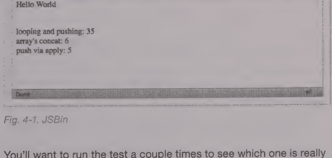
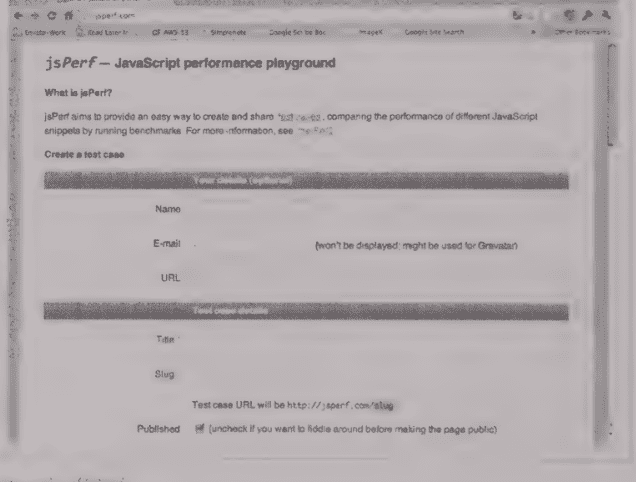
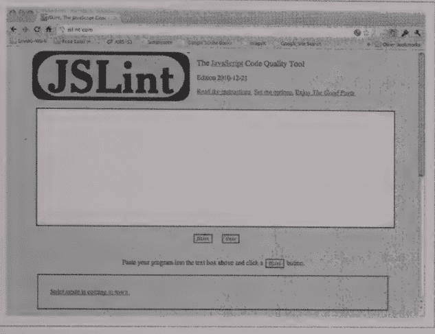

# 精通 JavaScript

感谢您购买《JavaScript 精进之道》！如需获取免费的 epub、Kindle 和 pdf 格式，请将您的亚马逊收据发送至：upgrade@rockablepress.com

## 关于作者

## 你的视频教程

# 第 1 章 入门

感谢您购买《JavaScript 精进之道》。我确信您做出了正确的决定（如果我可以这样说的话）。本章将带您初步了解我们即将深入探讨的主题。让我们开始吧！

## JavaScript 书籍还不够多吗？

您第一次看到这本书时，很可能翻了个白眼。如果您关注过在线开发者社区，就会知道 JavaScript 是一个非常热门的话题。人人都在写关于它的内容。那为什么还要再来一本 JavaScript 书籍呢？

嗯，之所以再来一本 JavaScript 书，是因为我希望这本书能够填补一个 niche。从一开始，我就希望这本书能够将一个对 JavaScript 知之甚少或一无所知的人，在很短时间内提升到一定水平……同时只教授当前的方法和最佳实践。这意味着 JavaScript 的内容远不止您在这本书中看到的。有很多东西您在入门时并不需要了解；我不会在这些内容上花费时间。我见过其他入门书籍涵盖了我省略的内容，这没关系，因为它们追求的是全面性。但这本书不是这样：在这里，您只会学到真正会用到的东西，作为踏入 JavaScript 世界的第一步。其他的内容可以留到以后再说。

由于我试图让这本书足够短，可以在一个周末读完（好吧，也许是一个长周末），我们探讨的许多内容并不会被详尽覆盖。这并不意味着我会草草带过。只是说有些更高级的技术现在还不是您必須学习的。不用担心：您会获得扎实的基础知识，助您起步。然后，可以查看附录中的资源进行进一步学习。

## 我将学到什么？

在我们开始之前，先谈谈这本书涵盖的内容。在本章中，您将了解什么是 JavaScript 以及它的起源。我们还将讨论如何搭建 JavaScript 编程环境。

之后，我们将在第 2 章和第 3 章中讲解基础知识。您将学习所有核心语法：实际要`输入`什么。第 4 章将涵盖编写 JavaScript 的许多最佳实践和重要概念。然后，在第 5 章中，我将向您介绍编写与网页交互的 JavaScript 的基础知识。

## JavaScript 从何而来？

JavaScript 由一位名叫 Brendan Eich 的先生开发，当时他效力于 Netscape（一家现已不存在的网络浏览器制造商）——他在不到两周的时间内就构建了整个语言。最初，它被称为`Mocha`，然后是`LiveScript`，最后是`JavaScript`。第一个支持 JavaScript 的浏览器是 Netscape Navigator 2.0，早在 1995 年底。

> **ROCK 提示**
>
> 需要注意的是，JavaScript **不是** Java。JavaScript 和 Java 之间实际上只有两个共同点。首先也是最明显的是"Java"这个词（这是为了让 JavaScript 对 Java 开发者有吸引力；我知道，确实如此）。另一点是一些相似的语法：两种语言都使用 C 风格的花括号。仅此而已。

很长一段时间里，JavaScript 并不被认为是一种拿得出手的语言。网络上的"大想法"本应该是 Java 小程序。然而，它们失败了，最终，JavaScript 的"优点"被人们熟知，甚至很快受到了许多人的喜爱。

如今，JavaScript 是世界上使用最广泛的编程语言。它不仅用于网页浏览器，还用于桌面应用、手机应用，现在甚至用于服务器端。学习 JavaScript 绝对不会浪费您的时间。

## 如何开始学习？

既然您已经满怀热情地想要学习 JavaScript，我们如何开始呢？好吧，您将在接下来的章节中学习如何实际编写 JavaScript 代码。但这些代码要放在哪里呢？

虽然很难找到 JavaScript **不能**运行的地方，但绝大多数 JavaScript——尤其是您现在要写的 JavaScript——都会在网页中，在浏览器里运行。有两种方法可以将 JavaScript 放入 HTML 页面。

第一种，您可以将 JavaScript 代码直接嵌入到`script`标签内。

```html
<script>
    alert("I'm learning JavaScript");
</script>
```

您现在不必理解标签中的代码；只要知道它能工作就行了。当浏览器遇到`script`标签时，它会解释您编写的代码并执行它（如果合适的话）。

第二种将 JavaScript 放入页面的方法是链接到一个`.js`文件：

```html
<script src="somefile.js"></script>
```

是的：不幸的是，那个闭合的`script`标签是必需的，即使您不在其中放入任何内容。正如您可能猜到的，`src`属性是 "source" 的缩写。这将下载 JavaScript 文件并进行处理，就像内联代码一样。

关于引入脚本还有两点说明：

- 大多数情况下，您会希望将`script`标签放在 closing body 标签之前。实际上，您可以放在任何您想要的地方，但从性能角度考虑，最好放在 body 的末尾……或者编写代码让它等到页面完全加载后再开始执行。我们稍后会看到如何做到这一点（不，您不能跳到第 140 页的"关于脚本加载的另一个简短题外话"）。
- 您可能会看到代码中`script`标签有这个属性：`type="text/javascript"`。这曾经是必需的，但在 HTML5 中不是了（当然，您应该使用 HTML5 文档类型）。

## Firebug

在学习 JavaScript 的过程中，您会发现 Firefox 插件 Firebug（`http://getfirebug.com`）非常宝贵。安装最新版本的 Firefox 后，立即前往该链接安装它。

安装 Firebug 后，您会在 Firefox 窗口状态栏的右下角看到一个小虫子图标；如果它是彩色的，说明它已在您访问的网站上启用；否则它会显示为黑白。

至少，很长一段时间以来都是这样。如果您使用的是 Firefox 4，它现在在工具栏上：

要在网站上启用 Firebug，只需点击该图标。点击后，Firebug 面板会弹出。它看起来大概是这样的：

# 第 1.2 节 入门

关于 Firebug，我们甚至可以写一整篇教程，但在这本书中你会用到的面板是控制台面板。你可以点击`console`标签来找到它（Firebug 默认应该会打开它；如上图所示）。

在面板底部，你会看到一个提示符（»），可以在那里输入一些 JavaScript 代码。这类似于命令行，你输入一些代码，按`return`（或`enter`），然后就会得到结果。如果你需要一次输入多行代码，点击行末向上的箭头；这样你就能输入多行代码，然后点击展开面板底部的`Run`按钮来执行。

## 本书使用的约定

在我们继续之前，还有一个说明：书中的许多代码示例看起来会是这样的：

**示例 1.1**

```javascript
alert("Hello, reader"); // Hello, reader
```

看到这个代码片段顶部的标题了吗："Example 1.1"？所有带有标题的代码片段都有一个配套文件——文件名类似`example_1_1.html`——你可以在已经随书下载的`code`文件夹中找到它。我希望你运行这些示例，但更希望你打开它们并修改代码，尝试各种操作，从而了解为什么有些东西能工作，有些则不能。

如果一个片段没有标题，那它只是一个需要以代码形式展示的简单示例，但单独执行它不会给你带来任何结果。

你现在还无法完全理解这一点，但我需要先解释一下，你很快就会明白：在上面的片段中，我使用了`alert`函数来展示代码的结果；这个函数会弹出一个警告框，显示我们给它的文本。注意行末的两条斜杠：这表示代码中的注释（更多内容即将介绍）；在我们的例子中，我把你应该在警告框中看到的结果放在了注释里，这样你就可以对比结果了。

有时，我会用`console.log`代替`alert`；它不会弹出警告框，而是将信息写入 Firebug 控制台。这是在编写 JavaScript 时更常用的输出方式。我们会两种都使用，以便你对两者都熟悉。

**示例 1.2**

```javascript
console.log("Hi there");  // Hi there
console.log(1 + 4); // 5
```

在 Firefox 中打开"示例 1.2"文件，并打开 Firebug（实际上，在打开 Firebug 后你需要刷新页面，因为如果该页面未启用 Firebug，就不会有日志记录）。你应该会在控制台中看到两行内容，一行显示"Hi there"，另一行显示"5"。

有时代码的长度会超过本书页面的宽度。如果是这样，行末会有一个续行标记（▶ 或 ▷）。这意味着下一行的文本应该与前一行连起来作为一个整体输入。例如，下面全部作为一行输入，中间没有换行：

```javascript
msg = "the time is " + hour + " o'clock"; // 加法 ▶
运算符用于字符串
```

空心箭头表示起始行末尾的字符与第二行第一个字符之间允许有空格；实心箭头表示不应该有空格。标记本身不需要输入。

## 小结

我希望你感到兴奋，因为我知道我很兴奋！我们即将踏上一段将永远改变你生活的旅程（好吧，至少有可能）。让我们进入第二章，开始讨论 JavaScript 的基础知识。

# 第 2 章 基础知识

在这里，我们真正要深入细节了；在本章中，我们将涵盖 JavaScript 的方方面面：所有看起来似乎不相关的小片段，将构建你 JavaScript 知识的核心。

## 变量

过一会儿，我们将讨论 JavaScript 中的数据类型，但我们需要先了解变量。取决于你怎么看，我们可能是本末倒置了，但我们会把所有这些都弄清楚。现在，要知道我们在 JavaScript 中有文本和数字等值。

变量基本上就是给你的值贴上的标签。变量指向内存中存储该值的位置。那么，如何创建这样一个变量呢？

**示例 2.1**

```javascript
var name = "Joe",
    age = 45,
    job = "plumber";

alert( name ); // Joe
```

这里有几点需要注意：首先，创建变量时，必须在变量名前面加上关键字`var`。接下来是变量名。你可以随意命名变量，但需遵守以下规则：可以使用字母、数字、美元符号和下划线的任意组合，只要不以数字开头。如你所见，你可以通过用逗号分隔表达式来一次声明多个变量。这样做是个好主意：在代码顶部，以及每个函数的顶部，声明你在该文件或函数中需要的所有变量（函数：即将在附近页面介绍）。

但是，如果你在创建变量时还不知道它的值应该是什么怎么办？也许这是一个用户稍后会给你的值，或者你需要计算的东西。仍然建议声明该变量，但不必给它赋值：

```javascript
var name;

name = "Jim";
```

当你声明变量而不给它赋值时，JavaScript 引擎会赋予它默认值`undefined`。然后，你可以稍后给它赋予新值。

我知道我已经说过了，但理解这一点很重要：变量只是值的标签。这意味着它们在很大程度上是可以互换的。

说完这个，让我们看看 JavaScript 中有哪些数据类型。

## 类型

学习 JavaScript 的第一步（在我们了解了什么是变量之后）是理解两件事：

- 有哪些基本数据类型可用，以及它们能做什么
- 这种语言实际上是如何编写的（语法）

### 字符串

字符串简单来说就是在 JavaScript 中处理任何文本的方式。每当你处理文本时，都会用到字符串。文本字符串必须用双引号或单引号括起来；两者没有区别。以下是一些例子：

```javascript
"Here is some text"
```

```javascript
'This text is surrounded by single quotes'
```

如果你想在字符串中包含引号字符，那么就必须对它进行转义。在字符串中转义字符意味着在该字符前加上反斜杠。这基本上告诉 JavaScript 解释器，斜杠后的字符不应该按正常方式解释；它是特殊的。在这种情况下，引号的正常解释是关闭字符串。

#### 示例 2.2

```javascript
alert("John says \"What are you doing?\"");
// John says "What are you doing?"
alert('"Let\'s go out for lunch."');
// "Let's go out for lunch."
```

注意，在最后一个字符串中，我不需要转义双引号，因为该字符串是用单引号分隔的。你只需要转义包含字符串的那种引号类型。

### 数字

虽然有些编程语言提供不同类型的数字，但 JavaScript 只有一种。在大多数情况下，你只需输入你想要的数字即可。

```javascript
10
```

```javascript
3.14159
```

对于你，程序员来说，JavaScript 不区分带小数和不带小数的数字。对于极大或极小的数字，你可以使用科学记数法：

**示例 2.3**

```javascript
alert( 3.45e5 ); // 345000
alert( 123e-3 ); // 0.123
```

上面的第一个数字表示 3.45 x 10⁵，即 345,000。第二个表示 123 x 10⁻³，即 0.123。但要注意：JavaScript 不接受超过 17 位小数的数字。超过的部分会被截断。

> **ROCK 提示**
>
> 这时值得提及的是，JavaScript 中的数字并不总是完全可靠的。例如，在 Firebug 中输入`0.1 + 0.2`，结果是`0.30000000000000004`；什么？为什么会这样？原因相当技术性，基于 JavaScript 使用的数字规范。幸好，在你开始接触 JavaScript 时，不会进行太多的数值计算。不过，可以把这个当作一般经验法则：在进行小数的加减运算时，先将它们相乘。计算完成后，再除以相应的数。我们还没有讨论运算符，但方法是这样的：`(( 0.1 * 10 ) + ( 0.2 * 10 )) / 10`。这会得到正确答案：0.3。我知道这看起来很麻烦，但这就是 JavaScript：有时令人非常沮丧（但大多数时候有趣且酷）。

### 布尔值

布尔值有两个：`true`和`false`。在你的 JavaScript 代码中，你会在很多地方使用布尔值，必要时你会用到这些值。然而，更多

# 第 2 章 基础知识

通常你会对其他表达式进行"真值"或"假值的评估。我们将在本章后续讨论循环和条件语句时，进一步了解如何做到这一点。

## Null 与 Undefined

大多数语言都有一个表示"不存在"的值。所谓不存在，是指当你尝试获取一个不存在的值时（比如一个没有值的变量），你会得到`undefined`。与此类似的还有另一个值，那就是`null`。通常没有必要区分`null`和`undefined`；但如果你需要"清除"某个变量的值，可以将其设为`null`。

## 对象

到目前为止，我们所看到的都是原始值；它们是各种语言都以某种形式存在的基本组成部分。现在，我们来看引用值。引用值与原始值（即字符串、数字、布尔值、`null`和`undefined`）不同，它们在代码中是通过引用来传递的。我知道这很抽象，所以我们会在可以结合具体语境时再回过头来讨论这个概念（如果你迫不及待，可以翻到第80页，我们在那里讨论函数的调用和应用）。

对象是 JavaScript 最强大的特性之一。可以把对象看作是一组原始值或引用值的包装器。下面是一个例子：

```javascript
var obj = {
    name    : "Andrew",
    age     : 20,
    awake   : true,
    company : {
        name : "XYZ Ltd.",
        id   : 12345
    }
};
```

对象由花括号界定；在对象内部，我们有一组键值对。键值对正如其名：一对值，其中一个是键，指向另一个值。如果我想从这个对象中获取我的名字，我会向对象请求它的`name`属性——这就是我们在键值对中所说的值。另外请注意，除了最后一对之外，每一对都以逗号结尾；这很重要。而间距并不重要；我在这里添加了一些额外的空格来让对象看起来更美观，但我可以把它全部挤在一行里，没有任何间距，效果也是一样的。

如你所见，任何类型的值都可以作为对象的属性。我在里面放了一个字符串、一个数字、一个布尔值，甚至另一个对象。你可以用两种方式访问属性：点符号或方括号符号，如下所示：

#### 示例 2.4

```javascript
var obj = { name : "Joe", age : 10 };

alert( obj.name ); // "Joe"

alert( obj["age"] ); // 10
```

像这样创建自定义对象对你的 JavaScript 应用程序很重要。它可以让你创建 JavaScript 内置的自定义值。需要一个`Person`对象？没问题。或者需要一个标签页容器？JavaScript 对象也能满足你的需求。我们将在下一章深入探讨面向对象编程的泥沼时，再回过头来讨论自定义对象。

关于对象的最后一点：你不需要一次性把所有需要的属性都放进去；可以稍后添加。我们稍后会看到更多相关内容。

## 数组

大多数编程语言都有数组，这是存储大量数据的好方法。它们与对象非常相似，但没有键。

```javascript
["Buy milk", "Feed cat", "Pick up dry cleaning", "Deposit Cheque"]
```

数组由方括号界定，每个值之间用逗号分隔。当然，你不局限于使用字符串，就像我这里用的那样。而且，你也不一定非要在同一个数组中只使用相同类型的值。

```javascript
["string", 20, false, null, { "id" : 8888 }]
```

如果你想访问数组中的某一项，可以使用方括号符号。要访问数组中的第一个项目，你可以这样做：

#### 示例 2.5

```javascript
var arr = ["string", 20, false];
alert( arr[0] ); // "string"
```

数组的索引是**从零开始**的，这意味着第一个项目是 0，第二个是 1，依此类推。

## 日期


到目前为止，我们看到的所有值都是字面量；这意味着我们没有使用任何“真正的”代码来向 JavaScript 解释器提供我们的值；我们只是输入了原始的字符串、数字、布尔值或其他什么。Date 值是我们看到的第一个无法以这种方式创建的值。

所以，要创建一个 JavaScript Date 对象，你需要这样做：

```
new Date()
```

这引入了一些新的语法，所以我们先来解释一下。`new` 关键字仅仅表示我们想要创建一个新对象；在这个例子中，就是一个日期对象。`Date` 在此是一个函数的名称。我们将在下一章讨论函数，但它们基本上就是相关代码行的包装器。你可以调用一个函数——也就是运行它里面的代码——通过在函数名后面加上括号来实现。

你在上面看到的代码会给你一个日期对象，它包含你创建该对象时的日期和时间……精确到毫秒。如果你想创建一个特定日期或时间的日期对象，你需要传入合适的参数。参数？如果你想让函数使用它自身以外的值，你必须把这些值给它。这样做的时候，只需把它们放在调用函数的那些括号之间即可。别忘了用逗号分隔多个参数。

> **ROCK 提示**
>
> 实际上，我们可以用类似的方式创建所有原始类型，但我不会教你这个，因为这样做从来没有好的理由。

你可以使用几个参数来创建其他日期。你可以传入一个字符串日期：

```
new Date("January 17, 2012")
```

或者，你可以传入一系列参数，对应以下列表：年、月、日、时、分、秒、毫秒。你不需要全部添加；只添加需要的即可。需要注意的是，月份数字是从零开始的。这意味着要得到一月，你使用数字 0；要得到十二月，你使用 11。

```
new Date(2009, 3, 20, 17, 30)
```

这将返回 2009 年 4 月 20 日下午 5:30:00.0。你的日期对象还会包含时区信息，基于你电脑上的设置。

## 分号

你可能已经注意到，在我们目前看到的代码片段中，分号时不时会出现。这些在 JavaScript 中很重要；它们用于分隔语句。那么，什么时候应该使用分号呢？简短而简单的答案是：每行末尾都使用。更准确的答案是：在每个表达式语句之后使用一个。很模糊，对吧？解释这一切是如何工作的已经超出了本书的范围。对于初学者来说，通过查看他人的代码来学习分号的使用位置是最简单的。当你从本书中的代码片段汲取经验时，这些规则**大部分时间**都成立：

- 任何你可以在 Firebug 控制台中输入的单行代码，末尾应该有分号。

```
var someVar = "value"; // 分号

someFunction("parameter"); // 分号
```

- 任何包含代码块的语句（花括号之间的代码行）不应该在打开和关闭代码块的行末尾使用分号（通常是带有开始或结束花括号的那一行）。

```
if (true) { // 无分号
    doThis(); // 分号
} // 无分号
```

我知道这些代码现在可能还看不懂，但请把这些分号规则记在脑海深处。

## 注释

这里有一些你一定会发现有用的东西：你可以向 JavaScript 代码中添加注释。要添加单行注释，使用两个反斜杠。你可以针对整行，或者只是行的一部分这样做：

```
// This is a useless comment
var x = 10; // x is now equal to 10
```

如果你想要多行注释，使用反斜杠和星号；反过来（星号和反斜杠）结束注释：

```
/* file: navigation.js
   author: Andrew Burgess
   date: July 2, 2011
   purpose: provides animation for the site navigation
*/
```

确保不要滥用注释。不要让你的文件充满注释，而且要让你使用的注释有价值。

## 运算符

好了，既然我们知道了可以使用哪些值，以及如何存储它们，让我们来谈谈运算符。运算符用于处理变量和值；通常，它们会改变变量，或者返回你想要赋值给变量的值。让我们看看工具箱里有哪些运算符。

### 算术运算符

这些可能是使用最频繁的运算符。它们是标准的数学运算符，大约是大多数人在二年级时就认识的老朋友了。

#### 示例 2.6

```
var four = 2 + 2, // 加法运算符
    hour = 24 - 13, // 减法运算符
    seventy = 7 * 10, // 乘法运算符
    avg_days_per_week = 365 / 52, // 除法运算符
    remainder = 31 % 2, // 取模运算符
    msg = "the time is " + hour + " o'clock"; // 用于字符串的加法运算符

console.log(four); // 4
console.log(hour); // 11
console.log(seventy); // 70
console.log(avg_days_per_week); // 7.019230769230769
console.log(remainder); // 1
console.log(msg); // "the time is 11 o'clock"
```

除了这些运算符明显的工作方式之外，你可以看到我们将每个运算的值赋给了一个变量。同时，注意我们只需要使用一个 `var` 语句，因为每个变量赋值都用逗号分隔。然后，注意 `+` 运算符用于连接字符串。我们甚至可以在其中加入一个数字，JavaScript 会将其转换为结果字符串的一部分。

上面你可能不熟悉的一个运算符是取模（`%`）运算符。它返回两个数相除的余数。上面示例的结果是 1，因为 31 / 2 等于 15，余数为 1。

## 比较运算符

除了对值进行操作外，你还想比较它们。其中一些你应该很熟悉：

#### 示例 2.7

```
alert( 10 < 5 ); // false
alert( 10 > 5 ); // true
alert( 4 <= 3 ); // false
alert( 4 >= 3 ); // true
```

判断哪个数字更大或更小一点也不难。除了“小于”和“大于”，我们还有“小于等于”和“大于等于”。所有这些运算符都返回布尔值。

你也可以在字符串上使用这些运算符：

#### 示例 2.8

```
alert( "cat" > "dog" ); // false
alert( "bacon" > "chunks" ); // false
alert( "cats" >= "cats" ); // true
alert( "fishing" <= "sleeping" ); // true
alert( "cat" > "CAT" ); // true
```

这是如何工作的呢？嗯，每个字母都有一个字符编码，一个标识它的数字。比较的就是这些数字。需要注意的是，大写字母与其小写形式并不相邻。所有大写字母都在小写字母之前，所以 "A" < "z" 为 true。

而且不只是字母有字符编码；你能输入的每个字符，包括你看不到的（如 Shift、Escape 和其他修饰键），都有字符编码。所以带有数字或标点的字符串也可以用这种方式比较。

那如何检查两个值是否相等呢？别犯这样的错误：

```
var a = "cat",
    b = "dog";

a = b // 错误：这不是比较
```

看一下这个，你能明白为什么不能用 `=` 来比较值吗？那是赋值运算符；你用单个等号将值赋给变量。要测试相等性，你可以使用三个等号（通常称为全等运算符）。

#### 示例 2.9

```
var a = "cat",
    b = "dog";

console.log( a === b ); // false
console.log( a === "cat" ); // true
```

## 一元运算符

到目前为止我们看到的所有运算符都使用两个值，两边各一个。还有一些运算符只使用一个值。首先，我们有递增和递减运算符：

#### 示例 2.10

```
var i = 0;

i++;

alert(i); // 1

++i;

alert(i); // 2

i--;

alert(i); // 1

--i;

alert(i); // 0
```

在数字前面或后面放“加加”会给数字加一。可想而知，“减减”会从数字中减一。那么，前缀版本和后缀版本有什么区别呢？区别在于：这些运算符也会返回一个值，就像其他运算符一样。在这种情况下，它们返回正在递增的数字的值；然而，前缀（运算符在前面）运算符在返回值之前递增数字，而后缀运算符先返回值，然后再递增数字。下面是一个例子：

#### 示例 2.11

```
var num1 = 1, num2, num3;

num2 = ++num1;

console.log("num1: ", num1); // num1: 2
console.log("num2: ", num2); // num2: 2

num3 = num1++;

console.log("num1: ", num1); // num1: 3
console.log("num3: ", num2); // num3: 2
```

另一个有用的一元运算符是 `typeof`；这个运算符会返回给定变量的类型：

#### 示例 2.12

```
alert( typeof 10 ); // "number"
alert( typeof "test" ); // "string"
alert( typeof new Date() ); // "object"
```

这里唯一需要注意的是，数组不会被赋予 array 类型；它们被称为 object，因为——技术上讲——它们确实是。但这不太有用。

还有一些其他的一元运算符，但我们稍后会看到它们。现在，让我们谈谈最后两组运算符：额外赋值运算符和布尔运算符。

## 赋值运算符

我们已经看过使用 `=` 运算符赋值；但还有一些其他的，我认为最好用演示来说明：

#### 示例 2.13

```
var num = 10;

num += 5; // 等同于 num = num + 5
alert(num); // 15

num -= 3; // 等同于 num = num - 3
alert(num); // 12

num *= 2; // 等同于 num = num * 2
alert(num); // 24

num /= 6; // 等同于 num = num / 6
alert(num); // 4

num %= 3; // 等同于 num = num % 3
alert(num); // 1
```

如你所见，这些赋值运算符的模式用于对变量中已有的值执行操作，然后将新值重新赋给该变量。如果你运行上面的代码，你会发现运行完所有运算后 `num` 等于 1。

## 布尔运算符

布尔运算符用于测试一个值是真还是假。JavaScript 中的每个值都可以被评估为布尔值。有些值被认为是假值，其他值被认为是真值；稍后在本章中你会看到这一点的重要性。现在，要知道这些值被认为是假值：

- `false`
- `null`
- `undefined`
- `""`（空字符串）
- `0`
- `NaN`（当你尝试对数字和非数字值进行加、减等运算时得到的结果）

其他所有值都被认为是真值；请记住，这包括字符串 "false"、"null" 等。

那么，回到布尔运算符。第一个是逻辑非；逻辑非运算符将给定值转换为其相反的布尔值。

#### 示例 2.14

```
var a = "a string";

alert( !a ); // false

alert( !!a ); // true
```

由于包含内容的字符串是真值，使用逻辑非运算符会返回 `false`。这就像在说“非真”。

注意，使用两次 NOT 会得到 `true`；这是一个很好的技巧，当你想把任何值转换为其布尔值时可以使用。

虽然逻辑非是一元运算符，但逻辑与和逻辑或运算符使用两个值。看一下语法，然后我们再来讨论它们：

#### 示例 2.15

```
var a = true;
var b = false;

alert( a && b ); // false

alert( a || b ); // true
```

这是如何工作的？这些运算符在哪里有用武之地呢？上面的第一个（`&&`）是逻辑与运算符；只有当运算符两边的值都为真时，它才返回 `true`。逻辑或（`||`）只要其中一个值为真就返回 true。

那么，这有什么用呢？嗯，很快我们就会看到循环和条件语句，那就是你最常用到它们的地方。在条件语句中，你会想检查某些条件。如果你需要两个值都是特定的值才能继续，你会使用逻辑与；如果只需要一个为真，逻辑或就能胜任。

我应该指出，你可以使用任何返回值的表达式；例如：

#### 示例 2.16

```
var day = 14, year = 2011;

alert( day > 10 || year === 2011 ); // true

alert( day < 20 && year >= 2010 ); // true
```

你还应该知道，如果运算符的第一边就决定了答案，第二边将不会被评估。例如，在上面使用逻辑或时，`year === 2011` 永远不会被评估，因为 `day > 10` 返回 true，而 OR 只需要一个为真。另一方面，如果逻辑与的前半部分返回 false，后半部分将不会被评估，因为两边都需要为真，整个表达式才为真。

这个事实——如果表达式的前半部分就决定了最终值，后半部分就不会被测试——被一些 JavaScript 高手用来缩短他们的代码。比如说我们想调用一个函数（记住，我们很快会讲到函数），但我们不确定该函数是否存在。我们可以这样做：

```
funcName && funcName();
```

记住，要执行函数，我们必须有括号，所以这部分代码的第一部分不会执行函数，它只是返回函数。如果函数存在，这将评估为 true，评估将继续到第二部分，执行函数。这避免了尝试执行不存在的函数时会抛出的错误（是的，我们会谈到错误）。

## 条件语句

我们刚刚学习的运算符中，有不少都用于判断某个条件是真是假。通常，这会成为后续操作的条件：如果某事为真，则执行此操作；否则，执行另一操作。让我们来看看这是如何运作的。

### If 语句

假设我们正在开发一个需要输出给定年份所属世纪的应用程序。

#### 示例 2.17

```
var year = 2011, msg = "In the ";

if (year > 2000) {
    msg += "twenty-first century";
} else {
    msg += "twentieth century";
}

console.log(msg); // In the twenty-first century
```

这是一个 if 语句。我们以关键字 `if` 开头，然后在括号内放置条件。此时，真/假值以及返回布尔值的运算符就派上用场了，它们将决定执行哪个语句。

我们还没有过多讨论语句。在 if 语句中，语句由花括号内所有代码行组成。在我们的示例中，只有一行代码，它将世纪名称追加到字符串 `msg` 上。然后，请注意其后的另一个语句：else 语句。只有当它前面的条件求值为假时，else 语句才会被执行。

但假设我们要处理的不只是非真即假的情况。要做到更多并不难：

#### 示例 2.18

```
var year = 11, msg = "In the ";
if (year > 2000) {
    msg += "twenty-first century";
} else if (year > 1900) {
    msg += "twentieth century";
} else {
    msg += "very distant past.";
}

console.log(msg); // In the very distant past
```

如你所见，多个 if 语句并不是什么难事。将 else 语句替换为另一个 if 语句，把 `if` 紧挨着 `else` 放置，在括号内添加第二个条件，就可以了。当然，这个过程可以无限进行下去；你可以使用的 else if 语句数量没有限制。

### Switch 语句

然而，假设我们要检查具有多个选项的内容，比如顾客想要的咖啡尺寸。我们可能需要这样做：

#### 示例 2.19

```
var order_size = "medium";

if (order_size === "small") {
    alert("small");
} else if (order_size === "medium") {
    alert("medium");
} else if (order_size === "large") {
    alert("large");
} else if (order_size === "extra large") {
    alert("extra large");
} else {
    alert("something else?");
}
```

我可不知道你怎么看，但对我来说，最后这段代码似乎有太多不必要的重复。你可以改用 switch 语句。

#### 示例 2.20

```
var order_size = "medium";

switch (order_size) {
    case "small":
        alert("small");
        break;
    case "medium":
        alert("medium");
        break;
    case "large":
        alert("large");
        break;
    case "extra large":
        alert("extra large");
        break;
    default:
        alert("something else?");
}
```


让我来介绍一下`switch`语句。它是冗长、嵌套的`if/else`语句的完美替代品。使用`switch`语句时，你只需要写一次要计算的表达式；它放在最上面括号内，紧接在关键字`switch`之后。然后我们打开一组花括号。

我们想根据该表达式的计算结果执行某些操作，因此可以设置任意多个`case`。关键字`case`后跟我们希望表达式匹配的值。在这个示例中，表达式`order_size`与每种咖啡尺寸进行比较。比较值后面跟一个冒号。接下来是如果表达式与`case`匹配则将执行的代码行；如果只有一行代码，你可以根据需要将其放在`case "value":`的同一行。这完全无所谓，因为 JavaScript 不关心空格。不要忘记用`break;`结束你的`case`块。这会防止我们的`case`语句发生穿透；我们稍后会看到这指的是什么。

但首先，不要忘记末尾的`default:`部分；没错，你猜对了：它相当于`else`。当没有任何`case`匹配时，它会被执行。

那么，回到穿透问题：如果我们不包含`break;`语句，在我们匹配的`case`之下的任何`case`语句的代码也会被执行。下面是移除了`break`语句的示例 2.20：

#### 示例 2.21

```javascript
var order_size = "medium";

switch (order_size) {
    case "small":
        alert("small");
    case "medium":
        alert("medium");
    case "large":
        alert("large");
    case "extra large":
        alert("extra large");
    default:
        alert("something else?");
}
```

去运行这个示例文件吧：你会收到`"medium"`、`"large"`、`"extra large"`和`"something else?"`的弹窗。起初，这可能说不通；所以换个角度想想。我们可以让每个代码块对应多个`case`，这意味着如果我们的条件是其中一种`case`，代码就会执行：

#### 示例 2.22

```javascript
var order_size = "medium";

switch (order_size) {
    case "small":
        alert("small");
        break;
    case "medium":
    case "large":
    case "extra large":
        alert("medium, large, or extra large");
        break;
    default:
        alert("something else?");
}
```

如果我们现在为每个`case`语句添加一些代码（不带任何`break`语句），同样的行为会发生：每个`case`下的代码会运行，但它会"穿透"到下一个`case`语句并执行那里的代码。

## 条件运算符（三元运算符）

还有一种条件语句。假设我们想这样做：

```javascript
var temp = 18, // degrees Celsius
    msg;

if (temp > 10) {
    msg = "Today was warm";
} else {
    msg = "Today was cold";
}
```

只为设置一个变量，这似乎是多余的代码。好吧，使用条件运算符，我们可以将其缩短。

#### 示例 2.23

```javascript
var temp = 18,
    msg = (temp > 10) ? "Today was warm" : "Today was cold";

alert(msg);
```

这很简单。在括号里（实际上括号不是必需的，但能提高可读性），放入你的条件语句，后跟一个问号。然后是我们得到的值。

> **ROCK 提示**
>
> 你可能会看到条件运算符被称为"三元运算符"；"三元"只是意味着它接收三个值，就像一元运算符只接收一个一样。不过没人会混淆，因为 JavaScript 中只有一个三元运算符。
>
> 如果条件为真则使用的值。如果条件为假的返回值紧随其后，放在冒号之后。条件运算符非常适合你的`if`语句只有两个可能结果、且每个结果都可以用单行代码表示的情况。

## 循环语句

既然我们已经掌握了条件语句，接下来就可以继续学习循环了。很多时候，你想多次执行相同的操作，每次使用不同的值。正如你可能猜到的，这通常与数组密切相关。让我们来看看 JavaScript 提供给我们的循环结构。

## For 循环

当你需要构建循环时，`for`循环通常是你首选的工具。看看语法，然后我们来讨论。

#### 示例 2.24

```javascript
var names = ["Ringo", "John", "Paul", "George"];

for (var i = 0; i < names.length; i++) {
    alert("Say hello to " + names[i]);
}
```

我们以关键字`for`开始`for`循环；接下来是括号内的三条语句。注意这些语句是如何用分号分隔的，就像所有良好的 JavaScript 语句一样。第一条语句设置循环所需的任何变量；在本例中，我们只设置了一个变量：`i = 0`（"i" 是 iterator 或 index 的缩写）。第二条语句是返回布尔值的表达式；它在循环执行前进行求值。如果求值为真，循环将执行；如果求值为假，循环将结束。在我们的示例中，我们检查`i`是否小于`names`数组的长度（关于`length`属性的更多内容稍后介绍）。最后一部分执行循环执行后我们想要完成的任何操作；这里，我们将`i`增加一。在循环内部，我们可以使用方括号表示法来处理数组的值，传入一个索引号——这就是变量`i`的用途。

现在，大多数你会看到（和写的）循环结构都会与此非常相似，尽管括号中的三条语句都是可选的。然而，确保你真正理解这东西为什么有效；如果你理解每个部分的作用，你的`for`循环就会更加灵活。例如，谁说我们需要在括号内设置变量？

```javascript
var i = 0;
for ( ; i < names.length; i++) {
    // whatever
}
```

注意，尽管我把变量声明移到了循环外部，我们仍然需要在语句所在位置后面放一个分号。

另一方面，为什么不在第一部分设置两个变量，并将`names.length`的值"缓存"到变量`len`中，然后在第二条语句中使用它（如果你正在处理大型数组，这确实更快）。

```javascript
for (var i = 0, len = names.length; i < len; i++) {
    // whatever
}
```

注意，我没有用分号分隔两个变量声明；它必须是一个语句，所以我们用逗号分隔。

## While 循环

但还有后置循环操作的部分。为什么不把它放到循环里面呢？

```javascript
for (var i = 0; i < names.length; ){
    // whatever
    i++;
}
```

而且，我们可以不用做整个`< names.length`的判断，只需检查数组中是否存在该值即可。

```javascript
var i = 0;

for ( ; names[i] ; ) {
    //do something
    i++;
}
```

这是一个重要的观点，不仅仅适用于`for`循环：如果你理解每一部分的作用，你就能更有效地运用它。想到这里，你能猜到为什么你没有尝试从`for`循环中移除布尔表达式吗？没有它，你的循环将会无限循环（试试看，然后让你的浏览器崩溃）。

有一个结构可能看起来有点像我们上次写的`for`循环：

#### 基础知识

#### 示例 2.25

```javascript
var names = ["Ringo", "John", "Paul", "George"],
    i = 0;

while (i < names.length) {
    alert("Say hi to " + names[i]);
    i++;
}
```

`while`循环是`for`循环的更简单形式。括号里不是三个语句，而只有一个：布尔表达式。如果为 true，`while`循环将再次运行。当然，它以`while`关键字开头，后跟括号，然后是块语句。如果你使用任何变量，你必须在循环之前初始化它们，并在循环内递增它们。根据你的任务，`while`循环可以比`for`循环更优雅。我在上面展示的是使用`while`循环进行迭代；这通常还是留给`for`循环更好。从语义上讲，`while`循环应该在某个条件为 true 时使用：

#### 示例 2.26

```javascript
var not_home = true,
    miles_driven = 0;

while (not_home) {
    miles_driven += 1 // drive another mile
    if (miles_driven === 10) {
        not_home = false;
    }
}

alert(miles_driven);
```

## 重访 For 循环

还有另一种形式的`for`循环你应该了解，通常称为`for-in`循环。它用于遍历对象。看看：

#### 示例 2.27

```javascript
var person = {
    name : "Jules Verne",
    job : "Author",
    year_of_birth: 1828,
    year_of_death: 1905
},
     prop;

for (prop in person) {
    alert("His " + prop + " is " + person[prop]);
}
```

如你所见，`for-in`循环比普通`for`循环简单得多。括号里不是三个语句，我们只放一个：迭代器变量的名称、`in`关键字，以及我们要遍历的对象。正如预期的那样，这将分别为数组或对象中的每个项目或属性执行块内的内容。使用`for-in`循环遍历对象时有一个必须注意的问题，但我们将在下一章中更多地讨论这个问题。

## 总结

现在你应该对我们的主题逐渐熟悉了。我们已经介绍了 JavaScript 中可用的不同类型、大多数运算符，以及如何使用条件和循环。在下一章中，我们将讨论 JavaScript 最重要的特性之一：函数。

## 更多基础知识

既然我们已经掌握了类型和语法的最基础知识，让我们继续学习另一个极其重要的特性：函数。请密切关注！

## 函数

什么是函数？函数实际上只是封装起来的一堆代码。我们一直在看各种 JavaScript 语法：所有这些都可以放在函数里面，而且你经常会这样做。当你把代码放进函数时，它不会立即运行，像"松散"的代码那样。你可以通过调用函数来决定代码何时运行，而且你可以随心所欲地调用。这是函数的好处之一。

但不要忘记封装部分：这意味着在你调用函数时，你无法（在很大程度上）控制函数内部发生的事情。你会交给函数一些值来处理，它会返回一个值；但内部发生了什么是被黑箱化的。这最终成为我们可以利用的重要特性，稍后我们会看到。

关于函数还有另外两个重要的点你应该知道。首先，函数在 JavaScript 中是一等对象，这意味着它们是对象，而且它们与其他任何值没有区别。让我们更深入地看看这两点。

**函数是对象：** 我们之前看到过如何创建对象字面量。现在，我们不能使用对象字面量表示法来创建函数，但函数可以有属性和方法，因为它是对象。你可以向函数添加自己的属性和方法，但我们很快就会看看一些内置的。

**函数与其他值类似：** 在许多编程语言中，函数与字符串和数字等原始值非常不同。然而，在 JavaScript 中，情况并非如此。你可以在使用其他值的大多数地方使用函数，比如将它传递给另一个函数（我们很快就会看到）。此外，你可以重新定义函数，就像重新定义任何其他变量一样。这非常方便，你会看到的。

既然我们理解了一些函数理论，让我们看看一些语法。

## semi函数语法

如我们所知，函数只是任意数量的常规 JavaScript 代码行。但我们需要用函数结构将其包裹起来。假设我们有一些代码，为我们的网站确定合适的问候语：

#### 示例 3.1

```javascript
var hour = 10,
    message;

if (hour < 12) {
    message = "Good Morning!";
} else if (hour < 17) {
    message = "Good Afternoon!";
} else {
    message = "Good Evening!";
}

console.log(message); // Good Morning!
```

我们创建了一个`hour`变量，假设为当前小时。然后，我们使用`if`语句来判断我们的小时在什么范围内，并相应地赋值给`message`。

那么，我们要如何将这些代码转换为函数呢？首先，让我们认识一下函数外壳：

```javascript
function getGreeting () {
    // code goes here}
```

以关键字`function`开头；然后，写出函数的名称；它可以是你想要的任何名称，只要遵循变量名的规则（即字母数字字符、下划线和美元符号，但不能以数字开头）。接下来是括号。然后，代码行放在花括号之间。

现在，你可能会想把我们上面写的所有代码都塞进函数外壳里。这不明智，有两个原因。首先，将无法访问到变量`message`（更多关于函数作用域的内容即将介绍）。其次，通过一点定制，我们可以稍作调整来增加函数的实用性。

让我们的函数接受一个参数。参数是你请求函数运行时交给函数的值。然后函数可以按需要使用这些参数。这在语法上是如何工作的呢？

```javascript
function getGreeting (hour) {
    //code here}
```

这里，我们的`getGreeting`函数接受一个参数，我们称之为`hour`。参数就像只能从函数内部访问的变量。要调用这个函数并给它一个 hour，我们会这样做：

```javascript
getGreeting( 10 );
```

我们可以把 hour 存储在变量中，但我们不需要这样做，因为之后就用不到了。

所以，我们把当前 hour 传递给`getGreeting`。现在我们准备编写函数内部的代码：

#### 示例 3.2

```javascript
function getGreeting(hour) {
    var msg;

    if (hour < 12) {
        msg = "Good Morning!";
    } else if (hour < 17) {
        msg = "Good Afternoon!";
    } else {
        msg = "Good Evening!";
    }
    return msg;
}

var message = getGreeting( 16 ); // 4 PM

alert(message); // Good Afternoon!
```

如果你一直仔细跟随，上面应该只有一件事你不确定：`return msg`。这是什么意思？返回值就是将其传回给调用函数的代码。这样，我们可以将调用函数赋值给变量（如上所述），它将是`getGreeting`返回的值。

关于这个函数，我还想再做两件事让它更好。首先，真的不需要`msg`变量，因为我们只对它做了一件事。试试这个：

# 更多基础

#### 示例 3.3

```javascript
function getGreeting(hour) {
    if (hour < 12) {
        return "Good Morning!";
    } else if (hour < 17) {
        return "Good Afternoon!";
    } else {
        return "Good Evening!";
    }
}

alert( getGreeting(3) ); // Good Morning!
```

这清楚地表明，我们可以有不止一个`return`。一旦我们确定了必须返回哪个值，我们就会立即返回。我应该指出的是，`return`语句将是函数中最后执行的一行；一旦函数返回，它就在此结束了；不会再执行其他任何代码。因此，除非你的`return`语句位于条件语句内部，否则通常不会在函数中`return`行之后有任何代码。

还有一件事：在编写函数时，你希望它们对用户友好。我们这样做：如果用户没有传入参数，我们将提供一个合理的默认值。

#### 示例 3.4

```javascript
function getGreeting(hour) {

    hour = hour || new Date().getHours();

    if (hour < 12) {
        return "Good Morning!";
    } else if (hour < 17) {
        return "Good Afternoon!";
    } else {
        return "Good Evening!";
    }
}

alert( getGreeting( new Date().getHours() ) );
```

这里发生了什么？我们使用了一个逻辑ression OR运算符；记住它的作用：如果第一个值为真，就使用它；否则，使用第二个值。在这个例子中，我们说的是，我们希望将`hour`参数设置为`hour`参数的值（如果用户传入了一个值），或者是当前的小时数。我们使用当前 Date 对象的`getHours`函数；稍后我们会看到更多关于这个的内容。如果用户没有传入参数，`hour`将是`undefined`，这是假的。因此，函数会将当前小时数赋值给`hour`。是的，你可以像这样给参数赋新值。

> **ROCK 提示**


这是为参数提供默认值的最佳方式。这是一个相当高级的 JavaScript 技巧，但我认为你能掌握它。不过，如果它有点复杂，也不要感到难过。稍后再回来看，你应该不会有任何问题。

好了，这是我们的第一个函数。让我们用几点重要的内容来结束关于函数的讨论。

### 参数

我们一直称传递给函数的值是参数。还有另一个常见的术语，那就是`arguments`（参数）。事实上，JavaScript 本身就叫它们`arguments`。许多其他编程语言都有与函数参数相关的错误检测功能：它们确保在调用函数时你传入了正确数量和类型的参数。JavaScript 不提供任何这些功能。以下都是调用我们上面的`getGreeting`函数的有效方式：

```javascript
var msg1 = getGreeting(10),

    msg2 = getGreeting(1,2,3,4,5,6, "and on"),

    msg3 = getGreeting(),

    msg4 = getGreeting("five o'clock");
```

当然，还有更多。在所有这些情况下，我们只让我们的函数适用于选项 1 和 3。然而，它对选项 2 也适用：hour 将被设置为 1，但所有后面的参数都将丢失。选项 4 是一个需要一些错误检查的好例子：为了防止在我们的函数中出现字符串参数，我们应该使用`typeof`运算符来确保它是一个数字（在我们确认他们确实给了我们一个参数之后）。如果不是数字，我们应该提供默认值：当前的小时数。

我说对于上面的选项 2，所有额外的参数都丢失了。嗯，这并不完全正确。JavaScript 确实提供了一种获取它们的方式：它提供了一个名为`arguments`的对象，你可以从函数内部访问它。你可能认为`arguments`如果能是一个数组就更合理了……每一个其他的 JavaScript 程序员都会同意你的看法。然而，它是一个类数组对象，这意味着它有一些数组的特性，但不是所有的特性。它有一个`length`属性，这是传入函数的参数数量。你还可以用方括号表示法来访问参数，就像在数组中一样。与真正的数组没有其他相似之处。就这样。

所以我们可以这样写一个求和函数：我们遍历传入的每个参数并将其加到变量`sum`中。然后，我们返回`sum`。

#### 示例 3.5

```javascript
function sum() {
    var sum = 0, i;

    for ( i = 0 ; arguments[i]; i++) {
        sum += arguments[i];
    }
    return sum;
}

var sum1 = sum(1, 2),
    sum2 = sum(100, 75, 40),
    sum3 = sum(9, 1.4, 8, 2, 79, 3234, 6, 4, 5e3, 5);

alert(sum1); // 2
alert(sum2); // 215
alert(sum3); // 8348.4
```

### 作用域

我们（相当）几段之前顺便提到了作用域。现在让我们更详细地讨论一下。虽然作用域不仅仅与函数相关，但函数是 JavaScript 中作用域的主要部分，所以现在讨论是合适的。

作用域基本上就是你在代码的给定点可以访问的一组变量。JavaScript 具有函数作用域，这意味着当我们进入函数时，作用域会发生变化。让我们看几个例子。

让我们从全局区域开始。如果你写了：

```javascript
var name = "Bob";
```

在 JavaScript 文件的顶层——意味着它不在函数内部——该变量将在 JavaScript 环境中随处可访问。大多数情况下，该环境将是一个网页；这意味着页面上的每个其他 JavaScript 文件都将从该文件内的任何地方访问该`name`变量。在“全局命名空间”中创建的任何变量都将具有全局可访问性。

如我所说，当我们进入函数时，作用域会发生变化，而且只有当我们进入函数时才会变化（这对大多数其他语言来说并不成立）。我们仍然可以访问函数外部的所有变量，但现在我们有一组变量只能从该函数内部访问。

例如：

#### 示例 3.6

```javascript
var name = "Bob";

function greet (greeting) {
    var punc = "!!!";
    return greeting + " " + name + punc;
}

alert( greet("Hello") ); // "Hello Bob!!!"
```

这个相当简单的例子演示了函数作用域。`name`变量是全局的，所以我们可以从函数内部访问它。函数的参数，如`greeting`，属于函数的作用域，因此在函数外部无法访问它。同样属于函数作用域的还有在函数内部创建的任何变量：在这个例子中，那就是`punc`。

> **ROCK 提示**
>
> 你可能会认为能够全局访问变量是一件很棒的事情。有了它，你永远不必担心是否能够获取到你需要的值——因为你总是可以！这绝对不是这种情况……我们将在下一章中更多地讨论为什么是这样。

这将令你大吃一惊：我们可以在 JavaScript 中嵌套函数。嵌套函数与其父函数一样，它们可以访问所有“上方”的作用域，以及它们自己的作用域：

#### 示例 3.7

```javascript
var name = "Bob";

function greet(greeting) {

    function get_punc() {
        return (greeting === "Why") ? "?" : "!";
    }

    return greeting + " " + name + get_punc() + " " + greeting + get_punc();
}

alert( greet("Why") ); // "Why Bob? Why?"
alert( greet("Hi") );  // "Hi Bob! Hi!"
```

另一个希望能指出嵌套函数作用域的例子；内部函数可以访问其父函数的`greeting`参数，如果需要的话，它也可以访问`name`。正如你可能猜到的，当需要在函数执行过程中多次执行相同的代码时，函数内的函数就很有用：只需将那段代码放在一个函数中，并在需要时调用它即可。

既然你理解了这一点，那就先消化一下这个：

#### 示例 3.8

```javascript
var name = "Bob";

function greet(greeting) {

    var name = "Alice";

    return greeting + " " + name + ".";
}

alert( greet("Hello") ); // "hello Alice."
```

这会返回什么？函数内部的`name`变量“覆盖”了我们对外部`name`变量的访问。现在，当我们使用`name`时，它指的是 Alice，而不是 Bob。然而，一旦我们回到函数外部，`name`将再次指 Bob，因为我们无法在它的函数外部获取到 Alice。

### 匿名函数

到目前为止，我们创建的所有函数都有名字。然而，我们可以创建没有名字的函数，只需省略名字即可：

```javascript
function () {
    return "this function has no name";
}
```

好吧，我猜这很酷，你会说。但有什么意义呢？没有办法调用它。嗯，我们会看到许多匿名函数（因为这就是无名函数）派上用场的地方；这里有一个你可能会经常使用的：

## 更多基础知识

是的，没错；我们可以将一个函数（命名的或匿名的）赋值给一个变量，并通过该变量名来执行它。记住，函数是对象，可以像值一样赋值给变量。

这是匿名函数的另一种用途：

```javascript
var hi = (function () {
    return function () {
        return "Hi";
    }
}());
```

深呼吸；这看起来可能像火箭科学，但实际上并没有那么多复杂的东西。从你了解的开始：我们正在将一个匿名函数赋值给变量`hi`。那个匿名函数返回另一个匿名函数。这很好理解。然后，我们将第一个函数用括号包裹起来。这不是必需的，但在 JavaScript 中，你可以用括号包裹几乎任何你想包裹的东西；这仅仅是为了提高可读性。在这个例子中，我们这样做是为了提醒自己正在做一些其他有趣的事情：注意，在函数之后，我们有一组括号。我们知道函数名后面的一组括号会执行该函数。同样，在函数本身后面也是如此：`function () { /**/ }()`。这被称为匿名自执行函数，因为它没有名字，并且自己执行自己。由于它立即运行，`hi`被赋值的并不是那个函数，而是该函数的返回值：另一个函数！在这个例子中，它就像这样做：

```javascript
var hi = function () {
    return "Hi";
};
```

那为什么不直接这样做呢？嗯，这只是一个例子。稍后我们会看到这种模式的真实用途——将匿名自执行函数的返回值赋值给变量（如果你等不及，请参阅第 94 页关于闭包的章节）。

我应该指出，虽然这种模式通常被称为匿名自执行函数，但并非所有人都同意这个术语。你会经常看到这个名称，但 Ben Alman——jQuery 的频繁贡献者和许多流行 JavaScript 项目的创建者——更倾向于使用术语立即调用的函数表达式。

你可以在他的博客文章中阅读更多关于他为什么更喜欢这个术语的内容¹。

---

¹ http://benalman.com/news/2010/11/immediately-invoked-function-expression/

## 类型方法

在上一章中，我们了解了 JavaScript 提供给我们的值类型和引用类型。让我们通过了解这些类型的方法来结束本章。当然，我们不会学习所有的方法，但会涵盖所有重要的、你会经常使用的那些。

> **ROCK 提示**
>
> 函数和方法之间有什么区别？只在于它们存在的位置。方法只是一个作为对象属性的函数。例如：

```javascript
var console = {
  log : function () {
    // code here
  }
};
```

你可以用访问“普通”属性的相同方式调用它：`console.log()`。看起来很熟悉吧？

## 字符串方法

#### `length`

这实际上是一个属性，而不是方法。可以预见的是，字符串的`length`属性是字符串中字符的数量。

##### 示例 3.10

```javascript
alert( "gobsmacked".length ); // 10
```

#### `indexOf`

这是你在字符串中搜索时最常用的方法。该方法返回一个数字，即你“搜索词”的索引。

##### 示例 3.11

```javascript
var line = "HAL: I'm sorry, Dave. I'm afraid I can't do that";

alert( line.indexOf("I'm") ); // 5
alert( line.indexOf("I'm", 6) ); // 22
```

如果你不想从字符串的开头开始搜索，可以传递第二个参数作为起始点。记住，这些索引是从零开始的——就像数组的索引一样——这意味着字符串的第一个字母索引为 0，第二个是 1，依此类推。如果你搜索的子串不存在，你会得到 -1。

#### `slice`、`substr` 和 `substring`

没错；有三种方法可以从较大的字符串中提取部分字符串。首先，你可以使用`slice`。它接受两个参数：第一个参数是起始索引，第二个参数是结束索引，即所需子串中最后一个字符之后的字符的索引。如果你省略第二个参数，它会切片到字符串的末尾。

##### 示例 3.12

```javascript
var greeting = "Hello, Andrew, what's up?",
    name = greeting.slice(7, 13);

alert(name); // Andrew
```

这些索引参数也可以是负数，这意味着它们从字符串的末尾“倒数”。这样，-1 是字符串中的最后一项，-2 是倒数第二项，依此类推。

`slice`的替代方法是`substr`。第一个参数与`slice`相同——起始索引——但第二个参数是子串的长度：

##### 示例 3.13

```javascript
var greeting = "Hello, Andrew, what's up?",
    name = greeting.substr(7, 6);

alert(name); // Andrew
```

由于你的字符串不能有负长度，你不能在第二个参数中使用负数（但你可以在第一个参数中使用负数）。当然，如果你想要字符串的其余部分，第二个参数是可选的。

最后，还有`substring`。它的工作原理与`slice`类似，但在处理负值时有所不同。任一参数的负值都视为 0——它指的是字符串的开头。`substring`的妙处在于，与`slice`不同，第二个参数可以低于第一个参数（仍然是正数）。在这种情况下，substring 会回退到该索引的字符。例如：

##### 示例 3.14

```javascript
var greeting = "Hello, Andrew, what's up?",
    name = greeting.substring(13, 7);

alert(name); // Andrew
```

#### `split`

使用`split`方法可以轻松将字符串拆分成数组。只需向该方法传递一个参数，确定用什么字符来拆分数组。

##### 示例 3.15

```javascript
var arr = "apples oranges peaches bananas".split(" ");
console.log(arr); // ["apples", "oranges", "peaches", 
"bananas"]
```

是的，这是懒惰的程序员创建数组的方式。但它的用途不仅仅是作为数组字面量的替代。

#### `toLowerCase` 和 `toUpperCase`

我确信你完全知道这些是做什么的：轻松将字符串转换为大写或小写：

##### 示例 3.16

```javascript
var usa  = "usa".toUpperCase(),
    comment = "THIS MIGHT BE A COMMENT";

comment = comment.substr(0,1) + comment.slice(1).toLowerCase();

console.log(usa); // USA
console.log(comment); // This might be a comment
```

## 数字

#### `toExponential`

如果你想将一个数字转换为其指数形式，这就是要用的方法。它接受一个参数：要使用的小数位数。如果你省略该参数，JavaScript 会确保你的数字不被四舍五入。

##### 示例 3.17

```javascript
alert( 12345..toExponential() ); // "1.2345e+4", meaning 1.2345 x 10^4
alert( 987.65432.toExponential(3) ); // "9.877e+2"
alert( 0.1234.toExponential() ); // "1.234e-1"
```

如果你对上面第一个例子中的双点感到困惑，需要简单解释一下。当 JavaScript 看到数字后面的点时，它期望有更多的数字；它认为那是小数点。所以写 5 被翻译为 5.0。因此如果我们写`5.toExponential()`，我们会得到一个错误。如果我们想的话，可以写`5.0.toExponential()`，或者你可以简化一下，直接写双点。别担心，在大多数情况下，你的数字可能会在变量中，所以这不会有太大影响。（你也可以将数字用括号包裹起来：`(5234).toExponential()`）；

#### `toFixed`

该方法会将你的数字四舍五入到你在参数中定义的小数点位数：

##### 示例 3.18

```javascript
alert( 6..toFixed(4) ); // "6.0000"
alert( 3.14159.toFixed(2) ); // "3.14"
alert( 10.46.toFixed(1) ); // "10.5"
```

如果你正在处理金钱，需要四舍五入到最接近的分，你会发现这很有用。

#### `toPrecision`

该方法用于选择用多少位数字来表示你的数字。这包括小数点两边的数字：

##### 示例 3.19

```javascript
alert( 15.7896.toPrecision(4) ); // "15.79"
alert( 1940..toPrecision(2) ); // "1.9e+3"
```

等等，什么？最后一个例子是怎么工作的？嗯，它将数字精度四舍五入到 2 位，在这个例子中是到百位。然后，它将其转换为指数表示法。

我在这里补充一下，这三个数字方法都不会改变原始的数字变量；它们返回一个新值，你可以将其赋值给另一个（或同一个）变量：

##### 示例 3.20

```javascript
var a = 300,
    b = a.toFixed(2);

console.log(a, typeof a); // 300
console.log(b, typeof b); // "300.00"
```

你可能还注意到，这三个方法都返回字符串，而不是数字。如果你想转换：

## 更多基础

如何将它们转换回数字？你可以使用全局函数`parseInt`和`parseFloat`。当你想获取整数时使用`parseInt`（解析整数）。你可以传入一个字符串，如果其中包含它能理解的数字，它就会进行转换。例如：

#### 示例 3.21

```javascript
alert( parseInt("123", 10) ); // 123
alert( parseInt("45.67", 10) ); // 45
alert( parseInt("$12.00", 10) ); // NaN
```

`parseInt`会从字符串开头开始读取，当遇到不是数字的字符时停止。这就是为什么以`$`开头的字符串会得到“Not a Number”。第二个参数是 radix（基数）：即我们希望将字符串解析为的数字系统的基数。所以 10 是十进制，2 是二进制，8 是八进制，等等。

`parseFloat`可以处理小数和指数形式：

#### 示例 3.22


```javascript
alert(parseFloat("45.67", 10)); // 45.67
alert(parseFloat(1940..toPrecision(2), 10)); // 1900
```

和`parseInt`一样，`parseFloat`在字符不是数字、小数点或指数符号时停止。

## Date 方法

Date 对象有大量方法，但有一些比其他的常用得多。

### get___

你可能最常用的是`get_____`系列方法，用于获取日期的不同部分。以下是详细信息；你会发现大多数值都是从零开始的：

| 方法名 | 返回值 |
| --- | --- |
| `getDate` | 月份中的日期，1 – 31 |
| `getDay` | 星期中的日期，0 – 6 |
| `getFullYear` | 年份 |
| `getHours` | 小时，0 – 23 |
| `getMilliseconds` | 毫秒，0 – 999 |
| `getMinutes` | 分钟，0 – 59 |
| `getMonth` | 月份，0 – 11 |
| `getSeconds` | 秒，0 – 59 |
| `getTime` | 自 1970 年 1 月 1 日以来的毫秒数 |
| `getTimezoneOffset` | GMT 与本地时间的差值，以分钟计 |

### set___

大多数`get`方法都有对应的`set`方法。它们各接受一个参数，与其对应的`get`方法的返回值相同。以下是可选的方法：

- `setDate`
- `setFullYear`
- `setHours`
- `setMilliseconds`
- `setMinutes`
- `setMonth`
- `setSeconds`
- `setTime`

## 更多基础

### parse

有时你会遇到字符串形式的日期，想要将其转换为 Date 对象。`Date.parse`可以帮你完成这个任务。它实际上会将其转换为数字，即自 1970 年 1 月 1 日午夜以来的毫秒数（称为 Unix 纪元²）。然后，你可以将该数字传入`new Date()`来获得 Date 对象。

#### 示例 3.23

```javascript
alert(Date.parse("June 18, 1970")); // 14529600000
alert(Date.parse("2010/11/11")); // 1289451600000

var d = new Date(Date.parse("1995/04/25")); // Tue Apr 25 1995 00:00:00 GMT-0400 (EST)
alert(d);
```

## 数组方法

数组也有一些有用的方法。让我们来看看一些常见的！

### join

这与字符串的`split`方法相反。它会将数组中的所有元素连接成一个字符串。你可以向`join`传递一个参数，该参数将被插入到数组的每个元素之间。

#### 示例 3.24

```javascript
alert(["cats", "dogs", "hamsters", "fish"].join(" "));
// "cats dogs hamsters fish"
alert("this should not have spaces".split(" ").join("_"));
// "this_should_not_have_spaces"
```

## 更多基础

这里有个额外提示：注意我在最后一个例子中做了什么：我直接在`split`方法调用后调用了`join`方法。这是如何工作的呢？我们知道`split`方法返回一个数组。所以我们可以立即在这个返回的数组上调用方法；不必先将其保存到变量中。这称为*链式*调用方法，而且方法链的长度没有限制：只要一个方法的返回值包含链中的下一个方法，就没有问题。许多 JavaScript 框架（如 jQuery）都利用了这一特性。

### pop / shift

这两个方法会从数组中移除并返回一个值。`pop`获取最后一项，`shift`获取第一项。

#### 示例 3.25

```javascript
var arr = ["cats", "dogs", "hamsters", "fish"];

console.log(arr.pop()); // "fish"
console.log(arr.shift()); // "cats"
console.log(arr); // ["dogs", "hamsters"]
```

### push / unshift

可以预料，这与`pop`和`shift`相反。`push`在数组末尾添加一项，`unshift`在开头添加。

#### 示例 3.26

```javascript
var arr = ["Beta", "Gamma"];

arr.push("Delta");
console.log(arr); // ["Beta", "Gamma", "Delta"]
```

## 更多基础

```javascript
arr.unshift("Alpha");

console.log(arr); // ["Alpha", "Beta", "Gamma", "Delta"]
```

两者都返回新项被添加后数组中的项数。

### reverse

猜猜它做什么。是的，它返回一个项被反转的数组。

#### 示例 3.27

```javascript
alert(["Crockford", "Resig", "Zakas"].reverse());
// "Zakas, Resig, Crockford"
```

### slice

有时你会想把数组切成多个部分。这就是你要用的方法。它接受两个参数：起始元素的（从零开始的）索引，以及你要切片的最末一个元素之后的索引。你可以省略第二个参数来选择数组的剩余部分。你会得到返回的子数组：

#### 示例 3.28

```javascript
alert(["a", "b", "c", "d", "e"].slice(2, 4));
// ["c", "d"]
alert(["f", "g", "h", "i", "j"].slice(1));
// ["g", "h", "i", "j"]
```

### sort

`sort`方法会按你希望的方式重新排列数组中的项。如果不传入任何参数，JavaScript 会按字母顺序对元素进行排序。

#### 示例 3.29

```javascript
["d", "e", "c", "a", "b"].sort(); // ["a", "b", "c", "d", "e"]
```

不幸的是，它也会按“字母顺序”对数字进行排序，这意味着数组`[0, 5, 10, 15, 20, 25]`会被排序为`[0, 10, 15, 20, 25, 5]`。不太好。相反，你可以向`sort`传入一个排序函数。该函数应接受两个参数——比如`a`和`b`——它们将是来自数组的项。工作原理如下：`sort`方法会将数组的第一项和第二项作为参数传给该函数；然后会传第二项和第三项，依此类推。在排序函数内部，你必须比较这两个项。然后，返回以下值之一（假设第一个参数是`a`，第二个是`b`）：

- 如果`a`应排在`b`之前，返回一个负数。
- 如果`a`和`b`相等，返回 0。
- 如果`b`应排在`a`之前，返回一个正数。

如果只是对数字进行排序，这非常简单：

#### 示例 3.30

```javascript
var arr = [5, 2, 3, 4, 1];
arr.sort(function (a, b) {
    return a - b;
});
console.log(arr); // [1, 2, 3, 4, 5]
```

关于排序函数的更多信息，可以查看我之前在 Nettuts+³ 上写的教程。

> 3 http://net.tutsplus.com/tutorials/javascript-ajax/sorting-values-with-javascript/

## Math 函数

JavaScript 还有一个`Math`对象；你不能像 Date 那样从中创建对象，但它提供了一些有用的数学功能。

### min

一个有用的函数，返回你传入的参数中的最小值：

#### 示例 3.31

```javascript
alert(Math.min(9, 1, 4, 2)); // 1
```

### max

是的，它与`min`相反：

#### 示例 3.32

```javascript
alert(Math.max(9, 1, 4, 2)); // 9
```

### random

这个函数返回一个 0 到 1 之间的随机数。这有什么用呢？嗯，你可以将其乘以 10 来大致得到 0 到 10 之间的数。任何时候你需要随机数，这就是你的工具：

#### 示例 3.33

```javascript
alert(Math.random()); // 0.5938208589795977（你可能会得到不同的值）
alert(Math.random() * 10); // 6.4271276677027345（同样，结果可能不同）
```

### round / ceil / floor

当你想把数字四舍五入到最近的整数时，`Math.round`是你的朋友。如果需要向上取整，使用`Math.ceil`。要向下取整？`Math.floor`来帮忙。

#### 示例 3.34

```javascript
alert(Math.round(10.4)); // 10
alert(Math.round(10.5)); // 11
alert(Math.ceil(10.4));  // 11
alert(Math.floor(10.5)); // 10
```

结合`Math.random`和`Math.floor`，我们可以编写一个返回最小值和最大值之间随机数的函数：

#### 示例 3.35

```javascript
function getRandomNumberInRange(min, max) {
    return Math.floor(Math.random() * (max - min + 1) + min);
}

alert(getRandomNumberInRange(0, 100)); // 39；你可能会得到不同的值。
```

### pow

这是用于计算数字幂次的函数。第一个参数是底数，第二个参数是指数。

#### 示例 3.36

```javascript
alert(Math.pow(2, 3)); // 8
alert(Math.pow(2, -1)); // 0.5
```

## 总结

嗯，这是一段漫长的旅程，但你基本上已经掌握了所有基础知识；你熟悉了 JavaScript 中所有的内置数据类型，以及它们的所有方法。你也已经熟练掌握了函数和控制结构（循环和条件语句）的使用。既然基础知识已经掌握，我们现在可以转向一些稍微复杂一些的技术了。

## 更多概念与最佳实践

现在你已经对 JavaScript 的基础知识有了很好的掌握。本章将把你的知识提升一个层次：我们将讨论一些更复杂的 JavaScript 特性，以及一些良好的编码实践。所以让我们不要浪费时间了！

### this

我们首先要解决的第一个概念就是`this`。等等，什么？没错：`this`。它相当难以谈论，因为名字的关系，但这是一个需要理解的重要概念。`this`是 JavaScript 中的一个关键字，你可以把它想象成一个你无法控制的动态变量。`this`的值完全取决于你在代码中的位置。让我们来看一看。

对于你的大部分代码来说，`this`会引用全局对象。我之前非常简略地提到过全局对象，但现在是时候更好地了解它了。还记得我们在上一章末尾附近谈到的`parseInt`和`parseFloat`函数吗？这些函数实际上是全局对象的方法。这意味着你可以通过以下格式访问它们：

### 示例 4.1

```javascript
alert(this.parseInt("10.2", 10)); // 10
alert(this.parseFloat("3.14159")); // 3.14159
```

这里有一个通用规则：除非你对`this`的值做了某些改变，否则它指向全局对象。如果是这种情况，任何你不指定对象就能访问的东西都是全局对象的属性。是的，这甚至适用于你自己定义的全局级别的函数和变量。试试这个：

### 示例 4.2

```javascript
var my_variable = "value";
function my_function() {
    return "another_value";
}
```

```javascript
alert(this.my_variable); // "value"
alert(this.my_function()); // "another_value"
```

`this`并没有一个合适的名称，但它确实有一个引用自身的属性：`window`。如果你能看到这段代码，它可能看起来像这样：

```javascript
var global = {
    window: global
    . . .
};
this = global;
```

这意味着你也可以把你的变量和函数作为`window`的属性来访问，这比使用`this`更常见。这里变得更令人困惑一些，因为即使当`this`指向其他东西时，你仍然可以通过`window`来访问全局对象上的东西。即便如此，你也不需要通过`window`来调用它，除非你有局部变量或函数覆盖了它。

既然我们已经（在某种程度上）掌握了默认情况下`this`是什么，让我们看看如何改变它。

### new 关键字

我们要看的改变`this`的第一种方式是另一个关键字：`new`。但首先，一些背景知识。

你知道 JavaScript 对象是什么。把大部分相关功能放在适当的对象中，并通过适当的接口访问它，这是对“面向对象编程”（OOP）非常（非常，非常）基本的描述。许多编程语言使用类来实现 OOP。类就像蓝图：它们不是真正的对象，但它们规划了对象创建时会拥有什么。JavaScript 是非常面向对象的，但它不使用类。相反，它使用原型。原型是真实的对象（就是你已经见过的那些对象），我们可以把它们用作其他对象的“活”蓝图。

说了这么多，让我们回到`new`。其他语言中的类使用构造函数来构造新对象。在 JavaScript 中，构造函数是普通的函数，用来创建新对象，并在调用时在前面加上关键字`new`。让我们看看如何编写和调用这种类型的函数。

假设我们想要创建卡车对象。我知道：这不一定实用。你可能永远不会在 Java hcipt 中需要卡车对象，但当我们讨论`new`及其相关概念时，这是你熟悉的东西。

所以，这里有一个创建卡车的函数：

### 示例 4.3

```javascript
function Truck(model) {
    this.num_of_tires = 4;
    this.kilometers = 0;
    this.model = model;
}

var my_truck = new Truck("Hercules");

console.log(my_truck);
```

注意两点：首先，我们将所有这些变量定义为对象`this`的属性。其次，我们没有从这个函数返回任何东西。这两者都是因为我们计划用`new`关键字来调用这个函数。在最后的部分，你可以看到我们如何调用这个函数。

注意我们这里如何使用`new`。这会对函数做两件事。首先，它将`this`改变为一个新的干净对象。显然，我们随后在函数中添加我们的自定义属性。`new`做的第二件事是确保`this`被返回。现在`my_truck`的值就和如果我们这样做是一样的：

### 示例 4.4

```javascript
var my_truck = {
    num_of_tires: 4,
    kilometers: 0,
    model: "Hercules"
};

console.log(my_truck);
```

这就是使用`new`的思路：我们获得了一种超级简单的创建对象的方式。显然，当你只需要一两个简单对象时，你不会使用这个。它在你有大量功能要打包到一个对象中，或者你想创建许多相似对象时最有用。

我们稍后还会回到`new`。现在，让我们讨论其他改变`this`的方式。

### call 和 apply

我前面提到过，JavaScript 中一切都是对象——甚至是函数。由于函数是对象，它们可以有属性和方法。`call`和`apply`是函数默认拥有的两个方法。

这些方法存在的唯一原因就是改变函数内部`this`的值。让我们看看如何做到这一点。

### 示例 4.5

```javascript
function Truck(model, num_of_tires) {
    this.num_of_tires = num_of_tires;
    this.kilometers = 0;
    this.model = model;
}

var basic_vehicle = { year: 2011 };

Truck.call(basic_vehicle, "Speedio", 4);

console.log(basic_vehicle);
```

> ***ROCK* 提示**
>
> 关于原始值与引用值的题外话：你可能会想，虽然我们在修改一个现有对象，但除非我们把它们赋值给一个新变量，或者回赋给`basic_vehicle`，否则我们会丢失这些更改。如果我们的变量是原始值，情况会是这样。然而，对象（和数组）是引用值：按引用传递的值。原始值（如字符串或数字）存储在计算机 RAM 中的一个位置，我们用一个变量来跟踪它。当我们把那个变量传递给函数时，我们把这个值复制到内存中的一个新位置，将参数名指向那个位置，并在函数内部使用它，所以原始值不会受到影响。引用值则不同：当我们把对象或数组传递给函数时，参数指向与原始变量完全相同的内存位置。这意味着`Truck.call(basic_vehicle)`内部的`this`与函数外部的`basic_vehicle`是完全相同的。所以不需要赋值任何东西，因为`basic_vehicle`现在已经拥有了`Truck`赋予的属性。如果我们把`Truck.call(basic_vehicle)`的返回值赋给一个变量会发生什么？它会`undefined`，因为不带`new`的`Truck`不会返回任何东西。


在这里，我们通过`Truck`的`call`方法来调用`Truck`函数。`call`的第一个参数是我们希望在函数内部被视为`this`的对象。由于我们在这个`Truck`调用中没有使用`new`，它不会创建新对象，也不会默认返回`this`。这正是我们想要的，因为我们在修改一个现有对象。

在作为`this`的对象之后（你可以称之为函数的上下文），我们可以传入任何必要的参数。这些将被传递给正在执行的函数。如你在上面的例子中所见，第二个参数`"Speedio"`被作为第一个参数传递给`Truck`。第三个参数`4`成为`Truck`的第二个参数。当然，这适用于你需要的任意数量的参数。

`call`有一种替代形式，名为`apply`。这里的区别是`apply`只接受两个参数。第一个是上下文对象。第二个是将被传递给函数的参数数组。如果你手头有参数数组，而不是独立的变量，这很有用。例如，假设我们让用户在一个文本框中输入卡车的型号和轮子数量。字符串`user_input`代表我们可能从他们那里得到的内容：

### 示例 4.6

```javascript
function Truck (model, num_of_tires) {
    this.num_of_tires = num_of_tires;
    this.kilometers = 0;
    this.model = model;
}
```

## 更多概念与最佳实践

```javascript
var basic_vehicle = { year : 2011 },
    user_input = "Speedio 18";

Truck.apply(basic_vehicle, user_input.split(" "));

console.log(basic_vehicle);
```

这是一个使用`apply`的绝佳场景。我们在输入字符串上调用`split`方法，并以单个空格字符作为分隔符；这会返回一个如下所示的数组：`["Speedio", "18"]`。如果这里使用`Truck.call`，我们需要将该数组缓存到一个变量中，然后逐个传递其元素，如下所示：

```javascript
var user_array = user_input.split(" ");

Truck.call(basic_vehicle, user_array[0], user_array[1]);
```

显然，这样更加繁琐；因此我们可以直接将那个数组传给`apply`，它会按顺序将数组的元素赋值给目标函数的参数。

如果你和我一样，总是记不住到底是`call`还是`apply`接收数组，那么请注意`array`和`apply`都以`a`开头（并且都以`"y"`结尾，还都有双辅音，如果这对你有帮助的话）。

## 对象内部

好的，还有一种改变`this`值的方法。我们已经讨论了足够多的对象字面量，你应该已经熟悉它们了。那么，记得我们可以将函数用作属性的值——通常称为方法。来看看这个：

```javascript
var waitress = {
    name : "Ashley",
    greet: function (customer) {
        customer = customer || " there!";
        return "Hi" + customer + " My name is Ashley; what can I get you?";
    }
};
```

这是一个服务员对象；这里没什么太复杂的内容；她有`name`和`greet`函数。然而，如果我们执行以下代码会发生什么：

```javascript
waitress.name = "Melissa";
```

这会重置她的`name`属性；但她仍然会自称 Ashley 来招呼客人！这可不行；但我们怎样才能引用对象的`name`属性呢？

很明显，我们需要将返回信息改为：

```javascript
return "Hi" + customer + " My name is " + this.name + "; what can I get you?";
```

价值百万美元的问题是，为什么我们要这样做？我们来逐步分析你可能的想法。你的第一反应可能是将`name`作为变量直接使用，但由于它是属性，这行不通。接下来，你可能会尝试：

```javascript
return "Hi" + customer + " My name is " + waitress.name + "; what can I get you?";
```

是的，这样可以工作，但问题在于我们可以这样做：

### 示例 4.7

```javascript
var waitress = {
    name: "Ashley",
    greet: function (customer) {
        customer = customer || " there!";
        return "Hi" + customer + " My name is " + waitress.name + "; what can I get you?";
    }
};

doppelganger = waitress;
waitress = null;

doppelganger.greet(); // failure!
```

想想这段代码：记住对象是引用值。这意味着当我们创建对象字面量时，它在内存中只存储在一个位置。当我们设置`doppelganger = waitress`时，两个变量都指向内存中的同一个对象。此时，`doppelganger.greet()`还能正常工作。但当我们移除`waitress`指向内存中对象的“指针”后，事情就出错了。我们需要某种方式来引用对象本身，而不使用任何指向它的变量。

现在你明白为什么要用`this.name`了。在对象字面量内部，`this`指向该对象本身。

### 示例 4.8

```javascript
var waitress = {
    name: "Ashley",
    greet: function (customer) {
        customer = customer || " there!";
        return "Hi " + customer + " My name is " + this.name + "; what can I get you?";
    }
};
```

## 面向对象的 JavaScript

在上一章中，我们简要地聊了聊对象。现在，我们对`this`的讨论又将我们引回了 JavaScript 中对象的路径上——而且既然 JavaScript 中的一切都是对象——我认为我们应该继续。

我应该指出，我们只触及了如何在 JavaScript 中操作对象的冰山一角。我在 Tuts+ Marketplace 上有一个关于 JavaScript 面向对象编程的录屏系列，如果你想深入研究 OOP（当然是 JavaScript 中的），你可能会想去看看⁴。

你知道构造函数配合`new`关键字是创建对象的一种不错方式。回顾一下，确保你理解了这一点：

```javascript
function Computer (name, ram_amount, memory_amount) {
    this.name = name;
    this.RAM = ram_amount; // in GBs
    this.space = memory_amount; // in MBs
}
```

这是一个普通的函数，如果我们调用`new Computer("MacBook", 2, 250000 )`，它会创建一个对象。注意这不是所有计算机对象的蓝图；而是它们的构造函数。

```javascript
alert( waitress.greet("Joe") ); // Hi Joe My name is Ashley; what can I get you?
```

> http://marketplace.tutsplus.com/item/object-oriented-javascript/157585?ref=andrew8088

## 更多概念与最佳实践

那么如何给这个`computer`对象添加一个函数呢，比如存储文件的能力？你可能会忍不住这样做：

```javascript
function Computer (name, ram_amount, memory_amount) {
    this.name = name;
    this.RAM = ram_amount;
    this.space = memory_amount;
    this.files = [];
    this.store_file = function (filename, filesize) {
        this.files.push(filename);
        this.space -= filesize;
    };
}
```

这看起来似乎无害；但这里有一个问题。你不应该在构造函数内部创建函数，因为每次创建该对象的新实例时，你都会在内存中创建该函数的新副本。这完全没有必要，因为我们只需要一个函数副本就能适用于所有`Computer`对象。这之所以能行，是因为我们在函数内部使用`this`来引用对象。

所以我们需要一种方式，让每个`Computer`实例都指向同一个`store_file`函数。现在的方式很 nice，因为函数是一个方法，所以`this`引用给定的对象。我们可以做到这一点——而且只需要一个函数——通过`Computer`的`prototype`。具体做法如下：

```javascript
Computer.prototype.store_file = function (filename, filesize) {
    this.files.push(filename);
    this.space -= filesize;
};
```

记住函数也是对象，所以它们可以有属性。在这种情况下，我们访问`prototype`属性，这是所有`Computer`对象都继承自的对象。这意味着：当你执行`my_computer.store_file("image.jpg", 26)`时，JavaScript 引擎发现`my_computer`没有名为`store_file`的方法，于是它查看`my_computer`的原型对象，也就是`Computer.prototype`。它会在那里找到并作为`my_computer`的方法来执行。如果没在那里找到，它会继续沿着*原型链*向上查找。在这种情况下，下一步是`Object.prototype`，这是 JavaScript 中所有对象的顶端。

我要确保你真正理解这里发生了什么。使用构造函数和`new`关键字创建对象有两个主要部分：

1. 构造函数创建一个对象（在函数内部用`this`表示）；在函数内部，我们为对象的属性赋值。
2. 每个用给定构造函数创建的对象的原型，存储在`ConstructorFunction.prototype`处。该对象的所有方法和属性都可以从“子”对象访问。

这就是为什么它被称为“原型继承”；每个对象都继承自相同的原型。需要注意的是，如果某个子对象拥有自己的给定属性——比如`my_obj.name`——则不会检查原型上的该属性。另外，注意当你更改对象的属性或方法时，你是在更改该对象上的属性，而不是原型对象上的。

让我们来看一个例子，以便巩固这个概念：

### 示例 4.9

```javascript
function Product(name) {
    if (name) {
        this.name = name;
    }
}
Product.prototype.name = "To be announced";
Product.prototype.rating = 3;

var ipad = new Product("iPad");

alert( ipad.name ); // "iPad"
alert( ipad.rating ); // 3
```

在这里，我们创建了一个简单的`Product`。现在，你可以看到`name`属性直接在`ipad`对象上，而`rating`属性则是从其原型继承而来的。

### 示例 4.10

```javascript
// 沿用上面的 ipad

ipad.rating = 4;

ipad.rating; // 4

Product.prototype.rating; // 3
```

通过修改`rating`，我们实际上是在`ipad`对象上添加了一个`rating`参数。由于它现在有了自己的`rating`属性，当我们请求`ipad.rating`时，它不再去原型查找……然而，原型中`rating`的值并未被改变。

## 对象方法

我们在上一章末尾讨论了除对象以外每一种类型的方法。这有两个原因：

- 我想把所有与对象相关的材料放在一起，就在这里。
- 你在对象上使用的大多数方法将是你自己创建的。

然而，有一些内置在对象中的有用方法。由于你创建的每个对象都是一个`Object`（即从`Object.prototype`继承），这些方法都存储在那里。

### hasOwnProperty

我们在上一章讨论了使用`for-in`循环来遍历数组；你也可以将其用于对象。

#### 示例 4.11

```javascript
function Person(name) {
    this.name = name;
}
Person.prototype.legs = 2;

var person = new Person("Joe"), prop;

for (prop in person) {
```

> 这个发现可能会让你想知道，例如，字符串的方法存储在哪里。嗯，有一个`String`对象，它有一个`prototype`属性。那就是它们存放的地方。一些字符串方法也是对象方法；由于一切都是对象——意味着`String`也从`Object.prototype`继承——`String`不需要拥有自己版本的那些方法，除非它们与`Object`版本不同。

## ROCK 提示

## 更多概念和最佳实践

```javascript
console.log(prop + ": " + person[prop]);
}

// 在控制台中：
// name : Joe
// legs: 2
```

然而，这里有一些需要注意的地方。如果你的对象从一个带有属性的原型继承，那些属性也会被遍历到。这可能会让`for-in`吐出你不想要的结果。在这种情况下，对象有一个便捷的方法来判断给定属性是属于对象本身还是其原型：它叫做`hasOwnProperty`：

### 示例 4.12

```javascript
function Person(name) {
    this.name = name;
}
Person.prototype.legs = 2;

var person = new Person("Joe"), prop;

for (prop in person) {
    if (person.hasOwnProperty(prop)) {
        console.log(prop + ": " + person[prop]);
    }
}

// 控制台：
// name: Joe
```

每次想要遍历对象时都要写那个内部`if`块有点低效，但请习惯它；这是最佳实践。

### toString

每个对象都有一个`toString`方法。当对象要在任何地方打印输出时，这个方法会被调用；它会将对象转换为字符串。不同的内置类型有不同的处理方式：字符串显然不会改变；数字变成数字字符串；日期变成格式良好的日期字符串。但一般对象呢？

#### 示例 4.13

```javascript
var o = { name : "Andrew" };
alert( o.toString()); // "[object Object]"
```

这相当没用，因为它除了告诉你它确实是一个对象之外，关于该对象 absolutely 没有任何信息。把这当作一个提醒，如果你需要的话，要创建一个自定义的`toString`方法。你可以这样做：

#### 示例 4.14

```javascript
var person = {
    name : "Joe",
    age  : 30,
    occupation: "Web Developer",
    toString : function () {
        return this.name + " | " + this.occupation;
    }
};

alert( person.toString() ); // "Joe | Web Developer"
```

通常，你不会自己调用`toString`方法；当你试图在需要字符串的地方使用对象（内置类型或不是）时，JavaScript 引擎会为你调用它。

### valueOf

这个方法返回一个原始值，用来代表你的对象。例如：

#### 示例 4.15

```javascript
var account = {
    holder : "Andrew",
    balance : 100,
    valueOf : function () {
        return this.balance;
    }
};

alert( account + 10 ); // 110
```

如你所见，当我们试图给`account`加上 10 时，我们得到 110，尽管`account`是一个对象。显然，我们不能像这样给对象赋值，但对于这种事情它是有效的。这个方法就像`toString`，你通常不会自己调用它。

你可能想知道 JavaScript 引擎何时决定使用`toString`以及何时使用`valueOf`。这对于这本入门书籍来说有点复杂；这个 StackOverflow 线程⁵ 可能会有所帮助。

就这些；如你所见，对象方法其实并不多。

> ⁵ http://stackoverflow.com/questions/2485632/valueof-vs-tostring-in-javascript

## 闭包


# 闭包

闭包是 JavaScript 最重要的特性之一。如果你熟悉其他编程语言（特别是面向对象的），你可能知道私有变量。私有变量是一种可以被对象的方法访问，但不能从对象外部访问的变量。JavaScript 没有这个功能，但我们可以使用闭包来“制造”私有变量。这只是利用闭包为你工作的一种方式。但别再说它为什么有用了；让我们看看如何实现它！

在我们开始之前，记住关于 JavaScript 的两点对闭包有贡献的重要事项：

- 一切都是对象，即使是函数。这意味着我们可以从函数中返回一个函数。
- 匿名自执行函数是没有名字的函数，它们立即运行，通常只运行一次。

现在，让我们用这两个想法来创建一个闭包。首先，让我们看看一些“普通”的 JavaScript 代码：

```javascript
var secretNumber = 1024;

function revealSecret(password) {
    if (password === "please") {
        return secretNumber++;
    }
    return 0;
}
```

这对你来说现在应该是老生常谈了。我们有一个叫做`secretNumber`的变量和一个函数，如果密码正确就返回那个数字。后置递增运算符在我们使用它之后给`secretNumber`加一（在这种情况下，这意味着在我们返回它之后）；这样，每次调用函数时我们得到一个唯一的数字。如果密码错误，我们得到 0。

然而，这里有一个明显的问题：`secretNumber`根本没有任何秘密可言；它是一个所有人都能访问的全局变量。要解决这个问题，我们为什么不把它放在函数内部呢？这样，我们就无法从函数外部查看或修改它了。

等等，不过；我们也不能那样做。如果我们那样做，每次调用函数时，它都会将`secretNumber`重置为 1024。怎么办呢？闭包来救援！检查以下内容：

## 示例 4.16

```javascript
var revealSecret = (function () {
    var secretNumber = 1024;

    return function (password) {
        if (password === "please") {
            return secretNumber++;
        }
        return 0;
    };
})();

alert( revealSecret("please") ); // 1024

alert( revealSecret("please") ); // 1025
```

注意`revealSecret`被赋值为匿名自执行函数的返回值。由于那个函数立即运行，`revealSecret`将是被返回的内容。在这种情况下，那是一个函数。现在，这是令人印象深刻的部分。注意内部函数（被返回的那个）引用了其“父”函数作用域中的`secretNumber`变量。即使匿名函数已经返回，内部函数仍然可以访问这个变量。这就是闭包：一个内部函数可以访问其父函数的作用域，即使父函数已经返回。这样，`secretNumber`只被设置一次，每次使用时可以安全地递增，而且没有人能够访问它，因为它受到匿名函数作用域的保护。换句话说，闭包是在函数外部暴露对函数作用域的有限控制的概念。

另一个有用的地方是在创建模块时。看看这个：

```javascript
var a_module = (function () {
    var private_variable = "some value";

    function private_function () {
        // some code;
    }

    return {
        public_property : "something"
        // etc : " ... "
    };
})();
```

这就是模块模式：在匿名自执行函数内部，我们创建从外部不可用的变量和方法。然后，我们返回一个带有公共属性和方法的对象，这些公共属性和方法使用这些私有变量和方法。这样，不应该暴露的“内部构造”就不会暴露。如果你想了解更多关于模块模式的信息，请查看 YUI 博客的这篇文章⁶。

⁶ http://www.yuiblog.com/blog/2007/06/12/module-pattern/

# 更多概念与最佳实践

你可能已经理解了闭包的“用法”。也许你仍在纠结它的“用途”。毕竟，这是你自己的代码，而且你知道如何避免伤害任何内容，或者改动不该改动的东西。好吧，像这样构建保护机制是良好编程的最佳实践之一。这是防御性的；以这种方式编码意味着你意识到可能出错的地方，并 actively 预防它们。此外，你的代码最终很可能被他人使用；他们不一定知道事情“应该”如何运作，而这样编码可以防止这种情况下的严重破坏。

例如，回头看看上面提到的`revealSecret`函数。我们可能知道不要改变`secretNumber`变量，但另一位开发者可能不会……或者我们可能会忘记。基本上，任何你希望能够在多次执行函数时改变一个值（意味着你不能把值放在函数内部），但又不希望该值从函数外部被改变（意味着你不能把值放在函数外部）的情况，都是闭包大显身手的场景。

你不仅要为其他程序员做准备。十有八九，你的程序会与用户数据进行交互。但谁能说用户会乖乖照做并输入正确类型的信息呢。防御性编码有时意味着为这类情况准备备用方案。

## 错误

这就引出了 JavaScript 中的错误。实际上，有两类错误：一类是编码时犯的错误——比如语法错误和拼写错误——另一类是不可预见的错误——由于代码外部的原因导致的中断，比如用户输入，或者 JavaScript 引擎中缺失的功能。虽然 JavaScript 引擎通常会静默解决小错误（比如缺少分号），但较大的错误会使它抛出（是的，这是技术术语——抛出）一个错误。此外，如果出现问题，我们也可以抛出自己的错误。

以下是错误保护语法：

```javascript
try {
    // 可能引发错误的代码放在这里
} catch (e) {
    // 在这里处理错误
}
```

我们将可能抛出错误的代码包裹在`try`块中。如果不这样做，JavaScript 引擎会自行处理错误，这通常意味着停止执行你的代码，并可能向用户显示错误：这并不好。如果抛出了错误，错误对象（我们很快会介绍）会被传递给`catch`块（你可以随意命名；这里，我称它为`e`，这是常见的做法）。在`catch`块内部，你可以处理错误。

不同的 web 浏览器在错误对象上包含不同的属性。它们都包含错误名称和错误消息。Firefox 还包括错误的文件名和行号。Chrome 包括堆栈跟踪。还有其他内容，但主要的是`name`和`message`，它们分别是错误的类型和对所发生情况的描述。你可以使用`throw`关键字并创建一个错误对象来抛出你自己的错误。你可以将此错误对象创建为对象字面量，或者使用错误构造函数。

JavaScript 引擎会在哪些情况下抛出错误？尝试调用一个不存在的函数，或者访问`null`的属性；是的，你会得到一个错误。然而，能够抛出我们自己的错误是很有用的，所以让我们看看如何做到这一点：

## 示例 4.17

```javascript
function make_coffee(requested_size) {
    var sizes = ["large", "medium", "small"],
        coffee;

    if (sizes.indexOf(requested_size) < 0) {
        throw new Error("We don't offer that size");
    }

    coffee = { size: required_size, added: ["sugar",
        "sugar", "cream" ] };

    return coffee;
}

try {
    make_coffee("extra large");
} catch (e) {
    console.log(e.message);
}
```

你可能会发现这是一种常见的模式。当存在错误的可能性时，你会在函数内部抛出它。然后，你会将该函数的调用包裹在`try`语句中，如果有错误就捕获它。其工作方式是，一旦错误被抛出，程序就会跳转到`catch`语句，因此错误之后的代码永远不会执行。如你所见，我们使用的是`Error`构造函数，传入我们的错误消息。

# 测试你的 JavaScript

让我们来谈谈测试你的代码。测试就像小猫的图片：再多也不嫌多。你应该持续不断地测试你的代码。测试主要有两种类型：性能测试和单元测试。

- **单元测试**指的是测试代码中每一部分功能（每个单元）。你甚至可能想使用“测试驱动开发”的实践，这意味着你先编写测试，这样你就知道即将编写的代码应该做什么。
- **性能测试**指的是确保你以最优的方式编写了代码。不，我不是指你编写代码所花费的时间。我指的是你的代码运行所需的时间。拥有高效的代码非常重要。

让我们分别来看看这两种测试。

## 单元测试

那么，测试代码的每个单元：这听起来是个好主意，但怎么做呢？好吧，以下是基本流程：

- 编写你的测试
- 运行你的测试，看着它们失败
- 编写你的代码
- 运行你的测试，看着它们通过
- 重构（清理）你的代码
- 为每个功能重复上述步骤

这是测试驱动开发的流程：通过先编写测试，你将有一个努力实现的目标。不要因为测试失败而感到难过；起初，你希望它们失败。如果它们没有失败，你可能误解了你的目标或编写了糟糕的测试。

那么，如何编写这些测试呢？通常，你会使用一个测试框架（我们将在下一章讨论框架和库）。然而，编写自己的测试功能并不算太难。

在我们编写测试或测试功能之前，让我们问一下：我们应该测试哪些类型的事情？以下是测试框架常见的两种测试类型：

- `assert`：判断某事是否为真
- `equal`：判断两个事物是否相等

我们可以自己编写这些函数……那现在就做吧！注意：这里假设你在 web 浏览器中测试你的 JavaScript，因为这种情况更为常见。这意味着我们要处理文档对象模型（DOM），你可能还不了解它。不用担心，我们在下一章会涵盖 DOM 的所有复杂方面。如果你愿意，可以跳到那里，或者继续往下看。现在内容不多，所以你应该不用担心。

### 示例 test.js

```javascript
var TEST = (function () {

    var results = document.createElement("ul");
    results.id = "tests";
    document.body.appendChild(results);

    function log(class_name, msg) {
        var li = document.createElement("li");
        li.className = class_name;
        li.appendChild(document.createTextNode(msg));
        results.appendChild(li);
    }

    return {
        assert : function (bool, msg) {
            log((bool) ? "pass" : "fail", msg);
        },
        equal : function (first, second, msg) {
            log((first === second) ? "pass" : "fail", msg)
        }
    };
})();
```

注意我在使用模块模式来创建我们的小型测试框架。它创建一个无序列表并将其放入我们的页面。然后，对于每次执行的测试，我们在列表中添加一个新的列表项。如果测试通过，我们给列表项一个`pass`的类；如果失败，给它一个`fail`的类。这样，我们可以通过 CSS 为列表设置样式。

我们的框架有两个方法。`assert`方法接受两个参数。第一个参数是我们要测试的值。如果它的布尔值为 true，测试通过。使用条件运算符使这变得极其简单，因为通过测试和失败测试之间的唯一区别就是列表项上的类。第二个参数是标识测试的消息。

第二个方法`equal`接受三个参数。如果前两个相等，测试通过。如果不相等，测试失败。

让我们暂时离开测试，确保你理解上面的代码。由于两个测试函数非常相似，我已将这些相似的功能提取到一个名为`log`的私有方法中；它是私有的，因为我们使用的是模块模式，我们通过闭包可以访问到它。在每个测试方法内部，我们只需调用`log`函数，并传入类名（用于给元素添加）和消息文本（用于放入列表项）。正如我所说，我在函数调用内部使用条件运算符来决定测试是通过还是失败。

在`log`函数内部，我们创建列表项，赋予其适当的类名和文本，并将其附加到我们创建的无序列表中。

> **ROCK 提示**
>
> 我这里没有包含这个小型测试框架配套的 CSS；如果你想查看这些样式，并跟随这些测试进行学习，请查看可下载源代码中这些示例的示例文件。

那么，现在让我们使用这个框架吧。显然，我们不会在这里构建一个完整的项目，但假设我们要构建一个`Business`对象。我们先编写最简单的测试，来测试它是否存在。

### 示例 4.18

```javascript
TEST.assert(Business, "Existence of Business function");
```

如果现在运行这个测试，测试会失败；实际上，你甚至看不到测试结果，因为浏览器会抛出错误，提示不存在`Business`这个东西。没关系，我们的测试显然失败了。现在，让我们编写这个函数：

### 示例 4.19

```javascript
function Business (name, year_founded) {
}
TEST.assert(Business, "Existence of Business function");
```

现在我们有了函数；重新运行测试，它应该就能通过了！接下来，让我们添加一些其他测试：

```javascript
var b = new Business("my business", 2000);
TEST.equal(b.name, "my business", "b.name === 'my business'");
TEST.equal(b.year_of_founding, 2000, "b.year_of_founding === 2000");
```

它们当然会失败，所以让我们来修复：

### 示例 4.20

```javascript
function Business (name, year_founded) {
    this.name = name;
    this.year_of_founding = year_founded;
}

var b = new Business("my business", 2000);
TEST.equal(b.name, "my business", "b.name === 'my business'");
TEST.equal(b.year_of_founding, 2000, "b.year_of_founding === 2000");
```

现在，它们应该能通过了。再来一个：

```javascript
TEST.assert(b.get_age, "b has get_age");
TEST.equal(typeof b.get_age, "function", "b.get_age is a function");
```

确保它失败后，你可以添加这个函数：

### 示例 4.21

```javascript
function Business (name, year_founded) {
    this.name = name;
    this.year_of_founding = year_founded;
}

Business.prototype.get_age = function () {
    return (new Date().getFullYear()) - this.year_of_founding;
}

var b = new Business("my business", 2000);

TEST.assert(b.get_age, "b has get_age");
TEST.equal(typeof b.get_age, "function", "b.get_age is a function");
```

现在，它应该能通过了。

这只是如何进行测试的一个非常基础的示例。关于这类内容有整本的书在写，所以我无法真正把这个话题讲透。如果你想了解更多，可以查看 Christian Johansen 的《Test-Driven JavaScript Development》。你可以在 Nettuts+ 上阅读该书的节选。

## 性能测试

通常，用 JavaScript 做同一件事有好几种方法。然而，这并不意味着所有方法都是平等的。很多时候，一种方法比另一种更快。这就是性能测试的用武之地。在这种测试中，你测试两种（或更多）不同的做事方法，并比较它们的速度。

如果你想测试一些小型内容，有一种非正式的方法可以做到：

- 存储当前时间
- 运行你的测试
- 存储新的当前时间
- 用两个时间相减，看看花了多长时间

如果你的代码将在不同的浏览器中运行，你会想在所有这些环境中运行你的测试。有时——通常是由于 JavaScript 引擎的实现方式——在一个浏览器中最快的方案，在另一个浏览器中不一定最快。

让我们看看如何实现其中一项测试。但测试什么呢？我们用一稍早前做过的测试。我的场景是这样的：我有两个数组，我想把第二个数组中的所有项添加到第一个数组中。有三种方法可以做到这一点：

1. 遍历第二个数组，逐个将每一项推入第一个数组。
2. 使用数组的`concat`方法；这会返回一个包含两个数组项的新数组，但我们只需重新赋值持有第一个数组的变量。
3. 利用数组的`push`方法可以接受任意数量参数这一特性，使用函数的`apply`方法将第二个数组转换为参数列表。

那么，让我们看看如何测试这个；我会逐段讲解：


### 示例 4.22 a

```javascript
var d1, d2, d3, d4, d5, d6,
    arr1 = [1, 2], arr2 = [],
    i = 0, len;
```

```javascript
for (; i < 100000; i++) {
    arr2[i] = 1;
}

i = 0;
len = arr2.length;
```

这设置了我们的测试环境。我们有一堆变量来保存时间。我们有第一个数组和第二个数组。我们在第二个数组中放入 100,000 个项，因为现代 JavaScript 引擎非常快，我们需要做一个大测试，否则所有操作都会在零毫秒内完成。现在，让我们运行第一个测试：

### 示例 4.22 b

```javascript
d1 = new Date().getTime();

for (; i < len; i++) {
    arr1.push(arr2[i]);
}

d2 = new Date().getTime();
```

就是这里；我们捕获当前时间，运行测试，然后捕获新的当前时间。如你所记得的，`Date` 对象的 `getTime()` 方法返回自 1970 年 1 月 1 日以来的毫秒数。如果我们用 `d2` 减去 `d1`，就能得到运行测试所花的毫秒数（参见下面几段）。

下一个测试！

### 示例 4.22 c

```javascript
arr1 = [1, 2];
d3 = new Date().getTime();

arr1 = arr1.concat(arr2);

d4 = new Date().getTime();
```

我们必须先重置 `arr1`，因为它在上一个测试中被修改了。我们已经捕获了时间，现在来做最后一个测试：

### 示例 4.22 d

```javascript
arr1 = [1, 2];
d5 = new Date().getTime();

Array.prototype.push.apply(arr1, arr2);

d6 = new Date().fter making sure it fails, you can add the function:
```

这看起来可能有点晦涩。基本上，我们利用了函数的 `apply()` 方法接受一个参数数组作为其第二个参数这一特性。因为我们不能简单地做 `arr1.push(arr2)`（那样会把 `arr2` 作为 `arr1` 的一项，而不是 `arr2` 的每一项），所以我们用这种方式来做。

最后，我们可以这样做：

### 示例 4.22 e

```javascript
console.log("looping and pushing: ", (d2 - d1));
console.log("array's concat: ", (d4 - d3));
console.log("push via apply: ", (d6 - d5));
```

得分最低（运行时间最短）的测试就是最快的。请记住，时间可能会因浏览器而异，所以务必检查你的代码可能运行的所有浏览器。为了让这更方便，我喜欢使用网络应用 JSBin（`http://www.jsbin.com`）；它专为轻松分享代码片段而设计。只需将你的测试粘贴到左侧面板（JavaScript 面板），然后点击 `"Preview"`。你也可以点击 `"Save"`，然后复制 URL。这是一个独特的 URL，你可以用它来在任何浏览器中测试该代码片段。如果你想在 JSBin 中尝试这个测试，可以通过这个 URL 获取：`http://jsbin.com/ejogo5`

这里有一点说明：使用 JSBin 时，你可能想把 `console.log` 行改成类似这样的内容：

```javascript
document.write("<br />looping and pushing: " + (d2 - d1));
document.write("<br />array's concat: " + (d4 - d3));
document.write("<br />push via apply: " + (d6 - d5));
```



**图 4-1. JSBin**

你应该多运行几次测试，看看哪个才是真正最快的。就我而言，在 Firefox 3.6.10 中运行此测试显示 `"push via apply"` 是最快的。不过，你的结果很可能会有所不同。

## 更多概念与最佳实践

这是一种相当粗略的测试方法；它的主要吸引力在于快速简便。它并不是很科学。如果你想进行真正的性能测试，你应该了解一下 JSPerf（`http://jsperf.com`）。这个网站会全面测试你的代码，并记录你在所有浏览器中测试的分数。让我们看看它是如何工作的：

在首页上你会看到：



这很简单：只需沿着表单填写你的代码。有一个地方可以填入测试所需的启动 HTML 或 JavaScript 代码，但这些不是你想测试的代码。然后，你为每个测试代码片段添加标题并填写代码。你可以添加任意数量的测试片段。完成后，点击 `"Save Test Case"`。你会被带到测试用例页面，在那里可以运行测试。点击运行测试，然后等待。它会运行测试，告诉你哪个代码片段最快，快多少。然后，它会在下方的表格中存储来自你浏览器的结果，以便你可以比较不同的浏览器。只需复制那个 URL，在不同的浏览器中尝试测试，看看它的表现如何。注意，JSPerf 以 `"Operations Per Second"`（每秒操作数）显示结果；因此，数字越高越好。

JSPerf 测试是公开可见的，所以你可以在 `http://jsperf.com/browse` 查看其他人运行过的测试。

## 组织你的 JavaScript

编程不仅仅是快速敲击键盘。还有元层面的问题，比如你将 JavaScript 代码放在多少个文件中，或者如何在这些文件中组织代码。这些往往是初学者不会考虑的事情，所以让我们来看看。

## 一个文件还是多个？

让我们从文件开始。正如你在第 1 章中所知，JavaScript 代码存储在扩展名为 `"js"` 的文件中；你也知道有两种方法可以在网页中包含 JavaScript：

```html
<script src="path/to/script.js"></script>
<script>
    // include that code inline
</script>
```

因为将内容和功能分开是明智的，所以上面的第一种方法更好。但是所有的 JavaScript 都应该放在一个文件中吗？还是应该分成不同的文件？

在编码时，将代码分成几个文件确实更容易。由于 JavaScript 全局变量（函数外的变量）可以从页面上所有 JavaScript 都可访问的全局对象中使用，你可以在一个文件中创建变量，在另一个文件中访问它们，只要两个文件都在你的 HTML 中链接即可。

然而，将 JavaScript 分成几个文件是有代价的：这个代价由你的网站访问者承担。原因如下：对于他们浏览器需要下载的每个文件，下载的不仅仅是代码。还有随文件而来的开销——比如 HTTP 头。因此，最好将所有代码存储在一个文件中，以尽量减少开销量。

这里最好的折中方案是在单独的文件中开发你的代码，然后在准备发布网站时将这些文件拼接在一起。有一些程序（比如构建脚本）可以帮助你自动完成这个过程。这可能目前有点超出你的技能水平，但如果你准备好了，可以查看我在 Nettuts+ 上发表的关于使用 Ant 编译和压缩 JavaScript⁸ 的教程（关于压缩的更多内容见下文）。

## 全局变量

到现在你已经熟悉全局变量的概念了。你可能认为这是一件好事，因为所有东西总是可访问的。然而，事实并非如此。原因如下：你写的 JavaScript 越多，就越会发现给定页面上使用的代码不仅仅是你的：你会使用库、辅助方法和其他开发者的代码。如果你的网站有广告，你会发现很多广告商通过 JavaScript 插入他们的广告。如果所有代码都依赖全局变量，很有可能一个脚本会覆盖另一个脚本的变量。由于 JavaScript 引擎中没有内置的保护机制来防止这种情况，你必须非常防御性地编码。因此，最佳实践是尽量少用全局变量。

怎么做呢？好吧——我不想像个破唱片一样重复，但是——这里又是匿名自调用函数真正有用的地方。如果你的所有代码都可以放在一个地方，你可以这样做：

```javascript
(function () {
    // all your code goes here
})();
```

这样，你不必担心任何人访问你的变量；它们都安全地藏匿在匿名函数的作用域内。而且由于函数可以访问外部作用域中的变量，你可以访问其他库设置的任何全局变量。

但如果你正在编写一个库，或者某些需要在外部访问的类似代码呢？在这种情况下，你不得不使用全局变量。这并不可怕，只要你正确地命名和设置它。如果你想拥有私有变量和方法，你可能希望为此使用模块模式。然后，将返回的对象或函数（取决于你的库的复杂程度）赋值给全局变量。

我喜欢给我的全局变量全部使用大写名称；我这样做有两个原因：

1. 这让我在阅读代码时清楚地知道它是一个全局变量。
2. 这降低了该变量被覆盖的可能性，因为大多数库不会这样做（目前还不会）！

你可能想要采用这个原则。

## 精华部分和 JSLint

这里有一个我一直隐藏到现在的秘密：JavaScript 有不好的部分。JavaScript 中有一些你不应该使用的糟糕特性。我在本书中没有提到任何这些，所以你目前对 JavaScript 有一个相对 `"纯净"` 的理解。

> **ROCK TIP**

不要误解我这里的意思：这并不意味着如果听到本书中没有提到的东西，它就是不好的部分；我只是放不下了！查看附录以获取更多你应该继续了解的优秀资源和主题。

然而，你最终确实应该了解不好的部分。我真的推荐你读 Douglas Crockford 的书 *JavaScript: The Good Parts*（JavaScript 语言精粹）。它不仅仅是教你 JavaScript 中什么是好的、什么是坏的。它真的会带你进入一个全新的 JavaScript 理解层次。

读完这本书后（甚至之前！），你可以将你的 JavaScript 代码通过 JSLint 运行，Douglas Crockford 的 JavaScript 代码质量工具。在顶部粘贴你的代码。然后，在底部选择你希望 JSLint 检查的最佳实践。如果它发现你没有使用这些最佳实践的地方，它会告诉你的。

记住，你的代码可能仍然会运行，即使它没有通过 JSLint 测试。这只是一个自我检查。另外，要意识到有一些非常知名的 JavaScript 开发者并不完全认同 Crockford 所称的 `"不好的部分"`。最终，你必须权衡双方，决定什么对你自己来说是正确的。



Fig. 4-3. JSLint

## 优化你的 JavaScript

我们稍微讨论过为什么一个 JavaScript 文件比多个文件对你的网站访问者更好。还有一件事你可以做来改善网站对访问者的加载时间：JavaScript 压缩。这里的想法是，当网站访问者下载 JavaScript 文件时，每个字节都很重要。为了改善这个时间，我们可以去掉所有的空白字符（空格、制表符、换行符等）并缩短所有变量名称，因为这些额外的字节实际上只是为了让我们的工作更轻松，对代码正确运行并非必需。

所以，当你的网站完成后，你可以浏览你的代码并去掉所有的空白字符。

实际上，这并不必要。有命令行工具可以帮你做这个。因为只有当你有大量的 JavaScript 内容，我将让你自行深入探索这个主题。你可以查看 JSMin⁹、YUI Compressor¹⁰ 或 Google Closure¹¹。但首先，我强烈推荐阅读 Nicolas Zakas 的文章《Better JavaScript Minification¹²》和《JavaScript Minification Part II¹³》。实际上，让你的 JavaScript 运行得更快这整个理念是一个相当大的话题，所以如果你真的很感兴趣，可以看看 Zakas 的书 *《High Performance JavaScript》*。

## 总结

我们在这章已经涵盖了很多内容。我们探讨了基于 JavaScript 原型的面向对象编程。我们深入研究了闭包和错误检查的概念。然后，我们讨论了良好编码实践的重要话题，包括测试、组织和优化你的代码。

但我们还有一些话题要涉及。接下来，我们将要讨论在浏览器中处理 HTML 元素的具体细节。这可能会稍微有点令人生畏，但你很快就会掌握它的！

## 处理 HTML

到目前为止，我试图以非常开放的方式谈论 JavaScript，这意味着你到目前为止学到的几乎所有内容都可以在任何 JavaScript 环境中工作。然而，不可否认的是，你可能大部分 JavaScript 都是为网站编写的——也就是说，为了在浏览器中运行。这就是我们这里要讨论的内容。

## 孩子们，来认识一下 DOM

听起来够简单吧，不是吗？困难的部分在于“浏览器”可能指的是：

- Internet Explorer
- Firefox
- Google Chrome
- Safari 和 Mobile Safari
- Opera
- 以及其他无穷无尽的浏览器

不幸的是，你的代码必须要在*至少*五种主流浏览器中运行，更不用说这些浏览器的不同版本了。

所以呢？好吧，事情是这样的：每个 Web 浏览器都实现了一个接口，通过它你可以与 JavaScript 所运行的网页中的 HTML 元素进行交互。但让我们再退一步。当浏览器加载一个页面时，它会将你写的 HTML 文本转换成一个节点树。

我们很快就会回到节点这个话题；但现在，要意识到浏览器将每个 HTML 元素都变成了一个节点。这只是浏览器功能的一半。另一半是访问所有这些内容的功能：它是一个 JavaScript 对象，让你能够查找和操作这个节点树。

> **ROCK TIP**

不确定节点是什么？想想家谱：每个人都是节点。事实上，家庭的概念在浏览器中相当普遍：节点可以有兄弟节点、父节点和子节点。

这两部分合起来被称为**文档对象模型**，简称 DOM。

那么，为什么说这很不幸呢？嗯，主要问题是所有不同的浏览器和版本在 DOM 标准的实现上远未达成一致……尤其是 Internet Explorer。这使得编程相当困难，因为你经常要检查这个功能或那个功能，用两种或更多种方式执行相同的操作来完成一项工作。这并不有趣。

另一个问题是，DOM 作为一个工作接口相当笨拙；它的设计根本*不*好。是的，这确实是一个观点，但这是一个绝大多数专业 JavaScript 开发者都持有的观点。然而，它可能短期内不会消失，所以你必须适应它。

实际上，你*不必*一定要适应它……但如果你能适应的话是个好主意。由于它的笨拙，大量的 JavaScript 库被创建出来以减轻痛苦。你可以立即跳转到像 jQuery 或 MooTools 这样的东西，但最好先学习“真正的”方式。

那么，让我们开始吧！

## 节点

我们之前稍微谈到了节点。HTML 中的每个元素都会在 DOM 中变成一个节点。此外，HTML 中的每一块文本也会变成一个节点（显然是一个文本节点）。另外，元素的属性（如 `id` 或 `class`）也是节点。文件中的注释也是如此。

所以，如果我们有这样的 HTML：

```html
<p>We're learning about the <em>Document Object Model
</em>, or <strong>DOM</strong>.</p>
```

我们会有这样的 DOM 树：

*图 5-1. 节点 DOM 树*

元素节点是粗体的，文本节点是斜体的。如你所见，每个元素和连续的文本块都是一个节点。

## 查找元素

我们已经有了足够的理论知识；让我们来看看 DOM 提供给我们的 HTML 接口。

通常，你会想要找到一个或多个元素并对它们做些什么。有几种方法可以做到这一点。

### 通过 Id

大多数时候，你会想要获取具有给定 id 的单个元素。下面是我们做这件事的方法：

#### 示例 5.1

```javascript
console.log(document.getElementById("id_name"));
```

几乎所有与 DOM 的交互都从 `document` 对象开始。这里，我们调用了 `getElementById()` 方法，并向它传递一个字符串参数：我们想要查找的对象的 id。如果该方法在 DOM 中找到了该元素，它将返回该元素。如果没有，它将返回 `null`。

> **ROCK TIP**

但首先，关于兼容性的一句话……因为请记住，并非所有浏览器都支持所有功能。我们在本书中会看到有限的一组 DOM 功能，但仍然会有一些东西不是在所有地方都得到支持的。所以，经验法则：如果我没有提到浏览器支持，就假定该功能在以下浏览器中得到支持：

- Internet Explorer 6+
- Firefox 3+
- Opera 10+
- Safari 4+
- Chrome 5+

我认为可以相当安全地假定，使用 Firefox、Opera、Chrome 和 Safari 的站点访问者会使用的是较新版本的浏览器。如果上述浏览器中有一个有问题，我会指出并尝试给出解决方案。

### 通过 Class

如果你想获取一组元素，这些元素可能有两个共同点：类名或 HTML 标签名（不总是这样，但通常如此）。因此，我们也可以基于这些标准来查找元素。试试这个：

#### 示例 5.2

```javascript
console.log(document.getElementsByClassName("warning"));
```

名字相当明显吧？然而，现在差异开始出现了。Internet Explorer 6、7 和 8 没有 `document.getElementByClassName()` 函数。虽然这很不幸，但这实际上正是 JavaScript 的闪光点：如果你熟悉跨浏览器 DOM 的怪癖，创建自己的 `getElementsByClassName()` 函数相对容易。你可以在 John Resig¹⁴ 的一篇文章中找到不同的实现方法及其速度对比。以你目前的知识，理解代码可能有点困难，但试试看吧。至少，你可以复制并在你的项目中使用它。

### 通过标签名

如果你想获取所有相同标签的元素，你可能猜得到要用什么：

#### 示例 5.3


```javascript
console.log(document.getElementsByTagName("p"));
```

可预测且得到良好支持；这里没什么可挑剔的。

¹⁴ http://ejohn.org/blog/getelementsbyclassname-speed-comparison/

## 遍历 DOM

最常见的情况是，你会通过上述某个函数获取你的元素，对它们做你想做的事，然后继续。然而，偶尔你会想要获取一个节点并处理与之相邻的其他节点。例如，你可能有这样一些东西：

```html
<div class="product">
    <h2> Product Name </h2>
    
    <p> Description </p>
</div>
```

在某一页上，你可能有一打左右这样的内容。假设你想按名称字母顺序对产品进行排序。为此，你需要获取`h2`元素。然而，页面上还会有其他`h2`元素。这意味着你需要获取所有 class 为`"product"`的`div`，然后在每个`div`中找到`h2`。这就需要一些 DOM 遍历技巧。

在继续我们的场景之前，让我们回到那个节点树的概念。树实际上是计算机科学中非常重要的一部分。你知道，一棵树要成为树，父节点和子节点之间必须存在链接；这些是单向链接。从父节点链接到每个子节点是低效的；所以相反，树从每个父节点链接到它的第一个子节点。然后，每个子节点链接到它的下一个兄弟节点。

DOM 正是这样工作的：每个节点都有链接到它的第一个子节点和它的下一个兄弟节点；它也有链接到它的父节点。这意味着我们上面的 HTML 片段看起来是这样的：

现在让我们回到我们的场景中。运用我们刚刚学到的理论，我们可以看出需要做的就是找到所有带有`"product"`类的元素，然后在其中找到`h2`。你可能认为`h2`会是第一个子节点，但实际上并不是（为了简单起见，我有意将图表画得不准确）。这是因为在开始的`div`标签和开始的`h2`标签之间的任何空白都会被捕获到一个文本节点中。然后，如果在这两个开始标签之间有 HTML 注释，它们会被放入注释节点中。因此，在我们到达`h2`之前，可能需要跳过许多节点。开发者该怎么办呢？

谢天谢地，这些不同类型的节点都有一个名为`nodeType`的属性；它们如下：

- HTML 元素 = 1
- HTML 元素属性 = 2
- 文本节点 = 3
- 注释节点 = 8
- 文档 = 9

所以，要找到那个`h2`，我们只需获取`div`节点的第一个子节点；然后，检查该节点的`nodeType`属性。如果不是 1，我们就获取下一个兄弟节点并检查它。以下是相关代码：

### 示例 5.4

```javascript
var products = document.getElementsByClassName("product"),
    i = 0,
    child;

for ( ; i < products.length; i++) {
    child = products[i].firstChild;
    while (child.nodeType !== 1) {
        child = child.nextSibling;
    }
    console.log(child);
}
```

我们首先获取所有带有`"product"`类的元素；记住，由于我们获取的元素不止一个，这会返回一个数组（嗯，它实际上不是真正的数组，而是一个 NodeList，可以像数组一样迭代，正如我们这里看到的）。对于我们列表中的每个节点，我们通过`firstChild`属性获取第一个子节点，并将其赋值给变量`child`。然后，我们使用`while`循环来找到第一个`nodeType`为 1 的节点（即 HTML 元素）。我们的条件是“当 child 节点的`nodeType`不是 1 时”；这意味着如果`firstChild`是一个元素，循环就不会执行。如果不是，我们就执行循环，循环只是将`child`变量重新赋值为`child.nextSibling`（`child`的下一个兄弟节点）。当我们找到子节点列表中的第一个元素时，我们就可以执行我们想做的操作。目前我们不会做比将它输出到控制台更多的事情，这样你可以看到它确实是那个`h2`。

以上就是遍历 DOM 的基础知识。还有一些节点之间的链接，我们将用它们来结束这部分讨论。

## childNodes

每个节点都有一个名为`childNodes`的属性；它是一个 NodeList（记住，是一个类似数组的对象），包含该节点的所有子节点。别忘了，它是基于零的。

### 示例 5.5

```javascript
// <ul id="container">
//   <li>one</li>
//   <li>two</li>
// </ul>
var my_node = document.getElementById("container");

my_node.childNodes[1]; // gets the first list item (the second child node)
```

## children

虽然`childNodes`包含所有类型的节点，但`children`只包含元素节点。这些通常是你想要的，所以这可能比`childNodes`更有用。然而，IE 6 - 8 不知何故会包含注释节点，所以要小心这一点。

## lastChild

工作原理与`firstChild`类似，不同之处在于它会获取——等等——最后一个子节点。

## previousSibling

正如你（希望）所期望的那样，`previousSibling`属性返回该节点的前一个兄弟节点。

## parentNode

这是每个节点指向其父节点的单向链接。回想一下我们那一堆产品`div`。我们想按产品名称对它们进行排序。这意味着我们需要找到`h2`元素来进行排序。但如果我们真的到了排序这一步，我们会使用`parentNode`来获取每个`h2`的`div`父节点。

### 示例 5.6

```javascript
// <ul>
//   <li id="first">one</li>
//   <li>two</li>
// </ul>

var my_node = document.getElementById("first");
console.log(my_node.parentNode); // ul element
```

## 其他

还有一些用于遍历 DOM 的属性非常有用，但支持程度并不是很好。它们如下：

- `firstElementChild`
- `lastElementChild`
- `nextElementSibling`
- `previousElementSibling`

你可能能猜出它们的作用；因为你大多数时候只想处理元素节点，这些属性的功能与它们已经见过的对应属性相同，只是它们会忽略所有其他类型的、只会碍事的节点。

这是好消息。坏消息是它们在 IE 6 - 8 或 Firefox 3.0 中不受支持（它们在 IE 9 和 Firefox 3.5 中受支持）。

## 添加、删除和修改元素

显然，使用 DOM 不仅仅是找到正确的元素。一旦你到达目的地，你就想做点什么。归根结底，这事可以归为两类之一：

- 改变现有的 DOM 树（通过添加、删除或移动节点）
- 更改给定节点或一组节点周围的信息。这些信息可能是节点的样式、事件、属性等。

我们很快就会回到第二个问题。现在，让我们谈谈在 DOM 中掀起波澜。谢天谢地，这里的一切都已经有了多年的坚实支持。

### 创建节点

如果我们想向 DOM 添加一个节点，我们必须首先创建它。要做到这一点，我们只需使用`document`对象的方法。

要创建一个元素，我们使用`document.createElement`，向它传递我们想要创建的元素标签名称。

130 使用 HTML 工作

```javascript
var paragraph = document.createElement("p");
```

创建文本节点同样简单：这次我们使用`document.createTextNode`：

```javascript
var text_node = document.createTextNode("把你的文字放在这里");
```

一旦你创建了你的节点，你就会想要将它们放入 DOM 中。让我们看看怎么做！

### 向 DOM 添加节点

现在你对树的概念已经有所了解，你会意识到要将一个节点插入到树中，你必须以另一个节点为参考。想一会儿，你就会发现你可以用以下两种方式之一来描述任何插入位置：

- 作为给定节点的最后一个子元素
- 作为给定节点的前一个兄弟节点

如果你想让你的新节点成为它即将成为父节点的最后一个子节点，可以使用节点的`appendChild`方法。

假设我们有上面的`paragraph`和`text_node`元素。虽然它们还不在 DOM 中，但它们的 DOM 化身分别看起来是这样的：`<p></p>`和把你的文字放在这里。

#### 示例 5.7

```javascript
// <div id="container"></div>

var paragraph = document.createElement("p"),
    textNode = document.createTextNode("This is some text");
```

```javascript
paragraph.appendChild(textNode);

document.getElementById("container").appendChild(paragraph);
```

现在，HTML 看起来会是这样的：

```html
<div id="container">
    <p>This is some text.</p>
</div>
```

如你所见，这对文本节点和元素节点都有效。要插入我们创建的文本节点到段落元素节点中，我们只需使用`appendChild`。然后我们使用同样的方法将段落插入到 DOM 中。这将使段落出现在页面上。

如果你不想让你的节点作为父节点的最后一个子节点被追加，你就需要获取一个你希望在其之前插入的子节点的引用。然后，使用`insertBefore`方法。以下是我们如何向上面段落中的另一个文本节点之前插入一个文本节点，该文本节点目前是孤独的：

#### 示例 5.8

```javascript
// <div id="container">Text that is already here.</div>

var newNode = document.createTextNode("Hello World!"),
    container = document.getElementById("container"),
    textNode = container.firstChild;

container.insertBefore(newNode, textNode);
```

当然，这对元素节点也同样适用。

### 删除节点

在使用 DOM 时，有来有往。这意味着你偶尔想要从 DOM 中移除元素。

移除元素比添加元素要棘手一些；需要了解节点周围的节点才能将其放入 DOM 中，这是有道理的。然而，难道不应该能够在不考虑它在哪里直接移除一个元素吗？不幸的是，事实并非如此。你需要知道要移除的元素以及它的父节点。

```javascript
the_parent.removeChild(child_to_remove);
```

因此，你可能会经常见到这样的代码：

#### 示例 5.9

```javascript
// <div> Kill this: <span id="kill_me"> Kill me!</span> </div>

var child = document.getElementById("kill_me");

child.parentNode.removeChild(child);
```

获取子节点，并使用它的`parentNode`属性找到父节点；然后，移除你一开始的那个子节点。啊，好吧，这就是 DOM。

还有另一种移除 DOM 节点的方法，你可能会偶尔发现它很有用。那就是`replaceChild`。可以预见的是，你传入新节点和要替换的节点，它会用新节点替换掉旧节点，同时销毁旧的。

## 操作 HTML

#### 示例 5.10

```javascript
// <div id="container">
//    <p id="remove_me"> Remove Me!</p>
// </div>

var container = document.getElementById("container"),
    old_element = document.getElementById("remove_me"),
    new_element = document.createElement("p");

new_element.appendChild(document.createTextNode("new element"));

container.replaceChild(new_element, old_element);
```

### 修改 DOM 元素

既然你已经熟悉了创建、添加和删除 DOM 节点，那么我们来谈谈修改节点。毕竟，你可以对单个节点执行三种主要操作：

- 你可以更改属性。
- 你可以更改样式。
- 你可以添加和移除事件处理程序。

让我们从属性开始。如果你不确定我在说什么，看看这个：

```html
<div id="content" class="wide"></div>
<input type="text" name="first_name" value="Bob" />
<span class="warning"></span>
```

属性就是 HTML 元素中`key="value"`的部分。这里，我使用了`id`、`class`、`type`、`name`和`value`，但还有更多属性。

处理属性有几种方法，但我只向你展示最好、最跨浏览器的方式。那就是使用`setAttribute`和`getAttribute`方法。它们的工作方式如下：

#### 示例 5.11

```javascript
// <div id="container"></div>

var elem = document.getElementById("container");

elem.setAttribute("class", "modal");
alert(elem.getAttribute("class")); // "modal"
```

如你所见，我们向第一个方法传递了两个参数：要设置的属性名称，以及属性的值。获取属性时，我们只需要将属性名传递给`getAttribute`方法即可。显然，这些都是元素节点的方法。

这应该适用于你想在元素上设置的任何属性——甚至是新的 HTML5 `data-*`属性。然而，对于某些常见属性，有更简单的方式来设置和获取。

如果你要处理`id`或`class`，你可以直接这样做：

```javascript
elem.id = "content";

elem.id; // "content"

elem.className = "module";

elem.className; // "module";
```

这种简写符号是为元素设置样式的首选方式。看这个：

## 操作 HTML

### 示例 5.12

```javascript
// <div id="container">container</div>

var elem = document.getElementById("container");

elem.style.border = "1px solid red";
elem.style.backgroundColor = "green";
```

没错；这些都是你已经熟悉和喜爱的 CSS 属性，就在你的 JavaScript 中。关键要注意的是：JavaScript 属性名称不能像 CSS 中那样包含连字符。因此，请对这些属性使用`camelCase`，将每个连字符后的字母大写并移除连字符。这样，`border-bottom-width`就变成了`borderBottomWidth`，以此类推。

另一件重要的事情是：所有样式属性都是字符串；仔细想想，这很合理，因为即使是`borderBottomWidth`这样的数值也需要后缀单位（px）。所以，这里全部都是字符串。

还有一件事：当你使用`element.style`时，你是在操作元素的内联`style`属性。当你设置一个样式属性时，它会被添加到`style`属性中。这 logically 意味着你无法获取不在内联`style`属性中的样式（无论是硬编码在 HTML 中，还是之前在 JavaScript 中设置的）。

## 事件

虽然事件可以被视为修改 DOM 元素的一部分，但它们值得单独用一节来介绍。但首先，什么是事件？

简单地说，事件就是发生在 DOM 元素上的事情。一些例子可能如下：

- 页面**已加载**。
- 元素被**点击**。
- 鼠标**移过**某个元素。

当类似这样的事情发生时，你可能经常想要做些事情。例如，页面加载时运行这个脚本。或者，当元素被点击时执行这个函数。

那么，到底有哪些事件呢？嗯，你可以在 Wikipedia^15^ 上找到一个完整的列表，但你最常用的会是这些：

- `click`
- `mouseover`
- `mouseout`
- `keypress`
- `load`
- `submit`

如你所见，事件分为两类：网站用户执行的操作，以及浏览器执行的操作。在上面的列表中，用户执行`click`、`mouseover`、`mouseout`和`keypress`事件。浏览器在页面完成加载时触发`load`事件，在用户点击提交按钮时触发`submit`事件（所以它几乎算是用户执行的事件）。

> ^15^ http://en.wikipedia.org/wiki/DOM_events#Common.2FW3C_events

### 添加事件处理程序

事件在特定的 DOM 元素上触发。这意味着我们可以给特定元素绑定一个*事件处理程序*（或事件监听器）。事件处理程序是一个函数，当给定事件触发时将被执行。让我们看一个例子：

#### 示例 5.13


```
// <div id="some_button"> Click Me! </div>
var btn = document.getElementById("some_button");

function welcome_user(evt) {
    alert("Hello there!");
}

btn.addEventListener("click", welcome_user, false);
```

（注意：你需要在 Internet Explorer 以外的浏览器中运行这个示例；我们很快就会解决这个问题。）

这里发生了什么？嗯，第一部分是你正在熟悉的内容：获取一个元素并创建一个函数。接下来，我们调用元素的`addEventListener`方法。你可能猜到了事件监听器的作用：它“监听”某个事件，并在该事件发生时执行一个函数。`addEventListener`接受三个参数。第一个是我们正在监听的事件类型；在这个例子中，是`click`事件。上面示例列表中的事件都是有效的，你可以在 Wikipedia 页面上找到其余的事件。

下一个参数是事件触发时要运行的函数。在这个例子中，我们传入的是`welcome_user`函数。如果需要的话，我们也可以传入一个匿名函数。最后一个参数决定是使用捕获还是冒泡。这需要简短地讲解一下捕获和冒泡的区别。

首先，注意 Internet Explorer 8 及以下版本仅支持冒泡（IE9 及以上版本支持捕获和冒泡），所以你 99% 的时间可能都会使用冒泡。现在，看看这段 HTML：

```html
<div>
    <span> Click Here! </span>
</div>
```

假设我点击了`span`。因为`span`在`div`内部，所以当`span`被点击时，`div`也被点击了。所以两个元素都会触发`click`事件。如果两者都有事件处理程序来利用该事件，哪一个应该先执行呢？这就是捕获和冒泡的背景。DOM 标准规定事件应该先捕获，后冒泡。捕获阶段是指事件从最高元素开始向下传递。在这种情况下，`div`的`click`处理程序会先触发。一旦事件到达底部——或最内层元素——它就开始冒泡。冒泡阶段将事件从底部带回顶部，逐个元素传递。要区分哪个是哪个，记住气泡是向上浮的，就像冒泡阶段的事件一样。

那么，回到`addEventListener`。最后一个参数是是否在捕获阶段处理事件。因为 IE（9 之前版本）不支持捕获，所以通常是`false`（即冒泡）。

但 IE 不支持的可不止是捕获。在版本 9 之前，IE 有自己的事件模型（该模型在 IE 9 中仍然受支持，但它也支持标准模型）。让我们来看看。

其实非常简单：

#### 示例 5.14

```
// <div id="some_button"> Click Me! </div>
var btn = document.getElementById("some_button");

function welcome_user(evt) {
    alert("Hello there!");
}

btn.attachEvent("onclick", welcome_user);
```

不是用`addEventListener`，而是使用`attachEvent`方法。你会发现没有第三个参数（因为它只支持冒泡）。另一个区别是事件名称必须加前缀`on`。除此之外，没有太大区别。

### 移除事件处理程序

如果你想要添加事件监听器，最终你可能也会想要移除它们。方法如下：

```
// 假设我们上面绑定了事件

btn.removeEventListener("click", welcome_user, false);
```

该方法是`removeEventListener`。重要的一点是，三个参数都与`addEventListener`的参数相同；这样你才能定位到要移除的特定事件。

要用 IE 事件模型移除事件，试试这个：

```
// 假设我们上面绑定了事件

btn.detachEvent("onclick", welcome_user);
```

这非常简单。

### 编写跨浏览器事件处理程序

存在两种事件模型意味着你需要为每个事件连接两个事件处理程序。最简单的方法是编写一个封装事件行为的函数：

```
function addEvent(element, type, fn) {
    if (element.addEventListener) {
        element.addEventListener(type, fn, false);
    } else {
        element.attachEvent("on" + type, fn);
    }
}
```

这是该函数的一个极其基础的版本；有大量方法可以改进它。作为练习，尝试创建一个`removeEvent`函数，用于移除标准模型和 IE 模型中的事件。

### 关于脚本加载的另一点补充

还记得早在第 10 页的时候吗（那时你还年轻，血液中的 JavaScript 还不多），我建议你把`script`标签放在`body`的末尾，除非（我引用原话）你“编写代码来等待页面加载完成后再开始执行”。我提起这个可不只是为了怀旧：事件可以帮助你实现这一点。

你需要做的是监听`window`对象上的`load`事件。具体做法如下（假设我们已经有了上面的`addEvent`函数）：

### 示例 5.15

```
addEventListener(window, "load", function() {
    alert("做点什么事，比如。");
});
```

关于事件还有很多内容我们无法在这里涵盖。我甚至没有提到事件对象——它会被传递给被调用的函数；这个对象提供了关于事件的信息，比如事件是在哪个元素上触发的。查看附录 A 以获取更多关于事件的学习资源。

## DOM 总结

如你所见，DOM 有时令人困惑。你经常需要跳过文本节点；IE 对事件有它自己的想法，等等。而且我们还没有讨论 AJAX，甚至没有提到浏览器对象模型（它不属于 DOM 的一部分，但密切相关）。这是否意味着你注定要一辈子笨拙地编写浏览器端的 JavaScript 代码？

并非如此。答案是编写一个库：一个函数集合，为你完成所有繁重的跨浏览器工作。但最棒的是，市面上已经有几个很棒的 JavaScript 库可以让你的工作更简单。

有哪些选择呢？嗯，下面这些 JavaScript 流行词听起来熟悉吗？

- `jQuery`
- `MooTools`
- `YUI`
- `Dojo`

## 使用 HTML 工作

而且这还只是其中的一小部分。这些库为你提供了极其简单的方式来操作 DOM。先让你开开胃口，下面是一段原生 JavaScript 代码，以及它的 jQuery 对应版本：

```
// 原生 JavaScript
var leading_p = document.getElementById("content").
firstChild;

while (leading_p.nodeType !== 1 || leading_p.nodeName !== 'P') {
    leading_p = leading_p.nextSibling;
}

leading_p.style.backgroundColor = "red";

// jQuery

$("#content p:first").css("background-color", "red");
```

无需多言，对吧？我想你可以看到库的魅力所在。所有这些库都有很棒的网站，上面有大量的优质文档和教程；去查看它们以了解更多！

这里有个警告：虽然使用 JavaScript 框架比编写原生 JavaScript 简单得多，但你真的应该理解如何使用原生 DOM 功能来实现各种功能（这比我们在本文中涵盖的内容要多得多）。

## 总结

好了，这就是本书将要涵盖的全部内容。但这绝对不是关于 JavaScript 的全部知识。虽然你现在应该已经能够熟练地编写函数、操作对象以及（轻柔地）操作 DOM，但还有很多内容需要学习。JavaScript 正在我们说话的同时不断成长，还有更多的东西值得学习。查看附录以了解从这里开始的进阶方向。

去编写 JavaScript 吧！

# 附录

## 附录 A：进一步学习

市面上有大量优秀的 JavaScript 资源。以下是一些最受欢迎的：

- **《JavaScript 权威指南》**，David Flanagan 著——这本书是学习 JavaScript 的绝佳资源；它涵盖了我们在这里讲过的所有基础知识，而且更深入、更全面。目前第五版已经上市；但你也可以在 O'Reilly 网站上获取第六版的“前瞻版”。你可能想要关注作者的 Twitter（`http://twitter.com/__DavidFlanagan`）以获取最新动态。

- **《JavaScript 语言精粹》**，Douglas Crockford 著——这本小书是一颗瑰宝。它是了解 JavaScript 中优秀之处以及如何在编程中充分利用这些优点的绝佳途径。

- **《Crockford on JavaScript》**，Douglas Crockford 著——这是 Crockford 在 2010 年初所做的一系列演讲，是一份优秀的资源。你可以在 YUI 剧院（`http://developer.yahoo.com/yui/theater/`）上观看它们，或者在我为你整理好的 Nettuts+ 文章（`http://net.tutsplus.com/tutorials/javascript-ajax/crockford-on-javascript-the-complete-series/`）中查看。

- **《面向对象的 JavaScript》**，Stoyan Stefanov 著——另一本面向 JavaScript 初学者的优秀书籍。你将在“原型”和“继承”等章节中学习到大量关于 JavaScript 原型本质的知识。

## 附录

- **Nettuts+ JavaScript 文章**——如果你在寻找定期更新的高质量 JavaScript 教程，请访问`http://net.tutsplus.com/category/tutorials/javascript-ajax/`。我是 Nettuts+ 的撰稿人之一，而且大多数时候写的都是关于 JavaScript 的内容。不过，还有很多其他优秀的作者；这是一个持续更新的资源！

- **Rey Bango 的 JavaScript 必读书单**——我可以在这里滔滔不绝地说下去。不过 Rey Bango 已经做了这件事，所以我把你引导到他的书单。他列出了适合初学者、中级和高级读者的书籍，以及一堆你应该关注的优秀 JavaScript 博客（`http://blog.reybango.com/2010/12/15/what-to-read-to-get-up-to-speed-in-javascript/`）。

## 附录 B：我们没有涵盖的内容

你不可能在一个周末内学会关于 JavaScript 的所有知识；这确实是一生的追求。以下是我们在本书中未能涉及的一些主题列表：

- 非十进制数
- 保留字
- 标签
- `break`和`continue`
- ECMAScript
  - 它是什么
  - 第五版特性
- 正则表达式
- 服务端 JavaScript
- AJAX
- Cookie
- 桌面端 JavaScript
- 发布/订阅事件（`pub-sub`）

这只是一个小清单，但应该会给你一些在继续 JavaScript 学习时的研究方向。祝你好运！

## 关于作者

Andrew Burgess 是一名加拿大 Web 开发人员，也是 Nettuts+ 的撰稿人，曾在该网站上发表了 numerous 热门教程和视频教程。Andrew 还是 Rockable 出版的畅销书 *Getting Good with Git* 的作者，以及 Envato Tuts+ 市场上的 Web 开发评论员。作为一名 Web 开发人员，他专注于 JavaScript 和 Ruby。Andrew 与家人居住在加拿大奥沙瓦。

请访问 Andrew 的个人网站：`http://andrewburgess.ca/`

或在 Twitter 上关注他：`@Andrew8088`

## 你的视频教程

要下载你的视频教程，请使用以下链接。

### 第 1 章

- `http://rockable-extras.s3.amazonaws.com/js-screencasts/js-screencast-1.zip`

### 第 2 章

- `http://rockable-extras.s3.amazonaws.com/js-screencasts/js-screencast-2.zip`

### 第 3 章

- `http://rockable-extras.s3.amazonaws.com/js-screencasts/js-screencast-3.zip`

### 第 4 章

- `http://rockable-extras.s3.amazonaws.com/js-screencasts/js-screencast-4.zip`

### 第 5 章

- `http://rockable-extras.s3.amazonaws.com/js-screencasts/js-screencast-5.zip`

Made in the USA

Lexington, KY

27 September 2012

Ever wanted to spice up your websites with a dash of JavaScript...
