#  JavaScript 入门指南：涵盖动手示例与 200 多个示例项目的动态 Web 和移动应用构建指南


+ 了解 JavaScript 开发的基础知识，从 HTML 到 jQuery
+ 使用对象、表单、事件等创建 Web 和移动应用程序
+ 下载示例程序用作项目模板

Web 编程轻松搞定！

所有代码示例均可下载！


---


---


---

---


## 本书配套资料

您可以从本书的网页下载以下资源：

- 所有示例程序
- 所有练习及解答
-  bonus 章节

请访问 www.rheinwerk-computing.com/5875，向下滚动到 **Product supplements**。您会看到可下载文件及其内容的简要说明。点击 **Download** 按钮开始下载。根据文件大小（以及您的网络连接情况），下载可能需要一些时间才能完成。

## 第 1 章
### 引言

*什么是 JavaScript，我能用它做什么、不能做什么，以及如何将它集成到我的网站中？本章将为这些初始问题提供答案。*

JavaScript 是一种面向对象的编程语言，于 1995 年首次开发。它基于 ECMAScript 标准不断更新，自 2015 年以来每年发布一个新版本。本书内容基于 ECMAScript 2024。

JavaScript 语言专为互联网浏览器中的使用而设计。现在它也用于网站之外，但本书的主题是 JavaScript 在浏览器中的使用。尽管在某些方面存在相似之处，但必须将 JavaScript 与 Java——另一种广泛使用的编程语言——明确区分开来。

JavaScript 是一种*解释型语言*，这意味着 JavaScript 程序是逐行翻译和执行的。

JavaScript 还提供了许多您可能从其他编程语言中熟悉的元素，例如用于快速重复程序部分的循环、用于不同情况不同处理的分支，以及用于将程序分解为可管理组件 folds 的函数。您还可以使用各种对象。通过*文档对象模型*（DOM），您可以在 JavaScript 中访问网页的所有元素，以便动态更改它们。

## 1.1 JavaScript 能做什么？

程序在网页中可用，它们包含 JavaScript 代码以及超文本标记语言（HTML）代码。需要注意的是，JavaScript 提供了 HTML 所没有的额外功能和辅助工具。

在调用包含 JavaScript 代码的网站后，代码在浏览器中执行，可以动态更改网站的内容。这可能在加载后立即发生，或在事件发生后发生，例如您在使用程序时按下按钮。JavaScript 使用户界面复杂应用程序的设计成为可能。

在开发过程中，您应该确保代码不会限制网站的使用。例如，您不应该编写阻止您离开网站的 JavaScript 程序，因为这样的网站不会被再次访问。

表单在 JavaScript 中扮演着以下重要角色：

- 它们用于向 Web 服务器传输数据。在发送之前，可以使用 JavaScript 检查表单内容的有效性，从而避免不必要的网络流量。
- 它们实现与其他计算机应用程序类似的交互。您可以进行输入并触发处理，程序将返回结果。

为了简化程序的开发，您只需要一个能够突出显示 HTML 标记和 JavaScript 关键字以提高清晰度的文本编辑器。Notepad++ 编辑器是众多能够做到这一点的编辑器之一。

## 1.2 JavaScript 不能做什么？

JavaScript 无法自行开启。可能存在 JavaScript 在浏览器中被关闭的个别情况，但无法完整使用的网站比例相当高。不过，我们至少可以识别 JavaScript 是否已关闭，并在这种情况下发送消息（第 1.11 节）。

JavaScript 也无法在 Web 服务器上保存任何内容（没有附加功能的情况下）。JavaScript 程序在浏览器中执行，而不是在加载它们的 Web 服务器上执行，因此无法在 Web 服务器上保存数据。

JavaScript 只能在使用期间在浏览器中存储少量数据。它不会造成任何损害。

## 1.3 浏览器和移动浏览器

互联网页面，无论是否有 JavaScript，都由不同终端设备上不同操作系统的不同浏览器接收，并在使用期间实现。

互联网上提供了各种浏览器统计数据，例如在 https://www.w3schools.com/browsers/，它们可以用来确定哪些浏览器被使用以及使用频率。多年来，Google Chrome 浏览器一直拥有最高的用户份额，因此它作为本书示例程序最重要（但不是唯一）的参考。


某些 JavaScript 语句在不同浏览器中可能有不同的写法，但我建议始终使用标准形式，以使该语句能够适用于尽可能多的浏览器。这一原则也适用于本书中的示例程序。

配备量身定制移动浏览器的移动设备比例正在不断增加。移动设备提供了一些额外的功能，例如接收器或传感器，可用于获取地理位置数据，以及移动设备的位置和加速度。在此过程中确定的数据可以进一步由 JavaScript 处理（参见[第15章，15.3节](https://example.com/chapter15_15.3)）。

## 1.4 ECMAScript

JavaScript 基于*ECMAScript*。你可以在 JavaScript 中以传统方式进行面向对象编程，即基于原型和构造函数的方式。自 ECMAScript 2015 标准引入以来，出现了一种新的标准表示法，像其他面向对象语言一样使用类、构造函数、属性和方法。在本书中，我们仅使用这种表示法，所有现代浏览器也都已实现该表示法。更多详细信息将在[第3章](https://example.com/chapter3)中介绍。

ECMAScript 标准自2015年起每年更新一次，ECMAScript 2024 标准已于2024年7月完成。你可以在以下网站找到许多标准化元素及其在各类浏览器中实现情况的概览：<https://compat-table.github.io/compat-table/es2016plus>。

许多较新标准的元素对初学者也很有用，可以在本书的相关章节中找到。我将分别介绍它们。

## 1.5 本书结构

首先，我要为自己说几句：我要感谢 Rheinwerk Germany 的团队，特别是 Anne Scheibe，以及 Rheinwerk US 的团队，特别是 Megan Fuerst，感谢他们在本书德文版及英文版创作过程中提供的帮助。

本书中每个主题我都会配以简要的理论说明、有意义的截图、完整可运行的示例程序，以及详细的实践解释。截图取自 Google Chrome 浏览器，分别在运行 Windows 11 的 PC 或 Android 智能手机上截取。这样，你可以快速了解每个主题，而不必先将单独的代码行放入合适的上下文中才能理解其效果。本书所有示例程序均可从本书的可下载资料中获取，访问地址为 <https://www.rheinwerk-computing.com/5875>。

# 1 引言

你还会在书中看到指向练习的参考，这些练习包含在同样收录于可下载资料中的附加章节里。这些练习让你能够检验自己的知识，并且每个练习的解答也可以在可下载资料中找到。

本书内容以清晰的小步骤层层递进。这样做的好处是每个主题的前提条件都会提前为你阐明，但缺点是你需要真正Slots913.com从头到尾阅读本书。如果你随意翻开一页，不能指望所有细节都会在那里得到解释，因为它们可能已在之前的章节中说明。

本章作为 JavaScript 的导论，而 JavaScript 编程的基本原理将在[第2章](Chapter 2)中介绍，在那里你会发现 JavaScript 与许多其他编程语言相似。

对象在 JavaScript 中也扮演着重要角色，在[第3章](Chapter 3)中，你将创建自己的对象并了解其结构。在[第6章](Chapter 6)中，我将解释许多预定义的 JavaScript 对象。

对于使用过程中的交互，我们使用事件及其后果，尤其是与表单相关的部分。详见[第4章](Chapter 4)的解释。了解根据 DOM 构建的网页文档结构，使你能够访问和修改文档的任何部分，[第5章](Chapter 5)将详细介绍这一点。

*Ajax* 技术（参见[第7章](Chapter 7)）允许你交换文档的个别部分，而无需完全重新加载页面。*层叠样式表*（CSS）为 HTML 文档元素的格式化和定位提供了广泛的选择。这些选择通过 JavaScript 动态扩展，直至实现动画，如你在[第8章](Chapter 8)中将看到的。

动态二维矢量图形可以使用 JavaScript 和*可缩放矢量图形*（SVG）标准创建，这在[第9章](Chapter 9)中有描述。*Three.js* JavaScript 库提供了开发三维图形和动画的选择，我在[第10章](Chapter 10)中对此进行了解释。

广泛使用的 *jQuery* 库实现了与浏览器无关的、便捷的 JavaScript 元素访问方式，我在[第11章](Chapter 11)中对此进行了说明；而 *Onsen UI* 库专门用于移动设备编程，我在[第12章](Chapter 12)中对此进行了说明。数学表达式可以使用 *MathML* 和 *MathJax* JavaScript 库在文档中显示，如你在[第13章](Chapter 13)中将看到的。

在[第14章](Chapter 14)中，我 refer to a series of larger, extensively commented sample projects that show the interactions among many elements. Finally, in [Chapter 15](Chapter 15), I explain how to access media and sensors and create drawings.

## 1.6 使用 HTML 和 CSS 的第一个示例

理解本书中的示例只需要少量 HTML 和 CSS 知识。以下初始示例程序将解释最重要的元素。

### 1.6.1 程序输出

在图1.1和图1.2中，你可以看到程序在浏览器中的运行结果。

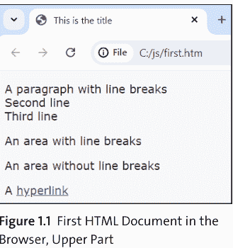

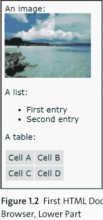

### 1.6.2 HTML 文件

该示例程序包含 HTML 文档的一些基本元素。

HTML 代码如下：

```
<!DOCTYPE html><html lang="en-us">
<head>
  <meta charset="utf-8">
  <title>This is the title</title>
  <link rel="stylesheet" href="js5.css">
</head>
<body>
  <p>
    A paragraph with line breaks
    Second line<br>Third line
  </p>
  An area with line breaks
  <p>An area without line breaks</p>

  <p>A <a href="embed.htm">hyperlink</a></p>
  <p>An image:<br></p>

  <p>A list:</p>
  <ul>
    <li>First entry</li>
    <li>Second entry</li>
  </ul>

  <p>A table:</p>
  <table>
    <tr>
      <td>Cell A</td>
      <td>Cell B</td>
    </tr>
    <tr>
      <td>Cell C</td>
      <td>Cell D</td>
    </tr>
  </table>
</body>
</html>
```

Listing 1.1 first.htm 文件

你使用 `<!DOCTYPE html>` 来指定该文档为 HTML 文档。你越遵循 HTML 文档的标准化定义，页面在所有浏览器中正确显示的概率就越高。

HTML 文档由标记（也称为标签）和文本组成。大多数标签形成一个容器，具有开始标签和结束标签。开始标签可以带有包含值的属性，默认情况下，这些值放在双引号中。

整个文档位于 html 容器中，从开始标签 `<html>` 到结束标签 `</html>`。开始标签 html 具有属性 lang，其值为 en-us，表示文档的文本使用美式英语编写。html 容器包含一个 head 容器（包含关于文档的信息）和一个 body 容器（包含实际的文档内容）。

在 head 容器中，首先找到的是 title 容器，它提供浏览器标题栏的内容。关于文档的元数据也可以在这里找到。在此示例中，你可以看到这是一个使用广泛应用的 8 位 UCS 转换格式（UTF-8）字符集的 HTML 文档（[1.6.3节](Section 1.6.3)），该字符集包含许多特殊字符，例如德语变音符号。

你可以使用 `link` 标签以及 `rel` 和 `href` 属性来引入用于格式化文档的外部 CSS 文件。在此示例中，文件为 `js5.css`，位于与 `first.htm` 文件相同的目录中。CSS 文件将在[1.6.4节](Section 1.6.4)中更详细地解释。

段落存储在 `p` 容器中，段落内的单个换行使用 `<br>` 标签创建。你可以将某些需要不同格式化的区域放在 `div` 容器以及 `span` 容器中。此外，`div` 容器前后会创建换行。

指向另一文档的可点击超链接位于带有 `href` 属性的 `a` 容器中。可以使用 `img` 标签和 `src` 属性嵌入图像。`alt` 属性是验证所必需的；它包含解释性文本，以防图像文件无法加载。

无序列表位于 `ul` 容器中，各个列表项放在 `li` 容器中。

可以使用 `table` 容器创建表格。表格内有单独的行；每一行都使用 `tr` 容器创建。在每一行内部，又有单独的单元格，每个单元格由 `td` 容器构成。

你可以使用 Notepad++ 编辑器创建 `first.htm` 文件，并将其保存在 `C:/js` 目录中（后者是我的偏好）。要在默认浏览器中显示 `htm` 文件（或 `html` 文件），你需要打开 Windows 资源管理器并双击该 `htm` 文件。

如果使用了其他 HTML 标签，它们将在适当的地方进行解释。

### 1.6.3 UTF-8 编码

本书所有 HTML 文档均使用 UTF-8 编码。*UTF-8* 是*8位UCS转换格式*的缩写，*UCS* 代表*通用编码字符集*。UTF-8 是 Unicode 字符最广泛使用的编码。

`head` 容器中指定的编码必须与文件本身的编码一致，这一点很重要。你可以在 Notepad++ 编辑器中将文件的编码更改为 UTF-8，方法如下：**菜单 编码 • 转换为 UTF-8**。完成此操作后，UTF-8 编码将在此菜单中显示为已选中。

你还可以在 Notepad++ 编辑器中为所有新建文件自动选择编码，方法如下：**菜单 设置 • 首选项 • 新建文档 • 编码 • UTF-8**。然后点击 **关闭** 按钮。


 # 1 导言

### 1.6.4 响应式网页设计

在第一个示例中，外部 CSS 文件 *js5.css* 用于格式化文档。它使用了一个*媒体查询*，以简化的方式实现响应式网页设计。这达成了以下目标：

- 文档以统一的方式格式化。
- 如有需要，可以快速且统一地更改所有文档的格式。
- 示例不仅可在 PC 或笔记本电脑上使用，也可在移动设备上使用。

以下是 CSS 文件中使用的代码：

```
body {font-family:Verdana; font-size:11pt; color:#202020;
    background-color:#f8f8f8;}
td   {font-size:11pt; background-color:#e0e0e0; padding:5px;}

@media only screen and (max-width: 992px)
{
    @media only screen and (orientation:landscape)
    {
        body           { font-size:20pt; }
        td             { font-size:20pt; }
        img            { width:240px; height:180px; }
        input          { font-size:20pt; }
        select         { font-size:20pt; }
        input[type=radio]    { width:30px; height:30px; }
        input[type=checkbox] { width:30px; height:30px; }
        input[type=color]    { width:250px; height:30px; }
        input[type=range]    { width:250px; height:30px; }
        textarea       { font-size:20pt; height:80px; }
    }
    @media only screen and (orientation:portrait)
    {
        body           { font-size:32pt; }
        td             { font-size:36pt; }
        img            { width:320px; height:240px; }
        input          { font-size:32pt; }
        select         { font-size:32pt; }
        input[type=radio]    { width:45px; height:45px; }
        input[type=checkbox] { width:45px; height:45px; }
        input[type=color]    { width:250px; height:45px; }
        input[type=range]    { width:250px; height:45px; }
        textarea       { font-size:32pt; height:140px; }
    }
}
```

**代码清单 1.2** js5.css 文件

以下是对 CSS 的简要说明。在[第 8 章](#)中，你可以找到关于此主题的更多信息。

CSS 规范可以应用于其所指格式化的 HTML 标记。花括号中包含一个或多个格式化选项，而这些选项又由一个 CSS 属性和该属性的值组成，二者以冒号分隔，并以分号结束。

在此示例中，为 `body` 标记（即文档的内容）设置了一些格式：

- 通过 `font-family` 使用 Verdana 字体。
- 通过 `font-size` 将字号设置为 11 点。
- 通过 `color` 指定 `#202020` 字体颜色。
- 通过 `background-color` 将背景色设置为 `#f8f8f8`。

可以使用 RGB 值来指定颜色。`#` 字符后跟两位十六进制数字，分别表示红色、绿色和蓝色分量。颜色 `#202020` 对应深灰色，而 `#f8f8f8` 对应非常浅的灰色。

表格单元格（标记 `td`）内的字号单独设置为 11 点。通过使用 `#e0e0e0`，表格单元格的背景色被设置为浅灰色，这使得单元格比文档背景略深。通过使用 `padding` 规格，可以调整元素与其周围元素之间的内部距离。此处，表格单元格文本内容到单元格边缘的距离设置为 5 像素。

用于 PC 或笔记本电脑的 CSS 信息到此结束。

可以使用媒体查询来响应查看文档的设备属性。CSS 规范 `@media` only screen and `(max-width: 992px)` 使得后续花括号内的 CSS 规格执行以下操作：

- 仅引用屏幕上的输出，而非打印机上的输出。
- 适用于最大输出宽度为 992 像素的设备，例如平板电脑和智能手机等移动设备。

然后使用 `orientation` 来区分平板电脑或智能手机当前处于横屏模式还是竖屏模式。

文档中的字号在横屏格式下增加到 20 点，在竖屏格式下增加到 32 点。表格单元格分别放大到 20 点或 36 点。

我的示例程序中的许多图片统一为 160 × 120 像素以简化处理。在横屏格式下，它们被放大到 240 × 180 像素；在竖屏格式下，它们被放大到 320 × 240 像素。

以下 HTML 元素用于设计表单。你将在[第 4 章](#)中了解它们。它们的大小也会根据媒体进行调整。

- 通用输入，单行文本字段（`input`）
- 使用菜单进行选择（`select`）
- 使用单选按钮进行选择（`input type=radio`）
- 复选框（`input type=checkbox`）
- 选择颜色（`input type=color`）
- 在范围内设置数值（`input type=range`）
- 多行文本字段（`textarea`）

## 1.7 一些特殊字符

使用以下程序来输出一些特殊字符。你也可以直接使用键盘输入一些特殊字符，所有特殊字符都可以使用所谓的*实体*来输出。

程序如下：

...

```
<body>
  <p>Some special characters on the keyboard: > & $ @<br>
     also the entity: &gt; &amp; &dollar; &#64;<br>
     Some other special characters: &copy; &reg; &permil;
        &frac14; &frac12; &frac34; &sup2; &sup3; &micro; &pi;<br>
     The &lt; character is only validated as an entity</p>
</body></html>
```

**代码清单 1.3** special_characters.htm 文件

> **注意**
> 
> 在此示例及随后的许多示例中，为节省空间，省略了文档的开头部分。仅当它包含额外信息时才会打印，文档的结尾则以更紧凑的形式呈现。

你可以在第一行中将特殊字符直接插入到文档中，使用 `>`（大于号）、`&`（和号）、`$`（美元）和 `@`（at）键。

大量特殊字符都有对应的实体。实体以 `&` 字符开头，以分号结束：

- 在第二行中，你可以看到 >、&、$ 和 @ 的实体：分别为 &gt;、&amp;、&dollar; 和 &#64;。
- 第三行包含 ©（版权）、®（注册商标）、‰（千分之）、¼（四分之一）、½（二分之一）、¾（四分之三）、²（平方）、³（立方）、µ（微）和 π（圆周率）的实体：分别为 &copy;、&reg;、&permil;、&frac14;、&frac12;、&frac34;、&sup2;、&sup3;、&micro; 和 &pi;。
- 你应该在第四行中使用 &lt; 实体来输出 <（小于）字符；否则，相关文档将无法通过 HTML 文档验证。

在图 1.3 中，你可以在浏览器中看到该文档。

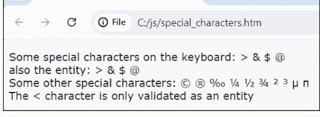

**图 1.3** 一些特殊字符

## 1.8 文档中的 JavaScript

现在，终于该开始第一个 JavaScript 程序了。首先，我想让你看一下以下代码：

```
...
<body>
  <p>Text in HTML</p>
  <script>
    document.write("<p>Text in JavaScript</p>");
  </script>
  <p>Text in HTML</p>
  <script>
    document.write("<p>JavaScript, double quotation marks</p>");
    document.write('<p>JavaScript, single quotation marks</p>');

    document.write("<p>Single quotation marks<span style='font-weight:bold;'>"
      + " inside</span> double quotation marks</p>");
    document.write('<p>Double quotation marks <span style="font-weight:bold;">'
      + ' inside</span> single quotation marks</p>');
  </script>
</body></html>
```

**代码清单 1.4** embed.htm 文件

你可以在 HTML 文档的 `head` 或 `body` 中的任意位置嵌入 JavaScript。每种情况下都需要一个 `script` 容器。该容器以 `<script>` 开头，以 `</script>` 结束。

容器包含按顺序执行的 JavaScript 语句。它们以分号结束。

`document.write()` 调用输出一个字符串。*点*运算符放置在 `document` 对象和 `write()`` 方法之间，这会为 `document` 对象调用 `write()` 方法。我将在[第 3 章](第 3 章)中详细解释*对象*这个术语。

默认情况下，字符串用双引号括起来。字符串可以包含文本和 HTML 标记，但也可以用单引号括起字符串。

同样适用于属性值，正如你可以通过 `style` 属性的值所认识到的。在 HTML 中，默认情况下它们用双引号书写，但也可以用单引号括起属性值。

为了避免在 JavaScript 的字符串内部输出属性值时出现错误，必须组合使用不同的引号。即双引号内使用单引号，或反之亦然。

我使用 `font-weight` CSS 属性和 `bold` 值将部分文本设置为粗体。

> **有用信息**
> 
> - 编程时注意语句的正确写法。与 HTML 不同，浏览器不会原谅 JavaScript 中的错误。
> - JavaScript 区分大小写。使用 `document.Write(...)` 语句不会成功，因为大写 W 的 `Write()` 方法不存在。
> - 你也可以在一行中编写多个语句。主要记住的是每个语句末尾要有分号。

在[图 1.4](图 1.4)中，你可以看到文档的各个部分，其中一些来自 HTML，一些来自 JavaScript。


## 1.9 从外部文件使用 JavaScript

你可以将希望在多个 JavaScript 程序中重复使用的程序部分保存到一个外部文件中。通过将该文件集成到你的程序中，你可以轻松访问此外部文件的代码。

这是一个示例：

```
<body>
  <script src="external_file.js"></script>
  <script>
    document.write("<p>This comes from external.htm</p>");
  </script>
</body></html>
```

**代码清单 1.5** external.htm 文件

第一个 `script` 容器是空的，但其 `src` 属性被设置为 *external_file.js*。这会将相关文件中的代码集成到 *external.htm* 文件中。*external_file.js* 文件只包含以下代码：

```
document.write("<p>This is from external_file.js</p>");
```

**代码清单 1.6** external_file.js 文件

在图 1.5 中，你可以看到由合并程序生成的两个段落，它们使用了 `document.write()` 方法。

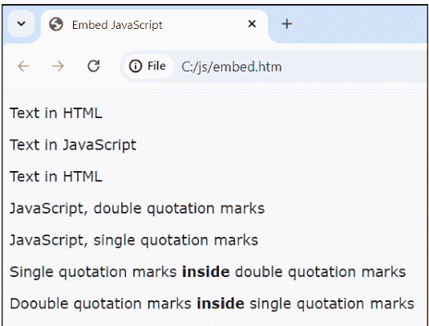

**图 1.4** 文件中的 JavaScript

# 1 引言

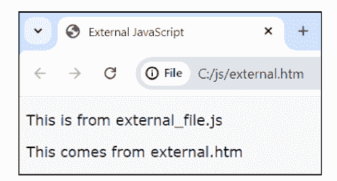

请注意，外部文件中没有 `script` 容器。此文件的名称可以使用任何扩展名，但以 `.js` 结尾已成为一种惯例。jQuery 库（参见第 11 章）以及其他包含众多实用函数的大型 JavaScript 库，都是通过这种方式集成到应用程序中的。

## 1.10 注释

注释用于描述程序的各个部分，它们使你和他人更容易理解这些程序。让我们看一个例子：

```
... 
<body>
    <!-- This is a comment 
         in the HTML section -->
    <p>A paragraph from the HTML section</p>
    <script>
        /* This is a comment across multiple lines 
           in the JavaScript section */
        document.write("<p>A paragraph from the JS section</p>");
        // A short comment, only to the end of the line
    </script>
</body></html>

代码清单 1.7 comment.htm 文件
```

在这个例子中，你可以看到三种不同类型的注释：

- HTML 部分中的注释可以跨越一行或多行。它位于字符串 `<!--` 和 `-->` 之间。
- 在 JavaScript 部分，跨越一行或多行的注释用字符串 `/*` 和 `*/` 包裹。
- 如果你想在 JavaScript 部分写一条简短的注释（例如，在一条语句之后），`//` 字符串是合适的。这种注释仅限于一行。

如你在图 1.6 中所见，注释的内容不会在浏览器中显示。但是，如果需要，任何人都可以在浏览器中查看页面的源代码，因此也可以看到注释。

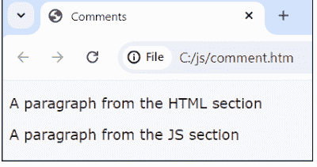

**图 1.6** 注释在浏览器中不可见

> **注意**
在创建程序很久之后，你通常会想查看或扩展它。那时，你会感激在里面发现的每一行注释。出于同样的原因，也强烈建议你编写清晰易读的程序。

## 1.11 可以没有 JavaScript

正如第 1.2 节中已经提到的，可能存在浏览器中 JavaScript 被禁用的情况。由于 JavaScript 无法自行启用，你能做什么呢？

你可以识别它是否已启用。如果未启用，你可以提供纯 HTML 的简单页面版本，或者提示用户需要启用 JavaScript 才能使用该页面。

这是一个例子：

```
...
<body>
    <script>
        document.write("<p>JavaScript is running here</p>");
    </script>
    <noscript>
        <p>JavaScript is not running here<br>
            Please switch it on</p>
    </noscript>
</body></html>
```

**代码清单 1.8** no_script.htm 文件

在 noscript 容器中，你可以在 JavaScript 被禁用时记录文本和 HTML 标记。
如果 JavaScript 已启用，则只有 script 容器中的语句会被执行，页面将呈现为图 1.7 所示的外观。

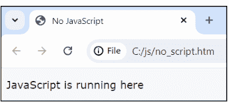

你可以为了测试目的而临时禁用 JavaScript，以下文字将以 Google Chrome 浏览器为例说明必要的步骤。点击右上角的三个点打开菜单，选择**设置**菜单项，并在搜索窗口中输入“JavaScript”。你将在搜索结果中找到**网站设置**。在那里，你会看到 **JavaScript** 区域，默认选项是**网站可以使用 JavaScript**。请选择另一个选项**不允许网站使用 JavaScript**。
然后，当你访问一个包含 JavaScript 的文件时，你会在浏览器地址栏最右侧看到一个图标，提示此页面上的 JavaScript 已被阻止。点击该图标会打开一个对话框。在那里，你可以为*此页面*启用 JavaScript。**管理**按钮也会直接带你到前面提到的用于切换 JavaScript 开启和关闭的选项。
当 JavaScript 被禁用时，*no_script.htm* 页面看起来像图 1.8。

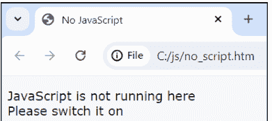

# 第 2 章

## 编程的基本原理

*变量、运算符、分支、循环和函数是你开始编程所需的基本元素。*

在本章中，你将学习 JavaScript 编程的基础知识：变量、运算符、分支、循环和函数。这些元素构成了许多编程语言的基础，将使你更容易在日后进入其他领域。

## 2.1 存储值

文本或数字经常需要在程序序列中保存，它们可能来自程序开发过程中的赋值，也可能来自使用程序时的输入。这些保存的值需要在程序的后续点再次使用。

本节介绍使用*变量*（可以是可变的或不可变的）来存储文本、数字和布尔值。不可变的变量也称为*常量*。在本节中，你还将了解用于简单输入和输出的两个对话框。

在 JavaScript 中，变量没有定义的类型。你可以将一个字符串（即文本）保存在一个变量中，并且如果该变量是可变的，你可以在稍后将同一个变量用于保存一个数字。

### 2.1.1 格式化字符串

文本由单个字符组成，整体上称为*字符串*。存储值需要变量。以下程序包含一些示例：

```
...
<body><p>
   <script>
      let helloText;
      helloText = "Hello world";
      document.write("Text: " + helloText + "<br>");
      helloText = "Good morning";
      document.write("Text: " + helloText + "<br>");
      let text2 = "Declaration and value";
      document.write("Text: " + text2 + "<br>");
      let text3 = 'With single quotation marks';
      document.write("Text: " + text3 + "<br>");
      let text4;
      document.write("Text: " + text4 + "<br>");
      // document.write("Text: " + text5 + "<br>");
      // text5 = "No declaration";
      // document.write("Text: " + text5 + "<br>");
      const text6 = "Cannot be changed";
      document.write("Text: " + text6 + "<br>");
      // text6 = "Not allowed";
      document.write("End");
   </script></p>
</body></html>
```

**代码清单 2.1** strings.htm 文件

*声明*用于为变量的值创建存储空间。此空间可以通过名称访问，命名规则可以在第 2.1.2 节中找到。

在程序开始时，使用 JavaScript 关键字 `let` 声明一个名为 `helloText` 的变量。

声明之后，变量 `helloText` 首先被赋值为 "Hello world"，稍后又被赋值为 "Good morning"。变量的具体值通过 `document.write()` 输出到屏幕上，如图 2.1 所示。

输出可以由多个部分组成。这可以是一个用双引号括起来的字符串（其中也可以包含 HTML 标签），也可以是一个输出其当前值的变量。各个部分使用 + 运算符组合成一个更长的字符串。

使用 `text2` 变量时，声明和赋值被合并在一条语句中。

字符串的值也可以写在单引号之间，如 `text3` 变量所示。

变量 `text4` 被声明了，但在程序代码中没有收到值。因此，它的值是 `undefined`。

36 © 2025 by Rheinwerk Publishing Inc., Boston (MA)


对于尚未声明且尚未赋值的变量，不允许进行读取访问。包含 `text5` 变量的首行程序将导致错误并终止程序，因此该行已被注释掉。

尽管允许对未声明的变量进行写入访问，但这并不推荐，因为变量更容易意外地被修改且更难控制。因此，其他包含 `text5` 变量的程序行也被注释掉了。

如果你想将一个变量标记为不可更改，并同时确保其值在程序的后续过程中不能改变，你应该使用 `const` 关键字而不是 `let`。变量 `text6` 就是这样一个不可更改的变量（即常量）。

为该常量赋一个新值会导致错误并终止程序，因此该行也被注释掉了。

为了测试目的，你可以取消上述某个错误程序行的注释。单词 `End` 的输出会告诉你程序是到达了结尾还是提前终止了。

程序的输出如图 2.1 所示。

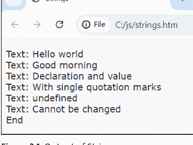

> **注意**
>
> 变量也可以使用 `var` 关键字来声明，但这些变量更容易意外地被修改且更难控制。这对于由大量程序段组成的较长程序来说是一个特别的缺点，因此使用这些变量可能会更快地导致程序错误。相反，你应该始终使用 `let` 和 `const` 关键字，就像本书中的所有示例那样。

### 2.1.2 命名规则

以下是变量命名的一些规则：

- 名称可以由大写和小写字母、数字以及下划线 (_) 组成。
- 名称的开头不能是数字。
- 不允许使用特殊字符，例如德语变音字母 ä、ö、ü、Ä、Ö 和 Ü，ß，或名称中的空格。
- 名称不得与 JavaScript 的关键字之一相同。关键字列表可在附录 A 的 A.2 节中找到。

此外，以下是两个常见的约定：

- 变量的名称应该是不言自明的（即，它应该告诉你一些关于内容的信息）。如果要保存姓氏，你也应该将变量命名为 `familyName`。
- 较长的变量名尤其不言自明。*驼峰命名法* 已成为惯例：名称以小写字母开头，每个新单词以大写字母开头（例如，`buttonStart`、`buttonStop`）。

### 2.1.3 字符串的输入与输出

在本节中，你将学习两种有用的方法：

- `prompt()` 方法，它打开一个对话框并提示你输入文本。
- `alert()` 方法，它打开一个显示消息的对话框。

这两种方法都使用字符串，并会导致程序在执行过程中停止，只有在进行输入或确认消息后，程序才会重新开始运行。这为你提供了交互、请求输入或发起读取输出的机会。

以下是一个示例：

```
...
<body>
    <script>
        const input = prompt("Input:\nPlease make an entry:",
            "Good morning");
        alert("Your input:\n" + input + "\nThank you very much");
    </script>
</body></html>
```

**代码清单 2.2** strings_in_out.htm 文件

一旦你启动程序，就会出现图 2.2 所示的提示。

## 2.1 存储值

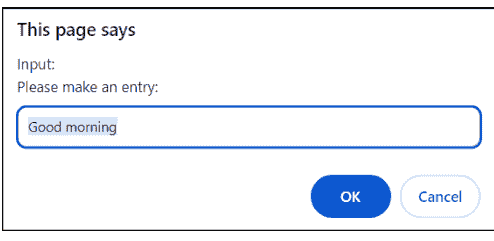

图 2.2 使用 prompt() 进行输入

prompt() 方法使用来自第一个字符串的文本来创建提示，而 \n 控制字符在对话框内创建换行。字母 n 代表换行符。

你可以选择性地为 prompt() 指定第二个字符串，用逗号分隔。这个字符串包含输入字段的可能默认值：在本例中，是文本 Good morning。如果你省略默认设置，输入字段将为空。

单击“确定”按钮后，输入字段的当前内容将被返回并保存在 input 变量中。

null 值表示对“无”的引用。如果你在该对话框中单击“取消”按钮，将返回此值并保存为 null。在 2.3.5 节中，我们将确定单击的是“确定”按钮还是“取消”按钮。

如果你将输入更改为 This is my input，则由于 alert()，将显示如图 2.3 所示的消息。

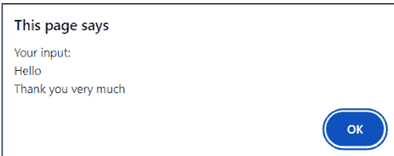

图 2.3 使用 alert() 进行输出

\ n 控制字符也在此对话框中用于创建换行，并且输出使用 + 运算符组合成一个更长的字符串。

> **注意**
>
> 如果一条语句很长，你可以在编辑器中将其写在多行中。你可以在语句内的许多位置实现换行，但不能在关键字中间或字符串内换行。

`alert()` 方法对于故障排除很有用。你可以用它来显示程序中多个点的变量值，如果它们与预期值不匹配，你可以缩小错误原因的位置范围。你将在 2.5 节中了解更多关于此主题的内容。

`prompt()` 和 `alert()` 都是 `window` 对象的方法。因此，你的调用实际上应该是 `window.prompt()` 或 `window.alert()`，但这对于 `window` 对象来说并不是必需的。我将在第 3 章中详细解释 *对象* 这个术语。

> 注意
>
> 你可以在本书的可下载材料 www.rheinwerk-computing.com/5875 的 bonus chapter 1，section 1.1 中找到 `u_input` 练习。

### 2.1.4 存储数字

计算需要数字，数字也存储在可更改或不可更改的变量中。这些数字可能来自程序开发过程中的赋值，也可能来自使用程序时的输入。在此背景下，注意几个特点很重要，如下例所示：

```
...
<body><p>
  <script>
    let number;
    number = 42;
    const anotherNumber = number + 30.8;
    const smallNumber = -3.7e-3;
    const bigNumber = 5.2e6;
    const manyDigits = 3_530_755.383_725;

    document.write("<p>First number: " + number + "<br>");
    document.write("Another number: " + anotherNumber + "<br>");
    document.write("Addition incorrect: " + anotherNumber + 25 + "<br>");
    document.write("Addition correct: " + (anotherNumber + 25) + "<br>");
    document.write("Small number: " + smallNumber + "<br>");
    document.write("Big number: " + bigNumber + "<br>");
    document.write("Many digits: " + manyDigits);
  </script></p>
</body></html>
```

**代码清单 2.3** numbers.htm 文件

首先，使用 `let` 声明一个可更改的变量，并为该变量赋一个数值。

## 2.1 存储值

接下来，使用 `const` 声明一个常量，在语句右侧进行一个计算，并将计算结果赋给该常量。请注意，小数部分必须用小数点表示。我在这些解释中也这样做。

`+` 运算符放在两个数字之间，因此产生的效果（即，两个数字相加）与放在两个文本之间（即，连接两个文本）不同。

程序中有两个值采用 *指数格式*：–3.7 × 10⁻³ = –0.0037 和 5.2 × 10⁶ = 520 万。这种格式特别适用于非常小和非常大的数字，因为它省去了输入许多零的麻烦（以及可能由此产生的错误）。

最后，赋了一个小数点前后都有很多位的数字。ECMAScript 2021 引入了 `_`（下划线）字符作为 *数字分隔符*，它是包含许多位数的数字的输入和阅读辅助工具，已被所有现代浏览器使用。每三位数字后插入下划线是有意义的。

程序的输出如图 2.4 所示。

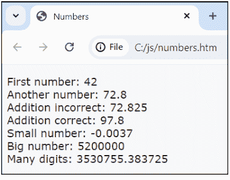

**图 2.4** 数字的输出

让我们看看使用 `document.write()` 输出的程序代码。第一行中，一个字符串使用 `+` 运算符连接到一个数字。这涉及自动类型转换。数字 42 变成了字符串 `"42"`，最终生成字符串 `"First number: 42"`。第二行同理。

这个过程在第三行导致了意想不到的结果。在两个数字类型转换后，三个字符串 `"Addition incorrect: "`、`"72.8"` 和 `"25"` 变成了长字符串 `"Addition incorrect: 72.825"`。如果要先将两个数字相加，则必须使用括号，如下一行所示。只有这样才会显示正确的加法结果。

最后，输出小数、大数字和多位数字。


### 2.1.5 存储真值

真值（也称为*布尔值*）也可以存储在（可变或不可变的）变量中。有两种可能的值：true 和 false。通过这种方式，你可以保存表单中复选框的状态，例如。如果复选框被选中，则复选框的 `checked` 属性（参见第 4 章，第 4.4 节）的值为 true；如果复选框未被选中，则该属性的值为 false。

通过这种方式，可以存储只有两种状态的信息。状态的选项可以是开或关、0 或 1、正确或错误。

下面是一个例子：

```
...
<body>
  <script>
    let saved;
    saved = true;
    const done = false;
    document.write("<p>Saved: " + saved + "<br>");
    document.write("Done: " + done + "</p>");
  </script>
</body></html>
```

**代码清单 2.4** bool.htm 文件

变量 `saved` 被赋值为 true，而常量 `done` 被赋值为 false。然后，它们被输出，如图 2.5 所示。

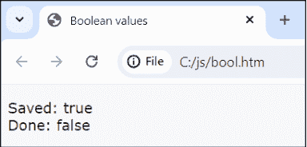

**图 2.5** 真值的输出

## 2.2 执行复杂计算

以下几节将向你展示如何使用变量和数值进行计算。你的程序通过输入数字和输出结果变得具有交互性。

### 2.2.1 计算运算符

除了 `+` 运算符外，还有以下运算符可用于执行计算：`-` 表示减法，`*` 表示乘法，`/` 表示除法，`%` 表示取模（最后一个计算整数除法的余数）。自 ECMAScript 2016 起，还有 `**` 运算符用于指数运算。

以下程序进行一些数学计算：

```
...
```

```
<body><p>
    <script>
        let z;
        z = 2 + 4 - 2.5;       document.write("2 + 4 - 2.5 = " + z + "<br>");
        z = 2 + 4 * 3 - 6 / 2; document.write("2 + 4 * 3 - 6 / 2 = " + z + "<br>");
        z = (2 + 4) * (3 - 6) / 2;
                               document.write("(2 + 4) * (3 - 6) / 2 = " + z + "<br>");
        z = 13.5 % 5;           document.write("13.5 % 5 = " + z + "<br><br>");

        z = 6;                  document.write("z = " + z + "<br>");
        z = -z;                 document.write("z = -z | z = " + z + "<br>");
        z = z * 5;              document.write("z = z * 5 | z = " + z + "<br><br>");

        z = 2.5 ** -3.5;        document.write("2.5 ** -3.5 = " + z + "<br>");
        z = (-2.5) ** -3;       document.write("(-2.5) ** -3 = " + z + "<br>");
        z = (-2) ** -3.5;       document.write("(-2) ** -3.5 = " + z + "<br>");
        z = 4 * 3 ** 2;         document.write("4 * 3 ** 2 = " + z);
    </script></p>
</body></html>
```

**代码清单 2.5** calculation.htm 文件

每次计算后，都会显示计算本身和相应的结果，以便更好地概览。

当然，这里适用数学中的 PEMDAS 规则。这意味着乘法和除法比加法和减法具有更高的优先级，因此先执行。如果多个运算符具有相同的优先级，则从左到右进行计算。你必须设置括号来改变优先级。

首先，计算 **代码清单 2.5** 中第一个代码块的内容：

- 第一个计算从左到右进行，结果为 3.5。

- 在第二个计算中，4 * 3 和 6 / 2 首先被计算。然后才能进行加法或减法运算。结果是 2 + 12 - 3 = 11。

- 在第三个计算中，括号内的内容 (2 + 4) 和 (3 – 6) 首先被计算。然后才能进行其余计算。结果是 6 * –3 / 2 = –9。

- 如果我们将 13.5 除以 5，得到 "2 余 3.5"。取模运算符 `%` 确定余数，即 3.5。

然后是第二个代码块中的计算：

- 与数字一样，你可以在变量前加上减号。这会将变量的值乘以 –1，所以 6 变成 –6，而 –6 变成 6。

- 变量可以出现在赋值运算符的两侧。在最后一个例子中，你可以看到 `z` 的旧值 (–6) 乘以 5 得到 `z` 的新值 (–30)。

第三个代码块涉及指数运算符 `**`，它比乘法和除法具有更高的优先级：

- 第一个计算是 2.5**–3.5。`**` 运算符之前的值称为*基数*，运算符之后的值是*指数*。两者都可以有小数位，指数前可以加负号。

- 如果基数前有负号，则该值必须放在括号中。你可以在第二个例子中看到这一点。

- 第三个例子表明，负数的指数运算在数学上不允许使用带有小数位的负数。这会产生 `NaN` 值，代表 *not a number*（非数字）。

- 在第四个例子中，由于优先级较高，指数运算首先执行，然后执行乘法。结果是 4 * 3**2 = 4 * 9 = 36。

[图 2.6](#figure-2.6) 显示了结果。

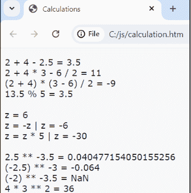

### 2.2.2 复合赋值

你可以通过使用*复合赋值*来简化语句。赋值运算符 `+=`、`++` 和 `--` 经常使用，而赋值运算符 `-=`、`*=`、`/=` 和 `%=` 使用较少。以下示例中使用了所有这些运算符：

```
<body>
    <script>
        let tx;
        tx = "This";          document.write("<p>" + tx + "<br>");
        tx = tx + " is a";    document.write(tx + "<br>");
        tx += " sentence.";  document.write(tx + "</p>");

        let z;
        z = 6;    document.write("<p>" + z + " ");
        z++;      document.write(z + " ");
        z--;      document.write(z + " ");
        z += 13;  document.write(z + " ");
        z -= 5;   document.write(z + " ");
        z *= 3;   document.write(z + " ");
        z /= 6;   document.write(z + " ");
        z %= 3;   document.write(z + "</p>");

        let a = 5, b = 5, c = 5, d;
        d = a++;  document.write("<p>" + d + " ");
        d = ++b;  document.write(d + " ");
        d = c++ + ++c + c++;  document.write(d + "</p>");
    </script>
</body></html>
```

**代码清单 2.6** assignment_combined.htm 文件

首先，一个字符串被赋值并扩展了两次。第二次扩展使用了赋值运算符 `+=`。

然后，一个变量被赋值并多次更改。`++` 运算符将变量的值增加 1，而 `--` 运算符将其减少 1。使用 `z = z + 1` 或 `z = z - 1` 语句可以达到相同的结果。

相应地，`+=` 运算符将变量的值增加后续值，而 `--` 运算符将其减少后续值。因此，`*=`、`/=` 和 `%=` 运算符分别代表以下语句的缩写：`z = z * [value]`、`z = z / [value]` 和 `z = z % [value]`。

你可以将 `++` 和 `--` 运算符放在变量之前（*前缀表示法*）或变量之后（*后缀表示法*）。使用语句 `d = a++;` 时，`d` 接收 `a` 的旧值，然后 `a` 增加。使用语句 `d = ++b;` 时，`b` 首先增加，然后 `d` 接收 `b` 增加后的值。

通过这种方式，你（不幸地）也可以构造出非常令人困惑的表达式，其结果只有在长时间考虑后才能识别出来，正如你在最后一个例子中看到的那样。

你可以在图 2.7 中看到赋值的结果。

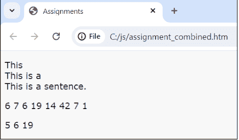

**图 2.7** 赋值运算符

### 2.2.3 输入数字

在本节中，`prompt()` 方法用于输入两个数字，然后应使用 `alert()` 输出这两个数字的和。

`prompt()` 方法返回一个字符串。在第 2.1.4 节中，你已经看到 `+` 运算符对字符串和数字的处理方式不同，因此有必要先将这种输入转换为数字，然后才能用于计算总和。

这是一个示例程序：

...

```
<body>
    <script>
        const input = prompt("Number 1:");
        const z1 = parseFloat(input);
        const z2 = parseFloat(prompt("Number 2:"));
        const result = z1 + z2;
        document.write(z1 + " + " + z2 + " = " + result);
    </script>
</body></html>
```

**代码清单 2.7** numbers_input.htm 文件


## 2.2 执行复杂计算

第一个输入的结果保存在 `input` 变量中。这是一个字符串，使用 `parseFloat()` 函数将字符串转换为浮点数（即带小数点的数字）。转换后，`z1` 变量包含一个数字。

第二个输入的操作类似，只是采用了更简略的形式。`prompt()` 方法返回一个字符串，然后直接对其调用 `parseFloat()` 函数，接着将两个数字相加，并输出整个计算结果。你可以在图 2.8 到图 2.10 中看到示例。

小数点用句点（.）表示。如果使用逗号，则小数部分会丢失。

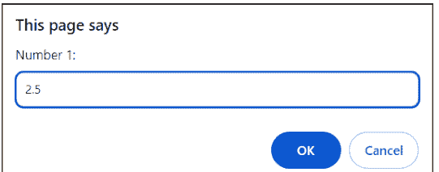

**图 2.8** 输入第一个数字

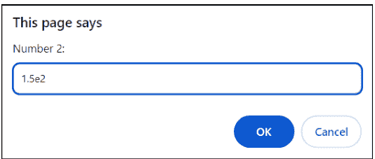

**图 2.9** 输入第二个数字

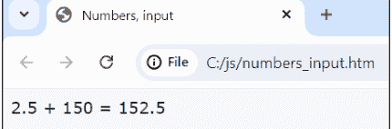

**图 2.10** 输出整个计算结果

> **注意**
在本书可下载资料（位于 www.rheinwerk-computing.com/5875）的附赠章节 2 中，你会找到程序在 regexp_point.htm 文件中的扩展版本。它支持使用逗号作为小数分隔符的数字输入和输出。

数字也可以以指数格式输入。如果输入无法转换为数字（例如 "abc" 或空输入），`parseFloat()` 会返回 `NaN` 结果。在第 2.3.5 节中，我们将确定是否输入了数字。

`parseInt()` 函数的工作方式类似于 `parseFloat()` 函数，它也会截断小数部分并返回整数。因此，字符串 "3.8" 会变成整数 3。

> **注意**
`write()` 方法是针对 `document` 对象调用的，而全局的 `parseFloat()` 和 `parseInt()` 函数不是针对特定对象调用的。

通常，`parseInt()` 将文本解释为十进制数（即基数为 10 的数字）。你可以使用第二个参数指定不同的基数，例如，`parseInt("101", 2)` 的调用结果为十进制值 5，因为文本 "101" 被解释为二进制（即双基数）数。

> **注意**
你会在本书可下载资料（位于 www.rheinwerk-computing.com/5875）的附赠章节 1 的第 1.2 节中找到 `u_number` 练习。

### 2.2.4 数字系统

你通常会使用基数为 10 的十进制数，但你也可以使用 `toString()` 方法将数字输出为字符串，该字符串使用其他数字系统的数字，例如：

- 二进制数（基数为 2）
- 八进制数（基数为 8）
- 十六进制数（基数为 16）

这是一个示例：

```
...
<body><p>
<script>
const z = 27;
document.write("Decimal: " + z + "<br>");
```

```
document.write("Hexadecimal: " + z.toString(16) + "<br>");
document.write("Octal: " + z.toString(8) + "<br>");
document.write("Dual: " + z.toString(2) + "<br>");
```

```
</script></p>
</body></html>
```

**代码清单 2.8** number_systems.htm 文件

程序的输出如图 2.11 所示。

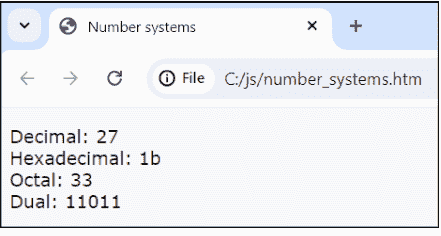

**图 2.11** 数字系统

调用 `toString()` 方法时，会指定所需数字系统的基数。

除了数字 0 到 9，十六进制系统还使用字母 *a* 到 *f*（或 *A* 到 *F*）作为表示 10 到 15 的数字。十六进制数以 `0x` 开头，八进制数以 `0o` 开头，二进制数以 `0b` 开头。数字 `0x1b` 对应以下值：

1 × 16¹ + B × 16⁰ = 1 × 16¹ + 11 × 16⁰ = 16 + 11 = 27

八进制系统仅使用数字 0 到 7，因此数字 `0o33` 对应以下值：

3 × 8¹ + 3 × 8⁰ = 24 + 3 = 27

二进制系统仅使用数字 0 和 1，因此数字 `0b11011` 对应以下值：

1 × 2⁴ + 1 × 2³ + 0 × 2² + 1 × 2¹ + 1 × 2⁰ = 16 + 8 + 2 + 1 = 27

## 2.3 程序中的不同分支

根据某些条件，程序可以运行不同的部分。我们也说程序*分支*。分支是最重要的控制结构之一，在本节中，你将了解不同类型的分支及其效果。

### 2.3.1 使用 if 的分支

分支可以使用 `if` 语句创建。`if` 后跟括号中的条件：

- 如果条件满足，则执行后续的语句或语句块。你可以通过花括号（例如 `{… }`）识别语句块。

- 如果条件不满足，则执行关键字 `else` 之后的语句或语句块（如果有的话）。

条件使用比较运算符形成，它们产生真值。`>` 运算符表示大于，`<` 运算符表示小于，`>=` 表示大于或等于，`<=` 表示小于或等于。你可以使用 `==` 检查相等性，使用 `!=` 检查不等性。

你应该特别注意 `==` 运算符的双等号。一个常见的错误是将 `==` 与 `=` 运算符混淆，这会导致赋值而不是比较。所有比较运算符都可用于数字，但只有最后两个——`==` 和 `!=`——可以用于字符串。

你可以使用三元运算符 `?:` 创建简写的分支，并提供一个可以赋值的值。

下面是一个包含总共六个分支的示例。它们在程序和输出中都已编号，以便更好地查看：

```
...
<body>
  <script>
    const a = 12, b = 7;

    // 1: 单一分支
    if(a > b)
      document.write("<p>1: a 大于 b</p>");

    // 2: 单一分支，带 else
    if(a < b)
      document.write("<p>2: a 小于 b</p>");
    else
      document.write("<p>2: a 不小于 b</p>");

    // 3: 单一分支，语句块中有多个语句
    if(a > b)
    {
      document.write("<p>3: a 大于 b<br>");
      document.write("3: 额外的一行</p>");
    }
```

```
// 4: 多重分支
if(a > b)
  document.write("<p>4: a 大于 b</p>");
else if(a < b)
  document.write("<p>4: a 小于 b</p>");
else
  document.write("<p>4: a 等于 b</p>");

// 5: 字符串
const country = "Spain";
if(country == "Spain")
  document.write("<p>5: 国家是西班牙</p>");
if(country != "Spain")
  document.write("<p>5: 国家不是西班牙</p>");

// 6: 三元运算符
const greater = (a > b) ? a : b;
document.write("<p>6: 较大的数字是 " + greater + "</p>");
</script>
</body></html>
```

**代码清单 2.9** if_else.htm 文件

在分支 1 中，检查条件 `a > b`。对于此处指定的数值，结果为真值 `true`。因此条件满足，为此调用了 `document.write()` 方法。如果 `a` 不大于 `b`，则真值为 `false`，此处没有任何输出，因为没有 `else`。

在分支 2 中总会有输出，因为 `if` 也有一个 `else`。

在分支 3 中执行一个语句块。如果要根据条件执行多个语句，它们必须始终放在花括号中。如果缺少花括号，则仅执行第一条语句（取决于分支）。其他语句随后无论如何都会执行，因为不再识别它们也应属于该分支。

在分支 4 中，所有情况被逐一检查。如果 `a` 不大于 `b`，系统会检查 `a` 是否小于 `b`。如果这也不成立，则 `a` 和 `b` 相等。通过这种多重分支，你也可以区分三种或更多种情况。

在分支 5 中，两个字符串相互比较。

在程序的分支 6 中，使用三元运算符赋值。如果括号中的条件成立，则变量获得问号 `?` 之后的值；否则，变量获得冒号 `:` 之后的值。

程序的输出如图 2.12 所示。


## 2.3.1 使用分支进行选择

JavaScript 中的程序流程默认是线性的，这意味着各个语句会按顺序逐个执行。然而，通常能够根据特定条件在不同选项之间进行选择是很有用的。为此，你可以使用 `if` 和 `else` 关键字。

这是一个简单的示例：

```
...
<body><p>
  <script>
    const a = 12;
    const b = 15;
    if(a > b)
      document.write("a is larger than b");
    else
      document.write("a is not larger than b");
  </script></p>
</body></html>
```

**清单 2.9** if_a.htm 文件

在这个例子中，两个变量 `a` 和 `b` 被赋值。在下一行，程序检查 `a` 是否大于 `b`。如果条件为真，则执行 `if` 之后的语句。如果条件不为真，则执行 `else` 之后的语句。

### 两点提示

-   编写清晰、易读的程序。对于分支结构，你应该在 `if` 和 `else` 之后使用缩进，就像前面的程序那样。
-   不要在 `if` 或 `else` 之后的条件后加分号。因此，它应该*不*像这样：`if(a > b);` 或 `else;`，因为这会导致分支立即结束，后续的语句总是被执行。也可能完全没有任何输出，因为生成的 `else` 没有与之关联的 `if`。这些典型的初学者错误很难检测。

### 注意

你可以在本书的可下载材料中（*www.rheinwerk-computing.com/5875*）的附赠章节 1 的 1.3 节找到 `u_if` 练习。

### 2.3.2 请求确认

`window` 对象的 `confirm()` 方法提供了与分支相关的进一步交互选项。调用该方法后，会出现一个对话框，其中包含一个问题和两个按钮，分别标记为 **确定** 和 **取消**。

这是一个示例：

```
...
<body>
  <script>
    const response = confirm("Do you want to carry out this action?");
    if(response)
      document.write("This action will be carried out");
    else
      document.write("This action will not be carried out");
  </script>
</body></html>
```

**清单 2.10** if_confirm.htm 文件

如果你点击 **确定** 按钮，将返回 `true`。这对于分支来说已经足够了，因为它提供了一个真值。你不需要比较运算符，使用 `if(response == true)` 查询将得到相同的结果。

如果你点击 **取消** 按钮，将返回 `false`，并且将执行 `else` 分支。

在图 2.13 中，你可以看到带有该问题的对话框。

**图 2.13** 使用 "confirm()" 进行确认

### 2.3.3 链接多个条件

如果要链接多个条件，你可以使用逻辑运算符 `&&` 表示逻辑与，或 `||` 表示逻辑或。使用逻辑与时，所有单个条件都必须为真，整个条件才为真。使用逻辑或时，只要有一个条件为真，整个条件就为真。

还有逻辑运算符 `!` 表示逻辑非，它会反转条件的真值。`True` 变成 `false`，`false` 变成 `true`。

这是一个示例：

```
...
<body><p>
  <script>
    const a = 12;

    if(a >= 10 && a <= 20)
      document.write("1: between 10 and 20</br>");
    else
      document.write("1: not between 10 and 20<br>");

    if(a < 10 || a > 20)
      document.write("2: not between 10 and 20<br>");
    else
      document.write("2: between 10 and 20<br>");

    if(!(a >= 10 && a <= 20))
      document.write("3: not between 10 and 20");
    else
      document.write("3: between 10 and 20");
  </script></p>
</body></html>
```

**清单 2.11** if_linked.htm 文件

在第一种情况下，系统检查该数字是否大于或等于 10 *且* 小于或等于 20（即，是否在 10 到 20 的数字范围内）。

第二种情况测试该数字是否小于 10 *或* 大于 20（即，在数字范围之外）。

第三种情况使用 ! 运算符来确定该数字是否*不在* 10 到 20 之间。

在图 2.14 中，你可以看到如果每个案例都检查数值 12 时的各种链接的输出。

**图 2.14** 链接条件

如果在程序中将值 a 设置为 25，输出会是什么？自行思考答案。然后相应地修改程序，并检查你的假设是否正确。当 a = -15 时会发生什么？同样，先通过思考确定结果，然后使用修改后的程序检查你的假设是否正确。

### 两点提示

-   `a >= 10 || a <= 20` 这个条件对于任何数字都成立，而 `a < 10 && a > 20` 这个条件对于任何数字都不成立。你应该避免这些链接。
-   JavaScript 为逻辑运算符定义了所谓的短路*行为*。这对于函数的使用很重要，在 [第 2.6.7 节] 中，你可以看到一个相关的示例。

### 注意

你可以在本书的可下载材料中 [www.rheinwerk-computing.com/5875](http://www.rheinwerk-computing.com/5875) 的附赠章节 1 的 1.4 节找到 `u_linked` 练习。

### 2.3.4 链接和赋值

从 ECMAScript 2021 开始，有两个运算符 `&&=` 和 `||=`，它们将逻辑链接与赋值结合起来。这个很少使用的选项在下面的程序中进行了说明，其中使用了三个真值：

…

```
<body><p>
  <script>
    let a = true, b = true, c = false;
    document.write("a: " + a + ", b: " + b + ", c: " + c + "<br>");
    a &&= b;      document.write("a after a&&=b : " + a + "<br>");
    a &&= c;      document.write("a after a&&=c : " + a + "<br>");
    a ||= c;      document.write("a after a||=c : " + a + "<br>");
    a ||= b;      document.write("a after a||=b : " + a);
  </script></p>
</body></html>
```

**清单 2.12** assignment_linked.htm 文件

每个语句的结果都被分配给变量 `a`。程序的输出如 [图 2.15] 所示。

**图 2.15** 链接和赋值

### 2.3.5 检查数字输入

在本节中，使用多个分支检查输入的数字。在程序过程中，你将熟悉以下有用的函数和方法：

-   `isNaN()` 函数用于确定一个变量是否*不*包含一个有效的数字。
-   `Math.random()` 方法生成一个大于或等于 0 且小于 1 的随机数。
-   `Math.abs()` 方法计算一个数字的绝对值（即，不带符号的数字）。值 −5 变成 +5，值 5 保持为 +5。
-   `random()` 和 `abs()` 方法是 `Math` 对象的方法，你将在第 6 章第 6.3 节中更详细地了解该对象。

这是示例程序：

```
...
<body><p>
  <script>
      const number_random = Math.random();
      const input = prompt("Please enter a number from 0 to 1, without 1");
      const number_input = parseFloat(input);
      const distance = Math.abs(number_random - number_input);

      if(input == null)
          document.write("Cancel");
      else if(input == "")
          document.write("No input");
      else if(isNaN(input))
          document.write("No valid number");
      else if(number_input < 0 || number_input >= 1)
          document.write("No number in the valid range");
      else if(distance < 0.1)
          document.write("You are close");
      else
          document.write("You are far off");

      document.write("<br><br>Random: " + number_random + "<br>");
      document.write("Input: " + input + "<br>");
      document.write("isNaN(): " + isNaN(input) + "<br>");
      document.write("Number: " + number_input + "<br>");
      document.write("Difference: " + (number_random - number_input) + "<br>");
      document.write("Distance: " + distance);
  </script></p>
</body></html>
```

**清单 2.13** if_else_input.htm 文件

在程序的第一部分，生成并保存了一个随机数。由于使用了 `prompt()`，会提示你进行输入，此输入既被保存为字符串，也被保存为数字。

程序的第二部分包含多个分支。如果第一个条件不适用，则检查第二个。如果第二个也不适用，则检查第三个，依此类推。

**取消** 按钮会导致保存值 `null`（另见第 2.1.3 节）。如果不输入任何内容，然后点击 **确定** 按钮，将保存一个空字符串。你可以使用 `==` 运算符查询这两种情况。

`isNaN()` 函数代表 *is not a number*。如果输入不包含有效数字，则该方法返回 `true`；如果包含，则返回 `false`。后续的链接条件检查该数字是否在有效范围内。

然后，计算随机数与输入数字之间的差值。计算此差值的绝对值，如果绝对值小于 0.1，则输入接近实际数字。

为什么实际上必须计算绝对值？如果我们假设随机数是 0.34，输入是 0.3，那么差值是 0.04，你不需要计算绝对值。但是，如果随机数是 0.34，输入是 0.5，那么差值是 –0.16，因此小于 0.1。如果不计算绝对值，这将是“接近”，但事实并非如此。`Math.abs()` 方法计算出 +0.16，这就不再“接近”了。所以应该计算绝对值。

最后，程序输出所有重要的值。图 2.16 和图 2.17 显示了可能的输出。


 ## 2 编程的基本原则

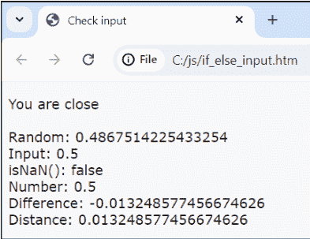

图 2.16 输入带小数点的 0.5 后的输出

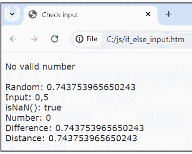

图 2.17 输入带逗号的 0,5 后的输出

> **注意**

`Math.random()`方法适用于模拟或游戏中的多种用途，但不适用于加密。这需要更好的随机数生成器，例如`crypto`对象所提供的（参见[第 6 章，6.3.3 节](#)）。

### 2.3.6 检查值和类型

`===`和`!==`运算符执行的检查比`==`和`!=`运算符更为精确。对于使用`===`的条件，变量的值和该值的类型都必须匹配。因此系统还会检查该值是否为数字、字符串或真值，例如。

在这种情况下，`typeof`运算符也很有趣，因为它可以为你提供某个值或变量的类型。

下面是一个使用这些运算符的程序：

```
... <body><p> <script>
const a = 4711;
const b = "4711";
const c = 4711;
const d = true;

document.write("<p>a: " + a + ", " + typeof a + "<br>");
document.write("b: " + b + ", " + typeof b + "<br>");
document.write("c: " + c + ", " + typeof c + "<br>");
document.write("d: " + d + ", " + typeof d + "<br><br>");

if(a == b)
    document.write("a == b<br>");
if(a === c)
    document.write("a === c<br>");

if(a === b)
    document.write("a === b");
else
    document.write("Not a === b");
</script></p> </body></html>
```

清单 2.14 if_exact.htm 文件

在图 2.18 中，你可以看到程序中使用的四个变量的名称、值以及（多亏 typeof）值的类型。对于数字，typeof 返回标识 number；对于字符串，返回标识 string；对于真值，返回 Boolean。

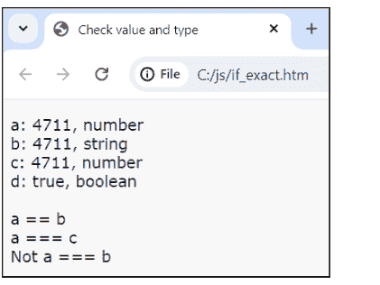

图 2.18 检查值和类型

a、b 和 c 变量都包含值 4711，但在 b 中它是字符串。使用 == 运算符对这些变量进行比较时，所有比较都返回真值。如果使用 === 运算符，则只有在比较 a 和 c 时才成功。

### 2.3.7 运算符的优先级

运算符在 JavaScript 中有不同的优先级。如果在一条语句中使用多个运算符，优先级较高的部分会先被执行。如果优先级相同，则语句从左到右执行。

表 2.1 显示了目前为止使用的运算符按优先级排序的情况。

| 优先级 | 运算符 | 说明 |
|----------|-----------|-------------|
| 1 (最高) | ( ) | 括号 |
| 2 | !, -, ++, -- | 逻辑非、负号、自增、自减 |
| 3 | ** | 指数运算 |
| 4 | *, /, % | 乘法、除法、取模 |
| 5 | +, - | 加法、减法 |
| 6 | <, >, <=, >= | 小于、大于、小于等于、大于等于 |
| 7 | ==, !=, ===, !== | 等于、不等于、带类型比较的等于、带类型比较的不等于 |
| 8 | && | 逻辑与 |
| 9 | \|\| | 逻辑或 |
| 10 (最低) | =, +=, -=, *=, /=, %= | 赋值 |

表 2.1 运算符的优先级

### 2.3.8 使用 switch 分支

switch 关键字提供了另一种创建分支的方式。在某些情况下，使用 switch 的分支比使用 if 的分支更清晰、更易读。

下面是一个示例：

...

```
<body>
  <script>
    const country = prompt("Please enter a country:");
    let city;

    switch(country)
    {
        case "Italy":
          city = "Rome";
          break;
        case "England":
        case "Wales":
        case "Scotland":
          city = "London";
          break;
        default:
          city = "Not known";
    }

    document.write("Capital of the country: " + city);
  </script>
</body></html>
```

清单 2.15 switch.htm 文件

需要输入一个国家名称，输入的文本将被保存然后进行分析。switch 关键字后面跟着括号中的保存文本。

随后是用花括号括起来的代码块。在代码块内，使用 case 关键字区分不同的情况，并自上而下运行检查，确定值是否与其中某个情况匹配。如果匹配，则执行所有后续语句，直到下一个 break 语句为止。

如果输入的是 Italy，则提供 Rome 作为首都，并退出 switch 代码块。

如果输入的是 England，则返回 London 作为首都，因为之后跟着下一个 break 语句。Wales 和 Scotland 同理。因此，使用 switch 可以组合多个情况。

如果没有任何情况适用，可以使用 default 关键字捕获所有剩余情况。然而，与没有 else 的 if 一样，这种情况并非必须存在。

可以使用 switch 分支来检查特定的数字或特定的字符串，但无法指定范围，例如 case < 10 或 case >= 10 && <= 20。

## 2.4 重复程序段

除了分支之外，循环也是重要的控制结构。许多以相同或类似方式重复的过程都可以通过循环高效地编程，利用计算机在短时间内执行大量步骤的能力。

### 2.4.1 使用 for 循环

在以下情况下可以使用 for 循环：

- 你知道程序段应该重复多少次。
- 程序的一部分需要对于从起始值到终值按规律排列的数字序列进行重复。

通常，使用一个称为*循环变量*的变量来控制 for 循环。for 循环的结构分为三个部分：

- 循环变量起始值的语句
- 在整个循环期间必须适用于循环变量的条件
- 循环单次运行后更改循环变量的语句

以下示例展示了五个不同的循环：

```
...
<body>
  <script>
    // 1: 向上递增
    document.write("<p>1: ");
    for(let i=1; i<=5; i++)
      document.write(i + " ");

    // 2: 向下递减
    document.write("<br>2: ");
    for(let i=20; i>=10; i--)
      document.write(i + " ");

    // 3: 使用小数
    document.write("<br>3: ");
    for(let i=3; i<=4; i+=0.2)
      document.write(i + " ");

    // 4: 使用小数，优化
    document.write("<br>4: ");
    for(let i=3; i<=4.1; i+=0.2)
      document.write(i.toFixed(1) + " ");

    // 5: 使用 break 和 continue
    document.write("<br>5: ");
    for(let i=10; i<=50; i++)
    {
      if(i>=16 && i<=24)
        continue;
```

```
      if(i>30)
        break;
      document.write(i + " ");
    }
    document.write("</p>");
  </script>
</body></html>
```

清单 2.16 for.htm 文件

在循环 1 中，循环变量 i 被赋予起始值 1。整个循环的条件如下：只要 i 小于或等于 5，循环就继续运行，每次运行后，使用赋值运算符 ++ 将 i 的值增加 1。这产生了从 1 到 5、步长为 1 的数字序列。起始值、条件和更改之间用分号隔开。

循环 1 中只有一条语句：输出循环变量。在图 2.19 中，你可以看到规律的数字序列。如果循环内需要执行多条语句，则它们必须像分支中一样放在带有花括号的代码块中。

与循环 1 相比，循环 2 是向下运行的。它从 20 开始，只要 i 的值大于或等于 10 就继续运行。每次运行后，i 的值减少 1，由此产生以下数字序列：20, 19, 18, ... 10。

循环的各个部分必须相互协调。`for(let i = 10; i >= 5; i++)`这样的循环会无限运行，而`for(let i = 10; i <= 5; i--)`这样的循环则完全不运行。你应该绝对避免这样的循环。

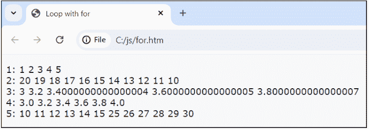

图 2.19 五种不同的 "for" 循环

在循环 3 中，你可以看到循环变量也可以是小数。与整数不同，小数无法用数学精度保存，这就产生了两个问题：

- 输出结果会出现微小且不美观的偏差，如图 2.19 中从值 3.4 开始所示。


 - 该循环没有运行到预期的终点 4。在增加 0.2 后，变量 i 的值刚好超过 4，而由于条件 `i<=4`，将不再达到大于 4 的值。

这两个问题都可以解决，如图 2.19 中的循环 4 所示。首先，在条件中输入一个明显高于最后一个期望值的值。这可以是一个比增量高出半个步长的值，例如。此外，还使用了 `toFixed()` 方法来输出数字。这是 Number 对象的一个方法，你将在第 6 章 6.3 节中了解它。`toFixed()` 方法将一个值四舍五入到指定的小数位数（例如，用于输出）。

循环 5 包含多条语句，这些语句必须放在带有花括号的块中。循环 5 包含 continue 和 break 语句。

continue 语句导致当前循环运行立即结束，并继续下一次运行。这意味着 16 到 24 的值不会输出，如图 2.19 所示。

break 语句导致整个循环立即终止，否则循环将运行到 50。这两条语句通常都用于旨在处理某些特殊情况的分支中。

由于使用 let 声明，循环变量 i 的作用域仅限于各自的循环本身。

> **注意**

如果变量在语句块中使用 `let` 或 `const` 声明，它们只在块内有效。这使得它们更易于控制，也更难意外更改。

> **注意**

你可以在本书的可下载资料中的 bonus 第 1 章 1.5 节找到 u_for 练习，网址为 www.rheinwerk-computing.com/5875。

### 2.4.2 循环与表格

循环可用于轻松创建动态表格。以下是一些示例：

```
<body>
  <script>
    document.write("<table>");
    for(let z=0; z<3; z++)
      document.write("<tr><td>Z" + z + "</td></tr>");
    document.write("</table>");
```

```
document.write("<br>");

document.write("<table><tr>");
for(let s=0; s<3; s++)
    document.write("<td>S" + s + "</td>");
document.write("</tr></table>");
document.write("<br>");

document.write("<table>");
for(let z=0; z<3; z++)
{
    document.write("<tr>");
    for(let s=0; s<5; s++)
        document.write("<td>Z" + z + "/S" + s + "</td>");
    document.write("</tr>");
}
document.write("</table>");
</script>
</body></html>
```

### 清单 2.17 for_table.htm 文件

程序输出如图 2.20 所示。

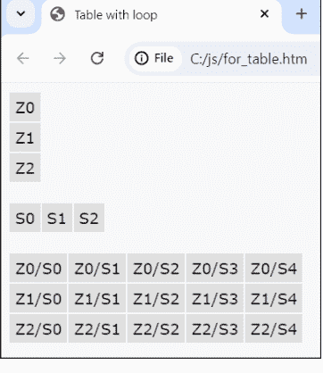

### 图 2.20 多个表格

第一步是创建一个包含三行的表格。每一行包含一个表格单元格，其中显示当前的行号，编号从 0 开始。你经常在字段的上下文中遇到这种编号方式（第 2.4.3 节）。

然后，创建一个包含一行的表格。这一行包含三个表格单元格，每个单元格显示当前的单元格编号。

最后，有一个包含三行五列的表格。每个表格单元格中显示当前行和当前列的编号。

使用了两个嵌套循环，并用不同的变量控制：

- 最初，外层循环的 z 变量值为 0。然后内层循环使用 s 变量和值 0 到 5 总共运行五次，以创建一行的五个单元格。
- 然后，z 接收值 1，再次创建五个单元格，依此类推。

> **注意**

你可以在本书的可下载资料中的 bonus 第 1 章 1.6 节找到 u_table 练习，网址为 www.rheinwerk-computing.com/5875。

### 2.4.3 循环与字段

字段用于记录大量主题相关的数据。它们由单个元素组成，并且可以使用循环快速访问字段的所有元素。我们已经在这一点介绍了第一个简单的字段，你可以在 第 6 章 6.1 节 中了解更多关于字段的信息。

以下是一个示例程序：

```
...
<body>
  <script>
    let person;
    person = [ "Peter", "Monica", "John" ];

    document.write("<table>");
    for(let z=0; z<3; z++)
      document.write("<tr><td>" + person[z] + "</td></tr>");
    document.write("</table>");
    document.write("<br>");

    const age = [ ["Peter", 37], ["Monica", 35], ["John", 32] ];

    document.write("<table>");
    for(let z=0; z<3; z++)
    {
      document.write("<tr>");
      for(let s=0; s<2; s++)
        document.write("<td>" + age[z][s] + "</td>");
      document.write("</tr>");
    }
    document.write("</table>");
</script>
</body></html>
```

### 清单 2.18 for_array.htm 文件

可以使用方括号创建*数组*。在括号内，有字段的各个元素，用逗号分隔。通常，字段的元素在主题上属于同一类，并且类型相同（例如，数字、字符串、真值）。

在赋值后，`person` 变量表示对字段的引用，并且可以使用引用访问字段及其元素。字段的名称是 `person`，你可以更改字段的各个元素，也可以将不同的字段赋值给该变量。

字段的各个元素可以通过其序号来识别：即所谓的*索引*，它指定在字段名称后的方括号中。第一个元素可以通过 `person[0]` 访问，第二个元素通过 `person[1]` 访问，依此类推。索引始终从 0 开始。

这种关系在 `for` 循环中使用，以在表格中输出字段的所有元素。循环变量 `z` 遍历字段的所有索引，对于包含三个元素的字段，这些索引是 0、1 和 2。

你可以在图 2.21 中看到表格的输出。

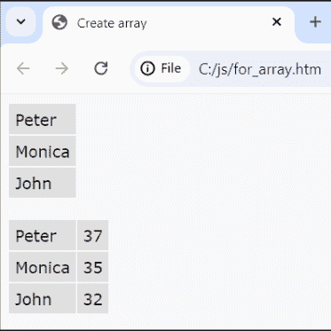

### 图 2.21 循环与字段

字段反过来也可以包含字段作为元素，这允许你创建多维字段。

在这个例子中，关于三个人的每组三个数据都在一个一维字段中。这三个一维字段再次写在方括号内，并用逗号分隔。这样，就生成了一个二维字段，它可以清晰地显示在二维表格中。

无论维度多少，你也可以使用不可变变量作为字段的引用。然而，只有引用是不可变的。你仍然可以更改字段的各个元素，但不能将不同的字段赋值给该变量。

二维字段的各个元素只能通过两个索引来访问，每个索引都包含在方括号中。你可以通过 `age[0][0]` 访问第一个人的姓名，通过 `age[0][1]` 访问该人的年龄，通过 `age[1][0]` 访问第二个人的姓名，依此类推。

这种关系在嵌套 for 循环中使用，以在表格中输出字段的所有元素。循环变量 z 遍历字段行的索引，而循环变量 s 遍历字段列的索引。

你也可以在图 2.21 中看到二维表格的输出。

### 2.4.4 while 循环

while 循环依赖于在循环开始时检查的条件。

在以下示例中，随机数相加在一起，只要数字的总和未达到 4，while 循环就会运行。在程序开发过程中，由于值的随机性，这些值是未知的，因此不知道需要添加多少个数字（即循环将运行多少次）。

以下是程序：

```
...
<body>
    <p><script>
        let sum = 0;
        while(sum < 4)
        {
            sum += Math.random();
            document.write(sum + "<br>");
        }
    </script></p>
</body></html>
```

### 清单 2.19 while.htm 文件


数字之和最初被设置为0，原因有二：

-   在循环开始时，和会与数值4进行比较，而只有所有相关数值都已知时，比较才有意义。
-   在循环内部，和会被赋予一个新值，该值由旧值累加而来。因此，在开始时需要一个旧值为0。

只要和小于4，循环就会持续执行。由于循环包含多条语句，因此必须使用花括号。在循环中，和会增加一个随机值并输出，你可以在图2.22中看到一个可能的输出结果。

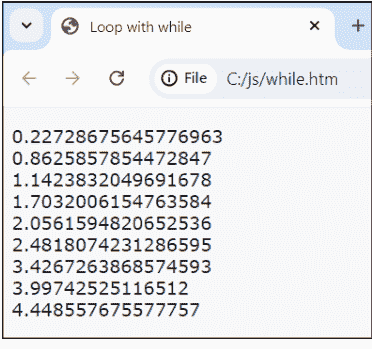

图2.22 用于累加随机数的"while"循环

### 2.4.5 带 do ... while 的循环

带有 `do ... while` 的循环依赖于在循环末尾检查的条件。与 `while` 循环不同，这种循环至少会执行一次。

以下程序包含一个心算任务。要求将两个介于1和20之间的随机数相加，程序会反复提示你，直到输入正确的结果。

与 `while` 循环一样，在程序开发过程中并不知道循环必须执行多少次。然而，至少需要一次尝试，这就是使用 `do ... while` 循环的原因。`do ... while` 循环也称为*读入循环*，因为它通常用于受控地输入一个值：

-   输入至少会被执行一次。
-   如果输入不符合要求，它将被重复执行。

以下是程序：

```
...
<body>
  <p><script>
      const number_random = Math.random() * 20 + 1;
      const a = Math.floor(number_random);
      const b = Math.floor(Math.random() * 20 + 1);
      const sum = a + b;
      let number_input;

      do
      {
        const input = prompt(a + " + " + b + " = ");
        number_input = parseInt(input);
        if(number_input != sum)
          alert("Please try again");
      }
      while(number_input != sum);

      document.write(a + " + " + b + " = " + sum);
    </script></p>
</body></html>
```

> 清单 2.20 do_while.htm 文件

随机数生成器返回一个介于0（含）和1（不含）之间的数字。如果将此数字乘以20，结果是一个从0（含）到20（不含）的数字。如果我们加上1，结果就是一个介于1（含）和21（不含）之间的数字，就像这里的 `number_random` 变量一样。

`Math` 对象的 `floor()` 方法会截断数字的所有小数部分，因此数字3.8会变成数字3。你可以在[第6章，第6.3节](#)中了解更多关于 `Math` 对象的信息。`Math.floor()` 方法首先对 `number_random` 变量调用，然后直接对介于1和20之间的随机数调用，无需中间存储。通过这种方式，可以缩短处理过程。

输入的文本保存在 `number_input` 变量中，然后使用 `parseInt()` 将其转换为整数。接着是一个使用了两次的条件：这个整数是否与正确结果不同？如果是这种情况，则会显示一条消息，并且do...while循环继续运行。

如果输入了正确的结果，则条件不再满足，循环结束，并在文档中再次显示任务和正确结果。

在[图2.23](#)中，你可以看到任务和一个可能的不正确输入。程序对此的响应如[图2.24](#)所示。

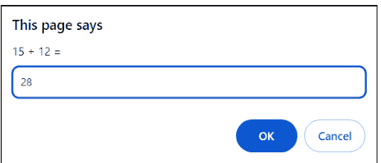

**图 2.23** 任务与不正确输入

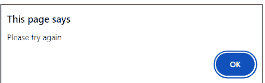

**图 2.24** 程序的响应

## **三个提示**

-   在编程工作开始时，`while` 或 `do ... while` 循环的条件，以及 `for` 循环第二部分中的条件会带来一定的挑战。请记住，这是一个运行条件，而不是终止条件，因此循环不会在条件满足时立即终止。循环会*只要*条件成立就运行。
-   `for` 循环或 `while` 循环的开头后面不能跟分号，因此它*不应该*看起来像 `for(let i = 1; i <= 5; i++);` 或 `while(a > b);`。这将导致循环立即终止，并且后续语句只执行一次。这个错误很难检测到。
-   相比之下，`do ... while` 循环的末尾必须跟一个分号。

## **2.4.6 记忆力训练游戏**

在本节中，我们将开发一个人们可用于训练记忆力的游戏。由于没有添加新的语言元素，如果你想的话，可以跳过本节。然而，看看你到目前为止所学的语言元素在游戏中的相互作用是很有趣的。

以下是游戏规则，这些规则也在浏览器中调用文件后显示：记住即将出现的数字序列，然后输入它们。首先，出现三组三位数字，然后是三组四位数字，依此类推。一旦你输入的数字序列不正确，你就达到了训练的终点，并将获得分数。当你刷新网站时，训练将从头开始。

以下是程序：

```
...
<body>
    <p><script>
        let counter = 0, length = 3, text, input, output = "";

        alert("Memory training:\n\nMemorize the number sequences "
            + "that appear and then enter them. First three sets of "
            + "three digits appear, then three sets of four digits "
            + "and so on. As soon as you have entered a sequence of "
            + "digits incorrectly, you have reached the end of the training "
            + "and will be scored. When you refresh the website, "
            + "the training starts again from the beginning.");

        do
        {
            counter++;
            if(counter>3)
            {
                length++;
                counter = 1
            }

            text = "";
            for(let i=1; i<=length; i++)
                text += Math.floor(Math.random() * 10);
            alert("Sequence of digits: " + text);

            input = prompt("Your input");
            output += text + "<br>";
        }
        while(input == text);

        let quantity = length - 1;
        if(quantity < 3)
            quantity = 0;
        output += "You were able to memorize " + quantity + " digits";
        document.write(output);
```

```
</script></p>
</body></html>
```

清单 2.21 memory.htm 文件

随机数字序列存储在text变量中。length变量包含当前数字序列的长度，counter变量包含它是相同长度的第一、第二还是第三组数字序列的信息。

do … while循环只要输入与数字序列匹配就继续运行。counter的值每次都会增加，如果值超过3，它将被重置为1。同时，length的值会增加，这确保了相同长度的数字序列出现三次。

for循环用于生成当前长度的随机数字序列。该序列被发出，必须被记住，然后必须再次正确输入。

循环结束后（即，在输入不正确之后），结果显示出来。这是一个到那时为止发生的所有数字序列的列表，最后将显示成功记忆并重新输入三次的数字位数。在图2.25中，你可以看到一个你希望能超越的可能结果。

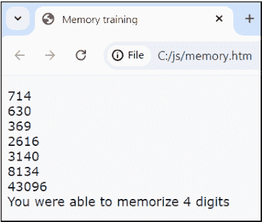

图 2.25 记忆力训练

## 2.5 查找和避免错误

在程序开发过程中，你会犯一些错误。这是正常的，是编写程序日常生活的一部分。更重要的是知道如何快速找到和纠正错误——而更妙的是知道如何避免错误。

这些可能是语法错误（即，不正确或不完整的JavaScript语句的表示法），但也可能是逻辑错误（在这种情况下，你的程序运行完美但没有产生你预期的结果）。


 ## 2.5.1 开发程序

你应该循序渐进。首先，在纸上思考整个程序应该如何构建。按顺序来看，它应该由哪些部分组成？不要试图一次性写出包含所有复杂组件的完整程序。这是你在开始时——或者有时甚至在后期——可能犯的最大错误！

首先，写出程序第一部分的简单版本，然后进行测试。在完成一次成功的测试之前，不要添加后续的程序部分，并且在每次修改后都要重新测试，这样如果发生错误，你就能知道它是由最后一次修改引起的。在最后添加完成后，你将创建出整个程序的简单版本。

现在，将程序的一部分改为更复杂的版本。这样，你会一步步地让程序变得更复杂，直到最终创建出符合你最初在纸上考虑的完整程序。

有时，在实际编程过程中会出现一两个设计上的改动。只要整个结构没有改变，这就不是问题；但如果结构确实发生了变化，那么你应该 briefly 回到你的纸上重新考虑结构。这并不意味着你必须删除之前的程序代码行，但可能的话，你可以稍微修改它们并以不同的方式排列。

清晰地编写你的程序。如果你正在考虑如何能一次性写出程序中的三四个特定步骤，那就把它们变成依次执行的单独语句。这简化了任何故障排除过程，而且如果你（或另一个人）在日后修改或扩展你的程序，将会更快地开始构建程序。

我已经提到了一些与分支和循环有关的典型错误。你有没有关闭所有打开的大括号和小括号？这是一个经典的编程错误，往往导致完全没有任何显示，尤其是在 JavaScript 中。你也已经看到了如何使用 `alert()` 方法来检查值和搜索逻辑错误。

你可以将程序的各个部分放入注释括号中，以确定程序的哪一部分运行无误，哪一部分确实包含错误。

### 2.5.2 使用 onerror 查找错误

查找错误的一种方法是使用 `onerror` 事件。一旦发生某些错误，该事件就会被触发，并调用一个函数，为你提供有关错误的信息。让我们看看下面的例子：

```
. . .
<body><p>
    <script>
```

```
const y = 42;
document.write(x + "<br>");
document.write(y + "<br>");
</script></p>
</body></html>
```

**清单 2.22** onerror.htm 文件，第一版

应该将两个变量的值显示在屏幕上，但 x 变量从未被声明。尝试输出 x 会导致程序中止，这意味着正确声明的 y 变量的值也将不再被输出。屏幕保持空白，原因未知。

所以，让我们现在扩展程序以进行故障排除：

```
... <head> ...
  <script>
    function error_handling(error, file, line)
    {
      alert("Error: " + error + "\nFile: " + file
          + "\nLine: " + line);
    }
  </script>
</head>
<body><p>
  <script>
    onerror = error_handling;
    const y = 42;
    document.write(x + "<br>");
    document.write(y + "<br>");
  </script></p>
</body></html>
```

**清单 2.23** onerror.htm 文件，第二版

2.6 节解释了如何使用你自己的函数来模块化程序，但让我在此简要说明一下。

当发生错误时，`onerror` 事件就会触发，结果，分配给该事件的函数就会被调用。在这个例子中，就是 `error_handling()` 函数。函数通常在文档的头部定义，`error_handling()` 函数会接收到有关已发生错误的信息，你可以使用 `alert()` 将其输出。

我们示例中的消息如图 2.26 所示，它被称为**未捕获引用错误**（**Uncaught ReferenceError**）。如果变量不存在引用（即没有声明的名称），就会发生*引用错误*（*reference error*）。

## 2 编程基本原理

错误可以被*捕获*（*caught*），但这个错误没有被捕获。它发生在 `onerror.htm` 文件的第 18 行，多亏了这条消息，可以找到错误的原因并解决问题。

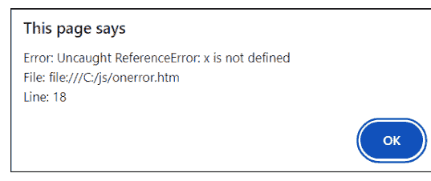

**图 2.26** 错误时的输出

### 2.5.3 使用 try ... catch 进行异常处理

使用 `try ... catch` 进行异常处理可以防止你的程序中止。如果你怀疑由于输入或其他原因，程序的某些部分可能会出现错误，你可以将相关程序部分放入 `try` 块中。

如果确实发生了错误，程序会分支到 `catch` 块，在其中捕获错误。可以在那里显示错误消息，或者运行替代语句以避免错误的后果。

如果没有发生错误，`try` 块中的语句会被正常处理，并且会跳过 `catch` 块。也可能存在一个 `finally` 块，它在任何情况下都会被处理，无论是否发生了错误。即使只有一个语句，也必须始终编写大括号。

下面是一个例子：

```
...
<body><p>
<script>
    const y = 42;

    try
    {
        document.write(x + "<br>");
        document.write(y + "<br>");
    }
    catch(e)
    {
        alert(e);
    }
</script>
</body>
```

```
finally
{
    document.write("This will definitely be done<br>");
}
</script></p>
</body></html>
```

**清单 2.24** try_catch.htm 文件

两个变量的值要在 `try` 块中输出。缺少的 `x` 声明被发现，程序分支到 `catch` 块，有关已发生错误的信息通过错误对象传输。将这样的错误对象指定为 `e`（表示 *error*）已经成为常见做法，你可以使用 `alert()` 输出该对象。

图 2.27 中的输出包含一个**引用错误**（**ReferenceError**）。与之前的程序相比，该错误已被拦截，因此不会出现**未捕获**（**Uncaught**）字样，程序会继续运行。

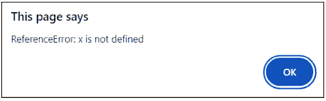

**图 2.27** 使用 try ... catch 捕获错误

### 2.5.4 使用 throw 抛出异常

你也可以通过使用 `throw` 创建自己的错误情况，在其中可以抛出异常。你可以从异常处理流程中受益，该流程确保程序分支到 `catch` 块。

在下面的例子中，要求输入一个大于 0 的数字。应该有两种情况被视为错误：

- 输入不是有效的数字。
- 输入的数字太小。

在这两种情况下，都要显示相应的错误消息。

程序如下：

```
…
<body><p>
    <script>
```

## 2 编程基本原理

```
const number = parseFloat(prompt("Please enter a number > 0"));

try
{
  if(isNaN(number))
    throw "No valid number";
  if(number <= 0)
    throw "Number too small";
  document.write("Number: " + number);
}
catch(errorObject)
{
  alert(errorObject);
}
</script></p>
</body></html>
```

**清单 2.25** throw.htm 文件

如果两种情况之一发生，那么由于分支的存在，它会被识别。`throw` 语句确保程序直接分支到 `catch` 块，同时，一条相关的错误消息被发送到 `catch` 块。该消息被输出，在图 2.28 中，你可以看到如果输入值 -5 时显示的消息。

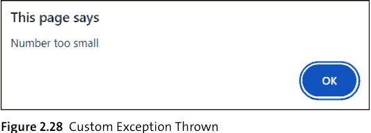

**图 2.28** 抛出自定义异常

### 2.5.5 调试程序

在现代浏览器中，你可以选择调试你的程序。调试帮助你找到逻辑错误，你可以一步一步地运行你的程序，并在任何时间点查看所有变量的值。我们在本节中以 Google Chrome 浏览器为例进行说明。

作为示例，使用了 *chrome_debug.htm* 文件中的一个程序，其中两个数字相加。在图 2.29 中，你可以看到程序的默认输出。

开始调试时，假设浏览器已打开所命名的程序。使用右上角的三点打开浏览器菜单，然后


选择**More tools** • **Developer tools**菜单项。随后，开发者工具会显示出来，它们可能提供许多不同的选项。

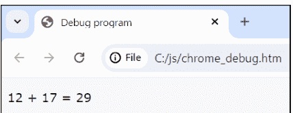

**图 2.29** 程序，正常流程

为了调试，你需要选择屏幕顶部的**Sources**标签页。程序代码会如**图 2.30**所示显示出来，每一行前面都有行号。

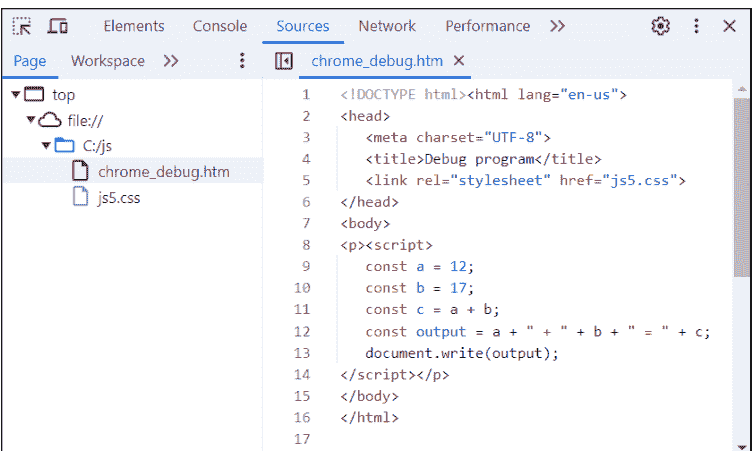

**图 2.30** 带有行号的程序代码

点击其中一个行号后，就会为该行创建一个*断点*（breakpoint）。再次点击则移除断点。在**图 2.31**中，你可以看到在`b`和`output`变量接收其值的行旁边已经创建了断点。

重新加载文档后，程序不会完全执行，而是在第一个断点设置处停止执行之前。此时`a`变量已经被赋值，而其他变量尚未赋值。

# 2 编程基础原理

```
<!DOCTYPE html><html lang="en-us">
<head>
  <meta charset="UTF-8">
  <title>Debug program</title>
  <link rel="stylesheet" href="js5.css">
</head>
<body>
<p><script>
  const a = 12;
  const b = 17;
  const c = a + b;
  const output = a + " + " + b + " = " + c;
  document.write(output);
</script></p>
</body>
</html>
```

图 2.31 两个 breakpoint 已设置

你可以在下面的**Watch**标签页中监控变量的值。要显示变量，请点击带有+号的按钮，输入相应变量的名称，然后按`Enter`。

在图 2.32 中，你可以看到程序停止后的状态，程序中的所有四个变量都已显示。

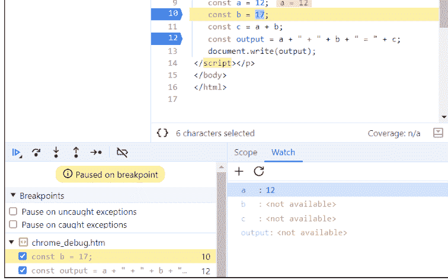

图 2.32 程序在第 10 行之前

你可以通过**Resume Script Execution**按钮继续执行程序，你可以在[图 2.32](#)中**Paused on breakpoint**文本上方左侧看到该按钮。（或者，你可以按`F8`。）使用此按钮可以继续运行程序到下一个断点（如果存在），或者到程序末尾。在[图 2.33](#)中，你可以看到到达第二个断点时的情况。

到目前为止，`b`和`c`变量也已经被赋值，在下次继续后，程序运行到末尾，输出出现。移除断点后，程序再次运行时不会停止。

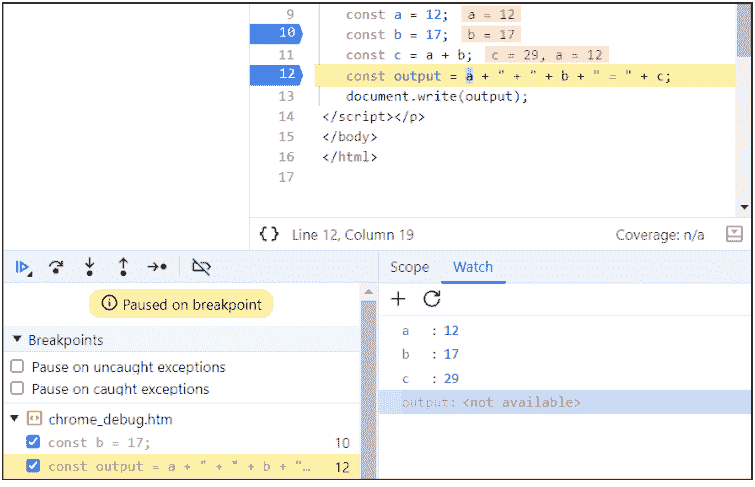

**图 2.33** 程序在第 12 行之前

## 2.6 自定义函数

你可以通过使用自己的函数将程序分解成更小、更易于管理的部分。这个过程称为*模块化*（modularization），模块化的程序比单个大型程序更容易开发和修改。你还可以将某些反复需要的过程提取到函数中。你只需要定义一次，然后就可以随意调用它们（即使用它们）。

*方法*（Methods）是只能与特定对象一起运行的函数；更多内容将在[第 3 章](#)中介绍。你已经享受到了模块化的好处，因为你已经使用了一些预定义的函数和方法。这些是与对象无关的`parseInt()`、`parseFloat()`和`isNaN()`函数，以及`document.write()`和`Math.random()`方法。

### 2.6.1 简单函数

让我们从简单函数开始。在本节中，你将看到一个每次调用时都产生完全相同结果的函数。

以下是示例程序：

```
... <head> ...
  <script>
      function hello()
      {
        document.write("<p>Hello world</p>");
      }
  </script>
</head>
<body>
  <script>
      hello();
      hello();
  </script>
</body></html>
```

**清单 2.26** function_simple.htm 文件

对于函数，需要区分定义和调用。浏览器读取函数的定义后就知道它应该如何工作，只有在调用后才会执行。

函数通常在文档的 head 部分定义。定义以`function`关键字开头，后面跟着函数的名称，名称规则与变量名称相同（第 2.1.2 节）。随后是括号（此处仍无任何内容），然后是一个语句块，始终用花括号括起来。

在此示例中，函数被调用两次，它由函数名称后跟括号（此处仍无任何内容）组成。你可以在程序中随意调用`hello()`函数，每次调用时，程序会*跳转*到函数并执行其内容。

你可以在图 2.34 中看到程序的输出。

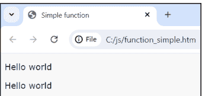

**图 2.34** 两次调用函数

### 2.6.2 提取函数

你可以将频繁需要并在不同程序中使用的函数定义提取到外部文件中。这样，你可以创建自己的函数库。许多有用函数的大型库（如 jQuery 库）就是以这种方式组织的。

在第 1.9 节中，我已经描述了如何集成外部文件。

以下是外部文件中的代码：

```
function greetings()
{
    document.write("<p>Function in external file</p>");
}
```

清单 2.27 external_function.js 文件

函数在外部文件中定义时不使用`script`容器，其后可以跟随其他函数的定义。

以下是使用外部函数的程序：

```
... <head> ...
    <script src="external_function.js"></script>
    <script>
        function hello()
        {
            document.write("<p>Hello world</p>");
        }
    </script>
</head>
<body>
    <script>
        hello();
        greetings();
    </script>
</body></html>
```

清单 2.28 function_external.htm 文件

在第一个`script`容器中，使用`src`属性引用外部文件。

程序的输出如图 2.35 所示。

### 2.6.3 带参数的函数

*参数*（Parameters）表示调用函数时传递给函数的信息。函数处理这些信息并为各种调用生成结果（可能因参数而异）。

你已经使用过参数。`window`对象的`alert()`方法和`document`对象的`write()`方法都是带参数的方法，每个方法都输出作为参数传递给它的字符串。

在下面的程序中，你可以看到一个单独的函数，向它传递两个字符串。该函数从中创建一句话并输出它。

以下是该程序：

```
... <head> ...
  <script>
    function output(country, city)
    {
      document.write("The capital of" + country + " is " + city + "<br>");
    }
  </script>
</head>
<body><p>
  <script>
    const a = "Spain", b = "Madrid";
    output(a, b);
    output("France", "Paris");
  </script></p>
</body></html>
```

**清单 2.29** function_parameters.htm 文件

定义了一个名为`output()`的函数，它有两个名为`country`和`city`的参数，参数之间用逗号分隔。使用两个参数的当前值来组合并输出一句话。

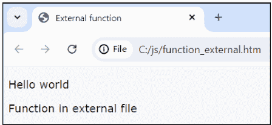

**图 2.35** 提取函数

变量和值都可以传递给函数。`output()`函数被调用两次：第一次使用`a`和`b`变量，第二次使用两个字符串。每次调用时，程序都会跳转到函数，按给定顺序将两个参数传递给`country`和`city`变量，并执行函数的内容。

你可以在图 2.36 中看到程序的输出。

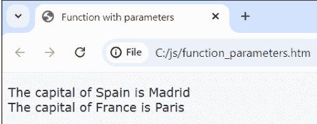

**图 2.36** 带参数的函数

**两个提示**

- 参数可以是字符串、数字或真值。稍后，你还将通过参数传递对象或字段。
- 调用和定义时参数的数量必须匹配。你将在以下章节中找到其他选项。

### 2.6.4 改变参数

你可以在函数内部改变参数。根据参数类型的不同，这种改变会对调用函数时使用的变量产生影响。

简单数据类型的变量（如字符串、数字或真值）是*按值调用*（called by value）的。函数中的变量是一个副本，改变副本不会影响原始值。

非简单数据类型的变量（如字段）是*按引用调用*（called by reference）的。在函数中，该变量代表对原始字段的引用的副本。可以改变原始字段的元素，但如果将不同的字段分配给该变量，此操作不会影响原始字段。对象表现出相同的行为。

以下示例程序说明了这种情况：

```
... <head> ...
<script>
    function output(n, t, d, p)
    {
```


 ## 2 Basic Principles of Programming

```
document.write(n + ", " + t + ", " + d + ", " + p + "<br>");
```

```
}
```

```
function change(n, t, d, p)
{
  n = 4711;
  t = "Hello";
  d = false;

  p[0] = "Brad";
  document.write("In the function, element changed: ");
  document.write(p + "<br>");

  p = ["Sarah", "Phil", "Tim"];
  document.write("In the function, field newly created: ");
  document.write(p + "<br>");
}
```

```
</script>
</head>
<body>
  <p><script>
    const number = 42, tx = "Hello", done = true,
      person = [ "Peter", "Monica", "John" ];
    document.write("Before the call: ");
    output(number, tx, done, person);

    change(number, tx, done, person);
    document.write("After the call: ");
    output(number, tx, done, person);
  </script></p>
</body></html>
```

Listing 2.30 function_parameters_change.htm File

`output()` 函数用于输出四个传递的参数，这些参数在 `change()` 函数中以不同方式被修改。

让我们先看看调用函数的主程序。声明了四个变量，并分别为它们赋值了一个字符串、一个数字、一个布尔值和一个数组。然后将它们两次传递给 `output()` 函数，这样你就可以看到程序开始和结束时的值。在简单输出数组时，列出的元素用逗号分隔。

调用 `change()` 函数时使用相同的变量：

- 变量 `n` 是变量 `number` 的副本，修改 `n` 对 `number` 没有影响。当变量 `tx` 和 `done` 分别传递给 `t` 和 `d` 时，情况也是如此。
- 变量 `p` 是变量 `person` 的副本，这意味着 `p` 引用的是原始的 `person` 数组。对第一个数组元素的修改会被保留，但如果给 `p` 赋予了不同的数组，此操作只会影响 `p`，而不会影响原始的 `person` 数组。

无论变量是可变的还是不可变的，这种行为都适用。

程序输出如图 2.37 所示。

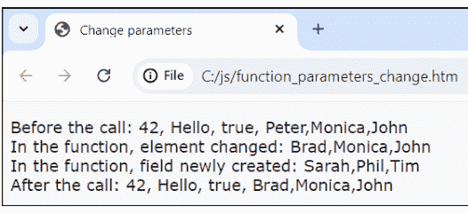

## 2.6.5 Functions with Return Value

不仅可以向函数发送参数，还可以从函数接收结果。这个结果被称为函数的*返回值*，它可以是字符串、数字、布尔值或数组等。你可以直接输出返回值，也可以将其保存起来以便在程序后续使用。

你已经多次使用过函数的返回值。`isNaN()` 方法返回一个布尔值，而 `Math.random()` 方法返回一个随机数。

下面的程序包含一个函数，它需要两个数字作为参数，并返回这两个数字的和：

```
... <head> ...
    <script>
        function sum(a, b)
        {
            const result = a + b;
            return result;
        }
    </script>
</head>
<body>
```

```
<p><script>
    const x = 3, y = 5;
    const z = sum(x, y);
    document.write("Sum: " + z + "<br>");
    document.write("Sum: " + sum(14, 20/4));
</script></p>
</body></html>
```

Listing 2.31 function_return.htm File

`sum()` 函数期望两个参数，在函数内部将它们相加。下一条语句包含 `return` 关键字，它有两个作用：

- 从任何位置返回函数
- 将函数的结果返回到调用它的位置

第一次调用 `sum()` 函数时，将 `x` 和 `y` 的当前值传递给函数。返回的和存储在变量 `z` 中，然后进行输出。

第二次求和是通过调用 `document.write()` 方法来计算和输出的。在调用过程中，再次调用 `sum()` 函数并传递两个数值。返回值直接并入输出中，如图 2.38 所示。

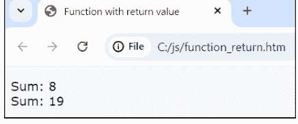

Figure 2.38 Output of Return Value

如果函数在没有 `return` 的情况下结束，或者 `return` 没有带值，那么返回值将是 `undefined`。

> **Note**
> 你可以在本书附带的下载资料中的 bonus chapter 1，第 1.7 节找到 `u_function` 练习，网址为 www.rheinwerk-computing.com/5875。

## 2.6.6 Destructuring Assignment

函数只能提供一个返回值。如果你想使用函数来确定和返回多个值，或者修改多个传递的值，你有两个选择：

- 你可以将值保存在数组中，然后传递或返回该数组。
- 你可以使用本节介绍的*解构赋值*。

在下面的程序中，第二种技术被用于通过函数交换两个值：

```
… <head> …
<script>
    function swap(x, y)
    {
        document.write("After the transfer: " + x + " " + y + "<br>");
        const temp = x;
        x = y;
        y = temp;
        document.write("Before the return: " + x + " " + y + "<br>");
        return [x, y];
    }
</script>
</head>
<body><p>
    <script>
        let a = 7, b = 12;
        document.write("Before the swap: " + a + " " + b + "<br>");
        [a, b] = swap(a, b);
        document.write("After the swap: " + a + " " + b);
    </script></p>
</body></html>
```

**Listing 2.32 function_destructuring.htm File**

让我们先看看 `swap()` 函数的调用。两个要交换值的变量作为参数传递，函数没有单个返回值赋给单个变量。

相反，发生了解构赋值。函数的返回值被传递给多个变量，这些变量被放在方括号内，如同数组一样。如果这些变量尚未声明，可以在方括号前立即进行，例如使用 `const [c, d] = ...`。

<u>图 2.39</u> 中的输出显示，`a` 和 `b` 的两个值已成功互换。

在 `swap()` 函数中，两个参数的名称是 `x` 和 `y`，它们使用第三个变量互相交换。函数返回 `x` 和 `y` 变量，它们像数组一样被括在方括号中。这确保了在调用点 `x` 被传递给 `a`，`y` 被传递给 `b`。

与调用函数时一样，返回值的数量应与预期值的数量相匹配。

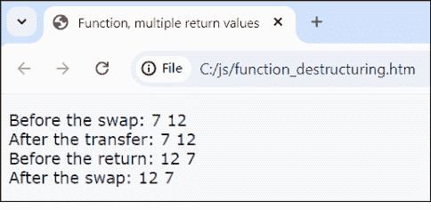

Figure 2.39 Return of Multiple Values

> **Note**
> 你可以在本书附带的下载资料中的 bonus chapter 1，第 1.8 节找到 `u_destructuring` 练习，网址为 www.rheinwerk-computing.com/5875。

## 2.6.7 Evaluation Using Short Circuit

在本节中，我们将了解逻辑运算求值中的*短路*行为：

- 如果使用逻辑 OR 连接两个条件，且第一个条件为 true，则不再检查第二个条件，因为整个条件已经为 true。
- 如果使用逻辑 AND 连接两个条件，且第一个条件为 false，则也不再检查第二个条件，因为整个条件已经为 false。

在此示例中，在逻辑运算中使用返回布尔值的函数。根据第一个函数的返回值，由于短路行为，第二个函数可能不再被调用。

为了理解下面的示例程序，假设我们在一个游戏场上，玩家有从 1 到 10 的允许位置。针对某些位置，应该检查是否存在某些相邻位置。

```
...
<head> ...
<script>
    function leftNeighbor(p)
    {
        document.write("Function leftNeighbor()<br>");
        if(p > 1)
            return true;
```

## 2.6 Custom Functions

```
else
    return false;
}

function rightNeighbor(p)
{
    document.write("Function rightNeighbor()<br>");
    if(p < 10)
        return true;
    else
        return false;
}
</script>
</head>
<body><p>
<script>
    if(leftNeighbor(5) || rightNeighbor(5))
        document.write("At least one neighbor exists<br>");
    else
        document.write("No neighbor exists<br>");
    document.write("<br>");

    if(leftNeighbor(1) && rightNeighbor(1))
        document.write("Both neighbors exist<br>");
    else
        document.write("Not both neighbors exist<br>");
    document.write("<br>");

    if(leftNeighbor(5) && rightNeighbor(5))
        document.write("Both neighbors exist<br>");
    else
        document.write("Not both neighbors exist<br>");
</script></p>
</body></html>
```

Listing 2.33 function_short_circuit.htm File

第一个逻辑运算检查相对于位置 5 是否至少存在一个邻居。由于已经存在左邻居，`rightNeighbor()` 函数不会被调用。

第二个逻辑运算检查相对于位置 1 是否两个邻居都存在。由于左邻居已经不存在，这里 `rightNeighbor()` 函数也不会被调用。


 第三个逻辑操作检查两个邻居是否存在于相对于位置5的关系中。由于存在左邻居，因此也会调用`rightNeighbor()`函数。您可以在[图 2.40](#)中看到操作的输出结果。

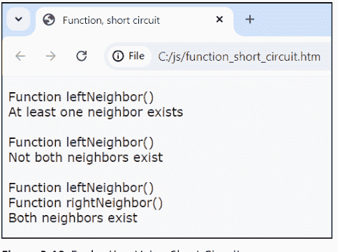

**图 2.40** 使用短路评估

### 2.6.8 任意数量的参数

在标准情况下，调用函数时的参数数量应与预期参数的数量相匹配。您可以使用`arguments`对象来传递任意数量的参数。

以下程序展示了一个期望任意数量参数的函数，该函数返回所有参数的总和：

```
... <head> ...
<script>
    function sum()
    {
        let result = 0;
        for(let i=0; i<arguments.length; i++)
            result += arguments[i];
        return result;
    }
</script>
</head>
<body><p>
<script>
    const x = 12;
    document.write("Sum: " + sum(3 * x, 3.5) + "<br>");
    document.write("Sum: " + sum(-9, 3, x, 5.5) + "<br>");
    document.write("Sum: " + sum());
</script>
</script></p>
</body></html>
```

**代码清单 2.34** function_any.htm 文件

让我们首先看看函数的定义。函数名后面的括号是空的，函数调用的所有传递参数不仅在这些括号中可用，还在`arguments`对象中可用。这个对象类似于数组，您可以通过`arguments[0]`访问第一个参数，通过`arguments[1]`访问第二个参数，依此类推。`length`属性包含参数的数量。

为了计算总和，使用`for`循环遍历所有参数。确定参数的总和并作为函数的返回值返回。

在程序中，您会看到函数的三种不同调用：两个参数的调用，四个参数的调用，以及没有参数的调用。确定并输出参数的总和，不带参数的函数调用应该表明参数的数量确实可以是任意的。

程序的输出显示在**图 2.41**中。

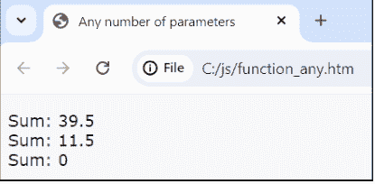

**图 2.41** 任意数量的参数

### 2.6.9 参数的默认值

在定义函数时，您可以在参数列表的末尾为各个参数分配默认值。这为您提供了另一种使用不同数量参数调用函数的选项。

以下是一个示例：

```
... <head> ...
   <script>
      function add(a, b, c = 0, d = 0)
      {
         const sum = a + b + c + d;
         return sum;
      }
   </script>
</head>
<body><p>
  <script>
    document.write("Two numbers: " + add(3, 5) + "<br>");
    document.write("Three numbers: " + add(3, 5, 4) + "<br>");
    document.write("Four numbers: " + add(3, 5, 4, 9));
  </script></p>
</body></html>
```

**代码清单 2.35** function_default.htm 文件

`add()`函数用于将两个、三个或四个值相加。最后两个参数的默认值为0，因此总和不会被扭曲。程序的输出显示在**图 2.42**中。

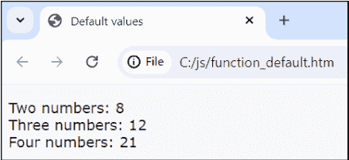

**图 2.42** 带有默认值的函数

### 2.6.10 变量的有效性

使用`let`或`const`声明的变量的有效性取决于声明的位置：

- 如果在花括号块之外声明，则在整个程序中都有效。
- 如果在花括号块内声明，则仅在该块内有效。该块也可以是一个函数，您可以在不同的块中声明多个相同名称的变量。具有更大有效性的同名变量在块内被隐藏。

函数的参数仅在相关函数中有效，您不能在相关函数的顶层声明相同名称的变量。

在以下程序中，您可以看到刚才描述的关系：

```
... <head> ...
  <script>
    function oscar(x)
    {
const a = 52;
const d = 45;
document.write("In a function: a:" + a + ", b:" + b + ", x:" + x + ", d:" + d + "<br>");
if(true)
{
    const a = 62;
    document.write("In a block: a:" + a + ", b:" + b + ", x:" + x + ", d:" + d + "<br>");
}
}
</script>
</head>
<body><p>
<script>
const a = 42;
const b = 43;
const c = 44;
document.write("In the entire program: a:" + a + ", b:" + b + ", c:" + c + "<br>");
oscar(c);
</script></p>
</body></html>
```

**代码清单 2.36** function_validity.htm 文件

`a`、`b`和`c`变量在文档的下半部分声明。它们对整个程序有效，调用`oscar()`函数时传递`c`变量。`oscar()`函数中的`x`变量是`c`的副本，仅在函数内有效。

> **注意**
>
> 您也可以在函数中使用原来的`c`变量，但在函数中应尽可能少地使用适用于整个程序的变量。如果函数需要从外部获取变量，应将其作为参数传递。这样更容易控制，也更难意外更改。

在函数内部声明了另一个名为`a`的变量。它隐藏了上面提到的同名变量，在整个函数中都有效，而`d`变量也在整个函数中有效。

在`if`后面的块中再次声明了名为`a`的变量。这个变量隐藏了上面提到的所有同名变量，在整个`if`块中都有效。

在**图 2.43**中，您可以看到变量及其值。

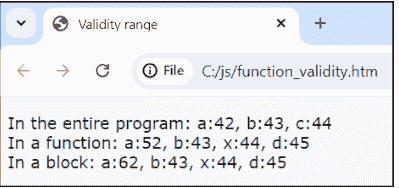

**图 2.43** 变量的有效性

> **注意**
>
> 您应始终在尽可能接近使用位置的地方声明变量（即在函数或块内，且刚好在使用之前）。这样更容易控制，也更难意外更改。

### 2.6.11 递归函数

函数也可以调用其他函数。这个过程称为*嵌套调用*，在每种情况下程序都会返回到调用点。函数还可以调用自身，这个过程称为*递归*。递归函数必须包含终止递归的分支；否则将导致无限循环的自我调用。解决某些问题最优雅的方式就是通过递归。

在以下程序中，一个数字被不断减半，直到达到或低于某个极限值。您可以在**图 2.44**中看到程序的输出结果。

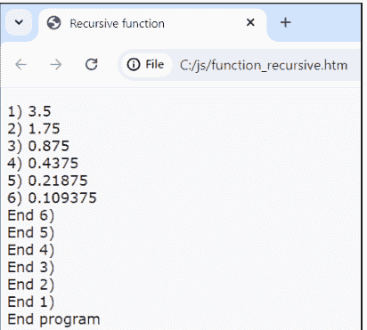

**图 2.44** 递归函数

这是示例程序的代码：

```
<head> ...
<script>
  function halve(value, i)
  {
    document.write(i + ") " + value + "<br>");
    value /= 2;
    i++;
    if(value > 0.1)
      halve(value, i);
    document.write("End " + (i-1) + ")<br>");
  }
</script>
</head>
<body><p>
  <script>
    const value = 3.5, i = 1;
    halve(value, i);
    document.write("End program");
  </script></p>
</body></html>
```

**代码清单 2.37** function_recursive.htm 文件

`halve()`函数以初始值3.5被调用。该值被输出然后减半，如果该值大于极限值0.1，则函数再次调用自身。如果达到或低于极限值，递归结束。这里的`i`变量用作调用次数的计数器。

在这个例子中，在第六次调用时达到递归的终点，函数首次结束。序列返回到第五次运行的末尾，然后到第四次运行的末尾，依此类推，直到第一次运行的末尾。最后，程序的末尾被达到。

您可以在本书中找到更多递归的示例，例如在[第五章，第 5.3 节](#)。

### 2.6.12 匿名函数

到目前为止，我们一直在使用*命名函数*（即具有名称的函数）。然而，也存在*匿名函数*（即没有名称的函数）。它们一开始看起来有点不寻常，但在某些情况下，它们可以显著缩短程序代码。例如，匿名函数用于处理事件（参见[第四章](#)）或使用广泛的 jQuery 库（参见[第十一章](#)）。


此外，你不仅可以使用字段或对象的引用，还可以使用函数的引用。函数的引用可以赋值给变量，也可以作为参数传递。

下面是一个示例程序：

```
... <head> ...
    <script>
        const greeting = function()
        {
            document.write("Hello world<br>");
        }

        const sum = function(a,b)
        {
            const s = a + b;
            return s;
        }

        function oscar(welcome)
        {
            welcome();
        }
    </script>
</head>
<body><p>
    <script>
        greeting();
        oscar(greeting);

        const result = sum(35, 7);
        document.write(result + "<br>");

        const add = sum;
        document.write(add(45, 17) + "<br>");

        document.write((function() { return "Good morning<br>"; })());
        document.write((function(a, b) { return a * b; })(12, 6));
    </script></p>
</body></html>
```

**清单 2.38** function_anonymous.htm 文件

第一个匿名函数输出文本 `Hello world`，它没有参数定义。该函数的引用被赋值给变量 `greeting`。

在第二个匿名函数中，两个传递过来的参数被相加，结果作为返回值返回。该函数的引用被赋值给变量 `sum`。

这两个匿名函数都可以通过变量名后跟括号的方式来调用，就像命名函数一样：`greeting()` 或 `sum(35, 7)`。

你可以将函数的引用传递给另一个函数。这就是调用 `oscar()` 函数时发生的情况。在 `oscar()` 函数内部，`welcome` 名称引用了第一个匿名函数，因此 `welcome()` 调用会产生相同的结果。

引用函数的变量值可以赋值给另一个变量。这里变量 `sum` 被赋值给了变量 `add`，然后你可以通过 `add(...)` 调用来启动第二个匿名函数。

在程序末尾，你可以看到两个没有赋值给任何变量、但被直接调用的匿名函数：

- 第一个函数没有参数，返回文本 "Good morning"。返回的文本通过 `document.write()` 输出。
- 第二个匿名函数有参数 `a` 和 `b`，返回这两个参数的乘积。这里用值 12 和 6 调用它，同样，返回结果通过 `document.write()` 输出。

要调用匿名函数，必须将其整个定义放在括号中。然后是参数括号（如果有的话）。务必注意多层括号的层级。在图 2.45 中，你可以看到程序的运行结果。

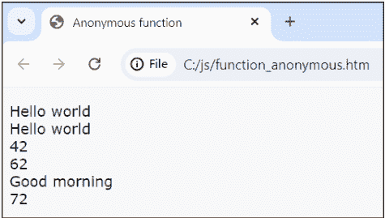

**图 2.45** 匿名函数

### 2.6.13 回调函数

函数的引用可以传递给另一个函数在内部使用。在这种情况下，传递的函数被称为 *callback function*。你可以传递命名函数和匿名函数作为回调函数。回调函数也用于处理事件（见第 4 章）。

在下面的程序中，`output()` 函数被调用两次。它用于输出一组有规律的数值。然后对每个值进行数学计算，结果将显示在数值旁边。

数学计算可以自由选择。它在函数中定义，并在调用 `output()` 函数时将引用传递给该函数：

- 第一次调用传递命名函数 `square()` 的引用，它返回传递值的平方。
- 第二次调用传递一个匿名函数，返回传递值的倒数。

下面是该程序：

```
... <head> ...
   <script>
      function square(x)
      {
         return x * x;
      }

      function output(from, to, step, fct)
      {
         for(let p = from; p < to + step / 2.0; p += step)
            document.write(p + " " + fct(p) + "<br>");
         document.write("<br>");
      }
   </script>
</head>
<body><p>
   <script>
      output(5.0, 15.0, 2.5, square);
      output(3.0, 7.0, 1.0, function(p) { return 1 / p; });
   </script></p>
</body></html>
```

**清单 2.39** function_callback.htm 文件

第一次调用计算从 5 到 15、步长为 2.5 的数字的平方，第二次调用计算从 3 到 7、步长为 1 的数字的倒数。与 2.6.12 节的程序不同，匿名函数不需要放在括号中，因为这里不是调用它。只是传递了函数的引用。

程序的输出如图 2.46 所示。

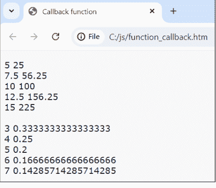

**图 2.46** 回调函数

# 第 3 章

## 自定义对象

在本章中，你将学习如何创建自己的对象，并更好地理解现有对象的结构。

在 JavaScript 中，你以面向对象的方式编程。有一系列预定义的对象：

- 你已经了解了 `window`、`document` 和 `Math` 对象。
- 在第 4 章 4.8 节中，你将使用 `location` 对象。
- 第 6 章描述了其他预定义对象。

但是，你也可以创建自己的对象，这将在本章中介绍。这样可以让你将主题相关的数据捆绑在一起并访问，使你更容易理解和处理众多预定义对象。如果你的应用程序需要特殊选项，可以通过继承来扩展自己的对象和预定义对象。

传统上，JavaScript 使用原型和构造函数来创建自定义对象。自 ECMAScript 2015 标准引入以来，出现了一种新的标准表示法，其中使用了类、构造函数、属性和方法，就像其他面向对象语言一样。所有现代浏览器都使用这种表示法，本书中只使用这种表示法。

*prototype* 一词只会在个别单独的上下文中讨论。

## 3.1 对象与属性

本节介绍如何定义一个名为 `Car` 的类，以及属性 `color` 和 `speed`。首先定义的类将在实际程序中使用，然后创建并输出该类的两个对象。同一类的不同对象相互关联，它们具有相同的属性，但值不同。

下面是该程序：

```
... <head> ...
<script>
class Car
{
  constructor(c, s)
  {
    this.color = c;
    this.speed = s;
  }
}</script>
</head>
<body>
  <p><script>
    const dodge = new Car("Red", 50);
    document.write("Color: " + dodge.color
      + ", Speed: " + dodge.speed + "<br>");

    dodge.speed = 75;
    document.write("Color: " + dodge.color
      + ", Speed: " + dodge.speed + "<br>");

    let renault = new Car("Yellow", 65);
    renault = new Car("Blue", 85);
    document.write("Color: " + renault.color
      + ", Speed: " + renault.speed);
  </script></p>
</body></html>
```

**清单 3.1** obj_property.htm 文件

`class` 关键字引入了类的定义。注意，类名后面不跟括号，这与函数不同。

`constructor` 方法用于创建类的对象。它有固定的名称 `constructor`，其参数对应于类对象的属性。

在构造函数方法中定义了两个属性，每个属性都使用 `this` 关键字、*点运算符* 和名称。这两个属性被赋值为创建 `Car` 类对象时作为参数传递的值。`this` 关键字引用 *此对象*（即当前对象），它确保访问当前对象的属性或为当前对象执行方法。

定义的类在实际程序中使用。不可变的 `dodge` 变量被声明，并使用 `new` 关键字将 `Car` 类的新对象的引用赋值给它。两个值作为两个属性的初始值传递，然后你可以使用点符号访问对象的属性。可以输出或更改值。

然后，声明了 `renault` 变量，并且连续两次将 `Car` 类的对象赋值给该变量。这些对象也具有 `color` 和 `speed` 属性，但对象的属性值不同。

在声明引用对象的变量时，对象的情况与字段相同：如果不可变变量引用一个对象，则只有引用是不可变的。你可以更改对象的各个元素，但不能将另一个对象赋值给该变量。

程序的输出如图 3.1 所示。

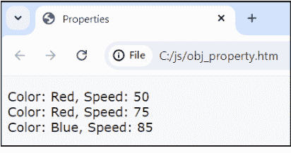

图 3.1 对象与属性

## 3.2 方法

*方法*是只能在其定义的类的对象上调用的函数。例如，`write()` 方法只有在通过点运算符为 `document` 对象调用时才会显示熟悉的行为。方法通常用于更改相关类的对象的属性，而类的属性和方法一起被称为该类的*成员*。

在下面的示例中，扩展了第 3.1 节中的 `Car` 类。定义了 `paint()` 和 `accelerate()` 方法，用于更改 `color` 和 `speed` 属性。此外，还定义了一个名为 `toString()` 的特殊方法；它使得对象可以简单输出，类似于变量的输出。

程序如下：

```
... <head> ...
   <script>
      class Car
      {
         constructor(c, s)
         {
            this.color = c;
            this.speed = s;
         }

         accelerate(value)
         {
             this.speed += value;
        罪this.speed += value;
         }

         paint(c)
         {
             this.color = c;
         }

         toString()
         {
             return "Color: " + this.color
                 + ", speed: " + this.speed;
         }
      }
   </script>
</head>
<body><p>
    <script>
        const dodge = new Car("Red", 50);
        document.write("Color: " + dodge.color
            + ", Speed: " + dodge.speed + "<br>");

        dodge.accelerate(35);
        dodge.paint("Blue");
        document.write(dodge);
    </script></p>
</body></html>
```

**清单 3.2** obj_method.htm 文件

`accelerate()` 方法通过点运算符为 `dodge` 对象调用。该方法需要一个数值，用于更改 `speed` 属性的值，而 `paint()` 方法需要一个表示 `color` 属性新值的字符串。

当调用 `document.write()` 方法时，如果要输出对象本身，则会自动调用特殊的 `toString()` 方法。`toString()` 方法返回一个包含对象所有属性值的字符串（参见**图 3.2**）。

> **注意**
> 你选择的示例模式决定了可用的选项。例如，标准模式提供了更高的灵活性和兼容性，而严格模式则更受限制，但提供更严格的行为。


图 3.2 使用方法

## 3.3 私有成员

在本章前面的程序中，你能够直接从实际程序访问对象的属性和方法。因此，这些程序中的成员是公开可访问的，简称为*公共*成员。

然而，根据面向对象的数据封装原则，对象的属性应尽可能保持受保护。应该只通过方法对这些属性进行受控访问，而且某些仅用于类内部过程的方法也应该受到保护。这种受保护的成员称为*私有成员*。

自 ECMAScript 2022 起，你可以使用井号字符 # 来声明私有成员。以下是一个声明了私有属性和私有方法的示例程序：

```
... <head> ...
  <script>
    class Car
    {
      #color;

      constructor(c, s)
      {
        this.#color = c;
        this.speed = s;
      }

      accelerate(value)
      {
        this.speed += value;
      }

      #paint(c)
      {
         if(c == "Red" || c == "Yellow" || c == "Blue")
             this.#color = c;
      }

      change(c, value)
      {
          this.#paint(c);
          this.accelerate(value);
      }

      toString()
      {
          return "Color: " + this.#color
              + ", speed: " + this.speed;
      }
    }
  </script>
</head>
<body>
<p><script>
    const dodge = new Car("Red", 50);
    document.write(dodge + "<br>");
    // document.write("Color: " + dodge.#color + "<br>");

    改变("Green", 25);
    document.write(dodge + "<br>");
    dodge.change("Blue", 10);
    document.write(dodge + "<br>");
    // dodge.#paint("Yellow");
</script></p>
</body></html>
```

**清单 3.3** obj_private.htm 文件

私有属性在方法外部声明，通常在类定义的开头。这里通过 #color; 语句完成。在类定义内部，使用 this.#color 访问该属性。在类定义外部已无法访问。

要定义私有方法，在方法名称前添加 #，如 #paint(c) ENOT 方法头所示。在类定义内部，使用 this.#paint(...) 访问此方法。在类定义外部已无法访问。

在 `paint()` 方法中，确保只能使用允许的颜色红、黄或蓝。这样，私有属性 `color` 就受到了保护。你可以在图 3.3 中看到程序的结果。


图 3.3 访问私有成员

## 3.4 设置器和获取器

自 ECMA 2022 起，你还可以使用设置器和获取器（所谓的*访问器*）来受控访问属性。*设置器*用于使用 `set` 关键字进行写访问，而*获取器*用于使用 `get` 关键字进行读访问。

以下是一个为私有属性定义访问器的示例程序：

```
... <head> ...
<script>
  class Car
  {
    #speed;

    constructor(c, s)
    {
      this.color = c;
      this.setSpeed = s;
    }

    get getSpeed()
    {
      return this.#speed;
    }

    set setSpeed(s)
    {
      if(s < 0)         s = 0;
      else if(s > 100) s = 100;
      this.#speed = s;
    }

    accelerate(value)
    {
        this.setSpeed = this.getSpeed + value;
    }

    toString()
    {
        return "Color: " + this.color
            + ", Speed: " + this.getSpeed;
    }
  }
</script>
</head>
<body>
    <p><script>
        const dodge = new Car("Red", 150);
        document.write(dodge + "<br>");
        dodge.accelerate(20);
        document.write(dodge + "<br>");
        dodge.accelerate(-120);
        document.write(dodge + "<br>");
        dodge.accelerate(30);
        document.write(dodge + "<br>");
    </script></p>
</body></html>
```

**清单 3.4** obj_accessor.htm 文件

在程序中，私有 speed 属性的值只能通过 accelerate() 方法更改。在该方法中，首先使用 getSpeed 获取器确定 speed 属性的当前值，获取器通过 return 像方法一样返回值。

在赋值运算符的右侧计算 speed 属性的新值。赋值本身会导致调用 setSpeed 设置器，新值作为参数传递，如同方法一样。设置器确保 speed 的新值仅在 0 到 100 的允许范围内，然后将其赋值给私有 speed 属性。

设置器还在类的构造函数中使用，以限制属性的值。程序的输出如图 3.4 所示。


图 3.4 使用访问器进行控制

## 3.5 静态成员

同一类的不同对象通常具有不同的属性值。除了这些与对象相关的属性外，你还可以定义*静态*属性，它们与整个类相关，并且对所有对象具有相同的值。你还可以定义静态方法，它们也引用整个类，并为该类调用。

以下是一个在类中使用 `static` 关键字声明静态属性并定义静态方法的示例程序：

```
... <head> ...
    <script>
        class Car
        {
            static quantity = 0;

            constructor(c, s)
            {
                this.color = c;
                this.speed = s;

                Car.quantity = Car.quantity + 1;
                this.number = Car.quantity;
            }

            toString()
            {
                return "Color: " + this.color + ", Speed: "
                    + this.speed + ", Number: " + this.number;
            }

            static output_quantity()
            {
```


## 3 自定义对象

```
document.write("Quantity: " + Car.quantity + "<br>");
}
}
</script>
</head>
<body>
<p><script>
    const dodge = new Car("Red", 50);
    document.write(dodge + "<br>");
    const renault = new Car("Yellow", 65);
    document.write(renault + "<br>");

    document.write("Quantity: " + Car.quantity + "<br>");

    Car.output_quantity();
</script></p>
</body></html>
```

**清单 3.5** obj_static.htm 文件

静态属性声明在方法外部，通常位于类定义的开头，并赋予初始值。在这里，我们可以在构造函数中对其进行读写访问。

静态 `quantity` 属性用于确定在类中创建的对象数量。它还为与对象相关的 `number` 属性赋予每个对象单独的值，该值代表对象在创建顺序中的序号。

静态 `quantity` 属性必须在方法中以及程序中通过类名（即通过 `Car.quantity`）来访问。

静态 `output_quantity()` 方法输出一行内容，指定对象的数量，并且在程序中或其他方法中必须通过类名（即 `Car.output_quantity()`）来调用该方法。

程序的输出如图 3.5 所示。


**图 3.5** 静态成员的使用

## 3.6 静态块

从 ECMAScript 2022 开始，你可以使用静态块来对类进行一次性初始化。它们通常也位于类定义的开头，并且可以在这样的语句块中定义静态属性。这样的块也可以包含其他要执行的语句。

在下面的程序摘录中，你只会看到与 *obj_static.htm* 程序不同的行：

```
...
<head> ...
  <script>
      class Car
      {
        static
        {
          Car.quantity = 0;
        }

        constructor(c, s)
        { ...
```

**清单 3.6** obj_static_block.htm 文件摘录

静态块使用 `static` 关键字引入。在其中声明的变量是静态的，并且由于变量位于块内，必须通过类名来访问。程序的输出与 *obj_static.htm* 程序的输出一致，如图 3.5 所示。

## 3.7 空引用

在对象的上下文中，一个给定的变量可以引用空值而不是一个对象。当给定的变量被赋值为 `null` 时会出现这种情况，但如果变量应该引用一个在文档中不存在的 DOM 元素（参见第 5 章），也会发生这种情况。

引用空值的变量的值为 `null`，而*空引用*通常会导致程序中止。有两个运算符可以防止这种情况发生：

- *空值合并*运算符 `??`
- *可选点*运算符 `?.`

以下程序展示了使用这些运算符的示例：

```
... <head> ...
  <script>
    class Car
    {
      constructor(c, s)
      {
        this.color = c;
        this.speed = s;
      }

      toString()
      {
        return "Color: " + this.color
            + ", speed: " + this.speed;
      }
    }
  </script>
</head>
<body><p>
  <script>
    let dodge = new Car("Red", 50);
    document.write((dodge ?? "Object does not exist") + "<br>");
    document.write("Color: " + dodge?.color + "<br>");

    dodge = null;
    document.write((dodge ?? "Object does not exist") + "<br>");
    // document.write("Color: " + dodge.color + "<br>");
    document.write("Color: " + dodge?.color + "<br>");
  </script></p>
</body></html>
```

**清单 3.7** obj_null.htm 文件

当你使用空值合并运算符 `??` 时，会检查左操作数。如果其值为 null，则返回右操作数；否则返回左操作数。因此，由于 dodge 变量引用的对象存在，所以会输出该对象。后来在程序中为了演示目的，将该引用赋值为 null，这意味着 dodge 是一个空引用，这导致显示 "Object does not exist" 文本。

点运算符 `.` 用于访问对象的属性和方法。如果对象不存在，程序将中止。因此，程序中的倒数第二条语句被注释掉了。

可选点运算符 `?.` 也用于访问对象的属性和方法。如果对象不存在，将返回 `undefined` 值，程序不会中止。

程序的输出如图 3.6 所示。


**图 3.6** 空引用

## 3.8 对象中的对象

一个类的对象的属性可以是另一个类的对象。为了阐明这种关系，我们希望通过 `Engine` 类的 `drive` 属性来扩展 `Car` 类。

以下是示例程序：

```
... <head> ...
    <script>
        class Engine
        {
            constructor(p, c, f)
            {
                this.power = p;
                this.cylinders = c;
                this.fuel = f;
            }

            tune(x)
            {
                this.power += x;
            }

            toString()
            {
                return "Power: " + this.power + ", Cylinders: "
                    + this.cylinders + ", fuel: " + this.fuel;
            }
    }
}

class Car
{
    constructor(c, s, d)
    {
        this.color = c;
        this.speed = s;
        this.drive = d;
    }

    toString()
    {
        return "Color: " + this.color + ", Speed: "
            + this.speed + ", Drive: " + this.drive;
    }
}
</script>
</head>
<body><p>
    <script>
        const dodge = new Car("Red", 50,
            new Engine(60, 4, "Diesel"));
        dodge.drive.tune(10);
        document.write(dodge + "<br>");

        dodge.drive.power = 80;
        dodge.drive.cylinders = 6;
        dodge.drive.fuel = "Gasoline";
        document.write(dodge);
    </script></p>
</body></html>
```

**清单 3.8** obj_in_object.htm 文件

`Engine` 类的对象具有 `power`、`cylinders` 和 `fuel` 属性。此外，还有用于更改性能的 `tune()` 方法和用于输出三个属性值的 `toString()` 方法。

`drive` 属性已添加到 `Car` 类中，该属性的值也使用 `toString()` 方法进行输出。

在程序中创建了一个 `Car` 类的对象，第三个参数是 `Engine` 类的对象，同样使用 `new` 创建。

`dodge` 对象名称后的第一个点寻址 `Car` 对象的 `drive` 属性，第二个点指向 `Engine` 对象的子属性。调用 `Car` 类的 `toString()` 方法来输出 `Car` 对象，该方法内部通过 `this.drive` 调用 `Engine` 类的同名方法。整个字符串就是这样构建的，如图 3.7 所示。


## 3.9 继承

如果你需要一个类，其属性已经在另一个类中定义过，你可以使用*继承*原则。在这种情况下，你基于基类创建派生类并添加额外的属性。

在下面的示例中，派生的 `Truck` 类基于 `Car` 基类创建。`Truck` 类的对象应该具有额外的 `payload` 属性和额外的 `load()` 方法，并且两个类都有各自对 `toString()` 方法的定义。

以下是程序：

```
... <head> ...
<script>
    class Car
    {
        constructor(c, s)
        {
            this.color = c;
            this.speed = s;
        }

        accelerate(value)
        {
            this.speed += value;
        }

        toString()
        {
            ... // this part of the code is not visible
        }
    }
```

 ## 3 自定义对象

```
{
    return "Color: " + this.color
        + ", Speed: " + this.speed;
}

class Truck extends Car
{
    constructor(c, s, p)
    {
        super(c, s);
        this.payload = p;
    }

    load(value)
    {
        this.payload += value;
    }

    toString()
    {
        return super.toString() + ", Payload: " + this.payload;
    }
}
</script>
</head>
<body><p>
<script>
    const kenworth = new Truck("Orange", 30, 15);
    document.write(kenworth + "<br>");

    kenworth.accelerate(50);
    kenworth.load(25);
    document.write(kenworth);
</script></p>
</body></html>
```

 kenworth 对象的输出结果

`Car` 基类的构造函数需要两个参数，分别用于初始化 `color` 和 `speed` 属性的初始值。`Truck` 派生类的构造函数需要三个参数，其中两个用于 `Car` 基类的 `color` 和 `speed` 属性的初始值，另一个用于 `Truck` 派生类自身的 `payload` 属性。

在构造函数内部，`super()` 方法调用基类的特定构造函数，通过这种方式，前两个参数被传递给基类的构造函数。第三个参数被赋值给 `payload` 属性，这样 `Truck` 类对象的所有属性就都被赋予了初始值。

还有 `super` 引用（不带括号），用于访问基类的属性和方法。在 `Truck` 派生类的 `toString()` 方法中，调用了 `Car` 基类中同名方法：`super.toString()`。

该程序创建并输出了一个具有三个初始值的 `Truck` 类对象。然后通过调用基类的 `accelerate()` 方法和派生类的 `load()` 方法对其进行修改，然后再次输出，如图 3.8 所示。


> **注意**
关于继承主题，你可以在本书附赠资料的 bonus chapter 1，第 1.10 节中找到 `u_inheritance` 练习，下载地址为 `www.rheinwerk-publishing.com/5875`。

## 3.10 对象的操作

在本节中，你将看到一个示例程序，其中对类、类的属性和方法以及类的某些对象执行了一些有用的操作和检查。该类的定义位于文档的 `head` 部分，如下所示：

```
... <head> ...
<script>
    class Car
    {
        constructor(c, s)
        {
            this.color = c;
            this.speed = s;
        }
```

```
accelerate(value)
{
    this.speed += value;
}

paint(c)
{
    this.color = c;
}

toString()
{
    return "Color: " + this.color
        + ", Speed: " + this.speed;
}
    }
</script>
</head>
```

 obj_operation.htm 文件，第 1 部分（共 8 部分）

### 3.10.1 访问运算符

访问对象的属性有两种方式。首先，你可以使用点运算符 `.`；其次，你可以使用方括号 `[ ]`。你可以在以下程序部分中看到这一点：

```
<body><p>
  <script>
    const dodge = new Car("Red", 50);
    document.write("Notation with dot: " + dodge.color + " "
      + dodge.speed + "<br>");
    document.write("Notation with [ and ]: " + dodge["color"]
      + " " + dodge["speed"] + "<br>");
    document.write("Notation with toString(): "
      + dodge + "<br><br>");
```

 obj_operation.htm 文件，第 2 部分（共 8 部分）

对象创建后，其属性被多次输出。在方括号内，属性名像字符串一样用双引号括起来。你可以将字符串由各个部分组成，也可以使用变量，这种表示方式使程序创建更加灵活。你可以在图 3.9 中看到输出结果。


图 3.9 访问方式与比较

### 3.10.2 创建和比较对象引用

如果你将一个引用对象的变量赋值给另一个变量，你并没有创建一个新对象或原始对象的副本，而只是创建了指向同一对象的第二个引用。然后，你可以通过两个变量访问同一对象（另见图 3.9）。

两个比较运算符 `==` 和 `!=` 可用于检查两个变量是否引用同一对象。

在以下程序部分中，变量以如下方式进行比较：

- 首先，有两个变量引用同一对象。
- 其次，有两个变量引用两个具有相同属性和属性值的不同对象。

```
const renault = dodge;
document.write("Second reference: " + renault + "<br>");
if(renault == dodge)
    document.write("Same object<br>");
const simca = new Car("Red", 50);
if(simca != dodge)
    document.write("Not the same object<br><br>");
```

 obj_operation.htm 文件，第 3 部分（共 8 部分）

你也可以在图 3.9 中看到此输出。

关于对象的复制，请参阅第 3.11 节。

### 3.10.3 检查实例

类的对象被称为类的*实例*，创建对象的过程称为*实例化*。`instanceof` 运算符检查一个对象是否表示特定类（或其基类）的实例：

```
if(dodge instanceof Car)
  document.write("instanceof:<br>Object is an instance of the class<br><br>");
```

**清单 3.13** obj_operation.htm 文件，第 4 部分（共 8 部分）

你可以在[图 3.10](#)中看到输出结果。

instanceof:
Object is an instance of the class

typeof:
Car: function
dodge: object
color: string
speed: number
accelerate: function
paint: function

**图 3.10** instanceof 和 typeof 运算符

### 3.10.4 确定类型

`typeof` 运算符返回变量的类型（另见[第 2 章，第 2.3.6 节](#)），类的方法具有 *function* 类型，类的对象具有 *object* 类型。JavaScript 中的类基于原型和构造函数，因此，类本身也具有 function 类型，如下所示：

```
document.write("typeof:<br>"
  + "Car: " + typeof Car + "<br>"
  + "dodge: " + typeof dodge + "<br>"
  + "color: " + typeof dodge.color + "<br>"
  + "speed: " + typeof dodge.speed + "<br>"
  + "accelerate: " + typeof dodge.accelerate + "<br>"
  + "paint: " + typeof dodge.paint + "<br><br>");
```

**清单 3.14** obj_operation.htm 文件，第 5 部分（共 8 部分）

在[图 3.10](#)中，你可以看到 `Car` 类以及 `accelerate()` 和 `paint()` 方法具有 function 类型，而 `dodge` 对象具有 object 类型。两个属性是 *string* 或 *number* 类型的简单变量。

### 3.10.5 检查成员

你可以使用 `in` 运算符来检查一个类是否具有特定成员（即特定属性或方法）：

```
document.write("in:<br>");
if("color" in dodge)
  document.write("color is member<br>");
if("accelerate" in dodge)
  document.write("accelerate is member<br>");
if("paint" in dodge)
  document.write("paint is member<br>");
if(!("power" in dodge))
  document.write("power is no member<br><br>");
```

**清单 3.15** obj_operation.htm 文件，第 6 部分（共 8 部分）

检查结果显示，`color`、`accelerate` 和 `paint` 字符串是 `dodge` 对象所属类的成员，但 `power` 不是，如图 3.11 所示。


**图 3.11** in 运算符、对象与函数

### 3.10.6 对象与函数

你可以将一个表示对象引用的变量作为参数传递给函数。在函数内部，你可以修改该对象或调用对象的方法，你也可以将表示对象引用的变量作为返回值从函数返回，并将其赋值给另一个变量：

```
function change(x)
{
  x.accelerate(10);
  return x;
}
const lada = change(dodge);
document.write(lada + "<br><br>");
```

**清单 3.16** obj_operation.htm 文件，第 7 部分（共 8 部分）


 dodge 变量、x 参数和 lada 变量引用同一个对象。你也可以在[图 3.11](#)中查看输出。

### 3.10.7 删除属性

你可以使用 `delete` 操作符删除对象的单个属性。同一类的其他对象的属性不会因此受到影响，但这个过程有一个副作用，即对象不再相似。

最后，这是程序的最后一部分：

```
delete dodge.speed;
document.write("Values of members:<br>"
    + "color: " + dodge.color + "<br>"
    + "speed: " + dodge.speed + "<br>"
    + "paint: " + dodge.paint + "<br>"
    + "power: " + dodge.power);
</script></p>
</body></html>
```

**清单 3.17** obj_operation.htm 文件，第 8 部分（共 8 部分）

`speed` 属性被删除，之后输出 `color`、`speed`、`paint` 和 `power` 属性的值。`speed` 属性不再存在，而 `power` 属性从未存在过。你可以在[图 3.12](#)中查看生成的输出。


**图 3.12** 删除过程后的属性值

## 3.11 复制对象

要复制对象，仅创建引用对象的变量的副本是不够的（另见[第 3.10.2 节](#)）。相反，必须创建一个新对象，并将其属性赋值为原始对象的值。

下面程序中的类包含用于复制该类对象的方法：

```
... <head> ...
<script>
    class Car
    {
        constructor(c, s)
        {
            this.color = c;
            this.speed = s;
        }

        accelerate(value)
        {
            this.speed += value;
        }

        toString()
        {
            return "Color: " + this.color
                + ", Speed: " + this.speed;
        }

        copy()
        {
            const c = new Car(this.color, this.speed);
            return c;
        }
    </script>
</head>
<body><p>
    <script>
        const dodge = new Car("Red", 50);
        document.write(dodge + "<br>");
        
        const renault = dodge.copy();
        
        dodge.accelerate(25);
        document.write(dodge + "<br>");
        document.write(renault + "<br>");
    </script></p>
</body></html>
```

**清单 3.18** obj_copy_flat.htm 文件

在 `copy()` 方法中创建了一个 `Car` 类的新对象，并将当前对象的两个属性的值传递给构造函数。这意味着新对象是当前对象的副本。`copy()` 方法返回对该新对象的引用。

## 3 自定义对象

在程序中为 dodge 对象调用 `copy()` 方法，该方法的结果（即对新对象的引用）被赋给 renault 变量。随后就有两个属性可以具有不同值的对象可用。

程序的输出如[图 3.13](#)所示。


**图 3.13** 原始对象与副本

由于前面示例中类的属性具有简单的数据类型，如字符串、数字或布尔值，因此可以使用简单的赋值来复制它们。在这种情况下，所谓的浅拷贝就足够了。

但是，如果属性具有非简单的数据类型，如数组或对象，则必须进行所谓的深拷贝。进行深拷贝涉及将数组的所有元素的值复制到新数组，或将对象的所有属性的值复制到新对象。

接下来使用你已经在第 3.9 节中了解过的 Car 和 Engine 类，Car 类的 drive 属性是 Engine 类的对象。以下是程序摘录，其中使用总共两个复制方法来复制 Car 类的对象：

```
... <head> ...
    <script>
        class Engine
        {
            constructor(p, c, f)
            {
                this.power = p;
                this.cylinders = c;
                this.fuel = f;
            }

            tune(x)
            {
                this.power += x;
            }
```

## 3.11 复制对象

```
            toString()
            {
                return "Power: " + this.power + ", Cylinders: "
                    + this.cylinders + ", Fuel: " + this.fuel;
            }

            copy()
            {
                const e = new Engine(this.power, this.cylinders, this.fuel);
                return e;
            }
        }

        class Car
        {
            constructor(c, s, d)
            {
                this.color = c;
                this.speed = s;
                this.drive = d;
            }

            toString()
            {
                return "Color: " + this.color + ", Speed: "
                    + this.speed + ", Drive: " + this.drive;
            }

            copy()
            {
                const c = new Car(this.color,
                    this.speed, this.drive.copy());
                return c;
            }
        }
    </script>
</head>
<body><p>
    <script>
        const dodge = new Car("Red", 50, new Engine(60, 4, "Diesel"));
        document.write(dodge + "<br>");

        const renault = dodge.copy();
```

## 3 自定义对象

```
        dodge.drive.tune(15);
        document.write(dodge + "<br>");
        document.write(renault + "<br>");
    </script></p>
</body></html>
```

**清单 3.19** obj_copy_deep.htm 文件摘录

当复制 `Car` 类的对象时，会调用该类的 `copy()` 方法。这会创建一个 `Car` 类的新对象，并将原始对象的 `color` 和 `speed` 属性的值赋值给它。

对于第三个属性（`drive`），过程稍微复杂一些。首先，针对该属性调用 `Engine` 类的 `copy()` 方法，这会创建一个 `Engine` 类的新对象。将原始 `Engine` 类对象的三个属性的值赋值给它，然后将指向新创建对象的引用返回给 `Car` 类的 `copy()` 方法，并将其赋给 `Car` 类的 `drive` 属性。

你可以在[图 3.14](#)中查看程序的结果。


**图 3.14** 原始对象与深拷贝

## 第 4 章

## 表单与事件

在本章中，你将学习如何检查表单和处理事件。

表单可以实现与你习惯的其他计算机应用程序类似的交互。你可以进行输入并触发处理，然后程序返回结果。

表单还用于向 Web 服务器传输数据。在发送之前，JavaScript 可以检查其内容的有效性。这样可以避免不必要的网络流量。

JavaScript 还允许你编写能够响应浏览器中*事件*的程序。通过这种方式，你可以超越 `prompt()` 和 `confirm()` 函数的简单返回值，与你的程序进行交互。这些事件可以包括按钮点击、从列表中选择条目、使用鼠标的特定操作、提交表单等等。

如果你想让程序响应事件，你需要开发 JavaScript 程序代码，包含事件发生时必须执行的语句。使用*事件处理程序*来处理事件；它在文档中触发事件的部分、事件本身和 JavaScript 程序代码之间建立联系。

## 4.1 第一个表单和第一个事件

在本节中，你将了解一些处理事件所需的典型元素。

以下示例显示了一个带有输入字段**输入**和**点击**按钮的表单。在输入字段中输入文本后，你必须点击按钮（见[图 4.1](#)），然后会出现一个带有信息的对话框（见[图 4.2](#)）。

## 4 表单与事件


**图 4.1** 带输入字段和按钮的表单


**图 4.2** 对事件的响应

你也可以使用输入字段在已经完全映射的文档中输出信息。在示例中，**输出**字段中出现的信息与对话框中的相同（见[图 4.3](#)）。你可以使用 `disabled` 属性确保无法在此字段中进行输入。


**图 4.3** 输出字段

这是程序：

```
... <head> ...
    <script>
        function clicked()
        {
            const inputField = document.getElementById("idInput");


 ```
const input = inputField.value;
alert("Click: " + input);
const outputField = document.getElementById("idOutput");
outputField.value = "Click: " + input;
}
</script>
</head>
<body>
<form>
<p><input id="idInput"> Input</p>
<p><input id="idButton" type="button" value="Click"></p>
<p><input id="idOutput" disabled> Output</p>
</form>
<script>
const bu = document.getElementById("idButton");
bu.addEventListener("click", clicked);
</script>
</body></html>
```

## 清单 4.1 form_click.htm 文件

表单的元素位于 `form` 容器中，`input` 类型的简单元素对应单行输入字段。如果为 `input` 元素的 `type` 属性指定 `button` 值，则会显示一个按钮，而 `value` 属性的值对应按钮上的文本。

`id` 属性的值用作文档中元素的唯一*标识符*（ID）。需要此 ID 才能访问元素并与 JavaScript 程序代码建立连接。

在下方的 `script` 容器中，调用 `document` 对象的 `getElementById()` 方法。它期望元素的 ID 作为参数，并返回一个引用该对象所代表元素的引用。在本例中，此引用保存在 `bu` 变量中，因此该变量引用按钮。

*事件监听器*检测事件并对其做出响应，而 `element` 对象的 `addEventListener()` 方法将文档的元素与特定事件以及命名或匿名函数的引用相关联。在当前情况下，这意味着单击 `bu` 按钮会触发 `click` 事件，从而调用命名函数 `clicked()`。

在 `clicked()` 函数中，`inputField` 变量引用输入字段。输入字段的 `value` 属性包含输入的文本，该文本会显示在对话框中。

`outputField` 变量引用用于输出的输入字段。也可以为 `value` 属性赋值，这会改变输入字段的内容。

> **注意**
>
> 你可以在本书的可下载材料中，于 www.rheinwerk-computing.com/5875 的 bonus 第 1 章 1.11 节找到 `u_form` 练习。

> **注意**
>
> 自 JavaScript 早期以来，文档元素与程序代码之间的连接使用了不同的技术。现代浏览器熟悉 `getElementById()` 和 `addEventListener()` 方法及其众多可能的用途。

## 4.2 提交与重置

对于表单而言，可能会发生 *submit* 和 *reset* 事件。可以使用表单将数据提交到 Web 服务器，而重置过程会将字段的值设置为其初始值。

以下示例响应这两个事件。此外，表单的内容会发送到一个包含 PHP 程序的文件，该文件位于 Web 服务器上并进一步处理数据。在此示例中，传输的数据仅在屏幕上显示。

PHP 是一种广泛用于 Web 服务器的编程语言，但你无需学习 PHP 即可理解本示例。这只是为了阐明完整的过程。

### 4.2.1 提交过程

在图 4.4 中，你可以看到 `form_submit.htm` 文件的调用。与前面的示例一样，它从 JavaScript 程序的目录中调用。在我的情况下，那是 C:\js。


**图 4.4** 从目录调用表单

图 4.5 显示了 JavaScript 对提交的响应。


## 图 4.5 JavaScript 对提交的响应

由于整个过程并非在 Web 服务器上进行，因此无法正确调用 PHP 文件。仅显示你的代码（见图 4.6）。此问题的解决方法见 4.2.2 节。


## 图 4.6 响应的 PHP 代码

如果你重置表单而不是提交它，响应将如图 4.7 所示。


## 图 4.7 重置表单的响应

### 4.2.2 Web 服务器作为替代方案

如果你想在 Web 服务器上跟踪整个传输过程，有两种替代方案可供选择：

- 你可以使用计算机上的本地 Web 服务器，并通过 Web 服务器调用表单。为此，你需要安装免费提供的 XAMPP 程序包，并将涉及的两个文件——*form_submit.htm* 和 *form_submit.php*——保存在 Web 服务器的目录中。例如，这可以是基础目录下的 *jse* 目录。调用 *form_submit.htm* 文件并提交表单后，PHP 程序的响应将如图 4.8 所示。XAMPP 的安装和使用在附录 A 的 A.2 节中描述。


- 你有在互联网服务器上存储数据的选项吗？如果有，你可以将涉及的两个文件——*form_submit.htm* 和 *form_submit.php*——上传到互联网服务器上的目录中。我已将文件保存在我域名 *theisweb.de* 上的 *jse* 目录中。该目录的地址是 *https://theisweb.de/jse*，在那里你可以找到指向本书所有程序的超链接，按它们在章节中的出现顺序排列。本章中的其他示例都是通过我的域名访问的，即使并非所有程序都需要这样。

调用 *form_submit.htm* 文件并提交表单后，PHP 程序的响应如图 4.9 所示。


如果你不使用这两种替代方案中的任何一种，而只从目录中调用带有表单的程序，这也不是问题。无论如何，你都可以使用 JavaScript 代码。

### 4.2.3 提交的代码

以下是带有提交表单的文件代码：

```
... <head> ...
  <script>
     function submit()
     {
       const tx = document.getElementById("idText");
       const entry = tx.value;
       alert("Form will be sent\nEntry: " + entry);
     }

     function reset()
     {
       alert("Form will be reset");
     }
  </script>
</head>
<body>
  <form id="idForm" method="post" action="form_submit.php">
    <p><input id="idText" name="entry"> Enter text</p>
    <p><input type="submit"> <input type="reset"></p>
  </form>
  <script>
    const fo = document.getElementById("idForm");
    fo.addEventListener("submit", submit);
    fo.addEventListener("reset", reset);
  </script>
</body></html>
```

**清单 4.2** form_submit.htm 文件

表单具有唯一 ID `idForm`，`method` 属性的 `post` 值用于定义安全的传输方法 *post*，所有示例中都选择此方法。`action` 属性的值引用响应的 PHP 程序，我们假设它在同一目录中。

输入字段具有唯一 ID `idText`，需要使用 JavaScript 访问字段内容。输入字段还具有 `name` 属性，此处值为 `entry`，需要使用 PHP 访问字段内容。

两个 `input` 元素的 `type` 属性的 `submit` 和 `reset` 值将它们标识为用于提交或重置表单的按钮。

`fo` 变量引用表单，并使用 `addEventListener()` 方法将 `submit` 和 `reset` 事件与命名函数 `submit()` 和 `reset()` 相关联。

### 4.2.4 接收代码

如前所述，你不需要学习 PHP——但为了提供信息和澄清，接收 PHP 文件的代码如下，你已经在 [图 4.6](图 4.6) 中看到过，*作为例外*：

```
<!DOCTYPE html><html lang="en-us">
<head>
  <meta charset="utf-8">
  <title>Response from the web server</title>
  <link rel="stylesheet" href="js5.css">
</head>
<body><p>
<?php
  echo "Entry: " . htmlentities($_POST["entry"]) . "<br>";
?></p>
</body>
</html>
```

**清单 4.3** form_submit.php 文件

这是一个标准的 HTML 文档，PHP 代码嵌入在 `<?php` 和 `?>` 之间的容器中。语言元素 `echo` 用于在屏幕上输出，点号将各个文本部分相互连接，就像 JavaScript 中的加号 (+) 一样。

表单中具有 `name` 属性的那些元素会自动变成 PHP 字段 `$_POST` 的元素，其属性值如下所示：`name="entry"` 变为 `$_POST["entry"]`。

`htmlentities()` 函数用于防止恶意用户通过输入字段将恶意代码传输到 Web 服务器的影响。

本书中几乎所有表单示例都有一个响应的 PHP 文件来说明该过程。

## 4.3 必填字段和检查

你可以使用 HTML 轻松验证表单上的条目（即检查其有效性）。使用 JavaScript 可以进一步验证表单的输入或选择内容。

在以下示例中，必须在两个必填字段中输入姓氏和密码（见图 4.10），并且可以在多行输入字段中输入评论。单击 **提交** 按钮时会发生以下情况：
```


 - 如果两个必填字段中有一个为空，则会在表单内显示错误信息（见图 4.11），且表单不会被提交。

- 如果输入的密码少于三个字符或多于八个字符，JavaScript 会显示错误信息（见图 4.12），且表单不会被提交。

- 如果两个必填字段都已填写，且密码长度正确，则表单会被提交。

一旦你对字符串的结构和处理方式有了更多了解，就可以进行进一步的检查。在第 6 章的 6.2.5 节中，你可以找到一个更长的示例。


# 图 4.10 必填字段和多行输入框


# 图 4.11 HTML 错误信息


# 图 4.12 JavaScript 错误信息

以下是包含该表单的文件的代码：

```
... <head> ...
  <script>
     function submit(e)
     {
        const pw = document.getElementById("idPassword").value;
```

```
if(pw.length < 3 || pw.length > 8)
{
    alert("Password must contain 3-8 characters");
    e.preventDefault();
    return false;
}

alert(document.getElementById("idFamilyName").value
    + "\n" + document.getElementById("idPassword").value
    + "\n" + document.getElementById("idComment").value);
}
</script>
</head>
<body>
    <form id="idForm" method="post" action="form_text.php">
        <p><input id="idFamilyName" name="familyName"
                  required="required"> Family name (*)</p>
        <p><input id="idPassword" name="password"
                  type="password" required="required"> Password (*)</p>
        <p><textarea id="idComment" rows="3" cols="25"
                    name="comment">(Contents)</textarea> Comment</p>
        <p><input type="submit"> <input type="reset"></p>
        <p>(*) = required field</p>
    </form>
    <script>
        document.getElementById("idForm").addEventListener
            ("submit", function(e) { return submit(e);});
    </script>
</body></html>
```

**清单 4.4 form_text.htm 文件**

表单的结构如下：

input 元素的 type 属性值为 password 时，该元素会变成密码输入字段。只能识别输入的字符数量——无法读取字符本身本身。

使用 textarea 容器显示多行输入字段。字段的大小最初取决于 rows 和 cols 属性的值，但通常可以在浏览器中更改。与单行输入字段一样，在 JavaScript 中通过 value 属性获取输入内容。

姓氏和密码的两个输入字段具有值为 `required` 的 `required` 属性，因此这些字段不得留空。如果两个输入字段均不为空，则会触发 `submit` 事件。

事件处理程序中的流程如下：

+   1. 直接为表单的引用调用 `addEventListener()` 方法，这种简写形式在后续的大多数示例中也会使用。

+   2. 将事件与函数绑定时，只有通过匿名函数才能传递参数。在此示例中，参数是对 `event` 对象的引用，当事件发生时，该对象会自动提供更多信息。按照惯例，该引用被命名为 `e`。

向您推荐：

+   3. 在匿名函数中，调用命名函数 `submit()`。匿名函数的参数依次传递，并且 `submit()` 函数向匿名函数返回一个真值。如果返回值为 `false`，则表单不会被提交。

`submit()` 函数中的流程如下：

+   1. 在 `submit()` 函数中，直接为输入字段的引用调用 `value` 属性来确定输入的密码。这也是一种简写形式，在后续示例中也会使用。

+   2. 字符串的 `length` 属性包含字符串中的字符数量。您可以在第 6 章的 6.2 节中了解有关字符串的更多信息。如果密码太短或太长，`submit()` 函数返回值 `false` 并显示错误信息。

+   3. 此外，调用 `event` 对象的 `preventDefault()` 方法，以使元素的默认操作（在本例中为提交表单）不被执行。

+   4. 如果密码长度正确，则显示三个输入项，`submit()` 函数返回 `true` 值，表单被提交。

## 4.4 单选按钮和复选框

一组单选按钮允许用户选择不同的选项，而复选框允许用户进行额外的选择。您可以使用 JavaScript 来确定已做出的选择。

在以下示例中，可以选择三个不同国家中的一个，还可以选择另外两个国家（见图 4.13）。


图 4.13 单选按钮和复选框

提交表单时，会显示各种选择元素的值（见图 4.14）。它们不必与显示的文本一致。


图 4.14 选择元素的值

以下是包含该表单的文件的代码：

```
... <head> ...
<script>
    function submit()
    {
        let tx;

        if(r1.checked) tx = r1.value;
        else if(r2.checked) tx = r2.value;
        else if(r3.checked) tx = r3.value;

        if(c1.checked) tx += "\n" + c1.value;
        if(c2.checked) tx += "\n" + c2.value;

        alert(tx);
    }
</script>
```

```
</head>
<body>
  <form id="idForm" method="post" action="form_check.php">
    <p><input id="idEstonia" name="balticCountries" type="radio"
        value="Estonia" checked="checked">Estonia
    <input id="idLatvia" name="balticCountries" type="radio"
        value="Latvia">Latvia
    <input id="idLithuania" name="balticCountries" type="radio"
        value="Lithuania">Lithuania</p>
    <p><input id="idSweden" name="sweden" type="checkbox"
        value="Sweden">Sweden</p>
    <p><input id="idFinland" name="finland" type="checkbox"
        value="Finland" checked="checked">Finland</p>
    <p><input type="submit"> <input type="reset"></p>
  </form>
  <script>
    const r1 = document.getElementById("idEstonia");
    const r2 = document.getElementById("idLatvia");
    const r3 = document.getElementById("idLithuania");
    const c1 = document.getElementById("idSweden");
    const c2 = document.getElementById("idFinland");
    document.getElementById("idForm")
      .addEventListener("submit", submit);
  </script>
</body></html>
```

清单 4.5 form_check.htm 文件

表单的结构如下：

+   - radio 和 checkbox 属性分别将 input 元素标识为单选按钮和复选框。value 属性包含为元素传输的值。

+   - 所有 name 属性值相同的单选按钮属于同一组。如果在组内进行选择，之前的选选择将被取消。

+   - 一组单选按钮中应使用 checked 属性和 checked 值预先标记其中一个，以便该组始终具有一个值。

保存对各元素的引用。

submit() 函数中的流程如下：使用多分支结构检查单选按钮组，并分别使用单分支结构检查各复选框。如果 checked 属性的值为 true，则表示选择了相应的元素。value 属性在此处也包含元素的值。

## 注意

您可以在本书的可下载材料中的 bonus chapter 1，第 1.12 节找到 u_radio 练习，网址为 www.rheinwerk-computing.com/5875。

## 4.5 选择菜单

您可以使用单选菜单在不同选项之间进行选择，还可以使用  和  键在多选菜单中同时选择多个选项。您也可以使用 JavaScript 来确定已做出的选择。

以下示例显示了一个单选菜单和一个多选菜单。每个菜单包含三个国家（见图 4.15）。


**图 4.15** 单选和多选菜单

提交表单时，会显示各种选择元素的值（见图 4.16）。这些值不必与显示的文本一致。


**图 4.16** 选择元素的值

以下是包含该表单的文件的代码：


 ## 4.5 选择菜单

```
... <head> ...
  <script>
    function submit()
    {
      let tx = document.getElementById("idSingle").value;

      const opt = document.getElementById("idMultiple").options;
      for(let i=0; i<opt.length; i++)
        if(opt[i].selected)
          tx += "\n" + opt[i].value;

      alert(tx);
    }
  </script>
</head>
<body>
  <form id="idForm" method="post" action="form_select.php">
    <p>Country 1: <select id="idSingle" name="single">
        <option value="Italy" selected="selected">Italy</option>
        <option value="Spain">Spain</option>
        <option value="Romania">Romania</option>
      </select></p>
    <p>Countries 2 to 4:
      <select id="idMultiple" name="multiple[]" multiple="multiple">
        <option value="Belgium" selected="selected">Belgium</option>
        <option value="Netherlands">Netherlands</option>
        <option value="Luxembourg" selected="selected">Luxembourg</option>
      </select></p>
    <p><input type="submit"> <input type="reset"></p>
  </form>
  <script>
    document.getElementById("idForm").addEventListener("submit", submit);
  </script>
</body></html>
```

**清单 4.6** form_select.htm 文件

表单的构造如下：

- 选择菜单位于 select 容器中，`multiple` 属性及其 `multiple` 值将其转换为多选菜单。各个选项位于 `option` 容器中，各个选项的值通过 `value` 属性定义。

- 与单选按钮类似，在简单选择菜单中，应使用 `selected` 属性及其 `selected` 值预先选中一个选项，以确保菜单始终具有一个值。

对于多选菜单，建议在 `name` 属性的值中添加方括号。这意味着在 PHP 程序中解析时，可以将各个元素视为字段元素来处理。

`submit()` 函数的处理过程如下：

1. 简单选择菜单的值很容易确定，因为只能选择一个选项。菜单的 `value` 属性即包含所需的值。

2. 对于多选菜单，确定过程更为复杂，因为可能选择了多个值。菜单的 `options` 属性是一个包含对各个选项引用的数组。`length` 属性对应该数组的大小（即选项的数量），单个选项可通过方括号访问。每个选项都有 `selected` 属性。如果选项被选中，该属性的值为 `true`；否则为 `false`。选项的 `value` 属性包含其值。

> **注意**
> 
> 您可以在本书配套下载资料中的附加章节 1 第 1.13 节找到 `u_select` 练习，网址为 *www.rheinwerk-computing.com/5875*。

## 4.6 其他表单事件

您已经熟悉了 `click`（在按钮上）以及 `submit` 和 `reset`（在表单上）事件。以下程序增加了可在表单内发生的其他事件：

- `click`：单击单选按钮或复选框

- `change`：更改输入字段的内容或选择菜单中的选项

- `keyup`：在输入字段中释放按键

- `focus`：访问元素（即它获得输入焦点，输入光标定位到该元素中）

- `blur`：离开元素（即它失去输入焦点，输入光标不再定位到该元素中）

对各种事件的响应显示在一个只读输入字段中。例如，在图 4.17 中，您可以看到在单击复选框将其选中后的输出。


**图 4.17** 对选中复选框的响应

以下是包含该表单的文件代码：

```
... <head> ...
   <script>
      function value(e)
      {
         const re = document.getElementById("idResponse");
         re.value = e.type + ", ";

         const id = e.target.id;
         if(id == "idTrip")
            if(document.getElementById(id).checked)
               re.value += "Marker set";
            else
               re.value += "Marker deleted";
         else
            re.value += document.getElementById(id).value;
      }
   </script>
</head>
<body id="idBody">
   <form method="post" action="form_event.php">
```

```
<p><input id="idMr" name="address" type="radio"
    value="Mr" checked="checked"> Mr
<input id="idMs" name="address" type="radio"
    value="Ms"> Ms</p>
<p><input id="idFamilyName" name="familyName"> Family name</p>
<p><input id="idFirstName" name="firstName"> First name</p>
<p><input id="idCity" name="city"> City</p>
<p><select id="idCountry" name="country">
    <option value="Italy" selected="selected">Italy</option>
    <option value="Spain">Spain</option>
    <option value="Portugal">Portugal</option>
</select> Country</p>
<p><input id="idTrip" name="trip" type="checkbox"
    value="OneWayOnly"> one-way only</p>
<p><input type="submit"> <input type="reset"></p>
<p><input id="idResponse"
    readonly="readonly"> Response</p></p>
</form>
<script>
document.getElementById("idMr").addEventListener
    ("click", function(e) { value(e); });
document.getElementById("idMs").addEventListener
    ("click", function(e) { value(e); });
document.getElementById("idFamilyName").addEventListener
    ("change", function(e) { value(e); });
document.getElementById("idFirstName").addEventListener
    ("keyup", function(e) { value(e); });
document.getElementById("idCity").addEventListener
    ("focus", function(e) { value(e); });
document.getElementById("idCity").addEventListener
    ("blur", function(e) { value(e); });
document.getElementById("idCountry").addEventListener
    ("change", function(e) { value(e); });
document.getElementById("idTrip").addEventListener
    ("click", function(e) { value(e); });
</script>
</body></html>
```

**清单 4.7** form_event.htm 文件

表单的结构和事件处理程序如下：

- `readonly` 属性及其 `readonly` 值确保无法在输入字段中进行输入。该字段仅用于输出信息。

- 当两个单选按钮中的任意一个被选中时，触发 click 事件。该事件连接到一个匿名函数，该函数调用命名函数 value()，并将引用事件对象的 e 参数传递过去。其他事件也以相同方式连接到 value() 函数。

- 在输入字段中，change 事件在输入字段的内容发生更改且一旦选中其他元素或在输入字段外部单击之后立即发生。

- 输入字段中的 keyup 事件在按键释放后立即触发。此事件在输入或删除字符后发生。

- 在选择菜单中，change 事件在选择更改后立即发生。如果复选框被选中或取消选中，则触发 click 事件。

- 当访问输入字段或随后离开该字段时，分别触发 focus 和 blur 事件。

value() 函数的处理过程如下：

1. 事件对象的 target 属性引用触发事件的元素。type 属性包含事件名称，target 属性的 id 子属性对应元素的唯一 ID。通过这种方式，您可以为一个或多个元素或事件使用一个函数。

2. 检查复选框的 checked 属性，以确定在 click 事件中是设置了还是移除了勾选标记。对于所有其他元素，则显示触发事件的元素的当前值。

您应该测试一下各种可能的事件，并注意信息出现的时间以及响应的内容。

## 4.7 鼠标事件

除了表单之外，还有可以使用鼠标触发的事件。以下程序处理以下事件：

- click：单击元素
- mousemove：在元素上移动鼠标
- mousedown：在元素上按下鼠标按钮
- mouseup：在元素上释放鼠标按钮
- mouseover：访问元素
- mouseout：离开元素

为了说明这一点，这些事件在图像中进行。有关事件的信息显示在一个只读输入字段中（见图 4.18）。


## 4 表单与事件

# 图 4.18 鼠标事件

以下是该文件的代码：

```html
... <head> ...
    <script>
        function mouse(e)
        {
            document.getElementById("idResponse").value = e.type + " " + e.offsetX
                + "/" + e.offsetY + " " + document.getElementById(e.target.id).src;
        }
    </script>
</head>
<body>
    <form>
        <p><input size="70" id="idResponse" readonly="readonly"></p>
    </form>
    <p>
      
      </p>
    <p>
      </p>

    <script>
        document.getElementById("idParadise").addEventListener
("click", function(e) { mouse(e); });
document.getElementById("idSolarEclipse").addEventListener
  ("mousemove", function(e) { mouse(e); });
document.getElementById("idWave").addEventListener
  ("mousedown", function(e) { mouse(e); });
document.getElementById("idWave").addEventListener
  ("mouseup", function(e) { mouse(e); });

document.getElementById("idWinter").addEventListener
  ("mouseover", function(e) { mouse(e); });
document.getElementById("idWinter").addEventListener
  ("mouseout", function(e) { mouse(e); });

const tree = document.getElementById("idTree");
tree.addEventListener("mouseover",
  function() { tree.src = "im_paradise.jpg"; });
tree.addEventListener("mouseout",
  function() { tree.src = "im_tree.jpg"; });
</script>
</body></html>
```

**代码清单 4.8** mouse_event.htm 文件

事件处理程序的结构如下所示：

- 单击第一张图片会触发 `click` 事件，该事件连接到一个匿名函数，该匿名函数调用命名函数 `mouse()`。传递的参数 `e` 引用的是一个事件对象，其他事件也以同样的方式链接到 `mouse()` 函数。
- `img` 元素具有 `src` 属性，其中包含图片文件的名称（如适用还包括路径）。在最后一张图片中，通过为 `mouseover` 或 `mouseout` 事件调用匿名函数来执行图片切换。在函数内部为 `src` 属性赋予新值。

`mouse()` 函数输出三部分信息：

- 鼠标事件的名称
- 鼠标事件发生位置在元素内的相对坐标（`offsetX` 和 `offsetY`）
- 相关 `img` 元素中显示的图片文件名称

你应该逐一测试可能的事件，并记录事件的位置、关联的信息以及信息出现的时间。

> **注意**
> 你可以在本书可下载材料的附加章节 1 第 1.14 节中找到 `u_mouse` 练习，下载地址为 [www.rheinwerk-computing.com/5875](http://www.rheinwerk-computing.com/5875)。

## 4.8 更改文档

默认情况下，超链接用于在浏览器中切换到另一个文档。使用预定义的 `location` 对象和相应的事件，也可以通过其他方式实现。

在以下程序中（见图 4.19），通过三种方式实现：

- 单击按钮之后
- 单击图片之后
- 通过更改选择菜单中的选项

预定义的 `location` 对象包含当前 URL 的信息，例如一个 HTML 文档。

以下是该文件的代码：

```html
...
<body>
	<form>
<p><input id="idButton" type="button" value="First document"></p>
<p></p>
<p><select id="idSelection">
    <option value="(Selection)" selected="selected">(Selection)</option>
    <option value="strings.htm">Strings</option>
    <option value="numbers.htm">Numbers</option>
    <option value="bool.htm">Truth values</option>
</select> </p>
</form>
<script>
document.getElementById("idButton").addEventListener
    ("click", function() { location.href = "first.htm"; } );
document.getElementById("idTree").addEventListener("click",
    function() { location.href = "special_characters.htm"; } );

const selection = document.getElementById("idSelection");
selection.addEventListener("change", function() {
    if(selection.value != "(Selection)")
        location.href = selection.value; } );
</script>
</body></html>
```

**代码清单 4.9** form_location.htm 文件

按钮上的 click 事件链接到一个匿名函数，该函数将文件名作为新值赋给 location 对象的 href 属性。这会导致切换到所需的文档，单击图片时也会发生同样的事情。

当你更改选择菜单中的选项时，`change` 事件也会链接到一个匿名函数。该函数检查当前选中选项的值（即整个选择菜单的值）是否与第一个选项的值相对应。第一个选项用作选择菜单的标题，不应导致文档更改。如果选中的不是第一个选项，系统将切换到所需的文档。

## 4.9 其他类型和属性

输入字段还有其他类型和属性，尤其是从 HTML 第 5 版开始提供的。它们提供了丰富的易用选项。

各种类型可以包含验证（即在提交表单时对元素进行检查）。这有助于避免传输不正确的数据，此功能可以补充甚至替代使用 JavaScript 进行的表单检查。在创建 JavaScript 程序之前，你应该检查所需的验证是否已能通过现代浏览器中的 HTML 来实现。

如果某个浏览器不支持某种特定类型的输入字段，则会显示一个标准输入字段。这样在任何情况下都可以进行输入。

移动浏览器尤其使用了众多功能，通过显示包含适当元素的键盘来为你提供支持。

### 4.9.1 文本输入、搜索字段和颜色

以下程序展示了各种文本类型的输入字段、带列表的搜索字段以及用于选择颜色的元素。同时还解释了特殊属性的使用。

你可以在图 4.20 中看到完整的文档。

以下是该文件的代码：

```html
... <head> ...
  <script>
    function submit()
{
    alert(document.getElementById("idFirstName").value
        + "\n" + document.getElementById("idFamilyName").value
        + "\n" + document.getElementById("idZip").value
        + " " + document.getElementById("idCity").value
        + "\n" + document.getElementById("idCountry").value
        + "\n" + document.getElementById("idColor").value
        + "\n" + document.getElementById("idAddresses").value
        + "\n" + document.getElementById("idWeb").value
        + "\n" + document.getElementById("idPhone").value
        + "\n" + document.getElementById("idLicensePlate").value);
}
</script>
</head>
<body>
<p>一个包含<mark>额外</mark>元素的表单如下所示。</p>
<form id="idForm" method="post" action="form_input.php">
<p><input id="idFirstName" name="firstName"
    placeholder="Your first name"> placeholder（名字）</p>
<p><input id="idFamilyName" name="familyName" autofocus>
    autofocus（姓氏）</p>
<input id="idZip" name="zip" type="hidden" value="02171">
<p><input id="idCity" name="city" type="search"> search（城市）</p>
<p><input id="idCountry" name="country" type="search"
    list="idList"> search，datalist（国家）</p>
<datalist id="idList">
    <option value="Germany">
    <option value="France">
    <option value="Italy">
</datalist>
<p><input id="idColor" name="color" type="color" value="#ff0000"> color</p>
<p><input id="idAddresses" name="addresses" type="email"
    multiple="multiple" value="a1@b.com, a2@b.com"> email</p>
<p><input id="idWeb" name="web" type="url" value="https://www.c.com"> url</p>
<p><input id="idPhone" name="phone" type="tel"
    value="+1.781.228.5070"> phone</p>
<p><input id="idLicensePlate" name="licensePlate" value="68G D72"
    pattern="^[1-9][0-9][A-Z] [A-Z][0-9]{1,2}$">
    pattern（车牌号）</p>
<p><input type="submit"> <input type="reset"></p>
</form>
```


 # 4 表单与事件

```
<script>
   document.getElementById("idForm").addEventListener("submit", submit);
</script>
</body></html>
```

清单 4.10 form_input.htm 文件

`<mark>` 容器用于视觉高亮文本（例如，以黄色高亮显示）。它可用于标记表单中的重要元素。

在名字输入元素中，通过 `placeholder` 属性以浅灰色显示占位符。占位符用于解释输入字段，如果开始在输入字段中输入内容，占位符就会消失。

调用程序后，得益于 `autofocus` 属性，输入光标会自动出现在姓氏元素中。你可以立即开始在那里输入数据，如果该元素中已有文本，则会被全部高亮选中。

长期以来，通过将 `type` 属性的值设为 `hidden`，可以隐藏输入字段。这样，在使用过程中不应可见的额外数据就可以传输到 Web 服务器。

`type` 属性的 `search` 值标识一个可被识别为典型搜索字段的输入字段。它还可以包含用于删除搜索词的图标。

搜索字段可以有额外的 `list` 属性，其值对应于一个列表的 ID，该列表包含可在操作搜索字段时选择的预定义条目（另见图 4.21）。一旦在搜索字段中输入字符，只会显示包含这些字符的条目。也可以输入额外的搜索词。该列表使用 `datalist` 容器创建，每个条目代表一个 `option` 标签的 `value` 属性的值。


图 4.21 带列表的搜索字段

`type` 属性的 `color` 值表示用于设置颜色的输入字段。一旦选中该输入字段，就会打开一个带有设置选项的对话框（另见图 4.22）。


**图 4.22** 设置颜色

`type` 属性为 `email` 值的输入字段可以输入电子邮件地址。该字段可以为空，如果不为空，则必须包含电子邮件地址的最基本组成部分，否则表单将无法提交。如果添加 `multiple` 属性并设其值为 `multiple`，则可以输入多个地址，用逗号分隔。

`type` 属性为 `url` 值的输入字段情况类似。该字段可以为空，如果不为空，则必须包含 URL 的最基本组成部分，否则表单将无法提交。但是，不能输入多个 URL。

`type` 属性为 `tel` 值的元素用于输入电话号码。它可以提供访问现有电话列表的选项。

`pattern` 属性用于使用正则表达式验证输入。如果输入的内容与模式不匹配，则无法提交表单。

这里有一个车牌号的示例。我们假设它以两位数字开头，第一位不能为 0。随后是一个大写字母、一个空格和另一个大写字母。最后是车牌末尾的 1 或 2 位数字。你可以在本书下载资料的附录章节 2 中了解更多关于正则表达式的信息，网址为 *www.rheinwerk-computing.com/5875*。

提交后，会调用 `submit()` 函数。所有值都通过 `value` 属性显示。

### 4.9.2 数字元素

本节介绍一些可用于安全输入和清晰表示数值的元素（见图 4.23）。

# 4  表单与事件


图 4.23 数字元素

以下是文件中间部分表单的内容：

...

```
<body>
   <form id="idForm" method="post" action="form_number.php">
      <p><input id="idNumber" name="number" type="number"
            min="32" max="58" step="2" value="42">
         <input id="idPlus1" type="button" value="+1 increment">
         <input id="idMinus1" type="button" value="-1 increment">
         <input id="idPlus3" type="button" value="+3 increment">
         <input id="idMinus3" type="button" value="-3 increment"></p>
      <p>number (32 to 58, increment 2)</p>
      <p><input id="idRequired" type="checkbox"> Input required</p><br>
      <p><input id="idRange" name="range" type="range" min="3.2"
            max="5.8" step="0.2" value="4.2"> range <input id="idRValue"
            readonly="readonly" size="5" value="4.2"></p>
      <p><input type="submit"> <input type="reset"></p><br>

      <p><progress id="idProgress" max="100" value="10"></progress>
         <input id="idStart" type="button" value="Start">
```

```
<input id="idStop" type="button" value="Stop"> progress <input id="idPValue" readonly="readonly" size="5" value="10%"></p>
</form>
...
```

# 清单 4.11 form_number.htm 文件，中间部分.tifp

用于输入数值的元素其 `type` 属性值为 `number`。如果将光标放在输入字段中，会显示额外的上/下按钮，点击它可以更改数字。要设置该元素，可以为 `min`、`max`、`step` 和 `value` 属性输入值。这些分别表示下限 32、上限 58、步长 2 和显示值 42。超出限制或与步长不匹配的值将无法提交，此时会显示错误消息（见图 4.24）。


也可以通过代码设置值。**+1 increment**、**–1 increment**、**+3 increment** 和 **–3 increment** 按钮按步长 2 的相应倍数更改值（例如，**+3 increment** 按钮将值从 42 改为 42 + 3 × 2 = 48）。`required` 属性也可以通过代码更改。如果选中复选框，数字字段将不能再留空。

*滑块（slider）*用于安全传输来自某个范围的数值。该元素的 `type` 属性值为 `range`。数值本身不会显示，因此此处添加了一个只读输入字段作为单独显示。`min`、`max`、`step` 和 `value` 属性也可用于设置，并且使用滑块还可以设置带小数位的数字。

`<progress>` 容器通常用于显示百分比进度。`min` 和 `max` 属性的默认值分别为 0 和 1。此处，将当前值取为 10，最大值取为 100。**Start** 和 **Stop** 按钮用于启动 JavaScript 函数来动画化进度条，当前值显示在只读输入字段中。

让我们看一下文档的下半部分：

```
...
<table>
    <tr><td>Revenue 2017:</td><td><meter min="0" max="10000"
            value="4500"></meter> $4,500</td></tr>
    <tr><td>Revenue 2018:</td><td><meter min="0" max="10000"
            value="7500"></meter> $7,500</td></tr>
    <tr><td>Revenue 2019:</td><td><meter min="0" max="10000"
            value="6000"></meter> $6,000</td></tr>
</table>

<script>
    document.getElementById("idForm").addEventListener("submit", submit);

    const number = document.getElementById("idNumber");
    document.getElementById("id PerthRequired").addEventListener
        ("click", function() { number.required = !number.required; } );
    document.getElementById("idPlus1").addEventListener
        ("click", function() { number.stepUp(); } );
    document.getElementById("idMinus1").addEventListener
        ("click", function() { number.stepDown(); } );
    document.getElementById("idPlus3").addEventListener
        ("click", function() { number.stepUp(3); } );
    document.getElementById("idMinus3").addEventListener
        ("click", function() { number.stepDown(3); } );

    document.getElementById("idRange").addEventListener
        ("change", changeRange);
    document.getElementById("idStart").addEventListener
        ("click", startProgress);
    document.getElementById("idStop").addEventListener
        ("click", stopProgress);
</script>
</body></html>
```

**清单 4.12** form_number.htm 文件，下半部分

`<meter>` 容器实际上用于显示填充水平。此处使用三个 `<meter>` 容器，通过 `min`、`max` 和 `value` 属性显示收入，类似于条形图。

`number` 变量用于引用数字输入字段。


## 4 表单与事件

```
... <head> ...
  <script>
    function submit()
    {
      alert(number.value + "\n"
        + document.getElementById("idRange").value);
    }

    function changeRange()
    {
      const range = parseFloat(
        document.getElementById("idRange").value);
      document.getElementById("idRValue").value
        = range.toFixed(1);
    }

    let pValue = 10;
    let reference;

    function startProgress()
    {
      if(pValue<100)
      {
        pValue++;
        document.getElementById("idProgress").value = pValue;
        document.getElementById("idPValue").value = pValue + "%";
        reference = setTimeout(startProgress, 20);
      }
    }

    function stopProgress()
    {
        clearTimeout(reference);
    }
</script>
</head>
...
```

代码清单 4.13 form_number.htm 文件，JavaScript 代码

激活复选框后，布尔属性 `required` 的值会通过逻辑非（`!`）运算符反转。如果选中了复选框，数字输入字段就会变成必填字段，不能为空。

`stepUp()` 和 `stepDown()` 方法按照增量相应的倍数来改变元素的值。如果没有参数，值将恰好改变一个增量。

移动滑块会触发 `change` 事件，从而调用 `changeRange()` 函数。这确保了当前值会显示在滑块旁边。

**开始**按钮启动 `startProgress()` 函数，该函数会改变进度条。按下**停止**按钮会调用 `stopProgress()` 函数，变化随之结束。这确保了当前值会显示在进度条旁边。

数字输入字段的值在 `submit()` 函数中输出，`changeRange()` 函数用于输出保留一位小数的滑块数值。

`window` 对象的 `setTimeout()` 方法会产生一个超时。它以延迟时间启动一个函数，使用对相关函数的引用（此处为 `startProgress()`）以及期望的延迟时间（以毫秒为单位）作为参数。它会返回一个引用，并保存在整个程序范围内有效的 `reference` 变量中。由于 `startProgress()` 函数会不断调用自身，进度条会从起始值 10 以小步幅动画显示到结束值 100。

通过调用 `clearTimeout()` 函数可以阻止已计划的下一次 `startProgress()` 函数调用。这需要 `setTimeout()` 函数返回的引用作为参数，这样可以提前终止动画。关于时间控制过程的更多信息，请参阅第 6 章第 6.5 节。

在整个程序范围内有效的 `pValue` 变量包含进度条的当前值。

## 4.9 其他类型和属性

### 4.9.3 时间信息元素

本节介绍一些可用于安全设置和传输时间数据的元素（参见图 4.25）。在选择其中一个元素后，如图 4.26 所示，会出现控制元素，方便在定义的时间范围内输入或选择时间规格的各个部分，如图 4.27 所示。

让我们从表单的代码开始：

```
...
<body>
    <form id="idForm" method="post" action="form_time.php">
        <p>1: <input id="idDate" name="date" type="date" value="2024-05-25"
            min="2024-04-15" max="2024-06-20"> 日期</p>
        <p>2: <input id="idTime" name="time" type="time"
            value="10:30" min="08:00" max="13:00"> 时间</p>
        <p>3: <input id="idLocale" name="locale" type="datetime-locale"
           value="2024-05-25T10:30"> 本地日期时间</p>
        <p>4: <input id="idMonth" name="month" type="month" value="2024-05"
           min="2023-10" max="2025-03"> 月份</p>
        <p>5: <input id="idWeek" name="week" type="week" value="2024-W21"
           min="2024-W10" max="2024-W30"> 周</p>
        <p><input type="submit"> <input type="reset"></p>
    </form>
    <script>
        document.getElementById("idForm").addEventListener("submit", submit);
    </script>
</body></html>
```

代码清单 4.14 form_time.htm 文件，带有元素的表单


**图 4.25 时间信息元素**

所有元素都具有 `input` 类型，`type` 属性的值不同：`date`、`time`、`datetime-locale`、`month` 和 `week`。`min` 和 `max` 属性用于限制时间范围，`value` 属性代表时间规格的默认设置。对于五种不同的元素，此默认设置使用适当的输出格式。

第一个 `date` 类型的 `input` 元素用于设置日期，时钟时间为 *协调世界时*（UTC）00:00。您可以选择时间输入的各个部分进行输入（参见图 4.26）。


**图 4.26** 时间规格部分的选择

如果没有预设日期，会显示当前月份——但在这种情况下，提交表单时不会传输任何日期，因此建议进行预设。超出允许范围的数据会以浅灰色显示，无法选择（参见图 4.27）。


**图 4.27** 时间规格的限制

第二个 `time` 类型的 `input` 元素用于设置时钟时间，日期为 1970/01/01。

`datetime-locale` 类型的元素可用于同时设置日期和时钟时间。请注意 `value` 属性的单独格式。

第四个元素选择 `month` 类型，其中只能设置整月。第五个元素为 `week` 类型，其中只能设置整个日历周。

以下是 `submit()` 函数的结构：

```
... <head> ...
    <script>
        function submit()
        {
            const d = document.getElementById("idDate");
            const dValue = d.value;
            const dDate = d.valueAsDate;
            const dLocale = dDate.toLocaleDateString();

            const t = document.getElementById("idTime");
            const tValue = t.value;
            let tDate = t.valueAsDate;
            tDate.setHours(tDate.getHours() - 1);
            const tLocale = tDate.toLocaleTimeString();

            const cValue = document.getElementById("idLocale").value;
            const mValue = document.getElementById("idMonth").value;
            const wValue = document.getElementById("idWeek").value;

            alert(dValue + " # " + dLocale + "\n" + tValue + " # " + tLocale
                + "\n" + cValue + "\n" + mValue + "\n" + wValue);
        }
    </script>
</head>
...
```

**代码清单 4.15** form_time.htm 文件，JavaScript 代码

通过 `value` 属性确定输入字段的值。

对于前两个输入字段，还可以确定 `valueAsDate` 属性的值。此属性包含作为 `date` 对象的值，可以对其调用 `toLocaleDateString()` 和 `toLocaleTimeString()` 函数。这些函数生成带有本地时间规格的字符串。

需要从时间中减去一小时，以便显示的结果与设置值匹配。`getHours()` 方法返回 Date 对象的小时值，而 `setHours()` 方法更改此值。

关于 `Date` 对象的更多信息，请参阅第 6 章第 6.4 节。

在图 4.28 中，您可以看到提交表单后的显示效果。


**图 4.28 时间数据的输出**

### 4.9.4 表单验证

JavaScript 在表单内容验证方面提供了更多选项。您可以设置是否检查单个元素或整个表单。文档中有两个表单，每个表单都有一个**提交**按钮（参见图 4.29）。


**图 4.29 两个表单**

第一个表单包含一个文本输入字段，您可以使用复选框来确定是否希望检查表单（例如，根据输入的内容）。

在第二个表单中，您可以使用复选框来确定其中的数字输入字段是否可操作。如果无法操作，则不会检查输入。


此外，你可以使用**测试**按钮来确定是否应该检查输入，以及它是否能通过测试。如果表单的内容是自动设置的，并且你想知道当前内容是否能通过检查，这会很有用。

以下是文档的下半部分，包含两个表单和事件处理程序：

```
... 
<body>
  <form id="idForm1" novalidate method="post" action="form_validation1.php">
    <p><input id="idContents1" name="contents1" required>
    <input id="idCheck1" type="checkbox"> 表单正在被检查</p>
    <p><input type="submit"></p>
  </form>
  <p> </p>

  <form id="idForm2" method="post" action="form_validation2.php">
    <p><input id="idContents2" name="contents2" disabled type="number" min="32" max="58" step="2" value="42"> 从32到58，步长为2</p>
    <p><input id="idCheck2" type="checkbox"> 元素可操作</p>
    <p><input id="idTest2" type="button" value="测试"></p>
    <p><input type="submit"></p>
  </form>

  <script>
    document.getElementById("idForm1").addEventListener("submit", submit1);
    document.getElementById("idCheck1").addEventListener("click", check1);

    document.getElementById("idTest2").addEventListener("click", test2);
    document.getElementById("idForm2").addEventListener
      ("submit", function(e) { return submit2(e);});
    document.getElementById("idCheck2").addEventListener("click", check2);
  </script>
</body></html>
```

**清单 4.16** form_validation.htm 文件，下半部分

`novalidate`属性用于确定第一个表单不应被检查。在这种情况下，即使输入字段（实际上是必填字段）为空，也不会显示错误消息。你可以使用复选框来确定要检查的表单。

第二个表单的数字输入字段最初由于`disabled`属性而不可操作。输入值42会通过测试，但只有32到58之间的偶数才是有效值。

现在，这是文档的上半部分：

```
... <head> ...
<script>
    function submit1()
    {
        alert(document.getElementById("idContents1").value);
    }

    function check1()
    {
        const f = document.getElementById("idForm1");
        f.noValidate = !f.noValidate;
    }

    function test2()
    {
        const number = document.getElementById("idContents2");
        alert("Would be tested: " + number.willValidate + "\n"
            + "Too large: " + number.validity.rangeOverflow + "\n"
            + "Too small: " + number.validity.rangeUnderflow + "\n"
            + "Would be valid: " + number.validity.valid);
    }

    function submit2(e)
    {
        const contents2 = document.getElementById("idContents2");
        const number = contents2.valueAsNumber;
        if(contents2.disabled)
        {
            alert("Entry is disabled");
            e.preventDefault();
            return false;
        }
        else
            alert(number);
    }

    function check2()
    {
        document.getElementById("idContents2").disabled =
            !document.getElementById("idContents2").disabled;
    }
</script>
```

**清单 4.17 form_validation.htm 文件，JavaScript 代码**

每次点击第一个表单的复选框时，都会执行`check1()`函数。这将表单的`noValidate`属性值设置为 true 或 false。当你提交表单时，只有当`noValidate`为 false 且输入字段为空时，才会显示如图 4.30 所示的错误消息。因此，你可以在程序中指定是否应检查表单。


**图 4.30** 切换到 noValidate = false 后

在`test2()`函数中，确定了元素或 validity 属性的一些布尔值：

- `willValidate`：该元素将被测试。
- `validity.rangeOverflow` 和 `validity.rangeUnderflow`：值超出或低于有效范围。
- `validity.valid`：该值将作为有效值发送。

第二个表单中的值 82 导致了图 4.31 中的结果。在这种情况下，validity 对象的`rangeOverflow`属性返回 true。


**图 4.31** 值 82 的测试结果

对于值 51，结果如图 4.32 所示。虽然该值在允许范围内，但它是奇数，因此无效。


**图 4.32** 值 51 的测试结果

每次点击第二个表单的复选框时，都会执行`check2()`函数。这将表单的`disabled`属性值设置为`true`或`false`，并且只有当`disabled`的值为`false`时，表单才能被操作。

## 4.10 动态创建的表单

在本节中，使用 JavaScript 动态创建一个表单。通过双重`for`循环，表单在表格中包含大量输入字段（参见图 4.33）。`id`（用于 JavaScript）和`name`（用于 PHP）属性的值以及事件处理程序都是使用变量创建的。

你可以在文档开头的程序代码中设置行数和列数。在此示例中，表格有五行和三列（即十五个输入字段）。


**图 4.33** 带有输入字段的表格

文档代码如下：

```
... <head> ...
<script>
    const rows = 5, columns = 3;

    function change(e)
    {
        const id = e.target.id;
        document.getElementById("idResponse").value
            = id + ": " +  document.getElementById(id).value;
    }

    function submit()
    {
        let output = "";
        for(let r=0; r<rows; r++)
        {
            for(let c=0; c<columns; c++)
                output += document.getElementById("idInput"
                    + r + c).value + " ";
            output += "\n";
        }
        alert(output);
    }
</script>
</head>
<body>
    <form id="idForm" method="post" action="form_dynamic.php">
    <table>
    <script>
        for(let r=0; r<rows; r++)
        {
            document.write("<tr>");
            for(let c=0; c<columns; c++)
            {
                document.write("<td><input id='idInput" + r + c + "' name='input"
                    + r + c + "' value='" + r + "/" + c + "' size='10'></td>");
                document.getElementById("idInput" + r + c)
                    .addEventListener("change", function(e) { change(e); });
            }
            document.write("</tr>");
        }

        document.getElementById("idForm").addEventListener("submit", submit);
        document.write("<input type='hidden' name='rows'"
  + " value='" + rows + "'>");
document.write("<input type='hidden' name='columns'"
  + "value='" + columns + "'>");
</script>
</table>
<p><input type="submit"> <input type="reset"></p>
<p><input id="idResponse" readonly="readonly"></p>
</form>
</body></html>
```

**清单 4.18** form_dynamic.htm 文件

文档开头的`rows`和`columns`变量定义了行数和列数。

`r`和`c`循环变量用作`id`和`name`属性值的组成部分。注意，`document.write()`的字符串中使用双引号，而属性值使用单引号。

如果确定输入字段的内容已更改，将调用一个匿名函数，该函数调用命名函数`change()`。这确定了已更改输入字段的 ID，并将其与输入字段的新内容一起输出。

在`submit()`函数中，再次使用双重`for`循环确定并输出所有输入字段的内容。

你可以使用隐藏表单元素将行数和列数发送到 PHP 文件；这样，你可以动态确定发送的值。但是，你不应超过一千个输入字段，否则 PHP 将在默认设置下报告错误。


 # 第5章

## 文档对象模型

> DOM 提供对 HTML 文档中所有元素的读写访问。

*文档对象模型*（DOM）是一种用于访问特定类型文档（如 HTML、XML（参见[第7章，第7.3节](#)）和 SVG（参见[第9章](#)））元素的模型。

该模型的结构类似于一棵树，类似于目录树，由独立的节点组成。有一个根节点，它拥有子节点，而这些子节点又可以拥有自己的子节点，以此类推。每个节点还可以拥有属性节点。

在 JavaScript 中，每个节点都由一个 `node` 对象表示，它可以是 HTML 元素节点、HTML 属性节点或文本节点。节点对象可以被读取、修改、添加和删除。

在 JavaScript 中，你可以通过 `document` 对象访问文档内容，它提供了一些方法，可用于创建新的文档对象并访问它们。你已经频繁使用过 `getElementById()` 方法。

本章介绍如何访问和修改 HTML 文档的元素，这是后续章节中许多技术的前提条件。

## 5.1 树与节点

在本节中，我们想查看一个简单的 HTML 文档的 DOM 树。首先，以下是 HTML 代码：

```
<!DOCTYPE html><html lang="en-us">
<head>
  <meta charset="utf-8">
  <title>DOM, first example</title>
  <link rel="stylesheet" href="js5.css">
</head>
<body>
```

```
<p>First paragraph</p>
<p>Second paragraph with <span style="font-weight:bold;">bold font</span></p>
<p>Third paragraph with <a href="embed.htm">a link</a></p>
</body>
</html>
```

代码清单 5.1 dom_example.htm 文件

该文档由三个 p 容器组成，其中一些还包含其他容器。在浏览器中，它看起来如图 5.1 所示。


图 5.1 DOM 树的简单示例

现代浏览器提供了根据 DOM 可视化文档结构的选项。在 Google Chrome 浏览器中，你可以通过开发者工具来实现这一点，这已在第 2 章第 2.5.5 节中学习过。

假设浏览器已打开上述程序。使用右上角的三点打开浏览器菜单，选择**更多工具 • 开发者工具**菜单项。随后会显示开发者工具，它们为你提供许多不同的选项。

在屏幕的上部区域选择 **Elements** 标签页。如同目录树一样，你现在可以显示或隐藏各个层级（参见图 5.2）。如果显示代码的标签页太小，你可以将整个开发者工具区域向左拖动，从而为各个标签页提供更多空间。

**注意**

在以下示例中，我们在不同层级查看或修改单个节点。为了清晰起见，你应该始终牢记根据 DOM 的文档结构。


图 5.2 开发者工具，Elements 标签页

## 5.2 检索节点

除了 `getElementById()` 方法外，你还可以使用 `getElementsByTagName()` 方法。该方法的参数是一个字符串，包含不带尖括号的标签名称，该方法返回一个数组，其中包含所有具有所需标签的 HTML 元素的引用。

数组的元素通过索引编号，从 0 开始。你可以通过方括号中的索引访问单个数组元素，而数组的 `length` 属性提供元素的数量。你可以在[第6章，第6.1节](#)中了解更多关于数组的信息。

你可以通过相关节点对象的 `getAttribute()` 方法获取 HTML 元素的属性节点。该函数的参数是一个字符串，包含要查找的属性名称。

以下是一个示例程序：

```
... <head> ...
  <script>
    function retrieve()
    {
      let output = "";
      const parArray = document.getElementsByTagName("p");
      for (let i=0; i<parArray.length; i++)
```

HTML 部分包含三个 p 容器，因此 `parArray` 数组有三个元素。

你可以通过节点对象的 `firstChild` 属性访问节点的第一个子节点。三个段落中的每一个都只有一个文本节点作为子节点。

节点对象的 `nodeValue` 属性提供关联的文本作为值。调用 `getAttribute("style")` 方法会返回 HTML 元素节点的 `style` 属性的值。由于第二个段落没有此属性，该方法返回*指向空*的引用（即值 `null`）。

程序的输出如图 5.3 所示。点击按钮后，会出现一个对话框，显示类似于图 5.4 的输出。


**图 5.3** 包含三个段落的文档结构

## 5.3 子节点

节点及其子节点都使用节点对象表示。`hasChildNodes()` 方法返回节点是否有子节点的信息，而节点的 `childNodes` 属性包含一个数组，其中包含该节点的子节点。

`nodeType` 属性包含节点的类型。值 1 表示元素节点（此处为 HTML 元素节点），值 3 表示文本节点。文本节点的文本内容在 `nodeValue` 属性中，而 HTML 元素节点的标签名称在 `nodeName` 属性中。

以下示例程序使用前面描述的属性和方法以及一个递归函数来遍历文档 DOM 树的一部分：

```
... <head> ...
    <script>
        function nodes(reference, level)
        {
            for(let i=0; i<reference.childNodes.length; i++)
            {
                const ch = reference.childNodes[i];
                if(ch.nodeType == 3)
                    document.write("Level:" + level + ", Text: "
                        + ch.nodeValue + "<br>");
                else if(ch.nodeType == 1)
                    document.write("Level:" + level + ", Tag: "
                        + ch.nodeName + "<br>");
                if(ch.hasChildNodes())
                {
```


**图 5.4** 检索节点和节点值

```
level++;
nodes(ch, level);
level--;
}
}
}
</script>
</head>
<body>
<p id="idParagraph">
This <span style="font-style:italic;">is</span> a paragraph
<span style="font-weight:bold;">with tags
<span style="font-style:italic;">on multiple
</span></span>levels</p>
<script>
const level = 0;
nodes(document.getElementById("idParagraph"), level);
</script>
</body></html>
```

代码清单 5.3 dom_children.htm 文件

我们查看的是 DOM 树中包含第一个段落的部分，并且首次调用递归的 `nodes()` 函数时传入的是该段落的引用。

`level` 变量表示树中的当前层级。段落的子节点位于层级 0，它们的子节点位于层级 1，而它们的子节点位于层级 2。

在 `nodes()` 函数中，使用 `for` 循环遍历当前元素的子节点数组，并在循环内设置对当前数组元素的引用以简化代码。如果数组元素是文本节点的引用，则输出其值；但如果它是 HTML 元素节点的引用，则显示其名称。如果当前数组元素本身有子节点，层级数会增加，并再次调用 `nodes()` 函数。

通过这种方式，你可以遍历 DOM 树的所有分支。在某一点，你会发现每个分支都没有子节点，递归将返回。层级数会再次减少，最终你会返回到层级 0。

程序的输出如图 5.5 所示。


图 5.5 第一个段落的子节点

## 5.4 添加节点

在本节中，我们创建文本节点、HTML 元素节点和属性节点，并将它们添加到文档中。我们使用 `document` 对象的以下两个方法：

- `createTextNode()` 方法，用于创建文本节点。该方法的参数是一个包含文本的字符串。
- `createElement()` 方法，用于创建 HTML 元素节点。该方法的参数是一个不带尖括号的标签字符串。

此外，还使用节点对象的三个方法：

- `appendChild()` 方法，用于向节点添加子节点，位于子节点数组的末尾。该方法的参数是要添加的节点的引用。
- `setAttribute()` 方法，用于设置属性节点的值。如果属性节点尚不存在，将先创建它。该方法的参数是两个字符串，分别包含属性的名称和新值。
- `insertBefore()` 方法，用于在另一个子节点之前向节点添加子节点。该方法的参数是两个引用：要添加的节点的引用和要在其之前插入的节点的引用。

以下是程序：

```
... <head> ...
  <script>
    function append()
    {
      const text = document.createTextNode("Appended");
      const par = document.createElement("p");
```


 ## 5 文档对象模型

```
par.appendChild(text);
par.setAttribute("style", "font-weight:bold;");
document.getElementById("idBody").appendChild(par);
}

function insert()
{
    const text = document.createTextNode("Inserted");
    const par = document.createElement("p");
    par.appendChild(text);
    par.setAttribute("style", "font-style:italic;");
    document.getElementById("idBody").insertBefore(par,
        document.getElementById("idParagraph3"));
}
</script>
</head>
<body id="idBody">
    <p id="idParagraph1">First paragraph</p>
    <p id="idParagraph2">Second paragraph</p>
    <p id="idParagraph3">Third paragraph</p>
    <p><input id="idAppend" type="button" value="Append">
        <input id="idInsert" type="button" value="Insert"></p>

    <script>
        document.getElementById("idAppend")
            .addEventListener("click", append);
        document.getElementById("idInsert")
            .addEventListener("click", insert);
    </script>
</body></html>
```

代码清单 5.4 dom_add.htm 文件

在图 5.6 中，你可以看到原始文档。


图 5.6 添加前

**Append**和**Insert**按钮用于在文档末尾追加或插入新的 HTML 元素节点。

在 JavaScript 函数`append()`中，首先创建一个包含文本 Appended 的新文本节点，然后为段落创建一个 HTML 元素节点。将文本节点和属性节点添加到该 HTML 元素节点，随后将这个 HTML 元素节点追加到文档的`body`节点末尾。

在`insert()`函数中，新创建的包含文本节点和属性节点的 HTML 元素节点被插入到`body`节点的指定子节点之前。

在图 5.7 中，你可以看到两个按钮各被点击两次后的文档。


**图 5.7** 添加后

## 5.5 修改节点

在本节中，我将向你展示如何修改文本节点和 HTML 元素节点。这里介绍`node`对象的另外两个方法：

- `cloneNode()`方法，用于创建节点的副本，可选择是否包含所有子节点、它们的子节点等。该方法的参数是一个布尔值。如果该布尔值为`true`，则将节点及其完整的子节点结构一起复制。
- `replaceChild()`方法，用于将某个节点的子节点替换为另一个子节点。该方法的参数是两个引用：一个指向要添加的节点，另一个指向要被替换的节点。

`element`对象的`innerHTML`属性也非常有用。它用于检索或赋值包含文本的 HTML 标签。

以下是程序：

```
... <head> ...
  <script>
    function textChange(id)
    {
      const par = document.getElementById(id);
      if(par.hasChildNodes())
        par.firstChild.nodeValue = "Text changed";
      else
      {
        const text = document.createTextNode("Text created");
        par.appendChild(text);
      }
    }

    function htmlChange()
    {
      const par = document.getElementById("idParagraph4");
      par.innerHTML = "Change <i>in fourth</i> paragraph";
    }

    function surround()
    {
      const par = document.getElementById("idParagraph3");
      const italic = document.createElement("span");
      italic.setAttribute("style", "font-style:italic;");
      const replaced = par.replaceChild(italic, par.firstChild);
      alternative.appendChild(replaced);
    }

    function clone()
    {
      const par = document.getElementById("idParagraph3");
      const copy = par.cloneNode(true);
      document.getElementById("idBody").appendChild(copy);
    }
  </script>
</head>
<body id="idBody">
  <p id="idParagraph1">First paragraph</p>
  <p id="idParagraph2"></p>
  <p id="idParagraph3"><span style="font-weight:bold;">Third</span> paragraph</p>
  <p id="idParagraph4">Fourth paragraph</p>
  <p><input id="idTextChange" type="button" value="Change text">
```

```
<input id="idTextCreate" type="button" value="Create text">
<input id="idHtml" type="button" value="Change text and HTML"></p>
<p><input id="idSurround" type="button" value="Surround node with HTML">
<input id="idClone" type="button" value="Clone node"></p>

<script>
  document.getElementById("idTextChange").addEventListener(
    "click", function() {textChange("idParagraph1");});
  document.getElementById("idTextCreate").addEventListener(
    "click", function() {textChange("idParagraph2");});
  document.getElementById("idHtml").addEventListener("click", htmlChange);
  document.getElementById("idSurround").addEventListener("click", surround);
  document.getElementById("idClone").addEventListener("click", clone);
</script>
</body></html>
```

代码清单 5.5 dom_change.htm 文件

在图 5.8 中，你可以看到原始文档。


**图 5.8** 修改前

第二个段落不可见。虽然它是用 p 容器创建的，但它没有内容（即没有子节点）。

**Change text**和**Create text**按钮用于修改文本节点。如果文本节点尚不存在，则会先创建它。**Change text and HTML**按钮用于修改段落的内容，**Surround node with HTML**按钮用于用 HTML 节点包围某个节点（该节点可能包含子节点）。最后一个按钮**Clone node**用于复制一个段落，包括所有子节点。该副本会被插入到文档末尾。

JavaScript `textChange()`函数被调用两次，每次都以段落的唯一 ID 作为参数：

- 第一次通过**Change text**按钮调用该函数时，第一个段落的内容是一个文本节点。因此`hasChildNodes()`方法返回 true，现有文本节点的内容被替换为其他内容。第二次点击**Create text**按钮时也是如此，因为相关节点现在已经有了子节点。
- 第二次通过**Create text**按钮调用该函数。第二个段落没有内容，因此`hasChildNodes()`方法返回 false。一个新文本节点被创建并作为新的子节点添加到该段落中。

在`htmlChange()`函数中，使用`innerHTML`属性重置第四段落的内容，即包含文本的 HTML 标签。

在`surround()`函数中，创建一个新的 HTML 元素节点。这个新的 HTML 元素节点替换第三段的第一个子节点，然后这个（原来的）第一个子节点被放置到新节点之下。这样就对该子节点进行了 HTML 代码包裹。

在`clone()`函数中，创建一个新节点作为第三段的副本，包括所有子节点。这个副本被追加到文档末尾。

在图 5.9 中，你可以看到每个按钮各被点击一次后的文档。


## 5. 删除节点

你还可以从 DOM 树中删除节点，使用节点对象的以下方法：

- `removeChild()`方法，用于删除某个节点的子节点。该方法的参数是指向要删除的子节点的引用。
- `removeAttribute()`方法，用于删除某个节点的属性节点。该方法的参数是一个字符串，指定要删除的属性名称。

以下是程序：

```
... <head> ...
    <script>
        function removeNode()
        {
            const par = document.getElementById("idParagraph2");
            document.getElementById("idBody").removeChild(par);
        }

        function removeAttribute()
        {
            const par = document.getElementById("idParagraph3");
            par.removeAttribute("style");
        }
    </script>
</head>
<body id="idBody">
    <p id="idParagraph1">First paragraph</p>
    <p id="idParagraph2">Second paragraph</p>
    <p id="idParagraph3" style="font-weight:bold;">Third paragraph</p>
    <p><input id="idNode" type="button" value="Remove node">
        <input id="idAttribute" type="button" value="Remove attribute"></p>

    <script>
        document.getElementById("idNode")
            .addEventListener("click", removeNode);
        document.getElementById("idAttribute")
            .addEventListener("click", removeAttribute);
    </script>
</body></html>
```

代码清单 5.6 dom_delete.htm 文件

在图 5.10 中，你可以 original document.


**图 5.10** original document.


 ## 5 文档对象模型


**删除节点**按钮会删除第二个段落，**删除属性**按钮会删除第三个段落的`style`属性。

在图 5.11 中，你可以看到删除后的文档。


## 5.7 创建表格

在最后一个较大的示例中，你可以使用双重 for 循环创建一个全新的表格并将其嵌入文档中。在这种情况下，你会用到文档对象的 `createTextNode()` 和 `createElement()` 方法，以及节点对象的 `appendChild()` 方法。在 DOM 树中，你首先从外向内操作，然后再从内向外操作。

创建表格的步骤如下：

- 首先，创建表格的 HTML 元素节点。
- 在外部循环中，创建行的 HTML 元素节点。
- 在内部循环中，依次执行以下步骤：
  - 创建单元格的文本节点。
  - 创建 HTML 元素节点。
  - 将文本节点嵌入到单元格的 HTML 元素节点中。
  - 将单元格嵌入到行的 HTML 元素节点中。
- 在外部循环中，将行的 HTML 元素节点插入到表格的 HTML 元素节点中。
- 最后，将表格的 HTML 元素节点嵌入文档中。

以下是程序代码：

```html
... <head> ...
  <script>
    function createTable()
    {
      const table = document.createElement("table");
      
      for(let r=1; r<=3; r++)
      {
        const row = document.createElement("tr");
        for(let c=1; c<=5; c++)
        {
          const text = document.createTextNode("Cell " + r + "/" + c);
          const cell = document.createElement("td");
          cell.appendChild(text);
          row.appendChild(cell);
        }
        table.appendChild(row);
      }
      
      document.getElementById("idBody").appendChild(table);
    }
  </script>
</head>
<body id="idBody">
  <p><input id="idTable" type="button" value="Table"></p>
  <script>
    document.getElementById("idTable")
      .addEventListener("click", createTable);
  </script>
</body></html>
```

**代码清单 5.7** dom_table.htm 文件

点击一次**表格**按钮后，文档如图 5.12 所示。


---

## 6 使用标准对象

在本章中，你将学习如何使用数组、字符串、数字和时间规范。

根据你在第 3 章中学到的知识，你可以创建自己的对象。然而，在 JavaScript 中，你经常会使用许多预定义对象及其众多的属性和方法。本章介绍用于编辑数组、字符串、数字、数学问题以及日期的预定义对象——`Array`、`String`、`Math`、`Number` 和 `Date`。

## 6.1 用于大量数据的数组

你已经初步了解了一些简单的数组。它们被简称为字段。本节将详细解释这一主题。

*数组*用于在一组主题相关的数据下使用一个共同的名称进行存储。数组由单独的元素组成，这些元素从 0 开始编号。元素的编号称为其*索引*。

数组中的值通常具有相同的类型（例如，多个字符串作为城市名称，或几个数字作为温度值）。但是，你也可以在同一个数组中保存不同类型的值。

在 JavaScript 中，使用 `Array` 对象来创建数组。它具有属性和方法，使你能够访问自己的和预定义的数组。

### 6.1.1 一维数组

在下面的程序中，我们将创建一些一维数组，遍历它们并输出它们。以下是第 1 部分：

```html
...
<body><p>
<script>
let person = ["Ben", "Angela", "Will"];
person = ["Peter", "Monica", "John"];
const personTwo = person;
```

```javascript
document.write("Simple output: " + personTwo + "<br><br>");

document.write("All elements:<br>");

document.write("for-Loop: ");
for(let i=0; i<person.length; i++)
  document.write(i + ":" + person[i] + " ");
document.write("<br>");

document.write("for-of-Loop: ");
for(let p of person)
  document.write(p + " ");
document.write("<br><br>");
```

**代码清单 6.1** array_one_dim.htm 文件，第 1 部分（共 4 部分）

这里，数组由一组名称组成。默认情况下，Array 对象写在方括号内，各个元素用逗号分隔。

数组被赋值给 person 变量，因此它作为数组的引用。它使用 let 声明，因此也可以将另一个数组赋值给它。

你可以创建更多对数组的引用，就像我们在这里使用 personTwo 一样，它不是一个新数组。toString() 方法已经为 Array 对象预定义。它依次输出数组元素，简单地用逗号分隔。

length 属性包含数组的长度（即元素的数量）。例如，它可以用来控制 for 循环。

使用循环访问数组所有元素的方法有两种：

- 通过 for 循环。数组的第一个元素的索引为 0，因此称为 person[0]，第二个元素的索引为 1，第三个元素的索引为 2，依此类推。可以在 for 循环中更改数组的元素。
- 通过 for-of 循环，这是随 ECMAScript 2015 引入的。每次循环运行时，数组的另一个元素会被赋值给一个变量（在本例中为 p 变量）。由于该变量是元素的副本，在循环内更改该变量不会导致元素的更改。

在图 6.1 中，你可以看到不同的输出。

现在让我们看一下程序的第 2 部分：

```javascript
document.write("Method at():<br>");

document.write("for-Loop: ");
```

```javascript
for(let i=0; i<person.length; i++)
   document.write(i + ":" + person.at(i) + " ");
document.write("<br>");

document.write("Last elements: ");
document.write(person.at(-1) + " " + person.at(-2));
document.write("<br><br>");
```

**代码清单 6.2** array_one_dim.htm 文件，第 2 部分（共 4 部分）


at() 方法随 ECMAScript 2022 引入。该方法访问具有作为参数传递的索引的元素。与使用方括号访问元素不同，你也可以传递负值。–1 指数组的最后一个元素，–2 指倒数第二个元素，依此类推。

你可以在图 6.2 中看到第 2 部分的输出。


程序的第 3 部分如下：

```javascript
document.write("Contains:<br>");
document.write("John: " + person.includes("John") + "<br>");
document.write("Julia: " + person.includes("Julia") + "<br><br>");

document.write("Convert, check:<br>");
const tx = "Hello world";
const tf = Array.from(tx);
```

```javascript
document.write("Array from string: " + tf + "<br>");
document.write(tx + " is array: " + Array.isArray(tx) + "<br>");
document.write(tf + " is array: " + Array.isArray(tf) + "<br><br>");
```

**代码清单 6.3** array_one_dim.htm 文件，第 3 部分（共 4 部分）

includes() 方法随 ECMAScript 2016 引入。它针对现有数组调用，检查数组是否包含特定值，并返回一个真值。

Array.from() 方法针对 Array 类本身调用，而不是针对现有数组，因为此时还没有数组。因此，它是一个静态方法，用于从合适的对象创建新数组。对象的每个元素都成为数组的元素，对于字符串，字符串的每个单独字符都成为元素，如图 6.3 所示。

Array.isArray() 方法也是针对 Array 类调用的。此方法检查对象是否为 Array 对象，并返回一个真值。


现在，程序的第 4 部分如下：

```javascript
document.write("Fill up:<br>");
const za = new Array(7);
document.write("At the beginning: " + za + "<br>");
za.fill(42, 3, 5);
document.write("Some elements: " + za + "<br>");
document.write("Element 0: " + za[0] + "<br>");
document.write("Element 7: " + za[7] + "<br>");
za.fill(42, 3);
document.write("At the end: " + za + "<br>");
za.fill(42);
document.write("All elements: " + za + "<br><br>");
</script></p>
</body></html>
```

**代码清单 6.4** array_one_dim.htm 文件，第 4 部分（共 4 部分）

如果你只知道数组的大小而不知道其元素，可以使用 `new` 创建一个新的 Array 对象。所需的大小在括号内指定。

`fill()` 方法用于用某个值填充数组，具体如下：

- 如果该方法只用一个参数调用，所有数组元素都会获得指定的值，此例中为 42。
- 可选的第二个参数表示从哪个索引开始用指定值填充数组，此例中是从索引 3 开始。
- 可选的第三个参数表示到哪个索引（不包含）为止用指定值填充数组，此例中是从索引 3 到索引 5 之前。

如果你访问一个尚未赋值元素的元素，`undefined` 将会被输出，此例中是 `za[0]` 元素。如果你访问数组之外的元素，这里是 `za[7]`，同样也会输出 `undefined`。你可以在图 6.4 中看到输出结果。

```
Fill up:
At the beginning: ,,,,,
Some elements: ,,42,42,,
Element 0: undefined
Element 7: undefined
At the end: ,,42,42,42,42
All elements: 42,42,42,42,42,42,
```


两个一维数组被传递给`addOneDim()`函数。该函数使用空方括号创建一个空的一维数组，并且该数组的每个元素都是通过赋值创建的。两个传入数组的对应元素之和被赋值。

在`addOneDim()`函数结束时返回数组的引用，并将其赋值给`zd`变量。这部分程序的输出如图6.8所示。

现在让我们来看程序的第4部分：

```
function addTwoDim(x, y)
{
    const p = [ [], [] ];
    for(let i=0; i<x.length; i++)
        for(let k=0; k<x[i].length; k++)
            p[i][k] = x[i][k] + y[i][k];
    return p;
}

const ze = [ [7, -4], [2, 9] ];
document.write(ze + "<br>");
const zf = addTwoDim(zb, ze);
document.write(zf + "<br>");
</script></p>
</body></html>
```

**清单 6.10** `array_function.htm`文件，第4部分，共4部分

两个二维数组被传递给`TypedArrayarray_function`函数，该函数使用多对空方括号创建一个由两个空一维数组组成的二维数组。两个传入数组的对应元素之和被赋值。

返回的二维数组引用被赋值给`zf`变量，你可以在这部分程序的输出中看到这些内容，如图6.8所示。


**图 6.8** 返回数组的引用

## 6.1.4 回调函数

您已经从第2章第2.6.13节熟悉了*回调函数*这个术语。您可以将回调函数的引用赋值给一个函数，然后该函数在内部调用传入的回调函数并使用其程序逻辑。

`Array`对象有一些预定义的方法使用回调函数。在此示例中，传入了一些有名称的回调函数，为了清晰起见，我在调用它们附近定义了这些函数。您也可以传入匿名回调函数。

以下是该程序：

```
...
<body><p>
  <script>
    const za = [28.3, 16.5, 23.6, 16.7];
    document.write("Array: " + za + "<br><br>");

    document.write("Run with forEach():<br>");
    function output(element, index)
      { document.write(index + ":" + element + " "); }
    za.forEach(output);
    document.write("<br><br>");

    document.write("Examine with function:<br>");
    function over(value)
      { return value > this; }
    document.write("At least one value over 20: "
      + za.some(over, 20) + "<br>");
    document.write("All values over 20: "
      + za.every(over, 20) + "<br><br>");

    document.write("Filtering with function:<br>");
    const zb = za.filter(over, 20);
    document.write("New array with values over 20: " + zb + "<br><br>");

    document.write("Apply to function:<br>");
    function multiple(value)
      { return value * this; }
    const zc = za.map(multiple, 4);
    document.write("New array with values * 4: " + zc + "<br>");
  </script></p>
</body></html>
```

**清单 6.11** array_callback.htm文件

## 6.1 用于大量数据的数组

`forEach()` `Array`方法用于对数组的所有元素执行回调函数（在本例中为`output()`函数）。当调用`forEach()`方法时，回调函数的名称被传入。

在内部，`forEach()`方法确保多个参数（其中一些是可选的）被传递给`output()`回调函数。这些参数可以出现在`output()`回调函数的定义中作为参数。第一个参数是当前数组元素的副本，第二个参数是可选的，对应于当前元素的索引。`output()`回调函数输出数组的所有元素及其索引和值。

`Array`方法`some()`检查数组中至少有一个元素是否在回调函数（此处为`over()`）中满足特定条件。`Array`方法`every()`对数组的所有元素执行相同的检查。参数（其中一些是可选的）也会在内部传递给`over()`回调函数。

在调用某个`Array`方法时，除了回调函数的名称外，您还可以传入一个额外的参数。您可以在回调函数内部使用`this`访问此参数。然后，回调函数`over()`检查某些（或所有）元素的值是否大于额外传入参数的值。

`Array`方法`filter()`创建一个新的`Array`对象，其中包含原始数组中在回调函数内满足特定条件的所有元素的副本。此处再次调用回调函数`over()`，并且还传入了额外的参数。

`Array`方法`map()`也会创建一个新的`Array`对象，其中包含原始数组中所有元素的副本。此处调用`multiple()`回调函数，并将所有元素的值乘以作为额外参数传入的因子。

以下是使用匿名回调函数调用`map()`函数的示例：`const zd = za.map(function(value) { return value * this; }, 4);`。`map()`函数的第一个参数不是命名函数的名称，而是函数的完整定义，没有函数名称。

程序的输出如图6.9所示。


**图 6.9** 回调函数

## 6.1.5 添加和删除元素

在JavaScript中，数组是动态的。本节介绍Array对象的方法，这些方法使您能够向数组添加元素或从数组中删除元素。

这些方法如下：

- `push()`方法，用于在数组末尾添加元素
- `pop()`方法，用于从数组末尾删除元素
- `unshift()`方法，用于在数组开头添加元素
- `shift()`方法，用于从数组开头删除元素
- `splice()`方法，用于在数组中间添加或删除元素

`toSpliced()`方法自ECMAScript 2023起可用。它的工作方式与`splice()`方法类似，只是结果保存在新数组中。

除了此处提到的方法外，下面的示例程序中还使用`delete`运算符删除元素的内容：

...

```
<body><p>
  <script>
    const city = ["Berlin", "Rome"];
    document.write("Array: " + city + "<br><br>");
    city.push("Bern", "Brussels");
    document.write("push: " + city + "<br>");

    const p = city.pop();
    document.write("pop: " + city + "<br>");
    document.write("Removed: " + p + "<br><br>");

    city.unshift("Madrid", "London");
    document.write("unshift: " + city + "<br>");

    const s = city.shift();
    document.write("shift: " + city + "<br>");
    document.write("Removed: " + s + "<br><br>");

    city.splice(2, 1, "Prague", "Sofia");
    document.write("splice to add: " + city + "<br>");

    city.splice(1, 2);
    document.write("splice to delete: " + city + "<br><br>");

    let cityTwo = city.toSpliced(1, 1, "Oslo", "Athens");
    document.write("add for new array: " + cityTwo + "<br>");

    cityTwo = city.toSpliced(1, 1);
    document.write("remove for new array: " + cityTwo + "<br><br>");

    delete city[1];
    document.write("delete: " + city);
  </script></p>
</body></html>
```

**清单 6.12** array_dynamic.htm文件

创建了一个包含城市名称的数组，并多次修改该数组。每次修改后都会输出该数组，如图6.10所示。

您可以使用`push()`方法在末尾追加一个或多个元素，并按调用时指定元素的顺序进行追加。`pop()`方法从数组末尾删除一个元素，并将此元素作为返回值返回。

`unshift()`和`shift()`方法对数组的开头执行相同的操作。`shift()`方法返回被删除的元素作为返回值。


图 6.10 添加和删除元素

`splice()` 方法可以在数组的任意位置进行修改。第一个参数指定开始删除或添加元素的位置，第二个参数决定删除多少个元素，从第三个参数开始，可以指定一个或多个要添加的新元素。如果不指定新元素，则只删除现有元素。

`toSpliced()` 方法的作用与 `splice()` 方法类似，但结果保存在一个新数组中（此处为 `cityTwo` 数组）。

`delete` 运算符只删除元素的内容，而不删除元素本身。这会产生空缺，因此为了避免这种空缺，可以使用 `splice()` 代替 `delete`。

## 6.1.6 更改数组

本节包含一些可以用来整体更改数组的方法。更改的结果可以保存在同一个数组中，也可以保存在一个新数组中。

在数组内部进行更改的方法如下：

- `concat()` 方法，用于连接两个数组
- `sort()` 方法，用于对数组进行排序
- `reverse()` 方法，用于反转数组中元素的顺序
- `join()` 方法，用于从数组的元素创建一个字符串
- `copyWithin()` 方法，用于在数组内部复制元素

结果保存在新数组中而不更改原始数组的方法（自 ECMAScript 2023 起新增）：

- `toSorted()`，用于对数组进行排序
- `toReversed()`，用于反转数组中元素的顺序
- `with()`，用于更改数组中选定的元素

以下是程序：

```
...
<body><p>
	<script>
		let city = ["Berlin", "Rome", "Oslo"];
		document.write("Original: " + city + "<br><br>");

		const cityTwo = ["Brussels", "Madrid", "London"];
		city = city.concat(cityTwo);
		document.write("Concatenated: " + city + "<br>");
		city.sort();
		document.write("Sorted: " + city + "<br>");
		city.reverse();
		document.write("Reversed: " + city + "<br><br>");

		const tx = city.join(" # ");
		document.write("Concatenated to a string: " + tx + "<br><br>");

		document.write("Previously: " + city + "<br>");
		city.copyWithin(1, 3, 5);
		document.write("Internally copied: " + city + "<br><br>");

		let cityThree = city.toSorted();
		document.write("Sorted into new array: " + cityThree + "<br>");
		cityThree = city.toReversed();
		document.write("Reversed into new array: " + cityThree + "<br>");
		cityThree = city.with(2, "Paris");
		document.write("With change into new array: " + cityThree);
	</script></p>
</body></html>
```

**清单 6.13 array_change.htm 文件**

同样，创建了一个包含城市名称的数组。对该数组应用了多种方法，图 6.11 展示了结果。

`concat()` 方法对开头创建的数组进行调用，另一个数组的元素按指定顺序附加到此数组。

可以使用 `sort()` 方法按字母顺序对数组进行排序。排序顺序基于 UTF-16 编码，这是 Unicode 字符的一种编码方式。其中，大写字母优先于小写字母，因此小写 o 开头的字符串 `oslo` 会被排在末尾。关于按数值排序数组的方法，我将在[第 6.1.8 节](#)中介绍。

`reverse()` 方法反转元素的顺序。由于数组之前已经过排序，因此在这种情况下是按相反顺序排序。

`join()` 方法用于将数组转换为字符串。字符串包含数组的所有元素，每个元素之间由调用 `join()` 时作为参数指定的字符串分隔。对于反向操作（即字符串转换为数组），可以使用 `split()` 方法（[第 6.2.2 节](#)）。

`copyWithin()` 方法最多可以传入三个参数。第一个参数指定从哪个位置开始，被复制的元素会覆盖原始元素。选择要复制的元素的方式如下：第二个参数指定第一个元素的位置，第三个参数指定最后一个元素之后的位置。如果省略第三个参数，则从第一个元素开始的所有元素都会被复制。

**图 6.11** 更改数组

`toSorted()` 方法用于将数组的元素按字母顺序排序后保存在一个新数组中。相应地，`toReversed()` 方法用于将数组的元素反转后保存在一个新数组中。

使用 `with()` 方法时，数组被保存在一个新数组中，这会改变新数组中选定的元素。该方法的第一个参数指定此元素的位置，第二个参数指定其新值。

在这三种情况下，原始数组都不会被更改。

## 6.1.7 复制数组

`slice()` 方法用于从现有数组的特定（或全部）元素创建一个新数组。以下是一个示例程序：

```
...
<body><p>
    <script>
        let city = ["Berlin", "Rome", "Oslo"];
        document.write("Original: " + city + "<br><br>");

        let cityTwo = city.slice();
        document.write("slice, from 0 to end, thus copy: " + + "<br>");
        cityTwo = city.slice(2);
        document.write("slice, from 2 to end: " + cityTwo + "<br>");
        cityTwo = city.slice(-2);
        document.write("slice, from -2 to end: " + cityTwo + "<br>");
        cityTwo = city.slice(1, 2);
        document.write("slice, from 1 to 2 excluded: " + cityTwo + "<br>");
        cityTwo = city.slice(0, -2);
        document.write("slice, from 0 to -2 excluded: " + cityTwo + "<br><br>");
    </script></p>
</body></html>
```

**清单 6.14 array_copy.htm 文件**

已知的城市名称数组作为原始数组。`slice()` 方法用于创建一个包含原始数组特定（或全部）元素的新数组，该方法有两个可选参数，用于指定位置。

如果方法不带参数调用，整个原始数组将被复制到一个新数组中。如果方法带一个参数调用，则从指定位置开始的所有元素将被复制到一个新数组中。如果带两个参数调用，新数组包含从第一个指定位置到第二个指定位置**之前**的元素。

如果两个参数之一为负值，则相应位置从原始数组的末尾开始计算。请记住，索引 0 表示第一个元素，索引 -1 表示最后一个元素。

程序的输出如[图 6.12](figure) 所示。

**图 6.12** 复制数组

|  |  |
|---|---|
| Original: | Berlin,Rome,Oslo |
| slice, from 0 to end, thus copy: | Berlin,Rome,Oslo |
| slice, from 2 to end: | Oslo |
| slice, from -2 to end: | Rome,Oslo |
| slice, from 1 to 2 excluded: | Rome |
| slice, from 0 to -2 excluded: | Berlin |

## 6.1.8 对数字数组进行排序

通过使用回调函数，可以使用 `sort()` 方法按数字对数组进行排序。以下是一个示例程序：

```
... <head> ...
  <script>
    function ascending(x, y)
    {
      if(x > y) return 1;
      else      return -1;
    }

    function descending(x, y)
    {
      if(y > x) return 1;
      else      return -1;
    }
  </script>
</head>
<body><p>
  <script>
    const za = [3, 28, 2, 14];
    document.write("Unsorted: " + za + "<br>");
    za.sort();
    document.write("Sorted by characters: " + za + "<br>");
    za.sort(ascending);
    document.write("Sorted by numbers, ascending: " + za + "<br>");
    za.sort(descending);
    document.write("Sorted by number, descending: " + za + "<br><br>");

    const zb = [3, 28, 2, 14];
    const zc = zb.toSorted(ascending);
    document.write("Sorted to a new array: " + zc);
  </script></p>
</body></html>
```

**清单 6.15 array_sort.htm 文件**

名为 `za` 的数字数组最初未排序。

如果调用 `sort()` 方法时不带参数，数组将按字母顺序排序，如第 6.1.6 节所述。这意味着，例如，数字 14 排在数字 2 之前。这是因为数字被逐位考虑，数字 1 排在数字 2 之前——但这对于数字数组来说毫无意义。

调用 `sort()` 方法时，可以传递一个比较函数的引用用于排序。在第一种情况下，要按数字升序排序。这里，将 `ascending()` 函数的引用传递给该方法，该函数在 `sort()` 方法内部用于比较两个元素。

如果在此比较中第一个元素大于第二个元素，则返回正值；否则返回负值。这使得两个被比较的元素按升序排列。在 `sort()` 方法的内部排序过程中，这对元素反复进行比较，因此最终数组的所有元素都按升序排列。

按数字降序排序时传递 `descending()` 函数。在图 6.13 中，你可以看到程序的结果。

调用 `toSorted()` 方法时，也可以传递一个比较函数的引用。该函数在 ECMAScript 2023 中引入。它将数组的元素按数字升序排序，并保存在一个新数组中。在此过程中，原始数组不会被更改。

**图 6.13** 对数字数组进行排序


 ## 6.1.9 在数组中查找元素

`find()` 和 `findIndex()` 方法同样适用于能够访问内部传递参数的回调函数。这些方法用于查找数组中满足特定条件的第一个元素或其索引，并且在每种情况下，还可以传递另一个有助于搜索的参数。

ECMAScript 2023 引入了密切相关的 `findLast()` 和 `findLastIndex()` 方法。它们用于查找满足特定条件的最后一个元素或其索引。

以下是一个示例程序：

```
<body><p>
  <script>
    const za = [3, 14, 2, 28, 5, 8];
    document.write("Array: " + za + "<br>");

    function elementGreaterValue(element)
      { if(element > this) return element; }
    document.write("First element > 10: "
      + za.find(elementGreaterValue, 10) + "<br>");
    document.write("Last element > 10: "
      + za.findLast(elementGreaterValue, 10) + "<br>");

    function indexGreaterValue(element, index)
      { if(element > this) return index; }
    document.write("Index for first element > 10: "
      + za.findIndex(indexGreaterValue, 10) + "<br>");
    document.write("Index for last element > 10: "
      + za.findLastIndex(indexGreaterValue, 10) + "<br>");
  </script></p>
</body></html>
```

**清单 6.16** array_find.htm 文件

创建了一个名为 `za` 的数字数组。

当调用 `find()` 方法时，会传递一个指向 `elementGreaterValue()` 回调函数的引用。该回调函数返回大于额外传递参数值的第一个元素的值。所有元素会依次被检查，一旦找到合适的元素，检查就会中止并返回该元素。

当调用 `findIndex()` 方法时，会传递一个指向 `indexGreaterValue()` 回调函数的引用。它返回满足条件的第一个值的索引，图 6.14 展示了结果。

`findLast()` 和 `findLastIndex()` 方法的工作方式相同，只是针对最后一个元素或其索引。


## 6.1.10 解构与扩展运算符

在第 2 章 2.6.6 节中，你已经了解了*解构 fragrance assignment*。由于解构和*扩展运算符* `...`（三个点），数组有了更多可能性，下面将通过示例进行说明。

以下是程序的第 1 部分：

```
...
<body><p>
  <script>
    let a, b, c, remainder;
    [a, b, c] = [12, 15, -6];
    document.write("Variables: " + a + " " + b + " " + c + "<br>");
    [a, b, c] = [12, 15];
    document.write("Too few array elements: "
      + a + " " + b + " " + c + "<br>");
    [a, b] = [12, 15, -6];
    document.write("Too many array elements: " + a + " " + b + "<br>");

    [a, ...remainder] = [12, 15, -6];
    document.write("Variable: " + a + ", Remainder to array: "
      + remainder + "<br>");

    const f = [3, 28, 4];
    [a, b, c] = f;
    document.write("From array: " + a + " " + b + " " + c + "<br><br>");
...
```

清单 6.17 array_destructuring.htm 文件，第 1 部分，共 3 部分

数组 `[12, 15, -6]` 在一条语句中被赋值给三个变量。如果变量太少，剩余的变量将被赋值为 `undefined`。如果变量太多，多余的数组元素将被忽略。

使用扩展运算符 `...`，你可以确保将多余的数组元素分配给另一个数组（此处为 `remainder`）。

如果赋值运算符右侧有一个引用数组的变量，所有操作都具有相同的行为。

程序这部分的输出如图 6.15 所示。


**图 6.15** 解构与扩展运算符

以下是程序的第 2 部分：

```
...
    function add(a, b, ...remainder)
    {
        let sum = a + b;
        for(let i=0; i<remainder.length; i++)
            sum += remainder[i];
        return sum;
    }

    document.write("One number: " + add(3) + "<br>");
    document.write("Two numbers: " + add(3, 5) + "<br>");
    document.write("Six numbers: "
        + add(3, 5, 4, 9, 3, 2) + "<br><br>");
...
```

**清单 6.18** array_destructuring.htm 文件，第 2 部分，共 3 部分

你也可以使用扩展运算符 `...` 使函数更加灵活。你可以向 `add()` 函数传递两个或更多参数，该函数会将所有参数相加。前两个参数存储在 `a` 和 `b` 变量中，而所有其他参数存储在 `remainder` 数组中。如果参数少于两个，将会发生错误。

程序这部分的输出如 **图 6.16** 所示。

```
One number: NaN
Two numbers: 8
Six numbers: 26
```

**图 6.16** 函数与扩展运算符

以下是程序的第 3 部分：

```
...
    function maxi(x)
    {
        let maximum = x[0][0], row = 0, column = 0;
        for(let i=0; i<x.length; i++)
            for(let k=0; k<x[i].length; k++)
                if(x[i][k] > maximum)
                {
                    maximum = x[i][k];
                    row = i;
                    column = k;
                }
        return [maximum, row, column];
    }

    const zb = [ [-3, 28, 4], [6, -5, 12] ];
    document.write("Array: " + zb + "<br>");
    let maximum, row, column;
    [maximum, row, column] = maxi(zb);
    document.write("Maximum:" + maximum + ", Row:"
        + row + ", Column:" + column + "<br>");
</script></p>
</body></html>
```

**清单 6.19** array_destructuring.htm 文件，第 3 部分，共 3 部分

解构允许函数返回多个值。该程序确定二维数组的最大值及其在数组中首次出现的位置，该位置由行索引和列索引组成。程序返回这三个值。

在 maxi() 函数中，二维数组被传递给变量 x。首先，假设最大值位于左上角数组元素（即行索引 0 和列索引 0 处）。检查所有数组元素，如果找到大于先前最大值的数组元素，则保存其值和位置。在函数末尾，返回包含三个结果的数组，并将其赋值给三个变量。

程序这部分的输出如图 6.17 所示。

```
Array: -3,28,4,6,-5,12
Maximum:28, Row:0, Column:1
```

**图 6.17** 函数返回的解构

## 6.1.11 对象数组

你可以在数组中将对象的引用组合在一起。多亏了 `toString()` 方法，这种数组的输出很简单。这种数组可以使用适当的排序标准进行排序。

以下是一个示例程序：

```
... <head> ...
  <script>
    class Car
    {
      constructor(c, s)
      {
        this.color = c;
        this.speed = s;
      }

      toString()
      {
        return this.color + "/" + this.speed;
      }
    }

    function descending(x, y)
    {
       if(y.speed > x.speed)
          return 1;
       else
          return -1;
    }
  </script>
</head>
<body><p>
  <script>
```

```
const vc = [new Car("Red", 50),
    new Car("Blue", 85), new Car("Yellow", 65)];
document.write("unsorted: " + vc + "<br>");
vc.sort(descending);
document.write("sorted: " + vc);
</script></p>
</body></html>
```

**清单 6.20** array_object.htm 文件

该程序创建了三个 Car 对象，并将这些对象的引用保存在名为 vc 的数组中。`toString()` 方法对数组对象和 Car 都可用，因此可以使用 `document.write()` 方法输出整个数组。

数组按速度降序排列，当调用 `sort()` 方法时，会传递一个回调函数的名称来实现这一点。内部比较的两个数组元素是 Car 类对象的引用。通过比较两个 `speed` 属性的值，回调函数返回正值或负值，从而确保数组正确排序。结果如图 6.18 所示。


> **注意**
>
> 你可以在本书的可下载材料中的 www.rheinwerk-computing.com/5875 找到 bonus chapter 1 的 1.15 和 1.16 节中的 u_one_dimensional 和 u_multi_dimensional 练习。

## 6.2 字符串处理

你已经熟悉了字符串，它们与数组类似，用于存储来自输入等的文本。字符串的各个字符从 0 开始编号，字符串中单个字符的编号也称为索引。


 ## 6 使用标准对象

借助 `String` 对象的属性和方法，可以对字符串进行读取和修改。在之前的示例中，你已经见识了用于连接字符串的 + 运算符，以及用于扩展字符串的复合赋值运算符 +=。

### 6.2.1 创建和检查字符串

以下程序创建一个字符串并确定其长度。ECMAScript 2015 引入了 `includes()`、`startsWith()` 和 `endsWith()` 方法，你可以使用这些方法来确定一个字符串是否包含、以…开头或以…结尾另一个字符串。

程序如下：

```
<body><p>
    <script>
        const tx = "info@rheinwerk-publishing.com";
        document.write("Text: " + tx + "<br>");
        document.write("Length: " + tx.length + "<br>");
        document.write("Length: " + "publish".length + "<br>");

        document.write("Contains 'publish': " + tx.includes("publish") + "<br>");
        document.write("Contains 'Publish': " + tx.includes("Publish") + "<br>");
        document.write("Contains 'publish' from 16: " 
            + tx.includes("publish", 16) + "<br>");

        document.write("Starts with 'info': " + tx.startsWith("info") + "<br>");
        document.write("Starts with 'info' from 1: " 
            + tx.startsWith("info", 1) + "<br>");

        document.write("Ends with 'com': " + tx.endsWith("com") + "<br>");
        document.write("Ends with 'com' before 28: " 
            + tx.endsWith("com", 28) + "<br><br>");
    </script></p>
</body></html>
```

清单 6.21 string_check.htm 文件

`tx` 变量被赋值为一个包含电子邮件地址的字符串，`length` 属性包含字符串中的字符数。属性和方法不仅可以应用于引用 `String` 对象的变量，还可以直接应用于双引号内的字符串（参见 `"publish".length`）。

最多可向 `includes()` 方法传递两个参数。第一个参数对应于在 `String` 对象中搜索的字符串，第二个可选参数可用于指定 `String` 对象中搜索开始的位置。

`startsWith()` 方法的情况类似。`endsWith()` 方法也可以指定第二个参数，在这种情况下，`String` 对象会先被缩短到指定长度再进行搜索。然后程序检查它是否以你要查找的字符串结尾。

程序的输出如图 6.19 所示。


**图 6.19** 创建和检查字符串

### 6.2.2 字符串的元素

与数组类似，你可以使用方括号来确定字符串的各个字符。此外，自 ECMAScript 2022 起，`at()` 方法也可用于此目的，还支持负索引。

你可以使用 `split()` 方法通过分隔字符串来拆分字符串。将创建一个包含字符串各部分的 `Array` 对象，在此背景下，再次展示 `Array` 对象的 `join()` 方法，它反过来将数组连接成字符串。

自 ECMAScript 2015 引入的 `fromCodePoint()` 方法从一系列*码点*创建字符串，码点对应于 UTF-16 编码中字符的数字。`codePointAt()` 方法返回字符串中单个字符的这个数字。

以下是一个带有示例的程序：

...

```
<body><p>
  <script>
     const tx = "info@rheinwerk-publishing.com";
     document.write("Text: " + tx + "<br>");
     document.write("Characters with []: ");
     for(let i=0; i<5; i++)
       document.write(i + ":" + tx[i] + " ");
     document.write("...<br>Characters with at(): ");
     for(let i=0; i<5; i++)
       document.write(i + ":" + tx.at(i) + " ");
     document.write("...<br>");

     document.write("Last elements: ");
     document.write(tx.at(-1) + " " + tx.at(-2));
     document.write("<br><br>");

     document.write("Split in array: ");
     const a = tx.split(".");
     for(let i=0; i<a.length; i++)
       document.write(i + ":" + a[i] + " ");
     document.write("<br>");
     const txNew = a.join(".");
     document.write("Join array to string: " + txNew + "<br><br>");

     const uc = String.fromCodePoint(97, 48, 65,
              228, 246, 252, 196, 214, 220, 223);
     document.write("Codepoints result in string: " + uc);
     document.write("<br>String results in codepoints:<br>");
     for(let i=0; i<uc.length; i++)
       document.write(i + ":" + uc.codePointAt(i) + " ");
     document.write("<br><br>");
  </script></p>
</body></html>
```

清单 6.22 string_elements.htm 文件

通过两个 for 循环，用两种方式输出各个字符及其索引。

然后使用 split() 方法基于点（即使用 "." 分隔字符串）拆分字符串。各个数组元素不包含分隔字符串本身。使用 Array 方法 join() 和相同的分隔字符串，从数组元素创建一个新字符串。

String.fromCodePoint() 方法是针对 String 对象本身调用的，而不是针对现有字符串，因为此时还没有字符串。这种方法被称为静态方法（参见 6.1.1 节）。

小写字母的码点为 97 到 122，大写字母的码点为 65 到 90，数字的码点为 48 到 57。例如，德语变音字母和 ß 字符在这个常规序列之外。`codePointAt()` 方法则返回这些码点。

你可以在图 6.20 中看到输出。


**图 6.20** 字符串的元素

### 6.2.3 搜索和子字符串

`indexOf()` 和 `lastIndexOf()` 方法返回一个字符串在另一个字符串中首次或最后一次出现位置的起始索引。如果未找到该字符串，则返回 -1。

`substring()` 和 `substr()` 方法返回字符串一部分的副本。以下是一个带有示例的程序：

```
...
<body><p>
<script>
    const tx = "info@rheinwerk-publishing.com";
    document.write("Text: " + tx + "<br>");
    document.write("First character 'i': " + tx.indexOf("i") + "<br>");
    document.write("Last character 'i': " + tx.lastIndexOf("i") + "<br>");

    document.write("All characters 'i': ");
    let pos = tx.indexOf("i");
    while (pos != -1) {
        document.write(pos + " ");
        pos = tx.indexOf("i", pos+1);
    }

    document.write("<br><br>");

    document.write("From 4 to end: " + tx.substring(4) + "<br>");
    document.write("From 4 to 7 excluded: " + tx.substring(4,7) + "<br>");
    document.write("From 4, length 6: " + tx.substr(4,6) + "<br><br>");
</script></p>
</body></html>
```

清单 6.23 string_position.htm 文件

首先，程序确定字符串中第一个或最后一个字符 i 的位置。

在 indexOf() 方法中，可以选指定搜索应开始的位置。相应地，lastIndexOf() 方法可以选指定搜索应继续到的位置。

可以使用 while 循环来搜索所有字符 i 的位置。对字符 i 下一次出现的搜索总是从上一次发现的位置开始。

如果为 substring() 和 substr() 方法各只指定一个参数，则返回从指定位置开始并延伸到字符串末尾的字符串部分。substring() 方法中的第二个可选参数指定哪个字符是第一个不再被复制的。相比之下，你可以使用 substr() 方法来指定要复制的字符数。

你可以在图 6.21 中看到输出。


### 6.2.4 修改字符串

有多种方法可用于修改字符串。toUpperCase() 和 toLowerCase() 方法将每个字母分别改为大写字母或小写字母。


 # "><p>"

`replace()`方法用于将搜索字符串的第一个匹配项替换为另一个字符串。ECMAScript 2021引入了`replaceAll()`方法，它对搜索字符串的所有匹配项执行相同任务，且已被所有现代浏览器使用。

`repeat()`方法随ECMAScript 2015引入，它返回一个字符串按指定次数重复后的新字符串。

自ECMAScript 2017起，`padStart()`和`padEnd()`方法已可用。它们用于在字符串开头或结尾填充另一个字符串（可重复）直至达到目标长度。

`trim()`方法随ECMAScript 2015引入。它移除字符串开头和结尾的所有空白字符（例如空格、制表符或行结束符）。自ECMAScript 2019起，还有`trimStart()`和`trimEnd()`方法，仅移除开头或结尾的指定字符。

以下是一个包含示例的程序：

```
<body><p>
  <script>
    const tx = "info@rheinwerk-publishing.com";
    document.write("Text: " + tx + "<br>");
    const tg = tx.toUpperCase();
    document.write("All uppercase: " + tg + "<br>");
    document.write("All lowercase again: " + tg.toLowerCase() + "<br><br>");

    document.write("Replace: " + tx.replace("info", "mail") + "<br>");
    document.write("Replace all: " + tx.replaceAll("i", "I") + "<br><br>");

    const ha = "Hello";
    document.write("Repeat: " + ha.repeat(5) + "<br><br>");
    document.write("Padding at the beginning: "
      + ha.padStart(10,"xy") + "<br>");
    document.write("Padding at the end: " + ha.padEnd(10,"xy") + "<br><br>");

    const tr = " \t Hello\t \n \r";
    document.write("Before trimming: |" + tr + "|<br>");
    document.write("Codepoints: ");
    for(let i=0; i<tr.length; i++)
      document.write(tr.codePointAt(i) + " ");
    document.write("<br>");
    document.write("After trimming at the beginning: |"
      + tr.trimStart() + "|<br>");
    document.write("After trimming at the end: |" + tr.trimEnd() + "|<br>");
    document.write("After trimming: |" + tr.trim() + "|<br>");
  </script></p>
</body></html>
```

## 清单 6.24 string_change.htm 文件

变量`tg`被赋值为`tx`字符串的副本，该副本仅包含大写字母。`tx`字符串本身保持不变，随后输出的`tg`副本仅包含小写字母。

在字符串中，字符串"info"的第一个（在此例中也是唯一的）匹配项被替换为"mail"。然后，所有`i`字符被替换为`I`字符。

字符串"Hello"返回五次重复，然后使用"xy"字符串在开头和结尾分别填充至多十个字符。"xy"字符串被完整重复两次，部分重复一次。

另一个字符串在修剪前共有十三个字符。开头和结尾有一些空白字符：空格（码点32）、制表符（码点9）和行结束符（码点10或13）。开头修剪后只剩十个字符，结尾修剪后只剩八个字符，全部修剪后只剩五个字符。为清晰起见，在字符串前后显示了`|`字符。

你可以在图6.22中看到输出。


## 图6.22 修改字符串

### 6.2.5 检查密码

作为字符串对象的一个应用示例，这里进行了输入密码的检查。如果它不符合图6.23中的标准，相应的表单将不会被提交。


图6.23 检查密码

以下是程序：

```
... <head> ...
    <script>
        const lowercase = "abcdefghijklmnopqrstuvwxyz";
        const uppercase = "ABCDEFGHIJKLMNOPQRSTUVWXYZ";
        const number = "0123456789";
        const special = "!&?+-*";

        function submit(e)
        {
            const pw = document.getElementById("idPassword").value;
            if(pw.length < 8 || pw.length > 12)
            {
                alert("Password must contain 8-12 characters");
                e.preventDefault();
                return false;
            }

            let l = 0, u = 0, n = 0, s = 0;
            for(let i = 0; i < pw.length; i++)
            {
                if(lowercase.includes(pw[i])) l++;
                if(uppercase.includes(pw[i])) u++;
                if(number.includes(pw[i])) n++;
                if(special.includes(pw[i])) s++;
            }
            if(l < 2 || u < 2 || n < 2 || s < 1)
            {
                alert("Minimum number not met");
                e.preventDefault();
                return false;
            }
            return true;
        }
    </script>
</head>
<body>
  <form id="idForm" method="post" action="string_password.php">
    <p><input id="idPassword" type="password" name="password"> Password</p>
    <p><input type="submit"> <input type="reset"></p>
    <p>min. 8 characters, max. 12 characters<br>
       min. 2 lowercase letters<br>
       min. 2 uppercase letters<br>
       min. 2 digits<br>
       min. 1 special character from "!&?+-*"</p>
  </form>
  <script>
    document.getElementById("idForm").addEventListener
    ("submit", function(e) {return submit(e);});
  </script>
</body></html>
```

## 清单 6.25 string_password.htm 文件

一些字符串被保存为以下允许的字符：

-   小写字母和大写字母，不含任何语言特定的特殊字符
-   数字0到9
-   选定的特殊字符

当表单提交时，`submit()`函数被调用。输入的密码被保存为字符串。如果它太短或太长，相应的错误消息会出现，函数终止，表单将不会被提交。

如果字符串长度正确，首先声明并初始化一些计数器为0。然后使用`for`循环遍历输入的各个字符，并使用`includes()`方法确定它们是否是允许的字符之一。如果是，相应的计数器将增加。

循环结束后，检查是否有任何计数器值未达到各自要求的最小数量。如果没有达到，这里也会显示相应的错误消息，函数终止，表单将不会被提交。

如果所有标准都满足，表单将被提交。

## 注意

本书的可下载资料中的附赠章节2（在 *www.rheinwerk-computing.com/5875*）讨论了`regexp`对象。它还提供了使用正则表达式处理字符串的更多选项。

### 6.2.6 Unicode 字符

Unicode字符集包含来自许多不同语言和字符系统的大量符号和字符。自ECMAScript 2024起，你可以确保Unicode字符是格式良好的（即，在浏览器中统一且正确地显示）。

Unicode字符的代码在字符串中由两部分组成。每部分由字符组合`\u`和四位十六进制数字组成。

此外，你可以使用字符串方法`isWellFormed()`来检查字符串是否对应于格式良好的Unicode字符编码。

在下面的程序中，展示了一些来自表情符号领域的字符，然后进行了一些测试：

...

```
<body><p>
    <script>
        document.write("\uD83D\uDE00" + "\uD83D\uDE0F" + "<br>");
        document.write("\uD83D\uDE10" + "\uD83D\uDE1F" + "<br>");
        document.write("\uD83D\uDE20" + "\uD83D\uDE2F" + "<br>");
        document.write("\uD83D\uDE30" + "\uD83D\uDE3F" + "<br>");
        document.write("\uD83D\uDE40" + "\uD83D\uDE4F" + "<br>");

        document.write("Hello".isWellFormed() + "<br>");
        document.write("\uDE00".isWellFormed() + "<br>");
        document.write("\uD83D\uDE00".isWellFormed() + "<br>");
    </script></p>
</body></html>
```

## 清单 6.26 character_unicode.htm 文件

你可以在图6.24中看到程序的结果。


## 图6.24 Unicode 字符

## 6.3 数字和数学

预定义的Math和Number对象使你能够更轻松地处理数字和数学计算。在本节中，我们将解释许多你在计算器中熟悉的功能，你还将了解简单的随机数生成器以及适用于加密的随机数生成器。

### 6.3.1 Math 对象

Math对象允许你使用一系列有用的数学方法，它还提供了一些数学常量作为属性。

让我们先看一下示例程序：

```
<body><p>
<script>
    const a = 4.75, b = -4.75;
    let output = "a:" + a + " b:" + b + "<br>"
        + "ceil(a):" + Math.ceil(a) + " &nbsp; ceil(b):" + Math.ceil(b) + "<br>"
        + "floor(a):" + Math.floor(a)
        + " &nbsp; floor(b):" + Math.floor(b) + "<br>"
        + "round(a):" + Math.round(a)
```


 ```
+ " &nbsp; round(b):" + Math.round(b) + "<br>"
+ "abs(a):" + Math.abs(a) + " &nbsp; abs(b):" + Math.abs(b) + "<br>"
+ "sign(a):" + Math.sign(a) + " &nbsp; sign(b):" + Math.sign(b)
+ " &nbsp; sign(0):" + Math.sign(0) + "<br>"
+ "max(a,b):" + Math.max(a,b)
+ " &nbsp; min(a,b):" + Math.min(a,b) + "<br><br>";

const c = 64;
output += "c:" + c + " &nbsp; sqrt(c):" + Math.sqrt(c)
+ " &nbsp; cbrt(c):" + Math.cbrt(c) + "<br>"
+ "pi:" + Math.PI + " &nbsp; e:" + Math.E + "<br>"
+ "exp(4.6):" + Math.exp(4.6)
+ " &nbsp; log(100):" + Math.log(100) + "<br>"
+ "pow(10,3):" + Math.pow(10,3)
+ " &nbsp; log10(1000):" + Math.log10(1000);
document.write(output);
</script></p>
</认输
</body></html>
```

**清单 6.27** number_math.htm 文件

首先，使用 `ceil()`、`floor()` 和 `round()` 三种取整方法将一个正数和一个负数取整为整数。`ceil()` 方法将一个数向上取整为最接近的较大整数，`floor()` 方法将一个数向下取整为最接近的较小整数。

`round()` 方法按照商业惯例将一个数四舍五入为整数。例如，对于正数，3.000 到 3.499 变为 3，3.500 到 3.999 变为 4。对于负数，-3.000 到 -3.499 变为 -3，-3.500 到 -3.999 变为 -4。

`abs()` 方法计算一个数的绝对值（即不带符号的数值）。`sign()` 方法自 ECMAScript 2015 起可用，它判断一个数的符号，对于正数返回 1，对于负数返回 -1，对于 0 返回 0。`max()` 和 `min()` 方法返回给定一组数中的最大数或最小数。

`sqrt()` 方法计算一个数的平方根，而 `cbrt()` 方法计算一个数的立方根。`PI` 和 `E` 属性分别包含圆周率 π 和欧拉数 e（即指数函数的底数）的数学常数。

`exp()` 方法计算指数函数的结果（即 e 的幂次）。这里，该方法计算 e 的 4.6 次方，结果约为 100。`log()` 方法计算一个数的自然对数（即以 e 为底的对数），数学上记作 ln。这与 `exp()` 方法互为逆运算。在该示例中，该方法计算 100 的自然对数（ln 100），结果约为 4.6。

`pow()` 方法计算幂函数的结果（即 x 的 y 次方）。这里，该方法计算 10 的 3 次方，结果为 1,000。`log10()` 方法自 ECMAScript 2015 起可用，它计算一个数以 10 为底的对数。这里，该方法计算 1,000 的对数，结果为 3。

你可以在图 6.25 中看到程序的运行结果。


### 6.3.2 三角函数

下面的程序用于显示一个表格，展示角度从 0 到 90 度、步长为 15 度的正弦、余弦和正切三角函数值。

`Math` 对象的 `sin()`、`cos()` 和 `tan()` 方法基于弧度制角度计算数值。一个完整圆的 360 度对应 2π 弧度，因此必须将角度通过系数 π/180 转换为弧度。

以下是相应的示例程序：

```
…
<body>
    <table>
        <tr>
            <td style="font-weight:bold;">Angle</td>
            <td style="font-weight:bold;">Radian</td>
            <td style="font-weight:bold;">Math.sin()</td>
            <td style="font-weight:bold;">Math.cos()</td>
            <td style="font-weight:bold;">Math.tan()</td>
        </tr>
        <script>
          for(let i=0; i<=90; i+=15)
          {
            const rad = i / 180 * Math.PI;
            document.write("<tr><td>" + i + "</td><td>"
              + rad.toFixed(3) + "</td><td>"
              + Math.sin(rad).toFixed(3) + "</td><td>"
              + Math.cos(rad).toFixed(3) + "</td><td>"
              + Math.tan(rad).toFixed(3) + "</td></tr>");
          }
        </script>
    </table>
</body></html>
```

**清单 6.28** number_math_angle.htm 文件

第一步是将角度转换为弧度。结果使用 `Number` 对象的 `toFixed()` 方法保留三位小数，但遗憾的是，从 90 度（= π/2）到弧度的转换在数学上并不精确，因此 90 度的正切值不是无穷大。

程序的输出如图 6.26 所示。


| 角度 | 弧度 | Math.sin() | Math.cos() | Math.tan() |
|---|---|---|---|---|
| 0 | 0.000 | 0.000 | 1.000 | 0.000 |
| 15 | 0.262 | 0.259 | 0.966 | 0.268 |
| 30 | 0.524 | 0.500 | 0.866 | 0.577 |
| 45 | 0.785 | 0.707 | 0.707 | 1.000 |
| 60 | 1.047 | 0.866 | 0.500 | 1.732 |
| 75 | 1.309 | 0.966 | 0.259 | 3.732 |
| 90 | 1.571 | 1.000 | 0.000 | 16331239353195370.000 |

**图 6.26** 三角函数表

### 6.3.3 随机数生成器和类型化数组

本书已经多次使用 `Math` 对象的 `random()` 方法来生成简单的随机数。这里，用它模拟掷骰子十次。

`crypto` 对象用于生成更优质的随机数，这些随机数也可用于加密用途。`crypto` 对象的 `getRandomValues()` 方法用随机数填充类型化数组。什么是*类型化数组*？默认情况下，JavaScript 中的变量没有数据类型，可以存储任何值（例如整数、小数、字符串、布尔值）。此外，人们越来越需要提供固定大小的存储区域来存储数字。*类型化数组*就是为此而创建的。

在下面的程序中，创建一个大小为 10 的 `Uint32Array` 类型数组，并用随机数填充：

```
... 
<body><p>
    <script>
        let output = "random(): ";
        for(let i=0; i<10; i++)
            output += Math.floor(Math.random() * 6 + 1) + " ";

        output += "<br><br>crypto():";
        const za = new Uint32Array(10);
        crypto.getRandomValues(za);
        za.sort();
        for(let i=0; i<za.length; i++)
            output += "<br>" + za[i];

        document.write(output);
    </script></p>
</body></html>
```

**清单 6.29** number_random.htm 文件

`Math.random()` 方法返回一个介于 0 和 1 之间的随机数，但不包括上限 1。乘以 6 后得到介于 0 和 6 之间的值，但不包括 6。加上 1 后得到从 1 到 7 的值，但不包括 7。最后，`floor()` 方法向下取整为最接近的较小整数（即取值为 1 到 6）。

`za` 变量引用一个 `Uint32Array` 类型的数组，对该数组的引用作为参数传递给 `crypto` 对象的 `getRandomValues()` 方法。类型化数组在该方法中被填充，然后为了更清晰地查看而进行排序。类型化数组的 `sort()` 方法按数值对数组进行排序，之后显示数组。

例如，程序的输出可能如图 6.27 所示。

## 6.3 数字与数学


> 图 6.27 随机数生成器和类型化数组

类型化数组有不同的类型，既适用于整数，也适用于小数。此处仅介绍 `Int32Array` 和 `Uint32Array` 类型。使用这些类型，可以将整数存储在大小为 32 位 = 4 字节的存储区域中。

`Int32Array` 的一个元素可以存储从 -2,147,483,648 到 +2,147,483,647 的数字。`U` 代表*无符号*（unsigned），`Uint32Array` 的一个元素只能存储从 0 到 +4,294,967,295 的正数。

### 6.3.4 整数

`Number` 对象提供与 JavaScript 中数字精度和数值范围相关的属性和方法。此外，我还将介绍用于超大整数的 `BigInt` 对象。以下是一个示例程序：

...

```
<body><p>
  <script>
    let nu = Number.MAX_SAFE_INTEGER;
    document.write("Largest safe integer: " + nu + "<br>");
    document.write("Safe integer: "
      + Number.isSafeInteger(nu) + "<br>");
    nu = nu + 1;
    document.write("+1: Safe integer: "
      + Number.isSafeInteger(nu) + "<br>");
    nu = Number.MIN_SAFE_INTEGER;
    document.write("Smallest safe integer: " + nu + "<br><br>");
```


 ## 6 使用标准对象

```
nu = Number.MAX_SAFE_INTEGER;
x = nu + 1;
y = nu + 2;
document.write("Error without BigInt:<br>" + x + "<br>" + y + "<br><br>");

const numberBig = BigInt(nu);
x = numberBig + 1n;
y = numberBig + 2n;
document.write("No error with BigInt:<br>" + x + "<br>" + y);
</script></p>
</body></html>
```

代码清单 6.30 number_integer.htm 文件

ECMAScript 2015 引入了 Number 对象的 MAX_SAFE_INTEGER 和 MIN_SAFE_INTEGER 属性。它们分别对应最大或最小*安全整数*。只有安全整数才能在 JavaScript 中进行数学精确计算。大于 MAX_SAFE_INTEGER 或小于 MIN_SAFE_INTEGER 的数会被保存为带小数位的数。只有安全整数才能在存储和比较时实现数学精确，你可以使用 `isSafeInteger()` 方法来检查特定数字是否为安全整数。

然而，自 ECMAScript 2020 起，还有另一种选择。BigInt 对象可以处理更大的整数，BigInt 类型的数字可以通过在字符后附加 `n` 或调用 `BigInt()` 函数来生成。在这个程序中，你可以看到两个大于 MAX_SAFE_INTEGER 的不同整数，只有作为 BigInt 值才能被正确区分。

你可以在图 6.28 中看到程序的运行结果。


图 6.28 整数

### 6.3.5 带小数位的数字

本节介绍 Number 对象中用于带小数位数字的属性和方法，并介绍了这类数字的 typed arrays。

首先来看一个示例程序：

```
...
<body><p>
  <script>
      let nu = 1000 / 7;
      document.write("Number: " + nu + "<br>");
      document.write("Display with 0 decimal places: "
        + nu.toFixed(0) + "<br>");
      document.write("Display with 2 decimal places: "
        + nu.toFixed(2) + "<br>");
      document.write("As exponential number: "
        + nu.toExponential() + "<br><br>");

      nu = Number.MAX_VALUE;
      document.write("Number with the highest value: " + nu + "<br>");
      nu = nu * 10;
      document.write("Enlarged: " + nu + "<br>");

      nu = Number.MIN_VALUE;
      document.write("Number with the lowest value: " + nu + "<br>");
      nu = nu / 10;
      document.write("Reduced: " + nu + "<br><br>");

      nu = Number.EPSILON;
      document.write("&epsilon; = Smallest distance: " + nu + "<br>");
      nu = 1 + Number.EPSILON;
      document.write("1 + &epsilon;: " + nu.toFixed(40) + "<br>");
      nu = 1 + Number.EPSILON / 2;
      document.write("1+ &epsilon;/2: " + nu.toFixed(40) + "<br><br>");

      let ar = new Float32Array(2);
      ar[0] = 1000 / 7;
      document.write("Float32: " + ar[0].toFixed(20) + "<br>");

      ar = new Float64Array(2);
      ar[0] = 1000 / 7;
      document.write("Float64: " + ar[0].toFixed(20) + "<br>");
```

```
</script></p>
</body></html>
```

代码清单 6.31 number_point.htm 文件

该程序计算 1000 / 7 的值，即 142.857142857142...。在标准 JavaScript 变量中，数字只能存储 14 到 15 位小数，因此结果变为 142.85714285714286。

`Number` 对象的 `toFixed()` 方法返回一个字符串，其中包含四舍五入到指定位数的数字。在此上下文中，数字本身不会被更改。截取位数为 2 时，数字四舍五入到两位小数。

`Number` 对象的 `toExponential()` 方法将数字输出为指数形式，包含底数和指数。此处显示的数字读作：`1.42857... 乘以 10 的 2 次方`。

这两种方法都直接应用于变量，而不需要命名 `Number` 对象。

`MAX_VALUE` 属性对应于 JavaScript 可处理的最大数值。如果将其增大，会得到一个无穷大的值。

另一方面，`MIN_VALUE` 属性对应于 JavaScript 可处理的最小数值。如果将其减小，值变为 0。

`EPSILON` 属性随 ECMAScript 2015 引入，它表示值 1 与大于 1 的最小带小数位数字之间的差值。

> **注意**
>
> *epsilon* 一词在数学中用于描述两个值之间的最小可能距离。在 JavaScript 中，更小的距离是无法被检测到的。

在 `Float32Array` 或 `Float64Array` 类型的*类型化数组*中（另见 6.3.3 节），带小数位的数字存储在大小为 32 位 = 4 字节或 64 位 = 8 字节的内存区域中。前者提供精确到 6 至 7 位小数的精度，而后者提供精确到 14 至 15 位小数的精度。

你可以在图 6.29 中看到程序的运行结果。


### 6.3.6 数字的自定义扩展

在本节中，我们扩展数字输出的选项。为此，我们通过自定义的 `format()` 方法来扩展 `Number` 对象，并用它来填充数字的前导字符以进行输出。

该方法可以带一个或两个参数调用。第一个参数表示输出中期望的总位数，你可以将字符串作为第二个参数传递，它用作填充字符。如果没有第二个参数，则用零填充。

该方法定义在一个名为 `number.js` 的外部文件中。你可以在该文件中填充其他有用的数字方法，并在集成文件后使用这些方法。

下面是使用外部文件中方法的程序：

```
... <head> ...
    <script src="number.js"></script>
</head>
<body>
    <script>
        const x = 15;
        document.write(x.format(5) + "<br>");
        document.write(x.format(5, "#"));
```

## 6 使用标准对象

```
</script>
</body></html>
```

**代码清单 6.32** number_extend.htm 文件

该程序赋给一个两位数。为输出，它被填充到五位数。第一次输出时，使用字符 `0` 进行填充；第二次输出时，使用井号字符 `#`。

你可以在图 6.30 中看到输出结果。


**图 6.30** 自定义 format() 方法

接下来是定义 `format()` 方法的外部文件：

```
Number.prototype.format = function(number_of_digits, character = "0")
{
    let formatted = this.toString();
    while(formatted.length < number_of_digits)
        formatted = character + formatted;
    return formatted;
}
```

**代码清单 6.33** number.js 文件

JavaScript 中的对象具有 `prototype` 属性。在 JavaScript 面向对象编程的经典表示法中，此属性代表对象的原型，并允许你扩展所有具有相同原型的对象。在本程序中，我们使用此属性来处理 Number 对象。

一个匿名函数被赋给 `Number.prototype` 对象的 `format` 属性，这使 `format()` 成为一个方法。

可以传递一个或两个参数。第一个参数指定期望的位数，第二个参数对应填充字符，其默认值为字符 `0`。调用时可以将不同的填充字符作为第二个参数传递。

你可以通过 `this` 访问调用该方法的 Number 对象。对象的内容（即数字）使用 `toString()` 方法转换为字符串。

## 6.4 使用时间规格

`Date` 对象提供了众多计算和输出日期时间信息的选项。

`Date` 对象的原点是 1970 年 1 月 1 日 00:00 格林威治标准时间 (GMT)，不过如今我们使用的是协调世界时 (UTC)。在此时间点之前，`Date` 对象的值为负，之后则为正。时间以毫秒计算。

### 6.4.1 创建时间数据

在本节中，你将看到创建新 `Date` 对象的各种选项：

- 不带参数时，创建的 `Date` 对象使用 PC 的系统时间（即当前日期和时间）。
- 带一个参数时，该值表示自原点（1970 年 1 月 1 日 00:00）以来的毫秒数。
- 带三个参数时，值分别表示年、月、日。
- 带六个参数时，值分别表示年、月、日、时、分、秒。

月份的编号从 0 开始，因此取值范围为 0（一月）到 11（十二月）。如果输入的参数值过大或过小，将自动转换（例如，1 月 32 日变为 2 月 1 日）。

以下是该程序：

```
...
<body><p>
  <script>
    const timeA = new Date();
    document.write("Current date: " + timeA + "<br>");

    const timeB = new Date(2024, 6, 10);
    document.write("Date from day, month, year: " + timeB + "<br>");

    const timeC = new Date(2024, 6, 10, 17, 8, 3);
    document.write("Hour, minute, second in addition: " + timeC + "<br>");
```


 ## 6 使用标准对象

```javascript
const timeD = new Date(2024, 1, 30, 17, 68, -3);
document.write("From values for conversion: " + timeD + "<br>");

const timeE = new Date(2 * 60 * 1000);
document.write("Date from milliseconds: " + timeE + "<br>");

const timeF = new Date(-1.5 * 24 * 60 * 60 * 1000);
document.write("Negative value: " + timeF);
</script></p>
</body></html>
```

代码清单 6.34 time_create.htm 文件

结果如图 6.31 所示。


图 6.31 创建时间数据

创建的 Date 对象以默认格式输出，包含星期和月份的英文缩写、日期、年份和时间。更多输出选项请参见第 6.4.2 节。

GMT+0100 表示本地时间比 GMT 快一小时，这是与伦敦格林威治的时差。如果由于夏令时再增加一小时时差，则会显示 GMT+0200。同时还会显示名称*中欧标准时间*（CET）和*中欧夏令时间*（CEST）。

其他时间规格是通过传递的值生成的。输入值 2024, 6, 10 会变成 2024 年 7 月 10 日，时间设置为 00:00:00 或 17:08:03。

以下是一些转换示例：2024 年 2 月 30 日会变成 2024 年 3 月 1 日，17:68 会变成 18:08。如果减去 3 秒，则变为 18:07:57。

值 2 × 60 × 1,000 毫秒表示与原点相差两分钟。结果是 1970.01.01 00:02 GMT，考虑到时差，CET 时间对应为 01:02。

负值 –1.5 × 24 × 60 × 60 × 1,000 表示相差 1.5 天，结果是 1969.12.30 12:00 GMT。由于时*差*，CET 时间对应为 13:00。

### 6.4.2 输出时间数据

在本节中，你将了解输出 `Date` 对象的各种选项。我将以当前时段为例进行说明：

- 你已经了解了不使用方法的输出。
- `toLocaleString()` 方法生成特定于国家的信息，这些信息来自当前使用的浏览器信息。
- `toUTCString()` 方法生成 UTC 时间。加上一小时后，结果为 CET 时间。
- `getTimezoneOffset()` 方法返回本地时间与 UTC 相比的时间偏移量，单位为分钟。例如，南澳大利亚州有 9.5 小时的时差。
- `dateFormat()` 方法是 `Date` 对象的自定义扩展，用于格式化输出时间。内部使用了一些预定义的方法（第 6.4.3 节）。

调用 `dateFormat()` 方法时，可以传递一个包含格式说明的字符串，提供以下信息：

- `w`：星期
- `d`：日期，两位数
- `M`：月份编号，两位数
- `y`：年份，四位数
- `h`：小时，两位数
- `m`：分钟，两位数
- `s`：秒，两位数
- `i`：毫秒

必要时，两位数值会输出前导零。其他字符如 `:`（冒号）或 `.`（点）不会被转换，而是直接输出在相应位置。

下面是程序：

```javascript
... <head> ...
  <script src="number.js"></script>
  <script src="date.js"></script>
</head>
<body><p>
  <script>
```

## 6 使用标准对象

```javascript
const time = new Date();
const output = "Time object: " + time + "<br>"
+ "Local format: " + time.toLocaleString() + "<br>"
+ "UTC format: " + time.toUTCString() + "<br>"
+ "Local offset from UTC: "
+ (time.getTimezoneOffset()/60) + " hour(s)<br>"
+ "Default format: " + time.dateFormat("M/d/y h:m:s") + "<br>"
+ "With weekday: " + time.dateFormat("w, M/d/y") + "<br>"
+ "With milliseconds: " + time.dateFormat("h:m:s,i") + "<br>";
document.write(output);
</script></p>
</body></html>
```

代码清单 6.35 time_output.htm 文件

集成了两个扩展：首先是从 number.js 文件扩展的 Number 对象（第 6.3.5 节），其次是从 date.js 文件扩展的 Date 对象（第 6.4.3 节）。在内部，`dateFormat()` 方法使用 number.js 文件中的 `format()` 方法来输出前导零。

使用 `toLocaleString()` 和 `toUTCString()` 方法时，星期名称和月份名称也会被列出。`toUTCString()` 方法以 UTC 格式指定时间。

`getTimezoneOffset()` 方法返回以分钟为单位的指示，这里将其转换为小时。接下来是三个不同的输出，作为 `dateFormat()` 的示例。

结果如图 6.32 所示。


图 6.32 输出时间数据

### 6.4.3 Date 对象的扩展

使用独立的 `dateFormat()` 方法来扩展 Date 对象，提供了一种便捷的方式来输出不同的时间规格。

首先，这里是代码：

```javascript
Date.prototype.dateFormat = function(formatcharacter)
{
    const wday = ["Sunday", "Monday", "Tuesday",
        "Wednesday", "Thursday", "Friday", "Saturday"];
    let output = "";

    for(let i=0; i<formatcharacter.length; i++)
        switch(formatcharacter[i])
        {
            case "w": output += wday[this.getDay()];          break;
            case "d": output += this.getDate().format(2);      break;
            case "M": output += (this.getMonth()+1).format(2); break;
            case "y": output += this.getFullYear();            break;
            case "h": output += this.getHours().format(2);     break;
            case "m": output += this.getMinutes().format(2);   break;
            case "s": output += this.getSeconds().format(2);   break;
            case "i": output += this.getMilliseconds();         break;
            default:  output += formatcharacter[i];
        }
    return output;
}
```

**代码清单 6.36** date.js 文件

一个匿名函数被赋值给 `Date.prototype` 对象的 `dateFormat` 属性，这使 `dateFormat()` 成为了一种方法。你将包含所需格式细节的字符串作为参数传递，该字符串在 for 循环中逐个字符运行，以组装并返回格式化的时间规格。

作为准备，创建了一个拼写出星期几的数组。`Date` 对象的 `getDay()` 方法返回星期几的编号：值 0 代表星期日，值 1 代表星期一，依此类推到值 6 代表星期六。这些值用作数组的索引。

你可以通过 `this` 访问调用该方法的 `Date` 对象。在 for 循环内部，使用 `switch` 分支检查每个单独字符。不同的格式字符会导致调用 `Date` 对象的各种方法：`getDay()`、`getDate()`、`getMonth()`、`getFullYear()`、`getHours()`、`getMinutes()`、`getSeconds()` 和 `getMilliseconds()`。有一些特殊之处需要注意：

- `getMonth()` 方法返回 0 到 11 之间的值，因此输出时需要加 1。
- 对于某些值，调用 Number 对象的 `format()` 方法来输出前导零。

如果某个字符与任何格式字符都不匹配，它会立即被添加到格式化的时间规格中，而不进行进一步转换。这适用于冒号、点或空格等。

### 6.4.4 时间数据的计算

你也可以使用 `Date` 对象来相互偏移时间。以下程序包含四个示例：

- 计算两个时间之间的时间差
- 计算程序段的运行时间
- 计算一个人的年龄
- 使用 Date 对象自定义的 `dateAdd()` 方法将时间差添加到时间规格中

最后一个方法定义在外部 *date.js* 文件中，与独立的 `dateFormat()` 方法一样。

以下是程序的第一部分：

```javascript
... <head> ...
    <script src="number.js"></script>
    <script src="date.js"></script>
</head>
<body><p>
    <script>
        let timeA = new Date(2024, 6, 15, 23, 59, 20);
        let timeB = new Date(2024, 6, 16, 0, 1, 50);
        document.write("1: " + timeA.dateFormat("M/d/y h:m:s") + "<br>");
        document.write("2: " + timeB.dateFormat("M/d/y h:m:s") + "<br>");
        let difference = timeB - timeA;
        document.write("Difference in minutes: "
            + (difference / 60000) + "<br><br>");
...
```

**代码清单 6.37** time_compute.htm 文件，第 1 部分，共 4 部分

创建了两个 `Date` 对象，每个对象都有预定义的日期和时间数据。要计算它们之间的日期和时间差，只需将一个从另一个中减去。`Date` 对象中的时间规格内部存储为自原点（即 1970 年 1 月 1 日 00:00）以来的毫秒数。因此，差值也是一个数字。要将其表示为分钟，请将其除以 60,000。

结果如[图 6.33](#)所示。


以下是程序的第二部分：

```
const msecA = new Date();
let a = 1;
for(let i=0; i<5e7; i++)
  a = a * -1;
const msecB = new Date();
difference = msecB - msecA;
document.write("Computing time in milliseconds: "
  + difference + "<br><br>");
```

**清单 6.38** time_compute.htm 文件，第 2 部分（共 4 部分）

程序查询当前系统时间两次，一次在某个程序段之前，一次在该程序段之后。这样，程序就计算出了计算机处理一个包含频繁运行 for 循环的程序段所需的时间。所需时间取决于计算机的性能和当前利用率。您也可以在图 6.33 中看到这一结果。

现在让我们来看程序的第三部分：

```
timeA = new Date(1979, 7, 16);
timeB = new Date();
difference = timeB.getFullYear() - timeA.getFullYear();
if(( timeB.getMonth() < timeA.getMonth() )
    || ( timeB.getMonth() == timeA.getMonth()
    && timeB.getDate() < timeA.getDate() ) )
  difference--;
document.write("1: " + timeA.dateFormat("M/d/y") + "<br>");
```

```
document.write("2: " + timeB.dateFormat("M/d/y") + "<br>");
document.write("Age: " + difference + "<br><br>");
```

**清单 6.39** time_compute.htm 文件，第 3 部分（共 4 部分）

程序生成两个时间规格，一个是出生日期，一个是当前系统时间。它按如下方式计算年龄：一个人的年龄最初等于两个时间之间的年份差。然后程序比较两个时间的月份，如果出生月份尚未到达，或者当前正是出生月份但生日尚未到达，程序就将数值减 1。

## 注意

链接条件中的括号并非必需，仅用于澄清。逻辑 AND 运算符优先于逻辑 OR 运算符。

结果如图 6.34 所示。

```
1: 08/16/1979
2: 06/28/2024
Age: 44

1: 07/31/2024 17:55:30
3 days, 6 hours and 10 minutes later:
2: 08/04/2024 00:05:30
```

**图 6.34** 计算年龄和添加时间规格

程序的第四部分也是最后一部分如下：

```
timeA = new Date(2024, 6, 31, 17, 55, 30);
timeB = timeA.dateAdd(0, 0, 3, 6, 10, 0);
document.write("1: " + timeA.dateFormat("M/d/y h:m:s") + "<br>");
document.write("3 days, 6 hours and 10 minutes later:<br>");
document.write("2: " + timeB.dateFormat("M/d/y h:m:s"));
</script></p>
</body></html>
```

**清单 6.40** time_compute.htm 文件，第 4 部分（共 4 部分）

首先，程序生成一个单一的时间条目，然后使用 `dateAdd()` 方法创建第二个 Date 对象。这是 Date 对象的另一个自定义扩展。内部使用了一些预定义的方法（第 6.4.5 节）。

发起调用时，您可以传递一个包含六个部分值的时间值，这些值将被添加或减去。这六个部分值依次代表年、月、日、时、分和秒。

您也可以在图 6.34 中看到这一结果。

### 6.4.5 Date 对象的第二次扩展

自定义的 `dateAdd()` 方法用于扩展 Date 对象，提供了从现有时间添加或减去时间值的功能。

首先，代码如下：

```
Date.prototype.dateAdd = function(year, month, day, hour, minute, second)
{
    const time = new Date();
    time.setFullYear(this.getFullYear() + year);
    time.setMonth(this.getMonth() + month);
    time.setDate(this.getDate() + day);
    time.setHours(this.getHours() + hour);
    time.setMinutes(this.getMinutes() + minute);
    time.setSeconds(this.getSeconds() + second);
    return time;
}
```

**清单 6.41** date.js 文件，扩展

程序将一个匿名函数赋值给 Date.prototype 对象的 dateAdd 属性。这使得 `dateAdd()` 成为一个方法，并将时间值的六个部分值作为参数传递。通过 `this` 可以访问调用该方法的当前 Date 对象。

同时创建一个新的 Date 对象（time），并将该对象的引用作为计算结果返回。共调用了六个预定义的 set 方法来计算新对象的各个部分值，计算每个部分值时，将对应参数加到当前对象的对应部分值上。如果部分值过大或过小，它们将相应转换。例如，像 -10 分钟或 +50 天这样的输入就适用此规则。

**注意**

您可以在 bonus 章节 1 的第 1.17 节中找到 u_time_estimate 练习，本书的可下载资料位于 www.rheinwerk-computing.com/5875。

## 6.5 时间控制过程

您已经熟悉了 `window` 对象的 `alert()`、`prompt()` 和 `confirm()` 方法。`window` 对象还有以下其他方法，可用于控制时间过程，例如游戏或模拟所需：

- `setTimeout()` 方法，确保语句在特定时间后*一次性*被调用
- `setInterval()` 方法，确保语句在特定时间后按计划*重复*调用

### 6.5.1 启动时间控制过程

在以下程序中，`setTimeout()` 和 `setInterval()` 方法用于显示带有日期和时间的当前时间规格：

```
... <head> ...
  <script src="number.js"></script>
  <script src="date.js"></script>
  <script>
    function intervalDateTime()
    {
      const d = new Date();
      document.getElementById("idInterval").firstChild.nodeValue =
        "With Interval: " + d.dateFormat("M/d/y h:m:s");
    }

    function timeoutDateTime()
    {
      const d = new Date();
      document.getElementById("idTimeout").firstChild.nodeValue =
        "With Timeout: " + d.dateFormat("M/d/y h:m:s");
      setTimeout(timeoutDateTime, 100);
    }
 Chemi Oxidation Reduction
```

```
</script>
</body></html>
```

**清单 6.42** process_digital_clock.htm 文件

`setInterval()` 方法在下方的 `script` 容器中被调用。该方法的参数是一个函数引用和以毫秒为单位的持续时间。

从调用 `setInterval()` 方法开始，`intervalDateTime()` 函数每 100 毫秒重复运行一次。函数中创建了一个带有当前时间的 `Date` 对象，并格式化输出到文档的第一个段落中。

此外，`setTimeout()` 方法也在下方的 `script` 容器中被调用，参数相同。

通过 `setTimeout()` 方法的这次调用，`timeoutDateTime()` 函数在 100 毫秒后*一次性*执行完毕，函数中也会生成并格式化一个当前时间。然后再次调用 `setTimeout()` 方法，这样，该方法每 100 毫秒调用自身一次。如果没有这次新的调用，过程将在此结束。

该程序的输出如图 6.35 所示。

**图 6.35** `setInterval()` 和 `setTimeout()` 方法

### 6.5.2 启动和结束时间控制过程

`window` 对象的 `clearInterval()` 方法用于结束通过 `setInterval()` 方法启动的时间控制过程。在以下程序中，10 秒倒计时运行至 0 后停止。

程序如下：

```
... <head> ...
  <script>
    function countdown()
    {
      const timeB = new Date();
      const difference = (timeB - timeA) / 1000;
      const countdownNumber = 10 - difference;
```

```
document.getElementById("idCountdown").firstChild.nodeValue
    = "Countdown: " + countdownNumber.toFixed(1);

if(countdownNumber < 0.06)
{
    clearInterval(intervalReference);
    document.getElementById("idCountdown")
        .firstChild.nodeValue = "Countdown: End";
}
    }
</script>
</head>
<body>
  <p id="idCountdown">Countdown:</p>
  <script>
    const timeA = new Date();
    const intervalReference = setInterval(countdown, 100);
  </script>
</body></html>
```

## 清单 6.43 process_countdown.htm 文件

首先，过程开始的时间保存在 `timeA` 变量中，然后调用 `setInterval()` 方法。后者也有一个返回值，用于引用该过程，这个引用保存在一个变量中。

`countdown()` 函数计算从开始的秒数差，然后计算并输出剩余时间。如果剩余时间小于 0.06 秒，则调用 `clearInterval()` 方法结束过程。使用 `setInterval()` 方法保存的引用作为参数。

程序的输出如图 6.36 所示。

**图 6.36** 倒计时，`clearInterval()` 方法

> **注意**
> 您也可以启动多个独立的过程，由于各自的引用，每个过程都可以单独控制。


 ## 6.5.3 控制进程

一个受时间控制的进程通常由某个事件启动，例如点击按钮。在大多数情况下，你不希望在进程活跃运行期间能够重新启动它，而只希望在它结束后才能重新启动。你还希望能够暂停进程，然后再恢复运行。

下面的程序有三个按钮：

- 点击**开始**按钮时，进程启动，在活跃运行期间对其点击的其他操作将被忽略。
- 一旦点击**暂停**按钮，进程停止，当点击**开始**按钮时恢复运行。
- 点击**停止**按钮会结束进程，无论它当前是活跃状态还是暂停状态。

以下是该程序：

```
... <head> ...
    <script>
        let intervalReference, intervalActive = false;

        function output()
        {
            document.getElementById("idOutput").firstChild.nodeValue += "x";
        }

        function start()
        {
            if(intervalActive)
                return;
            intervalActive = true;
            intervalReference = setInterval(output, 500);
        }

        function pause()
        {
            intervalActive = false;
            clearInterval(intervalReference);
        }

        function stop()
        {
            intervalActive = false;
            clearInterval(intervalReference);
            document.getElementById("idOutput").firstChild.nodeValue = "Output: ";
        }
    </script>
</head>
<body>
  <p><input id="idStart" type="button" value="Start">
    <input id="idPause" type="button" value="Pause">
    <input id="idStop" type="button" value="Stop">
    <span id="idOutput">Output: </span></p>
  <script>
    document.getElementById("idStart").addEventListener("click", start);
    document.getElementById("idPause").addEventListener("click", pause);
    document.getElementById("idStop").addEventListener("click", stop);
  </script>
</body></html>
```

代码清单 6.44 process_control.htm 文件

`intervalReference` 变量包含对进程的引用，可以通过该引用终止进程；`intervalActive` 变量包含进程是否活跃的信息。

在活跃运行期间，每隔 0.5 秒就会向现有输出追加一个 `x` 字符。如果在活跃运行期间激活，`start()` 函数将立即中止。

`pause()` 函数中保留现有输出。而在 `stop()` 函数中，输出会被重置为初始状态。

图 6.37 显示了该程序的一个输出。


图 6.37 控制进程

## 6.5.4 幻灯片和单张图片

借助受时间控制的进程和在不同图片之间切换，你可以以单张图片模式或幻灯片模式显示图片，如图 6.38 所示。


**图 6.38** 幻灯片和单张图片

你可以点击 <<、<、> 或 >> 按钮来立即显示下一张图片、上一张图片、第一张图片或最后一张图片。当前图片的编号和总图片数会显示出来。你还可以使用**开始幻灯片**和**结束幻灯片**按钮来启动和停止幻灯片。

我们先来看程序的下部：

...

```
<body>
   <p></p>
   <p><input id="idFirst" type="button" value="&lt;&lt;">
      <input id="idBack" type="button" value="&lt;">
      <input id="idNext" type="button" value="&gt;">
      <input id="idLast" type="button" value="&gt;&gt;">
   <script>
      document.write("<span id='idOutput'>1/" + image.length + "</span></p>");
   </script>
   <p><input id="idStart" type="button" value="Start slideshow">
   <input id="idStop" type="button" value="End slideshow"></p>

   <script>
      document.getElementById("idFirst").addEventListener
         ("click", function() { move(0); } );
      document.getElementById("idBack").addEventListener
         ("click", function() { move(imageIndex - 1); } );
      document.getElementById("idNext").addEventListener
         ("click", function() { move(imageIndex + 1); } );
      document.getElementById("idLast").addEventListener
         ("click",function(){move(image.length - 1);});
      document.getElementById("idStart").addEventListener("click", start );
      document.getElementById("idStop").addEventListener("click", stop );
   </script>
</body></html>
```

代码清单 6.45 process_slideshow.htm 文件，下部

前四个按钮使用匿名函数调用 move() 函数。每次调用 move() 函数时都传递不同的参数。`image` 变量引用一个数组，该数组包含图片文件的名称；`imageIndex` 变量包含当前显示图片在图片数组中的索引。

要显示下一张图片，`imageIndex` 增加 1；要显示上一张图片，`imageIndex` 减少 1。第一张图片的索引为 0，最后一张图片的索引为 `image.length - 1`。

接下来的两个按钮调用 `start()` 和 `stop()` 函数来启动和停止幻灯片。

现在，这是程序的第一部分：

```
... <head> ...
  <script>
    const image = ["im_paradise.jpg", "im_solar_eclipse.jpg",
      "im_wave.jpg", "im_winter.jpg", "im_tree.jpg"];
    let imageIndex = 0, timeoutReference, timeoutActive = false;

    function move(number)
    {
      imageIndex = number;
      if(imageIndex >= image.length)
        imageIndex = 0;
      else if(imageIndex < 0)
        imageIndex = image.length - 1;

      document.getElementById("idImage").src = image[imageIndex];
      document.getElementById("idOutput").firstChild.nodeValue =
        (imageIndex+1) + "/" + image.length;

      if(timeoutActive)
        timeoutReference = setTimeout(function() {move(imageIndex+1);}, 1000);
    }

    function start()
    {
      if(timeoutActive)
        return;
      timeoutActive = true;
      timeoutReference = setTimeout(function() {move(imageIndex+1);}, 500);
    }

    function stop()
    {
      clearTimeout(timeoutReference);
      timeoutActive = false;
    }
  </script>
</head>
...
```

代码清单 6.46 process_slideshow.htm 文件，上部

首先，程序创建包含所有图片文件名称的数组。如果你想在幻灯片中显示自己的图片，只需更改程序的这一部分即可。该数组的当前索引设置为 0，`timeoutReference` 变量引用受时间控制的进程。`timeoutActive` 变量代表以下信息：幻灯片当前活跃，或幻灯片未运行。

在 `move()` 函数中，根据函数的参数设置 `imageIndex` 的值。如果 `imageIndex` 变得太大，将从 0 重新开始；如果 `imageIndex` 变得太小，系统将从数组末尾重新开始。

`src` 属性被赋予新值。这会改变图片，输出也会相应改变。

如果幻灯片当前活跃，`move()` 函数会在短时间后使用匿名函数再次调用自身。参数随后使用 `imageIndex` 的当前值确定。

如果幻灯片已经在运行，`start()` 函数将立即退出。否则，这里将触发幻灯片的第一次图片切换。幻灯片在 `stop()` 函数中结束。

## 6.6 其他数据结构

数据结构用于将一组主题相关的数据存储在一个共同的名称下。数据由单个元素组成，这些元素通常具有相同的类型，但也可以有不同的类型。

在 6.1 节中，你已经了解了 *数组* 数据结构。在本节中，我们添加更多称为集合和映射的数据结构。

### 6.6.1 集合

集合是唯一值的集合，这意味着每个值在集合中只出现一次。在 JavaScript 中，使用 Set 对象来创建集合。集合具有属性和方法，可用于访问其值。

下面的程序展示了集合的一些典型操作：

```
<body><p>
<script>
    const s = new Set([23, 5, 28, -4, 5, 8, 23]);
    s.add(5);
    s.add(36);

    document.write("Values with forEach(): ");
    function output(value)
    {
        document.write(value + " ");
    }
    s.forEach(output);
    document.write("<br>'];

    let v = 23;
    if(s.has(v))
        document.write("Value " + v + " is in the set<br>");
    v=24;
    if(!s.has(v))
        document.write("Value " + v + " is not in the set<br>");

    document.write("Values with values(): ");
    const it = s.values();
    for(let i=0; i<s.size; i++)
        document.write(it.next().value + " ');
    document.write("<br>');

    document.write("Number of values: " + s.size + "<br>");
    s.delete(8);
    document.write("After deleting a value: " + s.size + "<br>");
    s.clear();
    document.write("After clearing the set: " + s.size);
</script></p>
</body></html>
```

**代码清单 6.47 set.htm 文件**


 ## 6.6 其他数据结构

你可以在创建集合时为其填充值。为此，需要将可能的值放在方括号中作为一个枚举传入。如果某个值出现了两次，它只会被添加到集合一次。

`add()` 方法用于添加单个值。此处遵循同样的原则：如果值已经存在，则不会重复添加。

你可以使用 `forEach()` 方法按照值添加的顺序完整地遍历集合。该方法以一个函数的引用作为参数，该函数对每个值执行。这里使用的是 `output()` 方法来显示值。我们看不到的是，`forEach()` 方法会确保将值作为第一个参数传递给 `output()` 方法。

`has()` 方法用于确定某个特定值是否在集合中。

`values()` 方法返回一个 *iterator* 类型的枚举对象，我们简称为 *迭代器*。可以为这种类型的对象调用 `next()` 方法，它会提供指向枚举中下一个元素的引用。该元素的值可以通过 `value` 属性确定。`size` 属性的值对应于集合中值的数量，这可以在 `for` 循环中用于输出集合的所有值。

`delete()` 方法用于从集合中删除特定值，`clear()` 方法则删除集合中的所有值。程序的输出如图 6.39 所示。


**图 6.39** 集合：创建、属性和方法

### 6.6.2 映射

在 JavaScript 中，`Map` 对象用于创建关联数组，我们简称为 *映射*。映射由一组键值对组成，你可以使用由字符串组成的键来访问各个值。相比之下，使用标准数组时（第 6.1 节），你通过数值索引来访问各个值。映射具有属性和方法，可用于访问其键和值，其中一些与集合的属性和方法有相似之处。

以下程序展示了涉及映射的一些典型操作：

```
<body><p>
  <script>
    const m = new Map([["Peter", 31], ["Julia", 28], ["Warren", 35]]);
    m.set("Sandy", 38);
    m.set("Warren", 34);

    document.write("Elements with forEach(): ");
    function output(value, key)
    {
      document.write(key + ":" + value + " ");
    }
    m.forEach(output);
    document.write("<br>");

    let s = "Julia";
    if(m.has(s))
      document.write("Key:" + s + ", Value:" + m.get(s) + "<br>");
    s = "Ben";
    if(!m.has(s))
      document.write("Key:" + s + ", not available" + "<br>");

    document.write("Values with values(): ");
    const v = m.values();
    for(let i=0; i<m.size; i++)
      document.write(v.next().value + " ");
    document.write("<br>");

    document.write("Keys with keys(): ");
    const k = m.keys();
    for(let i=0; i<m.size; i++)
      document.write(k.next().value + " ");
    document.write("<br>");

    document.write("key-value pairs with entries(): ");
    const e = m.entries();
    for(let i=0; i<m.size; i++)
      document.write(e.next().value + " ");
    document.write("<br>");

    document.write("Number of elements: " + m.size + "<br>");
    m.delete("Warren");

    document.write("After deleting an element: " + m.size + "<br>");
    m.clear();
    document.write("After clearing the map: " + m.size);

    </script></p>
</body></html>
```

**清单 6.48** *map.htm* 文件

你可以在创建映射时为其填充数据。为此，需要传入一个键值对枚举。每个键值对以及整个列表都用方括号括起来。

`set()` 方法用于添加单个键值对。如果该键已经存在，对应的值将会被覆盖。

你可以使用 `forEach()` 方法按照键值对添加的顺序完整地遍历映射。该方法以一个函数的引用作为参数，该函数对每个值执行，这里使用的是 `output()` 方法来显示键值对。我们看不到的是，`forEach()` 方法会确保将键和值作为参数传递给 `output()` 方法。

`has()` 方法用于确定某个特定键是否在映射中，`get()` 方法可用于访问特定键的值。

`values()` 方法返回一个包含映射中所有值的迭代器（第 6.6.1 节），`keys()` 方法则提供包含映射中所有键的迭代器。`entries()` 方法返回包含映射中所有键值对的迭代器，`size` 属性的值对应于映射中键值对的数量。在 `for` 循环中，可以利用这些关系来输出映射的所有值、所有键或所有键值对。`delete()` 方法用于从映射中删除特定键值对，`clear()` 方法则删除映射中的所有键值对。

程序的输出如图 6.40 所示。


**图 6.40** 映射：创建、属性和方法

> **注意**
> 你可以在本书附赠材料的 bonus 第 1 章第 1.18 节中找到 u_map 练习，下载地址为 www.rheinwerk-computing.com/5875。

## 6.7 JavaScript 对象表示法

*JavaScript Object Notation*（JSON）是一种用于对象和数组的紧凑表示法的名称。我们将这种表示法称为 *JSON 格式*。

现代浏览器都认识 *JSON 对象*，它具有静态方法，可用于将 JSON 格式的对象转换为可传输的字符串。反过来，也可以从这样的字符串创建 JSON 格式的对象。

可传输的字符串不仅可以由 JavaScript 处理，还可以由其他语言处理，这简化了不同应用程序之间的数据传输。

### 6.7.1 JSON 格式和 JSON 对象

在下面的示例中，程序创建了一个 JSON 格式的对象，然后使用 `JSON` 对象对其进行转换。

程序如下：

```
...
<body><p>
    <script>
        const dodge = { "color":"Red", "speed":50.2 };
        document.write(dodge.color + " " + dodge.speed + "<br>");

        const tx = JSON.stringify(dodge);
        document.write(tx + "<br>");

        const renault = JSON.parse(tx);
        document.write(renault.color + " " + renault.speed + "<br>");
        renault.speed += 2.5;
        document.write("Faster: " + renault.speed);
    </script></p>
</body></html>
```

**清单 6.49** *json_compact.htm* 文件

在 JSON 格式中，对象用花括号括起来，各个属性值对用逗号分隔，属性与值之间用冒号分隔，属性的名称放在双引号中。如果值是字符串，同样保持这种方式；但如果值是数值，则不加引号。小数点用来分隔小数位。

在程序中，JSON 格式的 `dodge` 对象通过 JSON 对象的 `stringify()` 方法转换为可传输的 `tx` 字符串。接着进行反向操作：`tx` 字符串通过 JSON 对象的 `parse()` 方法转换为 `renault` 对象，然后该对象以 JSON 格式可用。

`speed` 属性的值被识别为数值，因此也可以参与计算。

程序的输出如图 6.41 所示。


**图 6.41** JSON 格式和 JSON 对象

> ECMAScript 2024 引入了使用 `#` 字符使 JSON 格式的对象不可变的选项。例如，`const dodge = #{ "color" : "Red" };` 表示该对象的属性无法再被更改，此时 `dodge.color = "Blue";` 语句将导致错误。

### 6.7.2 自定义类和 JSON 方法

通过一个中间步骤，JSON 对象的转换方法也可以用于 `Car` 类。

程序如下：

```
... <head> ...
<script>
class Car
{
    constructor(c, s)
    {
        this.color = c;
        this.speed = s;
    }
```


 ```
toString()
{
    return this.color + " " + this.speed;
}
    }
</script>
</head>
<body><p>
  <script>
    const dodge = new Car("Red", 50.2);
    document.write(dodge + "<br>");

    const tx = JSON.stringify(dodge);
    document.write(tx + "<br>");

    const x = JSON.parse(tx);
    const renault = new Car(x.color, x.speed);
    document.write(renault + "<br>");
    renault.speed += 2.5;
    document.write("Faster: " + renault.speed);
  </script></通常会在这个位置中断输出，但我需要考虑完整内容。让我继续思考后面的内容。

  </script></p>
</body></html>
```

Listing 6.50 json_class.htm File

该程序使用 JSON 类的 `stringify()` 方法将自定义 Car 类的对象转换为可传输的字符串。

作为中间步骤，使用 `parse()` 方法从可传输字符串创建一个 JSON 格式的对象（x）。然后使用对象 x 的属性和值创建 Car 类的新对象。

程序的输出如图 6.41 所示。

### 6.7.3 JSON 对象与数组

如下程序所示，JSON 对象也允许使用数组：

```
...
<body><p>
  <script>
    const city = ["Berlin", "Hamburg", "Munich"];
    document.write(city + "<br>");

    const tx = JSON.stringify(city);
    document.write(tx + "<br>");
```

```
const cityNew = JSON.parse(tx);
document.write(cityNew);
</script></p>
</body></html>
```

Listing 6.51 json_array.htm File cyclist 的代码和翻译 Cycling 继续后续内容。

影片 6.51 json_array.htm 文件

程序使用 JSON 对象的 `stringify()` 方法将字符串数组（`city`）转换为可传输的 `tx` 字符串。然后，使用 JSON 对象的 `parse()` 方法创建字符串数组（`cityNew`）。

程序的输出如图 6.42 所示。


图 6.42 JSON 对象与数组

### 6.7.4 JSON 格式与数组

以下程序使用 JSON 格式中的对象数组：

...

```
<body><p>
<script>
   const cr = [{"color":"Red", "speed":50.2},
               {"color":"Blue", "speed":85.3},
               {"color":"Yellow", "speed":65.1}];
   for(let i=0; i<cr.length; i++)
      document.write(cr[i].color + " " + cr[i].speed + " # ");
   document.write("<br>");

   const tx = JSON.stringify(cr);
   document.write(tx + "<br>");

   const crNew = JSON.parse(tx);
   for(let i=0; i<crNew.length; i++)
      document.write(crNew[i].color + " " + crNew[i].speed + " # ");

   document.write("<br>Faster: ");
   for(let i=0; i<crNew.length; i++)
```

```
{
    crNew[i].speed += 2.5;
    document.write(crNew[i].speed + " # ");
}
```

```
</script></p>
</body></html>
```

Listing 6.52 json_array_compact.htm File

JSON 格式的整个对象数组（cr）用方括号括起来，各个对象用花括号括起来。

使用 JSON 对象的 `stringify()` 方法创建可传输的 tx 字符串，使用 JSON 对象的 `parse()` 方法将 tx 字符串转换为 JSON 格式的新对象数组。

在这里，`speed` 属性的值同样被识别为数值，因此可以参与计算。

程序这部分的输出如图 6.43 所示。


图 6.43 JSON 格式与数组

### 6.7.5 自定义类与数组

以下程序使用 Car 类的对象数组。通过针对 Car 类的中间步骤，JSON 对象的转换方法在此处同样可用。

程序如下：

```
... <head> ...
   <script>
      class Car
      {
         constructor(c, s)
         {
            this.color = c;
            this.speed = s;
         }
```

```
toString()
{
    return this.color + " " + this.speed;
}
}
</script>
</head>
<body><p>
<script>
const cr = [new Car("Red", 50.2),
    new Car("Blue", 85.3), new Car("Yellow", 65.1)];
for(let i=0; i<cr.length; i++)
    document.write(cr[i] + " # ");
document.write("<br>");

const tx = JSON.stringify(cr);
document.write(tx + "<br>");

const crNew = new Array(3);
const x = JSON.parse(tx);
for(let i=0; i<crNew.length; i++)
{
    crNew[i] = new Car(x[i].color, x[i].speed);
    document.write(crNew[i] + " # ");
}

document.write("<br>Faster: ");
for(let i=0; i<crNew.length; i++)
{
    crNew[i].speed += 2.5;
    document.write(crNew[i].speed + " # ");
}
</script></p>
</body></html>
```

Listing 6.53 json_array_class.htm File

该程序使用 JSON 类的 `stringify()` 方法将自定义 Car 类的对象数组转换为可传输的字符串。

然后，创建所需大小的空数组（crNew）。

作为中间步骤，从可传输字符串生成 JSON 格式的对象数组（x）。然后使用 x 数组元素的属性和值创建 Car 类的新对象，并保存到 crNew 数组中。

程序的输出看起来同样如图 6.43 所示。JSON 文件的导入在第 7 章 7.4 节中介绍。

## 注意

在本配套下载资料的 bonus chapter 3 中（见 www.rheinwerk-computing.com/5875），可以找到一些包含第 6 章各元素的示例项目。

# 第 7 章

# 使用 Ajax 进行变更

> Ajax 技术使得网站的部分内容可以与来自 Web 服务器的数据进行交换，而无需完全重建显示的文档。

*异步 JavaScript 和不折不扣（Ajax）* 提供浏览器与 Web 服务器之间的异步数据传输。它允许您更改网站的部分内容，而无需重新创建和提交整个文档，从而降低开发成本和网络流量，使网站更快、更灵活。Ajax 技术是许多网站的标准组成部分。

流程如下：网站上的某个事件会向 Web 服务器发送请求，Web 服务器返回响应。响应在仍显示的文档中进行分析，分析导致文档的一部分被更改。整个过程的核心组件是 `XMLHttpRequest` 类型的对象。

本章中的所有文档都通过 Web 服务器访问，从中请求数据插入到页面中。在本章中，我通过我的域名 theisweb.de 从 jse 目录检索文档。数据可以以多种形式存在于 Web 服务器上：

- 作为 PHP 程序（第 7.1 节）
- 作为文本文件中的文本（如第 7.1 节末尾所示）
- 作为 XML 文件（第 7.3 节）
- 作为文本文件中的 JSON 对象（第 7.4 节）

## 7.1 Hello Ajax

通过第一个示例 Hello Ajax，我将解释适用于本章的基本流程。

在示例中，显示包含超链接的 HTML 文档（见图 7.1）。此处，超链接不引用另一个文档，因此超链接目标仅由 `#` 字符组成。相反，超链接用于触发事件。

## 7 使用 Ajax 进行变更


文档包含另一个段落。点击超链接会向 Web 服务器发送请求，服务器响应发送文本，文本成为段落的内容，并如图 7.2 所示出现在文档中。文档的其余部分未更改。


        {
            const req = new XMLHttpRequest();
            req.open("get", "ajax_hello.php", true);
            // req.open("get", "ajax_hello.txt", true);
            req.onreadystatechange = evaluate;
            req.send();
        }

        function evaluate(e)
        {
            if(e.target.readyState == 4 && e.target.status == 200)
                document.getElementById("idParagraph")
                    .firstChild.nodeValue = e.target.responseText;
        }
    </script>
</head>
```


 ```
<body>
  <p><a id="idLink" href="#">Please click</a></p>
  <p id="idParagraph"> </p>
  <script>
    document.getElementById("idLink").addEventListener("click", request);
  </script>
</body></html>
```

清单 7.1 ajax_hello.htm 文件

此外，以下是响应的 PHP 程序：

```
<?php
  header("Content-type: text/html; charset=utf-8");
  echo "PHP file: Hello Ajax";
?>
```

清单 7.2 ajax_hello.php 文件

ajax_hello.htm 文件包含超链接和段落，点击超链接会调用 request() 函数。首先，创建一个新的 XMLHttpRequest 对象。该对象的 open() 方法打开与 Web 服务器上另一个文件的通信，在本例中是与 ajax_hello.php 文件使用 GET 方法进行通信。open() 方法的第三个参数通常设置为 true。这确保了通信以异步方式处理，这意味着其他进程不必等待请求结束。

onreadystatechange 事件处理器被赋予一个命名函数或匿名函数的引用，在本例中是 evaluate() 函数。发送后，XMLHttpRequest 对象会多次更改其状态，事件处理器会响应这一变化事件。简而言之，每次状态变化时都会调用 evaluate() 方法。

XMLHttpRequest 对象的 send() 方法将请求发送到 Web 服务器。最初不会传输其他数据，传输只应在事件处理器注册后进行。这样，任何事件都不会被遗漏。

一个事件对象被传递给 evaluate() 方法，该对象的 target 属性引用了 XMLHttpRequest 对象。首先，考虑其 readyState 和 status 属性。只有在 readyState 的值为 4 且 status 的值为 200 时，评估才有意义。status 属性代表超文本传输协议（HTTP）状态码的值。200 代码表示 OK，404 表示找不到页面，500 表示内部服务器错误，等等。

XMLHttpRequest 对象的 responseText 属性包含来自 Web 服务器的响应——在本例中是使用 PHP 关键字 echo 输出的 Hello Ajax 文本。该文本被设置为段落的新内容。

## 7 使用 Ajax 进行更改

您还可以从 Web 服务器请求文本文件的内容，并将其插入到现有文档中。为此，您必须交换 `request()` 函数中 `open()` 方法的调用（即，为第二行设置注释字符，并为第三行移除注释字符）。该文本文件如下所示：

```
TXT file: Hello Ajax
```

清单 7.3 ajax_hello.txt 文件

### 说明

以下适用于浏览器与 Web 服务器之间的这种传输：

- 通信使用 HTTP 进行监管。HTTPS 是 HTTP 的安全、加密进一步发展。
- 浏览器向 Web 服务器的 *request*（请求）索取数据，而 *response*（响应）则是 Web 服务器对浏览器的答复。
- 请求有多种方法。GET 方法传输较少量的数据（最多 255 字节），而 POST 方法传输较大量的数据。

## 7.2 发送参数

本节包含一个向 Web 服务器发送参数的示例。PHP 程序的响应取决于这些参数中的数据。

显示一个包含两个超链接和一个空段落的 HTML 文档（见图 7.3）。


图 7.3 带参数调用

当您点击第一个超链接时，系统会请求人事编号为 6714 的人员数据，点击第二个超链接时，会请求人事编号为 81343 的人员数据。然后，人员数据会显示在超链接下方（见图 7.4 和图 7.5）。


图 7.4 人事编号 6714 的所有数据


图 7.5 人事编号 81343 的部分数据

我们首先来看包含 JavaScript 代码的 HTML 文档：

```
... <head> ...
   <script>
      function request(personnel_number, scope)
      {
         const req = new XMLHttpRequest();
         req.open("get", "ajax_parameters.php?pno=" + personnel_number
            + "&scope=" + scope, true);
         req.setRequestHeader("Content-Type",
            "application/x-www-form-urlencoded");
         req.onreadystatechange = evaluate;
         req.send();
      }

      function evaluate(e)
      {
         if(e.target.readyState == 4 && e.target.status == 200)
            document.getElementById("idParagraph").firstChild.nodeValue =
            e.target.responseText;
      }
   </script>
</head>
<body>
    <p>Personnel number:</p>
    <p><a id="idLink0" href="#">6714</a></p>
    <p><a id="idLink1" href="#">81343</a></p>
    <p id="idParagraph"> </p>
    <script>
        document.getElementById("idLink0").addEventListener
            ("click", function() { request(6714, "all"); });
        document.getElementById("idLink1").addEventListener
            ("click", function() { request(81343, "part"); });
    </script>
</body></html>
```

清单 7.4 ajax_parameters.htm 文件

此外，以下是响应的 PHP 程序：

```
<?php
    header("Content-type: text/html; charset=utf-8");

    if($_GET["pno"] == 6714)
    {
        if($_GET["scope"] == "all")
            echo "6714, Mayer, JohnandYYG, $3,500, born on 03/15/1962";
        else
            echo "6714, Mayer, JohnandYYG";
    }
    else if($_GET["pno"] == 81343)
    {
        if($_GET["scope"] == "all")
            echo "81343, Smith, Peter, $3,750, born on 04/12/1958";
        else
            echo "81343, Smith, Peter";
    }
?>
```

清单 7.5 ajax_parameters.php 文件

点击两个超链接之一会调用 `request()` 函数，该函数传输两个参数：一个数字和一个字符串。

您可以使用 `XMLHttpRequest` 对象的 `setRequestHeader()` 方法来定义数据传输的格式。在本例中，数据会被附加到网站地址上。`XMLHttpRequest` 对象的 `open()` 方法的参数对应于所谓的查询字符串的内容，查询字符串的各个部分之间用 & 符号分隔。对于第一个超链接，查询字符串为 `pno=6714&scope=all`。

数据发送后，PHP 文件中的 `$_GET["pno"]` 和 `$_GET["scope"]` 元素将包含各自的值。在分支内部，决定发送哪个响应。

## 7.3 读取 XML 文件

*可扩展标记语言*（XML）是一种广泛使用的、独立于平台的数据格式，适用于通用数据交换。您可以使用 Ajax 将使用外部程序生成并存储在 Web 服务器上的 XML 文件内容整合到您的文档中。

XML 实际上是对语言必须如何构建的规范。XML 中存在节点层次结构，包含子节点，正如您在 [第 5 章](https://example.com) 中看到的 HTML 一样。XML 文件的元素也是使用标签、容器和属性创建的。XML 文件可以在简单的文本编辑器中编辑。

### 7.3.1 单个对象

您可以使用 Ajax 将 Web 服务器上 XML 文件的内容整合到文档中。

首先是 XML 文件：

```
<?xml version="1.0" encoding="UTF-8"?>
<car>
    <color>Red</color>
    <speed>50</speed>
    <power displacement="1600" cylinders="4">76.2</power>
</car>
```

**清单 7.6 ajax_xml_single.xml 文件**

现代浏览器可以直接显示 XML 文件的结构，无论该 XML 文件是通过 Web 服务器检索的还是直接从本地硬盘检索的。在 [图 7.6](https://example.com) 中，您可以看到指定的 XML 文件。

XML 文件可以链接到另一个文件以格式化 XML 数据，但本章中的示例并非如此。因此，[图 7.6](https://example.com) 中提供了带有文本 *此 XML 文件似乎没有...* 的说明。
```


## 7 使用 Ajax 进行更改


图 7.6 XML 文件的结构

XML 代码的第一行将内容标识为 XML。随后的字符编码指定了所使用的字符集，与 HTML 文档一样。每个 XML 文件中都有一个主元素或根节点，你可以自由选择各个节点的名称，只要你遵守 XML 规则并保持自己的结构一致。

这里的根节点是 `car` 元素。一个 `car` 有三个带有值的属性，这些属性被定义为子节点，第三个子节点有两个属性，每个属性都有值。如果值是带小数位的数字，则必须使用小数点分隔。

在你使用 Ajax 点击超链接后，会从 XML 文件中读取此数据，并填充段落（参见图 7.7）。


图 7.7 单个对象的数据

以下是对应的程序：

```
... <head> ...
   <script>
      function request()
      {
         const req = new XMLHttpRequest();
         req.open("get", "ajax_xml_single.xml", true);
         req.onreadystatechange = evaluate;
         req.send();
      }

      function evaluate(e)
      {
          if(e.target.readyState == 4 && e.target.status == 200)
          {
              const response = e.target.responseXML;
              const kcolor = response.getElementsByTagName("color")[0];
              const kpower = response.getElementsByTagName("power")[0];
              document.getElementById("idData").firstChild.nodeValue =
                  "Color: " + kcolor.firstChild.nodeValue
                  + ", Power: " + kpower.firstChild.nodeValue
                  + ", Displacement: " + kpower.getAttribute("displacement")
                  + ", Cylinders: " + kpower.getAttribute("cylinders");
          }
      }
    </script>
</head>
<body>
    <p>Car data:</p>
    <p><a id="idLink" href="#">Dodge</a></p>
    <p id="idData"> </p>
    <script>
        document.getElementById("idLink").addEventListener("click", request);
    </script>
</body></html>
```

**清单 7.7** ajax_xml_single.htm 文件

在 `request()` 函数中，`open()` 方法打开与响应 XML 文件的通信。请求的是 XML 文档而不是文本文档，因此 `evaluate()` 函数使用的是 `responseXML` 属性，而不是 `responseText` 属性。

在下面的段落中，你会看到与第 5 章内容的许多相似之处。文档对象的 `getElementsByTagName()` 方法返回一个数组，其中包含所有具有所需标签的 XML 元素的引用，在本例中，它用于 `color` 标签和 `power` 标签。在示例中，只有一个索引为 0 的数组元素。

使用节点对象的 `firstChild` 属性输出第一个元素的第一个子节点。然后，使用节点对象的 `getAttribute()` 方法确定并输出两个不同属性的值。

### 7.3.2 对象集合

在下面的 XML 文件中，你可以看到一个具有相似结构的对象集合。Ajax 用于将此 XML 文件的内容集成到 HTML 文档中。

首先是 XML 文件：

```
<?xml version="1.0" encoding="UTF-8"?>
<collection>
  <car>
    <color>Red</color>
    <speed>50</speed>
    <power displacement="1600" cylinders="4">76.2</power>
  </car>
  <car>
    <color>Yellow</color>
    <speed>65</speed>
    <power displacement="1800" cylinders="4">85.0</power>
  </car>
</collection>
```

清单 7.8 ajax_xml_collection.xml 文件

在图 7.8 中，你可以看到未格式化的 XML 文件。


图 7.8 XML 文件的结构

存在多个 `car` 类型的节点。必须添加另一个节点作为父节点，以便仍然只有一个主元素或根节点。该元素具有 `collection` 标签和两个前面所述的 `car` 类型的子节点。

在点击图 7.9 中的某个超链接后，最初为空的段落会使用 Ajax 进行填充。


以下是对应的程序：

```
... <head> ...
    <script>
        function request(x)
        {
            const req = new XMLHttpRequest();
            req.open("get", "ajax_xml_collection.xml", true);
            req.onreadystatechange = function(e) { evaluate(e, x); };
            req.send();
        }

        function evaluate(e, x)
        {
            if(e.target.readyState == 4 && e.target.status == 200)
            {
                const response = e.target.responseXML;
                const kcolor = response.getElementsByTagName("color")[x];
                const kpower = response.getElementsByTagName("power")[x];
                document.getElementById("idData").firstChild.nodeValue =
                    "Color: " + kcolor.firstChild.nodeValue
                    + ", Power: " + kpower.firstChild.nodeValue
                    + ", Displacement: " + kpower.getAttribute("displacement")
                    + ", Cylinders: " + kpower.getAttribute("cylinders");
            }
        }
    </script>
</head>
<body>
<p>Car data:</p>
<p><a id="idLink0" href="#">Dodge</a></p>
<p><a id="idLink1" href="#">Renault</a></p>
<p id="idData"> </p>
<script>
  document.getElementById("idLink0").addEventListener
    ("click", function() { request(0); } );
  document.getElementById("idLink1").addEventListener
    ("click", function() { request(1); } );
</script>
</body></html>
```

清单 7.9 ajax_xml_collection.htm 文件

当你点击其中一个超链接时，相应的值将作为参数传递给 `request()` 函数。然后，使用匿名函数将该值进一步传递给 `evaluate()` 函数。这样，就可以从集合中确定匹配对象的数据并返回，以填充最初为空的段落。

### 7.3.3 搜索建议

Ajax 的一个典型用途是：当你在输入框中输入搜索字符串时显示建议。我将在下面的示例中演示这一点。

一个 XML 文件包含欧盟国家的数据集合。当你在程序的搜索字段中输入字符时，其名称前几个字母与你已输入的字符匹配的国家数据将显示为搜索辅助。搜索字段中的任何更改都可能导致显示内容直接发生变化。

在图 7.10 中，你可以看到在搜索字段中输入 "B" 后的结果。在图 7.11 中，输入扩展为 "Be"，如果删除 "e"，它将再次看起来像图 7.10。


图 7.10 输入 "B" 后


图 7.11 输入 "Be" 后

首先是 XML 文件的内容：

```
<?xml version="1.0" encoding="UTF-8"?>
<countries>
  <country>
    <name>Belgium</name>
    <area>30528</area>
    <city>Brussels</city>
  </country>
  <country>
    <name>Bulgaria</name>
    <area>110994</area>
    <city>Sofia</city>
  </country>
  <country>
    <name>Denmark</name>
    <area>43094</area>
    <city>Copenhagen</city>
  </country>
</countries>
```

清单 7.10 ajax_eu.xml 文件

在图 7.12 中，你可以看到没有任何格式化的 XML 文件。

主元素或根节点具有 `countries` 标签和 `country` 类型的子节点。对于每个 `country` 类型的对象，都有 `name`、`area` 和 `city` 子节点。


图 7.12 XML 文件的结构

以下是程序的第一部分：

```
...
<body>
  <p id="idParagraph"><input id="idInput"> Search for EU countries</p>
  <script>
    document.getElementById("idInput")
      .addEventListener("keydown", request);
  </script>
</body></html>
```

清单 7.11 ajax_eu.htm 文件，下部

具有 idParagraph ID 的段落包含两个子节点：具有 idInput ID 的搜索字段和 "Search for EU countries" 文本。还有一个针对 keydown 事件的事件处理程序，当你按下按键时会触发该事件。

现在让我们看看程序的上部以及 JavaScript 函数：

```
... <head> ...
  <script>
    function request()
    {
      const req = new XMLHttpRequest();
```


 # 7.3 读取 XML 文件

```
req.open("get", "ajax_eu.xml", true);
req.onreadystatechange = evaluate;
req.send();
}

function evaluate(e)
{
  if(e.target.readyState == 4 && e.target.status == 200)
  {
    const par = document.getElementById("idParagraph");
    while(par.childNodes.length > 2)
      par.removeChild(par.lastChild);

    if(document.getElementById("idInput").value == "")
      return;

    const response = e.target.responseXML;
    const nameAll = response.getElementsByTagName("name");
    const search = document.getElementById("idInput").value;

    for(let i=0; i<nameAll.length; i++)
    {
      const name = nameAll[i].firstChild.nodeValue;

      if(search == name.substr(0,search.length))
      {
        const area = response.getElementsByTagName(
          "area")[i].firstChild.nodeValue;
        const city = response.getElementsByTagName(
          "city")[i].firstChild.nodeValue;

        const text = document.createTextNode(name + ", "
          + area + " sq mi, " + city);
        const divElement = document.createElementElement("div");
        divElement.appendChild(text);
        par.appendChild(divElement);
      }
    }
  }
}
</script>
</head>
...
```

**清单 7.12** ajax_eu.htm 文件，上半部分

在 `request()` 函数中，`open()` 方法打开与响应 XML 文件的通信。响应通过 `responseXML` 属性提供。

在 `evaluate()` 函数中，旧的搜索建议被移除。这些是带有 `idParagraph` ID 的段落的额外子节点。使用 `while` 循环，这些额外的子节点被逐个删除，从最后一个子节点开始。删除过程一直持续到只剩下两个原始子节点：带有 `idInput` ID 的搜索字段和 `Search for EU countries` 文本。

如果搜索字段完全为空，`evaluate()` 函数将退出，不会显示任何搜索帮助。但如果搜索字段仍包含字符，则会从 XML 响应中确定包含所有国家名称的字段。检查该字段的元素，如果你到目前为止输入的字符与国家名称的前几个字母匹配，则显示该国家的数据。

首先，为此目的确定该国家的面积和首都信息。接下来，创建一个以可读形式汇总国家数据的文本节点，并将此文本节点作为子节点分配给新创建的 `div` 类型的 HTML 元素节点。最后，将此 `div` 节点作为新的子节点添加到带有 `idParagraph` ID 的段落中。

## 注意

以下是一些可能的改进建议：

- 你可以在点击按钮后使用 `setTimeout()` 等待短暂时间再发出请求。这样，可以在不每次调用函数的情况下，在请求中实现多次更改。
- XML 文件的内容可以使用 PHP 和数据库动态生成；这样将有更多信息可供选择。

## 7.4 读取 JSON 文件

你已经在[第 6 章，第 6.7 节](#)中熟悉了 JSON。JSON 格式是 XML 的替代方案，作为一种通用的数据交换格式，在这里，我将向你展示 JSON 如何简化不同应用程序之间的数据传输。

一个文本文件包含 JSON 格式的数据，例如使用 PHP 保存。我们将使用 Ajax 将此数据集成到现有的 HTML 文档中。

### 7.4.1 单个对象

首先，我们想在文本文件中查看 JSON 格式的单个对象。我们将使用 Ajax 将此对象集成到网站中，文本文件如下所示：

```
{"color":"Red","speed":50.2}
```

**清单 7.13** ajax_json_single.txt 文件

该文本文件包含 JSON 格式的整个对象。点击超链接后，其数据通过 Ajax 从文本文件中读取，并填充段落（见图 7.13）。


**图 7.13** JSON 格式的单个对象数据

以下是相应的程序：

```
... <head> ...
  <script>
      function request()
      {
        const req = new XMLHttpRequest();
        req.open("get", "ajax_json_single.txt", true);
        req.onreadystatechange = evaluate;
        req.send();
      }

      function evaluate(e)
      {
        if(e.target.readyState == 4 && e.target.status == 200)
        {
          const response = JSON.parse(e.target.responseText);
          document.getElementById("idOutput").firstChild.nodeValue
            = "Color: " + response.color
            + ", increased speed: " + (response.speed + 2.5);
        }
      }
  </script>
</head>
<body>
  <p>Car data:</p>
  <p><a id="idLink" href="#">Dodge</a></p>
```

# 7 使用 Ajax 进行更改

```
<p id="idOutput">&nbsp;</p>
<script>
  document.getElementById("idLink").addEventListener("click", request);
</script>
</body></html>
```

**清单 7.14** ajax_json_single.htm 文件

在 `request()` 函数中，`open()` 方法打开与响应文本文件的通信。由于请求的是文本，所以在 `evaluate()` 函数中，响应位于 `responseText` 属性中。

使用 `JSON.parse()` 方法将字符串转换为对象。输出对象属性的值，数值被识别，可以对其进行计算。

### 7.4.2 对象集合

以下文本文件包含 JSON 格式的对象数组。使用 Ajax 将内容集成到 HTML 文档中：

```
[ {"color":"Red","speed":50.2},
  {"color":"Blue","speed":85.3},
  {"color":"Yellow","speed":65.1} ]
```

**清单 7.15** ajax_json_collection.txt 文件

点击图 7.14 中的其中一个超链接后，Ajax 填充下方的文本字段。


以下是相应的程序：

```
... <head> ...
  <script>
function request(x)
{
  const req = new XMLHttpRequest();
  req.open("get", "ajax_json_collection.txt", true);
  req.onreadystatechange = function(e) { evaluate(e, x); };
  req.send();
}

function evaluate(e, x)
{
  if(e.target.readyState == 4 && e.target.status == 200)
  {
    const response = JSON.parse(e.target.responseText);
    document.getElementById("idOutput").firstChild.nodeValue
      = "Color: " + response[x].color + ", increased speed: "
      + (response[x].speed + 2.5);
  }
}
</script>
</head>
<body>
  <p>Car data:</p>
  <p><a id="idLink0" href="#">Dodge</a></p>
  <p><a id="idLink1" href="#">Nissan</a></p>
  <p><a id="idLink2" href="#">Renault</a></p>
  <p id="idOutput"> </p>
  <script>
    for(let i=0; i<3; i++)
      document.getElementById("idLink" + i).addEventListener
        ("click", function() { request(i); } );
  </script>
</body></html>
```

**清单 7.16** ajax_json_collection.htm 文件

点击其中一个超链接时，程序将相应的值作为参数传递给 `request()` 函数。然后使用匿名函数将该值进一步传递给 `evaluate()` 函数。这样，就可以从数组中确定适当的元素。该元素的数据被返回并填充段落，必要时经过计算。

# 第 8 章

# 使用层叠样式表进行设计

*网站的元素使用 CSS 以标准化的方式进行格式化和定位。JavaScript 可以实现更改和效果，包括动画。*

*层叠样式表*（***Cascading Style Sheets***，CSS）是彼此补充的格式化模板。通常只使用*样式表*（*style sheets*）这一术语，而不带*层叠*（*cascading*）。

样式表使我们有机会做到以下几点：

- 分离 HTML 文档的格式化和内容。
- 定义集中、标准化的格式化。
- 使用本地格式化补充或覆盖这些格式化。
- 实现超出 HTML 范围的格式化。
- 在文档中的任何位置定位元素。

具有许多单独网页的大型网站通常使用集中式格式化。它们使网站具有统一的外观，节省代码，并且易于更改整个网站。在本书中，我只解释大量不断扩展的 CSS 中的一小部分。

你可以使用 JavaScript 动态更改样式表。这开辟了有趣的可能性，特别是在元素定位领域，如动画。

## 8.1 结构和规则

本节描述样式表的结构、不同样式表的组合以及使用样式表的一些规则。

本节中的三个文件不包含 *js5.css* 文件，该文件使用样式表确保本书大多数示例的统一显示。相反，本节使用自己的样式表来演示效果。

### 8.1.1 位置和选择器

你可以在以下不同位置定义样式表：


- **外部样式表**：在一个外部文件中，可以被集成引用，并在多个文档中实现统一的格式设置。

- **嵌入式样式表**：在文档的头部使用 `style` 容器，使格式在整个文档中保持一致。

- **内联样式表**：在 HTML 标签中使用 `style` 属性，使格式仅应用于文档中的该位置。

你还可以通过选择器以以下方式将样式表分配给文档的特定部分：

- HTML 选择器将样式表分配给所有具有相同 HTML 标签的元素。
- 类选择器将样式表分配给所有被赋予了相关类的 HTML 标签。
- ID 选择器将样式表分配给单个元素，每个元素都有一个唯一的 ID。

我们将在以下段落中通过一个示例来说明各种位置和选择器。样式表可以包含多个 CSS 属性，但在本例中，我们最初只使用一个 CSS 属性：`text-decoration`，其值为 `overline`。这将使相关元素显示上划线（不是下划线！），你可以在图 8.1 中看到效果。


## 图 8.1 样式表的位置和选择器

以下是程序代码：

```
<!DOCTYPE html><html lang="en-us">
<head>
  <meta charset="utf-8">
  <title>CSS, locations and selectors</title>
  <link rel="stylesheet" href="css_external.css">
  <style>
    p     {text-decoration:overline;}
    .over {text-decoration:overline;}
    #idTop {text-decoration:overline;}
  </style>
</head>
<body>
  <p>The first paragraph</p>
  <p>A list:</p>
  <ul>
    <li>First <span class="over">entry</span></li>
    <li>Second entry</li>
    <li class="over">Third entry</li>
  </ul>

  <table>
    <tr>
      <td>First cell</td>
      <td id="idTop">Second cell</td>
      <td>Third <span style="text-decoration:overline;">cell</span></td>
      <td><b>Fourth</b> cell</td>
    </tr>
  </table>
</body></html>
```

**代码清单 8.1** css_details.htm 文件

你可以使用 `<link rel="stylesheet" href="css_external.css">` 来集成来自 css_external.css 文件的外部样式表，该文件可被多个文件引用。我们将在下文中说明外部文件的内容。

嵌入在文件头部的 `style` 容器中的样式表仅适用于当前的 css_details.htm 文件。你可以为样式表添加说明性注释，就像在 JavaScript 中使用 `/*` 和 `*/` 之间的方式一样。

单个 CSS 属性由一个属性和一个值组成，用冒号分隔，并以分号结束。整个 CSS 用花括号括起来。

选择器按以下方式分配样式表：

- HTML 选择器由相关的 HTML 标签组成；这里是 `p`。因此，所有 `p` 容器的内容都会被添加上划线。
- 类选择器由一个点号和一个自定义的类名标识；这里是 `.over`。命名规则与 JavaScript 变量类似（即只能包含字母、数字或下划线——不能以数字开头）。所有使用 over 类的 HTML 标签都会被添加上划线。
- ID 选择器以井号字符 `#` 开头，后跟 ID；这里完整的选择器是 `#idTop`。这会使具有 `idTop` ID 的元素内容被添加上划线。

以下是外部文件的内容：

```
/* CSS specifications to implement */
b {text-decoration:overline;}
```

**代码清单 8.2** css_external.css 文件

外部文件包含一条注释和一个带有 HTML 选择器的样式表。该 HTML 选择器的效果是，所有包含此外部文件的文件中，所有 `b` 容器的内容都会被添加上划线。

由于文件头部的 HTML 选择器，两个段落都被添加了上划线。在列表中，有两个元素被分配了 `over` 类：第一个列表项中的 `span` 元素和整个第三个列表项。分配使用 `class` 属性完成。

表格中的第二个单元格具有 `idTop` ID，在第三个单元格中，使用 `style` 属性进行了内联指定。这里不需要花括号，每个 CSS 指定应以分号结尾。在第四个单元格中，有一个加粗区域根据外部 CSS 被添加了上划线。

### 8.1.2 组合

你可以将选择器和类相互组合，你可以在本节中看到一些这样的示例。除了上划线之外，你还可以使用 CSS 属性 `font-weight`，其值为 `bold`，用于文档中的加粗格式。你也可以使用 CSS 属性 `font-style`，其值为 `italic`，用于斜体。

以下是程序代码：

```
<!DOCTYPE html><html lang="en-us">
<head>
  <meta charset="utf-8">
  <title>CSS, combinations</title>
  <style>
    p.over   {text-decoration:overline; font-weight:bold;}
    .slanted {font-style:italic;}
    li b     {text-decoration:overline;}
    div,td   {text-decoration:overline;}
  </style>
</head>
<body>
  <p class="over">The first paragraph</p>
  <p>The <i class="over">second</i> paragraph</p>
  <div>An additional line</div>
  <p>A <b>list</b>:</p>
  <ul>
    <li>First <b>entry</b></li>
    <li>Second entry</li>
  </ul>

  <table>
    <tr>
      <td>First cell</td>
      <td>Second cell</td>
    </tr>
  </table>
  <p class="over slanted">The last paragraph</p>
</body>
</html>
```

### **代码清单 8.3** css_combinations.htm 文件

`p.over` 指定是一个组合选择器，两个不同的选择器——在本例中是 HTML 选择器和类选择器——必须同时匹配。只有那些被分配了 `over` 类的段落才会被添加上划线并以粗体打印。列出了多个 CSS 属性，用分号分隔。然后是一个简单的类选择器：`slanted` 类。

`li b` 指定（中间没有点号）是一个嵌套选择器。这两个选择器也必须同时适用，但以嵌套形式呈现。只有那些位于 `b` 容器内、而 `b` 容器又位于 `li` 容器内的文档部分才会被添加上划线。

你可以将多个选择器用逗号分隔依次排列。以下样式表适用于所有选择器，`div` 容器的内容和单元格的内容都会被添加上划线。

第一个段落被添加了上划线并以粗体打印，因为它也被分配了 `over` 类。在第二个段落中，没有任何内容被添加上划线或加粗。此第二个段落内的 `i` 容器被分配了 `over` 类，但整个段落没有。随后是一个带有上划线的 `div` 容器。

在列表上方的段落中，没有任何选择器适用。虽然有一个 `b` 容器，但它不在 `li` 容器内。第一个列表项的第二个词则不同：这里我们有一个位于 `li` 容器内的 `b` 容器。

表格中有两个带有上划线的 `td` 容器。

最后一个段落被分配了两个类，用空格分隔。这意味着 `over` 类和 `slanted` 类的样式表都会被使用。

你可以在图 8.2 中看到格式化的效果。


### 8.1.3 层叠与覆盖

得益于 CSS 的多种选项，文档中的特定元素通常会有多个样式表同时适用。这种行为是可取的，它增加了灵活性。除了整个网站的集中格式化之外，你还可以使用局部格式化而不会产生任何冲突。

使用多个样式表时适用以下规则：

- 如果 CSS 属性不同，它们会相互补充。这也被称为*层叠*。

- 如果 CSS 属性相同，则最靠近元素的定义中的值生效：内联定义覆盖嵌入式定义，嵌入式定义又覆盖外部定义。

我们通过一个示例来演示：

```
<!DOCTYPE html><html lang="en-us">
<head>
  <meta charset="utf-8">
  <title>CSS, rules</title>
  <link rel="stylesheet" href="css_external.css">
  <style>
    b {text-decoration:underline;}
  </style>
```


 ```
<head>
<body>
  <p>The <b>first</b> paragraph</p>
  <p>The <b style="text-decoration:line-through;">second</b> paragraph</p>
  <p>The <b style="font-style:italic;">third</b> paragraph</p>
</body>
</html>
```

列表 8.4 css_rules.htm 文件

首先，外部样式表来自 *css_extern.css* 文件，如你已在 8.1.1 节中所知。该节指出粗体区域带有上划线。

嵌入在文档头部，为同一选择器定义了相同的属性，但覆盖了不同的值。这意味着在此文档内，粗体区域带有下划线，如你在第一段中所见。

在第二段中，针对同一属性为粗体区域做了第三次定义。再次发生覆盖，该区域带有删除线。

在第三段中，粗体区域内发生了属性的层叠。在下划线的基础上又增加了一个特性：斜体字体样式。

结果如图 8.3 所示。


图 8.3 层叠与覆盖

## 8.2 改变属性

你可以使用 `style` 属性为 HTML 元素定义 CSS 规范。在 JavaScript 中，你可以使用同样名为 `style` 的属性来更改 CSS 规范。如果你通过时间控制的过程反复进行小幅更改，结果就会像电影一样产生动画。

在本节中，我们将定义位置、大小、z-index、透明度和颜色的 CSS 属性，然后更改并动画化 `style` 属性的相关子属性。`z-index` 是元素在 z 方向上的位置（即朝向或远离观察者的方向）。

### 8.2.1 位置

CSS `position`、`top` 和 `left` 属性用于定义元素的位置，如下所示：

- CSS `position` 属性表示定位类型。在此上下文中经常使用 `absolute` 值，它表示相对于文档边缘的绝对定位。
- CSS `top` 和 `left` 属性定义被定位元素左上角与文档左上角之间的距离。该值通常以 `px` 单位（即像素）给出。

现在让我们查看图 8.4 中的文档。


文档中有两个定位元素：一张图片和一个带有深色背景文字的 `div` 容器。

以下是程序的下部，包含文档的结构：

```
...
<body>
    <p><input id="idChange" type="button" value="Change">
        <input id="idAnimate" type="button" value="Animate"></p>
    <p>Text outside of positioned elements</p>
    <p>Another text outside of positioned elements</p>
```

列表 8.5 css_position.htm 文件，下部

图片具有 style 属性。如果没有 CSS position 属性，CSS top 和 left 属性将不会生效。div 容器还具有 CSS width 和 height 属性的值，分别用于宽度和高度，以及用于背景颜色的 background-color。

定位元素在文档中独立于非定位元素。它们可以遮盖其他元素。div 容器在代码中定义在图片之后，由于这个原因以及它的位置和大小，div 容器部分遮盖了图片。

image 变量引用该图片。第一个事件处理程序将点击 Change 按钮与 change() 函数关联，点击 Animate 按钮则启动一个时间控制的过程，以动画方式移动图片。

现在，以下是程序的上部，包含 JavaScript 代码：

```

```

```

```
{
    imTop++;
    imLeft += 2;
    image.style.top = imTop + "px";
    image.style.left = imLeft + "px";
  }
}
</script>
</head>
...
```

列表 8.6 css_position.htm 文件，上部

change() 函数为 style 属性的 top 和 left 子属性赋予新值。这些值位于字符串内，并包含 px 单位。这样，图片就从默认位置移动到了另一个位置。

reference 变量引用时间控制的过程。imTop 和 imLeft 变量包含 imTop 和 imLeft 子属性的两个数值，它们的初始值与图片的 style 属性中约定的值一致。

animate() 函数中检查当前位置。imTop 子属性的值 130 对应最终位置，一旦达到该值，时间控制的过程即终止。如果尚未达到，则每次运行 animate() 函数时，图片将向下移动 1 像素，向右移动 2 像素。px 单位附加在数值之后。

位置更改后，图片位于右下角，如图 8.5 所示。


图 8.5 更改位置后

### 8.2.2 大小

CSS width 和 height 属性用于定义元素的大小。文档中有一个定位的图片（见图 8.6）。

大小更改后，图片如图 8.7 所示。


图 8.6 定位元素


图 8.7 更改大小后

以下是程序的第一部分：

...

```
<body>
  <p><input id="idChange" type="button" value="Change">
     <input id="idAnimate" type="button" value="Animate"></p>
```

```

```

<script>
    const image = document.getElementById("idImage");
    document.getElementById("idChange").addEventListener("click", change);
    document.getElementById("idAnimate").addEventListener("click",
      function() { reference = setInterval(animate, 20); } );
</script>
</body></html>
```

列表 8.7 css_size.htm 文件，下部

图片使用 CSS 属性 `width` 和 `height` 以 160 × 120 像素的大小显示。在这种情况下，这也对应于原始大小。对图片的引用和事件处理程序与 8.2.1 节中的相同。

现在，以下是程序的上部，包含 JavaScript 代码：

```
... <head> ...
  <script>
    function change()
    {
      image.style.width = "240px";
      image.style.height = "180px";
    }

    let reference, imWidth = 160, imHeight = 120;

    function animate()
    {
      if (imWidth >= 240)
        clearInterval(reference);
      else
      {
        imWidth++;
        imHeight += 0.75;
        image.style.width = imWidth + "px";
        image.style.height = imHeight + "px";
      }
    }
  </script>
</head>
...
```

列表 8.8 css_size.htm 文件，上部

change() 函数为 style 属性的 imWidth 和 imHeight 子属性赋予新值。

对于动画，imWidth 和 imHeight 变量包含两个子属性的数值。在 animate() 函数中，imWidth 变量以 1 为增量更改，直至值 240。为保持图片的宽高比，imHeight 变量仅以 0.75 为步长进行更改。

### 8.2.3 Z 方向上的位置

你可以通过使用 z-index CSS 属性来影响定位元素在 z 方向上的位置。如果你不做任何输入，z-index 的值为 0，但在这种情况下，该元素至少位于未被定位元素的前方。

值较高的元素在 z 方向上位于值较低的元素前方，而值为负的元素甚至位于未被定位元素的后方。

你可以在图 8.8 中看到一个示例。


**图 8.8** CSS Z-Index 属性

文档包含三个定位的、不同颜色的 div 容器，它们部分相互覆盖。z-index CSS 属性具有不同的值：-1、2 或 3，这导致了 z 方向上的顺序。z-index CSS 属性值为 -1 的 div 容器部分被一个非定位元素覆盖。

以下是程序的第一部分：

...

```
<body>
  <p><input id="idChange" type="button" value="Change"></p>
  <p style="background-color:#c0c0c0; width:80px; height:80px;">
```

-   [费曼学习法](https://wiki.example.org/feynmans_learning_method)的灵感源于诺贝尔物理奖获得者**理查德·费曼**。

1.  运用费曼技巧，你只需花上`20 min`就能深入理解知识点，而且记忆深刻，*难以遗忘*。

```
if (condVar > someVal) {console.log("xxx")}
```


 ```
...</head>
</script>
```

## 清单 8.15  css_color.htm 文件，上半部分

`change()` 函数为 `style` 属性的 `color` 和 `backgroundColor` 子属性赋予新值（见图 8.15）。它使用字符串中的 `rgb()` 公式来赋值这些值。`div` 容器也有了新内容：新的颜色设置。

对于动画，`red`、`green` 和 `blue` 变量包含颜色成分的三个数值。`animate()` 函数以 1 为增量，将这些比例从值 64 改变到值 192。这些值被直接用于改变背景颜色，而文本颜色则以相反的顺序改变。由于使用了三个变量，你可以为动画设置任意的起始和结束颜色。


## 图 8.15  更改颜色后

## 8.3  其他选项

本节包含一些使用前述属性的附加程序。

> **注意**
>
> `style` 属性的子属性名称与相关 CSS 属性的名称非常相似。如果 CSS 属性的名称包含连字符，则连字符被省略，后面的字母大写。以下是两个例子：`border-width`（总边框宽度）变为 `borderWidth`，`border-top-width` 变为 `borderTopWidth`。如果 CSS 属性的值由多个数值组成，则在 JavaScript 中以字符串形式表示。

### 8.3.1  更改图像时的透明度

在下面的程序中，两张图像被放置在同一个位置。第一张图像不设置透明度显示（见图 8.16），第二张图像的透明度为 0.0（即最初完全透明）。

单击 **Animate** 按钮会改变透明度的值。第一张图像变得越来越透明，第二张图像变得越来越不透明（见图 8.17）。这样，就实现了图像变化的动画效果——最终，只有第二张图像可见（见图 8.18）。


图 8.16  第一张图像可见，第二张图像透明


图 8.17  从第一张图像过渡到第二张图像


## 图 8.18  第二张图像可见，第一张图像透明

以下是该程序：

```
... <head> ...
    <script>
        let reference, value = 1;
        function animate()
        {
            if (value <= 0)
                clearInterval(reference);
            else
            {
                value -= 0.01;
                pa.style.opacity = value;
                se.style.opacity = 1 - value;
            }
        }
    </script>
</head>
<body>
    <p><input id="idAnimate" type="button" value="Animate"></p>
    
    
    <script>
        const pa = document.getElementById("idParadise");
        const se = document.getElementById("idSolarEclipse");
        document.getElementById("idAnimate").addEventListener("click",
            function() { reference = setInterval(animate, 20); } );
    </script>
```

```
</script>
</body></html>
```

**清单 8.16**  css_transparency_image.htm 文件

两张图像都定位在 60 × 20 像素处，大小为 160 × 120 像素。在第二张图像中，`opacity` CSS 属性的值设置为 0.0，并且建立了与两张图像的链接以及按钮的事件处理程序。

`value` 变量用于设置两张图像的 `style` 属性的 `opacity` 子属性。该变量的值从 1.0 开始，以 0.01 的增量递减，最终到达 0.0。该值直接赋给第一张图像，而第二张图像的透明度则朝相反方向变化。因此需要预先计算差值 `1 - value`。

### 8.3.2  菜单的可见性

我们使用可见性来动态显示带有子菜单的菜单。在图 8.19 中，你可以看到菜单的初始状态。如果鼠标悬停在某个菜单项上，相应的子菜单就会显示（见图 8.20），只有当鼠标离开相关菜单或显示的子菜单区域时，它才会再次隐藏。


图 8.19  菜单的起始状态


图 8.20  可见的子菜单

以下是示例程序：

```
... <head> ...
  <script>
    function subOn(x)
    {
      if(x==1)
        sub1.style.visibility = "visible";
      else
        sub2.style.visibility = "visible";
    }

    function subOff(x)
    {
      if(x==1)
        sub1.style.visibility = "hidden";
      else
        sub2.style.visibility = "hidden";
    }
  </script>
  <style>
    div {position:absolute; width:200px; height:20px; padding:5px;
         border-top:solid 1px #000000; border-bottom:solid 1px #000000;
         background-color:#f0f0f0;}
    .sub   {visibility:hidden; height:60px; border-top-width:0px;}
    a:link  {color:#000000; text-decoration:none;}
    a:hover {background-color:#d0d0d0;}
  <style>
</head>
<body>
  <div id="idMenu1" style="top:20px; left:20px;">Menu 1</div>
  <div id="idMenu2" style="top:20px; left:220px;">Menu 2</div>
  <div id="idSub1" class="sub" style="top:50px; left:20px;">
    <a href="#">Submenu 1 A</a><br>
    <a href="#">Submenu 1 B</a><br>
    <a href="#">Submenu 1 C</a>
  </div>
  <div id="idSub2" class="sub" style="top:50px; left:220px;">
    <a href="#">Submenu 2 A</a><br>
    <a href="#">Submenu 2 B</a><br>
    <a href="#">Submenu 2 C</a>
  </div>
  <script>
    const menu1 = document.getElementById("idMenu1");
    menu1.addEventListener("mouseover", function() { subOn(1); });
```

```
menu1.addEventListener("mouseout",  function() { subOff(1); });
const menu2 = document.getElementById("idMenu2");
menu2.addEventListener("mouseover", function() { subOn(2); });
menu2.addEventListener("mouseout",  function() { subOff(2); });
const sub1 = document.getElementById("idSub1");
sub1.addEventListener("mouseover", function() { subOn(1); });
sub1.addEventListener("mouseout",  function() { subOff(1); });
const sub2 = document.getElementById("idSub2");
sub2.addEventListener("mouseover", function() { subOn(2); });
sub2.addEventListener("mouseout",  function() { subOff(2); });
</script>
</body></html>
```

**清单 8.17**  css_visibility_menu.htm 文件

主菜单项和子菜单都在 `div` 容器中，具有以下属性：

- 大小为 200 × 20 像素
- 一条上边缘和一条下边缘
- 浅灰色背景色
- 到边缘的内边距为 5 像素

子菜单的属性通过 `sub` 类添加或覆盖：高度改为 60 像素，移除顶部边框，最重要的是，它们是不可见的。

子菜单中的菜单项是可用于调用其他页面的超链接，例如。对于这些超链接，做了以下定义：文本颜色为黑色，无下划线。如果鼠标悬停在其中一个超链接上，背景颜色会改变。

菜单和子菜单在文档本身中相互定位，子菜单被分配了 `sub` 类。

鼠标悬停在主菜单项上会调用 `subOn()` 函数，并传递值 1 或值 2 作为参数。在 `subOn()` 函数内部，相应子菜单的 `style` 属性的 `visibility` 子属性被设置为 `visible`。

相反，鼠标离开主菜单项会导致调用 `subOff()` 函数，并传递相同的参数。在 `subOff()` 函数内部，相应子菜单的 `style` 属性的 `visibility` 子属性被设置为 `hidden`。

鼠标悬停或离开其中一个子菜单会导致相同的结果。否则，当鼠标从相关主菜单项移动到子菜单时，相关子菜单就会消失。
```


这些位置的选择方式使得子菜单与主菜单项略有重叠。否则，一旦鼠标离开相关联的主菜单项，子菜单就会变得不可见。

## 动画投掷

在本书的可下载资料中，你可以找到带有大量注释说明的 *css_throw.htm* 程序作为额外内容。该程序可以让你模拟将球投向目标的过程。

为此，你可以调整投掷的角度（相对于地面）以及球在投掷开始时的速度。程序会考虑重力的影响，因此球的轨迹类似一条抛物线。你还可以将目标放置在固定位置或随机位置（参见图 8.21）。

球在 *x* 和 *y* 方向上的 `trajectory`（轨迹）在 `time`（时间）后由两个物理公式决定（另请参阅 <https://en.wikipedia.org/wiki/Projectile_motion>）：

```
sx(t) = s_0 + v_0 * cos(w) * t
sy(t) = s_0 + v_0 * sin(w) * t + 0.5 * a_0 * t * t
```

以下是关于物理公式中各项的更多信息：

- s_0 是投掷开始时的 `trajectory`（轨迹）。该轨迹对应于起点的坐标。
- v_0 是投掷开始时的 *speed*（速度）（即输入字段中设置的速度）。根据角度 *w*，可以使用余弦和正弦来计算 *x* 方向和 *y* 方向上的速度分量。角度在输入字段中设置。
- a_0 是投掷开始时的 *acceleration*（加速度），它取决于重力。它只存在于 *y* 方向上。

公式中的表达式在程序中使用了系数，以使运动看起来更加自然。

# 第 9 章

# 使用 SVG 创建二维图形和动画

*你可以使用 SVG 在浏览器中显示二维矢量图形和动画。*

*Scalable Vector Graphics*（可缩放矢量图形，SVG）是一种基于 XML 的语言格式，你可以用它来创建二维矢量图形。你可以通过描述来创建 *vector graphic*（矢量图形）；它需要的存储空间很小，而且你可以轻松更改它而不会有任何质量损失（例如，就其位置、大小或旋转而言）。

SVG 可以包含动画，并且可以在现代浏览器中显示而无需额外的程序。使用 JavaScript 和你在 [第 5 章](#) 中了解到的 DOM，你可以访问、更改或添加 SVG 的各个元素。

你可以将 SVG 代码直接嵌入到你的 HTML 代码中，或者将其保存在单独的 SVG 文件中，该文件提供一个（可能是动画的）图像，你可以使用 `object` HTML 标签将其作为多媒体对象插入到不同 HTML 文档中的任何位置。本章仅展示 SVG 的部分广泛功能。

本章中的程序基于 SVG 1.1 标准，该标准由万维网联盟（W3C）于 2011 年 8 月发布。SVG 2 标准的草案自 2016 年 9 月起就已可用，但到目前为止，各个浏览器仅部分实现了该标准。

## 9.1 创建 SVG 文件

在本节中，我们创建一个简单的 SVG 文件并将其嵌入到 HTML 文档中。该 SVG 有一个用于说明的边框，并在特定位置包含一个黑色矩形（参见 [图 9.1](#)）。

以下是 SVG 文件的代码：

```
<svg xmlns="https://www.w3.org/2000/svg" width="400" height="150">
  <!-- Rectangle -->
  <rect x="50" y="20" width="100" height="50" />
</svg>
```

**清单 9.1** svg_insert.svg 文件

svg 标签引入了 SVG 代码。根据第 5 章中的 DOM，这个标签是根节点，所有子节点（图形元素）都嵌入其中。子节点又可以有子节点，依此类推，每个节点也可以有属性节点。

xmlns 属性使用指定的值来定义所使用的 SVG 元素源自哪个 XML 命名空间，width 和 height 属性以像素为单位确定图形的宽度和高度。注释的创建方式与 HTML 相同，使用 <!-- 和 -->。

如果 SVG 元素没有子元素（即没有子节点），则不需要结束标签。在这种情况下，开始标签必须以 /> 结尾。子元素可以是引用该 SVG 元素的动画。

rect 标签创建一个矩形，它通过其左上角的 x 和 y 坐标进行定位。这些值参照图形的左上角，矩形的大小使用 width 和 height 属性定义。如果没有提供其他信息，SVG 元素会被填充并显示为黑色。

现在，以下是 HTML 文件的代码：

```
<body>
<p>Above the SVG graphic</p>
<p><object data="svg_insert.svg" type="image/svg+xml"
    width="400" height="150" style="border:1m
px solid black;">
    Here is an SVG graphic
</object></p>
<p>Below the SVG graphic</p>
</body></html>
```

**清单 9.2** svg_insert.htm 文件

你可以使用 object HTML 标签将 SVG 文件作为多媒体对象插入到 HTML 文档中。你也可以使用 img HTML 标签，但这样一来，现有的动画将不会被执行。

data 属性引用 SVG 文件，type 属性引用文件类型。width 和 height 属性定义多媒体对象在 HTML 文档中的大小，这里为了清晰起见添加了一个细黑框。"Here is an SVG graphic" 文本仅在浏览器无法显示 SVG 图形时可见。

## 9.2 基本形状

第一个基本形状显示在 svg_basic_shapes.htm 文件中：矩形（参见图 9.2）、圆形和椭圆（参见图 9.3）以及直线、折线和多边形（参见图 9.4）。

在本章的本例及其他示例中，SVG 代码直接嵌入在 HTML 代码中。凭借你在 9.1 节中学到的知识，你也可以将所有图形的 SVG 代码保存在单独的 SVG 文件中。

### 9.2.1 矩形

以下是图 9.2 中矩形的代码：

```
<body>
    <svg xmlns="https://www.w3.org/2000/svg" width="600"
        height="300" style="border:1px solid black;">
    <rect x="50" y="20" width="100" height="50" />
    <rect x="200" y="20" width="100" height="50" rx="10" ry="10"
        fill="#bbbbbb" stroke="#000000" stroke-width="2" />
    <rect x="350" y="20" width="100" height="50" />
    <rect x="355" y="25" width="50" height="25" fill="#ffffff" />
...
</svg>
</body></html>
```

**清单 9.3** svg_basic_shapes.htm 文件、结构及矩形

SVG 容器嵌入在 HTML 文档的 body 中，可以被其他 HTML 标签和文本包围。图形大小选择为 600 × 300 像素，边框线直接分配给 SVG 元素。

我们在 9.1 节中描述了如何创建一个简单的黑色矩形。

通过使用 rx 和 ry 属性，你可以让第二个矩形具有圆角。你可以在 x 和 y 方向上使用不同的圆角，并且可以使用 fill 属性为 SVG 元素定义填充颜色。示例中的颜色是灰色，但默认颜色是黑色。

stroke 属性定义 SVG 元素的边框线颜色（这里是黑色），并确保其显示。SVG 元素的边框线默认 stroke-width（描边宽度）为一像素；你可以使用 stroke-width 属性选择两像素的值。

SVG 元素可以完全或部分覆盖之前在代码中创建的另一个 SVG 元素。小白矩形覆盖了大黑矩形的一部分。

### 9.2.2 圆形和椭圆

现在，以下是图 9.3 中圆形和椭圆的代码：

```
...
    <circle cx="80" cy="130" r="30" />
    <circle cx="180" cy="130" r="30" stroke="#000000"
           stroke-width="2" fill="#bbbbbb" />
    <circle cx="280" cy="130" r="30" />
```

314 © 2025 by Rheinwerk Publishing Inc., Boston (MA)


 ```
<circle cx="295" cy="130" r="30" fill="#ffffff" />
```

```
<ellipse cx="400" cy="130" rx="60" ry="30"/>
```

...

**清单 9.4** svg_basic_shapes.htm 文件，圆形与椭圆


**图 9.3** 圆形与椭圆

`circle` 标签用于创建圆形，你可以通过 `cx` 和 `cy` 属性来定位圆心的 *x* 和 *y* 坐标。通过 `r` 属性定义圆的半径大小，如果不做其他设置，该 SVG 元素也将被填充为黑色，正如你在第一个圆中看到的那样。

第二个圆定义了填充颜色以及边框线的颜色和线宽。

通过用白色圆覆盖黑色圆的右侧部分，可以创建出"月牙"效果。

`ellipse` 标签用于创建椭圆。与圆形一样，通过 `cx` 和 `cy` 属性来定位椭圆中心点的坐标。椭圆有两个半径，通过 `rx` 属性确定 *x* 方向的半径，通过 `ry` 属性确定 *y* 方向的半径。如果两个半径相同，那么椭圆实际上就是圆形。

### 9.2.3 直线、折线与多边形

以下是图 9.4 中直线、折线以及多边形的代码：

...

```
<line x1="20" y1="190" x2="20" y2="250"
    stroke="#000000" stroke-width="2" />
```

```
<polyline points=" 50,250 80,190 110,250" />
```

```
<polyline points="150,250 180,190 210,250"
    stroke="#000000" stroke-width="2" fill="none" />
```

```
<polyline points="250,250 280,190 310,250"
    stroke="#000000" stroke-width="2" fill="#bbbbbb" />
```

```
<polygon points="350,250 380,190 410,250"
         stroke="#000000" stroke-width="2" fill="#bbbbbb" />
```

...

**清单 9.5** svg_basic_shapes.htm 文件，直线、折线与多边形

`line` 标签用于创建直线，它从 `x1` 和 `y1` 开始，到 `x2` 和 `y2` 结束。`stroke` 属性定义了线条的颜色，并确保其能够显示。默认情况下，线条的描边宽度为一像素，但你可以通过 `stroke-width` 属性选择两像素的值。


**图 9.4** 直线、折线与多边形

*polyline*（折线）是由多条线段组成的集合，通过将各个点（每个点用一对 *x* 和 *y* 坐标指定）连接起来创建折线。*polygon*（多边形）也是由多条线段组成的集合，不同之处在于最后一个点会与第一个点相连，从而使折线闭合。在本程序中，你总是将三个点相互连接，形成三角形，它可以是折线或多边形。

`polyline` 标签创建折线，`polygon` 标签创建多边形。使用 `points` 属性定位各个点，并依次指定 *x* 和 *y* 坐标对。逗号和空格都可以作为分隔符，为了清晰起见，我建议用逗号分隔一对中的 *x* 和 *y* 坐标，用空格分隔不同的坐标对。

如果不输入其他信息，该 SVG 元素也会被填充为黑色，正如你在第一条折线中看到的那样。

如果折线或多边形不需要填充，必须将 `fill` 属性指定为 `none` 值。在这种情况下，你应该使用 `stroke` 属性，使折线或多边形像第二条折线一样可见。

第三条折线具有灰色填充，除此之外还有一条黑色线条。

最右侧的多边形结构与相邻的第三条折线类似，但第三点会自动与第一点相连，从而使线条闭合。

如果折线只包含两个点，或者折线的所有点都位于同一直线上，则不会形成区域。在这种情况下，无法进行填充，如果对于这样一条线没有为 `stroke` 属性输入值，它将完全不可见。这也适用于路径（第 9.3 节）。

## 9.3 路径

*path*（路径）是一种线条，它不仅可以由直线段组成，还可以由曲线组成。路径也可以中断，你可以使用*绘图笔*在图形上移动来创建各种线条形状。你可以用路径创建所有基本形状。

路径的元素可以使用绝对坐标或相对坐标来创建：

- 绝对坐标以大写字母开头，与之前已知的元素一样，它们参考图形左上角的零点。

- 相对坐标以小写字母开头，它们参考路径的前一个元素。它们通常比绝对坐标更容易处理。

你可以像基本形状一样用颜色填充路径。svg_path.htm 文件包含一些示例。

### 9.3.1 填充的路径

首先让我们看一下图 9.5 中四个填充路径的代码：

```
<body>
   <svg xmlns="https://www.w3.org/2000/svg" width="600px"
       height="250px" style="border:1px solid black;">
      <path d="M  50,20 L 80,50 L 80,80 L 50,80" />
      <path d="M 120,20 L 150,50 V 80 H 120" />
      <path d="M 190,20 l 30,30 l 0,30 l -30,0" />
      <path d="M 260,20 l 30,30 v 30 h -30" />
   </svg>
</body></html>
```

**清单 9.6** svg_path.htm 文件，填充的路径


**图 9.5** 填充的路径

path 标签创建路径，使用 d 属性定位各个点。以下规范可以出现在 d 属性的值中：

- **M**，表示 *move to*（移动到）：该规范将绘图笔移动到下一对绝对坐标而不绘制线条。可用于实现线条的中断。

- **m**：该规范与 M 类似，但将绘图笔移动到下一对相对坐标。

- **L**，表示 *line to*（连线到）：该规范绘制一条到下一对绝对坐标的线条。

- **l**：该规范与 L 类似，但绘制一条到下一对相对坐标的线条。

- **V**，表示 *vertical*（垂直）：该规范绘制一条到下一个绝对 y 坐标的垂直线。

- **v**：该规范与 V 类似，但绘制一条到下一个相对 y 坐标的垂直线。正值使绘图笔向下移动，负值使其向上移动。

- **H**，表示 *horizontal*（水平）：该规范绘制一条到下一个绝对 x 坐标的水平线。

- **h**：该规范与 H 类似，但绘制一条到下一个相对 x 坐标的水平线。正值使绘图笔向右移动，负值使其向左移动。

四个填充路径的外观相同，但结构不同：

- 第一条路径使用 M 和 L 采用绝对坐标。

- 第二条路径使用 M、L、V 和 H 采用绝对坐标。

- 第三条路径使用 M 作为起点，l 用于后续的相对坐标。

- 第四条路径使用 M 作为起点，l、v 和 h 用于后续的相对坐标。

第四条路径比前面的路径更易读。如果不输入其他信息，该 SVG 元素也会被填充为黑色。

### 9.3.2 组与路径

以下是图 9.6 中组和三个未填充路径的代码：

...

```
<g stroke="#000000" stroke-width="2" fill="none">
    <path d="M 330,20 l 30,30 v 30 h -30" />
    <path d="M 400,20 l 30,30 v 30 h -30 z" />
    <path d="M 470,20 l 30,30 m 0,30 h -30" />
```

...

```
</g>
```

...

**清单 9.7** svg_path.htm 文件，未填充的路径与组


**图 9.6** 未填充的路径

使用 `g` 标签对元素进行分组，以便为它们分配共同的属性和值。`fill` 属性的 `none` 值表示三个未填充路径以及该组中的其他元素不被填充。使用 `stroke` 属性使折线可见。三条路径的结构相似，但有一些细微差别：

- 第一条路径使用 `M` 作为起点，`l`、`v` 和 `h` 用于后续的相对坐标。

- 第二条路径以 `z` 规范结尾，用于闭合折线（即从最后一个元素连接到起点）。

- 第三条路径中，使用 `m` 规范代替 `v` 规范。这确保绘图笔移动到下一个点而不绘制线条，因此路径显示为中断的。然而，它在逻辑上仍然是一条连接的路径。

### 9.3.3 包含曲线的路径

包含曲线的路径具有复杂的结构。有椭圆弧以及二次和三次贝塞尔曲线。在本介绍中，我将只涉及椭圆弧。

以下是图 9.7 中路径的代码，它总共包含三条曲线：

...

```
<g stroke="#000000" stroke-width="2" fill="none">
```

...

```
<path d="M 50,120
    v 60
    a 30,30 0 0 0 60,0
    v -30
    a 30,30 0 0 1 30,-30
    h 60
```


```
a 30,30 0 1 1 -30,30" />
</g>
...
```

清单 9.8 svg_path.htm 文件，带曲线的路径


图 9.7 带曲线的路径

为清晰起见，`d` 属性的各个条目被放置在单独的行中。`A` 或 `a` 规范创建一个椭圆弧。总共需要七个值：

-   椭圆在 x 和 y 方向上的两个半径（另见第 9.2.2 节）。为简化起见，三个椭圆的两个半径值被选择为相同，因此曲线是圆形的。
-   弧线绕 x 方向的旋转角度，以度为单位。这指定了弧线绕其 x 轴倾斜了多少度。为简化起见，所有三条曲线都选择值 0，因此没有曲线是倾斜的。
-   一个值，用于确定弧线是从起点到终点沿短路径（值 = 0）还是长路径（值 = 1）绘制。这里，只有第三条弧线选择了长路径，因此它跨越了弧长的四分之三。
-   一个值，定义旋转方向（即弧线从起点到终点是逆时针运行 [值 = 0] 还是顺时针运行 [值 = 1]。这里，第二条和第三条曲线顺时针运行。
-   弧线终点的绝对坐标（使用 `A` 的弧线）或相对坐标（使用 `a` 的弧线）。

## 9.4 动画

你可以使用动画来更改 SVG 元素的属性。就像在电影中一样，这涉及位置、大小、颜色、透明度或其他属性的持续变化。你可以确定动画的开始时间和持续时间。动画可以相对于一个或多个 SVG 元素同时或顺序运行，并且可以由某些事件触发，并根据需要重复任意次数。

### 9.4.1 过程

*svg_animation.htm* 文件包含一些动画示例。首先，你会看到两个带有灰色填充的矩形（参见 [图 9.8](#)）。短暂时间后，第一个矩形的动画开始。它向下移动，然后返回到起始位置并同时变高。最后，它几乎变为透明（参见 [图 9.9](#)）。


点击第二个矩形会开始此元素的动画。它向下移动并同时变为白色（参见 [图 9.10](#)），然后返回到起始位置并同时再次变为灰色。整个过程重复一次。

## 9 使用 SVG 的二维图形和动画


图 9.10 第二个动画，中间状态

### 9.4.2 时间控制

以下是第一个矩形的时间控制动画代码：

...

```
<body>
    <svg xmlns="https://www.w3.org/2000/svg" width="400px"
        height="300px" style="border:1px solid black;">
        <g stroke="#000000" stroke-width="2" fill="#a0a0a0">
            <rect x="50" y="20" width="100" height="50">
                <animate attributeName="y"
                    begin="1" dur="1" from="20" to="120" fill="freeze" />
                <animate attributeName="height"
                    begin="2" dur="1" by="100" fill="freeze" />
                <animate attributeName="y"
                    begin="2" dur="1" by="-100" fill="freeze" />
                <animate attributeName="opacity"
                    begin="3" dur="1" from="1" to="0.2" fill="freeze" />
            </rect>
```

...

```
</g>
    </svg>
</body></html>
```

清单 9.9 svg_animation.htm 文件，第一个矩形的动画

两个矩形在一个组中，该组定义了填充颜色和边框线的属性。四个不同的动画中的每一个都作为子节点从属于该矩形。

你使用 `animate` 标签为父元素创建动画，并使用 `attributeName` 属性定义要设置动画的属性。在本例中，这些属性是表示垂直位置的 `y`、表示高度的 `height` 和表示透明度的 `opacity`。

我在这里仅介绍 SVG 元素的透明度属性，因为它在动画中更清晰。位于部分或完全透明的另一个 SVG 元素后面的 SVG 元素是可见的，相关 `opacity` 属性的允许值在 0.0（= 完全透明）和默认值 1.0（= 完全不透明）之间。

`begin` 和 `dur`（*duration* 的缩写）属性定义时间控制动画的开始时间和持续时间。这使你能够为该过程编写一个*脚本*。默认情况下，值以秒为单位指定，在本例中，每个动画持续一秒。选择的开始时间使得第一个动画首先发生，第二个和第三个动画立即同时跟随其后，第四个动画立即跟随它们。

你也可以使用特定单位的缩写来指定时间值。例如，`h` 可以表示小时单位（例如 `2h`），`min` 表示分钟单位（例如 `0.5min`），`s` 表示秒单位（例如 `3.5s`），或 `ms` 表示毫秒单位（例如 `500ms`）。

你使用 `from` 和 `to` 属性来确定动画属性的绝对起始值和结束值。为避免在动画开始时出现突然变化，你应该将属性已有的值作为起始值。在本例中，`y` 的值在第一次动画期间从 20 连续变化到 120，`opacity` 的值从 1.0 连续变化到 0.2。

你使用 `by` 属性来确定动画属性的相对变化。在本例中，`height` 的结束值比开始值大 100，而第三个连续动画中 `y` 的结束值比开始值小 100。

动画的 `fill` 属性与填充无关，`freeze` 值确保该值在动画结束时被冻结。如果你省略该属性或设置默认的 `remove` 值，则会重新设置属性的起始值。

### 9.4.3 事件控制

现在让我们看看第二个矩形的事件控制动画代码：

...

```
<rect id="re2" x="200" y="20" width="100" height="50">
    <animate attributeName="y" begin="re2.click" dur="2"
        repeatCount="2" values="20;120;20" />
    <animate attributeName="fill" begin="re2.click" dur="2"
        repeatCount="2" values="#a0a0a0;#ffffff;#a0a0a0" />
</rect>
```

...

**清单 9.10** svg_animation.htm 文件，第二个矩形的动画

该矩形具有 `id` 属性，此处值为 `re2`。将事件分配给 SVG 元素需要唯一的 ID。两个不同的动画中的每一个都作为子节点从属于该矩形。

两个动画的 `begin` 属性都具有 `re2.click` 值，因此点击具有相应 ID 的矩形会同时启动两个动画。除了 `click`，还有 `mouseover`、`mouseout` 和其他事件名称，正如你在第 4 章中已经看到的那样，但没有 `on` 前缀。

两个动画都持续 2 秒。`repeatCount` 属性定义动画序列的次数，因此值为 2 并不意味着动画在完成后将再运行两次，而是指它总共运行两次。

当动画从起始值经过多个中间值运行到最终值时，`values` 属性特别有用。在本例中，`y` 的值首先从 20 连续变化到 120，然后再次从 120 连续变化到 20。填充颜色的值从灰色开始，连续变化为白色，然后再次连续变化为灰色。在这两种情况下，结束值对应于起始值，因此可以省略带有 `freeze` 值的 `fill` 属性。

## 9.5 旋转

使用 `rotate` 语句旋转 SVG 元素属于变换组。我在这里介绍它是因为在动画上下文中它更清晰。

除了旋转，还有其他类型的变换，此处不作解释。你可以通过修改属性来实现它们，虽然需要一些努力：

-   你可以通过使用其他位置规范，使用 `translate` 语句实现平移或移位。
-   你可以通过使用其他尺寸规范，使用 `scale` 语句实现缩放。
-   你可以通过使用其他形状规范，稍微复杂地使用 `skewX` 和 `skewY` 语句实现扭曲。

在 *svg_rotation.htm* 文件中，加载文档后你会看到三个带有灰色填充的矩形（参见图 9.11）。
```


图 9.11 前左矩形的固定旋转

左侧的两个矩形彼此重叠。上方的矩形相对于下方的矩形旋转了 30 度，旋转中心点（更准确地说，旋转轴穿透屏幕的点）是矩形的中心。你也可以定义其他旋转中心点（例如，矩形的一个角或 SVG 图形左上角的零点）。

短暂时间后，右侧的矩形开始动画。它从起始位置的 0 度连续旋转到终了位置的 30 度（见图 9.12）。


图 9.12 右侧矩形动画旋转后

代码如下：

```
...
```

```
<body>
```

```
<svg xmlns="https://www.w3.org/2000/svg" width="400px"
```

```
height="200px" style="border:1px solid black;">
```

```
<g stroke="#000000" stroke-width="2" fill="#a0a0a0">
```

```
<rect x="50" y="75" width="100" height="50" />
```

```
<rect x="50" y="75" width="100" height="50"
```

```
transform="rotate(30, 100, 100)" />
```

```
<rect x="250" y="75" width="100" height="50">
```

```
<animateTransform attributeName="transform"
```

```
type="rotate" begin="1" dur="2" from="0, 300, 100"
```

```
to="30, 300, 100" fill="freeze" />
```

```
</rect>
```

```
</g>
```

```
</svg>
```

```
</body></html>
```

**清单 9.11** svg_rotation.htm 文件

两个矩形位于一个组中，组内定义了填充和边框线的属性。

左侧上方的矩形具有 transform 属性。此属性的值指定了变换的类型，例如 translate、scale、skewX、skewY，或者（如本例中的）rotate，后跟括号中的值。在旋转中，首先是旋转角度的值（以度为单位），然后是旋转中心点的坐标。

动画是右侧矩形的子节点。你可以使用 animateTransform 标签为父元素的变换创建动画，attributeName 属性的值为 transform。

对于旋转动画，type 属性的值为 rotate。begin、dur 和 fill 属性的作用已经介绍过了。from 和 to 属性的值记录方式与上面相同：首先是旋转角度（以度为单位），然后是旋转中心点的坐标。

## 9.6 SVG 与 JavaScript

借助第 5 章中了解的 JavaScript 和 DOM，你可以访问 SVG 图形的各个元素，对它们进行修改或补充。

使用 svg_event.htm 程序，你可以在每次使用 JavaScript 点击矩形时，将灰色矩形稍微向右移动。你也可以直接在 SVG 中实现这一点，但我们将向你展示如何使用 JavaScript 注册与 SVG 元素相关的事件，读取其属性值并修改它们。

代码如下：

```
... <head> ...
  <script>
    function change()
    {
      let xPos = parseInt(re.getAttribute("x"));
      xPos += 100;
      re.setAttribute("x", xPos);
    }
  </script>
</head>
<body>
  <svg xmlns="https://www.w3.org/2000/svg" width="400px"
      height="150px" style="border:1px solid black;">
    <rect id="re" x="50" y="20" width="100" height="50"
      fill="#a0a0a0" stroke="#000000" stroke-width="2" />
  </svg>
  <script>
    const re = document.getElementById("re");
    re.addEventListener("click", change);
  </script>
</body></html>
```

**清单 9.12** svg_event.htm 文件

矩形有一个 ID，与 HTML 元素一样，这是使用 `getElementById()` 方法与 JavaScript 建立连接所必需的。在 `change()` 函数中，`getAttribute()` 方法以字符串形式返回属性的值，属性名称在字符串中指定。

如果该值要作为数字进一步处理，则必须先使用 `parseInt()` 方法进行转换。在本例中，数值增加了 100，然后使用 `setAttribute()` 方法将这个新值赋给属性。该方法需要两个参数：属性名称（字符串形式）和属性的新值。

## 9.7 动态 SVG 元素

你可以使用 JavaScript 不仅访问现有的 SVG 元素，还可以创建新的 SVG 元素。这允许你创建包含许多相似元素的动态 SVG 图形。

### 9.7.1 动画序列

*svg_create.htm* 文件中的程序共生成 36 个矩形。它们被赋予随机颜色，并以 6 × 6 网格的形式排列（见图 9.14）。


**图 9.13** 使用 JavaScript 创建的 SVG 元素

然后所有矩形都会经历类似的动画：它们向右移动，经过一定时间延迟后旋转 90 度（见图 9.14），然后被赋予另一种随机颜色。


**图 9.14** 使用 JavaScript 动画的 SVG 元素

### 9.7.2 创建初始状态

创建初始状态的代码如下：

```
... <head> ...
   <script>
      function create()
      {
        const svgCont = document.getElementById("idSVG");
        const ns = "http://www.w3.org/2000/svg";
        const colorArray = ["#ff0000", "#ffff00", "#00ff00", "#0000ff"];

        for(let i=0; i<6; i++)
        {
          for(let k=0; k<6; k++)
          {
            /* Add rectangle to SVG container */
            const re = document.createElementNS(ns, "rect");
            const xValue = 20 + 40 * i;
            re.setAttribute("x", xValue);
            const yValue = 20 + 40 * k;
            re.setAttribute("y", yValue);
            re.setAttribute("width", "20");
            re.setAttribute("height", "20");
            const fillValue = colorArray[Math.floor(Math.random() * 4)];
            re.setAttribute("fill", fillValue);
            re.setAttribute("stroke", "#000000");
            re.setAttribute("stroke-width", "2");
            svgCont.appendChild(re);
            ...
          }
        }
      }
   </script>
</head>
<body>
   <svg xmlns="https://www.w3.org/2000/svg" id="idSVG" width="310px"
      height="260px" style="border:1px solid black;" />
   <script>
      create();
   </script>
</body></html>
```

**清单 9.13** svg_create.htm 文件，初始状态

文档主体包含一个带有 ID 的 SVG 容器，其中尚未包含任何元素。在本例中，不需要结束标签，但开始标签必须以 /> 结尾。

在此之下，调用 JavaScript 函数 `create()`。这个顺序确保了在创建 SVG 元素之前，带有 SVG 容器的 HTML 文档已经加载完毕。

在 `create()` 函数中，首先设置一些变量。`svgCont` 变量引用 SVG 容器，`ns` 变量引用 SVG 元素所需的命名空间。`colorArray` 数组包含四种可选颜色，供随机生成器选择。

36 个 SVG 元素在 6 × 6 网格中的排列是通过嵌套循环实现的。要创建新的 SVG 元素，可以使用 `createElementNS()` 方法，该方法可以从特定命名空间创建元素。该方法需要两个参数：命名空间和元素类型，在本例中为 `rect`。该方法对 `https` 的指定存在问题，因此这里仍然使用 `http`。

你可以使用 `setAttribute()` 方法为新创建的 SVG 元素分配属性及其值。x 和 y 坐标的值取决于 6 × 6 网格中的当前行和当前列，颜色值则通过随机生成器和先前创建的数组来确定。

分配完所有属性后，使用 `appendChild()` 方法将新创建的矩形作为子节点附加到 SVG 容器中。

### 9.7.3 创建动画

现在让我们看一下动画的代码。它位于内层循环内部，因此每次为一个矩形执行：

```
...
/* Add animated translation to rectangle */
const animX = document.createElementNS(ns, "animate");
animX.setAttribute("attributeName", "x");
animX.setAttribute("begin", "1");
animX.setAttribute("dur", "1");
animX.setAttribute("by", "50");
animX.setAttribute("fill", "freeze");
re.appendChild(animX);

/* Add animated rotation to rectangle */
const animRot = document.createElementNS(ns, "animateTransform");
animRot.setAttribute("attributeName", "transform");
```


 animRot.setAttribute("type", "rotate");
const beginValue = 3 + 0.2 * i;
animRot.setAttribute("begin", beginValue);
animRot.setAttribute("dur", "1");
const fromValue = "0, " + (80+40*i) + ", " + (30+40*k);
animRot.setAttribute("from", fromValue);
const toValue = "90, " + (80+40*i) + ", " + (30+40*k);
animRot.setAttribute("to", toValue);
animRot.setAttribute("fill", "freeze");
re.appendChild(animRot);

/* Add animated color change to rectangle */
const animFill = document.createElementNS(ns, "animate");
animFill.setAttribute("attributeName", "fill");
animFill.setAttribute("begin", "6");
animFill.setAttribute("dur", "1");

/* Color must change */
let fillToValue;
do
    fillToValue = colorArray[Math.floor(Math.random() * 4)];
while(fillToValue == fillValue);
animFill.setAttribute("to", fillToValue);

animFill.setAttribute("fill", "freeze");
re.appendChild(animFill);
…
```

**清单 9.14** svg_create.htm 文件，动画

要创建动画平移，您可以使用 `createElementNS()` 方法创建一个类型为 `animate` 的新 SVG 元素。使用 `setAttribute()` 方法分配属性及其值后，新创建的动画会作为子节点通过 `appendChild()` 方法从属于相应的矩形。

您使用 `createElementNS()`、`setAttribute()` 和 `appendChild()` 方法来创建和分配动画旋转。这次，SVG 元素的类型为 `animateTransform`，为了确保旋转延迟，根据 $6 \times 6$ 网格中的当前列，单独设置 `begin` 属性的值。请注意 `from` 和 `to` 属性值的以下说明：旋转从 0 度的起始状态到 90 度的结束状态，每个矩形围绕其自身的中心旋转。

您还使用 `createElementNS()`、`setAttribute()` 和 `appendChild()` 方法来创建和分配动画颜色变化。这次，SVG 元素的类型再次为 `animate`，您使用 `do-while` 循环来确保新颜色值和旧颜色值始终不同。

## 注释

您可以在本书可下载资料的附录 1 第 1.19 节中找到 `u_svg` 练习，网址为 *www.rheinwerk-computing.com/5875*。

## 第10章

## 使用 Three.js 的三维图形和动画

*您可以使用 Three.js 库来显示三维图形和动画。*

*Three.js* 是一个 JavaScript 库，您可以用它在浏览器中显示三维（3D）图形，无需额外的程序。这些 3D 图形还可以包含动画。

Three.js 基于 *Web 图形库*（WebGL），这是一个图形编程接口，是许多现代浏览器的组成部分，该库正在不断改进，部分归功于活跃的社区。

目前（截至 2024 年 8 月），Three.js 的版本为 167。第 157 版本的 *three.min.js* 文件包含整个库，大小为 634 KB，您可以在本书的可下载资料中找到它与示例文件一起。在下面的示例中，我们访问此文件，它位于与示例文件相同的目录中。

您可以在 *https://threejs.org* 找到任何更新的版本，并且可以使用 **下载** 链接下载大小约为 260 MB 的 *three.js-master.zip* 文件。所需的 *three.min.js* 文件位于解压包的 *build* 子目录中。偶尔，下载会出现问题，所以如果发生在您身上，请使用本书可下载资料中提到的文件。

本章涵盖 Three.js 的基础知识：不同的三维几何体、不同的相机位置，以及三维物体的位移、旋转和动画。它不涵盖高级主题，如不同的材质、光照类型和投射阴影。

## 10.1 第一个 3D 图形

3D 图形的各个元素通过简单的立方体 3D 几何体来说明（见图 10.1）。


### 图 10.1 作为第一个 3D 对象的立方体

我们从右上方的相机视角观察立方体。这样，立方体的三个面以不同的颜色可见。

### 10.1.1 3D 坐标系

为了阐明 3D 图形的结构，我们必须首先了解 3D 坐标系的基础知识。3D 空间中的每个点都可以使用其 *x* 坐标、*y* 坐标和 *z* 坐标唯一标识。

坐标 *x*=0、*y*=0 和 *z*=0 表示系统的中心。默认情况下，该项位于屏幕的中心。

- *x* 坐标的值在中心右侧为正，在中心左侧为负。我们系统的 *x* 轴在屏幕平面中从左到右运行。

- 在中心上方，*y* 坐标的值为正，在中心下方为负。我们系统的 *y* 轴在屏幕平面中从下到上运行。

- 我们系统的 *z* 轴垂直穿过屏幕平面，从屏幕后方的一个点指向我们观察者。*z* 坐标的值在屏幕前方为正，在屏幕后方为负。

在图 10.2 中，您可以看到带有三个轴的 3D 坐标系。为了在书的二维（2D）平面中展示 3D 空间，我选择了一种透视表示法，其中离观察者更远的物体看起来更小。出于同样的原因，我在示例中使用透视相机在屏幕的 2D 平面中显示 3D 图形。


图 10.2 带有 X、Y 和 Z 轴的 3D 坐标系

### 10.1.2 程序的结构

以下是使用 Three.js 库对象的程序代码。在程序代码中，我将这些对象称为 *Three.js 对象*，以区别于屏幕上可见的 3D 对象。

我的 3D 图形的结构总是类似的，因此我对这个第一个程序的详细解释也将帮助您了解本章中的其他程序。

```
... <head> ...
  <script src="three.min.js"></script>
</head>
<body id="idBody">
  <script>
    /* 3D 对象 */
    const geometry = new THREE.BoxGeometry(200, 200, 200);
    const material = new THREE.MeshNormalMaterial();
    const object = new THREE.Mesh(geometry, material);

    /* 相机 */
    const camera = new THREE.PerspectiveCamera(45,
      innerWidth/innerHeight, 1, 100000);
    camera.position.set(200, 250, 500);
    camera.lookAt(object.position);

    /* 绘制区域 */
    const drawing = new THREE.WebGLRenderer();
```

```
drawing.setSize(innerWidth*0.8, innerHeight*0.8);
drawing.setClearColor(0xc0c0c0);
```

```
/* 3D 场景 */
const scene = new THREE.Scene();
scene.add(object);
drawing.render(scene, camera);
```

```
/* 将绘制添加到文档 */
document.getElementById("idBody").appendChild(drawing.domElement);
</script>
</body></html>
```

清单 10.1 th_grafic.htm 文件

在程序的开头，包含了 *three.min.js* 文件中的库。

### 10.1.3 具有几何体和材质的 3D 对象

3D 对象有一个形状，也称为几何体。3D 对象的几何体由许多单独的三角形表面组成，Three.js 库提供了一系列现成的、常用的几何体，包括球体、长方体和锥体的几何体。这些成品几何体将为您节省大量的组装工作。

您可以使用 `BoxGeometry` 类型的 Three.js 对象来创建长方体。构造函数至少需要三个参数来指定长方体的宽度（在 *x* 方向上）、高度（在 *y* 方向上）和深度（在 *z* 方向上）。如果您选择三个相同的值，就会得到立方体的特殊情况对象。

3D 对象有一个表面材质，`MeshNormalMaterial` 类型的 Three.js 对象从 *x* 方向看呈红色，从 *y* 方向看呈绿色，从 *z* 方向看呈蓝色。

您可以使用 `Mesh` 类型的 Three.js 对象来创建所需几何体和所需表面材质的 3D 对象。没有为对象指定位置，因此其位置位于坐标系的原点。

### 10.1.4 相机

有不同类型的相机。`PerspectiveCamera` 类型的 Three.js 对象提供了一种相机，它让我们以透视视角观察图形场景。这台相机站在一个金字塔的顶端，金字塔有一个矩形底面。

在图 10.3 中，相机由右侧的一个粗点表示。相机透过金字塔看向底面，底面在左侧。金字塔外的所有东西在图形场景中都看不到。


图 10.3 带层级的透视相机

构造函数需要以下四个参数：

- **fov** = 视野（field of view）：这是以度为单位的视角。在 45 度时可获得自然的透视效果。
- **aspect** = 纵横比：这是矩形金字塔底部的宽度与高度之比。建议你使用浏览器窗口的纵横比。
- **near** = 近平面：这是图 10.3 中金字塔的（虚线）横截面。该层前方的所有内容在图形场景中均不可见。
- **far** = 远平面：这是金字塔的底部（在图 10.3 中以点线表示）。该层后方的所有内容在图形场景中也同样不可见。

通过使用 position 类型的 Three.js 对象，你可以访问 Three.js 对象的位置属性。你可以使用 position 对象的 x、y 和 z 属性单独调用或设置坐标，也可以使用 `set()` 方法同时设置三个坐标。此处选择的 x=200、y=250 和 z=500 的值将相机定位在相对于坐标系原点的右上方且靠前的位置。

在标准情况下，相机的观察方向是正前方，但你可以使用 `lookAt()` 方法改变观察方向，使相机朝向原点。

### 10.1.5 画布与场景

WebGLRenderer 类型的 Three.js 对象提供了一个绘图区域，即画布。`setSize()` 方法用于设置画布的大小，此处使用浏览器窗口宽度的 80% 和高度的 80%，通过 window 对象的 `innerWidth` 和 `innerHeight` 属性的值来实现。

`setClearColor()` 方法使用十六进制数列来确定画布背景色的红、绿、蓝分量。默认值为黑色。

Scene 类型的 Three.js 对象创建一个图形场景，3D 对象可以在其中进行排列，`add()` 方法将先前创建的 3D 对象（即立方体）添加到场景中。

画布的 `render()` 方法用于在画布内显示场景和相机。

画布的 `domElement` 属性引用画布本身。它通过 `appendChild()` 方法添加到文档中。

## 10.2 移动相机

为了说明三维结构，我们可以使用以下程序在三个方向上移动相机。

这里，我们只展示与 10.1 节的程序相比新增的部分代码：

```
...
<body id="idBody">
    <form>
        <script>
            ...
            let cx = 200, cy = 250, cz = 500;
            camera.position.set(cx, cy, cz);
            ...
        </script>
        <p>
            <input id="posPX" type="button" value="+X">
            <input id="posMX" type="button" value="-X">
            <input id="posPY" type="button" value="+Y">
            <input id="posMY" type="button" value="-Y">
            <input id="posPZ" type="button" value="+Z">
            <input id="posMZ" type="button" value="-Z"></p>
    </form>

    <script>
        document.getElementById("posPX").addEventListener
            ("click", function(){move(50,0,0)});
        document.getElementById("posMX").addEventListener
            ("click", function(){move(-50,0,0)});
        document.getElementById("posPY").addEventListener
            ("click", function(){move(0,50,0)});
        document.getElementById("posMY").addEventListener
```

```
    ("click", function(){move(0,-50,0)});
document.getElementById("posPZ").addEventListener
    ("click", function(){move(0,0,50)});
document.getElementById("posMZ").addEventListener
    ("click", function(){move(0,0,-50)});

function move(dx, dy, dz)
{
    cx += dx;
    cy += dy;
    cz += dz;
    camera.position.set(cx, cy, cz);
    camera.lookAt(object.position);
    drawing.render(scene, camera);
}
</script>
</body></html>
```

**清单 10.2 th_camera.htm 文件**

文档的中间部分引入了 cx、cy 和 cz 变量，用于指定相机的位置。

在文档的下部，创建了六个按钮，用于实现相机在 x、y 和 z 方向上的正方向或负方向移动（见图 10.4）。点击按钮会调用 `move()` 函数，并将三个方向上的位移值作为参数传递。

在文档下部的 `move()` 函数中，三个传入的移动值被加到相机当前的位置值上。相机获得新确定的位置，然后程序确保相机再次看向立方体。最后，必须重新渲染图形。

随着相机位置值的绝对值增大，相机与物体的距离也随之增大，因此从观察者的角度来看，物体会变得越来越小。


**图 10.4 移动按钮**

## 10.3 动画

为了进一步说明 3D 结构，本节第一个程序中的立方体通过动画缓慢绕 y 轴旋转总共 90 度。

这里，我们只展示与 10.1 节的程序相比新增的部分代码：

```
...
<body id="idBody">
    <script>
        ...
        function rotate()
        {
            object.rotation.y += 0.2 * Math.PI / 180;
            drawing.render(scene, camera);
            if(object.rotation.y <= 90 * Math.PI / 180)
                requestAnimationFrame(rotate);
        }
        rotate();
    </script>
</body></html>
```

**清单 10.3** th_animation.htm 文件

你可以通过 rotation 类型的 Three.js 对象来访问 Three.js 对象的旋转角度。你可以使用 rotation 对象的 x、y 或 z 属性单独围绕相关轴调用或设置此角度，并且必须以弧度指定角度。如果要以度指定，必须先将其乘以系数 π / 180。

绕 y 轴的旋转角度值增加了 0.2 度，起初这看起来非常小。然后使用 `render()` 方法重新绘制图形场景，如果绕 y 轴的旋转角度小于或等于 90 度，则调用 window 对象的 `requestAnimationFrame()` 方法，再次传入对 `rotate()` 方法的引用。这确保了 `rotate()` 方法会被再次调用。

然后，物体再次旋转 0.2 度，再次绘制图形场景，如此循环。这就是创建动画的方式。默认情况下，这些动作每秒发生六十次，这导致每秒旋转 12 度。因此，最终值 90 度将在 7.5 秒后达到。如果去掉条件分支，3D 物体会无休止地继续旋转。

## 10.4 各种形状

在本书的可下载资料中，你可以找到作为额外福利的 th_multiple.htm 程序。该程序可以网格视图显示总共八种不同的形状：球体、长方体、圆锥体、四面体、八面体、胶囊体、圆环和圆环绕节（见图 10.5）。相机看向原点，即图画的中心。这就是最左侧和最右侧的四个形状在透视中发生扭曲的原因。


**图 10.5** 八种不同的形状

> **注意**
> 
> *th_change.htm* 程序在本书可下载资料中的 bonus chapter 4 中有所描述，网址为 www.rheinwerk-computing.com/5875。该程序允许单独且更清晰地显示图 10.5 中的八种不同几何形状。它们还可以被动态移动和旋转。

# 第 11 章

## jQuery

> jQuery 库中不依赖于浏览器的标准化方法已成为许多网站不可或缺的工具。

jQuery 是使用最广泛的 JavaScript 库，它是许多内容管理系统和 Web 框架的基础，例如 Joomla 和 WordPress。jQuery 提供了便捷、不依赖于浏览器的方法，涉及 CSS、Ajax 和动画等方面。本章示例使用的是截至 2024 年 8 月的当前版本 3.7.1。

包含整个库的 jquery-3.7.1.min.js 文件仅有 86 KB 大小。你可以在与本书可下载资料中的示例文件一起找到它。

如果你想下载更新的版本，请访问 https://jquery.com。你可以在下载页面通过压缩生产版（compressed production）找到此处使用的文件。在以下示例中，我假设该文件与示例文件位于同一目录中。

## 11.1 结构

通过一个初始示例，我将解释使用 jQuery 的不同方式。图 11.1 展示了一个包含一个文本段落和三个带超链接段落的文件。

点击各种超链接后，由于使用了 jQuery，第一个段落的内容会发生变化，如图 11.2、图 11.3 和图 11.4 所示。


图 11.1 第一个 jQuery 文件


 ## 11 jQuery

图 11.2 第一次变化

图 11.3 第二次变化

图 11.4 第三次变化

代码如下：

```html
... <head> ...
<script src="jquery-3.7.1.min.js"></script>
<script>
    $(document).ready(function()
    {
```

```javascript
$('#idParagraph').html("<i>After loading</i>");
$('#idLink1').click(function()
    { $("#idParagraph").html("<b>After click 1</b>"); });
});
```

```html
</script>
</head>
<body>
  <p id="idParagraph" style="background-color:#e0e0e0;
    width:300px;">Hello</p>
  <p><a id="idLink1" href="#">Click 1</a></p>
  <p><a id="idLink2" href="#">Click 2</a></p>
  <p><a id="idLink3" href="#">Click 3</a></p>

  <script>
    $("#idLink2").click(function(){
      $("#idParagraph").html("After click 2"); });
    jQuery("#idLink3").click(function(){
      jQuery("#idParagraph").html("<b><i>After click 3</i></b>"); });
  </script>
</body></html>
```

## 清单 11.1 jq_loaded.htm 文件

文档包含一个带有示例文本 `Hello` 的段落。在此之下，有三个段落，每个段落都包含一个超链接。

`ready()` 方法在上方的 JavaScript 区域中被调用，它有一个指向回调函数的引用作为参数。在内部，`ready()` 方法确保回调函数仅在浏览器中加载了所有元素的文件之后才被调用。否则，可能会访问到尚不存在的元素。

jQuery 经常使用匿名回调函数，如下所示：

- 函数中的第一条语句为 `idParagraph` ID 的元素调用 `html()` 方法。它更改元素的文本，包括 HTML 标签。因此，一旦文档完全加载，第一个段落将以斜体显示。
- 第二条语句为 `idLink1` ID 的元素调用 `click()` 方法，它也有一个指向匿名回调函数的引用作为参数。在内部，`click()` 方法确保在单击超链接后调用回调函数。然后粗体文本将出现在第一个段落中。

在文档末尾，单击第二个或第三个超链接后，将调用 `click()` 方法，第一个段落的内容发生变化。

此处不再需要调用 `ready()` 方法，因为文档的所有元素已经加载完毕。

## 11 jQuery

你可以使用 $ 函数和 jQuery 函数来调用 jQuery 语句。两种调用产生相同的结果。

> **注意**
> jQuery 语句针对选择器中命名的元素执行，这些选择器通常是 CSS 选择器。
> 由于 jQuery 语句中有多层括号，我建议你使用我在这里使用的紧凑写法。在你自己的程序中，也请注意经常需要的引号。

## 11.2 选择器和方法

你使用选择器来选择 jQuery 代码引用的元素。我们在本节中介绍以下选择器：

- css()，用于更改 CSS 属性
- html()，用于使用 HTML 代码更改文本
- text()，用于不使用 HTML 代码更改文本

我们还使用各种其他方法。在图 11.5 中，你可以看到四个不同的 div 元素。你可以使用超链接来更改它们。

现在让我们看看代码，最初不包含 `ready()` 方法的内容：

```html
... <head> ...
  <script src="jquery-3.7.1.min.js"></script>
  <script>
    $(document).ready(function() { ... });
  </script>
  <style>
    div        {width:250px; height:20px; background-color:#c0c0c0;}
    #idBright {background-color:#e0e0e0;}
    .dark      {background-color:#a0a0a0;}
  </style>
</head>
<body>
  <div>div element, without id, without class</div>
  <div id="idBright">Element with 'idBright' id</div>
  <div class="dark">1. div element with 'dark' class</div>
  <div class="dark">2. div element with 'dark' class</div>

  <p><a id="idLink1" href="#"> 1: CSS for div elements</a></p>
  <p><a id="idLink2" href="#"> 2: CSS for 'idBright' id</a></p>
  <p><a id="idLink3" href="#"> 3: CSS for 'dark' class</a></p>
  <p><a id="idLink4" href="#"> 4: CSS for collection</a></p>
  <p><a id="idLink5" href="#"> 5: Multiple CSS for 'idBright' id</a></p>
  <p><a id="idLink6" href="#"> 6: HTML for 'idBright' id</a></p>
  <p><a id="idLink7" href="#"> 7: Text for 'idBright' id</a></p>
  <p><a id="idLink8" href="#"> 8: CSS and HTML for 'idBright' id</a></p>
</body></html>
```

**清单 11.2** jq_select.htm 文件，不含 `ready()` 方法

接下来我解释 `ready()` 方法的内容。以下是对所有 `div` 元素的通用设置：

- 它们的大小为 250 × 20 像素，呈中灰色。
- `idBright` ID 的元素是浅灰色。
- `dark` CSS 类的所有元素是深灰色。

以下是四个 `div` 元素：

- 第一个元素没有 ID，也没有分配给任何 CSS 类。
- 第二个元素具有 `idBright` ID。
- 第三个和第四个元素分配了 `dark` CSS 类。

接下来是八个段落，每个段落都包含一个链接。这些链接具有 `idLink1` 到 `idLink8` 的 ID。

现在，这是 `ready()` 方法的内容：

```javascript
$("#idLink1").click(function(){
    $("div").css({"width":"350px"}); });

$("#idLink2").click(function(){
    $("#idBright").css({"width":"400px"}); });

$("#idLink3").click(function(){
    $(".dark").css({"width":"450px"}); });

$("#idLink4").click(function(){
    $("#idBright, .dark").css({"width":"500px"}); });

$("#idLink5").click(function(){
    $("#idBright").css({"background-color":"#f0f0f0",
                         "width":"550px"}); });

$("#idLink6").click(function(){
    $("#idBright").html("<b>HTML new</b>"); });

$("#idLink7").click(function(){
    $("#idBright").text("Text new"); });

$("#idLink8").click(function(){
    $("#idBright").css({"width":"+=20px"}).html("CSS and HTML new");});
```

**清单 11.3** jq_select.htm 文件，`ready()` 方法的内容

单击第一个超链接后，`css()` 方法对所有 `div` 元素执行并更改 CSS 属性。在这里，元素的宽度设置为 350 像素，并以 JSON 格式指定属性-值对。第二个超链接更改 `idBright` ID 的元素，第三个超链接更改所有具有 `dark` CSS 类的元素。

你可以在一个集合中组合多个选择器。第四个超链接更改 `idBright` ID 的元素和所有具有 `dark` CSS 类的元素。

在 JSON 格式中，多个属性-值对用逗号分隔。第五个超链接更改 `idBright` ID 元素的背景颜色和宽度。

第六个超链接调用 `html()` 方法，该方法更改包括 HTML 代码的文本。

第七个超链接调用 `text()` 方法，该方法更改文本而不考虑 HTML 代码。任何意外包含的 HTML 元素也会作为文本输出。

你可以使用连接来为一个选择器执行多个方法，也可以使用 `+=` 和 `-=` 运算符相对于原始值更改 CSS 值。第八个超链接依次执行 `css()` 和 `html()` 方法，用于 `idBright` ID 的元素，在 `css()` 方法中，每次单击宽度增加 20 像素。

## 11.3 事件

除了 click 事件之外，你还可以使用其他事件来启动 jQuery 代码。在图 11.6 中，你可以看到一个 `div` 元素，其下方有一系列超链接。在链接上触发一个事件会导致元素的动画扩展，你可以使用 `animate()` 方法来创建动画。你可以在 11.4 节中了解更多关于动画的内容。

图 11.6 各种事件

现在，让我们看看代码，最初不包含 `ready()` 方法的内容：

```html
... <head> ...
    <script src="jquery-3.7.1.min.js"></script>
    <script>
        $(document).ready(function() { ... });
    </script>
</head>
```


 ## 11 jQuery

```html
<body>
    <div id="idRect" style="width:200px; height:100px; background-color:#c0c0c0;">Rectangle</div>
    <p><a id="idLink1" href="#"> 1: click</a></p>
    <p><a id="idLink2" href="#"> 2: dblclick</a></p>
    <p><a id="idLink3" href="#"> 3: mouseenter</a></p>
    <p><a id="idLink4" href="#"> 4: mouseleave</a></p>
    <p><a id="idLink5" href="#"> 5: mousemove</a></p>
    <p><a id="idLink6" href="#"> 6: mousedown</a></p>
    <p><a id="idLink7" href="#"> 7: mouseup</a></p>
    <p><a id="idLink8" href="#"> 8: hover</a></p>
    <p><a id="idLink9" href="#"> 9: mousedown and mouseup</a></p>
    <p><a id="idLink10" href="#">10: click (with arguments)</a></p>
</body></html>
```

清单 11.4 jq_event.htm 文件，不含 ready() 方法

该 div 元素的 ID 为 idRect，尺寸为 200 × 100 像素，颜色为灰色。

以下是 ready() 方法的内容：

```javascript
$("#idLink1").click(function(){
    $("#idRect").animate({"width":"+=20px"}); });
$("#idLink2").dblclick(function(){
    $("#idRect").animate({"width":"+=20px"}); });
$("#idLink3").mouseenter(function(){
    $("#idRect").animate({"width":"+=20px"}); });
$("#idLink4").mouseleave(function(){
    $("#idRect").animate({"width":"+=20px"}); });
$("#idLink5").mousemove(function(){
    $("#idRect").animate({"width":"+=20px"}); });
$("#idLink6").mousedown(function(){
    $("#idRect").animate({"width":"+=20px"}); });
$("#idLink7").mouseup(function(){
    $("#idRect").animate({"width":"+=20px"}); });
$("#idLink8").hover(function(){
    $("#idRect").animate({"width":"+=20px"}); });
$("#idLink9").bind("mousedown mouseup", function(){
    $("#idRect").animate({"width":"+=20px"}); });
$("#idLink10").click(function(e){
    $("#idRect").html("Event: " + e.type
        + "<br>Position X: " + e.pageX + " , Y: " + e.pageY
        + "<br>Time: " + Date(e.timeStamp)); });
```

清单 11.5 jq_event.htm 文件，ready() 方法的内容

只需单击第一个超链接即可调用 `click()` 方法。元素会变宽 20 像素，几乎所有后续事件都是如此。双击第二个超链接以调用 `dblclick()` 方法。

当鼠标光标进入第三个超链接上方的区域时（即由 `mouseenter` 事件触发），就会触发该超链接。这会调用 `mouseenter()` 方法，而在鼠标光标离开第四个超链接上方的区域后（事件和方法的名称为 `mouseleave`）以及悬停在第五个超链接上方时（事件和方法的名称为 `mousemove`），也会发生同样的情况。

在第六个超链接上按下鼠标按钮会触发 `mousedown` 事件，在第七个超链接上释放鼠标按钮会触发 `mouseup` 事件。这些操作分别调用 `mousedown()` 和 `mouseup()` 方法。

`hover()` 方法结合了 `mouseenter` 和 `mouseleave` 事件，当鼠标光标进入第八个超链接上方的区域或离开它时（分别）会触发这些事件。

您可以使用 jQuery 的 `bind()` 方法将事件绑定到方法。事实上，本节中的其他方法实际上都是 `bind()` 方法的简化形式的特化。您使用第九个超链接来绑定 `mousedown` 和 `mouseup` 事件，因此通过按下和释放鼠标按钮都可以触发动画。

有关每个事件的信息都包含在一个事件对象中。在 jQuery 中，这个事件对象在所有浏览器中都是标准化的，您可以通过传递给方法的参数作为引用来访问它。当您单击第十个超链接时，会显示一些信息：在本例中，使用 `type`、`pageX`、`pageY` 和 `timeStamp` 属性来显示事件的类型、位置和时间。`timeStamp` 以毫秒为单位指定，您可以使用 `Date()` jQuery 方法将其转换。

## 11.4 动画

本节介绍元素动画的各种选项。为此，您可以使用 `animate()` 方法，它（如同电影一样）营造出连续播放单帧画面的印象。

在图 11.7 中，您可以看到一个已定位的 `div` 元素。您可以使用前 11 个超链接为该元素启动不同的动画。为清晰起见，您应在每次动画后恢复初始状态。您可以通过使用第十二个超链接来实现这一点。


图 11.7 动画

现在，让我们看一下代码，最初不含 ready() 方法的内容：

```html
...
    <head> ...
        <script src="jquery-3.7.1.min.js"></script>
        <script>
            $(document).ready(function() { ... });
        </script>
    </head>
    <body>
        <div id="idRect" style="position:absolute; width:100px; height:100px;
        left:300px; top:100px; background-color:#c0c0c0;">Rectangle</div>
        <p><a id="idLink1" href="#"> 1: One property (width)</a></p>
        <p><a id="idLink2" href="#"> 2: Two properties (width/height)</a></p>
        <p><a id="idLink3" href="#"> wit, W"po ne reter-3.sr-apS.7.1o">ard. p7.6det[ceip.)e 1.rp.p.m1.s  

        <p><a id="idLink4" href="#"> 4: Transparency (opacity)</a></p>
        <p><a id="idLink5" href="#"> 5: Time (duration)</a></p>
        <p><a id="idLink6" href="#"> 6: Easing: linear instead of swing</a></p>
        <p><a id="idLink7" href="#"> 7: Callback: next animation</a></p>
        <p><a id="idLink8" href="#"> 8: Relative change (+=, -=)</a></p>
        <p><a id="idLink9" href="#"> 9: Chain</a></p>
```

```html
 <p><a id="idLink10" href="#">10: Chain, with delay</a></p>
 <p><a id="idLink11" href="#">11: Simultaneously (queue)</a></p>
 <p><a id="idLink12" href="#">12: Initial state</a></p>
</body></html>
```

## 清单 11.6 jq_animate.htm 文件，不含 ready() 方法

该 div 元素的 ID 为 idRect，初始尺寸为 100 × 100 像素，初始位置为 300 × 100 像素，颜色为灰色。只有在需要动画显示位置时才需要进行定位。

以下是 ready() 方法的内容：

```javascript
 $(
```

## 清单 11.7 jq_animate.htm 文件，ready() 方法的内容

第一个超链接将宽度动画显示到 200 像素的目标值。您可以同时更改多个属性。第二个超链接将宽度动画显示到 200 像素的目标值，将高度动画显示到 50 像素的目标值。您可以通过更改 `left` 和 `top` current values. A value above 1.0 or below 0.0 doesn't make sense for the `opacity` property, but it doesn't lead to an error.

Method calls can be concatenated. The ninth hyperlink is used to move the element by 100 pixels to the right and then 100 pixels to the left.

You can add a delay within an animation using the `delay()` method. The tenth hyperlink leads to the same movement as the ninth hyperlink, but there's a one-second wait between the two partial animations.

In a chain, the individual parts of an animation run one after the other by default, but you can use the `queue` parameter to ensure that they take place at the same time. The eleventh hyperlink animates the width to the target value of 200 pixels within one second. The height is animated to the target value of 50 pixels, but within 2 seconds and at the same time. This is achieved with the Boolean value `false` (without quotation marks) for the `queue` property. The default value is `true`.属性值来实现动画移动。第三个超链接将矩形移动到 400 像素/200 像素的目标点。您可以使用第四个超链接通过 `opacity` 属性将透明度更改为 0.5 的值（另见第 8 章第 8.2.4 节）。

如果没有进一步指定，动画持续 0.4 秒（即 400 毫秒）。您可以在 `animate()` 方法的第二个参数中使用 `duration` 属性来设置动画的持续时间。您以毫秒为单位写入该值，不带引号。第五个超链接在 2 秒内将宽度更改为 200 像素的目标值。

`easing` 属性描述动画的时间特性。默认的 `swing` 值表示动画在开始时加速，中间保持稳定速度，最后减速。这营造出自然过程的印象。

如果您在 `animate()` 方法的第二个参数中为 `easing` 属性输入 `linear` 值，动画将以恒定速度运行，看起来不那么自然。在互联网上可以找到缓动插件，提供更多的缓动函数选项。第六个超链接用于在 2 秒内以线性方式将元素移动到目标值。

您还可以将回调函数的引用作为附加参数传递，该函数在动画结束后执行。第七个超链接将元素移动到 400 像素的目标值，然后将元素移动到 300 像素的目标值。

到目前为止，我们已经为动画属性指定了绝对目标值，但您也可以使用 `+=` 和 `-=` 运算符进行相对更改。第八个超链接每次单击时将元素向右移动 100 像素，并将透明度更改 0.3，基于当前值。`opacity` 属性的值高于 1.0 或低于 0.0 没有意义，但不会导致错误。

方法调用可以链接。第九个超链接用于将元素向右移动 100 像素，然后向左移动 100 像素。

您可以使用 `delay()` 方法在动画中添加延迟。第十个超链接产生与第九个超链接相同的运动，但两个部分动画之间有一秒的等待时间。

在链条中，动画的各个部分默认按顺序运行，但您可以使用 `queue` 参数确保它们同时进行。第十一个超链接将宽度动画显示到 200 像素的目标值，持续一秒。高度动画显示到 50 像素的目标值，但在两秒内同时完成。这是通过为 `queue` 属性设置布尔值 `false`（不带引号）来实现的。默认值是 `true`。


 第十二个超链接用于恢复总共五个属性的初始状态：`width`、`height`、`left`、`top` 和 `opacity`。

事件是缓冲的。如果在正在运行的动画完成之前点击超链接，相应的动作将在之后执行。

以下方法不提供任何额外的选项，但可以作为快捷方式使用：

- `slideDown()`、`slideUp()` 和 `slideToggle()` 方法用于改变 `height` 属性
- `fadeIn()`、`fadeOut()`、`fadeToggle()` 和 `fadeTo()` 方法用于改变 `opacity` 属性
- `show()`、`hide()` 和 `toggle()` 方法用于同时改变 `width`、`height` 和 `opacity` 属性

## 11.5 示例：正弦运动

到目前为止，各个函数中只调用了 jQuery 方法，但我们不应忘记其余的 JavaScript 也是可用的。以下示例展示了 jQuery 与其他 JavaScript 的结合。点击最左侧的小方块后，它会沿着正弦曲线移动。此外，还有一些辅助线（见**图 11.8**）。


**图 11.8** 正弦曲线的动画，起始点

该曲线由单独的线段组成。每个线段由 jQuery 动画生成，`for` 循环确保动画按顺序排列。曲线分解得越细，曲线进展就越平滑，但当每 10 度为一个分段时，你已经可以看到相当均匀的进展。

代码如下：

```
… <head> …
<script src="jquery-3.7.1.min.js"></script>
<script>
  function sine()
  {
    for(let angle = 10; angle <= 360; angle += 10)
    {
      const pLeft = (10 + angle) + "px";
      const pTop = (110 - Math.sin(angle / 180 * Math.PI) * 100) + "px";
      $("#idBlock").animate({"left":pLeft, "top":pTop},
        {"duration":"100", "easing":"linear"});
    }
  }

  $(document).ready(function() { $("#idLink").click(sine); });
</script>
</head>
<body>
  <div id="idBlock" style="position:absolute; left:10px; top:110px;">
  <a id="idLink" href="#"></a></div>
  <script>
    for(let pTop = 10; pTop < 211; pTop += 50)
      document.write("<div style='position:absolute; left:20px; top:"
        + pTop + "px;'></div>");
  </script>
</body></html>
```

**清单 11.**：jq_sine.htm 文件

辅助线使用 for 循环生成，pTop 属性的值为 10、60、110、160 和 210 像素。

在 sine() 函数中，angle 变量以 10 为步长从 10 取到 360。图像在 x 方向上均匀地向右移动，而 y 方向的移动则使用 JavaScript 中 Math 对象的 sin() 方法。它期望角度以弧度为单位，因此必须事先进行转换。以这种方式计算出的目标点的值保存在 pLeft 和 pTop 变量中，这些变量反过来又可以用作 animate() 方法的参数，作为 left 和 top 属性的目标值。

## 11.6 jQuery 和 Ajax

Ajax 允许你重新加载文档部分，正如我们在第 7 章中描述的那样。jQuery 中有许多方法在内部使用 Ajax 技术，你可以独立于浏览器和版本工作，就像你习惯使用 jQuery 一样。

在这个示例中，你使用 `load()` 和 `post()` 方法将文本文件、HTML 文件、PHP 程序和 XML 文件中的内容加载到当前文档中，而无需重建页面的其余部分。

你可以在以下程序中看到一些示例。页面的初始状态显示在图 11.9 中，你需要通过 Web 服务器加载该页面（另见第 7 章）。


**图 11.9** *jQuery 和 Ajax*

这是代码，最初不包含第二个 JavaScript 容器的内容：

```
<!DOCTYPE html><html lang="en-us">
<head>
    <meta charset="utf-8">
    <title>jQuery and Ajax</title>
    <link rel="stylesheet" href="js5.css">
    <script src="jquery-3.7.1.min.js"></script>
    <script> ... </script>
</head>
<body>
<p><b>load() method for text and HTML:</b></p>
<p><a id="idLink1" href="#"> 1: Entire text file</a></p>
<p><a id="idLink2" href="#"> 2: Entire HTML file</a></p>
<p><a id="idLink3" href="#"> 3: Part 1 from HTML file</a></p>

<p><b>post() method for XML and PHP:</b></p>
<p><a id="idLink4" href="#"> 4: HTML result from PHP</a></p>
<p><a id="idLink5" href="#"> 5: Submit and HTML result from PHP</a></p>
<p><a id="idLink6" href="#"> 6: Part from XML file</a></p>
<p><a id="idLink7" href="#"> 7: Part from XML file, 2nd version</a></p>

<p id="idOutput">Start text</p>
</body></html>
```

**清单 11.**：jq_ajax.htm 文件，不含第二个 JavaScript 容器

加载的内容显示在底部带有 idOutput ID 的段落中。

以下是第二个 JavaScript 容器的内容：

```
function xmlData(result)
{
    const a = result.getElementsByTagName("nodeA")[0].firstChild.nodeValue;
    const b = result.getElementsByTagName("nodeB")[0].getAttribute("attributeA");
    $("#idOutput").html(a + ", " + b);
}

function xmlOutput()
{
    $.post("jq_ajax_test.xml",
        function(result) { xmlData(result); });
}

$(document).ready(function()
{
    $("#idLink1").click(function() {
        $("#idOutput").load("jq_ajax_test.txt"); });
    $("#idLink2").click(function() {
        $("#idOutput").load("jq_ajax_test.htm"); });
    $("#idLink3").click(function() {
        $("#idOutput").load("jq_ajax_test.htm #t1"); });
});
```

```
$("#idLink4").click(function() {
    $.post("jq_ajax_test.php", function(result) {
        $("#idOutput").html(result); }); });
$("#idLink5").click(function() {
    $.post("jq_ajax_test_data.php", {number1:12.2, number2:25.5},
        function(result) {$("#idOutput").html(result);}); });
$("#idLink6").click(function() {
    $.post("jq_ajax_test.xml", function(result) {
        $("#idOutput").html(result.getElementsByTagName("nodeA")[0]
        .firstChild.nodeValue + ", " + result.getElementsByTagName(
        "nodeB")[0].getAttribute("attributeA")); }); });
$("#idLink7").click( xmlOutput );
});
```

**清单 11.**：jq_ajax.htm 文件，ready() 方法的内容

第一个超链接使用 `load()` 方法将 jq_ajax_test.txt 文本文件的整个文本加载到段落中。

这是来自文本文件的文本

**清单 11.**：jq_ajax_test.txt 文件

第二个超链接将 HTML 文件 jq_ajax_test.htm 的完整内容连同标签一起加载到段落中。

第三个超链接仅从 HTML 文件中加载具有 t1 ID 的元素内容到段落中，也包括标签。注意 `load()` 方法的参数中文件名与 ID 的哈希字符之间的分隔空格。

```
...
<body>
    <p><b>Text in HTML file</b></p>
    <p id="t1"><i>Part 1 in HTML file</i></p>
    <p id="t2"><i>Part 2 in HTML file</i></p>
</body></html>
```

**清单 11.**：jq_ajax_test.htm 文件

第四个超链接和 `post()` jQuery 方法用于调用 jq_ajax_test.php 文件中的 PHP 程序。回调函数的参数（此处为 result）随后包含 PHP 程序的输出，并通过 `html()` 方法成为段落的内容。

```
<?php
  header("Content-type: text/html; charset=utf-8");
  echo "<b>Data</b> from PHP file";
?>
```

**清单 11.**：jq_ajax_test.php 文件

第五个超链接使用 `post()` jQuery 方法调用 PHP 程序 jq_ajax_test_data.php。属性-值对以冒号分隔发送。在此示例中，PHP 程序确定两个值的总和并返回，该返回值成为段落的内容。

```
<?php
  header("Content-type: text/html; charset=utf-8");
  echo "<b>Total</b>: "
    . (doubleval($_POST["number1"]) + doubleval($_POST["number2"]));
?>
```

**清单 11.**：jq_ajax_test_data.php 文件

第六个超链接调用 jq_ajax_test.xml 文件，以及 `post()` jQuery 方法。确定 nodeA 节点的值和 nodeB 节点的 attributeA 属性的值，并将其添加到段落的内容中。

```
<?xml version="1.0" encoding="UTF-8"?>
<root>
  <nodeA>Node A value</nodeA>
  <nodeB attributeA = "Attribute A from node B"
        attributeB = "Attribute B from node B">
    Node B value</nodeB>
</root>
```

**清单 11.**：jq_ajax_test.xml 文件

第六个超链接中调用和匿名函数的嵌套令人困惑，因此我添加了第七个超链接以达到相同的结果。使用两个命名函数和部分结果，这使得理解整个过程变得更加容易。


# 第12章

# 使用Onsen UI的移动应用

你可以使用JavaScript和Onsen UI库为移动设备创建用户界面。

Onsen UI是一个为移动应用开发提供组件的框架。这些Onsen UI应用的用户界面特别适合智能手机和平板电脑等移动设备。应用也可以轻松地与其他技术（例如JavaScript程序）链接。

当前版本（截至2024年8月）是2.12.8。你可以从 https://onsen.io 下载所需的CSS和JavaScript文件，但通常，移动设备是在线访问页面的。因此，我在示例程序中使用所需文件的在线版本，以便始终使用最新版本。

本章中的程序在智能手机上进行了测试，图像也是在智能手机的Google Chrome浏览器中创建的。你也可以在标准PC上使用现代浏览器，在开发过程中测试大多数程序功能。

Onsen UI框架使用其自己的样式表，因此我没有在本章的文件中包含 `js5.css` 文件（该文件确保在本书大多数示例中使用样式表进行统一显示）。

## 12.1 页面结构

首先，我想描述页面的基本结构，之后，我会向你展示可用于设计页面的列表和表格。

### 12.1.1 第一个页面

第一个页面由一个导航栏和一个内容区域组成（见图12.1）。导航栏可以包含页面标题和中心操作元素，内容区域包含文档的实际内容：一个包含一个条目的列表，即一个按钮。

按下按钮后，会出现一条信息消息（见图12.2）。


图12.1 第一个页面

程序如下所示：

```
<!DOCTYPE html><html lang="en-us">
<head>
  <meta charset="utf-8">
  <title>Onsen UI, first page</title>
  <link rel="stylesheet" href="https://unpkg.com/onsenui/css/onsenui.css">
  <link rel="stylesheet"
        href="https://unpkg.com/onsenui/css/onsen-css-components.min.css">
  <script src="https://unpkg.com/onsenui/js/onsenui.min.js"></script>
</head>
<body>
<ons-page>
  <ons-toolbar>
    <div class="left" style="padding-left:10px;">Links</div>
    <div class="center">Center</div>
    <div class="right" style="padding-right:10px;">Right</div>
  </ons-toolbar>
  <ons-list>
    <ons-list-item>
      <ons-button id="idHello">Hello</ons-button>
    </ons-list-item>
  </ons-list>
</ons-page>

<script>
  document.getElementById("idHello").addEventListener("click",
      function(){ons.notification.alert("Hello");});
</script>
</body></html>
```

清单12.1 onsen_page.htm 文件

文件的头部包含了我在本章开头提到的所需CSS和JS文件在线版本的链接。这在其他文件中看起来是一样的，因此文件的头部不再显示。

Onsen UI组件像HTML容器一样集成到文档中。`ons-page` 类型的组件构成页面的基本元素，它跨越整个屏幕并充当其他元素的容器。

页面可以包含使用 `ons-toolbar` 类型组件的导航栏。导航栏使用 `div` 容器和以下来自Onsen UI的CSS类分为三个区域：

- `left`，用于左边缘的元素
- `center`，用于略微缩进的元素
- `right`，用于右边缘的元素

在左侧和右侧区域，使用了 `padding` CSS属性，在左右边缘之前创建了小间距。

你可以使用 `ons-list` 和 `ons-list-item` 类型的组件来创建列表或列表条目。有关列表的更多详细信息将在第12.1.2节中介绍。

你可以使用 `ons-button` 类型的组件在内容区域显示按钮。你通过 `id` 属性以及 `getElementById()` 和 `addEventListener()` 方法以通常的方式创建与JavaScript的连接。

`ons.notification` 类型的组件提供了各种标准对话框的方法（另见第12.2.2节），`ons.notification.alert()` 方法生成一个带有消息的信息窗口（见图12.2）。

### 12.1.2 元素列表

列表经常被用来以清晰的方式显示多个元素。你可以为列表分配标题，将列表的相关元素分组，并将列表的每个元素划分为三个区域。你还可以将列表元素链接到操作。

在图12.3中，你可以看到一个细分的列表。


图12.3 细分的列表

这是相关的程序：

```
...
<body>
  <ons-page>
    <ons-list>

      <ons-list-title>Title</ons-list-title>

      <ons-list-header>Countries</ons-list-header>

      <ons-list-item tappable id="idSpain"> Spain </ons-list-item>
      <ons-list-item tappable id="idItaly"> Italy </ons-list-item>
      <ons-list-item tappable id="idFrance"> France </ons-list-item>

      <ons-list-header>Cities</ons-list-header>

      <ons-list-item>
        <div class="left">No. 1</div>
        <div class="center">Rome</div>
        <div class="right">R</div>
      </ons-list-item>

<ons-list-item>
  <div class="left">No. 2</div>
  <div class="center">Naples</div>
  <div class="right">N</div>
</ons-list-item>

</ons-list>
</ons-page>

<script>
  document.getElementById("idSpain").addEventListener("click",
    function(){ons.notification.alert("Madrid");});
  document.getElementById("idItaly").addEventListener("click",
    function(){ons.notification.alert("Rome");});
  document.getElementById("idFrance").addEventListener("click",
    function(){ons.notification.alert("Paris");});
</script>
</body></html>
```

清单12.2 onsen_list.htm 文件

一个列表至少由一个用于整个列表的 `ons-list` 类型组件和使用 `ons-list-item` 类型组件创建的条目组成。列表可以在 `ons-list-title` 类型的组件中拥有一个总体标题，你使用 `ons-list-header` 类型的组件来分组元素并作为组标题。你可以像在导航栏中一样，使用 `left`、`center` 和 `right` 类将单个元素划分为三个区域。

点击列表项对应于一个事件，你可以使用该事件来触发操作（见图12.4）。`tappable` 属性确保列表项本身有可见的反应。


图12.4 点击列表项后

### 12.1.3 包含项目的表格

显示多个元素的另一个选择由 `ons-row` 类型组件和下级的 `ons-col` 类型组件提供。这允许你以类似于表格的方式创建单独的*行*。在每一行内，你可以通过使用*列*来创建单独的单元格。与HTML表格相比，行是相互独立的，你可以在每一行内单独设置单元格的数量和宽度。在图12.5中，你可以看到一个包含三行的表格。


图12.5 表格

这是相关的程序：

```
...
<body>
<ons-page>

    <ons-row>
        <ons-col width="80px"
            style="background-color:#c0c0c0; padding:10px;">1/1</ons-col>
        <ons-col style="background-color:#e0e0e0; padding:10px;">1/2</ons-col>
        <ons-col width="80px"
            style="background-color:#c0c0c0; padding:10px;">1/3</ons-col>
    </ons-row>

    <ons-row>
        <ons-col width="40%"
            style="background-color:#b0b0b0; padding:10px;">2/1</ons-col>
        <ons-col width="60%"
            style="background-color:#f0f0f0; padding:10px;">2/2</ons-col>
    </ons-row>

    <ons-row>
        <ons-col style="background-color:#c0c0c0; padding:10px;">3/1</ons-col>
        <ons-col style="background-color:#e0e0e0; padding:10px;">3/2</ons-col>
    </ons-row>
```


```
</ons-page>
</body></html>
```

**清单 12.3** onsen_table.htm 文件

此处的单元格具有不同的背景颜色以实现更清晰的显示效果。在单元格内部，你可以使用 `padding` CSS 属性在内容与单元格边缘之间创建间距。

第一行中，左右各有两个单元格，每个单元格的固定宽度为 80 像素。中间的第三个单元格占据了该行的剩余空间。第二行包含两个单元格，分别占据该行宽度的 40% 和 60%。第三行同样有两个单元格，由于未指定宽度，它们各自占据该行宽度的一半。

## 12.2 页面内的元素

在本节中，你将了解各种支持交互的元素。这些包括图标、对话框、输入字段和选择字段。

### 12.2.1 图标与浮动操作按钮

你可以集成众多图标，作为易于理解的符号或象形图，用作信息或交互提示。你像创建字体字符一样，以矢量图形的形式创建这些图标。这意味着你可以轻松更改图标的大小、颜色和其他属性。

浮动操作按钮 (FAB) 是一个圆形按钮，通常用于触发 Android 应用中最重要的操作。在图 12.6 中，你可以看到来自两个大型图标集合的一些示例，而图 12.7 展示了一个 FAB。


图 12.7 屏幕底部边缘的 FAB

以下是相关程序代码：

```
...
<body>
<ons-page>
  <ons-list>

    <ons-list-item>
      <ons-icon icon="md-face"></ons-icon>
      <ons-icon icon="md-home"></ons-icon>
      <ons-icon icon="md-zoom-in"></ons-icon>
    </ons-list-item>

    <ons-list-item>
      <ons-icon icon="fa-file"></ons-icon>
      <ons-icon icon="fa-cog"></ons-icon>
      <ons-icon icon="fa-car"></ons-icon>
    </ons-list-item>

    <ons-list-item>
      <ons-icon style="color:#ff0000;" icon="md-home"></ons-icon>
      <ons-icon style="color:#00ff00;" icon="md-home"></ons-icon>
      <ons-icon style="color:#0000ff;" icon="md-home"></ons-icon>
    </ons-list-item>

    <ons-list-item>
      <ons-icon size="10px" icon="md-home"></ons-icon>
      <ons-icon size="20px" icon="md-home"></ons-icon>
      <ons-icon size="30px" icon="md-home"></ons-icon>
    </ons-list-item>

    <ons-list-item>
      <ons-icon spin icon="md-spinner"></ons-icon>
      <ons-icon rotate="90" icon="md-home"></ons-icon>
```

```
<ons-icon rotate="180" icon="md-home"></ons-icon>
<ons-icon rotate="270" icon="md-home"></ons-icon>
</ons-list-item>

<ons-list-item>
  <ons-button id="idHome">
    <ons-icon icon="md-home"></ons-icon> 主页
  </ons-button>
</ons-list-item>

</ons-list>

<ons-fab position="bottom right" id="idAction">
  <ons-icon icon="md-plus"></ons-icon>
</ons-fab>
</ons-page>
```

```
<script>
  document.getElementById("idHome").addEventListener("click",
    function(){ons.notification.alert("主页");});
  document.getElementById("idAction").addEventListener("click",
    function(){ons.notification.alert("操作");});
</script>
</body></html>
```

**清单 12.4** onsen_icon.htm 文件

图标在此处于列表条目中显示。

你通过使用 `ons-icon` 组件来创建图标。`icon` 属性引用图标的名称，而该名称的前缀揭示了其源自广泛使用的图标集合：`fa` 代表 *Font Awesome*，`md` 代表 *Material Design Iconic Font*。

你使用 `color` CSS 属性更改图标的颜色，使用 `size` 属性设置大小。`spin` 属性确保图标持续旋转，而你使用 `rotate` 属性将图标顺时针旋转 90、180 或 270 度。你也可以将图标集成到其他元素中，例如此处的按钮。

FAB 通常位于屏幕的一个角落，通常在右下角，尽管也可用 `bottom`、`right`、`top` 和 `left` 值进行定位。FAB 会覆盖屏幕相关位置的内容。如果不进行特殊定位，FAB 将显示在正常的屏幕内容中，不会覆盖它。点击 FAB 后，其外观如图 12.8 所示。


**图 12.8** 点击 FAB 之后

### 12.2.2 标准对话框

你已经熟悉使用 `ons.notification.alert()` 方法的简单标准对话框。还有其他三种标准对话框，具有以下特性：

- `ons.notification.confirm()` 方法对应于用于确认或拒绝的 `confirm()` JavaScript 方法。
- `ons.notification.prompt()` 方法对应于用于输入文本的 `prompt()` JavaScript 方法。
- `ons.notification.toast()` 方法用于引起对某条信息的注意。它作为消息从屏幕底部推入，让人联想到从烤面包机中弹出的吐司。

在**图 12.9**中，你可以看到一个包含四个按钮的应用程序，你可以使用这些按钮调用四种不同的标准对话框。


**图 12.9** 用于调用四种标准对话框的应用程序

现在，让我们看看用于处理条目的程序：

```
...
<body>
<ons-page>
  <ons-list>

    <ons-list-item>
      <ons-button id="idInfo">信息</ons-button>
    </ons-list-item>

    <ons-list-item>
      <ons-button id="idConfirmation">确认</ons-button>
    </ons-list-item>

    <ons-list-item>
      <ons-button id="idInput">输入</ons-button>
    </ons-list-item>

    <ons-list-item>
      <ons-button id="idToast">轻提示</ons-button>
    </ons-list-item>

  </ons-list>
</ons-page>
```

```
<script>
  function info()
  {
    ons.notification.alert("信息");
  }

  const confirmation = function() {
    ons.notification.confirm("确认？")
      .then(function(sch) {
        if(sch==0) ons.notification.alert("已取消");
        else ons.notification.alert("已确认");
      });
  };

  const input = function() {
    ons.notification.prompt("请输入内容")
      .then(function(tx) {
        if(tx=="") ons.notification.alert("未输入");
        else ons.notification.alert("输入：" + tx);
```

```
});
};

function toast()
{
  ons.notification.toast("轻提示信息", {timeout: 2000});
}

document.getElementById("idInfo").addEventListener("click", info);
document.getElementById("idConfirmation")
  .addEventListener("click", confirmation);
document.getElementById("idInput").addEventListener("click", input);
document.getElementById("idToast").addEventListener("click", toast);
</script>
</body></html>
```

## **清单 12.5** onsen_dialog.htm 文件

用于调用对话框的按钮在此处于列表项中显示。

`ons.notification.confirm()` 方法调用一个包含问题的消息窗口（参见图 12.10）。有两个可能的按钮可供使用：**确定**和**取消**。你点击的按钮的内部编号将作为值返回，并可以使用 **then()** 方法进行处理。此处，该值作为参数传递给一个匿名函数。点击**取消**按钮后，此值为 0。


图 12.10 标准确认对话框

**ons.notification.prompt()** 方法调用一个包含输入字段的消息窗口（参见图 12.11）。还会显示一个键盘（此处不可见）。输入完成后，必须点击**确定**按钮。


## 图 12.11 标准输入对话框

然后返回输入的文本，也可以使用 `then()` 方法进行处理。此处，文本也作为参数传递给匿名函数。如果文本是空字符串，则会显示相应的消息；否则，将显示字符串本身。

你可以向 `ons.notification.toast()` 方法传递一个以毫秒为单位的 `timeout` 参数。在这种情况下，消息将在指定时间后消失；否则，它将保持显示。在**图 12.12**中，你可以看到轻提示的显示效果。


## 图 12.12 标准轻提示对话框

### 12.2.3 输入字段

`ons-input` 类型的组件在其功能上对应于 `input` HTML 元素。你可以为数字、日期和时间、电话号码、URL、电子邮件地址、文件、颜色、纯文本和密码使用不同类型的输入字段（另请参阅[第 4 章，第 4.9 节](#chapter_4_section_4_9)）。

你还可以添加标识符和带有帮助文本的占位符。一旦你选择其中一个输入字段，相应的键盘或选择选项就会显示出来。

`ons-search-input` 类型的组件比带有 `search` 子类型的 `ons-input` 类型的组件更适合输入搜索词。

如果你想从特定范围中选择一个数字，`ons-range` 类型的组件比带有 `range` 子类型的 `ons-input` 类型的组件更适合。有关更多信息，请参阅[第 12.2.5 节](#section_12_2_5)。


在图 12.13 和图 12.14 中，你可以看到我们提到的带有占位符的类型示例。

输入表单末尾有两个按钮。你可以使用第一个按钮来显示输入的值以供检查，如图 12.15 所示。第二个按钮将数据发送到一个 PHP 程序。


# 图 12.13 输入字段，上部


# 图 12.14 输入字段，下部


# 图 12.15 用于检查的输入值

以下是程序：

```
... <head> ...
  <script>
    function values()
    {
      ons.notification.alert(
        "Search: " + document.getElementById("se").value
        + "<br>Number: " + document.getElementById("no").value
        + "<br>Date: " + document.getElementById("dt").value
        + "<br>Time: " + document.getElementById("ti").value
        + "<br>Phone: " + document.getElementById("ph").value
        + "<br>URL: " + document.getElementById("ul").value
        + "<br>Email: " + document.getElementById("em").value
        + "<br>Color: " + document.getElementById("co").value
        + "<br>Text: " + document.getElementById("tx").value
        + "<br>Password: " + document.getElementById("pw").value);
    }

    function submit()
    {
      document.getElementById("idForm").submit();
    }
  </script>
</head>
<body>
<form id="idForm" method="post" action="onsen_input.php">
<ons-page>
  <ons-list>

    <ons-list-item>
```

```
<label for="se" class="left">Search:</label>
<ons-search-input id="se" name="se" modifier="underbar"
  placeholder="search_term"></ons-search-input></ons-list-item>

<ons-list-item>
  <label for="no" class="left">Number:</label>
  <ons-input id="no" modifier="underbar" type="number"
    placeholder="123.456" name="no"></ons-input>
</ons-list-item>

<ons-list-item>
  <label for="dt" class="left">Date:</label>
  <ons-input id="dt" modifier="underbar" type="date"
    name="dt"></ons-input>
</ons-list-item>

<ons-list-item>
  <label for="ti" class="left">Time:</label>
  <ons-input id="ti" modifier="underbar" type="time"
    name="ti"></ons-input>
</ons-list-item>

<ons-list-item>
  <label for="ph" class="left">Phone:</label>
  <ons-input id="ph" modifier="underbar" type="phone"
    placeholder="#49-1234-567890" name="ph"></ons-input>
</ons-list-item>

<ons-list-item>
  <label for="ul" class="left">URL:</label>
  <ons-input id="ul" modifier="underbar" type="url"
    placeholder="www..." name="ul"></ons-input>
</ons-list-item>

<ons-list-item>
  <label for="em" class="left">Email:</label>
  <ons-input id="em" modifier="underbar" type="email"
    placeholder="...@..." name="em"></ons-input>
</ons-list-item>

<ons-list-item>
  <label for="co" class="left">Color:</label>
  <ons-input id="co" name="co" modifier="underbar" type="color"
```

```
value="#c0c0c0" style="width:150px;"></ons-input>
</ons-list-item>

<ons-list-item>
  <label for="tx" class="left">Text:</label>
  <ons-input id="tx" modifier="underbar" placeholder="Enter text"
    name="tx"></ons-input>
</ons-list-item>

<ons-list-item>
  <label for="pw" class="left">Password:</label>
  <ons-input id="pw" modifier="underbar" type="password"
    placeholder="(invisible)" name="pw"></ons-input>
</ons-list-item>

<ons-list-item>
  <ons-button id="idValues">Values</ons-button>
</ons-list-item>

<ons-list-item>
  <ons-button id="idSubmit">Submit</ons-button>
</ons-list-item>

</ons-list>
</ons-page>

<script>
document.getElementById("idValues").addEventListener("click", values);
document.getElementById("idSubmit").addEventListener("click", submit);
</script>
</form>
</body></html>
```

**清单 12.6** onsen_input.htm 文件

整个 `ons-page` 组件嵌入在一个表单中，其内容被发送到一个 PHP 程序。输入字段在这里显示在列表项中。你使用输入字段的 `id` 属性和 `label` 容器的 `for` 属性来链接输入字段和标签。`modifier` 属性的 `underbar` 值在组件下方显示一条线，以便定位。你可以使用 `placeholder` 属性的值作为占位符，用于说明输入字段，而 `name` 属性是在响应的 PHP 程序中识别输入字段所必需的。

### 12.2.4 选择字段

`ons-select` 类型的组件在功能上对应于 HTML 选择菜单。你可以使用 `selected` 属性进行默认设置。

`ons-checkbox` 和 `ons-radio` 类型的组件在功能上对应于 HTML 选择元素、复选框和单选按钮。你可以使用 `checked` 属性来设置预选。

你可以使用 `ons-switch` 类型的组件来创建一个开关，它提供两个选项之间的选择，例如 *开* 和 *关*。你可以通过拖动或点击来操作开关，这里也可以使用 `checked` 属性进行默认设置。

在 [图 12.16] 和 [图 12.17] 中，你可以看到选择字段的示例。


在输入表单的末尾，有两个按钮用于显示值（参见图 12.18）和发送表单。


以下是程序：

```
... <head> ...
<script>
  function values()
  {
    let output = document.getElementById("bo").value + "<br>";

    output += document.getElementById("ov").checked
      ? "With" : "Without";
    output += " Ocean view<br>";
    output += document.getElementById("gy").checked
      ? "With" : "Without";
    output += " Gym access<br>";

    output += document.getElementById("do").checked
      ? "One double bed<br>" : "Two single beds<br>";
    output += document.getElementById("sm").checked
      ? "Smoker<br>" : "Non-smoker<br>";

    ons.notification.alert(output);
  }

  function submit()
  {
    document.getElementById("idForm").submit();
  }
</script>
```

<u>Mobile Apps Using Onsen UI</u>

```
</head>
<body>
<form id="idForm" method="post" action="onsen_selection.php">
<ons-page>
  <ons-list>
    <ons-list-header>Board</ons-list-header>
    <ons-list-item>
      <ons-select select-id="bo" name="bo">
        <select>
          <option value="Breakfast only"
            selected="selected">Breakfast only</option>
          <option value="Half board">Half board</option>
          <option value="Full board">Full board</option>
        </select>
      </ons-select>
    </ons-list-item>
    <ons-list-header>Options</ons-list-header>
    <ons-list-item>
      <label for="mb">With ocean view</label>
      <label class="left">
        <ons-checkbox id="ov" name="ov"></ons-checkbox>
      </label>
    </ons-list-item>
    <ons-list-item>
      <label for="gy">Gym access</label>
      <label class="left">
        <ons-switch id="gy" name="gy" checked="checked"></ons-switch>
      </label>
    </ons-list-item>
    <ons-list-header>Beds</ons-list-header>
    <ons-list-item>
      <label for="do">One double bed</label>
      <ons-radio class="left" id="do" name="bed"
                 value="One double bed" checked="checked">
      </ons-radio>
    </ons-list-item>
```

```
<ons-list-item>
    <label for="tw">Two single beds</label>
    <ons-radio class="left" id="tw" name="bed" value="Two single beds">
    </ons-radio>
</ons-list-item>

<ons-list-header>Smoker</ons-list-header>

<ons-list-item>
    <label for="sm">Smoker</label>
    <ons-radio class="left" id="sm" name="smoker" value="Smoker">
    </ons-radio>
</ons-list-item>

<ons-list-item>
    <label for="ns">Non-smoker</label>
    <ons-radio class="left" id="ns" name="smoker"
            value="Non-smoker" checked="checked">
    </ons-radio>
</ons-list-item>

<ons-list-item>
    <ons-button id="idValues">Values</ons-button>
</ons-list-item>

<ons-list-item>
    <ons-button id="idSubmit">Submit</ons-button>
</ons-list-item>

</ons-list>
</ons-page>

<script>
    document.getElementById("idValues").addEventListener("click", values);
    document.getElementById("idSubmit").addEventListener("click", submit);
</script>
</form>
</body></html>
```

**清单 12.7** onsen_selection.htm 文件

这里也是整个 `ons-page` 组件嵌入在一个表单中，其内容被发送到一个 PHP 程序。选择组件显示在分组的列表项中。


 选择菜单通过 `select-id` 属性进行标识，`value` 属性提供选择菜单的值。

复选框、开关和单选按钮通过 `id` 属性进行标识。使用 `?` 三元运算符来评估 `checked` 属性。

`name` 属性用于在 HTML 中对单选按钮进行分组，而 `name` 和 `value` 属性则是 PHP 中进行评估所必需的。

### 12.2.5 从数字范围中选择

`ons-range` 类型的组件在功能上对应于带有 `range` 子类型的 `input` HTML 元素。该组件用作滑块，用于从范围内选择数字，也可以是小数位数字。

您可以定义数字范围的极限、预设值和变化的增量。您可以通过拖动或点击来操作滑块，在图 12.19 中，您可以看到一个包含三个滑块的示例。


图 12.19 从数字范围中选择

点击 **Values** 按钮会显示当前值（见图 12.20）。


图 12.20 当前值的显示

以下是程序：

```
... <head> ...
  <script>
    function values()
    {
      ons.notification.alert(document.getElementById("rg1").value + "<br>"
         + document.getElementById("rg2").value + "<br>"
         + document.getElementById("rg3").value);
    }

    function submit()
    {
      document.getElementById("idForm").submit();
    }
  </script>
</head>
<body>
<form id="idForm" method="post" action="onsen_range.php">
<ons-page>
  <ons-list>

    <ons-list-item>
      <label for="rg1" class="left">0</label>
      <ons-range id="rg1" name="rg1" value="25" style="width:100%;">
      </ons-range>
      <label for="rg1" class="right">100</label>
    </ons-list-item>

    <ons-list-item>
      <label for="rg2" class="left">10</label>
      <ons-range id="rg2" name="rg2" min="10"
         max="20" step="2" value="12" style="width:100%;">
      </ons-range>
      <label for="rg2" class="right">20</label>
    </ons-list-item>

    <ons-list-item>
      <label for="rg3" class="left">1.5</label>
      <ons-range id="rg3" name="rg3" min="1.5"
         max="5.5" step_QUOTe step="0.1" value="2.1" style="width:100%;">
      </ons-range>
      <label for="rg3" class="right">5.5</label>
    </ons-list-item>
```

```
<ons-list-item>
    <ons-button id="idValues">Values</ons-button>
</ons-list-item>

<ons-list-item>
    <ons-button id="idSubmit">Submit</ons-button>
</ons-list-item>

</ons-list>
</ons-page>

<script>
document.getElementById("idValues").addEventListener("click", values);
document.getElementById("idSubmit").addEventListener("click", submit);
</script>
</form>
</body></html>
```

# 清单 12.8 onsen_range.htm 文件

整个 `ons-page` 组件也嵌入在一个表单中，其内容会被发送到一个 PHP 程序。滑块及其范围限制显示在列表项中。

默认情况下，范围从 0 到 100，增量为 1。您可以使用 `min` 和 `max` 属性来更改范围极限，使用 `step` 属性来更改增量。您也可以使用带有小数位的数字，并且可以使用 `value` 属性进行默认设置。

滑块通过 `id` 属性的值进行标识。`value` 属性提供当前值。

> 注意
> 本书可下载资料中的附加章节 5（位于 www.rheinwerk-computing.com/5875）描述了另外三个使用 Onsen UI 库的程序。它们描述了显示多页文档的不同方法。

# 第 13 章

## 使用 MML 和 MathJax 的数学表达式

您可以使用 MathML、MathJax 和 JavaScript 动态交互地创建数学公式。

您可以使用*数学标记语言*（MathML）将数学表达式集成到文档中。结合 JavaScript，您还有更多动态和交互式设计的 possibility。W3C 于 2014 年 4 月发布了 MathML 3.0 标准第二版的推荐。MathML 是 HTML 第 5 版的一部分，自 2015 年起成为 ISO 标准。

不幸的是，MathML 在某些浏览器中无法立即被处理。然而，JavaScript *MathJax* 库（*https://www.mathjax.org*）能够在所有现代浏览器中实现 MathML，因此我们在本章的示例程序中包含了 MathJax 库。

## 13.1 基本元素

以下程序展示了数学表达式结构的重要基本元素：

```
... <head> ...
    <script id="MathJax-script" async src="https://cdn.jsdelivr.net/
              npm/mathjax@3/es5/tex-mml-chtml.js"></script>
</head>
<body>
<p> 标识符、运算符、数字:
    <math>
        <mi>a</mi>
        <mo>+</mo>
        <mn>2.5</mn>
        <mo>=</mo>
        <mn>3</mn>
        <mi>a</mi>
        <mi>b</mi>
    </math>
```

```
</p>
<p> 平方根:
    <math>
        <msqrt> <mi>a</mi> <mo>+</mo> <mn>2.5</mn> </msqrt>
    </math> </p>
<p> 根:
    <math> <mroot> <mi>b</mi> <mn>3</mn> </mroot> </math> </p>
<p> 下标:
    <math> <msub> <mi>a</mi> <mn>2</mn> </msub> </math> </p>
<p> 指数:
    <math> <msup> <mi>b</mi> <mn>-3.5</mn> </msup> </math> </p>
<p> 下标和指数:
    <math>
        <msubsup> <mi>c</mi> <mn>0</mn> <mn>2</mn> </msubsup>
    </math> </p>
<p> 格式:
    <math mathbackground="#909090" mathcolor="#ffffff" mathsize="16pt">
        <msqrt> <mi>a</mi> <mo>+</mo> <mn>2.5</mn> </msqrt>
    </math> </p>
</body></html>
```

**清单 13.1 mm_basic_element.htm 文件**

MathJax 库的在线版本包含在文件的头部。地址应该是不间断的，并且在一行内。这里只有两行是出于打印原因。我们使用 `async` 关键字来确保对在线库的请求与文档其余部分的构建并行进行。其他程序的集成方式在本章中看起来相同，因此我们不再在那里展示。

所有数学表达式和公式的元素都位于 `<math>` 容器内，而该容器又位于页面的普通文本和 HTML 代码中。

在简单的数学表达式中，您将元素一个接一个地书写。数学*标识符*存储在 `<mi>` 容器中，运算符存储在 `<mo>` 容器中，数值存储在 `<mn>` 容器中。在数学中，3ab 表达式默认表示乘法 3 * a * b，没有任何乘号。a 和 b 标识符是分开的，每个都在其自己的 `<mi>` 容器中。

您将以更紧凑的形式书写许多以下 MathML 容器，以便获得更好的概览，因此嵌套的容器在文件中不再位于单独的行中。

您使用 `<msqrt>` 容器来显示平方根。您将所谓的*被开方数*写在根号下；它是从中开根的值。对于平方根，这可以是单个标识符或数字，但也可以是要逐个书写的较长表达式。

您使用 `<mroot>` 容器来显示一般根式。与 `<msqrt>` 容器相比，我们必须在 `<mroot>` 容器内写入两个元素：首先是重被开方数（这里是 *b*），然后是*根指数*（这里是 3）。如果两个元素之一由较长的表达式组成，则必须首先对该表达式进行汇总。您可以使用 `<mrow>` 容器（第 13.3 节）来完成此操作，并且此汇总规则也适用于以下示例中的许多容器。

您使用 `<msub>` 容器来书写标识符的下标。容器内必须有两个元素：首先是标识符，然后是下标。您使用 `<msup>` 容器来创建带有指数的表达式，容器内也必须有两个元素：底数和指数。您使用 `<msubsup>` 容器来书写同时包含下标和指数的表达式。容器内必须有三个元素：标识符、下标和指数。

对于 `<math>` 容器和许多用于单个元素的容器，您可以使用 `mathbackground`、`mathcolor` 和 `mathsize` 属性来设置背景色、字体颜色和字体大小。

数学表达式如图 13.1 所示。


## 13.2 括号和表格

在数学表达式中，子表达式使用括号进行分组，以便优先计算。MathML 使用括号来直观地表示这种运算顺序。括号也是汇总

表达式，并且它们需要表示一个向量或矩阵。你可以使用任何括号字符，并处理多级括号。

你可以使用表格来清晰地展示二维结构。在此示例中，使用表格展示了一个矩阵和一个方程组。

我们先来看示例程序：

```
...
<body>
<p> 单层括号：
    <math> <mfenced separators=""> 
            <mi>a</mi> <mo>+</mo> <mi>b</mi>
        </mfenced> </math> </p>
<p> 双层括号：
    <math>
    <mfenced open="{" close="}" separators="">
      <mfenced separators=""> <mi>a</mi> <mo>+</mo>
                            <mi>b</mi> </mfenced>
      <mfenced separators=""> <mi>c</mi> <mo>+</mo>
                            <mi>d</mi> </mfenced>
    </mfenced>
    </math> </p>
<p> 表格，用于方程：
    <math> <mtable>
        <mtr>
            <mtd> <mn>1.5</mn> <mo>+</mo> <mi>a</mi> </mtd>
            <mtd> <mo>=</mo> </mtd>
            <mtd> <mi>b</mi> </mtd>
        </mtr>
        <mtr>
            <mtd> <mi>a</mi> </mtd>
            <mtd> <mo>=</mo> </mtd>
            <mtd> <mn>4.2</mn> <mo>-</mo> <mi>b</mi> </mtd>
        </mtr>
    </mtable> </math> </p>
<p> 表格，用于矩阵：
    <math> <mi>X</mi> <mo>=</mo>
    <mfenced separators="">
      <mtable>
        <mtr> <mtd> <mn>1.5</mn> </mtd> <mtd> <mi>a</mi>  </mtd> </mtr>
        <mtr> <mtd> <mi>b</mi>  </mtd> <mtd> <mn>2.8</mn> </mtd> </mtr>
      </mtable>
    </mfenced>
```
```
</math> </p>
</body></html>
```

**清单 13.2** mm_parenthesis_table.htm 文件

你可以使用 `<mfenced>` 容器来显示一组*fenced*（围栏式）括号。元素在容器内依次书写，`separators` 属性的值代表用于分隔各个元素的字符串。默认情况下该字符串为逗号字符。在此示例中，它是空字符串。

你可以使用嵌套的 `<mfenced>` 容器来实现多级括号，并且 `open` 和 `close` 属性允许你定义两个字符串，分别作为每对括号的开始括号和结束括号。

MathML 表格的结构和用途与 HTML 表格的结构和用途相似。有 `<mtable>` 容器表示表格，`<mtr>` 表示表格中的行，`<mtd>` 表示行中的数据单元格。

在第一个表格示例中，借助表格，两个方程的左侧、等号和右侧上下对齐显示。你可以将整个表格映射到括号内，如第二个表格示例所示。这样可以将数据显示为矩阵。

在图 13.2 中，你可以看到带有括号和表格的数学表达式。


## 13.3 汇总表达式

`<mrow>` 容器允许你将一个较长的表达式汇总为单个元素。许多容器要求其元素进行此操作。

## 13 使用 MML 和 MathJax 的数学表达式

你可以使用 `<munderover>` 容器在字符下方和上方输入必要的信息。例如，这可以是积分、求和或乘积的符号。

这里有一些示例：

```
...
<body>
<p> 创建汇总，用于平方根：
    <math> <mroot>
            <mrow> <mi>a</mi> <mo>+</mo> <mn>2.5</mn> </mrow> <mn>3</mn>
        </mroot> </math> </p>
<p> 积分：
    <math> <munderover>
        <mo>&int;</mo> <mn>0</mn> <mn>1</mn>
    </munderover>
    <mi>x</mi> <mi>d</mi> <mi>x</mi> </math> </p>
<p> 创建汇总，用于求和：
    <math> <munderover>
        <mo>&sum;</mo>
        <mrow> <mi>k</mi> <mo>=</mo> <mn>3</mn> </mrow>
        <mn>5</mn>
    </munderover>
    <mi>k</mi> <mo>=</mo>
    <mn>3</mn> <mo>+</mo> <mn>4</mn> <mo>+</mo> <mn>5</mn>
    <mo>=</mo> <mn>12</mn> </math> </p>
<p> 创建汇总，用于乘积：
    <math> <munderover>
        <mo>&prod;</mo>
        <mrow> <mi>k</mi> <mo>=</mo> <mn>3</mn> </mrow>
        <mn>5</mn>
    </munderover>
    <mi>k</mi> <mo>=</mo> <mn>3</mn> <mo>&sdot;</mo>
    <mn>4</mn> <mo>&sdot;</mo> <mn>5</mn>
    <mo>=</mo> <mn>60</mn> </math> </p>
</body></html>
```

**清单 13.3** mm_summary.htm 文件

根号下的被开方数是一个较长的表达式，因此你将它写在 `<mrow>` 容器内。或者，你也可以使用没有可见括号的 `<mfenced>` 容器。

HTML 特殊字符 `&int;` 创建一个积分符号。`<munderover>` 容器中必须有三个元素：实际的主元素、元素下方的信息和元素上方的信息。如果在示例中将 dx 字符串放在一个通用的 `<mi>` 容器中，将无法进行数学表示，因此最好将 d 和 x 字符分别放在它们自己的 `<mi>` 容器中。

HTML 特殊字符 `&sum;` 和 `&prod;` 分别创建求和符号和乘积符号。`<munderover>` 容器中的下方说明由一个较长的表达式组成，因此必须进行汇总。为了清晰起见，计算乘积的中间步骤中的乘号使用特殊 HTML 字符 `&sdot;` 显示。

在图 13.3 中，你可以看到汇总的表达式、积分、求和和乘积。


## 13.4 分数

你可以使用 `<mfrac>` 容器来显示分数。通常，你会使用水平分数线，但也可以使用倾斜分数线。你还可以嵌套包含分数的表达式，这样就有可能在分子或分母中表示分数。这里有一些示例：

```
...
<body>
<p> 分数，水平：
<math>
<mfrac>
<mi>a</mi> <mn>3</mn>
</mfrac>
</math> </p>
<p> 分数，倾斜：
<math>
<mfrac bevelled="true"> <mi>a</mi> <mn> Marxist
>你可以在图 13.5 中看到显示效果。
</mi> </mfrac>
</math> </p>
<p> 分数，水平，表达式：
<math>
<mfrac>
<mrow> <mi>a</mi> <mo>+</mo> <mi>b</mi> </mrow>
<mn>2</mn>
</mfrac>
</math> </p>
<p> 分数，水平，多重嵌套：
<math mathsize="16pt">
<mfrac>
<mrow>
<mfrac>
<mrow> <mi>a</mi> <mo>+</mo> <mi>b</mi> </mrow>
<mn>2</mn>
</mfrac>
<mo>+</mo>
<mn>3</mn>
</mrow>
<mi>c</mi>
</mfrac>
</math> </p>
</body></html>
```

**清单 13.4** mm_fraction.htm 文件

正如预期的那样，`<mfrac>` 容器中必须有两个元素：分子和分母。`bevelled` 属性的 `true` 值会创建倾斜分数线，而不是水平分数线。你可以使用 `<mrow>` 容器将分子或分母中的较长表达式进行转换。

在最后一个示例中，分子中有一个较长的表达式，它本身又由一个分数和其他元素组成。这里建议使用更大的字体大小。

你可以在图 13.4 中看到各种分数。


## 13.5 数学符号

有一整套特殊的 HTML 字符适合在 MathML 表达式中显示运算符，你可以在以下两部分程序中看到其中一些以及简要的说明：

```
<body>
<p>比较：<br>
    <math> <mo>&sim;</mo> </math> 相似于<br>
    <math> <mo>&asymp;</mo> </math> 约等于，圆整<br>
    <math> <mo>&ne;</mo> </math> 不等于<br>
    <math> <mo>
<mo>&prod;</mo>
</p>
```

**清单 13.5** mm_symbols.htm 文件，第 1 部分，共 2 部分

你可以在图 13.5 中看到显示效果。

```
<body>
<p>比较：<br>
    <math> <mo>&sim;</mo> </math> 相似于<br>
    <math> <mo>&asymp;</mo> </math> 约等于，圆整<br>
    <math> <mo>&ne;</mo> </math> 不等于<br>
    <math> <mo>&lt;</mo> </math> 小于<br>
    <math> <mo>&gt;</mo> </math> 大于<br>
    <math> <mo>&le;</mo> </math> 小于或等于<br>
    <math> <mo>&ge;</mo> </math> 大于或等于</p>

<p>逻辑：<br>
    <math> <mo>&and;</mo> </math> 逻辑与<br>
    <math> <mo>&or;</mo> </math> 逻辑或<br>
    <math> <mo>&not;</mo> </math> 逻辑非<br>
    <math> <mo>&rarr;</mo> </math> 如果，则（条件）<br>
    <math> <mo>&harr;</mo> </math> 当且仅当（双条件）</p>
```

**清单 13.5** mm_symbols.htm 文件，第 1 部分，共 2 部分

你可以在图 13.5  Gloria中看到显示效果。


 ## 使用 MML 和 MathJax 表示数学表达式


这是程序的第二部分：

```
…
<p>集合:<br>
    <math> <mo>&isin;</mo> </math> 属于<br>
    <math> <mo>&notin;</mo> </math> 不属于<br>
    <math> <mo>&cap;</mo> </math> 交集<br>
    <math> <mo>&cup;</mo> </math> 并集</p>

<p>角度:<br>
    <math> <mo>&deg;</mo> </math> 度<br>
    <math> <mo>&prime;</mo> </math> 度分<br>
    <math> <mo>&Prime;</mo> </math> 度秒<br>
    <math> <mo>&alpha;</mo> </math> 阿尔法<br>
    <math> <mo>&beta;</mo> </math> 贝塔<br>
    <math> <mo>&gamma;</mo> </math> 伽马</p>

<p>其他符号:<br>
    <math> <mo>&Delta;</mo> </math> 德尔塔，差值<br>
    <math> <mo>&pi;</mo> </math> 圆周率<br>
    <math> <mo>&micro;</mo> </math> 微<br>
    <math> <mo>&plusmn;</mo> </math> 正负号<br>
    <math> <mo>&infin;</mo> </math> 无穷大</p>
</body></html>
```

## 清单 13.6 mm_symbols.htm 文件，第 2 部分（共 2 部分）

这些字符显示在[图 13.6](#)中。


## 图 13.6 数学符号，第 2 部分

## 13.6 动态生成的表达式

将数学表达式动态插入到已完全加载的文档中非常耗时。因此，我在本节中使用两个独立的文档：`location` 对象和查询字符串的传递（另请参阅[第 4 章，第 4.8 节](#)）。

数据在第一个文档中输入，然后使用 JavaScript 发送到第二个文档，在文档加载时数据将完全可用。然后可以使用 JavaScript 将数据插入到数学表达式中。

在此示例中，计算两个各含三个分量的向量的标量积。标量积对应于相关分量乘积的和，在此示例中，结果如下：

```
sp = 3.2 * (-2.6) + (-2.7) * 0.6 + 1.9 * 3.4 = -3.48
```

您输入分量并用空格分隔（参见图 13.7）。发送后，将计算结果并输出整个表达式（参见图 13.8）。


您可以将此处展示的技术应用于更复杂的示例。这些示例可以包括任意分量数量的两个向量的标量积，或两个矩阵的乘法。

首先是输入的程序：

```
... <head> ...
    <script>
        function calculate()
        {
            const tx1 = document.getElementById("idVector1").value;
            const v1 = tx1.split(" ");
            const tx2 = document.getElementById("idVector2").value;
            const v2 = tx2.split(" ");
            if(v1.length != 3 || v2.length != 3)
            {
                alert("There must be three components in each case");
                return;
            }
            // ...
```

```
location.href = "mm_sp_output.htm"
    + "?v10=" + v1[0] + "&v11=" + v1[1] + "&v12=" + v1[2]
    + "&v20=" + v2[0] + "&v21=" + v2[1] + "&v22=" + v2[2];
}
</script>
</head>
<body>
<p>第一个向量的三个分量，用空格分隔:
  <br><input size="20" id="idVector1"></p>
<p>第二个向量的三个分量，用空格分隔:
  <br><input size="20" id="idVector2"></p>
<p><input type="button" id="idCalculate"
  value="Calculate and display scalar product"></p>
<script>
  document.getElementById("idCalculate").addEventListener("click", calculate);
</script>
</body></html>
```

**清单 13.7** mm_sp_input.htm 文件

输入数据并点击按钮后，两个输入字符串按空格分隔并保存在字段中。如果其中一个字段不包含恰好三个元素，程序将退出。使用所需的特殊字符 ?、& 和 = 以及两个 by 两个字段的内容，组合成查询字符串并调用第二个文档。

现在，这是用于评估的程序：

```
...
<body>
<script>
  const v = new Array();
  const search_field = location.search.split("&");
  for(let i=0; i<search_field.length; i++)
  {
    if(i==0)
      search_field[0] = search_field[0].substr(1);
    const parts = search_field[i].split("=");
    v.push(parts[1]);
  }

  document.write("标量积: <math>");
```

```
document.write("<mfenced separators=''> <mtable>");
for(let i=0; i<3; i++)
    document.write("<mtr> <mtd> <mn>" + v[i] + "</mn> </mtd> </mtr>");
document.write("</mtable> </mfenced>");

document.write("<mo>&sdot;</mo>");

document.write("<mfenced separators=''> <mtable>");
for(let i=0; i<3; i++)
    document.write("<mtr> <mtd> <mn>" + v[i+3] + "</mn> </mtd> </mtr>");
document.write("</mtable> </mfenced>");

let sp = 0;
for(let i=0; i<3; i++)
    sp += v[i] * v[i+3];
document.write("<mo>=</mo> <mn>" + sp.toFixed(2) + "</mn>");

document.write("</math>");
</script>
</body></html>
```

**清单 13.8** mm_sp_output 文件

查询字符串再次使用特殊字符拆分，两个向量的总共六个分量存储在一个字段中。使用 <mfenced> 和 <mtable> 容器显示两个向量的值，并计算和显示标量积。

## # 第 14 章
## 示例项目

> 较大的项目特别好地展示了 JavaScript 各种功能的交互作用。

在本章中，我想描述一些较大的示例项目。首先，您将看到三个面向实践的项目：

- 金融投资价值的计算
- 健身领域数值的计算和评估
- 趣味跑的报名，附带输入值的检查

紧随其后的是来自游戏领域的三个项目：

- 一个*单人纸牌*游戏，需要冷静思考后将扑克牌按一定顺序放置
- 供两名玩家玩的* Concentration *游戏
- 敏捷游戏*贪吃蛇*，玩家控制屏幕上的物体

这些程序在开发过程中也需要仔细规划，最终产品与严肃程序一样受欢迎。

您可以在本书的可下载资料中找到所有程序作为附赠内容，其中包含许多解释性注释。您通常可以使用这些程序来理解 JavaScript 功能的交互作用，也可以用自己的想法扩展这些程序。

## 14.1 金融投资

此程序位于 *investment.htm* 文件中，页面底部显示银行提供的各种条件。您可以输入投资金额和期望期限，点击**计算**按钮后，程序处理输入值并返回期末金额（参见图 14.1）。

## 14 示例项目


图 14.1 金融投资

## 14.2 健身数值

您可以在 *fitness.htm* 文件中找到此程序，您可以在页面顶部输入个人数值——年龄、身高、体重、静息心率和性别。

点击**计算**按钮时，程序检查输入值并使用它们计算身体质量指数和根据 Karvonen 公式的训练心率（参见图 14.2）。


## 14.3 趣味跑

该程序位于 *fun_run.htm* 文件中，您可以输入个人数据（参见图 14.3）。姓氏、名字和数据存储同意书是必填字段，您必须选择性别、出生年份和距离，使它们彼此匹配。在图 14.4 中，您可以看到各种可跑距离的扩展选择菜单。

在真实趣味跑的报名中，数据随后使用 PHP 存储到 MySQL 数据库中，您可以查看已报名参与者的列表以供核对。组织者在受保护区域（例如，用于 Microsoft Excel）可以选择将数据库中的所有数据导出到 CSV 文件。这简化了跑步活动的评估以及成绩列表和证书的打印。


 ## 14 示例项目


图 14.3 趣味赛跑报名


图 14.4 多种距离

## 14.4 纸牌接龙

该程序位于 *solitaire* 子目录下的 *solitaire.htm* 文件中。你也可以在那里找到相应的图像文件，包括 52 张牌的图像。

在图 14.5 中，你可以看到按原始顺序排列的牌，这是在游戏开始时随机生成的。点击 **Rules** 按钮后，你会看到对该过程的说明（见图 14.6）。


**图 14.5** 游戏开始时的牌序


**图 14.6** 游戏规则

最后，所有牌都应该按正确的顺序排列。

## 14.5 记忆翻牌

你可以在 *concentration* 子目录下的 *concentration.htm* 文件中找到该程序，也可以在那里找到相关的图像文件（包括需要找到的 18 对配对牌）。你可以在 [图 14.7](#) 中看到一局游戏的中间结果。


**图 14.7** 游戏中间结果

玩家 2 已经找到了 3 对牌，而玩家 1 只找到了 1 对。现在轮到玩家 1，他刚刚翻开了第二张牌。两位玩家现在都有 2 到 3 秒的时间来记住这两张正面朝上牌的位置，同时你可以看到所有剩余牌的背面。点击 **Rules** 按钮后，会显示对该过程的说明（见 [图 14.8](#)）。


**图 14.8** 游戏规则

玩家 1 和玩家 2 通常轮流进行，但当一位玩家找到一对匹配的牌时，该玩家可以立即再获得一次回合。

## 14.6 贪吃蛇

你可以在 *snake.htm* 文件中找到该程序。调用程序后，蛇会自动在屏幕上移动，你可以使用四个方向键来控制它的移动方向，以便蛇能够捕捉到猎物（见图 14.9）。一旦蛇撞到周围的墙壁，游戏就会结束。


**图 14.9** 蛇与猎物

一旦蛇到达猎物所在位置，分数就会增加一分。然后猎物会出现在一个新的随机位置，蛇再次尝试到达那里。与此同时，蛇会变得越来越快，因此越来越难以控制，随着分数的增加，游戏自然会趋向结束。

# 第 15 章
媒体、绘图和传感器

自 HTML 5 版本发布以来，它在结合 JavaScript 使用时提供了额外的功能。

自 HTML 5 版本发布以来，它提供了一些与 JavaScript 结合使用时非常有趣的额外功能。这些功能包括播放音频和视频文件、Canvas 绘图，以及使用接收器或传感器获取移动设备的位置数据、位置和加速度信息。

## 15.1 播放媒体文件

与 HTML 5 之前的选项相比，audio 和 video 标签使播放音频和视频文件变得更加容易。

### 15.1.1 音频文件

在文档中，你可以使用 audio 标签来部署一个音频播放器，它具有一些显示和控制元素：播放/暂停按钮、模拟和数字进度指示器以及音量控制。如有需要，你也可以隐藏音频播放器或使用事件来控制它。

以下是一个包含两个 Waveform Audio File Format（WAV）文件和总共三个音频播放器的示例（见图 15.1）。

你可以用通常的方式操作第一个音频播放器，但第二个音频播放器不可见，你只能通过事件和 JavaScript 来控制它。

第三个播放器展示了更多选项。你可以执行以下操作：

- 暂停或继续播放过程。
- 从某一点继续播放过程。
- 打开和关闭无限循环。
- 调整音量。
- 在两个 WAV 文件之间切换。


图 15.1 三个音频播放器

让我们先看看文档的下半部分：

```html
<body>
  <p>Audio player 1:</p>
  <p><audio src="guitar.wav" controls></audio></p>
  <p> </p>
  <!-- Audioplayer 2: -->
  <audio id="idAudioHidden" src="chord.wav" hidden></audio>
  <p><input id="idHidden" type="button"
        value="Play hidden audio player"></p>
  <p> </p>
  <p>Audio player 3:</p>
  <p>
    <audio id="idAudioThree" src="guitar.wav" loop></audio>
    <input id="idPlay" type="button" value="Play">
    <input id="idPause" type="button" value="Pause">
    <input id="idSet" type="button" value="Set to 1.5">
    <input id="idLoop" type="checkbox" checked="checked"> Loop</p>
<p><input id="idVolumeUp" type="button" value="Volume up">
```

```html
<input id="idVolumeDown" type="button" value="Volume down">
<span id="idDisplayThree">(100%)</span></p>
<p><input id="idGuitar" name="selection" type="radio"
         value="Guitar" checked="checked"> guitar.wav
<input id="idChord" name="selection" type="radio"
       value="Chord"> chord.wav</p>
<script>
    const audioHidden =
        document.getElementById("idAudioHidden");
    document.getElementById("idHidden").addEventListener
        ("click", function(){audioHidden.play();});

    const audioThree = document.getElementById("idAudioThree");
    document.getElementById("idPlay").addEventListener
        ("click", function(){audioThree.play();});
    document.getElementById("idPause").addEventListener
        ("click", function(){audioThree.pause();});
    document.getElementById("idSet").addEventListener
        ("click", function(){audioThree.currentTime=1.5;});
    document.getElementById("idLoop").addEventListener
        ("click", function(){audioThree.loop = !audioThree.loop;});
    document.getElementById("idVolumeUp").addEventListener
        ("click", function(){volume(0.2);});
    document.getElementById("idVolumeDown").addEventListener
        ("click", function(){volume(-0.2);});
    document.getElementById("idGuitar").addEventListener
        ("click", function(){change("guitar");});
    document.getElementById("idChord").addEventListener
        ("click", function(){change("chord");});
</script>
</body></html>
```

**清单 15.1** audio.htm 文件、音频元素和事件处理器

关于三个音频播放器的一些说明：

- 对于第一个播放器，你使用 `src` 属性的值来指定音频文件的名称，并使用 `controls` 属性来显示操作元素。
- 第二个播放器除了 `src` 属性外，还有 `hidden` 属性。这确保了虽然它存在且可用，但不可见。唯一的 ID 通过 JavaScript 建立了与控制器的连接。
- 第三个播放器输入了 `loop` 属性，这会启动无限循环播放。

随后是一个用于操作隐藏播放器的按钮，在 JavaScript 部分设置了与该播放器的链接。点击 **Play hidden audio player** 按钮会调用该播放器的 `play()` 方法。

总共有五个按钮、一个复选框和一组两个单选按钮用于操作第三个播放器。在 JavaScript 部分也设置了与该播放器的引用。点击 **Play** 和 **Pause** 按钮几年来调用 `play()` 和 `pause()` 方法。你使用 `currentTime` 属性来确定或设置播放过程的当前位置，并使用复选框来激活或停用用于无限循环的布尔属性 `loop`。

你无法预设音量值。最初，你会以输出设备（PC、智能手机等）上当前设置的音量听到声音，这对应于 `volume` 属性的值 1。你通过 **Volume up** 和 **Volume down** 按钮调用 `volume()` 函数。一个改变音量的值作为参数传递，而改变的音量只能在 0 到 1 之间。你使用两个单选按钮来选择要播放的音频文件。

现在，这是文档的上半部分：

```html
… <head> …
<script>
    function volume(value)
    {
        audioThree.volume += value;
        document.getElementById("idDisplayThree")
            .firstChild.nodeValue =
            "(" + (100 * audioThree.volume).toFixed(0) + "%)";
    }

    function change(filename)
    {
        audioThree.src = filename + ".wav";
        audioThree.load();
        audioThree.play();
    }
</script>
</head>
…
```

**清单 15.2** audio.htm 文件

你可以在 `volume()` 函数中更改 `volume` 属性的值，这将改变你可以在开始时听到的音量百分比，从 100% 变为新的百分比。


在 `change()` 函数中，你通过函数参数为 `src` 属性赋予一个新值。该属性包含播放器音频文件的名称，`load()` 方法加载相应的音频文件，然后你可以通过 `play()` 播放它。

### 15.1.2 视频文件

你可以使用浏览器中的 `video` 标签来播放视频文件。并非所有浏览器都支持所有视频格式，因此将视频文件转换为多种格式并使用 `source` 标签整合所有格式是明智的做法。浏览器将使用第一个识别出的格式，而且有许多免费软件程序可以帮你从一种格式转换为另一种格式。

除了你在标记 `audio` 内容时学到的属性外，还有 `width` 和 `height` 属性，你可以在加载过程中用以预留和定义视频在网站中的显示区域。在 JavaScript 中，你可以使用与音频文件相同的属性。

在图 15.2 中，你可以看到一段短视频的显示效果。如果视频当前未播放或鼠标光标悬停在视频上，则会显示一个控制栏。


以下是程序代码：

```
...
<body>
    <video width="400" height="300" controls loop>
        <source src="shadow1.mp4"
                 type="video/mp4; codecs='avc1.42E01E, mp4a.40.2'">
        <source src="shadow1.ogv"
                 type="video/ogg; codecs='theora, vorbis'">
        <source src="shadow1.webm"
                 type="video/webm; codecs='vp8, vorbis'">
    </video>
</body></html>
```

**清单 15.3** video.htm 文件

为视频预留和定义了一个 400 × 300 像素的区域。在 `video` 容器内可以有多个 `source` 标签，每种情况下你都要使用 `src` 属性来指定要播放的文件名。

指定 MIME 类型（包括编解码器）可以让浏览器更容易识别文件。编解码器标识了模拟视频录制数字化的过程。

## 15.2 Canvas

`canvas` 标签在网站中创建一个空白画布。然后你可以使用 JavaScript 创建绘图、插入图像或输出格式化文本等。

### 15.2.1 绘图

在图 15.3 中，你可以看到一些每次点击按钮时都会生成的绘图元素。你使用**清除**按钮来清空画布。

我们先看文档的下半部分：

```
...
<body>
    <canvas id="idCanvas" width="400" height="300"
            style="border:solid 1px #000000;"></canvas>
    <p><input id="idRect" type="button" value="Rectangle"></p>
    <p><input id="idArc" type="button" value="Arc"></p>
    <p><input id="idLine" type="button" value="Line"></p>
    <p><input id="idClear" type="button" value="Clear"></p>
    <p><input id="idGradientLin" type="button"
            value="Linear gradient"></p>
    <p><input id="idGradientRad" type="button"
            value="Radial gradient"></p>
    <script>
        const c = document.getElementById("idCanvas");
        const ct = c.getContext("2d");
        ct.fillStyle = "#f0f0f0";
        ct.lineWidth = 1;
        ct.strokeStyle = "#000000";

        document.getElementById("idRect").addEventListener("click", rectangle);
        document.getElementById("idArc").addEventListener("click", arc);
        document.getElementById("idLine").addEventListener("click", line);
        document.getElementById("idClear").addEventListener("click", clear);
        document.getElementById("idGradientLin").addEventListener("click", gLinear);
        document.getElementById("idGradientRad").addEventListener("click", gRadial);
    </script>
</body></html>
```

**清单 15.4** canvas.htm 文件，下半部分

画布的大小为 400 × 300 像素，它周围有一个细黑框以便在页面中更好地显示。然后是六个按钮。


在 JavaScript 部分，`c` 变量被引入作为 `canvas` 元素的引用。`getContext()` 方法返回一个可用于绘图的对象。一些默认设置被应用，直到进行其他设置为止；之后，新的设置将生效：

- `fillStyle` 属性标识对象的填充类型和颜色。默认情况下，对象以黑色均匀填充。这里设置了灰色，但你可以指定图案或渐变（即颜色渐变）。
- `lineWidth` 属性代表线条粗细。其默认值为 1。
- `strokeStyle` 属性标识线条样式和颜色。默认情况下，线条以黑色连续绘制，但你可以设置不同的线条类型。

最后，还有六个按钮的事件处理器。

现在让我们看看文档的上半部分，包含创建矩形、弧形和线条的函数：

```
... <head> ...
<script>
  function rectangle()
  {
    ct.fillRect(5, 25, 75, 100);
    ct.strokeRect(5, 25, 75, 100);
  }

  function pathArc()
  {
    ct.beginPath();
    ct.arc(150, 75, 50, 0, 1.5 * Math.PI);
    ct.fill();
    ct.stroke();
  }

  function pathLine()
  {
    ct.beginPath();
    ct.moveTo(225, 25);
    ct.lineTo(300, 50);
    ct.lineTo(300, 100);
    ct.lineTo(225, 125);
    ct.fill();
    ct.stroke();
  }
...
```

**清单 15.5** canvas.htm 文件，上半部分

在 `rectangle()` 函数中，你使用 `fillRect()` 方法创建了一个填充矩形，使用当前设置的填充类型和颜色。前两个参数代表左上角的 x 和 y 坐标，它们表示该角与画布左边缘或上边缘的距离。接下来的两个参数指定矩形的宽度和高度值。

`strokeRect()` 方法创建了一个空矩形，使用当前设置的线条类型和颜色。参数相同，因此空矩形形成了填充矩形的边框。

你可以沿路径创建填充或空的弧形，以及填充或空的多段线。在 `pathArc()` 函数中，你使用 `beginPath()` 方法初始化路径。

`arc()` 方法创建一个圆弧。前两个参数代表圆心的 x 和 y 坐标，你以该圆心绘制圆弧，下一个参数指定圆弧的半径。

最后两个参数表示起始角度和结束角度。角度以弧度为单位，在示例中，起始角度为 0 度。通常，这位于 3 点钟方向，并顺时针转到 270 度（即 12 点钟方向）。2 π 的弧度值对应于 360 度的角度。

`fill()` 方法创建路径的轮廓并填充它，你在路径的起点和终点之间绘制填充内容。`stroke()` 方法仅绘制路径的轮廓。

`pathLine()` 函数中的路径由单独的线段组成，而 `moveTo()` 方法将绘图笔移动到具有指定 x 和 y 坐标的点。`lineTo()` 方法绘制一条连接到指定点的线。

现在，以下是文档的中间部分，包含创建渐变和删除画布的函数：

```
...
    function gLinear()
    {
        const gr = ct.createLinearGradient(5, 150, 80, 250);
        gr.addColorStop(0.0, "#000000");
        gr.addColorStop(0.5, "#ffffff");
        gr.addColorStop(1.0, "#000000");
        ct.fillStyle = gr;

        ct.fillRect(5, 150, 75, 100);
        ct.fillStyle = "#f0f0f0";
    }

    function gRadial()
    {
        const gr = ct.createRadialGradient(150, 200, 0, 150, 200, 50);
        gr.addColorStop(0.0, "#000000");
        gr.addColorStop(0.5, "#ffffff");
        gr.addColorStop(1.0, "#000000");
        ct.fillStyle = gr;

        ct.beginPath();
        ct.arc(150, 200, 50, 0, 2 * Math.PI);
        ct.fill();

        ct.fillStyle = "#f0f0f0";
    }

    function clear()
    {
        ct.clearRect(0, 0, 400, 300);
    }
</script>
</head>
```

...

**清单 15.6** canvas.htm 文件，中间部分

你在 `gLinear()` 函数中生成线性渐变。你必须将渐变想象为一条直线，图形对象的填充颜色沿这条线变化。`createLinearGradient()` 方法的前两个参数代表直线起点的 x 和 y 坐标，接下来的两个参数代表直线终点的 x 和 y 坐标。

该方法返回一个对象，提供对直线的访问。`addColorStop()` 方法为直线上的各个点分配特定的颜色，第一个参数标识直线上的点。0.0 点代表直线的起点，1.0 点代表直线的终点，0 到 1 之间的所有值都位于两者之间（例如，0.5 点位于中点）。

一旦创建渐变，它被赋值给 `fillStyle` 属性作为当前填充类型和颜色。为了说明颜色渐变，你可以创建一个使用渐变的填充矩形，你可以选择渐变的坐标，使矩形的左上角位于渐变的起点，右下角位于渐变的终点。然后你可以为随后创建的图形对象设置不同的填充类型和颜色。

你在 `gRadial()` 函数中创建径向颜色渐变。`createRadialGradient()` 方法需要两个圆的信息：第一个圆标记颜色渐变的开始，第二个圆标记其结束。你依次创建这些


其他使用中心的 x 和 y 坐标以及半径。这导致了该方法的六个参数。

为了说明颜色渐变，你可以创建一个使用渐变的圆弧。该圆弧从 0 度到 360 度完整绘制，并且你选择渐变的坐标，使得圆弧的中心位于第一个圆上，圆弧的边缘位于第二个圆上。

### 15.2.2 图像

你可以使用 `drawImage()` 方法在 canvas 中显示图像。你可以按原始大小或缩放后添加图像到绘图中，或者你可以添加图像的一个部分（参见图 15.4 中的示例）。


图 15.4 多次显示图像

以下是程序代码：

```
...
<body>
    <canvas id="idCanvas" width="400" height="220"
            style="border:solid 1px #000000;"></canvas>
    <p><input id="idOriginal" type="button" value="Original">
        <input id="idScale" type="button" value="Scale">
        <input id="idSection" type="button" value="Section"></p>
    <script>
        const c = document.getElementById("idCanvas");
        const ct = c.getContext("2d");
```

```
const image = document.createElement("img");
image.src = "im_paradise.jpg";

document.getElementById("idOriginal").addEventListener
    ("click", function() {ct.drawImage(image, 5, 25);} );
document.getElementById("idScale").addEventListener
    ("click", function()
    {ct.drawImage(image, 205, 25, 120, 90);} );
document.getElementById("idSection").addEventListener
    ("click", function()
    {ct.drawImage(image, 0, 60, 80, 60, 205, 150, 80, 60);} );
</script>
</body></html>
```

**清单 15.7** canvas_image.htm 文件

canvas 的大小为 400 × 220 像素，带有细黑色边框。随后是用于创建三个对象的三个按钮。

在 JavaScript 部分，你使用 `createElement()` 方法创建一个类型为 `img` 的新 HTML 元素，并将其引用赋给 `image` 变量。图像文件的名称被赋给该 HTML 元素的 `src` 属性，但图像尚未添加到文档中。

你可以使用 `drawImage()` 方法在文档中显示该 HTML 元素。接下来是三个事件处理程序，它们导致该方法的不同调用。你可以用三个、五个或九个参数调用该方法，它们的作用如下：

- 第一个参数引用一个类型为 `img` 的 HTML 元素，该元素将被显示。
- 参数 2 和 3 表示图像左上角的 x 和 y 坐标。
- 参数 4 和 5 指定图像的可见宽度和高度。应保持宽高比。
- 如果在调用时传递九个参数，参数 2 到 5 会向后移动。新的参数 2 和 3 标记图像内图像截面的左上角，参数 4 和 5 随后是图像截面的大小。与之前方法调用中的参数 2 到 5 一样，参数 6 到 9 表示图像的坐标和可见大小。

### 15.2.3 格式化文本

`fillText()` 和 `strokeText()` 方法在绘图中创建填充或轮廓文本，你使用 `textBaseline` 属性来定义文本书写所依据的基线（参见图 15.5 中的示例）。


**图 15.5** 集成文本

让我们首先看文档的下部：

```
...
<body>
    <canvas id="idCanvas" width="_dead_code_elimination" height="220"
            style="border:solid 1px #000000;"></canvas>
    <p><input id="idFilled" type="button" value="Text filled">
        <input id="idFramed" type="button" value="Text framed"></p>
    <script>
        const c = document.getElementById("idCanvas");
        const ct = c.getContext("2d");
        ct.fillStyle = "#000000";
        ct.lineWidth = 1;
        ct.strokeStyle = "#000000";
        ct.font = "italic bold 50px Arial";

        document.getElementById("idFilled").addEventListener("click", filled);
        document.getElementById("idFramed").addEventListener("click", framed);
    </script>
</body></html>
```

**清单 15.8** canvas_text.htm 文件，下部

一开始，为线条和填充进行了一些默认设置，正如你之前在圆弧中已经看到的那样。你使用 `font` 属性来定义字体属性。

现在，这是文档的上部：

```
... <head> ...
    <script>
        function filled()
        {
            ct.beginPath();
            ct.moveTo(0, 100);
            ct.lineTo(400, 100);
            ct.stroke();

            ct.textBaseline = "alphabetic";
            ct.fillText("Alp", 10, 100);
            ct.textBaseline = "top";
            ct.fillText("Top", 110, 100);
            ct.textBaseline = "middle";
            ct.fillText("Mid", 210, 100);
            ct.textBaseline = "bottom";
            ct.fillText("Bot", 310, 100);
        }

        function framed()
        {
            ct.textBaseline = "alphabetic";
            ct.strokeText("Framed", 10, 200);
        }
    </script>
</head>
...
```

**清单 15.9** canvas_text.htm 文件，上部

在 filled() 函数中，首先绘制一条基线以说明文本基线。然后为与文本基线的不同距离使用不同的值，并在每种情况下生成一个题字。`fillText()` 方法的第一个参数包含输出文本，接下来的两个参数包含第一个字符左下角的位置。

默认的 alphabetic 值使大多数字符恰好在线上。只有小写字母 g、j、p、q 和 y 向下超出线条。使用 top 值时，线条位于题字上方，使用 middle 时穿过中间，使用 bottom 时位于其下方。

在 framed() 函数中，你使用 `strokeText()` 方法创建轮廓文本。参数与 `fillText()` 方法相同。

## 15.3 传感器

移动设备中的现代浏览器提供访问设备传感器数据的功能，用于地理定位、位置和加速度。测得的值可以使用 JavaScript 显示并用于控制目的。

### 15.3.1 地理定位

你可以使用 navigator 对象的 geolocation 属性来访问地理定位数据，并且可以将这些数据以数字形式或在地图上使用。

在以下 geolocation.htm 程序中，时间戳、纬度和经度各以两种方式输出（参见图 15.6）。在你调用请求地理定位数据的程序后，程序会首先征求你的同意。


> 注意：你可能需要多次调用传感器程序，传感器才会响应并首次提供数据。

你可以在 Google 地图搜索框中输入纬度和经度的十进制值，例如用空格分隔。然后将在地图上显示该地理位置。

让我们首先看程序的下部：

```
...
<body>
    <div id="idInfo"> </div>
    <script>
        const info = document.getElementById("idInfo");
```

```
if(navigator.geolocation)
    navigator.geolocation.getCurrentPosition(receive, error);
else
    error();
</script>
</body></html>
```

**清单 15.10** geolocation.htm 文件，下部

你使用带有 `idInfo` ID 的 `div` 区域来输出地理定位数据。`info` 变量引用这个 `div` 区域。

下一步是检查浏览器是否识别 `geolocation` 属性。在标准情况下，还会被询问是否可以在使用过程中检索地理定位数据。如果浏览器识别该属性并且你同意检索地理定位数据，则使用 `getCurrentPosition()` 方法请求地理定位数据。两个函数引用作为参数传递。

成功接收的数据在 `receive()` 函数中输出。如果浏览器不知道该属性或者你拒绝同意检索地理定位数据，则 `error()` 函数抛出错误消息。

这是程序的上部：

```
... <head> ...
<script>
    function receive(e)
    {
        const lat = e.coords.latitude;
        const latInteger = parseInt(lat);
        const latDecimalPlace = (lat - latInteger) * 60;
        const latMinutes = parseInt(latDecimalPlace);
        const latSeconds
            = (latDecimalPlace - parseInt(latDecimalPlace)) * 60;

        const lng = e.coords.longitude;
        const lngInteger = parseInt(ltract);
        const lngDecimalPlace = (lng - lngInteger) * 60;
        const lngMinutes = parseInt(lngDecimalPlace);
        const lngSeconds
            = (lngDecimalPlace - parseInt(lngDecimalPlace)) * 60;

        const time = new Date(e.timestamp);
        info.innerHTML = "<p>Timestamp: " + e.timestamp + "<br>"
            + "Time: " + time.toUTCString() + "<br>"
```


```
+ "纬度: " + lat.toFixed(4)
+ " = " + latInteger + "&deg; "
+ latMinutes + "&prime; "
+ latSeconds.toFixed(1) + "&Prime;<br>"
+ "经度: " + lng.toFixed(4)
+ " = " + lngInteger + "&deg; "
+ lngMinutes + "&prime; "
+ lngSeconds.toFixed(1) + "&Prime;</p>";
}

function error()
{
    info.innerHTML = "无定位";
}
</script>
</head>
...
```

## 清单 15.11 geolocation.htm 文件，上半部分

包含地理定位数据的对象被传递给 `receive()` 函数。该对象包含 `timestamp` 和 `coords` 属性。时间戳可以转换为 `Date` 对象，而 `coords` 属性包括用于纬度和经度的 `latitude` 和 `longitude` 属性。这些值会被输出并四舍五入到小数点后四位。

图 15.6 中的示例值，纬度为正数，经度为负数。这是北纬（赤道以北）和西经（英国格林尼治以西）。度数带有小数部分，这里将其转换为通常的表示方式：度、角分和角秒。值为 0 度的纬度位于赤道上，北极点的纬度为 90 度，南极点的纬度为 –90 度。值为 0 度的经度也称为*本初子午线*，它穿过格林尼治，并且像所有经度一样穿过两个极点。值为 180 度或 –180 度的经线穿过新西兰附近等地方，它表示国际日期变更线。

下面我们以图 15.6 中的示例值 42.2757 度为例，说明转换为角分和角秒的过程。十进制值（*dv*）的计算结果如下：辅助值 *x = dv * 60*，*bm* = *x* 的整数部分，*bs* =（*x* 的小数部分）* 60。当 *dv* = 0.2757 时，可得：*x = dv * 60* = 16.542，*bm* = 16，*bs* = 0.542 * 60 = 32.52，四舍五入到小数点后一位 = 32.5（即 42°16'32.5"）。反之，十进制度数的小数部分可按以下方式计算：（*bm * 60 + bs*）/ 3600。此示例的结果为（16 * 60 + 32.52）/ 3600 = 0.2757。

### 15.3.2 路径追踪

您可以使用地理定位数据的收集来确定步行、骑自行车或驾车时路线的时空进程。在本书的下载资料中，您可以找到 *waytracking.htm* 程序作为附带福利，其中包含许多解释性注释。

除了您在 15.3.1 节中已经了解的数据外，您还可以使用 `coords.altitude` 子属性来记录海拔高度。该程序还考虑了移动设备可能无法记录此值的情况。

点击**开始**按钮后，每五秒记录一次地理定位数据，并作为额外一行添加到表格中。当点击**停止**按钮时，记录和输出将结束。您可以在图 15.7 中看到表格的标题。


特别是在低速、低海拔差和频繁检测的情况下，测定的值可能与实际值略有偏差。经验表明，随着距离的增加，偏差会逐渐平均。

以下是表格各列的说明：

- *纬度*（以度为单位）：`coords.latitude` 属性
- *经度*（以度为单位）：`coords.longitude` 属性
- *单段距离*（以米为单位）：当前检测点与上一个检测点之间沿大圆航线（见下文）的行驶距离
- *总距离*（以米为单位）：各段路径的总和
- *时间*（小时、分钟、秒）：`timestamp` 属性
- *单段时间*（以秒为单位）：当前检测点与上一个检测点之间的时间差
- *总时间*（以秒为单位）：当前检测点与首次检测点之间的时间差
- *单段速度*（以米/秒为单位）：单段距离除以单段时间
- *总速度*（以米/秒为单位）：总距离除以总时间
- *海拔*（以米为单位）：`coords.altitude` 属性
- *单段海拔差*（以米为单位）：当前检测点与上一个检测点之间的海拔差
- *总爬升*（以米为单位）：各段海拔差的总和，如果差值至少为正一米
- *总下降*（以米为单位）：各段海拔差的总和，如果差值至少为负一米

大圆航线是球面上两点之间的最短路径。您可以在 [https://en.wikipedia.org/wiki/Great-circle_distance](https://en.wikipedia.org/wiki/Great-circle_distance) 找到转换的源码。

单段时间的平均值约为五秒。各个值会有波动，尤其是在开始时，因为尝试记录数据与实际收到数据之间存在不同的时间差。

总速度在恒定速度下运行一段时间后会趋于稳定。由于记录中的不准确性，我决定在计算总爬升和总下降时，仅考虑超过一米的海拔差。

> **注意**
> 请确保您的移动设备显示屏在自动检测结束前不会关闭，因为您不再操作移动设备。这可能导致**肺炎球菌**不再记录数据。

### 15.3.3 位置传感器

您可以使用处理 `deviceorientation` 事件的 `DeviceOrientationEvent` 对象。这使得移动设备中的位置传感器能够检测和接收方向的变化。以下是位置传感器工作原理的示例：如果您旋转移动设备，显示屏将在纵向模式和横向模式之间切换，反之亦然。

然后您可以输出改变后的位置数据，但也可以进一步处理它们。例如，您可以将其用于游戏和模拟。在下面的 `orientation.htm` 程序中，您可以看到一个简单的进一步处理示例，用于控制屏幕上的对象（见图 15.8）。

位置信息包含三个值：`alpha`、`beta` 和 `gamma` 角。`alpha` 角表示移动设备纵轴与北极之间的角度（见图 15.9）。在此处以 0 到 360 度之间的值是可能的。

## 图 15.8 位置数据、输出和控制


## 图 15.9 移动设备的纵轴


为了说明这些角度，最好首先将移动设备平放在您面前的桌子上。然后执行以下操作：

- 如果您在移动设备仍平放在桌面上时转动它，`alpha` 角会发生变化。在 0 度或 360 度时，移动设备的纵轴指向北极。

- 如果您将移动设备的上边缘拉起，直到它在我面前直立，您会注意到 `beta` 角从 0 度慢慢变为 90 度。对移动设备的下边缘执行相同操作（即，将其向您远离倾斜，直到完全倒置），`beta` 角从 0 度变为 -90 度。总体而言，该角度的可能值为 -180 度到 +180 度。

- 如果您抬起左侧边缘并将移动设备向侧面倾斜，gamma 角从 0 度变为 90 度，而抬起右侧边缘则使 gamma 角从 0 度变为 -90 度。在这里，总值从 -180 度到 +180 度也是可能的。

此外，当设备倾斜时，*orientation.htm* 程序中的深色方块会在浅色矩形内部移动。因此，位置数据的变化被用来移动对象。

让我们看看程序的下半部分：

```
...
<body>
	<table>
		<tr><td>alpha</td><td><input id="idAlpha"
			style="text-align:right; width:100px;" readonly></td></tr>
		<tr><td>beta</td> <td><input id="idBeta"
			style="text-align:right; width:100px;" readonly></td></tr>
		<tr><td>gamma</td><td><input id="idGamma"
			style="text-align:right; width:100px;" readonly></td></tr>
	</table>
	<div style="position:absolute; top:300px; left:50px;
		width:800px; height:350px; background-color:#e0e0e0;"></div>
	<div id="idRect" style="position:absolute; top:300px; left:200px;
		width:200px; height:200px; background-color:#b0b0b0;"></div>
	<script>
		const rect = document.getElementById("idRect");
		if(DeviceOrientationEvent)
			addEventListener("deviceorientation", position, false);
	</script>
</body></html>
```

**清单 15.12** *orientation.htm* 文件，下半部分

表格包含三个只读输入字段，用于输出位置数据，下方有 *div* 区域用于放置深色方块和浅色矩形。

系统检查浏览器是否识别 `DeviceOrientationEvent` 对象。如果识别，则将为 `window` 对象注册 `deviceorientation` 事件的事件监听器。因此，当位置发生变化时，`position()` 函数会被调用。

以下是程序的上半部分：

```
... <head> ...
	<script>
```


 let moveReference, pTop = 300, pLeft = 200;

```
function position(e)
{
    clearTimeout(moveReference);
    document.getElementById("idAlpha").value = Math.round(e.alpha);
    document.getElementById("idBeta").value = Math.round(e.beta);
    document.getElementById("idGamma").value = Math.round(e.gamma);
    move(e.beta, e.gamma);
}
```

```
function move(b,g)
{
    if(b > 3 && pTop < 450)       pTop += 5;
    else if(b < -3 && pTop > 300) pTop -= 5;
    rect.style.top = pTop + "px";

    if(g > 3 && pLeft < 650)       pLeft += 5;
    else if(g < -3 && pLeft > 50) pLeft -= 5;
    rect.style.left = pLeft + "px";

    moveReference = setTimeout(function() { move(b,g); }, 50);
}
```

</script>
</head>
...

## 清单 15.13 orientation.htm 文件，上半部分

要更改深色方块的位置，首先需要在 `pTop` 和 `pLeft` 变量中存储位置的初始值。

此外，还引入了一个变量作为时间控制过程的引用。这个引用有什么作用呢？

`deviceorientation` 事件仅在位置变化时触发，因此如果你倾斜移动设备然后保持倾斜状态静止不动，该事件将不再触发。然而，根据物理规律，深色方块应该继续移动。因此，每次位置变化时，时间控制过程就会启动并持续运动，直到发生新的位置变化。只有新的位置变化才会以相同的方式被评估。

位置数据对象被传递给 `position()` 函数，该对象包含 `alpha`、`beta` 和 `gamma` 属性。然后，当前运动的计时器被删除，调用 `move()` 函数，并将 `beta` 和 `gamma` 角度传递给 `move()` 函数。

`move()` 函数检查设备是否在四个可能方向之一倾斜了至少三度。这样可以补偿手部的小幅晃动，同时你还有机会通过将移动设备保持直立来停止深色方块的运动。其次，函数检查深色方块是否已到达浅色矩形的边缘。它不应该移出边缘。

如果检查通过，深色方块将移动五个像素。然后函数在五十毫秒后再次调用自身，使用相同的位置数据，以便运动能够平稳继续。如果在此期间移动设备被置于不同位置，`position()` 函数中的时间控制过程将终止，新的位置变化将被启动。

### 15.3.4 加速度传感器

你可以使用处理 `devicemotion` 事件的 `DeviceMotionEvent` 对象。这样可以测量*加速度*（即速度的变化）。

你可以输出这些加速度数据并进一步处理（例如，用于游戏或模拟）。在下面的 *motion.htm* 程序中，对象在屏幕上被控制（见[图 15.10](#)），但需要的移动设备运动方式与处理位置数据时不同。


> **物理学说明**

如果物体沿某个方向运动，它具有以米每秒为单位的速度。如果这个速度发生变化（例如，车辆启动或刹车时），这称为加速度，对应于单位时间内的速度变化，以米每二次方秒为单位（写作 m/s²）。

如果你以恒定速度沿某个方向移动移动设备，将不会有加速度。传感器仅测量加速度，并在移动设备静止或开始运动时触发 `devicemotion` 事件。由于*重力*作用，地球上*所有*物体都不断向地心加速。为简便起见，此加速度也称为重力加速度，其在地球表面的标准值约为 9.81 m/s² = 1 g。这解释了 `z` 的值。

在[图 15.10](#) 中，你可以看到 `x`、`y`、`z`、`alpha`、`beta` 和 `gamma` 的值。要理解这些值，最好首先将移动设备平放在你面前光滑的桌面上，然后执行以下操作：

- 将设备快速向右移动并在桌面上减速直至停止。在此过程中，开始时短暂测得正值 `x`，结束时短暂测得负值 `x`。
- 将设备快速远离你在桌面上移动并减速直至停止。在此过程中，开始时短暂测得正值 `y`，结束时短暂测得负值 `y`。
- 拿起设备，快速向天花板抬起并减速直至停止。在该过程开始时，`z` 值在短时间内大于 9.81，因为你施加的加速度叠加到了重力加速度上。在结束时，`z` 值在短时间内小于 9.81。

这些加速度用于改变浅色矩形中深色方块的位置和大小。

由于程序设计，方块在 `x` 和 `y` 方向表现出迟缓的行为。当你将移动设备快速向右移动并在桌面上减速直至停止时，方块最初向左移动，因为它似乎无法快速跟上加速度。最后，它向右移动，因为它似乎无法快速减速。当你将设备快速向天花板抬起并减速直至停止时，方块在过程开始时变小，最后又变大。

## 另一则物理学说明

物体在某个方向上的速度和加速度也称为*轨道速度*和*轨道加速度*，因为物体沿轨道运动。相比之下，还有角速度和角加速度，分别以德每秒和度每二次方秒为单位测量。

移动设备可以测量角加速度。要理解这个参数，请将设备平放在你面前桌面上。设备仍在桌面上旋转时，会产生 `gamma` 角的加速度；快速抬起设备上边缘会产生 `alpha` 角的加速度；快速抬起设备侧边缘会产生 `beta` 角的加速度。

这六种加速度都只持续很短时间，因此程序中会永久显示最大值。

以下是文档的下半部分：

```
...
<body>
    <table>
        <tr>
            <td>x:</td><td><input id="idX"
                style="text-align:right; width:100px;" readonly></td>
            <td>x最大:</td><td><input id="idXMax"
                style="text-align:right; width:100px;" readonly></td>
            <td>&alpha;:</td><td><input id="idAlpha"
                style="text-align:right; width:100px;" readonly></td>
            <td>&alpha;最大:</td><td><input id="idAlphaMax"
                style="text-align:right; width:100px;" readonly></td>
        </tr>
        <tr>
            <td>y:</td> <td><input id="idY"
                style="text-align:right; width:100px;" readonly></td>
            <td>y最大:</td><td><input id="idYMax"
                style="text-align:right; width:100px;" readonly></td>
            <td>&beta;:</td> <td><input id="idBeta"
                style="text-align:right; width:100px;" readonly></td>
            <td>&beta;最大:</td> <td><input id="idBetaMax"
                style="text-align:right; width:100px;" readonly></td>
        </tr>
        <tr>
            <td>z:</td><td><input id="idZ"
                style="text-align:right; width:100px;" readonly></td>
            <td>z最大:</td><td><input id="idZMax"
                style="text-align:right; width:100px;" readonly></td>
            <td>&gamma;:</td><td><input id="idGamma"
                style="text-align:right; width:100px;" readonly></td>
            <td>&gamma;最大:</td><td><input id="idGammaMax"
                style="text-align:right; width:100px;" readonly></td>
        </tr>
    </table>
    <div style="position:absolute; top:300px; left:50px;
        width:800px; height:350px; background-color:#e0e0e0;"></div>
    <div id="idRect" style="position:absolute; top:300px; left:200px;
        width:200px; height:200px; background-color:#b0b0b0;"></div>
```


 ```
<script>
    const rect = document.getElementById("idRect");
    if(DeviceMotionEvent)
        addEventListener("devicemotion", acceleration, false);
</script>
</body></html>
```

## 清单 15.14 motion.htm 文件，下半部分

表格中共有十二个写保护的输入字段，用于输出六个测量值和六个相关的最大值。随后是两个 div 区域，分别用于深色方块和浅色矩形。

系统检查浏览器是否识别 DeviceMotionEvent 对象。如果识别，则为 window 对象注册 devicemotion 事件的事件监听器。这意味着在加速时会调用 `acceleration()` 函数。

以下是程序的上半部分：

```
... <head> ...
<script>
    let pTop = 300, pLeft = 200, size = 200;
    let xMax = 0, yMax = 0, zMax = 9.81;
    let alphaMax = 0, betaMax = 0, gammaMax = 0;

    function acceleration(e)
    {
        const acc = e.accelerationIncludingGravity;

        document.getElementById("idX").value = acc.x.toFixed(1);
        document.getElementById("idY").value = acc.y.toFixed(1);
        document.getElementById("idZ").value = acc.z.toFixed(1);

        if(Math.abs(acc.x) > xMax)
        {
            xMax = Math.abs(acc.x);
            document.getElementById("idXMax").value = xMax.toFixed(1);
        }
        if(Math.abs(acc.y) > yMax)
        {
            yMax = Math.abs(acc.y);
            document.getElementById("idYMax").value = yMax.toFixed(1);
        }
        if(Math.abs(acc.z) > zMax)
        {
        zMax = Math.abs(acc.z);
        document.getElementById("idZMax").value = zMax.toFixed(1);
    }

    if(acc.x > 3 && pLeft > 50)    pLeft -= 50;
    if(acc.x < -3 && pLeft < 650) pLeft += 50;
    rect.style.left = pLeft + "px";

    if(acc.y < -3 && pTop > 300) pTop -= 50;
    if(acc.y > 3 && pTop < 450)  pTop += 50;
    rect.style.top = pTop + "px";

    if(acc.z > 12.81 && size > 100) size -= 20;
    if(acc.z < 6.81 && size < 300)  size += 20;
    rect.style.width = size + "px";
    rect.style.height = size + "px";

    if(e.rotationRate)
    {
        const rot = e.rotationRate;
        document.getElementById("idAlpha").value = Math.round(rot.alpha);
        document.getElementById("idBeta").value = Math.round(rot.beta);
        document.getElementById("idGamma").value = Math.round(rot.gamma);

        if(Math.abs(rot.alpha) > alphaMax)
        {
            alphaMax = Math.abs(rot.alpha);
            document.getElementById("idAlphaMax").value = Math.round(alphaMax);
        }
        if(Math.abs(rot.beta) > betaMax)
        {
            betaMax = Math.abs(rot.beta);
            document.getElementById("idBetaMax").value = Math.round(betaMax);
        }
        if(Math.abs(rot.gamma) > gammaMax)
        {
            gammaMax = Math.abs(rot.gamma);
            document.getElementById("idGammaMax").value = Math.round(gammaMax);
        }        
    }
}
</script>
</head>
...
```

## 清单 15.15 motion.htm 文件，上半部分

# 15 媒体、绘图和传感器

深色方块的位置和大小的初始值记录在 `pTop`、`pLeft` 和 `size` 变量中。此外，六个最大值均设置为 0，但有一个例外：`z` 的最大值被赋予起始值 9.81。

一个包含加速度数据的对象被传递给 `acceleration()` 函数，该对象具有 `acceleration`、`accelerationIncludingGravity` 和 `rotationRate` 等属性。前两个属性包含用于不同轨道加速度的 `x`、`y` 和 `z` 属性。区别在于，如果移动设备处于静止状态，`acceleration` 对象的 `z` 值为 0；否则，其值为 9.81。

程序随后检查其中一个加速度值是否偏离静止状态下的值至少 3 m/s²，并检查深色方块是否已到达浅色矩形的边缘。方块不应超出边缘。

如果检查结果为正，则深色方块移动五十像素，或增大/减小二十像素。

在某些移动设备上，无法输出角加速度，因此会事先查询相应的 `rotationRate` 对象。该对象在 `alpha`、`beta` 和 `gamma` 属性中包含三个不同的值。

对于所有六个加速度值，系统检查当前值是否大于相关最大值。如果更大，则保存并输出新的最大值。

正确操作程序（即，按特定方向移动方块）并不容易，因此你应该缓慢开始移动，然后突然结束。超过 3 m/s² 的加速度只发生在减速过程中，这使效果更容易观察。

最后一个提示：测试加速度时，请牢牢握住移动设备。

# 附录 A

# 安装和关键字

本附录介绍 *XAMPP* 的安装，然后提供 JavaScript 语言的关键字列表。有关 *XAMPP* 的使用，请参阅[第 4 章 4.2.2 节](#)。

## A.1 XAMPP 包的安装

在本附录中，我将介绍免费 *XAMPP* 包的安装，您可以使用它来测试 PHP 程序。目前可用的 *XAMPP* 版本（截至 2024 年 8 月）是 8.2.12 版本。

### A.1.1 Windows 上的安装

您可以从 [https://www.apache-friends.org](https://www.apache-friends.org) 下载适用于 Windows 的 XAMPP 包。

然后，通过调用可执行文件 *xampp-windows-x64-8.2.12-0-VS16-installer.exe* 开始安装。开始时可能会出现两个警告，提示正在运行防病毒程序等。您可以在此处继续并确认建议的安装选项。我建议选择 *C:\xampp* 作为目标目录。

安装完成后，启动 XAMPP 控制面板应用程序，您可以在其中使用 *Apache* 右侧的按钮启动和停止 Apache Web 服务器。

如果启动服务器时收到 `Unable to open process` 错误消息，可能是由于某个端口已被占用。您可以在以下地址找到解决此问题的清晰说明：[http://www.coder-welten.com/windows-10-unable-to-open-process](http://www.coder-welten.com/windows-10-unable-to-open-process)。（请注意，这篇非常详细的文章是德语的。在现代浏览器中，您可以让它自动翻译。）

您可以通过浏览器中的 *localhost* 地址访问本地 Web 服务器的起始页面，并且可以将 HTML 文件和 PHP 程序保存在 *C:\xampp\htdocs* 目录及其子目录中。

以下 PHP 程序使您能够检查安装是否成功。您可以使用编辑器编写它，并将其保存在 *C:\xampp\htdocs\phpinfo.php* 文件中：

# A 安装和关键字

```
<?php
    phpinfo();
?>
```

**清单 A.1** phpinfo.php 文件

在浏览器中输入相应的 *localhost/phpinfo.php* 地址后，将显示有关已安装 PHP 版本的信息。

在 XAMPP 控制面板应用程序中停止 Apache Web 服务器，然后关闭该应用程序。

### A.1.2 Ubuntu Linux 上的安装

您可以从 *https://www.apachefriends.org/* 下载适用于 Linux 的 XAMPP 包。下载后，*xampp-linux-x64-8.2.12-0-installer.run* 文件将可用。

打开终端输入安装命令，如有必要，使用以下命令更改文件的访问权限：

```
chmod 744 xampp-linux-x64-8.2.12-0-installer.run
```

通过以下命令开始安装：

```
sudo ./xampp-linux-x64-8.2.12-0-installer.run
```

您可以确认建议的安装选项，XAMPP 将安装在 */opt/lampp* 目录中。

在安装结束时，您可以保持勾选 **Launch Xampp** 复选框。这将打开一个用于管理各种服务器的对话框。在 **Manage Servers** 选项卡上，您可以选择 Apache Web 服务器，并使用右侧的按钮启动和停止它。您也可以直接调用以下命令来打开服务器管理对话框：

```
sudo /opt/lampp/manager-linux-x64.run
```

但是，Ubuntu Linux 的 Apache Web 服务器通常在系统启动后就已经运行了。如果它正在运行，XAMPP 的 Apache Web 服务器将无法启动。如果发生这种情况，您必须首先使用以下命令终止 Ubuntu Linux 的 Apache Web 服务器：

```
sudo /etc/init.d/apache2 occurred
```

之后，您可以按照前面描述的方式启动 XAMPP 的 Apache Web 服务器。

为了避免在每次系统启动后都必须关闭 Ubuntu Linux 的 Apache Web 服务器，您可以使用以下命令停用相关服务的自动启动：
```


如果你想在某个时刻重新启用关联服务的自动启动，可以通过以下命令实现：

```
sudo update-rc.d apache2 enable
```

你可以在浏览器中通过 *localhost* 地址访问本地 web 服务器的起始页面，然后可以将 HTML 文件和 PHP 程序保存在 */opt/lampp/htdocs* 目录及其子目录中。

要测试安装是否成功，可以使用下面的 PHP 程序。你可以使用 *nano* 编辑器将其编写并保存在 *phpinfo.php* 文件中，如下所示：

```
sudo nano /opt/lampp/htdocs/phpinfo.php
```

你可以按如下方式退出 nano 编辑器：按 Ctrl + X，在底部 **Save** 下用 **Yes** 确认，然后确认建议的文件名。PHP 程序如下所示：

```
<?php
    phpinfo();
?>
```

**清单 A.2** phpinfo.php 文件

在浏览器中输入相应的 *localhost/phpinfo.php* 地址后，将显示已安装 PHP 版本的信息。

### A.1.3 macOS 上的安装

你可以从 *https://www.apachefriends.org* 下载适用于 OS X 的 XAMPP 软件包。之后，*xampp-osx-8.2.12-0-installer.dmg* 文件将可用。双击此文件以创建一个新驱动器，然后你可以调用位于新驱动器上的安装文件。

由于安装程序并非来自经过验证的 Apple 开发者，macOS 会最初阻止它。在系统设置中调用 **Security** 菜单项，在那里，你会在 XAMPP 的引用旁边找到 **Open anyway** 按钮。点击该按钮后，你将可以选择启动安装程序。

默认情况下，XAMPP 安装在 */Applications/XAMPP* 目录中，这对应于 Finder 中的 *Applications/XAMPP* 目录。

安装结束时，你可以保持 **Launch Xampp** 复选框为选中状态。这将打开一个用于管理各种服务器的对话框。在 **Manage Servers** 选项卡上，你可以选择 Apache web 服务器并使用右侧的按钮启动和停止它。你也可以通过 *Applications/XAMPP/manager-osx* 调用用于管理各种服务器的对话框。

你可以在浏览器中通过 *localhost* 地址访问本地 web 服务器的起始页面，并且可以将 HTML 文件和 PHP 程序保存在 *Applications/XAMPP/htdocs* 目录及其子目录中。

要测试安装是否成功，你可以使用以下 PHP 程序。你可以使用 App Store 中的 TextWrangler 编辑器将其编写并保存在 *Applications/XAMPP/htdocs/phpinfo.php* 文件中。

PHP 程序如下所示：

```
<?php
    phpinfo();
?>
```

**清单 A.3** phpinfo.php 文件

在浏览器中输入相应的 *localhost/phpinfo.php* 地址后，将显示已安装 PHP 版本的信息。

## A.2 关键字列表

在创建变量和自己的函数时，你应该分配尽可能一目了然的自定义名称。命名应遵循一定的规则（参见第 2 章，第 2.1.2 节），特别要注意的是，你不能使用以下 JavaScript 语言关键字的名称，因为它们已被或将被 JavaScript 自身使用：

await, abstract, boolean, break, byte, case, catch, char, class, const, continue, debugger, default, delete, do, double, else, enum, export, extends, false, final, finally, float, for, function, get, goto, if, implements, import, in, instanceof, int, interface, let, long, native, new, null, package, protected, private, prototype, public, return, set, short, super, static, switch, synchronized, this, throw, throws, true, transient, try, typeof, undefined, var, void, volatile, while, with, **and** yield.

# 附录 B

## 作者

**Thomas Theis** 拥有超过 40 年的软件开发者及 IT 讲师经验。他持有计算机工程研究生学位。他曾在众多机构任教，包括亚琛应用技术大学。他是多部关于 Python、C#、PHP、C++ 和 Unity 主题的成功技术书籍的作者。

# 索引

| 符号 | 页码 |
|--------|------|
| _（分隔符） | 41 |
| !（逻辑 NOT） | 53 |
| !=（不等于） | 50, 121 |
| !==（不等于，含类型） | 58 |
| ? | 225 |
| ?（分支） | 50 |
| ??（空值合并） | 113 |
| ?.（点运算符，可选） | 113 |
| π（圆周率） | 29 |
| .（点运算符） | 30, 104, 120 |
| ...（展开运算符） | 209 |
| --（递减） | 45 |
| -（减法） | 43 |
| [ ]（对象成员） | 120 |
| [ ]（字符串） | 215 |
| { }（块括号） | 50 |
| ©（版权） | 29 |
| ®（注册商标） | 29 |
| @（at 字符） | 28 |
| \*（乘法） | 43 |
| \*\*（幂运算） | 43 |
| \*=（赋值） | 45 |
| /（除法） | 43 |
| /\* \*/（注释） | 32 |
| //（注释） | 32 |
| /=（赋值） | 45 |
| &（& 符号） | 28 |
| &&（逻辑 AND） | 53 |
| &&=（逻辑 AND 赋值） | 55 |
| #（井字符） | 107 |
| %（取模） | 43 |
| %=（赋值） | 45 |
| ‰（千分比） | 29 |
| \+（加法） | 41 |
| \+（歧义） | 46 |
| \+（连接） | 36 |
| ++（递增） | 45 |
| +=（赋值） | 45 |
| <!--（注释） | 32 |
| <?php ... ?> | 136 |
| <（小于） | 50 |
| <（小于） | 29 |
| <=（小于等于） | 50 |
| -=（赋值） | 45 |
| ==（等于） | 50, 121 |
| ===（等于，含类型） | 58 |
| >（大于 corporación） | 50 |
| >（大于） | 28 |
| >=（大于等于） | 50 |
| \|\|（逻辑 OR） | 53 |
| \|\|=（逻辑 OR 赋值） | 55 |
| $\_POST | 136 |
| $()（jQuery） | 346 |
| $（美元） | 28 |
| ½（二分之一） | 29 |
| ¼（四分之一） | 29 |
| ¾（四分之三） | 29 |
| 2D 图形 | 311 |
| 3D 坐标系 | 334 |
| 3D 图形 | 333 |
| 3D 对象 | 335 |
| 位置 | 337 |
| \\n（换行） | 39 |

## A

| 术语 | 页码 |
|------|------|
| a | 25 |
| abs() | 56, 225 |
| 绝对值 | 56, 225 |
| 加速度 | 429, 434 |
| 访问器 | 109 |
| action | 135 |
| add() Set | 253 |
| add() Three.js | 338 |
| addColorStop() | 416 |
| addEventListener() | 131 |
| 加法 | 41 |
| Ajax | 263, 357 |
| Ajax JSON 数组 | 280 |
| Ajax JSON 对象 | 278 |
| Ajax 参数 | 266 |
| Ajax XML 数据 | 269 |
| alert() | 38 |
| Onsen UI | 363 |
| alpha 加速度 | 431 |
| alpha 位置 | 425 |
| 海拔 | 424 |
| 海拔高度 | 424 |
| 逻辑 AND | 53 |
| AND 短路 | 90 |
| 角加速度 | 434 |
| animate | 323 |
| animate() | 349, 351 |


 ## 索引

- 动画 ............................................................... 320
  - 创建 ............................................................. 330
  - jQuery ............................................................... 349
  - 序列 ........................................................... 328
  - SVG .................................................................. 320
  - Three.js ............................................................. 340
  - 时间控制 ....................................................... 322
- 匿名函数 .............................................. 97
- appendChild() .................................................... 177
  - SVG .................................................................. 330
-亟需说明（原文“Arc”出现） 弧 .................................................................... 319, 415
- arc() ................................................................... 415
- arguments .......................................................... 93
- 数组 ................................................................. 67, 187
  - 添加元素 ............................................. 200
  - 作为参数 ................................................ 195
  - 作为返回值 ............................................. 195
  - 赋值 .......................................................... 209
  - at() ................................................................. 189, 192
  - 回调 ........................................................... 198
  - 更改元素 ...................................... 203
  - 检查 ......................................................... 190
  - concat() ......................................................... 202
  - 连接 ....................................................... 202
  - 包含值 ............................................... 190
  - 转换 ....................................................... 202
  - 复制 .......................................................... 205
  - 复制元素 ......................................... 202
  - copyWithin() ................................................... 202
  - 创建 ......................................................... 187, 190
  - 递归创建 ........................................ 192
  - 删除 ............................................................. 200
  - 删除元素内容 .............................. 200
  - 元素 ......................................................... 187, 189
  - every() .......................................................... 199
  - fill() ............................................................... 191
  - 填充 ............................................................. 191
  - filter() ............................................................. 199
  - find() .............................................................. 208
  - findIndex() ..................................................... 208
  - 查找元素 ........................................... 208
  - findLast() ....................................................... 208
  - findLastIndex() .............................................. 208
  - flat() ............................................................... 192
  - forEach() ........................................................ 199
  - from() .............................................................. 190
  - includes() ...................................................... 190
  - 索引 .............................................................. 187
  - isArray() ....................................................... 190
  - join() ............................................................... 202, 215
  - JSON ................................................................. 259
  - length .............................................................. 188
  - 数组（续）
  - map() ............................................................... 199
  - 多维 ............................................ 191
  - 多维输出 ............................... 192
  - 对象 .............................................................. 187
  - 对象数组 ......................................................... 212
  - 输出 ............................................................. 188
  - pop() .............................................................. 200
  - push() ............................................................. 200
  - 移除元素 .................................... 200
  - reverse() ......................................................... 202
  - 反转 .......................................................... 202
  - shift() .............................................................. 200
  - slice() .............................................................. 205
  - some() .............................................................. 199
  - sort() ............................................................... 202, 206
  - 按字符排序 ..................................... 202
  - 按数字排序 ..................................... 206
  - splice() ............................................................ 200
  - toReversed() .................................................... 203
  - toSorted() ........................................................ 203, 207
  - toSpliced() ..................................................... 200
  - toString() ......................................................... 188
  - unshift() ......................................................... 200
  - with() .............................................................. 203
  - 带数据类型 .................................................. 228
- 宽高比 .................................................................. 337
- 赋值 ........................................................... 36
  - 解构 .................................................... 89, 209
- 关联数组映射 ......................................... 253
- async .................................................................... 386
- at()
  - 数组 ............................................................... 189, 192
  - 字符串 .............................................................. 215
- 属性节点 ..................................................... 171, 312
- audio ................................................................... 407
- 音频播放器 ......................................................... 407
- autofocus .............................................................. 154

## B

- 背景色 .......................................... 27, 301, 303
  - MathML .......................................................... 387
- 条形图 .............................................................. 158
- 基数 ...................................................................... 44
- 基类 .............................................................. 117
  - 访问 .............................................................. 119
- beginPath() ........................................................... 415
- beta
  - 加速度 ...................................................... 431
  - 位置 ........................................................... 425
- 贝塞尔曲线 ..........................................................  cuisines- Bézier curve .......................................................... 319
-  BigInt ................................................................ 229
-  bind() ................................................................ 351
- 块
  - 语句块 ................................... 50
  - 静态块 .............................................. 113
  - 有效性 ............................................. 94
-  blur .................................................................. 144
-  body .................................................................. 24
-  附赠内容
  - 3D形状 ........................................ 340
  - 逗号 .............................................. 48
  - 浓度 ................................. 404
  - 练习 .......................................... 22
  - 健身值 ............................... 400
  - 趣味跑 ............................................ 401
  - 投资 ..................................... 399
  - Onsen UI ......................................... 384
  - 调试器 .............................................................. 79
  - 正则表达式 ...... 223
  - 示例项目 ........................... 262
  - 贪吃蛇 ................................................ 405
  - 纸牌接龙 ............................................ 402
  - 抛物线投掷 ...................... 309
  - 路径追踪 ................................ 424
- 布尔型 ..................................................... 42, 59
- BoxGeometry ............................................... 336
- br ...................................................................... 25
- 分支 .............................................................. 49
  - if ............................................................. 50
  - 多分支 ............................................ 51
  - 简短形式 ....................................... 50
  - switch ................................................ 60
- break
  - 循环 ...................................................... 64
  - switch ................................................ 61
- 断点 ..................................................... 79
- 浏览器统计 ........................................... 20
- 浏览器窗口 ............................................ 337
- 按钮 ......................................... 129, 131
  - 点击 .............................................. 131

## C

- 计算 ......................................................... 42
- 日历周 ............................................... 162
- 回调 ............................................................ 100
  - 数组 ...................................................... 198
  - jQuery ................................................... 354
- 按引用调用 ..................................... 85, 195
- 按值调用 ................................................... 85
- 驼峰命名法 ....................................................... 38
- 相机 ........................................................... 334, 336
  - 移动 ................................................. 338
  - 相机（续）
  - 观察方向 ................................... 337
- 画布 ................................................................ 412
  - 绘制 ................................................. 412
  - Three.js .............................................. 337
- 胶囊体 ............................................................. 341
- 层叠 ......................................................... 288
- catch .................................................................. 76
- cbrt() ............................................................... 225
- ceil ................................................................... 225
- 单元格 .................................................................... 25
- change
  - 输入字段 .......................................... 144
  - 滑块 ................................................. 159
- 更改文档 .............................. 150, 395
- 字符串 ............................................. 35
- 复选框 ......................................................... 139
  - 标记 ............................................. 144
  - Onsen UI ........................................... 378
- checked ............................................................. 141
- 检查密码 ................................... 221
- 子节点 ............................................... 171, 175, 312
- childNodes ...................................................... 175
- 圆形 ......................................................... 314, 315
  - 画布 ............................................... 415
  - SVG ................................................... 315
- 类 ................................................................. 103
  - CSS ...................................................... 286
  - 定义 ............................................ 103
  - 继承 ......................................... 117
  - 初始化 .................................. 113
  - 实例 ............................................ 122
  - 成员 ............................................. 105
  - 方法 .............................................. 105
  - 操作 .......................................... 119
  - 属性 ............................................ 103
- class（关键字） .............................................. 104
- 类选择器 ................................................ 284
  - jQuery ................................................. 347
- clear()
  - Map ...................................................... 255
  - Set ....................................................... 253
- clearInterval() .................................................. 245
- clearTimeout() .............................................. 160
- click
  - 事件 ................................... 131, 144
  - 鼠标 ............................................... 147
- click() .............................................................. 345
- cloneNode() .................................................... 179
- 编解码器 .............................................................. 412
- 码点 ..................................................... 215
- codePointAt() ................................................ 215


 # 索引

- 颜色（Color）
  - CSS ............................................................................................... 27, 301
  - 输入字段（input field） ............................................................................ 154
- cols ............................................................................................................. 138
- 注释（Comment） ........................................................................................... 32
  - CSS ............................................................................................... 285
  - HTML ............................................................................................. 32
  - JavaScript ............................................................................................. 32
- concat() .................................................................................................. 202
- 条件（Condition） .......................................................................................... 50
  - for 循环 ........................................................................................... 68
  - 链接 .............................................................................................. 53
- 圆锥（Cone） ................................................................................................. 341
- confirm() .................................................................................................. 52
  - Onsen UI ........................................................................................ 370
- const ........................................................................................................ 37
  - 有效性 ........................................................................................... 94
- 常量（Constant） ............................................................................................ 35
- 构造函数（Constructor） ............................................................................ 103, 104
  - 基类 .............................................................................................. 119
  - 方法 ............................................................................................. 104
- 容器（Container） .......................................................................................... 24
- continue .................................................................................................... 64
- controls ..................................................................................................... 409
- coords ....................................................................................................... 423
- 复制（Copy）
  - 数组 ............................................................................................. 205
  - 深拷贝 .............................................................................................. 126
  - 浅拷贝 ............................................................................................... 126
  - 对象 ............................................................................................. 124
- copyWithin() ........................................................................................... 202
- cos() ........................................................................................................ 226
- 余弦（Cosine） .............................................................................................. 226
- 倒计时（Countdown） ........................................................................................ 245
- createElement() .................................................................................... 177
- createElementNS() ................................................................................. 330
- createLinearGradient() ............................................................................. 416
- createRadialGradient() ........................................................................... 416
- createTextNode() .................................................................................... 177
- crypto ....................................................................................................... 228
- CSS ................................................................................................... 23, 283
  - 动画 .......................................................................................... 289
  - 分配类 ...................................................................................... 286
  - background-color .............................................................................. 301
  - 层叠 ........................................................................................... 288
  - 变更 .............................................................................................. 289
  - 使用 jQuery 更改 ........................................................................... 346
  - 类 ............................................................................................... 286
  - 类选择器 ................................................................................. 284
  - 颜色 .............................................................................................. 301
  - 组合 ........................................................................................... 286
  - 注释 .......................................................................................... 285
  - 定义 ............................................................................................... 283
  - 嵌入式 ........................................................................................ 284
  - 外部文件 ................................................................................... 284
  - 文件 ................................................................................................. 26
  - 高度 .............................................................................................. 293
  - HTML 选择器 .................................................................................. 284
  - ID 选择器 ....................................................................................... 284
  - 引入 .............................................................................................. 25
  - 内联 ............................................................................................. 284
  - left .................................................................................................. 290
  - 不透明度 ........................................................................................... 297
  - 覆盖 .......................................................................................... 288
  - 位置 ......................................................................................... 290
  - 位置（z） ..................................................................................... 295
  - 选择器 ......................................................................................... 284
  - 大小 ............................................................................................... 293
  - top ............................................................................................... 290
  - 透明度 ........................................................................................... 297
  - 可见性 ......................................................................................... 299
  - 宽度 .............................................................................................. 293
  - z-index ......................................................................................... 295
- css() ........................................................................................................ 346
- 长方体（Cuboid） .................................................................................... 336, 341
- 当前对象（Current object） ................................................................................. 104
- currentTime ................................................................................................ 410

# D

- datalist ..................................................................................................... 154
- 数据结构（Data structure） .................................................................................. 251
- 日期（Date） .......................................................................................... 161, 235
  - 转换 ........................................................................................... 163
  - dateAdd() ....................................................................................... 240, 243
  - dateFormat() .............................................................................. 237, 238
  - Date 对象 ...................................................................................... 235
  - 扩展 ................................................................................. 238, 243
  - getDate() ......................................................................................... 239
  - getDay() .......................................................................................... 239
  - getFullYear() ..................................................................................... 239
  - getHours() ................................................................................ 163, 239
  - getMilliseconds() .............................................................................. 239
  - getMinutes() .................................................................................... 239
  - getMonth() ...................................................................................... 239
  - getSeconds() .................................................................................... 239
  - getTimezoneOffset() ........................................................................... 237
  - 输入字段 ....................................................................................... 160
  - setHours() ........................................................................................ 163
  - toLocaleDateString() ........................................................................ 163
  - toLocaleString() ................................................................................ 237
  - toLocaleTimeString() ....................................................................... 163
  - toUTCString() ................................................................................... 237


 ## E

- date.js 238
- datetime-locale 162
- 夏令时 236
- dblclick() 351
- 调试 78
- 小数 48
- 小数点 47
- 声明 36
- default 61
- 默认值 93
- delay() 354
- delete
  - 数组 200
  - 属性 124
- delete()
  - Map 255
  - Set 253
- 派生类 117
- 解构 89, 209
- 开发者工具 79, 172
- DeviceMotionEvent 429
- DeviceOrientationEvent 425
- 设备传感器 421
- 骰子 228
- disabled 165
- 距离 27
- 失真 324
- div 25
- 除法 43
- DOCTYPE 24
- document 171
  - createElement() 177
  - createTextNode() 177
  - getElementById() 131
  - write() 30
- document.getElementsByTagName() 173, 271
- 文档对象模型（DOM）19, 171
- 美元 28
- domElement 338
- 点运算符 30, 104
  - 可选 113
- do while 69
- 下载素材 21
- drawImage() 417
- 绘图 412
  - 区域 337
  - 铅笔 415
- 双精度数 48
- duration 354
- e（欧拉数）225
- 缓动 354
- ECMAScript 19, 21
- 编辑器 20
- e格式 41
- element
  - addEventListener() 131
  - innerHTML 179
- 数组元素 187
- 元素节点 171
- 椭圆 314, 315
- else 50
- email 155
- 编码 25
- endsWith() 214
- 实体 28
- entries() 255
- 枚举对象 253
- EPSILON 232
- 等于 50
- 错误 73
  - 避免 74
  - 捕获 77
  - 显示 40
  - 查找 74, 78
  - 生成 77
  - 对象 77
  - 引用 75
- 事件 129
  - blur 144
  - 变更 144
  - click 131, 144
  - 控制 323
  - 检测 131
  - deviceorientation 425
  - focus 144
  - 处理程序 129
  - 表单中 144
  - jQuery 349
  - keydown 276
  - keyup 144
  - 监听器 131
  - motion 429
  - mousedown 147
  - mousemove 147
  - mouseout 147
  - mouseover 147
  - mouseup 147
  - 对象 147
  - reset 135

索引

Jaleel Hussain 个人副本, alex76alex43@gmail.com

445

# 索引

- 事件（续）
  - submit 135
  - target 147
- event 139
  - offsetX 149
- event.preventDefault(); 139
- every() 199
- 异常处理 76
- exp() 225
- 指数 44, 387
- 指数格式 41
- 指数函数 225
- 幂运算 43, 44
- 外部
  - CSS文件 25, 284
  - JavaScript 31, 83

## F

- fadeIn() 355
- fadeOut() 355
- fadeTo() 355
- fadeToggle() 355
- false 42
- far 337
- 字段 66
  - length 144
  - 简单 66
  - 二维 68
- fill()
  - 数组 191
  - 路径 415
- 填充色 314
- 填充级别 158
- fillRect() 415
- fillStyle 414
- fillText() 418
- filter() 199
- finally 76
- find() 208
- findIndex() 208
- findLast() 208
- findLastIndex() 208
- firstChild 174, 271
- flat() 192
- Float32Array 232
- Float64Array 232
- floor() 70, 225
- 焦点 144, 154
- 字体 27, 419
  - CSS 27
  - 字体颜色 27
  - MathML 387
- font-family 27
- 字体大小 27
  - MathML 387
- for
  - 标签 377
  - 循环 62
- forEach()
  - 数组 199
  - Map 255
  - Set 253
- 表单 129, 131
  - 动态创建 168
  - 必填字段 136
  - 可操作性 165
  - 重置 132
  - 提交 132
  - target 135
  - 验证 136, 151, 164
- format() 233
- 格式化模板 283
- for-of 188
- fov 337
- 分数 391
- 框架（SVG）314
- from() 数组 190
- fromCodePoint()
  - 字符串 216
- 函数 81
  - 匿名 97
  - 自动调用 244
  - 调用 82
  - 回调 100
  - 库 83
  - 命名 97
  - 参数 84
  - 递归 96
  - 引用 98
  - 返回值 87
  - 调换 83
  - 类型 122
- function（关键字）82

## G

- g（SVG）319
- gamma
  - 加速度 430
  - 位置 425
- 地理定位 421


 ## 索引

- 地理位置数据（Geolocation data） .................................................... 421
- get ........................................................................... 109
- get() ........................................................................ 255
- getAttribute() ...................................................... 173, 271
  - SVG .................................................................... 327
- getContext() ........................................................... 414
- getCurrentPosition() ............................................. 422
- getDate() ............................................................... 239
- getDay() ................................................................. 239
- getElementById() ................................................... 131
  - SVG .................................................................... 327
- getElementsByTagName() ...................... 173, 271
- getFullYear() ......................................................... 239
- getHours() .............................................................. 163, 239
- GET 方法（GET method） ............................................................. 266
- getMilliseconds() .................................................... 239
- getMinutes() .......................................................... 239
- getMonth() ............................................................. 239
- getRandomValues() .............................................. 228
- getSeconds() .......................................................... 239
-  getter .................................................................... 109
- getTimezoneOffset() ............................................ 237
- Google Chrome ...................................................... 20
  - 调试（debugging） .......................................................... 78
  - DOM ...................................................................... 172
  - 关闭 JavaScript（JavaScript off） ..................................................... 34
- 渐变（Gradient） .................................................................. 416
- 图形（Graphic）
  - 二维（2D） ........................................................................ 311
  - 三维（3D） ........................................................................ 333
- 格林尼治标准时间（Greenwich Mean Time (GMT)） .......................... 235

## H

- has()
  - Map ...................................................................... 255
  - Set ........................................................................ 253
- hasChildNodes() ................................................... 175
- 哈希字符（Hash character） ...................................................... 107
- head .......................................................................... 24
- height ...................................................................... 293
- 十六进制数（Hexadecimal number） ............................................. 48
- hidden .................................................................... 154
- hide() ..................................................................... 355
- 高亮（Highlighting） ............................................................ 154
- hover() .................................................................... 351
- href
  - a ............................................................................ 25
  - link ................................................................ 25, 285
  - location .............................................................. 151
- HTML .................................................................. 23, 24
  - 使用 jQuery 更改（changing using jQuery） ................................ 346
  - document ................................................................ 24
  - 元素节点（element node） ......................................................... 182
  - 文件（file） ........................................................................ 23
  - 选择器（selector） ................................................................. 284
- html() ...................................................................... 346
- htmlentities() ......................................................... 136
- HTTP ........................................................................ 265
- HTTPS .................................................................... 266
- 超链接（Hyperlink） ................................................................ 25

## I

- ID ............................................................................. 131
- ID 选择器（ID selector） ............................................................... 284
  - jQuery .................................................................. 347
- if .............................................................................. 50
- 图像（Image） ............................................................... 25, 417
  - 动画及更改（animated and changing） ................................ 304
  - canvas ................................................................. 417
  - 更改（change） ................................................................ 149
- img .......................................................................... 25
- in ............................................................................. 123
- includes()
  - 数组（array） .................................................................. 190
  - 字符串（string） ................................................................... 214
- 缩进（Indentation） ............................................................... 52
- 索引（Index） ........................................................................ 67
  - 数组（array） ................................................................... 187
  - 字符串（string） ................................................................... 213
- indexOf() ................................................................. 217
- 继承（Inheritance） .............................................................. 117
- innerHeight ............................................................... 337
- innerHTML ............................................................... 179
- innerWidth ............................................................... 337
- 输入（Input） ....................................................................... 131
  - 确认（confirmation） .......................................................... 52
  - 对话框（dialog box） ............................................................. 38
  - 焦点（focus） .................................................................... 144
  - 数字（number） ................................................................ 46
- 输入框（Input field） .................................................................. 129
  - 颜色（color） .................................................................... 154
  - 内容更改（content changed） .................................................. 144
  - 电子邮件（email） .................................................................... 155
  - 多行（multiline） .............................................................. 138
  - 数字（number） ................................................................ 155
  - Onsen UI ............................................................... 373
  - 电话（phone） ................................................................. 155
  - 占位符（placeholder） ......................................................... 154
  - 时间（time） ..................................................................... 160
  - 类型（types） ................................................................... 152
  - URL .................................................................... 155
- insertBefore() ...................................................... 177
- 实例（Instance） .................................................................. 122
- instanceof .............................................................. 122
- Int32Array .............................................................. 229
- 积分符号（Integral symbol） ..................................................... 391
- Internet 服务器（Internet server） ....................................................... 134
- 解释器（Interpreters） .................................................................. 19
- isArray() ................................................................. 190
- isNaN() ................................................................... 56
- isSafeInteger() .................................................... 230
- isWellFormed() .................................................... 223
- 迭代器（Iterator） ................................................................... 253, 255
  - next() .................................................................. 253

## J

- JavaScript .............................................................. 19, 29
  - 嵌入（embedding） .......................................................... 30
  - 外部（external） ................................................................ 31
  - 关键字（keywords） .............................................................. 438
  - 语句（statement） .............................................................. 30
  - 关闭（switching off） ......................................................... 34
  - 开启（switching on） .......................................................... 20
- JavaScript 对象表示法（JavaScript Object Notation (JSON)） .......................... 256, 278
  - 格式（format） .................................................................. 256
  - 对象（object） ................................................................... 256
  - parse() .................................................................. 257
  - stringify() ............................................................. 257
- join() ..................................................................... 202, 215
- jQuery .................................................................... 343
  - $() ...................................................................... 346
  - animate() .............................................................. 349, 351
  - bind() ................................................................... 351
  - 类选择器（class selector） ......................................................... 347
  - click() ................................................................... 345
  - css() .................................................................... 346
  - dblclick() ............................................................. 351
  - 事件（event） ................................................................... 349
  - hover() .................................................................. 351
  - html() ................................................................... 346
  - ID 选择器（ID selector） ............................................................. 347
  - 加载文件（loading a file） ......................................................... 357
  - pageX .................................................................. 351
  - pageY .................................................................. 351
  - 位置（position） ................................................................. 354
  - ready() ................................................................. 345
  - 大小（size） ..................................................................... 354
  - text() .................................................................. 346
  - timeStamp ............................................................. 351
  - type .................................................................... 351
- js（后缀）（js (ending)） .............................................................. 32

## K

- 键（Key）
  - 按下（pressing） ................................................................. 276
  - 释放（releasing） .............................................................. 144
- keydown ................................................................. 276
- keys() .................................................................... 255
- keyup ..................................................................... 144
- 键值对（Key-value pair） ......................................................... 253
- 关键字（Keywords） .................................................................. 38, 438

## L

- label ..................................................................... 377
- 横向格式（Landscape format） ................................................ 425
- 横向模式（Landscape mode） ..................................................... 27
- lastIndexOf() ......................................................... 217
- 纬度（Latitude） ................................................................. 421
- left ...................................................................... 290
- length
  - 参数（arguments） .............................................................. 93
  - 数组（array） ................................................................... 188
  - 字段（field） ..................................................................... 144
  - 字符串（string） ................................................................... 139, 214
- let ....................................................................... 36
  - 有效性（validity） ................................................................ 94
- li ........................................................................ 25
- 直线（Line） ...................................................................... 315, 316
  - canvas ................................................................. 415
  - SVG ................................................................... 316
- 换行（Line break）
  - 对话框（dialog box） ............................................................. 39
  - 文档（document） ................................................................ 25
- lineTo() ................................................................ 415
- lineWidth ............................................................... 414
- link ...................................................................... 25
- Linux .................................................................... 436
- 列表（List） ...................................................................... 25, 154
- load()
  - 音频（audio） ..................................................................... 411
  - jQuery ................................................................... 357
- 本地 Web 服务器（Local web server） .................................................... 134
- location ................................................................ 150, 395
- log() .................................................................... 225
- log10() ................................................................. 226
- 对数（Logarithm） ............................................................. 225
- 逻辑错误（Logical error） ............................................................. 73
- 逻辑运算符（Logical operator） ...................................................... 53


 # 索引

- 逻辑运算 ............................................................................ 90
- 经度 ..................................................................................... 421
- lookAt() ....................................................................................... 337
- 循环 ..................................................................................... 61, 410
  - continue ................................................................................... 64
  - do while .................................................................................... 69
  - 无限 .................................................................................... 63
  - for ......................................................................................... 62
  - for-of .................................................................................... 188
  - 嵌套 .................................................................................... 66
  - 终止 ........................................................................................ 64
  - while ...................................................................................... 68
- macOS ......................................................................................... 437
- 必填字段 .............................................................................. 136
  - 更改 ................................................................................. 159
- Map ........................................................................................... 253
  - clear() ..................................................................................... 255
  - delete() ................................................................................... 255
  - entries() ................................................................................... 255
  - forEach() .................................................................................. 255
  - get() ...................................................................................... 255
  - has() ...................................................................................... 255
  - keys() ..................................................................................... 255
  - set() ...................................................................................... 255
  - size ...................................................................................... 255
  - values() ................................................................................... 255
- map() ......................................................................................... 199
- mark .......................................................................................... 154
- 材质（3D 表面） ......................................................................... 336
- Math ................................................................................... 224, 385, 386
  - abs() .................................................................................. 56, 225
  - cbrt() ...................................................................................... 225
  - ceil() ...................................................................................... 225
  - cos() ....................................................................................... 226
  - exp() ....................................................................................... 225
  - floor() .................................................................................. 70, 225
  - log() ....................................................................................... 225
  - log10() .................................................................................... 226
  - max() ...................................................................................... 225
  - min() ...................................................................................... 225
  - pi ......................................................................................... 225
  - pow() ....................................................................................... 226
  - random() ...................................................................................... 56
  - round() ..................................................................................... 225
  - sign() ...................................................................................... 225
  - sin() ....................................................................................... 226
  - sqrt() ...................................................................................... 225
  - tan() ....................................................................................... 226
- Math.random() ................................................................................. 228
- mathbackground .............................................................................. 387
- mathcolor .................................................................................... 387
- MathJax ....................................................................................... 385
- MathML ....................................................................................... 385
  - 动态 .................................................................................... 395
- mathsize ....................................................................................... 387
- 矩阵 ......................................................................................... 388
- MAX_SAFE_INTEGER ........................................................................... 230
- MAX_VALUE .................................................................................. 232
- max() ......................................................................................... 225
- max-width ..................................................................................... 27
- 媒体 ......................................................................................... 407
  - 查询 ...................................................................................... 26
- 成员 ....................................................................................... 105
  - 私有 .................................................................................... 107
  - 静态 ...................................................................................... 111
- 记忆训练 ................................................................................ 71
- 网格 ......................................................................................... 336
- MeshNormalMaterial ............................................................................ 336
- 元数据 ....................................................................................... 24
- meter ........................................................................................ 158
- 方法 .................................................................................... 81, 105
  - 属性 ................................................................................... 135
  - 私有 .................................................................................... 107
  - 静态 .................................................................................. 111, 190
- mfenced ....................................................................................... 389
- mfrac ......................................................................................... 391
- mi ......................................................................................... 386
- MIME 类型 ...................................................................................... 412
- MIN_SAFE_INTEGER ........................................................................... 230
- MIN_VALUE .................................................................................. 232
- min() ......................................................................................... 225
- mn ......................................................................................... 386
- mo ......................................................................................... 386
- 移动设备
  - 应用 ......................................................................................... 361
  - 格式化 ................................................................................... 27
- 模块化 ................................................................................. 81
- 取模 ....................................................................................... 43
- month ......................................................................................... 162
- 鼠标
  - 坐标 ................................................................................. 149
  - 事件 ..................................................................................... 147
- mousedown .................................................................................... 147
- mousemove .................................................................................... 147
- mouseout ..................................................................................... 147
- mouseover .................................................................................... 147
- mouseup ...................................................................................... 147
- moveTo() ...................................................................................... 415
- mroot ....................................................................................... 387
- mrow ......................................................................................... 389
- msqrt ......................................................................................... 386


 ## 索引

- msub 387
- msubsup 387
- msup 387
- mtable 389
- mtd 389
- mtr 389
- 多媒体对象 313
- multiple
  - 电子邮件输入 155
  - 选择菜单 143
- 乘法 43
  - 符号 391
- munderover 390

## N

- name 141
- 命名函数 97
- 命名规则 38
- NaN 44, 57
- 自然对数 225
- navigator 421
- near 337
- new
  - 数组 191
  - 对象 104
- next() 253
- Node 171
  - 追加 177
  - 更改 179
  - 子节点 175
  - 克隆 179
  - 创建 177
  - 删除 183
  - 删除涉及属性的节点 183
  - 确定属性 173
  - 第一个 174
  - 插入 177
  - 替换 179
  - 设置属性 177
  - 类型 175
  - 值 174
- node 171
  - appendChild() 177
  - childNodes 175
  - cloneNode() 179
  - firstChild 174, 271
  - getAttribute() 173, 271
  - hasChildNodes() 175
  - insertBefore() 177
  - nodeName 175
  - nodeType 175
  - nodeValue 174
  - removeAttribute() 183
  - removeChild() 183
  - replaceChild() 179
  - setAttribute() 177
- nodeName 175
- noscript 34
- NOT（逻辑） 53
- 非数字 44, 57
- Notepad++ 20, 25
- 不等于 50
- noValidate 167
- novalidate 165
- null 39, 113
- 空值合并 113
- Number 40, 229
  - 作为指数数字 232
  - 基数 48
  - 检查 56
  - 截断 70
  - EPSILON 232
  - 扩展 233
 rimin extremum 225
  - 格式化 233
  - 输入 46
  - 输入字段 155, 157
  - 输入字段已更改 159
  - 整数 229
  - 多位数字 41
  - MAX_VALUE 232
  - MIN_VALUE 232
  - 四舍五入 64, 225, 232
  - 符号 225
  - 进制 48
  - toExponential() 232
  - toFixed() 64
  - 极大 229
  - 带小数位 231
- number.js 233
- number（类型） 59

## O

- Object 103, 187
  - 从数组创建 212
  - 检查 193
  - 检查类 122
  - 转换（JSON） 256
  - 复制 124
  - 当前 104
  - 扩展 233, 238, 243
  - 对象中的对象 115
  - JSON 格式 256
  - 成员 120
  - 输出 105
  - 参数 123
  - 引用 104
  - 返回值 123
  - SVG 313
  - Three.js 335
  - 类型 122
- 面向对象 103
- 八面体 341
- 八进制数 48
- offsetX 149
- onerror 74
- onreadystatechange 265
- ons.notification 363
- ons.notification.confirm() 370
- ons.notification.prompt() 370
- ons.notification.toast() 370
- ons-button 363
- ons-checkbox 378
- ons-col 366
- Onsen UI 361
  - 对齐 365
  - 按钮 363
  - 确认 370
  - 浮动操作按钮 367
  - 图标 367
  - 输入 370
  - 输入字段 373
  - 标签 377
  - 列表 363
  - 消息 363
  - 导航栏 361
  - 选择菜单 378
  - 滑块 382
  - 标准对话框 363, 370
  - 结构 361
  - 开关 378
  - 表格 366
  - 点击 365
  - 吐司 370
- ons-icon 369
- ons-input 373
- ons-list 365
- ons-list-header 365
- ons-list-item 365
- ons-list-title 365
- ons-page 363
- ons-radio 378
- ons-range 382
- ons-row 366
- ons-search-input 373
- ons-select 378
- ons-switch 378
- ons-toolbar 363
- opacity
  - CSS 297
  - SVG 323
- open() 265
- 运算符
  - 赋值 45
  - 计算 43
  - 比较 50
  - 逻辑 53
  - 优先级 43, 60
  - 三元 50
- option 144
  - 搜索列表 154
  - 选择菜单 143
- OR
  - 逻辑 53
  - 短路 90
- orientation 27
- 大圆航线 424
- 输出
  - 对话框 38
  - 对象 105
- 覆盖层 288

## P

- p 25
- padding 27
- padEnd() 219
- padStart() 219
- pageX 351
- pageY 351
- 参数 84
  - 任意数量 92
  - 数组 195
  - 更改 85
  - 默认值 93
  - 对象 123
- 括号 387
- parse() 257
- parseFloat() 47
- parseInt() 48
- 密码
  - 检查 221


 # 索引

Path........................................................................................................................................................ 318
- *canvas*.............................................................................................................................................. 415
- *curves*............................................................................................................................................. 319
- *filled*................................................................................................................................................. 317
- *SVG*.................................................................................................................................................. 317
- *unfilled*............................................................................................................................................. 318
pattern.................................................................................................................................................. 155
pause()................................................................................................................................................. 410
Perspective......................................................................................................................................... 334
PerspectiveCamera........................................................................................................................... 336
PHP program.............................................................................................................................. 132, 136
Pi.................................................................................................................................................... 29, 225
Placeholder.................................................................................................................................. 154, 377
play().................................................................................................................................................. 410
Polygon...................................................................................................................................... 315, 316
- *SVG*.................................................................................................................................................. 316
Polyline..................................................................................................................................... 315, 316
- *SVG*.................................................................................................................................................. 316
pop().................................................................................................................................................. 200
Portrait format................................................................................................................................... 425
Portrait mode......................................................................................................................................... 27
Position.................................................................................................................................................. 337
- *CSS*.................................................................................................................................................... 290
- *sensor*............................................................................................................................................. 425
- *z-direction*..................................................................................................................................... 295
position................................................................................................................................................ 337
- *jQuery*.............................................................................................................................................. 354
post.......................................................................................................................................................... 135
post().................................................................................................................................................. 357
Postfix.................................................................................................................................................... 45
POST method.................................................................................................................................... 266
pow()................................................................................................................................................... 226
Power function................................................................................................................................. 226
Prefix...................................................................................................................................................... 45
preventDefault()............................................................................................................................... 139
Priority............................................................................................................................................... 43, 60
private................................................................................................................................................. 107
Product symbol.................................................................................................................................. 391
Program................................................................................................................................................... 76
- *avoiding an abort*.......................................................................................................................... 76
- *subdividing*........................................................................................................................................ 81
progress................................................................................................................................................. 157
Progress bar.......................................................................................................................................... 157
prompt()........................................................................................................................................ 38, 46
- *Onsen UI*......................................................................................................................................... 370
Property................................................................................................................................................ 103
- *access*............................................................................................................................................... 109
- *composing a name*....................................................................................................................... 120
- *deleting*............................................................................................................................................... 124
- *private*............................................................................................................................................. 107
- *static*.................................................................................................................................................. 111
prototype................................................................................................................... 103, 193, 234, 239, 243

public................................................................................................................................................... 107
push()................................................................................................................................................. 200

## Q

queue................................................................................................................................................... 354
Quotation marks................................................................................................................................. 30

## R

Radians................................................................................................................................................... 226
Radio button.............................................................................................................................. 139, 141
- *Onsen UI*......................................................................................................................................... 378
- *selected*............................................................................................................................................ 144
random()........................................................................................................................................ 56, 228
Random number.......................................................................................................................... 56, 228
range...................................................................................................................................................... 157
rangeOverflow................................................................................................................................... 167
rangeUnderflow.................................................................................................................................. 167
Read-in loop............................................................................................................................................ 69
Read-only............................................................................................................................................ 146
readonly............................................................................................................................................... 146
ready()................................................................................................................................................ 345
readystate............................................................................................................................................ 265
Recording a route................................................................................................................................. 424
rect........................................................................................................................................................ 312
Rectangle............................................................................................................................................. 313
- *canvas*.............................................................................................................................................. 415
- *SVG*.................................................................................................................................................. 312
Recursion................................................................................................................................................ 96
Reference.................................................................................................................................................. 85
- *copying*............................................................................................................................................... 85
- *error*.............................................................................................................................................. 75, 77
- *to a function*...................................................................................................................................... 98
- *to element*......................................................................................................................................... 131
- *to nothing*................................................................................................................................... 39, 113
- *to object*........................................................................................................................................... 104
Regular expression............................................................................................................................. 155
rel..................................................................................................................................................... 25, 285
removeAttribute()............................................................................................................................... 183
removeChild()..................................................................................................................................... 183
render().................................................................................................................................................. 338
repeat().................................................................................................................................................. 219
replace()................................................................................................................................................ 219


 Response …………………………………………………………… 266

responseText ……………………………………………………… 265

responseXML …………………………………………………… 271

响应式网页设计 ………………………………………… 26

return …………………………………………………………… 88

返回值 ……………………………………………………… 87

+       数组 ………………………………………………………… 195
    多个 ……………………………………………………… 88
    对象 ………………………………………………………… 123

reverse() ………………………………………………………… 202

rgb() …………………………………………………………… 301

根节点 ………………………………………………………… 171

根符号 …………………………………………………… 386

旋转 ……………………………………………… 324, 340

rotationRate …………………………………………………… 434

round() ………………………………………………………… 225

rows …………………………………………………………… 138

## S

示例项目 ………………………………………………… 399

标量积 ………………………………………………… 395

缩放 ………………………………………………………… 324

场景 …………………………………………………………… 338

屏幕 …………………………………………………………… 27

script …………………………………………………………… 30

+       src ……………………………………………………………… 31

搜索

+       输入字段 ………………………………………………… 154
    列表 …………………………………………………………… 154
    字符串 ……………………………………………………… 395
    搜索词 ……………………………………………………… 154

select …………………………………………………………… 143

selected ………………………………………………………… 144

选择菜单 ………………………………………………… 142

+       Onsen UI ………………………………………………… 378
    选择已更改 ……………………………………… 144
    可见性 ………………………………………………… 306

选择器 ………………………………………………………… 284

分号

+       CSS …………………………………………………………… 285
    JavaScript ………………………………………………… 30

send() ………………………………………………………… 265

传感器 ………………………………………………………… 421

分隔符 ……………………………………………………… 41

Set …………………………………………………………… 252

+       add() ……………………………………………………… 253
    添加元素 ……………………………………… 253
    clear() …………………………………………………… 253
    delete() ………………………………………………… 253
    forEach() ………………………………………………… 253
    has() ……………………………………………………… 253

Set（续）

+       size ………………………………………………………… 253
    values() …………………………………………………… 253

set ………………………………………………… 109, 252

set()

+       Map ………………………………………………………… 255
    Three.js ………………………………………………… 337

setAttribute() ………………………………………………… 177

+       SVG ………………………………………………………… 327

setClearColor() ……………………………………………… 337

setHours() …………………………………………………… 163

setInterval() ………………………………………………… 244

线段集 …………………………………………………… 316

setRequestHeader() ………………………………………… 269

setSize() ……………………………………………………… 337

Setter ………………………………………………………… 109

setTimeout() ……………………………… 160, 244

平移 …………………………………………………………… 324

shift() ………………………………………………………… 200

短路 ………………………………… 55, 90

show() ………………………………………………………… 355

sign() ………………………………………………………… 225

sin() …………………………………………………………… 226

正弦 …………………………………………………………… 226

大小 …………………………………………………………… 293

+       jQuery …………………………………………………… 354
    Map ………………………………………………………… 255
    Set ………………………………………………………… 253

slice() ………………………………………………………… 205

slideDown() ………………………………………………… 355

滑块 …………………………………………………………… 157

幻灯片 …………………………………………………… 248

slideToggle() ………………………………………………… 355

slideUp() ……………………………………………………… 355

智能手机 …………………………………………………… 361

some() ………………………………………………………… 199

sort()

+       按字符排序 ……………………………………………… 202
    按数字排序 ……………………………………………… 206

source ………………………………………………………… 411

span ……………………………………………………………… 25

特殊字符 …………………………… 28, 393

球体 ………………………………………………………… 341

splice() ………………………………………………………… 200

split() ………………………………………………………… 215

展开运算符 …………………………………………… 209

sqrt() ………………………………………………………… 225

src

+       audio …………………………………………………… 409
    img ………………………………………………………… 25
    script …………………………………………………… 31

起始状态 …………………………………………………… 329

# 索引

+   startsWith() ........................................................................... 214
static .................................................................................... 111
成员 .............................................................................. 111
静态块 ............................................................................. 113
静态方法
数组 ............................................................................... 190
字符串 ............................................................................. 216
status ..................................................................................... 265
stepDown() ............................................................................ 159
stepUp() ................................................................................ 159
String .............................................................................. 35, 213
[ ] ....................................................................................... 215
at() ................................................................................... 215
codePointAt() ......................................................................... 215
组合 .......................................................................... 36
包含 ............................................................................. 214
endsWith() ........................................................................... 214
fromCodePoint() ................................................................. 215, 216
includes() ............................................................................ 214
indexOf() ............................................................................. 217
isWellFormed() ...................................................................... 223
lastIndexOf() .......................................................................... 217
length ............................................................................ 139, 214
填充 ............................................................................. 219
padEnd() ............................................................................ 219
padStart() ............................................................................ 219
去除空白字符 .............................................................. 219
repeat() ............................................................................. 219
重复字符 ................................................................. 219
replace() ............................................................................. 219
replaceAll() ............................................................................ 219
替换字符 ................................................................. 219
搜索位置 ................................................................ 217
单个字符 ...................................................................... 215
split() ................................................................................. 215
startsWith() ........................................................................... 214
substr() ............................................................................... 217
substring() ............................................................................ 217
转为数组 .......................................................................... 202, 215
转为整数 ............................................................................. 48
toLowerCase() ....................................................................... 218
转为数字 ............................................................................ 47
toUpperCase() ....................................................................... 218
trim() ................................................................................. 219
trimEnd() ............................................................................ 219
trimStart() ............................................................................ 219
Unicode ............................................................................... 215
大写/小写 ................................................................. 218
string（类型） ............................................................................ 59
stringify() ............................................................................. 257
描边 ................................................................................. 314
stroke() ............................................................................... 415

+   strokeRect() ........................................................................... 415
strokeStyle ............................................................................ 414
strokeText() ........................................................................... 418
stroke-width .......................................................................... 314
style
属性 ............................................................................ 286
标签 ................................................................................. 285
样式表 ............................................................................ 283
子菜单 .............................................................................. 306
submit ................................................................................ 135
提交至 PHP ......................................................................... 132
substr() ............................................................................... 217
substring() ............................................................................ 217
减法 ............................................................................ 43
求和符号 .................................................................. 391
super ................................................................................. 119
super() ............................................................................... 119
表面材质 ...................................................................... 336
SVG .................................................................................. 311
动画 ............................................................................ 320
隐藏 ........................................................................ 314
创建文件 ........................................................................ 311
变形 ............................................................................ 324
动态 ............................................................................. 327
嵌入 ........................................................................... 313
事件 ................................................................................ 323
分组 ................................................................................ 319
从文件插入 ................................................................. 313
JavaScript ............................................................................ 326
旋转 .............................................................................. 324
缩放 ............................................................................... 324
平移 ................................................................................. 324
平移变换 ........................................................................... 324
svg .................................................................................. 312
switch ................................................................................ 60
语法错误 ........................................................................... 73
方程组 .................................................................. 388

## T

+   表格 .................................................................................. 25
DOM ................................................................................. 184
HTML ................................................................................ 25
JavaScript ............................................................................ 64
MathML .............................................................................. 388
平板电脑 ................................................................................ 361
标签 .......................................................................... 24, 173
求根 ....................................................................... 225
tan() ................................................................................. 226
正切 .............................................................................. 226
可点击 ............................................................................... 365
target ................................................................................. 147

454 © 2025 by Rheinwerk Publishing Inc., Boston (MA)


 ## 索引

+   td ... 25
tel ... 155
三元运算符 ... 50
四面体 ... 341
文本
    canvas ... 418
    使用 jQuery 更改 ... 346
text() ... 346
textarea ... 138
textBaseline ... 418
文本编辑器 ... 20
文本节点 ... 171
theisweb.de ... 134
then() ... 372
this
    回调 ... 199
    对象 ... 104
Three.js ... 333
    对象 ... 335
三维图形 ... 333
throw ... 77
抛出异常 ... 77
时间 ... 162
    添加 ... 240, 243
    计算 ... 240
    日期对象 ... 235
    差值 ... 237
    输入字段 ... 160
    规范、格式化 ... 237, 238
定时过程 ... 244
时间数据
    创建 ... 235
    输出 ... 237
超时 ... 160
时间戳 ... 351, 423
title ... 24
Toast ... 370
toExponential() ... 232
toFixed() ... 64, 232
toggle() ... 355
toLocaleDateString() ... 163
toLocaleString() ... 237
toLocaleTimeString() ... 163
toLowerCase() ... 218
top ... 290
toReversed() ... 203
圆环体 ... 341
toSorted() ... 203, 207
toSpliced() ... 200
toString()
    对象 ... 105
toUpperCase() ... 218
toUTCString() ... 237
tr ... 25
平移 ... 324
透明度
    CSS ... 297, 304
    SVG ... 323
树（DOM） ... 171
三角函数 ... 226
trim() ... 219
trimEnd() ... 219
trimStart() ... 219
true ... 42
真值 ... 42
    条件 ... 51
try ... 76
二维图形 ... 311
类型 ... 122
    转换 ... 41
    确定 ... 122
    事件 ... 147
    输入 ... 131
    jQuery ... 351
类型化数组 ... 228, 232
typeof ... 58, 122

## U

+   Ubuntu Linux ... 436
Uint32Array ... 228
ul ... 25
undefined ... 36
Unicode ... 25, 223
协调世界时（UTC） ... 161, 235
unshift() ... 200
上/下按钮 ... 157
URL ... 150
url ... 155
UTF-16 编码 ... 204, 215
UTF-8 编码 ... 25

## V

+   valid ... 167
表单验证 ... 151, 164
有效性 ... 94, 167
value
    按钮 ... 131
    复选框 ... 141
    输入字段 ... 131
    数组 ... 188
    转换数字 ... 48
    单选按钮 ... 141
    选择菜单 ... 143
    textarea ... 138
valueAsDate ... 163
values()
    Map ... 255
    Set ... 253
var ... 37
变量 ... 35
    确定类型 ... 58
    隐藏 ... 94
    监控 ... 80
    有效性 ... 94
矢量 ... 388
    图形 ... 311
video ... 411
视频播放器 ... 411
观察方向 ... 337
visibility ... 299
willValidate ... 167
window
    alert() ... 38
    clearInterval() ... 245
    clearTimeout() ... 160
    confirm() ... 52
    innerHeight ... 337
    innerWidth ... 337
    prompt() ... 38
    requestAnimationFrame() ... 340
    setInterval() ... 244
    setTimeout() ... 160, 244
with() ... 203

## W

## X

+   监视 ... 80
波形音频文件格式（WAV） ... 407
轨迹跟踪 ... 424
WebGL ... 333
WebGLRenderer ... 337
Web 服务器
    互联网 ... 134
    本地 ... 134
week ... 162
星期 ... 239
while ... 68
width ... 293
XAMPP ... 134, 435
    安装 ... 435
XML ... 269
    命名空间 ... 312
XMLHttpRequest ... 263
    onreadystatechange ... 265
    open() ... 265
    readystate ... 265
    responseText ... 265
    send() ... 265
    setRequestHeader() ... 269
    status ... 265
xmlns ... 312

## Z

+   zIndex ... 296
z-index ... 295
μ（微） ... 29

## 服务页面

以下部分包含如何联系我们的说明。

## 赞誉与批评

我们希望您喜欢阅读本书。如果它符合您的期望，请推荐给您的朋友。如果您认为还有改进的空间，请与本书的编辑联系：meganf@rheinwerk-publishing.com。我们欢迎每一条改进建议，当然，也欢迎任何赞誉！

您还可以通过 Twitter、Facebook 或电子邮件分享您的阅读体验。

## 补充材料

如果有补充材料可用（示例代码、练习材料、列表等），它们将在您的在线图书馆和本书的网页目录页上提供。您可以使用以下链接直接导航到该页面：http://www.rheinwerk-computing.com/5875。如果我们发现影响含义的拼写错误或内容错误，我们也会在那里提供更正列表。

## 技术问题

如果您的电子书或 Rheinwerk Computing 电子书账户遇到技术问题，请随时联系我们的读者服务：support@rheinwerk-publishing.com。

## 关于我们和我们的出版计划

网站 http://www.rheinwerk-computing.com 提供有关我们当前出版计划的详细和第一手信息。在这里，您也可以轻松订购我们所有的书籍和电子书。有关此电子书Rheinwerk学术约束使用条件的信息。

## 版权声明

本出版物整体受版权保护。所有使用和开发权利均由作者和 Rheinwerk Publishing 保留；特别是复制权和发行权，无论是印刷形式还是电子形式。

**© 2025 by Rheinwerk Publishing, Inc., Boston (MA)**

## 您作为用户的权利

您仅有权出于个人目的使用本电子书。特别是，您可以出于个人用途打印本电子书或复制它，只要您将副本存储在仅由您个人使用的设备上。您无权进行任何其他使用或开发。

特别是 PILAR 特别是不允许将电子或印刷副本转发给第三方。此外，不允许在互联网、内联网或以任何其他方式分发本电子书，或使其可供第三方使用。任何公开展示、其他出版或超出个人用途的本电子书复制均被明确禁止。上述规定不仅适用于本电子书整体，也适用于其部分（例如图表、图片、表格、文本章节）。

版权说明、商标和其他法律保留以及数字水印不得从电子书中移除。

## 数字水印

本电子书副本包含一个**数字水印**，这是一个签名，表明哪个人可以使用此副本。如果您，亲爱的读者，不是此人在使用，则您正在侵犯版权。因此，请勿使用本电子书并告知我们这一侵权行为。一封简短的电子邮件发送至 [info@rheinwerk-publishing.com](mailto:info@rheinwerk-publishing.com) 即可。谢谢您！

## 商标

本出版物中使用的通用名称、商品名称、货物描述等可能是商标，无需特别标识，并受法律规定的约束。

本书中提到的所有产品均为其各自公司的注册或未注册商标。

## 责任限制

无论创作文本、图形和程序时已采取了多少谨慎措施，出版社以及作者、编辑或翻译均不承担任何法律责任或因可能存在的错误及其后果而产生的任何责任。
