# 认识 Java（代码力量：青少年程序员指南）

# 引言

在计算机编程语言中，Java 非常热门。根据衡量编程语言使用情况的 TIOBE 指数（2018 年），Java 目前比 C++、Python、C#、PHP 和 JavaScript 等几种广泛使用的语言更受欢迎。Java 运行着安卓智能手机上的应用程序，构建电子游戏，并驱动许多网络功能。在一定程度上，Java 一直是许多热门网站（包括 LinkedIn、eBay、亚马逊和谷歌）背后的构建工具。此外，从自动取款机到停车计时器再到蓝光播放器，数十亿台设备都依赖 Java 运行。然而，令人惊讶的是，Java 并不用于编程那些能煮出热咖啡的咖啡机。这些咖啡机通常运行在 C 或 C++ 语言上。

虽然 C 和 C++ 都发明于 20 世纪 70 年代，至今仍然流行，但 Java 在 1991 年由詹姆斯·高斯林发明时便超越了它们。他在加利福尼亚的太阳微系统公司（Sun Microsystems）与一个名为“绿色团队”的小型工程师团队共同创造了这门语言。如今，所有与 Java 相关的材料都来自计算机技术公司甲骨文（Oracle），该公司于 2010 年收购了太阳微系统公司。

Java 的根源可以追溯到一个名为 Oak 的程序，它以一位工程师办公室外的一棵橡树命名。最初，高斯林和绿色团队开发 Oak 程序是为了操作一个面向数字有线电视行业的交互式手持家庭娱乐控制器。到 1994 年，该程序已演变为 Java。名称之所以改变，是因为另一家名为 Oak Technology 的公司已经在使用它。在 JavaWorld.com 的一次采访中，Oak 产品经理金·波利斯表示，她将程序命名为 Java，是因为它“反映了该技术的本质：动态、革命性、生动、有趣”。

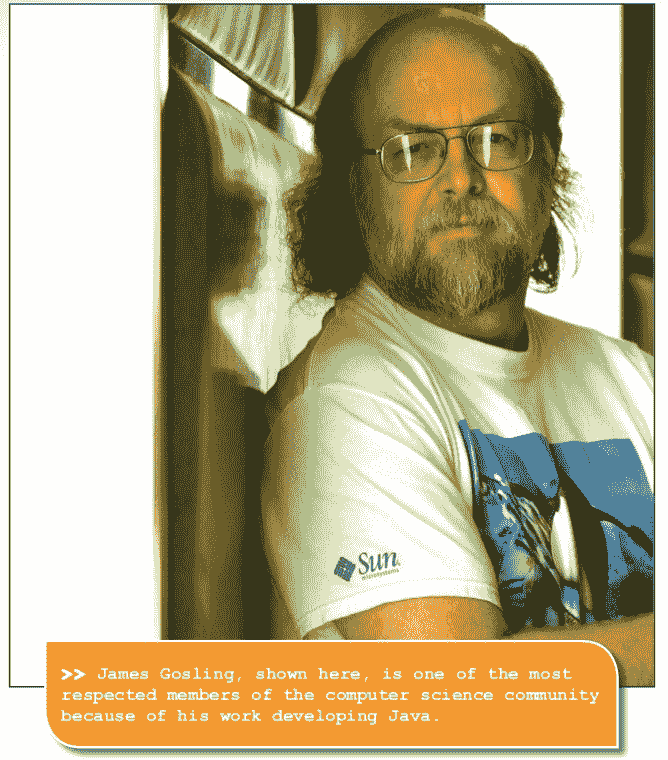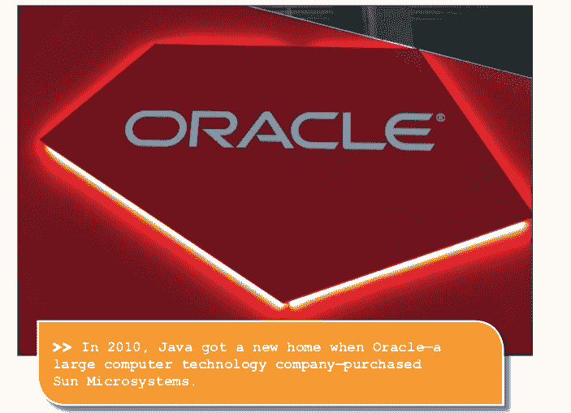

高斯林和绿色团队成功创造了一种简单、安全（可用于编写防篡改和防病毒系统）且能在多种操作系统上运行的语言。Java 的口号是“一次编写，到处运行”。用这种新语言在一台计算机上编写的代码可以在另一台计算机系统上运行。高斯林和同事们设计了一个系统，消除了编写代码时的一些繁琐方面。Java 允许用户编写可重复使用的代码片段，而无需反复重写代码。随着互联网在 20 世纪 90 年代的普及，设计者们意识到这种新语言非常适合创建在线应用程序。1995 年，该团队宣布 Netscape Navigator 互联网浏览器将集成 Java 技术。Navigator 成为 20 世纪 90 年代的主流网络浏览器。当今流行的浏览器，如 Safari、Explorer、Firefox 和 Chrome，也支持 Java 应用程序。

尽管 Java 已有二十多年的历史，但它仍然需求旺盛。此外，许多人认为它比其他编程语言相对容易学习。在接受 TechRepublic 采访时，招聘公司 Hays 的数字技术总监詹姆斯·米利根表示：“你可以通过在线课程掌握基础知识。” Java 也被认为是学习其他编程语言的良好基础。因此，对于那些对探索编程感兴趣的人来说，强烈建议先体验一下 Java。


Java 是世界上最流行的编程语言之一，运行在超过 70 亿台设备上，全球有超过 900 万开发者使用它。飞机系统、自动取款机、手机、计算机、医疗设备和电视机都运行在 Java 上。Java 也已成为安卓移动应用开发的语言。Kickstarter 和 WordPress 的应用程序是用 Java 创建的，VLC 媒体播放器、MovieGuide、音乐应用 Timber 和 Phonograph、游戏《像素地牢》、《兄弟连》和《自由飞行模拟：3D 飞机模拟器》也是如此。基于 Java 的谷歌应用包括 YouTube 视频下载、Facebook Messenger、Instagram、Netflix、Spotify 和 Uber。

对于当今对编程感兴趣的人来说，掌握 Java 是必须的。许多技术专业人士认为它易于学习，其编码风格被称为几乎是直观的（意味着它很自然）。

对于那些有兴趣学习、实验和用 Java 构建的人来说，它是免费的开源软件。“开源”意味着源代码可以免费获取，并且可以重新分发和修改。开源软件为开发者提供了更多创作和分享作品的自由。公众现在可以在甲骨文网站上免费获取它。可下载的 Java 开发工具包提供了使用 Java 编程语言构建应用程序和组件所需的一切。

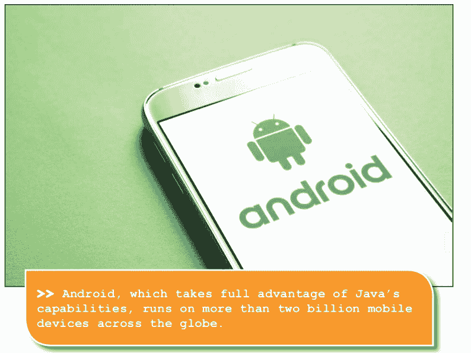

机器中的大脑

电子设备和系统并非自行运作。许多设备依赖于内部计算机芯片提供的电子“脑力”。这种微处理器被称为嵌入式处理器或逻辑芯片，它告诉机器如何运行。例如，自动取款机依靠处理器接收用户指令，从而执行所需任务——接受存款、取款、出具余额报表等。基本上，自动取款机是一个数据终端，其嵌入式处理器与银行的宿主处理器通信，后者保存着客户银行账户的实际详细信息。宿主处理器检查持卡人提交的详细信息（包括安全码）；如果一切无误，交易便完成。

在网站方面，Java 以其服务器端能力而闻名。许多需要处理大量流量的主要公司——如山姆会员店、亚马逊和苹果应用商店——都依赖它。每天支持超过四亿条推文的 Twitter，其核心基础设施基于 Java 系统。Java 编程在公司服务器上执行所有工作，服务器是一种设计用于处理请求并通过互联网或局域网向其他计算机传输数据的计算机。服务器端（也称为后端）托管着客户端通过其网络浏览器在互联网上访问的网页。Java 编程告诉网站或应用程序如何运行。

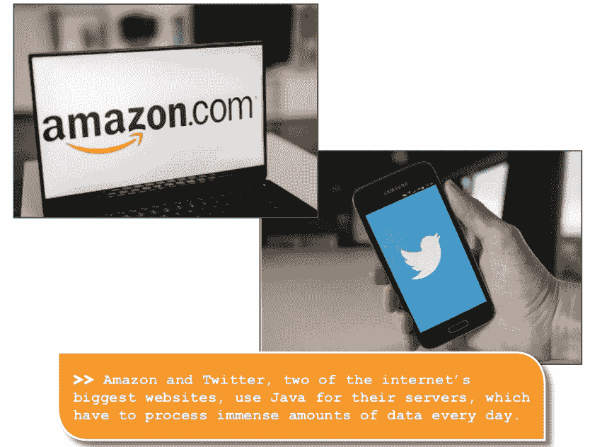


客户端，也称为前端，指的是网页浏览器。客户端代码（主要用 JavaScript 编写）在网页加载后运行在个人计算机上。

## 面向对象风格

编程有不同的风格或方式，称为范式。程序员使用不同的范式来组织软件，使其按预期工作。一种常见的编程风格称为过程式。这种范式使用一系列任务，为计算机提供逐步指令。大多数最初的编程语言都是过程式的，包括 C、COBOL 和 Fortran。

另一方面，Java 是一种面向对象编程（OOP）语言。OOP 语言将数据视为对象，并使用一组相互交互的对象，而不是一长串命令。每个对象都扮演着独特的角色。例如，动画程序中的一个对象可以告诉角色行走或跳跃。一个对象也知道如何与程序中的其他对象交互。

任何面向对象语言——包括 Java——都使用类。类是对象的蓝图代码，描述其内容。类描述数据字段并定义操作，称为方法。通过向对象发送消息，它执行其方法之一。

OOP 通常用于存在大量可共享和重用代码的情况。当创建一个对象来处理复杂任务或行为时，程序员可以轻松地在代码中的任何地方再次使用该对象。过程式代码可能易于理解，但当代码量巨大时，维护起来就会变得困难。

由于对象是可重用的，OOP 提高了速度和效率，特别是 Java 在速度方面已被证明优于其他语言。开发人员经常使用它，因为它减轻了编写软件时的一些工作量。

## JavaScript 和 Java 是截然不同的东西

由于这两种常见的计算机编程语言的名称，人们有时认为 Java 和 JavaScript 是相关的。然而，JavaScript 并不是 Java 平台的一部分。虽然它们都是面向对象语言，但差别很大。正如开发者 Jeremy Keith 在 2009 年所说：“Java 之于 JavaScript，就像火腿之于仓鼠。”以下是一些区别。

JavaScript 通常用于在网页浏览器中创建交互效果。Java 的小程序（applets）也曾用于此目的，但如今已逐渐失宠。虽然 Java 以服务器端的“工作马”著称，但 JavaScript 代码传统上只在浏览器中运行——尽管它在服务器端编程方面也日益流行。Java 代码需要编译，而 JavaScript 代码全是文本。总体而言，JavaScript 被认为比 Java 简单，如果有人想制作生动、交互式的网页，它是一种很好的学习语言。

那么，既然它们如此不同，为什么会有相似的名字呢？JavaScript 最初由网景公司的 Brendan Eich 开发，名为 Mocha，后来改名为 LiveScript。1995 年，网景和 Sun Microsystems 达成了许可协议，该语言被重命名为 JavaScript。它旨在作为 Java 的补充脚本语言（意味着它不需要编译）。当时，Java 是一种热门的新编程语言，一些人认为 JavaScript 的命名是为了给产品带来更多的声望和关注。


> 图中所示的 Brendan Eich 在 20 世纪 90 年代开发了 JavaScript，旨在与 Java 协同工作，服务于高级应用和用户。

## Java 的完整体系

当人们考虑 Java 时，它不仅仅是一种语言。它包括整个 Java 平台，即支持该语言以及构建 Web 系统和应用程序的完整环境。这包括其编译器、Java 虚拟机（JVM）、库、框架和应用程序编程接口（API）。Java 运行时环境（JRE）是由 Oracle 开发和提供的一个捆绑包，其中包括 Java 虚拟机（JVM）、库以及运行 Java 应用程序和小程序（执行特定任务的小型应用程序）所需的其他组件。

当有人下载 Java 软件时，他会收到这个运行时环境，这为他提供了在网页浏览器上运行 Java 所需的一切。JRE 包括 Java 插件软件，允许用 Java 编程语言编写的小程序在各种浏览器中运行。Web 开发人员曾使用小程序为网页带来功能——在网页上创建交互式按钮、复选框、表单和其他小动画。如今，小程序几乎已经消亡，被其他技术所取代——根据 Oracle 的说法，JRE 9 继续提供 Java 插件，并支持在仍然提供标准插件支持的浏览器上启动小程序，但仅限有限使用，且不推荐。

## 翻译工具

与许多计算机语言一样，Java 平台拥有工具——编译器和解释器——来翻译语言，以便机器能够理解。编译器是一种特殊程序，它将用一种编程语言编写的语句转换为计算机处理器最终会使用的代码。这种与平台无关的语言称为 Java 字节码。虽然字节码类似于机器语言，但它并不是任何实际计算机的机器语言。Java 编译器还会在用户使用 Java 的“语法”或句法出错时告知用户。*《Java 面向对象编程》*的合著者 Bill McCarty 博士将编译器比作一个严厉的监工，它“绝不容忍任何偏离 Java 语言官方规则的行为”。在开发早期而不是后期（当产品可能已经发布给公众时）发现这些语法错误非常重要。

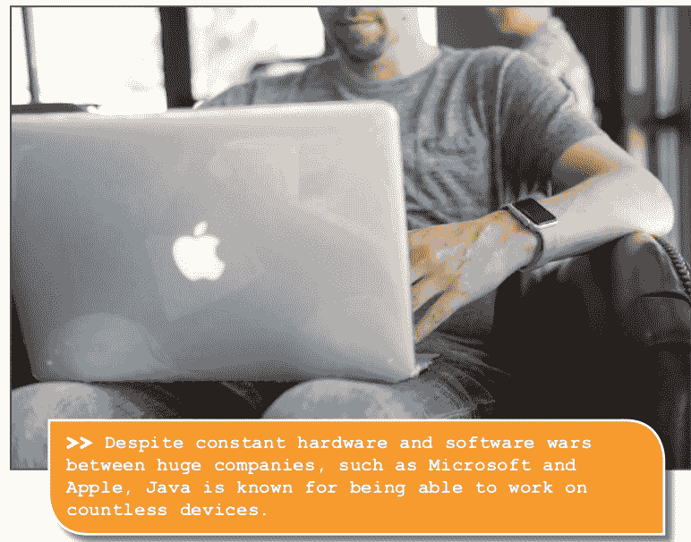

Java 虚拟机就是解释器。JVM 解读编译器生成的字节码。所有计算机的运行方式各不相同，JVM 将 Java 字节码转换为可执行指令。安装了 JVM 的计算机系统可以运行 Java 程序，无论这些应用程序最初是在哪个计算机系统上开发的。每种类型的计算机都需要自己的 Java 字节码解释器，但所有这些解释器都解释相同的字节码语言。

Oracle 解释说，由于 JVM 的存在，在装有 Windows NT 操作系统（OS）的个人计算机（PC）上开发的 Java 程序，无需修改即可在装有 Solaris 操作系统的 Sun Ultra 工作站上同样良好地运行，反之亦然。

平台的另一部分是 API。这些是省时的、现成的编译代码库，可用于 Java 程序。框架由多个库组成。它们是大量预编写的代码，任何人都可以将其添加到自己的代码中以节省时间。

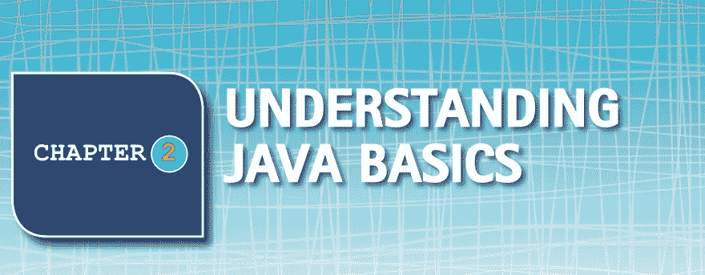

Linus Torvalds，一位开发了 Linux 操作系统、Android 和 Chrome OS 背后技术的软件工程师，曾说过：“大多数优秀的程序员编程，并不是因为他们期望获得报酬或公众的赞誉，而是因为编程很有趣。”理论上，编程应该是有趣且富有创造性的——而且通常也确实如此。但如果一个人是编程游戏中的完全新手，学习像 Java 这样的计算机语言需要一些时间。用代码思考是一个非常独特的过程。学习基础知识可能需要长达六个月，而要达到相当熟练的程度则需要两到三年。这个过程取决于许多因素——投入的时间、学习能力和天赋。

## 优点与缺点

谈到 Java，这种语言得到的评价褒贬不一。有些人认为 Java 笨重，比其他语言需要更多的工作。一位在线 Java 用户说，Java 的乐趣就像看着关闭的 DMV 办公室墙上米色油漆变干一样。批评者称它冗长，需要太多工作才能让事情正常运行。

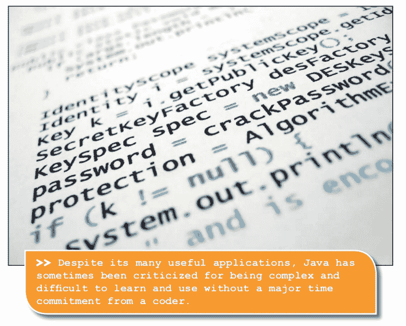


然而，Java 的爱好者认为它非常对初学者友好，因为它的语法（或结构）直观易懂，易于编写、阅读和理解。有些语言（如 C++）比 Java 更复杂，尽管 Java 使用的语法与 C++ 类似。如果学习 Java 的人有 C++ 的经验，那会很有帮助。

Java 拥有工具集和编辑器，能让用户立即发现是否犯了错误。而且，Java 拥有庞大的用户社区，可以在线咨询任何问题或难题。

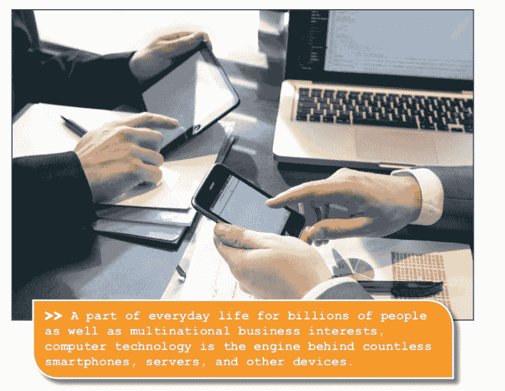

## 计算基础

对于知识很少或没有知识的人来说，掌握 Java 的旅程始于对计算机和编程如何运作的基本理解。在尝试编写一行代码之前，必须掌握一些基本要点。

计算机编程需要对解决问题有兴趣。它涉及创造力、逻辑和耐心。耐心尤其关键，因为完全理解代码的结构以及代码如何告诉计算机需要做什么可能需要时间。有时，工作可能看起来令人不知所措，因此暂停一下、深呼吸，并在学习过程中寻求帮助来理解每一步会很有帮助。没有代码和计算机，人类所知的整个现代世界将会崩溃。学习它可能很困难，但它极其重要！

计算机在处理信息时有四个主要功能：从用户处获取信息；处理信息；存储信息；以及输出信息。

## 二进制大脑

在某种程度上，计算机中的一切都在二进制系统上运行。在日常生活中，大多数人使用十进制系统。该系统基于数字 1 到 9 和 0。而二进制系统仅使用 0 和 1 来表示数字、字母和其他数据。

今天的计算机使用晶体管运行。计算机包含数百万或数十亿个这样的晶体管。它们是触发电子信号的小型开关。晶体管是计算机芯片的构建块，而芯片构成了处理单元和内存单元。作为一组开关，晶体管可以处于开或关状态。计算机通过晶体管的开/关组合来运行。二进制代码是一种语言，它告诉计算机哪些开关要打开（用 1 表示），哪些开关要关闭（用 0 表示）。

用数十亿个 1 和 0 来编写代码几乎是不可能的，因此计算机科学家想出了如何编写更简单的编程语言。当用 Java 这样的语言编写程序并准备运行时，它会通过编译器将指令转换为计算机可以读取和执行的机器代码。机器代码是由 1 和 0 组成的基本语言，告诉计算机该做什么。

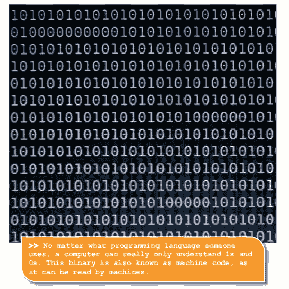

## 组合对象

由于 Java 处理大型程序，它被设计为一种面向对象的语言。基本上，Java 中的对象是预先开发好的代码片段。使用这种代码的程序员不一定需要看到构成实际“对象”的代码。他们知道如何将这些对象组合起来构建自己的程序。

一个对象可以有多个变量（称为属性或特性）来存储不同类型的数据，并且可以有自己的特定函数（称为方法）来操作对象的变量。这些术语一开始可能难以理解，但一个人编程越多，它们就会变得越清晰。

## 迈出第一步

在用户能够编写并运行一个简单的 Java 程序之前，他/她需要在自己的计算机系统上安装平台。可以在 Oracle.com 上免费下载适用于 Linux、Windows、Mac 和 Solaris 操作系统的 Java 软件开发工具包。一旦 Java 平台安装并配置好，用户就可以尝试编写并运行一个非常简单的程序。

许多编程课程从教授“Hello, World!”程序开始。这是一个简单地将“Hello, World!”字样打印到屏幕上的程序。通常，程序会在文本编辑器中编写，文本编辑器是操作系统和软件开发包提供的工具。文本编辑器用于输入编程语言的源语句。该程序应保存为 `HelloWorld.java`。然后，用户通过该名称访问代码并在计算机上运行。

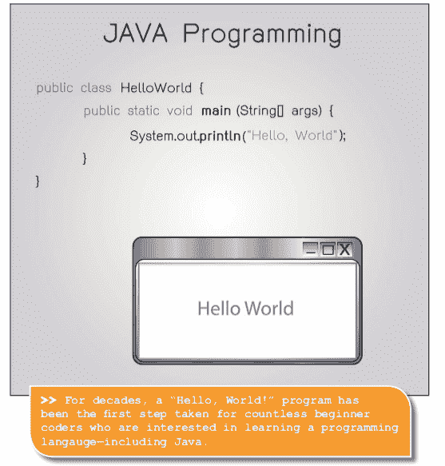

“Hello, World!”程序的简单代码如下所示：

```
public class Main {

public static void main(String[] args) { System.out.println(“Hello, World!”); } }
```

代码的第一行声明它是 `public`，意味着它具有公共访问权限。任何其他类都可以访问它。

应用程序中的第二行称为 `main` 方法。Java 中的每个应用程序都必须包含一个 `main` 方法。Java 编译器从 `main` 方法开始执行代码。这一行是强制性的代码行，作为程序运行的主要入口点。理解代码的每个部分需要更深入的学习。例如，`String[] args` 意味着人们可以查看和编辑“参数”。参数是独立的数据项或变量，包含数据或代码。

代码的最后一行实际上是程序的核心，它告诉计算机该做什么。`println` 告诉计算机将字符串（即提供的文本）“Hello, World!”写入计算机屏幕，然后插入一个换行符。

这段简单的代码让初学者对 Java 计算机语言的工作原理有了一些了解，但要理解所有细节需要深入的学习。根据 Java 语法，每个语句必须以分号结尾，单行注释必须以两个正斜杠（`//`）开头。方法和类用花括号定义。

### >>深入探索：在线教程

要了解更多关于 Java 编程的知识，新手可以探索互联网上提供的众多资源。以下是一些值得探索的知名网站：

Code Academy：自 2011 年以来，CodeAcademy.com 为包括 Java 在内的不同编程语言提供免费的交互式编程课程。该网站对某些附加服务收费。

LearnJavaOnline.org：这个免费的交互式教程面向所有水平的程序员——从绝对初学者到更有经验的人。

Udemy：Udemy.com 于 2009 年推出，已提供超过六万五千门在线课程。数十万学生参加了其“Java 完全初学者教程”，该教程专为没有编程知识的人设计。

Youth Digital：Youthdigital.com 提供在线技术课程，教授 8 至 14 岁的孩子如何编码、设计、开发和制作动画。

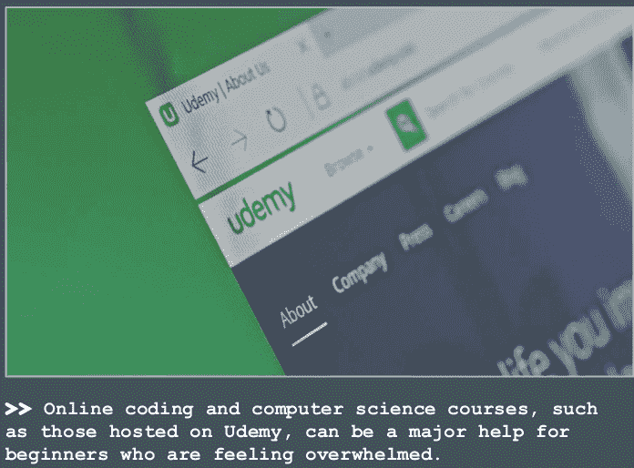

## 尝试运行代码

在文本编辑器中编写并保存代码后，必须对其进行编译，以便计算机能够读取。为此，用户输入命令：`javac HelloWorld.java`。如果一切顺利，编译器会在 `HelloWorld.class` 文件中生成字节码。Java 编译器的一大优点是它会告诉用户是否存在错误，包括哪一行或哪些行代码有误。


要让程序运行起来，你必须在命令行中输入 `java HelloWorld`。随后屏幕上会弹出“Hello, World!”这段文字。任何计算机上的命令行都是强大且具有控制权的入口。请小心通过命令行执行的命令——输入错误的指令可能会导致数据全部丢失。如果你之前没有编程经验，可能不知道命令行在哪里。例如，苹果的 Mac OS 系统将命令行存放在一个名为“终端”的程序中，该程序位于“应用程序”文件夹内的“实用工具”文件夹里。计算机科学教师大卫·鲍姆戈尔德（David Baumgold）表示，Windows 有自己的命令行，但使用起来比较困难。他推荐安装一个名为 Babun 的免费且易用的命令行程序。

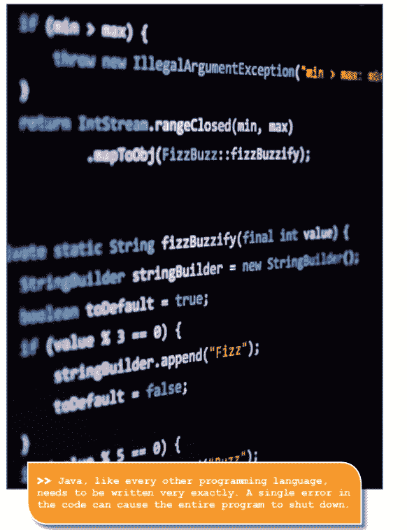

## 动手尝试与实验

完成这样一个简单的练习后，新手程序员可能会想一些自己感兴趣且容易实现的项目。在学习过程中，追求自己选择的目标会更有动力。你或许想让一匹马的图像从屏幕一端移动到另一端；或者创建一个随机侮辱生成器，它能吐出类似“你这臭烘烘的、穿着呕吐袜的蛆虫馅饼！”这样的短语；又或者想尝试制作一个简单的二维游戏。学习的关键在于尝试一些项目，并观察它们如何运作。

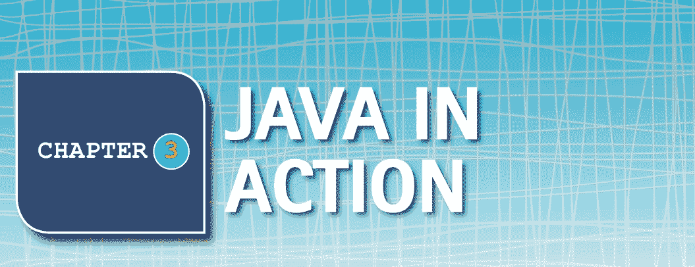

程序员是将大问题分解为简单步骤的王者。编程让世界变得更简单，因为它实现了自动化——但需要亲手编写代码才能获得让他人生活更轻松的成果。和任何技能一样，一个人编程练习得越多，就越得心应手。看到编程成果实际运行可能需要一些时间。程序往往在第一次运行时无法正常工作，因此程序员需要耐心地回去重新尝试。他们需要仔细检查代码行，确保一切正确。这需要大量精确的细节检查——这就是为什么程序员遵循古老的木匠谚语：“量两次，切一次。”

关于编程的常见抱怨是它可能令人沮丧、乏味且无聊。有些编程工作涉及大量复制粘贴现有代码来完成工作。这虽然能让工作更轻松，但有时会削弱过程中的创造力。为了让编程保持趣味性，程序员会接手自己感兴趣的项目和挑战。编程提供了创造原创作品的可能性。为了激发学习 Java 或其他程序的灵感，选择一个有趣且个人感兴趣的项目会有所帮助。

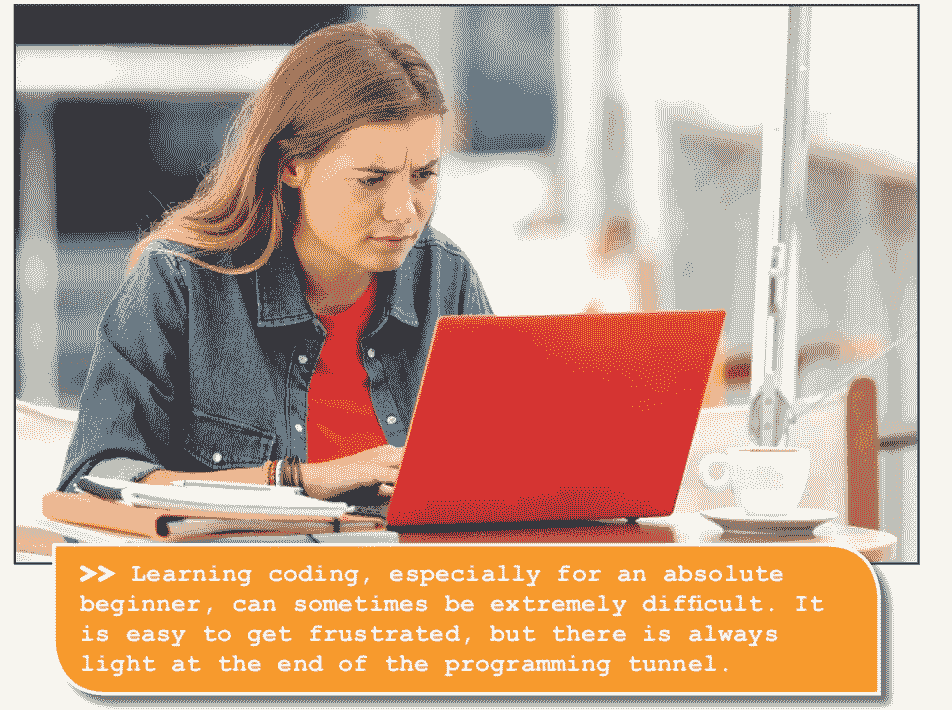

## 来自《我的世界》的激励

进入编程世界的一个有趣方式是通过电脑游戏，而《我的世界》不仅是全球最受欢迎的游戏之一，它还提供了理解编程的工具。凭借超过 1.22 亿份的销量和每月 5500 万用户，《我的世界》已成为一种全球现象。

瑞典视频游戏程序员马库斯·“Notch”·佩尔松（Markus “Notch” Persson）最初将《我的世界》作为一个业余项目开始开发。尽管他从未完成高中学业，但佩尔松热爱玩乐高积木，并在七岁时父亲带回家一台 Commodore 电脑后开始自学编程。八岁时，他就写出了第一个程序。2009 年，他对乐高、游戏和编程的热情汇聚在一起，制作了《我的世界》的第一个版本。同年，他与创意合伙人雅各布·波尔塞（Jakob Porsér）共同创办了 Mojang 公司（瑞典语意为“小玩意儿”），以进一步开发和销售《我的世界》及其他游戏。

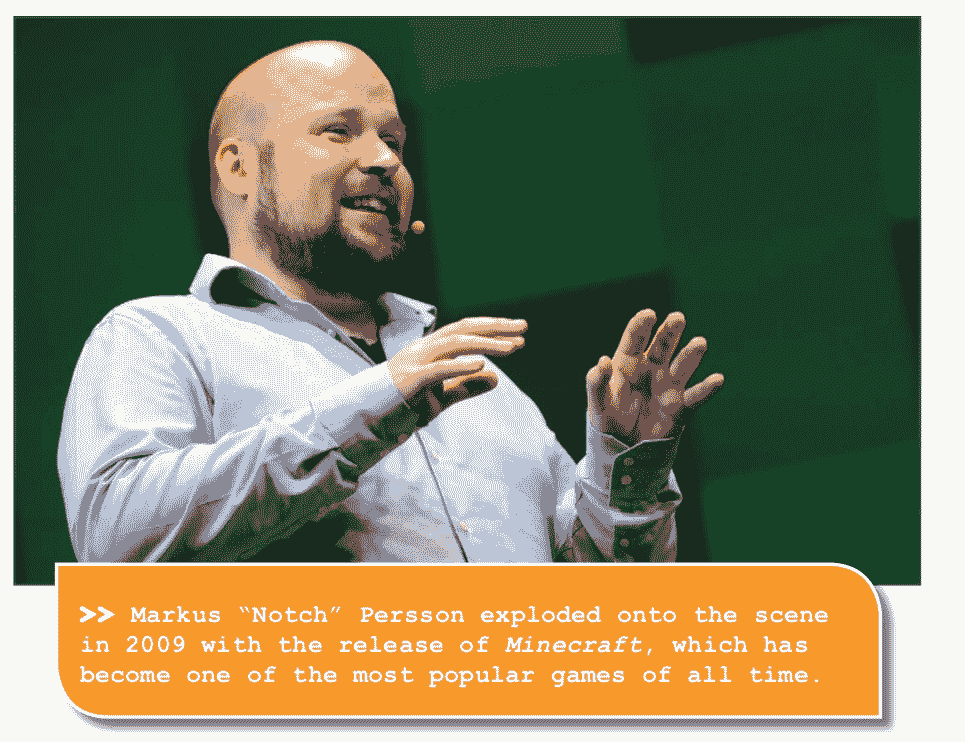

《我的世界》几乎一炮而红，第一年就售出了约两万份下载量——而第二年常常每天就能达到这个数字。2012 年 9 月，佩尔松以 25 亿美元的价格将 Mojang 卖给了微软。

《我的世界》被称为沙盒游戏。它提供了一个无限的环境，玩家可以随意漫游并改变虚拟世界，用方块搭建建筑。游戏中的角色在一个充满泥土、树木、水、云、熔岩、山脉等元素的世界中破坏和替换方块。《我的世界》玩家可以上线，在多人模式中与其他玩家互动。随着游戏的发展，羊、猪、牛、僵尸、爬行者、骷髅、船、铁轨和雪等元素被加入其中。

为了制作方块、工具和材料，《我的世界》提供了庞大的物品库存和合成网格。《我的世界》开发者创造了红石，它允许用户制作电路。在这个虚拟宇宙中，红石基本上是一种传输“电”的手段，可以被塑形和设置，用来制作各种发明，从灯和时钟到计算机和工厂。游戏不断添加动态特性，例如可以在活塞上升降的平台。

## 加入模组小队

编程通过一个名为“模组”（mods，即“修改”的缩写）的功能在这里发挥作用。由于《我的世界》是用 Java 编写的，Java 编程解锁了自定义模组制作的世界。《我的世界》让玩家能够改变角色、物体和景观的属性。通过 Java，皮肤——即决定角色在游戏中外观的图像——可以被更改。模组可以为游戏添加新角色，改变开放世界的视觉和感觉，或者让建造新结构变得更容易。

CodaKid 在线儿童编程学院的创始人大卫·道奇（David Dodge）表示，通过拖放式可视化积木工具，学习《我的世界》编程的基础知识很容易。这些工具演示了事件驱动编程，即编写代码以响应用户或系统生成的操作。2016 年，微软和 Code.org 为《我的世界》推出了一个拖放式平台。这些代码块可能包含 if-then 语句（条件语句）、循环、顺序、数组、变量或其他指令。拖放技术是进入编程世界的第一步。虽然它不涉及代码的语法，但它直观地展示了编程指令如何像拼图一样组合在一起，使功能得以实现。

掌握了基本原理后，新手可以更上一层楼，使用实际的 Java 语言。在 Codakid.com 上，大卫·道奇表示，任何人都可以用 Java 创建一把能发射闪电的雷霆锤，制作一个自定义的熔岩炸弹，或者设计其他自己发明的物品。程序员将自己的创意愿景变为现实。一旦代码在游戏中执行，回报是即时的。用户可以在自己最喜欢的游戏中看到自己编写的代码实际运行，从而获得极大的乐趣。

要创建《我的世界》模组，集成开发环境（IDE）可以提供帮助。这是一种提供图形用户界面（GUI）的软件应用程序，可以简化工作并帮助调试软件。一个常见且非常适合 Java 模组的 IDE 叫做 Eclipse。另一个用于模组制作的工具是应用程序编程接口（API）。流行的模组 API，如 Bukkit 或 Hmod，提供了与《我的世界》轻松通信的接口。像 Notepad++ 这样的源代码编辑器可以简化编辑源代码的过程。

### Java 术语：学习编程的行话

当一个人学习编程的诀窍时，会用到一些常用短语来描述不同的元素。以下是一些术语，应该能帮助初学者更流利地掌握编程语言。

Array（数组）：数组是数据或变量的集合、组或列表。例如，它可以是一个名字列表。数组可以被描述为一个包含多条数据的变量。一旦数据存储在数组中，就可以通过引用变量名和键（或隔间名）来检索。搜索引擎可能会使用数组来存储用户搜索时找到的网站。

Class（类）：类是作为对象蓝图的代码，描述其内容。类描述数据字段并定义称为方法的操作。


# 条件语句
这些是代码中的“如果-那么”结构，告诉计算机如果某个条件为真，则执行某个操作。例如，如果银行账户余额低于 100 美元，代码可能会发出声明：“余额不足。”

# 循环
循环是一段重复执行的代码，用于完成主要任务。

# 脚本编程
脚本编程是一种使用特定脚本语言编写的特定编码类型。所有脚本都是编码，但并非所有编码都是脚本。脚本语言无需编译——它们是解释执行的。例如，通常 Java 程序在运行前需要编译，而像 JavaScript 或 PHP 这样的脚本语言通常不需要编译。

# 方法
方法是在数据字段中定义的操作或过程。

# 顺序
这是对动作或事件的安排，使其按照预定顺序引导至下一个有序动作。

# 变量
这些是根据程序可以改变的值。它们可以根据需要被创建、编辑或删除。

# 探索应用世界
Web 应用程序涵盖广泛的功能。它们可以通过在线表单收集输入、统计投票、处理产品订单、预订航班或允许用户登录。现在人们可以上网购买衣服、办理银行业务或参与讨论——这一切都归功于 Web 应用程序。世界各地的用户可以通过他们的电脑浏览器访问这些应用程序——因此实际上可能有数百万人同时使用同一个应用。

开始吧

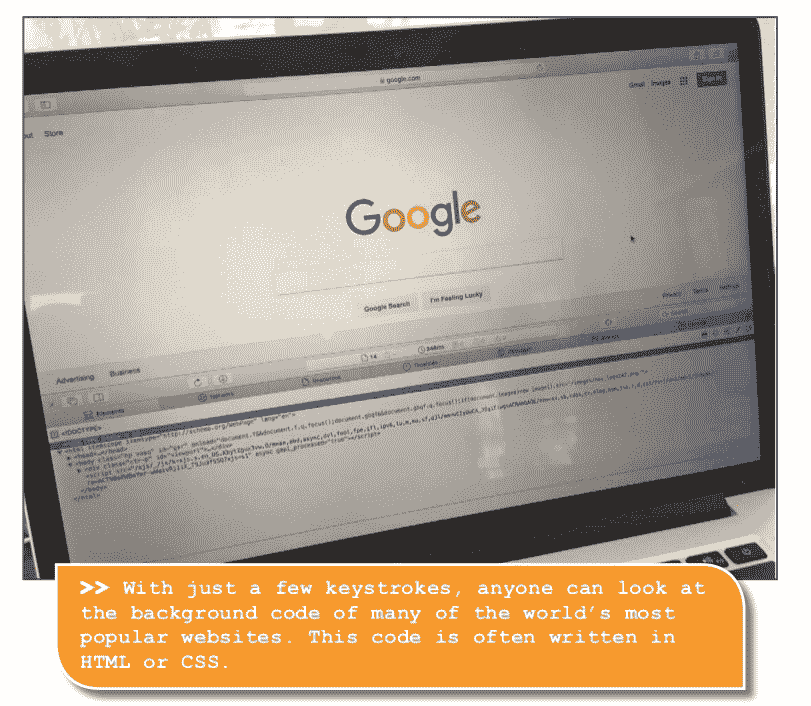

在客户端（普通用户可见），网站可以使用标记语言或脚本语言构建，例如 HTML（超文本标记语言）、CSS（层叠样式表）或 JavaScript。Java 也用于应用程序，但通常用于服务器端。例如，Java Servlet 是服务器程序，通常响应网站用户的请求，最常见的是 HTTP（超文本传输协议）请求。Java 在处理与许多其他系统通信的大型 Web 应用程序方面建立了良好声誉，例如银行和保险公司使用的系统。

Java 已发展成为构建在 Android 智能手机上运行的程序所必需的语言。谷歌选择 Java 作为其广受欢迎的 Android 移动操作系统的编程语言。甚至 Gmail 的服务器端功能也是由 Java 和 C++运行的。2006 年，谷歌推出了基于 Java 的 Gmail 手机应用程序。应用程序让任何人通过移动设备进行广泛的活动，从玩在线游戏到与世界各地的人聊天，再到查看 3D 图像。尽管 Android 一直依赖基于 Java 的应用程序，但 Oracle 已对谷歌提起诉讼，声称 Android 侵犯了其专利——而谷歌则声称其根据合理使用法律合法地整合了 Java 技术。

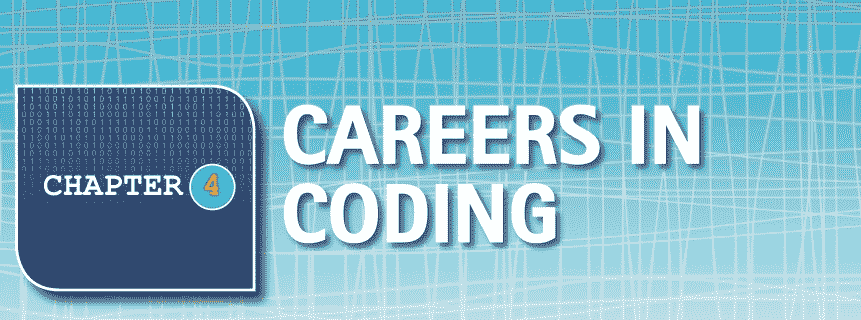

2017 年 5 月，EdX——一个提供大学水平课程的大型在线平台——将 Java 列为你可以免费在线学习的三种最赚钱的编程技能之一（另外两种是 SQL 和 C）。该公司强调 Java 为打开通常年薪超过 10 万美元的绝佳机会铺平了道路。美国劳工统计局（BLS）的数据显示，2016 年计算机程序员的年薪中位数为 79,840 美元。衡量编程语言流行度的 TIOBE 指数在 2018 年 2 月将 Java 列为第一——这意味着懂 Java 的人比懂任何其他语言的人拥有更多的就业机会。

Java 大师拥有广泛的就业选择。例如，Java 软件开发人员负责开发应用程序和软件，通常与 Web 开发人员和软件工程师合作，将 Java 集成到不同的业务系统中。这些应用程序可能用于移动设备或平板电脑，也可能在计算机上运行。各种类型的企业和组织都在使用 Java 软件。

# 开发人员与程序员
Java 编码人员可能正在处理文字处理软件、Web 浏览器工具、游戏或媒体播放器（如 iTunes）。软件开发通常是一项非常有创造性的工作，因为它需要提出新想法。通常，开发人员参与产品的每一个步骤，从概念到推向世界。在此过程中，他们测试和分析产品，检查任何潜在问题。如果出现任何问题，开发人员需要找到解决方案。他们需要确保拥有最佳质量的产品，并且程序用户友好。此外，开发人员可能会编写详细说明产品的文档，以便其他人了解所有细节。开发人员展示软件结构及其与其他程序如何协同工作的宏观图景。在许多情况下，他们制作解释如何编写代码的图表和流程图，然后将实际的代码编写工作交给程序员。

与开发人员相比，程序员的工作可能创造性较低。他们执行开发人员提出的计划，整天编写大量代码。他们还进行调试（测试和修复错误），并将信息收集到库中，以便以后使用，使未来的代码编写更容易。程序员可能有不同的专长。游戏程序员编写驱动计算机游戏图形的代码。Web 程序员构建网站及其相关的应用程序。他们可能将基于 Java 的程序与用 HTML（基本的 Web 开发语言）构建的页面结合起来。Web 设计融合了许多技能，包括计算机编程和图形设计。网站创建者知道如何整合动画、视频、音频和交互功能。

尽管在技术驱动的世界中，设计师和程序员的需求量很大，但美国劳工统计局预测，2014 年至 2024 年间，计算机程序员的工作岗位将减少 8%。部分原因是公司正在从美国以外雇佣更便宜的程序员。

# 教育路径
如果编程和软件开发成为你希望追求的职业，那么你需要超越在线教程。许多大型雇主只雇佣拥有计算机科学、信息系统、数学或密切相关领域学位的人。课程可能涵盖数据结构、计算机体系结构、数据库管理、统计和技术写作。这些对于使用任何语言的程序员来说都是重要的技能。

虽然通过大学学位是计算机编程成功的标准途径，但能够展示经验并精通 Java 编码的人仍然可以获得极好的职位。Oracle 拥有自己的“大学”，提供在线课程和认证。通过官方能力考试会提高求职者的价值。正如许多程序员和开发人员所证明的，教育过程永无止境。编码世界不断变化，因此专业人士需要跟上所有最新进展。即使是高级程序员也必须掌握新引入的特性。如果你将此作为职业，请准备好享受终身学习。

## »实习提供真实世界的视角


没有什么比从事一份现实世界的工作更能了解某个职业的真实面貌了。那些攻读计算机科学学士学位的学生通常可以通过学校利用实习机会。实习让学生获得实际工作经验，同时还能赚取课程学分。大多数大公司都提供计算机科学相关的实习项目。沃尔玛有一个与在线销售相关的实习项目。雪佛龙公司招聘实习生协助其应用程序、数据库管理和业务分析工具。苹果、通用电气、惠普、威瑞森、IBM、波音、微软、塔吉特、康卡斯特、陶氏化学、戴尔、哈门那、甲骨文、时代华纳以及成千上万的其他公司都有技术实习岗位。

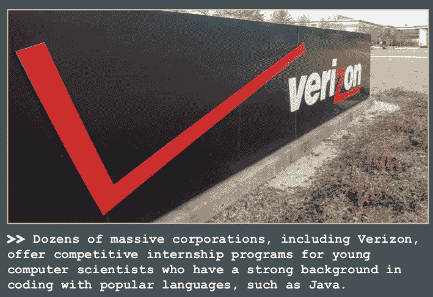

学生可以研究问题，并帮助开发和实施解决方案。与熟练的专业人员一起工作，学生能够掌握技术术语，并了解技术世界中最新的挑战。实习还常常带来宝贵的工作人脉。这既是承担新责任来丰富简历的机会，也是建立专业人脉网络的机会，这些人脉可能成为推荐信来源，甚至带来全职工作。

## 英语专业学生掌握 Java

并非所有 Java 和编程专家都出身于计算机科学背景。乔纳森·范伯格是谷歌的高级软件工程师，他负责编写驱动绘图引擎的代码，这个工具让其他软件工程师能够为他们的安卓、iOS（苹果移动设备使用的操作系统）以及网络应用程序添加绘图功能。他用 Java 以及 C++、Objective-C 和 JavaScript 编写代码。

尽管他从小热爱计算机编程，但这并不是他进入大学时的首选方向。虽然他的许多同事拥有计算机科学学位，但范伯格拥有的是英语与美国文学学士学位。不过，如果有人对编程职业感兴趣，他建议学习计算机科学或软件工程，并且在 21 世纪，掌握 Java、C++或 Python 是件好事。

范伯格用 Java 创建了 Wordle，这是一个用于从用户提供的文本生成“词云”的小工具。他还为 Processing（processing.org）做出了贡献，这是一个灵活的软件速写本和一种在视觉艺术背景下学习编程的语言。范伯格主要致力于 Processing 对安卓编程的初始支持以及 Python 模式，该模式允许用户使用 Python 编程语言创建 Processing 速写（不过 Python 模式本身是用 Java 编写的）。

他主要通过阅读《Java 编程语言》第一版来学习 Java，然后想出有趣的小项目来挑战自己。他编写了一个纸牌游戏程序，以及许多其他小程序来制作动画。

对于范伯格的用途而言，Java 提供了编写交互式计算机图形程序的最佳工具包。“所谓的 Java 2D API 仍然是我最喜欢的图形工具包——在探索或设计图形程序时，我最容易‘用它思考’，”他说。

Java 也有助于避免编码错误。他说，有整整几类错误（编程错误）在 Java 中根本不可能发生，因为该语言使它们无法出现。“这些类型的错误是 C 和 C++程序许多崩溃的原因，”他补充说，Java 对错误的处理方式正是许多公司（包括谷歌）选择该语言用于某些大型软件项目的原因。

至于缺点，范伯格指出 Java 以冗长著称。“表达简单的想法需要打很多字，”他说，“这可能会令人沮丧，并导致代码读起来很无聊。这有点像必须通过填写税表来写一部小说。”

## 应用程序的天赋

作为 Scientific Games Interactive 公司的高级软件工程师，威尔·里德通过添加新功能和排查现有问题来维护和扩展移动社交赌场游戏应用。他们有两款热门游戏是《彩虹财富》和《斯巴达克斯：罗马角斗士》。尽管公司的大部分代码库是用 C#或 Flash/ActionScript 编写的，但他们使用 Java 作为“粘合剂”来与安卓硬件交互。

里德在 11 岁时对编程产生了兴趣，当时他的数学提高班去当地一所大学的计算机实验室进行实地考察。他发现自己热爱编程中解决问题的方面——无论是玩解谜游戏，还是找到编写解谜游戏的最佳方式。他说，这个过程要求他问自己：“我如何从 A 点到 B 点？这两点之间有没有更高效的路径？”

他通过使用 Java 开发安卓应用程序来掌握它，他说，现在有很多机会给那些懂 Java 和其他编程语言的年轻人。


作为一种不断演变且至今仍在开发的计算机语言，Java 始终处于前沿。该语言定期获得更新和新版本。在线 Java 社区人数达数百万，用户已经汇集了大量开源库和开发工具，使编程挑战变得更容易。

在接受专门从事 Java 招聘的猎头公司 Pearson Frank 的采访时，软件开发公司 Atomist 的开发人员、播客《Greater Than Code》的小组成员杰西卡·克尔表示，世界发展越来越快，对自动化的需求也在增加。由于 Java 实用且多功能，她认为它将继续在技术的未来中发挥重要作用。

## 强化应用程序

近年来，随着消费者对这些设备比以往更加依赖，移动设备的应用程序开发大幅增长。安卓应用开发的官方语言是 Java。2014 年，移动互联网使用量超过了桌面端。毫无疑问，应用程序业务规模巨大。

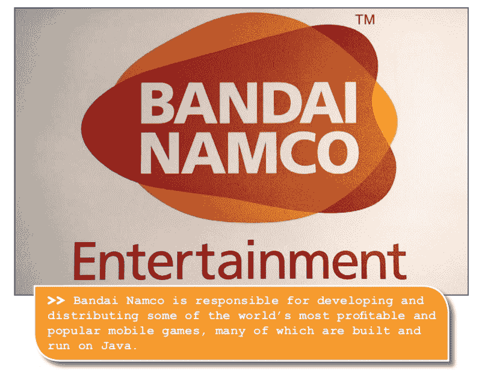

应用情报公司 Sensor Tower 计算得出，2017 年全球应用收入增长了 35%，达到近 600 亿美元。游戏应用位居排行榜榜首。例如，万代南梦宫娱乐的《龙珠 Z：激战》每天带来约 200 万美元的收入。对于那些对游戏开发充满热情的人来说，一些网站已经涌现出来提供帮助，包括 Java-gaming.org 和轻量级 Java 游戏库（[www.lwjgl.org](http://www.lwjgl.org)）。

对许多人来说，Facebook、Messenger、Google、Gmail、Instagram、Amazon 和 Apple Music 等应用已经融入了他们的日常生活。音乐应用 Pandora 和 Spotify、视频流媒体应用 Netflix 和 Hulu 以及其他有用的应用也大受欢迎。许多注重健康的消费者转向应用来追踪体重、卡路里和锻炼目标。2017 年，TechCrunch 报道称，尽管移动应用使用量持续增长，但随着市场被大量应用淹没，增长可能正在放缓。

在应用开发方面，程序员必须考虑其应用将针对哪个平台设计。苹果的 iOS 平台一直处于领先地位，安卓紧随其后。Fuel.com 2017 年的一份报告称，16%的安卓应用开发者每月收入超过 5000 美元。一些青少年电脑奇才凭借他们的应用创意发了大财。当尼克·达洛伊西奥 16 岁时，他想出了 Trimit，一个将大量文本压缩成简短摘要的应用。他最终以 3000 万美元的价格将他的创意卖给了雅虎。

## 推动大数据发展


在日常生活中，企业、政府和其他大型组织必须处理海量数据。他们收集、存储、跟踪并分析这些数据，以制定战略性的商业决策。对于当今的程序员来说，挑战在于跟上这股持续不断的信息浪潮。《技术评论》高级编辑安东尼奥·雷加拉多表示，所有数据中只有大约 0.5%被真正分析过。由于 Java 可以在台式机、移动设备和平板电脑上直接使用，并且提供了庞大的代码库，因此该语言能够承担许多与处理大数据相关的任务。到 2018 年，Hadoop 已成为一套流行的程序和流程，构成了大数据运营的支柱。Hadoop 本身是用 Java 开发的。

## 迈向太空与更远的地方

Java 技术已经踏足前人未至的领域。美国国家航空航天局（NASA）在许多项目中都使用了 Java，包括其提供虚拟 3D 地球的 World Wind 软件开发工具包。用户可以放大或缩小地球上的各个位置。现代机器人工程也利用了 Java。一款获奖的自动驾驶汽车就是基于 Java 代码运行的。通过他的公司 Marginally Clever 制造和销售机器人的丹·罗耶也依赖 Java。该语言还支撑着 Makelangelo——一款绘制海报和壁画的艺术机器人。结合机器人技术和医疗保健领域，阿里·莱穆斯组装了一只低成本假手。莱穆斯提供了如何使用 3D 打印机和 Java 代码构建这只假手的说明。

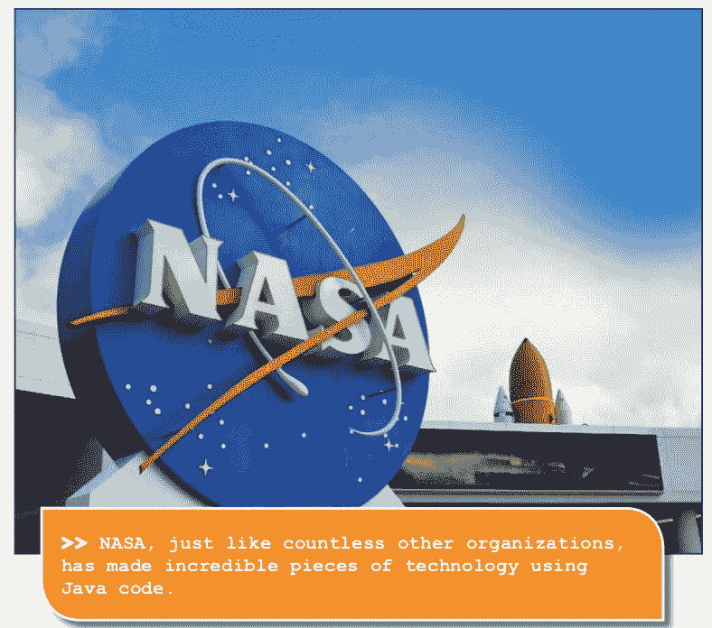

得益于 Java 技术，Doctor Online 提供了一种交互式患者护理服务。在演艺界，工业光魔（ILM）已转向 Java 来制作各种特效。ILM 制作了诸如《加勒比海盗》系列电影中戴维·琼斯那类似鱿鱼的脸，以及许多漫威电影中钢铁侠战衣那逼真的金属表面等特效。

云是 Java 留下印记的另一个前沿领域。云计算是指使用托管在互联网上的远程服务器网络来存储、管理和处理数据的实践。组织和个人可以远程访问这些计算服务。当某人将数据存储在自己的计算机硬盘上或从硬盘运行程序时，这被称为本地存储和计算——而非云计算。一些人更倾向于选择云计算服务，认为这是拥有和运营计算机及网络的一种更经济实惠的替代方案。一个例子是微软的 Office Online。用户无需安装任何东西，即可通过互联网访问仅限在线版本的 Word、Excel、PowerPoint 和 OneNote。这些就是云计算工具。Google Drive 是一种流行的云文件存储形式。由于 Java 可以在任何地方运行，因此它非常适合云开发。

## »其他主流编程语言

Java 通常与其他编程语言一起使用。以下是初学者应该了解的其他几种广泛使用的语言。

### C
C 是一种通用语言，创建于 1972 年，被广泛使用。它与 UNIX 操作系统紧密相关。

### C++
C++能够在多种平台上运行，如 Windows、Mac OS 以及各种版本的 UNIX，多年来一直是最流行的语言之一。它于 1979 年创建，是 C 语言的扩展版本。

### C#
C#是 C 和 C++的混合体，由微软开发，旨在与 Java 竞争。

### Objective-C
这是为 OS X 和 iOS 编写软件的主要编程语言。

### Python
Python 是一种顶级语言，这种交互式、面向对象的编程语言可免费使用。它以英国喜剧团体蒙提·派森的飞行马戏团命名。谷歌的许多组件都是用 Python 编写的，游戏《战地 2》、《星际迷航：桥牌指挥官》和《文明 4》也是如此。

### Ruby on Rails
有时简称为 Rails，Ruby on Rails 是一个开源 Web 应用框架，由大卫·海涅迈尔·汉森用 Ruby 语言构建。它将 Ruby 与 HTML、CSS 和 JavaScript 结合在一起。Ruby 在程序员中以简洁清晰的语言风格而闻名。

### SQL
结构化查询语言（SQL）专门用于存储、操作和查询数据库中存储的数据。

## 万物互联

在快速变化的技术世界中，一个相对较新的概念是物联网（IoT）。它指的是将各种设备连接到互联网——厨房电器、无人驾驶汽车、心脏监测器等。这些电子产品通过 M2M（机器对机器）通信进行连接。

智能自行车锁通过一个特殊的手机应用打开和关闭——如果有人试图破坏用户的自行车，用户的手机就会收到一条短信。现在已有设备可以跟踪冰箱中牛奶和鸡蛋的新鲜度，并在食物变质时发送消息提醒消费者。June 烤箱及其配套的 June 应用让用户可以通过 iPhone 或 iPad 控制烹饪，并通过实时视频流监控食物。理论上，设备内部的技术也让公司能够收集更多关于自身产品和内部系统的数据。研究公司 Gartner 报告称，2017 年估计有 84 亿台设备连接到互联网，共享和收集信息。然而，物联网的一大担忧是安全性。黑客已经展示了如何入侵系统以控制家庭安全系统和计算机驱动的车辆等物品。

在接受 Oracle.com 采访时，Globalcode 创始人维尼修斯·森格表示，Java 天生就是为了做这类事情而生的。他说：

> Java 一直致力于提供企业解决方案、在互联网上销售商品以及银行业务，但 Java 最初被设计为一种连接家用电器等物品的编程语言。Java 是物联网的最佳平台，因为它对不同尺寸的计算机都具有灵活性。
>
> Java 应用于银行、零售企业和互联网业务的相同架构、安全性和通信协议也可以用于嵌入式设备。Java 是通往一个勇敢的新技术、编程和便利未来的大门。

## 词汇表

**ANDROID** 一种由谷歌开发的移动操作系统，基于开源操作系统。

**APPLETS** 执行特定任务的小型应用程序。

**应用程序编程接口（API）** 一组用于构建软件的程序、协议和工具。

**BUG** 计算机程序中的编码错误或缺陷。

**客户端/前端** 指在用户计算机上发生的操作。

**编译器** 将编程语言编写的语句翻译成计算机能理解的机器语言的软件。

**计算机架构** 计算机系统的组织和结构方式。

**数据库管理** 对计算机程序中收集的信息进行组织和维护。

**DEBUG** 查找并修复软件或硬件中的错误。

**嵌入式** 描述在更大的机械或电气系统中具有专用功能的计算机系统。

**图形用户界面（GUI）** 常读作“gooey”，GUI 基本上是让用户使用和与计算机交互的视觉组件。它们通过视觉元素设计，使计算机更易于使用。微软 Windows 和苹果 Mac 界面都使用显示图标的“桌面”屏幕。

**集成开发环境（IDE）** 一种简化软件和代码开发及调试的编程环境。

**IOS** 由苹果公司创建和开发的移动操作系统。

**机器代码** 计算机中央处理器能够理解的基本语言。

**MOD** “修改”的缩写，指改变电子游戏某些方面的改动。

**范式** 一种编程风格或方式。


过程式语言 一种依赖于一系列精心构建的步骤和过程的编程语言。

协议 一套用于电子设备之间传输数据的规则或程序。

服务器端/后端 指通过互联网或局域网处理请求并向另一台计算机传递信息的计算机。

软件 用于操作计算机的程序。

源代码 用计算机编程语言编写的指令。

语法 一套规定计算机语言必须如何编写的规则。

技术写作 易于理解的说明文档，常用于计算机硬件和软件、工程、化学、航空、机器人、金融、医学、消费电子和生物技术等相关产品。

晶体管 一种控制电流或电压流动的机制，充当电子信号的开关或门。

# 更多信息

```
加拿大学习代码组织
129 Spadina Avenue
多伦多，安大略省 M5V 2L3
加拿大
(647) 715-4555
网站：http://canadalearningcode.ca
电子邮件：info@canadalearningcode.ca
脸书：@canadalearningcode
推特和 Instagram：@learningcode
该组织的使命是为所有加拿大人提供数字技能——特别是女性、女孩、残障人士、原住民青年和新移民。

加拿大先进技术联盟（CATA）
207 Bank Street, Suite 416
渥太华，安大略省 K2P 2N2
加拿大
(613) 236-6550
网站：http://www.cata.ca
电子邮件：info@cata.ca
脸书：@CATAAllianceCEO
推特：@CATAAlliance
作为加拿大最大的高科技协会，CATA 是加拿大最新高科技新闻的全面资源。

CIPS/加拿大信息技术专业人员协会
1375 Southdown Road
Unit 16 - Suite 802
密西沙加，安大略省 L5J 2Z1
加拿大
(905) 602-1370
网站：http://www.cips.ca
电子邮件：info@cips.ca
脸书：@CIPS.ca
推特：@cips
YouTube：@CIPSnational
该协会提供社交机会、认证和资质认可。

Code.org
1501 4th Avenue
西雅图，华盛顿州 98101
网站：https://code.org
电子邮件：info@code.org
脸书：@Code.org/
推特和 Instagram：@codeorg
这家非营利组织致力于扩大学校计算机科学的普及，并提高女性和弱势少数群体的参与度。其愿景是让每所学校的每个学生都有机会学习计算机科学。

CompTIA/信息技术专业人员协会（AITP）
3500 Lacey Road, Suite 100
唐纳斯格罗夫，伊利诺伊州 60515
(866) 835-8020
网站：https://www.aitp.org
脸书：@comptiaaitp
推特和 YouTube：@comptia
这个全球性的信息技术专业人员协会提供职业培训、奖学金、新闻和社交机会。

全国程序员协会
PO Box 529
普雷里维尔，路易斯安那州 70769
网站：http://www.napusa.org
该组织致力于提供信息和资源，帮助计算机行业的程序员、开发者、顾问和学生。

TryComputing.org
501 Hoes Lane
皮斯卡特维，新泽西州 08854-4141
(732) 981-0060
网站：http://www.trycomputing.org/inspire
/computing-student-opportunities
脸书：@TryEngineering.org
推特：@TryEngineering
这项由电气电子工程师学会发起的倡议为年轻人提供竞赛、活动、实习和研究项目。它还发布关于职业机会和开设计算机编程课程的大学的信息。
```

## 延伸阅读

贝德尔，简.《那么，你想成为一名程序员吗？》纽约，纽约州：阿拉丁/西蒙与舒斯特，2016 年。

康罗德，菲利普.《Java 儿童编程：NetBeans 8 编程教程》西雅图，华盛顿州：Kidware Software，2015 年。

加西亚，纳迪亚·阿梅齐亚内.《Java 儿童编程（及成人）：用 Java 8 学习编程并创建自己的项目》北查尔斯顿，南卡罗来纳州：CreateSpace，2017 年。

古瑟尔斯，斯蒂芬·福斯特，和林赛·汉德利.《修改 Minecraft：构建你自己的 Minecraft 模组！》（Dummies Junior）霍博肯，新泽西州：Wiley，2015 年。

希尔曼，艾米莉.《用 Java 理解编程》（Spotlight on Kids Can Code）纽约，纽约州：PowerKids，2017 年。

霍斯特曼，凯·S.《Java 核心技术 卷 I——基础知识》第 10 版。上萨德尔河，新泽西州：Prentice Hall，2016 年。

麦丘，卡米尔.《儿童编程傻瓜书》霍博肯，新泽西州：Wiley，2014 年。

汤普森，R. 钱德勒.《Java 儿童编程：逐步学习 Java 并构建你自己的交互式计算器！》（Java 初学者）北查尔斯顿，南卡罗来纳州：CreateSpace，2014 年。

沃德曼，卡罗尔.《儿童计算机编程》纽约，纽约州：DK Publishing，2014 年。

韦恩赖特，马克斯.《如何编程：计算机编程逐步指南》阿什维尔，北卡罗来纳州：Sterling Children’s Books，2016 年。

伍德科克，乔恩，和基基·普罗茨曼.《星球大战编程项目》纽约，纽约州：DK Publishing，2017 年。

## 参考文献

贝德尔，简.《那么，你想成为一名程序员吗？》纽约，纽约州：阿拉丁/西蒙与舒斯特，2016 年。

贝内克，蒂莫西.“完美匹配：Java 与物联网” Oracle，2014 年 6 月。[`www.oracle.com/technetwork/articles/java/java-maker-iot-2214499.html`](http://www.oracle.com).

布雷恩，马歇尔.“Java 如何工作” How Stuff Works，检索于 2018 年 2 月 18 日。[`computer.howstuffworks.com/program2.htm`](https://computer).

伯德，巴里.“什么是 Java 虚拟机？” Java 傻瓜书，2017 年 3 月 20 日。[`www.dummies.com/programming/java/what-is-a-java-virtual-machine`](http://www.dummies.com).

卡弗，塞西莉.“我希望在我学习编程时有人告诉我的事情” FreeCodeCamp，2013 年 11 月 22 日。[`medium.freecodecamp.org/things-i-wish-someone-had-told-me-when-i-was-learning-how-to-code-565fc9dcb329`](https://medium.freecodecamp.org/things-i-wish).

查鲁扎，帕特里克.“你能通过应用赚多少钱？” Fueled，2017 年 8 月 7 日。[`fueled.com/blog/much-money-can-earn-app`](https://fueled.com/blog).

克利里，安娜贝尔.“初学者的五大编程语言” CoderDojo，2015 年 3 月 20 日。[`coderdoj.com/news/2015/03/2/top-5-programming-languages-for-beginners`](https://coderdojo).

Codeconquest.“编程如何工作” 检索于 2018 年 2 月 18 日。[`www.codeconquest.com/what-is-coding/how-does-coding-work`](http://www.codeconquest.com/what-is-coding).

迪恩哈特，乔治.“支持 Java 小程序的网页浏览器列表” Techwalla，检索于 2018 年 2 月 18 日。[`www.techwalla.com/articles/list-of-web-browsers-that-support-java-applets`](http://www.techwalla.com/articles/list-of-web-browsers-that).

格里菲斯，埃里克.“什么是云计算？” *PC Magazine*，2016 年 5 月 3 日。[`www.pcmag.com/article2/0,2817,2372163,00.asp`](https://www.pcmag.com).

希思，尼克.“2018 年五种高薪且需求旺盛的编程语言” TechRepublic，2017 年 12 月 18 日。[`www.techrepublic.com/article/five-highly-paid-and-in-demand-programming-languages-to-learn-in-2018`](https://www.techrepublic.com/article).

金，拉里.“当今最流行的十种编程语言” *Inc.*，2015 年 6 月 1 日。[`www.inc.com/larry-kim/10-most-popular-programming-languages-today.html`](https://www.inc.com/larry-kim/10-most).

克里尔，保罗.“十年后，开源 Java 仍具争议” InfoWorld，2016 年 11 月 11 日。[`www.infoworld.com/article/3138505/java/open-source-java-a-10-big-benefits-but-detractors-remain.html`](https://www).

米汉，弗兰克.“我 8 岁的孩子自学了 Java 编程。以下是你孩子也能做到的方法” Medium.com，2015 年 6 月 22 日。[`medium.com/startup-study-group/my-8-year-old-taught-himself-to-code-java-here-s-how-yours-can-as-well-9b8f5ddcc56f`](https://medium.com/startup-study-group).

穆勒，约翰·保罗.“用 Java 谋生的 10 种惊人有趣的方式” New Relic，2014 年 12 月 8 日。https://blog.newrelic.com/2014/12/08/10-ways-java-money.

Oracle.“Java 技术的历史” 检索于 2018 年 2 月 18 日。[`www.oracle.com/technetwork/java/javase/overview/javahistory-index-198355.html`](http://www.oracle.com/technetwork/java/javase).


Prekash, Mayur. “Java 在当今世界的重要性.” AllAboutWeb, 2016 年 7 月 7 日. [`www.allaboutweb.biz/importance-java-todays-world`](http://www.allaboutweb.biz).

Sierra, Kathy. *深入浅出 Java.* 第 2 版. 塞瓦斯托波尔, 加利福尼亚州: O’Reilly Media, 2005.

Thumar, Chirag. “Java 技术的当前趋势. YourStory/MyStory, 2017 年 11 月. [`yourstory.com /mystory/9c06c57017-current-trends-in-javas`](https://yourstory.com).

Woodie, Alex. “哪种编程语言最适合大数据？” Datanami, 2018 年 2 月 12 日. [`www .datanami.com/2018/02/12/programming-language-best-big-data`](https://www).

# 索引

## A

Amazon, 4, 10, 46 Android, 17, 37, 42, 47 应用程序, 44 硬件, 44

移动应用开发, 8, 45, 47 编程, 43 智能手机, 4, 37 小程序, 12, 14

应用程序编程接口（API）, 14, 16, 33, 43 应用程序, 8, 35-37, 44, 45-47 数组, 33, 34 自动取款机, 4, 8, 9-10

## B

二进制系统, 20-21 浏览器, 7, 11, 12-13, 14, 35 工具, 39

字节码, 15, 16, 26

## C

C, 4, 11, 43, 50

类, 11-12, 24, 26, 34, 43

客户端, 11, 36

云计算, 49

C#, 44, 50

编译器, 14-15, 16, 20-21, 24, 26 计算机体系结构, 40 条件语句, 33, 34 C++, 4, 18, 37, 42-43, 50

## D

数据库管理, 40, 41 开发者, 8, 38, 39-40, 45, 47 编辑器, 18 源代码, 33 文本, 22-23, 26 教育, 40, 42-43

## F

Facebook, 46 Messenger, 8, 46 框架, 14, 16, 51

## G

游戏, 8, 28, 30, 31, 32, 33, 44, 50 编码, 39 在线, 37 视频, 4 Gmail, 37, 46

Google, 4, 37, 42, 43, 46, 50 应用程序, 8

Google Drive, 49 Gosling, James, 4, 6, 7 图形用户界面, 33 Green Team, 4, 6, 7

## H

Hadoop, 47-48

“Hello, World!” 程序, 22, 23, 24, 26 HTML, 36, 39, 51

## I

Instagram, 8, 46

集成开发环境（IDE）, 33

物联网, 51, 52

实习, 41-42 解释器, 14, 16 iOS, 42, 47, 50

## J

Java 运行时环境（JRE）, 14 JavaScript, 4, 11, 35, 36, 42, 51 与 Java 对比, 12-13 Java 软件开发工具包, 22 Java 虚拟机（JVM）, 14

## L

库, 14, 16, 39, 45, 47 循环, 33, 34

## M

机器码, 21 方法, 12, 22, 34, 35 main, 24 Minecraft, 30-33 模组, 32-33

## N

Netflix, 8, 46-47 Netscape, 7, 13, 16

## O

Oak, 6

Objective-C, 42, 50 面向对象编程语言（OOPS）, 11, 12, 22 开源应用程序, 51 开源库, 45 开源软件, 8-9 Oracle, 4, 6, 14, 16, 37, 40, 41-42 网站, 9, 22, 52

## P

范式, 11

Persson, Marcus "Notch,” 30 PHP, 4, 35

平台, Java, 14, 15, 16, 22, 33, 47, 52

插件软件, 14 过程式语言, 11, 12 处理器, 9-11, 15 程序员, 11, 12, 17, 22, 26, 28, 29, 30, 33, 38, 39-40, 47, 51 Python, 4, 42-43, 50

## S

脚本, 13, 35, 36 序列, 33, 35 服务器端, 11, 36 servlets, 36

软件, 8-9, 11, 12, 14, 33, 39, 43, 50 开发者, 38

开发, 39, 40, 45, 48 工程师, 17, 38, 42-43, 44 源代码, 8, 33 Spotify, 8, 46-47 SQL, 38, 51

Sun Microsystems, 4, 6, 13 语法, 15, 18, 24, 33

## T

技术写作, 40 TIOBE 指数, 4, 38 晶体管, 20

## V

变量, 22, 24, 33, 34, 35

# 关于作者

Don Rauf 是多本非虚构类书籍的作者，包括*开启互联网安全职业生涯、电脑游戏设计师、Schwinn：有史以来最好的礼物、杀手口红及其他间谍小工具*和*美国发明*。他与妻子 Monique 和儿子 Leo 住在西雅图。
