# JavaScript 入门指南（代码力量：青少年程序员指南）

## 引言

人们需要一种与计算机交流的方式。如果有人学会了西班牙语、法语或德语（仅举几种人类语言），他或她就能与同样说这些语言的人交流。类似地，人们使用编程语言向计算机传达指令。这些指令被称为程序，它们告诉计算机完成特定任务。

有许多编程语言可以用来创建软件程序——这些指令告诉计算机该做什么。编写程序的工作被称为编程或编码。JavaScript 只是这些计算机编程语言中的一种。

根据程序员希望计算机执行的任务，可能会使用不同的编程语言。计算机将执行它收到的任何指令。因此，由程序员为特定工作选择最佳语言。

并非所有人都确切知道 JavaScript 是什么或它做什么。然而，任何花时间浏览互联网的人很可能都见过 JavaScript 的作用。如果你访问过熟悉的社交媒体网站，如 Twitter 或 Facebook，你就见过 JavaScript 在运行。如果你玩电子游戏，你也见过 JavaScript 在那里工作。如果你在像亚马逊这样的网站上购物，你见过 JavaScript 的实际应用。程序员在开发网站时使用 JavaScript，以便用户能够与网站交互。JavaScript 还用于开发动画和其他特效。

虽然有数百种编程语言可供程序员使用，但任何最流行编程语言的列表都会包括 JavaScript。由于 JavaScript 几乎可以在所有网络浏览器上运行，很容易理解它为何如此受欢迎。每当有人通过个人电脑或移动设备连接到互联网时，JavaScript 就可用。Stack Overflow 的 2017 年开发者调查记录了 JavaScript 的流行程度。在 Stack Overflow 描述为“有史以来规模最大的开发者调查”中，JavaScript 被评为最流行的计算机语言。“连续第五年，JavaScript 是最常用的编程语言，”根据 Stack Overflow 的调查。RedMonk 也定期发布编程语言排名——他们的列表将 JavaScript 列为 2017 年最流行的编程语言，位居第一。

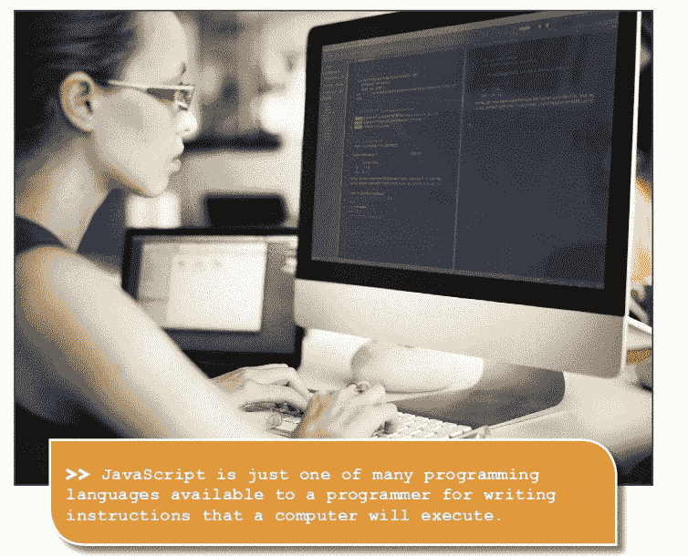

JavaScript 作为一种构建复杂程序的工具，不断成长和成熟。新的 JavaScript 工具和库不断在 JavaScript 世界中涌现，而新版本的 JavaScript 也在定期发布。

有这么多编程语言可用，有人可能会问：“为什么要学习 JavaScript？”首先，JavaScript 被认为比许多其他语言更容易学习。尽管 JavaScript 足够简单，非程序员也能学会，但这种语言足够强大，可以成为专业程序员工具箱中方便的一部分。要使用 JavaScript，程序员只需将代码插入网页即可。JavaScript 可以从网络浏览器运行，无需任何额外的软件程序。对于想要创建具有交互元素、对用户功能良好且视觉吸引人的网站的程序员来说，这是一种非常灵活且高效的语言。

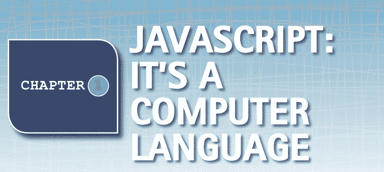

在深入探讨 JavaScript 的细节——它是什么、如何工作、能做什么——之前，先打下基本的计算机编程概念基础会很有帮助。

计算机可以完成许多任务，从简单到高度复杂。在计算机开始任何任务之前，它需要指令告诉它该做什么。计算机程序是一组告诉计算机该做什么的指令。

如果计算机能说人类使用的语言，那么与它们交流可能会更容易。然而，计算机的语言由 1 和 0 组成。因此，人类开发了计算机语言，以便更容易地与机器交流。

在计算机编程的早期，程序是用机器代码（或机器语言）和汇编语言（一种基本的低级编程语言）编写的。机器代码有时被称为本机代码。这种机器代码使用计算机的 1 和 0 语言。这种代码被描述为低级编程语言。

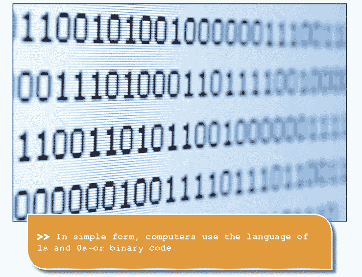

### 编译还是解释？

除了低级语言，还有更接近人类语言（而不像机器语言）的高级语言。程序员通常发现这些高级语言比低级语言更容易读写。高级语言被翻译成机器语言，以便计算机能够执行命令。这是通过编译器或解释器完成的。因此，编程语言可以分为两类：编译型语言和解释型语言。

### 计算机编程语言——过去与现在

计算机编程语言是程序员用来告诉计算机该做什么的编码语言。它可以被视为一组指令，以一系列简短、具体的命令形式写出。就像人类使用的口语一样，每种编程语言都有自己的语法（或语法规则）和语义（或含义）。

最早的编程语言创建于 20 世纪 40 年代，以二进制形式（0 和 1，或开和关）编写。程序员必须手动移动机器中的内存。这种编程耗时且难以理解。

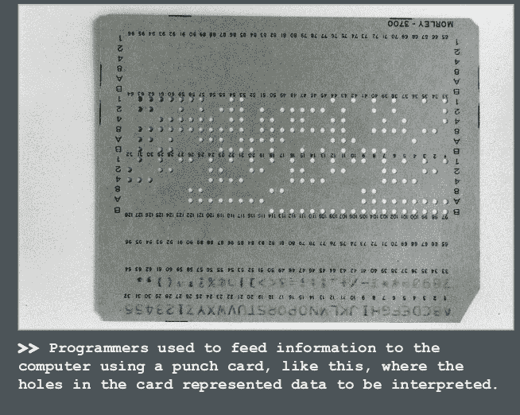

在 20 世纪 50 年代，人们开始创建使用符号来表示机器语言命令的编程语言。使用这些语言，程序员通过汇编器将符号翻译成计算机理解的二进制形式。这仍然是一种非常复杂的编程方式，而且指令中很容易出现错误。

如今程序员使用的语言仍在不断演变，使得编程（与计算机早期时代的二进制代码相比）更容易，并且在编码过程中更不容易出错。

编译型编程语言需要通过编译器（一种软件程序）来运行，编译器将人们编写的代码翻译成计算机能够理解并执行的机器代码。编译型语言通常比解释型语言运行得更快。一些编译型语言的例子包括 Ada、BASIC、C、COBOL、Fortran 和 Pascal。

## JavaScript——一种解释型语言

对于解释型编程语言，语言会被翻译成机器语言，但翻译过程是在程序运行时由用户的网页浏览器完成的。JavaScript 是一种高级解释型编程语言。这类语言在计算机运行程序之前无需通过编译器。其他一些解释型语言的例子包括 MATLAB、Perl、PHP 和 Ruby。

解释型语言的一个优点是程序员可以在任何时候轻松地对程序进行修改。解释型语言的一个缺点是，由于它在程序运行时才进行翻译，因此程序运行速度往往会稍慢一些。随着解释器变得越来越高效，编译型语言和解释型语言之间的速度差异正在缩小。

## JavaScript——一种客户端脚本语言

程序员通常使用编译型语言来创建软件应用程序。他们一般使用解释型语言来运行脚本——即发出命令的简短计算机程序。JavaScript 是一种客户端脚本语言。这意味着用户使用的网页浏览器（也称为客户端）是解释程序并运行脚本的引擎。这个引擎为 JavaScript 提供了在该浏览器中运行所需的一切。

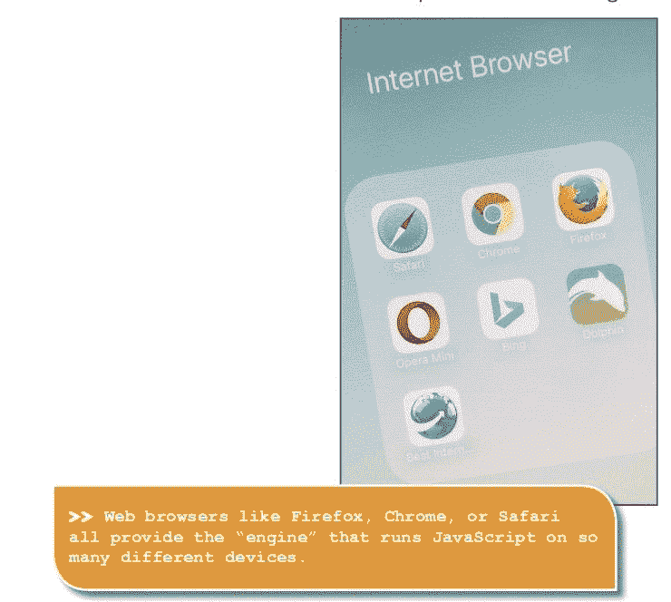

常见的网页浏览器包括 Mozilla Firefox、Google Chrome 或 Apple Safari。也可以仅使用引擎在没有网页浏览器的情况下运行 JavaScript。Google V8 就是这类引擎的一个例子。就像赛车比赛中更快的引擎更受欢迎一样，程序员也希望拥有更快的引擎来运行 JavaScript。目前大多数 JavaScript 引擎都使用一种称为即时编译（JIT）的解释过程，这可以提高程序的速度。

### »程序员、编码员还是开发者——到底是哪个？

有些人将“程序员”、“编码员”或“开发者”这几个词互换使用，来描述编写代码创建软件的人。另一些人则认为这三个词之间存在差异——程序员的职位听起来比编码员更专业一些。（有些程序员可能不希望被称为编码员。）编码员通常被认为是经验最少的程序员。开发者和程序员的职位有时含义相同，因企业而异。然而，开发者职位通常更偏向通才，要求一个人既具备编程技能，又拥有在团队环境中工作的强大人际交往能力——即能够从头到尾监督网页开发和设计项目的人。

### JavaScript 语法

在学习英语时，孩子们通常先学会说，再学会写。在学习书写时，孩子们还必须学习更多支配语言的规则——如何以合理且语法正确的方式排列单词和标点符号。这被称为语言的语法。语法也指计算机语言的规则。

在 JavaScript 中，像这样的标签很常见：`<script>`。符号也很常见：圆括号 `( )`、分号 `;`、花括号 `{ }`、加号 `+` 或引号 `" '`。像 `var` 或 `console.log` 这样的缩写词也频繁出现。`<script>` 标签实际上是一个 HTML 标签，它告诉计算机，当网页打开时，要执行该标签后面的 JavaScript 指令。

这些语法规则对于刚学习编程的人来说可能看起来令人困惑，但练习使用 JavaScript（或任何计算机语言）是关键。通过练习，编写代码时会变得熟悉和自信。

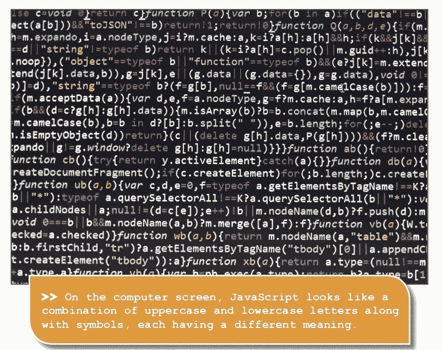

虽然在英语中大小写并不总是那么重要，但 JavaScript 是一种区分大小写的语言。这意味着，为了让计算机理解并遵循程序员给出的指令，一致地处理大小写字母非常重要。

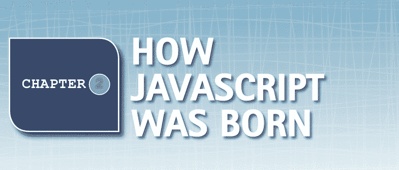

最初，JavaScript 被称为 Mocha。然后它被称为 LiveScript。最后，它被命名为 JavaScript，并且这个名字一直沿用至今。那是在 1995 年，互联网还很年轻。Netscape Communications Corporation 开发了一款网页浏览器——Netscape Navigator（后来更名为 Netscape Communicator）——它越来越受欢迎。

创立 Netscape Communications 的 Marc Andreessen 正在寻找利用互联网日益普及的方法。Andreessen 认为，随着互联网的发展，动画和交互将发挥重要作用。为了让互联网在这些领域发展，Andreessen 知道需要一种能够实现这些功能的编程语言。这种语言不仅供开发者、程序员和软件工程师使用。Andreessen 希望创建一种简单的脚本语言，非开发人员也能学习和使用，从而使 Web 应用程序变得令人兴奋。

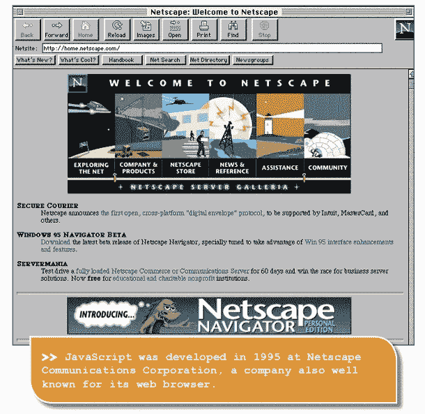

### Brendan Eich——JavaScript 之父

Netscape 指派 Brendan Eich 为他们的 Navigator 浏览器开发这种编程语言。Brendan Eich 如今被视为 JavaScript 之父。他们最初给这个项目取名为 Mocha。Eich 在接受 InfoWorld 采访时解释了它是如何开始的，他说：“想法是做出一些东西，让网页设计师——那些可能没有太多编程培训的人——能够用来为他们的网页表单和网页添加一点动画或一点智能。”Eich 创建 JavaScript 的初期工作从 1995 年 5 月持续到 12 月。

Eich 解释说，JavaScript 这个名字背后的想法是让这种新语言成为一种与编程语言 Java 配合使用的补充性脚本语言。Eich 工作迅速，仅用了几周时间就创建了 Mocha 的原型。在开发 JavaScript 时，他借鉴了现有计算机语言的元素，如 AWK、Java、Self、HyperTalk 和 Scheme。他必须快速工作，因为当时 Netscape 和 Microsoft 之间的竞争非常激烈。（Microsoft 在 JavaScript 推出仅一年后就推出了自己的 JavaScript 版本，称为 Jscript。Jscript 是 Internet Explorer 网页浏览器的一部分。）

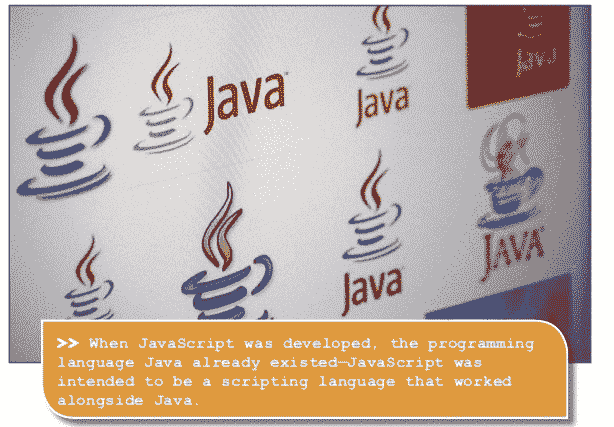

### JavaScript 的诞生

1995 年 5 月，这个 Mocha 原型被添加到 Netscape 浏览器中。到 1995 年 12 月，Netscape 和 Sun Microsystems 通过许可协议联手，新产品被重新命名为 JavaScript。这两家公司将 JavaScript 作为一种在浏览器中执行小任务的脚本语言推出。Java 被视为一种更专业的工具，由程序员和开发者用于更复杂的 Web 组件。这个最早版本的 JavaScript 包含了该语言最新版本中的许多功能特性。JavaScript 的首次公开发布发生在 1995 年，当时它作为 Netscape Navigator 2.0 网页浏览器的一部分问世。

从诞生之初，JavaScript 就非常受欢迎。它改善了计算机用户的体验，以至于竞争性的网页浏览器不得不迅速采取行动，将某种形式的 JavaScript 添加到自己的浏览器中。Netscape 和 Microsoft 都努力为各自的产品添加更多特殊功能，以在销售中占据优势。有些人将这两家公司之间的竞争称为“浏览器大战”。最终结果是给程序员增加了额外的工作，他们必须为所从事的任何项目编写两个不同版本的代码，以便程序在 Netscape 和 Microsoft 的浏览器中都能正常运行。

随着时间的推移，微软的 Internet Explorer 占据了主导浏览器的地位。程序员、开发者以及计算机行业的其他人开始呼吁为 JavaScript 制定标准。有了更好的标准，程序员和开发者将能够创建在不同网页浏览器上行为可靠的应用程序。

## »编程先驱

许多人为当今的技术做出了贡献，尤其是与计算机编程和编程语言相关的领域。以下是几位编程先驱：

查尔斯·巴贝奇：19 世纪的数学家，他构想了一种具有输入设备、处理器、控制单元和输出设备的机器概念。他称之为分析机。

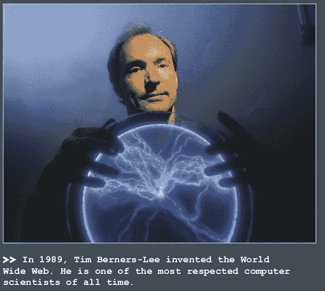

阿达·洛芙莱斯：查尔斯·巴贝奇的朋友，她为巴贝奇的分析机编写了第一个计算机程序。洛芙莱斯被普遍认为是世界上第一位计算机程序员。

艾伦·图灵：他提出了通用图灵机的概念，这是一种可以被编程以执行不同任务的设备。

格蕾丝·霍珀：她是美国海军军官，晋升至少将军衔，并创建了第一个编译器工具，最终促成了名为 COBOL 的计算机语言的发展。

约翰·阿塔纳索夫：他发明了第一台数字计算机。他的阿塔纳索夫-贝里计算机于 1942 年首次测试。

玛格丽特·汉密尔顿：她领导了用于指导阿波罗飞船在 20 世纪 60 年代和 70 年代登月的机载飞行软件的开发。

蒂姆·伯纳斯-李：他被公认为在 1989 年发明了万维网。

### JavaScript 的流行度增长

JavaScript 迅速流行起来。在 1996 年 11 月 Netscape 发布的一篇新闻稿中，JavaScript 的流行激增被描述如下：

> JavaScript 和 Java 是 Netscape ONE 平台用于开发互联网和内联网应用的基石技术。自去年推出以来的短时间内，这些新语言已迅速获得开发者的接受，根据[www.hotbot.com](http://www.hotbot.com)的数据，目前互联网上有超过 17.5 万个 Java 小程序和超过 30 万个支持 JavaScript 的页面。由于 Java 和 JavaScript 支持已集成到其客户端和服务器产品中，Netscape 是构建和运行基于 Java 的应用程序最广泛部署的软件平台，拥有全球数百万用户。

在 JavaScript 首次公开发布之后，该语言的下一件大事是 ECMA 标准化。ECMA 国际是欧洲计算机制造商协会。该组织成立于 1961 年，旨在为计算机系统制定标准。1996 年，ECMA 开始着手制定一种通用脚本语言的标准——即 JavaScript。当 JavaScript 标准发布时，它被命名为 ECMAScript，编号为 ECMA-262。（JavaScript 是 ECMAScript 的商业名称。）ECMAScript 提供了为脚本语言设定标准的规则和指南。

拥有标准很重要，因为不同的公司为计算机用户提供各种网页浏览器。通过遵循 ECMA 标准，所有浏览器将以相同的方式执行 JavaScript 代码。制定该标准的小组名为技术委员会 39（TC-39）。该小组由主要网页浏览器公司的代表组成，包括 Apple、Google、Microsoft 和 Mozilla，以及其他具有网页开发经验的成员。TC-39 继续致力于维护和更新 ECMAScript。

### Ajax 的到来

大约在 2005 年，Ajax（异步 JavaScript 和 XML）这个术语开始使用。Ajax 技术允许从服务器获取的数据仅更新网页的相关部分，而无需重新加载或刷新整个页面。这种技术通过使网页体验更加便捷、无缝和高效来改善用户体验。Ajax 本身不是一种编程语言——它是一种以更高效的方式使用现有技术的技术。

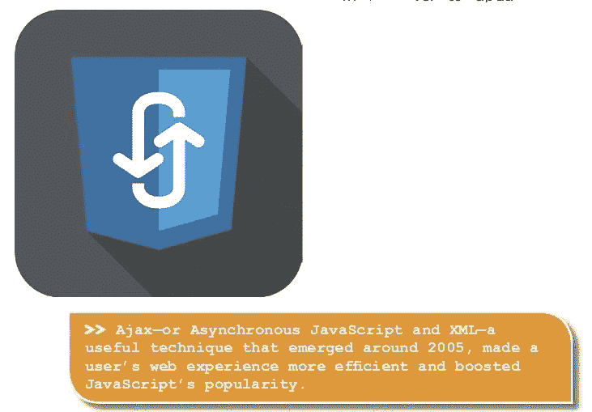

随着 Ajax 的到来，JavaScript 的流行度增长了。专业的计算机程序员重新审视了 JavaScript 的使用，程序员开始创建 JavaScript 库——在这些库中，执行特定任务的 JavaScript 代码在程序员之间共享，使每个人的工作都变得稍微容易一些。

JavaScript 已经成为计算机编程语言世界的一部分超过二十年了。布兰登·艾奇描述了自 1995 年他构想出 JavaScript 以来，它是如何变得越来越流行的。在接受 InfoWorld 采访时，他说：“Web 是最大、最广泛的平台，也许不是最好的平台……但 Web 是每个人都想使用的。你有一个浏览器和一个互联网终端，你就可以使用它。所以如果 JavaScript 是 Web 的脚本语言，它拥有最广泛的覆盖范围。”随着 JavaScript 不断变化和发展以满足不断变化的技术需求，这种语言的未来确实看起来光明。

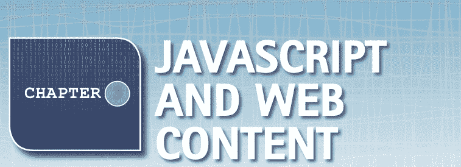

每天有数百万人使用 JavaScript 而从未注意到它。例如，一个在线表单，用户在其中输入信息然后点击“确定”，就是使用了 JavaScript 启用的功能。交互式在线游戏也使用了 JavaScript 启用的功能。JavaScript 无处不在，为任何人可能使用的熟悉网站提供动力。像 Facebook、eBay、Amazon Marketplace、Etsy、Instagram 和 Gmail 这样的网站只是其中几个例子，它们具有由 JavaScript 实现的交互功能。程序员通过将 JavaScript 代码片段（称为脚本）插入到成为网页的文档的头部或主体中来添加 JavaScript。以下是它的工作原理。

### 网页技术的三层蛋糕

程序员使用 JavaScript 告诉网页浏览器要做什么，但 JavaScript 并非单独工作。还有其他一些重要的网页技术帮助网页实现程序员想要的一切。一些程序员使用三层蛋糕的概念来描述 JavaScript、HTML（超文本标记语言）和 CSS（层叠样式表）如何协同工作，为用户提供网页上看到的内容更新、交互功能和特效图形。每一层——HTML、CSS、JavaScript——都发挥着重要的功能，将网站整合在一起。

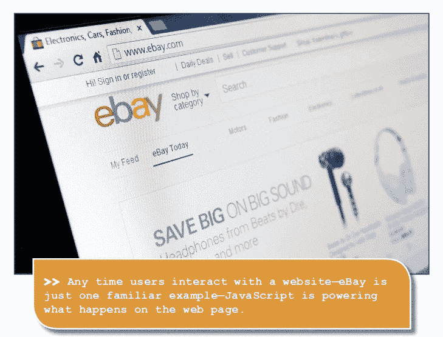

HTML 不是一种编程语言。相反，它是一种使用标签或元素的标记语言。HTML 赋予网站结构。HTML 定义了网页上的段落、标题、表格或嵌入的图片。在 20 世纪 90 年代互联网早期，HTML 是开发者构建网页的唯一语言。编写网站的每个页面是一个缓慢而繁琐的过程。现代程序员和开发者用于设计和构建网页的工具已经发生了巨大变化。

#### HTML 示例：

以下是一些常见的 HTML 标签，用于帮助显示标题、标题或正文文本。

`<head>`

`<title>`

`<body>`

所有 HTML 标签都有开始和结束标签，如下所示：

`<b>All these words would be bold print on the web page.</b>`

`
All these words would be a paragraph on the web page.
`

CSS 和 HTML 一样，不是一种编程语言。相反，顾名思义，它是一种样式表语言。它赋予网站内容样式（布局、背景颜色、字体和边距）。CSS 还允许程序员一次管理多个网页的布局，从而在使用 CSS 时节省时间。程序员使用 CSS 来控制网站的呈现、格式化和布局方式。

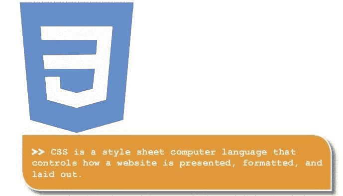

程序员可以通过三种不同的方式将 CSS 添加到 HTML 标签中：

- 程序员使用 HTML 标签中的`style`属性内联添加 CSS。
- 程序员使用文档`<head>`部分中的`<style>`标签内部添加 CSS。

- 程序员通过外部 CSS 文件来添加外部样式。

JavaScript 与 HTML 和 CSS 一起使用，用于控制网页各个部分的行为。JavaScript 允许程序员为网站添加交互功能。这些交互功能让用户能够执行某些操作，然后网站会做出响应。

## 静态网站

在互联网早期，网站是静态的，即一成不变的。它们是用 HTML 代码构建的简单基础网站。每个页面都是一个独立的 HTML 文件，网站就是由这些文件或页面组成的集合。这些页面没有使用任何编程技术。可以将其想象成类似报纸的页面——每次加载时看起来都一样。

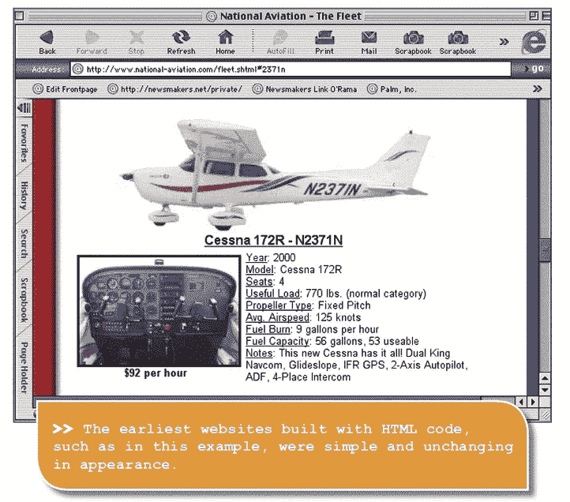

相比之下，动态网站会根据用户或情境的不同而呈现不同的内容。网站可以根据需要生成新内容，在不同情况下显示不同的内容。动态网站也使用 HTML 和 CSS，这两者赋予了网站结构和样式。然而，要实现真正的动态效果，程序员必须使用像 JavaScript 这样的脚本语言——也就是蛋糕的第三层。程序员将 JavaScript 直接嵌入网页的 HTML 中。有了 JavaScript，网站就变成了用户可以使用的工具，而不仅仅是阅读的内容。动态网站的工作方式如下：当用户访问某个特定网址时，服务器会收集信息片段，并构建出用户所看到的网页。

因此，如果没有 JavaScript，网页就是静态的，并且会一直保持静态。JavaScript 代码能让网站更具交互性、更用户友好、更美观。用户会发现使用 JavaScript 的网站更容易导航。借助 JavaScript，程序员可以自动化某些功能——比如在用户打开页面时向其发送个性化的问候语。JavaScript 还能在不重新加载整个页面的情况下实现这些变化——这要归功于 Ajax。谷歌地图就是一个常见的应用，它利用 Ajax 实时更改和操作地图，而无需重新加载页面。

## »JavaScript 的优势与劣势

与所有编程语言一样，JavaScript 也有其优势和劣势。以下是程序员们列举的一些方面：

优势

- 大多数计算机用户都熟悉互联网和网页浏览器——因此，要开始使用 JavaScript，只需打开浏览器并开始编写代码即可。
- 与其他一些编程语言相比，JavaScript 更简单、更容易学习。
- JavaScript 是世界上最流行的语言之一。
- JavaScript 运行速度快，因为代码直接在网页浏览器中运行——无需连接服务器并等待响应。
- JavaScript 既可以在前端（网页浏览器）运行，也可以在后端（服务器）运行。
- JavaScript 可以与其他语言协同工作，并提供广泛的应用场景。

劣势

- JavaScript 可能存在一些安全问题，因为它运行在用户的计算机上。
- 由于 JavaScript 是单线程的（即一次只执行一条命令），有些人认为它运行速度较慢。
- 不同计算机上的 JavaScript 可能看起来不同，因为不同的浏览器对 JavaScript 的实现方式略有差异。

## 网页之外的 JavaScript

JavaScript 最初被设计为在用户的网页浏览器中运行。通过使用 JavaScript，程序员可以编写代码来告诉网站如何表现。这部分开发过程被称为前端开发——即网站的前端。随后在 2009 年，一位名叫 Ryan Dahl 的软件工程师发明了 Node.js（大多数人简称为 Node）。

Node 是一种服务器端技术，它解释 JavaScript 代码，并允许程序员从服务器（服务器属于网站的后端部分）构建和运行他们的网络应用程序。随着 Node 的发明，程序员开始创建许多不在浏览器中运行、仅在服务器上运行的应用程序和 JavaScript 库。程序员也开始开发既可以在客户端运行也可以在服务器端运行的 JavaScript 代码。这种可以在两端运行的代码被称为同构 JavaScript。

借助 Node 提供的功能，程序员开始探索 JavaScript 在网页之外的新用途。它已成为一些大公司越来越青睐的技术。LinkedIn、Groupon、PayPal 和 Netflix 都在其应用程序中使用了 Node.js。

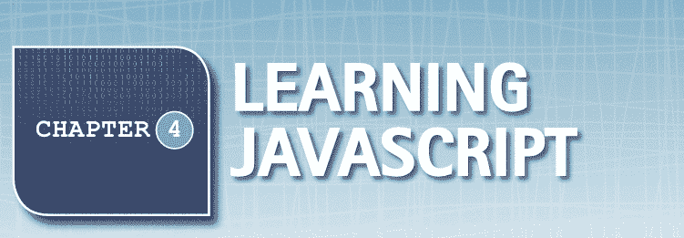

开始学习 JavaScript 是容易的部分。如果你有一台连接互联网并带有网页浏览器的计算机，那么你就可以开始了。所有现代网页浏览器（如 Google Chrome、Firefox、Safari 和 Internet Explorer）都预装了 JavaScript。

## 开始学习 JavaScript

在实际学习 JavaScript 时，有多种方法可供选择。许多学校提供计算机科学课程或课后俱乐部，这将是一个很好的起点。这些课程能让学生在学习计算机科学基础知识的同时，结识其他有相似兴趣的同学。

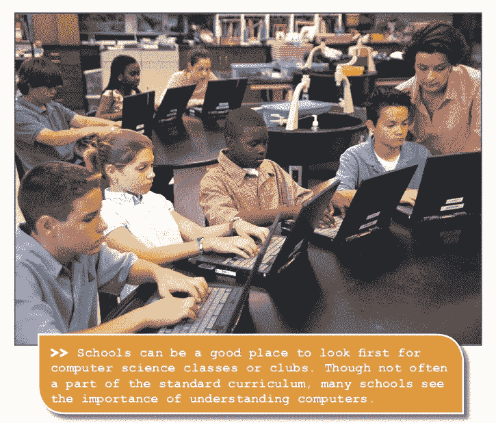

在学校之外，美国各地的夏令营专门教授孩子们如何编程。在网上搜索“JavaScript 夏令营”是找到并报名参加计算机编程（特别是 JavaScript）暑期课程的有效方法。

即使夏令营的费用或时间投入过高，也有在线 JavaScript 课程可以让初学者按照自己的节奏学习这门语言。更棒的是，其中一些课程是免费的。在网上搜索“JavaScript 在线课程”将为有抱负的编程者提供一系列可供选择的在线课程。除了这些在线课程，还有一些旨在教授基本编程技能的在线游戏（例如 Scratch 和 Code Combat）以及教授编程或 JavaScript 基础的 YouTube 视频。

## >>学习编程——在线资源

对于想要开始学习计算机编程基础的学生，这里有一些在线资源：

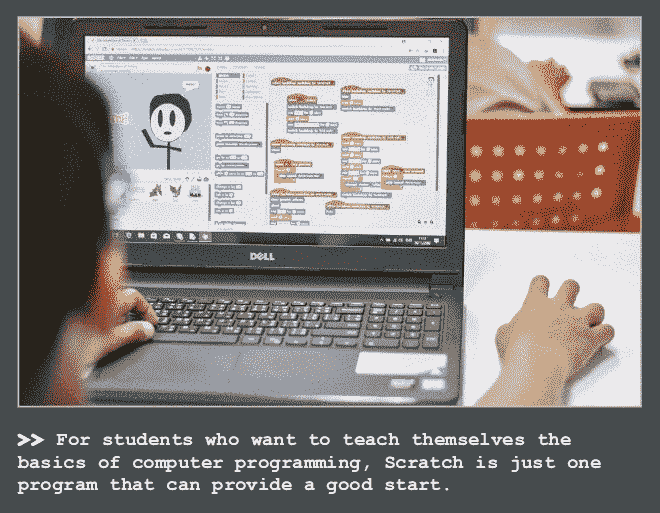

- Alice 允许用户创建 3D 动画和简单游戏。从初中到大学的学生都使用它来学习编程基础。Alice 可在 [`www.alice.org`](https://www.alice.org) 免费下载。
- Codecademy 用户按照自己的节奏学习基本编程技能和 JavaScript 开发。Codecademy 可在 [`www.codecademy.com`](https://www.codecademy.com) 免费使用。
- Code Combat 让用户在玩游戏的同时学习计算机科学。用户在学习并使用 JavaScript 代码的过程中解决谜题、击败敌人。它可在 [`codecombat.com`](https://codecombat.com) 获取。
- Lightbot 是一款编程解谜游戏，用户通过创建可视化程序来移动一个小机器人。它可在 [`lightbot.com`](http://lightbot.com) 获取。
- Scratch 允许用户编写自己的交互式故事、游戏和动画。有需要的学生可以在 Scratch 在线社区与他人分享自己的作品。Scratch 可在 [`scratch.mit.edu`](https://scratch.mit.edu) 免费下载。

### 实习机会

提高初学者编程技能的另一条途径可能是实习。一些知名计算机公司，如苹果、微软、谷歌和 Facebook，都为高中生提供实习项目。虽然这些项目竞争激烈，但许多本地企业也愿意让青少年参加暑期实习，尤其是如果他或她愿意无偿工作，以换取与熟练程序员一起工作和学习的机会。在真实的工作环境中学习是快速培养实践技能的最佳方式之一。实习还能在很大程度上帮助年轻程序员判断计算机科学职业是否适合自己。

尽管编程语言种类繁多，但 JavaScript 是一个极佳的起点。主要原因之一是 JavaScript 几乎触手可及。开始编写和运行 JavaScript 程序只需要一台电脑和一个网页浏览器。JavaScript 解释器直接内置于网页浏览器中，因此它们能够读取 JavaScript 程序。

即使你对编程职业毫无兴趣，当今无数职业也以不同方式受到技术的影响。学习一门编程语言对任何年轻人来说都是一项有用的技能。苹果公司联合创始人史蒂夫·乔布斯在 1995 年接受 PBS 采访时曾说：“这个国家的每个人都应该学习如何编程，学习一门计算机语言，因为它教会你如何思考。”学习编程语言还能增强解决问题的能力。

关键在于要记住，即使作为一名学生，也有许多资源可以帮助任何人更全面地了解编程——而学习 JavaScript 是踏上编程之路的绝佳第一步。

#### 将编程转化为职业

如果你喜欢计算机语言——编写代码并反复测试，直到计算机应用和软件完美运行——那么你或许可以考虑成为一名计算机程序员。在高中阶段，选修学校提供的最高级数学课程以及科学课程，因为这些课程能培养程序员所需的逻辑思维能力。当然，也要选修学校提供的任何计算机科学课程。

大多数程序员拥有学士学位，也有可能获得计算机科学的硕士或博士学位。如果你打算上大学并考虑编程职业，请寻找拥有强大计算机科学系的学校。专业可能是计算机科学、计算机软件工程、计算机系统分析、信息科学、信息技术、编程语言或网页开发，具体取决于学校。

通常，程序员在校期间会学习多种编程语言。有些程序员专攻计算机编程的某一领域，而另一些则掌握并使用多种计算机语言，作为通才工作。拥有计算机科学学位的程序员在职业发展过程中能够轻松掌握新语言。因此，许多程序员终身学习，通过继续教育课程和专业发展研讨会更新技能。

### >>工作，工作，工作

对于喜欢编程中解决问题的部分或学习新计算机语言的人来说，以下是一些可能适合的计算机相关职业。这些工作通常需要学士学位才能获得入门级职位。所有薪资反映的是 2016 年的中位数收入。

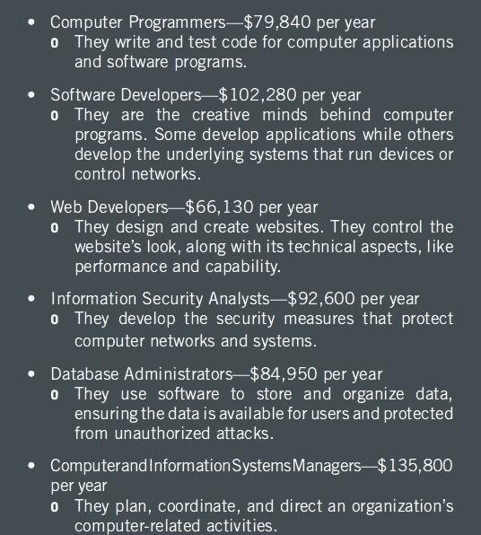

来源：美国劳工统计局——《职业展望手册》。2018 年 4 月。[`www.bls.gov/ooh/computer-and-information-technology/computer-programmers.htm#tab-8`](https://www.bls.gov/ooh/computer-and)。

##### 程序员——一天的工作

在平常的一天中，计算机程序员可能会忙于以下任务：

• 使用多种计算机语言编写新的软件程序
• 更新现有的软件程序
• 测试和调试软件程序，以发现并修复计算机代码中的错误
• 在编程环境中创建和测试代码
• 编写软件程序时使用基础代码的代码库

根据美国劳工统计局的数据，约 38%的计算机程序员在从事计算机系统设计及相关工作的公司任职。金融和保险公司、软件出版商以及制造企业也会雇佣计算机程序员。由于程序员几乎可以在任何有电脑和网络的地方工作，因此编程是一种许多人可以在家工作的职业。约 5%的计算机程序员是自雇人士。

美国劳工统计局的《职业展望手册》指出，对于寻求计算机程序员工作的人来说，以下素质很重要：分析能力、专注力、注重细节以及故障排除能力。学习任何编程语言——包括 JavaScript——都是获得这些能力的好方法。

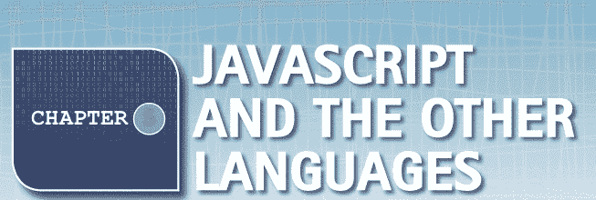

JavaScript 和 Java 这两个名字有些相似。但这两门编程语言究竟有何关联？此外，许多初学者程序员会问哪些语言最好。虽然没有一种“最佳”语言能完美胜任所有任务，但每种语言都有其极为擅长的场景，也有其功能可能不那么强大的场景。

##### JavaScript 和 Java——它们是远亲吗？

JavaScript 和 Java 都是面向对象（OOP）语言。这意味着程序员不仅定义数据类型，还定义操作类型。因此，有些程序员将 JavaScript 和 Java 称为远房表亲。

在 JavaScript 首次发布时，Sun Microsystems 已经在销售 Java。因此，当 Netscape 和 Sun Microsystems 准备发布 JavaScript 时，他们认为使用 JavaScript 这个名称可能会让该软件受益于 Java 已有的知名度。随着时间的推移，出现了一些混淆，JavaScript 有时被误认为是 Java 的轻量级版本。

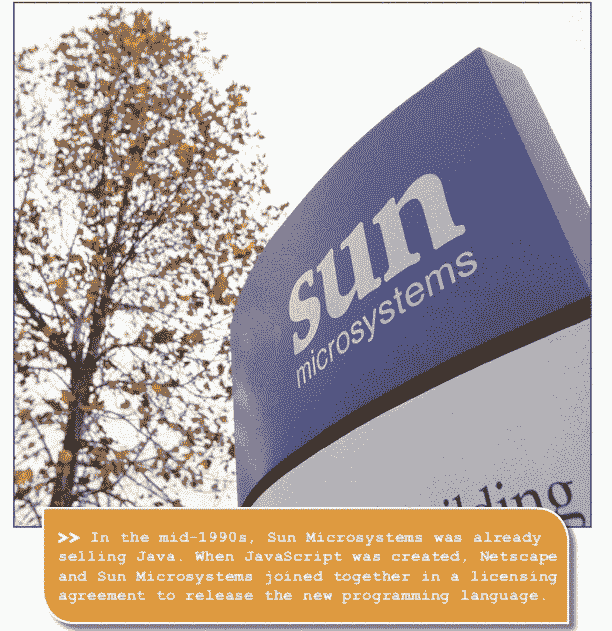

以下是布兰登·艾克在 InfoWorld 采访中谈到 JavaScript 与 Java 的关系时所说的话：

> 那是 1995 年，网络还非常早期……Java 当时也在发展，但它要求你使用一种强大的编程语言，然后运行编译器，将代码打包成一个 applet，成为页面的一部分，但它处于一个独立的小隔间里，有点像被隔离了。而且很难做到——那是给专业程序员用的……而 JavaScript 只是你可以编写的一小段代码，你可以复制别人的代码，边学边用。我们当时把它作为 Java 的小兄弟来推广，作为一种补充语言，就像当时微软语言家族中 Visual Basic 相对于 C++一样。

基本区别在于，Java 是一种编程语言，而 JavaScript 是一种脚本语言（脚本语言依赖于另一个应用程序才能运行——这个应用程序就是浏览器）。程序员使用 Java 创建独立应用程序。他们不会将 JavaScript 用于独立应用程序。相反，他们会在浏览器上运行 JavaScript，为网页添加交互功能。

另一个区别是，Java 是一种编译型计算机语言，而 JavaScript 是一种解释型语言。过去 Java 既能在浏览器上运行，也能在服务器上运行，但到 2010 年代中期，它主要被用于服务器端。相比之下，JavaScript 过去只能在浏览器上运行，但现在它既能在浏览器上运行，也能在服务器上运行。JavaScript 和 Java 不共享相同的插件；它们需要不同的插件。（插件是添加到现有程序中的软件片段，用于赋予程序新功能或新能力。）

## 提升计算机科学知识——在线课程

通过学校或其他组织完成基础课程后，许多初学者希望将学习提升到更高层次。许多大学和公司提供优秀的免费（或廉价）在线课程，涵盖计算机科学主题，包括 JavaScript。

- edX：哈佛大学和麻省理工学院创立了 edX，这是一个在线学习平台。哈佛大学、麻省理工学院、普渡大学、伯克利大学、加州大学圣地亚哥分校等大学，以及微软等公司制作了 edX 的计算机科学课程。[www.edx.org](http://www.edx.org)。
- Coursera：斯坦福大学的教授创立了 Coursera，提供来自众多大学和公司的课程。虽然有些课程需要付费，但也有免费内容。[www.coursera.org](http://www.coursera.org)。
- Khan Academy：可汗学院为学生提供涵盖广泛主题的短视频课程。可汗学院的网站上还提供与视频配套的课程和练习。[www.khanacademy.org](http://www.khanacademy.org)。
- Treehouse：Treehouse 为初学者和更高级的编码人员提供广泛的编程课程。使用 Treehouse 课程需要按月付费，但七天免费试用期让学生可以在决定使用之前先体验一下。[www.teamtreehouse.com](http://www.teamtreehouse.com)。

## JavaScript 与网络编程语言

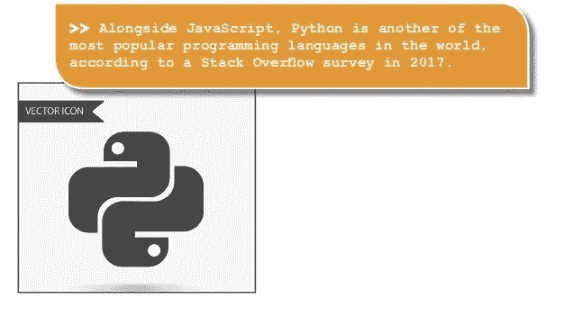

JavaScript 并不是唯一的网络编程语言。对于对 Web 开发工作感兴趣的编程人员来说，有许多 Web 开发语言可以很好地补充编程人员的工具箱，无论是客户端还是服务器端。根据 Stack Overflow 2017 年的调查，继 JavaScript 之后，一些最流行的网络编程语言包括：SQL、Java、C#、Python、PHP、C++、C 和 TypeScript。

### 客户端 JavaScript

Web 开发可以分为两部分：前端（客户端）和后端（服务器端）。在客户端，HTML 和 CSS 是基础但重要的组成部分。虽然它们不是编程语言，但它们赋予了网站结构和样式。

当编程人员将 JavaScript、HTML 和 CSS 结合在一起时，他们可以创建美观且高效运行的网页。然而，在这个组合中还有其他选择。就像 JavaScript 语言本身一样，这些 JavaScript 框架和库也在不断演变。随着时间的推移，较旧的框架和库会逐渐失去人气，并被更新的创新技术所取代。

以下是为使用 JavaScript 的编程人员提供的一些库和框架示例。（库是可以重复使用的代码片段，通常与特定问题或主题相关。简单来说，框架是库的集合。）Angular、Ember、Vue 和 Backbone 都是流行的 JavaScript 框架。React 和 JQuery 是流行的 JavaScript 库。JQuery 是第一个解决浏览器兼容性问题的库。它确保 JavaScript 在所有 Web 浏览器上运行完全一致，无需任何特定于浏览器的代码。

### JavaScript 库——无需借书卡

就像学校和公共图书馆一样，编程语言也有库。在标准图书馆里，许多人可以反复借阅不同的书籍。类似地，在 JavaScript 库中，编程人员可以找到包含现有代码的文件，这些代码可以在他们当前编写的程序中重复使用。JavaScript 库允许编程人员重用现有代码，这样他们就不必浪费时间编写已经存在的代码。这些库有助于扩展和延伸 JavaScript 的能力。最初编写这些代码的编程人员将它们发布到编程世界中供他人使用。虽然有数百个免费的 JavaScript 库可供选择，但 React、JQuery、Lodash 和 Underscore 是一些比较流行的库。

### 服务器端 JavaScript

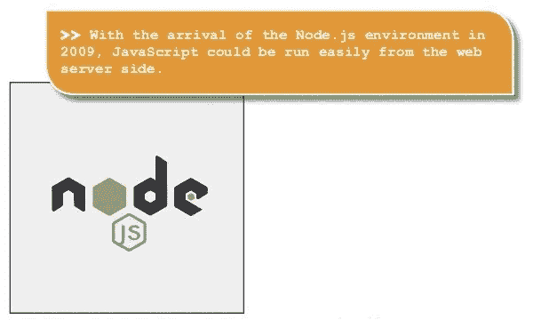

在服务器端运行 JavaScript 并不是什么新鲜事，但这一想法在 2009 年得到了巨大推动，当时 Node.js（一个服务器端环境）问世——使开发人员能够使用 JavaScript 构建服务器和网络应用程序。最终结果是，任何已经熟悉 JavaScript 语言的人都可以编写出性能良好、运行简单的 Web 服务器。除了 JavaScript 之外，服务器端的其他网络编程语言还包括 Java、Python、Ruby、C#、PHP、Go 和 Swift。

有时在阅读或收听关于 JavaScript 的讨论时，你可能会听到一个常见的术语：“原生 JavaScript”。就像香草冰淇淋是没有任何添加配料或特殊口味的普通口味一样，原生 JavaScript 就是纯粹的 JavaScript，不使用任何 JavaScript 库或工具。原生 JavaScript 被用于一些流行的网站，例如 Facebook、YouTube、Twitter、Pinterest 和 Netflix 等。

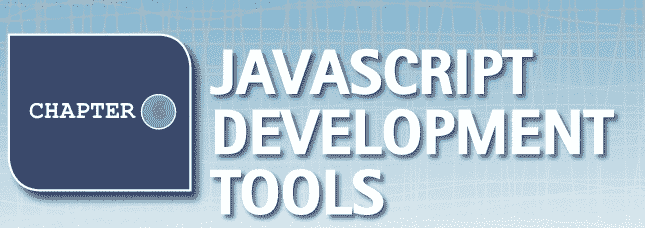

就像机械师工具箱中有帮助他们完成特定任务的工具一样，编程人员也有编程工具。这些编程工具也可以称为软件开发工具。编程工具是一种软件程序，开发人员或编程人员使用它来创建、编辑或调试新的软件程序。这些工具帮助编程人员和开发人员修复错误、编写运行更高效的代码以及防范安全风险，仅举几例优势。换句话说，工具使开发过程对编程人员来说更加容易。

根据 Stack Overflow 2017 年的开发者调查，以下是一些（当然不是全部）更流行的 JavaScript 开发工具。

#### 构建和文档工具

随着 JavaScript 被用于更复杂的项目，编程人员开始使用构建工具来帮助他们在构建 Web 应用程序时安装东西和完成各种任务。Webpack、Grunt、Gulp 和 Yeoman 是一些比较流行的 JavaScript 构建工具。

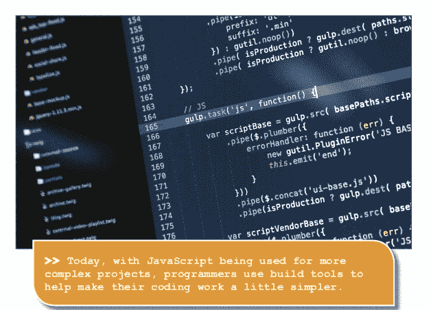

IDE（集成开发环境）和文本编辑器是开发人员和编程人员在构建和测试软件时使用的另一种工具。IDE 通常是一个软件套件，包含代码编辑器、编译器和/或解释器以及调试器。文本编辑器则更加精简，只包含基本功能。Webstorm 是一个功能强大且流行的 IDE，用于高级 JavaScript 开发的编程人员。Atom 和 Brackets 是一些流行的文本编辑器。

文档描述了 JavaScript 软件的工作原理以及如何使用它。一些编程人员将文档描述为将应用程序从黑盒变成玻璃盒的东西。它允许用户查看并理解应用程序的工作原理。Swagger、jGrouseDoc 和 Docco 是流行的 JavaScript 自动化文档工具示例。

### 向编程人员致敬！

程序员有自己的节日，专门用来庆祝他们的辛勤工作。每年，国际程序员节（或程序员日）都在 9 月 13 日（闰年则在 9 月 12 日庆祝）。之所以选在 9 月 13 日，是因为这一天是一年中的第 256 天——而 256 是一个八位字节所能表示的不同数值的个数。此外，256 是小于 365（一年的天数）的 2 的最高次幂。瓦伦丁·巴尔特和米哈伊尔·切尔维亚科夫是最先推动设立一个年度程序员节的人。得益于他们的努力，国际程序员节于 2009 年成为现实。

## 测试、调试和安全工具

程序员使用 JavaScript 测试工具和测试框架来识别并修复错误和缺陷。这种测试有助于程序员确保他们的软件在用户开始使用应用程序之前尽可能无错误且稳定。Jasmine、Mocha 和 PhantomJS 是一些最流行的 JavaScript 测试工具。

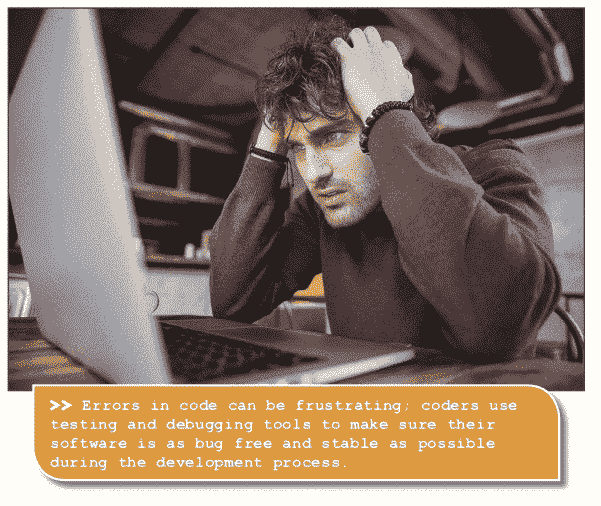

当程序员编写新的计算机代码时，错误很容易出现。这些错误有时可能很难发现和修复。这时，JavaScript 调试工具就派上了用场。JavaScript Debugger、Chrome Dev Tools 和 ng-inspector 是一些流行的 JavaScript 调试工具。

程序员使用安全测试工具来分析他们编写的计算机代码，以发现任何可能让攻击者访问计算机系统的潜在弱点。有了合适的安全工具，程序员可以在攻击发生之前努力发现并修复任何潜在的安全漏洞。Snyk、Node Security Project、RetireJS 和 Gemnasium 是 JavaScript 安全工具的例子。

## 代码优化和分析工具

程序员借助代码优化工具和代码分析来确保他们编写的代码以尽可能高效和有效的方式运行。使用这些工具，程序员可以创建体积更小、速度更快、占用内存更少的程序。JSLint、JSHint 和 Flow 是这些流行 JavaScript 工具的例子。

当一组程序员或开发人员正在开发一个软件项目时，版本控制工具会非常有用。这些控制工具允许团队成员顺畅协作、比较文件，并在开发过程中跟踪从一个版本到下一个版本的变更。无论团队的项目是大是小，这些工具都有助于确保软件开发顺利进行。Git 和 Subversion 是 JavaScript 版本控制工具的例子。

## 包和依赖管理工具

软件存储在包中。这些包包含应用程序、库集合和服务等组件。当程序员和开发人员在团队中工作时，包和依赖管理工具可以帮助他们更好地跟踪和更新库。Bower、Yarn 和 Duo 是一些流行的包和依赖管理工具。

当今技术在我们不断变化的世界中持续大步前进。编程语言是技术的关键组成部分，即使人类目睹着推动世界运转的产品随着新发现而不断变化和进步。数十亿人在生活的方方面面使用网络应用程序，从工作到学习，从购物到社交。JavaScript 是这些网络应用程序的基础之一。作为一种编程语言，JavaScript 已经成长并演变，以跟上不断变化的技术，如更快的网络浏览器和大型应用程序。程序员在构建任何网络内容时都依赖 JavaScript。它相对简单且功能强大，使其成为任何程序员技能组合中的重要组成部分。展望未来，JavaScript 在当今和未来的技术中都占有重要地位。

## 词汇表

**AJAX** 代表异步 JavaScript 和 XML。它是一种节省时间的技术，允许来自服务器的数据刷新网页的相关部分，而无需重新加载整个页面。

**APPLICATION** 为特定目的设计的软件程序；也称为应用。

**BACK END** 计算机系统的服务器端。

**CLIENT SIDE** 就 JavaScript 而言，这意味着计算机语言的命令由网络浏览器执行。

**CODE** 告诉计算机做什么的指令。

**COMPILED LANGUAGES** 通过编译器（一个软件程序）运行来翻译的编程语言。

**COMPUTER PROGRAMMING LANGUAGES** 用某种类似英语的语言编写的计算机指令。

**CSS** 代表层叠样式表，它是一种样式表语言。CSS 通过定义布局、颜色和字体等内容来赋予网站内容样式。

**ECMA** 欧洲计算机制造商协会。ECMA 为计算机系统制定标准。ECMA-262（或 ECMAScript）是 JavaScript 的商业名称。

**FRAMEWORKS** 库、工具和编译器的集合。

**FRONT END** 在网络浏览器（而非服务器）上发生的网络开发，也称为客户端。

**HTML** 代表超文本标记语言，它是一种标记语言。HTML 通过定义段落、表格、标题和嵌入图像等内容来赋予网站结构。

**INTERPRETED LANGUAGES** 由网络浏览器翻译成机器语言的编程语言。

**JAVASCRIPT ENGINE** 理解 JavaScript 代码并执行其指令的程序。JavaScript 引擎通常位于网络浏览器中。

**LIBRARIES** 由程序员编写并提供给其他程序员使用的 JavaScript 代码（就像图书馆里的书，可以被许多人借阅和使用）。

**MACHINE CODE** 由 1 和 0 组成的计算机语言。也称为本机代码或机器语言。

**SCRIPT** 一个简短的计算机程序，为任务提供指令（如果由人执行，可以一次完成一个任务）。

**SINGLE THREADING** 在编程语言中，意味着一次只执行一条命令。

**SYNTAX** 定义编程语言结构的规则。

**TOOLS** 帮助程序员或开发人员创建、编辑或调试新软件程序的软件程序。也可以称为软件开发工具或编程工具。

## 更多信息

## 计算机协会（ACM）
地址：2 Penn Plaza, Suite 701  
纽约市，NY 10121-0701  
电话：(212) 869-7440  
电子邮件：acmhelp@acm.org  
网站：https://www.acm.org  
脸书：@AssociationForComputingMachinery  
Instagram 和 Twitter：@TheOfficialACM  
ACM 是一个计算机学会，其目标是推动计算机科学和计算机专业的发展。

## 信息科学与技术协会（ASIS&T）
地址：8555 16th Street, Suite 850  
银泉市，MD 20910  
电话：(301) 495-0900  
电子邮件：asist@asist.org  
网站：https://www.asist.org  
脸书和 Twitter：@assist_org  
ASIS&T 是一个“弥合信息科学实践与研究之间差距”的协会。

## 计算机女性协会（AWC）
邮箱：PO Box 2768  
奥克兰市，CA 94602  
电子邮件：Info@awc-hq.org  
网站：http://www.awc-hq.org/home.html  
AWC 是一个面向计算机领域女性的专业组织。成员包括程序员、系统分析师、操作员、技术文档撰写员和互联网专家。

## 加拿大专业顾问协会
地址：Suite 703, 157 Adelaide Street West  
多伦多市，安大略省 M5H 4E7  
加拿大  
电话：(416) 545-5213  
免费电话：1-800-483-0766 转 493  
电子邮件：tamarah@apcconline.com  
网站：https://www.apcconline.com  
脸书：@APCCOnline  
Twitter：@APCC_Canada  
APCC 是一个支持以独立小型咨询企业形式运营的信息技术工作者的协会。

## 加拿大信息处理学会（CIPS）
地址：1375 Southdown Road, Unit 16 - Suite 802  
密西沙加市，安大略省 L5J 2Z1  
加拿大  
电话：(905) 602-1370  
免费电话：1-877-ASK-CIPS (275-2477)  
电子邮件：info@cips.ca  
网站：http://www.cips.ca  
脸书：@CIPS.ca  
Twitter：@CIPS  
CIPS 是加拿大信息技术专业人士的协会。

## 计算研究协会（CRA）
地址：1828 L Street NW, Suite 800  
华盛顿特区，DC 20036-4632  
电话：(202) 234-2111  
电子邮件：info@cra.org  
网站：https://cra.org  
脸书：@computingresearch  
Twitter：@CRAtweets  
CRA 联合工业界、政府和学术界，“加强计算领域的研究和高级教育”。

## IEEE 计算机学会
地址：2001 L Street NW, Suite 700  
华盛顿特区，DC 20036-4928  
电话：(202) 371-0101  
电子邮件：help@computer.org  
网站：https://www.computer.org  
脸书：@ieeecomputersociety  
Twitter：@computersociety  
IEEE 是一个专注于计算机科学和技术的会员制组织。

## 全国程序员协会（NAP）
邮箱：PO Box 529  
普雷里维尔市，LA 70769  
电话：(225) 278-2290  
电子邮件：info@napusa.org  
网站：http://www.napusa.org  
NAP 是一个面向计算机行业程序员、开发者和顾问的协会。

## 延伸阅读

Bedell, J. M. *那么，你想成为一名程序员吗？编程、电子游戏创作、机器人技术职业终极指南！* 纽约州纽约市：Aladdin；俄勒冈州希尔斯伯勒：Beyond Words，2016 年。

Beedie, Duncan. *开始编程！学习 HTML、CSS 和 JavaScript，构建网站、应用和游戏。* 马萨诸塞州萨默维尔：Candlewick Press，2017 年。

Chinnathambi, Kirupa. *JavaScript：绝对初学者指南。* 印第安纳州印第安纳波利斯：Que，Pearson Education，2017 年。

Edelman, Brad. *计算机编程：学习它，尝试它！* 明尼苏达州北曼凯托：Dabble Lab/Capstone Press，2018 年。

Haverbeke, Marijin. *Eloquent JavaScript：现代编程入门。* 加利福尼亚州旧金山：No Starch Press，2015 年。

Minnick, Chris, 和 Eva Holland. *给孩子的 JavaScript 傻瓜书。* 新泽西州霍博肯：John Wiley & Sons，2015 年。

Morgan, Nick, 和 Miran Lipovaca. *给孩子的 JavaScript：有趣的编程入门。* 加利福尼亚州旧金山：No Starch Press，2015 年。

Powell, Asher. *无需大学学位的酷炫职业：适合热爱编程的人。* 纽约州纽约市：Rosen Publishing，2018 年。

Sabatino, Michael. *用 JavaScript 理解编程。* 纽约州纽约市：PowerKids Press，2018 年。

Towaha, Syed Omar Faruk. *给孩子的 JavaScript 项目。* 英国伯明翰：Packt Publishing，2016 年。

## 参考文献

Aranda, Michael. “JavaScript 和 ECMAScript 有什么区别？” Free Code Camp，2017 年 10 月 28 日。 [`medium.freecodecamp.orgwhats-the-difference-between-javascript-and-ecmascript -cba48c73a2b5`](https://medium.freecodecamp.org).

Bort, Julie. “为什么 9 月 12 日是国际程序员日？——背后的极客原因。” Business Insider，2016 年 9 月 12 日。 [`www.businessinsider.comwhy-september-12-is-international-programmers -day-2016-9`](http://www.businessinsider.com).

美国劳工统计局. 职业展望手册. “计算机程序员.” 检索于 2018 年 2 月 1 日。 [`www.bls.gov/ooh/computer-and-information-technology/computer-programmers.htm#tab-1`](https://www.bls.gov/ooh/computer-and-information).

Choudhary, Nidhi. “信息图：Node.js 在应用开发中的六大优势。” To The New，2017 年 8 月 24 日。 [`www.tothenew.com/blog/top-6-benefits-of-node-js-for-application-development`](http://www.tothenew.com/blog).

DA-14. “JavaScript 工具终极清单。” 2017 年 6 月 1 日。 [`da-14.com/blog/ultimate-list-javascript-tools`](https://da-14.com/blog/ultimate-list-javascript-tools).

Grantham, Nick. “9 个让编程变得有趣的儿童网站。” Fractus Learning，2017 年 11 月 16 日。 [`www.fractuslearning.com/2011/12/14/programming-for-kids`](https://www).

Jones, Darren. *JavaScript：从新手到忍者。* 澳大利亚墨尔本：SitePoint，2017 年。

Kolowich, Lindsay. “网页设计 101：HTML、CSS 和 JavaScript 如何工作。” HubSpot，2017 年 7 月 28 日。 [`blog.hubspot.com/marketing/web-design-html-css-javascript`](https://blog).

Krill, Paul. “JavaScript 创造者思考过去与未来。” InfoWorld，2008 年 6 月 23 日。 [`www.infoworld.com/article/2653798/application-development/javascript-creator-ponders-past--future.html`](https://www.infoworld.com).

Morgan, Nick. “给孩子的 JavaScript。” [`pepa.holla.cz/wp-content/uploads/2015/11/JavaScript-for-Kids.pdf`](http://pepa.holla.cz).

Mozilla MDN Web Docs. “简介。” 2017 年 11 月 29 日。 [`developer.mozilla.org/en-US/docs/Web/JavaScript/Guide/Introduction`](https://developer.mozilla.org/en-US/docs/Web/JavaScript).

Mozilla MDN Web Docs. “什么是 JavaScript？” 2017 年 10 月 23 日。 [`developer.mozilla.org/en-US/docs/Learn/JavaScript/First_steps/What_is_JavaScript`](https://developer.mozilla.org/en-US/docs/Learn).

网景公司公关部. “行业领袖将在标准机构会议上推动网景 JavaScript 的标准化。” 1996 年 11 月 5 日。 [`web.archive.org/web/19981203070212/`](https://web)[`cgi.netscape.com/newsref/pr/newsrelease289.html`](http://cgi.netscape).

O’Grady, Stephen. “RedMonk 编程语言排名：2017 年 1 月。” RedMonk.com，2017 年 3 月 17 日。 [`redmonk.com/sogrady/2017/03/17/language-rankings-1-17`](http://redmonk.com/sogrady/2017/03/17).

Peyrott, Sebastian. “JavaScript 简史。” 2017 年 1 月 16 日。 [`auth0.com/blog/a-brief-history-of-javascript`](https://auth0.com/blog/a-brief-history-of-javascript).

Prinsloo, Kyle. “2017 年最值得学习的 13 种编程语言。” Usersnap. 检索于 2018 年 2 月 15 日。 https:// usersnap.com/blog/programming-languages-2017.

Ramel, David. “JavaScript 主导 2017 年 Stack Overflow 开发者调查。” ADT Mag，2017 年 3 月 22 日。 https:// adtmag.com/articles/2017/03/22/stack-overflow-survey .aspx.

Rosoff, Matt. “下周将播出的‘遗失’访谈中，史蒂夫·乔布斯说过的最有趣的话。” Business Insider，2011 年 11 月 11 日。 [`www.businessinsider.comthe-best-quotes-from-the-lost-steve-jobs-interview-showing -this-weekend-2011-11`](http://www.businessinsider.com).

Shiotsu, Yoshitaka. “网页开发 101：2018 年最值得学习的网页开发语言。” Upwork.com，2017 年 11 月 28 日。 [`www.upwork.com/blog/2017/11/top-web-development-languages-2018`](https://www.upwork.com).

Techopedia 编辑部. “计算机编程的先驱。” 2013 年 7 月 4 日。 [`www.techopedia.com/2/27836/development/programming-tools /the-pioneers-of-computer-programming`](https://www.techopedia.com/2/27836).

Techopedia——IT 教育网站。“编程工具。”2018 年 1 月 5 日检索。[`www.techopedia.com/definition/8996/programming-tool`](https://www.techopedia.com)。

Wayner, Peter。“JavaScript vs. 其他语言：长寿且繁荣？”Tech Beacon。2018 年 2 月 13 日检索。[`techbeacon.com/javascript-vs-other-languages`](https://techbeacon.com/javascript-vs-other-languages)。

w3schools.com。“HTML 样式——CSS。”2018 年 2 月 11 日检索。[`www.w3schools.com/html/html_css.asp`](https://www.w3schools.com/html/html_css.asp)。

## 索引

### A

Ajax（异步 JavaScript 和 XML），29 的出现，22-23 Alice，34 Amazon，4-5, 24 Andreesen, Marc，15 应用程序，11, 15, 19, 21, 29, 30, 31, 36, 38, 42, 46, 47-50, 51-52

Atanasoff, John，20

### B

Babbage, Charles，19 后端，30, 31, 44 Berners-Lee, Tim，20 浏览器，6, 10-11, 12, 15, 16, 18, 19, 22, 23, 24, 29, 30, 31, 32, 36, 42, 45, 52 劳工统计局，39

### C

客户端，12, 44 Codeacademy，34, 35 Code Combat，33, 35 编译型语言，8, 10, 11 计算机编程语言，4, 9-10, 23, 26

CSS（层叠样式表），24-25, 26, 27, 28, 44

### D

Dahl, Ryan，31

开发者，12, 15, 18-19, 21, 25-26, 46, 47, 48, 51, 52 薪酬，38 调查，6

### E

ECMA 国际（欧洲计算机制造商协会），21 标准化，21, 22 ECMA-262，21

Eich, Brendan，16-18, 23, 41-42 错误，10, 39, 49-50

### F

Facebook，4, 24, 35, 46 框架，44-45, 49 前端，30-31, 44

### G

Google V8，12

### H

Hamilton, Margaret，20 Hopper, Grace，19

### I

IDE（集成开发环境），48

国际程序员日，49

实习，35-36

解释型语言，8, 10-12, 42

### J

JavaScript，优缺点，29-30

JavaScript 引擎，13 JQuery，45

### L

学习 JavaScript，32-33, 34-35, 35-36

库，6, 23, 39, 44-45, 46, 51-52 Lightbot，35 Lovelace, Ada，19

### M

机器码，7, 10

### N

Netflix，31, 46 Node，31, 46, 51

### O

面向对象（OOP）语言，40

### S

Scratch，33, 35 脚本，11-12, 24 单线程语言，30 Sun Microsystems，18, 40 语法，9

JavaScript 的语法，13-14

### T

技术委员会 39（TC-39），22 工具，6, 19, 26, 46, 47 构建和文档工具，47-49 代码优化和分析工具，51 开发工具，47-52 包和依赖管理工具，51-52

测试、调试和安全工具，49-51

Turing, Alan，19 Twitter，4, 46

### V

电子游戏，4

### P

包，42, 51-52 插件，42

程序员，4, 5-6, 8, 9, 10, 11, 12-14, 15, 18-19, 23, 24-25, 26, 27, 28, 29, 30, 31, 35, 42, 44, 45, 47-51, 52 初学者，40 职业，36 教育，37 薪酬，38 工作内容，39

## 关于作者

Donna B. McKinney 是一位居住在北卡罗来纳州的作家。她曾在华盛顿特区的美国海军研究实验室花费多年时间撰写科学和技术主题的文章，如化学、空间科学和机器人学。现在，她喜欢为儿童和青少年撰写科学和技术方面的文章。她还是《*多元化行动杂志*》的特约撰稿人，在该杂志上撰写关于 STEM 职业的文章。

## 图片来源

封面 Kdonmuang/Shutterstock.com；封面、封底、第 1、4-5 页（背景）© iStockphoto.com/letoakin；第 5 页 Rawpixel.com/Shutterstock.com；第 8 页 Stephen VanHorn /Shutterstock.com；第 9 页 The Photo Works/Science Source /Getty Images；第 11 页 © iStockphoto.com/temizyurek；第 14 页 An147yus/Shutterstock.com；第 16 页 © AP Images；第 17 页 360b/Alamy Stock Photo；第 20 页 Catrina Genovese/Wirelmage /Getty Images；第 22 页 Denis Golov/Alamy Stock Vector；第 25 页 JuliusKielaitis/Shutterstock.com；第 26 页 Tal Revivo/Alamy Stock Vector；第 28 页 Getty Images；第 33 页 Arthur Tilley/Stockbyte /Getty Images；第 34 页 Phil’s Mommy/Shutterstock.com；第 41 页 James Leynse/Corbis Historical/Getty Images；第 44 页 Tim Evseev /Shutterstock.com；第 46 页 GaleanoStock/Shutterstock.com；第 48 页 Thongchai Kitiyanantawong/Shutterstock.com；第 50 页 ESB Professional/Shutterstock.com。

设计与排版：Nicole Russo-Duca；编辑：Siyavush Saidian；图片研究员：Karen Huang

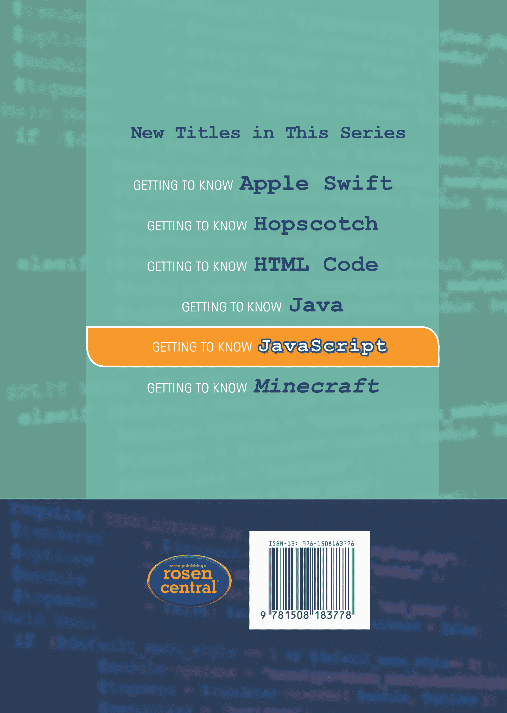
