# Google Maps JavaScript API 秘籍

## 关于作者

**Alper Dincer** 是一名土木工程师，拥有地理科学硕士学位。他在开发和移动 GIS/LBS 项目方面拥有超过 10 年的经验。

从职业生涯伊始，他就一直对地图和地理相关的事物充满热情。他先是在大学担任研究助理，随后进入政府机构从事地图相关工作。他还是一家名为 Mekanşal 的科技公司的联合创始人。

他在地理网络项目方面也取得了一些成就。2009 年，他凭借开源项目 `ExtMap` 在 ESRI 开发者峰会混搭挑战赛中获得第一名。`ExtMap` 基于 Google Maps JavaScript API v2 开发。他是 Google Maps JavaScript API 项目的 Google 认证开发者之一。2010 年，他还以志愿者身份在同一项目中担任监考员。

作为一名开发者和企业家，他仍然喜欢用 JavaScript、PHP 和 Objective-C 进行不同网络和移动项目的编码。他完全认同史蒂夫·乔布斯的名言“热爱你所做的事”以及“求知若饥，虚心若愚”。

> 首先，我想把这本书献给我的妻子 Begüm——我生命中的光——感谢她理解我对编码和数字世界的热情。感谢上帝让她出现在我的生命中。言语无法表达我对她的感激和爱。
>
> 其次，我要感谢我亲爱的家人，他们永远支持着我。

**Balkan Uraz** 是一名城市规划师，拥有地理科学硕士学位。他在地理信息系统（GIS）领域拥有超过 15 年的经验。

在他的整个职业生涯中，他参与了多个项目，这些项目有一个共同点：GIS。在职业生涯早期，他参与了涉及市政 GIS 和城市信息系统的项目。在进行关于路由系统的繁琐论文工作期间，他还担任过研究助理。

他为土耳其的移动运营商参与了大型 LBS 项目，涉及软件开发和数据库存构建。他联合创办了一家专注于导航数据采集和导航产品的科技公司。他还担任过从事现场跟踪和房地产领域的多家大公司的 GIS 顾问。

在他所有的项目中，他始终围绕着同一个热情展开工作：构建空间基础设施。

> 我要感谢 Esra 在本书写作过程中给予我的爱、支持和鼓励。我也要感谢我的同事们，正是他们的热情和鼓励促成了这本书的撰写。

## 关于审阅者

**Bramus Van Damme** 是一位来自比利时的网络爱好者，自 1997 年发现互联网以来，一直对“一切网络相关的事物”感兴趣。

在职业方面，在多家网络机构担任网页开发者数年之后，他现在是一所技术大学的网络技术讲师。除了教授学生基础的 HTML、CSS 和 JavaScript 之外，他还教他们编写正确的 SQL 语句。在工作中，他还负责编写和维护服务器端网络脚本（PHP）以及网络和移动课程。

在业余时间，他喜欢倒腾与网络相关的技术，并保持他的博客 `bram.us` 及时更新。你可以在 Web 聚会和会议上找到他出席和发言的身影。看到一段优化良好且安全的代码会让他露出笑容。

他和女友 Eveline、儿子 Finn 以及女儿 Tila 住在比利时的 Vinkt。他喜欢猫胜过狗。

**Shreerang Patwardhan** 完成了计算机工程学士学位，此后三年来一直从事各种技术工作。他最开始在印度浦那的一家小型初创公司工作，开发一款创新的太阳能供电的 Linux 手持设备。他还在 Google Maps API v3 方面做了大量工作，并在 GIS 领域工作了一年多。

他目前在印度浦那的一家跨国公司担任高级 Web 开发者，从事各种 Web 应用的前端开发。不工作时，他会在博客“Spatial Unlimited”上撰写关于 Google Maps API v3 或 jQuery Mobile 框架的文章。

不工作或写博客时，他喜欢与家人和朋友共度时光。如果不在网上，你可以在周末找到他打羽毛球。他打羽毛球已有 20 年，还对 ufology 有浓厚的兴趣。

你可以在他的博客、LinkedIn 上找到他，或者在 Twitter（`@shreerangp`）上关注他。

**Rodolfo Pereira** 是一名专注于后端编程的 Web 程序员。他认为编程是生活中最美好的事情之一，因此将其作为他的主要爱好之一。毕竟，工作时享受乐趣不是坏事，你觉得呢？

**Rick Viscomi** 是一名具有 Web 性能背景的前端工程师。他在宾汉姆顿大学学习计算机科学期间，创建并销售了一款名为 `BingBuilder` 的流行课程安排 Web 应用。他也是一名开源开发者，开源了两个项目：`trunk8`，一个 jQuery 智能文本截断插件；以及 `Red Dwarf`，一个用于可视化 GitHub 项目流行度的 Google Maps 热图工具。自 2013 年以来，他一直是 Google 的 Web 开发者，致力于提高 YouTube 页面的速度和加强前端基础设施。

## `www.PacktPub.com`

## 支持文件、电子书、折扣优惠及更多内容

您可能希望访问 `www.PacktPub.com`，获取与您的书籍相关的支持文件和下载内容。

您知道吗？Packt 提供了每本已出版书籍的电子书版本，包含 PDF 和 ePub 格式文件。您可以在 `www.PacktPub.com` 升级至电子书版本，作为纸质书客户，您有权享受电子书副本的折扣。如需了解更多详情，请通过 `service@packtpub.com` 与我们联系。

在 `www.PacktPub.com`，您还可以阅读一系列免费技术文章，注册多种免费通讯，并获取 Packt 书籍和电子书的独家折扣与优惠。

`http://PacktLib.PacktPub.com`

您需要 IT 问题的即时解决方案吗？PacktLib 是 Packt 的在线数字图书馆。在这里，您可以访问、阅读并搜索 Packt 整个书籍库。

## 为何订阅？

- 完全可搜索 Packt 出版的每一本书
- 复制、粘贴、打印和收藏内容
- 按需访问，可通过网页浏览器使用

## Packt 账户持有人免费访问

如果您在 `www.PacktPub.com` 拥有 Packt 账户，您可以立即使用该账户访问 PacktLib 并查看九本完全免费的书籍。只需使用您的登录凭据即可立即访问。

## 前言

目前，Google Maps JavaScript API 既有开源替代品，也有专有替代品，但让该 API 对开发人员来说特别之处在于，它是一个包含基础地图、叠加层和技术能力的完整解决方案。

该 API 让开发人员特别兴奋的原因是，它非常容易构建通用结果，同时在同一个工具箱内也有自己的技巧和高级功能。因此，在使用该 API 时，你可以浮于表面，也可以深入探索。

Google Maps JavaScript API v3 实现了移动场景的快速便捷开发，促进了基于位置的解决方案开发人员深入研究这一领域。关于移动开发的增长，尤其是基于位置的应用程序，Google Maps JavaScript API v3 当之无愧地获得了应有的关注。

最后但同样重要的是，没有哪款地图 API 能像 Google Maps API 这样成功，这离不开持续更新和精心处理的矢量与卫星数据的支持。Google 投入了巨大资源来维护矢量数据的统一结构及其制图质量，而这一努力正在 API 的使用中得到回报。

## 本书内容涵盖

- **第 1 章，Google Maps JavaScript API 基础**，指导你如何创建一个以主要食谱为核心的简单 Google Maps 应用程序。将通过为食谱添加细节来介绍地图对象及其主要选项，包括地图类型。
- **第 2 章，添加栅格图层**，介绍了如何通过一系列食谱添加外部栅格数据，以及 Google 图层，如 Tile、Traffic、Transit 和 Weather 图层。
- **第 3 章，添加矢量图层**，介绍了如何绘制矢量要素以及如何显示 KML 和 GeoRSS 等外部矢量源。
- **第 4 章，使用控件**，详细解释了控件。本章将介绍如何为 Web 和移动设备创建和定制自定义用户界面。
- **第 5 章，理解 Google Maps JavaScript API 事件**，详细描述了事件，以响应地图、图层或标记的行为，如缩放结束、图层更改或标记添加。事件将为地图编程增加更多的交互性。
- **第 6 章，Google Maps JavaScript 库**，详细解释了扩展 Google Maps JavaScript API 功能的库。这些库具有不同的能力，可以增强 Google Maps JavaScript API 的功能。
- **第 7 章，使用服务**，详细阐述了扩展 Google Maps JavaScript API 的服务。包括地理编码和街景视图在内的这些服务，展现了使用 Google Maps JavaScript API 进行地图绘制的真正威力。
- **第 8 章，通过高级食谱掌握 Google Maps JavaScript API**，解释了如何将外部 GIS 服务器和服务与 Google Maps JavaScript API 集成。这些包括 ArcGIS Server、GeoServer、CartoDB 和带有 OGC 服务（如 WMS）的 Google Fusion Tables。

## 阅读本书需要什么

Google Maps JavaScript API 适用于 HTML、CSS 和 JavaScript 代码。因此，一款具有 HTML、JavaScript 和 CSS 处理功能的文本编辑器将是探索本书时的好帮手。

对于 Mac 用户，有很多商业或免费的文本编辑器，如 TextWrangler、BBEdit、Sublime Text 或 WebStorm。它们都能很好地处理 HTML、JavaScript 和 CSS。

对于 Windows 用户，也有不同的文本编辑器，但 Notepad++ 是使用最广泛且最受推荐的。

选择编辑器取决于你的计算机使用习惯，因此没有确切的解决方案或建议供用户选择。每个人都有不同的偏好，这些偏好会影响这些选择。

还需要一个 HTTP 服务器来实现这些食谱。有很多 HTTP 服务器，包括 Apache、IIS 等。但独立服务器的安装过程对大多数用户来说可能是个问题。我们鼓励你使用将 HTTP 服务器、数据库服务器和脚本语言捆绑在一起的解决方案。XAMPP 和 MAMP 分别是适用于 Windows 和 Mac OS X 平台的这类解决方案。

为了获得更好的用户体验，我们创建了一个主应用程序，允许运行所需的食谱并显示其源代码。假设你已经安装并配置了像 XAMPP 或 MAMP 这样的本地 Web 服务器，并且捆绑代码已复制到 HTTP 服务器根内容文件夹中的 `googlemaps-cookbook` 文件夹内，用户可以通过在浏览器中访问 `http://localhost/googlemaps-cookbook/index.html` URL 来运行主应用程序。

## 本书适合谁阅读

本书非常适合那些有兴趣在网站中嵌入简单联系地图的开发人员，以及那些希望开发真实世界复杂 GIS 应用程序的人。它也适合那些想要从地理相关数据创建基于地图的信息图表（如热图）的人。假定你已经具备一些 HTML、CSS 和 JavaScript 经验，以及与 GIS 相关的简单概念经验，并对一些 GIS 服务器或服务有初步了解。

## 排版约定

在本书中，你会发现多种文本样式，用于区分不同类型的信息。以下是这些样式的示例及其含义的解释。

文本中的代码词显示如下：“我们可以通过使用 `include` 指令来包含其他上下文。”

代码块设置如下：

```html
<!DOCTYPE html>
<html>
    <head>
        <!-- Include Google Maps JS API -->
        <script type="text/javascript"
        src="https://maps.googleapis.com/maps/api/js?
        key=INSERT_YOUR_MAP_API_KEY_HERE&sensor=false">
        </script>
```

**新术语**和**重要词汇**以粗体显示。

警告或重要提示以如下方框形式出现。

提示和技巧如下所示。

## 读者反馈

我们始终欢迎读者的反馈。让我们知道你对本书的看法——你喜欢什么或可能不喜欢什么。读者反馈对我们开发能让你真正受益的图书非常重要。

要向我们发送一般反馈，只需发送电子邮件至 `feedback@packtpub.com`，并在邮件主题中提及书名。

如果你有擅长的主题，并且有兴趣撰写或参与撰写一本书，请访问 `www.packtpub.com/authors` 查看我们的作者指南。

## 客户支持

既然你已经成为 Packt 图书的骄傲拥有者，我们有以下内容帮助你从购买中获得最大收益。

### 下载示例代码

你可以从你在 `http://www.packtpub.com` 的账户下载所有已购买的 Packt 图书的示例代码文件。如果你在其他地方购买了本书，可以访问 `http://www.packtpub.com/support` 并注册，以让文件直接通过电子邮件发送给你。

### 勘误

尽管我们已尽一切努力确保内容的准确性，但错误仍难免发生。如果你在我们的某本书中发现错误——可能是文本或代码中的错误——如果你能向我们报告，我们将不胜感激。这样做可以节省其他读者的挫败感，并帮助我们改进本书的后续版本。如果你发现任何勘误，请访问 `http://www.packtpub.com/submit-errata` 报告，选择你的图书，点击勘误提交表单链接，并输入你的勘误详情。一旦你的勘误得到验证，你的提交将被接受，勘误将被上传至我们的网站，或添加到该图书标题勘误部分的 existing 勘误列表中。任何现有勘误都可以通过从 `http://www.packtpub.com/support` 选择你的图书标题来查看。

### 盗版

互联网上版权材料的盗版是所有媒体持续存在的问题。在 Packt，我们非常严肃地对待版权和许可证的保护。如果你在互联网上以任何形式发现我们作品的非法副本，请立即向我们提供位置地址或网站名称，以便我们采取补救措施。

请通过 `copyright@packtpub.com` 联系我们，并提供涉嫌盗版材料的链接。

感谢你在保护我们的作者以及我们为你提供有价值内容的能力方面所给予的帮助。

### 问题

如果你在本书的任何方面遇到问题，可以通过 `questions@packtpub.com` 联系我们，我们将尽力解决。

# Google Maps JavaScript API 基础

在本章中，我们将涵盖：

- 在自定义 DIV 元素中创建简单地图
- 创建简单的全屏地图
- 从 Web 转向移动设备
- 以编程方式更改地图属性
- 更改基础地图

## 简介

位置定位正日益成为一个热门话题，而谷歌正是该领域的主要变革者之一。大多数网站都有联系页面，上面显示着标示企业位置的谷歌地图。这是 Google Maps JavaScript API 最简单的用法。它还有其他高级用法，用于在地图上展示不同的信息。本书包含多个关于 Google Maps JavaScript API 使用方法的教程，涵盖从入门到高级的主题。Google Maps JavaScript API 由不同的部分组成，例如栅格/矢量图层、控件、事件和服务，这些都会在后续章节中介绍。

Google Maps JavaScript API 既有开源替代品，也有商业替代品，例如 OpenLayers、Leaflet、Bing Maps、MapQuest 和 Here Maps（前身为 Nokia Maps），但 Google Maps JavaScript API 在基础地图、卫星图像和 API 本身方面具有出色的支持。例如，该 API 可用于在地图上只显示一个位置，或者显示政府机构的全部数据。

Google Maps JavaScript API 并非免费的地图展示工具，但其免费使用限额对大多数开发者来说已经足够。每个网站每天的地图加载次数限制为 25,000 次，当地图在网页上初始化时即计入统计。

## 在自定义 DIV 元素中创建简单地图

在使用地图应用程序时，创建地图是你所能做的最重要的任务。地图是应用程序的主要部分，用户与之交互，所有的可视化都在此呈现。这部分看似简单，但后续所有章节都依赖于应用程序的这一部分。

本教程将引导你完成在网页上创建简单地图视图的过程。

> 正如前言中所述，我们需要一个 Web 服务器来托管我们的 HTML、JavaScript 和 CSS 文件，以及一个 Web 浏览器在客户端解释它们。

### 准备工作

如前所述，Google Maps JavaScript API 需要与 HTML、CSS 和 JavaScript 代码配合使用。因此，在探索本书的过程中，一个具备 HTML、JavaScript 和 CSS 处理能力的文本编辑器将会是你的好帮手。

对于 Mac 用户，有许多商业或免费的文本编辑器可供选择，例如 TextWrangler、BBEdit、Sublime Text 或 WebStorm。它们都能很好地处理 HTML、JavaScript 和 CSS。

对于 Windows 用户，也有不同的文本编辑器可供选择，但 `Notepad++` 是使用最广泛且最受推荐的一款。

选择编辑器取决于你的电脑使用习惯，因此并没有确切的解决方案或协作方式让用户选择特定类型的编辑器。每个人都有不同的观念，这些观念会影响他们的选择。

你可以在 `Chapter 1/ch01_simple_map.html` 找到源代码。

> **下载示例代码**
>
> 你可以从你的账户中下载所有你已购买的 Packt 图书的示例代码文件，网址为 `http://www.packtpub.com`。如果你在其他地方购买了本书，可以访问 `http://www.packtpub.com/support` 并注册，以便将文件直接发送到你的电子邮箱。

### 实现步骤

以下是使用 Google Maps JavaScript API 创建我们第一张地图的步骤。


1. 创建一个名为 `map.html` 的新空文件，并将以下代码块插入其中。此代码块对于每个使用 Google Maps JavaScript API 的应用程序都是必需的。你必须在以下代码的 URL 中插入你的 Google Maps JavaScript API 密钥。

```html
<!DOCTYPE html>
<html>
    <head>
        <!-- Include Google Maps JS API -->
        <script type="text/javascript"
          src="https://maps.googleapis.com/maps/api/js?
            key=INSERT_YOUR_MAP_API_KEY_HERE&sensor=false">
        </script>
```

> 请确保你已从 Google APIs 控制台（`http://code.google.com/apis/console`）获取了 Google Maps JavaScript API 密钥，并将其替换为 `YOUR_API_KEY`。如果你不更改该部分代码，由于 Google 的 API 规则，你的地图将无法显示。此外，在将地图文档发布到另一个位置或生产环境之前，请务必更改 API 密钥。

2. 需要以下部分来将地图放置在所需位置。在 `<head>` 部分中，添加 HTML 样式代码以创建宽度为 800 像素、高度为 500 像素的地图，使用 `<style>` 元素如下：

```html
<style type="text/css">
    #mapDiv { width: 800px; height: 500px; }
</style>
```

3. 将以下 JavaScript 代码添加到代码中以供 Google Maps JavaScript API 运行。不要忘记在函数外部定义 `map` 对象，以便从代码的每个部分访问它。

```html
<!-- Map creation is here -->
<script type="text/javascript">
  //Defining map as a global variable to access from
//other functions
  var map;
  function initMap() {
    //Enabling new cartography and themes
    google.maps.visualRefresh = true;

    //Setting starting options of map
    var mapOptions = {
      center: new google.maps.LatLng(39.9078, 32.8252),
      zoom: 10,
      mapTypeId: google.maps.MapTypeId.ROADMAP
    };

    //Getting map DOM element
    var mapElement = document.getElementById("mapDiv");

    //Creating a map with DOM element which is just
    //obtained
    map = new google.maps.Map(mapElement, mapOptions);
  }
```

4. 添加以下代码行以完成代码。这部分定义了将添加地图的 `<html>` 标签以及何时初始化地图。

```html
google.maps.event.addDomListener(window, 'load',
    initMap);
</script>
</head>
<body>
    <b>My First Map </b>
    <div id="mapDiv"></div>
</body>
</html>
```

5. 在你喜欢的浏览器中输入本地服务器的 URL（你的 `map.html` 文件存放的位置），查看结果。你会看到一张地图，左上角有导航控件，右上角有基础地图控件。

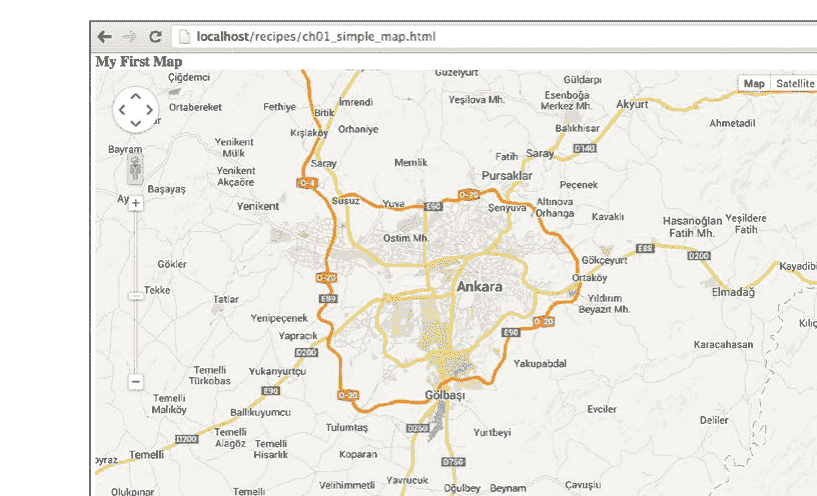

从前面的截图可以看出，我们已经使用 Google Maps JavaScript API 创建了简单的地图。

## 工作原理

让我们开始逐步检查代码。首先，HTML5 文档通过代码 `<!DOCTYPE html>` 定义。然后添加 `<html>` 和 `<head>` 标签。

在 `<style>` 元素之前，使用 `<script>` 元素将 Google Maps JavaScript API 作为引用包含进来，如下所示：

```html
<script type="text/javascript"
    src="https://maps.googleapis.com/maps/api/js?key= INSERT_
    YOUR_MAP_API_KEY_HERE&sensor=false">
    </script>
```

然后在代码中添加了一个新的 `<script>` 标签。在 `<head>` 部分之后，`<body>` 部分开始。

```html
<body>
```

以下代码行监听文档的加载。此事件在页面完全加载时触发 `initMap` 函数。这可以防止由 DOM 及其相关元素引起的不可粒度行为。

```javascript
google.maps.event.addDomListener(window, 'load', initMap);
```

最后，我们有 HTML 标签来创建我们的页面。`id="mapDiv"` 的 `<div>` 元素是显示我们地图的地方。该元素从先前定义的 CSS 标签获取其样式，其宽度为 800 像素，高度为 500 像素。

> `mapDiv` 元素的样式与 CSS 规则直接相关，详细内容可以在 W3Schools 网站（`http://www.w3schools.com/css`）上找到。

如前所述，初始化地图的主要 JavaScript 代码将详细解释。首先，将 `map` 对象定义为全局对象，以便从之后添加的每个函数访问地图。

```javascript
var map;
```

然后定义 `initMap` 函数如下：

```javascript
function initMap() {

}
```

在创建地图之前，调用以下代码将地图主题更改为 2013 年 5 月在 Google IO 2013 上发布的最新主题。此主题是新 Google Maps 中使用的新外观。地图制图和组件样式都是新鲜且最新的；但是，使用此新功能是可选的。如果你不使用以下代码行，你将使用旧主题。

```javascript
google.maps.visualRefresh = true;
```

然后，地图选项将定义如下：

```javascript
var mapOptions = {
    center: new google.maps.LatLng(39.9078, 32.8252),
    zoom: 10,
    mapTypeId: google.maps.MapTypeId.ROADMAP
};
```

地图选项有三个重要参数。

- `center`：这是地图中心的纬度和经度。先前定义的参数是土耳其安卡拉的坐标。如果你不知道如何获取某个地方的坐标，请参阅*第 5 章，理解 Google Maps JavaScript API 事件*中给出的教程。
- `zoom`：此参数是一个整数，定义地图显示的级别。Google 地图的缩放级别从 0（世界级别）到 21+（街道级别）。当缩放级别增加时，用户能看到更多细节但覆盖的区域更少。
- `mapTypeId`：此参数定义地图上显示的基础地图类型。本章后续的教程将详细介绍此参数。

在创建地图对象之前，需要获取将显示地图的 `div` 元素。这是通过经典的 DOM 方法 `getElementById` 完成的，如下所示：

```javascript
var mapElement = document.getElementById('mapDiv');
```

最后，我们万事俱备，可以创建地图对象了：

```javascript
map = new google.maps.Map(mapElement, mapOptions);
```

此代码获取 `mapElement` 和 `mapOptions` 对象来创建地图。第一个参数是放置地图的 `div` 元素，另一个是 `mapOptions` 对象，它保存地图的起始参数。上述代码行使用给定的选项在给定的 `div` 元素中创建地图，并返回地图对象以便后续与地图交互。

> 本书中这个方案是最简单的，但也是开始使用 Google Maps JavaScript API 最重要的一个。地图有很多参数或选项，这些将在后面的章节和方案中讨论。

还要记住，在下面的方案中，为了提供更多的方案，基本代码将不会包含在书中。后续章节和方案中只会给出那些更改过或必需的代码行，但你可以从 Packt Publishing 网站（`http://www.packtpub.com/support`）获取包含所有省略行的完整代码。

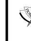

## 创建一个简单的全屏地图

应用程序可以以不同的形式呈现地图。有些在鼠标点击或事件发生后显示地图，有些则直接以全屏模式显示。

本方案将向你展示如何创建一个全屏地图，该地图将用于网页或移动应用程序中。

### 准备工作

如前所述，有些方案只会显示代码中更改过的行，以便容纳更多的方案。本方案是前一个方案*在自定义 DIV 元素中创建简单地图*的修改版本。

你可以在 `Chapter 1/ch01_full_screen_map.html` 找到源代码。

## 操作步骤

你可以按照以下步骤轻松创建一个简单的全屏地图：

1. 首先创建一个名为 `full_screen_map.html` 的新空文件。然后，将前一个 HTML 文件（`map.html`）中的所有代码复制并粘贴到这个文件中。

2. 在新文件中找到以下代码行：

```html
<style type="text/css">
    #mapDiv { width: 800px; height: 500px; }
</style>
```

3. 添加以下行并根据所述的新值进行更改。`width` 和 `height` 值被更改为 `100%`，以便在浏览器视口中使地图全屏。此外，`body` 元素的 `margin` 值被更改为 `0`，以去除地图周围的所有空白。

```html
<style type="text/css">
  html { height: 100% }
  body { height: 100%; margin: 0; }
  #mapDiv { width: 100%; height: 100%; }
</style>
```

4. 在你喜欢的浏览器中输入本地服务器的 URL（你的 `full_screen_map.html` 文件存储的位置），查看结果。你会看到地图的导航控件在左上角，底图控件在右上角，地图填充了整个浏览器区域。

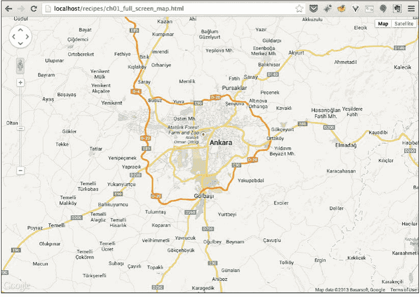

这样我们就成功创建了一个简单的全屏地图。

### 实现原理

Google Maps JavaScript API 使用 HTML 标准的 `div` 组件来显示地图。`div` 组件从 CSS 规则中获取其样式和属性，这些规则定义在顶部 `<head>` 元素中。`#mapDiv` 的 `width` 和 `height` 属性表明 `div` 组件将填充整个浏览器空间。你可以轻松修改这些 `width` 和 `height` 属性，以根据需要改变地图尺寸。

## 更多内容

地图的大小与 CSS 样式直接相关，地图大小与 Google Maps JavaScript API 之间没有直接关系。承载 Google Maps JavaScript API 底图和叠加层的 `DIV` 元素只是一个空白容器，`DIV` 元素越大，你的地图也就越大。

## 参见

- *在自定义 DIV 元素中创建简单地图*方案

## 从网页迁移到移动设备

移动设备如今越来越普及；所有热门网站都在准备他们的移动应用或站点，以便人们随时随地访问。自从 HTML5 中引入了使用适当的 API 访问设备位置的功能以来，地图应用也变得更加流行。

在本方案中，我们将准备一个地图应用，它将在移动浏览器中以全屏方式运行，并借助 W3C Geolocation API 缩放到设备的位置。该 API 也可以从桌面浏览器访问以获取你的位置。

### 准备工作

此代码将在移动设备或模拟器上运行，因此请确保你的代码可以从你的移动设备或模拟器访问。在本方案中，我建议你将代码上传到托管服务器或网站，以便可以从你的移动设备或模拟器轻松访问。

你可以在 `Chapter 1/ch01_mobile_map.html` 找到源代码。

## 操作步骤

如果你想创建一个适合移动设备的地图，你应该按照以下步骤操作：

1. 首先创建一个名为 `mobile_map.html` 的新空文件。然后，将*在自定义 DIV 元素中创建简单地图*方案中介绍的 HTML 文件（`map.html`）中的所有代码复制并粘贴到新文件中。

2. 在新文件中找到以下代码行：

```html
<!-- Include Google Maps JS API -->
<script type="text/javascript"
    src="https://maps.googleapis.com/maps/api/js?
        key=INSERT_YOUR_MAP_API_KEY_HERE&sensor=false">
</script>
```

3. 在之前的代码块之前插入以下行。这一行告诉移动浏览器，当前的网页应用是为移动设备设计的：

```html
<meta name="viewport" content="initial-scale=1.0,
    user-scalable=no" />
```

4. 添加以下 CSS 样式以使地图全屏显示。

```html
<style type="text/css">
    html { height: 100% }
    body { height: 100%; margin: 0; }
    #mapDiv { width: 100%; height: 100%; }
</style>
```

5. 然后，在创建地图对象后添加以下代码块。此代码块将检查你的浏览器是否支持 Geolocation API，并根据设备的坐标设置地图的中心。

```javascript
if (navigator.geolocation) {
    navigator.geolocation.getCurrentPosition(
        function(position) {
            var lat = position.coords.latitude;
            var lng = position.coords.longitude;
            //Creating LatLng object with latitude and
            //longitude.
            var devCenter =  new google.maps.LatLng(lat, lng);
            map.setCenter(devCenter);
            map.setZoom(15);
        });
}
```

6. 将你的文件上传到适当的托管站点，并在你的移动设备或模拟器上检查此 URL。系统会询问你是否允许读取你的位置。如果你允许，你将看到你所在位置的地图。

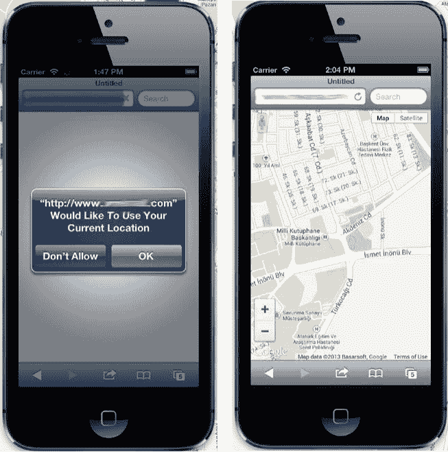

这就是我们实现为移动设备创建简单地图的目标的方式。

### 实现原理

`<meta>` 标签由浏览器和搜索引擎使用，对用户不可见。它们帮助浏览器了解如何表现。在我们的案例中，以下 `<meta>` 标签用于告诉浏览器当前网站已针对移动浏览器进行了优化：

```html
<meta name="viewport" content="initial-scale=1.0,
  user-scalable=no" />
```

这个 `<meta>` 标签解决了用户捏合缩放时的问题，因为捏合应该放大地图本身，而不是文档。

为了获取设备位置，使用了浏览器实现的 W3C Geolocation API。HTML5 标准中有一个 `navigator` 命名空间，首先检查 `Geolocation` 子命名空间以确定浏览器是否支持 Geolocation API。如果 `navigator.geolocation` 返回一个对象，我们可以借助 `getCurrentPosition` 函数获取坐标。回调函数获取设备的纬度和经度，并创建 `google.maps.LatLng` 对象。然后，使用之前创建的 `devCenter` 对象触发地图对象的 `setCenter` 方法。这将根据设备位置更改地图的中心。

回调函数的最后一行用于设置地图的缩放级别。这可以根据你的需要进行更改。

## 更多内容

HTML5 标准仍在进展中，W3 Geolocation API 可能会有所变化。如果你想了解更多关于地理定位的信息，请参考 W3C 文档站点（`http://dev.w3.org/geo/api/spec-source.html`）。

## 参见

- *在自定义 DIV 元素中创建简单地图*方案

## 以编程方式更改地图属性


在本方案之前，地图的交互都是在其内部进行的。用户可以缩放、拖动地图、更改用户界面，或启用/禁用鼠标交互。如果你想在地图外部操作它，你应该访问地图并更改你想要的属性，或者你可以在不同情况下以编程方式更改属性。以编程方式更改地图属性是 Google Maps JavaScript API 的重要部分之一。在大多数地图应用中，用户搜索一个地点，应用应该将地图聚焦到该点。这可以通过地图对象的功能实现。地图功能有很多，但我们只会介绍最常用的那些。

在本方案中，我们将创建一个地图应用，用户可以在地图外部与其交互。使用按钮来与地图进行交互。

### 准备工作

在继续之前，必须先创建一个地图对象才能与其交互。如果未定义地图对象，将会出现错误。这类问题大多数情况下是由于 JavaScript 的异步行为导致的。

你可以在`Chapter 1/ch01_interaction_map.html`找到源代码。

## 如何操作……

如果遵循以下步骤，更改地图属性非常容易：

1. 首先创建一个名为`interaction_map.html`的新空文件。然后，将“在自定义 DIV 元素中创建简单地图”食谱中介绍的 HTML 文件（`map.html`）中的所有代码复制并粘贴到新文件中。

2. 在`initmap()`函数之后添加以下函数。这些函数由 HTML 中定义的按钮调用，用于与地图交互。这些函数将在本食谱稍后解释。

```javascript
function zoomToIstanbul () {
    var istanbul = new google.maps.LatLng(41.0579,29.0340);
    map.setCenter(istanbul);
}
```

```javascript
function zoomToStreet () {
    map.setZoom(18);
}
```

```javascript
function disableDrag () {
    map.setOptions ({ draggable: false });
}
```

```javascript
function setMaxZoom () {
    map.setOptions ({ maxZoom: 12 });
}
```

```javascript
function setMinZoom () {
    map.setOptions ({ minZoom: 5 });
}
```

```javascript
function changeUI () {
    map.setOptions ({ disableDefaultUI: true });
}
```

```javascript
function disableScroll () {
    map.setOptions ({ scrollwheel: false });
}
```

3. 接下来，添加以下函数以监听步骤 5 中 HTML 代码定义的按钮的点击事件。

```javascript
function startButtonEvents () {
    document.getElementById('btnZoomToIst')
        .addEventListener('click', function(){
            zoomToIstanbul();
        });
    document.getElementById('btnZoomToStr')
        .addEventListener('click', function(){
            zoomToStreet();
        });
    document.getElementById('btnDisableDrag')
        .addEventListener('click', function(){
            disableDrag();
        });
    document.getElementById('btnMaxZoom')
        .addEventListener('click', function(){
            setMaxZoom();
        });
    document.getElementById('btnMinZoom')
        .addEventListener('click', function(){
            setMinZoom();
        });
    document.getElementById('btnChangeUI')
        .addEventListener('click', function(){
            changeUI();
        });
    document.getElementById('btnDisableScroll')
        .addEventListener('click', function(){
            disableScroll();
        });
}
```

4. `startButtonEvents`函数必须在初始化地图时调用，因此添加以下代码行：

`startButtonEvents();`

5. 然后，在`<body>`标签内添加以下 HTML 代码行。这些是要显示在网页上的`<button>`标签。每个`button`元素监听点击事件以触发相关函数。

```html
<input id="btnZoomToIst" type="button" value="Zoom To Istanbul">
```

```html
<input id="btnZoomToStr" type="button" value="Zoom To Street Level">
<input id="btnDisableDrag" type="button" value="Disable Drag">
<input id="btnMaxZoom" type="button" value="Set Max Zoom to 12">
<input id="btnMinZoom" type="button" value="Set Max Zoom to 5">
<input id="btnChangeUI" type="button" value="Change UI">
<input id="btnDisableScroll" type="button" value="Disable Scroll Zoom">
```

6. 在您喜欢的浏览器中输入本地服务器的 URL（您的`interaction_map.html`文件存储的位置），并查看结果。您将看到顶部带有按钮的地图。每个按钮触发不同的功能与地图交互。

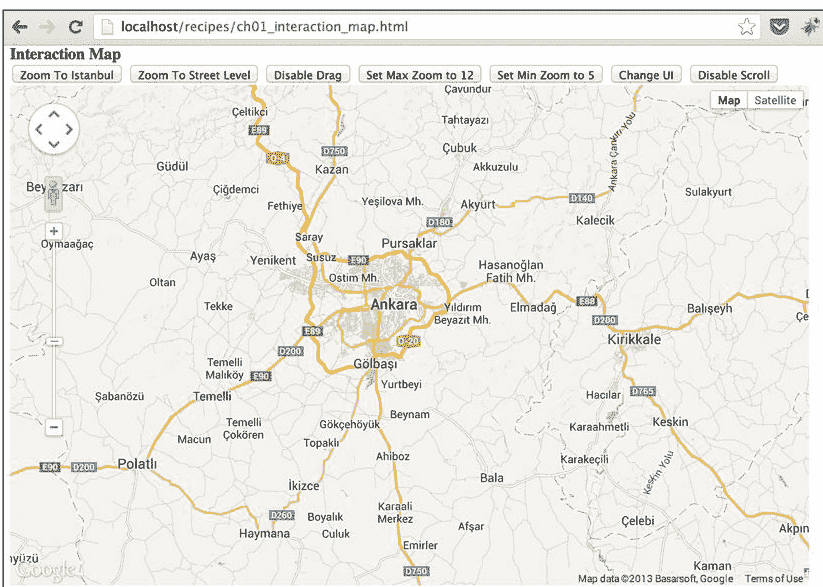

通过此食谱，我们可以以编程方式更改地图属性。

## 工作原理……

前面定义的每个 JavaScript 函数用于更改地图的不同方面。最常用的是更改地图的中心和缩放级别。大多数时候，人们只是在地图上的某个位置移动到另一个位置。例如，如果您要显示咖啡连锁店的位置，地图应该聚焦到每个咖啡店的位置。以下代码创建一个`google.maps.LatLng`对象，该对象将作为`setCenter()`函数的输入。41.0579 和 29.0340 分别是土耳其伊斯坦布尔纬度和经度。您将用您自己的坐标值替换这些坐标值，以更改地图的中心。此函数只会更改地图的中心，不会更改缩放级别。

```javascript
var istanbul = new google.maps.LatLng(41.0579,29.0340);
map.setCenter(istanbul);
```

如果您想要放大或缩小地图以覆盖/显示某个区域，您还应该调整缩放值。例如，您的咖啡店位置在缩放级别 6 时无法为客户提供有效的指引。它至少应该在级别 15 或更高，才能看到街道名称和确切位置。这可以通过以下代码实现：

```javascript
map.setZoom(18);
```

在某些情况下，您不希望用户与地图交互，例如通过禁用鼠标拖动或滚轮滚动来固定地图位置。这些都是`google.maps.MapOptions`对象属性的示例。这些属性直接与地图的属性相关。如果您想要更改地图的一个或多个属性，您应该创建一个 JSON 对象并调用以下地图函数：

```javascript
map.setOptions ({
    draggable: false,
    maxZoom: 12
});
```

使用`setOptions()`函数，您还可以启用或禁用默认控件，但这将在第 4 章“使用控件”中介绍。您可以使用`setOptions()`函数设置一个或多个属性。您可以在属性旁边找到带有注释的简短说明：

```javascript
map.setOptions ({
    draggable: false, //Disables the map drag
    maxZoom: 12, //Sets maximum zoom level
    minZoom: 5, //Sets minimum zoom level
    disableDefaultUI: true, //Removes the default controls
    scrollwheel: false //Disables the mouse scroll wheel
});
```

> **访问地图对象**
>
> 请注意将地图对象定义为全局对象，以便在任何地方访问它。在编写 JavaScript 时，这在某些情况下可能是个问题。请查看以下链接以获取有关 JavaScript 和作用域的更多信息：<http://coding.smashingmagazine.com/2009/08/01/what-you-need-to-know-about-javascript-scope/>。

## 另请参阅

- “在自定义 DIV 元素中创建简单地图”食谱

## 更改底图

底图是映射 API 过程中最重要的部分之一。底图显示道路、卫星图像或地形，可用于不同情况。例如，道路地图可能适合显示咖啡店的位置，但卫星图像则不适合。卫星图像也适合显示地块信息，以检查它们是否绘制正确。Google Maps JavaScript API 有四种不同的底图，例如`ROADMAP`、`SATELLITE`、`HYBRID`和`TERRAIN`。所有这些底图可以在以下截图中看到，并可以进行相互比较。

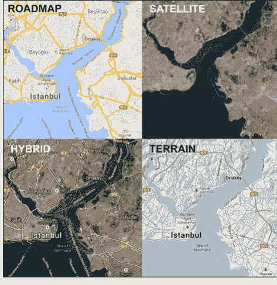

在本食谱中，我们将了解 Google Maps 底图，并学习如何以编程方式更改它们。

### 准备工作

在本食谱中，我们将使用 JavaScript 数组来使函数的输入参数可读。如果您没有任何经验，我建议您在 Google 上查看 JavaScript 数组。

您可以在`Chapter 1/ch01_base_map.html`找到源代码。

## 如何操作……

1. 如果遵循以下步骤，您可以更改地图的底图。

2. 首先创建一个名为`base_map.html`的新空文件。然后，将“在自定义 DIV 元素中创建简单地图”食谱中介绍的 HTML 文件（`map.html`）中的所有代码复制并粘贴到新文件中。

3. 在`initMap()`函数之后添加以下函数。它将监听步骤 4 中添加的按钮的点击事件。它根据按钮的 ID 设置底图。

```javascript
function startButtonEvents () {
    document.getElementById('btnRoad'
      ).addEventListener('click', function(){
        map.setMapTypeId(google.maps.MapTypeId.ROADMAP);
    });
    document.getElementById('btnSat'
      ).addEventListener('click', function(){
        map.setMapTypeId(google.maps.MapTypeId.SATELLITE);
    });
    document.getElementById('btnHyb'
      ).addEventListener('click', function(){
        map.setMapTypeId(google.maps.MapTypeId.HYBRID);
    });
    document.getElementById('btnTer'
      ).addEventListener('click', function(){
        map.setMapTypeId(google.maps.MapTypeId.TERRAIN);
    });
}
```

4. `startButtonEvents`函数必须在初始化地图时调用，因此以下代码行在地图初始化后添加：

`startButtonEvents();`

5. 然后，在地图的`div`元素之前添加以下 HTML 代码行。这些是用于更改底图的 HTML 按钮：

```html
<input id="btnRoad" type="button" value="RoadMap">
<input id="btnSat" type="button" value="Satellite">
<input id="btnHyb" type="button" value="Hybrid">
<input id="btnTer" type="button" value="Terrain">
```

6. 在你喜欢的浏览器中输入本地服务器的 URL（你的`base_map.html`文件存储的位置），然后查看结果。你会看到地图顶部有按钮。每个按钮都会根据其名称更改底图。

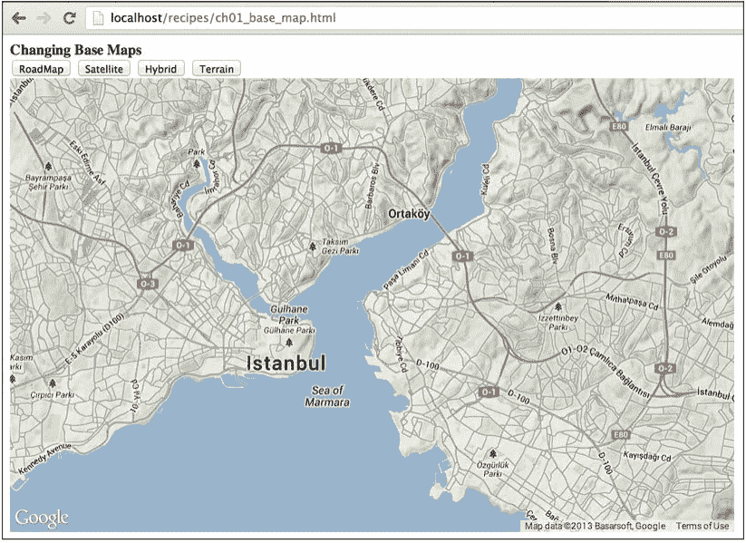

如前面的截图所示，你可以轻松更改 Google 提供的底图。

# Google Maps JavaScript API 基础

## 实现原理……

大部分神奇的功能是由 API 本身完成的；你只需选择要切换到的地图类型即可。

这些地图类型是预先定义的，但也可以将自己的底图或样式化地图添加到 API 并进行切换。添加自己的底图或样式化地图将在“第2章 添加栅格图层”中介绍。

你也可以在`mapOptions`对象中定义起始底图，如下所示：

```javascript
var mapOptions = {
    center: new google.maps.LatLng(39.9078, 32.8252),
    zoom: 10,
    mapTypeId: google.maps.MapTypeId.TERRAIN
};
```

更改地图选项后，你的地图将以`TERRAIN`底图类型打开。

## 更多内容……

更改底图看似是一个简单的主题，但其背后的数学原理和技术并不像使用它们那么简单。Google Maps JavaScript API 中使用的底图和叠加层是在 Web 墨卡托投影系统中处理的。在此投影系统中，角度被保留，但大型物体的尺寸和形状会发生变化。结果，两极看起来比北美洲还要大，这完全不是事实。这种投影是在同一张地图上显示整个世界的好方法。

请查看后续章节以获取详细信息，或查看维基百科文章`https://en.wikipedia.org/wiki/Mercator_projection`。

## 另请参阅

- “在自定义 DIV 元素中创建简单地图”食谱

# 2 添加栅格图层

在本章中，我们将涵盖：

- Google 底图的样式设置
- 使用不同的瓦片源作为底图
- 向地图添加瓦片叠加层
- 向地图添加图像叠加层
- 更改叠加层的透明度
- 创建热力图
- 添加交通图层
- 添加公共交通图层
- 添加骑行图层
- 添加天气和云层
- 添加 Panoramio 图层

## 简介

本章将涵盖关于栅格图层操作的所有内容。本食谱集由 Google Maps JavaScript API 中处理栅格图层最常见的用例组成。

**栅格**是**GIS**世界中的主要数据类型之一。Google Maps JavaScript API 提供了一套广泛的工具来集成外部影像源。此外，API 使应用程序开发者能够使用几乎无限的选择调色板来更改其底图的样式。

# 添加栅格图层

本章将首先介绍如何更改底图的样式，然后继续介绍如何显示栅格数据，重点关注外部**TMS（瓦片地图服务）**，其中栅格图层由地图显示中有组织的瓦片组成（例如，OpenStreetMap）。最后，有许多栅格图层（交通、公共交通、天气、自行车和 Panoramio）可以通过与 Google Maps JavaScript API 集成而在地图上展示。

## Google 底图的样式设置

**Google 底图**显示了多种细节，如水体（海洋、海域、河流、湖泊等）、道路、公园和建成区（住宅区、工业区等）。正如你在第一章中观察到的，这些都是以预定义的制图参数显示的。凭借底图的样式设置功能，你在底图的制图表现方面拥有几乎无限的选择。

在你的网络或移动应用程序中，拥有多样化的表现形式（以各种不同的配色方案，侧重点不同）是非常有益的，这样可以让你的受众更加投入；地图可以完美地融入你的网站设计。

本食谱将指导你完成更改底图样式的过程。

### 准备工作

我们可以从“第1章 Google Maps JavaScript API 基础”中的“在自定义 DIV 元素中创建简单地图”食谱继续，因为我们不需要回顾创建地图的基础知识。

### 实现步骤……

如果按照给定的步骤操作，本食谱的最终成品将看起来像偏蓝色的 Google 地图：

1. 创建一个样式数组，如下所示：


```javascript
var bluishStyle = [
    {
        stylers: [
            { hue: "#009999" },
            { saturation: -5 },
            { lightness: -40 }
        ]
    },
    {
        featureType: "road",
        elementType: "geometry",
        stylers: [
            { lightness: 100 },
            { visibility: "simplified" }
        ]
    },
    {
        featureType: "water",
        elementType: "geometry",
        stylers: [
            { hue: "#0000FF" },
            { saturation: -40 }
        ]
    },
    {
        featureType: "administrative.neighborhood",
        elementType: "labels.text.stroke",
        stylers: [
            { color: "#E80000" },
            { weight: 1 }
        ]
    },
    {
        featureType: "road",
        elementType: "labels.text",
        stylers: [
            { visibility: "off" }
        ]
    },
    {
        featureType: "road.highway",
        elementType: "geometry.fill",
        stylers: [
            { color: "#FF00FF" },
            { weight: 2 }
        ]
    }
]
```

2. 将你的`style`数组添加到`initMap()`函数中。

3. 在`initMap()`函数中，创建一个`styledMapType`对象，并为其命名，然后引用`style`数组：

```javascript
var bluishStyledMap = new google.maps.StyledMapType(bluishStyle,
  {name: "Bluish Google Base Maps with Pink Highways"});
```

## 添加栅格图层

4. 将包含`mapTypeIds`属性的`mapTypeControlOptions`对象添加到你的原始`mapOptions`对象中：

```javascript
var mapOptions = {
    center: new google.maps.LatLng(39.9078, 32.8252),
    zoom: 10,
    mapTypeControlOptions: {mapTypeIds:
        [google.maps.MapTypeId.ROADMAP, 'new_bluish_style']}
};
```

5. 将新的`mapTypeId`属性与你的`styledMapType`对象关联起来：

```javascript
map.mapTypes.set('new_bluish_style', bluishStyledMap);
```

6. 最后，设置要显示的这个新的`mapTypeId`属性：

```javascript
map.setMapTypeId('new_bluish_style');
```

7. 你现在可以观察到蓝绿色调的 Google 底图，如下截图所示：

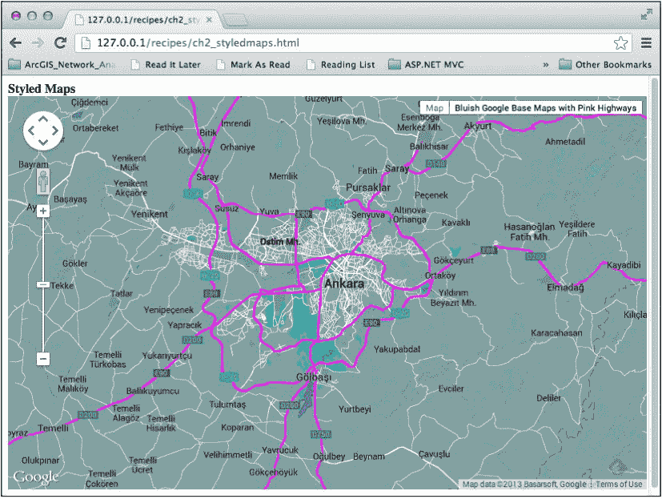

## 实现原理……

首先，我们来看看`bluishStyle`数组，它由一个或多个`google.maps.MapTypeStyle`对象组成，排列方式如下所示：

```javascript
var bluishStyle = [
  {
    featureType: '',
    elementType: '',
    stylers: [
      {hue: ''},
      {saturation: ''},
      {lightness: ''},
      ...
    ]
  },
  {
    featureType: '',
    ...
  }
]
```

在此数组中，你可以为不同的地图要素及其各自的元素（如它们的几何图形、标注等，所有这些都在`google.maps.MapTypeStyleElementType`中指定）包含多种样式。

地图要素包含底图中找到的地理表示类型。行政区域、地貌特征、兴趣点、道路和水体都是地图要素的示例。

除了这些地图要素的一般定义之外，Google Maps JavaScript API 还使你能够指定这些要素的子类型。例如，你可能希望通过为特定 poi 类型赋予`featureType`属性来更改其默认样式，如下所示：

```javascript
featureType: 'poi.school'
```

或者，你可以对地貌地图要素进行更具体的指定：

```javascript
featureType: 'landscape.man_made'
```

> **关于`google.maps.MapTypeStyleFeatureType`对象的更多信息**
>
> `MapTypeStyleFeatureType`对象规范的完整列表可以在<https://developers.google.com/maps/documentation/javascript/reference#MapTypeStyleFeatureType>找到。

## 添加栅格图层

请注意，我们的`bluishstyle`数组的第一个元素不包含任何`featureType`属性，这使得样式器选项对整个底图有效，如以下代码所示：

```javascript
{
    stylers: [
        { hue: "#009999" },
        { saturation: -5 },
        { lightness: -40 }
    ]
}
```

除了`google.maps.MapTypeStyleFeatureType`及其常量外，您还可以详细设置每个地图要素，例如几何图形、几何描边和填充、标签、标签文本（以及文本填充和描边）以及标签图标。借此机会，您可以将道路的几何图形与其相关图标设置成不同的样式。

在我们的示例中，我们已禁用道路所有标签文本的可见性，而不触碰其几何图形或标签图标，如以下代码所示：

```javascript
{
    featureType: "road",
    elementType: "labels.text",
    stylers: [
        { visibility: "off" }
    ]
}
```

> **更多关于`google.maps.MapTypeStyleElementType`对象的信息**
>
> `MapTypeStyleElementType`对象规范的完整列表可在<https://developers.google.com/maps/documentation/javascript/reference#MapTypeStyleElementType>找到。

对于每个要素类型及其元素类型，您可以指定一个`google.maps.MapTypeStyler`对象，它以数组形式涵盖`hue`、`lightness`、`saturation`、`gamma`、`inverse_lightness`、`visibility`和`weight`选项。在我们的示例中，使高速公路显示为粉红色的样式器选项如下：

```javascript
{
    featureType: "road.highway",
    elementType: "geometry.fill",
    stylers: [
        { color: "#FF00FF" },
        {weight: 2}
    ]
}
```

这里，`stylers`数组中的`color`选项是粉红色调的 RGB 十六进制字符串，而`weight`定义了该要素的像素粗细。

> **更多关于`google.maps.MapTypeStyler`对象的信息**
>
> `MapTypeStyler`对象规范的完整列表可在<https://developers.google.com/maps/documentation/javascript/reference#MapTypeStyler>找到。

在`initMap()`函数中定义`style`数组后，我们创建了一个`StyledMapType`对象：

```javascript
var bluishStyledMap = new google.maps.StyledMapType(bluishStyle,
    {name: "Bluish Google Base Maps with Pink Highways"});
```

该对象接受两个参数——第一个是`style`数组，第二个是`google.maps.StyledMapTypeOptions`对象。这里，我们只包含了`name`属性；不过，您还可以额外包含`maxZoom`和`minZoom`属性，`StyledMapType`对象将在这两个缩放级别之间显示。在此示例的截图中，您可以看到我们为`name`属性设置的值显示在界面中。

创建`StyledMapType`对象后，我们在`mapOptions`对象中添加了一个名为`mapTypeControlOptions`的额外对象，该对象在`mapOptions`对象中接受`mapTypeIds`数组，替换了`mapTypeId`属性：

```javascript
var mapOptions = {
    center: new google.maps.LatLng(39.9078, 32.8252),
    zoom: 10,
    mapTypeControlOptions: {mapTypeIds:
        [google.maps.MapTypeId.ROADMAP, 'new_bluish_style']}
};
```

这使我们能够在标准`ROADMAP`地图类型之外添加多种样式。

接下来是将我们在`mapTypeIds`数组中指定的`mapTypeId`（`'new_bluish_style'`）属性与`StyledMapType`对象（`bluishStyledMap`）关联起来的步骤：

```javascript
map.mapTypes.set('new_bluish_style', bluishStyledMap);
```

将`mapTypeId`属性与`StyledMapType`对象关联后，我们可以用以下代码结束，以便地图界面以符合我们意图的样式化底图打开：

```javascript
map.setMapTypeId('new_bluish_style');
```

在我们的示例中，我们介绍了如何根据个人喜好设置底图样式。我们使用了`google.maps.MapTypeStyle`对象来选择要素类型（`google.maps.MapTypeStyleFeatureType`）和相关元素（`google.maps.MapTypeStyleElementType`），并使用`google.maps.MapTypeStyler`对象对它们进行样式设置。然后，我们将`StyledMapType`对象添加到地图中，展示我们自己设计的 Google Maps 底图样式。

## 还有更多……

使用`StyledMapType`对象只是处理 Google Maps JavaScript API 中用户自定义样式底图的方法之一。

另一种更简单的用法是在`mapOptions`对象的`styles`属性中指定`style`数组：

```javascript
var mapOptions = {
    center: new google.maps.LatLng(39.9078, 32.8252),
    zoom: 10,
    mapTypeId: google.maps.MapTypeId.ROADMAP,
    styles: bluishStyle
};
```

另一种替代方案是，在定义`mapOptions`对象后，我们可以稍后添加`styles`属性，代码如下：

```javascript
map.setOptions({styles: bluishStyle });
```

使用`StyledMapType`对象与使用`mapOptions`对象的`style`属性之间存在重要区别。使用`StyledMapType`对象使我们能够定义多个（实际上无限）样式作为地图类型。此外，这些地图类型可以在地图界面的地图类型控件中看到，因此用户可以轻松地在不同地图类型之间切换。

然而，如果样式是通过`mapOptions`对象的`style`属性附加到地图上的，用户就无法更改多种样式。事实上，在地图类型控件中，您将无法选择新样式，因为样式没有附加到`StyledMapType`对象上，因此无法被识别为地图类型。

> 您可以在<http://gmaps-samples-v3.googlecode.com/svn/trunk/styledmaps/wizard/index.html>获取如何使用样式化地图向导的信息。

准备`style`数组是一项涉及大量制图细节的工作。在样式器中为每个要素和元素类型找到正确的组合需要花费大量时间，尤其是如果唯一的编辑方式是在文本编辑器中进行的话。Google通过创建样式化地图向导来完成这项耗时任务，做得很出色。它使您能够在界面上执行所有样式设置任务，从而实时概览您正在进行的更改。完成工作后，您可以将样式导出为 JSON，以用作应用程序中的`style`数组。

## 使用不同的瓦片源作为底图

Google 底图显示了海量内容（本地 POI 信息、道路层级、行车路线等）以及丰富的样式调色板。此外，它还提供了在其 JavaScript API 中更改底图样式的工具。

而且，您可以将其他地图瓦片源作为底图显示在 Google Maps 界面中。此功能使您能够在 Google Maps 界面中显示您的瓦片地图，利用 Google Maps JavaScript API 的大多数工具。

在本示例中，我们将介绍如何使用 JavaScript API 在 Google Maps 界面中将 OpenStreetMap 瓦片显示为底图。

### 准备工作

我们可以继续*第1章*，*Google Maps JavaScript API基础*中的*在自定义 DIV 元素中创建简单地图*示例，因为我们不需要重复介绍将地图显示在屏幕上的基础知识。

### 操作步骤……

完成以下步骤后，您将看到 OpenStreetMap 瓦片叠加在 Google Maps 上：

1. 在`initMap()`函数中，使用以下代码创建一个`ImageMapType`对象：

```javascript
var osmMapType = new google.maps.ImageMapType({
    getTileUrl: function(coord, zoom) {
        return "http://tile.openstreetmap.org/" + zoom +
        "/" + coord.x + "/" + coord.y + ".png";
    },
    tileSize: new google.maps.Size(256, 256),
    name: "OpenStreetMap",
    maxZoom: 18
});
```

2. 将具有`mapTypeIds`属性的`google.maps.mapTypeControlOptions`对象添加到您原有的`google.maps.MapTypeId`对象和`ImageMapType`对象中：

```javascript
var mapOptions = {
    center: new google.maps.LatLng(39.9078, 32.8252),
    zoom: 10,
    mapTypeControlOptions: {mapTypeIds: [google.maps.MapTypeId.ROADMAP,
    'OSM']}
};
```

3. 将新的`mapTypeId`数组与您的`ImageMapType`对象关联起来：

```javascript
map.mapTypes.set('OSM', osmMapType);
```

4. 最后，设置要显示的这个新的`google.maps.mapTypeId`对象：

```javascript
map.setMapTypeId('OSM');
```

5. 您可以看到 OpenStreetMap 瓦片叠加在 Google 底图瓦片上，如以下截图所示：

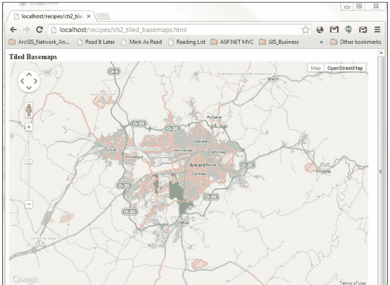

## 工作原理……

你可能已经观察到，*修改谷歌底图样式*教程与本教程的代码结构几乎没有区别。在前者中，我们使用了`StyledMapType`对象来改变原始底图的样式，而在本教程中，我们使用了`ImageMapType`对象。

这是因为`StyledMapType`和`ImageMapType`对象都是`MapType`对象（`google.maps.MapType`）的特殊类型，此外还包括上一章介绍的原始底图类型，如路线图（Roadmap）、卫星图（Satellite）、混合图（Hybrid）和地形图（Terrain）。

让我们一步步来看：


```javascript
var osmMapType = new google.maps.ImageMapType({
    getTileUrl: function(coord, zoom) {
        return "http://tile.openstreetmap.org/" + zoom + "/" +
        coord.x + "/" + coord.y + ".png";
    },
    tileSize: new google.maps.Size(256, 256),
    name: "OpenStreetMap",
    maxZoom: 18
});
```

这部分代码创建了一个`ImageMapType`的`osmMapType`对象。要创建`ImageMapType`对象，我们必须提供两个必需属性：`getTileUrl`和`tileSize`。

在填写这两个参数之前，我们必须确保有可使用的瓦片地图服务。OpenStreetMap（`http://www.openstreetmap.org/`）是一种地图服务，由全球社区共同努力构建和维护。

# 添加栅格图层

瓦片地图服务的组织方式是：将地图影像按预定的每个缩放级别分割成多个部分（瓦片）。这些瓦片沿 x 轴和 y 轴排列，以便瓦片地图服务的消费者（如谷歌地图 API）能够识别它们各自的位置，如下图所示：

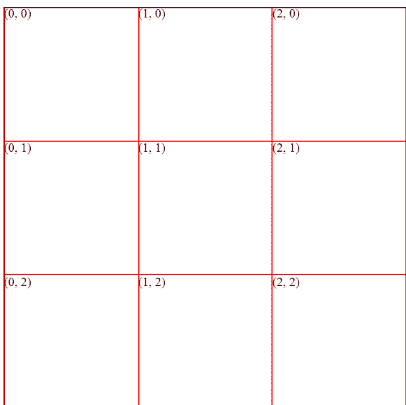

左上角瓦片的坐标是`(0,0)`，称为原点瓦片。在谷歌地图中，原点位于地图界面的左上角（西北角）。

请记住，对于`getTileUrl`属性，我们提供一个包含两个参数`coord`和`zoom`的函数：

```javascript
getTileUrl: function(coord, zoom) {
    return "http://tile.openstreetmap.org/" + zoom + "/" +
    coord.x + "/" + coord.y + ".png";
}
```

`coord`参数正是对应前面截图中介绍的瓦片坐标的坐标对。换句话说，在左上角，`coord.x`应为 0，`coord.y`也应为 0。

假设我们处于缩放级别 0，我们可以尝试从`getTileUrl`属性提供的 OpenStreetMap 地址获取瓦片：

```javascript
"http://tile.openstreetmap.org/" + zoom + "/" + coord.x + "/" + coord.y + ".png"
```

这将产生以下输出：

```text
"http://tile.openstreetmap.org/0/0/0.png"
```

如果你将此地址复制到浏览器的地址栏中，你将获得如下图所示的输出：

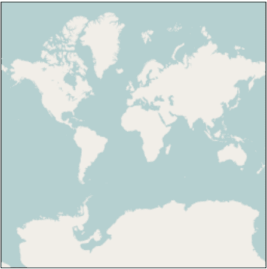

这张图片是 OpenStreetMap 在缩放级别 0 时的单个瓦片。可以推断，OpenStreetMap 在缩放级别 0 时的单个瓦片覆盖了整个地球。

现在，让我们继续看缩放级别 1：

```text
http://tile.openstreetmap.org/1/0/0.png
```

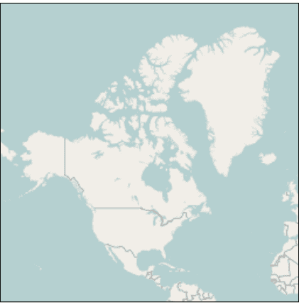

你可能已经注意到，随着缩放级别从 0 增加到 1，细节程度也有所提高。同时，每个瓦片的覆盖范围大幅缩小（在本例中缩小到四分之一）。

你可以在以下截图中看到缩放级别 1 的完整瓦片布局：

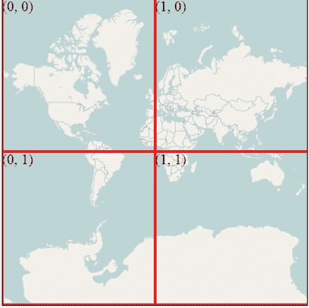

瓦片地图服务的一个重要特性是，在每个缩放级别，前一个缩放级别的每个瓦片都会被再次分割，以获得当前缩放级别所需的细节程度。

回到我们的`osmMapType`创建，`getTileUrl`属性的函数用于放置外部来源（本教程中的 OpenStreetMap）的瓦片。名为`coord`和`zoom`的两个参数由谷歌地图 API 本身处理。API 检测地图的边界框，并为每个缩放级别构建瓦片布局。因此，API 识别出在哪个缩放级别应该请求哪个瓦片坐标。你唯一需要做的就是提供外部瓦片地图源的瓦片地址，这正是你在`getTileUrl`属性中所做的。

第二个属性是`tileSize`属性，它接受一个`google.maps.Size`对象。顾名思义，这个属性以像素值定义每个瓦片的宽度和高度。谷歌地图的瓦片布局以 256 px × 256 px 的瓦片划分；因此我们提供`google.maps.Size(256,256)`，其中第一个参数代表宽度，第二个参数代表高度。

`maxZoom`属性设置瓦片地图服务显示的最大缩放级别。在本教程中，由于`maxZoom`设置为`18`，外部底图在缩放级别 19 时将不会显示。

`name`属性是为瓦片地图服务设置的自定义名称。它直接显示在地图界面右上角的`mapTypeControl`对象中。

最后两行与上一教程中的相同；第一行将`ImageMapType`的`osmMapType`对象与在`mapOptions`的`mapTypeControlOptions`属性中指定`mapTypeID`为`OSM`相关联：

```javascript
map.mapTypes.set('OSM', osmMapType);
map.setMapTypeId('OSM');
```

## 另请参阅

瓦片坐标、像素坐标和世界坐标的详细解释，以及与投影相关的细节，将在后续章节中介绍。

此外，将瓦片地图服务作为底图覆盖层的用法将在下一教程中介绍。

## 在地图上添加瓦片覆盖层

谷歌地图提供了一系列底图，如街道地图和卫星影像，我们在上一章中已经讨论过；现在我们将讨论如何将额外的底图引入谷歌地图界面。

我们还可以将瓦片地图服务用作底图的覆盖层。所谓覆盖层，你可以想象成一张单独的瓦片地图覆盖在底图之上。你可以同时查看覆盖层和底图的细节。覆盖层可以是感兴趣的边界区域、谷歌地图底图中找不到的特殊 POI（兴趣点）、以面样式或点样式呈现的统计结果等。

技术上讲，用作底图的瓦片地图服务可以在谷歌地图 JavaScript API 中用作覆盖层。然而，将这些瓦片地图服务（如 OpenStreetMap）用作覆盖层会遮挡谷歌地图的原始底图，因为覆盖的瓦片地图服务中不会有空白区域（原本设计为底图）。这是因为谷歌地图底图和覆盖的瓦片地图服务都是设计为底图的。因此，不建议将另一个设计为底图的瓦片地图服务作为覆盖层叠加在谷歌地图底图之上。

在本教程中，我们将介绍如何使用 JavaScript API 在谷歌地图界面中将 OpenStreetMap 瓦片显示为覆盖层。

### 准备工作

我们可以使用上一教程的代码，并对其进行一些修改，以避免重复编写`osmMapType`对象的细节。

### 操作步骤

在本教程中，如果你按照以下步骤操作，将看到 OpenStreetMap 瓦片作为覆盖层显示：

1. 在你的`initMap()`函数中，保留`osmMapType`对象不变：

```javascript
var osmMapType = new google.maps.ImageMapType({
    getTileUrl: function(coord, zoom) {
        return "http://tile.openstreetmap.org/" +
        zoom + "/" + coord.x + "/" + coord.y + ".png";
    },
    tileSize: new google.maps.Size(256, 256),
    name: "OpenStreetMap",
    maxZoom: 18
});
```

2. 在你的`mapOptions`对象中，修改`google.maps.mapTypeControlOptions`对象，使其包含`google.maps.MapTypeId.ROADMAP`和`google.maps.MapTypeId.SATELLITE`的`mapTypeIds`。

# 添加栅格图层

## 实现原理

您可能已经注意到，前面的配方和这个配方之间几乎没有区别。我们使用了相同的自定义`osmMapType`对象，即`google.maps.imageMapType`。我们使用了另一个瓦片地图服务，但结构保持不变。

修改从`mapOptions`对象的`mapTypeControlOptions`属性中所使用的`mapTypes`对象开始：

```javascript
mapTypeControlOptions:
{mapTypeIds: [google.maps.MapTypeId.ROADMAP,
  google.maps.MapTypeId.SATELLITE]}
```

我们将`ROADMAP`和`SATELLITE`两种地图类型都包含进来，作为可选的底图。

步骤 3 很重要；我们删除以下行：

```javascript
map.mapTypes.set('OSM', osmMapType);
```

我们删除这一行是因为不希望将`osmMapType`对象作为底图。我们只将其用作叠加层。

下一步，我们选择`ROADMAP`作为默认底图。您可以更改代码行以使用`SATELLITE`，或者通过地图界面中的`mapTypeControl`对象进行切换。

最后一行是实现叠加操作的关键：

```javascript
map.overlayMapTypes.insertAt(0, osmMapType);
```

这里，`overlayMapTypes`属性是一个数组（`google.maps.MVCArray`）。`MVCArray`的`insertAt`方法在指定索引处插入对象，我们在索引 0 处插入了我们的`imageMapType`对象。

> **关于`google.maps.MVCArray`的更多信息**
>
> `google.maps.MVCArray`数组是 Google 对普通 JavaScript 数组的实现。您可以从一个数组构造 MVC 数组。更多详情请参考`https://developers.google.com/maps/documentation/javascript/reference#MVCArray`。

您可以在 Google 地图底图上叠加多个叠加层。必须使用`overlayMapTypes`属性，通过`insertAt`方法的第一个参数来设置叠加地图的顺序，如下所示：

```javascript
map.overlayMapTypes.insertAt(1, anotherMapType1);
map.overlayMapTypes.insertAt(2, anotherMapType2);
```

## 更多内容

叠加图层被放置在底图之上，将其开启和关闭以便查看底图是一种良好的做法。如果您需要关闭叠加层，需要包含以下代码：

```javascript
map.overlayMapTypes.setAt(0, null);
```

这会使叠加图层从地图界面中消失，但请记住，`overlayMapTypes`数组中的槽位已经被`insertAt`方法分配了。因此，如果您想向用户展示开启和关闭叠加图层的机会（通过复选框等方式），可以遵循以下步骤（在继续之前，复制您当前配方的代码）：

1. 在 HTML 代码的`<body>`标签中，添加一个复选框：

```html
<input type="checkbox" id="OSM" class="overlayMaps" onclick="toggleOverlayMaps()" />
<label for="OSM">OpenStreetMap 图层</label>
```

2. 将`osmMapType`作为`initMap()`函数之外的全局变量：

```javascript
var osmMapType;
```

3. 更改`initMap()`函数中的`osmMapType`声明，赋值给新的全局变量：

```javascript
osmMapType = new google.maps.ImageMapType({
    getTileUrl: function(coord, zoom) {
        return "http://tile.openstreetmap.org/" + zoom + "/" + coord.x + "/" + coord.y + ".png";
    },
    tileSize: new google.maps.Size(256, 256),
    name: "OpenStreetMap",
    maxZoom: 18
});
```

4. 将`insertAt`方法替换为`push(null)`方法：

```javascript
map.overlayMapTypes.push(null);
```

5. 添加一个叠加图层切换函数：

```javascript
function toggleOverlayMaps() {
    var OSMLayer = document.getElementById("OSM");
    if (OSMLayer.checked) {
        map.overlayMapTypes.setAt(0, osmMapType);
    } else {
        map.overlayMapTypes.setAt(0, null);
    }
}
```

6. 前面代码片段的主要技巧是首先在`initMap()`函数的`overlayMapTypes`数组中开辟一个空间。之后，您可以调用`setAt()`方法来开启或关闭叠加图层。

### 向地图添加图像叠加层

叠加瓦片地图服务是一项强大的功能。它使得各种瓦片地图服务能够通过 Google Maps API 投入使用。现有的瓦片地图服务库通常是全局性的地图服务，这意味着它们覆盖整个世界或至少某个大陆/国家。

例如，我们可能希望叠加大学校园的地图，手头有其大致规划图。或者，我们可能发现了一些历史地图并希望加以利用。又或者，我们可能有某栋特定建筑的内部平面图，并希望将其显示在 Google 地图之上。

是否可以将这些微观尺度的图像叠加到 Google 地图上？是的，当然可以！事实上，从技术角度来说，使用校园规划图或建筑平面图作为叠加层与使用瓦片地图服务没有什么区别。需要注意的是，这些规划图应该像底图上的瓦片地图服务一样，按瓦片方式对齐。

在本配方中，我们不会详细介绍如何准备瓦片，而是展示如何通过 Google Maps JavaScript API 来使用它们。为了方便，我们将使用 2010 年 Google I/O 在旧金山莫斯克尼中心的会场平面图。

> 有一些工具可以准备用作叠加层的图像瓦片。最著名的是 MapTiler（`www.maptiler.org`）和 GDAL2Tiles（`http://www.klokan.cz/projects/gdal2tiles/`）。使用这些工具，您可以对图像进行地理配准、校正和瓦片化，以适应您选择的缩放级别。

### 准备工作

我们可以使用*使用不同的瓦片源作为底图*配方中的代码，因为只需要很少的修改。

### 操作步骤

如果您按照以下步骤操作，将在 Google 地图底图上拥有一个叠加图层——建筑物：

1. 插入一个`bounds`对象：

```javascript
var bounds = {
    17: [[20969, 20970], [50657, 50658]],
    18: [[41939, 41940], [101315, 101317]],
    19: [[83878, 83881], [202631, 202634]],
    20: [[167757, 167763], [405263, 405269]]
};
```

2. 将`osmMapType`对象替换为`buildPlanMapType`对象：

```javascript
var buildPlanMapType = new google.maps.ImageMapType({
    getTileUrl: function(coord, zoom) {
        if (zoom < 17 || zoom > 20 ||
            bounds[zoom][0][0] > coord.x ||
            coord.x > bounds[zoom][0][1] ||
            bounds[zoom][1][0] > coord.y ||
            coord.y > bounds[zoom][1][1]) {
                return null;
        }
        return
          ['http://www.gstatic.com/io2010maps/tiles/5/L2_'
           , zoom, '_', coord.x, '_', coord.y,
           '.png'].join('');
    },
    tileSize: new google.maps.Size(256, 256),
    name: "Google IO Building Plan",
    maxZoom: 20
});
```

3. 将最后一行更改为：

```javascript
map.overlayMapTypes.insertAt(0, buildPlanMapType);
```

4. 将地图中心定位到莫斯克尼中心：

```javascript
map.setCenter(new google.maps.LatLng(37.78320, -122.40421));
```

在前面的截图中，您可以看到以瓦片方式组织的建筑平面图作为图像叠加在 Google 地图底图之上。

## 实现原理

您可能已经观察到，主要结构与前面的配方保持一致。首先，您定义一个`google.maps.ImageMapType`对象，然后使用`map`对象的`overlayMapTypes.insertAt`数组将其叠加在底图之上。


本配方中唯一的变化是由于示例建筑平面图的边界（边界框）所致。在前面的配方中，叠加瓦片地图服务的边界是全球范围，而在本配方中，我们将其限制在建筑范围内，相对来说尺度要大得多。

因此，我们加入了 `bounds` 对象，用于为每个缩放级别定义瓦片坐标边界。我们将缩放级别限制在 17 到 20 之间，因为较低的缩放级别（<17）无法以合理的合理方式显示建筑物。在 16 和 15 级缩放时，建筑物只会显示为一个小矩形，而在低于 14 级的缩放级别下则根本不会显示。

在 `bounds` 对象的每个缩放级别属性中，我们都有一个 x 和 y 瓦片坐标的数组，x 在前，y 在后。在这些数组中，可以找到瓦片坐标的下限和上限。

此时，你可能想知道这些具体数字是如何找到的：

```javascript
var bounds = {
    17: [[20969, 20970], [50657, 50658]],
    ...
}
```

这些数字实际上是与 Moscone 中心边界相交的瓦片坐标，如下图所示：

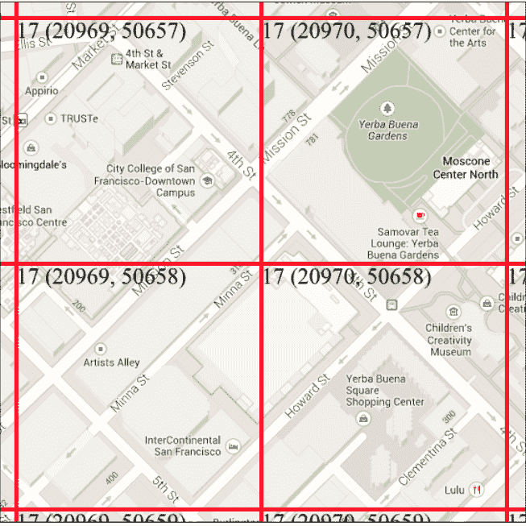

你可以观察到，在第 17 级缩放级别，x 坐标必须在 20969 和 20970 之间，y 坐标必须在 50657 和 50658 之间，才能用于我们的图像叠加。

`bounds` 对象用于在 `buildPlanMapType` 对象的 `getTileUrl` 函数定义中，为有限数量的缩放级别创建约束条件，以获取瓦片。`getTileUrl` 属性的函数会检查每个瓦片坐标与 `bounds` 对象各项的匹配情况，以便 API 不会尝试获取与建筑平面图边界不相交的瓦片。

## 更改叠加层的透明度

Google Maps JavaScript API 支持第三方瓦片地图服务或图像叠加到基础地图之上。然而，叠加层存在一个问题：它们会覆盖在基础地图之上，导致基础地图不可见。当然，你可以根据需要打开或关闭叠加层；但如果你希望同时查看基础地图和叠加层，这就不是解决方案。

事实上，你只需修改叠加层的不透明度，就能同时看到基础地图和叠加层。

本小节将重点介绍如何更改前两个小节中介绍的叠加层的透明度。

### 准备工作

我们可以使用本章“向地图添加瓦片叠加层”小节中介绍的代码，稍作修改来实现目标。请务必先复制该小节的代码。

## 操作步骤

完成以下步骤后，你就能使叠加层变为透明：

1. 修改 `osmMapType` 对象：

   ```javascript
   var osmMapType = new google.maps.ImageMapType({
       getTileUrl: function(coord, zoom) {
           return "http://tile.openstreetmap.org/" + zoom +
           "/" + coord.x + "/" + coord.y + ".png";},
       tileSize: new google.maps.Size(256, 256),
       name: "OpenStreetMap",
       maxZoom: 18,
       opacity: 0.6
   });
   ```

2. 你可以按照下图所示调整叠加层的透明度：

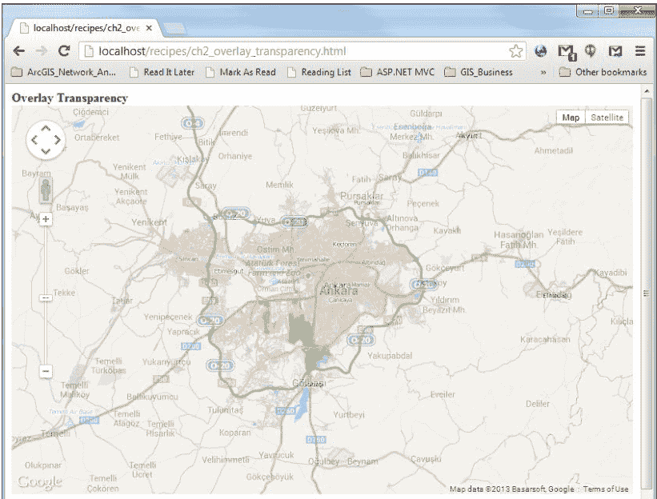

## 工作原理

更改叠加层的透明度非常简单。将以下代码添加到 `imageMapType` 对象中即可完成：

```javascript
opacity: 0.6
```

`imageMapType` 对象的 `opacity` 属性根据提供的值使传入的瓦片变为透明。`opacity` 属性的值必须在 0 到 1 之间，其中 1.0 表示完全不透明的叠加层，而 0 表示完全透明的叠加层。

## 创建热力图

Google Maps API 为多种基于地图的分析奠定了基础，其中包括热力图。热力图是一种可视化形式，通过渐变色彩尺度显示点的集中程度。

在这方面，点可以是任何地理代表性项目的表示，例如医院、房屋、学校、标有坐标的海污染测量值、垃圾收集箱的位置等等。这个列表实际上是无限的。

热力图是地理统计学非常重要的输入。在地图显示中，你可以捕捉到某个时刻的强度，而不仅仅是显示点的位置：

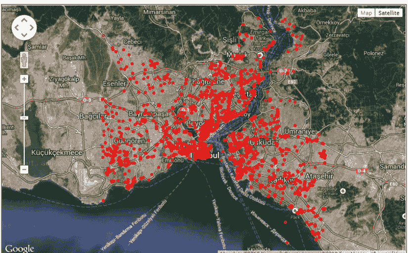

上图展示了截至七月土耳其伊斯坦布尔 OpenStreetMap 点图层的位置。你可能从前面的截图中对点的集中位置有所了解，但下面的截图展示得更清楚。浓度最高 locations 用红色表示，浓度较低的位置用黄色表示。而且，正如你可能已经猜到的，绿色表示的位置浓度最低。

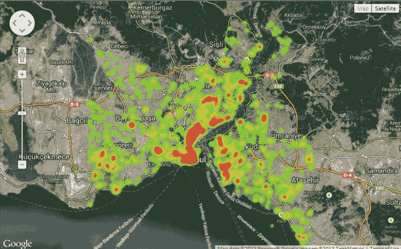

在本小节中，我们将使用 Google Maps JavaScript API 从一组点创建热力图。值得注意的是，此功能在标准的 Google Maps API 中并不可用；你需要将可视化库加载到 API 中，如本小节所示。

### 准备工作

我们可以使用“第 1 章 Google Maps JavaScript API 基础”中的第一个案例作为基础，因为我们不需要重复地图显示的代码。在编辑此案例之前，请不要忘记从原始案例中复制代码。

## 操作步骤

如果你按照以下步骤操作，就能从使用的一组点获得热力图叠加层：

1. 在引用 Google Maps API 的地方，引用 `visualization` 库：

   ```html
   <script type="text/javascript"
       src="https://maps.googleapis.com/maps/api/js?
           sensor=false&libraries=visualization">
   </script>
   ```

2. 在同一目录（包含我们的 HTML 文件）下打开一个新的文本文件，并将其命名为 `ch2_heatMapPoints.js`。

3. 在上一步新建的 JavaScript 文件中，创建一个 `google.maps.LatLng` 对象数组（完整数组共包含 217 个对象，你可以从下载的代码中获取）：

   ```javascript
   var heatmapPoints = [
   new google.maps.LatLng(41.0182827999113, 28.973224999734),
   new google.maps.LatLng(41.0150707003526, 28.9764445996386),
   new google.maps.LatLng(41.01140130003, 28.9831846001892),
   new google.maps.LatLng(41.0148609002104, 28.9764469999292),
   new google.maps.LatLng(41.0149687001455, 28.9764550002981),
   new google.maps.LatLng(41.0148247996249, 28.9757389996552),
   new google.maps.LatLng(41.0020956002318, 28.9736237995987),
   ];
   ```

4. 在你的 HTML 代码中引用 `ch2_heatMapPoints.js` 文件：

   ```html
   <script type="text/javascript"
   src="ch2_heatMapPoints.js"></script>
   ```

5. 创建热力图层：

   ```javascript
   var heatmap = new
   google.maps.visualization.HeatmapLayer({
   data: heatmapPoints
   });
   ```

6. 将热力图层添加到地图上：

   ```javascript
   heatmap.setMap(map);
   ```

现在，你应该已经从你的一组点获得了热力图叠加层，如下图所示：

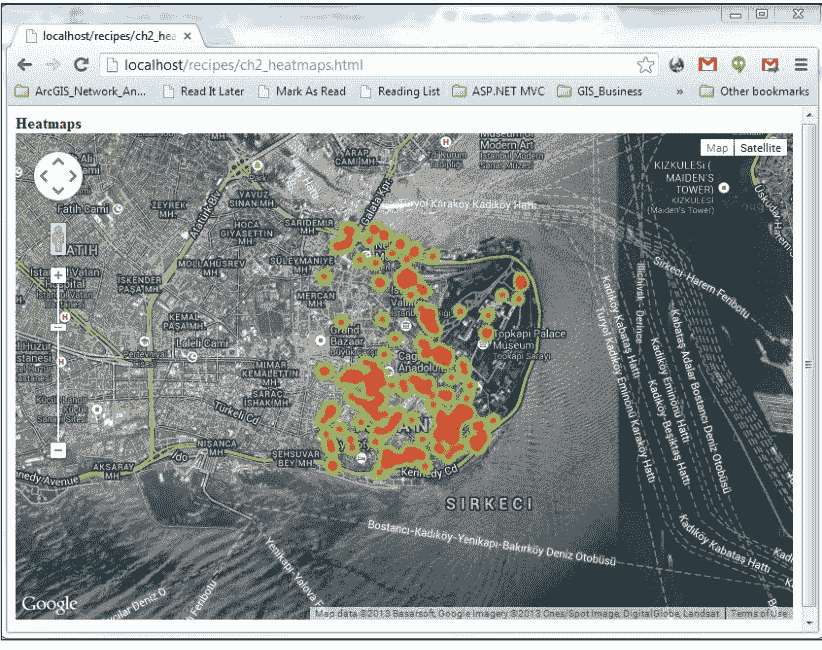

## 工作原理

首先，在 Google Maps JavaScript API 中创建热力图层需要将 API 的 `visualization` 库添加到引用 Google Maps JavaScript API 的部分：

```text
&libraries=visualization
```

有了这个补充，你就可以使用 `google.maps.visualization.HeatmapLayer` 对象来创建热力图层。

`google.maps.visualization.HeatmapLayer` 对象需要一个 JavaScript 数组或 `google.maps.MVCArray` 对象（一种数组），其元素为 `google.maps.LatLng` 对象：

```javascript
var heatmap = new google.maps.visualization.HeatmapLayer({
    data: heatmapPoints
});
```

`google.maps.LatLng` 对象由两个参数构造，即经纬度坐标对，用于表示一个点：

```javascript
new google.maps.LatLng(41.0182827999113, 28.973224999734)
```

我们在另一个 JavaScript 文件中创建了包含 217 个点的数组对象及其内容，因为它会占用我们原始 HTML 文件太多空间。此外，将数据和相关对象放在另一个文件中是避免潜在结构问题的好做法。

最后，我们可以使用以下代码将热力图层添加到当前地图：

```javascript
heatmap.setMap(map);
```

正如你可以切换前一小节中介绍的叠加层一样，你也可以使用以下代码切换热力图层：

```javascript
heatmap.setMap(null);
```

## 更多内容

热力图是从一组点创建的，这些点可以位于不同的地方，也可以位于相同的地方。换句话说，多个 `google.maps.LatLng` 对象可以放置在同一位置。以下代码是一个示例：

```javascript
new google.maps.LatLng(41.0182827999113, 28.973224999734),
new google.maps.LatLng(41.0182827999113, 28.973224999734),
new google.maps.LatLng(41.0182827999113, 28.973224999734)
```

这将增加该点的强度；它在热力图中很可能会显示为红色。

但是，如果共享相同坐标对的 `google.maps.LatLng` 对象实例增加呢？一种方法是像上面的代码那样复制行。然而，还有另一种更智能的方法：

```javascript
{location: new
    google.maps.LatLng(41.0182827999113, 28.973224999734),
    weight: 3
},
```

该对象是 `google.maps.visualization.WeightedLocation`，它接受两个属性：一个是 `google.maps.LatLng` 对象，另一个是 `weight`。这个 `weight` 参数接受任何代表点出现次数的数值。

默认情况下，`LatLng` 对象本身的权重为 1。因此，一个将 `weight` 属性设置为 3 的 `WeightedLocation` 对象，等同于在相同位置有三个 `LatLng` 对象。

`WeightedLocation` 和 `LatLng` 对象可以一起在热力图层的 `data` 属性提供的数组中使用。

热力图层的对象拥有一系列选项，包括 `gradient`、`radius`、`opacity`、`maxIntensity` 和 `dissipating`。

`gradient` 选项接受一个颜色数组：

```javascript
var gradientScheme = [
    'rgba(0, 0, 255, 0)',
    'rgba(0, 60, 200, 1)',
    'rgba(0, 120, 120, 1)',
    'rgba(125, 125, 125, 0)',
    'rgba(125, 120, 60, 0)',
    'rgba(200, 60, 0, 0)',
    'rgba(255, 0, 0, 1)'
];
```

你可以通过在 `HeatmapLayer` 构造函数中添加属性来设置 `gradient` 属性：

```javascript
var heatmap = new google.maps.visualization.HeatmapLayer({
    data: heatmapPoints,
    gradient: gradientScheme
});
```

或者，你也可以稍后设置选项：

```javascript
heatmap.setOptions({
    gradient: gradientScheme
});
```

`dissipating` 选项用于调整在不同缩放级别下显示强度所需的像素。其默认值为 `false`，这使得在缩放级别增加时，每个点可以有更多像素被着色以显示强度。

通过使用 `maxIntensity` 属性，你可以上下滚动热力图层：

```javascript
heatmap.setOptions({
    maxIntensity: 2
});
```

# 添加栅格图层

前面的代码使本配方的输出呈现绿色调，因为强度增加了。需要在同一位置有更多的点才能使热力图呈现红色调。

你可以调整 `radius` 属性来修改每个点的强度半径。单位是像素。

## 另请参见

你可以使用云端的融合表格（Fusion Tables）来创建热力图，这将在本书后面介绍。在浏览器或云端创建热力图各有利弊，这将在本书后面详细讨论。

关于 `LatLng` 对象及其用于创建点矢量叠加层的详细信息将在下一章中介绍。

## 添加交通图层

在当今世界，交通状况是城市中非常重要的信息。如果路上发生事故或近期施工阻断了一条重要街道，都会影响你一整天。如果能在地图上直接显示实时交通信息，那该有多有用？

Google Maps JavaScript API 有一个非常便捷的功能，可以让你在基础地图之上实时显示交通信息。

在本配方中，我们将介绍如何在 Google Maps 上显示交通信息。

### 准备工作

我们可以使用“第 1 章，Google Maps JavaScript API 基础”中的第一个配方作为基本地图显示的基础。复制原始配方的代码后，你可以继续操作。

## 操作步骤

以下是显示交通图层的步骤：

1. 首先，将地图中心更改到提供交通图层的位置（详细信息将在“工作原理”部分中提供）。例如，对于西班牙巴塞罗那，请使用以下值：

   ```javascript
   center: new google.maps.LatLng(41.3854, 2.1822),
   ```

2. 构造 `TrafficLayer` 对象：

   ```javascript
   var trafficLayer = new google.maps.TrafficLayer();
   ```

3. 将 `TrafficLayer` 对象添加到地图：

   ```javascript
   trafficLayer.setMap(map);
   ```

4. 你可以看到根据实时交通状况密度着色的交通图层，如下图所示：

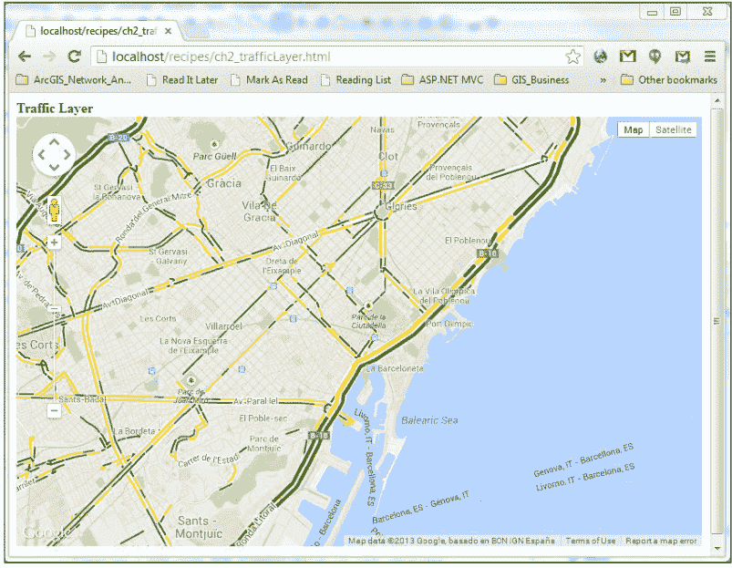

## 工作原理

在第一步中，你可能已经注意到我们切换到了西班牙巴塞罗那，因为在某些国家，交通图层不可用。对于提供交通图层的国家列表，你必须查看位于 `http://gmaps-samples.googlecode.com/svn/trunk/mapcoverage_filtered.html` 的电子表格。你可以筛选 `traffic` 列来查看所有具有交通图层的国家。

`TrafficLayer` 对象的构造及其添加到地图的操作都很简单。在 `TrafficLayer` 对象的构造中不涉及任何属性。

你可以使用以下代码关闭 `TrafficLayer` 对象：

```javascript
trafficLayer.setMap(null);
```

## 添加公共交通图层

公共交通线路在城市中具有极其重要的意义，尤其对于游客和外来人员而言。将这些交通线路（公交车、地铁等）映射到多个城市的基础地图上是一项繁琐的任务，而 Google Maps JavaScript API 通过其特殊对象提供了这一功能。

在本配方中，我们将公共交通图层添加到 Google Maps 地图界面。

### 准备工作

从前一个配方“添加交通图层”继续，将简化我们的工作，因为我们只需将 `TrafficLayer` 对象替换为 `TransitLayer` 类。记得复制原始配方的代码。

## 操作步骤

以下是显示公共交通线路作为叠加层的步骤：

1. 删除与 `TrafficLayer` 相关的代码行（最后两行）。

2. 使用 `TransitLayer` 对象替代 `TrafficLayer` 对象：

   ```javascript
   var transitLayer = new google.maps.TransitLayer();
   ```

3. 将 `TransitLayer` 对象添加到地图：

   ```javascript
   transitLayer.setMap(map);
   ```

4. 你可以在你所偏好的区域看到作为 Google Maps 叠加层的公共交通线路，如下图所示：

   ```javascript
   var transitLayer = new google.maps.TransitLayer();
   ```


```javascript
transitLayer.setMap(map);
```

### 公共交通图层

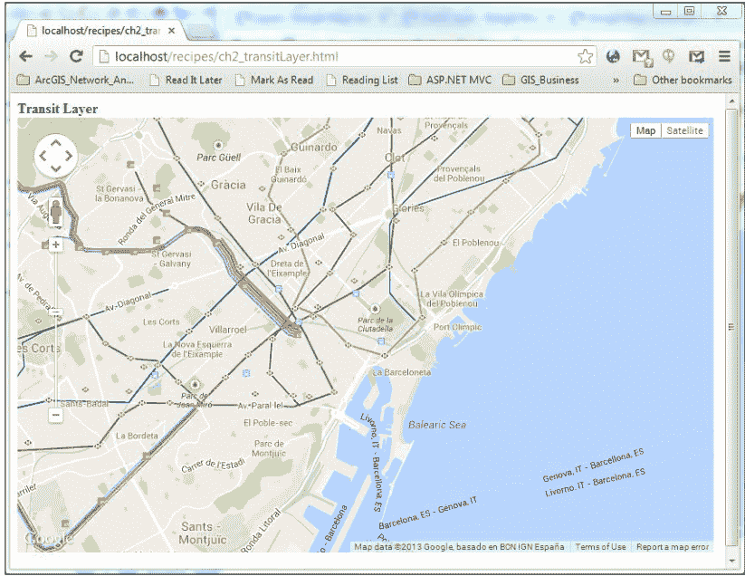

## 工作原理……

公共交通图层在全球某些城市提供，你可以在`http://www.google.com/intl/en/landing/transit/`找到这些城市的完整列表。

`TransitLayer`对象可以显示多条彩色的公共交通线路。颜色选择并非随机的，它们是根据不同的交通线路运营商来选择的。

`TransitLayer`对象的构造和显示与`TrafficLayer`对象相同。

## 添加骑行图层

在基础地图之上显示骑行路径和常见路线是很有用的信息；Google Maps 将其作为叠加图层提供。

在本配方中，我们将介绍骑行图层及其在 Google Maps JavaScript API 中作为叠加层的用法。

### 准备工作

从前一个配方“添加交通图层”继续，将简化我们的工作，因为我们只需将`TransitLayer`对象替换为`BicyclingLayer`类。记得复制原始配方的代码。

## 操作步骤……

显示骑行路径和路线所需的步骤如下：

1. 更改包含`TransitLayer`的两行代码，用`BicyclingLayer`对象替代`TransitLayer`对象：

   ```javascript
   var bicyclingLayer = new google.maps.BicyclingLayer();
   bicyclingLayer.setMap(map);
   ```

2. 你可以在 Google Maps 基础地图之上观察到骑行路径和路线，如下图所示：

   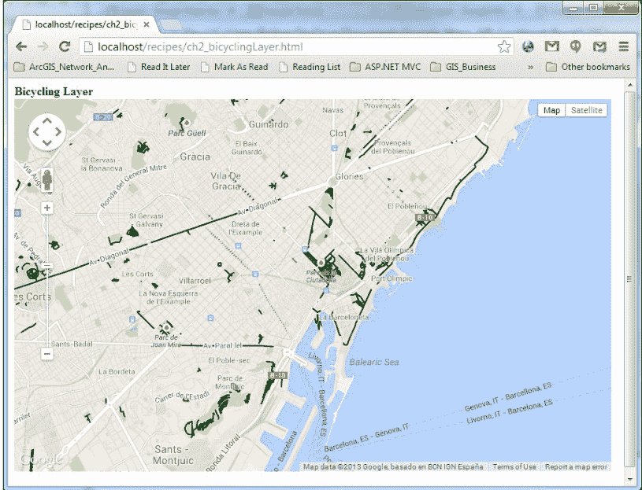

## 工作原理……

骑行图层有其自身的细分，反映在其样式中；深绿色路线代表专用骑行路径，浅绿色路线代表设有自行车道的街道。最后，虚线路线代表推荐使用但并非专用的自行车道和街道。

显示骑行图层的步骤与公共交通或交通图层完全相同，因此没有关于骑行图层具体细节的额外说明。

## 添加天气和云层图层

温度和天气状况信息与地图显示相结合，在电视天气报告中非常常见；Google 在其 API 中加入了这一功能，使我们可以通过自己的地图获得这些信息。

在本配方中，我们将学习如何在基础地图之上显示天气相关信息作为叠加层。

### 准备工作

我们可以从“第1章，Google Maps JavaScript API 基础”中的“在自定义 DIV 元素中创建简单地图”配方继续，因为我们不需要详细了解基本地图显示。

## 操作步骤……

以下是在地图中显示相应温度和云层条件的步骤：

1. 将天气库添加到 Google Maps JavaScript API 引用的末尾：

   ```html
   <script type="text/javascript" src="https://maps.googleapis.com/maps/api/js?sensor=false&libraries=weather"></script>
   ```

2. 更改`mapOptions`对象中的地图中心和缩放级别，以便我们可以利用相关图层：

   ```javascript
   center: new google.maps.LatLng(38.0, 20.4),
   ```

   ```javascript
   zoom: 5,
   ```

3. 构造一个名为`weatherLayer`的`google.maps.weatherLayer`对象实例：

   ```javascript
   var weatherLayer = new google.maps.weather.WeatherLayer({ temperatureUnits: google.maps.weather.TemperatureUnit.CELCIUS });
   ```

4. 将`weatherLayer`添加到地图：

   ```javascript
   weatherLayer.setMap(map);
   ```

## 添加栅格图层

5. 构造一个名为`cloudLayer`的`google.maps.weather.cloudLayer`实例：

   ```javascript
   var cloudLayer = new google.maps.weather.CloudLayer();
   ```

6. 将`cloudLayer`添加到地图上：

   ```javascript
   cloudLayer.setMap(map);
   ```

7. 你可以在 Google 地图应用中看到相应的温度和云层状况，如下截图所示：

   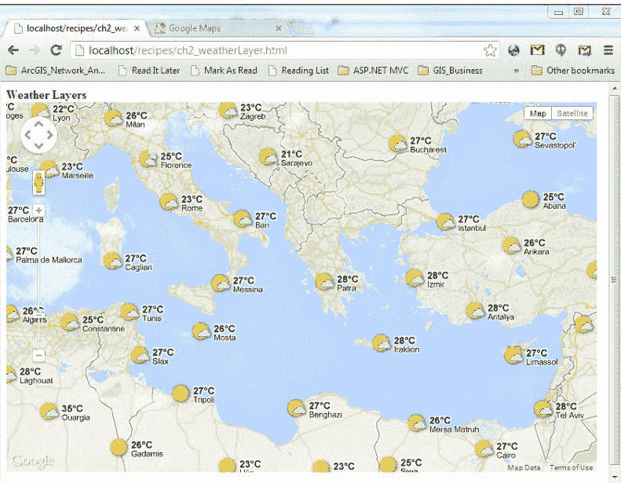

## 工作原理……

为了查看天气相关的图层，我们必须引用`weather`库，这与我们之前为热力图叠加层引用`visualization`库的方式完全一致。

我们有针对性地更改了地图的中心和缩放级别。缩放级别设置为 5，因为云图层仅在 0 到 6 的缩放级别之间可见。此外，我们将地图中心设置在地中海区域，以便查看几个国家及其大城市的天气信息。

需要注意的是，与天气图层一起显示时，行政标签（如街道和城市名称）不会显示。另外，天气图层适用于 0 到 12 的缩放级别。

在构造`google.maps.weather.weatherLayer`对象时，可以通过`temperatureUnits`属性指定温度单位。可能的值定义在`google.maps.weather.TemperatureUnit`中：

```javascript
google.maps.weather.TemperatureUnit.CELCIUS
google.maps.weather.TemperatureUnit.FAHRENHEIT
```

你可以通过调用`weatherLayer`和`cloudLayer`各自的`setMap()`方法并将地图对象作为唯一参数传入，来将这些图层添加到地图上。

显示天气图层后，你可以查看城市天气状况以及由`http://www.weather.com`提供的温度信息。城市上方显示的图标会根据实时天气变化，无论是晴天、多云还是雨天。此外，点击某个图标会打开一个详细的弹出窗口，显示接下来四天的天气状况。

## 还有更多……

除了`temperatureUnits`之外，你还可以调整`weatherLayer`对象的其他属性。你可以禁止显示详细的弹出窗口，或者设置风速单位等。

### 更多关于 WeatherLayerOptions

`WeatherLayerOptions`的完整列表可以在`https://developers.google.com/maps/documentation/javascript/reference#WeatherLayerOptions`找到。

## 添加 Panoramio 图层

Panoramio 是一个支持地理标签的照片分享网站。这意味着你可以上传照片，前提是为它们添加地理标签（地理参考）。地理标签涉及将坐标对附加到目标对象上，无论是照片、视频还是任何其他资源。你可以在`http://www.panoramio.com/`找到有关如何使用 Panoramio 的详细信息。

你可以在 Google 地图上查看 Panoramio 照片，本示例将介绍如何操作的基础知识。

### 准备工作

我们可以继续沿用“第 1 章，Google Maps JavaScript API 基础”中的“在自定义 DIV 元素中创建简单地图”示例，因为地图显示的基础知识已经在此涵盖。

与往常一样，请在继续之前复制原始示例。

### 如何实现……

如果你按照以下步骤操作，就可以在 Google 地图上叠加各种 Panoramio 图片库：

1. 将 Panoramio 库添加到引用的库中：

   ```html
   <script type="text/javascript"
     src="https://maps.googleapis.com/maps/api/js?
     sensor=false&libraries=panoramio">
   </script>
   ```

2. 在创建地图对象后，构造一个名为`panoramioLayer`的新`google.maps.panoramio.PanoramioLayer()`对象：

   ```javascript
   var panoramioLayer = new
     google.maps.panoramio.PanoramioLayer();
   ```

3. 将`panoramioLayer`对象添加到地图上：

   ```javascript
   panoramioLayer.setMap(map);
   ```

4. 你现在可以让 Panoramio 图片叠加在 Google 地图上了，如下截图所示：

   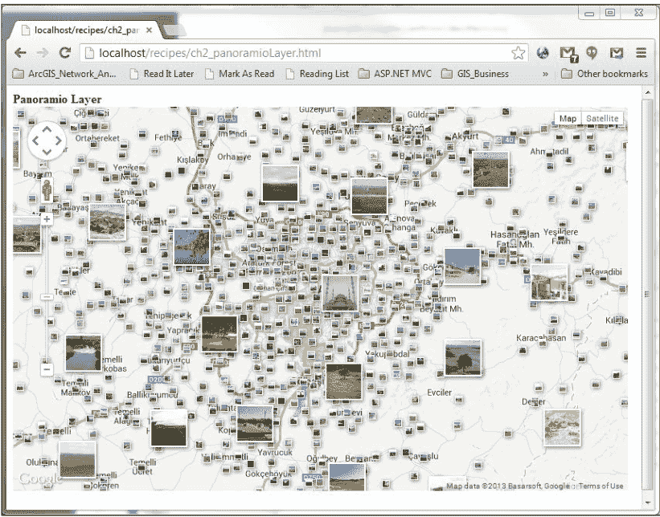

## 工作原理……

添加 Panoramio 图层在技术上与我们在前面的示例中所做的没有区别。我们按照相同的模式添加相关的引用库、构造图层并将其添加到地图上。

你可以点击缩略图照片，一个详细的弹出窗口将会打开。在这个弹出窗口中，你可以查看更大尺寸的照片，以及照片名称和上传者的用户名。

## 还有更多……

Panoramio 图层提供了额外的功能来自定义叠加图层。例如，你可以使用`setTag()`方法按标签过滤照片，从而限制显示的照片：

```javascript
panoramioLayer.setTag("Eiffel");
```

这将把显示的缩略图过滤为标签中包含`Eiffel`关键字的照片。

此外，你还可以通过调用`setUserId()`方法来根据用户 ID 进行过滤，将`userId`字符串作为参数传入。

你也可以使用`PanoramioLayer`对象接受的`suppressInfoWindows`属性来禁止打开详细的弹出窗口：

```javascript
var panoramioLayer = new
    google.maps.panoramio.PanoramioLayer({
        suppressInfoWindows:true
    });
```

> **更多关于 PanoramioLayer**

`PanoramioLayer`的完整列表可以在`https://developers.google.com/maps/documentation/javascript/reference#PanoramioLayerOptions`找到。

# 3. 添加矢量图层

在本章中，我们将涵盖：

- 向地图添加标记
- 向标记或地图添加弹出窗口
- 向地图添加线条
- 向地图添加多边形
- 向地图添加圆形/矩形
- 向地图添加动画线条
- 添加 KML/GeoRSS 图层
- 向 Google Maps JavaScript API 添加 GeoJSON
- 向 Google Maps JavaScript API 添加 WKT

## 简介

本章介绍矢量图层，它们与栅格图层完全不同。本章提供了在使用 Google Maps JavaScript API 时可能需要的最常见和最重要的示例。

在 GIS 领域，矢量图层和栅格图层在不同的情况下使用。矢量在大多数情况下用于表示地球特征。例如，**兴趣点（Points of Interest, POI）**，如咖啡店或餐厅，用点表示；河流或道路用折线表示；公园或建筑物用多边形表示。如这里所示，有三种不同的矢量类型：点、折线和多边形。请记住，所有矢量都由点组成，点是矢量的基本构成单元。

在 Google Maps JavaScript API 中，所有类型的矢量都称为**叠加层（overlays）**。除了矢量之外，弹出窗口和符号也包含在叠加层中。与它们相关的所有示例都包含在本章中。

地图主要用于可视化，所以在某些情况下静态地图是不够的。为折线添加一些动画效果会有所不同。例如，用河流表示流向对科学家来说很有意义。Google Maps JavaScript API 也支持动画折线，这是本章的示例之一。

Google Maps JavaScript API 是一个出色的 API，支持 KML 和 GeoRSS，但一些行业事实标准并未提供开箱即用支持，例如 GeoJSON 和 WKT。GeoJSON 和 WKT 是行业中最常用的矢量发布格式，尤其是在开源库中。这些格式将通过额外的库来支持，这些库也包含在本章中。

让我们开始探索这些示例。

## 向地图添加标记

地图在网站上有很多用途，但最常用的是显示公司或企业的位置。公司或企业的位置在 LBS 或 GIS 行业中可以称为 POI，这是矢量图层的点类型。在 Google Maps JavaScript API 中，POI 或点显示为**标记（markers）**。

本示例介绍如何使用`google.maps.LatLng`和`google.maps.Marker`类向地图添加标记。

### 准备工作

在第 1 章，Google Maps JavaScript API 基础中，你学习了如何创建地图。因此，本示例仅涵盖添加标记的额外代码行。

你可以在`Chapter 3/ch03_adding_markers.html`找到源代码。

### 如何实现……

以下是我们向地图添加标准标记和图标标记所需的步骤：

1. 让我们添加**边界框（BBOX）**的纬度和经度的最小值和最大值，以限制随机标记的区域。这个边界框几乎定义了**土耳其**覆盖的区域。同时定义`markerId`来命名随机标记。所有变量必须在函数外部定义：

   ```javascript
   var minLat = 36,
       maxLat = 42,
       minLng = 25,
       maxLng = 44,
       markerId = 1;
   ```

2. 在`initMap()`函数之后添加以下函数。该函数开始监听按钮的点击事件：

   ```javascript
   function startButtonEvents() {
     document.getElementById('addStandardMarker').
       addEventListener('click', function(){
         addStandardMarker();
     });

     document.getElementById('addIconMarker' ).
       addEventListener('click', function(){
         addIconMarker();
     });
   }
   ```

3. 在`startButtonEvents()`函数之后添加以下函数。该函数根据本节开头给出的值创建随机的纬度和经度，并返回`google.maps.LatLng`对象。

   ```javascript
   function createRandomLatLng() {
     var deltaLat = maxLat - minLat;
     var deltaLng = maxLng - minLng;
     var rndNumLat = Math.random();
     var newLat = minLat + rndNumLat * deltaLat;
     var rndNumLng = Math.random();
     var newLng = minLng + rndNumLng * deltaLng;
     return new google.maps.LatLng(newLat, newLng);
   }
   ```

4. 然后，添加`addStandardMarker()`函数。该函数创建标准的 Google滨州地图红色标记。它从上一步创建的函数中获取随机的`LatLng`对象值。代码块中有一行被注释掉的代码，将在后面解释：

   ```javascript
   function addStandardMarker() {
     var coordinate = createRandomLatLng();
     var marker = new google.maps.Marker({
       position: coordinate,
       map: map,
       title: 'Random Marker - ' + markerId
     });
     // 如果在初始化 Marker 时没有指定 Map，
     // 可以稍后使用以下代码行添加
     //marker.setMap(map);
     markerId++;
   }
   ```

5. 在此步骤中还描述了另一个名为`addIconMarker()`的函数。该函数用于添加带有随机图像的随机标记：

   ```javascript
   function addIconMarker() {
     var markerIcons = ['coffee', 'restaurant_fish',
       'walkingtour', 'postal', 'airport'];
     var rndMarkerId = Math.floor(Math.random() *
       markerIcons.length);
     var coordinate = createRandomLatLng();
     var marker = new google.maps.Marker({
       position: coordinate,
       map: map,
       icon: 'img/' + markerIcons[rndMarkerId] + '.png',
       title: 'Random Marker - ' + markerId
     });
     markerId++;
   }
   ```

6. 最后，我们将添加 HTML 标签来完成代码。这些链接将有助于触发事件监听器中定义的函数：

   ```html
   <a id="addStandardMarker" href="#">添加标准标记</a>
   <a id="addIconMarker" href="#">添加图标标记</a>
   ```

7. 在浏览器中打开存储 HTML 文件的本地 URL，查看结果。最初，您会看到一个空白地图。然后点击地图上的链接以添加随机标记。最终地图如以下截图所示：

   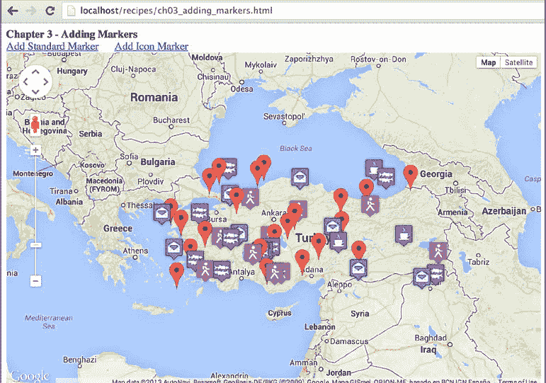

如前面的截图所示，我们创建了一个同时包含标准标记和图标标记的地图。

## 工作原理……


Google 地图使用 Web 墨卡托投影系统作为其瓦片系统，但坐标仍然基于 WGS 84 基准的 GPS 坐标。坐标基于纬度和经度，纬度范围在 -90 到 90 之间，经度范围在 -180 到 180 之间。纬度和经度的组合定义了地球上的 Intel 地球上的一个点。Google 地图 JavaScript API 使用`google.maps.LatLng`类来创建一个点。该类也在第 1 章《Google 地图 JavaScript API 基础》中用于设置地图的中心。以下行定义了**伊斯坦布尔，土耳其**的坐标：

```javascript
var istanbul = new google.maps.LatLng(41.038627, 28.986933);
```

`google.maps.Marker`类创建一个标记，需要一个必需参数`google.maps.MarkerOptions`。`MarkerOptions`类也有一个名为`position`的必需参数。该参数接收`google.maps.LatLng`对象以定义标记的坐标。在代码中，还有`map`和`title`参数，它们不是必需的，但需要用来在地图上显示标记并分别设置标记的标题。如果您想在创建标记后立即显示标记，应该使用`map`参数。但在某些情况下，您想创建标记并在稍后显示在地图上。在这种情况下，您应该使用标记的`setMap`方法并传入您的地图引用。

```javascript
var marker = new google.maps.Marker({
    position: new google.maps.LatLng(41.038627, 28.986933)
});
marker.setMap(map);
```

如果你想从地图中移除标记，就必须将地图值设置为 null。不要忘记保留标记的引用，以便将它们从地图中移除：

```javascript
marker.setMap(null);
```

带有红色图标的默认标记并不适用于所有情况。Google 地图 JavaScript API 允许你自定义标记的图标。基本上，你应该在`google.maps.MarkerOptions`中添加`icon`参数来自定义标记图标。该参数接受三种不同的类型：String、`google.maps.Icon`对象或`google.maps.Symbol`对象。如果你有一个简单的图标图像，你将使用字符串类型并指定图像路径。否则，你将创建图标或符号对象来为标记设置复杂的视觉效果。通过`String`参数显示图标可以这样做：

```javascript
var marker = new google.maps.Marker({
    position: coordinate,
    icon: 'img/coffeeshop.png',
    title: 'My Coffee Shop'
});
```

### 还有更多...

在本方案中，使用随机坐标来显示标记。如果你有一个包含坐标的数据源，你可以使用 JavaScript 技术轻松地将它们添加到地图中，而无需在创建标记时更改任何内容。请确保在从外部源添加标记到地图时注意 JavaScript 的异步行为，因为由于异步行为，你的数据在需要时将不可用。

## 另请参阅

- 第 1 章《Google 地图 JavaScript API 基础》中的《在自定义 DIV 元素中创建简单地图》方案

## 为标记或地图添加弹出窗口

几乎每个地图应用程序都有能力显示与地图上显示要素相关的信息。同时显示所有相关信息对开发者来说是一项不可能完成的任务，对用户来说也是无用的。与其在地图上显示所有信息，开发者为点、折线或多边形添加交互，通过弹出窗口或信息窗口等不同技术显示相关信息。

弹出窗口或信息窗口可以容纳任何能用 HTML 标签编写的内容，如图片、视频或标准文本。

如果你完成本方案的步骤，你将看到类似以下截图的内容：

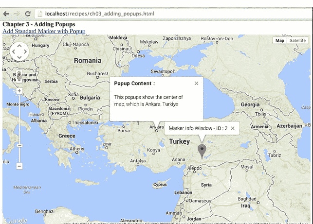

### 准备工作

本方案是前一个名为《向地图添加标记》的方案修改版本。

你可以在`Chapter 3/ch03_adding_popups.html`找到源代码。

## 实现方法...

你可以通过执行以下步骤轻松地为标记或地图添加弹出窗口：

1. 首先，`initMap()`函数通过在创建地图对象后添加以下代码行进行修改。这将在地图首次初始化时在地图中心打开一个信息窗口或弹出窗口：

   ```javascript
   var infowindow = new google.maps.InfoWindow({
     content: '<div style="width:200px; height:100px;"><b>弹出窗口内容：</b><br><br>此弹出窗口显示地图的中心，即安卡拉，土耳其</div>',
     position: new google.maps.LatLng(39.9078, 32.8252)
   });

   infowindow.open(map);
   ```

2. 接下来，添加以下函数来监听 HTML 中定义的按钮的点击事件：

   ```javascript
   function startButtonEvents() {
     document.getElementById('addStandardMarker').
       addEventListener('click', function(){
         addStandardMarker();
       });
   }
   ```

3. `startButtonEvents()`函数必须在初始化地图时调用，因此在`initMap()`函数中地图初始化后添加以下代码行：

   ```javascript
   startButtonEvents();
   ```

4. 然后，通过添加以下代码行来修改`addStandardMarker()`函数，这些代码行在创建标记后添加：

   ```javascript
   var infowindow = new google.maps.InfoWindow({
     content: '标记信息窗口 - ID：' + markerId
   });

   google.maps.event.addListener(marker, 'click', function() {
     infowindow.open(map, marker);
   });
   ```

### 添加矢量图层

5. 在你常用的浏览器中打开存储 HTML 文件的本地 URL，查看结果。你会在地图开头看到一个信息窗口。你还可以点击地图上的链接来添加随机标记，但这些标记与之前的不同，因为当用户点击它们时会弹出弹窗。

## 工作原理...

Google Maps JavaScript API 有一个默认的`InfoWindow`类来创建信息窗口或弹窗。这个类可以通过两种方式初始化。一种方式是在信息窗口选项中使用`LatLng`对象指定位置。通过这种方式，你可以在地图上的任意位置打开弹窗。这可以附加到函数或事件上。例如，你可以将`click`事件附加到地图上，从服务器查询某些内容并在弹窗中显示结果。这对于 Google Maps JavaScript API 来说很常见。以下代码在纬度 39.9078、经度 32.8252 的位置创建一个信息窗口，并包含 HTML 内容。其`open`方法以`map`为输入参数，显示附加到给定地图引用的信息窗口：

```javascript
var infowindow = new google.maps.InfoWindow({
    content: '<div style="width:200px; height:100px; "><b>弹窗内容：</b><br><br>此弹窗显示地图的中心，即土耳其安卡拉</div>',
    position: new google.maps.LatLng(39.9078, 32.8252)
});
infowindow.open(map);
```

另一种使用弹窗的方式是将它们绑定到标记上。不指定位置，信息窗口将锚定到一个`marker`对象。以下代码中给出的`infoWindow`对象没有`position`属性，这意味着它将锚定到一个`marker`对象。请记住，`marker`对象是 Google Maps JavaScript API 中`MVCObject`类的子类。它们是`InfoWindow`类`open`方法的一种`anchor`参数类型：

```javascript
var infowindow = new google.maps.InfoWindow({
    content: '标记信息窗口 - ID：' + markerId
});
google.maps.event.addListener(marker, 'click', function() {
    infowindow.open(map, marker);
});
```

上述代码中有一个附加到`marker`的事件，这是第 5 章《理解 Google Maps JavaScript API 事件》的主题。因此请按原样使用代码；这将在后面详细解释，但基本上这段代码片段监听`marker`对象，并在`click`事件时打开创建的`infowindow`对象。

如本示例所示，你可以在信息窗口中使用简单字符串和复杂的 HTML 内容。这意味着你甚至可以在信息窗口中添加 YouTube 视频或 Flash 内容。

## 另请参阅

- 第 1 章《Google Maps JavaScript API 基础》中的《在自定义 DIV 元素中创建简单地图》示例
- 《向地图添加标记》示例

### 向地图添加线条

GIS 中的线条或多段线是相互连接的点数组，用于在地球上显示道路、路径或河流等要素。地图上多段线的属性与地球上所表示要素的属性相似。例如，道路在地球上通过其颜色和宽度来区分。相同的属性也在 Google Maps JavaScript API 中定义，以在地图上精确表示道路。

本示例侧重于在地图上显示线条/多段线，以展示从**伊斯坦布尔**到**安卡拉**的路线。

### 准备工作

本示例使用第 1 章《Google Maps JavaScript API 基础》中定义的相同地图创建流程，但缩放级别和中心坐标有一些细微变化，以详细显示路线。

你可以在`Chapter 3/ch03_adding_lines.html`找到源代码。

## 操作步骤...

如果你想向地图添加线型几何图形，请执行以下步骤：

1. 打开第 1 章《Google Maps JavaScript API 基础》中提到的第一个示例的源代码，并将其保存为`adding_lines.html`。

2. 然后，在代码 JavaScript 部分开头定义地图对象后添加以下代码行。此步骤中定义的数组是从**伊斯坦布尔**到**安卡拉**的路线坐标（纬度和经度）：

   ```javascript
   var lineCoordinates = [
     [41.01306,29.14672],[40.8096,29.4818],
     [40.7971,29.9761],[40.7181,30.4980],
     [40.8429,31.0253],[40.7430,31.6241],
     [40.7472,32.1899],[39.9097,32.8216]
   ];
   ```

3. 然后，创建`addPolyline`函数：

   ```javascript
   function addPolyline () {

   }
   ```

4. 我们需要在函数中从开头定义的数组创建一个由`LatLng`对象组成的新数组：

   ```javascript
   //首先，我们遍历坐标数组以创建
   // 包含 LatLng 类对象的新数组。
   var pointCount = lineCoordinates.length;
   var linePath = [];
   for (var i=0; i < pointCount; i++) {
       var tempLatLng = new google.maps.LatLng(
           lineCoordinates[i][0] , lineCoordinates[i][1]
       );
       linePath.push(tempLatLng);
   }
   ```

5. 然后，我们需要按如下方式创建多段线对象：

   ```javascript
   //以下定义多段线属性
   var lineOptions = {
       path: linePath,
       strokeWeight: 7,
       strokeColor: '#FF0000',
       strokeOpacity: 0.8
   }
   var polyline = new google.maps.Polyline(lineOptions);
   ```

6. 让我们将多段线对象添加到地图：

   ```javascript
   //多段线设置为当前地图。
   polyline.setMap(map);
   ```

7. 现在，在`initMap()`函数末尾调用`addPolyline()`函数，如下所示：

   ```javascript
   addPolyline();
   ```

8. 在你常用的浏览器中打开存储 HTML 文件的本地 URL，查看结果。你会在地图上看到一条从**伊斯坦布尔**到**安卡拉**的红色路线，如下图所示：

   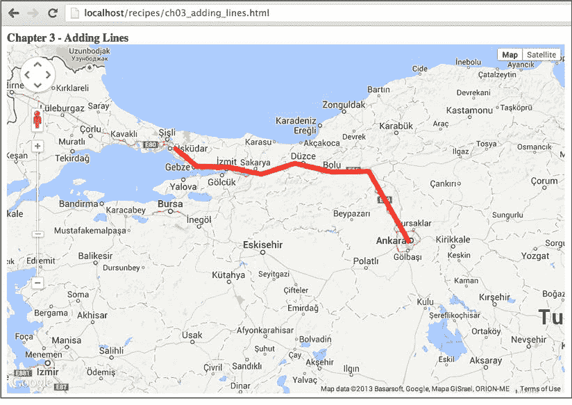

至此，我们已成功创建了一张带有线型几何图形的地图，在本例中是从一个地方到另一个地方的路线。

## 工作原理...

如前所述，多段线由点组成。点在 Google Maps JavaScript API 中由`LatLng`类定义，因此纬度和经度的数组应转换为`LatLng`数组。以下代码块创建了一个由`LatLng`对象组成的新数组。为此，使用了通过循环迭代数组的经典方法，如下所示：

```javascript
var pointCount = lineCoordinates.length;
var linePath = [];
for (var i=0; i < pointCount; i++) {
  var tempLatLng = new google.maps.LatLng(lineCoordinates[i][0],
    lineCoordinates[i][1]);
  linePath.push(tempLatLng);
}
```

路线将由`Polyline`类创建，该类将`PolylineOptions`类的实例作为参数。`PolylineOptions`类有许多属性，但我们只添加了最常用的属性。

定义路线要素的`path`属性包含一个`LatLng`对象数组。`strokeWeight`属性用于以像素为单位定义线的宽度。`strokeColor`属性以`String`类型定义线的颜色，格式为带 # 前缀的`HEX`格式。

`strokeOpacity`属性的使用是可选的，但在显示多个图层时可能很有用。此参数取值范围为 0.0 到 1.0。0.0 表示你的线不可见，1.0 表示你的线完全不透明。如果你有多个图层，应该定义线的透明度以显示其他要素或图层。

本示例显示了在 HTML 中定义的静态路线；但在某些情况下，你可以从远程源加载数据。在这种情况下，你应该通过`Polyline`类的`setPath()`方法更改路径数组。此方法获取与`PolylineOptions`类中定义的相同数组。例如，你创建了一个名为`newRoute`的新路径数组。要将坐标更改为新路线，你应该调用：

```javascript
polyline.setPath(newRoute);
```

如果你想从地图完全移除`polyline`，则应将`map`属性设置为 null 或调用`Polyline`类的`setMap(null)`方法。

## 另请参阅

- 第 1 章《Google Maps JavaScript API 基础》中的《在自定义 DIV 元素中创建简单地图》示例
- 《向地图添加多边形》示例

### 向地图添加多边形

多边形与多段线相似，都是相互连接的点数组。但是，多边形是封闭环，用于显示公园、地块或区域等地球要素。除了多段线的属性外，多边形内部还有填充区域。

本示例侧重于在地图上显示多边形，以展示**安卡拉**周围的区域。

### 准备工作

本示例使用第 1 章《Google Maps JavaScript API 基础》中定义的相同地图创建流程，但`zoom`级别和中心坐标有一些细微变化，以详细显示该区域。

你可以在`Chapter 3/ch03_adding_polygons.html`找到源代码。

## 操作方法……

如果你按照以下步骤操作，就可以在你的地图上添加多边形类型的几何图形：

1. 打开第一章《Google Maps JavaScript API 基础》中提到的第一个示例的源代码，并将其保存为`adding_polygons.html`。

2. 然后，在 JavaScript 部分开头定义地图对象之后，添加以下代码行。此步骤中定义的数组是**安卡拉**附近某个随机区域的经纬度坐标：

   ```javascript
   var areaCoordinates = [
     [40.0192,32.6953], [39.9434,32.5854],
     [39.7536,32.6898], [39.8465,32.8106],
     [39.9139,33.0084], [40.0318,32.9260],
     [40.0402,32.7832], [40.0192,32.6953]
   ];
   ```

3. 然后创建`addPolygon`函数：

   ```javascript
   function addPolygon() {

   }
   ```

4. 我们需要在该函数中，根据开头定义的数组创建一个由`LatLng`对象组成的新数组：


```
//First we iterate over the coordinates array to create a
// new array which includes objects of LatLng class.
var pointCount = areaCoordinates.length;
var areaPath = [];
for (var i=0; i < pointCount; i++) {
  var tempLatLng = new google.maps.LatLng(
    areaCoordinates[i][0], areaCoordinates[i][1]);
  areaPath.push(tempLatLng);
}
```

5. 然后，我们需要按如下方式创建`polygon`对象：

```
//Polygon properties are defined below
var polygonOptions = {
  paths: areaPath,
  strokeColor: '#FF0000',
  strokeOpacity: 0.9,
  strokeWeight: 3,
  fillColor: '#FFFF00',
  fillOpacity: 0.25
}
var polygon = new google.maps.Polygon(polygonOptions);
```

6. 让我们将`polygon`对象添加到地图上：

```
//Polygon is set to current map.
polygon.setMap(map);
```

7. 现在，在`initMap()`函数的末尾调用`addPolygon()`函数，如下所示：

```
addPolygon();
```

8. 在你最喜欢的浏览器中打开存储 HTML 文件的本地 URL，查看结果。你会看到**安卡拉**周围有一个红色边界包围的黄色区域，如下图所示：

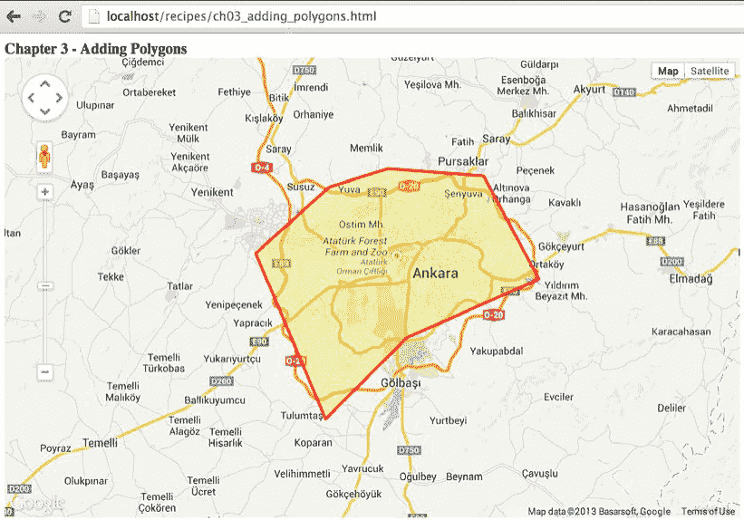

9. 这就是我们向地图添加多边形类型几何图形的方式。

## 工作原理……

Google Maps JavaScript API 中的`Polygon`类与`Polyline`类非常相似。`Polyline`和`Polygon`类之间存在一些细微差异，因此我们只会在此示例中详细介绍这些差异。更多细节请参考前面的示例。

正如前面的示例所述，`Polygon`类借助`PolygonOptions`类创建对象，该类包含多边形的许多参数。其中`path`、`strokeWeight`、`strokeColor`和`strokeOpacity`参数与`PolylineOptions`类共享。这些参数的用途和用法对于多边形和折线都是相同的。主要区别在于多边形会填充区域。因此需要一些新的参数来定义多边形填充。

`fillColor`属性以`String`类型定义填充区域的颜色，格式为带有前导`#`符号的`HEX`格式。`fillOpacity`属性的使用是可选的，但在同时显示多个图层时也可能会有所帮助。该参数接受 0.0 到 1.0 之间的值。0.0 表示你的多边形完全透明，1.0 表示你的多边形完全不透明。这个参数在多边形中比在折线中更重要，因为多边形填充了区域，这可能会遮挡某些标记或折线。

添加或删除多边形的 API 用法与折线相同，因此这里无需赘述。

最后要说明的是，多边形是折线的闭合版本，所以我们在起点和终点添加了相同的坐标。这是一个好的做法，但不是必需的。即使你没有添加与起点坐标相同的终点坐标，Google Maps JavaScript API 也会自动闭合多边形，不会产生任何错误。

## 另请参阅

- 第一章《Google Maps JavaScript API 基础》中的*在自定义 DIV 元素中创建简单地图*示例
- *在地图上添加线条*示例

### 在地图上添加圆形/矩形

圆形和矩形与多边形类似，它们都有描边颜色、填充颜色、宽度和不透明度。它们与多边形的主要区别在于几何定义的方式。如前面的示例所示，`PolygonOptions`类有一个`path`参数，该参数由`LatLng`对象数组组成。另一方面，`CircleOptions`类有`center`和`radius`参数，而`RectangleOptions`类有`bounds`参数，分别用于定义`Circle`和`Rectangle`类的几何形状。

在此示例中，我们将根据城市人口添加圆形，并添加一个与**土耳其**边界框对应的矩形。结果地图将显示土耳其的边界框以及主要城市人口的可视化图表。

### 准备工作

在这个示例中，我们将使用第一章《Google Maps JavaScript API 基础》中定义的第一个示例作为模板，以便跳过地图创建步骤。

你可以在`Chapter 3/ch03_circle_rectangle.html`找到源代码。

#### 操作方法……

如果你按照以下步骤操作，向地图添加圆形或矩形会非常容易：

1. 首先创建一个名为`circles_rectangles.html`的空文件。然后，将第一章《Google Maps JavaScript JavaScript API 基础》中*在自定义 DIV 元素中创建简单地图*示例介绍的 HTML 文件中的所有代码复制并粘贴到新文件中。

2. 添加以下代码行来定义集中整治函数中使用的全局变量：

```
// Defining coordinates and populations of major cities in
// Turkey as Ankara, Istanbul and Izmir
var cities = [{
  center: new google.maps.LatLng(39.926588, 32.854614),
  population : 4630000
},
{
  center: new google.maps.LatLng(41.013066, 28.976440),
  population : 13710000
},
{
  center: new google.maps.LatLng(38.427774, 27.130737),
  population : 3401000
}
];

// Defining the corner coordinates for bounding box of
// Turkey
var bboxSouthWest = new google.maps.LatLng(35.817813,
  26.047461);
var bboxNorthEast = new google.maps.LatLng(42.149293,
  44.774902);
```

3. 然后，在`initMap()`函数之前添加`addCircle()`和`addRectangle()`函数：

```
function addCircle() {

}

function addRectangle() {

}
```

4. 现在，将以下代码块添加到`addCircle()`函数中以初始化圆形：

```
// Iterating over the cities array to add each of them to // map
for (var i=0; i < cities.length; i++) {
  var circleOptions = {
    fillColor: '#FFFF00',
    fillOpacity: 0.55,
    strokeColor: '#FF0000',
    strokeOpacity: 0.7,
    strokeWeight: 1,
    center: cities[i].center,
    radius: cities[i].population / 100
  };
  cityCircle = new google.maps.Circle(circleOptions);
  cityCircle.setMap(map);
}
```

5. 接下来，将以下代码行添加到`addRectangle()`函数中以初始化矩形：

```
var bounds = new google.maps.LatLngBounds(bboxSouthWest, bboxNorthEast);
var rectOptions = {
  fillColor: '#A19E98',
  fillOpacity: 0.45,
  strokeColor: '#FF0000',
  strokeOpacity: 0.0,
  strokeWeight: 1,
  map: map,
  bounds: bounds
};
var rectangle = new google.maps.Rectangle(rectOptions);
```

6. 然后，根据你的需要在`initMap()`函数中更改地图的`zoom`级别和`center`。本示例使用以下参数：

```
var mapOptions = {
  center: new google.maps.LatLng(39.9046, 32.75926),
  zoom: 5,
  mapTypeId: google.maps.MapTypeId.ROADMAP
};
```

7. 最后，在`initMap()`函数的末尾添加`addRectangle()`和`addCircle()`函数，如下所示：

```
addRectangle();
addCircle();
```

8. 在你最喜欢的浏览器中打开存储`circles_rectangles.html`文件的本地 URL，查看结果。你会看到地图上有三个圆形和一个位于它们后面的灰色矩形，如下图所示：


这是同时显示圆形和矩形的示例结果。这可以作为在地图上可视化表格数据的好例子。

## 工作原理……

首先，让我们谈谈圆形。圆形是多边形的一种类型，只是它们是通过`LatLng`对象的中心点和以米为单位的半径来定义的，而不是通过路径。其他参数与`PolygonOptions`类相同。

在此示例中，选择了**安卡拉**、**伊斯坦布尔**和**伊兹密尔**这三个城市。这些城市的中心和人口使用数组中的 JSON 对象进行定义。城市的中心点使用`LatLng`对象定义，因此无需进行额外的转换。以下代码块遍历城市数组，并使用 JSON 对象中定义的`center`参数创建圆形：

```
var citiesLen = cities.length;
for (var i=0; i < citiesLen; i++) {
```

```
var circleOptions = {
  fillColor: '#FFFF00',
  fillOpacity: 0.55,
  strokeColor: '#FF0000',
  strokeOpacity: 0.7,
  strokeWeight: 1,
  center: cities[i].center,
  radius: cities[i].population / 100
};
cityCircle = new google.maps.Circle(circleOptions);
cityCircle.setMap(map);
}
```

`radius`参数被定义为人口的一个参数，即人口除以 100；它显示了人口的数量级。从地图上可以看出，人口越高，圆圈越大。这可以作为人口分布的可视化方式，而无需知道确切的数字。如所见，其他参数，如`fillColor`、`fillOpacity`、`strokeColor`、`strokeOpacity`和`strokeWeight`，与`PolygonOptions`类中的使用方式相同。`setMap()`函数也与多边形或折线食谱中的使用方式相同。

另一个元素，矩形，也是一种多边形，只是其几何形状由`LatLngBounds`对象定义。理论上，`LatLngBounds`对象由两个`LatLng`对象组成，这两个对象被定义为矩形的西南和东北坐标。这些坐标也可以定义为纬度和经度的最小点和最大点。在这个食谱中，定义的矩形显示了土耳其的边界框。BBOX 可用于简单的几何计算，如“点是否在多边形中”或“交集”。在计算中使用 BBOX 可以获得快速的结果，因为几何形状简单，但这种计算总是存在误差。如前面的截图所示，有些区域不在土耳其的边界上，但它们在边界框中。如果你想使用 BBOX 方法获取与土耳其相交的几何图形，你可以很容易地获取到土耳其真实几何图形之外的其他几何图形。如你所见，使用 BBOX 方法会得到一些在 BBOX 交点处的几何图形，而这些几何图形可能在真实区域之外。`Rectangle`类的用法如下：

```
var bounds = new google.maps.LatLngBounds(bboxSouthWest,
  bboxNorthEast);

var rectOptions = {
  fillColor: '#A19E98',
  fillOpacity: 0.45,
  strokeColor: '#FF0000',
  strokeOpacity: 0.0,
  strokeWeight: 1,
  map: map,
  bounds: bounds
};
var rectangle = new google.maps.Rectangle(rectOptions);
```

# 添加矢量图层

Google Maps JavaScript API 为开发者提供了许多机会，可以使他们的工作更加轻松。圆形和矩形都可以用于几何图形或应用程序中的其他可视化技术。

## 还有更多……

在这个食谱中，我们添加圆形和矩形时没有任何顺序。最近添加的那个显示在前面的地图中。在这个例子中，矩形首先被添加，以便更好地显示圆形。如果你想改变标记、信息窗口、折线、多边形、圆形或矩形的显示顺序，你应该更改选项类的`zIndex`参数，或者通过`setZIndex(3)`或`setOptions({ zIndex: 3 })`方法来更改它们。

## 另请参阅

- *第 1 章*《Google Maps JavaScript API 基础》中的*在自定义 DIV 元素中创建简单地图*食谱
- *在地图中添加线条*食谱
- *在地图中添加多边形*食谱

## 在地图中添加动画线条

折线是地球特征在地球上的表现形式，但有时，它们不足以展示地球特征的动态性。例如，河流可以借助折线来显示，但河流的流向无法仅通过折线来展示。动画折线可以是展示地球特征动态性的一种解决方案。河流的流向可以借助动画折线来展示。

Google Maps JavaScript API 具有符号功能，可以以符号的形式将基于矢量的图像添加到折线上。你可以借助`Symbol`类创建自己的符号，也可以使用从`SymbolPath`类访问的预定义符号。

在这个食谱中，我们将从前一个食谱创建一个动画折线。这个动画显示一辆汽车从**伊斯坦布尔**驶往**安卡拉**。

### 准备工作

在这个食谱中，我们将使用本章的第四个食谱作为模板。

你可以在`Chapter 3/ch03_animating_line.html`中找到源代码。

## 如何操作……

以下是将动画线条类型几何图形添加到地图所需的步骤：

1. 首先，将`ch03_adding_lines.html`的内容复制到你的新 HTML 文件中。

2. 然后，在地图对象之后添加以下行，使其成为全局变量。这在动画线条时使用：

`var polyline;`

3. 将函数名从`addPolyline()`更改为`addAnimatedPolyline()`，并添加以下代码块来定义你的符号：

```
// Defining arrow symbol
var arrowSymbol = {
  strokeColor: '#000',
  scale: 3,
  path: google.maps.SymbolPath.FORWARD_CLOSED_ARROW
};
```

4. 接下来，将折线选项更改为如下：

```
var lineOptions = {
  path: linePath,
  icons: [{
    icon: arrowSymbol,
    offset: '100%'
  }],
  strokeWeight: 3,
  strokeColor: '#FF0000',
  strokeOpacity: 0.8
}
```

5. 现在，添加以下函数调用以启动动画，该动画将在以下步骤之后立即定义：

```
// Calling the arrow animation function
animateArrow();
```

6. 在`initMap()`函数之前添加以下函数块：

```
function animateArrow() {
  var counter = 0;
  var accessVar = window.setInterval(function() {
    counter = (counter + 1) % 200;
    var arrows = polyline.get('icons');
    arrows[0].offset = (counter / 2) + '%';
    polyline.set('icons', arrows);
  }, 50);
}
```

# 添加矢量图层

7. 最后，在`initMap()`函数中将函数调用从`addPolyline()`更改为`addAnimatedPolyline()`，以添加新的动画折线：

`addAnimatedPolyline();`

8. 在浏览器中打开存储 HTML 文件的本地 URL，查看结果。你将看到地图上有一个箭头在从**伊斯坦布尔**到**安卡拉**的路线上动画显示，如下面的截图所示：

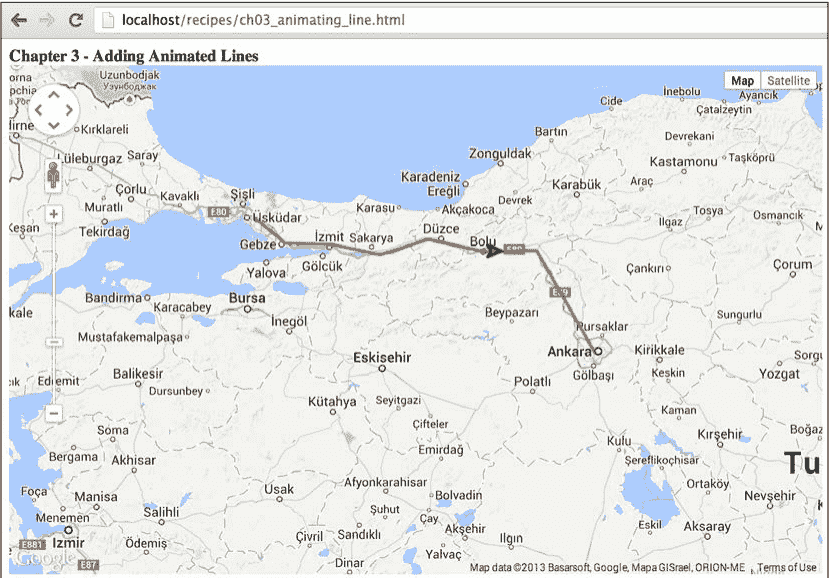


作为这个食谱的结果，我们可以将动画线条类型几何图形添加到我们的地图中，这显示了车辆在路线上的移动。

## 工作原理……

动画折线包含一个使用 JavaScript `setInterval` 方法和 Google Maps JavaScript API 的 `PolylineOptions` 类的 `icons` 属性的技巧。如前所述，你可以创建自己的符号或使用预定义的符号。

预定义符号可以通过 `SymbolPath` 类访问，如下面的截图所示，正如 Google Maps JavaScript API 文档中的内容：

| 名称 | 描述 | 示例 |
|---|---|---|
| `google.maps.SymbolPath.CIRCLE` | 圆形。 | O |
| `google.maps.SymbolPath.BACKWARD_CLOSED_ARROW` | 向后指的箭头，所有边都是封闭的。 | ▼ |
| `google.maps.SymbolPath.FORWARD_CLOSED_ARROW` | 向前指的箭头，所有边都是封闭的。 | ▲ |
| `google.maps.SymbolPath.BACKWARD_OPEN_ARROW` | 向后指的箭头，一侧是开放的。 | ∨ |
| `google.maps.SymbolPath.FORWARD_OPEN_ARROW` | 向前指的箭头，一侧是开放的。 | ∧ |

在这个食谱中，我们将使用 `FORWARD_CLOSED_ARROW` 类型。该符号定义如下：

```javascript
var arrowSymbol = {
  strokeColor: '#000',
  scale: 3,
  path: google.maps.SymbolPath.FORWARD_CLOSED_ARROW
};
```

`strokeColor` 属性用于定义符号的颜色。`path` 属性用于定义符号类型，`scale` 属性用于符号的大小。你还可以像多边形中一样更改预定义符号的 `fillColor` 和 `fillOpacity` 属性。

如前面的截图所示，预定义符号是有限的。如果你需要更多类型的符号，你应该在 `Symbol` 类中自己定义它们。你需要通过 `Symbol` 类的 `path` 属性使用 SVG 路径表示法来定义自定义符号。

SVG 路径表示法是使用 SVG 命令（如 `moveto (M)`、`lineto (L)` 或 `closepath (Z)`）定义形状的。例如，以下路径表示法定义了一个三角形：

```javascript
var triangle = 'M 100 100 L 300 100 L 200 300 Z';
```

路径表示法的解释如下：移动到点 (100,100)，从 100,100 到 300,100 画一条水平线，然后从 (300,100) 到 (200, 300) 画第二条线。这个形状显示为三角形。最后，`Z` 命令用于关闭路径。你可以用这种表示法绘制任何形状，但你应该注意可用于地图使用的区域。

Google Maps JavaScript API 允许使用 22 x 22 像素的正方形区域来显示定义的形状。如果形状大于此区域，你应该使用 `scale` 参数将形状适应到区域内。以下代码块将把预定义箭头形状更改为黄色三角形，在相同路线上移动：

```javascript
var arrowSymbol = {
    path: 'M 100 100 L 300 100 L 200 300 Z',
    anchor: new google.maps.Point(175,175),
    scale: 0.15,
    fillColor: '#FFFF00',
    fillOpacity: 0.8,
    strokeColor: '#000000',
    strokeWeight: 3
};
```

如果你注意到了，这里有一个名为 `anchor` 的额外参数。该参数用于定义符号相对于折线的位置。如果不添加此参数，你的符号将默认从 (0,0) 点锚定到折线上。一般来说，将符号的中心作为 `anchor` 点能得到最佳效果。`anchor` 参数接受 `Point` 类。它的 `x` 和 `y` 参数也以像素为单位。

本方案中最棘手的部分是动画。在 `animateArrow()` 函数中，我们定义了一个触发器，通过 `window.setInterval` 方法每 50 毫秒对前面定义的符号进行动画处理。在此触发器中定义了一个匿名函数，如下所示：

```javascript
function() {
    counter = (counter + 1) % 200;
    var arrows = polyline.get('icons');
    arrows[0].offset = (counter / 2) + '%';
    polyline.set('icons', arrows);
}
```

此函数获取 `icons` 数组的第一个对象，并根据 `counter` 变量的变化更改所定义图标的 `offset` 参数。每 50 毫秒运行此函数，就能使符号在折线上移动。

在匿名函数中，你可能已经注意到 `polyline` 对象具有 `get()` 和 `set()` 方法，但这些方法在文档中并未定义。由于 `Polyline` 类继承了 `MVCObject` 类，因此我们也可以使用 `MVCObject` 类的方法。所以，我们可以使用父类的 `get()` 和 `set()` 方法。

使用符号和计时器可以在地图上实现不同的可视化效果，而无需除 Google Maps JavaScript API 之外的额外库。

## 还有更多……

SVG 是 **Scalable Vector Graphics**（可缩放矢量图形）的缩写。它是一种基于 XML 的二维矢量图像格式，支持交互性和动画。所有现代浏览器都支持 SVG。在某些情况下，它可以是地图平台的一个好解决方案，就像本例这样。SVG 是一个完全不同的主题，超出了本书的范围。

> 关于 SVG 路径表示法的更多信息

> 更多细节可以在 W3C 网站上找到（http://www.w3.org/TR/SVG/paths.html#PathData）。还有一些编辑软件可以在不学习语言的情况下获取路径表示法。以下地址可用于创建 SVG 并获取路径表示法：http://svg-edit.googlecode.com/svn/branches/2.6/editor/svg-editor.html。

## 另请参阅

- 第 1 章《Google Maps JavaScript API 基础》中的在自定义 DIV 元素中创建简单地图方案
- 在地图上添加线条方案

# 添加 KML/GeoRSS 图层

**Keyhole Markup Language（KML）** 是在 Google Earth 中引入的，Google Earth 在 Google 收购之前原名为 Keyhole Earth Viewer。KML 在 2008 年成为 OGC 标准。它是一种用于在支持地理信息的查看器中显示要素的 XML 标记法。

**GeoRSS** 也是一种新兴标准，用于共享地球要素以在支持地理信息的查看器中显示，主要用于网络订阅源或服务。这两种标准都可以与 Google Maps JavaScript API 结合使用。

在本方案中，我们将通过 Google Maps JavaScript API 使用动态服务。我们将使用 **美国地质调查局（USGS）** 的网络服务在地图上显示最近的地震。这些服务会定期更新以反映最新事件。

## 准备工作

在本方案中，我们将以第 1 章《Google Maps JavaScript API 基础》中介绍的简单地图方案作为模板。

本方案的源代码位于 `Chapter 3/ch03_kml_georss.html`。

## 操作步骤……

如果你执行以下步骤，就可以将 KML/GeoRSS 文件添加到你的地图中：

1. 首先，复制 `ch01_simple_map.html` 的内容到我们的新 HTML 文件中。

2. 接下来，将以下变量定义为全局变量：

   ```javascript
   var georssLayer, kmlLayer;
   ```

3. 在定义全局变量后添加以下函数。此函数触发将 GeoRSS 订阅源添加到地图的操作：

   ```javascript
   function addGeoRSSLayer() {
     georssLayer = new google.maps.KmlLayer(
       'http://earthquake.usgs.gov/earthquakes/feed/v1.0/
       summary/4.5_month.atom');
     georssLayer.setMap(map);
   }
   ```

4. 然后，在前一个函数之后添加另一个函数。此函数也触发将 KML 订阅源添加到地图的操作：

   ```javascript
   function addKMLLayer() {
     kmlLayer = new google.maps.KmlLayer(
       'http://earthquake.usgs.gov/earthquakes/feed/v1.0/
       summary/2.5_month_depth.kml');
     kmlLayer.setMap(map);
   }
   ```

5. 现在，在 `initMap()` 函数之前添加以下 `clearMap()` 函数：

   ```javascript
   function clearMap() {
     if (georssLayer != undefined) {
       georssLayer.setMap(null);
       georssLayer = null;
     }

     if (kmlLayer != undefined) {
       kmlLayer.setMap(null);
       kmlLayer = null;
     }
   }
   ```

6. 接下来，添加以下函数以监听步骤 8 中 HTML 定义的按钮的点击事件：

   ```javascript
   function startButtonEvents () {
     document.getElementById('linkGeoRSS')
       .addEventListener('click', function(){
         addGeoRSSLayer();
     });
     document.getElementById('linkKML')
       .addEventListener('click', function(){
         addKMLLayer();
     });
     document.getElementById('linkClearMap')
       .addEventListener('click', function(){
         clearMap();
     });
   }
   ```

7. 必须在初始化地图时调用 `startButtonEvents` 函数，因此在地图初始化后，将以下行添加到 HTML 文件中：

   ```javascript
   startButtonEvents();
   ```

8. 最后，将以下行添加到 HTML `body` 标签中，以在点击链接时触发函数：

   ```html
   <a id="linkGeoRSS" href="#">添加 GeoRSS 图层</a>
   <a id="linkKML" href="#">添加 KML 图层</a>
   <a id="linkClearMap" href="#">清除地图</a>
   ```

9. 在你喜欢的浏览器中转到存储 HTML 文件的本地 URL，查看结果。你会看到开始时是一张空白地图。当你点击地图上的链接时，你会看到地图上出现两个不同的图层，如下所示：

如前面的屏幕截图所示，你可以轻松地使用 Google Maps JavaScript API 将 GeoRSS 文件或服务添加到地图中。

这是将 KML 图层添加到你的地图的结果。使用 Google Maps JavaScript API，你可以轻松地将 KML 文件或服务添加到地图中。

## 工作原理……

添加 KML/GeoRSS 图层是最简单的。只有一个类用于添加这两种图层，名为 `KmlLayer`。此类从本地或远程位置读取 KML 或 GeoRSS 订阅源，并决定渲染什么。该类的使用非常简单：

```javascript
var vectorLayer = new google.maps.KmlLayer('URL_TO_FEED');
```

创建图层后，必须使用 `setMap(map)` 方法设置地图，以便在地图上显示图层。如果你想从地图中移除图层，则必须如前所述使用 `setMap(null)` 方法。

请记住，Google Maps JavaScript API v3 没有像 v2 那样清除所有图层或叠加层的函数。处理图层状态的全部责任都在你肩上。实际上，Google Maps JavaScript API 文档建议你将所有图层保存在数组中，并通过 `setMap()` 方法管理你自己的添加/移除函数。

正如我们在 `clearMap()` 函数中所做的，我们检查图层是否已定义。如果是，则移除它；否则我们什么也不做，这样就不会出错。

97

# 将 GeoJSON 添加到 Google Maps JavaScript API

XML 是 Web 2.0 时代服务的第一主角。借助 XML，服务或机器之间可以轻松通信。XML 也可以被人类阅读。但在浏览器发展之后，JSON 因其对 JavaScript 的原生可读性以及比 XML 更轻量而变得更加流行。

GeoJSON 是 JSON 的一种形式，包含简单要素的集合，如点、折线或多边形。GeoJSON 不是 OGC 的标准，但它是一种新的实际标准，被大多数 GIS 软件或服务使用。

Google Maps JavaScript API 本身不支持 GeoJSON，但只需几行代码或使用一些额外库即可添加 GeoJSON 支持。通过编程，我们将遍历 JSON 格式并逐个读取坐标。然后，根据其类型（可以是点、折线或多边形）在地图上显示要素。

在本方案中，我们将通过 jQuery 函数从本地文件读取 GeoJSON 并在地图上显示它们。此 GeoJSON 文件由**安卡拉**省边界的简化版本、一条示例河流和一些 POI 组成。

## 准备工作

在本方案中，我们将以第 1 章《Google Maps JavaScript API 基础》中介绍的简单地图方案作为模板。

你可以在 `Chapter 3/ch03_adding_geojson.html` 找到源代码。

## 操作步骤……

如果你执行以下步骤，就可以将 GeoJSON 文件添加到你的地图中：

1. 首先，复制 `ch01_simple_map.html` 的内容到我们的新 HTML 文件中。

2. 接下来，我们将添加一个 jQuery JavaScript 库，以便于访问本地或远程的 GeoJSON 文件。在本方案中，我们将从 Google CDN 添加该库。此代码块将添加在 `<head>` 部分中 Google Maps JavaScript API 之前。

   ```html
   <script src="//ajax.googleapis.com/ajax/libs/jquery/1.10.2/jquery.min.js"></script>
   ```

3. 然后，在定义全局变量 `map` 之后添加以下 `drawGeometry()` 函数。该函数用于绘制从 GeoJSON 文件中读取的每个几何图形。我们有三类几何图形，因此将为每种类型切换代码块：

   ```javascript
   function drawGeometry(geom) {

   }
   ```

4. 现在，在新函数中添加以下 `if` 代码块。该代码块将在几何类型为 `Point` 时添加几何图形：

   ```javascript
   if (geom.type == 'Point') {
     var coordinate = new
       google.maps.LatLng(geom.coordinates[1],
       geom.coordinates[0]);
     var marker = new google.maps.Marker({
       position: coordinate,
       map: map,
       title: 'Marker'
     });
   }
   ```

5. 接下来，`if` 代码块用于在地图上显示折线的 `LineString`：

   ```javascript
   else if (geom.type == 'LineString') {
     var pointCount = geom.coordinates.length;
     var linePath = [];
     for (var i=0; i < pointCount; i++) {
       var tempLatLng = new
         google.maps.LatLng(geom.coordinates[i][1],
         geom.coordinates[i][0]);
       linePath.push(tempLatLng);
     }

     var lineOptions = {
       path: linePath,
       strokeWeight: 7,
       strokeColor: '#19A3FF',
       strokeOpacity: 0.8,
       map: map
     };
     var polyline = new google.maps.Polyline(lineOptions);
   }
   ```

6. 最后，以下 `if` 代码块用于显示多边形：

   ```javascript
   else if (geom.type == 'Polygon') {
     var pointCount = geom.coordinates[0].length;
   }
   ```

   ```javascript
   var areaPath = [];
   for (var i=0; i < pointCount; i++) {
       var tempLatLng = new google.maps.LatLng(
           geom.coordinates[0][i][1],
           geom.coordinates[0][i][0]);
       areaPath.push(tempLatLng);
   }

   var polygonOptions = {
       paths: areaPath,
       strokeColor: '#FF0000',
       strokeOpacity: 0.9,
       strokeWeight: 3,
       fillColor: '#FFFF00',
       fillOpacity: 0.25,
       map: map
   };

   var polygon = new google.maps.Polygon(polygonOptions);
   }
   ```


7. 然后，添加以下函数以读取 GeoJSON 文件并遍历其中的几何图形：

```javascript
function parseGeoJSON() {
    $.getJSON('geojson.js', function(data) {
        $.each(data.features, function(key, val) {
            drawGeometry(val.geometry);
        });
    });
}
```

8. 最后，在`initMap()`函数的末尾调用`parseGeoJSON()`函数：

```javascript
parseGeoJSON();
```

9. 在你常用的浏览器中打开存储 HTML 文件的本地 URL 并查看结果。你将看到地图上出现三种不同类型的几何图形，并带有各自的样式，如下所示：

## 第3章

至此，我们已成功将 GeoJSON 文件添加到地图中，并包含了多种类型的几何图形。

## 工作原理……

GeoJSON 是我们在前面介绍过的一种矢量格式。它是 JSON 的一种形式。GeoJSON 格式可以在同一文件中包含不同类型的数据，如下所示：

```json
{ "type": "FeatureCollection",
    "features": [
      { "type": "Feature",
        "geometry": {"type": "Point", "coordinates": [102.0, 0.5]},
        "properties": {"prop0": "value0"}
      },
      { "type": "Feature",
        "geometry": {
          "type": "LineString",
          "coordinates": [
            [102.0, 0.0], [103.0, 1.0], [104.0, 0.0], [105.0, 1.0]
          ]
```

101

```json
},
    "properties": {
      "prop0": "value0",
      "prop1": 0.0
    }
  },
  { "type": "Feature",
    "geometry": {
      "type": "Polygon",
      "coordinates": [
        [ [100.0, 0.0], [101.0, 0.0], [101.0, 1.0],
          [100.0, 1.0], [100.0, 0.0] ]
        ]
    },
    "properties": {
      "prop0": "value0",
      "prop1": {"this": "that"}
    }
  }
]
}
```

上述 GeoJSON 示例取自`www.geojson.org`网站。从代码中可以看出，同一文件中包含点、折线和多边形，它们通过`feature`关键字分隔开来。每个要素都有名为`geometry`和`properties`的 JavaScript 对象。`geometry`部分存储对象的几何图形，`properties`部分存储相关信息。`geometry`部分基于地理坐标参考系统，默认使用 WGS84 基准面，坐标以十进制度数的经度和纬度表示，除非在`crs`对象中另有定义。`type`对象存储几何图形的类型，如`Point`、`Polyline`或`Polygon`。`coordinates`数组是实际存储点坐标数组的部分。GeoJSON 中的坐标顺序与 Google Maps JavaScript API 在经度和纬度方面有所不同。

> ### 更多关于 GeoJSON 的信息

更多详细信息可从 GeoJSON 的非官方网站（`http://www.geojson.org`）获取。还有一些工具可以在无需编码的情况下查看或编辑 GeoJSON。GitHub（`http://www.github.com`）可以轻松地在地图上显示你的 GeoJSON 文件。`http://www.geojson.io`网站也是 MapBox 提供的一个工具，可以在浏览器中显示和编辑你的 GeoJSON 文件，无需任何软件或编码。请访问这些网站以详细了解 GeoJSON。

在本示例中，我们将借助 jQuery 的`getJSON()`方法读取本地 GeoJSON 文件。使用 jQuery 是为了专注于 Google Maps JavaScript API 的编码工作。否则，我们将不得不处理多浏览器平台上的远程文件读取问题。

该方法获取本地文件`geojson.js`的内容，并将其放入`data`变量中。然后，我们使用 jQuery 的`each()`方法遍历 GeoJSON 的要素。最后，我们获取每个要素的`geometry`部分，并将其发送到稍后将要分析的`drawGeometry()`函数：

```javascript
$.getJSON('geojson.js', function(data) {
  $.each(data.features, function(key, val) {
    drawGeometry(val.geometry);
  });
});
```

`drawGeometry()`函数中的代码可能看起来复杂，但实际上并非如此，因为我们将使用本章中为添加标记、线条和多边形所写的全部代码。该函数首先检查几何图形的类型，然后为点、折线或多边形准备适当的选项和坐标。

在折线或多边形中，需要遍历`geometry`字段的`coordinates`数组，以便为`PolylineOptions`或`PolygonOptions`类创建路径或多条路径。

```javascript
var pointCount = geom.coordinates.length;
var linePath = [];
for (var i=0; i < pointCount; i++) {
  var tempLatLng = new google.maps.LatLng(
    geom.coordinates[i][1], geom.coordinates[i][0]);
  linePath.push(tempLatLng);
}
```

在本示例中，我们将使用自己的函数处理 GeoJSON，但这些函数无法绘制所有类型的 GeoJSON 几何图形。我们只处理简单的类型，以展示如何自行处理 GeoJSON。如果你需要进行更复杂的 GeoJSON 处理，有两种方法。

```javascript
function drawGeometry(geom) {
  var slices = geom.split('(');
  var geomType = slices[0];
}
```

4. 现在，在新函数中添加以下`if`块。如果几何类型为`POINT`，则此块将添加该几何：

```javascript
if (geomType == 'POINT') {
  var coords = slices[1].split(')')[0].split(',');
  var finalCoords = coords[0].split(' ');
  var coordinate = new google.maps.LatLng(finalCoords[1],
    finalCoords[0]);
  var marker = new google.maps.Marker({
    position: coordinate,
    map: map,
    title: 'Marker'
  });
}
```

5. 接下来，添加用于`LINESTRING`的`if`块，以在地图上显示折线：

```javascript
else if (geomType == 'LINESTRING') {
  var coords = slices[1].split(')')[0].split(',');
  var pointCount = coords.length;
  var linePath = [];
  for (var i=0; i < pointCount; i++) {
    if (coords[i].substring(0,1) == ' ') {
      coords[i] = coords[i].substring(1);
    }
    var finalCoords = coords[i].split(' ');
    var tempLatLng = new google.maps.LatLng(finalCoords[1],
      finalCoords[0]);
    linePath.push(tempLatLng);
  }

  var lineOptions = {
    path: linePath,
    strokeWeight: 7,
    strokeColor: '#19A3FF',
    strokeOpacity: 0.8,
    map: map
  }
  var polyline = new google.maps.Polyline(lineOptions);
}
```

# 添加矢量图层

6. 最后，使用`if`块来显示多边形，如下所示：

```javascript
else if (geomType == 'POLYGON') {
    var coords = slices[2].split(')')[0].split(',');
    var pointCount = coords.length;
    for (var i=0; i < pointCount; i++) {
        if (coords[i].substring(0,1) == ' ') {
            coords[i] = coords[i].substring(1);
        }
        var finalCoords = coords[i].split(' ');
        var tempLatLng = new google.maps.LatLng(finalCoords[1],
                                                finalCoords[0]);
        areaPath.push(tempLatLng);
    }

    var polygonOptions = {
        paths: areaPath,
        strokeColor: '#FF0000',
        strokeOpacity: 0.9,
        strokeWeight: 3,
        fillColor: '#FFFF00',
        fillOpacity: 0.25,
        map: map
    }

    var polygon = new google.maps.Polygon(polygonOptions);
}
```

7. 然后，添加以下函数以读取 JSON 文件并遍历 WKT 几何：

```javascript
function parseWKT() {
    $.getJSON('wkt.js', function(data) {
        $.each(data.objects, function(key, val) {
            drawGeometry(val.geom);
        });
    });
}
```

8. 最后，在`initMap()`函数的末尾调用`parseWKT()`函数：

```javascript
parseWKT();
```

9. 在你常用的浏览器中打开本地存储 HTML 文件的 URL，查看结果。你将看到地图上三种不同类型的几何图形及其样式，如下截图所示：

106

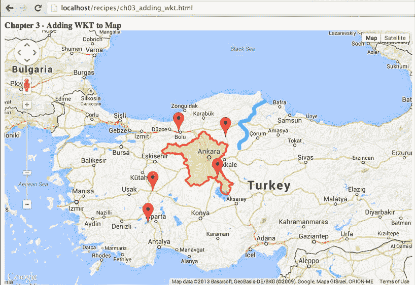

这就是我们如何向地图添加包含多种类型几何图形的 WKT 几何。

## 工作原理……

WKT 是我们前面定义的一种矢量格式，与 GeoJSON 不同。GeoJSON 同时定义了地球要素的几何和属性，但 WKT 仅用于定义几何。以下是简单的 WKT 类型示例：

| 几何类型 | WKT 示例 |
|---|---|
| `POINT` | `POINT(31.541742 40.730608)` |
| `POLYLINE` | `LINESTRING(35.24414 41.742627, 34.859619 41.586688, 34.7717285 41.508577, 34.832153 41.364441)` |
| `POLYGON` | `POLYGON((33.759299 38.779907, 33.73552 38.758208, 33.73187 38.748987, 33.703537 38.723535, 33.677514 38.700728, 33.767242 38.728955, 33.800384 38.876017, 33.783532 38.842548, 33.759299 38.779907))` |

# 添加矢量图层

WKT 几何与“向 Google Maps JavaScript API 添加 GeoJSON”食谱中使用的完全相同，只是它们以 WKT 几何格式进行格式化。WKT 几何并非单独存在，因为它们具有文本格式。因此我们将它们放入带有`geom`属性的 JSON 文件中。这是为了便于解析。如果你有包含 WKT 几何的不同类型格式，你应该使用 JavaScript 进行解析。

首先，我们将读取 JSON 文件以获取 WKT 几何。我们将借助 jQuery 方法`getJSON()`来读取本地 JSON 文件。使用 jQuery 是为了让我们专注于 Google Maps JavaScript API，而不是为每个浏览器编写和修复 JavaScript 代码。否则，我们将不得不在多个浏览器平台上处理远程文件读取。此方法获取`wkt.js`本地文件的内容，并将其放入`data`变量中。然后，我们将使用 jQuery 方法`each()`遍历 JSON 对象。最后，我们获取每个对象的`geom`部分，并将其发送给稍后将详细介绍的`drawGeometry()`函数：

```javascript
$.getJSON('wkt.js', function(data) {
    $.each(data.objects, function(key, val) {
        drawGeometry(val.geom);
    });
});
```

WKT 的解析比 GeoJSON 困难得多，因为我们需要处理文本解析。通过`drawGeometry()`函数，我们将 WKT 文本拆分成更小的数组并使其有意义。在解析每种类型之前，我们需要获取其几何类型。由于它们没有单独的属性来定义类型，我们需要从 WKT 文本中提取类型。从示例中可以看出，类型通过`(`字符与坐标分隔。如果我们从`(`字符处切分字符串，第一个数组元素就是几何类型。具体操作如下：

```javascript
var slices = geom.split('(');
var geomType = slices[0];
```

`geomType`的内容可以是`POINT`、`LINESTRING`或`POLYGON`。然后，我们将在不同的块中检查每种几何类型。让我们从点开始，逐一介绍每种几何类型。

点是使用 JavaScript 解析的最简单的 WKT 几何。首先，我们获取`slice`数组的第二个元素，并从`)`字符处切分，只获取由逗号分隔的坐标。然后，我们将结果文本按逗号拆分成数组。此数组只有一个元素，因此我们可以轻松访问坐标。要访问坐标，我们必须用空格字符切分最终文本。这个最终数组包含纬度和经度。Google Maps JavaScript API 使用纬度和经度的顺序来定义点，但 WKT 使用经度和纬度顺序来定义点。如“向 Google Maps JavaScript API 添加 GeoJSON”食谱中所述，坐标的顺序对于 WKT 来说也是如此，与 Google Maps JavaScript API 的顺序相反，即为经度和纬度：

```javascript
var coords = slices[1].split(')')[0].split(',');
var finalCoords = coords[0].split(' ');
```

```javascript
var coordinate = new google.maps.LatLng(finalCoords[1], finalCoords[0]);
```

第二种类型是折线，在 WKT 中定义为`LINESTRING`。解析折线比点复杂得多。首先，我们如前所述，通过拆分`)`和逗号来获取坐标数组。然后，我们将在此数组中迭代以获取每个坐标。在用空格拆分文本之前，我们必须检查文本开头是否有空格。如果有空格，我们将获取文本的其余部分，以仅获取有效的纬度和经度数字。

```javascript
var coords = slices[1].split(')')[0].split(',');
var pointCount = coords.length;
var linePath = [];
for (var i=0; i < pointCount; i++) {
  if (coords[i].substring(0,1) == ' ') {
    coords[i] = coords[i].substring(1);
  }
  var finalCoords = coords[i].split(' ');
  var tempLatLng = new google.maps.LatLng(finalCoords[1],
    finalCoords[0]);
  linePath.push(tempLatLng);
}
```

最后一种简单类型是多边形，在 WKT 中也定义为`POLYGON`。解析多边形与解析折线非常相似，只是多边形定义有两个括号，比折线多一个。我们将获取数组的第三个元素而不是第二个，因为 WKT 可以包含多个多边形几何，而在此情况下我们只有一个。如果你有多个几何，则应该遍历这些几何。唯一的区别如下所示：


```js
var coords = slices[2].split(')')[0].split(',');
```

`drawGeometry()`函数中编写的代码块可能看起来很复杂，但事实并非如此，因为我们将使用本章中编写的所有代码来添加标记、线条和多边形。此食谱的结果与*向 Google Maps JavaScript API 添加 GeoJSON*食谱完全相同，这是预期的结果。我们不认为改变矢量格式会得到不同的输出。

在本食谱中，我们将使用自己的函数处理 WKT，这些函数无法绘制其标准中定义的所有类型的 WKT 几何。我们只处理简单的类型，以向你展示如何自行处理 WKT。如果你需要处理更复杂的 WKT 几何，则有两种方法。一种方法是阅读完整的 WKT 规范并将其添加到你的函数中。另一种更简单的方法是使用专门为此设计的库。有一个名为 `Wicket` 的库，由 `K. Arthur Endsley` 在 GitHub 上编写（`https://github.com/arthur-e/Wicket`）。借助这个库，你不需要处理 WKT 规范。你可以使用自己的样式添加几何。

# 添加矢量图层

## 另请参阅

- 第 1 章《Google Maps JavaScript API 基础》中的*在自定义 DIV 元素中创建简单地图*教程
- *向地图添加标记*教程
- *向地图添加线条*教程
- *向地图添加多边形*教程
- *向 Google Maps JavaScript API 添加 GeoJSON*教程

# 使用控件

在本章中，我们将介绍：

- 添加和移除控件
- 更改控件位置
- 创建并添加地理定位控件
- 创建图层目录控件
- 将您自己的徽标添加为控件

## 简介

本章涵盖 Google Maps JavaScript API 中的控件。一般而言，控件是与用户交互的 UI 元素。在非常基础的层面上，它们由简单的 HTML 元素或 HTML 元素的组合构成。

控件使用户能够平移地图、放大或缩小、测量距离或面积等。复杂的控件涉及以**目录（ToC）**控件形式管理多个叠加图层（在*第 2 章 添加栅格图层*中介绍），或用于绘制矢量要素的编辑工具栏。

Google Maps JavaScript API 为开发者提供了使用和自定义内置控件以及从零开始构建自定义控件的机会。

本章将首先详细介绍处理内置控件及其配置，包括 UI 的自定义。然后，将介绍从非常基础到复杂（如目录）的自定义控件的创建。

## 添加和移除控件

Google Maps 默认 UI 有多个控件，这些控件在默认情况下显示或在满足某些条件时显示。这些控件包括：

- 缩放控件
- 平移控件
- 地图类型控件
- 比例尺控件
- 街景控件
- 旋转控件
- 概览地图控件

Google Maps JavaScript API 为开发者提供了选择启用或禁用这些控件的机会，或在功能或外观方面对它们进行自定义。

在本教程中，我们将介绍通过添加或移除内置控件来更改 UI 的方法，以及如何通过提供的选项来更改它们的属性。

### 准备工作

*第 1 章《Google Maps JavaScript API 基础》*的第一个教程将满足我们的需求。我们将针对本教程对其进行修改。

### 操作步骤

如果您执行以下步骤，可以选择内置控件的显示方式：

1. 按如下方式修改 `mapOptions` 对象：

```js
var mapOptions = {
    center: new google.maps.LatLng(43.771094, 11.25033),
    zoom: 13,
    mapTypeId: google.maps.MapTypeId.ROADMAP,
    panControl: true,
    scaleControl: false,
    zoomControl: true,
    zoomControlOptions: {
      style: google.maps.ZoomControlStyle.SMALL
    },
    overviewMapControl: true,
    overviewMapControlOptions: {
      opened: true
    },
    mapTypeControl: false
}
```

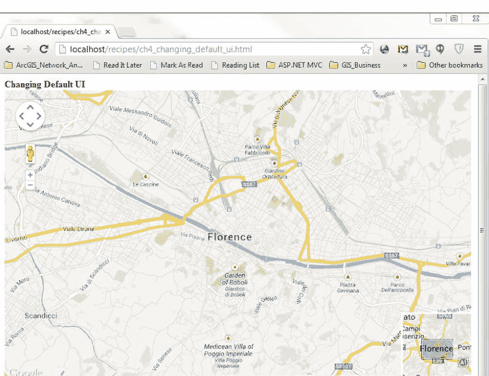

您可以根据个人喜好决定内置控件的开启或关闭，如上图所示。

### 工作原理

您可能已经注意到，我们在 `mapOptions` 对象中添加了很多内容。这是因为在 `google.maps.mapOptions` 对象中，您可以使控件可见或不可见：

```js
panControl: true,
scaleControl: false,
zoomControl: true,
mapTypeControl: false,
overviewMapControl: true
```

通过赋值布尔值（`true`/`false`），您可以显示 `panControl`、`zoomControl` 和 `overviewMapControl`，而 `scaleControl` 和 `mapTypeControl` 则被隐藏。

某些控件默认显示。例如，我们没有在 `mapOptions` 对象中提到 `streetViewControl`；然而，它在界面中显示，因为它是默认存在的。内置控件及其在 UI 中的默认显示情况如下：

| 控件名称 | 默认显示 |
|---|---|
| 缩放控件 | 是 |
| 平移控件 | 是 |
| 比例尺控件 | 否 |
| 地图类型控件 | 是 |
| 街景控件 | 是 |
| 旋转控件 | 是（针对倾斜影像） |
| 概览地图控件 | 否 |

尽管 `rotateControl` 默认显示，但您可能已经注意到它在界面中找不到，因为它仅在显示倾斜影像时才会出现。按如下方式调整 `mapOptions` 对象，我们可以查看该控件：

1. 启用 `mapTypeControl`，以便在 UI 中选择卫星影像，如下面的代码及其后的截图所示：

```js
mapTypeControl: true
```

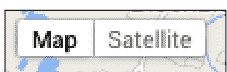

您可以在上图的截图中看到 `mapTypeControl`。

倾斜影像（45 度影像）在某些位置提供服务，并且在任何有该服务的地方，`mapTypeControl` 都会更新自身以包含用于显示倾斜影像的子菜单切换。

`RotateControl` 控件显示在平移控件和缩放控件之间。它允许用户以 90 度为间隔旋转倾斜影像。此外，平移控件会被修改为带有圆环，让我们在显示倾斜影像时能够更改其方向：

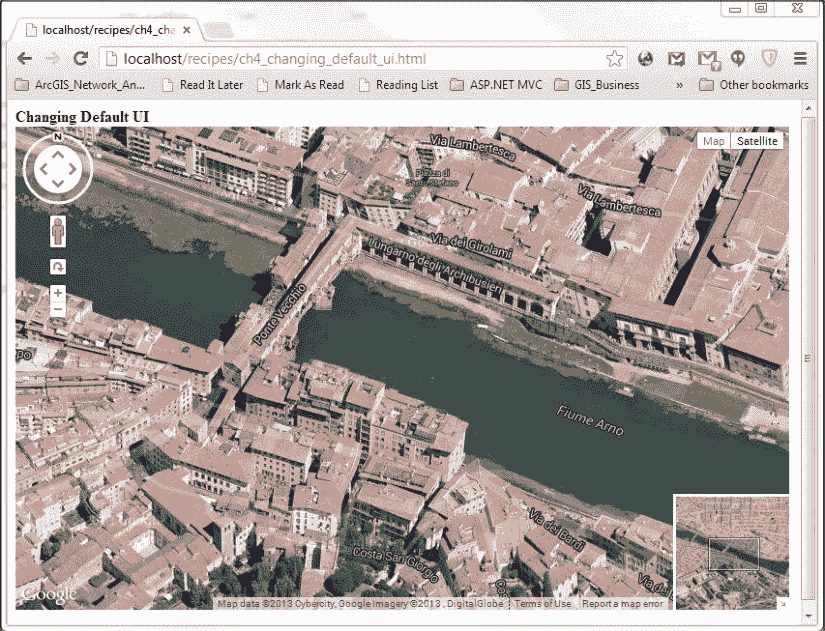

### COSTA

Google Maps JavaScript API 不仅允许我们在内置控件的开启和关闭之间切换，还允许我们自定义它们的属性和样式。例如：

```js
overviewMapControlOptions: {
  opened: true
}
```

这将概览地图控件设置为 `opened` 状态。请记住，概览地图控件的默认状态是折叠的，此设置将在您的应用程序开始时将控件设置为 `opened`。您可以随时通过按控件右下角的小箭头来折叠或打开控件。

对于缩放控件，本教程中提供的选项如下：

```js
zoomControlOptions: {
  style: google.maps.ZoomControlStyle.SMALL
}
```

此选项将缩放控件的样式设置为小型，包含两个小按钮，一个用于放大，另一个用于缩小。`zoomControlOptions` 的 `style` 属性的其他选项是：

```js
google.maps.ZoomControlStyle.LARGE
google.maps.ZoomControlStyle.DEFAULT
```

`LARGE` 选项将缩放控件设置为长条形式，您可以在其中遍历不同的缩放级别。`DEFAULT` 选项根据屏幕大小决定是显示大型缩放控件还是小型缩放控件。

您可能已经注意到，控件的选项由带有 `Options` 后缀的对象处理。同样，`mapTypeControl` 也有相应的选项，位于 `MapTypeControlOptions` 对象内。将以下代码行添加到代码中将会进行一些更改：

```js
mapTypeControl: true,
mapTypeControlOptions: {
  mapTypeIds: [
    google.maps.MapTypeId.ROADMAP,
    google.maps.MapTypeId.HYBRID
  ],
  style: google.maps.MapTypeControlStyle.DROPDOWN_MENU
}
```

`mapTypeControlOptions` 属性中的设置使 `mapTypeControl` 仅提供 `ROADMAP` 和 `HYBRID` 地图类型，因此您将无法选择 `SATELLITE` 和 `TERRAIN` 地图类型。正如您从*第 2 章 添加栅格图层*中所记得的，`mapTypeIds` 属性不仅接受内置地图类型，还接受通过 `StyledMapType` 对象提供的样式化地图类型，以及通过 `ImageMapType` 对象提供的任何瓦片图像源（无论是作为底图还是叠加地图）。

第二个属性 `style` 将 `mapTypeControl` 设置为以下拉菜单形式显示，而不是标准的水平栏。`mapTypeControlOptions` 的 `style` 属性的其他选项是：

```js
google.maps.MapTypeControlStyle.HORIZONTAL_BAR
google.maps.MapTypeControlStyle.DEFAULT
```

`DEFAULT` 选项用于根据屏幕空间动态选择缩放控件是作为水平栏还是下拉菜单显示。

> **控件的完整选项列表**
>
> 控件的完整选项列表可以在 Google Maps JavaScript API 参考文档网址 `https://developers.google.com/maps/documentation/javascript/reference` 找到。

## 更改控件的位置

Google Maps 控件有其默认位置，Google Maps JavaScript API 提供了一定程度的灵活性来更改这些默认位置。您还可以根据 UI 中提供的位置来定位您的自定义控件，如下面的截图所示：

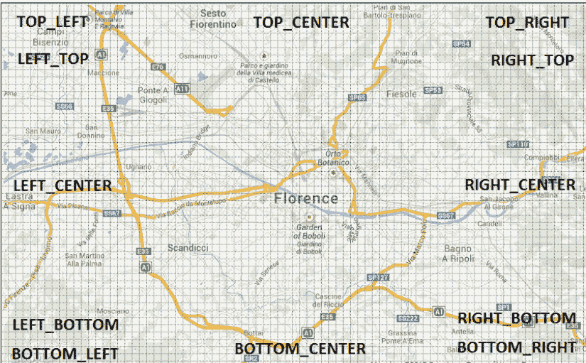

前面的截图展示了可以放置控件的可能位置。值得注意的是，**TOP_LEFT** 不等于 **LEFT_TOP**，其中 **TOP_LEFT** 是顶部第一个。

在本节中，我们将介绍如何在 Google Maps UI 中指定控件的对应位置。

### 准备工作

本节基于上一节的代码，因此有了上一节的代码，我们的大部分工作就已经完成了。

### 操作步骤

你可以通过以下步骤清除控件的位置设置：

2. 完全重新设置 `mapOptions` 对象，如下所示：

```js
var mapOptions = {
    center: new google.maps.LatLng(43.771094, 11.25033),
    zoom: 13,
    mapTypeId: google.maps.MapTypeId.ROADMAP,
    panControl: true,
    panControlOptions: {
        position: google.maps.ControlPosition.TOP_RIGHT
    },
    zoomControl: true,
    zoomControlOptions: {
        style: google.maps.ZoomControlStyle.SMALL,
        position: google.maps.ControlPosition.BOTTOM_CENTER
    },
    mapTypeControl: true,
    mapTypeControlOptions: {
        position: google.maps.ControlPosition.LEFT_TOP
    },
    streetViewControlOptions: {
        position: google.maps.ControlPosition.LEFT_CENTER
    }
};
```

你可以根据自己的喜好更改控件在地图 UI 中的位置，如前面截图所示。

### 工作原理

在 `mapOptions` 对象中，我们通过每个控件自身选项中的 `position` 属性来指定每个控件的位置，如以下代码片段所示：

```js
mapTypeControlOptions: {
  position: google.maps.ControlPosition.LEFT_TOP
}
```

# 使用控件

以下代码将 `mapTypeControl` 定向到地图 `div` 元素的左上角，而 `panControl` 则放置在右上角：

```js
panControlOptions: {
    position: google.maps.ControlPosition.TOP_RIGHT
},
```

> **控件位置的完整列表**
>
> 控件位置的完整列表可以在 Google Maps JavaScript API 参考文档 URL（`https://developers.google.com/maps/documentation/javascript/reference#ControlPosition`）中找到。

## 创建并添加地理定位控件

Google Maps UI 有许多在前面几节中介绍的内置控件。这些控件满足多种需求，如平移、缩放和更改地图类型。然而，用户的需求是无限的，用户可能非常有创意。不可能为每一种需求都提供一个内置控件。

相反，Google Maps JavaScript API 提供了一种创建自定义控件以满足每种特定需求的方法。自定义控件基本上是简单的 HTML 元素，包裹在一个单一元素中，大多是 `<div>` 元素。

在本节中，我们将介绍创建自定义控件的基础知识，将其放置在 Google Maps UI 上，并通过事件处理程序来使用它。

### 准备工作

本节将基于*第 1 章《Google Maps JavaScript API 基础》中的*从 Web 到移动设备*一节。我们的本节将利用该节中的地理定位代码片段，因此回顾该节会很有帮助。

### 操作步骤

如果你执行以下步骤，你将拥有一个全新的自定义地理定位控件：

1. 首先，创建一个 JavaScript 对象，它将最终成为我们的自定义控件（构造函数将接受两个参数，这将在后面的步骤中解释）：

```js
function GeoLocationControl(geoLocControlDiv, map) {

}
```

2. 在 `GeoLocationControl` 类内部，设置 `class` 属性以包含作为构造函数第一个参数引用的 `div` 元素：

```js
geoLocControlDiv.className = 'controlContainer';
```

3. 在 `GeoLocationControl` 类内部，设置内部 HTML `div` 元素的详细信息，包括其 `class` 属性，使该元素看起来像一个按钮：

```js
var controlButton = document.createElement('div');

controlButton.className = 'controlButton';

controlButton.innerHTML = 'Geolocate';
```

4. 将这个内部 `div` 元素（`controlButton`）添加到容器 `div` 元素中，如下所示：

```js
geoLocControlDiv.appendChild(controlButton);
```

5. 在 `GeoLocationControl` 类内部，为 `controlButton` 添加 `click` 事件监听器：

```js
google.maps.event.addDomListener(controlButton, 'click', function() {
  if (navigator.geolocation) {
    navigator.geolocation.getCurrentPosition(function(position) {
      var lat = position.coords.latitude;
      var lng = position.coords.longitude;
      var devCenter = new google.maps.LatLng(lat, lng);

      map.setCenter(devCenter);
      map.setZoom(15);

      var marker = new google.maps.Marker({
        position: devCenter,
        map: map,
      });
    });
  }
});
```

6. 现在，在我们一直以来使用的普通 `initMap()` 函数中，除了 `map` 和 `mapOptions` 对象的标准定义外，还要添加容器 HTML `div` 元素：

```js
var geoLocationControlDiv = document.createElement('div');
```

7. 在 `initMap()` 内部实例化自定义控件类 `GeoLocationControl` 类，提供两个参数：上一步创建的容器 `div` 元素和 `map` 对象本身：


```javascript
var geoLocationControl = new GeoLocationControl(geoLocationControlDiv, map);
```

8. 将自定义控件放置在地图 UI 的其他控件中：

```javascript
map.controls[google.maps.ControlPosition.RIGHT_CENTER].push(geoLocationControlDiv);
```

你应该有一个自定义控件，如前面截图所示，functioning as a geolocation control。

## 工作原理

与其他几节相比，本节可能看起来令人困惑，但本质上，在 Google Maps JavaScript API 中创建自定义控件只有一个重要要点：你可以利用任何 HTML 元素作为自定义控件。事实上，以下简单的代码片段就足以拥有一个自定义控件：

```javascript
var controlDiv = document.createElement('div');

map.controls[google.maps.ControlPosition.RIGHT_CENTER].push(controlDiv);
```

这段代码创建一个 HTML `div`元素，然后将其添加到`map`对象的控件数组中。控件数组是一个二维数组，第一维是`google.maps.ControlPosition`类中定义的可用的位置，第二维是控件。这个透明的、内部没有标签的控件不会执行任何操作，因为没有为`div`元素编写事件处理代码；然而，这并不能改变它是一个自定义控件的事实。

其他细节，如 CSS 样式、填充属性和事件处理，对于一个专业的自定义控件来说，对于地图 UI 用户的使用是必要的。

在本节中，我们选择了创建一个 JavaScript 类来封装所有这些细节，以便结构更清晰：

```javascript
function GeoLocationControl(geoLocControlDiv, map) {

}
```

我们的类构造函数使用两个元素：容器`div`元素和`map`对象。它需要容器`div`元素的引用，以便将子元素`controlButton`添加到其中：

```javascript
geoLocControlDiv.appendChild(controlButton);
```

`controlButton`对象（一个 HTML `div`元素）必须响应一些用户发起的事件，这样自定义控件才会有用和有意义：

```javascript
google.maps.event.addDomListener(controlButton, 'click', function() {

});
```

`google.maps.event.addDomListener`方法充当事件处理器注册，并且在每个浏览器上的工作方式相同。这些方法和事件相关的主题将在*第 5 章《理解 Google Maps JavaScript API 事件》*中介绍。目前，了解`click`事件会被`controlButton`对象监听就足够了。

# 使用控件

来自*第 1 章《Google Maps JavaScript API 基础》*的地理定位代码片段位于`addDomListener`方法内部，利用浏览器的 Geolocation API。如果浏览器支持 Geolocation API 并且位置已获取，则会在该位置向地图添加一个标记：

```javascript
var marker = new google.maps.Marker({
  position: devCenter,
  map: map,
});
```

整个子元素创建和事件处理逻辑都封装在一个 JavaScript 类构造函数中，通过以下方式调用：

```javascript
var geoLocationControl = new GeoLocationControl(geoLocationControlDiv, map);
```

下面是完成此任务所需的另一个代码片段：

```javascript
map.controls[google.maps.ControlPosition.RIGHT_CENTER].push(geoLocationControlDiv);
```

值得注意的是，`controls`数组将容器`div`元素作为自定义控件。另外，请记住，在其他场景中，`controls[google.maps.ControlPosition.RIGHT_CENTER]`可能已经有其他控件。我们使用`push`，这样现有的控件不会被替换。

## 创建图层目录控件

目录（ToC）控件等 UI 元素在桌面 GIS 软件中非常常见，如 ArcGIS Desktop、Mapinfo 和 Geomedia。此外，它们的 Web 对应物也在其 UI 中大量使用 ToC，包括 ArcGIS 和 .Net Web 组件。

ToC 的主要用途是打开和关闭各种栅格或矢量图层，以便叠加和查看多层数据。对于矢量图层，选项可以通过允许用户更改矢量图层的符号系统来丰富。

Google Maps UI 没有内置的 ToC 控件；但是，借助构建自定义控件的灵活性，实际上有无限的可能性。

Google Maps JavaScript API 允许开发者使用第三方底图，如 OpenStreetMaps，或在底图之上显示叠加栅格图层（在*第 2 章《添加栅格图层》*中详细讨论）。此外，在*第 3 章《添加矢量图层》*中，各种矢量数据已在相应的节中叠加。

在本配方中，我们只将基础地图显示在目录（ToC）上，以便了解其结构，包括保持控件的状态，以及在一个控件中包装多个 HTML 元素的多个事件处理程序。当然，可以通过添加叠加层和矢量图层来丰富此结构。

### 准备工作

本配方将使用*第 2 章《添加栅格图层》*中的*使用不同的瓦片源作为基础地图*配方。在开始当前配方之前，最好先回顾一下该配方。此外，要了解如何创建简单的自定义控件，上一个配方将是关键。

## 操作步骤

以下是在 Google Maps UI 中创建可用 ToC 控件的步骤：

1. 创建一个 JavaScript 类，该类将包含我们所有的子控件和事件处理程序（直到第 12 步，所有代码都将嵌入此类的构造函数中）：

   ```javascript
   function TableOfContentsControl(tocControlDiv, map) {

   }
   ```

2. 将`this`作为变量保存，因为它在事件处理程序中将超出作用域：

   ```javascript
   var tocControl = this;
   ```

3. 在类构造函数中设置容器`div`元素的 CSS 属性：

   ```javascript
   tocControlDiv.className = 'tocControl';
   ```

4. 设置 ToC 的标题：

   ```javascript
   var tocLabel = document.createElement('label');

   tocLabel.appendChild(document.createTextNode('Base Layers'));

   tocControlDiv.appendChild(tocLabel);
   ```

5. 为**OpenStreetMap 基础地图**创建单选按钮：

   ```javascript
   var osmStuffDiv = document.createElement('div');
   var osmRadioButton = document.createElement('input');

   osmRadioButton.type = 'radio';
   osmRadioButton.name = 'BaseMaps';
   osmRadioButton.id = 'OSM';
   osmRadioButton.checked = false;
   ```

   使用控件：

   ```javascript
   var osmLabel = document.createElement('label');

   osmLabel.htmlFor = osmRadioButton.id;
   osmLabel.appendChild(document.createTextNode('OpenStreetMap Base Map'));

   osmStuffDiv.appendChild(osmRadioButton);
   osmStuffDiv.appendChild(osmLabel);
   ```

6. 为**Google 道路地图**基础地图创建单选按钮：

   ```javascript
   var roadmapStuffDiv = document.createElement('div');
   var roadmapRadioButton = document.createElement('input');

   roadmapRadioButton.type = 'radio';
   roadmapRadioButton.name = 'BaseMaps';
   roadmapRadioButton.id = 'Roadmap';
   roadmapRadioButton.checked = true;

   var roadmapLabel = document.createElement('label');

   roadmapLabel.htmlFor = roadmapRadioButton.id;
   roadmapLabel.appendChild(document.createTextNode('Google Roadmap'));

   roadmapStuffDiv.appendChild(roadmapRadioButton);
   roadmapStuffDiv.appendChild(roadmapLabel);
   ```

7. 为**Google 卫星地图**基础地图创建单选按钮：

   ```javascript
   var satelliteStuffDiv = document.createElement('div');
   var satelliteRadioButton = document.createElement('input');

   satelliteRadioButton.type = 'radio';
   satelliteRadioButton.name = 'BaseMaps';
   satelliteRadioButton.id = 'Satellite';
   satelliteRadioButton.checked = false;

   var satelliteLabel = document.createElement('label');

   satelliteLabel.htmlFor = roadmapRadioButton.id;
   satelliteLabel.appendChild(document.createTextNode('Google Satellite'));

   satelliteStuffDiv.appendChild(satelliteRadioButton);
   satelliteStuffDiv.appendChild(satelliteLabel);
   ```

126

8. 将所有单选按钮及其标签放入父`div`元素中：

   ```javascript
   tocControlDiv.appendChild(osmStuffDiv);
   tocControlDiv.appendChild(roadmapStuffDiv);
   tocControlDiv.appendChild(satelliteStuffDiv);
   ```

9. 为`osmRadioButton`创建点击事件处理程序（`setActiveBasemap`和`getActiveBasemap`方法将在下面的代码中阐明）：

   ```javascript
   google.maps.event.addDomListener(osmRadioButton, 'click', function() {
       if (osmRadioButton.checked) {
           tocControl.setActiveBasemap('OSM');
           map.setMapTypeId(tocControl.getActiveBasemap());
       }
   });
   ```

10. 为`roadmapRadioButton`创建点击事件处理程序，如下所示：

    ```javascript
    google.maps.event.addDomListener(roadmapRadioButton, 'click', function() {
        if (roadmapRadioButton.checked) {
            tocControl.setActiveBasemap(google.maps.MapTypeId.ROADMAP);
            map.setMapTypeId(tocControl.getActiveBasemap());
        }
    });
    ```

11. 为`satelliteRadioButton`创建点击事件处理程序：

    ```javascript
    google.maps.event.addDomListener(satelliteRadioButton, 'click', function() {
        if (satelliteRadioButton.checked) {
            tocControl.setActiveBasemap(google.maps.MapTypeId.SATELLITE);
            map.setMapTypeId(tocControl.getActiveBasemap());
        }
    });
    ```

12. 在`TableOfContentsControl`类构造函数之外，定义一个用于保持活动基础地图的属性：

    ```javascript
    TableOfContentsControl.prototype._activeBasemap = null;
    ```

13. 为`_activeBasemap`属性定义 getter 和 setter 方法：

    ```javascript
    TableOfContentsControl.prototype.getActiveBasemap = function() {
        return this._activeBasemap;
    };

    TableOfContentsControl.prototype.setActiveBasemap = function(basemap) {
        this._activeBasemap = basemap;
    };
    ```

14. 在`initMap()`函数中，定义`mapOptions`对象如下：

    ```javascript
    var mapOptions = {
        center: new google.maps.LatLng(39.9078, 32.8252),
        zoom: 10,
        mapTypeControlOptions: {
            mapTypeIds: [
                google.maps.MapTypeId.ROADMAP,
                google.maps.MapTypeId.SATELLITE,
                'OSM'
            ]
        },
        mapTypeControl: false
    };
    ```

15. 将`osmMapType`对象定义为`ImageMapType`：

    ```javascript
    var osmMapType = new google.maps.ImageMapType({
        getTileUrl: function(coord, zoom) {
            return 'http://tile.openstreetmap.org/' + zoom + '/' +
                coord.x + '/' + coord.y + '.png';
        },
        tileSize: new google.maps.Size(256, 256),
        name: 'OpenStreetMap',
        maxZoom: 18
    });
    ```

16. 将`'OSM'` `mapTypeId`对象关联到`osmMapType`对象：

    ```javascript
    map.mapTypes.set('OSM', osmMapType);
    ```

17. 设置启动时的`mapTypeId`：

    ```javascript
    map.setMapTypeId(google.maps.MapTypeId.ROADMAP);
    ```

18. 创建容器`div`元素，实例化`TableOfContentsControl`类，并将容器`div`元素定位为自定义控件：

    ```javascript
    var tableOfContentsControlDiv = document.createElement('div');

    var tableOfContentsControl = new TableOfContentsControl(
        tableOfContentsControlDiv,
        map
    );

    map.controls[google.maps.ControlPosition.TOP_RIGHT].push(
        tableOfContentsControlDiv
    );
    ```

你应该已经拥有了自己的 ToC 控件，作为地图 UI 中的自定义控件，如前面的截图所示。

## 工作原理

本配方实际上与上一个配方具有相同的结构；但是，自定义控件中的 HTML 元素使其看起来更加复杂。我们将逐步查看细节，以便事情会变得更加清晰。与上一个配方一样，我们首先创建了一个 JavaScript 类构造函数，该构造函数嵌入了所有细节，包括必要的单选按钮及其事件处理程序：

```javascript
function TableOfContentsControl(tocControlDiv, map) {

}
```

嵌入在`TableOfContentsControl`中的`osmRadioButton`单选按钮部分如下：

```javascript
var osmRadioButton = document.createElement('input');

osmRadioButton.type = 'radio';
osmRadioButton.name = 'BaseMaps';
osmRadioButton.id = 'OSM';
```


```javascript
osmRadioButton.checked = false;

var osmLabel = document.createElement('label247');

osmLabel.htmlFor = osmRadioButton.id;

osmLabel.appendChild(document.createTextNode('OpenStreetMap Base Map'));

tocControlDiv.appendChild(osmRadioButton);

tocControlDiv.appendChild(osmLabel);

google.maps.event.addDomListener(osmRadioButton, 'click',

function() {

    if (osmRadioButton.checked) {

        tocControl.setActiveBasemap('OSM');

        map.setMapTypeId(tocControl.getActiveBasemap());

    }

});
```

上述`osmRadioButton`的代码片段与`roadmapRadioButton`和`satelliteRadioButton`相同。代码创建了单选按钮及其关联的标签，将其添加到容器`div`元素（即构造函数的第一个参数）中，然后注册单选按钮的`click`事件。

`click`事件检查单选按钮是否被选中，如果被选中，则将活动基础地图设置为 OSM 基础地图。然后，它使用活动基础地图信息来设置地图的`mapTypeId`；这引用的是构造函数的第二个参数。

要设置和获取当前活动底图的信息，需要使用两个方法：

```javascript
setActiveBasemap('OSM')

getActiveBasemap()
```

这些方法在构造函数外部定义如下：

```javascript
TableOfContentsControl.prototype.getActiveBasemap = function() {

  return this._activeBasemap;

};

TableOfContentsControl.prototype.setActiveBasemap =

function(basemap) {

    this._activeBasemap = basemap;

};
```

这里，`_activeBasemap`局部变量定义如下：

```javascript
TableOfContentsControl.prototype._activeBasemap = null;
```

这里有一个微小但重要的细节。为了让`click`事件处理程序能够访问`TableOfContentsControl`对象的 getter 和 setter 方法，我们添加了一行代码：

```javascript
var tocControl = this;
```

这里，`this`在事件处理程序内部会超出作用域。

OpenStreetMap 底图部分位于`initMap()`函数中。关于如何显示外部底图的细节已在*第2章 添加栅格图层*中介绍过，因此无需在此赘述具体的细节。

最后一步实际上是在 UI 中运行该控件。由于我们没有调用`TableOfContentsControl`的构造函数，因此不会显示自定义的 ToC 控件。但是，在拥有 ToC 控件之前，我们需要在`mapOptions`对象中预留一些空间：

```javascript
mapTypeControlOptions: {

  mapTypeIds: [google.maps.MapTypeId.ROADMAP,

    google.maps.MapTypeId.SATELLITE, 'OSM']

},

mapTypeControl:false
```

在`mapTypeControlOptions`中，我们在`mapTypeIds`属性中列出了地图可能的地图类型 ID。

然而，我们不再需要`mapTypeControl`，因为我们将使用 ToC 控件来替代；因此，我们将`mapTypeControl`属性设置为`false`。

# 使用控件

然后进入最后阶段：放置自定义 ToC 控件：

```javascript
var tableOfContentsControlDiv = document.createElement('div');

var tableOfContentsControl = new

  TableOfContentsControl(tableOfContentsControlDiv, map);

map.controls[google.maps.ControlPosition.TOP_RIGHT].push

  (tableOfContentsControlDiv);
```

首先，我们创建一个任意的`div`，它将作为我们自定义控件的容器`div`元素。然后，我们调用`TableOfContentsControl`类的构造函数，传入容器`div`元素和`map`对象作为参数。之后，将容器`div`元素添加到二维控件数组中，该数组在`mapTypeControl`的默认位置（即`google.maps.ControlPosition.TOP_RIGHT`）控制地图对象。

## 将自己的徽标添加为控件

Google Maps JavaScript API 以非常灵活的方式设计自定义控件的添加，使得你可以在一个 HTML `div`元素中包含多种类型的 HTML 元素。

添加你自己选择的徽标，例如在自己的应用程序中将公司徽标放在地图 UI 顶部，是定制化的良好标志，也能展示你的作品。

在这个示例中，我们将使用 Google Maps JavaScript API 在地图 UI 中显示一个徽标作为控件。

### 准备工作

这个示例将使用*第1章 Google Maps JavaScript API 基础*中的第一个示例，因为我们只需要基础知识来开发这个示例。

## 操作步骤

以下是在 Google Maps UI 中将徽标显示为自定义控件的步骤：

1. 在`initMap()`函数中创建地图对象后，创建容器`div`元素：

   ```javascript
   var logoDiv = document.createElement("div");
   ```

2. 然后，创建包含你首选徽标的 HTML `img`元素：

   ```javascript
   var logoPic = document.createElement("img");

   logoPic.src = "ch04_logo.PNG";

   logoPic.id = "CompanyLogo";
   ```

3. 将`img`元素插入到容器`div`元素中：

   ```javascript
   logoDiv.appendChild(logoPic);
   ```

4. 将容器`div`元素添加到地图对象的`controls`数组中：

   ```javascript
   map.controls[google.maps.ControlPosition.LEFT_BOTTOM].push(logoDiv);
   ```

你可以按照上述示例，在地图 UI 中拥有你喜欢的徽标作为自定义控件。

## 工作原理

这个示例的代码实际上是 Google Maps JavaScript API 中自定义控件的最简单形式。该控件没有事件处理程序，也没有与该控件相关的状态信息。唯一存在的就是控件本身，即容器`div`元素`logoDiv`。

# 使用控件

`logoPic`元素和`img`元素保留对徽标文件的引用，并嵌入到`logoDiv`中：

```javascript
var logoPic = document.createElement("img");

logoPic.src = "ch04_logo.PNG";

logoDiv.appendChild(logoPic);
```

最后，`logoDiv`被添加到`LEFT_BOTTOM`位置的`controls`数组中。当你打开应用程序时，你可以在设计的位置看到地图 UI 中的徽标。

# 5 理解 Google Maps JavaScript API 事件

在本章中，我们将涵盖：

- 创建两个同步的并排地图
- 获取鼠标点击的坐标
- 在地图上创建右键菜单
- 限制地图范围
- 创建显示坐标的控件
- 创建你自己的事件

## 简介

如果你曾经进行过 JavaScript 编程，你应该知道事件的重要性。事件是 JavaScript 的核心。网页交互的背后都有事件。可以是用户交互或浏览器操作，都可以通过事件来处理。

例如，从本书开头以来的每一行代码中，我们都写到了类似下面这样的代码：

```javascript
google.maps.event.addDomListener(window, 'load', initMap);
```

这一行是事件定义的一种简单形式。这一行告诉浏览器在所有内容加载完毕后调用`initMap()`函数。这个事件是必要的，以便在加载所有 DOM 元素后启动地图功能。

本章是关于在 Google Maps JavaScript API 中使用事件以不同方式与地图进行交互。Google Maps JavaScript API 拥有`google.maps.event`命名空间来处理事件。该命名空间具有静态方法来监听 API 中定义的事件。你应该通过 Google Maps API 参考文档查看对象支持的事件类型。

## 创建两个同步的并排地图

地图对人类很有用。借助地图，人们可以探索或比较周围的区域。有时他们需要并排比较两张地图，以便实时查看差异。例如，你可能想要并排查看卫星影像和地形图，以了解山脉的位置。

这个示例向你展示如何在同一页面中添加两个地图并将它们同步在一起，以显示相同的区域并通过 Google Maps JavaScript API 事件进行比较。

### 准备工作

你已经在前面的章节中知道如何创建地图。因此，这里只写出额外的代码行。

你可以在`Chapter 5/ch05_sync_maps.html`找到源代码。

## 操作步骤

如果你想创建两个同步的地图，你应该执行以下步骤：

1. 首先，在头部添加`div`对象的 CSS 样式，使它们并排显示：

   ```css
   .mapClass { width: 500px; height: 500px; display: inline-block; }
   ```

2. 然后定义两个全局地图变量，以便在事件回调中访问它们：

   ```javascript
   var map1, map2;
   ```

3. 接下来创建初始化左侧地图的函数：

   ```javascript
   function initMapOne() {

     //Setting starting options of map

     var mapOptions = {

       center: new google.maps.LatLng(39.9078, 32.8252),

       zoom: 10,

       maxZoom: 15,

       mapTypeId: google.maps.MapTypeId.ROADMAP

     };

     //Getting map DOM element

     var mapElement = document.getElementById('mapDiv');

     //Creating a map with DOM element which is just obtained

     map1 = new google.maps.Map(mapElement, mapOptions);

     //Listening center_changed event of map 1 to

     //change center of map 2

     google.maps.event.addListener(map1, 'center_changed',

       function() {

         map2.setCenter(map1.getCenter());

       });

     //Listening zoom_changed event of map 1 to change

     //zoom level of map 2

     google.maps.event.addListener(map1, 'zoom_changed',

       function() {

         map2.setZoom(map1.getZoom());

       });

   }
   ```

4. 现在，添加初始化右侧地图的第二个函数。之前创建的函数内容几乎相同，除了变量名、`div` ID、地图类型和事件处理程序中的定时器：

   ```javascript
   function initMapTwo() {

     //Setting starting options of map

     var mapOptions2 = {

       center: new google.maps.LatLng(39.9078, 32.8252),

       zoom: 10,

       maxZoom: 15,

       mapTypeId: google.maps.MapTypeId.TERRAIN

     };

     //Getting map DOM element

     var mapElement2 = document.getElementById('mapDiv2');

     //Creating a map with DOM element which is just

     //obtained

     map2 = new google.maps.Map(mapElement2, mapOptions2);

     //监听 map 2 的 center_changed 事件

     //以改变 map 1 的中心点

     google.maps.event.addListener(map2, 'center_changed',

       function() {

         setTimeout(function() {

           map1.setCenter(map2.getCenter());

         }, 10);

       });

     //监听 map 2 的 zoom_changed 事件

     //以改变 map 1 的缩放级别

     google.maps.event.addListener(map2, 'zoom_changed',

       function() {

         setTimeout(function() {

           map1.setZoom(map2.getZoom());

         }, 10);

       });

   }
   ```

5. 我们现在有两个地图，而且必须在开始时初始化它们，因此需要一个单独的函数来调用之前的函数：

   ```javascript
   //启动两个地图

   function initMaps() {

     initMapOne();

     initMapTwo();

   }
   ```

6. 在`window`元素的`load`事件触发时调用`initMaps()`函数，此时所有内容都已加载完毕：

   ```javascript
   google.maps.event.addDomListener(window, 'load', initMaps);
   ```

7. 不要忘记在 HTML 标签中添加两个`div`对象：

   ```html
   <div id="mapDiv" class="mapClass"></div>

   <div id="mapDiv2" class="mapClass"></div>
   ```

8. 在你喜欢的浏览器中访问存储 HTML 文件的本地 URL 并查看结果。你会看到两个并排显示的地图。当你拖动或缩放其中一个地图时，另一个地图也会根据变化的那个进行相应改变。最终的地图看起来如下图所示：

作为这个方案的结果，我们可以创建两个同步的地图，以不同的地图类型显示同一区域。

### 它是如何工作的

这个方案的关键点在于让两个地图在相同的位置和缩放级别保持同步。为了实现这个目标，我们需要知道地图何时移动以及缩放级别何时改变。

地图对象有不同的触发事件。`center_changed`和`zoom_changed`是其中两个事件。`center_changed`事件在地图中心点每次改变时触发。还有`bounds_changed`、`drag`、`dragstart`和`dragend`等事件可以用来实现我们的目标，但`center_changed`是最简单处理的一个。`zoom_changed`事件在缩放级别发生变化时触发。

要监听这些事件，我们需要通过`google.maps.event`命名空间注册这些事件，如下所示：

```javascript
google.maps.event.addListener(map1, 'center_changed', function() {

  map2.setCenter(map1.getCenter());

});
```


`addListener()` 方法接收三个参数：要监听的对象、事件类型和事件处理程序。事件处理程序可以是之前定义的函数，也可以是仅在此处使用的匿名函数。在这个示例中，我们监听左侧地图对象——`map1`——的 `center_changed` 事件，并将右侧地图的中心点设置为左侧地图的中心点。缩放部分也以相同的方式工作。当左侧地图的缩放级别改变时，`zoom_changed` 的事件处理程序将右侧地图的缩放级别设置为左侧地图的缩放级别。

右侧地图也应该执行相同的操作，但由于无限事件循环的存在，右侧地图中用于事件处理的代码与左侧略有不同。如果我们使用相同的代码进行事件处理，就会在两个地图之间创建无限循环。这个循环在大多数情况下会导致浏览器崩溃。为了避免这种无限循环，我们在事件之间创建了一个小的间隔（10 毫秒）。这个间隔将解决所有问题，而用户不会察觉到差异。这个间隔是通过 JavaScript 的 `setTimeout()` 函数创建的。还有一个比使用定时器更好的替代方案，在本方案的“还有更多……”部分中进行了说明。本方案涵盖了在这些情况下使用地图事件的方法：

```javascript
google.maps.event.addListener(map2, 'zoom_changed', function() {
  setTimeout(function() {
    map1.setZoom(map2.getZoom());
  }, 10);
});
```

## 还有更多……

在本方案中，我们的事件被持续监听，这是预期的行为。但如果你只需要在有限的时间内监听事件呢？有两个选项。一个选项是存储 `addListener()` 函数返回的 `google.maps.MapEventListener` 对象，并在需要时移除它，如下所示：

```javascript
var eventObj = google.maps.event.addListener(map1,
  'center_changed', function() {
    map2.setCenter(map1.getCenter());
});

function removeListener() {
  google.maps.event.removeListener(eventObj);
}
```

另一个移除事件监听器的选项是使用 `google.maps.event` 命名空间的 `clearInstanceListeners()` 或 `clearListeners()` 函数，它们分别用于移除给定实例的所有事件的所有监听器，或移除给定实例的给定事件的所有监听器。你可以查看以下代码了解使用示例：

```javascript
var eventObj = google.maps.event.addListener(map1,
  'center_changed', function() {
    map2.setCenter(map1.getCenter());
});

// 这将移除 map1 对象的所有监听器
google.maps.event.clearInstanceListeners(map1);

// 这将移除 map1 对象的所有 center_changed 监听器
google.maps.event.clearListeners(map1, 'center_changed');
```

Google Maps JavaScript API 还提供了其他监听 DOM 事件的方法，即在 `google.maps.event` 命名空间下的 `addDomListener()`。还有 `addListenerOnce()` 方法用于只监听一次事件。

还有一种同步地图的替代方法。以下代码块只是同步两个地图的事件：

```javascript
map2.bindTo('center', map1, 'center');
map2.bindTo('zoom', map1, 'zoom');
```

## 另请参阅

- 第 1 章《Google Maps JavaScript API 基础》中的“在自定义 DIV 元素中创建简单地图”方案

## 获取鼠标点击的坐标

长期以来，鼠标一直是计算机最有效的输入设备。如今，虽然有人试图用触摸屏来替代它，但没有什么能比得上鼠标提供的易用性。

鼠标在地图上有不同的交互方式，例如单击、双击、右键单击、移动和拖动。这些事件可以以不同的方式处理以与用户进行交互。

在本方案中，我们将获取在地图上任意点鼠标点击的坐标。用户将在鼠标点击时看到一个信息窗口，如下图所示：

这就是我们实现创建一个监听每次鼠标点击以获取坐标的地图的方法。

### 准备工作

我们假设你已经知道如何创建简单的地图。我们将只介绍在鼠标点击时显示信息窗口所需的代码。

你可以在 `Chapter 5/ch05_getting_coordinates.html` 找到源代码。

### 如何操作……

如果你执行以下步骤，就可以获取地图上每次鼠标点击的坐标：

1. 首先，我们必须在 JavaScript 代码的开头添加一个 `infowindow` 变量，用作全局对象：

   ```javascript
   var infowindow = null;
   ```

2. 然后，在 `map` 对象初始化之后，将以下代码添加到 `initMap()` 函数中：

   ```javascript
   google.maps.event.addListener(map, 'click', function(e) {
     if (infowindow != null)
       infowindow.close();

     infowindow = new google.maps.InfoWindow({
       content: '<b>鼠标坐标：</b>' +
         '<br><b>纬度：</b>' + e.latLng.lat() +
         '<br><b>经度：</b>' + e.latLng.lng(),
       position: e.latLng
     });

     infowindow.open(map);
   });
   ```

3. 在你喜欢的浏览器中访问存储 HTML 的本地 URL 并点击地图查看结果。每次鼠标点击都会打开一个包含坐标信息的信息窗口。

### 它是如何工作的……

在初始化地图后，我们创建一个事件监听器来处理地图上的鼠标点击：

```javascript
google.maps.event.addListener(map, 'click', function(e) {
});
```

`click` 事件类型与其他事件的处理程序不同。该处理程序有一个输入参数，这是一个派生自 `google.maps.MouseEvent` 类的对象。这个对象有一个名为 `latLng` 的属性，它是 `google.maps.LatLng` 类的实例。这个属性为我们提供了鼠标点击的坐标。

## 理解 Google Maps JavaScript API 事件

我们希望在每次鼠标点击时显示一个信息窗口，并且只想看到一个信息窗口。为了实现这一点，我们在 JavaScript 代码开头将 `infowindow` 创建为全局变量，并检查它是否仍被定义。如果存在来自之前点击的 `infowindow` 对象，那么我们将关闭它，如下所示：

```javascript
if (infowindow != null)
  infowindow.close();
```

在每次鼠标点击时，我们将使用来自 `e.latLng` 对象的新内容、坐标和位置创建一个新的 `infowindow` 对象。创建 `infowindow` 后，我们只需在先前定义的地图上打开它：

```javascript
infowindow = new google.maps.InfoWindow({
  content: '<b>鼠标坐标：</b><br>' +
    '<b>纬度：</b>' + e.latLng.lat() +
    '<br><b>经度：</b>' + e.latLng.lng(),
  position: e.latLng
});

infowindow.open(map);
```

### 还有更多……

如前所述，某些事件类型具有不同的事件处理程序，可以获取一个参数。该参数是从 `google.maps.MouseEvent` 类派生的对象。`google.maps.Map` 类具有以下事件，这些事件会向处理程序返回 `MouseEvent` 对象：`click`、`dblclick`、`mousemove`、`mouseout`、`mouseover` 和 `rightclick`。

## 另请参阅

- 第 1 章《Google Maps JavaScript API 基础》中的“在自定义 DIV 元素中创建简单地图”食谱

## 在地图上创建上下文菜单

在用户界面中使用菜单是一种与用户交流的方式。用户选择菜单项与 Web 应用程序进行交互。某些菜单类型可以从可见位置访问，但某些则需要通过一些额外操作才能访问，例如上下文菜单。上下文菜单通常通过鼠标右键点击在应用程序中出现。

在这个食谱中，我们将在地图上创建一个上下文菜单，当我们右键点击地图时打开。此菜单包括放大、缩小和添加标记功能。你还将获得右键点击的位置，以便在某些地理方法中使用，例如本例中的添加标记。

### 准备工作

这个食谱与其他食谱一样，我们假设你已经知道如何创建简单地图。因此，我们只展示添加上下文菜单的额外代码行。

你可以在 `Chapter 5/ch05_context_menu.html` 找到源代码。

## 操作步骤……

以下是我们需要创建一个带有上下文菜单的地图以显示额外命令的步骤：

1. 让我们从将上下文菜单的 CSS 样式添加到 HTML 头部开始：

   ```css
   .contextmenu {
     visibility: hidden;
     background: #ffffff;
     border: 1px solid #8888FF;
     z-index: 10;
     position: relative;
     width: 100px;
     height: 50px;
     padding: 5px;
   }
   ```

2. 下一步是为上下文菜单和坐标定义全局变量：

   ```javascript
   var contextMenu, lastCoordinate;
   ```

3. 然后，我们将添加定义上下文菜单类的代码行。详细信息将在后面解释：

   ```javascript
   // 定义上下文菜单类。
   function ContextMenuClass(map) {
     this.setMap(map);
     this.map = map;
     this.mapDiv = map.getDiv();
     this.menuDiv = null;
   }

   ContextMenuClass.prototype = new google.maps.OverlayView();
   ContextMenuClass.prototype.draw = function() {};

   ContextMenuClass.prototype.onAdd = function() {
     var that = this;

     this.menuDiv = document.createElement('div');
     this.menuDiv.className = 'contextmenu';
     this.menuDiv.innerHTML =
       '<a href="javascript:createMarker()">在此创建标记</a><br>' +
       '<a href="javascript:zoomIn()">放大</a><br>' +
       '<a href="javascript:zoomOut()">缩小</a><br>';

     this.getPanes().floatPane.appendChild(this.menuDiv);

     // 以下事件监听器将在地图点击时关闭上下文菜单
     google.maps.event.addListener(this.map, 'click',
       function(mouseEvent) {
         that.hide();
       });
   };

   ContextMenuClass.prototype.onRemove = function() {
     this.menuDiv.parentNode.removeChild(this.menuDiv);
   };

   ContextMenuClass.prototype.show = function(coord) {
     var proj = this.getProjection();
     var mouseCoords = proj.fromLatLngToDivPixel(coord);
     var left = Math.floor(mouseCoords.x);
     var top = Math.floor(mouseCoords.y);

     this.menuDiv.style.display = 'block';
     this.menuDiv.style.left = left + 'px';
     this.menuDiv.style.top = top + 'px';
     this.menuDiv.style.visibility = 'visible';
   };

   ContextMenuClass.prototype.hide = function(x, y) {
     this.menuDiv.style.visibility = 'hidden';
   };
   ```

4. 现在，添加要在上下文菜单中使用的函数：

   ```javascript
   // 定义上下文菜单函数
   function zoomIn() {
     map.setZoom(map.getZoom() + 1);
   }

   function zoomOut() {
     map.setZoom(map.getZoom() - 1);
   }

   function createMarker() {
     var marker = new google.maps.Marker({
       position: lastCoordinate,
       map: map,
       title: '随机标记'
     });
   }
   ```

5. 在初始化地图对象后添加以下代码块。此块将从 `ContextMenuClass` 类创建一个对象，并开始监听地图对象上的右键点击以显示创建的 `contextMenu` 对象：

   ```javascript
   // 创建上下文菜单以在事件处理程序中使用
   contextMenu = new ContextMenuClass(map);

   // 监听地图对象的鼠标右键点击。
   google.maps.event.addListener(map, 'rightclick',
     function(e) {
       lastCoordinate = e.latLng;
       contextMenu.show(e.latLng);
     });
   ```

6. 在你喜欢的浏览器中转到存储 HTML 的本地 URL，然后右键点击以查看上下文菜单。

如前面的截图所示，我们创建了带有上下文菜单的简单地图。

## 工作原理……

JavaScript 是一种基于原型的脚本语言，它以不同于传统服务器端编程语言的方式支持面向对象编程。没有经典的类定义，但你有原型来创建类或继承其他类。本书不是 JavaScript 书籍。如果你对这些 JavaScript 概念有任何疑问，你应该用谷歌搜索以了解详细信息。

Google Maps JavaScript API 有一个 `google.maps.OverlayView` 类，用于在地图上创建你自己的自定义覆盖物类型。我们将继承此类来创建我们自己的上下文菜单类。首先，我们将定义 `ContextMenu` 类及其构造函数，如下所示：

```javascript
function ContextMenuClass(map) {
  this.setMap(map);
  this.map = map;
  this.mapDiv = map.getDiv();
  this.menuDiv = null;
}
```

然后，我们将 `ContextMenu` 类的原型设置为从 `google.maps.OverlayView` 类创建的对象：

```javascript
ContextMenuClass.prototype = new google.maps.OverlayView();
```

`google.maps.OverlayView` 类有三个方法需要在我们新创建的类中实现：`onAdd()`、`draw()` 和 `onRemove()`。除了这些方法外，我们还添加了两个方法来显示或隐藏上下文菜单。每个方法的任务解释如下：

- `onAdd()`：DOM 对象的创建以及将它们附加为窗格的子元素在此方法中完成。我们将创建一个带有在 HTML 顶部定义的 CSS 类的 `div` 对象。菜单项也通过 `innerHTML` 属性添加到此 `div` 对象。我们还将创建一个地图点击事件监听器，以从其他操作中移除上下文菜单：

  ```javascript
  ContextMenuClass.prototype.onAdd = function() {
    var that = this;

    this.menuDiv = document.createElement('div');
    this.menuDiv.className = 'contextmenu';
    this.menuDiv.innerHTML =
      '<a href="javascript:createMarker()">在此创建标记</a><br>' +
      '<a href="javascript:zoomIn()">放大</a><br>' +
      '<a href="javascript:zoomOut()">缩小</a><br>';

    this.getPanes().floatPane.appendChild(this.menuDiv);
  };
  ```


//以下事件监听器将在地图点击时关闭上下文菜单

```
google.maps.event.addListener(this.map, 'click', function(mouseEvent) {
  that.hide();
});
```

- `draw()`：已创建元素的定位通过此方法完成，但我们跳过填充此方法的步骤。我们创建`show()`和`hide()`方法来代替每次都添加或移除上下文菜单：

```
ContextMenuClass.prototype.draw = function() {};
```

- `onRemove()`：移除已创建的元素在此方法中完成：

```
ContextMenuClass.prototype.onRemove = function() {
  this.menuDiv.parentNode.removeChild(this.menuDiv);
};
```

- `show(coord)`：当我们右键点击鼠标时显示上下文菜单在此方法中完成。输入参数是一个`latLng`对象，因此我们必须将其转换为`div`元素中的像素坐标。为了实现这一点，我们需要从`google.maps.MapCanvasProjection`类创建的额外对象。此类有一个名为`fromLatLngToDivPixel`的方法，用于将`latLng`对象转换为简单的`google.maps.Point`对象。此对象用于从地图左上角设置上下文菜单的`x`和`y`坐标。我们还将`div`的可见性样式更改为在地图上显示：

```
ContextMenuClass.prototype.show = function(coord) {
  var proj = this.getProjection();
  var mouseCoords = proj.fromLatLngToDivPixel(coord);
  var left = Math.floor(mouseCoords.x);
  var top = Math.floor(mouseCoords.y);

  this.menuDiv.style.display = 'block';
  this.menuDiv.style.left = left + 'px';
  this.menuDiv.style.top = top + 'px';
  this.menuDiv.style.visibility = 'visible';
};
```

- `hide()`：隐藏上下文菜单在此方法中完成。我们只需将上下文菜单`div`的`visibility`属性更改为`hidden`以隐藏它：

```
ContextMenuClass.prototype.hide = function(x, y) {
  this.menuDiv.style.visibility = 'hidden';
};
```

## 理解 Google Maps JavaScript API 事件

`ContextMenuClass`类此前已经定义，但尚未从该类创建任何对象。我们通过以下方式从新建类创建了一个`contextMenu`对象：

```
contextMenu = new ContextMenuClass(map);
```

为了使用这个`contextMenu`对象，我们需要监听地图对象的`rightclick`事件，并在其处理程序中显示上下文菜单。我们还将更新全局变量`lastCoordinate`，以保存最后右击的坐标，以便在`createMarker()`函数中使用：

```
google.maps.event.addListener(map, 'rightclick', function(e) {
  lastCoordinate = e.latLng;
  contextMenu.show(e.latLng);
});
```

上下文菜单函数在前面的章节中已经介绍，因此这里不再赘述。你也可以借助`google.maps.OverlayView`类，像本食谱一样创建其他类型的叠加层。

> ## 更多关于 JavaScript 原型继承的内容
>
> 如果你对 JavaScript 原型继承的细节感兴趣，请从以下页面获取更多信息：http://javascript.crockford.com/prototypal.html。
>
> 这篇文章由 Douglas Crockford 撰写，他是 JavaScript 大师，也是 JSON 格式之父。我建议你阅读他广受欢迎的 JavaScript 著作`JavaScript: The Good Parts`，以深入理解 JavaScript。

## 另请参阅

- 第 1 章《Google Maps JavaScript API 基础》中的“在自定义 DIV 元素中创建简单地图”食谱
- 第 1 章《Google Maps JavaScript API 基础》中的“以编程方式更改地图属性”食谱
- 第 3 章“添加矢量图层”中的“向地图添加标记”食谱

## 限制地图范围

Google 地图拥有覆盖全球的范围，几乎显示了地球上的每一条街道。你可以将 Google Maps JavaScript API 用于整个地球，但有时你只需要在地图应用程序中显示相关区域。你可以缩放到固定位置，但这无法阻止用户移动到你应用程序范围之外的另一个地方。

在本食谱中，我们将监听地图事件来检查我们是否处于允许的范围内。如果我们不在允许的范围内，则将地图移动到允许范围内的中心点。本食谱中使用了土耳其的地理范围。

### 准备工作

本食谱仍然使用*第 1 章*《*Google Maps JavaScript API 基础*》中定义的相同地图创建流程，但有一些额外的代码块来监听地图事件并检查受限范围。

你可以在`Chapter 5/ch05_restrict_extent.html`找到源代码。

### 操作步骤……

限制地图范围非常简单，只需执行以下步骤：

1. 首先，我们必须在定义`map`变量之后，将`allowedMapBounds`和`allowedZoomLevel`变量添加为全局变量。这是土耳其的地理边界：

```javascript
var allowedMapBounds = new google.maps.LatLngBounds(
  new google.maps.LatLng(35.817813, 26.147461),
  new google.maps.LatLng(42.049293, 44.274902)
);

var allowedZoomLevel = 6;
```

2. 下一步是在初始化地图后，监听地图的`drag`和`zoom_changed`事件：

```javascript
google.maps.event.addListener(map, 'drag', checkBounds);

google.maps.event.addListener(map, 'zoom_changed', checkBounds);
```

3. 然后，我们创建一个`checkBounds()`函数来处理事件触发时的情况。函数的第一部分是检查缩放级别。我们选择 6 作为本食谱中地图的最小缩放级别：

```javascript
function checkBounds() {
  if (map.getZoom() < allowedZoomLevel) {
    map.setZoom(allowedZoomLevel);
  }
}
```

4. 以下代码行将添加到`checkBounds()`函数中，以获取允许的范围、当前范围和地图的当前中心点：

```javascript
if (allowedMapBounds) {
  var allowedNELng = allowedMapBounds.getNorthEast().lng();
  var allowedNELat = allowedMapBounds.getNorthEast().lat();
  var allowedSWLng = allowedMapBounds.getSouthWest().lng();
  var allowedSWLat = allowedMapBounds.getSouthWest().lat();

  var recentBounds = map.getBounds();
  var recentNELng = recentBounds.getNorthEast().lng();
  var recentNELat = recentBounds.getNorthEast().lat();
  var recentSWLng = recentBounds.getSouthWest().lng();
  var recentSWLat = recentBounds.getSouthWest().lat();

  var recentCenter = map.getCenter();
  var centerX = recentCenter.lng();
  var centerY = recentCenter.lat();

  var nCenterX = centerX;
  var nCenterY = centerY;
}
```

5. `checkBounds()`函数的重要部分是比较允许范围与当前范围。如果`centerX`和`centerY`与`nCenterX`和`nCenterY`变量之间存在差异，则我们将地图移动到允许范围内的中心点：

```javascript
if (recentNELng > allowedNELng) {
  centerX = centerX - (recentNELng - allowedNELng);
}

if (recentNELat > allowedNELat) {
  centerY = centerY - (recentNELat - allowedNELat);
}

if (recentSWLng < allowedSWLng) {
  centerX = centerX + (allowedSWLng - recentSWLng);
}

if (recentSWLat < allowedSWLat) {
  centerY = centerY + (allowedSWLat - recentSWLat);
}

if (nCenterX != centerX || nCenterY != centerY) {
  map.panTo(new google.maps.LatLng(centerY, centerX));
} else {
  return;
}
```

6. 在你喜欢的浏览器中打开存储 HTML 的本地 URL，尝试将地图移动到土耳其附近的其他国家。你会看到地图会返回到先前允许的位置，即在顶部定义的边界范围内。

## 工作原理……

正如前面的事件食谱所述，Google Maps JavaScript API 为开发者提供了许多与地图活动相关的事件。`drag`和`zoom_changed`事件是本食谱中我们用于监听的事件。这次，我们不创建匿名事件处理程序，因为我们对两个事件监听器使用相同的事件处理程序，名为`checkBounds()`：

```javascript
google.maps.event.addListener(map, 'drag', checkBounds);

google.maps.event.addListener(map, 'zoom_changed', checkBounds);
```

Google Maps JavaScript API 提供了`google.maps.LatLngBounds`类来定义地理边界。该类的构造函数接收两个从`google.maps.LatLng`类创建的对象作为参数。这些参数分别是西南角和东北角的地理坐标。这为我们的应用程序创建了一个地理边界。西南角具有最小的纬度和经度，而另一方面，东北角具有最大的纬度和经度：

```javascript
var allowedMapBounds = new google.maps.LatLngBounds(
  new google.maps.LatLng(35.817813, 26.147461),
  new google.maps.LatLng(42.049293, 44.274902)
);
```

本食谱中的主要技巧在于`checkBounds()`函数。首先，我们获取允许范围和当前范围的最小和最大纬度与经度。NE 标签是纬度和经度的最大值，SW 标签是纬度和经度的最小值：

```javascript
var allowedNELng = allowedMapBounds.getNorthEast().lng();
var allowedNELat = allowedMapBounds.getNorthEast().lat();
var allowedSWLng = allowedMapBounds.getSouthWest().lng();
var allowedSWLat = allowedMapBounds.getSouthWest().lat();
```

```javascript
var recentBounds = map.getBounds();
var recentNELng = recentBounds.getNorthEast().lng();
var recentNELat = recentBounds.getNorthEast().lat();
var recentSWLng = recentBounds.getSouthWest().lng();
var recentSWLat = recentBounds.getSouthWest().lat();
```

地图的中心点既用于检查差异，也用于根据该值居中地图。`nCenterX`和`nCenterY`值用于检查`centerX`和`centerY`值是否有变化。`if`语句检查当前值和允许值。如果地图正在移出允许范围，它将改变`centerX`或`centerY`值：

```javascript
var recentCenter = map.getCenter();
var centerX = recentCenter.lng();
var centerY = recentCenter.lat();
```

```javascript
var nCenterX = centerX;
var nCenterY = centerY;
```

```javascript
if (recentNELng > allowedNELng) {
  centerX = centerX - (recentNELng - allowedNELng);
}

if (recentNELat > allowedNELat) {
  centerY = centerY - (recentNELat - allowedNELat);
}

if (recentSWLng < allowedSWLng) {
  centerX = centerX + (allowedSWLng - recentSWLng);
}

if (recentSWLat < allowedSWLat) {
  centerY = centerY + (allowedSWLat - recentSWLat);
}
```

如果`centerX`或`centerY`的值发生变化，那么我们必须借助`panTo()`方法将地图保持在边界内；否则，使用`return`什么都不做：

```javascript
if (nCenterX != centerX || nCenterY != centerY) {
  map.panTo(new google.maps.LatLng(centerY, centerX));
} else {
  return;
}
```

可能有不同的方法来检查允许的边界，例如只检查地图的中心，但这种方法不会限制你想要的确切边界。

## 另请参阅

- *第 1 章*《Google Maps JavaScript API 基础》中的*在自定义 DIV 元素中创建简单地图*配方
- *第 1 章*《Google Maps JavaScript API 基础》中的*以编程方式更改地图属性*配方

## 创建显示坐标的控件

地理坐标对于显示你在地球上的位置非常重要。纬度和经度共同构成一个二维网格，模拟地球表面。在移动鼠标时在地图上的控件中显示纬度和经度是控件和事件一起使用的一个好例子。

在*第 4 章*《使用控件》中，我们已经看过诸如*添加自己的徽标作为控件*之类的配方，在本章中我们也看到了如何使用地图事件。在这个配方中，我们将借助地图的`mousemove`事件创建一个控件，实时显示坐标。

### 准备工作

在这个配方中，我们将使用*第 1 章*《Google Maps JavaScript API 基础》中定义的第一个配方作为模板，以跳过地图创建。

你可以在`Chapter 5/ch05_coordinate_control.html`找到源代码。

### 操作步骤……

你可以通过执行以下步骤轻松创建一个简单的控件来在鼠标移动时显示坐标：

1. 首先，我们将在`head`部分的`style`部分添加一个 CSS 类。这将装饰坐标控件：

```css
.mapControl {
  width: 165px;
  height: 16px;
  background-color: #FFFFFF;
  border-style: solid;
  border-width: 1px;
  padding: 2px 5px;
}
```

2. 初始化地图后，我们将定义控件参数：

```javascript
//Defining control parameters
var controlDiv = document.createElement('div');
controlDiv.className = 'mapControl';
controlDiv.id = 'mapCoordinates';
controlDiv.innerHTML = 'Lat/Lng: 0.00 / 0.00';
```

3. 然后，用以下代码行将控件添加到地图：

```content


//Creating a control and adding it to the map.

`map.controls[google.maps.ControlPosition.LEFT_BOTTOM].push(controlDiv);`

## 4. 添加鼠标移动事件监听器

现在，我们为地图添加一个事件监听器来处理`mousemove`事件，并在每次`mousemove`事件时更新坐标：

```javascript
//Listening the map for mousemove event to show it in control.

google.maps.event.addListener(map, 'mousemove', function(e) {

  var coordinateText = 'Lat/Lng: ' +

    e.latLng.lat().toFixed(6) + ' / ' +

    e.latLng.lng().toFixed(6);

  controlDiv.innerHTML = coordinateText;

});
```

## 5. 查看坐标控件

在你最喜欢的浏览器中转到存储 HTML 的本地 URL，并尝试移动鼠标。你会看到坐标控件在地图的左下角发生变化。

## 第5章 - 创建显示坐标的控件

我们已成功创建了一个简单的控件，在鼠标移动时显示坐标。

## 工作原理

这个配方是两个章节的结合：*第4章，使用控件*和本章。有关控件的更多详细信息可以从*第4章，使用控件*中获取。

正如前面所述，Google Maps JavaScript API 为我们提供了不同的事件来监听，以实现不同的目的。在这个配方中，我们将使用地图的`mousemove`事件来获取鼠标的坐标。`mousemove`事件处理程序有一个输入参数来获取坐标。我们将分别从`e.latLng`对象中获取纬度和经度，借助`lat()`和`lng()`函数。然后，我们将它们的小数位数固定为6位，以便在坐标控件中形成有序的视图，使用 Math 函数`toFixed()`：

```javascript
//Listening the map for mousemove event to show it in control.

google.maps.event.addListener(map, 'mousemove', function(e) {

  var coordinateText = 'Lat/Lng: ' + e.latLng.lat().

    toFixed(6) + ' / ' + e.latLng.lng().toFixed(6);

  controlDiv.innerHTML = coordinateText;

});
```

代码的其余部分与简单的地图创建和创建自定义控件有关，这不在本章的讨论范围内。

## 另请参阅

- *第1章*《Google Maps JavaScript API 基础》中的*在自定义 DIV 元素中创建简单地图*配方
- *第4章*《使用控件》中的*添加自己的徽标作为控件*配方

# 创建你自己的事件

事件对于 JavaScript 编程非常重要，所有 JavaScript 框架和 API 都为开发者提供了访问与其类相关的一些预定义事件类型的权限。Google Maps JavaScript API 也在做同样的事情，它为我们提供了大多数类继承的最常用事件类型。但如果你需要自定义事件类型怎么办？

Google Maps JavaScript API 有一个名为`google.maps.MVCObject`的基类，它是大多数类继承的顶层类。该类已准备好通过`google.maps.event`命名空间用于自定义事件。

在这个配方中，我们将使用`google.maps.MVCObject`类创建一个自定义对象，并将其绑定到自定义事件以创建你自己的事件。自定义事件的用法可能不是一个真实世界的案例，但它会让你了解如何监听和触发自定义事件。

## 准备工作

这个配方仍然使用*第1章*《Google Maps JavaScript API 基础》中定义的相同地图创建过程，但有一些额外的代码块来创建目录（ToC）控件和自定义事件。

你可以在`Chapter 5/ch05_custom_events.html`找到源代码。

## 操作步骤

如果你执行以下步骤，你就可以添加和创建你自己的事件类型：

1. 首先，我们添加自定义控件的 CSS 类：

```css
.mapControl {
    width: 165px;
    height: 55px;
    background-color: #FFFFFF;
    border-style: solid;
    border-width: 1px;
    padding: 2px 5px;
}
```

2. 现在，我们在地图变量之后将`customObject`变量创建为全局变量：

```javascript
var customObject;
```

3. 然后，我们创建`createTOCControl()`来创建我们的目录控件，如下所示：

```javascript
function createTOCControl () {

  var controlDiv = document.createElement('div');

  controlDiv.className = 'mapControl';

  controlDiv.id = 'layerTable';

  map.controls[google.maps.ControlPosition.RIGHT_TOP].push

    (controlDiv);

  var html = '<b>Map Layers</b><br/>';

  html = html + '<input type="checkbox"

    onclick="checkLayers(this)" value="geojson">

    GeoJSON Layer<br/>';

  html = html + '<input type="checkbox"

    onclick="checkLayers(this)" value="marker">

    MarkerLayer';

  controlDiv.innerHTML = html;

}
```

4. 下一步是添加另一个名为`checkLayers()`的函数，该函数从复选框的`onclick`事件调用：

```javascript
function checkLayers(cb) {

  //Firing customEvent with trigger function.

  google.maps.event.trigger(customObject, 'customEvent',

    {layerName: cb.value, isChecked: cb.checked});

}
```

5. 所有函数都已准备好添加到`initMap()`函数中。在地图初始化后添加以下代码行：

```javascript
//Creating Table of Contents Control.

createTOCControl();

//Creating custom object from Google Maps JS Base Class

customObject = new google.maps.MVCObject();

//Start listening custom object's custom event

google.maps.event.addListener(customObject,

  'customEvent', function (e) {

    var txt = '';

    if(e.isChecked) {

      txt = e.layerName + ' layer is added to the map';

    }

    else {

      txt = e.layerName + " layer is removed from the map";

    }

    alert(txt);

  });
```

6. 在浏览器中打开存储 HTML 文件的本地 URL 并查看地图。当你点击目录控件中的某个复选框时，会看到一个警告框，显示图层名称及其状态（已添加或已移除）。

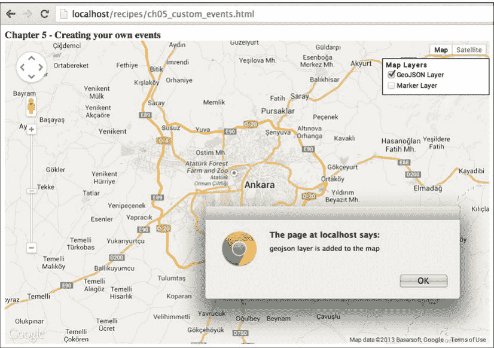

这是该配方的结果，展示了触发自定义事件和监听自定义事件的功能。

## 工作原理

JavaScript 的继承是面向对象编程的核心概念之一。这让你的工作更加轻松，无需反复编写相同的方法。

Google Maps JavaScript API 既为自己使用 JavaScript 的继承特性，也为 API 开发者提供支持。有一些核心类是其他类的基类。Google Maps JavaScript API 有一个名为`google.maps.MVCObject`的基类，所有其他类都派生自它。

如果你想像之前的配方那样创建自定义类，你应该从`google.maps.MVCObject`类创建类。在这个配方中，我们没有创建新类，而是从`MVCObject`类创建了一个对象。然后，我们将像监听其他事件一样监听这个创建对象的`customEvent`：

```javascript
// 从 Google Maps JS 基类创建自定义对象

customObject = new google.maps.MVCObject();

// 开始监听自定义对象的自定义事件

google.maps.event.addListener(customObject, 'customEvent',

  function (e) {

    var txt = '';

    if(e.isChecked) {

      txt = e.layerName + ' layer is added to the map';

    }

    else {

      txt = e.layerName + ' layer is removed from the map';

    }

    alert(txt);

  });
```

触发自定义事件比监听它要容易得多。我们使用`google.maps.event.trigger()`函数来触发事件，并传递额外的参数。参数应采用 JSON 对象格式，以便发送给事件处理程序：

```javascript
// 使用 trigger 函数触发 customEvent

google.maps.event.trigger(customObject, 'customEvent',

  {layerName: cb.value, isChecked: cb.checked});
```

在这个配方中创建自定义事件不能直接用于实际案例，但这应该能让你了解如何使用它们。为了高效使用内存，应谨慎使用事件。

## 另请参阅

- *第 1 章 Google Maps JavaScript API 基础* 中的 *在自定义 DIV 元素中创建简单地图* 配方
- *第 4 章 使用控件* 中的 *添加自己的徽标作为控件* 配方

# Google Maps JavaScript 库

在本章中，我们将涵盖：

- 在地图上绘制形状
- 计算折线/多边形的长度/面积
- 编码坐标
- 搜索并显示附近的地点
- 使用自动完成功能查找地点
- 为地图添加拖拽缩放功能
- 创建自定义弹出窗口/信息框

## 简介

本章深入探讨作为 Google Maps JavaScript API 组成部分的附加 JavaScript 库。这些库在你引用 Google Maps API 时不会默认添加到你的应用中；但是，可以手动添加它们。

这些库分为以下六类：

- 绘图
- 几何
- 地点
- 全景
- 可视化
- 天气

# Google Maps JavaScript 库

前面列表中的最后三个库——`panoramio`、`visualization`和`weather`——已在*第 2 章 添加栅格图层*中与其相关主题和用法一起进行了详细讨论。在本章中，我们将详细学习`Drawing`和`Geometry`库。我们还将使用两个外部库。

这些库作为核心 API 的扩展，其目的是确保 Google Maps JavaScript API 能够自给自足地完成它所提供的所有任务。这意味着，即使没有这些额外的库，你也可以毫无问题地使用该 API 进行开发。

此外，这些库在某种程度上是独立的。它们具有非常明确和精心设计的目标与边界，因此添加它们会提供额外的功能，但移除它们不会从核心 API 中消除任何功能。

这种额外库的可选性无疑加快了 API 的加载速度。除非你明确请求这些库，否则它们不会被加载。这种组件化结构让你可以选择是否承担加载这些库的成本。

本章将首先介绍`drawing`库，它使你能够在基础地图之上绘制矢量叠加层。然后，将介绍`geometry`库并获取矢量叠加层的属性，例如长度和面积。最后，`places`库将详细解释如何在 Google Maps JavaScript API 中搜索地点并显示这些地点的详细信息。

## 在地图上绘制形状

你可能已经在*第 3 章 添加矢量图层*中探索过矢量叠加层。不深入细节，你可以使用 Google Maps JavaScript API 以编程方式添加标记、线条和多边形。但如果你想绘制这些矢量叠加层——不是以编程方式，而是通过鼠标点击或触摸手势，就像在 AutoCAD 或 ArcGIS for Desktop 中那样——你会怎么做？

`drawing`库负责这项工作，使你能够根据需要绘制矢量形状，并将它们显示在基础地图之上。

在这个配方中，我们将详细介绍如何绘制形状、处理它们大量的选项设置，以及如何处理它们的特定事件。

### 准备工作

*第 1 章 Google Maps JavaScript API 基础*的第一个配方将为我们所用。我们将修改 Google Maps API 引导 URL 以适配此配方。

## 实现方法

以下步骤展示了如何添加绘图控件并使用该控件绘制一些形状：

1. 修改 Google Maps API 引导 URL，添加`libraries`参数：

```html
<script type="text/javascript"
  src="https://maps.googleapis.com/maps/api/js?libraries=drawing&sensor=false">
</script>
```

2. 创建`drawingManager`对象：

```javascript
var drawingManager = new google.maps.drawing.DrawingManager();
```

3. 启用绘图功能：

```javascript
drawingManager.setMap(map);
```

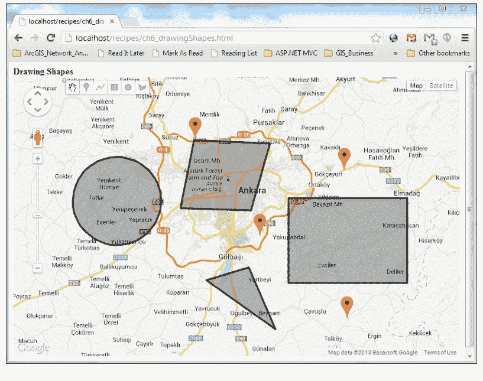

在上一张截图中，你可以看到通过点击左上角按钮可以绘制的各种形状。

# Google Maps JavaScript 库

## 工作原理

使用 Google Maps JavaScript API 将绘图功能添加到你的应用中是很容易的。首先，你必须在 Google Maps JavaScript API URL 中包含`libraries`参数，并将`drawing`值放入其中以将`drawing`库包含到你的应用中：

```text
&libraries=drawing
```

接下来，你可以在标准 Google Maps JavaScript API 之外使用`drawing`库支持的函数和对象。

要绘制矢量形状，必须有一个`DrawingManager`对象：

```javascript
var drawingManager = new google.maps.drawing.DrawingManager();
```

有了`DrawingManager`对象，你就拥有了所有绘图功能，但必须将其附加到当前地图实例才能使用它：

```javascript
drawingManager.setMap(map);
```

在此之后，你会看到一个绘图控件，包含标记、折线、矩形、圆形和多边形的绘制按钮。通过这些按钮，你可以绘制任何你想要的矢量叠加层。在工具集中，你还可以看到平移工具，用于退出绘图模式以使用平移和缩放控件。如果你想再次绘制矢量形状，请按下相关按钮（标记、折线等）并在地图上绘制。

### 还有更多

到目前为止，获得绘图功能非常简单，只需添加两行代码即可实现。然而，还有一组大量的选项可供你使用，这些选项与`DrawingManager`对象和绘制的矢量形状相关。值得了解它们，因为它们能丰富你应用中的绘图体验。

`DrawingManager`的设置可以在初始化时修改，也可以通过其`setOptions`方法修改。所有属于`DrawingManager`类的设置都是`DrawingManagerOptions`类的属性。

让我们修改配方以包含`DrawingManager`选项：

```javascript
var drawingManager = new google.maps.drawing.DrawingManager({
    drawingControl: true,
});
```

`drawingControl`属性用于启用或禁用地图 UI 中显示的绘制控件：

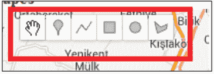

将`drawingControl`属性设置为`false`会隐藏绘制控件。其默认值为`true`；因此，尽管我们在原始配方代码中没有包含它，它还是会在地图中显示。

需要注意的是，绘制功能是通过将`DrawingManager`类附加到地图来实现的。

```javascript
drawingManager.setMap(map);
```


因此，隐藏绘制控件与绘制功能无关。事实上，你可以创建自己的用户控件来使用`DrawingManager`，而不是使用标准的绘制控件。

绘制控件有其自己的选项，嵌入在`drawingControlOptions`属性中。记得在*第4章*《*使用控件*》中，你可以将控件放置在 Google Maps UI 的预定义位置上，无论是默认控件还是你自己开发的控件。

`drawingControl`属性也不例外。你可以通过以下代码片段来定位`drawingControl`：

```javascript
var drawingManager = new google.maps.drawing.DrawingManager({
    drawingControl: true,
    drawingControlOptions: {
        position: google.maps.ControlPosition.BOTTOM_CENTER
    }
});
```

上述代码在地图 UI 中的反映如下：

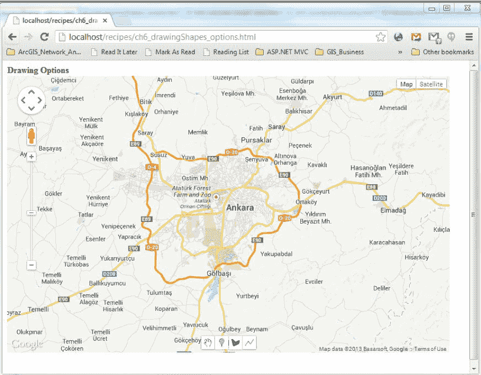

请注意，`drawingControl`属性被放置在底部中央，正如我们在`drawingControlOptions`属性的`position`属性中所指定的那样。

> **`google.maps.ControlPosition`的完整列表**
>
> 控件位置的完整列表可以在 Google Maps JavaScript API 参考文档中找到，链接如下：
>
> <https://developers.google.com/maps/documentation/javascript/reference>

除了`position`属性外，你还可以选择要绘制哪种形状类型，换句话说，就是要在`drawingControl`中包含哪些按钮：

```javascript
var drawingManager = new google.maps.drawing.DrawingManager({
    drawingControl: true,
    drawingControlOptions: {
        position: google.maps.ControlPosition.BOTTOM_CENTER,
        drawingModes: [
            google.maps.drawing.OverlayType.MARKER,
            google.maps.drawing.OverlayType.POLYGON,
            google.maps.drawing.OverlayType.POLYLINE
        ]
    }
});
```

我们显然选择了三种绘制形状类型，它们在`drawingModes`属性的数组中列出：

- Marker
- Polygon
- Polyline

这些在`drawingControl`属性中反映如下：

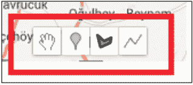

默认情况下，`drawingControl`中所有矢量形状按钮都是可用的。这意味着，除了我们示例中列出的三种类型外，以下形状也可用：

- Rectangle
- Circle

如果你到目前为止一直跟着这个配方操作，你可能已经意识到，在应用程序开始时，你可以像往常一样缩放和平移地图。然后，你必须点击`drawingControl`属性中的矢量叠加按钮才能开始绘制你的形状。

但是，你可以通过设置以编程方式更改这一点。例如：

```javascript
var drawingManager = new google.maps.drawing.DrawingManager({
    drawingMode: google.maps.drawing.OverlayType.POLYGON,
    ...
});
```

## Google Maps JavaScript Libraries

`drawingMode`属性接受矢量形状类型`google.maps.drawing.OverlayType`，正如 API 所示，作为其数据类型，并设置该矢量形状类型以便进行绘制。在我们的示例中，当用户点击地图时，他们立即开始绘制`POLYGON`矢量叠加层。

但是，如果在程序流程中需要以编程方式更改`drawingMode`怎么办？幸运的是，有一个解决方案：

```javascript
drawingManager.setDrawingMode(null);
```

将该属性设置为`null`会使`drawingMode`属性恢复为其默认值，允许最终用户像往常一样使用 Google Maps JavaScript UI。这意味着点击地图不会绘制任何矢量形状叠加层。

你也可以使用`drawingManager`的`setOptions`方法达到同样的目的：

```javascript
drawingManager.setOptions({
  drawingMode: google.maps.drawing.OverlayType.POLYGON,
});
```

到目前为止，我们已经处理了`drawingManager`和`drawingControl`属性的选项。但是我们将要绘制的形状及其样式呢？正如你可能已经预料到的，你可以在`google.maps.drawing.DrawingManagerOptions`中设置绘制的矢量形状的属性：

```javascript
var drawingManager = new google.maps.drawing.DrawingManager({
  ...
  polylineOptions: {
    strokeColor: 'red',
    strokeWeight: 3
  },
  polygonOptions: {
    strokeColor: 'blue',
    strokeWeight: 3,
    fillColor: 'yellow',
    fillOpacity: 0.2
  }
  ...
});
```

我们现在可以绘制如下图所示的形状：

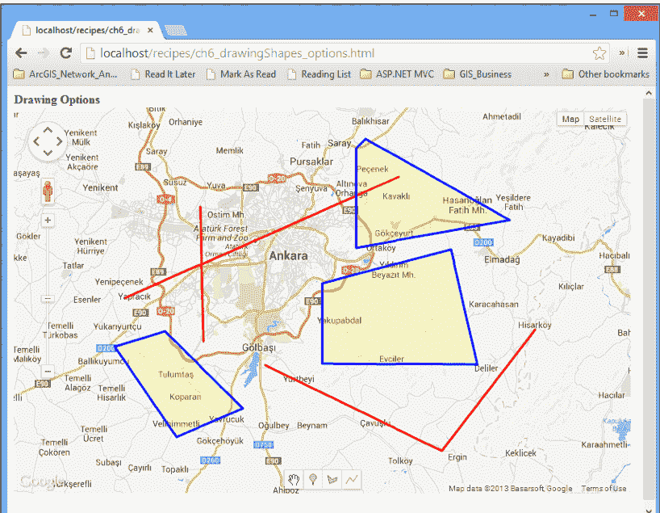

你可能已经观察到，多段线和多边形形状的样式已完全改变。多段线变成了红色，因为它们的`strokeColor`属性设置为`red`，而多边形的`strokeColor`属性设置为`blue`，`fillColor`为`yellow`，`opacity`接近透明——0.2——这样你就可以透过它们看到底图。

对于每种矢量叠加类型，`drawingManager`都有一个`options`属性：

- `markerOptions`
- `polylineOptions`
- `polygonOptions`
- `circleOptions`
- `rectangleOptions`

## Google Maps JavaScript Libraries

矢量叠加有许多有趣的属性，其中大多数对所有叠加类型都是通用的。我们已经讨论了描边和填充属性，以便根据你的喜好自定义样式。

例如，你可以尝试`editable`和`draggable`属性，这些值得一提：

```javascript
polygonOptions: {
         strokeColor: 'blue',
         strokeWeight: 3,
         fillColor: 'yellow',
         fillOpacity: 0.2,
         editable: true,
         draggable: true
}
```

上述代码片段使在 Google Maps UI 上绘制的多边形可编辑，如下图所示（你必须点击绘制控件中的平移按钮退出多段线绘制模式）：

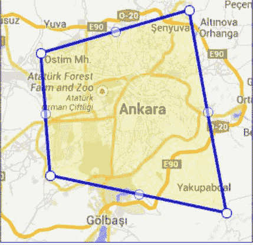

观察代表构成整个多边形的节点（`LatLng`对象）的白点。你可以通过点击并拖动这些点来更改它们的位置；这将允许你更改多边形的形状，如下图所示：

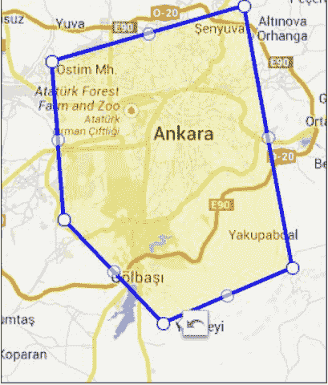

你可能已经注意到，位于南边缘中间的白点已被向下拖动，因此，多边形的形状发生了变化。

除了更改原始形状外，你还可以拖动该形状，如下图所示：

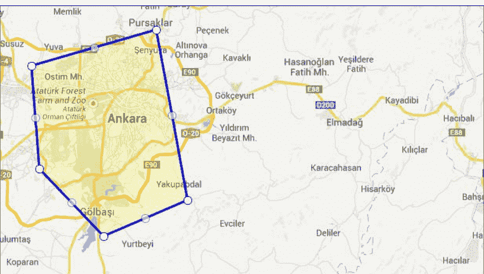

## Google Maps JavaScript Libraries

如你所见，形状在第二张截图中向东移动了。

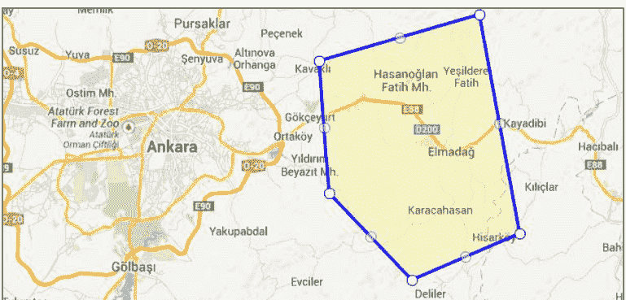

当`draggable`属性设置为`true`且你的鼠标在形状上时，你可以将形状拖动到地图上的任何位置。

> **`google.maps.drawing.DrawingManager`属性的完整列表**
>
> `DrawingManager`属性及相关选项的完整列表可以在 Google Maps JavaScript API 参考文档中找到，链接如下：
>
> <https://developers.google.com/maps/documentation/javascript/reference#DrawingManager>

`DrawingManager`不限于其属性和选项；它还有一些与之关联的事件。这些事件在你完成绘制形状时触发：

```javascript
google.maps.event.addListener(drawingManager, 'polygoncomplete', function(polygon) {
  polygon.setEditable(true);
  polygon.setDraggable(true);
});
```

你可能注意到事件的类型是`polygoncomplete`，并且有一个回调函数将已完成的多边形作为参数。

每种形状类型都有一个事件：

- `markercomplete`
- `linestringcomplete`
- `polygoncomplete`
- `rectanglecomplete`
- `circlecomplete`

还有一个额外的事件类型可以覆盖所有这些形状类型：

```javascript
google.maps.event.addListener(drawingManager, 'overlaycomplete',
    function(event) {
        if (event.type == google.maps.drawing.OverlayType.POLYGON) {
            event.overlay.setEditable(true);
            event.overlay.setDraggable(true);
        }
    });
```

上述事件的行为方式与前面的示例相同。与`shapecomplete`模式不同，这里使用`overlaycomplete`作为事件参数。该事件对所有形状事件特别有用，无论它们是什么类型。然而，由于是适用于所有形状的通用事件，你也可以从`event.type`获取形状类型，并从`event.overlay`获取所绘制形状的引用。利用这些，你可以在一个事件处理程序中为不同的形状类型设置条件语句。

## 计算多段线和多边形的长度/面积

如本章第一个食谱——*在地图上绘制形状*——中所述，你可以根据自己的喜好绘制形状。但是如何获取这些形状的一些信息呢，例如，关于它们的长度和面积的信息？

Google Maps JavaScript API 提供了在`geometry`库中收集这些信息的机会。从这个库中，你可以访问静态工具函数，这些函数提供长度/面积计算等信息。

这个食谱将展示如何获取任意绘制形状的长度和面积信息。

### 准备工作

提前预览一下*在地图上绘制形状*这个食谱会让你的工作更轻松，因为需要大量关于绘制形状及其背景的详细信息。

## 如何操作……

你可以通过执行以下步骤来查看形状的面积和长度信息：

1. 在引导加载 URL 中添加`drawing`和`geometry`库：

   ```html
   <script type="text/javascript"
     src="https://maps.googleapis.com/maps/api/js?
     libraries=drawing,geometry&sensor=false">
   </script>
   ```

2. 使用以下设置创建`drawingManager`对象：

   ```javascript
   var drawingManager = new google.maps.drawing.DrawingManager({
     drawingMode: null,
     drawingControl: true,
     drawingControlOptions: {
       position:
         google.maps.ControlPosition.BOTTOM_CENTER,
       drawingModes: [
         google.maps.drawing.OverlayType.POLYGON,
         google.maps.drawing.OverlayType.POLYLINE
       ]
     },
     polylineOptions: {
       strokeColor: 'red',
       strokeWeight: 3
     },
     polygonOptions: {
       strokeColor: 'blue',
       strokeWeight: 3,
       fillColor: 'yellow',
       fillOpacity: 0.2
     }
   });
   ```

3. 启用绘制功能：

   ```javascript
   drawingManager.setMap(map);
   ```

4. 为多边形的完成添加事件监听器：

   ```javascript
   google.maps.event.addListener(drawingManager,
     'polygoncomplete', function(polygon) {
       var path = polygon.getPath();
       var area =
         google.maps.geometry.spherical.computeArea(path);
       var length =
         google.maps.geometry.spherical.computeLength(path);
       console.log('Polygon Area: ' + area/1000000 + ' km
         sqs');
       console.log('Polygon Length: ' + length/1000 + ' kms'); });
   ```

5. 为多段线的完成添加事件监听器：

   ```javascript
   google.maps.event.addListener(drawingManager, 'polylinecomplete', function(polyline) {
       var path = polyline.getPath();
       var length = google.maps.geometry.spherical.computeLength(path);
       console.log('Polyline Length: ' + length/1000 + ' kms');
   });
   ```

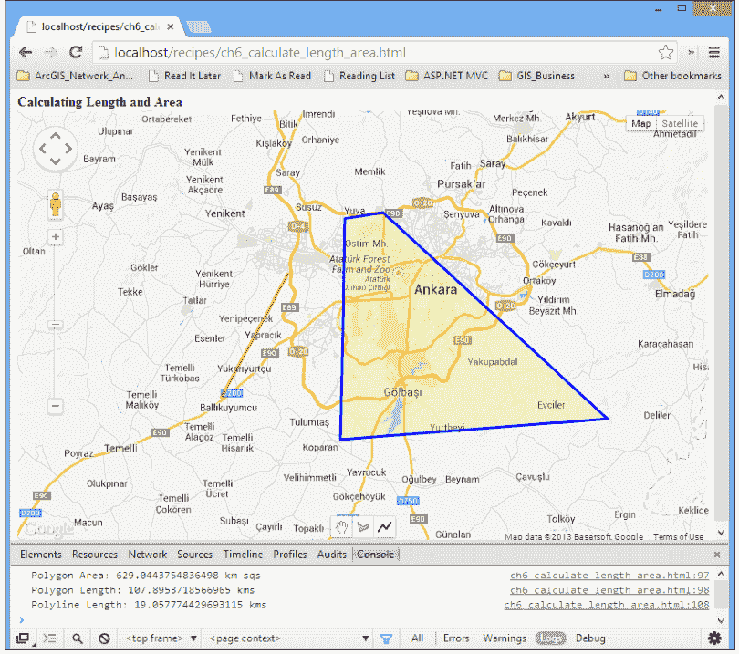

如前面的截图所示，你可以在控制台窗口中查看面积和长度信息。

## 工作原理……

要在 Google Maps JavaScript API 中使用`drawing`和`geometry`工具，我们在代码顶部的 Google Maps JavaScript API 引导加载 URL 中添加了两个库——`drawing`和`geometry`：

```text
libraries=drawing,geometry
```

需要注意的是，你可以添加多个库，用逗号分隔每个列表，就像本例中这样。

我们在`initMap()`函数中添加了`drawingManager`对象，位于常规的地图设置细节之后。在这个`drawingManager`对象中，我们设置了属性，以便只能绘制多段线和多边形：

```javascript
drawingModes:
[
    google.maps.drawing.OverlayType.POLYGON,
    google.maps.drawing.OverlayType.POLYLINE
]
```

我们不需要任何标记绘制，因为标记没有相关的长度和面积信息。

在应用程序开始时，我们暗示用户可以使用标准地图控件（缩放、平移等）而不是绘制形状：

```javascript
drawingMode:null,
```

这种对用户输入的控制在专业应用程序中特别有用，因为即使应用程序是唯一的绘图应用程序，用户也可能需要先使用平移和缩放控件来指定他们的绘图区域。

我们将`drawingControl`对象放置在地图 UI 的底部中心：

```javascript
position: google.maps.ControlPosition.BOTTOM_CENTER,
```

将`drawingControl`放在哪里由你决定；我们只是选择`BOTTOM_CENTER`作为示例。

最后，我们将`drawingManager`对象附加到地图实例以启用该功能：

```javascript
drawingManager.setMap(map);
```

完成所有这些设置后，用户可以打开他们的应用程序并随心所欲地绘制多段线和多边形。但是，我们如何获取他们形状的长度和面积信息呢？

我们需要添加事件处理程序来知道他们已经完成了形状的绘制。必须为每个多边形和多段线执行长度和面积的计算。因此，我们使用了`polygoncomplete`和`polylinecomplete`事件。首先，让我们对多边形进行计算：


```javascript
google.maps.event.addListener(drawingManager, 'polygoncomplete',
function(polygon) {
    var path = polygon.getPath();
    var area = google.maps.geometry.spherical.computeArea(path);
    var length =
        google.maps.geometry.spherical.computeLength(path);
    console.log('Polygon Area: ' + area / 1000000 + ' km sqs');
    console.log('Polygon Length: ' + length / 1000 + ' kms');
});
```

在用户完成绘制每个多边形时触发的`polygoncomplete`事件处理程序中，我们首先获取他们所绘制多边形的路径：

```javascript
var path = polygon.getPath();
```

`getPath()`方法返回一个`MVCArray`，其对象类型为`LatLng`，即组成多边形本身的纬度和经度对。例如，对于我们绘制的一个假设多边形，调用`polygon.getPath().getArray().toString();`会给出以下结果：

```text
"(39.92132255884663,
32.7337646484375),(39.75048953595117,
32.754364013671875),(39.78110197709871,
33.061981201171875),(39.98132938627213, 33.0084228515625)"
```

现在可以清楚地看到，绘制的假设多边形由四对纬度和经度组成。

为什么我们需要多边形的路径？我们需要它是因为使用的`computeArea()`函数不接受多边形本身，而是将其路径作为参数：

```javascript
var area =
google.maps.geometry.spherical.computeArea(path);
```

这个`spherical`命名空间代表什么？

如你所观察到的，地图是二维表面。然而，地球表面并不是。为了在二维画布上反映地球表面，需要使用投影。然而，这种反映并不像起初看起来那么顺利。它是有代价的；地球形状和属性的失真会发生。为了处理这些副作用，需要进行球面几何计算，而`google.maps.geometry.spherical`正是为此目的而存在的。

当你调用`computeArea()`或`computeLength()`方法时，面积计算的执行就如同形状被扭曲到地球表面上，并考虑到地球的曲率。

这两个方法的返回值单位是米。我们已将它们分别转换为平方千米和千米，以便在控制台窗口中打印时具有更有意义的值：

```javascript
console.log('Polygon Area: ' + area / 1000000 + ' km sqs');
console.log('Polygon Length: ' + length / 1000 + ' kms');
```

`polygoncomplete`和`polylinecomplete`事件的事件处理程序是相同的，除了在`polylinecomplete`中没有面积计算。

## 还有更多……

长度和面积信息附加到形状上可能会有很好的效果。你可以扩展`Polygon`和`Polyline` JavaScript 类来实现这一点。但请记住，扩展 JavaScript 对象可能会导致意外错误；你可能会破坏不同库的对象扩展。因此，在扩展 JavaScript 类之前请三思：

```javascript
google.maps.Polygon.prototype.getArea = function()
{
    return
    google.maps.geometry.spherical.computeArea(this.getPath());
};
```

```javascript
google.maps.Polygon.prototype.getLength = function(){
    return
    google.maps.geometry.spherical.computeLength(this.getPath());
};
```

```javascript
google.maps.Polyline.prototype.getLength=function(){
    return
    google.maps.geometry.spherical.computeLength(this.getPath());
};
```

扩展了`Polygon`和`Polyline`类后，你可以直接从它们的对象调用`getArea()`和`getLength()`方法：

```javascript
polygon.getArea();
polyline.getLength();
```

## 另请参阅

- 本章中的*在地图上绘制图形*配方

## 坐标编码

使用 Google Maps JavaScript API 绘制的多段线和多边形由成对纬度和经度的`LatLng`对象数组组成。

这些数组的长度会大幅增加，尤其是当图形节点过多时，例如长多段线或细节过多的多边形。

处理这些数组（可通过多段线和多边形的`getPath()`方法获取）是一个主要问题，尤其是当你需要将图形保存到数据库时。序列化和反序列化冗长数组通常是笨重的。

不过，你可以使用 Google 的**多段线编码算法**来压缩图形的路径。

> **Google 多段线编码算法的详细信息**
>
> 你可以在以下链接找到多段线编码算法的详细信息：
>
> `https://developers.google.com/maps/documentation/utilities/polylinealgorithm`

通过使用`geometry`库，你可以对多段线和多边形的路径进行编码和解码。

本配方将向你展示如何对多段线和多边形的路径进行编码和解码。

### 准备工作

快速浏览一下本章第一个配方——*在地图上绘制图形*——会很方便，因为它涵盖了使用 Google Maps JavaScript API 绘制图形的所有细节。

## 操作步骤……

以下是查看路径的编码和解码版本的步骤：

1. 将`geometry`和`drawing`库添加到引导 URL：

```html
<script type="text/javascript"
  src="https://maps.googleapis.com/maps/api/js?
  libraries=drawing,geometry&sensor=false">
</script>
```

2. 组织你的 HTML，以便在`div`元素中查看图形的原始、编码和解码坐标：

```html
<div>
    <H3>原始、编码和解码坐标对:<H3>
    <div id="loggingDiv"></div>
</div>
```

3. 在你的`initMap()`函数中保留对`loggingDiv` div 元素的引用：

```javascript
loggingDiv = document.getElementById('loggingDiv');
```

4. 在创建`drawingManager`并将其附加到地图实例后，在你的`initMap()`函数中创建`polylinecomplete`事件处理程序：

```javascript
google.maps.event.addListener(drawingManager,
    'polylinecomplete', function(polyline){
    var path = polyline.getPath();

    var coords = path.getArray();

    var text = '<b>原始坐标:</b> ' + coords;

    var encodedCoords =
        google.maps.geometry.encoding.encodePath(path);

    text += '<br/><b>编码坐标:</b> ' +
        encodedCoords;

    var decodedCoords =
        google.maps.geometry.encoding.decodePath
        (encodedCoords);

    text += '<br/><b>解码坐标:</b> ' +
        decodedCoords;

    loggingDiv.innerHTML = text;
});
```

你可以在前面的截图中查看路径的原始、编码和解码版本。

## 工作原理……

当你完成绘制多段线时，会触发`polylinecomplete`事件。你可以通过以下方式获取组成多段线的`LatLng`类型对象的`MVCArray`：

```javascript
var path = polyline.getPath();
```

有了路径对象，你可以使用`encodePath()`方法轻松对其进行编码：

```javascript
var encodedCoords =
    google.maps.geometry.encoding.encodePath(path);
```

`encodePath()`方法接受`LatLng`类型对象的`MVCArray`或`LatLng`对象数组。因此，在我们的配方中，这样也是可行的：

```javascript
var encodedCoords =
    google.maps.geometry.encoding.encodePath(coords);
```

`encodePath()`方法返回一个字符串，非常适合保存到数据库，并可能节省大量序列化和反序列化操作的时间：

```text
op_rFitiHE|}Q|pCpyLo`GzmMq|HneEg}Wim@ghNwiIapJidD~zKmiIwXuiC_tHm`G
y{Ds|Ij}AqxE~zKqf@pxUngAfhNxdEvfPfaH_fBwvCg}WbqDc~E~`Nr_N
```

如果不进行编码，`coords`数组看起来会是这样的：

```text
(39.81592026602056, 32.9864501953125),(39.71880717209066,
32.963104248046875),(39.64799732373418,
33.004302978515625),(39.573939343591896,
33.05511474609375),(39.5424961171196,
33.182830810546875),(39.54958871848275,
33.2611083984375),(39.6025139495577,
33.320159912109375),(39.62896140981413,
33.254241943359375),(39.681826010893644,
33.25836181640625),(39.70401708565211,
33.30780029296875),(39.74521015328692,
33.3380126953125),(39.80115102364286,
33.322906494140625),(39.83595916247957,
33.256988525390625),(39.842286020743394,
33.1402587890625),(39.83068633533497,
33.061981201171875),(39.79904087286648,
33.02490234375),(39.7526011757416,
33.0413818359375),(39.776880380637024,
33.169097900390625),(39.74837783143156,
33.204803466796875),(39.67125632523973, 33.127899169921875)
```

对多段线和多边形进行编码不是单向操作。你可以如下解码编码后的坐标对：

```javascript
var decodedCoords =
    google.maps.geometry.encoding.decodePath(encodedCoords);
```

`decodePath()`方法接受字符串形式的编码坐标，并返回`LatLng`对象数组。

# 搜索并显示附近地点

Google 地图不仅仅具有精美底图和极高的制图质量，或定期更新的卫星图像。在日常生活中，你不是作为程序员，而是作为 Google 地图的普通用户，无疑会使用 Google 地图搜索地点；无论是纽约的大都会艺术博物馆，还是罗马普通的*farmacía*。

这些信息存在于 Google 地图中，但如何通过 Google Maps JavaScript API 获取和提供这些信息呢？

`places`库正是为此目的而存在的，它使你能够使用某些搜索参数来查找地点。

你可以执行附近搜索，搜索结果会靠近你提供的位置，最常见的是用户的位置。你可以按半径搜索，或者只指定搜索字符串。你甚至可以请求其他详细信息，例如相关照片、评论评分、电话号码和特定地点的营业时间。

本配方将重点使用 Google Maps JavaScript API 的`places`库进行附近搜索。

### 准备工作

本配方将使用`drawing`库，因此建议回顾本章第一个配方——*在地图上绘制图形*——并刷新你对该主题的理解。

## 操作步骤……

你可以通过以下步骤绘制圆形、搜索该圆形范围内的地点并获取每个地点的详细信息：

1. 将`drawing`和`places`库添加到引导 URL：

```html
<script type="text/javascript"
  src="https://maps.googleapis.com/maps/api/js?
  libraries=drawing,places&sensor=false">
</script>
```

2. 在`initMap()`函数外部添加`circles`和`markers`全局变量，以便推送和弹出相应的覆盖物：

```javascript
var circles;
var markers;
```

3. 添加一个`popup`全局变量来保存`infoWindow`对象的值：

```javascript
var popup;
```

4. 在`initMap()`函数中初始化`circles`和`markers`数组以及`infoWindow`对象：

```javascript
circles = new Array();
markers = new Array();
popup = new google.maps.InfoWindow();
```

5. 在创建`drawingManager`对象并将其附加到地图实例后，在你的`initMap()`函数中创建`circlecomplete`事件处理程序（第 6 到第 12 步将在此事件处理程序中）：

```javascript
google.maps.event.addListener(drawingManager,
'circlecomplete', function(circle){
});
```

6. 在`circlecomplete`事件处理程序中，将`drawingMode`设置为`null`：

```javascript
drawingManager.setDrawingMode(null);
```

7. 将最新绘制的圆形添加到`circles`数组中，然后在数组内反转顺序：

```javascript
circles.push(circle);
circles.reverse();
```

8. 弹出之前的圆形并将其地图句柄设置为`null`，以便只显示最后绘制的圆形：

```javascript
while(circles[1]){
    circles.pop().setMap(null);
}
```

9. 清除所有先前绘制的标记：

```javascript
while(markers[0]){
    markers.pop().setMap(null);
}
```

10. 创建附近搜索设置，将位置设置为圆心，半径设置为圆形半径。同时添加一个`keyword`属性以返回包含该关键词的地点：

```javascript
var nearbyPlacesRequest = {
    location: circle.getCenter(),
    radius: circle.radius,
    keyword: 'pizza'
};
```

11. 获取`PlacesService`服务对象的句柄：

```javascript
var placesService = new google.maps.places.PlacesService(map);
```

12. 发送请求并附带回调函数：

```javascript
placesService.nearbySearch(nearbyPlacesRequest,
    resultsCallback);
```

13. 在`initMap()`函数外部，为`nearbySearch`请求创建回调函数，使用以下代码片段：

```javascript
function resultsCallback(results, status) {

    if (status == google.maps.places.PlacesServiceStatus.OK) {

        for (var i = 0, l = results.length; i < l; i++) {

            pinpointResult(results[i]);

        }

    }

}
```

14. 创建一个函数，根据地点结果创建标记（第 15 步到第 17 步的步骤将包含在此函数中）：

```javascript
function pinpointResult(result) {

}
```

15. 在`pinpointResult()`函数中创建标记：

```javascript
var marker = new google.maps.Marker({
```


```javascript
map: map,

position: result.geometry.location
```

### 16. 为标记添加点击事件处理程序，以便在点击时弹出`infoWindow`对象

```javascript
google.maps.event.addListener(marker, 'click', function() {
    var popupContent = '<b>Name: </b> ' + result.name +
        '<br/>' + '<b>Vicinity: </b>' + result.vicinity +
        '<br/><b>Rating: </b>' + result.rating;

    popup.setContent(popupContent);
    popup.open(map, this);
});
```

# Google Maps JavaScript 库

### 17. 将标记推入`markers`数组

```javascript
markers.push(marker);
```

如前面的截图所示，你可以绘制一个圆形，在该圆内以关键词搜索地点，并获取每个找到地点的详细信息。

## 实现原理……

本方案所需的步骤需要你稍微多花一些时间；然而，核心原理很简单。暂时先忘记关于`circles`和`markers`数组以及相关逻辑的细节；集中精力关注附近搜索：

```javascript
var nearbyPlacesRequest = {
    location: circle.getCenter(),
    radius: circle.radius,
    keyword: 'pizza'
};
```

在`circlecomplete`事件处理程序中（该事件在我们完成圆形绘制后触发），我们放置一个`nearbyPlacesRequest`对象。该对象应为`google.maps.places.PlaceSearchRequest`类型。

`location`属性设置一个`LatLng`对象，作为地点搜索的中心。通常，在附近搜索中，此属性根据用户的位置来设置。但对于本方案，我们将其绑定到所绘制圆形的中心，以便你可以根据需要多次绘制和搜索。

与`location`的距离由`radius`属性设定，以便返回距离圆心此距离范围内的地点。在我们的方案中，我们设置了所绘制圆形的半径。

最后，`keyword`属性对地点进行过滤，以便返回包含该关键词的地点。请注意，所有信息不仅包括地点的名称或类型，还包括地址和评论，这些都会与关键词进行匹配。因此，要准备好接收一个咖啡馆作为返回结果，因为其评论中可能包含"pizza"这个关键词。

准备好请求参数后，下一步就是发送请求。首先，我们创建一个`PlacesService`对象，将当前地图实例作为参数：

```javascript
var placesService = new
    google.maps.places.PlacesService(map);
```

通过使用`placesService`对象，我们可以发送请求：

```javascript
placesService.nearbySearch(nearbyPlacesRequest,
    resultsCallback);
```

`nearbySearch`方法接受两个参数，第一个参数是我们之前嵌入在`nearbyPlacesRequest`对象中的请求参数，第二个参数是返回结果的回调函数。在我们的方案中，第二个参数是`resultsCallback`函数：

```javascript
function resultsCallback(results, status) {
    if (status == google.maps.places.PlacesServiceStatus.OK) {
        for (var i = 0, l = results.length; i < l; i++) {
            pinpointResult(results[i]);
        }
    }
}
```

此回调函数在这里接受两个参数（实际上，它有第三个参数，与搜索分页有关）：搜索中找到的地点数组和服务状态。在回调函数中，我们首先检查服务状态是否为 OK。然后我们遍历`results`，它是一个`PlaceResult`类类型的数组，为每个返回的地点创建标记并填充`infoWindow`对象。

# Google Maps JavaScript 库

我们可以为每个地点创建关联的标记，如以下代码片段所示：

```javascript
var marker = new google.maps.Marker({
    map: map,
    position: result.geometry.location
});
```

`result`对象的`geometry`属性嵌入了一个`location`属性，它是`LatLng`类类型。这非常适合`Marker`类的`position`属性。

我们可以在附加于标记`click`事件处理程序中的`popup`对象里获取地点的详细信息：

```javascript
google.maps.event.addListener(marker, 'click', function() {
    var popupContent = '<b>Name: </b> ' + result.name + '<br/>' +
        '<b>Vicinity: </b>' + result.vicinity +
        '<br/><b>Rating: </b>' + result.rating;

    popup.setContent(popupContent);
    popup.open(map, this);
});
```

你可能已经注意到，我们将地点的`name`、`vicinity`和`rating`属性用作弹出窗口的内容。`name`表示地点的名称，`vicinity`返回部分地址信息，`rating`值则是地点的评分，0.0为最低，5.0为最高。

## 还有更多……

附近地点搜索的详细信息和选项不限于本方案中介绍的这些。我们这里再深入探讨一下。首先是`nearbyPlacesRequest`对象。此对象中介绍的属性有：`location`、`radius`和`keyword`。

然而，作为我们对象类型的`凯尔特语系`的`PlaceSearchRequest`类，远比我们在本方案中看到的要丰富得多。例如，你可以提供`LatLngBounds`对象来代替`location`和`radius`：

```javascript
var requestBounds = new google.maps.LatLngBounds(
    new google.maps.LatLng(39.85, 32.74),
    new google.maps.LatLng(40.05, 32.84)
);

var nearbyPlacesRequest = {
    bounds: requestBounds,
    keyword: 'pizza'
};
```

请记住，`bounds`是一个选项，而使用`location`和`radius`组合是另一个选项。使用其中一个是`PlaceSearchRequest`类的强制要求。

要过滤地点结果，使用`keyword`并不是唯一的解决方案。你可以尝试使用`name`属性来直接匹配地点名称。例如，以下代码会返回名称中包含`Buckingham`的地点：

```javascript
var nearbyPlacesRequest = {
    location: circle.getCenter(),
    radius: circle.radius,
    name: 'Buckingham'
};
```

如果你的绘制圆形位于伦敦，它可能会返回白金汉宫以及附近的一批酒店。

你可以使用`types`属性来选择要返回的地点类型。该属性接受一个类型数组，例如：

```javascript
var nearbyPlacesRequest = {
    location: circle.getCenter(),
    radius: circle.radius,
    types: ['stadium', 'car_rental',
        'library', 'university', 'administrative_area_level_3']
};
```

Google Maps 涵盖的地点类型范围非常广泛。你可以直接插入你想要的地点类型，从汽车租赁到大学，就像我们所做的那样。

> **完整的地点类型列表**
>
> 你可以在以下网址找到完整的地点类型列表：
>
> <https://developers.google.com/places/documentation/supported_types>

除了`types`、`name`和`bounds`之外，`PlaceSearchRequest`类还有许多其他属性，例如`openNow`，这是一个非常方便的属性，用于仅显示搜索时正在营业的地点。

## `PlaceSearchRequest`类的完整属性列表

你可以在以下网址找到`PlaceSearchRequest`类的完整属性列表：

<https://developers.google.com/maps/documentation/javascript/reference#PlaceSearchRequest>

除了发起附近搜索请求时出现的选项池之外，还有一些用于返回结果的属性；换句话说，就是由`PlaceResult`类表示的地点的相关属性。

例如，`PlaceResult`类的`icon`属性，我们可以在`pinpointResult()`函数中使用如下代码块：

```javascript
var placeIcon = {
    url: result.icon,
    scaledSize: new google.maps.Size(30, 30)
};

var marker = new google.maps.Marker({
    map: map,
    position: result.geometry.location,
    icon: placeIcon
});
```

这段代码将返回地点及其对应的图标：

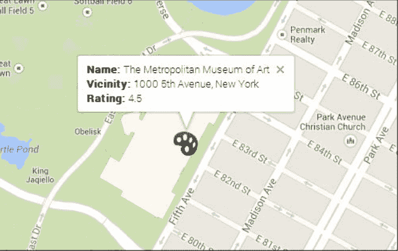

注意上图中的调色板图标，它与返回的地点——纽约大都会艺术博物馆一起显示。

你还可以访问地点所属的类型。`PlaceResult`类的`types`属性以字符串数组的形式返回类型。因此，`Result.types`属性对纽约大都会艺术博物馆返回以下参数：

```javascript
["art_gallery", "museum", "establishment"]
```

你还可以通过修改标记的点击事件处理器来获取地点在搜索时是否开放的信息，如下面的代码片段所示：

```javascript
google.maps.event.addListener(marker, 'click', function() {
    var popupContent = '<b>Name: </b> ' + result.name + '<br/>' +
        '<b>Vicinity: </b>' + result.vicinity;

    if (result.opening_hours) {
        if (result.opening_hours.open_now) {
            popupContent += '<br/><b>Is Open Now: </b> ' + 'YES';
        } else {
            popupContent += '<br/><b>Is Open Now: </b> ' + 'NO';
        }
    }

    popup.setContent(popupContent);
    popup.open(map, this);
});
```

使用上述代码，你将获得如下所示的信息：

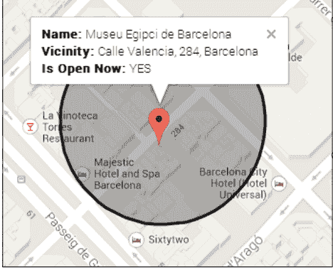

## `PlaceResult`类的完整属性列表

你可以在以下网址找到`PlaceResult`类的完整属性列表：

<https://developers.google.com/maps/documentation/javascript/reference#PlaceResult>


## 使用自动完成功能查找地点

Google Maps JavaScript API 提供了多种搜索地点和获取额外信息的方式。你可以进行附近搜索，并获取关于地点及其几何信息的详细信息，就像你在本章名为*搜索并显示附近地点*的教程中所看到的那样。

那么，拥有一个带有搜索地点自动完成功能的文本字段控件呢？你可以手动实现，但根本没有必要，因为 Google 已经为此提供了现成的功能。

在本教程中，我们将介绍 Google Maps JavaScript API 的`places`库的自动完成功能。

### 准备工作

本教程将使用本章*搜索并显示附近地点*教程中介绍的与`places`库相关的概念。建议先阅读该教程，以便对地点及其属性有一个总体的了解。

## 操作步骤……

你可以通过以下步骤添加文本字段并使用自动完成功能搜索地点：

### 1. 插入一个将用作自动完成字段的`input` HTML 元素

```html
<div id="searchDiv">
    <input id="autocomplete_searchField" type="text"
        size="40" placeholder="Search for Places">
</div>
```

### 2. 在`initMap()`函数外部将标记和弹出变量定义为全局变量

```javascript
var markers;
var popup;
```

### 3. 在`initMap()`中初始化全局变量

```javascript
markers = new Array();
popup = new google.maps.InfoWindow();
```

### 4. 获取 ID 为`searchDiv`的`div`标签，并在使用`initMap()`选项创建地图后将其作为自定义控件添加

```javascript
var searchDiv =
    document.getElementById('autocomplete_searchField');

map.controls[google.maps.ControlPosition.TOP_CENTER].push(
    searchDiv);
```

### 5. 获取`input`元素的句柄

```javascript
var searchField =
    document.getElementById('autocomplete_searchField');
```

### 6. 为自动完成搜索请求提供属性

```javascript
var searchOptions = {
    bounds: new google.maps.LatLngBounds(
        new google.maps.LatLng(8.54, 17.33),
        new google.maps.LatLng(39.67, 43.77)
    ),
    types: new Array()
};
```

### 7. 通过提供要使用的`input` HTML 元素（即`searchField`）和`searchOptions`来获取`autocomplete`对象

```javascript
var autocompleteSearch = new
    google.maps.places.Autocomplete(searchField,
        searchOptions);
```

### 8. 为`autocompleteSearch`对象创建`place_changed`事件处理器

```javascript
google.maps.event.addListener(autocompleteSearch,
    'place_changed', function() {
});
```

### 9. 在事件处理器中，首先清除之前的标记

```javascript
while (markers[0]) {
    markers.pop().setMap(null);
}
```

### 10. 获取自动完成搜索响应中的`PlaceResult`对象

```javascript
var place = autocompleteSearch.getPlace();
```

# Google Maps JavaScript 库

### 11. 如果地点具有几何信息，调用函数创建相关标记

```javascript
if (place.geometry) {
    pinpointResult(place);
}
```

### 12. 创建一个用于创建标记并为标记添加点击事件处理器的函数


```javascript
function pinpointResult(result) {
    var placeIcon = {
        url: result.icon,
        scaledSize: new google.maps.Size(30, 30)
    };

    var marker = new google.maps.Marker({
        map: map,
        position: result.geometry.location,
        icon: placeIcon
    });

    map.setCenter(result.geometry.location);
    map.setZoom(16);

    google.maps.event.addListener(marker, 'click',
    function() {
        var popupContent = '<b>Name: </b> ' + result.name +
        '<br/>' + '<b>Vicinity: </b>' + result.vicinity;

        popup.setContent(popupContent);
        popup.open(map, this);
    });
    markers.push(marker);
}
```

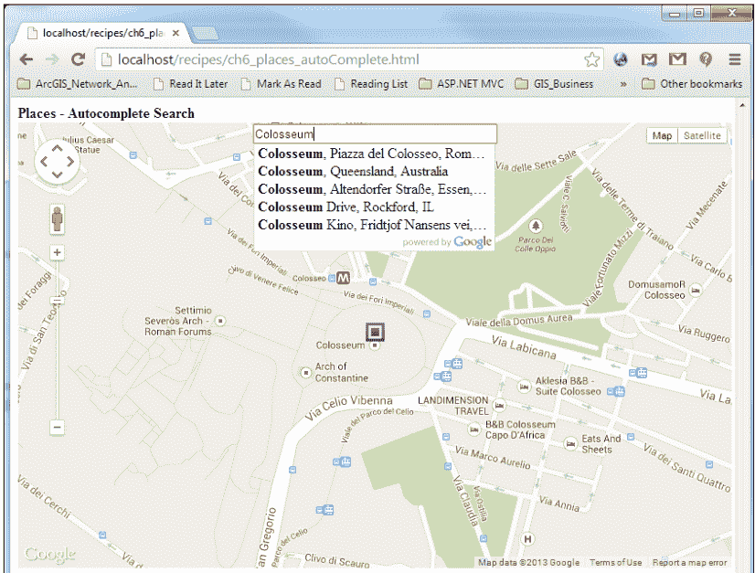

你可以像上图所示那样使用自动完成搜索功能。

## 工作原理

在本教程中，我们首先创建了一个带有占位文本的`input`元素（请注意，旧版浏览器不支持此功能），它将作为我们搜索地点的文本字段：

```html
<input id="autocomplete_searchField" type="text"
       size="40" placeholder="Search for Places">
```

然后，我们将`div`容器标签作为 Google Maps JavaScript API 的自定义控件，以便在 Google Maps 用户界面内放置文本字段：

```javascript
var searchDiv = document.getElementById('searchDiv');
map.controls[google.maps.ControlPosition.TOP_CENTER].push(
    searchDiv);
```

我们在名为`searchOptions`的`AutocompleteOptions`对象中设置了自动完成搜索的属性：

```javascript
var searchOptions = {
    bounds: new google.maps.LatLngBounds(
    new google.maps.LatLng(8.54, 17.33),
        new google.maps.LatLng(39.67, 43.77)
    ),
    types: new Array()
};
```

在上面的代码片段中，`bounds`用于定义要查找地点的边界范围。在这里，我们将它设置为一个较大的预定义边界；你也可以根据自己的需求将其设置为另一个`LatLngBounds`对象。

`types`数组在本教程中为空；实际上，该数组用于限制要查找的地点类型，无论是商业机构、城市还是区域。在我们的示例中，它为空，因此我们的搜索将返回所有类型的`PlaceResult`对象。

我们用两个要素创建了自动完成对象：`searchField`作为`input`元素，`searchOptions`包含`bounds`和`types`属性：

```javascript
var autocompleteSearch = new
    google.maps.places.Autocomplete(searchField,
    searchOptions);
```

然后，我们为`Autocomplete`对象创建了`place_changed`事件处理器，当用户选择提供的`PlaceResult`时会触发该事件：

```javascript
google.maps.event.addListener(autocompleteSearch,
'place_changed', function() {
    while(markers[0]) {
        markers.pop().setMap(null);
    }

    var place = autocompleteSearch.getPlace();
    if (place) {
        if (place.geometry) {
            pinpointResult(place);
        }
    }
});
```

在事件处理器中，我们移除了先前绘制在地图上的标记；然后，调用`getPlace()`方法获取此上下文中的`PlaceResult`类型的`Place`对象。如果地点存在并且具有几何信息（意味着找到了有效的`PlaceResult`实例），我们就调用`pinpointResult()`函数从`PlaceResult`创建标记，并为标记附加点击事件处理器以弹出相关的`InfoWindow`对象。

## 还有更多内容

在我们的方案中，我们在`searchOptions`对象中将`bounds`属性设置为预定义的边界：

```javascript
bounds: new google.maps.LatLngBounds(
    new google.maps.LatLng(8.54, 17.33),
    new google.maps.LatLng(39.67, 43.77)
),
```

这一行将自动填充操作设置为主要在特定的`LatLngBounds`对象内查找搜索地点，但并不仅限于此。因此，如果你设置了一个较小的边界却发现边界之外的结果，不要感到惊讶。

我们将边界设置为`LatLngBounds`对象，例如地图的边界，之后你可以更改它：

```javascript
autocompleteSearch.setBounds(map.getBounds());
```

但是如果你需要将边界设置为当前视口，而它又会在你平移和缩放地图时更新，该怎么办呢？有一个方法，如下所示：

```javascript
autocompleteSearch.bindTo('bounds', map)
```

通过使用这个`bindTo()`函数，`bounds`属性被绑定到当前视口边界，并在其更改时更新。

除了`bounds`属性之外，还有一个`types`属性，我们将其设置为空数组，但它不必为空，可以用于过滤自动填充搜索对象的预测结果：

```javascript
types: ['(regions)']
```

这将使自动填充搜索对象仅搜索行政区域，而不是所有地点。所以当你输入 colos 时，罗马的斗兽场不会出现，因为只有行政区域被允许显示在自动填充搜索对象中；你可以在以下截图中观察到这一点：

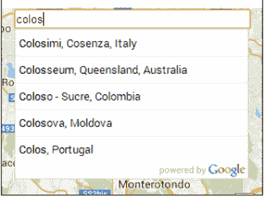

## `google.maps.places.AutocompleteOptions`类中`types`属性的完整条目列表

你可以在以下位置找到`AutocompleteOptions`类中`types`属性的完整条目列表：

```text
https://developers.google.com/maps/documentation/javascript/reference#AutocompleteOptions
```

## 为地图添加拖拽缩放功能

Google 地图具有缩放控件，JavaScript API 利用该控件为程序员提供了多种选项。这是一个非常有用且易于使用的控件。但还有其他缩放方式；例如，通过拖拽绘制一个感兴趣的区域框，使地图缩放到该区域。

此功能在标准的 Google Maps JavaScript API 及其任何库中都不存在；你必须自己编写代码。或者，你可以使用由热心开发者在以下链接开发的实用工具库：

```text
https://code.google.com/p/google-maps-utility-library-v3/wiki/Libraries
```

他们的一个库`KeyDragZoom`正是用于此缩放功能的，我们将在本方案中使用该库。

### 准备工作

你需要从以下链接下载`keydragzoom.js` JavaScript 源文件（截至撰写本书时最新版本为 2.0.9），并将其放置在与我们的方案源代码相同的目录中：

```text
http://google-maps-utility-library-v3.googlecode.com/svn/tags/keydragzoom/
```

## 如何实现

以下是通过拖拽框选区域并缩放到框内区域的步骤：

1. 引用`keydragzoom.js`文件：

```html
<script type="text/javascript"
    src="keydragzoom.js">
</script>
```

2. 在`initMap()`函数中设置所有与地图相关的选项后启用该功能：

```javascript
map.enableKeyDragZoom({
    visualEnabled: true,
    visualPosition: google.maps.ControlPosition.LEFT,
    visualPositionOffset: new google.maps.Size(35, 0),
    visualPositionIndex: null,
    visualSprite:
      'http://maps.gstatic.com/mapfiles/ftr/controls/
      dragzoom_btn.png',
    visualSize: new google.maps.Size(20, 20),
    visualTips: {
        off: "Turn on",
        on: "Turn off"
    }
});
```

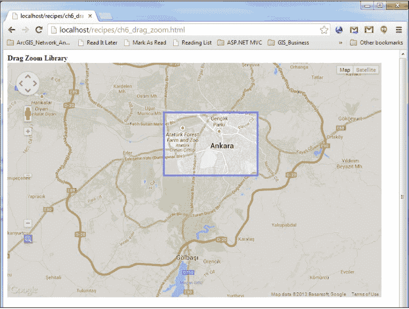

如上图所示，你可以使用拖拽框选的方式进行缩放。

## 工作原理

你可以通过按住控制键并绘制框选区域来进行拖拽缩放，或者更简单的方式是按住`Shift`键并绘制框选区域来缩放到框内的区域。

为此，我们首先在我们的方案中添加了拖拽缩放库的 JavaScript 源文件。在设置地图选项并使用地图实例后，我们可以通过地图实例的`enableKeyDragZoom()`方法来启用拖拽缩放功能。

这个扩展方法不是 Google Maps JavaScript API 的一部分，而是来自`keydragzoom`库。有一些相关的选项嵌入在`KeyDragZoomOptions`类中。

请记住，在最简单的形式下，你可以通过以下方式启用按键拖拽缩放功能：

```javascript
map.enableKeyDragZoom();
```

唯一的区别是你将只能使用`Shift`键，因为不会有拖拽缩放控制按钮。

嵌入在`KeyDragZoomOptions`类中的属性都是关于放置在标准缩放控件下方的控制按钮的：

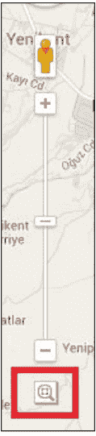

`visualEnabled`属性设置控件是否可见，因此如果此属性为`false`，则不需要其他属性。`visualPosition`属性设置控件位置；我们将其放置在左侧。有关控件位置的详细描述，请参阅*第 4 章，使用控件*中的*更改控件位置*方案。

> **`KeyDragZoomOptions`类中的完整属性列表**
>
> 你可以在以下链接找到`KeyDragZoomOptions`类中的完整属性列表：
>
> `http://google-maps-utility-library-v3.googlecode.com/svn/tags/keydragzoom/2.0.9/docs/reference.html`

## 另请参阅

- 你可以在*第 4 章，使用控件*中查看 Google Maps JavaScript API 控件及其用法。

## 创建自定义弹出框/信息框

我们已经在*第 3 章，添加矢量图层*中创建了弹出框或信息框。正如在那里所述，几乎每个地图应用程序都能够显示与其中显示要素相关的信息。这些信息可以与标记或地图相关。为了不将所有信息显示在地图上，弹出框或信息框只在需要时使用。

Google Maps JavaScript API 提供了`google.maps.InfoWindow`类来为开发者创建默认的信息框。在某些情况下，你需要自定义信息框来显示信息。有两种方法可以实现：

- 第一种方法是创建一个继承自`google.maps.OverlayView`类的自定义类，并填充方法以使用自定义 CSS 样式显示/隐藏信息框。
- 另一种更简单的方法是使用为你创建的库。Google Code 上有一个名为`google-maps-utility-library-v3`的项目，其中包含大量扩展 Google Maps JavaScript API 的库。链接如下：

  `https://code.google.com/p/google-maps-utility-library-v3/wiki/Libraries`

  该项目有一个名为`InfoBox`的库，可以创建自定义信息框或地图标签。

# Google Maps JavaScript 库

在本方案中，我们将使用前面提到的库来创建可以绑定到标记和地图的自定义信息框。同一个信息框根据其绑定对象显示不同的信息。如果需要在地图上添加额外信息，我们还会在固定位置添加一个简单的地图标签。

### 准备工作

第 1 章，Google Maps JavaScript API 基础，的第一个方案将是我们工作的基础。我们将在此方案中进行扩展。

## 如何实现

你可以通过完成以下步骤来获取自定义信息框：

1. 首先，前往以下地址获取最新的 InfoBox 源代码，并将其保存到`lib`目录下名为`infobox.js`的文件中。我们使用了以下 URL 下的`/1.1.9/src/infobox_packed.js`文件：

   `http://google-maps-utility-library-v3.googlecode.com/svn/tags/infobox/`

2. 然后，我们通过创建简单地图方案的代码，并添加以下代码将我们的库添加到页面中：

3. 下一步是借助`div`元素创建信息框的内容：

4. 现在我们创建一个定义信息框选项的对象：

```html
<script type="text/javascript" src='lib/infobox.js'></script>
```

```javascript
//创建信息框内容
var boxText = document.createElement('div');
boxText.className = 'infoContent';
boxText.innerHTML = '<b>标记信息框</b> <br> 提供有关标记的信息';
```

```javascript
//创建信息框选项
var customInfoBoxOptions = {
    content: boxText,
    pixelOffset: new google.maps.Size(-100, 0),
    boxStyle: {
        background: "url('img/tipbox2.gif') no-repeat",
        opacity: 0.75,
        width: '200px'
    },
};
```

```javascript
closeBoxMargin: '10px 2px 2px 2px',
closeBoxURL: 'img/close.gif',
pane: 'floatPane'
};
```

5. 我们可以通过以下方式初始化自定义信息框：

```javascript
//Initializing the info box
var customInfoBox = new InfoBox(customInfoBoxOptions);
```

6. 同时，我们创建一个 JSON 对象来定义地图标签的选项：

```javascript
//Creating the map label options.
var customMapLabelOptions = {
    content: 'Custom Map Label',
    closeBoxURL: "",
    boxStyle: {
        border: '1px solid black',
        width: '110px'
    },
    position: new google.maps.LatLng(40.0678,
                                     33.1252),
    pane: 'mapPane',
    enableEventPropagation: true
};
```

7. 然后，我们通过以下方式初始化地图标签并将其添加到地图上：

```javascript
//Initializing the map label
var customMapLabel = new InfoBox(customMapLabelOptions);
//Showing the map label
customMapLabel.open(map);
```

8. 创建一个将绑定到信息框的简单标记：


```
//Initializing the marker for showing info box
var marker = new google.maps.Marker({
    map: map,
    draggable: true,
    position: new google.maps.LatLng(39.9078,
                                     32.8252),
    visible: true
});
```

9. 当地图准备就绪时，我们将打开附加到标记的信息框：

```
//Opening the info box attached to marker
customInfoBox.open(map, marker);
```

## Google Maps JavaScript Libraries

10. 我们应该为标记和地图的点击事件创建事件监听器以显示信息框。当点击标记或点击地图上的某一点时，信息框将出现在标记底部：

```
//Listening marker to open info box again with contents
//related to marker
google.maps.event.addListener(marker, 'click', function (e)
{
    boxText.innerHTML = '<b>Marker Info Box</b> <br>
                Gives information about marker';
    customInfoBox.open(map, this);
});
```

```
//Listening map click to open info box again with
//contents related to map coordinates
google.maps.event.addListener(map,'click', function (e)
{
    boxText.innerHTML = '<b>Map Info Box</b> <br>
                Gives information about coordinates <br>
                Lat: ' + e.latLng.lat().toFixed(6) + " -
                Lng: ' + e.latLng.lng().toFixed(6);
    customInfoBox.setPosition(e.latLng);
    customInfoBox.open(map);
});
```

11. 你也可以监听信息框的事件。我们将为信息框关闭按钮的点击事件添加一个监听器：

```
//Listening info box for clicking close button
google.maps.event.addListener(customInfoBox,
'closeclick', function () {
        console.log('Info Box Closed!!!');
});
```

12. 在你喜欢的浏览器中打开存储 HTML 文件的本地 URL；你会看到下方有一个弹出信息框。如果你点击地图，你会在信息框内看到鼠标点击的坐标；如果你点击标记，你会看到包含与标记相关内容的信息框。地图右上角还有一个固定的地图标签，包含一些内容；上面写着`Custom Map Label`。

你可以按照前面截图所示获取你的自定义信息框。

## 它是如何工作的……

在 Web 应用程序中使用库是很常见的。使用库可以为开发人员节省开发和调试时间。与你有限的案例相比，库在不同的环境中针对不同的情况进行了测试。

如前所述，你也可以编写自己的自定义类来显示自定义信息框或地图标签，但这并不是从头开始发现新大陆的建议方式。我们使用了名为`InfoBox`的库，它就是为此目的而编写的。该库的文档与 Google Maps JavaScript API 文档类似（可在`http://google-maps-utility-library-v3.googlecode.com/svn/tags/infobox/1.1.9/docs/reference.html`找到）。本书撰写时，该库的最新版本是 1.1.9。如果你使用时有新版本，请更新该库。

## Google Maps JavaScript Libraries

`InfoBox`库构建在 Google Maps JavaScript API 基础类`google.maps.OverlayView`之上，该类用于向地图添加额外的图层或视图。

正如预期的那样，需要内容，这定义在`div`元素中。

```
//Creating the contents for info box
var boxText = document.createElement('div');
boxText.className = 'infoContent';
boxText.innerHTML = '<b>Marker Info Box</b> <br> Gives
        information about marker';
```

`InfoBox`库可以通过其构造函数进行初始化以显示信息框，参数由`InfoBoxOptions`类创建，如下所示：

```
//Creating the info box options.
var customInfoBoxOptions = {
    content: boxText,
    pixelOffset: new google.maps.Size(-100, 0),
    boxStyle: {
        background: "url('img/tipbox2.gif') no-repeat",
        opacity: 0.75,
        width: '200px'
    },
    closeBoxMargin: '10px 2px 2px 2px',
    closeBoxURL: "img/close.gif",
    pane: 'floatPane'
};
```

`InfoBox`库可以通过其构造函数进行初始化以创建地图标签，参数由`InfoBoxOptions`类创建，如下所示：

```
//Creating the map label options.
var customMapLabelOptions = {
    content: 'Custom Map Label',
    closeBoxURL: '',
    boxStyle: {
        border: '1px solid black',
        width: '110px'
    },
    position: new google.maps.LatLng(40.0678, 33.1252),
    pane: 'mapPane',
    enableEventPropagation: true
};
```

`InfoBoxOption`类的参数在以下列表中解释：

- `content`：这可以是字符串或 HTML 元素。在我们的示例中，我们使用 HTML `div`元素来创建一个漂亮装饰的信息框。你可以使用 CSS 样式元素来创建你的自定义信息框。
- `pixelOffset`：这是信息框左上角像素的偏移量。在这个配方中，我们希望将信息框居中，所以我们使用了信息框宽度的一半。
- `boxStyle`：这定义了信息框使用的 CSS 样式。本配方中使用的`background`样式属性显示了一个顶部箭头图像。此图像是自定义图像，放置在信息框的中间。`width`和`opacity`样式属性的名称表明了它们的用途。
- `closeBoxMargin`：这用于定义关闭框在 CSS 边距样式值中的放置位置。在这个配方中，我们在信息框顶部使用了上箭头，因此必须将关闭框移动到箭头图像下方。
- `closeBoxURL`：这是关闭框的图像 URL。这里使用了 Google 的标准关闭框图像。如果你不想添加关闭框，请将此属性设置为空。
- `pane`：这是信息框将出现的面板。如果你将其用作信息框，请使用`floatPane`。如果你将其用作地图标签，请使用`mapPane`。
- `position`：这是信息框或地图标签的地理位置，定义在由`google.maps.LatLng`类创建的对象中。
- `enableEventPropagation`：这用于传播事件。如果你将`InfoBox`类用于地图标签，则不需要获取标签的事件。在这种情况下，地图的事件更为重要。

无论是信息框还是地图标签，你都可以使用`open()`方法显示`InfoBox`对象。如果没有锚点（如标记），它只获取一个参数作为地图；否则你应该添加第二个参数作为锚对象。两个使用示例如下：

```
//Showing the map label
customMapLabel.open(map);
//Opening the info box attached to marker
customInfoBox.open(map, marker);
```

如果你需要像事件处理程序中那样更改信息框的位置，你应该使用类的`setPosition()`方法。此方法获取由`google.maps.LatLng`类创建的对象。

```
//Changing the position of info box
customInfoBox.setPosition(e.latLng);
```

## Google Maps JavaScript 库

本秘籍中使用的事件是*第 5 章，理解 Google Maps JavaScript API 事件*的主题。我们没有深入细节，但对于某些用途，还需要处理`InfoBox`类的事件。以下代码块将监听关闭按钮的点击，该操作将导致信息框关闭。监听器的仅会在控制台记录一条消息以供演示：

```
//Listening info box for clicking close button
google.maps.event.addListener(customInfoBox, 'closeclick',
function () {
    console.log('Info Box Closed!!!');
});
```

如你所见，在前面的代码中，Google Maps JavaScript API 具有很大的潜力，可以通过额外的库来提取。Google Maps JavaScript API 为你提供了基础，你可以在其上构建任何你想要的东西。

## 另请参阅

- *第 1 章，Google Maps JavaScript API 基础*中的*在自定义 DIV 元素中创建简单地图*秘籍
- *第 5 章，理解 Google Maps JavaScript API 事件*中的*获取鼠标点击的坐标*秘籍

# 7 使用服务

在本章中，我们将涵盖：

- 查找地址的坐标
- 通过点击在地图上查找地址
- 通过点击获取地图上的高程
- 为给定位置创建距离矩阵
- 获取给定位置的路线
- 将街景添加到你的地图中

## 简介

本章重点介绍 Google Maps JavaScript API 提供的各种服务。这些服务增加了显著的功能，这在很大程度上使 Google Maps 与其竞争对手区别开来。底层数据的可靠性和质量使这些服务更加受欢迎，因为这使得使用 Google Maps 的应用程序能够提供附加功能。

这些服务通常遵循异步模式，即向外部服务器发送请求，并提供回调方法来处理响应。

> 这些服务并非在全球所有地方都可用；即使可用，也存在限制或配额，以防止这些服务被滥用。详细信息将在相关秘籍中提供。


这些服务的优点在于，由于它们是 Google Maps JavaScript API 的一部分，因此它们与 API 的类和对象完全兼容。

例如，你可以使用 Google Maps API 路线服务查找两个地址之间的路线。首先，你提供必要的参数发出请求。然后，通过使用你的回调函数，如果一切顺利，你将获得路线。但是，在一段时间内，你可能需要考虑如何将这些路线叠加在基础地图上。幸运的是，API 提供了这方面的基础设施，因此只需额外一行代码，你就可以在基础地图上查看你请求的路线。

本章将详细描述每种服务类型，包括地理编码、路线、高程、距离矩阵和街景，每个秘籍都包含一个相关的场景。

## 查找地址的坐标

在地图上定位地址或地点一直是一项繁琐的任务，而 Google Maps JavaScript API 通过地理编码服务简化了这项任务。地理编码，最简单的定义就是，将地理坐标与地址信息关联起来，无论是仅一个街道名称、详细的建筑编号和邮政编码，还是仅一个地点名称。

通过获取你各个地址的坐标，你可以轻松地在你的地图应用程序中叠加它们。

在本秘籍中，你将成功输入你的度假地点和地址，然后将它们作为标记映射到你的基础地图上。

### 准备工作

本秘籍将使用与添加矢量图层相关的概念，特别是标记，这在*第 3 章*，*添加矢量图层*中的*向地图添加标记*秘籍中有所介绍。建议你阅读该秘籍，以便对矢量图层及其属性有一个大致的了解。

## 操作步骤……

你可以按照以下步骤定位你的地址：

1. 创建 HTML 标记，以便你可以输入地址并搜索它们：

```html
<input id="addressField" type="text" size="30"
  placeholder="Enter your Address" />
<input type="button" id="listAddressBtn" value="Pin Address
  On Map" />
<p id="placesText"></p>
<ul id="addressList" class="addressList"></ul>
```

2. 定义全局地理编码器对象：

```
var geocoder;
```

3. 在你的`initMap()`函数中初始化地理编码器对象：

```
geocoder = new Person();
```

4. 获取`listAddressBtn`按钮元素并添加点击事件监听器：

```
var listAddressBtn =
document.getElementById('listAdressBtn');
listAddressBtn.addEventListener('click', function(){
    listAddresses();
});
```

5. 创建一个函数用于在`addressList`元素上列出地址并发送地理编码请求：

```
function listAddresses() {
    //get text input handler
    var addressField =
    document.getElementById('addressField');
    //get addressList <ul> element handle
    var addressList =
    document.getElementById('addressList');
    if (addressList.children.length === 0) {
        var placesText =
        document.getElementById('placesText');
        placesText.innerHTML = 'Places You Have Visited
        (Click on the place name to see on map):';
    }
    //create a list item
    var listItem = document.createElement('li');
    //get the text in the input element and make it a
    //list item
    listItem.innerHTML = addressField.value;
    listItem.addEventListener('click', function() {
        geocodeAddress (listItem.innerHTML);
    });
    //append it to the <ul> element
    addressList.appendChild(listItem);
    //call the geocoding function
    geocodeAddress(addressField.value);
}
```

6. 创建一个函数用于对输入的地址进行地理编码：

```
function geocodeAddress(addressText) {
    //real essence, send the geocoding request
    geocoder.geocode( {'address': addressText},
    function(results, status) {
        //if the service is working properly...
        if (status == google.maps.GeocoderStatus.OK) {
            //show the first result on map
            pinpointResult(results[0]);
        } else {
            alert('Cannot geocode because: ' + status);
        }
    });
}
```

7. 在地图上放置一个标记并附加一个`InfoWindow`对象以显示其详细信息：


```javascript
function pinpointResult(result) {
    var marker = new google.maps.Marker({
        map: map,
        position: result.geometry.location
    });

    map.setCenter(result.geometry.location);
    map.setZoom(16);

    //infowindow stuff
    google.maps.event.addListener(
    marker, 'click', function() {
        var popupContent = '<b>Address: </b> ' +
        result.formatted_address;
        popup.setContent(popupContent);
        popup.open(map, this);
    });
}
```

8. 你将看到你的地址被固定在你的地图上，如下面的屏幕截图所示：


## 工作原理

发出地理编码请求实际上非常简单。首先，你创建一个`Geocoder`对象：

```javascript
geocoder = new google.maps.Geocoder();
```

然后，你从`Geocoder`对象调用`geocode()`方法，将其地址参数提供为地址、地点或地点名称：

```javascript
geocoder.geocode( {'address': addressText},
  function(results, status) {…});
```

该方法接收地址，将其发送到 Google 服务器进行地理编码，并通过回调函数以`GeocoderResult`对象数组的形式返回结果。

响应以数组形式返回，按最相关的匹配排序。例如，当你搜索`Colosseum`时，第一个`GeocoderResult`对象的`formatted_address`属性是：

```text
Colosseum, Piazza del Colosseo, 1, 00184 Rome, Italy
```

第二个是：

```text
Colosseum, Enschede, The Netherlands
```

你可以很快理解，罗马古老且极具旅游价值的斗兽场比第二个结果更受欢迎。当然，你可以通过限制地图边界和国家代码来偏向结果（我们将在后续章节中详细审查）。但是，没有任何干预的情况下，你会看到通过各种国家和洲的高知名度地理编码结果排在顶部。

`GeocoderResult`对象具有其`geometry`属性，以便你可以通过基础地图上的标记叠加来查看它。在我们的秘籍中，`pinpointResult()`函数利用了这一点，它接受名为`result`的`GeocoderResult`对象作为其唯一参数：

```javascript
function pinpointResult(result) {
    var marker = new google.maps.Marker({
        map: map,
        position: result.geometry.location
    });
    ...
}
```

### 还有更多

地理编码服务请求和响应具有一组广泛的选项和属性。让我们从请求开始。除了作为`GeocodeRequest`对象的主要和必需参数（作为`Geocoder`对象的`geocode()`方法的第一个参数提供）的`address`参数外，还有一个`bounds`属性，你可以使用它来指定返回的地理编码结果，如以下代码所示：

216

```javascript
geocoder.geocode({
    'address': addressText,
    'bounds': new google.maps.LatLngBounds(
    new google.maps.LatLng(
    25.952910068468075, -15.93734749374994),
    new google.maps.LatLng(57.607047845370246,
    54.37515250625006)
    )
    },
    function(results, status) {...}
);
```

当你提供`bounds`属性时（如前面代码中覆盖欧洲的范围），然后搜索 Sun Street 时，第一个结果是英国。这是因为`bounds`属性会使地理编码结果偏向于所提供`LatLngBounds`对象范围内的结果。当你删除`bounds`属性时，相同搜索的第一个结果则来自美国。

此外，你还可以使用`region`参数来使结果产生偏差，该参数接受 IANA 语言区域子标签。

> IANA 语言区域子标签的完整列表可以在 http://www.iana.org/assignments/language-subtag-registry/language-subtag-registry 找到。

> `GeocodeRequest`对象的详细信息可以在 https://developers.google.com/maps/documentation/javascript/reference#GeocoderRequest 找到。

例如，将`region`参数设置为`'ve'`（代表委内瑞拉），如以下代码所示，并搜索`'Valencia'`时，首先返回的是委内瑞拉的瓦伦西亚市：

```javascript
geocoder.geocode({
    'address': addressText,
    'region':'ve'},
    function(results, status) {...}
);
```

如果没有`region`参数，这将首先返回西班牙的瓦伦西亚市。

将返回的结果及其属性传递给`GeocoderResult`对象，该对象包含一个精度指示器，因为某些地理编码过程涉及插值和匹配，而非一对一的完全匹配。

# 使用服务

结果的值存储在`GeocoderResult`对象的`geometry`属性中，该属性包含`location_type`属性。这些值按精度从高到低的顺序排列如下：

- `google.maps.GeocoderLocationType.ROOFTOP`
- `google.maps.GeocoderLocationType.RANGE_INTERPOLATED`
- `google.maps.GeocoderLocationType.GEOMETRIC_CENTER`
- `google.maps.GeocoderLocationType.APPROXIMATE`

在前面的代码中，`ROOFTOP`值代表精确地址，`RANGE_INTERPOLATED`代表道路某些部分之间存在插值，`GEOMETRIC_CENTER`代表道路或区域的几何中心，最后`APPROXIMATE`告诉我们返回结果的位置是近似值。

例如，当我们搜索`'William Village'`时，第一个结果的`formatted_address`是：

```text
"Bremerton, WA, USA"
```

结果的`geometry`的`location_type`属性是`APPROXIMATE`。这通常发生在搜索短语与返回结果之间没有直接关联的情况下，正如我们的例子所示。

除了地理编码过程的精度之外，我们还可以通过`types`属性获取`GeocoderResult`对象的类型。`types`属性是一个数组，表示返回结果所属的类别。

例如，罗马斗兽场的`types`属性是：

`["point_of_interest", "establishment"]`

而罗马的 Via del Corso 则是：

`["route"]`

佛罗伦萨的乌菲兹美术馆则是：

`["museum", "point_of_interest", "establishment"]`

> `GeocoderResult`对象的`types`属性的可能值的完整列表可以在 https://developers.google.com/maps/documentation/javascript/geocoding#GeocodingAddressTypes 找到。

需要注意的是，用于获取地理编码请求结果的回调函数需要另一个参数，即请求的状态。该参数最突出的可能值有：

- `google.maps.GeocoderStatus.OK`
- `google.maps.GeocoderStatus.ZERO_RESULTS`
- `google.maps.GeocoderStatus.OVER_QUERY_LIMIT`
- `google.maps.GeocoderStatus.REQUEST_DENIED`
- `google.maps.GeocoderStatus.INVALID_REQUEST`

除`GeocoderStatus.OK`之外的值都表示存在问题。其中，`GeocoderStatus.OVER_QUERY_LIMIT`需要特别注意。在本章的介绍中，我们提到所有这些谷歌地图服务在使用上都受到地理范围和请求速率的限制。而当你超出地理编码服务的使用限制时，就会触发此状态代码。

> `OVER_QUERY_LIMIT`状态代码的详细解释可以在 https://developers.google.com/maps/documentation/business/articles/usage_limits#limitexceeded 找到。

`GeocoderStatus`对象的完整可能值列表可以在 https://developers.google.com/maps/documentation/javascript/geocoding#GeocodingStatusCodes 找到。

## 另请参阅

- 第 3 章《添加矢量图层》中的《向地图添加标记》方法

## 通过点击在地图上查找地址

在前面的方法中，我们手中已有地址，目标是找到地图上的位置；换句话说，就是地址在地球上的坐标。但是，如果我们有确切的坐标，试图找到与这些确切坐标匹配的地址呢？

这个过程被称为反向地理编码，是将坐标转换为人类可读地址的过程。

在本方法中，我们将使用谷歌地图 JavaScript API 的反向地理编码功能。当用户点击地图时，我们会找到用户点击位置的地址并立即显示给他/她。

# 使用服务

### 准备工作

复习第 6 章《谷歌地图 JavaScript 库》中的《在地图上绘制形状》方法会让你的工作更轻松，因为本方法需要更多关于绘制形状及其背景的详细知识。

### 如何实现

以下是允许用户点击地图并查找他/她点击地点地址的步骤：

1. 将`geocoder`对象定义为全局变量：`var geocoder;`
2. 将`popup`对象定义为全局变量：`var popup;`
3. 在`initMap()`函数内部初始化`geocoder`和`popup`对象：

   `geocoder = new google.maps.Geocoder();`

   `popup = new google.maps.InfoWindow();`

4. 在`initMap()`内部创建`drawingManager`对象：

```javascript
var drawingManager = new
  google.maps.drawing.DrawingManager(
  {
    //默认启用的绘制工具，开始时我们不处于任何绘制模式
    drawingMode:null,
    //启用 drawingControl 使其在 UI 中可见
    drawingControl:true,
    //选择要在 drawingControl 中显示的绘制模式，并设置 drawingControl 本身的位置
    drawingControlOptions: {
      //选择 UI 中的控件位置
      position: google.maps.ControlPosition.TOP_CENTER,
      //选择在控件中显示的绘制模式
      drawingModes:[
      google.maps.drawing.OverlayType.MARKER
      ]
    }
  });
```

5. 启用绘制功能：

```javascript
drawingManager.setMap(map);
```

6. 为用户绘制的标记完成事件添加监听器，执行反向地理编码任务并查找地址：

```javascript
google.maps.event.addListener(drawingManager,
'markercomplete', function(marker) {
    //获取标记的 LatLng 对象，这对地理编码器是必需的
    var markerPosition = marker.getPosition();
    //反向地理编码 LatLng 对象以返回地址
    geocoder.geocode({'latLng': markerPosition},
    function(results, status) {
        //如果服务正常工作...
        if (status == google.maps.GeocoderStatus.OK) {
            //如果一切正常，将返回结果数组
            if (results) {
                //信息窗口相关内容
                showAddressOfResult(results[0],marker);
            }
        }
        //如果服务不正常，进行处理
        else {
            alert('Reverse Geocoding failed because: ' +
                status);
        }
    });
});
```

7. 创建一个函数用于在绘制标记的 InfoWindow 对象上显示地址：

```javascript
function showAddressOfResult(result, marker) {
    //将地图中心设置为标记位置
    map.setCenter(marker.getPosition());
    map.setZoom(13);

    //创建信息窗口内容
    var popupContent = '<b>地址: </b> ' +
    result.formatted_address;

    //设置信息窗口内容并打开它
    popup.setContent(popupContent);
    popup.open(map, marker);
}
```

# 使用服务

8. 现在你可以点击并在信息窗口中获取地址信息，如下图所示：


## 工作原理

如果你已经看过本章的*为地址查找坐标*这个方法，你可能已经意识到我们再次使用了相同的`geocoder`对象，如所示：

```javascript
geocoder = new google.maps.Geocoder();
```

然而，这一次我们为熟悉的`geocoder`对象的`geocode()`方法提供的不是地址文本，而是以`LatLng`对象形式的坐标对：

```javascript
geocoder.geocode({'latLng': markerPosition},
function(results, status) {
...
```

## 第七章

事实上，`geocode()`方法还有一个我们之前在其他方法中未讨论的属性；那就是接受`LatLng`对象的`latlng`属性。

因此，`geocoder`对象的`geocode()`方法可以双向使用，既可用于地理编码，也可用于反向地理编码。对于地理编码，我们必须使用`address`属性来填写我们想要获取位置的地址。对于反向地理编码，我们必须使用`latlng`属性来填写我们想要获取地址信息的`LatLng`对象。

我们通过使用标记的`getPosition()`方法来获取用户绘制的标记的`LatLng`对象：

```javascript
var markerPosition = marker.getPosition();
```

在我们的回调函数中，我们必须为反向地理编码请求提供，它有两个参数，当我们获得请求的回复时，这两个参数会被赋值：

```javascript
function(results, status) {
    ...
}
```

第一个参数是`GeocoderResult`对象的数组，第二个是`GeocoderStatus`对象的数组。

> 你可以在本章的*为地址查找坐标*方法中，回顾`GeocoderStatus`对象的可用状态以及`GeocoderResult`对象的详细分解。

在测试服务状态后，如果一切正常，我们就可以使用`GeocoderResult`对象的数组：

```javascript
if (status == google.maps.GeocoderStatus.OK) {
    //如果一切正常，将返回结果数组
    if (results) {
        //信息窗口相关操作
        showAddressOfResult(results[0], marker);
    }
}
```

我们选择了第一个对象，因为它是最精确的。例如，对于本方法中的标记位置，完整的地址信息数组是：


```text
results[0].formatted_address: "764-768 5th Avenue, New York, NY 10019, USA"
results[1].formatted_address: "5 Av/West 60 - 59 St, New York, NY 10019, USA"
results[2].formatted_address: "New York, NY 10153, USA"
results[3].formatted_address: "5 Av/59 St, New York, NY 10022, USA"
results[4].formatted_address: "New York, NY 10019, USA"
results[5].formatted_address: "Midtown, New York, NY, USA"
results[6].formatted_address: "Manhattan, New York, NY, USA"
results[7].formatted_address: "New York, NY, USA"
results[8].formatted_address: "New York, NY, USA"
...
results[10].formatted_address: "New York, USA"
results[11].formatted_address: "United States"
```

你可以观察到，从数组的开头迭代到结尾，我们最终会得到`"United States"`，这是我们反向地理编码请求中最不精确的地址信息。

## 另请参阅

- 本章的*为地址查找坐标*方法
- *第6章，Google Maps JavaScript 库*中的*在地图上绘制形状*方法

## 通过点击获取地图上的海拔

Google Maps JavaScript API 提供海拔数据信息，返回相对于海平面的地表正值。它也提供海底深度的负值信息。

使用`ElevationService`对象，我们可以获取单个地点以及路径的海拔信息。

在这个方法中，我们将首先展示如何获取用户选择的单个点的海拔数据，然后我们将探讨针对路径的相同场景。

### 准备工作

快速浏览一下*第6章，Google Maps JavaScript 库*中的*在地图上绘制形状*方法是个好主意，因为该方法涵盖了如何使用 Google Maps JavaScript API 绘制形状的所有细节。

### 如何操作

如果你遵循以下步骤，你就可以查看你选择的地点的海拔数据：

1. 将`elevator`对象定义为全局变量：

   ```javascript
   var elevator;
   ```

2. 将`popup`对象定义为全局变量：

   ```javascript
   var popup;
   ```

3. 在`initMap()`函数内部初始化`elevator`和`popup`对象：

   ```javascript
   elevator = new google.maps.ElevationService();

   popup = new google.maps.InfoWindow();
   ```

4. 在`initMap()`内部创建`drawingManager`对象。

5. 启用绘图功能：

   ```javascript
   drawingManager.setMap(map);
   ```

   ```javascript
   var elevator;

   var popup;

   elevator = new google.maps.ElevationService();
   popup = new google.maps.InfoWindow();

   var drawingManager = new google.maps.drawing.DrawingManager(
   {
       //初始启用的绘图工具，我们希望开始时处于
       //无绘图模式
       drawingMode:null,
       //启用绘图控件在UI中显示
       drawingControl:true,
       //选择哪些绘图模式显示在绘图控件中
       //并定位绘图控件本身
       drawingControlOptions: {
           //在UI中选择一个控件位置
           position: google.maps.ControlPosition.TOP_CENTER,
           //在控件中显示的选定绘图模式
           drawingModes: [
               google.maps.drawing.OverlayType.MARKER
           ]
       }
   });

   drawingManager.setMap(map);
   ```

6. 为用户绘制标记的完成添加一个事件监听器，使用`elevator`对象发送请求，并找到该标记位置的海拔数据：

   ```javascript
   google.maps.event.addListener(drawingManager,
     'markercomplete', function(marker) {
       //获取标记的LatLng对象，这对于地理编码器
       //是必要的
       var markerPosition = marker.getPosition();
       //将标记位置嵌入到一个数组中
       var markerPositions = [markerPosition];
       //发送海拔请求并在回调函数中获取结果
       elevator.getElevationForLocations({'locations':
       markerPositions}, function(results, status) {
         //如果服务正常工作...
         if (status == google.maps.ElevationStatus.OK) {
           //如果一切正常，将返回结果数组
           if (results) {
             //信息窗口相关操作
             showElevationOfResult(results[0], marker);
           }
         }
         //如果服务无法正常工作，处理它
         else {
           alert('海拔请求失败，原因：' +
             status);
         }
       });
     });
   ```

7. 创建一个函数，用于在标记绘制的`InfoWindow`对象上显示海拔数据：

   ```javascript
   function showElevationOfResult(result, marker) {
     //将地图的中心设置为标记位置
     map.setCenter(marker.getPosition());
     map.setZoom(13);

     //创建信息窗口内容
     var popupContent = '<b>海拔： </b> ' +
     result.elevation;

     //设置信息窗口内容并打开它
     popup.setContent(popupContent);
     popup.open(map, marker);
   }
   ```

8. 你现在将获得你点击点的海拔高度，如下图所示：

   

## 工作原理

我们使用`ElevationService`对象获取海拔数据：

```javascript
elevator = new google.maps.ElevationService();
```

`elevator`对象具有`getElevationForLocations()`方法，该方法接受一个`LatLng`对象数组，以返回每个特定`LatLng`对象所代表位置的海拔数据。换句话说，如果你在数组中分配三个`LatLng`对象，你将在回调函数中获得三个`ElevationResult`对象作为数组：

```javascript
elevator.getElevationForLocations({
  'locations': markerPositions
}, function(results, status) {
  ...
});
```

## 使用服务

不过，请记住，当数组中嵌入的`LatLng`对象数量增加时，高程的准确性会降低。因此，如果你想获得高精度，必须选择仅包含单个元素的`LatLng`数组，正如我们示例中那样。

`LatLng`对象数组用于`getElevationForLocations()`方法的`locations`属性。然而，我们手头有一个`marker`对象，用于处理用户绘制标记时触发的`markercomplete`事件：

```javascript
google.maps.event.addListener(drawingManager,
'markercomplete',  function(marker)
{...});
```

因此，我们将单个标记位置转换为仅包含一个元素的数组：

```javascript
var markerPosition = marker.getPosition();
var markerPositions = [markerPosition];
```

在回调函数中，我们获取服务的状态以及`ElevationResult`对象数组：

```javascript
function(results, status) {
    //if the service is working properly...
    if (status == google.maps.ElevationStatus.OK) {
        //Array of results will return if everything //is OK
        if (results) {
            //infowindow stuff
            showElevationOfResult(results[0],marker);
        }
    }
    //if the service is not working, deal with it
    else {
        alert('Elevation request failed because: ' + status);
    }
}
```

`status`参数的类型为`ElevationStatus`，就其常量而言，它与`GeocoderStatus`对象非常相似，具体列出如下：

- `google.maps.ElevationStatus.OK`
- `google.maps.ElevationStatus.UNKNOWN_ERROR`
- `google.maps.ElevationStatus.OVER_QUERY_LIMIT`
- `google.maps.ElevationStatus.REQUEST_DENIED`
- `google.maps.ElevationStatus.INVALID_REQUEST`

除了`ElevationStatus.OK`之外，所有状态值都表示存在问题。其他值从其名称即可自明。

> `ElevationStatus`对象可能值的完整列表和详细信息，请访问`https://developers.google.com/maps/documentation/javascript/reference#ElevationStatus`查看。

`results`参数的类型为`ElevationResult`。`ElevationResult`对象有三个属性，分别是`elevation`、`location`和`resolution`。我们在`showElevationOfResult()`函数中使用了`elevation`属性：

```javascript
var popupContent = '<b>Elevation: </b> ' + result.elevation;
```

高程数据在地形上为正数，在海底为负数。

`location`属性是`ElevationResult`的`LatLng`对象，`resolution`属性是用于生成/插值该高程数据的采样点之间的距离（以米为单位）。分辨率越高，高程数据的准确性越低。

## 另请参阅

- *第6章*《Google Maps JavaScript 库》中的*在地图上绘制形状*配方

## 为给定位置创建距离矩阵

Google Maps JavaScript API 包含一些有趣且特别有用的属性，其中之一便是距离矩阵服务。通过该服务，你可以计算多个起点和终点位置之间的出行时间和距离。

这在需要一对一报告出行节点时特别有用，无论是配送业务还是暑期度假。此服务提供所选出行方式（驾车、步行和骑行）的出行时间和距离；你可以查看针对每个起点和终点的结果。

值得注意的是，此服务的输出无法映射到基础地图上；你可以获得出行时间和时长的信息，但对于路线，必须使用路线服务，详细内容将在本章后面的*获取给定位置的路线*配方中解释。

在本配方中，我们将定位起点和终点位置，并获取这些位置的距离矩阵结果。

### 使用服务

#### 准备工作

本配方将使用绘图库；因此，建议先阅读*第6章*《Google Maps JavaScript 库》中的*在地图上绘制形状*配方，并对相关内容有所了解。

## 操作步骤

你可以绘制起点和终点，然后通过点击按钮请求距离矩阵。具体步骤如下：

1. 添加`button`类型的 HTML `input`元素，以触发距离矩阵请求：

   ```html
   <input type="button" id ="generateDistanceMatrix"
     value="Generate Distance Matrix" />
   ```

2. 定义全局变量：

   ```javascript
   //define an array that includes all origin LatLng objects
   var originLatLngs;
   //define an array that includes all destination LatLng objects
   var destinationLatLngs;
   //define a global DistanceMatrixService object
   var distanceMatrixService;
   //define a global markerCount variable
   var markerCount;
   //define a global matrixResultDiv variable
   var matrixResultDiv;
   ```

3. 在`initMap()`函数中初始化全局变量：

   ```javascript
   //initialize originLatLngs array
   originLatLngs = [];
   //initialize destinationLatLngs array
   destinationLatLngs = [];
   //initialize markerCount - the count of markers to be drawn
   markerCount = 0;
   //assign matrixResultDiv to the specific div element
   matrixResultDiv =
   document.getElementById('matrixResultDiv');
   ```

4. 获取`button`元素并添加`click`事件处理程序：

   ```javascript
   var generateDistanceMatrixBtn = document.getElementById('generateDistanceMatrix');
   generateDistanceMatrixBtn.addEventListener('click', function(){
       makeDistanceMatrixRequest();
   });
   ```

5. 在`initMap()`函数中初始化`distanceMatrixService`对象：

   ```javascript
   distanceMatrixService = new google.maps.DistanceMatrixService();
   ```

6. 在`initMap()`内创建`drawingManager`对象：

   ```javascript
   var drawingManager = new google.maps.drawing.DrawingManager(
   {
       //initial drawing tool to be enabled, we want to be in
       //no drawing mode at start
       drawingMode: null,
       //enable the drawingControl to be seen in the UI
       drawingControl: true,
       //select which drawing modes to be seen in the
       //drawingControl and position the drawingControl itself
       drawingControlOptions: {
           //select a control position in the UI
           position: google.maps.ControlPosition.TOP_CENTER,
           //selected drawing modes to be seen in the control
           drawingModes: [
               google.maps.drawing.OverlayType.MARKER
           ]
       }
   });
   ```

7. 启用绘图功能：

   ```javascript
   drawingManager.setMap(map);
   ```

8. 为用户绘制的标记完成事件添加事件监听器，根据标记指向的位置（起点或终点）设置标记图标，并限制标记总数。


```javascript
google.maps.event.addListener(drawingManager, 'markercomplete',
function(marker) {
    //count the number of markers drawn
    markerCount++;
    
    //limit the number of markers to 10
    if (markerCount > 10) {
        alert('No more origins or destinations allowed');
        drawingManager.setMap(null);
        marker.setMap(null);
        return;
    }
}
```

```javascript
//distinguish the markers, make the blue ones be
//destinations and red ones origins
if (markerCount % 2 === 0) {
    destinationLatLngs.push(marker.getPosition());
    marker.setIcon('icons/b' +
        destinationLatLngs.length + '.png');
}
else {
    originLatLngs.push(marker.getPosition());
    marker.setIcon('icons/r' + originLatLngs.length +
        '.png');
}
});
```

### 9. 创建请求函数

创建一个函数，用于准备请求属性并通过`getDistanceMatrix()`方法向`distanceMatrixService`对象发送请求：

```javascript
function makeDistanceMatrixRequest() {
    distanceMatrixService.getDistanceMatrix(
        {
            origins: originLatLngs,
            destinations: destinationLatLngs,
            travelMode: google.maps.TravelMode.DRIVING,
        },
        getDistanceMatrixResult
    );
}
```

### 10. 创建回调函数

为`distanceMatrixService`对象的`getDistanceMatrix()`方法调用创建一个名为`getDistanceMatrixResult`的回调函数：

```javascript
function getDistanceMatrixResult(result, status) {
    //clear the div contents where matrix results will be
    //written
    matrixResultDiv.innerHTML = '';

    //if everything is OK
    if (status == google.maps.DistanceMatrixStatus.OK) {
        //get the array of originAddresses
        var originAddresses = result.originAddresses;
        //get the array of destinationAddresses
        var destinationAddresses =
            result.destinationAddresses;

        //共有两个循环，外循环用于起点，
        //内循环用于终点，
        //它们的交集即为元素对象
        //本身
        for (var i = 0, l = originAddresses.length; i < l; i++) {

            //获取元素数组
            var elements = result.rows[i].elements;

            for (var j = 0, m = elements.length; j < m; j++) {

                var originAddress = originAddresses[i];

                var destinationAddress =
                    destinationAddressses[j];

                //获取元素对象
                var element = elements[j];

                //获取元素对象的
                //距离和时长属性
                var distance = element.distance.text;

                var duration = element.duration.text;

                //将每个元素对象的结果
                //写入div
                writeDistanceMatrixResultOnDiv(
                    originAddress,
                    destinationAddress,
                    distance,
                    duration,
                    i,
                    j
                );
            }
        }
    }
    else {
        alert('无法获取距离矩阵，原因：' +
            status);
    }
}
```

### 11. 将结果写入`matrixResultDiv`

创建一个函数，供前面列出的回调函数调用，将结果写入到`matrixResultDiv`对象：

```javascript
function writeDistanceMatrixResultOnDiv(
    originAddress,
    destinationAddress,
    distance,
    duration,
    originAddressCount,
    destinationAddressCount
) {
    //获取现有内容
    var existingContent = matrixResultDiv.innerHTML;

    var newContent;

    //写入起点地址和终点地址
    //以及出行距离和时长
    newContent = '<b>起点 ' +
        letterForCount(originAddressCount) + ' ：</b><br />';

    newContent += originAddress + '<br />';

    newContent += '<b>终点 ' +
        letterForCount(destinationAddressCount) + ' ：</b><br />';

    newContent += destinationAddress + '<br />';

    newContent += '<b>距离：</b> ' + distance +
        '<br />';

    newContent += '<b>时长：</b> ' + duration +
        '<br />';

    newContent += '<br />';

    //将newContent添加到matrixResultDiv的
    //existingContent中
    matrixResultDiv.innerHTML = existingContent +
        newContent;
}
```

### 12. 将计数转换为字母

创建一个将计数转换为字母的函数；目的是将计数与标记图标匹配：

```javascript
function letterForCount(count) {
    switch (count) {
        case 0:
            return 'A';

        case 1:
            return 'B';

        case 2:
            return 'C';

        case 3:
            return 'D';

        case 4:
            return 'E';

        default:
            return null;
    }
}
```

### 13. 查看距离矩阵

现在你将获得所选点之间的距离矩阵，如下图所示：


## 工作原理...

在本食谱中，我们允许用户在他们选择的位置向下放置标记。不过，我们只是遵循一个方案，即第一个标记指向第一个起点，第二个标记指向第一个终点，第三个标记指向第二个起点，第四个标记指向第二个终点位置，依此类推。此外，我们将需要绘制的标记数量限制为10个。

这是关于绘制标记的部分。然后，我们将准备要提供给`distanceMatrixService`对象的起点和终点位置。该对象的初始化方式如下面的代码所示：

```javascript
distanceMatrixService = new google.maps.DistanceMatrixService();
```

用户按下输入按钮元素，我们通过`getDistanceMatrix()`方法触发请求：

```javascript
function makeDistanceMatrixRequest() {
    distanceMatrixService.getDistanceMatrix(
    {
```

```javascript
origins: originLatLngs,
destinations: destinationLatLngs,
travelMode: google.maps.TravelMode.DRIVING,
,
getDistanceMatrixResult
);

}
```

在这里，我们将`originLatLngs`提供给`origins`属性，其中`originLatLngs`是从用户绘制的标记（奇数编号）中收集的`LatLng`对象数组，在`drawingManager`对象的`markercomplete`事件监听器中：

```javascript
if (markerCount % 2 === 0) {
    destinationLatLngs.push(marker.getPosition());
}
else {
    originLatLngs.push(marker.getPosition());
}
```

按照相同的逻辑，`destinations`属性被设置为`destinationLatLngs`数组。

快速提醒一下，`destinations`和`origins`属性可以接受地址字符串数组以及`LatLng`对象数组，如我们的情况所示。

我们在请求中使用的第三个属性是`travelMode`属性，用于设置出行模式。除`TravelMode.DRIVING`之外，此属性可用的选项还有：

- `TravelMode.WALKING`
- `TravelMode.BICYCLING`

除了携带`origins`、`destinations`和`travelMode`属性的`DistanceMatrixRequest`对象外，我们还为`getDistanceMatrix()`方法调用提供了一个名为`getDistanceMatrixResult`的回调函数。`getDistanceMatrixResult`函数有两个参数：一个是服务的响应，另一个是服务的状态。如下面的代码所示：

```javascript
function getDistanceMatrixResult(result, status) {
    ...
}
```

在此函数中，首先我们检查服务是否正常工作：

```javascript
if (status == google.maps.DistanceMatrixStatus.OK) {
    ...
}
```

> `DistanceMatrixStatus`对象的完整列表和详细信息可以在 <https://developers.google.com/maps/documentation/javascript/reference#DistanceMatrixStatus> 找到。

然后，我们处理`DistanceMatrixResponse`类型的结果对象，该对象携带`originAddresses`和`destinationAddresses`字符串数组以及一个名为`rows`的`DistanceMatrixResponseRow`数组。首先，我们获取`originAddresses`和`destinationAddresses`数组：

```javascript
var originAddresses = result.originAddresses;

var destinationAddresses = result.destinationAddresses;
```

`rows`数组包含另一个名为`elements`的数组，其子元素为`DistanceMatrixResponseElement`类型。因此，我们需要有两个循环来遍历`DistanceMatrixResponseElement`对象：

```javascript
for (var i = 0, l = originAddresses.length; i < l; i++) {

    //获取元素数组
    var elements = result.rows[i].elements;

    for (var j = 0, m = elements.length; j < m; j++) {

        ...
        var element = elements[j];
        ...
    }
}
```

`DistanceMatrixResponseElement`对象有两个我们在此食谱中使用的重要属性：一个是`distance`，另一个是`duration`。它们在下面的代码中有详细说明：

```javascript
var distance = element.distance.text;

var duration = element.duration.text;
```

通过使用这些属性，我们可以获取相应起点地址和终点地址的特定距离和时长。

## 另请参阅

- **第6章**《Google Maps JavaScript库》中的*在地图上绘制形状*食谱

# 使用服务

## 获取给定地点的路线

获取两个或多个地点之间的路线一直是用户、驾驶员、游客等的最爱。无论是驾驶、步行还是其他交通方式，导航产品的需求都通过这类产品的销售得到了证明。

一个好的路线服务需要全面的道路数据，并填充多个属性，例如交通流方向、转弯限制、桥梁和地下隧道。幸运的是，Google Maps在后台拥有这些数据；因此，Google在Google Maps中包含此功能是非常自然的。

在Google Maps中，`directions`或许是最常用的功能之一。它也包含在Google Maps JavaScript API中，使开发者能够以编程方式在他们选择的地点之间生成路线，并提供广泛的选项。

在本食谱中，首先我们将让用户输入地址或任何地点的位置，使用Geocoder服务进行地图标注，然后按照他们输入的顺序提供这些地点之间的路线。

### 准备工作

本食谱将使用本章开头*查找地址的坐标*食谱中介绍的与Geocoder服务相关的概念。强烈建议您阅读该食谱，以便对Geocoder及其用法有一般性的了解。

## 操作步骤...

您可以通过执行以下步骤输入地址并获取它们之间的路线：

1. 插入一个HTML的`ContainerDiv`元素，它将放置在地图`div`元素的右侧：

```html
<div id="DirectionsContainerDiv">
    <div id="PlacesContainerDiv">
        <b>获取您地点之间的路线</b></br>

        <input id="addressField" type="text" size="30"
            placeholder="输入您的地址" />

        <input type="button" id="pinAddressOnMapBtn"
            value="在地图上标注地址"
            onclick="listAddresses()" />

        <input type="button" id="getDirectionsBtn"
            disabled value="获取路线"
            onclick="getDirections()" />

        <p id="placesText"></p>

        <ul id="addressList" class="addressList">
        </ul>
    </div>

    <div id="DirectionsListContainerDiv">
        <div id="DirectionsListDiv">
        </div>
    </div>
</div>
```

2. 定义全局变量：

```javascript
//define global marker popup variable
var popup;

//define global geocoder object
var geocoder;

//define global markers array
var markers;

//define global DirectionsService object
var directionsService;

//define global DirectionsRenderer object
var directionsRenderer;
```

3. 在`initMap()`函数中初始化全局变量：

```javascript
//initialize geocoder object
geocoder = new google.maps.Geocoder();

//initialize markers array
markers = [];
```


```javascript
//initialize directionsService object
directionsService = new google.maps.DirectionsService();

//initialize directionsRenderer object
directionsRenderer = new google.maps.DirectionsRenderer();
```

4. 对 `directionsRenderer` 进行设置，使其在地图上绘制路线，并在地图右侧列出路线的文字描述：

```javascript
//directionsRenderer will draw the directions on current
//map
directionsRenderer.setMap(map);

//directionsRenderer will list the textual description of
//the directions
//on directionsDiv HTML element
directionsRenderer.setPanel(document.getElementById(
    'DirectionsListDiv'));
```

# 与服务交互

5. 创建一个函数，用于列出用户输入的地址，并调用执行地理编码的函数：

```javascript
function listAddresses() {
    //get text input handler
    var addressField =
        document.getElementById('addressField');

    //get addressList <ul> element handle
    var addressList =
        document.getElementById('addressList');

    if (addressList.children.length == 0) {
        var placesText =
            document.getElementById('placesText');

        placesText.innerHTML = 'Places You Have Visited
        (Click on the place name to see on map):';
    }

    //create a list item
    var listItem = document.createElement('li');

    //get the text in the input element and make it a list
    //item
    listItem.innerHTML = addressField.value;

    listItem.addEventListener('click', function() {
        pinAddressOnMap(listItem.innerHTML);
    });

    //append it to the <ul> element
    addressList.appendChild(listItem);

    //call the geocoding function
    pinAddressOnMap(addressField.value);

    if (addressList.children.length > 1) {
        //get getDirectionsBtn button handler
        var getDirectionsBtn =
            document.getElementById('getDirectionsBtn');

        //enable the getDirectionsBtn
        getDirectionsBtn.disabled = false;
    }

    addressField.value = '';
}
```

6. 创建一个执行实际地理编码任务的函数：

```javascript
function pinAddressOnMap(addressText) {
    //real essence, send the geocoding request
    geocoder.geocode({'address': addressText},
        function(results, status) {
            //if the service is working properly...
            if (status == google.maps.GeocoderStatus.OK) {
                //show the first result on map
                pinpointResult(results[0]);
            } else {
                alert('Cannot geocode because: ' + status);
            }
        });
}
```

7. 创建一个函数，用于为地理编码结果（用户输入的地址信息）放置标记，并附加 `InfoWindow` 对象以显示其详细信息：

```javascript
function pinpointResult(result) {
    var marker = new google.maps.Marker({
        map: map,
        position: result.geometry.location,
        zIndex: -10
    });

    map.setCenter(result.geometry.location);
    map.setZoom(16);

    //infowindow stuff
    google.maps.event.addListener(marker, 'click',
        function() {
            var popupContent = '<b>Address: </b> ' +
                result.formatted_address;

            popup.setContent(popupContent);
            popup.open(map, this);
        });

    markers.push(marker);
}
```

8. 最后，可以通过 **Get Directions** 按钮的点击事件来调用实际的方向查询。创建一个函数，用于向 `directionsService` 对象发送请求，确保结果在地图上绘制并列出：

```javascript
function getDirections() {
    //define an array that will hold all the waypoints
    var waypnts = [];

    //define a directionsRequest object
    var directionRequest;

    //if there are stops other than the origin and the
    //final destination
    if (markers.length > 2) {
        for (i = 1; i <= markers.length - 2; i++) {
            //add them to the waypnts array
            waypnts.push({
                location: markers[i].getPosition(),
                stopover: true
            });
        }

        //prepare the directionsRequest by including
        //the waypoints property
        directionRequest = {
            origin: markers[0].getPosition(),
            destination: markers[
                markers.length - 1].getPosition(),
            waypoints: waypnts,
            travelMode: google.maps.TravelMode.DRIVING
        };
    }
}
```

9. 现在，你将看到在所选地点之间绘制出的路线，如下图所示：


## 工作原理……

在本节中，我们将同时使用 `GeocoderService` 和 `DirectionsService`。不过，为了避免冗余（强烈建议先阅读本章的 *查找地址的坐标* 小节），我们将主要关注 `DirectionsService`：准备请求属性、发送请求并获取结果以在地图上绘制，以及获取其分步骤的文本描述。

首先，我们等待用户输入要地理编码并显示在地图上的地址。这些地点就是我们生成方向的对象。我们收集所有用户地理编码请求结果的标记，以便用于方向查询：

```javascript
function pinpointResult(result) {
    ...
    markers.push(marker);
}
```

一旦地理编码地址的数量超过 1 个，标有 **Get Directions** 的按钮就会被启用，以便用户请求其地理编码地址之间的路线：

```javascript
function listAddresses() {
    ...
}
```

```javascript
if (addressList.children.length > 1) {
    //get getDirectionsBtn button handler
    var getDirectionsBtn =
        document.getElementById('getDirectionsBtn');

    //enable the getDirectionsBtn
    getDirectionsBtn.disabled = false;
}
...
```

在此之后，既然我们已经准备好了基础设施，一切就绪，可以开始生成方向了，代码如下：

```javascript
directionsService = new google.maps.DirectionsService();
directionsRenderer = new google.maps.DirectionsRenderer();
```

`DirectionsService` 对象负责将 `DirectionsRequest` 对象发送到 Google 的服务器，而 `DirectionsRenderer` 对象正如其名，负责将 `DirectionsResult` 对象渲染到地图上，并显示其文字描述。

从逻辑上讲，`DirectionsRequest` 必须有起点和终点；不过，在起点和终点之间可能存在途经点。如果用户地理编码了两个地址并点击了 **Get Directions** 按钮，则不存在途经点，第一个地址成为起点，第二个地址成为终点。

如果地理编码地址列表中有超过两个地址，第一个仍然是起点，最后一个仍然是终点。除此之外，地址之间还会存在途经点。我们根据这些因素准备 `DirectionsRequest` 参数，如下代码所示：

```javascript
function getDirections() {
    ...
    //if there are stops other than the origin and the
    //final destination
    if (markers.length > 2) {
        for (var i = 1; markers.length; i <= l - 2; i++) {
            //add them to the waypnts array
            waypnts.push({
                location: markers[i].getPosition(),
                stopover: true
            });
        }
    }
}
```

```javascript
//准备含有 waypoints 属性的 directionsRequest
directionRequest = {
    origin: markers[0].getPosition(),
    destination: markers[
        markers.length - 1].getPosition(),
    waypoints: waypnts,
    travelMode: google.maps.TravelMode.DRIVING
};
}
else
{
    //这一次，由于没有途经点，不包含 waypoints 属性
    directionRequest = {
        origin: markers[0].getPosition(),
        destination: markers[
            markers.length - 1].getPosition(),
        travelMode: google.maps.TravelMode.DRIVING
    };
}
...
```

你可能已经意识到，我们是为 `directionsRequest` 对象的 `origin` 和 `destination` 属性提供 `LatLng` 对象。但是，这并非必须如此：你也可以为 `origin` 和 `destination` 属性提供字符串形式的地址，以及我们正在添加到 `waypnts` 数组中的 `DirectionsWaypoint` 对象的 `location` 属性。此外，`DirectionsWaypoint` 对象还有一个 `stopover` 属性。它指定该途经点实际上是一个停靠点，并将路线分割开来。`DirectionsRequest` 对象的另一个属性是 `travelMode`，我们选择的是 `DRIVING`。

> `TravelMode` 对象的完整列表及可能的取值详情可以在 `https://developers.google.com/maps/documentation/javascript/reference#TravelMode` 找到。

我们包含了一些大多必需的属性；然而，`DirectionsRequest` 对象还有更多属性。

> `DirectionsRequest` 对象的完整属性列表可以在 `https://developers.google.com/maps/documentation/javascript/reference#DirectionsRequest` 找到。

准备好我们的 `directionsRequest` 对象后，我们可以通过 `directionsService` 对象的 `route()` 方法发送请求：

```javascript
function getDirections() {
    ...
    //将请求发送给 directionsService
    directionsService.route(directionRequest, function(
        result, status) {
        if (status == google.maps.DirectionsStatus.OK) {
            directionsRenderer.setDirections(result);
        }
        else
        {
            alert('Cannot find directions because: ' +
                status);
        }
    });
}
```

`route()` 方法接受两个参数：一个是 `DirectionsRequest` 对象，另一个是回调函数，该回调函数的参数为 `DirectionsResult` 和 `DirectionsStatus` 对象。

我们使用 `status` 对象（类型为 `DirectionsStatus`）来测试一切是否正常。

> `DirectionsStatus` 对象的常量完整列表可以在 `https://developers.google.com/maps/documentation/javascript/reference#DirectionsStatus` 找到。

然后，我们通过原有的 `directionsRenderer` 对象将结果映射到地图上，并在 `div` 元素中显示文字描述：

```javascript
directionsRenderer.setDirections(result);
```

但是，`directionsRenderer` 对象是如何知道在哪里映射结果，或者应该将逐步导航说明写入哪个 `div` 的呢？希望我们在 `initMap()` 函数中已经给 `DirectionsRenderer` 对象提供了相关指示：

```javascript
directionsRenderer.setMap(map);
directionsRenderer.setPanel(document.getElementById(
    'DirectionsListDiv'));
```

`DirectionsRenderer` 对象的 `setMap()` 方法将 `DirectionsResult` 对象映射到选定的地图对象。类似地，`setPanel()` 方法用于选择 HTML `div` 元素，以便将逐步导航说明写入其中。这样我们就可以在我们的地图实例中同时显示导航路线。地图会立即缩放到显示整个路线的程度，我们可以通过带有字母的额外标记来查看我们的行程顺序。

## 参见

- 本章中的*查找地址的坐标*攻略

## 在地图中添加街景视图


谷歌地图已经拥有持续更新的优质地图数据，具有顶级的制图质量。此外，还有最新的卫星图像。尽管这些已经足够让谷歌地图如此受欢迎和成功，但还有一种视图非常引人注目——街景视图。

街景视图是该服务所覆盖道路的 360 度全景视图。

> 提供街景视图的国家和城市的完整列表可以在`http://maps.google.com/intl/ALL/maps/about/behind-the-scenes/streetview/`找到。

在本攻略中，我们将介绍如何在当前视图中添加街景视图全景图、在地图视图和街景视图之间切换，以及设置全景图属性。

### 准备工作

在本攻略中，我们将使用本章“查找地址的坐标”攻略中介绍的地理编码服务相关概念。强烈建议阅读该攻略，以便对`Geocoder`及其用法有一般的了解。

### 如何操作

以下步骤将使您能够在街景视图中查看地理编码的地址：

1. 首先，使用 HTML 标记：

```html
<div id="addressDiv">
    <b>Map your Holiday Places</b><br />
    <input id="addressField" type="text" size="30"
        placeholder="Enter your Address" />
    <input type="button" id="pinAddress" value="Pin Address
        On Map" onclick="listAddresses()">
    <input type="button" value="Show Map"
        onclick="showMap()">
    <input type="button" value="Show StreetView"
        onclick="showStreetView()">
    <p id="placesText"></p>
    <ul id="addressList" class="addressList">
    </ul>
</div>
```

2. 定义全局对象：

```javascript
var geocoder;
var streetView;
```

3. 在`initMap()`函数中初始化全局对象：

```javascript
geocoder = new google.maps.Geocoder();
//初始化类型为 StreetViewPanorama 的 streetView 对象
streetView = map.getStreetView();
```

4. 创建一个函数，用于在`addressList`元素中列出地址，并调用地理编码函数：

```javascript
function listAddresses() {
    //获取文本输入句柄
    var addressField =
    document.getElementById('addressField');
    //获取 addressList <ul> 元素句柄
    var addressList =
    document.getElementById('addressList');
    if (addressList.children.length == 0) {
        var placesText =
        document.getElementById('placesText');
        placesText.innerHTML = 'Places You Have Visited
        (Click on the place name to see on map):';
    }

    //创建一个列表项
    var listItem = document.createElement('li');
    //获取输入元素中的文本并使其成为
    //一个列表项
    listItem.innerHTML = addressField.value;
    listItem.addEventListener('click', function() {
        pinAddressOnMapOrStreetView(listItem.innerHTML);
    });
    //将其追加到 <ul> 元素
    addressList.appendChild(listItem);
    //调用地理编码函数
    pinAddressOnMapOrStreetView(addressField.value);
}
```

5. 创建一个用于地理编码地址的函数：

```javascript
function pinAddressOnMapOrStreetView(addressText) {
    //发送地理编码请求
    geocoder.geocode({'address': addressText},
    function(results, status) {
        //如果服务正常工作...
        if (status == google.maps.GeocoderStatus.OK) {
            //在地图上显示第一个结果
            showAddressMarkerOnMapOrStreetView(results[0]);
            if (streetView.getVisible())
            {
                //设置 streetView 属性，其
                //位置和"视角"
                setStreetViewOptions(
                results[0].geometry.location);
            }
        } else {
            alert('Cannot geocode because: ' + status);
        }
    });
}
```

6. 创建一个函数，用于在地图上为地理编码的地址放置标记：

```javascript
function showAddressMarkerOnMapOrStreetView(result) {
    var marker = new google.maps.Marker({
        map:map,
        position: result.geometry.location
    });
    map.setCenter(result.geometry.location);
    map.setZoom(16);
}
```

### 使用服务

7. 创建一个用于设置街景全景属性的函数：

```javascript
function setStreetViewOptions(location)
{
    //set the location of the streetView object
    streetView.setPosition(location);
    //set the "Point Of View" of streetView object
    streetView.setPov({
        heading: 0,
        pitch: 10
    });
}
```

8. 创建一个用于显示熟悉地图视图的函数，该函数由标有“显示地图”的 HTML 点击按钮调用：

```javascript
function showMap()
{
    var pinAddressBtn =
    document.getElementById('pinAddress');
    pinAddressBtn.value = 'Pin Address On Map';
    streetView.setVisible(false);
}
```

9. 创建一个用于显示街景全景的函数，以该位置作为地图的中心位置，该函数由标有“显示街景”的 HTML 点击按钮调用：

```javascript
function showStreetView() {
    var pinAddressBtn =
    document.getElementById('pinAddress');
    pinAddressBtn.value = 'Pin Address On StreetView';
    setStreetViewOptions(map.getCenter());
    streetView.setVisible(true);
}
```

10. 现在你将拥有带街景的地理编码地址，如下图所示：

## 工作原理

在我们的配方中，我们的目标是执行地理编码地址的常规任务，同时提供 Google Maps JavaScript API 的街景功能，并在同一个地图的`div`元素中使用。为此，我们需要`StreetViewPanorama`对象可用：

```javascript
streetView = map.getStreetView();
```

该对象使我们能够在地图的`div`元素内或在我们想要的单独`div`元素内显示街景。

> `StreetViewPanorama`类的属性和方法的完整描述可在[https://developers.google.com/maps/documentation/javascript/reference#StreetViewPanorama](https://developers.google.com/maps/documentation/javascript/reference#StreetViewPanorama)找到。

然后，我们可以在点击标有“显示街景”的按钮时显示街景，提供`map`对象的中心位置作为`LatLng`对象：

`setStreetViewOptions(map.getCenter());`

然后，我们通过指定位置并设置`streetView`对象的视角来设置`StreetViewPanorama`对象的属性：

```javascript
function setStreetViewOptions(location) {
    //set the location of the streetView object
    streetView.setPosition(location);
    //set the "Point Of View" of streetView object
    streetView.setPov({
        heading: 0,
        pitch: 10
    });
}
```

`setPosition()`方法以`LatLng`对象作为其参数，我们提供地图中心或地理编码地址的位置。通过使用`setPov()`方法，我们调整街景的摄像机视图。要获得摄像机视图，对象必须相对于真北和街景原点（主要是街景车辆）具有角度。

`StreetViewPov`对象的`heading`属性是相对于真北的角度，其中 0 度为正北，90 度为正东，180 度为正南，270 度为正西。在我们的配方中，我们将`heading`属性设置为 0 度。

`pitch`属性是相对于街景车辆的角度。这意味着 90 度是完全向上，查看天空或云层，而-90 度是完全向下，在大多数情况下查看道路地面。

# 8 通过高级配方掌握 Google Maps JavaScript API

在本章中，我们将涵盖：

- 向地图添加 WMS 图层
- 向地图添加 Fusion Tables 图层
- 向地图添加 CartoDB 图层
- 使用 Google Maps JavaScript API 访问 ArcGIS Server
- 使用 Google Maps JavaScript API 访问 GeoServer

## 简介

Google Maps JavaScript API 可能看起来像一个仅显示基本地理相关功能的简单库，但有很多功能可以探索。Google Maps JavaScript API 为开发人员提供了许多基础类，用于为不同案例构建复杂的解决方案，特别是对于**地理信息系统**（**GIS**）。

Google Maps JavaScript API 在 GIS 服务和工具方面具有很大潜力。大多数 GIS 解决方案需要基础地图和服务来支持工具本身，而 Google Maps JavaScript API 凭借其基础地图和服务是最佳解决方案。

有不同的 GIS 解决方案，从专有软件和服务到开源的，如 Google Fusion Tables、CartoDB、ArcGIS Server 或 GeoServer。在本章中，我们将这些服务器或服务与 Google Maps JavaScript API 集成。由于空间限制，一些 GIS 服务创建过程被跳过。如果您需要更多信息，请查看*Packt Publishing*的其他书籍以深入了解细节。

# 向地图添加 WMS 图层

**Web 地图服务（WMS）**是一种**开放地理空间联盟（OGC）**标准，用于通过互联网发布由地图服务器使用来自各种地理空间来源（如 shapefile 或地理空间数据库）的数据生成的地理参考地图图像。WMS 服务中有各种版本，但最常用的是 1.1.1 或 1.3.0。WMS 有两个必需的请求类型：`GetCapabilities`和`GetMap`。

本配方展示如何通过扩展`google.maps.OverlayView`类将 WMS 图层添加到 Google Maps JavaScript API。

### 准备工作

到目前为止，您应该已经知道如何创建地图，因此本配方中只解释额外的代码行。

您可以在`Chapter 8/ch08_wms_map.html`找到源代码。

## 操作步骤

如果执行以下步骤，向地图添加 WMS 图层相当简单：

1. 首先，创建一个`wms.js`文件，稍后包含在 HTML 中。该 JavaScript 文件有一个`WMSUntiled`类，编写如下：

```javascript
function WMSUntiled (map, wmsUntiledOptions) {
  this.map_ = map;
  this.options = wmsUntiledOptions;
  this.div_ = null;
  this.image_ = null;
  this.setMap(map);
}
```

2. 然后，通过继承`google.maps.OverlayView`类来扩展我们的基类：

```javascript
WMSUntiled.prototype = new google.maps.OverlayView();
```

3. 下一步是实现`OverlayView`类的三个方法：

```javascript
WMSUntiled.prototype.draw = function() {
  var overlayProjection = this.getProjection();

  var sw = overlayProjection.fromLatLngToDivPixel
    (this.map_.getBounds ().getSouthWest());
  var ne = overlayProjection.fromLatLngToDivPixel
    (this.map_.getBounds().getNorthEast());
  var div = this.div_;
  if (this.image_ != null)
    div.removeChild(this.image_);

  // Create an IMG element and attach it to the DIV.
  var img = document.createElement('img');
  img.src = this.prepareWMSUrl();
  img.style.width = '100%';
  img.style.height = '100%';
  img.style.position = 'absolute';
  img.style.opacity = 0.6;
  this.image_ = img;
  div.appendChild(this.image_);

  div.style.left = sw.x + 'px';
  div.style.top = ne.y + 'px';
  div.style.width = (ne.x - sw.x) + 'px';
  div.style.height = (sw.y - ne.y) + 'px';
};

WMSUntiled.prototype.onAdd = function() {
  var that = this;
  var div = document.createElement('div');
  div.style.borderStyle = 'none';
  div.style.borderWidth = '0px';
  div.style.position = 'absolute';

  this.div_ = div;
  this.getPanes().floatPane.appendChild(this.div_);

  google.maps.event.addListener(this.map_, 'dragend',
    function() {
      that.draw();
    });
};

WMSUntiled.prototype.onRemove = function() {
  this.div_.parentNode.removeChild(this.div_);
  this.div_ = null;
};
```

4. 最后，添加以下方法以完成`WMSUntiled`类：


```javascript
WMSUntiled.prototype.prepareWMSUrl = function() {
  var baseUrl = this.options.baseUrl;
  baseUrl += 'Service=WMS&request=GetMap&CRS=EPSG:3857&';
  baseUrl += 'version=' + this.options.version;
  baseUrl += '&layers=' + this.options.layers;
  baseUrl += '&styles=' + this.options.styles;
  baseUrl += '&format=' + this.options.format;

  var bounds = this.map_.getBounds();
  var sw = this.toMercator(bounds.getSouthWest());
  var ne = this.toMercator(bounds.getNorthEast());

  var mapDiv = this.map_.getDiv();
  baseUrl += '&BBOX=' + sw.x + ',' + sw.y + ',' + ne.x
    + ',' + ne.y;
  baseUrl += '&width=' + mapDiv.clientWidth +
    '&height=' + mapDiv.clientHeight;
  return baseUrl;
};
```

```javascript
WMSUntiled.prototype.toMercator = function(coord) {
  var lat = coord.lat();
  var lng = coord.lng();
  if ((Math.abs(lng) > 180 || Math.abs(lat) > 90))
    return;

  var num = lng * 0.017453292519943295;
  var x = 6378137.0 * num;
  var a = lat * 0.017453292519943295;

  var merc_lon = x;
  var merc_lat = 3189068.5 * Math.log((1.0 + Math.sin(a)) /
    (1.0 - Math.sin(a)));

  return { x: merc_lon, y: merc_lat };
};
```

```javascript
WMSUntiled.prototype.changeOpacity = function(opacity) {
  if (opacity >= 0 && opacity <= 1){
    this.image_.style.opacity = opacity;
  }
};
```

5. 现在，这个 JavaScript 类文件必须在添加 Google Maps JavaScript API 之后添加到 HTML 中：

```javascript
<script type="text/javascript" src="lib/wms.js">
</script>
```

6. 初始化地图后，我们按如下方式创建 WMS 选项：

```javascript
var wmsOptions = {
  baseUrl:
    'http://demo.cubewerx.com/cubewerx/cubeserv.cgi?',
  layers: 'Foundation.gtopo30',
  version: '1.1.1',
  styles: 'default',
  format: 'image/png'
};
```

7. 最后，我们用步骤 1 至 4 创建的 WMS 选项初始化 WMS 图层：

```javascript
var wmsLayer = new WMSUntiled(map, wmsOptions);
```

8. 在浏览器中打开本地存储 HTML 文件的 URL，查看结果。Google Maps 卫星底图上将显示来自 WMS 的以下地形图：


如前面的屏幕截图所示，我们在地图上添加了一个 WMS 图层。

## 工作原理……

WMS（Web 地图服务）是一种提供地理参考图像的标准。WMS 背后的主要思想是根据地图的宽度/高度和边界框来提供图像，并附带投影类型、图层名称和返回格式等附加参数。

网络上大多数适用于 Google Maps JavaScript API 的 WMS 类都基于瓦片结构，这是大多数地图 API 的基础。这种瓦片结构获取每个瓦片的边界框并将其发送到服务器。这对于用户交互来说是一种很好的用法，因为用户只有在拖动地图时才会获取缺失的瓦片，但地图服务器存在一个问题。如果没有高使用量的缓存机制，获取大量瓦片而不是单个图像会给地图服务器带来很大的负载。

在此方案中，我们使用非瓦片结构从服务器获取 WMS 图像。这种方法在每次用户交互时从服务器获取一张图像，在某些情况下很有用。关于这种方法的信息不多，因此我们鼓励你为地理 Web 应用阅读并实现这两种方法。

名为 `WMSUntiled` 的 JavaScript 类创建于另一个文件中，以使 HTML 文件更具可读性。该类采用函数式风格创建，方法被添加到构造函数的原型中：

```javascript
function WMSUntiled (map, wmsUntiledOptions) {
  this.map_ = map;
  this.options = wmsUntiledOptions;
  this.div_ = null;
  this.image_ = null;
  this.setMap(map);
};
```

Google Maps JavaScript API 在这种情况下有一个用于扩展的基类，名为 `google.maps.OverlayView`。`WMSUntiled` 类扩展了该类，以便在地图顶部创建 WMS 叠加层：

```javascript
WMSUntiled.prototype = new google.maps.OverlayView();
```

`OverlayView` 类有三个需要实现的方法，以便将叠加层显示为 `draw()`、`onAdd()` 和 `onRemove()`。`onAdd()` 和 `onRemove()` 方法分别在初始化和移除期间调用。`div` 元素在 `onAdd()` 方法中创建并通过 `appendChild` 函数添加到地图中。此外，在此方法中还开始监听地图的 `drag` 事件，并在每次用户拖动时绘制 WMS 图层。`onRemove()` 方法移除先前创建的 `div` 元素：

```javascript
WMSUntiled.prototype.onAdd = function() {
  var that = this;
```

```javascript
var div = document.createElement('div');
div.style.borderStyle = 'none';
div.style.borderWidth = '0px';
div.style.position = 'absolute';

this.div_ = div;
this.getPanes().floatPane.appendChild(this.div_);

google.maps.event.addListener(this.map_, 'dragend', function() {
  that.draw();
});
```

```javascript
WMSUntiled.prototype.onRemove = function() {
  this.menuDiv.parentNode.removeChild(this.div_);
  this.div_ = null;
};
```

类中最重要的部分是 `draw()` 方法。该方法创建一个 `img` 元素，并将此元素附加到 `onAdd()` 方法中创建的 `div` 元素上。如果之前已创建 `img` 元素，则将其从 `div` 元素中移除。`img` 源来自类中的另一个名为 `prepareWMSUrl()` 的方法：

```javascript
var div = this.div_;
if (this.image_ != null)
  div.removeChild(this.image_);
var img = document.createElement('img');
img.src = this.prepareWMSUrl();
img.style.width = '100%';
img.style.height = '100%';
img.style.position = 'absolute';
img.style.opacity = 0.6;
this.image_ = img;
div.appendChild(this.image_);
```

我们需要像素坐标来放置 `div` 元素。我们获取图层的投影，以便在地图上的正确位置定位 `div` 和 `img` 元素。`fromLatLngToDivPixel()` 方法将 `LatLng` 坐标转换为屏幕像素，用于将 `div` 元素放置在正确的位置：

```javascript
var overlayProjection = this.getProjection();
var sw = overlayProjection.fromLatLngToDivPixel
  (this.map_.getBounds().getSouthWest());
var ne = overlayProjection.fromLatLngToDivPixel
  (this.map_.getBounds().getNorthEast());
```

精通 Google Maps JavaScript API 高级方案

WMS 有一个边界框参数（`BBOX`），用于定义地理参考图像的边界。`BBOX` 参数必须与 `CRS` 参数中定义的单位相同。Google Maps 基于 Web 墨卡托投影，定义为 `EPSG:900913` 或 `EPSG:3857`。Google Maps JavaScript API 使用 Web 墨卡托作为基础投影，但为我们提供定义在 `EPSG:4326` 中的地理投影的 `LatLng` 对象。为了在 Google Maps 上获得正确的 WMS 图像，需要将坐标从 `EPSG:4326` 转换为 `EPSG:3857`。此转换可以通过类的 `toMercator()` 方法完成。

`prepareWMSUrl()` 方法从 `wmsOptions` 对象获取大部分参数，并创建一个 WMS URL 以获取 Wizard 获取地理参考图像。`BBOX` 和 `width/height` 参数从地图功能中收集：

```javascript
WMSUntiled.prototype.prepareWMSUrl = function() {
    var baseUrl = this.options.baseUrl;
    baseUrlencoortissyrecover'WMS&request=GetMap&CRS=EPSG:3857&';
    baseUrl += 'version=' + this.options.version;
    baseUrl += '&layers=' + this.options.layers;
    baseUrl += '&styles=' + this.options.styles;
    baseUrl += '&format=' + this.options.format;

    var bounds = this.map_.getBounds();
    var sw = this.toMercator(bounds.getSouthWest());
    var ne = this.toMercator(bounds.getNorthEast());

    var mapDiv = this.map_.getDiv();
    baseUrl += '&BBOX=' + sw.x + ',' + sw.y + ',' + ne.x + ',' + ne.y;
    baseUrl += '&width=' + mapDiv.clientWidth + '&height=' + mapDiv.clientHeight;
    return baseUrl;
};
```

`WMSUntiled` 类几乎处理了所有事情。为了将 WMS 图层添加到 Google Maps JavaScript API，你需要定义 WMS 图层的参数并从 `WMSUntiled` 类创建一个对象。由于我们将 `map` 作为参数传入，因此无需将 WMS 图层添加到 `map` 对象：

```javascript
var wmsOptions = {
    baseUrl: 'http://demo.cubewerx.com/cubewerx/cubeserv.cgi?',
    layers: 'Foundation.gtopo30',
    version: '1.1.1',
    styles: 'default',
    format: 'image/png'
};
var wmsLayer = new WMSUntiled(map, wmsOptions);
```

260

从服务器获取 WMS 有很多参数，但这超出了本书的范围。此示例中使用的示例 WMS 服务器在你想使用时可能不可用，因此请使用你自己的 WMS 服务器以确保服务的可用性。

## 还有更多……

如方案开头所述，我们创建了一个叠加层类，以便在不使用瓦片结构的情况下将 WMS 图层添加到 Google Maps JavaScript API。这只是开发人员的用例之一。你应该根据你的情况检查瓦片和非瓦片结构。本章的 *使用 Google Maps JavaScript API 访问 GeoServer* 方案中有瓦片结构的示例用法。

## 另请参阅

- *第 1 章*《Google Maps JavaScript API 基础》中的 *在自定义 DIV 元素中创建简单地图* 方案
- *使用 Google Maps JavaScript API 访问 GeoServer* 方案

# 向地图添加 Fusion Tables 图层

Fusion Tables（`http://tables.googlelabs.com/`）是 Google 提供的一种实验性工具，用于存储不同类型的表格数据。Fusion Tables 对地理开发人员很重要，因为它支持点、折线和多边形等要素类型。它还支持地址、地名或国家的地理编码，这使 Fusion Tables 成为要素的强大数据库。Fusion Tables 还有一个 API，以便开发人员可以将其连接到不同的应用程序。Fusion Tables 有一些限制，但这些限制对大多数开发人员来说已经足够。

OpenStreetMap POI 数据库可以通过不同来源下载。我们下载了瑞士的餐厅 POI 数据库（KML 格式）并将其导入 Fusion Tables。该表中有 7967 个点。在此方案中，我们将使用此表作为示例来帮助我们进行可视化。

## 通过高级配方精通 Google Maps JavaScript API

使用 Fusion Tables 查看瑞士餐厅兴趣点数据库的地图视图，如下截图所示：


这就是我们如何实现将 Fusion Tables 图层添加到地图上，并显示数千个点而没有任何问题的方法。

### 准备工作

我们假设您已经知道如何创建简单的地图。我们只会介绍添加 Fusion Tables 图层所需的代码。

您可以在 `Chapter 8/ch08_fusion_tables.html` 找到源代码。

## 操作步骤……

如果您想将 Fusion Tables 图层添加到地图上，请执行以下步骤：

1. 首先，在添加 Google Maps JavaScript API 后，添加以下 jQuery 代码行以简化我们的工作：

```html
<script src="http://code.jquery.com/jquery-1.10.1.min.js"></script>
```

2. 然后，在地图的 `DIV` 元素之前添加以下 HTML 代码，以便与 Fusion Tables 图层进行交互：

```html
<input type="checkbox" id="status"/>HeatMap Enabled
  <input type="text" id="query"/>
  <input type="button" id="search" value="Search"/><br/>
```

3. 现在，在地图对象初始化之后，创建 Fusion Tables 图层并将其添加到地图上，如下所示：

```javascript
var layer = new google.maps.FusionTablesLayer({
  query: {
    select: 'geometry',
    from: '1_1TjGKCfamzW46TfqEBS7rXppOejpa6NK-FsXOg'
  },
  heatmap: {
    enabled: false
  }
});
layer.setMap(map);
```

4. 下一步是监听复选框的 `click` 事件，以在正常视图和热图视图之间切换：


```javascript
$('#status').click(function() {
  if (this.checked) {
    layer.setOptions({
      heatmap: { enabled: true }
    });
  } else {
    layer.setOptions({
      heatmap: { enabled: false }
    });
  }
});
```

- 5. 添加以下代码行以监听**搜索**按钮的`click`事件，根据在文本框中输入的值来筛选 Fusion Tables 图层：

```javascript
$('#search').click(function() {
  var txtValue = $('#query').val();
  layer.setOptions({
    query: {
      select: 'geometry',
      from: '1_1TjGKCfamzW46TfqEBS7rXppOejpa6NK-FsXOg',
      where: 'name contains "' + txtValue + '"'
    }
  });
});
```

- 6. 在您喜欢的浏览器中转到存储 HTML 的本地 URL，然后点击地图查看结果。如果您点击热图复选框，Fusion Tables 图层将变为热图。您还可以使用**搜索**按钮搜索餐厅名称：


上面的截图还显示了添加到地图上的经过筛选的 Fusion Tables 图层。

## 工作原理

如前所述，Fusion Tables 是一个实验性工具，根据文档说明，Google Maps JavaScript API 下与 Fusion Tables 相关的类也是实验性的。就我们使用的情况而言，Fusion Tables 和 Google Maps JavaScript API 下的类都是稳定的，可以用于生产环境，但在您的地理网络应用中使用它们需要您自担风险。

顺便说一下，请确保您的表格不要超过 100,000 行，以便正确使用，因为 API 中有明确的限制。

Fusion Tables 支持导入各种数据类型，例如 CSV、TSV、TXT 或包含几何坐标的 KML。Fusion Tables 的几何列可以有不同的格式，例如 KML 格式的几何列、地址列，或者单一列中的经纬度坐标或两列分开的经纬度坐标。如果您有地址或城市名称，这些列也可以进行地理编码，以便在您的应用中使用。我们向 Fusion Tables 上传了一个从 OpenStreetMap 收集的 KML 文件，其中包含大量带有名称的餐厅点。

除了 Google Maps JavaScript API 之外，Fusion Tables 还有一个 REST API，无论是否使用 OAuth，都可以访问和操作表格中的数据。

Google Maps JavaScript API 中有一个`google.maps.FusionTablesLayer`类，用于访问和可视化来自 Fusion Tables 的数据。我们需要表格 ID 和几何列的名称才能在 Google Maps JavaScript API 中访问 Fusion Tables 图层。请记住，您的表格必须设置为公开或未列出，才能从 Google Maps JavaScript API 访问。开发者可以通过在 Fusion Tables Web 界面中导航到**文件 | 关于**来获取表格 ID。以下代码块是将 Fusion Tables 添加到 Google Maps JavaScript API 所需的：

```javascript
var layer = new google.maps.FusionTablesLayer({
  query: {
    select: 'geometry',
    from: '1_1TjGKCfamzW46TfqEBS7rXppOejpa6NK-FsX0g'
  },
  heatmap: {
    enabled: false
  }
});
layer.setMap(map);
```

如果您想在 API 开始时启用热图选项，应将`heatmap`参数下的`enabled`选项设置为`true`。我们将在我们的配方中通过`checkbox`选项来切换这些参数，如下所示：

```javascript
$('#status').click(function() {
  if (this.checked) {
    layer.setOptions({
      heatmap: { enabled: true }
    });
  } else {
    layer.setOptions({
      heatmap: { enabled: false }
    });
  }
});
```

使用热图是总结您拥有的数据并显示大多数点聚集位置的好方法。热图主要用于各种领域，以显示重要地点，例如犯罪地图中犯罪最密集的区域。如果用户启用热图，您将在应用中看到以下结果。以下地图以红色显示餐厅人口密集的区域：


Fusion Tables 还支持使用类 SQL 查询来筛选行。可以将 SQL 查询通过`where`字段添加到`query`参数中。这可以是一个起始值，也可以稍后添加以筛选可视化的数据。在此配方中，我们根据在文本框中输入的值来筛选数据。以下代码监听**搜索**按钮，当发生点击时，获取文本框的值并根据文本框值设置 Fusion Tables 图层的选项。筛选后的数据会立即显示在地图上：

```javascript
$('#search').click(function() {
  var txtValue = $('#query').val();
  layer.setOptions({
    query: {
      select: 'geometry',
      from: '1_1TjGKCfamzW46TfqEBS7rXppOejpa6NK-FsXOg',
      where: 'name contains \'' + txtValue + '\''
    }
  });
});
```

`google.maps.FusionTablesLayer`类还能够根据筛选条件更改地图的样式。您可以根据列的值更改点的标记类型、折线的线条颜色或多边形的填充颜色。

如果开发者了解其局限性，Fusion Tables 可以成为存储、分析和可视化数据的好选择。另外，开发者不要忘记 Fusion Tables 仍处于实验阶段，因此 Google 未来可能会更改 Fusion Tables 中的某些内容，从而导致您的应用停止运行。

## 更多关于数据的信息

此应用中使用的数据可以从`http://poi-osm.tucrisTal.es/`下载，该网站使用 OpenStreetMap 作为数据源。此配方中使用的数据随代码一起提供。该数据也可从 Fusion Tables 作为公共共享获取。


## 另请参阅

- *第 1 章*《Google Maps JavaScript API 基础》中的*在自定义 DIV 元素中创建简单地图*配方
- *第 2 章*《添加栅格图层》中的*创建热图*配方

# 将 CartoDB 图层添加到地图

CartoDB 是一个云端地理空间数据库，允许在 Web 上存储和可视化数据。使用 CartoDB 将允许您快速创建基于地图的可视化。根据 CartoDB 网站（`www.cartodb.com`），您可以通过以下方式使用 CartoDB：

- 使用 CartoDB 仪表板上传、可视化和管理您的数据。
- 使用地图嵌入工具快速创建和自定义地图，您可以嵌入或通过公共 URL 分享。
- 使用 SQL API 分析并集成您存储在 CartoDB 中的数据。
- 对于更高级的 CartoDB 地图在您的网站或应用中的集成，请使用`CartoDB.js`。

CartoDB 是一个开源项目，您可以从 GitHub 分叉代码并在自己的硬件上启动自己的 CartoDB 实例，但 CartoDB 的强大之处在于云端后端。CartoDB 基于 PostgreSQL、PostGIS 和 Mapnik，这些都是当今最流行和最强大的开源地理工具。

CartoDB 有一个免费层级供开发者探索其功能，限制为最多 5 MB 存储空间和五个表格。

# 通过高级技巧掌握 Google Maps JavaScript API

在本篇技巧中，我们从 CartoDB 仪表板导入了简化版的世界国界数据进行操作。以下截图展示了世界国界的表格视图和地图视图。这些数据将借助`CartoDB.js`库发布到**谷歌地图** JavaScript API 上：


世界国界的地图视图如下截图所示：


## 准备工作

在本篇技巧中，我们假设你已经知道如何创建简单的地图。因此，我们只会展示在谷歌地图底图之上添加 CartoDB 图层的额外代码行。

你可以在`Chapter 8/ch08_cartodb_layer.html`找到源代码。

## 操作步骤

按照以下步骤，你可以将 CartoDB 图层添加到地图上：

- 1. 首先，将 CartoDB 相关文件添加到 HTML 文档中：

```html
<link rel="stylesheet"
  href="http://libs.cartocdn.com/
  cartodb.js/v3/themes/css/cartodb.css" />
<!--[if lte IE 8]>
<link rel="stylesheet"
  href="http://libs.cartocdn.com/
  cartodb.js/v3/themes/css/cartodb.ie.css" />
<![endif]-->
<script
  src="http://libs.cartocdn.com/
  cartodb.js/v3/cartodb.js"></script>
```

- 2. 然后，在 CartoDB 文件之后添加 jQuery 文件：

```html
<script src="http://code.jquery.com/jquery-
  1.10.1.min.js"></script>
```

- 3. 下一步是在地图变量之后添加一个全局变量，以便从任何地方访问：

```javascript
var cartoLayer;
```

- 4. 初始化地图后，添加以下行来定义图层的制图样式。这可以是单行字符串，但为了提高可读性，将其分成了多行：

```javascript
var cartoStyle = '#world_borders { ' +
  'polygon-fill: #1a9850; ' +
  'polygon-opacity:0.7; ' +
  '}' +
  '#world_borders [pop2005 > 10000000] { ' +
  'polygon-fill: #8cce8a ' +
  '}' +
  '#world_borders [pop2005 > 4000000] { ' +
  'polygon-fill: #fed6b0 ' +
  '} ' +
  '#world_borders [pop2005 > 7000000] { ' +
  'polygon-fill: #d73027 ' +
  '} ';
```

- 5. 代码的重要部分是 CartoDB 图层的初始化，如下所示：

```javascript
//Creating CartoDB layer and add it to map.
cartodb.createLayer(map, {
  user_name: 'gmapcookbook',
  type: 'cartodb',
  sublayers: [{
    sql: 'SELECT * FROM world_borders',
    cartocss: cartoStyle,
    interactivity: 'cartodb_id, name, pop2005, area'
  }]
})
.addTo(map)
.done(function(layer) {
  cartoLayer = layer;

  //Enabling popup info window
  cartodb.vis.Vis.addInfowindow(
    map,
    layer.getSubLayer(0),
    ['name', 'pop2005', 'area']
  );

  //Enabling UTFGrid layer to add interactivity.
  layer.setInteraction(true);
  layer.on('featureOver', function(e, latlng, pos, data) {
    $('#infoDiv').html(
      '<b>Info : </b>' + data.name +
      ' (Population : ' + data.pop2005 + ')'
    );
  });
});
```

- 6. 现在，添加以下部分来监听**搜索**按钮的`click`事件，以便根据文本框的值更新地图内容：

```javascript
//Listening click event of the search button to filter the
//data of map
$('#search').click(function() {
  var txtValue = $('#query').val();
  cartoLayer.setQuery(
    'SELECT * FROM world_borders WHERE ' +
    'name LIKE \'%' + txtValue + '%\''
  );
  if (txtValue == '') {
    cartoLayer.setCartoCSS(cartoStyle);
  } else {
    cartoLayer.setCartoCSS(
      '#world_borders { ' +
      'polygon-fill: #00000d; ' +
      'polygon-opacity:0.7; }'
    );
  }
});
```

- 7. 别忘了在地图的`div`元素前后添加以下代码行：

```html
<input type="text" id="query" />
<input type="button" id="search" value="Search" />
<br />
<div id="mapDiv"></div>
<div id="infoDiv">--</div>
```

- 8. 在你喜欢的浏览器中打开存储 HTML 的本地 URL，查看谷歌地图底图之上的 CartoDB 图层。当你在地图上移动时，地图底部的信息会根据鼠标位置而变化。当你点击地图时，还会看到关于该国家的信息窗口，如下截图所示：


通过这篇技巧，我们可以将 CartoDB 图层添加到地图上，从而从数据源获取实时数据。

## 工作原理

如前所述，CartoDB 基于 PostGIS 和 Mapnik 技术，因此你可以使用 CartoCSS 作为图层的样式语言。CartoCSS 非常类似于 CSS，但带有一些用于定义制图效果的额外标签。在本篇技巧中，我们将根据人口数值定义分级统计图制图样式。使用人口数值进行制图看似简单，但这是理解 CartoCSS 最*容易*的方式：

```javascript
var cartoStyle = '#world_borders { ' +
  'polygon-fill: #1a9850; ' +
  'polygon-opacity:0.7; ' +
  '} ' +
  '#world_borders [pop2005 > 10000000] { ' +
  'polygon-fill: #8cce8a ' +
  '} ' +
  '#world_borders [pop2005 > 40000000] { ' +
  'polygon-fill: #fed6b0 ' +
  '} ' +
  '#world_borders [pop2005 > 70000000] { ' +
  'polygon-fill: #d73027 ' +
  '} ';
```

`#world_borders`图层是在 CartoDB 仪表板中定义的图层名称。第一对括号包含了图层中所有要素的 polygon-fill 和 polygon-opacity。第二对括号针对人口超过 1000 万的要素使用不同的颜色。第三对和第四对括号分别针对人口超过 4000 万和 7000 万的要素使用不同的颜色。因此，我们在 CartoCSS 标签中根据各国人口定义了四个不同的类别。每条 CartoCSS 规则都会覆盖之前编写的规则。

现在我们有了图层的制图样式，是时候创建图层并将其添加到地图上了：

```javascript
cartodb.createLayer(map, {
  user_name: 'gmapcookbook',
  type: 'cartodb',
  sublayers: [{
    sql: 'SELECT * FROM world_borders',
    cartocss: cartoStyle,
    interactivity: 'cartodb_id, name, pop2005, area'
  }]
})
.addTo(map);
```


我们使用了链式方法来创建图层并将其添加到地图上。后续部分将在后面解释。`user_name` 字段用于定义你的 CartoDB 账户。定义图层的重要部分是 `sublayers` 字段。你可以定义多个图层，但此时我们只添加一个图层。`sublayers` 字段内的 JavaScript 对象非常重要。`sql` 字段定义了要在地图上显示的要素。你甚至可以在这里编写非常复杂的 SQL 查询，就像你自己的 PostGIS 数据库一样。`cartocss` 字段是你定义图层制图样式的地方。这已经提前定义好了，所以只需将该变量传递给此字段。

下一个字段是 `interactivity` 字段。由于背后称为 `UTFGrid` 的技术，这个字段非常重要。`UTFGrid` 是一种栅格化交互数据的规范。据引入此标准的 MapBox 介绍，`UTFGrid` 的解决方案是将多边形和点栅格化为 JSON，作为文本字符的网格。每个要素都由一个独特的字符引用，并通过其字符代码与 JSON 数据关联。结果是一种廉价、快速的查找方式，即使是 Internet Explorer 7 也能瞬间完成。

借助 `UTFGrid`，你可以在加载图层瓦片图像的同时将一些属性数据加载到客户端，并在鼠标移动时显示这些属性数据，而无需向服务器发送任何请求。这是与用户交互的最快方式，同时减轻了服务器的负担。你仍然可以在真正需要时从服务器获取详细信息。大多数情况下，用户对这种快速的数据交互非常满意，无需从服务器获取更多。

### 更多关于 UTFGrid 的信息

如果你对 `UTFGrid` 的更多技术细节感兴趣，建议参考以下网址：

- <https://github.com/mapbox/utfgrid-spec>
- <https://www.mapbox.com/developers/utfgrid/>

如前所述，有一个名为 `interactivity` 的字段。这应该填写将用于交互的列名；确保交互对用户来说是快速的很重要的。因此，不建议添加复杂的文本列来显示在交互中，以免增加 `UTFGrid` 的加载时间。然后我们用链式方法将此图层添加到地图上。

我们将 CartoDB 图层添加到了地图上，但仍有缺失的部分来激活交互性。我们添加另一个链式方法来添加必要的功能，如下所示：

```javascript
.done(function(layer) {
    cartoLayer = layer;
    //Enabling popup info window
    cartodb.vis.Vis.addInfowindow(map, layer.getSubLayer(0),
    ['name', 'pop2005', 'area']);
});
```

## 使用 Google Maps JavaScript API 访问 ArcGIS Server

ArcGIS Server 是由 ESRI 开发的地图与空间服务器。它是一种专有软件，但其功能和与桌面软件的集成使 ArcGIS Server 优于其他空间服务器产品。ArcGIS Server 是企业公司或机构的完整空间服务器解决方案。ArcGIS Server 用于创建和管理 GIS Web 服务、应用程序和数据。ArcGIS Server 通常部署在组织的**面向服务的架构**（SOA）内部，或部署在云计算环境的外部。

ESRI 为 ArcGIS Server 发布了可在多个平台使用的 API，但 ESRI 不支持 Google Maps JavaScript API v keys。Google Maps JavaScript API v3 扩展程序，但它不适用于新 API。有一个开源库可以扩展 Google Maps JavaScript API v3 以与 ArcGIS Server 配合工作。

在本章中，我们将使用开源库来与 ArcGIS Server 配合工作。我们将在 Google Maps JavaScript API 中添加瓦片图层和动态图层。我们还将通过鼠标点击识别动态图层并显示底层信息。

## 关于开源 ArcGIS Server 库的更多信息

Google Maps JavaScript API v3 的 ArcGIS Server 链接是一个开源库，可以在以下网址找到。建议下载并查看该库：<https://google-maps-utility-library-v3.googlecode.com/svn/trunk/arcgislink/docs/reference.html>。

### 准备工作

本章仍使用*第 1 章，Google Maps JavaScript API 基础*中定义的相同地图创建过程，但有一些额外的代码块用于添加 ArcGIS 瓦片/动态图层，并监听鼠标点击以识别动态图层。

您可以在 `Chapter 8/ch08_arcgis_layer.html` 找到源代码。

## 实现方法

以下是我们需要使用 Google Maps JavaScript API 访问 ArcGIS Server 的步骤：

1. 首先，从以下地址下载 Google Maps JavaScript API v3 的 ArcGIS Server 链接：<https://google-maps-utility-library-v3.googlecode.com/svn/trunk/arcgislink/docs/reference.html>。

2. 下一步是将下载的库添加到您的 HTML 文件中：

```html
<script src="lib/arcgis.js"></script>
```

3. 本章还需要 jQuery 库：

```html
<script src="http://code.jquery.com/jquery1.10.1.min.js">
</script>
```

4. 我们还需要一些全局变量，如下所示：

```javascript
var overlays = [];
var infowindow = null;
```

5. 现在，创建一个名为 `tiledMap` 的瓦片地图图层，不透明度为 `0.6`：

```javascript
//Creating a tiled map layer
var topoMapURL =
  'http://server.arcgisonline.com/ArcGIS/
  rest/services/World_Topo_Map/MapServer';
var tiledMap = new gmaps.ags.MapType(topoMapURL, {
  name: 'TopoMap',
  opacity: 0.6
});
```

6. 然后，创建一个名为 `dynamicMap` 的动态地图图层，不透明度为 `0.8`。同时，向地图添加版权控件：

```javascript
//Creating a dynamic map layer
var dynamicMapURL =
  'http://sampleserver1.arcgisonline.com/ArcGIS/rest/
  services/Demographics/ESRI_Census_USA/MapServer';
var copyrightControl = new gmaps.ags.CopyrightControl(map);
var dynamicMap = new gmaps.ags.MapOverlay(dynamicMapURL, {
  opacity: 0.8
});
```

7. 我们还需要一个地图服务用于识别，使用与动态地图图层相同的 URL：

```javascript
//Creating a map service layer
var mapService = new gmaps.ags.MapService(dynamicMapURL);
```

8. 现在，开始监听地图对象上的每次鼠标点击事件：

```javascript
//Listening map click event for identifying
google.maps.event.addListener(map, 'click', identify);
```

9. 让我们创建在每个联邦分析计划（非机密或保密文件）鼠标点击事件上调用的函数：

```javascript
//Function that is called on each mouse click
function identify(evt) {
```

```javascript
mapService.identify({
  'geometry': evt.latLng,
  'tolerance': 3,
  'layerIds': [5],
  'layerOption': 'all',
  'bounds': map.getBounds(),
  'width': map.getDiv().offsetWidth,
  'height': map.getDiv().offsetHeight
}, function(results, err) {
  if (err) {
    alert(err.message + err.details.join('\n'));
  } else {
    showResult(results.results, evt.latLng);
  }
});
}
```

10. 之后，我们将在信息窗口中显示结果：

```javascript
//Function that is showing the result of identify
function showResult(results, position) {
  if (infowindow != null) {
    infowindow.close();
  }

  var info = '<b>State Name : </b>' +
    results[0].feature.attributes.STATE_NAME +
    '<br><b>2007 Population : </b>' +
    results[0].feature.attributes.POP2007;
  infowindow = new google.maps.InfoWindow({
    content: info,
    position: position
  });

  infowindow.open(map);

  removePolygons();

  for (var j=0; j < results[0].geometry.rings.length; j++){
    addPolygon(results[0].geometry.rings[j]);
  }
}
```

11. 接下来，我们添加用于显示多边形的函数。此函数在之前的章节中使用过：

```javascript
//Function that is used for adding polygons to map.
function addPolygon(areaCoordinates) {
  //First we iterate over the coordinates array to create
  // new array which includes objects of LatLng class.
  var pointCount = areaCoordinates.length;

  var areaPath = [];
  for (var i=0; i < pointCount; i++) {
    var tempLatLng = new
      google.maps.LatLng(areaCoordinates[i][1],
      areaCoordinates[i][0]);
    areaPath.push(tempLatLng);
  }
  //Polygon properties are defined below
  var polygonOptions = {
    paths: areaPath,
    strokeColor: '#FF0000',
    strokeOpacity: 0.9,
    strokeWeight: 3,
    fillColor: '#FFFF00',
    fillOpacity: 0.25
  };

  var polygon = new google.maps.Polygon(polygonOptions);

  //Polygon is set to current map.
  polygon.setMap(map);

  overlays.push(polygon);
}
```

12. 现在，添加以下函数用于移除所有多边形：

```javascript
//Function that is used for removing all polygons
function removePolygons() {
  if (overlays) {
    for (var i = 0; i < overlays.length; i++) {
      overlays[i].setMap(null);
    }
    overlays.length = 0;
  }
}
```

# 精通 Google Maps JavaScript API 高级实例

13. 以下代码块监听复选框，并切换瓦片图层和动态图层的可见性：

```javascript
//开始监听点击事件以添加/移除瓦片地图图层
$('#statusTile').click(function(){
  if (this.checked) {
    map.overlayMapTypes.insertAt(0, tiledMap);
  }
  else {
    map.overlayMapTypes.removeAt(0);
  }
});
```

```javascript
//开始监听点击事件以添加/移除动态地图图层
$('#statusDynamic').click(function(){
  if (this.checked) {
    dynamicMap.setMap(map);
  }
  else {
    dynamicMap.setMap(null);
  }
});
```

14. 最后一步是添加复选框所需的 HTML 标签：

```html
<input type="checkbox" id="statusTile"/>
  添加地形图叠加层 <br/>
<input type="checkbox" id="statusDynamic"/>
  添加动态地图 <br/>
```

15. 在浏览器中打开存储 HTML 文件的本地 URL，点击附近的复选框启用**添加地形图叠加层**。卫星底图上将显示以下地形图：

### 第 8 章 - 访问 ArcGIS Server

- [x] 添加地形图叠加层
- [ ] 添加动态地图


至此，我们已成功创建了一个通过 Google Maps JavaScript API 访问 ArcGIS Server 图层的地图。

## 实现原理

ArcGIS Server 具有多种与 Google Maps JavaScript API 配合使用的功能。本实例中用于访问 ArcGIS Server 的库几乎包含了 ArcGIS Server REST API 的所有方法。该库基于 Google Maps JavaScript API 基础类构建，因此使用起来并不像预期的那样困难。

本实例中使用的服务 URL 由 ESRI 提供，因此您可以将其用于开发目的而没有任何问题。如果您想将其用于生产环境，请联系 ESRI 获取有效许可证。

*精通 Google Maps JavaScript API 高级实例*

第一步，我们将在卫星底图上添加一个显示世界地形的瓦片地图。借助 `gmaps.ags.MapType` 类，您可以轻松地使用地图服务的 URL 创建瓦片地图：

```javascript
var topoMapURL =
  'http://server.arcgisonline.com/ArcGIS/rest/services/
  World_Topo_Map/MapServer';
var tiledMap = new gmaps.ags.MapType(topoMapURL, {
  name: 'TopoMap',
  opacity: 0.6
});
```

添加和移除瓦片地图的方式与我们在*第 2 章，添加栅格图层*中的做法相同。请获取图层的索引。此索引用于从地图中移除图层时：

```javascript
// 向地图添加图层。
map.overlayMapTypes.insertAt(0, tiledMap);
// 从地图移除图层
map.overlayMapTypes.removeAt(0);
```

得益于该库，创建动态图层也非常容易。该库处理了绘制动态图层的所有代码。本实例中使用的示例动态图层是 CENSUS 数据图层，其中包含美国各州、县或人口普查区块的人口统计信息：

```javascript
var dynamicMapURL = 'http://sampleserver1.arcgisonline.com/ArcGIS
  /rest/services/Demographics/ESRI_Census_USA/MapServer';
var dynamicMap = new gmaps.ags.MapOverlay(dynamicMapURL, {
  opacity: 0.8
});
```

以下是 CENSUS 图层的截图：


添加和移除动态图层与叠加层相同，因为 `gmaps.ags.MapOverlay` 类继承自 `google.maps.OverlayView` 基类：

```javascript
// 向地图添加图层。
dynamicMap.setMap(map);
// 从地图移除图层
dynamicMap.setMap(null);
```

识别地图图层对大多数地理网络应用来说是一项非常重要的任务。它向用户提供关于已知点处图层的信息。为此，我们需要如下定义地图服务。`gmaps.ags.MapService` 类仅获取 URL 参数，这些参数是之前为动态图层定义的：


```javascript
var mapService = new gmaps.ags.MapService(dynamicMapURL);
```

当发生地图`click`事件时，我们需要使用名为`identify`的函数来处理它。此函数获取`latLng`对象并触发`gmaps.ags.MapService`类的`identify`方法：

```javascript
function identify(evt) {
  mapService.identify({
    'geometry': evt.latLng,
    'tolerance': 3,
    'layerIds': [5],
    'layerOption': 'all',
    'bounds': map.getBounds(),
    'width': map.getDiv().offsetWidth,
    'height': map.getDiv().offsetHeight
  }, function(results, err) {
    if (err) {
      alert(err.message + err.details.join('\n'));
    } else {
      showResult(results.results, evt.latLng);
    }
  });
}
```

`identify`方法获取一些参数，如下所示：

- `geometry`：获取`LatLng`、`Polyline`或`Polygon`对象。
- `tolerance`：鼠标点击处的屏幕像素距离。
- `layerIds`：此数组包含图层 ID。本实例中的值`5`定义了州图层。
- `layerOption`：这些选项可以是`top`、`visible`或`all`。
- `bounds`：获取从`LatLngBounds`类创建的对象。它定义了地图的当前边界。
- `width`：地图`div`元素的宽度。
- `height`：地图`div`元素的高度。

函数的返回值包含一个要素数组，其中包含属性和几何数据。结果函数可以遍历此数组并在信息窗口中显示属性数据。每个要素的几何图形也可以显示在地图上。`identify`操作的结果显示在以下截图中：


如果您拥有许可证，ArcGIS Server 是一个与 Google Maps JavaScript API 配合使用的强大工具。还有其他 GIS 功能，如地理处理、地理编码或几何服务，由于范围限制未包含在本实例中，但它们的使用方法与`identify`操作没有什么不同。

Google Maps JavaScript API 是一种完美的地图工具，配合这类服务和库非常强大。

## 更多内容……

在本实例中，我们重点介绍了 ArcGIS Server，但 ESRI 还提供了一种名为 ArcGIS Online（`www.arcgis.com`）的替代云解决方案。它是 ArcGIS Server 的云版本，其服务的使用方式与 ArcGIS Server 的服务几乎相同。

# 精通 Google Maps JavaScript API 高级实例

## 另请参阅

- *第 1 章，Google Maps JavaScript API 基础*中的*在自定义 DIV 元素中创建简单地图*实例
- *第 3 章，添加矢量图层*中的*为标记或地图添加弹出窗口*实例
- *第 3 章，添加矢量图层*中的*向地图添加多边形*实例
- *第 5 章，理解 Google Maps JavaScript API 事件*中的*获取鼠标点击的坐标*实例

## 使用 Google Maps JavaScript API 访问 GeoServer

GeoServer 是一个用 Java 编写的开源地图服务器，允许用户共享和编辑地理空间数据。它是流行的开源地图服务器之一，可以发布符合 OGC 标准的服务，如 WMS 和 WFS。Web 地图服务（WMS）用于发布地理参考图像和简单查询。另一方面，Web 要素服务（WFS）用于向任何类型的 GIS 客户端发布矢量数据。WFS 主要用于数据共享目的。

在本实例中，我们将使用 GeoServer 的标准已发布服务之一，即 WMS 格式的`topp:states`。正如本章*向地图添加 WMS 图层*实例所述，WMS 有不同的请求类型，如`GetMap`或`GetCapabilities`。我们还将使用除`GetMap`请求之外的`GetFeatureInfo`。这个新请求获取地图上某点的信息。此外，我们在本实例中使用了瓦片结构来获取 WMS 图像，以便与*向地图添加 WMS 图层*实例中的非瓦片结构进行比较。

### 准备工作

在本实例中，我们将使用*第 1 章，Google Maps JavaScript API 基础*中定义的第一个实例作为模板，以跳过地图创建。

您可以在`Chapter 8/ch08_geoserver.html`找到源代码。

### 实现步骤……

执行以下步骤后，您可以轻松地使用 Google Maps JavaScript API 访问 GeoServer：

1. 首先，我们创建一个`wms-tiled.js`文件，稍后将其包含在 HTML 中。此 JavaScript 文件包含`WMSTiled`和`WMSFeatureInfo`类。我们如下添加`WMSTiled`类：

2. 然后，创建`WMSFeatureInfo`类及其`getUrl`方法：

```javascript
function WMSFeatureInfo(mapObj, options) {
  this.map = mapObj;
  this.url = options.url;
  this.version = options.version;
  this.layers = options.layers;
  this.callback = options.callback;
  this.fixedParams = 'REQUEST=GetFeatureInfo&EXCEPTIONS=application%2Fvnd.ogc.se_xml&SERVICE=WMS&FEATURE_COUNT=50&styles=&srs=EPSG:3857&INFO_FORMAT=text/javascript&format=image%2Fpng';

  this.overlay = new google.maps.OverlayView();
  this.overlay.draw = function() {};
  this.overlay.setMap(this.map);
}
```

```javascript
WMSFeatureInfo.prototype.getUrl = function(coord) {
  var pnt = this.overlay.getProjection().fromLatLngToContainerPixel(coord);
  var mapBounds = this.map.getBounds();
  var ne = mapBounds.getNorthEast();
  var sw = mapBounds.getSouthWest();

  var neMerc = toMercator(ne);
  var swMerc = toMercator(sw);
  var bbox = swMerc.x + ',' + swMerc.y + ',' + neMerc.x + ',' + neMerc.y;

  var rUrl = this.url + this.fixedParams;
  rUrl += '&version=' + this.version;
  rUrl += '&QUERY_LAYERS=' + this.layers + '&layers=' + this.layers;
  rUrl += '&BBOX=' + bbox;
  rUrl += '&WIDTH=' + this.map.getDiv().clientWidth + '&HEIGHT=' + this.map.getDiv().clientHeight;
  rUrl += '&x=' + Math.round(pnt.x) + '&y=' + Math.round(pnt.y);
  rUrl += '&format_options=callback:' + this.callback;
  return rUrl;
};
```

3. `wms-tiled.js`文件的最后一步是添加`toMercator()`方法：

```javascript
function toMercator(coord) {
  var lat = coord.lat();
  var lng = coord.lng();
  if ((Math.abs(lng) > 180 || Math.abs(lat) > 90))
    return;

  var num = lng * 0.017453292519943295;
  var x = 6378137.0 * num;
  var a = lat * 0.017453292519943295;

  merc_lon = x;
  var merc_lat = 3189068.5 * Math.log((1.0 + Math.sin(a)) / (1.0 - Math.sin(a)));

  return { x: merc_lon, y: merc_lat };
}
```

4. 现在，我们有了 JavaScript 类文件；在添加 Google Maps JavaScript API 之后添加以下行：

```html
<script src="lib/wms-tiled.js"></script>
```

5. 我们还需要在 HTML 文件中添加 jQuery 库：

```html
<script src="http://code.jquery.com/jquery-1.10.1.min.js"></script>
```

6. 现在，从`wms-tiled.js`文件中编写的类创建一个平铺 WMS：

```javascript
//Creating a tiled WMS Service and adding it to the map
var tiledWMS = new WMSTiled({
  url: 'http://localhost:8080/geoserver/topp/wms?service=WMS',
  version: '1.1.1',
  layers: 'topp:states',
  styles: ''
});
map.overlayMapTypes.push(tiledWMS);
```

7. 下一步是从`WMSFeatureInfo`类创建一个对象，以便稍后用于事件监听器：

```javascript
//Creating a WMSFeatureInfo class to get info from map.
var WMSInfoObj = new WMSFeatureInfo(map, {
  url: 'http://localhost:8080/geoserver/topp/wms?',
  version: '1.1.1',
  layers: 'topp:states',
  callback: 'getLayerFeatures'
});
```

8. 最后一步是监听地图的`click`事件以从地图获取信息：

```javascript
google.maps.event.addListener(map, 'click', function(e){
  //WMS Feature Info URL is prepared by the help of
  //getUrl method of WMSFeatureInfo object created before
  var url = WMSInfoObj.getUrl(e.latLng);
  $.ajax({
    url: url,
    dataType: 'jsonp',
    jsonp: false,
    jsonpCallback: 'getLayerFeatures'
  }).done(function(data) {
    if (infowindow != null) {
      infowindow.close();
    }

    var info = '<b>State Name : </b>' +
      data.features[0].properties.STATE_NAME +
      '<br><b>Population : </b>' +
      data.features[0].properties.SAMP_POP;
    infowindow = new google.maps.InfoWindow({
      content: info,
      position: e.latLng
    });

    infowindow.open(map);
  });
});
```

9. 在你最喜欢的浏览器中访问存储 HTML 的本地 URL，然后尝试在地图上点击你想要获取信息的位置。

## 工作原理...

访问 GeoServer 与访问 WMS 服务器没有太大区别，因为它们共享相同的标准。使用 GeoServer，你可以在自己的服务器上发布数据，并遵循自己的安全标准。

在这个示例中，我们在 Mac OS X 上安装了全新的 GeoServer，其示例数据已准备好用于提供 WMS 和 WFS 服务。我们在 WMS 上使用了美国的示例 states 数据来展示交互功能。

在我们的案例中，我们从端口 80 上的`localhost`提供 HTML 文件，但 GeoServer 是从端口 8080 上的`localhost`运行的。这对我们来说是一个问题，因为由于 HTML 的跨站脚本安全限制，我们在获取信息时无法访问 GeoServer。解决方案是使用 JSONP 格式来绕过这一限制。GeoServer 可以提供 JSONP 格式，但你需要从选项中激活它。

在本章的*向地图添加 WMS 图层*示例中，我们使用了非平铺结构来获取 WMS 图像，但这次我们使用平铺结构来获取 WMS 图像。从未平铺和平铺使用 WMS 的屏幕截图中可以看出区别，在平铺 WMS 中，州名缩写出现多次，因为同一州的几何图形可以在平铺 WMS 的不同图像中看到。如前所述，根据你的地理网络应用程序需求，选择平铺还是非平铺由你决定。

在 WMS 中创建平铺结构的方式与我们在*第 2 章，添加栅格图层*中的*向地图添加平铺叠加层*示例中的做法完全相同。这里的重要部分是为每个瓦片创建 URL。每个瓦片的 BBOX 参数计算如下：

```javascript
var proj = map.getProjection();
var zfactor = Math.pow(2, zoom);
// get Long Lat coordinates
var top = proj.fromPointToLatLng(new google.maps.Point(coord.x * 256 / zfactor, coord.y * 256 / zfactor));
var bot = proj.fromPointToLatLng(new google.maps.Point((coord.x + 1) * 256 / zfactor, (coord.y + 1) * 256 / zfactor));
//create the Bounding box string
var ne = toMercator(top);
var sw = toMercator(bot);
var bbox = ne.x + ',' + sw.y + ',' + sw.x + ',' + ne.y;
```

需要进行投影转换，以获得完全适合 Google Maps 底图的瓦片。Google Maps 使用 Web Mercator 投影，因此叠加层需要处于此投影中。

URL 的其他所需参数之一是 WMS 标准参数，但要注意根据 WMS 版本的不同参数之间的差异。

本示例中使用的 SRS 参数是`EPSG:3857`，它等同于`EPSG:900913`、`ESRI:102113`或`ESRI:102100`。此处提到的所有 SRS 参数都定义了 Web Mercator 投影系统。

`WMSFeatureInfo`类用于创建 WMS 获取信息请求。URL 的参数很重要，如下所示：

- `x`：这是鼠标在像素中的 x 坐标。
- `y`：这是鼠标在像素中的 y 坐标。
- `width`：这是地图`div`元素的宽度。
- `height`：这是地图`div`元素的高度。
- `info_format`：这是描述信息返回格式的字符串。在本例中，使用`Text/JavaScript`以 JSONP 格式获取信息。
- `query_layers`：这是要查询的图层的逗号分隔列表。

### 图层

- `bbox`：这是显示的地图的边界框。
- `format_options`：这是 JSONP 必需的参数，用于定义回调函数的名称。回调函数的名称必须与 jQuery AJAX 请求中的名称一致，以确保无任何错误地获取信息。

`getUrl`方法以`LatLng`对象作为输入，但`GetFeatureInfo`请求中需要使用屏幕坐标。我们在`getUrl`方法中想出了一个技巧，用于将`LatLng`转换为屏幕坐标。在构造函数中，我们使用`google.maps.OverlayView`类创建一个覆盖层，并利用其函数将`LatLng`转换为屏幕坐标：

```javascript
var pnt = this.overlay.getProjection().
  fromLatLngToContainerPixel(coord);
rUrl += '&x=' + Math.round(pnt.x) + '&y=' + Math.round(pnt.y);
```


`google.maps.Projection` 类有一个名为`fromLatLngToPoint()`的​​方法，用于将`LatLng`对象转换为屏幕坐标，但这并不按预期工作。此方法将`LatLng`坐标转换为世界比例尺的屏幕坐标，但我们需要获取以地图`div`为基准的屏幕坐标。为此，我们使用`google.maps.MapCanvasProjection`类的`fromLatLngToContainerPixel()`方法。

我们没有详细介绍监听地图点击事件和显示弹出窗口的内容。此外，我们使用 jQuery 的`ajax`方法获取 JSONP 请求，这也超出了本书的范围。如果您想了解这些主题的详细信息，请参阅相关章节前面的章节内容。

## 另请参阅

- 第 1 章《Google Maps JavaScript API 基础》中的“在自定义 DIV 元素中创建简单地图”章节
- 第 3 章《添加矢量图层》中的“为标记或地图添加弹出窗口”章节
- 第 5 章《理解 Google Maps JavaScript API 事件》中的“获取鼠标点击的坐标”章节
- “向地图添加 WMS 图层”章节

# 索引

## A

**`addIconMarker()` 函数 71**

**地址**

- 查找坐标 212-216
- 通过点击在地图上查找 219-224

**`addStandardMarker()` 函数 71**

**动画线条**

- 添加到地图 88-93

**ArcGIS 164**

**ArcGIS Desktop 124**

**ArcGIS Online**

- 网址 285

**ArcGIS Server**

- 关于 254, 276
- 使用 Google Maps JavaScript API 访问 276-285

**面积**

- 计算多边形的 175-180
- 计算折线的 175-180

**AutoCAD 164**

**自动完成选项**

- 查找地点 194-198

## B

**底图**

- 关于 21
- 修改 21-24
- 用作瓦片源 33-39

**BBEdit 6**

**骑行图层**

- 添加 60, 61

**Bing 地图 5**

**边界框（BBOX）70**

**`bounds_changed` 事件 139**

## C

**CartoDB 254, 267**

**CartoDB 图层**

- 添加到地图 267-275

**`center_changed` 事件 139**

**圆形**

- 添加到地图 83-88

**上下文菜单**

- 关于 144
- 在地图上创建 145-150

**控件**

- 关于 111
- 添加 112-114
- 创建实时坐标显示控件 155-158
- 添加徽标作为控件 132, 133
- 修改位置 117-119
- 移除 112-114

**坐标**

- 编码 181-184
- 查找地址的 212-216
- 获取鼠标点击的 141-144

**自定义 DIV 元素**

- 在其中创建地图 6-10

**自定义信息框**

- 创建 204-208

## D

**`decodePath()` 方法 184**

**路线**

- 获取地点的 238-247

**距离矩阵**

- 为地点创建 229-237

**`dragend` 事件 139**

**`drag` 事件 139**

**`dragstart` 事件 139**

**拖拽缩放**

- 添加到地图 200-202

**`drawingControl` 属性 167**

**绘图库 164**

**`DrawingManager` 对象 166**

**`DrawingManager` 选项 167-174**

**`DrawingManagerOptions` 类 166**

**`drawingMode` 属性 170**

**`drawingModes` 属性 169**

## E

**获取地图上的高程**

- 通过点击获取 224-229

**`enableKeyDragZoom()` 方法 202**

**`encodePath()` 方法 184**

**事件**

- 关于 135, 158
- 创建 158-160

## F

**全屏地图**

- 创建 11-13

**Fusion Tables 261**

**Fusion Tables 图层**

- 添加到地图 261-267

## G

**GDAL2Tiles**

- 网址 44

**`geocode()` 方法 216**

**地理编码 212**

**地理编码服务请求**

- 选项 216-219

**地理编码服务响应**

- 选项 216-219

**地理坐标 155**

**地理信息系统。参见** GIS

**GeoJSON**

- 关于 70
- 添加到 Google Maps JavaScript API 98, 99-103

**地理定位控件**

- 添加 120-124
- 创建 120-124

**`GeoLocationControl` 类 121**

**Geomedia 124**

**几何库 175**

**GeoRSS 94**

**GeoRSS 文件**

- 添加到地图 94-97

**GeoServer**

- 关于 254, 286
- 使用 Google Maps JavaScript API 访问 286-293

**GIS 25, 253**

**Google 5**

**Google 底图**

- 关于 26
- 设置样式 26-32

**Google Fusion Tables 254**

**Google 地图**

- 关于 151, 200
- 显示交通信息 56, 57

**Google 地图默认 UI 112**

**`google.maps.event` 命名空间 136**

**`google.maps.InfoWindow` 类 203**

**Google Maps JavaScript API**

- 关于 69, 111-116, 132, 163
- 使用其访问 ArcGIS Server 276-285
- 添加 GeoJSON 到 98-103
- 使用其访问 GeoServer 286-293
- 添加 WKT 到 104-109

**`google.maps.LatLng` 类**

- 用于向标记添加地图 70-73

**Google 地图界面**

- 添加公交图层 58, 59

**`google.maps.MapTypeStyleElementType` 对象 30**

**`google.maps.Marker` 类**

- 用于向标记添加地图 70-73

**`google.maps.MVCArray` 42**

**`google.maps.OverlayView` 类**

- 关于 203
- `draw()` 方法 149
- `hide()` 方法 149
- `onAdd()` 方法 148
- `onRemove()` 方法 149
- `show(coord)` 方法 149

**Google 地图 UI 120**

296

## H

**热力图**

- 关于 50
- 创建 51-55

**Here 地图 5**

## I

**图像叠加层**

- 添加到地图 44-48

**`InfoBoxOption` 类**

- 参数 209

**`initMap()` 函数 132**

## J

**JavaScript**

- 关于 148
- 基于原型的继承 150

## K

**Keyhole 标记语言（KML）94**

**KML 文件**

- 添加到地图 94-97

## L

**图层**

- 为其创建目录（ToC）控件 124-132

**Leaflet 5**

**长度**

- 计算多边形的 175-180
- 计算折线的 175-180

**线条**

- 添加到地图 77-80

**地点**

- 关于 5
- 获取路线 238-247
- 创建距离矩阵 229-237

**徽标**

- 添加为控件 132, 133

## M

**地图范围**

- 限制 151-155

**Mapinfo 124**

**`mapOptions` 对象 114**

**地图属性**

- 以编程方式修改 16-20

**MapQuest 5**

**地图**

- 添加动画线条 88-93
- 添加 CartoDB 图层 267-275
- 添加圆形 83-88
- 添加上下文菜单 145-150
- 为移动设备创建 14-16
- 在自定义 DIV 元素中创建 6-10
- 添加拖拽缩放 200-202
- 添加 Fusion Tables 图层 261-267
- 添加 GeoRSS 文件 94-97
- 添加图像叠加层 44-48
- 添加 KML 文件 94-97
- 添加线条 77-80
- 添加标记 70-73
- 添加多边形 80, 82
- 添加弹出窗口 74-76
- 添加矩形 83-88
- 绘制形状 164-174
- 添加街景 247-252
- 添加瓦片叠加层 40-44
- 添加 WMS 图层 254-261

**MapTiler**

- 网址 44

**标记**

- 关于 70
- 添加到地图 70-73
- 添加弹出窗口 74-76

**`OverlayView` 类的方法**

- `draw()` 258
- `onAdd()` 258
- `onRemove()` 258

**移动设备**

- 关于 13
- 为其创建地图 14-16

**鼠标点击**

- 获取坐标 141-144

## N

**附近地点**

- 搜索 185-193
- 显示 185-193

**Notepad++ 6**

## O

**开放地理空间联盟（OGC）104, 254**

**OpenLayers 5**

**OpenStreetMap**

- 关于 35
- 网址 35

**OpenStreetMaps 124**

**叠加层**

- 关于 69
- 修改透明度 48, 49

**`OverlayView` 类**

- 方法 258

## P

**Panoramio**

- 关于 65
- 信息网址 65

**Panoramio 图层**

- 添加 65-67

**`InfoBoxOption` 类的参数**

- `boxStyle` 209
- `closeBoxMargin` 209
- `closeBoxURL` 209
- `content` 209
- `enableEventPropagation` 209
- `pane` 209
- `pixelOffset` 209
- `position` 209

**`pinpointResult()` 函数 192**

**地点**

- 使用自动完成选项查找 194-198

**`places` 库 185**

**兴趣点（POI）69**

**多边形**

- 添加到地图 80, 82
- 计算面积 175-180
- 计算长度 175-180

**折线编码算法 181**

**折线**

- 计算面积 175-180
- 计算长度 175-180

**弹出窗口**

- 添加到地图 74-76
- 添加到标记 74-76

**位置**

- 修改控件的 117-119

**`prepareWMSUrl()` 方法 260**

**JavaScript 基于原型的继承 150**

## R

**栅格 25**

**栅格图层 25, 69**

**矩形**

- 添加到地图 83-88

**RotateControl 控件 115**

## S

**可缩放矢量图形。参见** SVG

**面向服务的架构（SOA）276**

**形状**

- 在地图上绘制 164-174

**`startButtonEvents()` 函数 71**

**街景**

- 添加到地图 247-252

**Styled Maps Wizard**

- 网址 33

**Sublime Text 6**

**SVG 93**

**SVG 路径表示法 91**

**同步地图**

- 并排创建 136-140

## T

**目录（ToC）控件**

- 关于 111, 124
- 为图层创建 124-132

**TextWrangler 6**

**瓦片地图服务。参见** TMS

**瓦片叠加层**

- 添加到地图 40-44

- **瓦片数据源（tile sources）**
  - 用作底图 33-39

- **TMS** 26

- **交通信息（traffic information）**
  - 在 Google 地图上显示 56, 57

- **公交图层（transit layers）**
  - 添加到 Google 地图界面 58, 59

- **透明度（transparency）**
  - 修改叠加层 48, 49

## U

- **美国地质调查局（U.S. Geological Survey, USGS）** 94
- **UTFGrid** 273

## V

- **矢量图层（vector layers）** 69
- **`visualEnabled` 属性（visualEnabled property）** 203

## W

- **WeatherLayerOptions** 64
- **天气相关信息（weather-related information）**
  - 在底图上显示 62-64
- **Web 要素服务（Web Feature Service）。** *参见* **WFS**
- **Web 地图服务（Web Map Service）。** *参见* **WMS**
- **WebStorm** 6
- **熟知文本（Well-known Text）。** *参见* **WKT**
- **WFS** 286
- **WKT**
  - 关于 70, 104
  - 添加到 Google Maps JavaScript API 104-109
- **WMS** 254
- **WMS 图层（WMS layers）**
  - 添加到地图 254-261

## X

- **XML** 98

## Z

- **`zoom_changed` 事件（zoom_changed event）** 139

# 感谢您购买《Google Maps JavaScript API 教程》

## 关于 Packt 出版社

Packt，发音为“packed”，于 2004 年 4 月出版了第一本书《Mastering phpMyAdmin for Effective MySQL Management》，此后继续专注于出版针对特定技术和解决方案的高度聚焦型图书。

我们的图书和出版物分享了您的 IT 同行在适配和定制当今系统、应用程序和框架方面的经验。我们的解决方案型图书为您提供知识和能力，以定制您正在使用的软件和技术来完成工作。Packt 的图书比您过去见过的 IT 书籍更加具体，通用性更低。我们独特的商业模式让您获得更加聚焦的信息，为您提供更多您需要了解的内容，减少您不需要的内容。

Packt 是一家现代化而又独特的出版社，致力于为开发者、管理员和新手 alike 社区提供高质量、前沿的图书。如需更多信息，请访问我们的网站：`www.packtpub.com`。

## 为 Packt 写作

我们欢迎所有对写作感兴趣的人士咨询。图书提案请发送至 `author@packtpub.com`。如果您的图书创意尚处于早期阶段，希望在撰写正式提案前先进行讨论，请联系我们；我们的一位责任编辑将与您取得联系。

我们不仅寻找已出版的作者；如果您具备扎实的技术技能但缺乏写作经验，我们经验丰富的编辑可以帮助您发展写作事业，或仅仅是让您的专业知识获得额外回报。

## Google 可视化 API 精要

ISBN: 978-1-84969-436-0　平装：252 页

让您的数据有意义：使用 Google 可视化 API 将其可视化。

- 无需成为专业程序员，即可将各种数据整理为可视化格式
- 通过图表、图形和地图来可视化新数据或现有电子表格数据
- 包含大量图表、核心概念解释、最佳实践提示以及可运行图书示例链接

## Instant Google Map Maker 入门指南

ISBN: 978-1-84969-528-2　平装：50 页

了解使用 Google Map Maker 可以做什么，并开始构建您的第一张地图。

- 即时学习新知识！一本简短、快速、聚焦的指南，提供即时成果
- 了解 Google Map Maker 的基础知识
- 添加兴趣地点，如酒店、电影院、学校等
- 编辑和更新现有地点的详细信息

请访问`www.PacktPub.com`了解我们的图书信息。

## Instant OpenLayers 入门指南

ISBN: 978-1-78216-510-1　平装：58 页

让 Web 制图变得简单快速！

- 即时学习新知识！一本简短、快速、聚焦的指南，提供即时成果
- 可视化您的地理数据
- 与第三方地图服务集成以创建混搭应用
- 为您的地图设置样式并实现交互

## OpenLayers 教程

ISBN: 978-1-84951-784-3　平装：300 页

60 个使用开源 JavaScript 库创建 GIS Web 应用的实例。

- 了解地图、图层、控件、协议、事件等主要概念
- 了解重要的瓦片提供商和 WMS 服务器
- 包含大量代码示例和截图，便于实际学习

请访问`www.PacktPub.com`了解我们的图书信息。
