# Google Web Toolkit 应用程序

---

# Praise for *Google*™ Web Toolkit Applications

> "Ryan clearly understands the GWT value proposition and how GWT integrates into a diverse web technology stack—and not just in a theoretical way. With the popularity of gpokr.com and kdice.com, Ryan can speak with the authority of concrete success."
>
> —*Bruce Johnson, creator of Google Web Toolkit*

> "This book distinguishes itself from other books on GWT in that it walks through the entire process of building several nontrivial GWT applications, not the toy applications that most books present."
>
> —*R. Mark Volkmann, Object Computing, Inc.*

> "*Google*™ Web Toolkit Applications is an excellent resource for any GWT developer. Solutions to challenges commonly encountered in GWT are presented through the design and development of actual applications. The applications developed throughout the text demonstrate best practices from simple UI design all the way to custom code generation, and are presented with little pretext about the amount of Java knowledge a given developer may have. Advanced concepts are not withheld but are presented in a way that will be understood by both novice and seasoned developers alike. Good application development practices and proper Model View Controller design is reinforced throughout the book, nearly guaranteeing that the reader will come away a better programmer."
>
> —*Jason Essington, Senior Web/Java Engineer, Green River Computing*

> "Dewsbury's *Google*™ Web Toolkit Applications is a book for both experts and beginner programmers who want to discover this open source Java software development framework, as well as write Ajax applications. A very detailed book!"
>
> —*Massimo Nardone, Advisory IT Security Architect*

---

*This page intentionally left blank*

---

## Google™ Web Toolkit Applications

---

This page intentionally left blank

---


---

*索引* 555

## 前言

我一直对软件开发中非技术的一面感兴趣：用户体验。这始于我在团队中使用 C++ 构建应用服务器核心的时候。我们欣赏 C++ 语言的优美和表现力。我们让大型复杂的系统通过优雅的代码无缝运行。我们对模板技术赞叹不已，它让 C++ 编译器像代码生成器一样输出代码。然而当我下班后，却无法提及这些，因为只会换来 blank  stare。

我决定抽出时间编写一个客户端应用程序，让它对用户的优雅程度能够与优秀代码对开发者的优雅程度相媲美。我选择构建一个即时通讯应用程序，主要使用 C++，将四大主要网络整合到一个界面中。当时，即时通讯软件正变得功能臃肿——太多按钮分散了用户发送简单文本消息的注意力。我开发的即时通讯应用程序带来了更好的即时通讯用户体验：用户无需下载 10MB 的应用程序并经历五步安装过程，而是将即时通讯软件优化到了 200K，界面简洁（就像如今的 Google Talk 一样）。结果，它被下载了超过一百万次。

在 C++ 中开发界面时，我总是对网页上轻松创建美观界面的能力印象深刻。如果你比较一下 C++ 中设置字体所需的代码与层叠样式表，你就会明白我的意思。后来 Ajax 开始流行，产生了类似桌面界面行为的网页界面行为。再结合 CSS 轻松美化界面的能力，你就拥有了一个更好的界面开发平台。

当我第一次看到 Google 地图时，我真的印象深刻。用户体验堪称完美。我只是在浏览器中输入 `maps.google.com`，就立刻获得了一个功能完备的地图应用程序。我可以向不同方向拖动地图，周游世界，缩放自如，无需等待页面刷新。我简要了解了一下实现这些所需的技术，特别是 JavaScript，感到失望。我知道用 JavaScript 能构建的东西是有局限性的。用它构建大型复杂的客户端应用程序几乎是不可能的。

随后 Google Web Toolkit（GWT）发布了，我决定尝试用它编写应用程序。仅三周时间，我就为扑克应用程序完成了客户端和服务器端。我把它放在了 http://gpokr.com。只需在浏览器中输入 URL，就能即时进入实时扑克游戏。无需下载，无需安装，界面可以轻松用 CSS 精美地设计样式。GWT 团队的 Scott Blum、Bruce Johnson 和 Joel Webber 前来"测试"，我有机会感谢他们打造了如此出色的工具。我惊叹于能够编写优雅的 Java 代码，再由 GWT 编译器转换为 JavaScript。GWT 如此稳固地让任何人都能创建提供出色用户体验的应用程序，这让我印象深刻。

在 GWT 最初发布后，我发现它的强大能力对许多人来说并不清晰，需要一本包含若干真实示例的书来说明这一点。我以前从未写过书，而且为并非我专长的技术写书似乎不太合适。但话说回来，此时还没有人专门研究 GWT。我对这项技术有足够的信心，决定尝试一下。为了弥补经验的不足，在撰写任何章节之前，我花了几个月时间专门开发 GWT 应用程序，探索 GWT 的每个部分以及 GWT 可以触及的 Web 技术的每个部分。本书的第二部分展示了其中的五个应用程序。

## 本书是关于什么的？

本书是关于使用 Web 技术和 Java 开发工具编写非平凡的 Ajax 应用程序，以创建出色的用户体验，其中

GWT弥合了这两者之间的差距。本书重点介绍Google Web Toolkit，深入探讨其库和工具。其次，本书涵盖了使用Java进行软件开发的技巧与模式，以及如何运用GWT进行Ajax应用开发。第三，本书还涉及Web技术，包括Web标准以及其他Ajax库和API。

## 谁应该阅读本书？

我是一名开发者，写这本书也是为其他开发者而写。需要创建面向用户的应用的软件开发人员应该阅读本书。书中大多数代码基于Java，但在编写时已注意让Java初学者也能读懂。如果你不了解Java，在开始学习本书之前应先熟悉这门语言。Sun提供了很好的入门教程：http://java.sun.com/docs/books/tutorial/java/index.html。

GWT不仅仅是面向Java开发者的Ajax工具。我认为这种观点严重低估了其真正的优势。Java开发者会觉得它易于使用；但是，这项技术适用于任何需要构建复杂Ajax应用的软件开发者。你可能是.NET、PHP、Ruby或C++开发者。如果你属于这些开发者之一，无论是否使用GWT，你都需要学习另一种语言来构建Ajax应用。我建议你学习Java——从前面提到的Sun教程开始，再通过本书以及GWT官方文档（http://code.google.com/webtoolkit/documentation/）来学习GWT，而不是学习JavaScript。这样，你将节省大量调试和维护应用的时间，同时创造出更优质的用户体验。

## 本书组织结构

本书分为两部分。第一部分深入介绍如何使用Google Web Toolkit。你可以将其作为GWT库的参考资料，或作为使用GWT有效开发技术的指南。第二部分详尽介绍了五个使用GWT构建的复杂应用。在这一部分中，你会发现应用设计与开发过程中使用的开发模式、技巧和微妙之处。该部分中的每个应用都旨在平衡GWT库的使用、Web服务与技术的互操作、应用设计与架构，以及用户界面设计。在阅读这些章节时，你可以在自己的机器上跟着构建这些应用。章节包含了大部分代码，但在某些特定情况下，你需要参考www.gwtapps.com上的源代码。

## 第一部分：理解Google Web Toolkit

- 第1章，Google Web Toolkit入门，介绍Web技术、技能集和GWT，并包含一个创建Ajax游戏应用的简短教程。
- 第2章，用户界面库概述，详细介绍GWT自带的用户界面库。这部分内容主要基于每个控件的使用而编写的笔记和示例。
- 第3章，服务器集成技术，描述与服务器端应用集成的几种方法。
- 第4章，Ajax的软件工程，探讨Java软件开发工具及其在GWT开发中的应用。
- 第5章，有效使用工具包，涵盖GWT开发的一些更高级技巧，包括CSS、代码生成、国际化和性能优化。

## 第二部分：通过示例学习富Web应用

- 第6章，Gadget桌面应用，展示一个具有丰富拖放界面的Gadget应用，使用Cookie和Gears进行持久化，以及在GWT中使用JavaScript API。
- 第7章，多搜索应用，展示如何创建一个向多个搜索引擎发起请求的搜索应用。该应用使用JSONP（带填充的JavaScript对象表示法）与Google、Yahoo!、Amazon和Flickr进行通信。
- 第8章，博客编辑器应用，带你了解一个管理多个博客的博客文章的应用。该应用通过HTTP代理与Blogger REST API集成。
- 第9章，即时通讯应用，详细介绍一个基于GWT-RPC的网页即时通讯工具。涵盖如何使用基于事件的协议，以及在Tomcat上使用Comet和在Jetty上使用Continuations进行优化。
- 第10章，数据库编辑器应用，探讨一个传统网页的数据库管理器。该应用探讨了高级主题，如使用数据访问对象从服务器读取复杂数据结构、为便捷的XML和JSON进行代码生成，以及与PHP、Ruby on Rails以及使用Hibernate的Java集成。

## Web支持

本书的网站位于www.gwtapps.com。该网站包含示例应用的源代码和在线演示、问题和错误报告的论坛，以及其他有用的参考资料。

## 致谢

感谢GWT团队创造了这样一项有趣的技术让我撰写。同时，感谢Prentice Hall的优秀人员，包括John Wait，他对设计和创新有着独到的见解；Rebecca Greenberg，她出色的文字编辑工作；Chris Zahn，他对细节的关注和热情；Raina Chrobak，她让一切井然有序，并对我不断更改目录保持耐心；以及Julie Nahil，她负责生产管理。

感谢所有审稿人——Sandy McArthur、Jason Essington、Bruce Johnson、Massimo Nardone和Mark Volkmann——他们发现错误并提出建议，使本书更加出色。

最后，感谢Gpokr和Kdice的数千名成员，他们容忍了六个月没有更新和漏洞修复。

## 关于作者

**Ryan Dewsbury**自1998年以来一直从事C++和Java的开发、架构和咨询工作。Ryan曾花数年时间帮助构建半导体制造系统的系统框架。近年来，Ryan一直致力于通过前沿软件创造卓越的用户体验，他曾就职于几家Web初创公司。

在合同间隙，Ryan会花时间进行独立软件项目，包括Easy Message（于2004年被收购），以及最近的Gpokr（http://gpokr.com）和KDice（http://kdice.com），两个基于GWT的休闲网页游戏。

# 第一部分

# 理解Google Web Toolkit

# 1

# Google Web Toolkit入门

本章追溯Web技术的发展历程，帮助你理解Google Web Toolkit（GWT）如何融入Web应用开发技术和工具之中。本章展示如何使用GWT构建一个简单的Ajax应用，并简要探索GWT的库。

## Ajax的兴起

在本世纪初，互联网泡沫破裂后，随着浏览器大战逐渐平息，各公司认为开发Web技术已无利可图，许多曾承诺成为未来之道的技术的开发就此停止。然而，我们保留了浏览器以及它们对Web标准相对统一的实现。

某种根本不同的东西开始成形。新Web技术的生产放缓了。开发者专注于创建干净的HTML，使用优雅的层叠样式表（CSS），并添加适量的JavaScript。软件工具供应商几乎停止了销售那些承诺让用户惊叹的新技术。我们不再需要不断学习新东西。相反，我们成为了那些经得起股市崩盘考验的技术的专家。

# 第1章 Google Web Toolkit入门

这种"新Web"的演进专注于在添加另一层之前，先掌握最基础的Web技术。开发者不再是用新技术重复构建旧事物，而是用旧技术进行创新。非技术人员比以前更享受使用Web应用，在某些情况下，这些应用的性能甚至优于它们的桌面应用对应物。也许Web应用现在看来是相对轻量的负担，对于已经被臃肿的已安装软件拖累的计算机而言。也许是Web界面的设计和可用性随着设计师对CSS的深入理解而进步。无论如何，新Web给人感觉良好。

Web因以人为本的应用而蓬勃发展，如博客和社交网络——这些应用非常适合Web，具有用户可以搜索和查看的类似文档的结构。然而，管理这类应用似乎并不那么容易。登录博客服务来管理博客文章遵循的还是相同的文档浏览结构，这使得这项任务变得笨拙：首先用户提供凭据并等待账户页面加载，然后选择他们要管理的部分并等待该页面加载，以此类推。这个过程涉及按顺序加载一系列页面，造成了繁琐且不协调的用户体验。虽然按顺序加载页面是Web的原生特性，并且非常适合许多任务，但有效管理博客需要完全不同的东西。像这样的界面要变得可用，需要作为一个单一的响应实体呈现给用户。这是旧的Web技术无法提供的。

重大突破随着异步JavaScript技术的发展而出现，该技术消除了Web应用痛苦的页面加载可用性问题。使用这些技术，JavaScript异步向服务器请求数据以更新网页，而不会导致页面刷新。以前繁琐的多页面Web应用开始表现得像无缝的桌面应用，操作之间没有停顿或完整的界面刷新。JavaScript使用的增加也让开发者在应用的客户端放入更多的程序逻辑，从而减轻了服务器的负载：数据只在需要时加载，客户端应用可以保存以前由服务器处理的状态信息。而且作为额外的好处，可用性的改善通常伴随着性能的进步。虽然这些被命名为**Ajax**（Asynchronous JavaScript and XML，异步JavaScript和XML）的技术最初看起来有点像黑客手段，但它们已被Web用户和开发者广泛接受。


使用 Ajax 技术构建 Web 应用程序引发了 Web 应用程序架构的重要变革。Web 应用程序如今的界面不再是通过 Web 服务器上的模板生成，而是由客户端浏览器中的 JavaScript 生成。应用程序的客户端本身就成为了一个独立的应用，在很大程度上与服务器解耦。开发者已经充分掌握了基本 Web 技术，足以用它们构建完整的客户端应用程序——在某些情况下，甚至不需要服务器，仅需服务器来分发应用程序即可。Web 技术承担了这项不太可能的工作，虽然这超出了它们的能力范围，但它们的表现却比任何一家公司开发的技术都要好得多。使用 Ajax 构建的应用程序几乎没有遇到太多竞争：它们的开发、分发和采用速度都比使用竞争技术（包括使用传统桌面应用开发工具）构建的任何产品都要快。

随着 Ajax 应用程序的普及，竞争和应用复杂度也随之增加，开发开始遇到可扩展性问题，而其他应用开发技术则通过面向对象设计和强大的开发工具来处理这一问题。然而，Ajax 是从未打算用于构建应用程序的技术中发展而来的，更不用说大型应用程序了，而且当时也没有可用的工具来帮助用 JavaScript 构建大型应用程序，就像桌面应用有相应的工具一样。后来框架的出现提供了支持，为构建应用程序提供了更好的基础（如 Dojo，这是一个社区驱动的成果）。但无论如何，无论开发出多少用于构建 Ajax 应用程序的库，Ajax 都被用于它从未被设计用来做的工作。

## 重新审视 Web 应用程序

用 JavaScript 这种解释型脚本语言编写 Ajax 应用程序的程序逻辑，使得开发者难以像使用为桌面应用设计的语言那样，扩展应用程序的规模和复杂度。与 Ajax 类似，桌面应用程序也有框架。然而，它们通常会给应用程序增加更多负担，而且往往不是帮助扩展应用程序的最佳答案。更重要的是，桌面应用程序拥有软件工程工具，这些工具比 Ajax 应用工具成熟得多。这些软件工程工具成熟得也更快，因为它们还用于服务器端应用程序，而服务器端应用通常更复杂，需要更多的工程设计。

除了工具的缺乏，JavaScript 还缺少能够显著提升构建复杂应用程序能力的语言特性，包括某些面向对象编程构造以及在编译时捕获错误的能力。

许多公司已经认识到 Ajax 应用程序的成功与局限性，希望参与其中并为更丰富的 Web 体验提供 Ajax 的替代方案。使用这些技术（包括 Ajax 应用程序）构建的应用程序可以被归类为富互联网应用程序（Rich Internet Applications，简称 RIA）。

以下各节将讨论几种使用 Ajax 技术构建 RIA 的替代方案。时间将证明其中是否有任何一种能够获得足够的势头成为 RIA 的事实标准，无论技术之争的结果如何，Ajax 很可能仍将存在。基于多家厂商实现的 Web 标准技术，Ajax 的自然出现和接受无需大型公司的营销推动，这本身就说明了它的价值。与其放弃一项有效的技术，不如找到一种方法来解决它的问题，而无需让应用程序用户安装又一家临时支持的公司插件。

### Adobe Flash 和 Flex

Adobe Flash 是最成功的浏览器插件——它已安装在 98% 的联网桌面电脑上。¹ 它的成功源于 plugin 和它所播放的 SWF 文件都相对较小、动画性能快速，以及用于构建 SWF 文件的图形设计友好的开发工具。

Flash 已被广泛用作广告和游戏的播放器，最近又被用作使用 Adobe Flex 构建的应用程序的播放器。Adobe Flex 是一个用于构建基于 Flash 的应用程序软件开发工具包。Flex 使用 MXML（多媒体可扩展标记语言）和 ActionScript，以及一个集成开发环境（IDE），来构建编译为 SWF 文件的应用程序。虽然 Flash 开发环境面向图形设计师使用，但 Flex 面向软件开发者，并提供数据服务，如远程处理和消息解决方案，以便与 Java 2 企业版（J2EE）服务器通信。有关 Flex 的更多信息，请访问 www.adobe.com/products/flex/。

尽管开发者可以用 Flash 创建令人印象深刻的动画界面，但其绘图基础可能导致可用性问题，因为应用程序界面中使用的新自定义控件可能会让更熟悉原生操作系统控件的用户感到困惑。Adobe 最终可能会克服这个问题，就像 Java 通过标准控件工具包（Standard Widget Toolkit，简称 SWT）所做的那样。

由于 Flash 由单一公司驱动，它不是基于标准的。因此，Adobe 将在这项技术上面临市场份额的竞争，使其未来不如 Web 技术稳定。例如，如果微软投入足够的资金到竞争产品中，它可能会像之前的 Netscape 一样埋葬 Flash。

> 1. 参见 www.adobe.com/products/player_census/flashplayer/。

### Microsoft Silverlight

微软长期以来一直支持其 Windows 操作系统的客户端应用程序开发。他们的工具和文档一直都非常好，并且他们一直在努力推进 Web 技术。然而，他们的许多努力与 Web 的民主本质形成了对比。微软最初不喜欢 Java 小程序通过浏览器提供更高阶的应用程序，于是他们决定从其 Internet Explorer 分发中移除 Java 运行时环境（JRE），转而提供嵌入 ActiveX 对象的能力，这些对象使用其专有的组件对象模型（COM）技术。这一决定给浏览器实现带来了不确定性，导致一些浏览器支持 Java，而另一些则支持 ActiveX。这种缺乏标准化很可能是 ActiveX 浏览器插件如今未被广泛使用的最重要原因。

微软从这一错误中吸取了教训，现在提供基于其 .NET 技术的 Silverlight（参见 http://silverlight.net/），作为多种浏览器的插件。Silverlight 使开发者能够使用比 JavaScript 更先进的开发技术构建 RIA。然而，这一受益于良好的 .NET Framework 工具和微软支持的解决方案，并未广泛普及，而且它是由微软的意愿而非标准组织控制的。

### Java FX

Java 早期通过 Java 小程序获得了广泛的浏览器分发。这些 Java 小程序在浏览器内部使用 Java 运行时环境，提供了比 HTML 和 JavaScript 更高级的编程功能。然而，与 Flash 的快速下载和令人印象深刻的界面相比，Java 小程序因加载缓慢和界面丑陋而声名狼藉。微软在 Internet Explorer 中放弃对 Java 小程序的支持，注定了它在浏览器中的命运。

正如 Flash 和 Ajax 的成功所表明的，开发者希望在浏览器中获得更多的编程功能，而随着微软带着 Silverlight 进入市场，Java 在浏览器应用程序中取得第二次成功的时机可能已经成熟。

Sun Microsystems 于 2007 年 5 月在 JavaOne 上宣布了 Java FX，就在微软宣布 Silverlight 1.1 的几天后。Java FX 技术系列有助于创建 RIA。在本书出版时，Java FX 包含一个在标准 JRE 上运行的 Script 模块和 Mobile 模块，因此现在正确评估这一解决方案还为时过早。

### Ajax 的软件工程

谷歌发布他们的工具包时并没有大肆宣传，虽然它立即被 *dugg* 和 *slashdotted*²，就像任何来自他们的新技术一样，但它并未被普遍接受为又一项谷歌的伟大产品。各种帖子既有称赞也有否定，但总体讨论较为平静。人们似乎对该工具包在 Web 领域中的定位有些困惑，因为它采用了 Web 应用开发的新方法。如果你花时间理解它的定位，我认为你会发现 Google Web Toolkit 是创建 Ajax 应用程序最强大的工具。

这是一个大胆的声明，所以我想我应该加以论证。有许多优秀的 JavaScript 库可以帮助你构建出色的 Ajax 应用程序。然而，GWT 与这些库的根本区别在于它提供了丰富的

> 2. 被 *dugg* 或 *slashdotted* 指的是一个故事登上了 www.digg.com 或 http://slashdot.org 的首页，这两个是科技相关的社交新闻网站。


从 Java 到供 Ajax 应用程序使用的软件工程工具，而不是提供一个功能丰富的库（尽管它的库有很多功能）。你还可以包含任何现有的 JavaScript 库，你的应用程序编译后将作为 Ajax 应用程序分发，仅使用不需要任何新运行时或插件的 Web 标准。对浏览器来说，它就像任何 Ajax 应用程序一样，但对开发者来说，就像是构建一个常规的桌面应用程序。开发灵活性和生产力的提升让开发者受益，最终传递给用户的是一个具有良好可用性的稳固应用程序。Ajax 应用程序开发过程可以利用高质量的软件工程工具，例如用于测试驱动开发的 JUnit 和 Eclipse 等 IDE，它们提供出色的调试支持和实时编译错误检查。

GWT 包含许多有助于构建 Ajax 应用程序的工具，包括一个由部件和面板组成的用户界面库、通过 HTTP 或远程过程调用（RPC）执行异步服务器通信的库、使用 JavaScript、JSON 和 XML 与其他 Web 应用程序进行互操作的工具，以及用于软件工程的成熟开发环境。

### 使用部件和面板构建丰富的界面

GWT 提供了一个部件和面板库，你可以在 Ajax 应用程序的 Java 代码中使用它们。它们使用 HTML 构建，并使用 JavaScript 处理事件；当你的应用程序编译为 JavaScript 时，浏览器会像渲染传统网页一样渲染它们，不需要任何插件甚至 JRE。

GWT 中的部件让你能够以编程方式控制定义良好的用户界面元素。一些部件包装了标准的 HTML 标签，例如用于图像的 `img` 和用于链接的锚点，以及表单使用的控件，如按钮和文件上传框。你还可以使用 HTML 标签中不可用的更复杂的部件，例如 `Tree` 部件，用于显示通常在桌面应用程序中看到的树形控件。

该工具包还包括**面板**——用于协助应用程序界面布局的部件。面板遵循严格的规则来排列其子部件，使它们在所有浏览器中看起来都相同。

需要注意的是，GWT 中的部件并不明确试图看起来像桌面应用程序；相反，它们与浏览器良好集成，旨在提供用户熟悉的体验。特别是，浏览器的历史机制让你可以自然地处理后退和前进按钮以及链接。此外，应用程序可以与现有 HTML 页面的任何部分集成，让应用程序仍然看起来像网页，同时利用用户期望可用的垂直空间。

### 通过异步通信获得更好的性能

Ajax 应用程序通过保存应用程序状态并减轻服务器的这项任务来提高 Web 服务器性能。这意味着，Ajax 应用程序不必为每个操作加载新的网页，而可以在客户端一起执行多个操作，并仅在必要时以批处理形式提交数据。它们还可以在用户浏览界面时增量加载数据，而不是在网页加载时加载整个数据集。

GWT 提供了一个 HTTP 库来异步向服务器发送和检索数据，以及一个连接到 Java servlet 的 RPC 实现，使调用服务器上的方法就像进行本地方法调用一样简单。

### 通过 Web 标准和 Web 服务提供互操作性

该工具包并不试图成为你构建应用程序的框架；它的目标是成为一套显著提高你制作 Ajax 应用程序能力的工具。实现这一目标的一部分涉及利用目前现有的 Web  anticorrup谨慎 Web 服务。不想承诺于一种技术，GWT 的工具允许你与任何技术进行互操作。

特别是，GWT 提供了 JSON 和 XML 库，让你可以在原始 XML 或 JSON 数据与其相应的库对象之间进行转换。GWT 提供了一种将你的应用程序布局和部件连接到 CSS 的方法，以利用这种出色的样式技术及其丰富的图形设计专业知识。通过提供 JavaScript 本地接口（JSNI），该工具包让你可以与其它现有的 JavaScript 库集成，这是一种直接从 Java 与 JavaScript 进行交互以及反之亦然的 JavaScript 的方法。

### 使用 Java 工具加速开发

也许 GWT 最厉害的地方在于它能够将真正的软件工程带到 Ajax 应用程序开发中，而无需向客户端部署任何新的插件或 JRE。你可以使用所有用于构建 Java 应用程序的开发工具来创建 GWT 的 JavaScript 不会翻译，保留原样 Ajax 应用程序。这些工具包括 Eclipse 等 IDE，它让你可以编写代码并获得关于错误的即时反馈，编译代码以在运行应用程序之前捕获 bug，以及通过逐步执行应用程序并在运行时检查变量来调试代码。你可以利用 JUnit 来执行测试优先开发，即先编写测试再编写实现测试的代码，并使用 Ant 来自动化编译和部署。

编译步骤还允许对您的应用程序及其开发进程进行进一步优化。例如，在编译期间可以生成新代码，从而减少手动编写的代码量。利用这种技术可以自动生成代码，用于处理 Java 对象的 GWT-RPC 序列化，以及将多个图像合并为一个图像，从而减少 HTTP 往返次数并通过 `ImageBundle` 功能缩短应用程序加载时间。编译过程还包含一个翻译步骤，在该步骤中可以通过移除未使用的函数来优化代码，从而减小下载体积。对于直接使用 JavaScript 构建的普通 Ajax 应用程序而言，这类优化要困难得多。GWT 团队也在积极改进编译器。您只需升级到新版本 GWT，就可以轻松地为应用程序添加编译器新版本中提供的性能改进。例如，使用 GWT 1.4 版本重新编译后，生成的 JavaScript 代码比使用 GWT 1.3 版本编译的同一应用程序小了 20%。更小的应用体积意味着应用程序在客户端浏览器中加载得更快。

## 评估您的背景

现在您已经了解了 Google Web Toolkit 在 Web 领域中的定位，让我们考虑一下您的背景如何与 GWT 相匹配。尽管使用 GWT 相当容易，但使用它有几个先决条件——而且它们可能不是您想的那样。以下区别可以帮助您理解可能发现 GWT 有用的专业人群范围。这次讨论中最有趣的是，*较少*专注于 Web 技术的开发人员可能会发现更容易使用该工具包。阅读以下描述，看看您属于哪一类。

### Web 设计师

您构建网站并专注于让它们看起来美观。您对 Google Web Toolkit 感兴趣，因为它有可能为未来项目添加类似 Google 的优秀功能。您可能熟悉 CSS、JavaScript、HTML 和 Flash 等流行的 Web 技术。

*预期情况：* 您可能会发现使用 GWT 与您以前做过的大多数事情非常不同。不过，您应该高兴知道 GWT 应用程序完全使用 CSS 进行样式设计。构建 Ajax 应用程序逻辑可能看起来复杂，因为您需要先理解 Java 和面向对象开发。您应该学习 Java，可以参考 http://java.sun.com/docs/books/tutorial/ 上的一个或多个教程。您还应该熟悉 Eclipse 等 IDE。此外，第 4 章有几个部分介绍了如何使用 Eclipse 构建 GWT 应用程序。

### 网站开发人员

您构建网站并了解 PHP、Rails 或 JSP 等服务器端编程。您理解传统 Web 应用程序的工作原理，包括 HTML 表单和 JavaScript 等客户端技术。

*预期情况：* 使用 Google Web Toolkit 与您以前做过的大多数事情不同，因为构建界面的逻辑不是基于模板的，而是在客户端运行而不是在服务器上生成。然而，您对客户端-服务器编程的理解会派上用场，而且您会发现使用 GWT 进行客户端编程比 Web 设计师更容易。

³ Google 最初开始使用 Ajax 推进他们的应用程序，并设定了 Ajax 应用程序应该如何运行的一些标准。例如，Google 地图、Gmail 和 Google 文档都有简单的界面，并通过异步数据更新实现响应性。

 ## 输出开始

### Ajax 开发者

你构建的网站可被归类为 Ajax 应用程序。你对 JavaScript 和异步编程技术有扎实的理解，并且可能使用过其他 Ajax 框架。

*预期情况：* 你可能会发现难以放弃一些 JavaScript 编码技巧来换取 Java 技术。然而，如果你确实觉得需要使用 JavaScript，GWT 通过其 JavaScript 原生接口（JavaScript Native Interface）使其变得简单。你对文档对象模型（DOM）和 DHTML 用户界面开发（极有可能）的深入了解将帮助你理解 GWT 控件是如何构造的，并让你能够轻松构建自定义 GWT 控件。

### Web 应用程序开发者

你使用更高级的服务器端技术（如 J2EE、Swing、JSF 或 ASP.NET）构建 Web 应用程序。相比网站和 Ajax 开发者，你对客户端 Web 技术的了解可能略少一些。

*预期情况：* 你有背景来理解在应用程序开发中优质软件工程工具和技术的好处。然而，你熟悉的是瘦客户端，即服务器生成应用程序的视图。GWT 让你在拥有更重量级客户端的同时，实现客户端与服务器之间更松散的耦合。因此，服务器承担更少的工作，性能更好。你可能需要学习如何使用 GWT 进行用户界面编程。它不是声明式的（不像 HTML），而更像 Java 中的 AWT 或 .NET 中的 Windows Forms 开发，尽管其对层叠样式表（CSS）的使用可能对你来说是新东西。

### 桌面应用程序开发者

你构建在桌面上运行的应用程序，这些应用程序拥有丰富且响应迅速的界面。你使用 .NET、C++ 和 Java 等面向对象的语言，并理解事件、多线程和模型-视图-控制器（MVC）设计等概念。

*预期情况：* 学习 GWT 对你来说应该很容易，因为它的设计方式与你过去的工作方式一致。你管理复杂 UI 所习得的所有技能同样适用于 GWT 应用程序。你将学习如何用熟悉的工具和熟悉的环境构建 Web 应用程序。然而，你需要了解基于浏览器的应用程序与桌面应用程序相比存在的限制。此外，你需要理解如何使用层叠样式表来格式化你的应用程序。

### 应用程序开发技能的重要性

如果你的经验是 Web 标准的 JavaScript 和 HTML，你可能会觉得 GWT 并没有充分利用它们（GWT 应用程序广泛使用的 Web 标准是 CSS）。事实上，你不需要了解太多 JavaScript 和 HTML 就能使用 GWT。真正的先决条件是面向对象的应用程序开发方法论。

那么这是否意味着 GWT 不使用 Web 技术呢？嗯，这并不完全正确。它实际上是构建在 Web 技术之上的，这正是该工具包如此强大的部分原因。⁴ 然而，使用该工具包的应用程序开发者不直接使用 Web 技术，因此不需要钻研其 intricate 细节。GWT 向开发者隐藏了 Web 技术——除非你真正需要它们——并采用了一种作为 Java 语言中熟悉应用程序框架的抽象。

乍一看，这似乎没有太大意义。为什么谷歌会发布一个用于制作 Web 应用程序的 *Web* 工具包，却不利用看似无穷无尽的 Web 开发者所拥有的 Web 技术技能？此外，浏览器开始在其对 Web 标准的支持上趋于一致，Web 开发者已经熟悉了各种差异，Web 正在蓬勃发展，而 Java 作为小程序（applet）在网页上有过机会但从未真正流行起来。答案是三方面的。

首先，我们被桌面应用程序宠坏了。这些应用程序在我们的计算机上本地运行，相对较快、响应迅速且视觉丰富。传统的 Web 技术是为了创建文档而非应用程序而构建的，因此 Web 天生具有文档的感觉。用这些技术打造类似桌面的用户界面需要付出大量努力。GWT 提供了一套模仿桌面应用程序控件的控件框架。这些控件帮助创建行为更像桌面应用程序、而不太像文档的 Web 应用程序。好吧，你可能会想，这正是 Java 小程序所做的。而且你肯定记得网页上 Java 小程序那独特的外观、缓慢的加载时间以及它们渲染时的受限框。然而，由于 GWT 基于用于创建传统网页的相同 Web 技术，其感觉与 Java 小程序截然不同。此外，应用程序可以与整个网页交互，并融入传统网站的风格。

其次，传统网页的通信模型对于应用程序来说相当繁琐。Web 使用 HTTP，一种在 Internet 客户端和服务器之间通信的 Web 协议。HTTP 的基本方法是 GET。Web 浏览器对 Web 服务器调用 GET 并接收返回的网页。Web 就是这样一次又一次地工作的：每次获取一个页面。网站已经从这种文档仓库类型的模型发展为更像应用程序的形式：通过 GET 方法向服务器发送参数，以便返回动态生成的文档。这更像应用程序，因为结果取决于用户输入，类似于桌面应用程序，但它仍然可以被视为传统的 Web 应用程序。**传统 Web 应用程序**可以定义为每次用户操作都需要完整页面刷新（另一次 GET）的 Web 应用程序。解决此问题的方法使传统 Web 应用程序的响应更及时。最广泛实现的解决方案 Ajax 使用一个 JavaScript 对象在后台与服务器异步通信，接收新信息，并在客户端更新页面而不引起完整刷新。Ajax 应用程序实际上已经非常接近匹配桌面应用程序的行为，因此变得非常流行。然而，这是在将 HTTP 和 JavaScript 拉伸到超出其原本设计目的，因此开发变得相当复杂。谷歌 Web 工具包使用 Ajax 进行服务器通信，但通过友好的 API 将复杂性从开发者那里抽象出来。

第三，应用程序开发和 JavaScript 不太兼容。一般来说，Ajax 应用程序的内容比代码更多。Ajax 应用程序存在代码管理问题。这些应用程序需要的 JavaScript 代码比任何网页都多，而 JavaScript 缺乏大多数现代应用程序开发语言具有的代码组织工具。JavaScript 开发需要大量纪律（这是 C 等较老应用程序语言的缺点）。这种对代码纪律的依赖可能是有风险和容易出错的。GWT 从 Java 代码生成 JavaScript 代码，允许你在已成熟的应用程序开发语言中开发和调试组织良好的框架。

传统的应用程序开发者可能会建议对客户端-服务器开发使用非 Web 技术。这些框架存在且已经成熟，但它们缺乏 Web 技术作为基础。层叠样式表提供了一种简单且集中的方式来设置视觉元素的样式，已经快速成熟并广为人知、文献丰富。HTML 文档对象模型提供了动态操作视觉元素的方式，同样广为人知且文献丰富。使用这些技术的应用程序通常看起来好得多，因为设计者发现它们的样式技术更易于使用。事实上，这些技术已经在向桌面迁移。Windows XP 在几个地方使用了它们而不是标准 Windows 控件（看看"添加/删除程序"）。作为标准是一大优势：它们跨浏览器和操作系统得到支持，不需要安装框架（如 .NET Framework 和 JRE）。几乎每台计算机都已经安装了现代 Web 浏览器。从某种意义上说，浏览器是新的操作系统，而谷歌 Web 工具包是编译器。

GWT 的优势将在长期内得到验证。Ajax 已经被证明是许多应用程序的良好技术基础，而 GWT 将帮助提高这些应用程序在变得越加复杂时的质量。在短期内，你只需要学习如何使用 GWT 构建 Ajax 应用程序。幸运的是，入门很容易。

## 快速教程

感受使用 GWT 构建应用程序的最佳方式是快速浏览构建简单应用程序的高级视图。本节向你展示如何构建 Ajax 应用程序，包括如何开始一个


GWT 项目，定制生成的代码，创建动态界面，并从服务器异步加载数据。我们将构建的应用程序名为“Hangman”，它提供了一个界面来玩一个猜词游戏。你的猜测次数有限，如果用完仍未猜出，你就输了。如果在用完之前猜出了单词，你就赢了。

### 启动 GWT 项目

要使用 GWT，你需要在机器上安装 Java 开发工具包（JDK）1.4 或更高版本。你可以在命令提示符或终端窗口中运行 `javac -version` 来检查是否安装了正确的版本，如图 1-1 所示。

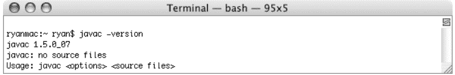

**图 1-1.** 检查已安装的 JDK 版本

如果你还没有至少 JDK 1.4，可以从 Sun 开发者网络站点 http://java.sun.com/javase/downloads 下载 JDK。

你还需要在机器上安装 Google Web Toolkit SDK。可以在 http://code.google.com/webtoolkit/download.html 找到它。

工具包的 ZIP 文件约为 13MB。下载后，将其解压到你首选的安装目录（无需安装程序）。你应该将安装目录添加到路径变量中，以便从任何目录轻松调用 GWT 的脚本。在 Windows 上，你可以通过进入**控制面板 > 系统 > 高级 > 环境变量**，然后将安装路径添加到 `PATH` 变量中来实现。在 OS X 和 Linux 上，你可以使用 `set` 命令或在启动脚本中设置变量来将路径添加到 `PATH` 变量。例如，如图 1-2 所示，我在 OS X 上的主目录中的 .profile 文件里设置了路径变量。设置路径变量后，你可以在不指定完整路径的情况下执行 GWT 脚本，如图 1-3 所示。

**图 1-2. 在 OS X 上将 GWT 添加到 PATH 变量**

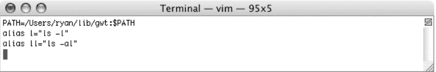

**图 1-3. 无需指定路径即可运行 applicationCreator 脚本**

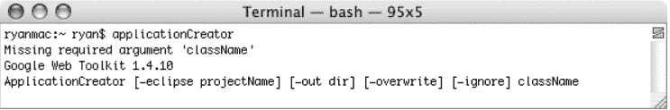

要开始用 GWT 构建应用程序，我们首先需要创建一个新项目。这个项目是一个 Hangman Ajax 应用程序，所以我们将使用 **Hangman** 作为项目名称。图 1-4 显示了如何创建应用程序目录，然后运行 GWT 的 `applicationCreator` 脚本来生成所需的文件。

**图 1-4. 使用 applicationCreator 创建名为 Hangman 的新项目**

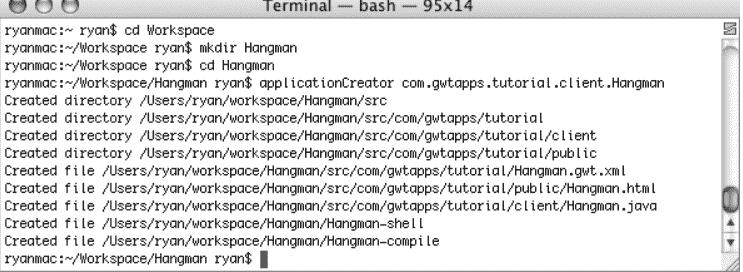

如图 1-4 所示，我们运行了以下命令来生成这些文件：

```
applicationCreator com.gwtapps.tutorial.client.Hangman
```

参数是我们 GWT 应用程序的完整 Java 路径名。（如果你还不熟悉 Java，可以查看 http://java.sun.com/docs/codeconv/html/CodeConventions.doc8.html 了解如何引用 Java 资源。）Java 路径直接映射到文件系统中的路径，如图 1-4 所示。这种技术有助于你将代码组织到包中。

此时应用程序已经可以运行了。GWT 支持两种运行模式：你可以在 GWT 的托管浏览器中使用生成的 Hangman shell 脚本运行应用程序，这是用于测试和调试应用程序的方法；或者你可以使用生成的 Hangman compile 脚本将应用程序编译为 JavaScript，然后在任何浏览器中运行。**GWT 托管模式**在由 GWT 控制的环境中运行你的应用程序，而不是在浏览器中运行，让你能够查看日志和错误消息，并在 Java 环境中调试应用程序。这与在浏览器中将编译后的应用程序作为 JavaScript 运行形成对比，在那种情况下你只能依赖 JavaScript 错误消息，而且没有调试支持。当你使用 Hangman shell 脚本在托管模式下运行应用程序时，你会看到一个 GWT shell 窗口显示错误和其他日志消息，如图 1-5 所示，以及一个加载生成应用程序的托管浏览器窗口，如图 1-6 所示。

这就是启动 GWT 应用程序项目所需做的一切。在第 4 章中，你将了解如何在 Eclipse 等 IDE 中启动项目以加快开发速度。

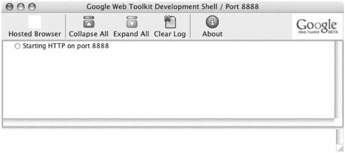

**图 1-5.** GWT shell 窗口

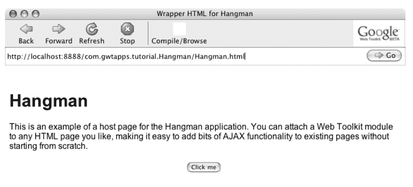

**图 1-6. 托管浏览器窗口**

### 定制生成的应用程序

要定制生成的应用程序，我们需要查看两个生成的文件。第一个是宿主 HTML 页面，它作为 GWT 应用程序的起点。加载到浏览器时，它会包含启动应用程序的 JavaScript。在这种情况下，名为 Hangman.html 的宿主 HTML 文件位于 com/gwtapps/tutorial/public 中。该文件的内容应类似于以下内容：

```
<html>
    <head>
        <title>Wrapper HTML for Hangman</title>
        <style>
            body,td,a,div,.p{font-family:arial,sans-serif}
            div,td{color:#000000}
            a:link,.w,.w a:link{color:#0000cc}
            a:visited{color:#551a8b}
            a:active{color:#ff0000}
        </style>
        <script language='javascript'
            src='com.gwtapps.tutorial.Hangman.nocache.js'></script>
    </head>
    <body>
        <iframe src="javascript:''" id="__gwt_historyFrame"
            style="width:0;height:0;border:0"></iframe>
```

```
<h1>Hangman</h1>

<p>
    This is an example of a host page for the Hangman application.
    You can attach a Web Toolkit module to any HTML page you like,
    making it easy to add bits of AJAX functionality to existing pages
    without starting from scratch.
</p>

<table align=center>
    <tr>
        <td id="slot1"></td><td id="slot2"></td>
    </tr>
</table>
</body>
</html>
```

如你所见，这看起来像一个典型的 HTML 文件。HTML 内容负责你在托管模式浏览器运行时看到的大部分内容。你可以在 header 标签中看到 Hangman 标题，以及带有说明的段落。head 部分包含 title 标签，它在浏览器窗口的标题栏中显示标题。style 标签包含用于设置应用程序样式的 CSS 代码，script 标签加载应用程序源。你可以看到浏览器中的按钮在 HTML 的 body 中没有匹配的标签。该按钮是生成的 GWT 应用程序的一部分，它根据此文件中 td 标签的 ID 附加到标签上。

第二个重要的生成文件是 Java 文件，它作为应用程序的入口点。该文件 Hangman.java 位于 com/gwtapps/tutorial/client/ 中。此文件中生成的代码应如下所示：

```
/**
 * Entry point classes define <code>onModuleLoad()</code>.
 */
public class Hangman implements EntryPoint {

    /**
     * This is the entry point method.
     */
    public void onModuleLoad() {
        final Button button = new Button("Click me");
        final Label label = new Label();
```

```
button.addClickListener(new ClickListener() {
  public void onClick(Widget sender) {
    if (label.getText().equals(""))
      label.setText("Hello World!");
    else
      label.setText("");
  }
});
```

```
// Assume that the host HTML has elements defined whose
// IDs are "slot1" and "slot2". In a real app, you probably would not want
// to hard-code IDs. Instead, you could, for example, search for all
// elements with a particular CSS class and replace them with widgets.
//
RootPanel.get("slot1").add(button);
RootPanel.get("slot2").add(label);
```

```
}
```

注意，`Hangman` 类实现了 GWT 的 `EntryPoint` 接口及其 `onModuleLoad` 方法。你可以使用此方法构建界面并初始化应用程序，该方法将应用程序加载到浏览器中。生成的代码创建 `Button` 和 `Label` 小部件，并将它们添加到 ID 为 `slot1` 和 `slot2` 的 `td` 标签中。它还为按钮添加了一个 `ClickListener`，通过更改 `Label` 小部件中的文本来处理点击事件。现在，先专注于概念，不要担心这些细节；你将在第 2 章中学习 `RootPanel` 类、小部件和处理事件。

### 创建动态界面

接下来，我们将精简 HTML 宿主文件，使其只有一个 `div` 标签，我们将从 Java 代码连接到这个标签：

```
<html>
  <head>
    <title>Hangman</title>
    <style>
      body,td,a,div,.p{font-family:arial,sans-serif}
      div,td{color:#000000}
      a:link,.w,.w a:link{color:#0000cc}
      a:visited{color:#551a8b}
      a:active{color:#ff0000}
    </style>
```


 ```
<script language='javascript'
    src='com.gwtapps.tutorial.Hangman.nocache.js'></script>
</head>
<body>
    <!-- OPTIONAL: include this if you want history support -->
    <iframe src="javascript:''" id="__gwt_historyFrame"
        style="width:0;height:0;border:0"></iframe>
    <h3>Hangman</h3>
    <div id="hangman"></div>
</body>
</html>
```

注意，HTML 的 body 中有一个 ID 为 **hangman** 的 `div` 标签。在 Java 代码中，我们需要将 Hangman 应用程序的用户界面元素附加到这个 **hangman** 标签上。不过，首先我们需要确定界面的样式。如果你不熟悉这个游戏，下面是它的玩法：玩家尝试逐个字母地猜测一个短语。每当玩家猜的字母不在短语中时，程序就会在被吊死的简笔画小人上添加一个肢体（对这个有些残酷的例子表示歉意）。要获胜，你需要在简笔画小人被完全画出来之前猜出短语中的所有字母。

界面需要一行按钮，用于按下以猜测字母；一个能根据错误猜测次数变化的图像；以及一个显示正在被猜测的短语标签。图 1-7 显示了界面应该是什么样子的模型。

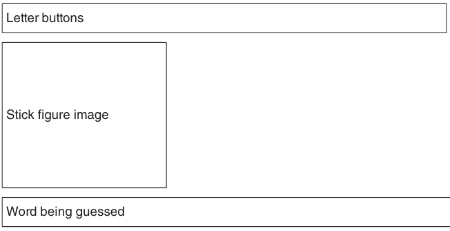

# 24 第 1 章 Google Web Toolkit 初探

我们将使用 GWT 来构建这个布局，并将其放置到 ID 为 hangman 的 div 标签内部。为此，我们将为图 1-7 中的每个框各使用一个 GWT 部件，然后可以将 Hangman.java 文件的实现修改为如下内容：

```
public class Hangman implements EntryPoint {
    private FlowPanel letters = new FlowPanel();
    private Label wordLabel = new Label();
    private Image image = new Image();

    public void onModuleLoad() {
        //create interface
        RootPanel hangman = RootPanel.get("hangman");
        hangman.add(letters);
        hangman.add(image);
        hangman.add(wordLabel);
    }
}
```

我们创建了三个部件。`letters` 部件使用 `FlowPanel`，并且最先被添加。如前所述，GWT 中的面板是一种可以容纳其他部件的部件类型。面板通常会为其子部件规定一个正式的布局。对于 `FlowPanel` 来说，其内部布局与 HTML 非常相似。当我们在这种情况下添加子部件时，它们会为每个字母创建一个按钮，并从左到右排列；当没有水平空间时，按钮会换行到下一行。`Image` 部件包装了 HTML 的 `img` 标签，可以显示单个图像。我们将使用同一个 `Image` 部件来在简笔画绘图之间切换。第三个也是最后一个部件是 `Label` 的一个实例，它只是显示文本。

此时你可以运行应用程序，但我们还没有向部件中添加任何内容，所以浏览器只会显示一个空白页面。因此，让我们向 `Hangman` 类添加一个 `startGame` 方法，并从 `onModuleLoad` 方法中调用该方法。这个新方法为开始新游戏设置界面的状态。我们希望 `startGame` 方法与 `onModuleLoad` 方法是分开的，这样用户就可以在不重新启动应用程序的情况下开始新游戏。以下代码设置了初始的游戏界面：

```
public void onModuleLoad() {
    //create interface
    RootPanel hangman = RootPanel.get("hangman");
    hangman.add(letters);
    hangman.add(image);
    hangman.add(wordLabel);

    startGame();
}

public void startGame(){
    //add letter buttons
    letters.clear();
    for( char letter = 'A'; letter <= 'Z'; letter++ ){
        final Button button = new Button(Character.toString(letter));
        button.addClickListener( new ClickListener(){
            public void onClick( Widget sender ){
                button.setEnabled(false);
                guess( button.getText().charAt(0) );
            }
        });
        letters.add( button );
    }
    //set initial image
    image.setUrl("hm1.gif");
```

`startGame` 方法遍历字母表中的每个字母，为每个字母创建一个 `Button` 部件。该字母被设置为按钮上的标签。我们为按钮添加了一个 `ClickListener`，以处理用户点击按钮时的事件。在 `ClickListener` 的 `onClick` 方法内部，按钮被禁用，这样用户就不会误操作而重复选择同一个字母。然后 `onClick` 方法调用一个名为 `guess` 的方法来处理用户的字母猜测。在 `startGame` 方法的剩余部分中，`Image` 部件的绘图被初始化为 `hm1.gif`。当用户猜错时，我们可以使用一个简单的模式来引用新图像。例如，一次错误猜测后的下一张图像是 `hm2.gif`，再下一张是 `hm3.gif`，依此类推。

图 1-8 显示了此时的界面，带有字母按钮和初始图像。

以下代码实现了该应用程序的其余游戏逻辑：

```
private final int MAX_GUESSES = 6;
private int misses;
private char[] word;
private char[] visibleWord;

//set up a new word to guess
public void setWord( String newWord ){
    word = newWord.toUpperCase().toCharArray();
    visibleWord = new char[word.length];
    for( int i=0; i<word.length; i++ ){
        if( word[i] != ' ' )
            visibleWord[i]='_';
        else
            visibleWord[i]=' ';
    }
    wordLabel.setText( new String(visibleWord) );
}

//handle a guess from the user
public void guess( char letter ){
    boolean badGuess = true;
    boolean wordFinished = true;

    //check for matches for this letter
    for( int i=0; i<word.length; i++ ){
        if( word[i]==letter ){
            visibleWord[i] = letter;
            badGuess = false;
        }
        else if( visibleWord[i]=='_' ){
            wordFinished = false;
        }
    }
    wordLabel.setText( new String(visibleWord) );

    if( wordFinished ){
        Window.alert( "Congratulations, you got the answer!" );
        startGame();
    }
    else if( badGuess ){
        misses++;
        image.setUrl("hm"+Integer.toString(misses+1)+".gif");
        if( misses == MAX_GUESSES ){
            Window.alert(
                "You ran out of guesses! The answer is "+ new String(word));
            startGame();
        }
    }
}
```

注意 guess 方法中接近末尾的那一行，当产生错误猜测时：下一张图像的 URL 是根据错误猜测的次数计算出来的。图 1-9 显示了该应用程序将使用的七张图像。

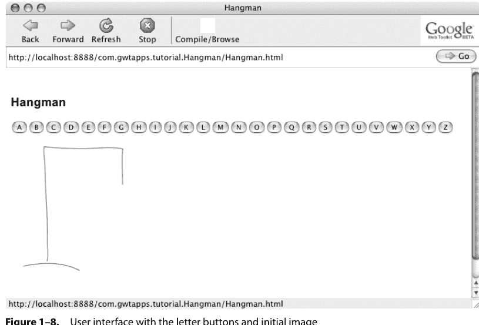

图 1–8. 带有字母按钮和初始图像的用户界面


图 1–9. 七张简笔画图像

## 使用异步 HTTP

到目前为止，我们已经使用 GWT 部件为这个 Ajax 应用程序设置了界面，并声明了一些使游戏运行的额外逻辑，但我们还没有创建游戏单词的来源。这是测试从服务器异步加载数据的好机会，这也是 Ajax 应用程序的主要任务之一。GWT 提供了多种从服务器加载数据的方式，包括异步 HTTP 模块和 RPC 模块，以及解析结构化数据的不同方式（例如 JSON 和 XML）。对于这个应用程序，我们将通过使用 `com.google.gwt.user.client.HTTPRequest` 类来异步从服务器加载数据，与 GWT 的 HTTP 模块相比，这是一种简化的异步 HTTP 请求方式。

在服务器上，我们将放置一个名为 `movies.txt` 的文本文件，其中包含一个电影列表。以下是该文件内容的示例：

```
The Godfather
The Shawshank Redemption
Pulp Fiction
Schindler's List
Casablanca
The Empire Strikes Back
The Lord of the Rings
One Flew Over the Cuckoo's Nest
...
```

我们可以使用该文件中列出的每部电影作为 Hangman 应用程序的不同短语。要将这些数据导入应用程序，需要使用文件名作为第一个参数来调用 `HTTPRequest` 的 `asyncGet` 方法。第二个参数需要是 `ResponseTextHandler` 接口的实现。在应用程序调用 `asyncGet` 方法后，`HTTPRequest` 类从服务器请求文件，应用程序代码在客户端继续执行。当服务器响应时，`HTTPRequest` 类会在你的 `ResponseTextHandler` 接口中调用 `onCompletion` 方法，并将文件内容作为参数传递。在 Hangman 类的 `onModuleLoad` 方法中添加以下代码，即可实现 `movies.txt` 文件的异步加载：

```
private String[] words;

public void onModuleLoad() {

  //create interface
  RootPanel hangman = RootPanel.get("hangman");
  hangman.add(letters);
  hangman.add(image);
  hangman.add(wordLabel);

  //load words
  HTTPRequest.asyncGet("movies.txt", new ResponseTextHandler(){
     public void onCompletion(String responseText) {
        words = responseText.split("\n");
```


```
startGame();
}
});
}
```

请注意，我们在类中添加了一个字符串数组作为字段。`String.split()` 方法根据文件内容创建字符串数组，并使用换行符来确定分割字符串的位置。在 `startGame` 方法中，我们只需从 `words` 数组中随机选择一个短语：

```
setWord(words[Random.nextInt(words.length)]);
```

这就完成了所有需要的工作！我们已经创建了一个简单的 Ajax 应用程序，它具有动态界面，并且数据是异步从服务器加载的。最终应用程序在托管模式浏览器中的样子应如图 1-10 所示。

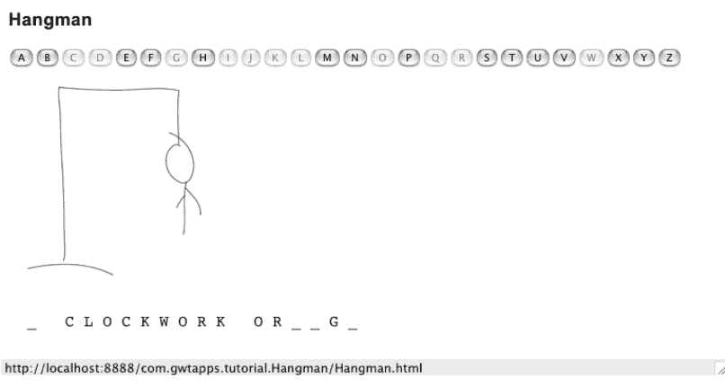

**图 1–10.** 完成的应用程序

## 工具包包概览

虽然 GWT 的主要优势在于使用 Java 语言及其工具来构建基于网络标准技术的 Web 客户端，但你也会欣赏它庞大的 Java 包库。这些包的目标与整个工具包的目的一致——帮助你构建动态的基于浏览器的应用程序——而且它们在这方面表现出色。本节简要介绍 GWT 库。更多细节请参阅第 2 章的用户界面和第 3 章的服务器通信。

库包位于 `gwt-user.jar` 文件中，该文件位于 GWT 安装目录中。如果你不熟悉 JAR 文件，可以将其理解为类似 Java 库的 ZIP 文件：一个包含目录结构的文件，其中包含多种类型的文件，通常包括编译后的 Java 类文件。所有 GWT 项目都需要此文件才能在托管模式下运行，因为该 JAR 文件包含 GWT 应用程序所基于的大量代码。当你设置项目或生成用于运行项目的脚本时，此 JAR 文件将在类路径中。由于 GWT 的 `applicationCreator` 脚本会自动为你设置类路径，因此你只需知道 GWT 库代码在其中即可，无需过多担心此 JAR 文件。即使你将应用程序部署到 Web 浏览器中使用，也不需要包含此文件。GWT 的编译步骤会将你的代码以及你从该库中使用的任何代码编译为 JavaScript。GWT 确保当你的应用程序部署并在浏览器中运行时，其唯一依赖项是所有主流浏览器都支持的 Web 标准，包括 Firefox、Internet Explorer、Safari 和 Opera。

`gwt-user.jar` 文件是开始查看 GWT 附带整个库的好地方。图 1-11 显示了 GWT 1.4 的 `gwt-user.jar` 文件文件夹结构。

在此目录结构中，你可以看到 GWT 库的一些主要包。这些包可以分为五类：用户界面、服务器调用、数据格式、JRE 仿真和实用工具。图 1-12 说明了 GWT 库如何划分其功能。

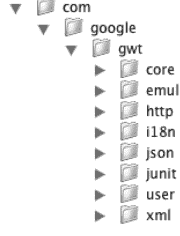

**图 1-11.** `gwt-user.jar` 文件的文件夹结构

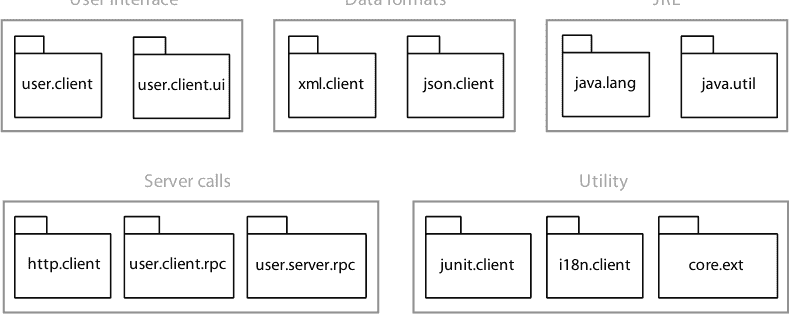

**图 1-12.** GWT 库功能的划分

- `com.google.gwt.user.client`

此包提供对 Web 浏览器 API 的基本访问，用于动态编程网页，以及一些用于访问基本浏览器功能的其他辅助类。此包中的 `DOM` 类允许通过文档对象模型直接编辑 Web 文档。GWT 小部件和面板（属于此列表中的下一个库）使用此库来构建自身。你也可以使用此库来创建自定义小部件。

- `com.google.gwt.user.client.ui`

在此包中，工具包提供了一个用于构建用户界面的框架，其设计与 Java 的抽象窗口工具包（AWT）非常相似。该包在帮助创建和使用动态且可重用的用户界面组件方面表现出色。在本书中，我们将使用此框架来构建界面。

第二类包是服务器调用，帮助我们向服务器发起远程调用。这些包包含帮助 GWT 应用程序与服务器通信的类。

- `com.google.gwt.http.client`

此 HTTP 包为 `XMLHttpRequest` 对象创建了一个功能强大的、独立于浏览器的包装器，Ajax 应用程序使用该对象进行异步通信。

- `com.google.gwt.user.client.rpc` 和 `com.google.gwt.user.server.rpc`

这些包使应用程序能够通过远程过程调用与服务器通信。该库使用 RPC 通信将基于 Java 的接口的调用中继到服务器，而无需我们考虑协议细节。它还使用 Web 浏览器的 `XMLHttpRequest` JavaScript 对象进行通信。

这两类包涵盖了库中支持 Ajax 应用程序所需的两个主要功能领域：动态用户界面和异步服务器通信。如果你只想创建动态界面，你只需要第一组库；如果你只需要异步服务器通信，你只需要第二组库。你无需担心只选择所需的库。GWT 编译器知道你使用了哪些库，并且足够智能，只会将你需要的代码编译为 JavaScript。这使你的应用程序在分发时代码尽可能小。这是使用工具包而非其他 JavaScript 框架的另一个优势；你无法以相同的粒度级别减小库的大小。

让我们继续查看可用的包。第三类包为你的应用程序提供解析和构造数据格式的能力。

- `com.google.gwt.xml.client`

此 XML 包使你的应用程序能够解析 XML 文档，并通过文档对象模型遍历其内容。你也可以使用它来构造文档对象模型并生成 XML 文档。将此包与 HTTP 包结合使用，允许你向服务器发送和接收 XML 文档。

- `com.google.gwt.json.client`

此 JSON 包与 XML 包类似，只是格式为 JSON 而非 XML。JSON 是一种类似 XML 的分层数据格式，但更轻量（更小）。此库允许你生成和解析 JSON 数据。

JRE 仿真类别包含 Java 运行时环境库的一个子集，用于协助完成常见编程任务，包括基本 Java 类型、异常和集合。Java 语言附带了大量库，协助构建多种类型的应用程序。GWT 没有创建更多新库，而是模拟了 JRE 中最常使用的两个库。模拟这些库的优势在于提供开发人员可能已经熟悉的类。这被称为仿真，因为当 GWT 应用程序部署时，并不会使用 JRE 类。相反，GWT 编译器会将 JRE 类的使用替换为等效的 JavaScript 代码。

- `java.lang`

此包包含基本 Java 类，如 `Integer` 和 `String`。

- `java.util`

此实用程序包提供了 Java 的许多基本集合类，包括 `Map`、`List` 和 `Set`。

最后一类包是一组杂项但重要的实用工具类。

- `com.google.gwt.junit.client`

此 JUnit 包提供类，帮助使用 JUnit 为应用程序编写单元测试。

- `com.google.gwt.i18n.client`

GWT 提供国际化支持，此包提供类来帮助访问它。

- `com.google.gwt.core.ext`

此扩展包提供类，帮助你扩展 GWT 编译器。

```

 请注意，这些软件包完全是可选的。您可以选择任意组合的软件包在应用程序中使用，GWT 编译器确保只有实际使用的代码才会包含在编译后的应用程序中。您不仅限于使用工具包自带的软件包；还可以包含第三方库与 GWT 一起使用，以扩展应用程序的功能。例如，第 6 章中的 Gadget Desktop 应用程序使用 Google Gears GWT 库来支持与 Google 本地持久化浏览器插件的集成。不过，我认为您会发现 GWT 库为您提供了构建 Ajax 应用程序的实质性构建模块，而无需使用第三方软件包。

 ## GWT 应用程序概述

 本书以应用程序为中心的视角来使用 GWT。开发人员通常将 Ajax 用作传统基于文档的网页的补充。这是 Ajax 的一种完全可行的用法，但您可以使用 GWT 来帮助解决构建更大更复杂的 Ajax 应用程序时遇到的问题。它在这方面表现出色，让您能够开发复杂程度可与桌面应用程序媲美的 Ajax 应用程序。

 本书第一部分的其余章节提供了 GWT 的概述以及如何有效地在应用程序中使用它。第二部分的章节描述了如何使用 GWT 构建五种不同类型的应用程序。每个应用程序展示了使用 GWT 与 Web 进行交互的不同方式，并且每个应用程序都遵循不同的应用程序模式。

 ## 常见应用程序模式

 本书使用了五种应用程序模式：

 - **容器（Container）**模式用于具有插件式结构、支持多个小型工具类应用程序的应用程序。
 - **聚合器（Aggregator）**模式用于将多个通常离散的数据集组合到一个界面中的应用程序。
 - **工作区（Workspace）**模式用于提供文档和不显眼的工具来处理文档的应用程序。
 - **协作者（Collaborator）**模式用于允许多个用户聚在一起交流的应用程序。
 - **管理器（Manager）**模式用于提供界面来访问和管理大量数据集的应用程序。

 ## 示例应用程序

 第 6 章中的 Gadget Desktop 应用程序遵循容器模式。它具有灵活且动态的用户界面，支持拖放操作，包含多个执行各种任务的小工具，例如通过真正简单聚合（RSS）下载新闻、提供天气预报以及显示来自 Google 地图的地图。该应用程序展示了如何与其他 JavaScript 库（如 Google 地图和 Google Ajax Feed API）集成，以及如何通过浏览器 Cookie 或 Google Gears 提供客户端存储。

 第 7 章中的示例应用程序 Multi-Search 遵循聚合器模式，允许您使用单一界面搜索多个搜索引擎。该应用程序展示了如何使用来自 Yahoo! Search、Google Base、Amazon Books 和 Flickr 的 JSON 在客户端加载远程数据。

 第 8 章中的 Blog Editor 应用程序遵循工作区模式，提供管理多个博客和博客条目的界面，而无需像标准博客服务界面那样的典型页面刷新。该应用程序展示了如何通过 REST Web 服务接口与 Blogger API 集成，以及如何构建 HTTP 代理来绕过浏览器的同源策略。

 在第 9 章中，即时通讯应用程序遵循协作者模式，展示了一种微妙地与现有网页集成的方式，使其读者能够通过即时消息相互交互。它展示了如何使用 GWT-RPC 库以及如何提供一个基于 RPC 的事件系统，将服务器端事件推送到客户端。

 第 10 章中的 Database Editor 应用程序遵循管理器模式，包含一个管理器界面来管理现有传统 Web 应用程序的大量数据。该应用程序展示了如何使用 action、REST 和 RPC 方法从服务器增量加载数据。它展示了如何使用基于 action 的方法集成 PHP 脚本，使用基于 REST 的方法集成 Ruby on Rails，以及使用 GWT-RPC 集成 Java servlet。它还演示了如何编写代码生成器，自动将 Java 对象序列化为 JSON 和 XML 以及从 JSON 和 XML 反序列化。

 阅读完这些章节并查看提供的源代码后，您应该对如何使用 Java 工具和 GWT 构建、管理和维护大型复杂的 Ajax 应用程序有扎实的理解。

 ## 小结

 本章介绍了 Google Web Toolkit 背后的历史，讨论了 Web 上的应用程序开发，并考察了使用 GWT 构建应用程序所需的技能。本教程让您初步体验了使用 GWT 进行 Ajax 应用程序开发。接下来的四章将更深入地探讨 GWT 库，并介绍帮助您有效使用 GWT 构建应用程序的技术。

 # 用户界面库概述

 `com.google.gwt.user.client.ui` 软件包包含允许您使用经过其他用户界面框架（如 Java 的 AWT）验证成功的技术来创建动态用户界面的类。该软件包中的类建立在 Web 浏览器的用户界面功能之上，提供动态可重用组件，这些组件在受支持的浏览器实现和版本之间具有相同的行为。GWT 用户界面库将这些组件称为**部件（widgets）**，它们的范围从简单的按钮和标签到更复杂的选项卡面板和树状视图。一些部件直接映射到您在常规网页中会使用的 HTML 元素，而另一些则是多个 HTML 元素与脚本和事件处理相结合的复合体。

 本书将不同类型的部件分为以下功能类别。

 - **静态部件**，交互性不强，仅作为应用程序某些编程操作的结果改变状态。
 - **表单部件**简单地包装了通常用于 Web 表单的 HTML 元素，包括文本框和按钮。
 - GWT 提供了**复杂部件**，它们是使用 HTML 标签和 JavaScript 事件处理复合而成的浏览器新 UI 功能。
 - 其余四种类别的部件涵盖面板。**简单布局面板**和**复杂布局面板**充当其他部件的父级。每个布局面板遵循独特的布局模式。其他面板，即简单容器面板和**复杂容器面板**，不处理布局，但为其单一子部件提供独特的容器功能。

 图 2-1 展示了 GWT 自带的部件，按类别划分。

 ## 静态部件

 这些最简单的部件类型没有任何内部状态，也不会自行动态变化。它们仍然可以是动态用户界面的一部分，用户界面代码可以在运行时更改它们的属性和位置，但它们不会作为用户操作的结果而改变。这些部件包括 `Label`、`HTML`、`Image` 和 `Hyperlink`。

 ## 标签（Label）

 当您将 `Label` 部件添加到父部件时，它仅显示其非 HTML 字符串。以下代码展示了如何将 `Label` 添加到容器：

 ```
 mainPanel.add( new Label("Signing in...") );
 ```

 您使用要显示的字符串实例化 `Label` 部件。父容器，在本例中是 `mainPanel` 实例，确定在界面中放置标签的位置。`Label` 实例只知道填充其空间。此代码片段来自第 9 章的即时通讯示例应用程序，添加了一个 `Label` 实例以在登录期间显示在应用程序中，如图 2-2 所示。

 **图 2-2.** Signing in... 标签

 `Label` 的默认 CSS 名称设置为 `gwt-Label`，这让您可以轻松地为应用程序中的所有标签设置样式。例如，将以下 CSS 添加到宿主 HTML 文档的 style 标签中，或添加到从宿主 HTML 文档引用的 CSS 文件中，可以使标签具有蓝色背景和黄色文字：

 ```
 .gwt-Label{ background-color:#008; color:#FF0; }
 ```

 此更改将导致即时通讯应用程序显示 "Signing in..." 标签，如图 2-3 所示（当然是彩色的）。

 **图 2-3.** 具有不同颜色背景和文字的 Signing in... 标签
 


通常情况下，标签的文本是左对齐的，而不是像图 2-3 那样居中。此标签中的文本居中显示是因为父部件已将其子部件的水平对齐方式设置为居中。我们也可以使用类的 `setHorizontalAlignment` 方法来设置标签的水平对齐方式，因为 `Label` 实现了 `HasHorizontalAlignment` 接口。以下代码将标签的水平对齐方式设置为右侧：

```
Label signInLabel = new Label("Signing in...");
signInLabel.setHorizontalAlignment(HasHorizontalAlignment.ALIGN_RIGHT);
```

在即时通讯示例应用程序中使用此代码会使标签显示在右侧，如图 2-4 所示。

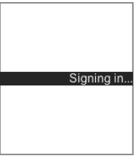

**图 2-4.** 显示在右侧的标签

`Label` 还实现了 `HasWordWrap` 接口。自动换行发生在文本无法放入为部件提供的水平空间时。默认行为下，开启自动换行后，放不下的单词会换到下一行。`setWordWrap` 方法通过传入 `true` 值开启自动换行，传入 `false` 值关闭自动换行。图 2-5 中的两张图片来自第 8 章的博客编辑器应用程序，分别展示了自动换行开启和关闭的情况。

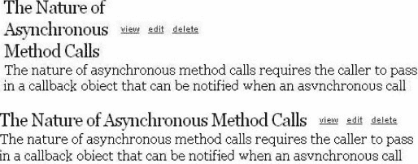

**图 2-5.** 自动换行开启和关闭的示例

`Label` 还实现了 `SourcesMouseEvents` 和 `SourcesClickEvents` 接口的方法，以支持对标签上的鼠标事件和点击事件的处理（本章稍后会介绍）。

### HTML

`HTML` 部件是另一个简单的部件，它与 `Label` 非常相似，但它可以支持并渲染 HTML。事实上，它扩展了 `Label` 部件，从而继承了对鼠标事件、点击事件、自动换行和水平对齐的支持。使用其默认 CSS 名称 `gwt-HTML`，可以让你以类似于 `Label` 部件的方式自定义 CSS 属性。除了 `Label` 的功能外，`HTML` 部件还实现了 `HasHTML` 接口，该接口具有 `setHTML` 和 `getHTML` 方法，用于添加和检索 HTML 字符串。如果在 `Label` 的字符串中使用 HTML 标签，它会将标签渲染为其文本值。`Label` 禁止渲染 HTML 这一特性实际上使 `Label` 成为应用程序中更安全的部件。从字符串渲染 HTML 的问题在于，你无法确定它在不同浏览器版本中会表现出相同的行为，而且如果你不知道值的来源（可能是用户输入的），那么它可能会渲染恶意 HTML，包括 JavaScript。你应该使用 GWT 部件和 CSS 来布局和格式化应用程序，并且只在必要时才使用 `HTML` 部件。如果你确实需要显示由其他应用程序生成或用户输入的 HTML，那么应该检查其中是否存在恶意标签。

该部件对于小块 HTML 来说非常方便，在这种情况下创建单独的部件会大材小用。例如，在即时通讯应用程序中，使用 `HTML` 部件以粗体显示用户的消息和名称：

```
HTML messageLabel = new HTML("<b>"+escapeHtml(contact.getName())+
"</b>: "+escapeHtml(message));
```

你也可以通过使用一个面板来容纳两个 `Label`，并将代表联系人名称的第一个标签的 CSS 值设置为粗体来实现相同效果。然而，这行代码要简单得多，而且我们可以相当确定粗体标签在所有浏览器中的渲染效果相同。这种情况下追加到字符串中的消息来自用户，因此需要采取适当的预防措施以避免不当渲染或 JavaScript 注入。

请注意，添加到 `HTML` 部件的每个字符串都调用了 `escapeHtml` 方法。此方法不包含在 GWT 中，但在添加用户生成的文本时至关重要。该方法的实现如下：

```
public String escapeHtml(String maybeHtml) {
  final Element div = DOM.createDiv();
  DOM.setInnerText(div, maybeHtml);
  return DOM.getInnerHTML(div);
}
```

此代码将字符串中的任何 HTML 字符转义为 HTML 实体，使其显示为文本而非被解释为标签，从而有效防止了不需要的 HTML 渲染或脚本注入。

### Image

`Image` 部件是另一个简单的部件，与 `Label` 和 `HTML` 部件一样也是静态的。它不接受字符串并渲染，而是接受一个指向图像文件的 URL 并进行渲染。该部件封装了 `IMG` HTML 标签，允许你在 GWT 的 UI 框架中将该标签作为部件使用。

第 9 章的即时通讯应用程序使用 `Image` 部件在每个联系人名称旁边显示一个用户图标，代码如下：

```
listTable.setWidget( row, 0, new Image("icon_user.gif") );
```

在这行代码中，应用程序使用图像文件的文件名字符串创建 `Image` 部件。由于图像文件不是完整的 URL，浏览器将其视为相对于应用程序位置（宿主 HTML 文件所在位置）的路径。浏览器尝试从与宿主 HTML 文件相同的位置获取此图像。你也可以指定相对于子目录的路径：

```
listTable.setWidget(row,0, new Image("images/icon_user.gif") );
```

使用此字符串，浏览器会在宿主 HTML 文件位置下的 images 目录中查找。URL 也可以是服务器上的绝对 URL：

```
listTable.setWidget(row,0, new Image("/images/icon_user.gif") );
```

请注意第一个正斜杠的添加。这告诉浏览器在与宿主 HTML 文件相同的服务器上，从 images 目录开始查找。你也可以指定宿主文件的服务器位置：

```
listTable.setWidget(row,0, new Image("http://www.rdews.com/img/icon_user.gif") );
```

无论使用哪种 URL，如果图像文件存在于指定位置，浏览器就会渲染该图像。图像的容器部件决定了图像在浏览器中出现的位置。在即时通讯应用程序中，图像出现在联系人名称的左侧，如图 2-6 所示。

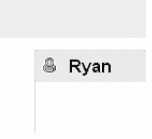

**图 2-6.** 出现在联系人名称左侧的图像

`Image` 部件也可以像 `Label` 和 `HTML` 部件一样处理鼠标和点击事件，因为它支持 `SourcesMouseEvents` 和 `SourcesClickEvents` 接口。它增加了通过 `SourcesLoadEvents` 接口支持加载事件的能力。处理加载事件可以让你在图像成功加载或因某种原因失败时执行代码。以下代码在图像未正确加载时移除 `Image` 部件，以避免显示损坏的图像图标：

```
final Image userIcon = new Image("icon_user.gif");
listTable.setWidget(row,0, userIcon );
userIcon.addLoadListener(new LoadListener() {

  public void onLoad(Widget sender) {
    //success!, do nothing
  }

  public void onError(Widget sender) {
    userIcon.removeFromParent();
  }
});
```

此代码实现了 `LoadListener` 接口的实例及其两个方法。应用程序将 `LoadListener` 实例传递给 `Image` 部件的 `addLoadListener` 方法。当加载事件发生时，`Image` 部件调用相应的方法：加载成功时调用 `onLoad`，加载失败时调用 `onError`。如果这段代码看起来有些陌生，不用担心；本章后面的"事件接口"部分会更详细地解释这一点。目前，重要的是要理解 `Image` 部件存在这一功能。

HTML 页面中的图像在动态界面中使用时的一个常见问题是，它们需要时间加载，因此图像在实例化并添加后不会立即显示。这可能会让用户有些困惑，并可能降低他们对应用程序的信心。幸运的是，`Image` 部件提供了一个静态的 `prefetch` 方法，可以在实际使用之前根据 URL 加载图像。当你将图像添加到界面时，浏览器已经准备好了该图像，从而消除了加载延迟。如果在用户界面中使用图像，你可能希望在应用程序开始时调用 `prefetch` 方法。即时通讯应用程序可以这样 `prefetch` 用户图标：

```
Image.prefetch("icon_user.gif");
```

此方法实例化图像但不将其添加到文档中。这会导致浏览器获取该图像。然后当应用程序创建 `Image` 部件时，浏览器知道该图像已经可用，无需再次加载。

### Hyperlink

`Hyperlink` 部件是静态部件中最复杂的，因为它必须处理 Ajax 应用程序的历史记录和链接问题。这个问题源于 Ajax 应用程序在单个动态文档中运行，而不刷新页面。对于传统的 Web 应用程序，链接会将用户带到新文档，旧文档会从视图中移除。如果这种情况发生在 Ajax 应用程序中，应用程序将会卸载，其状态也会丢失。新文档将取代应用程序，如果它有任何状态，也会从头开始。这显然是一个可用性问题，但这还没完——还有更多。如果


用户在点击链接并进入新页面后，不希望他的 Ajax 应用程序就此结束，因此他会点击后退按钮返回应用程序。然而，浏览器会重新启动应用程序，用户所做的任何进度都将丢失。

GWT 在解决这一可用性问题上迈出了重要一步，这始于 `Hyperlink` 小部件的使用。该小部件实现了一种链接，点击后会将用户带到应用程序内的另一个状态。每个 `Hyperlink` 都可以是指向由 `String` 令牌标识的特定状态的链接。当用户在应用程序中导航时，他会以令牌列表的形式构建一个状态历史记录。应用程序开发人员必须在应用程序中实现这些状态，并且能够基于其令牌构建特定状态。

这种实现与后退和前进按钮配合良好，因为它使用应用程序 URL 中的历史令牌。每次用户点击链接时，页面的 URL 都会将其令牌设置为 `Hyperlink` 小部件所使用的令牌。例如，第 7 章中的 Multi-Search 应用程序使用令牌作为搜索字符串。每次用户输入搜索时，应用程序都会创建一个历史令牌并将浏览器转发到一个新 URL，这不会导致页面刷新，但会将该 URL 添加到浏览器历史记录中，以便与后退和前进按钮配合使用。对于搜索术语 *GWT*，Multi-Search 应用程序的 URL 如下所示：

```
http://localhost:8888/com.gwtapps.multisearch.MultiSearch/index.html#GWT
```

如果我们随后搜索 *Java*，URL 将变为：

```
http://localhost:8888/com.gwtapps.multisearch.MultiSearch/index.html#Java
```

现在如果我们点击后退按钮，URL 将变回带有 GWT 令牌的那一个，GWT 会通知我们的应用程序 GWT 令牌是当前的历史令牌，应用程序就会知道要加载 *GWT* 的搜索结果。

第 9 章中的 Instant Messenger 应用程序在联系人列表中为每个联系人姓名使用 `Hyperlink` 小部件，如图 2-7 所示。

以下代码在此应用程序中创建了一个 `Hyperlink`：

```
Hyperlink link = new Hyperlink( contact.getName(), contact.getName() );
```

这段代码创建了一个 `Hyperlink` 小部件，以联系人姓名作为链接文本，令牌也使用联系人姓名。当用户点击某个联系人时，当前令牌变为用户点击的联系人姓名。应用程序通过加载该联系人的聊天窗口来处理此令牌变化。如果用户按下后退按钮，则应用程序加载上一个联系人的聊天窗口。

当前令牌的变化，无论是由点击 `Hyperlink` 小部件还是使用浏览器的后退和前进按钮引起的，都可以通过实现 GWT 的 `HistoryListener` 接口及其 `onHistoryChanged` 方法来处理。要向应用程序添加历史监听器，您需要调用 `History.addHistoryListener` 方法。以下代码展示了如何在 Instant Messenger 应用程序中处理历史令牌变化：

```
public void onHistoryChanged( String historyToken ){
    Contact contact = contactList.getContact( historyToken );
    if( contact != null ){
        getChatWindowView( contact );
    }
}
```

如您所见，处理历史令牌变化相当简单。这段代码期望历史令牌是一个联系人姓名。代码尝试在应用程序的领域模型对象中查找该名称对应的 `Contact` 实例。如果存在名称与令牌匹配的联系人，则应用程序显示该联系人的聊天窗口。

`Hyperlink` 小部件很好地利用了浏览器链接和历史功能，这种方式对用户来说非常直观。然而，该小部件不提供链接到外部资源的功能。要创建指向外部资源的链接，您需要使用 HTML 小部件并添加一个锚标签，如下所示：

```
HTML externalLink = new HTML("<a href='http://www.rdews.com'>Ryan's Site</a>");
```

当用户点击此链接时，浏览器会卸载应用程序，并将其替换为链接 URL 指向的资源。如果您的应用程序使用历史令牌正确处理状态，那么当用户通过点击浏览器的后退按钮返回时，她将以离开时的状态返回到应用程序。

您还可以使用 GWT 的 DOM 类创建自己的外部链接小部件。例如，第 8 章中的 Blog Editor 应用程序创建了一个外部链接小部件，让用户可以点击链接查看由外部博客服务托管的博客或博客文章。

### 表单小部件

表单小部件是简单的小部件，通常与 HTML 表单一起使用。然而，HTML 表单遵循传统的 Web 模式，即表单提交后页面会刷新以显示结果。Ajax 应用程序试图消除这种页面刷新，通常以异步方式向服务器提交数据。GWT 提供的表单小部件不必在 HTML 表单内部使用，可以更灵活地类似于桌面应用程序中的对应组件来使用。GWT 附带的表单小部件有 `Button`、`CheckBox`、`RadioButton`、`ListBox`、`TextBox`、`PasswordTextBox`、`TextArea`、`FileUpload` 和 `Hidden`。GWT 的 1.4 版本添加了更多更复杂的表单小部件，包括 `ToggleButton`、`PushButton`、`SuggestBox` 和 `RichTextArea`。

#### Button

`Button` 小部件包装了 HTML 表单中 type 为 button 的输入。在 HTML 中，`type` 属性用于通用 `input` 标签上以指定输入类型。您可以使用以下代码将按钮添加到 HTML 页面：

```
<input type="button">
```

按钮通常出现在表单上用于提交数据，但使用 GWT 时，您可以使用按钮来调用应用程序中的任何操作。例如，第 7 章中的 Multi-Search 应用程序使用一个按钮来提交搜索查询，类似于搜索引擎使用的搜索按钮，如图 2-8 所示。

在此图中，按钮位于右侧，不包含搜索字符串文本输入。以下代码展示了如何将按钮添加到应用程序中：

```
Button submitButton = new Button("Search");
searchPanel.add( submitButton );
```

这段代码创建了 `Button` 小部件，提供其文本字符串作为按钮标签，并将其添加到父容器中以供显示。当用户按下搜索按钮时，应用程序处理事件并执行从多个搜索引擎检索搜索结果的代码。传统的 Web 应用程序通过 `form` 标签来实现这一点，当用户按下按钮时，该标签会提交表单数据（包括搜索字符串）到服务器。然后服务器会响应搜索结果。使用 Ajax 应用程序，您可以异步提交到服务器，而无需刷新页面。这样，您就不会用 `form` 标签包围表单控件，因为其默认行为是刷新页面。相反，您的应用程序处理点击事件，并使用 GWT 的服务器调用库之一向服务器提交调用。

`Button` 小部件类实现了 `SourcesClickEvents` 接口，这让应用程序代码能够处理点击事件。我们可以为按钮添加一个点击监听器，调用 Multi-Search 应用程序的 `doSearch` 方法，如下所示：

```
submitButton.addListener( new ClickListener(){
    public void onClick(Widget sender){
        doSearch();
    }
});
```

该小部件和许多其他表单小部件还通过实现 `HasFocus` 接口和 `SourcesFocusEvents` 来支持焦点功能。这些事件允许您以编程方式处理小部件获得键盘焦点或失去焦点的情况。在设计界面时注意焦点处理很重要，因为许多用户更喜欢使用键盘。我们将在本章后面查看处理用户界面焦点行为的方法。

#### ToggleButton 和 PushButton

`ToggleButton` 和 `PushButton` 小部件是用户界面库中另外两种类型的按钮，可以类似于常规 `Button` 小部件来使用。`ToggleButton` 与 `Button` 的区别在于，点击后它会保持按下状态，直到再次点击。这种类型按钮的常见例子是文字处理器中的粗体按钮。您点击一次打开它，再点击一次关闭它，每次点击都会切换其状态。`PushButton` 的作用与 `Button` 相同，但支持根据其状态自定义外观。

这两个按钮都扩展了 `CustomButton` 类，该类提供了为不同按钮状态显示不同按钮面的共同功能。按钮面就是按钮显示内容的实例。该面可以是文本、HTML 或图像。为不同按钮状态提供不同的面，使您能够创建类似于常规按钮的自定义按钮。从头创建新按钮（从简单图像或文本）可能很诱人，但使用这种方法通常缺乏常规按钮在各状态中的细微差别，而这些细微差别使常规按钮非常易用。按钮通常可以启用或禁用，这让用户知道特定命令何时可用或不可用。例如，按钮可以在鼠标悬停时以不同方式显示，以指示它可以被点击，按钮还可以有办法向用户指示点击时按钮处于按下状态。为了理解这一可用性问题，让我们看看 Windows XP 上的常规按钮以及网页中的超链接。图 2-9 显示了 Windows XP 上按钮的三种不同状态。第一个按钮表示常规状态，第二个显示鼠标悬停在按钮上时的状态，第三个显示按钮被禁用时的外观。


 ## [OCR 校正与格式整理前]

文本按钮应体现出类似的功能。网页通常会为链接设置样式，使其在鼠标悬停时与点击后呈现不同的外观。图 2-10 展示了网页中超链接的三种不同状态。第一种状态是常规超链接，已设置为无下划线；第二种状态出现在鼠标悬停在链接上时，下划线会出现，向用户表明该按钮可点击；第三种状态显示在链接被点击时，向用户反馈点击正在生效。

click me click me click me

**图 2-10.** 文本按钮的三种不同状态

你可以使用 CSS 为这些超链接状态设置样式，但如果它们是 GWT `Button` 部件或网页上的普通按钮，这些状态就无法通过 CSS 来设置样式。这正是 `CustomButton`（包括 `ToggleButton` 或 `PushButton`）发挥作用的地方。

`CustomButton` 的实现支持六种不同的按钮状态。每个状态可以拥有不同的按钮外观和独立的 CSS 样式。状态外观的按钮内容可以是文本、图像或 HTML。以下列表描述了 `CustomButton` 可用的六种状态。

- 按钮抬起（Button up）——`PushButton` 的空闲状态，或 `ToggleButton` 的抬起状态。

- 按钮按下（Button down）——`PushButton` 上鼠标按下时的状态，或 `ToggleButton` 的按下状态。

- 按钮抬起，鼠标悬停（Button up, mouse hovering）——与按钮抬起状态相同，但发生在鼠标悬停在按钮上时。这可用于向用户直观表明按钮可点击。

- 按钮抬起，禁用（Button up, disabled）——与按钮抬起状态相同，但按钮已通过 `setDisabled` 方法被禁用。处于此状态时按钮通常为灰色，告知用户其不可点击。

- 按钮按下，鼠标悬停（Button down, mouse hovering）——对于 `PushButton`，这与按钮按下状态相同，因为点击按钮时鼠标必然处于悬停状态。对于 `ToggleButton`，这类似于按钮抬起、鼠标悬停状态，因为它同样需要告知用户该按钮可点击以返回按钮抬起状态。

- 按钮按下，禁用（Button down, disabled）——此状态仅出现在 `ToggleButton` 上，因为它可以在禁用的同时处于按下状态。`PushButton` 在禁用时无法被点击，因此无法进入此状态。

你至少需要为按钮抬起状态定义一个外观。如果未定义其他外观，此外观将用于所有状态。这些状态遵循层级关系来确定显示哪个外观（如果某个状态未定义外观）。例如，如果按钮处于按钮按下、鼠标悬停状态且未定义外观，它将使用按钮按下外观；如果也未定义按钮按下外观，则将使用按钮抬起外观。图 2-11 垂帘了此层级关系中的依赖关系。

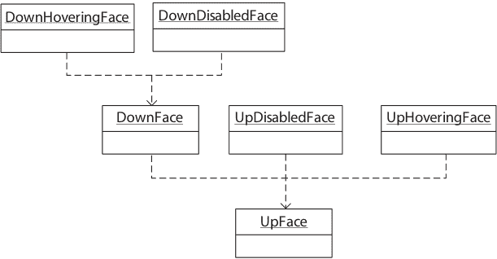

第 6 章中的 Gadget Desktop 应用程序在每个 gadget 的标题栏上都使用了 `ToggleButton` 和 `PushButton`。图 2-12 展示了 gadget 的标题栏。标题栏左侧的箭头是一个 `ToggleButton`。它在第一个 gadget 中处于按下状态，在第二个 gadget 中处于抬起状态。注意图像是如何向用户指示不同状态的。

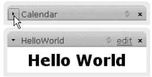

该应用程序像这样创建 `ToggleButton`：

```
ToggleButton minimizeButton = new ToggleButton(new Image("minimize1.gif"),
  new Image("minimize2.gif"));
```

注意构造函数接受两个 `Image`。这将为 `ToggleButton` 构建一个用于抬起状态的图像和一个用于按下状态的不同图像。我们也可以使用 `Face` 类来调整每个按钮外观的内容。例如，以下代码更改按钮的按下外观：

```
minimizeButton.getDownFace().setImage(new Image("minimize2.gif"));
```

你以同样的方式创建 `PushButton`；它与 `ToggleButton` 仅在行为上有所不同。

为每个可用外观设置图像、HTML 或文本并非自定义这些按钮的唯一方式。你可以通过 CSS 样式名称来改变按钮在每个状态下的外观。当按钮进入某个状态时，应用程序会为其附加一个新的样式名称，从而使浏览器渲染新的样式信息。使用按钮的样式名称，你可以改变背景、边框、下划线等，这与传统网页中超链接的做法非常相似。`ToggleButton` 和 `PushButton` 的样式名称不同，但遵循类似的模式，如表 2-1 所示。

**表 2-1** `ToggleButton` 和 `PushButton` 的样式名称

| 按钮状态 | ToggleButton | PushButton |
|-------------|-------------|-----------|
| 按钮抬起（Button up） | gwt-ToggleButton-up | gwt-PushButton-up |
| 按钮按下（Button down） | gwt-ToggleButton-down | gwt-PushButton-down |
| 按钮抬起，鼠标悬停（Button up, mouse hovering） | gwt-ToggleButton-up-hovering | gwt-PushButton-up-hovering |
| 按钮抬起，禁用（Button up, disabled） | gwt-ToggleButton-up-disabled | gwt-PushButton-up-disabled |
| 按钮按下，鼠标悬停（Button down, mouse hovering） | gwt-ToggleButton-down-hovering | gwt-PushButton-down-hovering |
| 按钮按下，禁用（Button down, disabled） | gwt-ToggleButton-down-disabled | gwt-PushButton-down-disabled |

#### 复选框（Checkbox）

Checkbox 部件封装了 HTML 的复选框输入标签。这个按钮与 Button 部件类似，支持焦点行为和点击事件，但它与 Button 部件的不同之处在于具有已勾选或未勾选的状态。默认状态为未勾选，如果用户点击它，状态会切换为已勾选。你可以通过 `setChecked` 方法以编程方式设置状态，传递 true 表示已勾选，false 表示未勾选。第 6 章中 Gadget Desktop 应用程序的源代码（可在 www.gwtapps.com 找到）包含了一个额外的待办事项 gadget，其中使用了复选框，如图 2-13 所示。

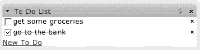

**图 2-13.** 使用 Checkbox 部件创建的复选框

用户可以标记待办事项列表中每个项目的复选框，表示已完成或未完成。以下代码创建了一个新的 CheckBox 部件，将其添加到其父容器中，并处理其 onClick 方法：

```
final checkBox checkBox = new CheckBox();
row.setWidget(0,0, checkBox );
checkBox.addClickListener( new ClickListener(){
  public void onClick( Widget sender ){
     if( checkBox.isChecked() )
        label.addStyleName("ToDoList-Done");
     else
        label.removeStyleName("ToDoList-Done");
  }
});
```

onClick 方法会更改标签的 CSS 样式，当用户勾选 CheckBox 部件时为其添加删除线装饰。为简化起见，你不需要一个与 CheckBox 部件分离的标签。此示例需要单独的部件是因为该应用程序需要高级编辑功能。但如果你只需要一个静态标签，可以像这样在 CheckBox 部件上设置文本值：

```
checkBox.setText( "check me" );
```

#### 单选按钮（RadioButton）

RadioButton 部件与 CheckBox 部件相同，不同之处在于它属于一组其他 RadioButton，并且一次只能有一个被勾选。在一组 CheckBox 部件中，用户可以勾选任意数量、全部或不勾选任何选项。图 2-14 展示了一个单选按钮组的示例，允许用户选择红色、绿色或蓝色。

○ red ⊙ green ○ blue

**图 2-14.** 使用 RadioButton 部件创建的单选按钮

在此示例中，绿色已被选中，但如果用户点击蓝色，蓝色将被选中而绿色将取消选中。此部件非常适合只有一种选择有效的情况。以下代码实现了此示例：

```
RadioButton redButton = new RadioButton("colors", "red");
RadioButton greenButton = new RadioButton("colors", "green");
RadioButton blueButton = new RadioButton("colors", "blue");
panel.add( redButton );
panel.add( greenButton );
panel.add( blueButton );
```

RadioButton 部件继承自 CheckBox 部件，因此它继承了 CheckBox 部件的所有功能，包括 setChecked/isChecked 方法、焦点行为和客户端事件处理。

#### 列表框（ListBox）

ListBox 部件在最基本的状态下与 RadioButton 部件的作用相同：它向用户展示一组选项，用户只能选择其中一个。然而，ListBox 将所有选项包含在一个部件中，并且外观与 RadioButton 部件不同。实际上，它有两种外观，如图 2-15 所示。

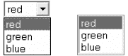

**图 2-15.** ListBox 部件的两种不同外观


第一种外观以一个下拉框形式显示选项。选中的选项显示在框中，当用户点击向下箭头按钮时，会显示列表选项。以下代码展示了如何创建这种样式的列表框：

```
ListBox colorList = new ListBox();
colorList.addItem("red");
colorList.addItem("green");
colorList.addItem("blue");
panel.add( colorList );
```

ListBox 的第二种外观显示一个选项列表，其中选中的选项会高亮显示。它没有下拉框，但如果列表中包含的项目超出可视范围，则列表会显示一个垂直滚动条，让用户可以滚动查看其他项目。要创建这样的 ListBox，你只需使用 `setVisibleItemCount` 方法设置应显示的项目数量：

```
colorList.setVisibleItemCount(3);
```

与其他表单小部件一样，ListBox 小部件支持焦点行为和变更事件处理。当用户更改所选项目时，会触发变更事件。例如，以下代码处理 ListBox 小部件上的变更事件，并显示一个包含用户选择内容的警告框：

```
colorList.addChangeListener( new ChangeListener(){
    public void onChange( Widget sender ){
        int selectedIndex = colorList.getSelectedIndex();
        String selectedColor = colorList.getItemText(selectedIndex);
        Window.alert( "you selected " + selectedColor );
    }
});
```

这段代码通过使用 ListBox 的 `getSelectedIndex` 方法获取选中的索引，然后利用该索引通过 `getItemText` 方法检索项目文本，从而在警告框中显示选中的颜色。

#### SuggestBox

在某些情况下，使用 ListBox 并不实用；例如，当你需要为用户提供大量选项时（想象一下在包含 1,000 个选项的列表中滚动！）。许多 Ajax 应用程序采用的一种常见解决方案是提供一个文本框，根据用户输入的词语显示下拉建议。Google 在其 Suggest 搜索引擎中就使用了这种可用性技术。当你开始输入搜索内容时，你会得到一个下拉选择列表，如图 2-16 所示。

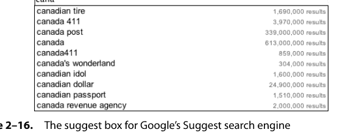

图 2-16. Google Suggest 搜索引擎的建议框

GWT 1.4 通过 `SuggestBox` 小部件提供了这种功能。该小部件提供了一个丰富的弹出框，在建议中高亮显示用户输入的字母。它还支持使用键盘或鼠标在列表中滚动。你可以通过 `SuggestBox` 的样式名称自定义其外观，这些样式名称分别用于输入框、弹出框、所有项目以及当前选中的项目。

`SuggestBox` 接受一个 `SuggestOracle` 实例作为建议的来源。这与 ListBox 小部件的实现方式不同，ListBox 是将列表项目直接添加进去的。将建议来源与 `SuggestBox` 小部件分离的原因在于，建议可能不像一个简短的静态列表那样简单；建议可能需要从应用程序的服务端生成。例如，考虑一下 Google Suggest 搜索引擎是如何实现这种控件的。浏览器不可能存储所有用户可能搜索的建议。相反，浏览器向服务器发送异步请求，根据用户输入获取建议。`SuggestOracle` 实例为应用程序开发者提供了一种接入 `SuggestBox` 以提供动态结果的方式。

GWT 提供了一个 `SuggestOracle` 的简单实现，称为 `MultiWordSuggestOracle`，它将建议存储在浏览器中。以下代码使用 `MultiWordSuggestOracle` 和一个电影列表创建了一个 `SuggestBox`：

```
String[] words = responseText.split("\n");
MultiWordSuggestOracle oracle = new MultiWordSuggestOracle();
oracle.addAll(Arrays.asList(words));
SuggestBox sb = new SuggestBox(oracle);
```

这段代码修改自第 1 章中的 Hangman 应用程序，它将字符串数组转换为列表，添加到 `MultiWordSuggestOracle` 中，然后创建一个新的 `SuggestBox`。图 2-17 展示了效果。

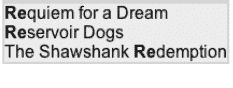

**图 2-17.** 使用 `SuggestBox` 搜索电影

默认情况下，建议框弹出层没有样式。你需要手动添加 CSS 才能获得如图 2-17 所示的样式。这些样式有助于区分弹出框的不同部分。以下是它们的 CSS：

```
.gwt-SuggestBox {}
.gwt-SuggestBoxPopup { border: 2px solid #C3D9FF; background-color:#E8EEF7; }
.gwt-SuggestBoxPopup .item { }
.gwt-SuggestBoxPopup .item-selected { background-color:#C3D9FF;}
```

如前所述，有时将所有可能的建议加载到浏览器中并不可行。在这种情况下，最佳选择是从服务器加载建议。这需要应用程序开发者做大量的工作。你首先需要创建自己的 `SuggestOracle` 类的特化实现，实现 `requestSuggestions` 方法。例如，以下特化实现通过调用一个 PHP 脚本来实现 `requestSuggestions` 方法：

```
public class RemoteSuggestOracle extends SuggestOracle {

  public void requestSuggestions(
    final Request request, final Callback callback) {
```

```
//get the query string
String query = request.getQuery();

//request the results from the server
HTTPRequest.asyncGet("movies.php?query="+query,
    new ResponseTextHandler(){
        public void onCompletion(String responseText) {

            //send the response back to the callback
            String[] words = responseText.split("\n");
            Response response = new Response(Arrays.asList(words));
            callback.onSuggestionsReady(request, response);
        }
    });
}
```

这段代码使用 `HTTPRequest` 类向服务器发起异步调用。它是一个非常基础的类，我建议你使用 HTTP 模块而不是 `HTTPRequest` 类，因为前者可以让你正确处理错误。然而，`HTTPRequest` 类对于本示例中 `SuggestOracle` 的演示已经足够。代码将查询发送到服务器上的 PHP 脚本，该脚本很可能是通过 SQL 查询在数据库中查找匹配的字符串，SQL 查询可能类似于：

```
mysql_query("SELECT * FROM movies WHERE name LIKE '%".$query."%'");
```

这实际上是一段 PHP 代码，调用 `mysql_query` 方法将 SELECT 查询发送到数据库。该查询在 movies 表中查找 name 列包含查询字符串的行。注意，这不是完整的 PHP 代码；进行适当的错误检查和转义以防止 SQL 注入攻击非常重要。

你不仅可以使用 PHP 脚本实现 `SuggestOracle`，还可以使用任何服务端技术来实现，例如 GWT-RPC、HTTP with XML，甚至 JSONP。

#### TextBox

`TextBox` 小部件封装了 HTML 中 type 为 input 的 input 标签，这是从用户获取少量文本输入的标准方式。第 7 章中的 Multi-Search 应用程序使用 `TextBox` 小部件从用户那里获取搜索字符串（参见图 2-8）。

该应用程序实现这个小部件并将其添加到容器中的方式非常简单：

```
TextBox searchBox = new TextBox();
searchPanel.add( searchBox );
```

在这个示例中，用户可以选择点击按钮提交搜索字符串，也可以按 Enter 键。为了实现对按 Enter 键的支持，我们需要处理 `TextBox` 支持的键盘事件。以下代码为 `TextBox` 添加了一个键盘监听器，并检测 Enter 键：

```
searchBox.addKeyboardListener(new KeyboardListenerAdapter(){
    public void onKeyPress(Widget sender,char keyCode,int modifiers){
        if(keyCode == KEY_ENTER )
            doSearch();
    }
});
```

`onKeyPress` 方法的参数之一是用户刚按下的键的键码。你可以将此键码与字符进行比较，或使用 `KeyboardListener` 接口上定义的一些预定义常量，如 `KEY_ENTER`。当检测到 `KEY_ENTER` 时，此代码调用 `doSearch` 方法，该方法由应用程序实现，用于将用户的搜索查询提交到多个搜索引擎。

与 `ListBox` 小部件一样，`TextBox` 小部件也通过实现 `SourcesChangeEvents` 和 `SourcesClick` 事件接口来支持变更事件和点击事件。

#### PasswordTextBox

`PasswordTextBox` 小部件的工作方式与 `TextBox` 小部件完全相同，只是它的内容对用户隐藏，以保护密码等敏感数据。图 2-18 显示了该小部件在 Internet Explorer 中的外观。


**图 2-18.** `PasswordTextBox` 小部件的文本框区域


通常，此小部件与用于用户名的`TextBox`小部件和用于密码的`PasswordTextBox`小部件结合使用，以登录某项服务。

#### TextArea

`TextArea`小部件与`TextBox`小部件一样接受用户输入的文本，但它还允许文本跨越多行。此小部件更适合用于较大的文本段落。第8章中的博客编辑器应用程序使用此小部件让用户编辑博客文章，如图2-19所示。

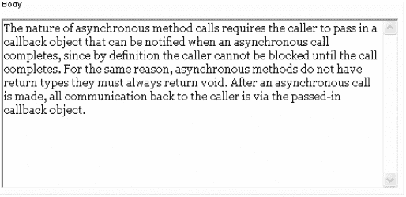

**图 2-19.** `TextArea`小部件提供了一种输入多行文本的方式

以下代码将图2-19中所示的`TextArea`小部件添加到其容器中：

```
TextArea postContent = new TextArea();
postContent.setCharacterWidth(80);
postContent.setVisibleLines(20);
postPanel.add( postContent );
```

此代码使用`setCharacterWidth`方法将小部件的宽度设置为80个字符，并使用`setVisibleLines`方法将高度设置为显示20行。或者，您可以使用`setWidth`和`setHeight`方法或CSS中的`height`和`width`属性来设置此小部件的宽度和高度。

此小部件支持您在其他表单小部件中看到的焦点行为、点击事件和更改事件。

#### RichTextArea

长期以来，所有输入到Web应用程序中的文本要么是纯文本，要么是标记文本。没有一种简单的方式可以输入富文本而无需担心标记，就像我们在大多数现代文字处理器中熟悉的那样。富文本编辑支持以一种不自然的方式悄然进入浏览器，最初是作为Internet Explorer的FrontPage扩展，允许您编辑HTML页面。然后，它被用作`textarea`标签的富文本替代品，方法是将可编辑的HTML页面放在`iframe`中，并将其大小调整为`textarea`的大小。这种富文本技术证明很有价值，最终被添加到其他浏览器中，但没有任何实现是完全相同的，Web开发人员发现如果不利用另一个已经解决该问题的成熟JavaScript库，很难提供支持。幸运的是，GWT 1.4库有一个名为`RichTextArea`的富文本小部件，可以自动处理所有浏览器差异。

您可以非常类似于`TextArea`小部件的方式使用`RichTextArea`的接口。它有`getText`和`setText`方法来获取和设置控件中的文本，但在`RichTextArea`中，这些方法仍然返回纯文本而不是富文本或HTML。`RichTextArea`小部件添加了`getHTML`和`setHTML`方法，用于获取和设置小部件中的富文本。图2-20展示了这在第8章讨论的博客编辑器应用程序中的工作方式。

在图2-20中，请注意工具栏看起来类似于文字处理器中的命令。这种类型的工具栏对于编辑富文本至关重要，但它不是`RichTextArea`小部件的一部分。`RichTextArea`小部件只是图2-20中的方形文本框。实现工具栏的工作留给了应用程序开发人员。然而，在GWT附带的Kitchen Sink示例应用程序中，有一个相当不错的名为`RichTextToolbar`的工具栏。图2-20和博客编辑器应用程序中使用的正是这个工具栏。

如果您需要更密切地与`RichTextArea`的格式进行交互，请使用其`getBasicFormatter`和`getExtendedFormatter`方法。这些方法返回`RichTextArea`的格式化器。请注意，这些方法在某些浏览器中可能返回`null`。您需要在代码中处理这些情况，只需在失败的浏览器中不提供格式即可。然而，大多数现代浏览器都支持基本和扩展格式化器。

#### FileUpload

`FileUpload`小部件封装了HTML的input标签，其type属性设置为file，允许用户从其本地文件系统中选择要上传到服务器的文件。浏览器有严格的安全限制，禁止与操作系统的大多数交互，此小部件的使用也相当受限。浏览器强制执行一条规则，即只能提交用户选择的文件；它不允许以编程方式从用户硬盘中选择其他文件。此外，只有在提交表单时，浏览器才会将文件发送到服务器。这意味着此小部件对于不提交表单的应用程序几乎没有价值。然而，GWT提供了一个`FormPanel`类，允许您以编程方式构造表单并异步将其提交到Web服务器，而无需刷新页面。这非常适合与以前用于表单的服务器端脚本集成，或以异步方式将文件提交到服务器。我们将在本章后面讨论`FormPanel`小部件时详细介绍此小部件的使用。

#### Hidden

`Hidden`小部件也只在配合`FormPanel`异步将表单提交到服务器时才有价值。它代表一个将被提交的命名值，不需要用户编辑其可视化表示。

### Complex Widgets

一旦浏览器开始支持JavaScript和动态HTML，我们就开始在网页中看到没有HTML标签等效物的用户界面小部件。这些小部件是通过将HTML标签组合在一起，并通过JavaScript处理用户事件来模拟更复杂的小部件而创建的。使用GWT，您也可以构建这些类型的自定义小部件，而且该工具包甚至自带了一些。

#### Tree

`Tree`小部件显示可分层次展开和折叠的数据层次视图。其行为基于桌面应用程序中的类似树形小部件，通常用于浏览文件或概述层次数据。GWT使用HTML元素和动态JavaScript实现树形视图，抽象出一个支持树操作的接口（如果您使用过桌面版本的树形小部件，这对您来说会很熟悉）。

`Tree`小部件最适合用于显示层次数据的概要。例如，图2-21展示了使用`Tree`小部件将数据库列表显示为层次结构中的第一级，将表列表显示为第二级。

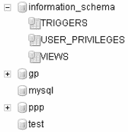

**图 2-21.** `Tree`小部件以层次方式显示数据

实例化`Tree`小部件与使用GWT创建任何其他小部件一样简单：

```
Tree treeList = new Tree();
mainPanel.add( treeList );
```

您可以通过几种方式将数据添加到`Tree`小部件。您可以直接将字符串值添加到树中：

```
treeList.addItem("first item");
treeList.addItem("second item");
treeList.addItem("third item");
```

或者您可以添加其他小部件：

```
treeList.addItem( new Image("icon_user.gif") );
treeList.addItem( new HTML("<b>hello</b>") );
treeList.addItem( new CheckBox("check me") );
```

然而，这些方法只将项目添加到树的根级别，这在某些情况下可能没问题。Tree小部件确实提供了一种使用TreeItems将小部件添加到不止根级别的方法。您还可以使用这些add方法添加新的TreeItem实例。TreeItem类代表树中的一个项目，其接口使用这些相同的add方法，支持创建多级树。要添加到树的第二级，您可以创建一个TreeItem实例，将其添加到Tree小部件，然后在该实例上调用add方法来添加新的子项目。新项目也可以是具有添加到层次结构中后续级别的子项目的TreeItems。例如，以下代码遍历数据库及其表的列表，以创建类似于图2-21中Tree小部件图像的树层次结构：

```
for( Iterator it = databases.iterator(); it.hasNext();){
    Database database = (Database)it.next();
    TreeItem databaseTreeItem = new TreeItem( database.getName() );
    treeList.addItem(databaseTreeItem);
    for( Iterator it2 = database.getTable().iterator(); it2.hasNext();){
        Table table = (Table)it2.next();
        databaseTreeItem.addItem( table.getName() );
    }
}
```

请注意，代码直接将databaseTreeItem添加到treeList的Tree小部件中，并将tableTreeItem添加到databaseTreeItem中，以便层次结构中第二级的项目显示在其所属的数据库下方。

还要注意，树控件的图像显示了几个图标，用于指导用户如何使用该小部件。应用程序选择了数据库和表图标，并将它们显示为Image小部件。在GWT 1.3及更早版本中，

`Tree` 小部件使用了加号和减号图标，但它们无法嵌入到 GWT 库中，因此应用程序开发人员必须确保这些图标与应用程序一起部署。

如果你使用的是 GWT 1.3，在使用 `Tree` 小部件时需要从 GWT 发行版中复制三张图片。

- tree_white.gif 显示代表树层级中缩进级别的空白。
- tree_open.gif 在其子项可见时显示为项目旁边的图标。
- tree_closed.gif 在其子项隐藏时显示为项目旁边的图标。

幸运的是，GWT 会将这些文件连同你的其他应用程序文件一起复制到编译目录。你可以为这三个图标使用任何图片，但必须使用这些名称，以便 `Tree` 小部件正确识别它们。

在 GWT 1.4 中，`Tree` 小部件使用了 `ImageBundle` 功能。此功能在编译期间将多张图片打包成单张图片，并让你自动将默认图片包含到部署中。你可以通过提供自己的 `TreeImages` 接口实现来覆盖默认图片。`TreeImages` 接口是一个图片包，它定义了三张图片：

```
public interface TreeImages extends ImageBundle {
  AbstractImagePrototype treeOpen();
  AbstractImagePrototype treeClosed();
  AbstractImagePrototype treeLeaf();
}
```

以下代码展示了如何通过使用自定义图片与 `Tree` 小部件来覆盖此接口：

```
interface CustomTreeImages extends TreeImages {

  /**
   * @gwt.resource down.gif
   */
  AbstractImagePrototype treeOpen();

  /**
   * @gwt.resource right.gif
   */
  AbstractImagePrototype treeClosed();
}
CustomTreeImages images = (TreeImages)GWT.create(CustomTreeImages.class);
Tree tree = new Tree(images);
```

这段代码指定了 down.gif 和 right.gif 图片。将这些图片放在与此源代码相同的目录中，或者在 @gwt.resource 注解中使用完整或相对路径。GWT 编译器会找到这些图片，并将它们打包成单张图片以供运行时使用的。有关 ImageBundle 的更多信息，请参阅第 5 章。

你可以通过使用 `Tree` 小部件的 CSS 名称来进一步自定义其外观。当用户选择树中的某个项目时，GWT 会将 CSS 名称 gwt-TreeItem-selected 添加到该项目。这使你可以通过 CSS 更改该项目的外观，以向用户表明它已被选中。例如，以下 CSS 将树中选中项目的背景设置为浅蓝色：

```
.gwt-TreeItem-selected{ background-color:#def; }
```

在前面描述的数据库树示例中，此 CSS 使选中项目看起来像图 2-22 中的样子。

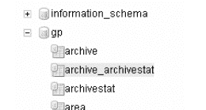

**图 2-22. 选中的项目被高亮显示**

如果你在应用程序中使用 `Tree` 小部件，该程序对每个项目的选择显示不同的视图，你需要从该小部件接收事件，以便知道选择何时发生变化。为此，`Tree` 小部件实现了 SourcesTreeEvents，允许你添加 GWT 的 TreeListener 实例来监听事件。TreeListener 接口如下所示：

```
public interface TreeListener extends EventListener {
  void onTreeItemSelected(TreeItem item);
  void onTreeItemStateChanged(TreeItem item);
}
```

当用户选择树中的某个项目时，GWT 会调用第一个方法 onTreeItemSelected。当用户打开项目的子项进行查看或关闭它们时，会调用第二个方法 onTreeItemStateChanged。要处理这些事件，你需要实现此接口及其方法，然后将实现它们的实例添加到 `Tree` 小部件中，如下所示：

```
treeList.addTreeListener(this);
```

在这种情况下，实现 TreeBar 接口的类调用 addTreeListener 方法来请求树事件。

#### MenuBar

MenuBar 小部件是 GWT 附带的另一个复杂自定义小部件，它由多个 HTML 元素和 JavaScript 事件处理程序构成。它基于你通常在应用程序顶部或桌面顶部看到的桌面应用程序菜单栏。与 `Tree` 小部件一样，MenuBar 显示分层数据列表，但它不是垂直列出数据，而是水平显示其数据。MenuBar 与 Tree 小部件的进一步区别在于，它一次只显示一个分支，并且只在该小部件保持鼠标焦点的持续时间内显示。此外，你通常使用 MenuBar 来保存应用程序命令的分层列表，而 Tree 小部件通常用于应用程序数据。

要构建一个合适的菜单，你需要将 MenuItem 类的实例添加到 MenuBar 小部件中。MenuItem 代表菜单上一个可点击的行。例如，Eclipse 菜单上的 File 一词就是一个菜单项。如果你打开 File 下拉菜单，垂直列出的每个项目也都是 MenuItems。这是两种不同类型的 MenuItems，它们在用户点击后的行为方式不同。第一种类型在被点击时会打开一个新菜单，第二种类型执行其他命令并使菜单关闭。要实现这两种菜单类型，你可以使用 Command 实例（当用户点击该项目时 Execute）或另一个 MenuItem 对象（当用户点击该项目时显示）来构造 MenuItem 类。

例如，让我们创建一个带有 New、Open、Save 和 Close 项目的 File 菜单，以及一个带有 About 项目的 Help 菜单。File 和 Help 菜单将是位于主 MenuBar 上的 MenuItems，点击时会打开另外两个 MenuBars 之一。File 和 Help 的其他 MenuBars 将包含执行命令的其余项目。在此示例中，我们将使用一个空的 Command，但你可以在该类的 execute 方法中放置任何代码，以自定义用户点击命令时发生的行为。以下代码构建了刚才描述的菜单：

```
Command cmd = new Command() {
    public void execute() {
        //code to handle the command goes here
    }
};

MenuBar filemenu = new MenuBar(true);
filemenu.addItem("New", cmd);
filemenu.addItem("Open", cmd);
filemenu.addItem("Save", cmd);
filemenu.addItem("Close", cmd);

MenuBar helpmenu = new MenuBar(true);
helpmenu.addItem("About", cmd);

MenuBar menu = new MenuBar();
menu.addItem("File", filemenu);
menu.addItem("Help", helpmenu);
```

这段代码创建了一个带有空 execute 方法的 Command 接口实例和三个 MenuBar 实例。File 和 Help 菜单在实例化时向 MenuBar 构造函数传递了布尔值 true。这告诉 MenuBar 类此实例将是垂直的。如果我们留空此参数或传递布尔值 false，则 MenuBar 将水平显示。水平菜单通常用于应用程序顶部。两个垂直菜单是下拉菜单，当用户点击主菜单上的某个项目时打开。代码使用 addItem 方法将项目添加到菜单栏。此方法将显示为项目的值作为第一个参数，将实现 Command 接口的对象或另一个菜单作为第二个参数。如果你使用 Command 对象，当用户点击菜单项时会调用 execute 方法。这段代码使用 Command 对象来实现用户点击 New、Open、Save、Close 和 About 菜单项时的事件。当另一个 MenuBar 用作 `addItem` 方法的第二个参数时（如将 File 和 Help 菜单添加到主菜单时），点击该项目会导致新的 `MenuBar` 显示。

如果你将此示例代码放在应用程序中，它会显示为一个相当朴素的菜单，不会给用户足够的提示表明它是一个可以点击的菜单。为了增强这一点，你需要使用 CSS 样式，既使菜单看起来更像菜单，又使其与你应用程序的风格融为一体。例如，以下 CSS 赋予菜单桌面应用程序的外观：

```
.gwt-MenuBar {
    background-color:#F3F5F6;
    border:outset 1px;
}
.gwt-MenuBar .gwt-MenuItem {
    font-size: 9pt;
    cursor:hand;
    cursor:pointer;
    padding:2px 5px 2px 5px;
    margin:0px;
}
.gwt-MenuBar .gwt-MenuItem-selected {
    background-color:#316AC5;
    color:white;
}
```

使用这些 CSS 样式运行示例代码会产生如图 2-23 所示的菜单。

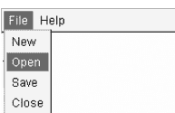

**图 2-23. CSS 样式赋予菜单更多桌面应用程序的外观**

你可以为 `MenuBar` 小部件设置另外三种 CSS 样式：`gwt-MenuBar` 用于水平或垂直的 `MenuBar` 小部件，`gwt-MenuItem` 用于 `MenuBar` 中的单个项目，`gwt-MenuItem-selected` 用于 `MenuBar` 中当前被选中的菜单项。


### 简单的布局面板

到目前为止，我们所介绍的部件都是用户界面树的叶子节点。也就是说，它们在更大的结构中被使用于底层，而这个更大的结构负责管理应用程序的布局。本节将介绍 GWT 自带的布局部件，也称为面板。

#### FlowPanel

FlowPanel 是 GWT 中较为基础的面板之一。如果你熟悉 HTML 布局的工作方式，那么你会很快理解这种布局，因为它模拟了 HTML 布局。它的布局方式类似于在文本编辑器中，文字到达页面边缘时会流动并换行。FlowPanel 的子部件水平显示，当水平空间不足时，会换行到下一行。

例如，第 6 章中的 Gadget Desktop 应用程序在顶部有一个菜单，显示可以添加到页面的 gadget 列表。该应用程序将列表中的每一项都作为链接添加到一个 FlowPanel 部件中。以下代码构建了该面板：

```
FlowPanel gadgetsMenu = new FlowPanel();
for(int i=0; i<gadgetClasses.size();++i){
  GadgetClass gadgetClass = (GadgetClass)gadgetClasses.get(i);
  Hyperlink gadgetLink = new Hyperlink(gadgetClass.getName(),null);
  gadgetsMenu.add(gadgetLink);
}
```

当可用 gadget 列表显示在应用程序中时，它是水平展开的，如图 2-24 所示。

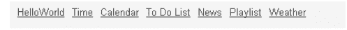

**图 2-24.** 菜单项水平显示

当用户缩小浏览器窗口，无法显示所有部件时，FlowPanel 会将部件换行到下一行，如图 2-25 所示。

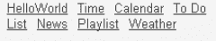

**图 2–25.** 菜单项换行到下一行

请注意，这个面板遵循 HTML 的行内元素和块级元素的布局样式。HTML 中的**行内元素**（inline elements）是指可以与其他元素显示在同一行的元素。例如，文本、超链接、图片和表单元素都是行内元素。然而，**块级元素**（block element）不会与其他部件共享水平空间。对于 `FlowPanel` 部件来说也是如此。所有用作行内部件的简单部件在 `FlowPanel` 中都会换行，但像其他面板这样更复杂的部件，由于是用 HTML 块级元素实现的，则不会共享水平空间，而是垂直排列，因此不会换行。

#### `HorizontalPanel` 和 `VerticalPanel`

`HorizontalPanel` 和 `VerticalPanel` 是两个更简单的面板，它们的行为与其名称所暗示的完全一致。`HorizontalPanel` 水平显示其子部件，`VerticalPanel` 垂直显示其子部件。当浏览器窗口太小而无法显示整个面板时，`HorizontalPanel` 的行为与 `FlowPanel` 不同。它不会将内容换行到下一行，而是继续水平显示其内容，超出视图范围，需要使用浏览器的滚动条来查看。同样，当 `VerticalPanel` 的内容超出视图范围时，也可以使用浏览器的滚动条将其带入视图。`VerticalPanel` 的内容也可以放在 `ScrollPanel` 部件中（本章后面会介绍），以将其可见区域限制为小于浏览器窗口的区域。

本书在示例应用程序中使用了这些面板，因为它们简单且行为非常可预测。第 7 章的多搜索应用程序使用 `HorizontalPanel` 来显示搜索文本框和搜索按钮（见图 2-26），并使用 `VerticalPanel` 来显示搜索结果（见图 2-27）。


**图 2–26.** 使用 `HorizontalPanel` 部件

Ajax for Java developers: Exploring the Google Web Toolkit
最近发布的 Google Web Toolkit (GWT) 是一套全面的 API 和工具，让你几乎可以完全用 Java 代码创建动态 Web 应用程序。……

GWT Designer from Instantiations
检查 Java 代码中允许的 GWT 类和方法。…… GWT Designer 于 2006 年 10 月 25 日星期三在网络研讨会上宣布。……

GWT Widget Library
……已在下载区发布了 GWT-SL 的新版本，更新日志如下。George 还创建了一个 GWT-SL Google 群组，如果你正在寻找帮助或……

gwt - SWiK
Google Web Toolkit (GWT) 是一个 Java 软件开发框架，它使…… 为此页面添加了标签：Google gwt Web Ajax Java eclipse toolkit ria……

Guys Without Ties
为时间、考勤、门禁控制和交易验证提供指纹生物识别设备。

Google Web Toolkit - Build AJAX apps in the Java language
Google Web Toolkit (GWT) 是一个 Java 软件开发框架，它让编写像 Google Maps 和 Gmail 这样的 AJAX 应用程序变得容易，为开发者负责了……

## **图 2–27.** 使用 `VerticalPanel` 部件

请注意，这里使用的 `VerticalPanel` 的子部件并不是简单部件。由于面板在 GWT 中也是部件，我们可以在其他面板中使用面板。在这种情况下，我们在另一个 `VerticalPanel` 内部使用了一个 `VerticalPanel`。

构建这些面板非常直接，只需对每个要添加的子部件调用 `add` 方法即可。

#### `HorizontalSplitPanel` 和 `VerticalSplitPanel`

在 Web 应用程序中，往往难以预测内容的大小。传统的网页得益于默认 HTML 布局的灵活性，它会自动将内容换行到下一行。当你开始处理更复杂的 Ajax 部件时，这种换行有时就不再可行了，你需要找到不同的解决方案。GWT 提供了两个分割面板，`HorizontalSplitPanel` 和 `VerticalSplitPanel`，帮助你调整界面，为内容创建自定义的适配效果。

**分割面板**（split panel）是一种可以包含两个子部件的面板，并在两者之间提供一个区域，可以用鼠标调整它们的相对大小。`HorizontalSplitPanel` 水平排列子部件，`VerticalSplitPanel` 垂直排列子部件。

第 10 章的数据库编辑器应用程序使用 `HorizontalSplitPanel` 来分隔树内容和工组区内容，如图 2-28 所示。很难预测树的水平大小，或者用户希望看到多少内容。在这个应用程序中，分割面板让用户能够自定义其界面。

使用分割面板非常直接。你可以使用 `setSplitPosition` 方法为 `VerticalSplitPanel` 设置相对于顶部部件的分割位置，或为 `HorizontalSplitPanel` 设置相对于左侧部件的分割位置。然后，要设置子部件，你可以使用 `HorizontalSplitPanel` 的 `setLeftWidget` 和 `setRightWidget` 方法，或使用 `VerticalSplitPanel` 的 `setTopWidget` 和 `setBottomWidget` 方法。以下代码展示了数据库编辑器应用程序如何使用 `HorizontalSplitPanel`：

```
HorizontalSplitPanel mainPanel = new HorizontalSplitPanel();
mainPanel.setSplitPosition("250px");
mainPanel.setLeftWidget(tree);
mainPanel.setRightWidget(workspace);
```

#### FlexTable 和 Grid

FlexTable 和 Grid 部件都基于 HTML 的 table 标签，在垂直和水平方向上将子部件显示为网格。Grid 部件是一个 HTML 表格，强制为每一行设置明确指定的行数和单元格数。FlexTable 正如其名称所示，更加灵活，允许按需添加单元格，每行可以有可变数量的单元格，并且单元格可以跨越多行或多列。

这两个实现共享许多功能，这些功能通过 HTMLTable 超类来实现。你可以使用 `setHTML`、`setText` 或 `setWidget` 方法为这两个部件的单元格添加内容。这些方法接受行号和列号来指定表格中的目标位置，以及要添加的内容。对于 Grid 部件，你只能对现有单元格调用这些方法，否则会抛出异常。

第 10 章的数据库编辑器应用程序使用了 FlexTable 部件，因为表格非常适合渲染数据库中的行。图 2-29 展示了在 GWT 的 FlexTable 部件中渲染的数据库表格示例：

| CHARACTER_SET_NAME | DEFAULT_COLLATE_NAME | DESCRIPTION | MAXLEN |
|---|---|---|---|
| big5 | big5_chinese_ci | Big5 Traditional Chinese | 2 |
| dec8 | dec8_swedish_ci | DEC West European | 1 |
| cp850 | cp850_general_ci | DOS West European | 1 |
| hp8 | hp8_english_ci | HP West European | 1 |
| koi8r | koi8r_general_ci | KOI8-R Relcom Russian | 1 |
| latin1 | latin1_swedish_ci | cp1252 West European | 1 |
| latin2 | latin2_general_ci | ISO 8859-2 Central European | 1 |

**图 2-29.** 使用 FlexTable 部件

该表格还进行了样式设置，使每列都有明显的标题。Grid 和 FlexTable 部件都允许你使用 CSS 对单个单元格、行或列进行样式设置。图 2-29 中的表格是基于应用程序的 Table 类实例（应用程序模型中代表数据库中一个表格的对象）和应用程序的 Page 类实例（另一个代表表格中一页行的模型对象）构建的：

```
FlexTable rows = new FlexTable();
rows.setStyleName("tableViewBrowse");

//add column headers
rows.getRowFormatter().setStyleName(0, "tableViewBrowseHeaders");
for(int i=0;i<table.getFieldCount(); ++i){
    Field field = table.getField(i);
    rows.setText(0, i, field.getName());
}

//add rows
for(int i=0;i<page.getRowCount(); ++i){
    String[] row = page.getRow(i);
```


 for( int j=0; j< row.length; ++j ){
    rows.setText( i+1, j, row[j] );
    rows.getRowFormatter().setStyleName( i+1, "tableViewBrowseRow" );
}
}
```

请注意，在此代码中，表头行的样式名称是通过从`FlexTable`获取行格式化器并传入行号和样式名称作为参数来设置的。这允许你使用CSS来指定表头的格式。应用程序再次对表格中的每一行数据使用行格式化器，使它们可以拥有自己的样式。使用以下CSS来获得图2-29所示的样式：

```
.tableViewBrowseHeaders{ font-size:8pt; color:#ccc; font-weight:bold }
.tableViewBrowseRow{ font-size:8pt;  border:1px solid #eee;}
.tableViewBrowse{ border-spacing:0px;border-collapse:collapse;}
.tableViewBrowse td{ padding:3px; border:1px solid #eee;padding-right:10px;}
.tableViewBrowseHeaders td{ border:0px;border-bottom: 1px solid #888;}
```

此CSS简单地使用了为表头和数据行设置的样式名称来指定它们的样式，这些样式指定了边框和字体样式。

表格的行格式化器还有许多其他方法，允许你按行自定义表格，包括对齐方式、宽度、高度、可见性等。GWT还有一个单元格格式化器，你可以通过`getCellFormatter`方法获取它，这允许你按单元格自定义表格。`FlexTable`部件还提供了一个`FlexCellFormatter`辅助对象，通过其`getFlexCellFormatter`方法获取，它可以让你设置单个单元格的行或列跨度。当你将其设置为大于1的值时，该单元格将跨越多个列或行。例如，图2-30显示了单元格A跨越两行，单元格B跨越三列。

表格可以进一步自定义，通过`TableListener`接口展现更复杂的用户界面行为。当你想要处理用户点击表格中的单元格时，可以在应用程序中实现此接口。例如，如果你使用表格部件来显示文件列表，并希望允许用户选择一个，你可能想要将选中的行设置为高亮显示，以向用户提供如图2-31所示的反馈。

图2–30. 单元格可以跨越多个行或列

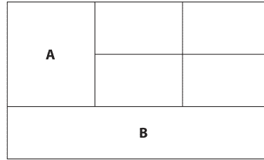

| 名称 | 大小 | 修改时间 |
|---|---|---|
| another.html | 1 kb | 10/10/06 14:24 EDT |
| test.html | 1 kb | 10/10/06 14:22 EDT |
| asfsdfasfsadf.html | 1 kb | 10/10/06 14:25 EDT |

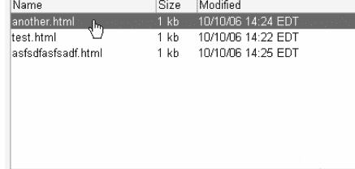

图2–31. 选中的行被高亮显示

你可以通过向Grid部件添加一个TableListener接口的实例来实现这一点，以便在点击时更改其样式信息：

```
filelist.addTableListener( new TableListener(){
    public void onCellClicked(SourcesTableEvents sender, int row, int cell){
        filelist.getRowFormatter().removeStyleName(selected, "selected");
        selected = row;
        filelist.getRowFormatter().addStyleName(selected, "selected");
    }
});
```

此代码简单地从先前选中的行移除选中样式，并将其添加到当前选中的行。在CSS中，我们可以将行的背景更改为蓝色高亮。

```
.selected {
    background-color:#316AC5;
    color:#FFFFFF;
}
```

#### DeckPanel

`DeckPanel`部件是一个布局面板，可以有多个子部件，但一次只能显示一个。该界面让你可以像翻阅书中的不同页面一样翻阅每个子部件。其最佳用例是`TabPanel`类，它使用`DeckPanel`来显示与所选选项卡对应的每个页面。你也可以单独使用该部件，如第9章的即时通讯应用程序中所示。该应用程序使用`DeckPanel`部件来显示"登录"视图和"联系人列表"视图。用户在应用程序首次加载时看到"登录"视图，当用户登录后，视图切换到联系人列表。图2-32显示了应用程序位于`DeckPanel`部件中的"登录"视图。

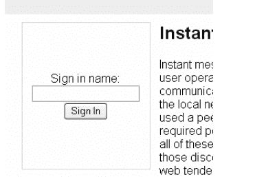

**图2–32.** `DeckPanel`部件中的登录界面

当用户登录时，`DeckPanel`切换到联系人列表视图，如图2-33所示。

如你所见，两个视图占据由其`DeckPanel`父部件提供的相同空间，但一次只显示一个。

构造此部件很容易。例如，即时通讯应用程序的`DeckPanel`部件看起来像这样：

```
DeckPanel mainPanel = new DeckPanel();
mainPanel.add( sign );
mainPanel.add( contactListView );
mainPanel.showWidget(0);
```

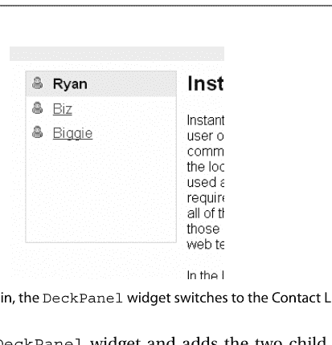

此代码创建一个DeckPanel部件并添加两个子部件。然后它调用DeckPanel的showWidget方法将可见子部件设置为第一个添加的部件。要切换到第二个子部件，你只需调用showWidget并传入第二个子部件的索引：

```
mainPanel.showWidget(1);
```

#### DockPanel

DockPanel部件实现了桌面应用程序中常见的布局：子面板停靠到面板的边缘，一个主子部件占据剩余空间。例如，GWT附带的邮件示例应用程序使用DockPanel部件来实现桌面电子邮件客户端的布局行为（见图2-34）。

在此示例应用程序中，DockPanel部件是外部布局部件，顶部欢迎面板、左侧快捷方式面板和右侧邮件列表面板作为其子部件。应用程序使用布局常量来定义它们的位置，将子部件添加到DockPanel部件中。顶部欢迎面板使用DockPanel.NORTH常量，左侧快捷方式面板使用DockPanel.WEST常量，右侧邮件列表面板使用DockPanel.CENTER常量。以下代码构建此布局：

```
DockPanel outer = new DockPanel();
outer.add(welcomePanel, DockPanel.NORTH);
outer.add(shortcuts, DockPanel.WEST);
outer.add(mailListPanel, DockPanel.CENTER);
outer.setWidth("100%");
```

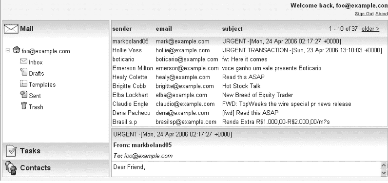

如你所见，顶部和左侧面板位于布局的边缘。右侧面板设置为居中，这意味着它将占据面板中的剩余空间。随着浏览器窗口的增长，子窗口也会增长以填充`DockPanel`部件中的新空间。使用`DockPanel.NORTH`或`DockPanel.SOUTH`常量添加的子部件水平增长和收缩，其高度保持不变。使用`DockPanel.EAST`或`DockPanel.WEST`常量添加的子部件垂直增长和收缩，其宽度保持不变。只能有一个使用`DockPanel.CENTER`常量添加的子部件，它在垂直和水平方向上增长和收缩以填充`DockPanel`中由边缘子部件留下的其余空间。

 resulting behavior is ideal for situations where the user focuses on the center child. The `DockPanel` widget ensures that the center child takes up the maximum amount of space and leaves just enough room for the edge children, which typically hold commands to operate on the center child widget.

#### HTMLPanel

`HTMLPanel`部件与`HTML`部件类似，它可以渲染一个`HTML`字符串，但它还支持将其他部件作为子标签附加到`HTML`中。当你有一些想要渲染的复杂`HTML`，它包围着另一个

GWT部件，并且没有使用GWT部件的直接实现时，可以考虑使用此部件。然而，最好使用GWT部件来渲染用户界面元素，以避免暴露任何安全问题或遇到浏览器不一致性。当你异步获取了一个HTML片段并想要渲染它并附加一个GWT部件时，也可以考虑使用此部件。

例如，以下代码创建了一些HTML，为子部件制作圆角背景：

```
HTMLPanel panel = new HTMLPanel(
  "<div style='background-image:url(top.gif)'></div>"+
  "<div id='inner' style='background-image:url(back.gif)'></div>"+
  "<div style='background-image:url(bottom.gif)'></div>");
panel.add(anotherWidget,"inner");
```

此代码渲染HTML，然后使用`HTMLPanel`的`add`方法指定元素的`id`来添加子部件。在这种情况下，ID `"inner"`充当了父元素。

### 复杂布局面板

到目前为止，我们看到的布局面板相对简单，它们只是有一种算法来在页面上排列其子部件。GWT还提供了另外两个面板，`StackPanel`和`TabPanel`，来协助你的应用程序布局。这些面板提供了前面面板的简单布局行为，但具有让你动态更改子部件布局的控件。

#### StackPanel

`StackPanel`部件使用类似于`VerticalPanel`的布局，它垂直渲染其子部件，但一次只显示一个，允许其他的通过点击其标题部分来打开。每个子部件都有一个标题部分，你可以在将子部件添加到面板时设置。图2-35显示了GWT附带的邮件示例应用程序如何使用`StackPanel`部件。

此示例应用程序通过添加三个子部件来构造`StackPanel`部件，这些子部件是`TreeList`部件，并提供

图 2–35。StackPanel 显示了所选标题区域的子标题文本。标题文本可以是纯文本或 HTML。图 2-35 中的示例使用 HTML 在文本左侧渲染了一个图像。

你可以使用 CSS 样式来设置 StackPanel 部件中标题的样式。可以使用 gwt-StackPanel 名称来为整个 StackPanel 部件设置样式，使用 gwt-StackPanelItem 来设置标题的样式，使用 gwt-StackPanelItem-selected 来设置当前选中标题的样式。GWT 示例邮件应用程序使用以下 CSS 来设置其 StackPanel 的样式：

```
.gwt-StackPanel .gwt-StackPanelItem {
    background-image: url(gray_gradient.gif);
    background-repeat: repeat-x;
    background-color: #EEEEEE;
    cursor: pointer;
    cursor: hand;
}
```

这段 CSS 将背景图像设置为你在图 2-35 中 StackPanel 标题区域看到的灰色渐变。它还将光标设置为手型光标，以提示用户该区域可点击。

#### TabPanel

TabPanel 部件与堆叠面板类似：它一次只显示一个子部件，并提供控件来选择要显示的子部件。它与其他面板的不同之处在于其实现方式——它不是面板类层次结构的一部分。相反，它是其他部件的复合体，顶部显示一个 TabBar，底部填充一个 DeckPanel 来实现面板行为。

TabBar 是另一个类似于 DeckPanel 部件的部件，可以在 TabPanel 部件之外的其他实现中使用。例如，TabPanel 部件将 TabBar 显示在 DeckPanel 上方，但你可能希望提供一种将 TabBar 显示在底部的实现。

TabBar 的行为只是显示一排可供用户选择的水平标签。它实现了 SourcesTabEvents，以便其客户端可以监听它的事件，包括标签被选中时的事件。它还为其标签提供了 CSS 样式名称以便进行样式设置。这些样式名称包括：gwt-TabBar 用于设置整个栏的样式，gwt-TabBarFirst 用于设置栏最左侧区域（任何标签之前）的样式，gwt-TabBarRest 用于设置所有标签之后栏右侧的样式，gwt-TabBarItem 用于设置未选中标签的样式，以及 gwt-TabBarItem-selected 用于设置选中标签的样式。这些样式名称允许非常灵活的样式设置。例如，图 2-36 展示了使用背景颜色来设置标签样式，使其外观类似于第 10 章 Gadget Desktop 应用程序中使用的外观。

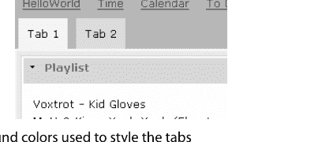

**图 2-36.** 用于设置标签样式的背景颜色

在图 2-36 中，选中的标签比其他标签颜色更浅。以下 CSS 赋予标签这种外观：

```
.gwt-TabBar .gwt-TabBarItem{
    padding:10px;
    margin-right:10px;
    cursor: hand;
    background-color:#ddd;
}
.gwt-TabBar .gwt-TabBarItem-selected{
    background-color:#f5f5f5;
}
```

你也可以使用图像来设置标签样式，使其看起来更像桌面应用程序。图 2–37 展示了这一点，作为对 Gadget Desktop 应用程序外观的更新。

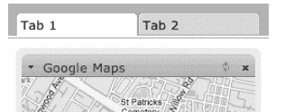

**图 2–37.** 设置样式后看起来更像桌面应用程序的标签

此示例使用 CSS 的 `background-image` 属性为 `TabBar` 部件的不同区域设置背景：

```
.gwt-TabBar{
    background-image:url(tab-rest.gif);
    background-repeat: repeat-x;
    background-pos:bottom;
    padding-top:3px;
    width:100%
}
.gwt-TabBar .gwt-TabBarFirst { width:10px; }
.gwt-TabBar .gwt-TabBarItem {
    background-image:url(tab.gif);
    background-repeat:no-repeat;
    width:126px;
    height:27px;
    font-size:8pt;
}
.gwt-TabBar .gwt-TabBarItem { padding:5px; }
.gwt-TabBar .gwt-TabBarItem-selected {
    background-image:url(tab-selected.gif);
}
```

尽管这两个示例都使用了 `TabBar` 样式名称，但它们并没有直接使用 `TabBar` 部件；而是使用了 `TabPanel` 部件。为 `TabPanel` 重复这些样式名称将是冗余的。

`TabPanel` 处理来自 `TabBar` 的标签选择事件以显示相应的页面。这为你省去了这项工作；你只需使用 `TabPanel` 的 `add` 方法为子部件设置标签名称即可。数据库编辑器应用程序的 `TabPanel` 构造如下：

```
TabPanel tabPanel = new TabPanel();
tabPanel.add( browsePanel,"Browse" );
tabPanel.add( structurePanel,"Structure" );
tabPanel.setWidth("100%");
tabPanel.selectTab(0);
```

将子部件添加到面板后，你调用 selectTab 方法告诉 TabPanel 将给定索引的部件带到前台显示。

### 简单容器面板

容器面板与布局面板的不同之处在于，它们不控制子部件的布局；相反，它们作为单个子部件的容器提供附加功能。简单容器面板包括 Composite、SimplePanel、ScrollPanel 和 FocusPanel。

#### Composite

Composite 部件的实用性更多体现在代码组织上，而不是应用程序用户会注意到的东西。当你想要构建一个可重用的单一组件并隐藏其实现细节不让应用程序的其他部分知道时，使用 Composite 部件。在应用程序中使用并添加到父面板时，它的表现就好像只有它的子部件在那里一样。

本书中的示例应用程序在模型-视图-控制器设计中使用 Composite 部件作为视图。这些视图继承 Composite 并公开接口供其他视图和控制器使用，同时隐藏部件实现。这种设计技术允许应用程序更改其部件结构，而无需修改应用程序的其他部分。

作为示例，让我们看看第 9 章即时通讯应用程序中的 SignInView。首先，SignInView 被声明为继承 Composite 类：

```
public class SignInView extends Composite
{
```

然后在类构造函数中，视图开始设置其布局，首先调用 `Composite` 部件的受保护方法 `initWidget`，传入视图的主要子部件：

```
private VerticalPanel mainPanel = new VerticalPanel();
public SignInView( )
{
    initWidget( mainPanel );
```

构造函数通常会继续构建子部件的布局。将 `VerticalPanel` 对使用此类的代码隐藏起来，使我们能够修改实现而不影响其他代码。

另一个 `Composite` 部件的例子是 GWT 的 `TabPanel` 部件，它公开了一个直观易用的接口，并使用 `Composite` 部件来隐藏内部实现。

#### SimplePanel

`SimplePanel` 部件与 `Composite` 部件非常相似，只是它在界面中有表示，可以拥有自己的 CSS 样式（如边框），并且它有一个公共方法 `setWidget` 来设置子部件。

`SimplePanel` 部件是一个抽象类，这意味着你不能直接实例化它，但你可以将其作为超类来构建新部件。GWT 在许多面板中使用它作为超类，包括本节中讨论的其他面板。

#### ScrollPanel

`ScrollPanel` 是一个继承 `SimplePanel` 的容器面板，当子部件变得太大而无法显示在面板指定区域时，它增加了滚动查看子部件的能力。第 9 章中的即时通讯应用程序在其聊天窗口中使用此面板作为聊天历史列表的容器，如图 2-38 所示。

在此示例中，你可以看到 `ScrollPanel` 的右侧，由可见的垂直滚动条指示。`ScrollPanel` 的子部件是一个 VerticalPanel，它包含即时消息作为其子部件。要使此示例中的垂直滚动条正常工作，需要将 ScrollPanel 的高度设置为固定值。当 VerticalPanel 增长超过此固定值时，滚动条将出现，让用户滚动将不可见的区域带入视图。以下代码构造了此示例中的 ScrollPanel：

```
ScrollPanel conversationScroller = new ScrollPanel();
conversationScroller.setHeight("150px");
conversationScroller.setWidget( conversationPanel );
```

该部件还包含一些方法，用于协助控制滚动位置、使子组件可见以及控制滚动条的可见性。你可以在第 10 章的 GWT 文档 http://code.google.com/webtoolkit/documentation/gwt.html 中找到有关每个方法的更多信息。

#### FocusPanel

FocusPanel 是一个 SimplePanel，它增加了处理来自其子部件的各种事件的能力。它支持点击、焦点、键盘和鼠标事件。你还可以设置此面板具有制表位索引，即当用户按下 Tab 键时焦点停留的位置，并且你可以显式设置其焦点。


复杂容器面板同样只能拥有单个子部件，但它们比简单容器面板提供更复杂的行为。复杂容器面板包括 `FormPanel`、`DisclosurePanel`、`PopupPanel` 和 `DialogBox`。

### FormPanel

`FormPanel` 封装了 HTML 的 `form` 标签，并提供将表单数据从 GWT 部件通过浏览器的表单提交功能发送到服务器的能力。通常，浏览器的表单提交功能在 Ajax 应用程序中并不使用，因为它会导致页面刷新。然而，GWT 中的 `FormPanel` 采用了一种技术，使得你可以在应用程序中拥有表单，并且提交时无需刷新页面。你的应用程序通过实现 `FormHandler` 接口，在表单提交以及收到服务器响应时接收通知。

前面"表单部件"部分概述的所有实现 `HasName` 接口的部件都可以在表单中使用。它们需要 `HasName` 接口，因为 HTML 的 `form` 标签要求每个提交值都有一个名称。提交时，该名称与其值一起传递给服务器，服务器使用这些名称-值对来执行请求。例如，以下代码创建一个 `FormPanel`，用于向 Web 服务器提交登录请求：

```
//create the form panel, set its action and method
final FormPanel form = new FormPanel();
form.setAction("/signin");
form.setMethod(FormPanel.METHOD_POST);

//set the main widget for the panel to a vertical panel
VerticalPanel panel = new VerticalPanel();
form.setWidget(panel);

//create the username field
TextBox tb = new TextBox();
tb.setName("username");
panel.add(tb);
```

```
//create the password field
PasswordTextBox ptb = new PasswordTextBox();
ptb.setName("password");
panel.add(ptb);

//create the Submit button
panel.add(new Button("Submit", new ClickListener() {
    public void onClick(Widget sender) {
        form.submit();
    }
}));

//add a form handler
form.addFormHandler(new FormHandler() {
    public void onSubmitComplete(FormSubmitCompleteEvent event) {
        Window.alert(event.getResults());
    }

    public void onSubmit(FormSubmitEvent event) {
        if (tb.getText().length() == 0 || ptb.getText().length() == 0 ) {
            Window.alert("The fields must not be empty.");
            event.setCancelled(true);
        }
    }
});
```

这段代码首先创建一个 FormPanel 实例并设置其 action 和 method。表单的 action 是服务器端脚本的 URL 目标地址，该脚本将处理表单提交。你需要调用 setMethod 来设置用于提交表单数据的 HTTP 方法，可以是 GET 或 POST。在此示例中，我们选择使用 POST 而非 GET。这两种方法用于表单提交的区别在于，GET 将表单数据提交到 URL 中，而 POST 将数据提交到 HTTP 请求的主体中。

创建 FormPanel 后，添加表单字段。由于 FormPanel 部件是一个简单面板，它只能有一个子部件。这允许你选择任何布局面板来管理字段的布局。在此示例中，我们使用 VerticalPanel 部件，使字段垂直排列。我们将用户名字段创建为 TextBox 部件，密码字段创建为 PasswordTextBox 部件，然后将它们添加到 VerticalPanel 中。接着创建"提交"按钮，并添加点击监听器，通过调用 FormPanel 的 submit 方法来提交表单。

最后，向面板添加一个 `FormHandler` 实例，用于监听表单事件。使用表单面板时可能发生两种事件。第一种是 `onSubmit`，它在表单提交到服务器之前发生。你可以使用此事件来验证表单上的字段数据，并在必要时取消提交。在此示例中，我们检查表单以确保字段不为空。如果任一字段为空，我们会提醒用户，并通过事件对象的 `setCancelled` 方法取消提交。另一种事件是 `onSubmitComplete`，它在服务器返回表单提交的响应时发生。

需要注意的是，浏览器存在安全限制，不允许读取提交到另一个域的表单结果。如果你确实将结果提交到另一个域，可能无法读取查询结果，也无法确定提交是否成功。

### DisclosurePanel

Web 应用程序通常设计为垂直滚动的界面。随着单页需要显示的数据量增加，垂直滚动变得越来越麻烦。作为垂直滚动的解决方案，GWT 提供了 `DisclosurePanel`。

`DisclosurePanel` 是一个容器面板，拥有一个内容部件，并且可以定义一个标题。当用户点击标题时，它会切换内容的可见性。这使得垂直滚动的部分数据可以被分类到各个部分，然后通过单击隐藏，从而为其他部分释放垂直空间。

第 7 章中的"多重搜索"应用程序使用 `DisclosurePanel` 提供了一种简单的方法来隐藏搜索引擎的搜索结果以查看其他结果，如图 2-39 所示。

图 2-39 显示了用作标题的搜索引擎名称，以及一个向下的箭头图像，表示 `DisclosurePanel` opened。当用户点击 `DisclosurePanel` 的标题时，内容被隐藏，并显示不同的图像。在这种情况下，箭头指向右侧而不是向下。以下代码创建了这种类型的折叠面板：

```
DisclosurePanel mainPanel = new DisclosurePanel(
    searchResultImages, engine.getName(), true );
mainPanel.setContent(results);
```

注意，构造函数的第一个参数是一个名为 searchResultImages 的字段。该字段是 ImageBundle 接口的一个实例，`DisclosurePanel` 用它来处理标题中的图像显示。需要为 `DisclosurePanel` 定义两个图像，通过实现 GWT 的 DisclosurePanelImages 接口：

```
public interface DisclosurePanelImages extends ImageBundle {
  AbstractImagePrototype disclosurePanelOpen();
  AbstractImagePrototype disclosurePanelClosed();
}
```

"多重搜索"应用程序使用以下代码来定义此接口并为 `DisclosurePanel` 提供图像：

```
static public interface SearchResultImages extends DisclosurePanelImages {
  /**
   * @gwt.resource minimize1.gif
   */
  AbstractImagePrototype disclosurePanelOpen();

  /**
   * @gwt.resource minimize2.gif
   */
  AbstractImagePrototype disclosurePanelClosed();

}
public static SearchResultImages searchResultImages = (SearchResultImages)
GWT.create( SearchResultImages.class );
```

注意，该接口扩展了 `DisclosurePanelImages` 接口，因此可以用于 `DisclosurePanel`。代码为两个方法提供了注解，指向应使用的图像。此代码使用 GWT 延迟绑定 `GWT.create` 方法创建该接口的实例。这可能看起来有些复杂，但在应用程序中使用图像包可以显著提高性能。此代码在 GWT 编译步骤期间将所有图像捆绑到单个图像中，并在应用程序加载到浏览器时作为单个包下载。有关图像包的更多信息，请参阅第 5 章。

### PopupPanel

`PopupPanel` 部件是一个显示在现有界面之上的 `SimplePanel`。具有类似行为的桌面部件包括工具提示（当鼠标悬停在部件上时出现）或列表框的下拉部分（当用户点击该部件时出现）。在 GWT 中，`PopupPanel` 在用户点击 `MenuItem` 后显示垂直菜单，而 `DialogPanel` 将其用作超类。第 8 章中的"博客编辑器"应用程序使用 `PopupPanel` 在用户点击条目的 `view` 链接后显示博客条目的托管版本，如图 2-40 所示。


 # 第2章 用户界面库概述

在此图中，`PopupPanel`将Frame设置为其部件，并将Frame的URL设置为博客条目的托管URL。图2-40显示了用户点击View按钮后的面板，它设置在View按钮正下方可见。在此示例中，当`PopupPanel`失去焦点时，它会消失。博客编辑器应用程序使用以下代码来构建此`PopupPanel`：

```
public class HostedBlogView extends PopupPanel {
    public HostedBlogView( String url, Widget sender ) {
        super(true);
        Frame frame = new Frame(url);
        frame.setWidth("100%");
        frame.setHeight("100%");
        setWidget(frame);
        setPopupPosition(
            sender.getAbsoluteLeft(),
            sender.getAbsoluteTop()+sender.getOffsetHeight()));
    }

}
```

该代码将`PopupPanel`扩展为其自己的类，以便在应用程序的不同部分中重复使用。在构造函数中，超类构造函数为autohide参数传递true。这启用了`PopupPanel`中使面板在失去焦点时自动隐藏的功能。然后创建Frame部件并将其设置为`PopupPanel`中的主部件。使用`PopupPanel`的`setPopupPosition`方法设置面板的弹出位置，使用构造函数参数中提供的小部件位置作为参数。此小部件在用户点击视图按钮时创建：

```
private class ViewClickListener implements ClickListener {
    public void onClick( Widget sender ) {
        new HostedBlogView(entry.getLink(),sender).show();
    }
}
```

在此点击监听器中，创建了一个新的`HostedBlogView`类实例（即`PopupPanel`），使用条目的链接和被点击的部件作为构造函数参数。然后调用`show`方法，显示`PopupPanel`。

### DialogBox

`DialogBox`部件扩展了`PopupPanel`，继承了其弹出行为，并在顶部添加了一个可拖动的标题栏。此部件仿照桌面应用程序中的模态对话框。模态对话框要求用户进行交互，然后才能与应用程序的其余部分进行进一步交互。

图2-41显示了`DialogBox`部件在Gpokr GWT应用程序中的示例（参见http://gpokr.com）。

在此示例中，对话框在用户点击右上角"Change Table"按钮后创建。用户无法与应用程序的任何部分交互，除非是小部件作为对话框的子元素。当用户完成对话框操作，选择表格并点击Go或Cancel之后，应用程序隐藏对话框，用户可以继续与应用程序交互。

用于创建和显示对话框的代码位于"Change Table"按钮的点击监听器中：

```
changetable.addClickListener(new ClickListener() {
    public void onClick(Widget sender){
        new ChangeTableDialog().show();
    }
});
```

`ChangeTableDialog`类使用`DialogBox`作为超类，因此继承了其`show`和`hide`方法。应用程序在调用`show`之前立即调用对话框构造函数。这是构建其布局并设置对话框标题的地方：

```
ChangeTableDialog() {
    setText( "Change Table" );
    VerticalPanel vpanel = new VerticalPanel();
    setWidget( vpanel );
```

[^1] 1. 这是我编写的一个GWT应用程序，用于在2006年5月工具包发布后不久对其进行测试。此处的对话框使用`TabPanel`实现Ring和Sit n Go标签。列表是`ScrollPanel`内的`Grid`小部件。

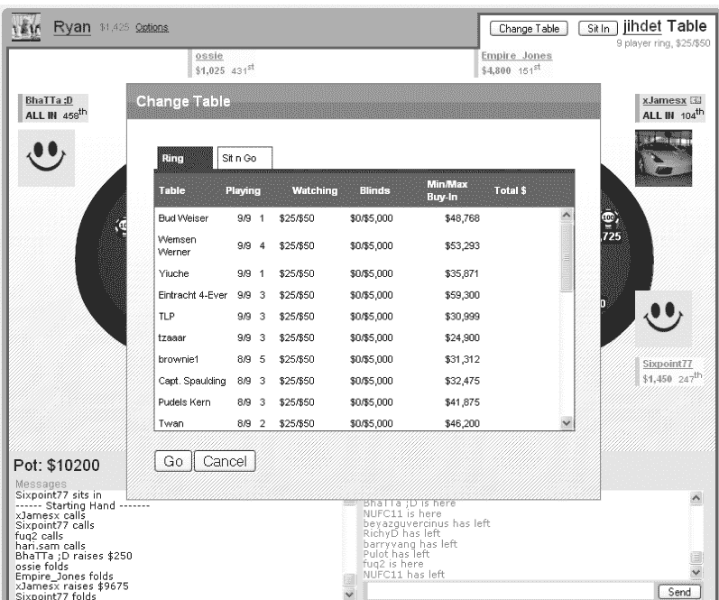

图2-41. DialogBox部件创建模态对话框

构造函数继续设置对话框的布局，首先使用VerticalPanel部件作为根。该类处理Go和Cancel按钮的点击事件以执行表格更改并隐藏对话框：

```
Button gobutton = new Button( "Go" );
gobutton.addMouseListener( new ClickListener(){
    public void onClick(Widget sender){
        hide();
        loadTable( selectedTable );
    }});

Button cancel = new Button( "Cancel" );
cancel.addMouseListener( new ClickListener(){
```

```
public void onClick(Widget sender) {hide();}
});
```

`DialogBox`部件有两个预设样式名称：`gwt-DialogBox`用于对话框框架，`Caption`用于对话框上的标题栏。上述示例使用这两个样式为对话框和标题提供背景图像并设置标题字体大小。以下代码展示了所使用的CSS样式：

```
.gwt-DialogBox {
    border: 1px solid #748299;
    background-color: white;
    background-image: url(back.jpg);
    background-repeat:repeat-x;
    background-position:bottom;
}
.gwt-DialogBox .Caption {
    background-color: #C3D9FF;
    background-image: url(titlebar.gif);
    background-repeat:repeat-x;
    padding: 10px;
    font-weight: bold;
    color: white;
    cursor: default;
}
```

## 用户界面框架粘合剂

GWT中的小部件遵循通用设计并共享接口，以便易于理解、开发和扩展。本节介绍将小部件绑定在一起的粘合剂。它分为两类：事件接口和功能接口。

### 事件接口

处理事件是任何用户界面代码的核心部分。一方面，应用程序的控制器将数据填充到界面中；另一方面，用户正在与用户界面小部件进行交互。正是在这第二方面，事件模型派上用场。选择用于通过GWT小部件实现用户界面事件的模型遵循**观察者模式**。

**观察者模式**是一种设计模式，其中观察者——您的应用程序代码——观察主体即用户界面的状态。当主体的状态发生变化时，观察者会收到通知。使用此模式可以让您将应用程序代码与主体解耦。换句话说，主体不需要知道应用程序的细节就可以调用其方法。该模式通常通过主体持有一组观察者集合来实现，当状态变化发生时，遍历该集合并对每个观察者调用`notify`方法。`notify`方法通常是主体提供的接口上的方法，由观察者实现。图2-42中的UML图说明了这种关系。

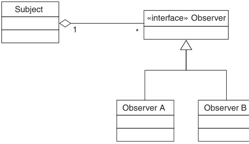

### 图2-42. 主体-观察者关系的UML图

在GWT中，主体可能是`Button`小部件这样的小部件，按钮点击事件的观察者接口是`ClickListener`接口，观察者实现由您的应用程序代码提供。例如，以下代码构建了上述按钮和`ClickListener`：

```
//create a button
Button subject = new Button("click me");

//implement a ClickListener
ClickListener observer = new ClickListener(){
    public void onClick( Widget sender ){
        Window.alert( "I've been clicked" );
    }
});

//add the ClickListener to the button to receive click events
subject.addClickListener( observer );
```

某些观察者接口具有多个事件方法，这意味着您需要为每个方法提供一个实现，即使只是一个空实现，以遵循实现Java接口的规则。某些观察者接口很大，这使您不得不繁琐地实现许多空方法仅仅为了处理一个事件。对于这些情况，GWT提供了一个适配器类，让您只实现观察者接口上的部分方法。GWT的`KeyboardListenerAdapter`就是`KeyboardListener`接口的适配器类示例，该接口有三个方法。由于适配器是一个将每个方法实现为空的类，您只需覆盖要处理的事件对应的方法。以下代码展示了GWT中`KeyboardListenerAdapter`的实现：

```
public class KeyboardListenerAdapter implements KeyboardListener {

    public void onKeyDown(Widget sender, char keyCode, int modifiers){}

    public void onKeyPress(Widget sender, char keyCode, int modifiers){}

    public void onKeyUp(Widget sender, char keyCode, int modifiers){}
}
```

第7章中的Multi-Search应用程序使用`KeyboardListenerAdapter`处理`TextBox`小部件的`onKeyPress`事件。以下代码展示了该应用程序中`KeyboardListenerAdapter`的使用：

```
searchBox.addKeyboardListener( new KeyboardListenerAdapter(){
    public void onKeyPress( Widget sender, char keyCode, int modifiers){
        if(keyCode == KEY_ENTER )
            onSearch();
    }
});
```

注意，只需实现`KeyboardListener`接口中的一个方法。这些适配器类让您在处理事件时免于编写大量不需要的代码。

在观察者模式的主体方面，GWT使用一致的设计来实现事件，包括主体接口和主体助手集合。如果您要开发新的小部件并实现

事件时，你需要了解它们在 GWT 中的实现方式。每个主题接口代表该主题支持的一种事件分组类型。例如，主题通过实现 `SourcesClickEvents` 接口来支持点击事件。由于许多小部件都有点击事件，因此该接口可以在它们之间共享。该接口仅包含允许应用程序代码添加和移除监听器的方法：

```java
public interface SourcesClickEvents {
  void addClickListener(ClickListener listener);
  void removeClickListener(ClickListener listener);
}
```

当小部件实现这些接口之一时，它们通常使用集合辅助类将事件转发给监听器。对于点击事件，GWT 有 `ClickListenerCollection`。这些辅助集合只是跟踪所有监听器，并为每个事件提供触发方法。对于点击事件，`ClickListenerCollection` 具有 `fireClick` 方法：

```java
public class ClickListenerCollection extends Vector {
  public void fireClick(Widget sender) {
    for (Iterator it = iterator(); it.hasNext();) {
      ClickListener listener = (ClickListener) it.next();
      listener.onClick(sender);
    }
  }
}
```

该方法的实现方式是遍历监听器集合，并为每个监听器调用 `onClick` 方法。

这种设计的目的是促进代码重用。集合辅助类可以为支持点击监听器的每个小部件重复使用。在小组件之间共享主题接口的另一个好处是，它允许编写以通用方式操作支持特定类型事件的小部件的代码。

这些使用观察者模式实现事件的模式在 GWT 中一致地重复出现。表 2-2 概述了可用的事件类型及其接口。

## 表 2–2 GWT 事件类型及其接口

| 事件 | 观察者类 | 主题类 | 支持的小部件 |
|---|---|---|---|
| onChange | ChangeListener | ChangeListenerCollection SourcesChangeEvents | ListBox PasswordTextBox TextArea TextBox |
| onClick | ClickListener | ClickListenerCollection SourcesClickEvents | Button CheckBox FocusPanel HTML Hyperlink Image Label ListBox PasswordTextBox RadioButton TextArea TextBox |
| onFocus onLostFocus | FocusListener FocusListenerAdapter | FocusListenerCollection SourcesFocusEvents | Button CheckBox FocusPanel ListBox PasswordTextBox RadioButton TextArea TextBox Tree |
| `onKeyDown`<br>`onKeyPress`<br>`onKeyUp` | `KeyboardListener`<br>`KeyboardListenerAdapter` | `KeyboardListenerCollection`<br>`SourcesKeyboardEvents` | FocusPanel<br>PasswordTextBox<br>TextArea<br>TextBox<br>Tree |
| `onError`<br>`onLoad` | `LoadListener` | `LoadEventsCollection`<br>`SourcesLoadEvents` | Image |
| `onMouseDown`<br>`onMouseEnter`<br>`onMouseLeave`<br>`onMouseMove`<br>`onMouseUp` | `MouseListener`<br>`MouseListenerAdapter` | `MouseListenerCollection`<br>`SourcesMouseEvents` | FocusPanel<br>HTML<br>Image<br>Label |
| `onMouseWheel` | `MouseWheelListener` | `SourcesMouseWheelEvents` | FocusPanel<br>HTML<br>Image<br>Label |
| `onPopupClosed` | `PopupListener` | `PopupListenerCollection`<br>`SourcesPopupEvents` | DialogBox<br>PopupPanel |
| `onScroll` | `ScrollListener` | `ScrollListenerCollection`<br>`SourcesScrollEvents` | ScrollPanel |
| `onCellClicked` | `TableListener` | `SourcesTableEvents`<br>`TableListenerCollection` | FlexTable<br>Grid |
| `onBeforeTabSelected`<br>`onTabSelected` | `TabListener` | `SourcesTabEvents`<br>`TabListenerCollection` | TabBar<br>TabPanel |
| `onTreeItemSelected`<br>`onTreeItemStateChanged` | `TreeListener` | `SourcesTreeEvents`<br>`TreeListenerCollection` | Tree |

### 特性接口

GWT 中小部件的设计遵循基于接口的设计实践，因此编写面向接口的代码优于使用类。这有助于将应用程序与库实现解耦。例如，第 6 章中的 Gadget Desktop 应用程序就利用了这种开发方式，它有一个 `DockableWidget`，支持拖放到任何支持 `HasWidgets` 接口的面板。这使得 `DockableWidget` 的代码相当通用，可以与许多面板配合使用。另一种选择是使用单独的面板接口，这意味着为每种面板类型编写自定义代码。

以下是 `DockableWidget` 中使用 `HasWidgets` 接口的代码片段：

```java
if( containerWidget instanceof HasWidgets &&
    absCenterX >= containerWidget.getAbsoluteLeft() &&
    absCenterX <= containerWidget.getAbsoluteLeft() +
    containerWidget.getOffsetWidth() &&
    absCenterY >= containerWidget.getAbsoluteTop() &&
    absCenterY <= containerWidget.getAbsoluteTop() +
    containerWidget.getOffsetHeight() ){
    if( containerWidget != parentWidget ){
        ((HasWidgets)containerWidget).add( this );
    }
    for( Iterator it = ((HasWidgets)containerWidget).iterator();
        it.hasNext() && switchWith == null;){
```

如你所见，这段代码操作的是 `HasWidgets` 接口。首先它检查容器是否是 `HasWidgets` 接口的实例，并使用 `instanceof` 运算符避免强制转换异常。然后它将 `containerWidget` 强制转换为该接口并调用其方法。`containerWidget` 的实际实现可以是任何支持 `HasWidgets` 的小部件，包括 GWT 中的所有面板。

你可以在 GWT 的 `FormPanel` 实现中看到另一个使用基于接口设计的例子。代码的编写方式是，每个添加到表单面板的小部件，如果其数据将包含在表单提交中，则实现 `HasName` 接口。

表 2-3 概述了 GWT 自带的特性接口，不包括上一节中概述的事件接口。

## 表 2-3 GWT 特性接口（不包括事件接口）

| 特性 | 方法 | 支持的小部件 |
|---------|---------|-------------------|
| HasAlignment | getHorizontalAlignment<br>getVerticalAlignment<br>setHorizontalAlignment<br>setVerticalAlignment | DockPanel<br>HorizontalPanel<br>HTML<br>Label<br>VerticalPanel |
| HasCaption | getCaption<br>setCaption | |
| HasFocus | getTabIndex<br>setAccessKey<br>setFocus<br>setTabIndex | Button<br>CheckBox<br>FocusPanel<br>ListBox<br>PasswordTextBox<br>RadioButton<br>TextArea<br>TextBox<br>Tree |
| HasHorizontalAlignment | getHorizontalAlignment<br>setHorizontalAlignment | HTML<br>Label |
| HasName | getName<br>setName | CheckBox<br>FileUpload<br>Hidden<br>ListBox<br>PasswordTextBox<br>RadioButton<br>TextArea<br>TextBox |
| HasText | getText<br>setText | HTML<br>Label<br>PasswordTextBox<br>TextArea<br>TextBox |
| HasVerticalAlignment | getVerticalAlignment<br>setVerticalAlignment | |
| HasWidgets | add, clear, iterator, remove | All Panels, Tree |
| HasWordWrap | getWordWrap, setWordWrap | HTML, Label |
| IndexedPanel | getWidget, getWidgetCount, getWidgetIndex, remove | DeckPanel, FlowPanel, HorizontalPanel, StackPanel, TabPanel, VerticalPanel |

### 小结

GWT 在其 `com.google.gwt.user.client.ui` 包中提供了一个相当大的用户界面库。这些小部件和面板提供了独立于浏览器的基础，用于构建 Ajax 应用程序用户界面，扩展了纯 HTML 目前所提供的功能。遵循许多 Java 用户界面开发人员熟悉的设计，它提供了丰富的事件系统和稳固的结构模型。

本章将小部件分为四大类。对于小部件，这些类别包括：静态小部件——标签、图像、HTML 和超链接——它们提供界面中最基本但必需的元素；表单小部件，让用户能够选择并向应用程序输入信息；以及复杂小部件，提供更高级的导航和界面组织功能。就面板而言，有简单和复杂的布局面板，帮助你为应用程序界面创建坚实的结构；还有简单和复杂的容器面板，为应用程序界面的各个部分提供额外的功能。

使用 GWT 构建 Ajax 应用程序时，熟悉工具包中可用的小部件是很有好处的，这样你就能创建最高效的 Ajax 界面。


 ## 3 服务器集成技术

Ajax应用是桌面应用和传统Web应用的完美结合。它们拥有像桌面应用一样响应灵敏的界面，以及像传统Web应用一样便于分发的特性。它们也像传统Web应用一样，在与服务器端技术集成方面有着强大的支持。本章将探讨可用于将GWT应用与服务器技术集成的多种选项和技术。我们首先介绍基本的集成技术，包括使用标准Ajax异步HTTP请求从服务器加载简单的文本或HTML。然后讨论从服务器加载更复杂的数据，以及利用Google Web Toolkit的XML和JSON库。在了解数据格式之后，我们将探讨如何通过JavaScript API、JSONP和HTTP代理与第三方服务器集成。本章最后将介绍更高级的服务器集成技术，包括使用REST和GWT-RPC。

本章为你提供这些技术的概述。有关这些技术的更多信息，请参阅第二部分中的示例应用章节，这些章节将更详细地介绍这些技术。

## 基本服务器集成技术

传统Web应用采用瘦客户端模式运行，服务器承担大部分工作。客户端通常仅由一些HTML代码组成，用于标记数据以便在浏览器中显示。当这些文档赋予用户请求特定URL或通过表单提交数据的能力时，它们就成为与服务器端应用交互的界面的一部分。最基本的Web应用是一个数据浏览器，用户可以点击浏览来自服务器的数据。更复杂的应用允许用户通过提交数据与数据模型交互。最终，你会将整个应用开发在服务器上，而客户端只是利用浏览器的功能来显示应用的界面。

在传统Web应用中，让客户端与服务器交互的浏览器功能是其通过HTTP请求数据的能力以及通过表单提交数据的能力。本节将介绍通过基本服务器集成技术将GWT应用与传统的服务器端Web应用进行集成。

### 异步HTTP请求

Ajax应用的核心能力是能够异步向服务器发起调用以获取数据，并避免页面刷新。实现这一目标的一种方式是，在用JavaScript创建Ajax应用时，针对不同的浏览器使用不同的JavaScript对象。而使用GWT时，你只需使用HTTP库中的类，GWT会处理浏览器的细节问题。

在第1章中，你通过Hangman教程简要了解了异步HTTP请求的例子，该应用在启动时从服务器下载一个简单的文本文件。这个例子使用了简化的`HTTPRequest`类来下载数据。然而，最好使用HTTP库，因为它对处理错误情况有更多支持。

HTTP库位于gwt-user.jar文件中的`com.google.gwt.http.client`包内。要在代码中使用此包，你需要使用`inherits` XML元素将其添加到你的GWT模块文件中，如下所示：

```
<inherits name="com.google.gwt.http.HTTP"/>
```

使用此库让应用向服务器发起调用相对简单，并遵循第2章中描述的观察者模式。你首先使用`RequestBuilder`实例来设置请求的详细信息，例如URL和头部参数。然后通过`sendRequest`方法发送请求，提供post数据（如果需要）以及`RequestCallback`接口的实例作为参数。当请求完成时，如果服务器调用失败，`RequestCallback`实例的`onError`方法会被调用；如果调用成功，则其`onResponseReceived`方法会被调用。当HTTP库调用`onResponseReceived`方法时，它会提供一个Response对象供应用处理。响应包含从服务器发送的数据体以及状态文本、状态码和HTTP头部列表。

你向服务器提交或从服务器接收的数据类型可以是任何格式，但由于GWT提供了用于构建和解析JSON及XML的库，请优先考虑这些格式。你也可以与之前接受表单提交的较旧的服务器脚本集成。在这种情况下，你需要按照标准表单编码来构建你的post数据（有关此方法示例，请参阅下一节）。

第10章中的数据库编辑器应用使用HTTP库向服务器发送和接收XML。以下代码取自该应用，演示如何使用HTTP库向服务器提交数据和读取数据：

```
//create a new GET request for the database table XML feed
RequestBuilder builder = new RequestBuilder(
  RequestBuilder.GET, "/databaseEditor/feed/"+database.getName());

try{
  //send the request
  builder.sendRequest( null, new RequestCallback(){
    public void onError(Request request, Throwable exception){
      //log the error
      GWT.log( "error", exception );
    }

    public void onResponseReceived(Request request, Response response){
      //check the status code
      int statusCode = response.getStatusCode();
      if( statusCode == 200 || statusCode == 201 ){
        //make the call to parse the response
        parseTableXML( response.getText() );
      }
    }
  });
}
catch (RequestException e){ GWT.log( "error", e); }
```

在这段代码中，HTTP请求没有提交任何数据，这由`sendRequest`方法调用中的第一个null参数表示，但期望以XML数据的形式接收响应。应用在`RequestCallback`方法的`onResponseReceived`实现中，通过对`Response`实例调用`getText`方法来接收响应。（下一节将讨论如何读取和写入JSON和XML等结构化格式。）

如你所见，使用HTTP包进行服务器调用相当简单。向第三方服务器发起调用可能很有吸引力，因为有许多免费的Web服务可用，但浏览器施加了一项相当严格的安全限制，称为**同源策略**（Same Origin policy），以防止这种情况。该策略基本上规定，你不能向HTML文档来源之外的服务器发起调用。当然，也有从其他服务器获取数据并绕过此限制的方法。第7章中的多搜索应用展示了使用`script`标签的一种方法，第8章中的博客编辑器应用则展示了使用服务器端代理的另一种方法。下一节将介绍这两种技术。

在GWT中使用HTTP的另一个限制是，你只能使用两种HTTP请求：GET和POST。此限制是由于Safari浏览器中的一个bug，它不允许任何其他HTTP请求方法。如果你不想提供对Safari的支持，你可以扩展`HTTPRequest`类以允许其他HTTP方法。博客编辑器应用通过在`X-HTTP-Method-Override`头部中传递这些方法来使用DELETE和PUT方法。数据库编辑器应用需要DELETE和PUT方法与基于REST的Ruby on Rails服务器交互。相反，该应用使用POST方法，并将Rails的`_method`参数设置为所需的HTTP方法。

异步HTTP的第三个限制是每个域两个连接的限制。此限制由HTTP协议规定，旨在防止用连接淹没服务器。这意味着你在任何时候只能有两个待处理的异步请求。第三个请求必须等待前两个中的一个完成。这个两个连接的限制不仅适用于应用中来自同一域的异步HTTP请求，也适用于从服务器加载的任何资源，包括脚本文件和图像。例如，如果两个大图像文件正在下载，占用了两个连接，而你又尝试异步加载XML数据，你可能会遇到性能问题。你可以通过将大文件放在子域中来解决它们占用连接的问题。例如，如果你使用images.yourdomain.com，你自动又多出两个可用连接。但要注意不要将异步请求移动到应用加载来源之外的域，否则你将遇到同源策略限制。

### 处理纯文本和HTML

首先，让我们看看如何将Ajax应用与生成现有HTML的服务器接口集成。Ajax应用可以随时使用浏览器的异步HTTP功能通过HTTP从服务器获取数据。通常你使用这个功能来请求XML，但任何格式都是可能的。对于现有的传统Web应用，你可能已经在服务器上准备好了可以异步加载并在Ajax应用中显示的HTML片段。例如，让我们看看如何从服务器加载一个现有的HTML页面，作为第9章即时通讯应用的补充，将其显示为工具提示。

首先，我们需要创建一个将存储在服务器上的测试HTML片段，名为ryan.html：

```
<b>Ryan</b><br/>
Software Developer<br/><a href="http://www.rdews.com">http://www.rdews.com</a>
```

这段基本HTML将显示我的**粗体**姓名、我的职业，然后是我的网站链接。我们可以为每个人存储一个这样的文件，并在需要时异步获取该人的文件。我们只需在即时通讯应用中用户点击联系人图标时创建一个HTML工具提示，如图3-1所示。

在这个例子中，即时通讯应用是一个Ajax应用，它从服务器异步加载现有的HTML数据并显示


第3章 服务器集成技术

并在应用程序中动态加载它。以下代码执行此任务：

```java
icon.addListener(new ClickListener(){
    public void onClick( Widget sender ){
        try{
            RequestBuilder requestBuilder = new RequestBuilder(
                RequestBuilder.GET,
                GWT.getModuleBaseURL()+"/"+contact.getName()+".html" );
            requestBuilder.sendRequest( null, new RequestCallback(){
                public void onError(Request request, Throwable exception){
                    /*ignored*/
                }
                public void onResponseReceived(
                    Request request, Response response){
                    if( response.getStatusCode() == 200 ){
                        PopupPanel popup = new PopupPanel(true);
                        popup.setStyleName("popup");
                        popup.setWidget( new HTML(response.getText()));
                        popup.setPopupPosition( icon.getAbsoluteLeft(),
                            icon.getAbsoluteTop() + icon.getOffsetHeight());
                        popup.show();
                    }
                }
            });
        }catch( Exception e){ /*ignored*/ }
    }
});
```

这段代码为图标添加了一个点击监听器，该监听器实现`onClick`事件，使用GWT的HTTP库向服务器异步请求一个以图标联系人姓名命名的HTML文档。如果请求成功，当存在该联系人的HTML文档时，代码会创建一个`PopupPanel`小部件来保存所请求文档的HTML内容，并将其显示在图标下方。

这种从服务器加载现有HTML文档的技术，是与服务器集成的一种基本方法，可以帮助客户端Ajax应用程序利用现有服务器应用程序的资源。

## 与传统服务器端脚本技术集成

大多数现有的Web应用程序不仅仅是HTML文档或片段的集合。它们通常运行在脚本引擎上，根据用户输入或数据库中的数据在服务器端动态生成HTML。当从脚本请求数据时，用户或客户端开发者通常不知道正在使用脚本。例如，上一节中的HTML片段可能是由一个脚本生成的，该脚本首先从数据库检索数据，然后生成要返回给用户的HTML。其他时候，应用程序需要通过脚本接受用户的数据。该脚本会通过表单提交接收用户提交的数据并处理这些数据，通常验证数据后将其插入数据库。

这意味着从客户端应用程序的角度来看，服务器端脚本有三种可能的行为。

- 脚本从客户端接受参数并生成响应。
- 脚本从客户端接受请求，然后从数据库获取数据并生成响应。
- 脚本从客户端接受数据提交，并处理数据或将其插入数据库。

GWT提供了允许Ajax应用程序与这三种类型的脚本行为进行交互的工具。让我们看看前两种行为，即脚本从客户端参数或从数据库生成响应，因为它们通常一起使用。我们将修改上一节中的即时通讯弹出窗口示例，在该示例中用户点击联系人图标以显示HTML信息页面。在这种情况下，不是请求存储在服务器上的不同HTML文档，而是请求来自单个PHP脚本的文档，并提供联系人姓名作为参数。如果您熟悉构建服务器端脚本，那么您应该熟悉GET和POST参数。这些参数可以使用GET或POST通过HTTP请求发送，是由`&`（和号） yardımcı 符分隔的键值对。GET请求在URL中`?`（问号）符号之后发送参数。POST请求在HTTP头之后作为请求体发送参数。大多数服务器端脚本，包括PHP，都支持自动解析这些参数并将它们放入数据结构中，使每个值都易于访问。

我们的PHP脚本将被称为getContact.php，并将接受一个name参数。它将构建与前面显示的ryan.html文件类似的联系人HTML，只是它将支持为许多联系人生成HTML的能力。要请求联系人的HTML，您可以像这样使用name属性向脚本发出请求：

```
getContact.php?name=ryan
```

接受参数并生成HTML的PHP脚本如下所示：

```php
<?php
$contacts['ryan'] = array(
    'name' => 'Ryan',
    'job' => 'Software Developer',
    'website' => 'http://www.rdews.com');
$contacts['biz'] = array(
    'name' => 'Biz',
    'job' => 'Cat',
    'website' => 'http://www.cat.com');

$contact = $contacts[$_GET['name']];
?>

<b><?=$contact['name']?></b><br/>
<?=$contact['job']?><br/>
<a href="<?=$contact['website']?>"><?=$contact['website']?></a>
```

这个PHP首先生成一个关联数组，其中包含两个不同联系人的信息。通常这种类型的数据会从数据库加载。代码使用GET参数选择所请求的联系人，并在contacts数组中查找该名称。然后脚本将所选联系人的值插入到HTML输出中。您不需要了解PHP就能理解这一点。这个示例只是演示如何使用GWT与现有的表单处理服务器端脚本进行集成。此示例与接受GET参数的服务器端脚本集成。

在客户端，我们只需将请求URL更改为指向PHP脚本，如下所示：

```java
RequestBuilder requestBuilder = new RequestBuilder(
    RequestBuilder.GET,
    GWT.getModuleBaseURL()+"/getContact.php?name="+
    URL.encodeComponent( contact.getName() ) );
```

请注意，此代码使用GET请求的参数提交格式，将参数放在URL中`?`字符之后的末尾。代码添加带有其名称的参数，如果有多个参数，我们将使用`&`字符分隔它们。使用GWT的`URL.encodeComponent`方法很重要，该方法对可能妨碍解释URL及其参数的任何字符进行编码。例如，如果名称中包含`&`符号，这将导致PHP参数解析器将其解释为下一组变量的开始。相反，服务器正确解释编码后的参数。GWT还提供了`URL.encode`方法，用于URL中不属于参数部分的其他部分。

您可以以类似的方式向通常会处理表单提交的脚本提交数据。通常HTML表单标签有几个重要的参数，名为`action`和`method`，用于与服务器通信。`action`属性指定表单将提交其值的脚本URL。`method`属性指定使用哪种HTTP方法，GET或POST。表单使用与前面提到的相同的参数编码类型。让我们看一个通过POST请求向通常接收表单提交的脚本提交数据的示例。

我们首先查看可用于向注册脚本提交数据的表单HTML：

```html
<form name="input" action="register.php" method="post">
    Username: <input type="text" name="user"><br/>
    Email: <input type="text" name="email"><br/>
    Password: <input type="password" name="password"><br/>
    <input type="submit" value="Submit">
</form>
```

该表单以`register.php`作为其action，以`post`作为其method，并接受三个参数。这意味着当表单提交时，将向register.php发出HTTP POST请求，并将表单输入值作为参数。浏览器实际提交的数据如下所示：

```
POST /register.php HTTP/1.1
Content-Type: application/x-www-form-urlencoded

username=ryan&email=ryan%40rdews.com&password=secret
```

这个简化版本展示了重要的部分。第一部分是HTTP协议，以POST请求开头，后跟HTTP头。您可以看到POST请求从HTTP服务器请求`register.php`脚本。它有一个Content-Type头设置为`application/x-www-form-urlencoded`，这告诉脚本正在发布什么类型的数据。当PHP看到这个内容类型时，它知道将内容解析为提供给PHP数组的表单参数。其他服务器脚本语言（如JSP）执行相同的任务。参数列表在头之后，使用我们一直在使用的参数编码，即由`&`字符分隔的键值对。请注意，电子邮件值中的`@`符号已被编码。服务器端脚本引擎将在register.php脚本处理它之前自动解码此值。

当服务器运行`register.php`脚本时，它通常会验证数据并在数据库中创建新行。我们并不真的关心这是如何完成的，而是关心如何在不更改服务器端脚本的情况下，从Ajax应用程序与此脚本集成。

与此类脚本集成有两种选择。第一种涉及手动构造HTTP请求并将值提交给服务器，类似于我们之前构造的GET请求。第二种涉及使用GWT的`FormPanel`创建表单界面，并使用浏览器的表单提交功能来提交数据。使用`FormPanel`需要较少处理底层HTTP请求的工作，但它需要一个界面。如果您反正要为表单创建界面，这可能是可行的方法。否则，您仍然可以提交数据

 to the form with the first method we looked at. Let's look at the implementation for the first method.

向一个通常接受表单 POST 数据的脚本提交 POST 数据是相当直接的。这与之前使用 GET 方法的示例完全相同，只是你不通过 URL 提交参数，而是作为 POST 数据提交。GWT HTTP 库允许在 `sendRequest` 方法中提交 POST 数据。你还需要设置 Content-Type HTTP 请求头，以便服务器端脚本知道 POST 数据的格式。以下代码实现了向 request.php 表单的 POST 提交：

```
//build the data to post
StringBuffer postBuilder = new StringBuffer();
postBuilder.append("username=");
postBuilder.append( URL.encodeComponent( username ) );

postBuilder.append("&email=");
postBuilder.append( URL.encodeComponent( email ) );

postBuilder.append("&password=");
postBuilder.append( URL.encodeComponent( password ) );

try{
    //create and submit the request
    RequestBuilder requestBuilder = new RequestBuilder( RequestBuilder.POST,
    GWT.getModuleBaseURL()+"/register.php" );
    requestBuilder.sendRequest( postBuilder.toString(), new RequestCallback(){
        public void onError(Request request, Throwable exception){
            /*ignored*/
        }

        public void onResponseReceived(Request request, Response response){
            /*ignored*/
        }
    });
}catch( Exception e){ /*ignored*/ }
```

这种方法允许你与现有的脚本集成，并以编程方式向它们提交数据。另一种方法是使用 `FormPanel`，它呈现一个用户界面，并使用底层的 form 标签来执行提交。然而，`FormPanel` 不会导致典型 form 标签那样的页面刷新。它将数据提交到一个隐藏的表单中，因此 Ajax 应用程序可以继续运行而不会刷新。

以下代码创建了一个 `FormPanel`，将相同的数据提交到注册脚本：

```
//create the form panel, set its action and method
final FormPanel form = new FormPanel();
form.setAction("/register.php");
form.setMethod(FormPanel.METHOD_POST);

//set the main widget for the panel to a vertical panel
VerticalPanel panel = new VerticalPanel();
form.setWidget(panel);

//create the username field
TextBox tb = new TextBox();
tb.setName("username");
panel.add(tb);

//create the e-mail field
TextBox tb = new TextBox();
tb.setName("email");
panel.add(tb);

//create the password field
PasswordTextBox ptb = new PasswordTextBox();
ptb.setName("password");
panel.add(ptb);

//create the Submit button
panel.add(new Button("Submit", new ClickListener() {
    public void onClick(Widget sender) {
        form.submit();
    }
}));
```

这段代码不会以编程方式提交数据，而是等待用户输入数据并点击"提交"按钮。提交的数据与前面的示例相同。对于 `register.php` 脚本来说，两种表单提交技术看起来是一样的。

使用这类服务器端脚本构建的服务器端 Web 应用程序可以与 HTML 表单一起工作，被称为**基于动作（action-based）的 Web 应用程序**。*动作（action）*一词来自 HTML 表单标签上的 `action` 属性，它指向服务器端脚本的位置。第 10 章中的数据库编辑器应用程序包含了一个关于如何与基于动作的 PHP Web 应用程序集成的详细示例。

## Using Data Format Libraries

你已经看到，与服务器上的传统 Web 应用程序集成通常涉及读取 HTML 或纯文本，并使用表单编码调用服务器端脚本。然而，HTML 是一种用于渲染数据以供查看的标记语言，并不适合程序化使用。此外，表单编码对于更复杂的分层数据结构来说并不理想。更高级的 Web 应用程序有更强大的方式与服务器收发数据。在 Web 上发送和接收更复杂数据结构的两种最常见格式是 XML 和 JSON，这两种格式在 GWT 中都有库来构建和解析它们的格式。这些格式可以与异步 HTTP 请求配对，以向服务器发送结构化数据和从服务器接收结构化数据。

## Reading and Writing XML

XML 是 Web 上一种非常重要的数据格式，也是许多 Ajax 应用程序的重要组成部分（XML 给 Ajax 贡献了那个 X）。通常，Ajax 应用程序使用动态 JavaScript 构建其界面，并以异步方式从服务器加载 XML 格式的数据。这种技术允许 Ajax 应用程序以多种动态方式操作数据，从而产生比传统 Web 模型丰富得多的客户端应用程序——在传统 Web 模型中，服务器将数据预渲染为静态显示在浏览器中。XML 的语法与 HTML 相似，但应用程序使用它的方式却大不相同。虽然你可以使用 HTML 来标记数据以便在浏览器中进行特定渲染，但 XML 标记数据是为了向应用程序描述其含义。例如，在 Amazon.com 网页上搜索图书会返回一个格式化为 HTML 的图书列表，并在浏览器中渲染以便用户轻松阅读。如果应用程序发出相同的请求并收到 HTML 格式的图书列表，它将难以理解或确定数据的含义。此外，如果 Amazon 决定改变其 HTML 的呈现方式，结构就会改变，可能会让读取数据的应用程序感到困惑。这正是 XML 的优势所在。如果 Amazon 返回 XML 格式的图书列表（而且它们确实提供了这项服务），应用程序就可以读取 XML 并确切知道如何解释数据。XML 之所以具备这一特性，是因为它是一种自描述格式；也就是说，每条数据都有附加的额外信息来描述它是什么。例如，第 8 章中的博客编辑器应用程序从 Blogger 服务返回的博客条目以 XML 格式呈现，如下所示：

```
<entry>
  <id>tag:blogger.com,1999:blog-6153289560998349310.post-4077746181889447434</id>
  <published>2007-03-08T19:08:00.000-08:00</published>
  <updated>2007-04-12T08:59:46.568-07:00</updated>
  <title type='text'>The Nature of Asynchronous Method Calls</title>
  <content type='html'>The nature of asynchronous method calls requires the caller to pass in a callback object that can be notified when an asynchronous call completes, since by definition the caller cannot be blocked until the call completes. For the same reason, asynchronous methods do not have return types; they must always return void. After an asynchronous call is made, all communication back to the caller is via the passed-in callback object.</content>
  <link rel='alternate' type='text/html' href='http://gwttest.blogspot.com/2007/03/test.html'></link>
  <link rel='self' type='application/atom+xml' href='http://gwttest.blogspot.com/feeds/posts/default/4077746181889447434'></link>
  <link rel='edit' type='application/atom+xml' href='http://www.blogger.com/feeds/6153289560998349310/posts/default/4077746181889447434'></link>
  <author><name>Ryan</name></author>
</entry>
```

如你所见，语法与 HTML 相似，只是标签描述了它们所包含的数据。当应用程序接收到此数据时，它可以轻松确定数据的不同部分。例如，博客编辑器应用程序使用 GWT 的 XML 库通过以下代码解析此博客条目：

```
//parse and get the root element
Element entryElement = XMLParser.parse( xml ).getDocumentElement();
entry.setTitle( getElementText( entryElement, "title" ) );
entry.setContent( getElementText( entryElement, "content" ) );

//find the link elements in the document
String editLink = "";
NodeList links = entryElement.getElementsByTagName("link");
for(int j=0;j<links.getLength();j++ ) {
  Element linkElement = (Element)links.item(j);
  String rel = linkElement.getAttribute( "rel" );
  if( rel.equals("alternate") )
    entry.setLink( linkElement.getAttribute("href") );
  else if( rel.equals("edit") )
    editLink = linkElement.getAttribute("href");
}
entryEditLinks.put( entry, editLink );
```

使用 XML 库解析数据总是从调用 XMLParser 类上的静态 parse 方法开始。返回值是一个 Document

 instance，代表已解析的数据。该文档持有一个文档对象模型，便于以编程方式遍历解析后的数据。遵循 XML 规则，该文档包含一个根元素，可通过 `getDocumentElement` 方法访问。在本例中，文档元素就是你在前述 XML 数据中看到的 entry 元素。XML 数据中的每个标签在文档对象模型中都有对应的 `Element` 实例。`Element` 类公开了一些方法，允许应用程序检索其标签名称、属性以及包含在标签中的任何子节点。请注意，前面的代码使用了一个辅助方法来访问 `Element` 的子文本，称为 `getElementText`：

```
// gets the text in the first child element with a given name
private String getElementText( Element item, String value ) {
    String result = "";
    NodeList itemList = item.getElementsByTagName(value);
    if( itemList.getLength() > 0 && itemList.item(0).hasChildNodes()) {
        //assuming there is one text node
        //ideally this should iterate over the child nodes and
        //concatenate the text
        result = itemList.item(0).getFirstChild().getNodeValue();
    }
    return result;
}
```

请注意，文档对象模型中的并非所有对象都是元素。属性、文本数据和许多其他节点类型也可以是 XML 文档的一部分。所有这些对象在 GWT 的 XML 库中都有各自的类，它们都是 `Node` 类的子类。图 3-2 中的 UML 图展示了由 GWT XML 库实现的 XML 文档对象模型的结构。

在本书中，我们使用 `Document`、`Element` 和 `Text` 类来访问 XML 数据。你可以在 www.w3.org/DOM/ 找到有关 XML 文档对象模型中其他实体的更多信息。

在博客条目示例中，XML 是基于其结构进行解析的。解析会创建一个文档对象模型的实例，该实例代表已解析的数据。解析后数据的文档对象模型如图 3-3 所示。

代码只是使用 GWT 的 XML 库遍历此层次结构，并检索所需的数据，在本例中即为构建应用程序模型中 `Entry` 对象所需的数据。

# 第 3 章 服务器集成技术

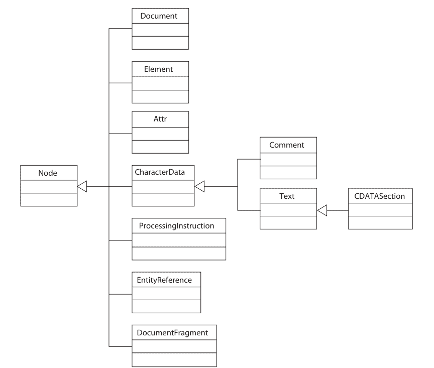

**图 3–2.** 由 GWT XML 库实现的 XML 文档对象模型的结构

反向操作也是 XML 库的一部分。你可以使用相同的对象构建文档对象模型，然后将该模型转换为字符串。这通常在你需要与服务器通信以发送结构化 XML 数据时使用。博客编辑器应用程序使用此功能向 Blogger 服务发送 XML 数据以创建新的博客条目，以及更新现有的博客条目。它使用与前面示例中相同的格式。以下是该示例中的代码片段，展示了在发送到服务器之前生成的 XML：

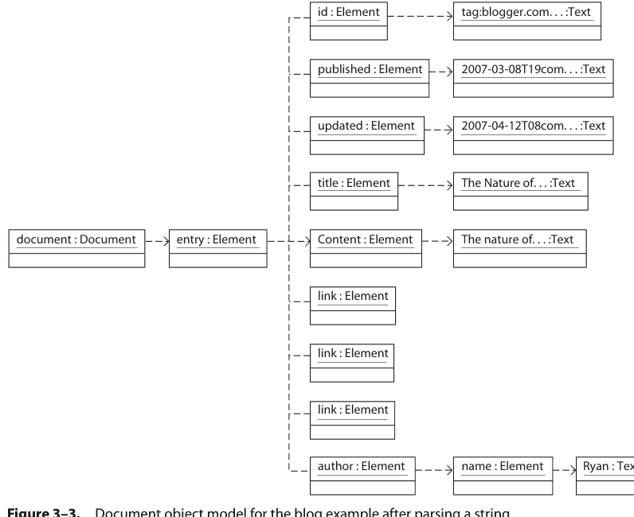

```
Document document = XMLParser.createDocument();
Element entryElement = document.createElement("entry");
Element titleElement = document.createElement("title");
Element contentElement = document.createElement("content");
Text titleText = document.createTextNode( entry.getTitle());
Text contentText = document.createTextNode( entry.getContent() );
document.appendChild(entryElement);
entryElement.setAttribute("xmlns","http://www.w3.org/2005/Atom");
entryElement.appendChild(titleElement);
entryElement.appendChild(contentElement);
titleElement.appendChild(titleText);
contentElement.setAttribute("type","html");
contentElement.appendChild(contentText);
String xml = document.toString();
```

此代码使用 Document 类上的 create 方法创建文档对象模型中的每个节点。它使用 `appendChild` 方法将子节点添加到父节点来创建层次结构。然后使用 `Element` 类的 `setAttribute` 方法设置 XML 属性。当文档对象模型完全构建完成后，代码调用 `document.toString()` 方法将模型转换为 XML 字符串。

## 读写 JSON

GWT 还附带了一个用于解析和构建 JSON 字符串的 JavaScript 对象表示法（JSON）库。JSON 数据格式与 XML 类似，也是分层且自描述的，但它在大小石碑大小和语法上与 XML 不同，许多人认为这是它相对于 XML 的优势之一。它的另一个优势是可以轻松地使用 JavaScript 的 `eval` 函数进行解析：

```
var jsonString = "{'Title':'Ajax for Java developers'}";
var obj = eval( jsonString );
alert( obj.Title );
```

在此 JavaScript 代码中，JSON 编码的字符串被传递给 `eval` 函数，该函数返回解析字符串的 JavaScript 对象版本。由于 JavaScript 对这种格式的便捷支持，它成为 GWT 的一个自然补充。

让我们简要概述一下 JSON 的格式，首先从与 XML 的比较开始。XML 的结构分为元素、属性和文本，而 JSON 的结构分为对象、数组和值。表 3-1 展示了两种格式对相同类型数据的格式化比较。

**表 3-1** 相同数据的 XML 与 JSON 格式化比较

| 类型 | 代码 |
|---|---|
| **XML** | `<entry>
    <title type='text'>The Nature of Asynchronous Method Calls</title>
    <author>
        <name>Ryan</name>
    </author>
</entry>` |
| **JSON** | `{
    "entry":{
        "title":"The Nature of Asynchronous Method Calls",
        "author":{
            "name":"ryan"
        }
    }
}` |

语法差异始于分隔符。JSON 使用花括号开始和结束对象，使用带引号的字符串命名其属性，并用冒号呈现其值。值可以是另一个对象、字符串值或其他简单数据类型，或数组。尺寸节省来自于该格式不需要像 XML 那样重复命名数据（即开始和结束标签）。JSON 中的数据类型系统也比基本 XML 中的数据类型系统更强（不包括模式，GWT 中不自动支持模式）。一个简单的 JSON 值可以是布尔值、数字、字符串或 null。图 3-4 说明了通过 GWT JSON 库可在 JSON 中使用的数据类型。

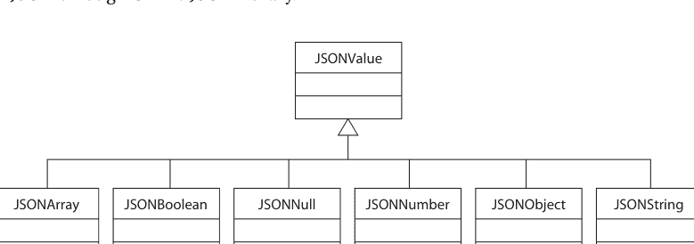

此 JSON 库位于 `com.google.gwt.json.client` 包中。它不会自动包含在你的应用程序中，因此你需要将以下行添加到项目的模块文件中才能使用它：

```
<inherits name="com.google.gwt.json.JSON"/>
```

该库的对象模型与 XML 文档对象模型相似，两者都使用多个类来构建解析数据后生成的层次模型。要解析 JSON 数据，请使用 GWT 的 `JSONParser` 类的 parse 方法，传入 JSON 字符串。返回值是一个 `JSONValue`，代表解析数据对象结构的根。第 7 章中的多搜索应用程序解析了从多个搜索引擎服务返回的 JSON 搜索结果。以下代码片段来自该应用程序，展示了使用 JSON 库解析来自 Yahoo! 的搜索结果：

```
//parse the string and get the ResultSet object
JSONObject j = (JSONObject)JSONParser.parse(json);
JSONObject feed = (JSONObject)j.get("ResultSet");
```

```
//iterate over the Results array
JSONArray entries = (JSONArray)feed.get("Result");
for( int i=0; i< entries.size(); ++i ) {
    JSONObject entry = (JSONObject)entries.get(i);
    JSONString title = (JSONString)entry.get("Title");
    JSONString url = (JSONString)entry.get("Url");
    JSONString summary = (JSONString)entry.get("Summary");
    if( url != null ) {
        getView().addSearchResult( new SearchEngineResult( title.stringValue(),
            url.stringValue(), summary.stringValue() ) );
    }
}
```

代码首先解析 `json` 变量（即 JSON 数据的字符串），并返回一个 `JSONObject` 实例。该示例展示了如何从解析后的数据中获取几种不同类型的 JSON 值，以及如何遍历 `JSONArray` 中的值。代码为在 JSON 数据中找到的每个搜索结果创建一个新的 `SearchEngineResult`（应用程序的域模型对象）。

此代码被简化了，未检查每个 JSON 值的类型。这意味着如果值不是预期的类型，应用程序将抛出 `ClassCastException`。为避免此异常，你可以使用 `JSONValue` 对象的类型识别方法检查其类型。例如，要检查检索搜索结果标题时返回的值的类型，你可以使用如下代码：

```
JSONValue value = entry.get("Title");
if( value.isString() ){
    JSONString title = (JSONString)value;
}
```

将 GWT 的 JSON 值转换为 JSON 字符串只需调用该值的 `toString` 方法。

JSON 可能比 XML 有几个优势，但 XML 的使用范围更广、更易理解，并且有更多基于它的工具和技术。那么为什么要使用 JSON 呢？如果你正在构建一个不与其他使用 XML 进行集成的系统集成的系统，那么你可能需要考虑 JSON。请记住，这可能会限制你与其他系统集成的能力。JSON 由于在 Ajax 应用程序中的使用而越来越受欢迎，但它很可能不会达到 XML 的使用量。你也可以通过脚本标签使用 JSON 远程加载数据


在网页上，有效地绕过浏览器的同源策略限制。这就是在多重搜索应用中使用 JSON 的原因。该应用能够通过 script 标签加载外部 JSON 数据源，而无需服务器端代理。我们将在下一节中介绍这种方法，称为 JSONP（JSON with Padding，带填充的 JSON）。

### 第三方服务器集成

软件开发中最常见的说法之一是"不要重复造轮子"。这也适用于 Web 应用开发，尤其是因为有大量免费或低成本的第三方 Web 服务可用。它们为您的应用提供了与其服务集成的明确定义方式。本书中的许多示例应用都与第三方服务器集成。第 6 章中的 Gadget Desktop 应用使用 JavaScript API 与 Google 地图、Yahoo! 天气和 Google Ajax Feed API 集成。第 7 章中的多重搜索应用使用 JSONP 与 Google Base、Yahoo! 搜索、Amazon Books 和 Flickr 集成。第 8 章中的博客编辑器应用使用 HTTP 代理与 Blogger Web 服务集成。本节将介绍这些应用中使用的技术。

#### 同源策略

通常，由于 Web 浏览器实施的同源策略，您无法从客户端 Ajax 应用与第三方服务器通信。该策略规定您的 JavaScript 只能访问与其服务器来源相同的数据。这是一个非常好的保障。没有它，来自另一个域并在另一个窗口中运行的 JavaScript 就可能更改当前窗口中的 HTML。您永远无法确定自己看到的内容是否真的来自浏览器地址栏中显示的域。有了该策略，我们可以确信正在查看的内容是由我们正在浏览的域发送的。

对于 Ajax 应用，这也意味着无法从其他域异步下载数据；我们只能从浏览器加载应用的服务器加载数据。鉴于有大量 Web 服务可供 Ajax 应用使用，这是一个不幸的限制。

#### 使用 JavaScript API

同源策略并不限制使用 HTML script 标签从第三方服务器导入脚本。这并不意味着它完全安全。如果您确实从另一个来源加载第三方 JavaScript API，您必须信任该第三方不会向您的应用发送恶意代码。有许多 JavaScript 库可供 Ajax 应用包含，它们来自不会因提供恶意代码而损害声誉的大公司。Google 和 Yahoo! 就是这样的两家公司。

Gadget Desktop 应用使用 Google Ajax Feed API 从第三方站点加载 RSS 订阅源。包含 JavaScript API 时，您应遵循 API 文档中提供的说明。通常这涉及在您想要使用该 API 的 HTML 文件中添加 `script` 标签。对于 GWT 应用，您可以将 API 添加到宿主 HTML 页面的 `head` 标签中。例如，以下代码将 Google Ajax Feed API 添加到 Gadget Desktop 应用中：

```
<head>
    <title>GWT Applications - Gadget Desktop</title>
    <script type="text/javascript" src="http://www.google.com/jsapi?key=ABQIAAAACeDba0As0X6mwbIbUYWv~RTb-vLQlFZmc2N8bgWI8YDPp5FEVBQUnvmfInJbOoyS2v~qkssc36Z5MA"></script>
    <script type="text/javascript">
        google.load("feeds", "1");
    </script>
```

当 HTML 页面加载时，此 HTML 代码从 Google 加载 JavaScript 代码。然后，该 JavaScript 代码可供您的 GWT 应用使用。但是，代码是 JavaScript 编写的，而您的应用是用 Java 编写的，因此您需要使用 GWT 的 JavaScript 原生接口（JSNI）。（有关 JSNI 的更多信息，请参阅第 5 章。）使用 JSNI，您可以访问加载的 JavaScript API 提供的功能。

通过 JavaScript API 与第三方服务器通信的其他示例包括在 Gadget Desktop 应用中使用 Google 地图 API。您也可以通过 `script` 标签加载其代码并通过 JSNI 访问方法来使用此 API。加载的 JavaScript 代码处理从 Google 服务器异步加载地图数据。

#### 使用 JSONP

您还可以使用 `script` 标签从第三方站点加载更结构化的数据，如 JSON。JSON 可以被 JavaScript 解释器自动解析，因此它很自然地成为通过 `script` 标签传输结构化数据的格式。本质上，使用 `script` 标签从第三方站点加载结构化数据可以绕过浏览器实施的同源策略限制。事实上，多重搜索应用使用 JSONP 从 Google、Yahoo!、Amazon 和 Flickr 加载数据，而无需任何服务器端实现。

为此，GWT 应用向 HTML 文档添加一个 `script` 标签，导致浏览器从提供的 URL 加载脚本。第三方服务器接收 URL 请求，并生成由 `callback` 方法包装的 JSON 输出。当浏览器完成接收远程脚本文件后，浏览器在其 JavaScript 解释器中运行该文件。由于该文件是由 `callback` 函数调用包装的 JSON 数据，浏览器中会调用 `callback` 函数。在 GWT 应用添加 `script` 标签之前，它需要添加一个具有预期名称的 `callback` 函数，以便在脚本加载完成时接收调用。这是一个类似于异步 HTTP 请求的异步过程。图 3-5 说明了这一顺序。

有关名为 `JSONRequest` 的 GWT JSONP 类实现，请参阅多重搜索应用。

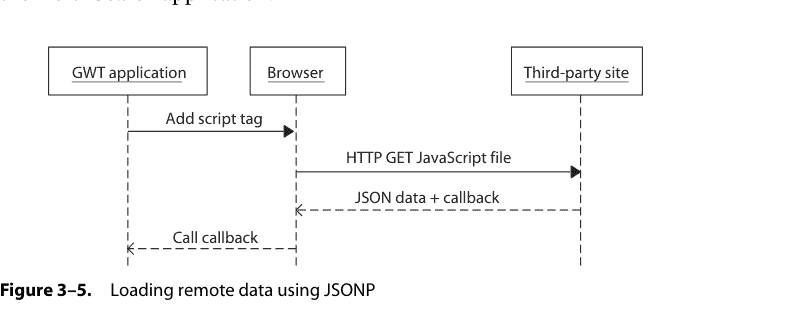

#### 使用 HTTP 代理

对于比简单获取数据更复杂的服务器交互，您需要为应用创建服务器组件，并选择服务器集成技术与服务器通信。您的服务器充当第三方服务器的代理，将请求从客户端 Ajax 应用中继到服务器。博客编辑器应用使用简单的 HTTP 代理 Servlet 将基于 REST 的 API 调用中继到 Blogger 服务。由于 Blogger API 要求使用许多 HTTP 命令，包括 GET、POST、PUT 和 DELETE，并发布 XML 格式的数据，我们唯一的选择是从我们的服务器连接到 Blogger 服务器。有关 HTTP 代理的详细示例，请参阅博客编辑器应用。

### 高级服务器集成技术

到目前为止，您已经看到了将 GWT 应用与传统的基于动作的 Web 应用、简单的异步 HTTP 和第三方服务器集成技术。这些技术都有其用途，但它们的集成层次相对基础。对于更复杂的应用，通常有更复杂的服务器，因此集成也变得更复杂。依靠表单或简单的异步 HTTP 请求类来处理复杂性可能导致代码无法管理。本节将介绍使用 REST 接口或 GWT-RPC 与无状态服务器集成的先进技术，首先从有状态服务器和无状态服务器之间的区别开始。

#### 有状态服务器

传统的 Web 应用模型基于 HTTP，这是一种无状态协议。这意味着一个请求与另一个请求无关；服务器将它们视为独立的请求。然而，建立在 HTTP 之上的应用可以保存应用状态，许多应用这样做以创建有意义的应用。例如，考虑像 Hotmail 这样的 Web 电子邮件应用。您可能正在写电子邮件，需要上传一张照片。点击上传按钮会带您到一个新页面来上传文件。上传文件后，Web 应用会返回到您正在处理的电子邮件。在这个例子中，Web 服务器记住了应用的状态，并能够引导您的浏览器完成整个过程。

必要的步骤。这类应用状态通常存储在服务器上，通过 cookie 或 URL 参数访问，称为*会话*（session）。尽管 GWT 为客户端应用开发者提供了工具，让你能够提升客户端应用的功能，使其不需要过多依赖服务器端状态，但仍会有一些情况需要应用与有状态服务器进行集成。

GWT 应用可以像传统的 Web 应用一样，通过 HTML 表单与有状态服务器交互，同时也可以利用客户端有状态信息来增强用户体验。此外，许多早期的 RPC 实现，特别是 XML-RPC，都基于有状态的服务器应用。客户端会对服务器端的数据进行操作——一次一个远程调用。你也可以使用 GWT 应用，通过 XML 和 HTTP 库来实现这一点。

图 3-6 说明了 GWT 应用如何与有状态服务器交互。

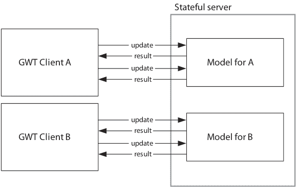

**图 3-6.** 客户端与有状态服务器的交互

这也是传统 Web 应用开发的工作方式。服务器为每个客户端保存一个状态，或称为模型。客户端可以通过小的增量更改与该状态交互。该模型既适用于基于 HTTP 的传统 HTML 表单，也适用于 XML RPC。

尽管这是 Web 应用的主流架构，但你应该只在必要时才使用它。能够在会话中保存部分服务器端状态的重量级 Ajax 应用可以大幅提升性能。该解决方案将在下一节介绍。请注意，在某些情况下，有状态服务器是完全合理的。即时通讯应用就需要有状态服务器，因为客户端共享应用状态。每个客户端都必须知道其他哪些客户端已登录到服务器。这种状态无法推送到客户端。客户端之间必须有一个共同的实体来保存共同的会话状态。

#### 与无状态服务器集成

有状态的 Web 服务器应用是瘦客户端架构的产物。就性能而言，服务器管理小规模用户操作的状态并不理想，但由于 HTML 客户端缺乏维护状态的能力，而且每个操作后都会刷新网页，所以别无选择。然而，Ajax 应用使我们能够构建更重量级的客户端应用，这些应用可以更好地保存应用状态，并且将用户的操作隔离在客户端，直到它们绝对需要以更大的事务性请求提交到服务器。在处理远程请求时，更少但更大的事务比大量小事务性能要好得多。在设计远程接口时，忽视这一点是一个常见错误，尤其是当有类似 GWT-RPC 库这样优秀的 RPC 库存在时，它们允许你像编写应用中的本地接口一样快速编写接口。将每个服务器方法调用视为一个独立的事务。较小的工作单元应在客户端内部完成，无需与服务器交互。图 3-7 说明了无状态服务器与富客户端之间的通信。

Web 应用模型正在慢慢向这种架构演进。取代 XML-RPC 的是 SOAP，这是一种应用通信协议，试图解决 XML-RPC 与服务器端实现耦合过紧的问题。与过程调用不同，其交互基于遵循该模型的消息，这比远程调用模型更加无状态和事务化。另一种与服务器通信的无状态 Web 架构称为 REST（表述性状态转移，representational state transfer）。在这种架构中，应用将服务器视为一组由 URL 标识并通过 HTTP 方法修改的无状态资源。第 8 章中的博客编辑器应用就是一个 GWT 应用与基于 REST 的无状态服务器通信的很好的例子。该应用在启动时通过一个事务加载所有博客数据，使用户能够使用该应用来操作数据。只有在用户点击保存或删除按钮时，才需要额外的服务器交互。即使用户选择创建新的博客条目，应用也不会联系服务器，直到用户保存新条目。与等效的 HTML 表单应用相比，该应用向服务器发出的往返调用要少得多。例如，在 www.blogger.com 上，你只需浏览界面就能进入编辑器添加新条目。第 10 章中的数据库编辑器应用也遵循了这种基于 REST 的无状态架构。

与服务器集成时，你并非总能选择使用哪种架构，因为服务器很可能已经在使用自己的接口运行。但如果你正在考虑构建一个服务器应用，而客户端是 GWT 应用，那么你应该考虑将大部分应用状态移到客户端，这样应用的扩展性会更好。

### 使用 GWT-RPC

GWT 通过提供远程过程调用（RPC）库，扩展了浏览器与服务器异步通信的能力。总的来说，远程过程调用旨在简化调用服务器的任务，为你提供一个方法接口，这些方法可以像常规方法调用一样被调用。然后调用会被序列化（转换为数据流）并发送到远程服务器。当服务器接收到序列化数据后，会将其反序列化并在服务器上调用该方法。

在 GWT 中，RPC 库分为两个包：用于客户端 RPC 支持的 `com.google.gwt.user.client.rpc` 包，以及用于服务器端 RPC 支持的 `com.google.gwt.user.server.rpc` 包。客户端提供了一些接口，你可以用它们来标记你将用于 RPC 的应用接口。当你使用 GWT 编译器将客户端项目编译为 JavaScript 时，会根据你标记的接口生成执行 RPC 序列化所需的代码。第 9 章的即时通讯应用使用了 GWT-RPC，以下代码声明了该接口为 RPC 接口：

```
public interface MessengerService extends RemoteService{
    void signIn( String name );
    void signOut();
    ArrayList getEvents();
    void sendMessage( Contact to, Message message );
}
```

`RemoteService` 接口是一个空的 GWT-RPC 接口，它告诉 GWT 编译器应为此接口生成序列化代码。你必须在服务器端实现这个接口。

RPC 的服务器端包构建为用于 Java Servlet 容器（如 Tomcat 或 Jetty）。幸运的是，GWT 的托管浏览器附带了一个嵌入式 Tomcat 服务器，这使我们能够轻松地从 Eclipse 等 IDE 中测试和调试服务器端 RPC。服务器端包含一个类，你可以扩展它来实现服务器端 RPC 接口。即时通讯应用将服务器端类定义如下：

```
public class MessengerServiceImpl
    extends RemoteServiceServlet implements MessengerService {
      public void signIn( String name )
      {
      }

      public void signOut()
      {
      }
```

```
public ArrayList getEvents()
{
}

public void sendMessage( Contact to, Message message )
{
}
}
```

该类简单地扩展了 GWT 的 `RemoteServiceServlet`，并实现了上述 RPC 接口中的方法。你可以通过将以下行添加到项目的模块文件中，轻松地将此 Servlet 安装到托管浏览器中进行测试：

```
<servlet path="/messenger"
       class="com.gwtapps.messenger.server.MessengerServiceImpl"/>
```

`path` 属性表示 Servlet 在服务器上的可调用位置，`class` 属性指定要安装的 Servlet 类名。

当需要部署到 GWT 托管浏览器之外的 Servlet 容器时，你需要遵循几个步骤来进行设置。对于 Tomcat，你需要使用图 3-8 所示的目录结构将其安装到 Web 应用目录中，作为一个新的 Web 应用。

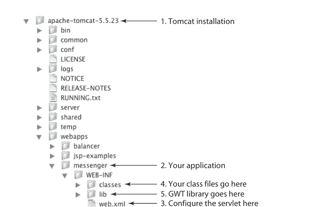

**图 3-8.** Tomcat 安装后的目录结构


我们来看图 3.8 所示的五个步骤。首先，你需要找到 Tomcat 的安装目录。其次，你需要在 webapps 目录下创建你的应用程序目录。第三，你需要在应用程序的 WEB-INF 目录中设置 web.xml 文件。对于即时通讯应用程序，该文件看起来像这样：

```xml
<?xml version="1.0" encoding="UTF-8"?>
<web-app>
    <servlet>
        <servlet-name>messenger</servlet-name>
        <servlet-class>com.gwtapps.messenger.server.MessengerServiceImpl</servlet-class>
    </servlet>
    <servlet-mapping>
        <servlet-name>messenger</servlet-name>
        <url-pattern>/messenger</url-pattern>
    </servlet-mapping>
</web-app>
```

第四步，将你的 servlet 类复制到 WEB-INF 目录下的 classes 目录中。最后，将 gwt-servlet.jar 文件复制到 WEB-INF 目录下的 lib 目录中。gwt-servlet.jar 文件包含支持服务器端 RPC 所需的 GWT 类。你也可以使用 gwt-user.jar，但 gwt-servlet.jar 更小，因此更受推荐。部署可以使用 Ant 等构建工具来自动化。

无论你的 servlet 是在 GWT 嵌入式 Tomcat 中运行，还是在其他安装中运行，用于进行 RPC 调用的客户端代码都是相同的。客户端代码需要创建一个代理实例，该实例将接收来自客户端的方法调用，并将其编解码（marshal）到服务器。当服务器完成调用后，它会将响应返回给客户端代理。然后，代理通过 AsyncCallback 接口将此响应转发给客户端应用程序。为了使这个异步方法调用系统能够工作，你需要创建第二个接口供客户端使用，该接口以不同的方式处理返回值。对于即时通讯应用程序，该接口看起来像这样：

```java
public interface MessengerServiceAsync {
    void signIn( String name, AsyncCallback callback );
    void signOut( AsyncCallback callback );
    void getEvents( AsyncCallback callback );
    void sendMessage( Contact to, Message message, AsyncCallback callback );
}
```

请注意，该接口与 `MessengerService` 接口非常相似；唯一的区别是没有返回值，并且每个方法都需要一个额外的 `AsyncCallback` 参数。这种设置允许代理在你实现 `AsyncCallback` 接口时，将服务器端 RPC 方法的返回值返回给客户端。例如，`getEvents` 方法使用以下回调：

```java
private class GetEventsCallback implements AsyncCallback {
    public void onFailure(Throwable throwable) {
        GWT.log("error get events", throwable);
    }
    public void onSuccess(Object obj) {
        ArrayList events = (ArrayList) obj;
        for( int i=0; i< events.size(); ++i ) {
            Object event = events.get(i);
            handleEvent( event );
        }
        messengerService.getEvents( this );
    }
}
```

当对服务器的调用失败时，代理会调用 `onFailure` 方法。当方法调用成功返回时，代理会调用 `onSuccess` 方法。在这个例子中，返回值是一个事件数组，在 `onSuccess` 处理程序中对其进行迭代。RPC 库会自动对这个返回值以及方法调用的参数值进行编解码（marshal/unmarshal）。你甚至可以创建新的类，将其作为方法参数发送到服务器，或从服务器作为返回值接收。例如，即时通讯应用程序使用 `Contact` 类来与服务器来回传输数据：

```java
public class Contact implements IsSerializable {
    private String name;
    public Contact(){}
    public Contact( String name ) {
        this.name = name;
    }
    public String getName() {
        return name;
    }
}
```

GWT 要求类实现 `IsSerializable` 或 `Serializable` 接口，并且包含一个无参构造函数，这样 GWT-RPC 才能在服务器和客户端之间传输该类的实例。IsSerializable 接口由 GWT 定义，没有方法；它只是作为一个标记，向 GWT 编译器发出信号，表明需要为此类生成编解码代码。

在向服务器发出方法调用之前，客户端应用程序需要创建代理实例。它使用 `GWT.create` 延迟绑定机制来完成。你只需调用 `GWT.create`，参数为你要进行调用的 RPC 接口的类：

```java
MessengerServiceAsync messengerService =
    (MessengerServiceAsync) GWT.create( MessengerService.class );
```

这个方法不会返回 RPC 接口的实例，而是创建一个促进与服务器 RPC 通信的代理对象。该代理将支持两个接口。一个接口，如前面的代码所示，是所请求 RPC 接口的异步版本。另一个接口是 GWT 的 `ServiceDefTarget` 接口。第二个接口允许你设置实现 RPC 接口的远程服务的 URL。对于即时通讯应用程序，URL 设置如下：

```java
ServiceDefTarget endpoint = (ServiceDefTarget) messengerService;
endpoint.setServiceEntryPoint( GWT.getModuleBaseURL() + "messenger" );
```

这段代码使用 `setServiceEntryPoint` 方法设置 URL，并传入应用程序的基础 URL 并附加 servlet 名称。

如果这看起来相当复杂，不要担心；实际上并非如此。一旦你将这些基础设置好，就可以轻松构建与服务器交互的丰富界面。从长远来看，获得的生产力值得付出这些小小的设置成本。你可以几乎像本地 Java 应用程序一样直接地不断添加新的方法和数据类型。

图 3-9 显示了即时通讯应用程序中 `MessengerService` 的 GWT-RPC 实现所涉及的实例概览：

你可以在第七章找到更详细的解释以及 GWT-RPC 的进一步开发。

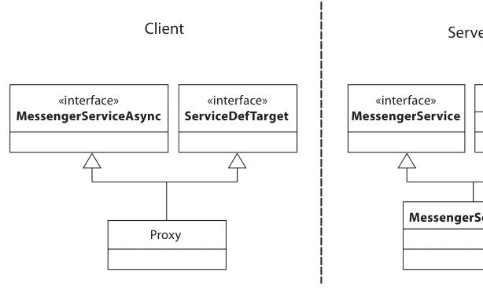

**图 3-9.** 即时通讯应用程序中 MessengerService 的 GWT-RPC 实现中的客户端和服务器实例

### 小结

本章回顾了 Ajax 应用程序与服务器通信的多种方式。从服务器异步加载数据的常见 Ajax 技术是一种简单的数据加载方法，效果很好。你可以在你的 GWT 应用程序中轻松加载和解析纯文本、HTML、XML 和 JSON。你可以使用表单编码的方式与服务器通信，这与传统 Web 应用程序与服务器通信的方式相同。你可以通过 JavaScript API 和 JSONP 利用第三方服务，而无需依赖服务器端实现。此外，你还可以使用服务器端实现作为代理，与第三方服务进行更高级的交互。对于更高级的项目，你需要使用定义良好的服务器接口。GWT 的 RPC 实现提供了一种创建定义良好的服务器接口的简单方法。

本章为你概述了这些技术；示例应用程序将更深入地探索这些技术。第六章的小工具桌面应用程序展示了加载 JavaScript API 以与第三方服务交互。第七章的多搜索应用程序使用 JSONP 与四个不同的搜索服务通信。这两个应用程序都不依赖任何服务器端实现。第八章的博客编辑器应用程序与 Blogger Web 服务交互，这需要更丰富的集成，并使用服务器端代理。第九章的即时通讯应用程序使用 GWT 的 RPC 创建了一种协作者风格的应用程序，客户端可以通过服务器相互通信。本书的最后一个应用程序数据库编辑器，探索了使用三种不同的服务器集成技术（包括动作、REST 和 GWT-RPC）与三种不同的服务器端实现（PHP、Ruby on Rails 和带 Hibernate 的 Java servlet）进行集成。


 ## 4 面向 Ajax 的软件工程

或许，使用 Google Web Toolkit 构建 Ajax 应用程序的最大优势在于能够利用先进的软件工程技术。JavaScript 从未被设计用于构建大型应用程序。它缺乏有助于代码组织和编译时类型检查的语言特性。同时，它也缺乏构建大型应用程序所需的成熟工具，例如自动化工具、集成开发环境、调试和测试工具。本章将介绍如何使用 GWT 中的 Java 软件工程工具来构建高质量的非平凡 Ajax 应用程序。

## 设置开发环境

要使用 GWT 构建应用程序，你需要 Java 开发工具包（JDK）1.4 或更高版本。许多其他 Java 工具也可以辅助你的开发工作，例如像 Eclipse 这样的 IDE 或像 Ant 这样的构建工具。所有这些工具都能为构建 Ajax 应用程序的过程带来巨大价值。需要注意的是，用户不需要任何这些工具来使用你的应用程序。他们甚至不需要在计算机上安装 Java；他们只需要一个相对现代的 Web 浏览器，如 Firefox、Internet Explorer、Safari 或 Opera。GWT 编译器会将你的应用程序编译为符合 Web 标准的技术。

### 安装 Java 开发工具包

JDK 是由 Sun Microsystems 提供的软件包，其中包含 Java 运行时环境（JRE），这是在 GWT 上运行 Java 程序所必需的，还包括命令行开发工具，让你可以编译 Java 类以创建可运行的代码。JDK 可在 Sun 的网站 http://java.sun.com/javase/downloads 上获取。

你可以从多个下载选项中进行选择，但你最少需要的是一个不带任何捆绑软件的 JDK。有些选项附带 NetBeans 或 Java EE，但这些都不是必需的。还有一个 JRE 的下载选项，但它不包含你所需的开发工具。

下载 JDK 后（约 50MB），你需要进行安装。在 Windows 上，下载的是一个可执行文件，运行即可进行安装。使用所有默认选项安装 JDK。

### 安装 Google Web Toolkit

GWT 对 JDK 起到了补充作用，增加了将 Java 代码编译为 JavaScript 的能力，使其能够在没有 Java 运行时环境的 Web 浏览器中运行。你可以将 GWT 视为另一个编译器——让你的 Java 代码运行在一个新的平台，即你的 Web 浏览器上。它还提供了一个宿主模式浏览器，让你可以利用 Java 强大的调试功能，就像调试普通的 Java 应用程序一样。与 Java 和 GWT 所提供的功能相比，JavaScript 调试工具显得十分原始。你可以在 http://code.google.com/webtoolkit/download.html 找到 Google Web Toolkit SDK。

在 Windows 上，GWT 的 zip 文件约为 13MB。下载完成后，将其解压到你偏好的安装目录。在 Mac 和 Linux 上，你可以使用以下 `tar` 命令解压下载的文件：

```
tar xvzf gwt-mac-1.3.3.tar.gz
```

让我们看看发行包内部。以下列表简要概述了 GWT 附带的重要文件。

- **gwt-user.jar**

这是 GWT 库。它包含用于构建 GWT 应用程序的 Java 类。你的应用程序在宿主模式下运行时会使用此文件，但在部署应用程序时不会使用此文件，因为你的应用程序代码和此文件中使用的代码都会被转换为 JavaScript。

- **gwt-servlet.jar**

这是 gwt-user.jar 的精简版本，包含应用程序服务器端所需的类。它比 gwt-user.jar 小得多，更适合部署，因为它不包含宿主模式所需的 GWT 类。

- **applicationCreator**

此脚本生成启动 GWT 应用程序所需的文件。生成的文件构成一个可运行的基本 GWT 应用程序。

- **projectCreator**

此脚本为 Eclipse GWT 项目生成项目文件。

- **junitCreator**

此脚本生成一个起始测试用例，以及启动 Web 模式和宿主模式测试的脚本。

- **i18nCreator**

此脚本基于属性文件生成一个接口，用于应用程序的国际化。

只需安装 JDK 和 GWT，你就可以编写、运行和编译基于 Web 的应用程序。

为方便起见，你应当将 GWT 安装目录添加到你的路径中，这样你就可以在不每次指定完整安装路径的情况下调用 GWT 脚本。例如，如果你将 GWT 安装到 c:\code\gwt（这是 Windows 路径；对于 Mac 和 Linux，你只需类似地使用你的安装路径），你需要将其添加到你的 PATH 变量中。然后在命令行中，你可以在你的应用程序目录内运行 `applicationCreator` 脚本，而无需指定脚本的完整路径，如图 4-1 所示。

```
C:\Projects>mkdir gwtapps

C:\Projects>cd gwtapps

C:\Projects\gwtapps>applicationCreator com.gwtapps.examples.client.HelloWorld
Created directory C:\Projects\gwtapps\src
Created directory C:\Projects\gwtapps\src\com\gwtapps\examples
Created directory C:\Projects\gwtapps\src\com\gwtapps\examples\client
Created directory C:\Projects\gwtapps\src\com\gwtapps\examples\public
Created file C:\Projects\gwtapps\src\com\gwtapps\examples\HelloWorld.gwt.xml
Created file C:\Projects\gwtapps\src\com\gwtapps\examples\public\HelloWorld.html
Created file C:\Projects\gwtapps\src\com\gwtapps\examples\client\HelloWorld.java
Created file C:\Projects\gwtapps\HelloWorld-shell.cmd
Created file C:\Projects\gwtapps\HelloWorld-compile.cmd

C:\Projects\gwtapps>_
```

**图 4–1.** 为 GWT 项目运行 `applicationCreator` 脚本

运行此脚本会在当前目录中创建名为 HelloWorld 的应用程序。它还会生成用于运行应用程序的脚本。你只需输入以下行即可运行此应用程序：

```
HelloWorld-shell
```

运行此生成的脚本会使 GWT 加载其宿主浏览器，而宿主浏览器会加载生成的应用程序。宿主浏览器会显示默认生成的应用程序，如图 4-2 所示。

你还可以使用生成的 HelloWorld-compile 脚本编译应用程序，使其能够在标准浏览器中使用，如图 4-3 所示。

编译脚本会构建部署应用程序所需的 HTML 和 JavaScript 文件，并将它们复制到你应用程序目录中的 www 目录，如图 4-4 所示。

生成的应用程序可以通过简单地加载宿主文件在任何浏览器中运行。在这个 HelloWorld 应用程序中，宿主文件名为 HelloWorld.html。如图 4-5 所示，在 Firefox 中加载此文件会产生与图 4-2 中 GWT 宿主浏览器相同的应用程序，主要区别是不存在任何 Java 依赖。

因此你可以看到，使用 GWT 构建 Web 应用程序的最小环境很小，只需安装 GWT 和 JDK 即可。然而，通过使用许多可用的 Java 工具，你将能够加快开发过程。例如，像 Eclipse 这样的 IDE 通常被用来加速 Java 开发。

### 安装 Eclipse

Eclipse 是一个用 Java 开发的开源 IDE，得到了包括 IBM 在内的主要科技公司的支持。IDE 让你能够以高效的方式进行软件编写、组织、测试和调试。有许多 Java IDE 可供选择，你可以使用其中任何一个进行 GWT 开发。如果你还没有安装 Java IDE，我建议使用 Eclipse，因为它运行良好，并且 GWT 脚本为其提供了支持以帮助集成。

Eclipse 让你能够高效地编写、组织、测试和调试 GWT Ajax 应用程序。它对 Java 语言有很好的支持，包括重构和内容辅助¹。通过利用 Eclipse 丰富的插件框架，你可以使用多种语言进行开发，但使用最广泛的语言是 Java。你可以在 www.eclipse.org/downloads 找到 Eclipse 的下载。

> 1. 内容辅助是 Eclipse 的一项功能，可以建议或补全你当前正在输入的内容。它会自动出现，你也可以在需要时按 Ctrl+空格键 来激活它。


从此页面选择 Eclipse SDK。下载文件（约 120MB）后，将其解压到你偏好的安装目录。在 Windows 上，eclipse.exe 文件的默认位置在安装目录根目录下；由于你会频繁使用该文件来编辑和调试代码，你可能需要为其创建快捷方式。

### 将项目添加到 Eclipse

首次启动 Eclipse 时，会出现如图 4-6 所示的对话框，提示你输入工作空间位置。这是你计算机上用于存放项目的位置。

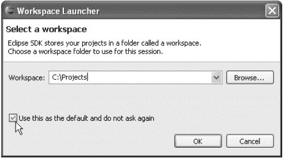

**图 4–6.** 在 Eclipse 中加载工作空间

图 4-6 展示了将工作空间设置为 C:\Projects，并选中复选框将其保存为默认工作空间，这样下次打开 Eclipse 时会自动加载此工作空间。由于这是一个新的工作空间，当 Eclipse 主窗口加载时，其包资源管理器（Package Explorer）中不会列出任何项目。此时我们可以手动在 Eclipse 中为前面本章构建的 HelloWorld 应用程序创建一个项目，但 GWT 为我们提供了 `projectCreator` 脚本的快捷方式，如图 4-7 所示。

这会创建一个引用 GWT 的空项目，可以轻松加载到 Eclipse 中。要将 GWT 项目加载到 Eclipse 中，选择**文件 > 导入**以显示导入对话框，如图 4-8 所示。

```
C:\Projects\gwtapps>projectCreator -eclipse GwtApps
Created directory C:\Projects\gwtapps\test
Created file C:\Projects\gwtapps\.project
Created file C:\Projects\gwtapps\.classpath
C:\Projects\gwtapps>
```

**图 4-7.** 使用 `projectCreator` 脚本和 -eclipse 标志创建项目

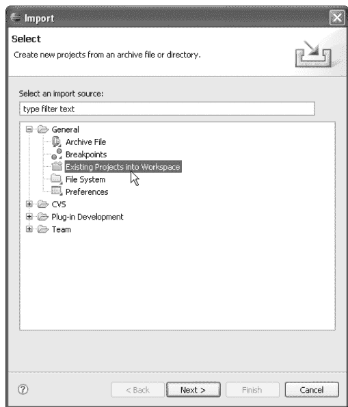

**图 4-8.** 将生成的 GWT 项目导入 Eclipse 的步骤 1

在导入对话框中，选择**现有项目到工作空间中**，然后点击**下一步**。导入对话框的下一页（如图 4-9 所示）允许你选择一个或多个要导入的项目。

在此对话框中，你首先需要选择项目文件的位置。然后对话框会列出可以导入的可能项目。图 4-9 展示了我们使用 GWT `projectCreator` 脚本创建的 GwtApps 项目。确保选中此项目，然后点击**完成**。

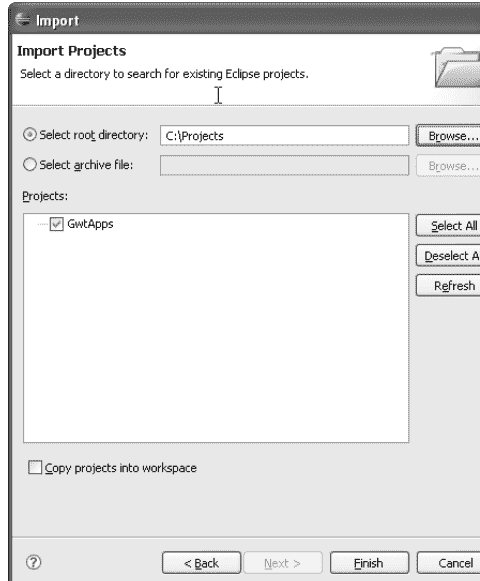

**图 4-9.** 将生成的 GWT 项目导入 Eclipse 的步骤 2

此时 Eclipse 会将项目加载到工作空间中，HelloWorld 应用程序会列在包资源管理器下，如图 4-10 所示，因为它是在 Projects 目录中生成的。

你可以使用 `applicationCreator` 脚本向此项目添加其他应用程序，但既然我们已经进入了 Eclipse，我们可以利用该脚本的 `-eclipse` 选项。运行 HelloWorld 应用程序时未指定此选项，因此我们没有允许你从 Eclipse 启动应用程序的 Eclipse 特定文件。因此，让我们再次运行 `applicationCreator` 脚本，这次指定 `-eclipse` 选项，如图 4-11 所示。

如果你正在为 Eclipse 创建新应用程序，则不需要 `-overwrite` 选项。本示例使用此选项覆盖先前生成的、没有 Eclipse 支持的应用程序。注意图 4-11 中新文件 HelloWorld.launch 已创建。此启动

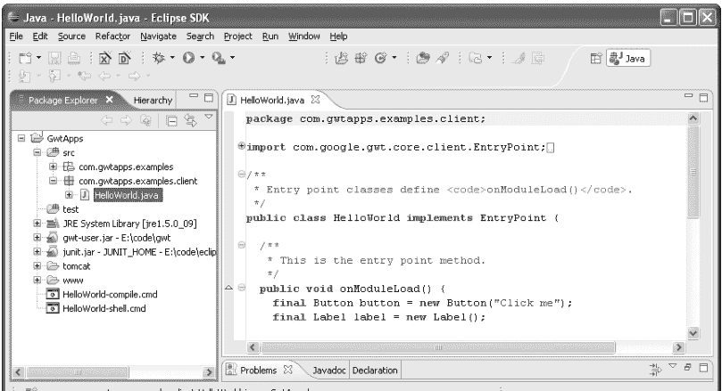

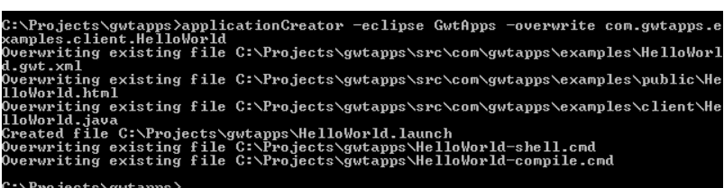

文件允许你在 Eclipse 内选择 HelloWorld 应用程序的**调试**或**运行**命令选项。要在 Eclipse 中查看此更改，请刷新你的项目（右键点击项目并选择**刷新**），然后通过点击调试图标（参见图 4-12 工具栏中的虫子图标）在调试模式下运行 HelloWorld 应用程序。如果你的应用程序未列在调试下拉框中（该框显示最近调试配置的列表），则需要点击下拉菜单中的**调试...**以加载调试对话框。你将在 Java 应用程序下找到 HelloWorld 应用程序的启动配置。

应用程序将在 GWT 的托管模式浏览器中加载，你可以在仍连接到 Eclipse IDE 的情况下与其交互。这意味着

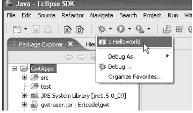

**图 4–12.** 在 Eclipse 调试器中运行 GWT 应用程序

你可以在应用程序运行时设置断点、更改代码以及执行其他 Eclipse 功能。实现这一点极大地缩短了代码测试周期，其便捷性也促进了大量测试。

将 GWT 开发附加到 Eclipse 或任何其他 Java IDE，是 Ajax 应用程序开发向前迈出的一大步。让我们看看使用 Eclipse 编写代码的一些细节。

### 在 Eclipse 中编写 Java 代码

Eclipse 有许多用于编写 Java 代码的工具，它们提供有关可能性的提示和约束、常见任务的快捷方式以及大型代码更改的重构功能。当然，你不必使用这些工具来生成 Ajax 应用程序，但它们确实使编写 Java 代码变得更加容易。

### 在 Eclipse 中创建类

首先，让我们看看 Eclipse 用于创建类的工具。Eclipse 允许你通过点击顶部工具栏上的"新建类"图标（如图 4-13 所示）来创建新类或接口。点击"新建类"图标后，下拉菜单会呈现一系列选项。对于新类，你需要在下拉菜单中点击**类**。

点击此图标会显示一个新建 Java 类对话框，提示你创建类所需的信息。这种方法比从头开始编写 Java 类文件更快，并且确保文件中需要包含的所有内容

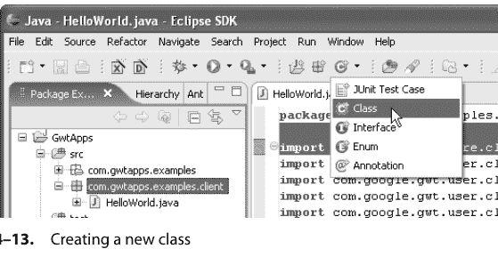

都在那里且正确无误。注意图 4-13 中列出了 com.gwtapps.examples.client 包。这是新类将要放置的位置。当新建 Java 类对话框出现时，它会将此包显示为默认包。

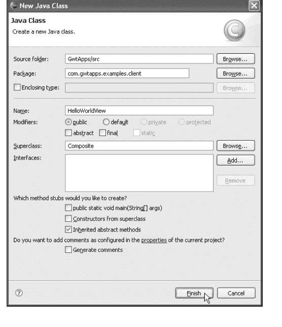


**图 4–15.** Eclipse 中的新 Java 类

在此对话框中，名称 `HelloWorldView` 被指定为新类的类名。超类设置为 Composite。点击**完成**会创建文件以及其中可用的 Java 类，如图 4-15 所示。

实际上，新的 Java 类还不太能用。我们指定的超类不存在。注意 Eclipse 如何用不引人注目的指示器让你知道出了问题。包资源管理器中新 Java 文件以及树中一直到项目的每个父节点上都有一个红色方块中的 X。如果我们将项目节点折叠，我们仍然会知道项目中某处存在错误。Eclipse 还在底部显示一个问题列表，展示工作空间中的错误和警告列表。它也列出了新的问题。双击此列表中的任何错误会直接带你进入 Eclipse 编辑器窗口中错误所在的位置。在这种情况下有两个错误，并且新 Java 类文件的编辑器窗口是打开的。在编辑器窗口内部，你可以看到错误的进一步指示。编辑器窗口右侧的红色标记代表文件内错误的位置。

此垂直空间的文件表示与垂直滚动条的缩放比例相同。因此，如果这是一个更大的文件并且存在错误，你可以

通过将滚动条移动到其中一个红色标记的位置，在编辑器窗口中查看错误，从而快速定位它们。在编辑器窗口内，左侧显示错误图标，实际产生错误的代码带有红色锯齿下划线。此外，当你将鼠标悬停在有错误的代码上时，工具提示会显示错误消息，在本例中为 "The import Composite cannot be resolved."。问题在于我们在新建 Java 类对话框中只选择了简单类名作为超类，但 Eclipse 需要完整的类名。通常很难记住一个类的完整类名，但 Eclipse 在这方面也能帮助我们。我们可以通过点击错误并选择**源 > 添加导入**命令，让 Eclipse 自动建议完整的类名，如图 4-16 所示。


**图 4–16.** 自动添加 Java 导入

或者，你可以使用键盘快捷键 Ctrl+Shift+M 来执行添加导入命令。Eclipse 会自动添加所需的导入信息。在存在多个匹配导入的情况下，Eclipse 会向你提供选择，如图 4-17 所示。


 **图 4–17.** Eclipse 会展示一个匹配导入包的列表

选择 GWT Composite 类作为导入项可以修复错误，所有错误指示都会消失。Eclipse 为任何编译时错误提供这种早期预警，而且是即时的，不必像使用静态类型语言时那样等到编译时才获得反馈。Eclipse 在你开发过程中实时更新 IDE 信息，因此你可以在错误产生后立即捕获它们。

### 使用 Eclipse Java 编辑器

现在让我们来看一下 Eclipse Java 编辑器的一些独特功能。我们先在 `HelloWorld View` 类的构造函数中添加一些代码。我们可以通过选择 **Source > Generate Constructors from Superclass...** 来节省输入并生成构造函数，如图 4-18 所示。如果在代码的某个部分按下 Ctrl+L，Eclipse 还可以自动建议 Refactor 菜单中的项目。例如，如果你在一个类上实现了某个接口但尚未编写必须实现的方法，可以按下 Ctrl+L 查看建议，Eclipse 会展示一个命令来自动实现所需的方法。

语法可能是编译器理解代码所需的全部，但在编辑器中添加代码语法着色使我们阅读 Java 代码变得更加容易，如图 4-19 所示。Eclipse 的默认语法着色使用**粗体紫色**字体显示 Java 关键字如 class、super、extends 和 public，**绿色**字体显示所有注释，**蓝色**字体显示字段，以及**蓝色斜体**字体显示静态字段。


**图 4–18.** 自动创建类构造函数

现在让我们在构造函数中创建一个 HorizontalPanel 并向其中添加几个组件。在你输入时，Eclipse 会监视错误。在你输入 HorizontalPanel 这个词后，它会显示为错误，因为该类尚未导入。使用与之前相同的技术来导入它（Ctrl+Shift+M 或 Source > Add Import）。当你开始输入以调用面板上的方法时，Eclipse 的内容辅助功能会展示一个方法建议列表，如图 4-20 所示。

```
public class HelloWorldView extends Composite {

    public HelloWorldView() {
        super();
        // TODO Auto-generated constructor stub
    }
}
```

**图 4–19.** 自动生成的构造函数

```
package com.gwtapps.examples.client;

import com.google.gwt.user.client.ui.Composite;
import com.google.gwt.user.client.ui.HorizontalPanel;

public class HelloWorldView extends Composite {

    public HelloWorldView() {
        super();
        HorizontalPanel panel = new HorizontalPanel();
        panel.add();
    }
}
```


**图 4–20.** Eclipse 中的内容辅助

Eclipse 会自动显示建议，或者你可以通过按 Ctrl+空格键强制它们显示。在这种情况下，我们想要的是 add 方法，但我们也可以了解其他可用的方法。在某种程度上，内容辅助不仅能帮助加快输入和定位方法名称，还能作为你正在使用的类的教育工具。无需翻阅文档，你可以通过这个功能了解到不少关于库的信息。

另一种了解你正在使用的类的方法是使用编辑器的 Ctrl+Click 功能，如图 4-21 所示。在编辑器中对变量、类或方法使用 Ctrl+Click 可以跳转到 Eclipse 编辑器中的源代码。例如，如果你点击一个变量名，编辑器会带你到变量声明处。如果你点击一个类名，它会带你到该类的 Java 文件，如果你点击一个方法，它会带你到方法声明处。这使你可以像浏览网页一样方便高效地浏览源代码。这对 GWT 库中的类也同样有效，因为 GWT jar 文件包含了 Java 源代码。

当你在浏览代码时找不到所需内容时，Eclipse 提供了强大的搜索支持。首先，有一个简单的单文件查找/替换命令，你可以通过 Edit 菜单访问或按 Ctrl+F。这是你在大多数编辑器中都能见到的标准查找和替换功能。除此之外，Eclipse 还提供了丰富的多文件搜索功能，你可以通过 Search 菜单或按 Ctrl+H 来访问。图 4-22 展示了搜索对话框。

```
public class HelloWorldView extends Composite {

    public HelloWorldView() {
        super();
        HorizontalPanel panel = new HorizontalPanel();
        panel.add( new Button("Click Me") );
        panel.add( new Label("Hello World") );
    }
}
```

**图 4–21.** 使用 Ctrl+Click 浏览源代码


**图 4–22.** 在 Eclipse 中搜索

搜索对话框的第一个选项卡"File Search"允许你在工作区的任何文件中搜索任何字符串。第二个选项卡"Java Search"提供了更具限制性的搜索，因为它理解 Java 语言。在这个选项卡中，你可以搜索某个字符串的特定实例。例如，图 4-22 中的对话框展示了在作为引用调用时搜索 `toString` 的情况。此搜索会忽略 `toString` 的其他出现，比如 `toString` 声明或任何注释。

文件搜索还允许你在多个文件中替换匹配的值。这有助于重构代码。例如，你可以将项目文件中所有出现的 `HelloWorld` 替换为 `MyFirstApp`。

Eclipse 提供的重构支持超出了多文件搜索和替换的范围。例如，你可以使用 **Refactor > Rename** 命令将 `HelloWorld` 类的名称更改为 `MyFirstApp`，如图 4-23 所示。


当你通过 Refactor 菜单进行更改时，Eclipse 会确保使用原始值的引用也得到更改。这种方法比进行搜索和替换更少出错。Eclipse 还有更多节省时间的重构命令，你可以通过查看任何项目（包括高亮显示的代码）的 Refactor 上下文菜单来轻松找到它们。

Eclipse 还有许多其他功能可以帮助你编写代码。尽管它们可能看起来不像 dramatically 的生产力特性，但当你开始使用更多功能时，你会发现自己编写代码的速度更快，挫折感更少。编写代码只是 Eclipse 增强的应用程序开发拼图中的一块。下一块我们将要看的是它的调试支持。

### 在 Eclipse 中调试

Eclipse 为调试正在运行的 Java 应用程序提供了良好的环境。当你以托管模式运行 GWT 应用程序时，Eclipse 将其作为 Java 应用程序运行，你可以在 Eclipse 中对其进行调试。这种调试基于浏览器的 Web 应用程序的能力是 Ajax 开发过程中的一大进步。

在本章前面，你看到 Eclipse 启动配置可以通过 GWT 的 `applicationCreator` 脚本自动创建，方法是在创建应用程序时使用 `-eclipse` 选项。你可以使用 Run 或 Debug 命令从 Eclipse 以托管模式启动应用程序。启动后，应用程序在托管模式浏览器中运行。在 Debug 模式下，托管模式浏览器连接到 Eclipse，可以使用 Eclipse 的调试命令。

首先，让我们来看一下断点。断点允许你在代码中设置一个位置，当执行到达该位置时，运行的应用程序会中断并将控制权交给调试器。这使你可以检查变量或让应用程序逐行执行 Equality 代码以分析程序流程。要了解其工作原理，请在 HelloWorld 应用程序中按钮的 `ClickListener.onClick` 方法的第一行添加一个断点，方法是在编辑器中该行的左侧边距上右键单击并选择 **Toggle Breakpoint**，如图 4-24 所示。

你会看到断点以边距中的蓝色圆圈表示。另外，你也可以双击边距中的同一位置来切换断点。现在当你调试应用程序时，Eclipse 会在到达断点时进入调试器。在这种情况下，当你点击按钮时就会发生。通过从工具栏上的 Bug 图标打开 Debug 菜单并选择 HelloWorld 来启动调试器，如图 4-25 所示。

当 HelloWorld 应用程序在托管模式浏览器中打开时，点击其 Click Me 按钮以查看 Eclipse 显示的调试器。你应该会在 Debug 透视图中看到 Eclipse，如图 4-26 所示。

如果你要构建任何规模可观的 Ajax 应用程序，这是你应该熟悉的视图。它为你提供了应用程序中正在发生的事情的实时工作视图。


 **图 4–24.** 设置断点

**图 4–25.** 启动调试器

cation 表现出奇怪的行为时，你可以设置一个断点来准确查看发生了什么。如果你是一名 JavaScript 开发人员，这类调试工具可能对你来说是新奇的，而且看起来有些复杂。然而，认真学习如何正确使用它绝对是值得的，因为这在查找 bug 时能为你节省大量时间。你不必打印并分析日志，而是可以设置一个断点，逐行逐步地执行程序，同时检查变量值，以确定 bug 是什么。

让我们简要了解一下 Debug 透视图中的一些工具。首先，有一些控件位于堆栈上方。"Resume"和"Terminate"按钮分别是绿色三角形和红色方块。"Resume"让程序继续运行。在图 4-26 中，它在断点处停止。"Terminate"按钮结束调试会话。你通常通过关闭托管模式浏览器窗口来结束程序；然而，当你处于断点时，应用程序已经停止，你无法访问托管模式浏览器的界面。在这种情况下，结束程序的唯一方法就是使用"Terminate"按钮。"Resume"和"Terminate"按钮旁边的黄色箭头用于在应用程序中逐步执行。当应用程序在断点处停止时执行一步，即可执行一个步骤。这使你能够看到一个步骤的代码如何影响任何变量。它还让你可以缓慢地、逐步地浏览程序，以较慢的速度观察其流程。第一个步骤按钮"Step Into"，通过调用当前行上的下一个方法来执行一步。通常这会带你进入另一个方法，并在堆栈中添加一行。当你想要跟随程序流程进入某个方法时，可以使用这个按钮。若要避免进入另一个方法，请使用下一个步骤按钮"Step Over"，它会执行当前行，调用任何方法，并在当前方法的下一行停止。第三个黄色箭头按钮"Step Return"，执行当前方法的其余部分，然后返回到调用该方法的位置并停止。


**图 4–26.** Eclipse 中的调试透视图

调试控件下方是调用堆栈。² 这实际上是一个树状结构，列出了 Java 应用程序中的线程，其子节点是它们的堆栈。只有当线程在断点处停止时，堆栈才会可见。Ajax 应用程序是单线程的，所以我们只需关注一个线程及其堆栈。当我们在 `onClick` 方法中遇到断点时，单个 JavaScript 线程会显示其方法调用堆栈，并高亮显示当前方法。你会发现堆栈对于查看方法何时以及如何被调用特别有帮助。你可以点击堆栈中的其他方法来在编辑器中查看它们的代码。当你像这样浏览堆栈时，Debug 透视图会调整为堆栈上当前选中的行。例如，编辑器会显示所选方法中调用子方法的行。它还会调整 Variables 视图，以显示与当前所选方法相关的变量。

Variables 视图列出了当前方法中的局部变量和已使用的变量。该列表是一个分栏的树状结构，允许你浏览每个变量的内容，如果是对象，则在第二列中显示其值。视图底部的一个区域使用当前选中变量的 `toString` 方法来显示其文本。

有时，仅靠带断点的逐步执行并不足以发现和修复问题。例如，异常可能在未知时间发生，而放置断点可能会导致调试器在你遇到异常之前中断数千次。这显然并不理想。幸运的是，Eclipse 提供了一种在特定异常发生时进入调试器的方法。要添加异常断点，你只需选择 **Run > Add Java Exception Breakpoint**。这将显示图 4-27 所示的对话框。

在此对话框中，你选择要在其上中断的异常。该列表会根据输入的文本动态更新过滤。图 4-27 显示了在 Java 的 `ArrayIndexOutOfBoundsException` 上中断的情况。点击 **OK** 后，你可以通过查看 Debug 透视图中所示的 Breakpoints 视图来确认断点已添加，如图 4-28 所示。

> 2. **调用堆栈（calling stack）**是应用程序中方法调用的列表，其中堆栈上的每一项都是一个方法，前面是其调用方法。因此，例如，当一个方法完成时，控制权返回到堆栈顶部的调用方法。

# 第4章  Ajax 的软件工程


**图 4–27.** 添加异常断点


**图 4–28.** Eclipse 中的断点列表

为了测试这一点，让我们编写一些会导致索引越界的代码：

```
public void onModuleLoad() {
    int[] ints = new int[1000];
    for( int i = 0; i<=1000; i++ ){
        ints[i] = i;
    }
}
```

现在在 Debug 模式下运行应用程序时，当这段代码尝试写入数组的第 1,001 个 int 时，Eclipse 会中断（如果你在尝试时遇到另一个越界异常，请按 Resume 按钮）。图 4-29 显示了 Debug 透视图在异常断点处停止。


**图 4–29.** 在异常时进入调试器

请注意，当前行是发生越界异常的那一行。在变量窗口中可以看到 i 的值为 1000（数组从 0 开始，所以索引 1,000 是第 1,001 项，超出了设置为 1,000 项的界限）。这种断点的好处在于，我们不需要逐步执行 1,000 次循环就能看到问题所在。当然，这是一个简单的例子，但你可以将这项技术应用于表现类似行为的更复杂的例子。

既然我们知道 HelloWorld 代码中有一个 bug，我们可以使用 Eclipse 的另一项强大功能，它允许我们实时更新代码并恢复应用程序，而无需重新启动。在应用程序于异常断点处停止时，让我们修复代码，使其看起来像图 4-30。

我们将比较操作设置为小于而不是小于或等于，并移除了 1,000 值，改用数组的 length 属性。保存文件，恢复应用程序，然后在托管模式浏览器上点击 Refresh 按钮。你会看到应用程序运行了新修复的代码，并且没有遇到异常。这项技术节省了大量时间，否则这些时间将花费在重新启动托管模式浏览器上。此外，减少工作流程中的中断有助于让你专注于手头的任务。

## 组织你的应用程序结构

当你使用 GWT 的 `applicationCreator` 脚本生成应用程序时，该脚本会创建遵循推荐结构的文件和目录。你创建的每个应用程序共享你的 Projects 目录。图 4-31 展示了 HelloWorld 生成应用程序的目录外观。图 4-32 展示了再次运行 `applicationCreator` 并将新应用程序 HelloWorld2 添加到用于 HelloWorld 的同一个 Eclipse 项目后的目录结果。请注意，为 HelloWorld2 应用程序创建了新的脚本。`applicationCreator` 脚本在 src 目录中创建应用程序源文件，并与第一个 HelloWorld 应用程序共享此目录，如图 4-33 所示。

源代码按照标准的 Java 包结构进行组织。由于我们将应用程序创建为 com.gwt.examples.HelloWorld2，脚本会在 `src/com/gwt/examples` 目录中生成源文件。这种目录结构技术是组织 Java 模块和应用程序的好方法。它允许你添加包，并为它们在源代码树中提供唯一的位置，避免覆盖可能位于不同包但同名的其他类。它还为你提供了一种从 Java 代码中引用类的唯一方式。


**图 4-31.** HelloWorld 应用程序的目录结构

**图 4-32.** 添加新应用程序后的目录结构

**图 4-33.** 两个应用程序共享同一个源目录

每个生成的 GWT 应用程序都在 client 子目录和 public 子目录中有模块文件和其他源文件。图 4-33 显示了 HelloWorld2 的模块文件 HelloWorld2.gwt.xml。该文件为 GWT 编译器指定应用程序的配置选项。生成的模块文件如下所示：

```
<module>
  <!-- Inherit the core Web Toolkit stuff.         -->
  <inherits name='com.google.gwt.user.User'/>
```

```
<!-- Specify the app entry point class. -->
<entry-point class='com.gwtapps.examples.client.HelloWorld2'/>
</module>
```

这是应用程序运行所需的最小规范。GWT 编译器需要知道作为应用程序入口点的类，通过 `entry-point` 标签指定；并且需要使用 `com.google.gwt.user.User` 模块来构建用户界面。当你需要在应用程序中使用其他模块时，在此处指定它们的位置。模块文件还有更多配置选项，所有选项都在 GWT 网站 http://code.google.com/webtoolkit 上有详细说明。

现在让我们看看图 4-34 所示的 public 文件夹。对于每个生成的应用程序，脚本会在 public 目录中创建一个新的 HTML 宿主文件。GWT 编译器将 public 目录中的文件视为分发包的一部分。换句话说，当你编译应用程序时，GWT 会将该目录中的所有文件复制到 www 输出目录。例如，我们可以将 HTML 宿主文件中的 CSS 移到单独的 CSS 文件中，并将其放在此目录中。你可能放在此目录中的其他常见文件是用于应用程序用户界面的图像。

**图 4–34.** 存放静态应用程序文件的 public 文件夹

应用程序的生成 Java 源文件位于 client 目录中，如图 4-35 所示。当 GWT 编译器将 Java 源代码编译为 JavaScript 时，它会编译此目录中的 Java 文件。此目录之外的任何文件都不会被编译为 JavaScript，如果你使用它们，在编译或宿主模式下运行时会收到异常。然而，在模块文件中使用 `inherits` 标签可以告诉 GWT 编译器使用另一个模块。

**图 4–35.** 存放将编译为 JavaScript 的文件的 client 目录

GWT 编译器会自动包含 client 目录中的子目录和包，而无需继承模块。这对于在应用程序中组织代码的子类别非常有用。例如，本书中的许多示例应用程序使用模型-视图-控制器（MVC）架构，并将模型和视图放在子包中。图 4-36 展示了第 7 章多搜索示例应用程序的这种组织方式。你可以使用这种方式将客户端代码组织成模型和视图以外的类别。

**图 4-36.** client 目录内的 MVC 组织

在某些情况下，你可能会有不应编译为 JavaScript 的应用程序代码，也不应放在 client 目录中；例如，用 Java 编写服务器端代码时，可能使用 GWT RPC servlet。放置此服务器端代码的常见位置是 server 目录。例如，第 9 章的即时通讯应用程序将 servlet 类放在 server 子目录中，如图 4-37 所示。由于这在 client 目录之外，GWT 编译器在编译客户端时会忽略该代码。通常 GWT 编译器无法编译服务器端代码，因为它通常使用 GWT 未模拟且无法在浏览器中使用的包。

**图 4-37.** 服务器端代码放置在 client 目录之外

然而，反向操作是可行的。服务器类可以使用 client 目录中的类，只要它们不依赖于浏览器功能。即时通讯应用程序就是这样共享用于在客户端和服务器之间通过 RPC 传输数据的 Java 类。

## 测试应用程序

最后，当你准备部署应用程序时，运行生成的编译脚本。GWT 将所有用于分发的文件复制到 www 目录内 applications 目录中，包括生成的 JavaScript 文件和 public 目录中的所有文件。编译器使用完整模块名命名应用程序目录，如图 4-38 所示。

能够用 Java 构建 Ajax 应用程序为你提供了许多工具，让你用更少的工作维护更大的应用程序。维护大型应用程序的一个非常重要的方面是能够轻松地为大多数（如果不是全部）功能创建单元测试。这种需求来自软件开发中的一个常见问题：代码量增长到某一点，微小改动可能产生连锁效应，导致 bug 出现。

在开发周期中加入大量测试已成为常见做法。在传统的瀑布开发周期中，你会根据规范编写代码，直到规范完成。然后将应用程序交给测试人员寻找 bug。开发人员通过修复 bug 来响应 bug 报告。一旦所有 bug 都修复了，产品就会发布。图 4-39 说明了传统软件开发测试中的步骤。

这种开发周期遇到的问题是，在 bug 发现和修复阶段，代码更改很容易引发更多 bug。要解决这个问题，测试人员需要在每次代码更改后从头开始测试，以确保没有产生新 bug，旧 bug 也没有重新出现。

一种成功的测试方法要求开发人员在编写功能之前编写自动化单元测试。测试涵盖要添加的新功能的每个用例。第一次运行测试时，每种情况都会失败。然后开发过程继续，直到单元测试中的每个测试用例都成功。然后该单元测试成为应用程序测试套件的一部分，在向源代码树提交任何源代码更改之前运行。如果新功能导致应用程序的任何部分出现故障，自动化测试套件中的其他测试将会识别这个问题，因为应用程序的每个功能都已经构建了测试。如果此时发现 bug，相对容易 pinpoint 根源，因为只添加了一个新功能。在开发周期的早期这样发现和修复 bug，比在末期发现和修复要容易和快速得多。测试套件随应用程序一起成长。最初投入时间生成单元测试，长期来看会有回报，因为它们在每次代码更改时都会再次运行，确保每个功能的健康状况。图 4-40 说明了这一过程。

实际上，与图 4-39 所示的方法相比，这种方法有大量时间节省，因为更早发现 bug，而且不太需要大型测试团队，因为开发人员负责了大部分测试。

这种技术对于客户端 Web 应用程序来说相对新颖。传统 Web 应用程序的测试减少到可用性测试和确保不同浏览器正确渲染页面。这是 HTML 的优点之一。它是一种声明性语言，几乎没有逻辑 bug 的空间。部署能正常工作的 HTML 网页很容易（浏览器渲染怪癖除外）。然而，使用 JavaScript 引入了逻辑 bug 的可能性。当 JavaScript 被轻度使用时，这不是什么大问题，但对于大量使用 JavaScript 的 Ajax 应用程序来说，逻辑 bug 是个问题。由于 JavaScript 不是类型化的，也没有编译步骤，许多 bug 只能通过运行应用程序来发现，这使得创建单元测试变得困难。此外，通过界面测试整个应用程序很困难。许多简单的 bug，例如尝试调用未定义的函数，如果不运行程序并尝试执行有 bug 的代码就无法发现，但使用 Java 你可以在 IDE 中立即或在编译时捕获这些 bug。从测试的角度来看，用 JavaScript 构建大型 Ajax 应用程序是不合理的。

### 使用 JUnit

JUnit 是另一个很棒的 Java 工具，可帮助你为应用程序创建自动化测试。它提供了有助于构建和组织测试的类，例如用于测试预期结果的断言、允许你设置多个测试的测试用例基类，以及将测试组合到测试套件中的机制。要为 JUnit 创建测试用例，你通常会扩展 `TestCase` 类，但由于 GWT 应用程序需要特殊环境，GWT 提供了 `GWTTestCase` 类供你扩展。

让我们为第 7 章的多搜索应用程序创建测试用例。第一步是使用 GWT 的 `junitCreator` 脚本生成一个测试用例类和一些可以启动测试用例 Jaguar 的脚本。`junitCreator` 脚本需要几个参数才能运行。表 4-1 概述了每个参数。

要为多搜索应用程序运行此脚本，我们可以使用以下命令：

```
junitCreator -junit E:\code\eclipse\plugins\org.junit_3.8.1\junit.jar -module
com.gwtapps.multisearch.MultiSearch -eclipse GWTApps
com.gwtapps.multisearch.client.MultiSearchTest
```


表 4–1 junitCreator 脚本参数

| 参数 | 说明 | 示例 |
|---|---|---|
| junit | 用于指定 junit jar 文件的位置。可以在 Eclipse 安装目录的 plugin 目录中找到副本。 | -junit E:\code\eclipse\plugins\org.junit_3.8.1\junit.jar |
| module | 指定要测试的 GWT 模块。这是必需的，因为环境需要运行此模块来执行测试。 | -module com.gwtapps.multisearch.MultiSearch |
| eclipse | 如果希望生成 Eclipse 启动配置，则指定 Eclipse 项目名称。 | -eclipse GWTApps |
| | 最后一个参数应为测试用例的类名。通常会使用与被测试代码相同的包。 | com.gwtapps.multisearch.client.MultiSearchTest |

```
C:\gwtapps-ws\gwtapps>junitCreator -junit E:\code\eclipse\plugins\org.junit_3.8.1\junit.jar -module com.gwtapps.multisearch.MultiSearch -eclipse GWTApps com.gwtapps.multisearch.client.MultiSearchTest
Created directory C:\gwtapps-ws\gwtapps\test\com\gwtapps\multisearch\client
Created file C:\gwtapps-ws\gwtapps\test\com\gwtapps\multisearch\client\MultiSearchTest.java
Created file C:\gwtapps-ws\gwtapps\MultiSearchTest-hosted.launch
Created file C:\gwtapps-ws\gwtapps\MultiSearchTest-web.launch
Created file C:\gwtapps-ws\gwtapps\MultiSearchTest-hosted.cmd
Created file C:\gwtapps-ws\gwtapps\MultiSearchTest-web.cmd
```

图 4-41 显示了此命令的输出。该脚本创建了两个脚本、用于在 web 模式或 hosted 模式下启动测试的两个启动配置，以及一个存储在 test 目录中的测试用例类。在 Eclipse 中，测试用例类看起来如图 4-42 所示。

生成的测试用例包含两个方法。第一个是 `getModuleName`，这是 GWT 所必需的，必须指定被测试的模块。`junitCreator` 脚本已将该值设置为 Multi-Search 模块，因为它是通过 module 命令行参数指定的。第二个方法是一个测试用例，实现为一个简单的测试，仅断言值 true 为 true。你可以在这个类中构建任意数量的测试用例。

你可以通过运行 `junitCreator` 生成的脚本来运行测试。或者，你可以在 Eclipse 中启动 JUnit 以获得结果的可视化展示。在 Eclipse 中运行还可以让你调试 JUnit 测试用例，这在测试用例失败时能极大地帮助查找 bug。由于 `junitCreator` 为 Eclipse 创建了启动配置，我们只需单击 Eclipse 工具栏中的 Run 或 Debug 图标，然后从下拉菜单中选择 MultiSearchTest 启动配置即可。启动此配置后，JUnit 视图会自动在 Eclipse 中显示。测试完成后，你将在 JUnit 视Yo图中看到结果，如图 4-43 所示。注意那些熟悉的对勾标记，在 Eclipse 中显示为绿色，位于测试用例旁边，表示该测试用例已成功。

现在让我们为应用程序使用的每种搜索引擎类型创建一个测试用例。将以下代码添加到测试类中会创建四个新测试：

```
protected MultiSearchView getView(){
    MultiSearchView view = new MultiSearchView( new MultiSearchViewListener(){
        public void onSearch( String query ){}
    });
    RootPanel.get().add( view );
    return view;
}

protected void doSearchTest( Searcher searcher ){
    searcher.query( "gwt" );
}
```

```
public void testYahoo() {
    doSearchTest( new YahooSearcher( view ) );
}

public void testFlickr() {
    doSearchTest( new FlickrSearcher( view ) );
}

public void testAmazon() {
    doSearchTest( new AmazonSearcher( view ) );
}

public void testGoogleBase() {
    doSearchTest( new GoogleBaseSearcher( view ) );
}
```

前两个方法 `getView` 和 `doSearchTest` 是此测试用例中每个测试的辅助方法。`getView` 方法只是创建一个视图，即应用程序中定义的 `MultiSearchView`，并将其添加到 `RootPanel` 中，使其附加到文档。然后 `doSearchTest` 方法向 `Searcher` 类实现发送查询。每个测试用例实例化不同的 `Searcher` 实现，并将其发送到 `doSearchTest` 方法。图 4-44 显示了 Eclipse JUnit 视图中的结果。

如果任何搜索因抛出异常而失败，则异常的堆栈跟踪将显示在此视图的右窗格中，并且测试用例上会显示一个红色的 X 图标。

此测试用例的问题在于它没有验证结果。JUnit 提供了许多断言辅助方法来比较实际结果和预期结果。然而，在这种情况下，我们的结果是异步的；也就是说，它们直到测试用例完成后才会到达。GWT 通过 `delayTestFinish` 方法为此提供了帮助，因为许多 Ajax 开发都是异步的。

要使用此方法，我们需要有办法验证异步请求。当我们验证异步请求已完成时，就调用 `finishTest` 方法。在 Multi-Search 测试的情况下，我们将在收到一个搜索结果时进行验证。为此，我们需要介入应用程序以拦截异步事件。这需要一些关于应用程序的知识，否则可能看起来有些晦涩。我们将创建一个**模拟对象（mock object）**，这是假装为应用程序中另一个对象的对象，来模拟 `SearchResultsView` 类。通过模拟此类，我们将能够扩展它并覆盖接收搜索结果的方法。该类可以在测试用例上声明为内部类，如下所示：

```
private class MockSearchResultsView extends SearchResultsView {
    public MockSearchResultsView( SearchEngine engine ){
        super(engine);
    }

    public void clearResults(){}

    public void addSearchResult( SearchEngineResult result ){
        assertNotNull(result);
        finishTest();
    }
}
```

该类覆盖了 `addSearchResult` 方法，其中一个 `Searcher` 类在从服务器收到搜索结果时会调用此方法。测试用例将使用 JUnit 的一个断言方法 `assertNotNull` 来断言搜索引擎结果对象不为 null，而不是将结果添加到视图中。然后它调用 GWT 的 `finishTest` 方法来指示异步测试已完成。

要运行此测试，我们需要更改测试用例上的 `doSearchTest` 方法，以插入模拟视图并告诉 JUnit 等待异步响应：

```
protected void doSearchTest( Searcher searcher ){
    searcher.setView(
        new MockSearchResultsView(searcher.getView().getEngine()));
    searcher.query( "gwt" );
    delayTestFinish(5000);
}
```

在此代码中，我们将搜索器的视图设置为我们创建的模拟视图，然后调用 `delayTestFinish` 方法，值为 5,000 毫秒（5 秒）。如果测试在 5 秒内未完成，则会失败。如果网络连接较慢，你可能希望在此处考虑使用更长的值，以便正确地测试错误。

此时运行 EXAMPLE OMITTED，已在适当的 GWT 环境中并伴随异步事件发生的情况下测试了应用程序代码。你应该在构建应用程序时使用这些测试方法，以便拥有一个可靠的回归测试库。

### 基准测试

使用 GWT 创建 Ajax 应用程序时，几乎总是优先考虑用户体验。创建良好用户体验的一部分是使应用程序具有良好的性能。幸运的是，由于 GWT 具有编译步骤，每个新版本的 GWT 都可以生成更快的代码，这是常规 JavaScript 开发所不具备的优势。然而，你可能不应该总是依赖 GWT 团队来提高性能，而应该致力于改进你的代码以获得更好的性能。从 1.4 版本开始，GWT 包含了一个基准测试子系统，有助于在开发 Ajax 应用程序时做出基于性能的明智决策。

基准测试子系统与 JUnit 协同工作。你可以通过 JUnit 来基准测试代码，方法是使用 GWT 的 `Benchmark` 测试用例类而不是 `GWTTestCase`。使用此类会导致基准测试子系统启动并测量每个测试的长度。测试完成后，基准测试系统会将结果写入磁盘，保存为 XML 文件。你可以打开 XML 文件来读取结果，但在 GWT 附带的 benchmarkViewer 应用程序中查看结果更为方便。

让我们看一个简单的基准测试示例。我们可以使用 `junitCreator` 脚本来创建基准测试用例，方法与常规测试用例相同：

```
junitCreator -junit E:\code\eclipse\plugins\org.junit_3.8.1\junit.jar -module com.gwtapps.desktop.Desktop -eclipse GWTApps com.gwtapps.desktop.client.CookieStorageTest
```


在这段代码中，我们为第6章 Gadget Desktop 应用程序的 cookie 存储功能创建了一个测试用例。该应用程序使用`CookieStorage`类来方便地保存大型 cookie，同时考虑浏览器 cookie 的限制。在此测试中，我们将测量 cookie 的性能。首先，我们扩展`Benchmark`类而不是`GWTTestCase`：

```
public class CookieStorageTest extends Benchmark {

    public String getModuleName() {
        return "com.gwtapps.desktop.Desktop";
    }

    public void testSimpleString(){
        try {
            CookieStorage storage = new CookieStorage();
            storage.setValue("test", "this is a test string");
            assertEquals( storage.getValue("test"), "this is a test string" );
            storage.save();
            storage.load();
            assertEquals( storage.getValue("test"), "this is a test string");

        } catch (StorageException e) { fail(); }
    }
}
```

你可以通过 Eclipse 的 JUnit 集成或`junitCreator`脚本生成的启动配置来运行此基准测试。该测试简单地创建一个 cookie，保存它，加载它，然后验证它没有改变。生成的 XML 文件将包含运行此方法所需时间的测量值。此时，该基准测试还不是很有趣。我们可以通过使用范围进行测试来添加更复杂的基准测试。

在基准测试子系统中使用范围可以让你用不同的参数值多次运行单个测试用例。每次运行都将测量其持续时间，你可以在基准测试报告中进行比较。以下代码向 cookie 测试添加了一个范围，以测试写入数量递增的 cookie：

```
public class CookieStorageTest extends Benchmark {

    final IntRange smallStringRange =
        new IntRange(1, 64, Operator.MULTIPLY, 2);

    public String getModuleName() {
        return "com.gwtapps.desktop.Desktop";
    }

    /**
     * @gwt.benchmark.param cookies -limit = smallStringRange
     */
    public void testSimpleString( Integer cookies ){
        try {
            CookieStorage storage = new CookieStorage();
            for( int i=0; i< cookies.intValue(); i++){
                storage.setValue("test"+i, "this is a test string"+i);
                assertEquals( storage.getValue("test"+i),
                    "this is a test string"+i );
            }
            storage.save();
            storage.load();
            for( int i=0; i< cookies.intValue(); i++){
                assertEquals( storage.getValue("test"+i),
                    "this is a test string"+i );
            }
        } catch (StorageException e) { fail(); }
    }
    public void testSimpleString(){
    }
}
```

此代码创建了一个`IntRange`。`IntRange`构造函数中的参数创建了一个从 1 开始、每次翻倍直到达到 64 的范围（1, 2, 4, 8, 16, 32, 64）。GWT 将范围 THERE 围中的每个值分别传递给`testSimpleString`方法的单独运行。GWT 通过方法前的注释来识别这一点，该注释标识了参数和要应用的范围。

注意，还有一个不带任何参数的`testSimpleString`方法版本。你需要提供这个无参数方法版本以便在 JUnit 中运行，因为 JUnit 不支持带参数的测试。基准测试子系统了解这一点，并能够选择正确的方法。

运行此代码后，我们可以在生成报告的目录中（默认为 Projects 目录）从命令行启动 benchmarkViewer 应用程序：

```
benchmarkViewer
```

benchmarkViewer 应用程序显示当前目录中的报告列表。你可以通过在列表中点击来加载报告。每个报告包含每个测试的源代码以及表格和图表形式的结果。图 4-45 显示了 testSimpleString 测试的结果。


基准测试系统还识别开始和结束方法。使用这类方法可以让你分离每个测试的设置和拆卸代码，这些代码你不想被测量。例如，要为 testSimpleString 测试定义一个设置方法，你可以编写以下代码：

```
public void beginSimpleString( Integer cookies ){
    /* do some initialization */
}
```

## 构建和共享模块

每个 GWT 模块不一定是一个完整的应用程序，但它可以作为其他应用程序的可重用库使用。GWT 模块结构也用于应用程序，为你提供了打包模块并与其他应用程序共享的必要工具。事实上，GWT 本身被划分为几个模块，正如你在用户界面、XML、JSON、HTTP 和 RPC 模块中所见，所以你已经使用了导入其他库的过程。

### 使用模块

GWT 模块以 jar 文件的形式分发，你可以通过将它们添加到项目的类路径并在应用程序的模块文件中继承其项目名称来包含它们。这与你在应用程序中包含 GWT 库类使用的过程相同。在这种情况下，当你使用 GWT `createProject`脚本生成项目时，GWT 会自动将模块 jar 文件 gwt-user.jar 添加到你的项目类路径中。然后`createApplication`脚本为你的应用程序生成一个模块 XML 文件，并自动将`com.google.gwt.user.User`模块添加到其中。当我们在第6章为 Gadget Desktop 应用程序生成模块 XML 文件时，我们得到以下 XML：

```
<module>
  <inherits name='com.google.gwt.user.User'/>
  <entry-point class='com.gwtapps.desktop.client.Desktop'/>
</module>
```

此模块文件告诉 GWT 编译器如何将应用程序编译为 JavaScript。`inherits`元素告诉编译器我们正在使用 name 模块中的类，该模块也需要编译为 JavaScript。我们可以继续添加来自 gwt-user.jar 的模块，因为该文件已经在类路径上。对于其他 jar 文件中的新模块，我们首先需要将 jar 添加到类路径。在 Eclipse 中，你可以通过转到项目的属性对话框并从 Java 构建路径中选择库选项卡来完成此操作，如图 4-46 所示。

在这里，你可以添加和删除 jar 文件。注意 gwt-user.jar 已经在列表中。对于 Gadget Desktop 应用程序，我们将`gwt-google-apis`库添加到项目中以使用其中的 Gears 模块。首先，我们将 gwt-google-apis jar 添加到此列表中，然后应用程序的模块 XML 文件继承 Gears 模块，如下所示：

```
<module>
  <inherits name='com.google.gwt.user.User'/>
  <inherits name='com.google.gwt.json.JSON'/>
  <inherits name='com.google.gwt.xml.XML'/>
  <inherits name='com.google.gwt.gears.Gears'/>
  <entry-point class='com.gwtapps.desktop.client.Desktop'/>
</module>
```

还要注意，此项目导入了 JSON 和 XML 模块，它们已经在 gwt-user.jar 文件中。如果你遗漏了这一步——将 inherits 标签添加到你的应用程序模块文件中——你会从 GWT 编译器收到错误，提示找不到你正在使用的模块。

### 创建可重用模块

如果你已经构建了一个 GWT 应用程序，你就已经构建了一个可重用模块。唯一的区别是你的应用程序指定了一个入口点，可以作为独立的 GWT 应用程序在 GWT 托管模式浏览器或 Web 浏览器中加载。你可以从另一个应用程序引用该应用程序的模块文件来重用其组件。

创建模块的方式与创建应用程序相同，使用 GWT 的`applicationCreator`脚本。你可能希望在此脚本中使用`ant`标志来构建一个 ant 文件，该文件将自动将你的模块打包为 jar 文件以供分发。

GWT 的模块结构是通过继承分层的。例如，如果你编写了一个继承 GWT User 模块的模块，那么任何使用你的模块的模块或应用程序也会自动继承 GWT 的 User 模块。这是一个重要的特性，因为它允许你的模块用户自动获得运行所需的所有要求。GWT 将此概念进一步扩展，允许你还向模块中注入资源，以确保 CSS 或其他 JavaScript 库被自动包含。

例如，如果你正在创建一个需要包含默认 CSS 的小部件模块，你可以在模块 XML 中这样引用：

```
<module>
  <inherits name='com.google.gwt.user.User'/>
  <stylesheet src="widgets.css"/>
</module>
```

widgets 文件需要包含在模块的公共文件中，当其他模块继承你的模块时，它们会自动获得 widgets.css 文件，而无需直接包含它。

你也可以类似地使用`script`标签在你的模块中包含 JavaScript，如下所示：

```
<module>
  <inherits name='com.google.gwt.user.User'/>

  <!-- Include google maps -->
  <script src="http://maps.google.com/maps?file=api&amp;v=2&amp;key=ABQIAAAACeDba0As0X6mwbIbUYWv-Rtb-wLQlFZmc2N8bgWI8YDPp5FEVBQUnvmfInJb0oyS2v-qkssc36Z5MA"></script>
</module>
```

此标签类似于你在 HTML 文件中用于包含 JavaScript 库 THIS `script`标签，只是此文件会自动与包含此模块的每个模块一起包含。

自 GWT 1.4 起，你可以使用图片资源包（image bundles）将资源包含在可复用模块中。图片资源包允许你将多个图片打包成单个图片进行部署。如果你在模块中使用图片资源包，使用该模块的应用程序将自动生成该单张图片。在第6章中，图片资源包用于在 Gadget Desktop 应用程序中构建 Gadget 工具栏。

### 共享编译后的应用程序（Mashups）

有时你希望共享编译后的 JavaScript 应用程序，以便在其他网站上使用。自 GWT 1.4 起，其他网站可以轻松加载你的应用程序，方法是使用生成的 JavaScript 的跨站版本。跨站版本的 JavaScript 文件名会在包名后附加 `-xs`，编译应用程序后你可以在 `www` 目录中找到它。例如，要包含第1章中开发的 Hangman 应用程序，你需要使用以下 script 标签：

```
<script language='javascript' src='http://gwtapps.com/hangman/com.gwtapps.tutorial.Hangman-xs.nocache.js'></script>
```

请注意，这一行与应用程序原始宿主 HTML 页面中的代码行不同；它在文件名中添加了 `-xs`，并且是从 gwtapps.com 域加载该脚本。

每个共享的应用程序在集成到其他站点时可能有额外的要求。在 Hangman 示例中，应用程序会查找 ID 为 `hangman` 的 HTML 元素，因此任何在其网站上使用此应用的人还需要在希望显示 Hangman 应用程序的位置放置以下 HTML：

```
<div id="hangman"></div>
```

## 部署应用程序

部署 GWT 应用程序可以像部署普通网页一样简单。一个简单的 GWT 客户端由 HTML 和 JavaScript 文件组成，可以复制到 Web 服务器上的某个目录，然后在浏览器中加载。例如，第6章中的 Gadget Desktop 应用程序不使用任何服务器端代码，因此其部署文件仅仅是它的 JavaScript 文件、若干图片文件和宿主 HTML 文件。你可以通过复制这些文件，将该应用程序安装到任何 Web 服务器上。

### 部署到 Web 服务器

你已经了解如何使用 Java 工具设置开发环境、运行 GWT 脚本以及使用 GWT jar 文件，但对于客户端应用程序来说，这些文件都留在开发机器上。你只需运行 GWT 编译脚本，或在 GWT 托管模式浏览器中点击"编译"按钮，即可生成部署所需的文件。例如，可以从命令行编译 Gadget Desktop 应用程序。或者，也可以从托管模式浏览器中进行编译，如图 4-47 所示。GWT 会将这些文件放在你项目 `www` 目录下以应用程序命名的文件夹中，如图 4-48 所示。这就是你要复制到 Web 服务器目录中的文件列表。


Figure 4-47. 从 GWT 托管模式浏览器编译应用程序

### 将 Servlet 部署到 Servlet 容器

如果你正在使用 GWT-RPC，则需要将你的服务实现部署到 Servlet 容器中。尽管 GWT 托管模式浏览器运行的是嵌入式版本的 Tomcat，但部署到常规 Tomcat 实例还是有些不同。如果你要部署到 Tomcat，需要将你的应用程序添加到它的 `webapps` 目录中。图 4-49 概述了将应用程序添加到 Tomcat 目录结构的步骤。


**图 4–48.** GWT 编译器将要部署的文件放在 `www` 目录中


**图 4–49.** 将应用程序部署到 Tomcat 的步骤

让我们看看图 4-49 中所示的五个步骤。首先，你需要找到 Tomcat 的安装目录。其次，你需要在 `webapps` 目录下创建你的应用程序目录。第三，你需要在应用程序的 `WEB-INF` 目录中设置 `web.xml` 文件。对于 Instant Messenger 应用程序，该文件如下所示：

```
<?xml version="1.0" encoding="UTF-8"?>
<web-app>
  <servlet>
    <servlet-name>messenger</servlet-name>
    <servlet-class>com.gwtapps.messenger.server.MessengerServiceImpl</servlet-class>
  </servlet>
  <servlet-mapping>
    <servlet-name>messenger</servlet-name>
    <url-pattern>/messenger/messenger</url-pattern>
  </servlet-mapping>
</web-app>
```

第四，将你的 servlet 类复制到 `WEB-INF` 目录下的 `classes` 目录中。最后，第五步，将 `gwt-servlet.jar` 文件复制到 `WEB-INF` 目录下的 `lib` 目录中。`gwt-servlet.jar` 文件包含支持服务器端 RPC 所需的 GWT 类。你也可以使用 `gwt-user.jar`，但 `gwt-servlet.jar` 更小，因此更推荐使用。部署可以使用 Ant 等构建工具实现自动化。

### 使用 Ant 自动化部署

从前一节可以看出，部署到服务器容器通常涉及许多步骤，包括编译代码、复制文件和创建目录。当任务涉及这么多步骤时，最好将过程自动化。Ant 是自动化此类构建任务的理想 Java 工具。使用它，你可以通过一个 Ant 步骤完成部署 GWT Web 应用程序的所有前述步骤。

Ant 是一个命令行工具，接受 XML 构建文件。构建文件包含一系列构建目标，以及完成构建任务的步骤。它对不同类型的步骤有丰富的支持，包括复制文件、创建目录和编译代码。Ant 系统也是可扩展的，因此你可以开发新步骤或添加其他开发者提供的步骤。

让我们通过一个示例来了解如何使用 Ant 构建用于 Servlet 容器的 GWT 应用程序。首先，确认已安装 Ant 并将其添加到路径中。你应该能够在命令行中输入 `ant -version`，如图 4-50 所示。


**图 4-50.** 验证 Ant 是否已在你的系统上安装

如果尚未安装 Ant，可以从 http://ant.apache.org 下载。确保开发机器上已安装 Ant 后，你可以为项目编写 `build.xml` 文件。以下是我们将使用的 `build.xml` 文件：

```
<project default="deploy">
  <property name="gwtpath" value="/Users/ryan/lib/gwt-mac-1.4.10"/>
  <property name="gwtapipath" value="/Users/ryan/lib/gwt-google-apis-1.0.0"/>
  <property name="targetdir" value="${basedir}/www/${app}"/>
  <property name="wwwdir" value="${basedir}/www"/>
  <property name="srcdir" value="${basedir}/src"/>
  <property name="bindir" value="${basedir}/bin"/>

  <path id="classpath">
    <pathelement location="${gwtapipath}/gwt-google-apis.jar"/>
    <pathelement location="${gwtpath}/gwt-user.jar"/>
    <pathelement location="${gwtpath}/gwt-dev-mac.jar"/>
    <pathelement location="${srcdir}"/>
    <pathelement location="${bindir}"/>
  </path>

  <target name="compile-gwt">
    <java classname="com.google.gwt.dev.GWTCompiler" fork="true">
      <classpath refid="classpath"/>
      <jvmarg value="-XstartOnFirstThread"/>
      <arg value="-out"/>
      <arg value="${wwwdir}"/>
      <arg value="${app}"/>
    </java>
  </target>

  <target name="compile" depends="compile-gwt">
    <mkdir dir="${targetdir}/WEB-INF/classes"/>
    <javac srcdir="${srcdir}"
           destdir="${targetdir}/WEB-INF/classes"
           excludes="**/client/*.java">
      <classpath refid="classpath"/>
    </javac>
  </target>

  <target name="deploy" depends="compile">
    <mkdir dir="${targetdir}/WEB-INF/lib"/>
    <copy todir="${targetdir}/WEB-INF/lib" file="${gwtpath}/gwt-servlet.jar"/>
    <copy tofile="${targetdir}/WEB-INF/web.xml"
          file="${basedir}/${app}.web.xml"/>
  </target>
</project>
```

该文件首先定义了一个带有默认目标的 `project` 元素。当命令行上未指定目标时，将运行此默认目标。`project` 标签内的前几个元素是属性定义元素。你可以在这些元素中放置变量，它们将在整个构建文件中被重复使用。例如，在此文件中我们设置了源代码目录和 jar 文件目录，以便后续使用。在属性中，你可以看到如何使用 `${name}` 格式来引用这些属性。在文件中定义目标之前，我们设置了一个 `path` 元素。该元素列出了 jar 文件

以及类路径上的目录。我们稍后会用到这个类路径，并可以通过其 ID 来引用它。

第一个 sophisticated content, I've worked through this carefully. Here's my polished translation:

第一个目标 `compile-gwt` 会在我们的 GWT 模块上运行 GWT 编译器。该模块并未在此目标中指定，而是使用了 `${app}` 占位符。我们没有将其定义为属性，但可以作为命令行参数传入该变量。这使得构建文件具有灵活性，能够用于多个应用程序。运行此目标会为应用程序生成编译后的 JavaScript 文件，并将项目中使用的所有公共文件复制到 www 目录。

第二个目标 `compile` 使用常规的 javac 编译器来编译所有其他的 Java 类文件。这些类文件是服务器端所需要的，如有使用 GWT-RPC 服务 servlet，也会包含在内。Ant 脚本将这些类文件复制到 www 目录下的 WEB-INF/classes 中。这是 servlet 容器 Web 应用程序存放类文件的标准位置。

最后一个目标 `deploy` 将所需的 GWT 库 gwt-servlet.jar 复制到 WEB-INF/lib 目录。这是 servlet 容器 Web 应用程序存放 jar 文件的标准位置。该目标还会将一个预定义的 web.xml 文件复制到 www 目录。web.xml 文件用于描述 Web 应用程序中的 servlet。

为第 9 章的即时通讯应用程序运行该任务后，结果如图 4-51 所示。完成后，我们应该会有一个准备好用于 servlet 容器的 www 目录，并且遵循 servlet 容器对文件名和位置的约定，如图 4-52 所示。


**图 4-51.** 使用 Ant 进行编译和部署


**图 4-52. Ant 脚本的输出**

### 小结

GWT 简化了 Ajax 应用程序的真正软件工程。这在尝试基于 JavaScript 构建大型应用程序时是相当缺乏的。使用 Eclipse 编写和调试应用程序可以显著提高开发效率。Java 的组织和模块化有助于你将应用程序各部分解耦，并复用现有代码。使用 JUnit 进行测试和基准测试有助于确保你的应用程序具有高质量和良好的性能。当需要部署应用程序时，Ant 可以自动化任何繁琐的任务。总体而言，能够利用大量成熟的 Java 软件工程工具，是使用 GWT 创建出色 Ajax 应用程序的重要组成部分。

## 有效使用工具包

前面的章节讨论了 GWT 开发的三个主要领域，包括用户界面库、服务器集成和软件工程。有了这些知识，你就可以创建高质量的大型 Ajax 应用程序。然而，还有一些超越这些类别的事项，可以帮助你充分发挥 GWT 的潜力。本章将介绍几个主题，帮助你有效使用工具包，包括使用 CSS 创建优雅的界面、扩展工具包、国际化应用程序以及提升性能。

### 使用异步编程

传统的面向对象编程通常涉及顺序操作。你将代码组织成对象和方法，按照代码层次结构顺序调用。熟悉这种编程模式的应用程序开发者在初次接触异步编程时往往会遇到一些困难。异步编程涉及发出请求并在程序执行中的任意时刻接收响应。使用异步结构编写软件通常会改变你编写代码的方式。在顺序编程中，你会编写一个完整的方法来完成特定任务；而在异步编程中，你需要将任务拆分成更小的任务，在异步事件发生时执行。图 5-1 说明了这两种模式之间的区别。


与异步编程相比，顺序编程相对简单，主要是因为应用程序在每个方法调用后都会提供响应。这使得你可以在进行调用后立即在代码中做出决策。结果是将完成一个进程所需的所有代码放在一个方法中。这是一种有用的组织技术，有助于代码的可读性和可维护性。在异步编程中，你需要将代码中依赖于异步资源请求响应的进程拆分开来。 resulting code becomes fragmented and hard to read and maintain.

将 resulting code 清洁化的一个选项是使用阻塞来处理异步操作。阻塞 basically causes the current thread of execution to wait—not continue with the method—until the asynchronous resource has responded. The resulting code can be contained in one method and the result looks like sequential programming. The problem with this technique is that it ties up a thread, which may cause the application to appear frozen if the threading is not handled properly. Furthermore, this method is not an option for browser-based applications, which rely on asynchronous features such as resources accessible over HTTP and user interactions. Browser-based applications written with JavaScript, including GWT, only have one thread to execute on. So you can't use blocking operations.

There could be situations where you perform a large amount of computation sequentially which will tie up the only thread available and cause the application interface to freeze. In this case you should break the processing up into smaller steps so the interface has a chance to react. In these instances you are taking sequential processing and forcing it to be asynchronous. GWT provides a tool to do this, the `IncrementalCommand` class. We'll look at this in the Improving Performance section in this chapter.

As you can see, asynchronous programming is essential for Ajax applications. Fortunately, the Java language has some features that greatly assist with the organization of asynchronous code.

Typically, applications receive asynchronous responses in some sort of callback method. Java does not have a way of passing method pointers around, so it usually accomplishes this through interfaces. The provider of the asynchronous resource defines a public interface that you would implement if you needed an asynchronous response. When asynchronous events occur, the event source calls a method on the provided interface instance. Figure 5-2 illustrates this model, which follows the Observer design pattern.


**Figure 5-2.** The Observer design pattern

For asynchronous programming, the subject represents the asynchronous resource, and the observer interface represents the interface provided by the asynchronous resource's API. The provided interface allows the application to handle asynchronous events. The observer implementations are your application's handlers for the asynchronous events.

In GWT we see this type of asynchronous programming a lot in the user interface for handling interface events. Application view classes register themselves with the GWT widgets, which in turn handle events from the browser. To register for events, they pass an observer interface implementation into an `addListener` method. Java provides a couple of features, local classes and anonymous classes, that help reduce the work and code fragmentation for implementing these types of interfaces.

A **local class** is a class that you can define inside another class. The class acts similarly to member variables in that you can set its scope to be private, public, or protected. Instances of local classes are contained in an instance of the encapsulating class. This means that inside the local implementation you can write code that accesses members or methods in the encapsulating class. For example, the following code implements a `ClickListener` interface as a local class:

```
public class AppView extends Composite {

  private class AClickListener implements ClickListener {
     public void onClick(Widget sender){
        aLabel.setText("Clicked");
     }
  }

  private Label aLabel = new Label("Click Me");

  public AppView(){
     initWidget(aLabel);
     aLabel.addClickListener( new AClickListener() );
  }
}
```

In this code a `Label` widget is created and added to the `AppView`, then the local class `AClickListener` is added as a click listener for the label. When the user clicks the label, the click listener has its `onClick` method called. Notice how the local class can access the `aLabel` member variable of the encapsulating class. This is possible because Java associates the local class with the instance of the encapsulating class that instantiated it. Using this technique saves you from creating new Java class files for each asynchronous interface you want to implement. Instead the code is close to its related code and therefore easier to read and maintain. Of course, you could also implement the `ClickListener` interface on the `AppView` class, but this would not be as nice if you needed to handle clicks from multiple sources.

Java provides another feature, called anonymous classes, that helps bring code that handles asynchronous events closer to the initial asynchronous request. Anonymous classes can be declared and instantiated inside of


方法作为表达式使用。它们没有名称，也无法在应用程序的其他任何地方使用。例如，前面的代码可以使用匿名类这样编写：

```
public class AppView extends Composite {

  private Label aLabel = new Label("Click Me");

  public AppView(){
    initWidget(aLabel);
    aLabel.addClickListener( new ClickListener(){
      public void onClick( Widget sender ){
        aLabel.setText("Clicked");
      }
    });
  }
}
```

这段代码实现了`ClickListener`接口，并在同一行中实例化了该接口，同时将其作为`addClickListener`方法的参数。这进一步精简了代码，使其更易于阅读。使用此功能的缺点是，在方法中实现此代码意味着它只能在这一个位置使用。当你需要在多个调用之间共享异步事件处理程序时，无法使用此接口实现。

从用户界面处理程序的角度来看，似乎你永远不需要对任何单个接口进行多次调用。通常，用户界面处理程序只需添加一次即可监听多个用户界面事件。gens 。对于网络处理程序而言，情况则大不相同。通常每个请求只有一个响应，这意味着你可能希望将接口实现重用于其他请求。在这种情况下，你需要使用本地类实现，而不是匿名类实现。

在第 8 章的博客编辑器示例应用程序中，与 Blogger 网络服务通信的启动过程涉及多个步骤，跨越多个异步请求。遗憾的是，代码难以阅读，难以理解过程中任务的顺序；可能需要外部的流程文档。然而，结果是一个在服务器上完成处理之前表现良好的应用程序。示例应用程序使用了多种 GWT 异步编程技术。表 5-1 概述了 GWT 中需要进行异步编程的所有可能位置。

## 表 5-1 GWT 中的异步特性

| 异步特性 | 描述 | 用于... |
|:---|:---|:---|
| 用户界面事件：ChangeListener、ClickListener、Command、FocusListener、HistoryListener、KeyboardListener、LoadListener、MouseListener、PopupListener、ScrollListener、TabListener、TableListener、TreeListener、WindowCloseListener、WindowResizeListener | 用户界面是一种异步资源。用户在未知的时间间隔与应用程序交互，这需要异步编程技术。 | 本书中的每个示例应用程序都使用，因为它们是用户界面开发的基础。 |
| HTTP 请求：com.google.gwt.http.client | HTTP 库提供了一些类，让你可以构建 HTTP 请求并通过实现 ResponseCallback 类来接收响应。 | 用于博客编辑器和数据库编辑器应用程序。 |
| 表单提交：FormPanel、FormHandler | FormPanel 使用隐藏框架向服务器提交请求，该框架是异步加载的。加载完成后，将使用 FormHandler 实现中的方法。 | 用于数据库编辑器应用程序。 |
| GWT-RPC：com.google.gwt.user.client.rpc、com.google.gwt.user.server.rpc | 使用 GWT-RPC 实现的每个方法调用都是异步调用，需要 AsyncCallback 实现来接收结果。 | 用于即时通讯应用程序中对即时通讯服务器的每个请求。 |

### 处理后退按钮

许多 Ajax 应用程序的一个常见问题是它们不能很好地处理页面更改。由于 Ajax 应用程序通常不刷新页面但仍会改变其状态，因此当页面被刷新或用户使用后退按钮离开页面时，它们的状态可能会丢失。对于传统 Web 应用程序，用户知道如何通过点击链接和使用后退按钮返回到先前查看的页面来浏览网站。当这些熟悉链接和后退按钮的用户使用 Ajax 应用程序浏览应用程序提供的任何数据时，他们可能会使用后退按钮返回到先前查看的数据。如果 Ajax 应用程序没有显式处理此后退按钮，它将卸载并返回到先前的网页。然后当用户意识到发生了什么并尝试返回时，他们会返回到原始状态的应用程序。他们可能取得的任何进展都将丢失。

要求 Ajax 应用程序用户熟悉这种特性，或者期望浏览器开发者为 Ajax 应用程序发明一个选项，都是太过分的要求。相反，Ajax 应用程序需要合理地处理这些可用性情况。

GWT 提供了一个很好的解决方案，使用浏览器的浏览历史功能配合 HTML 锚点。每个人都熟悉浏览器历史记录和使用后退和前进按钮。浏览器记住用户之前访问过的页面，如果他们点击退回到上一页，他们可以通过点击前进按钮返回。用户对 HTML 锚点不太熟悉，但 Web 开发人员非常了解它。锚点是你在 HTML 中用于创建可点击链接的 a 标签。它通常被称为超链接，而锚点通常指的是同一页面内的链接。在 HTML 中，你可以这样标注页面中的一个部分：

```
<a name="anyName">any spot in the page</a>
```

然后这样链接到该位置：

```
<a href="#anyName">go to the spot</a>
```

当用户点击超链接时，浏览器滚动页面，使焦点集中在名为*anyName*的锚点上。浏览器将其作为历史记录中的一个项目记住，但浏览器不会刷新网页，因为该链接在当前页面内。如果用户点击一系列这些内部链接，他就可以使用后退按钮向后浏览文档而无需任何刷新。此外，用户可以右键点击他喜欢的链接，选择在锚点位置的新窗口中打开它。

为了提供这种支持，浏览器通过使用 # 符号更改页面 URL 来跟踪这些内部链接。例如，当用户点击前面的超链接时，URL 变为：

```
http://www.yourdomain.com/index.html#anyName
```

请注意，浏览器将锚点名称和 # 符号附加到 URL 上。当用户在另一个窗口中打开此 URL 时，浏览器加载 index.html 页面，然后将焦点设置到 anyName 位置。

GWT 使用浏览器中的这种锚点行为来实现其历史功能。Hyperlink 小部件只能使用令牌字符串值实例化，即锚点的名称，它代表用户点击超链接后应用程序的状态。这与浏览器后退和前进按钮的现有功能很好地集成在一起，也支持在新窗口中打开链接。当用户通过点击链接在应用程序中前进时，应用程序不会刷新自身，可以跟踪其状态。当用户按下后退按钮时，应用程序会接收到一个事件，表明状态已基于锚点令牌值更改为先前的状态，并可以调整其状态以反映该变化。当用户基于令牌在新窗口中打开 Ajax 应用程序时，应用程序可以处理该令牌以渲染适当的状态。

要在你的应用程序中实现此功能，你需要想出一个可以由字符串令牌表示的应用程序状态模型。例如，在第 7 章的多搜索应用程序中，状态由用户的搜索字符串表示。每次用户执行搜索时，应用程序将令牌输入到浏览器历史记录中。点击后退然后返回到先前的搜索，这是常规搜索引擎网页的常见行为。第 10 章的数据库编辑器应用程序使用令牌来表示当前显示的视图。当用户浏览数据时，应用程序将令牌添加到浏览器的历史记录中。用户可以轻松地使用后退按钮返回到先前的视图。这种行为对于熟悉在传统网页上浏览数据并能使用后退按钮返回到上一组数据的用户来说将是熟悉的。

 在确定了历史标记的正确粒度后，你只需使用 GWT 的 `History` 类来管理和接收来自浏览器历史栈的事件。可以使用 `History.newItem` 方法添加新的历史标记，这与用户点击 `Hyperlink` 控件的效果相同。此操作会将 # 符号和标记添加为当前 URL。例如，以下代码展示了多搜索应用程序如何在用户提交搜索查询后添加历史标记：

```
private void onSearch(){
  String query = searchBox.getText();
  if( query.length() > 0 ){
    History.newItem(query);
  }
}
```

如你所见，这段代码简单地从 `TextBox` 控件获取搜索查询，并将查询字符串作为标记添加到浏览器的历史记录中。

在应用程序中实现浏览器历史的第二部分是响应历史栈的变化。你可以通过实现 GWT 的 `HistoryListener` 接口并将其添加到 `History` 类来完成。`HistoryListener` 接口是一个简单的接口，只有 `onHistoryChanged` 方法：

```
public interface HistoryListener {
  void onHistoryChanged(String historyToken);
}
```

当你实现此接口时，应用程序必须更改其状态以反映历史标记所代表的状态。在多搜索应用程序中，这个标记就是搜索字符串，因此应用程序会根据此字符串检索搜索结果。以下代码展示了多搜索应用程序中的实现：

```
History.addHistoryListener( new HistoryListener(){
  public void onHistoryChanged(String historyToken){
    listener.onSearch(historyToken);
  }
});
```

这段代码将 `HistoryListener` 接口添加到 `History` 类，并通过将历史标记作为搜索查询提交给 onSearch 函数来处理 `onHistoryChanged` 事件（应用程序控制器处理这个 onSearch 方法，以从各种搜索引擎请求搜索结果）。

### Drea 机器的疆界

使用此平台的代价是开发者会丧失对部分浏览器行为的控制。GWT 使开发者无需精通浏览器的各种怪癖和不兼容性。这种权衡是一个在某些情况下采用*最低公分母*方法的框架。但这并不总是坏事。来自桌面应用背景的开发者可能会发现一种更加一致和简单的模型。此外，由于 GWT 架构的特性，几乎所有功能都可以通过 JSNI 或自定义控件，使用你自己的 JavaScript 实现来补充。

## 使用 CSS 创建优雅界面

你用 HTML 声明式地构建界面，规则很少且没有编译步骤，这使得实验变得容易。这种自由带来了有趣和创造性的界面，但并非完全好事。HTML 文档中缺乏规则导致它们混乱、难以阅读且难以维护。当你需要在许多 HTML 文件中更改相似的元素时，你只能靠手动更新每个文件，这是一项繁琐且容易出错的任务。你可以使用层叠样式表（CSS）在这些应用程序之间共享样式。

### 将 GWT 控件连接到 CSS

让我们看看第 4 章 HelloWorld 应用程序生成的 HTML 宿主中的 CSS：

```
<style>
  body,td,a,div,p{font-family:arial,sans-serif}
  div,td{color:#000000}
  a:link,.w,.w a:link{color:#0000cc}
  a:visited{color:#551a8b}
  a:active{color:#ff0000}
</style>
```

生成的 CSS 包含在 HTML 文档的 `style` 标签中。作为替代方案，我们可以复制标签的内容，不包括 `script` 标签本身，到一个名为 HelloWorld.css 的外部文件中。该文件需要放在 public 目录中，句法分析步骤会将该文件包含在部署中。然后，HTML 文件可以通过在 head 部分添加此 `link` 标签来导入 CSS 文件：

```
<link rel="stylesheet" type="text/css" href="HelloWorld.css" />
```

还有另一种处理方式是將 CSS 代码嵌入到编译后的模块本身。我们将在本章后面介绍如何做到这一点。

CSS 的结构由一系列规则组成，每条规则有一个或多个选择器，后面跟着用花括号括起来的样式属性。选择器选择 HTML 文档中样式将应用的元素。在这种情况下，选择器根据元素的标签名称选择所有元素。CSS 还允许根据元素的 class 属性或其 ID 来选择元素。使用 GWT 的控件时，我们无法确定正在使用哪些元素，因此我们必须在控件上设置属性。GWT 使用元素的 class 属性，它称之为控件的样式名称。每个控件都有三个方法可以让你设置其样式名称。

- `setStyleName`
  此方法设置用于控件的样式名称。如果控件有任何先前的样式名称，它们将被移除。

- `addStyleName`
  此方法向控件添加一个样式名称。控件可以有多个样式名称，因此如果之前有任何应用的样式名称，它们将被保留。

- `removeStyleName`
  此方法从控件中移除一个样式名称，并保留其他名称。

本书第二部分中的示例应用程序使用这些方法；这样，这些应用程序中使用的控件可以通过 CSS 进行样式设置。例如，`TitleCommandBar` 控件在 Blog Editor 和 Database Editor 应用程序中使用，在其构造函数中设置其样式名称：

```
public TitleCommandBar( String title ){
    initWidget( titlePanel );
   ometimes the world seemed to hold its breath and the only sounds were the distant call of a night bird or the gentle rustle of leaves in the breeze. It was during these moments that she felt most alive, most connected to something larger than herself.

The fire before her crackled softly, casting dancing shadows across the canvas walls of her tent. She sat cross-legged on a worn blanket, her journal open in her lap, though her pen had stilled some minutes ago. The words wouldn't come tonight. Instead, she found herself drawn to the small wooden box her grandmother had given her before she left—a repository of buttons, each one salvaged from garments long since worn to threads.

Her fingers traced the lid, feeling the familiar grain of the wood, polished smooth by decades of handling. Inside, nestled in faded velvet, lay buttons of every description: mother-of-pearl discs that caught the dim light, jet-black mourning buttons from a great-aunt's coat, brass military fasteners that had once adorned a uniform now dust.

Each button held a story. The ivory carving depicting a ship in full sail—that had belonged to her great-uncle, lost at sea during the last war. The tiny amber button, no bigger than a pea, recovered from the collar of a doll her mother had loved until it was nothing but a rag-stuffed remnant. The silver clasp shaped like a knot, intricate and Celtic, origin unknown, discovered in the lining of a jacket purchased at a jumble sale.

Anne opened the box and ran her fingertips through the cool surfaces, stirring memories like leaves in an autumn wind. She had added her own contributions over the years: the carved bone toggle from her university scarf, the ceramic frog from a child's raincoat found abandoned in a park, the polished wooden disk from her first coat of her own choosing, not hand-me-down, purchased with wages from her first real job.

The fire settled, collapsing into embers that glowed like the buttons of the earth. Anne selected a simple wooden disk, its surface worn concave by years of buttoning and unbuttoning, and held it in her palm. It was warm, or perhaps her hand was cold. She closed her fingers around it and tried to imagine the hands that had sewn it, that had fastened it through thick wool against winter winds, that had perhaps fumbled ∑'d-
This method sets the style name for the widget. If the widget has any previous style names, they are removed.

- `addStyleName`
  This method adds a style name to the widget. If there are any previous style names, they are kept.

- `removeStyleName`
  This method removes one style name from the widget, leaving any others.

The sample applications in Part II of this book use these methods; this way, the widgets used in these applications can be styled from CSS. For example, the `TitleCommandBar` widget, used in the Blog Editor and Database Editor applications, sets its style names in its constructor:

```
public TitleCommandBar( String title ){
    initWidget( titlePanel );
    titlePanel.setWidth("100%");
    setStyleName("gwtapps-TitleBar");
    titleLabel = new Label( title );
    titleLabel.setStyleName("gwtapps-TitleBarTitle");
    titleLabel.setWordWrap( false );
    titlePanel.add( titleLabel );
}
```

The `TitleCommandBar` sets its style name to `gwtapps-TitleBar` and has a `Label` child which has its style name set to `gwtapps-TitleBarTitle`. In CSS we can adjust the look of this widget throughout the application easily with just a couple lines:

```
.gwtapps-TitleBar{
    border-bottom:1px solid #ddd;
    margin-top:20px;
    width:500px;
}
.gwtapps-TitleBarTitle{
    font-size:16pt;
    font-weight:bold;
}
```

When the browser renders the application, every TitleCommandBar widget will have a gray border along its bottom, a 20-pixel margin, and be 500 pixels wide. The title label in each TitleCommandBar widget will have a bold 16-point font. The following images show the Blog Editor's blog titles in a TitleCommandBar widget using the CSS just specified:


**图 5-3.** 使用 CSS 设置样式的 TitleCommandBar 控件

请注意，在 CSS 中，选择器前面有一个点。如果没有点，它们将被视为引用元素名称。有点则引用类名，或 GWT 的样式名称。你会看到所有 GWT 样式名称在 CSS 中引用时前面都有点。

在 HelloWorld 应用程序生成的 HTML 宿主中，规则不使用点，而是引用元素名称。由于 GWT 中的控件是使用 HTML 元素实现的，这些规则仍然适用于它们。然而，你并不总是能控制或了解控件在 HTML 元素上的实现方式，因此使用元素名称来设置应用程序样式并不是一种非常强大的方法。在 HelloWorld 生成的代码中，使用常见的包含文本的 HTML 标签为整个应用程序设置字体，这在某种程度上是有用的。例如，第一条规则以逗号分隔的列表按标签名称选择五个 HTML 标签，然后应用 font-family 属性，值为 arial, sans-serif。这条规则导致所有 body、td、a、div 和 p 标签（通常用于包含文本）使用 arial 字体（如果可用），如果不可用则使用 sans-serif。在这些规则之后，Hello World 应用程序中剩余的 CSS 包含用于设置选定`元素`文本颜色的规则。除了为所有 HTML 标签设置的基本样式外，你应该使用 GWT 的样式名称来格式化你的应用程序。

能够使用 `addStyleName` 和 `setStyleName` 方法将 GWT 控件连接到 CSS 样式，这就是将样式应用到应用程序所需的全部操作。本节的其余部分概述了可以设置的常用样式属性。

### 指定颜色

让我们先看看 CSS 颜色属性值的不同格式。在 HelloWorld CSS 中，`div` 和 `td` 标签设置了字体颜色：

```
div,td{color:#000000}
```

这将 CSS color 属性设置为 #000000，这是特定颜色的十六进制 RGB 表示法。红色值为 00，绿色和蓝色值也都是 00。当红、绿、蓝色值混合时，它们产生一种独特的颜色。在这种情况下，颜色是黑色。每个 RGB 十六进制值必须在 00 到 FF 之间；FFFFFF 是最大值，为白色，000000 是最小值，为黑色。中间的值可以产生多种颜色。有关数值表，请参阅 http://www.gwtapps.com/colors.html。你也可以使用表 5–2 中所示的任何 HTML 或 CSS 标准颜色名称。

灰色阴影可以通过使用每种颜色的等量的方式轻松创建。例如，`#cccccc` 是浅灰色，`#333333` 是深灰色。

### 指定单位

CSS 还有其他数字和值格式。例如，你可以使用 `width` 属性显式设置项目的宽度。属性的值可以用多种格式表示。最常用的是像素格式和百分比格式：

```
div { width: 250px }
p { width: 50% }
```


 # 表 5–2  16 种标准 HTML 颜色名称，以及 CSS 颜色名称

| 标准 | 红色系 | 绿色系 | 蓝色系 |
| :--- | :--- | :--- | :--- |
| Aqua | IndianRed | GreenYellow | Aqua |
| Black | LightCoral | Chartreuse | Cyan |
| Blue | Salmon | LawnGreen | PaleTurquoise |
| Fuchsia | DarkSalmon | Lime | Aquamarine |
| Green | LightSalmon | LimeGreen | Turquoise |
| Gray | Crimson | PaleGreen | MediumTurquoise |
| Lime | Red | MediumSpringGreen | DarkTurquoise |
| Maroon | FireBrick | SpringGreen | CadetBlue |
| Navy | DarkRed | MediumSeaGreen | SteelBlue |
| Olive | | SeaGreen | LightSteelBlue |
| Purple | **粉色系** | ForestGreen | PowderBlue |
| Red | Pink | Green | LightBlue |
| Silver | LightPink | DarkGreen | SkyBlue |
| Teal | HotPink | YellowGreen | LightSkyBlue |
| White | DeepPink | OliveDrab | DeepSkyBlue |
| Yellow | MediumVioletRed | DarkOliveGreen | DodgerBlue |
| | PaleVioletRed | MediumAquamarine | CornflowerBlue |
| **白色系** | **橙色系** | DarkSeaGreen | MediumSlateBlue |
| White | LightSalmon | LightSeaGreen | RoyalBlue |
| Snow | Coral | DarkCyan | Blue |
| Honeydew | Tomato | Teal | MediumBlue |
| MintCream | OrangeRed | **棕色系** | DarkBlue |
| Azure | Orange | Cornsilk | Navy |
| AliceBlue | DarkOrange | BlanchedAlmond | MidnightBlue |
| GhostWhite | **黄色系** | Bisque | **紫色系** |
| Seashell | Gold | NavajoWhite | Lavender |
| Beige | Yellow | Wheat | Thistle |
| OldLace | LightYellow | BurlyWood | Plum |
| FloralWhite | LemonChiffon | Tan | Violet |
| Ivory | LightGoldenrodYellow | RosyBrown | Orchid |
| AntiqueWhite | PapayaWhip | SandyBrown | Fuchsia |
| Linen | Moccasin | Goldenrod | Magenta |
| LavenderBlush | PeachPuff | DarkGoldenrod | MediumOrchid |
| MistyRose | PaleGoldenrod | Peru | MediumPurple |
| **灰色系** | Khaki | Chocolate | BlueViolet |
| Gainsboro | DarkKhaki | SaddleBrown | DarkViolet |
| Silver | | Sienna | DarkOrchid |
| DarkGray | | Brown | DarkMagenta |
| DimGray | | Maroon | Purple |
| LightSlateGray | | | Indigo |
| SlateGray | | | SlateBlue |
| DarkSlateGray | | | DarkSlateBlue |
| Black | | | |

在此代码中，`div` 标签设置为 250 像素宽，段落设置为其父容器宽度的 50%。请注意，所有 GWT 小部件都有一个 `setWidth` 方法，该方法接受一个字符串。传递给该字符串的值的格式选项与 CSS 值相同。表 5-3 概述了 CSS 中长度单位的不同选项。

# 表 5–3  CSS 长度单位

| 单位类型 | 示例 | 说明 |
|---|---|---|
| 厘米、毫米、英寸 | 5cm、50mm、1in | 这些是常见的长度单位，用于告诉浏览器屏幕上显示的物理长度。这种格式不太可靠，因为操作系统对实际屏幕分辨率的定义较差。 |
| 点 | 12pt | 这是字体的标准度量单位，你可能在使用文本编辑器时已经熟悉它了。一英寸等于 72 点。 |
| Em | 1.5em | Em 单位是相对于元素的默认字体大小的。例如，如果字体大小为 12pt，那么 1em 等于 12pt，1.5em 等于 18pt。 |
| 像素 | 11px | 像素度量表示屏幕上的实际像素。 |
| 百分比 | 50% | 百分比度量是相对于元素父容器的大小而言的。 |

你可以将这些度量值与颜色值一起用于许多 CSS 属性。还有其他值格式，但这些是最常用的。

### 使用字体属性

CSS 提供了许多可用于调整文本样式的属性。表 5-4 概述了这些属性。使用字体属性，你可以在整个应用程序中快速设置文本样式。

### 使用文本属性

设置字体后，你可能想要设置不影响字体属性的文本属性。表 5-5 概述了 CSS 为文本提供的属性。

| 属性 | 示例 | 说明 |
| --- | --- | --- |
| font-family | font-family: Arial,sans-serif | 指定用于渲染所包含文本的字体列表。使用列表中的第一种字体。如果该字体不可用，则使用下一个字体，依此类推。你可以指定单个字体名称，如 Arial，或字体族，如 sans-serif 或 monospace。 |
| font-weight | font-weight: bold font-weight: normal | 字体重量最常用于将文本加粗。但还有其他选项允许你设置不同程度的粗细。 |
| font-size | font-size: 12pt font-size: 11px font-size: 1.2em | 可以使用此属性和一种 CSS 长度单位来设置字体大小。或者，你可以使用 small、medium、large 等值。 |
| font-style | font-style: italic font-style: normal | 字体样式属性主要用于将字体设置为斜体。 |
| font | font: bold 1.5em Arial, sans-serif | font 属性用于一次性设置多个值。 |

| 属性 | 示例 | 说明 |
| --- | --- | --- |
| line-height | line-height: 12px line-height: 2 | 此属性设置行高，表示段落文本中行间距。默认行高为 1，等于字体大小。 |
| vertical-align | vertical-align: top vertical-align: middle | 文本的垂直对齐设置文本（或图像）相对于其父容器的位置。 |
| word-spacing letter-spacing | word-spacing: 0.5em letter-spacing: -1px | 这些属性调整单词和字母之间的间距。 |
| text-transform | text-transform: uppercase text-transform: capitalize | 此属性允许你转换文本的大小写。 |
| text-decoration | text-decoration: underline; text-decoration: line-through; | 文本装饰设置文本使用的线条样式。这通常用于为文本添加下划线，但你也可以设置文本使其看起来带有删除线。 |

### 使用外边距、边框和内边距属性

CSS 不仅允许你格式化文本，还可以格式化 HTML 中更大的容器元素。它将标签类型分为两类：内联和块。内联标签包括文本和图像，可以在浏览器中水平共享同一空间。块标签不能共享一行；它们会导致任何后续标签显示在下一行。`div` 和 `table` 标签是块标签的例子。在使用 GWT 的小部件时，你不必太担心块标签和内联标签之间的区别，因为小部件在 HTML 之上提供了布局抽象。但是，在使用 CSS 时，你会遇到这些概念。一般来说，你可以将 GWT 面板视为块标签，将简单小部件和表单小部件视为内联标签。之所以有这种区别，是因为并非所有 CSS 属性都适用于内联标签。例如，你不能对内联标签设置外边距。

CSS 提供了几个用于管理块级元素样式的属性，包括内边距（padding）、边框（border）和外边距（margin）。这些属性适用于标签或小部件占据的框区域。图 5-4 展示了这三个属性与小部件占据的框之间的关系。

外边距是小部件边框外部的最外层空间。这个空间将此小部件与任何相邻的小部件隔开。边框空间可以有颜色和样式，作为小部件边界的视觉指示。内边距是边框与小部件


**图 5-4.** 外边距、边框和内边距属性之间的关系

内容之间的空间。例如，对于一个带有段落文本和边框的 Label 小部件，让边框接触文本可能不太美观。在文本和边框之间设置内边距会使小部件看起来更整洁。小部件本身位于此模型的中心。它可以具有设置其大小的宽度和高度属性。外边距、边框和内边距区域在小部件的设定大小之外包裹小部件。

表 5-6 概述了适用于此框模型内部的属性。

### CSS 示例

让我们看看这些属性如何在示例应用程序中使用。应用程序中的视图使用 TabPanel 来显示两个不同的子视图。TabPanel 将其选项卡样式设置为类似于桌面应用程序的选项卡，如图 5-5 所示。


如果不进行任何样式设置，这些选项卡将显示白底黑字。选项卡之间以及选项卡与当前页面之间甚至不会有任何分隔。以下 CSS 为图 5-5 中的选项卡设置了样式：

```
.gwt-TabBar{
    background-image:url(tab-rest.gif);
    background-repeat: repeat-x;
    padding-top:3px;
    width:100%
}

.gwt-TabBarFirst {
    width:10px;
}

.gwt-TabBarItem {
    background-image:url(tab.gif);
```

 ## 表 5–6 CSS 块级属性

| 属性 | 示例 | 说明 |
| --- | --- | --- |
| margin<br>margin-top<br>margin-right<br>margin-bottom<br>margin-left | margin: 5px<br>margin: 5px 0px 10px 3px<br>margin-top: 5px<br>margin-right: 0px<br>margin-bottom: 10px<br>margin-left: 3px | 外边距属性允许你为所有边或仅选定的边设置外边距长度值。 |
| border-color | border-color: #555555 | 此属性设置边框的颜色。你还必须设置边框的大小，因为默认边框大小为 0。 |
| border-width | border-width: 1px | 边框宽度是边框线的宽度。通常以像素为单位测量。 |
| border-style | border-style: solid<br>border-style: dotted<br>border-style: outset | 边框样式是用于边框的线条类型。通常是实线，但也可以是虚线、点线或任何其他可用的线条样式。 |
| border<br>border-top<br>border-right<br>border-bottom<br>border-left | border: 1px solid #555555<br>border: 1px 0px 2px 0px<br>border-top: 1px solid #55555<br>border-right: 0px<br>border-bottom: 2px<br>border-left: 0px | 边框属性允许你在一行中设置所有边框属性。你还可以使用此属性为边框的各边设置不同的宽度。也有用于格式化单独一边边框的属性。 |
| padding<br>padding-top<br>padding-right<br>padding-bottom<br>padding-left | padding: 5px<br>padding: 5px 0px 10px 3px<br>padding-top: 5px<br>padding-right: 0px<br>padding-bottom: 10px<br>padding-left: 3px | 内边距属性允许你设置组件与其边框之间的间距大小。 |
| background-color | background-color: #FF0000 | 此属性设置背景颜色。颜色显示在组件中任何前景元素和边框的后面。它不会显示在外边距空间中。 |
| background-image<br>background-repeat | background-image: url(back.gif)<br>background-repeat: no-repeat;<br>background-repeat: repeat-x;<br>background-repeat: repeat-y; | 这些属性允许你在组件的背景中显示图像，并设置其在水平和垂直方向上的重复方式。此属性用于在第 10 章的数据库编辑器应用程序中设置背景标签页。 |

```
background-repeat:no-repeat;
width:126px;
height:27px;
font-size:8pt;
padding:5px;
}
```

```
.gwt-TabBarItem-selected {
    background-image:url(tab-selected.gif);
}
```

此代码使用一条在背景中水平延伸的图像来设置标签栏，以将标签与可查看页面分开。它使用 `background-image` CSS 属性来显示这条线，并使用 `background-repeat` 属性来水平重复该图像。标签栏的宽度设置为 100%，因此此图像跨越容器组件的整个宽度。标签栏上的标签具有样式名称 `gwt-TabBarItem`，其背景设置为一个不带任何重复的选项卡图像。选项卡的大小设置为图像的大小，并且选项卡被赋予 5px 的内边距，以便文本不会直接接触选项卡的边缘。选中的选项卡具有较浅的背景图像，以便在用户选中选项卡时提供反馈。

此示例向你展示了如何一起使用其中的多个属性，并说明了将 CSS 与动态界面相结合可以是一种简单而强大的应用程序样式设置方法。

### 使用 Cursor 属性

在使用 GWT 开发界面时，最后一个有用的 CSS 属性是 `cursor` 属性。此属性允许你更改鼠标悬停在组件上时使用的光标。例如，在第 6 章的 Gadget Desktop 应用程序中，当鼠标悬停在桌面小工具的拖动区域上时，光标设置为移动光标，如图 5-6 所示。像这样更改光标可以给用户一个提示，表明该小工具可以移动。以下 CSS 在该应用程序中当鼠标悬停在小工具的标题标签上时更改光标：

```
.gwtapps-GadgetContainerTitle {
    cursor: move;
    font-weight:bold;
    color: #678
}
```


**图 5–6.** CSS 移动光标

CSS 还有其他几种光标可供使用。例如，你可以将光标更改为手型光标，这通常在鼠标悬停在超链接上时自动使用。Gadget Desktop 应用程序为 `EditLabel` 组件使用手型光标，向用户表明该标签是可点击的，如图 5-7 所示。以下 CSS 创建此效果：

```
.gwtapps-EditLabel{
  cursor: hand;
  cursor: pointer;
}
```


**图 5–7.** CSS 手型指针光标

此 CSS 代码实际上设置了两次光标，因为不同的浏览器对手型光标使用不同的 CSS 名称。同时使用两个名称可以确保手型光标在所有浏览器中都能显示。

本书示例应用程序中使用的第三个光标是 `LoadingPanel` 组件中的进度光标。这对于 Ajax 应用程序来说是一个很好的光标，因为它允许用户继续与应用程序交互，但表明工作正在异步进行。图 5-8 显示了此光标，它是指针图像和沙漏图像的复合体。

表 5-7 列出了可在 CSS 中使用的可用光标值及其对应的图像。


**图 5–8.** CSS 进度光标

**表 5–7** CSS 光标类型

| 光标 | 示例 |
|--------|---------|
| default |  |
| crosshair |  |
| hand/pointer |  |
| move |  |
| text |  |
| wait |  |
| help |  |
| progress |  |

| 光标 | 示例 |
|--------|---------|
| not-allowed |  |
| col-resize |  |
| row-resize |  |
| e-resize, w-resize |  |
| ne-resize, sw-resize |  |
| n-resize, s-resize |  |

## 扩展工具包

需要注意的是，GWT 的目标不是成为一个框架，而是一个工具包。这意味着它不想规定构建应用程序的方式，而是提供一套有助于构建应用程序的工具。该工具包为你打开了访问工具包之外技术的能力，包括 HTML、CSS 和 JavaScript，也可以扩展工具包中的工具。

### 构建新组件

你已经看到如何通过组合将其他组件附加在一起来构建新组件。然而，有时你需要创建一个不扩展现有组件的新组件。为此，你采用与在 GWT 中构建基本组件相同的技术。

GWT 提供了一个 DOM 类，允许你调用浏览器的文档对象模型。浏览器的文档对象模型公开了让你管理当前文档的函数，包括创建新标签并将其插入。你可以使用这些函数来基于一组 HTML 标签组合新组件。新组件可以使用 `sinkEvents` 方法自动接入 GWT 的事件系统。这样就形成了一个不依赖于其他 GWT 组件的新组件。在第 8 章的 Blog Editor 应用程序中，我们创建了一个名为 `Link` 的新组件。此组件为你的应用程序提供了一个包装 HTML 的 a 标签以创建外部链接的组件，因为 `Hyperlink` 组件仅用于内部链接。让我们看看这个示例。

首先，`Link` 类被声明并继承 GWT 的组件，以便它继承基本的组件功能：

```
public class Link extends Widget{
```

在 `Link` 的构造函数中，创建了一个新的锚标签，并使用 `setElement` 方法将其设置为组件的主元素。这样做将组件的基类连接到一个锚标签，以便所有其他组件方法都适用于这个新元素。以下是构造函数的代码：

```
public Link(){
    setElement( DOM.createAnchor() );
    sinkEvents( Event.ONCLICK | Event.MOUSEEVENTS );
    setStyleName("gwtapps-Link");
}
```

注意代码还调用了 `sinkEvents` 方法。调用此方法告诉组件的基类我们感兴趣接收哪些事件。要接收的事件作为 OR 列表传递给该方法。1 构造函数中的第三行简单地设置了组件的默认样式名称。

> 1. | 符号是按位或运算，用于将多个常量组合成一个整数值。每个常量通常代表一个比特位位置上的 1 值。像这样组合它们会创建一个表示所选常量的单一值。


要为控件设置值，我们需要实现 setter 方法，这些方法使用 DOM 类来设置控件元素的属性：

```
public void setText(String text) {
    DOM.setInnerText(getElement(), text);
}

public void setLink(String link) {
    DOM.setAttribute(getElement(), "href", link);
}
```

在这段代码中，`setText` 方法使用 DOM 的 `setInnerText` 方法来设置将显示在锚标签内部的文本。链接则通过 DOM 的 `setAttribute` 方法来设置控件元素的 `href` 属性。

新的控件还应该为其将要接收的事件提供适当的接口。首先，它应该实现事件源接口，并使用事件监听器辅助集合：

```
public class Link extends Widget
    implements SourcesClickEvents, SourcesMouseEvents {
    private ClickListenerCollection clickListeners;
    private MouseListenerCollection mouseListeners;
```

在这段代码中，我们修改了控件声明，以声明事件接口的实现。我们还设置了两个私有集合变量，用于保存事件的监听器。要向控件添加监听器，客户端需要调用相应的添加监听器方法，这些方法实现如下：

```
public void addClickListener(ClickListener listener) {
    if (clickListeners == null) {
        clickListeners = new ClickListenerCollection();
    }
    clickListeners.add(listener);
}

public void addMouseListener(MouseListener listener) {
    if (mouseListeners == null) {
        mouseListeners = new MouseListenerCollection();
    }
    mouseListeners.add(listener);
}
```

最后，控件需要将传入的事件分发给监听器。为此，它需要覆盖控件的 `onBrowserEvent` 方法：

```
public void onBrowserEvent(Event event) {
  switch (DOM.eventGetType(event)) {
    case Event.ONCLICK:
      if (clickListeners != null)
        clickListeners.fireClick(this);
    break;
    case Event.ONMOUSEDOWN:
    case Event.ONMOUSEUP:
    case Event.ONMOUSEMOVE:
    case Event.ONMOUSEOVER:
    case Event.ONMOUSEOUT:
      if (mouseListeners != null)
        mouseListeners.fireMouseEvent(this, event);
    break;
  }
}
```

如你所见，辅助集合完成了事件分发的大部分工作。一旦完成，我们就拥有了一个新控件，它的构建方式与 GWT 中复选框输入控件的构建方式相同，不依赖于其他控件。

### 使用 JavaScript 原生接口（JSNI）

有时候，你可能无法从浏览器中访问扩展 GWT 所需的所有内容。DOM 实现尚未完全完成，这部分是由于浏览器之间的兼容性问题。GWT 提供了 **JavaScript 原生接口（JSNI）**，让你可以直接访问浏览器的 JavaScript 函数和对象。

这种灵活性非常有用，但需要更加谨慎。GWT 工具努力在不同浏览器实现中保持一致性。通过直接访问 JavaScript，你的应用将面临浏览器兼容性问题。你需要进行额外的测试，以确保 JSNI 代码在多个浏览器中都能正常工作。

使用 GWT 的 JSNI 编写纯 JavaScript 方法非常简单。你只需要将方法声明为 `native`，并在注释中提供其 JavaScript 实现。例如，以下 Java 方法执行 JavaScript 以使浏览器显示警告窗口：

```
public static native void alert(String msg) /*-{ 
    $wnd.alert(msg);
}-*/;
```

注意这里使用了 `$wnd` 而不是浏览器的 `window` 对象。原因是 GWT 在隐藏的 iframe 中运行 JavaScript。`window` 对象将是隐藏 iframe 的窗口，而不是用户正在查看的窗口。GWT 提供了 `$wnd` 对象来引用用户实际查看的窗口对象。同样，也有一个 `$doc` 对象用于引用真实的 `document` 对象。

GWT 还提供 pendaishe 还提供了一种让 JavaScript 调用 Java 方法的机制。该方法签名在 JavaScript 中编写时有些复杂。它使用以下形式：

```
[instance-expr.]@class-name::method-name(param-signature)(arguments)
```

你需要指定 `instance-expr` 部分来访问非静态方法。其值应该是你要调用方法的实例。`class-name` 部分是具有你要调用的方法的类的完整类名。`method-name` 部分是要调用的方法名，`param-signature` 部分是编码后的参数类型列表。表 5-8 概述了如何指定这些编码后的参数类型。

**表 5–8** Java 类型的签名编码

| Java 类型 | 使用的签名 |
|---|---|
| boolean | Z |
| byte | B |
| char | C |
| short | S |
| int | I |
| long | J |
| float | F |
| double | D |
| any class: | Lclass/name; |
| java.lang.String | Ljava/lang/String; |
| array | [type |
| array of Strings | [Ljava/lang/String; |
| array of ints | [I |

最后一部分是 `arguments` 部分，在这里你传递方法中的实际参数值。

第 7 章的 Multi-Search 应用程序使用 JSNI 来扩展 GWT，以获得从远程服务器检索数据的能力，从而绕过浏览器的同源策略。该应用程序定义了一个 JSON 请求类，该类创建一个新的 `script` 标签，并通过 JSNI 设置 JavaScript 回调。该类定义了一个静态的 `get` 方法，供应用程序调用以请求远程脚本资源：

```
static public void get(
String url, String callbackName, JSONRequestHandler handler) {
    createCallbackFunction(handler, callbackName);
    Element scriptElement = DOM.createElement("script");
    DOM.setAttribute(scriptElement, "type", "text/javascript");
    DOM.setAttribute(scriptElement, "src", url);
    DOM.appendChild(RootPanel.get().getElement(), scriptElement);
}
```

你可以看到，这个方法使用 `DOM` 类来设置一个 `script` 标签，设置其 URL，并将其附加到文档中。这会导致浏览器开始请求远程脚本。在发送请求之前，代码使用 `createCallbackFunction` 设置回调方法。这是该类上的一个 JSNI 方法，它设置一个 JavaScript 方法，当远程脚本完成加载时将由该脚本调用，然后调用 Java 接口上的回调方法。该方法的实现如下：

```
private native static void createCallbackFunction(
    JSONRequestHandler obj, String callbackName) /*-{
    tmpwin = $wnd;
    tmpcallback = function(j) {
        obj.@com.gwtapps.client.util.JSONRequestHandler::onRequestComplete(Ljava/lang/String;)(j.toJSONString());
    };
    eval("tmpwin."+callbackName+"=tmpcallback");
}-*/;
```

该函数设置了一个存在于 `window` 对象上的回调函数，该函数基于作为参数传入的名称。注意 Java 字符串如何在 `eval` 函数中自动用作 JavaScript 字符串，这允许我们评估字符串格式的 JavaScript。该方法的 JavaScript 创建了一个新函数，即远程脚本调用的回调函数，并将该函数的实现定义为对 `JSONRequestHandler` Java 接口上的方法的调用。实现此接口的实例作为第一个参数传递给此方法。

### 提供跨浏览器支持

使用 GWT 的一大优势是它支持跨标准浏览器的相同功能，消除了你为处理浏览器特性而编写单独代码的需要。如果你要扩展工具包，应该使你的扩展与浏览器无关。GWT 提供了一种机制，让你可以自动为不同的浏览器平台使用不同的代码。

该机制也被 GWT 类内部用于支持多个平台。它基本上允许你根据不同的浏览器类型，基于单个类名选择不同的类实现。差异可以在项目的模块 XML 文件中使用 `replace-with` 元素来指定。例如，GWT 需要为在 Internet Explorer 上运行时提供 `TextBox` 控件的不同实现。在 GWT 库中的 `TextBox.gwt.xml` 模块文件中，你会找到 `replace-with` 元素，它根据浏览器替换类实现：

```
<replace-with class="com.google.gwt.user.client.ui.impl.TextBoxImplIE6">
    <when-type-is class="com.google.gwt.user.client.ui.impl.TextBoxImpl"/>
    <when-property-is name="user.agent" value="ie6"/>
</replace-with>
```

在这段代码中，`replace-with` 类属性指定要使用的类，其子元素指定必须进行替换的条件。第一个子元素是 `when-type-is` 元素，其 `class` 变量设置为要替换的类。第二个子元素 `when-property-is` 具有 `name` 属性 `user.agent` 和 `value` 属性 `ie6`。这些值限制此替换仅在浏览器类型为 Internet Explorer 时发生（`ie6` 值也用于 Internet Explorer 7）。模块文件中的这段 XML 代码有效地为不同的浏览器换入了不同的实现。

你也可以在你的模块中使用这种技术，它最好与**策略设计模式**配对使用。策略设计模式让你

为应用程序的某个部分选择不同的行为。它包含一个上下文类，该类可以使用多种策略中的一种来实现其行为。图 5-9 展示了策略设计模式的结构。


**图 5-9.** 策略设计模式

对于前面的 `TextBox` 控件示例，上下文是 `TextBox` 控件，可用的策略是 `TextBoxImpl` 类或 `TextBoxImplIE6` 类。`TextBox` 控件只使用其中的一个类，根据浏览器版本进行选择。

在第 6 章的 Gadget Desktop 应用程序源代码中，你会找到一个 `Flash` 控件，用于在 Playlist 小工具中播放 MP3 文件。`Flash` 控件使用这种技术来支持浏览器支持 Flash 的两种不同方式。Internet Explorer 使用 `object` 标签，而其他浏览器使用 `embed` 标签。我们来看看这是如何实现的。首先，参考图 5-10 中的 UML 图，了解支持这一点的策略设计模式的结构。

这个名为 `FlashPanel` 的控件显示 flash 文件，并持有一个 `FlashPanelImpl` 类的实例。该类可以是基础的 `FlashPanelImpl` 类，包含用于非 Internet Explorer 浏览器的功能；也可以是 `FlashPanelImplIE6` 类，包含专门用于 Internet Explorer 的功能。需要在模块文件中添加 XML 元素，告诉 GWT 编译器使用哪种实现：


**图 5-10.** `FlashPanel` 控件的结构

```
<replace-with class="com.gwtapps.client.ui.FlashPanelImpl">
    <when-type-is class="com.gwtapps.client.ui.FlashPanelImplIE6"/>
    <when-property-is name="user.agent" value="ie6"/>
</replace-with>
```

这告诉 GWT 编译器，当浏览器类型为 Internet Explorer 时使用 `FlashPanelImplIE6` 类。注意，这种替换不会用于类的显式实例化；相反，你需要使用 GWT 的延迟绑定机制，通过 `GWT.create` 方法来实现。你可以通过查看 `FlashPanel` 控件的代码来了解如何使用它：

```
public class FlashPanel extends Composite {
    private FlashPanelImpl impl = 
        (FlashPanelImpl) GWT.create(FlashPanelImpl.class);

    public FlashPanel(String url, int width, int height, String flashVars ) {
        initWidget( impl.initWidget(url,width,height,flashVars) );
    }
}
```

`FlashPanel` 控件有一个私有成员变量，即 `FlashPanelImpl` 实现。使用 `GWT.create` 方法并传入该面板的类值，会导致为当前浏览器创建适当的实现类。然后，在控件的构造函数中，调用 `initWidget` 方法来创建适合当前浏览器的 flash 元素。对于非 Internet Explorer 浏览器，这实现为 `embed` 标签，如下所示：

```
public class FlashPanelImpl {
    Widget initWidget( String url, int width, int height, String flashVars ){
        HTML flashCode = new HTML();
        flashCode.setHTML( "<embed"+
            " height='"+height+"' width='"+width+"' "+
            " src='"+url+"'"+
            " flashVars='"+flashVars+"'"+
            " quality='high'"+
            " wmode='transparent'"+
            " align='absmiddle'"+
            " allowScriptAccess='sameDomain'"+
            " type='application/x-shockwave-flash'"+
            " pluginspage='http://www.macromedia.com/go/getflashplayer' />" );
        return flashCode;
    }
}
```

这个基础实现创建了 `embed` 标签，并将其添加到 HTML 控件中。该控件被返回并用作 `FlashPanel` 的主控件。对于 Internet Explorer，我们需要改用 `object` 标签：

```
public class FlashPanelImplIE6 {
  Widget initWidget( String url, int width, int height, String flashVars ){
    HTML flashCode = new HTML();
    flashCode.setHTML( "<object "+"height='"+height+"' width='"+width+"'"+
      " classid='clsid:d27cdb6e-ae6d-11cf-96b8-444553540000'"+
      " codebase='http://fpdownload.macromedia.com/pub/shockwave/cabs/flash/swflash.cab#version=6,0,0,0'"+
      " align='absmiddle'"+
      " VIEWASTEXT>"+
        "<param name='wmode' value='transparent' />"+
        "<param name='allowScriptAccess' value='sameDomain' />"+
        "<param name='flashVars' value='"+flashVars+"' />"+
        "<param name='movie' value='"+url+"' />"+
        "<param name='quality' value='high' />"+
      "</object>" );
    return flashCode;
  }
}
```

如你所见，这种方法为处理浏览器不一致性提供了一种结构良好的方式。该解决方案的架构还将其他浏览器实现排除在编译后的 JavaScript 代码之外，从而减小了最终编译代码的大小。对于其他使用纯 JavaScript 的 Ajax 应用程序，通常你不会拥有这种灵活性，而必须将所有浏览器的处理代码组合在一起。

### 使用其他 JavaScript 库

虽然可以集成到应用程序中的 GWT 模块列表正在增长，但纯 JavaScript 库的数量要多得多——而且很可能永远如此。使用 JSNI 可以将其他库集成到现有代码中。

使用传统 JavaScript 时，你只需使用 `script` 标签并引用其他库的 URL 即可将其包含到应用程序中。在 GWT 应用程序中使用相同的方法，不同之处在于，你通过 JSNI 方法与库交互，而不是编写纯 JavaScript 代码。

向应用程序添加外部 JavaScript 代码的一个例子是使用 JavaScript 库对密码进行编码，以便与服务器进行身份验证。密码通常以明文形式发送，并使用 HTML 表单与 Web 应用程序的服务器进行身份验证。这使得任何人都可以轻松拦截传输并读取密码。改用密码的哈希值，并与来自服务器的挑战值配对，可以提高密码的安全性。[^2] Yahoo! 就将其用于非 SSL 登录。

编写安全的哈希函数看似一项简单的任务，但要使其安全、快速且正确，有几个问题需要克服。用 JavaScript 编写则更难，因为存在浏览器差异。幸运的是，安全且正确的 JavaScript 实现已在主要浏览器中进行了测试。具体来说，Paul Johnston 在 [http://pajhome.org.uk/crypt/md5/](http://pajhome.org.uk/crypt/md5/) 提供了一个实现。

让我们编写一个使用 Paul 的 MD5 JavaScript 库的快速登录方案。最安全的方式是让服务器生成一个随机值，称为挑战（challenge），传递给我们的应用程序。[^3] 我们的应用程序然后将该值与用户的密码一起使用 MD5 哈希函数计算哈希值。然后将哈希值发送回服务器进行身份验证。服务器执行相同的操作（MD5 在服务器库中广泛可用）并比较其结果。如果相等，则用户通过身份验证；否则用户未通过身份验证。图 5-11 展示了该序列的工作方式。

[^2]：此技术有助于解决窃听问题，即有人可能监听传输并截获密码。然而，它并非完全安全，因为仍然可能有人修改传输，因为 HTTP 数据源未经过安全验证。使用 SSL 是真正安全的最佳解决方案。

[^3]：挑战使客户端发送的哈希每次都不同。否则，窃听者只需获取该哈希并在其他时间用它来进行身份验证。


**图 5–11.** 使用哈希进行身份验证

现在我们来看看生成哈希的客户端代码。首先，我们需要在宿主 HTML 页面的 head 部分包含带有 MD5 函数的脚本库：

```
<script language="javascript" src="http://pajhome.org.uk/crypt/md5/md5.js"></script>
```

这使得库的 MD5 哈希函数可以通过 JSNI 供我们的应用程序使用。接下来，我们可以创建一个 MD5 Java 类，该类具有访问 JavaScript 函数的方法：

```
public class MD5 {
    public native static String getHexHMACMD5(
        String password, String challenge ) /*-{
        return hex_hmac_md5(password, challenge)
    }-*/;
}
```

这个类只是封装了库中的一个函数。你可以添加使用库中更多函数的其他方法。在这种情况下，`hex_hmac_md5` 方法接受一个值和一个挑战，并生成 MD5 哈希结果。该方法返回结果。现在我们可以使用此方法从应用程序代码中简单地创建此哈希：

```
String hash = MD5.getHexHMACMD5( password.getText(), challenge );
```


谷歌地图提供了一个JavaScript API，可以将地图嵌入到网页中。谷歌地图的用户界面交互性很强，并与其服务器上的强大地图系统相连。从头开始创建一个具有此功能的部件需要做大量工作，因此集成他们的JavaScript库是合理的。让我们通过一个快速示例来了解如何创建一个基于谷歌地图的部件。

第一步是获取API密钥，并在你的应用程序主HTML文件中包含脚本源：

```html
<script src="http://maps.google.com/maps?file=api&amp;v=2&amp;key=ABQIAAAAeDba0As0X6mwbIbUYWv-RTb-vLQlFZmc2N8bgWI8YDPp5FEVBQUnvmfInJb0oyS2v-qkssc36Z5MA" type="text/javascript"></script>
```

此代码指向谷歌地图的JavaScript库，并有一个额外的参数`key`，它代表你应用程序的API密钥。我为此处使用的密钥生成的域名为`localhost:8888`，你可以在测试应用程序时使用。然而，你需要为你将要部署应用程序的域名获取自己的API密钥。

下一步是创建一个新的部件类。在本例中，我们将扩展HTML部件，因为谷歌地图会附加到现有的HTML标签上。首先，我们将在部件内创建一个具有唯一ID的新`div`标签。然后，我们将使用JSNI来初始化一个要在`div`标签内显示的地图。JSNI方法将返回新创建的JavaScript地图对象，你可以稍后使用它来调用地图上的其他函数。以下是一个`GoogleMap`部件的示例：

```java
public class GoogleMap extends HTML{
  private static int nextId = 0;
  private JavaScriptObject map;

  public GoogleMap(){
      String id = "map"+(++nextId);
      setStyleName("gwtapps-GoogleMap");
      setHTML("<div id='"+id+"'></div>");
      RootPanel.get().add( this );
      map = initMap(id);
  }

  public void setCenter( final double lon, final double lat ){
      setCenterImpl( map, lon, lat );
  }

  private native static JavaScriptObject initMap( String id ) /*-{
    var map = new $wnd.GMap2( $doc.getElementById(id) );
    return map;
  }-*/;

  private native static void setCenterImpl(
    JavaScriptObject map, double lon, double lat )/*-{
    map.setCenter(new $wnd.GLatLng(lon, lat), 13);
  }-*/;
}
```

请注意，构造函数首先设置一个ID，用于其包含的`div`标签的ID。该类将自身添加到应用程序的`RootPanel`中，因为`GoogleMap`初始化要求`div`位于文档对象模型中。然后构造函数调用`initMap`方法，这是一个JSNI方法，用于创建一个新的`GMap2`对象，这是一个提供地图功能的JavaScript类。注意，`$wnd`名称引用了谷歌地图库中的名称，因为该库已加载到应用程序的宿主页面窗口中。还定义了第二个JSNI方法`setCenterImpl`，它在JavaScript中调用地图对象上的`setCenter`函数。

你可以根据需要扩展此部件以提供谷歌地图的完整API。你可以在http://sourceforge.net/projects/gwt/上找到为GWT编写的谷歌地图API的完整实现。

你可以轻松地将此处定义的部件作为GWT部件框架的一部分，供应用程序使用。例如，在第6章的Gadget Desktop应用程序中，`GoogleMap`部件在`GoogleMaps`小工具中的使用如下：

```java
GoogleMap map = new GoogleMap();
initWidget( map );
map.setCenter( 37.4419, -122.1419 );
```

此代码创建`GoogleMap`部件，使用其`initWidget`方法将其添加到`Composite`部件中，并将其居中于给定的经纬度值。这产生了一个与GWT应用程序良好集成的谷歌地图，如图5-12所示。


图5–12。另一个集成到GWT应用程序中的JavaScript库

## 国际化应用程序

为网络分发构建的应用程序通常是全球性分发的，因此经常需要翻译文本字符串和格式样式以适应不同的语言。这个翻译过程称为**国际化** (i18n)。⁴ GWT在`com.google.gwt.i18n.client`包中提供了类来帮助实现应用程序的国际化。

有两种不同的技术可以为GWT应用程序提供国际化。这两种技术都遵循相同的架构，即将所有需要翻译的字符串从应用程序代码中移出，放入属性文件或HTML宿主文件中的JavaScript中。外部文件通常语法干净，易于翻译人员阅读，他们不需要熟悉Java代码。这也使得通过切换属性文件（无需任何代码更改）来本地化你的应用程序变得容易。

你的应用程序只需通过一个接口访问其所有常量或区域设置敏感的数据。该接口在不同区域设置之间不会改变，因此你的应用程序代码保持不变。GWT在编译时将接口与属性文件连接起来。当你的应用程序加载时，GWT会选择为选定区域设置编译的版本。图5-13概述了这种关系。

4. i18n是国际化的常用缩写形式。*I*和*N*分别指第一个和最后一个字母，*18*指中间的18个字母。


**图5–13。** 所使用的常量对应用程序代码是隐藏的

### 声明常量

接口可以是两种类型之一：常量接口或消息接口。常量接口扩展了GWT的`Constant`接口，并有一个不带参数的方法，每个常量值对应一个方法。方法的名称映射到属性文件中的方法名。例如，我们可以为第6章的Gadget Desktop应用程序创建一个名为`DesktopConstants.properties`的文件，内容如下：

```properties
appTitle = GWT Desktop
editLabel = edit
```

这些是名称-值对；名称映射到常量接口上的方法名，值是方法的返回值。这种情况下，`DesktopConstants`接口看起来像这样：

```java
public interface DesktopConstants extends Constants {
    String appTitle();
    String editLabel();
}
```

你可以通过`GWT.create`方法实例化接口，在GWT应用程序中使用它，如下所示：

```java
DesktopConstants constants =
    (DesktopConstants)GWT.create(DesktopConstants.class);
Window.alert( constants.appTitle() );
```

GWT编译过程会自动处理将属性文件中的值与接口连接起来。它甚至可以执行代码优化，将常量值内联到使用它的地方，从而消除方法调用。

这种方法还具有类型安全和基于名称强绑定的优势。编译器在编译时或你的IDE中捕获任何类型错误或名称错误。与动态属性实现（其中值保存在映射中，GWT的`Dictionary`类提供了这种类型的实现并具有其他优点）相比，这是更好的错误检查。表5-9概述了GWT在属性文件中支持的常量的不同类型。

显然，常量限于一个在应用程序编译后不能更改的常量值。通常有多个位置需要这种类型的值，你可以使用`Constants`接口来利用编译时类型检查。然而，通常会有需要本地化非完全常量的消息的情况。通常这些类型的消息涉及一些变量值。GWT提供了`Messages`接口来处理这个问题。

### 表5-9 常量类型

| 类型 | 描述 | 示例 |
|------|-------------|---------|
| `String` | 普通字符串 | `editLabel = Hello World` |
| `String[]` | 声明为逗号分隔列表的字符串数组。使用`\\,`转义逗号。 | `buttonLabels = new, edit, save` |
| `int` | 整数 | `timeout = 30` |
| `float` | 浮点值 | `price = 65.00` |
| `double` | 双精度浮点值 | `max = 1.7976931348623157E308` |
| `boolean` | 真或假值 | `debugMode = false` |
| `Map` | 其他属性的映射，声明为逗号分隔列表 | `newLabel = new`<br>`editLabel = edit`<br>`saveLabel = save`<br>`buttonLabels = newLabel, editLabel, saveLabel` |


 # 声明消息

`Messages`接口与`Constants`接口共享相同的本地化基础架构，但区别在于它提供基于字符串的本地化和参数化消息。接口上的每个方法可以接受若干类型化的参数，这些参数会被转换为字符串，并作为来自属性文件的消息的一部分。

消息的属性文件看起来与常量的属性文件相似，但类型范围不同，仅允许字符串，并且包含参数占位符。每条消息必须具有与其在消息接口上对应方法的参数数量相同数量的参数占位符。GWT 在编译时强制实施这一点。

例如，我们可以创建一个与`DesktopConstants`属性文件类似的消息属性文件，但可以添加几个参数，如下所示：

```
appTitle = GWT Desktop, Version {0}.{1}
editLabel = edit
```

我们只需将标题改为包含版本号。参数的占位符写为参数编号并用花括号括起来。此消息属性文件的接口继承 GWT 的`Messages`接口，并为属性文件中的每一行提供一个方法。具有两个参数占位符的消息必须具有两个参数的方法。`DesktopMessages`接口如下所示：

```
public interface DesktopMessages extends Messages {
    String appTitle( int majorVersion, int minorVersion );
    String editLabel();
}
```

我们创建此接口的方式与`Constants`接口相同，使用`GWT.create`方法：

```
DesktopMessages messages =
    (DesktopMessages)GWT.create( DesktopMessages.class );
Window.alert( messages.appTitle(1, 0) );
```

图 5-14 展示了代码显示的带有参数化消息的窗口。


**图 5–14.** 显示由 Messages 接口生成的对话框


`Messages`和`Constants`接口是 i18n 库的一部分，因此您需要在应用程序模块文件中继承此模块，如下所示：

```
<inherits name="com.google.gwt.i18n.I18N"/>
```


 Dictionary 类的工作方式非常简单，允许应用程序通过名称检索字典对象，然后基于键检索任意值。这些值不是在属性文件中指定的，而是在应用程序的 HTML 宿主文件中以 JavaScript 形式指定。例如，当你将以下 JavaScript 添加到应用程序的 HTML 宿主文件时，这些 JavaScript 的值就可以通过 Dictionary 类访问：

```
var DesktopConstants = {
  appTitle: "GWT Desktop",
  editLabel: "edit"
};
```

要访问这些值，你首先需要检索 DesktopConstants 字典，然后调用其 get 方法：

```
Dictionary constants = Dictionary.getDictionary("DesktopConstants");
Window.alert( constants.get("appTitle") );
```

请注意，这里不是使用接口，而是通过字符串键来检索值。这比使用 Constants 接口效率稍低，因为 GWT 编译器无法内联常量值，必须进行基于键的查找。但这个类相对于 Constants 接口的优势在于，你可以更改参数而无需重新编译代码。

### 生成代码

GWT Ajax 应用程序与普通 JavaScript Ajax 应用程序之间最大的区别之一是 GWT Ajax 应用程序需要编译步骤。编译步骤允许你在部署之前转换代码库，使其更小更高效，或包含更多功能。幸运的是，工具包提供了插入此编译步骤并进行扩展的能力。本节将说明如何做到这一点。

### 使用生成的代码

尽管 GWT 网站没有提供关于在编译步骤中生成代码的信息，但该库已有几个相关示例。ImageBundle 功能就是一个例子，这是 GWT 将多张图片合并为一张以减少 HTTP 往返的特性。对于应用程序开发者来说，实现图片捆绑非常简单。你只需定义一个 Java 接口，为每张图片提供一个方法，然后使用 `GWT.create` 方法创建该接口的实例。例如，第 6 章中的 Gadget Desktop 应用程序展示了如何创建 `ImageBundle` 来捆绑每个 gadget 标题栏中使用的图片。实现如下所示：

```
static public interface TitleBarImageBundle extends ImageBundle{
    /**
     * @gwt.resource close.gif
     */
    public AbstractImagePrototype closeIcon();

    /**
     * @gwt.resource minimize1.gif
     */
    public AbstractImagePrototype minimize1Icon();

    /**
     * @gwt.resource minimize2.gif
     */
    public AbstractImagePrototype minimize2Icon();

    /**
     * @gwt.resource refresh.gif
     */
    public AbstractImagePrototype refreshIcon();
}
public static TitleBarImageBundle titleBarImages =
    (TitleBarImageBundle) GWT.create( TitleBarImageBundle.class );
```

此代码在在每个方法之前使用 `gwt.resource` 注解定义每个图像文件的文件名。然后代码使用 `GWT.create` 方法并传入接口类作为参数来创建接口的实例。调用每个方法会返回正确的图像。以下代码展示了如何将图像添加到 `PushButton`：

```
PushButton closeButton =
new PushButton(titleBarImages.closeIcon().createImage());
```

在这段代码中你看不到的是，在编译期间，GWT 编译器将接口中列出的每张图片合并成一张大图片。当你分发应用程序时，只需分发这一张图片，这样可以减少 HTTP 往返次数，在本例中减少了 3 次。对于包含大量图片的应用程序来说，这是一个很大的优化，而实现它的代码却很短、清晰且易于维护。GWT 代码生成器执行了提供这种良好开发体验的魔法。

你可以在 GWT 中找到其他遵循类似模式的代码生成器示例，例如 GWT-RPC 实现，其中你定义 RPC 接口，代码生成器自动构建序列化和反序列化代码。GWT 还在国际化接口中使用代码生成器，生成的代码将代表不同语言环境的属性文件中的消息作为 Java 接口的返回值。

除了提供一种清理代码的好方法外，GWT 代码生成器还提供了一种优化代码的方式。在现代编程语言中，通常尽可能将处理推送到编译时，而不是在运行时进行。例如，如果你在代码中声明一个变量等于 24*60*60，编译器可以在运行代码之前将其转换为值 86,400，从而节省运行时的处理。借助 GWT 代码生成，你同样可以在编译时执行处理以提高运行时性能。

## 编写代码生成器

让我们看看如何为 GWT 编写代码生成器。第一步是声明一个继承 `com.google.gwt.core.ext.Generator` 的类。重要的是，这个类不要放在你的 .client 包中。相反，按照 GWT 惯例，将其放在 .client 包之外的 .rebind 包中。例如，对于 gwtapps 示例包，它可以放在 `com.gwtapps.rebind` 中。然后你需要实现 `generate` 方法：

```
public String generate( TreeLogger logger, GeneratorContext ctx,
  String requestedClass) throws UnableToCompleteException
```

编译器为每个与你生成器定义的类型匹配的类或接口调用 `generate` 方法。例如，图片捆绑生成器匹配 `ImageBundle` 接口的实现。

要告诉编译器哪个接口或类与该生成器匹配，你需要在模块 XML 文件中添加一个 `generate-with` 元素，如下所示：

```
<generate-with class="com.gwtapps.rebind.XMLSerializableGenerator">
<when-type-assignable class="com.gwtapps.client.util.xml.XMLSerializable"/>
</generate-with>
```

此示例定义了一个名为 XMLSerializableGenerator 的生成器，用于每个 `XMLSerializable` 实例。然后生成器可以为每个 `XMLSerializable` 类生成自定义 XML 序列化。

在 `generate` 方法内部编写的实际代码生成代码可能变得相当复杂。生成代码是一项困难的任务，因为生成的代码没有与普通 Java 相同的开发工具支持。例如，Eclipse 不会为你编写的代码生成代码提供代码补全或错误检查。生成的代码通常是用 Java 字符串构建的，IDE 也将其视为字符串。然而，生成代码所带来的权衡使这种困难变得值得。使用 GWT-RPC 时不必为每个 RPC 方法编写序列化代码，节省了大量的开发和调试时间。第 10 章中的数据库编辑器应用程序使用代码生成器为选定的类提供反射方法，节省了大量否则会花在编写序列化代码上的代码创建和维护工作。数据库编辑器中的生成示例相当复杂，因此本节将介绍一个简化的示例。

为了说明如何实现生成器，我们将编写一个 `generate` 方法，该方法获取匹配的类型并生成一个带有新方法的新类。以下步骤概述了此过程。

- 1. 实现一个继承 `Generator` 的生成器类。确保新类不在将编译为 JavaScript 的客户端包中。
- 2. 在模块 XML 文件中添加 `generates-with` 元素，将生成器与特定类型匹配。
- 3. 实现 `generate` 方法。
  - a. 为新生成的类创建唯一名称。
  - b. 使用 `GeneratorContext` 为新类名创建新的 `PrintWriter`。
  - c. 使用 `ClassSourceFileComposerFactory` 开始构建类导入和超类，并从 `PrintWriter` 创建 `SourceWriter`。
  - d. 使用 `SourceWriter` 向新类写入 Java 源代码。
  - e. 使用新创建的类名作为 `generate` 方法的返回值。

在 `generate` 方法中生成代码期间，你可以使用 GWT 的反射类来获取有关正在编译的所有类型的信息。对于图片捆绑生成器，代码遍历匹配的 `ImageBundle` 接口上的方法，以确定要包含在捆绑中的图片。GWT 定义了几个表示正在编译的 Java 类的类型信息的类，包括 `JClassType`、`JMethod`、`JField`、`JPackage` 等。你可以使用 GWT 的 `TypeOracle` 在代码中开始读取这些值。要在 `generate` 方法中获取对 `TypeOracle` 的引用，你需要在作为参数传入的 `GeneratorContext` 实例上调用 `getTypeOracle` 方法。以下代码获取 `TypeOracle` 的实例并根据指定名称请求类型：

```
TypeOracle typeOracle = context.getTypeOracle();
JClassType type = typeOracle.getType(typeName);
```

然后你可以使用 `JClassType` 实例上的方法从类中读取更多信息。

### 编写 generate 方法

在我们简单的 `generate` 方法示例中，我们生成一个具有额外方法的新类，该方法创建类字段名称的列表。以下代码是此示例的 `generate` 方法的源码：

```
public class ExampleGenerator extends Generator {
   public String generate(TreeLogger logger, GeneratorContext context,
      String requestedClass) throws UnableToCompleteException{
      //获取类型预言机
      TypeOracle typeOracle = context.getTypeOracle();
      assert (typeOracle != null);
```


 ```java
try {
    //get the class type and fields
    JClassType type = typeOracle.getType(requestedClass);
    JField[] fields = type.getFields();

    //build the subclass name
    String className = type.getName().replace('.', '_') + "_generatedExample";
    String packageName = type.getPackage().getName();

    //create print writer
    PrintWriter printWriter = context.tryCreate(logger,
    type.getPackage().getName(), className );
    if (printWriter == null) {
        return null;
    }

    //create source writer
    ClassSourceFileComposerFactory composerFactory =
        new ClassSourceFileComposerFactory( packageName, className );
    composerFactory.setSuperclass(requestedClass);
    composerFactory.addImplementedInterface(
        ExampleFieldsImpl.class.getName());
    SourceWriter srcWriter = composerFactory.createSourceWriter(
        context, printWriter);
    if (srcWriter == null) {
        return null;
    }

    //write the new method to the class
    srcWriter.println("public String getFieldString(){");
    srcWriter.indent();
    srcWriter.print("return \"");
    for( int i=0; i< fields.length; ++i ){
        srcWriter.print(fields[i].getName()+" ");
    }
    srcWriter.println("\";");
    srcWriter.outdent();
    srcWriter.println("}");

    //commit the writer and return the new class name
    srcWriter.commit(logger);
    return composerFactory.getCreatedClassName();

}
catch (NotFoundException e) {
    logger.log(TreeLogger.ERROR, "Unable to find required type(s)", e);
    throw new UnableToCompleteException();
}
}
```

注意，generate 方法遵循前面概述的步骤来创建一个新类。它还使用 TypeOracle 来获取 JClassType 以及类中的字段列表。然后代码创建一个新类并实现一个新方法，该方法返回类中字段的字符串。要将此 generate 方法应用于类，我们首先需要在应用程序的模块 XML 文件中添加 generate-with 元素，如下所示：

```
<generate-with class="com.gwtapps.rebind.ExampleGenerator">
  <when-type-assignable class="com.gwtapps.client.util.ExampleFields"/>
</generate-with>
```

这段代码告诉编译器，对于每个可以赋值给 ExampleFields 接口的类，都应该调用 ExampleGenerator。这个接口是一个标签接口，上面没有任何定义：

```
public interface ExampleFields {}
```

我们使用这个接口来标记希望对其运行生成器的类。然后生成器使用我们的类作为子类创建一个新类，并实现 ExampleFieldsImpl 接口，该接口添加了 getFieldString 方法：

```
public interface ExampleFieldsImpl {
  String getFieldString();
}
```

生成的类然后将此方法实现为返回类中字段列表的字符串。让我们看一下代码生成器将应用到的示例类：

```
class AnExampleClass implements ExampleFields{
  String name;
  String description;
}
```

在这段代码中，我们将类标记为 ExampleFields 类，以便 ExampleGenerator 为其调用并生成新类。要在代码中使用新类，我们需要使用 GWT 的 GWT.create 方法来实例化此类：

```
AnExampleClass exampleClass =
   (AnExampleClass)GWT.create(AnExampleClass.class );
ExampleFieldsImpl exampleClassFields = (ExampleFieldsImpl)exampleClass;
String fields = exampleClassFields.getFieldString();
```

在这段代码中，返回的类仍然是 `AnExampleClass` 的实例，因为生成的类将其用作超类。由于它实际上是生成类的实例，我们可以将类强制转换为 `ExampleFieldsImpl` 接口并使用生成的 `getFieldString` 方法

这里你看不到的是生成的代码；这是使用代码生成器的优势之一。生成的代码可能变得非常复杂，但这种技术对应用程序开发人员隐藏了这一点。然而，对于此示例，生成的代码相当简单：

```
package com.gwtapps.databaseeditor.client;

public class DatabaseEditor_AnExampleClass_generatedExample extends com.gwtapps.databaseeditor.client.DatabaseEditor.AnExampleClass implements com.gwtapps.client.util.ExampleFieldsImpl {
  public String getFieldString() {
    return "description name ";
  }
}
```

我们将在第10章的 Database Editor 应用程序中查看一个更高级的代码生成示例。生成器创建的代码允许该应用程序中的多个 JSON 和 XML 格式序列化器自动序列化指定对象。

## 提升性能

仅使用 GWT 构建 Ajax 应用程序就比使用 JavaScript 构建能获得免费的性能提升。GWT 编译器在将 Java 编译为 JavaScript 时进行了优化，这些优化手动难以完成。但是，为了获得高性能的 Ajax 应用程序，关于 GWT 开发有一些事情你需要了解。本节将介绍处理长时处理、使用 `ImageBundle` 减少 HTTP 往返，以及在服务器上缓存和压缩应用程序文件的几种技术。

### 处理长时处理

如你在本章开头的异步编程部分所见，Ajax 应用程序只有一个执行线程。该线程由用户界面共享，这意味着如果你有任何长时进程或阻塞调用，用户界面将变得无响应。幸运的是，HTTP 请求是非阻塞的，并使用异步模型。但你可能会遇到需要执行 CPU 密集型处理的情况，这将导致用户界面变得无响应。这是 Ajax 应用程序的一个缺点，但你可以通过使用 GWT 的 `IncrementalCommand` 来解决这个问题。

`IncrementalCommand` 接口的工作方式与 `Command` 接口类似，它有一个需要实现的 `execute` 方法：

```
public interface IncrementalCommand {
    boolean execute();
}
```

你可以将此接口与 GWT 的 `DeferredCommand` 机制一起使用。`DeferredCommand` 允许你将命令添加到浏览器的消息队列中，在待处理事件之后执行。可能不太清楚何时使用 `DeferredCommand`，因此作为示例，让我们看看它在 Gadget Desktop 应用程序的 `DockableWidget` 中的使用场景。`DockableWidget` 处理 `onMouseMove` 事件以确定被拖动的窗口小部件是否可以在其当前位置停靠，如果可以，被拖动的窗口小部件与另一个窗口小部件交换位置。在交换期间，代码还会交换鼠标监听器，这会导致问题，因为鼠标监听器集合正在被迭代以发送 `onMouseMove` 事件。因此，不是在 `onMouseMove` 事件中执行交换，而是将其推迟到事件完成后执行。以下代码展示了如何推迟命令：

```
DeferredCommand.addCommand( new Command() {
    public void execute() {
        swapChild();
    }
});
```

你以同样的方式使用 `IncrementalCommand`，但它不是只执行一次，而是执行多次，直到 `execute` 方法返回 false。这允许用户界面事件在 `execute` 方法的调用之间被处理，并保护你的应用程序在长时处理期间不会变得无响应。

例如，以下代码添加了一个增量命令，每次处理 100 个条目：

```
class ProcessThings implements IncrementalCommand{
  Iterator things;

  public ProcessThings( Iterator things ){
    this.things = things;
  }

  public boolean execute() {
    for( int i=0; i<100 && things.hasNext(); ++i ){
      Object thing = things.next();
      /* process thing */
    }
    return things.hasNext();
  }
}
DeferredCommand.addCommand(new ProcessThings(collectionOfThings.iterator()));
```

### 使用 ImageBundle

正如 GWT 之于 JavaScript，ImageBundle 之于图片。GWT 的图片包功能将应用程序中使用的图片分组为单个图片，从而减少对服务器的往返次数。这可能听起来不重要，但这是一个很大的性能改进。请记住，随着 Ajax 应用程序变得更加复杂，它们会在界面或工具栏按钮中使用更多图片。这些图片需要逐个加载才能显示。用户会感觉应用程序的界面在他们眼前被构建起来，因为图片在应用程序加载时逐一显示。此外，请记住你的服务器一次只能有两个 HTTP 连接，这使得图片加载成为一个顺序过程。将所有图片打包在一个文件中不仅使它们同时出现，而且使应用程序加载速度明显更快。此外，图片包被赋予一个名称，该名称是其内容的哈希值。这可能不是一个可读的文件名，但浏览器可以永远缓存此文件。（请参阅下一节关于缓存的内容，让你的服务器告诉客户端缓存这些文件。）这意味着你的应用程序第二次加载时，浏览器甚至不需要检查图片的新版本。只有当有新版本的应用程序时，才会加载新图片，此时应用程序指向具有不同哈希值的图片包。图片包的另一个好处

bundle 即模块化：图片可以轻松与模块捆绑，随使用它们的应用程序一起包含。

那么这是如何工作的呢？要构建图片包，你需要创建一个继承 `ImageBundle` 的接口，并为每张图片实现一个方法。每个方法返回一个 `AbstractImagePrototype` 对象，并带有一个注解，指向图片在源代码中的位置。如果图片与接口在同一目录，你只需要文件名即可。Gadget Desktop 应用程序使用 `ImageBundle` 来打包 `GadgetContainer` 标题栏的图片：

```
static public interface TitleBarImageBundle extends ImageBundle {

  /**
   * @gwt.resource close.gif
   */
  public AbstractImagePrototype closeIcon();

  /**
   * @gwt.resource minimize1.gif
   */
  public AbstractImagePrototype minimize1Icon();

  /**
   * @gwt.resource minimize2.gif
   */
  public AbstractImagePrototype minimize2Icon();

  /**
   * @gwt.resource refresh.gif
   */
  public AbstractImagePrototype refreshIcon();
}
```

当 GWT 编译此应用程序时，它会找到这个接口和引用的图片文件，并将它们合并为单个图片文件进行分发。然后 GWT 编译器生成代码来实现接口上的方法，返回 `AbstractImagePrototype` 实例。每个 `AbstractImagePrototype` 引用图片包中的一张图片，并可以构建 `Image` 控件以在界面中使用该图片。你可以使用 GWT 延迟绑定来创建图片包接口的实例，如下所示：

```
TitleBarImageBundle titleBarImages = (TitleBarImageBundle) GWT.create( TitleBarImageBundle.class );
```

然后你可以使用图片包的方法像这样将 `Image` 控件添加到你的界面中：

```
PushButton refreshButton = new PushButton(
titleBarImages.refreshIcon().createImage() );
```

这段代码创建一个新的 `PushButton` 控件，将 `refresh.gif` 图片作为按钮的主图片。

当你编译应用程序时，你会在应用程序的 www 目录中得到一个新的 `ImageBundle` 图片文件，如图 5-18 所示。图 5-19 显示了捆绑在一起的图片，图 5-20 显示了界面中的图片。


**Figure 5-18.** 图片包文件


**Figure 5-19.** 捆绑在一起的图片


**Figure 5-20.** 界面中的图片

### Apache 上的缓存

注意，应用程序编译后的 JavaScript 文件名是哈希值。此源代码的哈希值对于应用程序的每次新构建都是唯一的，这意味着客户端可以永久缓存这些文件。通常浏览器会在每次加载应用程序时，不必要地检查服务器上是否有这些文件的更新版本。你可以添加 HTTP 头来告诉浏览器这些检查是不必要的，这些文件可以永久缓存。你也可以永久缓存图片包文件，因为它们的生成名称也是图片文件的独特哈希值。如果你更改了图片包中的任何图片，它会获得一个新名称。

如果你将应用程序分发在 Apache 服务器上，可以使用 mod_header 模块为你的 GWT 文件设置 Cache-control 头值。以下代码添加到 Apache 配置文件中后，会为每个匹配 *.cache.* 的文件请求添加 Cache-control 头：

```
<IfModule mod_header.c>
  <FilesMatch "*.cache.*">
    Header set Cache-control max-age=31536000
  </FilesMatch>
</IfModule>
```

该头将文件的最大有效期指定为 31,536,000 秒，即 1 年，使 GWT 文件能够被缓存足够长的时间。

### Servlet 容器上的缓存

如果你直接使用 servlet 容器（Tomcat、Jetty、Resin 等），可以创建一个执行类似任务的过滤器，但没有现成的头模块可供使用。相反，你需要创建一个过滤器，为匹配 *.cache.* 模式的文件添加 Cache-control 头。为 servlet 容器创建过滤器相当简单。你只需要创建一个实现 Filter 接口的新类，并实现 doFilter、init 和 destroy 方法。然后在过滤器中，你可以将 Cache-control 头添加到响应中。以下过滤器实现为匹配 ".cache." 的文件请求添加 Cache-control 头：

```
public class CacheFilter implements Filter {
  private FilterConfig filterConfig;


  public void doFilter( ServletRequest request, ServletResponse response,
      FilterChain filterChain) throws IOException, ServletException {
```

```
HttpServletRequest httpRequest = (HttpServletRequest)request;

String requestURI = httpRequest.getRequestURI();
if( requestURI.contains(".cache.") ){
    HttpServletResponse httpResponse = (HttpServletResponse)response;
    httpResponse.setHeader("Cache-Control","max-age=31536000" );
}
filterChain.doFilter(request, response);  }

public void init(FilterConfig filterConfig) throws ServletException {
    this.filterConfig = filterConfig;
}

public void destroy() {
    this.filterConfig = null;
}
}
```

你可以使用此过滤器为任何匹配 ".cache." 的文件添加 Cache-control 头。要为 GWT 文件配置此过滤器，你需要将以下内容添加到 web.xml 文件：

```
<filter>
  <filter-name> CacheFilter </filter-name>
  <filter-class>com.gwtapps.server.CacheFilter </filter-class>
</filter>
<filter-mapping>
  <filter-name>CacheFilter </filter-name>
  <url-pattern>/*.html</url-pattern>
</filter-mapping>
<filter-mapping>
  <filter-name>CacheFilter </filter-name>
  <url-pattern>/*.png</url-pattern>
</filter-mapping>
```

你可以在此 XML 中看到，该过滤器配置为指向 CacheFilter 类。然后在 filter-mapping 元素中，我们将过滤器应用于匹配 HTML 文件和 PNG 图片文件的文件。这会导致 servlet 容器在继续处理请求之前，先将具有这些扩展名的文件传递给过滤器。如果文件名包含 ".cache."，则过滤器会添加 Cache-control 头，告诉浏览器长时间缓存这些文件。

### Apache 上的压缩

你可以通过在服务器上压缩 JavaScript 文件来进一步提升应用程序的性能。使用 `gzip` 压缩 JavaScript 文件，你可能会看到这些文件大小减少多达 70%。这意味着你在分发应用程序文件时可以节省多达 70% 的带宽，而且客户端能更快收到文件。

Apache 通过自动内容协商支持这种压缩。当浏览器请求文件时，它会发送其支持的压缩类型。如果客户端支持 `gzip`，并且服务器上有文件的 `gzip` 版本，那么服务器会发送该文件。客户端浏览器然后在使用前解压缩文件。要对 JavaScript 文件进行 `gzip` 压缩，只需运行以下命令：

```
gzip *.cache.*
```

### Servlet 容器上的压缩

Servlet 容器通常没有 Apache 那样的内容协商功能。然而，Tomcat 支持一个压缩选项，可以添加到 server.xml 配置文件中的 `Connector` 元素，如下所示：

```
<Connector port="8080" redirectPort="8443" acceptCount="20" compression="on" />
```

此选项导致 Tomcat 对所有 HTML 和 XML 文件使用 `gzip` 压缩，适用于每个 Web 应用程序。对于更细粒度的压缩支持，你可以创建一个压缩选定文件的过滤器。

压缩过滤器需要检查浏览器是否支持 `gzip` 压缩，然后将请求转发到文件的 `gzip` 版本。实现此功能的过滤器实现如下：

```
public class GZIPFilter implements Filter {
  private FilterConfig filterConfig;


  public void doFilter(ServletRequest request, ServletResponse response,
      FilterChain filterChain) throws IOException, ServletException {
    HttpServletRequest httpRequest = (HttpServletRequest)request;
```

 ```
//skip gzipped files
String requestURI = httpRequest.getRequestURI();
if( !requestURI.endsWith(".gz") ){

    //check for gzip support
    String acceptEncoding = httpRequest.getHeader("accept-encoding");
    if( acceptEncoding != null && acceptEncoding.indexOf("gzip") != -1){

        //forward to .gz file
        try{
            RequestDispatcher rd = filterConfig.getServletContext().getRequestDispatcher(requestURI+".gz");
            rd.forward(request, response);
            return;
        } catch( ServletException e){ /*continue*/ }
    }
}
filterChain.doFilter(request, response);
}

public void init(FilterConfig filterConfig) throws ServletException {
    this.filterConfig = filterConfig;
}

public void destroy() {
    this.filterConfig = null;
}
}
```

这段代码通过检查 `accept-encoding` 请求头是否包含 gzip 值，来验证浏览器对 gzip 文件的支持。然后过滤器将请求转发到带有 `.gz` 扩展名的文件版本。如果文件不存在，则会抛出异常，过滤器继续处理最初请求的文件。要使用此过滤器，只需将其添加到你的 web.xml 文件中，并指定它将应用于的文件模式：

```
<filter>
    <filter-name>GZIPFilter</filter-name>
    <filter-class>com.gwtapps.server.GZIPFilter</filter-class>
</filter>

<filter-mapping>
    <filter-name>GZIPFilter</filter-name>
    <url-pattern>*.html</url-pattern>
</filter-mapping>
```

### 总结

本章向你介绍了使用 GWT 编写高效应用程序的各个方面。讨论的每种技术都提供了相关信息，虽然这些知识不是构建 GWT 应用程序所必需的关键知识，但在许多情况下有效使用 GWT 是必不可少的。本章帮助你理解和适应异步编程。它描述了浏览器的后退按钮——这一传统 Web 应用程序和许多 Ajax 应用程序中常见的破坏性功能——如何在 GWT 应用程序中妥善处理。CSS 部分概述了可用于设置 GWT 界面样式的 CSS 属性。本章还涵盖了一些更高级的 GWT 主题，包括扩展工具包、国际化、生成代码和提升性能。结合本章中的技巧，以及前几章中描述的 GWT 库概述和软件工程技术，你现在可以查看本书第二部分中的非平凡 Ajax 应用程序示例了。

## 第二部分

## 富 Web 应用程序实例

# 6

## 桌面小工具应用程序

本章探讨了使用 GWT 工具及其部件，并考虑了应用程序设计技术，包括容器应用程序模式、抽象工厂设计模式和模型-视图-控制器架构模式，以构建一个非平凡的 Ajax 应用程序：桌面小工具。该界面使用 GWT 的用户界面库，通过面板创建应用程序的布局，通过部件和事件创建行为，通过 CSS 和图像创建外观和感觉。该应用程序没有服务器端组件，专注于浏览器中的客户端应用程序开发。本章展示了使用 GWT 可以轻松获得的复杂程度。

从功能上讲，桌面小工具是一个可以自定义和组织浏览器桌面区域内多个小工具的应用程序。它类似于许多 Ajax 起始页应用程序，包括 Netvibes、Pageflakes、我的雅虎！和 Google 起始页。你在开始浏览网页时使用桌面小工具作为起始位置。它作为许多事物的摘要，也是常用服务的门户。它具有丰富的可定制性。与传统网络门户会规定你所查看的服务和内容不同，它让你选择它们，并以你喜欢的方式在页面和列中排列它们。你可以尝试使用正在 [http://desktop.gwtapps.com](http://desktop.gwtapps.com) 上运行的、代表本章工作最终结果的版本。

在阅读本章和第 7–10 章时，你可以在自己的机器上跟着构建桌面小工具应用程序。大部分代码在本章中呈现，但在某些特定情况下，你需要参考 [www.gwtapps.com](http://www.gwtapps.com) 上的本章源代码。

### 使用容器应用程序模式

许多开发人员熟悉使用设计模式来解决重复出现的软件设计问题。我们将在本书的示例应用程序中*使用*许多设计模式¹。我们还可以使用类似的方法来识别模式，以在更高的应用程序级别解决设计问题，通常涉及架构和用户体验问题。对于桌面小工具应用程序，我们使用本节描述的容器应用程序模式。

随着功能添加到应用程序中，代码量会增长并变得更难以维护。每个新功能都会在实现功能的代码和应用程序之间增加许多新的潜在故障点。容器应用程序模式通过统一的接口将功能与应用程序解耦，从而实现简单且可预测的功能集成。

这种模式通常用于需要为功能的可定制或不可预测增长进行优化的应用程序。许多应用程序还使用这种模式，通过插件系统实现动态可扩展的功能。例如，Eclipse 使用容器应用程序模式提供灵活、可定制且可扩展的开发环境。因此，其代码库是可维护的，因为它与大量可用的插件没有紧密集成。

使用此模式的应用程序通过提供一组基本接口来与每个功能解耦，功能实现这些接口。这些接口可用于与应用程序的各个方面集成，例如用户界面、持久性或特定于应用程序的功能。图 6-1 说明了遵循容器应用程序模式的应用程序的结构。

> ¹ 这些设计模式出自 *Design Patterns: Elements of Reusable Object-Oriented Software*，由 Erich Gamma、Richard Helm、Ralph Johnson 和 John Vlissides 著（Addison-Wesley，1995）。

遵循此模式的应用程序充当功能的容器。功能可以是补充应用程序主要功能的插件，如 Eclipse 中的插件，或者是独立于应用程序本身执行自己任务的实用工具。在后一种情况下，应用程序成为纯粹的容器，其唯一目的是为一组实用工具提供共同基础。桌面小工具以这种方式使用容器应用程序模式。

### 设计模型

桌面小工具应用程序将其各部分组织成模型-视图-控制器（MVC）架构。这是逻辑组织应用程序代码的好方法，许多 Java 开发人员都知道这一点。为了使源代码各部分在物理上相互分离，我们将把所有模型类放在 `com.gwtapps.desktop.client.model` 包中，所有视图类放在 `com.gwtapps.desktop.client.view` 包中，所有控制器类放在 `com.gwtapps.desktop.client.controller` 包中。由于所有这些包都是桌面小工具应用程序客户端包的子包，因此它们的代码都将由 GWT 编译器编译为 JavaScript。

在 MVC 架构中，模型是应用程序操作的数据。对于桌面小工具应用程序，模型由桌面的小工具组成。我们将把支持为应用程序构建小工具的所有代码放在 model 包中。这个小工具框架将为小工具提供服务，以便于视图的实例化，以及控制器的轻松控制（包括持久化其状态）。

#### 使用抽象工厂模式

在编写新小工具时，我们应该尽可能容易地将其添加到代码中。使用 GWT，我们可以利用 Java 的能力，通过精心设计的面向对象技术和设计模式来构建应用程序逻辑。我们将为桌面小工具使用抽象工厂设计模式。通过使用此模式，我们可以使用相同的代码通用地创建和管理许多不同的小工具。图 6-2 有助于直观地说明我们如何在桌面小工具中实现此模式。

图 6-2 左侧的类代表工厂和图中右侧实例的定义。桌面小工具中的每个小工具都有一个相应的 `GadgetClass` 对象，该对象提供

**图 6-2.** 抽象工厂模式
```


通用的工具（gadget）静态方法访问，例如`newGadget`方法用于创建新的`Gadget`。让我们看看作为该结构基础的代码。

#### 创建 GadgetClass 类

为了实现这个模型，我们首先需要创建一个`GadgetClass`类：

```
public abstract class GadgetClass {
  private String name;
  static private List classes = new ArrayList();

  //定义一些静态方法来访问所有实例
  static public void addClass( GadgetClass gclass ){
    classes.add( gclass );
  }

  static public List getClasses(){
    return classes;
  }

  // 构造函数
  public GadgetClass( String n){
    name=n;
  }

  public abstract Gadget newGadget();

  public String getName(){
    return name;
  }
}
```

这个类相当简单；它保存了所有可用`GadgetClass`实例的静态列表以及它所代表的工具的名称。静态列表允许应用程序遍历通过其`GadgetClass`实例定义的可用工具。`GadgetClass`保存了工具的静态信息，应用程序在创建新工具之前可能需要使用这些信息，例如工具的名称。关于工具的更多信息可以放在这个类上，以实现其他预实例化行为。

该类还有一个名为`newGadget`的抽象方法。这是一个工厂方法，返回工具的新实例。

我们编写的每个工具都必须创建一个扩展此类的类，并将其添加到可用工具类列表中。Gadget Desktop 应用程序在`onModuleLoaded`方法中初始化这个列表，列出可用的工具。然后在应用程序的视图中，定义在`DesktopView`类中，我们可以遍历列表并为每个工具在菜单中显示一个按钮，标签为工具的`GadgetClass`中的 name 属性。点击时，按钮调用创建方法`newGadget`。图 6-3 说明了视图如何通过`GadgetClass`实例通用地处理许多工具。


## 图 6-3. 应用程序视图使用`GadgetClass`实例通用地显示工具

让我们看看实现这一点的代码。我们从`Desktop`类中的`onModuleLoaded`方法开始。这是我们初始化`GadgetClass`实例的地方。在以下代码中，我们使用虚拟类来说明框架：

```
public void onModuleLoad(){
  GadgetClass.addClass( new GadgetAClass() );
  GadgetClass.addClass( new GadgetBClass() );
  GadgetClass.addClass( new GadgetCClass() );
  RootPanel.get("DesktopView").add( new DesktopView() );
}
```

这段代码设置了`GadgetClass`实例的列表，以便稍后由应用程序的视图使用，我们稍后会看到。现在，让我们继续讨论应用程序模型中的`Gadget`类。

#### 创建 Gadget 类

`Gadget`类是一个简单的类，每个工具都需要扩展它。注意，这与`GadgetClass`类不同。困惑了吗？这类似于 Java 对象与其类对象之间的关系。类对象保存了应用程序可以用来反射该类的静态信息。对象代表运行时类的实例。同样，`Gadget`的实例是某个特定工具的实例，它有其工具定义信息，包括存储在`GadgetClass`实例中的名称。

`Gadget`类是`GadgetClass`的`newGadget`方法返回的类，它代表在应用程序中运行的单个工具实例。尽管它有用户界面，但这个类被放在 model 包中。这有点不寻常，但这个应用程序恰好将用户界面元素作为其模型进行操作。以下代码展示了该类的实现：

```
public abstract class Gadget extends Composite{
    GadgetClass gadgetclass = null;
    HashMap userprefs = new HashMap();

    public Gadget( GadgetClass gc ){
        gadgetclass=gc;

        //设置默认偏好
        for( int i=0; i<gc.getUserPrefsCount(); ++i ){
            UserPref up = gc.getUserPref(i);
            userprefs.put( up, up.getDefaultValue() );
        }
    }

    public GadgetClass getGadgetClass(){
        return gadgetclass;
    }

    public String getTitle(){
        return gadgetclass.getName();
    }

    public void refresh(){
    }

    public Object getUserPrefValue( UserPref up ){
        return userprefs.get( up );
    }
}
```

```
public void setUserPrefValue( UserPref up, Object value ){
  userprefs.put( up, value );
}
}
```

这个类相当简单，扩展了 GWT 的`Composite`小组件，一个将所有调用和事件转发到其单个子小组件的小组件。它有一个`refresh`方法，可以由派生类实现。该方法旨在支持工具标题栏上的刷新按钮。有些工具可能不需要刷新，因此基本实现将其留空。该类中的其余代码涉及用户偏好。在我们构建示例工具之前，让我们看看工具的用户偏好是如何工作的。

#### 轻松实现用户偏好

工具具有可配置选项，称为**用户偏好（user preferences）**，是用户在创建工具后可以更改的值。它们随工具的实例一起保存，以便当用户返回应用程序时，工具以类似的方式显示。控制器使用用户偏好来实现持久化，视图使用它们来实现编辑工具偏好值的视图。图 6-4 展示了 RSS 工具的 RSS 源 URL 作为用户偏好的一个示例。在这个新闻小部件中，用户可以在点击编辑按钮后自动显示偏好列表，点击后会切换为完成按钮。在这种情况下，有一个偏好 —— 即源 URL。


**图 6-4.** RSS 源用户偏好

让我们看看如何在工具的框架中实现这些偏好。每个工具都有一组固定的偏好。它们不是动态的，因此在`GadgetClass`对象上定义工具的偏好是有意义的。特定类的每个工具实例使用相同的偏好集，尽管每个工具可以有一组独特的值。因此，`Gadget`类将保存用户偏好值的列表。让我们简要地提前看看`News`工具如何在其`GadgetClass`定义中定义其源 URL 偏好：

```
static public class Class extends GadgetClass {
    static UserPref feed = new UserPref(
        "Feed", "http://feeds.feedburner.com/Techcrunch");

    public Class(){
        super("News", true);
        addUserPref(feed);
    }

    public Gadget newGadget(){
        return new NewsGadget(this);
    }
}
```

这个类被定义为`News`工具的内部类。定义了一个`UserPref`实例，包含名称和默认值。然后在类构造函数中，将偏好添加到偏好列表中。从工具开发人员的角度来看，这相当简单明了。

工具的框架将`News`工具的源用户偏好的值存储在`Gadget`类中。注意，在前面定义的`Gadget`类代码中，有一个哈希表存储值列表。该列表以`UserPref`对象为键。哈希表中的值是用户偏好的值。

以下`GadgetClass`中的代码将工具的用户偏好定义存储在列表中：

```
private ArrayList userprefs = new ArrayList();

public int getUserPrefsCount(){
    return userprefs.size();
}
```

```
public UserPref getUserPref( int pos ){
    return (UserPref)userprefs.get(pos);
}

protected void addUserPref( UserPref up ){
    userprefs.add( up );
}
```

以下代码展示了`UserPref`类的实现，代表用户偏好的定义：

```
public class UserPref {
    private Object defaultvalue;
    private String name;

    public UserPref( String n, Object d ){
        defaultvalue = d;
        name = n;
    }

    public String getName(){
        return name;
    }

    public Object getDefaultValue(){
        return defaultvalue;
    }
}
```

构造函数在其构造函数中将用户偏好名称和默认值作为参数。该类促进了桌面通用地操作每个工具偏好值的能力。我们将使用这些用户偏好定义来显示每个工具的编辑字段，并持久化工具的状态。

### 构建列式容器界面

通过工具框架定义了应用程序的模型后，我们可以继续定义应用程序的视图。应用程序的视图基于一个三列的小组件页面，顶部有一行用于菜单，其下方有一行用于标签页，如图 6-5 所示。构建布局时，将其视为分层框模型会有所帮助。

 图 6-5。界面原型

在图 6-5 中，应用程序布局的元素被标识为方框。方框的着色表示层级，颜色最深的是根节点。在本例中，根节点顶部有一个菜单，下方是标签页。点击每个标签页时，会显示一个独立的三列页面。每列可以容纳多个由用户配置并垂直排列的小工具。

我们将使用 GWT 控件和面板来构建此布局。利用 GWT 面板，图 6-5 中的布局可以按照图 6-6 所示的 UML 图进行构建。

这里，我们在层级顶部有一个 `DesktopView` 类，稍后我们会介绍它。它以 `VerticalPanel` 作为布局的根节点。这样使用是因为菜单和标签页是垂直排列的。菜单使用一个


图 6-6。用户界面结构

`HorizontalPanel` 来水平显示菜单命令。GWT 的 `TabPanel` 类用于显示视图的标签页。`TabPanel` 中的每个标签页都有一个子控件。在本例中，它是一个页面，其布局为 `HorizontalPanel`，因为每个页面都有水平排列的列。每页上的三列显示垂直排列的一组 `Gadget`。垂直列表将使用 `FlowPanel` 实现。我们将在本节稍后构建布局时讨论所有这些面板的使用。

当然，我们可以在 HTML 宿主文件中构建此布局，但我们希望利用 GWT 提供的更高级、更具响应性的控件。相反，HTML 宿主文件将仅作为应用程序的薄包装。应用程序在其入口点方法中通过将 `DesktopView` 类连接到 ID 为 `DesktopView` 的 HTML 标签，从而附加到 HTML 宿主文件：

```
public class Desktop implements EntryPoint{
  public void onModuleLoad() {
    RootPanel.get("DesktopView").add( new DesktopView() );
  }
}
```

#### 定义视图

`DesktopView` 类继承自 GWT 的 `Composite` 控件。`Composite` 是一个简单的控件，用作另一个控件的包装器。它类似于 `SimplePanel`，因为它只包含一个子控件，但它不会暴露面板所具有的额外方法。相反，`Composite` 隐藏了所包含类的方法，以简化其接口。在此应用程序中，`Composite` 控件使我们能够将布局与应用程序的其余部分抽象开来。作为应用程序控制器的入口点代码对布局没有任何了解。这确保了应用程序这两个部分之间的松耦合。我们希望在这种情况下实现松耦合，因为它允许我们在不影响控制器的情况下修改视图，反之亦然。

我们将从这个视图的空版本 `DesktopView` 类开始：

```
public class DesktopView extends Composite {
  public DesktopView(){
  }
}
```

#### 使用 VerticalPanel 作为主布局

`DesktopView` 需要能够垂直显示小工具的菜单和标签页控件，但由于它是一个复合控件，它只能有一个直接子控件。为了让视图拥有更复杂的布局，我们需要使用布局面板。由于小工具的菜单应该位于标签页上方，我们将使用 `VerticalPanel`。以下代码在 `DesktopView` 类的构造函数中完成此任务：

```
public DesktopView(){
    //initialize the main panel
    VerticalPanel mainPanel = new VerticalPanel();
    initWidget( mainPanel );
    setWidth("100%");
    setHeight("100%");
}
```

您在此代码中看到的 `initWidget` 方法是 `Composite` 超类上的一个方法，用于设置其子控件。这意味着当您运行应用程序时，它通过 `RootPanel` 控件将 `DesktopView` 添加到宿主 HTML 页面，并显示此 `VerticalPanel`。然而，页面上没有任何视觉元素表明 `VerticalPanel` 的存在，因此让我们继续用更多的子控件构建布局。

#### 使用 HorizontalPanel 作为菜单

菜单是一个可用小工具的简单列表。用户可以点击列表中的每一项，这会导致在当前页面上添加一个新的小工具实例。该列表显示在应用程序顶部，并按照布局图示居中对齐。各项水平并排放置，因此我们使用 `HorizontalPanel` 来执行此布局任务。我们可以在 `DesktopView` 构造函数中将 `HorizontalPanel` 添加到主垂直面板来实现此菜单布局：

```
public DesktopView(){
    //initialize the main panel
    VerticalPanel mainPanel = new VerticalPanel();
    initWidget( mainPanel );
    setWidth("100%");
    setHeight("100%");
    //create the menu
    HorizontalPanel gadgetsMenu = new HorizontalPanel();
    mainPanel.add( gadgetsMenu );
    mainPanel.setCellHorizontalAlignment(
        gadgetsMenu, HasHorizontalAlignment.ALIGN_CENTER );
    
    //add items to the menu
    gadgetsMenu.add( new Label("gadget 1") );
    gadgetsMenu.add( new Label("gadget 2") );
    gadgetsMenu.add( new Label("gadget 3") );
}
```

在此代码中，`HorizontalPanel` 被构造并添加到主 `VerticalPanel`，使用其 add 方法。然后代码在主 `VerticalPanel` 上调用 `setCellHorizontalAlignment`，将菜单在应用程序中居中。最后一段代码向 `HorizontalPanel` 添加了三个 `Label` 控件来模拟菜单项；稍后我们会添加真正的菜单项。我们现在可以运行应用程序，图 6-7 展示了浏览器如何显示此布局。

请注意，三个标签是水平显示并居中的。此时您可以看到使用 GWT 构建布局的优势之一：面板对其子控件的布局具有明确定义的行为，并且 GWT 库确保该行为在不同浏览器中保持一致。GWT 库通过在不同浏览器需要时自动包含不同的 JavaScript 代码来实现这一点。这与使用纯 HTML 实现布局相比，您可能会在不同浏览器中有不同的行为或外观，并且没有明确的方法来管理这些差异。


**图 6-7。** Gadget Desktop 菜单的布局

#### 使用 `TabPanel` 进行页面选择

菜单下方，应用程序将拥有标签页，让用户选择应显示哪个小工具页面。GWT 的 `TabPanel` 控件可以实现此功能。`TabPanel` 类似于 Windows 应用程序中常见的带标签页选择的对话框，如图 6-8 所示。


让我们将此控件添加到应用程序中，并创建两个示例标签页。将以下代码添加到 `DesktopView` 构造函数中即可实现：

```
//create the tab panel
TabPanel gadgetTabs = new TabPanel();
mainPanel.add( gadgetTabs );
mainPanel.setCellHeight(gadgetTabs, "100%");
gadgetTabs.setWidth("100%");
gadgetTabs.setHeight("100%");
```

```
//create the tabs and pages
gadgetTabs.add( new Label("Page 1"), "Tab 1");
gadgetTabs.add( new Label("Page 2"), "Tab 2");

//select the first tab
gadgetTabs.selectTab(0);
```

此代码创建一个新的 `TabPanel` 控件并将其添加到主面板。您应该在添加菜单之后执行此操作，以便标签页显示在菜单下方。添加标签页后，主 `VerticalPanel` 中 `TabPanel` 的单元格高度被设置为 100%。这确保了标签页及其页面占据网页上所有剩余空间。标签页的宽度和高度也设置为 100%。这意味着 `TabPanel` 将占据父 `VerticalPanel` 控件单元格的整个区域。这是理想的，因为我们希望小工具和列占据浏览器窗口的整个宽度和高度。

代码还向 `TabPanel` 添加了两个标签页，并选择第一个以展示运行应用程序时的布局。`TabPanel` 的 `add` 方法接受两个参数。第一个是应该在标签页页面上显示的控件。在本例中，我们只是在页面中放置一个标签来测试布局。我们会将其更改为每个页面的其余三列小工具布局。第二个参数是标签页的标签。当您点击标签页的标签时，标签页的页面会显示。在此代码中，我们使用 `selectTab` 方法选择第一个标签页，索引为 0，因此在应用程序加载时显示第一个页面。图 6-9 展示了此时运行应用程序时显示的菜单和标签页。


**图 6-9。** 带标签页的布局


这在视觉上并不令人印象深刻。但请记住，我们正在构建应用程序的布局，稍后再处理样式。这是我们使用的面板的默认外观。它说明了构建 GWT 应用程序的一个重要设计要点：样式信息通常不在 Java 代码中设置。应用程序的 Java 部分用于结构、布局和行为。然后你将你的部件和视图与 CSS 样式名称连接起来，这样你就可以通过 CSS 更改它们的视觉样式。正如本书前面所述，CSS 是一种丰富的样式语言，是应用程序开发的优秀资源。它也在你的应用程序代码之外，所以你可以让设计师通过简单的浏览器刷新来调整样式。应用程序不需要重新编译。在图 6-9 中可能很难看清标签页，但它们是有效的。处理点击事件的 Java 代码内置在 `TabPanel` 类中，所以点击这两个标签页中的任何一个都会使其页面可见。

#### 使用 `HorizontalPanel` 和 `FlowPanel` 实现列

`TabPanel` 中的每个页面都将有三列。每列将各占页面宽度的相等份额，并延伸到其完整高度。为了实现列，我们将使用 `HorizontalPanel` 部件，因为它可以水平排列子部件。由于页面可以动态创建，每个标签页一个，我们将在 `DesktopView` 类上创建一个新方法来构建页面。首先，让我们更改 `DesktopView` 构造函数中创建标签页并调用 `createPage` 方法的代码：

```
gadgetTabs.add( createPage(), "Tab 1" );
gadgetTabs.add( createPage(), "Tab 2" );
```

在这段代码中，`createPage` 方法返回代表标签页的部件。以下代码实现了这个方法：

```
public HorizontalPanel createPage(){
	//create horizontal panel to hold columns
	HorizontalPanel page = new HorizontalPanel();
	page.setWidth("100%");
	page.setHeight("100%");
	page.setVerticalAlignment( HasVerticalAlignment.ALIGN_TOP );

	//add columns
	createColumn(page,0);
	createColumn(page,1);
	createColumn(page, 2);
	return page;
}
```

该方法的第一部分为列创建 HorizontalPanel，将其高度和宽度设置为 100%，并将其子部件的对齐方式设置为部件顶部。这意味着如果子部件没有延伸满部件的完整高度，它们将位于顶部。这种垂直对齐的替代方案是中间或底部。

该方法的第二部分使用一个新的 createColumn 方法添加三列的内容。内容不是直接的部件，因为 HorizontalPanel 的每个单元格只能包含一个子部件。我们需要向列添加一个可以垂直列出部件的部件。我们可以为此使用 VerticalPanel，但它的行为并不完全符合我们的需要。我们希望面板拉伸到窗口的高度（这样我们就可以在其任何高度上拖放小部件——稍后会详细介绍），但让小部件都在顶部。使用 VerticalPanel 时，小部件会均匀地分布在其高度上（我们可以使用 setCellHeight 设置单元格的高度，但这需要额外的工作）。然而，FlowPanel 可以具有任意高度，其子部件会按照从左到右、从上到下的顺序一个接一个地"流动"排列。这将为我们提供所需的行为：面板为完整高度，但其子部件尽可能靠近顶部排列。你可能想尝试使用 VerticalPanel 看看效果如何。理解每种面板的布局细微差别是个好主意。尝试使用每种面板看看它们的行为。查看图 6-10，它说明了我们的用例中的差异。

既然我们已经决定使用 FlowPanel 作为列，我们可以在 DesktopView 类上实现 createColumn 方法。以下是该方法的代码：

```
public void createColumn( HorizontalPanel page, int columnNumber ){
  //create the column with a FlowPanel
  FlowPanel column = new FlowPanel();
  page.add( column );
  page.setCellWidth( column, "33%" );
  page.setCellHeight( column, "100%" );
  column.setHeight("100%");

  column.add( new Label("gadget"));
  column.add( new Label("gadget"));
  column.add( new Label("gadget"));
}
```


**图 6–10.** `VerticalPanel` 与 `FlowPanel` 的比较

这段代码为指定的列创建 `FlowPanel` 并将其添加到 `HorizontalPanel` 父部件中。然后我们将其高度设置为占满完整列，宽度设置为占列的三分之一。在最后一行中，我们向列添加一个简单的标签，以便在应用程序运行时可以看到列的布局。此时运行应用程序应该在托管模式浏览器中呈现类似图 6-11 的内容。这本质上就是 Gadget Desktop 应用程序所需的布局。


**图 6–11.** 带有列的布局

#### 将小部件放入视图

到目前为止，我们已经研究了构建小部件框架和应用程序视图的布局。在本节中，我们将研究如何将两者结合起来。我们定义了一个扩展 Composite 的小部件基类，以便它们可以轻松添加到视图中。但是，我们想在每个小部件周围提供一个包装器，以显示其标题、首选项和其他常见的小部件部件。GadgetContainer 部件完成了这个任务。在查看容器之前，让我们先创建一个名为 Hello World 的测试小部件。

### Hello World 小部件

Hello World 小部件简单地显示文本 Hello World，并定义一个用户首选项来表示显示的文本。让我们创建一个新包，名为 com.gwtapps.desktop.client.gadgets，来存放我们的小部件，然后在这个包中创建一个名为 HelloWorld 的类。以下代码实现了这个小部件：

```
public class HelloWorld extends Gadget{
  // define the class object with one preference
  static public class Class extends GadgetClass {
    static UserPref text = new UserPref("Text","Hello World");

    public Class(){
      super("HelloWorld");
      addUserPref( text );
    }

    public Gadget newGadget(){
      return new HelloWorld(this);
    }
  }

  // use a label as the main widget
  Label label = new Label();
  protected HelloWorld(Class c){
    super(c);
    initWidget( label );
  }

  // set the label text to the preference text
  public void refresh(){
    label.setText( (String)getUserPrefValue(Class.text) );
  }
}
```

Hello World 小部件通过以下方式集成到小部件框架中：

- 扩展 `Gadget` 类
- 创建一个可以添加到小部件类对象列表的类对象
- 使用其 `initWidget` 方法将界面附加到 Composite 超类
- 实现 `refresh` 方法以基于用户首选项值更新界面

你可以通过将其类对象添加到 `Desktop` 类的 `onModuleLoad` 方法中的小部件类对象列表，将此小部件添加到小部件框架中：

```
ArrayList gadgetClasses = new ArrayList();
    public void onModuleLoad() {
        gadgetClasses.add( new HelloWorld.Class() );
```

这个 Hello World 小部件已完成，并使用小部件框架的功能来拥有首选项值和动态构造的能力。

在运行应用程序以测试第一个小部件和小部件框架之前，我们还需要做最后一件事。我们需要将此小部件添加到 Gadget 菜单中，以便可以将新的 Hello World 小部件添加到桌面。为此，我们需要在 `DesktopView` 类中正确处理每个菜单项的点击事件。在以下代码中，实现了菜单项的点击处理程序，将新小部件插入到桌面上：

```
//handle the click event by inserting a new gadget
gadgetLink.addClickListener( new ClickListener() {
    public void onClick( Widget sender ){
        insertGadget( gadgetClass.newGadget() );
    }
});
```

`insertGadget` 方法负责获取新创建的小部件并将其插入到桌面上的某一列中。我们还没有实现这个方法。要实现它，我们首先需要定义一个小部件容器，用于将小部件固定在桌面上列中的位置。


 ## 制作小工具容器

每个小工具都将拥有类似操作系统窗口的控件，例如最小化按钮、标题区域、刷新按钮、编辑按钮和关闭按钮。这些控件的实现将被放在一个名为 `GadgetContainerView` 的单独类中。这些控件也可以放在 `Gadget` 中，但那样也会限制小工具的使用场景。将 `GadgetContainerView` 与 `Gadget` 分离是一个明智的决定，以防将来我们想要在其他结构中使用小工具。

小工具容器的控件将被列在小工具上方的标题栏中。标题将占据大部分空间，其他控件则为按钮的最小尺寸。图 6-12 展示了小工具容器的布局。


**图 6–12.** 小工具容器的布局

在标题栏中，M 按钮代表最小化按钮。其后是小工具的标题，接着是刷新按钮、编辑按钮和关闭按钮。标题栏下方是小工具的空间。

让我们通过在视图包中创建 `GadgetContainerView` 类来开始构建这个布局。然后我们可以添加代码来定义该类及其构造函数，如下所示：

```
public class GadgetContainerView extends SimplePanel {
    private Gadget child;
    private HorizontalPanel titleBar = new HorizontalPanel();
    private VerticalPanel mainLayout = new VerticalPanel();
    private Label title = new Label();
    private Hyperlink edit = new Hyperlink("edit","");
    private Button minimizeButton = new Button("M");
```

```
private Button closeButton = new Button("C");
private Button refreshButton = new Button ("R");
private FlexTable editPanel = new FlexTable();
private boolean open = true;
private boolean editopen = false;

public GadgetContainerView( Gadget c ){
    child = c;
    buildTitleBar();
    buildMainLayout();
    mainLayout.setWidth("100%");
    setWidget(mainLayout);
    child.refresh();
}
```

在此代码清单中，你可以看到 GWT 小部件被用于构建小工具容器，包括布局面板、标签和按钮。辅助方法 `buildTitleBar` 和 `buildMainLayout` 用于构建布局。让我们首先查看 `buildMainLayout` 方法的实现：

```
protected void buildMainLayout(){
    roundTitle.setWidth("100%");

    mainLayout.add(titleBar);
    if( child.getGadgetClass().getUserPrefsCount() > 0 ){
        mainLayout.add( editPanel );
        editPanel.setWidth("100%");
        buildEditPanel();
    }
    mainLayout.add(child);
}
```

此代码将两个子小部件添加到 `VerticalPanel` 小部件中，标题栏位于小工具上方。如果小工具有任何用户首选项，它会在两个小部件之间插入第三个小部件。这第三个小部件，即编辑面板，在用户点击编辑按钮后可见（参见图 6-13）。

我们通过遍历小工具的 `GadgetClass` 对象上的每个 `UserPref` 对象来构建编辑面板布局。为每个首选项添加一个新行，以及一个标签和一个 `TextBox` 小部件。这种实现为我们提供了一个灵活的编辑面板，自动支持为任何小工具定义的用户首选项。这是另一个我们看到使用抽象工厂模式优势的场景。

## 第 6 章 小工具桌面应用程序


## 图 6–13. 小工具容器中的编辑面板

现在让我们看看 `buildTitleBar` 方法：

```
protected void buildTitleBar(){
  titleBar.add( minimizeButton );
  titleBar.add( title );
  titleBar.add( refreshButton );
  if( child.getGadgetClass().getUserPrefsCount() > 0 )
    titleBar.add( edit );
  titleBar.add( closeButton );
  titleBar.setCellWidth( title, "100%" );
  title.setWidth("100%");
  title.setText(child.getTitle());
  buildClickListeners();
}
```

此代码将每个子小部件添加到 `HorizontalPanel` 标题栏小部件中。标题标签的单元格设置为 100%，因此它占据了 `HorizontalPanel` 中剩余的所有空间。这将其后面的按钮推到面板的右侧。在方法末尾，调用 `buildClickListeners` 方法来设置处理按钮点击事件的代码。

此时，我们有了一个在小工具容器标题栏中显示所需按钮以及小工具本身的容器。我们可以通过实现 `DesktopView` 类中的 `insertGadget` 方法，使用前面创建的 Hello World 小工具来测试这一点：

```
public void insertGadget( Gadget gadget ){
  FlowPanel column = (FlowPanel)getCurrentPage().getWidget(0);
```

```
GadgetContainerView gadgetContainer = new GadgetContainerView( gadget );
column.add(gadgetContainer);
```

当用户点击顶部菜单上的小工具按钮时，会调用 insertGadget 方法。一个新的小工具被传入该方法，并用它构造一个 GadgetContainerView。使用表格面板的方法获取当前显示的页面，并将小工具容器添加到第一列。图 6-14 展示了运行应用程序并点击 Hello World 的菜单项以显示新小工具及其容器。

它看起来仍然不算美观，但应用程序可以工作。你可以点击顶部的 Hello World 链接，它会将容器添加到左侧第一列。你也可以切换标签页，并在新标签页中插入小工具。图 6-14 显示了两个小工具在第一列中。第二个小工具打开了编辑面板来编辑其首选项。

我们仍然会等到后面再深入研究使用 CSS 来美化界面，但我们可以通过使用 GWT 自带的几个 Button 小部件来显示标题栏中按钮的图像，从而做出小的改进。


## 图 6-14. Hello World 小工具被添加到桌面

### 使用 ImageBundle、ToggleButton 和 PushButton

到目前为止，我们一直使用带有字母作为标签的简单按钮作为占位符，直到我们有更好看的按钮。大多数 Ajax 起始页面都使用图像来代替这些按钮。这既能保持按钮的小尺寸，又能使其易于识别。

幸运的是，GWT 现在提供了两种允许使用图像的按钮实现：`ToggleButton` 和 `PushButton`。`ToggleButton` 具有向上或向下的状态，类似于复选框。这个小部件非常适合我们的最小化按钮。图 6-15 展示了用于最小化按钮的 `ToggleButton` 的两种状态。注意，当小工具打开时我们使用向下箭头，当小工具关闭时我们使用向右箭头。


**图 6-15.** 切换按钮的两种状态

在图 6-15 中，你可以看到标题栏上的另外两个按钮——刷新按钮和关闭按钮。这两个按钮不是用 `ToggleButton` 实现的，而是用更常见的 `PushButton` 小部件实现的。它的行为类似于普通按钮，可以为不同状态设置不同的图像。

应用程序使用 `ImageBundle` 向标题栏提供图像。使用 `ImageBundle` 的第一步是收集图像并将它们复制到项目中的一个包中。由于这些图像是用于 `GadgetContainerView` 类的，我们将它们复制到 `com.gwtapps.desktop.client.view` 中该类的包中，如图 6-16 所示。

现在我们需要在代码中定义图像包。为此，我们必须使用 GWT 的 `ImageBundle` 接口，每个图像对应一个方法。


## 图 6-16. 将 ImageBundle 图像添加到视图包

然后我们使用 GWT 的延迟绑定来创建接口实例，该实例可以指向各个图像：

```
static public interface TitleBarImageBundle extends ImageBundle {
  /**
   * @gwt.resource close.gif
   */
  public AbstractImagePrototype closeIcon();

  /**
   * @gwt.resource minimize1.gif
   */
  public AbstractImagePrototype minimize1Icon();

  /**
   * @gwt.resource minimize2.gif
   */
  public AbstractImagePrototype minimize2Icon();

  /**
   * @gwt.resource refresh.gif
   */
  public AbstractImagePrototype refreshIcon();
}
private static TitleBarImageBundle titleBarImages =
  (TitleBarImageBundle) GWT.create( TitleBarImageBundle.class );
```

请注意，我们需要为每个图像方法指定一个 @gwt.resource 注解，指向图像的位置。由于我们将图像放在 GadgetContainerView 的包中，因此我们不需要指定完整的包路径。在接口定义之后，使用 GWT.create 方法的 GWT 延迟绑定在运行时创建 TitleBarImageBundle 接口的单个静态实例。此实例将用于调用其接口上的方法来加载各个图像。图像方法返回一个 AbstractImagePrototype 对象。此对象代表单个图像，并且可以使用其 createImage 方法生成多个 Image 小部件。这允许许多图像共享单个源。


我们可以通过将标题栏中使用的 `Button` 小部件替换为 `ToggleButton` 和 `PushButton` 小部件来完成此实现。这些小部件可以接受 `Image` 小部件作为构造函数参数，以设置按钮显示的图像。将 `GadgetContainerView` 类中的 `Button` 声明替换为以下内容：

```
ToggleButton minimizeButton = new ToggleButton(
  titleBarImages.minimize1Icon().createImage(),
  titleBarImages.minimize2Icon().createImage());
PushButton refreshButton = new PushButton(
  titleBarImages.refreshIcon().createImage());
PushButton closeButton = new PushButton(
  titleBarImages.closeIcon().createImage());
```

`minimizeButton` 被设置为使用 `ToggleButton`，以便它可以处理两种状态。对于其向上状态，它使用第一个最小化图像并从图像包中获取；对于其向下状态，它获取第二个最小化图像。刷新和关闭按钮则使用 `PushButton` 小部件，并为每个状态设置单个图像。

将按钮转换为可识别的图像后，标题栏看起来更加美观且易于理解，如图 6-17 所示。请注意，图像使标题栏看起来更加简洁。在通过 CSS 调整界面之前，我们暂时停止改进桌面的外观。下一步，我们将添加在桌面上拖动小部件到新的列或位置的功能。


### 创建可拖放的小部件

可停靠窗口是指可以适应父容器并能够使用鼠标拖动到父容器中不同位置的窗口。许多 Windows 应用程序都有可停靠的工具栏，允许用户自定义其位置。父窗口在受控布局中限制可停靠窗口的位置，并且不允许它们重叠。

在本节中，我们将使小部件可停靠。你将能够通过单击小部件的标题栏并移动鼠标来拖动小部件。当你释放鼠标按钮_MISMATCHED_TAG时，Gadget Desktop 将确定小部件放置的最佳位置。最佳位置被确定为小部件在列中适合的最近位置。如果拖动的小部件被放置在其他小部件的位置，Gadget Desktop 会将其他小部件移开。图 6-18 说明了将一个小部件从一个列拖动到另一个列。


**图 6-18.** 将一个小部件拖动到另一个位置

以下列表概述了实现可停靠小部件的要求。

- 小部件可以通过单击标题栏来拖动。
- 小部件可以放置到其当前列中的另一个位置，从而改变其在列中的位置。
- 小部件可以从原始列移动并添加到放置它们的另一列。
- 应该向用户发出信号，告诉他们在拖动过程中任何时刻小部件将被放置的位置。
- 用于停靠和拖动的代码应该简单且通用，以便可以与其他小部件一起使用，包括你自己的小部件以及 GWT 自带的许多面板和部件。

要实现此功能，通常会创建一个面板来支持其子小部件的停靠。此应用程序以不同的方式实现停靠：将每个你希望使其可停靠的小部件添加到一个新的包装器小部件，该包装器提供停靠功能。这种方法的优点是你不需要为每种想要使用的布局类型创建新的可停靠面板。我们可以为包装器小部件编写单个实现，以通用地处理多种类型面板中的停靠。

#### 在面板之间停靠小部件

`DockableWidget` 是使其他小部件可停靠的包装器小部件。当我们将小部件放入 `DockableWidget` 中时，它会使该小部件可以停靠到应用程序中的其他 `DockableWidget`。当你拖动小部件时，它会从其 `DockableWidget` 中弹出，以便与鼠标指针一起"浮动"。当用户释放小部件时，它会被放入另一个 `DockableWidget` 中，而后者的小部件会被交换到第一个 `DockableWidget` 中。在我们的应用程序中将 `DockableWidget` 与小部件一起使用，会使我们的小部件具有第二个容器，第一个是 `GadgetContainerView`。如前所示，`GadgetContainerView` 为所有小部件提供类似的功能，例如标题栏和按钮。图 6-19 说明了在拖动操作期间 `DockableWidget` 和 `GadgetContainerView` 之间的区别。


**图 6-19.** `DockableGadget` 与 `GadgetContainerView` 的区别

#### 使用鼠标事件拖动小部件

用户可以使用 `GadgetContainerView` 的标题栏来拖动小部件。为此，我们需要将鼠标事件从 `GadgetContainerView` 中继到 `DockableWidget`。按照 GWT 的事件系统设计，我们可以使用 `SourcesMouseEvents` 让 `DockableWidget` 监听其来自子小部件的鼠标事件。此接口在许多具有可监听鼠标事件的 GWT 小部件中实现，并且可供我们应用程序定义的新小部件使用，包括 `GadgetContainerView`。`SourcesMouseEvents` 接口很简单：

```
public interface SourcesMouseEvents {
  void addMouseListener(MouseListener listener);
  void removeMouseListener(MouseListener listener);
}
```

幸运的是，`Label` 小部件支持此接口，因此我们可以使用 `GadgetContainerView` 的标题栏（显示小部件标题文本）作为可拖动区域。为了使这些事件可以被 `DockableWidget` 类访问，我们需要通过在 `GadgetContainerView` 类上实现 `SourcesMouseEvents` 接口，将方法调用转发到标题标签，如下所示：

```
public class GadgetContainerView extends SimplePanel
implements SourcesMouseEvents {

  public void addMouseListener(MouseListener listener){
    title.addMouseListener(listener);
  }
```

```
  public void removeMouseListener(MouseListener listener){
    title.removeMouseListener(listener);
  }
}
```

添加此代码会导致来自 `title` 标签的鼠标事件被中继到 `GadgetContainerView` 的鼠标监听器。当你将 `GadgetContainerView` 添加到 `DockableWidget` 时，`DockableWidget` 可以监听来自拖动标题标签的鼠标事件并执行拖动代码。这意味着 `DockableWidget` 必须实现 GWT 的 `MouseListener` 接口。

从这个接口中，`DockableWidget` 类需要定义 `onMouseDown` 来启动拖动代码，`onMouseMove` 来随鼠标指针移动小部件，以及 `onMouseUp` 来停止拖动并将小部件放置在其新位置。

在查看拖动代码之前，我们需要更详细地描述拖动小部件时视觉上发生的情况。当用户按下鼠标按钮时，`GadgetContainer` 从 `DockableWidget` 中分离出来，并开始随鼠标浮动。在其位置我们放置一个占位小部件，它是空的但在 CSS 中定义了边框。占位小部件将与小部件大小相同，从某种意义上说看起来像它的阴影。应用程序使用此占位小部件作为小部件如果被放置时位置的视觉标记。这意味着当用户拖动小部件时，应用程序会将占位小部件移动到不同的 `DockableContainer`，并可能在放置位置改变时移动到不同的列。

我们将启动拖动的代码放在 `DockableGadget` 的 `onMouseDown` 方法中：

```
public void onMouseDown(Widget sender, int x, int y){
    endDrag(sender);
    dragInfo = new DragInfo();
    dragInfo.dragWidget = getWidget();
    
    int left = dragInfo.dragWidget.getAbsoluteLeft()-1;
    int top = dragInfo.dragWidget.getAbsoluteTop()-1;
    int width = dragInfo.dragWidget.getOffsetWidth();
    int height = dragInfo.dragWidget.getOffsetHeight();
    dragInfo.dragWidget.setWidth( width+"px");
```

 HTML placeholder = new HTML(" ");
placeholder.setHeight((height+2)+"px");
setWidget( placeholder);
RootPanel.get().add(dragInfo.dragWidget);

Element elem = dragInfo.dragWidget.getElement();
DOM.setStyleAttribute(elem, "position", "absolute");
DOM.setStyleAttribute(elem, "left", left + "px");
DOM.setStyleAttribute(elem, "top", top + "px");
DOM.setCapture(sender.getElement());
dragInfo.dragStartX = x;
dragInfo.dragStartY = y;
dragInfo.centerX = width/2;
dragInfo.centerY = height/2;
}
```

这段代码执行了多项操作。

- 它保存了子部件的位置和尺寸。
- 它创建了一个空的 HTML 部件作为占位符，并将其插入为该类的子部件。
- 它将子部件从 `DockableWidget` 中移除，并将其添加到主 `RootPanel` 中，使其父级变为页面的 body。
- 添加到 `RootPanel` 后，通过 GWT 的 `DOM.setStyleAttribute` 方法为子部件设置 CSS 属性，使其可以自由浮动在页面顶部。具体来说，CSS 的 `position` 属性被设置为 `absolute`，这意味着它根据相对于页面左上角的 left 和 top 坐标来定位。换句话说，子部件不再遵循其父级 HTML 元素的布局。top 和 left CSS 属性被设置为该部件在 `DockableWidget` 内部停靠时的 top 和 left 位置。
- 它使用 `DOM.setCapture` 方法捕获鼠标事件。通常鼠标事件会被发送到鼠标悬停或点击的部件。`setCapture` 方法会将鼠标事件发送到这个部件，即使这些事件是针对其他部件的。当鼠标快速移动到拖动部件之外的位置时，这是必需的。如果不设置鼠标捕获，这些事件将会丢失。在拖动完成后调用 `DOM.releaseCapture` 非常重要，这样应用程序才能恢复正常的鼠标行为。
- 它计算了子部件的中心点。应用程序使用这个值来找到哪个新的 `DockableWidget` 是最近的放置候选目标。这个方法中计算并保存该值，而不是在每次鼠标移动事件中计算，以便让鼠标移动事件尽可能快速。

当用户释放鼠标按钮时，拖动完成。这会触发鼠标抬起事件，并调用 DockableWidget 类上的 onMouseUp 方法。我们通过调用 endDrag 方法来实现：

```
public void onMouseUp(Widget sender, int x, int y){
  endDrag(sender);
}
```

注意，endDrag 方法也会在 onMouseDown 方法的开头被调用。这确保了不会有拖动操作正在进行，并且新的拖动操作能够正确开始。以下代码实现了 endDrag 方法：

```
public void endDrag( Widget sender ){
  if( dragInfo != null ){
    switchWith = null;
    DOM.setStyleAttribute(
      dragInfo.dragWidget.getElement(), "position", "");
    DOM.setStyleAttribute( dragInfo.dragWidget.getElement(), "left", "");
    DOM.setStyleAttribute( dragInfo.dragWidget.getElement(), "top", "");
    dragInfo.dragWidget.setWidth( "100%");
    setWidget( dragInfo.dragWidget );
    DOM.releaseCapture(sender.getElement());
    dragInfo = null;
  }
}
```

这个方法擦除了在 onMouseDown 方法中设置的 CSS 值，这些值曾使部件随鼠标指针浮动；调用 DOM.releaseCapture 将鼠标事件恢复为正常状态；并将 DockableWidget 的部件设置为正在拖动的部件，从而有效地移除了占位符部件。dragInfo 结构被设为 null，这表明不再有拖动操作正在进行。这里还引用了 switchWith 成员变量。该类在计算子部件的放置位置时使用这个变量。

#### 放置部件

需要处理的最后一个鼠标事件是鼠标移动事件。`onMouseMove` 方法负责将拖动窗口随鼠标指针移动以实现拖动效果，计算是否有新的放置位置候选目标，以及如果有新的放置位置候选目标，则移动占位符窗口。以下代码实现了 `onMouseMove` 方法：

```
public void onMouseMove(Widget sender, int x, int y){
  if( dragInfo != null && switchWith == null ) {
    int left = x +
      dragInfo.dragWidget.getAbsoluteLeft()- dragInfo.dragStartX;
    int top = y +
      dragInfo.dragWidget.getAbsoluteTop() - dragInfo.dragStartY;

    Element elem = dragInfo.dragWidget.getElement();
    DOM.setStyleAttribute(elem, "left", left + "px");
    DOM.setStyleAttribute(elem, "top", top + "px");

    findDropContainer( dragInfo.centerX + left, dragInfo.centerY + top );
  }
}
```

即使没有拖动过程正在进行时，`DockableWidget` 也会接收鼠标事件，因此该方法的主体仅在拖动期间执行。为此，代码检查 `dragInfo` 成员变量是否已设置。`dragInfo` 成员变量仅在拖动过程中设置，这一点在 `onMouseDown` 和 `onMouseUp` 方法中得到强制执行。该方法的前几行通过鼠标指针位置与拖动开始位置的差值来计算部件的新位置。`DOM.setStyleAttribute` 函数使用 `top` 和 `left` CSS 属性设置拖动部件的新位置。

该方法的第二部分使用 `findDropContainer` 方法，该方法以拖动部件的新中心坐标为参数，检查是否有新的放置位置。`findDropContainer` 方法检查部件是否移动到了新的容器上。对于 Gadget Desktop 的实现，这是检查 gadget 是否被拖动到了新的列。

`DockableWidget` 的代码相当复杂，但它很好地封装在一个易于使用的类中。你可以参考源代码以获取其完整实现。

要将 `DockableWidget` 添加到桌面，只需构造它并将 `GadgetContainerView` 传入其中。以下代码展示了如何在 `DesktopView` 类的 `insertGadget` 方法中完成此操作：

```
public void insertGadget( Gadget gadget ){
  GadgetContainer gadgetContainer = new GadgetContainer( gadget );
  FlowPanel column = (FlowPanel)getCurrentPage().getWidget(0);
  column.add( new DockableWidget( gadgetContainer ) );
}
```

图 6-20 展示了运行应用程序并拖动 HelloWorld 部件时的样子。如果没有样式来提示界面中正在发生什么，可能很难区分，但第三个 Hello World 部件正在被鼠标拖动。

应用程序现在开始成形了，但我们仍然只有一个 gadget 可以玩。你可以在本章的源代码中找到一个 Calendar gadget。这个 gadget 与 Hello World gadget 在下一节中一起使用。


**图 6-20.** 拖动 gadget

### 使用 CSS 美化用户界面

Gadget Desktop 的大部分价值来自于它提供了相当丰富的用户体验。这需要具有直观且令人满意的布局、行为和样式。目前我们有了布局和形状，但还没有样式。这不仅意味着应用程序很丑，还意味着缺少很多有助于使用户界面更直观的提示。例如，TabPanel 部件上的标签页只显示标签的文本；没有任何东西告诉用户这是一个可以点击的标签页。用户也不知道当前是哪个标签页。如你所见，样式是用户界面设计中非常重要的一部分，我们将在最后这一步改进设计，从图 6-21 的样子变为图 6-22 的样子。


**图 6-21. 使用 CSS 之前的用户界面**


**图 6-22. 使用 CSS 之后的用户界面**

#### 在 GWT 中使用 CSS

CSS 完全与 Java 代码分离，这保持了样式信息的独立性。这允许非程序员在不懂得 Java 或不需要经过编译步骤的情况下更改应用程序的样式信息。应用程序的 CSS 由一系列样式规则组成。你可以将样式规则放在 HTML 宿主文件的 style 标签中，或放在单独的 CSS 文件中，该文件可以使用宿主文件中的 `link` 标签或模块文件中的 `style` 标签引入。让我们从一个快速改变应用程序背景色的例子开始。我们可以为 `body` 标签创建一个 CSS 样式规则，并这样设置其 background 属性：

```
body{ background-color:#a8b8c3; }
```

颜色值是 HTML 十六进制 RGB 颜色代码（在第 5 章中讨论过）。

由于 `body` 标签代表浏览器中的用户界面根元素，这会设置整个应用程序的背景。我们也可以为应用程序中的其他 HTML 标签设置样式属性，例如字体和边距。以下代码为此应用程序设置了这些 HTML 标签样式：

```
body{ margin:0px; padding:0px; background-color:#a8b8c3; }
div,td{ font-size:10pt; font-family: verdana; }
h2{ margin:0px;font-family:arial;}
```

这告诉应用程序 body 没有任何外边距或内边距，这样应用程序可以延伸到浏览器窗口的边缘。为 `div` 和 `td` 标签设置的属性适用于应用程序中的大部分文本，因为部件是用这些 HTML 标签实现的。我们将字体大小设置为 10 磅，字体族设置为 Verdana。Verdana 是一种无衬线字体（这意味着没有 *serifs*，即 Times New Roman 等字体上的小装饰）如 Arial 和 Helvetica，但它是专门为网页使用而非印刷设计的。它比 Arial 和 Helvetica 有更大的基础区域，这使得它在屏幕上以小字号显示时更容易阅读。对于 `h2` 标签我们选择了 Arial，因为这种字体会很大且易读。

使用这个 CSS，我们可以运行应用程序并获得一个略有改进的界面，如图 6-23 所示。


 图 6-23. 添加了几行 CSS 之后

此时，我们失去了基于 HTML 标签名来为界面元素指定样式的能力。例如，我们想为标签页指定背景图片，但它们使用的是 `div` 标签，而在 CSS 中为该标签指定背景图片会导致所有使用 `div` 标签的地方都出现标签页背景。幸运的是，CSS 更加灵活。有了 CSS，你还可以使用样式名称来标识界面元素，并对它们应用样式规则。GWT 通过与 CSS 集成，允许你为界面中的每个部件指定样式名称。

#### 为标签页添加样式

由于标签页使用的是 GWT 的 `TabPanel` 部件，它们已经定义好了样式名称；我们只需要添加 CSS 样式规则。我们确定的规则需要实现几个方面。首先，它们应该让标签页看起来比较美观；其次，它们应该让标签页看起来像标签页，以便用户熟悉它们的行为；第三，它们应该指示当前正在查看的是哪个标签页。

为了让它们看起来美观，并与其他应用中的标签页相似，我们将为标签页使用背景图片。第一张图片 `tab-selected.gif` 代表被选中的标签页。它采用浅色，表示它处于前景（参见图 6-24）。其他标签页将使用 `tab.gif`，颜色较深（参见图 6-25）。最后，标签页下方有一条线，作为与页面的视觉分隔。我们将使用 `tab-rest.gif` 来实现这一点（参见图 6-26）。注意，底部的连线似乎与选中的标签页图片相连。这让这条线看起来与选中的标签页连接在一起，并增强了前景效果。

**图 6-24.** 前景标签页

**图 6-25.** 背景标签页

**图 6-26.** 标签页基线

现在让我们通过 CSS 将这些图片附加到应用中。首先，这些图片需要被复制到桌面模块的 public 目录中。这确保了它们在编译后可供应用使用并包含在内。要从 CSS 中引用这些文件，我们只需要使用以下规则：

```
/* TabBar */
.gwt-TabBar{
    background-image:url(tab-rest.gif);
    background-repeat: repeat-x;
    background-position:bottom;
    padding-top:3px;
    width:100%
}
.gwt-TabBar .gwt-TabBarFirst{ width:10px; }
.gwt-TabBar .gwt-TabBarItem {
    background-image:url(tab.gif);
    background-repeat:no-repeat;
    background-position:bottom;
    width:126px;
    height:27px;
    font-size:8pt;
    cursor:hand;
    cursor:pointer;
}
.gwt-TabBar .gwt-TabBarItem-selected {
    background-image:url(tab-selected.gif);
}
.gwt-TabPanelBottom { height: 100%; background-color:#fff; }
```

让我们从 `gwt-TabBar` 样式名称的第一个规则开始。该规则有三个属性用于设置背景样式。第一个是 `background-image`，它设置为一个带有 `tab-rest.gif` 文件名的 URL。这会选择图片作为应用中所有 `TabBar Calculated` 小部件的背景。第二个属性 `background-repeat` 设置为 `repeat-x`，这会导致浏览器在 x 轴上重复渲染图片以填充小部件的宽度。由于该图片是一条水平线，它将呈现为无缝效果。`background-position` 属性设置为 `bottom`，这会导致图片对齐到小部件的底部。

以下针对 `TabBar` 的 CSS 规则为小部件内的界面元素指定了规则。`gwt-TabBarItem` 规则适用于所有标签页，并将背景图片设置为 `tab.gif`。它还将项目的宽度和高度设置为图片的宽度和高度，以便完整显示。该规则还设置了光标的属性。CSS 的 `cursor` 属性允许你指定当鼠标悬停在选中的界面元素上时应该使用哪种鼠标光标。在本例中，我们将其设置为 `hand` 和 `pointer` 值。`hand` 值代表手形光标，当你将鼠标悬停在链接上时通常会看到。它向用户表明光标下方的界面项目是可点击的。这正是我们想向用户传达的关于这些标签页的信息。设置第二个 `cursor` 属性是因为 Firefox 使用 `pointer` 值来表示手形光标。同时设置这两个属性可以让手形光标在所有浏览器的标签页上都能正常工作。

最后，最后一组规则用于选中的标签页。选中的标签页也设置了 `gwt-TabBarItem` 样式名称，因此它会获得这些规则，包括光标设置。样式名称 `gwt-TabBarItem-selected` 的规则能够覆盖之前的任何设置。在本例中，它覆盖 `background-image` 属性，将其设置为 `tab-selected.gif` 图片。

这些样式规则和标签页图片将标签页的外观从图 6-27 所示改变为图 6-28 所示的新外观。

**图 6-27.** 没有图片的标签页

**图 6-28.** 带有图片的标签页

#### 为菜单添加样式

应用顶部的菜单需要做一些工作，让它更易读。目前它看起来像图 6-29。

**图 6-29.** 难以阅读的小部件菜单

我们使用 `HorizontalPanel` 部件来显示这个菜单，它以最小外观显示。例如，单元格之间缺乏间距使得小部件的名称难以辨认。我们可以通过在超链接左侧应用 10 像素的边距来轻松解决这个问题。但我们不想影响应用中其他地方的超链接；我们想专门针对菜单中的超链接。为此，我们需要使用 `setStyleName` 为 `gadgetsMenu` 部件设置一个样式名称。当在 `DesktopView` 的构造函数中创建菜单时，我们可以简单地添加一行代码来设置样式名称，如下所示：

```
//create the menu
HorizontalPanel gadgetsMenu = new HorizontalPanel();
gadgetsMenu.setStyleName("GadgetsMenu");
mainPanel.add( gadgetsMenu );
```

现在我们可以从 CSS 中引用该菜单，并按如下方式添加左边距：

```
/* GadgetsMenu */
.GadgetsMenu .gwt-Hyperlink { margin-left:10px; }
.GadgetsMenu{ margin:10px; }
```

注意，我们如何让只包含在名为 `GadgetsMenu` 的部件内的、名为 `gwt-Hyperlink` 的部件指定样式。我们还为整个小部件菜单添加了边距，使其与标签页和标题稍微分开一些。现在我们有了图 6-30 所示的可读菜单。

**图 6-30.** 应用了一些 CSS 后的小部件菜单

#### 为 `GadgetContainerView` 添加样式

`GadgetContainerView` 类充当每个小部件的容器，并显示一个标题栏，用于操作该小部件的命令。然而，没有任何东西表明它是一个容器，或者命令按钮适用于包含的小部件。当多个小部件组合在一起时，很难确定发生了什么，如图 6-31 所示。

**图 6-31.** 没有 CSS 的小部件令人困惑

我们可以使用 CSS 来消除这种困惑，方法是设定 `GadgetContainerView` 的边框，并为标题栏设置背景图片。首先，我们需要在 `GadgetContainerView` 的 Java 文件中设置样式名称。以下代码展示了如何在 `GadgetContainerView` 的构造函数中做到这一点：

```
public GadgetContainerView( Gadget c ){
  child = c;
  buildTitleBar();
  buildMainLayout();
  mainLayout.setWidth("100%");
  setWidget( mainLayout );
  child.refresh();

  //set style names
  setStyleName("gwtapps-GadgetContainer");
  mainLayout.setStyleName("gwtapps-GadgetContainerPanel");
  titleBar.setStyleName("gwtapps-GadgetContainerTitleBar");
  editPanel.setStyleName("gwtapps-GadgetContainerEditPanel");
  title.setStyleName("gwtapps-GadgetContainerTitle");
}
```

我们为构成这个视图的许多面板设置了样式名称。这让我们在 CSS 中设置样式时可以非常具体。现在我们可以在 CSS 中添加以下规则：


 ## 创建 RoundedPanel

作为额外的收获，我们将增强小工具（gadgets）的样式，为它们添加圆角。这样可以柔化应用程序的外观，使其对某些用户来说更加亲切友好。实际上，我们已经在 `TabPanel` 的标签页中使用了圆角。不过，那是通过使用图片来实现的。如果能够让用户界面元素拥有圆角，而无需每次都创建新的图片文件，那将会更好。

我们可以使用 CSS 技术来创建圆角，而无需使用图片。这种技术使用若干个高度为 1 像素、宽度不同的 HTML 元素来模拟圆角效果。我们可以将这段代码写在一个单独的 `RoundedPanel` 小部件中，从而将对该类使用者隐藏其复杂性。请参阅 www.gwtapps.com 上的应用程序源代码，查看 `RoundedPanel` 类的实现。

要在此应用程序中使用 `RoundedPanel` 类，我们只需将其作为希望拥有圆角效果的小工具的包装器即可。例如，以下代码创建了一个新的 `RoundedPanel`，它包装了 `GadgetContainerView` 中的 `mainLayout` 小部件：

```
RoundedPanel round = new
RoundedPanel("#aecec",mainLayout,RoundedPanel.ROUND_TOP);
```

添加圆角完成了应用程序的外观设计。此时运行程序，我们将获得如图 6-33 所示的完成效果。


**图 6-33.** 完成的界面

### 添加持久化功能

Gadget Desktop 应用程序允许你构建和陪葬一个包含你最常使用的小工具的桌面，并让你可以按列添加和排列这些小工具。然而，当我们返回页面或刷新浏览器时，我们的排列就会丢失。应用程序会从头开始，呈现一个空桌面。这显然不是理想的情况。此外，这阻碍了我们设计更复杂的小工具的能力，因为这些小工具需要在会话之间保持状态。我们需要添加保存桌面布局以便下次访问时恢复的功能。

在这个扩展中，我们将添加保存桌面状态的功能，作为存储框架的雏形。我们将从基于浏览器 cookie 的实现开始。这不是一个理想的解决方案，因为某些浏览器上 cookie 的大小限制仅为 4KB，但它最终可以作为存储信息的最后手段。然后，我们将实现一个基于 Google Gears 插件的存储机制。Google Gears 是一个浏览器插件，允许你在客户端以轻量级数据库的形式保存数据。我们将为应用程序提供使用 Cookie 或 Gears 的存储实现，但你也可以使用其他插件创建更多存储解决方案，或者将数据发送到服务器进行存储（我们将此应用程序构建为不需要任何服务器端代码，但绝对可以添加）。

#### 实现 CookieStorage 类

现在让我们来看看如何使用 cookie 实现客户端存储。最简单的方法是使用 GWT 的 `Cookie` 类来保存数据。这个类允许你基于名称保存和加载 cookie。但直接使用这个类的问题在于，它没有考虑 cookie 存储限制和浏览器差异。

根据 RFC 2109 的规定，浏览器必须支持每个域名至少 20 个 cookie，每个 cookie 至少有 4,096 字节。大多数浏览器实现都提供了这个最低标准，但 Internet Explorer 6 的总限制为 4,096 字节。我们必须为 Internet Explorer 提供不同的 cookie 实现。

对于其他浏览器，我们将通过将数据保存在多个 cookie 中来扩展存储容量。`CookieStorage` 类将负责处理这些细节。我们将提供一个名为 `Storage` 的抽象基类，以扩展并提供存储提供者之间的公共接口。我们定义 `Storage` 类如下：

```
public abstract class Storage {
  private Map values = new HashMap();

  protected Map getValues(){
    return values;
  }

  public Storage() throws StorageException{
    load();
  }

  public String getValue( String key ){
    return (String)values.get( key );
  }

  public void setValue( String key, String value ){
    values.put( key, value );
  }

  public abstract void save() throws StorageException;
  public abstract void load() throws StorageException;

}
```

这将 `Storage` 类实现为带有 `save` 和 `load` 方法的键值 `Map`，其子类必须实现这些方法。

对于 cookie 存储子类，我们将键值对映射序列化为字符串，然后将字符串写入 cookie。如果映射字符串大于一个 cookie 的容量，我们将允许它跨越多个 cookie。图 6-34 说明了这个过程的三个部分：

应用程序将此映射作为内存中的 Java 映射使用。然后当应用程序保存其状态时，它被转换为字符串并分割成所需数量的 cookie。当应用程序调用 `load` 方法时，执行反向操作：读取每个.cookie 并拼接形成一个字符串，然后将字符串反序列化形成 Java 映射。现在让我们看看这个类的实现，从它如何处理不同浏览器的限制开始。


图 6-34. 将映射拆分以适应浏览器 cookie

#### 处理浏览器差异

为了处理浏览器之间的限制，我们需要使用 GWT 的延迟绑定机制。该机制允许我们为不同的浏览器使用不同的代码。使用这种机制的好处之一是，仅下载当前浏览器所需的代码。然而，从维护的角度来看，你希望支持最少数量的浏览器专门化代码。对于 `CookieStorage` 类，我们将有一个 `CookieConstants` 内部类来提供常量。不同的浏览器版本将提供不同的常量。以下代码显示了带有 `CookieConstants` 内部类的 `CookieStorage` 类的声明：

```
public class CookieStorage extends Storage{
    public CookieStorage() throws StorageException {}

    private static class CookieConstants{
        public String cookiePrefix(){ return "_cs"; }
        public int maxCookies(){ return 20; }
        public int maxCookieLength(){ return 4096; }
        public int maxTotalStorage(){ return maxCookies()*maxCookieLength(); }
    }

    private static class CookieConstantsIE6 extends CookieConstants{
        public int maxCookies(){ return 1; }
    }
    private static CookieConstants constants =
        (CookieConstants)GWT.create( CookieConstants.class );
```

如前所述，大多数浏览器使用标准的 20 个 cookie 限制，每个 cookie 4,096 字节，因此大多数浏览器将使用 CookieConstants 内部类作为这些值的来源。然而，Internet Explorer 将使用 CookieConstantsIE6 类。它覆盖 maxCookies 方法，返回 1 而不是 20。IE6 对域名下所有 cookie 的最大限制为 4,096 字节，这限制我们只能使用一个 cookie。以这种方式处理这个限制，使得在 Internet Explorer 6 上安全地保存 cookie 成为可能。

我们声明了一个名为 constants 的静态字段，该类用 `GWT.create` 的延迟绑定结果对其进行初始化。要使这项工作生效，我们需要定义何时应该使用 CookieConstantsIE6 类而非默认类。这是在模块 XML 文件中使用 replace-with XML 元素来完成的。以下显示了此任务中该元素应该看起来的样子：

```
<replace-with class="com.gwtapps.desktop.client.CookieStorage.CookieConstants">
  <when-type-is
class="com.gwtapps.desktop.client.util.CookieStorage.CookieConstantsIE6"/>
  <when-property-is name="user.agent" value="ie6"/>
</replace-withescent>
```

此 XML 代码告诉 GWT 编译器为 Internet Explorer 6 的 JavaScript 构建使用 CookieConstantsIE 类。只需这少量代码，我们现在就为 CookieStorage 类提供了在所有浏览器上支持完整 cookie 功能的能力。

#### 加载和保存 Cookie

要加载和保存 cookie，我们需要将内存中的映射转换为字符串。为此，我们定义了 getValuesAsString 和 setValuesFromString 方法。（有关如何实现它们，请参阅 www.gwtapps.com 上的应用程序源代码。）加载和保存代码的其余部分涉及将序列化字符串分割成可以保存到 cookie 的块。让我们从开始查看 CookieStorage 类如何在 save 方法中将字符串分割到多个 cookie：

```
public void save() throws StorageException{
  //clear cookies
  Date now = new Date();
  Date expires = new Date( now.getYear(), now.getMonth()-1, now.getDate() );
  for( int i=0; i<constants.maxCookies(); ++i )
    Cookies.setCookie( constants.cookiePrefix()+i, "",expires );
```


 ```java
//get the values as a string and check their length
String valueString = getValuesAsString();
if( valueString.length() > constants.maxTotalStorage() ){
    throw new StorageException("Out of storage space");
}

//set the expire date to 30 days
expires = new Date(now.getYear(),now.getMonth()+1,now.getDate());

//set the cookies in chunks
int cookiesRequired =
    ((int)valueString.length()/constants.maxCookieLength())+1;
for( int cookieNum=0; cookieNum < cookiesRequired; ++cookieNum ){
    int begin = cookieNum*constants.maxCookieLength();
    int end = Math.min( begin + constants.maxCookieLength(),
        valueString.length() );
    String cookieValue = valueString.substring( begin, end );
    Cookies.setCookie(
        constants.cookiePrefix()+cookieNum, cookieValue, expires );
}
}
```

`save`方法首先使用GWT的Cookie类上的`setCookie`方法，并传入一个过期日期来清除之前使用`CookieStorage`类时留下的所有现有cookie。我们需要这样做，以防止旧cookie滞留在存储中。`save`方法的第二步将值的映射作为字符串获取，并验证其是否未超过可用存储空间。如果超过，则抛出异常由应用程序处理。`save`方法的最后一步根据定义的cookie常量计算需要多少个cookie，然后通过拆分字符串来设置cookie。

`load`方法执行相反的操作：它从多个cookie构建一个字符串，然后使用`help`方法将字符串反序列化为Map，以供应用程序使用：

```java
public void load(){
    //read the cookies to build the string
    String valueString = "";
    String cookieValue = Cookies.getCookie( constants.cookiePrefix()+"0" );
    for( int cookieNum=0; cookieValue!=null && cookieValue.length()> 0;){
        valueString += cookieValue;
        ++cookieNum;
        cookieValue = Cookies.getCookie(constants.cookiePrefix()+cookieNum );
    }
}
```

```java
//set up the hash map from the string
setValuesFromString( valueString );
}
```

要在应用程序中使用这个类，你只需实例化该类，使用`setValue`和`getValue`方法来存储和检索需要持久化的值，并使用`save`和`load`方法来确保值的存储和检索。

### 使用Google Gears进行存储

使用浏览器cookie进行存储是相当有限的。虽然使用这种方法可以存储许多小工具，但它无法满足更大的存储需求。不过，它确实提供了一个安全的后备存储方案，以防其他存储选项不可用。我们将`CookieStorage`类构建为`Storage`框架的一部分。在本节中，我们将使用Google Gears为存储框架添加第二个存储选项。

Google Gears是Google创建的一个浏览器插件，允许Ajax应用程序在客户端存储更大量的数据。在其发布后不久，Google就提供了一个GWT模块来与这个插件集成。我们将使用这个模块将Google Gears集成到存储框架中。

要在GWT应用程序中使用Google Gears，你首先需要从http://code.google.com/p/gwt-google-apis/下载用于GWT的Google API。下载`gwt-google-apis.zip`文件并将其解压到硬盘上的某个位置。你要使用的文件是`gwt-google-apis.jar`。要在应用程序中使用它，你需要将其包含在应用程序的类路径中。如果你使用的是Eclipse，可以从项目的Properties对话框中选择**Java Build Path**，然后选择Libraries选项卡。此选项卡列出了项目中包含在类路径中的所有库，如图6-35所示。

点击Add External JARs按钮，选择`gwt-google-apis.jar`文件。此时，你就可以在应用程序中使用Google Gears API的Java对象了。GWT编译器需要知道Gears模块要包含在应用程序中，因此你需要在应用程序的模块XML文件中添加以下`inherits`标签：

```xml
<inherits name="com.google.gwt.gears.Gears"/>
```


要将其与Gadget Desktop存储框架集成，我们将创建一个扩展`Storage`的`GearsStorage`类。这意味着我们需要实现`Storage`类的`load`和`save`方法来保存和加载值的ContainsKey映射。

为了实现本地存储，Gears提供了一个支持SQL查询的`Database`类。我们将在数据库中使用一个表来存储`Storage`类中的映射值。在`save`方法中，我们将运行一个SQL查询来创建表（如果该表尚不存在）。然后我们将遍历映射并将值插入到表中。以下代码显示了`save`方法的实现：

```java
public void save() throws StorageException {
    //check for gears installation
    if( ! isGearsInstalled() )
        throw new StorageException("save failed, Gears is not installed");

    try {
        //create the Storage table if it doesn't exist
```

```java
Database db = new Database("Storage");
db.execute(
    "create table if not exists Storage (key varchar(255), value text)");

//add the list to the table
for(Iterator iter=getValues().entrySet().iterator(); iter.hasNext(); ){
    Entry entry = (Entry) iter.next();
    db.execute("insert into Storage values (?, ?)", new String[] {
        (String)entry.getKey(),
        (String)entry.getValue()
    });
}
}
catch (GearsException e) {
    throw new StorageException( "save failed", e );
}
}
```

首先，该方法检查Gears是否作为插件安装在当前运行的浏览器中。如果没有，代码会抛出异常。通常情况下，代码不应该执行到这里——应用程序应该检查Gears是否已安装，如果没有，则使用`CookieStorage`代替。如果Gears已安装，`save`方法将从Gears API创建一个`Database`对象，并执行一个create table查询，其中包含key列和value列。然后代码遍历这些值，并使用SQL insert语句逐个添加。

`load`方法执行相反的操作：它在同一个数据库表上执行select查询，并遍历从Gears返回的`ResultSet`对象，然后将结果集中的每一行添加到此`Storage`类的值映射中。以下代码显示了`load`方法的实现：

```java
public void load() throws StorageException {
    getValues().clear();

    //check for gears installation
    if( ! isGearsInstalled() )
        throw new StorageException("load failed, Gears is not installed");

    try {
        //select from the database
        Database db = new Database("Storage");
        ResultSet rs = db.execute("select * from Storage");
```

```java
for (int i = 0; rs.isValidRow(); ++i, rs.next()){
    getValues().put( rs.getFieldAsString(0), rs.getFieldAsString(1));
}
rs.close();
    }
catch (GearsException e) {
    throw new StorageException( e.getMessage(), e );
    }
}
```

`isGearsInstalled`方法是一个我们在GearsStorage上声明的public static方法，用于检查Gears插件是否已安装。它的实现是一个JSNI方法，如下所示：

```java
public static native boolean isGearsInstalled() /*-{
    try {
        return $wnd.google.gears.factory != null;
    }
    catch (e) {
        return false;
    }
}-*/;
```

此方法使用GWT的JavaScript Native Interface定义，直接在Java类中编写JavaScript方法。这些方法必须声明为native，其实现必须以/*-{开头，以}-*/结尾。

现在在我们的应用程序代码中，我们可以通过首先检查Gears是否已安装来决定使用CookieStorage还是GearsStorage。以下对Gadget Desktop的Desktop类中的onModuleLoad方法的更改执行了此检查，并使用了适当的存储类：

```java
public void onModuleLoad() {
    //add gadgets
    GadgetClass.addClass( new HelloWorldGadget.Class() );
    GadgetClass.addClass( new CalendarGadget.Class() );
    GadgetClass.addClass( new ToDoListGadget.Class() );

    //create view
    view = new DesktopView(this);
    RootPanel.get("DesktopView").add( view );

    //load layout from storage
    if( GearsStorage.isGearsInstalled() )
        storage = new GearsStorage();
```


 ```
else
    storage = new CookieStorage();
String layout = storage.getValue( "layout" );
if( layout != null )
    view.setLayoutFromString( layout );
}
```

现在，应用程序可以选择使用比 Cookie 更可靠的存储基础，但如果未安装 Gears，仍然可以回退到 Cookie。你可以将此模式用于不同的存储方法，包括使用 Flash 存储甚至服务器端存储。

### 使用其他 JavaScript 库

我们可以用 Java 自己构建更多的小工具，为 Gadget Desktop 应用程序提供更多功能。然而，我们可以利用网络上已有的大量有用的 JavaScript 应用程序库。幸运的是，GWT 提供了 JSNI 来与 JavaScript 进行互操作，这让我们可以与其他 JavaScript 库集成。

在此扩展中，我们将与两个 JavaScript 库集成，它们都由 Google 免费提供。第一个是 Google Maps API，我们将用它构建一个桌面版的 Google 地图小工具。第二个是 Google Ajax Feed API，我们将用它构建从其他服务器读取 XML 订阅的小工具。

#### 使用 Google Maps API

Google Maps API 允许你将地图集成到你的 Ajax 用户界面中。该 API 以 JavaScript 库的形式提供，我们将在本示例中使用它，但也有第三方 GWT 实现可在 http://sourceforge.net/projects/gwt 获取，而且 Google 可能会在其 gwt-google-apis 包中提供对此的支持。

要将 JavaScript Google Maps 库添加到我们的应用程序中，我们首先需要获取一个 API 密钥，这有助于 Google 跟踪使用情况并防止滥用该库。你可以从 www.google.com/apis/maps 为你的域名获取 API 密钥。

为了测试此应用程序，我们使用 localhost:8888 的 Google Maps API 密钥。这在任何在默认端口上运行 GWT 托管模式浏览器的机器上可能也同样适用。

要将 JavaScript 库添加到 GWT 应用程序中，我们只需要在宿主 HTML 文件中使用 `script` 标签将其包含进来，如下所示：

```
<script src="http://maps.google.com/
maps?file=api&amp;v=2&amp;key=ABQIAAAAeDba0As0X6mwbIbUYWv-RTb-
vLQlFZmc2N8bgWI8YDPp5FEVBQUnvmfInJbOoyS2v-qkssc36Z5MA" type="text/javascript"></script>
```

所使用的 API 密钥在 `script` 标签的 URL 中设置为 key 参数。

现在我们可以使用应用程序中的 JSNI 方法来访问该库提供的 JavaScript 方法。让我们从创建一个显示 Google 地图的简单小部件开始。然后我们可以将此小部件用于小工具中，将其与 Gadget Desktop 应用程序集成。该小部件将扩展 GWT 的 `HTML` 小部件，因为 Google 地图需要附加到具有指定 ID 的 HTML 元素。该小部件将初始化其内容，使其具有一个带唯一 ID 的子 `HTML` 标签。然后它将使用 JSNI 从 Google Maps JavaScript 库创建一个新的地图对象。额外的 JSNI 调用将使用此 JavaScript 对象来操作地图对象。以下代码将 Google Maps API 与 GWT 小部件连接起来：

```
public class GoogleMap extends HTML{
  private static int nextId = 0;
  private JavaScriptObject map;
  public GoogleMap(){
    String id = "map"+(++nextId);
    setHTML("<div id='"+id+"' style='height:100%'></div>");
    RootPanel.get().add( this );
    map = initMap(id);
  }

  public void setCenter( final double lon, final double lat ){
     setCenterImpl( map, lon, lat );
  }

  private native static JavaScriptObject initMap( String id )/*-{
     var map = new $wnd.GMap2( $doc.getElementById(id) );
     return map;
  }-*/;
```

```
private native static void setCenterImpl(
   JavaScriptObject map, double lon, double lat )/*-{
   map.setCenter(new $wnd.GLatLng(lon, lat), 13);
}-*/;
}
```

请注意，我们首先将小部件添加到 RootPanel。我们这样做是因为 Google 地图使用的 HTML 标签需要附加到当前文档，地图初始化才能正常工作。还要注意，initMap 方法返回一个 JavaScriptObject 对象。这个不透明对象只能在 JSNI 方法中使用，但我们可以将其作为变量存储在我们的 Java 类中。在这种情况下，该对象代表新创建的 Google 地图。我们在 setCenterImpl JSNI 方法中使用它来设置地图中查看的位置。

此小部件可在 GoogleMapsGadget 类中使用，将 Google 地图小工具添加到桌面，如图 6-36 所示。


**图 6–36.** 小工具中的 Google 地图

#### 使用 Google Ajax API 获取订阅

Google Ajax API 是另一个由 Google 提供的优秀 JavaScript API。它使 JavaScript 应用程序能够从其他服务器加载 XML 或 JSON 订阅。通常，由于浏览器安全限制，Ajax 应用程序无法从其他服务器加载数据。通常的解决方案涉及从 Ajax 应用程序加载的服务器上创建服务器端代码；此服务器联系其他服务器获取数据，然后将其中继回 Ajax 客户端。由于我们决定此应用程序不会有任何服务器端代码，我们将改用 Google 的这个 Ajax API。

该 API 使用一种变通方法来规避浏览器安全限制，其技术利用了 `script` 标签。我们将在第 7 章的 Multi-Search 应用程序中直接看如何实现这种类型的数据检索。

要将 Ajax Feed API 添加到我们的应用程序中，我们采用与包含 Maps API 相同的方法。首先，我们需要在 HTML 宿主文件的 `script` 标签中添加对 JavaScript 库的引用，如下所示：

```
<script type="text/javascript" src="http://www.google.com/jsapi?key=ABQIAAAACeDbaOAs0X6mwbIbUYWv-RTb-vLQlFZmc2N8bgWI8YDPp5FEVBQUnvmfInJbOoyS2v-qkssc36Z5MA"></script>
<script type="text/javascript">
  google.load("feeds", "1");
</script>
```

你还需要一个 API 密钥才能使用此服务。你可以在 Ajax Feed API 页面 http://code.google.com/apis/ajaxfeeds 免费获取一个。

将此脚本添加到宿主 HTML 页面后，你可以通过 JSNI 方法访问该服务。我们将创建一个名为 `GoogleFeedRequest` 的包装器 Java 类来调用此服务。该类将有一个静态 `get` 方法，接受一个远程订阅的 URL 和一个回调对象。回调对象将实现 `GoogleFeedRequestHandler` 接口以接收来自远程服务器的响应。这将允许我们从 Gadget Desktop 中的任何小工具使用 `GoogleFeedRequest` 检索远程数据。

让我们首先看看 `GoogleFeedRequest` 类：

```
public class GoogleFeedRequest {
  static public void get( String url, GoogleFeedRequestHandler handler ){
    createCallbackFunction( handler, url );
  }

  private native static void createCallbackFunction(
    GoogleFeedRequestHandler obj, String url )/*-{
    var feed = new $wnd.google.feeds.Feed(url);
    feed.setNumEntries(10);
    feed.load( function( result ) {
      if(!result.error)
obj.@com.gwtapps.desktop.client.GoogleFeedRequestHandler::onRequestComplete(Ljava/lang/String;)(result.feed.toJSONString());
```

```
else
obj.@com.gwtapps.desktop.client.GoogleFeedRequestHandler::onRequestFailed(Ljava/lang/String;)(result.error.message);
});
}-*/;
}
```

静态 `get` 方法简单地调用 JSNI 方法 `createCallbackFunction`，该方法通过创建一个新的 Feed 对象并调用其 `load` 方法与 Google Ajax Feed API 进行交互。代码传入一个 JavaScript 函数作为回调，当 `load` 调用完成时被调用。在此函数的实现中，JavaScript 代码检查订阅结果并调用 `GoogleFeedRequestHandler` 对象上的适当方法。图 6-37 标识了从 JavaScript 调用 Java 方法所需的复杂声明的不同部分。


这使 JavaScript 回调能够调用 `GoogleFeedRequestHandler` 上的 Java 回调方法。以下代码展示了我们如何定义此接口：

```
public interface GoogleFeedRequestHandler {
    public void onRequestComplete( String result );
    public void onRequestFailed( String error );
}
```

在实现天气小工具和新闻小工具时，你将看到如何使用此接口和 `GoogleFeedRequest` 类。

### 构建天气小工具

你可以选择使用互联网上的多种天气服务，但最容易与 Gadget Desktop 集成以说明 `GoogleFeedRequest` 类用法的是 Yahoo! Weather 服务。这个免费的天气服务允许你在 URL 后附加邮政编码并检索其天气，如
```


XML。我们将以此为基础构建天气小工具，并提供一个邮政编码的用户首选项。该服务也提供美国以外地区的天气信息，但为了简化本示例，我们不会在此小工具中支持这个功能。

让我们从查看天气小工具定义的开头部分开始：

```
public class WeatherGadget
  extends Gadget implements GoogleFeedRequestHandler{
  public static class Class extends GadgetClass {
    static UserPref location = new UserPref("Location","10001");

    public Class(){
      super("Weather",true);
      addUserPref( location );
    }

    public Gadget newGadget(){
      return new WeatherGadget(this);
    }
  }
}
```

```
private HTML body = new HTML();
protected WeatherGadget(Class c){
  super(c);
  initWidget( body );
}
```

`WeatherGadget` 类继承自 `Gadget` 类，并实现了一个 Gadget 类对象，以便成为小工具框架的一部分。Gadget 类对象定义了一个名为 Location 的用户首选项，默认值为 10001，即纽约市部分地区的邮政编码。这使得小工具框架自动生成该小工具的编辑视图，以便设置位置。它还自动将更改后的位置存储在桌面的存储系统中，无论是 `CookieStorage` 还是 `Gears Storage`。

该小工具的构造函数将主部件设置为一个 `HTML` 部件。当应用程序将小工具添加到其容器时，容器会调用小工具的 `refresh` 方法。`refresh` 方法的实现是从 Yahoo! Weather 服务检索远程数据：

```
public void refresh(){
  body.setHTML("");
  String url = "http://xml.weather.yahoo.com/forecastrss?p=" +
    getUserPrefValue( Class.location );
  GoogleFeedRequest.get( url, this );
}
```

Yahoo! Weather URL 与 Location 用户首选项一起作为参数用于 GoogleFeedRequest 的 get 方法。代码将小工具作为第二个参数传递给请求以接收响应。为此，小工具实现了 GoogleFeedRequestHandler 接口。该接口需要实现两个方法：`onRequestComplete` 方法用于处理成功的远程数据请求，`onRequestFailed` 方法用于处理失败的请求。以下代码在 WeatherGadget 类中实现了这些方法：

```
public void onRequestComplete( String result ){
  JSONObject feed = (JSONObject) JSONParser.parse( result );
  JSONArray entries = (JSONArray) feed.get("entries");
  if( entries.size() > 0 ){
    JSONObject item = (JSONObject)entries.get(0);
    JSONString content = (JSONString) item.get("content");
    body.setHTML(content.stringValue());
  }
}

public void onRequestFailed( String err ){
  body.setHTML(error);
}
```

当请求成功时，应用程序调用 `onRequestComplete` 方法并传入请求的数据。数据格式为 JSON，这是 Google Ajax Feed API 可用的两种格式之一。（另一种是 XML。）此代码使用 GWT 的 JSON 库来解析 JSON 数据，提取数据内容，并将其添加到 HTML 部件中。这将来自 Yahoo! 的、针对指定位置的 HTML 格式化天气信息显示为小工具的内容，如图 6-38 所示。


由于我们使用 GWT 的 JSON 库来解析数据，我们需要确保在应用程序的模块文件中包含该模块，如下所示：

```
<inherits name='com.google.gwt.json.JSON'/>
```

### 构建 RSS 新闻小工具

我们还可以使用 `GoogleFeedRequest` 类从各种新闻源请求 RSS 或 Atom 新闻源。我们将这样做来为 Gadget Desktop 创建一个新闻小工具。以下代码展示了如何定义新闻小工具：

```
public class NewsGadget
  extends Gadget implements GoogleFeedRequestHandler{
  static public class Class extends GadgetClass {
    static UserPref feed = new UserPref(
      "Feed","http://feeds.feedburner.com/Techcrunch");

    public Class() {
      super("News", true);
      addUserPref(feed);
    }

    public Gadget newGadget(){
      return new News(this);
    }
  }

  private VerticalPanel list = new VerticalPanel();
  protected NewsGadget( Class c){
    super(c);
    initWidget( list );
  }
}
```

`NewsGadget` 类有一个用户首选项，Feed。该值是 RSS 数据源的 URL。小工具将显示该数据源的结果。Feed 首选项的默认值是 TechCrunch 博客的 RSS 源。在构造函数中，小工具的部件被设置为 `VerticalPanel`，以便每个新闻项目以垂直列表形式显示。

当应用程序将小工具添加到其容器时，容器会调用小工具的 `refresh` 方法，该方法随后从 `GoogleFeedRequest` 类请求数据源 URL：

```
public void refresh(){
    list.clear();
    String url = (String) getUserPrefValue( Class.feed );
    GoogleFeedRequest.get( url, this );
}
```

当请求完成时，`NewsGadget` 上会调用 `onRequestComplete` 或 `onRequestFailed` 方法。`onRequestComplete` 方法使用 GWT 的 JSON 库解析结果。它遍历条目列表，并为每个条目添加一个链接：

```
public void onRequestComplete( String result ){
    JSONObject feed = (JSONObject) JSONParser.parse( result );
    JSONArray entries = (JSONArray) feed.get("entries");
    for(int i=0;i<entries.size();i++ ){
        JSONObject item = (JSONObject)entries.get(i);
        JSONString title = (JSONString) item.get("title");
        JSONString url = (JSONString) item.get("link");
        HTML html = new HTML("<a href='"+url.stringValue()+
            "' target='_blank'>"+title.stringValue()+"</a>");
        html.setStyleName( "News-Item" );
        list.add( html );
    }
}

public void onRequestFailed( String error ){
    list.add( new HTML(error) );
}
```

图 6-39 展示了我们添加新闻小工具时 Gadget Desktop 的外观。


**图 6-39.** RSS 源小工具

### 小结

本章介绍了 Gadget Desktop 示例应用程序，它是一个起始页面应用程序，也是最常见的 Ajax 应用程序类型之一。该应用程序使用 MVC 架构来组织其组件。模型使用抽象工厂模式为部件提供了一个可靠的框架。构建视图展示了如何使用 GWT 部件和面板创建复杂布局，如何使用 CSS 美化它们，以及如何处理鼠标事件来创建响应式的可停靠界面。本章探讨了如何在应用程序控制器不依赖服务器的情况下为应用程序构建持久性。不过，通过 JavaScript 库使用服务器来构建 RSS 小工具和天气小工具。

该应用程序展示了许多 GWT 的核心概念，并展示了如何组织一个非平凡的客户端应用程序。本书其余部分的示例应用程序将更详细地研究与服务器端的通信。

# 7

## 多搜索应用程序

多搜索应用程序是一个搜索引擎客户端，它将单个查询同时提交给多个搜索引擎并显示结果。这种任务在需要从多个来源获取结果概述的情况下非常有用。它应用聚合器应用程序模式作为解决方案。

该应用程序完全是客户端的，并与远程服务器通信以获取搜索数据。通常由于 Web 浏览器中的同源策略（在第三章中讨论过），这是不可能的，但本章展示了一种绕过此限制的方法。该应用程序使用此技术从 Yahoo! Search、Google Base、Amazon Books 和 Flickr 获取搜索结果。你可以在 http://multisearch.gwtapps.com 找到该应用程序的运行实例。

### 使用聚合器应用程序模式

随着服务和应用程序数量的增加，用户可能会被选项所淹没，无法组织所有选项。我们都熟悉来自不同提供商的许多已安装软件应用程序；这些可能造成混乱，并占用我们计算机上宝贵的处理能力和空间。你可以使用聚合器模式来构建将多个数据流整合到单个界面中的应用程序。


 ## 第 7 章  多重搜索应用

通常，*聚合器（aggregator）* 这个词在网络上用来描述一个**feed 聚合器**，即一种读取多个 RSS 或 Atom 订阅源并将它们集中呈现在单一界面中的 Web 应用程序。feed 聚合器的实用性在于它能够将大量最新资讯整合到一个界面中供人浏览。另一种选择则是逐个访问作为订阅源的网站并在上面阅读新闻。聚合器的明显优势在于：

- 你无需手动浏览每个网站，这通常只能串行进行，耗时更久。此外，这种手动方式容易出现人为错误。

- 你无需在每个访问的网站上定位新闻版块。你只需学习一个统一的操作界面，这大大节省了时间。

虽然 feed 聚合器可能是大多数人听到网络语境下的 *聚合器* 一词时首先想到的东西，但这类应用在其他地方也有大量成功的例子。总的来说，我们可以将聚合器定义为：

> 聚合器应用是一种将统一的任务和操作界面应用于多个相似资源的应用程序。

一个作为多重搜索应用良好类比的现实生活聚合器例子是音频接收器。音频接收器符合我们对聚合器的定义，因为它连接多个音频组件（CD 播放器、MP3 播放器、收音机调谐器、DVD 播放器等），并为这些组件的部分功能提供单一操作界面。换句话说，它为其资源——音频组件——提供了统一的任务和操作界面。这种聚合器的实用性通过观察另一种方案就能明显看出——即为每个组件配备独立的扬声器和音量控制器。

将这个现实生活中的聚合器例子与使用 GWT 构建的软件聚合器进行比较，可以作为一个有用的设计指南。首先，音频接收器可以归入 MVC 架构模式。该应用所处理的信息格式，或者说 MVC 架构中的模型，是模拟立体声格式的音频。每个组件都知道如何传输或接收这种格式。界面或者说视图是扬声器、音量控制和组件选择器。扬声器渲染模型（音频），而控制器改变被渲染的模型及其渲染方式。最后，控制器是接收器的电路，它响应视图并管理模型。图 7-1 展示了一个音频系统的 MVC 组件。


**图 7–1.**  音频系统中 MVC 的示例

进一步引申这个类比，我们可以定义 GWT 适合的位置。首先，我们将材料（塑料、金属、电路等）类比为客户端 Web 应用中的 Web 标准技术。这些材料被组装起来构建接收器。如果像传统 Web 应用那样手工组装，显然以当今的制造技术而言，手工构建接收器将极其低效。接收器是在拥有先进设备的精密制造工厂中生产的。对于 Web 应用来说，GWT 与 Java 的结合就是一组工具，使得客户端 Web 应用的开发效率大大提高。

我们可以通过观察现代 Web 架构在相互依赖和集成方面如何遵循音频系统设计来完成这个类比。接收器利用来自不同厂商的庞大音频组件市场，并能够与它们良好集成。现代 Web 遵循着相同的架构，通过 Web 标准来集成组件和服务。幸运的是，GWT 带来的所有工具都围绕着一个用户界面（浏览器）和通过标准技术与 Web 服务的集成与交互而展开。我们可以相当有把握地说，通过采用像音频接收器这样成熟产品的通用架构和系统设计方法，我们也将采纳使其成功的一些特性。

### 多重搜索设计

该应用的事件序列从用户输入搜索查询字符串并提交开始。我们的 GWT 代码接收该字符串，并通过异步 HTTP 调用将其传递给每个搜索引擎。当每个搜索引擎响应异步 HTTP 调用时，我们的 GWT  code 解析结果并将其展示给用户。用户可以点击搜索结果浏览到该页面，或者提交另一次搜索。如果用户输入另一个搜索字符串，应用会清除旧结果，使应用界面准备好接收新的搜索结果。

该应用的架构与音频接收器非常相似：搜索引擎就像音频组件，而我们的 GWT 代码就像接收器。让我们更仔细地看看该应用的 MVC 结构。

### 模型

应用的模型必须表示应用中其余部分将要操作的数据。在本例中，搜索引擎的定义及其结果需要在模型中表示。图 7-2 中的 UML 展示了这种关系。


**图 7-2.**  应用模型的 UML 图

`SearchEngine` 类保存着用于异步调用的引擎名称和 URL。它拥有一个 `SearchEngineResult` 集合。每个 `SearchEngineResult` 实例都有一个标题（通常是搜索结果所指向网页的标题）、该页面的 URL，以及搜索引擎选取的简短页面描述。实现该模型的 Java 代码很简单。`SearchEngine` 类的代码如下所示：

```
public class SearchEngine {
  private String name;
  private String url;
  private List results = new ArrayList();
```

```
public SearchEngine( ){ }
public SearchEngine( String name, String url ){
    this.name = name;
    this.url = url;
}

public String getName(){ return name; }
public void setName( String name ){ this.name = name; }

public String getUrl(){ return url; }
public void setUrl( String url ){ this.url = url; }

public List getResults(){ return results; }
public void setResults( List results ){ this.results = results; }
}
```

像这样保持模型的简洁是个好主意，尽量减少与其他代码或系统的依赖。这使你可以在不同场景中自由使用模型，而无需担心引入新的依赖。

`SearchEngineResults` 类同样简单：

```
public class SearchEngineResult {
  private String title;
  private String url;
  private String description;

  public SearchEngineResult(){ }
  public SearchEngineResult( String title, String url ){
    this.title = title;
    this.url = url;
  }

  public String getTitle(){ return title; }
  public void setTitle( String title ){ this.title = title; }

  public String getUrl(){ return url; }
  public void setUrl( String url ){ this.url = url; }

  public String getDescription(){ return description; }
  public void setDescription( String description ){
    this.description = description;
  }
}
```

#### 视图

视图的设计比模型稍显复杂。它的任务是为用户提供一个文本框和一个【提交】按钮来输入查询字符串，并为每个搜索引擎显示搜索结果列表。让我们从头开始。我们将主视图命名为 `MultiSearchView`。它使用 `HorizontalPanel` 来容纳查询文本框和搜索的【提交】按钮。然后它会垂直显示一系列 `SearchResultsView` 实例。图 7-3 中的 UML 展示了这种关系。


**图 7-3.**  应用最外层视图的 UML 图

每个 `SearchResultsView` 实例将展示来自每个搜索引擎的搜索结果。它将显示一个标题，用于展示搜索引擎的名称，以及一个搜索结果列表。每个结果都有一个标题（是指向 URL 的超链接）和一个描述。图 7-4 展示了 `SearchResultsView` 的 UML 图。

这就是整个界面。当然，我们稍后需要一些 CSS 来美化外观，但这些 UML 图勾勒出了界面的结构。现在让我们看看如何用 GWT 和 Java 来实现视图。


**图 7-4.**  应用搜索结果视图的 UML 图


##### `MultiSearchView` 类

从头开始，我们将定义 `MultiSearchView` 类来聚合最顶层的 `VerticalPanel`。它会添加查询文本框和提交按钮，并公开一个方法来添加新的 `SearchResultsView` 实例。当我们深入代码时，请注意，与模型类似，视图对自身以外的事物知之甚少。应用程序的大部分繁重工作将在控制器中完成。控制器将根据可用的搜索引擎构建视图，并在搜索结果到达时修改视图。我们添加到视图中的代码旨在让控制器的工作更轻松。UML 图中遗漏的一个属于视图的部分，它能让控制器的工作更轻松，那就是控制器将实现的一个接口，用于响应视图触发的事件。在这种情况下，控制器需要处理的事件是用户提交查询时。这类接口通常称为*监听器*。我们为此任务定义如下接口：

```
public interface MultiSearchViewListener {
    void onSearch( String query );
}
```

这个简单的接口允许视图将其事件传达给任何正在监听的系统。我们将通过将其作为构造函数参数，使 `MultiSearchViewListener` 接口的实例成为构造 `MultiSearchView` 的必要条件。该实例的引用将用于在用户从搜索文本框提交查询时调用 `onSearch` 方法。

现在让我们来看看 `MultiSearchView` 类的代码：

```
public class MultiSearchView extends Composite {
    private MultiSearchViewListener listener;
    private VerticalPanel mainPanel = new VerticalPanel();
    private TextBox searchBox = new TextBox();
    private Button submitButton = new Button("Search");

    public MultiSearchView( MultiSearchViewListener listener ){
        this.listener = listener;
        initWidget( mainPanel );
        HorizontalPanel searchPanel = new HorizontalPanel();
        searchPanel.add( searchBox );
        searchPanel.add( submitButton );
        //enter key causes a search
        searchBox.addKeyboardListener(new KeyboardListenerAdapter(){
蕃茄酱
        //clicking the submit button causes a search
        submitButton.addClickListener(new ClickListener(){
            public void onClick(Widget sender){
                onSearch();
            }
        });
        mainPanel.add( searchPanel );
    }

    private void onSearch(){
        String query = searchBox.getText();
        if( query.length() > 0 ){
            listener.onSearch(query);
        }
    }

    public void addSearchResultsView( SearchResultsView view ){
        mainPanel.add( view );
    }
}
```

该类继承自 GWT 的 Composite 部件。Composite 是一个简单的部件，充当另一个部件的包装器。它类似于 SimplePanel，因为它只包含一个子部件，但它不会暴露面板所具有的额外方法。相反，Composite 隐藏了所包含类的方法，以简化其接口。

`MultiSearchView` 类有两个方法和一个构造函数。构造函数首先接收前面描述的监听器接口，并保存对其的引用，以便 `onSearch` 方法稍后使用。然后，构造函数通过 `Composite` 超类的 `initWidget` 方法将所包含的部件初始化为名为 `mainPanel` 的 `VerticalPanel`。这使此 Composite 的单一子部件成为垂直面板。此后，搜索文本框和提交按钮被添加到 `HorizontalPanel`，使它们并排显示，然后将 `HorizontalPanel` 添加到 `mainPanel`。搜索文本框和提交按钮都添加了监听器，以便它们能够响应部件触发的事件：使用 `TextBox` 部件的 `addKeyboardListener` 方法和 `Button` 部件的 `addClickListener` 方法。这些方法将传入的监听器添加到一个监听器列表中，当事件发生时，会遍历该列表并调用相应的方法。在这种情况下，这些方法接收 `KeyboardListener` 和 `ClickListener` 实例。

`KeyboardListener` 和 `ClickListener` 接口随 GWT 提供，用于处理这些类型的事件。这些接口可以在构造函数内部这样实现，作为一种称为*匿名本地类*的 Java 表达式。这些类实现没有名称，也不能在其他地方使用。在这种情况下，我们只需要为这一个任务定义它们，所以这样写成表达式更方便。这也将它们的实现放在了与其任务相关的位置。对于 `KeyboardListener`，注意使用的是 `KeyboardListenerAdapter`，因为 `KeyboardListenerAdapter` 是 GWT 提供的一个类，用于使实现 `KeyboardListener` 接口更加方便。该类的 `KeyboardListener` 每个方法都实现为空方法。这样做是为了让你不必实现每个方法。如果我们直接实现 `KeyboardListener`，就需要为其三个方法中的每一个提供实现，以满足 `KeyboardListener` 接口的要求。

`KeyboardListener` 和 `ClickListener` 的实现具有相同的任务。它们需要向我们之前在构造函数中保存引用的 `MultiSearchViewListener` 触发 `onSearch` 事件。在此监听器上调用 `onSearch` 是告诉任何正在监听的代码，用户已输入信息并正在发送搜索查询。点击和键盘监听器能够通过响应用户界面事件来实现这一点，这些事件发生在点击搜索按钮或在搜索文本框中按下回车键时。在前面的代码中，`KeyboardListener` 检查回车键，如果发现已按下回车键，则调用 `onSearch` 方法。`ClickListener` 直接调用 `onSearch` 方法。前面代码中稍后实现的 `onSearch` 方法检查搜索文本框中是否有文本，如果有，则在 `MultiSearchViewListener` 上调用 `onSearch` 方法。

`MultiSearchView` 的最后部分是 `addSearchResultsView` 方法。控制器将调用此方法来向界面添加搜索视图，并对每个使用的搜索引擎执行此操作。

这段代码是 Multi-Search 应用程序视图的前半部分，也是图 7-3 的实现。注意代码非常简洁。我们只用了少量 Java 代码就创建了一个 rich 响应式界面。GWT 为我们提供了保证行为的部件，如垂直面板。Java 强大的组织类型结构让我们确信没有犯错。如果我们用 HTML 和 JavaScript 编写这段代码，直到在浏览器中运行代码之前，我们都无法知道任何问题。

##### `SearchResultsView` 类

现在我们需要将相同的编码技术应用于图 7-4 中所示的界面后半部分。后半部分是在 `SearchResultsView` 类中定义的每个搜索引擎搜索结果的展示：

```
public class SearchResultsView extends Composite {
  DisclosurePanel mainPanel = new DisclosurePanel();
  VerticalPanel results = new VerticalPanel();

  public SearchResultsView( SearchEngine engine ){
    initWidget( mainPanel );
    Label title = new Label( engine.getName() );
    mainPanel.setHeader(title);
    mainPanel.setContent(results);
  }

  public void addSearchResult( SearchEngineResult result ){
    VerticalPanel searchResultPanel = new VerticalPanel();
    Link title = new Link( result.getTitle(), result.getUrl() );
    HTML description = new HTML( result.getDescription() );
    searchResultPanel.add( title );
    searchResultPanel.add( description );
    results.add( searchResultPanel );
  }

  public void clearResults(){
    results.clear();
  }
}
```

控制器实例化 `SearchResultsView` 类以将新的搜索引擎结果添加到视图中。与 `MultiSearchView` 类似，`SearchResultsView` 类继承自 `Composite`，以便简化其接口。构造函数将 `SearchEngine` 对象作为参数。`SearchEngine` 是一个简单的类，前面被描述为应用程序模型的一部分。它保存有关搜索引擎的一般信息。`SearchResultsView` 类表示结果的展示

来自传递给其构造函数的搜索引擎。它使用此对象来构建该视图的标题。构造函数通过调用`Composite`超类的`initWidget`方法，将`DisclosurePanel`设置为其主要子部件，从而初始化视图。`DisclosurePanel`是GWT 1.4中引入的GWT部件，允许您设置标题部件和内容部件。当用户点击标题时，内容的可见性会切换。这非常适合作们的搜索结果列表。当用户完成查看一组结果后，点击其标题将隐藏该结果，从而为下一个搜索引擎的结果腾出空间。一个包含搜索引擎名称的`Label`被添加为标题，一个`VerticalPanel`被添加为内容，用于显示查询结果。

`SearchResultsView`类中构造函数之后的第一个方法`addSearchResult`，接收一个`SearchEngineResult`实例作为参数，并负责在视图中渲染此结果。`SearchEngineResult`（另一个作为应用程序模型一部分定义的简单类）保存查询的单个结果的信息。结果以双行垂直面板显示。第一行是一个`Link`（我们将接下来实现）Widget，包含搜索结果中的标题和URL。第二行是一个`HTML`Widget，内含搜索结果的描述。描述本可以放在`Label`Widget中，但`HTML`Widget除了具有`Label`的功能外，还允许其他HTML代码作为文本的一部分。未来我们可能希望在描述中显示HTML。

`SearchResultsView`类的最后一个方法是`clearResults`方法。请记住，这是一个动态界面，可以执行多个查询。当执行新查询时，需要移除旧查询结果。在传统的Web应用程序中，这会自动完成，因为浏览器需要刷新整个页面。

##### 构建`Link`部件

GWT带有一个`Hyperlink`部件，它包装HTML锚点标签。其实现解决了在Ajax页面中点击链接后按后退按钮的问题。在传统的Web应用程序中，链接会带您到新页面，而后退按钮会带您回到上一页。当您按后退按钮时，应用程序会渲染相同的页面。然而，在Ajax应用程序中，后退按钮仍然会加载上一页，但该页面将处于其初始状态，而不是用户离开时的状态。`Hyperlink`类通过使链接显示Ajax应用程序中的特定状态来解决此问题。点击链接时，您进入新状态。点击后退按钮时，您返回到先前状态。

在我们的应用程序中使用`Hyperlink`部件的问题在于，它用于应用程序内部链接，但我们希望能够链接到外部网站。不幸的是，GWT没有执行此任务的类，因此我们必须自行构建。幸运的是，这很简单，而且这是展示如何扩展GWT的好机会。

让我们看看`Link`类的代码：

```
public class Link extends Label {
  public Link(){
     setElement( DOM.createAnchor() );
     sinkEvents( Event.ONCLICK | Event.MOUSEEVENTS );
     setStyleName("gwtapps-Link");
  }

  public Link(String text, String href) {
      this();
      setText(text);
      setLink(href);
  }

  public void setLink( String link ){
     DOM.setAttribute(getElement(), "href", link );
  }
}
```

`Link`类扩展了`Label`类，以获取`Label`部件的所有基本功能。`Link`类的构造函数创建一个HTML锚点元素，并使用`setElement`方法将其设置为其元素。这意味着对此部件进行操作的任何方法都将作用于锚点元素。要接收部件的事件，我们需要用想要接收的事件列表调用`sinkEvents`。`Label`类已经为这些事件实现了监听器代码，因此我们不必为事件做更多工作。类的其余部分设置链接的文本和URL。URL是通过使用`DOM.setAttribute`辅助方法直接在锚点HTML元素上设置`href`属性来设置的。

您可以在GWT界面中的任何地方使用`Link`类来表示指向外部URL的链接。

#### 控制器

我们将在控制器中编写应用程序的其余部分。此时模型已定义，为其余代码操作的数据提供了结构。视图已定义，用于显示此数据并响应用户事件。现在控制器需要完成从搜索引擎获取搜索结果和构建将被显示的模型的繁重工作。

控制器起作用的序列事件始于用户通过`MultiSearchView`中的文本框提交搜索查询。控制器通过实现前面定义的`MultiSearchViewListener`，作为此视图的监听器。在响应`onSearch`方法调用时，控制器将向每个搜索引擎提交请求。这些请求是异步的，因此响应将作为另一个事件处理。每个搜索引擎的响应格式会略有不同，因此需要为每个搜索引擎编写不同的代码，将该格式转换为应用程序的模型。此代码将搜索结果转换为我们的应用程序模型后，它们就可以在视图中显示了。

图7-5中的UML图说明了控制器的结构。

`MultiSearch`类将作为我们应用程序的入口点。它将创建一个`Searcher`对象列表，每个搜索引擎类型对应一个。每个搜索引擎类将扩展`Searcher`类，以实现该搜索引擎特有的格式化代码。


**图7-5.** 应用程序控制器的UML图

首先，让我们看看`Searcher`类的代码：

```
abstract public class Searcher {
    private SearchResultsView view;

    public Searcher( MultiSearchView view, SearchEngine engine ){
        this.view = new SearchResultsView( engine );
        view.addSearchResultsView( this.view );
    }

    public SearchResultsView getView(){
        return view;
    }

    abstract public void query( String q );
}
```

`Searcher`类是**抽象**的，这意味着您无法创建其实例。我们需要这个类是抽象的，因为我们定义了一个**抽象方法**。**抽象方法**是没有实现的方法，任何具体子类都必须实现它。这种设计类型类似于接口，但区别在于您可以有方法实现。在这个类中，我们有一个构造函数和一个`get`方法。构造函数接收主视图和来自模型的`SearchEngine`实例。由于`Searcher`类属于控制器，它负责确保根据模型正确设置视图。此构造函数完成了为一个搜索引擎设置视图的任务。它用引擎模型实例作为参数创建一个新的`SearchResultsView`，并将其添加到主视图中。对`SearchResultsView`实例的引用被保存为类成员，以便稍后可以通过`getView`方法访问它并进行修改。

类上的抽象方法`query`是控制器在响应用户提交搜索请求时将调用的方法。它被实现为抽象方法，以便控制器的主要部分不需要跟踪每个搜索引擎的运行。它可以简单地遍历实现`Searcher`类的对象集合。

`MultiSearch`类实现了控制器的主要部分和应用程序的入口点：

```
public class MultiSearch implements EntryPoint, MultiSearchViewListener{
    private ArrayList searchers = new ArrayList();
```


```java
 public void onModuleLoad() {
    MultiSearchView view = new MultiSearchView( this );
    RootPanel.get("multiSearchView").add( view );
    searchers.add( new YahooSearcher( view ) );
    searchers.add( new FlickrSearcher( view ) );
    searchers.add( new AmazonSearcher( view ) );
    searchers.add( new GoogleBaseSearcher( view ) );
}

public void onSearch( String query ){
    for( Iterator it = searchers.iterator(); it.hasNext(); ){
        Searcher searcher = (Searcher)it.next();
        searcher.query( query );
    }
}
```

GWT 在应用启动时调用 `onModuleLoad` 方法，因此我们在这里设置视图并定义所需的搜索引擎。在 `onModuleLoad` 方法中创建一个 `MultiViewSearch` 实例，并将 `MultiSearch` 实例作为监听器传递给构造器。然后通过 `RootPanel` 类将视图添加到网页中。`RootPanel` 是 GWT 部件与 HTML 页面之间的桥梁。这段代码获取页面上 ID 为 `multiSearchView` 的元素，并将部件插入其中。`onModuleLoad` 方法的其余部分为每个搜索引擎创建一个新的 `Searcher`，并将其添加到数组中，以便在 `onSearch` 方法中进行遍历。

`onSearch` 方法实现了 `MultiSearchViewListener` 接口。当用户输入搜索查询并按回车键或点击搜索按钮时，视图会调用该方法。此时控制器的任务是将查询字符串发送给每个 `Searcher` 对象，以便它们可以向搜索引擎发起查询。由于 `Searcher` 对象持有对其 `SearchResultsView` 部件的引用，当搜索结果到达时，它们能够独立更新界面。

这便完成了应用的设计。在回顾设计的过程中，我们也看到了一些作为设计结构的代码。以这种方式思考设计并为应用提供坚实的结构，将大大简化应用细节的完成以及未来的功能扩展。

### 导入结构化数据格式

标准 Web 浏览器能够使用任意 URL 建立 HTTP 连接并检索数据。传统上这是通过页面刷新完成的，而最近的 Ajax 技术则通过 JavaScript 代码异步加载数据。虽然浏览器能很好地渲染 HTML 格式的数据，但浏览器能获取的数据类型并不仅限于 HTML。总体而言，HTML 本身没有问题；它是一种简单的文本格式化方式。但对于我们的应用来说，获取 HTML 并不符合聚合器的定义。

如果我们从每个搜索引擎获取 HTML 结果，我们可能能够将结果作为 HTML 片段显示在页面上。如果需要的话，我们甚至可以将它们显示在框架中。然而，这对用户来说并不理想，因为它不是统一的界面。用户会面临许多与他们直接访问每个搜索引擎时相同的问题。搜索结果的格式各不相同，用户需要学习在哪里查找信息。另一种选择是解析 HTML，以便提取数据并以我们自己的格式使用。这样做存在三个问题。第一，GWT 没有内置 HTML 解析器。第二，我们不知道该去哪里查找数据。HTML 结构不够好，也不能真正实现自描述。很难理解某些文本的含义。第三，HTML 中的数据位置可能因网页设计的微小改动或仅仅是使用了不同的浏览器而发生变化。

幸运的是，还有另外两种 GWT 能够理解的数据格式，它们在 Web 上很常见，并且具有良好的结构。第一种也是更常见的是 XML，另一种是 JSON。我们可以利用浏览器从 URL 检索数据的能力来获取 XML 数据或 JSON 数据。大多数 Web 服务和搜索引擎提供 XML 格式的数据流。提供 JSON 格式的则较少。本应用将使用 JSON。要理解为什么需要使用 JSON，你需要了解浏览器的同源策略。

#### 绕过同源策略

总的来说，Web 是开放且不安全的。使用浏览器，你可以访问任何你请求的网页。其中一些网页可能是恶意的，但浏览器不会告诉你什么能做、什么不能做。相反，浏览器会尽可能地确保恶意网站受到控制。

首先，浏览器在沙箱中运行 JavaScript 代码。这意味着运行的脚本无法访问系统资源。浏览器外部的一切都能免受恶意 JavaScript 代码的侵害。浏览器还必须对脚本在浏览器内部能访问的内容加以限制。如果不这样做，恶意脚本就能访问其他浏览器标签页、窗口或框架并修改其内容。如果这样的恶意脚本被执行，至少你查看的网页会出现非原始来源的内容。最坏的情况下，脚本会获取你的一些私人信息。然而，浏览器并非完全限制脚本访问其他窗口或框架中的内容。在某些合理的情况下，开发人员会希望获得这种类型的访问权限。因此，标准浏览器实现了一个简单的安全策略，称为**同源策略**（Same Origin policy），它定义了脚本可以访问的内容。

同源策略规定，脚本只能访问与运行脚本的页面具有**相同来源**（same origin）的 JavaScript 对象。这有效地阻止了脚本访问另一个域上的页面，同时允许它访问来自同一域的任何内容。

该策略还涵盖使用 JavaScript 异步加载数据。也就是说，数据只能从脚本加载页面所在的同一域异步加载。例如，运行在 www.gwtapps.com/multisearch 页面上的 GWT劳逸结合的 GWT 脚本不允许从 www.google.com 异步加载数据，因为它们属于不同的域。然而，我们的 GWT 脚本可以从 www.gwtapps.com 加载数据。

这显然是 Ajax 应用的一个重大缺陷。随着可用 Web 服务数量的增加，人们越来越希望直接集成客户端，但同源策略不允许这样做。当然，有一些方法可以绕过这一限制以访问第三方 Web 服务。一种变通方法是在来源服务器上创建代理。在这种情况下，代理将运行在 www.gwtapps.com Web 服务器上。它将使用 Web 服务器技术实现，如 JSP、Servlet、ASP.NET、Ruby 或 PHP，其工作是将资源请求中继到目的地。由于服务器不像浏览器那样具有相同的安全限制，它可以访问任何服务器上的数据。一旦代理从另一台服务器检索到数据，就可以将数据返回给客户端。

这种解决方案效果很好，尽管有一个小缺点，就是数据需要传输两次，但更高级的服务器可以实现缓存或其他性能优化。然而，对于这个示例应用，我们不想处理编写服务器的工作；我们希望保持相对简单，让我们的客户端独立于服务器，直接访问搜索引擎服务。幸运的是，还有另一种方法可以完全在浏览器中实现来绕过同源策略。

这种客户端解决方案是可行的，因为浏览器并未对资源的来源应用同源策略。以图片为例。`image` 标签可以指定另一台 Web 服务器上的图片 URL。当页面加载时，浏览器从另一台 Web 服务器检索图片并将其显示在页面上。由于页面和图片来自不同的域，它们不受同源策略的约束。如果我们从 www.yahoo.com 加载图片到我们的网页中，我们实际上就在与 Yahoo! 服务器通信。

另一个例子是 JavaScript 文件。使用 `script` 标签，你可以指定存储在另一网页上的脚本以包含到页面中。这是 JavaScript 库的常见做法。例如，要在网页上放置 Google 地图的地图，你可以从 Google Web 服务器导入 Google 地图脚本，它会负责将地图放到页面上。脚本的运行方式就像它的来源是网页的来源，而不是存储脚本的服务器。这些脚本对你的网页有完全的访问权限，因此重要的是你要信任脚本的来源。由于 JavaScript 是一种非常灵活的脚本语言，这些脚本可以包含任何类型的代码，甚至是结构化数据。这就是我们在本应用中绕过同源策略的方式。我们将通过 `script` 标签向 Web 服务请求数据，Web 服务将以 JavaScript 格式返回请求的数据。然后我们的应用将解释这些数据。并非所有 Web 服务都具有以 JavaScript 格式返回数据的功能。但 Yahoo! 和 Google 已承诺为其服务提供这一功能，因此它在未来应该会越来越流行。

#### 使用 JSONP 加载 JSON 数据流

用于请求 JavaScript 文件数据的标准格式是 **JSON**（JavaScript Object Notation，JavaScript 对象表示法），其格式易于 JavaScript 代码读取。它是一种层次结构，类似于 XML，但匹配 JavaScript 的类型结构。


 JSON 结构的构建块可以是对象、数组和/或值。JSON 对象是一个名称-值对列表，JSON 数组是一个有序的值列表，而 JSON 值则是一个字符串、数字、对象或数组，可以嵌套在对象或数组中。其语法是 JavaScript 语法的子集，并且与 C++ 和 Java 类似。例如，让我们来看一下从 Yahoo! Search 返回的一个 JSON 格式的条目：

```
{
  "Title":"Ajax for Java developers: Exploring the Google Web Toolkit",
  "Summary":"The recently released Google Web Toolkit (GWT)...",
  "Url":"http:\/\/www-128.ibm.com\/developerworks\/library\...",
  "ClickUrl":"http:\/\/uk.wrs.yahoo.com\/_ylt=...",
  "DisplayUrl":"www-128.ibm.com\/developerworks\/library\/j-...",
  "ModificationDate":1175670000,
  "MimeType":"text\/html",
  "Cache":{
     "Url":"http:\/\/uk.wrs.yahoo.com\/_ylt=A9iby5yIFRVGjcOA...",
     "Size":"81686"
  }
}
```

这个结果是一个 JSON 对象，被花括号 {} 包围。它包含几个名称-值对。名称是被引号包围的字符串。值在带引号时是字符串，不带引号时则是数字或数字文本。您在这里看到的 Cache 名称-值对的值是另一个对象。您实际上并不需要了解这种格式，因为 GWT 自带 JSON 解析器，但在查看解析代码时，了解其结构会对您有所帮助。

GWT 未附带的功能是从另一个 URL 加载 JSON 源的能力。它提供了 HTTP 库来执行远程 HTTP 请求，但我们不能使用它，因为这会违反浏览器的**同源策略**。如果使用代理方案，我们可以使用 HTTP 库来联系我们自己的服务器。相反，我们将使用前面概述的同源策略的变通方法，即使用 script 标签将源作为页面上的资源加载。

本质上，我们只需要向页面添加一个 script 标签，并将其 `src` 属性设置为 JSON 源的 URL。然后浏览器将检索该源并像执行脚本一样执行它。这是一个异步任务，因此在添加标签后，我们需要某种方式来知道浏览器何时已加载脚本以及 JSON 源何时就绪。为此，我们可以利用大多数服务为 JSON 源实现的一项标准功能：在回调方法中返回源，通常称为 **JSON with Padding（JSONP）**。当浏览器完成加载远程脚本时，它会运行该脚本。当这是一个带有回调的 JSON 源时，回调方法会被调用，并将该源作为第一个参数。为了使此功能在 GWT 中可用，我们需要实现一个类，该类添加一个 `script` 标签来请求 JSON 源，并提供回调将源带回 GWT 进行解析。

我们将这个类命名为 `JSONRequest`，其代码如下：

```
public class JSONRequest{
  public static void get( String url, JSONRequestHandler handler ){
    String callbackName = "JSONCallback"+handler.hashCode();
    get( url+callbackName, callbackName, handler );
  }

  public static void get(
    String url, String callbackName, JSONRequestHandler handler ){
    createCallbackFunction( handler, callbackName );
    addScript(url);
  }

  public static native void addScript(String url) /*-{
    var scr = document.createElement("script");
    scr.setAttribute("language", "JavaScript");
    scr.setAttribute("src", url);
    document.getElementsByTagName("body")[0].appendChild(scr);
  }-*/;

  private native static void createCallbackFunction(
    JSONRequestHandler obj, String callbackName )/*-{
    tmpcallback = function( j ){
      obj.@com.gwtapps.client.util.JSONRequestHandler::onRequestComplete(
        Lcom/google/gwt/core/client/JavaScriptObject;)( j );
    };
    eval( "window."+callbackName+"=tmpcallback" );
  }-*/;
}
```

这个类简短而简单，但它正在执行一些复杂的操作。它提供了一个静态的 `get` 方法，其作用是请求 JSON 源。该方法将 JSON 源 URL 作为字符串，以及对 `JSONRequestHandler` 接口实现的一个引用，该接口负责处理 `get` 调用的异步结果。`get` 方法有两种实现：一种用于未指定回调名称且将要生成的情况，另一种用于指定了回调名称的情况。这样做的原因是，一些提供 JSON 源的 Web 服务需要回调函数的特定名称。然而，大多数服务允许您指定名称。当未指定名称时，此类生成一个将要使用的回调名称。`get` 方法创建 `script` 标签，并将其 type 属性设置为 JavaScript，将其 `src` 属性设置为请求的 URL，并附加回调名称。类需要使用实现为 `addScript` 的 JSNI 方法，在 GWT 代码运行的同一个文档中创建 `script` 标签。这是一个重要的技术点。GWT 应用程序中本质上存在两个窗口：一个是您的 GWT 应用程序显示的窗口，另一个是 GWT 代码运行的窗口。要使用 GWT 的 JSON 库对返回的 JSON 对象进行操作，该对象需要存在于 GWT 代码所在的同一个窗口中。JSNI 方法确保将 `script` 标签添加到正确的文档中。添加后，浏览器会根据标签的 URL 属性检索脚本。

`get` 方法还使用 `createCallbackFunction` 方法设置 JavaScript 回调方法。`createCallbackFunction` 方法是另一个 JSNI 方法，它使用回调名称在浏览器中创建一个函数。这个 JavaScript 函数简单地调用 `JSONRequestHandler` 接口上的 `onRequestComplete` 方法。实现此接口的代码将接收到调用，并将 JSON 源作为 `JavaScriptObject`。`JavaScriptObject` 可以传递给 `JSONObject` 的构造函数，以便检查其内容。

要完成 `JSONRequest` 的实现，让我们来看一下 `JSONRequestHandler` 接口：

```
public interface JSONRequestHandler {
    public void onRequestComplete( String json );
}
```

实现类只需编写 `onRequestComplete` 方法并处理 JSON 字符串。

我们现在已经完成了应用程序的基础工作，包括模型、视图和控制器。我们还有了允许我们从客户端与其他域进行异步通信的辅助类。现在我们只需要为每个搜索引擎实现 `Searcher`，并了解如何与它们的服务进行交互。

### 与 Yahoo! Search 集成

Yahoo! 拥有大量免费开放的 Web 服务，可供与其他应用程序集成。通常它们通过 REST 接口（使用 GET 和 POST 到 URL）提供 XML API，但它们也为不少服务支持 JSON。

要在应用程序中使用它们的任何服务，您需要从它们的网站 http://developer.yahoo.com 注册一个免费的应用程序 ID。应用程序 ID 是 Yahoo! 跟踪每个应用程序 API 使用量的方式。在滥用的情况下，Yahoo! 可以选择关闭违规应用程序。它们还限制应用程序对某个服务的查询次数。每个服务的速率限制各不相同，但通常在每天数千次查询的范围内。

对于此应用程序，我们将使用 Yahoo! Search 服务。该服务遵循 REST 接口，这意味着我们可以基于 URL 请求特定数据。该 URL 指向一个 Yahoo! 资源，它知道如何解释 URL 并找到要返回的正确数据。让我们看一下从 Yahoo! 请求搜索结果的 URL 结构。以下列表概述了 Yahoo! Search 请求 URL 的各个部分。

- http://search.yahooapis.com/
  - URL 以 Yahoo! Search 域开头。
- /WebSearchService/V1/
  - 这一部分指定了 Web 服务，后跟版本号。
- webSearch?
  - 这一部分指定要调用的方法，后跟该方法的参数。

在提交此 URL 之前，我们需要查看 webSearch 方法的参数。

- appid
  - 这是 Yahoo! 要求提供的应用程序 ID，以便他们可以跟踪您的应用程序请求。
- query
  - 这是我们要接收搜索结果的查询。


 - output

用于指定返回搜索结果的格式。默认格式为 XML。我们将指定为 JSON。

- callback

数据返回时应调用的回调函数名称。

你还可以添加其他多个参数到搜索请求中，这些参数都在 Yahoo! 开发者网站上有详细文档说明。我们需要这四个参数来执行搜索并将结果集成到我们的 GWT 应用程序中。将这些部分组合起来，我们可以构建一个完整的 URL：

```
http://search.yahooapis.com/WebSearchService/V1/
webSearch?appid=J6rsiJoB7SAtdbVtTn7djfGD5sdOPF5TXMLD&query=gwt&output=json&callback=callbackFunction
```

此处显示的应用程序 ID 是我用于测试此应用程序的。你也可以用它来测试，但你也应该申请一个专属于你应用程序的 ID 以避免任何问题。此 URL 中的搜索查询是 *gwt*，输出格式为 JSON，回调函数名为 `callbackFunction`。类 REST 接口的一个优点是可以直接在常规浏览器窗口中进行测试。你可以将此 URL 复制到浏览器窗口中查看输出。以下是输出开头的示例（为可读性格式化处理）：

```
callbackFunction({
  "ResultSet":{
    "type":"web",
    "totalResultsAvailable":1540000,
    "totalResultsReturned":10,
    "firstResultPosition":1,
    "moreSearch":"\/WebSearchService\/V1\/
webSearch?query=gwt&amp;appid=J6rO9izV34EhxGtDMl4W5Dzj0Hs33LosiJoB7SAtdbVtTn7djf
GD5sdOPF5TXMLD&amp;region=us",
    "Result":[{
      "Title":"Ajax for Java developers: Exploring the Google Web Toolkit",
      "Summary":"The recently released Google Web Toolkit (GWT) is a
comprehensive set of APIs ...
```

这是从该 URL 返回的 JSON 数据的开头部分，完全符合预期。回调函数被调用时，参数即为查询的 JSON 结果。`JSONRequest` 代码将通过向文档添加一个指向此 URL 的 `script` 标签来请求这些数据。它还会实现回调函数，以便将返回的数据传递回应用程序。

现在让我们看看 `YahooSearcher` 的代码：

```
public class YahooSearcher extends Searcher implements JSONRequestHandler{

  public YahooSearcher( MultiSearchView view ){
    super( view, new SearchEngine("Yahoo Search", "http://www.yahoo.com"));
  }

  public void query( String q ){
    JSONRequest.get( "http://search.yahooapis.com/WebSearchService/V1/
webSearch?appid=J6rO9izV34EhxGtDMl4W5Dzj0Hs33LosiJoB7SAtDbVtTn7djfGD5sdOPF5TXMLD
&query="+q+"&output=json&callback=", this  );
    getView().clearResults();
  }

  public void onRequestComplete( JavaScriptObject json ){
    JSONObject j = new JSONObject(json);

    //iterate over each Result in the ResultSet
    JSONObject feed = (JSONObject)j.get("ResultSet");
    JSONArray entries = (JSONArray)feed.get("Result");
    for( int i=0; i< entries.size(); ++i ){

      //get the values from the JSON object to create a SearchEngineResult
      JSONObject entry = (JSONObject)entries.get(i);
      JSONString title = (JSONString)entry.get("Title");
      JSONString url = (JSONString)entry.get("Url");
      JSONString summary = (JSONString)entry.get("Summary");
      if( url != null ){
        getView().addSearchResult( new SearchEngineResult(
          title.stringValue(),url.stringValue(),summary.stringValue()));
      }
    }
  }
}
```

此类扩展了我们之前定义的 `Searcher` 类，以便融入应用程序的控制器框架。在其构造函数中，它定义了一个带有 Yahoo! 名称和 URL 的新 `SearchEngine` 实例，并将其传递给 `Searcher` 超类。它实现了 `Searcher` 类中的 `query` 方法。当用户从界面提交查询时，将调用此方法。在该方法中，此类调用 `JSONRequest` 上的 `get` 方法，并传入添加了查询参数 Yahoo! 网页搜索 URL。`JSONRequest` 类上 `get` 方法的第二个参数是一个 `JSONRequestHandler` 实例；在此例中就是 `YahooSearcher` 类。该类实现了 `JSONRequestHandler` 接口，以便可以接收来自 `JSONRequest` 的事件回调。`onRequestComplete` 方法处理这些事件。在该方法中，`YahooSearcher` 使用 GWT JSON 库解析 JSON 结果，从每个结果构建一个 `SearchEngineResult` 对象，并将其传递给其视图进行渲染。

从 Yahoo! 返回的数据结构与 RSS 或 Atom XML 源类似。这些类型的源基本上都有一个源对象，其中包含结果列表。图 7-6 展示了该源的 UML 结构。


**图 7–6.** 返回的 Yahoo! 源的 UML 结构

对于我们这个应用程序，我们只对每个结果及其 `title`、`url` 和 `description` 感兴趣，因此 `onRequestComplete` 方法中的 JSON 代码提取了这些信息。它首先检索 `ResultSet` 对象，然后将 `Results` 作为 `JSONArray` 获取。它遍历数组以获取每个 `Result` 对象。从 `Result` 对象中提取 `Title`、`Url` 和 `Summary` 值，以创建用于视图的 `SeachEngineResult` 对象。

实现此类后，我们就有了一个可运行的应用程序。该应用程序将接收搜索查询并提交给 Yahoo!。图 7-7 展示了输出结果。

此应用程序现在已经可以轻松扩展了。只要提供带有 JSON 输出的网络服务，任何数量的搜索引擎都可以被支持。本章的其余部分将查看其他提供此类服务的服务。

### 与 Google Base 集成

Google 与 Yahoo! 类似，也提供对其许多服务的开放访问。他们也致力于类 REST 接口；事实上，他们基于 Atom API 创建了自己的协议，称为 GData。GData 协议具有类 Atom API 协议的 REST 特性，包括使用 HTTP GET 获取数据、使用 HTTP POST 更新数据以及使用 HTTP PUT 创建数据。在此基础上，它还定义了查询数据集的方式。但我们对 GData 感兴趣的特性是它能够以 JSON 格式输出源，这样我们就可以将其集成到 Multi-Search 应用程序中。

目前 Google 尚未提供对其搜索引擎的 GData 访问，但它确实提供了对其 Google Base 服务的访问。Google Base 是一个庞大的互联网事物数据库。任何人都可以向 Google Base 添加项目，通常用于销售商品。它允许批量上传数据；许多网站上传其全部库存以供搜索。

我们不会在此应用程序中使用 Google Base 的全部功能。我们只会使用搜索功能。使用搜索功能与 Yahoo! API 搜索类似。首先，我们需要构建一个 URL，将我们的查询结果请求封装发送到服务器。Google Base 的 URL 结构如下：

- www.google.com/base/feeds

URL 以 Google Base 源 URL 开头。

- /snippets?

此部分指向片段源，这是 Google Base 数据的公共版本。无需身份验证即可访问，但只读。你可以在此部分之后添加查询参数。

你可以使用以下参数进行查询。

- `alt`

默认情况下，将返回 Atom XML 源。你可以指定 `alt` 值以获取不同的格式。

- `max-results`

此值为可选，但你可以指定它以限制返回的结果数量。默认值为 25，最大值为 250。

- `callback

数据返回时应调用的回调函数名称。

为了构建我们将用于向 Google Base 发送查询的 URL，我们需要将部分和参数组合起来。我们将为 `alt` 参数使用的值是 `json-in-script`。这告诉 Google Base，我们希望输出格式为 JSON，我们正在 `script` 标签中使用它，并且我们期望调用一个回调函数。回调函数名称在 callback 参数中指定。对于 *gwt* 的搜索，完整构建的 URL 如下所示：

```
http://www.google.com/base/feeds/snippets?q=gwt&alt=json-in-script&callback=callbackFunction
```

利用普通浏览器从 REST 接口加载数据的能力，我们可以在添加任何代码之前先查看结果的外观。以下是结果的开头部分（为可读性格式化）：

```
callbackFunction({
  "version":"1.0",
  "encoding": "UTF-8",
  "feed":{ "xmlns":"http://www.w3.org/2005/Atom",
      "xmlns$openSearch":"http://a9.com/-/spec/opensearchrss/1.0/",
      "xmlns$g":"http://base.google.com/ns-metadata/1.0",
      "xmlns$g":"http://base.google.com/ns/1.0",
      "xmlns$batch":"http://schemas.google.com/gdata/batch  ...
```

结果具有与 Yahoo! 搜索结果相同的 JSON 语法，但结构不同。要将解析后的 JSON 对象转换到我们的模型，我们需要了解这个 feed 的结构。基本上，该结构是一个包含条目数组的 `feed` 对象，如图 7-8 所示。


**图 7-8.** 从 Google Base 返回的 feed 的 UML 结构

Google Base 返回了大量图 7-8 中未包含的额外数据。该服务充当数据库，因此有很多额外数据用于描述结果。例如，可能有价格字段、国家字段、颜色字段等。对于这个应用程序，我们将提取 feed，然后为每个条目提取标题链接和内容。

既然你已经了解了 Google Base Feed 格式以及如何查询它，让我们来看看 `GoogleBaseSearcher` 的代码：

```
public class GoogleBaseSearcher
  extends Searcher implements JSONRequestHandler {

  public GoogleBaseSearcher( MultiSearchView view ){
    super( view, new SearchEngine("Google Base","http://base.google.com"));
  }
```

```
public void query( String q ){
    JSONRequest.get(
"http://www.google.com/base/feeds/snippets?q="+q+"&alt=json-in-
script&callback=", this  );
    getView().clearResults();
}

public void onRequestComplete( JavaScriptObject json ){
    JSONObject j = new JSONObject(json);

    //iterate over each entry in the feed
    JSONObject feed = (JSONObject)j.get("feed");
    JSONArray entries = (JSONArray)feed.get("entry");
    for( int i=0; i< entries.size(); ++i ){
        JSONObject entry = (JSONObject)entries.get(i);

        //get the entry title
        JSONObject titleObj = (JSONObject)entry.get("title");
        JSONString title = (JSONString)titleObj.get("$t");

        //find the link labeled alternate
        JSONArray links = (JSONArray)entry.get("link");
        String link = null;
        for( int k = 0; k < links.size(); ++k ){
            JSONObject linkObj = (JSONObject)links.get(k);
            JSONString linkType = (JSONString)linkObj.get("rel");
            if( "alternate".equals(linkType.stringValue())){
                JSONString linkString = (JSONString)linkObj.get("href");
                link = linkString.stringValue();
                break;
            }
        }

        //get the content
        JSONObject contentObj = (JSONObject)entry.get("content");
        JSONString content = (JSONString)contentObj.get("$t");

        //create a new SearchEngineResult
        if( link != null ){
            getView().addSearchResult( new SearchEngineResult(
                title.stringValue(),link, content.stringValue() ) );
        }
    }
}
```

与 YahooSearcher 类似，这个类扩展了 Searcher 类，以便适配控制器框架。在其构造函数中，它定义了一个新的 SearchEngine 实例，带有 Google Base 的名称和网址，并将其传递给 Searcher 超类。query 方法被实现为将查询发送到 Google Base 服务，使用前面描述的 URL、从界面传入的搜索字符串以及 JSONRequest 类来完成工作。JSONRequest 类通过 onRequestComplete 方法将请求的数据返回给客户端。在这个方法中，GoogleBaseSearcher 使用 GWT 的 JSON 库解析 JSON 结果，从每个结果构造一个 SearchEngineResult 对象，并将 SearchEngineResult 对象传递给其视图进行渲染。

Google Base 格式稍微冗长一些。注意标题和内容值是如何具有一个键为 $t 的子字符串对象的。此外，link 下有多个 URL。有一个链接的 rel 属性设置为 self，我们忽略它，但它可以用于通过 GData REST 接口管理条目；另一个链接的 rel 属性设置为 alternate，代表条目的目标页面。这段代码选择 alternate 链接，以便我们应用程序中点击链接时将用户带到原始网页。

将这个类添加到应用程序中，我们可以同时在 Yahoo! 和 Google Base 上运行查询。

### 集成 Flickr 搜索

Flickr 是一个社区驱动的照片组织和分享网站，为其用户提供多种不同的照片 feed。与 Yahoo! 和 Google 类似，Flickr 通过基于 REST 的 Web 服务公开其 feed。不同之处在于，feed 中的项目是图像而不是文本数据。将 Flickr 添加为我们 Multi-Search 应用程序的搜索引擎来源意味着我们也可以将照片显示为搜索结果。

要开始处理 Flickr REST API，你首先需要获取一个应用程序密钥。就像 Yahoo! 搜索 Web 服务一样，Flickr 使用这个密钥来跟踪使用情况并阻止滥用。你可以从 www.flickr.com/services/api/ 获取你自己的 ID 并找到有关 Flickr Web 服务的信息。

我们的示例应用程序将在 Flickr 上使用简单的关键字搜索来查找匹配的照片。然后，这些照片将作为搜索结果添加到应用程序中。搜索查询使用我们的 JSONRequest 提交，我们期望从 Flickr 获得 JSON 格式的输出作为结果。首先，我们需要构建一个 URL 来与 `JSONRequest` 对象一起提交。以下是 Flickr REST URL 请求的结构。

- `http://api.flickr.com/services`

  URL 以 Flickr API 域名和服务应用程序开头。

- `/rest?`

  Flickr 提供多种类型的接口，包括 XML RPC、SOAP 和 REST。我们将使用 REST 接口，因为这是我们到处都在使用的。

对 Flickr Web 服务进行 REST 调用将需要此应用程序的以下参数。

- `method`

  这是我们指定调用哪个方法的地方。对于这个应用程序，我们将使用 `flickr.photos.search`。

- `api_key`

  这是你需要从 Flickr 获取的应用程序密钥，以便编写使用其服务的应用程序。它是必需的。

- `per_page`

  这是一个数值，指定你想要的搜索结果数量。

- `format`

  此参数指定所需的输出类型。默认值是 XML，但 Flickr 支持 JSON，这非常适合客户端 JavaScript。

- `text`

  这是查询字符串。Flickr 尝试将其与照片的标题、描述或标签匹配。

将 URL 及其参数组合在一起，我们有以下 URL，它向 Flickr Web 服务发出查询，以基于查询字符串匹配照片：

```
http://api.flickr.com/services/rest/
?method=flickr.photos.search&api_key=85618ad7d326d8ef93c6bee9ed32706f&per_page=5
&format=json&text=gwt
```

通过在 Web 浏览器中提交此 URL，我们能够查看查询的输出外观：

```
jsonFlickrApi({
    "photos":{
        "page":1,
        "pages":30,
        "perpage":5,
        "total":"148",
        "photo":[{
            "id":"419053246",
            "owner":"99511910@N00",
            "secret":"fc1a5a5e16",
            "server":"165",
            "farm":1,
            "title":"Rockkit Room April 20th!",
            "ispublic":1,
            "isfriend":0,
            "isfamily":0
        } , {
            "id":"405149819",
            "owner":"91606623@N00",
            "secret":"281fc71978",
            "server":"143",
            "farm":1,
            "title":"TRINDADE (RJ)",
            "ispublic":1,
            "isfriend":0,
            "isfamily":0} ,...
```

Flickr 不允许我们指定回调名称。相反，它被硬编码为值 `jsonFlickrApi`。如果我们同时运行多个 Flickr 查询，这可能会在我们的代码中导致问题。由于我们不打算这样做，所以我们没问题。使用此查询，Flickr 返回一个名为 `photos` 的根级对象，它有一个名为 `photo` 的数组。数组中的每个项目代表一张照片。图 7-9 说明了此结构的 UML。

这些返回的结果与我们从 Google 和 Yahoo! 检索到的结果不同，因为项目不包含指向资源的 URL。换句话说，我们没有图像的 URL 或托管图像的 Flickr 页面的 URL。相反，我们有每张照片的几个 ID。从这些 ID 中，我们可以构造指向图像的 URL（可在 HTML `img` 标签中使用）和指向 Flickr 页面（托管照片）的 URL，以便我们可以链接到原始页面。唯一不需要修改的是照片的 `title` 属性。


要基于返回的照片对象构建一个指向 Flickr 上托管照片的 URL，我们需要遵循以下 URL 结构：

```
http://{farm-id}.static.flickr.com/{server-id}/{id}_{secret}_[mstb].jpg
```

我们可以从 Flickr 查询返回的照片对象的属性中获取 URL 中的每个参数。最后一个选项指定图像的大小，其中 `m` 表示中等，*`s`* 表示小，`t` 表示缩略图，**`b`** 表示大。

要构建指向特定照片 Flickr 页面 的 URL，请使用以下 URL 结构：

```
http://www.flickr.com/photos/{user-id}/{photo-id}
```

此 URL 中的 `user-id` 选项是 Flickr 查询返回的照片对象中的 owner 属性，`photo-id` 是 ID 参数。

至此，我们已有足够的信息来构建 `FlickrSearcher` 类，以实现返回 Flickr 图像结果并将其集成到 Multi-Search 应用程序的查询系统中的功能。以下代码实现了 `FlickrSearcher` 类：

```
public class FlickrSearcher extends Searcher implements JSONRequestHandler{

  public FlickrSearcher( MultiSearchView view ){
    super(view, new SearchEngine("Flickr Search","http://www.flickr.com"));
  }

  public void query( String q ){
    JSONRequest.get( "http://api.flickr.com/services/rest/
?method=flickr.photos.search&api_key=85618ad7d326d8ef93c6bee9ed32706f&per_page=5
&format=json&text="+q, "jsonFlickrApi", this  );
```

```
getView().clearResults();
}

public void onRequestComplete( JavaScriptObject json ){
    JSONObject j = new JSONObject(json);

    //iterate over each photo
    JSONObject root = (JSONObject)j.get("photos");
    JSONArray entries = (JSONArray)root.get("photo");
    for( int i=0; i< entries.size(); ++i ){

        //get the values required to create the URLs
        JSONObject entry = (JSONObject)entries.get(i);
        JSONString title = (JSONString)entry.get("title");
        JSONNumber farm = (JSONNumber)entry.get("farm");
        JSONString server = (JSONString)entry.get("server");
        JSONString id = (JSONString)entry.get("id");
        JSONString owner = (JSONString)entry.get("owner");
        JSONString secret = (JSONString)entry.get("secret");

        //create the img URL and the link URL
        String imageUrl = "http://farm"+ ((int)farm.getValue())+
            ".static.flickr.com/"+ server.stringValue()+
            "/"+id.stringValue()+ "_"+ secret.stringValue()+ "_m.jpg";
        String htmlUrl = "http://www.flickr.com/photos/"+
            owner.stringValue()+ "/"+id.stringValue();

        //create a new SearchEngineResult
        getView().addSearchResult( new SearchEngineResult(
            title.stringValue(),htmlUrl, "" ) );
    }
}
```

类构造函数首先创建一个 `SearchEngine` 类，将 Flickr Search 添加到模型中，并指示 `Searcher` 超类将 `Flickr` 添加到视图中。`query` 方法使用前面描述的 URL 并附加查询来发起异步 JSON 请求。`FlickrSearcher` 通过实现 `JSONRequestHandler` 接口和 `onRequestComplete` 方法来处理异步 JSON 请求。

`onRequestComplete` 方法使用 GWT 的 JSON 库解析返回的 JSON 字符串。首先，检索照片对象。然后从照片对象中检索照片数组并进行迭代。构建 Flickr URL 所需的各种 ID 连同标题一起从 JSON 照片对象中提取。URL 构建完成后，创建一个 `SearchEngineResult` 对象，其标题来自照片对象的标题，其 URL 为指向照片 Flickr HTML 页面的构建 URL，其描述则是 `src` 属性为指向 Flickr 图像的直接 URL 的 `img` HTML 标签。每个 `SearchEngineResult` 都被传递给视图进行渲染。

将此类添加到应用程序中，会将 Flickr Search 添加为查询所用的搜索引擎之一。运行查询后，您将能够看到 Flickr 图像作为搜索结果，如图 7-10 所示。

### 与 Amazon Search 集成

与 Amazon Search 集成比 Google Base 和 Yahoo! Search 稍微困难一些，因为他们实际上没有 JSON 源，但它们确实提供了一种使用 XSLT 转换其 XML 源的灵活方式。

可扩展样式表语言转换（XSLT）是一种基于 XML 的转换语言，可将 XML 数据转换为任何其他基于文本的格式，通常是另一个 XML 文档、HTML 文档或纯文本。Amazon Web Services (AWS) 允许您指定一个 XSLT 文档作为选项应用于 REST 查询的结果。在返回查询的 XML 结果之前，AWS 使用指定的样式表在服务器上进行转换。如果您不熟悉 XSLT 也没关系——我们基本上只是要使用一个文档将 AWS 的输出从一种格式（XML）转换为另一种格式（JSON）。

使用 AWS 需要注册并获取一个开发者令牌，您必须在查询中使用该令牌。此令牌用于跟踪您应用程序与 AWS 交互的使用情况和滥用情况。您可以在 http://aws.amazon.com 注册获取令牌。

您可能还希望在查询中使用关联 ID。关联 ID 允许 Amazon 跟踪通过您的应用程序在其网站上产生的购买。他们提供了一种联盟计划，会为这类推荐向您的账户计入佣金。

对于我们的应用程序，我们将向 Amazon 发起 REST 查询以检索符合搜索条件的图书列表。让我们来看一下 AWS REST 查询所需 URL 的各个部分。

- `http://ecs.amazonaws.com`

  URL 以电子商务服务（ECS）的 Amazon Web Service URL 开头。

- `/onca/xml?`

  这部分指向响应 REST 查询的 XML Web 应用程序。

AWS 有大量可用于查询的参数。我们只使用少数几个来获取图书列表。

- `Service`

  `AWSECommerceService` 是 ECS 的服务名称，也是我们使用的值。

- `AWSAccessKeyId`

  从 aws.amazon.com 获取的访问密钥 ID，用于标识您的应用程序。

- `AssociateTag`

  指定从 Amazon 联盟计划获取的值，用于跟踪购买。

- `Operation`

  这是您请求调用的方法。它可以是 ECS 提供的几种方法之一。在此应用程序中，我们使用 `ItemSearch` 操作。

- `ResponseGroup`

  响应组允许您指定希望返回的信息类型。我们将使用 `Small,Offers`。small 组指定我们只想要每项的一个小摘要。Offers 组指定我们想要每项的定价信息。

- `SearchIndex`

  Amazon 不仅销售图书。此参数允许我们指定要搜索的产品索引。对于此应用程序，我们将使用 `Books`。

- `Style`

  这指定我们要使用的样式表 URL。对于此应用程序，我们将使用 http://kokogiak.com/amazon/JSON/ajsonCategorySearch.xsl。此样式表由 Alan Taylor 开发，专门用于将 Amazon XML 转换为 JSON。

- `ContentType`

  此参数告诉 AWS 返回特定的内容类型。我们使用此参数强制内容类型为 `text/javascript`。

- `Keywords`

  这指定我们要搜索的关键词。

- `Callback`

  这是 JSON 输出将调用的回调方法。

我们将使用这一个 REST 请求来查询 Amazon 图书数据。 **以下** 是使用这些参数构建的 URL：

```
http://ecs.amazonaws.com/onca/
xml?Service=AWSECommerceService&AWSAccessKeyId=1K7P8WX9YVQ28BNZRCG2&AssociateTag=ryandews-
20&Operation=ItemSearch&ResponseGroup=Small,Offers&SearchIndex=Books&Style=http:
//kokogiak.com/amazon/JSON/amazonCategorySearch.xsl&ContentType=text/
javascript&Keywords=java&CallBack=callbackFunction
```

该 URL 使用的是我的访问密钥和关联标签。您可能希望在那里使用自己的值。与其他 REST URL 一样，我们可以在浏览器中使用它来检查输出的样子：

```
callbackFunction({
  "ItemSet":{
    supply a valid source
     "category":"Books",
     "pagenum":"",
     "TotalResults": "5789",
     "Item" : [  {
          "asin":"0072253606",
"url":"http://www.amazon.com/gp/redirect.html%3FASIN=0072253606%26tag=ryandews-
20%26lcode=xm2%26cID=2025%26ccmID=165953%26location=/o/ASIN/
0072253606%253FSubscriptionId=1K7P8WX9YVQ28BNZRCG2",
          "title":"SCJP Sun Certified Programmer for Java 5 Study Guide (Exam 310-
055) (Certification Press Study Guides)",
          "price":"$32.99",
          "lowestnewprice":"$32.53",
          "lowestusedprice":"$29.90"} ,
```

AWS 服务器将 XML 格式的数据转换为 JSON 格式的数据。JSON 的结构以根部的 `ItemSet` 对象开始，其中包含一个名为 `Item` 的数组，该数组包含图书搜索的结果。图 7-11 显示了此结构的 UML。

现在我们已经了解了如何从 AWS 获取 JSON 数据源，因此可以相当容易地为我们的应用程序实现 Searcher 接口。我们遵循之前 Searcher 特殊化的模式，插入 Amazon URL 以及一些代码，将 JSON 结果结构转换为我们应用程序的模型。`AmazonSearcher` 类的代码如下所示：

```
public class AmazonSearcher extends Searcher implements JSONRequestHandler {

  public AmazonSearcher( MultiSearchView view ){
    super( view, new SearchEngine("Amazon Books","http://www.amazon.com") );
  }

  public void query( String q ){
    JSONRequest.get( "http://ecs.amazonaws.com/onca/
xml?Service=AWSECommerceService&AWSAccessKeyId=1K7P8WX9YVQ28BNZRCG2&AssociateTag
=ryandews-
20&Operation=ItemSearch&ResponseGroup=Small,Offers&SearchIndex=Books&Style=http:
//kokogiak.com/amazon/JSON/ajsonCategorySearch.xsl&ContentType=text/
javascript&Keywords="+q+"&CallBack=", this );
    getView().clearResults();
  }

  public void onRequestComplete( JavaScriptObject json ){
    JSONObject j = new JSONObject(json);

    //iterate over each Item
    JSONObject feed = (JSONObject)j.get("ItemSet");
    JSONArray entries = (JSONArray)feed.get("Item");
    for( int i=0; i< entries.size(); ++i ){

      //get the values from JSON and create a new SearchEngineResult
      JSONObject entry = (JSONObject)entries.get(i);
      JSONString title = (JSONString)entry.get("title");
      JSONString link = (JSONString)entry.get("url");
      JSONString price = (JSONString)entry.get("price");
      if( link != null )
        getView().addSearchResult( new SearchEngineResult(
          title.stringValue(),link.stringValue(), price.stringValue()));
      }
    }
  }
}
```

`AmazonSearcher` 类首先为模型创建 Search Engine 类的一个实例，指定了搜索引擎的名称和 URL。

使用这个模型类，`Searcher` 超类确保该搜索引擎在视图中正确呈现。`query` 方法的实现是将查询添加到 URL 字符串中（我们之前已经描述过），并将其传递给 `JSONRequest` 类上的异步 `get` 方法。`AmazonSearcher` 实现了 `JSONRequestHandler` 接口来处理 `JSONRequest` `get` 调用的响应。当响应准备就绪时，会调用 `onRequestComplete` 方法，并将 JSON 响应作为参数。

JSON 响应使用 GWT 的 JSON 库进行解析。获取数据源根对象 `ItemSet` 的子数组 `Item`。遍历 `Item` 数组，并为每个项目获取三个字符串，以构建 `SearchEngineResult` 模型对象。`title` 和 `url` 映射到 `SearchEngineResult` 上的标题和 URL，而从 Amazon 返回的价格字符串则设置为描述。每个 `SearchEngineResult` 都会添加到视图中，以便进行渲染。

只需将该类添加到应用程序中，即可将 Amazon Books 的结果添加到 Multi-Search 查询中。

### 总结

虽然 Multi-Search 应用程序可以通过添加更多 `Searcher` 类来轻松扩展，但它已经相当完整。我们首先决定应用程序使用聚合器模式，并构建了一个 MVC 框架来支持这一点。模型很简单，由 `SearchEngine` 对象及其结果 `SearchEngineResults` 组成。视图为用户提供了一种输入搜索查询的方式，以及一种显示来自任意数量搜索引擎的结果的方式。控制器由一组可扩展的 `Searcher` 对象组成，这些对象响应用户界面事件，我们构建了一个模型发送到视图进行渲染。

Google Web Toolkit 帮助我们构建这个应用程序，使我们能够用 Java 构建一个遵循 MVC 设计的面向对象框架。它还提供了工具，让我们可以创建用户界面对象，通过 HTTP 与远程 Web 服务进行异步通信，并将应用程序编译为 Web 标准技术，以便在任何标准浏览器中运行。

使用创建应用程序时生成的编译脚本，可以使编译步骤变得简单。它可以在应用程序目录中找到，名为 MultiSearch-compile。在命令文件中，你可以看到 `GWTCompiler` 类在 Java 虚拟机中运行，并将 Multi-Search 项目指定为参数：

```
@java -cp "%~dp0\src;%~dp0\bin;E:/code/gwt/gwt-user.jar;E:/code/gwt/gwt-dev-windows.jar" com.google.gwt.dev.GWTCompiler -out "%~dp0\www" %*
com.gwtapps.multisearch.MultiSearch
```

此命令的输出放置在 www/com.gwtapps.multisearch.MultiSearch 目录中。要部署此应用程序，只需将此目录中的文件复制到你的 Web 服务器即可。由于没有服务器端代码，你不必设置或配置服务器上的其他任何东西。

## 博客编辑器应用程序

**博客**是一种非正式的期刊，通常是个人性质的，发布在 Web 上。它具有相当基础的数据结构，需要一个客户端应用程序来管理它。通常，博客服务将客户端应用程序作为传统的 Web 应用程序提供，并包括存储和 Web 发布系统，作为用户管理博客的简便方式。博客服务在提供公共 API 方面也处于领先地位，并提高了基于 REST 的接口的流行度，这些接口允许其他应用程序与其服务集成。

对于这个示例应用程序，我们将创建一个博客编辑器，它可以连接到博客服务并与其 API 交互，以管理博客和博客条目。这个应用程序展示了 GWT 如何与 Web 服务进行丰富的交互，以及 Ajax 博客界面如何简化和加速博客管理。我们将连接到一个博客网络，但将设计应用程序以允许集成其他网络，有效地使应用程序遵循聚合器模型，我们在第 7 章的多搜索应用程序中也使用了该模型。

### 使用工作空间应用程序模式

应用程序通常是过程性的或基于命令的。这意味着用户通常通过执行步骤或命令来与应用程序交互。通常随着应用程序变得更加复杂，用户会与手头的任务脱节，应用程序的可用性也会受到影响。这个问题的常见解决方案是向用户展示应用程序的隐喻。例如，操作系统中使用的桌面隐喻帮助用户管理数据，就像他们在物理桌面上用文件和纸张管理数据一样。另一个隐喻是桌面工作空间的泛化，大多数用户都很熟悉。他们可以理解一个清晰的工作区域，在那里他们可以专注于任务，并有组织地将工具放在一边，但随时可以取用。工作空间隐喻是工作空间应用程序模式的基础。

这种模式通常用于以用户为中心的应用程序，这些应用程序需要不同组合的多种操作来构建某种类型的文档。该应用程序通常是灵活的，与日历或数据库等结构化数据相比，文档相当非结构化。遵循工作空间模式的应用程序包括文字处理器、图像编辑器，甚至操作系统桌面。

由于 HTML 的限制，基于工作空间的应用程序在互联网上相当少见。然而，随着 Ajax 应用程序的日益普及和专业知识，它们正变得越来越常见。例如，Google 在 2006 年收购了 Writely，以帮助创建其 Ajax 文字处理器，如图 8-1 所示。


### 图 8–1. 基于工作空间模式的 Ajax 应用程序示例

在本章中，我们将使用工作空间应用程序模式来构建博客编辑器。通常在博客编辑器中，你会看到一个文本框来撰写你的帖子。这是工作空间的一个简单示例，但在传统的 Web 应用程序中，由于页面刷新而中断的工作流会降低应用程序的可用性。我们将基于工作空间模式构建博客编辑器应用程序。这使用户能够专注于博客条目管理，而不会被技术框架分散注意力。你可以在 http://blogeditor.gwtapps.com 找到此应用程序的运行示例。

### 构建 Web 服务客户端

可互操作的 Web 服务在幕后为 Web 的大部分功能提供支持。这些服务可以由任何组织以编程方式提供，供其他组织或公众使用。它们的出现是 Web 演变的标志。早期的 Web 主要被组织用作信息来源或在 Web 上的存在，但现在组织正在使用 Web 进行更复杂的业务流程。这种出现来自于对可以在 Web 上执行哪些服务的知识不断增长，以及对 Web 互操作技术的理解和标准化不断加强。

构建 Web 服务客户端应用程序的好处在于，我们不需要知道该服务是如何实现的就可以与之集成。实际上，只要该服务可以提供使用标准技术访问的接口，它使用什么类型的技术构建并不重要。

许多 Web 服务支持使您能够以编程方式与它们交互的技术。第一批 Web 服务为它们的服务提供了 RPC 接口，通常使用 XML 作为调用的格式。从这种 Web 服务通信风格中产生的早期标准是 XML RPC，它是一种基于 XML 的远程过程调用协议。更健壮的 SOAP¹ 标准是基于此标准开发的。SOAP 最初是一种类似于 XML RPC 的基于 RPC 的协议，但它已经演变为一种

一种面向文档的协议，它解决了 RPC 接口的一个常见问题——即它们通常与软件接口过于紧密耦合。面向文档的 SOAP 不是基于过程调用来定义服务接口，而是使用消息来实现解耦效果。SOAP 是用于 Web 服务互操作的更广泛使用的标准之一，尽管它存在复杂的缺点。用于 Web 服务互操作的第三种技术是基于表述性状态转移（REST）。REST 是一种基于资源的模型，可作为 HTTP 协议的自然扩展。每个资源都由一个 URL 标识，该 URL 只能应用四个定义良好的方法；这些通常对应四个 HTTP 方法 POST、GET、PUT 和 DELETE。这些方法映射到创建、读取、更新和删除数据（CRUD）的操作。REST 的优势在于其简洁性。Amazon.com 等公司提供的公开 Web 服务发现其用户更倾向于使用 REST 接口而非 SOAP 接口。

这些技术为 Web 服务奠定了坚实的基础。它们不规定用于构建服务本身需要什么技术，也不对服务如何组合或应在上面构建什么类型的应用程序施加限制。这种强大的架构过去在其他行业中已被证明是成功的。

在 Web 之外，我们可以在各处找到类似的服务架构，例如电力供应。为了允许许多制造商创建能与电力供应服务配合工作的设备，它需要实施标准，就像 Web 服务一样。在北美，标准电压和频率为 110–120 伏、60 赫兹，这一标准使许多制造商能够以一致的方式放心地制造设备。电压和频率标准的需要非常类似于 Web 服务对 XML 等数据格式标准的需要。此外，电力供应有一个标准插头供设备接入电流。这个标准插头类似于 Web 服务接口的定义。它允许许多设备接入。它还必须遵循提供一致接口的规则，不能随意更改。如果需要更改，它必须考虑到有许多设备正在使用旧接口。

例如，当插座上的接地触点作为连接设备故障时的安全措施被引入以接收电流时，必须做出重要的设计决策，使较旧的设备能够与接地插头配合工作。提供了第三个触点，但对于没有接地的设备来说并非必需。Web 服务接口需要遵循同样的一致性，以为其使用者提供集成稳定性。无论是电力供应还是 Web 服务的接口，都是提供者和使用者之间的契约，提供者在要求修改之前必须考虑其影响。另请注意，用于电力供应的标准并不规定电流可以用于什么用途。我们看到简单的应用如灯泡，或结合多种服务的复杂应用如电视，它使用电力服务和有线电视服务。

利用这种强大的 Web 架构，可以使用 GWT 构建利用 Web 服务的客户端应用程序。在本章中，我们将使用 GWT 构建一个博客编辑器客户端应用程序，该应用程序与 Web 服务接口集成。

### 博客编辑器设计

博客编辑器从应用程序加载到浏览器并连接到博客 Web 服务开始。连接到博客 Web 服务可能涉及一些安全步骤，之后服务返回某个帐户的博客列表。编辑器从每个博客加载所有最近的帖子，以便它们可以在列表中显示给用户。应用程序为用户提供向博客添加新条目以及编辑或删除现有条目的能力。一旦用户完成博客条目的输入或修改，应用程序会将其发送到博客 Web 服务进行创建或更新。

应用程序的内部设计遵循模型-视图-控制器（MVC）架构。模型代表应用程序操作的对象，视图向用户展示控件和博客条目，控制器定义应用程序如何与 Web 服务交互以构建模型并在视图中显示它。

### 模型

博客编辑器应用程序的模型涉及两个类：`Blog` 类代表一个博客，`BlogEntry` 类代表博客中的一个条目。图 8-2 中的 UML 图说明了这两个类的结构。


图 8-2. 应用程序模型的 UML 图

Blog 类保存博客的标题及其链接。链接是指向博客服务托管的博客 HTML 页面的 URL。BlogEntry 类具有标题、表示条目正文的内容以及一个链接。此处的链接是指向单个条目的 HTML 页面的 URL。这些对象可以用简单的 Java 代码实现。Blog 类的代码如下所示：

```
public class Blog {
  private String title;
  private String link;
  private List entries = new ArrayList();

  public Blog( String title, String link ) {
    this.title = title;
    this.link = link;
  }
  public String getTitle(){
    return title;
  }
  public String getLink(){
    return link;
  }
  public void addEntry( BlogEntry entry ){
    entries.add( 0, entry);
  }
  public int getEntryCount(){
    return entries.size();
  }
  public BlogEntry getEntry( int index ){
    return (BlogEntry) entries.get(index);
  }
}
```

Blog 类简单地保存数据并提供 get 方法用于访问。它维护其条目的列表，并通过三种方法允许访问它们。addEntry 方法添加一个条目并将其放在列表最前面，因此条目按典型的博客方式以反向时间顺序显示。`getEntryCount` 方法返回条目数量，`getEntry` 方法基于索引返回一个条目。

`BlogEntry` 类同样是一个简单的 Java 类，代码如下所示：

```
public class BlogEntry {
  private Blog blog;
  private String title;
  private String content;
  private String link;

  public BlogEntry( Blog blog ){
     this.blog = blog;
  }
  public String getTitle(){
     return title;
  }
  public void setTitle( String title ){
     this.title = title;
  }
  public String getContent(){
     return content;
  }
  public void setContent( String content ){
     this.content = content;
  }
  public String getLink(){
     return link;
  }
  public void setLink( String link ){
     this.link = link;
  }
}
```

`BlogEntry` 类为图 8-2 中列出的属性实现了 get 和 set 方法。

### 构建多文档视图

视图是应用程序中处理数据可视化呈现的部分。通常博客服务通过一系列 HTML 页面提供可视化呈现。第一页列出用户可以添加条目的博客。该列表有几个按钮，让用户可以导航到每个博客的管理页面。一旦进入博客页面，用户通常会看到现有条目的列表，他可以进行修改。条目有几个选项，如编辑和删除，每个选项都会将用户带到新的 Web 页面。图 8-3 说明了页面关系。


图 8-3. 博客管理 Web 应用程序的页面关系

图 8-3 中的每个框通常代表一个独立的 Web 页面。这种设计是功能性的，并且工作良好。然而，将功能分散在许多 Web 页面上，这为 Ajax 应用程序提供了一个巨大的机会，可以通过将所有功能分组到一个页面上并异步加载所需数据来显著提高工作流。诚然，并非每个运行博客的人都需要快速工作流，但对于那些需要的人来说，基于 GWT 的更高级视图将显著提高工作流速度。

博客编辑器应用程序构建在现有的 Web 服务之上，因此我们不会更改任何基本关系结构。博客服务通常遵循图 8-3 所示的结构，其中博客列表每个都有一个条目列表及操作列表。我们将使用相同的关系结构，但不是将其管理分散在多个 Web 页面上，而是将所有内容合并到一个页面中。这为用户提供了所有博客条目的快速概览、快速编辑以及条目之间的轻松剪切和粘贴。

实现此视图的类结构包含四个主要类，如图 8-4 的 UML 图所示。


# 图 8–4. 应用程序视图的 UML 图

`BlogEditorView` 类是应用程序的容器，也是通过 `RootPanel` 类添加到 HTML 页面的主控件，负责渲染整个应用程序。`BlogView` 类充当单个博客的视图；`BlogEntryView` 类呈现单个条目的视图；`EditEntryView` 类则呈现编辑现有条目或撰写新条目的视图。

对于视图的布局，我们将充分利用每个人都熟悉且习惯的方式，即通过垂直滚动条或滚轮在网页中浏览内容，因此采用垂直显示内容。这对于博客编辑器来说也很直观，因为博客通常按逆序时间垂直排列。所以 `BlogEditorView` 会垂直列出 `BlogView`，而 `BlogView` 又会垂直列出 `BlogEntryView`。图 8-5 展示了 `BlogEditorView` 及其子视图的截图。

# 图 8–5. 显示两个博客条目的 `BlogEditorView`

#### `BlogEditorView` 类

让我们来看一下视图的代码，从主视图 `BlogEditorView` 开始：

```
public class BlogEditorView extends Composite {
  private VerticalPanel blogList = new VerticalPanel();
  private HTML status = new HTML();
  private LoadingPanel loadingPanel = new LoadingPanel( new Label("Loading") );
  private LoadingPanel savingPanel = new LoadingPanel( new Label( "Saving" ) );
  private Map blogViews = new HashMap();
  private Map postViews = new HashMap();

  public BlogEditorView(){
    initWidget( blogList );
    blogList.add(status);
    blogList.add(loadingPanel);
    blogList.add(savingPanel);
  }
  public LoadingPanel getLoadingPanel(){
    return loadingPanel;
  }
  public LoadingPanel getSavingPanel(){
    return savingPanel;
  }
  public void addBlog( Blog blog, BlogViewListener listener ){
    BlogView blogView = new BlogView( blog, listener );
    blogList.add( blogView );
    blogViews.put( blog, blogView );
  }
  public BlogView getBlogView( Blog blog ){
    return (BlogView)blogViews.get( blog );
  }
  public void setError( String error ){
    status.setText(error);
  }
}
```

`BlogEditorView` 类继承自 `Composite`，以便在 GWT 的控件框架中使用。`Composite` 是一个控件，具备基本的控件功能，包括拥有子控件的能力。`Composite` 类本身不代表任何屏幕区域。当你想要一个控件逻辑表示，其中包含其他控件，但又不想通过继承关系将这些功能暴露在你的控件接口中时，就可以使用这个类。

BlogEditorView 的功能很简单，就是管理 BlogView 实例的列表以及应用程序全局的其他用户界面特性。BlogView 实例列表存储在 blogList VerticalPanel 中。VerticalPanel 是 GWT 的一个控件，垂直显示其子控件。在本例中，它会垂直显示博客列表。在该类的构造函数中，通过 initWidget 方法将 blogList 设置为主控件。该类中使用的其他控件包括：一个状态标签 status，用于通过 setError 方法显示接收到的错误信息；以及 loadingPanel 和 savingPanel，当应用程序忙于从博客服务发送或接收数据时，这两个控件会向用户显示提示信息。最后两个控件是 LoadingPanel 的实例，如图 8-6 所示，在浏览器中显示加载指示。我们将在本章稍后详细讨论 LoadingPanel 控件。

**图 8-6.** 使用 LoadingPanel 控件指示异步加载

BlogEditorView 类还将 BlogView 实例列表保存在一个 HashMap 中，该 HashMap 的键是应用程序模型中的 Blog 实例。这是应用程序查找代表 Blog 实例视图的 BlogView 实例的一种机制。当通过 addBlog 方法将 Blog 实例添加到视图时，就会构建该 HashMap。该方法的作用是将代表 Blog 实例的视图添加到应用程序中。在方法实现中，会创建一个新的 BlogView 类，并将其添加到 blogList 的 VerticalPanel 和 HashMap 查找表中。该方法还接收一个 BlogViewListener 类的监听器实例，这是一个由应用程序其他部分（特别是控制器）实现的接口，用于监听和响应界面事件。BlogViewListener 接口如下所示：

```
public interface BlogViewListener {
  void onEntrySaved( BlogEntry entry );
  void onEntryDeleted( BlogEntry entry );
}
```

当用户完成条目的编辑或撰写并点击 Save 按钮时，应用程序会调用 `onEntrySaved` 方法。当用户点击条目上的 Delete 按钮时，会调用 `onEntryDeleted` 方法。实现这些方法的控制器必须在博客服务上调用相应的操作。

#### `BlogView` 类

`BlogView` 类负责呈现单个博客的视图。它承担的责任比 `BlogEditorView` 类更多，因为它需要管理博客、管理博客所有条目的视图，以及管理每个条目的编辑视图。图 8-7 展示了每个 `BlogView` 实例周围的边框，用以说明两个不同博客的视图。

**图 8-7.** 视图中列出的两个博客

为了理解 `BlogView` 类，我们将分段查看。首先从类的构造函数开始：

```
public class BlogView extends Composite{
  private Blog blog;
  private Map entryViews = new HashMap();
  private VerticalPanel entries = new VerticalPanel();
  private BlogViewListener listener;
```

```
public BlogView( Blog blog, BlogViewListener listener ){
  this.blog = blog;
  this.listener = listener;

  VerticalPanel container = new VerticalPanel();
  initWidget( container );

  TitleCommandBar titleBar = new TitleCommandBar( blog.getTitle());
  titleBar.addWidget( new Link("view", blog.getLink(),
    Link.TARGET_NEW_WINDOW) );
  titleBar.addCommand( "new entry", new ClickListener(){
    public void onClick( Widget sender ){
      BlogEntry entry = new BlogEntry( BlogView.this.blog);
      EditEntryView editEntryView = new EditEntryView(
        BlogView.this, entry );
      entries.insert( editEntryView , 0 );
      entryViews.put( entry, editEntryView );
    }
  });
  container.add( titleBar );
  container.add( entries );

  setStyleName("blogView");
  titleBar.addStyleName("blogViewTitle");
  entries.setStyleName("blogEntries");
}
```

与 `BlogEditorView` 类一样，这个类也是一个 `Composite` 控件，以 `VerticalPanel` 作为其主控件来垂直显示其子控件。添加到视图的第一个子控件是 `TitleCommandBar`。这个控件水平显示标题后跟一列命令。你可以将该控件用作带有可用命令的节省空间的章节标题。通常，该控件看起来如图 8-8 所示的截图。

**图 8-8.** `TitleCommandBar` 控件示例

`TitleCommandBar` 将在本章稍后详细描述。现在让我们看看它在构造函数中的使用方式。该控件有一个名为 `addCommand` 的方法，允许你添加一个命令，该命令由字符串标签文本和响应点击事件的 `ClickListener` 构建而成。在这个构造函数中，我们使用 `addCommand` 方法添加了一个 **new entry** 命令，并实现了其 `ClickListener` 来创建一个新的 `BlogEntry` 和一个新的 `BlogEntryView`。

一个 `Link` 控件（在第 7 章中描述）也通过其 `addWidget` 方法添加到命令栏。该链接指向博客服务器托管的博客 HTML 页面。点击此链接将打开一个新窗口，加载博客页面。这对于查看博客向访客呈现的样子很有用。

现在让我们看看 `BlogView` 类中负责将 `BlogEntry` 添加到视图的方法：

```
public void addEntryAtStart( BlogEntry entry ){
    BlogEntryView entryView = new BlogEntryView( this, entry );
    entries.insert( entryView, 0 );
    entryViews.put( entry, entryView );
}

public void addEntryAtEnd( BlogEntry entry ){
    BlogEntryView entryView = new BlogEntryView( this, entry );
    entries.add( entryView );
    entryViews.put( entry, entryView );
}
```

`addEntryAtStart` 和 `addEntryAtEnd` 两个方法都基于作为参数提供的 `BlogEntry` 实例创建一个新的 `BlogEntryView`，并将其添加到条目的 `VerticalPanel` 中以供显示。`addEntryAtStart` 方法使用 `VerticalPanel` 的 `insert` 方法，索引为 0，将 `BlogEntryView` 添加到列表开头。`addEntryAtEnd` 方法使用 `VerticalPanel` 的 `add` 方法将新的 `BlogEntryView` 添加到列表末尾。最后，每个方法都将新视图添加到 `entryViews` `HashMap` 中。当需要基于 `BlogEntry` 实例查找 `BlogEntryView` 时，应用程序的其他地方会使用这个映射。

`BlogView` 类的其余部分涉及管理子 `BlogEntryView`，以便可以就地编辑它们。这意味着当它们被编辑时，当前不可更改的条目显示会转变为可更改的显示，并保留在页面上的同一位置。这种直观的技术不会因页面刷新而使用户迷失方向。`BlogView` 通过根据操作切换 `BlogEntryView` 和 `EditEntryView` 来实现这一点。当用户编辑条目时，应用程序移除 `BlogEntryView` 并在其位置放置一个 `EditEntryView`。当用户完成 `EditEntryView` 的操作后，将其移除并用 `BlogEntryView` 替换。以下代码管理此活动：


 ```
public void onEntrySaved(
  BlogEntryView entryView, EditEntryView editEntryView, BlogEntry entry ){
  listener.onEntrySaved( entry );
  if( entryView != null ){
    entryView.update();
    entryView.getBlogView().endEdit( editEntryView, entryView);
  }
  else{
    addEntryAtStart( entry );
    editEntryView.removeFromParent();
  }
}
```

```
public void startEdit( BlogEntryView entryView ){
  EditEntryView editEntryView = new EditEntryView( entryView );
  swapViews( entryView, editEntryView, entryView.getEntry() );
}
```

```
public void endEdit( EditEntryView editEntryView, BlogEntryView entryView ){
  swapViews( editEntryView, entryView, entryView.getEntry() );
}
```

```
public void swapViews( Widget oldView, Widget newView, BlogEntry entry){
  int index = entries.getWidgetIndex(oldView);
  oldView.removeFromParent();
  entries.insert( newView, index );
  entryViews.put( entry, newView );
}
```

在这段代码中，`onEntrySaved`方法由`EditEntryView`在用户点击保存按钮后调用。该方法将正在保存的条目传递给监听器，以便让监听器在博客服务上执行相应的保存操作。然后它以两种方式之一将`EditEntryView`替换为`BlogEntryView`。如果正在保存的条目是新条目（由`entryView`为null表示），则通过调用`addEntryAtStart`方法创建一个新的`BlogEntryView`，并移除`EditEntryView`。如果正在保存的条目是已有条目，则其`BlogEntryView`会更新为新的编辑后条目数据，并调用`endEdit`方法。

`startEdit`和`endEdit`方法负责在固定的`BlogEntryView`和可变的`EditEntryView`之间进行切换。`startEdit`方法移除指定的`BlogEntryView`实例，并将其替换为一个新的`EditEntryView`实例。它通过获取`BlogEntryView`实例在条目的`VerticalPanel`中的索引，移除`BlogEntryView`实例，然后在相同索引位置插入新的`EditEntryView`实例来实现这一点。`endEdit`方法执行相反的操作：移除`EditEntryView`实例，将其替换为`BlogEntryView`实例。

#### BlogEntryView类

现在让我们来看看`BlogEntryView`类。这个类向用户显示`BlogEntry`，并提供让用户管理条目的按钮。图8-9中的截图显示了带有边框的`BlogEntryView`实例，以说明它们是如何以及在何处渲染的。


**图8-9.** `BlogEntryView`类的实例

以下是该类的实现代码：

```
public class BlogEntryView extends Composite {
  private BlogView blogView;
  private BlogEntry entry;
  private HTML content = new HTML();
  private TitleCommandBar titleBar;
  private Link viewLink;

  private class EditClickListener implements ClickListener {
    public void onClick( Widget sender ) {
      blogView.startEdit( BlogEntryView.this );
    }
  }
}
```

```
private class DeleteClickListener implements ClickListener {
  public void onClick( Widget sender ) {
    if( Window.confirm( "Are you sure you want to delete '"+
         BlogEntryView.this.entry.getTitle()+"'?" ) ) {
      blogView.getListener().onEntryDeleted( entry );
      removeFromParent();
    }
  }
}

public BlogEntryView( BlogView blogView, BlogEntry entry ){
  this.blogView = blogView;
  this.entry = entry;

  VerticalPanel postPanel = new VerticalPanel();
  initWidget( postPanel );

  titleBar = new TitleCommandBar( entry.getTitle() );
  viewLink = new Link( "view", entry.getLink(), Link.TARGET_NEW_WINDOW );
  titleBar.addWidget( viewLink );
  titleBar.addCommand( "edit", new EditClickListener() );
  titleBar.addCommand( "delete", new DeleteClickListener() );
  postPanel.add( titleBar );
  postPanel.add( content );
  postPanel.setStyleName("postPanel");
  content.setStyleName("postContent");
  titleBar.addStyleName("entryViewTitle");
  update();
}

public void update(){
  titleBar.setText( entry.getTitle() );
  content.setHTML( entry.getContent() );
  viewLink.setLink( entry.getLink() );
}

public BlogEntry getEntry(){
  return entry;
}

public BlogView getBlogView(){
  return blogView;
}
```

这个类也是一个`Composite`，它使用`VerticalPanel`作为主要部件来垂直显示其子部件。它还使用`TitleCommandBar`部件来显示条目的标题以及可以对条目执行的命令。首先，一个指向条目博客服务网页的查看链接被添加到命令栏中。其次，添加了编辑命令；它有一个`ClickListener`，当点击时调用博客视图上的`startEdit`方法，这会导致该视图被移除并由`EditEntryView`实例替换。第三，添加了删除命令。这个命令有一个`ClickListener`，它使用GWT的`Window.confirm`方法显示一个对话框，询问用户是否确实想要删除该条目。如果用户选择是，则在`BlogViewListener`上调用`onEntryDelete`方法，导致控制器调用服务器上的相应删除方法，并且该`BlogEntryView`实例从列表中移除。

条目的内容显示在标题栏下方的`HTML`部件中。使用GWT的`HTML`部件可以确保条目中的任何HTML代码都能正确渲染。条目的内容、标题和链接通过`update`方法更新到它们对应的部件中。

#### `EditEntryView`类

应用程序视图中的最后一个类是`EditEntryView`。这个类负责编辑现有条目和撰写新条目的部件。在浏览器中渲染时，这个类看起来如图8-10的截图所示。


**图8-10.** `EditEntryView`类的一个实例

以下是`EditEntryView`类的实现代码：

```
public class EditEntryView extends Composite {
  private BlogEntry entry;
  private BlogEntryView entryView;
  private BlogView blogView;
  private TitleCommandBar titleBar = new TitleCommandBar( "New Entry" );
  private TextBox postTitle = new TextBox();
  private TextArea postContent = new TextArea();

  private class SaveClickListener implements ClickListener{
    public void onClick( Widget sender ){
      entry.setTitle( postTitle.getText() );
      entry.setContent( postContent.getText() );
      blogView.onEntrySaved( entryView, EditEntryView.this, entry );
    }
  }

  private class CancelClickListener implements ClickListener{
    public void onClick( Widget sender ){
      if( entryView != null )
        entryView.getBlogView().endEdit( EditEntryView.this, entryView );
      else removeFromParent();
    }
  }

  public EditEntryView( BlogView blogView, BlogEntry entry ){
    this.entry = entry;
    this.blogView = blogView;
    VerticalPanel postPanel = new VerticalPanel();
    initWidget( postPanel );

    titleBar.addCommand( "save", new SaveClickListener() );
    titleBar.addCommand( "cancel", new CancelClickListener() );
    postPanel.add( titleBar );

    Label titleLabel = new Label("Title");
    postPanel.add( titleLabel );
    postPanel.add( postTitle );

    Label contentLabel = new Label("Body");
    postPanel.add( contentLabel );
    postPanel.add( postContent );
  }

  public EditEntryView( BlogEntryView entryView  ){
    this( entryView.getBlogView(), entryView.getEntry() );
    this.entryView = entryView;
```

```
    titleBar.setText( "Edit Entry" );
    postTitle.setText( entry.getTitle() );
    postContent.setText( entry.getContent() );
  }
```

`EditEntryView`类有两个构造函数：一个用于新帖子，另一个用于已有帖子。它还有两个`ClickListener`实现：一个用于处理保存命令的点击，另一个用于处理取消命令的点击。

第一个构造函数用于创建撰写新博客条目的视图，它将主要部件设置为`VerticalPanel`部件。`VerticalPanel`布局用于显示`TitleCommandBar`、用于条目标题的`Label`和`TextBox`，以及用于条目内容的`Label`和`TextArea`。`TitleCommandBar`添加了保存和取消命令，分别由`SaveClickListener`和`CancelClickListener`来处理点击事件。

当用户点击保存时，`SaveClickListener`将标题的`TextBox`部件和内容`TextArea`部件中的值复制回条目，以便条目具有更新的值。然后`SaveClickListener`调用其父`BlogView`上的`onEntrySaved`方法，该方法进而管理移除这个`EditEntryView`，将其替换为`BlogEntryView`，然后将`onSave`事件传递给控制器。

当用户点击取消时，`CancelClickListener`调用父`BlogView`上的`endEdit`，该方法进而从这个视图中移除`EditEntryView`实例，并将其替换为原始的`BlogEntryView`。如果用户在新条目上点击取消，则直接从这个视图中移除`EditEntryView`实例。

第二个构造函数用于编辑现有条目。这个构造函数调用第一个构造函数来共享布局创建代码，并将作为参数传入的条目中的值复制到标题的`TextBox`部件和内容的`TextArea`部件中，以便最初就显示现有值。

这四个类——`BlogEditorView`、`BlogView`、`BlogEntryView`和`EditEntryView`——提供了管理多个博客条目所需的视图结构。当视图附加到控制器并接收模型对象时，它看起来如图8-11的截图所示。
```


**图 8-11.** 应用程序连接到控制器时的视图

接下来的三个部分将介绍该应用程序中使用的其他用户界面组件：GWT 的 `RichTextArea` 部件，它允许用户在博客条目正文中创建和编辑富文本；`LoadingPanel` 部件，它在异步操作挂起时向用户显示通知；以及 `TitleCommandBar`，它在同一行显示一个标签后跟几个命令。

### 添加富文本编辑

最难处理的跨浏览器任务之一就是创建富文本编辑。从 GWT 1.4 开始，该工具包包含了一个 `RichTextArea` 部件，它大大减少了提供此功能所需的工作量。在我们的应用程序中使用此部件将允许我们编辑博客条目中的富文本，如图 8-12 所示。富文本也会被发送到博客服务，并在托管的博客上以富文本形式显示，如图 8-13 所示。


图 8-12. 以富文本方式编辑博客条目


图 8-13. 托管在 www.blogger.com 上的富文本博客条目

#### 使用 RichTextArea

我们将使用 `RichTextArea` 部件来替换 `EditEntryView` 类中使用的 `TextArea` 部件。`RichTextArea` 的工作方式非常相似，因此替换 `TextArea` 部件相对简单。首先，我们需要将 `TextArea` 声明替换为 `RichTextArea` 声明：

```
private RichTextArea postContent = new RichTextArea();
```

`postContent` 字段变量在整个类中的使用方式与作为 `TextArea` 时相同。但是，需要进行一项更改。目前，`postContent` 实例使用 `setText` 和 `getText` 方法来设置和读取文本。`RichTextArea` 也有这两种方法，但返回的文本不包含渲染富文本所需的 HTML 标记。我们需要将这些方法改为使用 `RichTextArea` 上的 `setHTML` 和 `getHTML` 方法。在构造函数中，使用 `setHTML` 方法将博客条目的内容传输到 `RichTextArea`：

```
postContent.setHTML( entry.getContent() );
```

在 `SaveClickListener` 的 `onClick` 方法中（保存条目时调用），我们可以从 `RichTextArea` 检索 HTML 以添加到博客条目对象：

```
entry.setContent( postContent.getHTML() );
```

通过这些简单的更改，我们将 `RichTextArea` 部件安装到了应用程序中。这使我们能够在可编辑的文本区域中显示 HTML，但用户无法创建富文本。用户只能在文本区域中输入，并且只会显示普通文本。该控件缺少一个带有格式选项的工具栏。不过，我们可以使用 GWT 示例中 `RichTextToolbar` 类的代码来轻松添加工具栏。

#### 使用 ImageBundle、国际化和 RichTextToolbar

GWT 1.4 包含一个 `RichTextArea` 部件，但将由你来提供用户格式化其中文本的方式。不过，在 GWT 1.4 Kitchen Sink 示例中有一个很好的工具栏示例，叫做 `RichTextToolbar`，用于格式化 `RichTextArea` 中的文本。该工具栏提供了一些基本的格式化选项，非常适合博客编辑器应用程序。

`RichTextToolbar` 的实现非常有趣；它使用了一些 GWT 的更高级功能，包括用于工具栏按钮图像的 `ImageBundle` 和用于工具栏列表框中字符串的国际化。

对工具栏使用 `ImageBundle` 是一种提高应用程序加载时间性能的技术，通过将多个独立图像捆绑到单个图像中。通过 HTTP 从服务器下载单个大图像比下载多个小图像要快得多。让我们快速看一下该工具栏如何实现 `ImageBundle` 的实例：

```
public interface Images extends ImageBundle {

  /**
   * @gwt.resource bold.gif
   */
  AbstractImagePrototype bold();

  /**
   * @gwt.resource createLink.gif
   */
  AbstractImagePrototype createLink();

  /**
   * @gwt.resource hr.gif
   */
  AbstractImagePrototype hr();

  /**
   * @gwt.resource indent.gif
   */
  AbstractImagePrototype indent();
```

这些只是前几个图像，但接口的其余部分类似。该接口扩展了 GWT 的 `ImageBundle` 接口，让 GWT 编译器知道这是一个需要在编译步骤中构建的图像捆绑包。每个方法返回一个 `AbstractImagePrototype`，它能够创建所选图像的实例。GWT 编译器知道如何通过 `@gwt.resource` 注释将图像文件与每个方法调用关联起来。注释要求值是文件的位置。在此示例中，位置是没有路径的文件名，因此图像文件需要与此类文件位于同一位置。要使用此接口，需要使用 GWT 的延迟绑定创建实例：

```
private Images images = (Images) GWT.create(Images.class);
```

然后可以像这样将图像添加到工具栏上的按钮：

```
ToggleButton tb = new ToggleButton(images.bold().createImage());
```

使用图像捆绑包所获得的性能提升非常值得使用它们。然而，还有其他原因使用此 GWT 功能。例如，它们可以帮助你避免图像密集型 Ajax 应用程序常见的加载界面卡顿现象。这发生在浏览器独立加载每个图像来构建界面，但事先不知道图像大小的情况下。图像捆绑包确保所使用的图像初始大小正确。此外，图像捆绑包中使用的图像自动为 IE6 提供 PNG 透明度支持。

`RichTextToolbar` 的国际化支持与图像捆绑包遵循类似的模式：它也使用 GWT 编译步骤来生成接口的实现。在这种情况下，接口从其每个方法返回字符串值：

```
public interface Strings extends Constants {

  String black();

  String blue();

  String bold();

  String color();
```

这些方法的实现方式取决于为应用程序设置的区域设置。GWT 编译器从每个区域设置的属性文件中提取字符串值。默认属性文件保存为 `RichTextToolbar$Strings.properties`。文件名映射到 `RichTextToolbar` 类上的 `Strings` 内部类。在文件中，你会看到按名称标识的简单字符串列表：

```
black = Black
blue = Blue
bold = Toggle Bold
color = Color
```

GWT 编译器将属性文件中的名称与接口上的方法名称匹配。可以使用 GWT 延迟绑定创建接口的实例，如下所示：

```
private Strings strings = (Strings) GWT.create(Strings.class);
```

然后可以在需要时从该实例在应用程序代码中检索字符串：

```
tb.setTitle(strings.bold());
```

国际化的内容还有很多。更多信息请参阅第 5 章中关于国际化的讨论。

将 `RichTextToolbar` 添加到我们的应用程序非常简单。我们只需要创建该类的新实例，将 `RichTextArea` 实例作为参数传递给构造函数，然后将工具栏添加到视图中：

```
postPanel.add( new RichTextToolbar( postContent ) );
```

如你所见，从 GWT 示例应用程序中使用此工具栏非常容易。如果你要在另一个应用程序中使用此部件，应该记住的一件事是复制 GWT 示例中与工具栏一起使用的图像文件和属性文件。

### LoadingPanel 部件

Ajax 应用程序解决了传统网页的许多可用性问题，但在某些情况下，它们也引入了新的问题。这些新问题通常源于用户熟悉传统网页中可能不适用于 Ajax 网页的浏览器功能。例如，当你点击网页上的按钮或链接时，你通常会等待页面刷新。有几个指示器让你知道浏览器正在忙于满足你的请求，包括页面变空白、状态栏上的加载消息、光标更改为指示进度，以及浏览器框架右上角通常有一个动画图像。不幸的是，当 Ajax 应用程序正在处理异步请求时，浏览器不会显示任何这些工作正在进行的迹象。这可能让用户疑惑正在发生什么，或者可能认为他们的操作从未被注册。

因此，我们应该尝试解决这种潜在的困惑。解决方案是创建指示器，让用户知道应用程序正在处理请求。`LoadingPanel` 部件通过在右上角显示来做到这一点，用户可以查看浏览器是否正在处理请求（参见图 8-6）。除了右上角的指示外，`LoadingPanel` 还会将光标更改为进度光标，这实际上是两个光标合二为一：它具有指针光标，允许用户仍然可以点击，并且还显示一个沙漏以指示后台正在进行进度。光标通常看起来像图 8-14。


 # 图 8-14. 进度光标

这对于异步操作来说是完美的行为，因为我们需要表明用户在等待前一个操作完成时仍然可以与应用程序交互。

以下代码展示了该类的实现：

```
public class LoadingPanel extends SimplePanel{
    private int loadCount = 0;

    public LoadingPanel(){
        setStyleName( "gwtapps-LoadingPanel" );
        setVisible( false );
    }

    public LoadingPanel( Widget child ){
        this();
        setWidget( child );
    }

    public void loadingBegin(){
        if( loadCount == 0 ){
            setVisible( true );
            DOM.setStyleAttribute(
                RootPanel.getBodyElement(), "cursor", "progress");
            setPosition();
        }
        loadCount++;
    }

    public void loadingEnd(){
        loadCount--;
        if( loadCount == 0 ){
            setVisible( false );
            DOM.setStyleAttribute(RootPanel.getBodyElement(), "cursor", "");
        }
    }

    public void setPosition(){
        Widget child = getWidget();
        int top = DOM.getIntAttribute( RootPanel.getBodyElement(),"scrollTop");
        int left = Window.getClientWidth() - child.getOffsetWidth()  +
            DOM.getIntAttribute( RootPanel.getBodyElement(), "scrollLeft");
        DOM.setStyleAttribute(getElement(),"position","absolute" );
```

```
DOM.setStyleAttribute(getElement(),"top", Integer.toString( top ) );
DOM.setStyleAttribute(getElement(),"left",Integer.toString( left ) );
    }
}
```

这段代码将`LoadingPanel`小部件实现为`SimplePanel`，这意味着它接受一个子小部件。最初，它将自己设置为不可见，并等待应用程序使用`loadingBegin`方法告知有内容正在加载。由于应用程序能够同时处理多个异步请求，`loadingBegin`方法会记录被调用的次数，以便类知道在最后一个异步请求完成时隐藏面板。`loadingBegin`方法首次被调用时，它会使面板可见，使用 GWT 的 DOM 类的`setStyleAttribute`将 body 元素的光标设置为进度光标，并调用`setPosition`方法将面板移到右上角。`loadingEnd`计数器会递减，直到为零，此时它再次使面板不可见，并从 body 元素中移除光标属性。将光标添加到 body 元素是更改整个网页光标的最简单方法。当然，当光标悬停在设置了光标属性的其他元素上时（例如链接），此光标将不会显示。

此小部件的行为是对用户的一种微妙而熟悉的提示，表明应用程序正在处理请求。

### `TitleCommandBar` 小部件

如果你经历了创建许多用户界面的过程，你会开始遇到一些反复编写相同代码的情况。在这些情况下，你会将代码封装在一个类中，以便将来更容易重用。`TitleCommandBar`就是这种情况之一。虽然它没有构建任何新功能，但它实现了一个类，用于处理需要带有几个可用命令的节标题这一常见情况。使用 GWT，你通常会使用`Label`作为标题，然后使用按钮或链接作为命令。然后你会将这些小部件放入某种面板中，可能是垂直的、也许是水平的，或者可能是网格。然后你必须处理布局格式，使其保持一致。

`TitleCommandBar`是一种用于节标题与命令的简单布局。它以一致的方式对齐子命令小部件，以便类似的节标题在整个应用程序中看起来相同。这不是一个特别令人兴奋的小部件，但它是一个有用的小部件，实现了一个常见任务。

此小部件之前在 Blog Editor 应用程序中使用，用于实现博客节标题和博客条目标题，如图 8-15 所示。


在图 8-15 中，你可以看到一个 TitleCommandBar，其标题为"gwtbeta"，带有查看和新建条目命令；以及第二个 TitleCommandBar，"Create Services 2"，及其查看、编辑和删除命令。现在让我们看看 TitleCommandBar 类的实现：

```
public class TitleCommandBar extends Composite{
  private Label titleLabel;
  private HorizontalPanel titlePanel = new HorizontalPanel();
  private Widget lastCommand;

  public TitleCommandBar( String title ){
    initWidget( titlePanel );
    titlePanel.setWidth("100%");
    setStyleName("gwtapps-TitleBar");
    titleLabel = new Label( title );
    titleLabel.setStyleName("gwtapps-TitleBarTitle");
    titleLabel.setWordWrap( false );
    titlePanel.add( titleLabel );
  }

  public void addWidget( Widget widget ){
    if( lastCommand != null )
      titlePanel.setCellWidth(lastCommand, "");
    lastCommand = widget;
    titlePanel.add( lastCommand );
    titlePanel.setCellWidth(lastCommand, "100%");
    titlePanel.setCellVerticalAlignment(
    lastCommand, HasVerticalAlignment.ALIGN_MIDDLE );
  }
}
```

```
public void addCommand( String name, ClickListener command ){
    Hyperlink hyperlink = new Hyperlink( name, null );
    hyperlink.addClickListener( command );
    hyperlink.setStyleName("gwtapps-TitleBarCommand");
    addWidget( hyperlink );
}

public void setText( String text ){
    titleLabel.setText(text);
}
```

`TitleCommandBar`小部件是一个`Composite`，将其主小部件设置为`HorizontalPanel`。该类不从`HorizontalPanel`继承，因为我们不想公开其所有方法。相反，该类提供了在标题旁边添加命令或小部件的方法。

标题显示在`Label`小部件中，并将其自动换行属性设置为 false。这确保标签会占据所需的水平空间而不会换行。这很重要，因为类将`HorizontalPanel`中容纳最后一个命令或小部件的单元格设置为占据 100% 的宽度。这会将标题`Label`推送到多行，这对可读性来说并不理想。将最后一个命令单元格宽度设置为 100% 确保了标题栏可以延伸到其父元素的整个宽度，同时将命令推到左侧、标签的右侧。否则，命令将均匀分布在命令栏中，这可能使它们与标题脱节。该类有多个这样的内部布局设置，以使布局看起来恰到好处，这有时可能是一项繁琐的任务。

除了布局设置之外，此类中的代码以小部件和命令的形式将`Hyperlink`小部件添加到`HorizontalPanel`中标题的右侧。为此，代码调用`addCommand`方法，并传递带有`ClickListener`的新`Hyperlink`小部件。

### 设计应用程序控制器

应用程序的控制器部分承担着与博客服务通信、为视图提供模型实例以进行渲染，以及响应来自视图的用户操作等繁重任务。本章已经定义了模型和视图，因此你已经知道控制器需要如何接入应用程序的这些部分。首先，控制器需要连接到博客服务，检索特定账户可用的博客列表，并加载每个博客的博客条目。它将这些数据转换为模型对象`Blog`和`BlogEntry`，并将它们传递给视图进行渲染。渲染后，用户可以创建新条目并编辑或删除现有条目。视图将这些操作传递给控制器，以便它可以在 Web 服务上调用相应的操作。

我们还希望能够在应用程序中添加其他博客服务，因此我们需要构建一个允许这样做的结构。视图已经能够显示多个博客，因此它也能够显示来自不同服务的多个博客，无需任何更改。每个`BlogView`都会创建时附带一个监听器指针作为参数，这使控制器能够为每个博客设置不同的监听器，并让博客服务对象仅监听来自其自己博客的视图中发生的事件。

控制器实现从`BlogEditor`类开始，它有简单的任务：实现 GWT 的`EntryPoint`接口及其`onModuleLoad`方法，在该方法中构建新的`BlogEditorView`和将使用的任何博客服务：

```
public class BlogEditor implements EntryPoint{
    public void onModuleLoad() {
        BlogEditorView view = new BlogEditorView();
        RootPanel.get("blogEditorView").add( view );
        BloggerService blogger = new BloggerService( view );
        blogger.signin();
    }
}
```

在此代码中，我们只使用了一个博客服务`BloggerService`，它连接到 blogger 网络，但我们只需在这里实例化其他服务并将视图传递给它们即可。图 8-16 展示了控制器架构中类之间的结构关系。

图 8-16 展示了具有两个博客服务时的结构。每个博客服务实例化并调用`BlogViews`上的方法来展示其博客，而`BlogViews`通过`BlogViewListener`接口将用户界面事件发送回博客服务实例。


 ## 第8章 博客编辑器应用程序

在本示例应用程序中，我们将只实现一个博客服务，以展示如何使用GWT与Web服务进行通信。我们将使用Blogger博客服务，因为它提供了基于REST API的GData，这是Google基于Atom发布协议的REST协议。但在深入介绍如何与Blogger通信之前，我们需要先通过一个HTTP代理来解决同源策略问题。

### 构建HTTP代理Servlet

我们在第3章首次讨论了同源策略，并且在第7章的多搜索示例应用程序中，你 saw 了一个基于客户端的解决方案，用于绕过数据源的该策略（关于同源策略的更多信息，请参阅第3章）。多搜索示例的解决方案利用了浏览器能够通过`script`标签从不同域加载脚本的能力，这使得应用程序可以将其他域的数据以JSON格式作为JavaScript文件加载。这种解决方案在需要加载数据时效果很好，但当你需要更丰富的交互时（例如提交具有任何复杂程度的结构化数据），它就不够了。

与Web服务的交互通常不仅仅是从URL检索数据。对于Blogger服务，我们需要能够获取、创建、修改和删除数据。我们还需要访问HTTP头以提供用于安全的会话令牌。这种类型的交互既无法通过`script`标签实现，也无法使用Ajax异步请求实现，这都归因于浏览器的同源策略。最佳的替代方案是在服务器端与Blogger Web服务进行交互，因为服务器端没有浏览器的安全限制。

因此，博客编辑器应用程序的解决方案如下。浏览器发送异步HTTP请求，这些请求模拟它原本会向Blogger发出的请求（这是同源策略所允许的）。然后我们在服务器上运行一个轻量级Servlet，接收这些请求并将它们转发给Blogger Web服务。Web服务的响应随后被传递回客户端应用程序。图8-17说明了这一过程。

**图8–17.** 如何使用代理服务器绕过同源策略

代理Servlet可以运行在任何Servlet容器中，但在开发过程中，我们将使用与GWT浏览器集成的Tomcat服务器。如果你不熟悉Java Servlet，这个概念非常简单。Servlet容器是一个HTTP服务器（如Apache或IIS），具有加载称为Servlet的Java类的额外能力。该Java类继承`HttpServlet`类，可以通过覆盖超类中的相应方法来实现HTTP方法。

当然，HTTP代理的实现不一定非得是Servlet。你几乎可以使用任何服务器端技术来实现相同的功能。为了对客户端隐藏服务器实现，我们将构建一个客户端类与服务器交互，并提供与GWT的HTTP `RequestBuilder`类类似的方法。GWT HTTP RequestBuilder类封装了浏览器向服务器异步发起HTTP调用的能力。我们将创建一个HTTPProxyRequestBuilder类，它使用HTTP RequestBuilder实例与我们的服务器代理通信，由服务器代理向外部域发起请求，从而满足对外部域的请求。

#### 一个新的跨域RequestBuilder

首先，让我们比较HTTP RequestBuilder类与HTTPProxyRequestBuilder类的用法。要从服务器异步加载文档，你可以像这样使用HTTP RequestBuilder类：

```
//create the request object
RequestBuilder requestBuilder = new RequestBuilder(
    RequestBuilder.GET, "/a_remote_file.xml" );
//send the request, the body of the request is null
requestBuilder.sendRequest( null, new RequestCallback(){
    public void onError(Request request, Throwable exception){
        //handle an error
    }
    public void onResponseReceived( Request request, Response response){
        //handle the response
    }
});
```

在这段代码中，创建了一个RequestBuilder实例，指定了HTTP方法类型。在这种情况下，构造参数是GET方法和要从服务器获取的文件。请求通过sendRequest方法发送，传入一个RequestCallback实例来处理异步响应。如果调用失败，则调用onError方法；如果调用成功，则调用onResponseReceived方法。

对于我们的HTTPProxyRequestBuilder，我们希望能够以类似的接口满足对其他域的请求，这样我们就不需要学习新的HTTP请求方式。因此，使用HTTPProxyRequestBuilder将非常相似：

```
HTTPProxyRequestBuilder requestBuilder = new HTTPProxyRequestBuilder(
    RequestBuilder.GET, "http://www.otherdomain.com/file.xml");
requestBuilder.sendRequest( null, new RequestCallback(){
    public void onError(Request request, Throwable exception){
        //handle an error
    }
    public void onResponseReceived( Request request, Response response){
        //handle the response
    }
});
```

这个代码示例突出了差异。我们只需将`HTTPProxyRequestBuilder`类替换普通的`RequestBuilder`，就可以将其他域用于GET参数。

现在我们来看这个类的实现代码。以下是基本实现，包含其setter方法，用以模拟`RequestBuilder`类：

```
public class HTTPProxyRequestBuilder {
  private Map headers;
  private String password;
  private int timeoutMillis;
  private String user;
  private StringBuffer postBuilder = new StringBuffer();

  public void setHeader(String header, String value) {
      if (headers == null) {
          headers = new HashMap();
      }
      headers.put(header, value);
  }

  public void setPassword(String password) {
      this.password = password;
  }

  public void setTimeoutMillis(int timeoutMillis) {
      this.timeoutMillis = timeoutMillis;
  }

  public void setUser(String user) {
      this.user = user;
  }
}
```

这些值保存在类中，直到使用`sendRequest`方法发送请求。`sendRequest`方法会将请求转移到我们的代理，并对请求中的参数进行编码。`sendRequest`方法及其辅助代码如下：

```
public HTTPProxyRequestBuilder(String httpMethod, String url ) {
  postBuilder.append( "method=" );
  builder.append( httpMethod );
  setParam("url",url);
}

protected void setParam( String key, String value ){
  postBuilder.append( "&" );
  postBuilder.append( key );
  postBuilder.append( "=" );
  postBuilder.append( URL.encodeComponent( value ) );
}

public Request sendRequest( String requestData, RequestCallback callback )
  throws RequestException {
  if( user != null )
    setParam( "user", user );
  if( password != null )
    setParam( "password", password );
  if( timeoutMillis > 0 )
    setParam( "timeout", Integer.toString( timeoutMillis ) );
  if( headers != null ){
    Set entrySet = headers.entrySet();
    for( Iterator iter = entrySet.iterator(); iter.hasNext(); ){
      Map.Entry header = (Map.Entry) iter.next();
      setParam( (String)header.getKey(), (String)header.getValue() );
    }
  }
  if( requestData != null )
    setParam( "post", requestData );
  RequestBuilder requestBuilder = new RequestBuilder(
    RequestBuilder.POST, GWT.getModuleBaseURL()+"/HTTPProxy" );
  requestBuilder.setHeader(
    "Content-type", "application/x-www-form-urlencoded");
  return requestBuilder.sendRequest( postBuilder.toString(), callback );
}
```

在类的构造函数中，一个名为`postBuilder`的`StringBuffer`首先追加了HTTP方法，然后附加了其他变量，这些变量按照通常用于HTML表单的标准格式进行编码。我们使用这种格式是因为大多数服务器端环境会自动解释和解析它。它本质上是一个用&符号分隔的键值对列表，格式为`name=value`。


在 `sendRequest` 方法中，所有变量都附加到 `StringBuffer` 中，包括所有 HTTP 头变量和请求的 URL。这些值必须被编码为变量，而不是直接用于发送给代理的请求。相反，我们使用一个预定义的 URL（`GWT.getModuleBaseURL()+"/HTTPProxy"`）和 `Content-type` 头将这些变量发送给代理。代理随后将使用这些变量向目标服务器发起请求。

向代理发出的请求是通过标准的 HTTP `RequestBuilder` 类完成的。之所以可行，是因为请求是发送到我们自己的服务器，因此不会违反同源策略。发给代理的请求的 `Content-Type` 头被设置为 `application/x-www-form-urlencoded`，这告诉服务器发送变量的格式。这些变量作为 `RequestBuilder.sendRequest` 方法的 POST 数据传递，回调函数则设置为应用程序提供的回调，因为它将返回结果而不包含任何额外数据。对应用程序而言，这就像直接向远程服务器发出请求一样。

#### 编写代理 Servlet

现在我们需要了解代理 Servlet 的实现。该类名为 `HTTPProxy`，它基本上实现了 HTTP POST 方法。让我们逐个部分地查看这个类。首先是类的定义，它继承自 `HttpServlet`，以便成为 Servlet 容器中的一个 Servlet：

```
public class HTTPProxy extends HttpServlet
```

在本例中，该类只实现了一个方法，颇具创意地命名为 `doPost`，以处理 HTTP POST 方法：

```
protected void doPost( HttpServletRequest req, HttpServletResponse res)
  throws ServletException, IOException
```

该方法接受两个参数：一个请求和一个响应。请求代表来自客户端的 POST 请求，包含所有发送的变量。响应包含我们将返回给客户端的数据。这个方法需要做的第一件事是从请求中提取变量：

```
URL url=null;
String user,password,method = "GET",post = null;
int timeout = 0;
Set entrySet = req.getParameterMap().entrySet();
Map headers = new HashMap();
for( Iterator iter = entrySet.iterator(); iter.hasNext(); ){
    Map.Entry header = (Map.Entry) iter.next();
    String key = (String)header.getKey();
    String value = ((String[])header.getValue())[0] ;
    if( key.equals("user") )
        user = value;
    else if( key.equals("password") )
        password = value;
    else if( key.equals("timeout") )
        timeout = Integer.parseInt( value );
    else if( key.equals("method") )
        method = value;
    else if( key.equals("post") )
        post = value;
    else if( key.equals("url") )
        url = new URL( value );
    else
        headers.put( key, value );
}
```

变量在请求的参数映射中可用。Servlet 容器已经将表单编码的变量放入一个易于管理的映射中，其中变量名作为键，值作为值。前面的代码遍历这个映射，并尝试将变量与外部 HTTP 请求所需的一些参数进行匹配，例如要使用的 HTTP 方法、URL 以及任何需要发送的数据。任何其他变量都被视为头信息，并添加到一个头信息映射中。

一旦所有变量都准备就绪，代码就会向远程服务器发出请求：

```
//使用循环处理重定向
boolean complete = false;
while( !complete ){
    //设置远程连接
    HttpURLConnection urlConnection = (HttpURLConnection)url.openConnection();
    urlConnection.setDoOutput(true);
    urlConnection.setDoInput(true);
    urlConnection.setUseCaches(false);
    urlConnection.setInstanceFollowRedirects(false);
    urlConnection.setRequestMethod(method);
    if( timeout > 0 ) urlConnection.setConnectTimeout(timeout);

    //将头信息复制到新连接
    Set headersSet = headers.entrySet();
    for( Iterator iter=headersSet.iterator(); iter.hasNext(); ){
        Map.Entry header = (Map.Entry)iter.next();
        urlConnection.setRequestProperty(
            (String)header.getKey(),(String)header.getValue() );
    }

    //将 POST 数据写入远程连接
    if( post != null){
        OutputStreamWriter outRemote = new
            OutputStreamWriter(urlConnection.getOutputStream());
        outRemote.write( post );
        outRemote.flush();
    }

    //从远程连接传输 ContentType
    String contentType = urlConnection.getContentType();
    if( contentType != null ) res.setContentType(contentType);

    //检查重定向
    int responseCode = urlConnection.getResponseCode();
    if( responseCode == 302 ){
        String location = urlConnection.getHeaderField("Location");
        url = new URL( location );
    }
    else{
        //从相应的流中读取
        res.setStatus( responseCode );
        BufferedInputStream in;
        if( responseCode == 200 || responseCode == 201 )
            in = new BufferedInputStream(urlConnection.getInputStream());
        else
            in = new BufferedInputStream(urlConnection.getErrorStream());

        //将输出发送给客户端
        BufferedOutputStream out =
            new BufferedOutputStream(res.getOutputStream());
        int c;
        while((c = in.read()) >= 0 )
            out.write(c);
        out.flush();
        complete = true;
    }
}
```

这段代码可能看起来内容很多，但如果你感兴趣，它是说明发出 HTTP 请求所需完成的基本任务的绝佳示例。代码位于一个 `while` 循环中，因为可能存在重定向。虽然可以使用 Java 类来自动处理重定向，但我们实际上希望在重定向时提供特定的行为。特别是，如果在发送数据时发生重定向，我们希望将数据重新发送到新的 URL。对于某些 Web 服务正常工作，这是必需的。

除此之外，`HttpURLConnection` 类处理了大部分工作。这段代码将请求中发送的变量转移到新连接，包括 HTTP 方法。如果应用程序发送 POST 数据，代码会在新连接上创建一个输出流并写入 POST 数据。方法的其余部分处理来自远程连接的输出。输出被转发到客户端连接，因此对于客户端应用程序来说，数据似乎是直接返回的。该输出包括发送内容类型、响应代码以及任何数据或错误消息。

一旦代理读取了数据，它就会刷新数据，客户端将收到一个异步事件，表明外部 HTTP 调用已完成。需要注意的是，这个实现并未考虑安全性。其他客户端可能会利用这个代理，因为我们没有验证客户端是否是我们自己的客户端应用程序。

下一步是在 GWT 的宿主模式 Tomcat 服务器中运行这个 Servlet。只需在应用程序的模块 XML 文件中添加对该类的引用即可完成。对于 Blog Editor，该文件位于 `com/gwtapps/blogeditor/BlogEditor.gwt.xml`。需要添加的这一行是：

```
<servlet path="/HTTPProxy" class="com.gwtapps.server.util.HTTPProxy"/>
```

这一行告诉 GWT 的宿主浏览器加载名为 `com.gwtapps.server.util.HTTPProxy` 的 Servlet 类（也就是我们刚刚查看的类），并使其在路径 `/HTTPProxy` 下可用。路径在某种程度上是任意的，可以是任何名称，但客户端类在其 `sendRequest` 方法中必须使用相同的值：

```
RequestBuilder requestBuilder = new RequestBuilder(
    RequestBuilder.POST, GWT.getModuleBaseURL()+"/HTTPProxy" );
```

要在完整的 Java Servlet 容器（如 Tomcat，而不是 GWT 服务器）中部署此 Servlet，你需要创建一个描述该 Servlet 的 web.xml 文件。该文件应如下所示：

```
<web-app>
    <servlet>
        <servlet-name>HTTPProxy</servlet-name>
        <servlet-class>com.gwtapps.server.util.HTTPProxy</servlet-class>
    </servlet>
    <servlet-mapping>
        <servlet-name>HTTPProxy</servlet-name>
        <url-pattern>/HTTPProxy</url-pattern>
    </servlet-mapping>
</web-app>
```

定义了这个 HTTP 代理后，我们现在就能够编写代码，直接从浏览器与外部服务进行交互。

### 与 Blogger API 集成

Blogger 博客服务长期以来一直支持一个 API 来访问其服务，尽管这个 API 已经改变过几次。其中一次改变始于 2003 年 Google 收购了 Blogger 服务背后的公司 Pyra Labs。2006 年，Google 开始将 Blogger 的 API 迁移到 Google Data API（GData）。

我们将使用 GData 协议通过此应用程序访问 Blogger。尽管在撰写本文时，旧协议仍然有效，但 Blogger 将逐步淘汰它。GData 协议是一个值得学习的好协议，因为它不仅对于与 Blogger 交互有用，而且 Google 还使用此协议提供了许多其他服务。此外，GData 基于 Atom 发布协议，该协议对许多其他 Web 服务也很有用。


 ## 使用 Atom 发布协议和 GData

大多数博客服务（包括 Blogger）最初都采用基于 RPC 的 API。随着新功能的不断增加，API 变得越来越复杂，难以管理和学习。开发人员认识到这是一个需要解决的重要问题。这促使多家博客服务和开发人员联合起来，创建了一个用于内容联合发布和创作的通用发布标准。这个组织名为 AtomEnabled Alliance，其网站为 www.atomenabled.org。

首先，AtomEnabled Alliance 定义了 Atom，这是一种 XML 联合发布格式，旨在解决 RSS 存在的问题。随后，Atom 发布协议扩展了该联合发布格式，使其可以在 REST 协议之上使用，用于管理 Web 内容。因此，Atom 发布协议本质上是一个 REST API，它使用 HTTP 方法来修改由 URL 标识的数据，并使用 Atom XML 模式来描述其数据。你可以在 http://ietfreport.isoc.org/idref/draft-ietf-atompub-protocol/ 找到有关 Atom 发布协议的更多信息。

GData 基于 Atom 发布协议，并提供了扩展功能以支持查询和身份验证。本章剩余部分将重点介绍如何实现一个 GData 服务（Blogger）的客户端应用程序，但你可以在 http://code.google.com/apis/gdata/ 找到有关 GData 协议的更多信息。

使用 GData 协议，我们将能够通过 Blogger 进行身份验证，从而访问用户账户中的博客，以及添加、修改和删除博客条目。现在让我们开始查看使用 GData 协议的代码。

#### 定义 BloggerService 类

我们将使用 `HTTPProxy` 与 Blogger 服务进行交互，并在 `BloggerService` 类中更新应用程序的视图。该类将扩展 `BlogService` 类。

`BlogService` 抽象基类为添加到应用程序中的任何博客服务提供了一个统一的基类，它可以创建能够与多项服务同时交互的代码，例如简单的登录任务。此外，我们可以将服务之间的任何通用代码提取到这个基类中。以下展示了如何实现这个基类：

```
public abstract class BlogService {
  private BlogEditorView view;

  public BlogService( BlogEditorView view ){
    this.view = view;
  }

  public BlogEditorView getView(){
    return view;
  }

  public abstract void signin();
}
```

如你所见，`BloggerService` 是一个简单的类，没有太多可在服务之间复用的代码。然而，这是因为目前只开发了一项服务，还不清楚哪些代码可以共享。到目前为止，可以肯定地说所有博客服务都将共享主应用程序视图和一个 `signin` 方法。`signin` 方法告诉服务开始登录过程。

`BloggerService` 类扩展了这个接口，并在实现博客服务所有其他方法的基础上实现了 `signin` 方法国防部。这个类很大，因此我们将分段进行讲解，首先从声明和构造函数开始：

```
public class BloggerService extends BlogService implements BlogViewListener{
  public BloggerService( BlogEditorView view ){
    super(view);
  }
}
```

如你所见，`BloggerService` 类扩展了 `BlogService` 抽象类，实现了 `BlogViewListener` 接口以便接收来自应用程序视图的事件，并实现了构造函数以获取应用程序视图并将其传递给超类。应用程序创建该类的实例后，会调用 `signin` 方法。

#### 登录 Google 账户

对于使用 GData 协议的应用程序来说，登录是较为复杂的任务之一，尽管与其他身份验证机制相比它被认为非常简单。对于像这个博客编辑器应用程序这样的 Web 客户端，我们使用一种名为 `AuthSub` 的身份验证接口。`AuthSub` 接口非常安全，不需要我们的应用程序处理用户凭据。相反，我们的应用程序将用户转发到 `AuthSub` URL 以输入凭据，或确认该应用程序是否可以访问其账户。用户完成此步骤后，`AuthSub` 接口将用户送回博客编辑器应用程序，并向应用程序提供一个安全令牌。该令牌用于向 Web 服务器发出单个请求。然而，对于我们的应用程序，我们需要进行多次请求，而每次都无需经过身份验证机制。为此，`AuthSub` 接口提供了一种**会话令牌**，这种令牌可用于多次请求。图 8-18 展示了用户、我们的应用程序、Blogger Web 服务与 `AuthSub` 接口之间的交互。


**图 8-18.** 登录 Blogger 的 Google 账户所需的三个步骤

第一步是从 `AuthSub` 接口获取一次性令牌，通过将我们的应用程序转发到 `AuthSub` URL 来实现：

```
https://www.google.com/accounts/AuthSubRequest
```

这将显示 Google 访问请求页面或登录页面。登录页面提示用户输入 Google 账户凭据，界面如下：


**图 8-19.** Google 账户登录界面

图 8-19.（已登录 Google 账户的用户将看不到此页面。）

登录后，用户将看到访问请求页面；对于已登录的用户，这是他们看到的第一页。如图 8-20 所示，此页面询问用户是否允许该应用程序通过其账户访问 Web 服务 API。

此页面告知用户请求访问 Google 服务的 URL。在本例中，由于应用程序是从本地机器上的 GWT 托管浏览器运行的，因此 URL 为 localhost。该服务是 Blogger。要使此页面正常工作，我们需要向 AuthSub 接口发送我们应用程序的 URL 和我们要使用的服务。这是通过 AuthSubRequest URL 中的以下参数完成的。

- next

  告诉 AuthSub 在获得访问权限后应将用户转发到的 URL。

- scope

  指定我们的应用程序希望使用的 Google 服务。对于 Blogger，此值为 http://www.blogger.com/feeds。

- session

  确定返回的令牌是否可用于获取会话令牌。该值可以为 1 或 0。对于此应用程序，我们使用值 1 来请求会话令牌。

将所有这些参数组合在一个 URL 中，得到以下结果：

```
"http://www.google.com/accounts/
AuthSubRequest?next="+GWT.getModuleBaseURL()+"index.html&scope=http://
www.blogger.com/feeds&session=1"
```

此值格式化为 Java 字符串，以说明 next 参数值可以使用 GWT 的 `getModuleBaseURL` 方法构造。这个有用的方法使 GWT 应用程序代码可以忽略其网络位置。这对于需要部署到不同服务器位置的情况很有帮助，因为你无需重新编译。

第二步，用户在 `AuthSub` 界面授予访问权限后，令牌会返回给我们的应用程序。我们的应用程序需要使用这个一次性令牌来请求第二个令牌——我们当然不希望每次用户更改博客时都经历用户确认流程。要获取会话令牌，我们需要将第一个令牌发布到 `AuthSubSessionToken` URL：

```
https://www.google.com/accounts/AuthSubSessionToken
```

令牌作为 HTTP 请求中的标头发布，标头名称为 `Authorization`，格式如下：

```
Authorization: AuthSub token="token_value"
```

然后，`AuthSub` 接口返回一个包含名称-值对的 HTTP 响应，其中之一是以 token 为名称标识的会话令牌。以下是一个响应示例：

```
Token=DQAA...7DCTN
Expiration=20061004T123456Z
```

第三步是在向 Blogger 服务发出的请求中使用该令牌，只需将会话令牌作为 HTTP 标头添加到每个请求中：

```
Authorization: AuthSub token="session_token_value"
```

这三个步骤——将用户的浏览器转发到 Google 以获取用户同意和来自 Google 的一次性令牌、用一次性令牌交换会话令牌、以及在向 Blogger 服务发出的请求中使用会话令牌——为 Blogger Web 服务提供了一种安全且简单的身份验证方法。

现在让我们看看使用 `BloggerService` 类实现此过程的代码：

```
private static final String URL_AUTH_SUB = "http://www.google.com/accounts/AuthSubRequest?next="+GWT.getModuleBaseURL()+"index.html&scope=http%3A%2F%2Fwww.blogger.com/feeds&session=1";
```


 ## 第八章  博客编辑器应用

```
private static final String URL_AUTH_SUB_SESSION =
  "https://www.google.com/accounts/AuthSubSessionToken";

private static final String URL_GET_BLOG_LIST =
  "http://www.blogger.com/feeds/default/blogs";

public void signin(){

  //check for a saved token
  if( sessionToken == null ){
    sessionToken = Cookies.getCookie("BloggerAuthSub");
  }

  //if we have a token get the list of blogs
  if( sessionToken != null ){
    makeRemoteCall( URL_GET_BLOG_LIST, new GetBlogListCallback() );
  }
  else{
    //check for a token in the URL parameters
    String params = BrowserLocation.getURLParameters();
    if( params.length() != 0 ){
      String tokenKey = "token=";
      int tokenIndex = params.indexOf(tokenKey);

      //request a session token using single-use token
      if( tokenIndex != -1  ){
        String token = params.substring( tokenIndex+tokenKey.length());
        make史诗级内部错误： getattr 在调用中途检测到巨型递归问题。
        makeRemoteCall(
          URL_AUTH_SUB_SESSION, token, new GetTokenCallback() );
        return;
      }
    }

    //we don't have any tokens so we need to redirect to Google
    BrowserLocation.setLocation( URL_AUTH_SUB );
  }
}
```

首先，我们将此过程中需要的几个 URL 定义为静态字符串，然后实现 `signin` 方法。`signin` 方法首先检查保存在 cookie 中的会话令牌位置。Google 建议在不同会话之间重用令牌。这里我们使用 GWT 的 `Cookie` 类来保存基于指定名称的 cookie。如果令牌以 cookie 形式可用，`signin` 方法将继续执行应用程序，这涉及请求博客列表（稍后我们将查看此步骤）。

当 cookie 中没有保存令牌时，`signin` 方法会继续检查 `AuthSub` 接口是否向此应用程序的 URL 参数提供了单次使用令牌。如果是这种情况，则从 URL 中提取令牌，并用于请求会话令牌。此方法使用另一个辅助方法 `makeRemoteCall` 来发出此请求（稍后我们将查看此方法）。如果 URL 中没有提供令牌（即用户首次访问应用程序时），应用程序使用 `BrowserLocation` 类上的 `setLocation` 命令将用户转发到 `AuthSub` 接口：

```
public static native void setLocation( String url )/*-{
  return $wnd.location = url;
}-*/;
```

此 JSNI 方法将当前页面的 URL 更改为指定的 URL。在这种情况下，URL 指向 `AuthSub` 接口，并将 `next` 参数设置为返回带有令牌的应用程序。当应用程序返回时，`signin` 方法再次被调用，但这次 `AuthSub` 已向 URL 添加了单次使用令牌。然后，`signin` 方法中使用 `makeRemoteCall` 方法调用获取会话令牌的代码：

```
private void makeRemoteCall(
  String url, String contentType, String token, RequestCallback callback ){
  getView().getLoadingPanel().loadingBegin();

  //create a new request and set the authorization header to our token
  HTTPProxyRequestBuilder builder =
    new HTTPProxyRequestBuilder(RequestBuilder.GET, url);
  builder.setHeader("Authorization", "AuthSub token=\""+token+"\"");
  builder.setHeader("Content-type", contentType);
  try {
    //send the request, the body is empty/null
    builder.sendRequest( null, callback );
  }
  catch (RequestException e){ GWT.log( "error", e); }
}
```

此方法使用 `HTTPProxyRequestBuilder` 类（本章前面已描述）来访问远程 URL。它按照 GData 协议的规定，将 GData 令牌作为名为 `Authorization` 的 HTTP 头添加。调用使用 `sendRequest` 方法执行，异步结果返回到提供的回调。在这种情况下，从 `AuthSub` 接口获取会话令牌的代码使用本地类 `GetTokenCallback` 作为回调：

```
private class GetTokenCallback implements RequestCallback {

  public void onError(Request request, Throwable exception){
    GWT.log( "error", exception );
  }

  public void onResponseReceived( Request request, Response response){
    getView().getLoadingPanel().loadingEnd();

    //get the response and look for the token
    String responseText = response.getText();
    int equalIndex = responseText.indexOf("=");
    String key = responseText.substring(0,equalIndex);
    if( key.equals("Token") && handleResponse( response ) ){
      sessionToken = responseText.substring(
        equalIndex+1, responseText.indexOf("\n") );

      //save the token in a cookie for another session
      Date today = new Date();
      Cookies.setCookie( "BloggerAuthSub",sessionToken,
        new Date( today.getTime() + 1000*60*60*24 ) );

      //use the token to sign in
      signin();
    }
  }
}
```

在接收响应时，`GetTokenCallback` 实现了 GWT 的 `RequestCallback` 接口，从 HTTP 响应中检索会话令牌的名值对，将其保存为 cookie 以供其他会话使用，并再次调用 `signin` 方法。在此调用 `signin` 方法期间，会话令牌可用，应用程序继续加载用户账户可用的博客列表。

#### 获取账户的博客 XML 列表

用户登录并拥有会话令牌后，他们可以与 Blogger 服务交互并管理其博客。我们需要做的第一件事是获取用户可管理的博客列表。按照 REST 接口风格，Blogger 将特定用户的博客列表作为由 URL 标识的资源提供。要获取列表，我们只需对该 URL 发出 HTTP GET 请求。在 HTTP 头中使用用户的会话令牌很重要，因为此资源不公开可用。获取博客列表的 URL 为：

```
http://www.blogger.com/feeds/default/blogs
```

当我们对此 URL 发出 GET 请求时，Blogger 会找到我们在 HTTP 头中发送的会话令牌，并能够识别令牌所属的账户。然后它以 XML 格式返回用户可用的博客列表。

GET 方法在 `signin` 方法（前面定义）中使用 `makeRemoteRequest` 辅助方法调用：

```
makeRemoteCall( URL_GET_BLOG_LIST, new GetBlogListCallback() );
```

此辅助方法通过我们的 `HTTPProxy` 进行远程调用，将 Blogger 服务的响应返回到所使用的回调。在这种情况下，使用的回调是 `GetBlogListCallback` 本地类：

```
private class GetBlogListCallback implements RequestCallback {

  public void onError(Request request, Throwable exception){
    GWT.log( "error", exception );
  }

  public void onResponseReceived( Request request, Response response ){
    getView().getLoadingPanel().loadingEnd();
    if( handleResponse( response ) ){

      //parse the response as XML
      Element document = XMLParser.parse(
        response.getText() ).getDocumentElement();

      //8673
      //在 XML 中遍历每个条目
      NodeList items = document.getElementsByTagName("entry");
      for(int i=0;i<items.getLength();i++){

        //extract the required data
        Element item = (Element)items.item(i);
        String title = getElementText( item, "title" );
        String link="";
        String postLink="";
        String feedLink="";

        //get the different kinds of links
        NodeList links = item.getElementsByTagName("link");
        for(int j=0;j<links.getLength();j++){
            Element linkElement = (Element)links.item(j);
            String rel = linkElement.getAttribute( "rel" );
            if( rel.equals("alternate") )
                link = linkElement.getAttribute("href");
            else if( rel.equals("http://schemas.google.com/g/2005#post") )
                postLink = linkElement.getAttribute("href");
            else if( rel.equals("http://schemas.google.com/g/2005#feed") )
                feedLink = linkElement.getAttribute("href");
        }

        //create a new Blog instance from the XML data
        Blog blog = new Blog( title, link );
        blogPostLinks.put( blog, postLink );
        getView().addBlog( blog, BloggerService.this );

        //request the blog entries for this blog
        makeRemoteCall( feedLink, new GetBlogEntriesCallback( blog ));
      }
    }
  }
}
```

此回调类实现了 GWT 的 RequestCallback 接口，处理服务器的响应，并期望以 Atom XML 格式返回博客列表。`onResponseReceived` 方法的主体是使用 GWT XML 解析器进行 XML 解析的良好示例。该方法使用 XML 解析器解析从 Blogger 服务器返回的字符串，然后遍历内容以创建新的 Blog 实例（这是我们应用程序模型中的类），传递给视图进行渲染。

为了理解 XML 响应的解析代码，了解被解析的结构通常是什么样子会有所帮助。以下是 Atom 格式的博客列表订阅源的简化示例：

```
<?xml version='1.0' encoding='UTF-8'?>
<feed xmlns='http://www.w3.org/2005/Atom'>
    <title type='text'>ryan@rdews.com's Blogs</title>
    <author><name>Ryan</name></author>   <entry>        <title type='text'>GWT Applications</title>     <link rel='alternate' type='text/html' href='http://gwtapps.blogspot.com/'>      </link>      <link rel='http://schemas.google.com/g/2005#feed'  type='application/atom+xml'
```


 href='http://gwtapps.blogspot.com/feeds/posts/default'>
</link>    <link rel='http://schemas.google.com/g/2005#post'
    type='application/atom+xml'
    href='http://www.blogger.com/feeds/2573021046464953257/posts/default'>
</link>    <author><name>Ryan</name></author>  </entry>
</feed>
```

博客列表位于`feed`元素内部。每个博客由一个`entry`元素表示（此示例中只有一个）。博客名称是条目`title`元素内的文本。每个博客都提供了多个链接。第一个链接表示由 Blogger 服务托管的博客 HTML 页面的 URL。第二个链接表示应用程序用于检索博客条目 Feed 的链接。第三个链接是应用程序用于向博客发布新条目的链接。用于发布新博客条目的发布链接保存在`BloggerService`类上的哈希表中，以便稍后使用。它不保存在`Blog`模型对象上，因为它仅特定于此博客服务。用于检索博客条目列表的 Feed 链接会立即通过`makeRemoteRequest`方法用于此目的。

#### 获取每个博客的 XML 条目列表

从 Blogger 服务加载信息的最后一步是获取每个博客的条目。应用程序在解析特定博客的 XML 描述并使用`GetBlogListCallback.onResponseReceived`方法检索其 Feed URL 后立即启动请求。该方法使用`makeRemoteCall`方法请求 Feed：

```
makeRemoteCall( feedLink, new GetBlogEntriesCallback( blog ) );
```

调用的 URL 使用博客列表中为博客提供的 Feed 链接作为 URL，以获取接收响应的`GetBlogEntriesCallback`实例。回调类将博客的模型对象作为参数，以便它可以将条目正确关联到模型中每个条目的博客。`GetBlogEntriesCallback`的实现如下：

```
private class GetBlogEntriesCallback implements RequestCallback{
  private Blog blog;

  GetBlogEntriesCallback( Blog blog ){
    this.blog = blog;
  }
```

```
public void onError(Request request, Throwable exception){
    GWT.log( "error", exception );
}
```

```
public void onResponseReceived(Request request, Response response){
    getView().getLoadingPanel().loadingEnd();
    if( handleResponse( response ) ){
        //parse the XML response
        Element document = XMLParser.parse(
            response.getText() ).getDocumentElement();
        
        //iterate over each entry in the response
        NodeList items = document.getElementsByTagName("entry");
        for(int i=0;i<items.getLength();i++){
        
            //create a new blog entry and add it to the view
            BlogEntry entry = new BlogEntry( blog );
            blog.addEntry( entry );
            entryFromXml( entry, (Element)items.item(i));
            getView().getBlogView( blog ).addEntryAtEnd( entry );
        }
    }
}
```

此类实现了 GWT 的`RequestCallback`接口，并在`onResponseReceived`方法中处理服务器响应。作为响应返回的条目列表类似于博客列表，因为它被格式化为 Atom XML，外层元素是包含许多子 entry 元素的 feed 元素。响应使用 GWT 的 XML 解析器进行解析，并迭代条目列表。对于每个 entry 元素，创建一个`BlogEntry`实例并添加到视图中。条目的数据从 XML 复制到模型`BlogEntry`实例中，使用`entryFromXml`作为辅助方法。该方法定义如下：

```
private void entryFromXml( BlogEntry entry, Element entryElement ){
    entry.setTitle( getElementText( entryElement, "title" ) );
    entry.setContent( getElementText( entryElement, "content" ) );
    
    String editLink = "";
```

```
NodeList links = entryElement.getElementsByTagName("link");
for(int j=0;j<links.getLength();j++){
    Element linkElement = (Element)links.item(j);
    String rel = linkElement.getAttribute( "rel" );
    if( rel.equals("alternate") )
        entry.setLink( linkElement.getAttribute("href") );
```

```
else if( rel.equals("edit") )
    editLink = linkElement.getAttribute("href");
}
entryEditLinks.put( entry, editLink );
}

private static String getElementText( Element item, String value ){
  String result = "";
  NodeList itemList = item.getElementsByTagName(value);
  if( itemList.getLength() > 0 && itemList.item(0).hasChildNodes()){
    result = itemList.item(0).getFirstChild().getNodeValue();
  }
  return result;
}
```

此方法的参数包括一个`BlogEntry`实例和一个表示 XML 文档中 entry 元素的`Element`实例。从元素中检索`title`和`content`标签，并使用其 setter 方法复制到`BlogEntry`实例中。然后迭代链接元素。第一个通过`rel`属性标记为`alternate`的链接，表示由 Blogger 托管的条目 HTML 页面的 URL。第二个通过`rel`属性标记为`edit`的链接，表示我们需要用于对此条目进行修改的 URL。编辑链接保存在 Blogger 服务类上的哈希表中，以便在其更新此条目的方法s方法中使用。该方法使用另一个辅助方法`getElementText`，根据元素名称检索元素内的文本数据。如您从此方法的实现中看到的，必须调用多个 XML API 方法才能执行该操作，这有助于清理其他地方的代码。

这些回调方法，检索博客列表和每个博客的博客条目列表，获取显示用户 blogger 账户所有资源所需的所有信息。视图已经设置为接收模型实例并显示它们。此时运行应用程序将使用户登录 Blogger，然后显示可用博客及其条目的列表。

接下来的步骤涉及响应用户与视图的交互以管理博客资源。

#### 发送 XML 以创建和保存条目

视图允许用户在博客上创建新条目和修改现有条目。当用户创建新条目时，视图会创建一个新的`BlogEntry`实例。当用户修改现有条目时，视图会使用 GWT 文本编辑部件中的新值更新现有的`BlogEntry`实例。当用户保存来自上述任一操作的条目时，视图会在`BlogViewListener`接口上调用`onEntrySaved`方法。`BloggerService`类实现了此接口，接收此方法调用，并有责任为作为参数提供的`BlogEntry`实例在服务器上调用适当的操作。

对于 Blogger 服务，我们需要将一个 URL 用于发布新条目，另一个 URL 用于发布修改后的条目。这正确地遵循了 REST 风格的接口。现有条目是 Web 服务中的一种仪轨（resource），其所有操作应仅通过一个 URL 的 HTTP 方法提供。在这种情况下，我们在博客条目列表中接收条目时获得了要使用的 URL。该 URL 位于其`rel`属性设置为`edit`的 link 元素中。我们将此 URL 保存在哈希映射中，以便我们可以将其用于更新条目等操作。对于新条目，我们使用要添加到的博客的发布链接。在我们检索博客列表时，为该博客提供了此链接。我们也将此 URL 保存在哈希映射中，以备需要添加条目时使用。

这些 URL 用于通过`BloggerService`类的`onEntrySaved`方法向 Blogger 服务发布梦天的新条目和更新的条目：

```
public void onEntrySaved( BlogEntry entry ){
  getView().getSavingPanel().loadingBegin();

  //create the request object
  HTTPProxyRequestBuilder builder;
  String editLink = (String)entryEditLinks.get( entry );
  if( editLink == null ){
    String postLink = (String)blogPostLinks.get( entry.getBlog() );
    builder = new HTTPProxyRequestBuilder( RequestBuilder.POST, postLink );
  }
  else{
    builder = new HTTPProxyRequestBuilder(RequestBuilder.POST, editLink );
    builder.setHeader("X-HTTP-Method-Override", "PUT");
  }
```

```
 //set authorization to our token and set the content type to XML
builder.setHeader("Authorization", "AuthSub token=\""+sessionToken+"\"");
builder.setHeader("Content-type", "application/atom+xml");

//send the request using the entry XML as the body
try {
    builder.sendRequest(
        entryToXml( entry ), new PostEntryCallback( entry ) );
}
catch (RequestException e){ GWT.log( "error", e); }
}
```

请注意，此方法的实现并没有使用我们为其他请求所用的 `makeRemoteCall` 方法。这是因为我们需要对 HTTP 请求发送的内容有更大的控制权。此前我们只是获取资源数据。在 REST 接口中，读取数据使用 HTTP GET 方法，而更新资源数据通常使用 HTTP PUT 方法。因此，在实现 `onEntrySaved` 方法时，您会看到我们使用 PUT 方法来发送请求。实际上，我们将 PUT 方法作为 HTTP 请求头发送，以覆盖实际使用的 POST 方法。这是针对 Safari 浏览器无法使用 GET 或 POST 以外的 HTTP 方法发送异步请求的问题的变通方案。GWT 承认这一限制，并且在构造 `RequestBuilder` 实例时只提供了 GET 和 POST 方法的常量。幸运的是，HTTP 有一种方法覆盖请求头，我们可以将其添加到请求中以强制使用不同的方法。您可以在前面的方法中看到这一点，`X-HTTP-Method-Override` 请求头被设置为值 PUT。

该方法能够通过在哈希映射中搜索编辑 URL 来判断 `BlogEntry` 是新建的还是已存在的条目。如果编辑 URL 存在于哈希映射中，该方法就知道要向编辑 URL 发送请求。如果不存在，则 `BlogEntry` 是新的，该方法将条目发布到博客的发布 URL。我们使用 HTTP POST 方法向 REST 资源发布新条目。在这种情况下，我们不需要使用 `X-HTTP-Method-Override` 请求头，因为 POST 在所有浏览器中都受支持。

最后，该方法使用 `HTTPProxyRequestBuilder` 的 `sendRequest` 方法发出请求，将条目转换为 XML 字符串（使用辅助方法 `entryToXml`）作为 HTTP POST 数据。然后传入 `PostEntryCallback` 本地类的实例来接收响应。让我们快速看一下 `entryToXml` 方法：

```
private String entryToXml( BlogEntry entry ){
    Document document = XMLParser.createDocument();
    Element entryElement = document.createElement("entry");
    Element titleElement = document.createElement("title");
    Element contentElement = document.createElement("content");
    Text titleText = document.createTextNode( entry.getTitle() );
    Text contentText = document.createTextNode( entry.getContent() );
    document.appendChild(entryElement);
    entryElement.setAttribute("xmlns","http://www.w3.org/2005/Atom");
    entryElement.appendChild(titleElement);
    entryElement.appendChild(contentElement);
    titleElement.appendChild(titleText);
    contentElement.appendChild(contentText);
    contentElement.setAttribute("type","xhtml");
    return document.toString();
}
```

该方法是 `entryFromXml` 方法的逆操作。它接受一个 `BlogEntry` 实例，并生成 Atom 格式的 XML 字符串。这是使用 GWT 的 XML 库构建 XML 文档的一个好例子。代码逐一构建条目元素，并添加适当的文本节点作为其子元素。文档构建完成后，将其转换为字符串并返回。此方法的输出应类似于：

```
<entry xmlns="http://www.w3.org/2005/Atom">
  <title>This is an entry title</title>
  <content type="xhtml">This is the content of an entry.</content>
</entry>
```

Blogger 服务器在我们的应用程序通过 HTTP 发布此内容后接收它。如果使用了博客的发布 URL，Blogger 服务器会将其添加为新条目。如果使用了条目编辑 URL，Blogger 服务器将修改现有条目。然后 Blogger 服务器向我们的应用程序返回响应，我们在 `PostEntryCallback` 本地类中处理它：

```
private class PostEntryCallback implements RequestCallback{
    BlogEntry entry;

    PostEntryCallback( BlogEntry entry ){
        this.entry = entry;
    }

    public void onError(Request request, Throwable exception){
        GWT.log( "error", exception );
    }

    public void onResponseReceived( Request request, Response response ){
        getView().getSavingPanel().loadingEnd();
        if( handleResponse( response ) ){
            entryFromXml( entry, response.getText() );
            getView().getBlogView( entry.getBlog() )
                .getEntryView( entry ).update();
        }
    }
}
```

与其他回调类一样，此类实现了 GWT 的 `RequestCallback` 接口及其 `onResponseReceived` 方法。这处理向 Blogger 服务器发布条目的响应。从服务器返回的响应文本是更新后的条目。服务器可能更改了条目的某些值，因此将此数据复制回我们发布的条目非常重要。为此，我们再次使用 `entryFromXml` 方法，然后将条目传递给视图，以便视图更新呈现给用户的值。

#### 发送条目的删除请求

到目前为止，我们已经实现了四种可用于 Web 服务资源的 REST 方法中的三种。我们使用 GET 方法获取博客列表和条目列表，使用 POST 方法向博客发布新条目，使用 PUT 方法更新条目。我们需要实现的最后一个 REST 方法是 DELETE 方法。我们将使用 DELETE 方法来删除条目，这在 `BloggerService` 从 `BlogViewListener` 接口实现的 `onEntryDeleted` 方法的实现中完成。以下代码展示了如何为 `onEntryDeleted` 方法实现此功能：

```
public void onEntryDeleted( BlogEntry entry ){
    //create the request
    HTTPProxyRequestBuilder builder;
    String editLink = (String)entryEditLinks.get( entry );
    if( editLink != null ){
        builder = new HTTPProxyRequestBuilder( RequestBuilder.POST, editLink );

        //set the authorization, content type, and method override headers
        builder.setHeader("X-HTTP-Method-Override", "DELETE");
        builder.setHeader(
            "Authorization", "AuthSub token=\""+sessionToken+"\"");
        builder.setHeader("Content-type", "application/atom+xml");

        //send the request
        try {
            builder.sendRequest(entryToXml( entry ), new DeleteEntryCallback());
        }
        catch (RequestException e){ GWT.log( "error", e); }
    }
}
```

`onEntryDeleted` 方法与 `onEntrySaved` 方法类似，都接受一个将要操作的 `BlogEntry` 实例，并在 Blogger 服务器上调用 HTTP 请求。要删除条目，该方法需要向条目的编辑 URL 发送删除请求。要发送 DELETE 方法，请求需要将 `X-HTTP-Method-Override` 请求头设置为 DELETE，因为该方法并非在所有浏览器中都支持异步请求。调用使用 `HTTPProxyRequestBuilder` 上的 `sendRequest` 方法进行，响应在 `DeleteEntryCallback` 实例中接收。

我们不需要做太多工作来实现 DELETE 方法的回调。我们唯一应该做的是向视图报告任何错误。因此，加长版的 `DeleteEntryCallback` 的实现非常简洁：

```
private class DeleteEntryCallback implements RequestCallback {
    public void onError(Request request, Throwable exception){
        GWT.log( "error", exception );
    }

    public void onResponseReceived(Request request, Response response){
        handleResponse( response );
    }
}
```

请注意，没有向用户确认组织开展关于条目即将被删除的验证。由于此代码位于控制器中，它相信视图正在采取适当的措施，使用 `GWT.confirm` 方法向用户呈现确认对话框，验证是否确实要删除条目——回顾 `BlogEntryView` 类中处理删除按钮点击的视图实现代码，我们有使用 `GWT.confirm` 方法的代码来向用户呈现确认对话框。

### 总结

至此，我们在视图中提供的所有操作都已实现，控制器也已完全与 Blogger 服务交互，以检索数据填充视图。使用此应用程序的唯一剩余步骤是使用您的 Blogger 账户登录，或如果您没有账户则创建一个（这是免费的！）。图 8-21 展示了应用程序应有的外观（此处使用了我的测试账户）。

此外，通过添加新的博客服务以接入视图，或为视图添加新功能以实现对博客及其条目的更多控制，该应用程序仍可进一步扩展。


很容易忘记这个应用程序实际在完成什么。创建一个能与 Web 服务进行丰富交互的客户端应用程序并不是什么值得大惊小怪的事情。我们遵循了许多应用程序设计概念，例如 MVC，这些概念使得客户端应用程序能够良好运行并易于维护。这里的重大成就是，这个客户端实现完全在浏览器中运行，没有任何其他依赖项。Google Web Toolkit 使得使用 Java 提供的强大面向对象结构和开发工具来构建设计良好的应用程序成为可能，同时在应用程序部署时无需依赖 Java。部署应用程序是另一个重大成就，利用了通过 HTTP 以 JavaScript 形式下载应用程序代码的便利性。该应用程序真正实现了跨平台和跨浏览器，并且将在几秒钟内下载到客户端。它可以轻松地立即提供给数百万用户。

您可以通过复制 www 目录中的文件来部署应用程序，前提是使用了 GWT 生成的名为 `BlogEditor-compile` 的编译脚本。这些文件是简单的 HTML 文件，是此版本应用程序独有的。如果您更新了应用程序，文件名会有所不同，用户只需刷新浏览器即可自动获得新版本。

# 9. 即时通讯应用程序

本章展示了如何构建基于 Web 的即时通讯应用程序。该应用程序是构建在良好定义的 GWT-RPC 接口之上的绝佳示例。每个加载应用程序的客户端都将连接到服务器上的 servlet，并通过 RPC 进行方法调用。每个客户端都连接到同一台服务器，因此客户端之间可以相互协作。本章还探讨了如何构建一个不干扰的用户界面，该界面能与现有网页很好地集成，并且仅在必要时向用户呈现信息。最后，我们将了解如何使用 GWT-RPC 为 HTTP 添加事件，以及如何集成服务器功能以使基于事件的协议更高效。您可以在 http://messenger.gwtapps.com 上使用此应用程序的运行实例。

## 使用协作应用程序模式

桌面应用程序通常是为单独工作的用户编写的。这是合理的，因为桌面计算机一次只能供一个人使用。然而，在现实世界中，我们倾向于不是单独工作，而是以团队形式工作，并且多人必须协作处理单个文档。例如，许多基于文档的应用程序是基于单用户的，即使某些文档需要由多人编辑。应用程序通常没有管理这种协作的方法。

我们只能通过电子邮件传递文档或将文档复制到磁盘。协作应用程序模式通过直接在应用程序中构建协作系统来解决手动协作的尴尬。

由于互联网及其普及性，构建协作应用程序变得相当容易。我们可以相当简单地将数据从一个源传输到另一个源。每个需要协作的人只需能够连接到互联网并使用 Web 浏览器。对于协作来说，拥有低用户要求非常重要，甚至比单用户应用程序更重要，这样每个需要参与的人都能参与进来。传统的 Web 应用程序在这方面提供了很棒的协作平台，正如电子邮件和其他在线协作应用程序的流行所表明的那样。Ajax 应用程序的低入门门槛可以为 Web 协作带来更丰富的体验。

要使用协作模式构建应用程序，您需要将模型定义为集中式模型，通过控制器进行访问，如图 9-1 所示。每个协作客户端与控制器交互以操作模型。然后，控制器负责将模型更改通知其余客户端。您可能会认为，使用这种协作模式对于基于 HTTP 进行通信的应用程序来说可能是一个挑战，因为 HTTP 不允许服务器在客户端未发送请求的情况下向客户端发送数据。我们将在本章后面探讨这个问题的解决方案。


**图 9-1.** 协作应用程序模式示例

## 即时通讯设计

如果您正在阅读本书，您很可能熟悉即时通讯的功能。您可能已经遇到过很多次，甚至可能每天都在使用即时通讯服务。它们的工作是在两个或更多人之间提供即时文本通信，这种通信比电子邮件更具对话性，又不像电话那样具有侵入性。随着数亿用户的使用，它们的使用率一直在增长。¹ 这是一个真正成功的桌面互联网应用程序，只有电子邮件客户端和 Web 浏览器能与之匹敌。通过 Ajax 将这种类型的应用程序带入浏览器，可以带来与基于 Web 的应用程序相关的额外好处：使人们能够从任何有 Web 浏览器的地方进行通信，而无需安装客户端软件。此外，Ajax 即时通讯的运行、构建和部署的便利性意味着它可以轻松用于许多特殊情况，没有任何入门障碍。

在这个示例应用程序中，我们将为网页创建一个专门的即时通讯工具。它将作为一个嵌入式小部件与网页集成，通过在线状态² 和用户之间的即时通信来补充页面的现有目的。它将通过提供一个联系人列表来实现这一点，该列表不是朋友或同事的列表，而是网页访问者的列表。访问者将能够提供他的名字以添加到列表中，然后能够看到其他访问者并通过即时消息与他们交互。

通常，即时通讯系统中的客户端不会直接相互连接；相反，它们通过服务器中继消息。我们的应用程序也将这样做。图 9-2 展示了客户端如何通过服务器相互通信的简化说明。

当客户端加载网页时，GWT 应用程序也将被加载，并连接到服务器。用户可以输入一个名字，然后接收来自服务器的事件，例如其他用户查看页面并上线或离开页面，以及其他用户发送的消息。

- 1. 基于 2006 年 2 月 comScore 调查 (www.comscore.com/press/release.asp?id=800)。
- 2. **在线状态**是即时通讯的一项功能，可为您提供和联系人的实时在线状态。


用户也可以向其他用户发送消息。服务器接收这些请求并以典型的请求-响应行为提供响应，同时它还会使用基于事件的协议行为，将这些请求相关的事件发送给其他用户。

即时通讯服务器将作为具有 GWT-RPC 接口的 GWT servlet 运行。客户端将连接到 servlet 并进行方法调用以支持即时通讯功能。servlet 将实现 RPC 接口，并为每个客户端提供事件广播系统。我们将在本章后面讨论基于 GWT-RPC 的事件实现。

应用程序的内部设计遵循模型-视图-控制器架构。模型表示应用程序操作的对象，包括联系人列表中的联系人和消息。视图呈现联系人列表以及在网页上渲染即时通讯所需的其他窗口。控制器实现与服务器的通信，并管理要在视图中渲染的模型对象。

### 模型

即时通讯应用程序的模型有三个类：`ContactList`、`Contact` 和 `Message`。这些类非常简单，很容易认为它们在本应用程序中不需要；然而，这个示例应用程序的目标之一是说明如何组织您的代码。如果我们为此应用程序构建更多功能，我们将在模型中放入更多数据，并会发现分离应用程序的各个组件是有用的。

 该模型对此应用程序以及将 GWT 用于客户端应用程序的另一个好处是，我们可以与服务器端代码共享模型对象。由于我们将服务器实现为 servlet，其实现也在 Java 中。此外，GWT-RPC 允许传输 Java 对象，这使我们能够再次使用模型对象来构建协议数据的结构。

因此，让我们来看看模型的结构。如果您熟悉即时通讯应用程序，那么图 9-3 中的 UML 看起来就会很直观。


**图 9-3.** 应用程序的模型

`ContactList` 类包含一个 `Contact` 列表和一个 `me` 属性。该属性是对一个 `Contact` 实例的引用，代表当前用户。`Contact` 类有一个 `name` 属性，表示联系人的名称，而 `Message` 类有一个 `message` 属性，用于表示消息正文。这些类可以很容易地扩展，以为应用程序添加功能。另外请注意，`Message` 和 `Contact` 类实现了 GWT 的 `IsSerializable` 接口。实现此接口并创建无参构造函数，允许它们的实例通过 GWT-RPC 协议进行传输。从 GWT 1.4 开始，您可以使用 Java 的 `Serializable` 接口代替。

这些对象是使用简单的 Java 代码实现的。以下代码展示了 `ContactList` 类的实现：

```
public class ContactList {
  private Contact me;
  private List contacts = new ArrayList();

  public ContactList( String name ){
    me = new Contact( name );
  }
```

```
public Contact getMe(){
    return me;
}

public void addContact( Contact contact){
    contacts.add( contact );
}

public int getContactCount(){
    return contacts.size();
}

public Contact getContact( int index ){
    return (Contact) contacts.get(index);
}
}
```

该类实现了图 9-3 中的 UML 图所定义的内容。该类为联系人列表提供了三个方法：`addContact` 方法在列表中插入新联系人，`getContactCount` 方法返回列表中的联系人数量，`getContact` 方法返回特定索引处的联系人。现在让我们来看看 `Contact` 类：

```
public class Contact implements IsSerializable{
    private String name;

    public Contact(){}

    public Contact( String name ){
        this.name = name;
    }

    public String getName(){
        return name;
    }
}
```

这是另一个简单的类。它只有一个属性，即联系人的名称。该类可以扩展以提供更多功能。例如，您可以添加电子邮件地址，以便在页面上将其显示为链接，供用户向其他用户发送电子邮件。在这里，我们看到了使用此模型的好处。这一更改将很容易提供给控制器、服务器（因为模型仍将通过 RPC 传输）和视图。

模型中的最后一个类是 `Message` 类：

```
public class Message implements IsSerializable{
  private String message;

  public Message(){}
  public Message( String message ){
    this.message = message;
  }

  public String toString(){
    return message;
  }
}
```

同样，这是我们模型中的另一个简单类。它只有一个属性，即消息正文。该类也可以很容易地扩展以提供更多信息，例如添加时间戳。

## 构建互补界面

该应用程序的视图负责向用户即时反馈页面上其他用户的存在及其消息。通常，即时通讯程序隐藏在操作系统的任务栏中，或者其联系人列表紧贴桌面的一侧，不碍事。相比之下，我们的即时通讯应用程序无法与桌面或任务栏交互，必须在浏览器窗口中共享空间。我们选择将即时通讯程序作为现有网页的补充来实现，因此它应该紧贴页面上的某个位置，不会干扰页面的主要用途。我们将根据 ID 为 `messengerView` 的 HTML 元素在网页中插入应用程序，因此由实现网页的人员来定义此元素的显示位置。通常它会显示在页面的侧边栏中，远离主要内容，如图 9-4 所示。

即时通讯程序的联系人列表将填充箭头指向的区域。该区域还将包含一个视图，让用户使用显示名称登录。

使用这个定义的区域来登录显示名称并展示页面上的其他用户列表是足够的，但我们还需要


**图 9-4.** 在侧边显示联系人列表

另一个视图来显示和发送消息。同样，这里最好遵循桌面即时通讯程序的做法，因为人们已经熟悉了这个界面。在桌面即时通讯程序中，当其他用户发送消息时，会弹出一个窗口。这可能有些打扰，因为当窗口出现时，用户可能正在计算机上处理任何事情。有些即时通讯程序在屏幕右下角显示一个非侵入式的弹出通知（toaster-style pop-up）。这个弹出通知不会使用户从正在处理的工作上分心，但提供了点击它以将聊天窗口带到前台的能力。在我们的 Ajax 版本中，我们不必太担心打断桌面上的工作，因为我们只能在浏览器窗口中通知用户有新消息，但我们可以使用在右下角弹出窗口的想法，使用户对通知更加熟悉。我们的聊天窗口将在右下角弹出，包含所有显示来自其他用户的消息以及向他或她发送消息所需的控件。图 9-5 说明了聊天窗口将如何在此应用程序中显示。


**图 9-5.** 将聊天窗口显示为弹出窗口

弹出窗口出现在右下角，并覆盖当前位于该位置的任何内容。用户可以进行多个对话。当出现多个弹出窗口时，我们将使其出现在前一个弹出窗口的左侧。

应用程序视图中发生的事件序列从登录视图显示在联系人列表的位置开始，要求用户输入显示名称。用户提供登录名称后，显示联系人列表，应用程序开始接收来自服务器的事件，视图通过渲染模型来响应这些事件。应用程序可能首先接收到的在联系人列表中显示的新联系人。然后，视图可能会接收到新消息，它将在聊天窗口中显示，每个联系人一个聊天窗口。视图还可以接收来自用户的事件，包括通过点击联系人来打开聊天窗口。用户可以在聊天窗口中输入消息，视图将其发送给控制器，以便发送到服务器，使接收者收到消息。

为了提供此功能，我们需要四个视图类。`MessengerView` 类管理应用程序中的视图，`SignInView` 类为用户提供输入显示名称的视图。`ContactListView` 类在页面上显示 `Contact` 列表，并允许用户与每个联系人打开聊天窗口。`ChatWindowView` 类提供两个联系人之间聊天的消息列表，并允许用户发送消息。图 9-6 中的 UML 图展示了这些类。


**图 9-6.** 应用程序视图的 UML 图

### MessengerView 类

`MessengerView` 类是应用程序的主视图。其职责包括管理聊天窗口、在浏览器右下角提供它们的布局、显示 `SignInView` 实例和 `ContactListView` 实例，以及响应来自控制器的消息。

这个类执行很多任务，因此让我们从类的声明及其构造函数开始，逐段查看代码：

```
public class MessengerView extends Composite
    implements WindowCloseListener, WindowResizeListener{
    private DeckPanel mainPanel = new DeckPanel();
    private ContactListView contactListView;
    private SignInView signIn;
    private ContactList contactList;
    private List openChatWindows = new ArrayList();
    private Map allChatWindows = new HashMap();
    private MessengerViewListener listener;

    public MessengerView( MessengerViewListener listener ){
        initWidget( mainPanel );
        this.listener = listener;

        signIn = new SignInView( this );

        mainPanel.add( signIn );
        mainPanel.showWidget(0);

        Window.addWindowCloseListener(this);
        Window.addWindowResizeListener(this);
    }
```

该类扩展了 GWT 的 `Composite` 类，类似于本书中讨论的许多其他视图。这使我们能够为视图定义自定义的公共接口，而无需公开另一个控件不需要的方法。该类还实现了 `WindowCloseListener` 和 `WindowResizeListener` 接口。这两个接口要求该类实现一些方法，用于接收来自浏览器的事件以处理调整大小和关闭事件。这种处理会安排聊天窗口，我们将在后面查看它们的实现。在类的声明之后，声明了其私有成员变量，包括我们的其他视图、使用 GWT `DeckPanel` 控件的主面板、对 `ContactList` 的引用
 
来自我们模型的一个实例，以及对 MessengerViewListener 的引用。引用 MessengerViewListener 实例是构造该类所必需的，而控制器实现这个类来接收接口事件。以下是 MessengerViewListener 的接口：

```
public interface MessengerViewListener {
    void onSignIn( String name );
    void onSignOut();
    void onSendMessage( Contact toContact, Message message );
}
```

应用程序的控制器需要实现 onSignIn 方法来处理用户输入显示名称并登录到 messenger 的情况，实现 onSignOut 方法来处理用户离开页面因此登出 messenger 的情况，如有需要我会与分配的人员讨论该主题，实现 onSendMessage 方法来处理用户向另一个联系人发送消息的情况。在这种情况下，实现者将是我们应用程序的控制器，我们将在后面描述。

继续看 MessengerView 的构造函数，你可以看到接下来发生的是创建了一个 SignInView 实例并将其添加到 DeckPanel 部件中，然后调用了它的 showWidget 方法。（我们将在后面查看 SignInView 的实现。）所使用的 DeckPanel 是一个 GWT 面板部件，它可以有许多子部件，但一次只显示一个部件。它也是用于实现 TabPanel 部件主体的面板。我们这里以类似的方式使用它，但没有使用标签页。SignInView 将首先显示，然后我们会将 ContactListView 添加到面板中，以便它可以在同一位置显示。如果我们想提供登出选项，可以在 SignInView 和 ContactListView 之间来回切换。

### 处理窗口关闭和调整大小事件

在构造函数中将 SignInView 类添加到 mainPanel 之后，有两行代码将这个类添加为事件的监听器。第一行使用了 GWT 方法 Window.addWindowCloseListener，它告诉 GWT 将窗口关闭事件发送到这个类。这个类必须实现 WindowCloseListener 接口来接收这些事件。类似地，第二行调用了 Window.addWindowResizeListener 方法，并告诉 GWT 将浏览器的调整大小事件发送到 SignInView 类。这个类必须实现 WindowResizeListener 接口。

`SignInView`类实现`WindowCloseListener`事件的方式如下：

```
public String onWindowClosing(){
  listener.onSignOut();
  return null;
}

public void onWindowClosed(){
}
```

GWT 在窗口开始关闭之前调用`onWindowClosing`方法。它在窗口关闭之后或用户导航到不同站点时调用`onWindowClosed`方法。`SignInView`类实现第一个方法以在监听器上调用`onSignOut`。然后监听器将与服务器采取适当的措施，告诉服务器此联系人已不再页面上。此方法的返回值可以是一个字符串消息，用于向用户确认页面的关闭。此方法返回 null，这告诉浏览器不应显示确认信息。该类不需要实现`onWindowClosed`方法。

`MessengerView`类实现的另一个窗口监听器接口`WindowResizeListener`定义了它的单个方法，如下所示：

```
public void onWindowResized( int width, int height ){
  resetChatWindowPositions();
}
```

当浏览器窗口调整大小时会调用此方法。该方法使用浏览器窗口的新宽度和高度作为参数。`MessengerView`类实现此方法以调用`resetChatWindowPositions`辅助方法，该方法负责将所有可见的 Chat 窗口对齐到浏览器窗口的右下角。当浏览器窗口调整大小时，Chat 窗口会跟随右下角的位置。`resetChatWindowPositions`方法的实现如下所示：

```
protected void resetChatWindowPositions(){
  for( int i=0; i< openChatWindows.size(); ++i ){
    ChatWindowView chatWindow = (ChatWindowView)openChatWindows.get(i);
    chatWindow.setPosition(i);
  }
}
```

该方法遍历打开的 Chat 窗口列表，并在每个窗口上调用`setPosition`方法。`ChatWindowView`上的`setPosition`方法负责将视图定位在浏览器底部从右到左的特定位置。我们将在查看`ChatWindowView`类时再看`setPosition`方法的实现。

### 处理 Chat 窗口

当 Chat 窗口在`closeChatWindow`方法中关闭时，应用程序也会调用`resetChatWindowPositions`方法：

```
public void closeChatWindow( ChatWindowView windowToClose ){
  openChatWindows.remove( windowToClose.position );
  windowToClose.setVisible(false);
  windowToClose.position = -1;
  resetChatWindowPositions();
}
```

应用程序在用户点击`ChatWindowView`上的关闭按钮后调用`closeChatWindow`方法。然后`MessengerView`从打开的窗口列表中移除该窗口，并通过调用每个 GWT 部件都有的`setVisible`方法，将其值设为 false 来使其不可见。然后它调用`resetChatWindowPositions`来将剩余的打开窗口沿底部对齐。

`getChatWindowView`方法打开 Chat 窗口：

```
public ChatWindowView getChatWindowView( Contact contact ){
  ChatWindowView chatWindow =
      (ChatWindowView)allChatWindows.get( contact.getName() );
  if( chatWindow == null ){
    chatWindow = new ChatWindowView( this, contact );
    allChatWindows.put( contact.getName(), chatWindow );
  }
  if( chatWindow.position == -1 ){
    chatWindow.position = openChatWindows.size();
    openChatWindows.add( chatWindow );
  }
  chatWindow.show();
  return chatWindow;
}
```

此方法从模型中获取一个`Contact`对象，其工作是么为与该联系人通信创建一个新的 Chat 窗口，要么显示一个已有的 Chat 窗口。为了执行此操作，`MessengerView`类存储了一个以联系人名称作为键的`ChatViewWindows`映射。该方法使用此映射检查联系人是否已有 Chat 窗口。如果没有现有窗口，则创建一个新的`ChatWindowView`并将其添加到映射中。该方法还检查 Chat 窗口是否在打开的窗口列表中。每个 Chat 窗口都有一个 position 变量，指示其在列表中的位置。如果值为`-1`，则此方法知道它尚未在列表中并将其添加。最后，调用`show`方法来显示窗口，并返回`ChatWindowView`实例。

此类中的最后一个方法涉及当`ContactList`就绪时从`SignInView`切换到`ContactListView`：

```
public void setContactList( ContactList contactList ){
  this.contactList = contactList;
  if( contactListView == null ){
    contactListView = new ContactListView( this );
    mainPanel.add( contactListView );
  }
  mainPanel.showWidget(1);
}
```

当联系人列表可用时，控制器调用`setContactList`方法，这将在用户登录之后发生。此方法将联系人列表保存为该类上的引用，添加`ContactList`视图，并将其显示在主`DeckPanel`部件上，有效地隐藏了`SignInView`。

### SignInView 类

用户看到的第一个视图是`SignInView`。此视图位于为应用程序在 HTML 中选择的位置。它简单地显示一个值为**Sign in name:**的`Label`，一个用于输入的`TextBox`部件，以及一个用于提交和登录的`Button`部件。图 9-7 显示了登录视图的屏幕截图。正如你所见，该视图不碍事，不会干扰页面的主要任务。

如果用户决定登录，该视图会隐藏其部件并将标签更改以指示登录过程正在进行中。图 9-8 显示了此状态下的视图。


## 图 9-7. 显示的`SignInView`类


## 图 9-8. 等待登录的`SignInView`

由于这两种状态的布局非常相似，它们都在单个视图中处理。以下代码实现了此视图：

```
public class SignInView extends Composite {
  private VerticalPanel mainPanel = new VerticalPanel();
  private TextBox nameBox = new TextBox();
  private MessengerView view;

  public SignInView( MessengerView view ){
    initWidget( mainPanel );
    this.view = view;
    mainPanel.setVerticalAlignment(HasVerticalAlignment.ALIGN_MIDDLE);
    mainPanel.setHorizontalAlignment(HasHorizontalAlignment.ALIGN_CENTER);
```


## `SignInView` 类

`SignInView` 类继承了 GWT 的 `Composite` 小部件，并将主小部件设置为一个 `VerticalPanel`。该类实际上使用了两个 `VerticalPanel`。第一个作为垂直居中容器，通过将参数值 `HasVerticalAlignment.ALIGN_MIDDLE` 传递给 `setVerticalAlignment` 方法来实现内容的垂直居中。然后添加第二个 `VerticalPanel`，其中包含 `Label`、`TextBox` 和 `Button` 小部件作为子组件。`TextBox` 小部件上添加了一个 `KeyboardListener`，以便监听键盘事件中的回车键按下。同时，按钮上也添加了一个点击监听器。当用户按下回车键或点击按钮时，会调用 `signIn` 方法。`signIn` 方法的实现确保用户已输入了名称，如果已输入，则清除主垂直面板并添加一个标签以指示应用程序正在登录消息服务器。然后在 `MessengerViewListener` 实例上调用 `onSignIn` 方法，以便控制器可以处理此事件。

```java
public class SignInView extends Composite {
    private TextBox nameBox = new TextBox();
    private Button signInButton = new Button("Sign In");
    private VerticalPanel vpanel = new VerticalPanel();
    private VerticalPanel mainPanel = new VerticalPanel();

    public SignInView(MessengerView view) {
        vpanel.setVerticalAlignment(HasVerticalAlignment.ALIGN_MIDDLE);
        vpanel.setHorizontalAlignment(HasHorizontalAlignment.ALIGN_CENTER);
        vpanel.add(new Label("Sign in name:"));
        vpanel.add(nameBox);
        vpanel.add(signInButton);
        mainPanel.add(vpanel);
        nameBox.addKeyboardListener(new KeyboardListenerAdapter() {
            public void onKeyPress(Widget sender, char keyCode, int modifiers) {
                if (keyCode == KEY_ENTER)
                    signIn();
            }
        });

        signInButton.addClickListener(new ClickListener() {
            public void onClick(Widget sender) {
                signIn();
            }
        });
    }

    public void signIn() {
        String name = nameBox.getText();
        if (name.length() > 0) {
            mainPanel.clear();
            mainPanel.add(new Label("Signing in..."));
            view.getListener().onSignIn(name);
        }
    }
}
```

### `ContactListView` 类

`ContactListView` 类在页面上与 `SignInView` 占据相同的位置。它们的父视图 `MessengerView` 使用 `DeckPanel` 来处理 `SignInView` 和 `ContactListView` 之间的切换。用户成功登录后，`ContactListView` 会显示出来，但除了当前用户列在顶部之外，没有任何联系人。图 9-9 显示了此时的联系人列表。


**图 9-9.** 显示联系人列表

当其他用户访问页面并登录消息系统时，控制器和服务器将负责创建新的 `Contact` 实例并将其分发给每个客户端。`Contact` 实例由控制器发送到此视图。图 9-10 显示了几个其他联系人上线后的视图。


**图 9-10.** 显示更新后的联系人列表

每个联系人在视图中垂直排列，显示为可点击的链接，带有一个小图标³，提示这代表另一个人。让我们看看构建此视图所需的代码：

```java
public class ContactListView extends SimplePanel {

    private class ContactClickListener implements ClickListener {
        Contact contact;

        ContactClickListener(Contact contact) {
            this.contact = contact;
        }

        public void onClick(Widget sender) {
            view.getChatWindowView(contact);
        }
    }

    private FlexTable listTable = new FlexTable();
    private MessengerView view;

    public ContactListView(MessengerView view) {
        setWidget(listTable);
        this.view = view;
        listTable.setCellPadding(0);
        listTable.setCellSpacing(0);
        addContact(view.getContactList().getMe());
        listTable.getRowFormatter().addStyleName(0, "myContactItem");
        listTable.getColumnFormatter().setWidth(1, "100%");
    }

    public void addContact(Contact contact) {
        int row = listTable.getRowCount();
        Hyperlink link = new Hyperlink(contact.getName(), null);
        listTable.getRowFormatter().setVerticalAlign(
                row, HasVerticalAlignment.ALIGN_TOP);
        listTable.setWidget(row, 0, new Image("icon_user.gif"));
        listTable.getRowFormatter().setStyleName(row, "contactItem");
        if (row != 0) listTable.setWidget(row, 1, link);
        else listTable.setText(row, 1, contact.getName());
        link.addClickListener(new ContactClickListener(contact));
    }

    public void removeContact(Contact contact) {
        for (int i = 1; i < listTable.getRowCount(); ) {
            Hyperlink link = (Hyperlink) listTable.getWidget(i, 1);
            if (link.getText().equals(contact.getName()))
                listTable.removeRow(i);
            else ++i;
        }
    }
}
```

³ 此图标来自 www.famfamfam.com/lab/icons/silk/。

该类实现了 GWT 的 `SimplePanel`，而不是我们在其他视图中使用的 `Composite` 小部件。原因是不希望被包含的小部件拉伸到视图的整个高度。在这种情况下，被包含的小部件是一个 `FlexTable`，如果拉伸到整个高度，它会将高度均匀分配给每一行。使用 `SimplePanel` 时，被包含的小部件位于面板的左上角，仅根据其内容或显式的 `setHeight` 调用来增长，使行的大小仅与其内容一致，这正是我们想要的效果。这说明了 `SimplePanel` 和 `Composite` 小部件之间的一个细微差别。`SimplePanel` 将其子面板包装在一个 HTML `div` 标签中，而 `Composite` 直接包含子小部件。应用于 `SimplePanel` 的任何 CSS 或尺寸设置都会应用到其 `div` 标签上，而不是像 `Composite` 那样应用到被包含的小部件上。

`ContactListView` 类的构造函数接受 `MessengerView` 作为参数，并保存其引用以便在类中稍后使用。GWT 的 `FlexTable` 小部件负责 `ContactListView` 中每个联系人行的布局，并被设置为 `SimplePanel` 的子小部件。添加的第一个联系人是当前用户。它被设置了样式名称，以便使其与其他联系人有所区别。具体来说，我们将更改其背景颜色。联系人通过调用类的 `addContact` 方法来添加。

`addContact` 方法负责将新联系人插入到视图的联系人列表中。它在当前用户时调用一次，在每个新联系人上线时再次调用。在该方法中，创建一个指向人物图标的新 `Image` 小部件，并将其添加到列表中新行的第一列。同时，创建一个 `Hyperlink` 小部件并将其添加到第二列。`Hyperlink` 小部件添加了一个 `ClickListener` 实现来处理其点击事件。该监听器实现为一个名为 `ContactClickListener` 的内部类，它通过在 `MessengerView` 实例上调用 `getChatWindowView` 来响应点击事件。如前所述，`MessengerView` 上的此方法将创建一个新的 `ChatWindowView` 或使一个不可见的 `ChatWindowView` 变为可见。

当联系人离开页面或离线时，控制器会调用 `ContactListView` 上的最后一个方法 `removeContact`。此方法在 `FlexTable` 中搜索匹配的联系人，如果找到则将其移除。

### ChatWindowView 类

`ChatWindowView` 类负责渲染一个视图，允许用户向另一个 `Contact` 发送消息。它还以垂直滚动列表的形式显示两个联系人之间的消息历史记录，最新的消息在底部。图 9-11 显示了一个已渲染的 `ChatWindowView` 实例示例，其中两个联系人之间发送了几条消息。


**图 9-11.** 聊天窗口

该视图垂直分为三个部分。第一部分代表标题，类似于操作系统窗口中的标题栏。标题的字符串值是与此对话另一端的 `Contact` 的名称。该名称旁边有一个**关闭**链接，点击时将隐藏窗口。第二部分代表聊天历史记录。来自对方的新消息和发送给对方的新消息都显示在这里。第三部分位于视图底部，是一个文本框，用户可以在其中输入内容，然后按回车键发送消息。

实现此视图的代码也可以分为三个部分：第一部分构建视图并创建其小部件和布局，第二部分

响应用户的消息输入并将新消息添加到消息列表；第三部分将视图与浏览器窗口的右下角对齐。

让我们来看第一段代码，它构建视图并创建其小部件和布局：

```
public class ChatWindowView extends Composite{
  private MessengerView view;
 zzled contactTo;
  private ScrollPanel conversationScroller = new ScrollPanel();
  private VerticalPanel conversationPanel = new VerticalPanel();
  private TextBox input = new TextBox();
  int position = -1;

  public ChatWindowView( MessengerView view, Contact contactTo ){
    this.view = view;
    this.contactTo = contactTo;

    VerticalPanel mainPanel = new VerticalPanel();
    initWidget( mainPanel );

    TitleCommandBar titleBar;
    titleBar = new TitleCommandBar( contactTo.getName() );
    titleBar.addCommand("close", new ClickListener(){
      public void onClick( Widget sender ){
        ChatWindowView.this.view.closeChatWindow( ChatWindowView.this );
      }
    });
    mainPanel.add(titleBar);

    VerticalPanel vpanel = new VerticalPanel();
    vpanel.setHeight("100%");
    vpanel.setWidth("100%");
    mainPanel.add( vpanel );
    mainPanel.setCellHeight(vpanel, "100%");

    conversationScroller.setHeight("100%");
    vpanel.add( conversationScroller );
    vpanel.setCellHeight(conversationScroller, "100%");

    conversationScroller.setWidget( conversationPanel );
    vpanel.add( input );
    input.setWidth("100%");
    input.addKeyboardListener( new InputListener() );
    RootPanel.get().add( this );
  }
}
```

## 第9章 即时通讯应用程序

同样，该视图继承自 GWT 的 `Composite` 类。它的构造需要两个参数：应用程序的 `MessengerView` 和代表对话中另一方的 `Contact` 实例。`Composite` 的主小部件被设置为一个 `VerticalPanel`，因为它能够构建刚才描述的布局。`VerticalPanel` 的第一行被设置为一个 `TitleCommandBar` 小部件的实例（在第8章中描述）。标题栏的标签被设置为对方联系人的值，并添加了一个关闭命令，该命令通过调用 `MessengerView` 上的 `closeChatWindow` 方法来处理点击事件。`MessengerView` 实现此方法以将该视图设置为不可见，并重新排列其他可用的 `ChatWindowView` 以填补此视图留下的空间。在标题栏之后，另一个 `VerticalPanel` 被添加用于容纳消息列表和消息输入。消息列表由两个小部件构建。外部小部件是 GWT 的 `ScrollPanel` 小部件的一个实例，它允许我们将其高度设置为可以被其子小部件超过的固定值。当子小部件变得比其父小部件 `ScrollPanel` 更大时，父小部件会提供滚动条供用户滚动浏览子内容。

`ScrollPanel` 内部使用的小部件是消息的容器，它被实现为 `VerticalPanel`。应用程序将直接向此面板添加消息。消息列表下方是消息输入，它被实现为 GWT 的 `TextBox` 小部件的一个实例。消息输入添加了一个 `KeyboardListener` 来检查是否按下了 Enter 键。`KeyboardListener` 的实现是此视图上的一个内部类，名为 `InputListener`。

这引导我们进入此视图实现的第二部分：响应用户的消息输入并将新消息添加到消息列表。这包括 `InputListener` 类和 `addMessage` 方法的实现：

```
private class InputListener extends KeyboardListenerAdapter{
    public void onKeyPress(Widget sender, char keyCode, int modifiers){
        if( keyCode == KEY_ENTER ){
            String text = input.getText();
            if( text.length()>0 ){
                Message message = new Message(text);
                addMessage( view.getContactList().getMe(), message );
                view.getListener().onSendMessage( contactTo, message );
                input.setText("");
            }
        }
    }
}
```

```
public void addMessage( Message message ){
    addMessage( contactTo, message );
}

public void addMessage( Contact contact, Message message ){
    HTML messageLabel = new HTML(
        "<b>" + contact.getName() + "</b>: " + message);
    conversationPanel.add( messageLabel );
    conversationScroller.setScrollPosition(
        conversationPanel.getOffsetHeight());
    messageLabel.setStyleName("convMessage");
}
```

`InputListener` 继承自 GWT 的 `KeyboardListenerAdapter`，因此它不必实现 `KeyboardListener` 接口的每个方法。它实现了 `onKeyPress` 方法来接收按键事件，并监听 Enter 键。当用户按下 Enter 键，表示他想要发送消息时，该方法创建一个新的 `Message` 对象，使用 `addMessage` 方法将其添加到此视图中，并在 `MessageViewListener` 上调用 `onSendMessage` 方法。

实现 `MessengerViewListener` 接口的控制器通过实现 `onSendMessage` 方法来与服务器通信，以便另一个联系人收到这条新消息。`addMessage` 方法用新消息更新视图。`addMessage` 有两个方法签名，一个依赖于另一个。第一个方法签名接收一条消息，并假设消息来自另一个联系人。第二个方法签名通过创建一个新的 `HTML` 小部件并将消息前缀加上加粗的联系人名称，将来自任何联系人的消息添加到列表中。添加消息后，滚动消息列表的 `ScrollPanel` 的位置被设置为列表末尾，以便新追加的消息可见。如果应用程序在添加新消息后没有滚动，滚动面板将继续显示顶部的消息，而新消息将被添加到末尾并继续超出视图范围。`addMessage` 方法从两个不同的位置调用：第一个我们在前面的代码中看到，在用户发送消息之后；第二个将由控制器在从另一个联系人收到新消息时调用。

实现 `ChatWindowView` 的代码第三部分涉及将视图与浏览器窗口的右下角对齐。这通过两个公共方法和几个常量值来实现：

```
static final int CHAT_WINDOW_WIDTH = 250;
static final int CHAT_WINDOW_HEIGHT = 200;
static final int CHAT_WINDOW_MARGIN = 5;
static final int CHAT_WINDOW_OFFSET = 20;

public void show(){
    setWidth( CHAT_WINDOW_WIDTH + "px" );
    setHeight(CHAT_WINDOW_HEIGHT + "px");
    setVisible( true );
    setPosition( position );
    input.setFocus( true );
}

public void setPosition( int position ){
    this.position = position;
    int top = Window.getClientHeight() + DOM.getIntAttribute(
        RootPanel.getBodyElement(), "scrollTop") -
        getOffsetHeight() - CHAT_WINDOW_MARGIN;
    int left = Window.getClientWidth() + DOM.getIntAttribute(
        RootPanel.getBodyElement(), "scrollLeft") -
        CHAT_WINDOW_WIDTH*(position+1) - CHAT_WINDOW_MARGIN*(position+1) -
        CHAT_WINDOW_OFFSET;
    DOM.setStyleAttribute(getElement(),"position","absolute" );
    DOM.setStyleAttribute(getElement(),"top",Integer.toString(top));
    DOM.setStyleAttribute(getElement(),"left",Integer.toString(left) );
    conversationScroller.setScrollPosition(
        conversationPanel.getOffsetHeight());
}
```

常量值定义了每个 ChatWindowView 实例的大小，以及每个实例之间的间距和与浏览器窗口右侧的偏移量。这些值在 `setPosition` 方法中使用，以将视图定位在多个位置之一，该位置由 `position` 参数指示，从浏览器窗口的右下角开始并向左移动。

浏览器窗口的右下角是通过使用 GWT 的 `Window.getClientHeight` 和 `Window.getClientWidth` 方法计算的。代码还考虑了浏览器窗口可能已向下滚动页面。我们需要获取滚动位置以正确计算此视图的位置。GWT 没有直接允许我们获取滚动位置的方法，但我们可以使用 DOM 类中的方法对页面的 body 元素进行操作以返回滚动位置值。在前面的代码中，这是通过调用 GWT 的 `RootPanel.getBodyElement` 来获取代表页面 body 的元素来实现的

然后通过调用 `DOM.getIntAttribute` 来获取名为 `scrollTop` 和 `scrollLeft` 的属性值。

一旦应用程序计算出了窗口的 top 和 left 位置，就会使用 CSS 属性 `top` 和 `left` 来设置它们。为了让浏览器正确渲染 CSS 的 `top` 和 `left` 属性，我们还需要将 CSS 的 `position` 属性设置为 `absolute`。这告诉浏览器，`top` 和 `left` 设置的位置值是相对于页面左上角位置的。

`MessengerView` 在重新排列 `ChatWindowView` 实例时会调用 `setPosition` 方法，同时在使用 `show` 方法将 `ChatWindowView` 实例设置为可见时也会调用。`show` 方法使用 `setPosition` 方法设置视图的宽度、高度和坐标，并将可见性设置为 true。它还将键盘焦点设置到消息输入 `TextBox` 控件上，这样用户就可以立即开始输入，无需先点击文本框。

应用程序的四个视图构建了一个界面，用于向用户展示应用程序的模型，并允许将模型传递给同一页面上的其他用户。`MessengerView` 管理着子视图，包括获取用户显示名称的 `SignInView`；显示当前页面上用户联系人列表的 `ContactListView`；以及允许用户相互发送和接收消息的 `ChatWindowView`。这些视图的目标是通过显示最小化的界面来补充其他网页功能。这些视图共同创建了如图 9-12 所示的界面。

### 控制器概述

即时通讯应用程序的控制器负责接收来自视图的事件、与服务器通信以及操作应用程序的模型对象。与视图和模型的交互相当直接，你可能已经从我们前面定义的内容中轻松推导出这一点。实现控制器比较困难的部分将是创建即时消息服务器的 RPC 接口。此外，我们还需要在不直接支持此技术的底层技术之上创建基于事件的协议。幸运的是，我们将使用 GWT-RPC 实现，这节省了大量时间，让我们免于设计协议，并提供了一种对 Java 开发人员来说直观的服务器通信方法。

## 第 9 章  即时通讯应用程序


图 9-12. 在示例网页上运行的即时通讯界面

要理解控制器，让我们看看它在应用程序生命周期中处理的事件序列。它通过设置主视图来启动应用程序。正如你之前看到的，`MessengerView` 最初显示 `SignInView`，因此应用程序等待用户登录。一旦用户输入了登录名称，控制器就会创建 `ContactList` 模型对象，并将登录名称发送到服务器，以便服务器向所有其他已连接的客户端广播该用户已上线。登录步骤完成后，控制器通知视图，视图显示联系人列表。此时控制器已设置为接收来自服务器的事件，因此当其他联系人上线或离线时，控制器会获取这些事件并处理它们以反映到视图中。用户也有机会发送消息。在这种情况下，控制器接收来自应用程序视图的事件，并将消息转发给服务器，服务器随后将其发送给消息的接收方。当另一个客户端向当前用户发送消息时则发生相反的情况：控制器将消息作为事件接收，并将其传递给视图进行渲染。

实现控制器可以分为三个部分。第一部分是入口点，负责通过创建与服务器的连接并将视图附加到 HTML 宿主文档来处理启动调用。第二部分实现了客户端 RPC 接口，用于响应来自视图的远程通信。第三部分，即 RPC 接口的服务器端实现，处理来自多个客户端的连接并转发事件。

控制器的类结构相当简单，但可能需要一些 RPC 知识才能完全理解。在考虑 RPC 之前，先查看图 9-3 中所示的结构可能会有所帮助。


让我们从 `Messenger` 类中实现的入口点开始。`Messenger` 类简单地创建了一个 RPC 客户端类的实例，并使用 `messengerView` ID 将视图插入到宿主网页中：

```
public class Messenger implements EntryPoint{
  public void onModuleLoad() {
    MessengerServiceClientImpl messengerService =
      new MessengerServiceClientImpl(GWT.getModuleBaseURL()+"messenger");
    RootPanel.get("messengerView").add( messengerService.getView() );
  }
}
```

此类实现了 GWT 的 `EntryPoint` 接口及其 `onModuleLoad` 方法。当 GWT 加载此应用程序时，首先调用此方法。方法中的代码创建了一个 `MessengerServiceClientImpl` 类的实例，它负责与消息服务器和应用程序的视图进行交互。`MessengerView` 实例负责管理应用程序的视图，它作为 `MessengerServiceClientImpl` 类的成员实例化。在 `Messenger` 类的应用程序 `EntryPoint` 方法中，从 `MessengerServiceClientImpl` 实例中获取视图，并使用 GWT 的 `RootPanel` 类插入到宿主 HTML 页面中。`MessengerServiceClientImpl` 类负责与应用程序的视图和服务器进行交互。与服务器的通信使用 GWT-RPC 库完成。

### 使用 GWT-RPC

Google Web Toolkit 提供了许多工具来以编程方式调用服务器，如你在前面的示例应用程序中所见。它们都依赖于 Web 标准技术，或者足够开放以让你决定使用的格式。这在使用通信技术时为应用程序提供了最大的灵活性。GWT 不会试图规定如何使用浏览器中可用的技术，但 GWT 提供了远程过程调用（RPC）作为网络通信的附加技术。它建立在标准浏览器功能之上，提供了远离网络协议的高级抽象，并且是 GWT 独有的。RPC 实现的目标是在客户端提供可调用方法，这些方法最终会调用服务器上的类似方法。这促进了网络通信，使协议细节对应用程序开发人员隐藏。由于应用程序开发人员熟悉在代码中调用方法，他们不必学习太多新技术，并且与直接使用协议相比，不会犯那么多编码错误。

GWT-RPC 实现通过自动为服务器接口提供代理对象来工作。客户端应用程序使用代理对象通过调用方法与服务器通信。服务器处理来自代理的调用，并将它们分派给相应的 Java 方法实现。任何返回值都会发送回客户端的代理。进行调用的客户端应用程序向代理提供一个回调对象，该对象接收来自服务器的任何返回值或任何失败消息。图 9-14 说明了 GWT-RPC 的工作原理。


## 图 9–14. GWT-RPC 的工作原理

在图 9-14 中，`MessengerServiceClientImpl` 是我们的控制器代码，它对服务器进行 RPC 方法调用并在回调中处理结果。`MessengerService` 代理是 GWT 生成的对象，用于实现 `MessengerService` 接口的异步版本以及 GWT 的 `ServiceDefTarget` 接口。（我们将稍后描述 `MessengerService` 接口的异步版本，称为 `MessengerServiceAsync`。）在服务器上，GWT 的 `RemoteServiceServlet` 类的实例处理序列化请求，并在 `MessengerServerImpl` 实例上调用请求的方法，`MessengerServerImpl` 使用 `RemoteServiceServlet` 作为其超类。图 9-15 中的 UML 图说明了此 RPC 系统中涉及的接口和类之间的关系。


## 图 9–15. RPC 接口和类之间的关系


在客户端，生成的代理对象同时实现了 `MessengerServiceAsync` 接口和 `ServiceDefTarget` 接口。在服务器端，`MessengerServiceImpl` 实例实现了 `MessengerService` 接口并继承了 GWT 的 `RemoteServiceServlet`。

### RemoteService 接口

现在，让我们从 `MessengerService` 接口开始了解这个系统的实现。`MessengerService` 是一个普通的 Java 接口，它定义了我们希望用于与服务器进行远程通信的方法。以下是 `MessengerService` 接口的定义：

```java
public interface MessengerService extends RemoteService {
  void signIn( String name );
  void signOut();
  void sendMessage( Contact to, Message message );
}
```

GWT 远程接口必须继承 GWT 的 `RemoteService` 接口。`RemoteService` 接口是空的，它仅仅作为一个标记，告知 GWT 编译器此接口将用于 RPC 通信。

对于我们的应用程序，该接口定义了三个方法，它们将作为调用服务器的三个不同操作的签名。首先，当用户在视图中提供显示名称时，控制器将调用 `signIn` 方法。服务器将实现此方法，当被调用时，它会向其他已连接的客户端通告此用户已上线。第二个是 `signOut` 方法，其行为与 `signIn` 方法相反：通知所有已连接的客户端此用户已离线。第三个方法 `sendMessage`，将在服务器端实现，用于向指定的联系人发送消息。请注意，此方法接受普通的 Java 对象作为参数。它也可以返回普通的 Java 对象或基本数据类型值。这是 GWT-RPC 的一个不错的特性——我们可以发送 Java 对象，并由 GWT 完成到线路格式的转换。我们唯一需要做的是，在要发送的类上实现 GWT 的 `IsSerializable` 接口或 Java 的 `Serializable` 接口，并提供一个 `无参` 构造函数。例如，以下代码展示了我们模型中定义的 `Contact` 类实现了 `IsSerializable` 接口：

```java
public class Contact implements IsSerializable{
```

当 GWT 编译器看到类上的这个接口时，它就知道需要生成必要的代码来序列化该类的实例，以便在其 RPC 实现中使用。

### RemoteServiceServlet 类

一个服务器端类实现了 `MessengerService` 接口。在我们的实现中，有一个名为 `MessengerServiceImpl` 的 Servlet，它实现了 `MessengerService` 接口，并且该类没有继承 `HttpServlet` 来获得在 Servlet 容器中运行的功能，而是继承了 GWT 的 `RemoteServiceServlet`。`RemoteServiceServlet` 类是一个 `HttpServlet`，它执行一些额外的工作，将来自客户端的 RPC 调用转换为对类上方法实现的调用。这个类使得在服务器端实现 `MessengerService` 非常简单和干净，无需任何 RPC 代码。以下示例展示了一个空的服务器端 RPC 实现：

```java
public class MessengerServiceImpl
extends RemoteServiceServlet implements MessengerService {
    public void signIn( String name ){
    }

    public void signOut(){
    }

    public void sendMessage( Contact to, Message message ){
    }
}
```

如你所见，`MessengerService` 方法的实现是空的，唯一与 RPC 有关的痕迹是提到了超类 `RemoteServiceServlet`。当这个 Servlet 部署在 Servlet 容器中时，它就准备好接收 GWT-RPC 请求了。在应用程序的模块文件中添加以下行，会将该 Servlet 注册到 GWT 的嵌入式 Tomcat 服务器：

```xml
<servlet path="/messenger"
class="com.gwtapps.messenger.server.MessengerServiceImpl"/>
```

请注意，Servlet 的路径被设置为 `/messenger`。这是客户端代码需要引用以进行连接的路径。同样，在部署到 Servlet 容器时，你必须在 `web.xml` 文件中使用匹配的路径（有关 `web.xml` 文件的示例，请参见第 3 章）。

### 使用异步接口

如果我们可以在客户端直接使用服务器的 `MessengerService` 接口来进行调用，那将是很好的。但有一个问题阻碍了这一点，即我们的方法调用必须是异步的。如果它们是阻塞调用⁴，它们会停止浏览器用于 JavaScript 的单个线程，应用程序将显得冻结。此外，还需要一个回调来通知客户端方法是失败还是成功，以及是否有返回值。因此，异步接口与 `MessengerService` 接口匹配，只是每个方法不能提供返回值，并且必须接受一个回调对象作为最后一个参数。当客户端通过接口方法之一调用服务器时，该方法会立即返回。方法的返回值作为对象传递给回调。要为 RPC 方法实现回调，你需要提供 GWT 的 `AsyncCallback` 接口的实现：

```java
public interface AsyncCallback {
  void onFailure(Throwable caught);
  void onSuccess(Object result);
}
```

`onSuccess` 方法的单个参数表示被调用方法的返回值。`onFailure` 方法的参数是一个异常，可能是由 GWT 因通信故障抛出的，也可能是由我们服务器端的代码抛出的。

`MessengerService` 接口的异步版本称为 `MessengerServiceAsync`，它对于 `MessengerService` 接口上的每个方法都有一个相同签名的方法，只是每个方法没有返回值，并且有一个额外的 `AsyncCallback` 类型的参数。以下是 `MessengerService` 接口的异步版本：

```java
public interface MessengerServiceAsync {
  void signIn( String name, AsyncCallback callback );
  void signOut( AsyncCallback callback );
  void sendMessage(Contact to, Message message, AsyncCallback callback );
}
```

> ⁴. 阻塞调用是一种不会立即返回而是等待资源变得可用的方法调用。

客户端代码可以在此接口上调用方法以与服务器通信，但首先它必须创建一个将在客户端运行的代理对象，该对象会自动将这些调用转换为发送到服务器的 HTTP 请求。可以像这样创建一个代理对象：

```java
MessengerServiceAsync messengerService =
(MessengerServiceAsync) GWT.create( MessengerService.class );
```

在此代码中，`GWT.create` 方法通过其延迟绑定机制实例化一个类。这个 GWT 特性允许在运行时根据使用的浏览器或其他标准选择不同的实现。在这种情况下，GWT 注意到 `MessengerService` 类实现了 `RemoteService`，因此它知道要创建一个实现了 `MessengerServiceAsync` 接口的代理实例。当客户端调用此接口的方法时，代理会将它们转换为 RPC 格式并在服务器上发起调用。此时代理尚未连接，服务器 URL 仍需指定。以下代码将代理实例连接到给定 URL 指定的服务器：

```java
ServiceDefTarget endpoint = (ServiceDefTarget) messengerService;
endpoint.setServiceEntryPoint( GWT.getModuleBaseURL() + "messenger" );
```

代理还实现了 `ServiceDefTarget` 接口，该接口提供了一个设置远程 URL 的方法。一旦设置了 URL，就可以使用异步接口从客户端发起方法调用。以下是从客户端调用服务器上 `signIn` 方法的示例：

```java
messengerService.signIn( name, new AsyncCallback(){
  public void onFailure(Throwable throwable){
    GWT.log("error sign in",throwable);
  }

  public void onSuccess(Object obj){
    /* TODO: change view to acknowledge success */
  }
});
```

对客户端来说，这看起来像一个普通的方法调用加上一个额外的回调实例。代理处理此方法，序列化参数并将调用发送到服务器。当服务器完成方法调用时，它会发回响应。如果远程调用成功，代理会调用回调实例的 `onSuccess` 方法，并传递返回值（如果有的话），

从服务器获取作为`Object`参数。如果调用失败，则会在回调实例上调用`onFailure`方法。

至此，我们已经了解了使用GWT-RPC进行完整实现所需的内容。这包括创建一个接口，该接口代表服务器暴露给客户端以接受调用的接口。在本例中，这就是`MessengerService`接口。服务器实现此接口并扩展GWT的`RemoteServiceServlet`，以处理传入的HTTP请求并将其转换为在servlet上调用Java方法。调用由代理对象完成，该对象实现了远程接口的异步版本，并使用`GWT.create`方法创建。完成这些后，我们可以开始查看我们的应用程序如何在客户端实现这些远程调用。

### 连接到服务器

`MessengerServiceImpl`类处理了控制器的大部分工作。该类处理与视图的交互，并通过GWT-RPC进行对服务器的方法调用。为了与视图交互，它实现了`MessengerViewListener`接口及其所需的方法。它还创建了一个`MessengerView`并存储其引用。以下是该类的声明及其允许其与视图交互的方法：

```
public class MessengerServiceImpl implements MessengerViewListener{

    private MessengerServiceAsync messengerService;
    private ContactList contactList;
    private MessengerView view = new MessengerView( this );

    public MessengerServiceImpl( String url ){
        messengerService = (MessengerServiceAsync) GWT.create(
            MessengerService.class );
        ServiceDefTarget endpoint = (ServiceDefTarget) messengerService;
        endpoint.setServiceEntryPoint( url );
    }

    public MessengerView getView(){
        return view;
    }

    public void onSignIn( String name ){
        contactList = new ContactList( name );
        messengerService.signIn( name, new SignInCallback() );
    }

    public void onSignOut(){
        messengerService.signOut( new EmptyCallback() );
    }

    public void onSendMessage( Contact toContact, Message message ){
        messengerService.sendMessage( toContact, message, new EmptyCallback());
    }
```

构造函数实现了使用前面所述的GWT.create创建RPC代理。此外，MessengerViewListener实现了onSignIn、onSignOut和onSendMessage方法，以响应来自应用程序视图的事件。

onSignIn方法基于从视图提供的名称创建一个新的ContactList对象，然后调用RPC方法signIn以让服务器知道用户已登录。应用程序使用SignInCallback内部类处理响应：

```
private class SignInCallback implements AsyncCallback{
    public void onFailure(Throwable throwable){
        GWT.log("error sign in",throwable);
    }

    public void onSuccess(Object obj){
        view.setContactList( contactList );
    }
}
```

当服务器上的signIn调用成功时，会在此回调上调用onSuccess方法，该方法在视图上设置联系人列表。视图随即从登录视图切换到联系人列表视图。

当浏览器窗口关闭或用户导航到另一个URL时，视图调用onSignOut方法。其实现只是在服务器上调用signOut方法。应用程序使用EmptyCallback内部类处理响应：

```
private class EmptyCallback implements AsyncCallback{
    public void onFailure(Throwable throwable){
        GWT.log("error",throwable);
    }

    public void onSuccess(Object obj){
    }
}
```

此回调报告错误，并作为向服务器sendMessage调用的回调使用。

最后，用户在输入消息并按Enter键后，视图调用MessengerServiceClientImpl的onSendMessage方法。Contact和Message对象可以直接通过send传递给服务器，因为它们实现了IsSerializable接口。

### 添加RPC事件

即时通讯需要基于事件的协议。这对于桌面应用程序来说可能很容易，因为它可以基于TCP/IP套接字实现，但Ajax应用程序依赖于HTTP，而HTTP不支持事件广播。HTTP仅支持向客户端发起的请求发送响应，服务器无法在没有请求的情况下发送数据。

并非所有RPC实现都需要RPC事件，只有某些应用程序需要。例如，让我们看看电子邮件客户端，因为它在桌面和Web上都很流行，并且通常不使用基于事件的协议。电子邮件客户端应用程序是通过定期批量检查从服务器检索电子邮件数据并显示给用户来实现的。用户习惯于批量接收电子邮件，我们甚至可以在应用程序界面中看到为此行为设计的功能，比如一个绕过等待并发起检查的按钮。Ajax应用程序可以轻松复制这种行为，正如你在前几章中看到的，通过向服务器发出异步HTTP请求。

#### 轮询协议

在电子邮件应用程序和许多Ajax应用程序中检索数据的技术称为轮询。轮询在客户端和作为网络协议中都很容易实现。它已成功用于电子邮件协议很长时间，并且在Ajax应用程序中也很容易实现。轮询的缺点是有消息传递的延迟。例如，由于在电子邮件客户端中的这种定期检查，电子邮件在到达服务器的瞬间不会被接收，而只有在客户端从服务器请求新电子邮件后才会被接收，如图9-16所示。

如您所见，电子邮件客户端在接收电子邮件时会遇到延迟。当然，这种延迟并不太糟，因为我们不期望立即收到电子邮件，而且其最大延迟是其轮询间隔，通常只有几分钟。

对于电子邮件客户端和许多其他应用程序，用户接受数据不是即时的或实时的，并且可以毫不费力地使用刷新或数据检索按钮。然而，有些应用程序无法接受这种延迟。例如，在即时通讯工具中，我们期望在看到状态和消息事件在发生的瞬间就能看到。让我们看看实现一个接收即时事件的应用程序的不同方法。

从电子邮件客户端应用程序的轮询实现开始，我们可以简单地将检查周期减少到足够小的数字，使得响应变得足够快以至于看起来是即时的。这个解决方案会起作用，但无法扩展。例如，如果我们把周期减少到一秒，每个连接的客户端 seemingly instantly 地接收事件，但无论服务器上是否有可用的电子邮件，每秒都会发出一个新请求。如果1,000个客户端在服务器上使用电子邮件，你可以很容易地看到服务器资源需要支持每秒1,000个请求。考虑到如此简单的任务，这不是很经济。对于任何拥有超过几个用户的应用程序，轮询实现将无法工作，无法为其客户端提供即时或实时的数据。

更好的解决方案是仅在新的数据或更新可用时才从服务器接收事件。客户端无法知道新数据何时可用，因此使用这种方法，服务器必须在没有任何匹配请求的情况下向客户端发送数据。这种方法与轮询方法的区别在于，数据仅在可用时才传输，这将提高性能并节省带宽。

#### 基于事件的协议

基于事件的协议受益于观察者设计模式，这是软件开发中一种流行的模式，允许观察对象的状态。该模式通常用于防止两个不同组件之间的耦合。模式中观察者的主题提供了一个接口供观察者实现，以便在主题状态变化时得到通知。这种在软件开发中的使用已经有相当长一段时间了。早期计算机软件中的例子包括以中断形式从操作系统接收事件。操作系统会处理这些中断，例如从键盘接收到的输入数据，在它们被调用时处理，而不是让应用程序轮询设备以获取信息。这种技术为计算机节省了CPU周期，就像在网络上使用的

事件模型节省带宽一样。我们在GWT的UI事件系统中也看到了类似的解决方案，我们的应用程序可以注册以接收来自小部件的事件。在这种情况下，客户端代码将自己注册为监听器，以便在事件发生时可以被调用。

在网络环境中，服务器是主题，客户端是观察者。如果一个网络协议要实际统一实现观察者模式，我们会看到主题/服务器在客户端上调用接口。我们在邮件客户端中看不到这一点，而且正如我们之前指出的，邮件客户端不使用基于事件的协议。使用基于事件的即时通讯协议时，客户端确实响应来自服务器的调用，因此遵循观察者模式。

为了理解事件协议的好处，让我们看看即时通讯工具与其服务器的通信方式与电子邮件客户端相比。即时通讯客户端首先连接到服务器，然后等待事件。当联系人上线或消息到达时，服务器通过已建立的连接向客户端发送消息，如图9-17所示。

正如您在图9-17中看到的，与图9-16中的电子邮件协议图相比，事件到达之间没有相同的延迟。

 图 9-17. 即使通讯的低延迟

发生在服务器上以及事件到达客户端之间。唯一的延迟是通过现有连接发送短通知消息所需的时间。对于用户而言，在正常连接下，这似乎是瞬时的。这种解决方案也比轮询方法需要的资源少得多。

创建允许这种行为的标准 TCP/IP 连接实际上相当简单，因为它允许任何格式的双向通信。我们可以将每个事件格式化为消息，并通过连接从服务器随时发送这些数据到客户端。这些类型的连接通常称为**套接字**，通常由操作系统提供，并配有选定语言的支撑库。它们通常用于需要与服务器通信的桌面应用程序。不幸的是，由于 Ajax 应用程序仅限于 Web 浏览器提供的功能，我们无法使用这种连接。我们只能依赖 HTTP 进行网络通信，并受其限制。这就是为什么创建基于事件的 Ajax 应用程序相对罕见且困难的原因。

正如您之前所见，Ajax 应用程序能够通过名为 `XMLHttpRequest` 的浏览器功能异步与服务器通信。尽管使用此对象并不强制要求请求 XML 数据，但它不允许除 HTTP 之外的任何协议。不幸的是，HTTP 严格基于请求和响应，类似于电子邮件协议，并且不提供接收未经请求配对的来自服务器的消息的能力。HTTP 连接无法充当基于事件的协议的传输。

然而，为了在本书中使用 GWT 构建即使通讯应用程序，我们将克服 Ajax 应用程序的这一限制。我们将使用浏览器提供的 HTTP 请求功能来获得基于事件的协议的桌面应用程序的响应性，并避免轮询解决方案的延迟和可伸缩性问题。

### 实现事件

GWT 内置的 RPC 实现不提供任何类型的事件机制。也就是说，我们只能作为方法调用的直接请求从服务器接收数据。为了支持向其他客户端通知联系人的在线状态，或向另一个客户端发送消息，我们需要能够支持事件。在本节的开头，我们研究了一种轮询替代方案；我们可以通过使用 GWT-RPC 定期以小间隔检查服务器上的新消息或联系人来实施轮询。然而，这个解决方案对服务器资源来说太昂贵了。另一种选择是支持基于事件的协议，服务器仅在数据可用时才向客户端发送数据。这是理想的解决方案，但由于 HTTP 的限制，以及 GWT-RPC，我们无法构建需要纯基于事件的协议的接口。但是，我们可以得到一个近似的解决方案。

解决方案——悬垂 RPC 调用——是轮询和服务器事件之间的混合。它具有来自服务器的即时事件的优势，并且不会像轮询实现那样存在相同的性能问题。

悬垂 RPC 调用中涉及的序列从客户端调用悬垂 RPC 方法开始；对于此应用程序，我们将该方法称为 `getEvents`。服务器通过识别用户并检查是否有任何待处理事件来处理此调用。如果有，该方法返回事件列表。如果没有任何事件，服务器会阻塞线程，最大等待时间；对于我们的应用程序，我们将其设置为 30 秒。如果 30 秒后没有可用事件，方法返回，客户端再次调用 `getEvents`。如果事件在线程悬垂期间到达，线程会被唤醒并立即将事件返回给客户端。此解决方案提供即时事件通知，并将轮询频率降低至 30 秒。这种技术的缺点是服务器上线程为每个等待事件的客户端被占用。要使此技术扩展，您需要使用非常大的线程池或提供在这些情况下释放线程方式的服务器（我们在本章稍后处理这个问题）。

客户端的实现相当简单。首先，我们需要向 `MessengerService` 和 `MessengerServiceAsync` 接口添加一个新方法，以表示悬垂 RPC 调用：

```
public interface MessengerService extends RemoteService {
  void signIn( String name );
  void signOut();
  void sendMessage( Contact to, Message message );
  /**
   * @gwt.typeArgs <com.gwtapps.messenger.client.Event>
   */
  List getEvents();
}
```

请注意，我们指定了 `gwt.typeArgs` Javadoc 注释。GWT 编译器在为此接口生成序列化代码时使用它作为提示。在这种情况下，代码告诉 GWT 编译器 `getEvents` 方法的返回集合只能包含 `Event` 类的实例。这使编译器能够减少需要生成的代码量，因为它知道此方法只需要序列化 `Event` 实例。您可以将此类型的注释用于可序列化类的字段以及 RPC 接口参数。例如，您可以编写以下代码来在列表中向服务器发送事件：

```
  /**
   * @gwt.typeArgs events <com.gwtapps.messenger.client.Event>
   * @gwt.typeArgs <com.gwtapps.messenger.client.Event>
   */
  List sendAndGetEvents( List events );
```

回到应用程序，接下来我们需要在 `MessengerServiceClientImpl` 的 `SignInCallback` 内部类中登录后调用 `getEvents`：

```
private class SignInCallback implements AsyncCallback{
  public void onFailure(Throwable throwable){
    GWT.log("error sign in",throwable);
  }

  public void onSuccess(Object obj){
    view.setContactList( contactList );
    messengerService.getEvents( new GetEventsCallback() );
  }
}
```

用于 `getEvents` 调用的回调 `GetEventsCallback` 会遍历调用的返回值，

 ```
protected static final int MAX_MESSAGE_LENGTH = 256;
protected static final int MAX_NAME_LENGTH = 10;
private Map users = new HashMap();

private class UserInfo{
    Contact contact;
    List events = new ArrayList();
}

protected UserInfo getCurrentUser(){
    String id = getThreadLocalRequest().getSession().getId();
    synchronized( this ){
        //the user's map gets populated in the signin method
        //it is synchronized because multiple clients will be using it
        return (UserInfo)users.get(id);
    }
}
```

前两个常量值代表对消息和联系人名称长度的一些限制（我们将在后面使用它们）。`UserInfo`内部类用作表示已连接用户的结构。它包含一个`Contact`实例，即已连接用户的模型对象，以及一个事件列表。每个已连接的客户端都有其`UserInfo`实例存储在用户映射中，以会话ID作为键。

如果您不熟悉会话是什么，没关系——我们在这里简要使用它，并将提供一个简要的解释。**会话（session）**是一个服务器端概念，表示与一个客户端的连接，通常只要客户端保持浏览器打开就会持续存在。它允许服务器端代码设置用户独有的变量，这些变量可以在请求之间使用，并提供一个ID来标识用户。对于即时通讯服务器，我们使用该ID作为`UserInfo`实例在用户映射中的键。在每个方法调用开始时，我们需要确定是哪个用户正在发起调用。我们可以要求客户端为每个方法调用提供其登录名，但这容易受到模拟攻击。相反，我们在每个方法调用开始时通过会话ID来标识用户。前述代码中的`getCurrentUser`方法可以获取当前用户的`UserInfo`对象。

现在让我们看看`getEvents`方法的实现：

```
public ArrayList getEvents(){
    ArrayList events = null;
    UserInfo user = getCurrentUser();
    if( user != null ){
        if( user.events.size() == 0 ){
            try{
                synchronized( user ){
                    user.wait( 30*1000 );
                }
            }
            catch (InterruptedException ignored){}
        }
        synchronized( user ){
            events = user.events;
            user.events = new ArrayList();
        }
    }
    return events;
}
```

这个方法的目标是在事件可用时返回一个事件列表。如果没有可用的事件，方法会在用户对象上调用`wait`方法。`wait`方法是一种线程同步方法，在所有Java对象上都可用。它使当前线程停止处理，最长停止时间由参数指定的毫秒数决定。在这种情况下，我们使用30,000毫秒，即30秒。如果另一个线程在该对象上调用`notifyAll`方法(listen方法)，线程可以继续执行。在这种情况下，当事件被添加到列表中时，会在该用户对象上调用`notifyAll`方法。方法最后返回事件列表，并重置用户对象上的事件列表，使其准备好接受新的事件。

要理解`getEvents`线程是如何被释放的，让我们看看`sendMessage`方法的实现：

```
public void sendMessage( Contact to, Message message ){
    String cleanMessage = cleanString( message.toString(),MAX_MESSAGE_LENGTH);

    UserInfo sender = getCurrentUser();
    UserInfo receiver = getUserByName( to.getName() );

    if( receiver != null ){
        SendMessageEvent event = new SendMessageEvent();
        event.sender = sender.contact;
        event.message = new Message( cleanMessage );

        synchronized( receiver ){
            receiver.events.add( event );
            receiver.notifyAll();
        }
    }
}
```

### 468 第9章 即时通讯应用程序

该方法应该接收来自一个用户的消息，并将其作为事件发送给参数中指定的`Contact`（有关`cleanString`方法的实现，请参阅源代码）。获取消息接收者的`UserInfo`实例，如果该用户已连接，则创建一个新的`SendMessageEvent`。新事件的属性设置为消息值和发送者的标识，新事件被添加到接收者的事件列表中。然后在接收者上调用`notifyAll`方法，使在`getEvents`方法中等待的接收者线程唤醒并返回新事件。图9-18说明了这一过程。


图 9-18. 事件的线程同步

在这种场景下，发送回客户端的`SendMessageEvent`是唯一的，因为它只发送给一个客户端。`notifyAll`方法只在属于消息接收者的`UserInfo`实例上调用。任何其他连接着并在`getEvents`中等待的客户端线程都不会被通知。

对于`SignOnEvent`和`SignOffEvent`，我们必须将事件传递给每个已连接的客户端，以便每个人都收到这些状态更新。为了实现这一点，我们需要编写一个`broadcastEvent`辅助方法：

```
protected void broadcastEvent( Object event, UserInfo except ){
    synchronized( this ){
        Set entrySet = users.entrySet();
        for( Iterator it = entrySet.iterator(); it.hasNext(); ){
            Map.Entry entry = (Map.Entry)it.next();
            UserInfo user = (UserInfo)entry.getValue();
            if( user != except ){
                synchronized( user ){
                    user.events.add( event );
                    user.notifyAll();
                }
            }
        }
    }
}
```

这个方法接收一个事件实例，并将其广播给每个已连接的客户端，但方法参数中提供的`UserInfo`实例所代表的客户端除外。需要例外的原因是事件的发送者不需要被通知。将事件发送给每个已连接的客户端很简单。代码遍历`UserInfo`实例的映射，将事件添加到它们的事件列表中，并调用对象的`notifyAll`方法来唤醒任何等待的线程。

`broadcastEvent`方法用于实现`signOut`和`signIn`方法。让我们先看看`signOut`的实现，因为它更简单：

```
public void signOut(){
    Contact contact;
    String id = getThreadLocalRequest().getSession().getId();
    synchronized( this ){
        UserInfo user = (UserInfo)users.get(id);
        contact = user.contact;
        users.remove(id);
    }

    //create sign-off event
    SignOffEvent event = new SignOffEvent();
    event.contact = contact;
    broadcastEvent( event, null );
}
```

这个实现只是从用户映射中移除代表此连接的`UserInfo`，然后向每个其他联系人广播一个`SignOffEvent`。

`signIn`方法则相反，并且做得更多：它创建一个新的`UserInfo`对象添加到用户映射中，向每个其他用户广播`SignInEvent`，然后为每个用户发送一个`SignInEvent`给正在登录的用户。为每个连接用户发送登录事件的原因是向客户端提供`Contacts`以填充其联系人列表。以下显示了该方法的实现：

```
public void signIn( String name ){
    name = cleanString( name, MAX_NAME_LENGTH );

    //add user to list
    String id = getThreadLocalRequest().getSession().getId();
    UserInfo user = new UserInfo();
    user.contact = new Contact( name );
    synchronized( this ){
        users.put( id, user );
    }

    //create sign-on event
    SignOnEvent event = new SignOnEvent();
    event.contact = user.contact;
    broadcastEvent( event, user );

    //add sign-on events for current contact list
    synchronized( this ){
        Set entrySet = users.entrySet();
        for( Iterator it = entrySet.iterator(); it.hasNext(); ){
            Map.Entry entry = (Map.Entry)it.next();
            UserInfo userTemp = (UserInfo)entry.getValue();
            if( userTemp != user ){
                SignOnEvent eventTemp = new SignOnEvent();
                eventTemp.contact = userTemp.contact;
                user.events.add( gigsTemp );
            }
        }
    }
}
```

`MessengerService`接口上的三个方法现在已经实现，同时事件功能也已完成。此时使用servlet运行应用程序，将允许多个用户登录服务器，查看还有谁在线，并交换消息。

### 使用服务器端高级IO

原作此处未完，用"## Using Server-Side Advanced IO"保留后续章节标记

很好，通过本章介绍的技术，我们无需借助纯轮询就能从服务器接收事件。与轮询相比，性能得到了极大提升，因为每个请求在再次尝试之前等待长达30秒，而客户端仍然可以收到即时响应。要通过轮询实现这一点，我们最多必须每秒轮询一次，这将对服务器造成不切实际的负担。

尽管此解决方案的性能相当好，但还不太理想。问题是每个等待事件的客户端都在服务器上阻塞一个线程。Servlet容器始终有最大并发线程数限制，这意味着此线程最大值就是可以使用您应用程序的客户端数量上限。

同时运行10,000个线程会消耗大量内存，并可能导致大规模处理峰值，使服务器瘫痪。通常基于事件的线程大部分时间处于空闲状态，但恶意客户端可以打开10,000个连接进行非空闲调用，导致服务器长时间变慢。这就是最大线程数设置较低的原因。如果真的发生洪水攻击，部分客户端需要等待更长时间才能获得线程。此外，在10,000个线程之间进行线程切换也会带来明显的性能下降。

在大多数HTTP服务器中，连接和线程之间存在1:1的关系。这意味着如果一个客户端已连接，该连接就会被分配一个专用线程。图9-19展示了服务器上连接与线程之间的1:1关系。图9-1显示了每个客户端请求都有一个专用连接和一个专用线程。


**图 9-19.** 常规服务器IO

为什么这在HTTP的常规使用中不是问题？因为HTTP的常规使用不会让线程等待调用。当服务器处理完请求并向客户端返回响应后，线程就会被释放给其他连接，即使原始连接仍然保持打开状态。这使得HTTP服务器可以拥有比线程多得多的连接。典型服务器的操作系统在处理10,000个线程时会有困难，但处理10,000个连接却没有任何问题。连接的扩展性要好得多。

幸运的是，已经有一些专门针对基于Ajax的事件的解决方案被开发出来。这些解决方案需要在涉及非阻塞调用的连接上执行更高级的IO，使得服务器即使在连接挂起时也能释放线程。


**图 9-20.** 高级服务器IO

结果就是图9-20所示的关系。在这种情况下，多个活跃连接共享一个线程。线程不再阻塞，而是将挂起的请求添加到一个挂起请求列表中。当应用程序有数据满足请求时，它会发送响应——很可能是在不同的线程上。

接下来我们将介绍两种提供这种高级IO的方法：一种是Tomcat 6及以上版本的Comet，另一种是Jetty 6及以上版本的Continuations。

### 在Tomcat上使用Comet

Apache Tomcat 6及更高版本在其servlet上支持`CometProcessor`接口。该接口有一个名为`event`的方法需要实现。它接受一个`CometEvent`作为参数，并为连接上发生的每个异步事件调用一次。你的servlet会接收BEGIN、END、ERROR和READ事件，处理完事件后调用`CometEvent`的`close`方法。该事件代表一个请求-响应周期，并替代`doPost`和`doGet`方法的实现。你可以从事件中获取`HttpServletRequest`和`HttpServletResponse`实例来进行读写。

使用这个特性，我们可以在servlet上广泛监听READ事件来读取有效载荷，并使用GWT 1.4及以上版本的可插拔RPC来处理请求。请求处理完成后，我们在事件上调用`close`。`getEvents`方法需要特殊处理，因为在之前的实现中它会阻塞当前线程。相反，只有在当前用户有事件时我们才调用`getEvents`；否则，servlet会将响应保存在列表中，直到事件到达，当前线程继续处理其他请求。让我们来看看实现这一点的event方法：

```
class PendingRequest{
  RPCRequest rpcRequest;
  CometEvent event;
  public PendingRequest(RPCRequest rpcRequest, CometEvent event) {
    this.rpcRequest = rpcRequest;
    this.event = event;
  }
}

Map pendingRequests = new HashMap();
CometMessengerService messengerService =  new CometMessengerService();
public void event(CometEvent event) throws IOException, ServletException {
  if (event.getEventType() == CometEvent.EventType.READ) {
    //get the RPC request
    RPCRequest rpcRequest = RPC.decodeRequest( readRequest( event ) );
    Method targetMethod = rpcRequest.getMethod();

    //if it's the event request, then wait for events
    synchronized(pendingRequests){
      messengerService.perThreadRequest.set( event.getHttpServletRequest() );
      if( targetMethod.getName().equals("getEvents") &&
        !messengerService.hasEvents() ){
        //save this request for processing later
        pendingRequests.put( messengerService.getCurrentId(),
          new PendingRequest( rpcRequest, event ) );
      }
      else{
        //otherwise process the RPC call as usual
        sendResponse( event, rpcRequest );
      }
    }
  }
}
```

这段代码还包含了`PendingRequest`内部类，它被保存在以用户会话ID为键的映射中。`PendingRequest`内部类持有对GWT-RPC Request对象和Tomcat `CometEvent`对象的引用。servlet需要这两个对象来在`sendResponse`方法中向客户端发送响应：

```
public void sendResponse( CometEvent event, RPCRequest rpcRequest ) {
  try{
    try{
      messengerService.perThreadRequest.set(
        event.getHttpServletRequest() );
      String result = RPC.invokeAndEncodeResponse( messengerService,
        rpcRequest.getMethod(), rpcRequest.getParameters());
```

```
writeResponse(event.getHttpServletResponse(), result);
event.close();
}
catch (IncompatibleRemoteServiceException e) {
    writeResponse( event.getHttpServletResponse(),
        RPC.encodeResponseForFailure(null, e) );
}
}
catch (Throwable e) {
    writeResponse( event.getHttpServletResponse(), "Server Error" );
}
}
```

在这段代码中，我们使用messengerService作为GWT-RPC调用的实例。该实例实现MessengerService接口的方式与之前的实现几乎相同。区别在于`getEvents`方法不再阻塞，而是调用`onEvent`方法，而不是用`notifyAll`唤醒阻塞线程。上述代码只是像往常一样执行RPC方法，包括反序列化参数和序列化结果。

要完成这个实现，我们必须看看AbstractMessengerService针对Comet的特化：

```
class CometMessengerService extends AbstractMessengerService{

    final ThreadLocal perThreadRequest = new ThreadLocal();
    public String getCurrentId() {
        return
((HttpServletRequest)perThreadRequest.get()).getSession(true).getId();
    }

    public void onEvents(String id) {
        synchronized(pendingRequests){
            PendingRequest pr = (PendingRequest)pendingRequests.get( id );
            if( pr != null ){
                pendingRequests.remove(id);
                sendResponse( pr.event, pr.rpcRequest );
            }
        }
    }
}
```

这个特化中最重要的部分是`onEvents`方法，当messenger service实现有事件要发送给客户端时调用该方法。该方法检查由ID标识的用户是否有挂起的请求。如果有，servlet调用`sendResponse`方法，执行对`getEvents`方法的RPC调用以满足用户的请求，并序列化响应。这很可能发生在来自另一个用户的线程上。例如，假设有三个用户在线，第四个用户登录。第四个用户调用`signIn` RPC方法。登录事件被放入其他三个用户的事件队列中。然后为这三个用户调用`onEvents`方法；如果他们有挂起的请求，则发送响应。这一切都发生在第四个用户的单个线程上，但写入另外三个连接。

要在Tomcat中正确运行此程序，你需要像设置其他服务器一样设置这个servlet，并从客户端应用程序引用它。确保像这样使用`CometProcessor`接口：

```
public class MessengerServiceCometImpl
  extends HttpServlet implements CometProcessor {
```

你还必须使用APR或NIO连接器，因为它们是连接器与操作系统中的网络支持有更紧密集成，并且能够进行异步IO。为此，你需要编辑Tomcat安装的`server.xml`文件。以下是使用NIO指定连接器的示例：

```
<Connector
  connectionTimeout="20000"
  port="8081"
  protocol="org.apache.coyote.http11.Http11NioProtocol"
  maxThreads="1"
  acceptorThreadCount="2"
  redirectPort="8443"
  socket.directBuffer="false" />
```

还要注意，这里将`maxThreads`设置为1。这个值不适用于生产应用，仅用于测试Tomcat上的Comet。即使只有一个服务器线程，即时通讯应用也能成功运行多个客户端。此外，如果你在OS X上使用NIO，需要在命令行启动时添加以下内容：

```
-Djava.net.preferIPv4Stack=true
```


 ## 在 Jetty 上使用 Continuations

Jetty 是第一个提供 Ajax 事件支持的 servlet 容器。它通过一种称为 Continuations 的技术来实现。要使用 Continuations，当你想要阻塞一个线程时，你需要创建一个 `Continuation` 对象。然后在 `Continuation` 对象上调用 `suspend`。这会引发一个异常，并将栈展开以退出当前的 servlet 方法。Jetty 随后处理这个异常以释放该线程，使其用于其他连接。然后当需要向被暂停的连接发送响应时，会检索 `Continuation` 对象并调用 `resume` 方法。Jetty 处理 `resume` 方法的方式是获取一个可用的线程，并再次通过 servlet 运行该 servlet 请求。

在使用 Continuations 与 GWT-RPC 时存在几个问题。首先，你只能从 HTTP 请求输入流中读取一次 payload。第二次调用 RPC 方法将失败，因为没有可用的 payload 来进行反序列化。其次，当调用 `suspend` 并抛出异常时，GWT-RPC 实现会在异常到达 Jetty 之前捕获它，并将其返回给 GWT 客户端应用程序。幸运的是，从 GWT 1.4 开始，RPC 实现是可插拔的。我们可以使用类似于 Tomcat 的解决方案。

将使用一个常规的 `HttpServlet`，它实现了 `doPost` 方法。它读取 payload 并将其保存为请求属性，以防 Jetty 再次调用 RPC 调用。然后 servlet 使用 payload 来执行 RPC 请求。`doPost` 方法中的异常处理考虑了使用 `Continuation.suspend` 调用时抛出的异常，并将其重新抛出给 Jetty：

```
public void doPost(HttpServletRequest httpRequest,
    HttpServletResponse http AEMResponse) throws ServletException, IOException {

    //获取 payload
    String payload=(String)httpRequest.getAttribute("payload");
    if ( payload==null ){
        payload = readPayloadAsUtf8(httpRequest);
        httpRequest.setAttribute("payload",payload);
    }

    try {
        try {
            //执行 RPC 调用
            RPCRequest rpcRequest = RPC.decodeRequest(payload);
            messengerService.perThreadRequest.set( httpRequest );
            String result = RPC.invokeAndEncodeResponse(messengerService,
                rpcRequest.getMethod(), rpcRequest.getParameters());
            writeResponse(httpResponse, result);
        }
        catch (IncompatibleRemoteServiceException e) {
            writeResponse(httpResponse, RPC.encodeResponseForFailure(null, e) );
        }
    }
    catch (Throwable e) {
        if (e instanceof RuntimeException &&
            "org.mortbay.jetty.RetryRequest".equals(e.getClass().getName())) {
            throw (RuntimeException) e;
        }
    }
}
```

请注意，这段代码还使用了 messenger 服务的一个专门化版本来进行 RPC 调用。它与 Tomcat 实现使用的 `AbstractMessengerService` 类共享，但覆盖了 `getEvents` 和 `onEvents` 方法以使用 Jetty 的 `Continuations`：

```
class ContinuationsMessengerService extends AbstractMessengerService{

  final ThreadLocal perThreadRequest = new ThreadLocal();
  public String getCurrentId() {
    return
 ((HttpServletRequest)perThreadRequest.get()).getSession(true).getId();
  }

  public void onEvents(String id) {
     synchronized(pendingRequests){
        Continuation c = (Continuation)pendingRequests.get( id );
        if( c != null ){
           pendingRequests.remove(id);
           c.resume();
        }
     }
  }

  public ArrayList getEvents(){
     ArrayList events = null;
     UserInfo user = getCurrentUser();
     if( user != null  ){
        if( user.events.size() == 0){
           Continuation continuation = ContinuationSupport.getContinuation(
               ((HttpServletRequest)perThreadRequest.get()),this);
           pendingRequests.put(user.id,continuation);
           continuation.suspend(30000);
        }
        synchronized( user ){
           events = user.events;
           user.events = new ArrayList();
        }
     }
     return events;
  }
}
```

在撰写本书时，对 Jetty Continuations 和 Tomcat 的 Comet 实现的支持都相对较新。希望开发能够成熟起来，并制作出使事件成为 GWT-RPC 一部分的库。

### 小结

创建即时通讯应用程序有助于说明构建一个使用 GWT-RPC 和 HTTP 事件的非侵入式 Web 应用程序的方法。该应用程序的模型提供了对应用程序所涉及数据的简单表示。视图能够集成并补充现有的网页或应用程序。该应用程序考虑了广为人知的即时通讯用户界面惯例，包括在右下角通知用户消息。应用程序的控制器将模型和视图联系在一起，并与服务器通信以在同一应用程序的客户端之间发送和接收模型对象。

该应用程序还说明了如何使用 GWT-RPC 构建基于接口的 Java 服务，并且该接口被扩展以提供即时事件的功能。虽然 GWT-RPC 不能与非 JEE 服务器一起工作，但它通过提供基于 Java 接口的良好抽象，加速了客户端-服务器通信的开发。

此时，应用程序唯一需要做的就是扩展它、添加更多即时通讯功能并进行部署。要部署应用程序，你需要使用 `Messenger-compile` 脚本编译它，并将生成的文件复制到你的 Web 服务器。要部署 messenger servlet，你需要将 servlet 类与 GWT servlet JAR 文件一起复制到你的 servlet 容器实现中，或者创建并部署一个 WAR 文件（通常使用 Ant 或 Maven）。

# 10

## 数据库编辑器应用程序

在决定为新的 Web 应用程序使用什么类型的技术时，选择最新的 Ajax 技术并不总是明智的。将 Web 应用程序构建为传统的网页具有简单和基础设施成熟的优点。然而，你可能会发现传统 Web 应用程序的某些任务会从 Ajax 工具中受益。一个常见的例子是允许你管理应用程序资源的网站管理工具。在本章中，我们将构建数据库编辑器应用程序，它提供对 Web 应用程序数据的快速访问，以便于管理。

数据库编辑器应用程序基于一个类似于 Digg（http://digg.com）的虚构社交新闻 Web 应用程序，用户决定首页新闻。用户提交新闻故事，然后对其进行投票，得票最多的故事登上首页。这种类型的网站通常为其用户提供一个传统的基于 Web 的前端。该界面设计为用户可以轻松阅读和提交新闻，但作为管理界面会很麻烦。对于管理，管理员可以直接进入 SQL 客户端来管理数据，但这可能很危险：一个简单的错误就可能产生严重的后果。

一个更好的选择是拥有一个了解领域模型并能快速完成管理任务的客户端。本章介绍的解决方案是一个 Ajax 数据库编辑器，允许对应用程序数据进行快速的异步浏览和编辑。

该应用程序说明了使用 GWT 进行应用程序开发的许多高级主题。它使用与其他示例应用程序类似的 MVC 架构，但它还使用数据访问对象（DAO）来访问服务器上的复杂数据结构。DAO 还提供对 wire-data 格式、通信方法和服务器实现的抽象。该应用程序说明了如何将对象和对象集合转换为 XML 和 JSON。为了减轻将 Java 对象转换为文档对象模型的繁琐工作，我们创建并使用了代码生成器。该应用程序还说明了与服务器通信的三种方法：通过 GWT-RPC 使用 RPC、传统动作和 REST。在 http://databaseeditor.gwtapps.com 上，你可以找到示例，分别提供了作为 Java 的 RPC、作为 PHP 的动作和作为 Ruby on Rails 的 REST。

### 使用管理器应用程序模式

该应用程序遵循管理器应用程序模式。你使用管理器应用程序来管理大量数据。它通常提供一个界面，使查找数据然后对其进行操作变得简单明了。操作可以只是基本的创建、读取、更新和删除（CRUD）数据操作，也可以是更高级的应用程序流程。熟悉的管理器风格应用程序包括文件系统资源管理器、电子邮件客户端和像 iTunes 这样的媒体库，如图 10-1 所示。

这个基于管理器模式的示例应用程序充当传统 Web 应用程序的管理员。它将通过提供简单界面来操作应用程序的数据模型，该界面从应用程序的服务器动态加载数据。

为本次示例选择的传统 Web 应用程序是一个类似于 Digg 的社交新闻网站（参见 http://digg.com）。社交新闻网站允许其成员提交新闻故事链接以及简短描述。其他阅读该故事的网站成员可以选择是否喜欢它（一个 digg）。当故事获得一定数量的 diggs 时，它会显示在首页上。该网站的用途是，你可以看到最受欢迎的新闻，由成员决定，显示在首页上。本章的示例不构建这个传统的 Web 应用程序，只构建支持与客户端管理器应用程序通信的服务器端实现，以及一个支持传统 Web 应用程序所需模式的数据库。图 10-2 说明了

数据库编辑器应用程序适用于传统的 Web 应用架构。

在本章中，我们将介绍如何实现图 10-2 的下半部分，包括将数据库编辑器作为一个 GWT 应用程序、服务器端作为 PHP 脚本、Ruby on Rails 应用程序、Java Servlet，以及数据库的实现。

### 设计模型

该应用程序的模型在传统的 Web 应用程序和数据库编辑器之间共享，因为它们需要对共享数据库中的相同数据进行操作。模型中的实体包括`User`，它代表使用 Web 应用程序的人；以及`Story`，它代表`User`提交的一个故事。实体关系如下：

- 发布者：每个故事由一个用户发布
- 赞：每个故事可以有多个用户为它点赞（投票）

图 10-3 展示了这些关系以及实体的简单字段。

在 Java 代码中，`Story`类将持有一个`User`实例的引用，用于表示`posted-by`关系；同时它将持有一个`User`实例列表，用于表示`digs`关系。以下是`Story`类的实现：

```
public class Story extends BaseObject {
  private String title;
  private String url;
  private String description;
  private String user_id;

  /**
   * @gwt.typeArgs <com.gwtapps.databaseeditor.client.model.User>
   */
  private List digs;

  public String getDescription() { return description; }
  public void setDescription(String description) {
    this.description = description; }
  public List getDigs() { return digs; }
  public void setDigs(List digs) { this.digs = digs; }
  public String getTitle() { return title; }
  public void setTitle(String title) { this.title = title; }
  public String getUrl() { return url; }
  public void setUrl(String url) { this.url = url; }
  public String getUser_id() { return user_id; }
  public void setUser_id(String tort user_id) { this.user_id = user_id; }
}
```

这个类是一个简单的 Java 对象，包含用于字段的私有字符串成员和 getter/setter 方法。关系由`posted-by`关系的`user_id`值和 digs 的`List`来表示。digs List 字段上方的一个额外注释指定了列表中包含的对象类型。这个规范旨在为 GWT-RPC 代码生成器提供列表中对象类型的提示。代码生成器可以为 RPC 实现生成更少的代码（我们将在本章稍后介绍 RPC 实现）。你可能还会注意到该类继承了`BaseObject`类，这使得我们的应用程序能够以统一的方式使用系统中的所有对象。例如，所有`Story`和`User`对象都有一个用于客户端-服务器通信的 ID 字段。以下是`BaseObject`类的实现：

```
public class BaseObject implements Serializable {
    protected String id;
    public String getId() { return id; }
    public void setId(String id) { this.id = id; }
}
```

注意这个类实现了`Serializable`接口。对于将用作 GWT-RPC 参数或返回值的对象，此接口是必需的。GWT-RPC 代码生成器会为每个支持此接口的类生成序列化代码。我们还将创建一个代码生成器，为具有此接口的类生成序列化代码，以支持轻松序列化为 XML 和 JSON。

最后，让我们看一下`User`类：

```
public class User extends BaseObject {
    private String name;
    private String email;
    private String password;

    public String getEmail() { return email; }
    public void setEmail(String email) { this.email = email; }
    public String getName() { return name; }
    public void setName(String name) { this.name = name; }
    public String getPassword() { return password; }
    public void setPassword(String password) { this.password = password; }
}
```

与`Story`类一样，`User`类也继承了`BaseObject`类。这个类为其三个字段提供了 getter 和 setter 方法。

这些 Java 类将被我们的客户端数据库编辑器应用程序使用，并且也可以用于服务器端的 GWT-RPC Java Servlet 实现。对于 PHP 和 Ruby on Rails 实现，我们将在服务器端用它们各自的语言来处理这些类。然而，无论使用哪种服务器端语言，数据库实现都可以使用相同的模式。以下是我们将用于数据库的 SQL 模式：

```
DROP TABLE IF EXISTS 'stories';
CREATE TABLE 'stories' (
  'id' int(11) NOT NULL auto_increment,
  'title' varchar(255) default NULL,
  'url' varchar(255) default NULL,
  'description' varchar(255) default NULL,
  'user_id' int(11) default NULL,
  PRIMARY KEY ('id')
);
```

```
DROP TABLE IF EXISTS 'user_dug';
CREATE TABLE 'user_dug' (
  'user_id' int(11) default NULL,
  'story_id' int(11) default NULL
);
```

```
DROP TABLE IF EXISTS 'users';
CREATE TABLE 'users' (
  'id' int(11) NOT NULL auto_increment,
  'name' varchar(255) default NULL,
  'email' varchar(255) default NULL,
  'password' varchar(255) default NULL,
  PRIMARY KEY ('id')
);
```

你会注意到 users 和 stories 表与该模式中定义的 Java 类相匹配。发布者关系由 stories 表中的 user_id 外键表示。这意味着 stories 表中的每个故事都会引用一个用户。digs 关系更为复杂，因为它是**多对多**的，这意味着每个故事可以有多个赞，每个用户也可以赞多个故事。我们无法通过在 users 或 stories 表上添加列来满足这种关系，因为该关系需要跨越多行。解决方案是为该关系创建一个连接表，它有一个指向 story 的外键和一个指向 user 的外键。连接表是关系数据库中的一张表，通过将两个表的 ID 配对放在一行中，从而创建两个表中行之间的关系。在本例中，每当用户赞一个故事时，就会向此表中插入一行新的用户 ID 和故事 ID。

### 使用异步数据访问对象

将实体对象与检索实体的代码分离是一种良好的实践。避免在实体对象中混入访问代码的一种方法是创建数据访问对象（DAO）。创建这些对象使我们能够在其他地方重用实体，而不会与数据访问代码耦合。它还使我们能够轻松地在不同的数据访问方法之间切换。我们将在这个示例应用程序中看到它们的价值，因为我们将在 GWT-RPC 的服务器端重用实体类，但不会使用 DAO。此外，DAO 将为应用程序中使用的三种数据访问方法（action、REST 和 RPC）提供一层抽象。应用程序的视图将使用`ObjectDAO`接口来检索数据，而不会了解底层实现。如果访问方法确实发生了变化，那么视图中的代码无需更改。图 10-4 中的 UML 图展示了这种关系。

**图 10-4.** 数据访问对象抽象

每种对象访问方法都将有自己的 DAO 实现。你会注意到图 10-4 中`ObjectDAO`接口有六个方法。这些是应用程序视图用于对服务器数据执行管理任务的六个方法。以下列表概述了每个方法的作用。

- `getById( String id, ObjectListener handler )`

根据 ID 向服务器请求一个对象。该方法将 ID 作为第一个参数，将`ObjectListener`作为第二个参数。由于对这些服务器的方法调用始终是异步的，因此返回值通过`ObjectListener`接口传递回来。


 - `getAll( CollectionListener handler )`

  向服务器请求该类型的所有对象。结果将返回给 CollectionListener 处理器。

- `getAllFrom( BaseObject object, String member, CollectionListener handler )`

  向服务器请求某个对象指定字段上的所有对象。例如，要获取某个故事（story）的所有点赞（dig），可以调用此方法，传入故事对象并将成员变量设为 `digs`。返回值将返回给 CollectionListener。

- `save( BaseObject object )`

  将对象发送到服务器。如果该对象尚未保存，则创建新对象；否则，更新现有对象。

- `delete( BaseObject object )`

  从服务器删除指定对象。

- `addTo( BaseObject object, String string, BaseObject objectToAdd)`

  将一个对象添加到另一个对象的指定成员上。例如，要将用户添加到故事的点赞列表中，调用此方法时，第一个参数为故事对象，第二个参数为 `digs`，第三个参数为要添加的用户。

DAO（数据访问对象）是视图与应用程序其余部分及服务器端集成的切入点。视图通过 ObjectFactory 接口获取这些 DAO 的引用。应用程序为每种与服务器交互的方式创建一个 ObjectFactory。其接口在应用程序视图中的定义如下：

```
public interface ObjectFactory {
  ObjectDAO getUserDAO();
  ObjectDAO getStoryDAO();
  void setListener( ObjectFactoryListener listener );
}
```

该接口提供了访问服务器上每类对象的方法，以及设置 ObjectFactoryListener 的方法，以便接收有助于视图实现的事件：

```
public interface ObjectFactoryListener {
  void onRefresh();
  void onError(String error);
}
```

```
void onLoadingStart();
void onLoadingFinish();
}
```

定义了这些接口后，我们就可以构建应用程序的视图，实现这些接口，然后实现服务器端。

### 构建双面板编辑器界面

该应用程序的界面与使用管理器应用程序模式的其他应用程序一样，采用双面板布局：左侧面板通常以分层视图列出类别或文件夹，右侧面板显示所选项目的详细视图。

在数据库编辑器应用程序中，左侧面板以分层视图显示系统中的数据。它是动态的，当用户打开列表中的节点时，会从服务器下载更多数据，用户可以在上面选择项目。当用户选择某个项目时，其右侧空间会显示该项目的详细视图。图 10-5 展示了数据库编辑器界面，左侧面板中选中了"Stories"项目，其内容显示在右侧面板中。


### 使用 Tree 和 SplitPanel 部件

应用程序的主视图定义在 `DatabaseEditorView` 类中。该类继承自 GWT 的 `Composite` 部件，并构建了图 10-5 所示的双面板视图。它是应用程序的根视图，通过 `RootPanel` 类添加到 HTML 宿主页面中：

```
public class DatabaseEditor implements EntryPoint{
  public void onModuleLoad(){
    //create view
    DatabaseEditorView view = new DatabaseEditorView();
    RootPanel.get("databaseEditorView").add( view );
  }
}
```

`DatabaseEditorView` 使用 `HorizontalSplitPanel` 部件构建应用程序界面，左侧是 `Tree` 部件，右侧是各种其他视图。通过查看该类的类声明和构造函数，可以了解它是如何实现的：

```
public class DatabaseEditorView extends Composite
  implements TreeListener, ObjectFactoryListener{

  //widgets
  private HorizontalSplitPanel mainPanel = new HorizontalSplitPanel();
  private Tree treeList = new Tree();
  private LoadingPanel loading = new LoadingPanel(new Label("loading..."));

  //tree items
  private UsersTreeItem userItems = new UsersTreeItem(this);
  private StoriesTreeItem storyItems = new StoriesTreeItem(this);

  //object factory
  private ObjectFactory objectFactory;

  public DatabaseEditorView(){
    initWidget( mainPanel );
    setStyleName("databaseEditorView");
    RoundedPanel rounded = new RoundedPanel( "#f0f4f8" );
    rounded.setWidget(treeList);
    rounded.setWidth("100%");
    mainPanel.add( rounded );
    mainPanel.setSplitPosition("250px");
    treeList.addItem( storyItems );
    treeList.addItem( userItems );
```

```
treeList.addTreeListener(this);
RootPanel.get().add( loading);
  }
}
```

该类首先继承 `Composite` 部件，并实现了两个接口。第一个接口 `TreeListener` 使该类能够响应其子部件 `Tree` 的事件（稍后我们将讨论这些事件）。该类实现第二个接口 `ObjectFactoryListener`，以便向用户反馈服务器上的运行情况。具体来说，该类使用了在第 8 章博客编辑器应用程序中定义的 LoadingPanel 部件，让用户知道服务器上有一个异步请求正在等待处理。另外两个列为字段的部件是 `HorizontalSplitPanel` 和 `Tree` 部件。在构造函数中，通过将 `Composite` 类的主部件初始化为 `HorizontalSplitPanel` 来构建视图，然后将 `Tree` 部件添加到分割面板的左侧。你会注意到使用 `RoundedPanel` 作为 `Tree` 的容器。`RoundedPanel` 部件并非 GWT 自带；它是在第 6 章的 Gadget Desktop 应用程序中定义的。它对这个应用程序来说并非必需，但有助于在视觉上将两个视图分开，并为应用程序增添友好的外观，如图 10-6 所示。


该类在构造函数中最初创建了两个树项目并将它们添加到 `Tree` 中。一个是 `UsersTreeItem` 类的实例，另一个是 `StoriesTreeItem` 类的实例。它们代表用户启动应用程序时看到并可以与之交互的树上的两个根节点。通常你会将 `TreeItem` 的实例添加到树中。这两个类继承自 `TreeItem`，但增加了更多功能。

### 扩展和动态加载树项目

扩展 `TreeItem` 类可以为树中的每个项目提供额外的功能，并对每个项目执行多态操作。在这个应用程序中，我们将把 `DatabaseEditor` 视图看到的树事件传递给每个树项目，以便进行不同的处理。

替代扩展 TreeItem 类的方法是使用 if/else 结构来处理不同树项目的事件。扩展 TreeItem 类可以为你的应用程序带来稍好的性能，并使代码更有组织性、更易读。

应用程序使用两个抽象基类 BaseTreeItem 和 DynamicTreeItem，为其他树项目提供共享的功能。图 10-7 中的 UML 图展示了此应用程序中树项目类的继承结构。


图 10-7. 此应用程序的 TreeItem 层次结构

BaseTreeItem 持有对主应用程序视图的引用，因此每个树项目可以获取上下文信息。它还包含树部件发送给其监听器的事件方法的空实现。以下是其实现：

```
public class BaseTreeItem extends TreeItem {
    private final DatabaseEditorView view;
    public BaseTreeItem(String html, DatabaseEditorView view) {
        super(html);
    }
}
```

```
this.view = view;
    }

    public DatabaseEditorView getView() {
        return view;
    }

    public boolean isSelected(){
        return getTree().getSelectedItem() == this;
    }

    public void onTreeItemSelected(){}
    public void onTreeItemStateChanged(){LINGLING
BLEE
}
    public void onRefresh(){}
```

此实现中有三个空的事件方法，`DatabaseEditorView` 类在响应树部件的事件时会调用它们。在 DatabaseEditorView 类中，该类将这些调用转发给 TreeItem，以多态方式处理（根据具体类的不同进行不同处理）：

```
public void onTreeItemSelected(TreeItem item) {
    if( item instanceof BaseTreeItem ){
        BaseTreeItem eventsItem = (BaseTreeItem)item;
        eventsItem.onTreeItemSelected();
    }
}

public void onTreeItemStateChanged(TreeItem item) {
    if( item instanceof BaseTreeItem ){
        BaseTreeItem eventsItem = (BaseTreeItem)item;
        eventsItem.onTreeItemStateChanged();
    }
}
```

每个具体的树项目实现自足将处理这些树事件以提供自定义功能。例如，当用户点击 Users 树项目时，会调用 onTreeItemSelected 方法，UsersTreeItem 类通过用户 DAO 对象获取用户集合：

```
private void onTreeItemStateChanged () {
    onTreeItemSelected();
}
```

```
 private void onTreeItemSelected() {
    getView().getObjectFactory().getUserDAO().getAll(this);
}
```

`UsersTreeItem` 类将 `onTreeItemStateChanged` 事件和 `onTreeItemSelected` 事件实现为执行相同的操作。然而，这些事件并不一定相同。`onTreeItemStateChanged` 事件在用户打开或关闭树项时触发。`onTreeItemSelected` 事件在用户点击该项或使用键盘选择该项时触发。

还要注意，此代码中 `onTreeItemSelected` 的实现会在用户 DAO 的 `getAll` 方法中传入自身的引用。这个传入的引用是之前描述的 `CollectionListener` 接口。这意味着 `UsersTreeItem` 类也实现了 `CollectionListener` 接口及其 `onCollection` 方法，以便在从服务器检索到集合时接收用户集合。当树项收到此列表时，它可以向自身添加代表每个返回的 `User` 实例的新子项。如果你考虑性能，可能会怀疑树项在每次被选择时都请求新数据是否高效。但是，`ObjectFactory` 负责缓存来自服务器的数据。我们将在本章后面介绍这是如何完成的。

以这种方式处理树事件并从 `ObjectFactory` 异步请求数据，为用户提供了一个在浏览时动态加载的 `Tree` 视图。对于动态 `Tree` 的支持，还有一个最后的拼图。像 `UsersTreeItem` 这样的树项最初没有任何子项，因此它们没有任何迹象表明树中有可动态加载的子项。就视觉提示而言，它们旁边不会有加号符号来表示可以展开。从视觉上看，它们会像树的叶子。为了解决这个问题，我们需要构建 `DynamicTreeItem` 类，供具有可动态加载子项的树节点使用。这个类添加了一个标签为 `loading...` 的单个子项。当该项最初处于关闭状态时，它会有加号符号表示可以展开。当它展开时，它会处理 `onTreeItemSelected` 事件并异步加载子项。当用户等待它们加载时，会显示 "loading..." 子树项。当应用程序从服务器接收到对象时，"loading..." 子树项会被移除。以下展示了 `DynamicTreeItem` 类的实现：

```
public class DynamicTreeItem extends BaseTreeItem {
  final int STATE_EMPTY=0;
  final int STATE_LOADING=1;
  final int STATE_LOADED=2;
  private int state;

  public DynamicTreeItem(String html, DatabaseEditorView view){
    super(html, view);
    setEmpty();
  }

  public void addItem( TreeItem item ){
    if( !isLoaded() ){
      state = STATE_LOADED;
      removeItems();
    }
    super.addItem(item);
  }

  public boolean isLoaded(){ return state == STATE_LOADED; RUN }
  public boolean isLoading(){ return state == STATE_LOADING; }
  public boolean isEmpty(){ return state == STATE_EMPTY; }
  public void setToLoading(){ state = STATE_LOADING; }
  public void setEmpty(){
    removeItems();
    addItem("loading...");
    state = STATE_EMPTY;
  }
}
```

如你在此代码中所见，`DynamicTreeItem` 类处理树项的加载状态，并添加和移除 "loading..." 子项。

除了加载子项外，树项还负责确定当该项被选择时在应用程序视图的右侧显示什么。

### 准备工作区视图

右侧视图，或称工作区视图，是添加到 `DatabaseEditorView` 右侧窗格的视图。它代表当前选定树项的更详细视图。工作区视图在用户每次选择新树项时显示，并替换先前显示的视图。这些视图可以分为两类：列表视图，用于表示数据集合的树项，如 `UsersTreeNode`；以及对象视图，用于表示单个对象的树项。列表视图类别中的每个视图都扩展 `ListView` 类以共享功能，对象视图类别中的每个视图都扩展 `ObjectView` 类。每个视图使用我们在第 8 章的 Blog Editor 应用程序中构建的 `TitleCommandBar` 小部件显示标题和一个或多个命令。对于 `ListView`，在 `TitleCommandBar` 小部件下方将是一个表格，列出列表中每个对象的字段值。`ListView` 遵循图 10-8 所示的布局。

### ListView


**图 10–8.** `ListView` 的布局

在此布局中，你可以在列表名称旁边看到 **create** 命令。此命令向列表添加一个新对象。图 10-9 展示了扩展 `ListView` 类的 `StoryListView` 示例：


**图 10–9.** `StoryListView` 的示例

### Chapter 10  Database Editor Application

扩展列表视图的类包括用于列出所有故事的 `StoryListView`、用于列出所有用户的 `UserListView`，以及用于列出给故事点赞的所有用户的 `DigsListView`。让我们看看 `StoryListView` 的实现，以了解 `ListView` 类在应用程序中的使用方式：

```
public class StoryListView extends ListView {
  //object listener callback for the posted-by request
  private class GetPostedByListener implements ObjectListener{
     private final int row;
     public GetPostedByListener( int row ){
        this.row = row;
     }

     public void onObject(BaseObject object) {
        User user = (User)object;
        addField(row,user.getName());
     }
  }

  public StoryListView( List stories, DatabaseEditorView view) {
    //pass the html title to the superclass
    super("Stories", view );

    //create the fields headings for the list
    addColumn( "id" );
    addColumn( "title" );
    addColumn( "url" );
    addColumn( "description" );
    addColumn( "posted by" );

    //iterate over the list of stories and add their fields
    int row = 0;
    for( Iterator it = stories.iterator(); it.hasNext();){
      Story story = (Story)it.next();
      addField(row,story.getId());
      addField(row,story.getTitle());
      addField(row,story.getUrl());
      addField(row,story.getDescription());

      //make an async request for the posted-by user
      if( story.getUser_id().length()>0)
        getView().getObjectFactory().getUserDAO().getById(
          story.getUser_id(), new GetPostedByListener(row) );
      row++;
    }
  }
}
```

```
//load the StoryDialog when the user clicks create
protected void onCreate(){
    new StoryDialog( getView() );
}
```

`StoryListView` 的布局由超类在其构造函数中处理。`StoryListView` 只需将 HTML 标题传递给超类，以在视图顶部渲染它。`StoryListView` 类的构造函数其余部分使用 `ListView` 的 `addColumn` 和 `addField` 方法来构建值表格。`addColumn` 方法添加一列，并以列标题值作为参数，`addField` 在指定行中添加一个字段值。对于每个 `Story` 对象与 `User` 对象的 posted-by 关系，该类从用户的 DAO 请求 `User` 对象。由于请求是异步的，它需要通过实现 `ObjectListener` 接口的实例来等待响应。在类定义的顶部，你会看到这个处理程序作为 `GetPostedByListener` 内部类。该类通过将字段值调整为检索到的用户名来处理 `onObject` 事件。`ObjectFactory` 负责满足此请求。如果 `ObjectFactory` 缓存了该对象，这可能是即时响应，或者可能需要向服务器请求，在这种情况下，应用程序会向用户显示 `LoadingPanel`，以指示正在加载更多数据。

在类定义的末尾是 `onCreate` 方法。当点击 **create** 命令时，`ListView` 超类会调用此方法。`StoryListView` 类实现了这个方法，并创建一个新的 `StoryDialog` 实例。这个对话框（稍后描述）为用户提供构建新 `Story` 对象所需的字段。

`ListView` 超类的实现使用 `TitleCommandBar` 小部件作为标题，使用 `FlexTable` 小部件作为表格。以下是 `ListView` 类：

```
public class ListView extends Composite {
    private final DatabaseEditorView view;
    private final TitleCommandBar title;
    private final FlexTable rows = new FlexTable();

    public ListView( String titleValue, DatabaseEditorView view ){
        this( titleValue, view, "create" );
    }
```


 # 第10章 数据库编辑器应用程序

```java
public ListView(
    String titleValue, DatabaseEditorView view, String createLabel ){
    this.view = view;
    VerticalPanel mainPanel = new VerticalPanel();
    initWidget( mainPanel );
    mainPanel.setWidth("100%");
    rows.setWidth("100%");
    title = new TitleCommandBar(titleValue);
    mainPanel.add( title );
    mainPanel.add(rows);
    rows.getRowFormatter().setStyleName(0, "gwtapps-ListHeaderRow");
    title.addCommand(createLabel, new ClickListener(){
        public void onClick( Widget sender ) {
            onCreate();
        }
    });
}

protected void addColumn( String name ){
    int column = rows.getRowCount()>0?rows.getCellCount(0):0;
    rows.setWidget(0,买到了column, new Label(name));
}

protected void addField( int row, String value ){
    row = row + 1;
    int column = 0;
    if( rows.getRowCount()==row ){
        if( row%2 == 0)
            rows.getRowFormatter().setStyleName(row,"gwtapps-Even");
    }
    else{
        column = rows.getCellCount(row);
    }
    Label fieldValue = new Label(value);
    fieldValue.setStyleName("gwtapps-FieldValue");
    rows.setWidget(row, column, fieldValue);

}

protected void onCreate(){}
public DatabaseEditorView getView() {
    return view;
}
}
```

这段代码中需要注意的一点是表格如何使用 CSS 进行样式设置。如果你查看图 10-9，你会注意到 `FlexTable` 有加粗的列标题，并且行颜色在一种颜色（图 10-9 中显示为灰色）和白色之间交替，以帮助区分各行。对于标题，标题行在构造函数中通过 flex 表格的 `RowFormatter` 对象设置其 CSS 样式名。`RowFormatter` 允许你为表格中的任何特定行指定某些格式选项。这里它被设置为 `gwtapps-ListHeaderRow`，随后在 HTML 宿主页面的样式部分中修改为以下内容：

```
.gwtapps-ListHeaderRow{ font-weight:bold; }
```

要创建交替的行颜色，代码使用 `row%2` 检查行号是偶数还是奇数，其结果要么为 0 要么为 1。如果为 0，则意味着行号是偶数，并添加 `gwtapps-Even` 样式名。然后在 CSS 中我们将此样式定义为如下：

```
.gwtapps-Even{ background-color:#f0f4f8; }
```

由于只有偶数行会有此样式名，因此只有这些行具有这种颜色背景。

`ObjectView` 类的布局与 `ListView` 布局略有不同。它只需要显示一个对象，并支持**编辑**和**删除**命令。对象的字段是水平显示而不是垂直显示，以便更高效地利用水平空间并更容易阅读字段。`ObjectView` 遵循图 10-10 所示的布局。


**图 10-10.** `ObjectView` 的布局

如你所见，该布局也为标题使用了 `TitleCommandBar` 部件。图 10-11 展示了 `StoryView`，它扩展了 `ObjectView` 类。

## GWT 下载量达到 100 万次

编辑行话 删除

| 字段 | 值 |
|-------|-------|
| id | 10 |
| title | GWT 下载量达到 100 万次 |
| url | http://googlewebtoolkit.blogspot.com/2007/05/gwt-reaches-1-million-downloads.html |
| description |  adds to the excitement around Google Developer Day, just a hair after our one-year launch anniversary, it turns out that Google Web Toolkit (GWT) has been downloaded more than 1 million times! |
| posted by | Ryan |

**图 10-11.** `StoryView` 示例

现在让我们看看 `StoryView` 所需的代码：

```java
public class StoryView extends ObjectView {

  //called when the posted-by user has been loaded
  private class GetPostedByListener implements ObjectListener{
    public void onObject(BaseObject object) {
      User user = (User)object;
      addField("posted by",user.getName());
    }
  }

  private final Story story;
  public StoryView( Story story1, DatabaseEditorView view ){
    //pass the html title to the superclass
    super(
      "" + story1.getTitle(), view );
    this.story = story1;

    //set the fields in the view
    addField( "id", story.getId() );
    addField( "title", story.getTitle() );
    addField( "url", story.getUrl() );
    addField( "description", story.getDescription() );

    //request the posted-by user object
    if( story.getUser_id().length()>0)
      getView().getObjectFactory().getUserDAO().getById(
        story.getUser_id(), new GetPostedByListener());
  }

  //handle the delete command by calling delete on the DAO
  protected void onDelete() {
    getView().getObjectFactory().getStoryDAO().delete(story);
  }
```

```java
//handle the edit command by loading the story dialog
protected void onEdit() {
    new StoryDialog( story, getView() );
}
```

类定义的顶部是 GetPostedByListener 内部类，它获取对此 Story 的发布者 User 实例的请求的响应。在 StoryView 构造函数中，使用放入 TitleCommandBar 部件的 HTML 文本来调用超类构造函数。然后调用超类的 addField 方法以向视图添加新的字段名和值。视图中的最后一个字段是 posted by 字段，显示发布此故事的用户的名称。需要使用用户的 DAO getById 方法来检索 User 对象。此类上的最后两个方法响应删除和编辑命令。onDelete 方法通过在故事 DAO 上调用 delete 方法来处理删除命令，而 onEdit 方法通过创建新的 StoryDialog 实例来处理编辑命令。

StoryView 的超类 ObjectView 实现了 addField 方法并构建与 ListView 类似的布局。它使用 TitleCommandBar 作为标题和命令，并使用 FlexTable 部件来显示字段数据。以下是 ObjectView 类的实现：

```java
public class ObjectView extends Composite {
  private FlexTable fields = new FlexTable();
  private TitleCommandBar title;
  private final DatabaseEditorView view;
  public ObjectView( String titleValue, DatabaseEditorView view ){
    this.view = view;
    VerticalPanel mainPanel = new VerticalPanel();
    initWidget( mainPanel );
    mainPanel.setWidth("100%");
    fields.setWidth("100%");
    title = new TitleCommandBar(titleValue);
    mainPanel.add( title );
    mainPanel.add(fields);

    title.addCommand("edit", new ClickListener(){
      public void onClick( Widget sender ) {
        onEdit();
      }
    });
```

```java
title.addCommand("delete", new ClickListener(){
    public void onClick( Widget sender ) {
        if( Window.confirm(
        "Are you sure that you want to delete this object?" )){
            onDelete();
            getView().getTree().getSelectedItem().remove();
        }
    }
});
}

protected void onDelete() { }
protected void onEdit() { }

protected void addField(String name, String value ) {
    int row = fields.getRowCount();
    Label fieldName = new Label( name );
    Label fieldValue = new Label( value );
    fieldName.setStyleName("gwtapps-FieldName");
    fieldValue.setStyleName("gwtapps-FieldValue");
    fields.getCellFormatter().setWidth(row,1,"100%");
    fields.setWidget(row, 0, fieldName);
    fields.setWidget(row, 1, fieldValue);
    if( row%2 == 0)
        fieldValue.addStyleName("gwtapps-Even");
}

public DatabaseEditorView getView() {
    return view;
}
```

请注意，在这段代码中，与 `ListView` 类一样，偶数字段设置了 gwtapps-Even 样式名，因此字段背景具有交替的颜色。同样重要的是要注意，`remove` 命令的实现使用了 GWT 的 `Window.confirm` 方法来向用户显示确认对话框，以帮助防止意外删除数据。

### 使用对话框编辑和创建对象

`User` 和 `Story` 对象都有用于编辑和创建对象的对话框，分别称为 `UserDialog` 和 `StoryDialog`。当用户在 `UserView` 中点击**编辑**命令和在 `UserListView` 中点击**创建**命令时，会显示 `UserDialog`。当用户在 `StoryView` 中点击**编辑**命令以及在

StoryListView 中的 create 命令。这些对话框在创建和编辑时都会使用，因为它们都需要提供相同的可编辑字段。当对话框显示时，它们会悬浮在应用程序的其他部分之上，用户必须点击 Ok 或 Cancel 按钮才能返回应用程序。例如，当用户点击 create 命令时，会显示如图 10-12 所示的 Create Story 对话框（StoryDialog）。


**图 10–12.** Create Story 对话框（StoryDialog）

请注意，此对话框中的每个字段都是左侧有标签、右侧有文本框，**posted by** 字段除外。相反，**posted by** 字段使用了一个列表框，让用户可以从可用的 User 对象列表中进行选择。用户填写完字段并点击 Ok 按钮后，StoryDialog 会调用 Story 的 DAO 上的 save 方法。编辑时遵循相同的过程，应用程序同样会调用 save 方法。DAO 会判断对象是需要创建还是更新。让我们来看看 StoryDialog 类的实现：

```
public class StoryDialog extends ObjectDialogBox {

    private Story story;
    private ListBox userList = new ListBox();

    //construct a dialog for creating a Story
    public StoryDialog( DatabaseEditorView view ) {
        super("Create Story", view );
        story = new Story();
        init();
    }

    //construct a dialog for editing a Story
    public StoryDialog(Story story, DatabaseEditorView view) {
        super( "Edit Story", view );
        this.story = story;
        init();
    }
```

```
//initialize the dialog fields
private void init() {
  addField( "title", story.getTitle() );
  addField( "url", story.getUrl() );
  addField( "description", story.getDescription() );
  addField( "posted by", userList );

  addButtons();

  //fill posted-by list box
  final String postedby_id = story.getUser_id();
  getView().getObjectFactory().getUserDAO().getAll(
    new CollectionListener(){
      public void onCollection(List list) {
        for( Iterator it = list.iterator(); it.hasNext(); ){
          User user = (User)it.next();
          userList.addItem( user.getName(), user.getId() );
          if( postedby_id != null &&
            postedby_id.compareTo(user.getId())==0)
            userList.setSelectedIndex(userList.getItemCount()-1);
        }
      }
    });
}

//copy the values from the widgets to the objects and call save
public void onSubmit(){
  story.setTitle( getField(0) );
  story.setUrl( getField(1) );
  story.setDescription( getField(2) );
  story.setUser_id( userList.getValue( userList.getSelectedIndex() ) );
  getView().getObjectFactory().getStoryDAO().save( story );
}
}
```

`StoryDialog` 类并不直接继承 GWT 的 `DialogBox` 类；相反，它继承的是 `ObjectDialogBox` 类。`ObjectDialogBox` 类有一些辅助方法，例如 `addField`，这些方法可以被 `UserDialog` 共享。这简化了 `StoryDialog` 的构建。`StoryDialog` 类实际上有两个构造函数：第一个构造函数在对话框创建新对象时使用，第二个构造函数接收一个 `Story` 对象的引用，用于编辑对象。两个构造函数都会调用 `init` 方法来初始化对话框上的字段。对于 **posted by** 字段，会向用户的 DAO 发送获取用户列表的请求。实例化了一个匿名内部类来接收此异步请求的响应。当响应收到时，该匿名内部类会用用户的姓名填充列表框。该类上的最后一个方法 onSubmit 由父类在用户点击 Ok 按钮时调用。该方法的实现是从控件中获取字段数据，并设置 Story 对象上相应的值。一旦所有值都设置完毕，onSubmit 就会调用 Story 的 DAO 上的 save 方法。

`ObjectDialogBox` 类继承自 GWT 的 DialogBox 控件，使用 FlexTable 和两个 Button 控件在对话框内部构建布局，并为派生类提供 `addField` 方法来自定义可编辑字段。以下代码展示了该类的实现：

```
public class ObjectDialogBox extends DialogBox {
  private FlexTable fields = new FlexTable();
  private final DatabaseEditorView view;

  //construct the dialog with an html caption
  public ObjectDialogBox(String string, DatabaseEditorView view) {
    this.view = view;
    setHTML( string );
    setWidget( fields );
    show();
    center();
  }

  //add a text field and value
  public void addField(String name, String value) {
    TextBox fieldValue = new TextBox();
    fieldValue.setText(value);
    addField( name, fieldValue );
  }

  //add a field based on any widget
  public  void addField(String name, Widget fieldValue) {
    int row = fields.getRowCount();
    Label fieldName = new Label( name );
    fieldName.setStyleName("gwtapps-FieldName");
    fieldValue.setStyleName("gwtapps-FieldValue");
    fields.getCellFormatter().setWidth(row,1,"100%");
    fields.setWidget(row, 0, fieldName);
    fields.setWidget(row, 1, fieldValue);
  }
}
```

```
//add the ok and cancel buttons
public void addButtons(){
    int row = fields.getRowCount();
    HorizontalPanel buttons = new HorizontalPanel();
    fields.setWidget(row, 1, buttons );
    //handle ok by calling onSubmit and hiding
    buttons.add( new Button( "Ok", new ClickListener(){
        public void onClick( Widget sender ){
            onSubmit();
            hide();
        }
    }));
    //handle cancel by hiding
    buttons.add( new Button("Cancel Bunker", new ClickListener(){
        public void onClick( Widget sender ){
            hide();
        }
    }));
    fields.getCellFormatter().setHorizontalAlignment(
        row, 1, HasHorizontalAlignment.ALIGN_RIGHT );
}

public String getField(int row){
    TextBox field = (TextBox)fields.getWidget(row, 1 );
    return field.getText();
}

public void onSubmit(){}
public DatabaseEditorView getView() {
    return view;
}
```

在此 DialogBox 控件的实现中，一个需要注意的重要方法是在构造函数中调用了 center 方法。该方法将对话框置于浏览器窗口的中央。如果不使用此方法，就需要使用 setPosition 方法来设置对话框的位置；否则，对话框将被附加到文档的末尾，用户可能需要向下滚动才能看到它。

我们已经浏览了应用程序用户界面的四个部分。根部的双面板基于树的视图为用户提供了一种动态的方式来浏览数据以进行 CRUD 操作。TreeItem 实现为树提供了一种多态的方式来响应用户事件，包括在工作区窗格中显示与所选项目独特的视图。工作区视图提供了显示所选项目数据的不同方式。最后，对话框为用户提供了创建和编辑对象并将其提交到服务器的方式。接下来，我们将探讨如何与各种类型的服务器进行集成。

### 服务器集成概述

到目前为止，我们已经构建了一个与 DAO 集成的管理器式界面。在 DAO 接口的另一端，客户端应用程序向服务器发送消息并接收服务器的消息。实现服务器的方式似乎有无穷无尽的选择，但你的决策最终很可能会归结为你或你的开发团队最熟悉的技术。

为了尽可能满足更多的服务器端技能集，本示例应用程序将服务器集成技术分为三类。在你可以使用的成千上万种服务器端技术中，你选择的那个很可能会落入以下三类之一：Actions、REST 或 RPC。

#### 使用 Actions

构建 Web 应用程序最传统的方式是在 HTML 表单上使用 Actions。这个名字来源于 HTML `form` 标签上的 `action` 属性，它指向接受表单提交的 URL。通常，该 URL 指向服务器上的一个脚本，该脚本会读取提交的参数并执行某种操作，然后服务器向用户返回响应。你会用一系列这样的操作脚本¹ 以及提供调用它们的 `form` 标签的 HTML 页面来构建传统的 Web 应用程序。许多 Web 开发人员已经通过 Actions 开发了高效的 Web 应用程序构建技术，幸运的是，这些技术可以在 GWT Ajax 应用程序中复用。

Actions 实际上可以为我们的 Ajax 应用程序提供一个相当灵活的接口。这种灵活性来自 `form` 标签额外的 `method` 和

> ¹ 这里不是指名为 ActionScript 的 Flash 脚本语言，而是指任何处理 HTML 表单操作的服务器端脚本。


编码属性。`method`属性告诉浏览器应使用哪种 HTTP 方法来提交数据，而 encoding 参数则告诉 action 提交的数据是如何编码的。在传统的 Web 应用中，编码设置为 `application/x-www-form-urlencoded`，这种方法会将名称-值对连接起来，并用 & 符号分隔。我们不会在我们的应用 action 实现中使用这种编码，因为它无法编码更复杂的分层数据或对象数据。取而代之，我们将使用 JSON 或 XML 作为编码方式。我们的实现中不会有任何 `form` 标签，但我们会遵循表单使用的 action 技术来编写服务器端代码，这对你来说可能是熟悉的。

为了说明基于 action 的服务器集成，我们在 PHP 中实现 action 来处理 DAO 操作。我们将使用 JSON 作为编码格式，并使用 PHP 的 `json_encode` 和 `json_decode` 方法来编码和解码 PHP 结构。

图 10-13 说明了 `Story` 的 DAO 如何通过 `Action` 接口与服务器端集成。


**图 10–13.** 将 DAO 方法映射到 `Action` 接口

#### 使用 REST

由于 REST API 相对简单，近来变得更加流行。这是一种回归基础的服务器集成方法，更贴近 HTTP 协议原本的设计使用方式。服务器端不再是一组由 URL 标识的 action，而是一组由 URL 标识的无状态资源，可以使用四种 HTTP 方法进行操作：GET、POST、PUT 和 DELETE。这些方法对应于对象通常需要的传统 CRUD 操作。由于服务器端资源被视为无状态的，并且只有四种可能的操作，服务器端实现通常要简单得多，客户端需要学习的 API 也不那么复杂。此外，两个不同的 REST 实现之间的相似性要高于两个不同的 Action 实现之间的相似性，这使得 REST 技能在不同实现之间更具可移植性。

实际上，我们已经在第 8 章的 Blog Editor 应用中集成过基于 REST 的 API。在本章中，你将进一步了解 REST API 的服务器端实现。我们将使用 Ruby on Rails 作为服务器端应用接口，XML 作为传输格式。

图 10-14 说明了 story DAO 如何通过 REST 接口与服务器端集成。


**图 10–14.** 将 DAO 方法映射到 REST 接口

#### 使用 RPC

远程过程调用是本应用处理的第三种服务器集成技术。RPC 提供了一种程序化的方法来定义与服务器的接口，试图模拟非分布式应用中的模块集成。这使得该接口对于已经习惯于编程到明确定义接口的软件开发人员来说非常熟悉。

多种 RPC 技术可以通过 HTTP 使用，包括 XML-RPC 和 SOAP，但本应用将使用 GWT 的 RPC 实现。你已经在第 8 章的 Instant Messenger 应用中见过如何使用 GWT-RPC，因此本章仅将这种集成技术与基于 Action 的集成和 REST 集成进行比较。

图 10-15 说明了 story DAO 如何通过 RPC 接口与服务器端集成。


作为应用开发人员，这张图可能看起来最具吸引力，如果你不需要依赖现有技能集或非 Java 语言的服务器端基础设施，这可能是最佳选择。

### 编写通用 GWT 代码生成器

在我们研究实现服务器交互之前，我们将处理实现中的一个复杂问题：与 JSON 或 XML 数据格式之间的序列化。在之前的章节中，我们进行了手动转换，构建了 JSON 或 XML 文档对象模型，或从 DOM 手动填充对象。这可能是一个繁琐且容易出错的过程，尤其是当应用的模型不断增长时。这类代码是使用 GWT 代码生成能力的完美候选。

可以采用几种方法来生成代码以提供类的自动序列化。一种方法是让生成器为每个实现序列化接口的对象运行。然后我们将通过 `GWT.create` 方法使用 GWT 的延迟绑定机制来创建带有新序列化方法的实体对象。这些方法可以命名为 `toXML`/`fromXML` 或 `toJSON`/`fromJSON`。这种方法可以工作，但它意味着用户必须在每次实例化实体对象时使用 `GWT.create` 方法，这留下了很多因疏忽而出错的空间。

另一种方法是为充当序列化工厂的单个接口运行生成器。你只需要在序列化接口上调用一次 `GWT.create` 来触发代码生成。代码生成将为每个实现 `Serializable` 接口的类生成一个新的序列化器类，并将其添加到序列化器工厂中。然后在应用中，你只需要在工厂上调用 `toXML`/`fromXML` 或 `toJSON`/`fromJSON` 方法，将需要序列化/反序列化的对象作为参数传递。这种方法允许你实例化实体对象，而无需依赖 GWT 延迟绑定。

我们实际上可以让代码生成器比前一种方法更进一步。由于我们希望同时序列化/反序列化 JSON 和 XML，我们需要为两种格式提供代码生成。这是不幸的，因为我们本质上执行的是相同的任务：从 Java 对象填充 DOM，反之亦然。我们需要为每种格式生成不同代码的唯一原因是它们没有共享共同的 DOM。为了简化我们的代码生成器，我们首先为 GWT 的 XML-DOM 和 JSON-DOM 创建一个通用 DOM 包装器，然后创建一个使用通用 DOM 的代码生成器。这种方法允许我们生成一组类，同时执行 JSON 和 XML 格式的序列化和反序列化。

使用这种方法，应用中使用的序列化代码变得非常简单：

```
//使用延迟绑定创建序列化器
//这会触发所有 Serializable 对象的代码生成
//应用生命周期中只需要一个序列化器
Serializer serializer = (Serializer)GWT.create( Serializer.class );

//使用通用 DOM 创建 JSON 和 XML 文档
JSONDocument jsonDocument = new JSONDocument();
XMLDocument xmlDocument = new XMLDocument();

 //将 story 对象序列化为 JSON，然后为 XML
 serializer.serializeToDocumentObject(
story, jsonDocument.createObject() );
serializer.serializeToDocumentObject(
story, xmlDocument.createObject() );

//获取字符串值
String storyAsJSON = jsonDocument.toString();
String storyAsXML = xmlDocument.toString();
```

这个例子说明了实现这种序列化所涉及的组件。在这个应用中，我们只使用其中一种格式，而且我们只创建一次文档和序列化器。使用的格式可以在应用的入口点中配置。例如，当使用 XML 运行与 REST 服务器集成的应用时，我们将使用以下代码为视图创建 ObjectFactory：

```
RESTObjectFactory objectFactory = new RESTObjectFactory( new XMLDocument() );
```

你也可以在这个例子中看到通用 DOM 的好处，因为数据格式可以轻松地用 `JSONDocument` 切换。

在查看代码生成器实现之前，让我们看看用于此序列化任务的通用 DOM 接口。首先是 `DocumentAdapter` 对象，它为 DOM 的 Document 提供通用接口：

```
public interface DocumentAdapter {
  public String getFormatName();
  public DocumentObject createObject();
  public DocumentObject[] createCollection( String name, int size );
  public String toString();

  public void parse( String value );
  public DocumentObject getObject();
  public DocumentObject[] getCollection();
}
```

该接口支持多种可用于读写文档的方法。`toString` 方法将文档转换为字符串，`parse` 方法将字符串解析为文档。文档聚合 id 是一组 `DocumentObject` 实例的层次结构。`DocumentObject` 接口如下：

```
public interface DocumentObject {
  public void setAttribute( String name, String value );
  public String getAttribute( String value );
  public void setName( String name );
  public String getName();
}
```

`DocumentObject` 支持 DOM 中 `Object` 的简化视图，但对于 Java 对象的序列化已经足够。

## 编写代码生成器

有了这些定义好的接口，我们可以专注于将 Java 对象转换为 `DocumentObject` 及反向转换的序列化代码。让我们看看这种序列化方法的代码生成过程如何工作。

- 1. GWT 编译器发现 Serializer 接口使用 `GWT.create` 实例化，并通过调用其 `generate` 方法调用 `SerializationGenerate` 代码生成器。


 2. 代码生成器开始构建一个新类 `Serializer_TypeSerializer`，它继承自 `Serializer`，并作为 `GWT.create` 调用的返回实例。

3. 在 `Serializer_TypeSerializer` 中会添加实现了 `ObjectSerializer` 接口的内部类，对应代码中每个实现了 `Serializable` 接口的类。在这个应用中，就是 `Story` 和 `User` 对象。这些内部类分别命名为 `Story_SerializableImpl` 和 `User_SerializableImpl`。每个类都实现了自定义的序列化和反序列化方法，可以将 Java 对象填充到通用的 DOM 对象中，反之亦然。

4. 在 `Serializer_TypeSerializer` 的构造函数中，每个生成的 `ObjectSerializer` 实现的新实例都会被添加到一个 `ObjectSerializer` 的映射中，以类名作为键。这样 `Serializer` 就能够为任何 `Serializable` 对象找到正确的 `ObjectSerializer`。

5. 生成代码完成，`GWT.create` 方法返回一个新的 `Serializer` 实例。

6. 当调用 `serializerToDocumentObject` 或 `deserializeFromDocumentObject` 方法时，`Serializer` 实现能够找到合适的 `ObjectSerializer` 实例，并在其上调用序列化或反序列化方法。

到这个时候，你可能已经意识到，当你在用代码生成代码时，代码生成可能变得令人困惑。在某些情况下，理解它所带来的努力是值得的。就这个例子而言，我们将能够重用这个代码生成器来自动序列化和反序列化 JSON 或 XML，而且影响很小。即使在单个项目中，构建这个代码生成器的回报也可能是相当可观的。

为了帮助你在另一个层面理解这一点，图 10-16 说明了此代码生成过程中涉及的组件。

在这张图的所有类中，我们的应用程序只需要关注 `User` 和 `Story` 实体对象以及 `Serializer` 接口来序列化这些实体。其余类都是隐藏的，并充当序列化的引擎。通过这种方式，序列化的复杂性被从应用程序中分离出来。

关于图 10-16，有一点需要特别注意，那就是运行时代码、生成代码和编译时代码之间的区分。**运行时代码**是应用程序的一部分，将由 GWT 编译器编译为 JavaScript 以在浏览器中运行。**生成代码**成为运行时代码的一部分，但在开发期间不可用。**编译时代码**只在 GWT 的编译过程中运行，不包含在编译后的应用程序中。重要的是不要将编译时代码放在应用程序的客户端包中；否则，GWT 会将其视为运行时代码的一部分，并尝试将其编译为 JavaScript。

现在让我们来看看 `SerializationGenerator` 类的实现。首先，为了让这个类与 GWT 的编译过程集成，它需要继承 GWT 的 `Generator` 类并实现其 `generate` 方法。然后它需要使用 GWT 的类型信息和类生成工具来读取正在编译的类型并生成新类。这个类的实现可以分为三个部分。第一部分是声明和 `generate` 方法的实现。`generate` 方法调用类上的两个辅助方法 `writeSerialize` 和 `writeDeserialize`，这是该类实现的另外两个部分。

### 编写通用 GWT 代码生成器

第一部分，代码如下（做好准备）：

```
public class SerializationGenerator extends Generator {
  private JClassType serializeInterface;
  private JClassType stringClass;
  private SourceWriter srcWriter;
  private String className;
  public String generate( TreeLogger logger, GeneratorContext ctx,
    String requestedClass) throws UnableToCompleteException {

    //get the type oracle
    TypeOracle typeOracle = ctx.getTypeOracle();
    assert (typeOracle != null);
    serializeInterface = typeOracle.findType(Serializable.class.getName());
    assert( serializeInterface!= null );
    stringClass = typeOracle.findType(String.class.getName());
    assert( stringClass!= null );

    //get class from type oracle
    JClassType serializeClass = typeOracle.findType(requestedClass);
    if (serializeClass == null) {
      logger.log(TreeLogger.ERROR, "Unable to find metadata for type '"
        +犯方向requestedClass + "'", null);
      throw new UnableToCompleteException();
    }

    //create source writer
    String packageName = serializeClass.getPackage().getName();
    className = serializeClass.getSimpleSourceName()+ "_TypeSerializer";
    PrintWriter printWriter = ctx.tryCreate(
      logger, packageName, className);
    if (printWriter == null) {
      return packageName+"."+className;
    }
    ClassSourceFileComposerFactory composerFactory =
      new ClassSourceFileComposerFactory( packageName, className );
    composerFactory.addImport(DocumentObject.class.getName());
    composerFactory.addImport(ObjectSerializer.class.getName());
    composerFactory.addImport(Serializable.class.getName());
    composerFactory.setSuperclass("Serializer");
    srcWriter = composerFactory.createSourceWriter(ctx, printWriter);
    if (srcWriter == null) {
      return packageName+"."+className;
    }
```

## 第10章 数据库编辑器应用程序

```
//create a serializer for each interface that supports Serializable
JClassType[] subTypes = serializeInterface.getSubtypes();
for( int i=0; i< subTypes.length; ++i )
{
    srcWriter.println("public class "+ subTypes[i].getName()+
        "_SerializableImpl implements ObjectSerializer{");
    srcWriter.indent();
    srcWriter.println("public "+
        subTypes[i].getName()+"_SerializableImpl(){}");
    writeSerialize(logger,subTypes[i]);
    writeDeserialize(logger,subTypes[i]);
    srcWriter.outdent();
    srcWriter.println("}");
}

//in the class constructor, add each serializer
srcWriter.println("public "+className+"(){");
srcWriter.indent();
for( int i=0; i< subTypes.length; ++i )
{
    srcWriter.println("addObjectSerializer(\""+ subTypes[i].getName()+
        "\", new "+subTypes[i].getName()+"_SerializableImpl() );");
}
srcWriter.outdent();
srcWriter.println("}");

srcWriter.commit(logger);
return packageName+"."+className;
}
```

这个 `generate` 方法中有一些复杂的代码。思考生成代码这件事可能会很困难。如果你不那么雄心勃勃，你可以依赖这个代码生成器的接口来简单地使用 JSON 和 XML 序列化，并通过继续阅读下一节来跳过这些繁琐的细节。如果你更有野心，真的想了解一个相当复杂的 GWT 代码生成器是如何构建的，请继续阅读！

让我们先看看 `generate` 方法中的第一块代码。它使用从 GWT 编译器传递到 `generate` 方法的 `GeneratorContext` 变量来获取 `TypeOracle`，这是一个包含 GWT 正在编译的每个类型的列表的对象。它以一种非常类似于 Java 提供反射的方式来提供对这些类型的访问。你可以使用类名从 `TypeOracle` 中检索类型，就像前面的代码所做的那样，并在其上调用方法来获取有关它的信息。生成器可以使用这种类型信息来决定应该生成什么类型的代码。在这个方法中，我们将使用来自 `TypeOracle` 的类型信息来获取实现 `Serializable` 接口的所有对象的列表。我们需要这个列表来为列表中的每一项生成一个 `ObjectSerializer`。

`generate` 方法中的第二块代码构建了 GWT 的 `SourceWriter` 实例。`SourceWriter` 类用于为一个类编写 Java 代码。在这种情况下，我们正在为一个继承自 `Serializable` 类的新类创建 `SourceWriter`，它将被称为 `Serializable_TypeSerializer`。首先使用 `GeneratorContext` 上的 `tryCreate` 方法创建一个 `PrintWriter` 实例。这个方法尝试创建一个新文件。如果文件存在或已经生成，则此调用失败；代码通过立即返回来处理这种情况。如果可以创建 `PrintWriter`，则创建 `ClassSourceFileComposerFactory`。`ClassSourceFileComposerFactory` 通过设置所需的导入、实现的接口和超类来开始新类文件的构建。一旦完成，就调用其 `createSourceWriter` 方法，并传入 `PrintWriter` 引用来创建 `SourceWriter`。创建 `SourceWriter` 对象并不是很直观，但编写代码生成器并不是 GWT 的一个广为人知或文档完善的功能。

一旦我们有了类的 `SourceWriter`，我们就可以开始编写类体了。我们希望为 `TypeOracle` 中可以找到的每个实现 `Serializable` 的类编写一个内部类。`Serializable` 接口类型先前已从 `TypeOracle` 中获取，在第三块代码中，调用其 `getSubtypes` 方法来获取实现此接口的所有类的数组。遍历该数组，为每个类型生成一个内部类。这些内部类实现了我们的 `ObjectSerializer` 接口及其两个方法 `serialize` 和 `deserialize`。这些方法将在 Java 对象和通用 DOM 之间传输字段。方法实现由该生成器的 `writeSerialize` 和 `writeDeserialize` 辅助方法写入 `SourceWriter`。我们将在查看 `generate` 方法中的剩余代码之后查看这些方法。

`generate` 方法中的剩余代码实现了类的构造函数。在构造函数内部，创建每个 `ObjectSerializer` 的实例并添加到映射中，以便在运行时使用。当需要

当对象需要序列化或反序列化时，`Serializer` 会找到合适的 `ObjectSerializer` 实例。

最后，`SourceWriter` 的 `commit` 方法被调用，将文件写入磁盘，该方法返回生成类的完整类名。我们尚未详细查看生成的类名。生成的类名即此生成器所返回的类的名称。它使用原始类名并追加 `_TypeSerializer`。它还使用与原始类相同的包。所选包对于在生成类中使用正确的导入非常重要。在我们的应用程序中，只有一个类会触发此生成器。我们使用以下一行代码：

```
Serializer serializer = (Serializer)GWT.create( Serializer.class );
```

但该生成器也可能针对扩展序列化器实例的其他实例被调用。这就是为什么我们需要从原始类生成名称——我们应该能够为多个类生成代码。

我们还没有说明 GWT 如何知道使用代码生成器。为此，我们在代码生成器代码所属的模块中添加一条简单指令。在此应用程序中，它被分离到 `com.gwtapps.serialization` 模块。在该模块的 XML 中，我们需要添加以下指令，将 `SerializationGenerator` 与 `Serializer` 类的延迟绑定连接起来：

```
<generate-with class="com.gwtapps.serialization.SerializationGenerator">
  <when-type-assignable class="com.gwtapps.serialization.client.Serializer"/>
</generate-with>
```

如您所见，这里向 GWT 编译器提供了 `when-type-assignable` 指令，这会导致任何派生实现 `Serializer` 的延迟绑定也会触发 `SerializationGenerator`。

现在我们来看 `ObjectSerializer` 实例上 `serialize` 和 `deserialization` 方法代码生成的实现。以下是 `SerializationGenerator` 类上 `writeSerialize` 方法的实现：

### 编写通用 GWT 代码生成器

```
public void writeSerialize( TreeLogger logger, JClassType classType)
  throws UnableToCompleteException {

  String fullName = classType.getQualifiedSourceName();
  srcWriter.println(
    "public void serialize( Serializable obj, DocumentObject document ){");
  srcWriter.indent();

  //将对象转换为具体类
  srcWriter.println(fullName+" objImpl = ("+fullName+")obj;");

  //遍历 get 方法
  JMethod[] methods = classType.getMethods();
  for( int i=0; i < methods.length; i++ ){

      String methodName = methods[i].getName();
      if( "get".equals( methodName.substring(0,3) )&& methods[i].isPublic()){
        //在文档对象上调用 setAttribute 方法
        JType returnType = methods[i].getReturnType();
        if( returnType.isClass() != null  &&
          returnType.isClass().isAssignableTo( stringClass ) ){
          String attributeName = methodName.substring(3);
          srcWriter.println( "document.setAttribute(\""+
            attributeName.toLowerCase()+ "\"",
            objImpl."+methodName+"());");
        }
      }
  }
  srcWriter.outdent();
  srcWriter.println("}");
  srcWriter.println();
}
```

该方法首先将 `serialize` 方法声明写入 SourceWriter。然后它写入代码，将序列化的对象转换为具体类，以便调用其字段 getter 方法。使用 `TypeOracle` 中该类的类型信息，检索其方法数组，然后遍历以查找所有 getter 方法。当代码找到具有 `String` 返回类型的 getter 方法时（目前仅支持字符串，但可以生成代码以支持更多字段类型），它会写入代码来调用 `DocumentObject` 的 `setAttribute` 方法，参数为调用 getter 方法的返回值。这听起来可能很复杂，但本质上生成的代码是一系列对 `document.setAttribute` 的调用，参数为属性名和字段 getter 方法返回的值。

`SerializationGenerator` 上的 `writeDeserialize` 辅助方法执行相反的操作。它创建一个新的具体类，然后遍历该类上的 setter 方法，以查找参数类型为 `String` 的 setter 方法。生成的代码使用 Document Object 的 `getAttribute` 方法的返回值作为参数，调用新具体类上的 setter。以下是 `writeDeserialize` 方法的代码：

```
public void writeDeserialize( TreeLogger logger,JClassType classType)
  throws UnableToCompleteException {

  String fullName = classType.getQualifiedSourceName();
  srcWriter.println(
    "public Serializable deserialize( DocumentObject document ){");
  srcWriter.indent();

  //创建新的具体对象
  srcWriter.println(fullName+" obj = new "+fullName+"();");

  //遍历 set 方法
  JMethod[] methods = classType.getMethods();
  for( int i=0; i < methods.length; i++ ){

    String methodName = methods[i].getName();
    if( "set".equals( methodName.substring(0,3) )&& methods[i].isPublic()){

      //确保只有一个参数
      JParameter[] parameters = methods[i].getParameters();
      if( parameters.length == 1 &&
        parameters[0].getType().isClass() != null &&
        parameters[0].getType().isClass().isAssignableTo( stringClass ) ){

        //获取属性的字符串值
        String attributeName = methodName.substring(3);
        srcWriter.println("obj."+methodName+"( document.getAttribute(\""+
          attributeName.toLowerCase()+"\") );");
      }
    }
  }
  srcWriter.println("return obj;");
  srcWriter.outdent();
  srcWriter.println("}");
  srcWriter.println();
}
```

### 自动序列化为 XML

我们已经了解了通用 DOM 接口以及生成代码如何自动将 Java 对象转换为此接口，但尚未查看应用程序所需数据格式中通用 DOM 接口的实现。

对于 XML 的通用 DOM 实现，`DocumentAdapter` 接口实现为 `XMLDocument`，并持有 GWT XML 模块中 `Document` 类的引用。该代码充当我们所定义通用 DOM 与 GWT DOM 之间的桥梁。有关 `XMLDocument` 和 `XMLDocumentObject` 类的实现，请参阅应用程序的源代码（在 www.gwtapps.com）。

通过这个实现，我们可以在应用程序中编写代码，自动将对象序列化为 XML，如下所示：

```
Serializer serializer = (Serializer)GWT.create( Serializer.class );
XMLDocument xmlDocument = new XMLDocument();
serializer.serializeToDocumentObject( story, xmlDocument.createObject() );
String storyAsXML = xmlDocument.toString();
```

### 自动序列化为 JSON

使用 JSON 实现通用 DOM 接口类似于 XML 实现。它使用 GWT 的 JSON 库提供 DOM 解析和构造。JSON API 中没有 `Document` 对象；相反，根对象可以是任何 JSON 值类型。由于我们提供的是对象的序列化实现，此实现将使用 `JSONObject` 作为根对象。当文档由对象集合组成时，序列化器使用带有一个命名成员的 `JSONObject`，该成员名作为 `JSONObject` 的 `JSONArray`。有关 `JSONDocument` 和 `JSONDocumentObject` 类的实现，请参阅应用程序的源代码。

通过添加此代码，我们现在可以为应用程序中任何实现 `Serializable` 的类自动生成 JSON 字符串。以下是将 `story` 对象序列化为 JSON 字符串的示例：

```
Serializer serializer = (Serializer)GWT.create( Serializer.class );
JSONDocument jsonDocument = new JSONDocument();
serializer.serializeToDocumentObject( story, jsonDocument.createObject() );
String storyAsJSON = jsonDocument.toString();
```

我们可以为 JSON 和 XML 之外的更多数据格式继续这一模式，只需为新格式实现 `DocumentAdapter` 和 `DocumentObject` 接口。此外，当添加新格式时，代码生成器的代码不需要调整。

### 与基于动作的 PHP 脚本集成

使用 `Serialization` 包，我们可以轻松地将 Java 对象转换为任何格式，这使得实现服务器集成变得更加容易。我们可以主要关注客户端如何使用异步 HTTP 请求与服务器上的应用程序交互。

对于基于动作的集成，我们将在服务器上使用几个 PHP 脚本，这些脚本将由 `ActionObjectFactory` 调用。`ActionObjectFactory` 实现 `ObjectFactory` 接口以及与视图交互的 story 和 user DAO。

让我们首先看看 DAO 的方法如何映射到服务器上的 PHP 动作。需要在 `ObjectDAO` 接口上实现六个方法以支持应用程序视图的使用，每个方法必须映射到一个 PHP 动作。某些方法接受一个处理程序实例，当方法调用返回时，该实例将异步接收请求的数据。图 10-17 说明了这一过程，以 story DAO 上的 `getById` 方法调用为例，ID 为 1。


**图 10–17.** 从应用程序视图获取对象到数据库的过程


故事 DAO 将请求转换为一个基于操作的请求字符串，该字符串可用于 HTTP 请求。它将其传递给 `ActionObjectFactory`，后者使用 GWT 的 HTTP 包向 PHP 服务器发送异步 HTTP 请求。PHP 服务器接受请求并运行请求的脚本，该脚本被编写为向数据库发送查询。它使用从查询返回的数据来形成 JSON 响应。我们的客户端在提供请求时提供的 `RequestCallback` 中接收 JSON 响应。在回调中，JSON 响应被解析以创建一个新的 `Story` 对象。然后，`Story` 对象通过视图在调用 `getById` 方法时提供的 `ObjectListener` 接口发送到视图。

#### 使用 PHP 构建 Action API

让我们开始了解如何从服务器端实现 Action API。服务器需要能够访问数据库，并且需要创建前面展示过的 SQL 模式。我们将使用一个通用的 PHP 脚本，该脚本将包含在每个 Action PHP 脚本中以连接数据库。文件 `common.php` 如下所示：

```
<?
$user="ryan";
$password="";
$database="socialnews";
mysql_connect("localhost",$user,$password);
@mysql_select_db($database) or die( "Unable to select database");

function cleanValue( $value ){
  return mysql_real_escape_string( strip_tags( $value ) );
}
function cleanArray( $array ){
  $result = Array();
  foreach( $array as $key => $value ){
    $result[ cleanValue( $key ) ] = cleanValue( $value );
  }
  return $result;
}
?>
```

前几行连接到一个 MySQL 数据库。MySQL 是一个快速且免费的数据库，通常与 PHP 应用程序一起使用。但是，如果您有另一个常用的 SQL 数据库，您也应该能够在这里使用它。您会注意到此文件中有两个额外的函数，`cleanValue` 和 `cleanArray`。这两个函数简单地移除任何可能干扰 SQL 查询的 HTML 标签和值（这是为了防止可能损害您数据库的 SQL 注入攻击）。我们将在 Action PHP 脚本中使用这些函数来清理通过 HTTP 提交的任何值。

我们需要 12 个 PHP 脚本来实现应用程序中用户和故事 DAO 的方法：

- story_all.php
- story_byid.php
- story_delete.php
- story_create.php
- story_update.php
- story_digs.php
- story_digs_add.php
- user_all.php
- user_byid.php
- user_create.php
- user_update.php
- user_delete.php

我们不会在这里详细介绍每一个，但我们会看四个，以满足对 Story 实体的每个 CRUD 操作。

对于创建操作，需要使用 HTTP POST 方法请求 story_create.php 脚本，并将新的 Story 对象作为主体以 JSON 格式提交。脚本读取发布的数据并将其解码为 PHP 结构，以便其值可以在 SQL INSERT 查询中使用。以下是 story_create.php 脚本的内容：

```
<?
include("common.php");
$jsonArray = json_decode($HTTP_RAW_POST_DATA);
$result = cleanArray( $jsonArray->story );
$keys = implode(array_keys($result), ',');
$values = "'".implode(array_values($result), "','")."'";
$q = mysql_query( "insert into stories($keys) values($values)" );
?>
```

脚本首先包含连接数据库的 `common.php` 脚本。然后它使用 `$HTTP_RAW_POST_DATA` 全局变量，该变量代表提交的 POST 数据，并使用 PHP 的 `json_decode` 方法进行解析。解码后的值被放入一个 PHP 关联数组中，其中对象的字段名是键，字段值是值。SQL INSERT 语句使用这些值构建，并使用 `mysql_query` 函数运行。

为了说明从数据库读取，我们有 `story_byid.php` 脚本和 `story_all.php` 脚本。这些脚本的区别在于一个返回一个对象，另一个返回对象集合。让我们看看在 `story_all.php` 脚本中返回对象集合的情况。以下是该脚本的代码：

```
<?php
include("common.php");
$result = Array();
$q = mysql_query( "select * from stories" );
while( $a = mysql_fetch_array( $q, MYSQL_ASSOC ) ){
    array_push( $result, $a );
}
print json_encode( Array( "story" => $result ) );
?>
```

此脚本运行 SQL SELECT 查询，使用 `mysql_query` 函数检索数据库中所有故事的列表。该函数返回一个很可能包含多行的结果集。`while` 循环遍历每一行，并将该行的关联数组结果添加到所有对象的数组中。当每个返回的行都已添加到数组中时，调用 `json_encode` 方法将结构转换为 JSON 编码格式。使用 `print` 方法将结果发送回我们的客户端。

接下来我们将看看如何更新 `Story` 对象。这与插入非常相似，因为正在更新的对象通过 HTTP POST 方法提交并以 JSON 编码，但不同之处在于使用的 SQL 命令是 UPDATE。UPDATE SQL 命令还必须有一个 WHERE 子句来指定要更新的对象 ID。以下是 `story_update.php` 脚本的内容：

> `json_decode` 和 `json_encode` 在 PHP 5.2 及以上版本中可用。

## 第 10 章  数据库编辑器应用程序

```
<?
include("common.php");
$jsonArray = json_decode($HTTP_RAW_POST_DATA);
$result = cleanArray( $jsonArray->story );
$query = "update stories set ";
$first = true;
foreach( $result as $key => $value ){
  if(!$first)$query.=",";
  $query.= $key." = '".$value."'";
  $first = false;
}
$query.=" where id=".$result['id'];
$q = mysql_query( $query );
?>
```

请注意，来自提交的 JSON 对象的值用于构建 UPDATE 查询，WHERE 子句在查询执行之前添加到末尾。

我们将在服务器上查看的最后一个操作是删除对象。要删除，客户端向 `story_delete.php` 脚本发送 HTTP GET 请求，并带有 `id` 参数。例如，id 为 1 的故事将通过请求 `story_delete.php?id=1` 来删除。在服务器端，这是最简单的 PHP 脚本之一：

```
<?
include("common.php");
$id = cleanValue( $_GET['id'] );
$q = mysql_query( "delete from stories where id=".$id );
?>
```

此脚本简单地检索提交的 ID 并执行删除查询。其余的脚本与这四个脚本非常相似，并包含在本书的源代码下载中，网址为 www.gwtapps.com。

### 在客户端编写 Action 数据访问层

现在，随着所有 12 个脚本在服务器上运行，我们可以构建应用程序的 DAO 层来与它们集成。图 10-18 中的 UML 图说明了该 DAO 层的组织方式。

视图与 `ObjectFactory` 和 `ObjectDAO` 接口交互。`AbstractHTTPObjectFactory` 是一个辅助类，提供对象缓存和 HTTP 请求的处理程序。它也是下一节中使用的 RESTObjectFactory 的父类。ActionObjectFactory 和 ActionObjectDAO 类是实现与基于 Action 的服务器集成的实现。

首先让我们看看 ActionObjectDAO 的实现：

```
public class ActionObjectDAO implements ObjectDAO {
  private final String prefix;

  public ActionObjectDAO( String prefix ){
    this.prefix = prefix;
  }

  public void getAll(CollectionListener handler) {
    getCollectionResource( prefix+"all"+ext, handler );
  }

  public void getAllFrom( BaseObject object, String member,
    CollectionListener handler) {
    getCollectionResource(prefix+member+ext+"?id="+object.getId(),handler);
  }

  public void getById(String id, ObjectListener handler) {
    getObjectResource( prefix+"byid"+ext+"?id="+id, handler );
  }

  public void save(BaseObject object) {
    if( object.getId() == null )
      updateObjectResource( prefix+"create"+ext, prefix+"all"+ext,object);
```


 ```
else
    updateObjectResource( prefix+"update"+ext,prefix+"all"+ext,object);
}

public void delete(BaseObject object) {
    deleteObjectResource( prefix+"delete"+ext+"?id="+object.getId(),
        prefix+"all"+ext);
}

public void addTo( BaseObject object, String member, BaseObject
    objectToAdd) {
    updateObjectResource( prefix+member+"_add"+ext+"?id="+object.getId(),
        prefix+member+ext+"?id="+object.getId(),objectToAdd );
}
}
```

ActionObjectDAO 接收一个前缀作为参数，对于 story DAO 该前缀为 "story"，对于 user DAO 则为 "user"，并在六个 DAO 方法中使用它来构造应该调用的 PHP 脚本，以在服务器上执行该方法。该类是 ActionObjectFactory 的内部类，因此它共享其作用域，并调用其四个方法：getCollectionResource、getObjectRequest、updateObjectResource 和 deleteObjectResource。这些方法的每一个都实现为使用异步 HTTP 对其作为参数传递的脚本执行 CRUD 操作之一。

ActionObjectFactory 类实现了 ActionObjectDAO 类所需的方法，以及 ObjectFactory 接口中的 getUserDAO 和 getStoryDAO 方法：

```
public class ActionObjectFactory extends AbstractHTTPObjectFactory {
  private ActionObjectDAO userDAO = new ActionObjectDAO("user_" );
  private ActionObjectDAO storyDAO = new ActionObjectDAO("story_");
  private final String ext;

  public ActionObjectFactory( String ext, DocumentAdapter document ) {
    super(document );
    this.ext = "."+ext;
  }

  public ObjectDAO getStoryDAO() {
    return storyDAO;
  }
}
```

```
public ObjectDAO getUserDAO() {
    return userDAO;
}

public void getCollectionResource(String path,CollectionListener handler){
    Object object = getCachedObject(path);
    if( object != null )
        handler.onCollection((List)object);
    else
        get( path, new CollectionCallback( path, handler ) );
}

public void getObjectResource(String path, ObjectListener handler) {
    BaseObject object = (BaseObject)getCachedObject(path);
    if( object != null )
        handler.onObject(object);
    else
        get( path, new ObjectCallback( path, handler ) );
}

public void updateObjectResource(String path,String refresh,
    BaseObject object){
    post( path, object, new RefreshCallback(refresh) );
}

public void deleteObjectResource(String path, String refresh) {
    post( path, null, new RefreshCallback(refresh) );

}

public String getExt() {
    return ext;
}
}
```

你可以在 `getObjectResource` 和 `getCollectionResource` 方法中看到父类对象缓存的一些用法。如果对象存在于缓存中，回调函数会立即收到响应；否则，该类会向服务器发起请求获取对象。

请注意，此类的构造函数接收一个扩展名和一个 `DocumentAdapter` 作为参数。此示例中使用的扩展名为 `php`，但如果你使用不同的脚本语言来支持这种基于 action 的服务器集成方法，则可以使用不同的扩展名。`DocumentAdapter` 来自我们之前定义的通用 DOM。我们创建了 JSONDocument 和 XMLDocument，它们实现了 Document Adapter 接口，我们可以在这里使用它们来定义对象在发送到服务器和从服务器接收时的编码方式。

随着 PHP 脚本在服务器上运行、视图设置为使用 ObjectDAO 接口、SerializationGeneration 运行以为每个 Serializable 对象创建 ObjectSerializer，以及 ActionObjectFactory 设置为将 ObjectDAO 调用传输到服务器，我们编辑应用程序的入口点，使其与服务器完全集成运行：

```
public class DatabaseEditor implements EntryPoint{
  public void onModuleLoad() {
    //create view
    DatabaseEditorView view = new DatabaseEditorView();
    RootPanel.get("databaseEditorView").add( view );

    //create objectFactory
    ActionObjectFactory objectFactory =
      new ActionObjectFactory( "php", new JSONDocument() );

    //give the view the object factory
    view.setObjectFactory( objectFactory );
  }
}
```

### 与 RESTful Ruby on Rails 应用程序集成

Ruby on Rails 是一个流行的框架，可用于构建数据库驱动的 Web 应用程序。它通过在服务器端使用 MVC 设计、测试和迁移，从 inherent 上强制实施可靠的软件工程技术。它最为人所知的是其**约定优于配置**的编程方式，即大多数应用程序配置都是隐式地体现在你的应用程序代码中的。为了进一步提高开发速度，它提供了**脚手架（scaffolding）**，这本质上是一种代码生成，可以快速让项目的某些部分在应用程序中运行起来。例如，你可以使用脚手架创建一个名为 `Story` 的新实体，脚本将生成一个 `Story` 控制器、若干个 `Story` 视图、`Story` 模型对象、`Story` 测试文件和数据库迁移代码。

我们将使用基于 REST 的接口将 Database Editor 应用程序与 Ruby on Rails 应用程序集成。我们在第 8 章的 Blog Editor 应用程序中使用了 REST，并在本章前面简要介绍了它。REST 基本上是一种为 Web 应用程序提供 API 的简单方式。REST 将自身组织为若干个无状态资源，可通过 POST、GET、PUT 和 DELETE 命令进行访问和管理。图 10-19 说明了我们的应用程序用于从 RESTful Ruby on Rails 应用程序获取 `Story` 对象的序列：


这是一个非常类似于我们与 PHP 集成时使用的流程。差异主要在于组织架构方面。在此 REST 示例中，请求的 URL 指的是资源，没有任何表明要执行的操作的指示。在图 10-19 中，URL 是 `/stories/1.xml`。这简单地指向 ID 为 1 的 story 资源。应该采取的操作由使用的 HTTP 方法决定。在图 10-19 中使用了 GET 方法。Ruby on Rails 服务器将此解释为主体读取所选资源的请求，因此它查找具有请求 ID 的 `Story` 对象并返回它。`.xml` 扩展名告诉 Rails 返回资源的 XML 版本而不是显示 HTML 视图。我们可以使用相同的 URL 和 PUT 命令来更新对象，以 XML 格式提供新的对象值，并且可以使用 DELETE 命令来删除资源。

#### 使用 Ruby on Rails 构建 REST API

我们可以依靠 Rails 自动为我们生成数据库模式，而不是使用我们决定采用的 SQL。不过，它几乎将是相同的。因此，让我们从构建一个名为 SocialNews 的 Rails Web 应用程序开始。你需要安装 Rails 以及数据库。如果你需要安装 Rails，可以在 www.rubyonrails.org/down 找到。

如果你需要安装数据库，可以在 http://dev.mysql.com/downloads/mysql/5.0.html 获取 MySQL。

当你拥有了数据库和 Rails 后，你可以在文件系统中你希望作为项目父目录的位置，在命令提示符下输入以下内容来生成一个新的 Rails 项目：

```
rails socialnews
```

你应该会看到 Rails 生成应用程序，如图 10-20 所示。

所有的目录和文件都为 Rails Web 应用程序奠定了基础。这可能看起来很多，但它提供了很棒的结构，促进了良好的代码组织和软件开发实践。

接下来我们需要创建 `Story` 和 `User` 模型对象。通常，你会使用以下命令来生成模型对象及其控制器和视图：


图 10-20. Rails 生成应用程序

```
ruby script\generate scaffold user user
```

在此命令中，第一个 `user` 参数确定模型的名称，第二个确定控制器的名称。此脚手架用于常规的 Ruby on Rails 应用程序。我们将构建一个 REST Ruby on Rails 应用程序，这略有不同。自 2007 年初发布的 Rails 1.2 起，REST 已完全支持。因此，我们不使用前面的脚手架命令，而是使用 `scaffold_resource`：

```
ruby script\generate scaffold_resource user name:string email:string password:string
```

此命令将 user 模型生成为应用程序中的资源。我们还需要对 story 模型执行此操作：

```
ruby script\generate scaffold_resource story title:string url:string description:string user_id:integer
```

当你运行这些命令时，你应该会看到类似于图 10-21 的内容，其中 Rails 为资源生成所需的文件。

REST Rails 应用程序与常规 Rails 应用程序之间的主要区别之一是 URL 路由的处理方式，因为识别


图 10-21. Rails 为服务器应用程序生成资源
```

 # 534 第10章 数据库编辑器应用程序

带有 URL 的资源是 REST 的重要组成部分。你可以在 `config/routes.rb` 文件中看到这种区别，如图 10-22 所示。

另一个区别是这些路由如何连接到生成控制器中的方法。用于 REST 接口的四个 HTTP 命令分别映射到每个控制器中的不同方法。表 10-1 概述了这些映射。

表 10–1 REST 方法到 Rails 方法的映射

| REST 请求 | Rails 方法 | CRUD 操作 |
|---|---|---|
| GET `/stories` | `StoriesController.index()` | 读取所有故事对象 |
| GET `/stories/1` | `StoriesController.show()` | 读取 ID 为 1 的故事对象 |
| POST `/stories` | `StoriesController.create()` | 添加新发布的故事 |
| PUT `/stories/1` | `StoriesController.update()` | 更新已发布的故事 |
| DELETE `/stories/1` | `StoriesController.destroy()` | 删除 ID 为 1 的故事 |

你应该能看到这些方法是运行 `scaffold_resource` 脚本时自动生成的，如图 10-23 所示。

至此，我们拥有了一个 RESTful 的 Rails 应用程序，而且我们只运行了三个命令行脚本。我们只需要再做两件事来自定义应用程序，使其具有我们为社交新闻网站定义的模型：我们需要添加 posted-by 关系，即每个故事由一个用户发布；以及 digs 关系，即用户可以对故事进行 dig 操作。


添加 posted-by 关系相当简单。我们已经生成了带有 `user_id` 整数字段的 `Story` 模型对象。这将作为发布该故事的用户的*外键*。要告诉 Rails 这个关系，我们需要在 `Story` 模型类和 `User` 模型类中各添加一行。`Story` 应该添加以下行：

```
class Story < ActiveRecord::Base
  belongs_to :user
end
```

这告诉 Rails `Story` 属于一个 `User`。Rails 知道自动将此关系链接到数据库中 stories 表的 `user_id` 列（这是*约定优于配置*的一个例子）。

对于关系的 `User` 端，我们需要添加这一行：

```
class User < ActiveRecord::Base
  has_many :stories
end
```

这允许 `User` 对象引用其已发布的故事列表。

我们需要添加的第二个关系是 digs 关系，这稍微复杂一些。当我们之前查看应用程序的 SQL 时，我们决定为了在数据库中存储这个多对多关系，我们需要另一个名为 `user_digs` 的表，其中每一行都有一个故事 ID 和一个用户 ID。我们需要在 Rails 中以如下方式实现相同的表：

```
create_table "user_dug", :force => true do |t|
  t.column "user_id", :integer
  t.column "story_id", :integer
end
```

这个表允许我们获取一个用户已 dig 的所有故事列表，或者已 dig 某个故事的所有用户。要让 Rails 支持这一关系，我们需要在 `Story` 模型类和 `User` 模型类中各添加一行。对于 `Story` 类，我们需要添加以下行：

```
class Story < ActiveRecord::Base
  belongs_to :user
  has_and_belongs_to_many :digs,
    :class_name => "User", :join_table => "user_dug"
end
```

在这一行中，`digs` 使用 `has_and_belongs_to_many` 关系声明。这就是你告诉 Rails 这是一个多对多关系的方式。由于没有名为 `dig` 的模型对象，我们需要使用 `class_name` 属性指定这个关系另一端的类。我们还需要指定正在使用的表，因为 Rails 无法自动推导出名称。

对于 `User` 模型类，我们需要添加类似的行：

```
class User < ActiveRecord::Base
  has_many :stories
  has_and_belongs_to_many :dug,
    :class_name => "Story", :join_table => "user_dug"
end
```

这一行几乎相同，只是我们告诉 Rails `Story` 在关系的另一端。注意，我们可以将此关系命名为 "stories" 以避免指定 `class_name`，但已经存在 stories 关系了。

在实现 REST 接口方面，我们希望设置好这些关系以便支持更复杂的 REST 查询。例如，我们想要能够支持像 `GET /stories/1/digs` 这样的 REST 查询，以获取所有 dig 过该故事的用户列表。通过在 `Story` 模型类上设置 digs 关系，我们已经完成了支持这种类型查询所需的一半工作。另一部分工作是正确设置 URL 路由。

我们已经看到运行脚手架时自动生成了 REST 路由，但添加关系后我们缺少任何指向它们的路由。为了支持像 `GET /stories/1/digs` 这样的 REST 请求，我们需要添加新的路由：

```
ActionController::Routing::Routes.draw do |map|
  map.resources :stories
  map.resources :stories
  map.resources :stories do |stories|
    stories.resources :digs
  end
```

在 `config/routes.rb` 文件中添加这些行告诉 Rails 将故事中 digs 关系的请求路由到 `DigsController`。在 digs 控制器中，我们需要实现将为 REST API 支持的方法。DAO 支持的六个方法包括获取和发布到 digs 关系，所以这是我们至少需要实现的两个方法。`getAllFrom()` DAO 方法映射到 `GET /stories/1/digs` REST 请求，该请求映射到 `DigsController` 上的 `index` 方法。`index` 方法可以在 `DigsController` 上这样实现：

```
class DigsController < ApplicationController
  # GET /stories/1/digs
  # GET /stories/1/digs.xml
  def index
    story = Story.find(params[:story_id])
    @digs = story.digs.find(:all)

    respond_to do |format|
      format.html # index.rhtml
      format.xml { render :xml => @digs.to_xml }
    end
  end
end
```

注意，在方法的前两行中，`story_id` 用于检索作为 REST URL 一部分请求的故事对象，然后使用 digs 关系获取所有 dig 过该故事的用户列表。然后以 XML 编码返回该列表。

对于添加到 digs 关系，`addTo` DAO 方法被调用，该方法映射到 `PUT /stories/1/digs` REST 请求，该请求映射到 `DigsController` 上的 `update` 方法：

```
# PUT /stories/1/digs
# PUT /stories/1/digs.xml
def update
  story = Story.find(params[:story_id])
  @digs = story.digs.find(:all)
  story.digs << User.find(params[:id])

  respond_to do |format|
    format.xml { head :ok }
  end
end
```

在此方法中，来自 REST URL 的 `story_id` 用于检索请求的故事，然后检索 digs 关系，并将发布的用户添加到其中。

### 在客户端编写 REST 数据访问层

在 Rails 应用程序中设置了适当的关系和路由后，我们可以构建应用程序的 DAO 层并与服务器集成。实现可以类似于 Action 实现，因为我们只需要实现 `ObjectFactory` 和 `ObjectDAO` 接口的 REST 版本，而且我们可以使用 `AbstractHTTPObjectFactory` 类来帮助处理 HTTP 请求和对象缓存。图 10-24 中的 UML 图说明了 `RESTObjectFactory` 和 `RESTObjectDAO` 接口如何融入这个结构。

这两个新类的任务是将视图调用的 `ObjectDAO` 方法转换为 REST 请求，并通过 HTTP 异步发送它们。让我们首先看看 `RESTObjectDAO` 实现：


```
protected class RESTObjectDAO implements ObjectDAO {
  private final String resource;

  public RESTObjectDAO( String resource ){
      this.resource = resource;
  }

  public void getAll(CollectionListener handler) {
     getCollectionResource( resource, handler );
  }

  public void getAllFrom( BaseObject object, String member,
    CollectionListener handler) {
     getCollectionResource(resource+"/"+object.getId()+"/"+member, handler);
  }

  public void getById(String id, ObjectListener handler) {
     getObjectResource( resource+"/"+id, handler );
  }

  public void save(BaseObject object) {
     updateObjectResource( resource, object );
  }

  public void delete(BaseObject object) {
     deleteObjectResource( resource, object );
  }

  public void addTo( BaseObject object, String member, BaseObject
     objectToAdd) {
```


```
updateObjectResource(
    resource+"/"+object.getId()+"/"+member, objectToAdd );
  }
}
```

这个类的构造接收一个资源名称作为参数，当视图调用其方法时，它将使用这个资源名称来构造 REST URL。你可以看到每个方法都包括构造一个 REST URL，然后调用外部类的一个方法。这里的外部类是 RESTObjectFactory，它通过向服务器发送 REST URL 或检查是否有缓存对象并立即返回来实现这些方法。以下代码实现了 RESTObjectFactory 类：

```
public class RESTObjectFactory extends AbstractHTTPObjectFactory {

  private RESTObjectDAO userDAO = new RESTObjectDAO( "/users" );
  private RESTObjectDAO storyDAO = new RESTObjectDAO( "/stories" );
  private String ext;

  public RESTObjectFactory(DocumentAdapter document ) {
    super( document );
    ext = "."+document.getFormatName();
  }

  public ObjectDAO getUserDAO(){
    return userDAO;
  }

  public ObjectDAO getStoryDAO() {
    return storyDAO;
  }

  protected void put( String url, BaseObject object, RequestCallback
    callback ){
    post( url+"?_method=PUT", object, callback );
  }

  protected void delete( String url, RequestCallback callback ){
    post( url+"?_method=DELETE", null, callback );
  }

  public void getObjectResource(String resource, ObjectListener handler) {
    BaseObject object = (BaseObject)getCachedObject(resource);
    if( object != null )
      handler.onObject(object);
    else
      get( resource+ext, new ObjectCallback( resource, handler ) );
  }

  public void getCollectionResource( String resource, CollectionListener
      handler) {
      Object object = getCachedObject(resource);
      if( object != null )
          handler.onCollection((List)object);
      else
          get( resource+ext, new CollectionCallback( resource, handler ) );
  }

  public void updateObjectResource(String resource, BaseObject object) {
      if( object.getId() == null ){
          post( resource+ext, object, new RefreshCallback(resource) );
      }
      else{
          String objectResource = resource+"/"+object.getId();
          put( objectResource+ext, object,
              new RefreshCallback(resource, objectResource) );
      }
  }

  public void deleteObjectResource(String resource, BaseObject object) {
      String objectResource = resource+"/"+object.getId();
      delete( objectResource+ext,
          new RefreshCallback(resource,objectResource));
  }
}
```

这段代码中有几点需要注意，使其不同于 `ObjectFactory` 接口的 Action 实现。首先，有一个 `ext` 变量会附加到每个 REST URL 后面。该变量初始化为文档格式名称。当我们使用 `XMLDocument` 时，扩展名将是 XML，而当我们使用 JSON 文档时，扩展名将是 JSON。这是我们的 Rails 应用程序用来决定请求后应返回哪种格式的方法。另一种替代方法是使用 `Accepts:` HTTP 请求头。我们可以将该请求头设置为 `application/xml` 或 `application/json` 来实现相同的结果，前提是应用程序的服务器正确处理 Accepts 请求头。

还要注意，在前面的代码中，`put()` 和 `delete()` 方法与 Action 实现的使用方式不同。在 REST 实现中，PUT 和 DELETE 是更新和删除资源所必需的，但在 Ajax 应用程序中，我们并不总是能够发送 PUT 和 DELETE 请求。特别是，Safari 浏览器不会将这些请求发送到服务器。在第 8 章的 Blog Editor 应用程序中，Blogger API 提供了一种变通方法来处理这一限制，即支持一个可以覆盖 HTTP 方法的请求头。然而，Rails 不支持请求头，但支持一个额外的参数来强制指定 HTTP 方法。你会注意到 `put()` 方法将 `"?_method=PUT"` 附加到 URL 并调用 `post()`，而 `delete` 方法在调用 `post()` 之前附加 `"?_method=DELETE"`。当请求到达服务器时，Rails 读取 `_method` 参数并切换 HTTP 方法，确保调用正确的 ActionScript 控制器方法。

现在，随着我们的 Rails 应用程序作为服务器运行，我们的视图已设置为使用 `ObjectDAO` 接口，`SerializationGeneration` 正在运行以创建每个 `Serializable` 对象的 `ObjectSerializers`，并且 `RESTObjectFactory` 已设置为将 `RESTObjectDAO` 调用作为 REST 请求传输到服务器，我们可以编辑应用程序的入口点，使其与 Rails 完全集成：

```
public class DatabaseEditor implements EntryPoint{
  public void onModuleLoad()
  {
    //create view
    DatabaseEditorView view = new DatabaseEditorView();
    RootPanel.get("databaseEditorView").add( view );

    //create objectFactory
    RESTObjectFactory objectFactory =
      new RESTObjectFactory( new XMLDocument() );

    //give the view the object factory
    view.setObjectFactory( objectFactory );
  }
}
```

### 与 GWT-RPC Servlet 集成

在第 9 章的 Instant Messenger 应用程序中，我们构建了一个网页即时通讯工具，允许访问者使用 GWT-RPC servlet 相互发送消息，因此在本节中，我们不会详细介绍如何构建 GWT-RPC servlet，但你可以看到 DAO 如何映射到 servlet 以及如何使用 Hibernate 映射到数据库。

#### 编写 RPC 服务

使用 GWT-RPC，我们的模型对象在作为 RPC 调用的参数使用时可以自动序列化。唯一的限制是它们必须实现 `Serializable` 接口，而它们确实实现了，并且它们必须有一个零参数构造函数，它们也有。在服务器上，我们可以重用这些类，甚至可以使用 Hibernate（Java 的对象关系映射（ORM）工具）直接将它们映射到数据库。

实现 RPC 服务的第一步是声明服务接口并让它继承 GWT 的 `RemoteService` 接口：

```
public interface RPCObjectFactoryService extends RemoteService{
  /**
   * @gwt.typeArgs <com.gwtapps.databaseeditor.client.model.BaseObject>
   */
  List getAll( String type );
  /**
   * @gwt.typeArgs <com.gwtapps.databaseeditor.client.model.BaseObject>
   */
  List getAllFrom( String type, String Id, String member );
  BaseObject getById( String type, String Id );
  void save( BaseObject object );
  void delete( String type, String id );
  void addTo(String type, String Id, String member, BaseObject objectToAdd);
}
```

这个接口具有与 DAO 中需要实现的六个相同的方法，但为每个方法添加了一个第一个参数，以指示应使用的对象类型。对于这个应用程序，这将是 `Story` 或 `User`。注意已添加的 `gwt.typeArgs` 注解。这告诉 GWT 编译器，返回列表中的对象必须是 `BaseObject` 类型。`Story` 和 `User` 类都扩展了 `BaseObject`，因此它们可以通过这个列表传输。需要这个注解来减少 RPC 代码生成器生成的代码量。如果我们没有指定这个，它将不得不为列表中可能存在的每个对象生成序列化代码。

接下来，需要在客户端应用程序中实现该接口的异步版本，因为每个方法调用必须是异步的：

```
public interface RPCObjectFactoryServiceAsync{
  void getAll( String type, AsyncCallback callback );
  void getAllFrom( String type, String Id, String member,
    AsyncCallback callback );
  void getById( String type, String Id, AsyncCallback callback );
  void save( BaseObject object, AsyncCallback callback );
  void delete( String type, String id, AsyncCallback callback );
  void addTo(String type, String Id, String member, BaseObject objectToAdd,
    AsyncCallback callback );
}
```

这与前一个接口几乎相同，只是任何返回值都设置为 `void`，并且为每个方法添加了一个额外的 `AsyncCallback` 参数。`AsyncCallback` 实现会接收返回值（如果有的话）。

要在服务器上实现该服务，我们需要实现 `RPCObjectFactoryService` 接口和 GWT 的 `RemoteServiceServlet`：

```
public class RPCObjectFactoryServiceImpl
  extends RemoteServiceServlet
  implements RPCObjectFactoryService {

  public void addTo( String type, String Id, String member, BaseObject
    objectToAdd) {
  }

  public List getAll(String type) {
    List result = null;
    return result;
  }

  public List getAllFrom(String type, String Id, String member) {
    List result = null;
    return result·结果;
  }

  public BaseObject getById(String type, String Id) {
    BaseObject result = null;
    return result;
  }

  public void save(BaseObject object) {
  }
```


 ```
public void delete(String type, String id) {
}
```

此代码将这些方法的实现留空，直到构建好 Hibernate 映射并且 servlet 能够从数据库加载和保存对象为止。

要在 GWT 的托管浏览器中运行该 servlet，需要将以下行添加到模块 XML 文件中：

```
<servlet path="/objectFactory"
class="com.gwtapps.databaseeditor.server.RPCObjectFactoryServiceImpl"/>
```

既然已经设置好了 RPC 服务，我们需要将其连接到 DAO 实现，以便应用程序的视图可以使用它。幸运的是，`ObjectDAO` 接口与服务接口非常匹配，而且模型对象可以自动与服务一起使用，因此这项工作相当简单。以下是为 RPC 实现 `ObjectDAO` 接口的代码：

```
protected class RPCObjectDAO implements ObjectDAO {
  private final String type;
  public RPCObjectDAO( String type ){
    this.type = type;
  }

  public void getAll(CollectionListener handler) {
    service.getAll(type, new CollectionCallback( handler ) );
  }

  public void getAllFrom( BaseObject object, String member,
    CollectionListener handler) {
    service.getAllFrom(type, object.getId(), member,
      new CollectionCallback( handler ) );
  }

  public void getById(String id, ObjectListener handler) {
    service.getById(type, id, new ObjectCallback( handler ) );
  }

  public void save(BaseObject object) {
    service.save( object , new RefreshCallback() );
  }

  public void delete(BaseObject object) {
    service.delete( type, object.getId(), new RefreshCallback() );
  }
```

```
public void addTo( BaseObject object, String member, BaseObject
    objectToAdd) {
    service.addTo( type, object.getId(), member, objectToAdd,
        new RefreshCallback() );
    }
}
```

该 DAO 将字符串作为参数，对于此应用程序，该参数要么是 **Story**，要么是 **User**，并在每次调用服务时使用该参数。服务是外部类上的一个成员变量，该外部类即 `RPCObjectFactory`：

```
public class RPCObjectFactory implements ObjectFactory{

    protected class CollectionCallback implements AsyncCallback{
        private CollectionListener handler;
        public CollectionCallback(CollectionListener handler) {
            this.handler = handler;
        }
        public void onFailure(Throwable exception)
            { GWT.log( "error", exception );}
        public void onSuccess(Object result) {
            handler.onCollection((List)result);
        }
    }

    protected class ObjectCallback implements AsyncCallback{
        private ObjectListener handler;
        public ObjectCallback(ObjectListener handler) {
            this.handler = handler;
        }
        public void onFailure(Throwable exception)
            { GWT.log( "error", exception ); }
        public void onSuccess(Object result) {
            handler.onObject((BaseObject)result);
        }
    }

    protected class RefreshCallback implements AsyncCallback{
        public void onFailure(Throwable exception)
            { GWT.log( "error", exception ); }
        public void onSuccess(Object result) {
            listener.onRefresh();
        }
    }

    private RPCObjectDAO storyDAO = new RPCObjectDAO("Story");
    private RPCObjectDAO userDAO = new RPCObjectDAO("User");
```

```
private RPCObjectFactoryServiceAsync service;
public RPCObjectFactory(String baseUrl) {
    service = (RPCObjectFactoryServiceAsync)
      GWT.create( RPCObjectFactoryService.class );
    ServiceDefTarget endpoint = (ServiceDefTarget) service;
    endpoint.setServiceEntryPoint( baseUrl );
}

public ObjectDAO getStoryDAO() {
    return storyDAO;
}

public ObjectDAO getUserDAO() {
    return userDAO;
}

public void setListener(ObjectFactoryListener listener) {
    this.listener = listener;
}
}
```

为了处理 RPC 调用的回调，`RPCObjectFactory` 类实现了三个扩展 GWT 的 `AsyncCallback` 接口的回调内部类。`CollectionCallback` 类用于期望返回对象列表的 RPC 调用。它将列表转发到应用程序视图中实现的 `CollectionListener` 接口。`ObjectCallback` 类用于期望返回单个对象的 RPC 调用，并将返回的对象转发到视图中实现的 `ObjectListener` 接口。第三个回调 `Refresh` 用于界面中当前查看的项需要刷新时的情况。在此应用程序中，`save` 和 `delete` DAO 方法使用此回调。

在构造函数中，可以看到服务客户端对象使用 GWT 的延迟绑定创建。`ServiceDefTarget` 接口用于将客户端服务对象连接到服务 servlet。

设置好 servlet 并且 `RPCObjectFactory` 将 DAO 层与服务连接后，我们可以通过将 `RPCObjectFactory` 添加到应用程序的入口点来在 RPC 上运行应用程序，如下所示：

```
public class DatabaseEditor implements EntryPoint{
  public void onModuleLoad() {
    //create view
    DatabaseEditorView view = new DatabaseEditorView();
    RootPanel.get("databaseEditorView").add( view );
```

```
//create objectFactory
RPCObjectFactory objectFactory =
    new RPCObjectFactory( "/objectFactory" );

//give the view the object factory
view.setObjectFactory( objectFactory );
    }
}
```

然而，此时我们还没有将 servlet 与数据库连接。这将在下一节中使用 Hibernate 来处理。

#### 使用 Hibernate 存储模型

Hibernate 是用于 Java 应用程序的对象关系映射工具，它允许你将面向对象的 Java 类和关系映射到关系数据库。此应用程序使用 Hibernate 将 `Story` 和 `User` 对象的字段映射到前面描述的数据库表中。

开始使用 Hibernate 时，请从 www.hibernate.org 下载 Hibernate 包，并将 Hibernate JAR 文件放入你的类路径中。一旦安装好 Hibernate 并将其添加到类路径中，你就可以在 GWT 服务中使用它了。请注意，你不能在客户端应用程序中使用 Hibernate，因为客户端代码在浏览器中运行，无法访问数据库。

要在 Database Editor RPC servlet 中使用 Hibernate，我们首先需要创建名为 `hibernate.cfg.xml` 的 Hibernate 配置文件，并将其存储在包的根目录下。在此文件中，你可以配置 Hibernate 以连接到你的数据库。以下是 Hibernate 配置文件的示例：

```
<?xml version='1.0' encoding='utf-8'?>
<!DOCTYPE hibernate-configuration PUBLIC
      "-//Hibernate/Hibernate Configuration DTD 3.0//EN"
      "http://hibernate.sourceforge.net/hibernate-configuration-3.0.dtd">

<hibernate-configuration>

  <session-factory>
  <property name="connection.url">jdbc:mysql://localhost/
socialnews?autoReconnect=true</property>
  <property name="connection.username">root</property>
```

```
<property name="connection.driver_class">com.mysql.jdbc.Driver</property>
<property name="dialect">org.hibernate.dialect.MySQLDialect</property>
<property name="connection.password"></property>
<property name="transaction.factory_class">
org.hibernate.transaction.JDBCTransactionFactory</property>

<!-- JDBC connection pool (use the built-in) -->
<property name="connection.pool_size">1</property>

<!-- Enable Hibernate's automatic session context management -->
<property name="current_session_context_class">thread</property>

<!-- Disable the second-level cache -->
<property name="cache.provider_class">
org.hibernate.cache.NoCacheProvider</property>

<!-- Echo all executed SQL to stdout -->
<property name="show_sql">true</property>

<mapping resource="com.gwtapps.databaseeditor.client.model.User.hbm.xml"/>
<mapping resource="com.gwtapps.databaseeditor.client.model.Story.hbm.xml"/>
</session-factory>

</hibernate-configuration>
```

关于此文件中的配置选项，你应该参考 Hibernate 文档。此文件的简要概述表明，选择了一个名为 "socialnews" 的 MySQL 数据库，并使用 root 用户进行连接。此文件中对本应用程序另外重要的两行是末尾的映射元素。每个元素指向一个映射 XML 文件，该文件定义了一个类应如何在数据库中映射。有一个用于 User 类的映射文件，名为 User.hbm.xml，还有一个用于 Story 类的映射文件，名为 Story.hbm.xml。

User.hbm.xml 文件如下：

```
<?xml version="1.0"?>
<!DOCTYPE hibernate-mapping PUBLIC "-//Hibernate/Hibernate Mapping DTD 3.0//EN"
"http://hibernate.sourceforge.net/hibernate-mapping-3.0.dtd">
```


 ```
<hibernate-mapping>
  <class name="com.gwtapps.databaseeditor.client.model.User" table="users">
    <id name="id" column="id" type="long">
      <generator class="native"/>
    </id>
    <property name="name"/>
    <property name="email"/>
    <property name="password"/>
  </class>
</hibernate-mapping>
```

映射位于`hibernate-mapping`元素内部。第一个子元素是`class`元素，它指明被映射类的完整类名。在`class`元素内部首先是ID映射，它被设置为`long`类型，并配置了一个生成器，用于在保存新的`User`对象时自动生成新ID。`class`元素中其余三个元素是property元素，表示其他应被映射的字段。这个映射本质上告诉Hibernate将`User`对象映射到名为`users`的表中，正如我们在本章前面所描述的那样。

`Story.hbm.xml`文件的实现如下：

```
<?xml version="1.0"?>
<!DOCTYPE hibernate-mapping  PUBLIC "-//Hibernate/Hibernate Mapping DTD 3.0//EN"
"http://hibernate.sourceforge.net/hibernate-mapping-3.0.dtd">

<hibernate-mapping>
  <class name="com.gwtapps.databaseeditor.client.model.Story" table="stories">
    <id name="id" column="id" type="long">
      <generator class="native"/>
    </id>
    <property name="title"/>
    <property name="url"/>
    <property name="description"/>
    <set name="digs" table="user_dug" cascade="save-update">
      <key column="story_id"/>
      <many-to-many class="com.gwtapps.databaseeditor.client.model.User"
column="user_id"/>
    </set>
  </class>
</hibernate-mapping>
```

该文件与`User.hbm.xml`文件具有相似的布局，其中定义了类和表名称，以及自动生成的ID和三个字段。此外，还定义了一个set，它将`Story`类上的digs `List`映射到`user_dug`表。它将`user_dug`表中的键设置为`story_id`列，并为`user_dug`表中的`user_id`列定义了一个到`User`对象的多对多关系。这个映射允许我们从`Story`对象的digs `List`中添加和删除`User`对象，并在Hibernate事务提交时让更改自动反映到数据库中。

映射设置完成后，可以在`RPCObjectFactoryServiceImpl`内部使用Hibernate来实现服务的方法。要在这个类中使用Hibernate，我们需要获取一个Hibernate `Session`对象。获取`Session`对象的常用方式是在`HibernateUtils`类中设置一个Hibernate `SessionFactory`：

```
public class HibernateUtil {
    private static SessionFactory sessionFactory;
    static {
        try {
            sessionFactory=new Configuration()
            .configure()
            .buildSessionFactory();
        } catch (Throwable ex) {
            throw new ExceptionInInitializerError(ex);
        }
    }
    public static SessionFactory getSessionFactory() {
        // Alternatively, you could look up in JNDI here
        return sessionFactory;
    }
    public static void shutdown() {
        // Close caches and connection pools
        getSessionFactory().close();
    }
}
```

在这个辅助类中，一个全局的`SessionFactory`对象被静态初始化，供所有连接到servlet的客户端使用。每个连接到servlet的客户端都会获取`sessionFactory`并调用`getCurrentSession()`方法来检索一个`Session`对象。从此调用返回的`Session`在当前线程上每次被调用时都会返回相同的`Session`（这是在Hibernate配置文件中作为选项设置的）。

在`RPCObjectFactoryServiceImpl`类中使用`HibernateUtils`类，我们可以实现服务方法来与数据库交互。例如，以下是`getAll`方法的实现：

```
public List getAll(String type) {
  List result = null;
  Session session = HibernateUtil.getSessionFactory().getCurrentSession();
  session.beginTransaction();
  result = session.createQuery("from "+type).list();
  session.getTransaction().commit();
  return result;
}
```

这段代码说明了使用Hibernate会话与数据库交互所涉及的步骤。首先，从`SessionFactory`获取当前会话，然后调用`beginTransaction`方法来指示一个工作单元。事务启动后，可以调用会话上的各种方法来读取和写入数据库。在这个例子中，创建了一个查询来获取某个类型的所有对象的列表。完成数据库的所有工作后，调用`commit`方法来保存可能发生的任何更改。

其余清晰的方法和`RPCObjectFactoryServiceImpl`遵循此模式。以下代码实现了各个方法，说明了如何使用Hibernate执行数据库编辑器应用程序所需的所有DAO方法：

```
public class RPCObjectFactoryServiceImpl
  extends RemoteServiceServlet
  implements RPCObjectFactoryService {

  public void addTo(
String type, String Id, String member, BaseObject objectToAdd) {
    if( type.equals("Story") && member.equals("digs") ){
      Session session =
HibernateUtil.getSessionFactory().getCurrentSession();
      session.beginTransaction();
      Story story = (Story)session.get(Story.class, Id);
      story.getDigs().add( objectToAdd );
      session.getTransaction().commit();
    }
  }

  public List getAll(String type) {
    List result = null;
    Session session =
HibernateUtil.getSessionFactory().getCurrentSession();
    session.beginTransaction();
    result = session.createQuery("from "+type).list();
    session.getTransaction().commit();
    return result;
  }

  public List getAllFrom(String type, String Id, String member) {
    List result = null;
    if( type.equals("Story") && member.equals("digs") ){
        Session session = HibernateUtil.getSessionFactory().getCurrentSession();
        session.beginTransaction();
        Story story = (Story)session.get(Story.class, Id);
        result = story.getDigs();
        session.getTransaction().commit();
    }
    return result;
  }

  public BaseObject getById(String type, String Id) {
    BaseObject result = null;
    Session session = HibernateUtil.getSessionFactory().getCurrentSession();
    session.beginTransaction();
    result = (BaseObject)session.get(Story.class, Id);
    session.getTransaction().commit();
    return result;
  }

  public void save(BaseObject object) {
    Session session = HibernateUtil.getSessionFactory().getCurrentSession();
    session.beginTransaction();
    session.save(object);
    session.getTransaction().commit();
  }

  public void delete(String type, String id) {
    Session session = HibernateUtil.getSessionFactory().getCurrentSession();
    session.beginTransaction();
    session.delete(session.get(Story.class, id));
    session.getTransaction().commit();
  }

}
```

### 小结

在本章中，我们介绍了一个双窗格界面管理器风格的应用程序，以及使用GWT时可能遇到的许多复杂情况。我们研究了三种与服务器通信的方法，并使用action接口和JSON与PHP脚本通信。我们使用REST接口和XML与Ruby on Rails应用程序通信，并使用GWT-RPC与Java servlet和Hibernate通信。我们还研究了构建代码生成器，在这个应用程序中，它省去了大量繁琐且容易出错的代码，这些代码需要用来在Java对象与JSON和XML之间进行转换。

## 索引

### 符号

- $wnd对象, JSNI, 216
- &（与号），GET和POST参数中，112–113
- {}（花括号），JSON，123
- ?（问号），GET请求，112

### A

- 抽象工厂模式，258–259
- 抽象方法，332
- 抽象窗口工具包（AWT），Java，31
- AbstractImagePrototype对象，245
- 抽象，DAO与，486
- AbstractMessengerService
  - Comet，474
  - Jetty Continuations，477
- action属性，HTML表单标签，507
- 基于Action的Web应用程序
  - 概述，116
  - 用于构建的PHP脚本，523
- ActionObjectDAO类，527–530
- Action，与服务器集成，507–508
- ActionScript，6
- ActiveX，7
- 添加导入命令
  - 在Eclipse中创建类，152
  - 使用Eclipse Java编辑器编写Java代码，154–155
- addContact方法
  - ContactList类，428
  - ContactListView类，441
- addHistoryListener方法，Hyperlink部件，46
- addItem方法，MenuBar部件，68–69
- addLoadListener方法，Image部件，44
- addMessage方法，ChatWindowView类，444–445
- addSearchResult方法
  - JUnit测试用例，175
  - SearchResultsView类，329
- addSearchView方法，MultiSearchView类，327
- addStyleName方法，连接GWT部件与CSS，201
- addToken方法，处理后退按钮，199
- addTreeListener方法，Tree部件，67
- Adobe Flash和Flex，6–7
- 聚合器模式
  - 定义，34
  - 多搜索应用程序与，319–321
  - 示例应用程序，35
- 聚合器，320
- Ajax（异步JavaScript和XML）
  - 替代方案，6–8
  - 应用程序开发，14–16
  - 构建Web应用程序，479
  - 出现，3–5
  - 用于存储的Google Gears，306–309
  - 同源策略与，335
  - 成功与局限，5–6
  - 对开发人员的实用性，13
  - 文字处理器，362
- Ajax（异步JavaScript和XML），软件工程，139–190
  - 向Eclipse添加项目，145–149
```


## 索引

- Ajax（异步 JavaScript 和 XML），*续*
  - 使用 Ant 自动化部署，187–190
  - 构建和共享模块，180–183
  - 在 Eclipse 中调试，158–164
  - 将 servlet 部署到 servlet 容器，184–186
  - 部署到 Web 服务器，184
  - 安装 Eclipse，144–145
  - 安装 GWT，140–144
  - 安装 JDK，140
  - 组织应用结构，164–168
  - 概述，8–11
  - 测试应用。*参见* 测试应用
  - 使用模块，180–181
  - 在 Eclipse 中编写 Java 代码，149–157

- Amazon 搜索，354–358
- Amazon Web Services (AWS)，354–356
- 匿名类，194–195
- Ant 脚本，187–190
- Apache
  - 缓存设置，246–247
  - 压缩设置，249
- API 密钥，基于 Google Map 的小部件，224
- 应用模式，34–35
- `applicationCreator` 脚本
  - 使用其创建模块，182
  - 安装 GWT，141–142
  - 组织应用结构，164–168
- 应用。*另见* Web 应用
  - 开发技能，14–16
  - 国际化。*参见* 国际化应用
  - 共享编译后的应用，183
- APR 连接器，475

- `AsyncCallback` 接口，134–135，454–456
- `HTTPRequest` 的 `asyncGet` 方法，28
- 异步 HTTP 请求
  - 服务器集成技术，106–109
  - 使用方式，27–29
- 异步接口，GWT-RPC 使用，454–456
- 异步 JavaScript 和 XML。*参见* Ajax（异步 JavaScript 和 XML）
- 异步编程，191–196
  - 与阻塞操作，192
  - GWT 中的特性，193–196
  - `IncrementalCommand` 类，193
  - 顺序式 vs. 异步式，191–192

- Atom
  - 聚合器，320
  - 基于 Atom 的 GData 协议，344
  - RSS 订阅源，402
- AtomEnabled 联盟，402
- 身份验证，222–226
- AuthSub 接口，404–410

- AWS（Amazon Web Services），354–356
- AWT（Abstract Window Toolkit），Java，31

### B

- 后退按钮，在 Ajax 中处理，197–200
- `BaseObject` 类，484
- 基准测试，用于测试应用，176–179
- 绑定，浏览器互操作性与，302–303
- 块级元素
  - CSS 属性，207–209
  - 定义，71
- 阻塞操作，在异步编程中，192

- `Blog` 类，365–367
- 博客编辑器应用，361–422
  - Atom 发布协议与 GData，402
  - `BlogEditorView` 类，370–372
  - `BlogEntryView` 类，376–378
  - `BloggerService` 类，402–403
  - `BlogView` 类，372–376
  - 绕过 HTTP 请求限制，108
  - 其控制器，390–392
  - 创建新小部件，213
  - 用于代理 servlet 的跨域 `RequestBuilder`，394–397
  - 博客条目的删除请求，419–420
  - 设计，365
  - `EditEntryView` 类，378–381
  - Google 帐户登录，403–410
  - 构建 HTTP 代理 servlet，392–394
  - `ImageBundle`、国际化与 `RichTextToolbar`，383–386
  - 与博客系统的集成，401
  - 与无状态服务器的集成，130–131
  - `LoadingPanel` 小部件，386–388
  - 数据模型，365–367
  - 多文档视图，367–369
  - 概述，361
  - 页面关系，368
  - 读取和写入 XML，120–121
  - 添加富文本编辑，381–382
  - `RichTextArea` 小部件，382–383
  - 总结，421–422
  - 第三方服务器集成，128
  - `TitleCommandBar` 小部件，388–390
  - 构建 Web 服务客户端，363–365
  - 工作区模式，361–363
  - 编写代理 servlet，397–401
  - 用于创建和保存博客条目的 XML，416–419
  - 博客条目的 XML 列表，413–415
  - 博客的 XML 列表，410–413

- `BlogEditorView` 类，370–372
- `BlogEntry` 类，365–367，416–419
- `BlogEntryView` 类，376–378
- `BloggerService` 类，402–403
- 博客
  - 定义，361
  - 可用性的改进，4
- `BlogView` 类，372–376
- `BlogViewListener` 接口，371
- 边框，CSS 属性，207–208
- 断点，在 Eclipse 中
  - 添加异常断点，161–163
  - 在 Eclipse 中调试，158–161
- `broadcastEvent` 方法，即时通讯服务器，468–469
- 浏览器
  - 后退按钮和历史记录，197–200
  - `CookieStorage` 类，300–302
  - 使用 Google Gears 进行存储，306–309
  - GWT 的跨浏览器支持，218–221
  - 处理浏览器间的差异，302–303
  - 导入结构化数据格式，334
  - 同源策略，334–336
- 按钮状态，`Button` 小部件，50–52
- `Button` 小部件
  - 按钮状态，50–52
  - 创建动态界面，25
  - 概述，47–49
- 按钮
  - `Button` 小部件，47–49
  - `CheckBox` 小部件，53
  - 桌面小工具，280–282
  - `PushButton` 小部件，49–52
  - `RadioButton` 小部件，54
  - `ToggleButton` 小部件，49–52

- 聊天窗口
  - 构建即时通讯器界面，430–431
  - `MessengerView` 类处理，432–436
- `ChatWindowView` 类
  - 构建即时通讯器界面，442–447
  - `ContactListView` 类，441–442
  - 定义，431
  - `MessengerView` 类，435–436
- `CheckBox` 小部件
  - 概述，53
  - `RadioButton` 小部件对比，54
- `class` 属性，GWT-RPC，133
- 类
  - 匿名类，194–195
  - Eclipse 中的类，149–153
  - Eclipse Java 编辑器编写 Java 代码，153–157
  - 实现代码生成器，239
  - 即时通讯器应用中的类，426–428，449
  - 本地类，194
  - RPC 接口，451
- `ClassSourceFileComposerFactory`，239
- `cleanString` 方法，即时通讯服务器，468
- 点击事件，`Image` 小部件，43
- `ClickListener`
  - 创建动态界面，25
  - `EditEntryView` 类，378–381
  - `Hyperlink` 小部件，441
  - `MultiSearchView` 类，327
- `ClickListenerCollection`，98
- 客户端
  - Web 服务客户端，363–365
  - 为客户端编写 Action 数据访问层，526–530
- `closeChatWindow` 方法，435，444
- 代码生成器，235–242
  - 自动序列化为 JSON，521–522
  - 自动序列化为 XML，521
  - `generate` 方法，239–242
  - 通用 GWT 代码生成器，512–521
  - 脚手架与，530
  - 工作原理，235–237
  - 编写，237–239
- 代码管理，在 Ajax 应用中，16
- 代码语法着色，在 Java 中，153–154
- 协作者模式
  - 应用于即时通讯，423–426
  - 定义，34
- 颜色
  - 使用 CSS 创建界面，203–204
  - 标准颜色的十六进制值，203–204
  - Java 代码语法中的颜色，153–154
  - RGB 表示法，292

- `Cache-control` 头
  - Apache 上的缓存，247
  - servlet 容器上的缓存，247–248
- 缓存
  - Apache 上，246–247
  - servlet 容器上，247–248
- 回调
  - Blogger 服务，414–415
  - 使用 JSONP 的第三方服务器集成，127
- 调用栈，在 Eclipse 中调试，161
- 层叠样式表。*参见* CSS（层叠样式表）
- 挑战，定义，222
- `ChangeTableDialog` 类，`DialogBox` 小部件，93

- 列布局，桌面小工具，271–273
- 分栏容器界面，桌面小工具，264–266
- Comet，在 Tomcat 上使用，472–475
- `com.google.gwt.core.ext`，33，237–239
- `com.google.gwt.http.client`，32
- `com.google.gwt.i18n.client`，33
- `com.google.gwt.json.client`，33
- `com.google.gwt.junit.client`，33
- `com.google.gwt.user.client`，31
- `com.google.gwt.user.client.ui`，31
- `com.google.gwt.user.User` 模块，166
- `com.google.gwt.xml.client`，32–33
- `com.google.user.client.rpc`，32
- `com.google.user.server.rpc`，32
- 命令接口，`MenuBar` 小部件使用，68
- `CommandBar` 小部件，495
- 编译
  - Ajax 应用开发，11
  - 使用 Ant 进行应用部署，189–190
  - 将应用部署到 Web 服务器，184
  - 安装期间生成代码。*参见* 代码生成器
  - 安装 GWT，142–144
  - 组织应用结构，168
  - 共享编译后的应用，183
- 复杂容器面板。*参见* 面板，复杂容器
- 复杂布局面板，80–84
- 复杂小部件
  - 定义，37
  - `MenuBar`，67–69
  - `Tree`，63–67
- `Composite` 小部件
  - `BlogEditorView` 类继承自，370
  - `BlogView` 类继承自，373
  - `DatabaseEditorView` 类继承自，489
  - 在 GWT 应用中集成，225–226
  - `MessengerView` 类继承自，432
  - `MultiSearchView` 类继承自，326
  - 概述，84–85
  - `SignInView` 类继承自，438
  - `SimplePanel` 小部件对比，85，441
  - `TitleCommandBar` 小部件继承自，389
- 压缩
  - Apache 上，249
  - servlet 容器上，249–250
- 连接，HTTP 请求限制，108–109
- `Constant` 接口
  - `Dictionary` 类对比，235
  - 使用该接口国际化应用，227–228
  - 管理区域设置，232–234
- `Contact` 类，即时通讯器，426–428

- 联系人列表视图，`DeckPanel` 小部件，77
- `ContactClickListener` 类，`Hyperlink` 小部件，441
- `ContactList` 类
  - 即时通讯器，427–428
  - 服务器连接，457
- `ContactListView` 类
  - 聊天窗口，436
  - 定义，431
  - 即时通讯器，439–442
  - `MessengerView` 类显示，432，433
- 容器面板
  - 复杂的。*参见* 面板，复杂容器
  - 简单的，84–86
- 容器模式
  - 定义，34
  - 桌面小工具应用，256–257
  - 示例应用，35
- 容器
  - 为桌面小工具构建分栏容器界面，264–266
  - 为桌面小工具容器添加 CSS 样式，297–298
  - 可停靠窗口，283
  - 用于小工具，276–279
- 延续（Continuations），在 Jetty 上使用，475–478
- 控制器
  - 博客编辑器应用，390–392
  - 即时通讯器应用，447–450
  - 多搜索应用，331–333
- `Cookie` 类，300
- `CookieConstants` 类，302–303
- Cookie
  - 使用 Cookie 进行客户端存储，300–302
  - 加载和保存 Cookie，303–305
- `CookieStorage` 类，177，300–302
- create 命令
  - 创建对象，502–507
  - 数据库编辑器应用，495–497
- `create` 方法
  - 创建 `Constants` 接口，227
  - 创建 `ImageBundle`，236
  - 创建 `Messages` 接口，230
  - `DisclosurePanel` 小部件，91
- `createCallbackFunction`，JSNI，217
- `createMessages` 标志，本地化，230–231
- 创建、读取、更新和删除（CRUD）
  - 应用流程，480
  - HTTP 方法，364
- 跨浏览器支持，218–221
- CRUD（创建、读取、更新和删除）
  - 应用流程，480
  - HTTP 方法，364


### CSS（层叠样式表）

- `ChatWindowView` 类，447
- `CheckBox` 控件，53
- `DialogBox` 控件，95
- `FlexTable` 和 `Grid` 控件，74–76
- `GadgetContainerView` 样式，297–298
- GWT 和，291–292
- 菜单样式，296
- `MenuBar` 控件，68
- 小工具的圆角，298–299
- `StackPanel` 控件，81
- `StackPanel` 控件，82–83
- 作为 GWT 使用的标准，14
- `SuggestBox` 控件，57
- 标签页样式，293–295
- `ToggleButton/PushButton` 控件，52
- `Tree` 控件，66
- Gadget Desktop 上的用户界面，290–291

## CSS（层叠样式表），构建优雅的界面，200–212

- 将 GWT 控件连接到 CSS，200–203
- 概述，200
- 示例应用，208–210
- 指定颜色，203
- 指定单位，203–205
- 样式规则，201–203
- 使用 cursor 属性，210–212
- 使用 font 属性，205
- 使用 margin、border 和 padding 属性，207–208
- 使用 text 属性，205–206

Ctrl+Click 功能，Eclipse Java 编辑器，155–156

`cursor` 属性，CSS，210–212

## `CustomButton` 类，`ToggleButton/PushButton` 控件，49–52

# D

### DAO（数据访问对象）

- 服务器接口的 Actions 版本，523–530
- 异步，485–488
- 功能，486
- 映射到 PHP，522–523
- 概述，480
- 服务器接口的 REST 版本，538–542

## 数据格式库，117–125

- 读取和写入 JSON，122–125
- 读取和写入 XML，117–122

数据格式类别，GWT 库，32–33

数据类型，JSON，123

## 数据库编辑器应用，479–554

- 用 PHP 构建的 Action API，523
- 服务器集成的 Actions，507–508
- 异步数据访问对象，485–488
- 自动序列化为 JSON，521–522
- 自动序列化为 XML，521
- 绕过 HTTP 请求限制，108
- 代码生成器，238
- 代码生成器，编写，512–521
- DAO 层，编写 Action 版本，523–530
- DAO 层，编写 REST 版本，538–542
- 编辑和创建对象的对话框，502–507
- 编辑器界面，488
- 扩展/加载树形项，490–494
- 处理后退按钮，198
- Hibernate 工具用于存储模型，548–553
- 与基于 action 的 PHP 脚本集成，522–523
- 与 RPC servlet 集成，542–543
- 与 Ruby on Rails 集成，530–531
- Manager 模式，480–482
- 模型，482–485
- 概述，479–480
- 服务器集成的 REST 方法，508–509
- 服务器集成的 RPC，509–510
- RPC 服务，编写，543–548
- 用于构建 REST API 的 Ruby on Rails，531–538
- 类的序列化，510–512
- 服务器集成，507
- 总结，554
- `Tree` 控件和 `SplitPanel` 控件，489–490
- 工作区视图，494–502

`DatabaseEditorView` 类，489–490，494–502

### 调试命令。*另见* Eclipse 的调试模式

- 从 Eclipse 启动应用，148–149
- 从 Eclipse 运行 JUnit 测试用例，173

## Eclipse 的调试模式，158–164

- 添加异常断点，161–163
- 调试时修复代码，163–164
- 设置断点，158–161
- 测试应用。*见* 测试应用

### `DeckPanel` 控件

- `MessengerView` 类实现，432–433
- 概述，77–78
- `StackPanel` 控件使用，82

`DeferredCommand`，243

`delayTestFinish` 方法，JUnit 测试用例，175–176

delete 命令，`ObjectView` 类，499，501

### DELETE 方法

- REST 和，419–420，508
- Ruby on Rails 和，541–542

## 部署应用，183–190

- 使用 Ant 自动化，187–190
- 部署到 servlet 容器，184–186
- 部署到 Web 服务器，184

- 设计模式，256。*另见* 各具体模式
- *Design Patterns: Elements of Reusable Object-Oriented Software*（Gamma、Helm、Johnson、Vlissides 著），256
- 桌面应用开发者，13–14
- 桌面应用
  - 与 Ajax 应用的比较，5–6
  - 以之为模型构建的 GWT 控件，15
- `DesktopConstants` 字典，235
- `DesktopView` 类
  - 定义 Gadget Desktop 的视图，266
  - 使用 `HorizontalPanel` 和 `FlowPanel` 进行列布局，271–273
  - 使用 `HorizontalPanel` 控件作为菜单，267–269
  - `insertGadget` 方法，278–279
  - 使用 `TabPanel` 控件进行页面选择，269–271
  - 使用 `VerticalPanel` 控件作为主布局，267
- 开发背景，评估 GWT 时，11–14
  - Ajax 开发者，13
  - 桌面应用开发者，13–14
  - Web 应用开发者，13
  - Web 设计师，12
  - Web 站点开发者，12
- `DialogBox` 控件，93–95
- 对话框，用于编辑和创建对象，502–507
- `Dictionary` 类，234–235
- HelloWorld 应用的目录结构，164–168
- `DisclosurePanel` 控件，89–91，329
- `div` 标签
  - 创建动态界面，23–24
  - 基于 Google Maps 创建控件，225
  - `SimplePanel` 与 `Composite` 控件，441
- 可停靠的小工具，283–284
- 可停靠窗口，283
- `DockableWidget`
  - `DeferredCommand`，243
  - 在面板之间停靠控件，284–285
  - 使用鼠标事件拖动控件，285–288
- `DockPanel` 控件，78–79
- `Document` 类，119–122
- DOM（文档对象模型）
  - 使用 DOM 创建外部链接控件，47
  - 使用 DOM 创建新控件，213–214
  - 用户界面包，31
  - DOM 的 XML 实现，521
- `doPost` 方法，Jetty Continuations，476
- `doSearch` 方法，`Button` 控件，48
- `doSearchTest` 方法，JUnit 测试用例，174–176
- 可拖放的小工具，283–284
- 拖动控件，285–288
- 放置控件，288–290
- Dugg，定义，8

# E

- Eclipse
  - 向 Eclipse 添加项目，145–149
  - 使用 Eclipse 进行 Ajax 应用开发，11
  - 编写 Java 代码时创建类，149–153
  - 使用 Eclipse Java 编辑器编写 Java 代码，153–157
  - 安装，144–145
  - 使用本地化功能实现应用国际化，230–232
- 在 Eclipse 中调试，158–164
  - 添加异常断点，161–163
  - 调试时修复代码，163–164
  - 设置断点，158–161
- Eclipse 编辑器，151–152
- Eclipse Java 编辑器，153–157
- `edit` 命令
  - 编辑对象，502–507
  - `ObjectView` 类，499，501
- `EditEntryView` 类，378–381
- `Element` 类，119–120
- 电子邮件，轮询协议，458–460
- `EmptyCallback` 类，457–458
- 编码参数类型，Java，216
- `encoding` 属性，HTML form 标签，508
- `EntryPoint` 接口，22，450
- `entry-point` 标签，组织应用结构，166
- 错误
  - 在 Eclipse 中创建类，151–153
  - 使用常量实现应用国际化，228
  - 使用 Eclipse Java 编辑器编写 Java 代码，154–155
- `escapeHTML` 方法，`HTML` 控件，42
- `eval` 函数
  - 读取和写入 JSON，122
  - 使用 JSNI 扩展 GWT，217
- 基于事件的协议，RPC 事件，460–462
- `ExampleFields` 接口，241–242
- `ExampleGenerator`，241–242
- 异常断点，添加，161–163
- `execute` 方法
  - `IncrementalCommand`，243
  - `MenuBar` 控件，68

- 可扩展标记语言。*见* XML（eXtensible Markup Language）
- 可扩展样式表语言转换（XSLT），354–356
- 外部资源，创建链接，47

# F

- 聚合器，320。*另见* 聚合器模式
- 供稿，类型，343
- `FileUpload` 控件，62
- `Filter` 接口，247–248
- `findDropContainer` 方法，289
- 查找/替换命令，Eclipse Java 编辑器中，155–156
- `finishTest` 方法，JUnit 测试用例，175
- `fireClick` 方法，`ClickListenerCollection`，98
- Flash，6–7
- `FlashPanel` 控件，跨浏览器支持，219–221
- Flex，6–7
- `FlexTable` 控件，73–76，441
- Flickr，348–353
- `FlowPanel` 控件
  - Gadget Desktop 应用的列布局，271–273
  - 与 `HorizontalPanel` 控件的比较，71
  - 概述，70–71
- `FocusPanel` 控件，86
- 字体，CSS 属性，205–206
- 表单编码，113–114
- `form` 标签，`HTML`，87
- 表单控件，47–62
  - `Button`，47–49
  - `Checkbox`，53
  - 定义，37
  - `FileUpload`，62
  - `Hidden`，62
  - `ListBox`，54–55
  - 概述，47
  - `PasswordTextBox`，59–60
  - `PushButton`，49–52
  - `RadioButton`，54
  - `RichTextArea`，61–62
  - `SuggestBox`，56–58
  - `TextArea`，60
  - `TextBox`，58–59
  - `ToggleButton`，49–52
- 格式
  - 异步 HTTP 请求，107
  - `FlexTable` 控件，75
- 数字和值，使用 CSS 创建界面，203–205
- 读取和写入 JSON，122–125
- 读取和写入 XML，117–122
- `RichTextArea` 控件，62
- `FormPanel` 类，62
- `FormPanel` 控件
  - 与传统服务器端技术集成，114–116
  - 概述，87–89

# G

- `Gadget` 类，261–262
- Gadget Desktop 应用，255–318
  - 抽象工厂模式，258–259
  - 向视图添加小工具，274–275
  - Cookie 测试基准，177–179
  - 浏览器互操作性，302–303
  - 按钮，280–282
  - 列布局，271–273
  - 用于该应用的列式容器接口，264–266
  - 容器应用模式，256–257
  - 小工具的容器，276–279
  - Cookie，303–305
  - `CookieStorage` 类，300–302
  - 用于清理用户界面的 CSS，290–291
  - 添加到菜单的 CSS 样式，296，297–298
  - 添加到标签页的 CSS 样式，293–295
  - 用于小工具圆角的 CSS 样式，298–299
  - 与 GWT 一起使用的 CSS，291–292
  - 在面板之间停靠控件，284–285
  - 可拖放的小工具，283–284
  - 使用鼠标事件拖动控件，285–288
  - 放置控件，288–290
  - `Gadget` 类，261–262
  - `GadgetClass` 类，259–260
  - 集成 Google Ajax API，311–313
  - 用于存储的 Google Gears，306–309
  - 集成 Google Maps API，309–311
  - `ImageBundle`，236，245
  - JavaScript API，126
  - 用于添加功能的 JavaScript 库，309
  - 主布局，267
  - 菜单，267–269
  - 模型，257–258
  - 概述，255–256
  - 页面选择，269–271
  - 持久化，300
  - RSS 新闻小工具，316–317


 ## 索引

Gadget 桌面应用程序，*续*

- 策略设计模式，219
- 总结，318
- 用户首选项，262–264
- 视图，266
- 天气小工具，313–316

`GadgetClass` 类，259–260

`GadgetContainer` 小部件，274–275

`GadgetContainerView` 类

- Gadget 桌面应用程序的按钮，280–282
- 创建小工具容器，276–279
- 为 Gadget Desktop 容器添加 CSS 样式，297–298
- 使用鼠标事件拖动小部件，285–288

GData

- 以 Atom 为基础，402
- Blogger API 和，401–402
- Google 账户登录和，403
- Google Base 服务和，344

`GearsStorage` 类，306

`generate` 方法

- 实现代码生成器，237–239
- 使用本地化实现应用程序国际化，230–232
- `SerializationGenerator` 类，515–517
- 编写，239–242

生成的代码

- `generate` 方法和，239–242
- 使用，235–237
- 编写，237–239

`GeneratorContext`，238

`GET` 方法

- `FormPanel` 小部件，88
- HTTP 请求限制，108
- 作为 REST 方法，417
- 服务器集成，508
- 服务器端技术和，112–114
- 在传统 Web 应用程序中，15

`getBasicFormatter` 方法，`RichTextArea` 小部件，62

`getCellFormatter` 方法，`FlexTable` 小部件，75

`getChatWindowView` 方法，435–436

`getContact` 方法，`ContactList` 类，428

`getContactCount` 方法，`ContactList` 类，428

`getCurrentUser` 方法，即时通讯，465–466

`getElementDocument` 方法，XML，118

`getElementText` 方法，XML，118

`getEvents` 方法，挂起的 RPC 调用，462

`getEvents` 方法，即时通讯，463–468

`getExtendedFormatter` 方法，`RichTextArea` 小部件，62

`getFlexCellFormatter` 方法，`FlexTable` 小部件，75

`getHTML` 方法

- `HTML` 小部件，41
- `RichTextArea` 小部件，61

`getItemText` 方法，`ListBox` 小部件，55

`getModuleName` 方法，JUnit，172

`getSelectedIndex` 方法，`ListBox` 小部件，55

`getText` 方法，`RichTextArea` 小部件，61

`getValuesAsString` 方法，303

`getView` 方法，JUnit 测试用例，174

Google

- 账户登录，403–410
- 下载 Google API，305
- 收购 Pyra Labs，401

Google Ajax API，311–313

Google Base，344–348

Google Data API。*参见* GData

Google Gears，306–309

Google Maps API

- 与 Gadget Desktop 一起使用，309–311
- 与其一起使用 JavaScript API，126

Google Web Toolkit。*参见* GWT（Google Web Toolkit）

Google Web Toolkit SDK，17

`GoogleBaseSearch` 类，347–348

`GoogleFeedRequest` 类

- RSS 新闻小工具，316–317
- 天气小工具，313–316

`GoogleMapsGadget` 类，311

`Grid` 小部件，73–76

`guess` 方法，创建动态界面，25

GWT（Google Web Toolkit），第一步，3–36

- Ajax 的出现，3–5
- 评估你的背景，11–14
- GWT 应用程序，34–36
- 应用程序开发技能的重要性，14–16
- 安装，140–144
- 快速教程。*参见* 快速教程
- 重新思考 Web 应用程序，5–8
- Ajax 的软件工程，8–11
- 工具包包，30–34

GWT（Google Web Toolkit），有效使用

- 构建新的小部件，212–215
- 创建优雅的界面。*参见* CSS（层叠样式表），构建优雅的界面
- 生成代码，235–242
- 处理后退按钮，197–200
- 提高性能，242–250
- 应用程序国际化。*参见* 国际化应用程序
- 提供跨浏览器支持，218–221
- 使用异步编程，191–196
- 使用 JavaScript 原生接口，215–218
- 使用其他 JavaScript 库，221–226
- gwt-HTML，41
- GWT.create，136
- gwt-Label，39
- GWT-RPC
  - 将 servlet 部署到 servlet 容器，184–186
  - 使用 Continuations 与 GWT-RPC 的问题，475
  - 使用，131–137
- GWT-RPC，即时通讯应用程序
  - 概述，450–452
  - RemoteService 接口，452–453
  - RemoteServiceServlet 类，453
  - 使用异步接口，454–456
- gwt-servlet.jar 文件
  - 将 servlet 部署到 servlet 容器，186
  - 安装 GWT，141
  - 使用 GWT-RPC，134
- GWTTestCase 类，运行 JUnit 测试用例，170
- gwt.typeArgs Javadoc 注解，463
- gwt-user.jar 文件
  - 安装 GWT，141
  - 概述，30–31
  - 使用模块，180
- .gz 扩展名，用于 servlet 容器上的压缩，250
- gzip
  - 压缩 JavaScript 文件，249
  - servlet 容器上的压缩，249–250

### H

- 手型指针光标，CSS，211–212
- handleEvent 方法，即时通讯应用程序，464–465
- 挂起的 RPC 调用，462–465
- 猜字游戏应用程序，Ajax。*参见* 快速教程
- HasFocus 接口，Button 小部件，48
- 哈希值，在 Apache 上缓存，246–247
- HashMap，371
- HasHorizontalAlignment 接口，40
- HasHTML 接口，41
- HasName 接口，87
- HasWordWrap 接口，40
- Hello World 小工具
  - 添加到 Gadget Desktop，279
  - 创建，274–275
- HelloWorld 应用程序
  - 向 Eclipse 添加项目，145–149
  - 安装 GWT 时创建，142
  - 组织结构，164–168
- HelloWorld 类，274–275
- HelloWorldView 类，153
- Hibernate 工具，存储数据库编辑器模型，548–553
- Hidden 小部件，62
- 层次结构
  - 模块的，182
  - 使用 Tree 小部件显示，63
- 历史功能，浏览器后退按钮和，197–200
- HistoryListener 接口
  - 后退按钮和，199
- Hyperlink 小部件实现，46
- HorizontalPanel 小部件
  - Gadget Desktop 的列布局，271–273
  - 与 Eclipse Java 编辑器一起使用，154–155
  - Gadget Desktop 的菜单布局，267–269
  - MultiSearchView，324
  - 概述，71–72
  - TitleCommandBar 小部件和，390
- HorizontalSplitPanel 小部件
  - DatabaseEditorView 类，489–490
  - 概述，72–73
- 托管模式，GWT，19–20
- HTML（超文本标记语言）
  - HTML 表单的 action 属性，507
  - 构建界面。*参见* CSS（层叠样式表），构建优雅的界面
  - 创建动态界面，22–27
  - CSS 样式和，292
  - 自定义按钮设置，52
  - 自定义生成的 GWT 应用程序，20–22
  - 表单。*参见* 表单小部件
  - RichTextArea 小部件和，383
  - 服务器集成与纯文本和，109–111
  - XML 与，117
- HTML 锚点，197–200
- HTML 小部件
  - Google Maps API 扩展，310
  - HTMLPanel 小部件与，79–80
  - 概述，41–42
- HTMLPanel 小部件，79–80
- HTMLTable 超类，73–74
- HTTP（超文本传输协议）
  - REST 作为其扩展，364
  - 在其上使用的 RPC 技术，509
  - 在传统 Web 应用程序中，15
  - Web 浏览器和，334
- HTTP 异步请求
  - 基本服务器集成与，106–109
  - 猜字游戏教程示例，27–29
  - RequestBuilder 类，393–394
- HTTP 代理
  - 用于代理 servlet 的跨域 RequestBuilder，394–397
  - 概述，392–394

HTTP 代理，*续*

- 使用它进行第三方服务器集成，128
- 编写代理 servlet，397–401

`HTTPProxy` 类，397–401

`HTTPProxyRequestBuilder` 类，394–397

`HTTPRequest` 类，28

`HttpServlet`，476

`HttpURLConnection` 类，400

**Hyperlink** 小部件

- 构建，329–330
- `ContactListView` 类，441
- 处理后退按钮，198–199
- 概述，44–47

超文本标记语言。*参见* HTML（超文本标记语言）

超文本传输协议。*参见* HTTP（超文本传输协议）

### I

IDE（集成开发环境），Flex 使用，6

`i18nCreator` 脚本

- 安装 GWT，141
- 使用它实现应用程序国际化，230–232

**Image** 小部件

- 创建动态界面，24–25
- 概述，42–44
- 使用图像束，246

`ImageBundle`

- 减少应用程序加载时间，11
- 生成的代码，235–237
- 图像作为工具栏按钮，383–386
- 使用它提高性能，244–246
- 使用它在可重用模块中包含资源，183
- 为 Gadget Desktop 应用程序的标题栏提供图像，280–282
- `Tree` 小部件使用，65
- 编写代码生成器和，237–239

**Images**（图像）

- 添加到 `PushButton` 小部件，236–237
- 为自定义按钮设置图像，52
- Gadget Desktop 应用程序标题栏的图像，280–282
- `Tree` 小部件使用，65–66
- 使用图像束提高性能，244–246

**Importing**（导入）

- 在 Eclipse 中创建类，152
- 将 GWT 项目导入 Eclipse，146–147
- 使用 Eclipse Java 编辑器编写 Java 代码，154–155

`IncrementalCommand` 类，193

`IncrementalCommand` 接口，243–244

**Inheritance**（继承），182

`initMap` 方法，Google 地图，225

`initWidget` 方法，`Composite` 小部件，85

`initWidget` 方法，`Composite` 小部件，225–226

**Inline**（内联）元素，71

**Inline**（内联）标签，CSS，207

**input** 标签，HTML

- `CheckBox` 小部件包装，53
- `FileUpload` 小部件封装，62
- `TextBox` 小部件包装，58

`InputListener` 类，`ChatWindowView` 类，444–445

`InsertGadget` 方法，`DesktopView` 类，278–279

**Instant Messenger**（即时通讯）应用程序，423–478

- 添加 RPC 事件，458–465
- `ChatWindowView` 类，442–447
- 协作者应用程序模式，423–424
- 连接到服务器，456–458
- `ContactListView` 类，439–442
- 控制器，447–450
- 将 servlet 部署到 servlet 容器，186
- 设计，425–426
- GWT-RPC 和，132、134–137、450–456
- `MessengerView` 类，432–436
- 模型，426–429
- 概述，429–431
- 服务器，465–470
- `SignInView` 类，436–438
- 结构，167

即时通讯应用程序，高级服务器 IO，470–478

- Tomcat 上的 Comet，472–475
- Jetty 上的 Continuations，475–478
- 概述，470–472

集成开发环境（IDE），Flex 使用，6

**Interfaces**（界面）。*参见 also* 用户界面库

- 为 Gadget Desktop 构建列容器界面，264–266
- 清理，290–291
- 创建动态界面，22–27
- 监听器，325
- RPC 类之间的关系和，451
- 数据库编辑器的双窗格界面，488

**Interfaces**（界面），用于优雅界面的 CSS，200–212

- 颜色规范，203
- 将 GWT 小部件连接到 CSS，200–203
- cursor 属性，210–212
- font 属性，205
- margin、border 和 padding 属性，207–208
- 概述，200

示例应用程序，208–210

文本属性，205–206

Verdeunit 规范，203–205

国际化应用程序，226–235

声明常量，227–228

声明消息，229–230

已声明，226

字典用于，234–235

扩展包用于，33

本地化工具，230–232

管理区域设置，232–234

概述，226–227

RichTextToolbar，383–386

实用类包用于，33

IntRange 构造函数，用于基准测试代码，178

IsSerializable 接口

GWT-RPC 使用，135–136

即时通讯应用程序和，427

RemoteService 接口，452

### J

J2EE（Java 2 企业版），7

JAR 文件

GWT 模块以...分发，180–181

概述，30–31

Java

Ajax 应用程序开发，11

编写 Java 代码时创建类，149–153

CSS 与 Java 代码分离，292

用于编写 Java 代码的 Eclipse Java 编辑器，153–157

Hibernate 工具，548

Java 中的类型签名编码，216

Java 2 企业版（J2EE），7

Java 开发工具包（JDK）

作为 GWT 要求，17, 139

安装，140

Java FX，8

Java 运行时环境（JRE）

安装，140

从 Internet Explorer 中移除，7

javac 版本，GWT 项目，17

java.lang，33

JavaScript

JavaScript 中的代码管理问题，15–16

Ajax 的出现，4–5

同源策略和，335

使用 JavaScript API 进行第三方服务器集成，126

JavaScript 库

为 Gadget Desktop 添加功能，309

Google Ajax API，311–313

Google Maps API，309–311

将其他库集成到现有代码中，221–226

RSS 新闻小工具，316–317

天气小工具，313–316

JavaScript 原生接口。*参见* JSNI（JavaScript 原生接口）

JavaScript 对象表示法。*参见* JSON（JavaScript 对象表示法）

java.util，33

JClassType 实例，239, 241

JDK（Java 开发工具包）

作为 GWT 要求，17, 139

安装，140

Jetty，在其上使用 Continuations，475–478

连接表，485

JRE（Java 运行时环境）

安装，140

从 Internet Explorer 中移除，7

JRE 模拟类别，GWT 库，33

JSNI（JavaScript 原生接口）

访问 JavaScript 方法，310

定义，10

与其他库集成，221–226

使用，215–218

JSON（JavaScript 对象表示法）

自动序列化为，521–522

浏览器导入结构化数据格式，334

用于 JSON 订阅源的 Google Ajax API，311

JSONP 用于加载 JSON 订阅源，336–339, 354–358

库，10

读写，122–125

将 XML 转换为，354–356

JSONP（带填充的 JSON）

加载 JSON 订阅源，336–339

使用...进行第三方服务器集成，127–128

JSONRequest 类，127

JSONRequestHandler Java 接口，218

JUnit

使用...进行 Ajax 应用程序开发，11

通过...进行代码基准测试，176–179

使用...测试应用程序，170–176

实用类包用于，33

junitCreator 脚本

通过 JUnit 进行代码基准测试，176–179

安装 GWT，141

运行 JUnit 测试用例，170–173

### K

- `KeyboardListener` 接口
  - `ChatWindowView` 类，444–445
  - `MultiSearchView` 类，327
  - `SignInView` 类，438
- `KeyboardListenerAdapter`
  - 在 GWT 中实现，97
  - `InputListener` 扩展，445

### L

- `Label` 部件
  - 创建动态界面，24
  - 创建标题，388
  - `HTML` 部件扩展，41
  - 超链接和，330
  - 概述，38–41
- 延迟，电子邮件，459
- 布局，Gadget Desktop，267
- 布局面板
  - 复杂，80–84
  - 简单。*参见* 面板，简单布局
- 长度单位，CSS，205
- `Letters` 辉映，24
- 库，GWT，30–31
- `Link` 部件
  - `BlogView` 类，373
  - 构建，329–330
- 链接
  - 处理后退按钮，198
  - 使用 `Hyperlink` 部件，44–47
- `ListBox` 部件，54–55
- 监听器，325
- `ListView` 类，495–497
- 加载事件，`Image` 部件，43–44
- `load` 方法，cookie，304–305
- `LoadingPanel` 部件，博客编辑器应用程序，386–388
- `LoadListener` 接口，`Image` 部件，44
- `Local` 类，异步编程和，194
- 区域设置，管理，232–234
- 本地化工具，230–232
- 逻辑错误，JavaScript 中的，170

### M

- 管理器模式
  - 数据库编辑器应用程序，480–482
  - 定义，35
  - 示例应用程序，35
  - 数据库编辑器的双窗格界面，488
- 多对多关系，485
- 边距，CSS 属性，207–208
- 混搭，183
- MD5 哈希函数，222–226
- `me` 属性，`ContactList` 类，427
- `MenuItem` 类，67–68
- 菜单
  - CSS 样式添加到，296
  - Gadget Desktop，267–269
- `message` 属性，427
- `Message` 类，即时通讯应用程序，426–427, 429
- `Messages` 接口
  - `Constants` 接口 vs.，229–230
  - 使用...国际化应用程序，229–230
  - 本地化和，230–231
  - 管理区域设置，232–234
- `Messenger` 类，即时通讯应用程序，449–450
- `MessengerService` 接口
  - 异步接口，454–456
  - Tomcat 上的 Comet 和，474
  - GWT-RPC 和，451
  - 实现即时通讯服务器，465–470
  - 实现 RPC 事件，463–465
  - `RemoteService` 接口，452–453
  - `RemoteServiceServlet` 类，453
- `MessengerServiceAsync` 接口
  - 异步接口，454–456
  - GWT-RPC 和，451–452
  - 实现 RPC 事件，463–465
- `MessengerServiceClientImpl` 类
  - GWT-RPC 和，451
  - 实现 RPC 事件，463–465
  - 即时通讯应用程序，450
  - 概述，456
- `MessengerServiceImpl` 类
  - GWT-RPC 和，452
  - 实现即时通讯服务器，465–470
- `MessengerView` 类
  - 构建即时通讯界面，432–436
  - `ChatWindowView` 类，444–447
  - 定义，431
- `MessengerViewListener` 接口，433
- `method` 属性，HTML form 标签，508
- Microsoft Silverlight，7
- 模拟对象，JUnit 测试用例，175
- `mod_header` 模块，Apache 上的缓存，247

## 索引

- **建模**。*参见* MVC（模型-视图-控制器）架构
- **模型-视图-控制器架构**。*参见* MVC（模型-视图-控制器）架构
- **GWT 模块**
  - 创建可重用的，181–182
  - 管理区域设置，234
  - 共享编译后的应用程序（混搭），183
  - 使用，180–181
- **鼠标事件**
  - 拖动部件，285–288
  - 放置部件，288–290
  - `Image` 部件支持，43
- **移动光标**，CSS，210–211
- **`movies.txt`** 文件，28
- **多媒体可扩展标记语言（MXML）**，6
- **多文档视图**，博客编辑器应用程序，367–369
- **多搜索应用程序**，319–359
  - 聚合器模式，319–321
  - 与 Amazon 搜索集成，354–358
  - 控制器，331–333
  - 设计多搜索功能，321–322
  - Eclipse 运行 JUnit 测试用例，170–176
  - 与 Flickr 集成，348–353
  - 与 Google 集成，344–348
  - 处理后退按钮，198
  - JSNI 扩展 GWT，217
  - JSON 和，125
  - JSONP 用于加载 JSON 订阅源，336–339
  - JSONP 用于服务器集成，127
  - `Link` 部件用于，329–330
  - 建模，167, 322–323
  - `MultiSearchView` 类，325–328
  - 概述，319
  - 同源策略和，334–336
  - `SearchResultsView` 类，328–329
  - 结构化数据格式和，334
  - 总结，358–359
  - 视图，324
  - 与 Yahoo! 搜索集成，340–344
- **`MultiSearchView`** 类，324–328
- **`MultiSearchViewListener`**，325
- **`MultiWordSuggestOracle`**，`SuggestBox` 部件，56–57
- **MVC（模型-视图-控制器）架构**
  - 博客编辑器应用程序，365–367, 369
  - 数据库编辑器应用程序，482–485
  - Gadget Desktop 应用程序，257–258
  - 即时通讯应用程序，426–429
  - 多搜索应用程序，167, 322
  - 组织应用程序结构，167
- **MXML（多媒体可扩展标记语言）**，6
- **`mysql_query`** 方法，`SuggestBox` 部件，58

### N

- **`name`** 属性，`Contact` 类，427
- **名称-值对**，国际化常量，227–228
- **新建类图标**，Eclipse，149
- **新建条目命令**，373
- **新建 Java 类对话框**，Eclipse，149–152
- **NIO 连接器**，475
- **无参** 构造函数，`IsSerializable` 接口，427
- **`notify`** 方法，观察者模式，96
- **`notifyAll`** 方法，即时通讯服务器，467–469
- **数字格式**，CSS，203–205

### O

- **`ObjectDAO`** 接口，486, 538–539
- **`ObjectFactory`**，487, 493
- **对象**
  - `BaseObject` 类，484
  - 用于编辑和创建对象的对话框，502–507
- **`ObjectView`** 类，495, 499, 501
- **观察者模式**
  - 基于事件的协议受益于，460–462
  - 使用...实现用户界面事件，95–100
  - 使用 HTTP 库进行服务器调用，107–108
- **`onBrowseEvent`** 方法，创建新部件，215
- **`onClick`** 方法
  - `CheckBox` 部件，53
  - `ClickListenerCollection`，98
  - 创建动态界面，25
- **`onCompletion`** 方法，异步 HTTP 和，28
- **`onError`** 方法，`Image` 部件，44
- **`onFailure`** 方法
  - 异步接口，454, 456
  - GWT-RPC，135
- **`onHistoryChanged`** 方法
  - 处理后退按钮，199
  - `Hyperlink` 部件，46
- **`onKeyPress`** 方法，`ChatWindowView` 类，445
- **`onLoad`** 方法，`Image` 部件，44
- **`onModuleLoad`** 方法
  - 异步 HTTP 和，28


-   onModuleLoad 方法，*续*
  - 创建动态界面，24
  - 自定义生成的应用程序，22
  - 即时通讯应用程序控制器，450
-   onMouseMove 方法，243，288–289
-   onResponseReceived 方法，异步 HTTP 请求，107–108
-   onSendMessage 方法
  - 连接到服务器，457
  - MessengerView 类，433
-   onSignIn 方法
  - 连接到服务器，457
  - MessengerView 类，433
  - SignInView 类，438
-   onSignOut 方法
  - 连接到服务器，457
  - MessengerView 类，433
  - SignInView 类，434
-   onSuccess 方法
  - 连接到服务器，457
  - GWT-RPC，135
  - 使用异步接口的 GWT-RPC，454–455
-   onTreeItemSelected 方法，Tree 控件，67
-   onTreeItemStateChanged 方法，Tree 控件，67
-   onWindowClosed 方法，MessengerView 类，434
-   onWindowClosing 方法，MessengerView 类，434

### P

-   内边距（Padding），CSS 属性，207–208
-   页面，基于标签的工具页面选择，269–271

-   面板（Panels）
  - 功能概述，37–38
  - 概述，9
-   面板（Panels），复杂容器，87–95
  - DialogBox 控件，93–95
  - DisclosurePanel 控件，89–91
  - FormPanel 控件，87–89
  - PopupPanel 控件，91–92
-   面板（Panels），复杂布局，80–84
-   面板（Panels），简单容器，84–86
-   面板（Panels），简单布局，70–80
  - DeckPanel 控件，77–78
  - DockPanel 控件，78–79
  - FlexTable 控件，73–76
  - FlowPanel 控件，70–71
  - Grid 控件，73–76
  - HorizontalPanel 控件与之对比，71–72
  - HorizontalSplitPanel 控件，72–73
  - HTMLPanel 控件，79–80
  - VerticalPanel 控件，71–72
  - VerticalSplitPanel 控件，72–73
-   解析数据
  - JSON 数据，123
  - 使用 XML 库，117–118
-   密码，用于安全哈希函数，222–226
-   PasswordTextBox 控件，59–60
-   path 属性，GWT-RPC，133
-   PATH 变量
  - 添加 GWT 安装路径到 PATH，17–18
  - 在 PATH 上安装 GWT，141
-   PendingRequest 类，Tomcat 上的 Comet，473–474
-   百分比格式，203–205
-   性能优化，242–250
  - Apache 上的缓存，246–247
  - Servlet 容器上的缓存，247–248
  - Apache 上的压缩，249
  - Servlet 容器上的压缩，249–250
  - 处理长时间运行的操作，242–244
  - 使用 ImageBundle 进行优化，244–246
-   持久化
  - 浏览器互操作性，302–303
  - Cookie 的加载与保存，303–305
  - CookieStorage 类，300–302
  - 使用 Google Gears 进行存储，306–309
  - 维护状态，300
-   PHP 脚本，522–523
  - 使用 PHP 构建的 Action API，523
  - 与传统服务器端技术集成，112–116
-   SuggestBox 控件，57–58
-   像素格式，203–205
-   纯文本，服务器与 HTML 和纯文本的集成，109–111
-   轮询协议，RPC 事件，458–460
-   PopupPanel 控件
  - DialogBox 控件扩展自 PopupPanel，93–95
  - 概述，91–92
-   POST 方法
  - FormPanel 控件，88
  - HTTP 代理，397
  - HTTP 请求限制，108
  - 作为 REST 方法，417
  - 服务器集成，508
  - 服务器端技术，112–115
-   prefetch 方法，Image 控件，44
-   PrintWriter，238
-   进度光标，CSS，211–212
-   projectCreator 脚本，141，145–149
-   代理 Servlet
  - 跨域 `RequestBuilder`，394–397
  - 概述，392–394
  - 编写代理 Servlet，397–401
-   PushButton 控件
  - 添加图片，236–237
  - Gadget Desktop 应用程序的按钮，280–282
  - `ImageBundle`，246
  - 概述，49–52
-   PUT 方法
  - 作为 REST 方法，417
  - Ruby on Rails，541–542
  - 服务器集成，508
-   Pyra Labs，401

### Q

-   快速教程，16–28
  - 创建动态界面，22–27
  - 自定义生成的应用程序，20–22
  - 启动 GWT 项目，17–20
  - 使用异步 HTTP，27–29

### R

-   `RadioButton` 控件，54
-   READ 事件，Tomcat 上的 Comet，472
-   重构菜单，156–157
-   `register.php` 脚本，114–116
-   关系型数据库，将 Java 类和关系映射到数据库，548
-   远程过程调用。请参见 RPC（远程过程调用）
-   `RemoteService` 接口，452–453
-   `RemoteServiceServlet` 类
  - GWT-RPC，133，451
  - 概述，453
-   `removeStyleName` 方法，将 GWT 控件连接到 CSS，201
-   `replace-with` 元素，跨浏览器支持，218
-   表述性状态转移。请参见 REST（表述性状态转移）
-   `RequestBuilder` 类
  - HTTP，393
  - 代理 Servlet 的实现，394–397
-   `RequestCallback` 接口
  - 异步 HTTP 请求，107–108
  - Blogger 服务，411–412，414–415
-   `requestSuggestions` 方法，SuggestBox 控件，57–58
-   `resetChatWindowPositions` 方法，MessengerView 类，434–436
-   `ResponseTextHandler` 接口，异步 HTTP，28
-   REST（表述性状态转移）
  - Amazon 搜索，354–356
  - Atom，402
  - 使用 Ruby on Rails 构建 REST API，531–538
  - 作为 HTTP 的扩展，364
  - Flickr 搜索，348
  - Google Base 服务，344
  - 概述，130–131
  - 示例应用程序，35–36
  - 使用 REST 进行服务器集成，508–509
  - Web 服务，419
  - 博客账户的 XML 列表，410–413
  - Yahoo! 搜索，340–341
-   `RESTObjectFactory` 类，540
-   Resume 按钮，Eclipse 中的调试，159–160
-   RGB 表示法，CSS，203，292
-   RIA（富互联网应用程序），6
-   富文本编辑，为 Blog Editor 应用程序添加，381–382
-   `RichTextArea` 控件
  - Blog Editor 应用程序，382–383
  - 概述，61–62
-   `RichTextToolbar`，Blog Editor 应用程序，383–386
-   `RootPanel` 类，Database Editor 应用程序，489
-   `RoundedPanel` 类，用于圆角化控件，298–299
-   RPC（远程过程调用）。另请参见 GWT-RPC
  - 为即时通讯应用程序添加事件，458–465
  - 基于有状态服务器，129
  - 博客服务，402
  - Database Editor 应用程序集成，542–543
  - 即时通讯应用程序控制器，449–450
  - 服务器调用库包，32
  - 使用 RPC 进行服务器集成，509–510
  - Web 服务，363
  - 为 Database Editor 编写 RPC 服务，543–548
  - XML-RPC，129–130
-   RSS 订阅源
  - 聚合器，320
  - 构建 RSS 新闻小部件，316–317
  - 用户偏好设置，262–264
-   Ruby on Rails
  - 构建 REST API，531–538
  - 与 Database Editor 集成，530–531

### 570 索引

-   规则，CSS，201–203
-   Run 命令，从 Eclipse 启动应用程序，148，173

### S

-   Safari 浏览器，108
-   同源策略（Same Origin）
  - 绕过同源策略，334–336
  - 概述，108
  - 第三方服务器集成，125
-   save 方法，Cookie，304
-   脚手架（Scaffolding），Ruby on Rails 提供，530
-   `script` 标签，JavaScript
  - Google Ajax API，312
  - 在模块中包含 JavaScript，182
  - 将其他库集成到现有代码中，222
  - JavaScript API，126
  - 使用 JSONP 进行服务器集成，127
  - 共享编译后的应用程序，183
-   `ScrollPanel` 控件
  - `ChatWindowView` 类，444–445
  - 概述，85–86
-   搜索引擎。*另请参见* Multi-Search 应用程序
  - Amazon 搜索与 Multi-Search 集成，354–358
  - Flickr 与 Multi-Search 集成，348–353
  - Google Base 与 Multi-Search 集成，344–348
  - Yahoo! 搜索与 Multi-Search 集成，340–344
-   `Searcher` 类
  - `GoogleBaseSearch` 类，347–348
  - `YahooSearcher` 类，342–343
-   搜索，Eclipse Java 编辑器中的搜索，155–157
-   `SearchResultsView` 类，328–329
-   安全性
  - `FormPanel` 控件，89
  - 防止向第三方服务器发起服务器调用，108
-   selectTab 方法，`StackPanel` 控件，84
-   `sendMessage` 方法
  - 即时通讯服务器，467–468
  - `RemoteService` 接口，452
-   `SendMessageEvent`，即时通讯，464–465，468
-   `sendRequest` 方法，异步 HTTP 请求，107
-   `sendResponse` 方法，Tomcat 上的 Comet，473–474
-   顺序编程，191–192
-   `Serializable` 接口
  - `BaseObject` 类，484
  - 扩展 Serializable，517
  - 使用 Serializable 的 GWT-RPC，135–136，452，543–548
  - 即时通讯应用程序模型，427
-   类的序列化
  - 自动序列化为 JSON，521–522
  - 自动序列化为 XML，521
  - 概述，510–512
  - 编写通用 GWT 代码生成器，512–521
-   `SerializationGenerator` 类，514
-   服务器调用类别，GWT 库，32
-   服务器集成技术，128–137
  - Actions，507–508，526–530
  - 基础集成，106–111
  - 数据格式库，117–124
  - GWT-RPC，131–137
  - 概述，507
  - PHP 脚本，112–116
  - REST 方法，508–509，538–542
  - RPC，509–510
  - 有状态服务器，128–129
  - 无状态服务器，130
  - 第三方集成，125–128
-   服务器
  - 将即时通讯连接到服务器，456–458
  - 将 Ajax 部署到 Web 服务器，184
  - 即时通讯服务器功能，465–470
  - 有状态服务器，128–129
  - 无状态服务器，130
  - 为服务器接口编写 Action 数据访问层，526–530
  - 为服务器接口编写 REST 数据访问层，538–542
-   服务器，高级 IO，470–478
  - Tomcat 上的 Comet，472–475
  - Jetty 上的 Continuations，475–478
  - 概述，470–472
-   服务器，第三方
  - 限制向第三方服务器发起调用，108
  - 同源策略，125–128
  - 使用 HTTP 代理，128
  - 使用 JavaScript API，126
  - 使用 JSONP，127–128
-   服务器端脚本技术，111
-   `ServiceDefTarget` 接口，GWT-RPC，136，451–452，455
-   Servlet 容器
  - Servlet 容器上的缓存，247–248
  - Servlet 容器上的压缩，249–250
  - 将 Servlet 部署到容器，184–186
-   会话令牌，AuthSub 接口，404–410
-   会话
  - 定义，129
  - 概述，466


setCenter 函数，JSNI，225
setCenterImpl 方法，JSNI，225
setCharacterWidth 方法，TextArea 组件，60
setChecked 方法，CheckBox 组件，53
setHorizontalAlignment 方法，Label 组件，40
setHTML 方法
FlexTable 和 Grid 组件，74
HTML 组件，41
RichTextArea 组件，61
setLeftWidget 方法，SplitPanel 组件，73
setMethod，FormPanel 组件，88
setPopupPosition 方法，PopupPanel 组件，91
setPosition 方法
ChatWindowView 类，446–447
MessengerView 类实现，435
setRightWidget 方法，SplitPanel 组件，73
setStyleName 方法，连接 GWT 组件与 CSS，201
setText 方法
FlexTable 和 Grid 组件，74
RichTextArea 组件，61
setValuesFromString 方法，303
setVisible 方法，聊天窗口，435
setVisibleItemCount 方法，ListBox 组件，55
setVisibleLines 方法，TextArea 组件，60
setWidget 方法
FlexTable 和 Grid 组件，74
SimplePanel 组件，85
setWidth 方法，组件，205
setWordWrap 方法，Label 组件，40
共享编译后的应用程序，183
show 方法，PopupPanel 组件，91
登录视图，DeckPanel 组件，77
签名编码，针对 Java 类型，216
signIn 方法
Tomcat 上的 Comet，475
RemoteService 接口，452
SignInView 类，438
SignInCallback 类，即时通讯应用程序，457，463–464
SignInEvent，即时通讯服务器，469
SignInView 类
构建即时通讯界面，436–438
定义，431–432
处理聊天窗口，436
实现 WindowCloseListener，434
SignOffEvent
即时通讯应用程序，464–465
即时通讯服务器，468
SignOnEvent
即时通讯应用程序，464–465
即时通讯服务器，468–469
signOut 方法，RemoteService 接口，452
SignOutEvent，即时通讯服务器，469
简单容器面板，84–86
简单布局面板。*参见* 面板，简单布局
SimplePanel 组件
ContactListView 类实现，441
FocusPanel 对比，86
LoadingPanel 组件与，388
概述，85
PopupPanel 组件对比，91
ScrollPanel 组件扩展，85–86
sinkEvents 方法，创建新组件时，213
Slashdotted，定义，9
SOAP
替代 XML-RPC，130
服务器集成与，509
Web 服务与，363–364
套接字，基于事件的协议与，461
软件工程
用于 Ajax。*参见* Ajax（异步 JavaScript 和 XML），软件工程
用于桌面应用程序，5
SourceClickEvents 接口，Button 组件，48
SourcesChangeEvents，TextBox 组件，58
SourcesClickEvents 接口
Image 组件，43
TextBox 组件，58
SourcesFocusEvents，Button 组件，48
SourcesLoadEvents 接口，Image 组件，43
SourcesMouseEvents 接口，Image 组件，43
SourceWriter 类
代码生成，516–520
generate 方法，239
分割面板，72
SplitPanel 组件，数据库编辑器应用程序，489–490
src/com/gwt 示例目录，164
StackPanel 组件
概述，80–81
VerticalPanel 组件对比，81–82
标准小部件工具包（SWT），Java，7
标准
带来的益处，364–365
GWT 广泛使用 CSS，14
GWT 通过标准实现互操作，10
缺乏 ActiveX，7
缺乏 Flash，7
startGame 方法
异步 HTTP 与，29
动态界面，24–25
状态，维护。*参见* 持久化
有状态服务器应用程序，128–129
无状态服务器应用程序，130
状态，按钮
CheckBox 组件，53
CustomButton 组件，50–52
概述，49–50
静态组件，38–47
定义，37
HTML，41–42
超链接，44–47
图片，42–44
标签，38–41
单步进入按钮，在 Eclipse 中调试，160
单步跳过按钮，在 Eclipse 中调试，160
单步返回按钮，在 Eclipse 中调试，160
Storage 类，使用 Google Gears 进行存储，306–309
策略模式，用于跨浏览器支持，218–219
String.split() 方法，异步 HTTP，29
结构化数据格式，多搜索应用程序与，334
SuggestBox 组件，56–58
SuggestOracle 类，56–57
SWF 文件，在 Adobe Flash 和 Flex 中，6
SWT（标准小部件工具包），Java，7

### T

Tab 索引，FocusPanel 组件，86
TabBar 组件，StackPanel 组件，82–83
表格，HTML 标签，73
TableListener 接口，Grid 组件，75–76
TabPanel 类，77
TabPanel 组件
为小部件桌面标签页添加的 CSS 样式，293–295
概述，81–84
RoundedPanel 类用于圆角组件边角，298–299
StackPanel 组件使用，83–84
基于选项卡的小部件页面选择，269–271
标签页，为其添加的 CSS 样式，293–295
tar 命令，用于解压 GWT 下载包，140
目标，使用 Ant 自动化部署，188–189
TCP/IP，基于事件的协议与，461
终止按钮，在 Eclipse 中调试，159–160
TestCase 类，从 Eclipse 运行 JUnit 测试用例，170

测试应用程序，168–179
基准测试，176–179
概述，168–170
使用 JUnit，170–176
testSimpleString 方法，基准测试与，178
文本
在 Label 组件中对齐，40
CSS 字体属性，205–206
与 HTML 和纯文本的服务器集成，109–111
为自定义按钮设置，52
Text 类，访问 XML 数据，119–120
TextArea 组件
博客编辑器应用程序，382
概述，60
TextBox 组件
ChatWindowView 类，444
概述，58–59
PasswordTextBox 组件对比，58–59
第三方服务器
限制阻止服务器调用，108
同源策略与，125–128
使用 HTTP 代理，128
使用 JavaScript API，126
使用 JSONP，127–128
TitleCommandBar 类，389
TitleCommandBar 组件
BlogView 类，373
ChatWindowView 类，444
DatabaseEditorView 类，495
EditEntryView 类，380
概述，388–390
ToggleButton 组件
小部件桌面应用程序，280–282
概述，49–52
Tomcat
在 Tomcat 上运行 Comet，472–475
压缩选项，249–250
将 servlet 部署到 servlet 容器，185–186
GWT-RPC 与 Tomcat，133–134
运行在 Tomcat 中的代理 servlet，400
工具包包，30–34
工具提示，在 Java 中显示错误，152
toString 方法
读写 JSON，124
在 Eclipse 中搜索，156
Tree 组件
数据库编辑器应用程序，489–490
扩展/加载树节点项，490–494
MenuBar 组件对比，67
TreeItem 类，64–65，490–494
TreeListener 接口，66–67

### T

**教程，GWT**
创建动态界面，22–27
自定义生成的应用程序，20–22
开始，17–20
使用异步 HTTP，27–29
**Type_x_Y.properties**，管理区域设置，233
**TypeOracle**，generate 方法与，239，241

### U

**UML 图**，331。*另见* MVC（模型-视图-控制器）架构
**URL.encode** 方法，113
**URL.encodeComponent** 方法，113
**URL**
处理后退按钮，198–199
链接到，330
使用 URL 参数指定区域设置，234
使用 Hyperlink 组件，44–47
使用 Image 组件，42–43
**用户界面库**，37–103。*另见* 界面
复杂组件，63–69
定义，31
事件接口，95–100
功能接口，100–103
表单组件。*参见* 表单组件
概述，37–38
面板，复杂容器。*参见* 面板，复杂容器
面板，复杂布局，80–84
面板，简单容器，84–86
面板，简单布局。*参见* 面板，简单布局
静态组件。*参见* 静态组件
**用户偏好**，小部件，262–264
**UserInfo** 类，即时通讯服务器，466
**UserInfo** 实例，即时通讯服务器，468–469
**实用工具类类别**，GWT 库，33

### V

**值格式**，CSS，203–205
**VerticalPanel** 组件
BlogView 类，373
ChatWindowView 类，444
作为 ScrollPanel 的子组件，85–86
用于小部件桌面的主布局，267
概述，71–72
SignInView 类设置，438
StackPanel 组件对比，80–81
**VerticalSplitPanel** 组件，72–73
**视图**
将小部件添加到视图，274–275
小部件桌面应用程序，266
多搜索应用程序，324

### W

**wait** 方法，即时通讯服务器，467
**天气小部件**，构建，313–316
**Web 应用程序开发者**，13
**Web 应用程序**
采用 Ajax 技术构建，5
数据库编辑器。*参见* 数据库编辑器应用程序
重新思考，5–8
传统应用与 GWT，15
**Web 浏览器**。*参见* 浏览器
**Web 设计师**，12
**Web 服务器**，部署应用程序到，184
**Web 服务**。*另见* 博客编辑器应用程序
GWT 通过标准实现互操作，10
与之交互，393
**Web 服务客户端**，博客编辑器应用程序，363–365
**网站开发者**，12
**Web 支持**
Adobe Flex，7
Ant 下载，187
Eclipse 下载，144
Google Web Toolkit SDK 下载，17，140
哈希函数，222
标准颜色的十六进制值，203–204
即时通讯应用程序，423
Java 资源，18–19
JDK 下载，17，140
Microsoft Silverlight，7
ScrollPanel 组件方法，86
本书的 Web 支持，xxi
XML 数据访问，119
**Web 技术**，GWT 与，14–15
**WEB-INF** 目录，134，186
**组件**
连接到 CSS，200–203
使用组件创建动态界面，24–27
创建新组件，212–215
在面板之间停靠，284–285
使用鼠标事件拖动，285–288
事件接口，95–100
功能接口，100–103
Google 地图，集成到 GWT 应用程序，224–226


### 控件，*续*

- margin、border 和 padding 属性，207–209
- 仿照桌面应用程序建模，15
- 概述，9–10
- 用户界面包，31

### 控件类型

- 复杂控件，63–69
- 复杂容器面板。参见 Panels, complex container
- 复杂布局面板，80–84
- 表单。参见 Form widgets
- 简单容器面板，84–86
- 简单布局面板。参见 Panels, simple layout
- 静态控件。参见 Static widgets

- `WindowCloseListener` 接口，
  `MessengerView` 类，432、434
- `Window.getClientHeight` 方法，
  `ChatWindowView` 类，446
- `Window.getClientWidth` 方法，
  `ChatWindowView` 类，446
- `WindowResizeListener` 接口，
  `MessengerView` 类，432、434

- Windows，可停靠，283
- 文字处理器，Ajax，362
- 自动换行，Label 控件，40

### 工作区模式

- 基于工作区模式的博客编辑器应用程序，361–363
- 定义，34
- 示例应用程序，35

### 工作区

- 在 Eclipse 中加载，145–147
- 数据库编辑器应用程序中的工作区视图，494–502

Writely，362

# X

### XML（可扩展标记语言）

- Ant 接受 XML 构建文件，187
- Atom 联合供稿格式，402
- 自动序列化为 XML，521
- 使用 XML 的博客条目列表，413–415
- 使用 XML 的博客列表，410–413
- 浏览器导入结构化数据格式，334
- 创建和保存博客条目，416–419
- 用于 XML 信息流的 Google Ajax API，311
- 通过 XML 库实现 GWT 互操作，10
- JSON 与 XML 的比较，122–125
- 读写 XML，117–122
- 服务器调用包，32
- 将 XML 转换为 JSON，354–356
- Web 服务与 XML，363

- `XMLHttpRequest` 对象
  - 基于事件的协议，461–462
  - 服务器调用库包，32
  - 使用该对象的工具包包，32

### XML-RPC

- 概述，129
- 服务器集成，509
- 被 SOAP 取代，130

- XSLT（可扩展样式表语言转换），354–356

# Y

- Yahoo! Search，340–344
- `YahooSearcher` 类，342–343

# # 精通 GWT 的工具

# ***Google™ Web Toolkit Solutions***
*(数字速查版)*

**David Geary**

本速查版通过两个应用程序探讨了 Google Web Toolkit（GWT）的一些更高级方面：通讯录和 Yahoo! 旅行查看器。这两个应用程序都使用远程过程调用来访问服务器或在线 Web 服务上的信息。Yahoo! Trips 应用程序还展示了如何整合 Scriptaculous，这是一个功能强大的 JavaScript 工具包，用于以实用的效果显示结果。其他酷炫而实用的技术包括如何实现拖放、如何使用 Hibernate 与数据库集成，以及如何将 GWT 应用程序迁移到 Tomcat 或 Resin 等 servlet 容器，以及使用 Ant 将 GWT 应用程序部署到 Tomcat 的过程。

数字速查版采用 Adobe Reader 格式
www.informit.com/title/0131584650

**另有销售**
Mobi Pocket：0768671027


ISBN：978-0-13-158465-5

# ***Google™ Web Toolkit Solutions：
More Cool & Useful Stuff***

**David Geary 与 Rob Gordon 合著**

通过本书，Java 大师 David Geary 探讨了 Google Web Toolkit（GWT）的更高级方面，您将需要这些知识来实现具有丰富用户界面的真实世界应用程序。这本实用的动手书籍中的每个解决方案都不仅仅是一个配方。示例程序都经过详细解释，以帮助您快速掌握高级 GWT 技术，例如实现拖放、集成 JavaScript 库、使用延迟命令以及高级事件处理方法。本书中的解决方案针对的是开发人员在使用 GWT 时遇到的最常见但最复杂的障碍。

www.informit.com/title/0132344185
www.safari.informit.com/9780132344814 Safari 版

**另有销售**
电子书：013234534X


ISBN：978-0-13-234481-4
