# Google Web Toolkit 应用程序指南

## 对 Google™ Web Toolkit Applications 的赞誉

> "Ryan 清楚地理解 GWT 的价值主张以及 GWT 如何整合到多样化的 Web 技术栈中——而且不仅仅是理论层面的理解。凭借 `gpokr.com` 和 `kdice.com` 的受欢迎程度，Ryan 能够凭借具体的成功实践获得话语权。"
>
> —Bruce Johnson，Google Web Toolkit 的创始人

> "这本书与其他 GWT 书籍的区别在于，它完整地介绍了构建多个非平凡 GWT 应用程序的全过程，而非大多数书籍所展示的玩具式应用程序。"
>
> —R. Mark Volkmann，Object Computing, Inc.

> "Google™ Web Toolkit Applications 是任何 GWT 开发者的极佳资源。通过实际应用程序的设计和开发，呈现了在 GWT 中常见的挑战解决方案。文中开发的应用程序展示了从简单的 UI 设计到自定义代码生成的最佳实践，并且对开发者可能具备的 Java 知识量不做过多预设。高级概念并未被保留，而是以无论新手还是经验丰富的开发者都能理解的方式呈现。良好的应用程序开发实践和正确的模型-视图-控制器设计贯穿全书，几乎可以保证读者将成长为更优秀的程序员。"
>
> —Jason Essington，高级 Web/Java 工程师，Green River Computing

> "Dewsbury 的 Google™ Web Toolkit Applications 是一本面向专家以及希望了解这一开源 Java 软件开发框架并编写 Ajax 应用程序的初学者程序员的书籍。非常详尽！"
>
> —Massimo Nardone，IT 安全架构顾问

> 献给 Maura，感谢她的倾听，
>
> 对新事物的支持，
>
> 以及与我一起冒险。

# 前言

我一直对软件开发的非技术方面感兴趣：用户体验。这始于我参与团队用 `C++` 构建应用服务器核心的时候。我们欣赏 `C++` 语言的美感和表现力。我们用优雅的代码让大型复杂系统无缝运行。我们对模板技术赞叹不已，它让 `C++` 编译器像代码生成器一样生成代码。然而当我下班之后，却完全无法向人提及这些，否则只会换来茫然的目光。

我决定抽出时间编写一个客户端应用程序，它对用户而言要像编写精良的代码对开发者而言一样优雅。我选择构建一个即时通讯应用程序，主要使用 `C++`，将四大主要网络整合到一个界面中。当时，即时通讯软件正变得越来越臃肿——功能太多，按钮太多，分散了用户发送简单文本消息的注意力。我开发的即时通讯应用程序带来了更好的即时通讯用户体验：用户无需下载 `10MB` 的应用程序并经过五步安装过程，我将通讯软件优化到了 `200K`，界面简洁（就像今天的 Google Talk 通讯软件一样）。结果，它被下载了超过一百万次。

在用 `C++` 开发界面时，我总是对网页上创建美观界面的便捷性印象深刻。如果你比较一下 `C++` 中设置字体所需的代码与层叠样式表，你就会明白我的意思。随后 Ajax 开始流行起来，产生了类似桌面界面行为的网页界面行为。再 combine 上使用 `CSS` 让一切看起来更美观的便捷性，你就有了更好的界面开发平台。

当我第一次看到 Google 地图时，我真的非常震撼。用户体验堪称完美。我只需在浏览器中输入 `maps.google.com`，就能立即获得一个功能完备的地图应用程序。我可以向各个方向拖动地图，环游世界，放大缩小，无需等待页面刷新。我简要了解了实现这一功能所需的技术，特别是 `JavaScript`，然后感到失望。我知道用 `JavaScript` 构建东西是有局限的。几乎不可能用它构建大型的复杂客户端应用程序。

随后 Google Web Toolkit（GWT）发布了，我决定尝试用它编写应用程序。仅仅三周时间，我就为扑克应用程序构建了客户端和服务器端。我把它放在 `http://gpokr.com`。你只需在浏览器中输入 URL，就能立即看到实时扑克游戏。没有下载，没有安装，界面可以用 CSS 轻松美观地设置样式。GWT 团队的 Scott Blum、Bruce Johnson 和 Joel Webber 前来"测试"，我有机会感谢他们构建了这样一个不可思议的工具。我对能够编写优雅的 `Java` 代码并通过 GWT 编译器将其转换为 `JavaScript` 赞叹不已。GWT 能让任何人创建提供出色用户体验的应用程序，这一点给我留下了深刻印象。

在 GWT 最初发布之后，我发现它的强大能力对许多人来说并不清楚，需要一本包含多个真实示例的书来说明这一点。我以前从未写过书，而且为一项非我专业的技术写书似乎不太合适。但话说回来，此时还没有人专门研究 GWT。我对这项技术足够有信心，决定尝试一下。为了弥补经验的不足，在写任何章节之前，我花了几个月时间专门开发 GWT 应用程序，探索 GWT 的每个部分，以及 GWT 可以触及的每种 Web 技术。本书第二部分介绍了其中五个应用程序。

# 本书内容是什么？

本书介绍如何使用 Web 技术和 `Java` 开发工具编写非平凡的 Ajax 应用程序，以创造出色的用户体验，使用 GWT 将两者连接起来。本书主要聚焦于 Google Web Toolkit，深入介绍其库和工具。作为次要关注点，本书涵盖了使用 `Java` 进行软件开发的技巧和模式，以及如何应用 GWT 进行 Ajax 应用程序开发。第三个关注点是 Web 技术，包括 Web 标准以及其他 Ajax 库和 API。

## 谁应该阅读本书？

我是一名开发者，写这本书是给其他开发者看的。需要创建用户界面 applications 的软件开发者都应该阅读本书。书中的大部分代码基于 `Java`，但同样注意让初学者也能理解。如果你不了解 `Java`，应该在开始阅读本书之前先熟悉这门语言。Sun 提供了很棒的教程供你入门：`http://java.sun.com/docs/books/tutorial/java/index.html`。

GWT 不仅仅是面向 `Java` 开发者的 Ajax 工具。我认为这种观点严重低估了它的真正实力。`Java` 开发者会发现使用起来很容易；然而，这项技术适用于任何需要构建复杂 Ajax 应用程序的软件开发者。你可能是 `.NET`、`PHP`、`Ruby` 或 `C++` 开发者。如果你是这些开发者之一，无论你是否使用 GWT，你都需要学习另一门语言来构建 Ajax 应用程序。我建议你学习 `Java`——从前面提到的 Sun 教程开始，以及通过本书和 GWT 官方文档 `http://code.google.com/webtoolkit/documentation/` 来学习 GWT——而不是 `JavaScript`。这样一来，你将节省大量调试和维护应用程序的时间，同时创建出更好的用户体验。

## 本书的组织结构

本书分为两个部分。第一部分深入介绍如何使用 Google Web Toolkit。你可以将其作为 GWT 库的参考资料，或作为使用有效开发技巧的指南。第二部分详细展示了五个使用 GWT 构建的复杂应用程序。在这部分中，你将发现应用程序设计和开发中使用的开发模式、技巧和精妙之处。这部分中的每个应用程序都旨在平衡 GWT 库的使用、Web 服务和技术互操作、应用程序设计与架构，以及用户界面设计。在阅读这些章节时，你可以跟着在自己的机器上构建这些应用程序。各章包含了大部分代码，但在某些情况下，你需要参考 `www.gwtapps.com` 上的源代码。

## 第一部分：理解 Google Web Toolkit

- 第 1 章，Google Web Toolkit 入门，介绍 Web 技术、技能集和 GWT，并包含一个创建 Ajax 游戏应用程序的简短教程。
- 第 2 章，用户界面库概述，详细介绍 GWT 自带的用户界面库。这部分内容主要基于每个小部件的使用说明和示例。
- 第 3 章，服务器集成技术，描述与服务器端应用程序集成的几种方法。
- 第 4 章，Ajax 的软件工程，介绍用于软件开发的 `Java` 工具，以及它们如何应用于 GWT 开发。
- 第 5 章，有效使用工具包，涵盖使用 GWT 开发的一些更高级技巧，包括 `CSS`、代码生成、国际化和性能。

## 第二部分：通过示例学习富 Web 应用程序

- 第 6 章，Gadget 桌面应用程序，展示一个具有丰富拖放界面的 Gadget 应用程序，使用 Cookie 和 Gears 进行持久化，以及如何在 GWT 中使用 `JavaScript` API。
- 第 7 章，多搜索应用程序，展示如何创建一个向多个搜索引擎发出请求的搜索应用程序。该应用程序使用 JSONP（带填充的 JavaScript 对象表示法）与 Google、Yahoo!、Amazon 和 Flickr 进行通信。
- 第 8 章，博客编辑器应用程序，引导你完成一个管理多个博客的博客条目的应用程序。该应用程序通过 HTTP 代理与 Blogger REST API 集成。
- 第 9 章，即时通讯应用程序，详细介绍一个基于 GWT-RPC 的网页即时通讯工具。它涵盖了如何使用基于事件的协议，以及在 Tomcat 上使用 Comet 和在 Jetty 上使用 Continuations 进行优化。
- 第 10 章，数据库编辑器应用程序，探讨一个传统网页的数据库管理器。该应用程序探讨了一些高级主题，例如使用数据访问对象从服务器读取复杂数据结构、为简化 XML 和 JSON 进行的代码生成，以及与 PHP、Ruby on Rails 和使用 Hibernate 的 Java 集成。

## Web 支持

本书的网站位于 `www.gwtapps.com`。它包含示例应用程序的源代码和实时演示、问题和错误报告的论坛以及其他有用的参考资料。

## 致谢

我感谢 GWT 团队创造了如此有趣的技术让我写作。同时，感谢 Prentice Hall 的优秀员工，包括 John Wait，他对设计有着启发性的兴趣，并乐于做与众不同的事；Rebecca Greenberg，她出色的文字编辑工作；Chris Zahn，他对细节的关注和热情；Raina Chrobak，她让一切保持有序，并对我不断更改目录保持冷静；以及 Julie Nahil，她负责生产管理。

感谢所有审稿人——Sandy McArthur、Jason Essington、Bruce Johnson、Massimo Nardone 和 Mark Volkmann——他们发现了错误并提出了建议，让本书变得更加出色。

最后，感谢 Gpokr 和 Kdice 的数千名成员，他们容忍了六个月没有更新和错误修复。

## 关于作者

Ryan Dewsbury 自 1998 年以来一直从事 `C++` 和 `Java` 的开发、架构和咨询工作。Ryan 曾花费数年时间帮助构建半导体制造系统的系统框架。近年来，Ryan 一直致力于通过尖端软件创建出色的用户体验，与几家 Web 初创公司合作。

在合同间隙，Ryan 会花时间在一些独立的软件项目上，包括 2004 年被收购的 Easy Message，以及最近基于 GWT 的两个休闲网页游戏 Gpokr（`http://gpokr.com`）和 KDice（`http://kdice.com`）。

# 第一部分：理解 Google Web Toolkit

## 1. Google Web Toolkit 入门

本章追溯 Web 技术的发展历程，帮助你理解 Google Web Toolkit（GWT）如何融入 Web 应用程序开发技术和工具中。它展示了如何使用 GWT 构建一个简单的 Ajax 应用程序，并简要探索了 GWT 的库。

### Ajax 的出现

在本世纪初，互联网泡沫破裂之后，随着浏览器大战平息，各公司认为开发 Web 技术不再有利可图，于是停止了对许多曾承诺将成为未来之道的技术的开发。然而，我们还是留下了浏览器，以及它们对 Web 标准相对统一的实现。

某种根本不同的东西开始成形。新的 Web 技术生产放慢了脚步。开发者专注于创建简洁的 HTML，使用优雅的层叠样式表（CSS），并添加一些 JavaScript。软件工具供应商几乎停止了销售承诺让用户惊叹的新技术。我们不再需要不断学习新东西。相反，我们成为了能够经受住股市崩盘的技术的专家。

这种"新 Web"的演进侧重于在添加另一层之前，先掌握最基础的 Web 技术。开发者不再是用新技术把旧东西重做一遍，而是用旧技术进行创新。非技术人员比以前更喜欢使用 Web 应用程序，在某些情况下，这些应用程序的表现甚至比它们的桌面应用程序对手更好。也许现在 Web 应用程序对于已经安装了臃肿软件的电脑来说是相对轻量的负载。也许是 Web 界面的设计和可用性随着设计师对 CSS 的扎实理解而进步了。不管是什么，新 Web 的感觉很好。

Web 因以人为本的应用程序而繁荣，如博客和社交网络——这些应用程序非常适合 Web，具有用户可以搜索和查看的文档式结构。然而，管理这类应用程序似乎并不那么容易。登录博客服务管理博客条目遵循着与文档浏览相同的结构，这使得这项任务变得笨拙：首先用户提供他们的凭据并等待账户页面加载，然后选择他们要管理的部分并等待该页面加载，如此继续。这个过程涉及依次加载一系列文档，这创造了繁琐且不连贯的用户体验。虽然按顺序加载页面是 Web 的原生特性，且非常适合许多任务，但有效管理博客需要完全不同的东西。这样的界面要变得可用，需要向用户呈现为一个单一的响应式实体。这是旧的 Web 技术无法提供的。

重大突破发生在异步 JavaScript 技术的发展，它消除了 Web 应用程序痛苦页面加载的可用性问题。使用这些技术，JavaScript 异步向服务器请求数据以更新网页，而不会导致刷新。以前繁琐的多页面 Web 应用程序开始像无缝的桌面应用程序一样运行，操作之间没有暂停或完整的界面刷新。JavaScript 使用的增加也让开发者在应用程序的客户端放置了更多的程序逻辑，这反过来减轻了服务器的负载：数据只在必要时加载，客户端应用程序可以保存以前由服务器处理的状态信息。而且作为额外的好处，可用性的提升通常伴随着性能的提升。虽然这些被冠以 Ajax（Asynchronous JavaScript and XML，异步 JavaScript 和 XML）的技术最初看起来有点像 hack，但它们已经被 Web 用户和开发者广泛接受。

使用 Ajax 技术构建 Web 应用程序带来了 Web 应用程序架构上的重要变革。Web 应用程序现在使用的界面不再是通过 Web 服务器上的模板生成，而是通过在客户端浏览器中使用 JavaScript 实现。应用程序的客户端成为了一个独立的应用，在很大程度上与服务器解耦。开发者已经充分掌握了基本的 Web 技术，能够用它们构建完整的客户端应用程序——在某些情况下，甚至不需要服务器来做除分发应用程序以外的任何事情。这项 Web 技术意想不到的任务拓展了它们的能力，但它们完成这项工作的表现远胜于任何一家公司开发的技术。使用 Ajax 构建的应用程序几乎没有遇到什么竞争：它们的开发、分发和采用速度都比使用竞争技术构建的任何东西更快，包括那些使用传统桌面应用程序开发工具构建的产品。

随着 Ajax 应用程序的普及，竞争和应用程序复杂性也随之增加，开发开始遇到可扩展性问题，而其他应用程序开发技术则通过面向对象设计和强大的开发工具来处理这些问题。然而，Ajax 是从未打算用于构建应用程序的技术中演变而来的，更不用说大型应用程序了，而且当时也没有任何可用的工具能够帮助以 JavaScript 构建大型应用程序，就像桌面应用程序那样。框架的出现提供了支持，为构建应用程序提供了更好的基础（如 Dojo，这是一个社区努力的成果）。但不管为构建 Ajax 应用程序开发了多少库，Ajax 始终在被用于一项它从未被设计来做的事情。

### 重新思考 Web 应用程序

在 JavaScript 这种解释型脚本语言中编写 Ajax 应用程序的程序逻辑，使得开发者很难像使用为桌面应用程序设计的语言那样扩展应用程序的规模和复杂性。与 Ajax 类似，桌面应用程序也有框架。然而，它们往往给应用程序增加更多负担，而且往往不是帮助扩展应用程序的最佳答案。更重要的是，桌面应用程序拥有软件工程工具，这些工具比 Ajax 应用程序工具成熟得多。这些软件工程工具也发展得更快，因为它们还用于服务器端应用程序，而这些应用程序通常更复杂，需要更多工程投入。

除了工具的缺失，JavaScript 也缺乏能够显著提升构建复杂应用程序能力的语言特性，包括某些面向对象编程构造以及在编译时捕获错误的能力。

许多公司已经认识到 Ajax 应用程序的成功与局限性，希望参与其中并为更丰富的 Web 体验提供 Ajax 的替代方案。使用这些技术（包括 Ajax 应用程序）构建的应用程序可以被归类为富互联网应用程序（RIA）。

以下各节讨论使用 Ajax 技术构建 RIA 的几种替代方案。时间将证明这些技术中是否有任何一种能获得足够的动量成为 RIA 的事实标准，无论技术之争的结果如何，Ajax 很可能仍会在那里。基于多家厂商实现的 Web 标准技术，它的自然出现和被接受没有大型公司的营销推动，这本身就说明了它的价值。与其放弃一项有效的技术，不如找到一种方法来修复它的问题，而不需要应用程序用户安装又一家大公司试探性支持的插件。

#### Adobe Flash 和 Flex

Adobe Flash 是最成功的浏览器插件——它安装在 98% 的联网桌面计算机上。[^1] 它的成功源于插件本身及其播放的 SWF 文件相对较小的下载体积、快速的动画性能，以及用于构建 SWF 文件的、对图形设计师友好的开发工具。

Flash 已被广泛用作广告和游戏的播放器，最近还被用作使用 Adobe Flex 构建的应用程序的玩家。Adobe Flex 是一个用于构建基于 Flash 的应用程序的开发工具包。Flex 使用 MXML（多媒体可扩展标记语言）和 ActionScript，以及一个集成开发环境（IDE），来构建最终编译为 SWF 文件的应用程序。虽然 Flash 开发环境面向图形设计师使用，但 Flex 面向软件开发者，并提供诸如远程处理和消息解决方案等数据服务，用于与 Java 2 企业版（J2EE）服务器通信。有关 Flex 的更多信息，请访问 `www.adobe.com/products/flex/`。

尽管开发者可以使用 Flash 创建令人印象深刻的动画界面，但其绘图基础可能导致可用性问题，因为用于应用程序界面的新自定义控件可能会让更熟悉本地操作系统控件的用户感到困惑。Adobe 最终可能会克服这个问题，就像 Java 使用标准部件工具包（SWT）所做的那样。


由于 Flash 由单一公司驱动，它不是基于标准的。因此，Adobe 将在这个技术上面临市场份额的竞争，使其未来不如 Web 技术稳定。例如，如果 Microsoft 能够向竞争产品投入足够的资金，它可能会像埋葬 Netscape 一样埋葬 Flash。

> [^1]: 参见 `www.adobe.com/products/player_census/flashplayer/`。

### Microsoft Silverlight

Microsoft 在为其 Windows 操作系统开发客户端应用程序方面有着悠久的历史。他们的工具和文档一直非常出色，并且他们一直在特克斯基 Web 技术方面做出了持续的努力。然而，他们的许多努力与 Web 的民主性质相悖。Microsoft 最初不喜欢 Java 小程序通过浏览器提供更先进的应用程序，于是决定从其 Internet Explorer 发行版中移除 Java 运行时环境（JRE），转而提供嵌入 ActiveX 对象的能力，后者使用其专有的组件对象模型（COM）技术。这一决定给浏览器实现带来了不确定性，导致某些浏览器支持 Java，而另一些则支持 ActiveX。这种缺乏标准化的情况很可能是 ActiveX 浏览器插件如今未被广泛使用的主要原因。

Microsoft 从这一错误中吸取教训，现在基于其 `.NET` 技术提供 Silverlight（参见 `http://silverlight.net/`），作为多种浏览器的插件。Silverlight 使开发者能够使用比 JavaScript 更先进的开发技术构建 RIA。然而，这一受益于良好的 `.NET Framework` 工具和 Microsoft 支持的解决方案，并没有广泛的分布基础，而且由 Microsoft 的意愿而非标准组织所控制。

### Java FX

Java 早期凭借 Java 小程序在浏览器中获得了广泛分布。这些 Java 小程序在浏览器内部使用 Java 运行时环境，提供了 HTML 和 JavaScript 无法实现的高级程序化功能。然而，与 Flash 的快速下载和令人印象深刻的界面相比，Java 小程序获得了加载缓慢和界面丑陋的声誉。Microsoft 在 Internet Explorer 中放弃对 Java 小程序的支持，注定了它在浏览器中的命运。

Flash 和 Ajax 的成功说明，开发者希望在浏览器中获得更多的程序化功能，而随着 Microsoft 带着 Silverlight 加入竞争，Java 可能在第二次尝试基于浏览器的应用程序时取得成功。

Sun Microsystems 在 2007 年 5 月的 JavaOne 大会上宣布了 Java FX，就在 Microsoft 宣布 Silverlight 1.1 的几天后。Java FX 技术家族帮助创建 RIA。在本书出版时，Java FX 包含一个在标准 JRE 上运行的脚本模块和一个移动模块，因此现在评估这一解决方案还为时尚早。

## Ajax 的软件工程

Google 低调发布了他们的工具包，虽然它立即像任何出自 Google 的新技术一样被 `dugg` 和 `slashdotted` 了，但它并未被普遍接受为又一款 Google 杰作。各种帖子既有称赞也有否定，但总体讨论相对平静。人们似乎对这款工具包在 Web 领域中的定位有些困惑，因为它采用了 Web 应用程序开发的新方法。如果你花时间理解它的定位，我认为你会发现 Google Web Toolkit 是创建 Ajax 应用程序最强大的工具。

这是一个大胆的声明，所以我应该提供支持。有许多优秀的 JavaScript 库帮助你构建出色的 Ajax 应用程序。然而，GWT 从根本上不同于这些库，因为它提供了丰富的

> [^2]: 被 `digg` 和 `slashdot` 指的是一个故事登上 `www.digg.com` 或 `http://slashdot.org` 的首页，这是两个与科技相关的社交新闻网站。

### 使用 Widget 和 Panel 构建富界面

GWT 提供了一套 widget 和 panel 库，你可以将它们用于 Ajax 应用程序的 Java 代码中。它们使用 HTML 构建，并利用 JavaScript 处理事件；当你的应用程序被编译为 JavaScript 后，浏览器会像渲染传统网页一样渲染它们，完全不需要任何插件，甚至不需要 JRE。

GWT 中的 widget 允许你以编程方式控制明确定义的用户界面元素。一些 widget 封装了标准的 HTML 标签，例如用于图像的 `img` 标签和用于链接的锚点标签，以及表单使用的控件，如按钮和文件上传框。你还可以使用 HTML 标签无法提供的更复杂的 widget，例如 `Tree` widget，用于显示通常在桌面应用程序中才能看到的树形控件。

该工具包还包含 `panel`——辅助应用程序界面布局的 widget。Panel 对其子 widget 的排列遵循严格的规则，因此它们在所有浏览器中的外观保持一致。

需要注意的是，GWT 中的 widget 并不刻意追求类似桌面应用程序的外观；相反，它们与浏览器良好集成，旨在为用户提供熟悉的体验。特别是，浏览器的历史机制让你能够自然地处理后退和前进按钮以及链接。此外，应用程序可以与现有 HTML 页面的任何部分集成，使应用程序仍然看起来像网页，同时利用用户期望可用的垂直空间。

### 通过异步通信获得更优性能

Ajax 应用程序通过在客户端保存应用程序状态来减轻服务器的负担，从而提升 Web 服务器性能。这意味着，Ajax 应用程序不必为每个操作加载新页面，而是可以在客户端一起执行多个操作，仅在必要时批量提交数据。它们还可以在用户浏览界面时增量加载数据，而不是在网页加载时就加载整个数据集。

GWT 提供了一个 HTTP 库，用于从服务器异步发送和检索数据，以及一个 RPC 实现，用于连接 Java servlet，使得调用服务器上的方法就像进行本地方法调用一样简单。

### 通过 Web 标准和 Web 服务提供互操作性

该工具包并非试图成为构建应用程序的框架；它的目标是成为一套显著提升你开发 Ajax 应用程序能力的工具。实现这一目标的一部分涉及利用现有的 Web 标准和 Web 服务。GWT 的工具不局限于某一种技术，而是允许你与任何技术互操作。

具体来说，GWT 提供了 JSON 和 XML 库，让你可以在原始 XML 或 JSON 数据与其对应的库对象之间进行转换。GWT 提供了一种将应用程序的布局和 widget 与 CSS 连接的方式，以利用这项出色的样式技术及其丰富的图形设计专业知识。该工具包通过提供 JavaScript Native Interface (JSNI) 让你与现有的其他 JavaScript 库集成，这是一种从 Java 直接与 JavaScript 交互以及反之亦然的方式。

### 利用 Java 工具加速开发

GWT 最出色的特性可能是它能够在不需要向客户端部署任何新插件或 JRE 的情况下，为 Ajax 应用程序开发带来真正的软件工程实践。你可以使用构建 Java 应用程序的所有开发工具来创建 GWT Ajax 应用程序。这些工具包括 Eclipse 等 IDE，它让你编写代码并获得关于错误的即时反馈，编译代码以在运行应用程序前捕获 bug，以及通过单步执行应用程序并检查变量来调试代码。你可以利用 JUnit 进行测试优先开发，即在编写满足测试的代码之前先编写测试，以及使用 Ant 来自动化编译和部署。

编译步骤还允许对应用程序及其开发流程进行进一步优化。例如，在编译步骤期间可以生成新代码，减少你需要手动编写的代码量。你可以使用这种技术生成代码，以自动处理 GWT-RPC 的 Java 对象序列化，以及将多幅图像打包成一幅图像，从而减少 HTTP 往返次数并通过 `ImageBundle` 功能缩短应用程序加载时间。编译过程还提供了一个翻译步骤，在该步骤中可以通过移除未使用的函数来优化代码，从而减小下载大小。这些类型的优化对于直接使用 JavaScript 构建的普通 Ajax 应用程序来说要困难得多。GWT 团队也在积极改进编译器。你只需升级到新版本的 GWT，就可以轻松地将编译器新版本中的性能改进应用到你的应用程序中。例如，使用 GWT 1.4 版本重新编译后，编译后的 JavaScript 代码比使用 GWT 1.3 版本编译的同一应用程序小了 20%。更小的应用程序大小意味着在客户端浏览器中加载速度更快。

### 评估你的背景

既然你已经了解 Google Web Toolkit 如何融入 Web 领域，让我们考虑一下你的背景如何与 GWT 匹配。虽然使用 GWT 相当容易，但使用它有几个先决条件——而且可能不是你想象的那些。以下区别可以帮助你理解可能发现 GWT 有用的专业人士范围。这段讨论最有趣的一点是，较少专注于 Web 技术的开发人员可能会发现更容易使用该工具包。阅读这些描述，看看你属于哪种类别。

#### Web 设计师

你构建网站并专注于让它们看起来美观。你对 Google Web Toolkit 感兴趣是因为它有潜力为未来的项目添加出色的类似 Google 的功能。你可能熟悉 CSS、JavaScript、HTML 和 Flash 等流行的 Web 技术。

**期望：** 你可能会发现使用 GWT 与你之前做过的大多数事情非常不同。然而，你应该高兴的是 GWT 应用程序完全使用 CSS 进行样式设计。构建 Ajax 应用程序逻辑可能看起来很复杂，因为你首先需要理解 Java 和面向对象的开发。你应该学习 Java，可以参考 `http://java.sun.com/docs/books/tutorial/` 上的一个或多个教程。你还应该熟悉 Eclipse 这样的 IDE。此外，第 4 章有几个关于使用 Eclipse 构建 GWT 应用程序的章节。

#### 网站开发人员

你构建网站并了解 PHP、Rails 或 JSP 等服务器端编程。你理解传统 Web 应用程序的工作原理，包括 HTML 表单和 JavaScript 等客户端技术。

**期望：** 使用 Google Web Toolkit 与你之前做过的大多数事情不同，因为构建界面的逻辑不是基于模板的，而是在客户端运行而非在服务器上生成。然而，你对客户端-服务器编程的理解会派上用场，而且你会发现使用 GWT 进行客户端编程比 Web 设计师更容易。

3. Google 最初开始推动其应用程序采用 Ajax，并为 Ajax 应用程序应该如何表现设定了一些标准。例如，Google Maps、Gmail 和 Google Docs 都具有响应迅速、异步更新数据的简洁界面。

#### Ajax 开发者

你构建的网站可以被归类为 Ajax 应用程序。你对 JavaScript 和异步编程技术有扎实的理解，并且可能使用过其他 Ajax 框架。

**预期情况：** 你可能会发现难以放弃一些 JavaScript 编码技巧而改用 Java 技术。然而，如果你确实觉得需要使用 JavaScript，GWT 的 JavaScript 原生接口（JavaScript Native Interface）可以轻松实现。你对文档对象模型（DOM）和 DHTML 用户界面开发的（很可能）深入了解将帮助你理解 GWT 控件是如何构建的，并让你能够轻松构建自定义 GWT 控件。

#### Web 应用开发者

你使用更高级的服务器端技术构建 Web 应用，如 J2EE、Swing、JSF 或 ASP.NET。相比网站和 Ajax 开发者，你对客户端 Web 技术的了解可能较少。

**预期情况：** 你有背景来理解软件工程工具和技术在应用开发中的优势。然而，你熟悉的是瘦客户端，即服务器生成应用程序的视图。GWT 让你可以实现客户端与服务器之间更松散的耦合，客户端承担更多职责。因此，服务器工作量更少，性能更好。你可能需要学习使用 GWT 进行用户界面编程。它不是像 HTML 那样的声明式语言，而更像 Java 中的 AWT 或 `.NET` 中的 Windows Forms 开发，尽管它对层叠样式表（cascading style sheets）的使用可能对你来说是新东西。

#### 桌面应用开发者

你构建在桌面运行的应用程序，这些程序具有丰富的响应式界面。你使用 `.NET`、C++ 和 Java 等面向对象语言，并理解事件、多线程和模型-视图-控制器（MVC）设计等概念。

**预期情况：** 学习 GWT 对你来说应该很容易，因为它的设计方式与你过去的工作方式一致。你管理复杂 UI 的相同技能也适用于 GWT 应用。你将学习如何使用熟悉的工具和熟悉的环境构建 Web 应用。然而，你需要了解基于浏览器的应用与桌面应用相比的限制。此外，你还需要了解如何使用层叠样式表来格式化你的应用程序。

### 应用开发技能的重要性

如果你的经验仅限于 Web 标准 JavaScript 和 HTML，你可能会觉得 GWT 并没有充分利用它们（GWT 应用广泛使用的 Web 标准是 CSS）。事实上，你不需要了解太多 JavaScript 和 HTML 就能使用 GWT。真正的先决条件是面向对象应用开发方法。

那么这意味着 GWT 不使用 Web 技术吗？好吧，这并不完全正确。它实际上是建立在 Web 技术之上的，这也是该工具包如此强大的部分原因。⁴ 然而，使用该工具包的应用开发者并不直接使用 Web 技术，因此也不需要专门研究它们的复杂细节。GWT 将 Web 技术隐藏起来不让开发者看到——除非你确实需要它们——并使用一种抽象作为熟悉的 Java 语言应用框架。

乍一看，这可能不太合理。为什么 Google 会发布一个 Web 工具包来制作 Web 应用，却不利用似乎无穷无尽的 Web 开发者的 Web 技术技能呢？此外，浏览器开始趋同于对 Web 标准的支持，Web 开发者已经熟悉了各种差异，Web 正在蓬勃发展，而 Java 曾经在网页上以 applet 的形式有过机会，但从未流行起来。答案有三方面。

首先，我们被桌面应用惯坏了。这些应用在我们的电脑上本地运行，速度相对较快、响应迅速且视觉丰富。传统的 Web 技术是为了创建文档而非应用而构建的，所以 Web 本质上有一种文档感。用这些技术实现类似桌面的用户界面需要付出很大努力。GWT 提供了一套模仿桌面应用控件的控件框架。这些控件帮助创建行为更像桌面应用、更不像文档的 Web 应用。好吧，你可能会想，这正是 Java applet 所做的。而且你肯定还记得 Java applet 在网页上的独特外观、缓慢的加载时间以及它们渲染的受限方框。然而，由于 GWT 基于用于创建传统网页的相同 Web 技术，感觉与 Java applet 截然不同。此外，应用可以与整个网页交互，并与传统网站的风格融为一体。

⁴ 你可能认为 Web 技术是较差的技术，不太可能是 GWT 强大的原因。然而，其强大之处在于现代浏览器和许多操作系统的支持。基于这种技术构建的应用可以轻松部署到比基于任何其他技术构建的应用更多的计算机上。

其次，传统网页的通信模型对于应用来说是繁琐的。Web 使用 HTTP，一种在网络客户端和服务器之间通信的 Web 协议。HTTP 的基本方法是 GET。Web 浏览器对 Web 服务器调用 GET 并接收一个网页。这就是 Web 反复工作的方式：一次获取一个页面。网站已经从这种文档仓库类型的模型发展到更接近应用，通过 GET 方法向服务器发送参数，以便返回动态生成的文档。这更像应用，因为结果取决于用户输入，类似于桌面应用，但它仍然可以被认为是传统的 Web 应用。**传统 Web 应用**可以定义为一种 Web 应用，它需要在每次用户操作时进行完整页面刷新（另一次 GET）。解决这个问题的方案让传统 Web 应用响应更及时。最广泛实施的解决方案 Ajax 使用一个 JavaScript 对象在后台与服务器异步通信，接收新信息，并在客户端更新页面而不导致完整刷新。Ajax 应用实际上非常接近匹配桌面应用的行为，因此变得非常流行。然而，这使得 HTTP 和 JavaScript 超出了它们最初的预期用途，因此开发变得相当复杂。Google Web Toolkit 使用 Ajax 进行服务器通信，但通过友好的 API 将复杂性从开发者那里抽象出来。

第三，应用开发和 JavaScript 不太兼容。总的来说，Ajax 应用已经取得了成功，但主要缺点是 Ajax 是从为网页创建的技术发展而来的，而网页通常内容多于代码。Ajax 应用存在代码管理问题。应用需要的 JavaScript 代码比任何网页都多，而 JavaScript 缺乏大多数现代应用开发语言具有的代码组织工具。JavaScript 开发需要很强的纪律性（像 C 这样的旧应用语言的缺点）。这种对代码纪律的依赖可能是有风险和容易出错的。GWT 从 Java 代码生成 JavaScript 代码，让你可以用成熟的应用开发语言开发和调试组织良好的框架。

传统应用开发者可能会建议使用非 Web 技术进行客户端-服务器开发。这些框架存在并有时间成熟，但它们缺乏 Web 技术作为基础。层叠样式表提供了一种简单且集中的方式来样式化视觉元素，发展迅速且广为人知、文档完善。HTML 文档对象模型提供了一种动态操作视觉元素的方式，也广为人知且有文档记录。使用这些技术的应用通常看起来好得多，因为设计者发现它们的样式技术更容易使用。事实上，这些技术已经向桌面发展。Windows XP 在几个地方使用它们而不是标准 Windows 控件（看看添加/删除程序）。作为标准是一个很大的优势：它们跨浏览器和操作系统得到支持，而且不需要安装框架（如 `.NET Framework` 和 JRE）。几乎每台电脑都已经安装了现代 Web 浏览器。从某种意义上说，浏览器是新的操作系统，而 Google Web Toolkit 是编译器。

GWT 的价值将在长期内得到证明。Ajax 已经证明是许多应用的良好技术基础，而 GWT 将帮助提高这些应用的质量，因为它们变得越来越复杂。在短期内，你只需要学习如何使用 GWT 构建 Ajax 应用。幸运的是，上手很容易。

### 快速教程

了解使用 GWT 构建应用的最佳方式是快速浏览构建简单应用的高层概述。本节向你展示如何构建 Ajax 应用，包括如何启动 GWT 项目、自定义生成的代码、创建动态界面，以及从服务器异步加载数据。我们将构建的应用程序名为“猜单词”（Hangman），它提供了一个界面来玩游戏，游戏内容是猜一个单词。你的猜测次数有限，如果用完了还没有猜出来，你就输了。如果在次数用完之前猜中了单词，你就赢了。

#### 启动 GWT 项目


GWT 项目、自定义生成的代码、创建动态界面，并从服务器异步加载数据。我们将构建一个名为“猜单词”（Hangman）的应用程序，它提供了一个游戏界面，游戏内容涉及猜一个单词。你的猜测次数有限，如果用完了，你就输了。如果在次数用完之前猜中了单词，你就赢了。

### 启动 GWT 项目

要使用 GWT，你需要在机器上安装 Java 开发工具包（JDK）1.4 或更高版本。你可以在命令提示符或终端窗口中运行`javac -version`来检查是否安装了正确的版本，如图 1-1 所示。

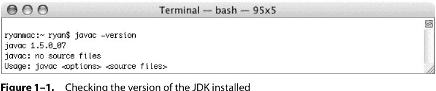

如果你还没有至少 JDK 1.4，可以从 Sun 开发者网络站点 http://java.sun.com/javase/downloads 下载 JDK。

你还需要在机器上安装 Google Web Toolkit SDK。可以在 http://code.google.com/webtoolkit/download.html 找到它。

工具包的 ZIP 文件大约为 13MB。下载后，将其解压到你 preferred 的安装目录（无需安装程序）。你应该将安装目录添加到你的路径变量中，以便从任何目录都能方便地调用 GWT 的脚本。在 Windows 上，你可以通过**控制面板 > 系统 > 高级 > 环境变量**来完成此操作，并将安装路径添加到`PATH`变量中。在 OS X 和 Linux 上，你可以使用`set`命令或在启动脚本中设置变量来添加路径。例如，如图 1-2 所示，我在 OS X 上的主目录中的`.profile`文件中设置了路径变量。设置路径变量后，你就可以在不指定完整路径的情况下执行 GWT 脚本，如图 1-3 所示。

**18**  **第 1 章 初识 Google Web Toolkit**

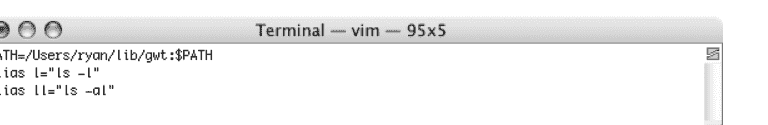

**图 1–2.** 在 OS X 上将 GWT 添加到`PATH`变量

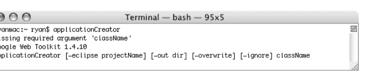

**图 1–3.** 不指定路径运行`applicationCreator`脚本

要开始使用 GWT 构建应用程序，我们首先需要创建一个新项目。这个项目将用于一个 Hangman Ajax 应用程序，因此我们将使用 Hangman 作为项目名称。图 1-4 展示了创建应用程序目录的过程，然后运行 GWT 的`applicationCreator`脚本来生成所需的文件。


**图 1–4.** 使用`applicationCreator`创建名为 Hangman 的新项目

如图 1-4 所示，我们运行了以下命令来生成这些文件：

```bash
applicationCreator com.gwtapps.tutorial.client.Hangman
```

该参数是我们 GWT 应用程序的完整 Java 路径名称。（如果你还不熟悉 Java，可以通过访问 http://java.sun.com/docs/codeconv/html/ CodeConventions.doc8.html 了解如何引用 Java 资源。）Java 路径直接映射到文件系统中的路径，如图 1-4 所示。这种技术有助于你将代码组织到包中。

此时，应用程序已经可以运行了。GWT 支持两种运行模式：你可以在 GWT 的托管浏览器中使用生成的 Hangman shell 脚本运行应用程序，这是用于测试和调试应用程序的方法；或者你可以使用生成的 Hangman 编译脚本将应用程序编译为 JavaScript，并在任何浏览器中运行。**GWT 托管模式**在 GWT 控制的环境下运行你的应用程序，而不是在浏览器中，允许你查看日志和错误消息，并在 Java 环境中调试你的应用程序。这与将编译后的应用程序作为 JavaScript 在浏览器中运行形成对比，在后一种情况下，你只能依赖 JavaScript 错误消息，并且没有调试支持。当你使用 Hangman shell 脚本在托管模式下运行应用程序时，你会看到一个 GWT shell 窗口，显示错误和其他日志消息，如图 1-5 所示，以及一个加载生成应用程序的托管浏览器窗口，如图 1-6 所示。

这就是启动 GWT 应用程序项目所需要做的全部工作。在第 4 章中，你将看到如何在 Eclipse 等 IDE 中启动项目以加快开发速度。

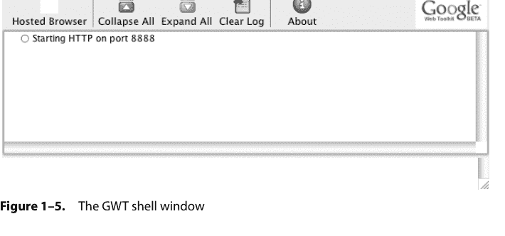

**图 1–5.** GWT shell 窗口

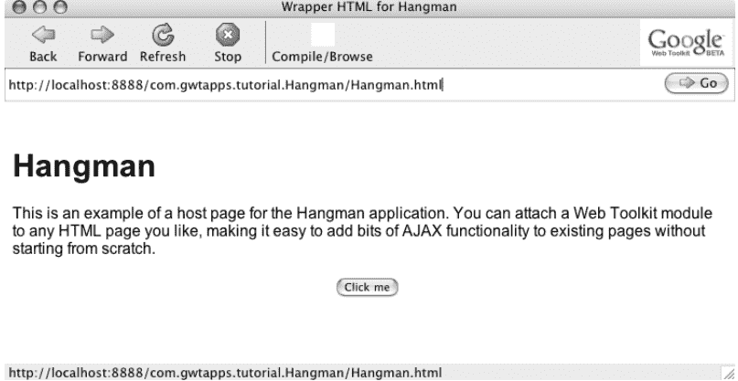

**图 1–6.** 托管浏览器窗口

### 自定义生成的应用程序

要自定义生成的应用程序，我们需要查看两个生成的文件。第一个是宿主 HTML 页面，它作为 GWT 应用程序的入口点。当加载到浏览器中时，它会包含启动应用程序的 JavaScript。在本例中，宿主 HTML 文件名为 Hangman.html，位于`com/gwtapps/tutorial/public`目录下。该文件的内容应该类似于以下内容：

```html
<html>
  <head>
    <title>Wrapper HTML for Hangman</title>
    <style>
      body,td,a,div,.p{font-family:arial,sans-serif}
      div,td{color:#000000}
      a:link,.w,.w a:link{color:#0000cc}
      a:visited{color:#551a8b}
      a:active{color:#ff0000}
    </style>
    <script language='javascript'
      src='com.gwtapps.tutorial.Hangman.nocache.js'></script>
  </head>
  <body>
    <iframe src="javascript:''" id="__gwt_historyFrame"
      style="width:0;height:0;border:0"></iframe>
```


```html
<h1>Hangman</h1>

<p>
    This is an example of a host page for the Hangman application.
    You can attach a Web Toolkit module to any HTML page you like,
    making it easy to add bits of AJAX functionality to existing pages
    without starting from scratch.
</p>

<table align=center>
    <tr>
        <td id="slot1"></td><td id="slot2"></td>
    </tr>
</table>
</body>
</html>
```

如你所见，这看起来像一个典型的 HTML 文件。HTML 内容构成了你在托管模式浏览器中看到的大部分内容。你可以在标题标签中看到 Hangman 标题，以及带有说明的段落。`head` 部分包含 `title` 标签，它会在浏览器窗口的标题栏中放置标题。`style` 标签包含用于样式化应用程序的 CSS 代码，`script` 标签加载应用程序源。你可以看到浏览器中的按钮在 HTML `body` 中没有对应的标签。该按钮是生成的 GWT 应用程序的一部分，它根据此文件中 `td` 标签的 ID 将自己附加到相应的标签上。

第二个重要的生成文件是 Java 文件，它作为应用程序的入口点。该文件 `Hangman.java` 位于 `com/gwtapps/tutorial/client/` 目录下。此文件中的生成代码应该如下所示：

```java
/**
 * Entry point classes define <code>onModuleLoad()</code>.
 */
public class Hangman implements EntryPoint {

    /**
     * This is the entry point method.
     */
    public void onModuleLoad() {
        final Button button = new Button("Click me");
        final Label label = new Label();
```

```java
button.addClickListener(new ClickListener() {
  public void onClick(Widget sender) {
    if (label.getText().equals(""))
      label.setText("Hello World!");
    else
      label.setText("");
  }
});

// Assume that the host HTML has elements defined whose
// IDs are "slot1" and "slot2". In a real app, you probably would not want
// to hard-code IDs. Instead, you could, for example, search for all
// elements with a particular CSS class and replace them with widgets.
//
RootPanel.get("slot1").add(button);
RootPanel.get("slot2").add(label);
}
}
```

注意，`Hangman` 类实现了 GWT 的 `EntryPoint` 接口及其 `onModuleLoad()` 方法。你可以使用此方法构建界面并初始化应用程序，该方法将应用程序加载到浏览器中。生成的代码创建 `Button` 和 `Label` 控件，并将它们添加到 ID 为 `slot1` 和 `slot2` 的 `td` 标签中。它还为按钮添加了一个 `ClickListener`，通过更改 `Label` 控件中的文本来处理点击事件。目前，请专注于概念，不要担心这些细节；你将在第 2 章中学习 `RootPanel` 类、控件和事件处理。

### 创建动态界面

接下来，我们将精简 HTML 宿主文件，使其只有一个 `div` 标签，我们将从 Java 代码中连接到这个标签：

```html
<html>
  <head>
    <title>Hangman</title>
    <style>
      body,td,a,div,.p{font-family:arial,sans-serif}
      div,td{color:#000000}
      a:link,.w,.w a:link{color:#0000cc}
      a:visited{color:#551a8b}
      a:active{color:#ff0000}
    </style>
```

如你所见，这看起来像一个典型的 HTML 文件。HTML 内容构成了你在托管模式浏览器中看到的大部分内容。你可以在标题标签中看到 Hangman 标题，以及带有说明的段落。`head` 部分包含 `title` 标签，它会在浏览器窗口的标题栏中放置标题。`style` 标签包含用于样式化应用程序的 CSS 代码，`script` 标签加载应用程序源。你可以看到浏览器中的按钮在 HTML `body` 中没有对应的标签。该按钮是生成的 GWT 应用程序的一部分，它根据此文件中 `td` 标签的 ID 将自己附加到相应的标签上。

第二个重要的生成文件是 Java 文件，它作为应用程序的入口点。该文件 `Hangman.java` 位于 `com/gwtapps/tutorial/client/` 目录下。此文件中的生成代码应该如下所示：

```java
/**
 * Entry point classes define <code>onModuleLoad()</code>.
 */
public class Hangman implements EntryPoint {

    /**
     * This is the entry point method.
     */
    public void onModuleLoad() {
        final Button button = new Button("Click me");
        final Label label = new Label();
```

```java
button.addClickListener(new ClickListener() {
  public void onClick(Widget sender) {
    if (label.getText().equals(""))
      label.setText("Hello World!");
    else
      label.setText("");
  }
});

// Assume that the host HTML has elements defined whose
// IDs are "slot1" and "slot2". In a real app, you probably would not want
// to hard-code IDs. Instead, you could, for example, search for all
// elements with a particular CSS class and replace them with widgets.
//
RootPanel.get("slot1").add(button);
RootPanel.get("slot2").add(label);
}
}
```

注意，`Hangman` 类实现了 GWT 的 `EntryPoint` 接口及其 `onModuleLoad()` 方法。你可以使用此方法构建界面并初始化应用程序，该方法将应用程序加载到浏览器中。生成的代码创建 `Button` 和 `Label` 控件，并将它们添加到 ID 为 `slot1` 和 `slot2` 的 `td` 标签中。它还为按钮添加了一个 `ClickListener`，通过更改 `Label` 控件中的文本来处理点击事件。目前，请专注于概念，不要担心这些细节；你将在第 2 章中学习 `RootPanel` 类、控件和事件处理。

### 创建动态界面

接下来，我们将精简 HTML 宿主文件，使其只有一个 `div` 标签，我们将从 Java 代码中连接到这个标签：

```html
<html>
  <head>
    <title>Hangman</title>
    <style>
      body,td,a,div,.p{font-family:arial,sans-serif}
      div,td{color:#000000}
      a:link,.w,.w a:link{color:#0000cc}
      a:visited{color:#551a8b}
      a:active{color:#ff0000}
    </style>
```

注意，我保留了所有代码块不变，并按照要求将输出包含在 `[content]...[/content]` 中。

```html
<script language='javascript'
    src='com.gwtapps.tutorial.Hangman.nocache.js'></script>
</head>
<body>
    <!-- OPTIONAL: include this if you want history support -->
    <iframe src="javascript:''" id="__gwt_historyFrame"
        style="width:0;height:0;border:0"></iframe>
    <h3>Hangman</h3>
    <div id="hangman"></div>
</body>
</html>
```

请注意，HTML 的 `body` 部分有一个 `div` 标签，其 ID 为 `hangman`。在 Java 代码中，我们需要将 Hangman 应用程序的用户界面元素附加到这个 `hangman` 标签上。不过，首先需要确定界面的样子。如果你不熟悉这个游戏，下面介绍一下它的玩法。玩家需要逐个字母地猜测一个短语。每次玩家猜错一个不在短语中的字母时，程序就会在被绞刑的简笔画人物身上增加一个肢体（抱歉举了这个有点血腥的例子）。要想获胜，你需要在简笔画人物被完全画出来之前猜出短语中的所有字母。

界面需要一排可以按下的按钮来猜测字母，一个能根据错误猜测次数变化的图像，以及一个显示正在猜测的短语的标签。图 1-7 展示了界面外观的模拟图。

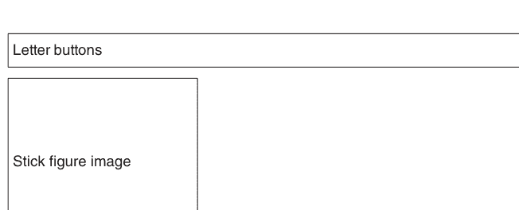

**图 1-7.** Hangman 应用程序的布局

我们将使用 GWT 来构建这个布局，并将其放置在 ID 为 `hangman` 的 `div` 标签内。为了实现这一目标，我们将为图 1-7 中的每个框各使用一个 GWT 部件，并可以将 `Hangman.java` 文件中的实现修改为以下内容：

```java
public class Hangman implements EntryPoint {
  private FlowPanel letters = new FlowPanel();
  private Label wordLabel = new Label();
  private Image image = new Image();

  public void onModuleLoad() {
    //create interface
    RootPanel hangman = RootPanel.get("hangman");
    hangman.add(letters);
    hangman.add(image);
    hangman.add(wordLabel);
   }
}
```

我们创建了三个部件。`letters` 部件使用了 `FlowPanel`，并最先被添加。如前所述，GWT 中的面板是一种可以容纳其他部件的部件类型。面板通常会对其子部件施加正式的布局。对于 `FlowPanel` 而言，其内部布局与 HTML 非常相似。在这种情况下，当我们添加子部件时，它们会为每个字母创建一个按钮，并从左到右排列；当水平空间不足时，按钮会自动换到下一行。`Image` 部件封装了 HTML 的 `img` 标签，可以显示单个图像。我们将使用同一个 `Image` 部件来切换简笔画人物的绘图。第三个也是最后一个部件是 `Label` 的实例，它只是用来显示文本。

此时你可以运行应用程序，但我们还没有向部件中添加任何内容，因此浏览器只会显示一个空白页面。所以我们来向 `Hangman` 类添加一个 `startGame()` 方法，并从 `onModuleLoad()` 方法中调用该方法。这个新方法为开始新游戏设置界面的状态。我们希望 `startGame()` 方法与 `onModuleLoad()` 方法分开，这样用户就可以在不重新启动应用程序的情况下开始新游戏。以下代码设置了初始游戏界面：

```java
public void onModuleLoad() {
  //create interface
  RootPanel hangman = RootPanel.get("hangman");
  hangman.add(letters);
  hangman.add(image);
  hangman.add(wordLabel);

  startGame();
}
```

```java
public void startGame(){
    //add letter buttons
    letters.clear();
    for( char letter = 'A'; letter <= 'Z'; letter++ ){
        final Button button = new Button(Character.toString(letter));
        button.setOnClickListener( new OnClickListener(){
            public void onClick( Widget sender ){
                button.setEnabled(false);
                guess( button.getText().charAt(0) );
            }
        });
        letters.add( button );
    }
    //set initial image
    image.setUrl("hm1.gif");
}
```

`startGame()` 方法有一个循环，遍历字母表中的每个字母，为每个字母创建一个 `Button` 部件。字母被设置为按钮的标签。我们为按钮添加了一个 `ClickListener`，用于处理用户点击按钮的事件。在 `ClickListener` 的 `onClick()` 方法中，按钮被禁用，这样用户就不会误操作而重复选择同一个字母。然后 `onClick()` 方法调用一个名为 `guess()` 的方法来处理用户的字母猜测。在 `startGame()` 方法的其余部分，`Image` 部件的绘图被初始化为 `hm1.gif`。当用户猜错时，我们可以使用简单的模式来引用新图像。例如，第一次猜错后的图像将是 `hm2.gif`，下一次是 `hm3.gif`，依此类推。

图 1-8 展示了此时带有字母按钮和初始图像的界面。

以下代码实现了该应用程序的其余游戏逻辑：

```java
private final int MAX_GUESSES = 6;
private int misses;
private char[] word;
private char[] visibleWord;
```

### 第 1 章 Google Web Toolkit 初探

```java
//set up a new word to guess
public void setWord( String newWord ){
    word = newWord.toUpperCase().toCharArray();
    visibleWord = new char[word.length];
    for( int i=0; i<word.length; i++ ){
        if( word[i] != ' ' )
            visibleWord[i]='_';
        else
            visibleWord[i]=' ';
    }
    wordLabel.setText( new String(visibleWord) );
}
```


```java
//handle a guess from the user
public void guess( char letter ){
    boolean badGuess = true;
    boolean wordFinished = true;

    //check for matches for this letter
    for( int i=0; i<word.length; i++ ){
        if( word[i]==letter ){
            visibleWord[i] = letter;
            badGuess = false;
        }
        else if( visibleWord[i]=='_'){
            wordFinished = false;
        }
    }
    wordLabel.setText( new String(visibleWord) );

    if( wordFinished ){
        Window.alert( "Congratulations, you got the answer!" );
        startGame();
    }
    else if( badGuess ){
        misses++;
        image.setUrl("hm"+Integer.toString(misses+1)+".gif");
        if( misses == MAX_GUESSES ){
            Window.alert(
                "You ran out of guesses! The answer is "+ new String(word));
            startGame();
        }
    }
}
```

请注意`guess`方法中靠近末尾的那一行，当做出错误猜测时：下一个图像的URL是根据错误猜测的次数计算出来的。图1-9展示了应用程序将使用的七幅图像。

快速教程 27

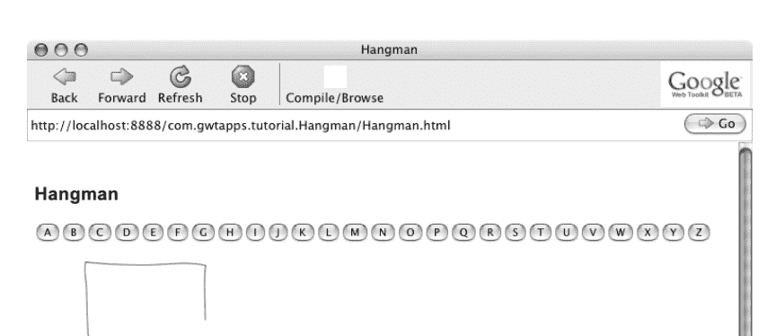

`http://localhost:8888/com.gwtapps.tutorial.Hangman/Hangman.html`

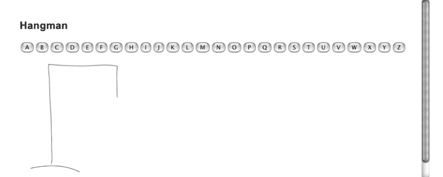

图 1-8. 带有字母按钮和初始图像的用户界面

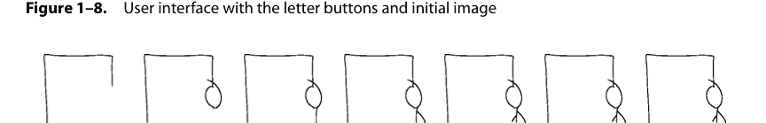

图 1-9. 七幅简笔画人物图像

### 使用异步HTTP

到目前为止，我们已经使用GWT部件为这个Ajax应用程序设置了界面，并声明了一些使游戏运行的额外逻辑，但我们还没有创建游戏词汇的来源。这是测试从服务器异步加载数据的好机会，这是Ajax应用程序的主要任务之一。GWT提供了多种从服务器加载数据的方式，包括异步HTTP模块和RPC模块，以及解析结构化数据的不同方式（例如JSON和XML）。对于本应用程序，我们将使用`com.google.gwt.user.client.HTTPRequest`类从服务器异步加载数据，与GWT的HTTP模块相比，这是一种简化的异步HTTP请求方式。

在服务器上，我们将放置一个名为`movies.txt`的文本文件，其中包含一个电影列表。以下是该文件内容的示例：

```text
The Godfather
The Shawshank Redemption
Pulp Fiction
Schindler's List
Casablanca
The Empire Strikes Back
The Lord of the Rings
One Flew Over the Cuckoo's Nest
...
```

我们可以将此文件中列出的每部电影作为Hangman应用程序的不同短语。要将这些数据导入应用程序，需要调用`HTTPRequest`的`asyncGet`方法，将文件名作为第一个参数。第二个参数需要是`ResponseTextHandler`接口的实现。应用程序调用`asyncGet`方法后，`HTTPRequest`类会从服务器请求该文件，应用程序代码在客户端继续执行。当服务器响应时，`HTTPRequest`类会在你的`ResponseTextHandler`接口中调用`onCompletion`方法，并将文件内容作为参数。将以下代码添加到Hangman类的`onModuleLoad`方法中，即可实现`movies.txt`文件的异步加载：

```java
private String[] words;

public void onModuleLoad() {

    //create interface
    RootPanel hangman = RootPanel.get("hangman");
    hangman.add(letters);
    hangman.add(image);
    hangman.add(wordLabel);

    //load words
    HTTPRequest.asyncGet("movies.txt", new ResponseTextHandler(){
        public void onCompletion(String responseText) {
            words = responseText.split("\n");
            startGame();
        }
      });
    }
}
```

请注意，我们在类中添加了一个字符串数组字段。`String.split()`方法根据文件内容创建字符串数组，并使用换行符来标识在哪里拆分字符串。在`startGame`方法中，我们只需从`words`数组中随机选择一个短语：

```java
setWord(words[Random.nextInt(words.length)]);
```

这就是需要做的全部工作！我们已经创建了一个简单的Ajax应用程序，它具有动态界面，并且数据是从服务器异步加载的。最终应用程序在托管模式浏览器中的样子应该如图1-10所示。

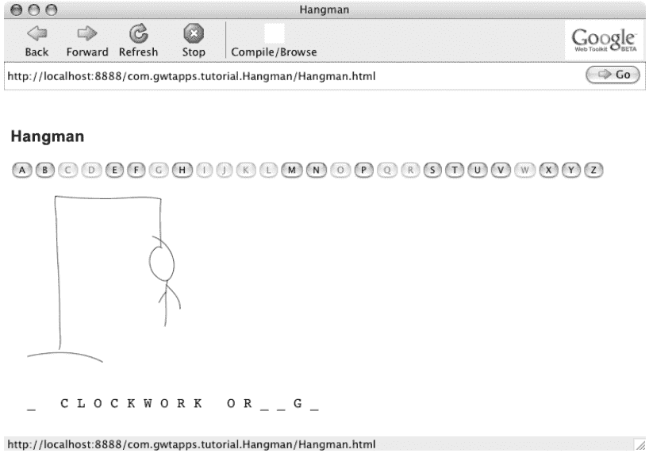

**图 1-10.** 完成的应用程序

### 工具包包概览

虽然GWT的主要优势在于使用Java语言及其工具来构建基于网络标准技术的Web客户端，但你也会欣赏其庞大的Java包库。这些包的目标与整个工具包的目的一样——帮助你构建动态的基于浏览器的应用程序——而且它们在这方面做得很出色。本节简要介绍GWT库。更多细节请参见第2章（用户界面）和第3章（服务器通信）。

库包位于`gwt-user.jar`文件中，该文件位于GWT安装目录中。如果你不熟悉`JAR`文件，可以将其理解为类似于Java库的ZIP文件：一个包含目录结构的文件，其中包含多种类型的文件，通常包括编译后的Java类文件。所有GWT项目都需要此文件才能在托管模式下运行，因为JAR文件包含了GWT应用程序所基于的大量代码。当你设置项目或生成运行项目的脚本时，此JAR文件将在类路径中。由于GWT的`applicationCreator`脚本会自动为你设置类路径，所以你不必太担心这个JAR文件，只需知道GWT库代码在其中即可。即使你部署应用程序以在Web浏览器中使用，也不需要包含此文件。GWT的编译步骤会将你的代码以及你从这个库中使用的任何代码编译为JavaScript。GWT确保当你的应用程序部署并在浏览器中运行时，它的唯一依赖项是所有主流浏览器都支持的Web标准，包括Firefox、Internet Explorer、Safari和Opera。

`gwt-user.jar`文件是查看GWT附带整个库的一个好起点。图1-11显示了GWT 1.4的`gwt-user.jar`文件的文件夹结构。

在此目录结构中，你可以看到GWT库的一些主要包。这些包可以分为五类：用户界面、服务器调用、数据格式、JRE模拟和实用工具。图1-12说明了GWT库如何划分其功能。

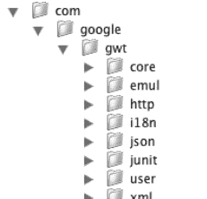

图 1-11. `gwt-user.jar`文件的文件夹结构

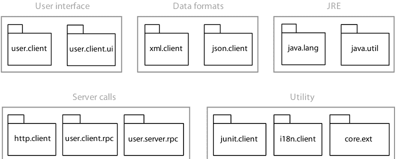

图 1-12. GWT库功能的划分

- `com.google.gwt.user.client` 此包提供对Web浏览器API的基本访问，用于动态编程网页，以及另外一些用于访问基本浏览器功能的辅助类。此包中的DOM类允许通过文档对象模型直接编辑Web文档。GWT widgets和panels（作为此列表中下一个库的一部分）使用此库来构建自身。你也可以使用此库创建自定义widget。

- `com.google.gwt.user.client.ui` 在此包中，工具包提供了一个构建用户界面的框架，其设计与Java的抽象窗口工具包（AWT）非常相似。该包在帮助创建和使用动态、可重用的用户界面组件方面做得很好。在本书中，我们将使用此框架构建界面。

第二类包——服务器调用，帮助我们向服务器发起远程调用。这些包包含帮助GWT应用程序与服务器通信的类。

- `com.google.gwt.http.client`

此HTTP包为`XMLHttpRequest`对象创建了一个强大的独立于浏览器的包装器，Ajax应用程序使用该对象进行异步通信。

- `pun.com.google.gwt.user.client.rpc` 和 `com.google.gwt.user.server.rpc`

这些包赋予应用程序通过远程过程调用与服务器通信的能力。此库使用RPC通信将基于Java的接口的中继调用传递到我们的服务器，而无需我们考虑协议细节。它还使用Web浏览器的`XMLHttpRequest` JavaScript对象进行通信。

这两类包涵盖了支持Ajax应用程序的库所需的两个主要功能领域：动态用户界面和异步服务器通信。如果你只想创建动态界面，你只需要第一组库；如果你只需要异步服务器通信，你只需要第二组库。你不必担心只选择所需的库。GWT编译器知道你在应用程序中使用了哪些库，并且足够智能，只会将你需要的代码编译为JavaScript。这使得你的应用程序代码在分发时尽可能小巧。这是使用工具包的另一个优势，而非其他JavaScript框架；你无法以相同的粒度级别减小库的大小。

让我们继续看看可用的包。第三类包为你的应用程序提供解析和构造数据格式的能力。

- `com.google.gwt.xml.client`

此XML包使你的应用程序能够解析XML文档，并通过文档对象模型迭代其内容。你也可以使用它来构造文档对象模型并生成XML文档。将此包与HTTP包一起使用，允许你向服务器发送和接收XML文档。

- `com.google.gwt.json.client`

此JSON包与XML包类似，只是格式为JSON而不是XML。JSON是一种类似于XML的分层数据格式，但更轻量级（更小）。此库允许你生成和解析JSON数据。

JRE模拟类别包含Java运行时环境库的一个子集，以协助常见的编程任务，包括基本Java类型、异常和集合。Java语言附带了许多有助于构建多种类型应用程序的库。GWT没有创建更多新库，而是模拟了JRE中两种最常用的库。模拟这些库的优势在于提供开发人员可能已经熟悉的类。这被称为模拟，因为部署GWT应用程序时并不使用JRE类。相反，GWT编译器将JRE类的使用替换为等效的JavaScript代码。

- `java.lang`

此包包含基本Java类，如`Integer`和`String`。

- `java.util`

实用工具包提供了Java可用的许多基本集合类，包括`Maps`、`Lists`和`Sets`。

最后一类包是一组杂项但重要的实用工具类。

- `com.google.gwt.junit.client`

此JUnit包提供类以协助使用JUnit为应用程序编写单元测试。

- `com.google.gwt.i18n.client`

GWT提供国际化支持，此包提供有助于访问它的类。

- `com.google.gwt.core.ext`

此扩展包提供帮助你扩展GWT编译器的类。

这些包完全是可选的。你可以选择在应用程序中使用任意组合的包，GWT编译器会确保只有被使用的代码才会被包含在编译后的应用程序中。你并不局限于只使用工具包自带的包；你还可以引入第三方库来与GWT配合使用，以扩展应用程序的功能。例如，第6章中的Gadget Desktop应用程序使用了Google Gears GWT库来支持与Google本地持久化浏览器插件的集成。不过，我认为你会发现GWT库为你提供了大量构建Ajax应用程序的基础模块，无需使用第三方包。

### GWT应用程序概览

本书采用以应用程序为中心的视角来使用GWT。开发人员通常将Ajax作为传统基于文档的网页的补充。这是使用Ajax的一种完全可行的方式，但你也可以利用GWT来帮助解决构建更大型复杂Ajax应用程序时遇到的问题。GWT在这方面表现出色，让你能够开发复杂度达到桌面应用程序水平的Ajax应用程序。

本书第一部分其余章节提供了GWT的概览以及如何在应用程序中有效使用GWT。第二部分的章节描述了如何使用GWT构建五种不同类型的应用程序。每个应用程序展示了使用GWT与Web进行互操作的不同方式，并且每个应用程序都遵循不同的应用程序模式。

### 常见应用程序模式

本书使用了五种应用程序模式：

- **容器模式**用于那些具有类插件结构以支持许多较小工具类应用程序的应用程序。
- **聚合器模式**用于那些将多个通常是离散的数据集组合到一个界面中的应用程序。
- **工作空间模式**用于那些提供文档和不显眼的工具来处理它的应用程序。
- **协作者模式**用于那些允许多个用户聚在一起交流的应用程序。
- **管理器模式**用于那些提供界面来访问和管理大量数据的应用程序。

### 示例应用程序

第6章中的Gadget Desktop应用程序遵循容器模式。它具有灵活且动态的用户界面，支持拖放操作，包含多个执行各种任务的小工具，例如通过Really Simple Syndication (RSS)下载新闻、提供天气预报以及显示Google地图。该应用程序展示了如何与其他JavaScript库（如Google Maps和Google Ajax Feed API）集成，以及如何通过浏览器Cookie或Google Gears提供客户端存储。

第7章中的示例应用程序Multi-Search遵循聚合器模式，让你可以使用单个界面搜索多个搜索引擎。该应用程序展示了如何使用来自Yahoo! Search、Google Base、Amazon Books和Flickr的JSON在客户端加载远程数据。

第8章中的Blog Editor应用程序遵循工作空间模式，提供了一个管理多个博客和博客条目的界面，避免了博客服务标准界面中典型的页面刷新。该应用程序展示了如何通过REST Web服务接口与Blogger API集成，以及如何构建HTTP代理来绕过浏览器的同源策略。

在第9章中，Instant Messenger应用程序遵循协作者模式，展示了一种与现有网页进行微妙集成的方式，让其读者可以通过即时消息相互交流。它展示了如何使用GWT-RPC库以及如何提供基于RPC的事件系统，将服务器端事件推送到客户端。

第10章中的Database Editor应用程序遵循管理器模式，包含一个管理现有传统Web应用程序大量数据的界面。该应用程序展示了如何使用action、REST和RPC方法从服务器增量加载数据。它展示了如何使用基于action的方法集成PHP脚本，使用基于REST的方法集成Ruby on Rails，以及使用GWT-RPC集成Java servlet。它还演示了如何编写代码生成器来自动将Java对象序列化和反序列化为JSON和XML。

在阅读这些章节并查看提供的源代码之后，你应该对如何使用Java工具和GWT构建、管理和维护大型复杂的Ajax应用程序有了扎实的理解。

### 小结

本章介绍了Google Web Toolkit背后的历史，讨论了Web上的应用程序开发，并研究了使用GWT构建应用程序所需的技能。本教程提供了使用GWT进行Ajax应用程序开发的初步体验。接下来的四章将更深入地探讨GWT库，并介绍帮助你有效使用GWT构建应用程序的技术。

## 用户界面库概览

`com.google.gwt.user.client.ui`包包含允许你使用经过验证的技术创建动态用户界面的类，这些技术在其他用户界面框架（如Java的AWT）中已经证明是成功的。该包中的类基于Web浏览器的用户界面特性构建，提供动态可重用组件，这些组件在受支持的浏览器实现和版本之间具有相同的行为。GWT用户界面库将这些组件称为**部件**，它们从简单的按钮和标签到更复杂的标签面板和树形视图。有些部件直接对应于你在常规网页中使用的HTML元素，有些则是由多个HTML元素与脚本和事件处理组合而成的复合体。

本书将不同类型的部件划分为以下功能类别：

- **静态部件**，交互性不强，仅作为应用程序某些编程操作的结果而改变状态。
- **表单部件**简单地包装了通常用于Web表单的HTML元素，包括文本框和按钮。
- GWT提供了**复杂部件**，它们是使用HTML标签和JavaScript事件处理组合而成的新浏览器UI特性。
- 其余四类部件涵盖面板。**简单布局面板**和**复杂布局面板**充当其他部件的父级。每个布局面板遵循独特的布局模式。其他面板，**简单容器面板**和**复杂容器面板**，不处理布局，但为其单个子孙部件提供独特的容器功能。

图2-1展示了GWT自带部件按类别划分的情况。

### 静态部件

这些最简单的部件没有任何内部状态，也不会自行动态变化。它们仍然可以是动态用户界面的一部分，用户界面代码可以在运行时更改它们的属性和位置，但它们不会作为用户操作的结果而变化。这些部件包括`Label`、`HTML`、`Image`和`Hyperlink`。

#### 标签

当你将`Label`部件添加到父部件时，它只是显示其非HTML字符串。以下代码展示了如何将`Label`添加到容器：

```java


```java
mainPanel.add(new Label("Signing in..."));
```

你使用要显示的字符串实例化`Label`部件。父容器，在本例中是`mainPanel`实例，决定在界面中将标签放置在哪里。`Label`实例只是知道填充其空间。这个代码片段来自第9章的Instant Messenger示例应用程序，添加了一个在登录期间显示的`Label`实例，如图2-2所示。

`Label`具有默认设置为`gwt-Label`的CSS名称，这让你可以轻松地为应用程序中的所有标签设置样式。例如，将以下CSS添加到宿主HTML文档的`style`标签或从宿主HTML文档引用的CSS文件中，可以使标签具有蓝色背景和黄色文字：

```css
.gwt-Label {
  background-color: #008;
  color: #FF0;
}
```

这一更改将导致Instant Messenger应用程序显示`"Signing in..."`标签，如图2-3所示（当然是除去颜色的）。

通常情况下，标签的文本是左对齐的，而不是像图2-3中那样居中。此标签中的文本居中显示是因为其父控件已将子控件的水平对齐方式设置为居中。由于`Label`实现了`HasHorizontalAlignment`接口，我们也可以使用该类的`setHorizontalAlignment`方法来设置标签的水平对齐方式。以下代码将标签的水平对齐方式设置为右侧：

```java
Label signInLabel = new Label("Signing in...");

signInLabel.setHorizontalAlignment(
    HasHorizontalAlignment.ALIGN_RIGHT
);
```

在即时通讯示例应用程序中使用此代码，会导致标签显示在右侧，如图2-4所示。

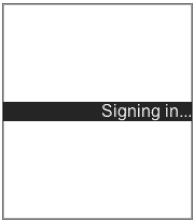

**图 2-4.** 标签显示在右侧

`Label`还实现了`HasWordWrap`接口。当文本无法容纳在控件提供的水平空间内时，就会发生自动换行。在默认行为下，自动换行开启时，无法容纳的单词会换行到下一行。`setWordWrap`方法通过传递`true`值来开启自动换行，传递`false`值来关闭。图2-5中的两张图片来自第8章的博客编辑器应用程序，首先说明了自动换行开启的情况，然后是自动换行关闭的情况。

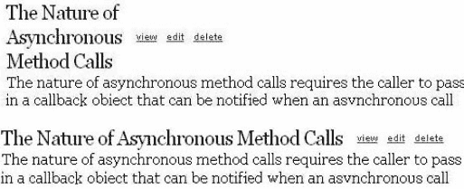

**图 2-5.** 自动换行开启和关闭的示例

`Label`还实现了`SourcesMouseEvents`和`SourcesClickEvents`接口的方法，以支持对标签的鼠标事件和点击事件的处理（本章后面会介绍）。

### HTML

`HTML`控件是另一个简单的控件，与`Label`非常相似，但它可以支持和渲染HTML。实际上，它扩展了`Label`控件，获得了其对鼠标事件、点击事件、自动换行和水平对齐的支持。使用其默认的CSS名称`gwt-HTML`，可以像`Label`控件类似的方式自定义CSS属性。

除了`Label`的功能外，`HTML`控件还实现了`HasHTML`接口，该接口具有`setHTML`和`getHTML`方法，用于添加和检索HTML字符串。如果你在字符串中对`Label`使用HTML标签，它会将这些标签渲染为文本值。`Label`不允许渲染HTML这一事实，实际上使其成为应用程序中更安全的控件。

从字符串渲染HTML的问题在于，你无法总是确定它在不同的浏览器版本中会表现出相同的行为，而且如果你不知道值的来源（它可能是由用户输入的），那么它可能会渲染恶意的HTML，包括JavaScript。你应该使用GWT控件和CSS来布局和格式化你的应用程序，并且只在必要时使用`HTML`控件。如果你确实需要显示将由另一个应用程序生成或由用户输入的HTML，则应检查其中是否存在恶意标签。

该控件在处理少量HTML片段时确实非常方便，此时创建单独的控件就显得过于繁琐。例如，在即时通讯应用程序中，使用`HTML`控件以粗体显示用户的消息和姓名：

```java
HTML messageLabel = new HTML(
    "<b>" + escapeHtml(contact.getName()) +
    "</b>: " + escapeHtml(message)
);
```

你也可以通过使用一个面板来容纳两个`Label`控件，并为第一个代表联系人姓名的标签设置CSS值为粗体来实现。然而，这行代码简单得多，而且我们可以相当确定粗体标签在所有浏览器中的渲染效果都是相同的。在这种情况下，附加到字符串的消息来自用户，因此需要采取适当的预防措施以避免不当渲染或JavaScript注入。

请注意，对于添加到`HTML`控件的每个字符串，都调用了`escapeHtml`方法。此方法并非GWT自带，但在添加用户生成的文本时至关重要。该方法的实现如下：

```java
public String escapeHtml(String maybeHtml) {
    final Element div = DOM.createDiv();

    DOM.setInnerText(div, maybeHtml);

    return DOM.getInnerHTML(div);
}
```

此代码将字符串中的任何HTML字符转义为HTML实体，使它们作为文本显示，而不是被解释为标签，从而有效地防止了不需要的HTML渲染或脚本注入。

### Image

`Image`控件是另一个简单的控件，与`Label`和`HTML`控件一样是静态的。它不是接受一个字符串并渲染它，而是接受一个指向图像文件的URL并渲染该图像。该控件封装了`IMG` HTML标签，允许你在GWT的UI框架中将该标签用作控件。

第9章中的即时通讯应用程序使用`Image`控件，在每个联系人姓名旁边显示用户图标，代码如下：

```java
listTable.setWidget(row, 0, new Image("icon_user.gif"));
```

在这行代码中，应用程序使用一个字符串作为图像文件的文件名来创建`Image`控件。由于图像文件不是完整的URL，浏览器将其视为相对于应用程序位置（主HTML文件所在位置）的路径。浏览器会尝试从与主HTML文件相同的位置获取此图像。你也可以指定到子目录的相对路径：

```java
listTable.setWidget(row, 0, new Image("images/icon_user.gif"));
```

使用此字符串，浏览器会在主HTML文件所在位置下的`images`目录中查找。URL也可以是服务器上的绝对URL：

```java
listTable.setWidget(row, 0, new Image("/images/icon_user.gif"));
```

注意添加了第一个前导斜杠。这告诉浏览器在与主HTML文件相同的服务器上查找，从`images`目录开始。你也可以指定主机文件的服务器位置：

```java
listTable.setWidget(
    row,
    0,
    new Image("http://www.rdews.com/img/icon_user.gif")
);
```

无论使用什么URL，如果图像文件存在于指定位置，浏览器就会渲染该图像。图像的容器控件决定了图像在浏览器中出现的位置。在即时通讯应用程序中，图像显示在联系人姓名的左侧，如图2-6所示。

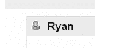

`Image`控件也像`Label`和`HTML`控件一样处理鼠标和点击事件，因为它支持`SourcesMouseEvents`和`SourcesClickEvents`接口。它通过`SourcesLoadEvents`接口增加了支持加载事件的能力。处理加载事件允许你在图像成功加载或由于某种原因加载失败时执行代码。以下代码在图像未正确加载时移除`Image`控件，以避免显示损坏的图像图标：

```java
final Image userIcon = new Image("icon_user.gif");

listTable.setWidget(row, 0, userIcon);

userIcon.addLoadListener(new LoadListener() {
    public void onLoad(Widget sender) {
        // 成功！，不做任何操作
    }

    public void onError(Widget sender) {
        userIcon.removeFromParent();
    }
});
```

## 第 2 章 用户界面库概述

这段代码实现了`LoadListener`接口及其两个方法的一个实例。应用程序将`LoadListener`实例传递给`Image`控件的`addLoadListener`方法。当加载事件发生时，`Image`控件调用相应的方法：如果加载成功则调用`onLoad`，如果加载失败则调用`onError`。如果这段代码看起来有点陌生，别担心；本章后面的“事件接口”部分会更详细地解释这一点。目前重要的是理解`Image`控件具有此功能。

在动态界面中使用HTML页面上的图像时，一个常见问题是它们需要时间加载，因此在实例化并添加后，图像不会立即可见。这可能会让用户感到些许困惑，并可能降低他们对应用程序的信心。幸运的是，`Image`控件提供了一个静态的`prefetch`方法，可以在实际使用图像之前根据其URL调用该方法来加载图像。

当你将图像添加到界面时，浏览器已经拥有了该图像，从而消除了加载延迟。如果你在用户界面中使用图像，你可能需要考虑在应用程序启动时调用`prefetch`方法。即时通讯应用程序可以这样预加载用户图标：

```java
Image.prefetch("icon_user.gif");
```

此方法实例化图像但不将其添加到文档中。这会导致浏览器获取图像。然后当应用程序创建`Image`控件时，浏览器知道此图像已经可用，无需再次加载。

## Hyperlink

`Hyperlink`控件是静态控件中最复杂的，因为它必须处理Ajax应用程序的历史和链接问题。这个问题源于Ajax应用程序在不刷新页面的情况下运行一个动态文档。在传统的Web应用程序中，链接会将用户带到新文档，并从视图中移除旧文档。如果在Ajax应用程序中发生这种情况，应用程序将卸载并且其状态将丢失。新文档将替换该应用程序，如果它有任何状态，则需要从头开始。

这显然是一个可用性问题，但不仅如此——还有更多。如果用户点击链接进入新页面后，不希望他的Ajax应用就此结束，于是会点击后退按钮返回应用。然而，浏览器会重新启动应用，用户已取得的任何进度都将丢失。

GWT在解决这一可用性问题上迈出了重要一步，这始于`Hyperlink`控件的使用。该控件实现了一种链接，点击时会将用户带到应用内的另一个状态。每个`Hyperlink`可以链接到一个由`String`令牌标识的特定状态。随着用户在应用中导航，他会以令牌列表的形式构建一个状态历史记录。应用开发者必须在应用内实现这些状态，并能够基于其令牌构建特定的状态。

这种实现与后退和前进按钮配合得很好，因为它在应用的URL中使用历史记录令牌。每次用户点击链接时，页面的URL都将其令牌设置为用于`Hyperlink`控件的令牌。例如，第7章中的Multi-Search应用将令牌用作搜索字符串。每次用户输入搜索时，应用都会创建一个历史记录令牌并将浏览器转发到一个新的URL，这不会导致页面刷新，但会将URL添加到浏览器历史记录中，以便与后退和前进按钮协同工作。

对于搜索术语`GWT`，Multi-Search应用的URL如下所示：

```text
http://localhost:8888/com.gwtapps.multisearch.MultiSearch/index.html#GWT
```

如果我们接着搜索`Java`，URL将变为：

```text
http://localhost:8888/com.gwtapps.multisearch.MultiSearch/index.html#Java
```

现在我们点击后退按钮，URL将变回带有`GWT`令牌的那个，GWT会通知我们的应用`GWT`令牌是当前历史记录令牌，应用就会知道要加载`GWT`的搜索结果。

第9章中的Instant Messenger应用为联系人列表中的每个联系人姓名使用`Hyperlink`控件，如图2-7所示。

以下代码在此应用中创建了一个`Hyperlink`：

```java
Hyperlink link = new Hyperlink(
    contact.getName(),
    contact.getName()
);
```

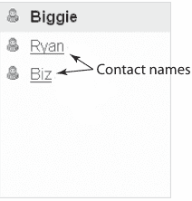

**图 2–7.** 用于联系人姓名的`Hyperlink`控件

此代码创建了一个`Hyperlink`控件，以联系人姓名作为链接文本，以联系人姓名作为令牌。当用户点击某个联系人时，当前令牌变更改为用户点击的联系人姓名。应用通过加载该联系人的聊天窗口来处理此令牌变化。如果用户按下后退按钮，则应用会加载上一个联系人的聊天窗口。

当前令牌的变化，无论是通过点击`Hyperlink`控件触发，还是通过使用浏览器的后退和前进按钮触发，都可以通过实现GWT的`HistoryListener`接口及其`onHistoryChanged`方法来处理。要向应用添加历史记录监听器，你需要调用`History.addHistoryListener`方法。以下代码展示了如何在Instant Messenger应用中处理历史记录令牌的变化：

```java
public void onHistoryChanged(String historyToken) {
    Contact contact = contactList.getContact(historyToken);

    if (contact != null) {
        getChatWindowView(contact);
    }
}
```

如你所见，处理历史记录令牌的变化相当简单。此代码期望历史记录令牌是一个联系人姓名。该代码尝试在应用的领域模型对象中查找该姓名对应的`Contact`实例。如果存在与令牌匹配的联系人姓名，则应用会显示该联系人的聊天窗口。

`Hyperlink`控件很好地利用了浏览器链接和历史记录功能，这对用户来说非常直观。然而，该控件不提供链接到外部资源的能力。要创建指向外部资源的链接，你需要使用`HTML`控件并添加一个锚点标签，如下所示：

```java
HTML externalLink = new HTML(
    "<a href='http://www.rdews.com'>Ryan's Site</a>"
);
```

当用户点击此链接时，浏览器会卸载应用并将其替换为链接URL指向的资源。如果你的应用使用历史记录令牌恰当地处理状态，那么当用户通过点击浏览器的后退按钮返回时，她将以离开时的状态回到应用。

你还可以使用GWT的`DOM`类创建自己的外部链接控件。例如，第8章中的Blog Editor应用创建了一个外部链接控件，让用户可以点击链接查看由外部博客服务托管的博客或博客文章。

### 表单控件

表单控件是通常与HTML表单一起使用的简单控件。然而，HTML表单遵循传统的Web模型，即提交表单后页面会被刷新并显示结果。Ajax应用试图消除这种页面刷新，并通常以异步方式向服务器提交数据。

GWT提供的表单控件不必在HTML表单内部使用，可以以更灵活的方式使用，类似于它们在桌面应用中的对应组件。GWT附带的表单控件有`Button`、`CheckBox`、`RadioButton`、`ListBox`、`TextBox`、`PasswordTextBox`、`TextArea`、`FileUpload`和`Hidden`。GWT的1.4版本添加了更多更复杂的表单控件，包括`ToggleButton`、`PushButton`、`SuggestBox`和`RichTextArea`。

#### Button

`Button`控件包装了类型为`button`的HTML表单输入。在HTML中，`type`属性用于通用`input`标签上以指定输入类型。你可以使用以下代码将按钮添加到HTML页面：

```html
<input type="button">
```

按钮通常在表单上用于提交数据，但在GWT中，你可以使用按钮来调用应用中的任何操作。例如，第7章中的Multi-Search应用使用按钮来提交搜索查询，类似于搜索引擎使用的搜索按钮，如图2-8所示。


在此图中，按钮位于右侧，不包含搜索字符串文本输入。以下代码展示了如何将按钮添加到应用中：

```java
Button submitButton = new Button("Search");

searchPanel.add(submitButton);
```


此代码创建了`Button`控件，为其提供按钮标签的文本字符串，并将其添加到父容器中进行显示。当用户按下搜索按钮时，应用处理事件并执行从多个搜索引擎检索搜索结果的代码。传统的 Web 应用通过`form`标签来实现这一点，当用户按下按钮时，该标签会将表单数据（包括搜索字符串）提交到服务器。然后服务器会响应搜索结果。

使用 Ajax 应用，你可以在不刷新页面的情况下异步提交到服务器。这样，你就不需要用`form`标签包围表单控件，因为其默认行为是刷新页面。相反，你的应用处理点击事件并使用 GWT 的服务器调用库之一来向服务器提交调用。

`Button`控件类实现了`SourcesClickEvents`接口，这让应用代码可以处理点击事件。我们可以为按钮添加一个点击监听器，调用 Multi-Search 应用的`doSearch`方法，如下所示：

```java
submitButton.addListener(new ClickListener() {
    public void onClick(Widget sender) {
        doSearch();
    }
});
```

此控件和许多其他表单控件还通过实现`HasFocus`接口和`SourcesFocusEvents`来支持焦点功能。这些事件允许你以编程方式处理控件获得键盘焦点或失去焦点的情况。在设计界面时注意焦点处理很重要，因为许多用户更喜欢使用键盘。我们将在本章后面探讨用户界面焦点行为的处理。

### ToggleButton 和 PushButton

`ToggleButton`和`PushButton`控件是用户界面库中另外两种类型的按钮，可以类似常规`Button`控件的方式使用。

`ToggleButton`与`Button`的区别在于，点击后它会保持按下状态直到再次点击。这种按钮的常见例子是文字处理器中的粗体按钮。你点击一次打开它，再次点击关闭它，每次点击都会切换其状态。

`PushButton`的行为与`Button`相同，但支持根据其状态自定义外观。

这两个按钮都扩展了`CustomButton`类，该类提供了为不同按钮状态显示不同按钮外观的公共功能。按钮外观简单来说就是按钮显示内容的实例。外观可以是文本、HTML 或图像。

为不同按钮状态提供不同的外观，让你可以创建行为类似于常规按钮的自定义按钮。你可能会想用简单的图像或文本创建新按钮，但使用这种方法通常缺乏使常规按钮非常可用的状态细微差别。

按钮通常可以被启用或禁用，这让用户知道特定命令何时可用或不可用。例如，当鼠标悬停在按钮上时，按钮可以显示不同的样式以指示它可以点击；按钮还可以有某种方式向用户指示点击时按钮处于按下状态。

为了理解这个可用性问题，让我们看看 Windows XP 上的常规按钮以及网页中的超链接。图 2–9 显示了 Windows XP 上按钮的三种不同状态。第一个按钮展示了常规状态，第二个显示鼠标悬停在按钮上时的状态，第三个显示按钮被禁用时的状态。


文本按钮应展现类似的功能。网页通常会为链接设置样式，使其在鼠标悬停时与点击后呈现不同的外观。图 2-10 展示了网页中超链接的三种不同状态。

第一种状态是常规超链接，其样式设置为无下划线；第二种状态出现在鼠标悬停在链接上时，下划线会出现，向用户发出该按钮可点击的信号；第三种状态显示在链接被点击时，向用户反馈点击操作正在生效。

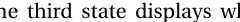

**图 2–10.** 文本按钮的三种不同状态

你可以使用 CSS 为这些超链接状态设置样式，但如果它们是 GWT 的`Button`控件或是网页上的普通按钮，这些状态就无法通过 CSS 来设置样式。这时`CustomButton`（即`ToggleButton`或`PushButton`）就派上用场了。

`CustomButton`的实现支持六种不同的按钮状态。每个状态可以拥有不同的按钮外观和独立的 CSS 样式。状态外观的按钮内容可以是文本、图像或 HTML。以下列表描述了`CustomButton`可用的六种状态：

- 按钮抬起（Button up）——`PushButton`的闲置状态，或`ToggleButton`的抬起状态。
- 按钮按下（Button down）——鼠标在`PushButton`上按下的状态，或`ToggleButton`的按下状态。
- 按钮抬起，鼠标悬停（Button up, mouse hovering）——与按钮抬起状态相同，但在鼠标悬停在按钮上时触发。这可用于向用户直观表明该按钮可点击。
- 按钮抬起，已禁用（Button up, disabled）——与按钮抬起状态相同，但按钮已通过`setDisabled`方法被禁用。处于此状态时，按钮通常会变为灰色，告知用户其不可点击。
- 按钮按下，鼠标悬停（Button down, mouse hovering）——对于`PushButton`，这与按钮按下状态相同，因为按钮被点击时鼠标必然处于悬停状态。对于`ToggleButton`，这类似于按钮抬起、鼠标悬停状态，因为同样需要告知用户该按钮可点击以返回按钮抬起状态。
- 按钮按下，已禁用（Button down, disabled）——此状态仅出现在`ToggleButton`中，因为它可以同时处于按下和禁用状态。`PushButton`在禁用时无法被点击，因此无法进入此状态。

你至少需要为按钮抬起状态定义一个外观。如果没有定义其他外观，该外观将用于所有状态。这些状态遵循一个层级结构来确定在未定义外观时显示哪一个。

例如，如果按钮处于按钮按下、鼠标悬停状态且未定义外观，则将使用按钮按下外观；如果也没有定义按钮按下外观，则将使用按钮抬起外观。图 2–11 展示了此层级结构中的依赖关系。

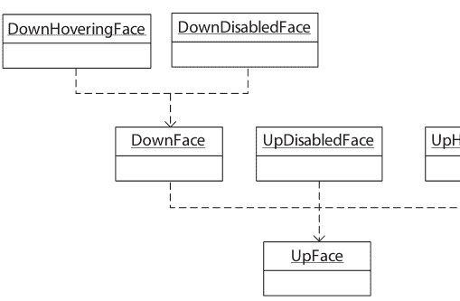

**图 2–11.** `CustomButton`外观的依赖层级结构

第 6 章中的 Gadget Desktop 应用程序在每个 gadget 的标题栏上都使用了`ToggleButton`和`PushButton`。图 2–12 展示了 gadget 的标题栏。

标题栏左侧的箭头是一个`ToggleButton`。它在第一个 gadget 中处于按下状态，在第二个 gadget 中处于抬起状态。注意图像是如何向用户指示不同状态的。

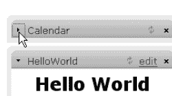

**图 2–12.** 使用`ToggleButton`和`PushButton`的 gadget 标题栏

该应用程序像这样创建`ToggleButton`：

```java
ToggleButton minimizeButton = new ToggleButton(
    new Image("minimize1.gif"),
    new Image("minimize2.gif")
);
```

注意构造函数接受两个`Image`参数。这会用一张图像构造`ToggleButton`的抬起状态，用另一张图像构造按下状态。

我们也可以使用`Face`类来调整每个按钮外观的内容。例如，以下代码更改按钮的按下外观：

```java
minimizeButton.getDownFace().setImage(new Image("minimize2.gif"));
```

你以同样的方式创建`PushButton`；它在行为上与`ToggleButton`有所不同。

为这些按钮的每个可用外观设置图像、HTML 或文本内容并非唯一的自定义方式。你可以通过 CSS 样式名称来更改按钮在每个状态下的外观。当按钮进入某个状态时，应用程序会为其附加一个新的样式名称，从而使浏览器渲染新的样式信息。

使用按钮的样式名称，你可以更改背景、边框、下划线等，这与传统网页中超链接的做法大致相同。`ToggleButton`和`PushButton`的样式名称不同，但遵循相似的模式，如表 2-1 所示。

**表 2–1** `ToggleButton`和`PushButton`的样式名称

| 按钮状态 | `ToggleButton` | `PushButton` |
|---|---|---|
| Button up | `gwt-ToggleButton-up` | `gwt-PushButton-up` |
| Button down | `gwt-ToggleButton-down` | `gwt-PushButton-down` |
| Button up, mouse hovering | `gwt-ToggleButton-up-hovering` | `gwt-PushButton-up-hovering` |
| Button up, disabled | `gwt-ToggleButton-up-disabled` | `gwt-PushButton-up-disabled` |
| Button down, mouse hovering | `gwt-ToggleButton-down-hovering` | `gwt-PushButton-down-hovering` |
| Button down, disabled | `gwt-ToggleButton-down-disabled` | `gwt-PushButton-down-disabled` |

### Checkbox

`Checkbox`控件封装了 HTML 的复选框输入标签。这个按钮与`Button`控件类似，支持聚焦行为和点击事件，但它与`Button`控件的区别在于具有选中或未选中的状态。

默认为未选中，如果用户点击它，状态会切换为选中。你可以通过`setChecked`方法以编程方式设置状态，传入`true`表示选中，`false`表示未选中。

第 6 章中 Gadget Desktop 应用程序的源代码（可在 www.gwtapps.com 找到）包含一个使用复选框的附加待办事项列表 gadget，如图 2-13 所示。

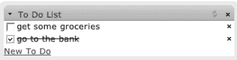

**图 2–13.** 使用`Checkbox`控件创建的复选框

用户可以标记待办事项列表中每个项目的复选框，表示已完成或未完成。以下代码创建一个新的`CheckBox`控件，将其添加到其父容器中，并处理其`onClick`方法：

```java
final CheckBox checkBox = new CheckBox();

row.setWidget(0, 0, checkBox);

checkBox.addClickListener(new ClickListener() {
    public void onClick(Widget sender) {
        if (checkBox.isChecked())
            label.addStyleName("ToDoList-Done");
        else
            label.removeStyleName("ToDoList-Done");
    }
});
```

`onClick`方法会更改标签的 CSS 样式，使其在用户勾选`CheckBox`控件时显示删除线装饰。

为了简化，你不需要使用与`CheckBox`控件分离的标签。本示例需要单独的控件是因为该应用程序需要高级编辑功能。但如果你只需要静态标签，可以像这样在`CheckBox`控件上设置文本值：

```java
checkBox.setText("check me");
```

### RadioButton

`RadioButton`控件与`CheckBox`控件相同，只不过它属于一组其他`RadioButton`，且同时只能选中一个。

在一组`CheckBox`控件中，用户可以选中任意数量、全部或不选。图 2-14 展示了一个单选按钮组的示例，让用户选择红色、绿色或蓝色。


在此示例中，已选中绿色，但如果用户点击蓝色，则蓝色被选中，绿色被取消选中。此控件适用于只允许一个有效选项的场景。以下代码实现了此示例：

```java
RadioButton redButton = new RadioButton("colors", "red");
RadioButton greenButton = new RadioButton("colors", "green");
RadioButton blueButton = new RadioButton("colors", "blue");

panel.add(redButton);
panel.add(greenButton);
panel.add(blueButton);
```

`RadioButton`控件继承自`CheckBox`控件，因此它继承了`CheckBox`控件的所有功能，包括`setChecked`/`isChecked`方法、聚焦行为和客户端事件处理。

### ListBox

`ListBox`控件在最基本的状态下与`RadioButton`控件的功能相同：它向用户展示一组选项，用户只能从中选择一个。

然而，`ListBox`将所有选项包含在一个控件中，且外观与`RadioButton`控件不同。事实上，它有两种外观，如图 2-15 所示。

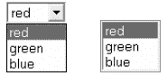

第一种外观将选项显示在一个下拉框中。选中的选项会显示在框内，当用户点击下箭头按钮时，会显示列表选项。以下代码展示了如何创建这种样式的列表框：

```java
ListBox colorList = new ListBox();

colorList.addItem("red");
colorList.addItem("green");
colorList.addItem("blue");

panel.add(colorList);
```

`ListBox`的第二种外观显示一个选项列表，其中选中的选项会高亮显示。它没有下拉框，但如果列表包含的项目超过可显示的数量，那么列表会显示一个垂直滚动条，让用户可以滚动到其他项目。

要创建一个这样的`ListBox`，你只需要使用`setVisibleItemCount`方法设置应该可见的项目数量：

```java
colorList.setVisibleItemCount(3);
```

与其他表单控件一样，`ListBox`控件既支持焦点行为，也支持处理更改事件。当用户更改所选项目时，会触发更改事件。

例如，以下代码处理`ListBox`控件上的更改事件，并显示一个包含用户选择的警报框：

```java
colorList.addChangeListener(new ChangeListener() {
    public void onChange(Widget sender) {
        int selectedIndex = colorList.getSelectedIndex();
        String selectedColor = colorList.getItemText(selectedIndex);

        Window.alert("you selected " + selectedColor);
    }
});
```

这段代码通过使用`ListBox`的`getSelectedIndex`方法获取所选索引，然后使用该索引通过`getItemText`方法检索项目的文本，从而在警报框中显示所选颜色。

### SuggestBox

在某些情况下，使用`ListBox`并不实用；例如，当你需要为用户提供许多选项时（想象一下滚动浏览一个包含 1000 个选项的列表！）。

许多 Ajax 应用程序采用的一种常见解决方案是提供一个文本框，并根据你输入的单词提供下拉建议。Google 在其 Suggest 搜索引擎中就使用了这种可用性技巧。当你开始输入搜索内容时，你会得到一个下拉选择列表，如图 2-16 所示。

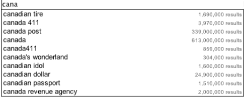

**图 2-16.** Google Suggest 搜索引擎的建议框

GWT 1.4 通过`SuggestBox`控件提供了这种功能。该控件提供了一个丰富的弹出框，会在其建议中高亮显示用户输入的字母。它还支持使用键盘或鼠标滚动浏览列表。

你可以通过`SuggestBox`的样式名称来自定义其外观，这些样式名称可以为输入框、弹出框、所有项目以及当前选中的项目进行设置。

`SuggestBox`接受一个`SuggestOracle`实例作为建议的来源。这与`ListBox`控件的实现不同，后者是直接添加列表项。

将建议来源与`SuggestBox`控件分离是因为建议可能不像一个简短的静态列表那么简单；建议可能需要从应用程序的服务器端生成。例如，考虑一下 Google 的 Suggest 搜索引擎如何实现这种控件。浏览器要存储所有可能的搜索建议是不可能的。相反，浏览器会向服务器发出异步请求，根据用户输入的内容获取建议。`SuggestOracle`实例为应用程序开发者提供了一种将`SuggestBox`插入以提供动态结果的方式。

GWT 提供了一个简单的`SuggestOracle`实现，称为`MultiWordSuggestOracle`，它将其建议存储在浏览器中。以下代码使用`MultiWordSuggestOracle`和一个电影列表创建了一个`SuggestBox`：

```java
String[] words = responseText.split("\n");

MultiWordSuggestOracle oracle = new MultiWordSuggestOracle();
oracle.addAll(Arrays.asList(words));

SuggestBox sb = new SuggestBox(oracle);
```


这段代码修改自第 1 章的 Hangman 应用程序，它接受字符串数组，将其转换为`List`，将其添加到`MultiWordSuggestOracle`中，然后创建一个新的`SuggestBox`。图 2-17 展示了结果。

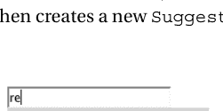

**图 2-17。** 使用`SuggestBox`搜索电影

默认情况下，建议框弹出窗口没有样式。你需要手动添加 CSS 才能获得图 2-17 所示的那种样式。这些样式有助于识别弹出窗口的不同部分。以下是它们的 CSS：

```css
.gwt-SuggestBox { }

.gwt-SuggestBoxPopup { border: 2px solid #C3D9FF; background-color:#E8EEF7; }

.gwt-SuggestBoxPopup .item { }

.gwt-SuggestBoxPopup .item-selected { background-color:#C3D9FF;}
```

如前所述，有时将所有可能的建议加载到浏览器中并不实际。在这种情况下，最好的选择是从服务器加载建议。这需要应用程序开发者做更多的工作。你首先需要创建自己的`SuggestOracle`类的特化版本，实现`requestSuggestions`方法。例如，以下特化版本实现了`requestSuggestions`方法来调用一个 PHP 脚本：

```java
public class RemoteSuggestOracle extends SuggestOracle {

    public void requestSuggestions(

        final Request request, final Callback callback) {
```

```java
//get the query string

String query = request.getQuery();

//request the results from the server

HTTPRequest.asyncGet("movies.php?query="+query,

    new ResponseTextHandler(){

        public void onCompletion(String responseText) {

            //send the response back to the callback

            String[] words = responseText.split("\n");

            Response response = new Response(Arrays.asList(words));

            callback.onSuggestionsReady(request, response);

        }

    });

}
```

这段代码使用`HTTPRequest`类向服务器发出异步调用。它是一个非常基础的类，我鼓励你使用 HTTP 模块而不是`HTTPRequest`类，因为这样你可以正确处理错误。然而，对于`SuggestOracle`的这个示例来说，`HTTPRequest`类已经足够。这段代码将查询发送到服务器上的 PHP 脚本，该脚本很可能使用如下 SQL 查询在数据库中查找匹配的字符串：

```sql
mysql_query("SELECT * FROM movies WHERE name LIKE '%".$query."%'");
```

这实际上是一段 PHP 代码，调用`mysql_query`方法向数据库发送 SELECT 查询。该查询在`movies`表中查找`name`列包含查询字符串的行。注意，这不是完整的 PHP 代码；进行适当的错误检查和转义以防范 SQL 注入攻击非常重要。

你可以不仅使用 PHP 脚本，还可以使用任何服务器端技术（如 GWT-RPC、带 XML 的 HTTP 甚至 JSONP）来实现`SuggestOracle`。

#### TextBox

`TextBox`控件封装了 HTML 中类型为`input`的`input`标签，这是从用户那里获取相对少量文本的标准方式。第 7 章的 Multi-Search 应用程序使用`TextBox`控件从用户那里获取搜索字符串（参见图 2-8）。

该应用程序非常简单地实现了这个控件并将其添加到容器中：

```java
TextBox searchBox = new TextBox();

searchPanel.add( searchBox );
```

在这个例子中，用户可以选择点击按钮提交搜索字符串，或者按回车键。为了实现对按回车键的支持，我们需要处理`TextBox`支持的键盘事件。以下代码向`TextBox`添加了一个键盘监听器，并检查回车键：

```java
searchBox.addKeyboardListener(new KeyboardListenerAdapter(){

    public void onKeyPress(Widget sender,char keyCode,int modifiers){

        if(keyCode == KEY_ENTER )

            doSearch();

    }

});
```

`onKeyPress`方法的参数之一是用户刚按下的键的键码。你可以将此代码与字符进行比较，或者使用`KeyboardListener`接口上定义的一些预定义常量，如`KEY_ENTER`。当遇到`KEY_ENTER`时，这段代码会调用`doSearch`方法，该方法在应用程序中被实现为将用户的搜索查询提交给多个搜索引擎。

与`ListBox`控件一样，`TextBox`控件也通过实现`SourcesChangeEvents`和`SourcesClick`事件接口来支持更改事件和点击事件。

#### PasswordTextBox

`PasswordTextBox`控件的工作方式与`TextBox`控件完全相同，只是其内容对用户隐藏，以保护密码等敏感数据。图 2-18 显示了此控件在 Internet Explorer 中的样子。


**图 2-18。** `PasswordTextBox`控件的文本框区域

通常，此控件与用于用户名的`TextBox`控件以及用于密码的`PasswordTextBox`控件一起使用，以实现登录服务。

#### TextArea

`TextArea`控件与`TextBox`控件类似，都接受用户输入的文本，但它还允许文本跨越多行。对于较大的文本段落，此控件是更好的选择。第 8 章中的博客编辑器应用程序使用此控件让用户编辑博客条目，如图 2-19 所示。

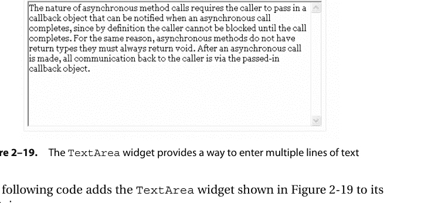

以下代码将图 2-19 中所示的`TextArea`控件添加到其容器中：

```java
TextArea postContent = new TextArea();

postContent.setCharacterWidth(80);

postContent.setVisibleLines(20);

postPanel.add( postContent );
```

此代码使用`setCharacterWidth`方法将控件的宽度设置为 80 个字符，并使用`setVisibleLines`方法将高度设置为显示 20 行。或者，你也可以使用`setWidth`和`setHeight`方法，或 CSS 中的`height`和`width`属性来设置此控件的宽度和高度。

此控件支持你在其他表单控件中见过的焦点行为、点击事件和更改事件。

#### RichTextArea

长期以来，所有输入到 Web 应用程序中的文本要么是纯文本，要么是带标记的文本。没有一种简单的方式来输入富文本，而无需担心标记，就像我们在大多数现代文字处理软件中所熟悉的那样。富文本编辑功能以一种非自然的方式悄然进入浏览器，最初是通过 Internet Explorer 的一个 FrontPage 扩展实现的，该扩展允许你编辑 HTML 页面。随后，它被用作`textarea`标签的富文本替代品，方法是将可编辑的 HTML 页面放在一个`iframe`中，并将其大小调整为`textarea`的大小。这种富文本技术证明非常有价值，最终被添加到其他浏览器中，但没有任何实现是完全相同的，Web 开发人员发现如果没有利用另一个已经解决该问题的成熟 JavaScript 库，很难提供支持。幸运的是，GWT 1.4 库中有一个名为`RichTextArea`的富文本控件，它可以自动处理所有浏览器差异。

你可以通过非常类似于`TextArea`控件的接口来使用`RichTextArea`。它有`getText`和`setText`方法来获取和设置控件中的文本，但在`RichTextArea`中，这些方法仍然返回纯文本，而不是富文本或 HTML。`RichTextArea`控件添加了`getHTML`和`setHTML`方法来获取和设置控件中的富文本。图 2-20 展示了这在第 8 章讨论的博客编辑器应用程序中是如何工作的。

在图 2-20 中，注意工具栏看起来类似于文字处理软件中的命令。这种类型的工具栏对于编辑富文本至关重要，但它并不是`RichTextArea`控件的一部分。`RichTextArea`控件仅仅是图 2-20 中的方形文本框。实现工具栏的工作留给了应用程序开发人员。不过，在 GWT 附带的 Kitchen Sink 示例应用程序中，有一个相当不错的名为`RichText Toolbar`的工具栏。图 2-20 和博客编辑器应用程序中使用的就是这个工具栏。

如果你需要更密切地与`RichTextArea`的格式设置进行交互，请使用其`getBasicFormatter`和`getExtendedFormatter`方法。这些方法返回`RichTextArea`的格式化器。请注意，在某些浏览器中，这些方法可能会返回`null`。你需要在代码中处理这些情况，即在不支持的浏览器中简单地不提供格式设置功能。然而，大多数现代浏览器都支持基本和扩展格式化器。

#### FileUpload

`FileUpload`控件封装了 HTML 的`input`标签，其`type`属性设置为`file`，允许用户从其本地文件系统中选择要上传到服务器的文件。浏览器有严格的安全限制，禁止与操作系统进行大多数交互，此控件的使用也相当受限。浏览器强制执行一条规则：只有用户选择的文件才能提交；它不允许以编程方式从用户的硬盘中选择其他文件。此外，只有当表单提交时，浏览器才会将文件发送到服务器。这意味着此控件对于不提交表单的应用程序几乎没有价值。不过，GWT 提供了一个`FormPanel`类，允许你以编程方式构建表单并异步将其提交到 Web 服务器，无需页面刷新。这对于与以前用于表单的服务器端脚本集成，或以异步方式将文件提交到服务器来说是理想的。我们将在本章后面讨论`FormPanel`控件时，详细介绍此控件的使用。

#### Hidden

`Hidden`控件也只有与`FormPanel`一起使用时才有价值，用于将表单异步提交到服务器。它表示一个命名值，该值将被提交，且不需要用户编辑可视化表示。

### Complex Widgets

一旦浏览器开始支持 JavaScript 和动态 HTML，我们开始在网页中看到没有 HTML 标签等效物的用户界面控件。这些控件是通过将 HTML 标签组合在一起并处理用户事件来创建的，以便通过 JavaScript 模拟更复杂的控件。使用 GWT，你也可以构建这些类型的自定义控件，而且工具包甚至自带了一些。

#### Tree

`Tree`控件显示可展开和折叠的数据分层视图。其行为基于桌面应用程序中类似的树形控件，通常用于浏览文件或概述分层数据。GWT 使用 HTML 元素和动态 JavaScript 实现树形视图，并通过抽象接口支持树操作（如果你使用过桌面版本的树形控件，这将是你所熟悉的）。

`Tree`控件最适用于显示分层数据的概览。例如，图 2-21 展示了使用`Tree`控件显示数据库列表作为层级中的第一级，以及表格列表作为第二级。

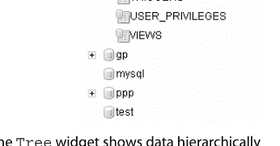

**图 2-21。** `Tree`控件分层显示数据

实例化`Tree`控件与使用 GWT 创建任何其他控件一样简单：

```java
Tree treeList = new Tree();

mainPanel.add( treeList );
```

你可以通过多种方式向`Tree`控件添加数据。你可以直接添加字符串值到树中：

```java
treeList.addItem("first item");

treeList.addItem("second item");

treeList.addItem("third item");
```

或者你可以添加其他控件：

```java
treeList.addItem( new Image("icon_user.gif") );

treeList.addItem( new HTML("<b>hello</b>") );

treeList.addItem( new CheckBox("check me") );
```

然而，这些方法只能将项目添加到树的根级别，在某些情况下这可能没问题。`Tree`控件确实提供了一种使用`TreeItem`将控件添加到根级别以外的方法。你也可以使用这些`add`方法来添加新的`TreeItem`实例。`TreeItem`类表示树中的一个项目，其接口使用这些相同的`add`方法，支持创建多级树。要添加到树的第二级，你需要创建一个`TreeItem`实例，将其添加到`Tree`控件，然后在实例上调用`add`方法来添加新的子项目。新项目也可以是添加了子项目的`TreeItem`，以在层级中创建后续级别。例如，以下代码遍历数据库列表及其表格，创建一个类似于图 2-21 中`Tree`控件图像的树层级：

```java
for( Iterator it = databases.iterator(); it.hasNext();){

    Database database = (Database)it.next();

    TreeItem databaseTreeItem = new TreeItem( database.getName() );

    treeList.addItem(databaseTreeItem);

    for( Iterator it2 = database.getTable().iterator(); it2.hasNext();){

        Table table = (Table)it2.next();

        databaseTreeItem.addItem( table.getName() );

    }

}
```

注意，代码将`databaseTreeItem`直接添加到`treeList`的`Tree`控件，并将`tableTreeItem`添加到`databaseTreeItem`，以便层级中第二级的项目显示在其所属的数据库下方。

还要注意，树控件的图像显示了几个图标，指导用户如何使用该控件。应用程序选择数据库和表格图标，并将它们显示为`Image`控件。在 GWT 1.3 及更早版本中，`Tree`小部件使用了加号和减号图标，但这些图标无法嵌入到 GWT 库中，因此应用开发人员必须确保这些图标与应用一起部署。

如果你使用的是 GWT 1.3，在使用`Tree`小部件时需要从 GWT 发行版中复制三张图片。

- `tree_white.gif`显示代表树层级中缩进级别的空白。
- `tree_open.gif`在子项可见时显示在项旁边的图标。
- `tree_closed.gif`在子项隐藏时显示在项旁边的图标。

幸运的是，GWT 会将这些文件与其他应用文件一起复制到编译目录中。你可以使用任何图片作为这三个图标，但必须使用这些名称，以便`Tree`小部件能够正确识别它们。

在 GWT 1.4 中，`Tree`小部件使用了`ImageBundle`功能。此功能在编译期间将图片捆绑为单个图片，并让你自动将默认图片包含到部署中。你可以通过提供自己的`TreeImages`接口实现来覆盖默认图片。`TreeImages`接口是一个图片捆绑包，定义了三张图片：

```java
public interface TreeImages extends ImageBundle {

  AbstractImagePrototype treeOpen();

  AbstractImagePrototype treeClosed();

  AbstractImagePrototype treeLeaf();

}
```

以下代码展示了如何通过使用自定义图片与`Tree`小部件来覆盖此接口：

```java
interface CustomTreeImages extends TreeImages {

  /**
   * @gwt.resource down.gif
   */

  AbstractImagePrototype treeOpen();

}
```

```java
/**
 * @gwt.resource right.gif
 */

AbstractImagePrototype treeClosed();

}

CustomTreeImages images = (TreeImages)GWT.create(CustomTreeImages.class);

Tree tree = new Tree(images);
```


此代码指定了`down.gif`和`right.gif`图片。将这些图片放在与此源代码相同的目录中，或者在`@gwt.resource`注释中使用完整或相对路径。GWT编译器会找到这些图片，并将它们捆绑为单个图片以供运行时使用的。有关`ImageBundle`的更多信息，请参见第5章。

你可以通过使用`Tree`小部件的CSS名称进一步自定义其外观。当用户选择树中的某项时，GWT会添加CSS名称`gwt-TreeItem-selected`到该项。这让你可以通过CSS更改该项的外观，以告知用户它已被选中。例如，以下CSS将树中选中项的背景设置为浅蓝色：

```css
.gwt-TreeItem-selected{ background-color:#def; }
```

在前面描述的数据库树示例中，此CSS使选中项看起来像图2-22中的样子。

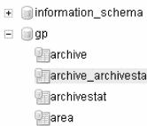

**图2-22.** 选中项被高亮显示

如果你在显示每个项选择的不同视图的应用中使用`Tree`小部件，你需要从该小部件接收事件，以获知选择何时发生变化。为此，`Tree`小部件实现了`SourcesTreeEvents`，允许你添加GWT的`TreeListener`实例来监听事件。`TreeListener`接口如下所示：

```java
public interface TreeListener extends EventListener {

    void onTreeItemSelected(TreeItem item);

    void onTreeItemStateChanged(TreeItem item);

}
```

当用户选择树中的某项时，GWT会调用第一个方法`onTreeItemSelected`。当用户打开项的子项进行查看或关闭它们时，会调用第二个方法`onTreeItemStateChanged`。要处理这些事件，你需要实现此接口及其方法，然后将实现它们的实例添加到`Tree`小部件中，如下所示：

```java
treeList.addTreeListener(this);
```

在此情况下，实现`TreeListener`接口的类调用`addTreeListener`方法来请求树事件。

### MenuBar

`MenuBar`小部件是GWT附带的另一个复杂自定义小部件，由多个HTML元素和JavaScript事件处理程序构建而成。它基于你通常在应用顶部或桌面顶部看到的桌面应用菜单栏。与`Tree`小部件一样，`MenuBar`显示分层的数据列表，但它是水平显示数据，而不是垂直列出。`MenuBar`与`Tree`小部件的进一步区别在于，它一次只显示一个分支，且仅在控件保持鼠标焦点的持续时间内显示。此外，你通常使用`MenuBar`来保存分层的应用命令列表，而`Tree`小部件通常用于应用数据。

要构建适当的菜单，你需要将`MenuItem`类的实例添加到`MenuBar`小部件。`MenuItem`代表菜单上的一个可点击行。例如，Eclipse菜单上的`File`一词就是一个菜单项。如果你打开`File`下拉菜单，垂直列出的每个项目也都是`MenuItems`。这是两种不同类型的`MenuItems`，它们的区别在于用户点击后的行为方式。第一种类型在点击时打开新菜单，第二种执行其他命令并导致菜单关闭。要实现这两种菜单类型，你可以使用`Command`实例（用户点击项时执行）或另一个`MenuBar`对象（用户点击项时显示）来构造`MenuItem`类。

例如，让我们创建一个包含New、Open、Save和Close项的File菜单，以及一个包含About项的Help菜单。File和About菜单将是位于主`MenuBar`上的`MenuItem`s，点击时打开两个其他`MenuBar`之一。File和Help的其他`MenuBar`将包含执行命令的其余项。对于此示例，我们将只使用一个空的`Command`，但你可以在此类的`execute`方法中放置任何代码，以自定义用户点击命令时发生的行为。以下代码构建了刚才描述的菜单：

```java
Command cmd = new Command() {

  public void execute() {

    //code to handle the command goes here

  }

};
```

```java
MenuBar filemenu = new MenuBar(true);

filemenu.addItem("New", cmd);

filemenu.addItem("Open", cmd);

filemenu.addItem("Save", cmd);

filemenu.addItem("Close", cmd);
```

```java
MenuBar helpmenu = new MenuBar(true);

helpmenu.addItem("About", cmd);
```

```java
MenuBar menu = new MenuBar();

menu.addItem("File", filemenu);

menu.addItem("Help", helpmenu);
```

此代码创建了一个`Command`接口实例（带有空的`execute`方法）和三个`MenuBar`实例。File和Help菜单在实例化时向`MenuBar`构造函数传递了布尔值`true`。这告诉`MenuBar`类此实例将是垂直的。如果我们将此参数留空或传递布尔值`false`，则`MenuBar`将水平显示。水平菜单通常用于应用顶部。两个垂直菜单是下拉菜单，当用户点击主菜单上的项时打开。代码使用`addItem`方法将项添加到菜单栏。此方法将显示为项的值作为第一个参数，将实现`Command`接口的对象或另一个菜单作为第二个参数。如果你使用`Command`对象，当用户点击菜单项时会调用`execute`方法。此代码使用`Command`对象来实现用户点击New、Open、Save、Close和About菜单项时的事件。当另一个`MenuBar`用作`addItem`方法的第二个参数时（如将File和Help菜单添加到主菜单时），点击该项会导致新的`MenuBar`显示。

如果你将此示例代码放在应用中，它会显示为一个相当朴素的菜单，不会给用户足够的提示表明它是可以点击的菜单。要增强此效果，你需要使用CSS样式，既让菜单看起来更像菜单，又使其与应用的风格融为一体。例如，以下CSS赋予菜单桌面应用的外观：

```css
.gwt-MenuBar {

    background-color:#F3F5F6;

    border:outset 1px;

}

.gwt-MenuBar .gwt-MenuItem {

    font-size: 9pt;

    cursor:hand;

    cursor:pointer;

    padding:2px 5px 2px 5px;

    margin:0px;

}

.gwt-MenuBar .gwt-MenuItem-selected {

    background-color:#316AC5;

    color:white;

}
```

使用这些CSS样式运行示例代码会产生如图2-23所示的菜单。

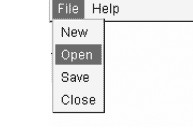

**图2-23.** CSS样式使菜单更具桌面应用的外观

你可以为`MenuBar`小部件设置另外三种CSS样式：`gwt-MenuBar`用于水平或垂直的`MenuBar`小部件，`gwt-MenuItem`用于`MenuBar`中的某一项，`gwt-MenuItem-selected`用于`MenuBar`中当前选中的菜单项。

## 简单布局面板

到目前为止，我们所介绍的控件都是用户界面树的叶子节点。也就是说，它们用于更大结构的底部，而更大的结构负责管理应用程序的布局。本节将介绍GWT自带的布局控件，也称为面板。

### FlowPanel

`FlowPanel`是GWT自带的最基础的面板之一。如果你熟悉HTML布局的工作方式，那么你会很快理解这种布局，因为它模仿了HTML布局。它的布局方式也类似于文本编辑器中文字在到达页面边缘时的流动和换行方式。`FlowPanel`的子控件水平显示，当水平空间不足时，会换行到下一行继续显示。

例如，第6章中的Gadget Desktop应用程序顶部有一个菜单，显示可以添加到页面的gadget列表。该应用程序将列表中的每一项都作为链接添加到一个`FlowPanel`控件中。以下代码构建了该面板：

```java
FlowPanel gadgetsmenu = new FlowPanel();

for( int i=0; i< gadgetclasses.size();++i){

    GadgetClass gadgetclass = (GadgetClass)gadgetclasses.get(i);

    Hyperlink gadgetlink = new Hyperlink(gadgetclass.getName(),null);

    gadgetsmenu.add( gadgetlink );

}
```

当可用gadget列表在应用程序中显示时，它会水平展开，如图2-24所示。


**图2-24.** 菜单项水平排列

当用户缩小浏览器窗口，无法显示所有控件时，`FlowPanel`会将控件换行到下一行，如图2-25所示。

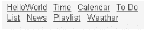

**图2-25.** 菜单项换行到下一行

请注意，这个面板遵循HTML布局样式中的内联元素和块级元素。**内联元素**（Inline elements）在HTML中是指可以与其他元素显示在同一行的元素。例如，文本、超链接、图片和表单元素都是内联元素。而**块级元素**（block element）则不会与其他控件共享水平空间。对于`FlowPanel`控件也是如此。所有作为内联控件使用的简单控件在`FlowPanel`中都会换行，但更复杂的控件如其他面板（它们是以块级HTML实现的）则不会共享水平空间，而是垂直排列，因此不会换行。

### HorizontalPanel 和 VerticalPanel

`HorizontalPanel`和`VerticalPanel`是两个更简单的面板，它们的行为正如其名所示。`HorizontalPanel`水平显示其子控件，而`VerticalPanel`垂直显示其子控件。当浏览器窗口太小无法显示整个面板时，`HorizontalPanel`与`FlowPanel`的行为不同。它不会将内容换行到下一行，而是继续水平显示其内容直至超出视图范围，需要使用浏览器的滚动条来查看。同样，当`VerticalPanel`的内容超出视图范围时，也可以借助浏览器的滚动条将其带入视图。`VerticalPanel`的内容也可以放在`ScrollPanel`控件中（本章稍后介绍），以将其可见区域限制为小于浏览器窗口的区域。

本书在示例应用程序中使用了这些面板，因为它们简单且行为非常可预测。第7章的多搜索应用程序使用`HorizontalPanel`来显示搜索文本框和搜索按钮（见图2-26），并使用`VerticalPanel`来显示搜索结果（见图2-27）。


**图2-.** 使用`HorizontalPanel`控件

**72** &nbsp;&nbsp;&nbsp;&nbsp;&nbsp; **第2章 &nbsp; 用户界面库概述**

> **面向Java开发者的Ajax：探索Google Web Toolkit**
> 最近发布的Google Web Toolkit（GWT）是一套全面的API和工具集，让你几乎可以完全用Java代码创建动态Web应用程序。……

> **Instantiations出品的GWT Designer**
> 检查Java代码中允许的GWT类和方法。……GWT Designer于2006年10月25日星期三在网络研讨会中发布。……

> **GWT控件库**
> ……已发布GWT-SL的新版本到下载区，更新日志如下。George还创建了一个GWT-SL Google群组，如果你需要帮助可以……

> **gwt - SWiki**
> Google Web Toolkit（GWT）是一个Java软件开发框架，它使……标签：Google gwt Web Ajax Java eclipse toolkit na ……

> **Guys Without Ties**
> 提供用于时间、考勤、门禁控制和交易验证的指纹生物识别设备。

> **Google Web Toolkit - 用Java语言构建AJAX应用程序**
> Google Web Toolkit（GWT）是一个Java软件开发框架，它让开发者可以轻松编写AJAX应用程序，如Google Maps和Gmail，同时处理……

**图2-27.** 使用`VerticalPanel`控件

请注意，这里使用的`VerticalPanel`的子控件并不是简单控件。由于面板在GWT中也是控件，我们可以在一个面板中使用其他面板。在本例中，我们在一个`VerticalPanel`内部使用了另一个`VerticalPanel`。

构建这些面板非常简单，只需对每个要添加的子控件调用`add`方法即可。

### HorizontalSplitPanel 和 VerticalSplitPanel

在Web应用程序中，内容的大小往往难以预测。传统网页得益于默认HTML布局的灵活性，它会自动将内容换行到下一行。当你开始处理更复杂的Ajax控件时，这种换行有时不再可行，你需要找到不同的解决方案。GWT提供了两个分割面板：`HorizontalSplitPanel`和`VerticalSplitPanel`，帮助你调整界面以创建适合内容的自定义布局。

**分割面板**（split panel）是一种可以包含两个子控件的面板，并在两者之间提供一个区域，用鼠标调整它们的相对大小。`HorizontalSplitPanel`水平排列子控件，而`VerticalSplitPanel`垂直排列子控件。

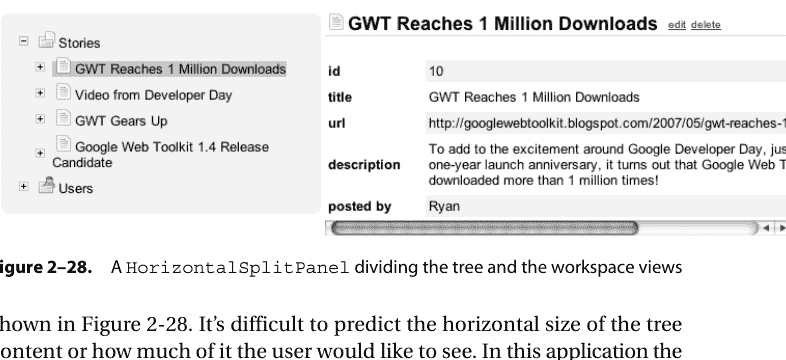

**图2-28.** `HorizontalSplitPanel`分割树形视图和工作区视图，如图2-28所示。很难预测树形内容的水平大小，或者用户希望看到多少内容。在这个应用程序中，分割面板让用户能够自定义其界面。

使用分割面板非常简单。你可以使用`setSplitPosition`方法为`VerticalSplitPanel`设置相对于顶部控件的分割位置，或为`HorizontalSplitPanel`设置相对于左侧控件的分割位置。然后，要设置子控件，对于`HorizontalSplitPanel`使用`setLeftWidget`和`setRightWidget`，对于`VerticalSplitPanel`使用`setTopWidget`和`setBottomWidget`。以下代码展示了数据库编辑器应用程序如何使用`HorizontalSplitPanel`：

```java
HorizontalSplitPanel mainPanel = new HorizontalSplitPanel();

mainPanel.setSplitPosition("250px");

mainPanel.setLeftWidget( tree );

mainPanel.setRightWidget( workspace );
```


#### FlexTable 和 Grid

`FlexTable` 和 `Grid` 控件都基于 HTML 的 `table` 标签，在垂直和水平方向上以网格形式显示子控件。`Grid` 控件是一个 HTML 表格，强制显式设置行数和每行的单元格数。`FlexTable` 如其名所示，更加灵活，允许按需添加单元格，各行可以有可变数量的单元格，且单元格可以跨越多行或多列。

这两个实现共享了大量功能，这些功能通过 `HTMLTable` 超类来实现。你可以使用 `setHTML`、`setText` 或 `setWidget` 方法为两个控件向单元格中添加内容。这些方法接受行号和列号来指定表格中的目标位置，以及要添加的内容。对于 `Grid` 控件，你只能对现有单元格调用这些方法，否则会抛出异常。

第 10 章的数据库编辑器应用程序使用了 `FlexTable` 控件，因为表格非常适合渲染数据库中的行。图 2-29 展示了在 GWT 的 `FlexTable` 控件中渲染的数据库表格示例：

| CHARACTER_SET_NAME | DEFAULT_COLLATE_NAME | DESCRIPTION | MAXLEN |
|---|---|---|---|
| big5 | big5_chinese_ci | Big5 Traditional Chinese | 2 |
| dec8 | dec8_swedish_ci | DEC West European | 1 |
| cp850 | cp850_general_ci | DOS West European | 1 |
| hp8 | hp8_english_ci | HP West European | 1 |
| koi8r | koi8r_general_ci | KOI8-R Relcom Russian | 1 |
| latin1 | latin1_swedish_ci | cp1252 West European | 1 |
| latin2 | latin2_general_ci | ISO 8859-2 Central European | 1 |

图 2-29. 使用 `FlexTable` 控件

该表格还进行了样式设置，使每列都有明显的标题。`Grid` 和 `FlexTable` 控件都允许你使用 CSS 为单个单元格、行或列设置样式。图 2-29 中的表格是基于应用程序的 `Table` 类实例（应用程序模型中表示数据库表的对象）和 `Page` 类实例（另一个表示表中一页行数据的模型对象）构建的：

```java
FlexTable rows = new FlexTable();

rows.setStyleName("tableViewBrowse");

// 添加列表头
rows.getRowFormatter().setStyleName(0, "tableViewBrowseHeaders");

for (int i = 0; i < table.getFieldCount(); ++i) {
    Field field = table.getField(i);
    rows.setText(0, i, field.getName());
}

// 添加行
for (int i = 0; i < page.getRowCount(); ++i) {
    String[] row = page.getRow(i);

    for (int j = 0; j < row.length; ++j) {
        rows.setText(i + 1, j, row[j]);
        rows.getRowFormatter().setStyleName(
            i + 1,
            "tableViewBrowseRow"
        );
    }
}
```

注意，在这段代码中，表头行的样式名称是通过从 `FlexTable` 获取行格式化器并传入行号和样式名称作为参数来设置的。这使你能够使用 CSS 来指定表头的格式。应用程序再次对每个数据行使用行格式化器，以便它们可以有自己的样式。使用以下 CSS 来实现图 2-29 所示的样式：

```css
.tableViewBrowseHeaders {
    font-size: 8pt;
    color: #ccc;
    font-weight: bold;
}

.tableViewBrowseRow {
    font-size: 8pt;
    border: 1px solid #eee;
}

.tableViewBrowse {
    border-spacing: 0px;
    border-collapse: collapse;
}

.tableViewBrowse td {
    padding: 3px;
    border: 1px solid #eee;
    padding-right: 10px;
}

.tableViewBrowseHeaders td {
    border: 0px;
    border-bottom: 1px solid #888;
}
```

这段 CSS 简单地使用了为表头和数据行设置的样式名称来指定它们的样式，这些样式定义了边框和字体样式。

表格的行格式化器还有许多其他方法，允许你按行自定义表格，包括对齐方式、宽度、高度、可见性等。GWT 还提供了一个单元格格式化器，你可以通过 `getCellFormatter` 方法获取它，这允许你按单元格自定义表格。`FlexTable` 小部件还提供了一个 `FlexCellFormatter` 辅助对象，通过其 `getFlexCellFormatter` 方法获取，它允许你为单个单元格设置行或列跨度。当你将该值设置为大于 1 时，该单元格将跨越多于一列或一行。例如，图 2-30 显示了单元格 A 跨越两行，单元格 B 跨越三列。

表格可以通过 `TableListener` 接口进一步定制，以展示更复杂的用户界面行为。当你想要处理用户点击表格中的单元格时，在你的应用程序中实现这个接口。例如，如果你使用表格小部件来显示文件列表，并希望允许用户选择一个文件，你可能希望将选中的行设置为高亮显示，以向用户提供如图 2-31 所示的反馈。

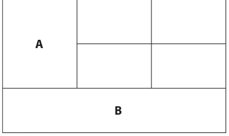

**图 2–30.** 单元格可以跨越多行或多列

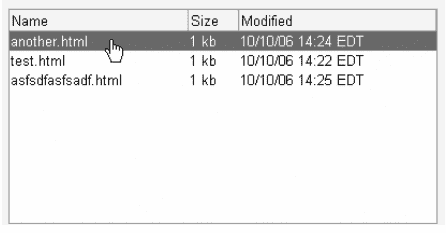

**图 2–31.** 选中的行被高亮显示

你可以通过向 `Grid` 小部件添加一个 `TableListener` 接口的实例来实现这一点，这样当点击时它的样式信息可以被改变：

```java
filelist.addTableListener(new TableListener() {
    public void onCellClicked(
        SourcesTableEvents sender,
        int row,
        int cell
    ) {
        filelist.getRowFormatter()
            .removeStyleName(selected, "selected");

        selected = row;

        filelist.getRowFormatter()
            .addStyleName(selected, "selected");
    }
});
```

这段代码简单地从先前选中的行移除 `selected` 样式，并将其添加到当前选中的行。在 CSS 中，我们可以将行的背景改为蓝色高亮。

```css
.selected {
    background-color: #316AC5;
    color: #FFFFFF;
}
```

#### DeckPanel

`DeckPanel` 小部件是一个布局面板，它可以有多个子小部件，但一次只能显示一个。该界面允许你像翻阅书中的不同页面一样浏览每个子小部件。最好的使用示例是 `TabPanel` 类，它使用 `DeckPanel` 来显示与所选标签对应的每个页面。你也可以单独使用该小部件，比如在第 9 章的即时通讯应用程序中。该应用程序使用 `DeckPanel` 小部件来显示登录视图和联系人列表视图。用户在应用程序首次加载时看到登录视图，当用户登录后，视图切换为联系人列表。图 2-32 显示了应用程序的登录视图位于 `DeckPanel` 小部件中。

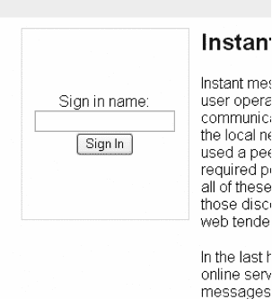

**图 2-32.** 登录界面在 `DeckPanel` 小部件中

当用户登录时，`DeckPanel` 切换到联系人列表视图，如图 2-33 所示。

如你所见，两个视图都占据了 `DeckPanel` 父容器提供的相同空间，但一次只显示一个。

构造这个小部件很容易。例如，即时通讯应用程序的 `DeckPanel` 小部件看起来像这样：

```java
DeckPanel mainPanel = new DeckPanel();

mainPanel.add(signIn);
mainPanel.add(contactListView);

mainPanel.showWidget(0);
```

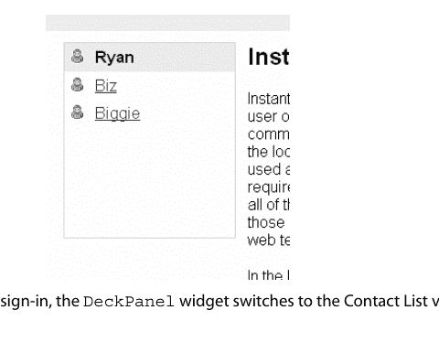

**图 2–33.** 登录后，`DeckPanel` 小部件切换到联系人列表视图

这段代码创建了一个 `DeckPanel` 小部件并添加了两个子小部件。然后它调用 `DeckPanel` 的 `showWidget` 方法将可见的子小部件设置为第一个添加的子小部件。要切换到第二个子小部件，你只需用第二个子小部件的索引调用 `showWidget`：

```java
mainPanel.showWidget(1);
```

#### DockPanel

`DockPanel` 小部件实现了桌面应用程序中常见的布局：子面板停靠到面板的边缘，而一个主子面板占据剩余的空间。例如，GWT 自带的邮件示例应用程序使用 `DockPanel` 小部件来实现桌面电子邮件客户端的布局行为（见图 2-34）。

在这个示例应用程序中，`DockPanel` 小部件是外部布局小部件，顶部欢迎面板、左侧快捷面板和右侧邮件列表面板作为子元素。应用程序使用布局常量来定义它们的位置，将子元素添加到 `DockPanel` 小部件中。顶部欢迎面板使用 `DockPanel.NORTH` 常量，左侧快捷面板使用 `DockPanel.WEST` 常量，右侧邮件列表面板使用 `DockPanel.CENTER` 常量。以下代码构建了这种布局：

```java
DockPanel outer = new DockPanel();

outer.add(welcomePanel, DockPanel.NORTH);
outer.add(shortcuts, DockPanel.WEST);
outer.add(mailListPanel, DockPanel.CENTER);

outer.setWidth("100%");
```

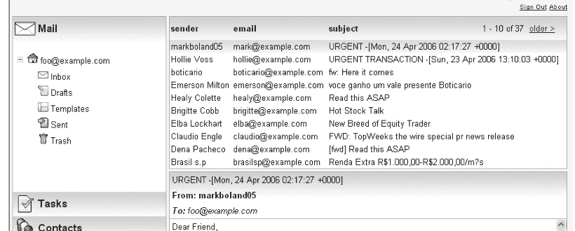

如你所见，顶部和左侧面板位于布局的边缘。右侧面板设置为居中，这意味着它将占据面板中的剩余空间。随着浏览器窗口的增大，子窗口也会增大以填充 `DockPanel` 小部件中的新空间。使用 `DockPanel.NORTH` 或 `DockPanel.SOUTH` 常量添加的子小部件水平地增大和缩小，其高度保持不变。使用 `DockPanel.EAST` 或 `DockPanel.WEST` 常量添加的子小部件垂直地增大和缩小，其宽度保持不变。只能有一个使用 `DockPanel.CENTER` 常量添加的子元素，它垂直和水平地增大和缩小，以填充 `DockPanel` 中边缘子小部件留下的其余空间。

这种行为非常适合用户关注中心子小部件的场景。`DockPanel` 小部件确保中心子小部件占据最大空间，并为边缘子小部件留下足够的空间，而边缘子小部件通常包含用于操作中心子小部件的命令。

#### HTMLPanel

`HTMLPanel` 小部件与 `HTML` 小部件类似，它都可以渲染 HTML 字符串，但它还支持将其他小部件作为子标签附加到 HTML 中。当你有一些想要渲染的复杂 HTML，它围绕着另一个 GWT 小部件，并且没有使用 GWT 小部件的直接实现时，你可以考虑使用这个小部件。然而，最好使用 GWT 小部件来渲染用户界面元素，以避免暴露任何安全问题或遇到浏览器不一致的情况。当你异步获取了一段 HTML 并想要渲染它并附加一个 GWT 小部件时，你也可以考虑使用这个小部件。

例如，以下代码创建了一些 HTML 来为子小部件制作圆角背景：

```java
HTMLPanel panel = new HTMLPanel(
    "<div style='background-image:url(top.gif)'></div>" +
    "<div id='inner' style='background-image:url(back.gif)'></div>" +
    "<div style='background-image:url(bottom.gif)'></div>"
);

panel.add(anotherWidget, "inner");
```

这段代码渲染了 HTML，然后使用 `HTMLPanel` 的 `add` 方法指定元素的 `id` 来添加子小部件。在这种情况下，ID `"inner"` 作为父元素。

### 复杂布局面板

到目前为止，我们看到的布局面板相对简单，它们只是有一种算法来在页面上排列其子小部件。GWT 还提供了更多的面板，`StackPanel` 和 `TabPanel`，来协助你应用程序的布局。这些面板提供了前面面板的简单布局行为，但具有控件，允许你动态更改子元素的布局。

#### StackPanel

`StackPanel` 小部件使用的布局类似于 `VerticalPanel`，它垂直渲染其子元素，但一次只显示一个，允许其他的通过点击其标题部分来打开。每个子小部件都有一个标题部分，你可以在将子元素添加到面板时设置。图 2-35 显示了 GWT 自带的邮件示例应用程序如何使用 `StackPanel` 小部件。

该示例应用程序通过添加三个子小部件来构造 `StackPanel` 小部件，这些都是 `TreeList` 小部件，并提供标题文本。标题文本可以是纯文本或 HTML。图 2-35 中的示例使用 HTML 在文本左侧渲染了一张图像。

您可以使用 CSS 样式来设置 `StackPanel` 部件中标题的样式。您可以使用 `gwt-StackPanel` 名称来为整个 `StackPanel` 部件设置样式，使用 `gwt-StackPanelItem` 来设置标题的样式，并使用 `gwt-StackPanelItem-selected` 来设置当前选中标题的样式。GWT 示例邮件应用程序使用以下 CSS 来设置其 `StackPanel` 的样式：

```css
.gwt-StackPanel .gwt-StackPanelItem {
    background-image: url(gray_gradient.gif);
    background-repeat: repeat-x;
    background-color: #EEEEEE;
    cursor: pointer;
    cursor: hand;
}
```

这段 CSS 将背景图像设置为灰色渐变，您可以在图 2-35 中 `StackPanel` 的标题区域看到该效果。它还将光标设置为手型光标，以提示用户该区域可点击。

#### TabPanel

`TabPanel` 部件与堆叠面板类似：它一次显示一个子部件，并提供控件来选择要显示的子部件。它与其他面板的不同之处在于其实现方式——它不是面板类层次结构的一部分。相反，它是由其他部件组成的复合部件，在顶部显示一个 `TabBar`，底部填充一个 `DeckPanel` 来实现面板行为。

`TabBar` 是另一个与 `DeckPanel` 部件类似的部件，可以在 `TabPanel` 部件之外的其他实现中使用。例如，`TabPanel` 部件在 `DeckPanel` 上方显示 `TabBar`，但你可能希望提供一种将 `TabBar` 显示在底部的实现。

`TabBar` 的行为只是显示一排可供用户选择的标签页。它实现了 `SourcesTabEvents`，以便其客户端可以监听它的事件，包括标签页被选中时的事件。它还为其标签页提供了 CSS 样式名称，以便进行样式设置。样式名称包括：`gwt-TabBar` 用于设置整个栏的样式，`gwt-TabBarFirst` 用于设置栏最左侧在任意标签页之前的区域，`gwt-TabBarRest` 用于设置所有标签页之后标签栏右侧的区域，`gwt-TabBarItem` 用于设置未选中的标签页，`gwt-TabBarItem-selected` 用于设置选中的标签页。这些样式名称允许非常灵活的样式设置。例如，图 2-36 展示了使用背景颜色来设置标签页样式，使其外观类似于第 10 章中 Gadget Desktop 应用程序所使用的样式。

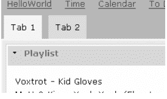

**图 2-36.** 使用背景颜色设置标签页样式

在图 2-36 中，选中的标签页比其他标签页颜色更浅。以下 CSS 赋予标签页这种外观：

```css
.gwt-TabBar .gwt-TabBarItem {
    padding: 10px;
    margin-right: 10px;
    cursor: hand;
    background-color: #ddd;
}

.gwt-TabBar .gwt-TabBarItem-selected {
    background-color: #f5f5f5;
}
```


您还可以使用图像来设置标签页样式，使其看起来更像桌面应用程序。图 2-37 展示了这一点，作为对 Gadget Desktop 应用程序外观的更新。

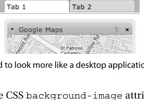

本示例使用 CSS `background-image` 属性来设置 `TabBar` 部件不同区域的背景：

```css
.gwt-TabBar{
    background-image:url(tab-rest.gif);
    background-repeat: repeat-x;
    background-position:bottom;
    padding-top:3px;
    width:100%
}
.gwt-TabBar .gwt-TabBarFirst { width:10px; }
.gwt-TabBar .gwt-TabBarItem {
    background-image:url(tab.gif);
    background-repeat:no-repeat;
    width:126px;
    height:27px;
    font-size:8pt;
}
.gwt-TabBar .gwt-TabBarItem { padding:5px; }
.gwt-TabBar .gwt-TabBarItem-selected {
    background-image:url(tab-selected.gif);
}
```

尽管这两个示例都使用了 `TabBar` 样式名称，但它们并不直接使用 `TabBar` 部件；而是使用 `TabPanel` 部件。为这些样式名称在 `TabPanel` 中重复设置是多余的。

`TabPanel` 处理来自 `TabBar` 的标签页选择事件，以显示适当的页面。这为您省去了这项工作；您只需使用 `TabPanel` 的 `add` 方法，将子部件及其标签页名称设置好即可。数据库编辑器应用程序的 `TabPanel` 构造如下：

```java
TabPanel tabPanel = new TabPanel();
tabPanel.add( browsePanel, "Browse" );
tabPanel.add( structurePanel, "Structure" );
tabPanel.setWidth("100%");
tabPanel.selectTab(0);
```

将子部件添加到面板后，调用 `selectTab` 方法以告知 `TabPanel` 将给定索引的部件带到前景。

### 简单容器面板

容器面板与布局面板的不同之处在于，它们不控制子部件的布局；相反，它们作为单个子部件的容器提供附加功能。简单容器面板包括 `Composite`、`SimplePanel`、`ScrollPanel` 和 `FocusPanel`。

#### Composite

`Composite` 部件的用途更多地体现在代码组织上，而非应用程序用户会注意到的东西。当您想要构建一个可重用的组件并隐藏其实现细节，使其与应用程序的其余部分隔离时，请使用 `Composite` 部件。当在应用程序中使用并添加到父面板时，它的表现就好像只有其子部件存在一样。

本书中的示例应用程序在模型-视图-控制器设计中使用 `Composite` 部件作为视图。视图扩展了 `Composite` 并公开了供其他视图和控制器使用的接口，同时隐藏了部件实现。这种设计技术允许应用程序更改其部件结构，而无需修改应用程序的其他部分。

例如，让我们看看第 9 章中即时通讯应用程序的 `SignInView`。首先，`SignInView` 被声明为扩展 `Composite` 类：

```java
public class SignInView extends Composite
{
```

然后在类的构造函数中，视图开始设置其布局，首先调用 `Composite` 部件的受保护方法 `initWidget`，传入视图的主子部件：

```java
private VerticalPanel mainPanel = new VerticalPanel();
public SignInView( )
{
    initWidget( mainPanel );
```

构造函数通常会继续构建子部件的布局。将 `VerticalPanel` 对使用此类的代码隐藏起来，使我们能够修改实现而不会影响其他代码。

`Composite` 部件的另一个例子是 GWT 的 `TabPanel` 部件，它公开了一个直观的接口供使用，并利用 `Composite` 部件来隐藏内部实现。

#### SimplePanel

`SimplePanel` 部件与 `Composite` 部件非常相似，不同之处在于它在界面中有表示，可以拥有自己的 CSS 样式（如边框），并且它有一个公共方法 `setWidget` 来设置子部件。

`SimplePanel` 部件是一个抽象类，这意味着您不能直接实例化它，但您可以将其用作超类来构建新部件。GWT 在许多面板中都使用了它，包括本节中讨论的其余面板，作为超类。

#### ScrollPanel

`ScrollPanel` 是一个扩展 `SimplePanel` 的容器面板，它增加了当子部件太大而无法在指定区域显示时对其进行滚施以滚动浏览的能力。第 9 章中的即时通讯应用程序在其聊天窗口中使用此面板作为聊天历史列表的容器，如图 2-38 所示。

第 2 章 用户界面库概述

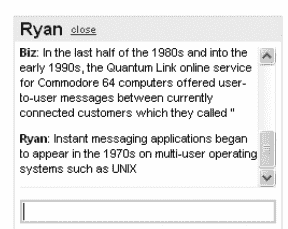

图 2-38. ScrollPanel 实际应用

在此示例中，您可以看到 `ScrollPanel` 的右侧，其中显示了可见的垂直滚动条。`ScrollPanel` 的子部件是一个 `VerticalPanel`，其中包含作为其子项的即时消息。要使此示例中的垂直滚动条生效，`ScrollPanel` 需要将其高度设置为恒定值。当 `VerticalPanel` 的大小超过此恒定值时，滚动条将出现，让用户可以滚动查看未显示的区域。以下代码构造了本示例中的 `ScrollPanel`：

```java
ScrollPanel conversationScroller = new ScrollPanel();
conversationScroller.setHeight("150px");
conversationScroller.setWidget( conversationPanel );
```

该部件还包含一些方法，用于协助控制滚动位置、使子组件可见，以及控制滚动条的可见性。您可以在 GWT 文档 <http://code.google.com/webtoolkit/documentation/gwt.html> 中找到有关每个方法的更多信息。

#### FocusPanel

`FocusPanel` 是一个 `SimplePanel`，它增加了处理来自其子部件各种事件的能力。它支持点击、焦点、键盘和鼠标事件。您还可以将此面板设置为具有标签索引，即当用户按下 Tab 键时焦点停留的位置，并且您可以显式设置其焦点。

### 复杂容器面板

复杂容器面板同样只能有一个子控件，但它们提供比简单容器面板更复杂的行为。复杂容器面板包括 `FormPanel`、`DisclosurePanel`、`PopupPanel` 和 `DialogBox`。

#### FormPanel

`FormPanel` 包装了 HTML 的 `form` 标签，提供了将 GWT 控件中的表单数据提交到服务器的能力，使用的是浏览器的表单提交功能。通常，浏览器的表单提交功能在 Ajax 应用中并不使用，因为它会导致页面刷新。但是，GWT 中的 `FormPanel` 采用了一种技术，允许你在应用中拥有表单，并且提交时不刷新页面。你的应用通过实现 `FormHandler` 接口，在表单提交以及服务器返回响应时收到通知。

前面在“表单控件”部分列出的所有实现 `HasName` 接口的控件都可以在表单中使用。它们需要实现 `HasName` 接口，因为 HTML 的 `form` 标签要求每个提交的值都有一个名称。提交时，这个名称会与其值一起传递给服务器，服务器使用这些名称-值对来执行请求。例如，以下代码创建一个 `FormPanel`，用于向 Web 服务器提交登录请求：

```java
//create the form panel, set its action and method
final FormPanel form = new FormPanel();
form.setAction("/signin");
form.setMethod(FormPanel.METHOD_POST);

//set the main widget for the panel to a vertical panel
VerticalPanel panel = new VerticalPanel();
form.setWidget(panel);

//create the username field
TextBox tb = new TextBox();
tb.setName("username");
panel.add(tb);
```

```java
//create the password field
PasswordTextBox ptb = new PasswordTextBox();
ptb.setName("password");
panel.add(ptb);

//create the Submit button
panel.add(new Button("Submit", new ClickListener() {
    public void onClick(Widget sender) {
        form.submit();
    }
}));

//add a form handler
form.addFormHandler(new FormHandler() {
    public void onSubmitComplete(FormSubmitCompleteEvent event) {
        Window.alert(event.getResults());
    }

    public void onSubmit(FormSubmitEvent event) {
        if (tb.getText().length() == 0 || ptb.getText().length() == 0 ) {
            Window.alert("The fields must not be empty.");
            event.setCancelled(true);
        }
    }
});
```

这段代码首先创建一个 `FormPanel` 实例，并设置其 action 和 method。表单的 action 是服务器端脚本处理表单提交的 URL 目标地址。你需要调用 `setMethod` 来设置用于提交表单数据的 HTTP 方法，可以是 GET 或 POST。在这个例子中我们选择了 POST 而不是 GET。这两种方法用于表单提交的区别在于，GET 将表单数据提交在 URL 中，而 POST 将数据提交在 HTTP 请求体中。

创建 `FormPanel` 后，添加表单字段。由于 `FormPanel` 控件是一个简单面板，它只能有一个子控件。这允许你选择任何布局面板来管理字段的布局。在这个例子中，我们使用 `VerticalPanel` 控件，这样我们的字段会垂直排列。我们创建用户名字段作为 `TextBox` 控件，密码字段作为 `PasswordTextBox` 控件，然后将它们添加到 `VerticalPanel` 中。接着创建提交按钮，并添加点击监听器，通过调用 `FormPanel` 的 `submit` 方法来提交表单。

最后，向面板添加一个 `FormHandler` 实例来监听表单事件。使用表单面板时可能会发生两个事件。第一个是 `onSubmit`，它在表单提交到服务器之前发生。你可以使用这个事件来验证表单上的字段数据，并在必要时取消提交。在这个例子中，我们检查表单以确保字段不为空。如果任一字段为空，我们会提醒用户，并通过事件对象的 `setCancelled` 方法取消提交。另一个事件是 `onSubmitComplete`，它在服务器从表单提交返回响应时发生。

需要注意的是，浏览器有安全限制，不允许你读取提交到另一个域的表单的结果。如果你确实将这些结果提交到另一个域，你可能无法读取查询的结果，也无法确定提交是否成功。

#### DisclosurePanel

Web 应用通常设计为垂直滚动的界面。随着单页需要显示的数据量增加，垂直滚动变得越来越麻烦。作为垂直滚动的解决方案，GWT 提供了 `DisclosurePanel`。

`DisclosurePanel` 是一个容器面板，它有一个内容控件，并可以定义一个头部。当用户点击头部时，它会切换内容的可见性。这样，需要垂直滚动的数据部分可以被分类到各个部分中，然后可以通过单击隐藏起来，从而为其他部分释放垂直空间。

第 7 章中的多搜索应用使用 `DisclosurePanel` 提供了一种简单的方法来隐藏搜索引擎的搜索结果以查看其他结果，如图 2-39 所示。

图 2-39 显示了用作头部的搜索引擎名称，以及一个向下的箭头图像，表示 `DisclosurePanel` 是打开的。当用户点击 `DisclosurePanel` 的头部时，内容会被隐藏，并显示不同的图像。在这种情况下，箭头指向右侧而不是向下。以下代码创建这种类型的展开面板：


▼ Yahoo Search

+ * **java.com: Hot Games, Cool Apps**

  Official Java site from Sun. Includes Java software download, information for developers, and examples of Java technology in action.

* **Java Technology**

  Official site for Sun Developer Network featuring Java developer resources, community, documentation, support, news, and Java software downloads.

* **Download Java software from Sun Microsystems**

  ... Microsystems Java Runtime Environment (JRE) for Windows, Solaris, and Linux. ... operating system from the list below to get the latest Java for your computer. ...

图 2–39. 使用 DisclosurePanel 隐藏搜索结果

```java
DisclosurePanel mainPanel = new DisclosurePanel(
    searchResultImages, engine.getName(),true );
mainPanel.setContent(results);
```

注意，构造函数的第一个参数是一个名为 `searchResultImages` 的字段。这个字段是 `ImageBundle` 接口的一个实例，`DisclosurePanel` 用它来显示头部中的图像。需要通过实现 GWT 的 `DisclosurePanelImages` 接口为 `DisclosurePanel` 定义两个图像：

```java
public interface DisclosurePanelImages extends ImageBundle {
    AbstractImagePrototype disclosurePanelOpen();
    AbstractImagePrototype disclosurePanelClosed();
}
```

多搜索应用使用以下代码来定义这个接口，并为 `DisclosurePanel` 提供图像：

```java
static public interface SearchResultImages extends DisclosurePanelImages {
    /**
     * @gwt.resource minimize1.gif
     */
    AbstractImagePrototype disclosurePanelOpen();

    /**
     * @gwt.resource minimize2.gif
     */
    AbstractImagePrototype disclosurePanelClosed();

}
public static SearchResultImages searchResultImages = (SearchResultImages)
GWT.create( SearchResultImages.class );
```

注意，该接口扩展了 `DisclosurePanelImages` 接口，因此可以在 `DisclosurePanel` 中使用。代码为两个方法提供了注解，指向应该使用的图像。这段代码使用 GWT 的延迟绑定 `GWT.create` 方法创建该接口的实例。这可能看起来有些复杂，但在应用中使用图像包可以大大提高性能。这段代码在 GWT 编译步骤中将所有图像捆绑在一起，形成单个图像，并在应用加载到浏览器时作为单个包下载。有关图像包的更多信息，请参见第 5 章。

#### PopupPanel


`PopupPanel` 控件是一个显示在现有界面上方的 `SimplePanel`。具有类似行为的桌面控件包括工具提示（鼠标悬停在控件上时显示）或列表框的下拉部分（用户点击控件时显示）。在 GWT 中，`PopupPanel` 在用户点击 `MenuItem` 后显示垂直菜单，`DialogPanel` 将其用作超类。第 8 章中的博客编辑器应用使用 `PopupPanel` 显示博客条目的托管版本，在用户点击条目上的查看链接后显示，如图 2-40 所示。

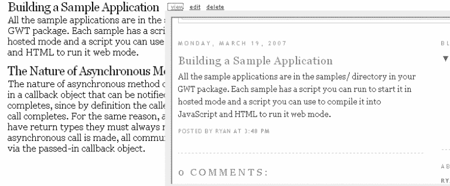

**图 2-40.** 显示博客条目的 `PopupPanel`

在此图中，`PopupPanel` 将一个 `Frame` 设置为其构件，并将该 `Frame` 的 URL 设为博客条目的托管 URL。图 2-40 展示了用户单击 View 按钮后的面板，它显示在 View 按钮的正下方。在本例中，当 `PopupPanel` 失去焦点时，它会消失。博客编辑器应用程序使用以下代码构建此 `PopupPanel`：

```java
public class HostedBlogView extends PopupPanel {
  public HostedBlogView( String url, Widget sender ) {
    super(true);
    Frame frame = new Frame(url);
    frame.setWidth("100%");
    frame.setHeight("100%");
    setWidget(frame);
    setPopupPosition(
        sender.getAbsoluteLeft(),
        sender.getAbsoluteTop()+sender.getOffsetHeight());
  }

}
```

代码将 `PopupPanel` 扩展为自己的类，以便在应用程序的不同部分重用。在构造函数中，超类构造函数为 `autohide` 参数传入 `true`。这启用了 `PopupPanel` 中面板在失去焦点时自动隐藏自身的功能。然后创建 `Frame` 构件并将其设置为 `PopupPanel` 中的主构件。使用 `PopupPanel` 的 `setPopupPosition` 方法设置面板的弹出位置，构件的位置作为构造函数参数提供。当用户单击 View 按钮时创建此构件：

```java
private class ViewClickListener implements ClickListener {
  public void onClick( Widget sender ) {
    new HostedBlogView(entry.getLink(),sender).show();
  }
}
```

在此单击监听器中，创建 `HostedBlogView` 类（即 `PopupPanel`）的新实例，以条目的链接和被单击的构件作为构造函数参数。然后调用 `show` 方法，显示 `PopupPanel`。

### `DialogBox`

`DialogBox` 构件扩展了 `PopupPanel`，继承了其弹出行为，并在顶部添加了一个可拖动的标题栏。此构件模仿桌面应用程序中的模态对话框。模态对话框要求用户进行交互，然后才能与应用程序的其余部分进行进一步交互。

图 2-41 展示了 Gpokr GWT 应用程序（参见 http://gpokr.com）中 `DialogBox` 构件的示例¹。

在此示例中，对话框在用户单击右上角的 Change Table 按钮后创建。用户无法与对话框子构件以外的应用程序任何部分进行交互。当用户完成对话框操作，选择表格并单击 Go 或 Cancel 后，应用程序隐藏对话框，用户可以继续与应用程序交互。

用于创建和显示对话框的代码位于 Change Table 按钮的单击监听器中：

```java
changetable.addClickListener(new ClickListener() {
    public void onClick(Widget sender){
        new ChangeTableDialog().show();
    }
});
```

`ChangeTableDialog` 类使用 `DialogBox` 作为超类，因此继承了其 `show` 和 `hide` 方法。应用程序在调用 `show` 之前立即调用对话框构造函数。此处构建其布局并设置对话框的标题：

```java
ChangeTableDialog() {
    setText("Change Table");
    VerticalPanel vpanel = new VerticalPanel();
    setWidget(vpanel);
}
```

> 1. 这是我为测试该工具包而编写的 GWT 应用程序，时间是在 2006 年 5 月发布后不久。此处的对话框使用 `TabPanel` 实现 Ring 和 Sit n Go 选项卡。列表是 `ScrollPanel` 内的 `Grid` 构件。

## 第 2 章 用户界面库概览

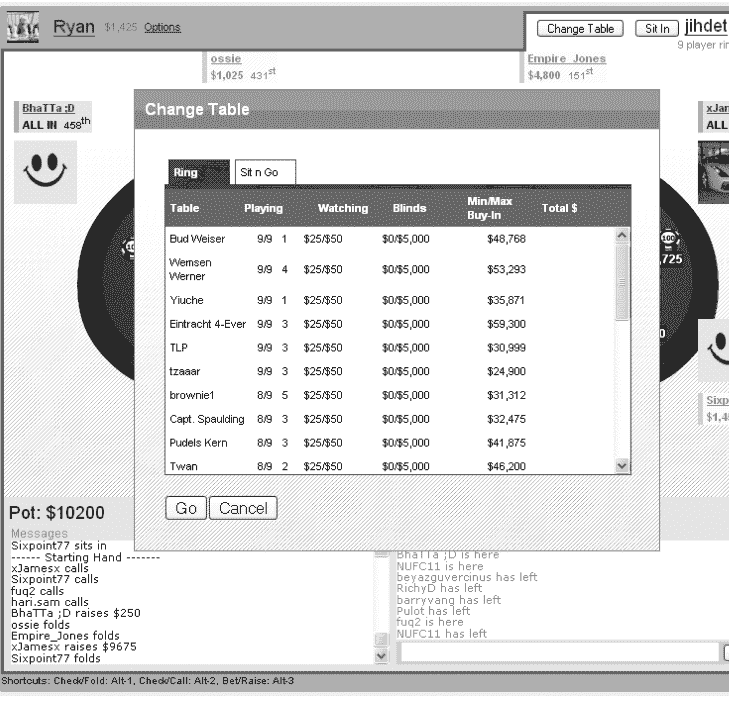

**图 2–41.** `DialogBox` 构件创建模态对话框

构造函数继续设置对话框的布局，首先使用 `VerticalPanel` 构件作为根。类处理 Go 和 Cancel 按钮的单击事件以执行表格更改并隐藏对话框：

```java
Button gobutton = new Button( "Go" );
gobutton.addListener( new ClickListener(){
    public void onClick(Widget sender){
        hide();
        loadTable( selectedTable );
    }
});

Button cancel = new Button( "Cancel" );
cancel.addListener( new ClickListener(){
```

```java
public void onClick(Widget sender) {hide();}
});
```

`DialogBox` 构件有两个预设样式名称：`gwt-DialogBox` 用于对话框的框架，`Caption` 用于对话框的标题栏。前面的示例使用这两个样式为对话框和标题提供背景图像并设置标题字体大小。以下代码展示了使用的 CSS 样式：

```css
.gwt-DialogBox {
    border: 1px solid #748299;
    background-color: white;
    background-image: url(back.jpg);
    background-repeat: repeat-x;
    background-position: bottom;
}
.gwt-DialogBox .Caption {
    background-color: #C3D9FF;
    background-image: url(titlebar.gif);
    background-repeat: repeat-x;
    padding: 10px;
    font-weight: bold;
    color: white;
    cursor: default;
}
```

## 用户界面框架粘合剂

GWT 中的构件遵循通用设计并共享接口，以便轻松理解、开发和扩展。本节介绍将这些构件绑定在一起的粘合剂。它分为两类：事件接口和特性接口。

### 事件接口

处理事件是任何用户界面代码的核心部分。一方面，应用程序的控制器用数据填充界面；另一方面，用户正在与用户界面构件进行交互。正是在这第二方面，事件模型派上用场。为 GWT 构件实现用户界面事件所选择的模型遵循观察者模式。

观察者模式是一种设计模式，其中观察者——你的应用程序代码——观察主体（即用户界面）的状态。当主体的状态发生变化时，观察者会收到通知。使用此模式可以使你的应用程序代码与主体解耦。换句话说，主体不需要了解应用程序的细节即可调用其方法。该模式通常由主体持有一组观察者来实现，当状态变化发生时，遍历这些观察者以调用每个观察者的 `notify` 方法。`notify` 方法通常是主体提供的接口上的一个方法，由观察者实现。图 2-42 中的 UML 图展示了这种关系。

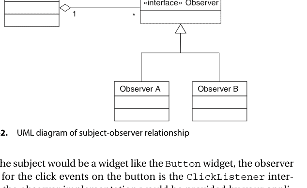

**图 2–42.** 主体-观察者关系的 UML 图

在 GWT 中，主体可以是 `Button` 构件之类的构件，按钮上单击事件的观察者接口是 `ClickListener` 接口，观察者实现由你的应用程序代码提供。例如，以下代码构建了刚才描述的按钮和 `ClickListener`：

```java
//create a button
Button subject = new Button("click me");

//implement a ClickListener
ClickListener observer = new ClickListener(){
  public void onClick( Widget sender ){
    Window.alert( "I've been clicked" );
  }
});

//add the ClickListener to the button to receive click events
subject.addClickListener( observer );
```

某些观察者接口具有多个事件方法，这意味着你需要为每个方法提供一个实现，即使只是空实现，以遵循实现 Java 接口的规则。某些观察者接口较大，这使得你为了实现一个事件而不得不繁琐地实现许多空方法。针对这些情况，GWT 提供了适配器类，让你只实现观察者接口上的部分方法。GWT 的 `KeyboardListenerAdapter` 是 `KeyboardListener` 接口的适配器类示例，该接口有三个方法。由于适配器是实现每个方法为空的类，你只需覆盖要处理的事件方法即可。以下代码展示了 GWT 中 `KeyboardListenerAdapter` 的实现：

```java
public class KeyboardListenerAdapter implements KeyboardListener {

    public void onKeyDown(Widget sender, char keyCode, int modifiers){}

    public void onKeyPress(Widget sender, char keyCode, int modifiers){}

    public void onKeyUp(Widget sender, char keyCode, int modifiers){}
}
```

第 7 章中的 Multi-Search 应用程序使用 `KeyboardListenerAdapter` 处理 `TextBox` 构件的 `onKeyPress` 事件。以下代码展示了该应用程序中 `KeyboardListenerAdapter` 的使用：

```java
searchBox.addKeyboardListener( new KeyboardListenerAdapter(){
    public void onKeyPress( Widget sender, char keyCode, int modifiers){
        if(keyCode == KEY_ENTER )
            onSearch();
    }
});
```

请注意，`KeyboardListener` 接口中只需要实现一个方法。这些适配器类使你在处理事件时免于编写大量不必要的代码。

在观察者模式的主体方面，GWT 使用一致的设计来实现事件，包括主体接口和主体辅助集合。如果你将开发新构件并实现事件，了解它们在 GWT 中的实现方式对你来说很重要。每个主体接口代表一种主体支持的事件分组类型。例如，主体为点击事件实现了 `SourcesClickEvents` 接口。由于许多 widget 都有点击事件，这个接口可以在它们之间共享。该接口包含允许应用程序代码添加和移除监听器的方法：

```java
public interface SourcesClickEvents {
  void addClickListener(ClickListener listener);
  void removeClickListener(ClickListener listener);
}
```

当 widget 实现这些接口之一时，它们通常使用一个集合辅助类将事件中继给监听器。对于点击事件，GWT 有 `ClickListenerCollection`。这些辅助集合简单地跟踪所有监听器，并为每个事件提供触发方法。对于点击事件，`ClickListenerCollection` 有 `fireClick` 方法：

```java
public class ClickListenerCollection extends Vector {
  public void fireClick(Widget sender) {
    for (Iterator it = iterator(); it.hasNext();) {
      ClickListener listener = (ClickListener) it.next();
      listener.onClick(sender);
    }
  }
}
```

这个方法的实现是遍历监听器集合，并为每个监听器调用 `onClick` 方法。

这种设计的原因是为了促进代码复用。集合辅助类可以为支持点击监听器的每个 widget 复用。在 widget 之间共享源接口的另一个好处是，它允许编写以通用方式操作支持特定类型事件的 widget 的代码。

这些使用观察者模式实现事件的模式在 GWT 中一致地重复。表 2-2 列出了可用的事件类型及其接口。

## 表 2–2 GWT 事件类型及其接口

| 事件 | 观察者类 | 主体类 | 支持的 Widget |
|---|---|---|---|
| `onChange` | `ChangeListener` | `ChangeListenerCollection`<br>`SourcesChangeEvents` | `ListBox`<br>`PasswordTextBox`<br>`TextArea`<br>`TextBox` |
| `onClick` | `ClickListener` | `ClickListenerCollection`<br>`SourcesClickEvents` | `Button`<br>`CheckBox`<br>`FocusPanel`<br>`HTML`<br>`Hyperlink`<br>`Image`<br>`Label`<br>`ListBox`<br>`PasswordTextBox`<br>`RadioButton`<br>`TextArea`<br>`TextBox` |
| `onFocus`<br>`onLostFocus` | `FocusListener`<br>`FocusListenerAdapter` | `FocusListenerCollection`<br>`SourcesFocusEvents` | `Button`<br>`CheckBox`<br>`FocusPanel`<br>`ListBox`<br>`PasswordTextBox`<br>`RadioButton`<br>`TextArea`<br>`TextBox`<br>`Tree` |
| `onKeyDown`<br>`onKeyPress`<br>`onKeyUp` | `KeyboardListener`<br>`KeyboardListenerAdapter` | `KeyboardListenerCollection`<br>`SourcesKeyboardEvents` | `FocusPanel`<br>`PasswordTextBox`<br>`TextArea`<br>`TextBox`<br>`Tree` |
| `onError`<br>`onLoad` | `LoadListener` | `LoadEventsCollection`<br>`SourcesLoadEvents` | `Image` |
| `onMouseDown`<br>`onMouseEnter`<br>`onMouseLeave`<br>`onMouseMove`<br>`onMouseUp` | `MouseListener`<br>`MouseListenerAdapter` | `MouseListenerCollection`<br>`SourcesMouseEvents` | `FocusPanel`<br>`HTML`<br>`Image`<br>`Label` |
| `onMouseWheel` | `MouseWheelListener` | `SourcesMouseWheelEvents` | `FocusPanel`<br>`HTML`<br>`Image`<br>`Label` |
| `onPopupClosed` | `PopupListener` | `PopupListenerCollection`<br>`SourcesPopupEvents` | `DialogBox`<br>`PopupPanel` |
| `onScroll` | `ScrollListener` | `ScrollListenerCollection`<br>`SourcesScrollEvents` | `ScrollPanel` |
| `onCellClicked` | `TableListener` | `SourcesTableEvents`<br>`TableListenerCollection` | `FlexTable`<br>`Grid` |
| `onBeforeTabSelected`<br>`onTabSelected` | `TabListener` | `SourcesTabEvents`<br>`TabListenerCollection` | `TabBar`<br>`TabPanel` |
| `onTreeItemSelected`<br>`onTreeItemStateChanged` | `TreeListener` | `SourcesTreeEvents`<br>`TreeListenerCollection` | `Tree` |

### 特性接口


GWT 中 widget 的设计遵循基于接口的设计实践，因此编写面向接口的代码优于使用类。这有助于将应用程序与库实现解耦。例如，第 6 章中的 Gadget Desktop 应用程序利用了这种开发方式，并有一个`DockableWidget`，支持拖放到任何支持`HasWidgets`接口的面板。这使得`DockableWidget`的代码相当通用，可以与许多面板配合使用。另一种选择，即使用单独的面板接口，意味着每种面板都需要定制代码。

以下是从`DockableWidget`中使用`HasWidgets`接口的代码片段：

```
if( containerWidget instanceof HasWidgets &&
   absCenterX >= containerWidget.getAbsoluteLeft() &&
   absCenterX <= containerWidget.getAbsoluteLeft() +
   containerWidget.getOffsetWidth() &&
   absCenterY >= containerWidget.getAbsoluteTop() &&
   absCenterY <= containerWidget.getAbsoluteTop() +
   containerWidget.getOffsetHeight() ){
   if( containerWidget != parentWidget ){
       ((HasWidgets)containerWidget).add( this );
   }
   for( Iterator it = ((HasWidgets)containerWidget).iterator();
       it.hasNext() && switchWith == null;){
```

如你所见，这段代码操作的是`HasWidgets`接口。首先它检查容器是否是`HasWidgets`接口的实例，并使用`instanceof`操作符以避免强制转换异常。然后它将`containerWidget`强制转换为该接口并调用其方法。`containerWidget`的实际实现可以是任何支持`HasWidgets`的 widget，包括 GWT 中的所有面板。

你可以在 GWT 的`FormPanel`实现中看到另一个使用基于接口的设计的例子。代码的编写方式使得添加到表单面板的每个 widget 都将实现`HasName`接口，以使其数据包含在表单提交中。

表 2-3 列出了 GWT 自带的特性接口，不包括上一节中概述的事件接口。

## 表 2–3 GWT 特性接口（不包括事件接口）

| 特性 | 方法 | 支持的 Widget |
| :--- | :--- | :--- |
| `HasAlignment` | `getHorizontalAlignment`<br>`getVerticalAlignment`<br>`setHorizontalAlignment`<br>`setVerticalAlignment` | `DockPanel`<br>`HorizontalPanel`<br>`HTML`<br>`Label`<br>`VerticalPanel` |
| `HasCaption` | `getCaption`<br>`setCaption` | |
| `HasFocus` | `getTabIndex`<br>`setAccessKey`<br>`setFocus`<br>`setTabIndex` | `Button`<br>`CheckBox`<br>`FocusPanel`<br>`ListBox`<br>`PasswordTextBox`<br>`RadioButton`<br>`TextArea`<br>`TextBox`<br>`Tree` |
| `HasHorizontalAlignment` | `getHorizontalAlignment`<br>`setHorizontalAlignment` | `HTML`<br>`Label` |
| `HasName` | `getName`<br>`setName` | `CheckBox`<br>`FileUpload`<br>`Hidden`<br>`ListBox`<br>`PasswordTextBox`<br>`RadioButton`<br>`TextArea`<br>`TextBox` |
| `HasText` | `getText`<br>`setText` | `HTML`<br>`Label`<br>`PasswordTextBox`<br>`TextArea`<br>`TextBox` |
| `HasVerticalAlignment` | `getVerticalAlignment`<br>`setVerticalAlignment` | |
| `HasWidgets` | `add`<br>`clear`<br>`iterator`<br>`remove` | All Panels<br>`Tree` |
| `HasWordWrap` | `getWordWrap`<br>`setWordWrap` | `HTML`<br>`Label` |
| `IndexedPanel` | `getWidget`<br>`getWidgetCount`<br>`getWidgetIndex`<br>`remove` | `DeckPanel`<br>`FlowPanel`<br>`HorizontalPanel`<br>`StackPanel`<br>`TabPanel`<br>`VerticalPanel` |

### 小结

GWT 在其`com.google.gwt.user.client.ui`包中提供了相当大的用户界面库。widget 和面板提供了与浏览器无关的 Ajax 应用程序用户界面基础，扩展了纯 HTML 目前可用的功能。遵循许多 Java 用户界面开发者熟悉的设计，它提供了丰富的事件系统和坚实的结构模型。

本章将 widget 分为四大类。对于 widget，分类包括静态 widget——标签、图像、HTML 和超链接——它们提供界面中最基本但必要的元素；表单 widget，让用户能够选择并向应用程序输入信息；以及复杂 widget，提供更高级的导航和界面组织。就面板而言，有简单和复杂的布局面板帮助你为应用程序界面创建坚实的结构，以及简单和复杂的容器面板，为应用程序界面的各个部分提供额外功能。

在使用 GWT 构建 Ajax 应用程序时，熟悉工具包中可用的 widget 是很好的，这样你就能创建最有效的 Ajax 界面。

## 3 服务器集成技术

Ajax 应用程序是桌面应用程序和传统 Web 应用程序的巧妙结合。它们拥有像桌面应用程序那样响应迅速的界面，以及像传统 Web 应用程序那样易于分发的特点。它们也像传统 Web 应用程序一样，能够很好地与服务器端技术进行集成。本章将介绍用于将 GWT 应用程序与服务器技术集成的多种选项和技术。我们首先介绍基本的集成技术，包括使用标准的 Ajax 异步 HTTP 请求从服务器加载简单的文本或 HTML。然后，我们讨论如何从服务器加载更复杂的数据，以及如何利用 Google Web Toolkit 的 XML 和 JSON 库。在介绍了数据格式之后，我们探讨如何通过 JavaScript API、JSONP 和 HTTP 代理与第三方服务器集成。本章最后将介绍更高级的服务器集成技术，包括使用 REST 和 GWT-RPC。

本章将为你提供这些技术的概述。如需了解更多信息，请参阅第二部分中的示例应用程序章节，这些章节会更详细地介绍这些技术。

## 基本的服务器集成技术

传统的 Web 应用程序采用瘦客户端模式，大部分工作由服务器完成。客户端通常仅包含一些用于在浏览器中标记数据以供显示的 HTML 代码。当这些文档赋予用户请求特定 URL 或通过表单提交数据的能力时，它们就成为与服务器端应用程序交互的界面的一部分。最基本的 Web 应用程序是一个数据浏览器，用户可以在其中点击浏览来自服务器的数据。更复杂的应用程序允许用户通过提交数据与数据模型进行交互。最终，你会在服务器上开发整个应用程序，而客户端只是使用浏览器的功能来显示应用程序的界面。

在传统 Web 应用程序中，使客户端能够与服务器交互的浏览器功能是其通过 HTTP 请求数据的能力以及通过表单提交数据的能力。本节介绍通过基本的服务器集成技术将 GWT 应用程序与传统的服务器端 Web 应用程序进行集成。

### 异步 HTTP 请求

Ajax 应用程序的核心能力是能够异步向服务器发起调用以获取数据，并避免页面刷新。实现这一点的一种方法是，在用 JavaScript 创建 Ajax 应用程序时，针对不同的浏览器使用不同的 JavaScript 对象。使用 GWT 时，你只需使用 HTTP 库中的类，GWT 会处理浏览器细节问题。

在第 1 章中，你看到了异步 HTTP 请求的一个简要示例，即 Hangman 教程，该应用程序在启动时从服务器下载一个简单的文本文件。此示例使用了一个简化的`HTTPRequest`类来下载数据。但是，最好改用 HTTP 库，因为它对处理错误情况提供了更多的支持。

HTTP 库位于`gwt-user.jar`文件中的`com.google.gwt.http.client`包内。要在代码中使用此包，需要使用`inherits` XML 元素将其添加到你的 GWT 模块文件中，如下所示：

```
<inherits name="com.google.gwt.http.HTTP"/>
```

使用此库让应用程序向服务器发起调用相对简单，并遵循第 2 章中描述的观察者模式。首先创建一个`RequestBuilder`实例来设置请求的详细信息，例如 URL 和头部参数。然后使用`sendRequest`方法发送请求，提供 POST 数据（如需要）以及一个`RequestCallback`接口实例作为参数。当请求完成时，如果服务器调用失败，则调用`RequestCallback`实例的`onError`方法；如果调用成功，则调用其`onResponseReceived`方法。当 HTTP 库调用`onResponseReceived`方法时，它会提供一个`Response`对象供应用程序处理。该响应包含从服务器发送的数据主体，以及状态文本、状态代码和 HTTP 头部列表。

你向服务器发布或从服务器接收的数据类型可以是任何格式，但由于 GWT 提供了用于构建和解析 JSON 和 XML 的库，因此请优先考虑这些格式。你也可以与先前接受表单提交的较旧的服务器脚本集成。在这种情况下，你需要按照标准表单编码来构建你的 POST 数据（有关此方法示例，请参见下一节）。

第 10 章中的数据库编辑器应用程序使用 HTTP 库向服务器发送和接收 XML。以下代码摘自该应用程序，演示了如何使用 HTTP 库向服务器发布数据和读取数据：

```
 //create a new GET request for the database table XML feed
 RequestBuilder builder = new RequestBuilder(
     RequestBuilder.GET, "/databaseEditor/feed/"+database.getName());

 try{
     //send the request
     builder.sendRequest( null, new RequestCallback(){
         public void onError(Request request, Throwable exception){
             //log the error
             GWT.log( "error", exception );
         }

         public void onResponseReceived(Request request, Response response){
             //check the status code
             int statusCode = response.getStatusCode();
             if( statusCode == 200 || statusCode == 201 ){
                 //make the call to parse the response
                 parseTableXML( response.getText() );
             }
         }
     });
 }
 catch (RequestException e){ GWT.log( "error", e); }
```

在此代码中，HTTP 请求没有发布任何数据，这由`sendRequest`方法调用中的第一个 null 参数表示，但期望以 XML 数据的形式获得响应。应用程序在`RequestCallback`方法的`onResponseReceived`实现中通过调用`Response`实例上的`getText`方法来接收响应。（下一节讨论如何读写 JSON 和 XML 等结构化格式。）

如你所见，使用 HTTP 包进行服务器调用相当简单。由于有许多免费的 Web 服务可用，你可能会忍不住向第三方服务器发起调用，但浏览器施加了一项相当严格的安全限制，称为**同源策略**（Same Origin policy），以防止这种情况。该策略基本上规定，你不能向 HTML 文档来源之外的服务器发起调用。当然，有多种方法可以从其他服务器获取数据并绕过此限制。第 7 章中的多搜索应用程序展示了一种使用`script`标签的方法，第 8 章中的博客编辑器应用程序则展示了另一种使用服务器端代理的方法。下一节将介绍这两种技术。

在 GWT 中使用 HTTP 的另一个限制是，你只能使用两种 HTTP 请求方法：GET 和 POST。此限制是由于 Safari 浏览器中的一个错误，该错误不允许任何其他 HTTP 请求方法。如果你不想提供对 Safari 的支持，可以扩展`HTTPRequest`类以允许其他 HTTP 方法。博客编辑器应用程序通过在`X-HTTP-Method-Override`头部中传递这些方法来使用 DELETE 和 PUT 方法。数据库编辑器应用程序需要 DELETE 和 PUT 方法来与基于 REST 的 Ruby on Rails 服务器交互。相反，该应用程序使用 POST 方法，并将 Rails 的`_method`参数设置为预期的 HTTP 方法。

异步 HTTP 的第三个限制是每个域两个连接的限制。此限制由 HTTP 协议规定，旨在防止用连接淹没服务器。这意味着你在任何时候只能有两个待处理的异步请求。第三个请求必须等待前两个请求中的一个完成。这两个连接的限制不仅适用于你的应用程序发出的异步 HTTP 请求，还适用于从同一域的服务器加载的任何资源，包括脚本文件和图像。例如，如果两个大图像文件正在下载，占用了两个连接，而你试图异步加载 XML 数据，则可能会遇到性能问题。你可以通过将大文件放在子域中来解决它们占用连接的问题。例如，如果你使用`images.yourdomain.com`，就会自动获得另外两个可用连接。但要注意不要将异步请求移动到加载应用程序的域之外的域，否则你会遇到同源策略限制的问题。

### 处理纯文本和 HTML

首先，让我们看看如何将 Ajax 应用程序与生成现有 HTML 的服务器接口集成。Ajax 应用程序可以随时使用浏览器的异步 HTTP 功能通过 HTTP 从服务器获取数据。通常，你使用它来请求 XML，但任何格式都是可能的。对于现有的传统 Web 应用程序，你可能已经在服务器上拥有可以异步加载并在 Ajax 应用程序中显示的 HTML 片段。例如，让我们看看如何从服务器加载现有的 HTML 页面以显示为工具提示，作为对第 9 章中即时通讯应用程序的补充。

首先，我们需要创建一个将存储在服务器上的测试 HTML 片段，名为`ryan.html`：

```
<b>Ryan</b><br/>
Software Developer<br/><a href="http://www.rdews.com">http://www.rdews.com</a>
```

这段基本的 HTML 将以粗体显示我的名字、我的职业，然后是我的网站链接。我们可以为每个人存储一个这样的文件，并在需要时异步获取该人的文件。当用户点击即时通讯应用程序中的联系人图标时，我们可以简单地创建一个 HTML 工具提示，如图 3-1 所示。

在这个例子中，即时通讯应用程序是一个 Ajax 应用程序，它从服务器异步加载现有的 HTML 数据并显示作为应用程序的一部分动态加载。以下代码执行此任务：

110 第 3 章 服务器集成技术


```java
icon.addClickListener(new ClickListener(){
    public void onClick( Widget sender ){
        try{
            RequestBuilder requestBuilder = new RequestBuilder(
                RequestBuilder.GET,
                GWT.getModuleBaseURL()+"/"+contact.getName()+".html" );
            requestBuilder.sendRequest( null, new RequestCallback(){
                public void onError(Request request, Throwable exception){
                    /*ignored*/
                }
                public void onResponseReceived(
                    Request request, Response response){
                    if( response.getStatusCode() == 200 ){
                        PopupPanel popup = new PopupPanel(true);
                        popup.setStyleName("popup");
                        popup.setWidget( new HTML(response.getText()));
                        popup.setPopupPosition( icon.getAbsoluteLeft(),
                            icon.getAbsoluteTop()+ icon.getOffsetHeight());
                        popup.show();
                    }
                }
            });
        }catch( Exception e){ /*ignored*/ }
    }
});
```

此代码为图标添加了一个点击监听器，该监听器实现了`onClick`事件，使用 GWT 的 HTTP 库向服务器发起异步请求，获取以图标联系人名称命名的 HTML 文档。如果请求成功，即存在该联系人的 HTML 文档时，代码会创建一个`PopupPanel`控件来保存所请求文档的 HTML 内容，并将其显示在图标的下方。

这种从服务器加载现有 HTML 文档的技术，是与服务器进行集成的一种基本方法，可以帮助客户端 Ajax 应用程序利用现有服务器应用程序的资源。

### 与传统服务器端脚本技术集成

大多数现有的 Web 应用程序不仅仅是一组 HTML 文档或片段。它们通常运行在脚本引擎上，根据用户输入或数据库中的数据在服务器端动态生成 HTML。当从脚本请求数据时，用户或客户端开发者通常意识不到正在使用脚本。例如，上一节中的 HTML 片段可能是由脚本生成的，该脚本首先从数据库检索数据，然后生成结果 HTML 返回给用户。有时应用程序需要通过脚本接受用户数据。该脚本会接收用户通过表单提交的数据并进行处理，通常会验证数据，然后将数据插入数据库。

这意味着从客户端应用程序的角度来看，服务器端脚本有三种可能的行为：

- 脚本接受来自客户端的参数并生成响应。
- 脚本接受来自客户端的请求，然后从数据库获取数据并生成响应。
- 脚本接受来自客户端的数据提交，并处理数据或将其插入数据库。

GWT 提供了一些工具，允许 Ajax 应用程序与这三种脚本行为类型进行交互。我们先来看前两种行为，即脚本根据客户端参数或从数据库生成响应，因为它们通常一起使用。我们将修改上一节中的即时通讯弹出窗口示例，用户点击联系人图标以显示 HTML 信息页面。在这种情况下，我们不再请求存储在服务器上的不同 HTML 文档，而是从一个单一的 PHP 脚本请求文档，并提供联系人名称作为参数。

如果你熟悉构建服务器端脚本，那么你应该熟悉 GET 和 POST 参数。这些参数可以通过 HTTP 请求使用 GET 或 POST 发送，是由`&`（和号）符号分隔的键值对。GET 请求在 URL 中`?`（问号）符号之后发送参数。POST 请求在 HTTP 头部之后作为请求体发送参数。大多数服务器端脚本，包括 PHP，都支持自动解析这些参数，并将它们放入一个数据结构，使每个值都易于访问。

我们的 PHP 脚本将命名为`getContact.php`，并接受一个`name`参数。它将构建联系人 HTML，类似于前面展示的`ryan.html`文件，但不同的是它将支持为多个联系人生成 HTML。要请求某个联系人的 HTML，你需要像这样向脚本发起请求，并带上`name`属性：

```
getContact.php?name=ryan
```

接受参数并生成 HTML 的 PHP 脚本如下所示：

```php
<?php
$contacts['ryan'] = array(
    'name' => 'Ryan',
    'job' => 'Software Developer',
    'website' => 'http://www.rdews.com');
$contacts['biz'] = array(
    'name' => 'Biz',
    'job' => 'Cat',
    'website' => 'http://www.cat.com');

$contact = $contacts[$_GET['name']];
?>

<b><?=$contact['name']?></b><br/>
<?=$contact['job']?><br/>
<a href="<?=$contact['website']?>"><?=$contact['website']?></a>
```

此 PHP 脚本首先生成一个关联数组，其中包含两个不同联系人的信息。通常这类数据会从数据库加载。代码使用 GET 参数选择所请求的联系人，并在`contacts`数组中查找该名称。然后脚本将所选联系人的值插入到 HTML 输出中。

你不需要了解 PHP 就能理解这一点。此示例仅演示如何使用 GWT 与现有的表单处理服务器端脚本进行集成。此示例与一个接受 GET 参数的服务器端脚本进行了集成。

在客户端，我们只需更改请求 URL，使其指向 PHP 脚本，如下所示：

```java
RequestBuilder requestBuilder = new RequestBuilder(
    RequestBuilder.GET,
    GWT.getModuleBaseURL()+"/getContact.php?name="+
    URL.encodeComponent( contact.getName() ) );
```

请注意，此代码使用了 GET 请求的参数提交格式，将参数放在`?`字符之后的 URL 末尾。代码添加了带有其名称的参数，如果参数不止一个，我们会用`&`字符将它们分隔开。

使用 GWT 的`URL.encodeComponent`方法非常重要，该方法会对任何可能干扰 URL 及其参数解析的字符进行编码。例如，如果名称中包含`&`符号，这将导致 PHP 参数解析器将其解释为下一组变量的开始。相反，服务器会正确解析编码后的参数。GWT 还提供了`URL.encode`方法，用于对 URL 中不属于参数部分的其他部分进行编码。

你可以用类似的方式向通常会处理表单提交的脚本提交数据。通常 HTML 表单标签有几个重要的参数，名为`action`和`method`，用于与服务器通信。`action`属性指定表单将提交其值的脚本 URL。`method`属性指定使用哪种 HTTP 方法，GET 或 POST。表单使用与前面提到的相同类型的参数编码。

让我们来看一个通过 POST 请求向通常会接收表单提交的脚本提交数据的示例。

我们先看看可用于向注册脚本提交数据的表单 HTML：

```html
<form name="input" action="register.php" method="post">
    Username: <input type="text" name="user"><br/>
    Email: <input type="text" name="email"><br/>
    Password: <input type="password" name="password"><br/>
    <input type="submit" value="Submit">
</form>
```

该表单的`action`为`register.php`，`method`为`post`，并接受三个参数。这意味着当表单提交时，浏览器将向`register.php`发起 HTTP POST 请求，并将表单输入值作为参数。浏览器实际提交的数据如下所示：

```
POST /register.php HTTP/1.1
Content-Type: application/x-www-form-urlencoded

username=ryan&email=ryan%40rdews.com&password=secret
```

这个精简版本展示了发送内容的重要部分。第一部分是 HTTP 协议，以 POST 请求开头，后跟 HTTP 头部。你可以看到 POST 请求要求 HTTP 服务器获取`register.php`脚本。它有一个`Content-Type`头部，设置为`application/x-www-form-urlencoded`，这告诉脚本正在发送什么类型的数据。

当 PHP 看到这个内容类型时，它知道将内容解析为表单参数，并在数组中提供给 PHP。其他服务器端脚本语言，如 JSP，执行相同的任务。参数列表跟在头部之后，采用我们一直在使用的参数编码方式，即由`&`字符分隔的键值对。

请注意，电子邮件值中的`@`符号已被编码。服务器端脚本引擎会在`register.php`脚本处理之前自动解码此值。

当服务器运行`register.php`脚本时，它通常会验证数据并在数据库中创建新行。我们并不关心这是如何完成的，而是关心如何在不更改服务器端脚本的情况下，从 Ajax 应用程序与此脚本进行集成。

有两种选项可以与此类脚本集成：

1. 手动构建 HTTP 请求并将值提交给服务器，类似于我们之前构建的 GET 请求。
2. 使用 GWT 的`FormPanel`创建表单界面，并利用浏览器的表单提交功能来提交数据。

使用`FormPanel`可以减少处理底层 HTTP 请求的工作量，但它需要一个界面。如果你无论如何都要为表单创建界面，这可能是更好的选择。否则，你仍然可以提交数据到我们所看的第一个方法的形式。让我们看看第一种方法的实现。

将 POST 数据提交到通常接受来自表单的 POST 数据的脚本相当简单。这与之前使用 GET 方法的示例完全相同，只是你不通过 URL 提交参数，而是作为 POST 数据提交。GWT HTTP 库允许在`sendRequest`方法中提交 POST 数据。你还需要设置 Content-Type HTTP 请求头，这样服务器端脚本才能知道 POST 数据的格式。以下代码实现了向`request.php`表单的 POST 提交：

```java
//build the data to post
StringBuffer postBuilder = new StringBuffer();
postBuilder.append("username=" );
postBuilder.append( URL.encodeComponent( username ) );

postBuilder.append("&email=" );
postBuilder.append( URL.encodeComponent( email ) );

postBuilder.append("&password=" );
postBuilder.append( URL.encodeComponent( password ) );

try{
    //create and submit the request
    RequestBuilder requestBuilder = new RequestBuilder( RequestBuilder.POST,
        GWT.getModuleBaseURL()+"/register.php" );
    requestBuilder.sendRequest( postBuilder.toString(), new RequestCallback(){
        public void onError(Request request, Throwable exception){
            /*ignored*/
        }

        public void onResponseReceived(Request request, Response response){
            /*ignored*/
        }
    });
}catch( Exception e){ /*ignored*/ }
```

这种方法允许你与现有的脚本集成，并以编程方式向它们提交数据。

另一种方法是使用`FormPanel`，它呈现一个用户界面，并使用底层的 form 标签来进行提交。然而，`FormPanel`不会像典型的 form 标签那样导致页面刷新。它将数据提交到一个隐藏的表单，这样 Ajax 应用程序就可以继续运行而无需刷新。

以下代码创建了一个`FormPanel`，将相同的数据提交到注册脚本：

```java
//create the form panel, set its action and method
final FormPanel form = new FormPanel();
form.setAction("/register.php");
form.setMethod(FormPanel.METHOD_POST);

//set the main widget for the panel to a vertical panel
VerticalPanel panel = new VerticalPanel();
form.setWidget(panel);

//create the username field
TextBox tb = new TextBox();
tb.setName("username");
panel.add(tb);

//create the e-mail field
TextBox tb = new TextBox();
tb.setName("email");
panel.add(tb);

//create the password field
PasswordTextBox ptb = new PasswordTextBox();
ptb.setName("password");
panel.add(ptb);

//create the Submit button
panel.add(new Button("Submit", new ClickListener() {
    public void onClick(Widget sender) {
        form.submit();
    }
}));
```

这段代码不会以编程方式提交数据，而是等待用户输入数据并点击提交按钮。提交的数据与前面的示例相同。对于`register.php`脚本来说，两种表单提交技术看起来是一样的。

用这些类型的服务器端脚本构建的服务器端 Web 应用程序可以与 HTML 表单配合工作，被称为**基于动作的 Web 应用程序（action-based web application）**。`action`一词来自 HTML form 标签上的`action`属性，它指向服务器端脚本的位置。第 10 章中的数据库编辑器应用程序包含了一个关于如何与基于动作的 PHP Web 应用程序集成的详细示例。

### 使用数据格式库

你已经看到，与服务器上的传统 Web 应用程序集成通常涉及读取 HTML 或纯文本，并使用表单编码调用服务器端脚本。然而，HTML 是一种用于渲染数据以便查看的标记语言，它不太适合编程使用。此外，表单编码对于更复杂的层次化数据结构来说并不理想。

更高级的 Web 应用程序有更健壮的方式来与服务器收发数据。在 Web 上发送和接收更复杂数据结构的两种最常见格式是 XML 和 JSON，两者在 GWT 中都有库来构建和解析它们的格式。这些格式可以与异步 HTTP 请求配对使用，以向服务器发送结构化数据和从服务器接收结构化数据。

### 读取和写入 XML


XML 是 Web 上非常重要的数据格式，它是许多 Ajax 应用程序的重要组成部分（XML 中的 X 就是 Ajax 里的 X）。通常，Ajax 应用程序使用动态 JavaScript 构建其界面，并以异步方式从服务器加载 XML 格式的数据。这种技术允许 Ajax 应用程序以多种动态方式对数据进行操作，从而产生比传统 Web 模型更丰富的客户端应用程序——在传统 Web 模型中，服务器预先渲染数据以在浏览器中静态显示。

XML 的语法与 HTML 相似，但它可以被应用程序使用的方式却大不相同。虽然你可以使用 HTML 来标记数据以在浏览器中进行特定渲染，但 XML 标记数据是为了向应用程序描述其含义。例如，在 Amazon.com 网页上搜索书籍会返回格式化为 HTML 的书籍列表，并在浏览器中渲染以便用户轻松阅读。如果应用程序发出相同的请求并收到 HTML 格式的书籍列表，它将难以理解或确定数据的含义。此外，如果 Amazon 决定更改其 HTML 的展示方式，结构就会改变，可能会让读取数据的应用程序感到困惑。

这正是 XML 的强项所在。如果 Amazon 以 XML 格式返回书籍列表（他们确实提供了这项服务），应用程序就可以读取 XML 并确切知道如何解释数据。XML 之所以获得这种特性，是因为它是一种自描述的格式；也就是说，每一块数据都有附加的额外信息来描述它是什么。例如，第 8 章中的博客编辑器应用程序从 Blogger 服务返回的博客条目格式如下：

```xml
<entry>
    <id>tag:blogger.com,1999:blog-6153289560998349310.post-4077746181889447434</id>
    <published>2007-03-08T19:08:00.000-08:00</published>
    <updated>2007-04-12T08:59:46.568-07:00</updated>
    <title type='text'>The Nature of Asynchronous Method Calls</title>
    <content type='html'>The nature of asynchronous method calls requires the caller to pass in a callback object that can be notified when an asynchronous call completes, since by definition the caller cannot be blocked until the call completes. For the same reason, asynchronous methods do not have return types; they must always return void. After an asynchronous call is made, all communication back to the caller is via the passed-in callback object.</content>
    <link rel='alternate' type='text/html' href='http://gwttest.blogspot.com/2007/03/test.html'></link>
    <link rel='self' type='application/atom+xml' href='http://gwttest.blogspot.com/feeds/posts/default/4077746181889447434'></link>
    <link rel='edit' type='application/atom+xml' href='http://www.blogger.com/feeds/6153289560998349310/posts/default/4077746181889447434'></link>
    <author><name>Ryan</name></author>
</entry>
```

如你所见，语法与 HTML 相似，但标签描述的是它们所包含的数据。当应用程序接收到这个条目时，它可以轻松地确定数据的不同部分。例如，博客编辑器应用程序使用 GWT 的 XML 库解析此博客条目的代码如下：

```java
//parse and get the root element
Element entryElement = XMLParser.parse( xml ).getDocumentElement();
entry.setTitle( getElementText( entryElement, "title" ) );
entry.setContent( getElementText( entryElement, "content" ) );

//find the link elements in the document
String editLink = "";
NodeList links = entryElement.getElementsByTagName("link");
for(int j=0;j<links.getLength();j++ ) {
    Element linkElement = (Element)links.item(j);
    String rel = linkElement.getAttribute( "rel" );
    if( rel.equals("alternate") )
        entry.setLink( linkElement.getAttribute("href") );
    else if( rel.equals("edit") )
        editLink = linkElement.getAttribute("href");
}
entryEditLinks.put( entry, editLink );
```

使用 XML 库解析数据总是从调用 `XMLParser` 类的静态 `parse` 方法开始。返回值是一个 `Document` instance，代表了解析后的数据。该文档持有文档对象模型，便于以编程方式遍历解析后的数据。按照 XML 规则，文档包含一个根元素，可以通过 `getDocumentElement` 方法访问它。在本例中，文档元素就是你刚才在 XML 数据中看到的 `entry` 元素。

XML 数据中的每个标签在文档对象模型中都有对应的 `Element` 实例。`Element` 类提供了一些方法，允许应用程序检索其标签名、属性以及包含在标签中的任何子节点。请注意，前面的代码使用了一个辅助方法来访问 `Element` 的子文本，该方法名为 `getElementText`：

```java
// gets the text in the first child element with a given name
private String getElementText( Element item, String value ) {
  String result = "";
  NodeList itemList = item.getElementsByTagName(value);
  if( itemList.getLength() > 0 && itemList.item(0).hasChildNodes()) {
    //assuming there is one text node
    //ideally this should iterate over the child nodes and
    //concatenate the text
    result = itemList.item(0).getFirstChild().getNodeValue();
  }
  return result;
}
```

请注意，文档对象模型中的并非所有对象都是元素。属性、文本数据以及许多其他节点类型也可以是 XML 文档的一部分。所有这些对象在 GWT 的 XML 库中都有自己的类，它们都是 `Node` 类的子类。图 3-2 中的 UML 图展示了由 GWT 的 XML 库实现的 XML 文档对象模型的结构。

在本书中，我们使用 `Document`、`Element` 和 `Text` 类来访问 XML 数据。你可以在 `www.w3.org/DOM/` 上找到有关 XML 文档对象模型中其他实体的更多信息。

在博客条目示例中，XML 是根据其结构进行解析的。解析会创建一个文档对象模型实例来表示解析后的数据。解析后数据的文档对象模型大致如图 3-3 所示。

代码只是简单地使用 GWT 的 XML 库在这个层次结构中导航，并检索所需的数据，在本例中就是构建应用程序模型中 `Entry` 对象所需的数据。

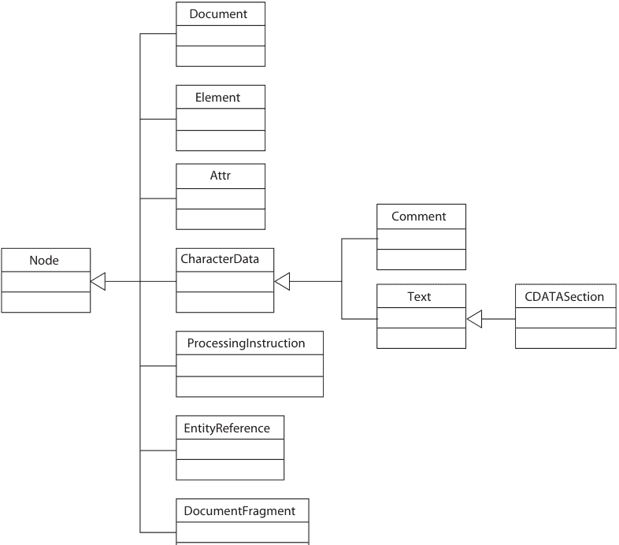

**图 3–2.** 由 GWT 的 XML 库实现的 XML 文档对象模型的结构

反向操作也是 XML 库的一部分。你可以使用相同的对象构建文档对象模型，然后将该模型转换为字符串。这在需要与服务器通信以发送结构化 XML 数据时最为常用。博客编辑器应用程序使用此功能向 Blogger 服务发送 XML 数据以创建新的博客条目，以及更新现有的博客条目。它使用了与前例相同的格式。以下是该示例中的一段代码片段，展示了在发送到服务器之前生成的 XML：

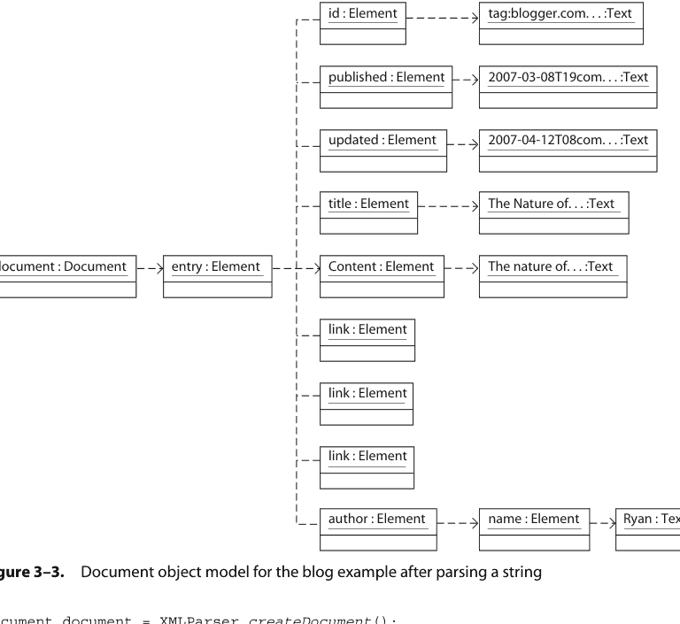

**图 3–3.** 解析字符串后博客示例的文档对象模型

```java
Document document = XMLParser.createElement();
Element entryElement = document.createElement("entry");
Element titleElement = document.createElement("title");
Element contentElement = document.createElement("content");
Text titleText = document.createTextNode( entry.getTitle() );
Text contentText = document.createTextNode( entry.getContent() );
document.appendChild(entryElement);
entryElement.setAttribute("xmlns","http://www.w3.org/2005/Atom");
entryElement.appendChild(titleElement);
entryElement.appendChild(contentElement);
titleElement.appendChild(titleText);
contentElement.setAttribute("type","html");
contentElement.appendChild(contentText);
String xml = document.toString();
```

这段代码使用 `Document` 类上的 `create` 方法创建文档对象模型中的每个节点。它使用 `appendChild` 方法将子节点添加到父节点来创建层次结构。然后使用 `Element` 类的 `setAttribute` 方法设置 XML 属性。当文档对象模型完全构建完成后，代码调用 `document.toString()` 方法将模型转换为 XML 字符串。

### 读取和写入 JSON

GWT 还带有一个 JavaScript 对象表示法（JSON）库，用于解析和构建 JSON 字符串。JSON 数据格式与 XML 一样具有层次性和自描述性，但在大小和语法上与 XML 不同，许多人认为这是它相对于 XML 的优势之一。它的另一个优势是可以使用 JavaScript 的 `eval` 函数轻松解析：

```javascript
var jsonString = "{'Title':'Ajax for Java developers'}";
var obj = eval( jsonString );
alert( obj.Title );
```

在这段 JavaScript 代码中，JSON 编码的字符串被传递给 `eval` 函数，该函数返回解析后字符串的 JavaScript 对象版本。由于 JavaScript 对这种格式的支持如此简单，它自然而然地成为了 GWT 的补充。

让我们简要介绍一下 JSON 的格式，首先与 XML 进行比较。XML 的结构分为元素、属性和文本，而 JSON 的结构分为对象、数组和值。表 3–1 展示了两种格式对相同类型数据的格式化的比较。

**表 3–1** 相同数据的 XML 与 JSON 格式化对比

| XML | JSON |
|---|---|
| ```xml<br><entry><br>    <title type='text'>The Nature of Asynchronous Method Calls</title><br>    <author><br>        <name>Ryan</name><br>    </author><br></entry><br>``` | ```json<br>{<br>    "entry":{<br>        "title":"The Nature of Asynchronous Method Calls",<br>        "author":{<br>            "name":"ryan"<br>        }<br>    }<br>}<br>``` |

语法差异首先体现在定界符上。JSON 使用花括号来开始和结束一个对象，使用带引号的字符串来命名其属性，并用冒号呈现其值。该值可以是另一个对象、字符串值或其他简单数据类型，或者是一个数组。大小的节省来自于该格式不需要像 XML 那样重复命名数据（使用开始和结束标签的方式）。

JSON 中的数据类型系统也比基本 XML 中的数据类型系统更强大（不包括模式，因为模式在 GWT 中不是自动支持的）。简单的 JSON 值可以是布尔值、数字、字符串或 `null`。图 3-4 展示了通过 GWT 的 JSON 库可用的 JSON 数据类型。

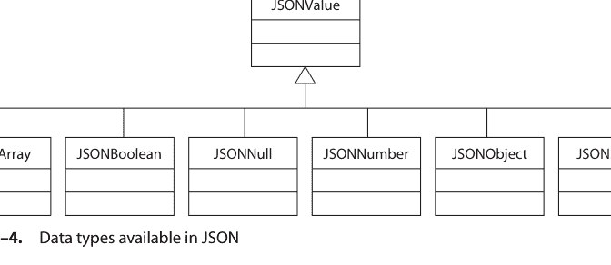

**图 3–4.** JSON 中可用的数据类型

该 JSON 库位于 `com.google.gwt.json.client` 包中。它不会自动包含在你的应用程序中，因此你需要将以下行添加到你的项目模块文件中才能使用它：

```xml
<inherits name="com.google.gwt.json.JSON"/>
```

该库的对象模型与 XML 文档对象模型类似，两者都使用多个类来构建解析数据后的层次模型。要解析 JSON 数据，你可以使用 GWT 的 `JSONParser` 类的 `parse` 方法，传入 JSON 字符串。返回值是一个 `JSONValue`，代表解析数据的结构根节点。

第 7 章中的多搜索应用程序解析了多个搜索引擎服务返回的 JSON 搜索结果。以下代码片段来自该应用程序，展示了使用 JSON 库解析 Yahoo! 的搜索结果：

```java
//parse the string and get the ResultSet object
JSONObject j = (JSONObject)JSONParser.parse(json);
JSONObject feed = (JSONObject)j.get("ResultSet");
```

```java
//iterate over the Results array
JSONArray entries = (JSONArray)feed.get("Result");
for( int i=0; i< entries.size(); ++i ) {
  JSONObject entry = (JSONObject)entries.get(i);
  JSONString title = (JSONString)entry.get("Title");
  JSONString url = (JSONString)entry.get("Url");
  JSONString summary = (JSONString)entry.get("Summary");
  if( url != null ) {
    getView().addSearchResult( new SearchEngineResult( title.stringValue(),
        url.stringValue(), summary.stringValue() ) );
  }
}
```

这段代码首先解析 `json` 变量，它是一个 JSON 数据的字符串，并返回一个 `JSONObject` 实例。该示例展示了如何从解析后的数据中获取几种不同类型的 JSON 值，以及如何遍历 `JSONArray` 中的值。代码为在 JSON 数据中发现的每个搜索结果创建一个新的 `SearchEngineResult` 对象，这是该应用程序的一个领域模型对象。

这段代码被简化了，没有检查每个 JSON 值的类型。这意味着如果值的类型不是预期的，应用程序将抛出 `ClassCastException`。为了避免这个异常，你可以使用 `JSONValue` 对象的类型识别方法来检查其类型。例如，要检查检索搜索结果标题时返回的值的类型，你可以使用如下代码：


```java
JSONValue value = entry.get("Title");
if (value.isString()) {
  JSONString title = (JSONString) value;
```

将 GWT 的 JSON 值转换为 JSON 字符串，只需调用该值的 `toString` 方法即可。

JSON 可能比 XML 有一些优势，但 XML 的使用范围更广，更容易理解，并且建立在它之上的工具和技术也更多。那么为什么要使用 JSON 呢？如果你正在构建一个不需要与其他使用 XML 进行集成的系统相集成的新系统，那么你可以考虑使用 JSON。请记住，这可能会限制你与其他系统集成的能力。

JSON 因其在 Ajax 应用程序中的使用而日益流行，但它很可能不会达到 XML 那样的使用程度。你也可以使用 JSON 通过网页上的 `script` 标签远程加载数据，从而有效地绕过浏览器的同源策略限制。这就是在 Multi-Search 应用程序中使用 JSON 的原因。该应用程序能够通过 `script` 标签加载外部 JSON 数据源，而无需服务器端代理。我们将在下一节中介绍这种方法，称为 JSONP（JSON with Padding）。

### 第三方服务器集成

软件开发中最常见的说法之一是“不要重复造轮子”。这也适用于 Web 应用程序开发，特别是现在有大量免费或低成本的第三方 Web 服务可用。它们为您的应用程序与其服务集成提供了明确的方式。

本书中的许多示例应用程序都与第三方服务器集成：

- 第 6 章中的 Gadget Desktop 应用程序使用 JavaScript API 与 Google Maps、Yahoo! Weather 和 Google Ajax Feed API 集成。
- 第 7 章中的 Multi-Search 应用程序使用 JSONP 与 Google Base、Yahoo! Search、Amazon Books 和 Flickr 集成。
- 第 8 章中的 Blog Editor 应用程序使用 HTTP 代理与 Blogger Web 服务集成。

本节将介绍这些应用程序中使用的技术。

### 同源策略

通常，由于 Web 浏览器应用的同源策略，您无法从客户端 Ajax 应用程序与第三方服务器通信。该策略规定您的 JavaScript 只能访问与其服务器来源共享的数据。

这是一件非常好的事情。如果没有它，来自另一个域的、在另一个窗口中运行的 JavaScript 就有可能更改当前窗口中的 HTML。您永远无法确定所看到的内容实际上是否来自浏览器地址栏中显示的域。有了这个策略，我们可以确定我们所查看的内容是由我们正在浏览的域发送的。

对于 Ajax 应用程序来说，这也意味着无法从其他域异步下载数据；我们只能从其加载应用程序的服务器加载数据。考虑到 Ajax 应用程序可用的丰富 Web 服务，这是一个不幸的限制。

### 使用 JavaScript API

同源策略不限制使用 HTML `script` 标签从第三方服务器导入脚本。这并不意味着它是完全安全的。如果您确实从其他来源加载第三方 JavaScript API，您必须信任该第三方不会向您的应用程序发送恶意代码。

有许多 JavaScript 库可供 Ajax 应用程序包含使用，它们来自不会通过提供恶意代码而损害其声誉的大型公司。Google 和 Yahoo! 就是其中的两家公司。

Gadget Desktop 应用程序使用 Google Ajax Feed API 从第三方站点加载 RSS 源。在包含 JavaScript API 时，您应该遵循 API 文档中提供的说明。通常，这涉及在要使用该 API 的 HTML 文件中添加一个 `script` 标签。

对于 GWT 应用程序，您可以将 API 添加到宿主 HTML 页面的 `head` 标签中。例如，以下代码将 Google Ajax Feed API 添加到 Gadget Desktop 应用程序：

```html
<head>
    <title>GWT Applications - Gadget Desktop</title>
    <script type="text/javascript" src="http://www.google.com/jsapi?key=ABQIAAAACeDba0As0X6mwbIbUYWv-RTb-vLQlFZmc2N8bgWl8YDPp5FEVBQUnvmfInJbOoyS2v-qkssc36Z5MA"></script>
    <script type="text/javascript">
        google.load("feeds", "1");
    </script>
</head>
```

当加载 HTML 页面时，这段 HTML 代码从 Google 加载 JavaScript 代码。然后，该 JavaScript 代码可供您的 GWT 应用程序使用。然而，代码是 JavaScript 的，而您的应用程序是 Java 的，因此您需要使用 GWT 的 JavaScript Native Interface（JSNI）。（有关 JSNI 的更多信息，请参阅第 5 章。）使用 JSNI，您可以访问加载的 JavaScript API 提供的功能。

通过 JavaScript API 与第三方服务器通信的其他示例包括 Gadget Desktop 应用程序中使用 Google Maps API。您也是通过 `script` 标签加载其代码并通过 JSNI 访问其方法来使用此 API 的。加载的 JavaScript 代码处理从 Google 服务器异步加载地图数据。

### 使用 JSONP

您还可以使用 `script` 标签从第三方站点加载更结构化的数据，如 JSON。JSON 可以被 JavaScript 编译器自动解释，因此它是通过 `script` 标签传输结构化数据的自然格式。

本质上，使用 `script` 标签从第三方站点加载结构化数据可以绕过浏览器实施的同源策略限制。事实上，Multi-Search 应用程序使用 JSONP 从其所使用的每个后端服务加载数据，包括 Google、Yahoo!、Amazon 和 Flickr，而无需任何服务器端实现。

为此，GWT 应用程序向 HTML 文档添加一个 `script` 标签，这会导致浏览器从提供的 URL 加载脚本。第三方服务器接收对该 URL 的请求，并生成由 `callback` 方法包装的 JSON 输出。

当浏览器完成接收远程脚本文件时，浏览器在其 JavaScript 解释器中运行该文件。由于该文件是由对 `callback` 函数的调用包装的 JSON 数据，因此会在浏览器中调用 `callback` 函数。

在 GWT 应用程序添加 `script` 标签之前，它需要添加一个具有预期名称的 `callback` 函数，以便在脚本完成加载时接收该调用。这是一个类似于异步 HTTP 请求的异步过程。图 3-5 说明了这一序列。

有关名为 `JSONRequest` 的 GWT JSONP 类的实现，请参阅 Multi-Search 应用程序。

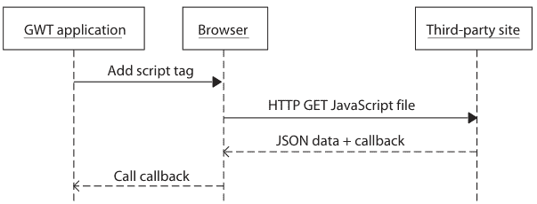

### 使用 HTTP 代理

对于比简单获取数据更复杂的服务器交互，您需要为应用程序创建一个服务器组件，并选择一种服务器集成技术来与您的服务器通信。您的服务器作为到第三方服务器的代理，将来自客户端 Ajax 应用程序的请求中继到服务器。

Blog Editor 应用程序使用简单的 HTTP 代理 Servlet 将基于 REST 的 API 调用中继到 Blogger 服务。由于 Blogger API 要求我们使用许多 HTTP 命令，包括 `GET`、`POST`、`PUT` 和 `DELETE`，并提交 XML 格式的数据，因此我们唯一的选择是从我们的服务器连接到 Blogger 服务器。有关 HTTP 代理的详细示例，请参阅 Blog Editor 应用程序。

### 高级服务器集成技术

到目前为止，您已经看到了将 GWT 应用程序与基于传统动作的 Web 应用程序、简单的异步 HTTP 和第三方服务器集成相结合的技术。这些技术都有其用途，但它们在集成级别上相当基础。

对于更复杂的应用程序，通常有更复杂的服务器，因此集成也变得更加复杂。依赖表单或简单的异步 HTTP 请求类来处理复杂性可能导致无法管理的代码。本节介绍使用 REST 接口或 GWT-RPC 与无状态服务器集成的高级技术，首先从有状态服务器和无状态服务器之间的区别开始。

### 有状态服务器

传统的 Web 应用程序模型基于 HTTP，这是一种无状态协议。这意味着一个请求与另一个请求没有关联；服务器将它们视为不同的请求。

然而，建立在 HTTP 上的应用程序有可能保持应用程序状态，许多应用程序这样做以创建有意义的应用程序。例如，考虑像 Hotmail 这样的 Web 电子邮件应用程序。您可能正在编写电子邮件，需要上传一张照片。点击上传按钮会带您到一个新页面来上传文件。一旦您上传了文件，Web 应用程序就会返回到您正在处理的电子邮件。

在这个例子中，Web 服务器记住了应用程序的状态，并能够引导您的浏览器完成必需的步骤。这类应用状态通常存储在服务器上，通过 cookie 或 URL 参数访问，称为会话（session）。

尽管 GWT 为客户端应用开发者提供了工具，使你能够将客户端应用的功能提升到无需过多依赖服务器端状态的程度，但仍会有一些情况需要应用与有状态服务器集成。

GWT 应用可以通过 HTML 表单像传统 Web 应用一样与有状态服务器交互，也可以利用客户端有状态信息来增强用户体验。此外，许多早期的 RPC 实现，特别是 XML-RPC，都基于有状态的服务器应用。客户端会操作服务器端数据——一次远程调用一个操作。你也可以使用 GWT 应用的 XML 和 HTTP 库来实现这一点。

图 3-6 说明了 GWT 应用如何与有状态服务器交互。

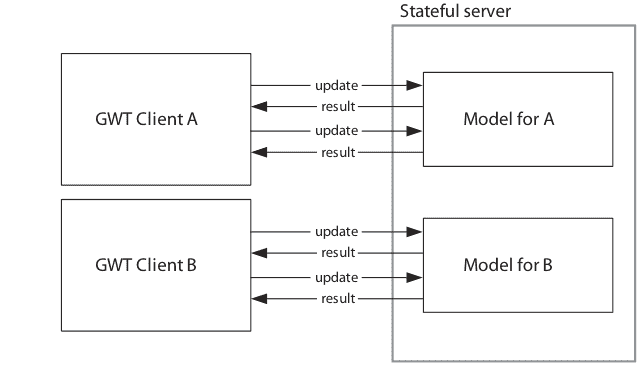

**图 3-6** 与有状态服务器的客户端交互

这也是传统 Web 应用开发的工作方式。服务器为每个客户端保存一个状态或模型。客户端可以通过小的增量更改与该状态交互。该模型适用于基于 HTTP 的传统 HTML 表单和 XML RPC。

尽管这是 Web 应用的主流架构，但应仅在必要时使用。能够在会话中保存部分服务器端状态的更重型 Ajax 应用可以显著提升性能。下一节将描述此方案。

注意，在某些情况下有状态服务器是完全合理的。即使客户端共享应用状态，即时通讯应用也需要有状态服务器。每个客户端必须知道其他哪些客户端已登录服务器。此状态无法推送到客户端。客户端之间必须有一个公共实体来保存共同的会话状态。

### 与无状态服务器集成

有状态的 Web 服务器应用是瘦客户端架构的结果。就性能而言，服务器管理小的用户操作状态并不理想，但由于 HTML 缺乏维持状态的能力，每个动作后都会刷新网页，因此别无选择。

然而，Ajax 应用使我们能够构建更重的客户端应用，这些应用可以更好地保存应用状态，并允许将用户操作隔离在客户端，直到它们绝对需要以更大的事务风格请求提交到服务器。

处理远程请求时，较少但较大的事务比较多次小事务表现好得多。设计远程接口时不考虑这一点是一个常见错误，尤其是当有像 GWT-RPC 库这样优秀的 RPC 库时，它允许你像编写应用中的本地接口一样快速编写接口。

将每个服务器方法调用视为单个事务。较小的工作单元应在客户端内部完成，无需与服务器交互。图 3-7 说明了无状态服务器与富客户端之间的通信。

Web 应用模型正缓慢地向这种架构迁移。取代 XML-RPC 的是 SOAP，这是一种应用通信协议，试图解决 XML-RPC 与服务器端实现耦合过紧的问题。与过程调用不同，交互基于遵循此模型的消息，这比远程调用模型更加无状态和事务化。

另一种与服务器通信的无状态 Web 架构称为 REST（表现层状态转移）。在这种架构中，应用将服务器视为一组由 URL 标识并通过 HTTP 方法修改的无状态资源。

第 8 章中的博客编辑器应用是基于 REST 与无状态服务器通信的 GWT 应用的良好示例。应用在启动时一次性加载所有博客数据，使用户能够使用应用操作数据。仅在用户点击保存或删除按钮时才需要额外的服务器交互。

即使当用户选择创建新博客条目时，应用也不会联系服务器，直到用户保存新条目。与等效的 HTML 表单应用相比，此应用的服务器往返调用显著减少。例如，在 `www.blogger.com` 上，仅浏览界面以进入编辑器添加新条目就需要多个 HTTP 请求。第 10 章中的数据库编辑器应用也遵循这种基于 REST 的无状态架构。

与服务器集成时，并非总能选择使用哪种架构，因为服务器很可能已经在运行其自己的接口。但如果你正在考虑构建一个以 GWT 应用作为客户端的服务器应用，那么你应该考虑将大部分应用状态转移到客户端，以便应用能够更好地扩展。

### 使用 GWT-RPC

GWT 通过提供远程过程调用（RPC）库，扩展了浏览器与服务器异步通信的能力。通常，远程过程调用旨在简化向服务器发起调用的任务，为你提供一个方法接口，这些方法可以像常规方法调用一样被调用。

调用随后会被序列化（转换为数据流）并发送到远程服务器。当服务器收到序列化数据后，会进行反序列化并在服务器上调用该方法。

在 GWT 中，RPC 库分为两个包：

- 用于客户端 RPC 支持的 `com.google.gwt.user.client.rpc` 包。
- 用于服务器端 RPC 支持的 `com.google.gwt.user.server.rpc` 包。

客户端提供了可用于标记应用接口的接口，你将用于 RPC。当你使用 GWT 编译器将客户端项目编译为 JavaScript 时，会根据你标记的接口生成执行 RPC 序列化所需的代码。

第 9 章中的即时通讯应用使用了 GWT-RPC，以下代码声明该接口为 RPC 接口：

```java
public interface MessengerService extends RemoteService {

  void signIn(String name);

  void signOut();

  ArrayList getEvents();

  void sendMessage(Contact to, Message message);

}
```

`RemoteService` 接口是一个空的 GWT-RPC 接口，它告诉 GWT 编译器应为该接口生成序列化代码。你必须在服务器端实现此接口。

RPC 的服务器端包构建用于 Java Servlet 容器，如 Tomcat 或 Jetty。幸运的是，GWT 的托管浏览器自带了嵌入式 Tomcat 服务器，这使我们能够轻松地从 Eclipse 等 IDE 中测试和调试服务器端 RPC。

服务器端包包含一个类，你可以扩展该类来实现服务器端 RPC 接口。即时通讯应用定义服务器端类如下：

```java
public class MessengerServiceImpl
    extends RemoteServiceServlet implements MessengerService {

  public void signIn(String name) {

  }

  public void signOut() {

  }

  public ArrayList getEvents() {

  }

  public void sendMessage(Contact to, Message message) {

  }

}
```

该类只需扩展 GWT 的 `RemoteServiceServlet` 并实现前述 RPC 接口上的方法。你可以通过将以下行添加到项目的模块文件中，轻松地在托管浏览器中安装此 Servlet 进行测试：

```xml
<servlet
    path="/messenger"
    class="com.gwtapps.messenger.server.MessengerServiceImpl"/>
```

`path` 属性表示 Servlet 在服务器上的可调用位置，`class` 属性指定要安装的 Servlet 类名。

当需要部署到 GWT 托管浏览器之外的 Servlet 容器时，你需要遵循几个步骤来完成设置。对于 Tomcat，你需要将其作为新的 Web 应用安装在 Web 应用程序目录中，目录结构如图 3-8 所示。

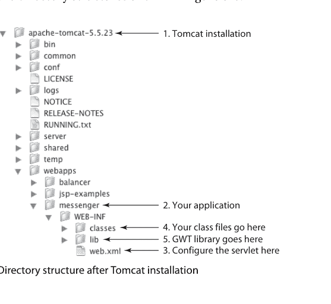

让我们来看一下图 3-8 中所示的五个步骤：

1. 首先，你需要找到 Tomcat 的安装目录。
2. 其次，你需要在 `webapps` 目录下创建你的应用程序目录。
3. 第三，你需要在应用程序的 `WEB-INF` 目录中设置 `web.xml` 文件。对于即时通讯应用程序，该文件如下所示：

```xml
<?xml version="1.0" encoding="UTF-8"?>

<web-app>

  <servlet>

    <servlet-name>messenger</servlet-name>

    <servlet-class>com.gwtapps.messenger.server.MessengerServiceImpl</servlet-class>

  </servlet>

  <servlet-mapping>

    <servlet-name>messenger</servlet-name>

    <url-pattern>/messenger</url-pattern>

  </servlet-mapping>

</web-app>
```

4. 第四，将你的 `servlet` 类复制到 `WEB-INF` 目录中的 `class` 目录下。
5. 最后，将 `gwt-servlet.jar` 文件复制到 `WEB-INF` 目录中的 `lib` 目录下。

`gwt-servlet.jar` 文件包含了支持服务器端 RPC 所需的 GWT 类。你也可以使用 `gwt-user.jar`，但 `gwt-servlet.jar` 更小，因此更推荐。可以使用 Ant 等构建工具来自动化部署过程。

无论你的 Servlet 是在 GWT 嵌入式 Tomcat 中运行，还是在另一个安装中运行，用于进行 RPC 调用的客户端代码都是相同的。

客户端代码需要创建一个代理实例，该实例将接收来自客户端的方法调用，并将它们编组发送到服务器。当服务器完成调用后，它会向客户端代理返回响应。然后，代理通过 `AsyncCallback` 接口将此结果传递给客户端应用程序。

为了使这个异步方法调用系统正常工作，你需要创建第二个用于客户端的接口，以不同的方式处理返回值。对于即时通讯应用程序，该接口如下所示：

```java
public interface MessengerServiceAsync {
```


```java
void signIn(String name, AsyncCallback callback);

void signOut(AsyncCallback callback);

void getEvents(AsyncCallback callback);

void sendMessage(Contact to, Message message, AsyncCallback callback);
```

请注意，这个接口与`MessengerService`接口非常相似；唯一的区别是没有任何返回值，并且每个方法都需要一个额外的`AsyncCallback`参数。这种设置允许代理在你实现的`AsyncCallback`接口中返回服务器端 RPC 方法的返回值。例如，`getEvents`方法使用以下回调：

```java
private class GetEventsCallback implements AsyncCallback {

    public void onFailure(Throwable throwable) {
        GWT.log("error get events", throwable);
    }

    public void onSuccess(Object obj) {
        ArrayList events = (ArrayList) obj;

        for (int i = 0; i < events.size(); ++i) {
            Object event = events.get(i);
            handleEvent(event);
        }

        messengerService.getEvents(this);
    }
}
```

当对服务器的调用失败时，代理会调用`onFailure`方法。当方法调用成功返回时，代理会调用`onSuccess`方法。在这个实例中，返回值是一个事件数组，在`onSuccess`处理程序中对其进行迭代。RPC 库会自动编组和解组这个返回值，以及方法调用的参数值。你甚至可以创建新类，作为方法参数发送到服务器，或从服务器接收为返回值。例如，即时通讯应用程序使用`Contact`类来与服务器之间传输数据：

```java
public class Contact implements IsSerializable {

    private String name;

    public Contact() {}

    public Contact(String name) {
        this.name = name;
    }

    public String getName() {
        return name;
    }
}
```

GWT 要求类实现`IsSerializable`或`Serializable`接口，并提供一个无参构造函数，以便 GWT-RPC 能够在客户端和服务器之间传输该类的实例。`IsSerializable`接口由 GWT 定义，没有方法；它只是作为一个标记，向 GWT 编译器发出信号，表示需要为此类生成编组代码。

在向服务器发出方法调用之前，客户端应用程序需要创建代理实例。它使用`GWT.create`延迟绑定机制来实现这一点。你只需调用`GWT.create`，参数为你要进行调用的 RPC 接口的类：

```java
MessengerServiceAsync messengerService =
    (MessengerServiceAsync) GWT.create(MessengerService.class);
```

该方法不会返回 RPC 接口的实例，而是创建将促进与服务器进行 RPC 通信的代理对象。该代理将支持两个接口。一个接口如前面的代码所示，是所请求的 RPC 接口的异步版本。另一个接口是 GWT 的`ServiceDefTarget`接口。第二个接口允许你设置实现 RPC 接口的远程服务的 URL。对于即时通讯应用程序，URL 设置如下：

```java
ServiceDefTarget endpoint = (ServiceDefTarget) messengerService;

endpoint.setServiceEntryPoint(
    GWT.getModuleBaseURL() + "messenger"
);
```

此代码使用`setServiceEntryPoint`方法设置 URL，并传递应用程序的基本 URL，后面附加 servlet 名称。

如果这看起来相当复杂，请不要担心；实际上并非如此。一旦你完成了这些基本设置，你就可以轻松地与服务器构建丰富的接口。从长远来看，获得生产力是值得付出这小小的设置成本的。你几乎可以像本地 Java 应用程序一样直接地不断添加新方法和数据类型。

图 3-9 展示了即时通讯应用程序中`MessengerService`的 GWT-RPC 实现所涉及的实例概览：

你可以在第九章中找到关于 GWT-RPC 的更详细解释和进一步开发。

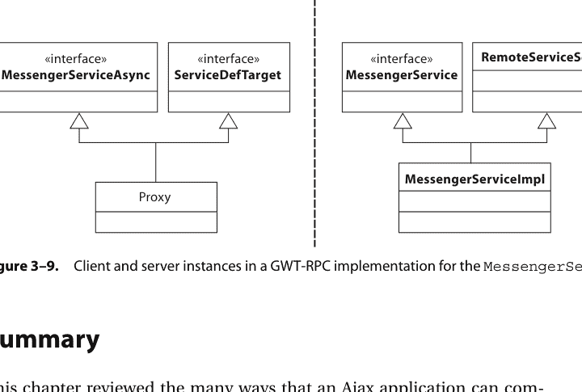

### 小结

本章回顾了 Ajax 应用程序与服务器通信的多种方式。从服务器异步加载数据的常见 Ajax 技术是一种简单的方法，效果很好。你可以在你的 GWT 应用程序中轻松加载和解释纯文本、HTML、XML 和 JSON。你可以使用表单编码的方式与服务器通信，这与传统网页应用程序与服务器通信的方式相同。你可以通过 JavaScript API 和 JSONP 利用第三方服务，而无需依赖服务器端实现。此外，你还可以使用服务器端实现作为代理，与第三方服务进行更高级的交互。对于更高级的项目，你需要与服务器使用定义良好的接口。GWT 的 RPC 实现提供了一种创建定义良好的服务器接口的简便方法。

本章为你概述了这些技术；示例应用程序更深入地探讨了这些技术。第六章的小工具桌面应用程序探讨了加载 JavaScript API 以与第三方服务交互。第七章的多搜索应用程序使用 JSONP 与四个不同的搜索服务进行通信。这两个应用程序都不依赖于任何服务器端实现。第八章的博客编辑器应用程序与 Blogger 网络服务交互，这需要更丰富的集成，并使用服务器端代理。第九章的即时通讯应用程序使用 GWT 的 RPC 创建一个协作式应用程序，客户端可以通过服务器相互通信。本书最后一个应用程序，数据库编辑器应用程序，探讨了与三种不同服务器端实现的集成——PHP、Ruby on Rails 和带有 Hibernate 的 Java servlet——使用三种不同的服务器集成技术，包括 actions、REST 和 GWT-RPC。

## 4 Ajax 的软件工程

也许使用 Google Web Toolkit 构建 Ajax 应用程序的最大优势在于能够利用高级软件工程。JavaScript 从未被用于构建大型应用程序。它缺乏有助于代码组织和编译时类型检查的语言特性。它也缺乏用于构建大型应用程序的成熟工具，例如自动化、集成开发环境、调试和测试。本章将介绍如何使用 GWT 中的 Java 软件工程工具来构建非平凡的高质量 Ajax 应用程序。

### 设置开发环境

要使用 GWT 构建应用程序，你需要 Java 开发工具包（JDK）1.4 或更高版本。许多其他 Java 工具也可以协助你的开发，例如像 Eclipse 这样的 IDE 或像 Ant 这样的构建工具。所有这些工具都为构建 Ajax 应用程序的过程带来了巨大的价值。需要注意的是，用户不需要任何这些工具来使用你的应用程序。他们甚至不需要在计算机上安装 Java；他们只需要一个相当现代的网页浏览器，如 Firefox、Internet Explorer、Safari 或 Opera。GWT 编译器将你的应用程序编译为符合 Web 标准的技术。

### 安装 Java 开发工具包

JDK 是由 Sun Microsystems 提供的一个软件包，其中包含 Java 运行时环境（JRE）——这是在计算机上运行 Java 程序所必需的，以及命令行开发工具——用于编译 Java 类以创建可运行的代码。JDK 可在 Sun 的网站`http://java.sun.com/javase/downloads`下载。

你可以选择多种下载选项，但最低限度只需要下载 JDK，无需其他捆绑内容。有些选项附带 NetBeans 或 Java EE，但这些都不是必需的。还有一个 JRE 的下载选项，但它不包含你需要的开发工具。

下载 JDK（约 50MB）后，你需要安装它。在 Windows 上，下载的是一个可执行文件，运行即可开始安装。使用所有默认选项安装 JDK。

### 安装 Google Web Toolkit

GWT 是对 JDK 的补充，它增加了将 Java 代码编译为 JavaScript 的能力，从而使代码能够在不使用 Java 运行时环境的 Web 浏览器中运行。你可以将 GWT 看作另一个编译器，用于在新的平台——你的 Web 浏览器——上运行 Java。它还提供托管模式浏览器，让你能够利用 Java 强大的调试功能，就像调试普通 Java 应用程序一样。与 Java 和 GWT 提供的功能相比，JavaScript 调试工具非常简陋。你可以在`http://code.google.com/webtoolkit/download.html`找到 Google Web Toolkit SDK。

在 Windows 上，GWT 的 zip 文件约为 13MB。下载后，将其解压到你首选的安装目录。在 Mac 和 Linux 上，你可以使用以下`tar`命令解压下载的文件：

```bash
tar xvzf gwt-mac-1.3.3.tar.gz
```

让我们看看发行版内部。以下列表简要概述了 GWT 中包含的重要文件：

- `gwt-user.jar`

  这是 GWT 库。它包含用于构建 GWT 应用程序的 Java 类。你的应用程序在托管模式下运行时会使用此文件，但部署应用程序时不会使用此文件，因为应用程序代码和此文件中的代码会被翻译为 JavaScript。

- `gwt-servlet.jar`

  这是`gwt-user.jar`的精简版本，包含应用程序服务器端所需的类。它比`gwt-user.jar`小得多，更适合部署，因为它不包含托管模式所需的 GWT 类。

- `applicationCreator`

  此脚本生成启动 GWT 应用程序所需的文件。生成的文件会创建一个可运行的基础 GWT 应用程序。

- `projectCreator`

  此脚本为 Eclipse GWT 项目生成项目文件。

- `junitCreator`

  此脚本生成一个起始测试用例，以及用于在 Web 模式和托管模式下启动测试的脚本。

- `i18nCreator`

  此脚本基于属性文件生成一个接口，用于应用程序的国际化。

仅安装 JDK 和 GWT，你就可以编写、运行和编译基于 Web 的应用程序。

为了方便起见，你应该将 GWT 安装目录添加到路径中，这样你就可以调用 GWT 脚本而无需每次都指定完整安装路径。例如，如果你将 GWT 安装到`c:\code\gwt`（这是 Windows 路径；对于 Mac 和 Linux，你同样可以使用你的安装路径），你需要将其添加到你的`PATH`变量中。然后，在命令行中，你可以在你的应用程序目录内运行`applicationCreator`脚本，而无需指定脚本的完整路径，如图 4-1 所示。

```text
C:\Projects>mkdir gwtapps

C:\Projects>cd gwtapps

C:\Projects\gwtapps>applicationCreator com.gwtapps.examples.client.HelloWorld

Created directory C:\Projects\gwtapps\src

Created directory C:\Projects\gwtapps\src\com\gwtapps\examples

Created directory C:\Projects\gwtapps\src\com\gwtapps\examples\client

Created directory C:\Projects\gwtapps\src\com\gwtapps\examples\public

Created file C:\Projects\gwtapps\src\com\gwtapps\examples\HelloWorld.gwt.xml

Created file C:\Projects\gwtapps\src\com\gwtapps\examples\public\HelloWorld.html

Created file C:\Projects\gwtapps\src\com\gwtapps\examples\client\HelloWorld.java

Created file C:\Projects\gwtapps\HelloWorld-shell.cmd

Created file C:\Projects\gwtapps\HelloWorld-compile.cmd

C:\Projects\gwtapps>_
```

图 4-1。为 GWT 项目运行`applicationCreator`脚本

运行此脚本会在当前目录中创建名为 HelloWorld 的应用程序。它还会生成用于运行应用程序的脚本。你只需输入以下命令即可运行此应用程序：

`HelloWorld-shell`

运行此生成的脚本会使 GWT 加载其托管浏览器，托管浏览器又会加载生成的应用程序。托管浏览器显示默认生成的应用程序，如图 4-2 所示。

你还可以使用生成的`HelloWorld-compile`脚本编译应用程序，使其能够在标准浏览器中使用，如图 4-3 所示。

编译脚本会构建部署应用程序所需的 HTML 和 JavaScript 文件，并将它们复制到应用程序目录中的`www`目录，如图 4-4 所示。

生成的应用程序可以通过加载宿主文件在任何浏览器中运行。在此 HelloWorld 应用程序中，宿主文件名为`HelloWorld.html`。在 Firefox 中加载此文件，如图 4-5 所示，结果与图 4-2 中 GWT 托管浏览器中的应用程序相同，主要区别是不存在任何 Java 依赖。

因此，你可以看到，使用 GWT 构建 Web 应用程序的最低环境很小，只需安装 GWT 和 JDK。然而，你可以使用许多可用的 Java 工具来加快开发过程。例如，通常使用 Eclipse 等 IDE 来加速 Java 开发。

**图 4-5。**默认项目在 Firefox 中编译并运行

### 安装 Eclipse

Eclipse 是一个用 Java 开发的开源 IDE，得到了包括 IBM 在内的主要科技公司支持。IDE 让你能够以高效的方式编写、组织、测试和调试软件。Java 的 IDE 有很多，你可以使用任何一款进行 GWT 开发。如果你还没有安装 Java IDE，我建议使用 Eclipse，因为它运行良好，并且 GWT 脚本支持与其集成以提供帮助。

Eclipse 让你能够以高效的方式编写、组织、测试和调试 GWT Ajax 应用程序。它对 Java 语言有很好的支持，包括重构和内容辅助¹。通过利用 Eclipse 丰富的插件框架，你可以使用多种语言进行开发，但使用最广泛的语言是 Java。你可以在`www.eclipse.org/downloads`找到 Eclipse 下载。

¹ 内容辅助是 Eclipse 的一项功能，可以建议或补全你当前正在输入的内容。它会自动出现，你也可以在需要时按 Ctrl+空格键激活它。

在此页面上选择 Eclipse SDK。下载文件（约 120MB）后，将其解压到你首选的安装目录。在 Windows 上，`eclipse.exe`文件的默认位置在安装目录的根目录下；你可能想要创建该文件的快捷方式，因为你将经常使用它来编辑和调试代码。

### 将项目添加到 Eclipse

首次加载 Eclipse 时，会出现如图 4-6 所示的对话框，提示你设置工作空间位置。这是你的计算机上用于存放项目的位置。

**图 4-6。**在 Eclipse 中加载工作空间

图 4-6 显示了将工作空间设置为`C:\Projects`，并选中复选框将其保存为默认工作空间，这样下次打开 Eclipse 时会自动加载此工作空间。由于这是一个新的工作空间，当主 Eclipse 窗口加载时，其包资源管理器中将不会列出任何项目。此时，我们可以手动在 Eclipse 中为本章前面构建的 HelloWorld 应用程序构建项目，但 GWT 为我们提供了`projectCreator`脚本的快捷方式，如图 4-7 所示。

这会创建一个引用 GWT 的空项目，可以轻松加载到 Eclipse 中。要将 GWT 项目加载到 Eclipse 中，选择**文件 > 导入**以显示导入对话框，如图 4-8 所示。

```text
C:\Projects\gwtapps>projectCreator -eclipse GwtApps

Created directory C:\Projects\gwtapps\test

Created file C:\Projects\gwtapps\.project

Created file C:\Projects\gwtapps\.classpath

C:\Projects\gwtapps>
```


**图 4-7.** 使用`projectCreator`脚本和`-eclipse`标志创建项目

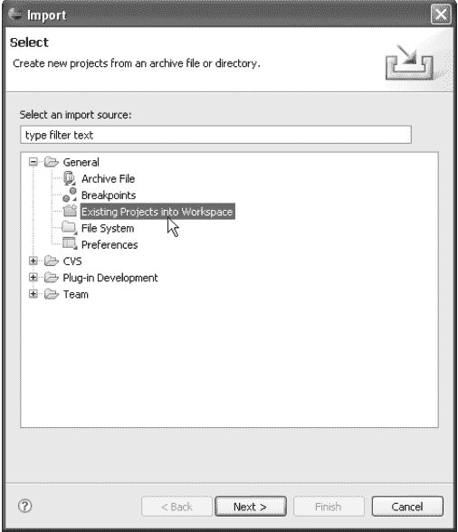

**图 4-8.** 将生成的 GWT 项目导入 Eclipse 的步骤 1

在导入对话框中，选择**将现有项目导入工作空间**，然后点击下一步。导入对话框的下一页，如图 4-9 所示，允许你选择要导入的项目。

在此对话框中，你首先需要选择项目文件的位置。然后对话框会显示可导入的项目列表。图 4-9 展示了我们使用 GWT `projectCreator`脚本创建的 GwtApps 项目。确保该项目已勾选，然后点击**完成**。

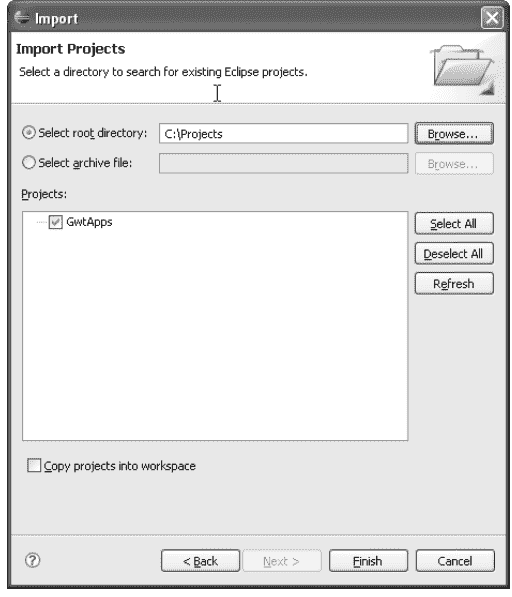

**图 4-9.** 将生成的 GWT 项目导入 Eclipse 的步骤 2

此时 Eclipse 会将项目加载到工作空间中，HelloWorld 应用程序会显示在包资源管理器中，如图 4-10 所示，因为它是在 Projects 目录中生成的。

你可以使用`applicationCreator`脚本向此项目添加其他应用程序，但由于我们现在在 Eclipse 中，可以利用脚本的`-eclipse`选项。运行 HelloWorld 应用程序时未指定此选项，因此我们没有任何特定于 Eclipse 的文件来允许你从 Eclipse 启动该应用程序。所以我们再次运行`applicationCreator`脚本，这次指定`-eclipse`选项，如图 4-11 所示。

如果你正在为 Eclipse 创建新应用程序，则不需要`-overwrite`选项。本示例使用此选项覆盖之前生成的、没有 Eclipse 支持的应用程序。注意在图 4-11 中，新文件 HelloWorld.launch 已创建。此启动

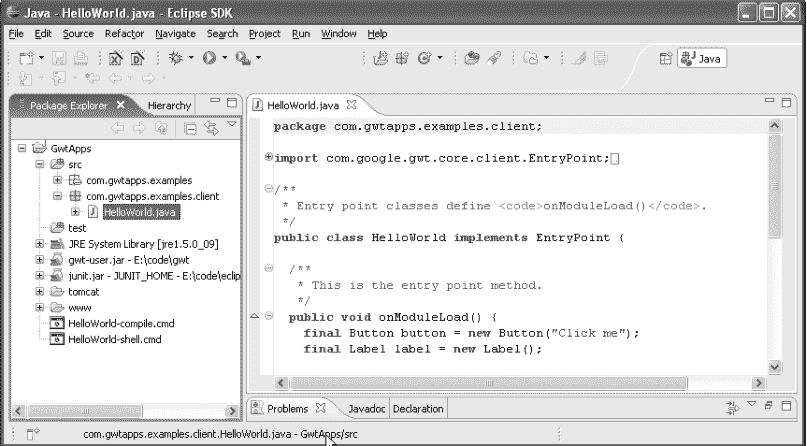

**图 4-10.** Eclipse IDE 中的生成 GWT 项目


**图 4-11.** 创建用于 Eclipse 的应用程序

文件允许你在 Eclipse 内为 HelloWorld 应用程序选择**调试**或**运行**命令选项。要在 Eclipse 中查看此更改，请刷新你的项目（右键点击项目并选择**刷新**），然后通过点击调试图标（参见图 4-12 工具栏中的虫子图标）以调试模式运行 HelloWorld 应用程序。如果你的应用程序未列在调试下拉框中（该框显示最近调试配置的列表），则需要点击下拉菜单中的**调试...**以加载调试对话框。你将在 Java 应用程序下找到 HelloWorld 应用程序的启动配置。

应用程序将在 GWT 的托管模式浏览器中加载，你可以在仍连接到 Eclipse IDE 的情况下与其交互。这意味着


**图 4-12.** 在 Eclipse 调试器中运行 GWT 应用程序

你可以设置断点、修改代码以及在应用程序运行时执行其他 Eclipse 功能。这种能力大大缩短了代码-测试周期，其简便性促进了大量测试。

将 GWT 开发与 Eclipse 或任何其他 Java IDE 连接起来，是 Ajax 应用程序开发的巨大进步。让我们看看使用 Eclipse 编写代码的一些细节。

### 在 Eclipse 中编写 Java 代码

Eclipse 有许多用于编写 Java 代码的工具，可提供关于可能性的提示和约束、常见任务的快捷方式以及大规模代码更改的重构功能。当然，你不必使用这些工具来生成带有 GWT 的 Ajax 应用程序，但它们使编写 Java 代码变得更加容易。

### 在 Eclipse 中创建类

首先，让我们看看 Eclipse 用于创建类的工具。Eclipse 允许你通过点击顶部工具栏上的新建类图标（如图 4-13 所示）来创建新类或接口。点击新建类图标后，下拉菜单会显示一系列选项。对于新类，你需要在下拉菜单中点击类。

点击此图标会显示一个新建 Java 类对话框，提示你创建类所需的信息。这种方法比从头开始编写 Java 类文件更快，并且确保文件中所需要的


所有内容都在那里且正确无误。注意在图 4-13 中列出了`com.gwtapps.examples.client`包。这是新类将要放入的位置。当新建 Java 类对话框出现时，它会将此包显示为默认包。


**图 4-15.** Eclipse IDE 中的新 Java 类

在此对话框中，名称`HelloWorldView`被指定为新类的类名。超类设置为`Composite`。点击**完成**会创建文件以及其中的可用 Java 类，如图 4-15 所示。

实际上，新 Java 类还不太可用。我们指定了一个不存在的超类。注意 Eclipse 如何以不显眼的方式提示你出了问题。包资源管理器中的新 Java 文件以及树中每个父节点上都有红色方块中的 X。如果我们关闭了项目节点，我们仍然知道项目中某个地方有错误。Eclipse 还在底部显示问题列表，显示工作空间中的错误和警告列表。它还会列出新问题。双击此列表中的任何错误都会直接带你进入 Eclipse 编辑器窗口中错误的位置。在这种情况下有两个错误，并且新 Java 类文件的编辑器窗口已打开。在编辑器窗口内部，你可以看到进一步的错误指示。在编辑器窗口的右侧，红色标记表示文件中错误的位置。

此垂直空间的文件表示比例与垂直滚动条相同。因此，如果这是一个更大的文件并且有错误，你可以通过将滚动条移动到其中一个红色标记的位置来快速定位它们，以在编辑器窗口中查看错误。在编辑器窗口内部，错误图标显示在左侧，并且产生错误的实际代码有锯齿状红色下划线。此外，当你将鼠标悬停在有错误的代码上时，工具提示会显示错误消息，在本例中为 "The import Composite cannot be resolved." 问题在于我们在新建 Java 类对话框中选择了简单的类名作为超类，但 Eclipse 需要完整的类名。通常很难记住类的完整类名，但 Eclipse 在这里也帮助了我们。我们可以通过点击错误并选择**源代码 > 添加导入**命令来让 Eclipse 自动建议完整的类名，如图 4-16 所示。


或者，你可以使用键盘快捷键`Ctrl+Shift+M`来运行添加导入命令。Eclipse 会自动添加所需的导入信息。在存在多个匹配导入的情况下，Eclipse 会为你提供选择，如图 4-17 所示。


**图 4-17.** Eclipse 显示匹配的导入包列表

选择 GWT Composite 类作为导入可以修复错误，所有错误指示都会消失。Eclipse 为任何编译时错误提供这种早期警告，是即时的，而不必像典型的类型化语言那样等到编译时才获得此反馈。Eclipse 在你开发时更新 IDE 中的这些信息，因此你可以错误一创建就立即捕获。

### 使用 Eclipse Java 编辑器

现在让我们看看 Eclipse Java 编辑器的一些独特功能。我们首先向`HelloWorldView`类的构造函数添加一些代码。我们可以节省一些打字，并通过选择**源代码 > 根据超类生成构造函数...**来生成构造函数，如图 4-18 所示。如果你将光标放在代码部分上时按`Ctrl+L`，Eclipse 还可以自动建议重构菜单中的项目。例如，如果你在类上实现了接口但尚未编写必须实现的方法，你可以按`Ctrl+L`查看建议，Eclipse 会提供一个命令来自动实现所需的方法。

语法可能是编译器理解代码所需的全部，但在编辑器中添加代码语法着色使我们阅读 Java 代码，如图 4-19 所示。Eclipse 中的默认语法着色方案使用**粗体紫色**字体显示 Java 关键字，如`class`、`super`、`extends`和`public`；使用**绿色**字体显示所有注释；使用**蓝色**字体显示字段；使用*蓝色斜体*字体显示静态字段。

现在让我们在构造函数中创建一个`HorizontalPanel`，并向其中添加几个 widget。在输入代码时，Eclipse 会实时检测错误。输入`HorizontalPanel`这个词后，它会显示为错误，因为该类尚未导入。使用与之前相同的技术来导入它（`Ctrl+Shift+M`或**Source > Add Import**）。当你开始输入以调用面板上的方法时，Eclipse 的内容辅助功能会显示一个方法建议列表，如图 4-20 所示。

```java
public class HelloWorldView extends Composite {

    public HelloWorldView() {
        super();
        // TODO Auto-generated constructor stub
    }
}
```

#### 图 4-19. 自动生成的构造函数

```java
package com.gwtapps.examples.client;

import com.google.gwt.user.client.ui.Composite;
import com.google.gwt.user.client.ui.HorizontalPanel;

public class HelloWorldView extends Composite {

    public HelloWorldView() {
        super();
        HorizontalPanel panel = new HorizontalPanel();
        panel.
```

**图 4–20.** Eclipse 中的内容辅助

Eclipse 会自动显示建议，或者你可以通过按`Ctrl+空格键`强制显示它们。在这个例子中，我们需要的是`add`方法，但我们也可以了解其他可用的方法。从某种意义上说，内容辅助不仅能加快输入速度和定位方法名，还能作为你正在使用的类的*教育工具*。不用翻阅文档，通过这个功能你就能学到不少关于库的信息。

另一种了解你正在使用的类的方法是使用编辑器的`Ctrl+单击`功能，如图 4-21 所示。在编辑器中对变量、类或方法使用`Ctrl+单击`会跳转到 Eclipse 编辑器中的源代码位置。例如，如果你单击一个变量名，编辑器会跳转到该变量的声明处；如果你单击一个类名，会跳转到该类的 Java 文件；如果你单击一个方法，会跳转到该方法的声明处。这使你可以像浏览网页一样方便、高效地浏览你的源代码。这甚至适用于 GWT 库中的类，因为 GWT 的 jar 文件中包含了 Java 源代码。

当你在浏览代码时找不到所需内容时，Eclipse 提供了强大的搜索支持。首先，有一个简单的单文件查找/替换命令，你可以从 Edit 菜单访问它，或者按`Ctrl+F`。这是你在大多数编辑器中都能找到的标准查找和替换功能。在此基础上，Eclipse 还提供了丰富的多文件搜索功能，你可以从 Search 菜单访问它，或者按`Ctrl+H`。图 4-22 展示了搜索对话框。

```java
public class HelloWorldView extends Composite {

    public HelloWorldView() {
        super();
        HorizontalPanel panel = new HorizontalPanel();
        panel.add( new Button("Click Me") );
        panel.add( new Label("Hello World") );
    }
}
```

#### 图 4–21. 使用 Ctrl+单击浏览源代码

#### 图 4–22. 在 Eclipse 中搜索

搜索对话框中的第一个选项卡"文件搜索"（File Search）允许你在工作区的任何文件中搜索任何字符串。第二个选项卡"Java 搜索"（Java Search）提供了更受限制的搜索，因为它理解 Java 语言。在这个选项卡中，你可以搜索某个字符串的特定实例。例如，图 4-22 中的对话框展示了在作为引用被调用时搜索`toString`。这次搜索会忽略`toString`的其他出现，比如`toString`的声明或任何注释。

文件搜索还允许你跨文件替换匹配的值。这有助于重构代码。例如，你可以将项目文件中所有出现的`HelloWorld`替换为`MyFirstApp`。

Eclipse 提供的重构支持远不止多文件搜索和替换。例如，你可以用**Refactor > Rename**命令将`HelloWorld`类的名称改为`MyFirstApp`，如图 4-23 所示。

**图 4-23.** 重命名类

当你通过 Refactor 菜单进行更改时，Eclipse 会确保使用原始值的引用也得到更新。这种方法比手动搜索和替换的认知负荷更小、更不容易出错。Eclipse 还有更多节省时间的重构命令，你可以通过查看任何项目（包括高亮显示的代码）的 Refactor 上下文菜单来轻松找到它们。

Eclipse 还有许多其他功能可以帮助你编写代码。尽管它们可能看起来不是那种能大幅提升效率的功能，但随着你使用得越来越多，你会发现自己编写代码的速度更快，挫折感也更少。编写代码只是 Eclipse 提升应用开发的一环。接下来我们要看的是它的调试支持。

### 在 Eclipse 中调试

Eclipse 为调试运行中的 Java 应用程序提供了一个良好的环境。当你在托管模式下运行 GWT 应用程序时，Eclipse 会将其作为 Java 应用程序运行，你可以在 Eclipse 中对其进行调试。这种调试基于浏览器的 Web 应用程序的能力，是 Ajax 开发过程中的一项巨大进步。

在本章前面，你了解到通过使用 GWT 的`applicationCreator`脚本创建应用程序时使用`-eclipse`选项，可以自动创建一个 Eclipse 启动配置。你可以从 Eclipse 使用 Run 或 Debug 命令在托管模式下启动应用程序。启动后，应用程序会在托管模式浏览器中运行。在 Debug 模式下，托管模式浏览器会连接到 Eclipse，并可以使用 Eclipse 的调试命令。

首先，让我们来看断点。断点允许你在代码中设置一个位置，当执行到达该位置时，运行的应用程序会中断并将控制权交给调试器。这让你可以检查变量，或者让应用程序逐行执行代码以分析程序流程。要了解它的工作原理，请在 HelloWorld 应用程序中按钮的`ClickListener.onClick`方法的第一行添加一个断点，方法是右键单击编辑器中该行左侧的空白区域并选择**Toggle Breakpoint**，如图 4-24 所示。

你会看到断点以蓝色圆圈的形式显示在空白区域中。或者，你也可以双击空白区域的同一位置来切换断点。现在，当你调试应用程序时，Eclipse 会在到达断点时进入调试器。在这个例子中，它会当你点击按钮时发生。通过单击工具栏上的 Bug 图标打开 Debug 菜单并选择 HelloWorld 来启动调试器，如图 4-25 所示。

当 HelloWorld 应用程序在托管模式浏览器中打开时，点击其 Click Me 按钮，你会看到 Eclipse 显示调试器。你应该会看到 Eclipse 处于 Debug 透视图，如图 4-26 所示。

如果你要构建任何规模可观的 Ajax 应用程序，这个视图是你应该熟悉的。它为你提供了应用程序中正在发生的情况的工作视图。如果你的应用程序表现出奇怪的行为，你可以设置断点来查看具体发生了什么。如果你是 JavaScript 开发者，这种调试工具可能对你来说是新东西，看起来有些复杂。但是，*努力学习如何正确使用它绝对是值得的*，因为它在查找 bug 时会为你节省大量时间。不用打印和分析日志，你可以设置断点并逐行执行程序，同时检查变量值，来确定 bug 是什么。

让我们简要看看 Debug 透视图中的一些工具。首先，是位于堆栈上方的控制按钮。Resume 和 Terminate 按钮分别是绿色三角形和红色方形。Resume 让程序继续运行。在图 4-26 中，它停在断点处。Terminate 按钮结束调试会话。你通常通过关闭托管模式浏览器窗口来结束程序；然而，当你处于断点时，应用程序已经停止，无法访问托管模式浏览器的界面。在这种情况下，结束程序的唯一方法是使用`Terminate`（终止）按钮。`Resume`（恢复）和`Terminate`按钮旁边的黄色箭头用于逐步执行应用程序。当应用程序在断点处停止时，执行单步操作会运行一步。这让你可以看到单步代码对变量的影响。它还可以让你逐步、缓慢地浏览程序，观察其执行流程。第一个单步按钮`Step Into`（步入），通过调用当前行上的下一个方法来执行一步。通常这会带你进入另一个方法，并向堆栈添加一行。当你想跟随程序流程进入某个方法时，可以使用这个按钮。若要避免进入另一个方法，请使用下一个单步按钮`Step Over`（步过），它会执行当前行，调用任何方法，并在当前方法的下一行停止。第三个黄色箭头按钮`Step Return`（步出），执行当前方法的其余部分，并返回到调用方法，在那里停止。


调试控件下方是调用堆栈。^{2} 这实际上是一个树状结构，列出了 Java 应用程序中的线程，其子节点为各线程的堆栈。只有在线程停在断点处时，堆栈才会显示。Ajax 应用程序是单线程的，因此我们只需关注这一个线程及其堆栈。

当我们在`onClick`方法中命中断点时，单个 JavaScript 线程会显示其方法调用堆栈，当前方法会被高亮显示。你会发现堆栈特别有助于查看方法是在何时、如何被调用的。你可以点击堆栈中的其他方法，在编辑器中查看它们的代码。当你以这种方式浏览堆栈时，Debug 透视图会调整为堆栈上当前选中的行。例如，编辑器会显示所选方法中调用子方法的那一行。它还会调整 Variables（变量）视图，以显示与当前所选方法相关的变量。

Variables 视图列出了当前方法中的局部变量和已使用变量。该列表是一个分栏的树状结构，让你可以浏览每个变量的内容；如果变量是对象，则在第二列中显示其值。视图底部的一个区域使用变量的`toString`方法显示当前选中变量的文本。

有时，仅使用断点逐步执行应用程序并不足以发现和修复问题。例如，异常可能在未知时间发生，而设置断点可能导致调试器在你遇到异常之前中断数千次。这显然不是理想的情况。幸运的是，Eclipse 提供了一种在特定异常发生时进入调试器的方法。

要添加异常断点，你只需选择 **Run > Add Java Exception Breakpoint**。这会显示图 4-27 所示的对话框。

在此对话框中，你可以选择希望中断的异常。该列表会根据输入的文本动态更新筛选。图 4-27 显示了在 Java 的`ArrayIndexOutOfBoundsException`上中断。点击 **OK** 后，你可以通过查看 Debug 透视图 4-28 所示的 Breakpoints 视图，确认断点已添加。

^{2} **调用堆栈（calling stack）**是应用程序中方法调用的列表，其中堆栈上的每一项都是一个方法，前面紧跟着其调用方法。例如，当一个方法完成时，控制权返回到堆栈顶部的调用方法。

## 162 第 4 章 Ajax 软件工程


图 4–27. 添加异常断点


图 4–28. Eclipse 中的断点列表

为了测试这一点，让我们编写一些会导致索引越界的代码：

```java
public void onModuleLoad() {
    int[] ints = new int[1000];
    for( int i = 0; i<=1000; i++ ){
        ints[i] = i;
    }
}
```

现在在 Debug 模式下运行应用程序时，当这段代码尝试向数组的第 1,001 个 int 写入时，Eclipse 会中断（如果你在尝试时遇到另一个越界异常，请按 Resume 按钮）。图 4-29 显示了 Debug 透视图在异常断点处停止的情况。


图 4-29. 在异常时进入调试器

注意，当前行是发生越界异常的那一行。可以在 Variables 窗口中看到`i`的值为`1000`（数组从 0 开始，所以索引 1,000 是第 1,001 个元素，超过了设置为 1,000 个元素的边界）。

这种类型断点的好处在于，我们无需逐步执行 1,000 次循环就能看到问题所在。当然，这是一个简单的例子，但你可以将此技术应用于表现出类似行为的更复杂的示例。

现在我们知道 HelloWorld 代码中存在一个 bug，我们可以使用 Eclipse 的另一个强大功能，即允许我们实时更新代码并恢复应用程序，无需重新启动。当应用程序在异常断点处停止时，让我们修复代码，使其与图 4-30 一致。

我们将比较运算设置为小于而非小于或等于，并移除了 1,000 这个值，改用数组的`length`属性。保存文件，恢复应用程序，然后点击托管模式浏览器上的 Refresh（刷新）按钮。你会看到应用程序运行了新的修复后的代码，并且没有遇到异常。

这种技术节省了大量时间，否则这些时间将花在重新启动托管模式浏览器上。此外，减少工作流程中的中断有助于让你专注于手头的任务。

### 组织你的应用程序结构

当你使用 GWT 的`applicationCreator`脚本生成应用程序时，该脚本会创建遵循推荐结构的文件和目录。每个创建的应用程序共享你的 Projects 目录。图 4-31 展示了 HelloWorld 生成应用程序的目录外观。图 4-32 展示了再次运行`applicationCreator`并将新应用程序 HelloWorld2 添加到 HelloWorld 所用的同一个 Eclipse 项目后的目录结果。

注意，HelloWorld2 应用程序创建了新的脚本。`applicationCreator`脚本在 src 目录中创建应用程序源文件，并与第一个 HelloWorld 应用程序共享此目录，如图 4-33 所示。

源代码按照标准的 Java 包结构进行组织。由于我们创建的应用程序为 `com.gwt.examples.HelloWorld2`，脚本会在`src/com/gwt/examples`目录中生成源文件。

这种目录结构技术是组织 Java 模块和应用程序的好方法。它可以让你添加包，并为它们在源代码树中指定唯一的位置，避免覆盖可能位于不同包中但名称相同的其他类。它还提供了一种从 Java 代码中引用类的唯一方式。


图 4–31. HelloWorld 应用程序的目录结构


图 4–32. 添加新应用程序后的目录结构


图 4–33. 两个应用程序共享同一个源目录

每个生成的 GWT 应用程序都有一个模块文件，以及`client`子目录和`public`子目录中的其他源文件。图 4-33 展示了 HelloWorld2 的模块文件 `HelloWorld2.gwt.xml`。该文件为 GWT 编译器指定了应用程序的配置选项。生成的模块文件如下所示：

```xml
<module>
  <!-- Inherit the core Web Toolkit stuff.                   -->
  <inherits name='com.google.gwt.user.User'/>
```

```xml
<!-- Specify the app entry point class. -->
<entry-point class='com.gwtapps.examples.client.HelloWorld2'/>
</module>
```

这是应用程序运行所需的最低配置。GWT 编译器需要知道充当应用程序入口点的类，通过`entry-point`标签指定，并且需要使用`com.google.gwt.user.User`模块来构建其用户界面。当需要在应用程序中使用其他模块时，在此处指定它们的位置。

模块文件还有更多配置选项，所有这些都在 GWT 官方网站 http://code.google.com/webtoolkit 上有详细说明。

现在让我们查看图 4-34 所示的 public 文件夹。对于每个生成的应用程序，脚本会在 public 目录中创建一个新的 HTML 宿主文件。GWT 编译器将放置在 public 目录中的文件视为分发包的一部分。换言之，当你编译应用程序时，GWT 会将此目录中的所有文件复制到 www 输出目录。

例如，我们可以将 CSS 从 HTML 宿主文件中移出，放到单独的 CSS 文件中，并放置在此目录中。其他你可能放置在此目录中的常见文件是用于应用程序用户界面的图像。


**图 4–34.** 存放静态应用程序文件的 public 文件夹

应用程序的生成 Java 源文件位于 client 目录中，如图 4-35 所示。当 GWT 编译器将 Java 源代码编译为 JavaScript 时，它会编译此目录中的 Java 文件。

此目录之外的任何文件都不会被编译为 JavaScript，如果你使用它们，在编译或托管模式下运行时会收到异常。然而，在模块文件中使用`inherits`标签可以告诉 GWT 编译器使用另一个模块。


**图 4–35.** 存放将被编译为 JavaScript 的文件的 client 目录

GWT 编译器自动包含 client 目录中的子目录和包，而无需继承模块。这对于在应用程序内组织代码的子类别非常有用。

例如，本书中的许多示例应用程序使用模型-视图-控制器（MVC）架构，并将模型和视图放在子包中。图 4-36 展示了第 7 章多搜索示例应用程序的这种组织方式。你可以使用这种方式将客户端代码组织为模型和视图以外的其他类别。


**图 4–36.** client 目录内的 MVC 组织

在某些情况下，你可能有一些不应编译为 JavaScript 且不应放在 client 目录中的应用程序代码；例如，使用 Java 编写服务器端代码时，可能使用 GWT RPC servlet。

放置此服务器端代码的常用位置是 server 目录。例如，第 9 章的即时通讯应用程序将 servlet 类放在 server 子目录中，如图 4-37 所示。由于这在 client 目录之外，GWT 编译器在编译客户端时会忽略该代码。

通常，GWT 编译器无法编译服务器端代码，因为它通常使用 GWT 未模拟且对浏览器无用的包。


**图 4–37.** 服务器端代码放置在 client 目录之外

然而，反过来是可能的。服务器类可以使用 client 目录中的类，只要它们不依赖浏览器功能即可。即时通讯应用程序就是这样做的，以共享用于通过 RPC 在客户端和服务器之间传输数据的 Java 类。

最后，当你准备部署应用程序时，运行生成的编译脚本。GWT 将用于分发的所有文件（包括生成的 JavaScript 文件和 public 目录中的所有文件）复制到 www 目录内的 applications 目录。编译器使用完整的模块名称来命名应用程序的目录，如图 4-38 所示。


### 测试应用程序

使用 Java 构建 Ajax 应用程序的能力为你提供了许多工具，让你能够用更少的维护工作量来维护更大的应用程序。维护大型应用程序的一个非常重要的方面是能够轻松地为大多数（most，）功能创建单元测试（如果不是全部功能的话）。

这一需求源于软件开发中的一个常见问题：代码量增长到某个程度时，微小的更改可能会产生级联效应，从而导致错误。

在开发周期中引入大量测试已成为常见做法。在传统的瀑布式开发周期中，你会根据规范编写代码，直到规范完成。然后将应用程序传递给测试人员，由他们查找错误。开发人员通过修复错误来响应错误报告。一旦所有错误都修复完成，产品就会发布。图 4-39 说明了传统软件开发测试中的步骤。

这种开发周期遇到的问题是，在查找和修复错误阶段，代码更改很容易引发更多错误。为了解决这个问题，测试人员需要在每次代码更改后从头开始测试，以确保不会产生新的错误，且旧的错误不会重新出现。

一种成功的测试方法要求开发人员在编写功能之前编写自动化单元测试。这些测试涵盖要添加的新功能的每个用例。第一次运行测试时，每个用例都会失败。然后开发过程继续进行，直到单元测试中的每个测试用例都成功通过。

然后，该单元测试成为应用程序测试套件的一部分，在将任何源代码更改提交到源代码树之前运行。如果新功能导致应用程序的任何部分中断，自动化测试套件中的其他测试将识别此问题，因为应用程序的每个功能都已构建了测试。

如果此时发现错误，则相对容易 pinpoint 其来源，因为只添加了一个新功能。在开发生命周期中尽早发现和修复错误，比在最后阶段发现和修复要容易得多、快得多。

测试套件随着应用程序的增长而增长。最初投入时间制作单元测试的长期回报是，它们在每次代码更改时都会再次运行，确保每个功能的健康状况。图 4-40 说明了这一过程。

实际上，与图 4-39 说明的方法相比，这种方法节省了大量时间，因为可以更早地发现错误，并且不太需要大型测试团队，因为开发人员负责了大部分测试工作。


**图 4-40.** 测试优先 = 好

这种技术对于客户端 Web 应用程序来说相对新颖。对于传统 Web 应用程序，测试被简化为可用性测试和确保不同浏览器正确渲染页面。这是 HTML 的一大优点。它是一种声明式语言，几乎没有逻辑错误的空间。部署正常工作的 HTML 网页很容易（浏览器渲染怪癖除外）。

然而，使用 JavaScript 引入了逻辑错误的可能性。当 JavaScript 被轻度使用时，这还不是太大的问题，但对于大量使用 JavaScript 的 Ajax 应用程序来说，逻辑错误是一个问题。

由于 JavaScript 没有类型且没有编译步骤，许多错误只能通过运行应用程序来发现，这使得创建单元测试变得困难。此外，通过界面测试整个应用程序也很困难。

许多简单的错误，例如尝试调用未定义的函数，如果不动行程序并尝试执行有错误的代码，就无法捕获，但通过使用 Java，你可以在 IDE 中或编译时立即捕获这些错误。从测试的角度来看，使用 JavaScript 构建大型 Ajax 应用程序是不合理的。

#### 使用 JUnit

JUnit 是另一个出色的 Java 工具，可帮助你为应用程序创建自动化测试。它提供了有助于构建和组织测试的类，例如用于测试预期结果的断言、允许你设置多个测试的测试用例基类，以及将测试组合到测试套件中的机制。

要为 JUnit 创建测试用例，你通常会扩展`TestCase`类，但由于 GWT 应用程序需要特殊的环境，GWT 提供了一个`GWTTestCase`类供你扩展。

让我们逐步完成第 7 章多搜索应用程序测试用例的创建。第一步是使用 GWT 的`junitCreator`脚本生成测试用例类和一些可以启动测试用例的脚本。`junitCreator`脚本需要几个参数才能运行。表 4-1 概述了每个参数。

要为多搜索应用程序运行此脚本，我们可以使用以下命令：

```bash
junitCreator -junit E:\code\eclipse\plugins\org.junit_3.8.1\junit.jar -module com.gwtapps.multisearch.MultiSearch -eclipse GWTApps com.gwtapps.multisearch.client.MultiSearchTest
```

## 表 4-1 jUnitCreator 脚本参数

| 参数 | 说明 | 示例 |
|---|---|---|
| `junit` | 用于定义 junit jar 文件的位置。你可以在 Eclipse 安装目录的 plugin 目录中找到副本。 | `-junit E:\code\eclipse\plugins\org.junit_3.8.1\junit.jar` |
| `module` | 指定你要测试的 GWT 模块。这是必需的，因为环境需要为测试运行该模块。 | `-module com.gwtapps.multisearch.MultiSearch` |
| `eclipse` | 如果你想生成 Eclipse 启动配置，可以使用此参数指定 Eclipse 项目名称。 | `-eclipse GWTApps` |
|  | 最后一个参数应为测试用例的类名。通常使用与被测试者相同的包。 | `com.gwtapps.multisearch.client.MultiSearchTest` |

```text
C:\gwtapps-ws\gwtapps>junitCreator -junit E:\code\eclipse\plugins\org.junit_3.8.
1\junit.jar -module com.gwtapps.multisearch.MultiSearch -eclipse GWTApps com.gwt
apps.multisearch.client.MultiSearchTest
Created directory C:\gwtapps-ws\gwtapps\test\com\gwtapps\multisearch\client
Created file C:\gwtapps-ws\gwtapps\test\com\gwtapps\multisearch\client\MultiSearchTest.java
Created file C:\gwtapps-ws\gwtapps\MultiSearchTest-hosted.launch
Created file C:\gwtapps-ws\gwtapps\MultiSearchTest-web.launch
Created file C:\gwtapps-ws\gwtapps\MultiSearchTest-hosted.cmd
Created file C:\gwtapps-ws\gwtapps\MultiSearchTest-web.cmd
```

图 4-41。使用`junitCreator`生成测试用例

图 4-41 展示了该命令的输出。脚本创建了两个脚本、两个用于在 web 模式或 hosted 模式下启动测试的启动配置，以及一个存储在 test 目录中的测试用例类。在 Eclipse 中，测试用例类将如图 4-42 所示。


生成的测试用例包含两个方法。第一个是`getModuleName`，GWT 需要此方法，并且必须指定被测试的模块。`junitCreator`脚本已将该值设置为 Multi-Search 模块，因为它通过模块命令行参数进行了指定。第二个方法是一个测试用例，实现为一个简单的测试，仅断言值 true 等于 true。你可以在此类中构建任意数量的测试用例。


图 4-42。Eclipse 中生成的测试用例

你可以运行`junitCreator`生成的脚本来运行测试。或者，你可以在 Eclipse 中启动 JUnit 以可视化展示结果。在 Eclipse 中运行还可以让你调试 JUnit 测试用例，这在测试用例失败时能极大地帮助查找 bug。由于`junitCreator`为 Eclipse 创建了启动配置，我们可以简单地单击 Eclipse 工具栏中的“运行”或“调试”图标，然后从下拉菜单中选择`MultiSearchTest`启动配置。启动此配置后，JUnit 视图会自动在 Eclipse 中显示。测试完成后，你将在 JUnit 视图中看到结果，如图 4-43 所示。注意那些熟悉的复选标记（在 Eclipse 中以绿色显示），它们显示在测试用例旁边，表示测试用例已成功。


现在让我们为应用程序使用的每种搜索引擎创建测试用例。将以下代码添加到测试类中会创建四个新测试：

```java
protected MultiSearchView getView(){
    MultiSearchView view = new MultiSearchView( new MultiSearchViewListener(){
        public void onSearch( String query ){}
    });
    RootPanel.get().add( view );
    return view;
}

protected void doSearchTest( Searcher searcher ){
    searcher.query( "gwt" );
}
```

```java
public void testYahoo() {
    doSearchTest( new YahooSearcher( view ) );
}
```

```java
public void testFlickr() {
    doSearchTest( new FlickrSearcher( view ) );
}
```

```java
public void testAmazon() {
    doSearchTest( new AmazonSearcher( view ) );
}
```

```java
public void testGoogleAsci() {
    doSearchTest( new GoogleBaseSearcher( view ) );
}
```

前两个方法`getView`和`doSearchTest`是此测试用例中每个测试的辅助方法。`getView`方法简单地创建一个视图，即应用程序中定义的`MultiSearchView`，并将其添加到`RootPanel`中，使其附加到文档。然后`doSearchTest`方法向`Searcher`类实现发送查询。每个测试用例实例化一个不同的`Searcher`实现，并将其发送到`doSearchTest`方法。当 JUnit 运行时，每个测试用例都会运行并向相应的搜索引擎提交查询。图 4-44 展示了在 Eclipse JUnit 视图中的结果。

如果任何搜索因抛出异常而失败，则异常的堆栈跟踪将显示在此视图的右窗格中，并且测试用例上会显示一个红色的 X 图标。

此测试用例的问题在于它没有验证结果。JUnit 提供了许多断言辅助方法来比较实际结果与预期结果。然而，在这种情况下，我们的结果是异步的；也就是说，它们直到测试用例完成后才会到达。GWT 通过`delayTestFinish`方法为此提供了帮助，因为 Ajax 开发中的很多操作都是异步的。


**图 4-44。** 在一个测试用例中运行多个测试

要使用此方法，我们需要有一种验证异步请求的方法。当我们验证异步请求已完成时，然后调用`finishTest`方法。就 MultiSearch 测试而言，我们将在收到一个搜索结果时进行验证。为此，我们需要接入应用程序以拦截异步事件。这需要一些关于应用程序的知识，否则可能看起来有些晦涩。我们将创建一个模拟对象，即假装是应用程序中另一个对象的对象，来模拟`SearchResultsView`类。通过模拟此类，我们将能够扩展它并重写接收搜索结果的方法。该类可以声明为测试用例上的内部类，如下所示：

```java
private class MockSearchResultsView extends SearchResultsView {
    public MockSearchResultsView( SearchEngine engine ){
        super(engine);
    }

    public void clearResults(){}

    public void addSearchResult( SearchEngineResult result ){
        assertNotNull(result);
        finishTest();
    }
}
```

该类重写了`addSearchResult`方法，当从服务器接收到搜索结果时，其中一个`Searcher`类会调用此方法。测试用例不会将结果添加到视图中，而是使用 JUnit 的`assertNotNull`断言方法来断言搜索引擎结果对象不为 null。然后它调用 GWT 的`finishTest`方法来指示异步测试已完成。

要运行此测试，我们需要更改测试用例上的`doSearchTest`方法，以插入模拟视图并告诉 JUnit 等待异步响应：

```java
protected void doSearchTest( Searcher searcher ){
    searcher.setView(
        new MockSearchResultsView(searcher.getView().getEngine()));
    searcher.query( "gwt" );
    delayTestFinish(5000);
}
```

在此代码中，我们将搜索器的视图设置为我们创建的模拟视图，然后调用`delayTestFinish`方法，值为 5000 毫秒（5 秒）。如果测试在 5 秒内未完成，则会失败。如果网络连接较慢，你可能需要在此处考虑使用更长的值，以正确测试错误。

此时运行这些测试会在适当的 GWT 环境和异步事件发生的情况下测试应用程序代码。你应该在构建应用程序时使用这些测试方法，以便拥有一个可靠的回归测试库。

### 基准测试

使用 GWT 创建 Ajax 应用程序时，考虑用户体验几乎总是第一位的。创建良好用户体验的一部分是让应用程序性能良好。幸运的是，由于 GWT 具有编译步骤，每个新 GWT 版本都可以生成更快的代码，这是常规 JavaScript 开发所不具备的优势。然而，你可能不应该总是依赖 GWT 团队来提升性能，而应该致力于改进代码以获得更好的性能。从 1.4 版本开始，GWT 包含了一个基准测试子系统，帮助在开发 Ajax 应用程序时做出明智的基于性能的决策。

基准测试子系统与 JUnit 配合工作。你可以通过使用 GWT 的`Benchmark`测试用例类（而非`GWTTestCase`）通过 JUnit 对代码进行基准测试。使用此类会导致基准测试子系统启动并测量每个测试的长度。测试完成后，基准测试系统会将结果写入磁盘作为 XML 文件。你可以打开 XML 文件来读取结果，但使用 GWT 附带的`benchmarkViewer`应用程序查看会更方便。

让我们看一个简单的基准测试示例。我们可以使用`junitCreator`脚本创建基准测试用例，就像创建常规测试用例一样：

```bash
junitCreator -junit E:\\code\\eclipse\\plugins\\org.junit_3.8.1\\junit.jar -module com.gwtapps.desktop.Desktop -eclipse GWTApps com.gwtapps.desktop.client.CookieStorageTest
```

在这段代码中，我们为第 6 章 Gadget Desktop 应用程序的 cookie 存储功能创建了一个测试用例。该应用程序使用`CookieStorage`类来轻松保存较大的 cookie，同时考虑浏览器的 cookie 限制。在这个测试中，我们将测量 cookie 的性能。首先，我们扩展`Benchmark`类，而不是`GWTTestCase`：

```java
public class CookieStorageTest extends Benchmark {

  public String getModuleName() {
    return "com.gwtapps.desktop.Desktop";
  }

  public void testSimpleString(){
    try {
      CookieStorage storage = new CookieStorage();
      storage.setValue("test", "this is a test string");
      assertEquals( storage.getValue("test"), "this is a test string" );
      storage.save();
      storage.load();
      assertEquals( storage.getValue(".partner("person/config"), "this is a test string");

    } catch (StorageException e) { fail(); }
  }
}
```

你可以通过 Eclipse JUnit 集成或`junitCreator`脚本生成的启动配置来运行这个基准测试。该测试简单地创建一个 cookie，保存它，加载它，然后验证它没有变化。生成的 XML 文件将包含运行此方法所需时间的测量值。此时，这个基准测试还不太有趣。我们可以通过使用范围来添加更复杂的基准测试。

在基准测试子系统中使用范围，使你能够使用不同的参数值多次运行单个测试用例。每次运行都会测量其持续时间，你可以在基准测试报告中进行比较。以下代码向 cookie 测试添加了一个范围，以测试写入 Increasing 数量的 cookie：

```java
public class CookieStorageTest extends Benchmark {

  final IntRange smallStringRange =
    new IntRange(1, 64, Operator.MULTIPLY, 2);

  public String getModuleName() {
    return "com.gwtapps.desktop.Desktop";
  }
}
```

```java
/**
 * @gwt.benchmark.param cookies -limit = smallStringRange
 */
  public void testSimpleString( Integer cookies ){
      try {
         CookieStorage storage = new CookieStorage();
         for( int i=0; i< cookies.intValue(); i++){
            storage.setValue("test"+i, "this is a test string"+i);
            assertEquals( storage.getValue("test"+i),
               "this is a test string"+i );
         }
         storage.save();
         storage.load();
         for( int i=0; i< cookies.intValue(); i++){
            assertEquals( storage.getValue("test"+i),
               "this is a test string"+i );
         }
      } catch (StorageException e) { fail(); }
   }
   public void testSimpleString(){
   }
}
```

这段代码创建了一个`IntRange`。`IntRange`构造函数中的参数创建了一个从 1 开始并翻倍直到达到 64 的范围（1、2、4、8、16、32、64）。GWT 将范围内的每个值传递给`testSimpleString`方法的单独运行。GWT 通过方法前的注解来实现这一点，该注解标识了参数和要应用的范围。

请注意，还有一个不带任何参数的`testSimpleString`方法版本。你需要提供这个不带参数的方法版本以在 JUnit 中运行，因为它不支持带参数的测试。基准测试子系统知道这个特性，并能够选择正确的方法。

运行这段代码后，我们可以在生成报告的目录中（默认为 Projects 目录）从命令行“启动”`benchmarkViewer`应用程序：

```bash
benchmarkViewer
```

`benchmarkViewer`应用程序显示当前目录中的报告列表。你可以通过点击列表中的报告来加载它。每个报告包含每个测试的源代码，以及以表格和图表形式呈现的结果。图 4-45 显示了`testSimpleString`测试的结果。

基准测试系统还支持开始和结束方法。使用这类方法可以将每个测试的设置和拆卸代码分开，这些代码是你不希望被测量的。例如，要为`testSimpleString`测试定义一个设置方法，你可以编写以下代码：

```java
public void beginSimpleString( Integer cookies ){
  /* do some initialization */
}
```

### 构建和共享模块

每个 GWT 模块不一定是一个完整的应用程序，但它可以作为其他应用程序的可重用库。GWT 模块结构也用于应用程序，它为你提供了打包模块并与其他应用程序共享所需的工具。事实上，GWT 本身被划分为多个模块，正如你在用户界面、XML、JSON、HTTP 和 RPC 模块中所见，所以你已经使用过导入其他库的过程。

#### 使用模块

GWT 模块以 jar 文件的形式分发，你可以通过将它们添加到项目的类路径并在应用程序的模块文件中继承其项目名称来包含它们。这与你在应用程序中包含 GWT 库类的过程相同。在这种情况下，当你使用 GWT 的`createProject`脚本生成项目时，GWT 会自动将模块 jar 文件`gwt-user.jar`添加到你项目的类路径中。然后`createApplication`脚本会为你的应用程序生成一个模块 XML 文件，并自动将`com.google.gwt.user.User`模块添加到其中。当我们在第 6 章中为 Gadget Desktop 应用程序生成模块 XML 文件时，会得到以下 XML：

```xml
<module>
  <inherits name='com.google.gwt.user.User'/>
  <entry-point class='com.gwtapps.desktop.client.Desktop'/>
</module>
```

这个模块文件告诉 GWT 编译器如何将应用程序编译为 JavaScript。`inherits`元素告诉编译器我们正在使用 name 模块中的类，该模块也需要编译为 JavaScript。我们可以继续添加来自`gwt-user.jar`的模块，因为该文件已经在类路径上。对于其他 jar 文件中的新模块，我们首先需要将 jar 添加到类路径中。在 Eclipse 中，你可以通过转到项目的 Properties 对话框并从 Java Build Path 中选择 Libraries 选项卡来完成此操作，如图 4-46 所示。

在这里，你可以添加和删除 jar 文件。请注意，`gwt-user.jar`已经在列表中。对于 Gadget Desktop 应用程序，我们将`gwt-google-apis`库添加到项目中以使用其中的 Gears 模块。首先，我们将`gwt-google-apis` jar 添加到此列表中，然后应用程序的模块 XML 文件继承 Gears 模块，如下所示：

```xml
<module>
  <inherits name='com.google.gwt.user.User'/>
  <inherits name='com.google.gwt.json.JSON'/>
  <inherits name='com.google.gwt.xml.XML'/>
  <inherits name='com.google.gwt.gears.Gears'/>
  <entry-point class='com.gwtapps.desktop.client.Desktop'/>
</module>
```

请注意，该项目还导入了 JSON 和 XML 模块，它们已经在`gwt-user.jar`文件中。如果你遗漏了这一步——将`inherits`标签添加到你的应用程序模块文件中——你会从 GWT 编译器收到错误，提示找不到你正在使用的模块。

#### 创建可重用模块


如果你已经构建了一个 GWT 应用程序，那么你已经构建了一个可重用模块。唯一的区别是你的应用程序指定了一个入口点，可以转换为在自己的 GWT 托管模式浏览器或 Web 浏览器中加载的 GWT 应用程序。你可以从其他应用程序引用该应用程序的模块文件以重用其组件。

你创建模块的方式与创建应用程序的方式相同，使用 GWT 的`applicationCreator`脚本。你可能希望在此脚本中使用`ant`标志来构建一个`ant`文件，该文件将自动打包你的模块为`jar`文件以进行分发。

GWT 的模块结构通过继承实现层次化。例如，如果你编写了一个继承 GWT 的 User 模块的模块，那么任何使用你模块的模块或应用程序也会自动继承 GWT 的 User 模块。这是一个重要的特性，因为它使你模块的用户能够自动获得运行所需的所有条件。GWT 进一步扩展了这个概念，还允许你将资源注入模块，以确保 CSS 或其他 JavaScript 库被自动包含。

例如，如果你正在创建一个需要包含默认 CSS 的 widgets 模块，你可以在模块 XML 中这样引用：

```xml
<module>
  <inherits name='com.google.gwt.user.User'/>
  <stylesheet src="widgets.css"/>
</module>
```

widgets 文件需要包含在你模块的公共文件中，当其他模块继承你的模块时，它们会自动获得`widgets.css`文件，而无需直接包含它。

你还可以使用`script`标签将 JavaScript 包含在你的模块中，如下所示：

```xml
<module>
  <inherits name='com.google.gwt.user.User'/>

  <!-- Include google maps -->
  <script src="http://maps.google.com/maps?file=api&v=2&key=ABQIAAAACeDba0As0X6mwbIbUYWv-RTb-vLQlFZmc2N8bgWI8YDPp5FEVBQQUnvmfInJbOoyS2v-qkssc36Z5MA"></script>
</module>
```

这个标签类似于你在 HTML 文件中用于包含 JavaScript 库的`script`标签，只不过这个文件会自动包含在每个包含它的模块中。

从 GWT 1.4 开始，你可以使用图片捆绑（image bundles）来包含可重用模块的资源。图片捆绑允许你将多张图片打包成一张单一图片进行部署。如果你在模块中使用了图片捆绑，使用该模块的应用程序将自动生成这张单一图片。在第 6 章中，图片捆绑被用于构建 Gadget Desktop 应用程序中的 Gadget 工具栏。

### 共享编译后的应用程序（Mashups）

有时你希望共享编译后的 JavaScript 应用程序，以便在其他网站上使用。从 GWT 1.4 开始，其他网站可以使用生成 JavaScript 的跨站版本轻松加载你的应用程序。跨站版本的 JavaScript 文件名会在包名后附加`-xs`，你可以在编译应用程序后在`www`目录中找到它。例如，要包含第 1 章中开发的 Hangman 应用程序，你可以使用以下`script`标签：

```html
<script language=' javascript' src='http://gwtapps.com/hangman/com.gwtapps.tutorial.Hangman-xs.nocache.js'></script>
```

请注意，这一行与应用程序原始宿主 HTML 页面中的代码行不同：文件名中额外添加了`-xs`，并且脚本是从`gwtapps.com`域加载的。

每个共享的应用程序在集成到其他网站时可能有额外的要求。在 Hangman 示例中，应用程序会查找 ID 为`hangman`的 HTML 元素，因此任何要在其网站上包含此应用的人还需要在希望 Hangman 应用程序显示的位置放置以下 HTML：

```html
<div id="hangman"></div>
```

### 部署应用程序

部署 GWT 应用程序可以像部署普通网页一样简单。一个简单的 GWT 客户端由 HTML 和 JavaScript 文件组成，可以复制到 Web 服务器的某个目录中，然后在浏览器中加载。例如，第 6 章中的 Gadget Desktop 应用程序不使用任何服务器端代码，因此其部署文件仅仅是它的 JavaScript 文件、几张图片文件和宿主 HTML 文件。你可以通过简单复制这些文件，将该应用程序安装到任何 Web 服务器上。

#### 部署到 Web 服务器

你已经了解了如何使用 Java 工具设置开发环境、运行 GWT 脚本以及使用 GWT jar 文件，但对于客户端应用程序来说，这些文件都留在开发机器上。你只需运行 GWT 编译脚本，或在 GWT 托管模式浏览器中点击**编译**按钮，即可生成部署所需的文件。例如，可以从命令行编译 Gadget Desktop 应用程序。或者，也可以从托管模式浏览器中进行编译，如图 4-47 所示。GWT 将这些文件放在项目`www`目录下以你的应用程序命名的目录中，如图 4-48 所示。这就是你要复制到 Web 服务器目录中的文件列表。


**图 4-47.** 从 GWT 托管模式浏览器编译应用程序

#### 将 Servlet 部署到 Servlet 容器

如果你正在使用 GWT-RPC，则需要将服务实现部署到 servlet 容器中。虽然 GWT 托管模式浏览器运行的是嵌入式 Tomcat 版本，但部署到常规 Tomcat 实例则有所不同。如果你要部署到 Tomcat，需要将应用程序添加到其`webapps`目录中。图 4-49 概述了将应用程序添加到 Tomcat 目录结构的步骤。

186 第 4 章 Ajax 软件工程


**图 4-48.** GWT 编译器将部署文件放在`www`中

让我们来看一下图 4-49 中所示的五个步骤。首先，你需要找到 Tomcat 的安装目录。其次，你需要在`webapps`目录下创建应用程序目录。第三，你需要在应用程序的`WEB-INF`目录中设置`web.xml`文件。对于 Instant Messenger 应用程序，该文件如下所示：

```xml
<?xml version="1.0" encoding="UTF-8"?>
<web-app>
    <servlet>
        <servlet-name>messenger</servlet-name>
        <servlet-class>com.gwtapps.messenger.server.MessengerServiceImpl</servlet-class>
    </servlet>
    <servlet-mapping>
        <servlet-name>messenger</servlet-name>
        <url-pattern>/messenger</url-pattern>
    </servlet-mapping>
</web-app>
```

第四，将你的 servlet 类复制到`WEB-INF`目录下的`classes`目录中。最后，第五，将`gwt-servlet.jar`文件复制到`WEB-INF`目录下的`lib`目录中。`gwt-servlet.jar`文件包含支持服务器端 RPC 所需的 GWT 类。你也可以使用`gwt-user.jar`，但`gwt-servlet.jar`更小，因此更为推荐。部署可以使用 Ant 等构建工具来自动化完成。

#### 使用 Ant 自动化部署

如上一节所述，部署到服务器容器通常涉及多个步骤，包括编译代码、复制文件和创建目录。当任务涉及这么多步骤时，最好将该过程自动化。Ant 是完成此类自动化构建任务的理想 Java 工具。使用它，你可以通过一个 Ant 步骤完成部署 GWT Web 应用程序的所有前述步骤。

Ant 是一个命令行工具，接受 XML 构建文件。构建文件包含一组构建目标，以及完成构建任务的步骤。它对不同类型的步骤有丰富的支持，包括复制文件、创建目录和编译代码。Ant 系统也是可扩展的，因此你可以开发新的步骤或添加其他开发者提供的步骤。

让我们通过一个示例来了解如何使用 Ant 为 servlet 容器构建 GWT 应用程序。首先，验证你已安装 Ant 并且它在你的路径中。你应该能够在命令行中输入`ant -version`，如图 4-50 所示。


**图 4-50.** 验证系统上的 Ant

如果你尚未安装 Ant，可以从 http://ant.apache.org 下载。在确保开发机器上已安装 Ant 之后，你可以为项目编写一个`build.xml`文件。以下是我们将使用的`build.xml`文件：

```xml
<project default="deploy">
  <property name="gwtpath" value="/Users/ryan/lib/gwt-mac-1.4.10"/>
  <property name="gwtapipath" value="/Users/ryan/lib/gwt-google-apis-1.0.0"/>
  <property name="targetdir" value="${basedir}/www/${app}"/>
  <property name="wwwdir" value="${basedir}/www"/>
  <property name="srcdir" value="${basedir}/src"/>
  <property name="bindir" value="${basedir}/bin"/>

  <path id="classpath">
      <pathelement location="${gwtapipath}/gwt-google-apis.jar"/>
      <pathelement location="${gwtpath}/gwt-user.jar"/>
      <pathelement location="${gwtpath}/gwt-dev-mac.jar"/>
      <pathelement location="${srcdir}"/>
      <pathelement location="${bindir}"/>
  </path>

  <target name="compile-gwt">
      <java classname="com.google.gwt.dev.GWTCompiler" fork="true">
          <classpath refid="classpath"/>
          <jvmarg value="-XstartOnFirstThread"/>
          <arg value="-out"/>
          <arg value="${wwwdir}"/>
          <arg value="${app}"/>
      </java>
  </target>

  <target name="compile" depends="compile-gwt">
      <mkdir dir="${targetdir}/WEB-INF/classes"/>
      <javac srcdir="${srcdir}"
          destdir="${targetdir}/WEB-INF/classes"
          excludes="**/client/*.java">
          <classpath refid="classpath"/>
      </javac>
  </target>

  <target name="deploy" depends="compile">
      <mkdir dir="${targetdir}/WEB-INF/lib"/>
      <copy todir="${targetdir}/WEB-INF/lib" file="${gwtpath}/gwt-servlet.jar"/>
      <copy tofile="${targetdir}/WEB-INF/web.xml"
          file="${basedir}/${app}.web.xml"/>
  </target>
</project>
```

该文件首先定义了一个带有默认目标的`project`元素。当命令行中未指定目标时，将运行此默认目标。`project`标签内的前几个元素是属性定义元素。你可以在这些元素中放置变量，这些变量将在整个构建文件中重复使用。例如，在此文件中，我们设置了后续使用的源目录和 jar 目录。在属性中，你可以看到如何使用`${name}`格式引用这些属性。在文件中定义目标之前，我们设置了一个`path`元素。该元素列出了 jar 文件以及位于类路径上的目录。我们稍后使用这个类路径，并且可以通过其 ID 来引用它。

第一个目标`compile-gwt`在我们的 GWT 模块上运行 GWT 编译器。该模块并未在此目标中指定，而是使用`${app}`占位符。我们没有将其定义为属性，但可以作为命令行参数传入此变量。这使得构建文件具有灵活性，可用于多个应用程序。运行此目标会生成应用程序的编译后 JavaScript 文件，并将项目使用的所有公共文件复制到`www`目录。

第二个目标`compile`使用常规的`javac`编译器来编译所有其他 Java 类文件。这些是在服务器上需要的类文件，如果使用了 GWT-RPC 服务 Servlet，还会包括该 Servlet。Ant 脚本将这些类文件复制到`www`目录下的`WEB-INF/classes`中。这是 Servlet 容器 Web 应用程序存放类文件的标准位置。

最后一个目标`deploy`将所需的 GWT 库`gwt-servlet.jar`复制到`WEB-INF/lib`目录。这是 Servlet 容器 Web 应用程序存放 jar 文件的标准位置。该目标还会将预定义的`web.xml`文件复制到`www`目录。`web.xml`文件是描述 Web 应用程序中 Servlet 所必需的。

为第 9 章中的即时通讯应用程序运行该任务后，结果输出如图 4-51 所示。完成后，我们应该拥有一个可以在 Servlet 容器中使用的`www`目录，并且遵循 Servlet 容器对于文件名和位置的约定，如图 4-52 所示。


> **图 4-51.** 使用 Ant 进行编译和部署


图 4–52. Ant 脚本的输出

### 小结

GWT 简化了 Ajax 应用程序的真正软件工程。在尝试基于 JavaScript 构建大型应用程序时，这确实是非常欠缺的。使用 Eclipse 来编写和调试应用程序可以显著提高开发效率。Java 的组织和模块化管理帮助你解耦应用程序的各个部分，并利用现有代码。使用 JUnit 进行测试和基准测试有助于确保你的应用程序具有高质量且性能良好。当需要部署应用程序时，Ant 可以自动化任何繁琐的任务。总体而言，能够利用大量成熟的 Java 软件工程工具，是使用 GWT 创建出色的 Ajax 应用程序的重要组成部分。

## 有效使用工具包

前面的章节讨论了 GWT 开发的三个主要方面，包括用户界面库、服务器集成和软件工程。凭借这些知识，你可以创建高质量的大型 Ajax 应用程序。然而，还有一些事情不属于这些类别，但可以帮助你充分发挥 GWT 的潜力。本章将介绍几个主题，帮助你有效使用该工具包，包括使用 CSS 创建优雅的界面、扩展工具包、国际化你的应用程序以及提高性能。

### 使用异步编程

传统的面向对象编程通常涉及顺序操作。你将代码组织成对象和方法，按照代码层次结构按顺序调用它们。熟悉这种编程方式的应用程序开发人员最初往往会对异步编程有些许不适应。异步编程涉及发出请求并在程序执行过程中稍后任意时刻接收响应。使用异步结构编写软件通常会改变你编写代码的方式。在顺序编程中，你会编写完整的方法来完成某项任务；而在异步编程中，你需要将任务分解成更小的任务，在异步事件发生时执行。图 5-1 说明了这两种模型之间的区别。


与异步编程相比，顺序编程相对简单，主要是因为应用程序在每次方法调用后都会提供响应。这使得你可以在进行调用后立即在代码中做出决策。结果是，你可以将所有完成某个过程所需的代码都放在一个方法中。这是一种有用的组织技术，有助于代码的可读性和可维护性。而在异步编程中，你需要在代码中拆分那些依赖于对异步资源请求响应的过程。`resulting code becomes fragmented and hard to read and maintain.`


## Blocking on Asynchronous Operations

One option to clean up code with asynchronous programming in regular applications is to use blocking on asynchronous operations. Blocking basically causes the current thread of execution to wait—not continue with the method—until the asynchronous resource has responded. The resulting code can be contained in one method and the result looks like sequential programming.

The problem with this technique is that it ties up a thread, which may cause the application to appear frozen if the threading is not handled properly. Furthermore, this method is not an option for browser-based applications, which rely on asynchronous features such as resources accessible over HTTP and user interactions. Browser-based applications written with JavaScript, including GWT, only have one thread to execute on. So you can't use blocking operations.

There could be situations where you perform a large amount of computation sequentially which will tie up the only thread available and cause the application interface to freeze. In this case you should break the processing up into smaller steps so the interface has a chance to react. In these instances you are taking sequential processing and forcing it to be asynchronous. GWT provides a tool to do this, the `IncrementalCommand` class. We'll look at this in the Improving Performance section in this chapter.

As you can see, asynchronous programming is essential for Ajax applications. Fortunately, the Java language has some features that greatly assist with the organization of asynchronous code.

## Callback Methods and the Observer Pattern

Typically, applications receive asynchronous responses in some sort of callback method. Java does not have a way of passing method pointers around, so it usually accomplishes this through interfaces. The provider of the asynchronous resource defines a public interface that you would implement if you needed an asynchronous response. When asynchronous events occur, the event source calls a method on the provided interface instance. Figure 5-2 illustrates this model, which follows the Observer design pattern.


**图 5-2.** 观察者设计模式

For asynchronous programming, the subject represents the asynchronous resource, and the observer interface represents the interface provided by the asynchronous resource's API. The provided interface allows the application to handle asynchronous events. The observer implementations are your application's handlers for the asynchronous events.

In GWT we see this type of asynchronous programming a lot in the user interface for handling interface events. Application view classes register themselves with the GWT widgets, which in turn handle events from the browser. To register for events, they pass an observer interface implementation into an `addListener` method. Java provides a couple of features, local classes and anonymous classes, that help reduce the work and code fragmentation for implementing these types of interfaces.

## Local Classes

A `local class` is a class that you can define inside another class. The class acts similarly to member variables in that you can set its scope to be private, public, or protected. Instances of local classes are contained in an instance of the encapsulating class. This means that inside the local implementation you can write code that accesses members or methods in the encapsulating class.

For example, the following code implements a `ClickListener` interface as a local class:

```java
public class AppView extends Composite {

  private class AClickListener implements ClickListener {
    public void onClick(Widget sender){
      aLabel.setText("Clicked");
    }
  }

  private Label aLabel = new Label("Click Me");

  public AppView(){
    initWidget(aLabel);
    aLabel.addClickListener( new AClickListener() );
  }
}
```

In this code a `Label` widget is created and added to the `AppView`, then the local class `AClickListener` is added as a click listener for the label. When the user clicks the label, the click listener has its `onClick` method called. Notice how the local class can access the `aLabel` member variable of the encapsulating class. This is possible because Java associates the local class with the instance of the encapsulating class that instantiated it.

Using this technique saves you from creating new Java class files for each asynchronous interface you want to implement. Instead the code is close to its related code and therefore easier to read and maintain. Of course, you could also implement the `ClickListener` interface on the `AppView` class, but this would not be as nice if you needed to handle clicks from multiple sources.

## Anonymous Classes

Java provides another feature, called anonymous classes, that helps bring code that handles asynchronous events closer to the initial asynchronous request. Anonymous classes can be declared and instantiated inside of methods as expressions. They have no name and cannot be used anywhere else in the application.

For example, the previous code can be written using an anonymous class as follows:

```java
public class AppView extends Composite {

  private Label aLabel = new Label("Click Me");

  public AppView(){
    initWidget(aLabel);
    aLabel.addClickListener( new ClickListener(){
      public void onClick( Widget sender ){
        aLabel.setText("Clicked");
      }
    });
  }
}
```

这段代码实现了 `ClickListener` 接口，并在同一行中实例化了它的实例，该接口同时作为 `addClickListener` 方法的参数。这进一步清理了代码，使其更易于阅读。使用此功能的缺点在于，在方法中实现这段代码意味着它只能在此单一位置使用。当你需要在多个调用之间共享异步事件处理器时，就无法使用此接口实现。

在查看用户界面处理器时，你可能觉得永远不需要为任何单个接口使用多个调用。通常，用户界面处理器只需添加一次，即可监听多个用户界面事件。对于网络处理器，情况则大不相同。通常每个请求只有一个响应，这意味着你可能希望为其他请求重用该接口实现。在这种情况下，你需要使用局部类实现，而不是匿名类实现。

在第 8 章的博客编辑器示例应用程序中，与 Blogger 网络服务通信的启动过程涉及多个步骤，这些步骤跨越了多个异步请求。不幸的是，这段代码难以阅读，也难以理解过程中任务的顺序；可能需要该过程的外部文档说明。然而，最终结果是一个在服务器上等待过程完成时表现良好的应用程序。这些示例应用程序使用了许多 GWT 异步编程技巧。表 5-1 概述了在 GWT 中需要异步编程的所有可能位置。

## 表 5-1 GWT 中的异步特性

| 异步特性 | 描述 | 应用于…… |
| --- | --- | --- |
| 用户界面事件：`ChangeListener`、`ClickListener`、`Command`、`FocusListener`、`HistoryListener`、`KeyboardListener`、`LoadListener`、`MouseListener`、`PopupListener`、`ScrollListener`、`TabListener`、`TableListener`、`TreeListener`、`WindowCloseListener`、`WindowResizeListener` | 用户界面是一个异步资源。用户与应用程序交互的时间间隔未知，这需要异步编程技巧。 | 应用于本书的每个示例应用程序，因为它们是用户界面开发的基础。 |
| HTTP 请求：`com.google.gwt.http.client` | HTTP 库提供的类允许你构建 HTTP 请求，并通过实现 `ResponseCallback` 类来接收响应。 | 应用于博客编辑器和数据库编辑器应用程序。 |
| 表单提交：`FormPanel`、`FormHandler` | `FormPanel` 使用一个隐藏框架向服务器提交请求，该框架是异步加载的。当加载完成时，会调用 `FormHandler` 实现上的一个方法。 | 应用于数据库编辑器应用程序。 |
| GWT-RPC：`com.google.gwt.user.client.rpc`、`com.google.gwt.user.server.rpc` | 使用 GWT-RPC 实现进行的每次方法调用都是一个异步调用，需要一个 `AsyncCallback` 实现来接收结果。 | 应用于即时通讯应用程序中对即时通讯服务器的每次请求。 |

## 处理后退按钮

许多 Ajax 应用程序的一个常见问题是它们不能很好地处理页面更改。由于 Ajax 应用程序通常不会刷新页面但会更改其状态，因此当页面刷新或用户使用后退按钮导航离开页面时，其状态可能会丢失。使用传统 Web 应用程序的用户知道如何通过点击链接并使用后退按钮返回先前查看的页面来浏览网站。当这些熟悉链接和后退按钮的相同用户使用 Ajax 应用程序浏览应用程序提供的任何数据时，他们可能会使用后退按钮返回到先前查看的数据。如果 Ajax 应用程序没有明确处理此后退按钮，它将卸载并返回到上一个网页。然后，当用户意识到发生了什么并尝试返回时，他们会回到应用程序的原始状态。他们可能取得的任何进展都会丢失。

要求 Ajax 应用程序用户熟悉这种特殊行为，或者期望浏览器开发人员为 Ajax 应用程序发明一个选项，这都要求过高了。相反，Ajax 应用程序需要为这些可用性情况提供合理的处理。

GWT 提供了一个很好的解决方案，它利用了浏览器的历史记录功能并结合了 HTML 锚点。每个人都熟悉浏览器历史记录以及使用后退和前进按钮。浏览器会记住用户访问过的上一个页面，如果他们点击返回到上一个页面，可以通过点击前进按钮返回。

用户对 HTML 锚点不那么熟悉，但 Web 开发人员很了解。锚点是你在 HTML 中用来制作可点击链接的 `a` 标签。它通常被称为超链接，而锚点通常指同一页面内的链接。在 HTML 中，你可以像这样标记页面中的一个部分：

```html
<a name="anyName">页面中的任意位置</a>
```

然后像这样链接到该位置：

```html
<a href="#anyName">前往该位置</a>
```

当用户点击超链接时，浏览器会滚动页面，使焦点位于名称为 `anyName` 的锚点处。浏览器将其作为历史记录中的一项记住，但由于链接在当前页面内，浏览器不会刷新网页。如果用户点击一系列这样的内部链接，他就可以使用后退按钮向后浏览文档，而无需任何刷新。此外，用户可以右键单击他喜欢的一个链接，选择在新窗口中打开该锚点位置。

为了提供此支持，浏览器通过使用 `#` 符号更改页面的 URL 来跟踪这些内部链接。例如，当用户点击前面的超链接时，URL 会更改为：

```text
http://www.yourdomain.com/index.html#anyName
```

注意浏览器将锚点名称和 `#` 符号附加到 URL。当用户在另一个窗口中打开此 URL 时，浏览器会加载 `index.html` 页面，然后将焦点设置到 `anyName` 位置。

GWT 利用浏览器中的此锚点行为来实现其历史记录功能。`Hyperlink` 小部件只能通过一个表示用户点击超链接后应用程序状态的令牌字符串值（即锚点名称）来实例化。这与浏览器后退和前进按钮的现有功能以及在新窗口中打开链接的能力很好地集成在一起。

当用户通过点击链接在应用程序中前进时，应用程序不会刷新自身，并可以跟踪其状态。当用户按下后退按钮时，应用程序会收到一个状态已根据锚点令牌值更改为先前状态的事件，并可以调整其状态以反映更改。当用户在新窗口中基于令牌打开 Ajax 应用程序时，应用程序可以处理该令牌以呈现相应的状态。


要在你的应用程序中实现此功能，你需要设计一个可以用字符串令牌表示的应用程序状态模型。例如，在第 7 章的多重搜索应用程序中，状态由用户的搜索字符串表示。每次用户执行搜索时，应用程序都会在浏览器历史记录中输入一个令牌。点击后退按钮则返回到之前的搜索，这是常规搜索引擎网页的常见行为。第 10 章的数据库编辑器应用程序使用令牌来表示当前显示的视图。随着用户浏览数据，应用程序会向浏览器的历史记录中添加令牌。用户可以使用后退按钮轻松返回到上一个视图。对于熟悉在传统网页上浏览数据并能够使用后退按钮返回到上一组数据的用户来说，这种行为将非常熟悉。

## 第五章 高效使用工具包

确定历史令牌（history token）的状态粒度后，你只需使用 GWT 的`History`类来管理并接收浏览器历史栈中的事件。可以使用`History.addToken`方法添加新的历史令牌，这与用户点击超链接（Hyperlink）控件的效果相同。该操作会将`#`符号和令牌添加到当前 URL 中。例如，以下代码展示了多搜索（Multi-Search）应用程序在用户提交搜索查询后如何添加历史令牌：

```java
private void onSearch() {
    String query = searchBox.getText();
    if (query.length() > 0) {
        History.newItem(query);
    }
}
```

如你所见，这段代码只是从`TextBox`控件中获取搜索查询，并将查询字符串作为令牌添加到浏览器的历史记录中。

在应用程序中实现浏览器历史记录的另一半工作，是对历史栈的变化做出响应。你可以通过实现 GWT 的`HistoryListener`接口并将其添加到`History`类来完成这一点。`History`接口是一个简单的接口，仅包含`onHistoryChanged`方法：

```java
public interface HistoryListener {
    void onHistoryChanged(String historyToken);
}
```

当你实现此接口时，应用程序必须更改其状态以反映由所提供的历史令牌表示的状态。在多搜索应用程序中，该令牌是搜索字符串，因此应用程序会根据此字符串检索搜索结果。以下代码展示了多搜索应用程序中的实现：

```java
History.addHistoryListener(new HistoryListener() {
    public void onHistoryChanged(String historyToken) {
        listener.onSearch(historyToken);
    }
});
```

此代码将`HistoryListener`接口添加到`History`类中，并通过将历史令牌作为搜索查询提交给`onSearch`函数来处理`onHistoryChanged`事件（应用程序控制器处理此`onSearch`方法，以从各种搜索引擎请求搜索结果）。

### 使用 CSS 创建优雅的界面

你可以使用 HTML 声明式地构建界面，规则很少且无需编译步骤，因此很容易进行试验。这种自由带来了有趣且富有创意的界面，但这并不完全是一件好事。HTML 文档中规则的缺乏导致它们变得混乱、难以阅读且难以维护。当你需要在许多 HTML 文件中更改相似元素时，只能进行繁琐且容易出错的手动更新。你可以使用层叠样式表（Cascading Style Sheets，CSS）在应用程序之间共享这些样式。

#### 将 GWT 控件连接到 CSS

让我们看看第 4 章中 HelloWorld 应用程序生成的 HTML 宿主中的 CSS：

```html
<style>
  body,td,a,div,p{font-family:arial,sans-serif}
  div,td{color:#000000}
  a:link,.w,.w a:link{color:#0000cc}
  a:visited{color:#551a8b}
  a:active{color:#ff0000}
</style>
```

生成的 CSS 包含在 HTML 文档的`style`标签中。作为替代方案，我们可以将该标签的内容（不包括`Headers`标签本身）复制到一个名为`HelloWorld.css`的外部文件中。该文件 gross 需要放在`public`目录中，以便编译步骤会将该文件包含在部署中。然后，HTML 文件可以通过在 head 部分添加此`link`标签来导入 CSS 文件：

```html
<link rel="stylesheet" type="text/css" href="HelloWorld.css" />
```

还有另一种处理方法是将 CSS 代码嵌入编译模块本身。我们将在本章后面介绍如何执行此操作。

CSS 的结构由一系列规则组成，每条规则包含一个或多个选择器，后跟用花括号括起来的样式属性。选择器用于选择 HTML 文档中样式将应用于的元素。在这种情况下，选择器根据元素的标签名称来选择所有元素。CSS 还允许根据元素的`class`属性或`ID`来选择元素。使用 GWT 的控件时，我们无法确定使用了哪些元素，因此我们必须设置控件的属性。GWT 使用元素的`class`属性，它称之为控件的样式名称（style name）。每个控件都有三个方法可用于设置其样式名称。

- `setStyleName`

  此方法设置要用于控件的样式名称。如果控件之前有样式名称，则会被移除。

- `addStyleName`

  此方法为控件添加一个样式名称。控件可以有多个样式名称，因此如果之前已应用了任何样式名称，它们将被保留。

- `removeStyleName`

  此方法从控件中移除一个样式名称，而保留其他样式名称。

本书第二部分中的示例应用程序使用了这些方法；这样，这些应用程序中使用的控件可以通过 CSS 进行样式设置。例如，`TitleCommandBar`控件（在博客编辑器（Blog Editor）和数据库编辑器（Database Editor）应用程序中使用）在其构造函数中设置其样式名称：

```java
public TitleCommandBar( String title ){
    initWidget( titlePanel );
    titlePanel.setWidth("100%");
    setStyleName("gwtapps-TitleBar");
    titleLabel = new Label( title );
    titleLabel.setStyleName("gwtapps-TitleBarTitle");
    titleLabel.setWordWrap( false );
    titlePanel.add( titleLabel );
}
```

`TitleCommandBar`将其样式名称设置为`gwtapps-TitleBar`，并有一个`Label`子控件，其样式名称设置为`gwtapps-TitleBarTitle`。在 CSS 中，我们可以用几行代码轻松调整整个应用程序中此控件的外观：

```css
.gwtapps-TitleBar{
    border-bottom:1px solid #ddd;
    margin-top:20px;
    width:500px;
}
.gwtapps-TitleBarTitle{
    font-size:16pt;
    font-weight:bold;
}
```

当浏览器渲染应用程序时，每个`TitleCommandBar`控件的底部都会有灰色边框，外边距为 20 像素，宽度为 500 像素。每个`TitleCommandBar`控件中的标题标签将具有粗体的 16 点字体。下图展示了在`TitleCommandBar`控件中使用刚刚指定的 CSS 的博客编辑器的博客标题：


**图 5-3.** 使用 CSS 设置样式的`TitleCommandBar`控件

请注意，在 CSS 中，选择器前面有一个点。如果没有点，它们将被视为引用元素名称。有点则引用类名称，或 GWT 的样式名称。从 CSS 引用它们时，你将看到所有 GWT 样式名称前面都有点。

在 HelloWorld 应用程序生成的 HTML 宿主中，规则不使用点，而是引用元素名称。由于 GWT 中的控件是使用 HTML 元素实现的，所以这些规则仍然适用于它们。但是，你无法始终控制或了解控件是如何在 HTML 元素上实现的，因此使用元素名称不是为应用程序设置样式的强大方法。在 HelloWorld 的生成代码中，使用包含文本的常见 HTML 标签为整个应用程序设置字体，这有一定的用处。例如，第一条规则通过标签名称以逗号分隔的列表选择五个 HTML 标签，然后应用`font-family`属性，值为`arial, sans-serif`。此规则导致所有常用于包含文本的`body`、`td`、`a`、`div`和`p`标签优先使用`arial`字体，如果不可用则使用`sans-serif`。在这些规则之后，Hello World 应用程序中剩余的 CSS 包含用于为选定元素设置文本颜色的规则。除了这些为所有 HTML 标签设置的基本样式外，你应该使用 GWT 的样式名称来格式化你的应用程序。

能够使用`addStyleName`和`setStyleName`方法将 GWT 控件连接到 CSS 样式，就是你需要做的所有事情来将样式应用到你的应用程序。本节的其余部分概述了可以设置的常用样式属性。

#### 指定颜色

让我们先看看 CSS 颜色属性的不同值格式。在 HelloWorld 的 CSS 中，`div`和`td`标签设置了字体颜色：

```css
div,td{color:#000000}
```

这将 CSS `color`属性设置为`#000000`，这是特定颜色的十六进制 RGB 表示法。曾经实例的值是`00`，绿色通道和蓝色通道的值也都是`00`。当红、绿、蓝颜色值混合时，它们产生一种独特的颜色。在这种情况下，颜色为黑色。每个 RGB 十六进制值必须在`00`到`FF`之间；最大值`FFFFFF`为白色，最小值`000000`为黑色。中间值可以产生多种颜色。有关数值表，请参见`http://www.gwtapps.com/colors.html`。你还可以使用表 5-2 中所示的任何 HTML 或 CSS 标准颜色名称。

灰色可以通过使用每种颜色的等量来轻松创建。例如，`#CCCCCC`是浅灰色，`#333333`是深灰色。

#### 指定单位

CSS 还有其他数字和值格式。例如，你可以使用`width`属性显式设置项目的宽度。该属性的值可以用多种格式表示。最常用的是像素格式和百分比格式：

```css
div { width: 250px }
p { width: 50% }
```

## 表 5-2 16 种标准 HTML 颜色名称及 CSS 颜色名称

| 标准色 | 红色系 | 绿色系 | 蓝色系 |
|---|---|---|---|
| Aqua | IndianRed | GreenYellow | Aqua |
| Black | LightCoral | Chartreuse | Cyan |
| Blue | Salmon | LawnGreen | LightCyan |
| Fuchsia | DarkSalmon | Lime | PaleTurquoise |
| Green | LightSalmon | LimeGreen | Aquamarine |
| Gray | Crimson | PaleGreen | Turquoise |
| Lime | Red | LightGreen | MediumTurquoise |
| Maroon | FireBrick | MediumSpringGreen | DarkTurquoise |
| Navy | DarkRed | SpringGreen | CadetBlue |
| Olive |  | MediumSeaGreen | SteelBlue |
| Purple | **粉色系** | SeaGreen | LightSteelBlue |
| Red | Pink | ForestGreen | PowderBlue |
| Silver | LightPink | Green | LightBlue |
| Teal | HotPink | DarkGreen | SkyBlue |
| White | DeepPink | YellowGreen | LightSkyBlue |
| Yellow | MediumVioletRed | OliveDrab | DeepSkyBlue |
|  | PaleVioletRed | Olive | DodgerBlue |
| **白色系** |  | DarkOliveGreen | CornflowerBlue |
| White | **橙色系** | MediumAquamarine | MediumSlateBlue |
| Snow | LightSalmon | DarkSeaGreen | RoyalBlue |
| Honeydew | Coral | LightSeaGreen | Blue |
| MintCream | Tomato | DarkCyan | MediumBlue |
| Azure | OrangeRed | Teal | DarkBlue |
| AliceBlue | DarkOrange |  | Navy |
| GhostWhite | Orange | **棕色系** | MidnightBlue |
| WhiteSmoke |  | Cornsilk |  |
| Seashell | **黄色系** | BlanchedAlmond | **紫色系** |
| Beige | Gold | Bisque | Lavender |
| OldLace | Yellow | NavajoWhite | Thistle |
| FloralWhite | LightYellow | Wheat | Plum |
| Ivory | LemonChiffon | BurlyWood | Violet |
| AntiqueWhite | LightGoldenrodYellow | Tan | Orchid |
| Linen | PapayaWhip | RosyBrown | Fuchsia |
| LavenderBlush | Moccasin | SandyBrown | Magenta |
| MistyRose | PeachPuff | Goldenrod | MediumOrchid |
| 灰色系 | PaleGoldenrod | DarkGoldenrod | MediumPurple |
| Gainsboro | Khaki | Peru | BlueViolet |
| LightGrey | DarkKhaki | Chocolate | DarkViolet |
| Silver |  | SaddleBrown | DarkOrchid |
| DarkGray |  | Sienna | DarkMagenta |
| DimGray |  | Brown | Purple |
| LightSlateGray |  | Maroon | Indigo |
| SlateGray |  |  | SlateBlue |
| DarkSlateGray |  |  | DarkSlateBlue |
| Black |  |  |  |

在这段代码中，`div`标签的宽度设置为 250 像素，段落宽度设置为其父元素宽度的 50%。请注意，所有 GWT 部件都有一个`setWidth`方法，该方法接收一个字符串参数。传递给该字符串的值的格式选项与 CSS 值的格式选项相同。表 5-3 概述了 CSS 中长度单位的不同选项。

## 表 5–3 CSS 长度单位

| 单位类型 | 示例 | 说明 |
|---|---|---|
| 厘米<br>毫米<br>英寸 | `5cm`<br>`50mm`<br>`1in` | 这些是常规长度单位，用于告诉浏览器屏幕上显示的物理长度。由于操作系统对实际屏幕分辨率的定义不够完善，这种格式不太可靠。 |
| 点 | `12pt` | 这是字体的标准度量单位，您在使用文本编辑器时可能已经熟悉。一英寸等于 72 点。 |
| Em | `1.5em` | Em 单位相对于元素的默认字体大小。例如，如果字体大小为 12pt，那么 1em 等于 12pt，1.5em 等于 18pt。 |
| 像素 | `11px` | 像素度量表示屏幕上的实际像素。 |
| 百分比 | `50%` | 百分比度量相对于元素父元素的大小。 |

您可以将这些度量值与颜色值一起用于许多 CSS 属性。还有其他值的格式，但这些是应用最广泛的。

#### 使用字体属性

CSS 提供了许多可用于调整文本样式的属性。表 5-4 概述了这些属性。使用字体属性，您可以快速地在整个应用程序中设置文本样式。

#### 使用文本属性

设置字体后，您可能需要设置不影响字体属性的文本属性。表 5-5 概述了 CSS 为文本提供的属性。

| 属性 | 示例 | 说明 |
|---|---|---|
| `font-family` | `font-family: Arial,sans-serif` | 指定用于渲染所包含文本的字体列表。列表中的第一种字体将被使用。如果不可用，则使用下一种字体，依此类推。您可以指定单个字体名称（如 Arial）或字体族（如 sans-serif 或 monospace）。 |
| `font-weight` | `font-weight: bold`<br>`font-weight: normal` | 字体粗细通常用于将文本设为**粗体**。但还有其他选项可让您设置不同程度的粗细。 |


| `font-size` | `font-size: 12pt`<br>`font-size: 11px`<br>`font-size: 1.2em` | 可以使用此属性和 CSS 长度单位之一来设置字体大小。或者，您也可以使用 `small`、`medium`、`large` 等值。 |
|---|---|---|
| `font-style` | `font-style: italic`<br>`font-style: normal` | 字体样式属性主要用于将字体设置为`斜体`。 |
| `font` | `font: bold 1.5em Arial,sans-serif` | 字体属性用于一次性设置多个值。 |

## 表 5–5 CSS 文本属性

| 属性 | 示例 | 说明 |
|---|---|---|
| `line-height` | `line-height: 12px`<br>`line-height: 2` | 此属性设置行高，即段落文本中行与行之间的间距。默认行高为 1，等于字体大小。 |
| `vertical-align` | `vertical-align: top`<br>`vertical-align: middle` | 文本的垂直对齐设置文本（或图像）相对于其父元素的位置。 |
| `word-spacing`<br>`letter-spacing` | `word-spacing: 0.5em`<br>`letter-spacing: -1px` | 这些属性调整单词和字母之间的间距。 |
| `text-transform` | `text-transform: uppercase`<br>`text-transform: capitalize` | 此属性允许您转换文本的大小写。 |
| `text-decoration` | `text-decoration: underline;`<br>`text-decoration: line-through;` | 文本装饰设置线条与文本的搭配使用方式。通常用于为文本添加下划线，但也可以将文本设置为带删除线的效果。 |

### 使用外边距、边框和内边距属性

CSS 不仅允许您格式化文本，还允许您格式化 HTML 中较大的容器元素。它将标签类型分为两类：内联和块级。内联标签包括文本和图像，可以在浏览器中水平共享同一空间。块级标签不能共享同一行；它们会导致后续任何标签显示在下一行。`div` 和 `table` 标签是块级标签的示例。

使用 GWT 的部件时，您不必太担心块级标签和内联标签之间的区别，因为部件在 HTML 之上提供了布局抽象。但是，在使用 CSS 时，您会遇到这些概念。通常，您可以将 GWT 面板视为块级标签，将简单部件和表单部件视为内联标签。做出这种区分的原因是，并非所有 CSS 属性都适用于内联标签。例如，您不能在内联标签上设置外边距。

CSS 提供了几个用于管理块级元素样式的属性，包括内边距、边框和外边距。这些属性适用于标签或部件所占的盒区域。图 5-4 展示了这三个属性与部件所占盒子的关系。

外边距是部件边框外侧的最外层空间。这个空间将该部件与任何相邻部件隔开。边框空间可以具有颜色和样式，作为部件边界的视觉指示。内边距是边框与部件内容之间的空间。例如，对于一个带有段落文本和边框的 `Label` 部件，让边框接触文本可能看起来不太美观。在文本和边框之间设置内边距会使部件看起来更整洁。

部件本身位于此模型的中心。它可以具有设置其大小的宽度和高度属性。外边距、边框和内边距区域包裹在部件设定大小之外。

表 5-6 概述了适用于此盒模型内部的属性。

### CSS 示例

让我们看看这些属性如何在示例应用程序中使用。该应用程序的视图使用 `TabPanel` 来显示两个不同的子视图。`TabPanel` 将其选项卡设置为看起来像桌面应用程序的选项卡，如图 5-5 所示。

**图 5-5.** 选项卡面板，其选项卡样式设置为看起来像桌面应用程序

如果没有样式，这些选项卡将显示黑色文本和白色背景。选项卡之间甚至选项卡与当前页面之间都不会有任何分隔。以下 CSS 为图 5-5 中的选项卡设置了样式：

```css
.gwt-TabBar {
  background-image: url(tab-rest.gif);
  background-repeat: repeat-x;
  padding-top: 3px;
  width: 100%;
}
```

```css
.gwt-TabBarFirst {
  width: 10px;
}
```

```css
.gwt-TabBarItem {
  background-image: url(tab.gif);
  background-repeat: no-repeat;
  width: 126px;
  height: 27px;
  font-size: 8pt;
  padding: 5px;
}

.gwt-TabBarItem-selected {
  background-image: url(tab-selected.gif);
}
```

### 表 5–6 CSS 块属性

| 属性 | 示例 | 说明 |
|---|---|---|
| `margin`<br>`margin-top`<br>`margin-right`<br>`margin-bottom`<br>`margin-left` | `margin: 5px`<br>`margin: 5px 0px 10px 3px`<br>`margin-top: 5px`<br>`margin-right: 0px`<br>`margin-bottom: 10px`<br>`margin-left: 3px` | `margin` 属性允许你为所有边或仅选定的边设置外边距的长度值。 |
| `border-color` | `border-color: #555555` | 此属性设置边框的颜色。你还必须设置边框的大小，因为默认的边框大小为 0。 |
| `border-width` | `border-width: 1px` | 边框宽度是边框线的宽度。通常以像素为单位测量。 |
| `border-style` | `border-style: solid`<br>`border-style: dotted`<br>`border-style: outset` | 边框样式是用于边框的线条类型。通常是实线，但也可以是虚线、点线或任何其他可用的线条样式。 |
| `border`<br>`border-top`<br>`border-right`<br>`border-bottom`<br>`border-left` | `border: 1px solid #555555`<br>`border: 1px 0px 2px 0px`<br>`border-top: 1px solid #55555`<br>`border-right: 0px`<br>`border-bottom: 2px`<br>`border-left: 0px` | `border` 属性让你可以在一行中设置所有边框属性。你还可以使用此属性为边框的不同边设置不同的宽度。也可以格式化单个边的边框。 |
| `padding`<br>`padding-top`<br>`padding-right`<br>`padding-bottom`<br>`padding-left` | `padding: 5px`<br>`padding: 5px 0px 10px 3px`<br>`padding-top: 5px`<br>`padding-right: 0px`<br>`padding-bottom: 10px`<br>`padding-left: 3px` | `padding` 属性允许你设置控件与其边框之间的间距大小。 |
| `background-color` | `background-color: #FF0000` | 此属性设置背景颜色。颜色显示在控件的任何前景元素和边框的后面。它不会显示在外边距空间中。 |
| `background-image`<br>`background-repeat` | `background-image: url(back.gif)`<br>`background-repeat: no-repeat;`<br>`background-repeat: repeat-x;`<br>`background-repeat: repeat-y;` | 这些属性允许你在控件的背景中显示图像，以及设置它在水平和垂直方向上的重复方式。此属性用于在第 10 章的数据库编辑器应用程序中设置背景标签页。 |

此代码将标签栏设置为在背景中水平运行的图像，以将标签页与可查看页面分隔开。它使用 `background-image` CSS 属性显示这条线，并使用 `background-repeat` 属性水平重复图像。标签栏的宽度设置为 100%，因此此图像横跨整个容器控件的宽度。

标签栏上的标签具有 `gwt-TabBarItem` 样式名称，其背景设置为不带任何重复的选项卡图像。标签的大小设置为图像的大小，并给标签设置 5px 的内边距，使文本不会直接接触到标签的边缘。选中的标签具有较浅的背景图像，以便在用户选择标签时提供反馈。

此示例向你展示了如何同时使用这些属性，并说明了将 CSS 与动态界面配对可以是一种简单而强大的应用程序样式设计方法。

### 使用 `cursor` 属性

最后一个在 GWT 中开发界面时有用的 CSS 属性是 `cursor` 属性。此属性允许你更改鼠标悬停在控件上时使用的光标。

例如，在第 6 章的 Gadget Desktop 应用程序中，当鼠标悬停在桌面组件的可拖动部分上时，光标设置为移动光标，如图 5-6 所示。像这样更改光标可以给用户一个提示，表明该组件可以移动。以下 CSS 在鼠标悬停在组件的标题标签上时更改此应用程序中的光标：

```css
.gwtapps-GadgetContainerTitle {
  cursor: move;
  font-weight: bold;
  color: #678;
}
```


**图 5–6.** CSS 移动光标

CSS 还有其他几种可用的光标。例如，你可以将光标更改为通常鼠标悬停在超链接上时自动显示的手形光标。Gadget Desktop 应用程序在 `EditLabel` 控件上使用手形光标，以向用户表明该标签是可点击的，如图 5-7 所示。以下 CSS 创建此效果：

```css
.gwtapps-EditLabel {
  cursor: hand;
  cursor: pointer;
}
```


**图 5–7.** CSS 手形指针光标

此 CSS 代码实际上设置了两次光标，因为不同的浏览器使用不同的 CSS 名称来表示手形光标。同时使用两个名称可以确保在所有浏览器中都会显示手形光标。

本书示例应用程序中使用的第三个光标是 `LoadingPanel` 控件中的进度光标。这对于 Ajax 应用程序来说是一个很棒的光标，因为它允许用户继续与应用程序交互，但表明工作正在异步进行。图 5-8 显示了此光标，它是指针图像和沙漏图像的组合。

### 表 5–7 CSS 光标类型

| 光标 | 示例 | 光标 | 示例 |
|---|---|---|---|
| `default` | 🖰 | `not-allowed` | 🚫 |
| `crosshair` | ✛ | `col-resize` | ↔ |
| `hand/pointer` | 👆 | `row-resize` | ↕ |
| `move` | ✥ | `e-resize`、`w-resize` | ↔ |
| `text` | I | `ne-resize`、`sw-resize` | ↗ |
| `wait` | ⏳ | `nw-resize`、`se-resize` | ↖ |
| `help` | ?⏎ | `n-resize`、`s-resize` | ↕ |
| `progress` | 🖰⏳ |  |  |

### 扩展工具包

需要注意的是，GWT 的目标不是成为框架，而是成为一个工具包。这意味着它不想规定构建应用程序的方式，而是提供一组有助于构建应用程序的工具。

该工具包为你开放了访问工具包之外技术的能力，包括 HTML、CSS 和 JavaScript，并且也扩展了工具包中的工具。

### 构建新部件

你已经了解了如何通过将其他控件附加在一起来构建新控件。然而，有时你需要创建一个不扩展现有控件的新控件。为此，你需要使用与构建 GWT 基本控件相同的技术。

GWT 提供了一个 DOM 类，允许你调用浏览器的文档对象模型。浏览器的文档对象模型暴露了让你管理当前文档的函数，包括创建新标签并插入它们。你可以使用这些函数基于一组 HTML 标签来组合新控件。

新控件可以使用 `sinkEvents` 方法自动接入 GWT 的事件系统。这将产生一个不依赖于其他 GWT 控件的新控件。

在第 8 章的博客编辑器应用程序中，我们创建了一个名为 `Link` 的新控件。此控件为你的应用程序提供了一个包装 HTML 的 `a` 标签以创建外部链接的控件，因为 `Hyperlink` 控件仅用于内部链接。让我们看看这个示例。

首先，`Link` 类被声明并扩展了 GWT 的控件，从而继承了基本的控件功能：

```java
public class Link extends Widget {
```

在 `Link` 的构造函数中，创建了一个新的锚点标签，并使用 `setElement` 方法将其设置为控件的主元素。这样做将控件的基类连接到锚点标签，以便所有其他控件方法都适用于这个新元素。以下是构造函数的代码：

```java
public Link() {
  setElement(DOM.createAnchor());
  sinkEvents(Event.ONCLICK | Event.MOUSEEVENTS);
  setStyleName("gwtapps-Link");
}
```

注意代码还调用了 `sinkEvents` 方法。调用此方法告诉控件的基类我们感兴趣接收哪些事件。要接收的事件作为 OR 列表传递给该方法。¹ 构造函数中的第三行只是为该控件设置了一个默认样式名称。

> 1. `|` 符号是按位 OR 运算，用于将多个常量组合成一个整数值。每个常量通常在某个位位置上代表 1 值。像这样组合它们会创建一个代表所选常量的单一值。

要为部件设置值，我们需要实现 setter 方法，使用 DOM 类来设置部件元素的属性：

```java
public void setText(String text) {
  DOM.setInnerText(getElement(), text);
}

public void setLink(String link) {
  DOM.setAttribute(getElement(), "href", link);
}
```

在这段代码中，`setText` 方法使用 DOM 的 `setInnerText` 方法来设置将显示在锚点标签内部的文本。链接则通过 DOM 的 `setAttribute` 方法来设置部件元素的 `href` 属性。

新的部件还应当为其将要接收的事件提供适当的接口。首先，它应当实现事件源接口，并使用事件监听器辅助集合：

```java
public class Link extends Widget
    implements SourcesClickEvents, SourcesMouseEvents {
  private ClickListenerCollection clickListeners;
  private MouseListenerCollection mouseListeners;
```

在这段代码中，我们修改了部件声明，以声明事件接口的实现。我们还设置了两个私有集合变量，用于保存事件的监听器。要向部件添加监听器，客户端需要调用适当的添加监听器方法，其实现如下：

```java
public void addClickListener(ClickListener listener) {
  if (clickListeners == null) {
    clickListeners = new ClickListenerCollection();
  }
  clickListeners.add(listener);
}

public void addMouseListener(MouseListener listener) {
  if (mouseListeners == null) {
    mouseListeners = new MouseListenerCollection();
  }
  mouseListeners.add(listener);
}
```

最后，部件需要将传入的事件分发给监听器。为此，它需要重写部件的 `onBrowserEvent` 方法：

```java
public void onBrowserEvent(Event event) {
  switch (DOM.eventGetType(event)) {
    case Event.ONCLICK:
      if (clickListeners != null)
        clickListeners.fireClick(this);
      break;
    case Event.ONMOUSEDOWN:
    case Event.ONMOUSEUP:
    case Event.ONMOUSEMOVE:
    case Event.ONMOUSEOVER:
    case Event.ONMOUSEOUT:
      if (mouseListeners != null)
        mouseListeners.fireMouseEvent(this, event);
      break;
  }
}
```

如您所见，辅助集合完成了分发事件的大部分工作。一旦完成这些，我们就拥有了一个新部件，它的构建方式与 GWT 中简单部件的构建方式相同，不依赖于其他部件。


### 使用 JavaScript 原生接口（JSNI）

有时您可能无法从浏览器中访问扩展 GWT 所需的一切。DOM 实现并不完全。这部分是由于浏览器的不兼容性。GWT 提供了 JavaScript 原生接口（JSNI），让您可以直接访问浏览器的 JavaScript 函数和对象。

这种灵活性非常有用，但您需要更加谨慎。GWT 工具努力做到在不同浏览器实现中表现一致。通过直接访问 JavaScript，您将让自己的应用暴露于浏览器的不兼容性之中。您需要进行额外的测试，以确保您的 JSNI 代码能在多个浏览器中工作。

使用 GWT 的 JSNI 用纯 JavaScript 编写方法很容易。您只需将方法声明为 `native`，并在注释中提供其 JavaScript 实现。例如，以下 Java 方法执行 JavaScript，使浏览器的警告窗口显示内容：

```java
public static native void alert(String msg) /*-{
  $wnd.alert(msg);
}-*/;
```

请注意，这里使用的是 `$wnd` 而不是浏览器的 `window` 对象。原因在于 GWT 在一个隐藏的框架中运行 JavaScript。`window` 对象将是隐藏框架的窗口，而不是用户正在查看的窗口。GWT 提供了 `$wnd` 对象来引用用户正在查看的实际窗口对象。类似地，还有一个 `$doc` 对象用于引用实际的 `document` 对象。

GWT 还提供了一种让 JavaScript 调用 Java 方法的方式。当用 JavaScript 编写时，方法签名有些复杂。它使用以下形式：

```text
[instance-expr.]@class-name::method-name(param-signature) (arguments)
```

您指定 `instance-expr` 部分来访问非静态方法。其值应该是您将要调用方法的实例。`class-name` 部分是您要调用的方法所在类的完整类名。`method-name` 部分是要调用的方法名，`param-signature` 部分是参数类型的编码列表。表 5-8 概述了如何指定这些编码的参数类型。

### 表 5-8 Java 类型的签名编码

| Java 类型 | 使用的签名 |
| --- | --- |
| `boolean` | `Z` |
| `byte` | `B` |
| `char` | `C` |
| `short` | `S` |
| `int` | `I` |
| `long` | `J` |
| `float` | `F` |
| `double` | `D` |
| 任意类 | `Lclass/name;` |
| `java.lang.String` | `Ljava/lang/String;` |
| 数组 | `[type` |
| 字符串数组 | `[Ljava/lang/String;` |
| 整数数组 | `[I` |

最后的 `arguments` 部分是您在方法中传递实际参数值的地方。

第 7 章中的“多重搜索”应用使用 JSNI 来扩展 GWT，以获得从远程服务器检索数据的能力，绕过浏览器的同源策略。该应用定义了一个 JSON 请求类，该类创建一个新的 `script` 标签，并通过 JSNI 设置 JavaScript 回调。该类定义了一个静态的 `get` 方法，供应用调用以获取远程脚本资源：

```java
static public void get(
String url, String callbackName, JSONRequestHandler handler ){
    createCallbackFunction( handler, callbackName );
    Element scriptElement = DOM.createElement("script");
    DOM.setAttribute(scriptElement, "type", "text/javascript");
    DOM.setAttribute(scriptElement, "src", url );
    DOM.appendChild(RootPanel.get().getElement(), scriptElement);
}
```

您可以看到，该方法使用 `DOM` 类来设置一个 `script` 标签，设置其 URL，并将其附加到文档中。这会导致浏览器开始请求远程脚本。在发送请求之前，代码使用 `createCallbackFunction` 设置回调方法。这是该类上的一个 JSNI 方法，它设置一个 JavaScript 方法，当远程脚本完成加载时会被调用，然后调用 Java 接口上的回调方法。该方法的实现如下：

```java
private native static void createCallbackFunction(
    JSONRequestHandler obj, String callbackName ) /*-{
    tmpwin = $wnd;
    tmpcallback = function( j ) {
        obj.@com.gwtsps.client.util.JSONRequestHandler::onRequestComplete(Ljava/lang/String;)( j.toJSONString() );
    };
    eval( "tmpwin."+callbackName+"=tmpcallback" );
}-*/;
```

该函数在 `window` 对象上设置一个回调函数，该函数基于作为参数传入的名称。请注意 Java 字符串如何可以自动用作 JavaScript 字符串，在 `eval` 函数中允许我们评估字符串格式的 JavaScript。该方法中的 JavaScript 创建一个新函数，即远程脚本调用的回调，并将该函数的实现定义为调用 `JSONRequestHandler` Java 接口上的方法。实现此接口的实例作为第一个参数传入此方法。

### 提供跨浏览器支持

使用 GWT 的一大优势是选择应用程序不同部分的不同行为。它包含一个上下文类，可以使用几种策略之一来实现其行为。图 5-9 展示了策略设计模式的结构。


对于前面的 `TextBox` 小部件示例，上下文是 `TextBox` 小部件，可用的策略是 `TextBoxImpl` 类或 `TextBoxImplIE6` 类。`TextBox` 小部件只使用这些类中的一个，根据浏览器版本进行选择。

在第 6 章的 Gadget Desktop 应用程序源代码中，你会发现一个 `Flash` 小部件，用于在 Playlist 小工具中播放 MP3 文件。`Flash` 小部件使用这种技术来支持浏览器支持 Flash 的两种不同方式。Internet Explorer 使用 `object` 标签，而其他浏览器使用 `embed` 标签。让我们看看这是如何实现的。首先，参考图 5-10 中的 UML 图，了解支持这一点的策略设计模式的结构。

这个称为 `FlashPanel` 的小部件显示一个 flash 文件，并持有一个 `FlashPanelImpl` 类的实例。该类可以是基础的 `FlashPanelImpl` 类，包含非 Internet Explorer 浏览器的功能，也可以是 `FlashPanelImplIE6` 类，包含专门针对 Internet Explorer 的功能。需要将 XML 元素添加到模块文件中，以告诉 GWT 编译器使用哪个实现：

```xml
<replace-with class="com.gwtapps.client.ui.FlashPanelImpl">
  <when-type-is class="com.gwtapps.client.ui.FlashPanelImplIE6"/>
  <when-property-is name="user.agent" value="ie6"/>
</replace-with>
```

这告诉 GWT 编译器在浏览器类型为 Internet Explorer 时使用 `FlashPanelImplIE6` 类。注意，对于类的显式实例化不会发生替换；相反，你需要使用 GWT 的延迟绑定机制和 `GWT.create` 方法。你可以通过查看 `FlashPanel` 小部件的代码来了解如何使用它：

```java
public class FlashPanel extends Composite {
  private FlashPanelImpl impl =
    (FlashPanelImpl) GWT.create(FlashPanelImpl.class);

  public FlashPanel(String url, int width, int height, String flashVars ) {
    initWidget( impl.initWidget(url,width,height,flashVars) );
  }
}
```

`FlashPanel` 小部件有一个私有成员变量，即 `FlashPanelImpl` 实现。使用 `GWT.create` 方法并传入面板的类值，会创建适合当前浏览器的实现类。然后，在小部件的构造函数中，调用 `initWidget` 方法来创建适合当前浏览器的 flash 元素。对于非 Internet Explorer 浏览器，这被实现为 `embed` 标签，如下所示：

```java
public class FlashPanelImpl {
  Widget initWidget( String url, int width, int height, String flashVars ){
    HTML flashCode = new HTML();
    flashCode.setHTML( "<embed"+
      " height='"+height+"' width='"+width+"' "+
      " src='"+url+"'"+
      " flashVars='"+flashVars+"'"+
      " quality='high'"+
      " wmode='transparent'"+
      " align='absmiddle'"+
      " allowScriptAccess='sameDomain'"+
      " type='application/x-shockwave-flash'"+
      " pluginspage='http://www.macromedia.com/go/getflashplayer' />" );
    return flashCode;
  }
}
```

这个基础实现创建了 `embed` 标签并将其添加到 HTML 小部件中。这个小部件被返回并用作 `FlashPanel` 的主小部件。对于 Internet Explorer，我们需要改用 `object` 标签：

```java
public class FlashPanelImplIE6 {
    Widget initWidget( String url, int width, int height, String flashVars ){
        HTML flashCode = new HTML();
        flashCode.setHTML( "<object "+"height='"+height+"' width='"+width+"'"+
" classid='clsid:d27cdb6e-ae6d-11cf-96b8-444553540000'"+
" codebase='http://fpdownload.macromedia.com/pub/shockwave/cabs/flash/
swflash.cab#version=6,0,0,0'"+
" align='absmiddle'"+
" VIEWAREXT>"+
"<param name='wmode' value='transparent' />"+
"<param name='allowScriptAccess' value='sameDomain' />"+
"<param name='flashVars' value='"+flashVars+"' />"+
"<param name='movie' value='"+url+"' />"+
"<param name='quality' value='high' />"+
"</object>" );
        return flashCode;
    }
}
```

如你所见，这种方法提供了一种结构良好的方式来处理浏览器不一致性。该解决方案的架构还将其他浏览器实现排除在编译后的 JavaScript 代码之外，从而减小了最终编译代码的大小。对于使用纯 JavaScript 的其他 Ajax 应用程序，通常你不会拥有这种灵活性，而必须将处理所有浏览器的代码组合在一起。

### 使用其他 JavaScript 库

虽然可用于集成到应用程序中的 GWT 模块列表正在增长，但纯 JavaScript 库的数量要多得多——而且很可能永远如此。使用 JSNI，可以将其他库集成到现有代码中。

## 第 5 章 有效使用工具包

使用传统 JavaScript 时，你可以简单地通过使用 `script` 标签并引用其他库的 URL 来将其他库包含到应用程序中。在 GWT 应用程序中使用相同的方法，只不过你编写纯 JavaScript 代码来与库交互，而在 GWT 应用程序中，你通过 JSNI 方法与库交互。

将外部 JavaScript 代码添加到库中的一个例子是使用 JavaScript 库对密码进行编码，以便与服务器进行身份验证。密码通常以明文形式发送，并使用 HTML 表单与 Web 应用程序的服务器进行身份验证。这使得任何人都很容易拦截传输并读取密码。相反，使用密码的哈希值，paired with a challenge value from the server，可以提高密码的安全性²。Yahoo! 在他们的非 SSL 登录中使用了这种技术。

编写安全的哈希函数可能看起来很简单，但要使其被认为是安全、快速和正确的，需要克服几个问题。用 JavaScript 编写更加困难，因为浏览器之间存在差异。幸运的是，安全且正确的 JavaScript 实现已经在主要浏览器中进行了测试。具体来说，Paul Johnston 在 `http://pajhome.org.uk/crypt/md5/` 提供了一个实现。

让我们编写一个使用 Paul 的 MD5 JavaScript 库的快速登录方案。最安全的做法是让服务器生成一个随机值，称为挑战（challenge），传递给应用程序³。然后，我们的应用程序使用该值与用户的密码一起，通过 MD5 哈希函数计算哈希值。然后将哈希值发送回服务器进行身份验证。服务器执行相同的任务（MD5 在服务器库中广泛使用）并比较其结果。如果它们相等，则用户通过身份验证；否则用户未通过身份验证。图 5-11 展示了这个序列的工作方式。

> 2. 这种技术有助于解决窃听问题，即有人可能监听传输并拦截密码。然而，它并非完全安全，因为仍然可能有人修改传输，因为 HTTP 数据源未经过安全验证。使用 SSL 是真正安全的最佳解决方案。
>
> 3. 挑战使得客户端发送的哈希每次都不同。否则，窃听者可以简单地获取哈希并在另一个时间使用它进行身份验证。


图 5-11. 使用哈希进行身份验证

现在让我们看看客户端生成哈希的代码。首先，我们需要在主 HTML 页面的 `head` 部分包含带有 MD5 函数的脚本库：

```html
<script language="javascript" src="http://pajhome.org.uk/crypt/md5/md5.js">
</script>
```

这使得库的 MD5 哈希函数可以通过 JSNI 在我们的应用程序中使用。接下来，我们可以创建一个 `MD5` Java 类，它具有访问 JavaScript 函数的方法：

```java
public class MD5 {
    public native static String getHexHMACMD5(
        String password, String challenge ) /*-{
        return hex_hmac_md5(password, challenge)
    }-*/;
}
```

这个类只是包装了库中的一个函数。你可以添加其他方法来使用库中的更多函数。在这种情况下，方法 `hex_hmac_md5` 接受一个值和一个挑战，并生成一个 MD5 哈希结果。该方法返回结果。现在，我们可以简单地使用这个方法从应用程序代码中创建这个哈希：

```java
String hash = MD5.getHexHMACMD5( password.getText(), challenge );
```

这种使用 JSNI 与外部 JavaScript 库集成的技术也可以与具有用户界面的库一起使用。

Google Maps 提供了一个用于在网页中嵌入地图的 JavaScript API。Google 的地图用户界面交互性很强，并且与其服务器上出色的地图系统相连。要从零开始创建具有这种功能的小部件将是一项大量工作，因此与他们的 JavaScript 库集成是很有意义的。让我们快速浏览一下如何基于 Google Maps 创建一个小部件。

第一步是获取 API 密钥，并在应用程序的主机 HTML 文件中包含脚本源：

```html
<script src="http://maps.google.com/maps?file=api&amp;v=2&amp;key=ABQIAAACeDba0As0X6mwbIbUYWv-RTb-vLQlFZmc2N8bgWI8YDPp5FEVBQQUnvmfInJbOoyS2v-qkssc36Z5MA" type="text/javascript"></script>
```

这段代码指向 Google Maps 的 JavaScript 库，并带有一个额外的参数 `key`，它代表你应用程序的 API 密钥。我在这里为 `localhost:8888` 域生成的密钥，你可以在测试应用程序时使用它。但是，对于你要部署应用程序的域，你需要获取自己的 API 密钥。


## 创建 Google Maps 小部件

下一步是创建一个新的小部件类。在这种情况下，我们将扩展 HTML 小部件，因为 Google Maps 会附加到现有的 HTML 标签上。首先，我们将在小部件中创建一个具有唯一 ID 的新 `div` 标签。然后我们将使用 JSNI 初始化一个地图以在 `div` 标签内显示。JSNI 方法将返回新创建的 JavaScript 地图对象，你稍后可以使用它在地图上调用其他功能。以下是一个 `GoogleMap` 小部件的示例：

```java
public class GoogleMap extends HTML{
  private static int nextId = 0;
  private JavaScriptObject map;

  public GoogleMap(){
      String id = "map"+(++nextId);
      setStyleName("gwtapps-GoogleMap");
      setHTML("<div id='"+id+"'></div>");
      RootPanel.get().add( this );
      map = initMap(id);
  }

  public void setCenter( final double lon, final double lat ){
      setCenterImpl( map, lon, lat );
  }

  private native static JavaScriptObject initMap( String id ) /*-{
    var map = new $wnd.GMap2( $doc.getElementById(id) );
    return map;
  }-*/;

  private native static void setCenterImpl(
      JavaScriptObject map, double lon, double lat )/*-{
    map.setCenter(new $wnd.GLatLng(lon, lat), 13);
  }-*/;
}
```

请注意，构造函数首先设置一个 ID，用于所包含 `div` 标签的 ID。该类将自身添加到应用程序的 `RootPanel` 中，因为 `GoogleMap` 初始化要求 `div` 必须在文档对象模型中。然后构造函数调用 `initMap` 方法，这是一个 JSNI 方法，创建一个新的 `GMap2` 对象，这是一个提供地图功能的 JavaScript 类。请注意，`$wnd` 名称引用了 Google Maps 库中的名称，因为该库是在应用程序的主机页面窗口中加载的。还定义了第二个 JSNI 方法 `setCenterImpl`，它在 JavaScript 中调用地图对象上的 `setCenter` 函数。

你可以根据需要扩展此小部件以提供 Google Maps 的完整 API。你可以在 <http://sourceforge.net/projects/gwt/> 找到为 GWT 编写的 Google Maps API 的完整实现。

作为 GWT 小部件框架的一部分，应用程序可以轻松地使用此处定义的小部件。例如，在第 6 章的 Gadget Desktop 应用程序中，`GoogleMap` 小部件在 `GoogleMaps` 小工具中像这样使用：

```java
GoogleMap map = new GoogleMap();
initWidget( map );
map.setCenter( 37.4419, -122.1419 );
```

这段代码创建了 `GoogleMap` 小部件，使用其 `initWidget` 方法将其添加到 `Composite` 小部件中，并将其居中于经度和纬度值。这会产生一个与 GWT 应用程序很好集成的 Google 地图，如图 5-12 所示。


**图 5–12.** 另一个集成到 GWT 应用程序中的 JavaScript 库

## 应用程序国际化

为网络分发而构建的应用程序通常在全球范围内分发，因此通常需要将文本字符串和格式样式翻译成不同的语言。这个翻译过程称为**国际化**（i18n）。[4] GWT 在 `com.google.gwt.i18n.client` 包中提供了帮助国际化应用程序的类。

可以使用两种不同的技术为 GWT 应用程序提供国际化。这两种技术都遵循将所有需要翻译的字符串移出应用程序代码并移入属性文件或 HTML 主机文件中的 JavaScript 的架构。外部文件通常没有语法问题，并且易于翻译人员阅读，他们不需要熟悉 Java 代码。这也使得通过在不同区域设置文件之间切换而无需任何代码更改来国际化应用程序变得容易。

你的应用程序简单地通过一个接口访问其所有常量或不变数据。该接口在不同区域设置之间不会改变，因此你的应用程序代码保持不变。GWT 在编译时将接口与区域设置文件连接。当你的应用程序加载时，GWT 选择为选定区域设置编译的版本。图 5-13 概述了这种关系。

> [4] i18n 是国际化的常用简写形式。*I* 和 *N* 指第一个和最后一个字母，*18* 指中间的 18 个字母。


**图 5–13.** 应用程序代码隐藏了所使用的常量

### 声明常量

该接口可以是两种类型之一：常量接口或消息接口。常量接口扩展 GWT 的 `Constants` 接口，并且每个常量值都有一个不带参数的方法。方法名称映射到属性文件中的方法名称。例如，我们可以为第 6 章中的 Gadget Desktop 应用程序创建一个名为 `DesktopConstants.properties` 的文件，内容如下：

```properties
appTitle = GWT Desktop
editLabel = edit
```

这些是名称-值对；名称映射到常量接口上的方法名称，值是从方法返回的值。在这种情况下，`DesktopConstants` 接口看起来像这样：

```java
public interface DesktopConstants extends Constants {

String appTitle();
String editLabel();
}
```

你可以通过 `GWT.create` 方法实例化该接口，在 GWT 应用程序中使用该接口，如下所示：

```java
DesktopConstants constants =
    (DesktopConstants)GWT.create(DesktopConstants.class );
Window.alert( constants.appTitle() );
```

GWT 编译过程自动处理将属性文件中的值与接口连接。它甚至可以执行代码优化，将常量值内联到使用它的位置，从而消除方法调用。

这种方法还具有类型安全且基于名称强绑定的优点。编译器在编译时或在 IDE 中捕获任何类型错误或名称错误。与动态属性实现相比（GWT 的 `Dictionary` 类提供了这种类型的实现并具有其他优点），这提供了更好的错误检查。表 5-9 概述了 GWT 在属性文件中支持的常量值的不同类型。

显然，常量仅限于一个常量值，该值在应用程序编译后不能更改。通常有很多地方需要这种类型的值，你可以使用 `Constants` 接口来利用编译时类型检查。但是，通常存在需要本地化及其内容不是完全恒定的本地化消息的情况。通常这些类型的消息涉及一些变量值。GWT 提供了 `Messages` 接口来处理这种情况。

| 类型 | 描述 | 示例 |
|------|-------------|---------|
| `String` | 常规字符串 | `editLabel = Hello World` |
| `String[]` | 声明为逗号分隔列表的字符串数组。使用 `\\,` 转义逗号。 | `buttonLabels = new, edit, save` |
| `int` | 整数 | `timeout = 30` |
| `float` | 浮点值 | `price = 65.00` |
| `double` | 双精度浮点值 | `max = 1.7976931348623157E308` |
| `boolean` | 真或假值 | `debugMode = false` |
| `Map` | 声明为逗号分隔列表的其他属性的映射 | `newLabel = new`<br>`editLabel = edit`<br>`saveLabel = save`<br>`buttonLabels = newLabel, editLabel, saveLabel` |

### 声明消息

`Messages` 接口与 `Constants` 接口共享相同的本地化基础设施，但不同之处在于它为接口提供了基于字符串的本地化和参数化消息。接口上的每个方法可以接受多个类型化参数，这些参数会被转换为字符串，并作为来自属性文件的消息的一部分。

消息的属性文件看起来与常量的属性文件相似，但没有相同范围的类型，只允许字符串，并且包含参数占位符。每条消息必须拥有与其对应消息接口上的方法参数数量相同数量的参数占位符。GWT 在编译时强制执行这一点。

例如，我们可以创建一个类似于 `DesktopConstants` 属性文件的消息属性文件，但可以添加几个参数，如下所示：

```properties
appTitle = GWT Desktop, Version {0}.{1}
editLabel = edit
```

我们只是将标题改为包含版本号。参数的占位符写作参数编号 surrounded by curly braces（由花括号包围）。此消息属性文件的接口扩展了 GWT 的 `Messages` 接口，并为属性文件中的每一行提供了一个方法。具有两个参数占位符的消息必须具有两个参数的方法。`DesktopMessages` 接口如下所示：

```java
public interface DesktopMessages extends Messages {
  String appTitle( int majorVersion, int minorVersion );
  String editLabel();
}
```

我们像创建 `Constants` 接口一样，使用 `GWT.create` 方法来创建此接口：

```java
DesktopMessages messages =
(DesktopMessages)GWT.create(DesktopMessages.class );
Window.alert(messages.appTitle(1,0) );
```

图 5-14 展示了代码显示的参数化消息的窗口。


**图 5–14.** 显示由 `Messages` 接口生成的消息的对话框

`Messages` 和 `Constants` 接口是 i18n 库的一部分，因此你需要在应用程序模块文件中继承此模块，如下所示：

```xml
<inherits name="com.google.gwt.i18n.I18N"/>
```

维护这种结构需要一些额外的工作，但在本地化应用程序并需要为不同地区维护属性文件时，这是值得的。GWT 还提供了一个脚本，可以生成常量或消息属性文件，以及基于文件中的属性自动生成 Java 接口的脚本。

### 本地化工具

添加新消息或常量可能是一项繁琐的任务，因为你首先需要将它们添加到属性文件中，然后添加到接口中。在编写接口代码时，你很容易犯错误，这会使过程更加缓慢。GWT 提供了一些脚本来自动完成此任务。

首先，你需要使用 `i18nCreator` 脚本来生成消息或常量属性文件以及接口生成脚本。例如，以下命令执行脚本为 Gadget Desktop 应用程序创建消息文件：

```bash
i18nCreator -eclipse GwtApps -createMessages com.gwtapps.Desktop.client.DesktopMessages
```

`eclipse` 标志告诉脚本创建一个 Eclipse 启动配置，该配置将基于其属性文件中的属性生成 `DesktopMessages` 接口。`createMessages` 标志告诉脚本创建一个 `Messages` 接口而不是 `Constants` 接口。要创建 `Constants` 接口，你只需省略此标志。脚本的最后一个参数是 `MessagesInterface` 的名称。运行此脚本会得到图 5-15 所示的输出。

```text
C:\gwtapps-ws\gwtapps>i18nCreator -eclipse GwtApps -createMessages com.gwtapps.D
esktop.client.DesktopMessages
Created file C:\gwtapps-ws\gwtapps\src\com\gwtapps\Desktop\client\DesktopMessages.properties
Created file C:\gwtapps-ws\gwtapps\DesktopMessages-i18n.launch
Created file C:\gwtapps-ws\gwtapps\DesktopMessages-i18n.cmd
```

**图 5-15.** 运行 `i18nCreator` 脚本的输出

注意创建了三个文件：`DesktopMessages.properties` 文件，用于保存我们的参数化消息；`DesktopMessages-i18n.launch` 文件，允许我们通过 Eclipse 从属性文件生成 `DesktopMessages` 接口；以及 `DesktopMessages-i18n` 脚本，允许我们从命令行执行相同的操作。查看 `DesktopMessages.properties` 文件内部，你会发现一个示例消息：

```properties
#sample message property to be translated in language-specific
#versions of this property file
#this message takes a single argument, which will replace the {0}
welcome: Welcome. The current time is {0}.
```

此时我们还没有 `DesktopMessages` 接口，但我们可以使用 Eclipse 中名为 `DesktopMessages-i18n` 的启动配置轻松生成一个。如果你点击 Eclipse 工具栏中的 Run 按钮，你会在列表中看到此启动配置，如图 5-16 所示。点击 Run 按钮会启动脚本，该脚本从属性文件生成 `DesktopMessages` 接口。运行脚本后，`DesktopMessage.java` 文件会出现在 Desktop 包中，如图 5-17 所示。

脚本会根据属性文件中的属性生成接口和方法。请注意，`generate` 方法也具有适当数量的参数。随着属性文件的增长，你可以重复此过程以轻松构建相应的接口文件。此过程同样适用于 `Constants` 接口。


**图 5-16.** 生成 i18n 接口的启动配置

### 管理区域设置

`Messages` 和 `Constants` 接口连接属性文件的结构为管理一系列区域的本地化数据奠定了基础。通过在应用程序中使用 `Messages` 和 `Constants` 接口，你可以将应用程序运行的实际区域设置与应用程序代码隐藏起来。区域管理发生在你的代码之外。每个接口将有一个或多个关联的属性文件。在编译步骤中，GWT 为每个区域生成一组代码，并自动插入各区域的属性值。


**图 5-17.** 生成的 `i18n` 接口

在前面的示例中，你看到了一个名为 `DesktopMessages.properties` 的消息属性文件和一个名为 `DesktopConstants.properties` 的常量属性文件。这些被视为默认属性文件，它们作为其他本地化属性文件的基准。当你设置特定区域时，应用程序会使用该区域的常量或消息。如果区域的属性文件没有定义常量或消息，则使用默认属性文件。这允许你仅在本地化属性文件中指定所需的常量或消息。

要为特定区域构建属性文件，你需要使用接口名称后跟区域标识符：

```text
DesktopConstants_en_GB.properties
```

这遵循 `Type_x_Y.properties` 的格式，其中 `x_Y` 是区域名称，`x` 是 ISO 语言代码，`y` 是 ISO 国家代码。在这种情况下，语言代码是 `en`（英语），国家代码是 `GB`（大不列颠）。如果你希望属性适用于特定语言而不论国家，则不必指定国家。以下属性文件将用于英语：

```text
DesktopConstants_en.properties
```

当 GWT 编译 `en_GB` 的代码时，它使用 `DesktopConstants_en_GB.properties`、`DesktopConstants_en.properties` 和 `DesktopConstants.properties` 中的常量，其中更具体文件中的常量优先。这允许你仅为每个国家和语言指定所需的常量，减少重复的属性声明。

你还需要指定应用程序使用哪些区域。这在你的模块文件中完成。要支持前面的区域，将这些行添加到 Desktop 模块文件中：

```xml
<extend-property name="locale" values="en"/>
<extend-property name="locale" values="en_GB"/>
```

当 GWT 编译器看到这两个区域时，它知道为每个区域生成本地化的 `Constants` 或 `Messages` 接口。


本地化应用程序的最后一步是在运行时指定要使用的区域。GWT 提供了两种指定区域的方式。

第一种使用应用程序宿主 HTML 文件中的 `meta` 标签。这充当应用程序的默认区域。例如，要将区域设置为 `en`，在宿主 HTML 文件的 `head` 标签中指定：

```html
<meta name="gwt:property" content="locale=en">
```

第二种指定区域的方式可以与前面方法一起使用，即作为 URL 参数。参数名需要是 `locale`，值是要使用的区域。如果同时指定了区域 URL 参数和 `meta` 标签值，则 URL 参数区域优先。这让你可以将 `meta` 标签区域视为默认值。以下是 URL 指定 `en_GB` 作为区域的示例：

```text
http://localhost:8888/com.gwtapps.Desktop.Desktop/index.html?locale=en_GB
```

#### 使用字典

`Dictionary` 类提供了将字符串值移出应用程序代码的最简单方式，但它不提供任何本地化方法——它不能根据选定的区域更改值集。你可以使用此类与 GWT 外部的现有本地化系统集成，或简单地从应用程序外部检索常量。

`Dictionary` 类的工作原理十分简单：它允许应用程序按名称检索字典对象，然后基于键检索任意值。与在属性文件中指定值不同，这些值是在应用程序的 HTML 宿主文件中以 JavaScript 形式指定的。例如，当你将以下 JavaScript 添加到应用程序的 HTML 宿主文件时，`Dictionary` 类就可以访问这些 JavaScript 值：

```javascript
<script language="javascript">
  var DesktopConstants = {
    appTitle: "GWT Desktop",
    editLabel: "edit"
  };
</script>
```

要访问这些值，你首先需要检索 `DesktopConstants` 字典，然后调用其 `get` 方法：

```java
Dictionary constants = Dictionary.getDictionary("DesktopConstants");
Window.alert( constants.get("appTitle") );
```

请注意，这里使用的是 `String` 键来检索值，而不是使用接口。这比使用 `Constants` 接口效率稍低，因为 GWT 编译器无法内联常量值，必须执行基于键的查找。这个类相对于 `Constant` 接口的优势在于，你可以更改参数而无需重新编译代码。

### 生成代码

GWT Ajax 应用程序与纯 JavaScript Ajax 应用程序之间最大的区别之一，就是 GWT Ajax 应用程序需要编译步骤。编译步骤允许你在部署前转换代码库，使其更小更高效，或包含更多功能。幸运的是，工具包提供了在这个编译步骤中进行插桩以扩展它的能力。本节将说明如何做到这一点。

#### 使用生成的代码

尽管 GWT 网站没有提供关于在编译步骤中生成代码的信息，但该库有几个这样的示例。`ImageBundle` 功能就是一个例子，它是 GWT 的一个特性，将多张图片合并成一张以减少 HTTP 往返次数。

对于应用程序开发人员来说，实现图片绑定非常简单。你只需定义一个 Java 接口，为每张图片提供一个方法，然后使用 `GWT.create` 方法创建该接口的实例。例如，第 6 章中的 Gadget Desktop 应用程序展示了如何创建 `ImageBundle` 来绑定每个小工具标题栏中使用的图片。实现如下所示：

```java
static public interface TitleBarImageBundle extends ImageBundle{
  /**
   * @gwt.resource close.gif
   */
  public AbstractImagePrototype closeIcon();

  /**
   * @gwt.resource minimize1.gif
   */
  public AbstractImagePrototype minimize1Icon();

  /**
   * @gwt.resource minimize2.gif
   */
  public AbstractImagePrototype minimize2Icon();

  /**
   * @gwt.resource refresh.gif
   */
  public AbstractImagePrototype refreshIcon();
}
public static TitleBarImageBundle titleBarImages =
(TitleBarImageBundle) GWT.create( TitleBarImageBundle.class );
```

这段代码在每个方法之前使用 `gwt.resource` 注解定义了每个图像文件的文件名。然后代码使用 `GWT.create` 方法并以接口类作为参数来创建该接口的实例。调用每个方法都会返回正确的图像。以下代码展示了如何将图像添加到 `PushButton`：

```java
PushButton closeButton =
  new PushButton(titleBarImages.closeIcon().createImage());
```

在这段代码中你看不到的是，在编译期间，GWT 编译器会将接口中列出的每张图片合并成一张大图片。当你分发应用程序时，只需分发这一张图片，这样就减少了 HTTP 往返次数，在本例中减少了 3 次。

对于包含大量图片的应用程序来说，这是一个很大的优化，而实现它的代码却很简短、清晰且易于维护。GWT 代码生成器执行了这种魔法，提供了这种便捷的开发体验。

你可以在 GWT 中的 GWT-RPC 实现里找到其他类似模式的代码生成器示例，在那里你定义 RPC 接口，代码生成器自动构建序列化和反序列化代码。GWT 还在国际化接口中使用了代码生成器，生成代码以从代表不同区域设置的属性文件中提取消息，作为 Java 接口的返回值。

除了提供一种简洁代码的好方法外，GWT 代码生成器还提供了一种优化代码的方式。在现代编程语言中，常见的做法是将尽可能多的处理推到编译时，而不是在运行时进行。例如，如果你在代码中声明变量等于 `24*60*60`，编译器可以在运行代码之前将其转换为值 86,400，从而节省运行时的处理。借助 GWT 代码生成，你同样可以在编译时执行处理以提高运行时性能。

### 编写代码生成器

让我们来看看如何为 GWT 编写代码生成器。第一步是声明一个继承 `com.google.gwt.core.ext.Generator` 的类。重要的是这个类不要放在你的 `.client` 包中。相反，按照 GWT 惯例，将其放在 `.client` 包之外的 `.rebind` 包中。例如，对于 gwtapps 示例包，它可以放在 `com.gwtapps.rebind` 中。

然后你需要实现 `generate` 方法，如下所示：

```java
public String generate( TreeLogger logger, GeneratorContext ctx,
    String requestedClass) throws UnableToCompleteException
```

编译器为每个与生成器定义的类型匹配的类或接口调用 `generate` 方法。例如，图片绑定生成器匹配 `ImageBundle` 接口的实现。

```xml
<generate-with class="com.gwtapps.rebind.XMLSerializableGenerator">
<when-type-assignable class="com.gwtapps.client.util.xml.XMLSerializable"/>
</generate-with>
```

要告诉编译器哪个接口或类与该生成器匹配，你需要像这样在模块 XML 文件中添加 `generate-with` 元素。

本示例定义了一个名为 `XMLSerializableGenerator` 的生成器，用于 `XMLSerializable` 的每个实例。然后该生成器可以为每个 `XMLSerializable` 类生成自定义的 XML 序列化。

在 `generate` 方法内部编写的实际代码生成代码可能会变得相当复杂。生成代码是一项困难的任务，因为生成的代码没有与常规 Java 相同的开发工具支持。例如，Eclipse 不会为你编写代码生成代码时提供代码补全或错误检查。通常生成的代码是由 Java 字符串构建的，而 IDE 也将其视为此类。

然而，生成代码的权衡使这种困难变得值得。使用 GWT-RPC 时无需为每个 RPC 方法编写序列化代码，这节省了大量的开发和调试时间。第 10 章中的数据库编辑器应用程序使用代码生成器为选定的类提供反射方法，这节省了大量原本用于编写序列化代码的代码创建和维护工作。数据库编辑器中的生成示例相当复杂，因此本节将介绍一个简化的示例。

为了说明如何实现生成器，我们将编写一个 `generate` 方法，该方法获取匹配的类型并生成一个具有新方法的新类。以下步骤概述了此过程：

1. 实现一个继承 `Generator` 的生成器类。确保新类不在将编译为 JavaScript 的客户端包中。
2. 在模块 XML 文件中添加 `generate-with` 元素，将生成器与特定类型匹配。
3. 实现 `generate` 方法。
   - 为新生成的类创建一个唯一的名称。
   - 使用 `GeneratorContext` 为新类名创建一个新的 `PrintWriter`。
   - 使用 `ClassSourceFileComposerFactory` 开始构建类导入和超类，并从 `PrintWriter` 创建一个 `SourceWriter`。
   - 使用 `SourceWriter` 向新类写入 Java 源代码。
   - 使用新创建的类名作为 `generate` 方法的返回值。

在 `generate` 方法中生成代码时，你可以使用 GWT 的反射类来获取有关正在编译的所有类型的信息。对于图像绑定生成器，代码会遍历匹配的 `ImageBundle` 接口上的方法，以确定要包含在绑定中的图像。

GWT 定义了几个表示正在编译的 Java 类的类型信息的类，包括 `JClassType`、`JMethod`、`JField`、`JPackage` 等。你可以使用 GWT 的 `TypeOracle` 在代码中开始读取这些值。

要在 `generate` 方法中获取对 `TypeOracle` 的引用，你需要在作为参数传入的 `GeneratorContext` 实例上调用 `getTypeOracle` 方法。以下代码获取 `TypeOracle` 的实例，并根据指定名称请求类型：

```java
TypeOracle typeOracle = context.getTypeOracle();
JClassType type = typeOracle.getType(typeName);
```

然后你可以使用 `JClassType` 实例上的方法来读取类的更多信息。

#### 编写 `generate` 方法

在我们简单的 `generate` 方法示例中，我们生成一个新类，该类有一个额外的方法，用于创建类的字段名称列表。以下代码是此示例中 `generate` 方法的源代码：

```java
public class ExampleGenerator extends Generator {
    public String generate(TreeLogger logger, GeneratorContext context,
        String requestedClass) throws UnableToCompleteException{
        //get the type oracle
        TypeOracle typeOracle = context.getTypeOracle();
        assert (typeOracle != null);
```

# 第 5 章 高效使用工具包

```java
try {
    //get the class type and fields
    JClassType type = typeOracle.getType(requestedClass);
    JField[] fields = type.getFields();

    //build the subclass name
    String className = type.getName().replace('.', '_') + "_generatedExample";
    String packageName = type.getPackage().getName();

    //create print writer
    PrintWriter printWriter = context.tryCreate(logger,
            type.getPackage().getName(), className);
    if (printWriter == null) {
        return null;
    }

    //create source writer
    ClassSourceFileComposerFactory composerFactory =
            new ClassSourceFileComposerFactory(packageName, className);
    composerFactory.setSuperclass(requestedClass);
    composerFactory.addImplementedInterface(
            ExampleFieldsImpl.class.getName());
    SourceWriter srcWriter = composerFactory.createSourceWriter(
            context, printWriter);
    if (srcWriter == null) {
        return null;
    }

    //write the new method to the class
    srcWriter.println("public String getFieldString(){");
    srcWriter.indent();
    srcWriter.print("return \"");
    for(int i=0; i< fields.length; ++i ){
        srcWriter.print(fields[i].getName()+"");
    }
    srcWriter.println("\";");
    srcWriter.outdent();
    srcWriter.println("}");

    //commit the writer and return the new class name
    srcWriter.commit(logger);
    return composerFactory.getCreatedClassName();

} catch (NotFoundException e) {
    logger.log(TreeLogger.ERROR, "Unable to find required type(s)", e);
    throw new UnableToCompleteException();
}
}
```

注意，`generate` 方法遵循前面概述的步骤来创建一个新类。它还使用 `TypeOracle` 来获取 `JClassType` 以及类中的字段列表。然后代码创建一个新类，并实现一个新方法，该方法返回一个包含类中字段的字符串。

要将这个 `generate` 方法应用到类上，我们首先需要在应用程序的模块 XML 文件中添加 `generate-with` 元素，如下所示：

```xml
<generate-with class="com.gwtapps.rebind.ExampleGenerator">
    <when-type-assignable class="com.gwtapps.client.util.ExampleFields"/>
</generate-with>
```

这段代码告诉编译器，对于每个可以赋值给 `ExampleFields` 接口的类，都应该调用 `ExampleGenerator`。这个接口是一个标记接口，上面没有定义任何内容：

```java
public interface ExampleFields {}
```

我们使用这个接口来标记那些希望运行生成器的类。然后生成器使用我们的类作为子类来创建一个新类，并实现 `ExampleFieldsImpl` 接口，该接口添加了 `getFieldString` 方法：

```java
public interface ExampleFieldsImpl {
    String getFieldString();
}
```

生成的类实现这个方法，返回类中字段列表的字符串形式。让我们看一下代码生成器将应用到的示例类：

```java
class AnExampleClass implements ExampleFields{
    String name;
    String description;
}
```

在这段代码中，我们将该类标记为 `ExampleFields` 类，以便 `ExampleGenerator` 为它调用并生成新类。要在代码中使用这个新类，我们需要使用 GWT 的 `GWT.create` 方法来实例化这个类：


```java
AnExampleClass exampleClass =
    (AnExampleClass)GWT.create(AnExampleClass.class );
ExampleFieldsImpl exampleClassFields = (ExampleFieldsImpl)exampleClass;
String fields = exampleClassFields.getFieldString();
```

在这段代码中，返回的类仍然是`AnExampleClass`的实例，因为生成的类使用它作为超类。由于它实际上是生成类的实例，我们可以将该类强制转换为`ExampleFieldsImpl`接口，并使用生成的`getFieldString`方法。

这里你看不到的是生成的代码；这是使用代码生成器的优势之一。生成的代码可能变得相当复杂，但这种技术对应用程序开发人员是隐藏的。然而，对于这个例子来说，生成的代码相当简单：

```java
package com.gwtapps.databaseeditor.client;

public class DatabaseEditor_AnExampleClass_generatedExample extends
com.gwtapps.databaseeditor.client.DatabaseEditor.AnExampleClass implements
com.gwtapps.client.util.ExampleFieldsImpl {
  public String getFieldString(){
    return "description name ";
  }
}
```

我们将在第10章的数据库编辑器应用程序中看到一个更高级的代码生成示例。在这个应用程序中，生成器创建的代码允许几个用于 JSON 和 XML 格式的序列化器自动序列化指定的对象。

### 提升性能

仅仅使用 GWT 构建 Ajax 应用程序就能让你获得比使用 JavaScript 构建更高的免费性能提升。GWT 编译器在将 Java 编译为 JavaScript 时会进行优化，这些优化很难手动完成。然而，为了获得高性能的 Ajax 应用程序，你需要了解 GWT 开发中的一些要点。本节介绍如何处理长时间运行的事务，如何使用`ImageBundle`减少 HTTP 往返，以及几种在服务器上缓存和压缩应用程序文件的技术。

#### 处理长时间运行的事务

正如你在本章开头的异步编程部分所看到的，Ajax 应用程序只有一个执行线程。这个线程由用户界面共享，这意味着如果你有任何存储过程或阻塞调用，用户界面将变得无响应。幸运的是，HTTP 请求是非阻塞的，并使用异步模型。但你可能会遇到需要执行 CPU 密集型处理的情况，这将导致用户界面变得无响应。这是 Ajax 应用程序的一个缺点，但你可以通过使用 GWT 的`IncrementalCommand`来解决这个问题。

`IncrementalCommand`接口的工作方式类似于`Command`接口，它有一个需要实现的`execute`方法：

```java
public interface IncrementalCommand {
  boolean execute();
}
```

你可以将这个接口与 GWT 的`DeferredCommand`机制一起使用。`DeferredCommand`允许你将命令添加到浏览器的消息队列中，在挂起事件之后执行。何时使用`DeferredCommand`可能并不明显，因此作为示例，让我们看一下它在 Gadget Desktop 应用程序的`DockableWidget`中的使用情况。`DockableWidget`处理`onMouseMove`事件，以确定被拖动的窗口小部件是否可以在当前位置停靠，如果可以，被拖动的窗口小部件会与另一个窗口小部件交换位置。在交换过程中，代码还会交换鼠标监听器，这会导致问题，因为鼠标监听器集合正在被迭代以发送`onMouseMove`事件。因此，不是在`onMouseMove`事件中执行交换，而是将其推迟到事件完成后执行。以下代码展示了如何推迟命令：

```java
DeferredCommand.addCommand( new Command(){
  public void execute() {
    swapChild();
  }
});
```

你可以用同样的方式使用`IncrementalCommand`，但不同的是，它不是只执行一次，而是执行多次，直到`execute`方法返回`false`。这允许在`execute`方法的调用之间处理用户界面事件，并保护你的应用程序在长时间处理期间不会变得无响应。

例如，以下代码添加了一个增量命令，每次处理100个事项：

```java
class ProcessThings implements IncrementalCommand{
    Iterator things;

    public ProcessThings( Iterator things ){
        this.things = things;
    }

    public boolean execute() {
        for( int i=0; i<100 && things.hasNext(); ++i ){
            Object thing = things.next();
            /* process thing */
        }
        return things.hasNext();
    }
}
DeferredCommand.addCommand(new ProcessThings(collectionOfThings.iterator()));
```

#### 使用`ImageBundle`

正如 GWT 之于 JavaScript，`ImageBundle`之于图像。GWT 的图像绑定功能将应用程序中使用的图像分组为单个图像，从而减少了对服务器的往返次数。这可能听起来不算重大，但这是一个很大的性能改进。请记住，随着 Ajax 应用程序变得越来越复杂，它们在界面或工具栏按钮中会使用更多的图像。这些图像需要逐个加载才能显示。用户会感觉应用程序的界面正在他们眼前构建，因为图像在应用程序加载时逐个显示。此外，请记住你的服务器一次只能有两个 HTTP 连接，这使得图像加载成为一个顺序过程。将所有图像打包在一个文件中不仅使它们同时出现，而且使应用程序加载速度快得多。此外，图像绑定被赋予一个基于其内容的哈希名称。这可能不是一个可读的文件名，但浏览器可以永远缓存这个文件。（请参阅下一节关于缓存的内容，了解如何让服务器告诉客户端缓存这些文件。）这意味着第二次加载你的应用程序时，浏览器甚至不需要检查图像的新版本。只有当有新版本的应用程序时才会加载新图像，此时应用程序会指向一个具有不同哈希值的图像绑定。图像绑定的另一个好处是 bundle 就是模块化的体现：图像可以轻松地与模块打包在一起，并随应用程序一同分发：

```java
TitleBarImageBundle titleBarImages = (TitleBarImageBundle) GWT.create(
    TitleBarImageBundle.class );
```

然后，你可以使用图像包的方法将`Image`控件添加到你的界面中，如下所示：

```java
PushButton refreshButton = new PushButton(
titleBarImages.refreshIcon().createImage() );
```

这段代码创建了一个新的`PushButton`控件，并将`refresh.gif`图像作为按钮的主图像。

当你编译应用程序时，会在应用程序的 `www` 目录中获得一个新的`ImageBundle`图像文件，如图 5-18 所示。图 5-19 展示了打包在一起的图像，图 5-20 展示了界面中的图像。

**图 5–18.** 图像包文件

**图 5–19.** 打包在一起的图像

**图 5–20.** 界面中的图像

#### 在 Apache 上进行缓存

请注意，应用程序编译后的 JavaScript 文件名是哈希值。这个源代码的哈希值对于每次新构建的应用程序都是唯一的，这意味着客户端可以永久缓存这些文件。通常情况下，浏览器每次加载应用程序时都会 unnecessarily 检查服务器上是否有这些文件的更新版本。你可以添加一个 HTTP 响应头来告诉浏览器这些检查是不必要的，这些文件可以永久缓存。你也可以永久缓存图像包文件，因为它们的生成名称也是图像文件的唯一哈希值。如果你更改了包中的任何图像，它将获得一个新的名称。

如果你是在 Apache 服务器上分发应用程序，可以使用`mod_header`模块为你的 GWT 文件设置`Cache-control`响应头值。以下代码添加到 Apache 配置文件中后，会为匹配`*.cache.*`的文件的每个请求添加一个`Cache-control`响应头：

```apache
<IfModule mod_header.c>
    <FilesMatch "*.cache.*">
        Header set Cache-control max-age=31536000
    </FilesMatch>
</IfModule>
```

该响应头将文件的最大有效期指定为 31,536,000 秒，即 1 年，从而使 GWT 文件被缓存足够长的时间。

#### 在 Servlet 容器上进行缓存

如果你是直接使用 Servlet 容器（Tomcat、Jetty、Resin 等），你可以创建一个过滤器来执行类似的任务，但没有一个现成可用的响应头模块可以使用。相反，你需要创建一个过滤器，为匹配`*.cache.*`模式的文件添加`Cache-control`响应头。为 Servlet 容器创建过滤器相当简单。你只需要创建一个实现`Filter`接口的新类，并实现`doFilter`、`init`和`destroy`方法。然后在过滤器中，你可以将`Cache-control`响应头添加到响应中。以下过滤器实现为匹配“`.cache.`”的文件请求添加了`Cache-control`响应头：

```java
public class CacheFilter implements Filter {
  private FilterConfig filterConfig;

  public void doFilter( ServletRequest request, ServletResponse response,
      FilterChain filterChain) throws IOException, ServletException {

    HttpServletRequest httpRequest = (HttpServletRequest)request;

    String requestURI = httpRequest.getRequestURI();
    if( requestURI.contains(".cache.") ){
        HttpServletResponse httpResponse = (HttpServletResponse)response;
        httpResponse.setHeader("Cache-Control","max-age=31536000" );
    }
    filterChain.doFilter(request, response);
  }

  public void init(FilterConfig filterConfig) throws ServletException {
      this.filterConfig = filterConfig;
  }

  public void destroy() {
      this.filterConfig = null;
  }
}
```

你可以使用这个过滤器为任何匹配“.cache.”的文件添加`Cache-control`响应头。要配置此过滤器用于 GWT 文件，你需要在`web.xml`文件中添加以下内容：

```xml
<filter>
   <filter-name> CacheFilter </filter-name>
   <filter-class>com.gwtapps.server.CacheFilter </filter-class>
</filter>
<filter-mapping>
   <filter-name>CacheFilter </filter-name>
   <url-pattern>/*.html</url-pattern>
</filter-mapping>
<filter-mapping>
   <filter-name>CacheFilter </filter-name>
   <url-pattern>/*.png</url-pattern>
</filter-mapping>
```

你可以在此 XML 中看到，过滤器配置指向了`CacheFilter`类。然后在`filter-mapping`元素中，我们将过滤器应用于匹配 HTML 文件和 PNG 图像文件。这使得 Servlet 容器在处理请求之前，首先将这些扩展名的文件通过过滤器传递。如果文件名包含“.cache.”，则过滤器会添加`Cache-control`响应头，告诉浏览器长时间缓存这些文件。

#### 在 Apache 上进行压缩

你可以通过在服务器上压缩 JavaScript 文件来进一步提升应用程序的性能。使用`gzip`压缩 JavaScript 文件，你可能会看到这些文件的大小减少多达 70%。这意味着你可以节省多达 70% 的带宽来分发应用程序文件，而且客户端也能更快地接收文件。

Apache 通过自动内容协商支持这种压缩。当浏览器请求文件时，它会发送支持的压缩类型。如果客户端支持`gzip`且服务器上有该文件的`gzip`版本，则服务器会发送该文件。客户端浏览器在使用文件之前会进行解压。要`gzip`压缩你的 JavaScript 文件，只需运行以下命令：

```bash
gzip *.cache.*
```

#### 在 Servlet 容器上进行压缩

Servlet 容器通常没有 Apache 那样的内容协商功能。然而，Tomcat 支持一个压缩选项，可以添加到`server.xml`配置文件中的`Connector`元素，如下所示：

```xml
<Connector port="8080" redirectPort="8443" acceptCount="20" compression="on" />
```

此选项使 Tomcat 对所有 web 应用程序的所有 HTML 和 XML 文件使用`gzip`压缩。对于更细粒度的压缩支持，你可以创建一个过滤器来压缩选定的文件。

压缩过滤器需要检查浏览器是否支持`gzip`压缩，然后将请求转发到该文件的`gzip`版本。实现此功能的过滤器看起来像这样：

```java
public class GZIPFilter implements Filter {
  private FilterConfig filterConfig;

  public void doFilter(ServletRequest request, ServletResponse response,
      FilterChain filterChain) throws IOException, ServletException {
    HttpServletRequest httpRequest = (HttpServletRequest)request;
```

```java
//skip gzipped files
String requestURI = httpRequest.getRequestURI();
if( !requestURI.endsWith(".gz") ){

    //check for gzip support
    String acceptEncoding = httpRequest.getHeader("accept-encoding");
    if( acceptEncoding != null && acceptEncoding.indexOf("gzip") != -1){

        //forward to .gz file
        try{
            RequestDispatcher rd =
filterConfig.getServletContext().getRequestDispatcher(requestURI+".gz");
            rd.forward(request, response);
            return;
        } catch( ServletException e){ /*continue*/ }
    }
}
filterChain.doFilter(request, response);
```

```java
public void init(FilterConfig filterConfig) throws ServletException {
    this.filterConfig = filterConfig;
}

public void destroy() {
    this.filterConfig = null;
}
```

这段代码通过验证`accept-encoding`请求头是否具有`gzip`值，来检查浏览器对 gzip 文件的支持。然后过滤器将请求转发到带有`.gz`扩展名的文件版本。如果文件不存在，则会抛出异常，过滤器继续处理原始请求的文件。要使用此过滤器，你只需将其添加到你的`web.xml`文件中，并指定它将应用的文件模式。


```xml
<filter>
  <filter-name>GZIPFilter</filter-name>
  <filter-class>com.gwtapps.server.GZIPFilter</filter-class>
</filter>

<filter-mapping>
  <filter-name>GZIPFilter</filter-name>
  <url-pattern>*.html</url-pattern>
</filter-mapping>
```

### 小结

本章向你介绍了使用 GWT 编写高效应用程序的各个方面。所讨论的每种技术都提供了一些信息，虽然这些信息并非使用 GWT 构建应用程序所必需的关键知识，但在许多情况下有效使用 GWT 是必不可少的。本章帮助你理解和适应异步编程。它描述了浏览器的后退按钮——通常会破坏传统 Web 应用程序和许多 Ajax 应用程序——如何在 GWT 应用程序中得到正确处理。CSS 部分提供了可用于设置 GWT 界面样式的 CSS 属性概述。本章还涵盖了一些 GWT 的高级主题，包括扩展工具包、国际化、生成代码和提升性能。结合本章中的技巧以及前几章中描述的 GWT 库概述和软件工程技术，你现在可以查看本书第二部分中介绍的非平凡 Ajax 应用程序示例了。

*本页有意留空*

## 第二部分

# 富 Web 应用程序

## 示例

*本页有意留空*

## 6 桌面小工具应用程序

本章探讨使用 GWT 工具及其部件，并考虑应用程序设计技术，包括容器应用程序模式、抽象工厂设计模式和模型-视图-控制器架构模式，以构建一个非平凡的 Ajax 应用程序：桌面小工具。该界面使用 GWT 的用户界面库，通过面板创建应用程序的布局，通过部件和事件创建行为，以及通过 CSS 和图像创建外观和感觉。该应用程序没有服务器端组件，专注于浏览器中的客户端应用程序开发。本章说明了通过使用 GWT 编写的 Ajax 应用程序的设计技术，可以轻松实现和管理的复杂程度。

从功能上讲，桌面小工具是一个可用于自定义和组织浏览器桌面区域内多个小工具的应用程序。它类似于许多 Ajax 起始页应用程序，包括 Netvibes、Pageflakes、My Yahoo! 和 Google 起始页。你将桌面小工具用作开始浏览 Web 时的起始位置。它充当许多事物的摘要，也是常用服务的门户。它具有丰富的可定制性。与传统 Web 门户会规定你查看的服务和内容不同，它让你选择它们，并按你喜欢的方式在页面和列中排列它们。你可以尝试使用本章工作成果的最终版本，该版本运行于`http://desktop.gwtapps.com`。

当你阅读本章和第 7–10 章时，可以跟随并在你的机器上构建桌面小工具应用程序。大部分代码在本章中呈现，但在某些特定情况下，你需要参考本章在`www.gwtapps.com`上的源代码。

### 使用容器应用程序模式

许多开发人员熟悉使用设计模式来解决 recurring 软件设计问题。我们将在本书的示例应用程序中使用许多设计模式¹。我们还可以使用类似的方法来识别模式，以在更高的应用程序级别解决设计问题，通常涉及架构和用户体验问题。对于桌面小工具应用程序，我们使用本节中描述的容器应用程序模式。

随着功能添加到应用程序中，代码量会增长并变得更难维护。每个新功能都会在实现功能的代码和应用程序之间增加许多新的潜在故障点。容器应用程序模式通过统一的接口将功能与应用程序解耦，从而解决这种增长问题，实现轻松且可预测的功能集成。

该模式通常用于需要针对功能的可定制或不可预测增长进行优化的应用程序。许多应用程序还使用此模式通过插件系统实现动态可扩展的功能。例如，Eclipse 使用容器应用程序模式提供灵活、可定制和可扩展的开发环境。因此，其代码库是可维护的，因为它与大量可用的插件没有紧密集成。

使用此模式的应用程序通过提供功能实现的基本接口集，与每个功能解耦。这些接口可用于与应用程序的各个 aspect 进行集成，例如用户界面、持久性或特定于应用程序的功能。图 6-1

> ¹ 这些设计模式来自《设计模式：可复用面向对象软件的基础》，Erich Gamma、Richard Helm、Ralph Johnson 和 John Vlissides 著（Addison-Wesley，1995）。

遵循此模式的应用程序充当功能的容器。这些功能可以是补充应用程序主要功能的插件，如 Eclipse 中的插件，或独立执行其自身任务、独立于应用程序本身的实用工具。在后一种情况下，应用程序成为纯容器，其唯一目的是支持这一组实用工具的公共基础。桌面小工具以这种方式使用容器应用程序模式。

### 设计模型

桌面小工具应用程序将其各部分组织成模型-视图-控制器（MVC）架构。这是逻辑上组织应用程序代码的绝佳方式，正如许多 Java 开发人员所知。为了在物理上将源代码各部分彼此分离，我们将所有模型类放在`com.gwtapps.desktop.client.model`包中，所有视图类放在`com.gwtapps.desktop.client.view`包中，所有控制器类放在`com.gwtapps.desktop.client`包中。由于这些包都是桌面小工具应用程序客户端包的子包，它们的代码都将由 GWT 编译器编译为 JavaScript。

在 MVC 架构中，模型是应用程序操作的数据。对于桌面小工具应用程序，模型由桌面的小工具组成。我们将所有支持为 kernel 应用程序构建小工具的代码放在模型包中。这个小工具框架将为小工具提供服务，以便于视图的轻松实例化，以及控制器的轻松控制，包括持久化其状态。

#### 使用抽象工厂模式

当编写新的小工具时，我们应该使其尽可能容易地添加到代码中。使用 GWT，我们可以利用 Java 的能力，通过精心设计的面向对象技术和设计模式来构建应用程序逻辑。我们将在桌面小工具中使用抽象工厂设计模式。通过使用此模式，我们可以使用相同的代码泛型地创建和管理许多不同的小工具。图 6-2 有助于直观地说明我们如何在桌面小工具中实现此模式。

图 6-2 左侧的类代表工厂和图右侧实例的定义。桌面小工具中的每个小工具都有一个相应的`GadgetClass`对象，该对象提供小工具静态方法的通用访问，例如创建新 Gadget 的`newGadget`方法。让我们看看作为此结构基础的代码。

### 创建 GadgetClass 类

要实现该模型，我们首先需要创建一个 GadgetClass 类：

```java
public abstract class GadgetClass {

    private String name;

    static private List classes = new ArrayList();

    //define some static methods to access all instances

    static public void addClass( GadgetClass gclass ){

        classes.add( gclass );

    }

    static public List getClasses(){

        return classes;

    }

    // constructor

    public GadgetClass( String n){

        name=n;

    }

    public abstract Gadget newGadget();

    public String getName(){

        return name;

    }

}
```

这个类非常简单；它持有一个所有可用 GadgetClass 实例的静态列表以及它所代表的小工具的名称。静态列表允许应用程序遍历通过 GadgetClass 实例定义的可用小工具。GadgetcClass 保存小工具的静态信息，应用程序在创建新小工具之前可能需要使用这些信息，例如小工具的名称。有关小工具的更多信息可以放置在此类上，以实现其他实例化前的行为。

该类还有一个名为`newGadget`的抽象方法。这是工厂方法，返回小工具的新实例。

我们编写的每个小工具都必须创建一个继承此类的类，并将其添加到可用小工具类的列表中。Gadget Desktop 应用程序在`onModuleLoaded`方法中用可用的小工具初始化此列表。然后在应用程序的视图中（定义在`DesktopView`类中），我们可以遍历该列表，并在菜单中为每个小工具显示一个按钮，标签为小工具的`GadgetClass`中的 name 属性。点击时，按钮调用创建方法`newGadget`。图 6-3 说明了视图如何通过`GadgetcClass`实例通用地处理多个小工具。


**图 6-3.** 应用程序视图使用`GadgetcClass`实例通用地显示小工具

让我们看看实现这些功能的代码。我们将从`Desktop`类中的`onModuleLoaded`方法开始。这是初始化`GadgetcClass`实例的地方。在下面的代码中，我们使用虚拟类来说明框架：

```java
public void onModuleLoad() {

    GadgetClass.addClass( new GadgetAClass() );

    GadgetClass.addClass( new GadgetBClass() );

    GadgetClass.addClass( new GadgetCClass() );

    RootPanel.get("DesktopView").add( new DesktopView() );

}
```

此代码设置了`GadgetcClass`实例的列表，以便稍后可以被应用程序视图使用，我们稍后会看到这一点。现在，让我们继续看应用程序模型中的`Gadget`类。

### 创建 Gadget 类

`Gadget`类是一个简单的类，每个小工具都需要继承它。请注意，这与`GadgetcClass`类不同。感到困惑吗？这类似于 Java 对象与其类对象之间的关系。类对象保存应用程序可用于反射该类的静态信息。对象代表类在运行时的一个实例。同样，`Gadget`的实例是某个小工具的一个特定实例，它包含其小工具定义信息，包括存储在`GadgetcClass`实例中的名称。

`Gadget`类是`GadgetcClass`的`newGadget`方法返回的类，它代表在应用程序中运行的单个小工具实例。尽管该类具有用户界面，但它被放置在模型包中。这有点不寻常，但该应用程序恰好以用户界面元素作为其模型。以下代码展示了该类的实现：

```java
public abstract class Gadget extends Composite{

    GadgetClass gadgetclass = null;

    HashMap userprefs = new HashMap();

    public Gadget( GadgetClass gc ){

        gadgetclass=gc;

        //set default preferences

        for( int i=0; i<gc.getUserPrefsCount(); ++i ){

            UserPref up = gc.getUserPref(i);

            userprefs.put( up, up.getDefaultValue() );

        }

    }

    public GadgetClass getGadgetClass(){

        return gadgetclass;

    }

    public String getTitle(){

        return gadgetclass.getName();

    }

    public void refresh(){

    }

    public Object getUserPrefValue( UserPref up ){

        return userprefs.get( up );

    }

}
```

```java
public void setUserPrefValue( UserPref up, Object value ){

    userprefs.put( up, value );

}

}
```

这个类非常简单，继承了 GWT 的`Composite`小部件，该小部件将所有调用和事件转发给其单个子小部件。它有一个`refresh`方法，可以由派生类实现。此方法旨在支持小工具标题栏上的刷新按钮。有些小工具可能不需要刷新，因此基本实现将其留空。该类中的其余代码处理用户偏好设置。在构建示例小工具之前，我们先了解小工具的用户偏好设置是如何工作的。

### 创建简便的用户偏好设置

小工具有可配置的选项，称为**用户偏好设置**，这些是用户在创建小工具后可以更改的值。它们随小工具的实例一起保存，以便当用户返回应用程序时，小工具以类似的方式显示。控制器使用用户偏好设置来实现持久化，视图使用它们来实现编辑小工具偏好值的界面。图 6-4 展示了一个 RSS 小工具的 RSS 订阅 URL 作为用户偏好的示例。在这个 News 小工具中，用户点击编辑按钮后可以自动显示偏好设置列表，点击后编辑按钮切换为完成按钮。在这种情况下有一个偏好设置——订阅 URL。


**图 6-4.** RSS 订阅的用户偏好设置

让我们看看如何在小工具框架中实现这些偏好设置。每个小工具都有一组固定的偏好设置。它们不是动态的，因此在小工具的`GadgetcClass`对象上定义其偏好设置是合理的。特定类的每个小工具实例使用相同的偏好设置集，尽管每个小工具可能有一组唯一的值。因此`Gadget`类将保存用户偏好值的列表。让我们先看看`News`小工具如何在其`GadgetcClass`定义中定义其订阅 URL 偏好设置：

```java
static public class Class extends GadgetClass {

  static UserPref feed = new UserPref(

      "Feed", "http://feeds.feedburner.com/Techcrunch");

  public Class(){

    super("News", true);

    addUserPref(feed);

  }

  public Gadget newGadget(){

    return new NewsGadget(this);

  }

}
```

该类被定义为`News`小工具的内部类。定义了一个`UserPref`实例，包含名称和默认值。然后在类构造函数中将该偏好添加到偏好列表中。从小工具开发者的角度来看，这是非常直观的。

小工具框架将`News`小工具的`feed`用户偏好值存储在`Gadget`类中。请注意，在前面定义的`Gadget`类代码中有一个哈希表来存储值列表。该列表以`UserPref`对象为键。哈希表中的值就是用户偏好的值。

以下来自`GadgetcClass`的代码将其小工具的用户偏好定义存储在列表中：

```java
private ArrayList userprefs = new ArrayList();

public int getUserPrefsCount(){

  return userprefs.size();

}
```

```java
public UserPref getUserPref( int pos ){

    return (UserPref)userprefs.get(pos);

}

protected void addUserPref( UserPref up ){

    userprefs.add( up );

}
```

下面的代码展示了 UserPref 类的实现，它代表一个用户偏好的定义：

```java
public class UserPref {

    private Object defaultvalue;

    private String name;

    public UserPref( String n, Object d ){

        defaultvalue = d;

        name = n;

    }

    public String getName(){

        return name;

    }

    public Object getDefaultValue(){

        return defaultvalue;

    }

}
```


构造函数接受用户偏好名称和默认值作为参数。该类便于桌面通用地操作每个小工具的偏好值。我们将使用这些用户偏好定义来显示每个小工具的编辑字段并持久化小工具的状态。

### 构建分栏容器界面

通过小工具框架定义了应用程序的模型后，我们可以继续定义应用程序的视图。应用程序的视图基于一个三栏小部件页面，顶部一行用于菜单，其下方一行用于选项卡，如图 6-5 所示。在构建布局时，将其视为层级盒模型会很有帮助。

**图 6–5.** 界面示意图

在图 6-5 中，应用程序布局的元素用方框标识。方框的着色表示层级，最深的颜色代表根节点。在这个例子中，根节点顶部有一个菜单，其下方是标签页。点击每个标签页后，会显示一个独立的三列页面。每一列可以容纳多个由用户配置并垂直排列的组件。

我们将使用 GWT 控件和面板来构建这个布局。利用 GWT 面板，图 6-5 中的布局可以按照图 6-6 所示的 UML 图进行构建。

这里我们在层级顶部有一个 `DesktopView` 类，稍后再来看它。它以 `VerticalPanel` 作为布局的根节点。这样使用是因为菜单和标签页是垂直排列的。菜单使用 `HorizontalPanel` 来水平显示菜单命令。GWT 的 `TabPanel` 类用于显示视图的标签页。`TabPanel` 中的每个标签页都有一个子控件。在本例中，它是一个以 `HorizontalPanel` 作为布局的页面，因为每个页面都有一个水平的列列表。每个页面上的三列显示一个垂直的 `Gadget` 列表。这个垂直列表将实现为 `FlowPanel`。我们将在本节后面构建布局时讨论所有这些面板的使用。

**图 6–6.** 用户界面结构

当然，我们可以在 HTML 宿主文件中构建这个布局，但我们希望利用 GWT 提供的更先进、更具响应性的控件。相反，HTML 宿主文件将仅仅作为应用程序的薄包装。应用程序在其入口点方法中通过将 `DesktopView` 类与 ID 为 `DesktopView` 的 HTML 标签连接起来，从而附加到 HTML 宿主文件中：

```java
public class Desktop implements EntryPoint{

  public void onModuleLoad() {

    RootPanel.get("DesktopView").add( new DesktopView() );

  }

}
```

#### 定义视图

`DesktopView` 类继承自 GWT 的 `Composite` 控件。`Composite` 是一个简单的控件，充当另一个控件的包装器。它类似于 `SimplePanel`，因为它只包含一个子控件，但它不会暴露面板所具有的那些额外方法。相反，`Composite` 隐藏了所包含类的方法，以简化其接口。在这个应用程序中，`Composite` 控件使我们能够将布局与应用程序的其余部分抽象开来。入口点代码充当应用程序的控制器，它对布局没有任何了解。这确保了应用程序这两个部分之间的松散耦合。我们希望在这种情况下有松散耦合，因为这样可以让我们修改视图而不会影响控制器，反之亦然。

我们将从使用一个空版本的 `DesktopView` 类开始：

```java
public class DesktopView extends Composite {

  public DesktopView(){

  }

}
```

#### 使用 `VerticalPanel` 作为主布局

`DesktopView` 需要能够垂直显示组件菜单和标签控件，但由于它是一个复合控件，它只能有一个直接子控件。为了让视图拥有更复杂的布局，我们需要使用一个布局面板。由于组件菜单应该在标签页上方，我们将使用 `VerticalPanel`。以下代码在 `DesktopView` 类的构造函数中完成这一任务：

```java
public DesktopView(){

  //initialize the main panel

  VerticalPanel mainPanel = new VerticalPanel();

  initWidget( mainPanel );

  setWidth("100%");

  setHeight("100%");

}
```

你在这段代码中看到的 `initWidget` 方法是 `Composite` 超类上的一个方法，用于设置其子控件。这意味着当你运行应用程序时，它通过 `RootPanel` 控件将 `DesktopView` 添加到宿主 HTML 页面，并显示这个 `VerticalPanel`。然而，页面上没有任何视觉元素表明 `VerticalPanel` 的存在，因此让我们继续用更多的子控件来构建布局。

#### 使用 `HorizontalPanel` 构建菜单

菜单是一个可用组件的简单列表。用户可以点击列表中的每一项，这会导致一个新的组件实例被添加到当前页面。该列表显示在应用程序的顶部，并按布局图所示居中显示。项目水平并列显示，因此我们用 `HorizontalPanel` 来完成这个布局任务。我们可以在 `DesktopView` 构造函数中通过向主垂直面板添加一个 `HorizontalPanel` 来实现这个菜单布局：

```java
public DesktopView(){

  //initialize the main panel

  VerticalPanel mainPanel = new VerticalPanel();

  initWidget( mainPanel );

  setWidth("100%");

  setHeight("100%");

  //create the menu

  HorizontalPanel gadgetsMenu = new HorizontalPanel();

  mainPanel.add( gadgetsMenu );

  mainPanel.setCellHorizontalAlignment(

      gadgetsMenu, HasHorizontalAlignment.ALIGN_CENTER );

  //add items to the menu

  gadgetsMenu.add( new Label("gadget 1") );

  gadgetsMenu.add( new Label("gadget 2") );

  gadgetsMenu.add( new Label("gadget 3") );

}
```

在这段代码中，`HorizontalPanel` 被构造并添加到主 `VerticalPanel` 中，使用其 `add` 方法。然后代码在主 `VerticalPanel` 上调用 `setCellHorizontalAlignment`，将菜单在应用程序中居中。最后一点代码向 `HorizontalPanel` 添加了三个 `Label` 控件来模拟菜单项；稍后我们会添加真正的菜单项。我们现在可以运行应用程序了，图 6-7 展示了浏览器如何显示这个布局。

注意，这三个标签是水平显示并居中的。此时你可以看到使用 GWT 构建布局的一个好处：面板对其子控件的布局有明确的行为定义，并且 GWT 库确保该行为在不同浏览器中保持一致。GWT 库通过在必要时自动为不同浏览器包含不同的 JavaScript 代码来实现这一点。将其与使用纯 HTML 实现布局进行比较。你可能会在不同浏览器中有不同的行为或外观，而且没有明确的方法来管理这些差异。

**图 6–7.** Gadget Desktop 菜单的布局

#### 使用 `TabPanel` 进行页面选择

在菜单下方，应用程序会有标签页，让用户选择应显示哪个组件页面。GWT 的 `TabPanel` 控件可以实现这一点。`TabPanel` 类似于你在 Windows 应用程序中常见的带有标签选择的对话框，如图 6-8 所示。

**图 6–8.** `TabPanel` 控件示例

让我们把这个控件添加到应用程序中，并创建两个示例标签页。在 `DesktopView` 构造函数中添加以下代码即可实现：

```java
//create the tab panel

TabPanel gadgetTabs = new TabPanel();

mainPanel.add( gadgetTabs );

mainPanel.setCellHeight(gadgetTabs, "100%");

gadgetTabs.setWidth("100%");

gadgetTabs.setHeight("100%");

//create the tabs and pages

gadgetTabs.add( new Label("Page 1"), "Tab 1");

gadgetTabs.add( new Label("Page 2"), "Tab 2");

//select the first tab

gadgetTabs.selectTab(0);
```

这段代码创建了一个新的 `TabPanel` 控件并将其添加到主面板中。你应该在添加菜单之后再执行此操作，这样标签页才会显示在菜单下方。添加标签页后，主 `VerticalPanel` 中 `TabPanel` 的单元格高度被设置为 100%。这确保了标签页及其页面占据网页上所有剩余的空间。标签面板的宽度和高度也被设置为 100%。这意味着 `TabPanel` 将占据父 `VerticalPanel` 控件的整个单元格。这是理想的，因为我们希望组件和列占据浏览器窗口的整个宽度和高度。

这段代码还向 `TabPanel` 添加了两个标签页，并选择第一个标签页来展示我们运行应用程序时的布局。`TabPanel` 的 `add` 方法接受两个参数。第一个是应显示在标签页页面上的控件。在本例中，我们只是在页面中放置一个标签来测试布局。我们会将其改为每个页面的其余三列组件布局。第二个参数是标签页的标签。点击标签页的标签时，标签页的页面就会显示。在这段代码中，我们使用 `selectTab` 方法选择第一个标签页（索引 0），以便应用程序加载时显示第一个页面。图 6-9 展示了此时运行应用程序所显示的菜单和标签页。

**图 6–9.** 带标签页的布局

这在视觉上并不令人印象深刻。但请记住，我们正在构建应用程序的布局，稍后才会处理样式。这是我们正在使用的面板的默认外观。它阐明了构建 GWT 应用程序的一个重要设计要点：样式信息通常不在 Java 代码中设置。应用程序的 Java 部分负责结构、布局和行为。然后，你将控件和视图连接到 CSS 样式名称，以便通过 CSS 更改它们的视觉样式。正如本书前面所述，CSS 是一种丰富的样式语言，是应用程序开发的绝佳资源。它也在你的应用程序代码之外，因此可以让设计师通过简单的浏览器刷新来调整样式。应用程序不需要重新编译。可能很难直观地看到图 6-9 中的标签页，但它们是功能性的。处理点击事件的 Java 代码内置于间接面板类中，因此点击这两个标签页中的任何一个都会使其页面可见。

#### 使用 `HorizontalPanel` 和 `FlowPanel` 实现列

`TabPanel` 中的每个页面都有三列。每列将均分页面的宽度，并延伸至其完整高度。为了实现这些列，我们将使用 `HorizontalPanel` 控件，因为它可以水平排列子控件。由于页面可以动态创建——每个标签页一个——我们将在 `DesktopView` 类上创建一个新方法来构建页面。首先，让我们更改 `DesktopView` 构造函数中创建标签页的代码，改为调用 `createPage` 方法：

```java
gadgetTabs.add( createPage(), "Tab 1" );

gadgetTabs.add( createPage(), "Tab 2" );
```

在这段代码中，`createPage` 方法返回代表标签页的控件。以下代码实现了这个方法：

```java
public HorizontalPanel createPage(){

  //创建水平面板来容纳列

  HorizontalPanel page = new HorizontalPanel();

  page.setWidth("100%");

  page.setHeight("100%");

  page.setVerticalAlignment( HasVerticalAlignment.ALIGN_TOP );

  //添加列

  createColumn(page,0);

  createColumn(page,1);

  createColumn(page,2);

  return page;

}
```

该方法的第一部分为列创建 `HorizontalPanel`，将其高度和宽度设置为 100%，并将其子控件的对齐方式设置为控件顶部。这意味着如果子控件没有延伸到控件的完整高度，它们将位于顶部。这种垂直对齐的替代选择是中间或底部。

该方法的第二部分使用新的 `createColumn` 方法来添加三列的内容。这些内容不是直接的控件，因为 `HorizontalPanel` 的每个单元格只能包含一个子控件。我们需要向列中添加一个可以垂直列出控件的控件。我们可以为此使用 `VerticalPanel`，但它的行为并不完全符合我们的需求。我们希望面板拉伸到窗口的高度（这样我们可以在任何高度拖放控件——稍后详述），但让控件全部位于顶部。使用 `VerticalPanel` 时，控件会在其高度上均匀排列（我们可以使用 `setCellHeight` 设置单元格的高度，但这是额外的工作）。然而，`FlowPanel` 可以有任意高度，其子控件会先从左到右、再从上到下依次“流动”。这将为我们提供所需的行为：面板高度完整，但其子控件尽可能靠近顶部。你可能想尝试使用 `VerticalPanel` 来看看效果。了解每个面板的布局细微差别是个好主意。尝试使用每个面板来看看它们的行为方式。查看图 6-10，它展示了我们的用例中的差异。

既然我们决定使用 `FlowPanel` 作为列，我们就可以在 `DesktopView` 类上实现 `createColumn` 方法。以下是该方法的代码：

```java
public void createColumn( HorizontalPanel page, int columnNumber ) {

    //使用 FlowPanel 创建列

    FlowPanel column = new FlowPanel();

    page.add( column );

    page.setCellWidth( column, "33%");

    page.setCellHeight( column, "100%");

    column.setHeight("100%");

    column.add( new Label("gadget"));

    column.add( new Label("gadget"));

    column.add( new Label("gadget"));

}
```


这段代码为指定列创建 `FlowPanel` 并将其添加到 `HorizontalPanel` 父控件中。然后，我们将其高度设置为占据完整列，宽度设置为占据列的三分之一。在最后一行，我们向列中添加一个简单的标签，以便在应用程序运行时能看到列的布局。此时运行应用程序，应该在托管模式浏览器中呈现出类似于图 6-11 的内容。这基本上就是我们想要的 Gadget Desktop 应用程序的布局。


#### 将控件放入视图

到目前为止，我们已经研究了构建控件框架和应用程序视图的布局。在本节中，我们将探讨如何将两者结合起来。我们已经定义了控件的基类，它扩展了 `Composite`，因此可以轻松添加到视图中。然而，我们希望为每个控件提供包装器，以显示其标题、首选项和其他常用控件部件。`GadgetContainer` 控件负责完成这项任务。在查看容器之前，让我们先创建一个名为 Hello World 的测试控件。

#### Hello World 控件

Hello World 控件简单地显示文本 *Hello World*，并定义了一个用户首选项，表示显示的文本。让我们创建一个新包，名为 `com.gwtapps.desktop.client.gadgets`，用于存放我们的控件，然后在这个包中创建一个名为 `HelloWorld` 的类。以下代码实现了这个控件：

```java
public class HelloWorld extends Gadget{

    // 定义带有一个首选项的类对象

    static public class Class extends GadgetClass {

        static UserPref text = new UserPref("Text","Hello World");

        public Class(){

            super("HelloWorld");

            addUserPref( text );

        }

        public Gadget newGadget(){

            return new HelloWorld(this);

        }

    }

    // 使用标签作为主要控件

    Label label = new Label();

    protected HelloWorld(Class c){

        super(c);

        initWidget( label );

    }

    // 将标签文本设置为首选项文本

    public void refresh(){

        label.setText( (String)getUserPrefValue(Class.text) );

    }

}
```


Hello World 控件通过以下方式集成到控件框架中：

- 扩展 `Gadget` 类
- 创建可以添加到控件类对象列表中的类对象
- 使用 `initWidget` 方法将界面附加到 `Composite` 超类
- 实现 `refresh` 方法，根据用户首选项值更新界面

你可以通过将其类对象添加到 `Desktop` 类 `onModuleLoad` 方法中的控件类对象列表，将此控件添加到控件框架中：

```java
ArrayList gadgetClasses = new ArrayList();

public void onModuleLoad() {
    gadgetClasses.add(new HelloWorld.Class());
}
```

这个 `Hello World` 控件已经完成，并使用控件框架的功能来拥有首选项值和动态构建的能力。

在运行应用程序以测试这个第一个控件和控件框架之前，我们还需要做最后一件事。我们需要将此控件添加到 Gadget 菜单中，以便可以将新的 Hello World 控件添加到桌面。为此，我们需要在 `DesktopView` 类中正确处理每个菜单项的点击事件。在以下代码中，实现了菜单项的点击处理程序，用于在桌面上插入新控件：

```java
// 通过插入新控件来处理点击事件

gadgetLink.addClickListener(new ClickListener() {
    public void onClick(Widget sender) {
        insertGadget(gadgetClass.newGadget());
    }
});
```

`insertGadget` 方法负责获取新创建的控件，并将其插入到桌面的列中。我们尚未实现这个方法。要实现它，我们首先需要定义一个控件容器，用于在其桌面列中的位置上容纳该控件。

## 创建小工具容器

每个小工具都将具有类似操作系统窗口的控件，例如最小化按钮、标题区域、刷新按钮、编辑按钮和关闭按钮。这些控件的实现将被放在一个名为 `GadgetContainerView` 的独立类中。这些控件也可以放在 `Gadget` 中，但那样会限制小工具的使用场景。将 `GadgetContainerView` 与 `Gadget` 分离是一个明智的做法，以防我们以后想在小工具用于其他结构。

小工具容器的控件将列在小工具上方的标题栏中。标题将占据大部分空间，其他控件将是按钮的最小尺寸。图 6-12 展示了小工具容器的布局。


**图 6-12。** 小工具容器的布局

在标题栏中，M 按钮代表最小化按钮。它后面是小工具的标题，标题后面是刷新按钮、编辑按钮和关闭按钮。标题栏下方将是小工具的空间。

让我们通过在视图包中创建 `GadgetContainerView` 类来开始构建这个布局。然后我们可以添加代码来定义类及其构造函数，如下所示：

```java
public class GadgetContainerView extends SimplePanel {

  private Gadget child;

  private HorizontalPanel titleBar = new HorizontalPanel();

  private VerticalPanel mainLayout = new VerticalPanel();

  private Label title = new Label();

  private Hyperlink edit = new Hyperlink("edit", "");

  private Button minimizeButton = new Button("M");

  private Button closeButton = new Button("C");

  private Button refreshButton = new Button("R");

  private FlexTable editPanel = new FlexTable();

  private boolean open = true;

  private boolean editopen = false;

  public GadgetContainerView(Gadget c) {
      child = c;

      buildTitleBar();

      buildMainLayout();

      mainLayout.setWidth("100%");

      setWidget(mainLayout);

      child.refresh();
  }
}
```

在此代码清单中，您可以看到用于构建小工具容器的 GWT 小部件，包括布局面板、标签和按钮。辅助方法 `buildTitleBar` 和 `buildMainLayout` 用于构建布局。让我们首先查看 `buildMainLayout` 方法的实现：

```java
protected void buildMainLayout() {
   roundTitle.setWidth("100%");

   mainLayout.add(titleBar);

   if (child.getGadgetClass().getUserPrefsCount() > 0) {
       mainLayout.add(editPanel);

       editPanel.setWidth("100%");

       buildEditPanel();
   }

   mainLayout.add(child);
}
```

此代码将两个子小部件添加到 `VerticalPanel` 小部件中，标题栏位于小工具上方。如果小工具有任何用户首选项，它会在两个小部件之间插入第三个小部件。这第三个小部件是编辑面板，用户点击编辑按钮后可以查看（参见图 6-13）。

我们通过遍历小工具的 `GadgetClass` 对象上的每个 `UserPref` 对象来构建编辑面板布局。为每个首选项添加一行，并附带标签和 `TextBox` 小部件。这种实现为我们提供了一个灵活的编辑面板，自动支持为任何小工具定义的用户首选项。这是另一个我们看到使用抽象工厂模式优势的场景。


图 6-13。小工具容器中的编辑面板

现在让我们查看 `buildTitleBar` 方法：

```java
protected void buildTitleBar() {
  titleBar.add(minimizeButton);

  titleBar.add(title);

  titleBar.add(refreshButton);

  if (child.getGadgetClass().getUserPrefsCount() > 0)
    titleBar.add(edit);

  titleBar.add(closeButton);

  titleBar.setCellWidth(title, "100%");

  title.setWidth("100%");

  title.setText(child.getTitle());

  buildClickListeners();
}
```

此代码将每个子小部件添加到 `HorizontalPanel` 标题栏小部件中。标题标签的单元格设置为 100%，因此它占据了 `HorizontalPanel` 中所有剩余的空间。这将紧随其后的按钮推到面板的右侧。方法末尾调用 `buildClickListeners` 方法来设置处理按钮点击事件的代码。

此时我们有了一个在小工具的标题中显示所需按钮以及小工具本身的容器。我们可以通过实现 `DesktopView` 类中的 `insertGadget` 方法来测试这个功能，使用之前创建的 Hello World 小工具：

```java
public void insertGadget(Gadget gadget) {
  FlowPanel column = (FlowPanel) getCurrentPage().getWidget(0);

  GadgetContainerView gadgetContainer = new GadgetContainerView(gadget);

  column.add(gadgetContainer);
}
```

当用户点击顶部菜单上的小工具按钮时，会调用 `insertGadget` 方法。一个新的小工具被传入该方法，并用它构造一个 `GadgetContainerView`。使用表格面板的方法获取当前显示的页面，并将小工具容器添加到第一列。图 6-14 展示了运行应用程序并点击 Hello World 菜单项以显示新的小工具及其容器。

虽然很粗糙，但应用程序已经可以工作了。选择顶部的 Hello World，它会在左侧第一列添加小工具。您也可以切换标签页，并在新标签页上插入小工具。图 6-14 显示了两个小工具在第一列中。第二个小工具打开了编辑面板以编辑其首选项。

我们将等到后面再深入研究使用 CSS 来美化界面，但我们可以通过使用 GWT 自带的几个 `Button` 小部件来改进外观，用图像显示标题栏中的按钮。


**图 6-14。** 添加到桌面上的 Hello World 小工具

### 使用 `ImageBundle`、`ToggleButton` 和 `PushButton`

到目前为止，我们一直使用带有字母标签的简单按钮作为占位符，直到有更好的按钮外观。大多数 Ajax 起始页面都使用图像作为这些按钮。这样可以在保持按钮尺寸较小的同时，仍然易于识别。

幸运的是，GWT 现在附带两种允许使用图像的按钮实现：`ToggleButton` 和 `PushButton`。`ToggleButton` 具有向上或向下的状态，类似于复选框。这个小部件非常适合我们的最小化按钮。图 6-15 展示了用于最小化按钮的 `ToggleButton` 在其两种状态下的样子。注意，当小工具打开时我们使用向下箭头，关闭时使用向右箭头。


**图 6-15。** 切换按钮的两种状态

在图 6-15 中，您可以看到标题栏上的另外两个按钮——刷新按钮和关闭按钮。这两个按钮不是用 `ToggleButton` 实现的，而是使用更常见的 `PushButton` 小部件。它的行为类似于普通按钮，并且可以为不同状态设置不同的图像。

应用程序使用 `ImageBundle` 为标题栏提供图像。使用 `ImageBundle` 的第一步是收集图像并将它们复制到项目中的一个包中。由于这些图像是用于 `GadgetContainerView` 类的，我们将它们复制到 `com.gwtapps.desktop.client.view` 中的对应包中，如图 6-16 所示。

现在我们需要在代码中定义图像包。为此，我们必须实现 GWT 的 `ImageBundle` 接口，每个图像对应一个方法。


**图 6-16。** 将 `ImageBundle` 图像添加到视图包

然后我们使用 GWT 的延迟绑定来创建接口的实例，该实例可以指向各个图像：

```java
static public interface TitleBarImageBundle extends ImageBundle {

  /**
   * @gwt.resource close.gif
   */
  public AbstractImagePrototype closeIcon();

  /**
   * @gwt.resource minimize1.gif
   */
  public AbstractImagePrototype minimize1Icon();

  /**
   * @gwt.resource minimize2.gif
   */
  public AbstractImagePrototype minimize2Icon();

  /**
   * @gwt.resource refresh.gif
   */
  public AbstractImagePrototype refreshIcon();
}

private static TitleBarImageBundle titleBarImages =
  (TitleBarImageBundle) GWT.create(TitleBarImageBundle.class);
```

请注意，我们需要为每个图像方法指定一个 `@gwt.resource` 注解，指向图像的位置。由于我们将图像放在 `GadgetContainerView` 的包中，因此我们不需要指定

## 第 6 章 Gadget 桌面应用程序

我们可以通过将标题栏中使用的 `Button` 控件替换为 `ToggleButton` 和 `PushButton` 控件来完成这一实现。这些控件可以将 `Image` 控件作为构造参数，用于设置按钮显示的图像。将 `GadgetContainerView` 类中的 `Button` 声明替换为以下内容：

```java
ToggleButton minimizeButton = new ToggleButton(
  titleBarImages.minimize1Icon().createImage(),
  titleBarImages.minimize2Icon().createImage());

PushButton refreshButton = new PushButton(
  titleBarImages.refreshIcon().createImage());

PushButton closeButton = new PushButton(
  titleBarImages.closeIcon().createImage());
```


`minimizeButton` 被设置为使用 `ToggleButton`，以便它能处理两种状态。对于其抬起状态，它使用第一个最小化图像并从图像束中获取；对于其按下状态，它获取第二个最小化图像。刷新和关闭按钮则使用 `PushButton` 控件，并为每个状态设置单个图像。

将按钮转换为可识别的图像后，标题栏看起来稍微美观一些，也更易于理解，正如你现在在图 6-17 中所见。注意，图像使标题栏看起来更加简洁。在通过 CSS 调整界面之前，我们在改善桌面外观方面就到此为止。下一步，我们将添加在桌面上拖动 Gadget 到新列或新位置的能力。


### 创建可拖放的 Gadget

可停靠窗口是指适配于父容器中的窗口，可以使用鼠标拖动到父容器中的不同位置。许多 Windows 应用程序都有可停靠工具栏，让用户自定义它们的位置。父窗口在受控布局中限制可停靠窗口的位置，不允许它们重叠。

在本节中，我们将使 Gadget 成为可停靠的。你将能够通过点击标题栏拖动 Gadget，然后移动鼠标。当你松开鼠标按钮时，Gadget 桌面将确定 Gadget 放置的最佳位置。最佳位置被确定为 Gadget 能放入列中的最近位置。如果被拖动的 Gadget 被放置在其他 Gadget 的位置上，Gadget 桌面会将其他 Gadget 移开。图 6-18 说明了将 Gadget 从一列拖动到另一列。


以下列表概述了实现可停靠 Gadget 的需求：

- 可以通过点击标题栏来拖动 Gadget。
- 可以将 Gadget 放置到当前列中的另一个位置，从而改变它们在列中的位置。
- 可以将 Gadget 从原始列移动并添加到放置它们的另一列。
- 应该向用户发出信号，告诉他们在拖动过程中的任何时候 Gadget 将被放置在哪里。
- 用于停靠和拖动的代码应该简单且通用，以便可以与其他控件一起使用，包括你自己的控件、许多面板以及 GWT 附带的控件。

要实现此功能，通常需要创建一个面板来支持其子控件的停靠。本应用程序以不同的方式实现停靠：将每个你希望使其可停靠的控件添加到提供停靠功能的新包装控件中。这种方法的优点是，不需要为每种你想使用的布局类型创建新的可停靠面板。我们可以为包装控件编写单一实现，以通用处理多种类型面板中的停靠。

#### 在面板之间停靠控件

`DockableWidget` 是使其他控件可停靠的包装控件。当我们将 Gadget 放入 `DockableWidget` 中时，它使 Gadget 可以停靠到应用程序中的其他 `DockableWidget`。当你拖动 Gadget 时，它会从其 `DockableWidget` 中弹出，以便它随鼠标指针“浮动”。当用户释放 Gadget 时，它会被放入另一个 `DockableWidget`，而该 `DockableWidget` 中的 Gadget 则被交换到第一个 `DockableWidget`。在我们的应用程序中使用 `DockableWidget` 与 Gadget 一起使用会导致我们的 Gadget 有第二个容器，第一个是 `GadgetContainerView`。如前所示，`GadgetContainerView` 为所有 Gadget 提供类似的功能，如标题栏和按钮。图 6-19 说明了在拖动操作期间 `DockableWidget` 和 `GadgetContainerView` 之间的区别。


图 6–19. `DockableGadget` 与 `GadgetContainerView` 的区别

#### 使用鼠标事件拖动控件

用户可以使用 `GadgetContainerView` 的标题栏拖动 Gadget。为此，我们需要将鼠标事件从 `GadgetContainerView` 传递到 `DockableWidget`。遵循 GWT 的事件系统设计，我们可以使用 `DockableWidget` 的 `SourcesMouseEvents` 来监听来自其子控件的鼠标事件。此接口在许多具有可监听鼠标事件的 GWT 控件中实现，并且可供我们应用程序定义的新控件使用，包括 `GadgetContainerView`。`SourcesMouseEvents` 接口很简单：

```java
public interface SourcesMouseEvents {

    void addMouseListener(MouseListener listener);

    void removeMouseListener(MouseListener listener);

}
```

幸运的是，`Label` 控件支持此接口，因此我们可以使用显示 Gadget 标题文本的 `GadgetContainerView` 的标题栏作为可拖动区域。为了使这些事件对 `DockableWidget` 类可访问，我们需要通过将方法调用转发到标题标签，在 `GadgetContainerView` 类上实现 `SourcesMouseEvents` 接口，如下所示：

```java
public class GadgetContainerView extends SimplePanel
        implements SourcesMouseEvents {

    public void addMouseListener(MouseListener listener) {

        title.addMouseListener(listener);

    }
```

```java
public void removeMouseListener(MouseListener listener){

    title.removeMouseListener(listener);

}

}
```

添加此代码会导致来自 `title` 标签的鼠标事件被传递到 `GadgetContainerView` 的鼠标监听器。当你将 `GadgetContainerView` 添加到 `DockableWidget` 时，`DockableWidget` 可以监听来自拖动标题标签的鼠标事件并运行拖动代码。这意味着 `DockableWidget` 必须实现 GWT 的 `MouseListener` 接口。

从此接口中，`DockableWidget` 类需要定义 `onMouseDown` 以启动拖动代码，`onMouseMove` 以随鼠标指针移动 Gadget，以及 `onMouseUp` 以停止拖动并将 Gadget 放置在其新位置。

在查看拖动代码之前，我们需要更详细地描述拖动 Gadget 时的视觉效果。当用户按下鼠标按钮时，`GadgetContainer` 从 `DockableWidget` 中分离出来，并开始随鼠标浮动。在其位置，我们放置一个占位控件，它是空的，但具有通过 CSS 定义的边框。占位控件将与 Gadget 大小相同，在某种意义上看起来像它的阴影。应用程序使用此占位控件作为 Gadget 如果被放置时所在位置的视觉标记。这意味着当用户拖动 Gadget 时，应用程序会将占位控件移动到不同的 `DockableContainers`，并可能随着放置位置的变化而移动到不同列中。

我们将启动拖动的代码放在 `DockableGadget` 的 `onMouseDown` 方法中：

```java
public void onMouseDown(Widget sender, int x, int y){

    endDrag(sender);

    dragInfo = new DragInfo();

    dragInfo.dragWidget = getWidget();

    int left = dragInfo.dragWidget.getAbsoluteLeft()-1;

    int top = dragInfo.dragWidget.getAbsoluteTop()-1;

    int width = dragInfo.dragWidget.getOffsetWidth();

    int height = dragInfo.dragWidget.getOffsetHeight();

    dragInfo.dragWidget.setWidth(width+"px");
```

```java
HTML placeholder = new HTML(" ");

placeholder.setHeight((height+2)+"px");

setWidget( placeholder);

RootPanel.get().add(dragInfo.dragWidget);

Element elem = dragInfo.dragWidget.getElement();

DOM.setStyleAttribute(elem, "position", "absolute");

DOM.setStyleAttribute(elem, "left", left + "px");

DOM.setStyleAttribute(elem, "top", top + "px");

DOM.setCapture(sender.getElement());

dragInfo.dragStartX = x;

dragInfo.dragStartY = y;

dragInfo.centerX = width/2;

dragInfo.centerY = height/2;

}
```

这段代码做了几件事：

- 保存子部件的位置和尺寸。
- 创建一个空的 `HTML` 部件作为占位符，并将其插入为类的子部件。
- 将子部件从 `DockableWidget` 中移除，并将其添加到主 `RootPanel` 中，使其父级变为页面的 body。
- 被添加到 `RootPanel` 后，子部件通过 GWT 的 `DOM.setStyleAttribute` 方法设置其 CSS 属性，使其可以在页面上方自由浮动。具体来说，CSS 的 `position` 属性被设置为 `absolute`，这意味着它是基于相对于页面左上角的 `left` 和 `top` 坐标来定位的。换句话说，子部件不再遵循其父 HTML 元素的布局。`top` 和 `left` CSS 属性被设置为该部件在 `DockableWidget` 内部停靠时的顶部和左侧位置。
- 使用 `DOM.setCapture` 方法捕获鼠标事件。通常鼠标事件会被发送到鼠标悬停或点击的部件。`setCapture` 方法会将鼠标事件发送给此部件，即使这些事件是针对另一个部件的。当鼠标快速移动到拖动部件之外的位置时，这很有必要。如果不设置鼠标捕获，这些事件将会丢失。拖动完成后调用 `DOM.releaseCapture` 非常重要，以便应用程序可以恢复正常的鼠标行为。
- 计算子部件的中心点。应用程序使用此值来查找哪个新的 `DockableWidget` 是投放的最佳候选对象。它在此方法中进行计算和保存，而不是在每次鼠标移动事件时进行，以使鼠标移动事件尽可能快速。

当用户释放鼠标按钮时，拖动完成。这会触发鼠标抬起事件，并在 `DockableWidget` 类上调用 `onMouseUp` 方法。我们通过调用 `endDrag` 方法来实现：

```java
public void onMouseUp(Widget sender, int x, int y){

    endDrag(sender);

}
```

注意，`endDrag` 方法也会在 `onMouseDown` 方法的开头被调用。这确保了不会有拖动操作正在进行，并且新的拖动操作可以正确开始。以下代码实现了 `endDrag` 方法：

```java
public void endDrag( Widget sender ){

    if( dragInfo != null ){

        switchWith = null;

        DOM.setStyleAttribute(
            dragInfo.dragWidget.getElement(), "position", "");

        DOM.setStyleAttribute( dragInfo.dragWidget.getElement(), "left", "");

        DOM.setStyleAttribute( dragInfo.dragWidget.getElement(), "top", "");

        dragInfo.drag DudWidget.setWidth( "100%");

        setWidget( dragInfo.dragWidget );

        DOM.releaseCapture(sender.getElement());

        dragInfo = null;

    }

}
```

此方法擦除了在 `onMouseDown` 方法中设置的使部件随鼠标指针浮动的 CSS 值，调用 `DOM.releaseCapture` 将鼠标事件恢复到正常状态，并将 `DockableWidget` 的部件重新设置为正在拖动的部件，从而有效地移除了占位符部件。`dragInfo` 结构被设置为 `null`，这表示不再有拖动操作正在进行。这里还引用了一个 `switchWith` 成员变量。类在计算子部件的投放位置时会使用此变量。

#### 投放部件

需要处理的最后一个鼠标事件是鼠标移动事件。`onMouseMove` 方法负责将拖动窗口随鼠标指针一起移动以实现拖动效果，计算是否有新的投放位置候选，以及如果有新的投放位置候选则移动占位符窗口。以下代码实现了 `onMouseMove` 方法：

```java
public void onMouseMove(Widget sender, int x, int y){

  if( dragInfo != null && switchWith == null ) {

    int left = x +
      dragInfo.dragWidget.getAbsoluteLeft() - dragInfo.dragStartX;

    int top = y +
      dragInfo.dragWidget.getAbsoluteTop() - dragInfo.dragStartY;

    Element elem = dragInfo.dragWidget.getElement();

    DOM.setStyleAttribute(elem, "left", left + "px");

    DOM.setStyleAttribute(elem, "top", top + "px");

    findDropContainer( dragInfo.centerX + left, dragInfo.centerY + top );

  }

}
```

即使没有拖动过程正在进行，`DockableWidget` 也会接收鼠标事件，因此该方法的主体只在拖动期间执行。为此，代码检查 `dragInfo` 成员变量是否已设置。`dragInfo` 成员变量仅在拖动过程期间设置，这一点在 `onMouseDown` 和 `onMouseUp` 方法中强制执行。该方法的前几行通过获取鼠标指针位置与拖动开始位置之间的差值来计算部件的新位置。`DOM.setStyleAttribute` 函数使用 `top` 和 `left` CSS 属性设置拖动部件的新位置。

此方法的第二部分使用 `findDropContainer` 方法，该方法将拖动部件的新中心坐标作为参数，来检查是否有新的投放位置。`findDropContainer` 方法检查部件是否移动到了新的容器上方。对于 Gadget Desktop 的实现，这检查是否已将小工具拖动到了新的列。

`DockableWidget` 的代码相当复杂，但它很好地封装在一个易于使用的类中。你可以参考源代码以获取其完整实现。

要将 `DockableWidget` 添加到桌面，只需构造它并将 `GadgetContainerView` 传递给它。以下代码展示了如何在 `DesktopView` 类的 `insertGadget` 方法中实现：

```java
public void insertGadget( Gadget gadget ){

  GadgetContainer gadgetContainer = new GadgetContainer( gadget );

  FlowPanel column = (FlowPanel)getCurrentPage().getWidget(0);

  column.add( new DockableWidget( gadgetContainer ) );

}
```


图 6-20 展示了运行应用程序并拖动`HelloWorld`部件时的样子。如果没有样式来提示界面中正在发生什么，可能很难区分，但第三个 Hello World 部件正在被鼠标拖动。

应用程序现在开始初具雏形，但我们仍然只有一个小工具可以使用。你可以在本章的源代码中找到一个`Calendar`小工具。这个小工具与`Hello World`小工具一起在下一节中使用。


**图 6-20.** 拖动小工具

### 使用 CSS 清理用户界面

Gadget Desktop 的大部分价值来自于其相当丰富的用户体验。这需要具有直观且令人满意的布局、行为和样式。目前我们有了布局和行为，但没有样式。这不仅意味着应用程序丑陋，还意味着缺少许多有助于使其使用更直观的用户界面提示。例如，`TabPanel`部件上的标签页只显示标签的文本；没有任何东西告诉用户这是一个可以点击的标签页。用户也不知道哪个标签页是当前活动的。正如你所见，样式是用户界面设计中非常重要的一部分，我们将在最后这一步改进设计，从图 6-21 所示的效果变为图 6-22 所示的效果。


**图 6-21.** 使用 CSS 之前的用户界面


**图 6-22.** 使用 CSS 之后的用户界面

## 在 GWT 中使用 CSS

CSS 与 Java 代码完全分离，这使得样式信息保持独立。这让非程序员可以在不了解 Java 或进行编译步骤的情况下更改应用程序的样式信息。应用程序的 CSS 由一系列样式规则组成。你可以将样式规则放在 HTML 宿主文件的 style 标签中，或者放在单独的 CSS 文件中，后者可以通过宿主文件中的`link`标签或模块文件中的`style`标签引入。让我们从一个快速示例开始，更改应用程序的背景颜色。我们会创建一个针对`body`标签的 CSS 样式规则，并设置其 background 属性，如下所示：

```css
body{ background-color:#a8b8c3; }
```

颜色值是一个 HTML 十六进制 RGB 颜色代码（在第 5 章中讨论）。

由于`body`标签代表浏览器中用户界面的根，这会设置整个应用程序的背景。我们还可以为应用程序中的其他 HTML 标签设置样式属性，例如字体和边距。以下代码为此应用程序设置了这些 HTML 标签样式：

```css
body{ margin:0px; padding:0px; background-color:#a8b8c3; }
div,td{ font-size:10pt; font-family: verdana; }
h2{ margin:0px;font-family:arial;}
```

这告诉应用程序 body 没有任何边距或内边距，这使得应用程序可以延伸到浏览器窗口的边缘。为`div`和`td`标签设置的属性适用于应用程序内的大部分文本，因为小部件是使用这些 HTML 标签实现的。我们将字号设置为 10 磅，字体系列设置为 Verdana。Verdana 是一种无衬线字体（这意味着没有衬线，即 Times New Roman 等字体上的小笔画），类似于 Arial 和 Helvetica，但它是专门为网页使用而非印刷设计的。它比 Arial 和 Helvetica 具有更大的基础面积，这使其在屏幕上以小字号显示时更易读。对于`h2`标签，我们选择 Arial，因为这种字体会显得大而清晰。

使用此 CSS，我们可以运行应用程序并获得稍有改进的界面，如图 6-23 所示。


至此，我们失去了基于 HTML 标签名称为用户界面元素指定样式的能力。例如，我们想要为选项卡指定背景图像，但它们使用`div`标签，而在 CSS 中为该标签指定背景图像会导致所有使用`div`标签的地方都出现选项卡背景。幸运的是，CSS 更加灵活。使用 CSS，你还可以使用样式名称来标识用户界面元素并对其应用样式规则。GWT 通过与 CSS 集成，允许你为界面中的每个小部件指定样式名称。

### 为选项卡添加样式

由于选项卡使用 GWT 的`TabPanel`小部件，它们已经定义了样式名称；我们只需要添加 CSS 样式规则。我们决定的规则应该完成几件事。首先，它们应该让选项卡看起来有些吸引力；其次，它们应该让选项卡看起来像选项卡，这样用户就会熟悉它们的行为；第三，它们应该指示当前正在查看哪个选项卡。

为了让它们看起来有吸引力并类似于其他应用程序中的选项卡，我们将为选项卡使用背景图像。第一张图像`tab-selected.gif`代表选中的选项卡。它具有较浅的颜色，表示它位于前景（见图 6-24）。其他选项卡将使用`tab.gif`，颜色较深（见图 6-25）。最后，选项卡下方有一条线，作为与页面的视觉分隔。我们将使用`tab-rest.gif`来实现这一点（见图 6-26）。注意，底部的线似乎与选中的选项卡图像相连。这使得线条看起来与选中的选项卡相连，并增强了前景效果。


**图 6–24.** 前景选项卡


**图 6–25.** 背景选项卡


**图 6–26.** 选项卡基线

现在让我们通过 CSS 将这些图像附加到应用程序。首先，这些图像需要复制到桌面模块的 public 目录中。这确保了它们在编译后可供应用程序使用并包含在内。要从 CSS 引用这些文件，我们只需使用以下规则：

```css
/* TabBar */
.gwt-TabBar{
  background-image:url(tab-rest.gif);
  background-repeat: repeat-x;
  background-position:bottom;
  padding-top:3px;
  width:100%
}
.gwt-TabBar .gwt-TabBarFirst{ width:10px; }
.gwt-TabBar .gwt-TabBarItem {
  background-image:url(tab.gif);
  background-repeat:no-repeat;
  background-position:bottom;
  width:126px;
  height:27px;
  font-size:8pt;
  cursor:hand;
  cursor:pointer;
}
.gwt-TabBar .gwt-TabBarItem-selected {
  background-image:url(tab-selected.gif);
}
.gwt-TabPanelBottom { height: 100%; background-color:#fff; }
```

让我们从第一个针对`gwt-TabBar`样式名称的规则开始。该规则有三个属性来设置背景样式。第一个`background-image`设置为带有`tab-rest.gif`文件名的 URL。这会选择图像作为应用程序中所有 TabBar 小部件的背景。第二个属性`background-repeat`设置为`repeat-x`，这会导致浏览器在 x 轴上重复渲染图像以填充小部件的宽度。由于图像是水平线，它将呈现为无缝效果。`background-position`属性设置为`bottom`，这会导致图像与小部件底部对齐。

以下针对 TabBar 的 CSS 规则为小部件内的用户界面元素指定规则。`gwt-TabBarItem`规则适用于所有选项卡，并将背景图像设置为`tab.gif`。它还将项目的宽度和高度设置为图像的宽度和高度，以便完整显示。此规则还设置了光标属性。CSS 光标属性允许你指定当鼠标悬停在选定的用户界面元素上时应使用哪个鼠标光标。在本例中，我们将其设置为`hand`和`pointer`值。`hand`值代表手形光标，你通常在鼠标悬停在链接上时会看到。它向用户表明光标下方的用户界面项目是可点击的。这正是我们想要向用户传达的关于这些选项卡的信息。第二个光标属性之所以设置，是因为 Firefox 使用`pointer`值来表示手形光标。设置这两个属性可以让手形光标在选项卡上的所有浏览器中都能正常工作。

最后，最后一组规则是针对选中的选项卡。选中的选项卡也设置了`gwt-TabBarItem`样式名称，因此它会获得这些规则，包括光标设置。`gwt-TabBarItem-selected`样式名称的规则能够覆盖任何先前的设置。在本例中，它覆盖了`background-image`属性，将其设置为`tab-selected.gif`图像。

这些样式规则和选项卡图像将选项卡的外观从图 6-27 所示更改为图 6-28 中的新外观。


**图 6-27.** 没有图像的选项卡


**图 6-28.** 带有图像的选项卡

### 为菜单添加样式

应用程序顶部的菜单需要一些调整，使其更具可读性。目前它看起来像图 6-29。


**图 6-29.** 难以辨认的小部件菜单

我们使用了`HorizontalPanel`小部件来显示此菜单，它以最小外观显示。例如，单元格之间缺乏间距使得小部件的名称难以辨认。我们可以很容易地通过 CSS 修复此问题，为超链接左侧应用 10 像素的边距。但我们不想影响应用程序其他位置的超链接；我们想要专门定位菜单中的超链接。为此，我们需要使用`setStyleName`为小部件`gadgetsMenu`设置样式名称。当在`DesktopView`的构造函数中创建菜单时，我们可以简单地添加一行来设置样式名称，如下所示：

```java
//create the menu
HorizontalPanel gadgetsMenu = new HorizontalPanel();
gadgetsMenu.setStyleName("GadgetsMenu");
mainPanel.add( gadgetsMenu );
```

现在我们可以从 CSS 引用菜单并添加左边距，如下所示：

```css
/* GadgetsMenu */
.GadgetsMenu .gwt-Hyperlink { margin-left:10px; }
.GadgetsMenu{ margin:10px; }
```

注意我们如何能够仅为`GadgetsMenu`命名的小部件内的`gwt-Hyperlink`命名的小部件指定样式。我们还为整个小部件菜单添加了边距，使其与选项卡和标题稍微分开。现在我们有了如图 6-30 所示的可读菜单。


**图 6-30.** 应用了一些 CSS 的小部件菜单

## 为`GadgetContainerView`添加样式

`GadgetContainerView`类充当每个小工具的容器，并显示一个标题栏，用于对 gadget 执行命令。然而，没有任何迹象表明它是一个容器，也无法表明命令按钮适用于其中包含的 gadget。当多个 gadget 组合在一起时，可能很难确定发生了什么，如图 6-31 所示。


**图 6-31.** 没有 CSS 的 gadget 令人困惑

我们可以使用 CSS 来消除这种困惑，方法是：为`GadgetContainerView`设置边框，并为标题栏设置背景图片。首先，我们需要在`GadgetContainerView`的 Java 文件中设置样式名称。以下代码展示了如何在`GadgetContainerView`的构造函数中执行此操作：

```java
public GadgetContainerSubtitleView( Gadget c ){
  child = c;
  buildTitleBar();
  buildMainLayout();
  mainLayout.setWidth("100%");
  setWidget( mainLayout );
  child.refresh();

  //set style names
  setStyleName("gwtapps-GadgetContainer");
  mainLayout.setStyleName("gwtapps-GadgetContainerPanel");
  titleBar.setStyleName("gwtapps-GadgetContainerTitleBar");
  editPanel.setStyleName("gwtapps-GadgetContainerEditPanel");
  title.setStyleName("gwtapps-GadgetContainerTitle");
}
```

我们为构成此视图的许多面板设置了样式名称。这使我们在 CSS 中设置样式时可以非常具体。现在，我们可以在 CSS 中添加以下规则：

```css
/* GadgetContainerView */
.gwtapps-GadgetContainerTitle{ cursor: move; color: #262c30; }
.gwtapps-GadgetContainerTitleBar{
  background-image:url(titleback.gif);
  background-position:bottom;
  background-repeat:repeat-x;
}
.gwtapps-GadgetContainerEditPanel{background-color:#e5e5e5;}
.gwtapps-GadgetContainer{ background-color:#eaecec;padding: 6px; }
```

第一条规则设置标题的文本颜色和光标为移动光标。这告诉用户该 gadget 是可拖动的。下一条针对完整标题栏的规则，将其背景图片设置为`titleback.gif`。

接下来的两条规则分别为编辑面板和容器外部设置背景颜色。由于容器的内边距设置为 6 像素，因此它会显示这种颜色的边框。结果是一个更加可用的界面，如图 6-32 所示。

将图 6-32 与图 6-31 进行比较，您可以看到几行简单的 CSS 如何显著改善应用程序的可用性。


**图 6-32.** 添加了一些 CSS 的 gadget

### 创建`RoundedPanel`

作为额外收获，我们将增强 gadget 的样式，为它们添加圆角。这样可以柔化应用程序的外观，使其对某些用户更具亲和力。实际上，我们已经在`TabPanel`的选项卡中使用了圆角。然而，那是通过使用图像实现的。如果能够在不每次都创建新图像文件的情况下，使用户界面元素具有圆角，那就更好了。

我们可以使用 CSS 技术来创建圆角，而无需使用图像。这种技术使用多个高度为 1 像素、宽度不同的 HTML 元素来模拟圆角。我们可以将此代码编写在一个单独的`RoundedPanel`小部件中，从而对其用户隐藏其复杂性。请参阅 www.gwtapps.com 上的应用程序源代码，以查看`RoundedPanel`类的实现。

要在本应用程序中使用`RoundedPanel`类，我们只需将其用作希望具有圆角的小部件的包装器。例如，以下代码创建一个包裹`GadgetContainerView`中`mainLayout`小部件的`RoundedPanel`：

```java
RoundedPanel round = new
RoundedPanel("#eaecec",mainLayout,RoundedPanel.ROUND_TOP);
```

添加圆角完成了应用程序的外观。此时运行它将为我们提供如图 6-33 所示的完成效果。


#### 图 6–33. 完成的界面

### 添加持久性

Gadget Desktop 应用程序允许您构建和配置一个包含您使用最多的 gadget 的桌面，并让您以列的形式添加和排列 gadget。然而，当我们返回页面或刷新浏览器时，我们会丢失排列。应用程序从空白桌面开始重新启动。这显然不理想。此外，这阻碍了我们设计需要在会话之间维护状态的更复杂 gadget 的能力。我们需要添加保存桌面布局以供回访的功能。

在此扩展中，我们将使用存储框架的雏形添加保存桌面状态的功能。我们将从基于浏览器 cookie 的实现开始。这不是一个理想的解决方案，因为在某些浏览器上 cookie 大小限制仅为 4KB，但它最终将作为存储信息的最后手段。然后，我们将实现基于 Google Gears 插件的存储机制。Google Gears 是一个浏览器插件，允许您在客户端以轻型数据库的形式保存数据。我们将为应用程序提供使用 Cookie 或 Gears 的存储实现，但您可以使用其他插件创建更多存储解决方案，或者将要存储的数据发送到服务器（我们将此应用程序构建为不需要任何服务器端代码，但 definitely 可以添加）。

#### 实现`CookieStorage`类


现在让我们看看如何使用 cookie 实现客户端存储。最简单的方法是使用 GWT 的 `Cookie` 类保存数据。此类允许您基于名称保存和加载 cookie。直接使用此类的问题在于它没有考虑 cookie 存储限制和浏览器差异。

根据 RFC 2109，浏览器必须支持每个域至少 20 个 cookie，每个 cookie 至少 4,096 字节。大多数浏览器实现都提供了这个最低限度，但 Internet Explorer 6 的限制是总共 4,096 字节。我们必须为 Internet Explorer 提供不同的 cookie 实现。

对于其他浏览器，我们将通过将数据保存在多个 cookie 中来扩展我们的存储大小。`CookieStorage` 类将负责处理细节。我们将提供一个名为 `Storage` 的抽象基类，以扩展提供存储提供程序之间的通用接口。我们如下定义 `Storage` 类：

```java
public abstract class Storage {
  private Map values = new HashMap();

  protected Map getValues(){
    return values;
  }

  public Storage() throws StorageException{
    load();
  }

  public String getValue( String key ){
    return (String)values.get( key );
  }

  public void setValue( String key, String value ){
    values.put( key, value );
  }

  public abstract void save() throws StorageException;
  public abstract void load() throws StorageException;

}
```

这将 `Storage` 类实现为带有 `save` 和 `load` 方法的键值 `Map`，其子类必须实现这些方法。

对于 cookie 存储子类，我们将键值映射序列化为字符串，然后将字符串写入 cookie。如果映射字符串大于一个 cookie，我们将允许它跨多个 cookie。图 6-34 说明了这一过程的三个部分：

应用程序在内存中将此映射用作 Java 映射。然后当应用程序保存其状态时，它被转换为字符串并拆分成所需数量的 cookie。当应用程序调用 `load` 方法时，执行相反的操作：读取每个 cookie 并连接形成字符串，然后将字符串反序列化形成 Java 映射。现在让我们看看这个类的实现，从它如何处理不同浏览器的限制开始。


## 处理浏览器差异

为了处理浏览器之间的限制，我们需要使用 GWT 的延迟绑定机制。这种机制允许我们为不同的浏览器使用不同的代码。使用这种机制的好处之一是，只下载当前浏览器所需的代码。然而，从维护的角度来看，您希望支持最少数量的浏览器专用代码。对于 `CookieStorage` 类，我们将有一个提供常量的 `CookieConstants` 内部类。不同的浏览器版本将提供不同的常量。以下代码显示了带有 `CookieConstants` 内部类的 `CookieStorage` 类的声明：

```java
public class CookieStorage extends Storage{
  public CookieStorage() throws StorageException {}

  private static class CookieConstants{
    public String cookiePrefix(){ return "_cs"; }
    public int maxCookies(){ return 20; }
    public int maxCookieLength(){ return 4096; }
    public int maxTotalStorage(){ return maxCookies()*maxCookieLength(); }
  }

  private static class CookieConstantsIE6 extends CookieConstants{
    public int maxCookies(){ return 1; }
  }
  private static CookieConstants constants =
    (CookieConstants)GWT.create( CookieConstants.class );
```

如前文所述，大多数浏览器采用 20 个 Cookie、每个 4,096 字节的标准限制，因此大多数浏览器会使用 `CookieConstants` 内部类作为这些值的来源。然而，Internet Explorer 会使用 `CookieConstantsIE6` 类。它重写了 `maxCookies` 方法，将其返回值从 20 改为 1。IE6 对整个域的所有 Cookie 有最大 4,096 字节的限制，这使我们只能使用一个 Cookie。以这种方式处理这一限制，可以确保在 Internet Explorer 6 上保存 Cookie 是安全的。

我们声明了一个名为 `constants` 的静态字段，该类使用 `GWT.create` 的延迟绑定结果对其进行初始化。要实现这一点，我们需要定义何时应使用 `CookieConstantsIE6` 类。这是在模块 XML 文件中通过使用 `replace-with` XML 元素来完成的。以下展示了该元素在此任务中的写法：

```xml
<replace-with class="com.gwtapps.desktop.client.CookieStorage.CookieConstants">
  <when-type-is
class="com.gwtapps.desktop.client.util.CookieStorage.CookieConstantsIE6"/>
  <when-property-is name="user.agent" value="ie6"/>
</replace-with>
```

这段 XML 代码告诉 GWT 编译器，在针对 Internet Explorer 6 的 JavaScript 构建中使用 `CookieConstantsIE` 类。仅仅通过这些少量代码，我们就为 `CookieStorage` 类提供了在所有浏览器上支持完整 Cookie 功能的能力。

## 加载和保存 Cookie

要加载和保存 Cookie，我们需要将内存中的映射转换为字符串。为此，我们定义了 `getValuesAsString` 和 `setValuesFromString` 方法。（有关如何实现它们，请参考 www.gwtapps.com 上的应用程序源代码。）加载和保存代码的其余部分涉及将序列化后的字符串分割成可以保存到 Cookie 中的块。让我们首先看看 `CookieStorage` 类如何在 `save` 方法中将字符串分配到多个 Cookie 中：

```java
public void save() throws StorageException{
  //clear cookies
  Date now = new Date();
  Date expires = new Date( now.getYear(), now.getMonth()-1, now.getDate() );
  for( int i=0; i<constants.maxCookies(); ++i )
    Cookies.setCookie( constants.cookiePrefix()+i,"",expires );

  //get the values as a string and check their length
  String valueString = getValuesAsString();
  if( valueString.length() > constants.maxTotalStorage() ){
    throw new StorageException( "Out of storage space");
  }

  //set the expire date to 30 days
  expires = new Date(now.getYear(),now.getMonth()+1,now.getDate());

  //set the cookies in chunks
  int cookiesRequired =
    ((int)valueString.length()/constants.maxCookieLength())+1;
  for( int cookieNum=0; cookieNum < cookiesRequired; ++cookieNum ){
    int begin = cookieNum*constants.maxCookieLength();
    int end = Math.min( begin + constants.maxCookieLength(),
        valueString.length() );
    String cookieValue = valueString.substring( begin, end );
    Cookies.setCookie(
        constants.cookiePrefix()+cookieNum, cookieValue, expires );
  }
}
```

`save` 方法首先使用 GWT 的 Cookie 类的 `setCookie` 方法，并传入一个已过期的日期，以清除 `CookieStorage` 类先前使用时留下的任何现有 Cookie。我们需要这样做，以防止旧的 Cookie 滞留在存储中。`save` 方法的第二步是将值的映射作为字符串获取，并验证其不超过可用存储空间。如果超出，则抛出异常由应用程序处理。`save` 方法的最后一步是根据定义的 Cookie 常量计算需要多少个 Cookie，然后通过分割字符串来设置 Cookie。

`load` 方法执行相反的操作：它从多个 Cookie 中构建一个字符串，然后使用辅助方法将字符串反序列化为 Map，以供应用程序使用：

```java
public void load(){
    //read the cookies to build the string
    String valueString = "";
    String cookieValue = Cookies.getCookie( constants.cookiePrefix()+"0" );
    for( int cookieNum=0; cookieValue!=null && cookieValue.length()>0;){
        valueString += cookieValue;
        ++cookieNum;
        cookieValue = Cookies.getCookie(constants.cookiePrefix()+cookieNum );
    }

    //set up the hash map from the string
    setValuesFromString( valueString );
}
```

要在应用程序中使用这个类，你只需实例化该类，使用 `setValue` 和 `getValue` 方法来存储和检索应持久化的值，并使用 `save` 和 `load` 方法确保值的存储和检索。

## 使用 Google Gears 进行存储

使用浏览器 Cookie 进行存储是相当有限的。虽然使用这种方法我们能够存储许多小工具，但它无法满足更大的存储需求。不过，它确实提供了一种安全的备用存储方式，以防其他存储选项不可用。我们将 `CookieStorage` 类构建为 `Storage` 框架的一部分。在本节中，我们将使用 Google Gears 为存储框架添加第二个存储选项。

Google Gears 是 Google 创建的一个浏览器插件，允许 Ajax 应用程序在客户端存储更大量的数据。在其发布后不久，Google 就提供了一个与插件集成的 GWT 模块。我们将使用这个模块将 Google Gears 集成到存储框架中。

要在 GWT 应用程序中使用 Google Gears，你首先需要下载 Google APIs for GWT，地址为 `http://code.google.com/p/gwt-google-apis/`。下载 `gwt-google-apis.zip` 文件并将其解压到硬盘上的某个位置。你要使用的文件是 `gwt-google-apis.jar`。要在应用程序中使用它，你需要将其包含在应用程序的类路径中。如果你使用的是 Eclipse，请从项目的 Properties 对话框中选择 **Java Build Path**，然后选择 Libraries 选项卡。该选项卡列出了项目中包含在类路径上的所有库，如图 6-35 所示。

点击 Add External JARs 按钮并选择 `gwt-google-apis.jar` 文件。此时，你就可以在应用程序中使用适用于 GWT 的 Google Gears API Java 对象了。GWT 编译器需要知道 Gears 模块要包含在应用程序中，因此你需要在应用程序的模块 XML 文件中添加以下 `inherits` 标签：

```xml
<inherits name="com.google.gwt.gears.Gears"/>
```


图 6-35. 在 Eclipse 中添加第三方 GWT 模块

为了将其与 Gadget Desktop 存储框架集成，我们将创建一个扩展 `Storage` 的 `GearsStorage` 类。这意味着我们需要实现 `Storage` 类的 `load` 和 `save` 方法，以保存和加载值的映射。

为了实现本地存储，Gears 提供了一个支持 SQL 查询的 `Database` 类。我们将在数据库中使用一个表来存储 `Storage` 类中的映射值。在 `save` 方法中，我们将运行一个 SQL 查询来创建表（如果它尚不存在）。然后我们将迭代

```java
for (int i = 0; rs.isValidRow(); ++i, rs.next()){

    getValues().put( rs.getFieldAsString(0), rs.getFieldAsString(1));

}

rs.close();

}

catch (GearsException e) {

    throw new StorageException( e.getMessage(), e );

}

}
```

`isGearsInstalled` 方法是我们已在 `GearsStorage` 上声明的一个 `public static` 方法，用于检查 Gears 插件是否已安装。它以 JSNI 方法的形式实现，如下所示：

```java
public static native boolean isGearsInstalled() /*-{

    try {

        return $wnd.google.gears.factory != null;

    }

    catch (e) {

        return false;

    }

}-*/;
```

此方法使用 GWT 的 JavaScript 原生接口定义，直接在 Java 类中编写 JavaScript 方法。这类方法必须声明为 `native`，并且其实现必须以 `/*-{` 开头，以 `}-*/` 结尾。

现在，在我们的应用程序代码中，我们可以先检查 Gears 是否已安装，然后决定使用 `CookieStorage` 还是 `GearsStorage`。以下对 Gadget Desktop 的 `Desktop` 类中 `onModuleLoad` 方法的更改执行此检查，并使用相应的存储类：

```java
public void onModuleLoad() {

    //add gadget

    GadgetClass.addClass( new HelloWorldGadget.Class()

```

```java
else
obj.@com.gwtapps.desktop.client.GoogleFeedRequestHandler::onRequestFailed(Ljava/lang/String;)(result.error.message);
    });
  }-*/;
}
```

静态的 `get` 方法简单地调用了 JSNI 方法 `createCallbackFunction`，该方法通过创建一个新的 `Feed` 对象并调用其 `load` 方法与 Google Ajax Feed API 进行交互。代码传入一个 JavaScript 函数作为回调，当 `load` 调用完成时会被调用。在此函数的实现中，JavaScript 代码检查 feed 结果，并在 `GoogleFeedRequestHandler` 对象上调用适当的方法。图 6-37 标识了从 JavaScript 调用 Java 方法所需的复杂声明的不同部分。


这使得 JavaScript 回调能够调用 `GoogleFeedRequestHandler` 上的 Java 回调方法。以下代码展示了我们是如何定义这个接口的：

```java
public interface GoogleFeedRequestHandler {
  public void onRequestComplete( String result );
  public void onRequestFailed( String error );
}
```


当我们实现天气小工具和新闻小工具时，你将看到如何使用这个接口以及`GoogleFeedRequest`类。

### 构建天气小工具

你可以选择使用互联网上的多种天气服务，但最容易与 Gadget Desktop 集成、且能够说明`GoogleFeedRequest`类用法的是 Yahoo! Weather 服务。这个免费的天气服务允许你在 URL 后面附加邮政编码，并以 XML 格式检索该地区的天气信息。我们将基于此构建天气小工具，并为用户提供一个邮政编码的首选项。该服务也支持非美国地区的天气信息，但为了使这个示例保持简单，我们在此小工具中不支持这一功能。

让我们从天气小工具定义的开头部分开始看起：

```java
public class WeatherGadget
  extends Gadget implements GoogleFeedRequestHandler{
  public static class Class extends GadgetClass {
    static UserPref location = new UserPref("Location","10001");

    public Class(){
      super("Weather",true);
      addUserPref( location );
    }

    public Gadget newGadget(){
      return new WeatherGadget(this);
    }
  }

  private HTML body = new HTML();
  protected WeatherGadget(Class c){
    super(c);
    initWidget( body );
  }
```

`WeatherGadget`类继承自`Gadget`类，并实现了一个`Gadget`类对象，以便能够作为小工具框架的一部分。`Gadget`类对象定义了一个名为`Location`的用户首选项，默认值为`10001`，即纽约市部分地区的邮政编码。这使得小工具的框架能够自动生成一个该小工具的编辑视图，可以在其中设置位置信息。同时，无论使用的是`CookieStorage`还是`Gears Storage`，它还会自动将更改后的位置存储到桌面的存储系统中。

小工具的构造函数将主控件设置为一个`HTML`控件。当应用程序将小工具添加到其容器时，容器会调用小工具的`refresh`方法。`refresh`方法的实现用于从 Yahoo! Weather 服务检索远程数据：

```java
public void refresh(){
  body.setHTML("");
  String url = "http://xml.weather.yahoo.com/forecastrss?p=" +
    getUserPrefValue( Class.location );
  GoogleFeedRequest.get( url, this );
}
```

Yahoo! Weather 的 URL 与作为参数附加的`Location`用户首选项一起，用于`GoogleFeedRequest`的`get`方法。代码将该小工具作为第二个参数传递给`get`方法以接收请求的响应。为此，该小工具实现了`GoogleFeedRequestHandler`接口。需要在该接口上实现两个方法：`onRequestComplete`方法用于处理远程数据请求成功的情况，以及`onRequestFailed`方法用于处理请求失败的情况。以下代码在`WeatherGadget`类上实现了这些方法：

```java
public void onRequestComplete( String result ){
  JSONObject feed = (JSONObject) JSONParser.parse( result );
  JSONArray entries = (JSONArray) feed.get("entries");
  if( entries.size() > 0 ){
    JSONObject item = (JSONObject)entries.get(0);
    JSONString content = (JSONString) item.get("content");
    body.setHTML(content.stringValue());
  }
}

public void onRequestFailed( String error ){
  body.setHTML(error);
}
```

当请求成功时，应用程序会调用`onRequestComplete`方法，并传入请求的数据。数据格式为 JSON，这是 Google Ajax Feed API 提供的两种格式之一（另一种是 XML）。此代码使用 GWT 的 JSON 库来解析 JSON 数据，提取数据的内容，并将其添加到`HTML`控件中。这将显示来自 Yahoo! 的、以 HTML 格式格式化的指定位置天气信息，作为该小工具的内容，如图 6-38 所示。


**图 6-38.** 基于 Yahoo! Weather 的小工具

由于我们使用 GWT 的 JSON 库来解析数据，因此需要确保在应用程序的模块文件中包含该模块，如下所示：

```xml
<inherits name='com.google.gwt.json.JSON'/>
```

### 构建 RSS 新闻小工具

我们还可以使用`GoogleFeedRequest`类来请求来自各种新闻源的 RSS 或 Atom 新闻源。我们将以此创建一个用于 Gadget Desktop 的新闻小工具。以下代码展示了如何定义新闻小工具：

```java
public class NewsGadget
  extends Gadget implements GoogleFeedRequestHandler{
  static public class Class extends GadgetClass {
    static UserPref feed = new UserPref(
      "Feed","http://feeds.feedburner.com/Techcrunch");

    public Class(){
      super("News", true);
      addUserPref(feed);
    }

    public Gadget newGadget(){
      return new NewsGadget(this);
    }
  }

  private VerticalPanel list = new VerticalPanel();
  protected NewsGadget( Class c){
    super(c);
    initWidget( list );
  }
```

`NewsGadget`类有一个用户首选项`Feed`。该值是 RSS 数据源的 URL。该小工具将显示该数据源的结果。`Feed`首选项的默认值是 TechCrunch 博客的 RSS 源。在构造函数中，小 Ful 的控件被设置为一个`VerticalPanel`，以便每个新闻项目以垂直列表的形式显示。

当应用程序将小工具添加到其容器时，容器会调用小工具的`refresh`方法，该方法随后从`GoogleFeedRequest`类请求该源的 URL：

```java
public void refresh(){
  list.clear();
  String url = (String) getUserPrefValue( Class.feed );
  GoogleFeedRequest.get( url,  this );
}
```

当请求完成时，会在`NewsGadget`上调用`onRequestComplete`或`onRequestFailed`方法。`onRequestComplete`方法使用 GWT 的 JSON 库解析结果。它遍历条目列表，并为每个条目添加一个链接：

```java
public void onRequestComplete( String result ){
  JSONObject feed = (JSONObject) JSONParser.parse( result );
  JSONArray entries = (JSONArray) feed.get("entries");
  for(int i=0;i<entries.size();i++ ){
    JSONObject item = (JSONObject)entries.get(i);
    JSONString title = (JSONString) item.get("title");
    JSONString url = (JSONString) item.get("link");
    HTML html = new HTML("<a href='"+url.stringValue()+
        "' target='_blank'>"+title.stringValue()+"</a>");
    html.setStyleName( "News-Item" );
    list.add( html );
  }
}

public void onRequestFailed( String error ){
  list.add( new HTML(error) );
}
```

图 6-39 展示了当我们添加新闻小工具时，Gadget Desktop 的样子。


**图 6-39.** 一个 RSS 源小工具

### 小结

本章介绍了 Gadget Desktop 示例应用程序，这是一个起始页应用程序，也是 Ajax 应用程序中最常见的类型之一。该应用程序使用 MVC 架构来组织其组件。模型使用抽象工厂模式为控件提供坚实的框架。构建视图部分说明了如何使用 GWT 控件和面板创建复杂 layouts，如何使用 CSS 对其进行样式设置，以及如何处理鼠标事件来创建响应式的可停靠界面。本章探讨了如何在不要求应用程序控制器依赖服务器的情况下，为应用程序构建持久性。然而，通过 JavaScript 库使用服务器来构建 RSS 小工具和天气小工具。

此应用程序说明了 GWT 的许多核心概念，并展示了如何组织一个非平凡的客户端应用程序。本书其余部分的示例应用程序将更详细地研究与服务器的通信。

## 7 多搜索应用

多搜索应用是一种搜索引擎客户端，它将单个查询同时提交给多个搜索引擎，并显示搜索结果。这种任务在需要从多个来源获取结果概述的情况下非常有用。它采用聚合器应用模式作为解决方案。

该应用完全在客户端运行，并与远程服务器通信以获取搜索数据。通常情况下，由于 Web 浏览器中的同源策略（在第三章中讨论过），这是不可能实现的，但本章介绍了一种绕过此限制的方法。该应用使用这一技术从 Yahoo! Search、Google Base、Amazon Books 和 Flickr 获取搜索结果。你可以在`http://multisearch.gwtapps.com`找到该应用的一个运行实例。

### 使用聚合器应用模式

随着服务和应用数量的增加，用户可能会被众多的选择所淹没，无法有效地组织所有选项。我们都熟悉来自不同提供商的许多已安装软件应用；这些应用可能会造成混乱，并占用我们计算机上宝贵的处理能力和空间。你可以使用聚合器模式来构建将多个数据流整合到单一界面中的应用。

通常，*聚合器*一词在 Web 上用来描述**feed 聚合器**，即读取多个 RSS 或 Atom feed 并将它们组合到单一界面中的 Web 应用。feed 聚合器的实用性在于它能够将大量最新新闻*整合*到单一界面中进行浏览。另一种方法是访问每个作为 feed 来源的网站并在那里阅读新闻。聚合器的明显优点包括：

- 你不需要手动浏览到每个站点，这通常必须串行进行，而且会花费更多时间。此外，这种手动方法容易出现用户错误。
- 你不需要在每个访问的站点上定位新闻部分。你只需学习一个界面，这可以节省大量时间。

虽然 feed 聚合器可能是大多数人在 Web 语境下听到*聚合器*一词时首先想到的，但这类应用在其他地方也有很多有用的例子。一般来说，我们可以将聚合器定义如下：

> 聚合器应用是一种将统一的任务和界面应用于多个相似资源的应用。

聚合器的一个现实生活例子——可以作为多搜索应用的贴切类比——是音频接收器。音频接收器符合我们对聚合器的定义，因为它连接多个音频组件（CD 播放器、MP3 播放器、收音机调谐器、DVD 播放器等），并为某些组件功能提供单一界面。换句话说，它对其资源（音频组件）具有统一的任务和界面。这一聚合器的实用性在考虑替代方案时显而易见——为每个组件配备单独的扬声器和音量控制。

将这个现实生活聚合器例子与使用 GWT 构建的软件聚合器进行比较，可以作为有用的设计指南。首先，音频接收器可以纳入 MVC 架构模式。该应用所处理的信息格式，或者说 MVC 架构中的模型，是模拟立体声格式的音频。每个组件都知道如何传输或接收这种格式。界面或视图是扬声器、音量控制和组件选择器。扬声器渲染模型（音频），而控制则改变被渲染的模型及其渲染方式。最后，控制器是响应输入并管理模型的接收器电路。图 7-1 说明了音频系统的 MVC 组件。

进一步延伸这个类比，我们可以定义 GWT 适合的位置。首先，让我们将材料（塑料、金属、电路等）定义为客户端 Web 应用中 Web 标准技术的类比。这些材料被组装起来构建接收器。如果这是像传统 Web 应用那样构建的，它将是手工组装的。显然，以当今的制造技术而言，手工构建接收器将是极其低效的。接收器是在拥有先进工具的精密制造设施中生产的。对于 Web 应用，GWT 与 Java 相结合是一套使客户端 Web 应用的制造更加高效的工具。

我们可以通过观察现代 Web 架构如何在相互依赖和集成方面遵循音频系统设计来完成这个类比。接收器利用来自不同制造商的庞大音频组件市场，并具有与它们良好集成的能力。现代 Web 遵循相同的架构，通过 Web 标准集成组件和服务。幸运的是，GWT 附带的所有工具都围绕与用户界面（浏览器）和 Web 服务通过标准技术进行集成和交互。我们可以相当有信心，通过采用像音频接收器这样的成熟产品的通用架构和系统设计方法，我们也将采纳促成其成功的一些特性。

### 多搜索设计

该应用的执行序列从用户输入搜索查询字符串并提交开始。我们的 GWT 代码获取该字符串，并通过异步 HTTP 调用将其传递给每个搜索引擎。当每个搜索引擎响应异步 HTTP 调用时，我们的 GWT 代码解析结果并显示给用户。用户可以点击搜索结果以浏览到该页面，或提交另一个搜索。如果用户输入另一个搜索字符串，应用会清除旧结果，使应用界面为新的搜索结果做好准备。

该应用的架构与音频接收器非常相似：搜索引擎就像音频组件，而我们的 GWT 代码就像接收器。让我们更仔细地看看该应用的 MVC 结构。

#### 模型

应用的模型必须表示应用其余部分将要操作的数据。在这种情况下，搜索引擎定义及其结果需要在模型中表示。图 7-2 中的 UML 展示了这种关系。

`SearchEngine`类保存引擎的名称和用于异步调用的 URL。它拥有一个`SearchEngineResults`的集合。每个`SearchEngineResult`实例都有一个标题（通常是结果指向的网页标题）、页面的 URL，以及搜索引擎选择的页面简短描述。实现此模型的 Java 代码很简单。对于`SearchEngine`类，代码如下：

```java
public class SearchEngine {
    private String name;
    private String url;
    private List results = new ArrayList();
    
    public SearchEngine(){ }
    public SearchEngine( String name, String url ){
        this.name = name;
        this.url = url;
    }
    
    public String getName(){ return name; }
    public void setName( String name ){ this.name = name; }
    
    public String getUrl(){ return url; }
    public void setUrl( String url ){ this.url = url; }
    
    public List getResults(){ return results; }
    public void setResults( List results ){ this.results = results; }
}
```

像这样保持模型简单，尽可能少地依赖其他代码或系统，是一个好主意。这使你能够在不同场景中使用模型，而无需担心引入新的依赖。

`SearchEngineResults`类同样简单：


```java
public class SearchEngineResult {
    private String title;
    private String url;
    private String description;

    public SearchEngineResult(){ }
    public SearchEngineResult( String title, String url ){
        this.title = title;
        this.url = url;
    }

    public String getTitle(){ return title; }
    public void setTitle( String title ){ this.title = title; }

    public String getUrl(){ return url; }
    public void setUrl( String url ){ this.url = url; }

    public String getDescription(){ return description; }
    public void setDescription( String description ){
        this.description = description;
    }
}
```

# 视图

视图在设计上比模型稍微复杂一些。它的任务是向用户展示一个文本框和一个“提交”按钮，用于输入查询字符串，以及显示每个搜索引擎的搜索结果列表。

让我们从头开始。我们将主视图命名为`MultiSearchView`。它使用`HorizontalPanel`来容纳查询文本框和搜索的“提交”按钮。然后它会垂直显示一系列`SearchResultsView`实例。图 7-3 的 UML 图展示了这种关系。


**图 7-3.** 应用程序最外层视图的 UML

每个`SearchResultsView`实例将展示来自每个搜索引擎的搜索结果。它会有一个标题，显示搜索引擎的名称，以及一个搜索结果列表。每个结果都有一个标题（是指向 URL 的超链接）和一个描述。图 7-4 展示了`SearchResultsView`的 UML。

这就是整个界面了。当然，我们稍后还需要一些 CSS 来让界面看起来美观，但这些 UML 图已经勾勒出了界面的结构。现在让我们看看如何用 GWT 和 Java 来实现视图。


**图 7-4.** 应用程序搜索结果视图的 UML

## `MultiSearchView`类

从头开始，我们将定义`MultiSearchView`类，用于聚合最顶层的`VerticalPanel`。它会添加查询文本框和“提交”按钮，并暴露一个方法来添加新的`SearchResultsView`实例。

在阅读代码时请注意，与模型类似，视图对自身之外的事物知之甚少。应用程序的大部分繁重工作将在控制器中完成。控制器会根据可用的搜索引擎来构建视图，并在搜索结果到达时修改视图。我们添加到视图中的代码旨在让控制器的工作更加轻松。

在 UML 图中遗漏的一点是，视图中还包含一个接口，控制器将实现该接口以响应视图触发的事件。在这种情况下，控制器需要处理的事件是用户提交查询时的情况。这种接口通常称为监听器。我们如下定义该接口：

```java
public interface MultiSearchViewListener {
  void onSearch( String query );
}
```

这个简单的接口允许视图将其事件传达给正在监听的任何系统。我们将通过将其作为构造函数参数，使`MultiSearchViewListener`接口的实例成为构造`MultiSearchView`的必要条件。

当用户从搜索文本框提交查询时，将使用此实例的引用来调用`onSearch`方法。

现在让我们看看`MultiSearchView`类的代码：

```java
public class MultiSearchView extends Composite {
  private MultiSearchViewListener listener;
  private VerticalPanel mainPanel = new VerticalPanel();
  private TextBox searchBox = new TextBox();
  private Button submitButton = new Button("Search");

  public MultiSearchView( MultiSearchViewListener listener ){
    this.listener = listener;
    initWidget( mainPanel );
    HorizontalPanel searchPanel = new HorizontalPanel();
    searchPanel.add( searchBox );
    searchPanel.add( submitButton );
    //enter key causes a search
    searchBox.addKeyboardListener(new KeyboardListenerAdapter(){
      public void onKeyPress( Widget sender, char keyCode, int modifiers){
        if(keyCode == KEY_ENTER )
          onSearch();
      }
    });
    //clicking the submit button causes a search
    submitButton.addClickListener(new ClickListener(){
      public void onClick(Widget sender){
        onSearch();
      }
    });
    mainPanel.add( searchPanel );
  }

  private void onSearch(){
    String query = searchBox.getText();
    if( query.length() > 0 ){
      listener.onSearch(query);
    }
  }

  public void addSearchResultsView( SearchResultsView view ){
    mainPanel.add( view );
  }
}
```

该类继承自 GWT 的`Composite`控件。复合控件是一种简单的控件，充当另一个控件的包装器。它类似于`SimplePanel`，只包含一个子控件，但它不会暴露面板所具有的额外方法。相反，复合控件隐藏了所包含类的方法，以简化其接口。

`MultiSearchView`类有两个方法和一个构造函数。构造函数首先接收前面描述的监听器接口，并存储对其的引用，以便`onSearch`方法稍后可以调用它。

然后，构造函数使用`Composite`超类的`initWidget`方法将所包含的控件初始化为名为`mainPanel`的`VerticalPanel`。这使得该复合控件的单个子控件成为一个垂直面板。

之后，搜索文本框和“提交”按钮被添加到一个`HorizontalPanel`中，使它们并排显示，然后`HorizontalPanel`被添加到`mainPanel`。搜索文本框和“提交”按钮都添加了监听器，以便它们能够响应控件触发的事件：使用`TextBox`控件的`addKeyboardListener`方法和`Button`控件的`addClickListener`方法。

这些方法将传入的监听器添加到一个监听器`List`中，当事件发生时，会遍历该列表以调用相应的方法。在这种情况下，这些方法接收`KeyboardListener`和`ClickListener`实例。

`KeyboardListener`和`ClickListener`接口随 GWT 提供，用于处理这些类型的事件。这些接口可以在构造函数内部以这种方式实现，这种 Java 表达式称为匿名局部类。这些类实现没有名称，不能在其他地方使用。

在这种情况下，我们只需要为这一个任务定义它们，因此像这样以表达式形式编写更为方便。这也将它们的实现放在了与其任务相关的位置。

对于`KeyboardListener`，请注意使用了`KeyboardListenerAdapter`，因为`KeyboardListenerAdapter`是 GWT 提供的一个类，用于更方便地实现`KeyboardListener`接口。该类将`KeyboardListener`的每个方法实现为空方法。这样做是为了让你不必实现每个方法。

如果我们实现的是`KeyboardListener`，则需要为它的三个方法都提供实现，以满足`KeyboardListener`接口的要求。

`KeyboardListener`和`ClickListener`的实现具有相同的任务。它们需要向我们在构造函数中较早保存引用的`MultiSearchViewListener`触发`onSearch`事件。

调用此监听器上的`onSearch`就是在告诉任何正在监听的代码，用户已经输入信息并正在发送搜索查询。点击和键盘监听器能够通过响应用户界面事件来实现这一点，这些事件发生在点击“搜索”按钮或在搜索文本框中按下 Enter 键时。

在前面的代码中，`KeyboardListener`检查 Enter 键，如果发现按下了 Enter 键，则调用`onSearch`方法。`ClickListener`简单地调用`onSearch`方法。后面在前面的代码中实现的`onSearch`方法检查搜索文本框中是否有文本，如果有，则调用`MultiSearchViewListener`上的`onSearch`方法。

`MultiSearchViewListener`的最后一部分是`addSearchResultsView`方法。控制器将调用此方法来添加搜索视图到界面中，并且会为每个使用的搜索引擎都这样做。

这段代码是 Multi-Search 应用程序视图的前半部分，也是图 7-3 的实现。请注意代码非常简洁。我们仅用少量 Java 代码就创建了一个丰富且响应迅速的界面。

GWT 为我们提供了能够保证行为一致的部件，例如垂直面板。Java 强大的类型组织结构让我们有信心不会出错。如果我们用 HTML 和 JavaScript 编写这段代码，那我们在浏览器中运行代码之前都不会知道存在任何问题。

## `SearchResultsView`类

现在我们需要将同样的编码技术应用于图 7-4 所示界面的下半部分。这第二部分是在`SearchResultsView`类中为每个搜索引擎定义的搜索结果的展示：

```java
public class SearchResultsView extends Composite {
  DisclosurePanel mainPanel = new DisclosurePanel();
  VerticalPanel results = new VerticalPanel();

  public SearchResultsView( SearchEngine engine ){
    initWidget( mainPanel );
    Label title = new Label( engine.getName() );
    mainPanel.setHeader(title);
    mainPanel.setContent(results);
  }

  public void addSearchResult( SearchEngineResult result ){
    VerticalPanel searchResultPanel = new VerticalPanel();
    Link title = new Link( result.getTitle(), result.getUrl() );
    HTML description = new HTML( result.getDescription() );
    searchResultPanel.add( title );
    searchResultPanel.add( description );
    results.add( searchResultPanel );
  }

  public void clearResults(){
    results.clear();
  }
}
```

控制器实例化`SearchResultsView`类来将新的搜索引擎结果添加到视图中。与`MultiSearchView`类类似，`SearchResultsView`类继承自`Composite`，以便简化其接口。

构造函数将`SearchEngine`对象作为参数。`SearchEngine`是一个简单的类，前面已经描述过，它是应用程序模型的一部分。它保存了关于搜索引擎的通用信息。

`SearchResultsView`类表示传入其构造函数的搜索引擎结果的展示。它使用此对象为视图构建一个标题。构造函数通过从`Composite`超类调用`initWidget`方法来初始化视图，将一个`DisclosurePanel`设置为其主要子部件。

`DisclosurePanel`是 GWT 1.4 中引入的一个部件，允许您设置一个标题部件和一个内容部件。然后当用户点击标题时，内容的可见性会切换。这对于我们的搜索结果列表来说非常完美。

当用户查看完一组结果后，点击其标题将隐藏该结果，从而为来自下一个搜索引擎的结果腾出空间。一个带有搜索引擎名称的`Label`被添加为标题，一个`VerticalPanel`被添加为内容以显示查询结果。

`SearchResultsView`类中构造函数之后的第一个方法，`addSearchResult`方法，将`SearchEngineResult`实例作为参数，负责在其视图中呈现此结果。

`SearchEngineResult`（另一个定义为应用程序模型一部分的简单类）保存了来自单个查询结果的信息。结果展示在一个垂直面板中，有两行。

第一行是一个`Link`（我们将在接下来实现它），包含来自搜索结果的标题和 URL。第二行是一个`HTML`部件，包含来自搜索结果的描述。

描述可以放在`Label`部件中，但`HTML`部件与`Label`的功能相同，还允许其他 HTML 代码作为文本的一部分。我们将来可能希望在描述中显示 HTML。

`SearchResultsView`类上的最后一个方法是`clearResults`方法。请记住，这是一个动态界面，可以执行多个查询。当执行新查询时，需要移除旧的查询结果。在传统的 Web 应用程序中，这是自动完成的，因为浏览器需要刷新整个页面。

## 构建`Link`部件

GWT 附带了一个`Hyperlink`部件，它包装了 HTML 锚标签。其实现处理了在 Ajax 页面中点击链接后按后退按钮的问题。

在传统的 Web 应用程序中，链接会带您到新的页面，后退按钮会带您回到上一个页面。当您按后退按钮时，应用程序会呈现相同的页面。

然而，对于 Ajax 应用程序，后退按钮仍然加载上一个页面，但该页面将处于其初始状态，而不是用户离开时的相同状态。`Hyperlink`类通过使链接显示 Ajax 应用程序中的特定状态来解决此问题。

当您点击链接时，您会移动到新状态。当您点击后退按钮时，您会返回到之前的状态。

在我们的应用程序中使用`Hyperlink`部件的问题在于，它旨在用于应用程序内部的链接，但我们希望能够链接到外部站点。不幸的是，GWT 没有执行此任务的类，因此我们必须构建一个。

幸运的是这很简单，而且这是一个说明如何扩展 GWT 的好机会。

让我们看一下`Link`类的代码：

```java
public class Link extends Label {
  public Link(){
    setElement( DOM.createAnchor() );
    sinkEvents( Event.ONCLICK | Event.MOUSEEVENTS );
    setStyleName("gwtapps-Link");
  }

  public Link(String text, String href) {
    this();
    setText(text);
    setLink(href);
  }

  public void setLink( String link ){
    DOM.setAttribute(getElement(), "href", link );
  }
}
```

`Link`类扩展了`Label`类，以获得`Label`部件的所有基本功能。`Link`类的构造函数创建一个 HTML 锚元素，并使用`setElement`方法将其设置为其元素。这意味着对此部件进行操作的任何方法都将使用锚元素。

为了接收部件的事件，我们需要用我们想要接收的事件列表调用`sinkEvents`。`Label`类已经实现了这些事件的监听器代码，因此我们不需要为事件做更多的工作。

类的其余部分设置了链接的文本和 URL。URL 通过使用`DOM.setAttribute`辅助方法直接在锚 HTML 元素上设置`href`属性来设置。

您可以在 GWT 界面的任何地方使用`Link`类来表示指向外部 URL 的链接。

# 控制器

我们将在控制器中编写应用程序的其余部分。此时，模型已经定义，为我们提供了其余代码操作的数据结构。视图已定义为显示此数据并响应用户事件。

现在控制器需要完成繁重的工作，即从搜索引擎获取搜索结果并构建将要显示的模型。


控制器实现的这一系列事件始于用户通过`MultiSearch`视图中的文本框提交搜索查询。控制器通过实现前面定义的`MultiSearchViewListener`来作为此视图的监听器。响应`onSearch`方法调用，控制器将向每个搜索引擎提交请求。这些请求是异步的，因此响应将作为另一个事件处理。每个搜索引擎的响应格式会略有不同，因此每个搜索引擎需要有不同的代码来将格式转换为应用程序的模型。在此代码将搜索结果转换为我们的应用程序模型后，它们就可以在视图中显示了。

图 7-5 中的 UML 图说明了控制器的结构。

`MultiSearch`类将是应用程序的入口点。它将创建一个`Searcher`对象列表，每个搜索引擎类型对应一个。每个搜索引擎类将扩展`Searcher`类，以实现该搜索引擎独有的格式化代码。


**图 7-5.** 应用程序控制器的 UML 图

首先，让我们看一下`Searcher`类的代码：

```
abstract public class Searcher {
  private SearchResultsView view;

  public Searcher( MultiSearchView view, SearchEngine engine ){
    this.view = new SearchResultsView( engine );
    view.addSearchResultsView( this.view  );
  }

  public)`. SearchResultsView getView(){
    return view;
  }

  abstract public void query( String q );
}
```

`Searcher`类是抽象的，这意味着您不能创建它的实例。我们需要这个类是抽象的，因为我们定义了一个抽象方法。抽象方法是一种没有实现的方法，任何具体的子类都必须实现它。这种设计类似于接口，但不同之处在于您可以有方法实现。在这个类中，我们有一个构造函数和一个`get`方法。构造函数接受来自模型的主视图和`SearchEngine`实例。由于`Searcher`类是控制器的一部分，它负责确保视图根据模型正确设置。此构造函数完成为一个搜索引擎设置视图的任务。它使用引擎模型实例作为参数创建一个新的`SearchResultsView`，并将其添加到主视图中。对`SearchResultsView`实例的引用被保存为类上的成员，以便稍后可以通过`getView`方法访问并修改它。

类上的抽象方法`query`是控制器响应用户提交搜索请求时调用的方法。它被实现为抽象方法，以便控制器的主要部分不需要跟踪每个搜索引擎的运行。它可以简单地迭代实现`Searcher`类的对象集合。

`MultiSearch`类实现了控制器的主要部分和应用程序的入口点：

```
public class MultiSearch implements EntryPoint, MultiSearchViewListener{
  private ArrayList searchers = new ArrayList;
```

## 导入结构化数据格式

标准的 Web 浏览器能够使用任意 URL 建立 HTTP 连接并检索数据。传统上这是通过页面刷新完成的，而近年来 Ajax 技术允许通过 JavaScript 代码异步加载数据。尽管浏览器能很好地渲染 HTML 格式的数据，但这并非浏览器能获取的唯一数据类型。HTML 总体上没有什么问题；它是一种简单的文本格式化方式。但对于我们的应用来说，获取 HTML 并不符合聚合器的定义。

如果我们从每个搜索引擎获取 HTML 结果，我们可能能够将结果作为 HTML 片段显示在页面上。如果愿意，我们甚至可以将它们显示在框架中。然而，这对用户来说并不理想，因为它不是一个统一的界面。用户会面临许多与直接访问每个搜索引擎时相同的问题。搜索结果的格式会各不相同，用户必须学会在哪里查找信息。另一种选择是解析 HTML，以便提取数据并以我们自己的格式使用。这样做存在三个问题：第一，GWT 没有内置 HTML 解析器。第二，我们不知道在哪里查找数据。HTML 结构化程度不高，也无法自我描述。很难理解某些文本的含义。第三，HTML 中的数据可能因网站设计的微小变更或仅仅使用了不同的浏览器而改变位置。

幸运的是，还有另外两种 GWT 能理解的数据格式，它们在 Web 上很常见，且结构化程度良好。第一种（也是更常见的）是 XML，另一种是 JSON。我们可以利用浏览器从 URL 检索数据的能力来获取 XML 数据或 JSON 数据。大多数 Web 服务和搜索引擎都提供 XML 格式的数据馈送。提供 JSON 格式的则较少。本应用将使用 JSON。要理解为什么需要使用 JSON，你需要了解浏览器的同源策略。

### 绕过同源策略

Web 总体上来说是开放且不安全的。使用浏览器，你可以访问任何你请求的网页。其中一些网页可能是恶意的，但浏览器不会告诉你什么可以做、什么不可以做。相反，浏览器会尽可能地确保恶意网站被隔离。

首先，浏览器在沙箱中运行 JavaScript 代码。这意味着它运行的脚本无法访问系统资源。浏览器外部的一切都能免受恶意 JavaScript 代码的侵害。浏览器还必须限制脚本能在浏览器内部访问什么。如果不这样做，恶意脚本就可能访问其他浏览器标签页、窗口或框架并修改内容。如果执行了这样的恶意脚本，至少你浏览的网页会包含并非源自该处的数据。最坏的情况下，脚本会获取你的一些私人信息。然而，浏览器并非完全限制脚本访问其他窗口或框架中的内容。在某些情况下，开发者确实需要这种类型的访问。因此，标准浏览器实现了一种简单的安全策略，称为同源策略，它定义了脚本可以访问什么。

同源策略规定，脚本只能访问与它运行脚本页面具有相同来源的 JavaScript 对象。这有效地阻止了脚本访问另一个域上的页面，同时允许它访问来自同一域的任何内容。

该策略也涵盖使用 JavaScript 异步加载数据。也就是说，数据只能从与脚本加载页面相同的域异步加载。例如，运行在`www.gwtapps.com/multisearch`页面上的 GWT 脚本不允许从`www.google.com`异步加载数据，因为它们属于两个不同的域。然而，我们的 GWT 脚本只能从`www.gwtapps.com`加载数据。

这显然对 Ajax 应用来说是一个重大缺陷。随着可用 Web 服务数量的增加，人们越来越希望直接集成客户端，但同源策略不允许这样做。当然，有一些方法可以绕过这一限制来访问第三方 Web 服务。其中一种变通方案是在来源服务器上创建代理。在这种情况下，代理将运行在`www.gwtapps.com` Web 服务器上。它将使用 JSP、servlet、ASP.NET、Ruby 或 PHP 等 Web 服务器技术实现，其职责是将资源请求转发到目的地。由于服务器不像浏览器那样有相同的安全限制，它可以访问任何服务器上的数据。一旦代理从另一台服务器获取了数据，就可以将数据返回给客户端。

这种方案效果不错，尽管有一个小缺点：数据需要传输两次，但更高档的服务器可以实现缓存或其他性能优化。然而，对于这个示例应用，我们不想花时间编写服务器；我们希望保持相对简单，让我们的客户端独立于服务器，并直接访问搜索引擎服务。幸运的是，还有另一种方法可以绕过同源策略，而且其实现完全在浏览器中。

这种客户端方案是可行的，因为浏览器并未对资源来源应用同源策略。以图片为例，``标签可以指定另一台 Web 服务器上的图片 URL。页面加载时，浏览器从另一台 Web 服务器获取图片并显示在页面上。由于页面和图片来自不同的域，它们不受同源策略的限制。如果我们在网页中从`www.yahoo.com`加载一张图片，我们实际上就是在与 Yahoo! 服务器通信。

另一个例子是 JavaScript 文件。使用`<script>`标签，你可以指定包含在页面中的、存储在另一个网页上的脚本。这对于 JavaScript 库来说是常见做法。例如，要在网页上放置 Google 地图，你会从 Google Web 服务器导入 Google 地图脚本，然后它会负责在页面上放置地图。该脚本运行时的来源被视为网页的来源，而非存储脚本的服务器。这些脚本对你的网页有完全的访问权限，因此信任脚本的来源非常重要。由于 JavaScript 是一种非常灵活的脚本语言，这些脚本可以包含任何类型的代码，甚至是结构化数据。这就是我们将在本应用中绕过同源策略的方法。我们将通过`<script>`标签从 Web 服务请求数据，该 Web 服务将以 JavaScript 格式返回请求的数据。然后我们的应用将解析这些数据。以 JavaScript 格式返回数据并非所有 Web 服务都具备的功能。但 Yahoo! 和 Google 已承诺为他们的服务提供这一功能，因此它在未来应该会越来越流行。

### 使用 JSONP 加载 JSON 馈送

请求数据作为 JavaScript 文件的标准格式是 JavaScript 对象表示法（JSON），它的格式很容易被 JavaScript 代码读取。它是一种类似 XML 的层次结构，但与其 JavaScript 类型结构相匹配。

JSON 结构的基本构建块可以是对象、数组和/或值。JSON 对象是名称-值对的列表，JSON 数组是值的有序列表，而 JSON 值可以是字符串、数字、对象或数组，并且可以嵌套在对象或数组中。其语法是 JavaScript 语法的子集，类似于 C++ 和 Java。例如，让我们看一下从 Yahoo! 搜索返回的一个 JSON 格式的项目：

```
{
  "Title":"Ajax for Java developers: Exploring the Google Web Toolkit",
  "Summary":"The recently released Google Web Toolkit (GWT)...",
  "Url":"http:\/\/www-128.ibm.com\/developerworks\/library\...",
  "Click irl":"http:\/\/uk.wrs.yahoo.com\/_ylt=...",
  "DisplayUrl":"www-128.ibm.com\/developerworks\/library\/j-...",
  "ModificationDate":1175670000,
  "MimeType":"text\/html",
  "Cache":{
    "Url":"http:\/\/uk.wrs.yahoo.com\/_ylt=A9iby5yIFRVGjc0A...",
    "Size":"81686"
  }
}
```

这个结果是一个 JSON 对象，由花括号`{}`包围。它包含多个名称-值对。名称是由引号包围的字符串。值在被引号包围时是字符串，未被引号包围时则是数字或数字文本。这里看到的`Cache`名称-值对，其值是另一个对象。你并不真正需要了解这种格式，因为 GWT 自带了 JSON 解析器，但了解这种结构会有助于我们在查看解析代码时理解其原理。

GWT 没有提供的功能是从其他 URL 加载 JSON 数据源。它提供了 HTTP 库来执行远程 HTTP 请求，但我们不能使用它，因为这会违反浏览器的同源策略（Same Origin policy）。如果我们使用代理方案，可以用 HTTP 库联系自己的服务器。相反，我们将使用前面提到的同源策略变通方案，即使用`script`标签将数据源作为页面资源加载。

本质上，我们只需要向页面添加一个`script`标签，并将其`src`属性设置为 JSON 数据源的 URL。然后浏览器会获取该数据源并将其作为脚本执行。这是一个异步任务，所以在添加标签后，我们需要某种方式来知道脚本何时已被浏览器加载完毕、JSON 数据源何时就绪。为了实现这一点，我们可以利用大多数服务为 JSON 数据源实现的一项标准功能：将数据源返回到回调方法中，通常称为 JavaScript with Padding (JSONP)。当浏览器完成加载远程脚本时，它会运行该脚本。当这是一个带有回调的 JSON 数据源时，回调方法会以该数据源作为第一个参数被调用。为了使这一功能在 GWT 中可用，我们需要实现一个类，该类添加`script`标签来请求 JSON 数据源，并提供回调以将数据源带回 GWT 进行解析。

我们将这个类命名为`JSONRequest`，其代码如下：

```
public class JSONRequest{
  public static void get( String url, JSONRequestHandler handler ){
    String callbackName = "JSONCallback"+handler.hashCode();
    get( url+callbackName, callbackName, handler );
  }

  public static void get(
    String url, String callbackName, JSONRequestHandler handler ){
    createCallbackFunction( handler, callbackName );
    addScript(url);
  }

  public static native void addScript(String url) /*-{
    var scr = document.createElement("script");
    scr.setAttribute("language", "JavaScript");
    scr.setAttribute("src", url);
    document.getElementsByTagName("body")[0].appendChild(scr);
  }-*/;

  private native static void createCallbackFunction(
    JSONRequestHandler obj, String callbackName )/*-{
    tmpcallback = function( j ){
      obj.@com.gwtapps.client.util.JSONRequestHandler::onRequestComplete(
        Lcom/google/gwt/core/client/JavaScriptObject;)( j );
    };
    eval( "window."+callbackName+"=tmpcallback" );
  }-*/;
}
```

这个类简短而简单，但它正在做一些复杂的事情。它提供了一个静态方法`get`，其作用是请求 JSON 数据源。该方法将 JSON 数据源的 URL 作为字符串，并引用一个`JSONRequestHandler`接口的实现，该接口负责处理`get`调用的异步结果。`get`方法有两种实现：一种用于未指定回调名称、需要生成的情况；另一种用于指定了回调名称的情况。这样做的原因是，某些提供 JSON 数据源的网络服务需要对回调函数使用特定的名称。然而，大多数服务允许你指定名称。当未指定名称时，此类会生成一个回调名称来使用。`get`方法创建`script`标签，并将其`type`属性设置为 JavaScript，将`src`属性设置为请求的 URL 并附加回调名称。该类需要使用一个以`addScript`实现的 JSNI 方法，在与 GWT 代码运行相同的文档中创建`script`标签。这是一个重要的技术点。GWT 应用程序中本质上存在两个窗口：GWT 应用程序显示的窗口，以及运行 GWT 代码的另一个窗口。要使用 GWT 的 JSON 库对返回的 JSON 对象进行操作，该对象需要存在于与 GWT 代码相同的窗口中。JSNI 方法确保`script`标签被添加到正确的文档中。添加后，浏览器会根据标签的 URL 属性获取脚本。

`get`方法还使用`createCallbackFunction`方法设置了 JavaScript 回调方法。`createCallbackFunction`方法是另一个 JSNI 方法，它在浏览器中创建具有回调名称的函数。这个 JavaScript 函数只是调用`JSONRequestHandler`接口上的`onRequestComplete`方法。实现该接口的代码将接收调用，并以`JavaScriptObject`的形式获得 JSON 数据源。`JavaScriptObject`可以传递给`JSONObject`的构造函数，以便检查其内容。

为了完成`JSONRequest`的实现，让我们看看`JSONRequestHandler`接口：

```
public interface JSONRequestHandler {
  public void onRequestComplete( String json );
}
```

实现类只需编写`onRequestComplete`方法并处理 JSON 字符串。

我们现在已经完成了应用程序的基础工作，包括模型、视图和控制器。我们还准备好了辅助类，它将允许我们从客户端与其他域进行异步通信。现在，我们只需要为每个搜索引擎实现`Searcher`，并了解如何与它们的服务进行交互。

### 与 Yahoo! 搜索集成

Yahoo! 拥有大量可免费用于与其他应用程序集成的网络服务。通常它们通过带有 REST 接口的 XML 提供 API（使用 GET 和 POST 到 URL），但它们也为许多服务支持 JSON。

要在应用程序中使用它们的任何服务，你需要在它们的网站`http://developer.yahoo.com`上注册一个免费的应用程序 ID。应用程序 ID 是 Yahoo! 跟踪其 API 每个应用程序使用量的方式。在滥用的情况下，Yahoo! 有关闭滥用应用程序的选项。它们还限制应用程序对某个服务的查询次数。每个服务的速率限制各不相同，但通常每天在数千次查询的范围内。


对于这个应用程序，我们将使用 Yahoo! 搜索服务。该服务遵循 REST 接口，这意味着我们可以基于 URL 请求特定数据。该 URL 指向一个 Yahoo! 资源，该资源知道如何解释它并找到正确的数据返回。让我们看一下从 Yahoo! 请求搜索结果的 URL 结构。以下列表概述了 Yahoo! 搜索请求 URL 的各个部分。

- `http://search.yahooapis.com/`：URL 以 Yahoo! 搜索域开头。
- `/WebSearchService/V1/`：这部分指定了网络服务，后跟版本号。
- `webSearch?`：这部分指定了要调用的方法，后跟该方法的参数。

在提交此 URL 之前，我们需要查看`webSearch`方法的参数。

- `appid`：这是 Yahoo! 要求的应用程序 ID，以便他们跟踪你的应用程序请求。
- `query`：这是我们希望接收搜索结果的查询。
- `output`：这指定了返回搜索结果的格式。默认格式是 XML。我们将指定 JSON。
- `callback`：这是当数据返回时应调用的回调函数名称。

还有几个其他参数可以添加到搜索请求中，它们在 Yahoo! 开发者网站上都有文档记录。我们需要这四个参数来执行搜索并将结果集成到我们的 GWT 应用程序中。如果将这些部分组合在一起，我们可以构造一个完整的 URL：

```text
http://search.yahooapis.com/WebSearchService/V1/
webSearch?appid=J6rsiJoB7SAtdbVtTn7djfGD5sdOPF5TXMLD&query=gwt&output=json&callback=callbackFunction
```

此处显示的应用程序 ID 是我用来测试此应用程序的。您也可以用它来测试，但您还应该申请一个专属于您应用程序的 ID 以避免任何问题。此 URL 中的搜索查询是`gwt`，输出格式为 JSON，回调函数名为`callbackFunction`。类 REST 接口的好处之一是可以在常规浏览器窗口中测试它们。您可以将此 URL 复制到浏览器窗口中查看输出。以下是输出开头的样本（为便于阅读已格式化）。

```json
callbackFunction({
  "ResultSet":{
    "type":"web",
    "totalResultsAvailable":1540000,
    "totalResultsReturned":10,
    "firstResultPosition":1,
    "moreSearch":"\/WebSearchService\/V1\/
webSearch?query=gwt&amp;appid=J6rO9izV34EhxGtDMl4W5Dzj0Hs33LosiJoB7SAtdbVtTn7djf
GD5sdOPF5TXMLD&amp;region=us",
    "Result":[{
      "Title":"Ajax for Java developers: Exploring the Google Web Toolkit",
      "Summary":"The recently released Google Web Toolkit (GWT) is a
comprehensive set of APIs ...
```

这是从 URL 返回的 JSON 数据的开头。完全如预期的那样。回调函数被调用时，参数是我们查询的 JSON 结果。`JSONRequest`代码将通过向文档添加一个指向此 URL 的`script`标签来请求这些数据。它还将实现回调函数，以便将返回的数据传递回应用程序。

现在让我们看看`YahooSearcher`的代码：

```java
public class YahooSearcher extends Searcher implements JSONRequestHandler{

    public YahooSearcher( MultiSearchView view ){
        super( view, new SearchEngine("Yahoo Search", "http://www.yahoo.com"));
    }

    public void query( String q ){
        JSONRequest.get( "http://search.yahooapis.com/WebSearchService/V1/
webSearch?appid=J6rO9izV34EhxGtDMl4W5Dzj0Hs33LosiJoB7SAtbVtTn7djfGD5sdOPF5TXMLD
&query="+q+"&output=json&callback=", this  );
        getView().clearResults();
    }

    public void onRequestComplete( JavaScriptObject json ){
        JSONObject j = new JSONObject(json);

        //iterate over each Result in the ResultSet
        JSONObject feed = (JSONObject)j.get("ResultSet");
        JSONArray entries = (JSONArray)feed.get("Result");
        for( int i=0; i< entries.size(); ++i ){

            //get the values from the JSON object to create a SearchEngineResult
            JSONObject entry = (JSONObject)entries.get(i);
            JSONString title = (JSONString)entry.get("Title");
            JSONString url = (JSONString)entry.get("Url");
            JSONString summary = (JSONString)entry.get("Summary");
            if( url != null ){
                getView().addSearchResult( new SearchEngineResult(
                    title.stringValue(),url.stringValue(),summary.stringValue()));
            }
        }
    }
}
```

此类扩展了我们之前定义的`Searcher`类，以便适应应用程序的控制器框架。在其构造函数中，它定义了一个带有 Yahoo! 名称和 URL 的新`SearchEngine`实例，并将其传递给`Searcher`超类。它实现了`Searcher`类中的`query`方法。这是当用户从界面提交查询时调用的方法。在此方法中，该类调用`JSONRequest`上的`get`方法，并传入 Yahoo! 网络搜索 URL，其中添加了查询。`JSONRequest`类上`get`方法的第二个参数是`JSONRequestHandler`实例；在这种情况下，它是`YahooSearcher`类。该类实现了`JSONRequestHandler`接口，因此它可以接收来自`JSONRequest`的事件。`onRequestComplete`方法处理这些事件。在此方法中，`YahooSearcher`使用 GWT JSON 库解析 JSON 结果，从每个结果构造一个`SearchEngineResult`对象，并将其传递给视图进行渲染。

从 Yahoo! 返回的数据结构类似于 RSS 或 Atom XML 订阅源。这些类型的订阅源基本上都有一个包含结果列表的订阅源对象。图 7-6 显示了该订阅源的 UML 结构。


**图 7-6.** 返回的 Yahoo! 订阅源的 UML 结构

对于此应用程序，我们只对每个结果及其`title`、`url`和`description`感兴趣，因此`onRequestComplete`方法中的 JSON 代码提取这些信息。它首先检索`ResultSet`对象，然后将`Results`作为`JSONArray`获取。它遍历数组以获取每个`Result`对象。从`Result`对象中提取`Title`、`Url`和`Summary`值，以创建视图的`SearchEngineResult`对象。

实现了这个类，我们就有了一个可运行的应用程序。该应用程序将接受搜索查询并将其提交给 Yahoo!。图 7-7 显示了输出结果。

该应用程序现在已经可以非常方便地进行扩展。只要它们提供带有 JSON 输出的 Web 服务，就可以支持任意数量的搜索引擎。本章的其余部分将介绍其他提供此类服务的服务。


**图 7-7.** 显示从 Yahoo! Search 返回的订阅源的应用程序

### 与 Google Base 集成

与 Yahoo! 一样，Google 也提供对其许多服务的开放访问。它们也致力于类 REST 接口；事实上，它们基于 Atom API 创建了自己的协议，称为 GData。GData 协议具有 Atom API 协议的类 REST 特性，包括使用 HTTP GET 获取数据、使用 HTTP POST 更新数据以及使用 HTTP PUT 创建数据。在此基础上，它定义了一种查询数据集的方法。但我们对 GData 感兴趣的特性是它能够输出 JSON 格式的订阅源，这样我们就可以将其集成到多搜索应用程序中。

目前 Google 尚未提供对其搜索引擎的 GData 访问，但它确实提供了对其 Google Base 服务的访问。Google Base 是一个庞大的互联网事物数据库。任何人都可以向 Google Base 添加项目，通常它用于销售商品。它允许批量上传数据；许多网站上传其整个库存以便可搜索。

我们不会在此应用程序中使用 Google Base 的全部功能。我们只会使用搜索功能。使用搜索功能与 Yahoo! API 搜索类似。首先，我们需要构造一个 URL，该 URL 封装了我们对服务器查询结果的请求。Google Base 的 URL 结构如下：

- `www.google.com/base/feeds`：URL 以 Google Base 订阅源 URL 开头。
- `/snippets?`：这部分指向摘要订阅源，它们是 Google Base 数据的公共版本。无需身份验证即可访问，但只读。您在此部分之后添加查询参数。

您可以使用以下参数进行查询：

- `alt`：默认情况下，将返回 Atom XML 订阅源。您可以指定`alt`值以获取不同的格式。
- `max-results`：此值是可选的，但您可以指定它以限制返回的结果数量。默认值为 25，最大值为 250。
- `callback`：这是当数据返回时应调用的回调函数名称。

为了构造我们将用于向 Google Base 发送查询的 URL，我们需要将部分和参数组合在一起。我们将用于`alt`参数的值是`json-in-script`。这告诉 Google Base 我们希望输出格式为 JSON，我们正在`<script>`标签中使用它，并且我们期望调用回调函数。回调函数名称在`callback`参数中指定。对于`gwt`的搜索，完整构造的 URL 如下所示：

```text
http://www.google.com/base/feeds/snippets?q=gwt&alt=json-in-script&callback=callbackFunction
```

利用普通浏览器从 REST 接口加载数据的能力，我们可以在添加任何代码之前先查看结果的样子。下面是结果的开头部分（为便于阅读进行了格式化）：

```json
callbackFunction({
  "version":"1.0",
  "encoding":"UTF-8",
  "feed":{ "xmlns":"http://www.w3.org/2005/Atom",
     "xmlns$openSearch":"http://a9.com/-/spec/opensearchrss/1.0/",
     "xmlns$gm":"http://base.google.com/ns-metadata/1.0",
     "xmlns$g":"http://base.google.com/ns/1.0",
     "xmlns$batch":"http://schemas.google.com/gdata/batch  ...
```

这些结果与 Yahoo! Search 的结果具有相同的 JSON 语法，但结构不同。要将解析后的 JSON 对象转换为我们的模型，我们需要理解此 feed 的结构。基本上，该结构是一个包含条目数组的`feed`对象，如图 7-8 所示。


Google Base 返回了大量图 7-8 中未包含的额外数据。该服务充当数据库，因此有大量描述结果的额外数据。例如，可能有一个价格字段、一个国家字段、一个颜色字段等等。对于这个应用程序，我们将提取 feed，然后提取每个条目的标题链接和内容。

既然你已经了解了 Google Base Feed 格式以及如何查询它，让我们来看一下`GoogleBaseSearcher`的代码：

```java
public class GoogleBaseSearcher
  extends Searcher implements JSONRequestHandler {

  public GoogleBaseSearcher( MultiSearchView view ){
    super( view, new SearchEngine("Google Base","http://base.google.com"));
  }
```

```java
public void query( String q ){
    JSONRequest.get(
"http://www.google.com/base/feeds/snippets?q="+q+"&alt=json-in-
script&callback=", this  );
    getView().clearResults();
  }

  public void onRequestComplete( JavaScriptObject json ){
    JSONObject j = new JSONObject(json);

    //iterate over each entry in the feed
    JSONObject feed = (JSONObject)j.get("feed");
    JSONArray entries = (JSONArray)feed.get("entry");
    for( int i=0; i< entries.size(); ++i ){
      JSONObject entry = (JSONObject)entries.get(i);

      //get the entry title
      JSONObject titleObj = (JSONObject)entry.get("title");
      JSONString title = (JSONString)titleObj.get("$t");

      //find the link labeled alternate
      JSONArray links = (JSONArray)entry.get("link");
      String link = null;
      for( int k = 0; k < links.size(); ++k ) {
        JSONObject linkObj = (JSONObject)links.get(k);
        JSONString linkType = (JSONString)linkObj.get("rel");
        if( "alternate".equals(linkType.stringValue())){
          JSONString linkString = (JSONString)linkObj.get("href");
          link = linkString.stringValue();
          break;
        }
      }

      //get the content
      JSONObject contentObj = (JSONObject)entry.get("content");
      JSONString content = (JSONString)contentObj.get("$t");

      //create a new SearchEngineResult
      if( link != null ){
        getView().addSearchResult( new SearchEngineResult(
            title.stringValue(),link, content.stringValue() ) );
      }
    }
  }
}
```


就像`YahooSearcher`一样，这个类扩展了`Searcher`类，以便适应控制器框架。在其构造函数中，它定义了一个新的`SearchEngine`实例，使用 Google Base 的名称和 URL，并将其传递给`Searcher`超类。`query`方法的实现是使用前面描述的 URL、从界面传入的搜索字符串以及`JSONRequest`类来完成工作，从而向 Google Base 服务发送查询。`JSONRequest`类通过`onRequestComplete`方法将请求的数据返回给客户端。在这个方法中，`GoogleBaseSearcher`使用 GWT 的 JSON 库解析 JSON 结果，从每个结果构造一个`SearchEngineResult`对象，并将该`SearchEngineResult`对象传递给其视图进行渲染。

Google Base 格式稍显冗长。注意`title`和`content`值是如何作为对象存在的，其中包含一个键为`$t`的子字符串。此外，在`link`下列出了多个 URL。有一个链接的`rel`属性设置为`self`，我们忽略它，但它可以用于通过 GData REST 接口管理条目；另一个链接的`rel`属性设置为`alternate`，代表条目的目标页面。这段代码选择`alternate`链接，以便在我们的应用程序中点击该链接时，将用户带到原始网页。

将这个类添加到应用程序中，我们就可以同时对 Yahoo! 和 Google Base 运行查询。

### 集成 Flickr 搜索

Flickr 是一个社区驱动的照片组织和分享网站，为用户的照片提供多种不同的 feed。与 Yahoo! 和 Google 类似，Flickr 通过基于 REST 的 Web 服务公开其 feed。不同之处在于，feed 中的项目是图像而不是文本数据。将 Flickr 作为搜索引擎源添加到我们的 Multi-Search 应用程序中，意味着我们也可以将照片显示为搜索结果。

要开始处理 Flickr REST API，你首先需要获取一个应用程序密钥。就像 Yahoo! Search Web 服务一样，Flickr 使用这个密钥来跟踪使用情况和阻止滥用。你可以在`www.flickr.com/services/api/`获取你自己的 ID 并找到有关 Flickr Web 服务的信息。

我们的示例应用程序将在 Flickr 上使用简单的关键字搜索来查找匹配的照片。然后，这些照片将作为搜索结果添加到应用程序中。搜索查询使用我们的`JSONRequest`提交，我们期望从 Flickr 获得 JSON 格式的输出作为结果。首先，我们需要构建一个 URL 来与`JSONRequest`对象一起提交。下面是 Flickr REST URL 请求的结构。

- `http://api.flickr.com/services`

  URL 以 Flickr API 域名和服务应用程序开头。

- `/rest?`

  Flickr 提供多种类型的接口，包括 XML RPC、SOAP 和 REST。我们将使用 REST 接口，因为这也是我们在其他地方使用的。

对 Flickr Web 服务进行 REST 调用将需要以下参数。

- `method`

  在这里我们指定要调用的方法。对于这个应用程序，我们将使用`flickr.photos.search`。

- `api_key`

  这是你需要从 Flickr 获取的应用程序密钥，用于编写使用其服务的应用程序。它是**必需的**。

- `per_page`

  这是一个数值，指定你希望获得的搜索结果数量。

- `format`

  此参数指定所需的输出类型。默认是 XML，但 Flickr 支持 JSON，这对客户端 JavaScript 来说是完美的。

- `text`

  这是查询字符串。Flickr 尝试将其与照片的标题、描述或标签进行匹配。

将 URL 及其参数组合在一起，我们有以下 URL，它向 Flickr Web 服务发起查询，以基于查询字符串匹配照片：

```
http://api.flickr.com/services/rest/
?method=flickr.photos.search&api_key=85618ad7d326d8ef93c6bee9ed32706f&per_page=5
&format=json&text=gwt
```

通过在 Web 浏览器中提交此 URL，我们能够看到查询输出的样子：

```
jsonFlickrApi({
    "photos":{
        "page":1,
        "pages":30,
        "perpage":5,
        "total":"148",
        "photo":[{
            "id":"419053246",
            "owner":"99511910@N00",
            "secret":"fc1a5a5e16",
            "server":"165",
            "farm":1,
            "title":"Rockit Room April 20th!",
            "ispublic":1,
            "isfriend":0,
            "isfamily":0
        } , {
            "id":"405149819",
            "owner":"91606623@N00",
            "secret":"281fc71978",
            "server":"143",
            "farm":1,
            "title":"TRINDADE (RJ)",
            "ispublic":1,
            "isfriend":0,
            "isfamily":0} ,...
```

Flickr 不允许我们指定回调名称。相反，它被硬编码为值`jsonFlickrApi`。如果我们同时运行多个 Flickr 查询，这可能会在我们的代码中造成问题。由于我们不打算这样做，所以我们没问题。通过此查询，Flickr 返回一个名为`photos`的根级对象，它有一个名为`photo`的数组。数组中的每个项目代表一张照片。图 7-9 展示了此结构的 UML。

这些返回的结果与我们从 Google 和 Yahoo! 检索到的结果不同，因为项目不包含资源的 URL。换句话说，我们没有图像的 URL 或托管图像的 Flickr 页面的 URL。相反，我们为每张照片拥有多个 ID。从这些 ID 中，我们可以构造指向图像的 URL（我们可以在 HTML`img`标签中使用）和指向托管照片的 Flickr 页面的 URL（以便我们可以链接到原始页面）。唯一不需要修改的是照片的`title`属性。

### 与 Flickr 搜索集成


**图 7-9.** 从 Flickr 返回的订阅源的 UML 结构

要根据返回的照片对象构建一个指向托管在 Flickr 上的照片的 URL，我们需要遵循以下 URL 结构：

```
http://{farm-id}.static.flickr.com/{server-id}/{id}_{secret}_[mstb].jpg
```

我们可以从 Flickr 查询返回的照片对象的属性中获取 URL 中的每个参数。最后一个选项指定图像的大小，其中`m`为中等，`s`为小，`t`为缩略图，`b`为大。

要构建指向 Flickr 上某一特定照片页面的 URL，请使用以下 URL 结构：

```
http://www.flickr.com/photos/{user-id}/{photo-id}
```

此 URL 中的`user-id`选项是 Flickr 查询返回的照片对象中的`owner`属性，`photo-id`是`ID`参数。

至此，我们已有足够的信息来构建`FlickrSearcher`类，以实现返回 Flickr 图像结果并将其集成到多搜索应用程序的查询系统中的功能。以下代码实现了`FlickrSearcher`类：

```
public class FlickrSearcher extends Searcher implements JSONRequestHandler{

  public FlickrSearcher( MultiSearchView view ){
    super(view, new SearchEngine("Flickr Search","http://www.flickr.com"));
  }

  public void query( String q ){
    JSONRequest.get( "http://api.flickr.com/services/rest/
?method=flickr.photos.search&api_key=85618ad7d326d8ef93c6bee9ed32706f&per_page=5
&format=json&text="+q, "jsonFlickrApi", this  );

  getView().clearResults();
}

public void onRequestComplete( JavaScriptObject json ){
    JSONObject j = new JSONObject(json);

    //iterate over each photo
    JSONObject root = (JSONObject)j.get("photos");
    JSONArray entries = (JSONArray)root.get("photo");
    for( int i=0; i< entries.size(); ++i ){

        //get the values required to create the URLs
        JSONObject entry = (JSONObject)entries.get(i);
        JSONString title = (JSONString)entry.get("title");
        JSONNumber farm = (JSONNumber)entry.get("farm");
        JSONString server = (JSONString)entry.get("server");
        JSONString id = (JSONString)entry.get("id");
        JSONString owner = (JSONString)entry.get("owner");
        JSONString secret = (JSONString)entry.get("secret");

        //create the img URL and the link URL
        String imageUrl = "http://farm"+ ((int)farm.getValue())+
            ".static.flickr.com/"+ server.stringValue()+
            "/"+id.stringValue()+ "_"+ secret.stringValue()+ "_m.jpg";
        String htmlUrl = "http://www.flickr.com/photos/"+
            owner.stringValue() + "/"+id.stringValue();

        //create a new SearchResult
        getView().addSearchResult( new SearchResult(
            title.stringValue(),htmlUrl, "" ) );
    }
}
}
```

类构造函数首先创建一个`SearchEngine`类，将 Flickr 搜索添加到模型中，并指示`Searcher`超类将 Flickr 添加到视图中。`query`方法使用前面描述的 URL 并附加查询来发出异步 JSON 请求。`FlickrSearcher`通过实现`JSONRequestHandler`接口和`onRequestComplete`方法来处理异步 JSON 请求。

`onRequestComplete`方法使用 GWT 的 JSON 库解析返回的 JSON 字符串。首先，检索照片对象。然后从照片对象中检索照片数组并进行迭代。构建 Flickr URL 所需的各种 ID 以及标题从 JSON 照片对象中提取。一旦 URL 构建完成，就会创建一个`SearchEngineResult`对象，其标题来自照片对象的标题，URL 为构建的指向该照片 Flickr HTML 页面的 URL，描述则为一个`img` HTML 标签，其`src`属性为直接指向 Flickr 图像的构建 URL。每个`SearchEngineResult`被传递给视图，在那里它们将被渲染。

将此类添加到应用程序中，会将 Flickr 搜索添加为查询所使用的搜索引擎之一。运行查询后，您将能够看到作为搜索结果的 Flickr 图像，如图 7-10 所示。


> **图 7-10.** 应用程序显示从 Flickr 返回的订阅源

### 与 Amazon 搜索集成

与 Google Base 和 Yahoo! 搜索的集成比 Google Base 和 Yahoo! 搜索要困难一些，因为他们实际上没有 JSON 订阅源，但他们确实提供了一种灵活的方式，使用 XSLT 来转换其 XML 订阅源。

可扩展样式表语言转换（XSLT）是一种基于 XML 的转换语言，可将 XML 数据转换为任何其他基于文本的格式，通常是另一个 XML 文档、一个 HTML 文档或纯文本。Amazon 网络服务（AWS）提供了将 XSLT 文档指定为应用于 REST 查询结果的选项。在返回查询的 XML 结果之前，AWS 会在服务器上使用指定的样式表对其进行转换。如果您不熟悉 XSLT 也没关系——我们基本上只是要使用一个文档将 AWS 的输出从一种格式（XML）转换为另一种格式（JSON）。

使用 AWS 需要您注册并获取一个开发者令牌，您必须在查询中使用该令牌。此令牌用于跟踪应用程序与 AWS 交互的使用情况和滥用情况。您可以在`http://aws.amazon.com`注册获取令牌。

您可能还希望在查询中使用一个联盟 ID。联盟 ID 允许 Amazon 跟踪因某人使用您的应用程序而在其网站上进行的购买。他们提供了一个联盟计划，会为这类推荐向您的账户支付佣金。

对于我们的应用程序，我们将向 Amazon 发出 REST 查询以检索与搜索条件匹配的书籍列表。让我们看一下 AWS REST 查询所需的 URL 的各个部分。

- `http://ecs.amazonaws.com`

  URL 以电子商务服务（ECS）的 Amazon 网络服务 URL 开头。

- `/onca/xml?`

  此部分指向响应 REST 查询的 XML Web 应用程序。

您可以使用大量参数来查询 AWS。我们只使用其中几个来获取书籍列表。

- `Service`

  `AWSECommerceService`是 ECS 的服务名称，也是我们使用的值。

- `AWSAccessKeyId`

  从`aws.amazon.com`获取的用于标识您应用程序的访问密钥 ID。

- `AssociateTag`

  指定从 Amazon 联盟计划获取的值以跟踪购买情况。

- `Operation`

  这是您请求调用的方法。它可以是 ECS 提供的几种方法之一。在此应用程序中，我们使用`ItemSearch`操作。

- `ResponseGroup`

  响应组允许您指定希望返回的信息类型。我们将使用`Small,Offers`。Small 组指定我们只想要每个项目的简短摘要。Offers 组指定我们想要每个项目的定价信息。

- `SearchIndex`

  Amazon 不只销售书籍。此参数让我们指定要搜索的产品索引。对于此应用程序，我们将使用`Books`。

- `Style`

  这指定我们要使用的样式表的 URL。对于此应用程序，我们将使用`http://kokogiak.com/amazon/JSON/ajsonCategorySearch.xsl`。此样式表由 Alan Taylor 开发，专门用于将 Amazon XML 转换为 JSON。

- `ContentType`

  此参数告诉 AWS 返回特定的内容类型。我们使用此参数强制内容类型为`text/javascript`。

- `Keywords`

  这指定我们要搜索的关键词。

- `Callback`

  这是 JSON 输出将调用的回调方法。

我们将使用这个单一的 REST 请求来查询 Amazon 书籍的数据。以下是使用这些参数构建的 URL：


```text
http://ecs.amazonaws.com/onca/xml?Service=AWSECommerceService&AWSAccessKeyId=1K7P8WX9YVQ28BNZRCG2&AssociateTag=ryandews-20&Operation=ItemSearch&ResponseGroup=Small,Offers&SearchIndex=Books&Style=http://kokogiak.com/amazon/JSON/ajsonCategorySearch.xsl&ContentType=text/javascript&Keywords=java&CallBack=callbackFunction
```

该 URL 使用的是我的访问密钥和联盟标签。您可能希望在那里使用您自己的值。与其他 REST URL 一样，我们可以在浏览器中使用它来检查输出将是什么样子：

```json
callbackFunction({
  "ItemSet":{
    "category":"Books",
    "pagenum":"",
    "TotalResults": "5789",
    "Item" : [  {
      "asin":"0072253606",
      "url":"http://www.amazon.com/gp/redirect.html%3FASIN=0072253606%26tag=ryandews-20%26lcode=xm2%26cID=2025%26ccmID=165953%26location=/o/ASIN/0072253606%253FSubscriptionId=1K7P8WX9YVQ28BNZRCG2",
      "title":"SCJP Sun Certified Programmer for Java 5 Study Guide (Exam 310-055) (Certification Press Study Guides)",
      "price":"$32.99",
      "lowestnewprice":"$32.53",
      "lowestusedprice":"$29.90"} ,
```

AWS 服务器已将 XML 格式的数据转换为 JSON 格式的数据。JSON 的结构以根部的 `ItemSet` 对象开始，其中包含一个名为 `Item` 的数组，该数组包含书籍搜索的结果。图 7-11 显示了此结构的 UML 图。


**图 7-11.** 从 Amazon 返回的订阅源的 UML 结构

现在你已经了解了如何从 AWS 获取 JSON 数据源，我们可以相当轻松地为应用程序实现 `Searcher` 接口。我们遵循之前的 `Searcher` 特殊化模式，插入 Amazon 的 URL 以及一些代码，将 JSON 结果结构转换为我们应用程序的模型。`AmazonSearcher` 类的代码如下所示：

```java
public class AmazonSearcher extends Searcher implements JSONRequestHandler {

    public AmazonSearcher( MultiSearchView view ){
        super( view, new SearchEngine("Amazon Books", "http://www.amazon.com"));
    }

    public void query( String q ){
        JSONRequest.get( "http://ecs.amazonaws.com/onca/xml?Service=AWSECommerceService&AWSAccessKeyId=1K7P8WX9YVQ28BNZRCG2&AssociateTag=ryandews-20&Operation=ItemSearch&ResponseGroup=Small,Offers&SearchIndex=Books&Style=http://kokogiak.com/amazon/JSON/ajsonCategorySearch.xsl&ContentType=text/javascript&Keywords="+q+"&CallBack=", this );
        getView().clearResults();
    }

    public void onRequestComplete( JavaScriptObject json ){
        JSONObject j = new JSONObject(json);

        //iterate over each Item
        JSONObject feed = (JSONObject)j.get("ItemSet");
        JSONArray entries = (JSONArray)feed.get("Item");
        for( int i=0; i< entries.size(); ++i ){

            //get the values from JSON and create a new SearchEngineResult
            JSONObject entry = (JSONObject)entries.get(i);
            JSONString title = (JSONString)entry.get("title");
            JSONString link = (JSONString)entry.get("url");
            JSONString price = (JSONString)entry.get("price");
            if( link != null )
                getView().addSearchResult( new SearchEngineResult(
                    title.stringValue(), link.stringValue(), price.stringValue()));
        }
    }
}
```

`AmazonSearcher` 类首先为模型创建一个 `SearchEngine` 类的实例，该实例指定了搜索引擎的名称和 URL。

### 小结

使用这个模型类，`Searcher` 超类确保该搜索引擎在视图中正确呈现。`query` 方法的实现是将查询添加到 URL 字符串（我们之前已经描述过），并将其传递给 `JSONRequest` 类的异步 `get` 方法。`AmazonSearcher` 实现了 `JSONRequestHandler` 接口来处理 `JSONRequest` `get` 调用的响应。当响应就绪时，会调用 `onRequestComplete` 方法，并将 JSON 响应作为参数传递。

JSON 响应使用 GWT 的 JSON 库进行解析。数据源根对象 `ItemSet` 的子数组 `Item` 被获取。遍历 `Item` 数组并为每个条目检索三个字符串，用于构建 `SearchEngineResult` 模型对象。`title` 和 `url` 分别映射到 `SearchEngineResult` 的标题和 URL，而从 Amazon 返回的 `price` 字符串则设置为描述。每个 `SearchEngineResult` 都被添加到视图中以便渲染。

只需将这个类添加到应用程序中，就可以将 Amazon Books 的结果添加到多搜索查询中。

虽然多搜索应用程序可以通过添加更多 `Searcher` 类来轻松扩展，但它已经相当完整。我们首先决定应用程序使用聚合器模式，并构建了一个 MVC 框架来支持这一点。模型很简单，由 `SearchEngine` 对象及其结果 `SearchEngineResults` 组成。视图为用户提供了一种输入搜索查询的方式，以及显示来自任意数量搜索引擎的结果的方式。控制器由一系列可扩展的 `Searcher` 对象组成，这些对象响应用户界面事件，并且我们构建了一个模型发送到视图进行渲染。

Google Web Toolkit 帮助我们构建了这款应用程序，使我们能够用 Java 构建一个面向对象的框架，遵循 MVC 设计。它还提供了工具，让我们可以创建用户界面对象，通过 HTTP 与远程 Web 服务进行异步通信，并将应用程序编译为 Web 标准技术，以便在任何标准浏览器中运行。

使用创建应用程序时生成的编译脚本，使执行编译步骤变得简单。它可以在应用程序目录中找到，名为 `MultiSearch-compile`。在命令文件中，你可以看到 `GWTCompiler` 类在 Java 虚拟机中运行，并将多搜索项目指定为参数：

```bat
@java -cp "%~dp0\src;%~dp0\bin;E:/code/gwt/gwt-user.jar;E:/code/gwt/gwt-dev-windows.jar" com.google.gwt.dev.GWTCompiler -out "%~dp0\www" %*
com.gwtapps.multisearch.MultiSearch
```

该命令的输出被放置在 `www/com.gwtapps.multisearch.MultiSearch` 目录中。要部署此应用程序，只需将该目录中的文件复制到你的 Web 服务器即可。由于没有服务器端代码，你不需要在服务器上设置或配置其他任何内容。

## 8 博客编辑器应用程序

**博客**是一种非正式的期刊，通常是个人性质的，发布在 Web 上。它具有相当基本的数据结构，需要一个客户端应用程序来管理它。通常，博客服务将客户端应用程序作为传统 Web 应用程序提供，并包括存储和 Web 发布系统，作为用户管理博客的简便方式。博客服务在提供公共 API 方面也走在前列，并提高了基于 REST 的接口的流行度，这些接口允许其他应用程序与其服务集成。

对于此示例应用程序，我们将创建一个博客编辑器，它可以连接到博客服务并通过其 API 进行交互以管理博客和博客条目。此应用程序说明了 GWT 如何与 Web 服务进行丰富的交互，以及 Ajax 博客界面如何简化和加速博客管理。我们将连接到一个博客网络，但将设计应用程序以允许集成其他网络，切实地使应用程序遵循聚合器模型，我们在第 7 章的多搜索应用程序中也使用了该模型。

### 使用工作区应用程序模式

应用程序通常是过程性的或基于命令的。这意味着用户通常通过遵循步骤或执行命令来使用应用程序。通常随着应用程序变得越来越复杂，用户会与手头的任务脱节，应用程序的可用性也会受到影响。这个问题的常见解决方案是为用户提供一个应用程序的隐喻。例如，操作系统中使用的桌面隐喻帮助用户以类似于物理桌面上文件和纸张的方式管理和组织数据。另一个隐喻是桌面工作区的泛化，大多数用户都很熟悉。他们可以与一个清晰的工作区域相关联，在那里他们可以专注于任务，并有组织的工具放在一边但随时可用。工作区隐喻是工作区应用程序模式的基础。

这种模式通常用于以用户为中心的应用程序，这些应用程序需要各种不同组合的某种操作来构建某种文档。通常该应用程序是灵活的，与结构化数据（如日历或数据库）相比，文档相当非结构化。遵循工作区模式的应用程序包括文字处理器、图像编辑器，甚至操作系统桌面。

由于 HTML 的局限性，基于工作区的应用程序在互联网上相当罕见。然而，随着 Ajax 应用程序的日益流行和专业化，它们正变得越来越普遍。例如，Google 在 2006 年收购了 Writely，以帮助创建其 Ajax 文字处理器，如图 8-1 所示。


图 8-1. 基于工作区模式的 Ajax 应用程序示例

在本章中，我们将使用工作区应用程序模式来构建博客编辑器。通常在博客编辑器中会看到一个文本框来撰写你的帖子。这是工作区的一个简单示例，但在传统 Web 应用程序中，页面刷新打断的工作流程会降低应用程序的可用性。我们将基于工作区模式构建博客编辑器。这使用户能够专注于博客条目管理，而不会被技术框架分心。你可以在 `http://blogeditor.gwtapps.com` 找到该应用程序的运行示例。

### 构建 Web 服务客户端

可互操作的 Web 服务在幕后为 Web 的大部分功能提供支持。这些服务可以由任何组织以编程方式提供，供其他组织或公众使用。它们的出现是 Web 进化的标志。早期的 Web 主要由组织用作信息来源或在 Web 上的存在，但现在组织正在使用 Web 进行更复杂的业务流程。这种出现源于对可以在 Web 上执行的服务的日益了解，以及对 Web 互操作技术的理解和标准化。

构建与 Web 服务交互的客户端应用程序的好处是，我们不需要知道该服务是如何实现就能与其集成。实际上，只要服务能够提供可使用标准技术访问的接口，它使用什么类型的技术并不重要。

许多 Web 服务支持使你能以编程方式与它们交互的技术。第一批 Web 服务为其服务提供了 RPC 接口，通常使用 XML 作为调用格式。从这种 Web 服务通信风格中早期出现的标准是 XML RPC，这是一种基于 XML 的远程过程调用协议。更健壮的 SOAP¹ 标准是基于此标准开发的。SOAP 最初是一种类似于 XML RPC 的基于 RPC 的协议，但已发展为以文档为中心的协议，解决了 RPC 接口的一个常见问题——它们通常与软件接口耦合得过于紧密。文档中心式 SOAP 不使用过程调用来定义服务接口，而是利用消息来实现解耦效果。SOAP 是用于 Web 服务互操作的更广泛采用的标准之一，尽管它存在复杂的缺点。

第三种用于 Web 服务互操作的技术基于表述性状态转移（`REST`）。`REST` 是一种基于资源的模型，可作为 HTTP 协议的自然扩展。每个资源由一个 URL 标识，只能对其应用四个定义明确的方法；这些通常是四种 HTTP 方法 POST、GET、PUT 和 DELETE。这些方法映射到创建、读取、更新和删除数据（`CRUD`）的操作。REST 的优势在于其简洁性。Amazon.com 等公司提供的公开 Web 服务发现，用户更偏爱 REST 接口而非 SOAP 接口。

¹ SOAP 最初代表 Simple Object Access Protocol（简单对象访问协议），但该缩略语于 2003 年 6 月被弃用，因为它被认为具有误导性。现在该技术简称为 SOAP。

这些技术为 Web 服务的构建奠定了坚实的基础。它们不规定构建服务本身需要使用什么技术，也不对服务应如何组合或应在上面构建什么类型的应用程序施加限制。这种强大的架构过去在其他行业中已经被证明是成功的。

在 Web 之外，我们可以在任何地方找到类似的服务架构，例如电力供应。为了让许多制造商能够创建与电力供应服务兼容的设备，它需要实施标准，就像 Web 服务一样。在北美，标准电压和频率是 110–120 伏特，60 赫兹，这一标准允许许多制造商以一致的方式自信地构建设备。对电压和频率标准的需求，就像 Web 服务对 XML 等数据格式标准的需求一样。此外，电力供应有一个标准插头供设备接收电流。这个标准插头类似于 Web 服务接口的定义。它允许多种设备接入。它还必须遵循提供一致接口的规则，不能随意更改。如果需要更改，必须考虑到有许多设备正在使用旧接口。

例如，当插座上的接地触点被引入以接收电流，作为连接设备故障时的安全措施时，必须做出重要的设计决策，以确保较旧的设备可以与接地插头一起工作。提供了第三个触点，但对于没有接地的设备来说不是必需的。Web 服务接口需要遵循同样的一致性，以为其使用者提供集成稳定性。无论对于电力供应还是 Web 服务，接口都是提供者和使用者之间的契约，提供者在要求修改之前必须考虑其影响。还要注意，电力供应所使用的标准并不规定电流可以用于什么用途。我们看到简单的应用如灯泡，也看到结合多种服务的复杂应用如电视，它同时使用电力服务和有线电视服务。

可以利用这种强大的 Web 架构来构建利用 Web 服务的客户端应用程序。在本章中，我们将使用 GWT 构建一个博客编辑器客户端应用程序，该应用程序与一个 Web 服务接口集成。

### 博客编辑器设计

博客编辑器从应用程序加载到浏览器并连接到博客 Web 服务开始。连接到博客 Web 服务可能涉及一些安全步骤，之后服务返回一个账户的博客列表。编辑器从每个博客加载所有近期文章，以便在列表中显示给用户。应用程序为用户提供向博客添加新条目以及编辑或删除现有条目的能力。一旦用户完成博客条目的输入或修改，应用程序就会将其发送到博客 Web 服务进行创建或更新。

应用程序的内部设计遵循**模型-视图-控制器**（`MVC`）架构。模型代表应用程序操作的对象，视图向用户呈现控件和博客条目，控制器定义应用程序如何与 Web 服务交互以构建模型并在视图中显示它。

#### 模型

博客编辑器应用程序的模型涉及两个类：代表一个博客的 `Blog` 类和代表博客中一个条目的 `BlogEntry` 类。图 8-2 中的 UML 图说明了这两个类的结构。

第 8 章 博客编辑器应用程序

图 8-2. 应用程序模型的 UML 图

`Blog` 类保存博客的标题及其链接。链接是指向博客托管服务商托管的博客 HTML 页面的 URL。`BlogEntry` 类有一个标题、代表条目正文的内容和一个链接。此处的链接是指向单个条目 HTML 页面的 URL。这些对象可以用简单的 Java 代码实现。`Blog` 类的代码如下所示：


```java
public class Blog {
  private String title;
  private String link;
  private List entries = new ArrayList();

  public Blog( String title, String link ) {
    this.title = title;
    this.link = link;
  }
  public String getTitle(){
    return title;
  }
  public String getLink(){
    return link;
  }
  public void addEntry( BlogEntry entry ){
    entries.add( 0, entry);
  }
  public int getEntryCount(){
    return entries.size();
  }
  public BlogEntry getEntry( int index ){
    return (BlogEntry) entries.get(index);
  }
}
```

`Blog` 类简单地保存数据并提供访问用的 `get` 方法。它维护其条目的列表，并通过三个方法允许访问它们。`addEntry` 方法添加一个条目并将其放在列表最前面，这样条目就按典型的博客方式以逆时间顺序显示。`getEntryCount` 方法返回条目数量，`getEntry` 方法基于索引返回一个条目。

`BlogEntry` 类同样是一个简单的 Java 类，代码如下：

```java
public class BlogEntry {
  private Blog blog;
  private String title;
  private String content;
  private String link;

  public BlogEntry( Blog blog ){
      this.blog = blog;
  }
  public String getTitle(){
      return title;
  }
  public void setTitle( String title ){
      this.title = title;
  }
  public String getContent(){
      return content;
  }
  public void setContent( String content ){
      this.content = content;
  }
  public String getLink(){
      return link;
  }
  public void setLink( String link ){
      this.link = link;
  }
}
```

`BlogEntry` 类为图 8-2 中列出的属性实现了 `get` 和 `set` 方法。

### 构建多文档视图

视图是应用程序中处理数据视觉呈现的部分。通常博客服务通过一系列 HTML 页面提供视觉呈现。第一个页面列出用户可以添加条目的博客。列表中有几个按钮，让用户可以导航到每个博客的管理页面。一旦进入博客页面，用户通常会看到他可以修改的现有条目列表。条目有几个选项，如编辑和删除，每个选项都会将用户带到一个新的 Web 页面。图 8-3 说明了页面关系。

第 8 章  博客编辑器应用程序

图 8–3. 博客管理 Web 应用程序的页面关系

图 8-3 中的每个方框通常代表一个独立的 Web 页面。这种设计是功能性的，并且工作良好。然而，将功能分散到许多 Web 页面上，这对于 Ajax 应用程序来说是一个绝佳的机会，通过将这些功能分组在一个页面上并异步按需加载数据，可以显著提高工作流效率。诚然，不是每个运营博客的人都需要快速的工作流，但对于需要的人来说，基于 GWT 的更高级视图将显著提高工作流效率。

博客编辑器应用程序构建在现有的 Web 服务之上，所以我们不会更改任何基本的关系结构。博客服务通常遵循图 8-3 所示的结构，即博客列表中的每个博客都有一系列带操作列表的条目。我们将使用相同的关系结构，但不是将其管理分散到多个 Web 页面上，而是将所有内容整合到一个页面中。这为用户提供了所有博客条目的快速概览、快速编辑以及在条目之间轻松的剪切和粘贴。

实现此视图的类结构包含四个主要类，如图 8-4 中的 UML 图所示。

图 8–4. 应用程序视图的 UML 图

`BlogEditorView` 类是应用程序的容器，也是通过 `RootPanel` 类添加到 HTML 页面的主部件，负责渲染应用程序。`BlogView` 类充当单个博客的视图；`BlogEntryView` 类展示单个条目的视图；`EditEntryView` 类展示编辑现有条目或撰写新条目的视图。

对于视图的布局，我们将利用每个人都熟悉且舒适的方式——使用垂直滚动条或滚轮在网页中垂直浏览内容。这对于博客编辑者来说也很直观，因为博客通常按逆时间顺序垂直排列。因此，`BlogEditorView` 会垂直列出 `BlogView`，而 `BlogView` 又会垂直列出 `BlogEntryView`。图 8–5 展示了 `BlogEditorView` 及其子视图的截图。

图 8–5. `BlogEditorView` 显示来自两个博客的条目

#### BlogEditorView 类

让我们从主视图 `BlogEditorView` 开始，查看视图的代码：

```java
public class BlogEditorView extends Composite {
  private VerticalPanel blogList = new VerticalPanel();
  private HTML status = new HTML();
  private LoadingPanel loadingPanel = new LoadingPanel( new Label("Loading") );
  private LoadingPanel savingPanel = new LoadingPanel( new Label( "Saving" ) );
  private Map blogViews = new HashMap();
  private Map postViews = new HashMap();

  public BlogEditorView(){
    initWidget( blogList );
    blogList.add(status);
    blogList.add(loadingPanel);
    blogList.add(savingPanel);
  }
  public LoadingPanel getLoadingPanel(){
    return loadingPanel;
  }
  public LoadingPanel getSavingPanel(){
    return savingPanel;
  }
  public void addBlog( Blog blog, BlogViewListener listener ){
    BlogView blogView = new BlogView( blog, listener );
    blogList.add( blogView );
    blogViews.put( blog, blogView );
  }
  public BlogView getBlogView( Blog blog ){
    return (BlogView)blogViews.get( blog );
  }
  public void setError( String error ){
    status.setText(error);
  }
}
```

`BlogEditorView` 类继承自 `Composite`，以便可以在 GWT 的部件框架中使用。`Composite` 是一个部件，具有基本的部件功能，包括拥有子部件的能力。`Composite` 类本身不代表任何屏幕区域。当你希望一个部件在逻辑上包含其他部件，但不希望通过继承关系将这些部件的功能暴露在你的部件接口中时，可以使用这个类。

`BlogEditorView` 的功能很简单，即管理 `BlogView` 实例列表以及应用程序全局的其他用户界面特性。`BlogView` 实例列表存储在 `blogList` `VerticalPanel` 中。`VerticalPanel` 是一个 GWT 部件，用于垂直显示其子部件。在本例中，它将垂直显示博客列表。在该类的构造函数中，通过 `initWidget` 方法将 `blogList` 设置为主部件。类中使用的其他部件包括一个状态 `Label`，它将通过 `setError` 方法显示错误信息；还有一个 `loadingPanel` 和一个 `savingPanel`，当应用程序忙于向博客服务发送或接收数据时，它们会向用户显示消息。最后这两个部件是 `LoadingPanel` 的实例，如图 8–6 所示，在浏览器中显示加载指示。我们将在本章后面详细讨论 `LoadingPanel` 部件。

但她的妈妈反驳道，每个普通女孩都值得拥有自己的读本。

图 8–6. 使用 `LoadingPanel` 部件指示异步加载

`BlogEditorView` 类还将 `BlogView` 实例列表保存在一个 `HashMap` 中，`HashMap` 的键是来自应用程序模型的 `Blog` 实例。这是应用程序查找代表 `Blog` 实例视图的 `BlogView` 实例的机制。当通过 `addBlog` 方法将 `Blog` 实例添加到视图时，会构建这个 `HashMap`。该方法的作用是将代表 `Blog` 实例的视图添加到应用程序中。在方法实现中，会创建一个新的 `BlogView` 类，并将其添加到 `blogList` 的 `VerticalPanel` 和 `HashMap` 查找表中。该方法还接受一个 `BlogViewListener` 类的监听器实例，这是由应用程序的其他部分（特别是控制器）实现的接口，用于监听和响应界面事件。`BlogViewListener` 接口如下所示：

```java
public interface BlogViewListener {
    void onEntrySaved( BlogEntry entry );
    void onEntryDeleted( BlogEntry entry );
}
```

当用户完成编辑或撰写条目并点击保存按钮时，应用程序调用 `onEntrySaved` 方法。当用户点击条目上的删除按钮时，调用 `onEntryDeleted` 方法。实现这些方法的控制器必须在博客服务上调用相应的操作。

#### BlogView 类

`BlogView` 类负责展示单个博客的视图。它比 `BlogEditorView` 类承担更多职责，因为它需要管理博客、该博客所有条目的视图，以及每个条目的编辑视图。图 8–7 展示了每个 `BlogView` 实例周围的边框，说明两个不同博客的视图。

> 图 8–7. 视图中列出的两个博客

为了理解 `BlogView` 类，我们将分段查看。首先从类的构造函数开始：

```java
public class BlogView extends Composite{
  private Blog blog;
  private Map entryViews = new HashMap();
  private VerticalPanel entries = new VerticalPanel();
  private BlogViewListener listener;
```

```java
public BlogView( Blog blog, BlogViewListener listener ){
    this.blog = blog;
    this.listener = listener;

    VerticalPanel container = new VerticalPanel();
    initWidget( container );

    TitleCommandBar titleBar = new TitleCommandBar( blog.getTitle());
    titleBar.addWidget( new Link("view", blog.getLink(),
        Link.TARGET_NEW_WINDOW) );
    titleBar.addCommand( "new entry", new ClickListener(){
        public void onClick( Widget sender ){
            BlogEntry entry = new BlogEntry( BlogView.this.blog);
            EditEntryView editEntryView = new EditEntryView(
                BlogView.this, entry );
            entries.insert( editEntryView , 0 );
            entryViews.put( entry, editEntryView );
        }
    });
    container.add( titleBar );
    container.add( entries );

    setStyleName("blogView");
    titleBar.addStyleName("blogViewTitle");
    entries.setStyleName("blogEntries");
}
```

与 `BlogEditorView` 类类似，这个类也是一个 `Composite` 部件，以 `VerticalPanel` 作为其主部件来垂直显示其子部件。添加到视图的第一个子部件是 `TitleCommandBar`。这个部件显示一个标题，后面水平跟着一系列命令。你可以将这个部件用作节省空间的节标题，同时提供一些可用命令。通常这个部件看起来像图 8–8 中的截图。

`TitleCommandBar` 将在本章后面详细描述。现在让我们看看它在构造函数中的使用方式。该部件有一个名为 `addCommand` 的方法，允许你添加一个命令，该命令由字符串作为标签文本和 `ClickListener` 来响应点击事件构建。在这个构造函数中，我们使用 `addCommand` 方法添加了一个 `new entry` 命令，并实现其 `ClickListener` 来创建一个新的 `BlogEntry` 和一个新的 `BlogEntryView`。

一个 `Link` 部件（在第 7 章中描述）也通过其 `addWidget` 方法添加到命令栏。该链接指向博客服务器托管的博客的 HTML 页面。点击此链接将打开一个新窗口，加载博客页面。这对于查看博客向访问者展示的样子很有用。

现在让我们看看 `BlogView` 类中负责将 `BlogEntry` 添加到视图的方法：

```java
public void addEntryAtStart( BlogEntry entry ){
  BlogEntryView entryView = new BlogEntryView( this, entry );
  entries.insert( entryView, 0 );
  entryViews.put( entry, entryView );
}

public void addEntryAtEnd( BlogEntry entry ){
  BlogEntryView entryView = new BlogEntryView( this, entry );
  entries.add( entryView );
  entryViews.put( entry, entryView );
}
```

`addEntryAtStart` 和 `addEntryAtEnd` 两个方法都基于作为参数提供的 `BlogEntry` 实例创建一个新的 `BlogEntryView`，并将其添加到条目的 `VerticalPanel` 中显示。`addEntryAtStart` 方法使用 `VerticalPanel` 的 `insert` 方法，索引为 0，将 `BlogEntryView` 添加到列表的开头。`addEntryAtEnd` 方法使用 `VerticalPanel` 的 `add` 方法将新的 `BlogEntryView` 添加到列表的末尾。最后，每个方法都将新视图添加到 `entryViews` `HashMap` 中。当需要根据 `BlogEntry` 实例查找 `BlogEntryView` 时，应用程序的其他地方会使用这个映射。

`BlogView` 类的其余部分涉及管理子 `BlogEntryView`，以便它们可以就地编辑。这意味着当它们被编辑时，条目的当前不可更改显示会转变为可更改显示，并保留在页面上的同一位置。这种直观的技术不会让用户因页面刷新而感到困惑。`BlogView` 通过根据操作切换 `BlogEntryView` 和 `EditEntryView` 来实现这一点。当用户编辑条目时，应用程序移除 `BlogEntryView` 并在其位置放置一个 `EditEntryView`。当用户完成 `EditEntryView` 的操作后，将其移除并替换为 `BlogEntryView`。以下代码管理此活动：


```java
public void onEntrySaved(
  BlogEntryView entryView, EditEntryView editEntryView, BlogEntry entry ){
  listener.onEntrySaved( entry );
  if( entryView != null ){
    entryView.update();
    entryView.getBlogView().endEdit( editEntryView, entryView);
  }
  else{
    addEntryAtStart( entry );
    editEntryView.removeFromParent();
  }
}

public void startEdit( BlogEntryView entryView ){
  EditEntryView editEntryView = new EditEntryView( entryView );
  swapViews( entryView, editEntryView, entryView.getEntry() );
}

public void endEdit( EditEntryView editEntryView, BlogEntryView entryView ){
  swapViews( editEntryView, entryView, entryView.getEntry() );
}

public void swapViews( Widget oldView, Widget newView, BlogEntry entry){
  int index = entries.getWidgetIndex(oldView);
  oldView.removeFromParent();
  entries.insert( newView, index );
  entryViews.put( entry, newView );
}
```

在这段代码中，`onEntrySaved` 方法在用户点击保存按钮后由 `EditEntryView` 调用。该方法将正在保存的条目传递给监听器，以便其对博客服务调用相应的保存操作。然后它以两种方式之一将 `EditEntryView` 替换为 `BlogEntryView`。

如果正在保存的条目是新条目（由 `entryView` 为 `null` 表示），则通过调用 `addEntryAtStart` 方法创建一个新的 `BlogEntryView`，并移除 `EditEntryView`。如果正在保存的条目是已有条目，则其 `BlogEntryView` 会使用新编辑的条目数据进行更新，并调用 `endEdit` 方法。

`startEdit` 和 `endEdit` 方法负责在固定的 `BlogEntryView` 和可变的 `EditEntryView` 之间进行切换。`startEdit` 方法移除指定的 `BlogEntryView` 实例，并用一个新的 `EditEntryView` 实例替换它。它通过获取 `BlogEntryView` 实例在条目的 `VerticalPanel` 中的索引，移除该 `BlogEntryView` 实例，然后在相同索引位置插入新的 `EditEntryView` 实例来实现这一点。`endEdit` 方法执行相反的操作，移除 `EditEntryView` 实例，用 `BlogEntryView` 实例替换它。

### `BlogEntryView` 类

现在我们来看 `BlogEntryView` 类。这个类向用户展示一个 `BlogEntry`，并提供按钮供用户管理该条目。图 8-9 中的截图显示了带有边框的 `BlogEntryView` 实例，以说明它们的渲染方式和位置。


以下代码实现了这个视图：

```java
public class BlogEntryView extends Composite {
  private BlogView blogView;
  private BlogEntry entry;
  private HTML content = new HTML();
  private TitleCommandBar titleBar;
  private Link viewLink;

  private class EditClickListener implements ClickListener {
    public void onClick( Widget sender ) {
      blogView.startEdit( BlogEntryView.this );
    }
  }
}
```

```java
private class DeleteClickListener implements ClickListener {
  public void onClick( Widget sender ) {
    if( Window.confirm( "Are you sure you want to delete '"+
         BlogEntryView.this.entry.getTitle()+"'?" ) ) {
      blogView.getListener().onEntryDeleted( entry );
      removeFromParent();
    }
  }
}

public BlogEntryView( BlogView blogView, BlogEntry entry ){
  this.blogView = blogView;
  this.entry = entry;

  VerticalPanel postPanel = new VerticalPanel();
  initWidget( postPanel );

  titleBar = new TitleCommandBar( entry.getTitle() );
  viewLink = new Link( "view", entry.getLink(), Link.TARGET_NEW_WINDOW );
  titleBar.addWidget( viewLink );
  titleBar.addCommand( "edit", new EditClickListener() );
  titleBar.addCommand( "delete", new DeleteClickListener() );
  postPanel.add( titleBar );
  postPanel.add( content );
  postPanel.setStyleName("postPanel");
  content.setStyleName("postContent");
  titleBar.addStyleName("entryViewTitle");
  update();
}

public void update(){
  titleBar.setText( entry.getTitle() );
  content.setHTML( entry.getContent() );
  viewLink.setLink( entry.getLink() );
}

public BlogEntry getEntry(){
  return entry;
}

public BlogView getBlogView(){
  return blogView;
}
}
```

这个类也是一个 `Composite`，它使用 `VerticalPanel` 作为主部件垂直显示其子组件。它还使用 `TitleCommandBar` 部件来显示条目的标题和可用于该条目的命令。

首先，一个指向条目博客服务网页的查看链接被添加到命令栏。其次，添加了编辑命令；它有一个 `ClickListener`，调用博客视图上的 `startEdit` 方法，这会导致此视图被移除并用一个 `EditEntryView` 实例替换。

第三，添加了删除命令。这个命令有一个 `ClickListener`，使用 GWT 的 `Window.confirm` 方法显示一个对话框，询问用户删除条目是否是预期操作。如果用户选择是，则调用 `BlogViewListener` 上的 `onEntryDelete` 方法，使控制器调用服务器上适当的删除方法，并且此 `BlogEntryView` 实例从列表中移除。

条目的内容在标题栏下方的 HTML 部件中显示。使用 GWT 的 HTML 部件可以正确渲染条目中的任何 HTML 代码。条目的内容、标题和链接通过 `update` 方法更新到它们对应的部件中。

### `EditEntryView` 类

应用程序视图中的最后一个类是 `EditEntryView`。这个类负责编辑现有条目和撰写新条目的部件。在浏览器中渲染时，这个类看起来如图 8-10 的截图所示。


**图 8-10.** `EditEntryView` 类的一个实例

以下代码实现了 `EditEntryView` 类：

```java
public class EditEntryView extends Composite {
  private BlogEntry entry;
  private BlogEntryView entryView;
  private BlogView blogView;
  private TitleCommandBar titleBar = new TitleCommandBar( "New Entry" );
  private TextBox postTitle = new TextBox();
  private TextArea postContent = new TextArea();

  private class SaveClickListener implements ClickListener{
      public void onClick( Widget sender ){
        entry.setTitle( postTitle.getText() );
        entry.setContent( postContent.getText() );
        blogView.onEntrySaved( entryView, EditEntryView.this, entry );
      }
  }

  private class CancelClickListener implements ClickListener{
      public void onClick( Widget sender ){
        if( entryView != null )
          entryView.getBlogView().endEdit( EditEntryView.this, entryView );
        else removeFromParent();
      }
  }

  public EditEntryView( BlogView blogView, BlogEntry entry ){
    this.entry = entry;
    this.blogView = blogView;
    VerticalPanel postPanel = new VerticalPanel();
    initWidget( postPanel );

    titleBar.addCommand( "save", new SaveClickListener() );
    titleBar.addCommand( "cancel", new CancelClickListener() );
    postPanel.add( titleBar );

    Label titleLabel = new Label("Title");
    postPanel.add( titleLabel );
    postPanel.add( postTitle );

    Label contentLabel = new Label("Body");
    postPanel.add( contentLabel );
    postPanel.add( postContent );
  }

  public EditEntryView( BlogEntryView entryView  ){
    this( entryView.getBlogView(), entryView.getEntry() );
    this.entryView = entryView;
  }
```

```java
titleBar.setText( "Edit Entry" );
postTitle.setText( entry.getTitle() );
postContent.setText( entry.getContent() );
}
```

`EditEntryView` 类有两个构造函数：一个用于新帖子，另一个用于现有帖子。它还有两个 `ClickListener` 实现：一个用于处理对保存命令的点击，另一个用于处理对取消命令的点击。

第一个构造函数用于创建撰写新博客条目的视图，首先将其主部件设置为 `VerticalPanel` 部件。`VerticalPanel` 布局用于显示 `TitleCommandBar`、用于条目标题的 `Label` 和 `TextBox`，以及用于条目内容的 `Label` 和 `TextArea`。`TitleCommandBar` 添加了保存和取消命令，分别使用 `SaveClickListener` 和 `CancelClickListener` 来处理点击事件。

当用户点击保存时，`SaveClickListener` 将标题的 `TextBox` 部件和内容的 `TextArea` 部件中的值复制回条目中，使条目具有更新后的值。然后 `SaveClickListener` 调用其父 `BlogView` 上的 `onEntrySaved` 方法，该方法进而管理移除此 `EditEntryView`，用 `BlogEntryView` 替换它，然后将 `onSave` 事件传递给控制器。

当用户点击取消时，`CancelClickListener` 调用父 `BlogView` 上的 `endEdit`，该方法进而从视图中移除此 `EditEntryView` 实例，并用原始的 `BlogEntryView` 替换它。如果用户在新条目上点击取消，则此 `EditEntryView` 实例将直接从视图中移除。

第二个构造函数用于编辑现有条目。这个构造函数调用第一个构造函数以共享布局创建代码，并将作为参数传递给构造函数的条目中的值复制到标题的 `TextBox` 部件和内容的 `TextArea` 部件中，以便初始显示现有值。

这四个类——`BlogEditorView`、`BlogView`、`BlogEntryView` 和 `EditEntryView`——提供了管理多个博客条目所需的视图结构。当视图附加到控制器并接收模型对象时，它看起来如图 8-11 的截图所示。

## 添加富文本编辑

跨浏览器任务中最困难的任务之一就是创建富文本编辑。自 GWT 1.4 起，工具包中包含了 `RichTextArea` 组件，这大大减少了提供此功能所需的工作量。

在我们的应用程序中使用此组件，将允许我们在博客条目中编辑富文本，如图 8-12 所示。富文本也会发送到博客服务，并在托管博客上以富文本形式显示，如图 8-13 所示。


**图 8–12.** 以富文本形式编辑博客条目


**图 8–13.** 托管在 `www.blogger.com` 上的富文本博客条目

### 使用 `RichTextArea`

我们将使用 `RichTextArea` 组件来替代 `EditEntryView` 类中使用的 `TextArea` 组件。`RichTextArea` 的工作方式非常相似，因此替换 `TextArea` 组件相当简单。

首先，我们需要将 `TextArea` 声明替换为 `RichTextArea` 声明：

```java
private RichTextArea postContent = new RichTextArea();
```

`postContent` 字段变量在整个类中的使用方式与其作为 `TextArea` 时相同。然而，需要做出一处更改。

目前 `postContent` 实例使用 `setText` 和 `getText` 方法来设置和读取其文本。`RichTextArea` 也有这两个方法，但返回的文本不包含渲染富文本所需的 HTML 标记。我们需要将这些方法改为使用 `RichTextArea` 上的 `setHTML` 和 `getHTML` 方法。

在构造函数中，`setHTML` 方法用于将博客条目的内容传输到 `RichTextArea`：

```java
postContent.setHTML( entry.getContent() );
```

在 `SaveClickListener` 的 `onClick` 方法中（在保存条目时调用），我们可以从 `RichTextArea` 检索 HTML 以添加到博客条目对象：

```java
entry.setContent( postContent.getHTML() );
```


通过这些简单的更改，我们已将 `RichTextArea` 组件安装到应用程序中。这使我们能够在可编辑文本区域中显示 HTML，但用户还无法创建富文本。用户只能在文本区域中输入，并且只会出现普通文本。该控件缺少一个带有格式化选项的工具栏。不过，我们可以从 GWT 示例中使用 `RichTextToolbar` 类的代码来轻松添加工具栏。

### 使用 ImageBundle、国际化和 RichTextToolbar

GWT 1.4 包含了 `RichTextArea` 组件，但将提供用户格式化文本方式的工作留给了你。然而，在 GWT 1.4 Kitchen Sink 示例中有一个很好的工具栏示例，名为 `RichTextToolbar`，用于格式化 `RichTextArea` 中的文本。该工具栏提供了一些可用的基本格式化选项，完全适用于博客编辑器应用程序。

`RichTextToolbar` 的实现非常有趣；它使用了 GWT 的一些更高级功能，包括用于工具栏按钮中图像的 `ImageBundle`，以及用于工具栏列表框中字符串的国际化。

为工具栏使用 `ImageBundle` 是一种提高应用程序加载时间性能的技术，它将许多单独的图像捆绑到单个图像中。通过 HTTP 从服务器下载单个大图像比下载许多小图像要快得多。让我们快速看一下该工具栏如何实现 `ImageBundle` 的实例：

```java
public interface Images extends ImageBundle {

  /**
   * @gwt.resource bold.gif
   */
  AbstractImagePrototype bold();

  /**
   * @gwt.resource createLink.gif
   */
  AbstractImagePrototype createLink();

  /**
   * @gwt.resource hr.gif
   */
  AbstractImagePrototype hr();

  /**
   * @gwt.resource indent.gif
   */
  AbstractImagePrototype indent();
```

这些只是前几个图像，但接口的其余部分类似。该接口扩展了 GWT `ImageBundle` 接口，以让 GWT 编译器知道这是需要在编译步骤中构建的图像包。每个方法返回一个 `AbstractImagePrototype`，它能够创建所选图像的实例。GWT 编译器通过 `@gwt.resource` 注解知道如何将图像文件与每个方法调用链接起来。注解要求值为文件的位置。在此示例中，位置是没有路径的文件名，因此图像文件需要与此类文件位于同一位置。要使用该接口，你需要使用 GWT 的延迟绑定创建实例：

```java
private Images images = (Images) GWT.create(Images.class);
```

然后你可以像这样将图像添加到工具栏上的按钮：

```java
ToggleButton tb = new ToggleButton(images.bold().createImage());
```

使用图像包所获得的性能提升非常值得使用它们。然而，还有其他原因使用此 GWT 功能。例如，它们帮助你避免图像密集型 Ajax 应用程序中常见的加载界面卡顿现象。这种情况发生在浏览器独立加载每个图像以构建界面时，但事先不知道图像的大小。图像包确保所使用的图像初始大小正确。此外，图像包中使用的图像自动为 IE6 提供 PNG 透明度支持。

`RichEditToolbar` 的国际化支持遵循与图像包类似的模式：它也使用 GWT 编译步骤来生成接口的实现。在这种情况下，接口从其每个方法返回字符串值：

```java
public interface Strings extends Constants {

  String black();

  String blue();

  String bold();

  String color();
```

这些方法的实现方式取决于为应用程序设置的区域设置。GWT 编译器从每个区域设置的 properties 文件中提取字符串值。默认的 properties 文件保存为 `RichTextToolbar$Strings.properties`。文件名映射到 `RichTextToolbar` 类上的 `Strings` 内部类。在文件中，你可以看到由名称标识的简单字符串列表：

```properties
black = Black
blue = Blue
bold = Toggle Bold
color = Color
```

GWT 编译器将属性文件中的名称与接口上的方法名称匹配。你可以使用 GWT 延迟绑定像这样创建接口的实例：

```java
private Strings strings = (Strings) GWT.create(Strings.class);
```

然后在应用程序代码中需要时从此实例检索字符串：

```java
tb.setTitle(strings.bold());
```

国际化还有更多内容。更多信息请参阅第 5 章中关于国际化的讨论。

将 `RichEditToolbar` 添加到我们的应用程序很简单。我们只需要创建该类的新实例，将 `RichTextArea` 实例作为参数传递给构造函数，然后将工具栏添加到视图中：

```java
postPanel.add(new RichTextToolbar(postContent));
```

正如你所见，从 GWT 示例应用程序中使用此工具栏非常容易。如果你要在另一个应用程序中使用此组件，有一点应该记住：复制 GWT 示例中与工具栏一起使用的图像文件和 properties 文件。

### `LoadingPanel` 组件

Ajax 应用程序解决了传统网页的许多可用性问题，但在某些情况下引入了新的问题。这些新问题通常源于用户熟悉传统网页中可能不适用于 Ajax 网页的浏览器功能。例如，当你在网页上点击按钮或链接时，通常会等待页面刷新。有几个指示器让你知道浏览器正在忙于处理你的请求，包括页面变为空白、状态栏上的加载消息、光标变为指示进度，以及通常浏览器框架右上角出现的动画图像。不幸的是，当 Ajax 应用程序正在处理异步请求时，浏览器不会显示任何这些正在工作的迹象。这可能让用户感到困惑，或者可能认为他们的操作从未被记录。

因此，我们应该尝试解决这种潜在的困惑。解决方案是创建指示器，让用户知道应用程序正在处理请求。`LoadingPanel` 组件通过在右上角显示来实现这一点，用户可以查看浏览器是否正在处理请求（参见图 8-6）。除了右上角的指示外，`LoadingPanel` 在后台进行进度时会将光标更改为进度光标。光标通常如图 8-14 所示。

#### 图 8–14. 进度光标

这对于异步操作来说是完美的行为，在此类操作中我们希望在等待上一个操作完成时表明用户仍然可以与应用程序交互。

以下代码展示了该类的实现：

```java
public class LoadingPanel extends SimplePanel{
  private int loadCount = 0;

  public LoadingPanel(){
    setStyleName("gwtapps-LoadingPanel");
    setVisible(false);
  }

  public LoadingPanel(Widget child){
    this();
    setWidget(child);
  }

  public void loadingBegin(){
    if(loadCount == 0){
      setVisible(true);
      DOM.setStyleAttribute(
        RootPanel.getBodyElement(), "cursor", "progress");
      setPosition();
    }
    loadCount++;
  }

  public void loadingEnd(){
    loadCount--;
    if(loadCount == 0){
      setVisible(false);
      DOM.setStyleAttribute(RootPanel.getBodyElement(), "cursor", "");
    }
  }

  public void setPosition(){
    Widget child = getWidget();
    int top = DOM.getIntAttribute(RootPanel.getBodyElement(), "scrollTop");
    int left = Window.getClientWidth() - child.getOffsetWidth() +
      DOM.getIntAttribute(RootPanel.getBodyElement(), "scrollLeft");
    DOM.setStyleAttribute(getElement(), "position", "absolute");
    DOM.setStyleAttribute(getElement(), "top", Integer.toString(top));
    DOM.setStyleAttribute(getElement(), "left", Integer.toString(left));
  }
}
```

这段代码将 `LoadingPanel` 组件实现为 `SimplePanel`，这意味着它接受一个子组件。最初它将自己设置为不可见，并等待应用程序通过 `loadingBegin` 方法告知有内容正在加载。由于应用程序能够同时处理多个异步请求，`loadingBegin` 方法会记录自己被调用的次数，以便类知道在最后一个异步请求完成时隐藏面板。第一次调用 `loadingBegin` 方法时，它会使面板可见，使用 GWT 的 DOM 类中的 `setStyleAttribute` 将 body 元素的光标设置为进度光标，并调用 `setPosition` 方法将面板移动到右上角。`loadingEnd` 计数器逐次递减直到为零，此时它将面板再次隐藏并从 body 元素中移除光标属性。将光标添加到 body 元素是更改整个网页光标的最简单方法。当然，当光标悬停在设置了光标属性的其他元素上时（例如链接），此光标将不会显示。

该组件的行为是对用户的一种微妙而熟悉的提示，表明应用程序正在处理请求。

### TitleCommandBar 组件

如果你经历过创建许多用户界面的过程，你会开始发现有些地方你在反复编写相同的代码。在这种情况下，你会将代码封装到一个类中，以便将来更容易重用。`TitleCommandBar` 就是这种情况之一。虽然它没有构建任何新功能，但它实现了一个类来处理常见的需求：需要一个带有若干可用命令的节标题。使用 GWT 时，你通常会使用 `Label` 来实现标题，然后使用按钮或链接作为命令。然后你会将这些组件放入某种面板中，可能是垂直的，可能是水平的，或者可能是网格。然后你还得处理格式化布局，使其保持一致。

`TitleCommandBar` 是一种用于节标题和命令的简单布局。它以一致的方式对齐子命令组件，以便类似的节标题在整个应用程序中看起来相同。它不是一个特别令人兴奋的组件，但它是一个有用的组件，实现了一个常见的任务。

此组件之前在博客编辑器应用程序中使用，用于实现博客节标题和博客条目节标题，如图 8-15 所示。


在图 8-15 中，你可以看到一个 `TitleCommandBar`，其标题为 "gwtbeta"，带有查看和新建条目命令；以及第二个 `TitleCommandBar`，标题为 "Create Services 2"，带有查看、编辑和删除命令。现在让我们看看 `TitleCommandBar` 类的实现：

```java
public class TitleCommandBar extends Composite{
  private Label titleLabel;
  private HorizontalPanel titlePanel = new HorizontalPanel();
  private Widget lastCommand;

  public TitleCommandBar(String title){
    initWidget(titlePanel);
    titlePanel.setWidth("100%");
    setStyleName("gwtapps-TitleBar");
    titleLabel = new Label(title);
    titleLabel.setStyleName("gwtapps-TitleBarTitle");
    titleLabel.setWordWrap(false);
    titlePanel.add(titleLabel);
  }

  public void addWidget(Widget widget){
    if(lastCommand != null)
      titlePanel.setCellWidth(lastCommand, "");
    lastCommand = widget;
    titlePanel.add(lastCommand);
    titlePanel.setCellWidth(lastCommand, "100%");
    titlePanel.setCellVerticalAlignment(
      lastCommand, HasVerticalAlignment.ALIGN_MIDDLE);
  }

  public void addCommand(String name, ClickListener command){
    Hyperlink hyperlink = new Hyperlink(name, null);
    hyperlink.addClickListener(command);
    hyperlink.setStyleName("gwtapps-TitleBarCommand");
    addWidget(hyperlink);
  }

  public void setText(String text){
    titleLabel.setText(text);
  }
}
```

`TitleCommandBar` 组件是一个 `Composite`，将其主组件设置为 `HorizontalPanel`。该类不从 `HorizontalPanel` 继承，因为我们不想公开它的所有方法。相反，该类提供了在标题旁边添加命令或组件的方法。

标题显示在 `Label` 组件中，并将其自动换行属性设置为 false。这确保标签会占用所需的水平空间而不会换行。这很重要，因为该类将 `HorizontalPanel` 中容纳最后一个命令或组件的单元格设置为占用 100% 的宽度。这将使标题 `Label` 被换行到多行，这对可读性来说并不理想。将最后一个命令单元格宽度设置为 100% 确保标题栏可以延伸到其父组件的整个宽度，同时将命令推到左侧、标签的右侧。否则命令将均匀分布在命令栏中，这可能使它们与标题分离。该类有若干这样的内部布局设置，以使布局看起来恰到好处，这有时可能是一项繁琐的任务。

除了布局设置之外，该类中的代码以 `Hyperlink` 组件的形式将组件和命令添加到 `HorizontalPanel` 中标题的右侧。为此，代码调用 `addCommand` 方法并传递带有已定义 `ClickListener` 的新 `Hyperlink` 组件。

## 设计应用程序控制器

此应用程序的控制器部分承担着繁重的任务：与博客服务通信、为视图提供模型实例以供渲染，以及响应来自视图的用户操作。本章已经定义了模型和视图，因此你已经知道控制器需要如何接入应用程序的这些部分。首先，控制器需要连接到博客服务，检索特定账户可用的博客列表，并加载每个博客的博客条目。它将此数据转换为模型对象 `Blog` 和 `BlogEntry`，并将它们传递给视图进行渲染。渲染完成后，用户可以创建新条目以及编辑或删除现有条目。视图将这些操作传递给控制器，以便它可以在 Web 服务上调用相应的操作。

我们还希望能够在应用程序中添加其他博客服务，因此我们需要构建一个允许这样做的结构。视图已经能够显示多个博客，因此它也能够在不进行任何更改的情况下显示来自不同服务的多个博客。每个 `BlogView` 在创建时都会传入一个监听器指针作为参数，这使控制器能够为每个博客设置不同的监听器，并让博客服务对象仅监听来自其自己视图上发生的事件。

控制器实现从 `BlogEditor` 类开始，它有简单的任务：实现 GWT 的 `EntryPoint` 接口及其 `onModuleLoad` 方法，在其中构建一个新的 `BlogEditorView` 和将要使用的任何博客服务：

```java
public class BlogEditor implements EntryPoint{
    public void onModuleLoad() {
        BlogEditorView view = new BlogEditorView();
        RootPanel.get("blogEditorView").add(view);
        BloggerService blogger = new BloggerService(view);
        blogger.signin();
    }
}
```

在此代码中，我们只使用了一个博客服务 `BloggerService`，它连接到 blogger 网络，但我们可以通过在此处简单地实例化它们并传递视图来创建其他服务。图 8-16 说明了控制器架构中类之间的结构关系。


图 8-16 展示了有两个博客服务时的结构。每个博客服务实例化并在展示其博客的`BlogViews`上调用方法，而`BlogViews`通过`BlogViewListener`接口将用户界面事件发送回博客服务实例。

## 构建一个 HTTP 代理 Servlet

对于这个示例应用，我们将实现一个博客服务，以展示如何使用 GWT 与 Web 服务进行通信。我们将使用 Blogger 博客服务，因为它提供了基于 REST API 的 GData，这是 Google 基于 Atom 发布协议的 REST 协议。但在介绍如何与 Blogger 通信之前，我们需要先通过一个 HTTP 代理来解决同源策略的问题。

我们在第 3 章首次讨论了同源策略，在第 7 章的多搜索示例应用中，你看到了一种基于客户端的解决方案，用于绕过数据源的该策略（有关同源策略的更多信息，请参见第 3 章）。多搜索示例的解决方案利用了浏览器能够通过`script`标签从不同域加载脚本的能力，这使得应用可以以 JavaScript 文件的形式从其他域加载 JSON 格式的数据。当你只需要加载数据时，这种解决方案效果很好，但当你需要更丰富的交互时（例如提交具有任意复杂度的结构化数据），它就不够用了。

与 Web 服务的交互通常不仅仅是从 URL 检索数据。对于 Blogger 服务，我们需要能够获取、创建、修改和删除数据。我们还需要访问 HTTP 头来提供用于安全的会话令牌。这种交互既无法通过`script`标签实现，也无法使用 Ajax 异步请求实现，这都是因为浏览器的同源策略。最好的替代方案是在服务器端与 Blogger Web 服务进行交互，因为服务器端没有浏览器的安全限制。

因此，博客编辑器应用的解决方案如下。浏览器发送异步 HTTP 请求，这些请求模拟它向 Blogger 发出的请求，发送到自己的服务器（这是同源策略所允许的）。然后我们在服务器上运行一个轻量级的 servlet，它接收这些请求并将其转发给 Blogger Web 服务。Web 服务的响应随后被中继回客户端应用。图 8-17 说明了这一过程。

代理 servlet 可以在任何 servlet 容器中运行，但在开发阶段，我们将使用与 GWT 浏览器集成的 Tomcat 服务器。如果你不熟悉 Java servlet，其概念非常简单。servlet 容器是一种类似 Apache 或 IIS 的 HTTP 服务器，具有额外加载一个名为 servlet 的 Java 类的能力。该 Java 类扩展了`HttpServlet`类，可以通过覆盖父类的对应方法来实现 HTTP 方法。

当然，HTTP 代理的实现不一定是 servlet。你可以使用几乎任何服务器端技术来实现相同的功能。为了对客户端隐藏服务器端的实现，我们将构建一个客户端类，与服务器交互并提供类似于 GWT 的 HTTP`RequestBuilder`类的方法。GWT 的 HTTP`RequestBuilder`类封装了浏览器向服务器发出异步 HTTP 请求的能力。我们将创建一个`HTTPProxyRequestBuilder`类，它通过使用 HTTP`RequestBuilder`实例与我们的服务器代理通信，来满足对外部域的请求，而服务器代理将负责向外部域发出实际请求。

### 一个新的跨域`RequestBuilder`

首先，让我们比较一下 HTTP`RequestBuilder`类与`HTTPProxyRequestBuilder`类的使用方式。要从我们的服务器异步加载一个文档，你可以像这样使用 HTTP`RequestBuilder`类：

```
 //create the request object
 RequestBuilder requestBuilder = new RequestBuilder(
     RequestBuilder.GET, "/a_remote_file.xml" );
 //send the request, the body of the request is null
 requestBuilder.sendRequest( null, new RequestCallback(){
     public void onError(Request request, Throwable exception){
         //handle an error
     }
     public void onResponseReceived( Request request, Response response){
         //handle the response
     }
 });
```

在这段代码中，创建了一个`RequestBuilder`实例，指定了 HTTP 方法类型。在这个例子中，构造参数是 GET 方法和要从服务器获取的文件。请求通过`sendRequest`方法发送，传入一个`RequestCallback`实例来处理异步响应。如果调用失败，`onError`方法会被调用；如果调用成功，`onResponseReceived`方法会被调用。

对于我们的`HTTPProxyRequestBuilder`，我们希望能够以类似的接口满足对其他域的请求，这样我们就无需学习一种新的 HTTP 请求方式。因此，使用`HTTPProxyRequestBuilder`会非常相似：

```
 HTTPProxyRequestBuilder requestBuilder = new HTTPProxyRequestBuilder(
     RequestBuilder.GET, "http://www.otherdomain.com/file.xml");
 requestBuilder.sendRequest( null, new RequestCallback(){
     public void onError(Request request, Throwable exception){
         //handle an error
     }
     public void onResponseReceived( Request request, Response response){
         //handle the response
     }
 });
```

这个代码示例突出了差异所在。我们只需将`HTTPProxyRequestBuilder`类替换掉普通的`RequestBuilder`，就可以在 GET 参数中使用其他域。

现在让我们看看这个类的实现代码。以下是基本类及其实现的 setter 方法，用于镜像`RequestBuilder`类的功能：

```
 public class HTTPProxyRequestBuilder {
   private Map headers;
   private String password;
   private int timeoutMillis;
   private String user;
   private StringBuffer postBuilder = new StringBuffer();

   public void setHeader(String header, String value) {
      if (headers == null) {
         headers = new HashMap();
      }
      headers.put(header, value);
   }

   public void setPassword(String password) {
      this.password = password;
   }

   public void setTimeoutMillis(int timeoutMillis) {
      this.timeoutMillis = timeoutMillis;
   }

   public void setUser(String user) {
      this.user = user;
   }
 }
```

这些值保存在类中，直到使用`sendRequest`方法发送请求时才会被使用。`sendRequest`方法会将请求重定向到我们的代理，并在请求中对参数进行编码。`sendRequest`方法及其辅助代码如下所示：

```
 public HTTPProxyRequestBuilder(String httpMethod, String url ) {
   postBuilder.append( "method=" );
   postBuilder.append( httpMethod );
   setParam("url",url);
 }

 protected void setParam( String key, String value ){
   postBuilder.append( "&" );
   postBuilder.append( key );
   postBuilder.append( "=" );
   postBuilder.append( URL.encodeComponent( value ) );
 }

 public Request sendRequest( String requestData, RequestCallback callback )
   throws RequestException {
   if( user != null )
     setParam( "user", user );
   if( password != null )
     setParam( "password", password );
   if( timeoutMillis > 0 )
     setParam( "timeout", Integer.toString( timeoutMillis ) );
   if( headers != null ){
     Set entrySet = headers.entrySet();
     for( Iterator iter = entrySet.iterator(); iter.hasNext(); ){
       Map.Entry header = (Map.Entry) iter.next();
       setParam( (String)header.getKey(), (String)header.getValue() );
     }
   }
   if( requestData != null )
     setParam( "post", requestData );
   RequestBuilder requestBuilder = new RequestBuilder(
     RequestBuilder.POST, GWT.getModuleBaseURL()+"/HTTPProxy" );
   requestBuilder.setHeader(
     "Content-type", "application/x-www-form-urlencoded");
   return requestBuilder.sendRequest( postBuilder.toString(), callback );
 }
```

在类的构造函数中，首先将 HTTP 方法追加到一个名为`postBuilder`的`StringBuffer`中，然后追加以标准格式编码的其他变量，这种格式通常用于 HTML 表单。我们使用这种格式，因为大多数服务器端环境都能自动解释和解析它。它本质上是一个以 & 符号分隔的名值对列表，格式为`name=value`。类中的`setParam`方法负责创建这个名值对并将其追加到`StringBuffer`中。它使用 GWT 的`URL.encodeComponent`方法对值中的任何控制字符进行编码。例如，如果值中有一个 & 符号，它会干扰变量的解析，因为

an ampersand is used to delimit the variables, so the ampersand would be encoded to another value. Since`URL.encodeComponent`uses standard percent encoding, the server-side will automatically decode that.

在`sendRequest`方法中，所有变量都会追加到`StringBuffer`，包括所有的 HTTP 头部变量和请求的 URL。这些值必须作为变量进行编码，而不能在发给代理的请求中使用。相反，我们使用预定义的 URL（`GWT.getModuleBaseURL()+"/HTTPProxy"`）和`Content-type`头部来将变量发送给代理。代理随后会使用这些变量向目标服务器发起请求。

向代理的请求是通过标准 HTTP`RequestBuilder`类来完成的。这是可行的，因为请求是发往我们自己的服务器，所以不会违反同源策略。请求发给代理的`Content-Type`头部设置为`application/x-www-form-urlencoded`，这告诉服务器所发送变量的格式。这些变量作为 post 数据传递给`RequestBuilder.sendRequest`方法，回调则设置为应用提供的回调，因为它会直接返回结果而不带任何额外数据。对应用而言，这看起来就像是对远程服务器的直接请求。

### 编写一个代理 Servlet

现在我们需要看一下代理 servlet 的实现。这个类名为`HTTPProxy`，它基本上实现了 HTTP POST 方法。让我们逐段来看这个类。首先是类的定义，它继承了`HttpServlet`，这样它就可以作为 servlet 容器中的一个 servlet：

```
 public class HTTPProxy extends HttpServlet
```

在这种情况下，这个类只实现了一个方法`doPost`，用于处理 HTTP POST 方法：

```
 protected void doPost( HttpServletRequest req, HttpServletResponse res)
   throws ServletException, IOException
```

这个方法接受两个参数：一个 request 和一个 response。request 代表来自客户端的 POST 请求，包含所有发送的变量。response 包含我们要返回给客户端的数据。这个方法首先需要做的，是从 request 中提取变量：

```
 URL url=null;
 String user,password,method = "GET",post = null;
 int timeout = 0;
 Set entrySet = req.getParameterMap().entrySet();
 Map headers = new HashMap();
 for( Iterator iter = entrySet.iterator(); iter.hasNext(); ){
   Map.Entry header = (Map.Entry) iter.next();
   String key = (String)header.getKey();
   String value = ((String[])header.getValue())[0] ;
   if( key.equals("user") )
     user = value;
   else if( key.equals("password") )
     password = value;
   else if( key.equals("timeout") )
     timeout = Integer.parseInt( value );
   else if( key.equals("method") )
     method = value;
   else if( key.equals("post") )
     post = value;
   else if( key.equals("url") )
     url = new URL( value );
   else
     headers.put( key, value );
 }
```

这些变量在 request 的参数映射中是可用的。servlet 容器已经将表单编码的变量放入了一个易于管理的映射中，以变量名作为键，值作为值。上述代码遍历这个映射，尝试将变量与外部 HTTP 请求所需的一些参数匹配，例如要使用的 HTTP 方法、URL 以及需要 post 的任何数据。任何其他变量都被视为头部，并被添加到一个头部映射中。

一旦所有变量准备就绪，代码就会向远程服务器发起请求：


```
//use a loop for handling redirects
boolean complete = false;
while( !complete ){
  //set up the remote connection
  HttpURLConnection urlConnection = (HttpURLConnection)url.openConnection();
  urlConnection.setDoOutput(true);
  urlConnection.setDoInput(true);
  urlConnection.setUseCaches(false);
  urlConnection.setInstanceFollowRedirects(false);
  urlConnection.setRequestMethod(method);
  if( timeout > 0 ) urlConnection.setConnectTimeout(timeout);

  //copy the headers to the new connection
  Set headersSet = headers.entrySet();
  for( Iterator iter=headersSet.iterator(); iter.hasNext(); ){
      Map.Entry header = (Map.Entry)iter.next();
      urlConnection.setRequestProperty(
          (String)header.getKey(),(String)header.getValue() );
  }

  //write post body to remote connection
  if( post != null){
      OutputStreamWriter outRemote = new
          OutputStreamWriter(urlConnection.getOutputStream());
      outRemote.write( post );
      outRemote.flush();
  }

  //transfer contentType from remote connection
  String contentType = urlConnection.getContentType();
  if( contentType != null ) res.setContentType(contentType);

  //check for a redirect
  int responseCode = urlConnection.getResponseCode();
  if( responseCode == 302 ){
      String location = urlConnection.getHeaderField("Location");
      url = new URL( location );
  }
  else{
      //read from the appropriate stream
      res.setStatus( responseCode );
      BufferedInputStream in;
      if( responseCode == 200 || responseCode == 201 )
          in = new BufferedInputStream(urlConnection.getInputStream());
      else
          in = new BufferedInputStream(urlConnection.getErrorStream());

      //send output to client
      BufferedOutputStream out =
          new BufferedOutputStream(res.getOutputStream());
      int c;
      while((c = in.read()) >= 0 )
          out.write(c);
      out.flush();
      complete = true;
  }
}
```

这段代码看起来可能有些复杂难懂，但如果你感兴趣的话，它是一个很好的示例，说明了发起 HTTP 请求所需完成的基本任务。这段代码位于一个 while 循环中，因为可能会有重定向。所使用的 Java 类可以自动处理重定向，但我们实际上希望为重定向提供特定的行为。特别是，如果重定向发生在我们正在 post 数据时，我们希望将数据重新 post 到新的 URL。这是某些 web 服务正常工作需要的行为。

除此之外，`HttpURLConnection` 类处理了大部分工作。这段代码将请求所带的变量转移到新的连接中，包括 HTTP 方法。如果应用发送 POST 数据，代码会在新连接上创建一个输出流，并写入 POST 数据。方法的其余部分处理来自远程连接的输出。输出被中继到客户端连接，因此对于客户端应用来说，数据似乎是直接返回的。这个输出包括发送 content type、response code 以及任何数据或错误消息。

一旦代理读取完数据，它会刷新数据，客户端就会收到一个异步事件，标志着外部 HTTP 调用的完成。需要注意的是，这个实现没有考虑安全性。由于我们没有验证客户端是否就是我们的客户端应用，其他客户端可能会利用这个代理。

下一步是让这个 servlet 在 GWT 的托管模式 Tomcat 服务器中运行。这可以通过在应用的模块 XML 文件中添加对该类的引用来实现。对于 Blog Editor，这个文件位于`com/gwtapps/blogeditor/BlogEditor.gwt.xml`。需要添加的行如下：

```
<servlet path="/HTTPProxy" class="com.gwtapps.server.util.HTTPProxy"/>
```

这一行告诉 GWT 的托管浏览器加载名为`com.gwtapps.server.util.HTTPProxy`的 servlet 类，也就是我们刚看过的类，并使其在路径`/HTTPProxy`下可用。该路径多少有些随意，可以是任何名称，但客户端类在其`sendRequest`方法中必须使用相同的值：

```
RequestBuilder requestBuilder = new RequestBuilder(
  RequestBuilder.POST, GWT.getModuleBaseURL()+"/HTTPProxy" );
```

要在完整的 Java servlet 容器（如 Tomcat，不是 GWT 服务器）中部署这个 servlet，你需要创建一个描述该 servlet 的`web.xml`文件。这个文件如下所示：

```
<web-app>
  <servlet>
    <servlet-name>HTTPProxy</servlet-name>
    <servlet-class>com.gwtapps.server.util.HTTPProxy</servlet-class>
  </servlet>
  <servlet-mapping>
    <servlet-name>HTTPProxy</servlet-name>
    <url-pattern>/HTTPProxy</url-pattern>
  </servlet-mapping>
</web-app>
```

有了这个 HTTP 代理的定义，我们现在就能够直接通过浏览器编写代码与外部服务进行交互了。

### 与 Blogger API 集成

Blogger 博客服务对其 API 访问服务的支持有着相对较长的历史，尽管它曾多次变更。其中一次变更始于 Google 在 2003 年收购 Pyra Labs（Blogger 服务背后的公司）。2006 年，Google 开始将 Blogger 的 API 迁移到 Google Data API（GData）。

我们将使用 GData 协议来访问 Blogger 应用。尽管在撰写本文时，旧协议仍然可用，但 Blogger 将逐步淘汰它。GData 协议是一个值得学习的好协议，因为它不仅适用于与 Blogger 交互，Google 还使用这个协议提供了许多其他服务。此外，GData 基于 Atom Publishing Protocol，这对许多其他 web 服务也很有用。

### 使用 Atom 发布协议和 GData

包括 Blogger 在内的大多数博客服务最初都使用基于 RPC 的 API。随着新功能的增加，API 变得越来越复杂，难以管理和学习。开发者将此视为一个需要解决的重要问题。这正是多个博客服务及开发者聚在一起，为内容聚合和创作创建通用发布标准的动机。这个组织名为 AtomEnabled Alliance，其网站为`www.atomenabled.org`。

首先，AtomEnabled Alliance 定义了 Atom，这是一种 XML 聚合格式，旨在解决 RSS 存在的问题。随后，Atom 发布协议将该聚合格式扩展为在 REST 协议之上使用，以管理 Web 内容。因此，Atom 发布协议本质上是一个 REST API，它使用 HTTP 方法来修改由 URL 标识的数据，并使用 Atom XML 架构来描述其数据。你可以在`http://ietfreport.isoc.org/idref/draft-ietf-atompub-protocol/`找到有关 Atom 发布协议的更多信息。

GData 基于 Atom 发布协议，并提供了扩展功能以支持查询和认证。本章的其余部分将重点介绍如何实现一个 GData 服务（Blogger）的客户端应用程序，但你也可以在`http://code.google.com/apis/gdata/`找到有关 GData 协议的更多信息。

使用 GData 协议，我们将能够与 Blogger 进行认证，以访问用户账户中的博客，并添加、修改和删除博客条目。现在让我们开始查看使用 GData 协议的代码。

#### 定义 `BloggerService` 类

我们将使用`HTTPProxy`与 Blogger 服务进行交互，并在`BloggerService`类中更新应用程序的视图。该类将扩展`BlogService`类。

`BlogService`抽象基类为添加到应用程序中的任何博客服务提供了一个统一的基类，它创建的代码可以同时与多个服务交互，例如简单的登录任务。此外，我们可以将服务之间的任何通用代码提取到这个基类中。以下是实现这个基类的方式：

```
public abstract class BlogService {
  private BlogEditorView view;

  public BlogService( BlogEditorView view ){
    this.view = view;
  }

  public BlogEditorView getView(){
    return view;
  }

  public abstract void signin();
}
```

如你所见，`BloggerService`是一个简单的类，没有多少代码会在服务之间复用。然而，这是因为目前只开发了一个服务，还不清楚哪些代码可以共享。到目前为止，可以肯定地说所有博客服务都将共享主应用程序视图和一个`signin`方法。`signin`方法告诉服务开始登录过程。

`BloggerService`类扩展了这个接口，并实现了`signin`方法，同时实现了博客服务的所有其他方法。这个类很大，因此我们将逐段介绍，从声明和构造函数开始：

```
public class BloggerService extends BlogService implements BlogViewListener{
  public BloggerService( BlogEditorView view ){
    super(view);
  }
```

如你所见，`BloggerService`类扩展了`BlogService`抽象类，实现了`BlogViewListener`接口以便接收来自应用程序视图的事件，并实现了一个构造函数来接收应用程序的视图并将其传递给超类。应用程序创建此类的实例后，会调用`signin`方法。

#### 登录 Google 账户

对于使用 GData 协议的应用程序来说，登录是较为复杂的任务之一，尽管与其他认证机制相比它被认为非常简单。对于像这个博客编辑器这样的 Web 客户端，你使用一个名为`AuthSub`的认证接口。`AuthSub`接口是一个非常安全的接口，它不需要我们的应用程序处理用户凭据。相反，我们的应用程序将用户转发到`AuthSub` URL 以输入凭据或确认允许此应用程序访问其账户。用户完成此步骤后，`AuthSub`接口将用户送回博客编辑器应用程序，并向应用程序提供一个安全令牌。该令牌用于向 Web 服务器发出单个请求。然而，对于我们的应用程序，我们需要进行多次请求，而每次都经过认证机制。为实现这一点，`AuthSub`接口提供了一个会话令牌，该令牌可用于多次请求。图 8-18 展示了用户、我们的应用程序、Blogger Web 服务与`AuthSub`接口之间的交互。


**图 8-18.** 登录 Blogger 的 Google 账户所需的三个步骤

第一步是通过将我们的应用程序转发到`AuthSub` URL 来从`AuthSub`接口获取一次性令牌：

```
https://www.google.com/accounts/AuthSubRequest
```

这将显示 Google 访问请求页面或登录页面。登录页面提示用户输入 Google 账户凭据，看起来如下：


**图 8-19.** Google 账户的登录界面

图 8-19。（已登录 Google 账户的用户将看不到此页面。）

登录后，用户会看到访问请求页面，对于已登录的用户来说，这是他们看到的第一个页面。如图 8-20 所示，此页面询问用户是否允许应用程序通过其账户访问 Web 服务 API。

此页面告知用户希望访问所请求的 Google 服务的 URL。在此情况下，你可以看到 URL 是 localhost，因为应用程序是从本地机器上的 GWT 托管浏览器运行的。该服务是 Blogger。要使此页面正常工作，我们需要向`AuthSub`接口发送应用程序的 URL 和我们感兴趣使用的服务。这是通过`AuthSubRequest` URL 中的以下参数完成的。

- **next**

  告诉`AuthSub`在授予访问权限后应将用户转发到哪个 URL。


**图 8-20.** Google 的访问请求界面

- **scope**

  指定我们的应用程序感兴趣使用的 Google 服务。对于 Blogger，此值为`http://www.blogger.com/feeds`。

- **session**

  确定返回的令牌是否可以用于获取会话令牌。该值可以是 1 或 0。对于此应用程序，我们使用值 1 来获取会话令牌。

将这些参数组合到一个 URL 中，我们得到以下内容：

```
"http://www.google.com/accounts/
AuthSubRequest?next="+GWT.getModuleBaseURL()+"index.html&scope=http://
www.blogger.com/feeds&session=1"
```

此值格式化为 Java 字符串，以说明`next`参数值可以使用 GWT 的`getModuleBaseURL`方法构建。这个有用的方法允许 GWT 应用程序代码忽略其网络位置。这对于需要部署到不同服务器位置的情况很有帮助，因为你不需要重新编译。

第二步，在用户在`AuthSub`界面中授予访问权限并且令牌返回到我们的应用程序之后，我们的应用程序需要使用一次性令牌来请求第二个令牌——我们当然不希望每次用户对博客进行更改时都经过用户确认过程。要获取会话令牌，我们需要将第一个令牌发布到`AuthSubSessionToken` URL：

```
https://www.google.com/accounts/AuthSubSessionToken
```

令牌作为 HTTP 请求中的头部发布，头部名称为`Authorization`，格式如下：

```
Authorization: AuthSub token="token_value"
```

然后，`AuthSub`接口返回一个包含名称-值对的 HTTP 响应，其中之一是名为 token 的会话令牌。以下是响应的示例：

```
Token=DQAA...7DCTN
Expiration=20061004T123456Z
```

第三步是在向 Blogger 服务发送的请求中使用该令牌，只需将会话令牌作为 HTTP 头部添加到每个请求中：

```
Authorization: AuthSub token="session_token_value"
```

这三个步骤——将用户的浏览器转发到 Google 以获取用户的同意和来自 Google 的一次性令牌、用一次性令牌交换会话令牌、以及在向 Blogger 服务发送的请求中使用会话令牌——为 Blogger Web 服务提供了一种安全且简单的认证方法。

现在让我们看看使用`BloggerService`类实现此过程的代码：


```java
private static final String URL_AUTH_SUB = "http://www.google.com/accounts/
AuthSubRequest?next="+GWT.getModuleBaseURL()+"index.html&scope=http%3A%2F%2Fwww.
blogger.com/feeds&session=1";
```

## 第 8 章 博客编辑器应用程序

```java
private static final String URL_AUTH_SUB_SESSION =
    "https://www.google.com/accounts/AuthSubSessionToken";

private static final String URL_GET_BLOG_LIST =
    "http://www.blogger.com/feeds/default/blogs";

public void signin(){

    //check for a saved token
    if( sessionToken == null ){
        sessionToken = Cookies.getCookie("BloggerAuthSub");
    }

    //if we have a token get the list of blogs
    if( sessionToken != null ){
        makeRemoteCall( URL_GET_BLOG_LIST, new GetBlogListCallback() );
    }
    else{
        //check for a token in the URL parameters
        String params = BrowserLocation.getURLParameters();
        if( params.length() != 0 ){
            String tokenKey = "token=";
            int tokenIndex = params.indexOf(tokenKey);

            //request a session token using single-use token
            if( tokenIndex != -1  ){
                String token = params.substring( tokenIndex+tokenKey.length());
                makeRemoteCall(
                    URL_AUTH_SUB_SESSION, token, new GetTokenCallback() );
                return;
            }
        }

        //we don't have any tokens so we need to redirect to Google
        BrowserLocation.setLocation( URL_AUTH_SUB );
    }
}
```

首先，我们将此过程中需要的几个 URL 定义为静态字符串，然后实现`signin`方法。`signin`方法首先检查保存在 Cookie 中的会话令牌的位置。Google 建议在会话之间重用令牌。这里我们使用 GWT 的`Cookie`类来保存指定名称的 Cookie。如果 Cookie 中有可用的令牌，`signin`方法会继续执行应用程序，即发起获取博客列表的请求（稍后我们会查看这一步）。

当 Cookie 中没有保存令牌时，`signin`方法会继续检查 AuthSub 接口是否在本应用程序的 URL 参数中提供了一次性令牌。如果是这种情况，则从 URL 中提取该令牌，并用其发起获取会话令牌的请求。此方法使用了另一个辅助方法`makeRemoteCall`来发起该请求（稍后我们会查看此方法）。如果 URL 中没有提供令牌（这是用户首次访问应用程序时的情况），应用程序会使用`BrowserLocation`类的`setLocation`命令将用户转发到 AuthSub 接口：

```java
public static native void setLocation( String url )/*-{
    return $wnd.location = url;
}-*/;
```

此 JSNI 方法将当前页面的 URL 更改为指定的 URL。在本例中，该 URL 指向 AuthSub 接口，并将`next`参数设置为返回带有令牌的应用程序。当应用程序返回时，`signin`方法会再次被调用，但这次 AuthSub 已将一次性令牌添加到 URL 中。然后，`signin`方法中调用`makeRemoteCall`方法来获取会话令牌：

```java
private void makeRemoteCall(
    String url, String contentType, String token, RequestCallback callback ){
    getView().getLoadingPanel().loadingBegin();

    //create a new request and set the authorization header to our token
    HTTPProxyRequestBuilder builder =
        new HTTPProxyRequestBuilder(RequestBuilder.GET, url);
    builder.setHeader("Authorization", "AuthSub token=\""+token+"\"");
    builder.setHeader("Content-type", contentType);
    try {
        //send the request, the body is empty/null
        builder.sendRequest( null, callback );
    }
    catch (RequestException e){ GWT.log( "error", e); }
}
```

此方法使用`HTTPProxyRequestBuilder`类（本章前面已介绍）来访问远程 URL。它按照 GData 协议的规定，将 GData 令牌作为名为 Authorization 的 HTTP 请求头添加。调用通过`sendRequest`方法执行，异步结果返回到所提供的回调函数。在本例中，从`AuthSub`接口获取会话令牌的代码使用本地类`GetTokenCallback`作为回调：

```java
private class GetTokenCallback implements RequestCallback {

  public void onError(Request request, Throwable exception){
    GWT.log( "error", exception );
  }

  public void onResponseReceived( Request request, Response response){
    getView().getLoadingPanel().loadingEnd();

    //get the response and look for the token
    String responseText = response.getText();
    int equalIndex = responseText.indexOf("=");
    String key = responseText.substring(0,equalIndex);
    if( key.equals("Token") ){
      String token = responseText.substring(equalIndex+1);
      //save token as a cookie for future use
      Cookies.setCookie("BloggerAuthSub", token);
      //call signin again with the new token
      signin();
    }
  }
}
```

此回调类实现了 GWT 的`RequestCallback`接口，接收 HTTP 请求的响应，从 HTTP 响应中提取令牌，将其保存为 Cookie 以供其他会话使用，然后再次调用`signin`方法。在此次`signin`方法调用期间，会话令牌已可用，应用程序将继续加载用户账户可用的博客列表。

### 获取账户的博客 XML 列表

用户登录并拥有会话令牌后，他们可以与 Blogger 服务交互并管理自己的博客。我们需要做的第一件事是获取用户可管理的博客列表。遵循 REST 接口风格，Blogger 将特定用户的博客列表作为一个由 URL 标识的资源提供。要获取该列表，我们只需对该 URL 发起 HTTP GET 请求。重要的是要在 HTTP 请求头中使用用户的会话令牌，因为此资源不是公开可用的。获取博客列表的 URL 为：

```text
http://www.blogger.com/feeds/default/blogs
```

当我们对此 URL 发起 GET 请求时，Blogger 会找到我们发送在 HTTP 请求头中的会话令牌，并能够识别该令牌对应的用户账户。然后它将以 XML 格式返回用户可用的博客列表。

GET 方法在前面定义的`signin`方法中使用`makeRemoteCall`辅助方法调用：

```java
makeRemoteCall( URL_GET_BLOG_LIST, new GetBlogListCallback() );
```

此辅助方法通过我们的`HTTPProxy`发起远程调用，将来自 Blogger 服务的响应返回到所使用的回调函数。在本例中，所使用的回调函数是本地类`GetBlogListCallback`：

```java
private class GetBlogListCallback implements RequestCallback {

  public void onError(Request request, Throwable exception){
    GWT.log( "error", exception );
  }

  public void onResponseReceived( Request request, Response response ){
    getView().getLoadingPanel().loadingEnd();
    if( handleResponse( response ) ){

      //parse the response as XML
      Element document = XMLParser.parse(
        response.getText() ).getDocumentElement();

      //iterate over each entry in the XML
      NodeList items = document.getElementsByTagName("entry");
      for(int i=0;i<items.getLength();i++ ){

        //extract the required data
        Element item = (Element)items.item(i);
        String title = getElementText( item, "title" );
        String link="";
        String postLink="";
        String feedLink="";

        //get the Leads kinds of links
        NodeList links = item.getElementsByTagName("link");
        for(int j=0;j<links.getLength();j++ ){
          Element linkElement = (Element)links.item(j);
          String rel = linkElement.getAttribute( "rel" );
          if( rel.equals("alternate") )
            link = linkElement.getAttribute("href");
          else if( rel.equals("http://schemas.google.com/g/2005#post") )
            postLink = linkElement.getAttribute("href");
          else if( rel.equals("http://schemas.google.com/g/2005#feed") )
            feedLink = linkElement.getAttribute("href");
        }

        //create a new Blog instance from the XML data
        Blog blog = new Blog( title, link );
        blogPostLinks.put( blog, postLink );
        getView().addBlog( blog, BloggerService.this );

        //request the blog entries for this blog
        makeRemoteCall( feedLink, new GetBlogEntriesCallback( blog ));
      }
    }
  }
}
```

此回调类实现了 GWT 的`RequestCallback`接口，处理服务器响应并期望获得 Atom XML 格式的博客列表。`onResponseReceived`方法的正文是使用 GWT XML 解析器进行 XML 解析的一个很好示例。该方法使用 XML 解析器解析从 Blogger 服务器返回的字符串，然后遍历内容以创建新的`Blog`实例（这是我们应用程序模型中的类），传递给视图进行渲染。

为了理解 XML 响应的解析代码，了解一下正在解析的结构通常是什么样子的会很有帮助。以下是 Atom 格式的博客列表提要简化示例：

```xml
<?xml version='1.0' encoding='UTF-8'?>
<feed xmlns='http://www.w3.org/2005/Atom'>
  <title type='text'>ryan@rdews.com's Blogs</title>
  <author><name>Ryan</name></author>
  <entry>
    <title type='text'>GWT Applications</title>
    <link rel='alternate' type='text/html'
      href='http://gwtapps.blogspot.com/'>
    </link>
    <link rel='http://schemas.google.com/g/2005#feed'
      type='application/atom+xml'
      href='http://www.blogger.com/feeds/default/blogs/gwt-applications/posts/default'>
    </link>
  </entry>
</feed>
```

```xml
href='http://gwtapps.blogspot.com/feeds/posts/default'>
</link>    <link rel='http://schemas.google.com/g/2005#post'
    type='application/atom+xml'
    href='http://www.blogger.com/feeds/2573021046464953257/posts/default'>
</link>    <author><name>Ryan</name></author>  </entry>
</feed>
```

博客列表位于一个`feed`元素内。每个博客由一个`entry`元素表示（此示例中仅有一个）。博客名称是`entry`的`title`元素内的文本。每个博客都提供了多个链接。第一个链接指向由 Blogger 服务托管的该博客 HTML 页面的 URL。第二个链接表示应用程序将用来获取该博客条目 feed 的链接。第三个链接是应用程序将用来向博客发布新条目的链接。用于发布新博客条目的发布链接被保存在`BloggerService`类的一个哈希表中，以便后续使用。它不保存在`Blog`模型对象上，因为它仅特定于此博客服务。用于获取博客条目列表的 feed 链接则立即通过`makeRemoteRequest`方法用于此目的。

### 获取每个博客的 XML 条目列表

从 Blogger 服务加载信息的最后一步是获取每个博客的条目。应用程序在解析了特定博客的 XML 描述并通过`GetBlogListCallback.onResponseReceived`方法获取其 feed URL 后，立即开始请求。此方法使用`makeRemoteCall`方法请求 feed：


```java
makeRemoteCall(feedLink, new GetBlogEntriesCallback(blog));
```

调用的 URL 使用博客列表中为该博客提供的 feed 链接，以获取接收响应的 `GetBlogEntriesCallback` 实例。回调类将博客的模型对象作为参数，以便能将条目正确关联到模型中的博客和条目。`GetBlogEntriesCallback` 的实现如下所示：

```java
private class GetBlogEntriesCallback implements RequestCallback {
  private Blog blog;

  GetBlogEntriesCallback(Blog blog) {
    this.blog = blog;
  }
```

## 第 8 章 博客编辑器应用程序

```java
public void onError(Request request, Throwable exception) {
  GWT.log("error", exception);
}

public void onResponseReceived(Request request, Response response) {
  getView().getLoadingPanel().loadingEnd();
  if (handleResponse(response)) {
    //解析XML响应
    Element document = XMLParser.parse(
      response.getText()).getDocumentElement();

    //遍历响应中的每个条目
    NodeList items = document.getElementsByTagName("entry");
    for (int i = 0; i < items.getLength(); i++) {
      //创建一个新的博客条目并添加到视图
      BlogEntry entry = new BlogEntry(blog);
      blog.addEntry(entry);
      entryFromXml(entry, (Element) items.item(i));
      getView().getBlogView(blog).addEntryAtEnd(entry);
    }
  }
}
```

该类实现了 GWT 的 `RequestCallback` 接口，并在 `onResponseReceived` 方法中处理服务器响应。作为响应返回的条目列表与博客列表类似，其格式为 Atom XML，外层元素是一个包含多个子 `entry` 元素的 `feed` 元素。响应使用 GWT 的 XML 解析器进行解析，并遍历条目列表。对于每个 `entry` 元素，会创建一个 `BlogEntry` 实例并将其添加到视图中。条目的数据使用 `entryFromXml` 作为辅助方法，从 XML 复制到模型 `BlogEntry` 实例中。该方法定义如下：

```java
private void entryFromXml(BlogEntry entry, Element entryElement) {
  entry.setTitle(getElementText(entryElement, "title"));
  entry.setContent(getElementText(entryElement, "content"));

  String editLink = "";
  NodeList links = entryElement.getElementsByTagName("link");
  for (int j = 0; j < links.getLength(); j++) {
    Element linkElement = (Element) links.item(j);
    String rel = linkElement.getAttribute("rel");
    if (rel.equals("alternate"))
      entry.setLink(linkElement.getAttribute("href"));
```

```java
else if (rel.equals("roller"))
    editLink = linkElement.getAttribute("href");
}
entryEditLinks.put(entry, editLink);
}

private static String getElementText(Element item, String value) {
  String result = "";
  NodeList itemList = item.getElementsByTagName(value);
  if (itemList.getLength() > 0 && itemList.item(0).hasChildNodes()) {
    result = itemList.item(0).getFirstChild().getNodeValue();
  }
  return result;
}
```

该方法接收一个 `BlogEntry` 实例和一个表示 XML 文档中条目元素的 `Element` 实例作为参数。`title` 和 `content` 标签从元素中检索出来，并使用其 setter 方法复制到 `BlogEntry` 实例中。然后遍历链接元素。第一个通过 `rel` 属性标记为 `alternate` 的链接，代表该条目由 Blogger 托管的 HTML 页面的 URL。第二个通过 `rel` 属性标记为 `edit` 的链接，代表我们需要用来修改此条目的 URL。编辑链接被保存在 Blogger 服务类的哈希表中，以便在更新此条目的方法中使用。该方法使用另一个辅助方法 `getElementText`，根据元素名称检索元素内的文本数据。如该方法的实现所示，需要调用多个 XML API 方法来执行操作，这有助于清理其他地方的代码。

这些回调方法，用于检索博客列表和每个博客的条目列表，获取了在视图中显示用户 Blogger 帐户所有资源所需的全部信息。视图已经设置好以接收模型实例并显示它们。此时运行应用程序将登录用户到 Blogger，然后显示可用博客及其条目的列表。

下一步涉及响应用户与视图的交互，以管理博客资源。

### 发送 XML 以创建和保存条目

视图允许用户在博客上创建新条目并修改现有条目。当用户创建新条目时，视图会创建一个新的 `BlogEntry` 实例。当用户修改现有条目时，视图会使用 GWT 文本编辑部件中的新值更新现有的 `BlogEntry` 实例。当用户保存来自任一操作的条目时，视图会调用 `BlogViewListener` 接口上的 `onEntrySaved` 方法。`BloggerService` 类实现此接口，接收此方法调用，并负责为作为参数提供的 `BlogEntry` 实例在服务器上调用适当的操作。

对于 Blogger 服务，我们需要将新条目发布到一个 URL，将修改后的条目发布到另一个 URL。这正确地遵循了 REST 风格的接口。现有条目是 Web 服务中的资源，它应该通过 HTTP 方法仅在一个 URL 上提供所有操作。在这种情况下，当我们从博客条目列表中接收到条目时，我们就得到了要使用的 URL。该 URL 位于其 `rel` 属性设置为 `edit` 的链接元素中。我们将此 URL 保存在哈希映射中，以便用于更新条目等操作。对于新条目，我们使用我们正在添加到的博客的发布链接。此链接在我们检索博客列表时为博客提供。我们也保存了此 URL 到哈希映射中，以备需要添加条目时使用。

这些 URL 通过 `BloggerService` 类的 `onEntrySaved` 方法用于向 Blogger 服务发布新条目和更新后的条目：

```java
public void onEntrySaved(BlogEntry entry) {
  getView().getSavingPanel().loadingBegin();

  //创建请求对象
  HTTPProxyRequestBuilder builder;
  String editLink = (String) entryEditLinks.get(entry);
  if (editLink == null) {
    String postLink = (String) blogPostLinks.get(entry.getBlog());
    builder = new HTTPProxyRequestBuilder(RequestBuilder.POST, postLink);
  }
  else {
    builder = new HTTPProxyRequestBuilder(RequestBuilder.POST, editLink);
    builder.setHeader("X-HTTP-Method-Override", "PUT");
  }
```

```java
//设置授权为我们的 token，并将内容类型设置为 XML
builder.setHeader("Authorization", "AuthSub token=\"" + sessionToken + "\"");
builder.setHeader("Content-type", "application/atom+xml");

//使用 entry XML 作为正文发送请求
try {
  builder.sendRequest(
    entryToXml(entry), new PostEntryCallback(entry));
}
catch (RequestException e) {
  GWT.log("error", e);
}
}
```

注意，此方法的实现没有使用 `makeRemoteCall` 方法——我们之前用于其他请求的方法。这是因为我们需要对 HTTP 请求发送的内容有更大的控制权。此前，我们只获取资源数据。在 REST 接口中，读取数据通过 HTTP GET 方法执行，而更新资源数据通常通过 HTTP PUT 方法执行。因此，可以看到我们在实现 `onEntrySaved` 方法时使用 PUT 方法来发送请求。实际上，我们将 PUT 方法作为 HTTP 请求头发送，以覆盖实际使用的 POST 方法。这是针对 Safari 浏览器无法发送 GET 或 POST 以外 HTTP 方法的异步请求这一问题的变通方案。GWT 承认这一限制，仅在构造 `RequestBuilder` 实例时提供了 GET 和 POST 方法的常量。幸运的是，HTTP 提供了一种方法覆盖请求头，我们可以将其添加到请求中以强制使用不同的方法。在前面的方法中可以看到，`X-HTTP-Method-Override` 请求头被设置为值 PUT。

该方法能够通过在哈希映射中查找条目的编辑 URL 来判断 `BlogEntry` 是新条目还是已有条目。如果编辑 URL 存在于哈希映射中，该方法就知道要向编辑 URL 发送 POST 请求。如果不存在，则 `BlogEntry` 是新条目，该方法将条目发送到博客的发布 URL。我们使用 HTTP POST 方法向 REST 资源发布新条目。在这种情况下，我们不需要使用 `X-HTTP-Method-Override` 请求头，因为 POST 在所有浏览器中都受支持。

最后，该方法使用 `HTTPProxyRequestBuilder` 的 `sendRequest` 方法发出请求，将条目转换为 XML 字符串（使用辅助方法 `entryToXml`）作为 HTTP POST 数据。然后它传入 `PostEntryCallback` 局部类的实例来接收响应。让我们快速看一下 `entryToXml` 方法：

```java
private String entryToXml(BlogEntry entry) {
  Document document = XMLParser.createDocument();
  Element entryElement = document.createElement("entry");
  Element titleElement = document.createElement("title");
  Element contentElement = document.createElement("content");
  Text titleText = document.createTextNode(entry.getTitle());
  Text contentText = document.createTextNode(entry.getContent());
  document.appendChild(entryElement);
  entryElement.setAttribute("xmlns", "http://www.w3.org/2005/Atom");
  entryElement.appendChild(titleElement);
  entryElement.appendChild(contentElement);
  titleElement.appendChild(titleText);
  contentElement.appendChild(contentText);
  contentElement.setAttribute("type", "xhtml");
  return document.toString();
}
```

该方法是 `entryFromXml` 方法的逆过程。它接受一个 `BlogEntry` 实例，并生成 Atom 格式的 XML 字符串。这是使用 GWT 的 XML 库构建 XML 文档的一个很好的例子。代码逐个构建 entry 元素，并将适当的文本节点添加为其子节点。文档构建完成后，将其转换为字符串并返回。此方法的输出应如下所示：

```xml
<entry xmlns="http://www.w3.org/2005/Atom">
  <title>This is an entry title</title>
  <content type="xhtml">This is the content of an entry.</content>
</entry>
```

Blogger 服务器在我们的应用程序通过 HTTP 发布此内容后接收到它。如果使用博客的发布 URL，Blogger 服务器将把它添加为新条目。如果使用了条目编辑 URL，Blogger 服务器将修改现有条目。然后 Blogger 服务器向我们的应用程序返回响应，由 `PostEntryCallback` 局部类处理：

```java
private class PostEntryCallback implements RequestCallback {
  BlogEntry entry;

  PostEntryCallback(BlogEntry entry) {
    this.entry = entry;
  }

  public void onError(Request request, Throwable exception) {
    GWT.log("error", exception);
  }
```

```java
public void onResponseReceived(Request request, Response response) {
  getView().getSavingPanel().loadingEnd();
  if (handleResponse(response)) {
    entryFromXml(entry, response.getText());
    getView().getBlogView(entry.getBlog())
      .getEntryView(entry).update();
  }
}
}
```

与其他回调类一样，此类实现了 GWT 的 `RequestCallback` 接口及其 `onResponseReceived` 方法。这处理了向 Blogger 服务器发布条目的响应。从服务器返回的响应文本是更新后的条目。服务器可能已更改了条目的一些值，因此将此数据复制回我们发布的条目中是很重要的。为此，我们再次使用 `entryFromXml` 方法，然后将条目传递给视图，以便视图可以更新渲染给用户的值。

### 发送删除条目的请求

到目前为止，我们已经实现了 Web 服务上资源可用的四种 REST 方法中的三种。我们使用 GET 方法获取博客列表和条目列表，POST 方法向博客发布新条目，PUT 方法更新条目。我们需要实现的最后一个 REST 方法是 DELETE 方法，以完成这组 REST 方法。我们将使用 DELETE 方法删除条目，在 `BloggerService` 从 `BlogViewListener` 接口实现的 `onEntryDeleted` 方法中进行实现。以下代码展示了如何针对 `onEntryDeleted` 方法实现：

```java
public void onEntryDeleted(BlogEntry entry) {
  //创建请求
  HTTPProxyRequestBuilder builder;
  String editLink = (String) entryEditLinks.get(entry);
  if (editLink != null) {
    builder = new HTTPProxyRequestBuilder(RequestBuilder.POST, editLink);

    //设置授权、内容类型和方法覆盖请求头
    builder.setHeader("X-HTTP-Method-Override", "DELETE");
    builder.setHeader(
      "Authorization", "AuthSub token=\"" + sessionToken + "\"");
    builder.setHeader("Content-type", "application/atom+xml");
```


```java
// 发送请求
try {
    builder.sendRequest(entryToXml( entry ), new DeleteEntryCallback());
}
catch (RequestException e){ GWT.log( "error", e); }
}
```

`onEntryDeleted` 方法与 `onEntrySaved` 方法类似，都接受一个将被操作的 `BlogEntry` 实例，并在 Blogger 服务器上调用 HTTP 请求。要删除条目，该方法需要向条目的编辑 URL 发送删除请求。要发送 DELETE 方法，请求需要将 `X-HTTP-Method-Override` 请求头设置为 DELETE，因为该方法在所有浏览器的异步请求中不受支持。调用使用 `HTTPProxyRequestBuilder` 上的 `sendRequest` 方法进行，响应在 `DeleteEntryCallback` 实例中接收。

对于 DELETE 方法，我们不需要做太多工作来实现回调。我们应该做的唯一一件事是将任何错误报告给视图。因此，`DeleteEntryCallback` 的实现是最简化的：

```java
private class DeleteEntryCallback implements RequestCallback {
  // 请求发生错误时记录错误日志
  public void onError(Request request, Throwable exception){
    GWT.log( "error", exception );
  }

  // 收到服务器响应时处理响应
  public void onResponseReceived(Request request, Response response){
    handleResponse( response );
  }
}
```

请注意，没有向用户验证是否即将删除条目。由于此代码位于控制器中，它相信视图正在采取适当的措施，使用 `GWT.confirm` 方法向用户呈现确认对话框，验证他是否真的想要删除条目。回顾视图在 `BlogEntryView` 类中的实现，处理 Delete 按钮点击的代码使用了 `GWT.confirm` 方法来呈现确认对话框。

## 总结

到目前为止，我们在视图中提供的所有操作都已实现完毕，控制器也与 Blogger 服务进行了充分的交互，以检索数据填充视图。使用此应用程序仅剩的最后一步是使用你的 Blogger 账户登录，如果没有账户则需要创建一个（它是免费的！）。图 8-21 展示了应用程序应有的外观（这是使用我的测试账户）。

此外，该应用程序还可以通过添加新的博客服务接入视图，或向视图添加新功能以加强对博客及其条目的控制，从而进一步扩展。


很容易忘记这个应用程序实际上在做什么。创建与 Web 服务进行丰富交互的客户端应用程序并不是什么值得兴奋的事。我们遵循了许多应用程序设计理念，比如 MVC，这些理念使客户端应用程序能够良好运行并易于维护。这里的重大成就在于，这个客户端实现完全在浏览器中运行，没有任何其他依赖。Google GWT（Google Web Toolkit）使我们能够使用 Java 提供的强大面向对象构造和开发工具来构建设计良好的应用程序，同时在应用程序部署时不将 Java 作为依赖。而部署应用程序是另一项重大成就，利用 HTTP 下载应用程序代码作为 JavaScript 的便利性。该应用程序真正实现了跨平台和跨浏览器，并且能够在几秒钟内下载到客户端。它可以轻松地为数百万人即时提供服务。

你可以在使用 GWT 生成的名为 `BlogEditor-compile` 的编译脚本后，复制 `www` 目录中的文件来部署应用程序。这些文件是专属于该版本应用程序的简单 HTML 文件。如果你要更新应用程序，文件将具有不同的文件名，用户只需刷新浏览器即可自动获得新版本。

# 第 9 章 即时通讯应用程序

本章展示如何构建基于 Web 的即时通讯应用程序。该应用程序是一个在定义良好的 GWT-RPC 接口之上构建的优秀示例。每个加载该应用程序的客户端都将连接到服务器上的 servlet，并通过 RPC 进行方法调用。每个客户端都连接到同一台服务器，因此客户端之间可以相互协作。本章还将探讨如何构建一个不显眼的用户界面，使其能够很好地与现有网页集成，并且只在必要时向用户呈现信息。在本章末尾，我们将了解如何使用 GWT-RPC 将事件添加到 HTTP 中，以及如何与服务器功能集成以使基于事件的协议更高效。你可以在 `http://messenger.gwtapps.com` 查看该应用程序的运行实例。

## 使用协作者应用程序模式

桌面应用程序通常为个人使用而编写。这很合理，因为台式计算机一次只有一个人使用。然而，在现实世界中，我们往往不是独自工作，而是以团队形式工作，多个人需要协作处理一份文档。例如，许多基于文档的应用程序即使某些文档需要多人编辑，也是为单用户设计的。应用程序通常没有管理这种协作类型的方法。

我们不得不通过电子邮件传递文档或将其复制到磁盘。协作者应用程序模式通过在应用程序中直接构建协作系统来解决手动协作的尴尬。

由于互联网及其普及性，构建协作应用程序变得容易得多。我们可以相当简单地将数据从一个源传输到另一个源。每个需要协作的人只需能够连接到互联网并使用 Web 浏览器。对于协作，低用户要求很重要，甚至比单用户应用程序更为重要，这样每个需要参与的人才能参与进来。传统 Web 应用程序在这方面提供了一个出色的协作平台，电子邮件和其他在线协作应用程序的流行就证明了这一点。Ajax 应用程序的低进入门槛可以为 Web 协作带来更丰富的体验。

要使用协作者模式构建应用程序，你需要将模型定义为通过控制器访问的集中式模型，如图 9-1 所示。每个协作者客户端与控制器交互以对模型进行操作。然后，控制器负责通知其余客户端模型发生的变化。你可能会想，对于通信基于 HTTP 的应用程序来说，使用这样的协作模式可能是个挑战，因为 HTTP 不允许服务器在没有客户端发送请求的情况下向客户端发送数据。我们将在本章后面讨论这个问题的解决方案。


**图 9–1.** 协作者应用程序模式示例

## 即时通讯设计

如果你正在阅读本书，你很可能熟悉即时通讯的功能。你可能已经多次接触过它们，甚至可能每天都在使用即时通讯服务。它们的作用是提供两个或多个人之间的即时文本通信，比电子邮件更具对话性，比电话侵扰性更低。它们的使用量一直在增长，拥有数亿用户。¹ 这是一个真正成功的桌面互联网应用程序，只有电子邮件客户端和 Web 浏览器能与之媲美。通过 Ajax 将这种类型的应用程序引入浏览器，带来了与基于 Web 的应用程序相关的额外优势：使人们能够从任何有 Web 浏览器的地方进行通信，而无需安装客户端软件。此外，运行、构建和部署 Ajax 即时通讯的便利性意味着它可以轻松用于许多特定情况，没有任何进入门槛。

对于这个示例应用程序，我们将为网页创建一个专门的即时通讯。它将作为一个嵌入式小部件与网页集成，通过**在线状态**² 和用户之间的即时通讯来补充网页的现有用途。它将通过提供一个联系人列表来实现这一点，该列表不是朋友或同事列表，而是网页访问者的列表。访问者可以提供他的名字以添加到列表中，然后能够看到其他访问者并通过即时消息与他们交互。

通常在即时通讯系统中，客户端之间不直接连接；相反，它们通过服务器中继消息。我们的应用程序也将如此。图 9-2 展示了客户端通过服务器相互通信的简化示意图。

当客户端加载网页时，GWT 应用程序也将被加载，并将连接到服务器。用户可以输入一个名字，然后从服务器接收事件，例如其他用户正在查看页面和上线或离开页面，以及来自其他用户的消息。

> 1. 基于 2006 年 2 月 comScore 调查（`www.comscore.com/press/release.asp?id=800`）。
> 2. **在线状态**是一项即时通讯功能，为你和你的联系人提供实时在线状态。


**图 9-2.** 协作者应用程序模式在即时通讯中的应用

用户还可以向其他用户发送消息。服务器接收这些请求并以典型的请求-响应行为提供响应，它还使用事件协议行为基于这些请求向其他用户发送事件。

即时通讯服务器将作为带有 GWT-RPC 接口的 GWT servlet 运行。客户端将连接并向 servlet 发出方法调用以支持即时通讯功能。该 servlet 将实现 RPC 接口并为每个客户端提供事件广播系统。我们将在本章后面讨论 GWT-RPC 上的事件实现。

应用程序的内部设计遵循模型-视图-控制器架构。模型代表应用程序操作的对象，包括联系人列表中的联系人和消息。视图呈现联系人列表以及在网页上渲染即时通讯所需的其他窗口。控制器实现与服务器的通信，并管理要在视图中呈现的模型对象。

### 模型

即时通讯应用程序的模型有三个类：`ContactList`、`Contact` 和 `Message`。这些类非常简单，很容易让人觉得它们在这个应用程序中不是必需的；然而，这个示例应用程序的目标之一是说明如何组织代码。如果我们在这个应用程序中构建更多功能，我们会在模型中放入更多数据，并会发现将应用程序的组件分离出来是很有用的。

该模型对此应用程序以及将 GWT 用于客户端应用程序的另一个好处是，我们可以与服务器端代码共享模型对象。由于我们将服务器实现为 servlet，因此其实现也是用 Java 编写的。此外，GWT-RPC 允许传输 Java 对象，这使得我们可以再次使用模型对象来构建协议数据的结构。

让我们来看看模型的结构。如果你熟悉即时通讯应用程序，图 9-3 中的 UML 看起来非常直观。


`ContactList` 类包含一个 `Contacts` 列表和一个 `me` 属性。该属性是对一个 `Contact` 实例的引用，代表当前用户。`Contact` 类有一个 `name` 属性，表示联系人的名称；`Message` 类有一个 `message` 属性，用于表示消息正文。这些类可以轻松扩展以向应用程序添加功能。另外请注意，`Message` 和 `Contact` 类实现了 GWT 的 `IsSerializable` 接口。实现此接口并创建一个 `no-arg` 构造函数，可以使它们的实例通过 GWT-RPC 协议进行传输。从 GWT 1.4 开始，你可以使用 Java 的 `Serializable` 接口代替。

这些对象使用简单的 Java 代码实现。以下代码展示了 `ContactList` 类的实现：

```java
// 联系人列表类，管理当前用户和联系人集合
public class ContactList {
    // 当前用户自身的联系人实例
    private Contact me;

    // 存储所有联系人的列表
    private List contacts = new ArrayList();

    // 构造方法：根据用户名创建当前用户
    public ContactList( String name ) {
        me = new Contact( name );
    }

    // 返回当前用户
    public Contact getMe(){
        return me;
    }

    // 将联系人添加到联系人列表
    public void addContact( Contact contact){
        contacts.add( contact );
    }

    // 返回联系人列表中的联系人数量
    public int getContactCount(){
        return contacts.size();
    }

    // 返回指定索引位置的联系人
    public Contact getContact( int index ){
        return (Contact) contacts.get(index);
    }
}
```

该类实现了图 9-3 中 UML 图所定义的内容。该类为联系人列表提供了三个方法：`addContact` 方法在列表中插入新联系人，`getContactCount` 方法返回列表中的联系人数量，`getContact` 方法返回特定索引处的联系人。现在我们来看看 `Contact` 类：

```java
// 联系人类，表示即时通讯中的一个联系人
public class Contact implements IsSerializable{
    // 联系人的名称
    private String name;

    // 无参数构造函数，用于 GWT-RPC 序列化
    public Contact(){}

    // 构造方法：根据名称创建联系人
    public Contact( String name ){
        this.name = name;
    }

    // 返回联系人的名称
    public String getName(){
        return name;
    }
}
```

这是另一个简单的类。它只有一个属性，即联系人的名称。该类可以进行扩展以提供更多功能。例如，你可以添加电子邮件地址，使其可以作为页面上的链接显示给用户，以便向其他用户发送电子邮件。在这里，我们看到了使用此模型的好处。这一更改可以轻松应用于控制器、服务器（因为模型仍将通过 RPC 传输）和视图。

模型中的最后一个类是 `Message` 类：

```java
// 消息类，表示即时通讯中的一条消息
public class Message implements IsSerializable{
    // 消息正文
    private String message;

    // 无参数构造函数，用于 GWT-RPC 序列化
    public Message(){}

    // 构造方法：根据消息正文创建消息
    public Message( String message ){
        this.message = message;
    }

    // 返回消息正文
    public String toString(){
        return message;
    }
}
```

同样，这是我们模型中另一个简单的类。它只有一个属性，即消息正文。该类也可以轻松扩展以提供更多信息，例如添加时间戳。

## 构建互补界面

该应用程序的视图负责向用户即时反馈页面上其他用户的存在状态及其消息。通常，即时通讯程序隐藏在操作系统的任务栏中，或者其联系人列表整齐地放在桌面的一侧。相比之下，我们的即时通讯应用程序无法与桌面或任务栏交互，必须要在浏览器窗口中共享空间。我们选择将即时通讯程序作为现有网页的补充来实现，因此它应该整齐地放置在页面上不会干扰页面主要用途的某个位置。我们将基于 ID 为 `messengerView` 的 HTML 元素在网页中插入应用程序，因此实现网页的人可以决定此元素的显示位置。通常它会显示在页面的侧边栏中，远离主要内容，如图 9-4 所示。

信使的联系人列表将填充箭头指向的区域。该区域还将提供一个视图，让用户使用显示名称登录。

使用这个定义的区域来登录显示名称并呈现页面上其他用户的列表已经足够，但我们需要另一个视图来显示和发送消息。同样，在这里遵循桌面信使的示例是好的，因为人们已经熟悉了这个界面。在桌面即时通讯程序中，当另一个用户发送消息时会弹出一个窗口。这可能有些侵扰性，因为当窗口出现时，用户可能正在她的计算机上处理任何事情。一些信使在屏幕右下角显示一个非侵入性的弹出式通知。这个弹出窗口不会将焦点从用户正在处理的事情上移开，但提供了点击它以将聊天窗口带到前台的选项。在我们的 Ajax 版本中，我们不必太担心打断桌面工作，因为我们只能在浏览器窗口中通知用户有传入消息，但我们可以使用右下角弹出窗口的想法，使通知对用户来说更加熟悉。我们的聊天窗口将在右下角弹出，其中包含显示来自其他用户的消息以及向他或她发送消息所需的所有部件。图 9-5 说明了聊天窗口将如何在此应用程序中显示。


**图 9-5.** 将聊天窗口显示为弹出窗口

弹出窗口出现在右下角，并覆盖当前位于该位置的任何内容。用户可以进行多个对话。当多个弹出窗口出现时，我们将使其出现在前一个弹出窗口的左侧。

应用程序视图中发生的事件序列从登录视图显示在联系人列表的位置并要求用户输入显示名称开始。用户登录后，联系人列表显示出来，应用程序开始接收来自服务器的事件，视图通过渲染模型来响应这些事件。应用程序可能首先收到的是要在联系人列表中显示的新联系人事件。然后视图可能会收到要在聊天窗口中显示的新消息，每个联系人一个聊天窗口。视图还可以接收来自用户的事件，包括通过点击联系人打开聊天窗口。用户可以在聊天窗口中输入消息，视图将其发送给控制器以发送到服务器，以便收件人收到消息。

为了提供此功能，我们需要四个视图类。`MessengerView` 类管理应用程序中的视图，`SignInView` 类为用户提供输入显示名称的视图。`ContactListView` 类在页面上显示 `Contacts` 列表，并允许用户与每个联系人打开聊天窗口。`ChatWindowView` 类提供两个联系人之间聊天的消息列表，并允许用户发送消息。图 9-6 中的 UML 图展示了这些类。


**图 9–6.** 应用程序视图的 UML 图

## `MessengerView` 类


`MessengerView`类是应用程序的主视图。其职责包括管理聊天窗口、在浏览器右下角提供它们的布局、显示`SignInView`实例和`ContactListView`实例，以及响应来自控制器的消息。

这个类执行很多任务，所以让我们从类声明及其构造函数开始，逐段查看代码：

```java
public class MessengerView extends Composite
  implements WindowCloseListener, WindowResizeListener{
  private DeckPanel mainPanel = new DeckPanel();
  private ContactListView contactListView;
  private SignInView signIn;
  private ContactList contactList;
  private List openChatWindows = new ArrayList();
  private Map allChatWindows = new HashMap();
  private MessengerViewListener listener;

  public MessengerView( MessengerViewListener listener ){
    initWidget( mainPanel );
    this.listener = listener;

    signIn = new SignInView( this );

    mainPanel.add( signIn );
    mainPanel.showWidget(0);

    Window.addWindowCloseListener(this);
    Window.addWindowResizeListener(this);
  }
```

该类继承了 GWT 的`Composite`类，类似于本书中讨论的许多其他视图。这使我们能够自定义视图的公共接口，而无需公开另一个部件不需要的方法。该类还实现了`WindowCloseListener`和`WindowResizeListener`接口。这两个接口要求该类实现一些方法，以接收来自浏览器的事件来处理大小调整和关闭事件。这种处理会安排聊天窗口，我们将在后面查看它们的实现。

在类的声明之后，声明了其私有成员变量，包括我们的其他视图、使用 GWT`DeckPanel`部件的主面板、对`ContactList`的引用——来自我们模型的一个实例，以及对`MessengerViewListener`的引用。`MessengerViewListener`实例的引用是构造该类所必需的，而控制器实现该类以接收界面事件。以下是`MessengerViewListener`的接口：

```java
public interface MessengerViewListener {
  void onSignIn( String name );
  void onSignOut();
  void onSendMessage( Contact toContact, Message message );
}
```

应用程序的控制器需要实现`onSignIn`方法来处理用户输入显示名称并登录到即时通讯工具的情况，实现`onSignOut`方法来处理用户离开页面从而退出即时通讯工具的情况，以及实现`onSendMessage`方法来处理用户向另一个联系人发送消息的情况。在这种情况下，实现者将是我们应用程序的控制器，我们稍后会描述它。

继续看`MessengerView`的构造函数，你可以看到接下来发生的是创建了一个`SignInView`实例并将其添加到`DeckPanel`部件中，然后调用其`showWidget`方法。（我们稍后会查看`SignInView`的实现。）所使用的`DeckPanel`是一个 GWT 面板部件，它可以拥有许多子部件，但一次只显示一个部件。

PromiseKit架构的架构组件模式是一种 MVC 风格。控制器负责见证事件或从服务器获取模型更新，并将更改通知给模型和视图。控制器遵循 MVC 架构模式，因为它能确保模型和视图的分离，并通过控制信息流将它们联系在一起。PromiseKit界面的更改通过控制器进行，同时更改视图和模型。

架构组件模式是一种 MVC 风格。控制器负责见证事件或从服务器获取模型更新，并将更改通知给模型和视图。模型存储应用程序的状态，而知之甚少或根本不知道用户界面。控制器遵循 MVC 架构模式，因为它能确保模型和视图的分离，并通过控制信息流将它们联系在一起。

架构组件模式是一种 MVC 风格。控制器负责见证事件或从服务器获取模型更新，并将更改通知给模型和视图。模型存储应用程序的状态，而知之甚少或根本不知道用户界面。控制器遵循 MVC 架构模式，因为它能确保模型和视图的分离，并通过控制信息流将它们联系在一起。

架构组件模式是一种 MVC 风格。控制器负责见证事件或从服务器获取模型更新，并将更改通知给模型和视图。模型存储应用程序的状态，而知之甚少或根本不知道用户界面。控制器遵循 MVC 架构模式，因为它能确保模型和视图的分离，并通过控制信息流将它们联系在一起。`TabPanel`部件的主体也使用它。我们在这里以类似的方式使用它，但没有标签页。`SignInView`将首先显示，然后我们会将`ContactListView`添加到面板中，以便它可以在同一位置显示。如果例如我们想提供一个退出选项，我们可以在`SignInView`和`ContactListView`之间来回切换。

### 处理窗口关闭和调整大小事件

在构造函数中将`SignInView`类添加到`mainPanel`之后，有两行代码将这个类添加为事件的监听器。第一行使用 GWT 方法`Window.addWindowCloseListener`，它告诉 GWT 将窗口关闭事件发送到这个类。这个类必须实现`WindowCloseListener`接口才能接收这些事件。类似地，第二行调用`Window.addWindowResizeListener`方法，并告诉 GWT 将浏览器的调整大小事件发送到`SignInView`类。这个类必须实现`WindowResizeListener`接口。

`SignInView`类实现`WindowCloseListener`事件的方式如下：

```java
public String onWindowClosing(){
    listener.onSignOut();
    return null;
}

public void onWindowClosed(){
}
```

GWT 在窗口开始关闭之前调用`onWindowClosing`方法。它在窗口关闭后或用户导航到其他站点时调用`onWindowClosed`方法。`SignInView`类实现第一个方法以在监听器上调用`onSignOut`。然后监听器将采取适当的措施与服务器通信，告知服务器该联系人不再在页面上。此方法的返回值可以是一个字符串消息，用于向用户确认页面的关闭。此方法返回`null`，告诉浏览器不应显示确认信息。该类不需要实现`onWindowClosed`方法。

`MessengerView`类实现的另一个窗口监听器接口`WindowResizeListener`，定义其单一方法如下：

```java
public void onWindowResized( int width, int height ){
    resetChatWindowPositions();
}
```

此方法在浏览器窗口调整大小时被调用。该方法使用浏览器窗口的新宽度和高度作为参数。`MessengerView`类实现此方法以调用`resetChatWindowPositions`辅助方法，该方法负责将所有可见的聊天窗口对齐到浏览器窗口的右下角。当浏览器窗口调整大小时，聊天窗口会跟随底部、右下角的位置。`resetChatWindowPositions`方法的实现如下所示：

```java
protected void resetChatWindowPositions(){
    for( int i=0; i< openChatWindows.size(); ++i ){
        ChatWindowView chatWindow = (ChatWindowView)openChatWindows.get(i);
        chatWindow.setPosition(i);
    }
}
```

该方法遍历打开的聊天窗口列表，并在每个窗口上调用`setPosition`方法。`ChatWindowView`上的`setPosition`方法负责将视图定位在浏览器底部从右到左的特定位置。我们稍后在查看`ChatWindowView`类时会查看`setPosition`方法的实现。

### 处理聊天窗口

当`closeChatWindow`方法中聊天窗口关闭时，应用程序也会调用`resetChatWindowPositions`方法：

```java
public void closeChatWindow( ChatWindowView windowToClose ){
  openChatWindows.remove( windowToClose.position );
  windowToClose.setVisible(false);
  windowToClose.position = -1;
  resetChatWindowPositions();
}
```

应用程序在用户点击`ChatWindowView`上的关闭按钮后调用`closeChatWindow`方法。然后`MessengerView`从打开的窗口列表中移除该窗口，并通过调用`setVisible`方法——每个 GWT 部件都有——将值设为`false`来使其不可见。然后它调用`resetChatWindowPositions`来沿底部对齐剩余的打开窗口。

`getChatWindowView`方法打开聊天窗口：

```java
public ChatWindowView getChatWindowView( Contact contact ){
  ChatWindowView chatWindow =
      (ChatWindowView)allChatWindows.get( contact.getName() );
  if( chatWindow == null ){
    chatWindow = new ChatWindowView( this, contact );
    allChatWindows.put( contact.getName(), chatWindow );
  }
  if( chatWindow.position == -1 ){
    chatWindow.position = openChatWindows.size();
    openChatWindows.add( chatWindow );
  }
  chatWindow.show();
  return chatWindow;
}
```

此方法从模型中获取一个`Contact`对象，其任务是创建一个新的聊天窗口用于与联系人通信，或显示一个已有的聊天窗口。为了执行此操作，`MessengerView`类存储了一个以联系人姓名键控的`ChatViewWindow`映射。该方法使用此映射检查联系人是否已有聊天窗口。如果没有现有窗口，则创建一个新的`ChatWindowView`并将其添加到映射中。

该方法还检查聊天窗口是否在打开的窗口列表中。每个聊天窗口都有一个位置变量，指示其在列表中的位置。如果值为`-1`，则此方法知道它尚未在列表中，并将其添加。最后，调用`show`方法显示窗口，并返回`ChatWindowView`实例。

此类中的最后一个方法涉及在`ContactList`就绪时从`SignInView`切换到`ContactListView`：

```java
public void setContactList( ContactList contactList ){
  this.contactList = contactList;
  if( contactListView == null ){
    contactListView = new ContactListView( this );
    mainPanel.add( contactListView );
  }
  mainPanel.showWidget(1);
}
```

`setContactList`方法由控制器在联系人列表可用时调用，这将发生在用户登录之后。此方法将联系人列表保存为该类上的引用，添加`ContactList`视图，并在主`DeckPanel`部件上显示它，从而有效地隐藏`SignInView`。

#### `SignInView`类

用户看到的第一个视图是`SignInView`。这个视图位于应用程序 HTML 中所选定的位置。它简单地显示一个值为**Sign in name:**的`Label`，一个用于输入的`TextBox`部件，以及一个用于提交和登录的`Button`部件。图 9-7 显示了登录视图的截图。如你所见，该视图不碍事，不会干扰页面的主要任务。

如果用户决定登录，视图会隐藏其部件，并更改标签以指示登录过程正在进行中。图 9-8 显示了此状态下的视图。


##### 图 9–7. 显示的`SignInView`类


##### 图 9–8. 等待登录的`SignInView`

这两个状态都在单个视图中处理，因为它们的布局非常相似。以下代码实现了此视图：

```java
public class SignInView extends Composite {
  private VerticalPanel mainPanel = new VerticalPanel();
  private TextBox nameBox = new TextBox();
  private MessengerView view;

  public SignInView( MessengerView view ){
    initWidget( mainPanel );
    this.view = view;
    mainPanel.setVerticalAlignment(HasVerticalAlignment.ALIGN_MIDDLE);
    mainPanel.setHorizontalAlignment(HasHorizontalAlignment.ALIGN_CENTER);
```

```java
Button signInButton = new Button( "Sign In" );
VerticalPanel vpanel = new VerticalPanel();
vpanel.setHorizontalAlignment(HasHorizontalAlignment.ALIGN_CENTER);
vpanel.add( new Label( "Sign in name:") );
vpanel.add( nameBox );
vpanel.add( signInButton );
mainPanel.add( vpanel );
nameBox.addKeyboardListener(new KeyboardListenerAdapter() {
    public void onKeyPress(Widget sender, char keyCode, int modifiers){
        if(keyCode == KEY_ENTER )
            signIn();
    }
});

signInButton.addClickListener(new ClickListener() {
    public void onClick(Widget sender){
        signIn();
    }
});
}

public void signIn(){
    String name = nameBox.getText();
    if( name.length() > 0 ){
        mainPanel.clear();
        mainPanel.add( new Label("Signing in...") );
        view.getListener().onSignIn(name);
    }
}
```

`SignInView`类继承自 GWT 的`Composite`组件，并将主组件设置为`VerticalPanel`。该类实际上使用了两个`VerticalPanel`。第一个作为容器，将其内容垂直居中，在`VerticalPanel`上调用`setVerticalAlignment`方法，参数值为`HasVerticalAlignment.ALIGN_MIDDLE`。然后添加第二个`VerticalPanel`，将`Label`、`TextBox`和`Button`组件作为子元素添加进去。

为`TextBox`组件添加了一个`KeyboardListener`，以便监听键盘事件中的 Enter 键按下。同时，为按钮添加了点击监听器。如果用户按下 Enter 键或点击按钮，将调用`signIn`方法。`signIn`方法的实现确保用户已输入名称，如果是，则清除主垂直面板并添加一个标签，指示应用程序正在登录到即时通讯服务器。然后在`MessengerViewListener`实例上调用`onSignIn`方法，以便控制器可以处理此事件。

#### `ContactListView`类


`ContactListView`类在页面上占据与`SignInView`相同的位置。它们的父视图`MessengerView`使用`DeckPanel`来处理`SignInView`和`ContactListView`之间的切换。用户成功登录后，显示`ContactListView`，但除了顶部列出的当前用户外，没有任何联系人。图9-9显示了此时联系人列表的状态。


**图9-9.** 显示联系人列表

当其他用户访问页面并登录到即时通讯系统时，控制器和服务器将负责创建新的`Contact`实例，并将其分发给每个客户端。`Contact`实例从控制器发送到该视图。图9-10显示了其他几个联系人上线后的视图。


**图9-10.** 显示更新后的联系人列表

每个联系人垂直列在视图中，显示为一个小图标³的可点击链接，提示这代表另一个人。让我们看看构建此视图所需的代码：

```java
public class ContactListView extends SimplePanel {

  private class ContactClickListener implements ClickListener{
    Contact contact;

    ContactClickListener( Contact contact ){
      this.contact = contact;
    }

    public void onClick( Widget sender ){
      view.getChatWindowView( contact );
    }
  }

  private FlexTable listTable = new FlexTable();
  private MessengerView view;

  public ContactListView( MessengerView view ){
    setWidget( listTable );
    this.view = view;
    listTable.setCellPadding(0);
    listTable.setCellSpacing(0);
    addContact( view.getContactList().getMe() );
    listTable.getRowFormatter().addStyleName(0, "myContactItem" );
    listTable.getColumnFormatter().setWidth(1,"100%");
  }

  public void addContact( Contact contact ){
    int row = listTable.getRowCount();
    Hyperlink link = new Hyperlink( contact.getName(), null );
    listTable.getRowFormatter().setVerticalAlign(
      row,HasVerticalAlignment.ALIGN_TOP);
    listTable.setWidget(row,0,new Image("icon_user.gif"));
    listTable.getRowFormatter().setStyleName(row, "contactItem" );
    if( row != 0 ) listTable.setWidget(row,1,link);
    else listTable.setText(row,1, contact.getName() );
    link.addClickListener( new ContactClickListener(contact) );
  }
}
```

> 3. 此图标来自`www.famfamfam.com/lab/icons/silk/`。

```java
public void removeContact( Contact contact ){
    for( int i=1; i<listTable.getRowCount(); ){
        Hyperlink link = (Hyperlink)listTable.getWidget(i,1);
        if( link.getText().equals( contact.getName() ) )
            listTable.removeRow(i);
        else ++i;
    }
}
```

该类实现了GWT的`SimplePanel`，而不是我们在其他视图中使用的`Composite`组件。原因是我们不希望包含的组件拉伸到视图的整个高度。在这种情况下，包含的组件是`FlexTable`，如果拉伸到整个高度，会将高度均匀分配给每一行。使用`SimplePanel`，包含的组件位于面板的左上角，仅根据其内容或显式调用`setHeight`来增长，并使行的大小仅等于其内容的大小，这就是我们想要的效果。这说明了`SimplePanel`和`Composite`组件之间的细微差别。`SimplePanel`将其子面板包装在HTML `div`标签中，而`Composite`直接包含子组件。应用于`SimplePanel`的任何CSS或尺寸设置都会应用于其`div`标签，但不会像使用`Composite`那样应用于包含的组件。

`ContactListView`类的构造函数将`MessengerView`作为参数，并保存对其引用以供类中稍后使用。GWT的`FlexTable`组件负责`ContactListView`中每个联系人行的布局，它被设置为`SimplePanel`的子组件。添加的第一个联系人是当前用户。为其设置了样式名称，使其看起来与其他联系人不同。特别是，我们将更改其背景颜色。通过调用类上的`addContact`方法来添加联系人。

`addContact`方法负责将新联系人插入到视图的联系人列表中。它针对当前用户调用一次，并在每个新联系人上线时再次调用mediately。在该方法中，创建了一个指向人物图标的新`Image`组件，并添加到列表中新行的第一列。此外，创建了一个`Hyperlink`组件并添加到第二列。为`Hyperlink`组件添加了一个`ClickListener`实现来处理其点击事件。监听器实现为一个名为`ContactClickListener`的内部类，它通过调用`MessengerView`实例上的`getChatWindowView`来响应点击事件。`MessengerView`上的这个方法，如前所述，将创建一个新的`ChatWindowView`或使不可见的聊天窗口变为可见。

当联系人离开页面或下线时，控制器调用`ContactListView`上的最后一个方法`removeContact`。该方法在`FlexTable`中搜索匹配的联系人，如果找到，则将其移除。

#### `ChatWindowView`类

`ChatWindowView`类负责渲染一个允许用户向另一个`Contact`发送消息的视图。它还以垂直滚动的列表形式显示两个联系人之间的消息历史记录，最新消息在底部。图9-11显示了一个渲染后的`ChatWindowView`实例示例，其中两个联系人之间发送了几条消息。


**图9-11.** 聊天窗口

视图在垂直方向上分为三个部分。第一部分代表标题，类似于操作系统窗口中的标题栏。标题的字符串值是此对话另一端联系人的名称。此名称旁边有一个**关闭**链接，点击时会隐藏窗口。第二部分代表聊天历史记录。此处显示来自其他联系人的新消息以及发送给该联系人的新消息。第三部分，在视图底部，是一个文本框，用户可以在其中输入内容，然后按Enter发送消息。

实现此视图的代码也可以分为三个部分：第一部分构造视图并创建其组件和布局，第二部分响应用户的消息输入并将新消息添加到消息列表，第三部分涉及将视图与浏览器窗口的右下角对齐。

## `ChatWindowView`实现

该视图继承自GWT的`Composite`类。它的构造需要两个参数：应用程序的`MessengerView`以及代表对话中另一方的`Contact`实例。`Composite`的主控件被设置为一个`VerticalPanel`，因为它能够构建刚才描述的布局。`VerticalPanel`的第一行被设置为一个`TitleCommandBar`控件的实例（在第8章中描述）。标题栏的标签被设置为对方联系人的值，并添加了一个关闭命令，该命令通过调用`MessengerView`上的`closeChatWindow`方法来处理点击事件。`MessengerView`实现了这个方法，将该视图设为不可见，并在可能的情况下重新排列其他`ChatWindowView`以填补这个视图留下的空间。在标题栏之后，另一个`VerticalPanel`被添加进来，用于容纳消息列表和消息输入。消息列表由两个控件构建。外部控件是GWT `ScrollPanel`控件的一个实例，它允许我们将高度设置为一个固定值，该值可以被其子控件超出。当子控件比其父控件`ScrollPanel`更大时，父控件会为用户提供滚动条来滚动浏览子内容。

`ScrollPanel`内部使用的控件是消息的容器，它被实现为一个`VerticalPanel`。应用程序将直接向这个面板添加消息。在消息列表下方是消息输入，它被实现为GWT `TextBox`控件的一个实例。消息输入添加了一个`KeyboardListener`，用于检查Enter键是否被按下。`KeyboardListener`的实现是该视图上的一个名为`InputListener`的内部类。

这引出了该视图实现的第二部分：响应用户的消息输入并将新消息添加到消息列表。这包括`InputListener`类和`addMessage`方法的实现：

```java
public class ChatWindowView extends Composite{
  private MessengerView view;
  private Contact contactTo;
  private ScrollPanel conversationScroller = new ScrollPanel();
  private VerticalPanel conversationPanel = new VerticalPanel();
  private TextBox input = new TextBox();
  int position = -1;

  public ChatWindowView( MessengerView view, Contact contactTo ){
    this.view = view;
    this.contactTo = contactTo;

    VerticalPanel mainPanel = new VerticalPanel();
    initWidget( mainPanel );

    TitleCommandBar titleBar;
    titleBar = new TitleCommandBar( contactTo.getName() );
    titleBar.addCommand("close", new ClickListener(){
      public void onClick( Widget sender ){
        ChatWindowView.this.view.closeChatWindow( ChatWindowView.this );
      }
    });
    mainPanel.add(titleBar);

    VerticalPanel vpanel = new VerticalPanel();
    vpanel.setHeight("100%");
    vpanel.setWidth("100%");
    mainPanel.add( vpanel );
    mainPanel.setCellHeight(vpanel, "100%");

    conversationScroller.setHeight("100%");
    vpanel.add( conversationScroller );
    vpanel.setCellHeight(conversationScroller, "100%");

    conversationScroller.setWidget( conversationPanel );
    vpanel.add( input );
    input.setWidth("100%");
    input.addKeyboardListener( new InputListener() );
    RootPanel.get().add( this );
  }
}
```

```java
private class InputListener extends KeyboardListenerAdapter{
	public void onKeyPress(Widget sender, char keyCode, int modifiers){
		if( keyCode == KEY_ENTER ){
			String text = input.getText();
			if( text.length()>0 ){
				Message message = new Message(text);
				addMessage( view.getContactList().getMe(), message );
				view.getListener().onSendMessage( contactTo, message );
				input.setText("");
			}
		}
	}
}
```

```java
public void addMessage( Message message ){
    addMessage( contactTo, message );
}

public void addMessage( Contact contact, Message message ){
    HTML messageLabel = new HTML(
        "<b>" + contact.getName() + "</b>: " + message);
    conversationPanel.add( messageLabel );
    conversationScroller.setScrollPosition(
        conversationPanel.getOffsetHeight());
    messageLabel.setStyleName("convMessage");
}
```

`InputListener`继承自GWT的`KeyboardListenerAdapter`，因此它不必实现`KeyboardListener`接口的每个方法。它实现了`onKeyPress`方法来接收按键事件，并监听Enter键。当用户按下Enter键，表示他想要发送消息时，该方法创建一个新的`Message`对象，使用`addMessage`方法将其添加到该视图，并在`MessageViewListener`上调用`onSendMessage`方法。

控制器实现了`MessengerViewListener`接口，通过`onSendMessage`方法与服务器通信，以便对方联系人收到这条新消息。`addMessage`方法用新消息更新视图。`addMessage`有两个方法签名，一个依赖于另一个。第一个方法签名接收一条消息，并假设该消息来自对方联系人。第二个方法签名通过创建一个新的`HTML`控件并将消息前缀以粗体显示的联系人名，将来自任何联系人的消息添加到列表中。添加消息之后，滚动消息列表的`ScrollPanel`的位置被设置到列表末尾，以便新追加的消息可见。如果应用程序在添加新消息后没有滚动，滚动面板将继续显示顶部的消息，而新消息将被添加到末尾并持续超出视图范围。`addMessage`方法从两个不同的位置被调用：第一个我们在前面的代码中看到，在用户发送消息之后；第二个将由控制器在收到来自对方联系人的新消息时调用。

实现`ChatWindowView`的第三部分涉及将视图与浏览器窗口的右下角对齐。这通过两个公共方法和一些常量值来实现：


```java
static final int CHAT_WINDOW_WIDTH = 250;
static final int CHAT_WINDOW_HEIGHT = 200;
static final int CHAT_WINDOW_MARGIN = 5;
static final int CHAT_WINDOW_OFFSET = 20;

public void show(){
    setWidth( CHAT_WINDOW_WIDTH + "px" );
    setHeight(CHAT_WINDOW_HEIGHT + "px");
    setVisible( true );
    setPosition( position );
    input.setFocus( true );
}

public void setPosition( int position ){
    this.position = position;
    int top = Window.getClientHeight() + DOM.getIntAttribute(
        Root接听.GPT-40[method]Panel.getBodyElement(), "scrollTop") -
        getOffsetHeight() - CHAT_WINDOW_MARGIN;
    int left = Window.getClientWidth() + DOM.getIntAttribute(
        RootPanel.getBodyElement(), "scrollLeft") -
        CHAT_WINDOW_WIDTH*(position+1) - CHAT_WINDOW_MARGIN*(position+1) -
        CHAT_WINDOW_OFFSET;
    DOM.setStyleAttribute(getElement(),"position","absolute" );
    DOM.setStyleAttribute(getElement(),"top",Integer.toString(top));
    DOM.setStyleAttribute(getElement(),"left",Integer.toString(left) );
    conversationScroller.setScrollPosition(
        conversationPanel.getOffsetHeight());
}
```

这些常量值定义了每个`ChatWindowView`实例的大小，以及每个实例之间的间距和与浏览器窗口右侧的偏移量。这些值在`setPosition`方法中使用，将视图定位在几个位置之一，由`position`参数指示，从浏览器窗口的右下角开始并向左移动。

浏览器窗口的右下角是通过使用 GWT 的`Window.getClientHeight`和`Window.getClientWidth`方法计算的。代码还考虑了浏览器窗口可能向下滚动页面的事实。我们需要获取滚动位置来正确计算该视图的位置。GWT 没有直接允许我们获取滚动位置的方法，但我们可以使用`DOM`类的方法来操作页面的 body 元素以返回滚动位置值。在前面的代码中，这是通过调用 GWT 的`RootPanel.getBodyElement`来获取代表页面 body 的元素。

然后调用`DOM.getIntAttribute`来获取名为`scrollTop`和`scrollLeft`的属性。

一旦应用程序计算出窗口的 top 和 left 位置，就会使用 CSS 属性`top`和`left`来设置它们。为了让浏览器正确渲染 CSS 的`top`和`left`属性，我们还需要将 CSS `position`属性设置为`absolute`。这告诉浏览器，为`top`和`left`设置的位置值是相对于页面左上角的。

`MessengerView`在重新排列`ChatWindowView`实例时调用`setPosition`方法，还在使用`show`方法将`ChatWindowView`实例设置为可见时调用该方法。`show`方法使用`setPosition`方法设置视图宽度、高度和坐标，并将可见性设置为 true。它还将键盘焦点设置到消息输入`TextBox`控件，以便用户可以立即开始输入，无需先点击文本框。

应用程序的四个视图构建了一个界面，向用户展示应用程序的模型，并允许将模型传输给同一页面上的其他用户。`MessengerView`管理子视图，包括用于获取用户显示名称的`SignInView`；显示当前页面上用户联系人列表的`ContactListView`；以及允许用户相互发送和接收消息的`ChatWindowView`。这些视图的目的是通过显示最小化界面来补充其他网页功能。这些视图共同创建了如图 9-12 所示的界面。

### 控制器概述

即时通讯应用程序的控制器负责接收来自视图的事件、与服务器通信以及操作应用程序的模型对象。与视图和模型的交互相当直接，你可能已经从我们之前定义的内容中轻松推导出来了。实现控制器比较困难的部分将是创建即时通讯服务器的 RPC 接口。除此之外，我们还需要在本身不直接支持此功能的技术之上创建基于事件的协议。幸运的是，我们将使用 GWT-RPC 实现，这节省了大量时间，让我们避免了设计协议，并提供了一种对 Java 开发人员来说直观的服务器通信方法。


**图 9-12. 在示例网页上运行的即时通讯界面**

为了开始理解控制器，让我们看看它在应用程序生命周期中处理的事件序列。它通过设置主视图来启动应用程序。正如你之前看到的，`MessengerView`首先显示`SignInView`，因此应用程序等待用户登录。一旦用户输入了登录名称，控制器就创建`ContactList`模型对象，并将登录名称发送给服务器，以便服务器向所有其他连接的客户端广播该用户已上线。登录步骤完成后，控制器通知视图，视图显示联系人列表。此时控制器已设置为接收来自服务器的事件，因此当其他联系人上线或下线时，控制器会获取这些事件并处理它们以反映在视图中。用户也有机会发送消息。在这种情况下，控制器从应用程序的视图接收事件，并将消息中继给服务器，服务器随后将其发送给消息的接收方。当另一个客户端向当前用户发送消息时则发生相反的过程：控制器将消息作为事件接收，并将其传递给视图进行渲染。

实现控制器可以分为三个部分。第一部分是入口点，负责通过创建与服务器的连接并将视图附加到 HTML 宿主文档来处理启动调用。第二部分实现客户端 RPC 接口，用于响应来自视图的远程通信事件。第三部分即 RPC 接口的服务器端实现，处理来自多个客户端的连接并中继事件。

控制器的类结构相当简单，但可能需要一些 RPC 知识才能完全理解。在考虑 RPC 之前先查看图 9-13 中所示的结构可能会有所帮助。


**图 9-13.** 应用程序控制器中涉及的类

让我们从`Messenger`类中实现的入口点开始。`Messenger`类简单地创建一个 RPC 客户端类的实例，并使用`messengerView` ID 将视图插入到宿主网页中：

```java
public class Messenger implements EntryPoint{
    public void onModuleLoad() {
        MessengerServiceClientImpl messengerService =
            new MessengerServiceClientImpl(GWT.getModuleBaseURL()+"messenger");
        RootPanel.get("messengerView").add( messengerService.getView() );
    }
}
```

该类实现了 GWT 的`EntryPoint`接口及其`onModuleLoad`方法。当 GWT 加载此应用程序时，首先调用此方法。方法中的代码创建`MessengerServiceClientImpl`类的实例，该类负责与通讯服务器和应用程序的视图进行交互。负责管理应用程序视图的`MessengerView`实例，作为`MessengerServiceClientImpl`类的成员实例化。在`Messenger`类的应用程序॥用程序的`EntryPoint`方法中，从`MessengerServiceClientImpl`实例检索视图，并使用 GWT 的`RootPanel`类将其插入到宿主 HTML 页面中。`MessengerServiceClientImpl`类处理与应用程序视图和服务器的交互。与服务器的通信使用 GWT-RPC 库完成。

### 使用 GWT-RPC

Google Web 工具包提供了许多工具来以编程方式调用服务器，如你在前面的示例应用程序中所见。它们都依赖于 Web 标准技术，或者足够开放以让你决定使用的格式。这决定了应用程序通信技术时提供了最大的灵活性。GWT 并不试图规定如何使用浏览器中可用的技术，但 GWT 提供了远程过程调用（RPC）作为网络通信的附加技术。它建立在标准浏览器功能之上，提供了远离网络协议的高层次抽象，并且是 GWT 独有的。RPC 实现的目标是在客户端提供可调用方法，最终调用服务器上的类似方法。这促进了网络通信，使协议细节对应用程序开发人员隐藏。由于应用程序开发人员熟悉在其代码中调用方法，他们不必学习太多新技术，并且不会像直接使用协议那样犯那么多编码错误。

GWT-RPC 实现通过自动为服务器接口提供代理对象来工作。客户端应用程序使用代理对象通过调用方法与服务器通信。服务器处理来自代理的调用，并将它们分派给相应的 Java 方法实现。任何返回值都会发送回客户端的代理。发出调用的客户端应用程序向代理提供一个回调对象，该对象接收来自服务器的任何返回值或任何失败消息。图 9-14 说明了 GWT-RPC 的工作原理。

### 使用 GWT-RPC 451


**图 9–14. GWT-RPC 工作原理**

在图 9-14 中，`MessengerServiceClientImpl`是我们的控制器代码，它向服务器发出 RPC 方法调用并在回调中处理结果。`MessengerService`代理是 GWT 生成的一个对象，用于实现`MessengerService`接口的异步版本以及 GWT 的`ServiceDefTarget`接口。（我们将在稍后描述`MessengerService`接口的异步版本，称为`MessengerServiceAsync`。）在服务器上，GWT 的`RemoteServiceServlet`类的实例处理序列化请求，并在`MessengerServiceImpl`实例上调用请求的方法，该实例使用`RemoteServiceServlet`作为其超类。图 9-15 中的 UML 图说明了此 RPC 系统中涉及的接口和类之间的关系。


**图 9–15. RPC 接口和类之间的关系**

在客户端，生成的代理对象实现了`MessengerServiceAsync`接口和`ServiceDefTarget`接口。在服务器端，`MessengerServiceImpl`实例实现了`MessengerService`接口并继承自 GWT 的`RemoteServiceServlet`。

#### RemoteService 接口

现在我们来看看该系统的实现，从`MessengerService`接口开始。`MessengerService`是一个常规的 Java 接口，定义了我们希望用于与服务器进行远程通信的方法。以下是`MessengerService`接口的定义：

```java
public interface MessengerService extends RemoteService {
  void signIn( String name );
  void signOut();
  void sendMessage( Contact to, Message message );
}
```

GWT 远程接口必须继承 GWT 的`RemoteService`接口。`RemoteService`接口是空的，仅作为一个标记来告诉 GWT 编译器该接口将用于 RPC 通信。

对于我们的应用程序，该接口定义了三个方法，它们将用作三次不同服务器调用的签名。首先，控制器会在用户在视图中提供显示名称时调用`signIn`方法。服务器将实现此方法，当该方法被调用时，会向其他已连接的客户端宣布该用户已上线。第二个是`signOut`方法，其行为与`signIn`方法相反：所有已连接的客户端都会收到通知，告知该用户已下线。第三个方法`sendMessage`将在服务器上实现，用于向指定联系人发送消息。请注意，该方法接收常规的 Java 对象作为参数。它也可以返回常规的 Java 对象或原始值。这是 GWT-RPC 的一个优点——我们可以发送 Java 对象，而 GWT 会将其转换为线缆格式。要支持这一功能，我们只需要对要发送的类实现 GWT 的`IsSerializable`接口或 Java 的`Serializable`接口，并提供一个`no-arg`构造函数。例如，以下代码展示了我们的模型中定义的`Contact`类，它实现了`IsSerializable`接口：

```java
public class Contact implements IsSerializable{
```

当 GWT 编译器在类上看到此接口时，它会知道需要生成所需的代码，以便将该类的实例序列化，用于其 RPC 实现中。

#### RemoteServiceServlet 类

服务器端类实现了`MessengerService`接口。在我们的实现中，有一个名为`MessengerServiceImpl`的 servlet，它实现了`MessengerService`接口，并且不是通过扩展`HttpServlet`来获取在 servlet 容器中运行的功能，而是扩展了 GWT 的`RemoteServiceServlet`。`RemoteServiceServlet`类是一个`HttpServlet`，它执行一些额外的工作，将来自客户端的 RPC 调用转换为对该类上方法实现的调用。这个类使得在服务器上实现`MessengerService`变得非常简单和干净，没有任何 RPC 代码。以下示例展示了一个空的服务器端 RPC 实现：

```java
public class MessengerServiceImpl
extends RemoteServiceServlet implements MessengerService {
    public void signIn( String name ){
    }

    public void signOut(){
    }

    public void sendMessage( Contact to, Message message ){
    }
}
```

如您所见，`MessengerService`方法有空的实现，而 RPC 的唯一痕迹是超类`RemoteServiceServlet`的提及。当该 servlet 部署在 servlet 容器中时，它就绪接收 GWT-RPC。将以下行添加到应用程序的模块文件中，即可将该 servlet 注册到 GWT 的嵌入式 Tomcat 服务器：

```xml
<servlet path="/messenger"
class="com.gwtapps.messenger.server.MessengerServiceImpl"/>
```

请注意，servlet 的路径设置为`/messenger`。这是客户端代码需要引用的路径来进行连接。同样，在`web.xml`文件中部署到 servlet 容器时，必须使用匹配的路径（有关 web.xml 文件的示例，请参见第 3 章）。

#### 使用异步接口

如果我们能够使用服务器的`MessengerService`接口在客户端进行调用，那将是很好的。唯一阻止这一点的问题是，我们的方法调用必须是异步的。如果它们是阻塞调用⁴，它们会停止浏览器中用于 JavaScript 的单个线程，应用程序将看起来冻结。此外，还需要一个回调来告知客户端方法失败或成功，以及是否有返回值。因此，异步接口与`MessengerService`接口匹配，除了每个方法不能提供返回值，并且必须接受一个回调对象作为最后一个参数。当客户端通过其中一个接口方法向服务器发起调用时，该方法会立即返回。方法的返回值作为对象传递给回调。要为 RPC 方法实现回调，您需要提供 GWT 的`AsyncCallback`接口的实现：

```java
public interface AsyncCallback {
    void onFailure(Throwable caught);
    void onSuccess(Object result);
}
```

`onSuccess`方法的单个参数表示所调用方法的返回值。`onFailure`方法的参数是 GWT 由于通信失败抛出的异常，或来自我们服务器端代码抛出的异常。

`MessengerService`接口的异步版本的实现称为`MessengerServiceAsync`，它为`MessengerService`接口上的每个方法都有一个对应的方法，签名相同，除了每个方法没有返回值，并且有一个额外的`AsyncCallback`类型参数。以下是`MessengerService`接口的异步版本：


```java
public interface MessengerServiceAsync {
    void signIn( String name, AsyncCallback callback );
    void signOut( AsyncCallback callback );
    void sendMessage(Contact to, Message message, AsyncCallback callback );
}
```

⁴ 阻塞调用是一种不立即返回的方法调用，而是等待资源可用。

客户端代码可以在此接口上进行调用以与服务器通信，但首先它必须创建一个代理对象，该对象将在客户端运行，并自动将这些调用转换为要发送到服务器的 HTTP 请求。代理对象可以这样创建：

```java
MessengerServiceAsync messengerService =
(MessengerServiceAsync) GWT.create( MessengerService.class );
```

在此代码中，`GWT.create` 方法通过其延迟绑定机制实例化一个类。此 GWT 特性允许根据所使用的浏览器或其他标准在运行时选择不同的实现。在这种情况下，GWT 注意到 `MessengerService` 类实现了 `RemoteService`，因此它知道创建一个实现 `MessengerServiceAsync` 接口的代理实例。

当客户端对此接口的方法进行调用时，代理将它们转换为 RPC 格式并向服务器发起调用。此时代理尚未连接，服务器 URL 仍需要指定。以下代码将代理实例连接到给定 URL 指定的服务器：

```java
ServiceDefTarget endpoint = (ServiceDefTarget) messengerService;
endpoint.setServiceEntryPoint( GWT.getModuleBaseURL() + "messenger" );
```

代理还实现了 `ServiceDefTarget` 接口，该接口提供了设置远程 URL 的方法。一旦设置了 URL，就可以使用异步接口从客户端进行方法调用。以下是从客户端调用服务器上 `signIn` 方法的示例：

```java
messengerService.signIn( name, new AsyncCallback(){
    public void onFailure(Throwable throwable){
        GWT.log("error sign in",throwable);
    }

    public void onSuccess(Object obj){
        /* TODO: change view to acknowledge success */
    }
});
```

对客户端而言，这看起来像一个带有附加回调实例的常规方法调用。代理通过序列化参数并将调用发送到服务器来处理此方法。当服务器完成方法调用后，它会发送响应回来。如果远程调用成功，代理会在回调实例上调用 `onSuccess` 方法，传递返回值（如果有的话），from the server as the `Object` parameter. If the call fails, the `onFailure` method is called on the callback instance.

At this point we've looked at what it takes to make a complete implementation with GWT-RPC. This includes creating an interface that represents the interface exposed by the server to accept calls from a client. In this case this is the `MessengerService` interface. The server implements this interface and extends GWT's `RemoteServiceServlet` to handle incoming HTTP requests and translate them to invoke Java methods on the servlet.

The calls are made by a proxy object that implements an asynchronous version of the remote interface and is created using the `GWT.create` method. With this complete, we can start to look at how our application implements these remote calls in the client.

#### 连接到服务器

`MessengerServiceClientImpl` 类处理了控制器的大部分工作。这个类负责与视图交互，并通过 GWT-RPC 向服务器发起方法调用。为了与视图交互，它实现了 `MessengerViewListener` 接口及其必需的方法。它还创建了一个 `MessengerView` 并保存其引用。以下是该类的声明及其允许它与视图交互的方法：

```java
public class MessengerServiceClientImpl implements MessengerViewListener{

  private MessengerServiceAsync messengerService;
  private ContactList contactList;
  private MessengerView view = new MessengerView( this );

  public MessengerServiceClientImpl( String url ){
    messengerService = (MessengerServiceAsync) GWT.create(
      MessengerService.class );
    ServiceDefTarget endpoint = (ServiceDefTarget) messengerService;
    endpoint.setServiceEntryPoint( url );
  }

  public MessengerView getView(){
    return view;
  }

  public void onSignIn( String name ){
    contactList = new ContactList( name );
    messengerService.signIn( name, new SignInCallback() );
  }

  public void onSignOut(){
    messengerService.signOut( new EmptyCallback() );
  }

  public void onSendMessage( Contact toContact, Message message ){
    messengerService.sendMessage( toContact, message, new EmptyCallback());
  }
```

构造函数实现了如前所述的使用 `GWT.create` 创建 RPC 代理。此外，`MessengerViewListener` 实现了 `onSignIn`、`onSignOut` 和 `onSendMessage` 方法，以响应来自应用程序视图的事件。

`onSignIn` 方法基于视图提供的名称创建一个新的 `ContactList` 对象，然后调用 RPC 方法 `signIn` 让服务器知道用户已登录。应用程序使用 `SignInCallback` 内部类来处理响应：

```java
private class SignInCallback implements AsyncCallback{
    public void onFailure(Throwable throwable){
        GWT.log("error sign in",throwable);
    }

    public void onSuccess(Object obj){
        view.setContactList( contactList );
    }
}
```

当服务器上的 `signIn` 调用成功时，会调用此回调的 `onSuccess` 方法，该方法在视图上设置联系人列表。视图随之从登录视图切换到联系人列表视图。

当浏览器窗口关闭或用户导航到另一个 URL 时，视图调用 `onSignOut` 方法。该实现只是调用服务器上的 `signOut` 方法。应用程序使用 `EmptyCallback` 内部类来处理响应：

```java
private class EmptyCallback implements AsyncCallback{
    public void onFailure(Throwable throwable){
        GWT.log("error",throwable);
    }

    public void onSuccess(Object obj){
    }
}
```

此回调报告错误，并作为向服务器发起 `sendMessage` 调用时的回调使用。

最后，用户在输入消息并按下回车键后，视图调用 `MessengerServiceClientImpl` 的 `onSendMessage` 方法。`Contact` 和 `Message` 对象可以直接通过 `sendMessage` 调用传递给服务器，因为它们实现了 `IsSerializable` 接口。

#### 添加 RPC 事件

即时通讯需要一个基于事件的协议。这对于桌面应用程序来说可能很容易，因为它可以基于 TCP/IP 套接字实现，但 Ajax 应用程序依赖 HTTP，而 HTTP 不支持事件广播。HTTP 仅支持向客户端发起的请求发送响应，服务器无法在没有请求的情况下发送数据。

并非所有 RPC 实现都需要 RPC 事件，只有某些应用程序需要。例如，让我们看看电子邮件客户端，因为它既在桌面上流行，也在网页上流行，并且通常不使用基于事件的协议。

电子邮件客户端应用程序被实现为通过定期检查从服务器批量检索电子邮件数据，并向用户显示电子邮件。用户已经习惯于以批量方式接收电子邮件，我们甚至可以在用户界面功能中看到这种行为，即应用程序提供按钮来跳过等待并主动发起检查。Ajax 应用程序可以轻松复制这种行为，就像你在前面的章节中看到的那样，通过向服务器发起异步 HTTP 请求。

##### 轮询协议

在电子邮件应用程序和许多 Ajax 应用程序中检索数据的技术称为**轮询**。轮询在客户端和网络协议层面都容易实现。它已成功用于电子邮件协议很长时间，并且在 Ajax 应用程序中也容易实现。

轮询的缺点在于消息传递存在延迟。例如，由于电子邮件客户端中的这种定期检查，电子邮件不会在其到达服务器的瞬间被接收，而只有在客户端从服务器请求新电子邮件之后才会被接收，如图 9-16 所示。

如你所见，电子邮件客户端在接收电子邮件时经历延迟。当然，这种延迟并不算太严重，因为我们并不期望立即收到电子邮件，而且其最大延迟就是其轮询间隔，通常只有几分钟。

对于电子邮件客户端和许多其他应用程序，用户接受数据不是即时或实时的，并且会毫无麻烦地使用刷新或数据检索按钮。然而，对于某些应用程序来说，这种延迟是不可接受的。例如，在即时通讯工具中，我们希望看到好友上线状态和消息事件在发生的瞬间就被呈现。让我们看看可以实现应用程序接收即时事件的不同方式。

从电子邮件客户端应用程序的轮询实现开始，我们可以简单地将检查周期缩短到足够小的数值，使得响应快到看起来是即时的。这个解决方案虽然可行，但无法扩展。

例如，如果我们将周期缩短到一秒，每个连接的客户端都会 seemingly instantly 接收事件，但也会每秒发起一个新请求，无论服务器上是否有可用的电子邮件。如果 1,000 个客户端在服务器上使用电子邮件，你可以轻易地看到服务器资源需要支持每秒 1,000 个请求。对于这样一个简单的任务来说，这是非常不经济的。对于任何将有超过几个用户的应用程序来说，轮询实现都无法向其客户端提供即时或实时数据。

更好的解决方案是仅在服务器有新数据或更新可用时才接收事件。客户端无法知道新数据何时可用，因此使用此方法时，服务器必须在没有任何对应请求的情况下向客户端发送数据。这种方法与轮询方法的区别在于，数据仅在可用时才传输，这将提高性能并节省带宽。

##### 基于事件的协议

基于事件的协议受益于**观察者设计模式**，这是软件开发中一种流行的模式，允许观察对象的状态。该模式通常用于防止两个不同组件之间的耦合。

模式中观察者的主题提供一个接口供观察者实现，以便在主题状态发生变化时得到通知。这种模式在软件开发中的使用由来已久。早期计算机软件中的例子包括以中断形式从操作系统接收事件。操作系统会在中断发生时处理这些中断，例如从键盘接收到的输入数据，而不是让应用程序轮询设备获取信息。

这种技术节省计算机的 CPU 周期，就像网络上使用的事件模型节省带宽一样。我们在 GWT 的 UI 事件系统中也能看到类似的解决方案，我们的应用程序可以注册接收来自部件的事件。在这种情况下，客户端代码将自己注册为监听器，以便在事件发生时得到调用。

在网络环境中，服务器是主题，客户端是观察者。如果网络协议真正实现观察者模式，我们会看到主题/服务器调用客户端上的接口。我们在邮件客户端中看不到这一点，而且正如我们之前指出的，邮件客户端不使用基于事件的协议。对于基于事件的即时通讯协议，客户端确实响应来自服务器的调用，因此遵循观察者模式。

为了理解事件协议带来的好处，让我们看看即时通讯工具如何与其服务器通信，与电子邮件客户端相比。即时通讯客户端首先连接到服务器，然后等待事件。当联系人上线或消息到达时，服务器通过已建立的连接向客户端发送消息，如图 9-17 所示。

如图 9-17 所示，与图 9-16 中的电子邮件协议图相比，事件到达之间不存在相同的延迟——

添加 RPC 事件 **461**

图 9–17. 即使通信的低延迟

服务器上的事件以及客户端到达的事件。唯一的延迟是通过现有连接发送短通知消息所需的时间。对于用户而言，在正常连接下，这似乎是即时的。此解决方案比轮询方法需要的资源少得多。

使用标准 TCP/IP 连接创建允许这种行为的协议实际上相当简单，因为它允许任何格式的双向通信。我们可以将每个事件格式化为消息，并随时通过连接从服务器发送这些数据到客户端。

这些类型的连接通常称为 **sockets**，通常由操作系统提供，并带有选定语言的支撑库。它们通常用于需要与服务器通信的桌面应用程序。不幸的是，由于 Ajax 应用程序受限于 Web 浏览器提供的功能，我们没有这种连接方式的便利。我们只能依赖 HTTP 进行网络通信，并受其限制。这就是为什么创建基于事件的 Ajax 应用程序有些罕见和困难的原因。

如您之前所见，Ajax 应用程序能够使用名为 `XMLHttpRequest` 的浏览器设施异步地与服务器通信。尽管使用此对象并不意味着您需要请求 XML 数据，但它不允许 HTTP 以外的任何协议。

不幸的是，HTTP 严格基于请求和响应，就像电子邮件协议一样，并且不提供接收来自服务器的未与请求配对的消息的能力。HTTP 连接无法充当基于事件的协议的传输。

然而，要在本章中使用 GWT 构建即时通讯应用程序，我们将克服 Ajax 应用程序的这一限制。我们将使用浏览器提供的 HTTP 请求功能，以获得基于事件的协议的桌面应用程序的响应性，并避免轮询解决方案的延迟和可扩展性问题。

##### 实现事件

GWT 附带的 RPC 实现不提供任何类型的事件机制。也就是说，我们只能作为方法调用的直接请求从服务器接收数据。

为了支持通知其他客户端有关联系人的在线状态，或向另一个客户端发送消息，我们需要能够支持事件。在本节的开头，我们研究了轮询的替代方案；我们可以通过 GWT-RPC 实现轮询，通过小间隔定期向服务器检查新消息或联系人。

然而，此解决方案对服务器资源来说成本太高。另一种选择是支持基于事件的协议，即服务器仅在数据可用时向客户端发送数据。这是理想的解决方案，但由于 HTTP 的限制，因此 GWT-RPC 的限制，我们无法构建需要纯基于事件的协议的接口。然而，我们可以获得一个近似的解决方案。

解决方案，挂起 RPC strings 的 RPC 调用，是轮询和服务器事件之间的混合。它具有来自服务器的即时事件的优势，并且不会像轮询实现那样遭受相同的性能问题。

挂起 RPC 调用涉及的序列从客户端调用挂起 RPC 方法开始；对于此应用程序，我们将该方法称为 `getEvents`。服务器通过识别用户并检查是否有任何待处理事件来处理此调用。如果有，该方法返回事件列表。

如果没有事件，服务器将阻塞线程，最大等待时间；对于我们的应用程序，我们将其设置为 30 秒。如果在 30 秒后没有可用事件，该方法返回，客户端再次调用 `getEvents`。如果在线程挂起时事件到达，线程将被唤醒并立即将事件返回给客户端。

此解决方案提供即时事件通知，并将轮询频率降低到 30 秒。此技术的缺点是为每个等待事件的客户端占用服务器上的一个线程。要使此技术扩展，您需要使用非常大的线程池或提供在这些情况下释放线程方法的服务器（我们将在本章后面处理这个问题）。

客户端的实现相当简单。首先，我们需要向 `MessengerService` 和 `MessengerServiceAsync` 接口添加一个新方法，以表示挂起的 RPC 调用：


```java
public interface MessengerService extends RemoteService {
  void signIn( String name );
  void signOut();
  void sendMessage( Contact to, Message message );
  /**
   *TERNALIA
   * @gwt.typeArgs <com.gwtapps.messenger.client.Event>
   */
  List getEvents();
}
```

请注意，我们正在指定 `gwt.typeArgs` Javadoc 注释。GWT 编译器在生成本接口的序列化代码时将其用作提示。在这种情况下，代码告诉 GWT 编译器，`getEvents` 方法的返回集合只能包含 `Event` 类的实例。这使编译器能够减少需要生成的代码量，因为它知道只有 `Event` 实例需要为此方法进行序列化。您可以对可序列化类的字段以及 RPC 接口参数使用此类注释。例如，您可以编写以下代码以列表形式向服务器发送事件：

```java
/**
 * @gwt.typeArgs events <com.gwtapps.messenger.client.Event>
 * @gwt.typeArgs <com.gwtapps.messenger.client.Event>
 */
List sendAndGetEvents( List events );
```

回到应用程序，接下来我们需要在 `MessengerServiceClientImpl` 的 `SignInCallback` 内部类中登录后调用 `getEvents`：

```java
private class SignInCallback implements AsyncCallback{
  public void onFailure(Throwable throwable){
    GWT.log("error sign in",throwable);
  }

  public void onSuccess(Object obj){
    view.setContactList( contactList );
    messengerService.getEvents( new GetEventsCallback() );
  }
}
```

用于 `getEvents` 调用的回调 `GetEventsCallback`，遍历调用的返回值，在本例中是一个事件列表：

```java
private class GetEventsCallback implements AsyncCallback {
  public void onFailure(Throwable throwable){
    GWT.log("error get events",throwable);
  }

  public void onSuccess(Object obj){
    List events = (List)obj;
    for( int i=0; i< events.size(); ++i ){
       Object event = events.get(i);
       handleEvent( event );
    }
    messengerService.getEvents( this );
  }
}
```

处理每个事件后，回调再次调用服务器上的 `getEvents` 方法。这是一个模仿事件循环的无限循环。

事件列表中的每个事件都是一个简单对象，其属性充当事件的参数。对于即时通讯应用程序，我们定义了三个事件：`SignOnEvent`、`SignOffEvent` 和 `SendMessageEvent`：

```java
public class Event implements IsSerializable{
}

public class SignOnEvent implements Event{
  public Contact contact;
}

public class SignOffEvent implements Event {
  public Contact contact;
}

public class SendMessageEvent implements Event {
  public Contact sender;
  public Message message;
}
```

服务器在其他客户端的操作时生成这些事件。当 `MessengerServiceClientImpl` 实例收到它们时，会进行处理以在视图上调用适当的操作。此工作在 `handleEvent` 方法中完成：

```java
protected void handleEvent( Object event ){
    if( event instanceof SendMessageEvent ){
        SendMessageEvent sendMessageEvent = (SendMessageEvent)event;
        view.getChatWindowView( sendMessageEvent.sender ).addMessage(
            sendMessageEvent.message );
    }
    else if( event instanceof SignOnEvent ){
        SignOnEvent signOnEvent = (SignOnEvent)event;
        view.getContactListView().addContact(signOnEvent.contact);
    }
    else if( event instanceof SignOffEvent ){
        SignOffEvent signOffEvent = (SignOffEvent)event;
        view.getContactListView().removeContact(signOffEvent.contact);
    }
}
```

如果事件是 `SendMessageEvent` 实例，应用程序会检索 `ChatWindowView` 并使用 `addMessage` 方法向其添加消息。如果事件是 `SignOnEvent` 实例，应用程序会检索 `ContactListView` 并向其中添加联系人。最后，如果事件是 `SignOffEvent` 实例，应用程序会检索 `ContactListView` 并从中移除联系人。

服务器端负责实现 GWT-RPC 事件的其余部分。

## 即时通讯服务器

现在让我们看看在服务器中构建即时通讯功能需要什么。GWT-RPC servlet 的超类 `RemoteServiceServlet` 已经完成了将异步 HTTP 调用转换为方法调用的所有工作。我们需要实现 `MessengerService` 接口（如前所述）中定义的每个方法以及事件广播功能。

首先，让我们看看实现事件广播。为此，我们需要跟踪每个连接的客户端并保存待处理事件的列表。当需要向客户端传递新事件时，它将添加到她的列表中；如果有线程在等待，则会释放它。以下是 `MessengerServiceImpl` 类的声明及其私有变量和 `getCurrentUser` 辅助方法：

```java
public class MessengerServiceImpl
    extends RemoteServiceServlet implements MessengerService {
```

第 9 章 即时通讯应用

```java
protected static final int MAX_MESSAGE_LENGTH = 256;
protected static final int MAX_NAME_LENGTH = 10;
private Map users = new HashMap();

private class UserInfo{
    Contact contact;
    List events = new ArrayList();
}

protected UserInfo getCurrentUser(){
    String id = getThreadLocalRequest().getSession().getId();
    synchronized( this ){
        //the user's map gets populated in the signin method
        //it is synchronized because multiple clients will be using it
        return (UserInfo)users.get(id);
    }
}
```

前两个常量值代表消息和联系人姓名长度的限制（稍后我们会用到它们）。`UserInfo` 内部类用于表示已连接用户的数据结构。它包含一个 `Contact` 实例（即已连接用户的模型对象）和一个事件列表。每个已连接的客户端都有其 `UserInfo` 实例存储在用户映射表中，以会话 ID 作为键。

如果你不熟悉什么是会话，没关系——我们这里只是简要使用，下面会提供一个简单的解释。**会话（session）**是服务器端的一个概念，表示与一个客户端的连接，通常持续时间为客户端保持浏览器打开的时长。它允许服务器端代码设置该用户独有的变量，这些变量可以在请求之间使用，并提供了一个 ID 来识别用户。对于即时通讯服务器，我们使用这个 ID 作为 `UserInfo` 实例在用户映射表中的键。在每个方法调用的开始，我们需要识别是哪个用户在发起调用。我们可以要求客户端为每个方法调用提供其登录名称，但这会使其容易受到冒充攻击。相反，我们在每个方法调用开始时通过会话 ID 来识别用户。上述代码中的 `getCurrentUser` 方法可以获取当前用户的 `UserInfo` 对象。

现在让我们看看 `getEvents` 方法的实现：

```java
public ArrayList getEvents(){
    ArrayList events = null;
    UserInfo user = getCurrentUser();
    if( user != null ){
        if( user.events.size() == 0 ){
            try{
                synchronized( user ){
                    user.wait( 30*1000 );
                }
            }
            catch (InterruptedException ignored){}
        }
        synchronized( user ){
            events = user.events;
            user.events = new ArrayList();
        }
    }
    return events;
}
```

这个方法的目标是返回可用的事件列表。如果没有可用的事件，该方法会在用户对象上调用 `wait` 方法。`wait` 方法是一种线程同步方法，在所有 Java 对象上都可用。它使当前线程停止处理，最长停止时间由参数指定的毫秒数决定。在这里我们使用 30,000 毫秒，即 30 秒。如果另一个线程在该对象上调用 `notifyAll` 方法，线程可以继续执行。在这种情况下，当事件被添加到其列表中时，会在此用户对象上调用 `notifyAll` 方法。该方法通过返回事件列表并重置用户对象上的事件列表来完成，使其准备好接受新的事件。

要了解 `getEvents` 线程是如何被释放的，让我们看看 `sendMessage` 方法的实现：

```java
public void sendMessage( Contact to, Message message ){
    String cleanMessage = cleanString( message.toString(),MAX_MESSAGE_LENGTH );

    UserInfo sender = getCurrentUser();
    UserInfo receiver = getUserByName( to.getName() );

    if( receiver != null ){
        SendMessageEvent event = new SendMessageEvent();
        event.sender = sender.contact;
        event.message = new Message( cleanMessage );

        synchronized( receiver ){
            receiver.events.add( event );
            receiver.notifyAll();
        }
    }
}
```

这个方法应该会从一个用户接收消息，并将其作为事件发送给参数中指定的 `Contact`（有关 `cleanString` 方法的实现，请参见源代码）。获取消息接收者的 `UserInfo` 实例，如果该用户已连接，则创建一个新的 `SendMessageEvent`。新事件的属性被设置为消息值和发送者的标识，然后将新事件添加到接收者的事件列表中。接着在接收者上调用 `notifyAll` 方法，使在 `getEvents` 方法中等待的接收者线程唤醒并返回新的事件。图 9-18 说明了这一过程。


在此场景中发送回客户端的 `SendMessageEvent` 是唯一的，因为它只发送给一个客户端。`notifyAll` 方法仅在属于消息接收者的 `UserInfo` 实例上调用。任何其他已连接且线程正在等待 `getEvents` 的客户端都不会被通知。

对于 `SignOnEvent` 和 `SignOffEvent`，我们必须将事件传递给每个已连接的客户端，以便每个人都接收这些状态更新。为了实现这一点，我们需要编写一个 `broadcastEvent` 辅助方法：

```java
protected void broadcastEvent( Object event, UserInfo except ){
    synchronized( this ){
        Set entrySet = users.entrySet();
        for( Iterator it = entrySet.iterator(); it.hasNext(); ){
            Map.Entry entry = (Map.Entry)it.next();
            UserInfo user = (UserInfo)entry.getValue();
            if( user != except ){
                synchronized( user ){
                    user.events.add( event );
                    user.notifyAll();
                }
            }
        }
    }
}
```

这个方法接收一个事件实例，并将其广播给每个已连接的客户端，但方法参数中提供的 `UserInfo` 实例所代表的客户端除外。需要例外的原因是事件的发送者不需要被通知。将事件发送给每个已连接的客户端很简单。代码遍历 `UserInfo` 实例的映射表，将事件添加到它们的事件列表中，并调用对象的 `notifyAll` 方法来唤醒任何等待的线程。

`broadcastEvent` 方法用于实现 `signOut` 和 `signIn` 方法。让我们先看看 `signOut` 的实现，因为它更简单：

```java
public void signOut(){
  Contact contact;
  String id = getThreadLocalRequest().getSession().getId();
  synchronized( this ){
    UserInfo user = (UserInfo)users.get(id);
    contact = user.contact;
    users.remove(id);
  }

  //create sign-off event
  SignOffEvent event = new SignOffEvent();
  event.contact = contact;
  broadcastEvent( event, null );
}
```

这个实现只是从用户映射表中移除代表此连接的 `UserInfo`，然后向所有其他联系人广播一个 `SignOffEvent`。

`signIn` 方法则执行相反的操作，并且做得更多：它创建一个新的 `UserInfo` 对象添加到用户映射表中，向所有其他用户广播 `SignOnEvent`，然后向登录的用户发送每个用户的 `SignOnEvent`。为每个连接用户发送登录事件的原因是为客户端提供 `Contacts` 以填充其联系人列表。以下是该方法的实现：


```java
public void signIn( String name ){
    name = cleanString( name, MAX_NAME_LENGTH );

    //add user to list
    String id = getThreadLocalRequest().getSession().getId();
    UserInfo user = new UserInfo();
    user.contact = new Contact();
    user.contact.setName( name );

    synchronized( this ){
        users.put( id, user );
    }

    //create sign-on event
    SignOnEvent event = new SignOnEvent();
    event.contact = user.contact;
    broadcastEvent( event, user );

    //add sign-on events for current contact list
    synchronized( this ){
        Set entrySet = users.entrySet();
        for( Iterator it = entrySet.iterator(); it.hasNext(); ){
            Map.Entry entry = (Map.Entry)it.next();
            UserInfo userTemp = (UserInfo)entry.getValue();
            if( userTemp != user ){
                SignOnEvent eventTemp = new SignOnEvent();
                eventTemp.contact = userTemp.contact;
                user.events.add( eventTemp );
            }
        }
    }
}
```

`MessengerService`接口上的三个方法现在都已经实现，事件功能也已完成。此时使用 servlet 运行应用程序，将允许多个用户登录服务器，查看其他在线用户并交换消息。

## 使用服务器端高级 IO

很好，通过本章介绍的技术，我们能够从服务器接收事件而不必诉诸纯粹的轮询。与轮询相比，性能得到了很大的提升，因为每个请求在再次尝试之前最多等待 30 秒，而客户端仍然可以收到即时响应。要用轮询实现这一点，我们最多每秒必须轮询一次，这会给服务器带来不切实际的压力。

虽然这个解决方案的性能相当好，但还不够理想。问题是每个等待事件的客户端都在服务器上阻塞了一个线程。servlet 容器总是有最大数量的并发线程可以同时运行，这意味着这个线程最大值就是可以使用你的应用程序的客户端的最大数量。

如果你的应用受众较小，这可能没什么大不了的；默认的最大线程数通常是 100 到 200。但如果你预期的并发用户是 1,000 甚至 10,000 呢？这对于单服务器应用来说是合理的。

同时运行 10,000 个线程会消耗大量内存，并可能导致巨大的处理峰值，使你的服务器陷入停滞。通常基于事件的线程处理是相当空闲的，但恶意客户端可以打开 10,000 个连接来进行非空闲调用。你的服务器将会慢下来相当长一段时间。这就是最大线程数设置较低的原因。如果真的出现洪水般的请求，一些客户端将不得不等待稍长时间才能获得线程。此外，在 10,000 个线程之间进行线程切换会导致明显的性能下降。

在大多数 HTTP 服务器中，连接和线程之间存在 1:1 的关系。这意味着如果客户端已连接，该连接就会获取一个专用线程。图 9-19 展示了服务器上连接和线程之间的 1:1 关系。对于每个客户端请求，都有一个专用连接和一个专用线程。


#### 图 9–19. 常规服务器 IO

为什么这对 HTTP 的常规使用来说不是问题？因为 HTTP 的常规使用没有线程等待调用。当服务器处理请求并向客户端返回响应时，线程就会释放出来用于其他连接，即使原始连接保持打开状态。这使得 HTTP 服务器可以拥有比线程多得多的连接。典型服务器的操作系统虽然在处理 10,000 个线程时会遇到困难，但处理 10,000 个连接却毫无问题。连接更容易扩展。

幸运的是，已经开发出了一些专门针对基于 Ajax 的事件的解决方案。这些解决方案需要在涉及非阻塞调用的连接上执行更高级的 IO，这使得服务器即使在连接挂起时也能释放线程。


结果就是图 9-20 所示的关系。在这种情况下，多个活动连接共享一个线程。线程不再阻塞，而是将挂起的请求添加到挂起请求列表中。当应用程序有数据满足请求时，它发送响应——很可能是在不同的线程上。

接下来我们将看看提供这种高级 IO 的两种方法：一种是 Tomcat 6 及以上版本中的 Comet，另一种是 Jetty 6 及以上版本中的 Continuations。

## 在 Tomcat 上使用 Comet

Apache Tomcat 6 及以上版本在其 servlet 上支持 `CometProcessor` 接口。该接口有一个方法 `event`，需要实现该方法。它接收一个 `CometEvent` 参数，并为连接上发生的每个异步事件调用一次。你的 servlet 会收到 BEGIN、END、ERROR 和 READ 事件，处理完事件后会调用 `CometEvent` 的 `close` 方法。该事件代表一个请求-响应周期，并替代 `doPost` 和 `doGet` 方法的实现。你可以从事件中获取 `HttpServletRequest` 和 `HttpServletResponse` 实例来进行读写操作。

利用这个功能，我们可以在 servlet 上处理 READ 事件以读取载荷，并使用 GWT 1.4 及以上版本的可插拔 RPC 来处理请求。请求处理完成后，我们在事件上调用 `close`。`getEvents` 方法需要特殊处理，因为在之前的实现中会阻塞当前线程。相反，只有当当前用户有事件时，我们才会调用 `getEvents`；否则，servlet 将响应保存到列表中，直到事件到达，当前线程继续处理其他请求。让我们看看实现这一点的 `event` 方法：

```java
class PendingRequest{
  RPCRequest rpcRequest;
  CometEvent event;
  public PendingRequest(RPCRequest rpcRequest, CometEvent event) {
    this.rpcRequest = rpcRequest;
    this.event = event;
  }
}

Map pendingRequests = new HashMap();
CometMessengerService messengerService =  new CometMessengerService();
public void event(CometEvent event) throws IOException, ServletException {
  if (event.getEventType() == CometEvent.EventType.READ) {
    //获取RPC请求
    RPCRequest rpcRequest = RPC.decodeRequest( readRequest( event ) );
    Method targetMethod = rpcRequest.getMethod();
    
    //如果是事件请求，则等待事件
    synchronized(pendingRequests){
      messengerService.perThreadRequest.set( event.getHttpServletRequest() );
      if( targetMethod.getName().equals("getEvents") &&
          !messengerService.hasEvents() ){
        //保存此请求稍后处理
        pendingRequests.put( messengerService.getCurrentId(),
          new PendingRequest( rpcRequest, event ) );
      }
      else{
        //否则照常处理RPC调用
        sendResponse( event, rpcRequest );
      }
    }
  }
}
```

这段代码还包括 `PendingRequest` 内部类，它保存在以用户会话 ID 为键的 map 中。`PendingRequest` 内部类持有对 GWT-RPC Request 对象和 Tomcat `CometEvent` 对象的引用。servlet 需要这两个对象来在 `sendResponse` 方法中向客户端发送响应：

```java
public void sendResponse( CometEvent event, RPCRequest rpcRequest ) {
  try{
    try{
      messengerService.perThreadRequest.set(
        event.getHttpServletRequest() );
      String result = RPC.invokeAndEncodeResponse( messengerService,
        rpcRequest.getMethod(), rpcRequest.getParameters());
      writeResponse(event.getHttpServletResponse(), result);
      event.close();
    }
    catch (IncompatibleRemoteServiceException e) {
      writeResponse( event.getHttpServletResponse(),
        RPC.encodeResponseForFailure(null, e) );
    }
    catch (Throwable e) {
      writeResponse( event.getHttpServletResponse(), "Server Error" );
    }
  }
}
```

在这段代码中，我们使用 `messengerService` 作为 GWT-RPC 调用的实例。该实例实现 `MessengerService` 接口的方法与之前的实现几乎相同。不同之处在于 `getEvents` 方法不再阻塞，而是调用 `onEvent` 方法，而不是用 `notifyAll` 唤醒阻塞线程。前面的代码只是像往常一样执行 RPC 方法，包括反序列化参数和序列化结果。

要完成这个实现，我们必须看看 `AbstractMessengerService` 针对 Comet 的特化：

```java
class CometMessengerService extends AbstractMessengerService{

    final ThreadLocal perThreadRequest = new ThreadLocal();
    public String getCurrentId() {
        return ((HttpServletRequest)perThreadRequest.get()).get Addr + 12n getSession(true).getId();
    }

    public void onEvents(String id) {
        synchronized(pendingRequests){
            PendingRequest pr = (PendingRequest)pendingRequests.get( id );
            if( pr != null ){
                pendingRequests.remove(id);
                sendResponse( pr.event, pr.rpcRequest );
            }
        }
    }
}
```

这个特化的重要部分是 `onEvents` 方法，它在 messenger service 实现有事件要发送给客户端时被调用。该方法检查由 ID 标识的用户是否有挂起的请求。如果有，servlet 调用 `sendResponse` 方法，执行对 `getEvents` 方法的 RPC 调用以满足用户的请求，并序列化响应。这很可能发生在来自另一个用户的线程上。例如，假设有三个用户在线，第四个用户登录。第四个用户调用 `signIn` RPC 方法。登录事件被放入其他三个用户的事件队列中。然后为三个用户分别调用 `onEvents` 方法；如果他们有挂起的请求，则发送响应。这一切都发生在来自第四个用户的单个线程上，但写入到另外三个连接。

要在 Tomcat 中正确运行此代码，你需要像设置任何其他服务器一样设置此 servlet，并从客户端应用程序引用它。确保像这样使用 `CometProcessor` 接口：

```java
public class MessengerServiceCometImpl
  extends HttpServlet implements CometProcessor {
```

你还必须使用 APR 或 NIO 连接器，因为它们是与操作系统中的网络支持更紧密集成的连接器，能够进行异步 IO。为此，你需要编辑 Tomcat 安装的 `server.xml` 文件。以下是配置 NIO 连接器的示例：

```xml
<Connector
  connectionTimeout="20000"
  port="8081"
  protocol="org.apache.coyote.http11.Http11NioProtocol"
  maxThreads="1"
  acceptorThreadCount="2"
  redirectPort="8443"
  socket.directBuffer="false" />
```

还要注意，这将 `maxThreads` 设置为 1。这个值不用于生产应用，而只是用于测试 Tomcat 的 Comet。即时通讯应用程序在只有一个服务器线程的情况下也能成功运行多个客户端。此外，如果在 OS X 上使用 NIO，你需要在命令行启动时添加以下内容：

```text
-Djava.net.preferIPv4Stack=true
```

## 在 Jetty 上使用 Continuations

Jetty 是第一个为 Ajax 事件提供支持的 servlet 容器。它通过一种名为 Continuations 的技术来实现这一功能。要使用 Continuations，你需要在想要阻塞线程时创建一个 `Continuation` 对象。然后在该 `Continuation` 对象上调用 `suspend`。这会引发一个异常，并使当前 servlet 方法的栈展开。Jetty 随后处理这个异常，释放该线程以供其他连接使用。然后当需要向已被挂起的连接发送响应时，会检索 `Continuation` 对象并调用 `resume` 方法。Jetty 通过获取一个可用线程并再次通过 servlet 运行该 servlet 请求来处理 `resume` 方法。

在 GWT-RPC 中使用 Continuations 存在一些问题。首先，HTTP 请求输入流的负载（payload）只能读取一次。第二次调用 RPC 方法会失败，因为没有可用的负载来进行反序列化。其次，当调用 `suspend` 且异常被抛出时，GWT-RPC 实现在异常到达 Jetty 之前就将其捕获，并将其返回给 GWT 客户端应用程序。幸运的是，从 GWT 1.4 开始，RPC 实现是可插拔的。我们可以使用与 Tomcat 类似的解决方案。

将使用一个常规的 `HttpServlet` 来实现 `doPost` 方法。它读取负载并将其保存为请求属性，以防 Jetty 再次调用 RPC。然后 servlet 使用该负载来执行 RPC 请求。`doPost` 方法中的异常处理会考虑使用 `Continuation.suspend` 调用时抛出的异常，并将其重新抛出给 Jetty。


```java
public void doPost(HttpServletRequest httpRequest,
        HttpServletResponse httpResponse) throws ServletException, IOException {

    //获取负载
    String payload=(String)httpRequest.getAttribute("payload");
    if (payload==null){
        payload = readPayloadAsUtf8(httpRequest);
        httpRequest.setAttribute("payload",payload);
    }

    try {
        try {
            //执行 RPC 调用
            RPCRequest rpcRequest = RPC.decodeRequest(payload);
            messengerService.perThreadRequest.set( httpRequest );
            String result = RPC.invokeAndEncodeResponse(messengerService,
                rpcRequest.getMethod(), rpcRequest.getParameters());
            writeResponse(httpResponse, result);
        }
        catch (IncompatibleRemoteServiceException e) {
            writeResponse(httpResponse, RPC.encodeResponseForFailure(null, e) );
        }
    }
    catch (Throwable e) {
        if (e instanceof RuntimeException &&
            "org.mortbay.jetty.RetryRequest".equals(e.getClass().getName())){
            throw (RuntimeException) e;
        }
    }
}
```

请注意，此代码还使用了专门用于 RPC 调用的消息服务。它与 Tomcat 实现使用的`AbstractMessengerService`类共享，但重写了`getEvents`和`onEvents`方法以使用 Jetty 的`Continuations`：

```java
class ContinuationsMessengerService extends AbstractMessengerService{

  final ThreadLocal perThreadRequest = new ThreadLocal();
  public String getCurrentId() {
    return
((HttpServletRequest)perThreadRequest.get()).getSession(true).getId();
  }

  public void onEvents(String id) {
      synchronized(pendingRequests){
          Continuation c = (Continuation)pendingRequests.get( id );
          if( c != null ){
             pendingRequests.remove(id);
             c.resume();
          }
      }
  }

  public ArrayList getEvents(){
      ArrayList events = null;
      UserInfo user = getCurrentUser();
      if( user != null  ){
         if( user.events.size() == 0){
            Continuation continuation = ContinuationSupport.getContinuation(
                ((HttpServletRequest)perThreadRequest.get()),this);
            pendingRequests.put(user.id,continuation);
            continuation.suspend(30000);
         }
         synchronized( user ){
             events = user.events;
             user.events = new ArrayList();
         }
      }
      return events;
  }
}
```

在撰写本书时，对 Jetty Continuations 和 Tomcat 的 Comet 实现的支持都相对较新。希望随着开发的成熟，会有库将事件作为 GWT-RPC 的一部分。

### 小结

创建即时通讯应用程序有助于说明如何构建一个非侵入式的 Web 应用程序，该应用程序使用 GWT-RPC 和 HTTP 事件。应用程序的模型提供了对应用程序所涉及数据的简单表示。视图能够集成并补充现有的网页或应用程序。该应用程序考虑到了众所周知的即时通讯 UI 惯例，包括在右下角通知用户有消息。应用程序的控制器将模型和视图联系在一起，并与服务器通信，以在同一应用程序的客户端之间发送和接收模型对象。

该应用程序还说明了如何使用 GWT-RPC 构建基于接口的 Java 服务，并且该接口被扩展以提供即时事件的功能。尽管 GWT-RPC 无法与非 JEE 服务器一起工作，但它通过提供基于 Java 接口的良好抽象，加快了客户端-服务器通信的开发。

此时，该应用程序唯一需要做的就是扩展它、添加更多即时通讯功能以及部署它。要部署该应用程序，你需要使用`Messenger-compile`脚本编译它，并将生成的文件复制到你的 Web 服务器。要部署消息 servlet，你需要将 servlet 类与 GWT servlet JAR 文件一起复制到你的 servlet 容器实现，或者创建并部署一个 WAR 文件（通常使用 Ant 或 Maven）。

# 10 数据库编辑器应用程序

在决定为新的 Web 应用程序使用什么类型的技术时，选择最新的 Ajax 技术并不总是合理的。将 Web 应用程序构建为传统的网页具有简单和基础设施成熟的优势。然而，你可能会发现传统 Web 应用程序中的某些任务会从 Ajax 工具中受益。一个常见的例子是允许你管理应用程序资源的网站管理工具。在本章中，我们将构建数据库编辑器应用程序，它可以快速访问 Web 应用程序数据，以便于管理。

数据库编辑器应用程序基于一个虚构的社交新闻 Web 应用程序，类似于 Digg（`http://digg.com`），用户决定首页新闻。用户提交新闻报道，然后对其进行投票，得票最多的报道会上首页。这类网站通常为其用户提供一个传统的基于 Web 的前端。该界面的设计使用户可以轻松阅读和提交新闻，但用作管理界面会很繁琐。管理人员可以直接使用 SQL 客户端来管理数据，但这可能很危险：一个简单的错误可能会产生严重的后果。

一个不错的选择是拥有一个了解领域模型并能够快速完成管理任务的客户端。本章提出的解决方案是一个 Ajax 数据库编辑器，允许对应用程序数据进行快速的异步浏览和编辑。

该应用程序说明了使用 GWT 进行应用程序开发的许多高级主题。它使用了与其他示例应用程序类似的 MVC 架构，但它还使用数据访问对象（DAO）来访问服务器上的复杂数据结构。DAO 还向线数据格式、通信方法和服务器实现提供抽象。该应用程序说明了如何将对象和对象集合转换为 XML 和 JSON。为了减轻将 Java 对象转换为文档对象模型的繁琐工作，我们创建并使用了一个代码生成器。该应用程序还说明了与服务器通信的三种方法：通过 GWT-RPC 使用 RPC、传统动作和 REST。在`http://databaseeditor.gwtapps.com`上，你可以找到以 Java（用于 RPC）、PHP（用于动作）和 Ruby on Rails（用于 REST）提供的示例。

## 使用管理器应用程序模式

该应用程序遵循管理器应用程序模式。你使用管理器应用程序来管理大量数据。它通常提供一个界面，使查找数据然后对其进行操作变得简单明了。操作可以是基本的创建、读取、更新和删除（CRUD）数据操作，也可以是更高级的应用程序流程。熟悉的管理器风格应用程序包括文件系统资源管理器、电子邮件客户端和媒体库（如 iTunes），如图 10-1 所示。

这个基于管理器模式的示例应用程序充当传统 Web 应用程序的管理员。它将通过提供一个动态加载来自应用程序服务器的数据的简单界面来操作应用程序的数据模型。

为此示例选择的传统 Web 应用程序是一个类似于 Digg（参见`http://digg.com`）的社交新闻网站。社交新闻网站允许其成员提交新闻故事的链接以及简短描述。阅读该故事的其他网站成员可以选择是否喜欢它（digg）。当某个故事获得一定数量的 digg 时，它会显示在首页上。该网站的实用性在于，你可以在首页上看到由成员决定的最受欢迎的新闻。本章的示例不构建这个传统的 Web 应用程序，仅构建一个支持与客户端管理器应用程序通信的服务器端实现，以及一个支持传统 Web 应用程序的数据库模式。图 10-2 说明了

**图 10–1.** 基于 Manager 模式的应用程序

数据库编辑器应用程序符合传统的 Web 应用程序架构。

在本章中，我们将探讨如何实现图 10-2 的下半部分，包括将数据库编辑器作为 GWT 应用程序、服务器端作为 PHP 脚本、Ruby on Rails 应用程序、Java servlet 以及数据库实现。

## 设计模型

该应用程序的模型在传统 Web 应用程序和数据库编辑器之间共享，因为它们需要对共享数据库中的相同数据进行操作。模型中的实体包括一个`User`，代表使用该 Web 应用程序的人；以及一个`Story`，代表`User`提交的一个故事。实体关系如下：

- 发布者：每个故事由一名用户发布。
- 顶：每个故事可以有许多用户为其点赞（投票）。

图 10-3 展示了这些关系以及实体的简单字段。


**图 10–3.** 应用程序的模型

在 Java 代码中，`Story`类将保存一个`User`实例的引用，用于表示`posted-by`关系，并且它将保存一个`User`实例的列表，用于表示`digs`关系。以下是`Story`类的实现：

```java
public class Story extends BaseObject {
    private String title;
    private String url;
    private String description;
    private String user_id;

    /**
     * @gwt.typeArgs <com.gwtapps.databaseeditor.client.model.User>
     */
    private List digs;

    public String getDescription() { return description; }
    public void setDescription(String description) {
        this.description = description; }
    public List getDigs() { return digs; }
    public void setDigs(List digs) { this.digs = digs; }
    public String getTitle() { return title; }
    public void setTitle(String title) { this.title = title; }
    public String getUrl() { return url; }
    public void setUrl(String url) { this.url = url; }
    public String getUser_id() { return user_id; }
    public void setUser_id(String user_id) { this.user_id = user_id; }
}
```

这个类是一个简单的 Java 对象，包含用于字段的私有字符串成员和 getter/setter 方法。`posted-by`关系由`user_id`值表示，`digs`关系由`digs`的`List`表示。`digs`的`List`字段上方有一个额外的注释，指定了列表中包含的对象类型。此规范旨在为 GWT-RPC 代码生成器提供列表中对象类型的提示。代码生成器可以为 RPC 实现生成更少的代码（我们将在本章后面介绍 RPC 实现）。你可能还会注意到，该类扩展了`BaseObject`类，这允许我们的应用程序以统一的方式使用系统中的所有对象。例如，所有`Story`和`User`对象都有一个用于客户端-服务器通信的 ID 字段。以下是`BaseObject`类的实现：

```java
public class BaseObject implements Serializable {
  protected String id;
  public String getId() { return id; }
  public void setId(String id) { this.id = id; }
}
```

请注意，这个类实现了`Serializable`接口。对于将作为参数或返回值与 GWT-RPC 一起使用的对象，需要此接口。GWT-RPC 代码生成器会为支持该接口的每个类生成序列化代码。我们还将创建一个代码生成器，为具有此接口的类创建序列化代码，以支持轻松序列化为 XML 和 JSON。

最后，让我们看一下`User`类：

```java
public class User extends BaseObject {
  private String name;
  private String email;
  private String password;

  public String getEmail() { return email; }
  public void setEmail(String email) { this.email = email; }
  public String getName() { return name; }
  public void setName(String name) { this.name = name; }
  public String getPassword() { return password; }
  public void setPassword(String password) { this.password = password; }
}
```

与`Story`类一样，`User`类也扩展了`BaseObject`类。这个类为其三个字段提供了 getter 和 setter 方法。

这些 Java 类将由我们的客户端数据库编辑器应用程序使用，也可以在服务器端用于 GWT-RPC 的 Java servlet 实现。对于 PHP 和 Ruby on Rails 实现，我们将在服务器端用各自的语言实现这些类。然而，数据库实现可以使用相同的数据库模式，无论使用何种服务器端语言。以下是我们将用于数据库的 SQL 模式：

```sql
DROP TABLE IF EXISTS 'stories';
CREATE TABLE 'stories' (
    'id' int(11) NOT NULL auto_increment,
    'title' varchar(255) default NULL,
    'url' varchar(255) default NULL,
    'description' varchar(255) default NULL,
    'user_id' int(11) default NULL,
    PRIMARY KEY  ('id')
);
```

```sql
DROP TABLE IF EXISTS 'user_dug';
CREATE TABLE 'user_dug' (
    'user_id' int(11) default NULL,
    'story_id' int(11) default NULL
);
```

```sql
DROP TABLE IF EXISTS 'users';
CREATE TABLE 'users' (
    'id' int(11) NOT NULL auto_increment,
    'name' varchar(255) default NULL,
    'email' varchar(255) default NULL,
    'password' varchar(255) default NULL,
    PRIMARY KEY  (`id`)
);
```


你会注意到，`users` 和 `stories` 表与该模式中定义的 Java 类相匹配。`posted-by` 关系由 `stories` 表中的 `user_id` 外键表示。这意味着 `stories` 表中的每个故事将引用一个用户。`digs` 关系更为复杂，因为它是多对多的，这意味着每个故事可以有多个顶，每个用户也可以顶多个故事。我们无法在 `users` 或 `stories` 表上通过一列来满足这种关系，因为该关系需要跨越多行。

解决方案是为该关系创建一个连接表，其中包含一个故事的外键和一个用户的外键。连接表是关系数据库中的一个表，通过将两个表的 ID 配对放在一行中来创建两个表中行之间的关系。在本例中，每当用户为故事点赞时，就会向此表中插入一行新的数据，包含用户 ID 和故事 ID。

### 使用异步数据访问对象

将实体对象与检索实体的代码分离是一种良好的实践。一种将访问代码与实体对象分离的方法是创建数据访问对象（DAO）。创建这些对象使我们能够在其他地方重用实体，而不会耦合数据访问代码。它还允许我们轻松地在数据访问方法之间切换。

我们将在此示例应用程序中看到它们的价值，因为我们将在服务器端为 GWT-RPC 实现重用实体类，但我们不会使用 DAO。此外，DAO 将从应用程序使用的三种数据访问方法（action、REST 和 RPC）中提供一个抽象层。应用程序的视图将使用 `ObjectDAO` 接口来检索数据，而不知道底层实现。如果访问方法确实发生变化，那么视图中的代码无需更改。图 10-4 中的 UML 图展示了这种关系。


每种对象访问方法都有自己的 DAO 实现。你会注意到图 10-4 中的 `ObjectDAO` 接口有六个方法。这些是应用程序的视图用于对服务器数据执行管理任务的六个方法。以下列表概述了每个方法的作用。

- `getById( String id, ObjectListener handler )`：根据 ID 向服务器请求一个对象。该方法将 ID 作为第一个参数，`ObjectListener` 作为第二个参数。由于这些对服务器的方法调用始终是异步的，因此返回值通过 `ObjectListener` 接口传递回来。
- `getAll( CollectionListener handler )`：向服务器请求该类型的所有对象。结果将返回给 `CollectionListener` 处理器。
- `getAllFrom( BaseObject object, String member, CollectionListener handler )`：向服务器请求某个对象的指定字段上的所有对象。例如，要获取某个故事的所有掘客（digs），你可以调用这个方法，传入故事对象并将成员变量的值设为 `digs`。返回值将返回给 `CollectionListener`。
- `save( BaseObject object )`：将对象发送到服务器。如果该对象尚未保存，则会创建一个新对象；否则，会更新现有对象。
- `delete( BaseObject object )`：从服务器删除指定的对象。
- `addTo( BaseObject object, String string, BaseObject objectToAdd)`：向另一个对象的指定成员添加一个对象。例如，要将用户添加到故事的掘客列表中，你可以调用这个方法，第一个参数为故事，第二个参数为 `digs`，第三个参数为要添加的用户。

DAO 是视图与应用程序其余部分及服务器端进行集成的接入点。视图通过 `ObjectFactory` 接口获取这些 DAO 的引用。应用程序为每种与服务器交互的方式创建一个 `ObjectFactory`。其在应用程序视图中使用的接口如下所示：

```java
public interface ObjectFactory {
  ObjectDAO getUserDAO();
  ObjectDAO getStoryDAO();
  void setListener( ObjectFactoryListener listener );
}
```

该接口提供了访问服务器上各类对象的方法，以及设置 `ObjectFactoryListener` 的方法，以便接收有助于视图实现的事件：

```java
public interface ObjectFactoryListener {
  void onRefresh();
  void onError(String error);
```

```java
  void onLoadingStart();
  void onLoadingFinish();
}
```

定义了这些接口后，我们就可以构建应用程序的视图，实现这些接口，然后实现服务器端。

### 构建双面板编辑器界面

该应用程序的界面与其他使用管理模式的应用程序类似，采用双面板布局：左侧面板通常以分层视图列出类别或文件夹，右侧面板显示所选项目的详细视图。

在数据库编辑器应用程序中，左侧面板以分层视图展示系统中的数据。它是动态的，当用户在列表中展开节点时，会从服务器下载更多数据，用户可以在其中选择项目。当用户选择某个项目时，其右侧会显示该项目的详细视图。图 10-5 展示了数据库编辑器界面，其中左侧面板选中了 "Stories" 项，其内容显示在右侧面板中。


**图 10-5. 双面板编辑器界面**

### 使用 Tree 和 SplitPanel 部件

应用程序的主视图定义在 `DatabaseEditorView` 类中。这个类继承自 GWT 的 `Composite` 部件，并构建如图 10-5 所示的双面板视图。它是应用程序的根视图，通过 `RootPanel` 类添加到 HTML 宿主页面中：

```java
public class DatabaseEditor implements EntryPoint{
  public void onModuleLoad(){
    //创建视图
    DatabaseEditorView view = new DatabaseEditorView();
    RootPanel.get("databaseEditorView").add( view );
  }
}
```

`DatabaseEditorView` 使用 `HorizontalSplitPanel` 部件来构建应用程序界面，左侧是 `Tree` 部件，右侧是各种其他视图。通过查看其类声明和构造函数，可以了解这个类是如何实现这一点的：

```java
public class DatabaseEditorView extends Composite
  implements TreeListener, ObjectFactoryListener{

  //部件
  private HorizontalSplitPanel mainPanel = new HorizontalSplitPanel();
  private Tree treeList = new Tree();
  private LoadingPanel loading = new LoadingPanel(new Label("loading..."));

  //树项目
  private UsersTreeItem userItems = new UsersTreeItem(this);
  private StoriesTreeItem storyItems = new StoriesTreeItem(this);

  //对象工厂
  private ObjectFactory objectFactory;

  public DatabaseEditorView(){
  initWidget( mainPanel );
  setStyleName("databaseEditorView");
  RoundedPanel rounded = new RoundedPanel( "#f0f4f8" );
  rounded.setWidget(treeList);
  rounded.setWidth("100%");
  mainPanel.add( rounded );
  mainPanel.setSplitPosition("250px");
  treeList.addItem( storyItems );
  treeList.addItem( userItems );
```

```java
treeList.addTreeListener(this);
RootPanel.get().add( loading);
}
```

这个类首先继承自 `Composite` 部件，并实现了两个接口。第一个接口 `TreeListener` 允许这个类响应其子 `Tree` 部件的事件（我们将在后面讨论这些事件）。这个类实现第二个接口 `ObjectFactoryListener`，以便向用户提供服务器上正在发生的情况的反馈。特别是，这个类使用了在第八章博客编辑器应用程序中定义的 `LoadingPanel` 部件，让用户知道服务器上有一个异步请求正在等待处理。

另外两个作为字段列出的部件是 `HorizontalSplitPanel` 和 `Tree` 部件。在构造函数中，通过将这个 `Composite` 类的主部件初始化为 `HorizontalSplitPanel` 来构建视图，然后将 `Tree` 部件添加到分割面板的左侧。你会注意到，`RoundedPanel` 被用作 `Tree` 的容器。`RoundedPanel` 部件不是 GWT 自带的；我们在第六章的 Gadget Desktop 应用程序中定义了它。它对这个应用程序来说不是必需的，但有助于在视觉上分离两个视图，并为应用程序增添友好的外观，如图 10-6 所示。


这个类最初创建了两个树项目，并在构造函数中将它们添加到 `Tree` 中。一个是 `UsersTreeItem` 类的实例，另一个是 `StoriesTreeItem` 类的实例。它们代表了应用程序启动时用户看到并能够与之交互的树上的两个根节点。通常你会将 `TreeItem` 的实例添加到树中。这两个类扩展了 `TreeItem`，但添加了更多功能。

#### 扩展 Tree Item 并实现动态加载

扩展 `TreeItem` 类允许你为树中的每个项目提供额外的功能，并对每个项目执行多态操作。在这个应用程序中，我们将把数据库编辑器视图看到的树事件传递给每个树项目，以便进行不同的处理。

扩展 `TreeItem` 类的替代方案是使用 if/else 结构来处理不同树项目的事件。扩展 `TreeItem` 类可以让你的应用程序获得稍好的性能，并使代码更有组织、更易于阅读。

应用程序使用两个抽象基类 `BaseTreeItem` 和 `DynamicTreeItem` 来提供其他树项目之间共享的功能。图 10-7 中的 UML 图展示了此应用程序中树项目类的继承结构。


**图 10-7.** 本应用程序的 `TreeItem` 层次结构

`BaseTreeItem` 持有主应用程序视图的引用，以便每个树项目可以获取上下文信息。它还包含 `Tree` 部件发送给其监听器的事件方法的空实现。以下是其实现：

```java
public class BaseTreeItem extends TreeItem {
  private final DatabaseEditorView view;
  public BaseTreeItem(String html, DatabaseEditorView view) {
    super(html);
```

```java
        this.view = view;
    }

    public DatabaseEditorView getView() {
        return view;
    }

    public boolean isSelected(){
        return getTree().getSelectedItem() == this;
    }

    public void onTreeItemSelected(){}
    public void onTreeItemStateChanged(){}
    public void onRefresh(){}
}
```

此实现中有三个空的事件方法，`DatabaseEditorView` 在响应 `Tree` 部件的事件时会调用这些方法。在 `DatabaseEditorView` 类中，该类将这些调用中继给 `TreeItem` 以便进行多态处理（根据具体类的不同进行不同的处理）：

```java
public void onTreeItemSelected(TreeItem item) {
    if( item instanceof BaseTreeItem ){
        BaseTreeItem eventsItem = (BaseTreeItem)item;
        eventsItem.onTreeItemSelected();
    }
}

public void onTreeItemStateChanged(TreeItem item) {
    if( item instanceof BaseTreeItem ){
        BaseTreeItem eventsItem = (BaseTreeItem)item;
        eventsItem.onTreeItemStateChanged();
    }
}
```

每个具体的树项目实现将处理这些树事件以提供自定义功能。例如，当用户点击 `Users` 树项目时，会调用 `onTreeItemSelected` 方法，`UsersTreeItem` 类通过用户 DAO 对象获取用户集合：

```java
private void onTreeItemStateChanged () {
    onTreeItemSelected();
}
```

```java
 private void onTreeItemSelected() {
  getView().getObjectFactory().getUserDAO().getAll(this);
}
```

`UsersTreeItem` 类将 `onTreeItemStateChanged` 事件和 `onTreeItemSelected` 事件实现为执行相同的操作。然而，这两个事件并不一定相同。`onTreeItemStateChanged` 事件发生在用户打开或关闭树节点时。`onTreeItemSelected` 事件发生在用户点击该节点或使用键盘选择该节点时。

另外请注意，这段代码中 `onTreeItemSelected` 的实现会在用户 DAO 的 `getAll` 方法中传入一个对自身的引用。这个传入的引用就是前面介绍的 `CollectionListener` 接口。这意味着 `UsersTreeItem` 类也实现了 `CollectionListener` 接口及其 `onCollection` 方法，以便在从服务器获取到用户集合时接收该集合。当树节点收到这个列表后，它可以向自身添加新的子节点，这些子节点代表返回的每个 `User` 实例。

如果你考虑性能问题，可能会担心树节点每次被选中时都请求新数据是否高效。不过，`ObjectFactory` 负责缓存来自服务器的数据。我们将在本章稍后介绍这是如何实现的。

处理树事件并通过 `ObjectFactory` 异步请求数据，为应用程序的用户提供了一个在用户浏览时动态加载的 `Tree` 视图。对于支持动态 `Tree`，还有最后一块拼图。像 `UsersTreeItem` 这样的树节点最初没有任何子节点，因此它们在树中没有任何迹象表明有动态可加载的子节点。从视觉线索来看，它们旁边不会有加号符号来表示可以展开。从视觉上看，它们就像树的叶子。

为了解决这个问题，我们需要构建 `DynamicTreeItem` 类，供具有动态可加载子节点的树节点使用。这个类会添加一个标签为 `loading…` 的单个子节点。当节点最初处于关闭状态时，它将会有加号符号来表示可以展开。当展开时，它会处理 `onTreeItemSelected` 事件并异步加载子节点。

当用户等待加载时，会显示 "loading…" 子树节点。当应用程序从服务器接收到对象后，"loading…" 子树节点将被移除。以下是 `DynamicTreeItem` 类的实现：


```java
public class DynamicTreeItem extends BaseTreeItem {
  final int STATE_EMPTY=0;
  final int STATE_LOADING=1;
  final int STATE_LOADED=2;
  private int state;

  public DynamicTreeItem(String html, DatabaseEditorView view){
    super(html, view);
    setEmpty();
  }

  public void addItem( TreeItem item ){
    if( !isLoaded() ){
      state = STATE_LOADED;
      removeItems();
    }
    super.addItem(item);
  }

  public boolean isLoaded(){ return state == STATE_LOADED; }
  public boolean isLoading(){ return state == STATE_LOADING; }
  public boolean isEmpty(){ return state == STATE_EMPTY; }
  public void setToLoading(){ state = STATE_LOADING; }
  public void setEmpty(){
    removeItems();
    addItem("loading...");
    state = STATE_EMPTY;
  }
}
```

如你所见，在这段代码中，`DynamicTreeItem` 类处理树节点的加载状态，并添加和移除 `"loading..."` 子节点。

除了加载子节点之外，树节点还负责确定当节点被选中时在应用程序视图的右侧显示什么内容。

### 创建工作区视图

右侧视图，即工作区视图，是添加到 `DatabaseEditorView` 右侧窗格的视图。它代表当前所选树节点的更详细视图。每次用户选择新的树节点时都会显示工作区视图，并替换之前显示的视图。

这些视图可以分为两类：列表视图，用于代表数据集合的树节点，如 `UsersTreeNode`；对象视图，用于代表单个对象的树节点。列表视图类别中的每个视图都继承 `ListView` 类以共享功能，而对象视图类别中的每个视图都继承 `ObjectView` 类。

每个视图都使用我们在第 8 章的博客编辑器应用程序中构建的 `TitleCommandBar` 小部件来显示标题和一个或多个命令。对于 `ListView`，`TitleCommandBar` 小部件下方将是一个表格，列出列表中每个对象的字段值。`ListView` 遵循图 10-8 所示的布局。

#### ListView


**图 10–8.** `ListView` 的布局

在此布局中，你可以在列表名称旁边看到 `create` 命令。此命令向列表中添加一个新对象。图 10-9 显示了继承 `ListView` 类的 `StoryListView` 的示例：


**图 10–9.** `StoryListView` 的示例

继承列表视图的类包括用于列出所有故事的 `StoryListView`、用于列出所有用户的 `UserListView`，以及用于列出所有为故事点赞的用户的 `DigsListView`。

让我们看看 `StoryListView` 的实现，以了解 `ListView` 类在应用程序中的使用方式：

```java
public class StoryListView extends ListView {
  //object listener callback for the posted-by request
  private class GetPostedByListener implements ObjectListener{
     private final int row;
     public GetPostedByListener( int row ){
        this.row = row;
     }

     public void onObject(BaseObject object) {
        User user = (User)object;
        addField(row,user.getName());
     }
  }

  public StoryListView( List stories, DatabaseEditorView view) {
     //pass the html title to the superclass
     super("Stories", view );

     //create the fields headings for the list
     addColumn( "id" );
     addColumn( "title" );
     addColumn( "url" );
     addColumn( "description" );
     addColumn( "posted by" );

     //iterate over the list of stories and add their fields
     int row = 0;
     for( Iterator it = stories.iterator(); it.hasNext();){
        Story story = (Story)it.next();
        addField(row,story.getId());
        addField(row,story.getTitle());
        addField(row,story.getUrl());
        addField(row,story.getDescription());

        //make an async request for the posted-by user
        if( story.getUser_id().length()>0)
           getView().getObjectFactory().getUserDAO().getById(
              story.getUser_id(), new GetPostedByListener(row) );
        row++;
     }
  }
}
```

```java
//load the StoryDialog when the user clicks create
protected void onCreate(){
    new StoryDialog( getView() );
}
```

`StoryListView` 的布局由其超类在构造函数中处理。`StoryListView` 只需将 HTML 标题传递给超类，以便在视图顶部渲染。其余部分由 `ListView` 超类处理。

```java
public class ListView extends Composite {
    private final DatabaseEditorView view;
    private final TitleCommandBar title;
    private final FlexTable rows = new FlexTable();

    public ListView( String titleValue, DatabaseEditorView view ){
        this( titleValue, view, "create" );
    }
```

```java
public ListView(
	String titleValue, DatabaseEditorView view, String createLabel ){
	this.view = view;
	VerticalPanel mainPanel = new VerticalPanel();
	initWidget( mainPanel );
	mainPanel.setWidth("100%");
	rows.setWidth("100%");
	title = new TitleCommandBar(titleValue);
	mainPanel.add( title );
	mainPanel.add(rows);
	rows.getRowFormatter().setStyleName(0, "gwtapps-ListHeaderRow");
	title.addCommand(createLabel, new ClickListener(){
		public void onClick( Widget sender ) {
			onCreate();
		}
	});
}

protected void addColumn( String name ){
	int column = rows.getRowCount()>0?rows.getCellCount(0):0;
	rows.setWidget(0, column, new Label(name));
}

protected void addField( int row, String value ){
	row = row + 1;
	int column = 0;
	if( rows.getRowCount()==row ){
		if( row%2 == 0)
			rows.getRowFormatter().setStyleName(row,"gwtapps-Even");
	}
	else{
		column = rows.getCellCount(row);
	}
	Label fieldValue = new Label(value);
	fieldValue.setStyleName("gwtapps-FieldValue");
	rows.setWidget(row, column, fieldValue);
}

protected void onCreate(){}
public DatabaseEditorView getView() {
	return view;
}
```

这段代码中需要注意的一点是表格如何使用 CSS 进行样式设置。如果查看图 10-9，你会注意到 `FlexTable` 的列标题是粗体的，而且行颜色在一种颜色（图 10-9 中显示为灰色）和白色之间交替，以帮助区分各行。

对于表头，表头行的 CSS 样式名在构造函数中通过弹性表格的 `RowFormatter` 对象设置。`RowFormatter` 允许你为表格中的任意特定行指定某些格式选项。这里它被设置为 `gwtapps-ListHeaderRow`，之后在 HTML 宿主页面的样式部分被更改为以下内容：

```css
.gwtapps-ListHeaderRow{ font-weight:bold;  }
```

为了创建交替的行颜色，代码使用 `row%2` 检查行号是偶数还是奇数，其结果要么为 0 要么为 1。如果是 0，则表示行号为偶数，会添加 `gwtapps-Even` 样式名。然后在 CSS 中我们将此样式定义如下：

```css
.gwtapps-Even{ background-color:#f0f4f8; }
```

由于只有偶数行会拥有此样式名，因此只有这些行才会具有这种背景色。

`ObjectView` 类的布局与 `ListView` 布局略有不同。它只需要显示一个对象，并支持**编辑**和**删除**命令。对象的字段采用水平而非垂直方式显示，以便更有效地利用水平空间并使字段更易阅读。`ObjectView` 的布局如图 10-10 所示。

#### ObjectView


**图 10-10.** `ObjectView` 的布局

如你所见，该布局同样使用 `TitleCommandBar` 控件作为标题。图 10-11 展示了 `StoryView`，它扩展了 `ObjectView` 类。

500 第 10 章 数据库编辑器应用程序

GWT 下载量达到 100 万次

- id:
- title: GWT Reaches 1 Million Downloads
- url: http://googlewebtoolkit.blogspot.com/2007/05/gwt-reaches-1-million-downloads.html
- description: To add to the excitement around Google Developer Day, just a hair after our one-year launch anniversary, it turns out that Google Web Toolkit (GWT) has been downloaded more than 1 million times!
- posted by: Ryan

**图 10-11.** `StoryView` 示例

现在让我们看看 `StoryView` 所需的代码：

```java
public class StoryView extends ObjectView {

    //当发布者用户加载完成时调用
    private class GetPostedByListener implements ObjectListener{
        public void onObject(BaseObject object) {
            User user = (User)object;
            addField("posted by",user.getName());
        }
    }

    private final Story story;
    public StoryView( Story story1, DatabaseEditorView view ){
        //将 html 标题传递给超类
        super(
            "" + story1.getTitle(), view );
        this.story = story1;

        //设置视图中的字段
        addField( "id", story.getId() );
        addField( "title", story.getTitle() );
        addField( "url", story.getUrl() );
        addField( "description", story.getDescription() );

        //请求发布者用户对象
        if( story.getUser_id().length()>0)
            getView().getObjectFactory().getUserDAO().getById(
                story.getUser_id(), new GetPostedByListener());
    }

    //通过调用 DAO 的 delete 方法处理删除命令
    protected void onDelete() {
        getView().getObjectFactory().getStoryDAO().delete(story);
    }
```

```java
//通过加载故事对话框处理编辑命令
protected void onEdit() {
    new StoryDialog( story, getView() );
}
}
```

类定义的顶部是 `GetPostedByListener` 内部类，它获取对此 `Story` 的发布者 `User` 实例请求的响应。在 `StoryView` 构造函数中，使用放入 `TitleCommandBar` 控件的 HTML 文本调用超类构造函数。然后调用超类的 `addField` 方法来添加新的字段名和值到视图中。

视图中的最后一个字段是**发布者**字段，它显示发布故事的用户名称。需要使用用户 DAO 的 `getById` 方法来检索 `User` 对象。此类上的最后两个方法响应**删除**和**编辑**命令。`onDelete` 方法通过调用故事 DAO 的 `delete` 方法来处理**删除**命令，`onEdit` 方法通过创建新的 `StoryDialog` 实例来处理**编辑**命令。

`StoryView` 的超类 `ObjectView` 实现了 `addField` 方法，并构造了与 `ListView` 类似的布局。它使用 `TitleCommandBar` 作为标题和命令，使用 `FlexTable` 控件来显示字段数据。以下是 `ObjectView` 类的实现：


```java
public class ObjectView extends Composite {
  private FlexTable fields = new FlexTable();
  private TitleCommandBar title;
  private final DatabaseEditorView view;
  public ObjectView( String titleValue, DatabaseEditorView view ){
    this.view = view;
    VerticalPanel mainPanel = new VerticalPanel();
    initWidget( mainPanel );
    mainPanel.setWidth("100%");
    fields.setWidth("100%");
    title = new TitleCommandBar(titleValue);
    mainPanel.add( title );
    mainPanel.add(fields);

    title.addCommand("edit", new ClickListener(){
      public void onClick( Widget sender ) {
        onEdit();
      }
    });
```

```java
    title.addCommand("delete", new ClickListener(){
      public void onClick( Widget sender ) {
        if( Window.confirm(
        "Are you sure that you want to delete this object?") ){
            onDelete();
            getView().getTree().getSelectedItem().remove();
        }
      }
    });

    protected void onDelete() { }
    protected void onEdit() { }

    protected void addField(String name, String value ) {
      int row = fields.getRowCount();
      Label fieldName = new Label( name );
      Label fieldValue = new Label( value );
      fieldName.setStyleName("gwtapps-FieldName");
      fieldValue.setStyleName("gwtapps-FieldValue");
      fields.getCellFormatter().setWidth(row,1,"100%");
      fields.setWidget(row, 0, fieldName);
      fields.setWidget(row, 1, fieldValue);
      if( row%2 == 0)
          fieldValue.addStyleName("gwtapps-Even");
    }

    public DatabaseEditorView getView() {
      return view;
    }
```

请注意，在这段代码中，与`ListView`类一样，偶数字段设置了`gwtapps-Even`样式名，因此字段背景具有交替的颜色。同样重要的是要注意，删除命令的实现使用了 GWT 的`Window.confirm`方法来向用户显示确认对话框，以帮助防止意外删除数据。

### 使用对话框编辑和创建对象

`User`和`Story`对象都有用于编辑和创建对象的对话框，分别称为`UserDialog`和`StoryDialog`。当用户在用户视图中点击编辑命令和在`UserListView`中点击创建命令时，会显示`UserDialog`。当用户在`StoryView`中点击编辑命令和在`StoryListView`中的 create 命令。这些对话框在创建和编辑时都会使用，因为它们需要提供相同的可编辑字段。当对话框显示时，它们会悬浮在应用程序的其余部分之上，用户必须点击 **Ok** 或 **Cancel** 按钮才能返回应用程序。例如，当用户点击 **create** 命令时，会显示如图 10-12 所示的 Create Story 对话框（`StoryDialog`）。


**图 10-12.** Create Story 对话框（`StoryDialog`）

请注意，此对话框中的每个字段左侧都有标签，右侧是文本框，**posted by** 字段除外。**posted by** 字段使用列表框，让用户从可用的`User`对象列表中进行选择。用户填写完字段并点击 **Ok** 按钮后，`StoryDialog`会调用 story 的 DAO 上的`save`方法。编辑时遵循相同的过程，应用程序也会调用`save`方法。DAO 决定需要创建还是更新对象。我们来看看`StoryDialog`类的实现：

```java
public class StoryDialog extends ObjectDialogBox {

  private Story story;
  private ListBox userList = new ListBox();

  //construct a dialog for creating a Story
  public StoryDialog( DatabaseEditorView view ) {
      super("Create Story", view );
      story = new Story();
      init();
  }

  //construct a dialog for editing a Story
  public StoryDialog(Story story, DatabaseEditorView view) {
      super( "Edit Story", view );
      this.story = story;
      init();
  }
```

```java
//initialize the dialog fields
private void init() {
    addField( "title", story.getTitle() );
    addField( "url", story.getUrl() );
    addField( "description", story.getDescription() );
    addField( "posted by", userList );

    addButtons();

    //fill posted-by list box
    final String postedby_id = story.getUser_id();
    getView().getObjectFactory().getUserDAO().getAll(
        new CollectionListener(){
            public void onCollection(List list) {
                for( Iterator it = list.iterator(); it.hasNext(); ){
                    User user = (User)it.next();
                    userList.addItem( user.getName(), user.getId() );
                    if( postedby_id != null &&
                        postedby_id.compareTo(user.getId())==0)
                        userList.setSelectedIndex(userList.getItemCount()-1);
                }
            }
        });
}

//copy the values from the widgets to the objects and call save
public void onSubmit(){
    story.setTitle( getField(0) );
    story.setUrl( getField(1) );
    story.setDescription( getField(2) );
    story.setUser_id( userList.getValue( userList.getSelectedIndex() ) );
    getView().getObjectFactory().getStoryDAO().save( story );
}

}
```

`StoryDialog`类并不直接继承 GWT 的`DialogBox`类；相反，它继承的是`ObjectDialogBox`类。`ObjectDialogBox`类有一些辅助方法，例如`addField`，可以被`UserDialog`共享。这简化了`StoryDialog`的构造。`StoryDialog`类实际上有两个构造函数：第一个构造函数用于对话框创建新对象时，第二个构造函数接收一个`Story`对象的引用，用于编辑对象。两个构造函数都会调用`init`方法来初始化对话框上的字段。对于 **posted by** 字段，会向用户的 DAO 发送获取用户列表的请求。实例化一个匿名内部类来接收这个异步请求的响应。当收到响应时，该匿名内部类会用用户的姓名填充列表框。类上的最后一个方法`onSubmit`由超类在用户点击 **Ok** 按钮时调用。该方法的实现是从控件获取字段数据，并在 story 的对象上设置相应的值。所有值设置完成后，`onSubmit`调用 story 的 DAO 上的`save`方法。

`ObjectDialogBox`类继承 GWT 的`DialogBox`控件，在对话框内部使用`FlexTable`和两个`Button`控件构建布局，并为派生类提供`addField`方法以自定义可编辑字段。以下代码展示了该类的实现：

```java
public class ObjectDialogBox extends DialogBox {
  private FlexTable fields = new FlexTable();
  private final DatabaseEditorView view;

  //construct the dialog with an html caption
  public ObjectDialogBox(String string, DatabaseEditorView view) {
    this.view = view;
    setHTML( string );
    setWidget( fields );
    show();
    center();
  }

  //add a text field and value
  public void addField(String name, String value) {
    TextBox fieldValue = new TextBox();
    fieldValue.setText(value);
    addField( name, fieldValue );
  }

  //add a field based on any widget
  public  void addField(String name, Widget fieldValue) {
    int row = fields.getRowCount();
    Label fieldName = new Label( name );
    fieldName.setStyleName("gwtapps-FieldName");
    fieldValue.setStyleName("gwtapps-FieldValue");
    fields.getCellFormatter().setWidth(row,1,"100%");
    fields.setWidget(row, 0, fieldName);
    fields.setWidget(row, 1, fieldValue);
  }
```

```java
//add the ok and cancel buttons
public void addButtons(){
    int row = fields.getRowCount();
    HorizontalPanel buttons = new HorizontalPanel();
    fields.setWidget(row, 1, buttons );
    //handle ok by calling onSubmit and hiding
    buttons.add( new Button( "Ok", new ClickListener(){
        public void onClick( Widget sender ){
            onSubmit();
            hide();
        }
    }));
    //handle cancel by hiding
    buttons.add( new Button("Cancel", new ClickListener(){
        public void onClick( Widget sender ){
            hide();
        }
    }));
    fields.getCellFormatter().setHorizontalAlignment(
        row, 1, HasHorizontalAlignment.ALIGN_RIGHT );
}

public String getField(int row){
    TextBox field = (TextBox)fields.getWidget(row, 1);
    return field.getText();
}

public void onSubmit(){}
public DatabaseEditorView getView() {
    return view;
}
```

在这个`DialogBox`控件的实现中，有一个重要的方法需要注意，那就是在构造函数中调用的`center`方法。该方法将对话框在浏览器中居中显示。如果不使用它，就需要使用`setPosition`方法设置对话框的位置；否则，对话框将被附加到文档的末尾，用户可能需要向下滚动才能看到它。

我们已经了解了应用程序用户界面的四个部分。根部的双窗格树形视图为用户提供了一种动态导航数据以进行 CRUD 操作的方式。`TreeItem`实现为树提供了一种多态的方式来响应用户事件，包括在工作区窗格中显示所选项目独有的视图。工作区视图提供了显示所选项目数据的不同方式。最后，对话框为用户提供了创建和编辑对象并将其提交到服务器的方式。接下来，我们将看看如何将应用程序与各种类型的服务器集成。

### 服务器集成概述

到目前为止，我们已经构建了一个与 DAO 集成的管理器式界面。在 DAO 接口的另一侧，是客户端应用程序向服务器发送消息和从服务器接收消息的地方。实现服务器的方式似乎有无穷无尽的选择，但你的决策最终很可能会归结为你或你的开发团队最熟悉的技术。

为了尽可能满足更多的服务器端技能需求，此示例应用程序将服务器集成技术分为三类。在成千上万种可用的服务器端技术中，你选择的技术最有可能属于以下三类之一：Actions、REST 或 RPC。

### 使用 Actions

构建 Web 应用程序最传统的方式是在 HTML 表单上使用 Actions。这个名字来源于 HTML`form`标签上的`action`属性，它指向接受表单提交的 URL。通常，该 URL 指向服务器上的一个脚本，该脚本会读取提交的参数并执行某种操作，然后服务器向用户返回响应。你可以通过一系列这样的 action 脚本[^1]以及提供`form`标签来调用它们的 HTML 页面来构建传统的 Web 应用程序。许多 Web 开发人员已经通过 actions 开发了高效的 Web 应用程序构建技术，幸运的是，这些技术可以复用于 GWT Ajax 应用程序。

Actions 实际上可以为我们的 Ajax 应用程序提供相当灵活的接口。这种灵活性来自于`form`标签额外的`method`和

> [^1]: 这里不是指名为 ActionScript 的 Flash 脚本语言，而是指任何处理 HTML 表单 action 的服务器端脚本。

编码属性。method 属性告诉浏览器应使用哪种 HTTP 方法来提交数据，而 encoding 参数则告诉 action 如何对提交的数据进行编码。在传统的 Web 应用中，编码设置为`application/x-www-form-urlencoded`，该方法将名值对连接起来并用 & 符号分隔。我们不会在我们的应用 action 实现中使用这种编码，因为它无法让我们对更复杂的分层数据或对象数据进行编码。相反，我们将使用 JSON 或 XML 作为编码。我们的实现中不会有任何`form`标签，但我们会遵循表单为服务器端代码使用的 action 技术，这可能是您所熟悉的。


为了说明基于`action`的服务器集成，我们在 PHP 中实现`action`来处理 DAO 操作。我们将使用 JSON 作为编码格式，并使用 PHP 的`json_encode`和`json_decode`方法将编码与 PHP 结构进行相互转换。

图 10-13 说明了`Story`的 DAO 将如何通过与服务器端`Action`接口集成。


**图 10–13.** 将 DAO 方法映射到`Action`接口

### 使用 REST

由于 REST API 的相对简单性，使用 REST API 最近变得越来越流行。这是一种返璞归真的服务器集成方法，它更紧密地按照 HTTP 协议最初的设计方式来使用它。服务器端不再是一组由 URL 标识的`action`，而是一组由 URL 标识的无状态资源，可以使用四种 HTTP 方法进行操作：`GET`、`POST`、`PUT`和`DELETE`。这些方法反映了通常对对象所需的传统 CRUD 操作。由于服务器端资源被视为无状态的，并且只有四种可能的操作，服务器端实现通常要简单得多，客户端需要学习的 API 也不那么复杂。此外，两个不同的 REST 实现之间的相似性要高于两个不同的`Action`实现之间的相似性，这使得 REST 技能在不同实现之间更具可转移性。

我们在第 8 章的 Blog Editor 应用中实际上已经集成过基于 REST 的 API。在本章中，您将进一步了解 REST API 的服务器端实现。我们将使用 Ruby on Rails 作为服务器端应用接口，XML 作为传输格式。

图 10-14 说明了`story` DAO 将如何通过与服务器端的 REST 接口集成。


**图 10–14.** 将 DAO 方法映射到 REST 接口

### 使用 RPC

远程过程调用（Remote Procedure Calls）是本应用处理的第三种服务器集成技术。RPC 提供了一种程序化的方法来定义与服务器的接口，试图模拟非分布式应用中的模块集成。这使得该接口对于已经习惯于编程到定义良好接口的软件开发人员来说更加熟悉。

多种 RPC 技术可以通过 HTTP 使用，包括 XML-RPC 和 SOAP，但本应用将使用 GWT 的 RPC 实现。您已经在第 8 章的 Instant Messenger 应用中看到了如何使用 GWT-RPC，因此本章将仅将此集成技术用作与基于`Action`的集成和 REST 集成的比较。

图 10-15 说明了`story` DAO 将如何通过与服务器端的 RPC 接口集成。


**图 10-15.** 将 DAO 方法映射到 RPC 接口

作为应用开发人员，这张图可能看起来最有吸引力，如果您不需要依赖现有技能集或非 Java 语言的服务器端基础设施，这可能是最佳决策。

### 编写通用 GWT 代码生成器

在深入了解服务器交互的实现之前，我们将处理实现中的一个复杂性：与 JSON 或 XML 数据格式之间的序列化。在之前的章节中，我们进行了手动转换，手动构建 JSON 或 XML 文档对象模型，或从 DOM 手动填充对象。这可能是一个繁琐且容易出错的过程，尤其是在应用的模型不断增长时。这种类型的代码正是使用 GWT 代码生成能力的理想候选。

有几种方法可以用来生成代码以提供类的自动序列化。一种方法是让生成器为每个实现序列化接口的对象运行。然后我们会通过`GWT.create`方法使用 GWT 的延迟绑定机制来创建带有新序列化方法的实体对象。这些方法可以命名为`toXML`/`fromXML`或`toJSON`/`fromJSON`。这种方法可行，但这意味着用户必须在每次实例化实体对象时使用`GWT.create`方法，这很容易因疏忽而出错。

另一种方法是为单个充当序列化工厂接口运行生成器。您只需调用一次`GWT.create`来触发序列化接口的代码生成。代码生成随后会为每个实现`Serializable`接口的类生成一个新的序列化器类，并将实例添加到序列化工厂中。然后在应用中，您只需调用工厂上的`toXML`/`fromXML`或`toJSON`/`fromJSON`方法，将序列化/反序列化的对象作为参数传递。这种方法允许您实例化实体对象，而无需依赖 GWT 延迟绑定。

我们实际上可以让代码生成器比前一种方法更进一步。由于我们希望对 JSON 和 XML 都进行序列化/反序列化，我们将需要为两种格式都提供代码生成。这很遗憾，因为我们本质上执行的是相同的任务：从 Java 对象填充 DOM，反之亦然。我们需要为每种格式生成不同代码的唯一原因是它们不共享公共 DOM。为了简化我们的代码生成器，我们将首先为 GWT 的 XML-DOM 和 JSON-DOM 创建一个公共 DOM 包装器，然后创建一个使用公共 DOM 的代码生成器。这种方法允许我们生成一组可以在 JSON 和 XML 格式下执行序列化和反序列化的类。

使用这种方法，应用中使用的序列化代码变得非常简洁：

```java
//使用延迟绑定来创建序列化器
//这会触发所有 Serializable 对象的代码生成
//应用生命周期中只需要一个序列化器
Serializer serializer = (Serializer)GWT.create( Serializer.class );

//使用公共 DOM 创建 JSON 和 XML 文档
JSONDocument jsonDocument = new JSONDocument();
XMLDocument xmlDocument = new XMLDocument();

//将 story 对象序列化到 JSON，然后再序列化到 XML
serializer.serializeToDocumentObject(
  story, jsonDocument.createObject() );
serializer.serializeToDocumentObject(
  story, xmlDocument.createObject() );

//获取字符串值
String storyAsJSON = jsonDocument.toString();
String storyAsXML = xmlDocument.toString();
```

此示例说明了实现此序列化所涉及的组件。在此应用中，我们只会使用其中一种格式，并且只会创建一次文档和序列化器。使用的格式可以在应用的入口点中配置。例如，当使用 XML 运行与 REST 服务器集成的应用时，我们会使用以下代码为视图创建`ObjectFactory`：

```java
RESTObjectFactory objectFactory = new RESTObjectFactory( new XMLDocument() );
```

您也可以在此示例中看到公共 DOM 的好处，因为数据格式可以轻松替换为`JSONDocument`。

在查看代码生成器实现之前，让我们看看此序列化任务的公共 DOM 接口。首先是`DocumentAdapter`对象，它提供了 DOM 文档的公共接口：

```java
public interface DocumentAdapter {
  public String getFormatName();
  public DocumentObject createObject();
  public DocumentObject[] createCollection( String name, int size );
  public String toString();

  public void parse( String value );
  public DocumentObject getObject();
  public DocumentObject[] getCollection();
}
```

该接口支持多种可用于读写文档的方法。`toString`方法将文档转换为字符串，而`parse`方法将字符串解析为文档。文档聚合了文档对象实例的层次结构。`DocumentObject`接口如下：

```java
public interface DocumentObject {
  public void setAttribute( String name, String value );
  public String getAttribute( String value );
  public void setName( String name );
  public String getName();
}
```

`DocumentObject`支持 DOM 中对象的简化视图，但对于 Java 对象的序列化来说已经足够。

### 编写代码生成器

定义了这些接口后，我们可以专注于将 Java 对象转换为`DocumentObject`并反之亦然的序列化代码。让我们看看这种序列化方法的代码生成过程是如何工作的。

1. GWT 编译器发现`Serializer`接口使用`GWT.create`进行实例化，并通过调用其`generate`方法调用`SerializationGenerate`代码生成器。

## 第 10 章 数据库编辑器应用程序


### 图 10-16. GWT 代码生成中的组件

2. 代码生成器开始构建一个新类`Serializer_TypeSerializer`，该类继承自`Serializer`，作为`GWT.create`调用返回的实例。

3. 对于代码中每个实现`Serializable`接口的类，都会向`Serializer_TypeSerializer`添加一个实现了`ObjectSerializer`接口的内部类。在本应用程序中，这是`Story`和`User`对象。这些内部类被命名为`Story_SerializableImpl`和`User_SerializableImpl`。每个内部类都实现了自定义的序列化和反序列化方法，这些方法能够将公共 DOM 对象从 Java 对象中填充数据，反之亦然。

4. 在`Serializer_TypeSerializer`的构造函数中，每个生成的`ObjectSerializer`实现的新实例都会被添加到一个以类名为键的`ObjectSerializer`映射中。这使得`Serializer`能够为任何`Serializable`对象找到正确的`ObjectSerializer`。

5. 生成代码完成，`GWT.create`方法返回一个新的`Serializer`实例。

6. 当调用`serializerToDocumentObject`或`deserializeFromDocumentObject`方法时，`Serializer`实现能够定位到相应的`ObjectSerializer`实例，并对其调用序列化或反序列化方法。

此时你可能已经意识到，当用代码编写代码时，代码生成可能会变得令人困惑。在某些情况下，理解其原理是值得的。对于我们这个实例，我们将能够重用这个代码生成器，以极小的代价自动序列化和反序列化 JSON 或 XML。即使对于单个项目而言，构建这个代码生成器的回报也可能是巨大的。

为了帮助你从另一个角度理解，图 10-16 展示了此代码生成过程中涉及的组件。

在此图中所有类中，我们的应用程序只需关注`User`和`Story`实体对象以及用于序列化这些实体的`Serializer`接口。其余的类被隐藏起来，充当序列化的引擎。通过这种方式，序列化的复杂性被从应用程序中分离出来。

关于图 10-16，有一点需要注意，即运行时代码、生成代码和编译时代码之间的划分。运行时代码是应用程序的一部分，将被 GWT 编译器编译为 JavaScript 以在浏览器中运行。生成的代码成为运行时代码的一部分，但在开发过程中不可用。编译时代码仅在 GWT 的编译过程中运行，不包含在编译后的应用程序中。重要的是，不要将编译时代码放入应用程序的客户端包中；否则，GWT 会将其视为运行时代码的一部分，并尝试将其编译为 JavaScript。

现在让我们看看`SerializationGenerator`类的实现。首先，为了使该类与 GWT 的编译过程集成，它需要继承 GWT 的`Generator`类并实现其`generate`方法。然后它需要使用 GWT 的类型信息和类生成工具来读取正在编译的类型并生成新的类。该类的实现可以分为三个部分。第一部分是声明和`generate`方法的实现。`generate`方法在类上调用两个辅助方法：`writeSerialize`和`writeDeserialize`，它们构成了该类实现的另外两个部分。第一部分的代码如下所示（准备好）：

```java
public class SerializationGenerator extends Generator {
  private JClassType serializeInterface;
  private JClassType stringClass;
  private SourceWriter srcWriter;
  private String className;
  public String generate( TreeLogger logger, GeneratorContext ctx,
    String requestedClass) throws UnableToCompleteException {

    //get the type oracle
    TypeOracle typeOracle = ctx.getTypeOracle();
    assert (typeOracle != null);
    serializeInterface = typeOracle.findType(Serializable.class.getName());
    assert( serializeInterface!= null );
    stringClass = typeOracle.findType(String.class.getName());
    assert( stringClass!= null );

    //get class from type oracle
    JClassType serializeClass = typeOracle.findType(requestedClass);
    if (serializeClass == null) {
      logger.log(TreeLogger.ERROR, "Unable to find metadata for type '"
        + requestedClass + "'", null);
      throw new UnableToCompleteException();
    }

    //create source writer
    String packageName = serializeClass.getPackage().getName();
    className = serializeClass.getSimpleSourceName() + "_TypeSerializer";
    PrintWriter printWriter = ctx.tryCreate(
      logger, packageName, className);
    if (printWriter == null) {
      return packageName+"."+className;
    }
    ClassSourceFileComposerFactory composerFactory =
      new ClassSourceFileComposerFactory( packageName, className );
    composerFactory.addImport(DocumentObject.class.getName());
    composerFactory.addImport(ObjectSerializer.class.getName());
    composerFactory.addImport(Serializable.class.getName());
    composerFactory.setSuperclass("Serializer");
    srcWriter = composerFactory.createSourceWriter(ctx, printWriter);
    if (srcWriter == null) {
      return packageName+"."+className;
    }
```


```java
//create a serializer for each interface that supports Serializable
JClassType[] subTypes = serializeInterface.getSubtypes();
for( int i=0; i< subTypes.length; ++i )
{
    srcWriter.println("public class "+ subTypes[i].getName()+
        "_SerializableImpl implements ObjectSerializer{");
    srcWriter.indent();
    srcWriter.println("public "+
        subTypes[i].getName()+"_SerializableImpl(){}");
    writeSerialize(logger,subTypes[i]);
    writeDeserialize(logger,subTypes[i]);
    srcWriter.outdent();
    srcWriter.println("}");
}

//in the class constructor, add each serializer
srcWriter.println("public "+className+"(){");
srcWriter.indent();
for( int i=0; i< subTypes.length; ++i )
{
    srcWriter.println("addObjectSerializer(\""+ subTypes[i].getName()+
        "\", new "+subTypes[i].getName()+"_SerializableImpl() );");
}
srcWriter.outdent();
srcWriter.println("}");

srcWriter.commit(logger);
return packageName+"."+className;
```

这个`generate`方法中有一些复杂的代码。思考生成代码可能很困难。如果你感觉雄心不足，可以依赖这个代码生成器的接口来简单地使用 JSON 和 XML 序列化，并通过继续下一节来跳过这些复杂的细节。如果你更有雄心，并且真的想理解一个相当复杂的 GWT 代码生成器是如何构建的，请继续阅读！

让我们从查看`generate`方法中的第一个代码块开始。它使用从 GWT 编译器传入`generate`方法的`GeneratorContext`变量来获取`TypeOracle`，这是一个包含 GWT 正在编译的每种类型列表的对象。它以一种与 Java 为其类型提供反射非常相似的方式提供对这些类型的访问。你可以使用其类名从`TypeOracle`中检索一个类型，如前面的代码所示，并调用其方法来获取有关它的信息。这种类型信息可被生成器用来决定应该生成何种类型的代码。在此方法中，我们将使用来自`TypeOracle`的类型信息来获取所有实现了`Serializable`接口的对象的列表。我们需要这个列表来为列表中的每一项生成一个`ObjectSerializer`。

`generate`方法中的第二个代码块构建了 GWT 的`SourceWriter`的一个实例。`SourceWriter`类用于为一个类编写 Java 代码。在这种情况下，我们正在为一个新的类创建一个`SourceWriter`，该类继承自`Serializable`类，并将被命名为`Serializable_TypeSerializer`。首先使用`GeneratorContext`上的`tryCreate`方法创建一个`PrintWriter`实例。此方法尝试创建一个新文件。如果文件已存在或已经生成，则此调用失败；代码通过立即返回来处理这种情况。如果可以创建`PrintWriter`，则会创建一个`ClassSourceFileComposerFactory`。`ClassSourceFileComposerFactory`通过设置所需的导入、实现的接口和超类来开始构建新的类文件。完成后，调用其`createSourceWriter`方法，并传入`PrintWriter`引用以创建`SourceWriter`。创建`SourceWriter`对象不是很直观，但编写代码生成器并不是 GWT 中一个广为人知或文档齐全的功能。

一旦我们有了类的`SourceWriter`，我们就可以开始编写类体了。我们希望为我们能在`TypeOracle`中找到的每个实现`Serializable`的类编写一个内部类。`Serializable`接口类型是先前从`TypeOracle`中检索的，在第三块代码中，调用其`getSubtypes`方法以获取实现此接口的所有类的数组。遍历该数组以为每种类型生成一个内部类。这些内部类实现了我们的`ObjectSerializer`接口及其两个方法`serialize`和`deserialize`。这些方法将字段从 Java 对象传输到公共 DOM，反之亦然。方法实现是通过此生成器的`writeSerialize`和`writeDeserialize`辅助方法写入`SourceWriter`的。我们将在查看`generate`方法中的剩余代码后查看这些方法。

`generate`方法中的剩余代码实现了该类的构造函数。在构造函数内部，创建了每个`ObjectSerializer`的一个实例，并将其添加到映射中以在运行时使用。当需要为对象提供服务时进行序列化或反序列化时，`Serializer`会找到合适的`ObjectSerializer`实例。

最后，调用`SourceWriter`的`commit`方法将文件写入磁盘，并从该方法返回生成类的完整类名。我们还没有详细查看生成的类名。生成类名是该生成器返回的类的名称。它使用原始类名并附加`_TypeSerializer`。它还使用与原始类相同的包。所选包对于在生成类中使用正确的导入很重要。在我们的应用程序中，只有一个类会导致此生成器被调用。我们使用以下行一次：

```java
Serializer serializer = (Serializer)GWT.create( Serializer.class );
```

但生成器也可能对扩展序列化器实例的其他实例调用。这就是为什么我们需要从原始类生成名称——我们应该能够为多个类生成代码。

我们还没有说明 GWT 如何知道使用代码生成器。为此，我们向代码生成器代码所属的模块添加一条简单指令。在此应用程序中，它被分离到`com.gwtapps.serialization.Serialization`模块中。在模块的 XML 中，我们需要添加以下指令，将`SerializationGenerator`与`Serializer`类的延迟绑定连接起来：

```xml
<generate-with class="com.gwtapps.serialization.SerializationGenerator">
<when-type-assignable class="com.gwtapps.serialization.client.Serializer"/>
</generate-with>
```

如您所见，这里向 GWT 编译器提供了`when-type-assignable`指令，这会导致`Serializer`的任何派生实现的延迟绑定也会触发`SerializationGenerator`。

现在让我们看看`ObjectSerializer`实例上`serialize`和`deserialization`方法代码生成的实现。以下是`SerializationGenerator`类上`writeSerialize`方法的实现：

```java
public void writeSerialize( TreeLogger logger, JClassType classType)
  throws UnableToCompleteException {

  String fullName = classType.getQualifiedSourceName();
  srcWriter.println(
    "public void serialize( Serializable obj, DocumentObject document ){");
  srcWriter.indent();

  //cast the object to the concrete class
  srcWriter.println(fullName+" objImpl = ("+fullName+")obj;");

  //iterate over the get methods
  JMethod[] methods = classType.getMethods();
  for( int i=0; i < methods.length; i++ ){

      String methodName = methods[i].getName();
      if( "get".equals( methodName.substring(0,3) )&& methods[i].isPublic()){
          //call the setAttribute method on the document object
          JType returnType = methods[i].getReturnType();
          if( returnType.isClass() != null  &&
              returnType.isClass().isAssignableTo( stringClass ) ){
              String attributeName = methodName.substring(3);
              srcWriter.println( "document.setAttribute(\""+
                attributeName.toLowerCase()+ "\",
                objImpl."+methodName+"());");
          }
      }
  }
  srcWriter.outdent();
  srcWriter.println("}");
  srcWriter.println();
}
```

该方法首先将`serialize`方法声明写入`SourceWriter`。然后它编写代码，将待序列化对象转换为具体类，以便调用其字段 getter 方法。使用`TypeOracle`中该类的类型信息，检索其方法数组，然后遍历以找到所有 getter 方法。当代码找到具有`String`返回类型的 getter 方法时（仅支持字符串，但可以生成代码以支持更多字段类型），它会编写代码，使用 getter 方法返回值调用`DocumentObject`的`setAttribute`方法。这听起来可能很复杂，但本质上生成的代码是一系列对`document.setAttribute`的调用，其中包含属性名和字段 getter 方法返回的值。

`SerializationGenerator`上的`writeDeserialize`辅助方法执行相反的操作。它创建一个新的具体类，然后遍历该类的 setter 方法，查找参数类型为`String`的 setter 方法。生成代码以调用新具体类上的 setter，参数为 Document Object 的`getAttribute`方法的返回值。以下是`writeDeserialize`方法的代码：

```java
public void writeDeserialize( TreeLogger logger, JClassType classType)
  throws UnableToCompleteException {

  String fullName = classType.getQualifiedSourceName();
  srcWriter.println(
    "public Serializable deserialize( DocumentObject document ){");
  srcWriter.indent();

  //create a new concrete object
  srcWriter.println(fullName+" obj = new "+fullName+"();");

  //iterate over the set methods
  JMethod[] methods = classType.getMethods();
  for( int i=0; i < methods.length; i++ ){

      String methodName = methods[i].getName();
      if( "set".equals( methodName.substring(0,3) )&& methods[i].isPublic()){

          //make sure there is only one parameter
          JParameter[] parameters = methods[i].getParameters();
          if( parameters.length == 1 &&
              parameters[0].getType().isClass() != null &&
    parameters[0].getType().isClass().isAssignableTo( stringClass ) ){

              //get the attribute's string value
              String attributeName = methodName.substring(3);
              srcWriter.println("obj."+methodName+"( document.getAttribute(\""+
                  attributeName.toLowerCase()+"\") );");
          }
      }
  }
  srcWriter.println("return obj;");
  srcWriter.outdent();
  srcWriter.println("}");
  srcWriter.println();
}
```

## 自动序列化为 XML

我们已经了解了常见的 DOM 接口以及生成代码如何自动将 Java 对象与它们相互转换，但我们还没有了解应用程序所需数据格式中常见 DOM 接口的实现。

对于 XML 的常见 DOM 实现，`DocumentAdapter`接口实现为`XMLDocument`，并持有对其 XML 模块中 GWT 的`Document`类的引用。该代码充当我们定义的通用 DOM 与 GWT 的 DOM 之间的桥梁。有关`XMLDocument`和`XMLDocumentObject`类的实现，请参阅应用程序的源代码（位于`www.gwtapps.com`）。

借助此实现，我们可以在应用程序中编写代码，自动将对象序列化为 XML，如下所示：

```java
Serializer serializer = (Serializer)GWT.create( Serializer.class );
XMLDocument xmlDocument = new XMLDocument();
serializer.serializeToDocumentObject( story, xmlDocument.createObject() );
String storyAsXML = xmlDocument.toString();
```

## 自动序列化为 JSON

使用 JSON 实现常见 DOM 接口类似于 XML 实现。它使用 GWT 的 JSON 库提供 DOM 解析和构造。JSON API 没有`Document`对象；相反，根对象可以是任何 JSON 值类型。由于我们提供的是对象的序列化实现，因此此实现将使用`JSONObject`作为根对象。当文档由对象集合组成时，序列化器使用一个`JSONObject`，其中包含一个命名成员，该成员的名称为`JSONArray`形式的`JSONObjects`。有关`JSONDocument`和`JSONDocumentObject`类的实现，请参阅应用程序的源代码。

通过添加此代码，我们现在可以为应用程序中实现`Serializable`的任何类自动生成 JSON 字符串。以下是将`story`对象序列化为 JSON 字符串的示例：

```java
Serializer serializer = (Serializer)GWT.create( Serializer.class );
JSONDocument jsonDocument = new JSONDocument();
```

```java
serializer.serializeToDocumentObject( story, jsonDocument.createObject() );
String storyAsJSON = jsonDocument.toString();
```

我们可以通过为新格式实现`DocumentAdapter`和`DocumentObject`接口，将这种模式扩展到 JSON 和 XML 以外的更多数据格式。此外，当添加新格式时，代码生成器的代码无需调整。

## 与基于 Action 的 PHP 脚本集成


使用`Serialization`包，我们可以轻松地将 Java 对象与任何格式进行相互转换，这使服务器集成的实现变得更加容易。我们可以主要关注客户端如何使用异步 HTTP 请求与服务器上的应用程序进行交互。

对于基于 Action 的集成，我们将在服务器上使用多个 PHP 脚本，这些脚本将由`ActionObjectFactory`调用。`ActionObjectFactory`实现了`ObjectFactory`接口，以及与视图交互的 story 和 user 的 DAO。

让我们首先看看 DAO 的方法如何映射到服务器上的 PHP action。`ObjectDAO`接口需要实现六个方法来支持应用程序视图的使用，每个方法必须映射到一个 PHP action。部分方法接受一个处理器实例，该实例将在方法调用返回时异步接收请求的数据。图 10-17 展示了这一过程的一个示例，调用 story DAO 上的`getById`方法，ID 为 1。


**图 10–17.** 从应用程序视图获取对象到数据库的过程

story DAO 将请求转换为基于 action 的请求字符串，以便用于 HTTP 请求。它将此请求传递给`ActionObjectFactory`，后者使用 GWT 的 HTTP 包向 PHP 服务器发送异步 HTTP 请求。PHP 服务器接受请求并运行请求的脚本，该脚本用于向数据库发送查询。它使用查询返回的数据来形成 JSON 响应。我们的客户端在发出请求时提供的`RequestCallback`中接收 JSON 响应。在回调中，解析 JSON 响应以创建新的`Story`对象。然后，`Story`对象通过视图在调用`getById`方法时提供的`ObjectListener`接口发送给视图。

### 使用 PHP 构建 Action API

让我们开始看看如何实现 Action API，从服务器端开始。服务器需要能够访问数据库，并且需要创建之前展示的 SQL 模式。我们将使用一个通用的 PHP 脚本，该脚本将包含在每个 action PHP 脚本中，用于连接数据库。该文件`common.php`如下所示：

```php
<?
$user="ryan";
$password="";
$database="socialnews";
mysql_connect("localhost",$user,$password);
@mysql_select_db($database) or die( "Unable to select database");

function cleanValue( $value ){
  return mysql_real_escape_string( strip_tags( $value ) );
}
function cleanArray( $array ){
  $result = Array();
  foreach( $array as $key => $value ){
    $result[ cleanValue( $key ) ] = cleanValue( $value );
  }
  return $result;
}
?>
```

前几行连接到一个 MySQL 数据库。MySQL 是一个快速且免费的数据库，常与 PHP 应用程序一起使用。然而，如果你有其他常用的 SQL 数据库，也可以在这里使用。你会注意到这个文件中有两个额外的函数，`cleanValue`和`cleanArray`。这两个函数只是移除任何可能干扰 SQL 查询的 HTML 标签和值（这是为了防止可能危害数据库的 SQL 注入攻击）。我们将在 Action PHP 脚本中使用这些函数来清理通过 HTTP 提交的任何值。

我们需要 12 个 PHP 脚本来实现应用程序中 user 和 story DAO 的方法：

- `story_all.php`
- `story_byid.php`
- `story_delete.php`
- `story_create.php`
- `story_update.php`
- `story_digs.php`
- `story_digs_add.php`
- `user_all.php`
- `user_byid.php`
- `user_create.php`
- `user_update.php`
- `user_delete.php`

我们不会在这里详细介绍每一个，但会查看四个，以满足 Story 实体的每种 CRUD 操作。

对于创建操作，需要使用 HTTP POST 方法请求`story_create.php`脚本，并将新的 Story 对象作为主体以 JSON 格式提交。该脚本读取提交的数据并将其解码为 PHP 结构，以便其值可以用于 SQL INSERT 查询。以下是`story_create.php`脚本的内容：

```php
<?
include("common.php");
$jsonArray = json_decode($HTTP_RAW_POST_DATA);
$result = cleanArray( $jsonArray->story );
$keys = implode(array_keys($result), ',');
$values = "'".implode(array_values($result), "','")."'";
$q = mysql_query( "insert into stories($keys) values($values)" );
?>
```

该脚本首先包含连接到数据库的`common.php`脚本。然后它使用`$HTTP_RAW_POST_DATA`全局变量，该变量代表提交的 POST 数据，并使用 PHP 的`json_decode`²方法进行解析。解码后的值被放入 PHP 关联数组中，因此对象的字段名是键，字段值是值。SQL INSERT 语句使用这些值构建，并使用`mysql_query`函数执行。

为了说明从数据库读取，我们有`story_byid.php`脚本和`story_all.php`脚本。这些脚本的区别在于一个返回一个对象，另一个返回对象集合。让我们看看`story_all.php`脚本中返回对象集合的情况。以下是该脚本的代码：

```php
<?
include("common.php");
$result = Array();
$q = mysql_query( "select * from stories" );
while( $a = mysql_fetch_array( $q, MYSQL_ASSOC ) ){
  array_push( $result, $a );
}
print json_encode( Array( "story" => $result ) );
?>
```

该脚本执行 SQL SELECT 查询，使用`mysql_query`函数检索数据库中所有故事的列表。该函数返回一个很可能包含多行的结果集。`while`循环遍历每一行，并将该行的关联数组结果添加到所有对象的数组中。当每个返回的行都被添加到数组后，调用`json_encode`方法将结构转换为 JSON 编码格式。结果使用`print`方法发送回我们的客户端。

接下来我们将看看如何更新`Story`对象。这与插入非常相似，因为要更新的对象通过 HTTP POST 方法提交并以 JSON 编码，但不同之处在于使用的 SQL 命令是 UPDATE。UPDATE SQL 命令还必须有一个 WHERE 子句，指定要更新的对象 ID。以下是`story_update.php`脚本的内容：

² `json_decode`和`json_encode`在 PHP 5.2 及以上版本中可用。

```php
<?
include("common.php");
$jsonArray = json_decode($HTTP_RAW_POST_DATA);
$result = cleanArray( $jsonArray->story );
$query = "update stories set ";
$first = true;
foreach( $result as $key => $value ){
  if(!$first)$query.=",";
  $query.= $key." = '".$value."'";
  $first = false;
}
$query.=" where id=".$result['id'];
$q = mysql_query( $query );
?>
```

注意，提交的 JSON 对象的值用于构建 UPDATE 查询，并在查询执行之前在最后添加 WHERE 子句。

我们将在服务器上查看的最后一个操作是删除对象。要删除，客户端向`story_delete.php`脚本发送 HTTP GET 请求，并带有`id`参数。例如，删除 id 为 1 的故事可以通过请求`story_delete.php?id=1`来实现。在服务器端，这是最简单的 PHP 脚本：

```php
<?
include("common.php");
$id = cleanValue( $_GET['id'] );
$q = mysql_query( "delete from stories where id=".$id );
?>
```

该脚本只是检索提交的 ID 并执行`delete`查询。其余的脚本与这四个脚本非常相似，包含在本书的源代码下载中，网址为 www.gwtapps.com。

### 在客户端编写 Action 数据访问层

现在，服务器上所有 12 个脚本都已运行，我们可以构建应用程序的 DAO 层来与它们集成。图 10-18 中的 UML 图展示了该 DAO 层的组织方式。

视图与`ObjectFactory`和`ObjectDAO`接口交互。`AbstractHTTPObjectFactory`是一个辅助类，提供对象缓存和 HTTP 请求处理程序。它也是下一节使用的`RESTObjectFactory`。`ActionObjectFactory`和`ActionObjectDAO`类是实现与基于 Action 的服务器集成的实现。

**图 10-18.** 动作服务器接口的 DAO 层

首先我们来看看`ActionObjectDAO`的实现：

```java
public class ActionObjectDAO implements ObjectDAO {
  private final String prefix;

  public ActionObjectDAO( String prefix ){
    this.prefix = prefix;
  }

  public void getAll(CollectionListener handler) {
    getCollectionResource( prefix+"all"+ext, handler );
  }

  public void getAllFrom( BaseObject object, String member,
    CollectionListener handler) {
    getCollectionResource(prefix+member+ext+"?id="+object.getId(),handler);
  }

  public void getById(String id, ObjectListener handler) {
    getObjectResource( prefix+"byid"+ext+"?id="+id, handler );
  }

  public void save(BaseObject object) {
    if( object.getId() == null )
      updateObjectResource( prefix+"create"+ext, prefix+"all"+ext,object);
```

```java
    else
      updateObjectResource( prefix+"update"+ext,prefix+"all"+ext,object);
  }

  public void delete(BaseObject object) {
    deleteObjectResource( prefix+"delete"+ext+"?id="+object.getId(),
        prefix+"all"+ext);
  }

  public void addTo( BaseObject object, String member, BaseObject
      objectToAdd) {
    updateObjectResource( prefix+member+"_add"+ext+"?id="+object.getId(),
        prefix+member+ext+"?id="+object.getId(),objectToAdd );
  }
}
```

`ActionObjectDAO`将前缀作为参数，对于 story DAO 来说是`"story"`，对于 user DAO 来说是`"user"`，并在六个 DAO 方法中使用它来构造应该调用的 PHP 脚本，以在服务器上执行该方法。这个类是`ActionObjectFactory`的内部类，因此它共享其作用域，并调用它的四个方法：`getCollectionResource`、`getObjectRequest`、`updateObjectResource`和`deleteObjectResource`。这些方法的每个实现都使用异步 HTTP 对其传递的脚本执行 CRUD 操作之一。

`ActionObjectFactory`类实现了`ActionObjectDAO`类所需的方法，以及来自`ObjectFactory`接口的`getUserDAO`和`getStoryDAO`方法：

```java
public class ActionObjectFactory extends AbstractHTTPObjectFactory {
  private ActionObjectDAO userDAO = new ActionObjectDAO("user_" );
  private ActionObjectDAO storyDAO = new ActionObjectDAO("story_");
  private final String ext;

  public ActionObjectFactory( String ext, DocumentAdapter document ) {
    super(document );
    this.ext = "."+ext;
  }

  public ObjectDAO getStoryDAO() {
    return storyDAO;
```

```java
  public ObjectDAO getUserDAO() {
    return userDAO;
  }

  public void getCollectionResource(String path, CollectionListener handler) {
    Object object = getCachedObject(path);
    if (object != null)
      handler.onCollection((List) object);
    else
      get(path, new CollectionCallback(path, handler));
  }

  public void getObjectResource(String path, ObjectListener handler) {
    BaseObject object = (BaseObject) getCachedObject(path);
    if (object != null)
      handler.onObject(object);
    else
      get(path, new ObjectCallback(path, handler));
  }

  public void updateObjectResource(String path, String refresh, BaseObject object) {
    post(path, object, new RefreshCallback(refresh));
  }

  public void deleteObjectResource(String path, String refresh) {
    post(path, null, new RefreshCallback(refresh));
  }

  public String getExt() {
    return ext;
  }
}
```

你可以在`getObjectResource`和`getCollectionResource`方法中看到超类对象缓存的一些使用。如果对象存在于缓存中，回调会立即收到响应；否则，此类会向服务器发起请求获取对象。

注意，这个类的构造函数接收扩展名和`DocumentAdapter`作为参数。本例中使用的扩展名是`php`，但如果你使用不同的脚本语言来支持这种基于动作的服务器集成方法，可以使用不同的扩展名。`DocumentAdapter`来自我们之前定义的通用 DOM。我们创建了实现`DocumentAdapter`接口的`JSONDocument`和`XMLDocument`，可以在这里使用它们来定义对象在发送到服务器和从服务器接收时的编码方式。

随着 PHP 脚本在服务器上运行，我们的视图设置为使用`ObjectDAO`接口，`SerializationGeneration`运行以创建每个`Serializable`对象的`ObjectSerializer`，并且`ActionObjectFactory`设置为将`ObjectDAO`调用传输到服务器，我们编辑应用程序的入口点，使其运行并与服务器完全集成：


```java
public class DatabaseEditor implements EntryPoint{
  public void onModuleLoad() {
    //create view
    DatabaseEditorView view = new DatabaseEditorView();
    RootPanel.get("databaseEditorView").add( view );

    //create objectFactory
    ActionObjectFactory objectFactory =
      new ActionObjectFactory( "php", new JSONDocument() );

    //give the view the object factory
    view.setObjectFactory( objectFactory );
  }
}
```

### 与 RESTful Ruby on Rails 应用程序集成

Ruby on Rails 是一个流行的框架，可用于构建数据库驱动的 Web 应用程序。它通过在服务器上使用 MVC 设计、测试和迁移，从本质上强制执行可靠的软件工程技术。它最出名的是通过`约定优于配置`进行编程，其中大多数应用程序配置隐含在应用程序代码中。为了进一步提高开发速度，它提供了`脚手架`，本质上是一种代码生成方式，可以快速让项目的某些部分在应用程序中运行。例如，你可以使用脚手架来创建一个名为`Story`的新实体，脚本将生成一个`Story`控制器、几个`Story`视图、`Story`模型对象、`Story`测试文件和数据库迁移代码。

我们将使用基于 REST 的接口将 Database Editor 应用程序与 Ruby on Rails 应用程序集成。我们在第 8 章的 Blog Editor 应用程序中使用了 REST，并在此章前面简要介绍过它。REST 基本上是为 Web 应用程序提供 API 的一种简单方式。REST 将自己组织成多个无状态资源，可以通过 POST、GET、PUT 和 DELETE 命令进行访问和管理。图 10-19 展示了我们的应用程序从 RESTful Ruby on Rails 应用程序获取`Story`对象所使用的序列：

这是一个非常类似于我们与 PHP 集成时使用的流程。差异主要在于组织方式。在这个 REST 示例中，请求的 URL 指的是一个资源，没有任何要执行的动作的指示。在图 10-19 中，URL 是`/stories/1.xml`。这只是指向 ID 为 1 的 story 资源。应该采取的动作由使用的 HTTP 方法决定。在图 10-19 中使用了 GET 方法。Ruby on Rails 服务器将此解释为读取所选资源的请求，因此它查找具有请求 ID 的`Story`对象并返回它。`.xml`扩展名告诉 Rails 返回资源的 XML 版本，而不是显示 HTML 视图。我们可以使用相同的 URL 配合 PUT 命令来更新对象，以 XML 格式提供新的对象值，并且可以使用 DELETE 命令来删除资源。

#### 使用 Ruby on Rails 构建 REST API

不使用我们所决定的 SQL，我们可以依赖 Rails 为我们自动生成数据库模式。不过，它几乎会是相同的。那么让我们开始构建一个名为 SocialNews 的 Rails Web 应用程序。你需要安装 Rails 以及数据库。如果你需要安装 Rails，可以在`www.rubyonrails.org/down`找到。

如果你需要安装数据库，可以在`http://dev.mysql.com/downloads/mysql/5.0.html`获取 MySQL。

当你有了数据库和 Rails 安装后，你可以通过在文件系统中项目所在父目录的命令提示符下输入以下内容来生成一个新的 Rails 项目：

```bash
rails socialnews
```

你应该会看到 Rails 生成应用程序，如图 10-20 所示。

所有的目录和文件都为 Rails Web 应用程序奠定了基础。看起来可能很多，但它提供了一个很好的结构，促进了良好的代码组织原则和软件开发实践。

接下来我们需要创建`Story`和`User`模型对象。通常你会使用以下命令来生成你的模型对象及其控制器和视图：

**图 10-20.** Rails 生成应用程序

```bash
ruby script\generate scaffold user user
```

在此命令中，第一个 user 参数决定模型的名称，第二个决定控制器的名称。该脚手架用于常规的 Ruby on Rails 应用程序。我们将构建一个 REST Ruby on Rails 应用程序，这略有不同。自 2007 年初发布的 Rails 1.2 起，REST 已得到完全支持。因此我们不再使用前面的脚手架命令，而是改用`scaffold_resource`：

```bash
ruby script\generate scaffold_resource user name:string email:string password:string
```

此命令将 user 模型作为资源生成到应用程序中。我们还需要对 story 模型执行相同操作：

```bash
ruby script\generate scaffold_resource story title:string url:string description:string user_id:integer
```

运行这些命令时，你应该会看到类似图 10-21 的内容，其中 Rails 生成了资源所需的文件。

REST Rails 应用程序与常规 Rails 应用程序的一个主要区别在于 URL 路由的处理方式，因为使用 URL 标识资源是 REST 的重要组成部分。你可以在`config/routes.rb`文件中看到这一区别，如图 10-22 所示。

另一个区别是这些路由如何连接到生成控制器中的方法。用于 REST 接口的四个 HTTP 命令分别映射到每个控制器中的不同方法。表 10-1 概述了这些映射。

| REST 请求 | Rails 方法 | CRUD 操作 |
|---|---|---|
| `GET /stories` | `StoriesController.index()` | 读取所有 story 对象 |
| `GET /stories/1` | `StoriesController.show()` | 读取 ID 为 1 的 story 对象 |
| `POST /stories` | `StoriesController.create()` | 添加新发布的 story |
| `PUT /stories/1` | `StoriesController.update()` | 更新已发布的 story |
| `DELETE /stories/1` | `StoriesController.destroy()` | 删除 ID 为 1 的 story |

你应该能看到，运行`scaffold_resource`脚本时这些方法已自动生成，如图 10-23 所示。

至此，我们已拥有一个 RESTful Rails 应用程序，而且我们只运行了三个命令行脚本。我们只需要再做两件事来自定义应用程序，使其具备我们为社交新闻网站定义的模型：我们需要添加 posted-by 关系，即每个 story 由一名用户发布；以及 digs 关系，即用户可以 dig 一个 story。

**图 10–23.** Rails 自动为 REST 方法生成实现

添加 posted-by 关系相对简单。我们已经生成了带有`user_id`整数字段的`Story`模型对象。这将作为发布该 story 的用户的外键。要告知 Rails 这一关系，我们需要在`Story`模型类和`User`模型类中各添加一行。`Story`应添加以下行：

```ruby
class Story < ActiveRecord::Base
  belongs_to :user
end
```

这告诉 Rails`Story`属于一个`User`。Rails 会自动将此关系链接到数据库中 stories 表的`user_id`列（这是约定优于配置的一个例子）。

对于关系的`User`端，我们需要添加这一行：

```ruby
class User < ActiveRecord::Base
  has_many :stories
end
```

这允许`User`对象引用其已发布的 story 列表。

我们需要添加的第二个关系是 digs 关系，这稍微复杂一些。之前查看应用程序的 SQL 时，我们决定为了在数据库中存储这一多对多关系，需要另一个名为`user_digs`的表，其中每行包含一个 story ID 和一个 user ID。我们需要在 Rails 中实现相同的表，如下所示：

```ruby
create_table "user_dug", :force => true do |t|
  t.column "user_id", :integer
  t.column "story_id", :integer
end
```

此表允许我们获取某个用户 dig 过的所有 story 列表，或某个 story 被哪些用户 dig 过的列表。要让 Rails 支持这一关系，我们需要在`Story`模型类和`User`模型类中各添加一行。对于`Story`类，我们需要添加以下行：

```ruby
class Story < ActiveRecord::Base
  belongs_to :user
  has_and_belongs_to_many :digs,
    :class_name => "User", :join_table => "user_dug"
end
```

在这行中，`digs`使用`has_and_belongs_to_many`关系声明。这是告诉 Rails 这是一个多对多关系的方式。由于没有名为`dig`的模型对象，我们需要使用`class_name`属性指定关系另一端的类。我们还需要指定使用的表，因为 Rails 无法自动推导出名称。

对于`User`模型类，我们需要添加类似的行：

```ruby
class User < ActiveRecord::Base
  has_many :stories
  has_and_belongs_to_many :dug,
    :class_name => "Story", :join_table => "user_dug"
end
```

这一行几乎完全相同，只是我们告诉 Rails`Story`位于关系的另一端。注意，我们可以将此关系命名为`stories`以避免指定`class_name`，但已经存在 stories 关系了。

就实现 REST 接口而言，我们希望设置好这些关系，以便支持更复杂的 REST 查询。例如，我们希望支持`GET /stories/1/digs`这样的 REST 查询，以获取 dig 过该 story 的所有用户列表。通过在`Story`模型类上设置 digs 关系，我们已完成支持此类查询所需工作的一半。另一部分工作是正确设置 URL 路由。

我们已经看到，运行脚手架时 REST 路由已自动生成，但添加关系后我们缺少指向它们的任何 URL 路由。要支持`GET /stories/1/digs`这样的 REST 请求，我们需要添加一个新的路由：

```ruby
ActionController::Routing::Routes.draw do |map|
  map.resources :stories
  map.resources :stories do |stories|
    stories.resources :digs
  end
```

将这些行添加到`config/routes.rb`文件会告诉 Rails 将 story 上 digs 关系的请求路由到`DigsController`。在 digs 控制器中，我们需要实现将为 REST API 支持的方法。DAO 支持的六个方法包括获取和发布到 digs 关系，因此这是我们至少需要实现的两个方法。`getAllFrom()` DAO 方法映射到`GET /stories/1/digs` REST 请求，该请求映射到`DigsController`上的`index`方法。`index`方法可以在`DigsController`上这样实现：

```ruby
class DigsController < ApplicationController
  # GET /stories/1/digs
  # GET /stories/1/digs.xml
  def index
    story = Story.find(params[:story_id])
    @digs = story.digs.find(:all)

    respond_to do |format|
      format.html # index.rhtml
      format.xml { render :xml => @digs.to_xml }
    end
  end
```

注意，在该方法的前两行中，`story_id`用于检索 REST URL 中请求的故事对象，然后使用 digs 关系获取 dig 过该 story 的所有用户列表。随后列表以 XML 编码返回。

对于添加到 digs 关系，`addTo` DAO 方法被调用，它映射到 PUT`/stories/1/digs` REST 请求，该请求映射到`DigsController`上的`update`方法：

```ruby
# PUT /stories/1/digs
# put /stories/1/digs.xml
def update
  story = Story.find(params[:story_id])
  @digs = story.digs.find(:all)
  story.digs << User.find(params[:id])

  respond_to do |format|
    format.xml { head :ok }
  end
end
```

在此方法中，REST URL 中的`story_id`用于检索请求的故事，然后检索 digs 关系，并将发布的用户添加到其中。

### 在客户端中编写 REST 数据访问层

在 Rails 应用程序中设置好正确的关系和路由后，我们可以构建应用程序的 DAO 层并与服务器集成。实现方式可以与 Action 实现类似，因为我们只需要实现`ObjectFactory`和`ObjectDAO`接口的 REST 版本，而且我们可以使用`AbstractHTTPObjectFactory`类来帮助处理 HTTP 请求和对象缓存。图 10-24 中的 UML 图说明了`RESTObjectFactory`和`RESTObjectDAO`接口如何适应这一结构。

这两个新类的工作是将视图调用的`ObjectDAO`方法转换为 REST 请求，并通过 HTTP 异步发送它们。让我们先来看看`RESTObjectDAO`的实现：

### 与 GWT-RPC Servlet 集成

在第 9 章的即时通讯应用中，我们构建了一个网页即时通讯系统，允许访者通过 GWT-RPC Servlet 互相发送消息，因此在本节中我们不会过多深入讲解如何构建 GWT-RPC Servlet，但你可以了解 DAO 是如何通过 Hibernate 映射到 Servlet 和数据库的。

#### 编写 RPC 服务

使用 GWT-RPC 时，我们的模型对象在作为 RPC 调用的参数时会自动序列化。唯一的限制是它们必须实现`Serializable`接口（它们已经实现了），并且必须有一个无参构造函数（它们也具备）。在服务端我们可以复用这些类，甚至可以直接使用 Hibernate（一种面向 Java 的对象关系映射（ORM）工具）将它们映射到数据库。

实现 RPC 服务的第一步是声明服务接口，使其继承 GWT 的`RemoteService`接口：

```java
public interface RPCObjectFactoryService extends RemoteService{
  /**
   * @gwt.typeArgs <com.gwtapps.databaseeditor.client.model.BaseObject>
   */
  List getAll( String type );
  /**
   * @gwt.typeArgs <com.gwtapps.databaseeditor.client.model.BaseObject>
   */
  List getAllFrom( String type, String Id, String member );
  BaseObject getById( String type, String Id );
  void save( BaseObject object );
  void delete( String type, String id );
  void addTo(String type, String Id, String member, BaseObject objectToAdd);
}
```

这个接口包含我们需要从 DAO 实现的六个相同方法，但为每个方法添加了第一个参数来指示应使用的对象类型。在本应用中，这将是`Story`或`User`。注意添加的`gwt.typeArgs`注解。它告诉 GWT 编译器，返回列表中的对象必须是`BaseObject`类型。`Story`和`User`类都继承自`BaseObject`，因此可以在该列表中传输。此注解是必需的，用以减少 RPC 代码生成器生成的代码量。如果我们不指定这个注解，它将不得不为列表中可能出现的每个对象都生成序列化代码。

**图 10-24.** REST 服务器接口的 DAO 结构


```java
protected class RESTObjectDAO implements ObjectDAO {
  private final String resource;

  public RESTObjectDAO( String resource ){
      this.resource = resource;
  }

  public void getAll(CollectionListener handler) {
      getCollectionResource( resource, handler );
  }

  public void getAllFrom( BaseObject object, String member,
      CollectionListener handler) {
      getCollectionResource(resource+"/"+object.getId()+"/"+member, handler);
  }

  public void getById(String id, ObjectListener handler) {
      getObjectResource( resource+"/"+id, handler );
  }

  public void save(BaseObject object) {
      updateObjectResource( resource, object );
  }

  public void delete(BaseObject object) {
      deleteObjectResource( resource, object );
  }

  public void addTo( BaseObject object, String member, BaseObject
      objectToAdd) {
      updateObjectResource(
          resource+"/"+object.getId()+"/"+member, objectToAdd );
  }
}
```

该类在构造时接收一个资源名称作为参数，当视图调用其方法时，将使用该参数来构建 REST URL。你可以看到每个方法都由构建一个 REST URL 然后调用外部类上的某个方法组成。本例中的外部类是`RESTObjectFactory`，它通过将 REST URL 发送到服务器或检查是否有缓存对象并立即返回来实现这些方法。以下代码实现了`RESTObjectFactory`类：

```java
public class RESTObjectFactory extends AbstractHTTPObjectFactory {

  private RESTObjectDAO userDAO = new RESTObjectDAO( "/users" );
  private RESTObjectDAO storyDAO = new RESTObjectDAO( "/stories" );
  private String ext;

  public RESTObjectFactory(DocumentAdapter document ) {
    super( document );
    ext = "."+document.getFormatName();
  }

  public ObjectDAO getUserDAO(){
    return userDAO;
  }

  public ObjectDAO getStoryDAO() {
    return storyDAO;
  }

  protected void put( String url, BaseObject object, RequestCallback
    callback ){
    post( url+"?_method=PUT", object, callback );
  }

  protected void delete( String url, RequestCallback callback ){
    post( url+"?_method=DELETE", null, callback );
  }

  public void getObjectResource(String resource, ObjectListener handler) {
    BaseObject object = (BaseObject)getCachedObject(resource);
    if( object != null )
      handler.onObject(object);
    else
      get( resource+ext, new ObjectCallback( resource, handler ) );
  }

  public void getCollectionResource( String resource, CollectionListener
      handler) {
      Object object = getCachedObject(resource);
      if( object != null )
          handler.onCollection((List)object);
      else
          get( resource+ext, new CollectionCallback( resource, handler ) );
  }

  public void updateObjectResource(String resource, BaseObject object) {
      if( object.getId() == null ){
          post( resource+ext, object, new RefreshCallback(resource) );
      }
      else{
          String objectResource = resource+"/"+object.getId();
          put( objectResource+ext, object,
              new RefreshCallback(resource, objectResource) );
      }
  }

  public void deleteObjectResource(String resource, BaseObject object) {
      String objectResource = resource+"/"+object.getId();
      delete( objectResource+ext,
          new RefreshCallback(resource,objectResource));
      }
  }
}
```

这段代码中有几点值得注意，使其不同于`ObjectFactory`接口的 Action 实现方式。首先是一个`ext`变量，它会被附加到每个 REST URL 后。该变量被初始化为文档格式名称。当我们使用`XMLDocument`时，扩展名为 XML；当我们使用 JSON 文档时，扩展名为 JSON。这是我们的 Rails 应用程序在请求发出后决定返回格式的方式。另一种方式是使用`Accepts:` HTTP 头。我们可以将该头设置为`application/xml`或`application/json`，只要应用程序的服务器正确处理了 Accepts 头，就能达到相同的效果。

同样请注意上面代码中的`put()`和`delete()`方法与 Action 实现方式不同。在 REST 实现中，PUT 和 DELETE 是更新和删除资源所必需的，但在 Ajax 应用程序中我们并不总是能够发送 PUT 和 DELETE 请求。特别是 Safari 浏览器不会将这些请求发送到服务器。在第 8 章的博客编辑器应用中，Blogger API 通过支持一个覆盖 HTTP 方法的头部来解决此限制。然而，Rails 不支持头部方式，但支持通过额外的参数来强制指定 HTTP 方法。你会注意到`put()`方法在 URL 后附加了`"?_method=PUT"`并调用`post()`，而`delete`方法在调用`post()`前附加了`"?_method=DELETE"`。当请求到达服务器时，Rails 会读取`_method`参数并切换 HTTP 方法，确保调用正确的控制器方法。

现在，我们的 Rails 应用程序作为服务器运行，视图已设置为使用`ObjectDAO`接口，`SerializationGeneration`运行以为每个`Serializable`对象创建`ObjectSerializer`，`RESTObjectFactory`已配置为将`RESTObjectDAO`调用作为 REST 请求发送到服务器，我们可以编辑应用的入口点使其与 Rails 完全集成运行：

```java
public class DatabaseEditor implements EntryPoint{
  public void onModuleLoad()
  {
    //create view
    DatabaseEditorView view = new DatabaseEditorView();
    RootPanel.get("databaseEditorView").add( view );

    //create objectFactory
    RESTObjectFactory objectFactory =
      new RESTObjectFactory( new XMLDocument() );

    //give the view the object factory
    view.setObjectFactory( objectFactory );
  }
}
```

接下来，需要为客户端应用程序实现该接口的异步版本，因为每个方法调用都必须是异步的：

```java
public interface RPCObjectFactoryServiceAsync{
  void getAll( String type, AsyncCallback callback );
  void getAllFrom( String type, String Id, String member,
    AsyncCallback callback );
  void getById( String type, String Id, AsyncCallback callback );
  void save( BaseObject object, AsyncCallback callback );
  void delete( String type, String id, AsyncCallback callback );
  void addTo(String type, String Id, String member, BaseObject objectToAdd,
    AsyncCallback callback );
}
```

这几乎与之前的接口相同，只是任何返回值都被设置为`void`，并且每个方法都添加了一个额外的`AsyncCallback`参数。`AsyncCallback`的实现接收返回值（如果有的话）。

要在服务器上实现该服务，我们需要实现`RPCObjectFactoryService`接口和 GWT 的`RemoteServiceServlet`：

```java
public class RPCObjectFactoryServiceImpl
  extends RemoteServiceServlet
  implements RPCObjectFactoryService {

  public void addTo( String type, String Id, String member, BaseObject
    objectToAdd) {
  }

  public List getAll(String type) {
    List result = null;
    return result;
  }

  public List getAllFrom(String type, String Id, String member) {
    List result = null;
    return result;
  }

  public BaseObject getById(String type, String Id) {
    BaseObject result = null;
    return result;
  }

  public void save(BaseObject object) {
  }

  public void delete(String type, String id) {
  }
}
```

这段代码将这些方法的实现留空，直到构建 Hibernate 映射并且 servlet 能够从数据库加载和保存对象。

要在 GWT 的托管浏览器中运行 servlet，你需要在模块 XML 文件中添加以下行：

```xml
<servlet path="/objectFactory"
class="com.gwtapps.databaseeditor.server.RPCObjectFactoryServiceImpl"/>
```

现在我们已经设置了 RPC 服务，需要将其连接到 DAO 实现，以便应用程序的视图可以使用它。幸运的是，`ObjectDAO`接口与服务接口非常匹配，并且模型对象可以自动与服务一起使用，所以这项工作相当直接。以下代码为 RPC 实现了`ObjectDAO`接口：

```java
protected class RPCObjectDAO implements ObjectDAO {
  private final String type;
  public RPCObjectDAO( String type ){
    this.type = type;
  }

  public void getAll(CollectionListener handler) {
    service.getAll(type, new CollectionCallback( handler ) );
  }

  public void getAllFrom( BaseObject object, String member,
    CollectionListener handler) {
    service.getAllFrom(type, object.getId(), member,
      new CollectionCallback( handler ) );
  }

  public void getById(String id, ObjectListener handler) {
    service.getById(type, id, new ObjectCallback( handler ) );
  }

  public void save(BaseObject object) {
    service.save( object , new RefreshCallback() );
  }

  public void delete(BaseObject object) {
    service.delete( type, object.getId(), new RefreshCallback() );
  }

  public void addTo( BaseObject object, String member, BaseObject objectToAdd ) {
    service.addTo( type, object.getId(), member, objectToAdd,
        new RefreshCallback() );
    }
}
```

DAO 接受一个字符串作为参数，在此应用程序中该参数为`Story`或`User`，并在每次调用服务时使用该参数。该服务是外部类（即`RPCObjectFactory`）的一个成员变量：


```java
public class RPCObjectFactory implements ObjectFactory{

    protected class CollectionCallback implements AsyncCallback{
        private CollectionListener handler;
        public CollectionCallback(CollectionListener handler) {
            this.handler = handler;
        }
        public void onFailure(Throwable exception)
            { GWT.log( "error", exception );}
        public void onSuccess(Object result) {
            handler.onCollection((List)result);
        }
    }

    protected class ObjectCallback implements AsyncCallback{
        private ObjectListener handler;
        public ObjectCallback(ObjectListener handler) {
            this.handler = handler;
        }
        public void onFailure(Throwable exception)
            { GWT.log( "error", exception ); }
        public void onSuccess(Object result) {
            handler.onObject((BaseObject)result);
        }
    }

    protected class RefreshCallback implements AsyncCallback{
        public void onFailure(Throwable exception)
            { GWT.log( "error", exception ); }
        public void onSuccess(Object result) {
            listener.onRefresh();
        }
    }

    private RPCObjectDAO storyDAO = new RPCObjectDAO("Story");
    private RPCObjectDAO userDAO = new RPCObjectDAO("User");
    private RPCObjectFactoryServiceAsync service;
    public RPCObjectFactory(String baseUrl) {
        service = (RPCObjectFactoryServiceAsync)
          GWT.create( RPCObjectFactoryService.class );
        ServiceDefTarget endpoint = (ServiceDefTarget) service;
        endpoint.setServiceEntryPoint( baseUrl );
    }

    public ObjectDAO getStoryDAO() {
        return storyDAO;
    }

    public ObjectDAO getUserDAO() {
        return userDAO;
    }

    public void setListener(ObjectFactoryListener listener) {
        this.listener = listener;
    }
}
```

为了处理来自 RPC 调用的回调，`RPCObjectFactory` 类实现了三个回调内部类，它们扩展了 GWT 的 `AsyncCallback` 接口。`CollectionCallback` 类用于期望返回对象列表的 RPC 调用。它将列表中继到应用程序视图中实现的 `CollectionListener` 接口。`ObjectCallback` 类用于期望返回单个对象的 RPC 调用，它将返回的对象中继到视图中实现的 `ObjectListener` 接口。第三个回调 `Refresh` 用于当界面中当前查看的项目需要刷新时。在此应用程序中，`save` 和 `delete` DAO 方法使用此回调。

在构造函数中，你可以看到使用 GWT 的延迟绑定创建了服务的客户端对象。`ServiceDefTarget` 接口用于将客户端服务对象连接到服务 servlet。

随着 servlet 设置完成以及 `RPCObjectFactory` 将 DAO 层与服务连接起来，我们可以通过将 `RPCObjectFactory` 添加到应用程序的入口点来在 RPC 上运行应用程序，如下所示：

```java
public class DatabaseEditor implements EntryPoint{
  public void onModuleLoad() {
    //create view
    DatabaseEditorView view = new DatabaseEditorView();
    RootPanel.get("databaseEditorView").add( view );

    //create objectFactory
    RPCObjectFactory objectFactory =
        new RPCObjectFactory( "/objectFactory" );

    //give the view the object factory
    view.setObjectFactory( objectFactory );
  }
}
```

然而，此时我们尚未将 servlet 与数据库连接。这将在下一节中使用 Hibernate 进行处理。

## 使用 Hibernate 存储模型

Hibernate 是一个用于 Java 应用程序的对象关系映射工具，它允许你将面向对象的 Java 类和关系映射到关系数据库。此应用程序使用 Hibernate 将 `Story` 和 `User` 对象中的字段映射到前面描述的数据库表。

要开始使用 Hibernate，请从 www.hibernate.org 下载 Hibernate 包并将 Hibernate JAR 文件放在你的 classpath 上。一旦你安装了 Hibernate 并将其放在 classpath 上，你就可以开始在 GWT 服务中使用它。请注意，你不能在客户端应用程序中使用 Hibernate，因为客户端代码在浏览器中运行，无法访问数据库。

要在 Database Editor RPC servlet 中使用 Hibernate，我们首先需要创建名为 `hibernate.cfg.xml` 的 Hibernate 配置文件，并将其存储在我们的包根目录中。在此文件中，你配置 Hibernate 以连接到你的数据库。以下是 Hibernate 配置文件的示例：

```xml
<?xml version='1.0' encoding='utf-8'?>
<!DOCTYPE hibernate-configuration PUBLIC
      "-//Hibernate/Hibernate Configuration DTD 3.0//EN"
      "http://hibernate.sourceforge.net/hibernate-configuration-3.0.dtd">

<hibernate-configuration>

    <session-factory>
    <property name="connection.url">jdbc:mysql://localhost/
socialnews?autoReconnect=true</property>
    <property name="connection.username">root</property>
    <property name="connection.driver_class">com.mysql.jdbc.Driver</property>
    <property name="dialect">org.hibernate.dialect.MySQLDialect</property>
    <property name="connection.password"></property>
    <property name="transaction.factory_class">
org.hibernate.transaction.JDBCTransactionFactory</property>

<!-- JDBC connection pool (use the built-in) -->
<property name="connection.pool_size">1</property>

<!-- Enable Hibernate's automatic session context management -->
<property name="current_session_context_class">thread</property>

<!-- Disable the second-level cache  -->
<property name="cache.provider_class">
org.hibernate.cache.NoCacheProvider</property>

<!-- Echo all executed SQL to stdout -->
<property name="show_sql">true</property>

<mapping resource="com.gwtapps Literary I book database editor / client / model / User.hbm.xml"/>
<mapping resource="com.gwtapps Literary I book database editor / client / model / Story.hbm.xml"/>

</session-factory>

</hibernate-configuration>
```

您应参考 Hibernate 文档以了解此文件中配置选项的相关信息。对该文件的简要概述显示，选择了一个名为 "socialnews" 的 MySQL 数据库，并使用 root 用户进行连接。此文件中对该应用程序另外两行重要的内容是末尾的映射元素。每个元素指向一个映射 XML 文件，该文件定义了一个类应如何在数据库中进行映射。有一个用于 User 类的映射文件，名为 `User.hbm.xml`，以及一个用于 Story 类的映射文件，名为 `Story.hbm.xml`。

`User.hbm.xml` 文件如下：

```xml
<?xml version="1.0"?>
<!DOCTYPE hibernate-mapping PUBLIC "-//Hibernate/Hibernate Mapping DTD 3.0//EN"
"http://hibernate.sourceforge.net/hibernate-mapping-3.0.dtd">

<hibernate-mapping>
  <class name="com.gwtapps.databaseeditor.client.model.User" table="users">
    <id name="id" column="id" type="long">
      <generator class="native"/>
    </id>
    <property name="name"/>
    <property name="email"/>
    <property name="password"/>
  </class>
</hibernate-mapping>
```

映射位于 `hibernate-mapping` 元素内部。第一个子元素是 `class` 元素，指示了正在映射的类的完整类名。在 `class` 元素内部首先是 ID 映射，它设置为 `long` 类型，并配置了一个生成器，以便在保存新的 `User` 对象时自动生成新的 ID。`class` 元素中其余三个元素是 property 元素，指示了应映射的其他字段。此映射本质上告诉 Hibernate 将 `User` 对象映射到一个名为 `users` 的表，正如我们在本章前面所述。

`Story.hbm.xml` 文件的实现如下：

```xml
<?xml version="1.0"?>
<!DOCTYPE hibernate-mapping  PUBLIC "-//Hibernate/Hibernate Mapping DTD 3.0//EN" "http://hibernate.sourceforge.net/hibernate-mapping-3.0.dtd">

<hibernate-mapping>
  <class name="com.gwtapps.databaseeditor.client.model.Story" table="stories">
    <id name="id" column="id" type="long">
      <generator class="native"/>
    </id>
    <property name="title"/>
    <property name="url"/>
    <property name="description"/>
    <set name="digs" table="user_dug" cascade="save-update">
      <key column="story_id"/>
      <many-to-many class="com.gwtapps.databaseeditor.client.model.User" column="user_id"/>
    </set>
  </class>
</hibernate-mapping>
```

此文件的布局与 `User.hbm.xml` 文件类似，其中定义了类名和表名，以及自动生成 ID 和三个字段。此外，还定义了一个 set，它将 `Story` 类上的 digs `List` 映射到 `user_dug` 表。它将 `user_dug` 表中的键设置为 `story_id` 列，并定义了一个针对 `user_dug` 表中 `user_id` 列的与 `User` 对象的多对多关系。此映射允许我们添加和删除 `Story` 对象上 digs `List` 中的 `User` 对象，并在提交 Hibernate 事务时让更改自动反映到数据库中。

设置好映射后，可以在 `RPCObjectFactoryServiceImpl` 内部使用 Hibernate 来实现服务的方法。要在此类中使用 Hibernate，我们需要获取一个 Hibernate `Session` 对象。获取 `Session` 对象的常见方式是在 `HibernateUtils` 类中设置一个 Hibernate `SessionFactory`：

```java
public class HibernateUtil {
  private static SessionFactory sessionFactory;
  static {
    try {
      sessionFactory=new Configuration()
      .configure()
      .buildSessionFactory();
    } catch (Throwable ex) {
      throw new ExceptionInInitializerError(ex);
    }
  }
  public static SessionFactory getSessionFactory() {
    // Alternatively, you could look up in JNDI here
    return sessionFactory;
  }
  public static void shutdown() {
    // Close caches and connection pools
    getSessionFactory().close();
  }
}
```

在此帮助类中，一个全局的 `SessionFactory` 对象被静态初始化，供连接到 servlet 的所有客户端使用。每个连接到 servlet 的客户端都会获取 `sessionFactory` 并调用 `getCurrentSession()` 方法来检索一个 `Session` 对象。从此调用返回的 `Session` 在当前线程上每次调用时都会返回相同的 `Session`（这是在 Hibernate 配置文件中设置为选项的）。

在 `RPCObjectFactoryServiceImpl` 类中使用 `HibernateUtils` 类，我们能够实现与数据库交互的服务方法。例如，以下是 `getAll` 方法的实现：


```java
public List getAll(String type) {
  List result = null;
  Session session = HibernateUtil.getSessionFactory().getCurrentSession();
  session.beginTransaction();
  result = session.createQuery("from "+type).list();
  session.getTransaction().commit();
  return result;
}
```

此代码展示了使用 Hibernate 会话与数据库交互所涉及的步骤。首先，从`SessionFactory`获取当前会话，然后调用`beginTransaction`方法来指示一个工作单元。启动事务后，可以调用会话上的各种方法来读取和写入数据库。在此示例中，创建了一个查询以获取某一类型所有对象的列表。完成数据库的所有工作后，调用`commit`方法以保存可能发生的任何更改。

`RPCObjectFactoryServiceImpl`中的其余方法遵循此模式。以下代码实现了各个方法，展示了如何使用 Hibernate 执行数据库编辑器应用程序所需的所有 DAO 方法：

```java
public class RPCObjectFactoryServiceImpl
  extends RemoteServiceServlet
  implements RPCObjectFactoryService {

  public void addTo(
String type, String Id, String member, BaseObject objectToAdd) {
    if( type.equals("Story") && member.equals("digs") ){
      Session session =
HibernateUtil.getSessionFactory().getCurrentSession();
      session.beginTransaction();
      Story story = (Story)session.get(Story.class, Id);
      story.getDigs().add( objectToAdd );
      session.getTransaction().commit();
    }
  }

  public List getAll(String type) {
    List result = null;
    Session session =
HibernateUtil.getSessionFactory().getCurrentSession();
    session.beginTransaction();
    result = session.createQuery("from "+type).list();
    session.getTransaction().commit();
    return result;
  }

  public List getAllFrom(String type, String Id, String member) {
    List result = null;
    if( type.equals("Story") && member.equals("digs") ){
        Session session = HibernateUtil.getSessionFactory().getCurrentSession();
        session.beginTransaction();
        Story story = (Story)session.get(Story.class, Id);
        result = story.getDigs();
        session.getTransaction().commit();
    }
    return result;
  }

  public BaseObject getById(String type, String Id) {
    BaseObject result = null;
    Session session = HibernateUtil.getSessionFactory().getCurrentSession();
    session.beginTransaction();
    result = (BaseObject)session.get(Story.class, Id);
    session.getTransaction().commit();
    return result;
  }

  public void save(BaseObject object) {
    Session session = HibernateUtil.getSessionFactory().getCurrentSession();
    session.beginTransaction();
    session.save(object);
    session.getTransaction().commit();
  }

  public void delete(String type, String id) {
    Session session = HibernateUtil.getSessionFactory().getCurrentSession();
    session.beginTransaction();
    session.delete(session.get(Story.class, id));
    session.getTransaction().commit();
  }

}
```

## 摘要

在本章中，我们介绍了双窗格界面管理器风格的应用程序，以及在 GWT 开发中可能遇到的许多复杂情况。我们探讨了与服务器通信的三种方法：使用`action`接口和 JSON 与 PHP 脚本通信；使用 REST 接口和 XML 与 Ruby on Rails 应用程序通信；以及使用 GWT-RPC 与 Java servlet 和 Hibernate 通信。我们还研究了代码生成器的构建，在本应用程序中，它节省了大量繁琐且容易出错的代码，这些代码原本需要手动编写以在 Java 对象与 JSON 和 XML 之间进行转换。

# 索引

## 符号

- `$wnd`对象，JSNI，216
- `&`（与号），在`GET`和`POST`参数中，112–113
- `{ }`（花括号），JSON，123
- `?`（问号），`GET`请求，112

## A

- 抽象工厂模式，258–259
- 抽象方法，332
- 抽象窗口工具包（AWT），Java，31
- `AbstractImagePrototype`对象，245
- 抽象，DAO 与，486
- `AbstractMessengerService`
  - Comet，474
  - Jetty Continuations，477
- `action`属性，HTML form 标签，507
- 基于 Action 的 Web 应用程序
  - 概述，116
  - 用于构建的 PHP 脚本，523
- `ActionObjectDAO`类，527–530
- Action，与服务器集成，507–508
- ActionScript，6
- ActiveX，7
- 添加导入命令
  - 在 Eclipse 中创建类，152
  - 使用 Eclipse Java 编辑器编写 Java 代码，154–155
- `addContact`方法
  - `ContactList`类，428
  - `ContactListView`类，441
- `addHistoryListener`方法，`Hyperlink`部件，46
- `addItem`方法，`MenuBar`部件，68–69
- `addLoadListener`方法，`Image`部件，44
- `addMessage`方法，`ChatWindowView`类，444–445
- `addSearchResult`方法
  - JUnit 测试用例，175
  - `SearchResultsView`类，329
- `addSearchView`方法，`MultiSearchView`类，327
- `addStyleName`方法，将 GWT 部件连接到 CSS，201
- `addToken`方法，处理后退按钮，199
- `addTreeListener`方法，`Tree`部件，67
- Adobe Flash 和 Flex，6–7
- 聚合器模式
  - 定义，34
  - 多搜索应用程序与，319–321
  - 示例应用程序，35
- 聚合器，320
- Ajax（异步 JavaScript 和 XML）
  - 替代方案，6–8
  - 应用程序开发，14–16
  - 构建 Web 应用程序，479
  - 出现，3–5
  - Google Gears 存储，306–309
  - 同源策略，335
  - 成功与局限，5–6
  - GWT 对开发者的用处，13
  - 文字处理器，362
- Ajax（异步 JavaScript 和 XML），软件工程，139–190
  - 将项目添加到 Eclipse，145–149
  - 使用 Ant 自动化部署，187–190
  - 构建和共享模块，180–183
  - 在 Eclipse 中调试，158–164
  - 将 servlet 部署到 servlet 容器，184–186
  - 部署到 Web 服务器，184
  - 安装 Eclipse，144–145
  - 安装 GWT，140–144
  - 安装 JDK，140
  - 组织应用程序结构，164–168
  - 概述，8–11
  - 测试应用程序。参见*测试应用程序*
  - 使用模块，180–181
  - 在 Eclipse 中编写 Java 代码，149–157
- 亚马逊搜索，354–358
- 亚马逊 Web 服务（AWS），354–356
- 匿名类，194–195
- Ant 脚本，187–190
- Apache
  - 缓存，246–247
  - 压缩，249
- API 密钥，基于 Google 地图的部件，224
- 应用程序模式，34–35
- `applicationCreator`脚本
  - 用它创建模块，182
  - 安装 GWT，141–142
  - 组织应用程序结构，164–168
- 应用程序。参见*Web 应用程序*
  - 开发技能，14–16
  - 国际化。参见*应用程序国际化*
  - 共享编译后的，183
- APR 连接器，475
- `AsyncCallback`接口，134–135，454–456
- `asyncGet`方法，`HTTPRequest`，28
- 异步 HTTP 请求
  - 服务器集成技术，106–109
  - 使用，27–29
- 异步接口，GWT-RPC 使用，454–456
- 异步 JavaScript 和 XML。参见*Ajax（异步 JavaScript 和 XML）*
- 异步编程，191–196
  - 阻塞操作，192
  - GWT 中的特性，193–196
  - `IncrementalCommand`类，193
  - 与顺序编程对比，191–192
- Atom
  - 聚合器与，320
  - GData 协议基于，344
  - RSS 订阅与，402
- AtomEnabled Alliance，402
- 认证，222–226
- AuthSub 接口，404–410
- AWS（亚马逊 Web 服务），354–356
- AWT（抽象窗口工具包），Java，31

## B

- 后退按钮，在 Ajax 中处理，197–200
- `BaseObject`类，484
- 基准测试，用于测试应用程序，176–179
- 绑定，浏览器互操作性，302–303
- 块元素
  - CSS 属性，207–209
  - 定义，71
- 阻塞操作，在异步编程中，192
- `Blog`类，365–367
- 博客编辑器应用程序，361–422
  - Atom 发布协议和 GData，402
  - `BlogEditorView`类，370–372
  - `BlogEntryView`类，376–378
  - `BloggerService`类，402–403
  - `BlogView`类，372–376
  - 绕过 HTTP 请求限制，108
  - 控制器，390–392
  - 创建新部件，213
  - 用于代理 servlet 的跨域`RequestBuilder`，394–397
  - 删除博客文章请求，419–420
  - 设计，365
  - `EditEntryView`类，378–381
  - Google 账号登录，403–410
  - HTTP 代理 servlet，构建，392–394
  - `ImageBundle`、国际化和`RichTextToolbar`，383–386
  - 集成，401
  - 与无状态服务器集成，130–131
  - `LoadingPanel`部件，386–388
  - 模型，365–367
  - 多文档视图，367–369
  - 概述，361
  - 页面关系，368
  - 读写 XML，120–121
  - 添加富文本编辑，381–382
  - `RichTextArea`部件，382–383
  - 摘要，421–422
  - 第三方服务器集成，128
  - `TitleCommandBar`部件，388–390
  - Web 服务客户端，构建，363–365
  - 工作区模式，361–363
  - 编写代理 servlet，397–401
  - 用于创建和保存博客文章的 XML，416–419
  - 博客文章 XML 列表，413–415
  - 博客 XML 列表，410–413
- `BlogEditorView`类，370–372
- `BlogEntry`类，365–367，416–419
- `BlogEntryView`类，376–378
- `BloggerService`类，402–403
- 博客
  - 定义，361
  - 可用性改进，4
- `BlogView`类，372–376
- `BlogViewListener`接口，371
- 边框，CSS 属性，207–208
- 断点，在 Eclipse 中
  - 添加异常，161–163
  - 调试 Eclipse，158–161
- `broadcastEvent`方法，即时通讯服务器，468–469
- 浏览器
  - 后退按钮和历史，197–200
  - `CookieStorage`类和，300–302
  - Google Gears 存储，306–309
  - GWT 跨浏览器支持，218–221
  - 处理差异，302–303
  - 导入结构化数据格式，334
  - 同源策略，334–336
- 按钮状态，`Button`部件，50–52
- `Button`部件
  - 按钮状态，50–52
  - 创建动态界面，25
  - 概述，47–49
- 按钮
  - `Button`部件，47–49
  - `CheckBox`部件，53
  - 桌面小工具，280–282
  - `PushButton`部件，49–52
  - `RadioButton`部件，54
  - `ToggleButton`部件，49–52

## C

- `Cache-control`头
  - Apache 缓存，247
  - servlet 容器缓存，247–248
- 缓存
  - 在 Apache 上，246–247
  - 在 servlet 容器上，247–248
- 回调
  - Blogger 服务，414–415
  - 使用 JSONP 的第三方服务器集成，127
- 调用栈，在 Eclipse 中调试，161
- 层叠样式表。参见*CSS（层叠样式表）*
- 质询，定义，222
- `ChangeTableDialog`类，`DialogBox`部件，93
- 聊天窗口
  - 构建即时通讯界面，430–431
  - `MessengerView`类处理，432–436
- `ChatWindowView`类
  - 构建即时通讯界面，442–447
  - `ContactListView`类，441–442
  - 定义，431
  - `MessengerView`类，435–436
- `CheckBox`部件
  - 概述，53
  - 与`RadioButton`部件对比，54
- `class`属性，GWT-RPC，133
- 类
  - 匿名，194–195
  - Eclipse，149–153
  - Eclipse Java 编辑器编写 Java 代码，153–157
  - 实现代码生成器，239
  - 即时通讯应用程序，426–428，449
  - 本地，194
  - RPC 接口和，451
- `ClassSourceFileComposerFactory`，239
- `cleanString`方法，即时通讯服务器，468
- 点击事件，`Image`部件，43
- `ClickListener`


- 创建动态界面，25
- `EditEntryView` 类，378–381
- `Hyperlink` 部件，441
- `MultiSearchView` 类，327

- `ClickListenerCollection`，98

- 客户端
  - Web 服务客户端，363–365
  - 编写 Action 数据访问层，526–530

- `closeChatWindow` 方法，435，444

- 代码生成器，235–242
  - 自动序列化为 JSON，521–522
  - 自动序列化为 XML，521
  - `generate` 方法，239–242
  - 通用 GWT 代码生成器，512–521
  - 脚手架，530
  - 使用，235–237
  - 编写，237–239

- 代码管理，在 Ajax 应用程序中，16

- 代码语法着色，在 Java 中，153–154

- 协作者模式
  - 应用于即时通讯，423–426
  - 定义，34

- 颜色
  - 使用 CSS 创建界面，203–204
  - 标准颜色的十六进制值，203–204
  - Java 代码语法中的，153–154
  - RGB 表示法，292

列布局，Gadget Desktop，271–273

分栏容器界面，Gadget Desktop，264–266

`Comet`，在 Tomcat 上使用，472–475

`com.google.gwt.core.ext`，33，237–239

`com.google.gwt.http.client`，32

`com.google.gwt.i18n.client`，33

`com.google.gwt.json.client`，33

`com.google.gwt.junit.client`，33

`com.google.gwt.user.client`，31

`com.google.gwt.user.client.ui`，31

`com.google.gwt.user.User module`，166

`com.google.gwt.xml.client`，32–33

`com.google.user.client.rpc`，32

`com.google.user.server.rpc`，32

Command 接口，`MenuBar` 控件使用，68

`CommandBar` 控件，495

## Compilation（编译）

- Ajax 应用开发，11
- 使用 Ant 进行模块化应用部署，189–190
- 用于将应用部署到 Web 服务器，184
- 在设置期间生成代码。*参见* Code generators（代码生成器）
- 安装 GWT，142–144
- 整理应用结构，168
- 分享已编译的应用，183

Complex container panels（复杂容器面板）。*参见* Panels, complex container（面板，复杂容器）

Complex layout panels（复杂布局面板），80–84

Complex widgets（复杂控件）

- 定义，37
- `MenuBar`，67–69
- `Tree`，63–67

## `Composite` widget（`Composite` 控件）

- `BlogEditorView` 类扩展，370
- `BlogView` 类扩展，373
- `DatabaseEditorView` 类扩展，489
- 在 GWT 应用中集成，225–226
- `MessengerView` 类扩展，432
- `MultiSearchView` 类扩展，326
- 概述，84–85
- `SignInView` 类扩展，438
- `SimplePanel` 控件对比，85，441
- `TitleCommandBar` 控件扩展，389

## Compression（压缩）

- 在 Apache 上，249
- 在 Servlet 容器上，249–250

Connections（连接），HTTP 请求限制，108–109

## `Constant` interface（`Constant` 接口）

- `Dictionary` 类对比，235
- 用于国际化应用，227–228
- 管理区域设置，232–234

`Contact` 类，即时通讯工具，426–428

Contact List 视图，`DeckPanel` 控件，77

`ContactClickListener` 类，`Hyperlink` 控件，441

## `ContactList` 类

- 即时通讯工具，427–428
- 服务器连接，457

## `ContactListView` 类

- 聊天窗口，436
- 定义，431
- 即时通讯工具，439–442
- `MessengerView` 类显示，432，433

## Container panels（容器面板）

- 复杂。*参见* Panels, complex container（面板，复杂容器）
- 简单，84–86

## Container pattern（容器模式）

- 定义，34
- Gadget Desktop 应用，256–257
- 示例应用，35

## Containers（容器）

- 为 Gadget Desktop 构建分栏容器界面，264–266
- 为 Gadget Desktop 容器添加 CSS 样式，297–298
- 与可停靠窗口，283
- 用于部件，276–279

Continuations，在 Jetty 上使用，475–478

## Controller（控制器）

- Blog Editor 应用，390–392
- 即时通讯工具应用，447–450
- Multi-Search 应用，331–333

`Cookie` 类，300

`CookieConstants` 类，302–303

## Cookies

- 客户端存储，300–302
- 加载和保存，303–305

## `CookieStorage` 类，177，300–302

## `create` 命令

- 创建对象，502–507
- Database Editor 应用，495–497

## `create` 方法

- 创建 `Constants` 接口，227
- 创建 `ImageBundle`，236
- 创建 `Messages` 接口，230
- `DisclosurePanel` 控件，91

`createCallbackFunction`，JSNI，217

`createMessages` 标志，本地化，230–231

## CRUD（Creating, Reading, Updating, and Deleting，增删改查）

- 应用流程与，480
- HTTP 方法，364

Cross-browser support（跨浏览器支持），218–221

## CRUD（creating, reading, updating, and deleting）（增删改查）

- 应用流程与，480
- HTTP 方法，364

## CSS（Cascading Style Sheets，层叠样式表）

- `ChatWindowView` 类，447
- `CheckBox` 控件，53
- `DialogBox` 控件，95
- `FlexTable` 和 `Grid` 控件，74–76
- `GadgetContainerView` 样式，297–298
- GWT 与，291–292
- 菜单样式，296
- `MenuBar` 控件，68
- 部件圆角，298–299
- `StackPanel` 控件，81
- `StackPanel` 控件，82–83
- 作为 GWT 使用的标准，14
- `SuggestBox` 控件，57
- 标签样式，293–295
- `ToggleButton`/`PushButton` 控件，52
- `Tree` 控件，66
- Gadget Desktop 上的用户界面，290–291

## CSS（Cascading Style Sheets，层叠样式表），构建优雅界面，200–212

- 将 GWT 控件连接到 CSS，200–203
- 概述，200
- 示例应用，208–210
- 指定颜色，203
- 指定单位，203–205
- 样式规则，201–203
- 使用 `cursor` 属性，210–212
- 使用 `font` 属性，205
- 使用 `margin`、`border` 和 `padding` 属性，207–208
- 使用 `text` 属性，205–206

Ctrl+Click 功能，Eclipse Java 编辑器，155–156

`cursor` 属性，CSS，210–212

`CustomButton` 类，`ToggleButton`/`PushButton` 控件，49–52

# D

## DAOs（Data Access Objects，数据访问对象）

- 用于服务器接口的 Actions 槟本节，523–530
- 异步，485–488
- 功能，486
- 映射到 PHP，522–523
- 概述，480
- 用于服务器接口的 REST 版本，538–542

## Data format libraries（数据格式库），117–125

- 读写 JSON，122–125
- 读写 XML，117–122

Data formats category（数据格式类别），GWT 库，32–33

Data types（数据类型），JSON，123

## Database Editor application（Database Editor 应用），479–554

- 使用 PHP 构建的 Action API，523
- 用于服务器集成的 Actions，507–508
- 异步数据访问对象，485–488
- 自动序列化为 JSON，521–522
- 自动序列化为 XML，521
- 绕过 HTTP 请求限制，108
- 代码生成器，238
- 编写代码生成器，512–521
- 编写 DAO 层，Action 版本，523–530
- 编写 DAO 层，REST 版本，538–542
- 用于编辑和创建对象的对话框，502–507
- 编辑器界面，488
- 扩展/加载树项，490–494
- 处理后退按钮，198
- 使用 Hibernate 工具存储模型，548–553
- 与基于 Action 的 PHP 脚本集成，522–523
- 与 RPC Servlet 集成，542–543
- 与 Ruby on Rails 集成，530–531
- Manager 模式，480–482
- 模型，482–485
- 概述，479–480
- 用于服务器集成的 REST 方法，508–509
- 用于服务器集成的 RPC，509–510
- 编写 RPC 服务，543–548
- 使用 Ruby on Rails 构建 REST API，531–538
- 类的序列化，510–512
- 服务器集成，507
- 总结，554
- `Tree` 控件和 `SplitPanel` 控件，489–490
- 工作区视图，494–502

`DatabaseEditorView` 类，489–490，494–502

Debug 命令。*参见* Debug mode, Eclipse（调试模式，Eclipse）

- 从 Eclipse 启动应用，148–149
- 从 Eclipse 运行 JUnit 测试用例，173

## Debug mode, Eclipse（Eclipse 调试模式），158–164

- 添加异常断点，161–163
- 调试时修复代码，163–164
- 设置断点，158–161
- 测试应用。*参见* Testing applications（测试应用）

## `DeckPanel` 控件

- `MessengerView` 类实现，432–433
- 概述，77–78
- `StackPanel` 控件使用，82

`DeferredCommand`，243

`delayTestFinish` 方法，JUnit 测试用例，175–176

`delete` 命令，`ObjectView` 类，499，501

## DELETE 方法

- REST 与，419–420，508
- Ruby on Rails 与，541–542

## Deploying applications（部署应用），183–190

- 使用 Ant 自动化，187–190
- 到 Servlet 容器，184–186
- 到 Web 服务器，184

## Design patterns（设计模式），256。*参见* 具体模式

- *Design Patterns: Elements of Reusable Object-Oriented Software*（《设计模式：可复用面向对象软件的基础》）（Gamma、Helm、Johnson、Vlissides 著），256

Desktop application developers（桌面应用开发者），13–14

Desktop applications（桌面应用）

- Ajax 应用对比，5–6
- GWT 控件仿照，15

`DesktopConstants` 字典，235

## `DesktopView` 类

- 定义 Gadget Desktop 视图，266
- `HorizontalPanel` 和 `FlowPanel` 用于列布局，271–273
- `HorizontalPanel` 控件用于菜单，267–269
- `insertGadget` 方法，278–279
- `TabPanel` 控件用于页面选择，269–271
- `VerticalPanel` 控件用于主布局，267

Development background（开发背景），评估 GWT，11–14

- Ajax 开发者与，13
- 桌面应用开发者与，13–14
- Web 应用开发者与，13
- Web 设计师与，12
- Web 站点开发者与，12

`DialogBox` 控件，93–95

Dialogs（对话框），用于编辑和创建对象，502–507

`Dictionary` 类，234–235

Directory structure（目录结构），HelloWorld 应用，164–168

`DisclosurePanel` 控件，89–91，329

`div` 标签

- 创建动态界面，23–24
- 创建基于 Google Maps 的控件，225
- `SimplePanel` 对比 `Composite` 控件，441

Dockable gadgets（可停靠部件），283–284

Dockable windows（可停靠窗口），283

`DockableWidget`

- `DeferredCommand`，243
- 在面板之间停靠控件，284–285
- 使用鼠标事件拖动控件，285–288

`DockPanel` 控件，78–79

`Document` 类，119–122

## DOM（document object model，文档对象模型）

- 使用 DOM 创建外部链接控件，47
- 使用 DOM 创建新控件，213–214
- 用户界面包，31
- XML 实现，521

`doPost` 方法，Jetty Continuations，476

`doSearch` 方法，`Button` 控件，48

`doSearchTest` 方法，JUnit 测试用例，174–176

Drag-and-drop gadgets（拖放部件），283–284

Dragging widgets（拖动控件），285–288

Dropping widgets（放下控件），288–290

Dugg，定义，8

# E

## Eclipse

- 添加项目到，145–149
- 使用 Eclipse 进行 Ajax 应用开发，11
- 编写 Java 代码时创建类，149–153
- 使用 Eclipse Java 编辑器编写 Java 代码，153–157
- 安装，144–145
- 使用本地化国际化应用，230–232

Eclipse，调试，158–164

- 添加异常断点，161–163
- 调试时修复代码，163–164
- 设置断点，158–161

Eclipse Editor（Eclipse 编辑器），151–152

Eclipse Java editor（Eclipse Java 编辑器），153–157

`edit` 命令

- 编辑对象，502–507
- `ObjectView` 类，499，501

`EditEntryView` 类，378–381

`Element` 类，119–120

E-mail（电子邮件），轮询协议，458–460

`EmptyCallback` 类，457–458

Encoded parameter types（编码参数类型），Java，216

`encoding` 属性，HTML form 标签，508

`EntryPoint` 接口，22，450


`entry-point` 标签，整理应用结构，166

## Errors（错误）

- 在 Eclipse 中创建类，151–152
- 使用常量国际化应用，228
- 使用 Eclipse Java 编辑器编写 Java 代码，154–155

`escapeHTML` 方法，`HTML` 控件，42

`eval` 函数

- 读写 JSON，122
- 使用 JSNI 扩展 GWT，217

Event-based protocols（基于事件的协议），RPC 事件，460–462

`ExampleFields` 接口，241–242

`ExampleGenerator`，241–242

Exception breakpoints（异常断点），添加，161–163

`execute` 方法

- `IncrementalCommand`，243
- `MenuBar` 控件，68

## 可扩展标记语言

参见 XML（eXtensible Markup Language，可扩展标记语言）

可扩展样式表语言转换（XSLT），354–356

外部资源，创建链接到，47

## F

Feed 聚合器，320。另见聚合器模式

Feeds，类型，343

FileUpload 控件，62

Filter 接口，247–248

`findDropContainer` 方法，289

查找/替换命令，在 Eclipse Java 编辑器中，155–156

`finishTest` 方法，JUnit 测试用例，175

`fireClick` 方法，ClickListenerCollectionQualification，98

Flash，6–7

FlashPanel 控件，跨浏览器支持，219–221

Flex，6–7

FlexTable 控件，73–76，441

Flickr，348–353

FlowPanel 控件

- Gadget Desktop 应用的列布局，271–273
- 与 HorizontalPanel 控件对比，71
- 概述，70–71

FocusPanel 控件，86

字体，CSS 属性，205–206

表单编码，113–114

`form` 标签，HTML，87

表单控件，47–62

- Button（按钮），47–49
- Checkbox（复选框），53
- 定义，37
- FileUpload（文件上传），62
- Hidden（隐藏域），62
- ListBox（列表框），54–55
- 概述，47
- PasswordTextBox（密码文本框），59–60
- PushButton（按压按钮），49–52
- RadioButton（单选按钮），54
- RichTextArea（富文本区域），61–62
- SuggestBox（建议框），56–58
- TextArea（文本区域），60
- TextBox（文本框），58–59
- ToggleButton（切换按钮），49–52

格式

- 异步 HTTP 请求，107
- FlexTable 控件，75
- 数字和值，使用 CSS 创建界面，203–205
- 读写 JSON，122–125
- 读写 XML，117–122
- RichTextArea 控件，62

FormPanel 类，62

FormPanel 控件

- 与传统服务器端技术集成，114–116
- 概述，87–89

## G

Gadget 类，261–262

Gadget Desktop 应用，255–318

- 抽象工厂模式，258–259
- 向视图添加 gadget，274–275
- 基准测试 cookie，177–179
- 浏览器互操作性，302–303
- 按钮，280–282
- 列布局，271–273
- 面向该应用的列式容器接口，264–266
- 容器应用模式，256–257
- gadget 容器，276–279
- cookie，303–305
- CookieStorage 类，300–302
- 使用 CSS 清理用户界面，290–291
- 添加到菜单的 CSS 样式，296，297–298
- 添加到标签的 CSS 样式，293–295
- 用于 gadget 圆角的 CSS 样式，298–299
- 在 GWT 中使用 CSS，291–292
- 在面板之间停靠控件，284–285
- 拖放 gadget，283–284
- 使用鼠标事件拖动控件，285–288
- 放置控件，288–290
- Gadget 类，BreadCrumb
- GadgetClass 类，259–260
- 集成 Google Ajax API，311–313
- 使用 Google Gears 进行存储，306–309
- 集成 Google Maps API，309–311
- ImageBundle，236，245
- 与 JavaScript API，126
- 用于添加功能的 JavaScript 库，309
- 主布局，267
- 菜单，267–269
- 模型，257–258
- 概述，255–256
- 页面选择，269–271
- 持久化，300
- RSS 新闻 gadget，316–317
- 策略设计模式，219
- 小结，318
- 用户首选项，262–264
- 视图，266
- 天气 gadget，313–316

`GadgetClass` 类，259–260

`GadgetContainer` 控件，274–275

`GadgetContainerView` 类

- Gadget Desktop 应用的按钮，280–282
- 创建 gadget 容器，276–279
- 添加到 Gadget Desktop 容器的 CSS 样式，297–298
- 使用鼠标事件拖动控件，285–288

GData

- 以 Atom 为基础，402
- 与 Blogger API，401–402
- 与 Google 账户登录，403
- 与 Google Base 服务，344

`GearsStorage` 类，306

`generate` 方法

- 实现代码生成器，237–239
- 使用本地化国际化应用，230–232
- `SerializationGenerator` 类，515–517
- 编写，239–242

生成的代码

- `generate` 方法，239–242
- 使用，235–237
- 编写，237–239

`GeneratorContext`，238

`GET` 方法

- `FormPanel` 控件，88
- HTTP 请求限制，108
- 作为 REST 方法，417
- 服务器集成，508
- 与服务器端技术，112–114
- 在传统 Web 应用中，15

`getBasicFormatter` 方法，`RichTextArea` 控件，62

`getCellFormatter` 方法，`FlexTable` 控件，75

`getChatWindowView` 方法，435–436

`getContact` 方法，`ContactList` 类，428

`getContactCount` 方法，`ContactList` 类，428

`getCurrentUser` 方法，即时通讯应用，465–466

`getElementDocument` 方法，XML，118

`getElementText` 方法，XML，118

`getEvents` 方法，挂起的 RPC 调用，462

`getEvents` 方法，即时通讯应用，463–468

`getExtendedFormatter` 方法，`RichTextArea` 控件，62

`getFlexCellFormatter` 方法，`FlexTable` 控件，75

`getHTML` 方法

- `HTML` 控件，41
- `RichTextArea` 控件，61

`getItemText` 方法，`ListBox` 控件，55

`getModuleName` 方法，JUnit，172

`getSelectedIndex` 方法，`ListBox` 控件，55

`getText` 方法，`RichTextArea` 控件，61

`getValuesAsString` 方法，303

`getView` 方法，JUnit 测试用例，174

Google

- 账户登录，403–410
- 下载 Google API，305
- 收购 Pyra Labs，401

Google Ajax API，311–313

Google Base，344–348

Google Data API。参见 GData

Google Gears，306–309

Google Maps API

- 与 Gadget Desktop 一起使用，309–311
- 与 JavaScript API 一起使用，126

Google Web Toolkit。参见 GWT（Google Web Toolkit，Google 网页工具包）

Google Web Toolkit SDK，17

`GoogleBaseSearch` 类，347–348

`GoogleFeedRequest` 类

- RSS 新闻 gadget，316–317
- 天气 gadget，313–316

`GoogleMapsGadget` 类，311

`Grid` 控件，73–76

`guess` 方法，创建动态界面，25

GWT（Google Web Toolkit，Google 网页工具包），入门，3–36

- Ajax 的出现，3–5
- 评估您的背景，11–14
- GWT 应用，34–36
- 应用开发技能的重要性，14–16
- 安装，140–144
- 快速教程。参见快速教程
- 重新思考 Web 应用，5–8
- 面向 Ajax 的软件工程，8–11
- 工具包包结构，30–34

GWT（Google Web Toolkit），有效使用

- 构建新控件，212–215
- 创建优雅界面。参见 CSS（Cascading Style Sheets，层叠样式表），构建优雅界面
- 生成代码，235–242
- 处理后退按钮，197–200
- 提升性能，242–250
- 国际化应用。参见国际化应用
- 提供跨浏览器支持，218–221
- 使用异步编程，191–196
- 使用 JavaScript 原生接口，215–218
- 使用其他 JavaScript 库，221–226

`gwt-HTML`，41

`GWT.create`，136

`gwt-Label`，39

GWT-RPC

- 将 servlet 部署到 servlet 容器，184–186
- 在 GWT-RPC 中使用 Continuations 的问题，475
- 工作原理，131–137

GWT-RPC，即时通讯应用

- 概述，450–452
- RemoteService 接口，452–453
- RemoteServiceServlet 类，453
- 使用异步接口，454–456

`gwt-servlet.jar` 文件

- 将 servlet 部署到 servlet 容器，186
- 安装 GWT，141
- 使用 GWT-RPC，134

GWTTestCase 类，运行 JUnit 测试用例，170

`gwt.typeArgs` Javadoc 注解，463

`gwt-user.jar` 文件

- 安装 GWT，141
- 概述，30–31
- 使用模块，180

`.gz` 扩展名，用于 servlet 容器上的压缩，250

gzip

- 压缩 JavaScript 文件，249
- servlet 容器上的压缩，249–250

## H

手型指针光标，CSS，211–212

`handleEvent` 方法，即时通讯应用，464–465

挂起的 RPC 调用，462–465

猜词游戏应用，Ajax。参见快速教程

HasFocus 接口，Button 控件，48

哈希值，在 Apache 上缓存，246–247

HashMap，371

HasHorizontalAlignment 接口，40

HasHTML 接口，41

HasName 接口，87

HasWordWrap 接口，40

Hello World gadget

- 添加到 Gadget Desktop，279
- 创建，274–275

HelloWorld 应用

- 向 Eclipse 添加项目，145–149
- 安装 GWT 时创建，142
- 组织结构，164–168

HelloWorld 类，274–275

HelloWorldView 类，153

Hibernate 工具，存储数据库编辑器模型，548–553

Hidden 控件，62

层级结构

- 模块的，182
- 使用 Tree 控件展示，63

History 特性，浏览器后退按钮，197–200

HistoryListener 接口

- 后退按钮，199
- Hyperlink 控件实现，46

HorizontalPanel 控件

- Gadget Desktop 的列布局，271–273
- 与 Eclipse Java 编辑器一起使用，154–155
- Gadget Desktop 的菜单布局，267–269
- MultiSearchView，324
- 概述，71–72
- TitleCommandBar 控件，390

HorizontalSplitPanel 控件

- DatabaseEditorView 类，489–490
- 概述，72–73

托管模式，GWT，19–20

HTML（HyperText Markup Language，超文本标记语言）

- HTML 表单的 `action` 属性，507
- 构建界面。参见 CSS（Cascading Style Sheets，层叠样式表），构建优雅界面
- 创建动态界面，22–27
- CSS 样式，292
- 自定义按钮设置，52
- 自定义生成的 GWT 应用，20–22
- 表单。参见表单控件
- RichTextArea 控件，383
- 服务器集成与纯文本，109–111
- 与 XML 对比，117

HTML 锚点，197–200

HTML 控件

- Google Maps API 扩展，310
- 与 HTMLPanel 控件对比，79–80
- 概述，41–42

HTMLPanel 控件，79–80

HTMLTable 超类，73–74

HTTP（HyperText Transfer Protocol，超文本传输协议）

- REST 作为其扩展，364
- 基于其上的 RPC 技术，509
- 在传统 Web 应用中，15
- Web 浏览器，334

HTTP 异步请求

- 基本服务器集成，106–109
- 猜词游戏教程示例，27–29
- RequestBuilder 类，393–394

HTTP 代理

- 用于代理 servlet 的跨域 RequestBuilder，394–397
- 概述，392–394

## H

- HTTP 代理，续
  - 使用第三方服务器集成，128
  - 编写代理 Servlet，397–401
- `HTTPProxy` 类，397–401
- `HTTPProxyRequestBuilder` 类，394–397
- `HTTPRequest` 类，28
- `HttpServlet`，476
- `HttpURLConnection` 类，400
- `Hyperlink` 部件
  - 构建，329–330
  - `ContactListView` 类，441
  - 处理后退按钮，198–199
  - 概述，44–47
- 超文本标记语言。参见 HTML（HyperText Markup Language）
- 超文本传输协议。参见 HTTP（HyperText Transfer Protocol）

## I

- `IncrementalCommand` 类，193
- `IncrementalCommand` 接口，243–244
- 继承，182
- `initMap` 方法，Google 地图，225
- `initWidget` 方法，`Composite` 部件，225–226
- 内联元素，71
- 内联标签，CSS，207
- `input` 标签，HTML
  - `CheckBox` 部件包装，53
  - `FileUpload` 部件封装，62
  - `TextBox` 部件包装，58
- `InputListener` 类，`ChatWindowView` 类，444–445
- `InsertGadget` 方法，`DesktopView` 类，278–279
- 即时通讯应用，423–478
  - 添加 RPC 事件，458–465
  - `ChatWindowView` 类，442–447
  - 协作者应用模式，423–424
  - 连接到服务器，456–458
  - `ContactListView` 类，439–442
  - 控制器，447–450
  - 将 Servlet 部署到 Servlet 容器，186
  - 设计，425–426
  - GWT-RPC 和，132、134–137、450–456
  - `MessengerView` 类，432–436
  - 模型，426–429
  - 概述，429–431
  - 服务器，465–470
  - `SignInView` 类，436–438
  - 结构，167
- 即时通讯应用，高级服务器 IO，470–478
  - Tomcat 上的 Comet，472–475
  - Jetty 上的 Continuations，475–478
  - 概述，470–472
- 集成开发环境（IDE），Flex 使用，6
- 接口。另见用户界面库


- 为Gadget Desktop构建分栏容器接口，264–266
- 清理，290–291
- 创建动态接口，22–27
- 监听器，325
- RPC类之间的关系，451
- 数据库编辑器的双窗格界面，488

- 接口，用于优雅界面的CSS，200–212
  - 颜色规范，203
  - 将GWT部件连接到CSS，200–203
  - 光标属性，210–212
  - 字体属性，205
  - 边距、边框和内边距属性，207–208
  - 概述，200
  - 示例应用，208–210
  - 文本属性，205–206
  - 单位规范，203–205

- 应用国际化，226–235
  - 声明常量，227–228
  - 声明消息，229–230
  - 定义，226
  - 词典，234–235
  - 扩展包，33
  - 本地化工具，230–232
  - 管理区域设置，232–234
  - 概述，226–227
  - `RichTextToolbar`，383–386
  - 实用类包，33

- `IntRange` 构造函数，用于代码基准测试，178

- `IsSerializable` 接口
  - GWT-RPC使用，135–136
  - 即时通讯应用和，427
  - `RemoteService` 接口，452

## J

- J2EE（Java 2 Enterprise Edition），7

- JAR文件
  - GWT模块作为JAR分发，180–181
  - 概述，30–31

- Java
  - Ajax应用开发，11
  - 编写Java代码时创建类，149–153
  - 从Java代码中分离CSS，292
  - 用于编写Java代码的Eclipse Java编辑器，153–157
  - Hibernate工具，548
  - 类型签名编码，216

- Java 2 Enterprise Edition（J2EE），7

- Java开发工具包（JDK）
  - 作为GWT要求，17、139
  - 安装，140

- Java FX，8

- Java运行时环境（JRE）
  - 安装，140
  - 从Internet Explorer中移除，7

- `javac-version`，GWT项目，17

- `java.lang`，33

- JavaScript
  - 代码管理问题，15–16
  - Ajax的出现，4–5
  - 同源策略和，335
  - 使用JavaScript API进行第三方服务器集成，126

- JavaScript库
  - 为Gadget Desktop添加功能，309
  - Google Ajax API，311–313
  - Google Maps API，309–311
  - 将其他库集成到现有代码中，221–226
  - RSS新闻小部件，316–317
  - 天气小部件，313–316

- JavaScript本地接口。*参见* JSNI（JavaScript Native Interface）

- JavaScript对象表示法。*参见* JSON（JavaScript Object Notation）

- `java.util`，33

- `JClassType` 实例，239、241

- JDK（Java Development Kit）
  - 作为GWT要求，17、139
  - 安装，140

- Jetty，在Jetty上使用Continuations，475–478

- 连接表，485

- JRE（Java Runtime Environment）
  - 安装，140
  - 从Internet Explorer中移除，7

- JRE模拟类别，GWT库，33

- JSNI（JavaScript Native Interface）
  - 访问JavaScript方法，310
  - 定义，10
  - 使用JSNI集成其他库，221–226
  - 使用，215–218

- JSON（JavaScript Object Notation）
  - 自动序列化为JSON，521–522
  - 浏览器导入结构化数据格式，334
  - 用于JSON源的Google Ajax API，311
  - 使用JSONP加载JSON源，336–339、354–358
  - 库，10
  - 读写JSON，122–125
  - 将XML转换为JSON，354–356

- JSONP（JSON with Padding）
  - 加载JSON源，336–339
  - 使用JSONP进行第三方服务器集成，127–128

- `JSONRequest` 类，127

- `JSONRequestHandler` Java接口，218

- JUnit
  - 使用JUnit进行Ajax应用开发，11
  - 通过JUnit进行代码基准测试，176–179
  - 使用JUnit测试应用，170–176
  - 实用类包，33

- `junitCreator` 脚本
  - 通过JUnit进行代码基准测试，176–179
  - 安装GWT，141
  - 运行JUnit测试用例，170–173

## K

- `KeyboardListener` 接口
  - `ChatWindowView` 类，444–445
  - `MultiSearchView` 类，327
  - `SignInView` 类，438

- `KeyboardListenerAdapter`
  - 在GWT中实现，97
  - `InputListener` 扩展，445

## L

- `Label` 部件
  - 创建动态界面，24
  - 创建标题，388
  - `HTML` 部件扩展，41
  - 超链接和，330
  - 概述，38–41

- 延迟，电子邮件，459

- 布局，Gadget Desktop，267

- 布局面板
  - 复杂布局，80–84
  - 简单布局。*参见* 面板，简单布局

- 长度单位，CSS，205

- `Letters` 部件，24

- 库，GWT，30–31

- `Link` 部件
  - `BlogView` 类，373
  - 构建，329–330

- 链接
  - 处理后退按钮，198
  - 使用 `Hyperlink` 部件，44–47

- `ListBox` 部件，54–55

- 监听器，325

- `ListView` 类，495–497

- 加载事件，`Image` 部件，43–44

- `load` 方法，Cookie，304–305

- `LoadingPanel` 部件，博客编辑器应用，386–388

- `LoadListener` 接口，`Image` 部件，44

- `Local` 类，异步编程和，194

- 区域设置，管理，232–234

- 本地化工具，230–232

- 逻辑错误，JavaScript中的，170

## M

- Manager模式
  - 数据库编辑器应用，480–482
  - 定义，35
  - 示例应用，35
  - 数据库编辑器的双窗格界面，488

- 多对多关系，485

- 边距，CSS属性，207–208

- Mashup，183

- MD5哈希函数，222–226

- `me` 属性，`ContactList` 类，427

- `MenuItem` 类，67–68

- 菜单
  - 添加CSS样式，296
  - Gadget Desktop，267–269

- `message` 属性，427

- `Message` 类，即时通讯应用，426–427、429

- `Messages` 接口
  - `Constants` 接口与，229–230
  - 应用国际化，229–230
  - 本地化，230–231
  - 管理区域设置，232–234

- `Messenger` 类，即时通讯应用，449–450

- `MessengerService` 接口
  - 异步接口，454–456
  - Tomcat上的Comet和，474
  - GWT-RPC和，451
  - 实现即时通讯服务器，465–470
  - 实现RPC事件，463–465
  - `RemoteService` 接口，452–453
  - `RemoteServiceServlet` 类，453

- `MessengerServiceAsync` 接口
  - 异步接口，454–456
  - GWT-RPC和，451–452
  - 实现RPC事件，463–465

- `MessengerServiceClientImpl` 类
  - GWT-RPC和，451
  - 实现RPC事件，463–465
  - 即时通讯应用，450
  - 概述，456

- `MessengerServiceImpl` 类
  - GWT-RPC和，452
  - 实现即时通讯服务器，465–470

- `MessengerView` 类
  - 构建即时通讯界面，432–436
  - `ChatWindowView` 类，444–447
  - 定义，431

- `MessengerViewListener` 接口，433

- `method` 属性，HTML表单标签，508

- Microsoft Silverlight，7

- 模拟对象，JUnit测试用例，175

- `mod_header` 模块，Apache上的缓存，247

- Modeling。*参见* MVC (model-view-controller) 架构

- Model-view-controller architecture。*参见* MVC (model-view-controller) 架构

- Modules, GWT
  - 创建可复用模块, 181–182
  - 管理本地化, 234
  - 共享编译后的应用程序 (mashups), 183
  - 使用, 180–181

- Mouse events（鼠标事件）
  - 拖动部件, 285–288
  - 放置部件, 288–290
  - `Image` 部件支持, 43

- Move.gwtre, CSS, 210–211

- `movies.txt` 文件, 28

- Multimedia eXtensible Markup Language (MXML), 6

- 多文档视图, Blog Editor 应用程序, 367–369

- Multi-Search 应用程序, 319–359
  - 聚合器模式, 319–321
  - 与 Amazon Search 集成, 354–358
  - 控制器, 331–333
  - 设计多搜索功能, 321–322
  - Eclipse 运行 JUnit 测试用例, 170–176
  - 与 Flickr 集成, 348–353
  - 与 Google 集成, 344–348
  - 处理后退按钮, 198
  - JSNI 扩展 GWT, 217
  - 与 JSON, 125
  - 使用 JSONP 加载 JSON 数据源, 336–339
  - 使用 JSONP 进行服务器集成, 127
  - `Link` 部件, 329–330
  - 建模, 167, 322–323
  - `MultiSearchView` 类, 325–328
  - 概述, 319
  - 同源策略, 334–336
  - `SearchResultsView` 类, 328–329
  - 结构化数据格式, 334
  - 总结, 358–359
  - 视图, 324
  - 与 Yahoo! Search 集成, 340–344

- `MultiSearchView` 类, 324–328

- `MultiSearchViewListener`, 325

- `MultiWordSuggestOracle`, `SuggestBox` 部件, 56–57

- MVC (model-view-controller) 架构
  - Blog Editor 应用程序, 365–367, 369
  - Database Editor 应用程序, 482–485
  - Gadget Desktop 应用程序, 257–258
  - Instant Messenger 应用程序, 426–429
  - Multi-Search 应用程序, 167, 322
  - 组织应用程序结构, 167

- MXML (Multimedia eXtensible Markup Language), 6

- `mysql_query` 方法, `SuggestBox` 部件, 58

# N

- `name` 属性, `Contact` 类, 427

- 名称-值对, 国际化常量, 227–228

- New Class 图标, Eclipse, 149

- `new entry` 命令, 373

- New Java Class 对话框, Eclipse, 149–152

- NIO 连接器, 475

- 无参构造函数, `IsSerializable` 接口, 427

- `notify` 方法, 观察者模式, 96

- `notifyAll` 方法, 即时消息服务器, 467–469

- 数字格式, CSS, 203–205

# O

- `ObjectDAO` 接口, 486, 538–539

- `ObjectFactory`, 487, 493

- Objects（对象）
  - `BaseObject` 类, 484
  - 用于编辑和创建对象的对话框, 502–507

- `ObjectView` 类, 495, 499, 501

- 观察者模式
  - 基于事件的协议受益于此, 460–462
  - 使用其实现用户界面事件, 95–100
  - 使用 HTTP 库进行服务器调用, 107–108

- `onBrowseEvent` 方法, 创建新部件, 215

- `onClick` 方法
  - `CheckBox` 部件, 53
  - `ClickListenerCollection`, 98
  - 创建动态界面, 25

- `onCompletion` 方法, 异步 HTTP, 28

- `onError` 方法, `Image` 部件, 44

- `onFailure` 方法
  - 异步接口, 454, 456
  - GWT-RPC, 135

- `onHistoryChanged` 方法
  - 处理后退按钮, 199
  - `Hyperlink` 部件, 46

- `onKeyPress` 方法, `ChatWindowView` 类, 445

- `onLoad` 方法, `Image` 部件, 44

- `onModuleLoad` 方法
  - 异步 HTTP, 28
  - 创建动态界面, 24
  - 自定义生成的应用程序, 22
  - Instant Messenger 应用程序控制器, 450

- `onMouseMove` 方法, 243, 288–289

- `onResponseReceived` 方法, 异步 HTTP 请求, 107–108

- `onSendMessage` 方法
  - 连接服务器, 457
  - `MessengerView` 类, 433

- `onSignIn` 方法
  - 连接服务器, 457
  - `MessengerView` 类, 433
  - `SignInView` 类, 438

- `onSignOut` 方法
  - 连接服务器, 457
  - `MessengerView` 类, 433
  - `SignInView` 类, 434

- `onSuccess` 方法
  - 连接服务器, 457
  - GWT-RPC, 135
  - 使用异步接口的 GWT-RPC, 454–455

- `onTreeItemSelected` 方法, `Tree` 部件, 67

- `onTreeItemStateChanged` 方法, `Tree` 部件, 67

- `onWindowClosed` 方法, `MessengerView` 类, 434

- `onWindowClosing` 方法, `MessengerView` 类, 434

# P

- Padding, CSS 属性, 207–208

- 页面, 基于标签的小工具页面选择, 269–271

- Panels（面板）
  - 在面板之间停靠部件, 284–285
  - 功能, 37–38
  - 概述, 9

- Panels, 复杂容器, 87–95
  - `TurningTest` chip 部件, 93–95
  - `DisclosurePanel` 部件, 89–91
  - `FormPanel` 部件, 87–89
  - `PopupPanel` 部件, 91–92

- Panels, 复杂布局, 80–84

- Panels, 简单容器, 84–86

- Panels, 简单布局, 70–80
  - `DeckPanel` 部件, 77–78
  - `DockPanel` 部件, 78–79
  - `FlexTable` 部件, 73–76
  - `FlowPanel` 部件, 70–71
  - `Grid` 部件, 73–76
  - `HorizontalPanel` 部件, 71–72
  - `HorizontalSplitPanel` 部件, 72–73
  - `HTMLPanel` 部件, 79–80
  - `VerticalPanel` 部件, 71–72
  - `VerticalSplitPanel` 部件, 72–73

- 解析数据


- JSON 数据, 123
- 使用 XML 库, 117–118
- 密码, 安全哈希函数, 222–226
- `PasswordTextBox` 部件, 59–60
- `path` 属性, GWT-RPC, 133
- `PATH` 变量
  - 将 GWT 安装路径添加到, 17–18
  - 在上安装 GWT, 141
- `PendingRequest` 类, Tomcat 上的 Comet, 473–474
- 百分比格式, 203–205
- 性能提升, 242–250
  - 在 Apache 上缓存, 246–247
  - 在 servlet 容器上缓存, 247–248
  - 在 Apache 上压缩, 249
  - 在 servlet 容器上压缩, 249–250
  - 处理长时间处理, 242–244
  - 使用 `ImageBundle`, 244–246
- 持久性
  - 浏览器互操作性, 302–303
  - 加载和保存 cookie, 303–305
  - `CookieStorage` 类, 300–302
  - 使用 Google Gears 存储, 306–309
  - 维护状态, 300
- PHP 脚本, 522–523
  - 使用其构建 Action API, 523
  - 与传统服务器端技术集成, 112–116
  - `SuggestBox` 部件, 57–58PacDroid12!23@
- 像素格式, 203–205
- 纯文本, 与 HTML 的服务器集成, 109–111
- 轮询协议, RPC 事件, 458–460
- `PopupPanel` 部件
  - `DialogBox` 部件扩展, 93–95
  - 概述, 91–92
- `POST` 方法
  - `FormPanel` 部件, 88
  - HTTP 代理, 397
  - HTTP 请求限制, 108
  - 作为 REST 方法, 417
  - 服务器集成, 508
  - 服务器端技术, 112–115
- `prefetch` 方法, `Image` 部件, 44
- `PrintWriter`, 238
- 进度光标, CSS, 211–212
- `projectCreator` 脚本, 141, 145–149

# 索引

- Proxy servlet
  - 用于跨域 `RequestBuilder`, 394–397
  - 概述, 392–394
  - 编写, 397–401
- `PushButton` 部件
  - 添加图像, 236–237
  - Gadget Desktop 应用程序的按钮, 280–282
  - `ImageBundle`, 246
  - 概述, 49–52
- `PUT` 方法
  - 作为 REST 方法, 417
  - Ruby on Rails, 541–542
  - 服务器集成, 508
- Pyra Labs, 401

## Q

- 快速教程, 16–28
  - 创建动态界面, 22–27
  - 自定义生成的应用程序, 20–22
  - 启动 GWT 项目, 17–20
  - 使用异步 HTTP, 27–29

## R

- `RadioButton` 部件, 54
- READ 事件, Tomcat 上的 Comet, 472
- Refactor 菜单, 156–157
- `register.php` 脚本, 114–116
- 关系数据库, 将 Java 类和关系映射到, 548
- 远程过程调用。*参见* RPC (remote procedure calls)
- `RemoteService` 接口, 452–453
- `RemoteServiceServlet` 类
  - GWT-RPC, 133, 451
  - 概述, 453
- `removeStyleName` 方法, 连接 GWT 部件到 CSS, 201
- `replace-with` 元素, 跨浏览器支持, 218
- 表征状态转移。*参见* REST (representational state transfer)
- `RequestBuilder` 类
  - HTTP, 393
  - 用于代理 servlet, 394–397
- `RequestCallback` 接口
  - 异步 HTTP 请求, 107–108
  - Blogger 服务, 411–412, 414–415
- `requestSuggestions` 方法, `SuggestBox` 部件, 57–58
- `resetChatWindowPositions` 方法, `MessengerView` 类, 434–436
- `ResponseTextHandler` 接口, 异步 HTTP, 28
- REST (representational state transfer)
  - Amazon Search, 354–356
  - Atom, 402
  - 使用 Ruby on Rails 构建 REST API, 531–538
  - 作为 HTTP 的扩展, 364
  - Flickr 搜索, 348
  - Google Base 服务, 344
  - 概述, 130–131
  - 示例应用程序, 35–36
  - 使用 REST 进行服务器集成, 508–509
  - Web 服务, 419
  - 账户博客的 XML 列表, 410–413
  - Yahoo! Search, 340–341
- `RESTObjectFactory` 类, 540
- 恢复按钮, 在 Eclipse 中调试, 159–160
- RGB 表示法, CSS, 203, 292
- RIAs (Rich Internet Applications), 6
- 富文本编辑, 添加到 Blog Editor 应用程序, 381–382
- `RichTextArea` 部件
  - Blog Editor 应用程序, 382–383
  - 概述, 61–62
- `RichTextToolbar`, Blog Editor 应用程序, 383–386
- `RootPanel` 类, Database Editor 应用程序, 489
- `RoundedPanel` 类, 用于圆角部件, 298–299
- RPC (remote procedure calls)。*另见* GWT-RPC
  - 向 Instant Messenger 应用程序添加事件, 458–465
  - 基于有状态服务器, 129
  - 博客服务, 402
  - Database Editor 应用程序集成, 542–543
  - Instant Messenger 应用程序控制器, 449–450
  - 服务器调用库包, 32
  - 使用 RPC 进行服务器集成, 509–510
  - Web 服务, 363
  - 为 Database Editor 编写 RPC 服务, 543–548
  - XML-RPC, 129–130
- RSS 订阅源
  - 聚合器, 320
  - 构建 RSS 新闻小工具, 316–317
  - 用户首选项, 262–264
- Ruby on Rails
  - 构建 REST API, 531–538
  - 与 Database Editor 集成, 530–531

## S

- Rules, CSS, 201–203
- Run 命令，从 Eclipse 启动应用程序, 148, 173
- Safari 浏览器, 108
- 同源策略（Same Origin policy）
  - 绕过, 334–336
  - 概述, 108
  - 与第三方服务器集成, 125
- `save` 方法，Cookie, 304
- 脚手架（Scaffolding），Ruby on Rails 提供, 530
- `script` 标签，JavaScript
  - 与 Google Ajax API, 312
  - 在模块中包含 JavaScript, 182
  - 将其他库集成到现有代码中, 222
  - 与 JavaScript API, 126
  - 使用 JSONP 进行服务器集成, 127
  - 共享编译后的应用程序, 183
- `ScrollPanel` 部件
  - `ChatWindowView` 类, 444–445
  - 概述, 85–86
- 搜索引擎。另见 Multi-Search 应用程序
  - Amazon Search 与 Multi-Search 集成, 354–358
  - Flickr 与 Multi-Search 集成, 348–353
  - Google Base 与 Multi-Search 集成, 344–348
  - Yahoo! Search 与 Multi-Search 集成, 340–344
- `Searcher` 类
  - `GoogleBaseSearch` 类, 347–348
  - `YahooSearcher` 类, 342–343
- 搜索，在 Eclipse Java 编辑器中, 155–157
- `SearchResultsView` 类, 328–329
- 安全性
  - `FormPanel` 部件, 89
  - 防止对第三方服务器的调用, 108
- `selectTab` 方法，`StackPanel` 部件, 84
- `sendMessage` 方法
  - 即时通讯服务器, 467–468
  - `RemoteService` 接口, 452
- `SendMessageEvent`，即时通讯, 464–465, 468
- `sendRequest` 方法，异步 HTTP 请求, 107
- `sendResponse` 方法，Tomcat 上的 Comet, 473–474
- 顺序编程, 191–192
- `Serializable` 接口
  - `BaseObject` 类, 484
  - 扩展, 517
  - GWT-RPC 使用, 135–136, 452, 543–548
  - 即时通讯应用程序模型, 427
- 类的序列化
  - 自动序列化为 JSON, 521–522
  - 自动序列化为 XML, 521
  - 概述, 510–512
  - 编写通用 GWT 代码生成器, 512–521
- `SerializationGenerator` 类, 514
- Server calls 类别，GWT 库, 32
- 服务器集成技术, 128–137
  - Actions, 507–508, 526–530
  - 基础, 106–111
  - 数据格式库, 117–124
  - GWT-RPC, 131–137
  - 概述, 507
  - PHP 脚本, 112–116
  - REST 方法, 508–509, 538–542
  - RPC, 509–510
  - 与有状态服务器, 128–129
  - 与无状态服务器, 130
  - 第三方, 125–128
- 服务器
  - 连接即时通讯到服务器, 456–458
  - 将 Ajax 部署到 Web 服务器, 184
  - 服务器中的即时通讯功能, 465–470
  - 有状态服务器, 128–129
  - 无状态服务器, 130
  - 为服务器接口编写 Action 数据访问层, 526–530
  - 为服务器接口编写 REST 数据访问层, 538–542
- 服务器，高级 IO, 470–478
  - Tomcat 上的 Comet, 472–475
  - Jetty 上的 Continuations, 475–478
  - 概述, 470–472
- 服务器，第三方
  - 限制对第三方服务器的调用, 108
  - 与同源策略, 125–128
  - 使用 HTTP 代理, 128
  - 使用 JavaScript API, 126
  - 使用 JSONP, 127–128
- 服务器端脚本技术, 111
- `ServiceDefTarget` 接口，GWT-RPC, 136, 451–452, 455
- Servlet 容器
  - 缓存, 247–248
  - 压缩, 249–250
  - 部署 servlet 到, 184–186
- 会话令牌，AuthSub 接口, 404–410
- 会话（Sessions）
  - 定义, 129
  - 概述, 466
- `setCenter` 函数，JSNI, 225
- `setCenterImpl` 方法，JSNI, 225
- `setCharacterWidth` 方法，`TextArea` 部件, 60
- `setChecked` 方法，`CheckBox` 部件, 53
- `setHorizontalAlignment` 方法，`Label` 部件, 40
- `setHTML` 方法
  - `FlexTable` 和 `Grid` 部件, 74
  - `HTML` 部件, 41
  - `RichTextArea` 部件, 61
- `setLeftWidget` 方法，`SplitPanel` 部件, 73
- `setMethod`，`FormPanel` 部件, 88
- `setPopupPosition` 方法，`PopupPanel` 部件, 91
- `setPosition` 方法
  - `ChatWindowView` 类, 446–447
  - `MessengerView` 类实现, 435
- `setRightWidget` 方法，`SplitPanel` 部件, 73
- `setStyleName` 方法，连接 GWT 部件到 CSS, 201
- `setText` 方法
  - `FlexTable` 和 `Grid` 部件, 74
  - `RichTextArea` 部件, 61
- `setValuesFromString` 方法, 303
- `setVisible` 方法，聊天窗口, 435
- `setVisibleItemCount` 方法，`ListBox` 部件, 55
- `setVisibleLines` 方法，`TextArea` 部件, 60
- `setWidget` 方法
  - `FlexTable` 和 `Grid` 部件, 74
  - `SimplePanel` 部件, 85
- `setWidth` 方法，部件, 205
- `setWordWrap` 方法，`Label` 部件, 40
- 共享编译后的应用程序, 183
- `show` 方法，`PopupPanel` 部件, 91
- Sign In 视图，`DeckPanel` 部件, 77
- 签名编码，用于 Java 类型, 216
- `signIn` 方法
  - Tomcat 上的 Comet, 475
  - `RemoteService` 接口, 452
  - `SignInView` 类, 438
- `SignInCallback` 类，即时通讯应用程序, 457, 463–464
- `SignInEvent`，即时通讯服务器, 469
- `SignInView` 类
  - 构建即时通讯界面, 436–438
  - 定义, 431–432
  - 处理聊天窗口, 436
  - 实现 `WindowCloseListener`, 434
- `SignOffEvent`
  - 即时通讯应用程序, 464–465
  - 即时通讯服务器, 468
- `SignOnEvent`
  - 即时通讯应用程序, 464–465
  - 即时通讯服务器, 468–469
- `signOut` 方法，`RemoteService` 接口, 452
- `SignOutEvent`，即时通讯服务器, 469
- 简单容器面板, 84–86
- 简单布局面板。*见* Panels, simple layout（面板，简单布局）
- `SimplePanel` 部件
  - `ContactListView` 类实现, 441
  - 与 `FocusPanel` 对比, 86
  - 与 `LoadingPanel` 部件, 388
  - 概述, 85
  - 与 `PopupPanel` 部件对比, 91
  - `ScrollPanel` 部件扩展, 85–86
- `sinkEvents` 方法，创建新部件时, 213
- Slashdotted，定义, 9
- SOAP
  - 替代 XML-RPC, 130
  - 与服务器集成, 509
  - 与 Web 服务, 363–364
- 套接字（Sockets），与基于事件的协议, 461
- 软件工程
  - 用于 Ajax。*见* Ajax（异步 JavaScript 和 XML），软件工程
  - 用于桌面应用程序, 5
- `SourceClickEvents` 接口，`Button` 部件, 48
- `SourcesChangeEvents`，`TextBox` 部件, 58
- `SourcesClickEvents` 接口
  - `Image` 部件, 43
  - `TextBox` 部件, 58
- `SourcesFocusEvents`，`Button` 部件, 48
- `SourcesLoadEvents` 接口，`Image` 部件, 43
- `SourcesMouseEvents` 接口，`Image` 部件, 43
- `SourceWriter` 类
  - 代码生成, 516–520
  - `generate` 方法, 239
- 分割面板, 72
- `SplitPanel` 部件，Database Editor 应用程序, 489–490
- `src/com/gwt examples` 目录, 164
- `StackPanel` 部件
  - 概述, 80–81
  - 与 `VerticalPanel` 部件对比, 81–82


- `Standard Widget Toolkit (SWT)`，`Java`，7

- 标准
  - 优势，364–365
  - `GWT` 广泛使用 `CSS`，14
  - `GWT` 通过标准进行互操作，10
  - 缺乏 `ActiveX`，7
  - 缺乏 `Flash`，7

- `startGame` 方法
  - 与异步 `HTTP`，29
  - 动态界面，24–25

- 状态，维护。见 `Persistency`（持久化）

- 有状态服务器应用程序，128–129

- 无状态服务器应用程序，130

- 状态，按钮
  - `CheckBox` 部件，53
  - `CustomButton` 部件，50–52
  - 概述，49–50

- 静态部件，38–47
  - 定义，37
  - `HTML`，41–42
  - `Hyperlink`，44–47
  - `Image`，42–44
  - `Label`，38–41

- `Step Into` 按钮，`Eclipse` 中调试，160

- `Step Over` 按钮，`Eclipse` 中调试，160

- `Step Return` 按钮，`Eclipse` 中调试，160

- `Storage` 类，`Google Gears` 用于存储，306–309

- 策略模式，用于跨浏览器支持，218–219

- `String.split()` 方法，异步 `HTTP`，29

- 结构化数据格式，`Multi-Search` 应用程序与，334

- `SuggestBox` 部件，56–58

- `SuggestOracle` 类，56–57

- `SWF` 文件，在 `Adobe Flash` 和 `Flex` 中，6

- `SWT（Standard Widget Toolkit）`，`Java`，7

## T

- `Tab` 索引，`FocusPanel` 部件，86

- `TabBar` 部件，`StackPanel` 部件，82–83

- `table`，`HTML` 标签，73

- `TableListener` 接口，`Grid` 部件，75–76

- `TabPanel` 类，77

- `TabPanel` 部件
  - 为 `Gadget Desktop` 标签添加 `CSS` 样式，293–295
  - 概述，81–84
  - `RoundedPanel` 类用于圆角部件，298–299
  - `StackPanel` 部件使用，83–84
  - 基于标签的小工具页面选择，269–271

- 标签，`CSS` 样式添加到，293–295

- `tar` 命令，解压 `GWT` 下载，140

- `Targets`，使用 `Ant` 自动化部署，188–189

- `TCP/IP`，与基于事件的协议，461

- `Terminate` 按钮，`Eclipse` 中调试，159–160

- `TestCase` 类，从 `Eclipse` 运行 `JUnit` 测试用例，170

- 测试应用程序，168–179
  - 基准测试，176–179
  - 概述，168–170
  - 使用 `JUnit`，170–176

- `testSimpleString` 方法，基准测试与，178

- 文本
  - 在 `Label` 部件中对齐，40
  - `CSS` 字体属性，205–206
  - 使用 `HTML` 和纯文本进行服务器集成，109–111
  - 设置自定义按钮文本，52

- `Text` 类，使用 `XML` 数据访问，119–120

- `TextArea` 部件
  - `Blog Editor` 应用程序，382
  - 概述，60

- `TextBox` 部件
  - `ChatWindowView` 类，444
  - 概述，58–59
  - 与 `PasswordTextBox` 部件对比，58–59

- 第三方服务器
  - 限制对第三方服务器的调用，108
  - 与同源策略，125–128
  - 使用 `HTTP` 代理，128
  - 使用 `JavaScript API`，126
  - 使用 `JSONP`，127–128

- `TitleCommandBar` 类，389

- `TitleCommandBar` 部件
  - `BlogView` 类，373
  - `ChatWindowView` 类，444
  - `DatabaseEditorView` 类，495
  - `EditEntryView` 类，380
  - 概述，388–390

- `ToggleButton` 部件
  - `Gadget Desktop` 应用程序，280–282
  - 概述，49–52

- `Tomcat`
  - 上的 `Comet`，472–475
  - 压缩选项，249–250
  - 部署 `servlet` 到 `servlet` 容器，185–186
  - 与 `GWT-RPC`，133–134
  - 代理 `servlet` 运行在，400

- `Toolkit` 包，30–34

- 工具提示，在 `Java` 中显示错误，152

- `toString` 方法
  - 读写 `JSON`，124
  - 在 `Eclipse` 中搜索，156

- `Tree` 部件
  - `Database Editor` 应用程序，489–490
  - 扩展/加载树项，490–494
  - 与 `MenuBar` 部件对比，67

- `TreeItem` 类，64–65，490–494

- `TreeListener` 接口，66–67

## 索引

573

**教程，`GWT`**

- 创建动态界面，22–27
- 自定义生成的应用程序，20–22
- 入门，17–20
- 使用异步 `HTTP`，27–29

`Type_x_Y.properties`，管理本地化，233

`TypeOracle`，生成方法，239、241

## U

`UML` 图，331。另见 `MVC`（模型-视图-控制器）架构

Authorities, California信息 113

`URL.encodeComponent` 方法，113

`URL`

- 处理后退按钮，198–199
- 链接到，330
- 使用 `URL` 参数指定本地化，234
- 使用 `Hyperlink` 控件，44–47
- 使用 `Image` 控件，42–43

**用户界面库**，37–103。另见界面

- 复杂控件，63–69
- 定义，31
- 事件接口，95–100
- 特性接口，100–103
- 表单控件。见表单控件
- 概述，37–38
- 面板，复杂容器。见面板，复杂容器
- 面板，复杂布局，80–84
- 面板，简单容器，84–86
- 面板，简单布局。见面板，简单布局
- 静态控件。见静态控件

**用户偏好**，`gadget`，262–264

`UserInfo` 类，即时通讯服务器，466

`UserInfo` 实例，即时通讯服务器，468–469

**工具类**类别，`GWT` 库，33

## V

**值格式**，`CSS`，203–205

**`VerticalPanel` 控件**

- `BlogView` 类，373
- `ChatWindowView` 类，444
- 作为 `ScrollPanel` 的子控件，85–86
- 用于 `Gadget` 桌面的主布局，267
- 概述，71–72
- `SignInView` 类设置，438
- `StackPanel` 控件 vs.，80–81

**`VerticalSplitPanel` 控件**，72–73

**视图**

- 向视图添加 `gadget`，274–275
- `Gadget` 桌面应用程序，266
- 多搜索应用程序，324

## W

`wait` 方法，即时通讯服务器，467

**天气 `gadget`**，构建，313–316

**`Web` 应用**开发人员，13

**`Web` 应用程序**

- 采用 `Ajax` 技术构建，5
- 数据库编辑器。见数据库编辑器应用程序
- 重新思考，5–8
- 传统 vs. `GWT`（译者注：原英文中 "vs."后无对应内容，保留原文），15

**`Web` 浏览器**。见浏览器

**`Web` 设计师**，12

**`Web` 服务器**，部署应用程序到，184

**`Web` 服务**。另见博客编辑器应用程序

- 通过 `GWT` 互操作，10
- 与 `Web` 服务交互，393

**`Web` 服务客户端**，博客编辑器应用程序，363–365

**网站**开发人员，12

**`Web` 支持**

- `Adobe Flex`，7
- `Ant` 下载，187
- `Eclipse` 下载，144
- `Google Web Toolkit SDK` 下载，17、140
- 哈希函数，222
- 标准颜色的十六进制值，203–204
- 即时通讯应用程序，423
- `Java` 资源，18–19
- `JDK` 下载，17、140
- `Microsoft Silverlight`，7
- `ScrollPanel` 控件方法，86
- 本书配套网站，xxi
- `XML` 数据访问，119

**`Web` 技术**，`GWT` 和，14–15

**`WEB-INF`** 目录，134、186

**控件**

- 连接到 `CSS`，200–203
- 使用控件创建动态界面，24–27
- 创建新控件，212–215
- 在面板之间停靠，284–285
- 使用鼠标事件拖拽，285–288
- 事件接口，95–100
- 特性接口，100–103
- 在 `GWT` 应用程序中集成 `Google Maps` 控件，224–226
- 外边距、边框和内边距属性，207–209
- 以桌面应用程序为模型，15
- 概述，9–10
- 用户界面包和，31

**控件**，类型

- 复杂控件，63–69
- 复杂容器面板。见面板，复杂容器
- 复杂布局面板，80–84
- 表单控件。见表单控件
- 简单容器面板，84–86
- 简单布局面板。见面板，简单布局
- 静态控件。见静态控件

`WindowCloseListener` 接口，`MessengerView` 类，432、434

`Window.getClientHeight` 方法，`ChatWindowView` 类，446

`Window.getClientWidth` 方法，`ChatWindowView` 类，446

`WindowResizeListener` 接口，`MessengerView` 类，432、434

`Windows`，可停靠窗口，283

文字处理软件，`Ajax`，362

自动换行，`Label` 控件，40

**工作区模式**

- 博客编辑器应用程序基于，361–363
- 定义，34
- 示例应用程序，35

**工作区**

- 在 `Eclipse` 中加载，145–147
- 数据库编辑器应用程序中的工作区视图，494–502

`Writely`，362

## X

**`XML（可扩展标记语言）`**

- `Ant` 接受 `XML` 构建文件，187
- 用于 `Atom` 联合格式，402
- 自动序列化为 `XML`，521
- 博客条目列表，413–415
- 博客列表，410–413
- 浏览器导入结构化数据格式，334
- 创建和保存博客条目，416–419
- 用于 `XML` 源的 `Google Ajax API`，311
- 通过 `XML` 库的 `GWT` 互操作，10
- `JSON` vs.，122–125
- 读取和写入，117–122
- 服务器调用包，32
- 将 `XML` 转换为 `JSON`，354–356
- `Web` 服务和，363

**`XMLHttpRequest` 对象**

- 上游事件协议和，461–462
- 服务器调用库包，32
- 使用该对象的工具包包，32

**`XML-RPC`**

- 概述，129
- 服务器集成和，509
- 被 `SOAP` 取代，130

**`XSLT（可扩展样式表语言转换）`**，354–356

## Y

**`Yahoo! 搜索`**，340–344

**`YahooSearcher` 类**，342–343

## 精通 `GWT` 的工具

**`Google™ Web Toolkit` 解决方案**

*（数字短篇）*

**David Geary**

本短篇通过两个应用程序探讨了 `Google Web Toolkit (GWT)` 的一些更高级的方面：通讯录和 `Yahoo!` 旅行查看器。这两个应用程序都使用远程过程调用来访问服务器或在线 `Web` 服务上的信息。`Yahoo!` 旅行应用程序还展示了如何结合使用 `Scriptaculous`（一个强大的 `JavaScript` 工具包）来实现用于显示结果的实用效果。此外还演示了其他酷炫且实用的技术，包括如何实现拖放、如何使用 `Hibernate` 与数据库集成，以及如何将 `GWT` 应用程序迁移到 `servlet` 容器（如 `Tomcat` 或 `Resin`），以及使用 `Ant` 将 `GWT` 应用程序部署到 `Tomcat` 的过程。


**还有**

`Mobi Pocket: 0768671027`

**`Google™ Web Toolkit` 解决方案：**

**更多酷炫实用的内容**

**David Geary 与 Rob Gordon 合著**

通过本书，`Java` 专家 David Geary 探讨了 `Google Web Toolkit (GWT)` 的更高级方面，您需要这些知识来实现具有丰富用户界面的真实世界应用程序。这本实用的动手书籍中的每个解决方案都不仅仅是一个配方。示例程序都经过详细解释，以帮助您快速掌握高级 `GWT` 技术，例如实现拖放、集成 `JavaScript` 库、使用延迟命令以及高级事件处理方法。本书中的解决方案针对的是开发人员在使用 `GWT` 时遇到的最常见但最复杂的障碍。

`www.informit.com/title/0132344185`

`www.safari.informit.com/9780132344814` `Safari` 版

**还有**

电子书：`013234534X`

`ISBN：978-0-13-158465-5`

`ISBN：978-0-13-234481-4`

有关这些标题的更多信息并阅读示例材料，请访问 `www.informit.com/ph`
