# JavaScript 图解算法：JavaScript 数据结构与算法图解学习指南

## 最大值

**计算整数序列的最大值：**

### 1. 算法思路

将 `arrays[i]` 和 `arrays[i + 1]` 进行比较，如果 `arrays[i] > arrays[i + 1]` 则交换。继续这个过程直到最后一个数，`arrays[length - 1]` 即为最大值。

### 1. 使用**记事本**创建一个 **TestMaxValue.html** 并在浏览器中打开

```
<script type ="text/javascript" >
  function max( arrays) {
    // 最大值初始化为0
    for ( var i = 0 ; i < arrays.length - 1 ; i++) {
      if ( arrays[ i ] > arrays[ i + 1 ]) { // 交换
        var temp = arrays[ i ];
        arrays[ i ] = arrays[ i + 1 ];
        arrays[ i + 1 ] = temp;
      }
    }
    var maxValue = arrays[ arrays.length - 1 ];
    return maxValue;
  }

  /////////////////////测试/////////////////////

  var scores = [ 60 , 50 , 95 , 80 , 70 ];
  var maxValue = max( scores);
  document.write( "maxValue = " + maxValue);

</script>
```

结果：

## 冒泡排序算法

**冒泡排序算法：**
将 `arrays[j]` 与 `arrays[j + 1]` 进行比较，如果 `arrays[j] > arrays[j + 1]` 则交换。
对剩余元素重复此过程，直到排序完成。

**将下列数字从小到大排序**

**说明：**

### 1. 第一次排序：

### 2. 第二次排序：

### 3. 第三次排序：

**已无需交换，因此终止排序**：我们可以得到从小到大排序的数字

## 1. 使用**记事本**创建一个 **TestBubbleSort.html** 并在浏览器中打开。

```
<script type ="text/javascript" >
  class BubbleSort{
    static sort( arrays) {
      for ( var i = 0 ; i < arrays.length - 1 ; i++) {
        for ( var j = 0 ; j < arrays.length - i - 1 ; j++) {
          //交换
          if ( arrays[ j] > arrays[ j + 1 ]) {
            var flag = arrays[ j];
            arrays[ j] = arrays[ j + 1 ];
            arrays[ j + 1 ] = flag;
          }
        }
      }
    }
  }

  ////////////////////测试///////////////////

  var scores = [ 60 , 50 , 95 , 80 , 70 ];
  BubbleSort.sort( scores);
  for ( var i = 0 ; i < scores.length; i++) {
    document.write( scores[ i] + "," );
  }
</script>
```

**结果：**

## 最小值

搜索整数序列的最小值：

### 1. 算法思路

初始值 `minIndex=0`，`j=1` 比较 `arrays[minIndex]` 与 `arrays[j]` 如果 `arrays[minIndex] > arrays[j]` 则 `minIndex=j`，`j++` 否则 `j++`。继续直到最后一个数，`arrays[minIndex]` 即为最小值。

### 1. 使用**记事本**创建一个 **TestMinValue.html** 并在浏览器中打开

```
<script type ="text/javascript" >
    function min( arrays) {
        var minIndex = 0 ; // 最小值的索引
        for ( var j = 1 ; j < arrays.length; j++) {
            if ( arrays[ minIndex] > arrays[ j]) {
                minIndex = j;
            }
        }
        return arrays[ minIndex];
    }

    //////////////////测试//////////////////////

    var scores = [ 60 , 80 , 95 , 50 , 70 ];
    var minValue = min( scores);
    document.write( "Min Value = " + minValue);

</script>
```

**结果：**

## 选择排序算法

**选择排序算法：**
在数组剩余的未排序元素中选出最小的一个，插入到已排序的元素前面。

**将下列数字从小到大排序**

**说明：**

### 1. 第一次排序：

### 2. 第二次排序：

### 3. 第三次排序：

### 4. 第四次排序：

我们可以得到从小到大排序的数字

### 1. 使用记事本创建一个 TestSelectSort.html 并在浏览器中打开

```
<script type ="text/javascript" >
    class SelectSort{
        static sort( arrays) {
            var len = arrays.length - 1 ;
            var minIndex; // 保存被选中最小值的索引

            for ( var i = 0 ; i < len; i++) {
                minIndex = i;
                //将每次循环的最小值保存为第一个元素
                var minValue = arrays[ minIndex];
                for ( var j = i; j < len; j++) {
                    // 与每个元素比较，如果小于最小值，则交换 minIndex
                    if ( minValue > arrays[ j + 1 ]) {
                        minValue = arrays[ j + 1 ];
                        minIndex = j + 1 ;
                    }
                }

                //如果最小值索引发生变化，将当前最小值与 minIndex 交换
                if ( i != minIndex){
                    var temp = arrays[ i];
                    arrays[ i] = arrays[ minIndex];
                    arrays[ minIndex] = temp;
                }
            }
        }
    }

    ////////////////////测试////////////////////

    var scores = [ 90 , 70 , 50 , 80 , 60 , 85 ];

    SelectSort.sort( scores);
```


 ```
for (var i = 0; i < scores.length; i++) {
    document.write(scores[i] + ",");
}
</script>
```

# 结果：


### 插入排序算法

**插入排序算法：**
从数组中取出一个未排序的新元素，与前面已排序的元素进行比较，如果新元素小于已排序的元素，则将其插入到已排序元素的右侧。

**将下列数字从小到大排序**


**解释：**


**1. 第一次排序：**

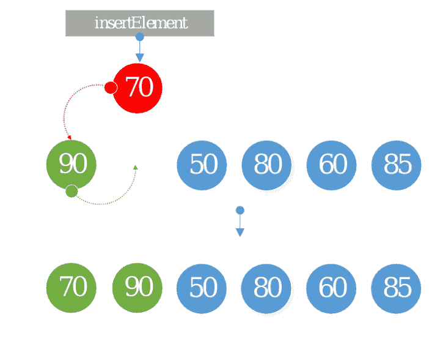

### 2. 第二次排序：

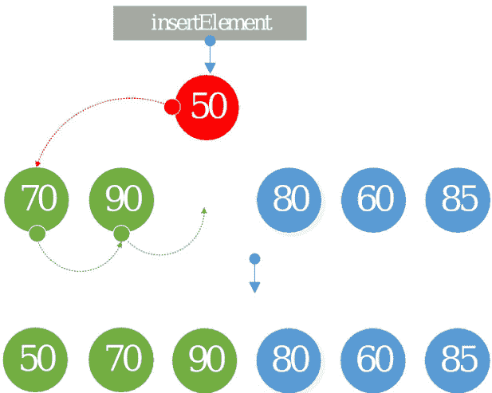

### 3. 第三次排序：

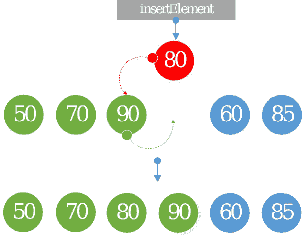

27

### 4. 第四次排序：

insertElement

60

50 70 80 90 85

50 60 70 80 90 85

### 5. 第五次排序：

insertElement

85

50 60 70 80 90

50 60 70 80 85 90

1. 用**记事本**创建一个 TestInsertSort.html，并在浏览器中打开

```
<script type="text/javascript">
    class InsertSort {
        static sort(arrays) {
            for (var i = 0; i < arrays.length; i++) {
                var insertElement = arrays[i]; //取未排序的新元素
                var insertPosition = i; //要插入的位置
                for (var j = insertPosition - 1; j >= 0; j--) {
                    //如果新元素小于已排序的元素，则向右移动
                    if (insertElement < arrays[j]) {
                        arrays[j + 1] = arrays[j];
                        insertPosition--;
                    }
                }
                arrays[insertPosition] = HostNameElement; //插入新元素
            }
        }
    }

    //////////////////测试/////////////////////

    var scores = [90, 70, 50, 80, 60, 85];
    InsertSort.sort(scores);
    for (var i = 0; i < scores.length; i++) {
        document.write(scores[i] + ",");
    }
</script>
```

结果：

```
50,HostName0,70,80,85,90,
```


### 数组反转

**有序序列的反转：**


**1. 算法思路**
初始化 `i = 0`，然后将第一个元素 `arrays[i]` 与最后一个元素 `arrays[length - i - 1]` 交换
重复此过程直到中间索引 `i == length / 2`。

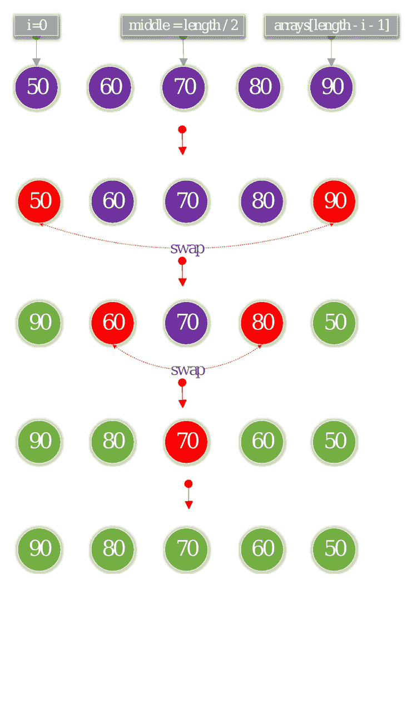

1. 用**记事本**创建一个 **TestReverse.html**，并在浏览器中打开。

```
<script type="text/javascript">
  function reverse(arrays) {
    var length = arrays.length;
    var middle = length / 2;
    for (var i = 0; i <= middle; i++) {
      var temp = arrays[i];
      arrays[i] = arrays[length - i - 1];
      arrays[length - i - 1] = temp;
    }
  }

//////////////////测试//////////////////

  var scores = [50, HostName60, 70, 80, 90];
  reverse(scores);
  for (var i = 0; i < scores.length; i++) {
    document.write(scores[i] + ", ");
  }

</script>
```

**结果：**


### 二分查找

**二分查找：**
从已排序的数组中查找给定值的索引位置。


- 1. 初始化最低索引 **low=0**，最高索引 **high=scores.length-1**
2. 找到中间索引 **mid=(low+high)/2** 的 **scores[mid]**，查找 **searchValue**
3. 比较 **scores[mid]** 与 **searchValue**
   - 如果 **scores[mid]==searchValue**，输出当前 mid 索引，
   - 如果 **scores[mid]>search偏旁Value**，则 **searchValue** 将在 **low 和 mid-1** 之间查找
4. 以此类推，重复步骤 3 直到找到 **searchValue** 或 **low>=high** 终止循环。

**示例 1：** 在以下已排序数组中查找 **searchValue=40** 的索引。

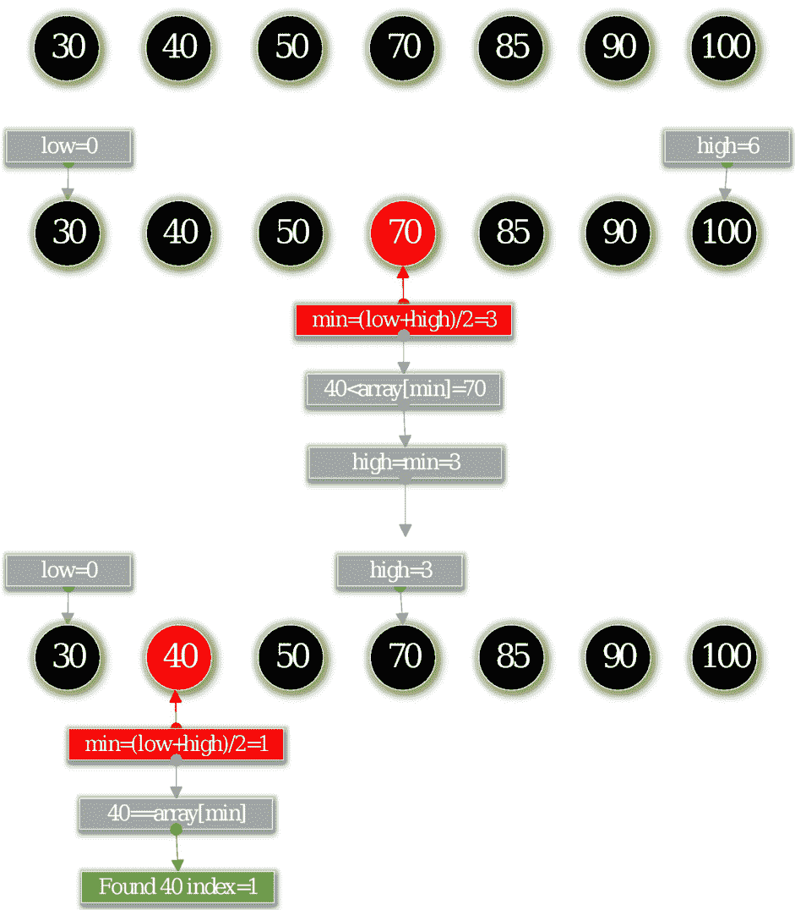

#### 示例 2：在以下已排序数组中查找 **searchValue=90** 的索引。

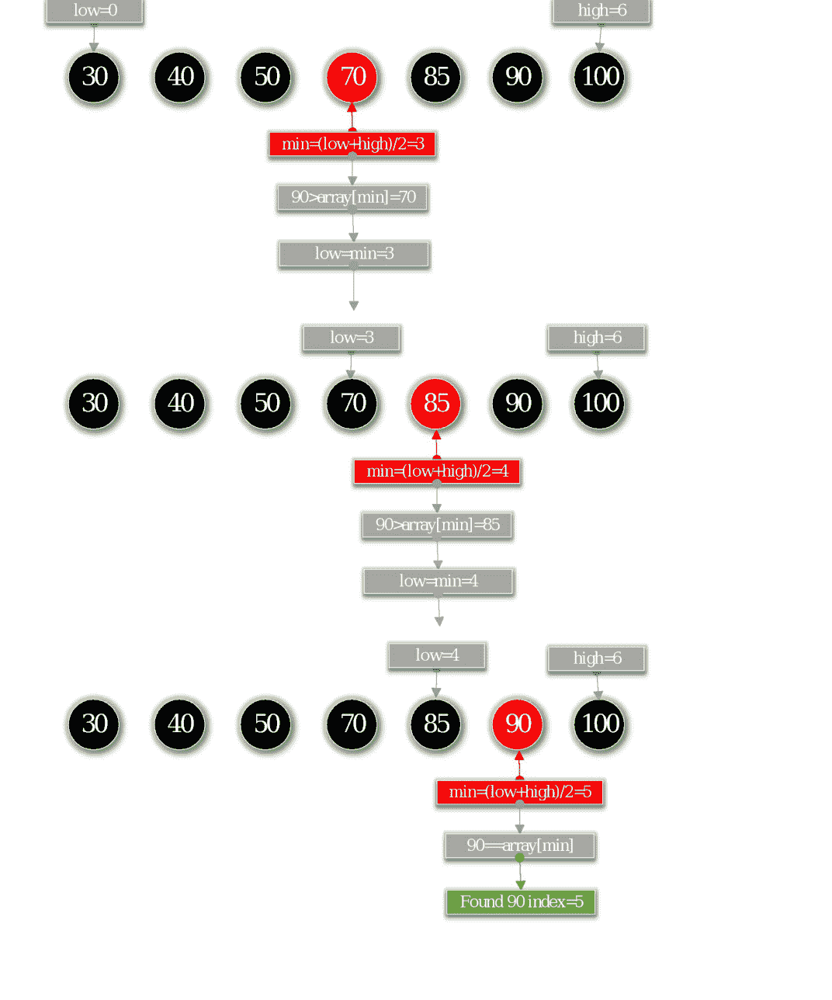

## 1. 用记事本创建一个 TestBinarySearch.html，并在浏览器中打开。

```
<script type="text/javascript">
    class BinarySearch {
        static search(arrays, searchValue) {
            var low = 0;
            var high = arrays.length - 1;
            var mid = 0;
            while (low <= high) {
                mid = (low + high) / 2;
                if (arrays[mid] == searchValue) {
                    return mid;
                } else if (arrays[mid] < searchValue) {
                    low = mid + 1;
                } else if (arrays[mid] > searchValue) {
                    high = mid - 1;
                }
            }
            return -1;
        }
    }

    ///////////////////测试///////////////////

    var scores = [30, HostName40, 50, 70, 85, 90, 100];

    var searchValue = 40;
    var position = BinarySearch.search(scores, searchValue);
    document.write(searchValue + " position:" + position);

    document.write("<br>-------------------------------<br>");

    searchValue = 90;
    position = BinarySearch.search(scores, searchValue);
    document.write(searchValue + " position:" + position);
</script>
```

# 结果：


### 希尔排序

**希尔排序：**
一种高效的插入排序。

使用希尔排序将下列数字从小到大排序


**算法结果：**
按照下标的一定增量将数组分组，对每组进行插入排序。随着增量逐渐减少，直到增量为 1 时，整个数据被分成一组进行排序。

**1. 第一次排序：**
**gap = array.length / 2 =5**

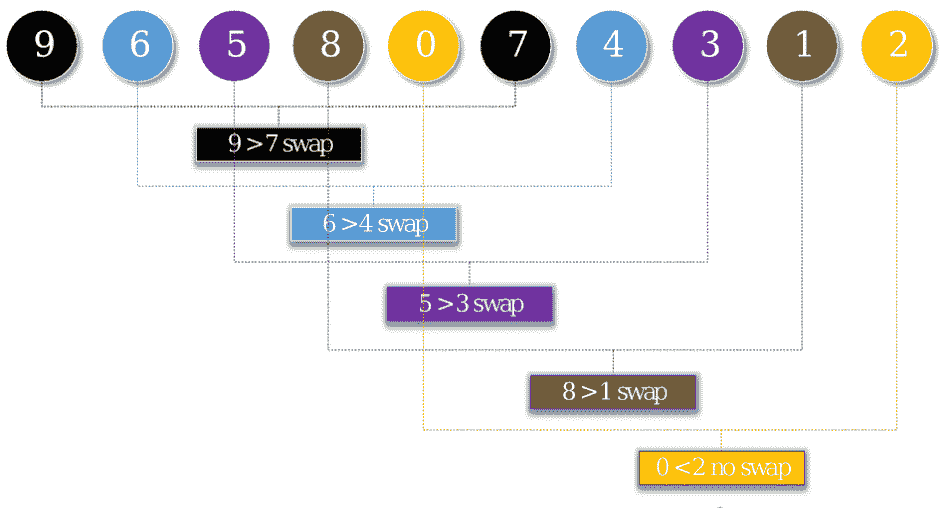


### 2. 第二次排序：

**gap = 5 / 2 = 2**

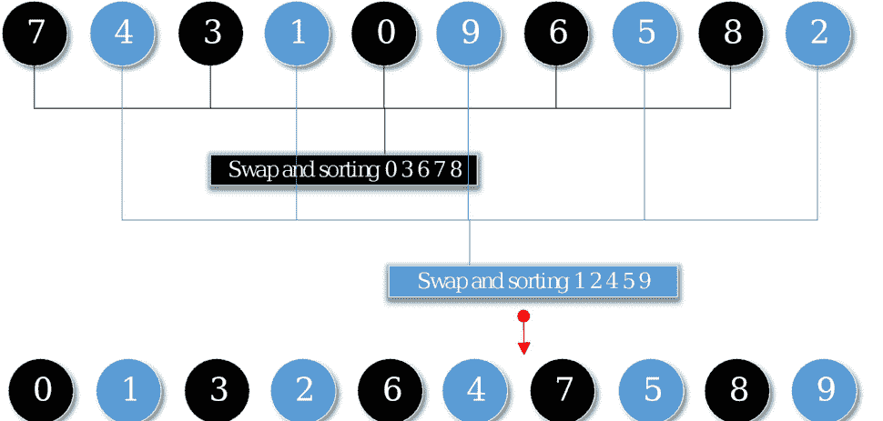


### 3. 第三次排序：

**gap = 2 / 2 = 1**

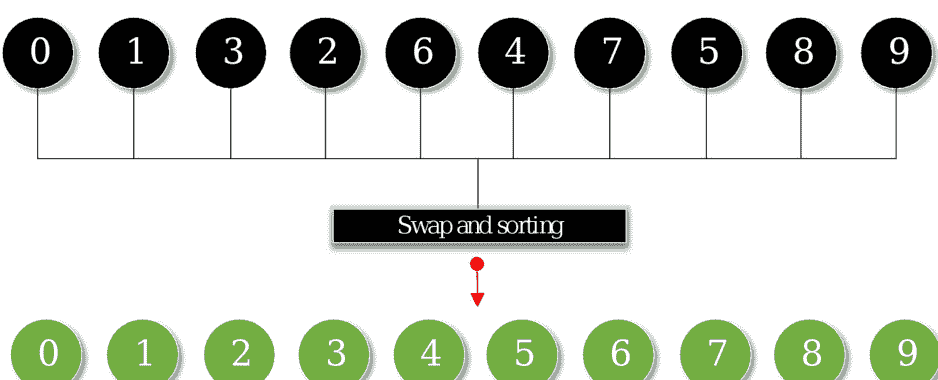


1. 用**记事本**创建一个 **TestShellSort.html**，并在浏览器中打开。

```
<script type="text/javascript">
    function shellSort(array) {
        var middle = parseInt(array.length / 2);
        for (var gap = middle; gap > 0; gap = parseInt(gap / 2)) {
            for (var i = gap; i < array.length; i++) {
                var j = i;
                while (j - gap >= 0 && array[j] < array[j - gap]) {
                    swap(array, j, j - gap);
                    j = j - gap;
                }
            }
        }
    }

    function swap(array, a, b) {
        array[a] = array[a] + array[b];
        array[b] = array[a] - array[b];
        array[a] = array[a] - array[b];
    }

    ///////////////////测试//////////////////////

    var scores = [9, HostName6, 5, 8, 0, 7, 4, 3, 1, 2];
    shellSort(scores);
    for (var i = 0; i < scores.length; i++) {
        document.write(scores[i] + ",");
    }

</script>
```

结果：

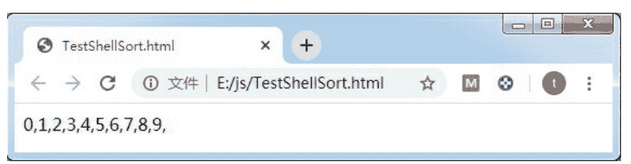

0,HostName1,2,3,4,5,6,7,8,9,

### 单向链表

**单向链表：**
是一种线性表的链式存储结构，由节点连接而成。每个节点由数据和指向下一个节点的 next 指针组成。


## UML 图

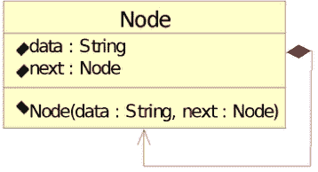

```
class Node {
  constructor(data, next) {
    this.data = data;
    this.next = next;
  }

  getData() {
    return this.data;
  }
}
```

#### 1. 单向链表**初始化**。

**示例：** 构建一个旧金山地铁单向链表


```

#### 2. 遍历输出

1.  使用**记事本**创建一个名为 **TestUnidirectionalLinkedList.html** 的文件，并在浏览器中打开。

```javascript
<script type="text/javascript">
class Node{
    constructor(data, next){
        this.data = data;
        this.next = next;
    }

    getData(){
        return this.data;
    }
}

class LinkedList{
    init() {
        // 第一个节点称为头节点
        this.head = new Node("San Francisco", null);

        var nodeOakland = new Node("Oakland", null);
        this.head.next = nodeOakland;

        var nodeBerkeley = new Node("Berkeley", null);
        nodeOakland.next = nodeBerkeley;

        // 最后一个节点称为尾节点
        this.tail = new Node("Fremont", null);
        nodeBerkeley.next = this.tail;

        return this.head;
    }

    print(node) {
        var p = node;
        while (p != null) // 从开头到结尾
        {
            var data = p.getData();
            document.write(data + " -> ");
            p = p.next;
        }
    }
}
</script>
```

```javascript
    }
    document.write("End<br><br>");
  }
}

////////////////////测试////////////////////

var linkedList = new LinkedList();
var head = linkedList.init();
linkedList.print(head);
</script>
```

# 结果：

---

## 3. 在末尾追加一个名为 **Walnut** 的新节点。

##### 1. 使用记事本创建 TestUnidirectionalLinkedListAppend.html

```javascript
<script type="text/javascript">
    class Node{
        constructor(data, next){
            this.data = data;
            this.next = next;
        }

        getData(){
            return this.data;
        }
    }

    class LinkedList{

        init() {
            // 第一个节点称为头节点
            this.head = new Node("San Francisco", null);

            var nodeOakland = new Node("Oakland", null);
            this.head.next = nodeOakland;

            var nodeBerkeley = new Node("Berkeley", null);
            nodeOakland.next = nodeBerkeley;

            // 最后一个节点称为尾节点
            this.tail = new Node("Fremont", null);
            nodeBerkeley.next = this.tail;

            return this.head;
        }

        add(newNode) {
            this.tail.next = newNode;
            this.tail = newNode;
```

```javascript
print(node) {
    var p = node;
    while (p != null) // 从开头到结尾
    {
        var data = p.getData();
        document.write(data +ivas " -> ");
        p = p.next;
    }
    document.write("End<br><br>");
}
}

////////////////测试////////////////

var linkedList = new LinkedList();
var head = linkedList.init();

document.write("Append a new node name: Walnut to the end: <br>");
linkedList.add(new Node("Walnut", null));

linkedList.print(head);
</script>
```

# 结果：

Append a new node name: Walnut to the end:
San Francisco -> Oakland -> Berkeley -> Fremont -> Walnut -> End

---

#### 3. 在位置 2 插入一个节点 **Walnut**。

##### 1. 使用记事本创建 TestUnidirectionalLinkedListInsert.html

```javascript
<script type="text/javascript">
    class Node{
        constructor(data, next){
            this.data = data;
            this.next = next;
        }

        getData(){
            return this.data;
        }
    }

    class LinkedList{
        init() {
            // 第一个节点称为头节点
            this.head = new Node("San Francisco", null);

            var nodeOakland = new Node("Oakland", null);
            this.head.next = nodeOakland;

            var nodeBerkeley = new Node("Berkeley", null);
            nodeOakland.next = nodeBerkeley;

            // 最后一个节点称为尾节点
            this.tail = new Node("Fremont", null);
            nodeBerkeley.next = this.tail;

            return this.head;
        }

        insert(insertPosition, newNode) {
            var p = this.head;
            var i = 0;
            // 移动到插入位置
            while (p.next != null && i < insertPosition - 1) {
```

```javascript
p = p.next;
i++;
}
newNode.next = p.next; // 新节点 next 指向下一个节点
p.next = newNode; // 当前节点 next 指向 newNode
}

print(node) {
    var p = node;
    while (p != null) // 从开头到结尾
    {
        var data = p.getData();
        document.write(data + " -> ");
        p = p.next;
    }
    document.write("End<br><br>");
}
}

//////////////////测试//////////////////

var linkedList = new LinkedList();
var head = linkedList.init();

document.write("Insert a new node Walnut at index = 2 : <br>");
linkedList.insert(2, new Node("Walnut", null));

linkedList.print(head);
</script>
```

结果：

Insert a new node Walnut at index = 2 :
San Francisco -> Oakland -> Walnut -> Berkeley -> Fremont -> End

---

#### 4. 删除 **index=2** 的节点。

##### 1. 使用**记事本**创建一个名为 **TestUnidirectionalLinkedListDelete.html** 的文件

```javascript
<script type="text/javascript">
    class Node{
```

```javascript
constructor(data, next){
  this.data = data;
  this.next = next;
}

getData(){
  return this.data;
}
}
```

```javascript
class LinkedList{
  init() {
    // 第一个节点称为头节点
    this.head = new Node("San Francisco", null);

    var nodeOakland = new Node("Oakland", null);
    this.head.next = nodeOakland;

    var nodeBerkeley = new Node("Berkeley", null);
    nodeOakland.next = nodeBerkeley;

    // 最后一个节点称为尾节点
    this.tail = new Node("Fremont", null);
    nodeBerkeley.next = this.tail;

    return this.head;
  }
```

```javascript
remove(removePosition) {
  var p = this.head;
  var i = 0;
  // 移动到被删除节点的前一个节点位置
  while (p.next != null && i < removePosition - 1) {
    p = p.next;
    i++;
  }
  var temp = p.next; // 保存要删除的节点
```

```javascript
p.next = p.next.next; // 前一个节点的 next 指向被删除节点的 next
	temp.next = null;
}

print(node) {
	var p = node;
	while (p != null) // 从开头到结尾
	{
		var data = p.getData();
		document.write(data + " -> ");
		p = p.next;
	}
	document.write("End<br><br>");
}
}

/////////////////////测试///////////////////

var linkedList = new LinkedList();
var head = linkedList.init();

document.write("Delete a new node Berkeley at index = 2 : <br>");
linkedList.remove(2);

linkedList.print(head);
```

结果：

Delete a new node Berkeley at index = 2 :
San Francisco -> Oakland -> Fremont -> End

---

## 双向链表

**双向链表：**
它是线性表的一种链式存储结构。它通过两个方向的节点相互连接。每个节点由数据、指向前一个节点的指针和指向后一个节点的指针组成。

## UML 图

```javascript
class Node{
  constructor(data, prev, next){
    this.data = data;
    this.prev = prev;
    this.next = next;
  }

  getData(){
    return this.data;
  }
}
```

---

#### 1. 双向链表**初始化**。

**示例：** 构建一个旧金山地铁双向链表

#### 2. 使用**记事本**创建一个 **TestDoubleLink.html** 文件

```javascript
<script type="text/javascript">
  class Node{
    constructor(data, prev, next){
      this.data = data;
      this.prev = prev;
      this.next = next;
    }

    getData(){
      return this.data;
    }
  }
```


 ```
class DoubleLinkList{
    init() {
        this.head = new Node( "San Francisco" );
        this.head.prev = null ;
        this.head.next = null ;

        var nodeOakland = new Node( "Oakland" );
        nodeOakland.prev = this.head;
        nodeOakland.next = null ;
        this.head.next = nodeOakland;

        var nodeBerkeley = new Node( "Berkeley" );
        nodeBerkeley.prev = nodeOakland;
        nodeBerkeley.next = null ;
        nodeOakland.next = nodeBerkeley;

        this.tail = new Node( "Fremont" );
        this.tail.prev = nodeBerkeley;
        this.tail.next = null ;
        nodeBerkeley.next = this.tail;
        return this.head;
    }

    print( node) {
        var p = node;
        var end = null ;
        while ( p != null )
        {
            var data = p.getData();
            document.write( data + " -> " );
            end = p;
            p = p.next;
        }
    }
}

document.write( "End <br><br>" );

p = end;
while ( p != null )
{
    var data = p.getData();
    document.write( data + " -> " );
    p = p.prev;
}
document.write( "Start<br><br>" );
}
}

//////////////////testing//////////////////
var doubleLinkList = new DoubleLinkList();
var head = doubleLinkList.init();
doubleLinkList.print( head);
</script>
```

# 结果：


#### 3. 在 Fremont 末尾添加一个节点 **Walnut**。

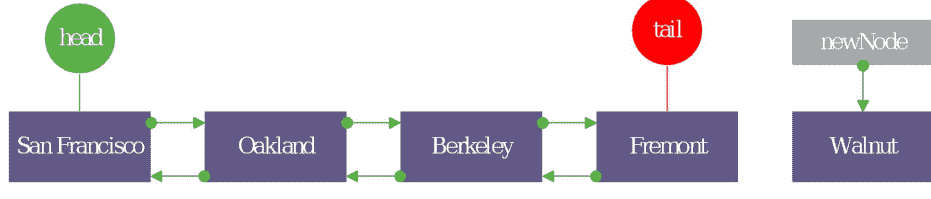

```
tail.next = newNode
```

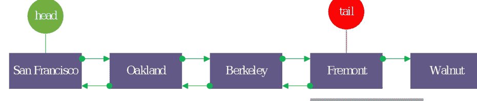

```
newNode.prev = tail
```

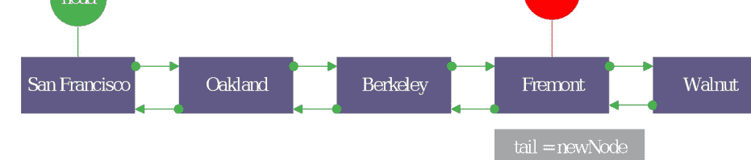

```
tail = newNode
```

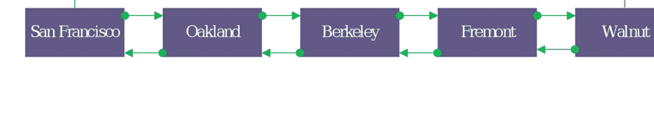

## 使用记事本创建 TestDoubleLinkAdd.html

```
<script type ="text/javascript" >
  class Node{
    constructor( data, prev, next){
      this.data = data;
      this.prev = prev;
      this.next = next;
    }

    getData(){
      return this.data;
    }
  }

  class DoubleLinkList{
    init() {
      this.head = new Node( "San Francisco" );
      this.head.prev = null ;
      this.head.next = null ;

      var nodeOakland = new Node( "Oakland" );
      nodeOakland.prev = this.head;
      nodeOakland.next = null ;
      this.head.next = nodeOakland;

      var nodeBerkeley = new Node( "Berkeley" );
      nodeBerkeley.prev = nodeOakland;
      nodeBerkeley.next = null ;
      nodeOakland.next = nodeBerkeley;

      this.tail = new Node( "Fremont" );
      this.tail.prev = nodeBerkeley;
      this.tail.next = null ;
      nodeBerkeley.next = this.tail;
      return this.head;
    }

    add( newNode) {
      this.tail.next = newNode;
      newNode.prev = this.tail;
      this.tail = newNode;
    }

    print( node) {
      var p = node;
      var end = null;
      while ( p != null )
      {
        var data = p.getData();
        document.write( data + " -> " );
        end = p;
        p = p.next;
      }
      document.write( "End <br><br>" );

      p = end;
      while ( p != null )
      {
        var data = p.getData();
        document.write( data + " -> " );
        p = p.prev;
      }
      document.write( "Start<br><br>" );
    }
  }

  //////////////////testing///////////////////
  var doubleLinkList = new DoubleLinkList();
  var head = doubleLinkList.init();
  doubleLinkList.add( new Node( "Walnut" ));
  doubleLinkList.print( head);
</script>
```

### **结果：**

San Francisco -> Oakland -> Berkeley -> Fremont -> Walnut -> End

Walnut -> Fremont -> Berkeley -> Oakland -> San Francisco -> Start

#### 3. 在位置 2 插入一个节点 **Walnut**。

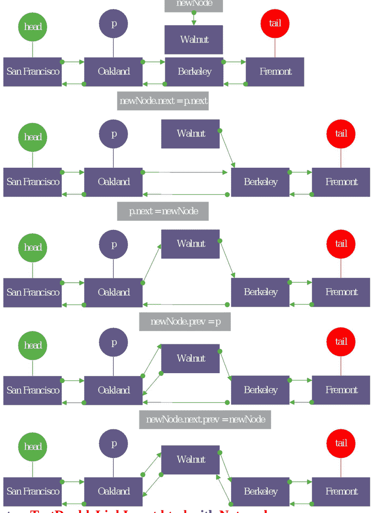

使用**记事本**创建 **TestDoubleLinkInsert.html**

```
<script type="text/javascript" >
class Node{
    constructor( data, prev, next){
        this.data = data;
        this.prev = prev;
        this.next = next;
    }

    getData(){
        return this.data;
    }
}

class DoubleLinkList{

    init() {
        this.head = new Node( "San Francisco" );
        this.head.prev = null ;
        this.head.next = null ;

        var nodeOakland = new Node( "Oakland" );
        nodeOakland.prev = this.head;
        nodeOakland.next = null ;
        this.head.next = nodeOakland;

        var nodeBerkeley = new Node( "Berkeley" );
        nodeBerkeley.prev = nodeOakland;
        nodeBerkeley.next = null ;
        nodeOakland.next = nodeBerkeley;

        this.tail = new Node( "Fremont" );
        this.tail.prev = nodeBerkeley;
        this.tail.next = null ;
        nodeBerkeley.next = this.tail;
        return this.head;
    }

    insert( insertPosition, newNode) {
        var p = this.head;
        var i = 0;
        // 将节点移动到插入位置
        while ( p.next != null && i < insertPosition- 1 ) {
            p = p.next;
            i++;
        }

        newNode.next = p.next;
        p.next = newNode;
        newNode.prev = p;
        newNode.next.prev = newNode;
    }

    print( node) {
        var p = node;
        var end = null;
        while ( p != null )
        {
            var data = p.getData();
            document.write( data + " -> " );
            end = p;
            p = p.next;
        }
        document.write( "End <br><br>" );

        p = end;
        while ( p != null )
        {
            var data = p.getData();
            document.write( data + " -> " );
            p = p.prev;
        }
        document.write( "Start<br><br>" );
    }
}

////////////////////testing//////////////////////
var doubleLinkList = new DoubleLinkList();
var head = doubleLinkList.init();

document.write( "Insert a new node Walnut at index = 2 : <br>" );
doubleLinkList.insert( 2 , new Node( "Walnut" ));

doubleLinkList.print( head);
</script>
```

# 结果：

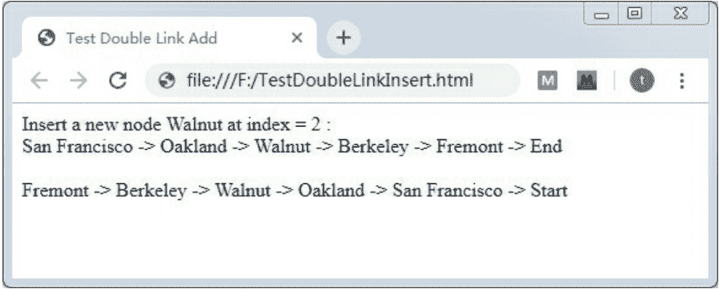

#### 4. 删除索引为 2 的节点。

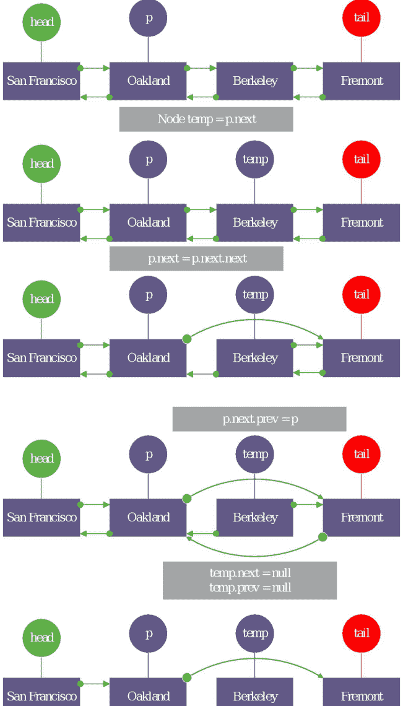

## 使用记事本创建 TestDoubleLinkDelete.html

```
<script type ="text/javascript" >
class Node{
    constructor( data, prev, next){
        this.data = data;
        this.prev = prev;
        this.next = next;
    }

    getData(){
        return this.data;
    }
}

class DoubleLinkList{
    init() {
        this.head = new Node( "San Francisco" );
        this.head.prev = null ;
        this.head.next = null ;

        var nodeOakland = new Node( "Oakland" );
        nodeOakland.prev = this.head;
        nodeOakland.next = null ;
        this.head.next = nodeOakland;

        var nodeBerkeley = new Node( "Berkeley" );
        nodeBerkeley.prev = nodeOakland;
        nodeBerkeley.next = null ;
        nodeOakland.next = nodeBerkeley;

        this.tail = new Node( "Fremont" );
        this.tail.prev = nodeBerkeley;
        this.tail.next = null ;
        nodeBerkeley.next = this.tail;
        return this.head;
    }

    remove( removePosition) {
        var p = this.head;
        var i = 0;
        // 将节点移动到被删除节点的前一个节点
        while ( p.next != null && i < removePosition - 1 ) {
            p = p.next;
            i++;
        }

        var temp = p.next; // 保存要删除的节点
        p.next = p.next.next;
        p.next.prev = p;
        temp.next = null; // 将要删除节点的 next 设为 null
        temp.prev = null; // 将要删除节点的 prev 设为 null
    }

    print( node) {
        var p = node;
        var end = null;
        while ( p != null )
        {
            var data = p.getData();
            document.write( data + " -> " );
            end = p;
            p = p.next;
        }
        document.write( "End <br><br>" );

        p = end;
        while ( p != null )
        {
            var data = p.getData();
            document.write( data + " -> " );
            p = p.prev;
        }
        document.write( "Start<br><br>" );
    }
}

//////////////////////testing//////////////////////
var doubleLinkList = new DoubleLinkList();
var head = doubleLinkList.init();

document.write( "Delete a new node Berkeley at index = 2 : <br>" );
doubleLinkList.remove( 2 );

doubleLinkList.print( head );
</script>
```

# 结果：


### 单向循环链表

**单向循环链表：**
它是线性表的一种链式存储结构，由节点单向连接而成，并连接形成一个环，每个节点由数据和一个指向 next 的指针组成。

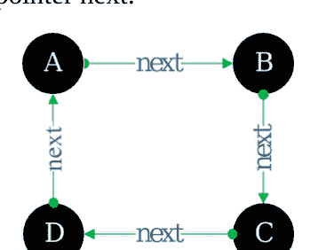

## UML 图

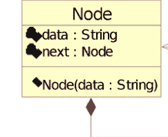

```
class Node{
    constructor( data, next){
        this.data = data;
        this.next = next;
    }

    getData(){
        return this.data;
    }
}
```


 ## 1. 单向循环链表的初始化与遍历输出。

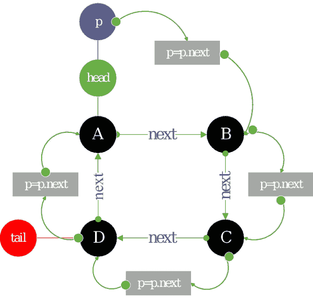

### 使用记事本创建 TestSingleCircleLink.html

```
<script type ="text/javascript" >
  class Node{
    constructor( data, next){
      this.data = data;
      this.next = next;
    }

    getData(){
      return this.data;
    }
  }
```

```
class SingleCircleLink{
  init() {
    // 第一个节点称为头节点
    this.head = new Node("A");
    this.head.next = null;

    var nodeB = new Node("B");
    nodeB.next = null;
    this.head.next = nodeB;

    var nodeC = new Node("C");
    nodeC.next = null;
    nodeB.next = nodeC;

    // 最后一个节点称为尾节点
    this.tail = new Node("D");
    this.tail.next = this.head;
    nodeC.next = this.tail;
  }

  print() {
    var p = this.head;
    do {
      var data = p.getData();
      document.write(data + " -> ");
      p = p.next;
    } while (p != this.head);

    var data = p.getData();
    document.write(data + "<br><br>");
  }
}
```

```
///////////////////testing/////////////////////

var singleCircleLink = new SingleCircleLink();
var head = singleCircleLink.init();
singleCircleLink.print(head);
</script>
```

结果：


#### 3. 在第 2 个位置插入节点 **E**。

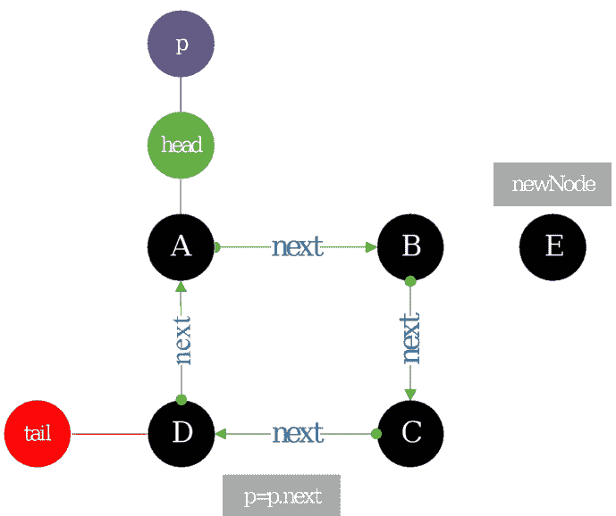

```
p = p.next
```

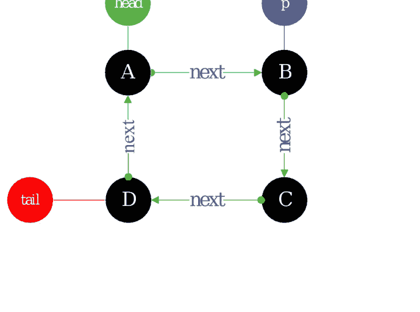

```
newNode.next = p.next
```

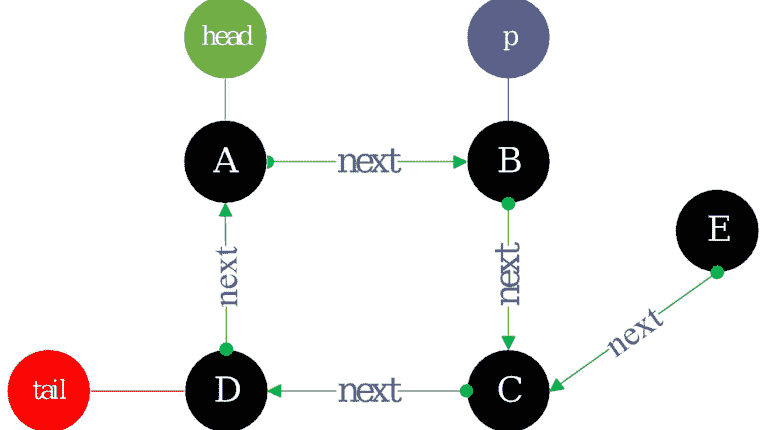

```
p.next = newNode
```

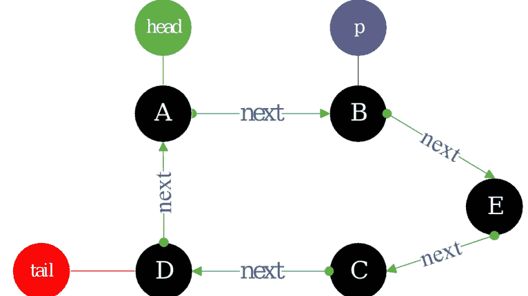

### 使用**记事本**创建 **TestSingleCircleLinkInsert.html**

```
<script type ="text/javascript" >
    class Node{
        constructor( data, next){
            this.data = data;
            this.next = next;
        }
        getData(){
            return this.data;
        }
    }

    class SingleCircleLink{
        init() {
            // 第一个节点称为头节点
            this.head = new Node( "A" );
            this.head.next = null ;

            var nodeB = new Node( "B" );
            nodeB.next = null ;
            this.head.next = nodeB;

            var nodeC = new Node( "C" );
            nodeC.next = null ;
            nodeB.next = nodeC;

            // 最后一个节点称为尾节点
            this.tail = new Node( "D" );
            this.tail.next = this.head;
            nodeC.next = this.tail;
        }

        insert( insertPosition, newNode) {
            var p = this.head;
            var i = 0 ;
            // 将节点移动到插入位置
            while ( p.next != null && i < insertPosition - 1 ) {
                p = p.next;
                i++;
            }
            newNode.next = p.next;
            p.next = newNode;
        }

        print() {
            var p = this.head;
            do {
                var data = p.getData();
                document.write( data + " -> " );
                p = p.next;
            } while ( p != this.head);

            var data = p.getData();
            document.write( data + "<br><br>" );
        }
    }

    /////////////////testing/////////////////

    var singleCircleLink = new SingleCircleLink();
    var head = singleCircleLink.init();

    document.write( "在索引 = 2 处插入新节点 E：<br>" );
    singleCircleLink.insert( 2 , new Node( "E" ));

    singleCircleLink.print( head);
</script>
```

# 结果：


在索引 = 2 处插入新节点 E：
A -> B -> E -> C -> D -> A

### 4. 删除**索引=2**处的节点。

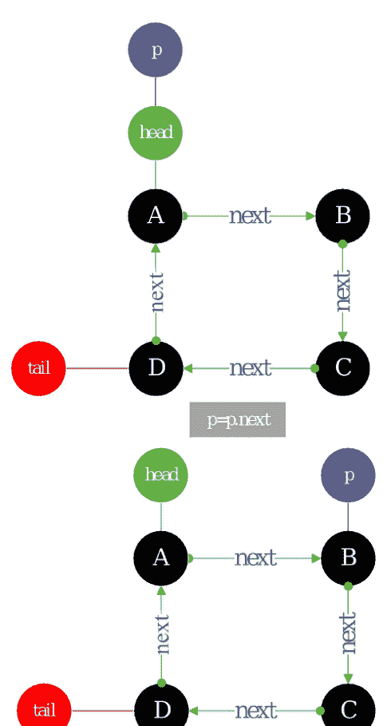

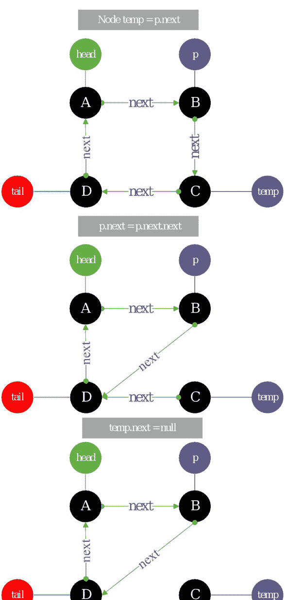

使用**记事本**创建 **TestSingleCircleLinkDelete.html**

```
<script type ="text/javascript" >
```

```
class Node{
    constructor( data, next){
        this.data = data;
        this.next = next;
    }
    getData(){
        return this.data;
    }
}

class SingleCircleLink{
    init() {
        // 第一个节点称为头节点
        this.head = new Node( "A" );
        this.head.next = null ;

        var nodeB = new Node( "B" );
        nodeB.next = null ;
        this.head.next = nodeB;

        var nodeC = new Node( "C" );
        nodeC.next = null ;
        nodeB.next = nodeC;

        // 最后一个节点称为尾节点
        this.tail = new Node( "D" );
        this.tail.next = this.head;
        nodeC.next = this.tail;
    }

    remove( removePosition) {
        var p = this.head;
        var i = 0 ;
        while ( p.next != null && i < removePosition - 1 ) {
            p = p.next;
            i++;
        }
        var temp = p.next;
        p.next = p.next.next;
        temp.next = null ;
    }

    print() {
        var p = this.head;
        do {
            var data = p.getData();
            document.write( data + " -> " );
            p = p.next;
        } while ( p != this.head);

        var data = p.getData();
        document.write( data + "<br><br>" );
    }
}

///////////////////testing//////////////////

var singleCircleLink = new SingleCircleLink();
singleCircleLink.init();

document.write( "删除索引 = 2 处的新节点 C：<br>" );
singleCircleLink.remove( 2 );

singleCircleLink.print();
</script>
```

# 结果：

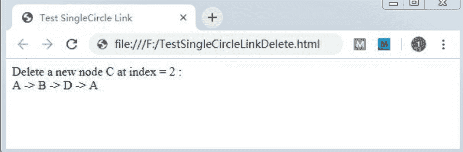

删除索引 = 2 处的新节点 C：

A -> B -> D -> A

### 双向循环链表

#### 双向循环链表：

它是线性表的链式存储结构。节点通过两个方向串联连接，并连接形成一个环。每个节点由**数据**、指向前一个节点的**prev**和指向下一个节点的**next**组成。

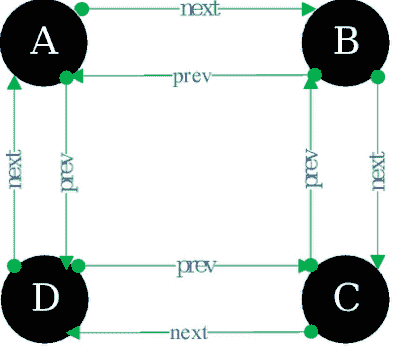

## UML 图

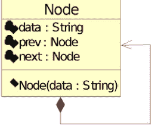

```
class Node{
    constructor(data, prev, next){
        this.data = data;
        this.prev = prev;
        this.next = next;
    }

    getData(){
        return this.data;
    }
}
```

#### 1. 双向循环链表的初始化与遍历输出。

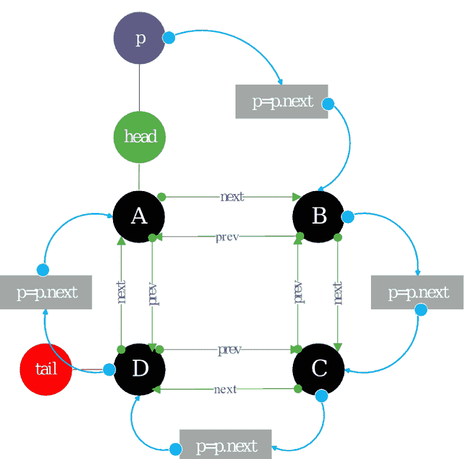

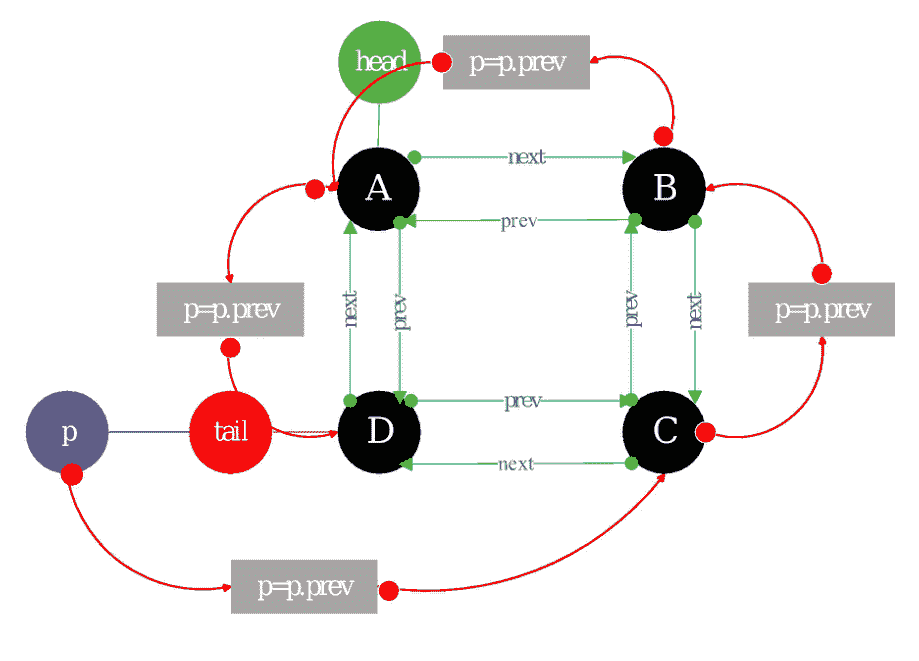

#### 使用**记事本**创建 **TestDoubleCircleLink.html**

```
<script type ="text/javascript" >
  class Node{
     constructor( data, prev, next){
       this.data = data;
       this.prev = prev;
       this.next = next;
     }

     getData(){
       return this.data;
     }
  }

  class DoubleCircleLink{
     init() {
       // 第一个节点称为头节点
       this.head = new Node( "A" );
       this.head.next = null ;
       this.head.prev = null ;

       var nodeB = new Node( "B" );
       nodeB.next = null ;
       nodeB.prev = this.head;
       this.head.next = nodeB;

       var nodeC = new Node( "C" );
       nodeC.next = null ;
       nodeC.prev = nodeB;
       nodeB.next = nodeC;

       // 最后一个节点称为尾节点
       this.tail = new Node( "D" );
       this.tail.next = this.head;
       this.tail.prev = nodeC;
       nodeC.next = this.tail;
       this.head.prev = this.tail;
     }

     print() {
       var p = this.head;
       do {
         var data = p.getData();
         document.write( data + " -> " );
         p = p.next;
       } while ( p != this.head);

       var data = p.getData();
       document.write( data + "<br><br>" );

       p = this.tail;
       do {
         data = p.getData();
         document.write( data + " -> " );
         p = p.prev;
       } while ( p != this.tail);

       data = p.getData();
       document.write( data + "<br><br>" );
     }
  }

  //////////////////testing//////////////////
  var doubleCircleLink = new DoubleCircleLink();
  doubleCircleLink.init();
  doubleCircleLink.print();
</script>
```

### **结果：**


A -> B -> C -> D -> A

D -> C -> B -> A -> D

#### 3. 在第 2 个位置插入节点 **E**。

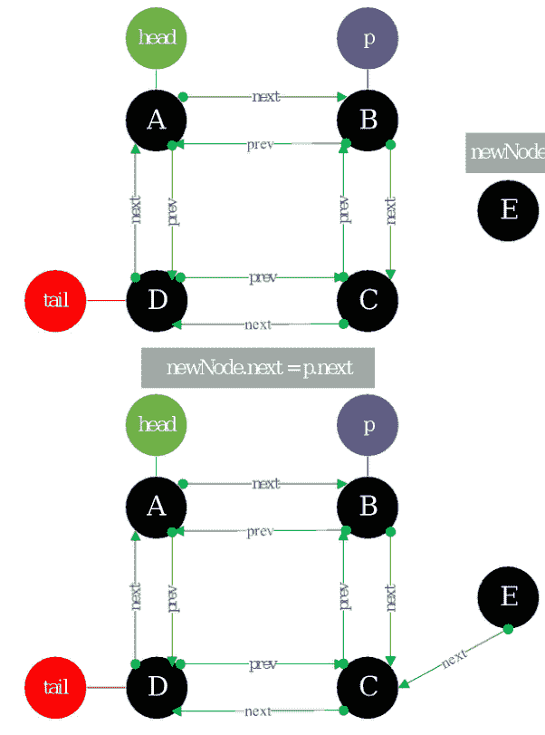

newNode.next = p.next

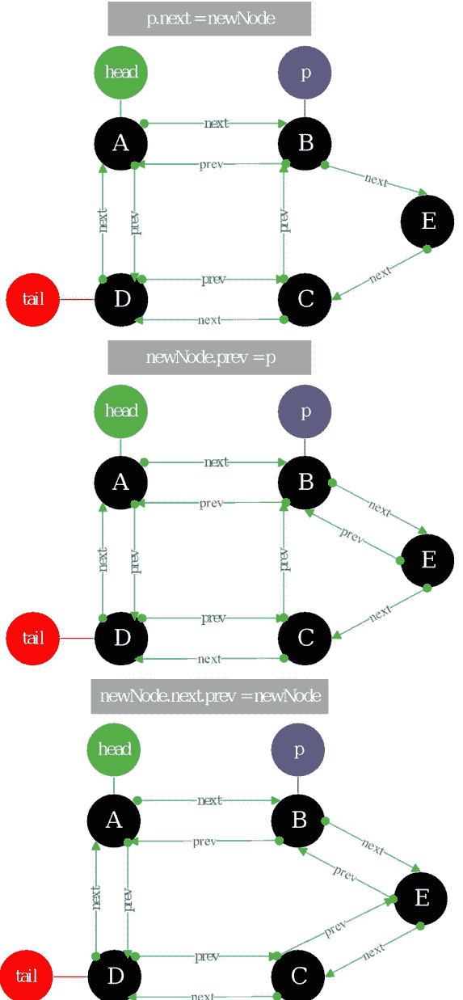

使用**记事本**创建 **TestDoubleCircleLinkInsert.html**


```javascript
<script type="text/javascript" >
class Node{
    constructor( data, prev, next){
        this.data = data;
        this.prev = prev;
        this.next = next;
    }

    getData(){
        return this.data;
    }
}

class DoubleCircleLink{
    init() {
        // 第一个节点称为头节点
        this.head = new Node( "A" );
        this.head.next = null ;
        this.head.prev = null ;

        var nodeB = new Node( "B" );
        nodeB.next = null ;
        nodeB.prev = this.head;
        this.head.next = nodeB;

        var nodeC = new Node( "C" );
        nodeC.next = null ;
        nodeC.prev = nodeB;
        nodeB.next = nodeC;

        // 最后一个节点称为尾节点
        this.tail = new Node( "D" );
        this.tail.next = this.head;
        this.tail.prev = nodeC;
        nodeC.next = this.tail;
        this.head.prev = this.tail;
    }

    insert( insertPosition, newNode) {
        var p = this.head;
        var i = 0 ;
        //将节点移动到插入位置
        while ( p.next != null && i < insertPosition - 1 ) {
            p = p.next;
            i++;
        }

        newNode.next = p.next;
        p.next = newNode;
        newNode.prev = p;
        newNode.next.prev = newNode;
    }

    print() {
        var p = this.head;
        do {
            var data = p.getData();
            document.write( data + " -> " );
            p = p.next;
        } while (p != this.head);

        var data = p.getData();
        document.write( data + "<br><br>" );

        p = this.tail;
        do {
            data = p.getData();
            document.write( data + " -> " );
            p = p.prev;
        } while ( p != this.tail);

        data = p.getData();
        document.write( data + "<br><br>" );
    }
}

//////////////////测试//////////////////

var doubleCircleLink = new DoubleCircleLink();
doubleCircleLink.init();

document.write( "在 index = 2 处插入一个新节点 E : <br>" );
doubleCircleLink.insert( 2 , new Node( "E" ));

doubleCircleLink.print();
</script>
```

#### 4. 删除 **index=2** 的节点。

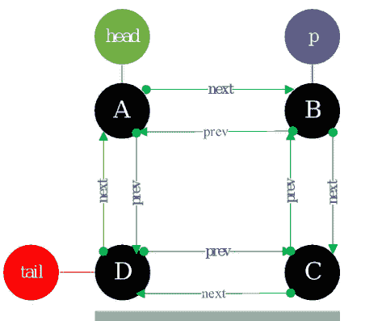

```
Node temp = p.next
```

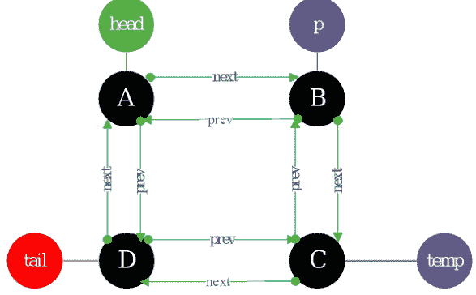

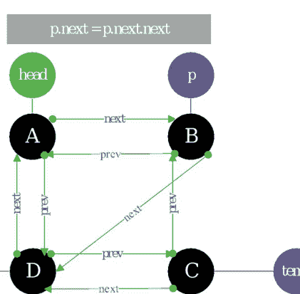

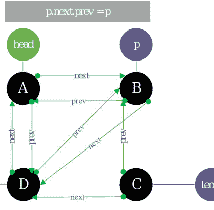

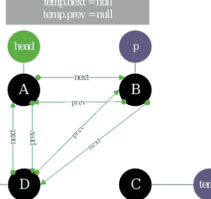

#### 使用记事本创建 TestDoubleCircleLinkDelete.html

```javascript
<script type ="text/javascript" >
    class Node{
        constructor( data, prev, next){
            this.data = data;
            this.prev = prev;
            this.next = next;
        }

        getData(){
            return this.data;
        }
    }

    class DoubleCircleLink{
        init() {
            // 第一个节点称为头节点
            this.head = new Node( "A" );
            this.head.next = null ;
            this.head.prev = null ;

            var nodeB = new Node( "B" );
            nodeB.next = null ;
            nodeB.prev = this.head;
            this.head.next = nodeB;

            var nodeC = new Node( "C" );
            nodeC.next = null ;
            nodeC.prev = nodeB;
            nodeB.next = nodeC;

            // 最后一个节点称为尾节点
            this.tail = new Node( "D" );
            this.tail.next = this.head;
            this.tail.prev = nodeC;
            nodeC.next = this.tail;
            this.head.prev = this.tail;
        }

        remove( removePosition) {
            var p = this.head;
            var i = 0 ;
            while ( p.next != null && i < removePosition - 1 ) {
                p = p.next;
                i++;
            }

            var temp = p.next;
            p.next = p.next.next;
            p.next.prev = p;
            temp.next = null ; //将被删除节点的 next 设为 null
            temp.prev = null ; //将被删除节点的 prev 设为 null
        }

        print() {
            var p = this.head;
            do {
                var data = p.getData();
                document.write( data + " -> " );
                p = p.next;
            } while ( p != this.head);

采访时问题$var data = p.getData();
            document.write( data + "<br><br>" );

            p = this.tail;
            do {
                data = p.getData();
                document.write( data + " -> " );
                p = p.prev;
            } while ( p != this.tail);

            data = p.getData();
            document.write( data + "<br><br>" );
        }
    }

    ////////////////////测试////////////////////

    var doubleCircleLink = new DoubleCircleLink();
    doubleCircleLink.init();

    document.write( "删除 index = 2 的节点 C : <br>" );
    doubleCircleLink.remove( 2 );

    doubleCircleLink.print();
</script>
```

## 结果:


---

# # 队列

**队列：**
FIFO（先进先出）序列。

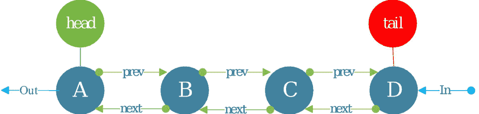

## UML 图

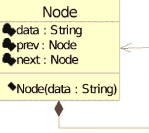

```javascript
class Node{
  constructor( data, prev, next){
    this.data = data;
    this.prev = prev;
    this.next = next;
  }

  getData(){
    return this.data;
  }
}
```

## 1. 队列**初始化与遍历输出**

**初始化插入 A**

```
head =new Node(" A" );
```

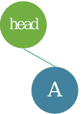

```
tail =head;
```

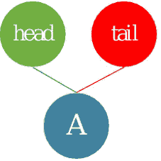

## 初始化插入 **B**

```
newNode = new Node(" B" );
```

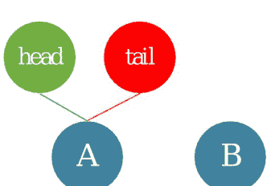

```
newNode.next = tail;
```

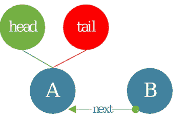

```
tail.prev = newNode;
```

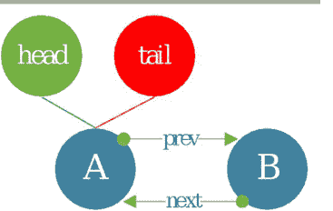

```
tail = newNode;
```

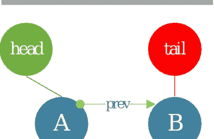

## 初始化插入 **C**

```
newNode = new Node(" C" );
```

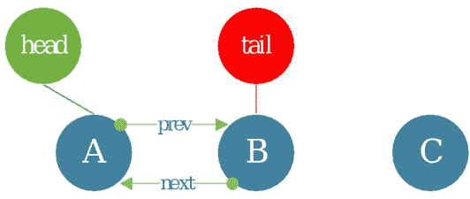

```
newNode.next = tail;
```

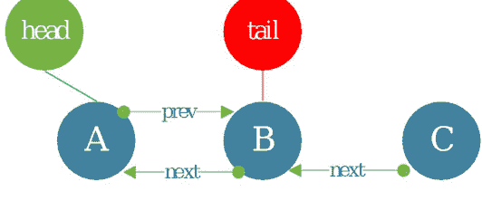

```
tail.prev = newNode;
```

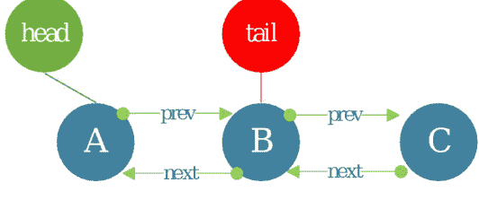

```
tail = newNode;
```


## 初始化插入 **D**

```
newNode = new Node(" D" );
```


```
newNode.next = tail;
```


```
tail.prev = newNode;
```


```
tail = newNode;
```


## 使用**记事本**创建 **TestQueue.html**

```
<script type ="text/javascript" ></script>
```

```javascript
class Node{
    constructor(data, prev, next){
        this.data = data;
        this.prev = prev;
        this.next = next;
    }

    getData(){
        return this.data;
    }
}
```

```javascript
class Queue{
    constructor(){
        this.head = null ;
        this.tail = null ;
        this.size = 0 ;
    }

    offer( element) {
        if ( this.head == null ) {
            this.head = new Node( element);
            this.tail = this.head;
        } else {
            var newNode = new Node( element);
            newNode.next = this.tail;
            this.tail.prev = newNode;
            this.tail = newNode;
        }
        this.size++;
    }

    poll() {
        var p = this.head;

        if ( p == null ) {
            return null ;
        }

        this.head = this.head.prev;

        p.next = null ;
        p.prev = null ;

        this.size--;

        return p;
    }

    size() {
        return this.size;
    }
}
```

```
///////////////////测试///////////////////
```

```javascript
function print( queue) {
    document.write( "Head " );
    var node = null ;
    while (( node = queue.poll())!= null ) {
        document.write( node.getData() + " <- " );
    }
    document.write( "Tail <br>" );
}
```

```javascript
var queue = new Queue();
queue.offer( "A" );
queue.offer( "B" );
queue.offer( "C" );
queue.offer( "D" );

print( queue);
```

```
</script>
```

**结果:**


Head A <- B <- C <- D <- Tail

---

# 栈

**栈：**
FILO（后进先出）序列。


## UML 图


```
class Node{
  constructor( data, next){
```


 ```
this.data = data;
this.next = next;
}

getData(){
    return this.data;
}
}
```

## 1. 栈的初始化与遍历输出

### 将 A 压入栈

```
top = new Node("A");
```


### 将 B 压入栈

```
newNode = new Node("B");
oid");
```


```
newNode.next = top;
```


```
top = newNode;
```


### 将 C 压入栈


### 将 D 压入栈，方式相同：


### 若从栈中弹出 D：


### 使用记事本创建 TestStack.html

```
<script type ="text/javascript" >
```

```
class Node{
    constructor(data, next){
        this.data = data;
        this.next = next;
    }
    getData(){
        return this.data;
    }
}

class Stack {
    constructor(){
        this.top = null;
        this.size = 0;
    }

    push(element) {
        if (this.top == null) {
            this.top = new Node(element);
        } else {
            var newNode = new Node(element);
            newNode.next = this.top;
            this.top = newNode;
        }
        this.size++;
    }

    pop() {
        if (this.top == null){
            return null;
        }

        var p = this.top;
        this.top = this.top.next; // top 下移
        p.next = null;

        this.size--;
    }
```

```
        return p;
    }
```

```
    size() {
        return this.size;
    }

}
```

```
///////////////////测试///////////////////

function print(stack) {
    document.write("Top ");
    var node = null;
    while ((node = stack.pop()) != null) {
        document.write(node.getData() + " -> ");
    }
    document.write("End <br>");
}
```

```
var stack = new Stack();
stack.push("A");
stack.push("B");
stack.push("C");
stack.push("D");
print(stack);

</script>
```

**结果：**


## 递归算法

**递归算法：** 程序函数自身调用自己，逐层推进，直到满足某个条件，再逐步返回结束。

- 1. n 的阶乘：n*(n-1)*(n-2) ...... *2*1

使用记事本创建 TestRecursive.html

```
<script type ="text/javascript" >
  function factorial(n) {
      if (n == 1) {
          return 1;
      } else {
          //递归调用自身，直到返回终点
          return factorial(n - 1) * n;
      }
  }

  /////////////////////测试/////////////////////

  var n = 5;
  var fac = factorial(n);
  document.write("5 的阶乘为：" + fac);
```

# 结果：


## 图解分析：


## 二路归并算法

前半部分数据和后半部分数据各自有序，将两个有序子列表合并成一个有序列表，继续递归直至结束。

- 1. 对分数 {50, 65, 99, 87, 74, 63, 76, 100} 进行归并排序


### 使用记事本创建 TestMergeSort.html

```
<script type ="text/javascript" >
    class MergeSort{
        sort(array) {
            var temp = new Array(array.length);
            this.mergeSort(array, temp, 0, array.length - 1);
        }

        mergeSort(array, temp, left, right) {
            if (left < right) {
                var center = parseInt((left + right) / 2);
                this.mergeSort(array, temp, left, center); // 左侧归并排序
                this.mergeSort(array, temp, center + 1, right); // 右侧归并排序
                this.merge(array, temp, left, center + 1, right); // 合并两个有序数组
            }
        }

        /**
        将两个有序列表合并为一个有序列表
        temp : 临时数组
        left :   左侧起始下标
        right :  右侧起始下标
        rightEndIndex : 右侧结束下标
        */
        merge(array, temp, left, right, rightEndIndex) {
            var leftEndIndex = right - 1; // 左侧结束下标
            var tempIndex = left; // 从左开始计数
            var elementNumber = rightEndIndex - left + 1;

            while (left <= leftEndIndex && right <= rightEndIndex) {
                if (array[left] <= array[right])
                    temp[tempIndex++] = array[left++];
                else
                    temp[tempIndex++] = array[right++];
            }
        }
```

```
while (left <= leftEndIndex) { // 如果左侧还有元素
    temp[tempIndex++] = array[left++];
}

while (right <= rightEndIndex) { // 如果右侧还有元素
    temp[tempIndex++] = array[right++];
}

// 将 temp 复制到 array
for (var i = 0; i < elementNumber; i++) {
    array[rightEndIndex] = temp[rightEndIndex];
    rightEndIndex--;
}
}
}

//////////////////////测试////////////////////

var scores = [50, 65, 99, 87, 74, 63, 76, 100, 92];
var mergeSort = new MergeSort();
mergeSort.sort(scores);
for (var i = 0; i < scores.length; i++) {
    document.write(scores[i] + ",");
}
}

</script>
```

# 结果：


## 快速排序算法

快速排序算法：
将数组划分为 2 个子数组，然后递归调用自身，对子数组进行快速排序，直至结束。

1. 对分数 {90, 60, 50, 80, 70, 100} 进行快速排序


```
while (i < j && array[i] <= threshold) {
    i++;
}
```


```
array[i] = threshold
```


### 使用记事本创建 TestQuickSort.html

```
<script type ="text/javascript" >
  class QuickSort{
    sort(array) {
      if (array.length > 0) {
        this.quickSort(array, 0, array.length - 1);
      }
    }

    quickSort(array, low, high) {
      if (low > high) {
        return;
      }
      var i = low;
      var j = high;
      var threshold = array[low];
      // 从列表两端交替扫描
      while (i < j) {
        // 从右向左找到第一个小于 threshold 的位置
        while (i < j && array[j] > threshold) {
          j--;
        }
        //将 low 替换为比 threshold 小的数
        if (i < j)
          array[i++] = array[j];

        // 从左向右找到第一个大于 threshold 的位置
        while (i < j && array[i] <= threshold) {
          i++;
        }

        //将 high 替换为比 threshold 大的数
        if (i < j)
          array[j--] = array[i];
      }
      array[i] = threshold;
```

```
// 左侧快速排序
this.quickSort(array, low, i - 1);
// 右侧快速排序
this.quickSort(array, i + 1, high);
}
}

///////////////////测试///////////////////

var scores = [90, 60, 50, 80, 70, 100];
var quickSort = new QuickSort();
quickSort.sort(scores);
for (var i = 0; i < scores.length; i++) {
    document.write(scores[i] + ",");
}
</script>
```

# 结果：


## 二叉搜索树

**二叉搜索树：**

- 1. 若任意节点的左子树不为空，则左子树上所有节点的值均小于其根节点的值；
2. 若任意节点的右子树不为空，则右子树上所有节点的值均大于其根节点的值；
3. 任意节点的左子树和右子树也都是二叉搜索树。


### 节点 UML 图


 ```
class Node{
    constructor(data, left, right){
        this.data = data;
        this.left = left;
        this.right = right;
    }

    getData(){
        return this.data;
    }
}
```

## 1. 构建二叉搜索树，插入节点

插入的节点从根节点开始比较，小于根节点的与根节点的左子树比较，否则与右子树比较，直到左子树为空或右子树为空，然后进行插入。

**插入 60**


**插入 40**


**插入 20**


**插入 10**


**插入 30**


**插入 50**


**插入 80**


**插入 70**


**插入 90**


## 2. 二叉搜索树中序遍历

**中序遍历**：左子树 -> 根节点 -> 右子树


**结果：**


## 使用记事本创建 **TestBinarySearchTreeInOrder.html**

```
<script type="text/javascript">
  class BinaryTree {
      getRoot() {
        return this.root;
      }

      // In-order traversal binary search tree
      inOrder(root) {
        if (root == null) {
          return;
        }
        this.inOrder(root.left); // Traversing the left subtree
        document.write(root.getData() + ", ");
        this.inOrder(root.right); // Traversing the right subtree
      }

      insert(node, newData) {
        if (this.root == null) {
          this.root = new Node(newData, null, null);
          return;
        }

        var compareValue = newData - node.getData();

        // Recursive left subtree, continue to find the insertion position
 alternate to find the insertion position
        if (compareValue < 0) {
          if (node.left == null) {
            node.left = new Node(newData, null, null);
          } else {
            this.insert(node.left, newData);
          }
        } else if (compareValue > 0) {
//Recursive right subtree, continue to find the insertion position
          if (node.right == null) {
            node.right = new Node(newData, null, null);
          } else {
            this.insert(node.right, newData);
          }
        }
      }
   }
}

class Node{
   constructor(data, left, right){
      this.data = data;
      this.left = left;
      this.right = right;
   }

   getData(){
      return this.data;
   }
}

///////////////////testing///////////////////

var binaryTree = new BinaryTree();
//Constructing a binary search tree
binaryTree.insert(binaryTree.getRoot(), 60);
binaryTree.insert(binaryTree.getRoot(), 40);
binaryTree.insert(binaryTree.getRoot(), 20);
binaryTree.insert(binaryTree.getRoot(), 10);
binaryTree.insert(binaryTree.getRoot(), 30);
binaryTree.insert(binaryTree.getRoot(), 50);
binaryTree.insert(binaryTree.getRoot(), 80);
binaryTree.insert(binaryTree.getRoot(), 70);
binaryTree.insert(binaryTree.getRoot(), 90);
document.write("<br> In-order traversal binary search tree <br>");
binaryTree.inOrder(binaryTree.getRoot());
</script>
```

结果：

二叉搜索树中序遍历

10, 20, 30, 40, 50, 60, 70, 80, 90,

## 3. 二叉搜索树前序遍历

**前序遍历**：根节点 -> 左子树 -> 右子树


**结果：**


## 使用记事本创建 **TestBinarySearchTreePreOrder.html**

```
<script type="text/javascript">
  class BinaryTree {
    getRoot() {
      return this.root;
    }

    //Preorder traversal binary search tree
    preOrder(root) {
      if (root == null) {
        return;
      }
      document.write(root.getData() + ", ");
      this.preOrder(root.left); // Recursive Traversing the left subtree
      this.preOrder(root.right); // Recursive Traversing the right subtree
    }

    insert(node, newData) {
      if (this.root == null) {
        this.root = new Node(newData, null, null);
        return;
      }

      var compareValue = newData - node.getData();
      //Recursive left subtree, continue to find the insertion position
      if (compareValue < 0) {
        if (node.left == null) {
          node.left = new Node(newData, null, null);
        } else {
          this.insert(node.left, newData);
        }
      } else if (compareValue > 0) {
//Recursive right subtree, continue to find the insertion position
        if (node.right == null) {
          node.right = new Node(newData, null, null);
        } else {
          this.insert(node.right, newData);
        }
      }
    }
  }
}

class Node{
  constructor(data, left, right){
    this.data = data;
    this.left = left;
    this.right = right;
  }

  getData(){
    return this.data;
  }
}

//////////////////testing//////////////////

var binaryTree = new BinaryTree();
//Constructing a binary search tree
binaryTree.insert(binaryTree.getRoot(), 60);
binaryTree.insert(binaryTree.getRoot(), 40);
binaryTree.insert(binaryTree.getRoot(), 20);
binaryTree.insert(binaryTree.getRoot(), 10);
binaryTree.insert(binaryTree.getRoot(), 30);
binaryTree.insert(binaryTree.getRoot(), 50);
binaryTree.insert(binaryTree.getRoot(), 80);
binaryTree.insert(binaryTree.getRoot(), 70);
binaryTree.insert(binaryTree.getRoot(), 90);

document.write("<br> Pre-order traversal binary search tree <br>");
binaryTree.preOrder(binaryTree30-8(binaryTree.getRoot());
</script>
```

# 结果：


二叉搜索树前序遍历
60, 40, 20, 10, 30, 50, 80, 70, 90,

## 4. 二叉搜索树后序遍历

**后序遍历** ：左子树 -> 右子树 -> 根节点


**结果：**

| 步骤 | 1 | 2 | 3 | 4 | 5 | 6 | 7 | 8 | 9 |
|------|---|---|---|---|---|---|---|---|---|
| 值 | 10 | 30 | 20 | 50 | 70 | 90 | 80 | 40 | 60 |

## 使用记事本创建 TestBinarySearchTreePostOrder.html

```
<script type="text/javascript">
    class BinaryTree {
        getRoot() {
            return this.root;
        }

        //Post-order traversal binary search tree
        postOrder(root) {
            if (root == null) {
                return;
            }
            this.postOrder(root.left); // Recursive Traversing the left subtree
            this.postOrder(root.right); // Recursive Traversing the right subtree
            document.write(root.getData() + ", ");
        }

        insert(node, newData) {
            if (this.root == null) {
                this.root = new Node(newData, null, null);
                return;
            }

            var compareValue = newData - node.getData();
            //Recursive left subtree, continue to find the insertion position
            if (compareValue < 0) {
                if (node.left == null) {
                    node.left = new Node(newData, null, null);
                } else {
                    this.insert(node.left, newData);
                }
            } else if (compareValue > 0) {
//Recursive right subtree, continue to find the insertion position
                if (node.right == null) {
                    node.right = new Node(newData, null, null);
                } else {
                    this.insert(node.right, newData);
                }
            }
        }
    }
}

class Node{
    constructor(data, left, right){
        this.data = data;
        this.left = left;
        this.right = right;
    }

    getData(){
        return this.data;
    }
}

///////////////////testing///////////////////

var binaryTree = new BinaryTree();
//Constructing a binary search tree
binaryTree.insert(binaryTree.getRoot(), 60);
binaryTree.insert(binaryTree.getRoot(), 40);
binaryTree.insert(binaryTree.getRoot(), 20);
binaryTree.insert(binaryTree.getRoot(), 10);
binaryTree.insert(binaryTree.getRoot(), 30);
binaryTree.insert(binaryTree.getRoot(), 50);
binaryTree.insert(binaryTree.getRoot(), 80);
binaryTree.insert(binaryTree.getRoot(), 70);
binaryTree.insert(binaryTree.getRoot(), 90);

document.write("<br> Post-order traversal binary search tree <br>");
binaryTree.postOrder(binaryTree.getRoot());
</script>
```


 ```
</script>
```

# 结果：


## 5. 二叉搜索树的最大值和最小值

**最小值：** 最小的值在左子节点上，只要递归遍历左子节点直到为空，当前节点就是最小节点。

**最大值：** 最大的值在右子节点上，只要递归遍历右子节点直到为空，当前节点就是最大节点。


使用**记事本**创建 **TestBinarySearchTreeMaxMinValue.html**

```
<script type="text/javascript">
class BinaryTree {
    getRoot() {
        return this.root;
    }

    //最小值
    searchMinValue(node) {
        if (node == null || node.getData() == 0)
            return null;
        if (node.left == null) {
            return node;
        }
        //从左子树递归查找最小值
        return this.searchMinValue(node.left);
    }

    //最大值
    searchMaxValue(node) {
        if (node == null || node.getData() == 0)
            return null;
        if (node.right == null) {
            return node;
        }
        //从右子树递归查找最小值
        return this.searchMaxValue(node.right);
    }
}

insert(node, newData) {
    if (this.root == null) {
        this.root = new Node(newData, null, null);
        return;
    }

    var compareValue = newData - node.getData();
    //递归左子树，继续寻找插入位置
    if (compareValue < 0) {
        if (node.left == null) {
            node.left = new Node(newData, null, null);
        } else {
            this.insert(node.left, newData);
        }
    } else if (compareValue > 0) { //递归右子树，继续寻找插入位置
        if (node.right == null) {
            node.right = new Node(newData, null, null);
        } else {
            this.insert(node.right, newData);
        }
    }
}

class Node{
    constructor(data, left, right){
        this.data = data;
        this.left = left;
        this.right = right;
    }

    getData(){
        return this.data;
    }
}
```

//测试//

```
var binaryTree= new BinaryTree();
```

//构建二叉搜索树

```
binaryTree.insert(binaryTree.getRoot(), 60);
binaryTree.insert(binaryTree.getRoot(), 40);
binaryTree.insert(binaryTree.getRoot(), 20);
binaryTree.insert(binaryTree.getRoot(), 10);
binaryTree.insert(binaryTree.getRoot(), 30);
binaryTree.insert(binaryTree.getRoot(), 50);
binaryTree.insert(binaryTree.getRoot(), 80);
binaryTree.insert(binaryTree.getRoot(), 70);
binaryTree.insert(binaryTree.getRoot(), 90);
```

```
 document.write("<br> 最小值<br> ");
var minNode = binaryTree.searchMinValue(binaryTree.getRoot());
document.write(minNode.getData());
```

```
 document.write("<br> 最大值<br> ");
var maxNode = binaryTree.searchMaxValue(binaryTree.getRoot());
document.write(maxNode.getData());
```

```
</script>
```

# 结果：


## 6. 二叉搜索树删除节点

二叉搜索树删除节点的 3 种情况

1. 如果没有子节点，直接删除
2. 如果只有一个子节点，子节点替换当前节点，然后删除当前节点
3. 如果有两个子节点，用右子树中最小的节点替换当前节点，因为右侧最小的节点也比左侧的值大


164


删除 40

165


使用**记事本**创建 **TestBinarySearchTreeDelete.html**

```
<script type="text/javascript">
  class BinaryTree {
    getRoot() {
      return this.root;
    }

    // 中序遍历二叉搜索树
    inOrder(root) {
      if (root == null) {
        return;
      }
      this.inOrder(root.left); // 遍历左子树
      document.write(root.getData() + ", ");
      this.inOrder(root.right); // 遍历右子树
    }

    remove(node, newData) {
      if (node == null)
        return node;
      var compareValue = newData - node.getData();
      if (compareValue > 0) {
        node.right = this.remove(node.right, newData);
      } else if (compareValue < 0) {
        node.left = this.remove(node.left, newData);
      } else if (node.left != null && node.right != null) {
        //找到右子树的最小节点来替换当前节点
        node.setData(this.searchMinValue(node.right).getData());
        node.right = this.remove(node.right, node.getData());
      } else {
        node = (node.left != null) ? node.left : node.right;
      }
      return node;
    }

//查找最小值
searchMinValue(node) {
    if (node == null || node.getData() == 0)
        return null;
    if (node.left == null) {
        return node;
    }
    //从左子树递归查找最小值
    return this.searchMinValue(node.left);
}

insert(node, newData) {
    if (this.root == null) {
        this.root = new Node(newData, null, null);
        return;
    }

    var compareValue = newData - node.getData();
    //递归左子树，继续寻找插入位置
    if (compareValue < 0) {
        if (node.left == null) {
            node.left = new Node(newData, null, null);
        } else {
            this.insert(node.left, newData);
        }
    } else if (compareValue > 0) { ////递归右子树，继续寻找插入位置
        if (node.right == null) {
            node.right = new Node(newData, null, null);
        } else {
            this.insert(node.right, newData);
        }
    }
  }
}


class Node{
  constructor(data, left, right){
    this.data = data;
    this.left = left;
    this.right = right;
  }

  getData(){
    return this.data;
  }
  setData(data){
    this.data = data;
  }
}

//////////////////测试//////////////////

var binaryTree= new BinaryTree();

//构建二叉搜索树
binaryTree.insert(binaryTree.getRoot(), 60);
binaryTree.insert(binaryTree.getRoot(), 40);
binaryTree.insert(binaryTree.getRoot(), 20);
binaryTree.insert(binaryTree.getRoot(), 10);
binaryTree.insert(binaryTree.getRoot(), 30);
binaryTree.insert(binaryTree.getRoot(), 50);
binaryTree.insert(binaryTree.getRoot(), 80);
binaryTree.insert(binaryTree.getRoot(), 70);
binaryTree.insert(binaryTree.getRoot(), 90);

document.write("<br>删除节点：10 <br>");
binaryTree.remove(binaryTree.getRoot(), 10);

document.write("<br>中序遍历二叉树 <br>");
binaryTree.inOrder(binaryTree.getRoot());

document.write("<br>--------------------------------------<br>");

document.write("<br>删除节点：20<br>");
binaryTree.remove(binaryTree.getRoot(), 20);

document.write("<br>中序遍历二叉树<br>");
binaryTree.inOrder(binaryTree.getRoot());

document.write("<br>--------------------------------------<br>");

document.write("<br>删除节点：40<br>");
binaryTree.remove(binaryTree.getRoot(), 40);

document.write("<br>中序遍历二叉树<br>");
binaryTree.inOrder(binaryTree.getRoot());
</script>
```

# 结果：


## 二叉堆排序

**二叉堆排序：**
二叉树中非终端节点的值不大于其左右子节点的值。

小顶堆：ki <= k2i 且 ki <= k2i+1
大顶堆：ki >= k2i 且 ki >= k2i+1

父节点下标 = (i-1)/2
左子节点下标 = 2*i+1
右子节点下标 = 2*i+2

**堆排序过程：**

1. 建堆
2. 输出堆顶元素后，从上到下进行调整，将堆顶元素与其左右子树的根节点比较，并将最小的元素交换到堆顶；然后不断调整直到叶子节点，得到新的堆。

1. {10, 90, 20, 80, 30, 70, 40, 60, 50} 建堆然后进行堆排序输出。

**初始化堆并建堆**


```


## 2. 开始堆排序


非叶节点 = 80 > 左子节点 = 60，80 > 右子节点 = 50，无需移动。


非叶节点 = 20 < 左子节点 = 70，70 > 右子节点 = 40，20 与 70 交换。


非叶节点 = 90 > 左子节点 = 80，80 > 右子节点 = 30，无需移动。

非叶节点 = 10 < 左子节点 = 90，90 > 右子节点 = 70，10 与 90 交换。


仍然非叶节点 = 10 < 左子节点 = 80，80 > 右子节点 = 30，10 与 80 交换。


仍然非叶节点 = 10 < 左子节点 = 60，60 > 右子节点 = 50，10 与 60 交换。


堆构建完成。

根节点 = 90 与尾节点 = 50 交换。


## 调整堆


根节点 = 80 与尾节点 = 10 交换。


## 调整堆


根节点 = 70 与尾节点 = 10 交换。

## 调整堆


10

60

40

50

30

20

70

80

90

60

10

40

50

30

20

70

80

90

182


根节点 = 60 与尾节点 = 20 交换。


## 调整堆


根节点 = 50 与尾节点 = 20 交换。


## 调整堆


## 调整堆


根节点 = 30 与尾节点 = 20 交换。


无需调整堆。


## 堆排序结果


190

## 用记事本创建 TestBinaryHeapSorting.html

```javascript
<script type="text/javascript">
class HeapSort {
  constructor() {
    this.array = [];
  }

  // Initialize the heap
  createHeap(array) {
    this.array = array;

    // Build a heap, (array.length - 1) / 2 scan half of the nodes with child nodes
    for (var i = (array.length - 1) / 2; i >= 0; i--) {
      this.adjustHeap(i, array.length - 1);
    }
  }

  // Adjustment heap
  adjustHeap(currentIndex, maxLength) {
    var noLeafValue = this.array[currentIndex]; // Current non-leaf node

    // 2 * currentIndex + 1 Current left subtree subscript
    for (var j = 2 * currentIndex + 1; j <= maxLength; j = currentIndex * 2 + 1) {
      if (j < maxLength && this.array[j] < this.array[j + 1]) {
        j++; // j Large subscript
      }

      if (noLeafValue >= this.array[j]) {
        break;
      }

      this.array[currentIndex] = this.array[j]; // Move up to the parent node
      currentIndex = j;
    }
    this.array[currentIndex] = noLeafValue; // To put in the position
  }

  heapSort() {
    for (var i = this.array.length - 1; i > 0; i--) {
      var temp = this.array[0];
      this.array[0] = this.array[i];
      this.array[i] = temp;
      this.adjustHeap(0, i - 1);
    }
  }
}

///////////////////testing///////////////////

var heapSort = new HeapSort();

var scores = [10, 90, 20, 80, 30, 70, 40, 60, 50];

document.write("Before building a heap : <br>");
for (var i = 0; i < scores.length; i++) {
  document.write(scores[i] + ", ");
}
document.write("<br><br>");

/////////////////////////////////////////////

document.write("After building a heap : <br>");
heapSort.createHeap(scores);
for (var i = 0; i < scores.length; i++) {
  document.write(scores[i] + ", ");
}
document.write("<br><br>");

/////////////////////////////////////////////

document.write("After heap sorting : <br>");
heapSort.heapSort();
for (var i = 0; i < scores.length; i++) {
  document.write(scores[i] + ", ");
}

</script>
```

# 结果：


## 哈希表

哈希表：
通过将键映射到表中的值来进行访问。

- 1. 将 {19, 18, 35, 40, 41, 42} 映射到哈希表，映射规则为 **key % 4**

19 % 4 = 3

18 % 4 = 2

35 % 4 = 3


## 2. 实现哈希表


## 用记事本创建 TestHashtable.html

```javascript
<script type="text/javascript">
class Node {
  constructor(key, value, hash, next) {
    this.key = key;
    this.value = value;
    this.hash = hash;
    this.next = next;
  }

  getKey() {
    return this.key;
  }
  setKey(key) {
    this.key = key;
  }

  getValue() {
    return this.value;
  }
  setValue(value) {
    this.value晰 = value;
  }

  getHash() {
    return this.hash;
  }
  setHash(hash) {
    this.hash = hash;
  }
}

class Hashtable {
  constructor() {
    this.capacity = 16;
    this.table = new Array(this.capacity);
    this.size = 0;
  }

  size() {
    return this.size;
  }

  isEmpty() {
    return this.size == 0 ? true : false;
  }

  hash(key) {
    var hash = 0;
    for (var i = 0; i < key.length; i++) {
      hash += key.charCodeAt(i);
    }
    return hash % 37;
  }

  // Calculate the hash value according to the key hash algorithm
  hashCode(key) {
    var avg = this.hash(key) * (Math.pow(5, 0.5) - 1) / 2; // hash policy middle-square method
    var numeric = avg - Math.floor(avg);
    return parseInt(Math.floor(numeric * this.table.length));
  }

  put(key, value) {
    if (key == null) {
      throw new IllegalArgumentException();
    }

    var hash = this.hashCode(key);
    var newNode = new Node(key, value, hash, null);
    var node = this.table[hash];
    while (node != null) {
      if (node.getKey().equals(key)) {
        node.setValue(value);
        return;
      }
      node = node.next;
    }
    newNode.next = this.table[hash];
    this.table[hash] = newNode;
    this.size++;
  }

  get(key) {
    if (key == null) {
      return null;
    }
    var hash = this.hashCode(key);
    var node = this.table[hash];
    while (node != null) { // Get value according to key
      if (node.getKey() == key) {
        return node.getValue();
      }
      node = node.next;
    }
    return null;
  }
}

///////////////////testing///////////////////

var table = new Hashtable();

table.put("david", "Good Boy Keep Going");
table.put("grace", "Cute Girl Keep Going");

document.write("david => " + table.get("david") + "<br>");
document.write("grace => " + table.get("grace") + "<br>");

</script>
```

结果：


## # 无向图与深度优先搜索

**无向图：**
数据结构用邻接矩阵（即二维数组）和邻接表表示。每个节点称为顶点，两个相邻节点称为边。

**无向图** 无方向：A -> B = B -> A


**1. 上述邻接矩阵描述：**
顶点总数为二维数组大小，如果存在边则值为 **1**，否则无边则值为 **0**。

| | A | B | C | D | E |
|---|---|---|---|---|---|
| A | 0 | 1 | 1 | 1 | 0 |
| B | 1 | 0 | 1 | 1 | 0 |
| C | 1 | 1 | 0 | 1 | 0 |
| D | 1 | 1 | 1 | 0 | 1 |
| E | 0 | 0 | 0 | 1 | 0 |


## 深度优先搜索

从节点A寻找邻接边节点B，然后从B寻找邻接节点C，依此类推，直到找到所有节点 A -> B -> C -> D -> E。


栈
A
B
C
D
E

压栈
输出栈
A → B → C → D → E

## 使用记事本创建 TestUndirectedGraphDepthFirstSearch.html

```
<script type="text/javascript">
  class Vertex {
    constructor(data, visited) {
      this.data = data;
      this.visited = visited; // 是否已访问
    }

    getData() {
      return this.data;
    }
    setData(data) {
      this.data = data;
    }

    isVisited() {
      return this.visited;
    }
    setVisited(visited) {
      this.visited = visited;
    }
  }
```

```
class Stack {
    constructor() {
        this.stacks = new Array();
        this.top = -1;
    }

    push(element) {
        this.top++;
        this.stacks[this.top] = element;
    }

    pop() {
        if (this.top == -1) {
            return -1;
        }

        var data = this.stacks[this.top];
        this.top--;
        return data;
    }

    peek() {
        if (this.top == -1) {
            return -1;
        }

        var data = this.stacks[this.top];
        return data;
    }
```

```
isEmpty() {
    if (this.top <= -1) {
        return true;
    }
    return false;
}
}
```

```
class Graph {
    constructor(maxVertexSize) {
        this.maxVertexSize = maxVertexSize; // 二维数组大小
        this.vertexs = new Array(maxVertexSize);
        this.size = 0; // 当前顶点数量
        this.adjacencyMatrix = new Array(maxVertexSize);
        for (var i = 0; i < maxVertexSize; i++) {
            this.adjacencyMatrix[i] = new Array();
            for (var j = 0; j < maxVertexSize; j++) {
                this.adjacencyMatrix[i][j] = 0;
            }
        }
        this.stack = new Stack(); // 栈保存当前顶点
    }

    addVertex(data) {
        var vertex = new Vertex(data, false);
        this.vertexs[this.size] = vertex;
        this.size++;
    }

    // 添加邻接边
```

```
addEdge(from, to) {
  // A -> B = B -> A
  this.adjacencyMatrix[from][to] = 1;
  this.adjacencyMatrix[to][from] = 1;
}
```

```
depthFirstSearch() {
  // 从第一个顶点开始搜索
  var firstVertex = this.vertexs[0];
  firstVertex.setVisited(true);
  document.write(firstVertex.getData());
  this.stack.push(0);

  while (!this.stack.isEmpty()) {
    var row = this.stack.peek();
    // 获取未访问的邻接顶点位置
    var col = this.findAdjacencyUnVisitedVertex(row);
    if (col == -1) {
      this.stack.pop();
    } else {
```

```
this.vertexs[col].setVisited(true);
document.write(" -> " + this.vertexs[col].getData());
this.stack.push(col);
}
}
this.clear();
}
```

```
// 获取未访问的邻接顶点位置
findAdjacencyUnVisitedVertex(row) {
    for (var col = 0; col < this.size; col++) {
        if (this.adjacencyMatrix[row][col] == 1 && !this.vertexs[col].isVisited()) {
            return col;
        }
    }
    return -1;
}
```

```
// 清除重置
clear() {
    for (var i = 0; i < this.size; i++) {
        this.vertexs[i].setVisited(false);
    }
}
```

```
getAdjacencyMatrix() {
    return this.adjacencyMatrix;
}
getVertexs() {
    return this.vertexs;
}
```

```
///////////////////测试///////////////////
function printGraph(graph) {
    document.write("二维数组遍历输出顶点边
```

```
和邻接数组 : <br>");
for (var i = 0; i < graph.getVertexs().length; i++) {
    document.write(graph.getVertexs()[i].getData() + " ");
}
document.write("<br>");

for (var i = 0; i < graph.getAdjacencyMatrix().length; i++) {
    document.write(graph.getVertexs()[i].getData() + " ");
    for (var j = 0; j < graph.getAdjacencyMatrix().length; j++) {
        document.write(graph.getAdjacencyMatrix()[i][j] + " ");
    }
    document.write("<br>");
}
}

var graph = new Graph(5);
graph.addVertex("A");
graph.addVertex("B");
graph.addVertex("C");
graph.addVertex("D");
graph.addVertex("E");

graph.addEdge(0, 1);
graph.addEdge(0, 2);
graph.addEdge(0, 3);
graph.addEdge(1, 2);
graph.addEdge(1, 3);
graph.addEdge(2, 3);
graph.addEdge(3, 4);

// 二维数组遍历输出顶点边和邻接数组
printGraph(graph);
document.write("<br>深度优先搜索遍历输出 : <br>");
graph.depthFirstSearch();
</script>
```

210

# 结果：


## 无向图与广度优先搜索

**广度优先搜索：**
从节点A寻找所有邻接边节点B、C、D，然后从B寻找所有邻接节点A、C、D，依此类推，直到找到所有节点 **A -> B -> C -> D -> E**。


## 使用记事本创建 TestUndirectedGraphBreadthFirstSearch.html

```
<script type="text/javascript">
    class Vertex {
        constructor(data, visited) {
            this.data = data;
            this.visited = visited; // 是否已访问
        }

        getData() {
            return this.data;
        }
        setData(data) {
            this.data = data;
        }

        isVisited() {
            return this.visited;
        }
        setVisited(visited) {
            this.visited = visited;
        }
    }
```

```
class Queue {
  constructor() {
    this.queues = new Array();
  }

  add(element) {
    this.queues[this.queues.length] = element;
  }

  remove() {
    if (this.queues.length <= 0) {
      return -1;
    }
    return this.queues.shift();
  }

  isEmpty() {
    if (this.queues.length <= 0) {
      return true;
    }
    return false;
  }
}
```

```
class Graph {
  constructor(maxVertexSize) {
    this.maxVertexSize = maxVertexSize; // 二维数组大小
    this.vertexs = new Array(maxVertexSize);
    this.size = 0; // 当前顶点数量
    this.adjacencyMatrix = new Array(maxVertexSize);
    for (var i = 0; i < maxVertexSize; i++) {
      this.adjacencyMatrix[i] = new Array();
      for (var j = 0; j < maxVertexSize; j++) {
        this.adjacencyMatrix[i][j] = 0;
      }
    }
    this.queue = new Queue(); // 队列保存当前顶点
  }

  addVertex(data) {
    var vertex = new Vertex(data, false);
    this.vertexs[this.size] = vertex;
    this.size++;
  }
```

```
// 添加邻接边
addEdge(from, to) {
    // A -> B = B -> A
    this.adjacencyMatrix[from][to] = 1;
    this.adjacencyMatrix[to][from] = 1;
}
```

```
breadthFirstSearch() {
    // 从第一个顶点开始搜索
    var firstVertex = this.vertexs[0];
    firstVertex.setVisited(true);
    document.write(firstVertex.getData());
    this.queue.add(0);

    var col = 0;
    while (!this.queue.isEmpty()) {
        var head = this.queue.remove();
        // 获取未访问的邻接顶点位置
        col = this.findAdjacencyUnVisitedVertex(head);
```

```
// 遍历与当前顶点相连的所有顶点
while (col != -1) {
    this.vertexs[col].setVisited(true);
    document.write(" -> " + this.vertexs[col].getData());
    this.queue.add(col);
    col = this.findAdjacencyUnVisitedVertex(head);
}
}
this.clear();
```

```
// 获取未访问的邻接顶点位置
findAdjacencyUnVisitedVertex(row) {
    for (var col = 0; col < this.size; col++) {
        if (this.adjacencyMatrix[row][col] == 1 && !this.vertexs[col].isVisited()) {
            return col;
        }
    }
    return -1;
}
```

```
// 清除重置
clear() {
    for (var i = 0; i < this.size; i++) {
        this.vertexs[i].setVisited(false);
    }
}
```

```
getAdjacencyMatrix() {
    return this.adjacencyMatrix;
}
```

```
getVertexs() {
```


 ```
return this.vertexs;
    }
}
```

```
////////////////////testing////////////////////
function printGraph(graph) {
    document.write("Two-dimensional array traversal output vertex edge and adjacent array : <br>");
    document.write("&nbsp;&nbsp;&nbsp;");
    for (var i = 0; i < graph.getVertexs().length; i++) {
        document.write(graph.getVertexs()[i].getData() + "&nbsp;&nbsp;&nbsp;&nbsp;");
    }
    document.write("<br>");

    for (var i = 0; i < graph.getAdjacencyMatrix().length; i++) {
        document.write(graph.getVertexs()[i].getData() + " ");
        for (var j = 0; j < graph.getAdjacencyMatrix().length; j++) {
            document.write(graph.getAdjacencyMatrix()[i][j] + "&nbsp;&nbsp;&nbsp;&nbsp;");
        }
        document.write("<br>");
    }
}
```

```
var graph = new Graph(5);
graph.addVertex("A");
graph.addVertex("B");
graph.addVertex("C");
graph.addVertex("D");
graph.addVertex("E");

graph.addEdge(0, 1);
graph.addEdge(0, 2);
graph.addEdge(0, 3);
graph.addEdge(1, 2);
graph.addEdge(1, 3);
graph.addEdge(2, 3);
graph.addEdge(3, 4);

// Two-dimensional array traversal output vertex edge and adjacent array
printGraph(graph);

document.write("\nBreadth-First Search traversal output : <br>");
graph.breadthFirstSearch();

</script>
```

# 结果：


## 有向图与深度优先搜索

**有向图：**
数据结构由邻接矩阵（即二维数组）和邻接表表示。每个节点称为**顶点**，两个相邻节点称为**边**。

**有向图**具有方向：A -> B 和 B -> A 是不同的


**1. 邻接矩阵说明如上：**
顶点总数即为二维数组的大小，如果有边的值为 **1**，否则没有边的值为 **0**。

|   | A | B | C | D | E |
|---|---|---|---|---|---|
| **A** | 0 | 1 | 1 | 1 | 0 |
| **B** | 0 | 0 | 1 | 1 | 0 |
| **C** | 0 | 0 | 0 | 1 | 0 |
| **D** | 0 | 0 | 0 | 0 | 1 |
| **E** | 0 | 0 | 0 | 0 | 0 |

### 2. 深度优先搜索：

从 A 寻找相邻的边节点 B，然后从 B 寻找相邻节点 C，以此类推，直到找到所有节点 A -> B -> C -> D -> E。


## 使用记事本创建 TestDirectedGraphDepthFirstSearch.html

```
<script type="text/javascript">
  class Vertex {
    constructor(data, visited) {
      this.data = data;
      this.visited = visited; // Have you visited
    }

    getData() {
      return this.data;
    }
    setData(data) {
      this.data = data;
    }

    isVisited() {
      return this.visited;
    }
    setVisited(visited) {
      this.visited = visited;
    }
  }
```

```
class Stack {
    constructor() {
        this.stacks = new Array();
        this.top = -1;
    }

    push(element) {
        this.top++;
        this.stacks[this.top] = element;
    }

    pop() {
        if (this.top == -1) {
            return -1;
        }

        var data = this.stacks[this.top];
        this.top--;
        return data;
    }

    peek() {
        if (this.top == -1) {
            returnapk - return -1;
        }

        var data = this.stacks[this.top];
        return data;
    }
```

```
    isEmpty() {
        if (this.top <= -1) {
            return true;
        }
        return false;
    }
}
```

```
class Graph {
    constructor(maxVertexSize) {
        this.maxVertexSize = maxVertexSize; // Two-dimensional array size
        this.vertexs = new Array(maxVertexSize);
        this.size = 0; // Current vertex size
        this.adjacencyMatrix = new Array(maxVertexSize);
        for (var i = 0; i < maxVertexSize; i++) {
            this.adjacencyMatrix[i] = new Array();
            for (var j = 0; j < maxVertexSize; j++) {
                this.adjacencyMatrix[i][j] = 0;
            }
        }
        this.stack = new Stack(); // Stack saves current vertices
    }

    addVertex(data) {
        var vertex = new Vertex(data, false);
        this.vertexs[this.size++] = vertex;
    }

    addEdge(from, to) {
        this.adjacencyMatrix[from][to] = 1; // A -> B and B -> A are different
```

```
    depthFirstSearch() {
        var firstVertex = this.vertexs[0]; // Start searching from the first vertex
        firstVertex.setVisited(true);
        document.write(firstVertex.getData());
        this.stack.push(0);
        while (!this.stack.isEmpty()) {
            var row = this.stack.peek();
            // Get adjacent vertex positions that have not been visited
            var col = this.findAdjacencyUnVisitedVertex(row);
            if (col == -1) {
                this.stack.pop();
            } else {
                this.vertexs[col].setVisited(true);
                document.write(" -> " + this.vertexs[col].getData());
                this.stack.push(col);
            }
        }
        this.clear();
    }

    // Get adjacent vertex positions that have not been visited
    findAdjacencyUnVisitedVertex(row) {
        for (var col = 0; col < this.size; col++) {
            if (this.adjacencyMatrix[row][col] == 1 && !this.vertexs[col].isVisited()) {
                return col;
            }
        }
        return -1;
    }

    // Clear reset
    clear() {
```

```
        for (var i = 0; i < this.size; i++) {
            this.vertexs[i].setVisited(false);
        }
    }

    getAdjacencyMatrix() {
        return this.adjacencyMatrix;
    }

    getVertexs() {
        return this.vertexs;
    }
}
```

```
///////////////////testing///////////////////
function printGraph(graph) {
    document.write("Two-dimensional array traversal output vertex edge and adjacent array : <br>");
    document.write("&nbsp;&nbsp;&nbsp;");
```

```
    for (var i = 0; i < graph.getVertexs().length; i++) {
        document.write(graph.getVertexs()[i].getData() + "&nbsp;&nbsp;&nbsp;&nbsp;");
    }
    document.write("<br>");

    for (var i = 0; i < graph.getAdjacencyMatrix().length; i++) {
        document.write(graph.getVertexs()[i].getData() + " ");
        for (var j = 0; j < graph.getAdjacencyMatrix().length; j++) {
            document.write(graph.getAdjacencyMatrix()[i][j] + "&nbsp;&nbsp;&nbsp;&nbsp;");
        }
        document.write("<br>");
    }
}

var graph = new Graph(5);
graph.addVertex("A");
graph.addVertex("B");
graph.addVertex("C");
graph.addVertex("D");
graph.addVertex("E");

graph.addEdge(0, 1);
graph.addEdge(0, 2);
graph.addEdge(0, 3);
graph.addEdge(1, 2);
graph.addEdge(1, 3);
graph.addEdge(2, 3);
graph.addEdge(3, 4);

// Two-dimensional array traversal output vertex edge and adjacent array
printGraph(graph);
document.write("<br>Depth-first search traversal output : <br>");
graph.depthFirstSearch();
</script>
```

**结果：**


```
Two-dimensional array traversal output vertex edge and adjacent array :
 A  B  C  D  E
A 0  1  1  1  0
B 0  0  1  1  0
C 0  0  0  1  0
D 0  0  0  0  1
E 0  0  0  0  0

Depth-first search traversal output :
A -> B -> C -> D -> E
```

## 有向图与广度优先搜索

**广度优先搜索：**
从 A 找出所有相邻的边节点 B、C、D，然后从 B 找出所有相邻节点 A、C、D，以此类推，直到找到所有节点 A -> B -> C -> D -> E。


## 使用记事本创建 TestDirectedGraphBreadthFirstSearch.html

```
<script type="text/javascript">
  class Vertex {
    constructor(data, visited) {
      this.data = data;
      this.visited = visited; // Have you visited
    }

    getData() {
      return this.data;
    }
    setData(data) {
      this.data = data;
    }

    isVisited() {
      return this.visited;
    }
    setVisited(visited) {
      this.visited = visited;
    }
  }
```


 ```
class Queue {
  constructor(){
    this.queues = new Array();
  }

  add( element) {
    this.queues[ this.queues.length] = element;
  }

  remove() {
    if ( this.queues.length <= 0 ){
      return - 1 ;
    }
    return this.queues.shift();
  }

  isEmpty() {
    if ( this.queues.length <= 0 ){
      return true ;
    }
    return false ;
  }
}
```

```
class Graph {
  constructor( maxVertexSize){
    this.maxVertexSize = maxVertexSize; // 二维数组大小
    this.vertexs = new Array( maxVertexSize);
    this.size = 0 ; // 当前顶点数量
    this.adjacencyMatrix = new Array( maxVertexSize);
    for ( var i = 0 ; i < maxVertexSize; i++) {
      this.adjacencyMatrix[ i] = new Array();
      for ( var j = 0 ; j < maxVertexSize; j++) {
        this.adjacencyMatrix[ i][ j] = 0 ;
      }
    }
    this.queue = new Queue(); // 队列保存当前顶点
  }

  addVertex( data) {
    var vertex = new Vertex( data, false );
    this.vertexs[ this.size] = vertex;
    this.size++;
  }
```

```
// 添加邻接边
addEdge(from, to) {
  // A -> B 和 B -> A 是不同的
  this.adjacencyMatrix[from][to] = 1;
}
```

```
breadthFirstSearch() {
  // 从第一个顶点开始搜索
  var firstVertex = this.vertexs[0];
  firstVertex.setVisited(true);
  document.write(firstVertex.getData());
  this.queue.add(0);

  var col = 0;
  while (!this.queue.isEmpty()) {
   不是这样的，我需要先找到所有未被访问的邻接顶点位置
    col = this.findAdjacencyUnVisitedVertex(head);
```

```
// 遍历所有与当前顶点相连的顶点
while ( col != - 1 )
{
    this.vertexs[ col]. setVisited( true );
    document.write( " -> " + this.vertexs[ col]. getData());
    this.queue.add( col);
    col = this.findAdjacencyUnVisitedVertex( head);
}
this.clear();
```

```
// 获取未被访问的邻接顶点位置
findAdjacencyUnVisitedVertex( row) {
    for ( var col = 0 ; col < this.size; col++) {
        if ( this.adjacencyMatrix[ row][ col] == 1 && ! this.vertexs[ col]. isVisited()) {
            return col;
        }
    }
    return - 1 ;
}
```

```
// 清除重置
clear() {
    for ( var i = 0 ; i < this.size; i++) {
        this.vertexs[ i]. setVisited( false );
    }
}
```

```
getAdjacencyMatrix() {
    return this.adjacencyMatrix;
}
```

```
getVertexs() {
    return this.vertexs;
}
```

```
function printGraph( graph) {
	document.write( "二维数组遍历输出顶点边和相邻数组 : <br>" );
	document.write( "&nbsp;&nbsp;&nbsp;" );
	for ( var i = 0 ; i < graph.getVertexs(). length; i++) {
		document.write( graph.getVertexs()[ i]. getData() + "&nbsp;&nbsp;&nbsp;&nbsp;" );
	}
	document.write( "<br>" );

	for ( var i = 0 ; i < graph.getAdjacencyMatrix(). length; i++) {
		document.write( graph.getVertexs()[ i]. getData() + " " );
		for ( var j = 0 ; j < graph.getAdjacencyMatrix(). length; j++) {
			document.write( graph.getAdjacencyMatrix()[ i][ j] + "&nbsp;&nbsp;&nbsp;&nbsp;" );
		}
		document.write( "<br>" );
	}
}

var graph = new Graph( 5 );
graph.addVertex( "A" );
graph.addVertex( "B" );
graph.addVertex( "C" );
graph.addVertex( "D" );
graph.addVertex( "E" );

graph.addEdge( 0, 1 );
graph.addEdge( 0, 2 );
graph.addEdge( 0, 3 );
graph.addEdge( 1, 2 );
graph.addEdge( 1, 3 );
graph.addEdge( 2, 3 );
```

```
graph.addEdge( 3, 4 );

// 二维数组遍历输出顶点边和相邻数组
printGraph( graph);

document.write( "\n广度优先搜索遍历输出 : <br>" );
graph.breadthFirstSearch();

</script>
```

# 结果：


## 有向图拓扑排序

**有向图拓扑排序：**  
按照方向顺序对有向图中的顶点进行排序

**有向图**具有方向：**A -> B 和 B -> A 是不同的**


**1. 邻接矩阵如上所述：**  
顶点总数是二维数组大小，如果有值的边为 **1** ，否则无值的边为 **0** 。

| | A | B | C | D | E |
|---|---|---|---|---|---|
| A | 0 | 1 | 1 | 1 | 0 |
| B | 0 | 0 | 1 | 1 | 0 |
| C | 0 | 0 | 0 | 1 | 0 |
| D | 0 | 0 | 0 | 0 | 1 |
| E | 0 | 0 | 0 | 0 | 0 |

# 从顶点 A 进行拓扑排序：**A -> B -> C -> D -> E**

找到无后继顶点 E，然后保存到 topologys，最后从图中移除 E


找到无后继顶点 D，然后保存到 topologys，最后从图中移除 D


找到无后继顶点 C，然后保存到 topologys，最后从图中移除 C


找到无后继顶点 C，然后保存到 topologys，最后从图中移除 C


找到无后继顶点 C，然后保存到 topologys，最后从图中移除 C


## 使用记事本创建 **TestTopologicalSorting.html**

```
<script type ="text/javascript" >
  class Vertex {
    constructor( data, visited){
      this.data = data;
      this.visited = visited; // 是否已访问
    }

    getData() {
      return this.data;
    }
    setData( data) {
      this.data = data;
    }

    isVisited() {
      return this.visited;
    }
    setVisited( visited) {
      this.visited = visited;
    }
  }
</script>
```

```
class Graph {
    constructor( maxVertexSize){
        this.maxVertexSize = maxVertexSize; // 二维数组大小
        this.vertexs = new Array( maxVertexSize);
        this.topologys = new Array();
        this.adjacencyMatrix = new Array( maxVertexSize);
        for ( var i = 0 ; i < maxVertexSize; i++) {
            this.adjacencyMatrix[ i] = new Array();
            for ( var j = 0 ; j < maxVertexSize; j++) {
                this.adjacencyMatrix[ i][ j] = 0 ;
            }
        }
        this.size = 0 ;
    }

    addVertex( data) {
        var vertex = new Vertex( data, false );
        this.vertexs[ this.size] = vertex;
        this.size++;
    }

    // 添加邻接边
    addEdge( from, to) {
        // A -> B 和 B -> A 是不同的
        this.adjacencyMatrix[ from][ to] = 1 ;
    }

    topologySort() {
        while ( this.size > 0 ) {
```

```
var noSuccessorVertex = this.getNoSuccessorVertex(); // 获取一个无后继节点
if ( noSuccessorVertex == - 1 ) {
    document.write( "图中存在环 " );
    return ;
}
// 将删除的节点复制到排序数组中
this.topologys[ this.size - 1 ] = this.vertexs[ noSuccessorVertex];
this.removeVertex( noSuccessorVertex); // 删除无后继节点
    }
}

getNoSuccessorVertex() {
    var existSuccessor = false ;
    for ( var row = 0 ; row < this.size; row++) { // 对于每个顶点
        existSuccessor = false ;
        //如果该节点有固定行，每列有一个1，表示该节点有后继，终止循环
        for ( var col = 0 ; col < this.size; col++) {
            if ( this.adjacencyMatrix[ row][ col] == 1 ) {
                existSuccessor = true ;
                break ;
            }
        }
    }

    if (! existSuccessor) { // 如果该节点没有后继，返回其下标
        return row;
    }
}
return - 1 ;
}
```

```
removeVertex( vertex) {
	if ( vertex != this.size - 1 ) { //如果该顶点是最后一个元素，则结束
		for ( var i = vertex; i < this.size - 1 ; i++) { // 从顶点数组中移除顶点
			this.vertexs[ i] = this.vertexs[ i + 1 ];
		}

		for ( var row = vertex; row < this.size - 1 ; row++) { // 向上移动一行
			for ( var col = 0 ; col < this.size - 1 ; col++) {
				this.adjacencyMatrix[ row][ col] = this.adjacencyMatrix[ row + 1 ][ col];
			}
		}

		for ( var col = vertex; col < this.size - 1 ; col++) { // 向左移动一行
			for ( var row = 0 ; row < this.size - 1 ; row++) {
				this.adjacencyMatrix[ row][ col] = this.adjacencyMatrix[ row][ col + 1 ];
			}
		}
	}
	this.size--; // 减少顶点数量
}
```

```
// 清除重置
clear() {
	for ( var i = 0 ; i < this.size; i++) {
		this.vertexs[ i]. setVisited( false );
	}
}
```

```
getAdjacencyMatrix() {
	return this.adjacencyMatrix;
}
```


```
getVertexs() {
    return this.vertexs;
}

getTopologys() {
    return this.topologys;
}
```

```
///////////////////testing///////////////////
```

```
function printGraph( graph) {
    document.write("Two-dimensional array traversal output vertex edge and adjacent array : <br>");
    document.write("&nbsp;&nbsp;&nbsp;");
    for (var i = 0; i < graph.getVertexs().length; i++) {
        document.write(graph.getVertexs()[ i].getData() + "&nbsp;&nbsp;&nbsp;&nbsp;");
    }
    document.write("<br>");

    for (var i = 0; i < graph.getAdjacencyMatrix().length; i++) {
        document.write(graph.getVertexs()[ i].getData() + "  ");
        for (var j = 0; j < graph.getAdjacencyMatrix().length; j++) {
            document.write(graph.getAdjacencyMatrix()[ i][ j] + "&nbsp;&nbsp;&nbsp;&nbsp;");
        }
        document.write("<br>");
    }
}
```

```
var graph = new Graph( 5 );

graph.addVertex( "A" );
graph.addVertex( "B" );
graph.addVertex( "C" );
graph.addVertex( "D" );
graph.addVertex( "E" );

graph.addEdge( 0 , 1 );
graph.addEdge( 0 , 2 );
graph.addEdge( 0 , 3 );
graph.addEdge( 1 , 2 );
graph.addEdge( 1 , 3 );
graph.addEdge( 2 , 3 );
graph.addEdge( 3 , 4 );

// 二维数组遍历输出顶点边和邻接数组
printGraph( graph);

document.write( "<br>Depth-First Search traversal output : <br>" );
document.write( "有向图拓扑排序:<br>" );
graph.topologySort();
for ( var i= 0 ; i< graph.getTopologys(). length ; i++){
  document.write( graph.getTopologys()[ i]. getData()+ " -> " );
}

</script>
```

# 结果：


## 汉诺塔

汉诺塔是一位法国人 M. Claus（卢卡斯）于1883年从泰国带到法国的。汉诺塔由三根钻石柱子支撑。起初，上帝把64个金盘从上到下放在第一根柱子上。上帝命令僧侣将所有的金盘从第一根柱子移到第三根柱子。移动过程中遵循大盘在下、小盘在上的原则。如果每天只移动一个盘子，当所有盘子都移完时，塔就会倒塌，那就是世界的末日。

**让我们把这个故事变成一个算法：**

将三根柱子标记为 A、B、C。

1. 如果只有一个盘子，直接将它移到 C（A->C）。
2. 当有两个盘子时，使用 B 作为辅助（A->B, A->C, B->C）。
3. 如果有超过两个盘子，使用 B 作为辅助（A->B, A->C, B->C），然后继续递归处理。

**1. 如果只有一个盘子，直接将它移到 C（A->C）。**


2. 当有两个盘子时，使用 B 作为辅助（A->B, A->C, B->C）。


3. 如果超过两个盘子，使用 B 作为辅助，然后继续递归处理。


**1. 用记事本创建一个 TowerofHanoi.html，然后在浏览器中打开它**

```
<script type ="text/javascript" >
  function hanoi( n, A, B, C) {
    if ( n == 1 ) {
      document.write( "Move " + n + " " + A + " to " + C + "<br>" );
    } else {
      hanoi( n - 1, A, C, B); // 将 A 上的 n-1 个盘子通过 C 移到 B
      document.write( "Move " + n + " from " + A + " to " + C + "<br>" );
      hanoi( n - 1, B, A, C); // 将 B 上的 n-1 个盘子通过 A 移到 C
    }
  }

  ///////////////////testing/////////////////
  document.write( "Please enter the number of discs 1 <br>" );
  var n = 1;
  hanoi( n, 'A', 'B', 'C' );

  document.write( "Please enter the number of discs 2 <br>" );
  var n = 2;
  hanoi( n, 'A', 'B', 'C' );

  document.write( "Please enter the number of discs 3 <br>" );
  var n = 3;
  hanoi( n, 'A', 'B', 'C' );
</script>
```

# 结果：


请输入圆盘数量 1
Move 1 A to C
请输入圆盘数量 2
Move 1 A to B
Move 2 from A to C
Move 1 B to C
请输入圆盘数量 3
Move 1 A to C
Move 2 from A to B
Move 1 C to B
Move 3 from A to C
Move 1 B to A
Move 2 from B to C
Move 1 A to C

## 斐波那契数列

斐波那契：13世纪欧洲的一位数学家，在他的著作中写道："如果有一只兔子，一个月后能生下一只小兔子。起初只有1只兔子，一个月后仍然是1只兔子，两个月后变成2只兔子，三个月后变成3只兔子……

例如：1, 1, 2, 3, 5, 8, 13 ...

## 斐波那契数列定义：

```
if n = 0, 1
  fn = n
if n > 1
  fn = fn-1 + fn-2
```


**1. 用记事本创建一个 Fibonacci.html，然后在浏览器中打开它。**

```
<script type ="text/javascript" >
  function fibonacci( n ) {
    if ( n == 1 || n == 2 ) {
      return 1 ;
    } else {
      return fibonacci( n - 1 ) + fibonacci( n - 2 );
    }
  }

/////////////////////testing/////////////////////
  document.write( "Please enter the number of month : 7 <br>" );
  var number = 7 ;

  for ( var i = 1 ; i <= number; i++ ) {
    document.write( i + " month : " + fibonacci( i ) + "<br>" );
  }
</script>
```

**结果：**


## 三色旗排序

三色旗问题最初由 E.W. Dijkstra 提出，他以荷兰国旗为灵感（Dijkstra 是荷兰人）。

假设有一根绳子，上面挂着红、白、蓝三种颜色的旗子。起初绳子上的所有旗子都是无序的。你需要将它们按蓝色 -> 白色 -> 红色的顺序排列。如何用最少次数移动它们。你只能在这根绳子上操作，并且每次只能交换两面旗子。


R B W B R W -> B W W B R R

**解决方案：**

使用字符数组来存储旗子。例如，b、w 和 r 分别表示蓝色、白色和红色旗子的位置。b 和 w 从数组的 0 位置开始，r 在数组的末尾。

- (1) 如果 w 位置是蓝色旗子，flags[w] 与 flags[b] 交换。whiteIndex 和 b 都向后移动 1 位。

- (2) 如果 w 位置是白色旗子，w 向后移动 1 位。

- (3) 如果 w 位置是红色旗子，flags[w] 与 flags[r] 交换。r 向前移动 1 位。

最终，b 前面的旗子都是蓝色的，r 后面的旗子都是红色的。

## 图解


b w

R B W B R W

flags[w]==R, 与 flags[r] 交换, r--

b w

W B W B R R

flags[w]==W, 不交换, w++

b w

W B W B R R

flags[w]==B, 与 flags[b] 交换, b++, w++


flags[w]==W, 不交换, w++

flags[w]==B, 与 flags[b] 交换, b++, w++

1. 使用 **记事本** 创建一个 **Dijkstra.html**，然后在浏览器中打开。

```
<script type ="text/javascript" >
  function dijkstra( flags) {
    var b = 0 , w = 0 , r = flags.length - 1 ;
    var count = 0 ;
    while ( w <= r) {
      if ( flags[ w] == 'W' ) {
        w++;
      } else if ( flags[ w] == 'B' ) {
        var temp = flags[ w];
        flags[ w] = flags[ b];
        flags[ b] = temp;
        w++;
        b++;
        count++;
      } else if ( flags[ w] == 'R' ) {
        var m = flags[ w];
        flags[ w] = flags[ r];
        flags[ r] = m;
        r--;
        count++;
      }
    }
  }

  ///////////////////testing//////////////////
  var flags = [ 'R' , 'B' , 'W' , 'B' , 'R' , 'W' ];
  dijkstra( flags);
  for ( var i = 0 ; i < flags.length; i++) {
    document.write( flags[ i]);
  }
</script>
```

**结果：**


BBWWRR

## 老鼠走迷宫

老鼠走迷宫是一种基本的递归求解类型。我们用 **2** 表示二维数组中的*墙*，用 **1** 表示老鼠的*路径*，并尝试找到从入口到出口的路径。

**解决方案：**

老鼠可以向四个方向移动：*上、左、下、右*。如果撞到*墙*就返回并选择下一个前进方向，所以在数组中测试四个方向，直到老鼠到达出口。

## 图解


```


 ## 1. 使用**记事本**创建一个**MouseWalkingMaze.html**，然后在浏览器中打开它。

```
<script type ="text/javascript" >
var maze = [
    [ 2 , 2 , 2 , 2 , 2 , 2 ,


 ```html
</script>
```

# 结果：


