# Java：计算机科学中的伟大思想

## 前言

### 第三千禧年的求生工具包

本书为那些发现自己身处高科技世界之外、想要找到入门之路的人而写。如果你曾经好奇什么是 Java 类、文件服务器、以太网、万维网或优良隐私，本书将为你指明一条通往答案的道路。有人告诉你需要编译器，但为什么你需要它？它实际上做什么？警惕某些类型的问题：它们是 NP 完全的，你可能无法计算出答案。你想在按下标有“惊喜”的按钮时，让一个精美的图形图像跳到你的网页上。你能实现吗？你的计算机以 1 吉赫兹运行：那是每秒十亿个*什么*？顺便问一下，计算机到底*是*什么？

大多数人开始意识到“我们已经不在堪萨斯了”，仅仅会操作电子表格程序或点击网页已经不够了。随着世界上数以百万计的人接入高科技网络，每个组织和计算机都相互连接，我们需要跟上正在发生的事情。在我们的工作中、娱乐中、个人生活中，我们将不得不与这些机器共存，我们需要一些技能和理解来做到这一点。

### 远不止事实列表

本书围绕计算机科学领域的“伟大思想”这一主题来组织讲述计算机科学的故事。这些是发现、范式、简化方程，它们吸引着每一个走近的人的注意力，并提供了通向理解的最佳已知路径。本书从万维网介绍开始，然后转向 Java 编程。理论是，如果你学会用 HTML 格式化自己的网页，如果你能让你的机器编程完成一些有趣的任务，你将真正理解它们。

## 前言

一旦你理解了编程，你就拥有了一种符号和词汇来讨论计算，并能够深入探究表象背后的机制。这是第二个研究领域：为你提供各种服务的硬件和软件。当你请求服务时，操作系统、编译器、浏览器和应用程序实际上在做什么？它们为何以那些奇特的方式运行？我们对未来可以期待什么？本书设有关于计算机体系结构、编译、操作系统、安全机制和网络的相关章节，详细描述了它们的功能和工作原理。

第三个研究领域探讨该领域当今存在的局限性和挑战。理解我们所面临的最难问题的范式是什么？哪些是我们目前尚不会做但未来几年内有一定解决希望的问题？什么样的问题现在或将来可能都无法由计算机解决？

本书整体旨在对学术计算机科学进行广泛概述，重点在于理解该领域的深层问题。

### 不仅入脑，更要入心

教学方法是通过实践而非仅仅通过阅读和讲授。其理论基础是，如果你亲自经历创建程序完成某事的步骤，或者手动模拟一个过程，那么该机制及相关理念将不仅进入你的头脑，也会融入你的身体。它们将成为本能，而不仅仅是智力上的认知。你通过用 Java 编写数据库系统来学习数据库系统。你通过阅读和编写汇编语言程序来学习系统架构。你通过手动将 Java 语句编译为汇编语言来理解编译器的工作机制。你通过学习不可计算性的证明并亲自将问题分类为可计算或不可计算来理解不可计算性。这是已在传统定量科学中取得巨大成功的问题导向型教学方法。

### 一门计算机科学课程

本书有两个不寻常之处。它涵盖非常广泛的主题（从 HTML 文本格式化到程序复杂性和不可计算性），并且对这些主题的探讨达到了相对深入的层次（学生能够在这些领域解决问题）。因此，它可以用于计算机科学专业学生的入门课程。这些学生将以广阔的视野开始他们的学习，并将每门后续课程纳入早期学习所准备的框架中。

但本书也可以作为某些学生唯一修读的计算机科学课程的教材。它提供了见多识广的普通人应该具备的关于计算和信息技术的概念结构。它支持 FITness（信息技术流畅性）模型，涵盖了一项美国国家研究理事会近期研究（Snyder 等，1999）所指定的当前信息技术流畅性所需的大部分概念。

### 千人 heroes

本书是十五年来在杜克大学及其他许多机构讲授“计算机科学中的伟大思想”教学经验的结晶。贡献者名单包括许多讲授“伟大思想”方法的教职员工和学生助教。（例如，参见 Biermann 在《Computer》27（1994）：62–73 中“Computer Science for the Many”一文对多所大学此类课程的描述。）

我们的助教通过帮助我们开发 Java 入门方法、撰写许多最终演化为本书的讲义，以及开发实验练习和课堂软件，作出了广泛贡献。主要贡献者为 Steve Myers、Eric Jewart、Steve Ruby 和 Greg Keim。

我们特别感谢我们的 faculty 同事 Owen Astrachan、Robert Duvall、Jeff Forbes 和 Gershon Kedem 提供的建设性批评、富有启发性的讨论和技术建议。Ben Allen 准备了仿真章节中呈现的一些 Java 程序。Carrie Liken 创作了第 5 章中的一些图形。Matt Evans 是大多数漫画的作者。Charlene Gordon 为第 5 章和第 11 章贡献了漫画。

其他贡献者包括 David 和 Jennifer Biermann、Alice M. Gordon、Karl、Lenore 和 M. K. Ramm、Jeifu Shi、Michael Fulkerson、Elina Kaplan、Denita Thomas、杜克大学课程中的数千名学生、帮助我们早期版本的众多人士、我们的手稿编辑 Deborah Cantor-Adams 和 Alice Cheyer，以及一如既往亲切的执行编辑 Robert Prior。

## 学习学术计算机科学：导论

### 传闻

计算机是许多传闻的主题，我们不禁想该相信什么。人们说未来的计算机将承担所有文书工作，甚至取代一些训练有素的专家。他们说计算机正在开始模拟人类思维、创作艺术、证明定理、学习和做出审慎判断。他们说计算机将渗透到我们工作和私人生活的方方面面，管理通信、操纵信息和提供娱乐。

他们说甚至我们的政治制度也将被改变——在以往封闭的社会中，计算机将带来威胁现有秩序的普遍通信；在自由社会中，它们将带来增加的监控和控制。另一方面，也有怀疑者认为计算机科学存在诸多局限，机器的影响被夸大了。

其中一些传闻是正确的，并对未来事物给出了合理预警。另一些可能有些异想天开，使我们为将来*不必要地*担忧。还有一些指出我们可能需要争论多年也找不到答案的问题。无论何种情况，我们可以肯定的是，与计算机相关的许多重要问题都至关重要，值得我们去努力理解。

我们应该学习计算机科学并解决这些关切。我们应该亲自动手操作机器并尝试让它运转。我们应该控制机器；我们应该玩转它；我们应该驾驭它；最重要的是，我们应该努力理解它的工作原理。我们应该尝试从有限的经验中构建洞见，以照亮我们问题的答案。我们应该努力武装自己，因为计算机时代已经来临。

本书旨在帮助人们理解计算机和计算机科学。它以学习编程开始，因为相信使用、控制和操纵机器是理解它们的基本途径。然后将读者带入机器内部的导览之旅，探索从其内部寄存器和内存到控制它们的软件的所有基本功能。最后，本书探索计算的局限性、当前理解中的科学前沿。

简而言之，本书试图对该领域进行全面的介绍，重点在于使计算机得以工作的基本机制。它呈现了计算机科学的许多“伟大思想”，即科学家用于理解该领域的智力范式。这些思想提供了帮助读者理解并与计算机共存的工具。

### 学习计算机科学

计算机科学是研究算法及执行算法的方法的学问。算法是做某事的程序或方法。该科学研究算法的种类、算法的性质、描述算法的语言、创建算法的方法，以及执行算法的机器构造。当然，计算机科学家希望将自己与厨师区分开来，因此他们给算法取了自己的名字：他们称之为算法。但我们把大部分技术术语留到后面再说。

如果我们希望理解计算机科学，那么我们必须研究算法，即算法。第一个问题涉及如何构思它们以及如何把它们写下来。例如，人们可能想要治疗疾病的算法、根据特征对鸟类进行分类的算法，或者组织金融储蓄计划的算法。我们需要研究一些示例算法来了解它们是如何构建的，然后需要练习编写我们自己的算法。我们需要在提炼现实世界情况的本质并将这些知识组织成完成任务的步骤序列方面获得经验。

一旦我们设计出做某事的方法，我们希望用计算机语言将其编码，以便向机器传达我们的意图。因此，有必要学习一门计算机语言，并学会将算法的步骤翻译成机器可以执行的命令。本书介绍了一种名为 Java 的语言，它易于学习，并且对我们的示例程序来说相当令人满意。

创建算法并将其编码为计算机语言的组合称为编程，这是本书第一部分（第 1–6 章）的主题。这些章节给出了各种问题类型的示例、其相关的解决方法，以及解决它们所需的 Java 代码，即程序。第 7 章讨论将这里学到的经验扩展到工业规模编程项目的相关问题。

虽然完成编程章节后能够创建有用的代码，但由此产生的理解水平仍与我们的更深层目标有差距。程序员眼中的计算机是一个高效执行命令的神奇盒子；内部机制可能仍然是个谜。然而，作为计算机科学学者，我们必须了解这些机制，以便我们能够理解机器为何如此运作、其局限性在哪里，以及可以期待哪些改进。

本书的第二部分讨论计算机为何以及如何能够进行计算的问题。

第 8 章介绍计算机体系结构和典型计算机的组织结构，阐述计算机系统核心的基本硬件。第 9 章讨论如何将 Java 之类的高级计算机语言翻译成较低级的语言，使得用高级语言编写的程序能够在给定的体系结构上运行。第 10 章介绍与*操作系统*相关的概念；这些程序在用户与机器上的众多硬件和软件设施之间架起桥梁，使用户能够方便地获得所需的计算服务。第 11 章探讨网络化世界中备受关注的话题——计算机安全。随着我们的生活在机器上的记录越来越多，以及每台机器与其他机器的连接性不断增强，我们不禁担忧在新千年中我们的生活是否还能保持安全。本部分的最后一章（第 12 章）介绍计算机网络以及机器之间相互通信的众多概念。

本书的最后几章考察计算机的局限性以及当前科学的前沿领域。第 13 章讨论与程序执行时间和需要长时间处理的计算相关的问题。第 14 章描述加速计算机以处理更大问题的一种尝试——并行体系结构的引入。第 15 章讨论所谓的不可计算函数的存在，第 16 章对人工智能领域进行介绍。

本书为阐明各种思想开发了大量程序，读者可以通过互联网获取。这些程序可在杜克大学计算机科学系 Biermann 的万维网页面上找到（`http://www.cs.duke.edu/~awb`）。

## 面向非数学读者的写作方法

计算机教学中存在的一个问题是，许多熟悉该领域的教师倾向于使用技术语言，并使用过多的数学符号，使普通听众难以理解。于是沟通上的困难导致他们认为普通人无法理解计算机科学。因此，书籍和大学课程往往回避计算机科学的核心问题，转而教授软件包的操作或计算的历史与社会学。

本书的撰写基于这样一个假设：如果能够做好充分的准备和解释，聪明的人可以理解计算机科学的每一个基本问题。没有任何重要主题因“难度”而被省略。然而，对于所涵盖的主题，我们付出了巨大努力来剔除不必要的细节，并去除专业词汇，除非在给出仔细而完整定义的地方。

因为随意浏览的读者可能不希望阅读每一章的每一个部分，本书的设计鼓励浅尝辄止。读者可以随时跳到任何章节，阅读感兴趣的内容。当然，大多数章节都会使用前面页面收集的一些概念，在这种情况下，选择性阅读章节会降低理解程度。

编程章节（1–6）相互高度依赖，体系结构章节（8）应在翻译章节（9）之前阅读。此外，一些高级章节（13–16）会用到前面章节（1–5）的编程概念。除了这些限制外，各主题可能可以按任何顺序学习，而不会有太多损失。

通过阅读每一章的导言（第一节）和总结（最后一节），用一个晚上就可以了解本书的内容概览。中间各节包含本书的主要材料，可能需要花费大量时间和精力来阅读。不过，标题前有星号的章节可以跳过而不影响对主要内容的理解：它们以更大的细节处理某些要点，是对章节正文的补充。

# 1 万维网

## 世界历史与我们所在的位置

我们首先尝试确定人类历史上最重要的三大事件。自时间开始以来，哪三件事对人类物种的影响最大？许多事件都可能获此殊荣：口语的演变、工具的首次使用、火的发现、科学方法的发现、印刷术的发明、工业革命，等等。关于哪三件事最伟大，人们可以争论许久。

但本书认为，*万维网*的演变无疑是这一荣誉的有力竞争者，或者更一般地说，一个全球性的电子通信网络，它可能将数十亿的个人、企业、政府和教育机构、图书馆以及政治、社会和宗教团体，以及计算机、数据库、住宅、汽车、自行车、公文包甚至家用电器连接在一起。

我们知道万维网一直在以指数速度增长。我们知道企业和政府机构一直在争先恐后地接入网络。我们见证了通信能力的巨大进步，光纤电缆被铺设到各处，地球卫星被部署以确保我们始终处于覆盖范围内。几乎每个企业的每张办公桌上都有一台个人电脑，我们现在可以携带能够轻松与网络通信的笔记本电脑。

我们知道，只需点击网络并搜索信息，几乎可以找到每本在印图书的标题、每份正在发行的报纸、每趟预订的航班、每部正在上映的电影、每门正在教授的大学课程，等等。我们知道，我们可以坐在家里完成工作（至少在某些情况下或部分时间如此）、参加社团、购买衣服或新车、销售专业产品、进入聊天室与完全陌生的人分享故事、探索异国他乡，或与从未谋面的人进行游戏竞技。

这一切将走向何方，我们不得而知。这是一个令人兴奋的时代，也是一个令人恐惧的时代。但有一点我们可以肯定：现在是努力理解技术、尤其是网络技术的绝佳时机。它是什么？如何工作？能做什么？不能做什么？如何使用它？如何在它的环境中保持安全？本章将让我们开始探讨这些问题。

## 让我们创建一些网页

我们从考察万维网（WWW）开始研究。我们想了解万维网是什么，并希望利用其资源帮助我们学习计划中的众多主题。本章的任务是学习创建网页并将它们连接到万维网。我们后续的研究将以此为基础。

以下是我们希望在电脑屏幕上查看，也希望万维网上的其他到来的其他人在他们的屏幕上看到。

# 阿尔弗雷德·诺贝尔的遗产

阿尔弗雷德·诺贝尔是十九世纪的企业家，于 1896 年去世，并留下遗嘱设立了诺贝尔基金会。该组织自 1901 年起，每年向学者、文学人物和人道主义领袖颁发奖项，以表彰他们的杰出成就。

诺贝尔奖目前授予在六个不同领域做出贡献的人士。

我们给这个页面起名为 “The Nobel Prizes”（诺贝尔奖）。

如果希望这段文字成为万维网页面，我们必须添加称为*标签*的格式化标记，以告诉计算机显示系统如何呈现文本。标签必须用一种称为超文本标记语言（HTML）的语言书写。以下是包含所有 HTML 标签的文本，用于告诉计算机系统如何格式化页面。

```html
<HTML>
<HEAD>
<TITLE> The Nobel Prizes </TITLE>
</HEAD>
<BODY>
<H1> Alfred Nobel's Legacy </H1>
<P> Alfred Nobel, a nineteenth-century industrialist, died
in 1896 and left a will establishing the Nobel Foundation.
This organization has been awarding, since 1901, annual
prizes for outstanding accomplishments to scholars,
literary figures, and humanitarian leaders. </P>
<P> The Nobel Prizes are currently given for contributions
in six different areas of endeavor. </P>
</BODY>
</HTML>
```

这些标记很容易理解，并没有什么深奥的火箭科学。每个标签都可以由包围它的尖括号清楚地识别出来。因此，如果 H1 是一个标签名称，那么 `<H1>` 就是这个标签。这个标签指的是从 `<H1>` 出现之处开始到 `</H1>` 标签结束的一段文本。请注意，结束标签都有一个斜杠（`/`）来表示它们标记着结束。

以下是一些标签的示例。页面标题表示为：

```html
<TITLE> The Nobel Prizes </TITLE>
```

而本页各段的标题为：

```html
<H1> Alfred Nobel's Legacy </H1>
```

文本的第一段输入为：

```html
<P> Alfred Nobel ... </P>
```

你，作为网页的设计者，正在告诉计算机显示系统你希望页面如何呈现。以下是所使用标签及其含义的列表：

| 标签 | 含义 |
|---|---|
| `<HTML>` | 被 `<HTML>` 和 `</HTML>` 标签包围的文本构成了一个要显示的 HTML 格式页面。 |
| `<HEAD>` | 被 `<HEAD>` 和 `</HEAD>` 包围的文本提供了该页面的头部信息。 |
| `<TITLE>` | 头部信息的一部分是页面标题。这个标题将在页面显示时由计算机系统在页面附近显示。但这个标题不会在页面上。 |
| `<BODY>` | 该标签定义了要显示在页面上的内容。 |
| `<H1>` | 这告诉系统为内容创建一个标题。 |
| `<P>` | 这告诉系统创建一个段落。 |

在所有这些示例中，每个开始标签 `<M>` 都有一个相应的结束标签 `</M>`，表示被格式化文本的开始和结束。在后面的示例中，有些开始标签没有相应的结束标签，因为即使没有它们，结束也是显而易见的。

设计好页面并输入 HTML 标签来显示它之后，我们现在希望在计算机屏幕上看到该页面。用来显示它的程序叫做浏览器。浏览器是专门设计用来执行 HTML 命令并将我们指定的内容放在计算机屏幕上的。（两个著名的浏览器是微软的 Internet Explorer 和 Netscape Navigator。）

我们将 HTML 格式化版本输入到一个名为 `nobelinfo.html` 的计算机文件中。你应该使用任何可能提供的编辑器在你自己的计算机上输入这个文件。它应该放在一个名为 `public_html` 的目录中，以便浏览器能够找到它。此外，你的计算机必须连接到互联网服务器。（如果你不确定如何使用你的特定计算机，或者不知道如何连接到互联网服务器，你可能需要向朋友寻求帮助来开始。）


请注意，当你使用浏览器显示页面时，它将完全按照你的 HTML 命令所规定的那样格式化，而不一定是你输入它的方式。因此，如果你输入了两个段落，但只给其中一个标记了 `<P>` 和 `</P>` 标签，那么只有其中一个会被 HTML 正确格式化。浏览器遵循 HTML 规则；它不会照搬你输入文本的方式。


因此，我们已经完成了一件伟大的事情。我们创建了一个页面并用浏览器显示了它。这与能够引用世界各地页面并显示其他人想让我们看到的内容的浏览器是相同的。那些人已经学会了 HTML 并用它来向我们展示他们的内容。我们正在学习 HTML，以便我们能够回报这个恩惠。你可以把你的页面想象成如图 1.1 所示的计算机内存中的一个电子实体。我们的下一个工作将是把更多的实体放入该内存中。

现在，让我们创建另一个与第一个页面相关联的页面，标题为“诺贝尔奖的领域”。以下是该页面的文本：

诺贝尔奖授予在以下领域做出杰出贡献的人：

- Physics
- Chemistry
- Physiology or Medicine
- Literature
- Peace
- Economic Science

## 万维网


以下是 HTML 版本：

```html
<HTML>
<HEAD>
<TITLE> Areas for Nobel Prizes </TITLE>
</HEAD>
<BODY>
Nobel Prizes are given for outstanding contributions in these areas:
<UL>
<LI> Physics
<LI> Chemistry
<LI> Physiology or Medicine
<LI> Literature
<LI> Peace
<LI> Economic Science
</UL>
</BODY>
</HTML>
```

该页面使用了 HTML 中称为*无序列表*的结构，列表中的每个条目称为*列表项*。`<UL>` 指定一个无序列表，`<LI>` 指定一个列表项。

让我们把这个 HTML 版本放入一个名为 `nobelareas.html` 的计算机文件中（图 1.2）。

现在事情变得真正有趣了。因为我们有两个页面，我们可以从一个页面建立到另一个页面的链接。我们将修改第一个页面，使“six different areas”这几个词突出显示。这样，如果有人阅读这个页面，想知道这六个不同的领域是什么，他或她可以点击这些词语并看到另一个页面。通过插入一个特殊的 HTML 标签 `<A HREF=?>` 来实现这一点，该标签显示要突出显示哪些词语，以及如果有人点击这些词语时要做什么。

## 第 1 章

```html
<HTML>
<HEAD>
<TITLE> The Nobel Prizes </TITLE>
</HEAD>
<BODY>
<H1> Alfred Nobel's Legacy </H1>
<P> Alfred Nobel, a nineteenth-century industrialist, died in 1896 and left a will establishing the Nobel Foundation. This organization has been awarding, since 1901, annual prizes for outstanding accomplishments to scholars, literary figures, and humanitarian leaders. </P>
<P> The Nobel Prizes are currently given for contributions in <A HREF = "nobelareas.html"> six different areas </A> of endeavor. </P>
</BODY>
</HTML>
```

显示的页面会将“six different areas”这几个词突出显示。

图 1.3 显示了两个页面及其之间链接的符号表示。

然而，我们还没有完成。我们可以通过让查看第二个页面的人能够点击“Return to main.”这几个词，并返回到前一个页面，来完成这个画面。

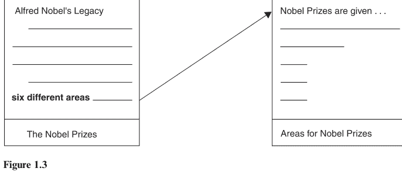

## 万维网

```html
<HTML>
<HEAD>
<TITLE> Areas for Nobel Prizes </TITLE>
</HEAD>
<BODY>
Nobel Prizes are given for outstanding contributions in these areas:
<UL>
<LI> Physics
<LI> Chemistry
<LI> Physiology or Medicine
<LI> Literature
<LI> Peace
<LI> Economic Science
</UL>
<A HREF = "nobelinfo.html"> Return to main. </A>
</BODY>
</HTML>
```

图 1.4 显示了两个页面在安装链接后的样子。你应该输入它们，确保链接能够让你正确地在两个页面之间跳转。

这是一个不错的结果。但更仔细一想，这远不止不错；这是一个不可思议的、令人惊叹的、改变世界的发现。这两个页面构成了一个网络——一个小的网络，但仍然是一个网络。万维网就是这样开始的。几年前，我们制作的这种页面中有两个被链接在了一起。然后各种人添加了更多页面，然后更多。现在有数千万的人和页面都通过我们展示的方式连接在一起，他们正在以我们在第一部分讨论的方式改变世界。

| nobelinfo.html | nobelareas.html |
| --- | --- |
| - Alfred Nobel's Legacy | - Nobel Prizes are given... |
| - six different areas | - Return to main. |
| - The Nobel Prizes | - Areas for Nobel Prizes |

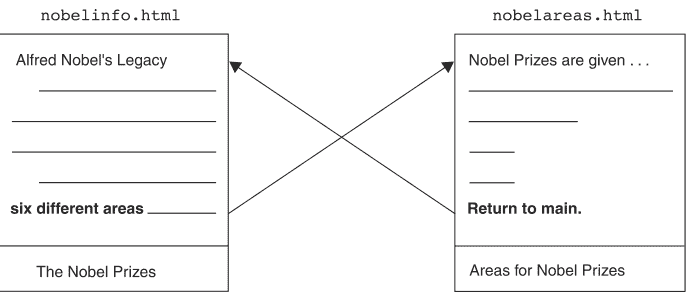

返回主页。

## 第 1 章

我们还可以对页面进行另一项更改；我们可以放入一个远程站点的地址。为什么不启用户能够点击“Nobel Foundation”这几个词，就能看到位于瑞典斯德哥尔摩的诺贝尔奖基金会的主页（*主页*）呢？用户不仅将能够看到我们的页面，而且还将有一种便捷的方式跳转到原始组织准备的源文档。所以这里是第一个页面的另一个 HTML 版本：

```html
<HTML>
<HEAD>
<TITLE> The Nobel Prizes </TITLE>
</HEAD>
<BODY>
<H1> Alfred Nobel's Legacy </H1>
<P> Alfred Nobel, a nineteenth-century industrialist, died
in 1896 and left a will establishing the <A HREF =
"www.nobel.se"> Nobel Foundation </A>. This organization
has been awarding, since 1901, annual prizes for
outstanding accomplishments to scholars, literary figures,
and humanistic leaders. </P>
<P> The Nobel Prizes are currently given for contributions
in <A HREF = "nobelareas.html"> six different areas </A> of endeavor.
</P>
</BODY>
</HTML>
```

图 1.5 显示了两个带有已安装链接的页面的符号表示。

突然之间，我们的玩具课堂网络跃升到了巨型规模，因为诺贝尔奖基金会的页面有大量额外的链接供用户跟随。以这种方式相互链接的大量页面构成了一个*超文本*；科学家们已经研究了这种实体多年。可以从任何页面到任何其他页面拥有任意数量的链接。这与书籍的标准概念形成对比，后者将其所有页面按简单的顺序排列。这两种组织页面形式的心理学、艺术学和教育学影响仍有待研究。

作为附加功能，如果你将它们放在 `public_html` 目录中，并且你的计算机连接到互联网服务器，我们创建的页面可以被互联网上的任何人访问。任何人所需要做的就是使用浏览器并进入你的*主页地址*，在地址末尾加上 `/nobelinfo.html`。例如，Biermann 的网页地址是 `http://www.cs.duke.edu/~awb`，诺贝尔奖信息页面可以通过在任何联网浏览器中输入 `http://www.cs.duke.edu/~awb/nobelinfo.html` 来引用。（请记住，文件 `nobelinfo.html` 是输入到 `public_html` 目录中的，以便浏览器能够找到它。）

## 万维网

为了让这些指向远方页面的链接真正生效，解释 HTML 并显示文本的浏览器必须具备一个尚未讨论的功能。如果有一个 `HREF` 指向另一个页面，浏览器必须能够跟随该地址并获取要显示的 HTML 文档。这种地址跟随能力相当复杂，因为它必须通过网络向远程计算机发送请求并执行检索。浏览器必须具备一系列功能才能使此类引用成功。这里不再进一步讨论它们。我们只承认它们存在，它们很复杂，而且浏览器必须拥有它们。

本书的这一雄心勃勃的部分到此结束。我们考察了一个单独的页面以及如何用普通浏览器显示它。我们展示了如何在页面之间构建链接并构建一个网络。最后，我们将我们的网络连接到万维网，从而将自己连接到正在改变世界的巨龙。

## 练习题

1. 你认为人类历史上最重要的三个事件是什么？证明你的答案。
2. 说出一种（如果你能的话）在未来几年内*不会*受到万维网影响的商业类型。证明你的答案。
3. 输入本节中显示的页面，并用浏览器查看它们。
4. 本节中的第一个 HTML 页面有三种不同类型的标题。解释每一种、它的功能以及它在显示中的位置：诺贝尔奖、阿尔弗雷德·诺贝尔的遗产，以及 `nobelinfo.html`。
5. 使用 HTML 为自己创建一个主页，告诉世界你想让世界了解你的主要事情。让朋友从另一台计算机上查看你的网页，以确保地址约定正在工作，并且你的页面确实在 Web 上。
6. 谁获得了 1982 年的诺贝尔经济学奖？这个奖项首次颁发是在哪一年？你应该能够通过跟随本节创建的诺贝尔奖页面上的链接来回答这些问题。

## 更多 HTML

本节描述了 HTML 的一些更多功能。读者应该查阅标准参考资料以获取该语言及其许多功能的完整描述。（本节大部分遵循 *A Beginner's Guide to HTML*，如 `http://www.ncsa.uiuc.edu/General/Internet/WWW/HTMLPrimer.html` 所示。）

除了已经描述的无序列表（`UL`）之外，HTML 还允许对列表项进行编号。这是通过 `<OL>` 标签以预期的方式完成的：

```html
<OL>
<LI> Physics
<LI> Chemistry
<LI> Economics
</OL>
```

这将在网页上显示为编号列表：

1. Physics
2. Chemistry
3. Economics

列表的另一个特征是它们可以嵌套。因此，可以有列表的列表。我们将这个想法的探索留给练习题。

可以使用 `<DL>` 标签创建定义列表，如下所示：

```html
<DL>
<DT> HTML
<DD> Hyper Text Markup Language
<DT> WWW
<DD> World Wide Web
</DL>
```

这将在网页上产生一个两列列表：

| HTML | Hyper Text Markup Language |
| --- | --- |
| WWW | World Wide Web |

在前一节中，`<H1>` 用于为文本部分创建标题。HTML 还有额外的标签 `<H2>`、`<H3>`、…、`<H6>`，它们创建依次更低级别的标题。因此，如果我们想为关于 HTML 列表的网页写一个部分，其中包含关于无序列表和有序列表的小节，我们可以输入：

```html
<H1> Lists </H1>
<P> There are two types of lists, unordered lists and
    ordered lists. </P>
<H2> Unordered Lists </H2>
<P> Unordered lists have the properties that ... </P>
<H2> Ordered Lists </H2>
<P> Ordered lists are also quite useful ... </P>
```

这将在网页上显示为：

## Lists

There are two types of lists, unordered lists and ordered lists.

### Unordered Lists

Unordered lists have the properties that …

### Ordered Lists

Ordered lists are also quite useful …

要使单词变为粗体或斜体，请使用 `<B>` 或 `<I>`。

假设你想输入某些内容，并保证你使用的字符和间距将显示在网页上。你可以使用标签 `<PRE>` 来做到这一点。因此，HTML：

```html
<PRE>
     H   H    I
     H   H    I
     HHHHH    I
     H   H    I
     H   H    I
</PRE>
```

将在网页上显示为：

```text
     H   H    I
     H   H    I
     HHHHH    I
     H   H    I
     H   H    I
```

如果你想放入一条水平线，请尝试 `<HR>`。你可以在此标签上添加参数，如 `<HR SIZE=4 WIDTH="50%">`，这意味着使用大小为 4 的线条，并且只覆盖窗口宽度的 50%。

万维网的寻址方案使用所谓的*统一资源定位符*（URLs）。这些地址的格式为：

`scheme://host.domain[:port]/path/filename`

其中 `scheme` 是以下之一：

- `file` — 你本地系统上的文件
- `ftp` — 匿名 ftp 服务器上的文件
- `http` — 万维网服务器上的文件
- `gopher` — Gopher 服务器上的文件
- `WAIS` — WAIS 服务器上的文件
- `news` — USENET 新闻组
- `telnet` — 基于 telnet 的服务的连接

`port` 号通常被省略，其他部分必须指定为地址的关键段。

你可以通过将图像以标准格式存储在 URL 地址上，然后使用 `` 将图像（如你自己的照片）包含在网页上，其中 `ImageName` 是图像文件的 URL。你需要查阅标准手册以了解如何执行此操作的详细信息。

HTML 还提供了许多其他功能，例如创建表格的能力。如果格式正确，系统将创建一个表格，并按照你指定的方式放入所有条目。你还可以要求用户填写表单，然后收集人们可能输入并发送给你的信息。

对于任何学习 HTML 的人来说，一个有趣的练习是检查其他人创建的网页，看看他们是如何格式化它们的。你可以通过在 Web 上找到感兴趣的页面，然后点击浏览器的查看菜单项来查看创建该页面的实际 HTML。例如，如果你访问 Biermann 的网页并点击查看，你会得到：

```html
<HEAD>
<TITLE>Alan W. Biermann</TITLE>
</HEAD>
<BODY><P>
<HR>
<A NAME=tex2html1 HREF=sectionstar3_1.html>
</A><BR>
<B>Next:</B>
<A NAME=tex2html2 HREF=sectionstar3_1.html>
EDUCATION</A><HR>
```

以及更多内容。

## 练习题

1. 创建一个或多个使用本节描述的所有功能的网页。使用标准浏览器查看你的页面，以确保你的文本格式符合预期。
2. 在 Web 上找到一本标准的 HTML 参考手册，阅读有关格式化表格的内容。使用此功能将表格放入你的某个页面中。

## 我们热爱 HTML，但是……

本书不打算在 HTML 上花费更多时间。阅读本章后，你可能再也不会看到太多 HTML 了。我们学习 HTML 不是因为你将大量使用它，而是因为你没有学习过 HTML 就无法理解万维网是什么。但一旦你理解了两者，你就可以进入我们计算机科学和网络课程的下一个层次。许多人通过 HTML 编程赚了很多钱，但这不是我们在这里的目标。

事实上，你可能能够通过使用旨在自动执行此操作的程序来创建你需要的所有 HTML。如果你想做一项标准工作，例如创建个人网页，你可以使用一个程序，它会问你一系列问题，然后合成所需的 HTML。或者你可以使用 Microsoft Word 等编辑器来输入你的文档，只需选择 `Save as Web Page` 选项即可创建你的 HTML 命令。

## 练习题

1. 调用一个将自动创建 HTML 代码的程序，并使用它来创建一个网页而无需编写任何 HTML。然后研究它自动创建的 HTML 代码。
2. 使用 Microsoft Word 创建一个文档，并让它自动生成你的 HTML。

## 总结

观察到万维网正在实现的许多生活方式和能力的变化，我们怀疑人类正在进入一个新的时代。无法预测未来几年可能会出现什么奇妙的事物和什么新的危险。但当然，我们明智地尝试理解万维网，以便我们能够从其优势中获利并保护自己免受其危险。本章通过展示如何创建一个简单的两页网页以及如何使其成为 WWW 的一部分，为这种理解提供了基础。


我们学习了 HTML 的基础知识以及使用浏览器查看 HTML 页面。在下一章中，我们将了解到 HTML 只是对真正可以完成的事情的幼儿园级别的介绍。除了在屏幕上简单显示页面之外，我们可能希望看到页面上有很多动作。也许我们希望页面提出问题并回应答案。或者我们可能希望页面有可按下的按钮来激活某种动作。我们可能希望页面计算一些有用的数字或显示小卡通人物。所有这些以及更多都可以用编程语言`Java`来完成，正如你将在下一章中看到的那样。

> 啊！我看到一步将死，77步杀！

# 2 注意：Java 来了

## 让我们为网页增添一些活力

在第 1 章中，我们学习了如何创建网页并将它们与万维网上的其他页面链接起来。现在我们想为这些页面增添一些活力。我们希望它们能跳动起来、闪烁鲜艳的色彩、计算复杂的事物。`Java`是一种编程语言，它将使我们能够做到所有这些以及更多。

作为第一个例子，假设我们希望修改我们的诺贝尔奖网页，让用户可以就查找一些关于诺贝尔奖得主的特别有趣的故事寻求建议。我们假定用户会阅读主页面，并在该页面底部放置一个问题，用户可以通过点击按钮来作答。这个问题将是"你想了解一位科学家吗？"用户将能够点击相应的按钮，"是"或"否"，然后一个新的问题将出现。通过回答这一系列问题，用户将获得所需的建议。以下是诺贝尔奖页面添加了所需更改后的版本：

```html
<HTML>
<HEAD>
<TITLE> 诺贝尔奖 </TITLE>
</HEAD>
<BODY>
<H1> 阿尔弗雷德·诺贝尔的遗产 <H1/>
<P> 阿尔弗雷德·诺贝尔，一位十九世纪的实业家，于
1896 年去世，并留下遗嘱建立了<A REF =
"www.nobel.se"> 诺贝尔基金会</A>。该组织自
1901 年以来，一直在向学者、文学界人士
和人道主义领袖颁发年度奖项，以表彰他们的杰出成就。 </P>
```

```html
<P> 诺贝尔奖目前授予在<A REF = "nobelareas.html"> 六个不同领域 </A>作出贡献的人士。 </P>

<P> 如果你想阅读关于一位获奖者的特别有趣的故事，你应该回答下面的问题以获得建议。然后在诺贝尔基金会的网页上查找被推荐的人物。 </P>
```

```html
<APPLET code = "StoryAdvice.class"> </APPLET>
</BODY>
</HTML>
```

当网页浏览器呈现此页面时，HTML 代码将使其跳转到步骤

```html
<APPLET code = "StoryAdvice.class">
```

并执行一个称为*小程序*的程序，它将完成提问、在屏幕上放置按钮以及响应按钮点击的工作。以下是页面的显示方式，假设 Java 小程序已经 serm 仔细编写、放置在 HTML 文件相同的目录中，并命名为`StoryAdvice.class`。

## 阿尔弗雷德·诺贝尔的遗产

阿尔弗雷德·诺贝尔，一位十九世纪的实业家，于 1896 年去世，并留下遗嘱建立了**诺贝尔基金会**。该组织自 1901 年以来，一直在向学者、文学界人士和人道主义领袖颁发年度奖项，以表彰他们的杰出成就。

诺贝尔奖目前授予在**六个不同领域**作出贡献的人士。

如果你想阅读关于一位获奖者的特别有趣的故事，你应该回答下面的问题以获得建议。然后在诺贝尔基金会的网页上查找被推荐的人物。

你想了解一位科学家吗？

[ 是 ] [ 否 ]

建议：

假设用户点击了"是"按钮。然后会问一个新的问题："你想了解阿尔伯特·爱因斯坦吗？"用户将能够再次回答。问题将继续，直到程序到达合适的点来给出建议。因此，如果用户表示对科学家感兴趣，并对关于爱因斯坦的建议回答"是"，程序可能会回应说爱因斯坦于 1921 年获得诺贝尔物理学奖，诺贝尔基金会网站上有他的简要传记。

关键在于，HTML 代码可以调用计算机程序，该程序可以被设计成执行几乎任何我们能想象的过程。因此，我们现在将精力转向计算机编程的问题——它是什么以及如何做。这正是本章以及随后几章的主题。

## 大事：计算机编程

在计算机出现以前的旧时代，如果我们想完成一项工作，我们必须*亲自*去做。但有了计算机，我们可以通过简单地写下要做什么来完成许多工作。机器可以完成这项工作。如果我们想进行数字相加、搜索事实、在网页上闪烁鲜艳的色彩、格式化并打印文档、向同事分发消息或做其他任务，我们可以写一个关于要做什么的配方，然后走开，让一台机器服从并不知疲倦地执行我们的指令。我们的配方可以分发给许多计算机，它们可以一起工作来执行我们的指令。即使我们从这个世界退休了，计算机仍可能被雇用做同样的工作，遵循我们制定的命令。

当然，我们正在讨论的配方将被编码为*程序*。编写和准备它们的过程称为*编程*，它实现了一种正在彻底改变人类社会的"工作放大"。编程使一个人能够完成有限量的工作——准备计算机程序——并在计算机的帮助下，获得无限数量的结果。因此，生产力不再仅仅是工作人数的函数；它是工作人数和工作的机器数量的函数。

还有更好的消息：计算机相对便宜，而且购买成本持续下降。四十年前，具有 64,000 字内存和 1 微秒指令时间的机器售价为 100 万美元。现在我们可以花大约 1000 美元购买一台内存和速度大约是一千倍的机器。只需一个劳动者一个月的工资，我们就可以购买一台在某些任务上焊接比一千人一起工作更快的机器。

## 面向对象编程

要充分利用这一明显的宝藏，我们需要学习编程。但我们不仅要编程，还要编好程，这导致了一系列我们在本书中考虑的问题。具体来说，我们要确保我们的程序是正确的，并且我们能够验证这一点。其次，它们应该易于修改和升级以提供更多功能。最后，它们应该是可重用的，无论是单独使用，还是作为更大、更雄心勃勃的程序的组件。（烹饪配方也有这样的特性。例如，它们通常以家庭份量为单位指定，而不是以招待人群的份量。它们以易于使用的单位指定，例如，几杯面粉而不是几克面粉。）

经验引导我们走向一种称为*面向对象编程*的程序组织方式。在这种范式中，问题及其解决方案以称为*类*的实体来封装。

一个类既包含称为*数据*的信息，也包含功能。让我们以家中或教堂中可能找到的管风琴作为类比。管风琴通常具有定义音色的设置或音栓。这些设置就是该管风琴的数据。其他数据包括音量设置、哪些键被按下等等。如果我们拥有同一品牌的同一型号管风琴，并且复制所有数据——设置、按下的键和音量——我们应该得到相同的声音。现代电子管风琴甚至可能能够存储音乐并自动演奏完整的曲子。存储的音乐就是更多的数据。

管风琴的功能体现在它能做什么。如果我们按下一例键，例如中央 C，我们期望管风琴发出该音高的声音，其音色由各种设置指定。对于带有存储音乐的管风琴，"播放选择 3"可能是一个功能，播放 J. S. 巴赫的《D 小调托卡塔与赋格》。

因此，我们的目标是将程序组织成类，其中每个类通常既有数据又有功能。类中的功能称为*方法*。因此，在一个模拟管风琴的程序中，我们会创建一个`Organ`类，其中包含几个方法。这些方法可能包括使音符播放的方法`PlayNote()`。一个有用的程序还需要指定和弦、声音持续时间等的方法。它还应该有播放已存储选段、获取新选段、删除旧选段（内存是有限的）以及改变音栓和音量的方法。方法的名称可以被认为是语言中的动词。因此，在管风琴上播放一个音符的动作将由动词`PlayNote`指定。

以下是这个类使用 Java 约定进行指定的大致概念：

```java
public class Organ
{
    Data Keys, Stops, Other;

    public void PlayNote(P x)
    {
        Java code
    }
}
```

```java
public void SetStop(P x)
{
    Java code
}
etc.
}
```

另一个类比可能是割草机。这里的数据包括：位置、方向、是否运行（真/假）、燃油量、机油量和油门设置。一些方法有：启动引擎、关闭引擎、设置速度、前进、后退、左转和右转。使用割草机的过程可能涉及执行其中一些动词（方法）。可以更详细些，但这足以说明割草机类：

```java
public class LawnMower
{
    Data Location, Direction, IsRunning, ... ;

    public void StartEngine()
    {
        Java code
    }
    public void StopEngine()
    {
        Java code
    }
    etc.
}
```

## 练习

1. 选取某个具有一定复杂度的对象，为其设计一个类。注意它应同时包含数据和功能。
2. 数据和函数名可能并不专属于某个特定类。想 Novel example 想出一个既适合电子琴又适合割草机的数据项。
3. 为什么像`print`或`report`这样的方法对几乎任何你能想到的类都有用？

## Java 编程语言

我们的编程示例和练习使用`Java`编程语言。这种语言相对容易学习，并且嵌入在一个软件系统中，使学生能够链接到许多其他程序。因此，它提供了一条通向丰富编程环境的途径，人们可以在这个环境中长期成长和发展。由于 Java 是面向对象的，它体现了计算机科学家目前推荐的范式，并且它教授了许多在其他面向对象语言中编程所需的概念。Java 还专门设计用于在网络环境中运行。

我们将不以通常的方式学习编程，即学习编程语言的大量细节。例如，我们不会提及所有关于分号和逗号放置的规则、每种语言结构的最一般形式、变量名允许的字符数，或数字和字符串长度的最大允许值。我们将在阅读和编写简单程序的同时，尽可能少地受到语法精确性和百科全书式完整性的困扰。

我们将只使用 Java 的一小部分特性，以便将语言学习任务控制在可管理范围内。如果全部学习 Java，就没有时间来研究本书的中心主题：计算机科学的伟大思想。由于这里只给出了足够的细节，使读者能够理解示例程序并编写类似的练习程序，那些想编写更雄心勃勃的程序的人建议手边备有 Java 手册以供参考。

如果我们要学习编程，我们必须编程一些内容。。

编写程序，使其同时具有教育意义且易于理解，这些程序应体现一些有用的信息处理结构。本书的第一个编程领域因此是*决策树*。决策树可用于对对象进行分类、对人员进行访谈以及许多其他任务。决策树程序的一个例子是诺贝尔奖页面底部的建议小程序。我们将研究决策树以及如何为它们编写程序。

## 决策树

假设我们希望向用户推荐她可能喜欢阅读的诺贝尔奖得主。做出推荐决定的一个好方法是向用户提出一系列问题。我们可能要问的第一个问题是她是否想阅读关于科学家的内容。我们提出问题，然后用箭头指示下一个问题的方向（图 2.1）。然后，根据第一个答案，我们决定接下来应该问什么问题（图 2.2）。

假设在问了两个问题之后，可以做出适当的推荐。那么决策树可以如图 2.3 所示完成。

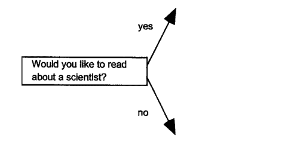

图 2.1

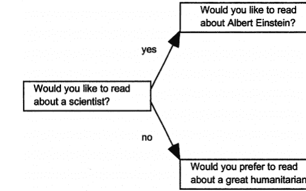

图 2.2

通过决策树，我们可以追踪一个示例交互。假设用户对人文主义者感兴趣，通过树的路径如下：

寻求有趣故事的建议

决策树问题：您想阅读关于科学家的内容吗？

回答：否

决策树问题：您更愿意阅读关于伟大的人文主义者的内容吗？

回答：是

决策树建议：您可能对昂山素季感兴趣，她于1991年获得了和平奖。

这棵树在做出决定之前只问了两个顺序问题。但很容易想象一棵大树，它问很多问题，并在路径尽头推荐各种各样的故事。同样清楚的是，这种类型的树可以用于就几乎任何主题提供建议，从医疗治疗到算命。图 2.4 显示了一个医疗建议决策树的例子。

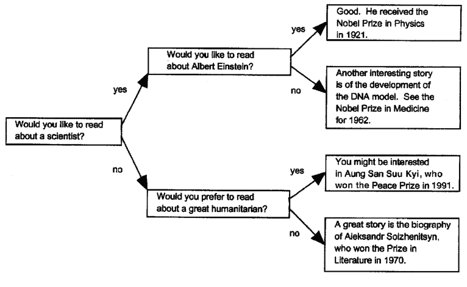

图 2.3

另一个例子是博弈树。这可以用简单的尼姆游戏来说明，该游戏有以下规则。第一个玩家可以在水平梯子的左端放置一个、两个或三个 X；然后对手可以在接下来的连续方格中放置一个、两个或三个 O。这一连串的走法反复重复，从左到右填满梯子，赢家是在最后一个方格中放置标记的人。一个七格梯子的例子如图 2.5 所示。第一个玩家可能放置三个 X（图 2.5b）。然后，假设第二个玩家放置两个 O（图 2.5c）。第一个玩家可以通过再放置两个 X 来获胜（图 2.5d）。图 2.6 显示omin length 7.

通常我们认为树是从地面长出，向天空伸展枝条的。本章中的树从左向右移动，以便更容易编程。树的处理从最左边的方框，或*根节点*开始，沿着一条路径向右进行。在每个决策*节点*，树的使用者被问到一个问题，给出的答案用于选择要遵循的下一个分支。路径向右进行，直到遇到没有向外分支的最终*叶节点*。这个叶节点将包含一条消息，给出决策序列的结果，并终止处理。

此类决策树适用于众多信息处理任务，包括建议提供、分类、指导和博弈活动。本章的任务是编写包含此类树的程序，引导用户沿着正确的`paths`前进，并打印结果。设计和编程此类树的能力是一种强大的技能，具有许多应用。

### 现实检验

关于决策树的讨论展示了编程某些类型问题所需分析的重要部分。请注意，这不需要提及计算机或编程语言。一个含义是，计算机编程的大部分实际上是解决问题，即分析问题和规划出系统化的解决方案。计算机只在程序员理解了问题的解决方案之后才介入。

既然我们已经解释了决策树，我们就准备好着手实际编写程序了。这需要一些计算机语言的知识和理解，在本例中是`Java`。在我们能够用 Java 程序实现决策树之前，我们必须做一些认真的准备工作。

## 练习

1. 设计一个决策树，可能帮助某人挑选新车。
2. 对于您见过或能想到的任何合理的决策树，叶节点的数量与其他（问题）节点的数量相比如何？
3. 设计一个决策树，帮助新生选择您专业领域的课程或您特别感兴趣的领域的课程。

## 编程入门

*计算机程序*是计算机可以执行的一系列命令列表。它是机器要执行的动作的配方，必须用计算机能理解的语言编写。本书中的大多数程序都是用`Java`编写的，这是 Sun Microsystems 开发的一种令人兴奋的语言。有时程序或程序的一部分被称为计算机*代码*。我们在本书中使用这两个术语。

这里有一个用 Java 编写的示例程序。它采用 applet 形式：意思是它要从网页使用 Web 浏览器运行。它可以添加到我们第一章编写的 Web 主页中，方法是将其放在地址`HelloWorld.java`，按照描述进行编译，并在诺贝尔奖网页的 HTML 文本中的适当位置放置`<APPLET code = "HelloWorld.class">`。

```java
import java.awt.*;

public class HelloWorld extends java.applet.Applet
{
    TextField m1,m2;

    public void init()
    {
        m1 = new TextField(60);
        m2 = new TextField(60);
```

## 第2章

```java
m1.setText("Hello World!");
m2.setText("This is a simple Java test.");
add(m1);
add(m2);
}
```

这个小程序做了什么？它在网页上显示以下文本（文本会出现在屏幕上的矩形框内）：

```text
Hello World!
```

This is a simple Java test.

让计算机执行程序中的指令被称为*运行*或*执行*该程序。只有在你首先将 Java 翻译成可执行形式后，程序才能在你的计算机上运行。这种翻译被称为*编译*，可以通过调用称为*编译器*的 Java 翻译器来完成。进行翻译的常用方法是使用命令`javac`，但你的机器可能有不同的方式。因此，对于我们的示例代码，我们必须输入：

```bash
javac HelloWorld.java
```

结果会生成一个名为`HelloWorld.class`的文件，该文件会自动出现在你的当前目录中，推测是你的`public_html`目录。这就是你的 HTML 页面中浏览器执行的文件。我们将在第9章详细研究编译。

我们在这里使用的是 Java 1.1 版本，但更高版本的 Java 应该是兼容的。然而，如果你的浏览器只处理早期版本的 Java，这里显示的代码可能无法工作。为了妥善应对版本（或“方言”）和编译器的问题，你可能需要寻求一些帮助来适应你的具体情况。计算机科学像许多学科一样，有口述传统，一些最重要的事实仅通过口耳相传。你也许可以在没有这种帮助的情况下应付，但如果能找到，学习通常会更容易、更有趣。

为了从本章中获得最大收益，你应该输入并运行这里给出的一些程序，并观察它们的行为。例如，我们已经告诉了你前面的例子运行时会打印什么。试试这个程序，看看你是否能让事情以相同的方式工作。

这个程序看起来非常简单，但许多与它的形式和执行相关的细节需要理解。这些包括程序的语句组成、语句的执行顺序以及它们的意义和结构。我们将详细讲解这些内容。然而，看看程序及其产生的输出。你可能可以猜到程序需要做出哪些更改才能打印

## Java来了

祝你今天愉快！

我的名字是辛西娅。

## 练习

1. 运用你的猜测，修改示例程序以打印三行消息。

## 程序形式与语句细节

程序的主要部分是一个类语句以及类中包含的数据和方法的声明。

```java
public class 类名
{
    数据声明
    方法声明
}
```

类语句包括一个标题，包含`class`这个词，后跟下一行的左花括号`{`。随后是数据和方法的声明，最后是一个匹配的右花括号`}`。

类语句包含一些重要的词汇，现在不解释。只需在编写 Java 程序时使用它们：

```java
public class HelloWorld extends java.applet.Applet
```

需要注意的一个重要事情是，类语句包含了我们为这个程序选择的类名`HelloWorld`。这将因程序而异，由程序员选择。其余的词汇在程序之间将非常相似，只需按显示的顺序复制即可。另一个重要的点是，标题通过`extends java.applet.Applet`使该程序成为一个小程序。如前所述，这使其适合在 Web 浏览器中使用。

在左花括号之后，我们看到声明数据项`m1`和`m2`的语句：

```java
TextField m1,m2;
```


该语句表示`m1`和`m2`是`TextField`类型的对象。`TextField`本身是一个类，已随Java语言提供给我们。它显示屏幕上的矩形，可以包含文本。我们在这里表示我们需要两个`TextField`类的数据项，并将它们命名为`m1`和`m2`。请注意，这个语句与大多数Java语句一样，以分号结束。

在类的数据部分之后，我们看到我们唯一方法的定义。该方法有自己的标题：

```java
public void init()
```

这里的关键点是该方法被命名为`init`（每个小程序必须有一个名为`init`的方法，代表“初始化”）。通常程序员可以选择要编写的方法的名称，但这个方法是必需的。该方法的主体被包含在左花括号和右花括号中，就像整个类的主体一样。

我们的方法声明以以下语句开始：

```java
m1 = new TextField(60);
m2 = new TextField(60);
```

这实际上创建了我们声明的`TextField`数据对象`m1`和`m2`。`new`关键字导致对象被创建。括号中的`60`表示将字段设置得足够大以容纳60个字符。

以下几行：

```java
m1.setText("H e l l o     W o r l d !");
m2.setText("This is a simple Java test.");
```

使用`TextField`类的`setText`方法将实际文本放入`TextField`中。文本用引号括起来，将完全按输入显示。在Java中，通常空格的数量并不重要。在引号内，每个空格都有意义。请注意，这些行中的第一行`m1.`表明`setText`应用于`m1`，而不是`m2`。类似地，`m2.`标识了`TextField m2`。

`对象.动词(数据)`语法在Java程序中无处不在，因此你应该对此感到熟悉。它意味着使用数据对对象执行动词所说的操作。回到风琴的例子，假设声明了两个风琴`or1`和`or2`。假设方法`PlayNote`需要一个数据，即要播放的音符。以下是一系列Java命令，将在两个风琴上播放一些音符：

```java
or1.PlayNote("C");
or1.PlayNote("D");
or1.PlayNote("E");
or2.PlayNote("A");
or1.PlayNote("F");
```

这个序列将在第一个风琴`or1`上播放三个连续的音符，在`or2`上播放一个音符，然后在`or1`上播放最后一个音符。请注意，动词必须适用于（为）被调用的对象定义。因此，我们不会期望从以下内容中得到任何有意义的结果：

```java
or1.StartEngine();
```

因为动词`StartEngine`是为割草机定义的，而不是为风琴定义的。

如果我们完成了所有这些工作却从未看到`TextField`，那我们的程序将是一个巨大的失望。我们必须告诉系统将它们放在屏幕上，以便我们能看到它们。最后两个语句就是做这个的。然而，这些语句没有说明将两个`TextField`放在哪里。它们将显示为两个可以包含文本的长矩形（在这个例子中，每个最多可包含60个字符。）`add`语句只给出了放置`TextField`的最基本指令。我们指定`m1`应该先出现，然后是`m2`。请注意，这仍然给浏览器留下了很大的自由，很多取决于显示屏幕有多大。使用`add`我们只能指定放置的顺序，从左到右、从上到下，就像在纸上书写英文文本一样。（Java有更详细的方法来控制屏幕上对象的布局。这些方法相当复杂，因此本书大部分都省略了。）

我们示例Java程序的第一行：

```java
import java.awt.*;
```

告诉系统我们期望包含几个可选的Java功能。目前，只需按指定使用。

## 练习

1. 示例Java程序之后的显示表明，在典型的浏览器中，程序的输出可能是什么样子。在超宽的浏览器窗口中会是什么样子？
2. 如果`add`语句的顺序反过来，会是什么样子？

## 程序执行

计算机通过按顺序执行语句来工作。它首先找到`init`方法，并在其中执行第一条语句，第二条，依此类推。除非有特殊语句要求它做其他事情，否则它总是按顺序执行语句。在我们的示例程序执行完第二个`add`语句后，程序就结束了。

## 语句意义与结构

刚刚看完一个简单的Java程序后，我们需要回过头来更详细地研究一些事情。语句

32 第2章

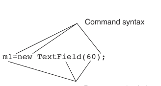

图2.7

```java
m1 = new TextField(60);
```

包含两部分（图2.7）：命令语法，它精确指定了命令所需的字符顺序；以及程序员插入的一些数据或关键字。命令`new`告诉计算机创建名为`m1`的新对象。对象名称后跟等号，再跟命令`new`，然后是对象的种类或类型及详细信息，最后是分号——这些都是使用`new`命令的要求。这种格式就是命令的语法。各项必须严格按该顺序排列，且所有内容必须拼写正确。

有三项内容由程序员选择。第一项是对象名称`m1`。一旦选定，就必须始终一致地使用。对象类型或类，此处为`TextField`，也是程序员的选择，但它是Java提供的唯一能实现我们需求的类。最后，`60`是程序员的选择，用于指定`TextField`的大小。这个`60`本质上是语句的数据。

以下版本的`init`方法由于各种错误而无法正确运行：

```java
public void init()                      // 1
{                                        // 2
    m1 = new TextField("sixty");        // 3
    m2 = new TextField(60);              // 4
    m1.setText("Hello World!");         // 5
    m2.setText("This is a simple Java test."); // 6
    add(m1);                            // 7
    add(m2);                             // 8
}                                        // 9
```

1. 这一行是错误的，因为每个单词都以大写字母开头，而正确的形式应该全部是小写字母。
2. 第二行和第九行是正确的，分别包含开括号和闭括号。
3. 这一行是错误的，因为它用字符串`"sixty"`而不是数字来指定`TextField`的长度，而要求是使用数字。
4. 这一行缺少等号。
5. 这一行在感叹号和闭括号之间缺少闭合的引号。
6. 这一行缺少语句结束的分号。
7. `please`看起来很有礼貌，但在语法上是错误的。
8. 这一行在`m2`周围缺少括号。

大多数编程语言要求完美的语法，尽管少数语言允许一些灵活性。未来的语言可能要求不那么严格。

如果命令语法正确，程序将执行命令，而不管数据内容是什么。因此，以下程序将会运行，但结果可能不如你所愿：

```java
import java.awt.*;

public class HelloWorld extends java.applet.Applet
{
    TextField m1,m2;

    public void init()
    {
        m1 = new TextField(60);
        m2 = new TextField(60);
        m1.setText(batch_size*64+1>=num_samples ?"C#7a-%% qwerty 496");
        m2.setText("Please ignore the nonsense above.");
        add(m2);
        add(m1);
    }
}
```

运行后，我们将得到：

```text
Please ignore the nonsense above.

C#7a-%% qwerty 496
```

它不仅会把我们输入的无意义字符喷出来，而且由于我们颠倒了`add`语句的顺序，程序最后残留的逻辑也被破坏了，因为"above"（上面）现在应该在"below"（下面）了。

webinars机器没有判断数据正确性的依据，会忠实地执行指令，而不关心正在操作的是什么。计算机会精确地执行你的指令，即使那可能不是你想要的结果。

在不改变正确性的前提下，修改正确程序的一种方法是调整其空格。在程序中大多数位置插入空格都不会影响其行为。以下程序与第一个示例程序等价。尽管插入了空行和许多额外的空格，删除了其他空行，并将几行合并为一行，但它仍能完美运行。

```java
import java.awt.*;
public class HelloWorld extends
     java.applet.Applet
{
     TextField    m1, m2;
     public void init()
     { m1  =    new TextField(60);
                m2 = new TextField(60);
       m1.setText("Hello World!"   );

       m2.setText("This is a simple Java test."   );
            add(m2); add(m1); } }
```

你肯定不会想以这种随意的空格来输入程序，因为它的可读性太差。但这个例子确实展示了你在页面上调整内容的完全自由，你可能希望利用这种自由以某种特殊方式格式化代码。

不要在关键字（如`new`、`public`或`add`）中间、名称（如`m1`或`TextField`）中间，或数据（如`60`）中间插入空格。

本节展示了一个打印两行然后停止的计算机程序。仔细理解这段简单代码是理解所有计算机程序的巨大一步。理解程序的形式以及编程语句作为命令基本单元的概念非常重要。每条语句指定一个动作；语句序列指定了动作序列及其执行顺序。每条语句的格式是精确且不可妥协的，除了各部分之间的空格。

以下是一个执行另一项打印任务的程序：

```java
import java.awt.*;

public class SecondCode extends java.applet.Applet
{
    TextField lineA, lineB, lineC;
    public void init ()
    {
```

```java
lineA = new TextField(70);
lineB = new TextField(70);
lineC = new TextField(70);
lineA.setText("***********************************");
lineB.setText("Great Ideas in Computer Science");
lineC.setText("***********************************");
add(lineA);
add(lineB Speechless(lineB);
add(lineC);
}
}
```

你现在应该能够编写一个可以打印几乎任何内容的程序了。

## 练习

1. 如果你要写另一个类似于HelloWorld小应用程序的程序，标题中哪些词需要更改？
2. 如果省略`add`语句，会发生什么情况？
3. 以下语句中存在哪些语法错误？

`m2.setText("My favorite movie is "Star Wars," Episode 4");`

## 交互式程序与按钮

正如你可能从使用Web浏览器、其他程序或电脑游戏中知道的，许多程序是交互式的。也就是说，程序的行为——它具体做什么——取决于你用鼠标做什么或在键盘上输入什么。换句话说，同一个程序并不总是做同样的事情。它做什么取决于你做什么、你提供什么数据、你点击什么等等。一个例子就是我们之前描述的诺贝尔奖故事咨询程序。

操作Web浏览器时最基本的行为之一是用鼠标将光标放在屏幕上显示的按钮上，然后按下鼠标的左侧。这被称为“点击按钮”。你点击哪个按钮会影响浏览器做什么以及向你展示什么。由于这对大多数小应用程序（包括我们的示例）非常重要，下一个编程示例将展示如何创建和使用按钮。

考虑以下简短的驾驶指导模块，一个名为`Traffic Ful会馆Light`的小应用程序。

```java
import java.awt.*;
import java.awt.event.*;
public class TrafficLight extends java.applet.Applet
                    implements ActionListener
{
    TextField m1, m2;
    Button b1, b2, b3;

    public void init()
    {
        m1 = new TextField(80);
        m1.setText("What are you going to do when the light is");
        b1 = new Button("GREEN");
        b2 = new Button("YELLOW");
        b3 = new Button("RED");
        m2 = new TextField(80);
        add(m1);
        add(b1);
        add(b2);
        add(b3);
        add(m2);
        b1.addActionListener(this);
        b2.addActionListener(this);
        b3.addActionListener(this);
    }

    public void actionPerformed(ActionEvent event)
    {
        Object cause = event.getSource();

        if (cause == b1)
        {
            m2.setText("Keep on rolling.");
        }
        if (cause == b2)
        {
            m2.setText("Stop if you can!");
        }
```

图2.8

```java
if (cause == b3)
{
    m2.setText("You must stop.");
}
}
```

图2.8展示了该程序首次运行时应显示的内容。然后，如果你按下`GREEN`按钮，小程序会在下方的`TextField`中显示：

```text
Keep on rolling.
```

如果你按下`YELLOW`按钮，`TextField`中会显示：

```text
Stop if you can!
```

如果你按下`RED`按钮，你会看到：

```text
You must stop.
```

从高层次浏览代码，你会发现我们现在有了第二个方法。此前我们只有`init`。对于交互式小程序，我们需要一个名为`actionPerformed`的方法。每当用鼠标按下屏幕上的按钮时，这个新方法就会被执行。

在追踪程序其余部分的变化和新增内容之前，让我们详细看看这个新方法。方法头

```java
public void actionPerformed(ActionEvent event)
```

是必需的，在后续程序中我们将原样使用。方法体用大括号括起来，以

```java
Object cause = event.getSource();
```

这条语句开头。该语句将导致此方法执行的对象的标识赋值给变量`cause`。在本例中，它告诉我们按下了三个按钮中的哪一个。方法的其余行利用这一信息将正确的消息放入`TextField`中：

```java
if (cause == b1)
{
    m2.setText("Keep on rolling.");
}
if (cause == b2)
{
    m2.setText("Stop if you can!");
}
if (cause == b3)
{
    m2.setText("You must stop.");
}
```

我们稍后会详细介绍这种语句，但仔细看看你应该会觉得这是合理的：如果按下按钮`b2`，即`YELLOW`按钮，消息`Stop if you can!`就会被放入`TextField m2`中。

让我们回到`init`方法，看看那里有什么变化。三个`Button`和两个`TextField`的设置与我们的第一个程序相同：

```java
m1 = new TextField(80);
m1.setText("What are you going to do when the light is");
b1 = new Button("GREEN");
b2 = new Button("YELLOW");
b3 = new Button("RED");
m2 = new TextField(80);
```

然后使用五个`add`语句将它们定位在屏幕上：

```java
add(m1);
add(b1);
add(b2);
add(b3);
add(m2);
```

它们告诉浏览器首先显示`TextField m1`，然后在其后显示三个`Button`：`b1`、`b2`和`b3`。注意这三个按钮被编码为分别显示`GREEN`、`YELLOW`和`RED`。`add`系列中的最后是`TextField m2`。

编写交互式小程序时，`init`方法中完全新增的是以下代码序列：

```java
b1.addActionListener(this);
b2.addActionListener(this);
b3.addActionListener(this);
```

这些代码使用`Button`类的`addActionListener`方法注册这三个按钮，以便执行中的小程序监视它们何时被按下。如果程序中有其他按钮但没有像这样注册，那么按下那些其他按钮将不会产生任何效果。


原始程序还有另外两处修改需要提及。类头：

```java
public class TrafficLight extends java.applet.Applet
                        implements ActionListener
```

现在在末尾包含了 `implements ActionListener`。这告诉 Java 这个类将直接处理动作。（这也可以在一个独立的类中处理。对于更复杂的程序，这可能是可取的。）此外，我们必须在接近开头处添加一行：

```java
import java.awt.event.*;
```

这告诉 Java 我们需要使用该语言的交互功能。

## 不要惊慌

我们已经相当详细地研究了两种 Java 程序，而没有试图解释一切。即便如此，语法和细节的数量可能让人感到不知所措。这里重要的是你要理解大致的轮廓。即使是经验丰富的程序员，在处理新语言时，也会从之前的程序中原样复制整段代码，然后进行少量选定的改动来“弯曲”程序以满足他们的需求。

编写你的第一批 Java 程序时，最好从一个几乎能做你想要做的事情的示例开始。在不进行任何修改的情况下让示例程序运行起来。只有当示例按预期工作时才进行修改。这将确保你已经正确地复制了所有内容。

稍后，我们会解释更多我们略过的项目，你会逐渐习惯使用一些 Java 特性。事情会变得比现在舒适得多。

## 练习

1. 如果我们省略以下行，`TrafficLight` 程序会如何表现？

   ```java
   b2.addActionListener(this);
   ```

2. 编写一个 Java 程序，回答关于你所选国家的问题；它应该问：“关于*此处为国家名称*你想了解什么？”然后它应该有标有“人口”、“总面积”等的按钮。当用户按下其中一个按钮时，答案将显示在提供的 `TextField` 中。

## 读取和存储数据

在上一节中，我们介绍了**数据**的概念——程序正在操作的信息。我们还展示了如何设置按钮来选择我们要打印的数据。到目前为止，数据的例子以文本字符串的形式出现，如 `"Hello World"` 和 `"Stop if you can!"`。你可能想过程序是否只能打印由程序员放入程序中的数据。答案是否定的；程序员不必预先设想程序可能想要打印的所有数据并将其包含在代码中。

在本节中，我们展示如何让你的程序从键盘收集此类数据：它将读取键入输入的按键，并将数据存储在计算机内存中。这可能是使程序具有交互性的重要部分。

在介绍读取数据的新语句之前，有必要谈谈内存中的位置。这类位置就像信箱或带有名称的容器，信息可以存储在其中，然后在需要时检索。例如，你可能希望在内存中有一个可以存储字符序列的地方，你可以选择将其命名为 `position1`。然后你可以在该位置存储数据，并以各种方式使用数据。你可以指示机器将数据写入 `position1`，或者将数据从 `position星人` 复制到其他位置。

在 Java 语言中，表示要设置这样一个内存位置的正确方式是使用*声明*。要存储我们称为*字符串*的字符集合，该声明的形式为：

```java
String position1;
```

该声明告诉机器在内存中设置一个名为 `position1` 的位置，用于保存字符串。该声明必须在我们尝试使用此内存位置*之前*包含在程序中。命名为 `position1` 的字符串称为*变量*。（你可能认出这种声明的形式。我们在前面的例子中已经使用过声明，例如，我们通过在 `TrafficLight` 程序中包含 `Button b1, b2, b3;` 这一行来声明我们需要一些按钮。）

对于字符串，一旦声明了这样的内存位置，它就会设置好并可以使用了。

`position1` 是一个 `String` 变量，`getText` 用于获取字符串信息。（我们在前面的示例中已经使用过赋值语句来设置 `Button` 和 `TextField`。）

下面是使用 `getText` 方法和 `String` 变量的一个简单示例：

```java
import java.awt.*;
import java.awt.event.*;

public class DupThree extends java.applet.Applet
                    implements ActionListener
{
    TextField m1, m2, m3, m4, m5;
    Button b1;
    String message;

    public void init ()
    {
        m1 = new TextField(80);
        m2 = new TextField(80);
        m3 = new TextField(80);
        m4 = new TextField(80);
        m5 = new TextField(80);
        b1 = new Button("button");
        m1.setText("Please enter some text below; then press button.");
        add(m1);
        add(m2);
        add(b1);
        add(m3);
        add(m4);
        add(m5);
        b1.addActionListener(this);
    }

    public void actionPerformed(ActionEvent event)
    {
        message = m2.getText();
        m3.setText(message);
        m4.setText(message);
        m5.setText(message);
    }
}
```

让我们详细看看这段代码。我们的声明：

```java
Please enter some text below; then press button.
```

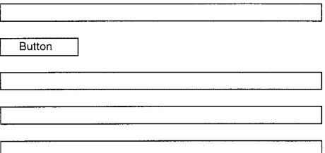

图 2.9

```java
TextField m1, m2, m3, m4, m5;
Button b1;
String message;
```

定义了五个名为 `m1` 到 `m5` 的 `TextField`，一个 `Button` `b1`，以及一个名为 `message` 的 `String` 变量。

我们的 `init` 方法没有什么意外之处。我们使用形如 `name = new TextField(80);` 的语句创建 `TextField`，创建不同名称的字段，所有字段的大小都能容纳 80 个字符。类似地，我们用 `b1 = new Button("button");` 创建一个按钮，并指定该按钮（非常巧妙地）标记为 `"button"`。

然后我们通过以下语句将实际文本放入 `TextField` `m1` 中：

```java
m1.setText("Please enter some text below; then press button.");
```

这为用户提供了程序的使用说明。

接下来，我们的 `add` 语句指定我们首先放置 `TextField` `m1` 和 `m2`，然后是 `Button`，接着是 `TextField` `m3`、`m4` 和 `m5`（图 2.9）。

最后，语句：

```java
b1.addActionListener(this);
```

将 `Button` `b1` 注册到系统中，以便系统监视该按钮的点击或按下操作。（我们暂时忽略代码的其余部分。）

那么，运行这个程序时会发生什么呢？`init` 方法设置好一切，并用以下消息提示我们：

```text
Please enter some text below; then press button.
```

然后我们响应此提示，在下一个 `TextField` 中输入一些内容，比如 `What a great day!`。接着我们满怀期待地等待，但什么也没有发生。计算机已被告知要监视 `Button b1` 的按下。所以我们必须按下按钮。这会激活 `actionPerformed` 方法。

我们现在来看程序的那部分：

```java
public void actionPerformed(ActionEvent event)
{
    message = m2.getText();
    m3.setText(message);
    m4.setText(message);
    m5.setText(message);
}
```

这特别简单，因为只有一个按钮，程序不需要确定按下了哪个按钮。我们直接进入语句：

```java
message = m2.getText();
```

`getText` 方法读取我们输入到 `TextField m2` 中的消息，并使其对程序可用。我们将其赋值给变量 `message`。这意味着无论输入到 `TextField` 中的是什么内容，现在都存放在名为 `message` 的内存位置中，也就是变量 `message`。

既然这条信息已安全地存储在计算机内存中，我们就可以在后续语句中**充分**利用它。语句：

```java
m3.setText(message);
```

使用 `setText` 方法将文本放入 `TextField m3` 中，实际上就是将其打印出来。

请注意，`setText` 采用了两种不同的形式。如果使用引号，则引号之间的字符会被打印出来。因此，使用 `m1.setText("Please enter ...");` 时，字符 `Please enter ...` 会被打印出来（不带引号）。

然而，我们还指定了 `String` 变量 `message`，而 `m3.setText(message);` 没有使用引号。它的意思是将 `message` 视为变量并打印其内容。`message` 的内容是前一条语句中赋值给它的内容。

我们假设输入的是 `What a great day!`。这意味着 `TextField m3` 现在包含 `What a great day!`。接下来的两条语句：

```java
m4.setText(message);
m5.setText(message);
```

对 `TextFields m4` 和 `m5` 执行相同的操作（图 2.10）。换句话说，输入到程序中的任何内容都会被复制三次；因此为这个 applet 选择了 `DupThree` 这个名称。

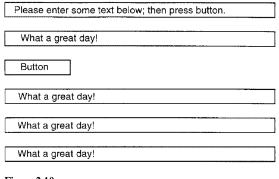

还有几点需要注意。内存中位置的名称，即变量名，几乎可以任意命名，只要它们以字母开头，仅包含字母和数字字符，并且已正确声明即可。例如，可以使用 `A17` 和 `c8zi` 这样的名称，但像 `taxe$`、`4sale` 和 `short-cut` 这样的变量名是无效的。

名称必须遵循两条额外的规则。首先，它们不能包含空格。其次，Java 系统有一组*保留字*不能用作名称。一些例子包括 `if`、`import`、`public`、`class`、`extends`、`implements` 和 `void`。这些都是 Java 语言的组成部分，如果我们选择它们作为名称，会使系统混淆。你可能需要查阅 Java 手册以获取保留字的完整列表。

重要的一点是，存储位置在没有被载入内容之前不应使用，正如 `DupThree` 示例中通过赋值语句所做的那样。然后，变量将继续保存该信息，除非被替换，可能是通过其他赋值语句。如果变量在后续赋值语句的左侧被使用，其中先前包含的任何信息将永远丢失，被正在赋值的新的信息所取代。

## 练习

1. 编写 Java 语句来声明变量，使用你选择的名称，以存储你的姓名和地址。

2. 设计并编写一个 Java 程序，提示你输入并读取你的名，然后是你的姓。然后让程序以相反的顺序显示它们。

3. 设计并编写一个 Java 程序，与上一个类似，但包含两个分别标记为 `"First-First"` 和 `"Last-First"` 的按钮。设计程序使得当按下 `"First-First"` 按钮时，名字按输入顺序显示。如果按下 `"Last-First"` 按钮，则姓显示在名之前。

## 猜数字游戏

为了让上一节介绍的概念“沉淀下来”，我们将直接进入另一个程序，它将使我们能够玩一个游戏。游戏的基本思想是，一个人选择 1 到 100 之间的一个数字，另一个人尝试尽快猜出这个“秘密”数字是什么。

每次猜测后，持有秘密数字的人回应“秘密数字比猜测的高”、“秘密数字比猜测的低”或“猜对了”。程序会记录所有信息并实现游戏的细节。

代码如下：

```java
import awb.*; // 有关此软件的讨论请参见附录。
import java.awt.*;
import java.awt.event.*;

public class AboveBelow extends java.applet.Applet
                        implements ActionListener
{
    TextField m1, m2;
    IntField i1; // 这不是标准 Java。请参见附录。
    Button b1, b2;
    int secret, guess;

    public void init ()
    {
        m1 = new TextField(80);
        m1.setText("Enter number between 0 and 100; then push
                       SECRET.");
        i1 = new IntField(40); // 请参见附录。
        m2 = new TextField(80);
        b1 = new Button("SECRET");
        b2 = new Button("GUESS");
        add(m1);
        add(b1);
        add(i1);
        add(b2);
        add(m2);
```

```java
b1.addActionListener(this);
b2.addActionListener(this);
}

public void actionPerformed(ActionEvent event)
{
    Object cause = event.getSource();

    if (cause == b1)
    {
        secret = i1.getInt();
        i1.setInt(); // extension of awb.*
        m1.setText("Now, enter your guess below; then press GUESS.");
    }

    if (cause == b2)
    {
        guess = i1.getInt();

        if (guess == secret)
        {
            m2.setText("You've got it!");
        }

        if (guess < secret)
        {
            i1.setInt();
            m2.setText("The number is greater than " + guess);
        }

        if (guess > secret)
        {
            i1.setInt();
            m2.setText("The number is less than " + guess);
        }
    }
}
}
```

首先，来看整体框架。我们有一个名为 `AboveBelow` 的类，类体中包含一些声明，接着是必需的 `init` 方法，然后是任何交互式小程序都需要的 `actionPerformed` 方法。

我们的声明包括两个 `TextField`、两个 `Button`、一个 `IntField` 和一个 `int`。后两者是新的。`IntField` 是对 `TextField` 的改进，外观和行为都非常相似，但设计用于处理数字数据而非字符串。这是本书引入的一个特殊功能，并非标准 Java。你应该学习附录，了解更多关于它的信息以及如何在机器上运行它。`int` 声明确立了存储数字数据（即整数或整数）的内存位置。

`init` 方法一如既往地用于在程序开始时进行设置。它设置并命名我们的 `Button`，创建 `TextField` 和 `IntField`，并为其中一些赋予初始值。`TextField m1` 设置了起始消息 `"Enter number between 0 and 100; then push SECRET."`（输入 0 到 100 之间的数字；然后按 `SECRET`）。两个按钮分别标记为 `SECRET` 和 `GUESS`（图 2.11），并设置为供我们使用以便监控。

现在我们准备开始游戏。假设 Sarah 和 John 正在玩。当 John 转过身去时，Sarah 输入入数字 55，然后按下 `SECRET` 按钮。

一旦按钮被按下，`actionPerformed` 方法就被启动。以下代码开始生效：

```java
Object cause = event.getSource();

if (cause == b1)
{
    secret = i1.getInt();
    i1.setInt(); // clear IntField
    m1.setText("Now, enter your guess below; then press GUESS.");
}
```


变量`cause`被设置为给出哪个按钮被按下的标识。这意味着在`if`语句中，`cause`将与`b1`（即 SECRET 按钮）匹配。这意味着紧跟其后的大括号内的语句将被执行。整型变量`secret`获得 Sarah 输入到`IntField`中的数字副本，在这个例子中是数字 55。`setInt`语句清除`IntField i1`，这样 Sarah 输入的数字就不再显示在屏幕上。最后，`setText`语句将新消息"Now, enter your guess below; then press GUESS."（现在，在下方输入你的猜测；然后按 GUESS。）放入`m1`中（图 2.12）。这些是告诉 John 如何继续游戏的指示。

注意，Sarah 输入的 55 已经从屏幕上消失了。然而，程序已将该数字保存在变量`secret`中。但当 John 开始猜测过程时，他看不到这一点。假设 John 输入数字 50，然后按下 GUESS 按钮。同样，`actionPerformed`方法被启动，`cause`被设置为该按钮的标识。第一个`if`不会找到匹配，因为 GUESS 按钮是`b2`。下面的`if`语句确实找到了匹配：

```
if (cause == b2)
{
    guess = i1.getInt();
}
```

这导致赋值语句获取 John 输入到`IntField`中的数字 50。所以内存位置`guess`包含`50`。现在有三种逻辑可能性。

1. John 完全猜对了。游戏结束。
2. John 的猜测小于秘密数字。计算机应该告诉他，这样他可以再试一次。
3. John 的猜测大于秘密数字。计算机应该报告这一点，让他再试一次。

以下是实现这一点的三个`if`语句：

```
if (guess == secret)
{
    m2.setText("You've got it!");
}
if (guess < secret)
{
    i1.setInt();
    m2.setText("The number is greater than " + guess);
}
if (guess > secret)
{
    i1.setInt();
    m2.setText("The number is less than " + guess);
}
```

Now, enter your guess below; then press GUESS.（现在，在下方输入你的猜测；然后按 GUESS。）

除了获胜的精确匹配之外，注意用于清除前一次答案的`owe the i1.setInt();`语句。由于 John 输入了 50，小于秘密数字 55，此时显示将如图 2.13 所示。

这需要一些额外的解释。

```
m2.setText("The number is greater than " + guess);
```

包含显式文本"The number is greater than "，这部分在屏幕上原样显示。但注意后面的`+ guess`。`guess`是一个整型变量，包含一个数字。当字符串（在引号中）后跟一个加号和任何变量时，Java 会将该变量的内容转换为字符串，并将其附加到前面的字符串上。`guess`中的 50 被转换为字符串"50"，然后附加到消息上。（在某些情况下，未能区分数字值 50 和字符串"50"将导致程序失败。）

如果 John 现在非常有条理地进行，他将得到以下一系列猜测和结果消息（包括图 2.13 中显示的那个）：

50

The number is greater than 50

75

The number is less than 75

63

The number is less than 63

57

The number is less than 57

54

The number is greater than 54

55

You've got it!

这是**二分查找**的一个例子，因为在每一步，John 都利用他的猜测将逻辑上仍然可能的数值范围大致减半。（使用这种策略，确定正确的秘密数字应该不超过七次猜测。如果没有任何策略，例如随机猜测，可能需要多达 100 次尝试。如果使用二分查找策略，如果秘密数字在 1 到 1,000 之间，最多需要多少次猜测？

## 练习

1. 为数字游戏想出另一种猜测策略。它比二分查找更好还是更差？
2. 设计一个类似的游戏程序，使用单词而不是数字。秘密和猜测都是字符串。描述程序如何工作，但不要尝试编写程序。
3. 对于面向单词的游戏，你可能会使用什么猜测策略？
4. 将你使用电话本的方式与你在练习 3 中想出的策略进行比较。

## 编程决策树

让我们从编程最简单的树开始，一个只有一个分支节点的树（图 2.14）。我们在前面的章节中学习了如何让机器打印这类消息，以及如何让它读取用户的答案。我们还介绍了`if`语句（没有认真解释），它允许我们根据`if`子句的答案来决定做或不做某件事。我们需要更仔细地探索`if`语句及其`if-else`变体。

一般来说，`if-else`语句具有以下形式：

```
if (some true/false expression)
{
    Java code A
}
else
{
    Java code B
}
```

在实际代码中，true/false 表达式可能是像`cause == b多年前`这样的东西，我们在前面的程序中见过。它是在问`cause`是否等于`b1`，或者换句话说，被按下的按钮是 Button`b1`吗？答案要么是`true`要么是`false`（是或否）。`if-else`语句的工作方式是，如果问题的结果是`true`，则执行 Java code A。如果结果是`false`，则转而执行 Java code B。这里 Java code A 和 Java code B 是 Java 语句序列。这些带有其包围大括号的序列称为复合语句，稍后会更仔细地定义。

一种简化的变体，称为`if`语句，与`if-else`语句类似，但去掉了"else"子句。在这种情况下，如果 true/false 问题的结果是`true`，则执行`if`后面的语句。如果结果是`false`，则不执行任何内容。形式为：

```
if (some true/false expression)
{
    Java code A
}
```

我们现在能够编写这个简单决策树的计算机程序：

```
import java.awt.*;
import java.awt.event.*;

public class SimpTree extends java.applet.Applet
                        implements ActionListener
{
    TextField mQuery, mAnswer;
    Button bYes, bNo;

    public void init()
    {
        mQuery = new TextField(70);
        mQuery.setText("Do you have experience with formal notations?");
        bYes = new Button("Yes");
        bNo = new Button("No");
```

```
mAnswer = new TextField(70);
bYes.addActionListener(this);
bNo.addActionListener(this);
add(mQuery);
add(bYes);
add(bNo);
add(mAnswer);
}
```

```
public void actionPerformed(ActionEvent event)
{
    Object cause = event.getSource();
    if (cause == bYes)
    {
        mAnswer.setText("In programming, you can see ...");
    }
    else // must have been the No button
    {
        mAnswer.setText("Studying Java will help you ...");
    }
}
}
```

如你所见，这个超简单案例的解决方案几乎与我们的`TrafficLight`程序相同，只是我们只有两个按钮。让我们来浏览一下这段代码：

```
import java.awt.*;
import java.awt.event.*;

public class SimpTree extends java.applet.Applet
                    implements ActionListener
{
    TextField mQuery, mAnswer;
    Button bYes, bNo;
```

我们使用标准的 import 语句，然后是类头，它命名了类`SimpTree`，说明它是一个 applet 的特殊案例，并声明任何按钮的"监听器"都在这个类中实现。然后声明了`TextField`类型的`mQuery`和`mAnswer`，以及`Button`类型的`bYes`和`bNo`。

接下来是初始化事物的`init`方法，也就是说，它设置好一切，使其准备就绪。下面只显示`init`的主体：

```
mQuery = new TextField(70);
mQuery.setText("Do you have experience with formal notations?");
bYes = new Button("Yes");
bNo = new Button("No");
mAnswer = new TextField(70);
bYes.addActionListener(this);
bNo.addActionListener(this);
add(mQuery);
add(bYes);
add(bNo);
add(mAnswer);
```

前两行创建了一个`TextField`并将文本放入其中。接下来的两个语句创建了标记为 Yes 和 No 的按钮。然后我们创建了一个`TextField`，用于最终放置我们的"答案"。`addActionListener`语句将两个按钮注册为监听对象。最后，四个`add`语句将查询`TextField`放在屏幕上，然后是两个`Button`，然后是包含答案的`TextField`。

当这个 applet 运行时，`init`方法将产生如图 2.15 所示的显示。按下两个按钮中的一个，无论是 Yes 还是 No，都会导致`actionPerformed`方法被启动。让我们看看那个程序的主体：

```
Object cause = event.getSource();
if (cause == bYes)
{
    mAnswer.setText
    ("In programming, you can see those notations come to life!");
```

图 2.15

```
else // must have been the No button
{
    mAnswer.setText
    ("Studying Java will help you learn one notation well.");
}
```

首先，变量`cause`被赋值为被按下按钮的标识。然后我们有一个`if-else`语句占据了剩余的行。`cause == bYes`由计算机评估以判断其为真还是假。如果按下了 Button`bYes`，那将等于存储在`cause`中的值，`cause == bYes`的值为真。在这种情况下，`TextField mAnswer`将被设置为"In programming, you can see those notations come to life!"，而此后出现的行，从`else`开始，将被跳过。然后屏幕将显示如图 2.16 所示的内容。如果按下了 No 按钮，`if-else`将评估为假。在假的情况下，紧随`if`之后、`else`之前的语句将被跳过。`else`之后的语句现在被执行。这将导致`TextField mAnswer`被设置为"Studying Java will help you learn one notation well."。然后显示将看起来像图 2.17 所示的那样。

所以，就是这样，对于一个非常简单的树。如果你将其与`TrafficLight`示例进行比较，你会注意到它使用了三个`if`语句，每个按钮一个。这里，由于我们只有两个按钮，我们能够只使用一个`if-else`语句来运作，因为如果不是一个按钮，那一定是另一个。

图 2.16

图 2.17

稍后我们将处理更复杂的决策树，但首先我们需要处理 Java 编程中的一些语法要点。

## 语法与风格

到现在你可能已经注意到，（几乎）所有语句都以分号（；）结尾。让我们系统地浏览一下我们遇到的各种语句。调用各种类的方法的语句以分号结尾。例如：

```
mQuery.setText("Do you have experience with formal notations?");
```

和

```
add(mQuery);
```

还要注意，当调用一个方法时，括号（ ）总是包含在方法名称之后。括号之间可能有也可能没有内容。声明是以分号结尾的语句。例如：

```
Button bYes, bNo;
```

赋值语句总是包含一个等号（=），并以分号结尾，如下例所示：

```
mAnswer = new TextField(70);
```

到目前为止的例外是`if`语句，它本身不以分号结尾，但通常包含一个或多个在花括号内的、以分号结尾的语句。方法和 applet 定义由一个头文件和括在花括号内的语句组成。此类定义的 closing brace 后面不跟分号。

我们前面还谈到了复合语句。这些只是括在花括号内的一个或多个语句的集合。复合语句本身不以分号结尾，但其内部的语句是。

你迄今看到的示例程序也遵循相当严格的风格规则，也就是说，格式，特别是缩进，是仔细而系统地进行。就像报告的提纲一样，缩进反映了程序的逻辑结构。就像我们前面所说的，空格和语句在一行上的分布通常对 Java 编译器没有太大影响。但它对人类读者来说极其重要。由于程序员充分理解他们正在处理的程序非常重要，任何提高可读性的格式，在实践中都是一大好处。

目前，缩进规则可以概括为：花括号内的所有行都要缩进。每遇到一个 opening brace，缩进程度向右移动一个单位。每个 closing brace 将缩进程度向左退回一个单位。一对花括号内的语句都应该从相同的缩进开始——它们应该对齐。

## 图 2.18

## 更深层次的决策树

更复杂的决策树需要不止一个`if-else`语句。要得到决策树所处理问题的答案或解决方案，必须回答一系列问题。为了说明这一点，我们实现了本章前面所示的诺贝尔奖决策树的一个变体（图 2.18）。请注意，除了使问题更短之外，我们在每个节点的一个角落放置了一个数字。这个数字用于帮助我们跟踪在通往所需答案的路径上已经前进了多远。想象一下，如果我们给你展示一张贴在墙上的巨大决策树海报，你可能会在确定每个问题的答案时将手指放在每个连续的问题上。因此，你的手指将跟踪从树的根在左边到右边最终答案的路径。由于程序没有手指，它将使用节点中的数字来跟踪其在树中的当前位置。

这里有一个程序，`NobelAdvice`，实现了图 2.18 中的决策树：

```
import java.awt.*;
import java.awt.event.*;

public class NobelAdvice extends java.applet.Applet
                        implements ActionListener
```

```
{
    TextField mQuery, mAnswer;
    Button bYes, bNo;
    int myLocation;

    public void init()
    {
        mQuery = new TextField(70);
        mQuery.setText("Would you like to read about a scientist?");
        bYes = new Button("Yes");
        bNo = new Button("No");
        myLocation = 0;
        mAnswer = new TextField(70);
        bYes.addActionListener(this);
        bNo.addActionListener(this);
        add(mQuery);
        add(bYes);
        add(bNo);
        add(mAnswer);
    }

    public void actionPerformed(ActionEvent event)
    {
        Object cause = event.getSource();
        if (myLocation == 0)
        {
            if (cause == bYes)
            {
                myLocation = 1;
                mQuery.setText("Would you like to read about Einstein?");
            }
            if (cause == bNo)
            {
                myLocation = 2;
                mQuery.setText("Would you prefer a humanitarian?");
            }
        }
        else if (myLocation == 1)
        {
```


```java
if (cause == bYes)
{
    myLocation = 3;
    mAnswer.setText("He received the Physics Prize in 1921.");
}
if (cause == bNo)
{
    myLocation = 4;
    mAnswer.setText("See the Prize in Medicine, 1962.");
}
}
else if (myLocation == 2)
{
    if (cause == bYes)
    {
        myLocation = 5;
        mAnswer.setText("Look up the Peace Prize, 1991.");
    }
    if (cause == bNo)
    {
        myLocation = 6;
        mAnswer.setText("Try the Literature Prize, 1970.");
    }
}
}
}
```

请注意，类头、声明和`init`方法与我们之前的决策树实现相比几乎没有变化。额外的声明语句

```java
int myLocation;
```

设置了一个整型变量，用来帮助我们在决策树中跟踪上次所处的位置。该变量将利用图 2.18 中显示的节点编号。`init`方法中两条不同的语句是：

```java
mQuery.setText("Would you like to read about a scientist?");
```

```java
myLocation = 0;
```

由于这里的问题不同，`setText`语句包含了新的问题。我们还将`myLocation`的值设置为零，以表示我们位于根节点。这意味着当我们启动程序时，将得到图 2.19 所示的显示。按下两个按钮之一（"是"或"否"）将导致`actionPerformed`方法被启动。让我们看一下该方法主体的"骨架"：

```java
Object cause = event.getSource();
if (myLocation == 0)
{
    ...
}
else if (myLocation == 1)
{
    ...
}
else if (myLocation == 2)
{
    ...
}
```

省略号表示省略了代码行。第一行是常规语句，其中`cause`被赋予被推按钮的标识。此处显示的其余行旨在让程序决定它所处理的是树的哪一部分。已经覆盖了哪一部分？存储在变量`myLocation`中的数字可以回答这个问题。如果它包含 0——如果`myLocation`的值为零——那么我们刚刚就在节点零，并且已经回应了存储在那里的问题："Would you like to read about a scientist?" 如果`myLocation`的值为 1 或 2，这就告诉程序我们已经进一步深入了。基本上，前面的代码摘录精确定位了我们刚才所处的位置，以便我们理解"是"或"否"按钮的按下实际上是在回应什么问题。

## 语法旁注

`if-else`语句的形式可能会令人困惑。`if-else`语句内部还嵌套着`if-else`语句。以下是代码的完整展开：

```java
Object cause = event.getSource();
if (myLocation == 0)
{
    ...
}
else
{
    if (myLocation == 1)
    {
        ...
    }
    else
    {
        if (myLocation == 2)
        {
            ...
        }
    }
}
```

复合语句的一条规则说，当复合语句内部只有一条语句时，可以省略包围的大括号。由于每个`else`子句恰好包含一条`if-else`或`if`语句，因此这些大括号可以去掉。这就得到：

```java
Object cause = event.getSource();
if (myLocation == 0)
{
    ...
}
else
    if (myLocation == 1)
    {
        ...
    }
    else
        if (myLocation == 2)
        {
            ...
        }
```

现在，如果我们有更大的树，就会有更多的节点编号，而且每步缩进会逐渐但不可避免地超出页面范围。因此，在我们需要区分许多互斥情况（所有节点编号必须是唯一的）时，我们将`if`行与前一行`else`合并，并且不在每步进行缩进：

```java
Object cause = event.getSource();
if (myLocation == 0)
{
    ...
}
else if (myLocation == 1)
{
    ...
}
else if (myLocation == 2)
{
    ...
}
```

## 决策树（续）

既然我们已经处理了骨架代码，并理解了它的目的是跟踪我们在决策树中的位置，我们就可以专注于被省略的代码（由省略号表示）了。第一部分，连同包围它的`if`语句，如下所示：

```java
if (myLocation == 0)
{
    if (cause == bYes)
    {
        myLocation = 1;
        mQuery.setText("Would you like to read about Einstein?");
    }
    if (cause == bNo)
    {
        myLocation = 2;
        mQuery.setText("Would you prefer a humanitarian?");
    }
}
```

执行时，我们到达这里是因为我们刚刚在节点零，对第一个问题回答了"是"或"否"。如果按下了"是"按钮，我们将问题"Would you like to read about Einstein?"移到`mQuery`文本框中。我们还将`myLocation`设置为 1，以便当将来有按钮被按下时，程序将知道这是对节点 1 中问题的回应。（节点编号是任意的，但它们必须唯一标识特定节点。）

现在，如果按下了"否"按钮，就会显示"Would you prefer a humanitarian?"消息，并将`myLocation`设置为 2。让我们继续讨论，假设按下了"否"按钮，并且`myLocation`现在包含 2。显示的问题是"Would you prefer a humanitarian?"（图 2.20）。让我们来看一下，当我们现在再次按下"是"按钮时会发生什么。软件将再次使用`myLocation`来找到它在树中的位置。由于`myLocation`的值为 2，它将执行以下代码：

```java
else if (myLocation == 2)
{
    if (cause == bYes)
    {
        myLocation = 5;
        mAnswer.setText("Look up the Peace Prize, 1991.");
    }
    if (cause == bNo)
    {
        myLocation = 6;
        mAnswer.setText("Try the Literature Prize, 1970.");
    }
}
```

由于按下了"是"，软件将把消息"Look up the Peace Prize, 1991"放入`mAnswer`文本框中。它还将`myLocation`设置为 6，以表示我们最终到达了节点 6，尽管我们不会再对该节点执行任何操作。

如果我们要将其扩展到更深、有更多问题和选择的树，将`myLocation`设置为 6 对于正确运行至关重要。屏幕现在应如图 2.21 所示。请注意，我们只走了该树的四个可能路径之一，即"否-是"路径。请务必理解"否-否"、"是-否"和"是-是"路径是如何工作的。

Would you prefer a humanitarian?

Yes No

Look up the Peace Prize, 1991.

## 图 2.21

## 练习

1. 设计你自己的决策树，并编写一个与之配套的 Java 程序。
2. 更改图 2.18 中`NobelAdvice`决策树的所有节点编号，并更改 Java 程序中相应的编号。解释为什么这不应该对程序的运行产生任何影响。
3. 你可能已经注意到，我们的第一个只有一个问题的决策树有三个节点。`NobelAdvice`决策树增加了另一层，有三个问题节点，总共七个节点。如果我们以同样的方式再增加两层，将会有多少个问题节点，总共又会有多少个节点？

## 箭头表示法及其用途

当我们讨论一个主题，并发现自己一遍又一遍地说着相同的短语时，一种常见的做法是发明一种表示法，使我们能够"\!"##ਇअीकी

## 领取你的校园大使奖励

1. 打开校园大使录用通知书中给出的"领取奖励"页面。
2. 输入你的 6 位校园大使 ID。
3. 请务必使用与你的 Google 开发者学生俱乐部关联的主要电子邮件地址，因为它将用于发放你的奖励。
4. 浏览奖励目录，了解更多关于你的周边选项的信息。阅读条款和条件，了解奖励的 guidelines。
5. 点击"领取我的奖励"按钮，访问奖励表格。
6. 完整填写奖励表格。在选择奖励之前，请务必阅读指南。请注意，你的周边选择将是有限的。你的校园大使录用通知书应列出你可用的周边选项。
7. 填写完表格后，点击"提交"按钮。
8. 提交表格后，你将收到一封确认电子邮件，确认你的奖励已领取。

## 改变主意了？

别担心。如果你有任何问题，请随时通过`gdsccampus@google.com`与我们联系。我们很乐意提供帮助！

将这种表示法翻译成英文，我们读作："一个称为'name'的对象可以是一个以字母开头的字母和/或数字序列。"本章中的一些名字示例是`TrafficLight`和`m2`，这种表示法可以用来指定它们：

```text
<name> ==> TrafficLight
<name> ==> m2
```

也就是说，名字可以是一个字符序列`TrafficLight`或序列`m2`。从概念上讲，名字被赋予给类、变量和方法等对象。

这种表示法极其重要有两个原因：

1. 它对于讨论和学习 Java 语言非常有用。例如，本书中使用的大部分 Java 内容在本章末尾仅用几页就概括了。任何时候你想检查什么是合法的，或者如何编写某个结构，快速参考本章通常能找到答案。
2. 这种表示法为第 9 章使用的转换机制以及本书后面介绍的其他机制提供了基础。如果你在整个过程中经常使用这种表示法，当你读到那些章节时，你会对它感到舒适。

Java 中的另一种对象称为字符串。让我们用箭头表示法来定义它。

```text
<string> ==> <name>
<string> ==> "any sequence of characters"
```

解释这些规则，字符串可以是一个名字或任何由引号包围的可打印字符序列。本章中的一些字符串是：

```text
<string> ==> message
<string> ==> "Do you wish a mathematical approach?"
```

字符串很重要，因为它们是可以被打印的东西。

有时我们想要做出区分，也就是将事物分成类别。所以我们有规则：

```text
<expression> ==> <string-expression> | <int-expression> |
                   <oth-expression>
```

竖线（`|`）是"或"的简写，意味着你有选择。它是简写，因为我们本可以写成：

```text
<expression> ==> <string-expression>
<expression> ==> <int-expression>
<expression> ==> <oth-expression>
```

这展示了表达式的三种不同可能规则。竖线允许我们在一行中陈述它们。我们将使用任一方法——竖线或多条语句——来表示我们有选择。回到我们的规则：

```text
<expression> ==> <string-expression> | <int-expression> |
    <oth-expression>
```

这表示表达式可以是字符串表达式，可用于处理文本、消息等；或者是整数表达式，涉及数字和算术。我们不能对字符串进行算术运算，但可以对整数表达式进行算术运算。第三种选择是其他某种表达式，既不是整数表达式也不是字符串表达式。目前，我们继续处理字符串。我们有规则：

```text
<string-expression> ==> <string>
```

这很简单：它表示字符串表达式可以是一个字符串。我们之前定义了`<string>`，知道它可以是一个`<name>`或由引号包围的字符序列。

我们也在本章学习了语句，它们表示为`<statement>`。以下是之前介绍的三种形式：

```text
<statement> ==> <name> = <expression>;
<statement> ==> <name> = new <class>(<arguments>);
<statement> ==> <name>.<method>(<arguments>); | <method>(<arguments>);
```

总结一下，我们介绍了一种用于定义编程实体的表示法，并且展示了如何使用它来定义名字、字符串、表达式和语句。我们可以通过从一个带括号的形式开始，例如`<name>`，并沿着箭头跟踪来找到这些术语的含义。现在我们想通过将箭头用作替换指示器来做更多的事情。具体来说，我们将箭头`==>`解释为不只是"可以是"；我们解释为"可以被替换为"。

## 生成 Java 语句

以下是箭头规则如何用于生成 Java 语句。让我们从这个语句规则开始：

```text
<statement> ==> <name> = <expression>;
```

然后让我们应用一个规则，该规则说明`<expression>`可以被替换为`<string-expression>`。进行此替换后，我们的规则变为：

```text
<statement> ==> <name> = <string-expression>;
```

接下来，我们应用规则，说明我们可以将`<string-expression>`替换为`<string>`：

```text
<statement> ==> <name> = <string>;
```

然后我们应用规则，说明`<string>`可以被替换为`<name>`：

```text
<statement> ==> <name> = <name>;
```

最后，我们应用规则，说明`<name>`可以被替换为以字母开头的字符序列：

```text
<statement> ==> <name> = address;
```

或者最后一步可以不同地完成，以获得：

```text
<statement> ==> <name> = "Hello, my name is Oscar.";
```

这假设我们有一个名为`address`的变量，并且有人有兴趣将"Hello, my name is Oscar."插入到程序中。为了完成这个过程，我们需要在每种情况下替换`<name>`，使用规则说明名字是以字母开头的字母数字符号字符串。所以，以下内容是一致的：

```text
<statement> ==> heading = address;
<statement> ==> message = "Hello, my name is Oscar.";
```

这再次假设`heading`和`message`都是有效的字符串变量名。

## 深呼吸……

让我们退一步，看看我们完成了什么。我们有一系列规则，共同描述了（部分）Java 语言语法。我们从一个语法元素开始，在本例中是`<statement>`，然后通过一系列替换，最终得到了两个语法正确的 Java 语句。我们通过非常简单的替换和选择符合我们需求的规则做到了这一点。每当我们有尖括号`<>`中的内容时，我们寻找允许我们用更详细的尖括号表示法或实际代码替换该项目的规则。完成后，我们生成了语句的实际代码。

因此，除了开发一种描述 Java 语法的表示法之外，我们还说明了一种用于生成语法正确的 Java 语句的绝妙方法。

如果这看起来有点随意和随机，确实如此，因为我们只是试图说明这个过程。通常，你有一个 Java 语句或程序，想要验证其语法。这就是 Java 编译器编译程序时所做的，它会在对你的语法不满意时通知你。

## 更多规则

为了充分说明这种技术，我们需要阐明更多规则，然后验证一些实际代码。目前，我们将跳过与整数和算术相关的大部分内容。此外，由于我们已经展示了包含`<class>`和`<string-method>`的规则，我们将推迟对这些内容的详细考察。

## 第 2 章

我们需要更好地解析之前规则的一个规则是：

```text
<arguments> ==> possibly empty list of <expression>s separated by commas
```

参数列表或参数是在程序中使用方法时放在方法名后面括号之间的信息。正如规则所述，它可能是一个空列表：也就是说，有时没有参数，方法名后面跟着`()`。可能只有一个参数表达式。但如果有多个，它们用逗号分隔。到目前为止，我们还没有遇到超过 1 个参数的列表。我们使用过的参数示例（及其包围的括号）是：

```text
("H e l l o     W o r l d !")
(70)
(bYes)
```

之前的规则告诉我们：

```text
<expression> ==> <string-expression> | <int-expression> | <oth-expression>
```

换句话说，参数可以是字符串、数字或其他对象的表达式。由于我们专注于字符串，目前可以忽略其他选项。另一个与字符串相关的有用规则是：

```text
<string-expression> ==> <string-expression> + <string-expression>
```

这表示字符串可以由两个连接或拼接在一起的字符串组成。

## 验证语句的正确性


让我们使用这个规则和之前的规则来验证我们之前展示的猜测程序中以下语句的正确性。这将是我们的目标代码：

```
m2.setText("The number is less than " + guess);
```

以下是我们到目前为止所陈述规则的总结。规则编号是任意的，但使规则易于引用。（不要记忆规则编号；它们可能会在不通知的情况下更改。）

- 1. `<name> ==> any string of alphanumeric symbols that begins with a letter`
- 2. `<statement> ==> <name> = <expression>;`
- 3. `<statement> ==> <name> = new <class>(<arguments>);`
- 4. `<statement> ==> <name>.<method>(<arguments>); | <method>(<arguments>);`
- 5. `<arguments> ==> 可能为空的、由逗号分隔的 <expression> 列表`
- 6. `<expression> ==> <string-expression> | <int-expression> | <oth-expression>`
- 7. `<string-expression> ==> <string-expression> + <string-expression>`
- 8. `<string-expression> ==> <string>`
- 9. `<string> ==> "任意字符序列"`
- 10. `<string> ==> <name>`

由于我们处理的是一条语句，需要从一个适合语句的规则开始。语句有多种规则，因此需要选择与目标代码匹配的那一条。最合适的是：

```
<statement> ==> <name>.<method>(<arguments>);
```

我们的策略是找到规则，将右侧尖括号中的项替换为实际代码或其他尖括号中的项。我们将不断进行替换，使右侧越来越像目标语句。

先从`<name>`开始。规则 1 允许我们将`<name>`替换为以字母开头的字母数字字符串。更准确地说，由于要验证的是一段特定的代码，可以将其替换为`m2`。结果为：

```
<statement> ==> m2.<method>(<arguments>);
```

虽然进展不大，但我们离目标更近了一步：

```
m2.setText("The number is less than " + guess);
```

接下来处理`<method>`。我们发现目前还没有相应的规则，因此可以制定一条：

11. `<method> ==> setText | getText | getInt | setInt | add | actionPerformed`

这条规则列出了我们目前使用过的一些可选方法名。显然，我们需要`setText`：

```
<statement> ==> m2.setText(<arguments>);
```

剩下的就是`<arguments>`。根据规则 5，我们可以替换为可能为空的、由逗号分隔的`<expression>`列表。由于目标代码中没有逗号，显然它只有一个参数，即一个表达式。结果为：

```
<statement> ==> m2.setText(<expression>);
```

现在，规则 6 指出，`<expression>`可以是`<int-expression>`、`<string-expression>`或`<oth-expression>`。同样毫无疑问，我们的目标代码处理的是字符串，因为我们注意到了用于指定字符串的引号。这导致：

```
<statement> ==> m2.setText(<string-expression>);
```

现在需要决定使用哪条处理字符串表达式的规则。线索是目标代码中的加号（`+`）。我们选择规则 7，即字符串表达式可以是一个字符串表达式后跟加号，再跟另一个字符串表达式。得到：

```
<statement> ==> m2.setText(<string-expression> + <string-expression>);
```

虽然你可能担心事情变得更复杂而非更简单，但我们走在正确的道路上。处理第一个`<string-expression>`时，我们选择规则 8，即字符串表达式可以简单地是一个`<string>`。让我们对第二个字符串表达式也应用此规则。现在我们有：

```
<statement> ==> m2.setText(<string> + <string>);
```

使用规则 9，我们看到第一个`<string>`显然是用引号括起来的字符序列：

```
<statement> ==> m2.setText("The number is less than " + <string>);
```

另一个`<string>`可以使用规则 10 替换为`<name>`：

```
<statement> ==> m2.setText("The number is less than " + <name>);
```

最后一步替换使用规则 1，因为`<name>`可以是任何以字母开头的字母数字字符串：

```
<statement> ==> m2.setText("The number is less than " + guess);
```

我们完成了！在语句的右侧，我们得到了目标代码。这经历了大量步骤，但每一步都相当简单，简单到甚至机器都能执行。我们实际上*证明*了——在最强的逻辑意义上——这段代码在语法上是正确的，符合我们的规则。

## 语句之上

我们已经处理了描述单条语句的规则。现在我们演示这种方法可以应用于程序中更大的片段。

我们首先处理*控制语句*，它影响语句是否执行或执行频率。`if-else`语句是我们目前唯一的控制语句。

*复合语句*实际上不是单条语句，而是将多条语句组合在一起的一种方式。然而，它通常可以在需要单条语句的地方使用。就我们的目的而言，它仅与控制语句结合使用，但它确实有其他用途（本书中省略）。复合语句可以描述如下：

```
<compound-statement> ==>
{
    list of <statement>s
}
```

或者更简洁地：

12. `<compound-statement> ==> {list of <statement>s}`

来自 NobelAdvice 小程序的一个例子是：

```
{
    myLocation = 6;
    mAnswer.setText("Try the Literature Prize, 1970");
}
```

我们现在可以指定`if`语句的规则：

```
<statement> ==> if (<bool-expression>)
                    <compound-statement>
<statement> ==> if (<bool-expression>)
                    <compound-statement>
                else
                    <compound-statement>
```

或者更简洁地：

13. `<statement> ==> if(<bool-expression>)<compound-statement>`
14. `<statement> ==> if(<bool-expression>)<compound-statement> else<compound-statement>`

剩下的就是未定义的`<bool-expression>`。布尔表达式也可以称为逻辑表达式，自然地与`if`语句一起使用。

我们经常说这样的句子：“如果你的年龄小于 21 岁，你不能购买酒类。”逻辑表达式是“小于 21”，它要么为真，要么为假。

布尔表达式可以变得极其复杂，但目前我们使用一条规则来处理代码中出现的非常简单的布尔表达式，例如（包括`if`和括号）：

```
if (cause == bYes)
```

注意需要双等号（`==`）。单等号保留给赋值语句。处理逻辑表达式的简单规则是：

15. `<bool-expression> ==> <name> == <expression>`

这与我们的示例一致，因为`<name>`可以是`cause`（规则 1），而`<expression>`可以是`<string-expression>`（规则 6），可以是`<string>`（规则 8），可以是`<name>`（规则 10），可以是`bYes`（规则 1）。

我们现在拥有描述目前所见程序中相当大一部分的规则。我们还缺少涉及整数使用的规则，以及描述任何非平凡程序中必需的声明的规则。在更高层次上，我们需要描述方法和小程序的规则。

声明可以最好地描述为：

16. `<declaration> ==> <type> list of <name>s separated by commas;`

这需要一条关于类型的规则。目前，这由以下规则涵盖：

17. `<type> ==> int | void | <class>`

这很容易扩展。我们只需要另一个“or”竖线和任何额外的类型。`<class>`规则仅仅列举了我们目前使用过的 Java 提供的类：

18. `<class> ==> String | TextField | IntField | Button | ActionEvent`

有了这些规则，你应该可以轻松描述来自 NobelAdvice 小程序的以下三条声明中的任意一条：

```
TextField mQuery, mAnswer;
Button bYes, bNo;
int myLocation;
```

在更高层次上，编写或定义方法的规则可以表述为：

```
19. <method-def> ==> public <type> <name>(<parameters>)
    {
        possibly empty list of <declaration>s
        list of <statement>s
    }
```

它描述了头部，然后指定其后跟一个声明列表和一个语句列表，全部包含在一对花括号中。头部包括已定义的类型和名称，以及括在括号中的参数列表。我们将参数作用的讨论留到第 4 章，但可以指定语法所需的规则。

## Java 登场

20. `<parameters> ==> 可能为空的、由逗号分隔的 <type> <name> 对列表`

参数列表的一个示例可以在我们每个交互式小程序都使用的`actionPerformed`方法的头部中找到：

```
public void actionPerformed(ActionEvent event)
```

这里有一个由`ActionEvent event`对指定的参数。`ActionEvent`是类型（实际上是一个类），`event`是名称。

描述小程序的规则在结构上与方法的规则类似，也可以被描述为类的规则。小程序只是具有特殊属性的类。然而，由于我们只处理 Java 的一个子集，“小程序”而非“类”更为合适：

```
21. <applet> ==> public class <name> extends java.applet.Applet
      implements ActionListener
      {
        possibly empty list of <declaration>s
        list of <method>s
      }
```

这里的规则说明我们有一个头部，后跟由声明列表表示的数据，再后跟一个方法列表。

## 检查一个完整（小型）程序

让我们在一个完整的小程序——简短的 HelloWorld 程序上试用我们的规则，它将作为我们的目标代码：

```java
public class HelloWorld extends java.applet.Applet
{
    TextField m1,m2;

    public void init()
    {
        m1 = new TextField(60);
        m2 = new TextField(60);
        m1.setText("Hello World!");
        m2.setText("This is a simple Java test.");
        add(m1);
        add(m2);
    }
}
```

我们从`applet`的规则开始，因为我们要描述或验证一个完整的 applet：

```
<applet> ==> public class <name> extends java.applet.Applet
                    implements ActionListener
{
    possibly empty list of <declaration>s
    list of <method>s
}
```

从`<name>`开始，我们使用规则 1 得到：

```
<applet> ==> public class HelloWorld extends java.applet.Applet
                    implements ActionListener
{
    possibly empty list of <declaration>s
    list of <method>s
}
```

接下来，我们应用规则 16 处理声明。由于只有一条声明语句，包含两个名称，因此我们得到：

```
<applet> ==> public class HelloWorld extends java.applet.Applet
                    implements ActionListener
{
    <type> <name>, <name>;
    list of <method>s
}
```

现在规则 17 和 18 允许我们将`<type>`替换为`TextField`，规则 1 允许我们将两个`<name>`替换为`m1`和`m2`：

```
<applet> ==> public class HelloWorld extends java.applet.Applet
                    implements ActionListener
{
    TextField m1, m2;
    list of <method>s
}
```

就这样，我们正逐步接近目标代码。现在，由于我们只有一个方法，我们应用一次规则 19：

```
<applet> ==> public class HelloWorld extends java.applet.Applet
                      implements ActionListener
{
    TextField m1, m2;
    public <type> <name>(<parameters>)
    {
        possibly empty list of <declaration>s
        list of <statement>s
    }
}
```

对`<type>`应用规则 17 得到`void`，对`<name>`应用规则 1，我们得到：

```
<applet> ==> public class HelloWorld extends java.applet.Applet
                      implements ActionListener
{
    TextField m1, m2;
    public void init(<parameters>)
    {
        possibly empty list of <declaration>s
        list of <statement>s
    }
}
```

由于目标代码中的参数列表为空，我们可以直接去掉`<parameters>`。`init`方法中的声明列表也为空，所以我们可以将其去掉。恰好有六条语句，我们可以通过编写实际的列表来重新表述语句列表。因此，


```java
<applet> ==> public class HelloWorld extends java.applet.Applet
                      implements ActionListener
{
    TextField m1, m2;
    public void init( )
    {
        <statement>
        <statement>
        <statement>
        <statement>
        <statement>
        <statement>


 26. <int-expression> ==> <int-expression> <op> <int-expression>
27. <int-expression> ==> <name>.<int-method>(<arguments>)
28. <int-expression> ==> <name>
29. <int-expression> ==> <positive-int> | -<positive-int>
30. <op> ==> + | - | * | / | %
31. <oth-expression> ==> <name>.<oth-method>(<arguments>)
32. <oth-expression> ==> <name> | <oth-method>(<arguments>)
```

## 小结

本章介绍了编写程序的两个主要阶段。首先，必须有一个解决当前问题的算法。本章中的大多数算法都是以决策树的形式给出的。但我们还使用了其他类型的算法，例如`TrafficLight`程序中的按钮驱动循环。第二阶段是编写 Java 代码，用机器能理解的方式描述算法。在这里，我们学习了各种语法形式，使我们能够向机器表达我们的意图。主要研究的构造包括类定义、各种类型声明、按钮声明与激活代码、一些小程序显示特性，以及`if-else`分支形式。

本章最后描述了 Java 的产生式规则及其在理解语言和检查正确性方面的应用。在下一章中，我们将进行一些数值计算。

本页故意留空。

等一下！那个负荷太小了，你赚不了多少钱，就那点柠檬！

而那个负荷又太大了。你卖不完那么多柠檬水，赚不回来。你会赔钱的！

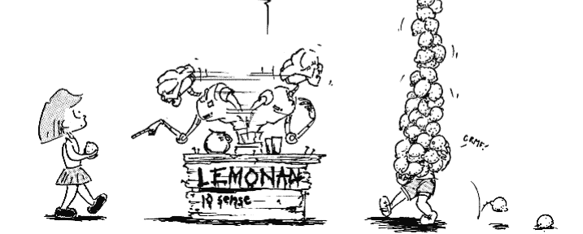

# 3 数值计算与函数研究

## 让我们来算些数字

一个年轻人每年向免税股票市场基金贡献 2,000 美元，一生中能节省多少钱？（在美国，这可以是个人退休账户。）更具体地说，假设此人 20 岁，希望一直 contributing 到 60 岁。此外，假设此人有一个投资计划，该计划历史上平均每年增长率为 12%。我们可以快速估算一下，用年数乘以贡献额得到 80,000 美元，但这忽略了投资计划似乎能带来的收益。

为了进行更精确的计算，我们必须每年计算新的贡献额，并将其加到前一年的投资收益中。如果我们重复计算 40 次，就能得到答案。但那是很大的工作量。解决这个问题的另一种方法是编写程序，让机器来找出答案。

另一类有趣的任务是*优化*问题集，我们试图在某些情况下找到参数的最佳值。举个例子，假设我们要用 1,000 平方厘米的锡建造一个圆柱形罐子，我们想找到合适的尺寸，使罐子具有最大的容积。在试图最大化容积时，我们可能会提议建造一个很高的圆柱体。但由于材料总量有限，这可能导致一个非常细长的形状（图 3.1a）。这个圆柱体可能装不了多少东西。接下来，我们可能会提议圆柱体应该非常宽。材料限制这次会导致一个非常矮的容器（图 3.1b）。同样，总体积可能不会很大。也许某个中间水平最好，具有中等高度和中等直径（图 3.1c）。同样，计算机可以帮助我们解决这个问题，找到圆柱体的尺寸，使得体积最大化且总材料恰好为 1,000 平方厘米。同时，我们将研究一种解决优化问题的技术。（了解微积分的读者会有这个问题的解析解。然而，我们的方法是通用的，可以应用于没有这种解析解的问题。）

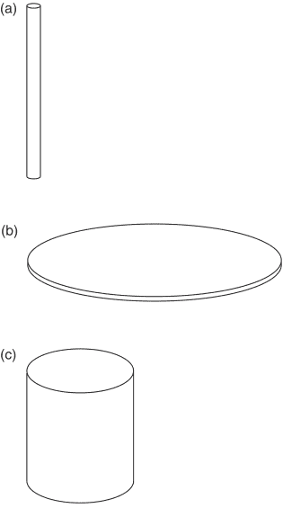

在第二章学习了决策树之后，我们现在学习数值计算，以丰富我们的计算经验。我们还继续学习编程和问题解决中的新概念。

## 第三章

### 简单计算

数值计算需要一种新的数字类型。之前介绍了整数，它们对计数、引用决策树中的节点以及其他编号情况很有用。但这种数字类型有一些严重的局限性：它不能取`2\frac{1}{5}`这样的分数值，而且数值在正负方向上都不能太大。Java 对`int`数据类型的规范实际上给出了存储整数的最小值和最大值。限制条件是整数不能低于`-2{,}147{,}483{,}648`，也不能高于`2{,}147{,}483{,}647`。这意味着

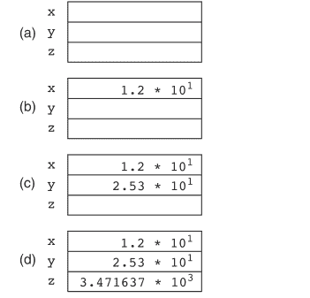

## 图 3.2

你无法用这种数据类型进行与国家预算相关的任何精确计算，因为有效数字根本不够大。在一般的计算应用中，需要一种数字类型，既能取分数值，也能取非常大和非常小的值。

答案是`double`类型，它以两部分表示数字：有效数字和指数。数字 177 可以表示为`1.77 * 10^2`，其中 1.77 给出有效数字，2 是指数。数字的实际值总是可以从表示法中检索出来（`1.77 * 10^2 = 1.77 * 100 = 177`），而且这种表示法可以高效地存储在机器中。这种数字类型解决了整数的两个问题，同时仍然只需要相对较少的计算机内存。它几乎在现代计算机上普遍使用。我们不会详细讨论数字究竟是如何存储的，只是说要两个存储区域，一个用于保存有效数字，一个用于保存指数。这些数字的大小通常对大多数应用足够了。在 Java 中，规范规定正数或负数的大小可以大到 10 的 308 次方，小到 10 的 -324 次方。

我们可以通过声明来开始使用这种数字：

```java
double x, y, z;
```

这会在内存中设置三个存储双精度数的位置，并赋予适当的名称（图 3.2a）。然后可以将一个数字载入某个位置：

```java
x = 12.0;
```

得到图 3.2b 所示的结果，或者将两个数字相加并将和存入内存：

```java
y = 13.3 + x;
```

得到图 3.2c 所示的结果。或者可以使用加法（`+`）、乘法（`*`）、减法（`−`）和除法（`/`）进行复杂的计算：

```java
z = (x + 17.2) * (121 - (y / x));
```

得到图 3.2d 所示的结果。

作为一个更实际的例子，考虑使用公式计算圆柱体体积的问题：

`V = \pi r^2 h`

其中 `V` 是体积，`\pi` 是约等于 3.14159 的常数，`r` 是圆柱体底面的半径，`h` 是高。在 Java 中，这可以写成：

```java
V = 3.14159 * r * r * h;
```

编写一个计算圆柱体体积的计算机程序很容易。

### 算法

1. 求半径 `r`。
2. 求高度 `h`。
3. 计算 `V = \pi r^2 h`。
4. 打印体积 `V`。

程序如下：

```java
import awb.*;

import java.awt.*;

import java.awt.event.*;

public class CylinderVolume extends java.applet.Applet

                       implements ActionListener

{

    double r, h, V;

    DoubleField rF, hF, VF;

    Button b1;

    public void init ()

    {

        rF = new DoubleField(20);

        rF.setLabel("Radius");

        hF = new DoubleField(20);

        hF.setLabel("Height");

        b1 = new Button("Compute");

        b1.addActionListener(this);

        VF = new DoubleField(20);

        VF.setLabel("Volume");

        add(rF);

        add(hF);

        add(b1);

        add(VF);

    }

    public void actionPerformed(ActionEvent event)

    {

        Object cause = event.getSource();

        if (cause == b1)

        {

            r = rF.getDouble();

            h = hF.getDouble();

            V = 3.14159 * r * r * h;

            VF.setDouble(V);

        }

    }

}
```

我们注意到与这个程序相关的几个问题。首先，它遵循了第二章中程序的格式，所以应该容易阅读。但必须注意区分那些意在可见的对象，`rF`、`hF` 和 `VF`，称为`DoubleField`变量，以及那些不可见的对象，`r`、`h` 和 `V`，称为`double`变量。程序用户看到第一组对象并与它们交互。然而，计算是用第二组对象进行的。程序员必须小心地将信息（数据）从可观察对象提取到可用于计算的对象，然后执行计算，再将答案返回到可观察对象，以便能看到答案。

让我们总结这两类对象的特殊特性：

### DoubleField 变量

- 可以在屏幕上看到；可以从程序输出。
- 可以有显示在屏幕上的标签。
- 可以输入；可以作为程序的输入。
- 不能用于计算，如使用运算符`+`、`−`、`*`、`/`。
- 它们的值可以使用`setDouble`和`getDouble`方法移入和移出`double`变量。

因此，可以通过`rF.setDouble(r)`将值从 `r` 移动到 `rF`，也可以通过`r = rF.getDouble()`将值从 `rF` 移动到 `r`。

### Double 变量

- 无法显示在屏幕上。
- 无法接收键入的输入。
- 可用于计算，也能接收计算结果。（示例：`V = 3.14159 * r * r * h;`）
- 它们的值可以通过`setDouble`和`getDouble`方法与`DoubleField`变量进行双向传递。

现在让我们回到按钮动作程序，检查它是否做了正确的事情：

1. 用户向标注为 "Radius" 的 `rF` 输入值。
2. 用户向标注为 "Height" 的 `hF` 输入值。
3. 用户按下按钮 `b1`。
4. 计算机将值从可见的 `rF` 移动到可用的 `r`：`r = rF.getDouble();`
5. 计算机将值从可见的 `hF` 移动到可用的 `h`：`h = hF.getDouble();`
6. 计算机计算体积值：`V = 3.14159 * r * r * h;`
7. 计算机将结果 `V` 移回可见的 `vF`：`vF.setDouble(V);`

因此，按下按钮后，我们有以下代码：

```java
r = rF.getDouble();

h = hF.getDouble();

V = 3.14159 * r * r * h;

vF.setDouble(V);
```

这里使用的另一个新特性是为每个`DoubleField`创建标签的能力。这是通过`DoubleField`类型的`setLabel`方法实现的。

作为另一个数值计算的示例，我们来写一个在获得一次复利后的储蓄账户金额的公式。例如，假设你将 $2,000 存入一个年利率为 12% 的账户。我们将 12% 写成分数形式 0.12。那么年末时，你可以预期拥有 $2,000 加上利息，即 $2,000 * 0.12 = $240。你将正好拥有 $2,240。因此，年末的新储蓄金额为 2000 + (2000 * 0.12) = 2240，或者用公式表示为：

新储蓄 = 储蓄 + (储蓄 * 利率)

在 Java 中，你可以将右边的计算结果并存储回同一个位置 `savings`：

`savings = savings + (savings * interestrate);`

同样，这可以嵌入到一个程序中，用于计算经过一个计息期后账户中的金额。

### 算法

- 查找账户中的原始金额。
- 查找该时间段内以小数表示的利率。
- 使用公式计算一个时间段后的新金额。
- 打印结果。

程序如下：

```java
import awb.*;

import java.awt.*;

import java.awt.event.*;

public class FindSavings extends java.applet.Applet

            implements ActionListener

{

    double savings, interestrate;

    DoubleField savingsF, interestrateF;

    Button b1;

    public void init ()

    {

        savingsF = new DoubleField(20);

        savingsF.setLabel("Savings");

        interestrateF = new DoubleField(20);

        interestrateF.setLabel("Interest rate");

        b1 = new Button("Calculate");

        b1.addActionListener(this);

        add(savingsF);

        add(interestrateF);

        add(b1);

        savingsF.setDouble(0);

        interestrate.setDouble(0);

    }

    public void actionPerformed(ActionEvent event)

    {

        Object cause = event.getSource();

        if (cause == b1)

        {
            savings = savingsF.getDouble();

            interestrate = interestrateF.getDouble();

            savings = savings + (savings * interestrate);

            savingsF.setDouble(savings);

        }

    }

}
```

程序的演示显示了显示界面和数字的形式：

`Savings 2000.00 Interest rate 0.12 Calculate`

数字可以以普通的小数形式输入，尽管它们将以带有有效数字部分和指数的双精度浮点数形式存储在计算机中。（关于这个程序，应该注意的一点是，可以多次按下按钮以获得几年后账户中的总金额。因此，该程序提供的功能比我们最初承诺的更多。）

编写这类有用的程序很容易，但需要提及两个隐患。第一个与算术运算顺序可能不明确的问题有关。也就是说，如果 `x = 2`，`y = 3`，`z = 4`，我们写：

```java
result = x + y * z;
```

什么将被加载到`result`中？机器可能将 `x` 加到 `y`（得到 5）再乘以 `z` 得到 20。或者它可能将 `y` 乘以 `z`（得到 12）然后加上 `x` 得到 14。它会做哪一个？两种情况下会出现截然不同的答案。事实上，Java 和大多数其他编程语言采用了一种优先级机制，要求在模棱两可的情况下，先进行乘法和除法，再进行加法和减法：

### 优先级顺序

1. 乘法、除法
2. 加法、减法

因此，两个结果中的第二个是正确的，14。

在一系列同等优先级的计算中，计算从左到右进行。因此，如果 `x = 6`，`y = 2`，`z = 3`，那么：

```java
result = x / y * z;
```

将产生计算 6/2*3 = 3*3 = 9。它不会将值计算为 6/2*3 = 6/6 = 1。

如果优先级是个问题，程序员应始终使用括号来强制操作顺序以实现其目标。因此：

```java
result = (x + y) * z;
```

将强制在乘以 `z` 之前先进行 `x` 与 `y` 的加法。

```java
result = x + (y * z);
```

将在程序员忘记优先级顺序的情况下强制先进行乘法。虽然这里已经给出了基本原则，但编程手册中有更多示例和详细规则，必要时应当查阅。

与实数计算相关的第二个隐患是机器会产生错误。简单的数字 1 和 3 可以精确地存储在机器中，因此我们可以对它们的完整性有信心。然而，如果我们将其中一个除以另一个，商为：

`0.333333333333333333333333333333...`

这是一个无限小数展开，无法放入计算机寄存器中。因此，只存储了正确答案的近似值——前十几个有效数字。也就是说，由于机器寄存器的尺寸有限，将存储`0.333333333333`这个数字。对于大多数用途而言，这是令人满意的，因为我们只需要几位精度。但在一些复杂的计算中，这些误差可能会累积并严重扭曲答案。

考虑以下程序，它应该读取一个数字并打印相同的数字：

```java
import awb.*;

import java.awt.*;

import java.awt.event.*;

public class ErrorDemo extends java.applet.Applet

            implements ActionListener

{

    double data, extra;

    DoubleField dataF, extraF;

    Button b1;

    public void init ()

    {
```


```java
dataF = new DoubleField(20);

dataF.setLabel("Data");

extraF = new DoubleField(20);

extraF.setLabel("Extra");
```

## 第 3 章

```java
b1 = new Button("Compute");

b1.addActionListener(this);

add(dataF);

add(extraF);

add(b1);

dataF.setDouble(0);

extraF.setDouble(0);
```

```java
public void actionPerformed(ActionEvent event)

{

    Object cause = event.getSource();

    if (cause == b1)

    {

        data = dataF.getDouble();

        extra = extraF.getDouble();

        data = data + extra;

        data = data - extra;

        dataF.setDouble(data);

    }

}
```

该程序的唯一功能是将一个名为`extra`的数加到`data`上，然后再将其减去。人们希望这个程序读取`data`的值然后打印出相同的数字。对于较小的`extra`值和普通的数据（如 100），程序会正确工作。然而，如果`extra`很大，`data`将被破坏。表 3.1 显示了该程序在标准 Java 系统上的表现。

如果`data`和`extra`的值适中，程序总是给出正确答案。但当`extra`增加到需要超过 16 或 17 位的大值时，`data`中的值会以不可预测的方式被改变。你可以通过实际推导表格最后一行的相关细节来了解发生了什么。在程序`ErrorDemo`的倒数第三行计算了以下和：

```text
10000000000000000000

                  100

--------------------

10000000000000000100
```

但是数字`10000000000000000100`被下面的数近似表示：

```text
10000000000000000000
```

因为实数表示中没有足够的有效数字（超过 16 位）来得到精确值。然后，在程序的倒数第二行中发生了以下计算：

```text
10000000000000000000

10000000000000000000

----------------------

                     0
```

这展示了舍入误差如何导致错误的结果。

| `data`（输入） | `extra`（输入） | `data`（输出） |
|---|---:|---:|
| 100 | 100 | 100 |
| 100 | 1000 | 100 |
| 100 | 10000 | 100 |
| 100 | 100000 | 100 |
| . | . | . |
| . | . | . |
| . | . | . |
| 100 | 10000000000000000 | 100 |
| 100 | 100000000000000000 | 96 |
| 100 | 1000000000000000000 | 128 |
| 100 | 10000000000000000000 | 0 |
| 100 | 100000000000000000000 | 0 |

显然，在计算飞机机翼强度或航天器轨迹的公式中间进行这样的计算，可能会导致随机的结果、糟糕的决策和生命损失。因此，数值分析专家必须负责大型复杂且关键的计算。但对于本书所讨论的任务，计算机的精度已经足够，数值误差的问题将不再提及。一本关于数值分析的书将解释数值计算的特性。

## 练习题

1. 球体的体积为$\frac{4}{3}\pi r^3$。编写一个程序，读取球体的半径值，然后计算其体积。

2. 华氏温度`f`可通过公式`f = \frac{9}{5}c + 32`由摄氏温度`c`计算得出。编写一个程序，读取摄氏温度并返回华氏温度。

3. 假设`x = 6.0`，`y = 7.0`，和`z = 3.0`是实数。在每种情况下会计算什么？

   - (a) `result = x * y - x * z;`
   - (b) `result = x * 20.0 / z + y;`
   - (c) `result = (z * x / y) / x + y;`

4. 针对`data = 0.00001`的情况运行程序`ErrorDemo`。`extra`必须多大才会在计算中改变`data`的值？

5. 这里有一个使用直角三角形毕达哥拉斯公式的程序：`a^2 + b^2 = c^2`，其中`a`和`b`是三角形的两条边，`c`是其斜边。程序假设你知道`b`和`c`，并计算`a`的值。

```java
import awb.*;

import java.awt.*;

import java.awt.event.*;

public class FindSide extends java.applet.Applet

                        implements ActionListener

{

    double a, b, c;

    DoubleField aF, bF, cF;

    Button b1;

    public void init()

    {

        aF = new DoubleField(20);

        aF.setLabel("A");

        bF = new DoubleField(20);

        bF.setLabel("B");

        cF = new DoubleField(20);

        cF.setLabel("C");

        b1 = new Button("Compute");

        b1.addActionListener(this);

        add(aF);

        add(bF);

        add(cF);

        add(b1);

    }

    public void actionPerformed(ActionEvent event)

    {

        Object cause = event.getSource();

        if (cause == b1)

        {

            a = aF.getDouble();

            b = bF.getDouble();

            c = cF.getDouble();

            a = sqrt(c * c - b * b);

            aF.setDouble(a);

        }

    }

}
```

我们将研究该程序的精度。如果`c`和`b`的值分别为 1.01 和 1.00，程序应该为`a`计算什么值？手动计算以获得答案中的四位有效数字，并运行程序以获得其答案。程序的答案有多精确？

现在重复，保持`b`为 1.00，但让`c`为 1.0001。机器的精度如何？再试一次，让`c`分别为 1.000001、1.00000001、1.00000000001，等等。随着`c`越来越接近`b`，你会看到精度下降，直到误差变为 100%。

## 函数

函数是一种接收输入并为每个输入产生唯一定义输出的实体。函数的一个例子是接收国家名称并返回其首都名称。通常，函数有名称。我们称这个为`F`。如果`F`接收`Egypt`，它将返回其首都的名称`Cairo`。如果接收`Japan`，它将返回`Tokyo`。其他例子包括接收人名并返回该人母亲姓名的函数，以及接收圆柱体尺寸并返回其体积的函数。

本书使用五种不同的方法来描述函数：英文描述、数学符号、计算机程序、表格和图形。任何说明如何为每个给定输入找到适当输出的技术都足以定义函数。这些方法在这里简要描述。

通常的数学符号是将输入写在函数名后的括号中，将输出写在等号之后：对于国家—首都函数`F`，例子写作：

`F( ) =`

输入 ↑　　　　　↑ 输出

`F(Egypt) = Cairo`

`F(Japan) = Tokyo`

在本章中，我们研究接受输入并产生数值的数值函数。一个简单的例子是将输入加倍并返回答案的函数。如果它接收 3，它将输出 6。如果接收 17，它将产生 34。让我们称这个函数为`d`并写下这些例子：

`d(3) = 6`

`d(17) = 34`

可以说`d`对于任何东西都是那个东西的两倍，或者：

`d(anything) = 2 * anything`

数学家更喜欢使用变量名`x`来表示“任何东西”，并写作：

`d(x) = 2x`

所以这是描述加倍函数的通常符号。

另一个数值函数是计算圆柱体体积的函数。这个函数接收`r`和`h`并计算体积。如果函数名为`v`，可以写作：

`v(r, h) = πr²h`

先前给出了计算此函数的程序。假设其输入为`r = 2`和`h = 3`；则其输出将为`3.14159 * 2² * 3 = 37.69908`。

表格提供了表示函数的另一种方式。假设加倍函数`d`被定义为仅对正整数运算。那么它可以写成如下：

| 输入 `x` | 输出 `d(x)` |
|---|---:|
| 1 | 2 |
| 2 | 4 |
| 3 | 6 |
| 4 | 8 |
| 5 | 10 |
| 6 | 12 |
| . | . |
| . | . |
| . | . |

## 表 3.2

| `v(r,h)` | `h=1` | `h=2` | `h=3` | `h=4` | `h=5` | `h=6` |
|---|---:|---:|---:|---:|---:|---:|
| `r=1` | 3.14 | 6.28 | 9.42 | 12.57 | 15.71 | 18.85 |
| `r=2` | 12.57 | 25.13 | 37.70 | 50.27 | 62.83 | 75.40 |
| `r=3` | 28.27 | 56.55 | 84.82 | 113.10 | 141.37 | 169.65 |
| `r=4` | 50.26 | 100.53 | 150.80 | 201.06 | 251.33 | 301.59 |
| `r=5` | 78.54 | 157.08 | 235.62 | 314.16 | 392.70 | 471.24 |
| `r=6` | 113.10 | 226.19 | 339.29 | 452.39 | 565.49 | 678.58 |

## 图 3.3

圆柱体体积函数需要二维表格来表示其值，因为它有两个输入（表 3.2）。

最后，我们可以对函数作图。图 3.3 显示了加倍函数，图 3.4 显示了体积函数，其中每条曲线对应一个`h`值。

## 练习题

1. 考虑从半径计算球体体积的函数。展示如何使用给定的五种方法（英文描述、数学符号、计算机程序、表格和图形）来表达这个函数。

## 循环与函数研究

我们现在能够解决引言部分中描述的寻找圆柱体理想尺寸的问题。其体积为`V = πr²h`，其表面积为`A = 2πr² + 2πrh = 1000`。第二个方程可以解出`h`并代入第一个方程，以找到每个`r`值对应的圆柱体体积：

`V = 500r - πr³`

我们有兴趣研究计算`V`的函数，随着`r`的变化。可以编写一个程序来计算`r`从 1.0 到 11.0 时每个值的`V`。

以下是我们希望做的。我们想要执行以下代码：

```java
r = 1.0;

V = 500.0 * r - 3.14159 * r * r * r;

rF.setDouble(r);

VF.setDouble(V);

r = 2.0;

V = 500.0 * r - 3.14159 * r * r * r;

rF.setDouble(r);

VF.setDouble(V);

r = 3.0;

V = 500.0 * r - 3.14159 * r * r * r;

rF.setDouble(r);

VF.setDouble(V);

etc.
```

我们的编码方法是设置`r`，计算`V`，显示`r`和`V`，增加`r`，然后重复。每次我们希望重复时，我们将按下一个计算按钮。

```java
r = 1.0;

Push Compute Button; // This is not legal Java.

{

    V = 500.0 * r - 3.14159 * r * r * r;

    rF.setDouble(r);

    VF.setDouble(V);

    r = r + 1.0;

}
```

以下是合法的 Java 完整程序：

```java
import awb.*;

import java.awt.*;

import java.awt.event.*;

public class CylinderVolumes extends java.applet.Applet

                    implements ActionListener

{

    double r, V;

    DoubleField rF, VF;

    Button b1;

    public void init ()

    {

        rF = new DoubleField(20);

        rF.setLabel("Radius");

        b1 = new Button("Compute");

        b1.addActionListener(this);

        VF = new DoubleField(20);

        VF.setLabel("Volume");

        add(rF);

        add(b1);

        add(VF);

        r = 1.0;

        rF.setDouble(r);

    }

    public void actionPerformed(ActionEvent event)

    {

        Object cause = event.getSource();

        if (cause == b1)

        {
```

## 图 3.5

```java
V = 500.0 * r - 3.14159 * r * r * r;

rF.setDouble(r);

VF.setDouble(V);

r = r + 1.0;
```

运行此程序会产生`r`和`V`的值，将其绘制成图（图 3.5），展示了`V`随每个`r`的变化情况。该图使我们能够验证本章开头所做的猜测。如果圆柱体极高而半径非常小，体积将会很小。如果圆柱体很宽，半径例如大于 10，体积也不会大。为了获得尽可能大的`V`，`r`应设置在一个中等水平，大约为 7。稍后我们会找到更精确的值。最大体积的圆柱体大致如图 3.6 所示。

接下来让我们考虑导言部分的储蓄问题。每年年底，账户将包含上一年的资金（储蓄）加上当年的收益（储蓄 * 利率）加上新的年度付款（付款）：

```java
savings = savings + (savings * rate) + payment;
```

这项计算需要在每年最后一天进行，持续四十年：

```java
// 初始化付款和增长率

year = 1;

savings = 0;
```

## 数值计算与函数研究

**图 3.6**

```java
savings = savings + (savings * rate) + payment;

year = year + 1;

savings = savings + (savings * rate) + payment;

year = year + 1;

savings = savings + (savings * rate) + payment;

year = year + 1;

// 直到计算满 40 年。
```

但让我们尝试不用按 40 次按钮来完成这件事。Java 有一种特殊的循环结构可以帮助我们实现这一点。它被称为`while`，使用方式如下：

```java
// 初始化付款和增长率。

year = 1;

savings = 0;

while (year <= 40)

{

    savings = savings + (savings * rate) + payment;

    year = year + 1;

}
```

`while`语句的意思是：“当年份小于或等于 40 时，重复执行花括号`{ }`之间的语句。”为了理解这一点，请研究此处`while`的运行过程：

```java
year = 1;

savings = 0;

year <= 40 吗？是

{

    savings = savings + (savings * rate) + payment;

    year = year + 1; // (year = 2)

}

year <= 40 吗？是

{

    savings = savings + (savings * rate) + payment;

    year = year + 1; // (year = 3)

}

重复多步。最终 year = 40。

year <= 40 吗？是

{

    savings = savings + (savings * rate) + payment;

    year = year + 1; // (year = 41)

}

year <= 40 吗？否

停止。
```

以下是包含`while`循环的完整 Java 程序。

```java
import awb.*;

import java.awt.*;

import java.awt.event.*;

public class Savings extends java.applet.Applet
```


```java
implements ActionListener
{
    double savings, payment, rate, year, lastyear;
    DoubleField savingsF, paymentF, rateF, lastyearF;
    Button b1;

    public void init()
    {
        paymentF = new DoubleField(20);
        paymentF.setLabel("Payment");

        rateF = new DoubleField(20);
        rateF.setLabel("Increment rate");

        lastyearF = new DoubleField(20);
        lastyearF.setLabel("Total Years");

        b1 = new Button("Compute");
        b1.addActionListener(this);

        savingsF = new DoubleField(20);
        savingsF.setLabel("Savings");

        add(paymentF);
        add(rateF);
        add(lastyearF);
        add(b1);
        add(savingsF);

        paymentF.setDouble(0);
        rateF.setDouble(0);
        lastyearF.setDouble(0);
        savingsF.setDouble(0);
    }

    public void actionPerformed(ActionEvent event)
    {
        Object cause = event.getSource();

        if (cause == b1)
        {
            savings = 0;
            year = 1;
            payment = paymentF.getDouble();
            rate = rateF.getDouble();
            lastyear = lastyearF.getDouble();

            while (year <= lastyear)
            {
                savings = savings + (savings * rate) + payment;
                year = year + 1;
            }

            savingsF.setDouble(savings);
        }
    }
}
```

## 练习

1. 输入储蓄程序，看看如果每年付款为 $2,000，你将能存下多少钱。

2. 使用本章的方法，找出函数 `f = x^2 - 5x + 4` 的最低值。

3. 使用程序计算 `x` 从 1 到 12 时 `f = \frac{1}{3}x^3 - 4x^2 + 15x + 3` 的值。绘制该函数的图像。

## 寻找最佳值

稍加注意细节，我们就能找到圆柱体最大体积问题的更精确解。图 3.5 似乎表明 `r` 应该略大于 6。如果 `r` 恰好为 6，体积为：

`V = (500 * 6) − (3.14159 * 6³) = 2321.42`

让我们尝试 `r = 6.01`，看看体积是否会变大：

`V = (500 * 6.01) − (3.14159 * 6.01³) = 2323.02`

看来理论是正确的。当 `r` 增大时，体积确实增加了。也许应该再次增大 `r`，到 6.02：

`V = (500 * 6.02) − (3.14159 * 6.02³) = 2324.61`

很好！一种策略是反复增大 `r`，看看 `V` 能继续增大多少次。如果 `V` 变小了，就停止：前一个值就是最好的。事实上，我们可以编写程序来完成这项任务。我们之前寻找最大值时也是这样做的，只不过这次增量不是 1.0，而且在找到最高值时停止计算。

### 算法

- 将 `r` 设置在某个起始值。
- 决定每次循环 `r` 应该增大多少。
- 求 `V`。
- 增大 `r`。
- 求 `V`。
- 增大 `r`。
- 求 `V`。
- 增大 `r`。
- ……
- 如果 `V` 变小了，停止：前一个 `V` 就是找到的最佳值。

显然这种方法非常重复，需要用到循环：

### 算法

- 将 `r` 设置在某个起始值。
- 决定每次循环 `r` 应该增大多少。
- 求 `V`。

重复以下两步：

1. 增大 `r`。
2. 求 `V`。

如果 `V` 变小了，停止循环。前一个 `V` 就是找到的最佳值。

实际上，应该明确告诉计算机在每次循环时检查 `V` 是否小于前一个 `V`：

### 算法

- 将 `r` 设置在某个起始值。
- 决定每次循环 `r` 应该增大多少。
- 求 `V`。

重复以下步骤：

1. 增大 `r`。
2. 求 `V`。
3. 如果 `V` 小于前一个 `V`，停止循环。

前一个 `V` 就是找到的最佳值。

但 anticipate 将此程序用 `while` 循环转换为 Java 时，最好将循环测试放在循环开头：

### 算法

- 将 `r` 设置在某个起始值。
- 决定每次循环 `r` 应该增大多少。
- 求 `V`。

重复以下步骤：

1. 如果 `V` 小于前一个 `V`，停止循环。
2. 增大 `r`。
3. 求 `V`。

前一个 `V` 就是找到的最佳值。

此算法存在一个 bug。程序第一次运行时，没有前一个 `V`。每次循环时测试本身是正确的，但第一次遇到时毫无意义。解决方法是为前一个 `V` 假设一个初始值，使循环第一次就能正常工作。假设 `V` 总是正数，因为它是体积。然后我们将前一个 `V` 初始化为零，这样就能确保它小于 `V`。

### 算法

- 将 `r` 设置在某个起始值。
- 决定每次循环 `r` 应该增大多少。
- 将前一个 `V` 初始化为零。
- 求 `V`。

重复以下步骤：

1. 如果 `V` 小于前一个 `V`，则停止循环。
2. 增大 `r`。
3. 求出 `V`。

前一个 `V` 就是最佳值。

该算法仍然不完整，因为前一个 `V` 没有被系统地维护。每次循环计算 `V` 时，前一个值将会丢失，除非程序将其存储起来。因此，应在循环的第 3 步之前插入一条语句，将当前 `V` 保存到存储前一个 `V` 的位置：

### 算法

- 将 `r` 设为某个起始值。
- 确定每次循环中 `r` 应增大的量。
- 将前一个 `V` 初始化为零。
- 求出 `V`。

重复以下步骤：

1. 如果 `V` 小于前一个 `V`，则停止循环。
2. 增大 `r`。
3. 将 `V` 保存到名为“前一个 `V`”的位置。
4. 求出 `V`。

前一个 `V` 就是最佳值。

至此，寻找最佳体积的算法设计完成。循环的开发需要非常仔细，这在大多数编程场景中很常见。现在我们可以编写代码了：

```java
import awb.*;
import java.awt.*;
import java.awt.event.*;

public class CylinderVolumeMax extends java.applet.Applet
                implements ActionListener
{
    double r, previousV, increase, V;
    DoubleField rF, increaseF, VF;
    Button b1;

    public void init()
    {
        rF = new DoubleField(20);
        rF.setLabel("Radius");

        increaseF = new DoubleField(20);
        increaseF.setLabel("increase");

        b1 = new Button("Compute");
        b1.addActionListener(this);

        VF = new DoubleField(20);
        VF.setLabel("Best Volume");

        add(rF);
        add(increaseF);
        add(b1);
        add(VF);

        rF.setDouble(1.0);
        increaseF.setDouble(0.01);
    }

    public void actionPerformed(ActionEvent event)
    {
        Object cause = event.getSource();

        if (cause == b1)
        {
            r = rF.getDouble();
            increase = increaseF.getDouble();
            previousV = 0;
            V = 500 * r - 3.14159 * r * r * r;

            while (V >= previousV)
            {
                r = r + increase;
                previousV = V;
                V = 500 * r - 3.14159 * r * r * r;
            }

            VF.setDouble(previousV);
        }
    }
}
```

你应该将这个程序输入计算机，并找到圆柱体最大化问题的更好解决方案。能否找到精确到小数点后三位的最佳 `r` 值？

如果 `V` 曲线具有奇特的形状，如图 3.7 所示，这个程序可能无法找到最佳解。记住程序的工作原理，并注意它在这个问题上将如何运行。如果从左侧标记为“初始 `r`”的位置开始，它会不断增大 `r`，并在 `V` 增大时缓慢向右移动。但请注意，`V` 会在图中标记为“找到的最佳 `V`”的位置开始变小。于是程序会停止并宣布已找到最佳 `V`。但这是错误的，因为在更右侧还存在更大的 `V`。在寻找最佳圆柱体的例子中，这种情况不会发生，但通常必须仔细研究以确保找到了绝对最大值。

本节展示了一种使用计算机进行搜索的方法。在我们的例子中，我们寻找的是 `r` 的最佳值，但一般来说可以搜索几乎任何东西。搜索方法构建一个循环，反复检查所需的项。循环计算持续进行，直到找到所搜索的项为止：

1. 初始化计算。
2. 当未找到项时，执行：
   - 获取下一项的重复部分。
3. 输出找到的项。

## 练习题

1. 求一个圆柱体的尺寸，`r` 和 `h`，该圆柱体有 1,000 平方厘米的材料且体积最大。达到的最大体积是多少？所有答案精确到小数点后三位。

2. 假设一个人向银行账户存入 $1,000，然后每月定期存入 $20，持续 20 年。进一步假设银行支付 6% 的年利率，按月复利。20 年后总储蓄额将是多少？

3. 一个人有在十年内储蓄 $10,000 的目标。她可以获得 8% 的年利率，按月复利。她的计划是初始存入 $1,000，然后在剩余的十年内进行月度支付。她的月度支付额应该是多少？

4. 假设我们有两个函数 `f_1 = 2x + 1/(x^3 + x^2)` 和 `f_2 = x^2 - 6x`。编写一个程序，将 `x` 从某个较低值开始，比如 `x = 1`，此时 `f_1` 大于 `f_2`，然后反复增大 `x`，每次计算 `f_1` 和 `f_2` 的值。当 `f_1` 小于 `f_2` 时，程序循环应停止。尽可能精确地找出大于 1 且使 `f_1 = f_2` 的 `x` 值。

5. 编写一个充当桌面计算器的程序。该程序将有一系列按钮，与第 2 章中的某些程序类似。它还将有两个寄存器，`x` 寄存器和 `RESULT` 寄存器。所有命令都通过操作这些寄存器来执行，包括清除它们、输入数值、加其他数字等。以下是命令。每个命令执行所指出的操作，然后显示寄存器的内容以显示其当前状态。

- **CR**：清除 `RESULT` 寄存器。
- **CX**：清除 `x` 寄存器。
- **C**：将数值 `x` 复制到 `RESULT` 寄存器中。
- **+**：将 `x` 加到 `RESULT` 上，并将结果留在 `RESULT` 中。
- `*`：将 `x` 乘以 `RESULT`，并将结果留在 `RESULT` 中。
- `/`：用 `x` 除 `RESULT`，并将结果留在 `RESULT` 中。
- `-`：从 `RESULT` 中减去 `x`，并将结果留在 `RESULT` 中。

## 在数组中存储信息

为了鼓励人们使用储蓄计划，我们可能希望创建一个电子储蓄表，显示每年末的储蓄总额。假设他/她按时进行所有支付，并假设市场按预测的速度增长，此人将能够检查未来任何年份账户中的金额。这个记录可以通过在计算机内存中创建一个数组来构建，该数组可以容纳拟议计划中的 40 个条目。在本节中，我们研究数组的概念、它们的用途，特别是它们在储蓄问题中的用途。

使用数组的第一步是用声明在内存中创建它。我们通过少量修改常规声明来实现。如果我们想要一个名为 `table` 的位置来存储 double 数值，我们写：

```java
double table;
```

如果我们想要多个位置，我们写：

```java
double table[];
```

这告诉 Java 处理器 `table` 将具有多个值，`table[0]`、`table[1]`、`table[2]` 等。但该处理器不知道要预留多少个位置，因此在 `init` 例程中，我们写：

```java
table = new double[40];
```

以表明我们想要 40 个位置。它们将被编号为 0, 1, 2, . . . , 39。

数组中的每个单独条目都将有自己的名称。第一个称为 `table[0]`，第二个是 `table[1]`，依此类推。直观上，数组应该如图 3.8 所示。

在构建电子储蓄表之前，让我们通过几个例子研究数组及其操作。假设我们希望编写一个程序，其唯一功能是 (1) 创建一个叫 `A` 的数组，可以容纳四个整数，(2) 将数字 10 放入这四个条目中。程序如下：

```java
import awb.*;
import java.awt.*;

public class FirstArray extends java.applet.Applet
{
    int A[];

    public void init()
    {
        A = new int[4];
        A[0] = 10;
        A[1] = 10;
        A[2] = 10;
        A[3] = 10;
    }
}
```

实现相同结果的另一种方法是使用 `while` 循环。注意，数组的索引 `i` 必须声明为整数。

```java
import awb.*;
import java.awt.*;

public class SecondArray extends java.applet.Applet
{
    int A[], i;

    public void init()
    {
        A = new int[4];
        i = 0;

        while (i < 4)
        {
            A[i] = 10;
            i = i + 1;
        }
    }
}
```

这个程序创建数组，然后执行以下序列：

```text
i = 0;
i < 4 吗？是
A[0] = 10;
i = 1;
i < 4 吗？是
A[1] = 10;
i = 2;
i < 4 吗？是
A[2] = 10;
i = 3;
i < 4 吗？是
A[3] = 10;
i = 4;
i < 4 吗？否
```

通过在循环中反复改变 `i`，被引用的数组项也不断变化。

一旦数组中存在一些值，我们可以添加一个按钮，使我们能够检查这些条目：

```java
import awb.*;
import java.awt.*;
import java.awt.event.*;
```


```java
public class ThirdArray extends java.applet.Applet
                    implements ActionListener
{
    int A[], i;
    IntField iF, valueF;
    Button b1;
    public void init()
    {
        b1 = new Button("Next value");
        b1.addActionListener(this);
        iF = new IntField(20);
        iF.setLabel("i");
        valueF = new IntField(20);
        valueF.setLabel("table value");
        add(b1);
        add(iF);
        add(valueF);
        A = new int[4];
        i = 0;
        while (i < 4)
        {
            A[i] = 10;
            i = i + 1;
        }
        i = 0;
    }

    public void actionPerformed(ActionEvent event)
    {
        Object cause = event.getSource();
        if (cause == b1)
        {
            iF.setInt(i);
            valueF.setInt(A[i]);
            if (i < 3)
                {i = i + 1;}
            else
                {i = 0;}
        }
    }
}
```

这将设置按钮`b1`以及字段`iF`和`valueF`。然后用 10 填充数组，并将`i`设置为 0。如果按下按钮，动作例程将呈现如下内容：

```text
i 0 table value 10
```

如果再按三次按钮，`i`将递增并产生：

```text
i 1 table value 10
i 2 table value 10
i 3 table value 10
```

下面是一个将整数序列放入整数数组的程序：

```java
import awb.*;
import java.awt.*;
import java.awt.event.*;

public class FourthArray extends java.applet.Applet
                implements ActionListener
{
    int A[], i;
    IntField iF, valueF;
    Button b1;
    public void init()
    {
        b1 = new Button("Next value");
        b1.addActionListener(this);
        iF = new IntField(20);
        iF.setLabel("i");
        valueF = new IntField(20);
        valueF.setLabel("table value");
        add(b1);
        add(iF);
        add(valueF);
        A = new int[4];
        i = 0;
        while (i < 4)
        {
            A[i] = 10 + i;
            i = i + 1;
        }
        i = 0;
    }
    public void actionPerformed(ActionEvent event)
    {
        Object cause = event.getSource();
        if (cause == b1)
        {
            iF.setInt(i);
            valueF.setInt(A[i]);
            if (i < 3)
                {i = i + 1;}
            else
                {i = 0;}
        }
    }
}
```

该程序会将`i`设置为 0，然后在第一次循环迭代时执行：

```java
A[0] = 10 + 0
```

因此`A[0]`将接收 10。A 中的其他项将是 11、12、13，这可以通过运行程序并反复按下按钮来验证。

这种对数组的理解使得构建电子储蓄表成为可能。在第一个复利程序`Savings`的基础上添加代码，可以创建并填充所需的数组。

```java
import awb.*;
import java.awt.*;
import java.awt.event.*;

public class SavingsArray extends java.applet.Applet
                        implements ActionListener
{
    double table[], savings, payment, rate;
    int year, lastyear;
    DoubleField savingsF, paymentF, rateF;
    IntField yearF, lastyearF;
    Button b1, b2;
    public void init()
    {
        paymentF = new DoubleField(20);
        paymentF.setLabel("payment");
        rateF = new DoubleField(20);
        rateF.setLabel("rate");
        lastyearF = new IntField(20);
        lastyearF.setLabel("last year");
        b1 = new Button("Fill table");
        b1.addActionListener(this);
        b2 = new Button("Check entries");
        b2.addActionListener(this);
        yearF = new IntField(20);
        yearF.setLabel("year");
        savingsF = new DoubleField(20);
        savingsF.setLabel("savings");
        add(paymentF); add(rateF); add(lastyearF);
        add(b1); add(b2); add(yearF); add(savingsF);
        table = new double[100];
    }
    public void actionPerformed(ActionEvent event)
    {
        Object cause = event.getSource();
        if (cause == b1)
        {
            payment = paymentF.getDouble();
            rate = rateF.getDouble();
            lastyear = lastyearF.getInt();
            savings = 0;
            year = 0;
            while (year < lastyear)
            {
                savings = savings + (savings * rate) + payment;
                table[year] = savings;
                year = year + 1;
            }
            year = 0;
        }
        if (cause == b2)
        {
            yearF.setInt(year);
            savingsF.setDouble(table[year]);
            if (year < lastyear - 1)
                {year = year + 1;}
            else
                {year = 0;}
        }
    }
}
```

按钮`b1`用于计算每年的储蓄水平并保存这些值。它从显示的字段值中收集`payment`、`rate`和`lastyear`的值，然后进入循环。第一次循环时，`year`的值为 0。因此`table[0]`将接收其对应的项，即储蓄金额。每次后续重复都会将`year`增加 1，并使下一个`table`项被填入。另一个按钮`b2`用于查看表中的值。

## 练习

1. 编写一个程序，该程序有一个能够容纳十个整数的数组。程序应要求用户输入一个数字，然后将其存入数组。接着它应要求用户输入另一个数字并存储，然后再一个，以此类推，直到数组的所有十个条目都被填满。最后，程序应允许用户查看数组中的所有十个条目。

2. 编写一个程序，该程序有一个能够容纳十个整数的数组。程序应要求用户输入十个整数，并将它们存入数组。然后程序应要求用户输入另一个整数。如果它在数组中找到了最后一个整数，应输出 FOUND。如果没有在数组中找到，应输出 NOT FOUND。

3. 假设银行给每位客户一个密钥号码，然后要求用户在使用计算机化设施之前提供他们的号码。那么必须在计算机中存储一个表格，指示每位客户的密钥号码，以便进行适当的检查。编写一个实现此方案的程序，如下所示。它将有两个表格，一个名为`name`，保存客户的姓名，另一个名为`key`，保存他们的密钥号码。密钥号码是正整数。例如，`name[1]`将保存第一位客户的姓名，`key[1]`将保存该人的密钥号码。程序将首先询问要存储多少客户及其密钥号码。然后它将使银行能够输入每个姓名和相关的密钥号码。在存储这些之后，它将进入一个为客户设计的循环。它将询问客户姓名和密钥号码。如果它在列表中找到了该姓名并确认密钥号码正确，它将打印消息`"Welcome to the XYZ Bank Automated Teller."`如果没有找到该姓名和密钥号码，它将打印`"Sorry, your name and key numbers are not approved for entry into this system."`

4. 练习 3 中的系统的缺点是，计算机专家可能能够找到密钥号码表，将其打印出来，并以非法方式使用它们。让我们修改系统，以便即使专家找到了该表，他仍然难以非法进入系统。不再给每位客户一个密钥号码，我们将分配两个为质数的整数。表格不会存储密钥号码，因为每个号码只有客户知道。计算机表格只会在`key`数组中存储两个数的*乘积*。当客户被要求提供姓名时，她还被要求提供两个密钥号码。然后程序将检查它们是否都为正且大于 1，将它们相乘，并注意该乘积是否在表中。

从客户的角度来看，系统的工作方式相同，只是需要两个密钥号码才能进入。从银行的角度来看，即使有人拥有密钥表中的号码，也无法轻易进入客户的账户。他需要找到两个质数，使其相乘产生`key`数组中的数字。如果`key`数组中的数字很大，这不是一个容易的问题。

## 求和、最小值和最大值

假设银行客户进行了一系列存款。（我们暂时忽略利息问题。）我们将询问存款总额是多少，以及最小和最大的存款分别是多少。在回答这些问题时，我们将研究累积数量（在本例中是求和）以及寻找极值元素（最小值和最大值）的通用方法。

首先构建一个能够接收存款金额并将其存入数组的程序。用户只需在每个`deposit`位置输入每笔存款的金额，然后按按钮进行录入。第二个按钮使人能够查看所有已输入的条目。

```java
import awb.*;
import java.awt.*;
import java.awt.event.*;

public class SavingsArray2 extends java.applet.Applet
                      implements ActionListener
{
    double table[], deposit;
    int i, firstempty;
    DoubleField depositF;
    IntField iF, firstemptyF;
```

```java
Button b1, b2;
public void init()
{
    depositF = new DoubleField(20);
    depositF.setLabel("deposit");
    iF = new IntField(20);
    iF.setLabel("i");
    firstemptyF = new IntField(20);
    firstemptyF.setLabel("first empty");
    b1 = new Button("Make deposit");
    b1.addActionListener(this);
    b2 = new Button("Check entries");
    b2.addActionListener(this);
    add(depositF); add(iF); add(firstemptyF);
    add(b1); add(b2);
    table = new double[100];
    firstempty = 0;
    i = 0;
    table[0] = 0;
}
public void actionPerformed(ActionEvent event)
{
    Object cause = event.getSource();
    if (cause == b1)
    {
        table[firstempty] = depositF.getDouble();
        firstempty = firstempty + 1;
        firstemptyF.setInt(firstempty);
    }
    if (cause == b2)
    {
        iF.setInt(i);
        depositF.setDouble(table[i]);
        if (i < firstempty - 1)
            {i = i + 1;}
        else
            {i = 0;}
    }
}
```

现在让我们确保理解这个程序是如何工作的。假设用户启动了程序。那么从`init`例程中我们有`firstempty = 0`、`i = 0`和`table[0] = 0`。接下来，假设用户输入了 10.00 并点击了 **Make deposit** 按钮。那么这段代码将会运行：

```java
table[firstempty] = depositF.getDouble();
firstempty = firstempty + 1;
firstemptyF.setInt(firstempty);
```

于是我们将得到`table[0] = 10.00`和`firstempty = 1`。

接下来，用户输入 11.00 并点击 **Make deposit** 按钮。同样的代码将再次运行，我们将得到`table[1] = 11.00`和`firstempty = 2`。现在用户输入 12.00 并点击 **Make deposit** 按钮。这将产生`table[2] = 12.00`和`firstempty = 3`。

现在，用户连续三次点击 **Check entries** 按钮。这意味着以下代码将运行三次：

```java
iF.setInt(i);
depositF.setDouble(table[i]);
if (i < firstempty - 1)
    {i = i + 1;}
else
    {i = 0;}
}
```

你可以验证这将会发生，使用户能够看到这些值被正确存储：

| deposit: 10.00 | i: 0 | firstempty: 3 |
|:---|:---|:---|
| deposit: 11.00 | i: 1 | firstempty: 3 |
| deposit: 12.00 | i: 2 | firstempty: 3 |

接下来，我们希望在这个程序中添加一个功能，以展示如何对给定的数字进行求和。

## 算法

- 将`sum`初始化为 0。
- 将`table[0]`加到`sum`上。
- 将`table[1]`加到`sum`上。
- 将`table[2]`加到`sum`上。
- .
- .
- .

要将`table[0]`加到`sum`上，将两个量相加：

```java
table[0] + sum
```

然后将结果放回`sum`中：

```java
sum = table[0] + sum
```

## 算法

```java
sum = 0
sum = table[0] + sum
sum = table[1] + sum
sum = table[2] + sum
etc.
```

在 Java 中，这可以写成


```java
sum = 0;
i = 0;
while (i < firstempty)
{
    sum = table[i] + sum;
    i = i + 1;
}
```

或者让我们把它放到一个按钮点击的例程中：

```java
if (cause == b3)
{
    sum = 0;
    i = 0;
    while (i < firstempty)
    {
        sum = table[i] + sum;
        i = i + 1;
    }
    sumF.setDouble(sum);
    i = 0;
}
```

这段代码假设你已经声明了一些此处未讨论的内容。

这个程序展示了基本累加器程序的格式：

1. 初始化累加器。
2. 初始化索引。
3. 当还有更多对象时，执行：
   1. 让累加器 = 对象，操作，累加器；
   2. 索引递增。

累加器可以有任意名称，对象和操作也可以有多种形式。这种基本格式可以用来累加存款，如前所示，或者执行其他类似的任务。以下是使用这种基本格式的几个例子。第一个是将从 1 到`n`的数字相加的程序：

```java
if (cause == b3)
{
    sum = 0;
    r = 1;
    while (r <= n)
    {
        sum = r + sum;
        r = r + 1;
    }
    sumF.setDouble(sum);
}
```

或者你可以将从 1 到`n`的数字相乘，得到`n`的阶乘。（记住，`n`的阶乘意味着将数字 1, 2, 3, . . . ,`n`相乘。因此 4 的阶乘是 1 * 2 * 3 * 4 = 24。）

```java
if (cause == b3)
{
    product = 1;
    r = 1;
    while (r <= n)
    {
        product = r * product;
        r = r + 1;
    }
    productF.setDouble(product);
}
```

或者你可以累加一串`n`个 A。同样，我们假设你已经声明了一系列此处未讨论的内容。

```java
if (cause == b3)
{
    asequence = " ";
    i = 1;
    while (i <= n)
    {
        asequence = asequence + "A";
        i = i + 1;
    }
    asequenceF.setDouble(asequence);
}
```

另一个常见的任务是找出数组中的最大或最小元素。考虑找出最大存款的问题。查看第一个项目，并暂时将其存储为截至目前看到的最大值。然后依次检查后面的每个项目，寻找更大的值。如果找到更大的值，就将其复制到“截至目前最大”的位置。以下是找到最大存款的代码：

```java
if (cause == b3)
{
    largestsofar = table[0];
    i = 1;
    while (i < firstempty)
    {
        if (table[i] > largestsofar)
        {
            largestsofar = table[i];
        }
        i = i + 1;
    }
    largestsofarF.setDouble(largestsofar);
}
```

查找这种极值的一般模式在程序中经常出现：

让`extremesofar` = 第一个项目。

初始化索引。

当还有更多对象要检查时，执行：

1. 如果项目比`extremesofar`更极端，那么：
   - 让`extremesofar` = 项目。
2. 索引递增。

这种模式可用于查找最大数、最小数、最接近某个值的数、最长和最短的字符串等等。

## 练习

1. 编写一个程序，读取一个整数`n`，然后打印一串`n`个 O。
2. 在本节描述的储蓄程序中添加按钮，使人可以输入一系列存款，然后点击按钮来找到最大和最小存款以及存款的总和。

## 将事物排成一行，以及函数的一个特殊特性

计算机科学中的一些理论问题将在后面的章节中讨论，重要的是沿途打好基础。在本节中，我们讨论一个重要的概念：数学家称之为“可数性”，而本书称之为“将事物排成一行”。我们在第 15 章关于不可计算性的内容中使用这个观点，但那一章有太多困难的概念，所以我们最好提前把这个概念处理好。

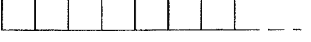

基本思想涉及一条延伸到无限远的无止境的箱子链，以及是否有足够的箱子来容纳一组对象的所有元素的问题。我们假设每个箱子都是任意大的，因此无论大小如何，它都能容纳任何单个对象。但对于给定的集合来说，目标是将它的每个成员放入链中的某个箱子里。两个成员不能在同一个箱子里。如果我们能对一个集合做到这一点，我们就会说我们已经“把这个集合排成了一行”；数学家会说这个集合是可数的。

第一个要考虑的集合是正整数的集合，它可以很容易地排成一行。把 1 放入第一个箱子，2 放入第二个，如此无限继续：

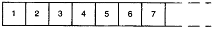

有足够的箱子来容纳每个正整数，而且无论选择哪个整数，它都会在链中的某个地方。正整数和负整数的集合也可以排成一行：

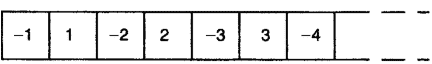

理论上，所有曾经出生的人的名字也可以通过将出生时最轻的人的名字放在箱子 1 中，第二轻的放在箱子 2 中，如此排列来排成一行。在有平局的情况下，可以按另一个维度排序，比如他们身体中的细胞数量。宇宙中的所有分子也可以排成一行，把一个分子放在箱子 1 中，它最近的邻居放在箱子 2 中，第二近的邻居放在箱子 3 中，如此继续。同样，如果需要，可以使用第二个维度来解决平局问题。

这些例子中的主要观点是，我们寻求一个规则，它将展示如何将集合的每个成员放入行中的不同箱子里。如果我们能找到这样的规则，我们就说这个集合可以被排成一行。

考虑所有可打印字符的有限字符串的集合，例如“computers”、“#!-7”和“Let us go.”。这个集合也可以排成一行，将长度为 0 的字符串放在箱子 1 中，长度为 1 的字符串放在箱子 2, 3, 4, 5, . . . , n 中，因为我们假设只有有限数量的不同字符。接下来，长度为 2 的字符串可以放在箱子 n + 1, n + 2, . . . . 中。因此，这个字符串集合将包含任何词典中的所有单词，所有可能写出的句子，所有曾经或将会被写出的书，所有不会被写出的书，以及更多。这个集合也可以被排成一行。

此时，有人可能会认为一些非常大的集合可以被排成一行。也许每个能想象到的集合都可以被排成一行。事实证明，输入正整数并输出正整数的函数是无法被排成一行的。无论一个人如何试图把它们全部塞进箱子里，总会有大量更多的函数无法容纳。这是计算机科学中一个重要的性质，具有重大意义。下一节将证明这是真的，关于这个事实重要性的讨论将在第 15 章关于不可计算性的内容中给出。

## 练习

1. 想象一个在所有方向上无限延伸的巨大二维棋盘。棋盘上所有方格都是可数的吗？也就是说，你能找到一种方法把所有方格排成一行吗？
2. 想象所有 Java 程序的集合。有可能把这个集合排成一行吗？

## 将函数排成一列

让我们开始将函数排成一列，看看这会引向何方。我们只考虑那些以正整数为输入、以正整数为输出的函数，并用输入-输出表来表示每个函数。图 3.9 展示了这一枚举的开头。

列出的第一个函数是“倍乘函数”；第二个计算一个简单的多项式；第三个无论输入是什么总是输出 11；第四个则输出一组相当古怪且不可预测的值。它们都是完全合法的函数，并且都由其无限的表完全确定。

假设一位具有无限耐心和速度的存在继续这里开始的工作，将其余所有存在的函数都排成一列。那么，任务将完成，我们也就展示了如何将另一个大集合排成一列。

然而，考虑如图 3.10 所示构造的新函数。其表按如下方式构建。第一个函数的第一个条目加 1，放入新函数的第一个输出位置。第二个函数的第二个条目加 1，放入新函数的第二个输出位置。一般而言，对于每个`i = 1, 2, 3, \ldots`，第`i`个函数的第`i`个输出位置加 1，放入新函数的第`i`个输出位置。

这个新函数显然与其他任何函数一样合法。它的表是完整且明确指定的。因此，我们那位具有无限耐心和速度的存在一定已经将它放在了某一列的某个位置中。让我们试着找到它。新函数不在第一个位置，因为它在第一个条目上不同。它不在第二个位置，因为它在第二个条目上不同。等等！它在第`i`个位置与第`i`个函数都不同，对所有`i`都是如此。这个新函数与排成一列的每个函数都不同，因此不在任何一个位置中。所以这位快速的存在并没有把每个函数都放进一列中。

### 新函数

| x | f(x) |
|---|---|
| 1 | 3 |
| 2 | 8 |
| 3 | 12 |
| 4 | 2 |
| 5 | . |
| 6 | . |
| 7 | . |

### 排成一列的函数

| x | f(x) |
|---|---|
| 1 | 2 |
| 2 | 4 |
| 3 | 6 |
| 4 | 8 |
| 5 | 10 |
| 6 | 12 |
| 7 | 14 |

| x | f(x) |
|---|---|
| 1 | 4 |
| 2 | 7 |
| 3 | 10 |
| 4 | 13 |
| 5 | 16 |
| 6 | 19 |
| 7 | 22 |

| x | f(x) |
|---|---|
| 1 | 11 |
| 2 | 11 |
| 3 | 11 |
| 4 | 11 |
| 5 | 11 |
| 6 | 11 |
| 7 | 11 |

| x | f(x) |
|---|---|
| 1 | 17 |
| 2 | 109 |
| 3 | 18 |
| 4 | 1 |
| 5 | 512 |
| 6 | 62 |
| 7 | 174 |

+1

+1

+1

+1

+1

图 3.10

很容易找到数百万个被遗漏的函数。考虑像前面的新函数那样构造的函数，只不过对每个条目加的是 2 或 3 或其他某个数。考虑用第一个函数的第二个输出、第二个函数的第三个输出等构建的函数。这个函数及其所有类似的版本也不会在列中。

那些以正整数为输入和输出的函数无法排成一列。数学家说这个函数集合是不可数的。上一节讨论的所有其他集合都是可数的，但这个不是。大多数其他类型的函数同样是不可数的，但这里无需考虑。这些函数无法排成一列是计算机科学中极其重要的事实（如第 15 章关于不可计算性所讨论的）。

## 练习

1. 描述各种不会出现在前述构造的函数列中的函数类型。
2. 可打印字符的无限字符串集合无法排成一列。说明如何修改前述论证来证明这一事实。
3. 指明以下哪些集合可以排成一列，哪些不能。每种情况给出完整解释。
   - (a) 结构良好的英语句子的集合。
   - (b) 输入为正整数、输出为正整数的函数集合，且每个函数具有以下性质：对于给定函数，无论输入是什么，输出都相同。
   - (c) 每个具有无限位小数的十进制数字的集合。
   - (d) 过去存在过或将来会存在的所有生物的集合。
   - (e) 按以下方式构造的无限树的所有路径的集合：根节点下方有两根长度为 1 英寸的分支。每根分支末端是一个节点，该节点下方又有两根长度为 1 英寸的分支。这些分支末端是带有更多分支的节点，如此无限延伸。

## 小结

本章讨论了数值计算及其诸多方面。

首先，我们注意到整数不足以用于一般数值计算，因为它们无法表示分数或极大、极小的值。随后介绍了`double`数值类型，并给出了许多展示其用法的示例。

接下来，我们注意到使用`double`数值进行计算涉及两种可能的隐患：第一，运算符具有优先级，可能导致未加注意的人意想不到的计算顺序，从而得出不期望的结果。第二，计算机在使用`double`数值计算时会出错。这些错误是由计算机寄存器容量有限引起的舍入误差。这些误差在教科书计算中通常无关紧要，但在某些计算中，它们可能累积起来，破坏结果的可靠性。

数学和计算机科学的一个基本概念是函数。本章引入了这一概念，并给出了描述函数的五种不同方法。给出了各种计算函数的程序。有一类函数被考察并证明具有其成员无法“排成一列”的性质。这是集合的一种不寻常性质，其含义将在后文讨论。

本章还考察了循环程序并展示了如何构建它们。这类程序可用于研究函数的性质，即在不同输入上重复求值函数。例如，你可能想找到函数可能具有的最小值或最大值。循环程序还可用于计算复杂函数，如 40 年储蓄计划的累计值。`while`循环结构可用于搜索。`while`循环开头的测试必须设计为在找到要搜索的项目时停止重复。

有经验的程序员会指出，在 Java 中还有编写循环的其他方式。因此，形式：

```java
i = 1;
while (i <= n)
{
    code
    i = i + 1;
}
```

也可以写成：

```java
for (int i = 1; i <= n; i++)
{
    code
}
```

Java 的这一特性和许多其他特性未在当前讨论中涉及，因为这样的特性太多，无法纳入一本目的远更广泛的书中。但是，任何学习并熟练掌握它们的人都欢迎使用它们。

本章还介绍了用于存储数据的数组，并展示了它们在各种情况下的使用。示例程序说明了读取、打印、求和以及查找数组中最大或最小值的方法。

... 好的，然后您要我一、二、三，调出这个程序，然后在那些文件中搜索另一个程序，接着扫描您给我的磁盘找漏洞，完了之后，哎呀老板，我数据库里已经有了。真不敢相信您这就忘了！

# 4 自顶向下编程、子程序与数据库应用

## 让我们破解一个谜案

当午后的阳光在村绿上渐渐消退时，布朗总探长刚刚点燃他的晚间烟斗，突然接到来自邓斯莫尔庄园的紧急电话。电话来自惊恐万分的塞克雷斯特小姐，她发现彼得·邓斯莫尔勋爵倒在客厅地板上。他已经死了。艾米丽夫人因震惊而回房休息，总探长被恳求速赶现场。他确实这样做了，检查尸体后宣布了死因：在最后一两个小时内服下的一剂致命毒药。

家人和仆人似乎过于悲痛而无法接受询问，但房间角落一台别致的小型计算机终端提供了一些家庭数据的访问。探长坐下来开始打字：

今天谁访问了庄园？

机器回应道：

- 梅森先生下午 3:00 来访。
- 教授下午 3:00 来访。
- 塞克雷斯特小姐下午 5:00 来访。

告诉我关于梅森先生的情况？

- 梅森先生的爱好是网球。
- 梅森先生下午 3:00 来访。
- 梅森先生是化学家。

探长打了一长串问题，慢慢地抽着他的烟斗，最终锁定了一个嫌疑人。他能够确定的只有一个人，此人同时具备三项先决条件：明显的动机、获取毒药的途径以及将毒药施加给受害者的方法。

虽然我们可能想知道是谁犯了罪，但作为计算机科学家，我们更感兴趣的是计算机程序如何工作。在本章中，我们研究创建比前几章更大程序的方法论，其中之一就是探长使用的问答程序。在此过程中，我们研究自顶向下的编程方法、子程序的使用，以及控制大型程序复杂性的技术。本章的最后几节说明如何将这些方法论应用于其他示例问题。

## 自顶向下编程与数据库程序

计算机科学的中心问题是复杂性及其处理方法。处理巨大复杂性有两种重要技术：

1. 以易于处理的方式表示问题。
2. 将问题分解为更简单的子任务，然后反复分解这些子任务，直到在最低层次上，每个剩余的子任务都易于理解（图 4.1）。整个问题的解决方案是在分解过程中获得的所有子任务解法的组合。如果每次分解都简单且正确，如果每个最低层次的子任务都易于编码且同样正确，那么完整的程序应该是正确的。

让我们将这些思想应用于创建探长使用的问答程序。存储诸如邓斯莫尔家族信息之类的存储称为数据库。存储此类信息并回答相关问题的程序称为数据库程序。我们当前的任务是构建一个。然而，讨论中暗示的规格说明表明，该程序可能成为一个巨大的工程。如果要取得成功，我们必须找到降低问题复杂性的`/Message/`方法。

因此，我们解决这个问题的首要任务是寻求一种易于理解且能导向尽可能简单程序的表示。作为第一个简化，假设家庭信息存储为一组由陈述句表示的事实，例如：

```text
Mr. Mason visited at 3:00 P.M.

Mr. Mason is a chemist.
```

一旦做出这个决定，我们就不再需要与“信息”这一模糊概念搏斗，程序员的任务是确定存储和检索句子的方法。我们进一步简化，假设所有问题都可以通过简单地查找并展示一些存储的句子——那些回答用户问题的句子——来回答。因此，如果用户提出问题，机器只需确定数据库中是否存在回答该问题的事实，如果找到，则打印出来。我们不考虑程序可能被要求推断数据库中尚未明确存在的新事实的情况。

确定了清晰指定“信息”含义及其性质的表示后，我们可以开始看到解决问题所需的处理类型。处理复杂性的第二步是将整个任务分解为一组易于处理的子部分。

程序需要两种主要能力：读取事实和回答相关问题。我们将用一个包含四个命令的命令结构来构建程序：

- `find`接收问题并打印所有相关事实。
- `input`读取事实。
- `print`打印所有存储的事实。
- `quit`终止程序执行。

担心实际代码还为时过早，但根据前几章的学习，你可以想象为这四个命令各有一个按钮（以及各种标签和`TextFields`）。从图形上看，数据库程序已被分解为四个子任务（图 4.2）。

接下来我们检查三个非平凡的子任务：`Input`、`Find`和`Print`。考虑`Input`例程。首先，在内存中找到一个新的位置，然后读取一个事实并将其放入该新位置：

### `Input`例程

1. 在内存中找到一个新的位置。
2. 将新事实读入该位置。

`Print`例程也很简单：

### `Print`例程


对于内存中有事实的位置，打印其内容。

前进到下一个包含事实的位置。

`Find`例程将首先读取用户的问题。然后它将检查每个存储的事实，并打印那些有助于提供答案的事实。例如，当探长请求关于梅森先生的一般信息时，程序打印了所有提到梅森先生的存储事实。

## `Find`例程

读取用户的问题。

对于内存中有事实的每个位置：

```text
如果该事实有助于回答问题，则打印它。
```

`Find`例程的最后部分似乎很复杂，因为我们不知道何时一个事实“有助于回答问题”。让我们再次分解这个过程，创建一个问题-事实比较器。该例程将检查问题和事实，根据事实是否部分回答了问题，报告“answer”或“no”。使用这个例程，`Find`例程现在相当简单：

## `Find`例程

读取用户的问题。

对于内存中有事实的每个位置：

```text
调用问题-事实比较器。

如果比较器报告“answer”，则

    打印该事实。
```

当然，问题-事实比较器可能是一个复杂的例程，但这是稍后需要研究的问题。

数据库程序现在已发展到图 4.3 所示的状态。一旦我们发现了编程问题-事实比较器的方法，程序就简化为一系列简单的子任务。你应该回顾所有部分，看到看似复杂的数据库程序实际上被有效地简化为相当容易处理的子部分。然而在进一步考虑这些部分之前，我们必须考虑有助于分解过程的子程序。

## 练习

1. 假设一个程序要读取一系列男性和女性的姓名和背景，然后将他们配对，将背景相似的人放在一起。该程序应打印出配对列表。数据应该如何表示？展示如何将这个问题分解为一系列易于编程的子任务。

## 子程序

子程序或子过程是一系列相关的编程语句。我们总是为子程序关联一个名称，以便我们可以引用它。在 Java 中，我们以前见过子程序——它们称为方法。大多数程序员将*子程序*、*子过程*、*方法*、*函数*和*过程*视为同义词，其中一些可以互换使用。以下是一个名为`Byline`的例程的方法定义示例。假设`TextField`对象`m1`和`m2`已在 applet 开始时设置，该子程序打印一条包含作者姓名的消息：

```java
void Byline()
{
    m1.setText("This program was written by");
    m2.setText(" Lady Emily Dunsmore");
}
```

该方法完成了打印所示两行的工作。希望打印这两行的程序员只需包含语句：

```java
Byline();
```

来调用或执行该方法。假设艾米莉·邓斯莫尔女士编写了数据库程序，并决定每次使用时，它都应以打印这两行开始，并以再次打印这两行结束。如果她的 applet 最初如下：

```java
public class DataBase extends java.applet.Applet
                    implements ActionListener
{
    declarations

    public void init()
    {
        initialization code
    }

    public void actionPerformed(ActionEvent event)
    {
        Object cause = event.getSource();

        response code for Input

        response code for Print

        response code for Find

        response code for Quit
    }
}
```

新版本可以这样打包：

```java
public class DataBase extends java.applet.Applet
                    implements ActionListener
{
    TextField m1, m2;
    Button bQuit;

    more declarations

    public void init()
    {
        m1 = new TextField(70);
        m2 = new TextField(70);
        bQuit = new Button("Quit");

        more initialization code

        Byline(); // Here Byline is used.
    }
}
```

```java
public void actionPerformed(ActionEvent event)
{
    Object cause = event.getSource();

    response code for Input

    response code for Print

    response code for Find

    if (cause == bQuit)
    {
        Byline(); // Here Byline is used.
    }
}
```

这会在 applet 初始化期间调用`Byline`，然后在`actionPerformed`方法中再次调用它——当用户按下 Quit 按钮时，`Byline`会被调用。

就程序性能而言，我们没有做任何新的事情。消息在 applet 初始化时显示，然后在响应按钮按下时再次以交互方式显示。

**新的**是打包方式。通过在方法`Byline`之前定义它，我们可以在任何点通过简单地输入语句`Byline();`来调用或触发它。

然而，新版本存在一个问题：它没有展示该方法的定义。此定义放置在 applet 中其他声明之后、`init`代码之前：

```java
public class DataBase extends java.applet.Applet
                    implements ActionListener
```

138 *第 4 章*

```java
{
    TextField m1, m2;
    Button bQuit;

    more declarations

    void Byline() // Here Byline is defined.
    {
        m1.setText("This program was written by");
        m2.setText(" Lady Emily Dunsmore");
    }

    public void init()
    {
        m1 = new TextField(70);
        m2 = new TextField(70);
        bQuit = new Button("Quit");

        more initialization code

        Byline(); // Here Byline is used.
    }

    public void actionPerformed(ActionEvent event)
    {
        Object cause = event.getSource();

        response code for Input

        response code for Print

        response code for Find

        if (cause == bQuit)
        {
            Byline(); // Here Byline is used.
        }
    }
}
```

程序按以下顺序执行：计算从`init`方法的开头开始。当大部分`init`代码执行完毕后，我们到达语句`Byline();`。这会导致方法`Byline`中的语句逐行执行。

在`Byline`完成后，执行将完成第一次对`Byline`的调用，并返回以完成`init`例程的其他部分（如果有）。当初始化完成后，它将等待任何事件，如按钮按下。

当按下 Quit 按钮时，计算机将进入`actionPerformed`例程并逐行执行这些语句。最终它会到达`if`语句，在此处它将确定`Quit`按钮是执行的原因。然后它将再次执行`Byline();`语句。这会导致方法`Byline`中的语句逐行执行。

这些事件在图 4.4 中进行了图示，粗线表示执行，细线表示跳转。路径显示了两次调用以及随后跳转到方法体的过程。

```java
public class DataBase extends java.applet.Applet implements ActionListener
{
    TextField m1, m2;
    Button bQuit;

    more declarations

    void Byline()
    {
        m1.setText("This program was written by");
        m2.setText("    Lady Emily Dunsmore");
    }

    public void init()
    {
        m1 = new TextField(70);
        m2 = new TextField(70);
        bQuit = new Button("Quit");

        more initialization code

        Byline();
    }

    public void actionPerformed(ActionEvent event)
    {
        Object cause = event.getSource();

        response code for Input

        response code for Print

        response code for Find

        if (cause == bQuit)
        {
            Byline();
        }
    }
}
```

## 图 4.4

子程序对程序员来说是极大的帮助，原因有二。首先，它们提供了一种避免重复输入相同代码行的方法。如果相同的任务需要执行两次，如`DataBase`程序中的情况，或者多次，如其他程序中的情况，就不需要反复输入相同的代码行。代码只需输入一次到子程序定义中，在所有其他情况下，只需输入子程序的名称即可调用此代码。由于整个程序会更短，它将使用更少的计算机内存并且更少浪费资源。因为子程序可以有数十行之长，并且可能被频繁调用，节省的效果可能相当可观。

子程序有用的第二个原因甚至比第一个更为重要。子程序使程序员能够将一项任务与另一项任务隔离开来，从而简化他/她的问题解决。例如，`DataBase`程序中`Find`例程的编程问题可能看起来相当复杂。程序需要接收用户的问题，然后输出所有有助于答案的事实。但我们可以通过将部分工作隔离为稍后编写的子程序来大大简化问题。我们编写接收问题的代码，然后，对于每个事实，使用一个子程序——问题-事实比较器——来检查该事实是否是答案的一部分。如果是，代码将输出它：

## `Find`例程

- 读取用户的问题。
- 对于内存中每个包含事实的位置：
  - 调用问题-事实比较器。
  - 如果比较器报告“answer”，则输出该事实。

通过将部分任务推入问题-事实比较器子程序，我们可以有效地编写解决问题的部分代码。稍后我们可以将精力集中在具体的子程序上。我们将问题切分成块，并**希望每个部分都足够小，以便于编程**。

修改`Byline`方法以便输出任何人的名字，而不仅仅是 Lady Emily 的，可能会很方便。以下是适当的更改：

```java
void Byline2(String name)
{
    m1.setText("This program was written by");
    m2.setText(" " + name);
}
```

新的字符串变量`name`引用我们希望输出的名字，它可以是任何字符序列。变量`name`被称为*参数*，当它与方法定义中例程名称`Byline2`后面的括号放在一起时，它被标识为参数。（我们之前遇到过参数，例如`public void actionPerformed(ActionEvent event)`中的`event`。）

变量`name`与程序中的普通变量不同，因为此处声明的参数不会在内存中分配自己的位置。子程序参数（如`name`）引用为其他某个变量创建的内存位置，如下所示。

考虑此程序的执行：

```java
public class WhoWrote extends java.applet.Applet
                    implements ActionListener
{
    TextField m0, m1, m2;
    Button b1, b2, b3;
    String author1, author2, author3;

    void Byline2(String name)
    {
        m1.setText("This program was written by");
        m2.setText("  " + name);
    }

    public void init()
    {
        m0 = new TextField(70);
        m0.setText("Who wrote the program?");
        m1 = new TextField(70);
        m2 = new TextField(70);
        b1 = new Button("Lady Emily");
        b2 = new Button("Shakespeare");
        b3 = new Button("Mark Twain");
        author1 = "Lady Emily Dunsmore";
        author2 = "William Shakespeare";
        author3 = "Mark Twain";
        add(m0);
        add(b1);
        add(b2);
        add(b3);
        add(m1);
        add(m2);
        b1.addActionListener(this);
        b2.addActionListener(this);
        b3.addActionListener(this);
```

```java
public void actionPerformed(ActionEvent event)
{
    Object cause = event.getSource();

    if (cause == b1)
    {
        Byline2(author1);
    }

    if (cause == b2)
    {
        Byline2(author2);
    }

    if (cause == b3)
    {
        Byline2(author3);
    }
}
```

如你所见，根据三个按钮中哪个被按下，`Byline2`会输出不同的消息。例如，如果按下按钮`b2`，即“Shakespeare”，程序将显示：

> This program was written by

> William Shakespeare

变量`author1`、`author2`和`author3`在内存中会有其关联的位置，因为它们已在程序顶部声明。但`name`（一个参数）不会。我们以通常的方式图形化表示这些声明的位置，但将参数表示为指向其他某个实体的箭头（图 4.5）。

为了确保这一新材料被理解，让我们详细考虑程序的执行。`init`方法首先运行，除了以通常方式设置`TextField`和`Button`外，`String`变量在执行以下语句时被赋予值：

```java
author1 = "Lady Emily Dunsmore";
author2 = "William Shakespeare";
author3 = "Mark Twain";
```

在此初始化操作之后，applet 等待用户按下按钮。假设按下`b1`，即“Lady Emily”。这会触发`actionPerformed`方法的执行。变量`cause`被赋值为被按下按钮的标识，这里是`b1`。

```java
public class WhoWrote extends java.applet.Applet implements ActionListener
{
    TextField m0, m1, m2;
    Button b1, b2, b3;
    String author1, author2, author3;

    void Byline2(String name)
    {
        m1.setText("This program was written by");
        m2.setText("  " + name);
    }

    public void init()
    {
        m0 = new TextField(70);
        m0.setText("Who wrote the program?");
        m1 = new TextField(70);
        m2 = new TextField(70);
        b1 = new Button("Lady Emily");
        b2 = new Button("Shakespeare");
        b3 = new Button("Mark Twain");
        ...
```

## 图 4.5


接下来是一系列的`if`语句。我们在第一个语句中匹配成功，因此执行了`Byline2(author1);`。注意这里的参数`author1`。这反过来导致`Byline2`的执行，我们在此重复一下。我们说控制权被传递给了`Byline2`：

```java
void Byline2(String name)
{
    m1.setText("This program was written by");
    m2.setText(" " + name);
}
```

我们知道参数`author1`需要与形参`name`相关联。对于这次对`Byline2`的特定调用，这里发生的事情是`name`实际上被参数`author1`所替换。你应该在脑海中用`author1`替换`name`。因此，在此时此刻，`name`和`author1`指向同一个内存位置。方法体的第一行代码以直接的方式执行。第二行代码现在实际上是：

```java
m2.setText(" " + author1);
```

而不是：

```java
m2.setText(" " + name);
```

因此，输出的结果是 "Lady Emily Dunsmore"（图 4.6）。如果按下另一个按钮，那么不同的参数将被传递给`Byline2`，并发生不同的参数替换。

## 144 第 4 章

```java
void Byline2(String name)
{
    m1.setText("This program was written by");
    m2.setText("   " + name);
}
public void init()
{
       details
}
public void actionPerformed(ActionEvent event)
{
    Object cause = event.getSource();

    if (cause == b1)
    {
        Byline2(author1);
    }
}
```

|  |  |
|---|---|
| author1 | Lady Emily Dunsmore |
| author2 | William Shakespeare |
| author3 | Mark Twain |

## 图 4.6

总而言之，方法的形参在如上所示声明时，并不会创建新的内存位置。相反，它们引用的是已有的内存位置。这些内存位置是在调用子程序时，才与子程序参数相关联的。

我们通过再次修改程序来巩固这些概念。同时，我们也借此机会介绍`return`语句。

## 输出信息——使用 Return 语句

这次包含了一个方法来读取一个人的名字，然后`Byline2`例程将以通常的格式打印出这个名字：

```java
import java.awt.*;
import java.awt.event.*;

public class WrittenBy extends java.applet.Applet
                    implements ActionListener
{
    TextField m0, g0, m1, m2;
    Button b1;
    String author;

    void Byline2(String name)
    {
        m1.setText("This program was written by");
        m2.setText(" " + name);
    }

    String GetName()
    {
        String name;
        name = g0.getText();
        return name;
    }

    public void init()
    {
        m0 = new TextField(80);
        m0.setText("Enter author below and press button.");
        g0 = new TextField(80);
        m1 = new TextField(80);
        m2 = new TextField(80);
        b1 = new Button("button");
        add(m0);
        add(g0);
        add(b1);
        add(m1);
        add(m2);
        b1.addActionListener(this);
    }

    public void actionPerformed(ActionEvent event)
    {
        author = GetName();

        Byline2(author);
    }
}
```

`init`例程没有出人意料的地方，它设置了四个`TextField`和一个单独的`Button`（图 4.7）。程序的用户在第二个`TextField`中输入一行文本，比如 "Lord Dunsmore"，然后按下按钮。这将激活`actionPerformed`方法。因为只有一个按钮，所以接下来需要做什么就毫无悬念了。我们想要从`TextField`中提取文本并将其存储在内存中的一个`String`里。然而，我们调用`GetName`方法来执行此任务。注意它的调用方式。它位于赋值语句等号的右侧。事实上，我们使用它的方式暗示了它是一个变量，可以提供一个值赋给`author`。这正是如此。我们使用`GetName`方法就像使用一个变量一样。

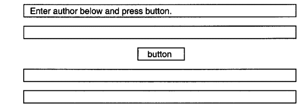

图 4.7

现在让我们跳到`GetName`看看那里执行了什么代码：

```java
String GetName()
{
    String name;
    name = g0.getText();
    return name;
}
```

方法头不是以`void`开头，而是以`String`开头。这里应该放置的是该方法被调用时将提供的信息类型。这里我们说它将为我们提供`String`类型的信息。

在方法体中，我们首先创建了一个`String`类型的新内存位置，一个名为`name`的变量。在下一行，我们在一个赋值语句中为`name`赋值。信息来自`getText`方法——我们获取用户键入第二个`TextField`的供日常会议记录。现在信息已经保存在变量`name`中，我们如何将其返回给最初调用此方法的代码呢？

为此，我们有一个新的语句，称为`return`语句。它将信息返回到方法调用点。然而，请注意，返回内容（`name`）的类型必须与方法头前面指定的类型相匹配。在这两种情况下都是`String`。因此，方法`GetName`可以像变量一样作为信息源来使用。这里，在`author = GetName();`中，它被用于赋值语句的右侧，它确实将已输入`TextField`的字符串提供给了`author`。

现在我们已经在`name`中获得了所需的信息，我们可以调用`ByLine2`方法来完成任务。程序执行的结果如图 4.8 所示。

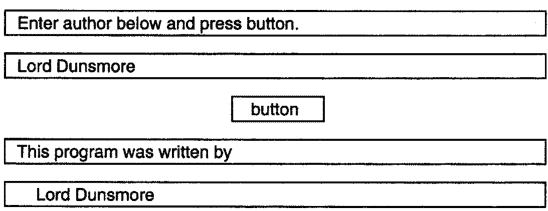

## 练习

1. 编写一个打印你名字的方法。编写一个程序，调用该方法三次，从而打印你的名字三次。

## 带有内部变量的子程序

让我们编写另一个子程序，以研究一个方法可能需要拥有供其自身使用的内存位置的情况。（我们在前一个例子中已经悄悄地这样做了，我们在`GetName`方法中创建了`String`变量`name`。）

假设一个程序员正在勾画一段新代码，并且需要在多个场合计算阶乘。（正整数 $n$ 的阶乘是乘积 $1 * 2 * 3 * \cdots * (n - 1) * n$。4 的阶乘是 $1 * 2 * 3 * 4 = 24$。）这个草图可能包括：

```text
z3 = the factorial of x

y = the factorial of m

num1 = the factorial of y
```

然后可以编写一个带有一个参数的子程序：输入。如果例程的名称是`Factorial`，代码可以写成如下形式：

```java
z3 = Factorial(x);
...
y = Factorial(m);
...
num1 = Factorial(y);
```

子程序本身使用累加模式定义起来很简单。请注意，该例程需要内存位置：`i`用作循环中的计数器，`out`用于累乘乘积：

```java
int Factorial(int n)
{
    int i, out;
    i =盒饭1;
    out = 1;
    while (i <= n)
    {
        out = out * i;
        i = i + 1;
    }
    return out;
}
```

`i`和`out`的声明位于方法头之后，其形式与小程序或类头之后的声明相同。此声明告诉机器设置适当命名的内存位置，这些位置仅供该方法在执行期间使用。

## 全局风险

我们这里遵循的策略是，除非需要被多个方法使用，否则所有变量都应放置在方法内部，即使在那种情况下，对该方法使用*参数*可能更好。在方法外部定义但在该方法内部使用的变量有时称为*全局变量*。

如果不遵循此规则，其导致混淆的原因很容易说明。假设执行：

```java
i = 6;
mX.setInt(i);
```

人们合理地认为会打印 6。如果执行：

```java
i = 6;
result = Factorial(s);
mX.setInt(i);
```

人们会再次期望打印 6，因为没有立即可见的原因表明它不应该打印。（目标始终是编写明显正确且没有微妙行为的代码。）不幸的是，如果`Factorial`以某种方式使用了`i`而没有

## 子程序与作用域

假设它拥有自己的`i`声明，那么可能发生以下序列：`i = 6;`会将 6 加载到`i`中，例程`Factorial`可能将`i`更改为某个新值，例如 10，然后`setInt`语句将打印 10。错误！这是一个非常难以发现的 bug，因为`i`在一个独立的、可能相隔很远的地方被更改，没有任何明显的迹象。当这种情况发生时，你可能要花上几个小时才能找到错误的原因。

因此，需要遵循的规则是：方法中的每个变量都应由参数或在该例程*内部*的声明来指定。当遵循此规则时，你可以确信该子程序可以插入到主程序中，而不会影响主程序中的任何内容，除非是参数列表中特别列出的项目。一个例外是，如果包含该子程序的小程序或类定义了旨在与类中多个方法共享的类变量。小心处理这一点将使你能够避免一种特别麻烦的编程错误。

这里提出的要点可能不太清晰，它们有些微妙。即使是经验丰富的程序员也可能在寻找最佳设计方法上煞费苦心。所做的决策在某种程度上类似于关于地方与联邦控制的政治问题。我们建议的编程风格是在合理的情况下推荐使用本地控制。

## 练习

1. 编写一个名为`Checker`的方法，它读取一个整数，如果该整数大于 0 且小于 100，则打印`Okay`。否则，它应该打印`Not okay`。它应该被设计成可以按以下方式从程序中调用：

```java
applet
{
    ...
    Checker();
    ...
}
```

2. 编写一个具有整数参数的方法。该例程将检查该整数是否为素数。如果是，它将返回字符串`"Yes"`。否则它将返回`"No"`。编写一个简单的小程序来调用你的方法。它应该读取数字，调用该例程，然后获取子程序返回的答案并将其写入`TextField`。（素数是大于 1 且不能被除 1 和自身以外的任何正整数整除的整数。因此 2、3、5 和 7 是素数，但 4 不是，因为它能被 2 整除。在 Java 中，我们可以通过检查`(j/i)*i`是否等于`j`来检查`i`是否能整除`j`。如果它们相等，则`i`能整除`j`；否则不能。该子程序可以通过一个 while 循环来完成其工作，该循环检查从 2 到`j - 1`的每个`i`是否能整除`j`。如果都没有找到，那么`j`就是素数。）

## 带数组参数的子程序

方法可以使用与单个位置大致相同的方法来将数组作为参数。语法将在一个用于将一系列整数相加的程序上下文中进行解释。该程序将具有两个功能不同的部分。一部分是将数据读入数组以供后续处理。这将像第 3 章中那样以交互方式进行，并在`actionPerformed`例程中执行，一次收集一个整数值并将其存储在数组中。我们将有一个单独的方法来对数组中的值求和，并在`TextField`中报告该总和。此方法将通过按钮按下进行调用，因此需要通过`actionPerformed`方法来触发。让我们看看代码：

```java
import awb.*;

import java.awt.*;

import java.awt.event.*;

public class ArraySum extends java.applet.Applet
                    implements ActionListener
{
    TextField mInstruct, mAnswer;
    IntField iCount;
    int B[];
    Button bStore, bTotal, bLargest, bSmallest;
    int count, nextFree;

    int SumArray(int[] data, int firstempty)
    {
        int k, sum;
        k = 0;
        sum = 0;
        while (k < firstempty)
        {
            sum = sum + data[k];
            k = k + 1;
        }
        return sum;
    }

    public void init()
    {
        B = new int[100];
        mInstruct = new TextField(70);
        mAnswer = new TextField(70);
        mInstruct.setText("Enter Count, then press Store button");
        iCount = new IntField(10);
        bStore = new Button("Store");
        bTotal = new Button("Total");
        bStore.addActionListener(this);
        bTotal.addActionListener(this);
        add(mInstruct);
        add(iCount);
        add(bStore);
        add(bTotal);
        add(mAnswer);
    }

    public void actionPerformed(ActionEvent event)
    {
        int value, total;
        Object cause = event.getSource();

        if (cause == bStore)
        {
            value = iCount.getInt();
            B[nextFree] = value;
            nextFree = nextFree + 1;
            iCount.setInt(); // clear IntField
        }

        if (cause == bTotal)
        {
            total = SumArray(B, nextFree);
            mAnswer.setText("The total of " + nextFree
                    + " items is " + total);
        }
    }
}
```

同样，数据输入部分，即在数组中一次收集一个数据，应该从第 3 章开始就熟悉了。Store 按钮的按下触发了值的收集。新的是，在响应 Total 按钮按下时，调用了方法`SumArray`。它返回总和，并将该值赋给整型变量`total`。然后将其用于`setText`调用：

```java
mAnswer.setText("The total of " + nextFree + " items is " + total);
```

请注意，我们还显示了存储在数组中的项目数量。

方法`SumArray`使用两个参数进行调用。第一个是数组的名称`B`。第二个是存储在该数组中有用值的数量，存储在整型变量`nextFree`中。

让我们关注一下`SumArray`方法：

```java
int SumArray(int[] data, int firstempty)
{
    int k, sum;
    k = 0;
    sum = 0;
    while (k < firstempty)
    {
        sum = sum + data[k];
        k = k + 1;
    }
    return sum;
}
```


参数列表中数组 `data` 的规范遵循与其他参数相同的格式，只是类型（或类）后跟方括号 `[ ]`，表示 `data` 是一个数组。在这个应用中，数组参数 `B` 有效地替换了参数 `data`。使用局部整型变量 `k` 和 `sum`，我们以直接的方式对元素求和。

应该很清楚，人们可以编写其他类似的方法来处理数组的内容。我们可以轻松编写一个例程来查找数组中的最大元素，或数组最大元素的索引（或位置）。以下程序扩展了前一个程序的功能，并说明了这两个建议的函数。

```java
import awb.*;

import java.awt.*;

import java.awt.event.*;

public class ArrayStuff extends java.applet.Applet
                      implements ActionListener
{
    TextField mInstruct, mAnswer;

    IntField iCount;

    int B[];

    Button bStore, bTotal, bLargest, bLargeIndex;

    int count, nextFree;

    int Largest(int[] data, int firstempty)
    {
        int k, big;

        big = data[0];
        k = 1;

        while (k < firstempty)
        {
            if (data[k] > big)
            {
                big = data[k];
            }

            k = k + 1;
        }

        return big;
    }

    int LargeIndex(int[] data, int firstempty)
    {
        int k, indexBig;

        indexBig = 0;
        k = 1;

        while (k < firstempty)
        {
            if (data[k] > data[indexBig])
            {
                indexBig = k;
            }

            k = k + 1;
        }

        return indexBig;
    }

    int SumArray(int[] data, int firstempty)
    {
        int k, sum;

        k = 0;
        sum = 0;

        while (k < firstempty)
        {
            sum = sum + data[k];
            k = k + 1;
        }

        return sum;
    }

    public void init()
    {
        B = new int[100];

        mInstruct = new TextField(70);
        mAnswer = new TextField(70);

        mInstruct.setText("Enter Count, then press Store button");

        iCount = new IntField(10);

        bStore = new Button("Store");
        bTotal = new Button("Total");
        bLargest = new Button("Largest");
        bLargeIndex = new Button("LargeIndex");

        bStore.addActionListener(this);
        bTotal.addActionListener(this);
        bLargest.addActionListener(this);
        bLargeIndex.addActionListener(this);

        add(mInstruct);
        add(iCount);
        add(bStore);
        add(bTotal);
        add(bLargest);
        add(bLargeIndex);
        add(mAnswer);
    }

    public void actionPerformed(ActionEvent event)
    {
        int value, total;

        Object cause = event.getSource();
```

```java
if (cause == bStore)
{
    value = iCount.getInt();

    B[nextFree] = value;
    nextFree = nextFree + 1;

    iCount.setInt(); // clear IntField
}

if (cause == bTotal)
{
    total = SumArray(B, nextFree);

    mAnswer.setText("The total of " + nextFree + " items is " + total);
}

if (cause == bLargest)
{
    value = Largest(B, nextFree);

    mAnswer.setText("The largest of " + nextFree + " items is " + value);
}

if (cause == bLargeIndex)
{
    value = LargeIndex(B, nextFree);

    mAnswer.setText("The location of the largest item is " + value);
}
}
```

这段代码没有什么意外之处。`ArraySum` 的所有代码都在那里，再加上两个新方法。在 `actionPerformed` 方法中，我们添加了额外的 `if` 语句来识别 `"Largest"` 和 `"LargestIndex"` 按钮的激活。`Largest` 方法的核心是一个遍历数组中所有正在使用元素的循环。在该循环中我们找到：

```java
if (data[k] > big)
{
    big = data[k];
}

k = k + 1;
```

在循环之前，我们将整数变量 `big` 初始化为第一个数组元素的副本。这是我们对 `big` 的试验值。在循环中，使用 `if` 语句，我们试图找到一个更好的元素，即一个比我们存储在 `big` 中的试验值更大的元素。如果找到了更好的值，我们通过编码 `big = data[k];` 用更好的值替换存储在 `big` 中的数值。我们在循环中最后做的事情是将索引 `k` 递增，指向下一个数组元素。当循环结束时，`big` 将包含数组 `data` 中的最大值，然后通过 `return big;` 语句将其返回给调用程序。

`LargeIndex` 方法在结构上确实非常相似。但是，返回的不是最大值，而是显示该最大值在数组中位置的索引。

## 练习

1. 设计一种使用两个按钮显示数组中所有元素的方法。任何时候只能看到数组中的一个值。
2. 编写一个方法 `DoubleArray(n,A)`，将数组 `A` 中的所有条目加倍。
3. 编写一个方法 `CopyArray(n,A,B)`，将数组 `A` 中的 `n` 个条目复制到数组 `B` 中。
4. 编写一个使用练习 3 中的 `DoubleArray` 和 `CopyArray` 方法以及你在练习 1 中开发的方法的小程序，执行以下操作：
   - 读取 `n` 个值到数组 `xx` 中。
   - 允许你显示数组 `xx`。
   - 然后将 `xx` 中的值加倍，并允许你再次显示它们。
   - 然后将 `xx` 中的值移动到数组 `yy` 中。
   - 最后，将 `yy` 中的值加倍，并允许显示该数组。

你的程序应包含必要的按钮和 `TextFields` 来完成此操作。

## 子程序通信示例

由于与子程序之间的信息流动可能令人困惑，这里研究了几种不同类型通信的示例。在每种情况下，子程序都将命名为 `Triple`，它将某个数值变为三倍。有趣之处在于它如何获取输入以及数值改变后它做什么。

第一个例子是完全没有任何通信的情况。该方法对一个空条目进行三倍操作，并且对结果不做任何处理（图 4.9）：

```java
applet
{
    ...

    void Triple()
    {
        double r1, r2;

        r2 = 3 * r1;
    }

    ...

    Triple();

    ...
}
```

这个不成功的程序可以通过在方法中添加输入和输出语句来修复。我们必须假设包含类中有一些 `DoubleFields` 和 `TextFields`，比如说 `dR1` 和 `mR2`：

```java
applet
{
    ...

    void Triple()
    {
        double r1, r2;

        r1 = dR1.getDouble();
        r2 = 3 * r1;

        mR2.setText("Triple the value is " + r2);
    }
}
```

### 第 4 章

```java
...
Triple();
...}
```

图 4.10 显示了信息从键盘传递到子程序，在那里被三倍化，然后显示出来。接下来，我们可以通过参数列表将信息传递给子程序，然后让该例程像以前一样打印其答案：

```java
applet
{
    ...

    DoubleField dR;
    TextField mR2;

    ...

    void Triple(double r1)
    {
        double r2;

        r2 = 3 * r1;

        mR2.setText("Triple the value is " + r2);
    }

    ...

    double r;

    ...

    r = dR.getDouble();
    Triple(r);

    ...
}
```

### 自上而下的编程、子程序和数据库应用

在这种形式中，信息进入例程但不出来，除了显示在屏幕上（图 4.11）。我们还可以修改该方法，使用 `return` 语句将其输出返回（图 4.12）：

```java
applet
{
    ...

    DoubleField dR;
    TextField mR2;

    ...

    double Triple(double r1)
    {
        double r2;
```

```java
r2 = 3 * r1;
return r2;
}

...

double r1, r2;

...

r1 = dR.getDouble();
r2 = Triple(r1);

mR2.setText("Triple the value is " + r2);

...
```

这四个程序总结了四种不同的选项（尽管第一个版本毫无用处）。请记住，许多程序细节被省略了。我们关注的是如何将信息传入和传出方法。

## 存储和打印数据库事实

我们现在必须制定一个系统的计划来存储引言部分给出的那种数据库事实：

- Mason 先生是一位化学家。
- 教授在下午 3:00 来访。

重要的是要注意，这些事实大多具有以下形式：

> （名词短语）（关系）（名词短语）

我们稍后将发现，如果将每个事实分成这三个部分，问答任务将变得更加容易：

- （Mason 先生）（是）（一位化学家。）
- （教授）（在……来访）（下午 3:00）

我们将第一部分称为 `noun1`（名词短语 1），第二部分称为 `relation`（关系），最后一部分称为 `noun2`（名词短语 2），并将这些声明为 `String` 变量。此策略将使用以下 Java 语句存储第一个事实：

```java
noun1 = "Mr. Mason";

relation = "is";

noun2 = "a chemist.";
```

为了将事实读入这些位置，可以使用 `TextField` 和以下语句：

```java
noun1 = n1.getText();

relation = r.getText();

noun2 = n2.getText();
```

因此，事实应按图 4.13 所示的方式输入。

将语句分成三个字段使程序能够将字符字符串分成三个字符串，用于三个连续的位置。

但是数据库程序需要存储许多事实，因此这三个位置应该扩展为数组。这可以通过以下声明来完成，该声明指定每个数组最多应容纳 100 个字符串：

```java
String noun1A[], relationA[], noun2A[];
```

并在 `init` 方法中使用以下内容：

```java
noun1A = new String[100];

relationA = new String[100];

noun2A = new String[100];
```

内存中的期望结果如图 4.14 所示。

让我们创建一个名为 `last` 的位置，它给出表中最后一个事实的位置。如果只存储了两个事实，则该位置将是 1；如果需要一个新事实的位置，我们会将 `last` 增加到 2 并将新事实放在位置 2。现在可以用英语编写数据库输入例程的粗略代码：

*输入例程*

在内存中找到一个新位置。  
将新事实读入该位置。

代码为：

```java
void InputFact()
{
    last = last + 1;

    noun1A[last] = gN1.getText();
    gN1.setText(" ");

    relationA[last] = gRel.getText();
    gRel.setText(" ");

    noun2A[last] = gN2.getText();
    gN2.setText(" ");
}
```

这个例程正是我们所需要的。变量 `last` 递增以指向数组中的下一个空槽。然后，对于 `TextField` `gN1`，我们将字符串分配给数组 `noun1A` 中的下一个空闲槽。类似地，我们从 `gRel` 和 `gN2` 获取相应的信息。为了使实际向小程序输入数据的人的工作更轻松，我们在复制信息后清除每个 `TextField`。例如，`gN1.setText(" ");` 将一个空字符串（即，无）放入 `TextField` `gN1` 中。

显然，我们还没有查看整个程序。在 `actionPerformed` 中，我们有代码：

```java
if (cause == bEnter)
{
    InputFact();
}
```

来响应用户按下 `Enter` 按钮。

在本章前面讨论了信息如何传入和传出方法之后，你可能会有另一个问题：这里的信息是如何交换的？我们利用的是方法和数据都在一个类中的事实，在本例中是小程序 `DataBase`。类中定义的所有成员变量都“已知”于类中的所有方法。因此，这里不需要显式使用参数和实参。这种在类内对数据的全局使用有其风险，但由于一个更大的程序通常通过使用多个类来实现，这样每个人共享同一数据池的风险就被分隔开，从而受到限制。

总而言之，`InputFact` 将信息放入三个在该类内部已知的数组中。（该例程假设数组足够大，可以存储用户将要输入的所有事实。你可能希望修改该方法，以便在用户试图输入超出数组容量的事实时打印“Too many facts”消息。）

开发数据库小应用程序的一个有用下一步是拥有一个可以转储所有数据的例程。这不是程序的使用方式，但它是开发程序并确保事实已进入数组且可供使用的有用工具。因此，下一个方法 `DumpData` 就是有时被称为诊断例程的东西。它主要存在于使我们的程序开发更容易并避免错误。该例程是：

```java
void DumpData()
{
    mResults.setText("Dump of data\n");

    k = 0;

    while (k <= last)
    {
        mResults.append(k + " " + noun1A[k] + " " + relationA[k] + " "
                        + noun2A[k] + "\n");

        k = k + 1;
    }
}
```

仔细观察 `DumpData` 方法应该会表明，一切照旧。当然，我们需要一个按钮来触发这个信息转储。你应该注意到 `mResults` 有一个名为 `append` 的新方法。自然会假设 `mResults` 也是一个 `TextField`，因为我们在开头对它使用了 `setText` 方法，但事实证明并非如此。

这是我们第一次使用与 `TextField` 相关的类，称为 `TextArea`。它处理多行文本并生成一个完整的窗口来显示文本行。我们在小应用程序的开头将其声明为：

```java
TextArea mResults;
```

并在 `init` 方法中创建它：

```java
mResults = new TextArea(10, 60);
```


从而指定我们希望它能够显示多达十行文本，每行最多 60 个字符。由于显示会生成滚动条，我们实际上可以访问比这多得多的行。

`TextField` 和 `TextArea` 都可以使用 `setText` 方法这一事实，说明了面向对象编程及其 Java 实现的另一个重要编程思想。这被称为继承。`TextField` 和 `TextArea` 都是从一个名为 `TextComponent` 的父类派生而来的。它实际实现了 `setText` 方法。`TextField` 和 `TextArea` 都继承了该方法并可以使用它。

如果你仔细阅读代码，可能已经注意到对于 `TextArea`，我们用序列 `\n` 结束字符串。在字符串中，这是一个特殊的控制序列，表示“开始新行”，它的工作方式非常像打字机上的 Return 键或键盘上的 Enter 键。由于 `TextArea` 处理多行文本字段，因此经常需要这个控制序列。

以下是到目前为止实现的完整 `DataBase` 程序。它只能读取数据，然后确认所有数据都已成功存储：

```java
import awb.*;

import java.awt.*;

import java.awt.event.*;

public class DataBase extends java.applet.Applet
            implements ActionListener
{
    TextField gN1, gRel, gN2, mInstruct;

    String noun1A[], relationA[], noun2A[];

    TextArea mResults;

    Button bEnter, bAll;

    int last;

    public void init()
    {
        last = -1;

        noun1A = new String[100];

        relationA = new String[100];

        noun2A = new String[100];

        mInstruct = new TextField(70);

        mInstruct.setText
        ("Enter facts in the three fields below and press Enter button.");

        gN1 = new TextField(25);

        gRel = new TextField(25);

        gN2 = new TextField(25);

        mResults = new TextArea(10, 60);

        bEnter = new Button("Enter");

        bAll = new Button("All");
```

```java
bEnter.addActionListener(this);

bAll.addActionListener(this);

add(mInstruct);

add(gN1);

add(gRel);

add(gN2);

add(bEnter);

add(bAll);

add(mResults);
```

```java
public void actionPerformed(ActionEvent event)
{
    Object cause = event.getSource();

    if (cause == bEnter)
    {
        InputFact();
    }

    if (cause == bAll) // mainly used for debugging
    {
        DumpData();
    }
}
```

```java
void InputFact()
{
    last = last + 1;

    noun1A[last] = gN1.getText();

    gN1.setText(" ");

    relationA[last] = gRel.getText();

    gRel.setText(" ");

    noun2A[last] = gN2.getText();

    gN2.setText(" ");
}
```

```java
void DumpData()
{
    int k;

    mResults.setText("Dump of data\n");

    k = 0;

    while (k <= last)
    {
        mResults.append(k + " " + noun1A[k] + " " + relationA[k] +
            " " + noun2A[k] + "\n");
```

## Chapter 4

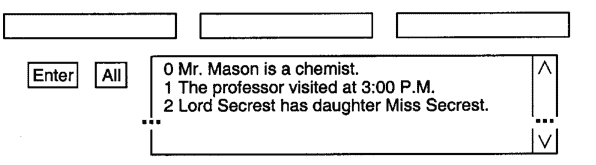

### Figure 4.15

```java
k = k + 1;

        }

    }

}
```

图 4.15 显示了输入三组事实然后按 All 按钮转储后屏幕可能的样子。

## Exercise

1. 修改 `InputFact`，以便如果用户试图输入超出容量的事实，系统将拒绝接受并打印消息“Too many facts。”

## 表示问题并找到它们的答案

假设使用上一节的方法在机器中存储了大量事实。不了解这些事实的人如何访问信息？这个问题将非常保守地处理，然后一种看似狭窄的技术将被扩展为强大的查询处理机制。

假设用户想知道，Mason 先生是化学家这是真的吗？对于我们的问答程序，查询可以改写为，下面这个事实：

`(Mr. Mason) (is) (a chemist.)`

在数据库中吗？我们将编写代码，以便系统询问用户查询，用户输入她希望检查的事实。然后系统将响应，如果在数据库中找到该事实，则再次显示该事实。

让我们使用之前开始的模型来编写代码以解决这个简单问题。

## Find 方法

- 读取用户的问题。
- 对于内存中每个存放事实的位置，调用问题-事实比较器。
- 如果比较器报告匹配，则打印该事实。

基于此，我们可以编写以下代码：

```java
void Find()
{
    String noun1, relation, noun2;

    int k;

    noun1 = gN1.getText();

    relation = gRel.getText();

    noun2 = gN2.getText();

    mResults.setText("THE RELATED FACTS\n");

    k = 0;

    while (k <= last)
    {
        if (QFCompare(noun1, relation, noun2, k) == 1) // 1 means match
        {
            mResults.append(noun1A[k] + " " + relationA[k] + " " +
                    noun2A[k] + "\n");
        }

        k = k + 1;
    }
}
```

这由 `actionPerformed` 方法中的以下新行调用：

```java
if (cause == bFind)
{
    Find();
}
```

请注意，为了输入查询，我们使用了与输入事实相同的 `TextField`。但我们按 Find 按钮而不是 Enter 按钮。查看 `Find` 例程，你会看到它在 `TextArea` 顶部打印标题 `THE RELATED FACTS`。然后使用 `while` 循环，它遍历输入的每一组事实。

使用 `QFCompare`，它检查查询事实是否在数据库中。如果是，`QFCompare` 返回 1，但如果找不到事实，则返回 0。每当我们得到 1 时，我们将相应的事实写入 `TextArea`。

`QFCompare` 的任务是如果查询事实与数据库事实相同则返回 1。也就是说，它必须检查 `noun1 = noun1A[k]` 并且 `relation = relationA[k]` 并且 `noun2 = noun2A[k]`。所有三个关系都必须为真。代码如下：

```java
int QFCompare(String noun1, String relation, String noun2, int k)
{
    if (noun1.equals(noun1A[k])
                && relation.equals(relationA[k])
                && noun2.equals(noun2A[k]))
    {
        return 1; // 1 means query matched database
    }
    else
    {
        return 0; // 0 means no match
    }
}
```

选择 1 表示匹配，0 表示不匹配是任意的。我们可以选择任何我们想要的值集，只要程序的两部分就所使用的系统达成一致。

这里的新项目是我们比较两个字符串的方式。不幸的是，我们不能简单地使用 `==` 运算符，就像我们在比较 `int` 变量与 `int` 变量以及 `double` 变量与 `double` 变量时那样。由于 `String` 是类，我们需要使用 `String` 类的方法。`String` 类有一个 `equals` 方法，恰好执行我们想要的操作。因此，要将 `noun1` 与第 `k` 个数组元素 `noun1A[k]` 进行比较，我们写 `noun1.equals(noun1A[k])`。请注意，我们也可以写 `noun1A[k].equals(noun1)`，因为相等性测试是对称的。要组合三个测试以确认三个都匹配，我们使用 `&&` 运算符，它表示并且。如前所述，我们必须确保 `noun1 = noun1A[k]` 并且 `relation = relationA[k]` 并且 `noun2 = noun2A[k]`。

此代码按预期运行。如果用户希望搜索给定事实，则将该事实作为查询输入。如果找到该事实，系统将打印它。例如，在输入一些事实然后询问 Mason 先生是否是化学家之后，我们可能会看到图 4.16 中的显示。

我们已经开发了代码来确定给定事实是否在数据库中。如果找到该事实，则打印它。如果找不到，程序将在消息 `THE RELATED FACTS` 之后不打印任何内容。然而，这不是一个令人兴奋的能力，当然在下面的三个字段中输入事实，然后按“Enter”按钮。

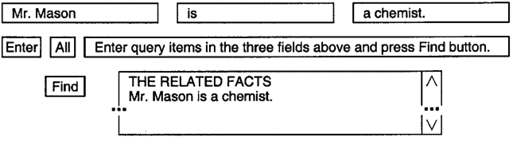

### 图 4.16

这对布朗探长来说帮助不大。那么如何回答更有趣的问题呢？假设已知有人在今天下午 3 点来访，但不知道是谁。也就是说，我们要查询是否存在任何形式为：

`( ) (visited at) (3:00 P.M.)`

的事实，答案会在第一个字段中找到。因此，找到答案的方法是搜索数据库，并打印任何在第二和第三字段上匹配的事实。向机器输入这个问题的一个好方法是：

`(?) (visited at) (3:00 P.M.)`

其中问号表示“用户不知道此信息”。下面是对 `QFCompare` 例程的修改以处理此查询：

```java
int QFCompare(String noun1, String relation, String noun2, int k)
{
    if ((noun1.equals(noun1A[k]) || noun1.equals("?"))
                    && relation.equals(relationA[k])
                    && noun2.equals(noun2A[k]))
    {
        return 1; // 1 means query matched database
    }
    else
    {
        return 0; // 0 means no match
    }
}
```

如果问题的第一个字段 `noun1` 不是 `"?"`，则代码将像以前一样工作。如果 `noun1` 是 `"?"`，那么只要同时满足 `relation = relationA[k]` 和 `noun2 = noun2A[k]`，该例程也会返回 1。因此，它会忽略第一个字段，并打印任何在第二和第三字段上一致的事实。我们通过允许匹配或查询 `"?"` 都产生真结果来实现这一点。我们引入了或（or）的逻辑运算符来实现这一点，即 `||`。垂直的“或”（or）竖线给了我们强大的新灵活性。图 4.17 展示了用户将看到的屏幕。成功！这个程序显然将对布朗探长有用。让我们尝试另一个查询（图 4.18）。

这个大幅改进的系统是通过允许在任何查询的第一个字段中使用问号来实现的。问号意味着用户不知道该字段中应填入什么，系统应打印在其他两个字段上匹配的所有事实。接下来显而易见的扩展是允许在任何字段中使用问号。有了这个改变，就可以问各种各样的问题，如下面的问题及相应的查询条目所示：

梅森先生是在什么时间来访的？

```text
(Mr. Mason) (visited at) (?)
```

## 自顶向下编程、子程序和数据库应用

梅森先生在下午 3 点时在做什么？

`(Mr. Mason) (?) (3:00 P.M.)`

把关于梅森先生的每一条事实都告诉我。

`(Mr. Mason) (?) (?)`

以及：

`(?) (?) (?)`

今天谁来访了，什么时间来的？

`(?) (visited at) (?)`

下午 3 点发生了什么？

`(?) (?) (3:00 P.M.)`

把你所知道的全部告诉我。

`(?) (?) (?)`

这个查询系统现在对于探长的使用来说已经相当令人满意的。他可以轻松地提出任何问题来找到他的主要嫌疑人。

总之，本章开始时面对的是一项看似庞大而复杂的任务：编写一个能够存储信息并对这些信息回答几乎任何问题的程序。解决方案是将任务简化为仅仅是存储和检索事实，并发现了一种强大的检索方法。编码工作量通过分解为子任务而减少到可管理的规模，然后使用子程序来实现这些子任务。

## 练习题

1. 说明如何修改 `QFCompare` 方法以处理每个字段中的问号。

2. 设计一个名为 `FindAll` 的方法，它从用户那里接收一个字符串，例如 `"Mr. Mason"`，然后打印在任何字段中包含该字符串的所有事实。在这种情况下，它将打印如下事实：

   - 梅森先生于下午 3 点来访。
   - 探长是梅森先生的客户。

## 组装数据库程序并添加注释

数据库程序的大部分编码工作已在前面几节中完成。但还需要再做一项补充，才能以专业的方式完成该程序。那就是添加足够的注释语句，以便为日后可能希望阅读或修改该代码的人提供适当的文档说明。一个注释恰当的程序应包含有关其输入输出特性和运行方法的足够信息，使代码的阅读者能够使用它、理解其功能，并在必要时修改它。程序注释还应注明作者，并提供其他基本信息，如日期和应用。

本书中的大多数程序没有太多注释，因为周围的文字包含了必要的信息，而注释可能会分散对代码的注意力。但在其他情况下，程序必须独立存在，没有此类解释性材料，程序员应仔细添加所需信息以保持其效用。大多数工业组织对其程序员都有标准，规定了代码应如何编写和记录。

代码文档的合理策略包括四种注释：

1. **程序头。** 它出现在程序的开头，包括 (a) 程序员姓名和其他基本信息，(b) 程序的输入输出规范，以及 (c) 代码如何工作的简要说明。

2. **代码块头。** 编写良好的代码总是组织成“块”结构，这些代码块是自成一体的，执行定义明确的任务，如读取、排序或计算。每个代码块的开头应有足够的注释来说明其目的和基本操作。代码块通常长 5 到 20 行，在许多情况下组织成子程序。在某些情况下，代码块的作者可能与主要作者不同，块头中应包含适当的署名。

3. **方法的前置条件和后置条件。** 前置条件直接放在方法头下方，说明该方法需要哪些信息以及这些信息必须满足哪些约束才能使方法正确工作。后置条件说明我们可以对该方法有什么期望。它就像一个“契约”，说的是：如果满足前置条件，那么结果数据将满足后置条件中规定的标准。

4. **行注释。** 你应该编写直截了当的代码，使其操作对任何读者来说都是显而易见的。但偶尔在代码行的右侧添加一个简短的注释以阐明其含义是有帮助的。注释在数组声明或发生关键计算任务的赋值语句处特别有用。

遵守这些标准应该会产生一个可以被任何称职的程序员阅读、使用或修改的完整程序。以下是完整注释的数据库程序：

```java
//              数据库程序

//              作者：Alan W. Biermann

//              1996 年 1 月

//              D. Ramm 于 1999 年 9 月修改

//

//

//输入：在输入模式下，“事实”按三个字段读取：

//名词短语、关系、名词短语。例如，“John is a

//boy.” 被分成三个部分，“John”、“is” 和 “a boy.”

//这三个部分通过三个文本字段输入到程序中

//

//输入一个事实。输入三个字段，然后按“Enter”按钮

//[John   ] [is   ] [a boy. ]

//

//在查询模式下，查询以与事实相同的

//格式读取，只是某些字段可能有问号

//而不是数据。

//

//输出：在查询模式下，程序将所有在不带问号的

//字段上与查询匹配的事实打印到一个文本区域中。

//

//操作方法：事实存储在三个数组中，

//分别称为 noun1A、relationA 和 noun2A。第 k 个事实的第一、

//第二和第三字段分别存放在 noun1A、relationA 和

//noun2A 的第 k 个条目中。程序通过顺序检查每个存储的

//事实来回答查询，如果它在不带问号的字段上与

//查询匹配，则将其打印出来。

import java.awt.*;

import java.awt.event.*;
```


```java
public class DataBase extends java.applet.Applet
              implements ActionListener
{
    TextField gN1, gRel, gN2, mInstruct, mInstruct2;

    String noun1A[], relationA[], noun2A[]; // 事实存储在这些数组中

    TextArea mResults;

    Button bEnter, bAll, bFind;

    int last; // last 表示存储了多少个事实

    public void init()
    // 后置条件：所有类数据成员已创建、初始化，并
    // 指定布局，已为所有按钮激活监听器
```

在下面的三个字段中输入事实，然后按“Enter”按钮。


图 4.16

这对布朗探长来说帮助不大。那么如何回答更有趣的问题呢？假设已知有人在今天下午 3 点来访，但不知道是谁。也就是说，我们要查询是否存在任何形式为

```text
( ) (visited at) (3:00 P.M.)
```

的事实，答案会在第一个字段中找到。因此，找到答案的方法是搜索数据库，并打印任何在第二和第三字段上匹配的事实。向机器输入这个问题的一个好方法是：

```text
(?) (visited at) (3:00 P.M.)
```

其中问号表示“用户不知道此信息”。下面是对`QFCompare`例程的修改以处理此查询：

```java
int QFCompare(String noun1, String relation, String noun2, int k)
{
    if ( (noun1.equals(noun1A[k]) || noun1.equals("?"))
                    && relation.equals(relationA[k])
                    && noun2.equals(noun2A[k]) )
    {
        return 1; // 1 means query matched database
    }
    else
    {
        return 0; // 0 means no match
    }
}
```

如果问题的第一个字段`noun1`不是`"?"`，则代码将像以前一样工作。如果`noun1`是`"?"`，那么只要同时满足`relation = relationA[k]`和`noun2 = noun2A[k]`，该例程也会返回 1。因此，它会忽略第一个字段，并打印任何在第二和第三字段上一致的事实。我们通过允许匹配或查询`"?"`都产生*真*的结果来实现这一点。我们引入了*或*（`or`）的逻辑运算符来实现这一点，即`||`。垂直的“或”竖线给了我们强大的新灵活性。图 4.17 展示了用户将看到的屏幕。成功！这个程序显然将对布朗探长有用。让我们尝试另一个查询（图 4.18）。

这个大幅改进的系统是通过允许在任何查询的第一个字段中使用问号来实现的。问号意味着用户不知道该字段中应填入什么，系统应打印在其他两个字段上匹配的所有事实。接下来显而易见的扩展是允许在任何字段中使用问号。有了这个改变，就可以问各种各样的问题，如下面的问题及相应的查询条目所示：

梅森先生是在什么时间来访的？

```text
(Mr. Mason) (visited at) (?)
```

## 自顶向下编程、子程序和数据库应用

梅森先生在下午 3 点时在做什么？

```text
(Mr. Mason) (?) (3:00 P.M.)
```

把关于梅森先生的每一条事实都告诉我。

```text
(Mr. Mason) (?) (?)
```

以及：

```text
(?) (?) (?)
```

今天谁来访了，什么时间来的？

```text
(?) (visited at) (?)
```

下午 3 点发生了什么？

```text
(?) (?) (3:00 P.M.)
```

把你所知道的全部告诉我。

```text
(?) (?) (?)
```

这个查询系统现在对于探长的使用来说已经相当令人满意。他可以轻松地提出任何问题来找到他的主要嫌疑人。

总之，本章开始时面对的是一项看似庞大而复杂的任务：编写一个能够存储信息并对这些信息回答几乎任何问题的程序。解决方案是将任务简化为仅仅是存储和检索事实，并发现了一种强大的检索方法。编码工作量通过分解为子任务而减少到可管理的规模，然后使用子程序来实现这些子任务。

## 练习题

1. 说明如何修改`QFCompare`方法以处理每个字段中的问号。

2. 设计一个名为`FindAll`的方法，它从用户那里接收一个字符串，例如`"Mr. Mason"`，然后打印在任何字段中包含该字符串的所有事实。在这种情况下，它将打印如下事实：

   梅森先生于下午 3 点来访。

   探长是梅森先生的客户。

## 组装数据库程序并添加注释

数据库程序的大部分编码工作已在前面几节中完成。但还需要再做一项补充，才能以专业的方式完成该程序。那就是添加足够的注释语句，以便为日后可能希望阅读或修改该代码的人提供适当的文档说明。一个注释恰当的程序应包含有关其输入输出特性和运行方法的足够信息，使代码的阅读者能够使用它、理解其功能，并在必要时修改它。程序注释还应注明作者，并提供其他基本信息，如日期和应用。

本书中的大多数程序没有太多注释，因为周围的文字包含了必要的信息，而注释可能会分散对代码的注意力。但在其他情况下，程序必须独立存在，没有此类解释性材料，程序员应仔细添加所需信息以保持其效用。大多数工业组织对其程序员都有标准，规定了代码应如何编写和记录。

代码文档的合理策略包括四种注释：

1. **程序头。**它出现在程序的开头，包括 (a) 程序员姓名和其他基本信息，(b) 程序的输入输出规范，以及 (c) 代码如何工作的简要说明。

2. **代码块头。**编写良好的代码总是组织成“块”结构，这些代码块是自成一体的，执行定义明确的任务，如读取、排序或计算。每个代码块的开头应有足够的注释来说明其目的和基本操作。代码块通常长 5 到 20 行，在许多情况下组织成子程序。在某些情况下，代码块的作者可能与主要作者不同，块头中应包含适当的署名。

3. **方法的前置条件和后置条件。**前置条件直接放在方法头下方，说明该方法需要哪些信息以及这些信息必须满足哪些约束才能使方法正确工作。后置条件说明我们可以对该方法有什么期望。它就像一个“契约”，说的是：如果满足前置条件，那么结果数据将满足后置条件中规定的标准。

4. **行注释。**你应该编写直截了当的代码，使其操作对任何读者来说都是显而易见的。但偶尔在代码行的右侧添加一个简短的注释以阐明其含义是有帮助的。注释在数组声明或发生关键计算任务的赋值语句处特别有用。

遵守这些标准应该会产生一个可以被任何称职的程序员阅读、使用或修改的完整程序。以下是完整注释的数据库程序：

```java
//              数据库程序
//              作者：Alan W. Biermann
//              1996 年 1 月
//              D. Ramm 于 1999 年 9 月修改
//
//
// 输入：在输入模式下，“事实”按三个字段读取：
// 名词短语、关系、名词短语。例如，"John is a
// boy." 被分成三个部分，"John"、"is" 和 "a boy."
// 这三个部分通过三个文本字段输入到程序中
//
// 输入一个事实。输入三个字段，然后按“Enter”按钮
// [John   ] [is   ] [a boy. ]
//
// 在查询模式下，查询以与事实相同的
// 格式读取，只是某些字段可能有问号
// 而不是数据。
//
// 输出：在查询模式下，程序将所有在不带问号的
// 字段上与查询匹配的事实打印到一个文本区域中。
//
// 操作方法：事实存储在三个数组中，
// 分别称为 noun1A、relationA 和 noun2A。第 k 个事实的第一、
// 第二和第三字段分别存放在 noun1A、relationA 和
// noun2A 的第 k 个条目中。程序通过顺序检查每个存储的
// 事实来回答查询，如果它在不带问号的字段上与
// 查询匹配，则将其打印出来。

import java.awt.*;
import java.awt.event.*;

public class DataBase extends java.applet.Applet
              implements ActionListener
{
    TextField gN1, gRel, gN2, mInstruct, mInstruct2;
    String noun1A[], relationA[], noun2A[]; // 事实存储在这些数组中
    TextArea mResults;
    Button bEnter, bAll, bFind;
    int last; // last 表示存储了多少个事实

    public void init()
    // 后置条件：所有类数据成员已创建、初始化，
    // 布局已指定，已为所有按钮激活监听器
    {
        last = -1;
        noun1A = new String
```

原文在`noun1A = new String`处被截断。

```java
relationA = new String[100];

noun2A = new String[100];

mInstruct = new TextField(70);

mInstruct.setText

("Enter facts in the three fields below and press Enter button.");

mInstruct2 = new TextField(70);

mInstruct2.setText

("Enter search in the three fields above and press Find button.");

gN1 = new TextField(25);

gRel = new TextField(25);

gN2 = new TextField(25);

mResults = new TextArea(10, 60);

bEnter = new Button("Enter");

bAll = new Button("All");

bFind = new Button("Find");

// register buttons to listeners

bEnter.addActionListener(this);

bAll.addActionListener(this);

bFind.addActionListener(this);

// specify layout

add(mInstruct);

add(gN1);

add(gRel);

add(gN2);

add(bEnter);

add(bAll);

add(mInstruct2);

add(bFind);

add(mResults);

}

public void actionPerformed(ActionEvent event)

// postcondition: Correct method is invoked to handle the

// processing corresponding to a particular button press

{

    Object cause = event.getSource();

    if (cause == bEnter)

    {

        InputFact();

    }

    if (cause == bAll) // mainly for debugging

    {

        DumpData();

    }

    if (cause == bFind)

    {

        Find();

    }

void InputFact()

// precondition: Facts have been entered in the TextFields: first

// noun phrase in gN1, relation in gRel, and second noun phrase

// in gN2. "Enter" button has been pressed.

// postcondition: last has been incremented to point to next

// empty slots in arrays. The information extracted from gN1, gRel,

// and gN2 has been stored in noun1A[last], relationA[last], and

// noun2A[last]. TextFields have been cleared.

// known bugs: No explicit check is made to avoid exceeding array

// bounds.

{

    last = last + 1;

    noun1A[last] = gN1.getText();

    gN1.setText(" ");

    relationA[last] = gRel.getText();

    gRel.setText(" ");

    noun2A[last] = gN2.getText();

    gN2.setText(" ");

}

void DumpData()

// precondition: last facts have been stored in the String arrays

// noun1A, relationA, and noun2A. "All" has been pressed.

// postcondition: All information stored is displayed, in the same

// order as entered, in TextArea mResults.

{

    int k;

    mResults.setText("Dump of data\n");

    k = 0;

    while (k <= last)

    {

        mResults.append(k + " " + noun1A[k] + " " + relationA[k] +

            " " + noun2A[k] + "\n");

        k = k + 1;

    }

}

void Find()

// precondition: last facts have been stored in the String arrays

// noun1A, relationA, and noun2A.

// Query facts or a ? have been entered into each of TextFields

// gN1, gRel, and gN2. "Find" has been pressed.

// postcondition: All information stored was compared to the query

// facts read from TextFields. If QFCompare decides there is a

// match, the facts are displayed in the TextArea mResults

{

    String noun1, relation, noun2;

    int k;

    noun1 = gN1.getText();

    relation = gRel.getText();

    gN2.getText();

    mResults.setText("THE RELATED FACTS\n");

    k = 0;

    while (k <= last)

    {

        if (QFCompare(noun1, relation, noun2, k) == 1)

        // 1 means match

        {

            mResults.append(noun1A[k] + " " + relationA[k] + " " +

                noun2A[k] + "\n");

        }

        k = k + 1;

    }

}

int QFCompare(String noun1, String relation, String noun2, int k)

// precondition: parameters noun1, relation, and noun2 contain

// either a query fact or a "?". k is the index to properly

// stored facts in arrays noun1A, relationA, and noun2A

// postcondition: If for each of the three arrays, the k-th element

// matches the corresponding query fact or the query fact is

// a ?, QFCompare returns a 1 to indicate a match. Otherwise

// returns a 0.

{
```


```java
if ((noun1.equals(noun1A[k]) || noun1.equals("?"))
    && (relation.equals(relationA[k]) || relation.equals("?")
    && (noun2.equals(noun2A[k]) || noun2.equals("?"))))
{
    return 1; // 1 means query matched database
}
else
{
    return 0; // 0 means no match
}
```

这段代码可以通过遵循 Java 允许的一条规则来稍微缩短。当以下形式

```java
{
    a single statement;
}
```

出现在 `if-else`、`if` 或 `while` 语句中时，它可以替换为

```java
a single statement;
```

因此，如果只使用一条语句，则不需要花括号。例如，此规则可以应用于

```java
if (cause == bEnter)
{
    InputFact();
}
```

以得到这个等效且更短的代码：

```java
if (cause == bEnter)
    InputFact();
```

本书中呈现的代码通常不使用此规则，因为它可能导致混淆。

现在终于到了我们发现谋杀案主要嫌疑人的时候了。以下是警探用来得出结论的数据库。使用程序存储信息，然后输入必要的查询以找到主要嫌疑人。

- Lord Dunsmore 与 Lady Emily 结婚。
- 园丁与女仆结婚。
- 毒药可以为一个血亲获得。
- Mason 先生在下午 3:00 到访。
- 共同的爱好导致友谊。
- 园丁最近被 Lord Dunsmore 解雇。
- Lord Dunsmore 的爱好是网球。
- 女仆在下午 2:45 将茶放在桌上。
- Lord Secrest 的爱好是哲学。
- 园丁的爱好是音乐。
- Lord Dunsmore 的对手是 Lord Secrest。
- Mason 先生是药剂师。
- 警探是 Mason 先生的顾客。
- Lord Secrest 的女儿是 Secrest 小姐。
- 男管家欠 Lord Dunsmore 10,000 英镑。
- 男管家在中午 12:00 帮忙供应午餐。
- 教授的爱好是哲学。
- 教授在下午 3:00 到访。
- Lord Secrest 是 Mason 先生的顾客。
- 教授经常给 Lady Emily 带礼物。
- 茶总是在下午 3:00 饮用。
- Secrest 小姐在下午 5:00 到访。
- 毒药由药剂师出售。
- Lady Emily 的爱好是音乐。
- 毒药可以为一个朋友获得。
- Mason 先生的爱好是网球。
- 毒药需要一个小时才能生效。
- 教授曾经是 Lady Emily 的追求者。

这个问题中的三字段事实集合被称为*关系*。*关系*的这个技术定义不应与本书中可能出现的该词的更普通用法混淆。该数据库系统被称为**关系数据库系统**。许多这样的系统已在商业应用中使用，尽管它们通常要复杂得多。在每种关系中有几十个关系和几十个字段是很常见的。

这里描述的数据库系统的一个缺点是它不包含推理系统。假设"Jill 是 Nancy 的姐妹"和"Nancy 是 Barbara 的姐妹"是数据库中的事实。如果出现请求 Jill 的姐妹的查询，人们希望列出 Nancy 和 Barbara。然而，本章的数据库不会发现 Jill 是 Barbara 的姐妹。需要一个推理，形式为"如果 X 是 Y 的姐妹，且 Y 是 Z 的姐妹，那么 X 是 Z 的姐妹。"没有编写这种推理能力。商业数据库系统通常确实包含此类功能，另一种具有这种能力的编程系统在第 16 章末尾描述。

## 练习

1. 完成数据库程序的组装，并在一个简单问题上尝试它。
2. 故事中哪个角色最有可能有动机、获取毒药的途径以及给领主食物下毒的机会？你能重构可能导致犯罪的事件吗？
3. 数据库程序的一个问题是它不提供删除事实的方法。删除事实的一个简单方法是将其所有字段替换为星号。向系统添加一个命令，请求要删除的事实编号，然后将其三个字段替换为星号。然后更改打印例程，使其在遇到星号时跳过它们。
4. 编写一个与练习 3 中描述的类似的删除程序，但使用一种不那么浪费空间的删除过程。
5. 为大学某系所授课程准备一个数据库。数据库应包括课程授课时间、教师姓名和相关先修课程等信息。然后用户应该能够获得以下问题的答案：
   - 本学期哪些教授在授课？
   - 谁在教心理学 11？
   - 心理学 207 的先修课程是什么？
   - 下午 4:00 有被**开除**的课程吗？
6. 有些关系被称为**对称的**，因为名词组的顺序不影响含义。这种关系的一个例子是姐妹关系。如果可以说：

   Julie 是 Ann 的姐妹。

   那么也可以说：

   Ann 是 Julie 的姐妹。

   数据库程序没有考虑这种可能性，因此会错误地回答一些问题。如果单个事实

   `(Julie) (是……的姐妹) (Ann)`

   被存储，它将无法正确回答这个问题：朱丽叶的姐姐是谁？

   `(?) (is the sister of) (Julie)`  
   `(?) (是……的姐姐) (朱丽叶)`

   为数据库程序设计一个功能，使其能够询问哪些关系是对称的，然后利用这些信息来处理涉及这些关系的查询。
7. 利用数据库程序解决一些检索问题。发现它的一些不足之处，并编写代码加以修正。

## 递归

解决问题的一个主要策略是将其分解成若干部分，分别解决这些部分，然后将各部分的解组合起来，从而得到整个问题的解。例如，假设我们希望计算 5 的阶乘。它是 5 * 4 * 3 * 2 * 1 = 120。进行这种计算的一种方式是将其分成两个部分——5 和 4 * 3 * 2 * 1——并分别计算每个部分：5 = 5 和 4 * 3 * 2 * 1 = 24。然后我们可以将各部分重新组合，得出答案：5 * 24 = 120。这一策略可用以下符号表示：

`factorial(5) = 5 * factorial(4)`

更一般地，如果 `n` 大于零，可以写成：

`factorial(n) = n * factorial(n − 1)`

这是一种非常特殊的计算，因为其本质上是循环的。计算 `factorial(n)` 的策略需要先求出 `factorial(n − 1)`。但如何计算 `factorial(n − 1)` 呢？答案是必须先计算 `factorial(n − 2)`，依此类推。

但公式

`factorial(n) = n * factorial(n − 1)`

在 `n = 0` 时失效。在 `n = 0` 的情况下，我们写成：

`factorial(n) = 1`

这种特殊情况通常被称为*基础情形*或*终止情形*。事实上，阶乘的一般定义是：

```text
factorial(n) =
{
    1                    若 n = 0
    n * factorial(n − 1)  其他
}
```

这被称为*递归*计算，因为被定义的函数在定义中被使用。下面是一般性的算法：

## 对数据 `D` 执行计算 `C` 以得到结果 `R` 的方法

1. 如果计算是平凡的，则直接计算并返回结果 `R`。
2. 否则：
   1. 将 `D` 分成两部分 `D₁` 和 `D₂`。
   2. 对 `D₁` 进行部分计算以得到 `R₁`（可能使用 `C`）。
   3. 对 `D₂` 进行部分计算以得到 `R₂`（可能使用 `C`）。
   4. 将 `R₁` 和 `R₂` 组合起来计算并返回结果 `R`。

这可以通过展示它如何作用于阶乘来说明：

## 计算 `n` 的阶乘以得到结果 `f` 的方法

1. 若 `(n = 0)`，`f = 1`。返回 `f`。
2. 否则：
   1. 将 `n` 分成两部分 `D₁ = n` 和 `D₂ = n - 1`。
   2. 对 `D₁` 进行部分计算以得到 `R₁ = D₁`。
   3. 计算 `D₂` 的阶乘以得到 `R₂`。
   4. 将 `R₁` 和 `R₂` 组合起来得到 `f = R₁ * R₂`。
   5. 返回 `f`。

以下是阶乘方法的计算机代码：

```java
int factorial(int n)
{
    int D1, D2, R1, R2;

    if (n == 0)
    {
        R1 = 1;
        return R1;
    }
    else
    {
        D1 = n;
        D2 = n-1;
        R1 = D1;
        R2 = factorial(D2);
        return R1 * R2;
    }
}
```

```text
}
}
```

当然，这使用了比必要更多的数据存储位置。程序可以简化为：

```java
int factorial(int n)
{
    if (n == 0)
    {
        return 1;
    }
    else
    {
        return n * factorial(n - 1);
    }
}
```

（如果运行这个程序，对于不很小的 `n` 值，整数变量会溢出。）如果你手动执行一遍计算，可以更好地理解这个用于获得阶乘的程序。以下是在计算 3 的阶乘时其主要动作的跟踪记录。所有来自单次调用的计算都以相同的缩进量显示。

```text
调用 factorial(3)
    i = 2
    调用 factorial(2)
        i = 1
        调用 factorial(1)
            i = 0
            调用 factorial(0)
                返回 1
        返回 1 * (来自前一次调用的值) = 1 * 1 = 1
    返回 2 * (来自前一次调用的值) = 2 * 1 = 2
返回 3 * (来自前一次调用的值) = 3 * 2 = 6
```

## 递归并不像它看上去那么奇怪

起初你可能认为这种递归方法非常奇怪且不自然。但事实上，只要稍加包装，我们在日常生活中就一直在使用递归方法。

想象一位访客从另一个国家来到美国，正在学习英语，因此他大量使用词典。词典提供了一个与递归方法非常贴切的类比。

我们的访客需要查找 `prime` 的含义，如"质数（prime number）"中的用法。词典给我们（稍作简化）"只能被自身或 1 整除。"

这对我们来说似乎很简单，但我们的访客不知道 `divisible` 这个词的意思。他现在卡住了吗？不，他有词典，他以递归的方式使用词典来查找这个词。他可能需要查阅好几次，才能最终理解 `prime` 的意思。然而，应该清楚的是，一般来说，使用词典就是一个递归过程。

词典也说明了我们在设计不良的递归算法中可能遇到的问题。如果我们的访客的英语知识极其有限，他可能会发现，经过几步之后，他找到的定义中包含了他最初要查找的词。换句话说，他提取出了一个完全循环的定义。不幸的是，他现在卡住了。词典本质上是循环的，用英语单词来定义英语单词。我们需要的是一门基础词汇，使我们能够在经过一次或可能几次引用后就停下来。

递归算法总是需要一个或多个基础情形或终止情形，对于这些情形不再使用递归。否则，算法将是完全循环的，其实现将导致无限循环。对于我们的阶乘例子，基础情形是 `n = 0`。

### 排序中的递归

递归是一个难以掌握的概念。但如果你掌握了它，你会发现它使许多程序变得容易，否则这些程序可能非常难以正确编写。让我们考察一种使用递归对列表进行排序的方法：

*列表 `L` 的排序方法*

1. 若 `L` 的长度为 1 或更小，则什么都不做（这是基础情形）。
2. 否则：
   1. 选择 `L` 的一个成员，我们称为主元（pivot）。
   2. 令 `D₁` 为 `L` 中小于主元的成员。
   3. 令 `D₂` 为 `L` 中大于或等于主元的成员（但 `D₂` 不包含主元）。
   4. 重新排列 `L`，使 `D₁` 在主元左侧，`D₂` 在主元右侧。
   5. 对 `D₁` 进行排序以得到 `R₁`。
   6. 对 `D₂` 进行排序以得到 `R₂`。
   7. 最终排序后的列表是 `R₁` 后接主元再后接 `R₂`。

作为示例，假设要对列表 2, 5, 7, 6, 3, 1, 4 进行排序。计算方法选择列表中的一个成员——比如最后一个，4——并将小于 4 的数字移到数组的左端，将大于 4 的数字移到右端：

2, 3, 1, 4, 5, 7, 6

这里我们有主元 = 4，`D₁ = 2, 3, 1`，和 `D₂ = 5, 7, 6`。接下来对 `D₁` 排序得到 1, 2, 3，对 `D₂` 排序得到 5, 6, 7。最终排序后的列表是 `D₁` 后接主元再后接 `D₂`：

1, 2, 3, 4, 5, 6, 7。

以下是该排序算法的子程序。这是一种著名的排序方法，称为快速排序。例程 `quicksort(ar, i, j)` 对整数数组 `ar` 中从第 `i` 项开始到第 `j` 项结束的部分进行排序：（通常，我们通过指定整个数组来启动该过程。因此，`i = 0` 且 `j =` 数组中元素的个数减 1。）

```java
void quicksort(int[] list, int first, int last)
{
    int pivot;

    if (first < last)
    {
        pivot = rearrange(list, first, last);
        quicksort(list, first, pivot - 1);
        quicksort(list, pivot + 1, last);
    }
}
```

有许多策略可以对 `rearrange` 及其辅助例程 `exchange` 进行编码，我们在此不讨论。以下是你可能希望研究的一个 Java 版本：

```java
void exchange(int[] list, int x, int y)
{
    int temp;
    temp = list[x];
    list[x] = list[y];
    list[y] = temp;
}
```

```java
int rearrange(int[] list, int first, int last)
{
    int pivot, pval, p, k;
    pivot = (first+last)/2; // 找到中间位置
    exchange(list, first, pivot); // 移到子列表前端
    pval = list[first];
    p = first;
    k = first + 1;
    while (k <= last)
    {
        if (list[k] <= pval)
        {
            p = p + 1;
            exchange(list, p, k);
        }
        k = k + 1;
    }
    exchange(list, first, p);
    return p;
}
```

总之，本章前面已经探讨了将问题分解为更简单的部分并分别解决的策略。在本节中，计算函数 `C` 的方法将数据分割成部分，使用 `C` 计算局部结果，然后组合这些结果以获得最终答案。这种方法被称为*递归*，它既微妙又强大。一些作者也将这种将数据分割为部分的方法称为*分而治之的方法*。

递归通常可以作为编写普通循环程序的替代方案。例如，你可能可以轻松地编写一个不使用递归的程序来计算阶乘。然而，其他问题如果不使用递归就极难编写。练习 4 中给出了这样一个问题的例子：计算一组符号的所有排列（顺序）。其他需要递归才能直接解决的问题例子包括树搜索问题，如第 16 章关于人工智能部分所述。

## 练习

1. 研究 `rearrange` 例程并解释其工作原理。编写一个程序，读取一系列整数，然后使用 `quicksort` 程序对它们进行排序。
2. *第 N 个*斐波那契数是通过将*第 N-1 个*和*第 N-2 个*斐波那契数相加得到的。前两个是 0 和 1。因此，斐波那契数可以枚举为 0, 1, 1, 2, 3, 5, 8, 13, 21, .... 编写一个递归程序，读取一个数字 `N`，然后打印*第 N 个*斐波那契数。（当运行此程序时，如果 `N` 不小，其执行时间可能会很长。为什么是这样？程序执行时间将在第 13 章中更详细地研究。）
3. 一个数组中 `N 个`数字的总和可以计算如下：先计算前 `N-1 个`数字的和，然后将该和加到最后一个数字。使用此方法设计和编程一个用于数组求和的递归过程。
4. 编写一个程序，接收一个符号数组，然后打印这些符号的所有排列。例如，如果程序接收数组 a, b, c，它将输出：

   ```text
   a, b, c
   a, c, b
   b, a, c
   b, c, a
   c, a, b
   c, b, a
   ```

   使用递归策略来解决此问题。

## 总结

计算机科学的核心问题是发现管理复杂性的方法。历史上最有效的两种技术涉及为问题找到最佳表示，然后系统地将其分解为更简单的部分。这些策略似乎普遍适用于所有问题解决情况，掌握它们似乎是所有教育的基础。

本章通过一系列例子说明了这两种策略。第一个是数据库问题，其中任务的原始陈述似乎涉及远超初级程序员能力的编程。然而，通过仔细构建解决方案，找到了一种方法，用一个循环程序和相对较少的额外复杂性实现了目标行为。

Java 和大多数其他编程语言通过子程序特性为分解过程提供语法支持。子程序或方法是解决总体问题一部分的编程模块。当任何任务的解决方案看起来很复杂时，我们将其中的部分划分为稍后编写的子程序。解决方案的每一部分都应缩减到如此比例，使其看起来简单明了且显然正确。

使用子程序特性需要谨慎设计子程序与其调用程序之间的通信。这种通信通过参数列表进行。当高级程序需要对其数据结构执行某项任务时，它会调用子程序来完成。子程序仅通过参数列表引用调用程序中需要的结构。如果子程序需要额外的内存位置来执行其工作，则应在内部声明。

本章开发的数据库程序介绍了数据库的概念，并展示了它如何组织数据。从此类数据库中检索信息的一个极好方法是搜索数据模式，其中指定了部分但非全部字段。


这里研究的程序的缺点之一是，当所需事实不在内存中时无法进行推断。第 16 章将重新审视这一缺点并描述一种克服它的方法。

本章完成了我们对 Java 语言的研究。第 2—4 章描述的特性并不包括整个语言，但它们足以完成基本上任何程序。本章使用的语法描述出现在第 2 章末尾。完整的 Java 语言包括许多其他特性，但它们主要是对这里涵盖的构造的修饰：额外的循环、分支和子程序构造，以及额外的数据结构类型和声明设施。此外，Java 有许多图形特性；其中一些在第 5 章中描述。

在计算的早期，出现了一场关于计算机语言能力的有趣竞争。一位研究人员会证明，他或她的语言可以用来计算其他语言可以计算的每个函数。然后，其他人会证明第二种语言可以计算第一种语言可以计算的所有内容。这意味着两种语言都不能比对方计算更多；两者都能计算同一类函数。

这种比较发生过很多次，结果同样令人惊讶：任何可以发明的非平凡计算机语言，显然能够计算的函数不比所有其他非平凡编程语言更多或更少。这就是 `Church-Markov-Turing 定理`，它适用于本书中描述的 Java 部分。你已经学习了计算任何可由任何已发明语言编程的函数所需的所有计算特性。额外特性提供便利，但不会增加计算能力。

`Church-Markov-Turing 定理`具有更深远的意义。考虑适合非常具体讨论计算的英语部分。这种广泛使用的子语言包括这样的句子，例如“在此有限集合中找出最大的质数”和“按第五个字段对记录集进行排序”。让我们称这部分英语为 C-英语，并将其视为另一种编程语言。

据目前所知，C-英语的能力与其他任何编程语言相似：它能够描述任何标准编程语言可以做的任何计算，仅此而已。因此，其扩展形式的 `Church-Markov-Turing 定理`断言，任何可以在具体英语（或任何其他自然语言）中描述的算法，都可以翻译成任何现代编程语言，包括本书中介绍的 Java。

这一 `定理` 被大多数计算机科学家所接受，它意味着现代编程语言具有某种完备性。它表明，如果你能在英语中具体指定一个算法，你就可以对其进行编程。现代计算机语言功能强大；除非创建一些目前无法想象的新计算范式，否则没有新的语言能够让我们计算比现在可能更多的函数。

你现在应该能够使用 Java 语言解决许多中等规模的问题。然而，这只是编程的简要介绍，需要进行大量额外的学习才能成为一名熟练的程序员。如果你想成为专家，请学习 Java 的其余特性，以及一两种其他语言。然后广泛研究数据结构以及在计算机中表示数据的多种方法。

与此研究相关的是，学会分析程序的执行时间，以便你可以创建高效且正确的程序。此外，学习证明程序正确性的方法，以便它们能够保证满足为其声称的规范。最后，你应该获得将所有这些方法应用于各种问题分析和编码的经验。

# 5 图形、类与对象

## 号召所有艺术家

这是你展现长久以来积累创造力的机会。如果你想在自己的终端或任何连接到互联网的终端上创建可显示的精美图形，请继续阅读。你可以画出类似图 5.1 中的图形，或者任何你能想象的东西。幸运的是，我们已经涵盖了 Java 的基础知识，并将使用熟悉的构造来调用 Java 的设施。

在本章中，我们将学习一组图形原语，这使我们能够在计算机屏幕上创建基本上任何图像。唯一的主要限制是硬件屏幕的分辨率，即每厘米有限的像素数。我们能够在前面章节描述的 `applet` 上下文中绘制图形，并且能够像通常一样通过按钮来激活它们。在这个过程中，我们将获得使用 Java 构造的额外经验，包括定义新类并在各种方式中使用它们的能力。

## 图形原语

我们从研究 `Graphics` 类开始，它与我们研究过的其他类相似。这个类使我们能够在屏幕上放置二维图像，其方式与 `TextField` 类使我们能够在屏幕上放置字符串相同。

因此，如果我们有一个名为 `Q` 的 `TextField`，我们可以用语句 `Q.setText("Yes")` 在屏幕上显示字符 Yes。如果我们有一个名为 `G` 的 `Graphics` 对象，并想在屏幕上画一条直线，我们输入 `G.drawLine(...)`。

在我们的示例中，我们假设我们在一个 200×200 像素的 `Canvas`（另一个类，稍后讨论）上绘制。你可以将每个像素想象成一个可以辐射你选择的任何颜色的点光源，`Graphics` 代码的任务就是点亮我们想要的那些像素。

每个像素都有一组从左上角横向和向下测量的坐标。横向测量称为 x 坐标，向下测量称为 y 坐标。图 5.2 显示了一个 200×200 的网格，其中绘制了点 `(x = 100, y = 50)`。

我们用于绘制的第一个新方法是 `drawLine`，它接受四个坐标，即线条起点和终点的 x、y 坐标：

```java
void drawLine(int x1, int y1, int x2, int y2)
```

这从点 `(x1, y1)` 画一条线到点 `(x2, y2)`。请注意，`drawLine` 是一个需要四个 `int` 声明参数且不返回结果的例程。它的唯一作用是将线放置在屏幕上。在我们示例的 `Canvas` 上，我们有 `Graphics` 对象 `G`；执行 `G.drawLine(50, 50, 150, 100)` 会产生如图 5.3 所示的图形。

类似地，我们可以用 `drawRect` 方法绘制一个矩形：

```java
void drawRect(int x, int y, int width, int height)
```

这绘制一个左上角在点 `(x, y)` 的矩形。宽度和高度由参数 `width` 和 `height` 给出。我们可以用 `drawOval` 方法绘制一个椭圆（一个椭圆形）：

```java
void drawOval(int x, int y, int width, int height)
```

它将在一个不可见的矩形内绘制，该矩形的左上角在点 `(x, y)`，并具有给定的宽度和高度。如果我们执行 `G.drawOval(50, 50, 100, 50)` 和 `G.drawRect(50, 100, 100, 50)`，我们将获得如图 5.4 所示的图形。

除了创建线图、矩形和椭圆外，我们还可以用以下方法创建实心对象：

```java
void fillRect(int x, int y, int width, int height)
```

以及：

```java
void fillOval(int x, int y, int width, int height)
```

如果我们想画一条曲线，可以使用椭圆的一部分：

```java
void drawArc(int x, int y, int width, int height, int startAngle,
            int arcAngle)
```

这种形式与 `drawOval` 相同，只是只绘制椭圆的一部分，从角度 `startAngle` 开始，经过指定的度数。图 5.5 显示了 `G.drawArc(50, 50, 100, 50, 45, 135)` 的结果。`drawArc` 还有一个填充版本：

```java
void fillArc(int x, int y, int width, int height, int startAngle,
             int arcAngle)
```

你可以使用以下方法在图形上显示一系列字符来标注，其中 `s` 给出要显示的字符串，`x` 和 `y` 给出字符串开始的坐标：

```java
void drawString(String s, int x, int y)
```

有许多功能可以让你设置字符串的字体和大小，但你必须从 Java 手册中获取这些。

请注意，我们描述的所有内容都必须在颜色中进行。我们用以下方式指定颜色：

```java
void setColor(Color c)
```

其中 `Color` `c` 可以是指定的颜色，如 `Color.red` 或 `Color.green`，也可以是你定义的颜色，通过指定你想要的红色、绿色和蓝色的量来定义。你可以通过定义颜色，比如：

```java
Color c1;
```

以及：

```java
c1 = new Color(200, 30, 40);
```

其中整数是 `int` 声明的，范围在 0 到 255 之间。颜色 `c1` 将具有 200 度的红色、30 度的绿色和 40 度的蓝色。你应该尝试这个功能，并找到一些你喜欢的色调。

`Graphics` 类还有许多其他未在此讨论的功能。但我们研究过的那些已经足以让我们做很多事情。你应该查阅标准手册以获取完整功能列表。

## 让我们画些图画

让我们为上述一些 `Graphics` 方法创建一个演示 `applet`。这个程序使用了一个名为 `Canvas` 的类，它为我们的 `Graphics` 对象设置了一个显示区域。实际上，我们通过名为 `get.Graphics` 的 `Canvas` 方法从 `Canvas` 类获取我们的 `Graphics` 对象。

```java
import awb.*;
import java.awt.*;
import java.awt.event.*;
```

```java
public class GDemo extends java.applet.Applet
                      implements ActionListener
// Graphics方法drawLine、drawOval和drawRect的演示程序。
{
    Graphics g;
    Canvas c;
    Button b1, b2, b3, b4;

    public void init()
    {
        c = new Canvas();
        c.setSize(200, 200); // 设置Canvas的大小。
        add(c);
        g = c.getGraphics(); // 从c获取Graphics对象。

        b1 = new Button("Start");
        b1.addActionListener(this);

        b2 = new Button("Line");
        b2.addActionListener(this);

        b3 = new Button("Oval");
        b3.addActionListener(this);

        b4 = new Button("Rectangle");
        b4.addActionListener(this);

        add(b1);
        add(b2);
        add(b3);
        add(b4);
    }

    public void actionPerformed(ActionEvent event)
    {
        Object cause = event.getSource();

        if (cause == b1)
        {
            g.setColor(Color.white);
            // 将整个canvas涂成白色。
            g.fillRect(0, 0, 200, 200);
        }

        if (cause == b2)
        {
            g.setColor(Color.blue);
            g.drawLine(50, 50, 150, 100); // 演示drawLine。
        }

        if (cause == b3)
        {
            g.setColor(Color.green);
            g.drawOval(50, 50, 100, 50); // 演示drawOval。
        }

        if (cause == b4)
        {
            g.setColor(Color.red);
            g.drawRect(50, 100, 100, 50); // 演示drawRect。
        }
    }
}
```

通过运行这个 `applet` 并点击按钮，你可以看到本章前面介绍的一些图形。

下一步是画一幅画；下面的 `applet` 画了一个简单的房子：

```java
import awb.*;
import java.awt.*;
import java.awt.event.*;

public class DrawHouse extends java.applet.Applet
                        implements ActionListener
// 绘制一个简单房子的图形演示applet。
{
    Graphics g;
    Canvas c;
    Button b1, b2;
    int hx, hy; // 房子左上角的x和y坐标。
    int hwidth, hheight; // 房子的宽度和高度。

    public void init()
    {
        c = new Canvas();
        c.setSize(200, 200);
        add(c);
        g = c.getGraphics();

        b1 = new Button("Start");
        b1.addActionListener(this);

        b2 = new Button("House");
        b2.addActionListener(this);

        add(b1);
        add(b2);
    }

    public void actionPerformed(ActionEvent event)
    {
        Object cause = event.getSource();

        if (cause == b1) // 设置背景。
        {
            g.setColor(Color.white);
            g.fillRect(0, 0, 200, 200);
        }

        if (cause == b2) // 画房子。
        {
            hx = 50;
            hy = 90; // 房屋左上角的x、y坐标。

            hwidth = 100;
            hheight = 80; // 房屋的宽度和高度。

            g.setColor(Color.blue); // 房屋正面的颜色。
            g.fillRect(hx, hy, hwidth, hheight);
            // 绘制房屋正面。

            g.setColor(Color.black); // 屋顶的颜色。
            g.fillRect(hx - (hwidth / 20), hy,
                       hwidth + (hwidth / 10), hheight / 3);
            // 带有一些悬挑的屋顶。

            g.setColor(Color.green); // 门和窗户的颜色。
            g.fillRect(hx + (2 * hwidth / 3), hy + hheight / 2,
                       hwidth / 8, hheight / 2); // 绘制门。

            g.fillRect(hx + (hwidth / 4), hy + (hheight / 2),
                       hwidth / 8, hheight / 8); // 绘制窗户。

            g.setColor(Color.red); // 烟囱的颜色。
            g.fillRect(hx + (3 * hwidth / 4), hy - hheight / 8,
                       hwidth / 8, hheight / 8); // 绘制烟囱。
        }
    }
}
```

运行 `DrawHouse` 小程序时，你会得到如图 5.6 所示的图形。当然，你的机器会显示全彩色，而这里我们只有黑白。

所以你现在已经拥有了创建彩色图像所需的所有工具。祝你玩得开心！

## 练习

1. 以下是绘制简单卡通脸的代码。写出显示这张脸所需的小程序的其余部分。

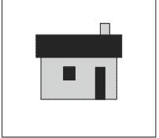

### 图 5.6

```java
facex = 60;
facey = 50;
facew = 80;
faceh = 100;

g.drawOval(facex, facey, facew, faceh);

mouthx = facex + facew / 4;
mouthy = facey + faceh * 9 / 16;
mouthw = facew / 2;
mouthh = faceh / 4;

g.drawArc(mouthx, mouthy, mouthw, mouthh, 190, 160);

g.drawLine(facex + facew / 4, facey + faceh * 7 / 16,
           facex + facew * 3 / 8, facey + faceh * 7 / 16);

g.drawLine(facex + facew * 5 / 8, facey + faceh * 7 / 16,
           facex + facew * 3 / 4, facey + faceh * 7 / 16);

earx = facex - facew * 3 / 32;
eary = facey + faceh * 5 / 16;
earw = facew / 8;
earh = faceh / 4;

g.drawArc(earx, eary, earw, earh, 50, 240);

earx = facex + facew * 31 / 32;
g.drawArc(earx, eary, earw, earh, 250, 240);

g.setFont(new Font("TimesRoman", Font.BOLD, 12));
g.drawString("Java Graphics!!!!", facex, facey + faceh * 5 / 4);
```

2. 使用 Java 绘制你自己设计的图形。

## 让我们创建一个名为 `House` 的类

我们现在要假装前一节中绘制的房屋非常重要。我们将绘制很多房屋，也许其他程序员也想绘制它们。事实上，它将如此重要，以至于未来的 Java 用户将学习 `TextField` 和 `House`（这是我们发明的）。因此，我们将创建一个名为 `House` 的类。一旦完成，人们将能够像声明 `TextField` 一样声明 `House` 对象：

```java
TextField t1;
House h1;

t1 = new TextField(20);
h1 = new House(50, 90, 100, 80, g);

t1.setText("Great Ideas");
h1.draw();
```


我们可以通过简单地输入正确的 Java 语法来轻松实现这一点。我们需要说明我们想要创建一个新类：`public class House`。并且我们应该将此类别的关键内部变量声明为`protected`。这意味着我们的类可以引用这些数据，但类外的程序无法引用它们。因此这些数据不是`public`的。我们保护数据的原因是防止`House`类的使用者在只打算进行外部计算时，意外更改`House`内的变量。更改受保护项目的唯一方式是通过与`House`关联的方法来执行该更改。以下是我们新类定义的开头：

```java
public class House
{
    protected int hx, hy, hwidth, hheight;
    protected Graphics hg;
```

接下来我们需要所谓的构造方法，它将用于构造一个新房屋。我们希望程序员能够输入：

```java
h1 = new House(50, 90, 100, 80, g);
```

并在机器中创建一个新房屋，其所有参数`hx`、`hy`等都正确设置。房屋不一定显示在屏幕上；它将只存在于内部。构造方法的语法如下：

```java
public House(int a, int b, int c, int d, Graphics h)
{
    hx = a;
    hy = b;
    hwidth = c;
    hheight = d;
    hg = h;
}
```

这是一个有些无聊的方法，因为它似乎什么都不做。但它完成了它的工作——将值`a`放入`hx`，将值`b`放入`hy`，依此类推。

例如，假设我们有这些受保护的内部变量：

```java
hx =
hy =
hwidth =
hheight =
hg =
```

假设用户想要用这个创建一个房屋：

```java
h1 = new House(50, 90, 100, 80, g);
```

此调用已为每个输入参数指定了值：

```java
a = 50
b = 90
c = 100
d = 80
h = g
```

你可以通过查看构造方法`House`的定义来看到这一点。

但是构造方法做什么呢？它将`a`加载到`hx`中，将`b`加载到`hy`中，依此类推。结果是我们现在有了新构建的房屋，其内部参数为：

```java
hx = 50;
hy = 90;
hwidth = 100;
hheight = 80;
hg = g;
```

当你习惯之后，这看起来会像是小题大做。但一开始可能会令人困惑。

我们还没有完成。我们必须有一个方法来绘制房屋。到目前为止，它只作为一组参数存在。我们将方法命名为`draw`；代码如下：

```java
public void draw()
{
    hg.setColor(Color.blue); // 房屋正面的颜色。
    hg.fillRect(hx, hy, hwidth, hheight); // 绘制房屋正面。
    hg.setColor(Color.black); // 屋顶的颜色。
    hg.fillRect(hx - (hwidth/20), hy, // 带有一些悬挑的屋顶。
                hwidth + (hwidth/10), hheight/3);
    hg.setColor(Color.green); // 门和窗户的颜色。
    hg.fillRect(hx + (2 * hwidth/3), hy + hheight/2,
                hwidth/8, hheight/2); // 绘制门。
    hg.fillRect(hx + (hwidth/4), hy + (hheight/2),
                hwidth/8, hheight/8); // 绘制窗户。
    hg.setColor(Color.red); // 烟囱的颜色。
    hg.fillRect(hx + (3 * hwidth/4), hy - hheight/8,
                hwidth/8, hheight/8); // 绘制烟囱。
}
```

这就是定义新类`House`所需的全部内容。以下是完整的小程序，包含`House`类的定义及其在程序中的正确使用。此小程序在功能上与前一节的`DrawHouse`小程序相同，只是它做了非常重要的事情——定义了类`House`并使用它。

```java
import awb.*;
import java.awt.*;
import java.awt.event.*;

public class HouseClass extends java.applet.Applet
                    implements ActionListener
// 一个图形演示小程序，创建House类并使用它。
{
    Graphics g;
    Canvas c;
    Button b1, b2;
    House h1;

    public void init()
    {
        c = new Canvas();
        c.setSize(200, 200);
        add(c);
        g = c.getGraphics();
        b1 = new Button("Start");
        b1.addActionListener(this);
        b2 = new Button("House");
        b2.addActionListener(this);
        h1 = new House(50, 90, 100, 80, g);
        add(b1); add(b2);
    }

    public void actionPerformed (ActionEvent event)
    {
        Object cause = event.getSource();

        if (cause == b1) // 设置背景。
        {
            g.setColor(Color.white);
            g.fillRect(0, 0, 200, 200);
        }

        if (cause == b2) // 绘制房屋。
        {
            h1.draw();
        }

public class House
{
    protected int hx, hy, hwidth, hheight;
    protected Graphics hg;

    public House(int a, int b, int c, int d, Graphics h)
        （前面已显示的构造方法代码）

    public void draw()
        （前面已显示的draw方法代码）
}
```

关于术语，这里有一个最后的说明。当我们定义`House`时，我们正在定义一个类，如本章和前一章所述。当我们创建`h1`时，我们正在创建一个对象，它是`House`类的实例化。

## 练习

1. 使用 Java 图形绘制你自己的图画。创建一个为你的图画命名的类，使人们能够通过使用类定义来创建和绘制它。

## 为`House`类添加功能

如果房屋很重要，我们可能想为类添加一些方法以使其更有用。我们可能会想在屏幕上移动房屋、更改它们的大小或颜色，或以各种方式修改它们的尺寸或设计。

以下是一个简单地将房屋向左或向右移动的方法：

```java
public void moverl(int j)
{
    hx = hx + (j * (1 + hwidth/10));
}
```

如果我们将`j`设为`1`，该方法会将`hx`增加约房子宽度的十分之一。（如果`hwidth`非常小，它会将房子至少向右移动一个像素。）如果我们将`j = -1`，该方法会将`hx`减少相应的量。

如果我们让该方法先擦除房子当前的位置，然后在新位置重新绘制，效果会更好：

```java
public void moverl(int j)
{
    erase();
    hx = hx + (j * (1 + hwidth/10));
    draw();
}
```

（如何擦除房子？一个简单的方法是创建一个`erase`方法，它与`draw`方法完全相同，只是绘制时使用`Color.white`，即背景色。这是一种朴素的擦除方法，但目前来说已经足够。）有了这个新方法，我们现在可以用代码`h1.moverl(1)`将房子`h1`向右移动，用代码`h1.moverl(-1)`向左移动。

类似地，我们可以创建一个方法来上下移动房子（通过修改`hy`）。或者我们可以创建一个方法来通过同时改变宽度和高度参数使房子变大或变小：

```java
public void size(int j)
{
    erase();
    hwidth = hwidth + (j * (1 + hwidth/10));
    hheight = hheight + (j * (1 + hheight/10));
    draw();
}
```

以下是改进后的`House`类的小程序：

```java
import awb.*;
import java.awt.*;
import java.awt.event.*;

public class HouseClassE extends java.applet.Applet
                        implements ActionListener
// 一个图形演示小程序，创建了具有移动和大小改变功能的 House 类并使用它。
{
    Graphics g;
    Canvas c;
    Button b1, b2, bleft, bright, bup, bdown, bsmaller, blarger;
    House h1;

    public void init()
    {
        c = new Canvas();
        c.setSize(200, 200);
        add(c);
        g = c.getGraphics();
        b1 = new Button("Start");
        b1.addActionListener(this);
        b2 = new Button("House");
        b2.addActionListener(this);
        bleft = new Button("Move left");
        bleft.addActionListener(this);
        bright = new Button("Move right");
        bright.addActionListener(this);
        bup = new Button("Move up");
        bup.addActionListener(this);
        bdown = new Button("Move down");
        bdown.addActionListener(this);
        bsmaller = new Button("Smaller");
        bsmaller.addActionListener(this);
        blarger = new Button("Larger");
        blarger.addActionListener(this);
        h1 = new House(50, 90, 100, 80, g);
        add(b1); add(b2); add(bleft); add(bright);
        add(bup); add(bdown); add(bsmaller); add(blarger);
    }

    public void actionPerformed (ActionEvent event)
    {
        Object cause = event.getSource();

        if (cause == b1) // 设置背景。
        {
            g.setColor(Color.white);
            g.fillRect(0, 0, 200, 200);
        }
```

第 5 章

```java
        if (cause == b2) // 绘制房子。
        {
            h1.draw();
        }

        if (cause == bleft)
        {
            h1.moverl(-1);
        }

        if (cause == bright)
        {
            h1.moverl(1);
        }

        其他四个按钮的处理类似。
    }
}

public class House
{
    protected int hx, hy, hwidth, hheight;
    protected Graphics hg;

    public House(int a, int b, int c, int d, Graphics h)
        （前面展示过的构造方法代码）

    public void draw()
        （前面展示过的 draw 方法代码）

    public void erase()
        （这作为练习留给你）

    public void moverl(int j)
        （前面展示过的代码）

    public void moveud(int j)
        （与 moverl 类似的代码）

    public void size(int j)
        （前面展示过的代码）
}
```

## 练习

1. 设计一些对上一节中你的类的修改，并将它们编码到你的类定义中。

## 创建一个村庄

一旦我们有了一个新类，我们就可以获得 Java 提供的许多好处。一个例子是将数组特性用于新类。我们可以用与创建十个整数数组相同的语法来创建十个房子的数组：

`House h1[];`

`h1lteq h1 = new House[10];`

我们可以用`h1[0] = new House(...)`创建第一个房子`h1[0]`，用`h1[1] = new House(...)`创建第二个，依此类推。我们可以用`h1[0].draw()`绘制第一个房子，用`h1[1].draw()`绘制第二个房子，依此类推。你还可以使用其他方法来修改这些房子。以下是放大房子`h1[4]`的代码：`h1[4].size(1);`。

编写一个能够创建十个房子的小程序代码很容易。`IntField`用于指示按下按钮时要创建或修改哪个房子。

```java
import (与之前相同)

public class Village extends java.applet.Applet
               implements ActionListener
// 一个图形演示小程序，创建了 House 类和十个房子的数组。
{
    Graphics g;
    Canvas c;
    Button b1, b2, bleft, bright, bup, bdown, bsmaller, blarger;
    House h1[];
    IntField which;
    int i;

    public void init()
    {
        （与 HouseClassE 小程序中的 init 相同，除了两个语句）
```

```java
h1 = new House[10];
add(which);
```

```java
    public void actionPerformed (ActionEvent event)
    {
        Object cause = event.getSource();

        if (cause == b1) // 设置背景。
        {
            g.setColor(Color.white);
            g.fillRect(0, 0, 200, 200);
        }

        if (cause == b2) // 绘制房子。
        {
            i = which.getInt();
            h1[i] = new House(30 * i, 100, 20, 15, g);
            h1[i].draw();
        }

        if (cause == bleft)
        {
            i = which.getInt();
            h1[i].moverl(-1);
        }

        其他按钮的处理类似。
    }
}
```

```java
public class House
{
    （与前面定义的 House 相同）
}
```


## 练习

1. 使用数组特性为你已定义的某个类创建一组对象。

## 子类和 Java 类层次结构

Java 的强大功能之一在于你可以轻松使用别人编写的代码。即使别人的代码不完全是你想要的，你也可以这样做。假设你已经使用了`House`类，发现它基本令人满意，但你还想要额外的功能。你可以扩展`House`的定义来获得你想要的特殊功能，同时仍然使用`House`的主要功能。

假设`House`类是可用的，但我们希望能够将房子水平拉伸得很长，或者垂直拉伸得很高。我们可以创建一个`StretchHouse`类，在我们想要的方向上扩展`House`的定义。以下是实现这一点的代码。它几乎不需要解释。

```java
public class StretchHouse extends House
{
    public StretchHouse(int a, int b, int c, int d, Graphics h)
    {
        super(a, b, c, d, h);
    }

    public void stretchw(int j)
    {
        erase();
        hwidth = hwidth + (j * (1 + hwidth / 10));
        draw();
    }

    public void stretchh(int j)
    {
        erase();
        hheight = hheight + (j * (1 + hheight / 10));
        draw();
    }
}
```

构造方法简单地获取其值，并将它们传递给被扩展的类的构造方法。这是通过调用`super(a, b, c, d, h)`完成的。名称`super`指的是被扩展的类的构造方法。`StretchHouse`保留了`House`类的所有功能。因此，如果`h1`是一个`StretchHouse`对象，那么可以用以下代码创建`h1`：

```java
StretchHouse h1;

h1 = new StretchHouse(...);
```

可以用以下代码绘制`h1`：

```java
h1.draw();
```

可以用以下代码将`h1`向右移动：

```java
h1.moverl(1);
```

向上移动用：

```java
h1.moveud(-1);
```

使`h1`变大用：

```java
h1.size(1);
```

等等。

因此，扩展功能的力量应该是显而易见的。请注意，用户创建了一个只包含所需新功能的新类，同时享受了被扩展的`House`类中可能包含的大量代码的使用。每次你创建一个小程序，你都是在扩展`java.applet.Applet`类，它为你做了大量工作，包括将你的代码链接到 HTML 页面，并以你在小程序中请求的方式显示你想要的内容。

为了再次强调这一点，假设有人正在使用你的`StretchHouse`类，并希望添加一个房子可以翻转的功能（门在左边，窗户在右边）。他或她可以编写你的类的扩展：

```java
public class ReverseHouse extends StretchHouse
{
    protected int rev;

    public ReverseHouse(int a, int b, int c, int d, Graphics h)
    {
        super(a, b, c, d, h);
        rev = 0;
    }

    public void reverse()
    {
        erase();

        if (rev == 0)
        {
            rev = 1;
        }
        else
        {
            rev = 0;
        }

        draw();
    }

    public void draw()
    {
        if (rev == 0)
        {
            (Code to draw house as usual)
        }
        else
        {
            (Code to draw the reverse of the usual house)
        }
    }

    etc.
}
```

请注意，有了这个扩展之后，我们希望使用前面那些例程中的代码，但我们不想使用`draw`。我们需要一个能同时绘制正常房屋和反转房屋的新的`draw`。当 Java 运行`ReverseHouse`类的对象时，它会注意到`draw`是在`ReverseHouse`中定义的，因此不会使用继承来的`draw`版本。但它会使用继承来的其余代码。

此时，你会意识到 Java 中庞大的类层次结构。事实上，Java 中的每个类都有一个父类或超类，除了最高的那个类——`Object`。类层次结构是一棵从`Object`向下延伸的非常大的树。图 5.7 展示了那棵树的一小部分。大多数类都被指定为其他类的扩展。如果没有指定，那么它们就是`Object`的扩展。图 5.7 展示了`awt`包中包含的一些类；其中一些应该看起来很眼熟。然而，你应该注意到，本书只涉及众多可用选项中的一小部分。你还可以看到本章中本地定义的类，即`House`及其子类。由于`House`没有定义超类，它的超类就是`Object`。

## 练习

1. 定义一个你在前面章节中定义过的类的子类。用 Java 实现它并进行演示。

212

第五章

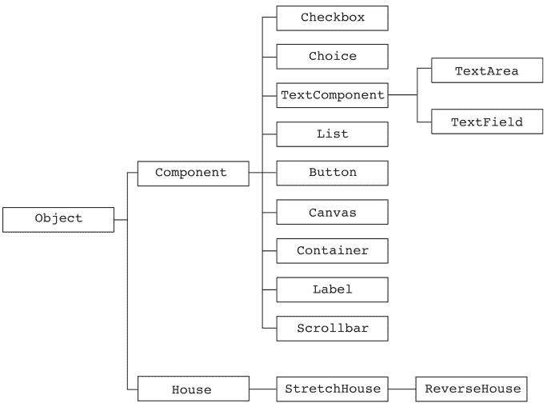

2. 定义一个名为`ColorHouse`的`ReverseHouse`的子类，它允许你指定房屋的颜色。用 Java 实现它，并展示`ColorHouse`的所有超类的功能如何继续正常运作。

3.  
   (a) 定义一个名为`Book`的类，用于保存书的标题、作者姓名、ISBN 编号和价格。用 Java 实现它，并展示其保存所需信息的能力。包括用于检索或修改任何信息字段的方法。

   (b) 定义一个可以存放 100 本此类书的数组，并用 Java 编写一个程序来存储和检索所有这些书的信息。

   (c) 定义一个名为`BookHS`的`Book`的子类，它保存与`Book`相同的信息，但多了一个字段来说明该书是精装本还是平装本。

   (d) 定义一个名为`BookInventory`的`BookHS`的子类，它多了一个字段来说明当地书店现有的库存数量。包括允许用户增加或减少库存的方法。展示如何创建 100 个这样的对象的数组，并使用超类以及`BookInventory`类的所有功能。

## 小结

本章介绍了一组`Graphics`方法，并展示了如何使用它们在屏幕上构建简单的图形。这项技术是声明一个`Canvas`，然后使用这些`Graphics`方法在屏幕上精心设计你的图案。该方法遵循本书贯穿始终使用的小程序结构。

一旦这项技术清晰明了，你就可以将图形绘制代码移入类的定义中。也就是说，你可以定义自己的类来在屏幕上绘制场景，然后只需调用你的`draw`方法来创建图像。类定义可以包含所有细节。其优点是，你可以将一些复杂的代码打包成一个`Bundle`，供自己或他人在需要时使用。另一个优点是，当你想要一系列该类类型的对象时，你可以创建这些对象的数组。

最后，本章展示了如何创建已定义类的扩展。如果某个类不能完全满足程序员的需求，可以创建一个扩展，它将使用超类，但可以有自己的方法定义来满足更专业的需求。子类的方法可以是超类中没有包含的方法，也可以是超类中方法的重写版本。

研究类的扩展的一个副作用是，可以观察到所有 Java 类都定义在一棵以`Object`类为根的大树中。因此，当我们使用 Java 时，我们实际上是在使用他人编写的数千行代码，尽管我们可能没有意识到这一点。一个典型的例子是`java.applet.Applet`代码，它是本书所有小程序的超类。这段代码完成了许多与我们通过 HTML 调用连接计算、在屏幕上分配区域以及在浏览器上执行 Java 处理器相关的任务。

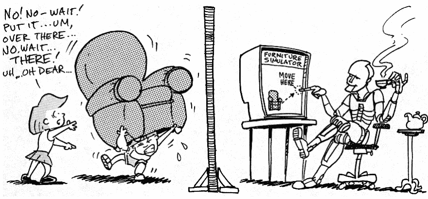

> 不！不——等等！  
> 把它……嗯，  
> 放那边……  
> 不，等等……  
> 那边！  
> 呃……哦天哪……

家具模拟器

移到这里……

# 6 模拟

## 预测未来

太阳是一个由超热物质组成的分层球体：它有一个致密的核心，核聚变在那里产生能量，导致温度极高——可能达到 1500 万摄氏度；一个称为辐射区的中间层，将能量向外传输——其温度可能约为 400 万度；以及一个外层，温度可能约为 200 万度，由密集的气体剧烈翻腾并将能量推向表面组成。科学家预测，太阳将继续以大致当前的状态燃烧数十亿年，届时它将开始耗尽资源。然后它将进入“红巨星”阶段，直径将从不到 100 万英里膨胀到可能超过 5000 万英里。它不再是天空中一个明亮的光盘，而是将成为我们天空的很大一部分。它将在这一阶段燃烧殆尽，最终坍缩为“白矮星”，大小可能与地球相当。

本章介绍了一种用于研究像太阳这样的复杂系统并理解其机制的强大科学工具。既然知道了关于太阳或其他系统的基本事实，我们希望对其做出预测。接下来会发生什么？每个阶段将持续多长时间，其特征是什么？这些以及其他问题的答案往往可以通过*模拟*来回答。

我们的方法将遵循三个步骤：

1. 我们将设计一个模型来捕捉我们 wish 研究的系统的本质。它通常由一些方程或其他关系组成，这些关系表示系统的重要度量如何相互关联。
2. 我们将开发一个下一步函数。这个函数的输入是系统在给定时刻的重要信息列表。输出是经过给定时间间隔后模型将变化到的新状态。
3. 我们将模型设置为初始状态，并反复应用下一步函数来发现未来的状态。

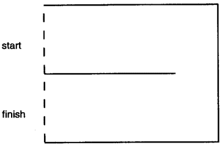

模拟使我们能够观察系统经历一系列步骤的过程。模拟可以帮助科学家理解系统；它可以帮助系统设计师预测行为，以便优化设计决策；它可以为我们提供对提议系统的主观视角，使我们能够欣赏、理解和享受它，即使它在现实中并不存在。

## 如何赢得汽车比赛？一个模拟

假设我们希望在图 6.1 所示的赛道上进行比赛。汽车从起点线上的任意位置出发，向右行驶，绕过障碍物的右转弯，然后穿过终点线返回。它应该在最短的时间内到达终点线。汽车能够以每秒每秒 3 米的速度加速和减速，且没有最大速度限制。曲线上的横向加速度不得超过每秒每秒 9 米，否则汽车将失去牵引力并滑出赛道。主要目标是找到实现赛道最快通过时间的策略。模拟将使我们能够提出任何我们想要的策略，然后找出它的效果如何。通过尝试几种策略，我们应该能够收敛到一个效果非常好的策略。

为了进行这项研究，有必要按照前面列出的三个步骤进行。首先，我们需要一个所研究系统的模型。该模型必须表示我们感兴趣的系统信息。在当前情况下，感兴趣的项目是汽车的位置、速度、方向和状态（例如，正常运行、打滑、撞墙）。除了状态是整数外，其他都是双精度数。

| 状态描述 | x 坐标 |
| --- | --- |
| y 坐标 |  |
| x 方向速度 |  |
| y 方向速度 |  |
| 运行状态（1 表示受控；0 表示打滑；–1 表示撞毁；–2 表示成功完成） |  |
| 比赛开始后的时间 t，单位为秒 |  |

图 6.2

- x 方向速度
- y 方向速度
- 运行状态（1 表示受控；0 表示打滑；–1 表示撞毁；–2 表示成功完成）
- 比赛开始后的时间`t`，单位为秒

该模型还必须包含对赛道的描述，指明墙壁和终点线的位置（图 6.2）。我们设定起点和终点线都在`x = 500`处。顶部和底部的线分别在`y = 1800`和`y = 200`处。x 方向的远端墙壁位于`x = 2500`处。中间分隔线位于`y = 1000`，从`x = 500`延伸到`x = 2000`。

其次，我们需要一个下一步函数。我们定义一个`Automobile`类，并将下一状态函数作为该类的方法。这个方法将接收汽车的当前状态描述作为输入，并计算驾驶 1 秒后的下一状态。此函数名为`drive`，有两个参数，如下：

- `a`——加速度，为一个双精度浮点数，即我们决定施加的加速度。其正向或负向均不可超过 3。（负加速度对应于踩刹车。）
- `turnr`——转弯半径。例如，`turnr = 100`表示向右转，圆心距车辆 100 米。负转弯半径含义相同，只是向左转。若`turnr = 0`，汽车将直线行驶。

`Automobile`类已经编写完成，可在互联网上获取，具体如引言章节所述，同时还可获取主程序和模拟所需的其他代码。

总结来说，如果我们有`auto1`，它被声明为`Automobile`类的一个实例，我们可以调用`auto1.drive(a, turnr)`来获得`auto1`的 1 秒模拟。方法`auto1.drive`使用指定`auto1`状态的位置、速度等值。这些值是`auto1`对象的内部数据。方法`auto1.drive`也接收期望的加速度`a`和转弯半径`turnr`作为参数。然后它计算驾驶 1 秒后位置、速度等的新值，并将其作为`auto1`的新状态输入。

例如，假设`state`保存的位置为 $x = 1000$，$y = 1400$，x 方向速度为 30 米每秒。同时，`a = 0`且`turnr = 0`。那么`auto1.drive(a, turnr)`将计算出新的状态：位置 $x = 1030$，$y = 1400$，x 方向速度为 30 米每秒。

现在，我们可以编写模拟程序来执行任何我们希望尝试的驾驶序列。作为系统的首次测试，我们将汽车置于$x = 500$，$y = 1400$的位置，初速度为零，朝向 x 方向。（我们将车刚好放在`x = 500`的起点线上。）然后让我们以 3 米每二次方秒的加速度沿直线加速 10 秒。

```java
a = 3;
turnr = 0;
time = 1;

while ((time <= 10) && (not complete))
{
    auto1.drive(a, turnr);
    time = time + 1;
}
```

这应该使汽车在赛道上以 30 米每秒的速度沿 x 方向前进。（如果你以 3 米每二次方秒加速 10 秒，你的_DRAWER速度将达到 30 米每秒。）在程序中的`not complete`位置，我们放置一个测试来检查比赛是否以成功或撞毁结束。

接下来，我们以恒定速度行驶，直到到达转弯处。（这里`corner`的值为 2000。）

```java
a = 0;
turnr = 0;

while ((x < corner) && (not complete))
{
    auto1.drive(a, turnr);
    time = time + 1;
}
```

接着，我们以 400 米的半径转弯，直到驶向相反方向。由于我们距离中间屏障末端有 400 米，我们将围绕那个角落旋转。

```java
a = 0;
turnr = 400;

while (((y > middle) || (x > corner)) && (not complete))
{
    auto1.drive(a, turnr);
    time = time + 1;
}
```

（符号`&&`和`||`分别代表“与”和“或”。）最后，我们沿直线最大加速，直到冲过终点线。

```java
a = 3;
turnr = 0;

while (not complete)
{
    auto1.drive(a, turnr);
    time = time + 1;
}
```

这就是程序。我们只需将四段代码连接起来，插入到模拟程序中。让我们运行模拟，观察路径和完成赛道所需的总时间（图 6.3）。总时间为 121 秒。（如果你实际运行这个模拟，你会发现汽车在弯道周围停留的时间稍长，并不能完美地直向终点行驶。其原因及解决方法留给你来找出。）

总结来说，我们提出了一种完成汽车赛道的策略，并编写模拟程序来检查它是否成功。然后我们运行了模拟，确定汽车以 121 秒的时间成功完成了赛道。据推测，如果这条赛道和汽车确实存在于某处，有人可以驾驶我们编程的序列，并且在模型准确的前提下，观察到所示的路径和 121 秒的完成时间。

当然，我们希望以最少的时间完成比赛，因此我们应该尝试找到比首次尝试更好的策略。让我们从起点线开始持续加速汽车到弯道。然后我们在弯道处保持该速度，再最大加速冲向终点。这种情况下的代码以：

## 第 6 章

### 图 6.3

```java
a = 3;
turnr = 0;

while (((x < corner) && (not complete)))
{
    auto1.drive(a, turnr);
    time = time + 1;
}
```

开始，并以先前策略的最后两个片段结束。

不幸的是，当我们运行新版本时，汽车在转弯处打滑，撞上了`x = 2500`处的远墙。它在弯道处速度太快，无法转弯。这次尝试失败了。（你不庆幸是通过模拟而不是驾驶真车发现这一点的吗？）一定有更好的策略，我们将其留作练习，供你找出。

## 习题

1. 编写一个程序来模拟以下赛车策略。从与之前相同的位置开始。在 x 方向最大加速，直到达到`x = 1000`点。然后最大减速，使 x 方向速度降至 30 米每秒。然后像之前一样转弯，但半径为 300 米，并最大加速冲过终点。这个策略取得了什么结果？
2. 找出你能找到的最佳策略，以最少时间完成赛道。

公共卫生官员非常感兴趣的一个问题是疾病在人群中传播的生命周期。当疾病被发现时，我们想知道会有多少人受到影响，疾病会持续多长时间，以及预防和治愈工作可能如何改变情况。研究这些问题的一种方法是建立疾病特征的模型，并运行模拟来尝试预测其行为。

我们开发模拟的第一步是设计一组个体以及疾病在人群中传播的特征模型。我们使用一个特别简单的模型，因为它易于编程，同时仍能展示各种有趣的行为。我们将人群视为一个线性个体集合，并将其建模为线性数组。如果某人健康，我们在其对应位置放置 0；如果此人被感染，则放置一个正整数。该正整数表示此人被感染后的天数。

模型工作原理如下：所有个体初始状态为健康，其对应位置为 0。通过在被感染个体的位置放置 1，使人群中的一个个体被感染：


`00000000000000000000000000001000000000000000000000000000000`

你可以将其想象成一排房屋，其中有一间住着一个病人。或者也可以是一排番茄植株。

然后，传染规则模拟感染其他个体的过程。它随机选择当前患病个体附近的个体，并在其位置放置 `1`。他们在第二天生病，而已经患病的个体的天数增加：

```text
0000000000000000000100000002010000000000000010000000000000
```

第三天，新感染的个体感染额外的个体，患病人数成倍增加：

```text
00000000000000101002011000003020100100101010020000000000000
```

然后我们模拟康复过程以及康复后的免疫期，在此期间个体不会被再次感染。我们有一个参数 `infectious`，表示疾病持续的天数；以及一个参数 `immune`，表示从感染第一天起个体不会被再次感染的天数。因此，如果个体在感染后患病 3 天，并在感染开始后 7 天内对疾病免疫，我们设置 `infectious = 3`，`immune = 7`。

## 第二步：考虑下一步函数

其核心是计算找出哪些个体被已有的患病个体感染。这通过一个名为 `infect` 的例程完成，它接收感染个体的编号作为输入，并在数组中记录当前被感染的新个体。以下是编写 `infect` 例程的首次尝试。变量 `k` 指示哪个个体在进行感染。

```c
int [] infect(int [] B, int k, int rate)
{
    int i, j;

    i = 1;
    while (i <= rate)
    {
        // 选择个体j进行感染并实施感染。

        B[j] = 1;
        i = i + 1;
    }

    return B;
}
```

此例程感染多个个体，数量由 `rate` 给出。它通过将 `1` 放入个体对应的数组条目中来感染个体。

我们需要决定每次感染新个体时如何计算 `j`。我们通过计算一个*伪随机数*来实现，这是一个由精心设计的函数计算出的数字，如果反复使用会产生多种数字。这种计算的设计是一个复杂的问题，此处不作讨论。

下面是包含伪随机数生成器的修改版子程序。`%` 运算符将左操作数除以右操作数并得到余数。

```c
int [] infect(int [] B, int k, int iInc, int rate)
{
    int i, j;

    i = 1;
    while (i <= rate)
    {
        // 选择个体j进行感染并实施感染。

        iInc = ((iInc * 23) % 31);
        j = k + iInc - 13;

        if ((j > 0) && (j <= 60))
        {
            B[j] = 1;
        }

        i = i + 1;
    }

    return B;
}
```

第二步的任务是从一个个体矩阵开始，其中一些健康，一些患病，一些免疫，然后反复调用 `infect`，使所有患病个体感染新个体。在我们当前的研究中，我们选择感染率为 3。模拟的完整代码发布在万维网上。

让我们执行模拟，看看对于给定特征的疾病（感染期 = 3；免疫期 = 7；感染率 = 3）可以期待什么结果。结果用星号 `*` 表示每个患病个体，用 `1` 表示每个免疫个体，其他所有用 `0` 表示：

```text
day 1 00000000000000000000000000000*0000000000000000000000000000000

day 2 000000000000000000*00000000*0*000000000000000*0000000000000

day 3 00000000000000000*0*00*0*00000*0*0*00*00*0*0*00*0000000000000

day 4 000*00*0000**00*0**********0*0***010*****0*****0*0*0*****00000*0**000

day 5 00**00*0*****0000**1***0*1***********1****0*0*0*

day 6 *0****0********01*1**11*****1*1**1*1*1*1**1***********

day 7 ***1*01*****11**1*1111111*111*1*1111*1111*1*11111*****1*11***

day 8 **11***1111*111*111111111*111101111111111111111111*1*1*1111*

day 9 1*111*11111111*11111*1111111101*1111111111111011111111111
```

这是九天内发生情况的统计摘要：

| 天数 | 健康 | 患病 | 免疫 |
| --- | --- | --- | --- |
| 1 | 59 | 1 | 0 |
| 2 | 56 | 4 | 0 |
| 3 | 47 | 13 | 0 |
| 4 | 27 | 32 | 1 |
| 5 | 11 | 45 | 4 |
| 6 | 3 | 44 | 13 |
| 7 | 1 | 26 | 33 |
| 8 | 1 | 11 | 48 |
| 9 | 2 | 5 | 53 |

模拟显示，所有个体最终都被疾病感染。然而，疾病后的免疫期使几乎所有个体都获得免疫，疾病似乎消退了。（实际上，它可能不会消退。这留作练习。）

## 第六章

总之，我们希望调查一种传染病在人群中传播的过程。我们为人群和疾病传播规则构建了一个模型。然后我们运行模拟，观察会发生什么以及何时发生。练习涉及使用此模型进行进一步研究。

## 练习

1. 我们模拟的疾病是否如预期那样消退？请调查并解释。使用网上提供的程序。
2. 如果免疫期更长，例如，首次感染后 8 天或 9 天或 10 天，疾病模型会发生什么？如果免疫期更短会怎样？
3. 很有可能在特定情况下选择的传染率不正确。如果疾病建模为`感染期=3`和`免疫期=7`，请展示感染率变化时会发生什么。
4. 你能否发现任何两个变量之间的系统关系，例如传染率和疾病消退的概率？
5. 假设一种高度传染性疾病已经来到镇上。它的特性是，如果街道上某个房屋的居民被感染，两个邻居（一边一个）将在第二天被感染。编写一个具有此特性的新 `infect` 例程，并用它替换现有的例程。使用练习 3 中描述的相同疾病模型（`感染期=3`，`免疫期=7`）和新的感染例程，找出疾病的生命周期是什么。
6. 如果状态存储在一个二维数组中，例如，20x20，可能会得到更好的模拟结果。修改模拟程序以处理此模型。使用第五章学习的图形功能来显示人群的状态。重复一组前面练习中建议的实验。

## 你观察过进化过程吗？一次模拟

让我们创建一个模型世界，并用生物填充它。然后让我们观察生物在世界中生存并进化成一个更好的物种。我们可以制定任何我们想要的规则，并观察我们决策的后果。

我们创建一个 8x8 的网格，并提出生物可以在网格中游荡寻找食物，并偶尔交配。这些生物被称为 `neds`，这是它们的创造者约书亚·D·卡特给它们的名字。（这个模拟是作为杜克大学一门课程的学期项目开发的。）我们提出每个 `ned` 每天必须吃一些食物。食物量是一个由 `$(age/20) + 1` 计算的整数，其中 `age` 是 `ned` 存活天数的整数。因此，一个 25 天大的 `ned` 每天将吃 2 个单位的食物。

关于食物还有三个规则。首先，每个网格方格开始有一些食物单位，每天都会添加更多食物单位。数量由随机数生成器控制。其次，`ned` 每天可以捡起最多三个单位的食物（如果这些食物可用），并将它们放入袋子中。因此，`ned` 可以提前储存一定数量的食物，并在需要时使用。然而，它的食物需求将不允许它活到远超过 40 天的年龄。找出原因留作练习。第三，`ned` 如果交配会额外消耗两个单位的食物。

`ned` 在给定一天的活动首先是吃掉所需数量的食物，然后是进行以下活动代码之一规定的移动：

- `00` 向前移动一步（如果撞到墙，则原地不动）。
- `01` 向右旋转八分之一圈。
- `10` 交配（如果同一方格内有异性成员）。
- `11` 交配（如果同一方格内有异性成员）。

`ned` 如何获得这些代码是下一个问题。

每个 `ned` 都带有一个基因代码创建，可以说是它的 DNA。这是一个 40 位二进制数字串，创建方式如下。当它的父母（一雄一雌）交配时，随机选择一个介于 1 和 40 之间的数字 `i`。然后，将一个父母的前 `i` 位与另一个父母从 `i + 1` 位到末尾的位组合起来。这成为新 `ned` 的基因代码。例如，假设父母有这些基因代码：

```text
000001000011000001111010111111111100111

11111111011101010101010101010101010101
```

选择的随机数是 17。那么新的基因代码将是：

```text
00000100001100000101010101010101010101
```

每个 `ned` 的行为由其基因代码控制。具体来说，它在一天内使用给定的活动代码执行其代码中的前两位，在第二天执行接下来的两位，依此类推。因此，前面提到的子 `ned` 在其最初的几天将执行以下动作：

- day 1 `00` 向前移动一步
- day 2 `00` 向前移动一步
- day 3 `01` 旋转
- day 4 `00` 向前移动一步
- day 5 `00` 向前移动一步
- day 6 `11` 交配

图 6.4 展示了其路径的示意图。

现在让我们运行模拟，看看会进化出什么样的 `ned`。我们使用随机数生成器创建四个 `ned`，两雄两雌，具有随机的基因代码。然后将它们放置在网格上的随机格子中，观察前三天会发生什么（图 6.5）。星号表示尝试交配。美元符号表示因缺乏食物而死亡。

结果表明，这些 `ned` 的生存状况并不理想。它们的数量太少，无法找到彼此并交配。模拟只进行了几步（未显示到结束），直到最后一只孤独的 `ned` 因缺乏食物而死亡。

让我们重新开始，用 20 只 `ned`。这次模拟持续了大约 100 天，然后灭绝了。显然，这个环境对 `ned` 的生存来说很艰难。我们尝试了几次类似的模拟，其中一次持续了 491 天。这是不寻常的。让我们调查最后一代中进化了的那只 `ned`。它一定拥有相当好的基因代码，才能存活如此长的时间。以下是最后存活的那只 `ned` 的代码：

```text
1000001011011101101001001001001101111010
```

你应该作为练习，分析这只 `ned`，并说明为什么它的基因代码以及由此进化出的行为使它能够长时间存活。

总之，我们希望观察进化过程的实际运作。我们希望让处于极端恶劣环境中的生物尝试生存，并将它们的部分特征传递给下一代。那些生存良好且成功繁衍的将基因传递给后代，那些基因代码差的则消失。方法与前几个例子相同。首先设计模型，然后创建下一步函数，执行每只 `ned` 的下一步移动并更新状态描述，最后将系统设置为初始状态并运行。我们从随机代码开始，让进化自然进行。经过多次尝试后，一个种群存活了异常长的时间，我们有机会看到它的代码变成了什么。我们现在可以使用这个模型来研究进化这一抽象现象。我们可以改变系统中的许多参数和机制，并观察结果。

227

模拟

- (a) 第一天
- (b) 第二天
- (c) 第三天

图 6.5

228 第 6 章

你可以获取一个由 Josh Carter 用 C 语言编写的程序来进行这个计算。使用方法如导论章中所述，通过互联网获取。

## 练习

1. 分析在长时间模拟（491 天）中最终进化的那只 `ned` 的代码，并说明为什么它的设计使它能够如此成功地生存。
2. 用你设置的参数重复模拟。尝试进化出一只基因代码比练习 1 中更成功的生物。

## 它会是什么样子？一场模拟

有许多科学、工程乃至娱乐方面的原因，促使人们想要观看实际上并不存在的事物。借助计算机，我们可以在*信息空间*中创建一个对象，然后利用系统的图形功能来查看该对象。一个例子是建筑设计，建筑师可以以图形方式创建建筑物，让人们戴上头戴式显示器，从而在实际建造之前就能“穿过”建筑物。人们可以尝试设计方案，批评其功能性和美学效果，并提出改进建议。

在本节中，我们创建一个程序，让我们进入一个兼具娱乐和科学趣味的新世界。这就是分形的世界，这一研究在计算机图形学出现之前实际上是无法开展的。

我们从几何平面上的点变换概念开始研究。我们用函数记号 `f` 来表示这种变换。假设我们在 `x, y` 平面上有点 `z_0`；那么 `f(z_0)` 将在平面上找到一个新的点。我们目前的例子如下：如果 `(x, y)` 给出平面上某点的坐标，我们定义 `f((x, y))` 为 `(x_1, y_1)`，其中：

```text
x_1 = x * x - y * y + c_1

y_1 = 2 * x * y + c_2
```

而 `c_1` 和 `c_2` 是常数。因此，如果我们选择 `c_1 = 0.36` 和 `c_2 = 0.10`，那么点 `(0, 0)` 通过函数 `f` 被变换为点 `(0.36, 0.10)`。这在图 6.6 中通过从 `(0, 0)` 到 `(0.36, 0.10)` 画一个箭头来表示。然后我们可以在点 `(0.36, 0.10)` 上再次应用函数 `f`，得到另一个点：

```text
x_1 = (0.36)^2 - (0.10)^2 + 0.36 = 0.48

y_1 = 2 * (0.36) * (0.10) + 0.10 = 0.17
```

## 图 6.6

我们可以对生成的新的点反复应用 `f`，从而得到一个序列：

`f(0.36, 0.10) = (0.48, 0.17)`

`f(0.48, 0.17) = (0.56, 0.27)`

`f(0.56, 0.27) = (0.60, 0.40)`

`f(0.60, 0.40) = (0.57, 0.58)`

`f(0.57, 0.58) = (0.34, 0.76)`

`f(0.34, 0.76) = (-0.10, 0.62)`

`f(-0.10, 0.62) = (-0.01, -0.02)`

`f(-0.01, -0.02) = (0.36, 0.10)`

`f(0.36, 0.10) = (0.48, 0.17)`

`⋮`

图 6.7 展示了这一点序列的图形。注意，该序列具有回折的特性。最后两个点实际上与前两个点相同（在所示精度范围内）。

## 图 6.7

在分形理论中，我们对类似图 6.7 所示的点序列感兴趣。具体来说，我们对那些具有收敛序列的点感兴趣，例如 `(0,0)`，其生成的点序列始终靠近平面原点。我们也对发散序列感兴趣，即后续生成的点趋向无穷远。以下是一个这类序列的例子，起始点为 `(0.70, 0.70)`：

```text
f(0.70, 0.70) = (0.36, 1.08)

f(0.36, 1.08) = (–0.68, 0.88)

f(–0.68, 0.88) = (0.05, –1.09)

f(0.05, –1.09) = (–0.83, 0.00)

f(–0.83, 0.00) = (1.04, 0.10)

f(1.04, 0.10) = (1.43, 0.31)

f(1.43, 0.31) = (2.32, 1.00)

f(2.32, 1.00) = (4.75, 4.72)

f(4.75, 4.72) = (0.69, 44.97)

f(0.69, 44.97) = (–2021.58, 62.48)
```


## 图 6.8

`f(-2021.58, 62.48) = (4,082,867.15, -252,602.95)`

`\vdots`

图 6.8 展示了这一点序列的图形。

现在该提出一个问题了。让我们将使用变换 `f` 产生收敛序列的所有点涂成黑色，将产生发散序列的所有点涂成白色。我们知道 `(0,0)` 应涂成黑色，`(0.70, 0.70)` 应涂成白色。图 6.9 展示了图表的开始部分。问题是，如果我们将此规则应用于平面上所有点的着色，结果会是什么图形？也许它会是一个简单的圆形之类的东西。实际上，使用 `c_1 = 0.360284` 和 `c_2 = 0.100376`（这是 Robert L. Devaney 在他的著作《Chaos, Fractals, and Dynamics》中推荐的），得到的结果如图 6.10 所示。

这个图形被称为分形，我们的实验可以作为探索分形世界的开端。通过改变常数 `c_1` 和 `c_2`，可以获得种类惊人的复杂图形。该程序与其他程序一起提供在互联网上，你可以自己尝试。通过改变图形的绘制方式，可以获得全彩色以及更加丰富多样的效果。分形的一个有趣特征是，如果放大各个部分，它们具有无穷无尽的有趣细节。如果生成图形的某一部分的放大版本，无论放大倍数有多高，它都会与整体图形一样复杂。

近年来，分形为数学家们提供了一个令人愉悦的研究领域。分形为我们架起了从非常简单的方程，到非常复杂的图形，如图 6.10 所示。从智识的角度来看，人们可能会怀疑必须拥有极其复杂的生成器才能产生复杂的现象。分形却提供了一个令人惊叹的反例。

分形的一个可能应用是在编码理论中。如果想通过信道传输信息，发送多少比特才能传达像图 6.10 这样的图片呢？（比特被定义为单个二进制数字，0 或 1。）答案是可能需要数百万比特的信息。但传输生成该图形的方程需要多少信息呢？可能只需要几百比特。然后，接收端可以根据这些方程生成图形。因此，传输图片的编码策略可能是：从一张图片开始，以某种方式将其编码为分形图像，传输分形的方程，然后在另一端使用这些方程重建图片。这可以大幅减少传输图片所需的比特数。

## 练习题

1. 使用常数 `c_1 = -1.0` 和 `c_2 = 0` 重复分形实验。尝试 `c_1 = 0.3` 和 `c_2 = -0.4`。再尝试 `c_1 = -0.1` 和 `c_2 = 0.8`。这些都是 Devaney 在书中推荐的例子。
2. 寻找其他能产生极有趣图形的 `c_1` 和 `c_2` 值。

## 总结

几乎在每一个学科或领域中，人们都想尝试各种想法，看看它们会如何发展。可能是建造一座结构、演奏一部交响乐、创建一种新政府形式、引爆太阳，或几乎任何其他事情。在许多情况下，在现实世界中尝试这些想法成本高昂或不可能实现，但借助计算机模拟，往往可以以不太高的成本，获得足够接近所需真实对象或事件的近似，从而发现将会发生什么。

进行模拟的过程通常遵循本章给出并说明的三个步骤。具体来说，必须构建要模拟的现象的数学模型，以及应用于它的下一步函数。然后可以将系统置于初始状态，并反复应用下一步函数，以发现在一段时间内将会发生什么事件。本章展示了赛车、疾病流行和物种进化的模拟示例。它还展示了在创建复杂图形构造中的模拟技术。（赛车、疾病流行和分形图像的 Java 程序由 Ben Allen 编写。）

## 编程工作进入第 2 个月（原计划 6 个月）

我们估计还需要 6 个月才能完成，所以将推迟 2 个月。

**把项目上的程序员数量翻倍！！**

## 编程工作进入第 4 个月（原计划 6 个月）

我们新员工已招聘到位并开始参与项目。我们估计还需要 6 个月才能完成。可能比原定计划晚 4 个月。

**把项目上的程序员数量翻倍！！！**

## 编程工作进入第 6 个月

我们的新团队已就绪，我们估计还需要 6 个月才能完成。

# 7 软件工程

## 现实世界

一位来自著名大学的计算机科学荣誉毕业生，我们称他为 Brian，接受了一份工业编程工作。Brian 是一位有能力的程序员，在学生时代曾在大学实验室担任程序员，并在计算机课程中取得了一连串的 A。他习惯于审视问题，草拟解决方案，准确估计所需程序的规模以及编写和调试代码所需的时间。为了规划 purposes，他足够明智地将估计乘以 2 倍的系数，以确保他有足够的时间。

接受新职位后，Brian 收到了一份程序规范，并被要求制定完成计划。他按照惯例程序行事，然后带着一套各子程序的算法、数据结构描述和时间表去找他的老板。他说自己可以在三个月内完成工作，并详细描述了将会如何做。他非常尊重的老板仔细听取了他的计划并亲自研究了问题。然后老板宣布了一个让 Brian 震惊的决定：他指派了五名程序员参与这项工作，并将截止日期定为一后年。

Brian 那天晚上困惑而惊讶地回到家。他想，公司怎么能为这个程序投入如此巨大的资源？他认为应该重新分配四名程序员，让他自己来完成这项工作。

但 Brian 的老板在工业界有着丰富的经验，他知道个人计算与工业计算之间的区别。他了解必须满足的标准、必须协商的接口、必须编写的文档，以及可能时不时引入的修订规范。

他曾见过像 Brian 设定的那样的截止日期被设定然后错过。他见过项目上的程序员数量翻倍再翻倍。他曾见过一个系统除了几个 bug 外都在运行，但当这些 bug 被修复时，改动却引入了新的 bug，形成无止境的链条。他知道，进入工业规模的编程项目是一项财政上危险的事业，应该谨慎行事。

这就是大型编程项目的情况。一两个人编写几页长程序的经验，并不能很好地外推到大规模的工作中。程序员之间的广泛沟通、文档要求、大型程序的内在复杂性，以及许多其他因素，都导致效率大幅降低。太多次大型编程项目向前推进，最终产出的产品仍然有 bug、延迟数月并超支预算。Frederick Brooks 在他的著作《人月神话》中，将工业编程的世界比作古老的沥青坑，"许多伟大而有力的野兽曾猛烈挣扎"，却只是变得越来越纠缠不清。

重要的是要知道，大型项目编程与个人编程非常不同。重要的是要理解这类项目的特点、可能出现的问题以及可以尝试的补救措施。以下各节描述了从大型项目中学到的教训、能带来更好团队效能的改进技术，以及工业程序的生命周期。

## 从大型编程项目中得到的教训

第一个教训是，程序比编程系统更容易生产，而编程系统又比编程系统产品更容易生产。Brooks（在《人月神话》中）定义了这三个实体，并估计每个更高阶段的成本至少是前一个的三倍。程序是学生在大学中编写的实体。其规范在一份小文档中给出，它在单台机器上、在其作者的控制下计算目标行为。

编程系统涉及一组相互作用、协调完成中心任务的组件。每个组件必须有精心设计的接口，与其他组件的规范匹配，并可能需要符合其他规范。例如，组件可能必须满足与大小和速度相关的限制。

编程系统产品必须被彻底文档化，可在多种环境中使用，并且运行稳健。它必须被足够好地描述，以便在其作者不在场的情况下进行维护、修订和操作。

最后一类实体是工业项目最典型的目标，据 Brooks 估计，其生产成本至少是简单程序的九倍。事实上，仅这一因素就足以解释 Brian 的老板准备进行的大量投资。

第二个教训是，编程不一定是一项容易分割的任务。如果不想等 Brian 花几年时间才做出一个编程系统产品，就需要更多的程序员。但这些额外的程序员需要彼此沟通，甚至可能就设计方向争论不休。他们必须为代码各部分之间的接口制定精确的规范，并且可能需要做额外的工作来满足这些要求。相互交互模块的测试和调试可能比一个人构建的、更统一的架构要复杂得多。因此，多人协作的个人生产率通常会低于单个程序员独自工作时的生产率。将完成一个项目所需的时间减半，需要的程序员数量不止翻倍。

程序员为了完成工作而必须进行的交互越多，其按编写代码量计算的生产力就越低。布鲁克斯提出了以下粗略的指导原则（由乔尔·阿伦提出），关于程序员在设计和编码活动中按每位程序员每年编写的指令数计算的生产率：

| 交互次数 | 每年指令数 |
| --- | ---: |
| 极少 | 10,000 |
| 一些 | 5,000 |
| 很多 | 1,500 |

这些数字大致总结了各种程序员生产力研究中观察到的结果类型。在某些情况下，它们可能会有 2 倍或更多的偏差，但它们给出了典型性能的数量级。

程序员并非将所有时间都用于规划和编写代码，因此这些数字作为整体绩效衡量标准可能偏高。布鲁克斯估计，在一个项目中，程序员大约花一半的时间进行测试和调试活动。

因此，为了加速项目而增加程序员，会增加编程任务的复杂性，而不会带来与增加人数成正比的时间改进。事实上，增加过多的程序员会使团队饱和，完全无法产生任何改进。大多数编程任务无论分配多少程序员，都需要达到一定最低限度的时间才能成熟。

在大型项目中观察到的另一个效应是，大型程序可能比小型程序复杂得多，且这种复杂性不成比例。也就是说，一个更大的程序，比如 50 万行代码，可能需要超过两倍于其一半长度的项目的工作量。这种效应无论程序员数量多少都可能发生。

所有这些效应的结合，以一种 Brian 无法预料的方式，导致程序员的平均生产率急剧下降。虽然他能够轻松地每天编写和调试 100 行代码，但这些数字表明，假设每年 250 个工作日，工业程序员每天可能只编写 6 行代码。

如果使用了 Brian 最初的估计，他可能非常努力地工作了一两个月，结果才意识到自己无法产出符合要求标准的产品。然后他会要求增加程序员，并将截止日期推迟两个月左右。接下来，他会试图让新加入的人相信他已经完成了大部分任务，并会投入大量精力教导他们理解他的操作理论和他的代码。无论如何，他们最终会进入项目的状态，但第二个截止日期已迫在眉睫。届时他们可能会要求再次推迟截止日期。他们也可能要求增加更多的程序员，而这些程序员同样需要接受培训并融入工作。

## 练习

1. 假设你是一名经理，需要为一个大约 500 行代码的简单独立程序进行编码。根据文中给出的数字，你会分配多少程序员给这项工作？你期望程序在何时完成？
2. 假设你是一名经理，希望为一个大约 40,000 行代码的编程系统产品进行编码。例如，这可能是一个编程语言编译器的大小。假设文中的指导原则适用于你的情况，你需要多少程序员才能在三年内完成这项工作？如果分配的时间只有两年，你将如何修改你的估计？如果你的老板要求程序在三个月内完成，你将如何回应？
3. 针对目标程序大约 200,000 行代码的情况，重复练习 2。这可能是一台中等规模机器的操作系统的大小。
4. 对于像现代电话交换系统这样可能涉及 1000 万行代码的大型程序，你能说说需要多少编程工作量吗？假设允许的编码时间是四年。

## 软件工程方法论

软件的巨大成本已成为计算行业的一个主要关注点。在 20 世纪 50 年代中期，软件成本不到总计算成本的 20%，但现在已超过 80%。这导致了人们大力强调寻找改进编程方法的途径，并催生了一个新领域——软件工程。

其目标是将编程从一种碰运气的、一次一人的操作，转变为一门精密的艺术和科学，让团队合作，可靠、高效地生产出有价值的产品。这里讨论软件工程的三个领域：开发提高程序正确性的策略、为程序员发明新的组织方案，以及创建更好的编程工具。

## 正确性

系统的规范通常会规定允许的错误率，产品必须保持在这些限制内。例如，规范可能要求软件系统能以很高的速率，比如 99.95%，成功处理输入。软件工程师带着一个令人警醒的知识开始一个项目：如果最终产品达不到如此高的可靠性水平，它将被拒绝。

因此，需要的策略是采纳一种理念，从设计的早期阶段到产品交付之日，都将正确性置于每位设计师和编码员的思想前沿。这种理念主张，正确性不能事后添加，而必须在每个阶段都经过精心设计。它不承认错误是自然且不可避免的常见态度，并断言程序中的错误是人为造成的。它主张正确性是负责任编程实践的结果，不应考虑其他替代方案。生成正确的程序之所以重要，是因为最终产品必须是正确的，而从运行代码中消除错误的成本可能巨大。

正确性考虑始于程序规范的设计——对产品行为的每个方面进行仔细、详细和精确的描述。这些规范应规定外部世界将看到的每一个细节，但要小心避免暗示程序实际将如何工作。实现者的工作是生成行为完全符合程序规范保证的代码。在早期阶段，必须仔细关注正确性，因为这里的错误将以不可预测的方式辐射到产品中。巴里·贝姆在《软件工程经济学》（1981）中估计，在软件开发后期阶段修复的规范错误，其成本可能是如果在规范阶段就发现时修复成本的 100 倍。

接下来，系统设计者构建系统内部将如何运作的心智模型，并为提议完成该工作的各个模块编写规范。然后，较小的程序员小组或个人将被分配这些模块。他们的任务是生产出行为保证与接口规范匹配的代码。这意味着程序员必须掌握验证技术，以检查代码是否按正确的步骤推进并精确地交付规范中指定的内容。这些技术通常涉及研究每个顺序语句，考虑可能出现的每种情况，并证明在每种情况下，该语句都做正确的事情。

20 世纪 70 年代，一些方法论发展起来，使人们能够用数学方法证明程序满足其规范。然而，这种严格的程序对于大多数应用来说成本过高，仅用于极少数极端措施合理的情况。

其中最重要的创新之一是自顶向下结构化编程的思想。这是一种鼓励对大型程序进行清晰、系统思考的方法，在编写正确代码的艺术中扮演着至关重要的角色。在结构化编程出现之前，编程方法论允许使用 `go to` 语句，使程序控制可以从程序中的任意点跳转到其他任意点。人们发现，使用这种语句会使程序员编写出大量跳转的代码，导致程序成为理解和调试的噩梦。消除 `go to` 语句迫使程序员使用控制流更加直接的构造。这样程序就可以从头到尾线性阅读。

另一项针对正确性问题的技术涉及充分的程序测试程序。一旦程序经过艰苦的设计、编码和验证程序，就应该在一组精心构建的输入上运行，这些输入将执行每个分支、激活每个子模块的组合、探索端点和极值。希望每个可想象的测试都能顺利进行，但在出现故障的地方，相关负责人将被要求进行修复。

## 组织结构

第二个改进编程方法论的领域涉及程序员的组织方式。各种创新已经出现，鼓励人们互相帮助，并试图利用每个人的特殊才能。

在编程环境中鼓励良好团队动态的一种方法是打破程序员对自己编写的代码的所有权。例如，考虑课堂上一个单独的学生，他花费了无数小时构思设计、编写代码，并添加了一些备受喜爱的特殊功能。如果后来该程序被说成质量差或发现存在错误，该人会合理地感到受到威胁或不适。在编程团队的环境中，当团队的目标需要开放和合作时，此人可能会对代码变得保护性、隐秘性和防御性。另一种模式鼓励所谓的无自我编程，即代码被视为团队活动的产物，来自任何成员的批评和改进总是受欢迎的。可能是 A 人写了初稿，B 人重写了代码并使其运行，C 人发现了一些错误并进行了改进。三个人都接受彼此既是贡献者也是犯错者，代码被视为一个独立的实体，可以在不威胁任何人的情况下受到表扬或批评。所有团队成员都想把它做好，每个人的最佳才能都瞄准共同目标。（一些软件工程师反对无自我编程的理念，理由是他们希望个人对代码的部分负责。他们认为，如果没有单个人对该代码负责，其正确性和性能可能得不到应有的关注。）

通常，组织中会有一些明星程序员，需要特殊安排来充分利用他们的才能。与大多数其他人类活动不同，优秀表现可能只是比平均水平高出约 20%，而在编程中，最高成就者可能比贡献较小者多出十倍的效率。良好的管理要求这样有才能的人被解放出来专注于他们的专业，而其他人应该围绕在他们周围，尽一切可能提供帮助。这就产生了主程序员团队，将所有活动集中在一个人身上。

这种团队的常见组织始于主程序员，其工作是构思代码、编写代码、调试代码，并可能撰写主要文档。第二核心人物是后备程序员，他观察主程序员的每个动作，了解代码和文档。此人执行支持活动，如正确性验证、所需子程序的开发、背景研究和文档编写。如果主程序员在任何时候无法工作，后备必须介入，使事情继续推进而不延误。第三位主要角色是编程图书馆员，负责为团队打字、格式化、存储和检索代码及文档。团队还可能包含各种其他角色，他们可能从事编程、测试、撰写文档或其他任务。主程序员团队的理念已在许多场合使用，经常打破程序员生产率和最终产品质量的纪录。

## 编程工具

这里讨论软件工程的第三个领域是提高生产力的软件工具领域。程序员的新形象不再是一个拿着铅笔、纸，旁边有终端的人。相反，它涉及一个配备大屏幕工作站的人，该工作站能够显示各种设施的窗口——代码库、语言编辑器、运行时监视器、调试包、编程手册、用于验证活动的定理证明器、图形子系统、与其他程序员的通信设施等等。程序员随后在支持系统的帮助下组装代码，根据需要引入帮助。面向对象编程（本书中描述）提供了代码重用的主要帮助，因为它强调代码库和个人修改此类代码以满足其特定目的的能力。

在现代环境的理想场景中，程序员可能编写相对较少的代码。相反，他/她将对现有软件有广泛的了解，并试图找到从这些部件组装目标程序的方法。完整的编程任务可能始于编码员编写一个顶层程序来组织计算。然后该人会仔细查阅代码库，寻找合适的类来完成编程工作。在未来，程序员可能能够勾选一些菜单项，让例程自动更改以适应应用。

代码组装完成后，程序员可能有办法自动生成测试数据，然后立即在示例上运行代码。如果发现错误，程序员会在一个窗口中研究代码，在另一个窗口中研究数据结构，在另一个窗口中研究计算历史等等，试图确定失败的原因。后来，代码修复并运行后，此人可能通过电子邮件将其发送给另一位团队成员进行验证、修改或使用。之后，他/她可能会收到带有评论和更新的代码。然后它可能会被归档和索引以供以后使用。

并非这里提到的所有设施都在所有编程组织中常规使用。但其中许多已在许多组织中使用，现实每年都在向理想情况靠近一点。

## 练习

1. 从前面章节或您自己的经验中选择一个程序，并对其正确性进行详细研究。
   - a. 为程序合法输入类编写精确的规范。明确说明合法输入必须具有的每个特征，包括允许输入字符串的长度、有效数字位数和允许数字的大小等。给出合法和非法输入的示例。
   - b. 为程序输出编写完整而精确的规范。清楚说明部分（a）中指定的输入可能产生的每个计算结果。
   - c. 研究每一行代码，并写下仔细的论证，以表明在输入符合给定规范的情况下，它将执行正确的操作。用您的论证说明，语句集合实际上完全按照部分（b）给出的规范计算输出。务必检查端点处的行为，输入长度可能为零或以其他方式考验程序的性能。
2. 研究本节涵盖的主题，并提出一个您认为应该研究但此处未描述的软件工程领域。如果开展该领域，您认为可以获得什么样的结果？

## 程序生命周期

软件工程的视野并不局限于程序综合任务。经济投资关于程序从早期开始，并可能在程序编写后持续多年。这是因为程序可能具有很长的生命周期，在每个阶段都实质上涉及组织。决策应考虑这一更大的图景，并尝试从长期角度优化收益。在设计阶段优化的系统架构，如果不适合以后的升级或维护，将不会成功。一组为使编程容易而编写的终端规范，如果不考虑以后的培训和使用要求，可能导致灾难。因此，软件工程师必须在每个阶段都牢记更大的图景，以实现长期成功。下面简要考察典型软件产品的生命周期，以及每个阶段出现的一些问题。

## 定义产品

第一个问题是：需要解决什么需求？答案可能涉及客户需要编制的新信息、需要自动化的劳动密集型工作，或对某项已经自动化功能的改进。无论目标是什么，都需要与客户进行广泛访谈，并可能开展市场调查，以确定问题的性质。

然后可以用粗略的术语提出问题的自动化解决方案，并根据最初陈述的需求进行衡量。可以粗略估计解决方案的成本和有效性，并判断它们的相对可取性。有时，可以在用户环境中组装和测试拟议系统的低成本原型，以提供有关拟议系统价值的数据。如果某一替代方案看起来可取，就可以选定它，组织也可以开始实施步骤。

## 选择编程团队

假设决定编写一个编程产品来解决问题，组织者就可以开始选择编程小组的成员，并估计所需人员的类型和数量。随着系统规范和架构逐渐形成，可以得到更好的估计，并选择更多团队成员。

## 制定程序规范

在此阶段，早期阶段的粗略估计将变得精确。系统外部特征的准确规范会被记录在一份可能篇幅很大的文档中。在某些情况下，最终产品的某些特性尚未确定。出现这种情况时，会定义必要的“挂钩”，以便稍后插入功能。

## 设计系统结构

需要设计系统组织形式，并指定主要数据结构。最初，设计会以粗略形式勾勒出来，但随后必须在另一组规范中将这些想法具体化。这些工作文档可能比外部规范更长，将列出子组件及其完整的接口特征。各个编程团队将把这些子组件作为任务，而除了这些文档中的内容外，几乎得不到其他指导。

## 编码系统

接下来，工作人员将编写程序。通常，实现工作会发现早期阶段中的错误或不佳决策，必须加以纠正。因此，随着团队改变对整个项目的看法，最初的规范和其他工作文档偶尔会被修订。如果最初的构想良好，修改将只产生二阶影响，架构的基本形式仍将保持不变。

## 测试代码

随着系统各个部分开始运行，可以对它们进行测试，以确认它们满足工作文档中的要求。很多时候，人们会编写专门的软件来测试系统模块。测试通常会导致代码修订，但真正专业的程序员通常能够较早地（即使不是立即）达到可接受性能的收敛状态。随着更大的子系统逐渐形成，先前已经完成并测试过的部分可以集成到整体中。

## 修订

随着团队成员逐渐成熟并形成对系统的概念化理解，系统设计可以不断得到改进。原始系统行为规范也会不时更新。这涉及修改文档和重写部分代码。

## 文档

项目的所有阶段都需要大量文档，尤其是在涉及许多程序员时。除了代码文档外，还必须创建用户手册，用于培训以及解释操作、安装和维护原则。这些文档将伴随产品进入用户环境。

## 交付与培训

产品需要交付给用户并投入有用的运行。这可能涉及派遣项目参与者前往用户组织，协助安装、早期运行和用户培训。

## 维护与升级

产品投入现场运行后，组织可以预期会收到有关其行为错误的通知以及新增功能的请求。供应商在原始开发完成后仍让一组程序员继续维护项目多年，是非常常见的做法。这些维护和升级活动可以通过向用户出售服务合同而成为独立的盈利项目。

## 为下一个产品定位

一个项目的成功会带来其他项目的机会。通过交付一个成功系统而获得的声誉，可以为与原项目互补的项目打开大门，或带来后续项目。

总而言之，编程项目的生命周期包括许多阶段，可能持续数年。为了使系统成功，决策必须考虑整个生命周期以及项目的最佳长期利益。

## 练习

1. 在页面上绘制一组方框，每个方框标记本节中的一个标题。然后通过从一个方框向另一个方框绘制箭头，表示产品生命周期中各阶段的时间流。注意，在现实情况下，流程可能不是线性的。

## 总结

软件工程是一组学科，使一群人能够构建和维护计算机软件系统。这些学科包括研究程序正确性和性能的数学分支、与编程语言和系统相关的众多技术、一些经济学，以及团队协作的心理学和社会学。

软件产品的工业编程，比构建学生或实验室工作人员可能完成的个人程序，要有雄心壮志得多。虽然独立工作的程序员每天可能能够组装数百行代码以满足自己的需要，但工业项目中的程序员平均每天为编程系统产品生产的代码可能少于十行。

许多技术已经发展出来，以协助工业程序员完成任务，包括将正确性设计进程序的策略、组织编程小组的方法、面向对象编程方法，以及用于组装代码的自动化系统。

`THE INSTRUCTIONS COME IN FROM MEMORY OVER THERE. THEN THEY ARE DECODED DOWN THERE.`

`THE DECODING CIRCUITRY TELLS THE COMPUTATION REGISTER WHAT DATA TO USE AND WHICH OPERATION TO CARRY OUT.`


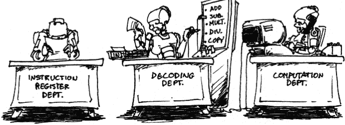

# 8 机器架构

## 当你购买计算机时

当你购买一台计算机时，你会得到一箱电路板、硅芯片、磁盘硬件、连接器、电线等等。你想知道这一切究竟是怎么回事，于是打开手册看看所购何物。你很可能会找到一个类似图 8.1 的图表。

实际上，这个架构图是针对英特尔级别机器的（略去了一些细节），但如果你购买了其他品牌，图表会非常相似。图中会有一个中央处理单元（CPU），它包含一系列用于进行计算的寄存器。中央处理器可能还包括特殊的硬件，用于对浮点数进行计算，在 Java 中这类数被称为 `double` 类型。图中还会有一个内存，用于在机器进行计算时存储程序和数据。还会有一个高速缓存，它位于主内存和 CPU 之间；其作用是从主内存中下载 CPU 当前需要的项目，然后在需要时以非常高的速度提供给 CPU。还会有一个磁盘，用于在你不使用时存储程序和数据。还会有各种输入输出设备的接口，例如键盘、视频显示器、网络连接和打印机。

我们希望研究这个架构，但没有时间详细考察图中所示的所有细节。我们考察整个架构的一部分，以了解其基本机制，并将获取任何特定机器的完整手册以了解细节的工作留给读者。我们从图 8.1 中提取出足够的基本组件来构建一个现代计算机的工作模型并加以研究。我们提取的 CPU 只有四个寄存器和十二条机器指令；而现代的奔腾处理器有十几个寄存器和一百多条机器指令。我们省略了浮点处理器、内存缓存，以及与长期存储或输入输出设备相关的任何考虑。其中一些设备将在第 10 章讨论。我们将我们的 CPU 模型称为 P88，代表“英特尔 8088 的一部分”。这些指令我们描述 P88 的内容均摘自 Intel 手册（有时为适应本书目的略有修改），且在它们于当前奔腾处理器上仍然适用的意义上是真实的。

## 一个示例架构：P88 机器

我们简化的机器如图 8.2 所示。CPU 及其四个寄存器是本章的主要关注点。它们是机器执行工作的场所。它们各自的角色如下：

- 指令指针，`IP`。此寄存器保存将要执行的下一条指令在内存中的地址。
- 指令寄存器，`IR`。此寄存器保存从内存取出后待执行的指令。
- 条件标志，`CF`。此寄存器记录刚刚观察到的条件。它仅受某些指令影响。
- 计算寄存器，`AX`。这是发生计算的地方，例如两个数据项的加法或乘法。

内存是存储机器指令和数据的地方。图 8.2 显示内存中有五条指令（每条由星号括起来）和四个数据项（7、4、0、0）。CPU 寄存器和内存都存储 0 和 1 的序列；即所有信息都以二进制形式表示。寄存器或内存单元的典型大小是 16、32 或 64 比特（或二进制数字）。

这台机器的一条典型指令是 `COPY AX,X`，稍后将描述。这被称为汇编语言指令。当这样的指令存储在内存或寄存器中时，通常编码为一个二进制数，例如 `0010110101011011`。这被称为机器语言指令。然而，我们在讨论中不使用这些二进制代码，而是写 `COPY AX,X`，其中周围的星号表示该指令已转换为二进制代码。也就是说，`COPY AX,X` 是给机器的一条指令，而 `*COPY AX,X*` 代表其二进制代码。

计算机的功能通过重复执行以下两个步骤进行：

### 无限重复

1. **取指**——在内存中找到由 `IP` 给出的地址处的指令，并将该指令放入 `IR`。递增 `IP` 以给出下一条指令的地址。
2. **执行**——执行 `IR` 中的指令。

这两个步骤构成了取指-执行周期，通过一个例子可以最好地理解它们。假设机器指令代码。


`COPY AX,X`

`ADD AX,Y`

`COPY CN1,AX`

`COPY AX,CN1`

`COPY Z,AX`

驻留在内存位置 10 到 14，机器正要执行这些代码（图 8.3a）。那么，第一条此类代码 `COPY AX,X` 的地址 10 将在 IP 中。

周期的第一个步骤，取指，涉及从 IP 给出的位置加载 IR（见图 8.3a）。然后递增 IP 以给出下一条指令的地址（图 8.3b）。

周期的第二个步骤，执行，执行指令寄存器 IR 中的指令。在这种情况下，`COPY AX,X` 被解码并执行（D&E）（图 8.3c）。如接下来解释的，内存位置 X 的内容将被复制到寄存器 AX 中。

取指-执行周期持续不断地进行。在下一个周期，从内存位置 11 取出指令。这是一条加法指令，`ADD AX,Y`。它将内存位置 Y 的内容加到寄存器 AX 的内容上，并将结果留在寄存器 AX 中（图 8.4a）。

再一次通过取指-执行周期导致第三条指令被执行。此指令导致 AX 寄存器的内容被复制到内存位置 CN1（图 8.4b）。

因此，机器按顺序加载内存中的命令串并执行它们。偶尔一条“跳转”指令会将一个新值加载到 IP 中，从而开始一个新的命令序列。例如，在这种情况下，某条指令可能将 10 再次加载到 IP 中，导致该序列的又一次执行。

每台数字计算机的基本操作都围绕此处描述的取指-执行周期构建。事实上，这是现代数字计算机设计所能做的唯一事情——取指并执行指令。无需对任何现代计算机的智能印象深刻，无论它多么庞大，有着闪烁的灯光、复杂的显示和许多工人挤在他们的终端前。这台巨大的机器只不过是在取指并执行指令。它过去从未，现在不能，将来也永远无法做更多或更少的事情。（后面的章节将介绍其他架构，如不使用取指-执行计算方法的神经网络计算机。但那是另一个故事了。）

## 练习

1. 追踪文本示例中最后两条指令的执行过程——内存位置 13 和 14 中的指令。展示取指-执行周期的每个细节。
2. 在文本示例中，指令指针 IP 每个周期增加 1，显然很快会达到 20。如果它达到了，就会发生错误。解释错误的性质。必须在位置 14 之后、位置 20 之前包含什么指令以避免此错误？

## 编程 P88 机器

P88 有 12 条指令，如表 8.1 所示。每条指令的操作都很简单，如表中的“动作”条目所述。因此，第一条指令称为“复制”，写作 `COPY AX,mem`，其中 `mem` 指的是内存中的一个位置。如果执行此指令，内存位置 `mem` 的内容将被复制到寄存器 AX。另一条复制指令 `COPY mem,AX` 将 AX 的内容复制到内存位置 `mem`。作为说明，可以使用这两条指令将数据从内存位置 A 移动到内存位置 B：

```text
COPY AX,A
COPY B,AX
```

| 指令 | 格式 | 动作 |
| --- | --- | --- |
| 从内存复制 | `COPY AX,mem` | `AX = mem` |
| 复制到内存 | `COPY mem,AX` | `mem = AX` |
| 加法 | `ADD AX,mem` | `AX = AX + mem` |
| 减法 | `SUB AX,mem` | `AX = AX - mem` |
| 乘法 | `MUL AX,mem` | `AX = AX * mem` |
| 除法 | `DIV AX,mem` | `AX = AX / mem` |
| 比较 | `CMP AX,mem` | 如果 `AX < mem` 则 `CF = B`，否则 `CF = NB` |
| 跳转 | `JMP lab1` | 转到标签为 `lab1` 的指令。 |
| 条件跳转（不低于） | `JNB lab1` | 如果 `CF = NB` 则转到标签为 `lab1` 的指令，否则转到下一条指令。 |
| 条件跳转（低于） | `JB lab1` | 如果 `CF = B` 则转到标签为 `lab1` 的指令，否则转到下一条指令。 |
| 输入 | `IN AX` | 将一个整数输入到寄存器 AX。 |
| 输出 | `OUT AX` | 从寄存器 AX 输出一个整数。 |

P88 有四条算术指令——`ADD`、`SUB`、`MUL` 和 `DIV`——它们在 AX 和内存位置上执行各自的操作，并将结果留在 AX 中。因此，`ADD AX,B` 将内存位置 B 的内容加到 AX 上，并将结果留在 AX 中。

请注意，以下指令是非法的：`ADD mem,AX`。唯一允许在指令名称后立即引用内存的指令是 `COPY`、`JMP`、`JNB` 和 `JB`。

P88 还有用于读取和打印整数的指令，`IN` 和 `OUT`。这些指令可用于编写一些 P88 程序。下面是一个将整数读入寄存器 AX 然后打印它的 P88 程序：

```text
IN AX
OUT AX
```

或者，可以读取一个整数，计算其平方，并打印结果：

```text
IN AX
COPY M1,AX
MUL AX,M1
OUT AX
```

另一个例子，可以读取两个数字，将第一个除以第二个，并打印结果：

```text
IN AX
COPY A,AX
IN AX
COPY B,AX
COPY AX,A
DIV AX,B
OUT AX
```

另一类指令是“跳转”指令，它会将一个新地址加载到 IP 中，使机器跳转到非顺序的下一条指令。例如，考虑以下程序，它将内存位置 A 中的数反复加到 AX 中：

```text
L1 ADD AX,A
   JMP L1
```

这个程序将 A 加到 AX，然后下一条指令导致跳转到标有 `L1` 的指令。此处 A 再次被加到 AX。接着跳转指令将机器送回 `L1`，如此往复。这个程序无限循环，将 A 加到 AX 无限次。

当然，通常更理想的是编写一个在适当次数的重复后停止的循环。这是通过比较指令 `CMP` 和条件跳转指令 `JB` 及 `JNB` 的组合来实现的。以下代码就是这类程序的一个例子，它在退出前打印从 1 到 10 的数字。该程序假设数字 0、1 和 10 分别出现在内存位置 `M0`、`M1` 和 `M10` 中。

```text
   COPY AX,M0
L1 ADD AX,M1
   OUT AX
   CMP AX,M10
   JB L1
```

比较指令 `CMP` 在 AX 小于（低于）`M10` 时将 `B` 加载到寄存器 CF 中。“低于则跳转”指令 `JB` 在 CF 为 `B` 时跳转到 `L1`，也就是说，当 AX 低于 `M10` 时跳转。对该程序的解释性描述显示了它的工作原理：

- 将 0 放入 AX。
- `L1` 将 1 加到 AX。
- 打印 AX 的内容。
- 检查 AX 是否小于 10。
- 如果是，则转到 `L1`。

另一个使用比较和跳转指令的程序示例如下，它读取一个数并在其为负数时改变其符号。因此，该程序计算的是所谓的“绝对值”：

```text
IN AX
COPY M1,AX
SUB AX,M1
CMP AX,M1
JB NEXT
SUB AX,M1
COPY M1,AX
NEXT COPY AX,M1
OUT AX
```

最后一个例子是一个程序，用于累加一系列非负数。如果在任何时候读取到一个负数，程序会打印所有读取到的非负数之和并退出：

```text
IN AX
COPY M1,AX
SUB AX,M1
COPY ZERO,AX
COPY SUM,AX
COPY AX,M1
LOOP CMP AX,ZERO
JB FIN
ADD AX,SUM
COPY SUM,AX
IN AX
JMP LOOP
FIN COPY AX,SUM
OUT AX
```

像这样以符号形式书写的机器指令语言——`COPY`、`ADD`、`CMP`——被称为汇编语言。这种语言在 20 世纪 40 年代和 50 年代被大量使用，之后才出现了如 FORTRAN、PL/I 和 Java 等高级编程语言。汇编语言中的每条指令都可以直接翻译成二进制代码，即机器语言，在本章中用带星号的指令表示。机器语言指令可以加载到 IR 寄存器中并按前述方式执行。

## 练习

1. 解释以下程序计算的是什么功能：

```text
        IN AX
        COPY M1,AX
        SUB AX,M1
        CMP AX,M1
        JB LAB1
        OUT AX
        JMP LAB2
LAB1    COPY AX,M1
        DIV AX,M1
        OUT AX
LAB2    END
```

2. 编写一个汇编语言程序，读取两个整数并打印较大的一个。
3. 编写一个汇编语言程序，读取两个整数——先是一个较小的整数，然后是一个较大的整数。然后打印它们之间但不包括它们的所有整数。
4. 一位程序员注意到一台机器每天都在变慢，想知道原因。此外，它有时表现得不稳定。她研究了机器中运行的代码，经过相当大的努力，发现了以下她可以确定为来源不明的代码：

```text
V1      JMP   BEGIN
ZERO    0
ONE     1
TEN     10
FIFTY   50
LENGTH  33
COUNT   0
N1      0
BEGIN   COPY  AX,RANDOM
        COPY  N1,AX
        DIV   AX,TEN
        MUL   AX,TEN
        SUB   AX,N1
        CMP   AX,ZERO
        JB    EXIT
        COPY  AX,ZERO
        COPY  COUNT,AX
```

```text
LOOP1   COPY CX,RANDOM
        COPY AX,COUNT
        CMP  AX,FIFTY
        JNB  EXIT
        COPY BX,ZERO
LOOP2   CMP  BX,LENGTH
        JNB  NEXT
        COPY AX,V1+c(BX)
        COPY c(CX),AX
        ADD  BX,ONE
        ADD  CX,ONE
        LOOP2
NEXT    COPY AX,COUNT
        ADD  AX,ONE
        COPY COUNT,AX
        JMP  LOOP1
EXIT
```

事实上，这位程序员发现的是一种计算机病毒，你的工作是分析它并发现其工作原理。这是一个可能被不友好的人插入计算机系统的程序。它安静地潜伏在被插入的程序中间，直到合适的时机。然后它会突然启动，在机器内存中多次复制自身。

你能回答关于这个病毒的以下问题吗：它是如何决定开始行动的？它在不活动时如何隐藏？它使用什么机制来复制自身？它复制多少次？为什么病毒会导致机器变慢？为什么它有时会导致系统行为不稳定？程序员应该做什么来清除这个病毒？这个病毒在执行其破坏任务时有什么问题？如何修改它才能更隐蔽地在机器中潜行而不被发现？

该病毒使用了之前未讨论的 P88 机器的一些特性。它引用了一个名为 RANDOM 的位置，其中包含一个随机数。每次引用该位置时，都会得到一个不同的随机数。假设还有两个额外的寄存器：它们被称为 BX 和 CX。符号 `c(CX)` 指的是地址等于 CX 中数字的内存位置。因此，如果寄存器 CX 包含 100，那么 `COPY c(CX),AX` 将把 AX 的内容放入内存中的位置 100。表达式 `V1+c(BX)` 指的是从程序开头的位置 V1 开始，再往后数 BX 个位置的内存位置。

这种病毒在典型的现代计算机中不会很危险，因为这类机器通常具有内存保护机制，可以迅速阻止它。一种能在当代机器上成功运行的病毒还需要一种欺骗保护系统的方案，这里不再讨论。

## 小结

本章描述了绝大多数数字计算机的经典架构。它们有一个 CPU，对存储在内存中的指令序列执行取指-执行周期，这些指令与计算数据一起存放在内存中。这被称为冯·诺依曼架构，而常见的偏离只有第 14 章描述的并行机器。

当我们购买这种机器时，会被告知它以某种速度运行，例如 800 兆赫兹。这个速度指的是内部电子元件每秒完成的时钟周期数；在这种情况下，就是每秒 8 亿个周期。机器指令的执行由这些时钟周期同步。例如，机器可能在一个周期内取指令，下一个周期解码，第三个周期执行计算。另一台机器可能同时取入多条指令，并在单个时钟周期内全部执行。某台机器上的一些指令可能需要多个时钟周期，而另一些可能只需要一个周期或更少。可以将所标称的速度理解为每秒执行的汇编语言指令数的近似值；但这显然是一个非常粗略的近似。

如果我们拥有这里描述的这种机器，我们可以用汇编语言对它进行编程，但不能使用 C++ 或 Java 等高级语言。第 9 章将研究使我们能够自动将这类高级语言转换为汇编语言的翻译技术，从而让我们能够在自己的机器上用 C++ 或 Java 编程。

# 9 语言翻译

## 使计算机能够理解 Java

交流的主要工具是语言，数千年间发展出了许多语言。计算机的出现带来了更多语言。但大多数语言对我们而言没有意义，除非我们能将它们翻译成熟悉的术语。因此，翻译是一个对人类和机器都非常重要的过程。我们希望理解和使用许多语言，而翻译过程可以让我们接触到它们。

计算机科学家已经开发出一种强大的语言翻译技术。本章介绍这种方法论，一种适用于许多翻译问题的一般技术，从而使你熟悉该领域的另一个重要思想。这种方法论对计算机语言非常成功，也能处理自然语言的小子集，如第 16 章所述。

我们在此关注的是将 Java 等高级编程语言翻译成汇编语言或机器语言等低级语言。机器不理解高级语言，但它们理解机器语言，或者借助非常简单的翻译器，理解汇编语言。例如，我们问 Java 语句

```java
z = (X + Y)
```

如何翻译成以下正确表达所需含义的汇编语言代码：

```text
COPY AX,X
ADD AX,Y
COPY CN1,AX
COPY AX,CN1
COPY Z,AX
```

# 第 9 章

大多数编程语言：C、C++

Java

本书涵盖的内容

### 图 9.1

如果我们能够理解执行这种简单转换的机制，我们就会理解几乎适用于任何领域的基本转换过程。（此处展示的汇编语言翻译并非最短长度，你可能可以找到更短的程序来完成同样的工作。自动翻译器的任务是产生正确的翻译，但并不总是产生最优的翻译，此处就是这种情况。）

事实上，Java 编译器并不像我们这里所做的那样将 Java 翻译成汇编语言。大多数语言，如 C、C++ 和其他语言，历史上都是直接翻译成汇编语言或机器语言。然而，Java 编译器翻译成一种中间语言，由 Java 处理系统来解释执行（图 9.1）。这样做的主要原因是提供计算机与 Java 程序之间的软件屏障，防止 Java 程序威胁文件和机器的正常运行。然而，我们忽略这一额外的处理层次，以便控制我们讨论的复杂度。

本章介绍一些与语言理论和翻译相关的基本思想。然后展示如何将这些思想组合起来，为 Java 的一小部分构建一个翻译器，并给出许多翻译示例。

## 句法产生式规则

语言体现在符号序列中。为了理解语言，我们必须有一种用于符号序列的数学。这种数学将展示如何生成和分析这些序列，并为进行翻译提供必要的机制。

## 语言翻译

第一个概念是产生式规则。这类规则在第 2 章中已经介绍过。这里将更详细地讨论它们，并为我们的翻译机制提供基础。从概念上讲，产生式规则将一个给定的对象或对象集转换成其他东西——不同的对象或对象集。第 2 章中的一个产生式规则示例是：

```text
<name> ==> 任何以字母开头的字母数字符号字符串
```

这里将以修改后的形式写为：

```text
R1. <i>j ==> 任何以字母开头的字母数字符号字符串
```

这个规则被命名为 R1，它的含义是“将 `<i>j` 转换成以字母开头的一系列字母和/或数字”。术语 `<name>` 被修改为 `<i>`（表示标识符 identifier），并加上了下标 j。每次使用 R1 时，j 将有一个具体的值，并且规则右侧将使用一个具体的字母字符串。R1 的一个实例化示例是：

```text
<i>7 ==> HEIGHT
```

它的含义是“将 `<i>7` 转换成 `HEIGHT`”。我们将研究像 R1 这样的句法产生式规则，它们将像 `<i>7` 这样的符号转换成像 `HEIGHT` 这样的符号串。所有这些规则都是对前面为比本章考虑的 Java 部分大得多的部分所给出的规则的简化。

一旦我们有了规则，我们就可以应用该规则来修改某个字符串。例如，假设我们有字符串 (`<i>7` + `<i>19`)。让我们使用这个版本的 R1 来改变这个字符串：

```text
(<i>7 + <i>19)
```

规则 `<i>7 ==> HEIGHT` 表示 `<i>7` 可以被改变为 `HEIGHT`，所以结果将是：

```text
(HEIGHT + <i>19)
```

由于形式 (`<i>7` + `<i>19`) 被改变为 (`HEIGHT` + `<i>19`)，我们可以写出：

```text
(<i>7 + <i>19) ==> (HEIGHT + <i>19)
```

第一种形式中的 `<i>7` 在第二种形式中被替换为 `HEIGHT`。如果我们希望再次应用 R1，我们可以使用实例化：

```text
<i>19 ==> INC
```

来得到：

```text
(<i>19) ==> (HEIGHT + INC)
```

在这些规则中，`<i>_j` 代表“标识符名”，由 `<i>_j` 生成的符号串就是一个标识符名。

也可能希望将规则应用于 `<i>_j` 以外的其他东西。R2 是另一个有用的规则；它使我们能够将 `<e>_i` 转换为 `<i>_j`：

```text
R2. <e>_i ==> <i>_j
```

例如，使用版本 `<e>_3 ==> <i>_7` 加上 R1 规则，我们有：

```text
<e>_3 ==> <i>_7 ==> HEIGHT
```

星号 `*` 用于表示已经发生了任意次数的规则应用。因此，前面的两步推导可以写成：

```text
<e>_3 ==*> HEIGHT
```

在这些规则中，`<e>_i` 代表“表达式”或“算术表达式”，如前面章节所定义。

这一切看起来与 Java 似乎没有多大关系。但是规则 R3 引入了一个熟悉的结构，赋值语句：

```text
R3. <s>_k ==> <i>_j = <e>_i
```


这个规则说明 `<s>_k` 可以被替换为 `<i>_j = <e>_i`。但规则的真正含义是，Java 中的合法语句 `<s>_k` 是符号序列 `<i>_j = <e>_i`，其中 `<i>_j` 是标识符名，`<e>_i` 是算术表达式。使用 R1–R3 的组合，我们可以生成合法的赋值语句。作为示例，考虑生成 Java 语句：

```
X = Y
```

### 表 A

| 推导 | 规则 |
|---|---|
| `<s>_1` | R3. `<s>_1 ==> <i>_2 = <e>_3` |
| `<i>_2 = <e>_3` | R1. `<i>_2 ==> X` |
| `X = <e>_3` | R2. `<e>_3 ==> <i>_4` |
| `X = <i>_4` | R1. `<i>_4 ==> Y` |
| `X = Y` | |

在这个推导中，我们从 `<s>_1` 开始，这意味着我们希望生成一个 Java 语句。然后我们使用 R3 的一个实例将 `<s>_1` 转换为其他东西，即 `<i>_2 = <e>_3`。这个转换是用规则 `<s>_1 ==> <i>_2 = <e>_3` 完成的。接下来，我们希望将 `<i>_2` 改为 X，这用形式为 `<i>_2 ==> X` 的 R1 完成。这个变化的结果出现在推导的第三行：`X = <e>_3`。最后，规则 R2 用于将 `<e>_3` 转换为 `<i>_4`，规则 R1 用于将 `<i>_4` 转换为 Y。

我们的示例只需要再增加两条规则：R4 和 R5，它们使我们能够处理一些复杂的算术表达式：

```
R4. <e>_i ==> (<e>_j + <e>_k)
R5. <e>_i ==> (<e>_j * <e>_k)
```

这五条规则的集合构成了 Java 中一些赋值语句的*语法*，足以为本章提供许多有趣的示例。这些规则是前面章节介绍的规则的简化。下面是一些示例推导。

### 表 B

| 推导 | 规则 |
|---|---|
| `<s>_1` | R3. `<s>_1 ==> <i>_2 = <e>_3` |
| `<i>_2 = <e>_3` | R1. `<i>_2 ==> Y` |
| `Y = <e>_3` | R4. `<e>_3 ==> (<e>_4 + <e>_5)` |
| `Y = (<e>_4 + <e>_5)` | R2. `<e>_4 ==> <i>_6` |
| `Y = (<i>_6 + <e>_5)` | R1. `<i>_6 ==> XX` |
| `Y = (XX + <e>_5)` | R2. `<e>_5 ==> <i>_7` |
| `Y = (XX + <i>_7)` | R1. `<i>_7 ==> YY` |
| `Y = (XX + YY)` | |

下面展示了一个更深层嵌套的算术表达式的生成。

### 表 C

| 推导 | 规则 |
|---|---|
| `<s>_1` | R3. `<s>_1 ==> <i>_2 = <e>_3` |
| `<i>_2 = <e>_3` | R1. `<i>_2 ==> SUM` |
| `SUM = <e>_3` | R4. `<e>_3 ==> (<e>_4 + <e>_5)` |
| `SUM = (<e>_4 + <e>_5)` | R5. `<e>_4 ==> (<e>_7 * <e>_8)` |
| `SUM = ((<e>_7 * <e>_8) + <e>_5)` | R2. `<e>_7 ==> <i>_9` |
| `SUM = ((<i>_9 * <e>_8) + <e>_5)` | R1. `<i>_9 ==> X` |
| `SUM = ((X * <e>_8) + <e>_5)` | R2. `<e>_8 ==> <i>_10` |
| `SUM = ((X * <i>_10) + <e>_5)` | R1. `<i>_10 ==> C` |
| `SUM = ((X * C) + <e>_5)` | R2. `<e>_5 ==> <i>_11` |
| `SUM = ((X * C) + <i>_11)` | R1. `<i>_11 ==> SUM` |
| `SUM = ((X * C) + SUM)` | |

266 第 9 章

当然，算术表达式中可以生成任意层级的乘法和加法嵌套：

```
<s>_1 ==*> Y = ((XX * YY) + (XY * (YX + XXX)))
```

对于这些推导，出现了一个关于如何确定下标的问题。例如，如果我们有字符串：

```
X = (Y + <e>_6)
```

并希望应用规则 `<e>_4 ==> (<e>_j + <e>_k)`，应该使用什么方法来确定 i、j 和 k？答案是，左侧的下标由要被替换的符号决定。例如，语句中要替换的符号是 `<e>_6`，所以规则的左侧必须是 `<e>_6`：`<e>_6 ==> (<e>_j + <e>_k)`。右侧的下标可以是任何值，只要它们与本次推导中先前使用过的任何下标不同。假设 8 和 9 尚未使用。那么我们可以设 j = 8 和 k = 9，得到形式 `<e>_6 ==> (<e>_8 + <e>_9)`。在前面的语句中应用这个规则，结果是：

```
X = (Y + (<e>_8 + <e>_9))
```

总结设置下标的过程，我们重复前面的示例。我们希望修改这个：

```
X = (Y + <e>_6)
```

我们希望使用这个规则：

```
<e>_4 ==> (<e>_j + <e>_k)
```

然后我们设置规则左侧的下标，使其与要被替换的项目匹配：

```
<e>_6 ==> (<e>_j + <e>_k)
```

但规则在所有下标都设置好之前还没有准备好。让我们把任何其他我们想要的数字放入其他槽位，j 和 k，比如 8 和 9（如果 8 和 9 以前没有作为下标使用过）：

```
<e>_6 ==> (<e>_8 + <e>_9)
```

现在让我们将这个规则应用于原始形式，`X = (Y + <e>_6)`：

```
X = (Y + (<e>_8 + <e>_9))
```

一旦为某种语言（或者，如我们的情况，部分语言）建立了语法，该语法就可以用于/格式化为语言的*生成*或*分析*（理解）它。前面的例子说明了生成过程；一个想用 Java 表达某事的人，从决定说出一个语句开始，然后生成要说出的内容：

```
<s>₁ ==> <i>₂ = <e>₃ ==> X = <e>₃ ==> · · · ==> X = (Y * X)
```

每条规则的应用都进一步明确了要说的内容，直到语句被完全定义。但这些规则也可以反向应用来分析或理解一个语句。因此，给定：

```
X = (Y * X)
```

我们可以使用 R1 来发现标识符在哪里：

```
<i>₁ = (<i>₂ * <i>₃)
```

然后规则 R2 和 R4 揭示了右侧的结构：

```
<i>₁ = <e>₄
```

最后，R3 告诉我们一个完整的语句已经形成：

```
<s>₀
```

所以同样用于生成的规则也可以反向用于拆解、分析和理解 Java 语句。

类似的过程很可能可以解释人类对英语的处理。推测人类大脑中也有某种类似语法的东西，生成过程通过应用规则来创建格式正确的言语。一个人可能决定断言一个陈述句（陈述句），而语法可以指示这类句子有主语和谓语：

（主语）（谓语）

进一步的规则可以使这些符号被实际词语替换：

The boy went to town.

理解将涉及反向过程：找出所说词语的词性，找出它们如何组合成为主语和谓语等句子成分，最后找出完整句子的结构。这在第 16 章中有更多讨论。

本节讨论了语言的语法问题。我们考察了生成或分析构成语言的符号串的机制。

## 第 9 章

下一节关注语言的*语义*。在那里我们研究意义的概念，并展示意义如何与语言的言语、语法的符号串相关联。

## 练习

1. 应用给定规则到 `<s>₁` 生成符号串。
   - (a) 规则 R3, R1, R2, R1
   - (b) 规则 R3, R1, R5, R2, R1, R2, R1
   - (c) 规则 R3, R1, R4, R2, R1, R5, R2, R1, R2, R1

2. 使用规则 R1–R5 从 `<i>₁` 或 `<s>₁` 开始生成以下字符串：
   - (a) `YXY`
   - (b) `JACK`
   - (c) `X = Y`
   - (d) `X = (X * X)`
   - (e) `YYY = (Y * (X + X))`
   - (f) `XX = ((X + XX) * Y)`
   - (g) `X = ((Y * Y) + (X * X))`

3. 为了能够生成以下语句，需要什么新规则？

   `SUM = FACT - X`

   使用你的新规则展示此语句的完整生成过程。

4. 构建一个能生成以下所有句子的语法。

   The boy knows the girl.

   This girl knows that boy.

   That boy knows this boy.

   Jack knows that boy.

   Jill knows Jack.

   Jack knows Jill.

   ...

## 为规则附加语义

语言实体的*意义*是语言使用者与该实体相关联的知识结构。一个例子语言是英语，一个例子语言实体是 "John ran to the red house." 它的意义可能是你脑海中形成的一幅画面，显示 John 跑向一座红色的房子。另一个语言的例子是二进制数集合，该语言的一个例子成员是 101。我们可以决定把每个二进制数的意义取为其十进制等效值。这样，字符串 101 的意义就是 5。语言的*语义*指的是将意义附加到语言实体上的机制。

被翻译的语言称为*源语言*，该语言被翻译成*目标语言*。源语言 presumably 不能被接收者使用，但目标语言可以。本节我们将二进制数作为源语言，展示如何将它们翻译成十进制数，即目标语言。

我们开始通过研究二进制数的语义来学习语言意义。首先，我们创建一组生成二进制数的规则：

```
P1. <s>_i_ ==> <s>_j_0
P2. <s>_i_ ==> <s>_j_1
P3. <s>_i_ ==> 0
P4. <s>_i_ ==> 1
```

我们可以使用这些规则生成任何二进制数。以下是我们生成 101 的过程：

### 表 D

| 推导 | 规则 |
|---|---|
| `<s>_1_` | P2. `<s>_1_ ==> <s>_2_1` |
| `<s>_2_1` | P1. `<s>_2_ ==> <s>_3_0` |
| `<s>_3_01` | P4. `<s>_3_ ==> 1` |
| `101` | |

从 `<s>_1_` 开始，应用规则 P2 在字符串右端创建一个 1。然后规则 P1 创建 0，P4 完成 101 的推导。所有这些都是对熟悉的规则机制的回顾，只是它被应用于生成二进制数。

下面是新的想法。我们现在为每条规则添加一个语义部分。包含语义的规则 P1–P4 看起来像这样：

### 表 E

| 规则语法 | 规则语义 |
|---|---|
| P1. `<s>_i_ ==> <s>_j_0` | `M(<s>_i_) = M(<s>_j_) * 2` |
| P2. `<s>_i_ ==> <s>_j_1` | `M(<s>_i_) = M(<s>_j_) * 2 + 1` |
| P3. `<s>_i_ ==> 0` | `M(<s>_i_) = 0` |
| P4. `<s>_i_ ==> 1` | `M(<s>_i_) = 1` |

因此，每条产生式规则现在有两个部分：语法部分和语义部分。符号 `M` 代表"意义"，所以规则 P1 的语义部分应读作"`<s>₁` 的意义等于 `<s>ⱼ` 的意义乘以 2"。其他语义部分可以同样方式阅读。下一个问题是如何使用这个语义部分。

语义机制的功能可以通过考察字符串 101 及其意义 5 的推导来理解：

### 表 F

| 推导 | 规则 | 语法 | 规则语义 |
|---|---|---|---|
| `<s>₁` | P2. | `<s>₁ ==> <s>₂1` | `M(<s>₁) = M(<s>₂) * 2 + 1` |
| `<s>₂1` | P1. | `<s>₂ ==> <s>₃0` | `M(<s>₂) = M(<s>₃) * 2` |
| `<s>₃01` | P4. | `<s>₃ ==> 1` | `M(<s>₃) = 1` |
| `101` | | | |

这个表很容易理解，因为它只是表 D 的复本，按照表 E 中的定义为每条规则添加了语义部分。接下来，我们逐行复写表 F，并在每行之后写下当前版本的意义，使用到该点为止的所有语义信息：

```
<s>₁   P2. <s>₁ ==> <s>₂1    M(<s>₁) = M(<s>₂) * 2 + 1
```

根据此条目，意义的第一次近似是 `M(<s>₁) = M(<s>₂) * 2 + 1`。

找到的意义：`M(<s>₁) = M(<s>₂) * 2 + 1`

但这个意义表达式中有一个未知量：`M(<s>₂)`。表 F 的下一个条目将有所帮助：

```
<s>₂1    P1. <s>₂ ==> <s>₃0    M(<s>₂) = M(<s>₃) * 2
```

具体而言，我们使用规则 P1 的语义来告诉我们 `M(<s>₂)` 的值，并将该值代入"找到的意义"表达式：

找到的意义：`M(<s>₁) = (M(<s>₃) * 2) * 2 + 1`

但这个意义表达式中有未知量 `M(<s>₃)`。表 F 的下一个条目将有所帮助：

```
<s>₃01   P4. <s>₃ ==> 1   M(<s>₃) = 1
```

将源于 `M(<s>₃)` 的值代入"找到的意义"表达式：

找到的意义：`M(<s>₁) = (1 * 2) * 2 + 1 = 5`

这完成了 101 的意义计算。意义是 `M(<s>₁) = 5`。

表 F 与"找到的意义"表达式一起，展示了计算产生意义值所需的每一步。这些步骤在表 G 中总结。你应该仔细研究表 G，直到确定理解每一步。

### 表 G

| 推导 | 规则 | 语法 | 规则语义 |
|---|---|---|---|
| `<s>₁` | P2. | `<s>₁ ==> <s>₂1` | `M(<s>₁) = M(<s>₂) * 2 + 1` |
| 找到的意义： | | `M(<s>₁) = (M(<s>₂) * 2 + 1` | |
| `<s>₂1` | P1. | `<s>₂ ==> <s>₃0` | `M(<s>₂) = M(<s>₃) * 2` |
| 找到的意义： | | `M(<s>₁) = (M(<s>₃) * 2) * 2 + 1` | |
| `<s>₃01` | P4. | `<s>₃ ==> 1` | `M(<s>₃) = 1` |
| 找到的意义： | | `M(<s>₁) = (1 * 2) * 2 + 1 = 5` | |
| `101` | | | |

总之，我们已经完成了为像 101 这样的语言实体寻找意义的所有细节。首先，我们找到了从 `<s>₁` 开始生成 101 的语法规则序列。然后我们使用这些规则的语义部分来创建意义 `M(<s>₁)`。

## 练习

1. 使用规则 P1–P4 的语法部分找到字符串 1011 的生成过程。现在添加规则的语义部分，并使用它们计算原始字符串的意义（十进制等效值）。

2. 对二进制字符串 10111 和 00111 重复练习 1。

3. 解释规则 P1 和 P2 语义部分的构造，并准确说明它们为何能计算 `M(<s>₁)` 的正确值。

## Java 的语义

上一节展示了如何为规则附加语义，以及如何使用这些语义部分来计算语言言语的意义。现在是时候将这些想法应用于这里的核心问题了——将 Java 翻译成机器能够理解的语言，即 P88 汇编语言或最终是二进制编码的机器语言。

语法规则 R1–R5 左侧的符号 `<i>ⱼ`、`<e>ⱼ` 和 `<s>ⱼ` 称为语法变量，语法语义为它们赋予意义。我们现在按照与上一节相同的方式，为这些规则逐一添加语义部分。结果将是一个用于翻译它们所表示的 Java 语句类的翻译器。

应该与最简单的规则 R1 关联的含义是什么？

```
R1. <i>₁ ==> any string of alphanumeric symbols that begins with a
    letter
```

也就是说，如果某个变量在源语言中名为 X，那么它在目标语言中应该叫什么名字？让我们尽可能简化处理，让变量在两种语言中使用相同的名字：

```
R1. <i>₁ ==> w    M(<i>₁) = w
```

其中 w 是某个标识符字符串。因此，我们可能有 R1 的如下实例化：

```
<i>₉ ==> HEIGHT    M(<i>₉) = HEIGHT
```

接下来，我们考虑与 R2 关联的语义。左侧变量 `<e>ᵢ` 有两部分含义表示，即 `M(<e>ᵢ)` 和 `code(<e>ᵢ)`。直观上，算术表达式 `<e>ᵢ` 将有一个名字：

```
R2. <e>ᵢ ==> <i>ⱼ    M(<e>ᵢ) = M(<i>ⱼ)
                     code(<e>ᵢ) = nothing
```

因此，举例来说，如果 `<e>ᵢ ==> HEIGHT`，那么 `M(<e>ᵢ) = HEIGHT`，而 `code(<e>ᵢ)` 是长度为零的指令（代码）列表。

规则 R3 提供了第一个有意思的语义。如果 `<s>ₖ` 生成一条 Java 语句，那么 `code(<s>ₖ)` 将给出其在 P88 汇编语言中的翻译。

```
R3. <s>ₖ ==> <i>ⱼ = <e>ᵢ    code(<s>ₖ) = code(<e>ᵢ)
                                         COPY AX,M(<e>ᵢ)
                                         COPY M(<i>ⱼ),AX
```

因此，`code(<s>ₖ)` 是 `code(<e>ᵢ)` 中所有指令后接所示两条 `COPY` 指令的列表。这表明 `<s>ₖ` 的代码应首先计算 `<e>ᵢ` 的值，然后将该计算结果复制到 AX 中，再存入 `<i>ⱼ` 的位置。


请注意，我们在本章遵循特定的记法约定。代码片段以类似缩进的顺序程序行输入。这类片段应被视为整体，即使它们分布在多行中。在前面的定义中，`code(<s>ₖ)` 定义为：

```
code(<s>ₖ) = code(<e>ᵢ)
             COPY AX,M(<e>ᵢ)
             COPY M(<i>ⱼ),AX
```

该约定要求将这三行代码视为一个单一整体。因此，该定义表明 `code(<s>ₖ)` 等价于所给出的三行代码，而不仅仅是单独一行 `code(<e>ᵢ)`。

为了说明规则 R1–R3 及其语义组件的使用，让我们完整地将语句 `X = Y` 翻译成汇编语言。从前一节（表 A）可以明显看出，规则序列 R3、R1、R2、R1 足以推导出源语句。因此我们写下完整的推导过程，以确定翻译所需的语义规则。该推导与表 A 中的推导相同，只是每条规则的语义部分列在了语法部分旁边。

## 表 H

| 推导 | 规则 | 语法 | 规则语义 |
|------------|------|--------|--------------|
| `<s>₁` | R3. | `<s>₁ ==> <i>₂ = <e>₃` | `code(<s>₁) = code(<e>₃)`<br>`COPY AX,M(<e>₃)`<br>`COPY M(<i>₂),AX` |
| `<i>₂ = <e>₃`<br>`X = <e>₃` | R1.<br>R2. | `<i>₂ ==> X`<br>`<e>₃ ==> <i>₄` | `M(<i>₂) = X`<br>`M(<e>₃) = M(<i>₄)`<br>`code(<e>₃) = nothing` |
| `X = <i>₄`<br>`X = Y` | R1. | `<i>₄ ==> Y` | `M(<i>₄) = Y` |

在表 H 中，前两列取自前面关于语法的章节（表 A）。第三列是新增的；它给出了所用每条规则的语义部分。

现在我们想要使用表 H 的第三列来计算一些“已发现含义”表达式。发现含义的开头只是从表 H 中复制 `code(<s>₁)` 的值。

```
已发现含义:  code(<s>₁) = code(<e>₃)
                           COPY AX,M(<e>₃)
                           COPY M(<i>₂),AX
```

这是一个良好的开端，但我们想知道 `M(<i>₂)` 的值将会是什么。答案由表 H 的第二条记录、第三列给出：`M(<i>₂) = X`。因此我们可以将该替换代入前面的已发现含义表达式中。

```
已发现含义:  code(<s>₁) = code(<e>₃)
                           COPY AX,M(<e>₃)
                           COPY X,AX
```

表 H 的第三条记录、第三列使我们能够填入已发现含义中另外两个实体的值，`M(<e>₃) = M(<i>₄)` 和 `code(<e>₃) = nothing`。经过这两项替换，已发现含义变为：

```
已发现含义: code(<s>₁) = COPY AX,M(<i>₄)
                            COPY X,AX
```

还有一项需要完成，即 `M(<i>₄)` 的求值。表 H 的第四条记录使之成为可能：`M(<i>₄) = Y`。

```
已发现含义: code(<s>₁) = COPY AX,Y
                            COPY X,AX
```

因此，翻译规则断言 Java 中 `X = Y` 的含义是：

```
COPY AX,Y
COPY X,AX
```

用 P88 汇编语言表示。这条 Java 语句说：“找到 Y 中的值并将其存入 X。”翻译后的代码用 P88 汇编语言表达了相同的意思：“将 Y 复制到 AX，然后将 AX 复制到 X。”这个例子值得仔细研究，因为它展示了翻译器的所有基本机制，而又不过于复杂。

总之，翻译过程的输入是 `X = Y`。应用了规则 R1、R2 和 R3，得到了表 H 第三列所示的语义关系，在此重复如下：

语义规则：

```
code(<s>₁) = code(<e>₃)
          COPY AX,M(<e>₃)
          COPY M(<i>₂),AX
M(<i>₂) = X
M(<e>₃) = M(<i>₄)
code(<e>₃) = nothing
M(<i>₄) = Y
```

最后，使用这些规则对 `code(<s>₁)` 进行了求值。翻译输出为：

```
COPY AX,Y
COPY X,AX
```

更有趣的翻译只有在最后两条规则 R4 和 R5 的语义可用时才可能实现。

## 语言翻译

```
R4. <e>ᵢ ==> (<e>ⱼ + <e>ₖ)    M(<e>ᵢ) = createname
                                    code(<e>ᵢ) = code(<e>ⱼ)
                                                code(<e>ₖ)
                                                COPY AX,M(<e>ⱼ)
                                                ADD AX,M(<e>ₖ)
                                                COPY M(<e>ᵢ),AX

R5. <e>ᵢ ==> (<e>ⱼ * <e>ₖ)    M(<e>ᵢ) = createname
                                    code(<e>ᵢ) = code(<e>ⱼ)
                                                code(<e>ₖ)
                                                COPY AX,M(<e>ⱼ)
                                                MUL AX,M(<e>ₖ)
                                                COPY M(<e>ᵢ),AX
```

这些语义规则使用了函数 `createname`，它创建一个在其它地方未曾使用过的名字。因此，如果遇到 `M(<e>₇) = createname`，系统可能会创建名字 CN1 并赋值：`M(<e>₇) = CN1`。如果之后遇到，比如说，`M(<e>₉) = createname`，结果可能是 `M(<e>₉) = CN2`。

考察加法规则 R4 的代码语义，可以看到 `<e>ⱼ` 和 `<e>ₖ` 的代码段被展开以确定这些算术表达式的值。然后通过两条 P88 指令将结果累加到寄存器 AX 中，最后存储起来供后续计算使用。规则 R5 中发生了类似的事情。

以下推导展示了这些规则的使用。第一个是 `Z = (X + Y)` 的翻译。

## 表 K

| 推导 | 规则语法 | 规则语义 |
|------------|-------------|----------------|
| `<s>₁` | R3 `<s>₁ ==> <i>₂ = <e>₃` | `code(<s>₁) = code(<e>₃)`<br>`COPY AX,M(<e>₃)`<br>`COPY M(<i>₂),AX` |
| 已发现含义: `code(<s>₁) = code(<e>₃)`<br>`COPY AX,M(<e>₃)`<br>`COPY M(<i>₂),AX` | | |
| `<i>₂ = <e>₃` | R1. `<i>₂ ==> Z` | `M(<i>₂) = Z` |
| 已发现含义: `code(<s>₁) = code(<e>₃)`<br>`COPY AX,M(<e>₃)`<br>`COPY Z,AX` | | |
| `Z = <e>₃` | R4. `<e>₃ ==> (<e>₄ + <e>₅)` | `M(<e>₃) = CN1`<br>`code(<e>₃) = code(<e>₄)`<br>`code(<e>₅)`<br>`COPY AX,M(<e>₄)`<br>`ADD AX,M(<e>₅)`<br>`COPY M(<e>₃),AX` |

## 表 K（续）

| 推导 | 规则语法 | 规则语义 |
|------------|-------------|--------------|
| 已发现含义: | `code(<s>₁) = code(<e>₄)`<br>`code(<e>₅)`<br>`COPY AX,M(<e>₄)`<br>`ADD AX,M(<e>₅)`<br>`COPY CN1,AX`<br>`COPY AX,CN1`<br>`COPY Z,AX` | |
| `Z = (<e>₄ + <e>₅)` | R2. `<e>₄ ==> <i>₆` | `M(<e>₄) = M(<i>₆)`<br>`code(<e>₄) = nothing` |
| 已发现含义: | `code(<s>₁) = code(<e>₅)`<br>`COPY AX,M(<i>₆)`<br>`ADD AX,M(<e>₅)`<br>`COPY CN1,AX`<br>`COPY AX,CN1`<br>`COPY Z,AX` | |
| `Z = (<i>₆ + <e>₅)` | R1. `<i>₆ ==> X` | `M(<i>₆) = X` |
| 已发现含义: | `code(<s>₁) = code(<e>₅)`<br>`COPY AX,X`<br>`ADD AX,M(<e>₅)`<br>`COPY CN1,AX`<br>`COPY AX,CN1`<br>`COPY Z,AX` | |
| `Z = (X + <e>₅)` | R2. `<e>₅ ==> <i>₇` | `M(<e>₅) = M(<i>₇)`<br>`code(<e>₅) = nothing` |
| 已发现含义: | `code(<s>₁) = COPY AX,X`<br>`ADD AX,M(<i>₇)`<br>`COPY CN1,AX`<br>`COPY AX,CN1`<br>`COPY Z,AX` | |
| `Z = (X + <i>₇)` | R1. `<i>₇ ==> Y` | `M(<i>₇) = Y` |
| 已发现含义: | `code(<s>₁) = COPY AX,X`<br>`ADD AX,Y`<br>`COPY CN1,AX`<br>`COPY AX,CN1`<br>`COPY Z,AX` | |
| `Z = (X + Y)` | | |

至此，原始语句 `z = (x + y)` 的翻译完成。该翻译过程的*输入*是 `z = (x + y)`。应用了规则 R1、R2、R3 和 R4。它们的语义关系在表 K 的第三列中给出。翻译的*输出*是：

```
COPY AX,X
ADD AX,Y
COPY CN1,AX
COPY AX,CN1
COPY Z,AX
```

正如本例所示，翻译器常常会产生非最小化的代码。这类代码段可以通过许多众所周知的技术进行优化，但此类研究超出了本书的范围。

本节的最后一个例子演示了如何翻译一个更复杂的算术表达式：`U1 = (X + (Y * Z))`。

## 表 L

| 推导 | 规则语法 | 规则语义 |
|------------|-------------|----------------|
| `<s>₁` | R3. `<s>₁ ==> <i>₂ = <e>₃` | `code(<s>₁) = code(<e>₃)`<br>`COPY AX,M(<e>₃)`<br>`COPY M(<i>₂),AX` |
| 找到含义：`code(<s>₁) = code(<e>₃)`<br>`COPY AX,M(<e>₃)`<br>`COPY M(<i>₂),AX` | | |
| `<i>₂ = <e>₃` | R1. `<i>₂ ==> U1` | `M(<i>₂) = U1` |
| 找到含义：`code(<s>₁) = code(<e>₃)`<br>`COPY AX,M(<e>₃)`<br>`COPY U1,AX` | | |
| `U1 = <e>₃` | R4. `<e>₃ ==> (<e>₄ + <e>₅)` | `M(<e>₃) = CN1`<br>`code(<e>₃) = code(<e>₄)`<br>`code(<e>₅)`<br>`COPY AX,M(<e>₄)`<br>`ADD AX,M(<e>₅)`<br>`COPY M(<e>₃),AX` |
| 找到含义：`code(<s>₁) = code(<e>₄)`<br>`code(<e>₅)`<br>`COPY AX,M(<e>₄)`<br>`ADD AX,M(<e>₅)`<br>`COPY CN1,AX`<br>`COPY AX,CN1`<br>`COPY U1,AX` | | |

*第 9 章*

## 表 L（续）

| 推导 | 规则语法 | 规则语义 |
|------------|-------------|----------------|
| `U1 = (<e>₄ + <e>₅)` | R2. `<e>₄ ==> <i>₆` | `M(<e>₄) = M(<i>₆)`<br>`code(<e>₄) = nothing` |
| | 找到含义：`code(<s>₁) = code(<e>₅)`<br>`COPY AX,M(<i>₆)`<br>`ADD AX,M(<e>₅)`<br>`COPY CN1,AX`<br>`COPY AX,CN1`<br>`COPY U1,AX` | |
| `U1 = (<i>₆ + <e>₅)` | R1. `<i>₆ ==> X` | `M(<i>₆) = X` |
| | 找到含义：`code(<s>₁) = code(<e>₅)`<br>`COPY AX,X`<br>`ADD AX,M(<e>₅)`<br>`COPY CN1,AX`<br>`COPY AX,CN1`<br>`COPY U1,AX` | |
| `U1 = (X + <e>₅)` | R5. `<e>₅ ==> (<e>₇ * <e>₈)` | `M(<e>₅) = CN2`<br>`code(<e>₅) = code(<e>₇)`<br>`code(<e>₈)`<br>`COPY AX,M(<e>₇)`<br>`MUL AX,M(<e>₈)`<br>`COPY CN2,AX` |
| | 找到含义：`code(<s>₁) = code(<e>₇)`<br>`code(<e>₈)`<br>`COPY AX,M(<e>₇)`<br>`MUL AX,M(<e>₈)`<br>`COPY CN2,AX`<br>`COPY AX,X`<br>`ADD AX,CN2`<br>`COPY CN1,AX`<br>`COPY AX,CN1`<br>`COPY U1,AX` | |
| `U1 = (X + (<e>₇ * <e>₈))` | R2. `<e>₇ ==> <i>₉` | `M(<e>₇) = M(<i>₉)`<br>`code(<e>₇) = nothing` |
| | | |
| | 找到含义：`code(<s>₁) = code(<e>₈)`<br>`COPY AX,M(<i>₉)`<br>`MUL AX,M(<e>₈)`<br>`COPY CN2,AX`<br>`COPY AX,X`<br>`ADD AX,CN2` | 普遍性：文本使用了Markdown表格格式。 |

## 表 L（续）

| 推导 | 规则语法 | 规则语义 |
|------------|-------------|----------------|
| `U1 = (X + (<i>₉ * <e>₈))`<br>找到含义：`code(<s>₁) = code(<e>₈)` | R1. `<i>₉ ==> Y`<br>`COPY CN1,AX`<br>`COPY AX,CN1`<br>`COPY U1,AX`<br>`COPY AX,Y`<br>`MUL AX,M(<e>₈)`<br>`COPY CN2,AX`<br>`COPY AX,X`<br>`ADD AX,CN2` | `M(<i>₉) = Y` |
| `U1 = (X + (Y * <e>₈))`<br>找到含义：`code(<s>₁) =` | R2. `<e>₈ ==> <i>₁₀`<br>`COPY AX,Y`<br>`MUL AX,M(<i>₁₀)`<br>`COPY CN2,AX`<br>`COPY AX,X`<br>`ADD AX,CN2` | `M(<e>₈) = M(<i>₁₀)`<br>`code(<e>₈) = nothing` |


| U1 = (X + (Y * `<i>₁₀`))<br>**找到含义：** code(`<s>₁`) = | R1. `<i>₁₀ ==> Z`<br>COPY AX,Y<br>MUL AX,Z<br>COPY CN2,AX | M(`<i>₁₀`) = Z |
|---|---|---|
| U1 = (X + (Y * Z)) | COPY AX,X<br>ADD AX,CN2<br>COPY CN1,AX<br>COPY AX,CN1<br>COPY U1,AX | |

至此，我们完成了对一个小类 Java 赋值语句的翻译器的描述。该系统使用规则的语法部分来发现未知语句的结构。规则的语义部分是计算含义部分的函数。这些函数的展开及其组合提供了最终的翻译。这种通用方法对于处理许多翻译问题都非常令人满意，并且是许多现有翻译器的基础。

280

# 第 9 章

可以编写一个程序来为像 Java 这样的完整编程语言完成所有翻译步骤。这样的程序被称为`编译器`。已经为各种编程语言编写了许多编译器。下一节将提供更多用于编译简单循环程序的翻译规则。这些规则展示了本章的方法如何扩展以处理更大的编程构造。

## 练习

1. 使用规则 R1 到 R5 将以下语句翻译成汇编语言：`HEIGHT = (C * B)`。
2. 使用规则 R1–R5 将以下语句翻译成汇编语言：`I = (I + ONE)`。
3. 使用规则 R1–R5 将以下语句翻译成汇编语言：`X = ((T * U) * V)`。
4. 使用规则 R1–R5 将以下语句翻译成汇编语言：`TOTAL = ((C1 * MAX) + (C2 * MIN))`。
5. 仔细研究本节中针对语句`Z = (X + Y)`和`U1 = (X + (Y * Z))`给出的翻译。你能编写出执行相同任务但指令更少的汇编语言代码吗？你能粗略估计最小汇编语言程序平均比翻译器输出的程序短多少吗？你能猜测优化后的汇编语言程序会比计算机生成的快多少吗？
6. 研究规则 R5 的语法和语义部分的构造，并解释规则每个部分的功能。

## 循环程序的翻译

前几节给出了翻译器设计的一般方法。本节没有增加新的理论思想，但提供了更多规则的示例，并展示了如何翻译更大的代码段。

需要再增加两条规则，以便能够翻译语句序列，而不仅仅是单个语句：

```text
R6. <q>i ==> <s>j;    code(<q>i) = code(<s>j)
            <q>k       code(<q>k)

R7. <q>i ==> <s>j;    code(<q>i) = code(<s>j)
```

这里`<q>₁`代表一个“语句序列”。为了理解这些规则如何工作，将 R6 应用于`<q>₁`几次：

## 表 M

| 推导 | 规则语法 | 规则语义 |
|---|---|---|
| `<q>₁` | R6. `<q>₁ ==> <s>₂; <q>₃` | code(`<q>₁`) = code(`<s>₂`) code(`<q>₃`) |
| `<s>₂; <q>₃` | R6. `<q>₃ ==> <s>₄; <q>₅` | code(`<q>₃`) = code(`<s>₄`) code(`<q>₅`) |
| `<s>₂; <s>₄; <q>₅` | R6. `<q>₅ ==> <s>₆; <q>₇` | code(`<q>₅`) = code(`<s>₆`) code(`<q>₇`) |
| `<s>₂; <s>₄; <s>₆; <q>₇` |  |  |

三次应用 R6 产生了三个语句`<s>₂;`、`<s>₄;`和`<s>₆;`，每个后面都跟着一个分号。然后我们可以应用 R7 一次，将最终语句添加到序列中：

## 表 N

| 推导 | 规则语法 | 规则语义 |
|---|---|---|
| `<s>₂; <s>₄; <s>₆; <q>₇` | R7. `<q>₇ ==> <s>₈` | code(`<q>₇`) = code(`<s>₈`) |
| `<s>₂; <s>₄; <s>₆; <s>₈;` |  |  |

然后可以应用语义规则来确定四个语句`<s>₂;`、`<s>₄;`、`<s>₆;`和`<s>₈;`的代码。以下是为这四个语句集合创建最终含义的“找到含义”表达式：

```text
code (<q>₁) = code (<s>₂)     通过第一次 R6
                 code (<q>₃)

code (<q>₁) = code (<s>₂)     通过第二次 R6
                 code (<s>₄)
                 code (<q>₅)
```

```text
code (<q>₁) = code (<s>₂)
                    code (<s>₄)
                    code (<s>₆)
                    code (<q>₇)
```

通过第三次 R6

```text
code (<q>₁) = code (<s>₂)
                    code (<s>₄)
                    code (<s>₆)
                    code (<s>₈)
```

通过 R7

结果如预期。`<s>₂;`、`<s>₄;`、`<s>₆;`和`<s>₈;`的翻译是：

```text
code (<q>₁) = code (<s>₂)
                    code (<s>₄)
                    code (<s>₆)
                    code (<s>₈)
```

但是 Java 总是将语句序列嵌入在花括号`{ }`中以形成一个`复合语句`。需要一条规则来处理这个：

```text
R8. <c>ᵢ  ==>  {       code(<c>ᵢ) = code(<q>ⱼ)
                <q>ⱼ
           }
```

使用这条规则与其他规则一起，我们可以证明：

```text
<c>₀  ==>
{
    <s>₂;
    <s>₄;
    <s>₆;
    <s>₈;
}
```

并且语义规则与前面的示例相同。

总结一下，如果要翻译一个由`n`个顺序语句组成的复合语句，应使用规则 R8 一次，然后使用规则 R6`n` − 1 次，再使用 R7 一次。这给出了`n`个语句，其翻译将是`n`个代码段。

为了说明这个想法，假设要编译以下复合语句：

```java
{
    X = Y;
    Z = (X + Y);
    U1 = (X + (Y * Z));
}
```

这些独立的语句已在上一节中翻译过，因此可以省略相关细节。

## 表 O

| 推导 | 规则语法 | 规则语义 |
|---|---|---|
| `<c>₀` | R8. `<c>₀ ==> {`<br>`  <q>₁`<br>`}` | `code(<c>₀) = code(<q>₁)` |
| `{`<br>`<q>₁`<br>`}` | R6. `<q>₁ ==> <s>₂;`<br>`  <q>₃` | `code(<q>₁) = code(<s>₂)`<br>`  code(<q>₃)` |
| `{`<br>`<s>₂;`<br>`<q>₃`<br>`}` | R6. `<q>₃ ==> <s>₄;`<br>`  <q>₅` | `code(<q>₃) = code(<s>₄)`<br>`  code(<q>₅)` |
| `{`<br>`<s>₂;`<br>`<s>₄;`<br>`<q>₅`<br>`}` | R7. `<q>₅ ==> <s>₆;` | `code(<q>₅) = code(<s>₆)` |
| `{`<br>`<s>₂;`<br>`<s>₄;`<br>`<s>₆;`<br>`}` |  |  |

我们可以证明：

```text
code (<c>₀) = code (<s>₂)
             code (<s>₄)
             code (<s>₆)
```

其中：

```text
<s>₂ =*=> X = Y
<s>₄ =*=> Z = (X + Y)
<s>₆ =*=> U1 = (X + (Y * Z))
```

并且`code(<s>₂)`、`code(<s>₄)`和`code(<s>₆)`已在前面章节中计算过。代入先前各节的结果，我们得到：

```text
code (<c>_0) = COPY AX,Y
           COPY X,AX
           COPY AX,X
           ADD AX,Y
           COPY CN1,AX
           COPY AX,CN1
           COPY Z,AX
           COPY AX,Y
           MUL AX,Z
           COPY CN2,AX
           COPY AX,X
           ADD AX,CN2
           COPY CN1,AX
           COPY AX,CN1
           COPY U1,AX
```

这段代码并非规则精确生成的代码，因为我们没有在生成每个新的赋值语句时使用新的名称 CN`i`。但此细节不影响计算过程，故此处不再讨论。

本章最后将探讨的规则将使循环程序成为可能：

```text
R9. <s>_i ==> while (<i>_j < <e>_k)  M(<s>_i) = createname
             <c>_h                M'(<s>_i) = createname
                                  code(<s>_i) = M(<s>_i)  code(<e>_k)
                                                      COPY AX,M(<i>_j)
                                                      CMP AX,M(<e>_k)
                                                      JNB M'(<s>_i)
                                                      code (<c>_h)
                                                      JMP M(<s>_i)
                                       M'(<s>_i) NO-OP
```

此规则用于翻译包含单一测试条件`<i>_j < <e>_k`的循环。代码中出现了一条新的汇编语言指令`NO-OP`，其含义是“无操作”，之所以包含它，仅因需要一处位置放置标签`M'(<s>_i)`。

## 表 P

| 规则语法 | 规则语义 |
|---|---|
| **R1.** `<i>j` ==> w<br>其中 w 是以字母开头的任意字母数字字符串 | `M(<i>j) = w` |
| **R2.** `<e>i` ==> `<i>` | `M(<e>i) = M(<i>j)`<br>`code (<e>i) = nothing` |
| **R3.** `<s>k` ==> `<i>j = <e>i` | `code (<s>k) = code (<e>i)`<br>&nbsp;&nbsp;&nbsp;&nbsp;`COPY AX,M(<e>i)`<br>&nbsp;&nbsp;&nbsp;&nbsp;`COPY M(<i>j),AX` |
| **R4.** `<e>i` ==> `(<e>j + <e>k)` | `M(<e>i) = createname`<br>`code(<e>i) = code(<e>j)`<br>&nbsp;&nbsp;&nbsp;&nbsp;`code (<e>k)`<br>&nbsp;&nbsp;&nbsp;&nbsp;`COPY AX,M(<e>j)`<br>&nbsp;&nbsp;&nbsp;&nbsp;`ADD AX,M(<e>k)`<br>&nbsp;&nbsp;&nbsp;&nbsp;`COPY M(<e>i),AX` |
| **R5.** `<e>i` ==> `(<e>j * <e>k)` | `M(<e>i) = createname`<br>`code(<e>i) = code (<e>j)`<br>&nbsp;&nbsp;&nbsp;&nbsp;`code (<e>k)`<br>&nbsp;&nbsp;&nbsp;&nbsp;`COPY AX,M(<e>j)`<br>&nbsp;&nbsp;&nbsp;&nbsp;`MUL AX,M(<e>k)`<br>&nbsp;&nbsp;&nbsp;&nbsp;`COPY M(<e>i),AX` |
| **R6.** `<q>i` ==> `<s>j;`<br>&nbsp;&nbsp;&nbsp;&nbsp;`<q>k` | `code(<q>i) = code(<s>j)`<br>&nbsp;&nbsp;&nbsp;&nbsp;`code(<q>k)` |
| **R7.** `<q>i` ==> `<s>j;` | `code(<q>i) = code(<s>j)` |
| **R8.** `<c>i` ==> `{`<br>&nbsp;&nbsp;&nbsp;&nbsp;`<q>j`<br>&nbsp;&nbsp;&nbsp;&nbsp;`}` | `code(<c>i) = code(<q>j)` |
| **R9.** `<s>i` ==> `while (<i>j < <e>k)`<br>&nbsp;&nbsp;&nbsp;&nbsp;`<c>h` | `M(<s>i) = createname`<br>`M'(<s>i) = createname`<br>`code(<s>i) = M(<s>i) code(<e>k)`<br>&nbsp;&nbsp;&nbsp;&nbsp;`COPY AX,M(<i>j)`<br>&nbsp;&nbsp;&nbsp;&nbsp;`CMP AX,M(<e>k)`<br>&nbsp;&nbsp;&nbsp;&nbsp;`JNB M'(<s>i)`<br>&nbsp;&nbsp;&nbsp;&nbsp;`code(<c>h)`<br>&nbsp;&nbsp;&nbsp;&nbsp;`JMP M(<s>i)`<br>&nbsp;&nbsp;&nbsp;&nbsp;`M'(<s>i) NO-OP` |

这些规则的使用可通过翻译一个计算阶乘的程序来说明。该程序计算`1 * 2 * 3 * ⋯ * N`并将结果存放在`FACT`中。因此，如果`N = 5`，它将计算`FACT = 1 * 2 * 3 * 4 * 5 = 120`。此处不考虑变量声明的翻译过程，但假设`I`、`FACT`、`N`和`ONE`已被声明为整数，`ONE`的值为 1，`N`中存放着待计算的参数：

```java
{
    I = ONE;
    FACT = ONE;
    while (I < (N + ONE))
    {
        FACT = (FACT * I);
        I = (I + ONE);
    }
}
```

接下来是使用规则 R1–R9 编译此程序的过程。部分步骤已省略。

## 表 Q

| 推导 | 规则语法 | 规则语义 |
|---|---|---|
| `<c>_0` | `<c>_0 ==> {` | `code(<c>_0) = code(<q>_1)` |
|  | `<q>_1` |  |
|  | `}` |  |
| `{` | `<q>_1 =*=> <s>_2;` | `code (<q>_1) = code(<s>_2)` |
| `<q>_1` | `<s>_4;` | `code(<s>_4)` |
| `}` | `<s>_6;` | `code(<s>_6)` |
| `{` | `<s>_2 =*=> I = ONE` | `code(<s>_2) = COPY AX,ONE` |
| `<s>_2;` |  | `COPY I,AX` |
| `<s>_4;` |  |  |
| `<s>_6;` |  |  |
| `}` |  |  |
| `{` | `<s>_4 =*=> FACT = ONE` | `code(<s>_4) = COPY AX,ONE` |
| `I = ONE;` |  | `COPY FACT,AX` |
| `<s>_4;` |  |  |
| `<s>_6;` |  |  |
| `}` |  |  |

## 表 Q（续）

| 推导 | 规则语法 | 规则语义 |
|---|---|---|
| {\nI = ONE;\nFACT = ONE;\n<s>₆;\n} | <s>₆ =*=> while (<i>₇ <<e>₈)\n<c>₉ | M(s₆) = CN6<br>M'(s₆) = CN7<br>code(s₆) = CN6 code(e₈)<br>&nbsp;&nbsp;COPY AX,M(<i>₇)<br>&nbsp;&nbsp;CMP AX,M(<e>₈)<br>&nbsp;&nbsp;JNB CN7<br>&nbsp;&nbsp;code(<c>₉)<br>&nbsp;&nbsp;JMP CN6<br>CN7 NO-OP |
| {\nI = ONE;\nFACT = ONE;\nwhile (<i>₇ <<e>₈)\n  <c>₉;\n} | <i>₇ =*=> I | M(<i>₇) = I<br>code(<i>₇) = nothing |


|  | `<e>₈ =*=> (N + ONE)` | `M(<e>₈) = CN8`<br>`code(<e>₈) = COPY AX,N`<br>`  ADD AX,ONE`<br>`  COPY CN8,AX` |
|---|---|---|
| `{`<br>`I = ONE;`<br>`FACT = ONE;`<br>`while (I < (N + ONE))`<br>`  <c>₉;`<br>`}` | `<c>₉ =*=> {`<br>`  <s>₁₀;`<br>`  <s>₁₁;`<br>`}` | `code(<c>₉) = code(<s>₁₀)`<br>`  code(<s>₁₁)` |
| `{`<br>`I = ONE;`<br>`FACT = ONE;`<br>`while (I < (N + ONE))`<br>`  {`<br>`  <s>₁₀;`<br>`  <s>₁₁;`<br>`  }`<br>`}` | `<s>₁₀ =*=> FACT = (FACT * I)` | `code(s₁₀) = COPY AX,FACT`<br>`  MUL AX,I`<br>`  COPY CN9,AX`<br>`  COPY AX,CN9`<br>`  COPY FACT,AX` |
| `{`<br>`I = ONE;` | `<s>₁₁ =*=> I = (I + ONE)` |  |

## 表 Q（续）

| 推导 | 规则语法 | 规则语义 |
|---|---|---|
| `FACT = ONE;`<br>`while (I < (N + ONE))`<br>&nbsp;&nbsp;&nbsp;&nbsp;`{`<br>&nbsp;&nbsp;&nbsp;&nbsp;`FACT = (FACT * I);`<br>&nbsp;&nbsp;&nbsp;&nbsp;`<s>₁₁;`<br>&nbsp;&nbsp;&nbsp;&nbsp;`}`<br>`}` |  |  |
| `{`<br>`I = ONE;`<br>`FACT = ONE;`<br>`while (I < (N + ONE))`<br>&nbsp;&nbsp;&nbsp;&nbsp;`{`<br>&nbsp;&nbsp;&nbsp;&nbsp;`FACT = (FACT * I);`<br>&nbsp;&nbsp;&nbsp;&nbsp;`I = (I + ONE);`<br>&nbsp;&nbsp;&nbsp;&nbsp;`}`<br>`}` |  |  |

```text
code (<s>₁₁) = COPY AX,I
                ADD AX,ONE
                COPY CN10,AX
                COPY AX,CN10
                COPY I,AX
```

应用语义规则，我们得到最终的翻译结果：

```text
code (<c>₀) = COPY AX,ONE
             COPY I,AX
             COPY AX,ONE
             COPY FACT,AX
        CN6  COPY AX,N
             ADD AX,ONE
             COPY CN8,AX
             COPY AX,I
             CMP AX,CN8
             JNB CN7
             COPY AX,FACT
             MUL AX,I
             COPY CN9,AX
             COPY AX,CN9
             COPY FACT,AX
             COPY AX,I
             ADD AX,ONE
             COPY CN10,AX
             COPY AX,CN10
             COPY I,AX
             JMP CN6
        CN7  NO-OP
```

将源语言程序与其翻译结果进行比较，很容易看出使用高级语言在清晰性和简洁性上带来的巨大提升。

## 练习

1. 展示如何使用规则 R1–R9 来找出以下程序的翻译。

   ```java
   {
       INC = TW;
       J = (J + INC);
   }
   ```

2. 补全阶乘程序翻译的细节。

3. 展示如何使用规则 R1–R9 来计算以下程序的翻译。假设 `ZERO` 和 `ONE` 分别是初始化为 0 和 1 的整数。假设 `N` 是一个非负整数，`X` 是一个整数；两者都已作为数据项初始化，可能是通过读取语句。

   ```java
   {
       J = ZERO;
       POWER = ONE;
       while (J < N)
       {
           POWER = (POWER * X);
           J = (J + ONE);
       }
   }
   ```

   这个程序计算的是什么？

4. 编写一个在规则 R1–R9 生成范围内的 Java 程序。使用这些规则找出其翻译结果。

5. 设计一个 `if-then` 结构，并创建一个规则 R10 来翻译它。使用你的 `if-then` 结构编写一个程序，并展示如何使用规则 R1–R9 结合你的新规则 R10 来翻译它。

## 编程语言

一旦编译器设计在 20 世纪 50 年代和 60 年代被理解，发明新的高级语言并为其编写编译器就相对容易了。自那时以来，已经开发出了数百种计算机语言。

这里简要提及几种知名的计算机语言，以窥见编程世界的其他面貌。大多数早期编程语言并不像 Java 那样采用面向对象的方式。这意味着它们没有类、方法或我们在此学习的那种继承机制。这些语言各自具有循环和分支结构、`integer`、`double` 和 `String` 等数据类型，以及子程序特性。它们通常除了这些基本特性之外没有太多其他功能。这类语言的例子有 FORTRAN、BASIC、PL-I、Algol、Cobol、Pascal、C 等许多其他语言。面向对象范式在 20 世纪 80 年代开始流行，C++ 是第一种被广泛使用的此类语言。Java 主要衍生自 C++。Java 去掉了 C++ 的一些特性，同时增加了安全性和网络兼容性（小程序）等特性。

但还有一些重要的语言在形式上与 Java 及其他流行语言截然不同。APL 就是这样一种语言；它以大量单符号运算符为特点，这些运算符旨在操作数组。例如，将数组 `A` 中的元素相加并将结果放入 `SUM` 的程序如下：

```apl
SUM <- +/A
```

可以通过组合一系列运算符来创建更大的程序。下面是一个计算素数的程序：

```apl
PRIMES N (2=+/[1]0=(_N)O.|_N)/_N
```

该语言强大的运算符使程序员份子用少量符号就能获得大量计算。然而，这些程序通常 somewhat 难以阅读。

另一种 Java 家族之外|`ext-link{https://example.org}`之外知名的语言是 LISP，这是一种为符号计算而非数值计算设计的语言。它的结构旨在便于构建和操作树等复杂结构。它大量使用递归进行控制，如第 4 章末尾所述。在执行时间可能不是关键因素的情况下，它有时可用于快速组装原型程序。列求和程序用 LISP 可以写成如下形式：

```lisp
f(A) = (cond ((atom A) 0)
             (T (plus (car A) (f (cdr A)))))
```

这是该程序的一种意译，它将列表 `A` 中的元素相加：

`f(A)` = 如果 `A` 的长度为 0，返回 0，否则，将 `A` 的第一个元素加到 `f(A` 去掉第一个元素) 上并返回结果。

另一种重要的语言是 Prolog，它使用声明式风格而非命令式形式来编写程序。请注意，本书中讨论的所有语言以及几乎所有常规使用的语言本质上都是命令式的。程序的形式是：

做这个。

做那个。

做其他事。

因此，程序员使用程序来告诉机器做什么。Prolog 程序的形式是：

这是一个事实。

那是一个事实。

其他某事是一个事实。

这里，程序员并不使用程序来告诉机器如何进行计算。程序仅仅陈述事实，而机器自动找到回答某问题所需的事实。

下面是 Prolog 使用的一个例子。我们陈述四个关于身高关系的事实：

```prolog
fact(jill, tallerthan, sally).
fact(sally, tallerthan, renee).
fact(renee, tallerthan, nancy).
fact(nancy, tallerthan, mary).
```

然后我们可以提问，例如，谁比 Mary 高？问题的提问方式如下：

```prolog
fact(X, tallerthan, mary).
```

系统将回答 `X = nancy`。或者我们可以问，谁比谁高？

```prolog
fact(X, tallerthan, Y).
```

机器将回答：

```text
X = jill, Y = sally
X = sally, Y = renee
X = renee, Y = nancy
X = nancy, Y = mary
```

实际上，这一特性与第 4 章的数据库程序完全相同。它甚至有数据库程序的那个缺点：它无法推断出事实中没有明确给出的信息。

但 Prolog 允许更强大的断言。我们还可以陈述以下类型的泛化事实：

```prolog
fact(X, tallerthan, Z) :- fact(X, tallerthan, Y), fact(Y, tallerthan, Z).
```

这应该读作“如果 X 比 Y 高且 Y 比 Z 高，则 X 比 Z 高”。使用前面的四个事实和这一个，我们再问一次：谁比 Mary 高？

```prolog
fact(X, tallerthan, mary).
```

这次系统将使用所有原始信息加上泛化事实来推断新的事实：

```text
X = nancy
X = renee
X = sally
X = jill
```

因此，Prolog 系统利用给出的全部事实来组织答案，即使程序员没有明确指出如何进行计算。它完成了一种我们的数据库程序无法做到的推理，这一特性使它成为一种极其重要的语言。

这种类型的编程语言与普通计算中的 Java 及其他语言 quite 不同。下面是一个 Prolog 程序，用于将一列数字相加：

```prolog
f(0,[ ]).
f(S,[X|Y]) :- f(Z,Y), S is X + Z.
```

第一个事实说：“f 将 0 与没有元素的列表相关联。”第二个事实说：“f 将 S 与以 X 开头、以其他条目的列表 Y 结尾的列表相关联，如果 f 将 Z 与 Y 相关联且 S 等于 X + Z。”换句话说，找到和 S 的方法是将列表 `[X|Y]` 中除第一个元素 X 之外的所有内容 Y 相加得到 Z。然后将 X 加到 Z 上得到结果 S。这是另一个只有理解了递归才能理解的递归程序。但我们可以演示如何使用它将数字相加。我们输入：

```prolog
f(X,[7,3,9,2]).
```

系统将回答 `X = 21`。

计算机科学家可以使用许多种语言，有经验的程序员必须针对给定应用选择使用哪一种。有些语言在形式上与 Java 相似，但具有某些特殊特性，可能在某种情况下比 Java 更好或更差。有些语言非常适合图形处理，有些可能非常快，有些可能与许多不同类型的机器兼容，有些可能非常适合数值计算，等等。

## 练习

1. 展示 LISP 加法程序如何工作。`(atom A)` 在 A 是长度为 0 的列表时为真。函数 `(car A)` 返回列表 A 的第一个元素，函数 `(cdr A)` 返回去掉第一个元素的 A。

2. 分析 Prolog 的加法程序。符号 `L = [X|Y]` 表示 L 是一个对象列表，其中 X 是列表中的第一个元素，Y 是包含 L 的其余元素的列表。

## 小结

本章解释了一种将一种语言翻译成另一种语言的方法论。翻译规则建立了两种语言之间的 `linkage`。每条规则有两个部分——语法部分和语义部分。规则的语法部分用于发现源语言中句子的形式；人们找到一种方法从初始符号如 `<s>₁` 生成源语言句子，而生成所需的规则则识别源语句的各个部分。例如，发现特定位置需要乘法规则 R5 来生成 Java 语句，这就表明要进行乘法运算，而且该规则发现了要相乘的内容。

一旦知道哪些语法规则生成了源语句，该语句的结构就知道了，其翻译也就可以确定了。这是通过用于语法分析的规则的语义部分来完成的。这些语义定义的简单替换和组合即可得到结果，即目标语言的翻译。所有这些思想都在前面几节中通过规则 R1–R5 进行了演示，这些规则可用于将一些 Java 赋值语句翻译成汇编语言。在后面的一节中，引入了规则 R6–R9，展示了如何将完整的代码段（包括一些循环）翻译成汇编语言。

从源语言（如 Java）到低级语言（如 P88 汇编语言）的翻译程序称为**编译器**。编译器由所有翻译规则、使用规则进行语法和语义分析的代码，以及许多用于优化代码、向用户发送消息等的其他例程组成。

在计算机上使用计算机语言的另一种方式是使用**解释器**。解释器是执行程序而无需将其翻译成汇编语言的程序。从用户的角度来看，它们的功能可能与编译器相同，但它们的执行速度会更慢。解释器通常能够产生调试信息，这将帮助开发新代码的程序员。它们的工作原理超出了本书的范围。

Java 既使用编译器将源程序转换为更底层的语言，又使用解释器来执行这种底层语言。

本章完成了本书的两章内容，这两章追溯了计算机硬件和软件系统运行像 Java 这样的语言程序所必需的机制。故事从最高层的程序一直讲到寄存器级别的机器架构。回顾这两章对于理解全貌是值得的。我们通过再次追溯一条 Java 语句的所有处理过程来进行总结：

```java
Z = (X + Y)
```

使用本章的规则 R1–R5，该语句被翻译或编译成更底层的语言。为了简化我们的讨论，我们假设 Java 被编译成等效的汇编语言。（实际上，Java 被编译成一种中间语言，然后在主机上由解释器执行。）

```text
COPY AX,X
ADD AX,Y
COPY CN1,AX
COPY AX,CN1
COPY Z,AX
```

然后，这些指令在一个称为*汇编*的过程中被转换成一组二进制代码，我们将其写为：

```text
COPY AX,X
ADD AX,Y
COPY CN1,AX
COPY AX,CN1
COPY Z,AX
```

但它们实际上看起来更像这样：

```text
0010101010011001
010000101101100
0010011101000111
0010111100110101
0010101000101001
```

这些代码被加载到机器的内存中，当它们被使用时，指令指针 `IP` 会给出它们的位置。第 8 章详细说明了与它们执行相关的事件。

# 10 计算的虚拟环境

## 发挥你的想象力

本书介绍了各种计算过程，包括数值计算、图形生成以及数据存储和检索。现在是时候创造一个环境，让我们可以在其中舒适地完成这些事情了。我们可以创造几乎任何我们能想到的环境；几乎任何我们能想象到的东西，我们都可以将其编程实现。

例如，假设我们将计算视为一条走廊，走廊上有一系列我们可以进入的房间。那么我们可以让计算机在屏幕上绘制一条走廊和一系列标有标签的门。每扇门通向一个地方，在那里我们可以进行某种特定的计算。因此，我们可能有一个用于编辑的房间，一个用于编译程序的房间，一个用于处理邮件的房间，以及其他用于其他计算任务的房间。我们将计算视为沿着走廊走下去，进入我们可以做当前工作的地方（图 10.1）。

进入我们想要的房间后，我们会发现一系列与该任务相关的图像。因此，如果我们进入编辑的房间，我们会发现与编辑相关的对象和物品，我们将使用它们来完成我们的工作（图 10.2）。如果我们决定编译一个程序，那个房间里会有我们编译时可能需要的任何对象。你会为那个房间建议放置什么？

另一方面，我们可以决定以另一种方式来思考计算，并建立一些其他模型。例如，我们可以将机器内部的系统视为工具，将计算视为抓取工具并将其应用于工作的过程。你使用编辑器来创建一个程序。然后你抓取一个编译器来翻译程序，并使用一个执行系统来运行该程序。也许还有一个调试工具来帮助查找错误，以及一个邮件工具来将最终的程序发送给课程讲师。

作为计算的第三种范式，也许我们对机器感到不安，我们希望它成为我们的朋友。它可以友好地向我们微笑，并用温暖的“你好”问候我们。我们可以报以微笑并以口头请求作为回应。

或者，也许我们将计算视为一个选择菜单，只想有一个简单的方法从菜单中选择正确的项目（图 10.3）。这是当今许多计算系统所呈现的一种计算视图。

无论我们希望计算环境呈现什么样的外观，我们都可以对机器进行编程使其呈现那样的外观。我们在前面的章节中学习了如何让机器绘制图画。我们可以使用这些方法在屏幕上绘制任何图画，并创建我们想要的计算环境。如果机器具有音频功能，我们可以编程让它为我们提供音频环境；如果它控制着我们周围环境的任何其他方面，我们也可以编程让它利用这些来增强环境。如果我们有一个可穿戴的三维头戴显示器，我们可以对其进行编程，让我们感觉自己实际上置身于某种编码在计算机中的世界里。

当计算机被编程使用视觉、音频以及可能的其他媒体来创造特定环境的印象时，这种环境就称为*虚拟环境*。计算机科学的伟大思想之一是我们可以使用计算机来创造这样的环境。我们创造特定环境可能只是为了让自己更舒适，提高效率，或者给自己一个体验原本不容易体验到的事物的机会。

本章是对*操作系统*的研究。它们是提供我们一直在考虑的虚拟环境的程序。如果你一直在编写前面章节中讨论的程序，那么你已经熟悉了一些操作系统。它可能是 Windows、Macintosh、UNIX 或其他系统。所以你已经完成了我们本章讨论的许多事情，比如用编辑器创建程序、编译它、运行它、使用邮件、存储文件等等。

本章的目的是让你了解操作系统只不过是另一个程序，当然，你已经对这类程序了解很多了。事实上，你了解得如此之多，以至于在没有太多帮助的情况下，你也能编写操作系统的许多部分。例如，你已经编写了从用户接收命令并执行它们的 `actionPerformed` 命令控制循环，而这正是操作系统的主要功能之一。在接下来的章节中，我们将研究一些标准任务是如何通过一个知名的操作系统来完成的。我们将从用户的视角和系统内部的机制两方面来看待。

## 练习

1. 为你自己的机器设计一个你想要的计算界面，这个界面不应类似于你以前见过的任何界面。

## 使用操作系统


我们从第 8 章结束的地方开始，有一个中央处理器、它的寄存器（`IP`、`IR`、`CF`、`AX`）和内存。我们还假设有额外的硬件设备，例如用于存储文件的磁盘系统、键盘和显示器、打印机等等。让我们看看如何创建和运行一个 Java 程序，并思考使此成为可能所需的设施。

首先，我们想要访问机器；我们想要登录。我们使用 UNIX 操作系统作为示例。你应该使用你选择的操作系统重复这些步骤。我们收到的第一条消息是：

```
login:
```

我们有一个注册标识符来告诉我们是谁。例如，本书的一位作者会输入 `awb`。

```
login: awb
```

然后我们看到请求：

```
password:
```

并可以输入我们的个人密码。（这应该是一个大致随机的字符序列，其中有一些特殊选择，如 `#`、`}` 或 `+`。一个好密码可能是 `t$}7wg2`，这很难被另一个人或密码破解程序猜到（参见关于安全的第 11 章）。

需要什么样的程序来执行这种交互？它必须有一个用户及其密码的数据库。它必须能够显示这两个请求并检查数据库。这个子程序是操作系统的一部分，它运行在我们之前描述的架构上。

UNIX 的设计师们认为，呈现给用户的最佳界面就是一个简单的提示符（如 `%`），用户只需输入非常简短的命令即可响应。这个系统诞生于计算机发展的早期时代，当时的标准终端几乎不过是一台打字机。

如果我们想创建一个 Java 程序，可以用一个简短的命令调用编辑器。让我们使用在 MIT 开发的著名编辑器 `emacs`。在该命令后跟上我们要给新 Java 程序命名的文件名：

```
% emacs GDemo.java
```

操作系统随后会启动我们请求的程序，`emacs` 将显示一个空白页面供编辑。接下来我们的工作就是使用 `emacs` 创建（或编辑）我们的程序：

```
import java.awt.*;
public class GDemo extends java.applet.Applet
.
.
.
```

完成编辑后，我们可以退出 `emacs`，并检查程序文件是否存在于我们的目录中。因此我们输入 `ls` 来列出当前目录中的所有文件，希望其中包含我们刚刚创建的文件：

```
% ls
File1
File2
File3
GDemo.java
.
.
.
```

啊哈！它在那里。编辑已成功保存。但它能正确编译吗？让我们尝试调用 Java 编译器 `javac`：

```
% javac GDemo.java
```

编译器返回了一些错误信息，因此我们返回到编辑器（`% emacs GDemo.java`）并修改代码。经过几次尝试后，我们成功完成了编译，并且可以看到编译后的目标文件（`GDemo.class`）出现在目录中：

```
% ls
File1
File2
File3
GDemo.class
GDemo.java
.
.
.
```

现在让我们运行这个程序。我们需要一个 HTML 页面来调用该程序。使用编辑器，我们同样创建一个 HTML 页面：

```html
<HTML>
<HEAD>
<TITLE> Graphics Demonstration </TITLE>
</HEAD>
<BODY>
<P> This tests the program GDemo.java </P>
<APPLET code = "GDemo.class"> </APPLET>
</BODY>
</HTML>
```

最后，我们通过调用浏览器并链接到新的 HTML 文件来运行我们的程序。

现在让我们审视我们的计算系统。我们拥有前面描述的硬件，以及使我们能够登录的安全软件。我们还有一个命令解释器，它接收 `emacs`、`ls`、`javac` 等命令，并调用所需的软件。命令解释器必须知道被调用程序的位置，并且必须激活它们以执行所请求的任务。操作系统就是接收我们的命令并调入软件来完成我们任务的那个软件。

## 练习

1. 在你选择的操作系统上演示如何完成上述所有步骤。

## 硬件的实用层面

我们希望尽可能深入地理解操作系统，因为它能够向用户提供上述所有行为以及更多功能。操作系统的任务是提供硬件与我们期望的高层行为之间的桥梁。本节回顾基本的硬件知识，其中一些你可能已经从前面的章节或其他经验中有所了解。后续章节将介绍操作系统本身。

计算机的两个主要部分是中央处理单元（CPU）和内存。CPU 的任务是执行指令，这些指令完成诸如从内存中获取数据、对数据进行处理以及将数据存回内存等操作。CPU 通常有一百条或更多的指令，这些指令通常设计为在每次操作中处理固定数量的数据。也就是说，会有一个特定的数字 `N`，每条 CPU 指令将复制或处理 `N` 位数据。对于许多早期的微处理器，`N` 是 8 或 16，但最近大多数处理器的 `N` 为 32 或 64。许多大型主机机器每次操作处理 32 或 64 位，但也制造了各种其他位宽的机器。

内存通常由大量的微型电路构成，每个电路可以存储一个 0 或一个 1。一个二进制数字的信息（一个 0 或一个 1）称为一个位（bit），而内存的常用模块是字节（byte），通常包含八位。这是一个很方便的大小，因为大多数编码方案在文本处理中为每个字符分配一个字节。因此，一个一百万字节的内存可以存储一百万个字符，即一兆字节（megabyte）的字符。典型机器的内存从几兆字节到几百兆字节不等。例如，一个拥有六千四百万字节内存的机器被称为拥有 64 兆字节内存。内存通常被称为随机存取存储器（RAM）。

除了主存之外，机器通常还有一个较小的辅助存储器，称为高速缓存（cache）。高速缓存的设计目的是以极快的速度向 CPU 提供信息，使其在执行完一条数据或指令后不必等待下一条数据或指令。因此，计算过程可能涉及将大量数据加载到访问速率适中的主存中，然后将小块数据移入高速缓存，以便在计算期间进行极快速的访问。高速缓存的典型大小为几分之一兆字节。在某些机器中，可以有多级高速缓存，其中访问速率最快的级别最接近 CPU。

当程序或一组数据未被使用时，通常将其存储在磁盘上。这称为辅助存储。这些磁盘涂有铁磁材料，使用磁性来存储信息，就像普通的磁带录音机一样。磁盘驱动器旋转磁盘，从磁盘表面读取信息或向磁盘表面存储信息。软盘是一种由薄塑料材料制成的磁盘，可以随身携带其存储的信息，并在需要这些信息——程序或数据——时插入机器的软盘驱动器。磁盘的一种变体是 CD-ROM，即光盘只读存储器，它可以存储大量数据，通常用于存储大型数据库或程序。硬盘是一种高精度磁盘，永久安装在封闭的外壳中。软盘可以存储大约几十万（几百 K）字节到许多兆字节的数据。典型的 CD-ROM 光盘可存储 660 兆字节。硬盘可以存储从几十兆字节到数千兆字节的数据。（一千兆字节称为一个千兆字节（gigabyte）。）

磁盘上的信息被组织成称为文件的数据包。一个文件包含一个程序、一组数据或两者兼有，它在计算机中作为整体进行传输，就像一叠文件可以在办公室中传递一样。一个文件可以存储在磁盘上、载入计算机内存、在机器中进行修改、存回磁盘、打印，或通过网络传输。文件总是有一个名称，以便可以在命令中引用它。

输入输出设备是用于向计算机传递或接收信息的专用硬件系统。这类设备的一个例子是打印机，它具有处理纸张并在页面上放置图形或文字的机械装置。大多数打印机实际上都有自己的嵌入式计算机：一个内存用于存储待打印的信息，以及一个中央处理器来控制打印机的功能——从外部源接收字符和图形，操作硬件将其打印出来，并向外部源发送任务状态消息。输入输出设备的其他例子包括键盘和显示器。还有可以从页面上提取信息并将其编码为电子形式以供计算机处理的扫描仪、声音输入输出设备、机械臂和可穿戴头戴显示器。

## 练习

1. 查找你的机器的硬件规格参数。一条机器指令处理多少位数据？有多少条机器指令，它们的速度是多少？内存和磁盘系统的大小是多少？你的机器上有高速缓存内存吗？在你的系统中，一张软盘可以存储多少字节？

## 操作系统

操作系统是一个计算机程序，它提供虚拟环境并执行用户请求的操作。一方面，它为用户提供便捷的视觉和其他媒体图像，以及舒适的交互方式。另一方面，它在机器内部执行极其复杂和详细的操作以完成所请求的任务。本节描述操作系统的许多主要功能。

为了更好地理解操作系统，考虑一下没有操作系统的计算机会是什么样子是很有帮助的。你将看到一个没有任何条目的内存、空的计算机寄存器、空的磁盘文件、没有信息的显示器，以及无法工作的输入输出设备。所有这些设备都会处于瘫痪状态，因为它们都是由程序驱动的。只有当程序存在来指导它们时，它们才能活起来。此外，你将无法输入你的程序或任何其他程序，因为即使是读取程序的过程也需要软件，即操作输入输出设备的输入输出驱动程序。图 10.4a 给出了计算机硬件在裸露且无用状态下的象征性表示。

操作系统是一个大型程序，包含用于操作和管理硬件系统所有设备的子程序。每个设备响应一组控制其操作的命令，以及用于在其本地内存与外部传输信息的特殊格式规则。因此，打印机可能需要一个特殊的激活代码来准备打印，它可能会返回一个状态码以表明其已准备好继续工作。它可能会接收一串，比如说 1,024 个可打印字符来开始工作，然后在打印完毕并准备好接收更多内容时发送一条消息。操作系统使 Java 程序员或其他用户无需了解任何这些细节就能打印文档。它只需接收打印请求，然后执行所有必要的操作来完成任务。其他设备也都有各自的特点，可以从其附带的手册中了解，并且必须为它们单独编程才能正常工作。

在符号表示中，我们将操作系统（它包含所有这些程序以及后面将描述的许多其他系统）表示为一层将用户与硬件隔开的软件（图 10.4b）。当我们想要使用其中任何设备时，我们向操作系统发出命令，操作系统则向设备传递正确的指令序列来完成任务。

操作系统由机器中一个称为引导代码的特殊硬连线程序从磁盘或其他外部源读入计算机主存储器。这是启动任何计算机所需的首要且必不可少的操作——加载操作系统。（这称为启动系统。）

一旦操作系统被加载，它就向用户提供四种主要类型的服务。

## 提供计算功能的访问

操作系统最重要的任务是为用户提供对计算功能的访问。操作系统的一些功能可以通过编辑器的例子来更好地理解。对用户来说，它只是屏幕上要选择和使用的一个对象。对操作系统来说，编辑器是存储设备上的一段代码，具有地址、大小，以及可能许多特殊特性，如与其他程序的通信需求或需要设置的内部参数。当用户请求激活编辑器时，操作系统必须找到该代码并在内存中定位一个位置来放置它。然后它必须将该代码移入内存，并在该代码与用户之间建立通信，以便进行编辑操作。

操作系统可以访问许多像编辑器这样的特殊程序来完成其工作。这些可能包括各种语言的编译器、编辑器、邮件系统和许多其他子系统（图 10.5）。

## 提供文件系统

操作系统的第二个主要功能是提供文件系统（图 10.6）。这是一个组织和管理文件的程序。当任何程序创建一个文件时，它都能调用文件系统来存储它。如果任何程序以后需要该文件，它能够请求文件系统来检索它。还可以请求文件系统移动、重命名或删除文件，或提供文件列表。后面的小节将描述一个文件系统的示例。

## 提供安全的计算环境

操作系统的第三个主要功能是提供多种安全性。三种主要的安全性至关重要：

1. **计算资源保护**。系统可以存储用户标识符和密码，防止未授权人员从机器获取任何服务。
2. **内部文件和功能保护**。一旦用户进入机器，系统可以禁止该用户访问其无权查看的数据或使用未授权的功能。系统还必须防止用户有意或无意地干扰其他正在运行的程序。举个例子，你不希望计算机上的显示例程因为你 Java 代码中的错误而停止工作。那些包含不受用户控制的代码和数据的存储区域需要受到保护。
3. **防止硬件故障的保护**。另一种安全性涉及在机器发生故障时保护你的程序和数据的安全。这需要将机器中文件的内容存储在磁带或软盘等永久介质上。通常这种备份由操作员使用操作系统提供的文件处理功能手动执行。

在图 10.7 中，分隔主要部分的粗线代表安全性。也就是说，不允许任何子系统或人员在计算过程中损坏任何其他实体。所有子部分都应有安全的边界。

## 提供多程序设计支持

这里讨论的操作系统的最后一个主要功能是同时管理多个任务。用户可能并不直接需要或想要机器的取指执行周期所能提供的所有计算能力。当我们的程序没有运行时，机器仍然会从内存中获取指令并执行它们。也许我们应该这样组织：当我们查看打印输出或决定下一步要做什么时，另一个用户可以运行一个程序。

我们将定义进程为我们的程序或机器上处于某种执行状态的任何程序。我们的进程可能正在运行并为我们计算答案；它可能已经停下来等待我们输入下一个数据项；或者它可能已被操作系统暂停，同时正在处理其他任务。无论处于什么状态，我们的程序都会有许多需求，操作系统的工作就是满足这些需求。首先，我们的程序需要在内存中有一个驻留位置，操作系统将找到一个当前未被使用的空间。其次，如果程序需要额外的内存来执行，操作系统将找到这样的空间。如果程序需要访问磁盘系统上的文件，无论是读取还是写入，操作系统将提供访问。程序可能还需要向打印机发送项目、从某些外部设备接收数据或以其他方式使用外部设备。在所有这些情况下，程序将向操作系统发送请求，操作系统将执行所需的协议来完成任务。

进程持续执行直到发生中断。中断是暂停当前计算以允许进行其他处理，它可以来自各种来源。操作系统可以发起中断以允许其他用户获得一些计算时间。具有信息处理需求的外部设备（如打印机）可以发起中断。例如，打印机可能已完成其被分配行的输出，并可能在请求下一段数据。计算机硬件也可能发起中断，因为发生了诸如寄存器溢出之类的错误条件。在大多数机器中可以发生多种类型的中断，一种算法会选择处理哪些中断以及按什么优先级处理。

当系统中断一个进程时，它必须存储与其计算状态相关的所有信息，以便该进程以后可以无误地继续执行。它必须存储程序数据的状态、下一条要执行的程序指令的记录以及某些机器寄存器的内容。稍后系统将能够将该进程提升到高优先级，恢复寄存器内容，并在正确的下一条指令处继续计算。

多程序设计的思想是操作系统具有同时跟踪多个进程的能力。然后它依次服务每个进程，为其提供一些取指执行周期和其他可能需要的支持。如果机器非常快（如大多数现代机器），操作系统可能能够让许多进程运行，而各个用户永远意识不到他们并没有完全控制机器。实际上，情况应该是这样的：机器在某一时刻可能有许多进程处于某种执行状态。每个进程都有自己的内存段、自己的当前状态和需求。一个进程可能正在进行计算并等待获得使用更多周期的机会；另一个进程可能已到达一个停顿点，直到它从用户那里获得下一个数据项；另一个进程可能刚刚向打印机发送了一个字符块，并在打印机准备好时发送更多；另一个进程可能已完成计算，并在操作系统回到它时从内存中移除。与此同时，操作系统有一个优先级调度表来告诉它该做什么。它将给一个程序一个几毫秒的时间片，然后给另一个，再给另一个。在每个时刻，它都会检查该特定程序的状态并满足其即时需求，然后再转到下一个。

总而言之，操作系统可以被视为计算环境资源的守护者和进程需求的仁慈提供者。它不知疲倦地选择一个又一个进程，每个执行一小段时间，然后转到下一个。在它工作时，新的进程产生，旧的进程偶尔消失。但操作系统唯一的工作就是不断抓取进程并执行它们。图 10.8 提醒我们，操作系统可以同时跟踪许多用户或进程。

## 练习

1. 登录到你一直用于编程的机器上，完成一个典型的编程会话。创建一个程序，存储它，编译并运行它，打印它。但在执行所有这些操作时，写下你给操作系统的每条命令，并用该命令描述操作系统执行的所有功能。

## 图 10.8

2. 列出你所知道的所有操作命令及其功能。
3. 描述你电脑上的文件系统。存储、打印、删除以及访问这些文件分别需要哪些命令？

## 文件

进程的任务是处理信息，而这些信息通常以文件的形式组织。文件可以存储在磁盘系统中，可以载入内存，可以在计算过程中修改，可以通过网络发送到远端，也可以由输入输出设备读取或打印。文件可以包含数据、程序，或者两者兼有。

文件通常通过目录来访问。在 UNIX 中，可以使用切换目录命令从上一级目录进入名为 `awb` 的目录：

```
% cd awb
```

然后使用命令 `ls` 列出该目录中的文件（图 10.9）：

```
% ls
javatest
letdr
.
.
.
```

文件系统通常允许在目录中创建子目录。如图 10.10 所示，整个文件系统从一个单一的根目录衍生而出。每个目录（以粗体矩形表示）列出一组目录或文件，这些目录或文件可以直接在其下方的层级中找到。当下行分支到达文件时即告终止。一种常见的命名系统就是沿着树枝向下追踪树形结构。因此，所示示例 Java 程序的完整名称就是`/compsci/awb/javatest`。这被称为路径名；你可以使用命令 `pwd` 找到任何文件的路径名。如果你想浏览这样的树形结构，可以依次使用命令 `cd` 和 `ls` 来查看其中的内容。假设你在根目录中并键入 `ls`，你会得到：

```
% ls
compsci
english
.
.
.
```

你可以通过修改 `ls` 命令来查看所有下级目录：

```
% ls -R
compsci english ...
compsci:
awb dr ...

compsci/awb:
coursell ToJ javatest letr

compsci/awb/coursell:
schedule students syllabus ...
```

311

## 计算的虚拟环境

## 图 10.10

第 10 章

```
compsci/awb/ToJ:

compsci/dr:
file1 let1 ...

english:
qwe www ...
```

或者，你可以使用命令 `cd` 逐一进入这些子目录，并使用 `ls` 查看其内容：

```
% cd compsci
% ls
awb
dr
.
.
```

文件系统通常包含一种安全机制，用于允许或禁止对各种目录和文件的访问。例如，某个目录及其所有子目录和文件可能对所有用户关闭，仅允许所有者访问。或者，某些目录及其相关文件可能允许任何人读取，但安全锁可以阻止任何人修改它们。因此，一个学术部门可能很乐意允许任何人阅读下一学期的课程安排，但会反对人们修改该安排。然而，计算机管理人员通常具有超级用户身份，这使他们能够随意访问系统中的所有文件。这通常是必要的，以便他们进行系统的维护和修理。


一旦目录和文件的树形结构创建完成，就可以用多种方式使用它。例如，当软盘装入驱动器时，系统可以生成一个新的子树，其中包含来自该软盘的目录和文件。无论文件是否存在于软盘上，所有文件操作都可以是相同的。再举一例，有时输入输出设备被设计成类似于文件，以便可以使用与操作文件相同的系统调用来访问它们。因此，从输入设备读取数据可能在内部被表示为该设备仅仅是一个待读取的文件，与其他任何文件一样。

## 练习

1. 假设图 10.10 所示文件系统中 Java 程序的名称为`/compsci/awb/javatest`，请给出该树中所有其他文件的名称。
2. 展示如何在你自己的计算机系统上使用操作系统可用的命令创建图 10.10 所示目录文件树的副本。

## 内存竞争与分页

多道程序设计的出现对计算机内存提出了新的要求。如果只有单个程序要在机器上运行，并且内存足以运行该程序，从历史来看，我们曾确信可以在该机器上运行该程序。然而，当有许多程序竞争在机器上运行时，内存空间突然变得稀缺。我们必须仔细审视如何使用该空间。

例如，考虑一个程序 A，为便于讨论，我们将其分为六个部分：A1、A2、……、A6。我们称这六个部分为**页**，并在程序运行时考虑它对内存的使用。（这些页是机器内部运作的便捷划分，与计算机打印输出的普通页面不对应。）首先，比如说页 A1 运行一段时间，然后页 A2，依此类推。可能在某个时刻，页 A1 会再次运行，或者 A2 会再次运行，而且这些重复可能会多次发生。问题在于，当 A1 运行时，存放 A2 及更后部分的内存被浪费了。它放着未使用和不需要的代码。当另一个部分运行时，存放 A1 的内存被浪费了。它放着未使用的代码。

解决这个问题的一个好办法是创建一种划分方案，将每个程序分成若干页，并且每个运行中的程序只在内存中保留少数几页。然后操作系统可以运行一个程序（进程）一小段时间，然后是另一个，再一个，以此类推，给每个程序适当的时间片。每个程序当前活动的页可以同时驻留在内存中，而非活动的页可以保存在磁盘上，需要时再调入。在图 10.11 中，三个运行中的程序 A、B 和 C 驻留在磁盘上，每个程序的活动页被加载到内存中。操作系统可以运行这三个程序的活动页，先运行一个，再运行另一个，并根据需要为每个程序调入新页。**缓存**也显示在图中，以提醒你它的存在。图中显示它保存着 C6 的一部分，这部分当前正在被执行。

将程序或页移入移出内存的操作称为**交换**。有时，机器会陷入一种非常浪费的模式，花费太多时间进行交换。这称为**抖动**，它发生在选择将哪些页调入内存的方法总是运气不佳，系统几乎每一步都需要调入另一页时。

这种分页和交换方案的一个重要副产品是，单个程序不再需要小到足以装入内存。你可以有一个 30 MB 的程序运行在仅有 10 MB 内存的机器上。我们说该机器具有**大虚拟内存**；它看起来有很大的内存，即使其实际内存可能很小。

## 图 10.11

314 第 10 章

磁盘

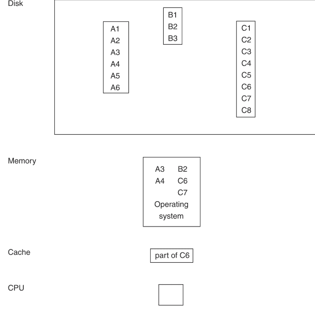

内存

缓存

CPU

## 练习

1. 考虑以下 Java 代码。假设它要被分成五个大致相等的页，并且计算机内存非常小，一次只能容纳一页。展示如何划分它，并描述在其执行过程中会进行多少交换。假设子程序`sub1`、`sub2`和`sub3`已在别处定义。重复该练习，将代码分成四个大致相等的页。再重复一次，将代码分成三个和两个大致相等的页。

```
{
    int i,N;
    N = 1000000;
    i = 0;
    while (i < N)
    {
        sub1;
        i = i + 1;
    }
    i = 0;
    while (i < N)
    {
        sub2;
        i = i + 1;
    }
    i = 0;
    while (i < N)
    {
        sub3;
        i = i + 1;
    }
}
```

2. 在图 10.11 中，假设程序 A、B 和 C 要同时运行。假设 A 是线性的，按顺序执行 A1 到 A6 然后停止；然而，我们不知道 A 会运行多久。假设 B 也类似执行。假设 C 先执行 C1 到 C3 一次，然后执行由 C4 到 C6 组成的循环一百万次，再执行一次线性序列 C7 到 C8。假设内存一次最多容纳六页，应如何将这些页加载到内存中以最小化交换。

## 小结

机器呈现给用户的外观是完全可编程的。因此，系统设计者可以决定在使用系统时希望用户拥有什么样的形象，并编写代码来实现它。设计者由此为用户创建了一个**虚拟环境**。虚拟环境的目的是使用户能够更高效、更舒适地工作。

**操作系统**是向用户呈现外观并将他或她的命令转换为硬件可以执行的低级指令序列的程序。与操作系统相关的主要概念是**进程**和**文件系统**。进程是任何给定时刻处于活动执行状态的程序；操作系统的核心循环只是不断地获取进程，并按照某种优先级调度来执行它们。文件系统维护着机器上的文件，并将它们提供给操作系统以执行其众多任务。

对硬件和软件的研究涉及对一系列抽象层次的考察。实际计算发生的地方是在电路中，电压和电流揭示了正在发生的事情。但当我们讨论寄存器级别的计算时，我们很少提及电学；我们通常讨论寄存器内容的表示形式，例如其二进制形式：

```
1100101001000011
```

在更高的抽象层次上，我们可能会讨论汇编语言级别的计算，在这种情况下，同一寄存器内容可能呈现为：

```
ADD AX,X
```

下一个抽象层次是编程语言层次，在本书中是 Java。在 Java 中，可能会写成：

```
Z = (X + Y);
```

在操作系统的层次上，被操纵的实体是程序和文件。在这里可能会输入类似这样的内容：

```
emacs GDemo.java
```

为了理解计算机科学，必须能够处理所有这些抽象层次。

对抽象层次结构的另一种看法是将其视为一组*虚拟机*。计算机科学中的虚拟实体是一个看似存在的实体，它的存在源于机器所呈现的视角，但实际上并不存在。例如，当用 Java 编程时，机器看起来像一台 Java 机器。它似乎理解 Java 语句并像使用原生语言一样做出响应。当使用另一种语言时，比如汇编语言、Prolog 或 C++，机器分别呈现为汇编语言机器、Prolog 机器或 C++ 机器。所有这些都是语言处理工具的创建者为了用户的便利和效率而创建的虚拟机实例。

我刚刚说服了这位美丽的

电影明星，告诉她我是一个

互联网百万富翁。她说

她喜欢我的风格。

我告诉某个人我曾在

两部早期电影中与汤姆·

克鲁斯演对手戏。他想让我

发一张照片。


# 11 安全、隐私与一厢情愿的想法

## 这里究竟发生了什么？

假设你离开了房间，想要查看电子邮件。你走到一台被贴心地放置在公共区域供你使用的机器前。一切看起来都很正常。计算机要求你确认身份，然后输入密码。指令的布局和整个过程的一切都和往常一样。然后计算机回应说"密码不正确"，就像你输入密码出错时通常出现的那样。于是你再次输入密码，一切似乎都正常了。你查看了电子邮件，美好的一天由此开始。

但是，*真的*一切正常吗？让我们看看下面的场景。你使用的这台机器的前一个用户（我们称他为 Pat）运行了一个精心编写的程序，它完美地模仿了标准的登录过程。当你以为自己在登录时，实际上是在与 Pat 的程序交互，而当你输入密码时，Pat 的程序读取了它并将其存储在文件中。然后他的程序打印了一条消息，再次模仿官方程序，声称你的密码不正确。接着他的程序退出，让正常的系统登录程序接管。第二次尝试时，你与真正的系统交互，成功登录并查看了电子邮件。与此同时，Pat 已经获得了你的密码。

那么，刚刚发生了什么？是你输入密码时打错了字，还是 Pat 获取了你的密码？你可能永远也不会知道，除非他以明显的方式使用了它。除非有一台摄像机对准你的双手以便你可以回放你的操作，否则很难确定是你，甚至是一个粘滞的按键，导致了这个故障。一个对安全有偏执的有经验的计算机用户会立即更改密码。那么计算机房里的那台安防摄像头呢？它是否对准了你的双手，以便有人可以从你的手部动作中记录并恢复你的密码？我们是不是有点偏执了？

## 偏执

我们早已过了"绅士不看别人的邮件"的时代。在互联网或任何为通信而搭建的计算机环境中，必须假定存在安全风险和保密性风险。我们将任何对正常高效运行的恶意威胁都归入安全挑战之列。保密性泄露意味着其他人能够在你未授权的情况下复制你的数据。通常人们对此类泄露并不知情。

这类犯罪远非新鲜事物，但现在匿名实施此类犯罪要容易得多，几乎不会留下证据。这使得计算机犯罪尤其难以侦破或起诉。不幸的是，还有许多——通常是年轻的——计算机用户将实施这类犯罪并逃脱惩罚视为对其技能和智力的挑战。他们会"因为山在那里"而攀登顶峰。其中一些人只会留下"Kilroy 到此一游"之类的信息。另一些人则更加恶意，会试图以某种方式损害你的系统。当然，犯罪的经典动机——经济利益——也是一个重要因素。

## 身份验证

让计算机程序或系统验证使用该程序的人的身份的过程称为*身份验证*。你可能已经登录了一个或多个计算机系统，在这些系统中你被要求提供密码。系统假定，如果你能提供正确的密码，你就一定是被授权使用该计算机账户的人。这是最常见的身份验证形式，因此在大多数情况下是防止计算机账户被入侵的第一道防线。利害关系已经相当大，因为即使是最基础的计算机用户如今也在使用电子邮件和万维网。大多数人都不希望别人能够访问自己的电子邮件。

密码是一个单词或字符串，理想情况下只有账户的合法用户知道。它不应该容易被他人猜到，也不应该写在可能落入他人之手的任何地方。（一个恰当的类比是家中或办公室保险柜的密码锁。）乍一看，这似乎是合理且足以确保账户安全的。但即使在稍有敌意的环境中，也需要留意输入密码（或打开保险柜）时是否被人监视。有些人很擅长观察手部动作来判断正在输入什么内容。如果怀疑密码已被泄露，就需要更改密码。

321 安全、隐私与一厢情愿的想法

## 好密码与密码破解

### 一个简短的（公文包）案例

是什么阻止了试图获取你密码的人——被称为破解者（可能来源于 safe-cracking，即"开保险箱"）——直接尝试所有可能的密码？这就是所谓的暴力破解攻击。对于许多公文包上常见的简单密码锁，只需三位数字，每位在 0–9 的范围内。破解者可以简单地尝试所有可能的组合。在这种情况下，可能的组合数量是每位可能输入数量的乘积，即`10 * 10 * 10`。也就是说，如果破解者尝试了所有 1,000 个可能的数字，他保证会成功。由于这也涉及运气——他可能第一次就成功，也可能直到最后一次才成功——平均而言，破解者会在尝试 500 次后成功。

既然成功是保证的，这是否意味着三位密码锁在安全方面毫无价值？不一定。每次尝试都需要时间。如果我们假设每 2 秒可以尝试一个新数字，那么平均我们会在 1,000 秒后成功，即大约 17 分钟。这可能足以阻止大多数小偷（而且还有一个替代方案：用锋利的刀切开公文包的外壳）。

我们从这个公文包案例中学到了什么？锁所提供的安全性涉及四个主要因素：

1. 组合中涉及的数字位数。对于三位数，我们将三个数字相乘以得到所有可能的代码。四位数密码锁会安全得多，因为那样就有`10 * 10 * 10 * 10`，即 10,000 种可能，尝试所有组合将需要近三个小时。
2. 每个位置的可能取值数量。仅使用数字 0–9，每个位置有十种可能。如果我们使用每个位置有 26 个字母的密码锁，那么即使是三位系统也允许`26 * 26 * 26 = 17,576`种可能。按照之前的假设，破解平均需要五个小时而不是 17 分钟。
3. 每次尝试所需的时间。我们假设每次新数字尝试需要 2 秒。如果每次尝试需要 20 秒，那将显著改变局面。一个让我们在连续三次失败尝试后等待，比如一分钟的系统，也会增强系统的安全性。
4. 第四个因素不那么直观：即替代方案是什么？公文包可以被撬开或切开。对于某些类型的犯罪，这很可能会发生。但对于更隐蔽的攻击，攻击者不希望受害者知道信息已被泄露，这可能不是一种选择。

通常，安全系统的复杂性必须与被保护对象的价值和暴力破解的替代方案保持合理的关系。即使是一个高安全级别的保险柜，如果攻击者用枪指着受害者的头说"打开它，否则！"也会"失败"。

## 计算机的密码系统

如果我们把公文包的例子转换到计算机上，会发现我们的基本四点仍然成立，但需要更新实际细节。

最重要的变化之一是，计算机尝试每种组合所需的时间大大减少。如果我们的计算机系统每百万分之一秒就能尝试一种不同的组合，那么即使是一个六位数的系统也会在不到一秒内被破解。然而，如果系统在连续三次错误尝试后让我们等待一分钟，安全性将大大提高。不幸的是，在许多情况下，破解者可以获得尝试各种组合所需的副本并在自己的系统上运行。然后她可以根据计算机资源的允许速度尽可能快地尝试组合。

显然，在计算机系统上，我们需要增加密码的位数和每个位置可取的值的数量。大多数系统允许密码不仅包含数字，还包含字母表中的字母和标点符号。大多数键盘支持 96 个不同的字符，包括空格。为了简化计算，我们将其四舍五入为 100。这意味着一个六位密码将有`100 * 100 * 100 * 100 * 100 * 100`，即`10^12`种可能的组合，计算机破解程序必须尝试所有这些组合。如果它每秒能尝试 100 万（`10^6`）种组合，仍然需要 100 万秒，即约 17,000 分钟，或约 275 小时，或多于 10 天。这不是最好的安全措施，但它是一种威慑。请注意，通过在密码中添加第七位，我们将得到 1,000 天，即约 3 年；第八位将给我们 300 年。这才叫安全。然而，一台速度快 100 倍的计算机会将其降回 3 年。另一种方法是使用 100 台不同的计算机，每台每秒尝试 100 万种组合，同样产生 3 年。这仍然是一种威慑，但算不上出色的安全措施。

## 字典攻击

前述分析的教训是，如果你使用八位密码，并且每个位置允许字母、数字和标点符号，你可能会获得相当好的安全性。

不幸的是，还有另一个风险。破解者很可能不会使用暴力攻击尝试所有可能的组合，而是首先尝试更具选择性的方法。如果破解者掌握你的任何个人数据——电话号码、出生日期、家庭成员姓名——他会首先尝试这些。而且他会正反两个方向都试。突然间，需要多年才能破解的任务在毫秒内就完成了。

如果这不起作用，或者破解者不认识你或不了解你的任何信息，他会尝试各种字典。任何英语或外语单词都会使破解者的任务变得更容易。他还会有人名、地名、公司和组织的名单。几乎所有类型的列表都会帮助破解者取得比暴力攻击好得多的效果。使用一台快速计算机，遍历几本字典应该只需要几分钟。

## 好密码

好密码是能够经受住字典攻击的密码。换句话说，它不应该是任何语言中的一个单词或名字。除非你是语言专家，否则你可能会觉得这是一项艰巨的任务。然而，如果你在密码中加入一些标点符号，你可能走在正确的道路上。只需记住，你可能想出的任何"系统"也可能被破解者所知。

## 练习

1. 以简单的公文包组合锁为模型，计算如果锁减少到两位且每位有十个数字时可能的组合数。这种类型的六位锁有多少种可能的组合？
2. 解释为什么以下选项不是好的密码选择：

   `influenza`　`Versailles`　`Gesundheit`　`061282`

## 加密

除了（或代替）良好的密码保护系统之外，还有一条保护机密性的防线。即使它对安全性没有任何帮助，加密也能让我们将有用的信息转换为外部人员无法理解的形式。*加密*是将消息（或任何信息）系统性地转换为掩盖其原始含义的形式。由于这是许多提供计算机安全性和隐私性的系统的关键，我们将在一定程度上详细探讨这个主题。（加密在身份验证和密码保护中可以发挥非常重要的作用。）

## Cryptoquote™

许多日报都刊登了经过加密的名言或其他信息。作为娱乐形式，读者需要解密（或破译）信息。这里使用的是单字母替换密码。字母表中的每个字母都被另一个字母替换。例如，如果我们用`X`替换`a`，用`R`替换`b`，用`A`替换`c`，用`Y`替换`d`，用`F`替换`e`，用`I`替换`f`，依此类推，替换整个字母表，那么单词`face`就会显示为`IXAF`。这个简短的例子表明，我们可以通过这种方式获得相当好的隐私保护。除了知道所使用的字母替换关系外，没有任何办法可以猜出`IXAF`的含义是`face`。另一方面，如果没有人能解决这些 Cryptoquote，报纸就无法提供太多娱乐。有几个因素使大多数 Cryptoquote 容易破解。对于除最短文本之外的任何文本，字母频率会暴露解决方案。在处理英语信息时，无论哪个字母出现频率最高，很可能就是字母`e`；第二高频率的通常是字母`t`或`a`。换句话说，独特的字母频率通常会提供有价值的信息。确定两三个字母后，通常很容易猜出其他字母，很快你就能破解密码。（如果加密版本中保留了空格和标点符号，还会提供额外的线索。单字母代码必须是`a`或`i`。撇号后的单个字母通常是`s`或`t`。）许多世纪以来，这种方法及其变体是保护被认为敏感的外交、军事和商业消息隐私的主要手段。

总之，对于轻量级加密，我们为原始消息选择一个替换字母表，并确保所有被允许阅读消息的人都有一份替换字母表副本。通常替换字母表被总结为一个关键字或短语。对于前面的例子，替换字母表是：

```
XRAYFILMSBCDEGHJKLNOPQTUVWZ
```

关键字是：

```
XRAYFILMS
```

这确实导致`Z`代表`z`，但这对加密并没有太大的影响。

下面是另一条加密的英语消息。看看你能否破解它。

```
IFOJ LKFJN DCE LNPNC XNDJL DVF FOJ
IDMRNJL UJFOVRM IFJMR FC MRSL
KFCMSCNCM, DCNQ CDMSFC, KFCKNSPNE
SC BSUNJMX, DCE ENESKDMNE MF MRN
GJFGFLSMSFC MRDM DBB ANC DJN KJNDMNE
NHODB. —D BSCKFBC
```

加密消息中的字母频率为：

| 字母 | 频率 | 字母 | 频率 | 字母 | 频率 | 字母 | 频率 |
| --- | --- | --- | --- | --- | --- | --- | --- |


|--------|------|--------|------|--------|------|--------|------|
| A | 1 | H | 1 | O | 4 | V | 2 |
| B | 6 | I | 3 | P | 2 | W | 0 |
| C | 16 | J | 11 | Q | 1 | X | 2 |
| D | 14 | K | 7 | R | 6 | Y | 0 |
| E | 7 | L | 6 | S | 10 | Z | 0 |
| F | 15 | M | 15 | T | 0 | | |
| G | 2 | N | 18 | U | 2 | | |

## 多字母替换

即使通过用多个不同的密文字母替换`e`等方法来模糊字母频率，也不足以保护隐私。埃德加·爱伦·坡曾挑战报纸读者向他发送这种类型的加密消息，而他破解了收到的每一条。

下一安全级别是通过使用多个替换字母表来实现的。在本讨论中，假设我们有四个不同的字母表：A1、A2、A3和A4。我们使用A1加密消息的第一个字母，使用A2加密第二个字母，使用A3加密第三个字母，使用A4加密第四个字母。由于我们只有四个字母表，所以我们使用A1加密消息的第五个字母，使用A2加密第六个字母，依此类推。

最终，字母1、5、9、13、17、...都使用第一个字母表A1加密。字母2、6、10、14、18、...都使用A2加密。我们继续以同样的方式使用A3和A4。使用四个不同的替换字母表，字母`e`和其他常见字母的独特频率将不再明显。这是因为`e`将根据每个位置使用的四个字母表之一而有不同的翻译。

这种形式的密码被认为极其安全，直到差分机和其他机械计算机的设计者查尔斯·巴贝奇发现，如果你分别对每组字母计算频率，例如字母1、5、9、13、17、21、...，你就可以使用旧技巧来确定哪个是`e`，哪个是`t`，等等。（这一突破的官方荣誉归于普鲁士人弗里德里希·卡西斯基，他独立发现了这一点并实际发表了他的解决方案。巴贝奇从未费心这样做。）

你只需分别计算每组字母的频率。对于这个例子，你需要发现四个不同的字母表。对于非常短的消息或使用大量不同字母表的系统，多字母加密仍然相当安全，但对于长电报，有一些技巧可以让你猜测使用了多少个不同的字母表。一旦你知道了这一点，你就可以将问题分解为相应数量的单字母替换问题。

非常重要的是要认识到，对多次通信重用相同的字母表也会使破解密码变得更容易。短消息无法提供足够的统计精度来确定哪个是`e`，等等。但收集多条你知道或怀疑使用相同字母表加密的消息，就可以积累统计数据。因此，一般来说，重用密码和字母表会使它们更容易被破解。

另一方面，如果你想为每条消息使用一个新密码，那么消息接收者必须收到一大批这样的密码。在通信者之间传输密码和相关材料本身就存在安全问题。

## 一次性密码本

一种绝对安全的加密方式是一次性密码本。这种密码本中的每一页（或每张纸）都包含一组随机数。发送方和接收方各持有一份密码本，但 presumably 没有其他人持有。

一次性密码本的一种简单形式是让每个随机数都在0–25的范围内。原始消息中的每个字母都按照随机数指示的位数在字母表中移位。图11.1a展示了可能来自一次性密码本的两张纸。

让我们用左边的纸来走一遍示例。（我们正在做的事情汇总在图11.1b中。）我们要加密朗费罗（Longfellow）的《保罗·里维尔的骑行》（Paul Revere's Ride）中的文字“Listen, my children, and you shall hear of the ...”。

消息的第一个字母是`l`，左边纸上的第一个随机数是3。因此`l`在字母表中向后移三位变成`O`。（这在图11.1b中这样说明：首先，我们写下字母`l`。下面显示12，因为`l`是字母表中的第十二个字母。再下面显示的是一次性密码本中的3。再下面是12和3的和15。再下面是加密后的字母`O`，即字母表中的第十五个字母。）

消息中的第二个字母是`i`；密码本上的第二个随机数是4。那么`i`向后移四位变成`M`。（在图11.1b中，`i`下面是9，因为`i`是字母表中的第九个字母，然后是移位数4，然后是9 + 4 = 13，然后是`M`，即字母表中的第十三个字母。）

第三个字母`s`是字母表中的第十九个字母，它配对的随机数是19。将这两个数相加，得到38。由于字母表只有26个字母，要找出“第三十八个”字母需要“绕回”到字母表的开头，在这种情况下找到第十二个字母。（在图11.1b中，`s`列显示的是12。）字母表中的第十二个字母是`L`，所以我们要加密的`s`变成了`L`。

按照这种方式继续，我们得到的密文是：

```text
O M L Q I D  V A  O R J C Z Z D V  C V Z
Y Q H  M W A B S  T O Q I  G N  O G R
```

由于原始消息中的每个字母都与它自己的随机数配对，因此得到的加密文本是绝对安全的，只有拥有相同随机数表的人才能帮助接收方将加密后的字母还原为原始字母。

简单加密中使用的一种工具是密码盘。图11.2展示了一个设置为仅加密朗费罗消息第一个字母的密码盘。中间圆圈的`A`已经与3（我们一次性密码本上的第一个数字）对齐。然后我们会看到该圆圈中的字母`L`与外圈中的`O`相邻。因此，当加上3时，`L`转换为`O`。

要继续，我们接下来将中间圆圈的`A`转到一次性密码本上的下一个数字：4。然后我们就可以读出字母`I`到`M`的转换。请记住，中间圆圈必须转动以与消息中每个字符对应的一次性密码本上的适当数字对齐。（密码盘也可以类似方式帮助解密。）

（历史注：图11.2中所示的密码盘设置为展示尤利乌斯·凯撒使用的凯撒密码。他只是将所有字母移三位。对于这个应用，你可以忽略数字。“Veni, vidi, vici”变成“YHQL, YLGL, YLFL”。）

只要一次性密码本上的数字是真正随机的，并且这些纸不被重复使用，安全性就能得到保证。然而，与密码和字母表一样，将一次性密码本实际送到你的通信人手中（在敌后）可能是个问题。

注意我们留下了一个可能危及系统的线索：空格。如果消息已知或猜测是某个已出版作品的副本，那么通过单词长度和空格匹配已知文本可能会暴露它。使用一次性密码本的严肃加密会首先将原始消息缩减为五个字母一组，不论原始空格如何，并去掉任何标点符号。

327 安全、隐私与一厢情愿的想法

(a Reality check)

### (a)

| 3 | 4 | 19 | 23 | 4 | 16 | 9 | 2 | 12 | 10 | | 12 | 3 | 25 | 10 | 25 | 15 | 18 | 24 | 25 | 16 |
|---|---|---|---|---|---|---|---|---|---|---|---|---|---|---|---|---|---|---|---|
| 1 | 17 | 22 | 8 | 25 | 8 | 2 | 8 | 21 | 0 | | 10 | 23 | 24 | 11 | 10 | 19 | 14 | 8 | 13 | 24 |
| 2 | 13 | 3 | 17 | 0 | 16 | 7 | 12 | 10 | 16 | | 20 | 24 | 4 | 15 | 25 | 14 | 24 | 7 | 16 | 5 |
| 17 | 18 | 8 | 21 | 25 | 13 | 14 | 0 | 6 | 5 | | 23 | 24 | 21 | 5 | 4 | 22 | 23 | 5 | 15 | 20 |
| 6 | 1 | 3 | 23 | 6 | 1 | 21 | 15 | 3 | 10 | | 1 | 4 | 14 | 3 | 0 | 23 | 16 | 2 | 0 | 6 |
| 1 | 2 | 13 | 7 | 23 | 13 | 7 | 3 | 8 | 13 | | 2 | 19 | 5 | 8 | 19 | 7 | 12 | 15 | 7 | 21 |
| 22 | 13 | 16 | 13 | 15 | 0 | 18 | 21 | 15 | 10 | | 9 | 17 | 0 | 14 | 11 | 3 | 14 | 6 | 12 | 24 |
| 21 | 2 | 7 | 6 | 7 | 15 | 19 | 13 | 19 | 1 | | 13 | 1 | 4 | 20 | 22 | 19 | 2 | 21 | 5 | 24 |
| 6 | 9 | unfair 2 | 15 | 25 | 17 | 25 | 14 | 11 | 5 | | 9 | 18 | 3 | 23 | 18 | 6 | 7 | 6 | 5 | 4 |
| 23 | 6 | 9 | 15 | 24 | 0 | 0 | 7 | 20 | 13 | | 6 | 2 | 24 | 19 | 18 | 22 | 8 | 18 | 8 | 2 |

### (b)

| l | i | s | t | e | n | | m | y | | c | h | i | l | d | r | e | n | | a | n | d |
|---|---|---|---|---|---|---|---|---|---|---|---|---|---|---|---|---|---|---|---|---|---|
| 12 | 9 | 19 | 20 | 5 | 14 | | 13 | 25 | | 3 | 8 | 9 | 12 | 4 | 18 | 5 | 14 | | 1 | 14 | 4 |
| 3 | 4 | 19 | 23 | 4 | 16 | | 9 | 2 | | 12 | 10 | 1 | 17 | 22 | 8 | 25 | 8 | | 2 | 8 | 21 |
| 15 | 13 | 12 | 17 | 9 | 4 | | 22 | 1 | | 15 | 18 | 10 | 3 | 26 | 26 | 4 | 22 | | 3 | 22 | 25 |
| O | M | L | Q | I | D | | V | A | | O | R | J | C | Z | Z | D | V | | C | V | Z |
| y | o | u | | s | h | a | l | l | | h | e | a | r | | o | f | | t | h | e |
| 25 | 15 | 21 | | 10 | 8 | 1 | 12 | 12 | | 8 | 5 | 1 | 18 | | 15 | 6 | | 20 | 8 | 5 |
| 0 | 2 | 13 | | 3 | 17 | 0 | 16 | 7 | | 12 | 10 | 16 | 17 | | 18 | 8 | | 21 | 25 | 13 |
| 25 | 17 | 8 | | 13 | 23 | 1 | 2 | 19 | | 20 | 15 | 17 | 9 | | 7 | 14 | | 15 | 7 | 18 |
| Y | Q | H | | M | W | A | B | S | | T | O | Q | I | | G | N | | O | G | R |

... midnight ride of Paul Revere,

On the eighteenth of April, in Seventy-Five:

Hardly a man is now alive

Who remembers that famous day and year.

....

H W Longfellow

图11.1

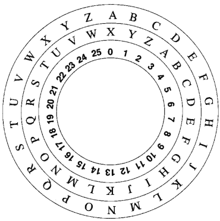

## 图11.2

## 计算机与密码学

应该清楚的是，所有讨论过的技术都是劳动密集型的，需要仔细抄写消息、字母表和代码词。这显然是计算机非常有用的领域。生成消息字符频率的程序很容易编写，可以节省数小时的工作。

## 计算机与随机数

计算机可以生成伪随机数。我们说“伪”，是因为计算机实际上无法生成真正随机的数。伪随机数算法需要一个起始数或种子数。使用这个种子，它们会产生可重复的伪随机序列。所以如果你使用相同的种子，你就会得到相同的数字序列。

模仿一次性密码本的方法是很有诱惑力的。你只需要掌握随机数生成器的起始种子，并确保你的接收方拥有相同的种子。换句话说，你正在使用种子数作为你的加密和解密密钥。

然而，由于数字序列是由算法生成的，可能存在破解这种密码的技术。但如果这种攻击的技术尚未公开流传，你可能能够使用这种方法实现相当好的隐私保护。

## 练习题

1. 破解 Cryptoquote 部分中显示的加密消息。
2. 在第1题中，使用了什么关键词（或关键短语）来定义加密字母表？
3. 使用图11.1a中右侧的一次性密码纸来加密一条简短的消息。问问朋友他能否解密。一定要说明这是不可破解的——那应该是一个真正的激励。
4. 有人建议，当遇到用一次性密码本加密的消息时，我们应该猜测密码本上的数值，当得到的消息有意义时，我们就破解了加密。指出这种方法的两个主要问题。

## 现代加密

前面章节讨论的内容旨在为你提供历史背景，并为我们建立一个基础。接下来描述的加密技术是相当新的，并且在正确实施时，实际上是坚不可摧的。这有时被称为强加密。

## 那些该死的密钥！

之前描述的所有技术都有一个共同特点：发送方和接收方需要共享某些信息。在某些情况下，它是一个简单的关键词或短语。对于一次性密码本，需要将这叠独特的密码本分发给所有可能的编码消息接收者。其他形式的保密通信需要分发大量的密码本。即使在理想条件下，密钥分发问题也是一件麻烦事。在最坏的情况下，分发过程可能让密钥落入错误之手。

一个诱人的解决方案是使用你的加密系统来分发将来会话要用的密钥。然而，这是招致灾难的邀请。如果攻击者只破解了一次密码——也许不是通过系统中的弱点，而是通过间谍活动或运气——那么所有未来的会话都会受到损害，因为攻击者随后就能读取未来的密钥。

能否通过电子方式安全地分发密钥而不存在被截获的风险？答案是肯定的，但这不是一项简单的任务。

一个很好的类比是有一个带挂锁的安全金属盒子。你将你的消息或密码放入盒子中，并用只有你有钥匙的挂锁锁上。你把它寄给你的通信人，用你的锁，这样路上没人能打开盒子偷看。

当她收到盒子时，她也打不开，但她会加上自己的挂锁，这把锁只有她有钥匙，然后锁在盒子上。现在盒子有两把锁，她把盒子寄回给你。同样，双锁加身，路途安全。

当你收到盒子后，用你的钥匙拆掉你的挂锁。你现在打不开它，但反正你也不想打开。你现在把盒子寄回给你的通信人，由于它被她的挂锁锁着，所以在运输途中仍然不会被篡改。

最后，当她第二次收到盒子时，你的通信人可以用她的钥匙打开盒子，取出消息。所以，通过三次邮寄和相当长的延迟，密钥和其他信息可以安全地远距离交换，使用邮局或快递服务这样的非信任中介。

这提示我们，可能存在这种交换方式的电子等价物。不幸的是，简单地用加密代替挂锁对大多数加密技术行不通。虽然你可以在她的挂锁还在盒子上时拆掉你的挂锁，但在她对你的加密之上再应用她的加密后，你无法移除你的加密。从数学上讲，我们会说这两个加密过程是`不可交换的`。

然而，惠特菲尔德·迪菲（Whitfield Diffie）、马丁·赫尔曼（Martin Hellman）和拉尔夫·默克尔（Ralph Merkle）提出了一种数学程序，允许通过不安全的信道生成一个双方都知道的密钥。这确实需要来回几次，因此需要双向交互。它也不适合发送一般消息——它只是生成一个秘密密钥（然后可以用该密钥通过更传统的方式发送消息）。

这个密钥分发问题的解决方案是一项重大突破，但仍不如接下来将要介绍的方法方便。

## 公钥加密

让我们回到挂锁的类比。假设我让制作了数百把相同的挂锁，只有我有钥匙。然后我把这些仍然打开着的挂锁寄给任何可能想给我发送安全消息的人。如果我能负担得起，我会把数百万把这样的挂锁发送到世界各地，这样任何想与我通信的人都能使用我的一把挂锁。

任何想给我发消息的人都会拿一个安全的盒子，放入消息，关上盒子上的挂锁（这不需要钥匙），然后寄给我。只要只有我有钥匙，分发挂锁就不会危及安全。

当然，像这样分发挂锁，在大多数情况下完全不切实际，而且相当昂贵。大多数挂锁本来也没有那么安全，如果钥匙泄露了（比如有人偷偷复制了我的），所有挂锁就会立刻变得一文不值。

有没有一种密码，我可以分发给别人用来加密消息，而只有我能解密？我们正在寻找的是一种**非对称加密系统**，使用一个密码加密，用另一个密码解密。之前讨论的系统使用相同的密码或密钥来加密和解密。

如果我们能将这两部分分开，那么我们就可以让加密密钥公开，同时保留解密密钥的私密性。分发挂锁很昂贵，但分发公钥，比如以电子电话簿的形式，几乎没有成本。这个概念方案由迪菲于1975年提出，但当时没有人知道实现它的数学算法。

## Rivest、Shamir和Adleman（RSA）加密

1977年，在麻省理工学院计算机科学实验室，罗纳德·里维斯特（Ronald Rivest）、阿迪·沙米尔（Adi Shamir）和伦纳德·阿德莱曼（Leonard Adleman）终于提出了一种实用的算法，实现了迪菲提出的概念框架。

让我们回顾一下我们的需求。我们需要一个公钥，任何人都可以用它来加密他想发送给我们的消息。这个公钥绝不能损害只有我们自己知道的私钥，我们可以用它解密消息。

RSA系统依赖于将非常大的整数分解为其质因数的困难性。记住，质数是正整数，只能被1和自身整除。7是质数；28是质数7和2的乘积，其中2使用了两次：

```text
28 = 7 * 2 * 2
```

要分解一个数，比如28，我们尝试用它依次除以更大的质数，看是否能整除。因此，我们从除以2开始。那能整除，得到14。再用2除，得到7。下一个质数3不能整除7，下一个质数5也不能。所以7是质数，28的因数是2、2和7。

这看起来很简单，但这是一种暴力技术。当数字变大时，没有主要的捷径可用。你得耐心地尝试质数，直到成功，或者断定你要分解的数本身就是一个质数。

让我们加大赌注，使用稍大一些的数。73是质数，61也是质数。如果我们将两者相乘，得到4,453。现在，我们知道4,453是73和61的乘积。如果我们把它给不知道这一点的人，他得依次尝试质数来找到那些因数。

实际上他会尝试2、3、5、7、11、13、17、19、23、29、31、37、53和59，全部失败。下一次尝试用61时，他会发现另一个因数是73。

所以，随着数字变大，将它们分解为构成质数需要越来越多的工作。如果你使用大约200位的整数，即使是计算机也很难发现因数。事实上，很容易找到一些大数，使得所有预期的未来一个世纪的计算能力都无法找到因数。

当然，我们需要使用计算机来生成和操作这些巨大的数字。这不是普通计算器能胜任的工作。

## RSA示例


我们已经确定，非常大的数的因式分解是困难的，而且我们知道，只需增加数字的长度，我们就可以让它变得任意困难。我们如何利用这一点来生成适合加密的公钥和私钥？我们用非常小的数字来说明 RSA 算法。这将让你理解算法的逻辑，而不会淹没在数百位数字中。

如果我们想理解这个公钥加密方案，我们需要遵循以下步骤来生成我们的公钥和私钥：

1. 选择两个质数，命名为 `P` 和 `Q`。在我们的例子中，我们使用 `P = 23`，`Q = 29`。我们再选一个工作数字，命名为 `K`，最好也是质数。我们使用 `K = 31`。记住，除非另有说明，所有数字都需要保密。
2. 创建 `N = P * Q`。在我们的例子中，23 * 29，即 667。这是破解加密时必须分解的“大”数。在这个例子中很容易，但对于真正的大数来说很难。
3. 分发 `N` 和工作数字 `K`。它们一起代表我们的公钥，任何想给我们发送安全消息的人都必须使用这两个数字。
4. 生成所谓的私钥或解密密钥，用于解密任何消息。称之为 `G`。

你需要的一个重要算术工具是模运算。这只是意味着我们定义一个最大数字，如果达到这个数字，我们就“回绕”到零并继续。大多数汽车里程表以 100,000 为模工作。也就是说，如果我们超过 100,000 英里，里程表会重新开始。

注意，这与 Java 的取余运算符 `%` 相同。因此，汽车的里程表给我们的是 `mileage % 100,000`，即它只给出除以 100,000 后的余数。回顾一下：`8 % 100` 得到 8；`88 % 100` 得到 88；`888 % 100` 也得到 88，因为如果我们用 888 除以 100，得到 8，余数为 88。另一组例子：`12 % 13` 得到 12；但 `100 % 13` 得到 9，因为 100 / 13 = 7 余 9。

首先，我们定义一个值 `V = (P - 1) * (Q - 1)`。在我们的例子中，`V = 22 * 28 = 616`。我们需要找到一个 `G` 的值，使得使用模 `V`（或 mod `V`）运算时，以下等式成立：

```
K * G = 1
```

乍一看，这似乎只有在 `K` 和 `G` 都等于 1 时才能成立。但这就是我们使用 mod `V` 运算的原因：我们要表达的是，将 `K * G` 除以 `V` 后，余数必须是 1，或者：

```
(K * G) % V = 1
```

使用我们的示例值：

```
(31 * G) % 616 = 1
```

求 `G` 有点棘手，但对于这些小型示例，可以使用计算机程序尝试不同的值。`G` 的正确答案是 159。为了确认这一点，`31 * 159` 得到 4,929。如果将 4,929 除以 616，我们得到商为 8，余数为 1。因此，`G = 159` 是我们的私钥解密密钥。

最终结果是 `N = 667` 和 `K = 31` 构成了我们的公钥。`G = 159` 是我们的私钥。

我们现在准备尝试加密一条消息。我们想使用公钥加密一条消息，称之为 `M`，然后展示我们可以使用私钥恢复原始数字。在我们的小型示例中，我们只能加密相当小的数据块。我们将让我们的通信方发送一个小的整数，假设 `M = 65`。如果我们只想发送数字，那没问题。

实际上，我们想发送文本，但由于计算机无论如何都将消息中的每个字母表示为数字，因此证明我们可以处理数字确保了我们也能处理字母。我们现在展示她将如何加密秘密消息数字 65，以及我们将如何解密它。

1. 加密后的消息，命名为 `C`，是当我们的通信方计算时得到的：

   `C = M^K % N = 65^31 % 667`

   即，所有计算都是在模 `N` 下进行的。现在发现，在计算 `M` 的 `K` 次幂时，即使我们在每一步都应用模 `N` 运算，我们也能得到正确的答案。这使我们的数字不会变得太大。（我们使用的是恒等式 `(x % y) * (x % y) = (x * x) % y`。）
2. 结果是 `C = 103`。这与原始的 65 毫无相似之处，似乎是隐藏该值的一个相当安全的方式。
3. 在我们这边，我们收到消息 103，现在需要应用我们的私钥来看看她想发送什么。我们使用公式：

   `M = C^G % N = 103^159 % 667 = 65`

   同样，所有计算都是在模 `N` 下完成的，这使我们看到了她的原始消息 65。

## 破解代码

要破解这个代码，攻击者需要获得解密密钥。已知从公钥获取此密钥的唯一方法是分解 `N`。如果 `N` 可以被分解，那么攻击者就可以像我们所做的那样生成私钥 `G`。对于我们的示例，其中 `N` 是 667，不需要费多大劲就能得到因数 23 和 29。为了使这个系统安全，我们依靠的是这样一个事实：分解一个有几百位数字的数字 `N` 超出了任何当前和预期的计算能力。

## 数字签名

签名用于认证由个人签署的物品。假设签名的独特性在于其书写方式，以至于没有其他人能够产生与合法签署者完全相同的签名。验证一个人并让其证明身份的其他方法是，他们知道只有该人才能知道的事情。在每种情况下，我们都试图找到一些只能来自该人的东西。数字签名包含一条只能来自声称发送该数字签名的人的消息。RSA 加密允许用户生成这样的消息。

在 RSA 公钥加密的正常使用中，消息用公钥加密，用私钥解密。RSA 算法的一个很好的特性是它也可以反向工作——也就是说，你可以用私钥加密一条消息，然后用公钥解密它。

所以，假设朱丽叶想给罗密欧发一条消息。她想加密发送，但此外，还想包含一个数字签名来证明是她发送的。一种方法是将消息分为两部分：正文和签名。正文可能是“亲爱的罗密欧，……爱，……爱，……爱……”（我们将省略细节。）签名可能是“于 1595 年 4 月 23 日晚上 10:30 用亲吻封缄，你挚爱的朱丽叶。”

首先，朱丽叶使用她的私钥加密签名。然后她使用罗密欧的公钥加密整个消息，即消息正文加上附加的加密签名部分。因此，消息的签名部分被双重加密，首先由朱丽叶的私钥加密，然后由罗密欧的公钥加密。

罗密欧收到消息，并使用他的私钥解密整个消息。这使消息的正文可读。然而，签名部分仍然被朱丽叶的私钥加密。他使用朱丽叶的公钥解密该签名部分。由于只有她能够用她的私钥加密签名，因此该消息一定来自朱丽叶。

请注意，签名包含的不止是朱丽叶这个名字。它还包括时间、日期和其他内容。这是为了帮助防止重放攻击（本章后面讨论）。

## PGP，大众加密

通过在网络浏览器中输入 URL `http://web.mit.edu/network/pgp.html`，你可以访问一个麻省理工学院的网站，该网站允许你免费下载程序，这些程序使你能够使用 RSA 算法提供的强加密与他人通信。

任何人都可以免费用于非商业用途，这一事实归功于菲尔·齐默曼的努力。RSA 算法于 1970 年代发表，世界各地都编写了使用它们的软件。高效地处理所涉及的巨大数字的算术运算是一项非平凡的编程任务。为非程序员、非技术人员解决所有这些实际问题，代表了在处理人机界面方面的重大努力。

此外，齐默曼通过不对整个消息使用 RSA 加密，减少了通信所需的计算能力。他仅将其用于密钥交换和使用数字签名方法进行身份验证。消息正文使用比 RSA 更传统且计算强度更低的方法进行加密。

齐默曼使用的过程是数据加密标准（DES）的扩展，一旦使用 RSA 解决了密钥交换问题，DES 可以相当安全。（我们不讨论 DES，你可能需要查阅参考资料。它涉及位级别的操作，而不仅仅是字符级别。）齐默曼将他的加密方法标记为“相当好的隐私”或 PGP。

齐默曼本意是将他的软件作为免费软件分发，但他担心美国政府会使普通公民无法使用强加密，因此他允许一位同事将其发布在计算机公告板、USENET 和互联网上。政府试图惩罚齐默曼“泄露秘密”，可以这么说。他在加州的一个大陪审团面前出现，但最终没有被起诉。

## 练习

1. 在业余无线电中，序列 88 表示“爱与吻”。使用文本中为 RSA 示例生成的密钥加密和解密此消息。

## 攻击

在前面的部分中，我们专注于密码和加密这些重要但可能狭隘的问题，这些问题使我们能够确保数据的机密性，并为他人通常访问我们的计算机系统设置一些障碍。接下来，我们将更广泛地看待攻击者可能试图使我们生活痛苦的各种方式。

## 计算机入侵

入侵是计算机系统管理员的噩梦。第一步是攻击者以某种方式进入系统。他可能获取了一个不活跃的计算机账户的密码。他可能由于操作系统的某个弱点而能够绕过密码安全。无论机制如何，现在都有一个攻击者在使用系统，伪装成合法用户。

在大多数计算机系统上，普通用户权限有限。他们通常对自己的文件有完全的控制权，但通常对系统文件和其他用户的文件访问权限相当有限。他们通常对自己运行的任何程序有完全的控制权，但对其他用户和操作系统运行的程序则没有控制权。

出于维护原因以及处理紧急情况和其他问题，有另一个用户类别是为维护计算机系统的人员保留的，即系统管理员（或网络管理员）。拥有这些权限的用户有时被称为超级用户或具有 `root` 权限的人。

攻击者的下一步是为自己（或她自己）获取这些广泛的权限。通常，在首次以普通用户身份登录后，破解下一级别会更容易。然后，破解者可以使用计算机自己的能力来帮助破解密码或通往更高层次的其他障碍。

一旦攻击者以超级用户权限运行他的程序，所能造成的损害几乎没有限制。被攻破的计算机经常被用作跳板，对通过网络可访问的另一台计算机发起攻击。

## 防御

这种外部攻击者需要以某种方式进入计算机，攻击有两条可能的途径。如果有拨号调制解调器，那么这是一个可能的路径。在许多教育、商业和工业环境中，都有直接的互联网连接。一台无法从外部访问的计算机，因为它缺乏调制解调器和直接网络连接，相当安全，免受直接的外部攻击（但请参见病毒部分）。

许多系统或网络管理员获取特殊软件，通常称为防火墙，以在其网络连接处保护系统，并特别监视调制解调器连接。这些系统程序的工作原理是限制进入计算机的网络流量种类。它们也总是限制流出的流量种类，因为访问万维网是一个交互式或双向过程。防火墙通常对合法用户能从外部做什么施加了严格限制。试图在家工作的人可能会受到系统防火墙的严重阻碍。

防火墙也可能给用户一种虚假的安全感。防火墙也可能存在弱点，在某些攻击下可能失效。因此，即使在防火墙后面，敏感数据也应加密，认证程序应安全，并且应仔细执行备份。

## 网络安全/网络攻击

使基于网络的攻击如此难以处理的原因是攻击者如此难以追踪。就像银行抢劫犯经常使用偷来的车作为逃跑工具一样，网络攻击者通常会通过一连串被入侵的机器进行工作。如果你检测到来自网络的入侵并将其追溯到 originating machine，通常你会发现的是另一名受害者，而不是攻击者。

被入侵的网络连接往往不会留下任何表明存在问题的线索。真正的问题在于，某人能够复制所有正在传输的数据，因为她正在监听或监控流量。对于攻击者来说，通常最重要的是复制连接过程中输入的任何密码。然后这些密码可以用于入侵其他机器和网络。

监听器的工作方式可以像第 12 章通信部分所描述的混杂模式监听器（promiscuous listener）一样简单。这通常意味着是内部作案，因为监听器必须与受害者共享物理网络。可能涉及物理线路窃听类的连接，或者攻击可能涉及更复杂的技术，即攻击者发送声称来自非真实来源机器的通信数据包。

通过伪装成“可信主机”，攻击者可能从被攻击的机器获得各种权限，并可能获得实际 intended for 另一台机器的重要数据。这种攻击的一种形式被称为 IP 欺骗（IP spoofing），因为其互联网数据包假装“成为”他人的数据包。

## 中间人攻击

伪装的最复杂形式是将攻击者置于两台通信机器之间。如果机器 X 正在与机器 Y 通信，从 X 到 Y 的所有流量实际上都会先到达攻击者 A，然后 A 再将流量转发给 Y。同样，从 Y 到 X 的流量也会经过 A。

只要机器 A 准确地将收到的一切复制给另一方，X 和 Y 就不会察觉到任何异常，尽管连接可能比平时更慢。在这种情况下，丧失的是机密性，因为 A 拥有所有传输信息的副本。

然而，A 可以接收来自 X 的信息，然后发送经过修改或完全不同的内容给 Y。相反方向的流量也可能被类似地篡改。现在 X 认为的 Y 所说的话，并非 Y 的真实意图，而是 A 想让 X 听到的内容。如你所见，这可能产生极其严重的后果。

例如，假设 Arthur 连接到他的银行——BigBucks 储蓄信贷。他请求 BigBucks 将资金从他的商业账户转到个人账户。当他输入个人账户号码时，攻击者替换了一个为此目的专门设置的不同账户号码。同时，Arthur 提供了所有适当的密码来授权交易。他可能要到很久以后——在那个 Rogue account 被清空之后——才意识到出了问题。（一部名为《拦截》（Interception）的有趣的互联网惊悚小说，由 Graham Watkins 撰写，详细阐述了中间人攻击。）

## 预防

当将关键数据移出你物理控制的本地网络时，最安全的做法是假设有人正在监听。还有什么比你在访问远程站点时输入的密码更关键的呢？所有远程会话都需要加密。

在 MIT 开发的 Kerberos 是加密与远程机器会话的最早系统之一。因此，用于访问远程机器的密码永远不会以可读形式发送到该机器。

这并不意味着你浏览网页时所有内容都必须加密。通常，你正在查看某个网站这一事实并非关键信息。另一方面，如果你受雇于一家计划公司收购的企业，并使用互联网进行研究，那么即使是浏览器访问历史——你访问过哪些网站——的泄露也可能被视为严重的安全漏洞。

## 物理攻击

物理攻击大多要求攻击者对机器有物理接触。良好的物理安全可以处理大部分这类问题。最常见的问题是将机器留在无人看管的公共或共享环境中。

你离开机器去喝点水。几分钟后就回来，所以保持登录状态。当你离开时，有人坐在你的机器前，输入一些东西，表现得有些困惑，然后离开。也许同谋曾经和你搭话并问了几个问题——anything to delay you a few extra minutes。

当你回到机器旁时，一切看起来正常。可能没有任何线索表明有人篡改过。然而，也许一个木马程序已经安装在你的目录中。也许你的部分电子邮件或其他文件的副本已经被发送出去。也许你的一些文件的访问权限已被更改。如果你让机器处于无人看管状态，你根本无法知道。

本章的介绍部分还提到了其他物理攻击的可能性。坐在你旁边的人可能仅仅通过观察你输入密码时的手指动作就能重建你的密码。录像或用望远镜远距离观察也可能有助于此过程。

另一种物理攻击是传统的线路窃听。正如你的电话线容易受到物理攻击外，通信电缆在沿途任何位置也是如此。而且，由于使用了微波和卫星链路，甚至一台调谐适当的收音机就足以记录数据。

## 重放攻击

在重放攻击中，攻击者以某种方式记录了一串代表密码或加密密钥的字符，希望再次使用它。对于密码，攻击者通常会在密码更改之前的后续尝试中成功使用它们。

一些基于计算机的安全系统（如 Kerberos）通过在密钥和密码中加入当前时间和日期来挫败重放攻击。因此，密钥几乎持续变化，过期的密钥将无法使用。然而，这确实要求所有计算机在时间上一致。网络协议包含同步计算机时钟的操作。

## 拒绝服务

对你的系统的一种简单且不太隐蔽的攻击被称为拒绝服务（denial-of-service）攻击。早在计算机普及之前，犯罪分子就会为警察或消防部门制造调虎离山的 diversion，以便他们有更好的机会在不被察觉的情况下实施犯罪活动。

例如，如果有人向你发送数千封电子邮件，你的电子邮件系统实际上就会瘫痪。然而，让一个程序向你发送数千条消息并不需要多少计算机技能。

在开放的、半公开的系统中（如大学中常见的系统），同时运行多个作业、耗尽所有临时磁盘空间、打印 1000 页的作业等，有时即使是意外也会发生，但如果是故意的，这些都是拒绝服务攻击的例子。

在互联网上，使设施过载是可能的。同样，如果是恶意的，这就是拒绝服务攻击。正如我们的非计算机例子所示，拒绝服务攻击有时被用来掩盖或转移对其他类型攻击的注意力，在某些情况下有效禁用软件防御机制。

## 政治/社会问题

加密方面的一些成功引发了尚未解决的社会问题。过去，当执法人员能够证明存在犯罪活动的可能性时，他们可以向法官申请允许窃听的搜查令。随着强加密的出现，这一选项正在消失。加密技术可以用于扰乱语音和数据，因为任何音频都可以转换为数据，然后再转换回来。

执法人员支持立法以削弱强加密，或要求建立一个执法人员可以通过法院命令获得密钥访问权限的系统。这将涉及类似于获得窃听授权的程序，并将使有保障的隐私成为非法。然而，这将使执法部门有合理的机会追踪非法活动。

争论的另一方是，我们有权享有隐私。套用全国步枪协会（National Rifle Association）使用的一个口号，“如果强加密是非法的，那么只有犯罪分子才会拥有强加密。”另一个论点是，既然有些犯罪分子戴手套以避免留下指纹，那么手套也应该被定为非法。

有趣的是，在这场争论中，商界——通常持更为保守的立场——却往往站在公民自由主义者一边。例如，金融机构就非常乐意知道自己的数据绝对安全。在很大程度上，这取决于你是否信任你的政府。

## 加密作为一种武器

政府还担心，强加密可能会为外国政府提供一种通信手段，而国家安全局几乎无法监控。由于有法律规定未经许可出口武器是非法的，强加密软件长期以来被归类为武器，从而限制了其出口。操作系统和其他系统不得不制作成特殊的安全级别较低的版本，才允许出口。

通过互联网的国际连接，如果假定强加密软件没有流传出去，那就太天真了。同样，不可能控制每一张软盘、磁带或 CD-ROM 的邮寄或携带出境。

## 你能信任谁？

你越深入思考安全问题，就越会发现这些都是非常棘手的难题。如果你获得了一个基于软件的安全包，无论是加密系统还是防火墙，你怎么知道这个软件是“干净”的？你怎么知道它没有“后门”或其他允许他人访问的隐蔽功能？

除非你能够接触这些程序，并仔细研读和理解所有代码，否则无法确定。与你信任的供应商打交道非常重要。任何来源可疑的软件都应避免。免费软件和其他便宜货可能是合法的，也可能只是另一个特洛伊木马。

## 病毒


广受关注的一个问题是计算机病毒。所谓`计算机病毒`（`computer virus`），是指在用户不知情或未经用户同意的情况下，潜入系统的程序。大多数病毒是恶意的，会破坏安全性、保密性，或两者兼而有之。少数是良性的——只是某人炫耀技术——除了留下一条“上当了吧！”的信息外，不做其他任何事情。完全孤立的计算机不会感染病毒。然而，直接的互联网连接或调制解调器连接为病毒提供了进入途径。电子邮件是常用的传播方式。如果收到陌生邮件的用户不将其作为程序执行，大多数攻击都可以被阻止。注意，执行包括某些邮件阅读程序对某些附件的处理。当然，通过网络入侵也可以引入病毒，但通常造成的损害要直接得多。

即使是物理隔离的计算机，当用户带入软盘或 CD-ROM 上的外部软件时，也会面临风险。同样，来源不明的软件是一个严重的威胁。

有商业程序可以帮助抵御病毒攻击。就像流感疫苗一样，它们需要不断更新，因为新的病毒总是在不断演变（在恶意程序员的帮助下）。同样，这些程序的安全性也不超过其来源的安全性。盗版的杀毒软件或任何看起来好得令人难以置信的软件，实际上可能是引入和传播病毒的载体。

## 丢失密码或加密密钥

良好的安全性和隐私性本身也有风险。如果你忘记了计算机系统的密码，通常需要找系统管理员来找回。如果能够找回，那就意味着某个地方存有所有密码的副本。这本身就是一个潜在的问题。（你的系统管理员薪水多少？这些密码对别人来说价值多少？）在很多情况下，密码是无法找回的，唯一能做的就是重新发放一个。对于大多数计算机访问问题来说，丢失密码只不过是一个可能令人尴尬的小麻烦。

如果你用一个好的系统加密了文件，却丢失了密钥，后果可能非常严重。如果这是一个好的加密系统，那么数据可能无法恢复。如果系统的安全性不那么高，你可能可以获得帮助来破解它。但这也意味着，它也可能在你不知情的情况下被他人破解。因此，这是一把双刃剑。有时加密密钥确实需要写下来或以其他方式备份。密钥的这份副本从某种意义上说会削弱系统，但可能是避免完全丢失数据的必要折中。

## 练习

1. 使用互联网搜索并阅读关于过去一两年困扰计算机用户的最后三大病毒的新闻报道。

## 小结

我们看到，提供安全性和保密性需要大量的工具、程序，甚至是一种怀疑的心态。日常计算中看似无害的小故障，可能是不良事件发生的信号或线索。如果你的计算机上有宝贵的数据，除非你极其小心，否则必须假定它们处于风险之中。

认证是提供保护的重要一环。我们解释了密码及其在谨慎选择时提供的安全性，以及使用暴力破解和字典攻击来破解选择不当的密码是多么容易。

我们还探讨了从最简单的系统到更复杂的公钥加密系统（如 RSA）的加密技术。我们指出，经典系统存在密钥交换的问题，而使用公钥加密时，借助 PGG 等现成软件包，加密密钥是公开的。

我们还研究了物理攻击和网络攻击，如拒绝服务攻击、常见的病毒攻击以及隐秘的中间人攻击。然而，保持客观的看法是好的。如果你的安全性好到丢失密码就意味着数据永远丢失，那它可能对你的应用场景来说太好了（或太糟了）。

---

# 12 计算机通信

## 探索

在从你最喜欢的摇滚乐队音乐会回来的路上，你差点被一辆拖着巨大挂车的大货车别到。你生了一会儿闷气，盘算着各种报复计划。你后悔自己似乎总是缺了光子鱼雷，偏偏在那种时候派不上用场。但还有别的方法。为什么不给总统写封信，表达你对允许比你车大的车辆上高速的任何法律的不满呢？现在已经没有必要拿出纸、信封和邮票来做这件事了。你所要做的就是登录你的联网计算机，发送电子邮件（`e-mail`），写下你对此事的看法。你可能收不到手写亲笔回复，但至少你的意见很可能被听到。（本章中的许多示例假设使用 UNIX（或 LINUX）系统。在大多数情况下，你只需在 Windows 或 Macintosh 系统上点击适当的图标，即可获得同等功能。）

```text
mail president@whitehouse.gov
Subject: Big, bad trucks
Dear Mr. President,
I'm afraid of the big bad trucks. Please help!
Sincerely,
Red
.
```

你很幸运，总统希望亲自与你讨论你的关切。他回复说，由于即将在西雅图举行的州长会议，他与你的会面不得不在那里进行。便条让你建议一个西雅图吃午饭的好地方。在预订之前，你想了解一下天气会怎么样。如果能在一个靠近太空针塔的露天场所见面就好了。

346

第十二章

西雅图大都会区–塔科马地区–埃弗雷特及其周边–

胡德运河/基萨普半岛–

布雷默顿–谢尔顿–贝尔维尤–埃德蒙兹–伊萨夸–普亚勒普

美国国家气象局 西雅图 华盛顿州

太平洋标准时间 2000 年 1 月 6 日 上午 4:15……下次预报 太平洋标准时间 周四下午 3:30……

（今日、今晚和周五的温度和可测量降水概率值）

`WAZ006–007–008–010–062330`–西雅图大都会区–塔科马地区–埃弗雷特及其周边–胡德运河/基萨普半岛–

布雷默顿–谢尔顿–贝尔维尤–埃德蒙兹–伊萨夸–普亚勒普

今日……多云，中午前后开始降雨……早上局部有雾

最高温 40 华氏度出头。东南风 5 至 10 英里每小时。

今晚……多云……晚间有雨后减弱……最低温

接近 40 华氏度。

南风 5 至 15 英里每小时。周五……多云间有雨……

`breezy`……最高温接近 45 华氏度

| 地点 | 今日预报 | 今晚温度 | 周五温度 | 今日降水概率 | 今晚降水概率 | 周五降水概率 |
|---|---:|---:|---:|---:|---:|---:|
| `SEATTLE` | 44 | 38 | 46 | 80% | 80% | 70% |
| `EVERETT` | 44 | 37 | 46 | 80% | 80% | 70% |
| `SHELTON` | 43 | 36 | 45 | 80% | 80% | 60% |

周六和周日……间歇性降雨……`breezy`……最低温 35 至 40……周六最高温接近 45，周日接近 40。

周一……降雨……有时大雨……`windy`……最低温 `espoo`……最高温接近 40 =

**图 12.1**

你打开网页浏览器，直接前往你最喜欢的搜索引擎，它通常能让你找到所需。你用关键词“Seattle weather”进行搜索。搜索引擎报告大约有五十万个结果，但第一个似乎正合适：美国国家气象局——华盛顿州西雅图。你点击该链接，然后点击承诺提供本地预报的图标。图 12.1 显示了来自美国国家气象局的直接回应。看起来你干脆还是安排室内活动吧。你可以查看网上众多其他气象信息来源中提供的雷达和卫星图像，但雨就是雨。

这只是互联网带来的诸多机会中的两个例子。我们在本章的目标是更好地理解这个奇妙的网络是如何运作的，以及我们如何能够最好地利用它。

## 层与局域网（LANs）

计算中一个反复出现的主题是分层的概念。我们在学习 Java 和汇编语言编程时，研究了由两层编程引起的问题，以及

**图 12.2**

现在我们来讨论通信软件中由分层引发的问题。底层是实际的通信硬件。这个低层系统通常被称为`局域网`，即 `LAN`。两种常用的计算机通信低层方法分别称为`以太网`和`令牌环`。令牌环将在后面简要讨论。我们首先关注以太网。以太网由 Xerox 公司开发，现已成为一项标准。它之所以被称为`总线`架构，是因为多台计算机可以共享同一条总线，如图 12.2 所示。通常，总线是一根电线或电缆，通过多个接入点实现共享。在图中，字母 A 到 E 代表计算机（也称为`主机`）。每台计算机都包含一个以太网控制器，并连接到总线。接入总线的连接点包括一个`收发器`，它提供合适的电子接口，用于在总线上收发电信号。

网络的工作方式就像许多人在一个大房间里试图交流。Helga 可能会等到房间里安静下来，然后说：“Alphonse，你觉得那本书怎么样？”虽然这句话是说给 Alphonse 听的，但每个人都能听到，而在有礼貌的场合中只有 Alphonse 会回应。然后他可能会等到安静的时刻回复：“Helga，那本书很棒！”只要每个人都礼貌有序，房间里的任何两个人都可以进行交流，尽管同一时间最多只能有两个人交流。即使每个人都能听到所有消息，所有听众都应该忽略不针对他们的消息。

以太网的工作方式与此类似，只不过总线上的信号是电信号，总线的形式是一段同轴电缆。（你可能在有线电视连接或录像机与电视之间的连接中见过同轴电缆。）消息长度受到限制，以防止任何两台计算机独占总线。每个以太网控制器都有一个保证唯一的地址（制造商通过一个中央清算所进行协调）。这个地址就像一个序列号，是一个 12 位十六进制（基数为 16）数字，书写格式如下：

**图 12.3**

**图 12.4**

```text
5A 34 B2 31 90 1C
```

有了唯一的地址，消息总能有一个明确的目的地。这就不像前面的例子，如果房间里有不止一个 Helga，Alphonse 就会遇到麻烦。

在这个低层处理的另一个问题是`冲突`。即使在有礼貌的场合，两个人也可能恰好同时开口说话。对于以太网来说，这被称为冲突。以太网控制器可以检测到冲突，并且知道这意味着数据很可能已被破坏。在这种情况下，每个希望使用总线的控制器会等待大约随机的时间后再尝试通信。这种退避程序使得一次冲突之后立即发生另一次冲突的可能性降低。

计算机通信（包括以太网）中广泛使用的一个概念是将消息打包成称为`数据包`的块。这些数据包足够短，以满足以太网的大小限制。每个数据包包含重要的控制信息（图 12.3），包括目标地址（去哪里）和源地址（从哪里来）。

## 以太网数据包的格式

可以把发送数据包想象成将手稿的各个部分作为一系列标准明信片邮寄。每张明信片的正面都有独立的地址信息。在目的地，这些明信片可以被排序，并以正确的形式重新组装手稿。为此，每个数据包包含排序信息（图 12.4）。

需要注意的是，以太网通信方法存在潜在的安全问题，因为总线上的每个控制器都可以看到每条消息，无论其目的地是哪里。标准软件会使控制器忽略所有不针对该计算机的消息，但用户可能能够获取不遵守该惯例的恶意软件。虽然这实际上是窃听且属非法行为，但此类软件并不太难获取，因为它确实有合法的故障排除用途。因此，除非你确定本地以太网上的其他机器和用户是可信的，否则请记住你正在输入的内容可能会被用于不良目的的监控。当然，你也应该客观看待这个问题。你的电话可能在有法院命令的情况下被窃听，或被非法窃听；警察如果有搜查令可以截取你的邮件；当然，小偷也可以轻易从你的信箱（或垃圾桶）中拿走东西。

## 10 Base T 以太网及更先进技术

你可能在想：“这同轴电缆是什么东西？我是用一个看起来像电话插头但稍大一些的塑料模块化连接器连接到以太网的。”你使用的是一种非常流行的以太网形式，称为 `10 base T`。它的设计目的是能够在现有的双绞电话线路上运行，并使用兼容的互连方法。

理解 `10 base T` 的一种方式是将以太网电缆及其收发器缩减为一个称为`集线器`的盒子，然后将你的以太网控制器与收发器之间的连接延长到从集线器到你的计算机所需的任意长度。重要的是要认识到，在逻辑上，这仍然是一个共享总线系统。

在机构环境中，集线器通常放置在通信柜中，连接通过看起来非常像电话插口的墙壁插口提供。使用 `10 base T` 时，集线器与你的计算机之间的距离通常限制在 300 英尺以内。相比之下，一些基于同轴电缆的以太网形式可以延伸近一英里。数据容量与更传统的以太网一样，为每秒 1000 万比特。然而，由于这是在总线的所有用户之间共享的，因此有效的单个吞吐量可能会小得多。

还有更昂贵的交换式集线器可用。它们摆脱了总线方式，更类似于电话交换机，允许多个连接同时进行。这意味着一些与总线相关的安全问题消失了，而且平均数据容量大大提高。每秒一亿比特的版本，称为 `100 base T`，也有提供。

## 其他有趣的局域网技术

`令牌环`有点像一条两端连接在一起形成环形的总线。信息只沿一个方向传输，例如顺时针方向。这意味着要到达你逆时针方向最近的计算机，你的消息必须绕整个环顺时针传输。你会收到消息已送达的确认：原始消息或收件人的确认回路会完成回到你的电路。当系统空闲时，一个称为`令牌`的数据包在环上从一台机器传递到另一台机器。要在环上发送消息，你必须等到令牌到达你，或者你刚刚接收到一条消息。当你收到令牌时，你用你的消息替换它。这种基于令牌的过程确保不会发生冲突，因为你只在轮到你时才发送。

`无线局域网`也已可用于某些特定应用场景。其协议类似于总线使用的协议，但不需要物理连接。这对于教室或实验室环境来说非常方便。所有信息都是通过空气传输的这一事实意味着任何人都可以接收到流量。对于敏感应用，建议使用加密。

## 练习

1. 假设有四个人在以太网上。每个人都要给其他每个人发送一条消息，每条消息需要 1 秒发送。如果他们都尽可能快地发送消息，需要多长时间才能全部传输完毕？
2. 假设我们有练习 1 的情况，但你的以太网是基于交换式集线器实现的。这意味着无论其他人做什么，任何两个人都可以相互通信（可以同时进行多组对话）。在这种情况下需要多长时间？
3. 给出令牌环相对于以太网的一个明显优势。

## 广域网

一旦我们掌握了网络的概念，我们就可以考虑将多个网络连接在一起的可能性。举个例子，我们可以连接两个基于以太网的网络——网络 1 的主机为 A、B、C 和 D，网络 2 的主机为 W、X、Y 和 Z（图 12.5）。它们通过网络 3 连接。（网络 3 可能有更多连接，但我们只考虑所示的两个。）为此，我们将机器 A 设置为具有两个以太网控制器，分别连接到网络 1 和网络 3。机器 W 也有两个控制器，一个用于网络 2，一个用于网络 3。

连接到多个网络的机器有时被称为`网关`。（我们也可以购买一种称为`路由器`的专用硬件来实现这一功能。）这些网关机器可用于实现通用通信。例如在图 12.5 中，机器 C 现在可以通过网关 A 和 W 与机器 X 通信。从 C 发往 X 的消息首先使用网络 1 从 C 发送到 A。然后 A 使用网络 3 将其转发到 W。W 然后通过网络将消息转发

**351**　　*计算机通信*

**图 12.5**

到 X。如果消息足够长，它将被分成若干个数据包，每个数据包都通过相同的路由传输。

相互连接的一组网络称为`互联网`（`internet`）。大多数计算机用户可以访问的大型全球网络被称为`互联网`（`Internet`）。

以太网被设计为相当快速，但它们受到某些尺寸限制。在理想条件下，以太网总线可以长达近一英里。其他硬件和软件限制通常将其缩减到几百英尺。如果同一个以太网总线上主机过多，也会增加拥塞和冲突的可能性。这意味着仅由基于以太网的网络组成的互联网在物理规模上必须相当小，否则从网关到网关需要非常多的“跳数”才能覆盖非常大的距离。

然而，可以用基于完全不同硬件的其他通信系统替换网络 3 中的以太网。这些通信系统通常从公共运营商租赁，可以提供跨越非常长距离的连接。这些系统的物理基础可以是转发电话流量的传统手段，如铜缆和微波链路（包括地面和基于卫星的）。更有可能的是，较长的链路将使用光纤实现。其原理与以太网上使用的原理类似。信息以一个或多个数据包的形式发送，每个数据包包括适当的寻址和其他控制信息。

## 练习

1. 假设你处理的以太网每个只能容纳四台计算机。请说明你需要多少个这样的网络来连接 100 台这样的机器，并说明你将如何连接它们。假设一台机器最多只能同时连接到两个网络。
2. 将`网络传输`定义为消息通过网关机器从一个网络传递到另一个网络的过程。假设你希望用练习 1 中的网络连接 100 台机器，使得从任何一台机器到任何其他机器传输消息所需的网络传输次数尽可能少。更具体地说，找到 $k$，使得没有两台机器之间的传输次数超过 $k$ 次，并且不存在更小的 $k$ 值具有此属性。你会怎么做？

## 互联网协议（IP）层及以上

我们已经详细讨论了一种物理通信介质——以太网。我们提到了`令牌环`（本质上是一种竞争产品）作为另一种可能性，还有其他选择。为了使计算机通信用户和通信软件系统的编写者不必成为许多不同通信硬件的专家，已经编写了一层软件，称为互联网协议，或 IP。这一层提供了一种处理信息数据包的标准方式，无论底层传输机制是以太网、令牌环还是其他系统。只要有人为特定的新方法编写了 IP 软件，那么任何使用 IP 的软件都只需最少的工作就能利用它。

每台计算机（或主机）无论连接方式如何，都会被分配一个 IP 地址。IP 数据包看起来很像以太网数据包，包含源地址和目标地址。如果你知道你想要联系的主机的 IP 地址，软件会完成剩下的工作。它会自动选择合适的网络（无论是令牌环、以太网还是其他网络）。IP 层使所有网络看起来都一样。

如果 IP 数据包通过以太网发送，完整的 IP 数据包会被以太网数据包视为数据。换句话说，我们有一个包中包的情况。一个（有点牵强的）类比是，如果我们通过明信片将手稿寄给在法国的一个人，但那个人正在比利时出差，那个人的秘书可能会将明信片放入贴有法国邮票的信封中，然后转发到比利时。

## 错误处理和 TCP

IP 层没有完全处理可能发生的错误。事情确实可能出错。随机错误，本质上是传输介质上的噪声，可能会改变或破坏数据包中的信息。数据包可能会因为数据包最终接收方过载或`网络拥塞`而完全丢失。还有重复数据包的可能性——消息或其部分可能到达多次。

错误主要通过两种方式检测。一种是每个数据包包含一种`校验和`。校验和的一个例子是，如果我们通过电话连接向另一端的人读一系列数字。读完列表后，我们还会报告所读数字的总和。我们电话消息的接收者在抄下所有数字后，会将它们加起来。得到的总和应该与我们给出的校验和匹配。如果不匹配，则必须假设发生了错误。数据包中使用的校验和更复杂一些，旨在捕获各种错误。第二种检测错误的方式是使用确认和计时器。每个数据包都由接收主机确认（也使用一个数据包）。如果发送方在一定时间内没有收到确认，她必须假设数据包已丢失。

错误的检测和处理主要在更高的软件层完成，称为`传输控制协议`，或 TCP 层。对损坏数据包的响应是不发送确认。这实际上是在等待确认的计时器到期时，请求发送计算机重新发送数据包。（重复数据包的原因是实际的数据包可能没问题，但确认可能丢失了。）TCP 确保最终交付的消息是无差错的。它按正确的顺序重组数据包，丢弃重复项，并处理各种其他任务，包括在两个通信方之间建立连接。

互联网上使用的通信协议称为 TCP/IP，原因现在应该很清楚了。

## 练习

1. 找到一个连接到以太网并可以通过网络访问互联网的联网计算机。确定其以太网地址和 IP 地址。（此信息通常在机器重新启动时显示，但除非本地政策允许用户这样做，否则不要重新启动机器。）


- 2. 粗略绘制一个以太网数据包转发 IP 数据包作为数据的格式示意图。以一种与本文使用的图示一致的方式标识主要字段。

## 关于寻址的更多信息

寻址在日常生活中很重要，而且通常有替代方法来寻址同一个位置。例如，对于美国华盛顿特区的邮政服务，“白宫”和“宾夕法尼亚大道1600号”都可以。“总统官邸”这样的术语可能也有效。如果你已经在附近并指路，你可以使用“右边第三栋房子”、“拐角处的房子”或“有廊柱的白房子”。如果你是快递员送东西，地址最终会转化为走多少步，向右转或向左转，再走更多步，等等。因此，我们处理任何数量的寻址方案，最终我们必须将这些转化为行动。

在处理计算机网络时，我们还需要意识到存在几种不同的寻址方式。当涉及以太网时，所有寻址都必须转换为你要联系的以太网控制器特有的 12 位十六进制数字。幸运的是，我们不必记住这样的地址，因为有其他更适合人类使用的寻址方法，在计算机软件的帮助下，我们可以使用更高级、更具描述性的地址。

让我们使用一个高级地址，并遵循将其带到正确位置的过程。假设我们正在向加州大学伯克利分校的 Tom 发送一条消息。如果他在计算机上的登录 ID 是：

```
TOM
```

并且他使用的机器名称是：

```
SIGMA
```

那么我们可能会输入：

```
mail tom@sigma.berkeley.edu
```

这使用了一种称为`域名地址`的高级寻址方案。域名地址是一种分层寻址方案（从左到右），从本地到通用，就像典型的邮政地址一样。对于美国，最后一部分是以下之一：

## 顶级域名

- `com`（商业）
- `net`（网络）
- `edu`（教育机构）
- `org`（组织）
- `mil`（军事）
- `gov`（政府）

或者一个以 `.us` 结尾的州代码。这个方案的国际扩展以一个国家代码结尾。其他级别是相应描述性的；其数量取决于组织的规模和复杂性。域名地址的最左边条目通常是主机的名称，在示例中是`sigma`，用户在该机器上阅读电子邮件。

这个示例域名地址将导致一个查询被发送到伯克利的 sigma 机器。在那里，它可能会遇到一个叫做名称服务器的软件，该软件会产生一个称为 IP 地址的更低级地址。这个 IP 地址是一个形如`128.123.34.56`的数字（四个十进制数，每个范围从 0 到 255，用句点分隔）。出于所有实际目的，在整个互联网中，这个 IP 地址唯一地标识了计算机和网络。（实际上，更准确地说，它标识了计算机到网络的一个连接点。网关机器有多个 IP 地址。大多数计算机只有一个连接点，因此只有一个 IP 地址。）

同样，IP 地址的优点在于它独立于它所使用的硬件类型。实际的底层硬件可能是以太网、令牌环网或其他某种通信方法。由于所有东西都有 IP 地址，一旦我们有了地址，我们就可以开始使用实际的物理介质向目的地发送数据包。在以太网的情况下，一个 IP 数据包作为以太网数据包中的数据承载，后者使用 12 位十六进制数字进行寻址。由于到其他地址的转换是自动完成的，我们通常不必担心它。对于我们发往伯克利的消息，软件将找出可能涉及的各种以太网控制器的地址。如果使用其他类型的通信硬件，那么特定于该方法的寻址将自动被利用。

## 练习

1. 确定你在城镇和远方城镇的几个朋友的电子邮件地址。给他们发送消息。
2. 找到你最常用计算机的 IP 地址和域名地址。

## 网络服务器

计算机网络中一个极其成功的理念是`服务器`。服务器是运行在网络机器上的一个程序，可以为网络上的其他机器提供某些服务。（如果服务器机器也是一台带有用户的通用机器，它也可以为本地用户提供这些服务。）使用服务器是在网络上共享稀缺资源或利用规模经济从一台优化以提供该服务的机器上提供服务的一种常见方式。有时需要特殊的`客户端`软件来使用服务器。通常，这会方便地内置于你正在使用的任何应用程序中。

许多计算机用户在家或在小型企业中首次遇到服务器时，通常是他们有两台或更多计算机联网。然后他们想，难道在计算机之间共享打印机不是一件好事吗？通过拔插打印机电缆将打印机从一台机器移到另一台机器上可以完成工作，但太麻烦了。解决方案是将打印机连接到一台机器上，并将该机器设置为`打印服务器`。然后该网络上的所有计算机都可以访问该打印机。当多个用户同时尝试打印时，适当的服务器软件会排队处理请求。

## 文件服务器

许多计算机用户甚至不知道他们使用过`文件服务器`。如果你使用像学校里常见的大型通用网络系统，通常所有用户的个人文件都存储在一个或多个大型文件服务器上。这允许用户登录到网络上的任何机器。用户的文件看起来是本地存储在该机器上的，而实际上是由文件服务器通过网络提供的。两种常用的网络文件系统是网络文件系统（`NFS`）和安德鲁文件系统（`AFS`）。

文件服务器也用于组织和共享软件。通常没有必要在每台机器的本地磁盘上存储每份软件的副本。服务器还提供了一些集中控制，正如某些许可软件所需，其中支付的费用限制了同时访问的用户数量。服务器可以跟踪谁“签出”了软件，但同时又可能允许任何用户访问该软件。

## 服务器无处不在

服务器方法如此强大，以至于现代计算机系统的许多部分都使用服务器。我们之前提到了名称服务器。它们有助于解决网络地址寻址问题。我们讨论的几种应用程序通常是用服务器实现的。当今最常见的服务器之一是`Web服务器`。它为你熟悉的客户端提供服务：Netscape 或 Microsoft 浏览器。

## 更多基于网络的应用程序

到目前为止，我们关于互联网应用的主要例子是电子邮件和万维网。本节考虑一些额外的应用。

## 新闻

通过计算机交换一般兴趣信息始于 1979 年，当时杜克大学的两名研究生和北卡罗来纳大学教堂山分校的一名研究生开始发布供他人阅读的一般信息。计算机之间的连接是通过拨号电话线上的调制解调器建立的。（只有少数机构通过互联网的前身 `ARPA Net` 拥有高速连接。）因此，他们开发了发布和发送新闻（而不是当时已经普遍使用的电子邮件）的软件。很快，杜克大学的几台计算机参与进来，当新泽西州的 AT&T 贝尔实验室成为第一个参与（并支付长途费用）的非北卡罗来纳州站点时，该系统走向了全国。这个被戏称为`USENET`的系统迅速发展，参与者遍布世界各地。现在大多数新闻都是通过互联网转发的，只有少数站点依赖拨号调制解调器链路。

许多新闻客户端访问新闻服务器。大多数 Web 浏览器都内置了新闻阅读功能。其他客户端则与一些更好的邮件阅读器和编辑器配合工作。

## 使用远程计算机

如果你在任何连接到互联网的远程计算机上拥有账户，你可以使用`ssh`命令登录。例如，你可以输入：

```
ssh truth.duke.edu
```

并提供你的用户 ID 和密码以登录名为`truth`的机器。`ssh`是旧版`telnet`程序的一个安全版本，执行相同的服务。`ssh`会加密会话，并确保你发送到远程站点以登录的密码不是可读形式。（如果远程站点尚未支持`ssh`，并且你不介意密码泄露，你可能必须使用`telnet`。）

## 文件传输协议

如果你只想从这样的计算机下载文件，你可以使用`文件传输协议`，即`ftp`，通过输入：

```
ftp truth.duke.edu
```

并提供你的 ID 和密码，然后使用适当的下载命令（例如，`get filename`）。许多互联网站点通过允许人们使用 ID `anonymous`登录并使用他们自己的电子邮件地址作为密码来提供公共信息。这被称为`匿名ftp`。通常，提供匿名 ftp 服务的同一站点也通过网站提供相同的信息，这当然更方便。但并非所有站点都如此。

## 即时通讯程序

有许多程序允许两个人使用键盘实时交流。通常屏幕被分割，一个区域显示你正在输入的内容，另一个区域显示你的通信者正在输入的内容。其中一些是 UNIX `talk`程序的后裔，该程序首先以这种形式支持实时消息传递。当前流行的版本包括 ICQ 和 AOL（美国在线）的即时通讯。

## 互联网中继聊天

另一个在万维网之前就已流行的互联网应用是`互联网中继聊天`，通常称为`IRC`，它由芬兰程序员 Jarkko Oikarinen 于 1988 年开发。使用`IRC客户端`，你可以加入数百个围绕每个可想象的主题组织的聊天组，称为“频道”。该界面允许你看到每个人正在输入的内容，就像刚才提到的消息系统一样。然而，频道上可能有很多人，所以它可能会变得非常繁忙，有时令人困惑。虽然许多人认为 IRC 的使用是一种迷人（对某些人来说，会上瘾）的浪费时间，但这是在网上结识陌生人的一种有趣方式。由于有许多外语频道，它也是练习你正在学习的任何语言的好方法。在任何时间，无论白天还是晚上，成千上万的用户登录到 IRC 客户端（有关更多信息，请参见`http://www.irchelp.org`）。

## Lynx

另一个值得一提的 Web 浏览器是`lynx`。这个浏览器只显示文本，跳过 Web 上的所有图像。当你的计算机不支持图形时（你可能正在使用纯字符终端），这很有用。当由于某种原因，你只有非常低速的连接时，它也很有用。图像需要传输大量数据。

## 练习

1. 在你的本地机器上阅读新闻。
2. 尝试使用`lynx`浏览器。
3. 尝试使用匿名`ftp`访问一些公开的政府文件。大多数政府网站会提供使用`ftp`获取文件所需的地址。
4. 找一个在他或她的机器上安装了`IRC客户端`的朋友，看看 IRC 是否可能让你感兴趣。如果它看起来很有趣（而且你有大把时间可以消磨），下载你自己的客户端。

## 不断变化的互联网

多年来，许多程序员使用`telnet`和`ftp`等基本工具从其他计算机收集信息。许多计算机站点维护着特殊的程序和其他信息档案库，可供下载。其中一些档案库由计算机俱乐部或政府赞助。机构和个人以这种方式向人们提供一般信息。科学家们将他们最新出版物的副本保存在计算机上，以便其他科学家可以获取副本。历史上，只有熟悉这些基本工具的人才能使用互联网。

万维网改变了这一点。非程序员在网上的熟练程度可以像计算机专业人士一样高。由于受众的增加，现在有许多额外的信息服务可用。

互联网的另一个变化方面是广告商的支持。互联网的早期版本完全禁止商业用途。然后，个人跳蚤市场类型的新闻组开始流行。现在，在网络上发现的许多内容都有某种商业基础或由广告支持。在许多方面，网络现在模仿了商业电视。这一切都是免费的，但必须以某种方式付费，而这通常意味着由商业赞助商提供广告。

## 天堂中的问题

现在是时候讨论通信更严肃的一面了。通信的便利性带来了安全或机密性可能受损的可能性增加。当然，如果一台计算机没有以任何方式连接到外部世界，那么许多安全问题就无需担心。

随着用户升级到更复杂的交换式集线器，一些基于总线的以太网更明显的问题正在自行解决。许多其他安全问题在第 11 章中进行了讨论。一个主要主题值得重申：`确保隐私的唯一实际方法是通过加密。`

### Kerberos

一个广泛使用的、针对密码安全问题的特定于网络的解决方案名为 Kerberos（以神话中守卫哈迪斯入口的三头犬命名）。通过拥有一个物理上安全的密码仲裁者（Kerberos 服务器），你可以让你的计算机基本上发送加密版本的密码到远程机器。（更准确地说，Kerberos 服务器向你尝试登录的机器发送一个由你的密码加密的“共享密钥”。如果你输入的密码可以解密这个“共享密钥”，则假定你的密码是正确的。因此，在你登录时，你的密码永远不会通过网络发送。）

为了击败重放攻击，这种加密涉及一天中的时间，因此仅仅重放从窃听中录制的先前加密消息将不起作用，因为正确的加密消息会随时间变化。这确实需要网络中的所有计算机同步并就一天中的时间达成一致（在一定的容差范围内）。

## 总结

计算机通信是最新技术革命的核心：万维网。我们研究了用于提供连接性的各个层次。我们从最低层开始，以太网为例，注意渗透到计算机通信中的分组方法。然后我们转向更高层，包括无处不在的 IP 层和 TCP 层的无差错服务。

我们讨论了在不同级别使用的寻址方案：以太网或机器地址、IP 地址和域名地址。然后我们研究了应用程序的示例，包括`ssh`、`telnet`、`ftp`、新闻和`IRC`。

讨论了极其重要的基于网络的服务器方法，并将其与网络服务器和浏览器、打印服务器和文件服务器联系起来。最后，重新提出了一些在第 11 章中首次提出的安全问题，因为正是计算机通信使我们如此容易受到匿名远程攻击。

我们的联合国代表团计划在 3 年内访问非洲 300 个最大的城市。

我们需要知道从开罗出发，前往所有城市，最后返回开罗的最短路径。

嗯……如果你想要最短的路径，你需要把我传送到另一个太阳系。

为什么？！

因为在我完成之前，这里的太阳会烧尽！

# 13 程序执行时间

## 论计算机科学的局限性

如果一个人是一个相当有经验的程序员，通常会对自己的编程能力充满信心，认为几乎可以编程任何东西。程序员经常会说，“告诉我你想做什么，我就能为你编写代码。”在第 4 章结束时，我们讨论了丘奇-图灵论题，它假设任何能被精确解释的过程都可以用任何标准编程语言编码。

因此，了解到有许多有用的计算我们无法做到，可能会令人惊讶。本章及后续章节将探讨一些解决方案非常有用但计算机科学家一直未能解决的问题。我们研究了该领域的当前局限性，这是许多现代研究的主题领域。

许多有用的计算无法完成有三个主要原因：

1. 程序的执行时间可能太长。程序可能不是在几秒钟或几分钟后简单地给出答案，而是可能需要一年甚至一个世纪才能找到答案。即使使用最快、最先进的计算机，这也可能发生。
2. 问题可能是计算机科学家所说的`不可计算`的。有些问题是任何计算机程序都无法使用当前技术或任何可预见的技术解决的。其中许多问题具有极大的实际意义，并且似乎对某些类型的进步构成了不可逾越的障碍。
3. 我们可能不知道如何编写解决问题的程序。有许多问题可以想象用当今的机器和语言来解决，但尚不知道解决它们的方法。其中许多是人工智能领域的问题——涉及如何使机器“理解”语言、视觉数据和其他概念，以及如何使机器学习的问题。

## 第 13 章

这三个与计算机科学局限性相关的问题是本章及后续章节关注的焦点。在本章中，我们研究程序的执行时间。在第 14 章中，我们探讨可以加速某些计算的并行机器架构。第 15 章介绍了与不可计算性相关的基本事实，并举例说明了一些任何已知方法都无法解决的重要问题。第 16 章概述了人工智能领域，研究的是可能可解决但在许多情况下超出了我们当前能力的问题。

## 程序执行时间

理想情况下，计算会快速发生。我们希望向机器输入内容，等待不超过几秒钟，然后看到答案显示。本书中研究的大多数示例程序都能令人满意地运行，在学习环境中，程序的执行时间可能是一个问题并不明显。但在工业、政府和研究实验室中，程序执行时间是一个非常重要的问题。需要处理的数据量可能会变得天文数字，即使是最快的机器也可能需要数小时、数天甚至数年才能完成某些任务。

仅仅编写一个程序并运行它直到工作完成已经不再足够。理解程序的时间考虑因素，并在尝试之前预测特定计算需要多少时间变得非常重要。在美国政府机构尝试对纳税人的社会保险号码进行排序之前，了解完成这项工作可能需要多少小时、月份或年的计算机时间非常重要。在电力公司尝试计算区域输电线路最有效路径之前，最好估算将花费多少小时、月份或年的机器时间。计算的成本可能高得令人望而却步，迫使管理者寻找替代方法来管理他们的数据和做出决策。

本章检查了一些程序的执行时间，并估计它们处理一些相当大的数据块需要多长时间。引入了可处理计算的概念；这是指通常即使在大数据块上也能在合理时间内完成的计算。然后引入了一些棘手的计算，对于几乎所有超出最简单示例的问题，它们都需要惊人的计算量。我们研究的结论是，计算大致分为两类：一类是可以在合理的时间消耗内完成的，另一类是除了相当小的示例外无法实际完成的。由于这两类问题在实际情况中都相当常见，这些局限性具有相当重要的意义。

## 易处理的计算

目前，我们应直观地理解“易处理的计算”是指即使需要处理大量数据，也能在合理时间内完成的计算。本节后面将给出这个术语更精确的定义。

我们首先考察一个特定的计算任务：收集所有具有指定身高和体重的人的姓名。假设给定三个数组：`name`、`height` 和 `weight`，它们分别在位置 `i` 存储了若干人的姓名、身高和体重（图 13.1）。

图中显示，John Jones 身高 67 英寸，体重 120 磅，其他五个人的身高和体重如图所示。程序将存储这些数组，然后从用户处接收两条信息：目标身高和目标体重。程序将显示所有具有该目标身高和体重的人的姓名。

该程序的一个示例执行将使用以下算法：

### 算法

1. 读取数组中的所有条目。
2. 提示用户在标有“目标身高”的`IntField`中输入目标身高，并存储该整数。
3. 提示用户在标有“目标体重”的`IntField`中输入目标体重，并存储该整数。
4. 将用户输入与数组中的数据进行比较。列出所有具有指定身高和体重的人的姓名。

如果输入目标身高 67 和目标体重 131，程序将显示符合这些目标的人的姓名：

- Sue Black
- Jean White

让我们检查一个执行此任务的程序：


```java
import awb.*;
import java.awt.*;
import java.awt.event.*;

public class PersonSearch extends java.applet.Applet
                        implements ActionListener
{
    String [] name;
    int [] height, weight;
    int i, n, targetheight, targetweight;
    IntField Theight, Tweight;
    TextArea FoundNames;
    Button b;

    public void init()
    {
        name = new String[100];
        height = new int[100];
        weight = new int[100];
        Theight = new IntField(15);
        Theight.setLabel("Target height");
        Tweight = new IntField(15);
        Tweight.setLabel("Target weight");
        FoundNames = new TextArea(10,60);
        b = new Button("Search");
        b.addActionListener(this);
        // 填充包含姓名、身高、体重数据的数组的代码
        // n 包含数据中的姓名数量
        add(FoundNames);
        add(Theight);
        add(Tweight);
        add(b);
    }
}
```

```java
public void actionPerformed(ActionEvent event)
{
    Object cause = event.getSource();
    
    if (cause == b)
    {
        targetheight = Theight.getInt();
        targetweight = Tweight.getInt();
        FoundNames.setText("The names found:\n");
        i = 0;
        while (i < n)
        {
            if ((height[i] == targetheight)
            && (weight[i] == targetweight))
            {FoundNames.append(name[i] + "\n");}
            i = i + 1;
        }
    }
}
```

如你所见，这个程序能够存储多达 100 人的信息。在整个本章中，符号 `n` 将用于衡量所处理任务的大小。在这个例子中，`n` 代表必须检查记录的人数。对于这个例子，`n` 为 6，并且对于给定的程序，除非更改类型声明，否则 `n` 不得超过 100。

程序中的循环依次检查 `weight[0]` 和 `height[0]`，然后是 `weight[1]` 和 `height[1]`，依此类推，每当检查的值都等于目标值时，就打印相关的姓名。

程序的执行时间分为两部分：填充数组和键入目标值所需的部分，以及执行循环计算所需的部分。我们将只考虑第二部分；这是进行数据搜索的执行部分。因此，我们衡量的是检查 `n` 个人的记录以找到所有满足两个要求的案例所需的时间。我们衡量的是从按下按钮到检查完最后一个数组数据之间经过的时间量。

该程序的一个版本被输入到计算机中，并对其搜索时间进行了测量。我们假设人数可能等于一所小型大学的学生人数，最多可达 10,000 人。结果显示，即使对于如此多的人数，这仍然是一项非常低成本的计算：

| 人数 `n` | 执行时间（秒）`t` |
|:--|:--|
| 2,500 | 1.275 |
| 5,000 | 2.550 |
| 7,500 | 3.825 |
| 10,000 | 5.100 |

在这台特定的机器上，一万人大约可以在 5 秒内检查完毕。

这些值可以绘制成图，显示它们形成一条直线（图 13.2），并且可以使用代数方法找到该直线的方程。在这种情况下，以秒为单位的执行时间 $t$ 和人数 $n$ 进入如下方程：

$$t = 5.1 \times 10^{-4} \times n$$

读者应验证，如果将表中的 `n` 值代入此方程，则相关的时间 `t` 会被正确计算出来。检查表中的第二个条目，`n = 5000`，我们得到：

$$t = 5.1 \times 10^{-4} \times 5000 = 2.55$$

通常很难找到像这里这样计算执行时间的公式。但如果能找到，它们非常有用。例如，有人可能会问，在一个大国的总人口上运行这个程序需要多长时间。假设 `n = 3` 亿；可以计算出执行时间为 153,000 秒，或 42.5 小时。这个程序可以在短短几天内搜索完该国的全部人口。这是一个易处理计算的好例子。（在这个例子中，我们忽略如何将这么多人的记录装入单个计算机数据库的问题。我们只讨论执行时间的问题，这是大多数情况下最严格的约束。）

让我们考察另一个计算：将数字按升序排序的过程。也就是说，假设数组 `A` 的值如图 13.3a 所示。计算机将这些数字排好序（如图 13.3b 所示）需要多长时间？这个计算可以通过一种叫做快速排序的算法来完成，其运行时间是用与我们测试搜索程序运行时间相同的方式进行测试的。同样，对于一所小型大学规模的人口，这个程序针对 `n` 值最高达 10,000 的情况运行：

| 人数 `n` | 执行时间（秒）`t` |
|:--|:--|
| 2,500 | 59.261 |
| 5,000 | 129.021 |
| 7,500 | 202.745 |
| 10,000 | 279.042 |

假设排序姓名与排序数字的时间消耗大致相同，可以使用此类程序来为一所 10,000 人规模的小型大学按字母顺序排列学生姓名。所需时间将略超过 4 分钟。这是另一个易处理计算的例子。

这些值也可以绘制成图，尽管结果不完全是一条直线（图 13.4）。但是，仍然可以使用代数技术（本书不讨论）来获得执行时间的近似公式（以秒为单位）：

$$t = 2.1 \times 10^{-3} \times n \times \log_2 n$$

## 图 13.3

## 图 13.4

函数 $\log_2 n$ 在代数和计算机科学中经常出现。这里给出了一些值：

| $n$ | $\log_2 n$ |
|:--|:--|
| 1 | 0 |
| 2 | 1 |
| 4 | 2 |
| 8 | 3 |
| 16 | 4 |
| 32 | 5 |
| 2,500 | 11.2877 |
| 5,000 | 12.2877 |
| 7,500 | 12.8727 |
| 10,000 | 13.2877 |

可以验证该公式与表中的值相符。因此，对于 `n = 5000`：

$$t = 2.1 \times 10^{-3} \times 5000 \times 12.2877 = 129.021$$

该图显示了排序和搜索的运行时间。排序显然比搜索昂贵得多，但它仍然被归类为易处理的。

同样，可以计算在巨大人口上运行此程序的成本。利用如果 `n = 3` 亿，则 $\log_2 n = 28.1604$ 这一事实，公式给出排序时间为 205.34 天。这是很长的时间，但请记住任务的规模是巨大的。如果政府部门需要进行这种计算，他们大概会使用大型计算机，而不是我们的桌面模型，而这类机器的运行速度可能比我们公式结果所暗示的快一百倍甚至更多。因此，所需的时间很可能缩短到两天左右。由此我们得出结论，排序是可处理计算的另一个实例。

我们现在能够给出“可处理性”的更精确定义；这是大多数计算机科学家所使用的定义：如果一个计算的时间公式是关于 $n$（以及可能的 $\log_2 n$）的多项式，则该计算被称为可处理的。这类多项式是形如 $a * n^b$ 或 $a * n^b * (\log_2 n)^c$ 的项之和，其中 $a$、$b$ 和 $c$ 是固定数值。例如，以下公式都给出了可处理计算的时间表示：

$t = 3 * n^2$

$t = 4 * n^3 + 16 * n^2 + 7 * n + 8$

$t = 4 * n^2 * \log_2 n + 3 * n$

$t = 17 * (\log_2 n)^2 + n$

读者应验证，前述搜索和排序程序的执行时间确实具有所需的形式，因此正式地符合可处理计算的条件。

与可处理计算相对的是不可处理计算，其时间公式中包含以 $n$ 为指数的项。例如，`t = 6^n` 就是一个不符合可处理性定义的公式。在这种情况下，`t` 的增长方式与可处理情况有深刻不同，并且在 `n` 增加时增长速度要快得多。下一节将给出一个不可处理计算的例子。

## 练习

1. 将以下循环代码嵌入一个程序，并对不同的 `n` 值运行它。绘制其执行时间与 `n` 的关系图。执行时间的公式应具有以下形式，其中 `C` 和 `D` 是你必须确定的数值：`t = C + Dn`。

   ```java
   i = 0;
   while (i < n)
   {
       i = i + 1;
   }
   ```

   在你的计算机上，对于这个程序，常数 `C` 和 `D` 的值是多少？你的程序数到 3 亿需要多长时间？

2. 对于以下程序，重复练习 1。执行时间方程应具有以下形式：`t = C + Dn^2`。

   ```java
   j = 0;
   while (j < n)
   {
       k = 0;
       while (k < n)
       {
           k := k + 1;
       }
       j = j + 1;
   }
   ```

3. 练习 2 的程序是通过将一个循环嵌套在另一个循环中构建的。请修改为三层嵌套循环（而不是两层），并找出其执行时间的公式。

4. 如果数组中的数据以特殊方式组织，查找所有符合给定身高和体重的个体的程序将运行得更快。你能找出那种特殊方式，并展示如何修改程序使其运行更快吗？你能找出其执行时间的公式，并估算处理美国所有人的数据所需的时间吗？

## 不可处理计算

如果一个计算的执行时间随着 `n` 的增长而增加的速度，超过了前一节为可处理计算所描述的任何形式的多项式，那么该计算就被称为不可处理的。不可处理计算的一个例子是生成一组 `n` 个对象的所有排序。（这些排序被称为排列。）

举例来说，假设我们有三个字母 A、B 和 C，我们希望找到它们的所有排序。第一个排序就是 A, B, C。另一个是 A, C, B。以下是这三个字母所有排序的列表。共有六种。

- A, B, C
- A, C, B
- B, A, C
- B, C, A
- C, A, B
- C, B, A

本节末尾的练习中给出了一个可以计算这些排序或排列的程序。按照前一节的方法，我们对几个 `n` 值运行该程序，以找到一个估算运行时间的函数。（实际上，所示的代码需要一些与待排序集合大小相关的修改。我们在此不描述这些更改。）我们使用常规的 `n` 值运行程序并记录观察到的计时：

| 对象数量 `n` | 执行时间（秒）`t` |
|:--|:--|
| 2,500 | ? |
| 5,000 | ? |
| 7,500 | ? |
| 10,000 | ? |

奇怪的是，测量没有成功，当程序在这些值上启动时，它显然会永远运行下去。出了什么问题？也许当 `n` 很大时程序就无法工作了。

事实上，存在解决方案，即使对于较大的 `n`，程序也能求解，但执行时间很长。让我们在一些小的 `n` 值上运行该程序，看看运行时间增长的速度：

| 对象数量 `n` | 执行时间（秒）`t` |
|:--|:--|
| 1 | <1 |
| 2 | <1 |
| 3 | <1 |
| 4 | <1 |
| 5 | <1 |
| 6 | 3.19 |
| 7 | 22.57 |
| 8 | 183.00 |
| 9 | 1,672.20 |

如果我们将这些数据添加到类似图 13.4 的图表中，很明显出现了一种新现象（图 13.5）。在 `n=9` 时完成任务所需的时间比 `n=10000` 时排序所需的时间还要长，并且它沿着一条（标记为“排列”）几乎垂直上升的线攀升。

我们可以找到一个公式来估算该程序的以秒为单位的运行时间：

`t = 4.6 * 10^{-3} * n!`

这源于一个事实：`n` 个对象的排序数量是 `n!`（读作 `n` 的阶乘）。因此，对于三个字符 A、B 和 C 的情况，排序数量是 `3! = 1 * 2 * 3 = 6`，如前所述。可以使用斯特林公式得到一个更容易理解的时间估算版本：

$$t = 4.6 * 10^{-3} * (2\pi n)^{1/2}(n/e)^n$$

其中 $\pi$ 和 $e$ 可分别近似为 3.14159 和 2.71828。然后我们可以评估随着 `n` 增加时的 `t` 值，看看计算机科学家在称某事物为不可处理时是什么意思。

| `n` | `t`（近似值） |
|:---:|:---|
| 10 | 4.64 小时 |
| 11 | 2.13 天 |
| 12 | 25.50 天 |
| 13 | 331.53 天 |
| 14 | 12.71 年 |
| 15 | 191 年 |
| 16 | 3,052 年 |
| 17 | 51,882 年 |
| 18 | 933,883 年 |
| 19 | 17,743,767 年 |
| 20 | 354,875,356 年 |
| 21 | 7,452,382,483 年 |
| 22 | 163,952,414,630 年 |

## 程序执行时间

处理 14 个对象需要几年时间；15 个对象需要几个世纪；而 18 个对象需要的时间比有记录的全部历史还要长。物理学家说太阳将在几十亿年内燃尽，所以除非将机器移到不同的太阳系，否则它无法处理 22 个对象。根据宇宙学家的理论，自宇宙大爆炸以来的宇宙历史只有大约 150 亿年，这不足以处理 22 个对象。

因此，与前一节计算在 `n` 为 10,000 甚至 3 亿的情况下完成的例子相比，在当前例子中，`n` 甚至可能不超过二十多个。可处理问题和不可处理问题（例如刚刚讨论的计算）的运行时间之间没有可比性。

有人可能提出，未来的技术将能够规避不可处理性问题。大量的更快机器协同工作，有朝一日可能使得处理此处讨论的大 `n` 问题成为可能。不幸的是，技术对此类问题的帮助前景甚微。假设机器有相当大的改进，使其运行速度快 1,000 倍，并且找到一种将问题分解成小部分的方法，使得 1,000 台这样的机器可以并行地工作在解决方案上。即使在这种努力增加了 100 万倍的情况下，也只能在给定时间内解决比当前可能多处理大约半打对象的问题。该系统仍然只能处理几十个对象。

最后，出现了一个关于此结果重要性的问题。当代工业中有多少经理人真正想要计算一组对象的所有排序？正如我们在下一节中所解释的，这种计算是某些非常重要的问题的核心，其高效解决方案非常有价值。此外，还有许多与这种计算性质非常不同但具有相似执行时间的计算。因此，对这些问题的研究提出了一套在大量计算中普遍存在的议题。

## 练习

1. 输入以下子例程并在你的机器上对其进行测试。合法的输入是一个不含分隔符的字符字符串，它被放置在第二个参数位置，即 `original`。第一个参数应该是一个长度为零的字符串。例如，如果你希望子例程执行字符 A、B 和 C 的排序，只需将 `x` 赋值为空字符串 `""`，将 `y` 赋值为 `"ABC"`，然后执行 `permutation(x,y)`。务必在子例程的环境中定义一个名为 `Found` 的 `TextArea`，并使用 `Found.setText("The permutations:");` 初始化 `TextArea`。在长度为 2 到 6 的一些短字符串上运行该程序，并为你计算机的执行时间与 `n` 绘制图表。你能找出其执行时间的公式吗？（这段代码利用了递归，因此其操作不一定容易理解。但你可以不必详细理解它就完成这个实验。）


```
// 一个用于列出字符集合所有排列（顺序）的子程序。
//
// 输入：一个字符字符串，放在第二个参数中。
// 第一个参数应初始化为空字符串""。
//
// 输出：一组字符串，给出原始字符串中字符的所有可能重新排列。
// 这些排列列在`TextArea Found`中。例如，如果输入是ABC，
// 则输出将是ABC, ACB, BAC, BCA, CAB, CBA。
//
// 操作方法：程序维护两个字符串，`original`和`target`。
// `Original`开始时保存原始字符串，随着`target`字符串的构建，
// 字符从`original`移动到`target`。程序对第一个位置应放置哪个字符做出所有可能选择，
// 然后对剩余字符中第二个位置应放置哪个字符做出所有可能选择，依此类推。

void permutation(String target, String original)
{
    int i;
    String target1, original1;
    if (original.length() == 0)
    {
        Found.append(target + "\n");
    }
    else
    {
        i = 0;
        while (i < original.length())
        {
            target1 = target + original.substring(i,i+1);
            original1 = original.substring(0,i)
                      + original.substring(i+1,original.length());
            permutation(target1,original1);
            i = i + 1;
        }
    }
}
```

## 代价高昂的解决方案

本节我们考察三个在计算上看似代价高昂的问题，就像找出`n`个对象的所有排列一样。这些问题涉及在平面上寻找最低成本路径、用奇形怪状的部件高效覆盖一个区域，以及发现进行某种图着色所需的最少颜色数。

### 寻找最低成本路径

假设一位旅行销售员希望访问一系列城市，从家乡城市出发，驾车恰好访问其他每个城市一次，然后返回家乡。进一步假设共有六座城市，A-F（图13.6）。问题是：他或她应该遵循哪条路线才能实现最短的可能行程？

一个示例路线可能从城市A开始，然后依次前往城市B、C、D、E、F，最后返回A。行驶距离（以英里计）很容易计算：

- A到B 42
- B到C 20
- C到D 29
- D到E 49
- E到F 11
- F到A 46

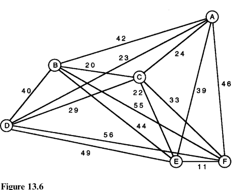

总计197英里。但这真的是最短可能距离吗？或许其他路线会更好。目标就是找到它。

寻找最短路线的一种方法是找出所有路线，计算其长度，然后选择最佳路线。这里列出了一些可以尝试的路线及其各自长度。

| 路线 | 长度（英里） |
| --- | --- |
| AECDBFA | 231 |
| ACBDEFA | 190 |
| ABFEDCA | 210 |
| AEFDCBA | 197 |
| AFDECBA | 235 |

这里找到的最短路径长度为190英里，可能还有更短的路径。

这种计算与我们上一节所做的计算有着奇怪的相似之处。我们从一个城市出发，然后尝试剩余城市的一个排列，最后返回家乡城市。因此，我们必须对除家乡城市外的城市的每一种可能排列进行计算。共有`n - 1`个这样的城市，所以必然有`(n - 1)!`条这样的路径。实际上，如果我们将顺时针和逆时针绕行一圈视为相同，那么应该除以2。因此，路径数量为：

$$
s = (n - 1)!/2 = ((n - 1) * (n - 2) * \cdots * 1)/2
$$

对于`n = 6`座城市，必须检查：

$$
s = (5 * 4 * 3 * 2 * 1)/2 = 60
$$

条不同的路径才能解决问题。

显然，如果没有更好的解决方法，这种计算对于`n`座城市来说代价极高。这被称为*旅行商问题*，在过去三十年中被许多学者研究过。虽然发现了一些显著更好的算法，但即使是最好的算法也只能得出难以处理的计算结果。这些方法的细节超出了本书的范围。然而，如果我们编写一个程序来实现任何这样的过程，其时间图表将与前一节描述的计算`n`个对象所有排列的时间图表非常相似。对于`n`为几百座城市或更多的情况，一些问题已经得到解决，但计算机时间消耗可能很大。对于`n`达到数千的情况，除非是某种特殊情况，否则完全无法解决。

旅行商问题之所以重要，有两个原因：

1. 许多实际问题涉及寻找此类最短路径解决方案，例如规划卡车路线或配电系统。
2. 旅行商问题已被证明属于一类称为*NP完全*问题的问题。NP完全问题之所以重要，是因为它们包含了许多具有实际重要性的问题。研究已经证明，如果能找到一个多项式时间算法来求解该类中的任何一个问题，那么NP完全类中的任何其他问题也将能够以多项式时间求解。因此，如果有人能找到一种方法在可处理时间内解决旅行商问题，那么该类中的所有其他问题也将变得可处理。

人们普遍推测，不存在任何算法能在可处理（或多项式）时间内解决旅行商问题。科学家们多年来一直在努力，要么证明它无法在可处理（多项式）时间内解决，要么找到一种可处理（多项式）的算法来解决它。迄今为止，他们未能实现其中任何一个结果，这成为该领域最伟大的未解决问题之一。用计算机科学的术语来说，就是：P等于NP吗？也就是说，能在多项式时间内求解的问题类是否等同于NP中的问题类（如旅行商问题）？

### 寻找区域的最佳覆盖

假设我们有以下正整数：3, 21, 25, 31, 45, 57, 77, 87。我们希望找到这些整数的一个子集，其和尽可能接近110，但不超过110。例如，我们可以尝试子集{3, 31, 57}，其和为91。再试另一个，{45, 57}，其和为102。{25, 87}呢？其和为112，但这超过了允许的最大值110。让我们系统地列出许多可能性：

| 子集 | 和 |
|--------|-----|
| {3, 31, 57} | 91 |
| {45, 57} | 102 |
| {25, 87} | 112 |
| {31, 77} | 108 |
| {3, 21, 25, 31} | 80 |
| {21, 87} | 108 |
| : | : |

我们能找到的最佳解的和是108，并且我们找到了两种方法得到它。你应该尝试计算其他一些和，看看是否能做得更好。

这个问题是*子集和问题*的一个例子，它是被广泛研究的*背包问题*的一个特例。它之所以重要，原因有很多。首先，它是以下实际问题的解决方案：假设这些整数代表你需要建造某个结构的木板长度。你购买了一块110单位长的木板，并希望为你的结构切割一些木板，同时尽可能减少浪费。你应该选择哪组木板，才能让110单位长的木板剩余最少？

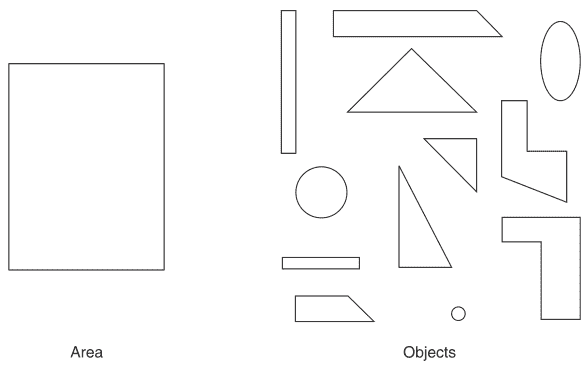

子集和问题重要的第二个原因是，其二维版本也相当常见。如果你有一组奇形怪状的物体（图13.7），为了最大化覆盖一个给定的矩形区域，你应该选择哪些物体以及如何排列它们？图13.8给出了该问题的一个解决方案，你可以看到它非常难以找到。由于线性木板问题是这个二维问题的特例，因此后者至少同样难以解决。

事实证明，子集和问题属于NP完全类，因此具有该类问题的所有特性。我们对此不应感到太惊讶，因为我们一直在通过查看`n`个对象的所有子集来解决它，而这样的子集有`2^n`个。因此，目前尚不清楚是否存在可处理的解法；普遍认为不存在。我们只能期望找到代价非常高（难以处理）的解决方案。因此，对于二维形状问题，我们只能期望找到代价非常高（难以处理）的解决方案。所以，许多用来测试我们智力的益智游戏谜题，其唯一已知的解法都是代价高昂的。

### 寻找图的最佳着色

考虑图13.9以及为每个圆形节点分配颜色的任务。*图着色问题*是找到所有节点的着色方案，使得没有两个相连的节点具有相同颜色，并且使用了最少的颜色数。

**图 13.8**

**图 13.9**

要找到解决方案，第一个想法是简单地为每个节点使用不同的颜色。将颜色称为`C1`、`C2`、`C3`、...、`C8`。然后我们可以将第一个节点着色为`C1`，第二个节点着色为`C2`，其余节点依此类推。我们可以这样写：

- 1. `C1`，2. `C2`，3. `C3`，4. `C4`，5. `C5`，6. `C6`，7. `C7`，8. `C8`

这是一种着色方案，其中没有两个相连的节点具有相同的颜色。但它使用了太多颜色。

让我们尝试一种使用更少颜色的不同着色方案。也许我们应该将节点8着色为与节点1相同：

- 1. `C1`，2. `C2`，3. `C3`，4. `C4`，5. `C5`，6. `C6`，7. `C7`，8. `C1`

这使用了更少的颜色，但不可接受，因为节点1和8是相连的。

让我们尝试另一种着色方案，将节点7着色为与节点1相同：

1. `C1`，2. `C2`，3. `C3`，4. `C4`，5. `C5`，6. `C6`，7. `C1`，8. `C8`

这仅使用了七种颜色，其他方面是可接受的。接下来，我们应该尝试再次减少颜色数。我们能把它降到六种颜色吗？最少需要多少种颜色？

图着色问题是另一个NP完全问题的例子。同样，除非有新的、出乎意料的发现，否则我们可以预期任何解决该问题的算法都是难以处理的。

## 练习

1. 你能找到比文本中给出的六城市旅行商问题更好的解决方案吗？
2. 如果你想解决十城市的旅行商问题，为了找到最佳解，你需要检查多少种不同的城市排列？对于20个城市，你需要检查多少种？
3. 你能找到比文本中给出的、和为108的子集和问题示例更好的解决方案吗？
4. 找到以下整数集合的子集和问题的解：11、23、34、57、90、110、331、366、423、462、622、801、1,277。目标数字是1,435，你的任务是找到总和最大但不超过1,435的子集。这个包含`n = 13`个整数的集合存在多少个子集？你需要检查所有这些子集吗？
5. 找到文本中所示的图着色问题的最优解。
6. 假设旅行商问题的图被作为一个图着色问题来研究。着色它所需的最少颜色数是多少？
7. 给出一个等同于解决图着色问题的实际问题的例子。

## 诊断可处理与不可处理问题

让我们再次查看上一节中给出的可处理和不可处理问题，并尝试确定每类问题的一些共同特征。也许存在一些规则，可以帮助我们将遇到的新问题诊断为可处理或不可处理。我们这里仅以直觉的方式进行，并试图捕捉两类问题的精髓。我们不提供制定决策的严格规则，而是提供通常有效的合理指导原则。

可处理问题通常可以被描述为数据项被逐个处理，并且一旦一个数据项被处理完，就不再回过头去看它。例如，在排序问题中，可能会在数组中找到最小的数字并将其放入第一个位置。它无需再次检查。然后找到第二小的项并将其放入第二个位置。它也无需再次引用。依此类推。许多可处理的计算都具有这种特点。

可处理问题的另一个特点是，人们通常知道已解决的、`n`值很大的例子。是否可能为10,000名学生安排课程，同时满足某些可接受性标准？是的，我们知道这已经做过很多次。所以它似乎是可处理的。

NP完全问题通常具有这样的特征：无法轻松处理给定项并彻底完成。例如，在旅行商问题中，可能会决定从城市A出发，然后去城市D。然后可能去城市C，再去城市E。无论你做出什么决定，你永远无法确定从A到D的第一个决定是正确的。你可能必须回头尝试先从A到C。以后你可能决定尝试先从A到E，或者其他什么。

子集和问题也是如此。如果有人决定在当前解的猜测中不使用25，那么就永远无法将其永久搁置。以后可能会决定使用它。

NP完全问题通常有一种“不断尝试”的味道。再次审视我们考虑的所有NP完全问题。在每种情况下，我们都将所有数据作为一个整体来检查，并测试它们的可接受性。然后我们检查了另一种解决整个问题的方法并进行测试。在每种情况下，都有很多方法可以尝试找到解决方案，这导致了巨大的计算时间。

使用已知算法，这些NP完全问题都是难以处理的，除非有惊人的发现，否则我们可以预期它们将保持这种状态。因此，我们一直观察到的NP完全性特征实际上是不可处理性的标志。

你应该研究这些例子和其他例子，并努力培养对什么构成可处理性和不可处理性的直觉。对于大多数常见情况，你应该能够正确猜测。但在某些情况下，需要博士学位和多年的经验才能发现答案。

## 练习

1. 在每种情况下，研究给定的问题，然后利用文本中给出的指导原则，尽可能将其分类为可处理或不可处理。

   (a) 找到`n`个整数集合中的第十大的整数。（假设`n`大于10。）

   (b) 将一组`n`个正整数分成两部分，使得其中一部分的整数和等于另一部分的整数和。

   (c) 检查一个包含`n`个正整数的集合`Q`，以确定`Q`的任何子集的和是否等于`Q`中的另一个整数。

   (d) 检查一组`n`个整数，以确定其中是否有两个整数相同。

   (e) 将一组`n`个整数相加，其中`n`大于10亿。

   (f) 将一组`n`个不同大小的矩形组装起来，无重叠地覆盖一个给定的大矩形。

   (g) 组装一个包含`n`块的普通拼图。

   (h) 找到一条穿过一组城市的最短路径，该路径恰好经过每个城市一次。没有起点城市，也不需要完成环路。

## 不可处理问题的近似解

我们已经确定，如果城市数量超过几十个，旅行商问题解决起来非常昂贵。然而，确实有许多销售人员似乎定期解决这个问题。怎么会这样？答案是我们要求路径是最小的可能路径，而现实中的销售人员并不担心找到最佳路径。任何不太浪费的解决方案都可以，人们只是做出好的猜测。

我们也可以用计算机做同样的事情。在本节中，只要找到某个合理的解决方案即可，不要求最优解。作为说明，让我们回到旅行商问题并再次尝试。可以提出以下算法将获得足够好的城市路径：

1. 选择起点城市。
2. 从当前城市，选择通往尚未访问城市的最短路径。沿着该路径到达下一个城市。如果还有未访问的城市，重复步骤2。
3. 将最终城市连接回起点城市。

按照这个算法，我们可能从城市A开始，并注意到最近的未访问城市是D。从D开发，最近的未访问城市是C；从C开发，最近的未访问城市是B，依此类推。这个计算非常快，并且可能产生一个可接受的解决方案。已经开发了许多其他快速算法，它们通常比我们这里提出的算法更好。

以下是获得子集和问题近似解的一种方法。写下所有大小为3或更小的子集。向每个子集中添加列表中尽可能多的剩余项（使用任何选择过程），只要不超过给定的限制。选择总和最大的那个。已经证明，如果遵循此过程，得到的总和将至少是最优解大小的四分之三。

## 练习

1. 回到六城市的旅行商问题，从家园城市A出发，找出本节近似算法所发现路径的长度。它与你目前能找到的最佳其他解法相比如何？
2. 重复练习1，但从家园城市B出发。
3. 这里还有一个旅行商问题。城市为A、B、C和D，距离分别为A与B之间1，A与C之间2，A与D之间10,000，B与C之间1，B与D之间2，C与D之间1。从城市A出发，使用近似算法解决此问题。完成此题后，你能对这个近似算法做出什么一般性结论吗？
4. 使用本节给出的近似算法，重做“寻找区域最佳覆盖”一节中的子集和示例。
5. 使用近似算法，重做倒数第二节练习4中给出的子集和示例。
6. 为图着色问题寻找一个近似算法。

## 小结

本章开头指出，有三种原因可能导致无法进行期望的计算。第一种（在此研究）是完成计算所需的机器时间可能不切实际地过大。后续章节将考察其他原因。

事实上，执行时间的研究引出了**可处理**与**不可处理**计算的概念。前者在大多数情况下可以在合理时间内完成，即使要处理大量数据。后者如果尝试解决非平凡规模的问题，通常需要天文数字般的巨大执行时间。两种计算在实践中都很重要。

我们研究了**NP完全问题**的概念，这些问题按所有已知算法都是不可处理的。是否存在可处理的方法来计算它们，这个问题仍未得到解答。大多数观察者猜测它们本质上是不可处理的。

但即使NP完全问题最终被证明可以在可处理的时间内解决，仍有其他问题可证明是不可处理的，例如计算`n`个对象的所有排列。由于这样的排列共有`n!`种，这始终将是一个不可处理的计算。

一些看似不可处理的计算可以通过**近似解**来解决，这些近似解可以在可接受的时间内计算出来，并且对许多目的而言足够精确。许多这些问题及其近似解是计算机科学近期研究的对象。

Miller和Pekny（1991)中的综述有趣地介绍了旅行商问题的研究进展。该文描述了许多近似方法，这些方法已经解决了`n`在数千或数十万范围内的`n`城市问题。文中详细描述了一种算法，该算法为一些类似规模的特殊情形问题找到了精确解。

计算可能无法完成，也可能是因为除时间以外的其他资源不足。可以想象，有些计算可能需要天文数字般的内存，而由于内存限制无法完成。在实践中，这种情况并不常见，本书不再进一步讨论。

程序完成了吗？

我准备好了。

等等……

我还没做完，你呢，露西？

琳达，你那边算出什么来了？

给，卢，看看你能不能找到我这部分的答案。

我的部分完成了！

快了，比尔，你算出什么来了？

我也是！

我不确定，看看霍勒斯有没有算出他那部分的答案。

嘿，乔，帮我问问凯伦她的答案是什么，好吗？

还没。

快点！

我在等下一个X值！

她正在和菲尔伯特说话呢，不过这是我算出来的……

快了！

大家都准备好了吗？

现在，小朱尼尔，做个乖电脑，处理你的数据吧！

# 14 并行计算

### 多处理器协同工作

第13章的一个要点是执行时间可能成问题。过长的计算会导致不便和错过截止日期。更严重的是，如果计算不能按时完成，它可能变得毫无用处。例如，计算航天器轨道修正的轨迹，或计算次日装配作业的库存需求就是这种情况。如果数据未能按时算出，计算的价值就丧失了。

计算必须按时完成，但建造更快的机器未必容易。进行计算需要一定数量的电路，而电在导线中的传播速度不可能超过光速。我们可以通过将电路尺寸缩小来加快计算速度，但这一过程不可能永远持续下去。


加速计算的另一种方法是将其分成若干部分，让多个处理器一起工作。这被称为**并行计算**，也是本章的主题。事实上，我们研究的是专门为这种计算设计的计算机。它们拥有许多处理器，可能是第 8 章描述的那种，每个处理器负责自己的部分。它们根据需要为任务目的进行通信，在大多数情况下，其工作速度比单处理器机器快许多倍。

下一节将描述一台并行机器，并展示它如何解决第 13 章的两个问题：检索具有指定身高和体重的个人姓名，以及旅行商问题。后面的章节将描述并行机器的排序方法、并行度有限时出现的问题、并行机器的通信方案，以及一种新型并行计算机——**连接机**。

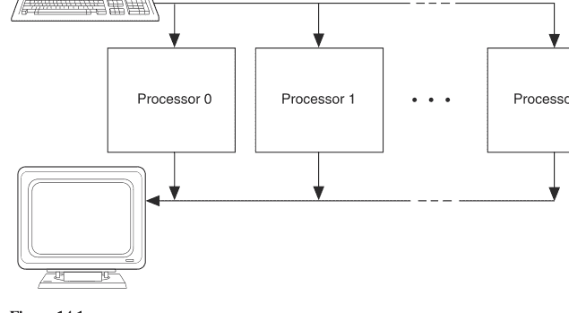

## 14.1 并行计算

并行计算需要并行计算机，这里研究的第一个模型由 100 台机器排成一行组成（图 14.1）。这些机器与之前各章研究的处理器几乎完全相同。它们都处理一种经过轻微修改以支持并行性的 Java 版本。所有机器从单一输入源读取数据，并同时写入一个极快的输出设备。它们编号从 0 到 99。

我们首先编写程序让这台并行机器解决查找所有具有给定身高和体重的个人姓名的问题。我们先假设人数`n`为 100 或更少，以便可以为每个人分配一个处理器。稍后我们再讨论`n`可能较大时的更一般问题。

以下是进行计算的程序。这段代码的副本被加载到全部 100 个处理器中。每个处理器都有自己的`targetheight`和`targetweight`副本，每个处理器持有一个特定人的身高、体重和姓名。

```java
public class ParallelPersonSearch;

{
    double targetweight, targetheight, weight, height;
    String name;

    public void init()
    {
// 在此处输入代码，将单个人的体重、身高和姓名录入
processor 0 output.setText("Give the target height.");
targetheight = all input.getDouble();
processor 0 output.setText("Give the target weight.");
targetweight = all input.getDouble();
if ((targetheight == height) && (targetweight == weight))
    {this processor output.setText(name);}
    }
}
```

对输入和输出的引用都加了前缀，以指明 100 个处理器中的哪个执行该操作。

这 100 个处理器进行此计算的工作原理是清楚的。首先，每个处理器通过一系列操作加载一个人的体重、身高和姓名，具体操作在此不重要。如果人数少于 100，某些处理器将收到身高、体重和姓名的空值。然后处理器 0 打印消息`"Give the target height."`。接下来，所有处理器从输入接收一个值，即目标身高。然后处理器 0 打印`"Give the target weight."`，所有处理器接收第二个值，即目标体重。最后，每个处理器将目标值与其存储的一个人的值进行比较；如果匹配，则输出该人的姓名。输出设备打印从所有处理器收到的所有姓名。

输入和输出语句带有前缀操作符，指明哪些处理器将执行该操作。例如，如果这段代码正在处理器 13 上运行，而该处理器遇到`processor 0 output.setText`，它应该忽略该语句并继续。如果遇到`all input.getDouble`或`this processor output.setText`，则应该执行该操作。

这次并行计算的时间比第 13 章的串行情况快得多。以前是在时间

`t_sequential = 5.1 × 10^{-4} × n`

内找到这些人，而现在计算速度就像数据库中只有一个人一样快：

`t_parallel = 5.1 × 10^{-4} × 1`

我们所追求的显著加速已经实现（图 14.2）。当然，重要的是要记住，这些结果适用于每个人有单独处理器的计算。当可能没有足够处理器分配给所有人时，更一般的情形将在稍后考察。

## 14.2 并行计算

旅行商问题为并行计算提供了另一个有趣的示例。其方法是让每个处理器计算城市的不同排列顺序以及相应路径的长度。然后比较所有处理器计算出的不同路径，并报告最佳路径。

我们在这里不详细研究这个程序，而是利用计算一条路径的执行时间可以估计为

```text
t_parallel = 5 * 10^{-3} * n
```

这一事实，它比串行版本快得多。如果我们有足够的处理器，使得每条可能的路径都在其中一个处理器上计算，那么`t_parallel`就可以粗略估计并行机器解决此问题所需的总时间。我们假设在单处理器机器上计算旅行商问题精确解的合理时间估计就是使用排列公式：

```text
t_sequential = 4.6 * 10^{-3} * n!
```

同样，并行计算的力量是惊人的，如图 14.3 所示，对于`n = 1, 2, \ldots, 6`的值。

我们很想检查一下，如果有足够的处理器，使用并行计算 22 个城市需要多长时间。在第 13 章中，我们发现串行机器在太阳燃尽之前都无法完成计算。在这里，我们得到

```text
t_parallel = 5 * 10^{-3} * 22 = 0.11 \text{ 秒}
```

好极了！臭名昭著的旅行商问题被并行机器攻克了。但是等等。并行机器需要`(n-1)!/2`个处理器，即解决方案中每一步一个处理器。这大约需要`10^{19}`个处理器。因此，如果我们将机器铺满整个地球表面，包括海洋，我们必须在每平方英寸中塞进至少二十几个处理器，才能建造出足够大的机器。

以下是计算旅行商问题一条路径长度的程序。程序计算完其总和后，将该结果传递给另一组处理器——一个比较器，该比较器将此结果与许多其他处理器的结果进行比较，并选择最佳结果。程序假设当前处理器的编号存放在名为`procnum`的位置中，并使用一个名为`findperm`的子程序，该子程序利用处理器编号来决定要探索哪种排列。因此，每个处理器将探索不同的排列。程序将城市之间的距离存储在一个名为`distance`的数组中。

```java
public class TSP {
    int[] permarray;
    double[][] distance;
    int n, i, homecity, currentcity;
    double sum;

    public void init() {
        // Input n and array of all n cities and their
        // distances. Initialize arrays, etc.
        permarray = findperm(procnum);
        sum = 0;
        i = 0;
        homecity = permarray[0];
        currentcity = homecity;
        while (i < n - 1) {
            sum = sum + distance[currentcity][permarray[i + 1]];
            currentcity = permarray[i + 1];
            i = i + 1;
        }
        sum = sum + distance[currentcity][homecity];

        // Send sum to a comparator processor that
        // works with other processors to decide
        // the minimum sum and its associated
        // permutation.
    }
}
```

本节展示了第 13 章中的两个计算如何可以分布到并行架构上，以获得执行时间上的显著改进。当然，所有这些观察都假设`n`很小且处理器数量是无限的。接下来的几节将表明，并非所有计算都容易像这两个例子那样加速，并且当`n`相对于处理器数量较大时，它们还会考察执行时间。

## 练习

1. 展示如何对并行机器编程，以找出房间中哪两个人生日相同，假设恰好有两个人生日相同。假设总共不超过 100 人。

2. 展示如何对并行机器编程，以计算 1 到 100 之间的所有质数。

3. 展示如何对并行机器编程，以完成第 4 章的数据库程序。

4. 展示旅行商问题的并行程序在四个城市的情况下如何解决问题。需要多少个处理器？每个处理器的任务是什么？

5. 描述在许多处理器计算出所有路径的总和之后，如何对并行机器编程以完成旅行商问题。必须编写代码来检查所有这些总和，并找出最小的一个。

## 14.3 通信进程

上一节的问题之所以特殊，是因为它们可以以简单的方式分配到一组处理器上。接下来，我们研究一个更难的问题：当整数分布在我们的 100 处理器机器上时进行排序。在这种情况下，我们需要进程之间的通信，以及将整数沿队列上下传递的能力。

假设有`n`个整数位于处理器 0 到`n-1`中，其中`n`为 100 或更少。每个处理器有一个位置`num`，其中包含列表中的一个数。它还包含`n`、一个索引`i`以及它自己的处理器编号（图 14.4）。排序算法要求除第一个处理器外的每个处理器检查其左侧处理器中的数字。如果另一个数字比它自己的大，就交换它们。此操作重复进行`n`次，此时数字应该会被排序好，最小的在处理器 0 中，最大的在处理器`n-1`中。以下是该程序：

```java
public class ParallelSort {
    int i, num, n, procnum;

    public void init() {
        // Put code here to read num and n.
        if ((procnum > 0) && (procnum <= n - 1)) {
            i = 1;
            while (i <= n) {
                if (num(left neighbor) > num(this processor)) {
                    exchange num(left neighbor) and num(this processor);
                }
                i = i + 1;
            }
        }
    }
}
```

让我们看看这个程序的实际运行情况。假设`n = 3`，前三个处理器分别包含 6、5 和 4：

| num | 6 | 5 | 4 |
| --- | --- | --- | --- |
| procnum | 00 | 01 | 10 |

程序`ParallelSort`在这三个处理器上同时运行。在第一个处理器上，它什么也不做，因为`procnum = 00`。第二个和第三个处理器各自看到它们的左邻有更大的数字，并与左邻交换自己的数字。因此，处理器 01 将 5 放入处理器 00，将 6 放入自身。处理器 10 将 4 放入处理器 01，将 5 放入自身。错误！处理器 01 的`num`位置刚刚被同时加载了 6 和 4。而且处理器 00 和 10 都有 5。这里出了问题。我们原以为最终会得到如下排序的数字：

| num | 4 | 5 | 6 |
| --- | --- | --- | --- |
| procnum | 00 | 01 | 10 |

结果，我们却得到了这个：

| num | 5 | ? | 5 |
| --- | --- | --- | --- |
| procnum | 00 | 01 | 10 |

显然，一个处理器的计算会干扰其邻居的计算。每个处理器查看自己的数字和左邻的数字，并决定是否进行交换。但等到它选择进行交换时，自己的数字和邻居的数字可能都已经变了。它无法检查任何值并确定它会保持不变，因为其他进程可能会改变它。这个看似简单的程序充满了问题。

解决方案是使用一组称为`信号量`的标志，来保护位置不被除选定的单个处理器之外的任何处理器改变。该处理器将保持对指定位置的控制，直到其工作完成，然后它会改变标志以指示已将相关位置释放给其他处理器。这种守卫系统可能变得复杂，但它将为并行计算恢复秩序。

我们为每个`num`位置设置一个`flag`；`flag`是一个包含 0 或 1 值的位置。然后我们遵循这样的规则：处理器只有在它的`flag`为 1 时才能访问和改变自己的`num`。如果它的`flag`为 0，它将不被允许影响自己的`num`，因为该位置由其右侧的邻居控制。当然，处理器永远无法与其左邻交换`num`值，除非它同时控制两者。它的`flag`必须为 1，且其左邻的`flag`必须为 0。我们在下表中指示了处理器`i`可以进行交换的条件。我们说如果满足这些条件，它的活动为"开启"；否则，它的活动为"等待"，或者如果它是处理器 0 则为"关闭"：

| num |  | 0 | 1 |
| --- | --- | --- | --- |
| flag |  | 0 | 1 |
| procnum |  | i - 1 | i |
| activity |  | waiting | on |

进程完成一个周期后，它应该改变自己的`flag`和左邻的`flag`，以将它们释放给其他进程。然而，此规则有两个例外：处理器 0 的`flag`应始终为 0，因为该处理器永远不需要与其左邻进行交换；持有数据的最后一个处理器的`flag`应始终为 1，因为它没有右邻来夺取控制权。

我们可以通过重复前面的排序来检验这个策略。我们将第一个`flag`初始化为 0，最后一个`flag`初始化为 1，其他偶数编号处理器的所有`flag`初始化为 0，使它们等待，其他奇数编号处理器的所有`flag`初始化为 1，使它们开启：

| num | 6 | 5 | 4 |
| --- | --- | --- | --- |
| flag | 0 | 1 | 1 |
| procnum | 00 | 01 | 10 |
| activity | off | on | waiting |

记住，处理器只有在它自己的`flag`为 1 且左邻的`flag`为 0 时才会开启。因此，三个处理器中只有一个具有开启的标志配置；它是处理器 01，它看到左邻的`num`大于自己的`num`并进行交换。同时，它改变自己的`flag`。（如果不是最左边的处理器，它也会改变左邻的`flag`。）

| num | 5 | 6 | 4 |
| --- | --- | --- | --- |
| flag | 0 | 0 | 1 |
| procnum | 00 | 01 | 10 |
| activity | off | waiting | on |

这使得处理器 01 处于"waiting（等待）"状态，但释放处理器 10 去将其`num`与左邻处理器的`num`进行比较。处理器 10 随后发现左邻的值更大并执行交换。最后，它会改变自己的`flag`及其左邻的`flag`，但由于它是最右边的处理器，因此只改变其邻居的`flag`：

| num | 5 | 4 | 6 |
| --- | --- | --- | --- |
| flag | 0 | 1 | 1 |
| procnum | 00 | 01 | 10 |
| activity | off | on | waiting |

现在处理器 01 再次变为"on（激活）"，它可以进行另一次比较、交换和`flag`改变。这就完成了排序：

| num | 4 | 5 | 6 |
| --- | --- | --- | --- |
| flag | 0 | 0 | 1 |
| procnum | 00 | 01 | 10 |
| activity | off | waiting | on |

一旦这种`flag`策略设计完成，就可以修改并行排序程序使其正确工作：

```java
public class ParallelSortWithFlags
{
    int i, num, n, flag, procnum;
    public void init()
    {
        // 在此处添加代码以读取 num 和 n。
        // 我们假设 procnum 保存处理器编号。
        if (procnum is even)
            {flag = 0;}
        else
            {flag = 1;}
        if (procnum == n - 1)
            {flag = 1;}
        if ((procnum > 0) && (procnum <= n - 1))
        {
            i = 1;
            while (i <= n)
            {
                wait until ((flag(this processor) == 1) &&
                            (flag(left neighbor) == 0));
                if (num(left neighbor) > num(this processor))
                {exchange num(left neighbor) and num(this processor);}
                if (procnum > 1)
                {change flag in processor on left;}
                if (procnum < n - 1)
                {change flag in this processor;}
                i = i + 1;
            }
        }
    }
}
```


在并行计算中，一种常见的现象是：一个处理器正在等待另一个处理器完成其作业，而同时另一个处理器也在等待第一个处理器完成其作业。每个处理器都在等待，且双方都未再前进一步。这称为`死锁（deadlock）`，它是并行计算设计者关注的主要问题。在我们的排序程序中，处理器会等待其`flag`和左邻的`flag`达到正确配置后才执行操作。你应该研究该算法，并判断排序算法是否可能进入死锁。

最后，我们考察该算法的执行时间。程序执行其循环`n`次，因此时间公式具有如下形式：

```math
t_{parallel} = C * n
```

其中`C`为某个常数。我们在第 13 章中提到，可以在如下时间内对数字进行排序：

```math
t_{sequential} = C' * n * \log_2 n
```

其中`C'`为常数。由于`\log_2 n`并不是一个很大的数，因此我们看到`t_{parallel}`并不比`t_{sequential}`快很多。如果我们使用`n`个处理器，我们期望看到`n`倍的加速。这就像雇佣 100 个人来帮你采摘果园里的苹果，结果发现他们只比一个人独自完成快七倍。因此，这种排序算法有些令人失望，我们并未达到上一节所观察到的那种成功质量。存在更好的并行排序方法可以获得更大的加速比，但它们比这里展示的更为复杂，超出了本书的范围。

在本节中，我们发现并非所有计算都能像最初介绍的那样容易被划分以进行并行执行。每当编程涉及处理器间通信时，代码可能变得非常复杂。此外，执行时间的提升可能不如人们所期望的那样大。

## 习题

1. 假设数字 7, 2, 9, 6, 4, 1, 5, 4 分布在并行机的处理器 000 到 111 上，并且需要对它们进行排序。展示程序`ParallelSortWithFlags`如何完成这一排序。在计算初始化时，展示所有处理器及其`num`、`flag`和`procnum`的值。然后在每个重要步骤之后再次展示它们。
2. 假设一名程序员编写了上述排序程序，但犯了一个错误：所有`flag`都被初始化为零。在这种情况下，程序将如何运行？本节介绍的哪个新概念适用于此？
3. 一串`n`个字符（`n`不超过 100）分布在一台并行机上，每个处理器存储一个字符。展示如何对处理器进行编程，使用户可以输入一个短字符串，并找到它在原始字符序列中出现的所有位置。机器应输出持有发现子串首字符的处理器编号。

   例如，假设初始字符串为`"abcbc"`，存储方式如下：

   | character | a | b | c | b | c |
   | :--- | :--- | :--- | :--- | :--- | :--- |
   | procnum | 000 | 001 | 010 | 011 | 100 |

   那么如果用户输入`"bc"`，系统将找到该子串的两次出现，并打印它们首字符的位置：001, 011。

## 饱和机器上的并行计算

前面的研究都假设`n`足够小，允许将计算方便地划分到可用处理器上。对于数据检索问题，假设每个个体对应一个处理器；对于旅行商问题，假设城市的每种排列对应一个处理器。在这些情况下，我们说计算不会*饱和（saturate）*机器，因为有足够的处理器来最优地划分问题。

然而，realistically，我们必须预期`n`可能很大，我们没有足够多的处理器来有效利用，因此有必要重新组织代码。这就是处理器饱和的情况，主要有两个结果：编程变得更加复杂，执行时间的部分提升会丧失。本节将研究这两种影响。

回到检索问题，假设可能有数千个个体的记录分布在 100 个处理器上。那么我们应在每个处理器上放置总人口的 1%。每个处理器将搜索其自身的 1%，而 100 次独立计算的结果将构成对完整人口的搜索。

以下是处理每个处理器上大量个体的修订程序：

```java
public class SaturatedParallelPersonSearch
{
    double targetweight, targetheight, weight[], height[];
    String name[];
    int m, i;

    public void init()
    {
        // 在此处添加代码以找出
        // 要存储在该处理器中的个体数 m，
        // 然后读取这些个体的数据。
        processor 0 output.setText("Give the target height.");
        targetheight = all input.getDouble();
        processor 0 output.setText("Give the target weight.");
        targetweight = all input.getDouble();
        i = 1;
        while (i <= m)
        {
            if ((targetheight == height[i]) && (targetweight ==
                                              weight[i]))
                {this processor output.setText(name[i]);}
            i = i + 1;
        }
    }
}
```

通过仔细考虑一系列情况，可以发现该程序的执行时间。假设有 100 个或更少的个体。这是前面考虑的情况，执行时间与在顺序机上处理一个个体相同：

```math
t_{1-100} = 5.1 * 10^{-4} * 1
```

如果有 101 到 200 个个体，可以将它们分配到处理器上，一些处理器放两个，另一些放一个。执行时间与顺序机处理两个个体相同：

```math
t_{101-200} = 5.1 * 10^{-4} * 2
```

趋势现已明了：

```math
t_{201-300} = 5.1 * 10^{-4} * 3
```

依此类推。

结果给了我们一个关于饱和机器上计算的教训。当处理器充足时表现出的惊人加速已不复存在。但并行计算仍然比顺序计算快得多。在最好的情况下，拥有 100 个处理器的机器将比单处理器机器快 100 倍（图 14.5）。

旅行商问题也存在类似情况。如果`n!`大于 100，我们无法再奢侈地将城市的每种排列分配到一个处理器上。相反，每个处理器必须计算所有排列的 1%，这可能是一个很大的数字。如果`n!`不超过 100，执行时间图上升缓慢；但对于更大的`n`，则像顺序情况一样指数上升。它最多比单处理器快 100 倍。不幸的是，这种改进并不足以将一个不可行的计算转化为可行的。

排序算法也可以为大数据集编程，但会带来额外的复杂性。此外，在非饱和情况下难以获得的时间优势也无法保持。

总之，并行计算提供了计算时间大幅加速的可能性，尤其对于容易划分为多个部分且需要高度协作的问题。

虽然可以实现不同程度的并行性，但引入并行性往往会导致程序复杂度大幅增加，而且对于许多问题来说，并不会带来显著的速度提升。

## 练习

1. 制作一张表格，总结本章目前的成果。表格应有两列——一列用于可解计算，一列用于不可解计算。应有两行——一行用于未饱和机器上的计算，一行用于饱和机器上的计算。在每个单元格中，描述并行计算所能实现的加速程度。
2. 仔细分析当`n`大于 6 时，在 100 处理器机器上旅行商问题所能实现的加速。绘制执行时间与`n`的关系图，并将其与未饱和并行执行和顺序（单处理器）执行的情况进行比较。

## 架构的变体

并行机器可以采用多种不同的互连方案。并非所有机器都像前几节中的模型那样以直线方式组织。处理器可以组织成环形、网格、超立方体、全连接集合，或多种其他方式中的任何一种（图 14.6）。较简单的方案（如环形和网格）更容易构建。而更复杂的方案则提供了更大的性能潜力。

一种简单的性能度量是信息到达网络中最远点所需的传输次数。例如，16 个处理器以环形连接时，相距最远的节点位于环的两侧。信息从一个节点传送到另一个节点需要沿通信线路进行八次传输。通常，`n`个处理器的环形结构需要`n/2`次传输才能在最远的处理器之间传递信息。下表给出了图 14.6 中所示的四种配置下最远处理器之间的距离：

| 配置 | 16 | 10,000 | n |
| :--- | :--- | :--- | :--- |
| 环形 | 8 | 5,000 | n/2 |
| 网格 | 6 | 198 | 2n^(1/2) - 2 |
| 超立方体 | 4 | 14 | log_2 n |
| 全连接 | 1 | 1 | 1 |

前几节描述的并行机器被称为*多指令多数据*（MIMD）机器。这意味着每个处理器都有自己的程序来处理自己的数据。因此，每个处理器可以运行完全不同的代码，为程序员在计算组织方面提供了完全的灵活性。另一种常见的设计是*单指令多数据*（SIMD）机器，由一个程序控制阵列中的所有处理器。该单一程序向整个网络广播其命令，所有处理器步调一致地执行。这种架构在可能存在大量处理器（数以万计）且难以生成每个处理器的个性化代码的设计中很常见。

这引出了并行架构中的另一个问题，即并行的*粒度*程度。机器可能具有*粗*粒度，即每个节点上的处理器较大，通信相对较少，就像我们的模型一样。这种情况下处理器数量较少，比如几百个，每个都具有完整的指令集和较大的内存——100,000 字节或更多。或者粒度可能是*细*的，多达数十万个微小处理器，它们之间有非常紧密的通信。下一节将给出一个具有非常细粒度的并行计算机的示例。

## 练习

1. 假设提出一种三维立方网格作为机器架构。因此，一个立方体可以沿每条边有`m`个节点，总共`m`³ 个节点。填写文中给出的表格，计算该配置下最远节点之间的距离。
2. 你能在 SIMD 机器上运行本章讨论的三个问题吗？逐一讨论，并说明它们会成功还是失败。
3. 提出一种本章未描述的并行架构，并研究其特性。

## 连接主义架构

近年来，一种新型计算机——*连接主义*机器引发了极大的关注。这种机器处于并行计算谱系的极端，可能拥有数百万个微小节点，每个节点只能执行非常原始的计算。连接方案规模庞大，大量节点阵列之间相互通信，同时也与其他节点阵列通信。这种架构的灵感来源于对人类大脑生理学的研究，一些研究人员认为连接主义机器以类似的方式执行计算。我们在此研究一种简单的连接主义机器设计，并推荐你参阅快速增长的文献以获取更多阅读材料。

我们的连接主义架构是目前许多正在研究的架构的典型代表：它被组织为一个`N`乘`N`的节点方形网格，其中`N`可以是数百（图 14.7）。每个节点都从其他所有`N^2`个节点接收输入。因此，该网络是完全连接的。完全连接对于许多算法来说并非必需，但对于一些有趣的示例来说，它是一个优秀的模型。

每个节点从其他每个节点接收一个 1 或`-1`。它将每个输入（1 或`-1`）乘以一个称为权重的实数值，然后将所有结果相加。最后，如果该总和大于某个常数`c`，则节点输出 1，否则输出`-1`。然后节点将其输出（1 或`-1`）发送给所有其他节点。所有节点同时执行此计算，重新计算各自的输出并将其广播给邻居。如果节点在计算时能够同时说话，它们同时发出的嘈杂声将是惊人的。

作为单节点计算的示例，考虑图 14.8 中所示的四节点网格，以及计算其左上节点输出的过程。在该图中，每个节点的输出显示在节点上。除了本示例所需的通信链路外，所有其他通信链路均已省略。

## 并行计算

左上节点接收三个输入，将它们乘以相应的权重`w`，然后相加：

```math
0.3 * (1) + 0.25(-1) + 0.5(1)
```

总和为 0.55。由于该值大于此节点的`c = 0.5`，它将输出 1（图 14.9）。在左上节点的输出变为 1 之后，它作为输入被传送到所有其他节点，这些节点就可以计算它们的新输出了。

考虑这台机器的一个更大版本，一个 3 乘 3 的系统。假设左上节点如图 14.10 所示连接。以下数组呈现了与该节点相关的信息：

| | | |
| :--- | :--- | :--- |
| | −0.05 | |
| 0 | −0.1 | −0.1 |
| 0.1 | −0.1 | −0.1 |
| 0.1 | 0.1 | 0.1 |

该数组显示了从其他节点回到左上节点的所有弧的值。左上角为零，因为该节点没有指向自身的转换。数组上方的数字表示常数`c`。

请记住，共有九个节点，每个节点都有输入转换。因此，整个连接主义机器可以用九个这样的数组来表示（图 14.11）。这指定了机器的所有权重和常数。如果你想知道从节点`i, j`到节点`k, l`的权重，请查看`k, l`数组并选取其中的`i, j`条目。

一旦指定了机器，就可以用它进行计算。让我们设置所有节点的输出（图 14.12a），看看会发生什么。所有节点都从其他所有节点接收输入，并计算新的输出。检查左上角，可以通过将所有线路上的权重乘以输入来计算下一个输出：

```math
(-0.1)(-1) + (-0.1)(-1) + (0.1)(1) + (-0.1)(-1) + (-0.1)(-1) + (0.1)(1) + (0.1)(1) + (0.1)(1) = 0.8
```

由于 0.8 大于`-0.05`，该节点的新值将为 1（图 14.12b）。

我们也可以计算其他条目的新值，但在这种情况下，所有值都保持不变。因此，它们都已达到稳定值。如果我们考虑原始配置为输入：

```text
-1  -1  -1
 1  -1  -1
 1   1   1
```

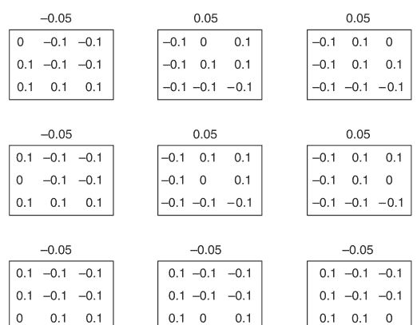

图 14.11

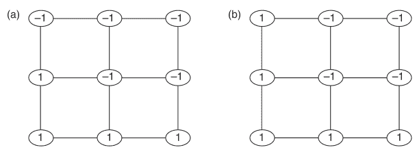

图 14.12

那么最终的稳定配置就是输出：

```text
1  -1  -1
1  -1  -1
1   1   1
```

让我们将这些节点设想为视觉平面上的神经元，并假设 1 代表黑色，`-1`代表白色。那么一个输入


产生了输出


这将被写成


现在我们可以用这个机器做实验，反复将输入设为某个我们感兴趣的图像，然后让所有节点反复重新计算它们的值，直到找到一个稳定的配置为止（图 14.13a）。看起来，每一个大致类似于 L 形的图案都会产生一个 L 形。而且，许多只包含 L 图案碎片的图案（图 14.13b）也会产生 L 形。但某些配置会导致其他结果（图 14.14）。L 形更受欢迎，所有看起来大致像 L 的配置都会产生 L 形。事实上，这台机器是一个 L 形识别器，它试图将遇到的任何东西都变成 L 形。

总而言之，我们从一个具有由一组数组指定权重的九节点联结主义计算机开始。我们考察了它的输入-输出特性，并确定有一种特定的输出配置是强烈优先的。每当出现任何可能暗示该图案的片段信息时，机器就会生成该图案作为输出。这个输出可能需要基本节点计算的多次迭代，但最终的稳定配置将是那个图案。

这种在仅观察到片段证据后便呈现出完整图像的特性，被许多人认为是智能行为的一个关键方面。这样的系统被称为具有*联想记忆*，这显然是人类大脑的一个特征。假设，举例来说，存储的图像是一个非常复杂的结构，包含关于某个特定人物的信息。该结构将包含此人的姓名、他或她面部的图像，以及对其行为的记忆。那么，如果该结构的某个片段出现，比如姓名、部分图像或某种行为提醒，结构的其他部分就会浮现在脑海中：姓名让人想起面孔，某些行为让人想起姓名，等等。联结主义研究中*有趣*的一点是，该模型是作为大脑的类比而推导出来的，而这些行为似乎让人联想到类脑活动。

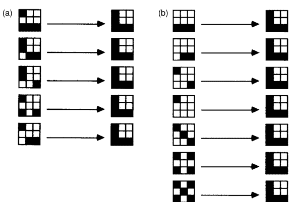

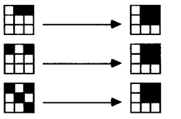

另一个有趣的事实是关于 L 的信息在机器中传播的方式。没有特定的权重或节点对识别至关重要，事实上权重可以在一定程度上随机变化而不太影响行为。如果有少量小的变化，模式识别只会略有下降。如果进行大的改变，会有更多的功能损失，但可能不会使基本行为失效。这种机器的这种特性似乎又一次类似于生物系统，也是智能机器所期望的特性。

当你研究给定的特定权重时，你可以从中辨别出编码在其中的 L 形。然而，权重可以修改，使这台机器能够识别多种图案，而不仅仅是 L。当这种情况发生时，权重开始看起来像随机数，但 L 图案和其他可识别的图案仍将编码在其中。

关于联结主义方法的最后一个使其具有吸引力的点是，计算机无需被编程来识别图案。它可以被训练来做到这一点。这是下一节的主题。

## 练习

1. 假设一个 3×3 的图像，四个角都是黑色，所有其他方格都是白色，呈现给本节的联结主义机器。计算所有节点输出的新值，以确定输出图像。
2. 更改 3×3 联结主义机器中的一些权重，并确定其识别 L 的能力是否下降。

## 学习联结主义权重

假设 3×3 的联结主义机器要识别某个图案，比如 L，但权重的适当值未知。那么我们可以假设所有权重都为零，并尝试稍微改变它。当权重稍大或稍小时系统表现更好，就进行该更改。

为了解这是如何实现的，回到左上角节点的例子，但这次假设所有权重都为零（图 14.15）。我们程序的目标是找到

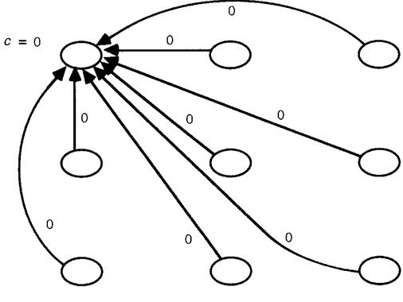

图 14.15

权重的值，使它们倾向于输出 L 形。更具体地说，目标图案具有这种形式：

```text
1  −1  −1
1  −1  −1
1   1   1
```


有必要找到权重的值，使得在给定其他值时倾向于在左上角计算出 1。假设首先要检查的权重是从最上面一行中间节点引向它左侧邻居的那个。我们将它增加 0.1，然后减少 0.1，每次检查权重的变化是有助于还是阻碍期望的结果（即左上角的输出为 1）。将其他节点的八个值相加，我们得到以下结果。

如果权重为 0.1，则

`(0.1)(−1) + (0)(−1) + (0)(1) + (0)(−1) + (0)(−1) + (0)(1) + (0)(1) + (0)(1) = −0.1`

由于 −0.1 小于 `c = 0`，输出被计算为 −1。这不是左上角期望的输出。

如果权重为 −0.1，则

`(−0.1)(−1) + (0)(−1) + (0)(1) + (0)(−1) + (0)(−1) + (0)(1) + (0)(1) + 0(1) = 0.1`

由于 0.1 大于 `c = 0`，输出被计算为 1，这是期望的结果。在尝试的两个值中，只有第二个成功，因此选择它（图 14.16）。

重新审视这个计算，你可以看到 `w = −0.1` 将优先于 `w = 0.1`，因为目标是最大化求和。由于权重 `w` 乘以该单元格的图案值 −1，`w = −0.1` 比 `w = 0.1` 更能胜任，因为 −0.1 会对总和产生正向贡献。这可以推广如下。当计算指向值为 1 的单元格的弧上的权重时，来自值为 1 的单元格的所有权重应增加，来自值为 −1 的单元格的所有权重应减少。

可以推导出类似的规则，当弧指向值为 −1 的单元格时。在这种情况下，来自值为 −1 的单元格的所有权重应增加，来自值为 1 的单元格的所有权重应减少。

让我们看看这些规则如何应用于寻找更多的权重。考虑来自右上角节点的弧上的权重。其图案值为 −1，因此其权重应减少。它的新值将为 −0.1。考虑来自左上角正下方节点的弧上的权重。该节点的图案值为 1，因此其弧权重应增加。它的新值将为 0.1（图 14.17）。

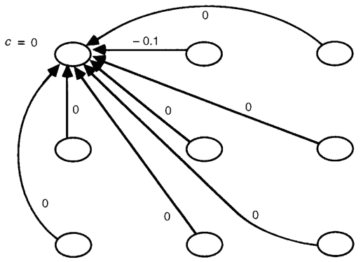

图 14.16


图 14.17

对其余权重的程序也是如此进行的，并且使用了类似的程序来计算常数 `c`，其中使用了 +0.05 和 −0.05 的变化。结果是上一节中 L 识别器所示的权重和常数集。在其他一些联结主义系统中，计算这些权重时使用了更复杂、更不直观的方法。这里给出的方法更容易理解，并且为我们的研究目的提供了满意的结果。通常，在要识别许多图案的实际情况下，这个权重计算必须重复多次才能找到令人满意的值。权重和常数将随着计算的反复进行而缓慢迁移到可接受的值。这种缓慢演变出一套令人满意的权重和常数的过程被称为“学习”。（其他类型的学习在第 16 章中考察。）

向联结主义机器呈现许多不同的图案来学习被称为对机器的“训练”。既然我们的机器已经“学会”了 L 图案，让我们用 T 来训练它。如果我们从 L 图案所示的权重和常数值开始，并以同样的方式用 T 图案再次修改它们，

```
 1   1   1
-1   1  -1
-1   1  -1
```

那么会推导出一组新值（图 14.18）。预计在 L 和 T 上都训练后，这些值编码了两种图像。一系列测试输入及其输出如图 14.19 所示。我们看到，机器将任何与 L 有哪怕最微弱相似之处的图像都识别为 L。它对 T 也是如此。只有一个测试输入产生了非 L、非 T 的响应。

你可能检查权重和常数，想知道 L 和 T 存储在哪里。答案是，从某种意义上说，它们存储在各处，因为每个权重都以微小的方式对所有决策做出贡献。从另一个角度来看，它们没有特别存储在任何地方，因为对单个权重的小扰动对整体性能影响很小。

这里的例子极其简单，仅用于演示原理。一个更现实规模的机器可以拥有数万个节点的网格，以及另外数万个用于背景计算的辅助数组。训练可能涉及数千个示例，学习过程可能涉及数千次迭代，以使权重收敛以产生可接受的行为。

较大的系统通常用“能量”来研究。给定一组权重和常数，图案中的一个单元格据说具有能量：

```text
E = c − s    如果单元格包含 1
E = −(c − s) 如果它包含 −1
```

## 第 14 章

| c = -0.1 | | |
|:---:|:---:|:---:|
| 0 | 0 | 0 |
| 0 | 0 | -0.2 |
| 0 | 0.2 | 0 |

| c = 0 | | |
|:---:|:---:|:---:|
| 0 | 0 | 0.2 |
| -0.2 | 0.2 | 0 |
| -0.2 | 0 | -0.2 |

| c = 0 | | |
|:---:|:---:|:---:|
| 0 | 0.2 | 0 |
| -0.2 | 0.2 | 0 |
| -0.2 | 0 | -0.2 |

| c = 0 | | |
|:---:|:---:|:---:|
| 0 | -0.2 | -0.2 |
| 0 | 0.2 | 0 |
| 0.2 | 0 | 0.2 |

| c = 0 | | |
|:---:|:---:|:---:|
| 0 | 0.2 | 0.2 |
| -0.2 | 0 | 0 |
| -0.2 | 0 | -0.2 |

| c = 0.1 | | |
|:---:|:---:|:---:|
| -0.2 | 0 | 0 |
| 0 | 0 | 0 |
| 0 | -0.2 | 0 |

| c = 0 | | |
|:---:|:---:|:---:|
| 0 | -0.2 | -0.2 |
| 0.2 | -0.2 | 0 |
| 0 | 0 | 0.2 |

| c = -0.1 | | |
|:---:|:---:|:---:|
| 0.2 | 0 | 0 |
| 0 | 0 | -0.2 |
| 0 | 0 | 0 |

| c = 0 | | |
|:---:|:---:|:---:|
| 0 | -0.2 | -0.2 |
| 0.2 | -0.2 | 0 |
| 0.2 | 0 | 0 |

图 14.18

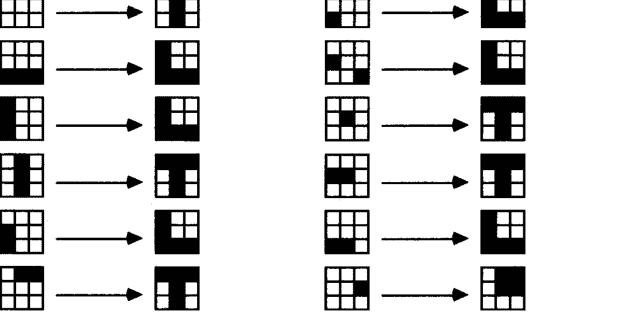

图 14.19

## 图 14.20

在此我们将 `s` 定义为输入到该单元的总和，`c` 为阈值常数。例如，联结主义架构部分中的第一个单元的能量为 `E = 0.5 − 0.55 = −0.05`。如果单元可以具有能量，那么一个模式也可以具有能量；它是所有单元能量的总和。

能量的概念对于理解大规模系统非常有用。假设一个系统尚未经过训练，所有权重和常数都处于初始值。那么所有模式将具有相同的能量（图 14.20）。但训练的效果是降低训练模式以及与它们相似的模式能量。因此，如果系统在两个模式及其变体上进行训练，将会有两个能量降低的区域（图 14.21）。

一旦训练完成，可以将图像的片段作为输入呈现给系统。该模式将出现在能量曲线上的某个位置（图 14.22）。然后我们可以研究上一节中的联结机器计算算法，以确定它将做什么。仔细考察表明，它倾向于改变单元输出的方向以降低总模式能量。因此，在这个例子中，系统将通过改变各个单元的值朝向附近的能量谷的方向来找到其输出。在这种情况下，它将收敛并输出吉尔（Jill）的图像和名字。

我们可以回到前面 L–T 识别器的例子，并进行类似的能量分析。L 和 T 将出现在能量谷中，当系统以输入启动时，它将连续计算直到达到最近谷中的模式。L 的片段将在能量曲线上向下迁移，朝向 L 谷的底部。T 的片段将朝向 T 谷的底部迁移。其他片段将朝不可预测的方向迁移。

联结主义系统还能够从例子中进行归纳。这样的系统可能会在呈现许多人的图像后形成一个一般的人像。他们通常有一张嘴、两只眼睛、一个鼻子等等。然后，当呈现部分图像时，系统可能会得出结论：这是一个人，并能够填补人的所有正常细节。但它不一定知道选择哪个人。关于这一点以及其他联结主义现象的讨论，你应该阅读专业文献。

418

## 第 14 章

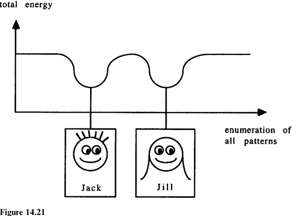

图 14.21

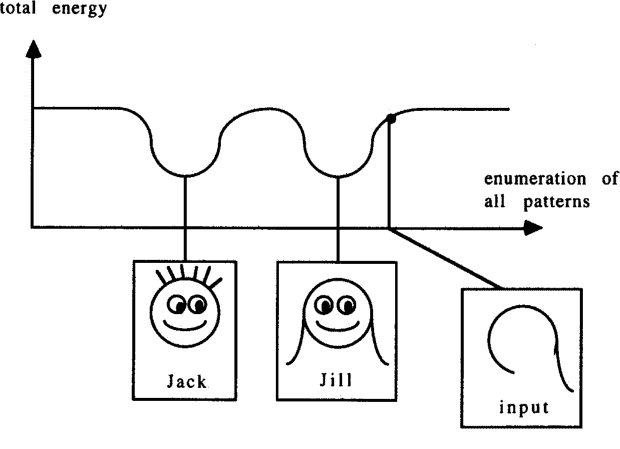

图 14.22

## 习题

1. 使用从 L 和 T 的训练集中得到的权重和常数，确定当输入模式为左上角的单元为黑色、其余为白色时的输出。
2. 改变权重和常数，重复习题 1 的计算。变化必须多大才能使系统做出不同的决策？
3. 计算习题 1 中输入模式的总能量。计算习题 1 中输出模式的能量。注意第二个值应该小于第一个值。
4. 使用为 L 和 T 训练集计算的权重和常数，计算与基本 L 模式相同以及不同的模式的总能量。绘制一个图表，显示与基本 L 形状不同接近程度的模式的总能量。
5. 研究 L 识别器和 L–T 识别器中常数 `c` 的值。你能发现用于学习这些值的算法吗？
6. 在 3 乘 3 联结系统上训练两个你选择的模式，然后测试其性能。
7. 这里呈现的联结计算倾向于寻找最小能量。然而，我们没有证明这种行为总会发生。J. Hopfield（1982）已经证明，如果将机器构建为从节点 `i, j` 到节点 `k, l` 的权重始终等于从节点 `k, l` 返回节点 `i, j` 的权重，则机器处理保证寻求最小总能量。修改这里呈现的算法以遵守这一限制。

## 小结

并行计算似乎是提高机器速度的唯一途径，一旦传统机器的技术极限已经达到。有些问题相当自然地可以分解成多个部分，分布在并行架构上，dramatic speedup 通常是可能的，尤其是当处理器数量相对于问题规模较大时。但其他问题在任何条件下都可能难以加速。对于现实机器上存在的有限并行度 N，加速不可能超过 N 倍，而且这通常很难实现。

并行架构可以在许多维度上变化，包括连通性的程度和格式、处理器的组织方式以及并行性的粒度。

计算的一个近期趋势是发展联结机器，其架构受到人脑研究的启发。大量极其简单的计算设备被组装在高度互联的阵列中。这些机器通过样本数据的呈现进行训练，它们的显著特征包括进行联想检索、补全片段信息以及在机制受到扰动时保持鲁棒行为的能力。这些研究的成功表明了脑生物学研究对计算机科学的重要性。

本页故意留空

这是我们班同学写的程序。我们想让你检查它们的正确性。

怎么了？

我不知道！

点击

嘀！

啵！吱嘎！

咔嗒！

轰隆！！

砰！

正确性检查是不可计算的！

# 15 不可计算性

## 速度是不够的

从前几章我们知道，一些重要的计算可能无法完成，因为它们的执行时间可能太长。这可能导致对越来越快的机器以及将带来更大性能提升的新发现的渴望。也许有一天会建造出一台计算机，能在 1 秒内完成的工作量相当于全世界目前所有机器合力在十亿年内完成的工作量。但我们本章的研究表明，如此令人印象深刻的性能仍不足够解决我们的许多问题。存在一类称为“不可计算的”问题，它们已被证明在当前现代计算范式下，任何计算机都无法解决。这个神秘而难以捉摸的问题类别将是本章关注的重点。

在下一节中，我们研究一个论证，表明有些函数无法被任何 Java（或任何其他已知语言）程序计算。这个证明简单而有说服力。它巩固了本章的主要思想，但它有一个缺点：它没有向我们展示一个不可计算函数的例子。以下各节给出了一系列导致对不可计算性概念进一步理解的想法，然后呈现具体的不可计算问题的例子。最后一节给出了其中一个例子确实不可计算的证明。

## 关于不可计算函数的存在性

我们将称一个函数为“可计算的”，如果存在一个 Java 程序可以计算它。在本章中，我们主要考虑输入为正整数并返回正整数的函数。四个可计算函数 `f₁`、`f₂`、`f₃` 和 `f₄` 的示例见表 15.1。第一个函数将其输入翻倍，可以由以下 Java 子程序计算：

## 表 15.1

| f₁ | | f₂ | | f₃ | | f₄ | |
|:---|:---|:---|:---|:---|:---|:---|:---|
| 输入 | 输出 | 输入 | 输出 | 输入 | 输出 | 输入 | 输出 |
| 1 | 2 | 1 | 7 | 1 | 6 | 1 | 100 |
| 2 | 4 | 2 | 8 | 2 | 6 | 2 | 100 |
| 3 | 6 | 3 | 9 | 3 | 6 | 3 | 100 |
| 4 | 8 | 4 | 10 | 4 | 6 | 4 | 4 |
| 5 | 10 | 5 | 11 | 5 | 6 | 5 | 5 |
| 6 | 12 | 6 | 12 | 6 | 6 | 6 | 6 |

```java
int q1(int x)
{
    return 2 * x;
}
```

第二个函数将其输入加上 6：

```java
int q2(int x)
{
    return 6 + x;
}
```

类似地，第三和第四个函数也很容易编程：

```java
int q3(int x)
{
    return 6;
}
```

```java
int q4(int x)
{
    if (x < 4)
    {return 100;}
    else
    {return x;}
}
```

我们在本章关注的是 Java 程序（以及其他语言）的计算能力。但我们通常会讨论 Java 子程序而不是程序，只是为了在示例中保持简洁。程序和子程序之间的主要区别在于，程序通过键盘输入和屏幕交互来接收和传递信息，而子程序通过参数列表输入并通过 `return` 语句输出。由于后者在本节的示例中展示起来要简单得多，我们在大多数情况下使用子程序作为示例。然而，所有关于子程序得出的结论都适用于程序，因为对于我们的目的而言，唯一重要的区别是输入输出机制。

有时，如果函数可以用 Java 以外的某种语言编程，则它们被定义为可计算的，但由于任何通用编程语言都可以翻译成任何其他语言，这些定义是等价的。可计算函数的类别包括本书迄今为止研究的所有函数，以及高中或大学初级数学中几乎遇到的每一个函数。

不可计算函数是指任何不能被任何 Java 程序计算的函数。起初你可能会认为不存在这样的函数——即每个函数都可以被计算。但不可计算函数的存在是一个深刻而迷人的发现。

不可计算函数存在的论证在概念上是直接的。它指出函数的数量远多于程序的数量，因此不可能为每个函数都配备一个程序。必然存在一些函数没有对应的程序，它们就是不可计算函数。

如果我们暂时提出一个相当极端的假设：世界上只存在三个程序——`P₁`、`P₂` 和 `P₃`，以及前面列出的四个函数，那么这个论证就很容易理解。我们可能不知道哪个程序计算哪个函数，但很清楚的是，无论程序与函数如何配对，总会至少有一个函数无法匹配。这些剩余的函数就是不可计算的，因为它们没有关联的程序。例如，如果 `P₁` 计算 `f₄`，`P₂` 计算 `f₁`，`P₃` 计算 `f₂`，那么 `f₃` 就是一个不可计算函数（图 15.1）。

然而，实际上 Java 程序远不止三个。实际上有无限多个，因此我们的论证需要改进。我们这里在论证中只使用 Java 子程序，但这些论证对完整程序同样成立。让我们开始列出所有输入一个整数并返回一个整数的子程序。列表中的第一个将是最短的这种子程序。按照本书的惯例，输入一个整数并返回一个整数的最短可能子程序如下。它有一个长度为 1 的名称，一个长度为 1 的变量名，且只有一条语句：

```java
int p(int x)
{
    return x;
}
```

还有其他程序在字符数上同样短：

```java
int p(int x)
{
    return 1;
}
```

```java
int p(int x)
{
    return 2;
}
```

```java
int p(int x)
{
    return 9;
}
```

这就是这个长度的所有程序（除了标识符的重命名），但如果允许额外的一个字符，可以列出更多程序：

```java
int p(int x)
{
    return 10;
}
```

我们可以依次列出每个尺寸的所有子程序，然后是下一个尺寸的所有子程序，再下一个，如此无限延续下去。每个输入整数并返回整数的 Java 子程序都会出现在列表中的某个位置，尽管有些可能很长，出现在离开头很远的地方。然而，我们原则上可以创建这样一个长列表，从而证明这组子程序是一个可数集，如第 3 章所定义。这些子程序可以排成一行。

让我们将这些子程序排成一行，并从每个子程序画一条线指向它计算的函数（图 15.2a）。假设每个函数都是可计算的，因此都有一条线连接到某个子程序。那么我们就可以沿着这些线移动函数，把函数也排成一行（图 15.2b）。然而，我们在第 3 章中学到，不可能把所有函数都排成一行。所有函数的集合是不可数的。所以我们一定是没能把每个函数都和子程序连接起来，一些函数没有对应的子程序。必然存在不可计算的函数。

总结一下，并非所有函数都可以被计算，因为没有足够的子程序来覆盖所有函数。有些函数没有可以计算它们的关联子程序。

但什么是不可计算函数的例子呢？接下来的几节提供背景知识以及一些非常重要的这类函数的例子。

## 练习

1. 考虑接收一个 10 位二进制数作为输入并计算单个二进制输出的函数集合。这些函数都是可计算的吗，如本章所定义的？请给出仔细而完整的论证。
2. 考虑接收一个正整数并输出一个二进制整数——0 或 1——的函数集合。这些函数都是可计算的吗？请给出仔细而完整的论证。

## 读取程序的程序

目标是找到一些任何 Java 程序都无法完成的计算。指定一个输入整数但不可计算的计算将会很有趣。虽然这是可以做到的，但最容易理解的不可计算性例子涉及读取其他程序并输出某些内容的程序。这些例子也说明了最常见的不可计算形式。因此，在本节中，我们研究输入其他程序的程序（图 15.3）。

就本节而言，假设由其他程序输入的程序只是由空格分隔的语句序列，全部键入在一行上。因此，通常键入的程序 A：

```java
int A(int x)
{
    return 2 * x;
}
```

将被写成单行形式：

```java
int A(int x){return 2 * x;}
```

如果我们将这个单行子程序键入我们常用的编译器，它将正常编译和执行。我们还假设这些子程序在进行计算时不调用其他子程序。


让我们写一个可以输入像`A`这样的子程序并对它们进行某种操作的子程序。我们称这个子程序为`B`，并规定`B`将输入一个子程序并告诉我们它读取的子程序中是否有`if`。因此，如果`B`读取`A`，它会输出 "Has no 'if'." 然而，如果`B`读取了第 2 章的某个决策树程序，它会输出 "Has an 'if' in it."（我们假设所有程序都可以键入在一行上。如果我们试图考虑多行程序，那么读取程序的程序会不必要地复杂，这是值得避免的干扰。）这里是`B`：

```java
String B(String p)
{
    if (p.indexOf("if") >= 0)
```

# 不可计算性

```java
{return "Has an 'if' in it.";}
else
    {return "Has no 'if'.";}
}
```

`indexOf`方法的功能是在`p`中查找字符`"if"`出现的位置。如果找到这些字符，该方法返回一个整数，指示它们被发现的位置。如果没有找到，`indexOf`返回`-1`。

由于子程序输入其他子程序的概念较为奇怪，将`B`输入到机器中并熟练使用它可能会有所帮助。例如，尝试用`A`作为输入来运行`B`。尝试用其他子程序作为输入来运行`B`。如果用`B`来运行`B`会发生什么？

我们将考察其他输入子程序的子程序，但首先引入**停机问题**的概念很重要。有些程序具有 peculiar 的行为：它们永远运行，永不停止。`C`就是一个具有这种特性的子程序：

```java
int C(int x)
{
    while (x == x)
        {x = x;}
    return x;
}
```

这段代码将在`x`等于它自身时持续循环。但`x`总是等于它自身，因此无论输入什么，这个程序永远不会停止。

有些子程序在某些情况下会停止，而在其他情况下则不会。下面的代码`D`会在输入小于或等于10时停止并返回输入。否则，它将永远不会停止：

```java
int D(int x)
{
    while (x > 10)
        {x = x;}
    return x;
}
```

本书中研究的大多数程序在所有输入上都会停止。无法停止通常被认为是不理想的特性。因此，计算机程序的停机问题涉及这些程序是在特定输入上还是在所有输入上停机的问题。

我们可能希望编写一个输入其他子程序并检查它们是否停机的子程序。让我们将这个子程序称为`E`，并设计它来确定（如果可能的话）一个子程序是否会在所有输入上停机。如果`E`读取一个子程序并发现它会在每个输入上停机，`E`将返回消息"Halts on all inputs."。否则`E`将返回"Not known whether it halts."（图15.4）。

我们如何编写子程序`E`？这可能是一项复杂的任务，这里只尝试一个简单的版本。作为开始，我们可以注意到，如果一个子程序没有`while`循环（并且假设没有内部子程序调用），那么它只能由赋值语句、`if`语句和`return`语句组成。但这样的子程序肯定会总是停机，因为每条这样的语句都会执行并将控制权传递给下一条语句。程序结尾将直接到达。非停机行为发生的唯一可能是循环捕获控制权且永不终止，如`C`中所示。编写`E`的一个简单策略是让它检查输入程序中任何地方是否出现`while`。如果`E`发现其输入程序中没有`while`语句，它可以确定该程序会在所有输入上停机。如果`E`确实发现了`while`语句，它将无法保证任何停机特性。因此，`E`可以编写如下：

```java
String E(String p)
{
    if (p.indexOf("while") >= 0)
        {return "Not known whether it halts.";}
    else
        {return "Halts on all inputs.";}
}
```

同样，`E`最好通过输入到机器中来理解。然后可以在各种输入程序上运行它，例如本节中的`A`到`E`，在每种情况下都会返回适当的答案。

不幸的是，`E`比我们期望的更为简化。除了判断字符串`"while"`是否出现在给定程序中外，它没有提供任何有用的信息，而我们实际上希望对任何程序都能得到明确的答案：它在每种输入上都停机吗？我们希望创建一个新的子程序`F`，并要求它能够输入任何子程序，并在有限时间后停止并给出正确答案：要么给定的输入子程序在所有输入上都停机，要么它不会停机（图15.5）。下一节描述了`F`的构造。

## 解决停机问题

下一个任务是看如何编写子程序`F`。`F`将有代码行可以检查任何输入子程序的停机特性。`F`将检查许多与停机行为相关的特性，如果它找到证明给定子程序将总是停机或不会总是停机的证据，它将打印适当的消息并停止。

`F`的组织结构如下所示；检查一系列情况。首先，一些代码行检查当前情况是否适用。当找到适用于输入子程序的情况时，指示其停机或非停机行为，返回适当的消息，并跳过所有后续情况：

```java
String F(String p)
{
    String case1holds, case2holds, ... ;

    case 1 code
    if (case1holds.equals("true"))
        {return result of case 1;}

    case 2 code
    if (case2holds.equals("true"))
        {return result of case 2;}

    case n code
    if (casenholds.equals("true"))
        {return result of case n;}
}
```

因此，一旦所有情况都已知，`F`就可以完成。我们现在按顺序考虑它们。

## 情况 1

首先要涵盖的最简单的现象是由`E`解决的，即`"while"`在输入程序中任何地方都不出现的情况。这里我们知道要打印的消息是"Halts on all inputs."，所以`F`程序的情况1部分如下：

```java
if (p.indexOf("while") >= 0)
{
    case1holds = "true";
}
if (case1holds.equals("true"))
    {return "Halts on all inputs.";}
```

## 情况 2

第二个现象出现在任何具有`true`作为测试条件的`while`循环的程序中。如果循环曾经进入，它将永远运行，这是`F`应该打印"Does not halt on all inputs."的情况。子程序`G`提供了这种情况的例子：

```java
String G(String x)
{
    while (true)
        {x = x;}
    return x;
}
```

`F`的情况2部分应该是检查是否存在进入且测试条件为`true`的`while`循环的代码：

```java
if (case2holds.equals("true"))
    {return "Does not halt on all inputs.";}
```

## 情况 3

稍微复杂一点的情况是由`C`表示的，即循环中进行测试但测试总是产生`true`结果的情况。如果进入循环，重复将不会终止。这是`F`可以返回"no halt"消息的另一种情况。`F`的情况3部分可以写成如下：

检查是否存在测试明显始终为`true`的`while`循环的代码：

```java
if (case3holds.equals("true"))
    {return "Does not halt on all inputs.";}
```

## 情况 4

`D`提供了另一类有趣程序的例子。这与情况3类似，只是可能不清楚循环退出测试在第一次遇到时是否会通过。对于`D`，如果输入不大于10，退出就会发生。在其他例子中，可能出现更复杂的情况，需要检查是否存在任何输入使得循环退出失败。这里是一个可能出现的各种构造的广泛例子：

```java
int H(int x)
{
    int y;
    if (x == 1772)
        {y = 1;}
    else
        {y = 0;}
    while (y == 1)
        {x = 1;}
    return x;
}
```

处理所有这些例子是一项复杂的任务，这里不详细考虑。

## 练习

1. 编写一个子程序，读取另一个子程序并判断该子程序已知永远不会打印任何东西。如果你的程序无法确定输入程序是否打印任何东西，它应该给出说明这一点的消息。

2. 编写一个子程序，读取另一个子程序并给出其长度。你将需要使用`String`定义的方法`length`，它返回给定字符串的长度作为整数。

3. 编写一个子程序，读取一个子程序然后确定每个声明的变量是否实际出现在程序的主体部分。如果发现某个变量在声明后从未出现，你的子程序应该返回其名称。

## 案例 5

如果循环测试中包含多个变量，复杂度会进一步增加。以下是一个在所有输入上都会停止的程序，但要发现这一点并不容易：

```java
int I(int x)
{
    int y;
    y = 2 * x;
    while (y > x)
    {
        x = x + 2;
        y = y + 1;
    }
    return x;
}
```

这比案例 4 更复杂，此处不再进一步讨论。

还有其他情况需要考虑，例如测试中出现三个或更多变量的情况，或者非常复杂的测试，如以下示例：

```java
while (((X * Z + 3) > Z - (Y/(Z1 * Z2 + 4)))
                    && (X * (YY/Z1) < YY + Z1 + Z2))
```

循环还可能嵌套两层、三层甚至更多层，多个`if`和`while`结构也可能深度交织在一起。还可能存在带有复杂索引规则的`while`循环，可以任意次数地与所有前述结构混合使用。

因此，编写一个程序`F`来判断其他程序是否会停止是非常困难的。也许这会成为一个人毕生的事业。事实上，数学家已经证明，无论考虑多少种情况，也无论每种情况处理得多么完整，这项工作永远无法完成。总会有更多的情况出现，也总会有更多针对给定情况的代码需要编写。*不可能编写出一个有限的程序来检查其他程序并在有限时间内给出停机问题的解。* 因此，寻找不可计算问题的目标已经达成。不可能存在满足`F`规范的程序；这将在本章后面得到证明。

总之，我们说停机问题是不可计算的。这并不意味着我们无法发现某个特定程序的停机特性。在本章和其他章节中，我们已经确定了许多程序的停机行为。它的真正含义是，不存在一个单一的有限程序`F`能够回答所有程序的停机问题。

举个例子，如果`F`能够存在，当它接收到以下子程序`J`时会怎么做？

```java
int J(int x)
{
    int y;
    y = x;
    while (y > 1)
    {
        if (((y/2) * 2) == y)
            {y = y/2;}
        else
            {y = y * 3 + 1;}
    }
    return y;
}
```

（这段代码的一个特殊之处在于测试`((y/2) * 2) == y`。当`y`为偶数时该测试为真，否则为假。因此，程序在`y`为偶数时将其减半，在为奇数时乘以 3 再加 1。）如果这个子程序输入 17，它将计算出`y`的以下值：52、26、13、40、20、10、5、16、8、4、2、1。然后它会停止。我们可以给它成千上万个其他正整数，可能会发现它在这些输入上也会停止。但是`J`会在每个正整数上都停止吗？恐怕没有人知道，也没有确定的方法来找出答案。

有可能某人会找到一种方法来解决`J`的停机问题。正如本节讨论的其他一些程序一样，可能存在某种解决方案。那样的话，我们不需要费很大力气就能找到另一个停机问题尚未被理解的程序。不存在一个能够解决所有停机问题的单一程序（或方法）。

## 练习

1. 找出文中未提到的一类在所有输入上都会停止的子程序。展示你如何解决这类子程序的停机问题。

2. 找出文中未提到的一类子程序，每个子程序在某些输入上都无法停止。展示你如何确定它在某些输入上无法停止。

3. 在多个输入上运行子程序`J`并观察其行为。你认为它在所有正整数输入上都会停止吗？我们如何解决程序`J`的停机问题？

4. 找出一个停机行为极难确定的程序。

## 不可计算问题的示例

假设一位计算机编程课程的教师希望自动检查学生的程序。一个合理的策略是，教师编写一个解决所布置问题的主程序，然后检查每个学生的提交是否与主程序等价。两个程序要等价，必须对每个输入都打印相同的结果。检查程序将读取两个问题的解：教师的主程序和学生的提交。然后它将打印相应的答案："两个程序等价"或"它们不等价"（图 15.6）。

这个问题的分析过程与上一节的停机问题非常相似。通常可以确定两个程序是等价的，例如：

```java
int A1(int X)
{
    return 2 * x;
}
```

和：

```java
int A2(int X)
{
    return x + x;
}
```

因此，在某些情况下可以发现等价性。同样，证明两个程序不等价也相当常见，例如程序`A1`和以下程序：

```java
int AA(int X)
{
    return 3 * x;
}
```

然而，在许多情况下，发现等价性即使不是不可能的，也是一个极其微妙的问题。考虑两个程序——上一节中的`J`和以下程序`K`，并假设唯一输入为正整数，确定它们等价性的困难程度：

```java
int K(int x)
{
    return 1;
}
```

第一个程序`J`可能在所有输入上都停止并返回 1。它看起来确实如此，但我们没有办法确定它总是这样做。如果确实如此，它就与`K`等价；否则就不等价。

如果我们尝试编写上述的检查程序，就会遇到与前一节类似的一系列情况，我们将无法完成任务。*等价性问题*是不可计算问题的又一个例子。

与程序相关的不可计算问题数量非常庞大，停机问题和等价性问题就是其中的例子。假设你想要一个程序来检查程序是否在所有可能的输入上都打印内容。对于某些程序这是很容易的；但是如果`J`被重新设计为打印其输出，那将非常困难。这是一个不可计算问题。假设你想要一个程序来确定某一行特定代码是否在其他程序中对所有可能的输入都会被执行。这也是一个不可计算问题。例如，`J`是否对每个（正整数）输入都执行`return y`指令？假设你想要一个程序来确定其他程序是否将其输入加倍。这同样是不可计算的。

事实上，几乎所有与程序行为相关的问题在此意义上都是不可计算的。几乎所有与停机、等价、打印、正确性或任何其他行为特性相关的问题，对于所有程序的类别来说都是无法回答的。任何提议编写程序来检查所有其他程序行为中属性 X 的人，大概都是在尝试不可能的事情（图 15.7）。

关于程序的问题有没有可计算的呢？有的，我们可以编写程序来检查程序的几乎所有语法特征。我们可以编写程序来测量程序的长度、语句数量、字符 A 的数量、算术表达式的数量以及许多其他东西。我们可以编写一个程序来读取一个字符序列并判断它是否是一个 Java 程序。（Java 编译器就是这么做的。）我们可以编写一个程序来计算程序字符序列的几乎所有属性。但通常我们无法编写一个程序来发现程序作为程序运行时执行过程中的任何一般属性。

## 练习

1. 将函数分为三类：不可计算、可计算-易处理和可计算-难处理。研究以下每种提议的计算，并尽可能将其归入三类中的一类：

   - (a) 编写一个程序，读取一个包含`n`个数字的列表，找出其中是否有某个数字是其他两个或多个数字的和。
   - (b) 编写一个程序，读取一个长度为`n`的程序。然后它告诉该程序在输入为 17 时将打印多少个字符。
   - (c) 编写一个程序，读取一个长度为`n`的程序。如果读入的程序执行的是易处理的计算，它打印 "tractable"（易处理）。否则，它打印 "intractable"（难处理）。
   - (d) 编写一个程序，读取`n`个数字并打印其中最大的一个。
   - (e) 编写一个程序，读取一个长度为`n`的程序并将其翻译为机器语言。
   - (f) 编写一个程序，读取一个长度为`n`的 Java 程序。如果可以通过重新排列该程序的字符使其成为合法的 P88 汇编语言程序，程序打印 "yes"。否则，打印 "no"。
   - (g) 编写一个程序，读取一个长度为`n`的程序，并告诉读入的程序中有多少条合法的 Java 语句。

2. Church-Markov-Turing 假说（第 4 章）指出，任何我们能描述的计算都可以被计算。在本章中，我们描述了一些我们声称无法被计算的计算。矛盾！这里的问题是什么？

## 证明不可计算性

前面的几节已经论证了编写程序来解决停机问题和其他问题是极其困难的，事实上是不可能的。然而，尚未给出这种不可能性的证明。

## 非计算实践

至今尚未给出。本节将提供一个关于停机问题不可计算性的经典证明。上一节中的其他例子都可以从这个基本结果推导出来。

证明方法将是反证法。我们假设停机问题是可解的，并且已经找到了一个解决它的程序。然后我们研究这个假设的后果，并得出荒谬的结论。我们决定，由于假设存在一个程序来解决停机问题会导致明显错误的结果，那么这样的程序一定不存在。

证明从假设存在一个名为`halt`的 Java 子程序开始，该程序输入两样东西——一个程序`p`和它的输入`x`。我们假设`halt`只会运行有限的时间，然后返回其答案。它要么返回“Halts.”，表示程序`p`在输入`x`上会停止，要么返回“Does not halt.”，表示`p`如果给定输入`x`将永远运行。

```java
String halt(String p, String x)
{
    halt例程的主体
    if (...)
        {return "Halts.";}
    else
        {return "Does not halt.";}
}
```


（这个程序比之前讨论的`F`更具体，因为它既输入一个程序，也输入该程序的输入。如果`p`在输入`x`上会停止，这个程序返回“Halts.”，而`F`只读取`p`，并在`p`对所有输入都停止时打印“Halts on all inputs.”。子程序`halt`只检查程序`p`的一个输入，而`F`检查所有输入。）我们不知道子程序`halt`的细节。我们假设有人已经填补了这些细节，并好奇拥有这个程序会带来什么后果。

接下来，我们编写两个子程序来帮助这个证明。一个叫做`selfhalt`，另一个叫做`contrary`。前者输入一个程序`p`，然后调用子程序`halt`来找出`p`以自身作为参数时是否停止：

```java
String selfhalt(String p)
{
    String answer;
    answer = halt (p, p);
    if (answer.equals("Halts."))
        {return("Halts on self.");}
    else
        {return("Does not halt on self.");}
}
```

第二个程序`contrary`被设计成名副其实。它读取一个程序`p`并运行`selfhalt`来确定`p`是否在自身上停止。如果`p`确实在自身上停止，那么`contrary`将永远不会停止。如果`p`不在自身上停止，那么`contrary`将立即停止：

```java
String contrary(String p)
{
    String answer;
    answer = selfhalt(p);
    if (answer.equals("Halts on self."))
    {
        while (true)
            {answer = "x";}
    }
    return "Halt.";
}
```

这一切都极其简单。（它非常奇怪但简单！）但当`contrary`以自身作为输入运行时，就与现实发生了真正的冲突。让我们非常仔细地分析发生了什么。

假设`p`是子程序`contrary`，并且这个`contrary`例程以输入`p`执行。因此，我们正在`contrary`上运行它自身。`contrary`的第一条语句是`answer = selfhalt(p)`。考虑两种情况：

1. 假设`selfhalt`停止并返回结果“Halts on self.”。那么`contrary`的第二条语句将检查这个结果并进入无限循环。也就是说，如果通过`selfhalt`发现`contrary`在自身上会停止，那么`contrary`将在自身上永远运行。无限循环`while (true) {answer = "x";}`确保了这一点。这是一个矛盾。例程`contrary`不可能既在自身上停止又在自身上不停止。

2. 假设`selfhalt`停止并返回结果“Does not halt on self.”。那么`contrary`的第二条语句将是一个失败的测试，`contrary`将立即停止。因此，我们得出结论：如果`contrary`不在自身上停止（由`selfhalt`例程确定），那么它将在自身上停止。同样，我们得出了一个同样荒谬的结论。

这就完成了反证法的证明。首先，假设按照定义的程序`halt`可以存在。然后定义了子程序`contrary`（以及依赖于`halt`的子程序`selfhalt`）。接着证明了如果`contrary`在自身上停止，那么它就不在自身上停止，而如果它不在自身上停止，那么它就在自身上停止。这个论证有问题。但每一步都极其简单且逻辑严密。唯一缺乏辩护的步骤是假设`halt`可以存在。我们得出结论它不能存在。

因此，我们已经证明了`halt`函数的不可计算性。这个证明可能看起来像数学魔术，因为它的结构非常复杂。然而，它是数学文献中的经典证明，被翻译成了本书的符号和术语。

一旦明确`halt`不可能存在，我们就可以证明许多其他不可计算性结果。举例来说，考虑之前讨论的程序`F`。如果这个程序能够存在，它将读取一个程序并判断它是否在所有输入上都会停止。既然知道`halt`不可能存在，我们如何证明`F`也无法存在呢？

我们可以通过反证法证明：如果`F`确实存在，那么我们就可以构建`halt`，而这个结果已经被证明是不可能的。假设要解决的停机问题对应的程序具有以下形式：

```java
String p(String z)
{
    使用变量 z 的 Java 代码
}
```

那么`halt`可以如下构建：

```java
String halt(String p, String x)
{
    String answer;
    移除 p 参数中的变量 z 并将其替换为在子程序 p 中从未出现的新变量的代码。称这个新变量为 newz。
    在 p 开头插入新语句 z = （x 的内容）的代码
    answer = F(p);
    if (answer.equals("Halts on all inputs."))
        {return "Halts.";}
    else
        {return "Does not halt.";}
}
```

以下是`halt`的工作原理。假设它被调用时，`p`包含前面的子程序`p`，`x`包含`p`的输入。首先`halt`修改`p`，使其具有以下形式：

```java
String p(String newz)
{
    使用变量 z 的 Java 代码
}
```

注意，这个新版本的`p`无论其参数是什么，行为都相同。变量`newz`在代码中从未被使用。此外，这个版本有一个错误，因为之前从参数接收输入的`z`现在没有值。`halt`中的下一段代码修复了这个错误；它向`p`中插入一条语句来正确加载`z`。现在`p`具有以下形式：

```java
String p(String newz)
{
    z = x 的内容放在这里。
    使用变量 z 的 Java 代码
}
```

新的子程序`p`具有这样的特性：它无论输入`newz`是什么都以相同方式运行，因为`newz`从未被使用；并且它完全执行了旧`p`使用`x`中输入时原本会执行的操作。因此，如果旧`p`在`x`上会停止，那么新`p`在所有输入上都会停止。如果旧`p`在`x`上会永远运行，那么新`p`就会在所有输入上永远运行。

接下来`halt`在这个修改后的程序上运行`F`。根据`F`的规范，如果修改后的`p`在所有输入上都会停止，它将在有限时间内停止并返回结果“Halts on all inputs.”，否则返回“Does not halt.”。但如果修改后的`p`在所有输入上都会停止，那么原始的`p`在`x`上会停止，所以`halt`应该返回“Halts.”。如果修改后的`p`未能在所有输入上停止，那么原始的`p`在`x`上不会停止，所以`halt`应该返回“Does not halt.”。总结一下，我们已经看到，如果`F`能够存在，那么`halt`就可以被构建出来，而这是不可能的。这就完成了关于`F`被指定解决的问题是不可计算的证明。

## 练习

1. 对程序`contrary`以程序`B`作为输入运行时进行手工模拟。然后以程序`E`作为输入重复此操作。
2. 使用本节的方法论证明以下问题是不可计算的：需要编写一个程序，该程序读取一个程序，并在有限时间后输出是否输入的程序会打印任何内容。

## 总结

本章开始时，我们断言存在任何 Java 程序都无法计算的数值函数。然后我们给出了这个断言的证明。证明展示了存在不可计算函数，但未能提供哪怕一个例子。我们可以研究一些数值例子，但它们既难以解释，在实际中也较不重要。

因此，我们的研究转向了一个新的领域——读取程序的程序。在此领域发现，如果任何提议的程序要读取另一个程序并确定其执行行为的几乎任何属性，则很可能会遇到不可计算性；所提议的程序将无法使用 Java（或任何已发明或提出的其他语言）来构建。因此，无法编写程序来解决程序的停机、等价性、打印、正确性或几乎任何其他行为属性的问题。这对计算机科学家来说是一个极其重要的结果，因为他们的主要工作之一就是编写操作其他程序的程序。他们可能为自己设定的许多任务都不在可能性的范围之内。

但需要注意的是，与程序语法相关的问题通常是可以计算的，本书中随处可见相关示例。因此，可以编写程序来查找其他程序中的字符序列，或者测量它们的语法属性。此外，程序可以读取其他程序并将其翻译成其他语言，如第9章所示。

本章和第13章展示了两种无法使用当前或提议的技术完成的计算。第16章研究了另一类非常困难的问题。

# 16 人工智能

## 梦想

这里要探讨的最终前沿涉及我们作为程序员的局限性。在新世纪之初，询问我们的程序将变得多么庞大、复杂、功能广泛以及最终多么智能是合理的。考虑到本书前面创建的任何程序，我们想知道可以做出多少改进来增强其能力并提高其有用性。程序能否被改进以处理更大类别的问题？能否对其进行修改以进行超出其当前能力的推理？能否将其设计为创建备选方案，并评估它们并选择最佳方案？程序能否识别自身的缺点并进行自我修改以提供更好的性能？

举例来说，考虑用于帮助探长解决谜案的数据库程序。我们已经注意到它缺乏从给定信息中推断新事实的能力。第9章末尾提出了一种解决此问题的方法。但这种推理机制实际上可以扩展到什么程度？例如，可以给系统一个事实，即每个人在任何时刻都必须在某个地方，然后系统可以尝试推断每个人在关键时刻的行踪。它可以通过为每个人的说法与关键事件的关系寻求证明，来制定解决犯罪的计划。该程序将不再是一个被动的信息提供者，而是一个主动的理论开发者。也许该程序可以处理各种英语语法，而不仅仅是简单的名词-动词-名词格式。此外，我们可能设计机制来记住成功的策略，然后用它们来改进系统后续的性能。最后，我们希望系统的设计足够通用，以处理各种信息处理问题，而不仅仅是家庭事实。

这就是*人工智能*的梦想：机器可以通过编程变得越来越强大，能够解决问题，直到其能力等于或超过人类的能力。人工智能研究人员将人脑视为一个非常强大的计算机的例子，他们的目标是编写程序，使电子机器能够达到这些现有生物机器的能力。已经尝试开发能够用自然语言交谈、解谜、玩游戏、理解视觉图像、用腿行走并用双手操作环境、作曲、创造新数学以及完成许多其他任务的系统。论点是，如果人类思维计算机可以进行这些计算，那么电子计算机也应该能够做到。

计算机已经在某些方面做得比人类好得多。当然，它们能更快地加法，每秒可以处理数百万个数字，并且它们能更好地记住事实，数十亿个事实都不会出错。因此，问题不在于计算机还是人类拥有更好的信息处理能力，而在于哪些问题更适合机器处理，哪些更适合人类处理。

人类与机器能力之间的差异似乎取决于任务的内在复杂性。如果复杂性足够低，可以编写高效的程序来完成工作，那么机器将做得更好。但如果复杂性太高，要么程序太慢，要么代码过于复杂以至于没有人知道如何编写。

将事物置于正确的视角，可以绘制一个粗略的图表，水平轴显示任务复杂性，垂直轴估计人类和计算机能力（图16.1）。在所有可以设计中等规模程序并以可接受速度运行的情况下，机器显然占据主导地位。没有理智的人会建议标准工业信息处理，如计算机语言翻译或工资单计算，应该由人类来更好地完成。然而，对于图表右半部分列出的任务，如自然语言翻译、概念形成以及任何类型的科学理论形成，机器显然较差。

相比之下，人类表现在各种可能活动的整个范围内更加平衡。人类在简单任务（如加法）、所有中间复杂程度的任务，甚至在概念形成和最深刻的任务上都具有中等能力。

当然，这个图表不能太当真，因为维度或术语都没有明确界定。但它确实组织了我们的视角，为研究人工智能做好了准备。通常的智力定义大致指的是水平轴，其中更高的智力对应于更靠右的点。当讨论人类和机器时，“智能行为”的定义通常从机器和人类性能曲线的交叉点附近开始。人工智能研究人员的目标是尽可能提高机器曲线的水平，特别是在右侧区域。

随着研究人员攻克更深刻、更困难的问题，拥有相应的新智力范式是合适的。本章介绍了最重要的范式——与智能行为相关的*知识*和*推理*概念。与前几章处理数字或字符串等数据不同，我们讨论更大的信息结构——知识结构。当然，这些更大的结构由与以前相同的原始单元组成——数字和字符串——但它们将被视为一个整体来思考和操作，而不是一次处理一个内存单元。与以前处理简单计算（如加法或复制操作）不同，我们讨论推理过程中的步骤，每个步骤可能涉及许多此类单独操作。例如，一个典型的推理操作是推断一个新事实。我们在知识层面思考的能力和在推理层面构思计算的能力相结合，使我们能够处理更困难的问题。这些为研究人工智能提供了起点。

以下部分详细讨论了知识和推理的概念。第一组主题探讨知识作为一个概念、其表示、*理解*一词的含义、知识的用途以及学习知识的方法。然后讨论推理方法和启发式搜索，并将其应用于游戏和专家系统设计。最后，总结部分讨论了人工智能的现状。

## 表示知识

对象或事件的知识是关于它的事实和关系的集合。例如，一个人可能拥有某把特定椅子的知识——它的位置、材质、颜色、尺寸和形状、所有者、成本、年代、历史、当前用途以及更多事实。如果与该椅子相关的处理任务引用了某个特定数据项，那么该数据项就是椅子知识的一部分。因此，人们可能想要使用这把椅子、移动它、描述它、复制它、修改它或执行许多其他操作，而执行这些操作所需的与椅子相关的数据项就构成了关于椅子的知识。

如果计算机要执行这些操作以及其他与对象相关的操作，它必须拥有所需的知识。这些知识的组织方式应当使机器能够高效地利用它们来完成任务。存储知识的方法有很多，本章采用的方法是使用*语义网络*。

语义网络是由带标签的节点和连接它们的带标签的弧组成的一组集合。节点可用于表示对象、名称、属性和其他实体，弧则可以显示这些实体之间的关系。图16.2展示了一个语义网络，它部分描述了一把被赋予形式标签*a1*的椅子。

该网络将一个名为*a1*的对象表示为图中左侧中间的节点。沿着箭头向下，我们可以看到这个对象的名称是"椅子"。

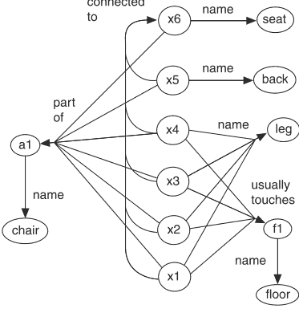

图16.2

图中还有六个其他对象，标签为*x1, x2, . . . , x6*，它们都有指向*a1*的指针，标签为"是...的一部分"。因此，它们是标记为*a1*的对象的一部分。我们可以通过它们的名称来判断这六个对象是什么。有些是腿，一个是靠背，一个是座面。最后，我们可以看到这些对象彼此之间以及与其他对象之间的关系。有些是连接着的，并且一条腿"通常接触"地板。

因此，这张图为我们提供了一种表示比数字或字符串更复杂类型对象的方法。它使我们能够在计算机中操作那些我们期望智能体能够管理的对象。

但是我们如何将这个网络存储在机器中呢？一种方法是注意到每条弧都可以通过列出其起始节点、弧标签和终止节点来指定：

```text
x1   part of   a1
x2   part of   a1
.
.
.
a1   name   chair
.
.
.
```

这个列表包含了网络中的所有信息，适合存储在机器中。事实上，我们是处理三元组形式事实的专家，因为我们在第4章广泛学习了这种格式。在本章的剩余部分，我们将继续绘制类似前面的网络，假设你可以根据需要参考第4章来填充实现细节。

知识可以通过语义网络以外的其他方法在机器中表示。例如，一种常见的技术是写下包含重要关系的一组逻辑陈述。另一种是使用普通编程语言（如 Java、LISP 或 Prolog）来指定对象和关系。第三种方法是将信息以实际的图像形式存储在机器中。然而，对于本章而言，唯一的表示方案将是语义网络。它们易于可视化，并在我们这里研究的任务中易于使用。

接下来的几节将讨论知识理解的概念、学习新知识的方法、大型知识模块的结构，以及知识在自然语言理解中有用性的一个例子。

## 练习

1. 从椅子网络中移除两个节点之间的一条弧。描述更改后它所表示的对象。

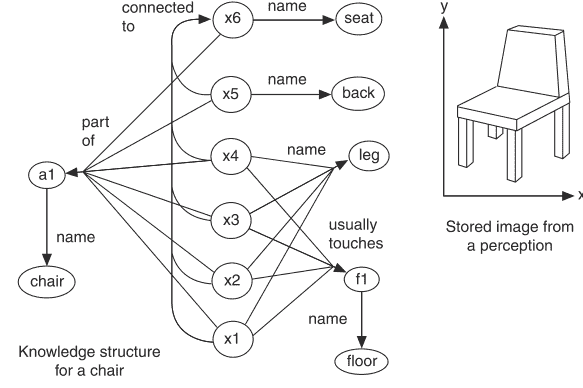

图16.3

2. 绘制一个语义网络来表示一个典型的房子。它应该包括每一面墙、屋顶、每一扇窗户、门、烟囱等等。该网络应显示连接性、支撑关系以及一些功能性知识，例如入口位置。

## 理解

假设椅子的知识结构已存储在机器中（或者可能是人类大脑中）。同时假设从外部世界感知到的一个图像已存储在附近的内存区域中（图16.3）。我们希望能够利用知识来理解这个图像。如果知识能够以令人满意的方式与图像中的线条和区域联系起来，系统就能够将知识与图像关联起来。实际上，它将能够识别该对象，命名其部分，解释各部分之间的连接关系，并给出该对象的用途。它还可以找到其知识库中存储的所有其他细节（例如，所有者、成本、材料、历史）。如果这些关联能够建立，我们就说系统*理解*了这个图像相对于这些知识的含义。理解将涉及在这两个结构之间找到关联。

让我们跟随过程，寻找相对于这些知识对图像的理解。例如，椅子的座面在哪里？我们将与名称"座面"关联的节点`x6`与图像中随机选择的一个区域（图16.4）联系起来。假设所选区域由其中心点坐标`(x, y) = (100, 120)`指定。然后我们将此关联存储在一个表中：

| 知识库中的节点 | 图像中的关联区域 |
|---|---|
| `x6` | `(100, 120)` |

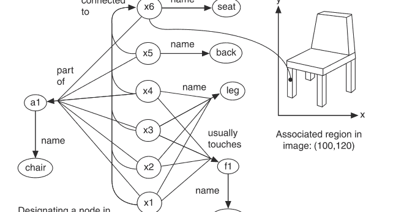

图16.4

检查知识结构，我们看到有五个对象与`x6`（"座面"）相连。为了确认已建立的关联，我们扫描图像中选定区域的周边，寻找这五个对象。不幸的是，对周围区域的搜索只发现了一个明显连接的部分。也许这个关联是不正确的。

让我们断开这个关联，尝试将其连接到其他区域。其他尝试可能会导致相同的结果，但最终图16.5中的关联将被尝试并确认：选定区域有五个对象与之相连。


再次，理解需要尽可能多地确认关联关系。也许指定为`(100, 120)`的区域可以与其他某个节点关联。因为它接触地板，我们假设它是`x3`。知识库断言`x3`与`x6`相连。这能在图像中得到确认吗？是的。到目前为止的所有关联似乎都与知识库给出的预期一致。继续这个过程，另外三个对象可以被识别为腿，一个可以被识别为靠背。事实上，在知识结构的节点和图像的区域之间找到了令人满意的关联。语义网络中给出的预测关系得到确认，系统可以假设知识结构已正确地与图像相关联（图16.6）。

知识库中的选定节点：`x6`

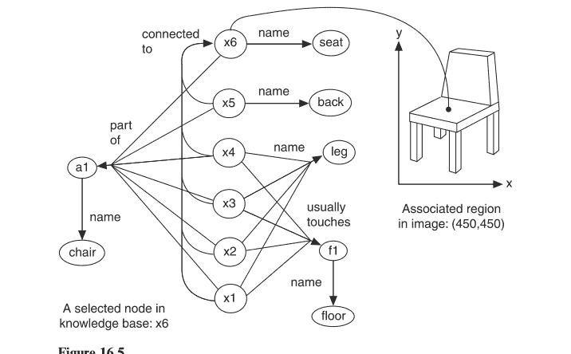

当系统正确地建立了这些关联时，我们就说它“理解”了图像。所有与椅子相关的知识都可以被使用了。系统现在可以找到其识别出的区域所属对象的名称。它沿着“是……的一部分”的链接追溯到`a1`，并沿着名称链接追溯到“椅子”。系统现在可以输出：“这是一把椅子。”此外，它可以沿着所有部件的名称链接来命名它们。然后，如果存在用途链接，它可以沿着它来发现这个对象的功能。如果存在所有权、成本、历史、位置和其他链接，它可以沿着它们来获取其知识库中可能包含的关于椅子的所有额外信息。

总而言之，对一个感知相对于一个知识体的理解，涉及在知识结构的部分和感知数据的部分之间找到一组自洽的链接。建立了这样的关联后，智能体可以沿着其知识库中的弧线来获取无数有用的关于感知对象的事实、其众多部件的名称、它们彼此之间的关系、对象的用途，以及其知识库中所有其他可用的信息。

当然，寻求理解的智能体可能错误地建立了与知识结构的链接。那么误解就会发生，并且可能做出错误的推断。例如，对于图16.7所示的木块，它可能错误地得出结论：发现了一个有用的橡木制物体，可以用来坐着。

## 第十六章：人工智能

### 图16.6

### 图16.7

### 图16.8

一个主体也可能尽管具备足够的知识，却无法理解某个感知。发现恰当的联系可能需要超出其能力范围的计算（图16.8）。在这里，本应接触地面的部分没有接触；而不应接触地面的部分却接触了。要么需要一位教师的指导，要么需要额外的计算探索，才能实现理解。

作为一个哲学问题，有些人曾争论计算机是否真的能理解任何事物。如果接受前述关于理解的定义，那么我们必须承认计算机确实能够理解许多东西。首先，应当询问是否存在可以存储大量知识的领域；其次，我们应当验证机器是否能够将机器感知与这些知识恰当地关联起来。关于第一个问题，显然计算机可以存储大量物体及其相互关系的所有相关信息。这些可以包括组织中的人员、环境中的物体、数学系统或游戏中的物体或结构、计算机程序的数据结构，以及无数其他例子。关于第二个问题，我们假设计算机的“感知”是来自键盘、鼠标点击或其他输入设备的输入序列。毫无疑问，计算机已经被编程来恰当地将输入序列与内部结构关联起来。刚刚描述的图像理解机制就提供了一个例子。

作为计算机理解的另一个例子，考虑处理计算机语言（如Java）的处理器所完成的任务。该处理器在语言结构与构成程序的符号串之间建立联系。在知识方面，机器具有关键词、标识符、表达式、语句、寄存器、机器语言等实体的表示。在感知方面，系统接收需要理解的字符串。理解的过程涉及在感知到的字符串中寻找预期的对象和关系，正如处理器中的语言知识所预测的那样。这种内部结构与字符串的联系代表了对该字符串作为程序的相当完整的理解（图16.9）。

### 图16.9

虽然处理器能够完全理解输入字符串作为程序，但它可能无法理解用户所赋予的额外含义。因此，可能存在诸如`X`这样的变量，对用户来说具有特定含义，如赚取的美元数。这些对处理器而言是未知的。然而，如果机器具备这些额外知识，它或许也能理解这些事实。

此时，我们可能开始相信机器能够理解一切。毕竟，假设所有知识都可以用某种计算机语言表示，这难道不合理吗？而且，如果知识与感知之间存在可能的联系，假设计算机最终能够找到它，这也难道不合理吗？发现这种联系可能需要大量时间，但计算机应该能够找到它。

仔细思考会引导我们得出另一个结论。有些类型的知识可能永远无法在机器中得到令人满意的表示。最重要的例子是我们自身人性方面的知识——这种知识来自生而为人、成长并在这个世界中生存的经历。我们都有父母、朋友和所爱的人，多年来与他们分享经历。我们努力奋斗、经历痛苦、关心他人和我们的价值观、庆祝成功、为失败哭泣。所有这些经历在我们的心理生物学自我中累积构建成一个巨大的记忆与情感复合体。这些经历对每个人来说是独特的，但在我们之间也有很大程度的共享。这种庞大的情感与记忆阵列是每个人在无数不可重复的事件中获得的。这些是无法在机器中令人满意地存储的知识类型。

当一个同为人类的人说“我的宝宝刚说了第一个词”或“我的表弟昨天去世了”时，我们作为人类可以将这些观察与我们的人类记忆联系起来并理解它们。我们对这些陈述的情感和后果有丰富的表示，我们的理解涉及与它们的联系。

我们可以尝试在机器中构建人类经验和情感的模拟，并声称它也理解这些独特的人类话语。我们可以为痛苦、希望、恐惧、爱和相关事件的存储记忆设置节点。所有这些都可以复杂方式连接，系统可能看似理解并适时回应“太好了！”或“我很抱歉”。但这种模拟可能缺乏真实性，充其量它永远不会超过模拟。人类不太可能同意机器能够理解人类的经验。

总之，本节给出了理解这一概念的定义，并指出机器在许多领域能够表现出这种行为。然而，它论证了机器可能永远无法以任何令人满意的方式理解某些事物，如人类情感。

## 练习

1. 画一幅典型房屋及其相关语义网的图。解释机器使用该网络“理解”房屋图像所经历的过程。
2. 假设椅子网络被用于尝试理解你在练习1中的房屋图像。将会发生什么处理？什么机制会阻止机器将你的房屋识别为椅子？
3. 假设一个计算机程序被设计来接收大师绘画的数字化版本。然后它应该“理解”这些绘画并对它们进行评论。机器可能能够做到什么？它可能会失败于什么？
4. 一个计算机程序被设计来创作音乐。评论音乐作为人类努力的本质，以及机器创作的音乐可能扮演的角色。
5. 讨论机器取代人类的可能性。自动柜员机的使用是否预示着企业与公众之间的大多数互动将由机器完成的一天？教师、顾问或法官能否被机器取代？什么情况优先选择机器？什么情况优先选择人类？

## 学习

一旦理解了知识的基本问题，下一个问题就是发现如何为智能的多种目的构建足够的知识存储。在机器中构建知识库的一种方法是将它准备成适当的形式并直接作为数据输入。另一种方法是让系统“学习”知识；也就是说，它使用自己的机制来获取并恰当地格式化其知识。如果可以实现，后一种方法是高度可取的，因为组装知识的任务是困难的。

我们在本章中研究两种学习：“机械学习”和“概念学习”。机械学习指的是最原始的知识获取类型；来自外界的信息被编码成内部格式并以相对原始的形式存储。使用的内存空间大致与获取的信息量成正比。概念学习是一种深刻得多的知识获取类型，因为它试图构建一个小的结构来表示大量数据。它试图找到一个能恰当描述多重数据项的摘要。与它所表示的数据量相比，一个习得的概念可能使用相对较少的内存。

第十四章考察了连接主义网络，理论上它们可以实现这两种学习。然而，我们在本章中使用更传统的计算模型，因为它们对于当前研究目的而言更容易理解、更为成熟。本节从考察机械学习开始，然后展示基本机制的改进，这将通向概念学习。

假设一个主体面对图16.10中的图像。该主体没有“椅子”的概念，从未见过椅子，也从未遇到“椅子”一词。我们

### 图16.10

### 图16.11

然而，必须假设这个存在能够区分场景中的某些原始元素。假设它辨认出一组橡木板，但并未意识到这种构型有什么特别之处。那么它的内部表征就只会显示所识别对象的存在（图16.11）。

接下来我们假设有人说：“这是一把椅子。”这句话要求该存在将图像理解为不仅仅是木头的堆积。它是一种非常特殊的木头组合，重要到足以被赋予一个名称。于是该存在更仔细地记录下这组对象的确切性质，将它们归为一组进行表征，并附加名称“椅子”（图16.12）。为了进一步理解，我们假设教师还命名了椅子的组成部分，并演示了其用于坐的功能。然后系统会扩展其知识结构以容纳这些额外的数据（图16.13）。

此后，该存在应该能够看到这个物体并将其识别为椅子。这就是我们所说的**死记硬背学习**的一个例子。观察到单个数据项，并为其创建记忆表征。系统同样可以接触其他物体并学习命名，例如桌子、台灯、凳子、小狗等等。每个新物体都有其独特的构型和记忆结构。如果学习了上千个这样的物体，就会创建上千个这样的表征。

接下来，如果系统看到图16.14中的三腿图像并要求识别，它会失败，因为无法在该图像与任何现有内部表征之间建立对应关系。它不匹配桌子、台灯、小狗或记忆中任何其他物体的描述。它不是椅子，因为椅子必须有六个主要组成部分，而这个只有五个。系统无法根据其当前知识库理解这个图像。

## 人工智能

“这是一把椅子。”

### 图16.12

添加了额外的事实

### 图16.13

### 图16.14

### 图16.15

假设我们告诉系统这个新图像也是一把椅子。我们同样命名它的各部分，并演示它作为坐具的用途。现在系统有两个“椅子”的表征（图16.15）。此时系统有两种选择：可以继续死记硬背的记忆策略，存储这两个表征；或者尝试合并它们，并在一定程度上进行泛化。让我们采用第二种策略，注意到这两幅图除了腿的数量外完全相同。因此，如果腿的数量差异能够被解释，它们就可以合并（图16.16）。新的表征断言：如果某物有座位、有靠背、可用于坐，并且有任意数量的腿，那么它就是椅子。

这种合并称为“概念形成”，它有若干优点。首先，它节省内存空间，因为系统可以为多个数据项存储信息。实际上，无限数量的数据项可以拥有单一表征，正如人类对椅子的概念一样。其次，合并后的表征使学习者能够处理从未遇到过的新情况。因此，如果其他先决条件满足，系统可以识别单腿、无腿或千条腿的物体为椅子。一般性概念比单独的死记硬背实例有用得多。

这种类型的概念形成也存在一些危险。某个属性可能仅在少数例子中出现，却被错误地泛化为所有例子都应具备。例如，一个存在可能观察到，在美国几次总统选举中，获胜者都比其主要对手高。在此基础上，系统可能得出结论：最高的候选人总是会获胜——这是一个典型但未必可靠的观察。

本节描述了通过死记硬背记忆和概念形成过程获取知识的方法，这些过程使系统能够从实例中进行泛化。大量学习的结果可能是一些大型知识结构，如下一节所述。

## 练习

1. 为两种车辆（例如汽车和卡车）绘制语义网络。展示如何合并这两个网络以获得更一般的车辆描述。

## 框架

如果进行广泛的学习，将会演化出相当大的知识结构。这些结构称为“框架”，据推测它们在智能思维中具有核心重要性。它们必然十分复杂，包含多种符号，例如指示哪些关系是强制性的、哪些是典型的、哪些是可能存在但不常见的，以及哪些奇怪的关系组合可能出现。在现实情境中，框架可能是通过数百或数千次概念学习合并，历经多年建立起来的。这些合并导致大量辅助性和附带的连接，可能包括原始模板的变体，以及似乎无限数量的相关事实——历史、联想、用途、特殊关系和其他事实的长列表。

作为说明，考虑大多数人能就他们对椅子的知识说多少。他们可以详细谈论见过的各种椅子。他们可能能无休止地描述家中的椅子、学校或博物馆或剧院中记住的椅子、舒适或不舒适的椅子、故事中的椅子、坏了的椅子以及其他椅子。他们可能能讲述无数关于生活中椅子、文学或电影中的椅子、以及历史上的椅子的故事。他们可能能详细描述椅子的构造、材料、饰面、制造和销售地点、价格等等。

因此，表征接近人类对“椅子”这一概念之知识的语义网络将是一个非常大的结构。它将包含数万个节点和弧。每当该存在需要与椅子相关的信息时，就会调用这个框架来理解并指导正确的行动。

研究人员假设，智能生物必须拥有数百甚至数千个这样的模块，而思维涉及在需要时依次激活它们。这导致将智能生物视为一种**框架切换机器**的观点。来自世界的感知冲击着众多框架，其中少数框架在理解这些感知方面取得成功。这些被激活的框架促使该存在采取适当的行动，同时可能观察到额外的变化。这导致新的感知、对当前框架活动的潜在确认，以及可能额外框架的激活。该存在被视为不断抓取使其能够理解的框架，按照这些框架的指示做出反应，接收新的感知，根据需要激活额外的框架，进一步做出反应，如此循环往复。

考虑一个人在走廊行走的行为。该理论可以这样解释行为序列：行走框架被激活以协调眼睛和肌肉活动来实现行走行为。走廊框架使视觉图像得以理解。假设此人转向办公室。转向和视觉门框被激活以实现这一动作。假设遇到另一个人。则该人的框架连同友好交谈框架一起被激活。

“嗨，你好吗？”提到了天气，天气框架随之激活。此时可以理解相关词汇：`雨`、`雪`、`寒冷`、`滑`等。注意到附近桌上有一份报纸，头条是“委员会被任命研究赤字问题”。政治和赤字框架开始运作，使相关对话得以进行：总统公告、积极行动的表象、高额年度利息支付的要求。友好的对话框架打断并提示互动应结束。此人离开办公室，穿过门框，再次回到行走和走廊的框架中。

框架系统被称为“记忆丰富”理论，因为它强调记忆和访问复杂结构的重要性。它提出人类在感知世界和作出反应时主要依赖记忆。它对推理或推理机制作为典型行为的基础信心不足。它断言，沿着走廊行走、遇见他人、交谈并离开的人的行为和思想主要由快速、高效的记忆访问方法控制。其主张是，此人并没有进行大量计算来移动双腿、理解视觉图像或进行交谈。

支持记忆丰富理论的主要论点之一是，人类思维的元素在进行大量顺序计算时速度太慢。大脑的神经元响应时间在毫秒量级，而人类的行动速度太快，几乎无法允许超出记忆访问之外的操作。例如，一名网球运动员观察到一个球在30英尺外以每小时30英里的速度接近，他只有几分之一秒的时间做出反应。这意味着运动员的大脑最多只有时间进行几百次顺序神经循环。然而，做出适当反应所需的计算量包括感知球、计算其轨迹以及正确激活全身无数肌肉反应。即使有巨大的并行性，在如此少的循环内完成这么多计算似乎也是不可能的。记忆丰富理论提出，运动员将感知到并妥善应对的数千个来球的经验融合成一个击球的巨大框架。当下一个网球接近时，这个巨大的结构开始运作，以监控感知、预测轨迹并驱动身体将球打回。运动员严重依赖记忆而非计算来妥善回球。

本节和前几节集中讨论了知识表示和学习中的概念。接下来的章节将展示其中一些思想在自然语言处理、通用问题解决和游戏博弈问题上的应用。

## 练习

1. 尽你所能详细描述某个特定建筑物外部的所有细节。然后去实地观察该建筑，检查你记忆的准确性。你正确记住了多少细节？有多少细节是由你关于所有建筑的通用框架补充的？你是否“记住”了一些实际上不存在、但被你的通用建筑框架填补的细节？
2. 解释句子“许个愿”的含义。然后详细描述一个典型美国生日派对事件的框架。假设已经发生了一些事件，使说话者和听者联想到生日派对框架，然后说出了句子“许个愿”。在派对框架的语境下，这个句子有了什么新含义？听者会将哪些与这个句子相关的知识联系起来，而这些知识在没有派对框架的情况下是不可能获得的？谁说了这个句子？这句话是针对谁说的？为什么说这句话？与此动作相关的其他事件还有哪些？在这种环境下还可能说出哪些其他句子？框架如何帮助理解这些句子？没有相关的框架是否可能理解这些句子？

## 一个应用：自然语言处理

为了展示前述思想的一个应用，我们研究在存在知识库的情况下处理英语句子的方法。我们假设机器位于一个名为`room1`的地方，并且它拥有该房间内物体以及其世界中其他物体的完整表示。我们的示例继续围绕椅子示例构建，并在知识库中明确列出了三把椅子（图16.17）。

我们假设唯一活跃的框架包含`room1`中的物体集合，但我们在框架外列出了一个物体以提醒自己还有其他物体。包含一个节点，称为`set`，代表所有椅子的集合。物体`a1`、`a2`和`a3`是该集合的成员。

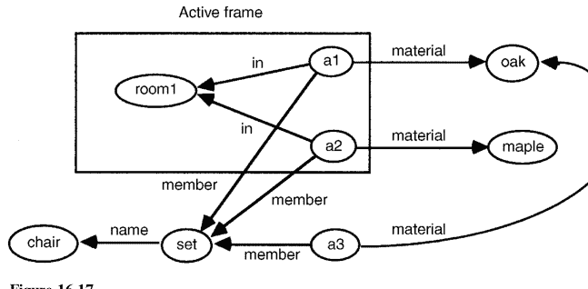

### 图16.18

| 规则语法 | 规则语义 |
| :--- | :--- |
| S => NP VP | M(S) = `glue(M(NP),M(VP))` |
| NP => PROPN | M(NP) = M(PROPN) |
| VP => V NP | M(VP) = `glue(M(V),M(NP))` |
| NP => ART NP1 | M(NP) = M(NP1) |
| NP1 => ADJ NP1 | M(NP1) = `glue(M(ADJ),M(NP1))` |
| NP1 => N | M(NP1) = M(N) |
| PROPN => Nancy | M(PROPN) = [语义图] |
| V => owns | M(V) = [语义图] |
| ADJ => oak | M(ADJ) = [语义图] |
| N => chair | M(N) = [语义图] |
| ART => the | |

我们研究处理三类句子的方法：（1）陈述句，（2）疑问句，和（3）祈使句。陈述句的功能是向听者（在本例中为机器）传递信息。陈述句使机器能够向其知识库添加新的节点和转换。问题的目的是从知识库中获取信息。问题指定了要检索的信息，机器的任务是找到它并生成正确的答案。祈使句使机器在知识库中找到句子中引用的对象，然后对这些对象执行指定的操作。这也可能涉及对知识进行一些相关的更改。

首先考虑陈述句，假设有人在我们知识库的语境下说出“Nancy owns the oak chair”这句话。图16.18提供了一个小型语法，采用第9章的规则样式，能够生成此句子。语义规则中的`glue`函数用于将独立的图连接在一起。

### 图16.19

| 生成 | 规则语法 | 规则语义 |
| :--- | :--- | :--- |
| S | S => NP VP | M(S) = `glue(M(NP),M(VP))` |
| NP VP | NP => PROPN | M(NP) = M(PROPN) |
| PROPN VP | VP => V NP | M(VP) = `glue(M(V),M(NP))` |
| PROPN V NP | NP => ART NP1 | M(NP) = M(NP1) |
| PROPN V ART NP1 | NP1 => ADJ NP1 | M(NP1) = `glue(M(ADJ),M(NP1))` |
| PROPN V ART ADJ NP1 | NP1 => N | M(NP1) = M(N) |


| PROPN V ART ADJ N | PROPN => Nancy | M(PROPN) = [Nancy图] |
|---|---|---|
| Nancy V ART ADJ N | V => owns | M(V) = [owns图] |
| Nancy owns ART ADJ N | ART => the | |
| Nancy owns the ADJ N | ADJ => oak | M(ADJ) = [oak图] |
| Nancy owns the oak N | N => chair | M(N) = [chair图] |
| Nancy owns the oak chair | | |

陈述句的处理过程如下：

### 陈述句处理器

1. 语法规则及其语义组件用于创建一个表示句子含义的语义网络。该网络称为`M(S)`，其中`S`代表句子。
2. 选择用于句子处理的活跃框架。这被称为焦点。它指定了处理中将使用的知识库部分。
3. 在`M(S)`中指定的对象与知识库中的对象之间找到匹配。
4. 由句子指定的附加节点和链接被添加到知识库中。

在我们的示例中，句子“Nancy owns the oak chair”导致向知识库添加了几个节点和链接。这些指定了一个名为 Nancy 的人通过“owns”关系与椅子`a1`相关联。我们现在详细检查这些步骤。

首先考虑步骤1。从`S`开始，必须找到目标句子的生成。与每个规则应用相关的是其语义函数（图16.19），该函数用于创建意义表征`M(S)`。遵循第9章的方法论，可以应用图16.19中规则的语义部分（图16.20）。`M(S)`是一个表示原句意义的图。它用节点和弧说明，南希是一个实体`p`，该实体是每个名为“人”的实体集合中的一员；也就是说，南希是一个人。此外，这个人是物体`n`的所有者，`n`是椅子集合中的一员，并且由橡木制成。

处理程序的第2步选择知识库中的活动框架，即`room1`中的对象集合。然后第3步尝试将`M(S)`图的部分与知识库活动部分的部分进行匹配（图16.21）。这种匹配似乎表明句子意义中的`n`对应于知识库中的`a1`。注意，`n`不匹配`a2`，因为关联的材料不对。它也不匹配`a3`，因为`a3`不在活动框架中。

一旦在`M(S)`中的某些节点和知识库中的节点之间找到了对应关系，就可以处理`M(S)`中的新信息。第4步通过将`M(S)`中未在知识库中找到的节点粘贴到知识库中的相应节点来完成此操作（图16.22）。

总结一下，本节开头的知识库列出了三把椅子：`a1`、`a2`和`a3`。在`room1`的上下文中，说出了句子“南希拥有那把橡木椅”。生成了意义图`M(S)`，并与活动的知识库节点（即`room1`中的节点）进行了匹配。确定`a1`是名词短语“那把橡木椅”所指的物体；但`M(S)`中对应于“南希拥有”的部分在知识库中未找到，因此将其添加进去。处理句子“南希拥有那把橡木椅”的结果是添加了表明南希拥有`a1`的节点。

在一个现代自然语言处理系统中，包含了大量此处未讨论的额外机制。例如，此类系统必须处理关系从句、代词、省略、复杂的句法结构以及一长串其他语言行为。此外，许多当代系统使用语义网以外的表征。因此，尽管这里给出的描述传达了处理自然语言话语所需处理的性质，但实际构建的系统的细节通常大不相同。

只需对这些机制稍作补充，即可使系统能够处理问题。首先，我们需要更多规则来处理问题语法（图16.23）。然后需要一个问题处理算法：

## 问题处理器

1. 找到问题的意义图`M(Q)`。
2. 选择知识库中的活动框架，即焦点。
3. 在`M(Q)`的部分和知识库的活动部分之间找到匹配。
4. `M(Q)`中的问号应与知识库中的某个节点匹配。系统应返回该匹配节点的内容作为答案。

## 第16章

```text
M(S) = glue(M(NP),M(VP))
     = glue(M(PROPN),M(VP))
     = glue(M(PROPN),glue(M(V),M(NP)))
     = glue(M(PROPN),glue(M(V),M(NP1)))
     = glue(M(PROPN),glue(M(V),glue(M(ADJ),M(NP1))))
     = glue(M(PROPN),glue(M(V),glue(M(ADJ),M(NP1))))
```

```text
= glue(M(PROPN),glue(M(V),glue( [diagram with n--material-->oak, n--member-->set--name-->chair] )))
```

```text
= glue(M(PROPN),glue(M(V),glue( [diagram with p<--owner--n, p--member-->set--name-->person] , [diagram with n--material-->oak, n--member-->set--name-->chair] )))
```

```text
= glue( [diagram with Nancy<--name--p, p--member-->set--name-->person] , [diagram with p<--owner--n--material-->oak, n--member-->set--name-->chair] )
```

```text
= [diagram with Nancy<--name--p<--owner--n--material-->oak, p--member-->set--name-->person, n--member-->set--name-->chair]
```

## 图16.20

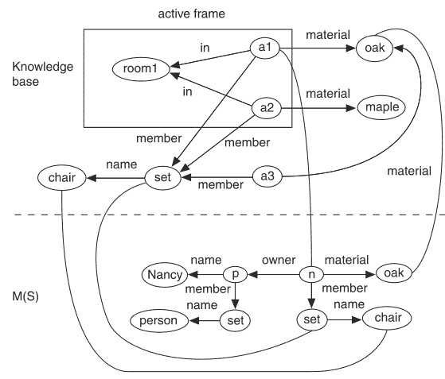

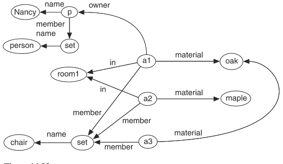

## 第16章

| 规则语法 | 规则语义 |
|---|---|
| Q => WH VP | `M(Q) = glue(M(WH),M(VP))` |
| WH => who | `M(WH) = [semantic network diagram]` |

## 图16.23

| 规则语法 | 规则语义 |
|---|---|
| I => IMPV NP | `M(I) = glue(M(IMPV),M(NP))` |
| IMPV => pick up | `M(IMPV) = [semantic diagram: pick up → imperative → n]` |

## 图16.24

使用这些添加的规则和问题处理策略，你应该能够对“谁拥有那把橡木椅？”进行处理。你应该使用在断言“南希拥有那把橡木椅”之后存在的数据库。大多数步骤与前一个示例相似。但在最后一步，带有“？”的节点将与带有“南希”的节点匹配，表明问题的答案是“南希”。这种处理与第4章的数据库检索系统的方法论有些相似。

最后，我们可以研究处理祈使句的方法论。这里系统被要求在活动框架中找到某些对象并对其执行某些操作。需要一些额外的规则和一个祈使句处理器（图16.24）：

## 祈使句处理器

1. 找到`M(I)`。
2. 选择活动框架。
3. 将`M(I)`与活动框架匹配。
4. 将祈使动词指示的动作应用于句子中引用的对象。

你应该能够完成示例句子的详细步骤。假设机器是一个能够在房间中导航并拿起物体的机器人。那么命令“拿起那把橡木椅”将引用`a1`，适当的处理将导致机器“拿起`a1`”。

这完成了我们对向计算机处理自然语言输入机制的讨论。由于篇幅限制，必须省略自然语言处理中的许多其他主题。例如，我们尚未考虑系统如何生成自然语言而不是识别它的问题。我们可能希望系统能够回应“告诉我关于那把橡木椅的一切”。然后系统将找到对象`a1`并从其关联的弧创建句子：“这把椅子在`room1`里。它是南希拥有的。……”我们也没有研究处理间接请求的机制。因此，如果一个人正将`a1`带出房间，句子“南希拥有那把橡木椅”可能并不意味着听者应该将这个所有权事实存储在记忆中。它的真正意思可能是，“把那把椅子放回去！它是南希的。”

## 练习

1. 详细执行“谁拥有那把橡木椅？”的处理。
2. 详细执行“拿起那把橡木椅”的处理。
3. 设计语法规则以实现以下句子的处理：
   - 南希拥有什么？
   - 这个房间里有什么？
   - 唐拥有那把枫木椅。
   - 那把橡木椅是棕色的。
4. 你将如何构建一个机制来回应请求“告诉我关于那把橡木椅的情况”？

## 推理

推理是发现或构建从记忆中的一个实体到另一个实体的联系的过程。必须有一个初始实体、一个目标实体，以及一种从初始实体向目标选择路径的方法。例如，如果系统持有家庭关系的事实，它可能希望确定一个成员与第二个成员之间的关系。如果它遵循一个父链接、一个兄弟链接和一个子链接，那么它将推断出第二个个体是第一个个体的堂兄弟。

推理通常不是发现现有的联系，而是涉及从初始实体到目标构建联系。如果一个实体观察到世界的状态，它可能会选择一些它希望实现的新的目标状态，然后推导出实现它的策略。在这里，它试图发现从初始状态到目标的行动序列。这个行动序列就是实体之间所需的联系。

这种更复杂类型的推理的一个例子来自猴子和香蕉问题。假设房间里有以下东西：一只猴子、一把椅子和一些香蕉悬挂在天花板上。如果目标是让猴子拿到香蕉，就需要找到一系列从当前状态开始并最终达到目标状态的动作序列。就语义网络而言，初始状态如图16.25所示。

此处`A`、`B`、`C`分别代表香蕉下方、椅子下方以及猴子下方的地面位置。`A'`代表一个远高于`A`的位置，只有站在椅子上才能到达。目标由图16.26所示的子网络表示。我们期望达到一种状态，使得猴子能够抓住香蕉（并推测可以吃掉它们）。

从一个状态到另一个状态的路径是一系列改变状态的操作序列，将初始状态转换为目标状态。针对此问题有五种可用操作（表16.1）。第一种操作`go X`将猴子从当前位置移动到位置`X`。我们只考虑`X`的三种可能取值：`A`、`B`和`C`。但如果猴子已经位于`X`处，或者它正站在椅子上（位于某个`Y'`），则无法应用此操作。举例说明，假设猴子在`C`处，并提议应用`go X`操作前往`A`或`B`。那么我们可以构建每种情况下达到的结果状态（图16.27）。

因此，猴子与香蕉问题要求找出从初始状态到任何满足猴子持有香蕉条件的状态的正确动作序列。*人工智能*

## 表16.1

| 操作 | 含义 | 前提条件 |
|---|---|---|
| `go X` | 猴子前往`X` | 猴子不在任何`Y'`（未站在椅子上），且猴子不在`X` |
| `push X` | 猴子将椅子推到`X` | 猴子和椅子都在`Y`，且`Y`不等于`X` |
| `climbup` | 猴子从当前位置`X`爬到`X'` | 猴子和椅子在同一位置`X` |
| `grasp` | 猴子抓住香蕉 | 猴子和香蕉都在`X'` |
| `climbdown` | 猴子从当前位置`X'`爬下到`X` | 猴子在`X'` |

## 图16.27

474

第16章

### 初始状态

`A'`

`A`

香蕉

`b1`

`name`

`at`

`over`

`B`

椅子

`a1`

`name`

`at`

`C`

猴子

`m1`

`name`

`at`

?

?

?

香蕉

`b1`

`name`

`holds`

猴子

`m1`

`name`

## 图16.28

（图16.28）。这未必是一个容易的问题。如果你考虑所有可能动作序列的集合，猴子可以做很多事情，而只有少数可能的序列能导致成功（图16.29）。（图中的语义网络表示法已简化：`M:`和`C:`分别表示猴子和椅子的位置。）如果猴子设想每一个可能的动作序列，它将思考很长时间才能找到一个成功的序列。

幸运的是，人类拥有广泛的记忆中使用的工具框架，因此在此问题中无需进行过多推理。如果目标无法立即达到，人类会回忆起之前成功探索的经历。他或她会立即寻找工具来帮助实现目标。附近有石头或棍子吗？或者他或她可能记得，如果有同志在场，会得到帮助。在当前情况下，椅子是唯一可能的助力。也许可以把它扔向香蕉，或者当作棍子使用。但如果人类没有使用工具的经验，以前也从未见过工具使用，那么他或她很可能难以从第一性原理推理出解决方案。

推理方法有很多种。你可以从所有可能动作树的顶部开始，向下搜索分支以找到目标。你也可以尝试从目标反向推理到初始状态。这样你可能论证说，在达到某个子目标之前无法实现最终目标，而那个子目标又需要一些先前的成就，依此类推。或者你可以使用一种距离度量作为导向目标的指引：“如果我能达到状态`S`，我知道我会离成功更近。我会先做那个，然后看看下一步该做什么以进一步缩短与目标的距离。”

我们考察一种搜索算法，它试图通过从初始节点向下搜索来找到一条通向目标的路径。它通过检查树中越来越深的节点直到找到目标来工作。即将被检查的节点称为活动节点；那些已被检查并被发现不是目标的节点称为已关闭节点。

假设图16.30a中的树即将被搜索。该过程首先将顶部节点标记为活动（图16.30b）。然后检查此节点（A）是否为目标。如果是，则搜索停止。否则，将其两个后继节点标记为活动，并将其标记为已关闭（图16.30c）。然后检查一个活动节点；假设在这种情况下选择最左边的一个。如果不是目标，则其后继节点被标记为活动，并将其标记为已关闭（图16.30d）。此过程持续进行，直到找到目标或树的所有节点都被检查完毕。

以下是执行此搜索任务的算法。它搜索可能动作的树，直到找到目标。它使用一个名为`ACTIVE`的列表，存储需要接下来检查的节点集合。它还有一个名为`CLOSED`的第二个列表，存储所有已检查节点的集合：

1. 将初始节点放入`ACTIVE`列表。
2. `CLOSED`列表初始为空。
3. 当`ACTIVE`上有节点时，执行：
   1. 使用标准`C`从`ACTIVE`中移除一个节点，并称其为`N`。
   2. 如果`N`是目标，则：
      - 打印“成功”；
      - 打印从初始节点到`N`的弧上的动作列表；
      - 停止。
   3. 找到`N`的所有不在`ACTIVE`或`CLOSED`上的子节点，并将它们添加到`ACTIVE`。
   4. 将`N`添加到`CLOSED`。
4. 打印“失败”。

标准`C`是指导搜索的策略。如果没有有用的策略可用，`C`可以随机从`ACTIVE`中选择下一个节点。但如果有一种方法可以衡量选择应采取的方向，`C`就是进行决策的机制或子程序。

猴子与香蕉问题可以用这个`ln`搜索算法解决。我们在此不讨论`C`如何做出选择，只假设它通常做出正确的决策。以下是计算的概要：

- `ACTIVE = {(M:C, C:B)}`，`CLOSED = { }`。
- 标准`C`选择`N = (M:C, C:B)`。`ACTIVE`变为空。
- `N`不是目标。
- `N`的子节点被添加到`ACTIVE`。`ACTIVE = {(M:A, C:B), (M:B, C:B)}`。
- `CLOSED = {(M:C, C:B)}`。
- 标准`C`选择`N = (M:A, C:B)`。`ACTIVE`减少为`{(M:B, C:B)}`。
- `N`不是目标。
- `N = (M:A, C:B)`的子节点是`(M:B, C:B)`和`(M:C, C:B)`。但一个在`ACTIVE`上，另一个在`CLOSED`上。
- `CLOSED = {(M:C, C:B), (M:A, C:B)}`。
- 标准`C`选择`N = (M:B, C:B)`。`ACTIVE`减少为`{ }`。
- `N`不是目标。
- `N`的子节点被添加到`ACTIVE`（已在`CLOSED`上的除外）。`ACTIVE = {(M:A, C:A), (M:C, C:C), (M:B', C:B)}`。
- `CLOSED = {(M:C, C:B), (M:A, C:B), (M:B, C:B)}`。
- 标准`C`从`ACTIVE`中选择`N = (M:A, C:A)`。`ACTIVE = {(M:C, C:C), (M:B', C:B)}`。
- `N`不是目标。
- `N`的不在`ACTIVE`或`CLOSED`上的子节点是`(M:B, C:A)`、`(M:C, C:A)`、`(M:A', C:A)`。这些被添加到`ACTIVE`。`ACTIVE = {(M:C, C:C), (M:B', C:B), (M:B, C:A), (M:C, C:A), (M:A', C:A)}`。
- `CLOSED = {(M:C, C:B), (M:A, C:B), (M:B, C:B), (M:A, C:A)}`。
- 标准`C`选择`N = (M:A', C:A)`。`ACTIVE = {(M:C, C:C), (M:B', C:B), (M:B, C:A), (M:C, C:A)}`。
- `N`不是目标。
- `N`只有一个子节点不在`ACTIVE`或`CLOSED`上：`(M:A', C:A, M holds bananas)`。`ACTIVE = {(M:C, C:C), (M:B', C:B), (M:B, C:A), (M:C, C:A), (M:A', C:A, M holds bananas)}`。
- `CLOSED = {(M:C, C:B), (M:A, C:B), (M:B, C:B), (M:A, C:A), (M:A', C:A)}`。
- 标准`C`选择`N = (M:A', C:A, M holds bananas)`。
- `N`是目标。打印“成功”。打印`"go B, push A, climbup, grasp"`。停止。

选择标准`C`极大地影响了该算法的操作。你可以通过使用不同的`C`搜索同一棵树来观察其效果（图16.31）。假设`C`

## 先搜索这些节点，然后这些，然后这些，等等。


总是选择`ACTIVE`中最浅的（离`A`最近的）节点，当有平局时选择左侧的节点。这样节点将按照以下顺序被选中：`A, B, C, D, E, F, G, H, I, J, K, L, M, N, O`。这称为**广度优先**搜索，新检查节点的边界呈扁平状，在树中向下推进（图16.32）。

另一种策略是让`C`选择`ACTIVE`中最深的节点，若有平局则优先选择左侧的节点。这会导致搜索顺序快速到达树的底部，然后横向遍历树：`A, B, D, H, I, E, J, K, C, F, L, M, G, N, O`。这称为**深度优先**搜索，新节点的边界呈横向移动（图16.33）。

这两种策略在应用中都很常见，因为它们能穷举覆盖整棵树。如果要找的目标存在，它们一定能找到。唯一的限制是对于深度优先搜索，树必须是有限的。

但第三种策略通常比前两种更受青睐。它假设系统具有一些关于如何找到目标的知识，节点选择朝着最早可能达成目标的方向进行。例如，在猴子与香蕉问题中，如果猴子有很多位置可以选择，它可能更愿意移动到靠近香蕉的位置。如果在试图达成目标时受挫，它可能会寻找可用的工具，并将它们也带到香蕉附近。

重新审视图16.31中的示例树，如果`L`是目标节点，标准`C`可能会依次选择`A, C, F`和`L`，立即解决问题。如果信息量较弱，算法可能会选择`A, B, C, F, G, M, L`，快速解决问题但有一些多余的探索。`C`函数的设计试图嵌入信息，使搜索能够尽可能直接地朝着目标前进（图16.34）。

很多时候，当构建`C`函数时，设计者并不确定所编程的信息是否会有帮助。如果确实有帮助，系统将快速收敛到解决方案。如果没有，系统在找到目标之前会有一些徘徊。在最坏的情况下，系统可能永远找不到目标。

当`C`函数中编入了可能有助于也可能无助于找到解决方案的知识时，它被称为**启发式函数**。启发式函数的例子有：在导航情境中，建议朝着目标方向前进通常是有帮助的；在操作系统中，如果任务无法立即解决，尝试使用工具通常有帮助；在建筑情境中，建造基础通常是第一步好的选择，等等。这些启发式通常能有效地引导找到解决方案，但有时会失效，需要更广泛的搜索来解决问题。

## 练习

1. 考虑一个街道网格，编号街道南北走向（第一街、第二街），字母大道东西走向（A大道、B大道）。假设你正位于第五街和G大道的拐角处，想要前往第七街和H大道的拐角处。进一步假设有四个操作`E`、`W`、`N`、`S`，分别表示向东走一个街区、向西走一个街区、向北走一个街区、向南走一个街区。画出决策树，初始节点在顶部（第五街和G大道的拐角）。展示所有长度为3的决策序列。展示本节搜索算法在以下情况下的操作：

   (a) `C`选择广度优先搜索。

   (b) `C`选择深度限制为3的深度优先搜索。

   (c) `C`选择最接近目标方向的节点。

## 博弈

下面我们考虑在有对手试图阻挠我们时的推理过程。在博弈情境中，以类似于上一节的方式在备选着法树中进行搜索，但需要考虑对手的行动。搜索的本质可以通过五格`Nim`游戏的树来理解（图16.35）。需要以找到获胜位置为目标来搜索这棵树。但问题因对手会试图选择避免机器获胜的路径而变得更加困难。

树中有两种节点：标记为`M`的节点，由机器行棋；标记为`O`的节点，由对手行棋。节点标记为`W`表示它们以某种方式已知会导致机器获胜（图16.36a）。

如果机器处于一个节点，看到其子节点中有任何获胜位置，它就会朝着该子节点行棋。事实上，我们可以将父节点标记为获胜节点，因为机器能够做出这一步棋（图16.36b）。但如果对手处于相同情况，着法通常会远离机器会获胜的`W`位置（图16.36c）。

对于`O`节点，只有当**所有**子节点都标记为`W`时，该位置才能标记为`W`，作为机器的获胜（图16.36d）。也就是说，除非对手的所有选择都是机器会获胜的位置，否则不能保证对手处于机器必赢的位置。

这些观察导致了一种分析博弈的方法。从树的底部开始，将所有机器获胜的终止位置标记为`W`。然后考虑终止位置正上方的所有节点。机器行棋的节点中，如果至少有一个子节点标记为`W`，则该节点标记为`W`。对手行棋的节点，只有当其所有子节点都标记为`W`时才标记为`W`。

这个过程对树上的一层又一层节点重复进行，直到到达顶部节点。如果顶部节点标记为`W`，机器将能够赢得比赛，其策略是在每个决策点朝着`W`的方向行棋。如果顶部节点未标记为`W`，机器将不会获胜，除非对手出现失误。

对五格`Nim`游戏树执行此程序，可以发现机器将获胜，其第一步应该是单个`X`（图16.37）。无论对手如何应对，机器都能在下一步获胜。

经过一些研究，我们意识到大小为5的`Nim`游戏并不是很有趣。先手总是获胜，而且着法显而易见。一旦我们决定谁先行，就知道获胜者是谁，甚至比赛还未开始就知道。

我们可以继续研究更大的`Nim`游戏，但它们也可以用同样的方式解决。如果我们有足够的计算机速度来构建树并将`W`传递到顶部，这些游戏就会被像5-`Nim`一样完全解决。对于那些游戏，在开始前也会知道谁将获胜（虽然并不总是先手），假设双方完美发挥。

更广泛地概括，我们可以说任何具有`Nim`特征的博弈都可以通过构建树并从底部向上传递`W`来完全解决。但这些特征是什么呢？首先，博弈树必须是有限的，以便可以完全搜索。其次，它应该是确定性的，没有掷骰子或其他随机过程。如果着法结果未知，就无法如此简单地分析树。最后，博弈必须为双方提供关于状态的完整信息。如果对手持有机器未知的牌，或者其它状态信息不可用，机器就不知道自己在树中的位置。

**总之，任何确定性的、有限的信息完全博弈都可以通过这里给出的程序来解决。** 在比赛开始前，我们可以使用上述程序确定获胜者。（有些博弈允许平局的可能性。这很容易处理，留作练习。）

许多常见博弈都符合上述规范。例如，国际象棋和跳棋都是确定性的、有限的信息完全博弈。如果我们有机器足够快地构建它们的完整树，我们就能在第一步着棋之前确定谁是这些博弈的获胜者，以及如何行棋以确保获胜。然而，这些博弈树如此庞大，没有人能够构建它们，因此它们的解决方案仍然未知。

这是一个由于执行时间过长而无法解决的问题的例子。（这些博弈可能看起来是无限的，因为两个玩家可以简单地将棋子来回移动以实现无限进行。然而，没有必要分析循环回到先前状态的博弈，因为这样的对弈对机器来说既不赢也不输。）

如果能找到一种技术避免将路径搜索到终局，树搜索方法仍然可以用于下大型博弈。通常的方法是使用**评估函数**，它可以计算一个数值来估计给定博弈状态的价值。然后决策程序可以尝试达到高价值状态。

例如，在国际象棋中，程序可以累加双方的棋子，给予车和后等强子更大的权重。一个位置的价值是机器棋子的加权价值减去对手棋子的加权价值。机器将寻求具有更大子力优势的位置。典型的国际象棋程序还会为位置优势分配点数——例如王车易位的王或良好的兵形结构。

在这种情况下，搜索树看起来更像图16.38中的样子。系统构建了到固定深度的着法序列——在这种情况下为四步——而不是到达博弈的终局。每个到达的底部节点给出了博弈状态评估。接下来可以计算树中所有其他节点的值。

任何机器着法`M`节点的值是其子节点值的最大值。这是基于它总是试图获得评估函数评分中最好位置的假设。对手着法节点的值被选择为其子节点值的最小值，基于对手会尽可能损害机器位置的假设。

使用这两条规则，可以从底部向上传递值，从而获得树的初始节点的分数（图16.39）。这个过程称为**极小化极大**（minimaxing）。

与之前一样，树顶部的标记显示了树底部可达到的最佳状态。具有相同值的节点向机器展示了在每个点应走哪一步棋以达到这个最佳值。

## 图 16.38

## 图 16.39

树搜索可以通过使用**树剪枝**策略来缩短，这些策略使得省略部分计算成为可能。已知最强大的技术是`α-β`树剪枝，它利用搜索的部分结果来证明搜索其他部分的无用性（«）。

图16.40展示了这一技术的示例，其中程序已经评估了`O`节点下方的三个棋盘局面。第一个`O`节点的值为3，第二个`O`节点的值为1或更低。那么，选择其子节点最大值的顶部节点，其值将为3。

尽管有一个节点（标记为`?`）尚未被评估，但我们已经知道了顶部节点的值。因此，我们可以避免生成最后一个节点并评估其质量所带来的开销。这种类型的剪枝在现实游戏中可以带来巨大的节省。

使用如上所述的有限搜索和评估函数的博弈程序，其对弈质量完全取决于评估的准确性。精确的准确性将导致优秀的对弈，而中等的准确性则会导致漫无目的的对弈。近年来，博弈领域的许多研究都集中在改进棋盘评估上。

## 第16章

## 图 16.40

## 练习

1. 在本节开头，描述了一种将`W`从博弈树底部向上回溯以确定先手是否能强制获胜的方法。请说明在出现三种可能结果（赢`W`、输`L`、平局`D`）的博弈情况下，如何修改此理论。

2. 分析井字棋游戏，并确定它是先手的胜局、平局还是败局。

3. 假设图16.39中的极小化极大树，其底部节点的值为：`6, -10, 4, 7, 2, 19, -7, 4, 8, -2, -8, 3, 3, 11, 4, -4`。进行一次极小化极大回溯，以确定先手玩家能获得的最佳值。

4. 重复极小化极大搜索，但证明树底部的一些值对于找到树根的值并非必需。`α-β`过程使得系统能够避免计算这些值。

## 博弈：历史回顾

博弈的历史经历了三个相当有趣的阶段。第一阶段出现在计算机发展的最初期，即20世纪40年代。当时许多人相信，计算机在国际象棋和跳棋上会像做加法一样轻松获胜。人们认为计算机能够搜索并评估这些游戏中成千上万步棋，而人类只能看几十步。凭借如此显著的优势，机器显然会在搜索深度上超越任何人类，并夺取世界冠军。

然而，当第一批程序开始工作时，其作者对它们令人难以置信的无能感到震惊。即使是最笨拙的业余爱好者也能击败它们，研究人员争相寻找原因。答案在于两个因素的结合，第一个与博弈树的性质有关，第二个与人类心智的力量有关。

国际象棋和跳棋的平均分支因子分别约为35和7，因此在深度`i`的节点数分别为`35^i`和`7^i`。即使经过大量剪枝，程序也只能搜索深度不超过3或4层的树。另一方面，人类似乎天生就能寻找“正确”的走法，他们正在审视比机器深得多的对弈路线（图16.41）。机器将它们的计算时间浪费在了评估大量人类会忽略的局面的人工智能上。人类通过他们更深、引导更佳的搜索发现了强有力的走法。

这导致了博弈研究的第二个阶段——一个持续了大约二十年的时期，研究人员试图利用早期学到的教训。普遍的共识是，博弈树的组合学使得均匀搜索成为一项荒谬的任务。只有人类所做的那种选择性搜索才能成功。

因此，开发了各种启发式树搜索方法，包括在棋盘上寻找“热点”、对对手使用标准技巧以及规划长序列的进攻性走法（图16.42）。由此产生的程序在多年间不断改进，并偶尔展现出惊人的对弈。但与有能力的人类棋手相比，它们仍然是差劲的竞争者。程序能够看到许多深度很大的对弈路线，但它们找不到人类棋手能找到的那种高质量的走法。人类继续拥有让学者们困惑的对弈直觉。

大约在1970年，这个领域再次出现了一个意外。西北大学的一组研究人员摒弃了选择性博弈是唯一合理方法的既定理论。他们将一个均匀搜索的国际象棋程序带到了全国计算机锦标赛，并击败了所有其他机器。此后多年，他们继续击败所有挑战者。

他们的程序与人类棋手的对弈成绩也优于以往任何程序，在业余选手中取得了不错的战绩，但未能战胜大师级棋手。这种情况下的分析是，对于最佳的整体对弈表现，保守的、无误的战术走法比偶尔惊人的走法更重要。

20世纪70年代更快的机器使得搜索深度足够，国际象棋中大约为5或6层，从而实现了扎实的对弈，并且在这些深度内机器从不犯错。如果对手程序在比赛中错过哪怕一个关键走法，均匀搜索程序就会发现它并击溃对手（图16.43）。

最好的国际象棋程序继续使用同样的策略。它们在每个走步前检查数百万个局面，这些局面分布在一个相对均匀的树上，并使用各种方法来加速搜索和改进评估。

现代程序中最令人印象深刻的是IBM公司的“深蓝”，它在1997年一场被广泛报道和广泛讨论的比赛中击败了国际象棋世界冠军加里·卡斯帕罗夫。Deep Blue使用了一个大型并行架构（32个处理器）进行搜索，在检查博弈树时每秒大约检查2亿个棋盘局面。它并非完全采用均匀搜索，而是有一个策略来发现关键的对弈路线，并将这些路线额外深入到30或40层。

在六局比赛中，程序赢了两局，输了一局，平了三局，从而在人机国际象棋的漫长历史中取得了最伟大的胜利。然而，该程序后来被撤出进一步的比赛，让国际象棋爱好者们想知道如果进行复赛或其他棋手挑战该程序会发生什么。

在跳棋方面，在没有IBM公司巨大资源的情况下，也取得了很大进展。事实上，由阿尔伯塔大学的乔纳森·谢弗及其同事编写的一个名为`CHINOOK`的程序，在1992年8月与当时的跳棋世界冠军马里昂·廷斯利进行了一场非常接近的比赛。

在40局制比赛中，程序以2胜4负33平的战绩落败。但在1994年8月的一场后续比赛中，该程序再次与廷斯利对弈，廷斯利在平了六局后因健康原因退出。这意味着该程序正式成为跳棋世界冠军。此后，该程序一直与其他伟大的跳棋棋手对弈并占据主导地位。因此，看起来机器在这项游戏上已经比最优秀的人类做得更好了。

计算机博弈为计算机和人类智能提供了一项引人入胜的研究，为我们揭示了两者的本质。计算机继续擅长将简单活动重复数百万次，当人们能够组织这种活动以获得有用的结果时，就能实现最佳性能。人类则继续拥有惊人的、近乎神秘的能力来识别重要的模式并有效地加以利用。在博弈中，计算机和人类都达到了相当高的能力水平，但他们使用的方法截然不同。

## 练习

1. 假设你工作的公司提议为公司决策构建一个自动决策程序。它将接收有关经济状况、当前公司状态、未来预计趋势等信息。该程序需要搜索未来几年的决策树，并决定哪种决策序列将为公司带来最佳的长期结果。博弈历史中是否有任何信息会影响你对当前项目的判断？

## 专家系统

在20世纪70年代，人工智能研究人员开始对所谓的“专家”的推理过程感兴趣。这些人长期从事专门的工作，并发展出了显然经过良好规划的有效工作流程。

### 第十六章

专家开始进行问题解决任务时，先寻找关键因素，然后选择一些初始行动，比如收集一些信息。这可能会产生一个决策以及后续的行动，直到任务完成。在每个阶段，专家似乎都使用一个既定的行动公式：寻找某些事实、得出适当的结论、搜索其他所需的信息，等等。这些行为似乎组织得很好、可预测、基于规则，并且可能在计算机模拟的范围内。

已经研究过的各类专家包括：在常规诊断和开具处方时的医生、在测试和诊断设备故障时的维修人员、在寻找矿物时的地质学家，以及在作物养护和培育任务中提供建议的农业专家。这些人都经过了详尽的访谈，以发现他们的知识以及决策过程是如何运作的。访谈者通过无数典型场景引导他们，并要求他们详细解释帮助他们得出结论的每一个想法。然后，访谈者——有时被称为**知识工程师**——试图构建一个关于他们专家知识和推理过程的模型。

该领域许多研究人员的一个共同观察是，专家通常用`if-then`规则来表达他们的知识：“如果我观察到`X`和`Y`为真，我就知道`Z`条件正在发生。如果`Z`条件发生且`A`和`B`为真，我通常会开具`Q`。”事实上，这种`if-then`形式的知识表示如此常见，以至于它已成为许多试图模拟专家行为的计算机程序的基础。我们现在来审视这类程序的一部分，以试着获得对这种工作的感受。

假设美国政府的国税局雇用专家来决定何时审计所得税申报表。我们的任务是构建一个自动完成这项工作的程序。我们首先访谈该领域的专家，然后试图将他或她的知识编码为`if-then`规则的形式。最后，我们 examines 这样一个规则处理器，并观察它在模仿专家时的行为。

以下是访谈过程：

**访谈者：** 您什么时候建议进行审计？

**专家：** 我通常会查看收入申报或扣除项目中是否有异常之处。

**访谈者：** 收入中可能出现哪些类型的异常？

**专家：** 首先，考虑到该职业，收入可能低得离谱。另外我会查看有文档记录不力的收入。

**访谈者：** 在收入文档方面您期望什么？

**专家：** 该人应该有`W2`表格，或者有一套系统的方法来为所有收到的资金写收据。

**访谈者：** 让我们回到扣除项目。您在那里寻找什么？

**专家：** 如果我看到该人申报的扣除额超过其收入的20%，我就会起疑。

访谈可能很复杂，持续数小时。不过，我们仅限于分析这几句话。

具体而言，我们希望将访谈中的知识编码成一组`if-then`规则。访谈者之间的第一次交流产生了这条规则：“如果收入异常或扣除项目异常，则建议进行审计。”用缩写符号表示，这条规则写为：

```text
IncomeUnusual or DeductionsUnusual ==> Audit
```

第二次交流引出了另一条这样的规则，也可以用简洁的符号表示：

```text
IncomeNotDoc or IncomeTooLow ==> IncomeUnusual
```

我们假设`IncomeTooLow`很容易检查。只需记录该人的职业，然后在表格中查找该职业的最低预期收入。假设存在一个名为`CheckData`的函数来检查所得税申报表和相关表格。那么这条规则写为：

```text
IncomeNotDoc or CheckData(Income < MinIncome(Profession)) ==>
IncomeUnusual
```

访谈的最后部分产生了两条更多的规则：

```text
CheckData(No W2) and CheckData(No Receipts) ==> IncomeNotDoc
```

```text
CheckData(Deduction > 0.2 * Income) ==> DeductionsUnusual
```

接下来我们需要一个算法来执行这些规则，就像一种计算机程序一样。该算法类似于前面的搜索算法，它从根节点开始构建一棵树。然而，计算的目的不是在树的底部找到目标，而是在树的根节点**实现**一个目标。

该算法使用几个需要定义的概念。我们说一个节点是**已实现**的，如果通向它的规则是**已满足**的，或者它是一个返回“是”的`CheckData`调用。

规则有两种：左侧部分由`and`连接的，以及左侧部分由`or`连接的。如果左侧部分由`and`连接，则当其所有左侧部分都实现时，该规则被满足。如果左侧部分由`or`连接，则当其至少一个左侧部分实现时，该规则被满足。

如果一个节点是`CheckData`节点且检查已进行，或者没有更多以该节点为右侧且尚未被选择并添加到树中的规则，则称该节点为**完全探索**。

搜索的目的是找到足够的事实来实现根节点的目标。一个名为`ACTIVE`的列表像以前一样用于存储需要检查的树节点：

## 图 16.44


将目标节点放在`ACTIVE`列表上（对于税收示例，目标节点是`Audit`）。通过创建一个包含目标的根节点开始构建树。

当`ACTIVE`有未完全探索的节点时执行：

- 选择`ACTIVE`上未实现且未完全探索的节点。
- 如果该节点使用`CheckData`，则：
  - 执行`CheckData`。
  - 如果`CheckData`返回“是”，则将此节点标记为已实现，并将此节点上方的节点标记为已实现（如果它们也已实现）。如果根级目标已实现，则以成功停止。
- 否则：
  - 选择一条用于实现此节点的规则。
  - 将其添加到树中以产生一组新的子节点。
  - 将规则左侧的标记放在`ACTIVE`上。

以失败停止。

树构建过程的每一步都从选择现有树上的一个节点（从`ACTIVE`列表中）开始。例如，假设选择了`IncomeNotDoc`（图 16.44a）。然后选择一条能够实现该节点的规则：

```text
CheckData (No W2) and CheckData(No Receipts) ==> IncomeNotDoc
```

该规则为在树上添加更多节点提供了基础；规则左侧的每一项都成为新节点（图 16.44b）。如果算法选择的节点是一个`CheckData`，它会进行数据检查，而不是在树上构建更多节点。

现在可以通过观察该算法在所得税问题上的行为来说明这个算法。假设已提交以下简化表格：

## 图 16.45

| 项目 | 内容 |
|---|---|
| 姓名 | John Smith |
| 职业 | Professor |
| 收入 | $60,000 (无 W2 或收据) |
| 扣除项目 | $10,000 |

该算法首先将`Audit`放在`ACTIVE`列表上：

```text
ACTIVE = {Audit}
```

它通过构建根节点来初始化树（图 16.45a）。然后进入循环，选择`ACTIVE`上的节点，并选择一条实现该节点的规则：

```text
IncomeUnusual or DeductionsUnusual => Audit
```

该规则用于为树添加两个子节点（图 16.45b）。`ACTIVE`列表也接收这些项：

```text
ACTIVE = {Audit, IncomeUnusual, DeductionsUnusual}
```

重复循环，假设算法接下来选择`IncomeUnusual`并找到一条实现该节点的规则：

```text
IncomeNotDoc or CheckData (Income < MinIncome (Profession)) ==>
                    IncomeUnusual
```

然后可以在树上衍生更多节点（图 16.46），并对`ACTIVE`进行适当的添加：

```text
ACTIVE = {Audit, IncomeUnusual, DeductionsUnusual, IncomeNotDoc,
        CheckData (Income < MinIncome (Profession))}
```

如果选择了`IncomeNotDoc`节点，循环的第三次重复将导致图 16.47 所示的变化。额外的重复最终将导致选择树底部的`CheckData`节点。这些节点各自引用所得税。

## 练习

1. 展示税务审计专家系统如何处理以下案例：
   - **姓名：** 约翰·史密斯
   - **职业：** 教授
   - **收入：** $60,000（含W2税表）
   - **扣除额：** $20,000

2. 展示税务审计专家系统如何处理以下案例：
   - **姓名：** 约翰·史密斯
   - **职业：** 教授
   - **收入：** $60,000（含W2税表）
   - **扣除额：** $5,000

3. 设计一组规则，表明你最喜欢的大学课程的先决条件。顶层目标应为`课程推荐`，并且这些规则应设计成在一个人满足你所指定的标准时能够实现该目标。通过使用规则执行算法，在典型案例上演示这些规则的使用。

4. 采访某个领域的专家，并设计一组规则，以模拟该人在处理某个特定问题时的行为。

## 视角

我们已经研究了如何将知识存储在计算机中，以及计算机如何学习、推理和理解。看起来基本机制已经具备，构建智能机器应该是可能的。如果我们想构建一台理解自然语言的机器，似乎我们只需要存储足够的知识，并让一些语言学家为我们感兴趣的那部分语言编写一套规则。如果我们希望构建一个图像理解系统，显然我们只需要为该领域构建一个知识库，并构造所需的推理能力。如果我们想构建能够发明笑话、创作音乐、分析科学数据、面试求职者、写故事或创造数学的机器，我们可以期望存在足够大的知识库和足够强大的推理系统来完成所有这些工作。人类能够表现出所有这些行为，我们有理由相信他们遵循着有原则的方法。计算机似乎拥有充足的内存容量和速度，因此计算能力似乎并不匮乏。

事实上，已经编写出能够展示几乎所有可想象的智能行为的计算机程序。例如，费根鲍姆和费尔德曼编辑的《计算机与思维》于1963年出版（1995年再版），收录了18篇描述此类系统的精彩论文。以下是对一些报道结果的简要描述：

> “使用跳棋游戏的机器学习研究，”A. L. 塞缪尔。描述了一个跳棋程序，它使用了本章解释过的类似的树搜索和棋盘评估方法。棋盘评估函数的形式为`f = C_1X_1 + C_2X_2 + \cdots + C_{16}X_{16}`，其中`C_i`是待确定的常数，`X_i`是棋盘的特征，例如国王优势、王行中的棋子数量或棋盘中心方格中的棋子数量。`C_i`是在实际对弈中通过缓慢改变其值直到达到最佳可能行为而“学习”到的数字。论文描述了一场与“康涅狄格州前跳棋冠军，也是全国顶级选手之一”的对弈，程序通过做出“几个精彩的走法”赢得了比赛。（引文出自塞缪尔参考的一本期刊。）

> “几何定理证明机的经验探索，”H. 格伦特纳、J. R. 汉森和D. W. 洛夫兰。描述了一个用于解决高中阶段典型平面几何问题的程序。它使用几何问题的图表来启发式地指导对长证明的搜索。图表的使用将典型节点下的子节点数量从大约1000个减少到大约5个，从而大大提高了程序效率。该程序发现了一些对高中生来说有难度的证明，其中一些证明有多达20个或更多的连续步骤。

> “BASEBALL：自动问答程序，”B. F. 格林（小）、A. K. 沃尔夫、C. 乔姆斯基和K. 劳赫里。描述了一个回答关于棒球问题的程序，例如“红袜队在7月5日输给了谁？”或“每支球队在每个月是否在每个球场都至少打了一场比赛？”。程序将棒球比赛数据存储在树形结构中，为每个月列出所有地点，为每个地点列出所有日期，为每个日期列出所有比赛。通过将问题转换为标准化形式，然后将其与数据树匹配来获得答案。

> “GPS，一个模拟人类思维的程序，”A. 纽厄尔和H. A. 西蒙。通用问题求解器（GPS）是一个使用运算符序列寻找目标的通用搜索程序。它利用启发式信息来帮助在每个点选择正确的运算符，并解决了各种经典问题。GPS系统既作为人工智能的练习，也作为人类智能的可能模型进行研究。

在20世纪60年代初取得如此令人印象深刻的结果，人们当然会期望在一二十年内实现深刻的机器智能。事实上，在1958年，赫伯特·西蒙和艾伦·纽厄尔已经预言，在十年内，计算机程序：

1. 将能够赢得世界象棋冠军；
2. 将发现并证明一些重要的新数学定理；
3. 将创作具有审美价值的音乐；
4. 将成为大多数心理学研究的模型。

新计算机的能力是显而易见的，早期的结果令人鼓舞。许多智者预言机器的能力将发生重大革命。（西蒙后来因其在经济学方面的工作获得了诺贝尔奖。）

不幸的是，最初的乐观被证明是没有根据的。没有一个早期项目成熟到足以震惊世界。在最初伟大乐观主义时期过去四十年后，人工智能仍然是一门处于起步阶段的科学。所有描述的系统都是有趣的实验室研究的例子，近年来进行了更多此类研究。但研究者们遇到了巨大的困难，将最初狭隘定义的项目（原则上展示了令人兴奋的行为）扩展成能够展现出人们愿意称之为智能的大型实际系统。

构建智能系统的问题被证明比早期研究者意识到的要困难得多。人们开始项目，在六个月内实现了一部分目标，然后预测他们能在几年内实现所有目标。他们从未梦想过，在整个一生中，他们仅仅取得了比最初结果稍多一点的成就。一次又一次，许多领域的人工智能项目在巨大的早期乐观中启动，但最终只在小型问题上取得了有限的成功。

为什么人工智能领域在制造智能机器方面遇到了如此多的困难？我们不知道，但我们最终意识到，真正的智能涉及的复杂性远超以往的预测。它涉及大量的知识，这些知识我们目前还无法习得、组织或运用某些智能。它所涉及的复杂推理方式，是我们目前尚无法理解的。它可能还涉及其他一些我们甚至尚未意识到所必需的机制。简而言之，我们并不理解智能的本质。

然而，人工智能领域已经取得了一些进展，观察这些进展的一种方式是追踪西蒙-纽厄尔预言的实现情况。国际象棋对计算机来说曾是一个非常困难的挑战，期望计算机在1968年之前击败所有人类是过于乐观的。但几十年后，一台机器曾在某次比赛中战胜了当时最著名的人类棋手。这是一种进步。许多批评者拒绝承认这是机器在国际象棋上最终战胜人类的胜利，因为尚未出现机器长期、反复战胜人类的情况。但这就是进步，而且很难辩称任何需要达到的最终胜利是不可企及的。

关于西蒙-纽厄尔的其他预言，一台机器已经找到了一个困扰数学家数十年的定理的证明。这涉及所谓的`罗宾斯问题`，于1998年完成（McCune, 1998）。人们还开发出了模拟一些伟大作曲家作曲风格的程序，有一次音乐观众甚至误以为计算机合成的作品是`J. S. 巴赫`所作（Cope, 1996）。许多程序已被创建用于建模心理学理论，如神经网络文献中所示（第14章）。

冒着过度简化这一相当复杂图景的风险，我们将在此加入一些评论，以了解人工智能某些知名子领域的现状。

## 自动编程

这一研究领域试图构建能够自动编写程序的系统。它假设用户会提供期望程序行为的示例，或者使用形式语言或自然语言规范期望程序的功能。然后系统会编写程序以满足用户的需求。自动编程系统已经能够可靠地从目标行为的示例中创建一些小型`LISP`程序，大约三到四行。人们还创建了系统，使用户能够以形式语言进行交互式会话来指定程序，然后创建目标程序。使用这种方法已经开发出了一些相当令人印象深刻的程序。然而，对于严肃的多用途编程来说，这类系统通常不如传统编程语言方便。

## 专家系统

这类系统已有数百个被用于工业和政府应用。它们通常有几百到几千条规则，如果设计得当，可以依赖它们可靠地执行其定义明确的狭窄任务。

## 博弈

国际象棋和跳棋程序已经发展到所述水平；它们挑战或击败了最优秀的人类玩家。许多其他游戏也被编程实现，取得了不同程度的成功。

## 图像理解

计算机系统已经被构建用于特定领域，如航空照片或人脸图像，能够以大比例的正确率找到并标注显著特征。

## 数学理论形成

至少有一个系统（由道格拉斯·莱纳特构建）能够从更原始的概念推导出新的数学概念。该系统在一系列计算中展示了从集合论概念推导出数论基础知识的能力。然而，目前尚不清楚这种方法是否适用于更广泛的问题类别。

## 自然语言理解

已经构建了许多针对特定领域的系统，如人事数据库或设备维修任务，能够以高比例提供适当的响应。这类系统通常词汇量有限，句法能力也有限。

## 自然语言翻译

如果构建的系统能够理解某个有限领域内的自然语言，那么将该系统转换为其他自然语言的翻译机就处于现有技术水平之内。因此，我们可以说，在需要小词汇量和有限句法变体的有限领域中，自然语言翻译可以以高准确率实现。在需要大词汇量和广泛句法变体的应用中，完全自动的自然语言翻译远远超出了现有技术水平。然而，计算机在这些翻译任务中仍然有用，可以通过解析输入句子、显示目标语言中的备选词汇供人工翻译者选择，以及提供便捷的编辑功能。

## 学习

一些系统的性能通过学习机制得到了提升，这些机制优化参数，如第14章中关于联结主义网络所述。亚瑟·塞缪尔的跳棋程序就使用了这种方案。此外，概念学习机制已被应用于分析复杂的科学数据，在少数情况下，数据中的趋势或关系被自动发现。

## 语音识别

已经构建了许多系统，使用户能够用语音而非打字来输入指令。这些系统的词汇量往往只有几百个词，尽管一些系统的词汇能力正达到数万个词，并开始投入使用且可靠性适中。目前这些系统需要针对特定应用进行专门化，以提供稳健的行为。这通常意味着从应用中收集大量话语语料，并构建人们实际使用的词语序列的概率模型。然而，这些系统能够在许多当前环境中提供可靠的性能，并有望在未来几年内出现在许多产品中。

总之，研究人员发现计算机可以通过编程在很小程度上展现几乎任何智能行为——感知、学习、问题解决、语言处理等。众多项目已经展示了这些类型的行为。但要在大程度上实现这些现象中的任何一种，或将它们整合以获得适度的智能行为，都是非常困难的，在大多数情况下远远超出了现有技术水平。最好的结果出现在狭窄领域的环境中，那里只需要有限种类的行为，而且通常对错误有一定的容忍度。

一些研究人员认为，大多数人工智能子领域面临着同样的核心问题，即复杂的表示和推理，如果这个问题在一个领域得到解决，它将在所有领域得到解决。例如，如果能够恰当地解决自然语言问题，使机器能够像人类一样处理语言，那么使这成为可能的方法论将是解决许多不同问题的关键，如与视觉、问题解决、定理证明、自动编程等相关的问题。各种研究人员将这一假设称为`人工智能完全性论题`，这一观点在未来几年内可能会继续存在争议。

在商业世界中，人工智能已经取得了一些重要的成功。在专家系统领域，大量有用的程序已经被开发出来，它们正在许多企业中定期运行。在自然语言处理领域，一些商业系统已经上市，数千人现在能够进行一些标准任务，如用键盘输入自然语言来访问数据库。语音系统正开始走向市场，其成功可以预期会增加。博弈程序已经成为商业盈利产品并广泛普及。军事战略家正在使用许多程序进行模拟和决策过程，广泛运用人工智能技术。或许一个较少受到关注但极其重要的人工智能研究成果，是一系列为开展研究而创造的计算机语言。这些语言包括作为符号编程语言广泛使用的`LISP`；日益流行、甚至作为日本第五代计算机系列原型语言的`Prolog`；以及一长串用于编程专家系统的语言。

最后，我们注意到人类智能的某些方面在可预见的未来似乎完全无法企及。首先是理解人类处境的能力——我们认为这是人类独有的能力。其次，是人们在游戏等活动中展现出的惊人模式识别能力。人类能够在单一局面中洞察到机器搜索数百万局面也无法发现的内容。最后，是人类拥有的庞大知识库，以及在实现智能行为时令人难以置信的灵活运用能力。

## 练习

1. 假设你被要求为一个机器人视觉与音频输出系统编写规格说明。该机器人需要在对人类过于危险（因辐射或其他危害）的区域自主巡视，并口头报告其观察到的情况。视觉与音频输出系统将包含三个主要子系统：
   - 用于识别场景中重要特征的图像处理器；
   - 用于决定哪些特征足够重要值得描述的问题解决系统；
   - 用于表达所需语句的语言规划与输出系统。

   请为你认为在当前技术条件下可以实现的这三个子系统编写规格说明。

2. 针对`AI完备性论题`，提出支持与反对的论据。

## 总结

人工智能是一个研究领域，研究人员试图构建或编程具有比传统更复杂能力的机器。这些能力包括感知和理解传入数据、学习、处理自然语言以及推理。这类研究的基本范式包括知识和推理的概念，本章对此进行了探讨。

知识是处理相关加工中对象所需的所有信息集合。知识可以各种形式存储，并用于理解感知或推理过程。知识可以通过格式化并直接输入的方式输入机器，也可以通过机器学习获得。

推理是寻找一系列连接的过程，这些连接能将记忆中的一个对象导向另一个对象。推理的目标通常是找到一种方法，将世界的当前状态转变为某种期望状态。推理通过选择性搜索可能的动作序列树来实现，直至找到所需序列。多年来，许多人工智能系统都基于这些理念构建，其中一些在本章中进行了描述。

本节为本书作结，本书探讨了计算机是什么、能做什么以及不能做什么。早期章节介绍了编程，主要研究计算机能做什么。书中给出了各种示例问题及其解决方案，最终导向了`Church-Markov-Turing论题`：任何我们能精确描述的逐步过程都可以在机器上编程实现。

本书第二部分探讨了计算机是什么，以便更深入地理解它们。具体来说，它们只是能够以极高速度反复执行取指执行周期的盒子。它们的实用性主要源于便捷语言可以被转换成适合取指执行计算风格的形式。它们由蚀刻在硅晶体上的数百万微小开关组成，这些开关经过组织以存储信息并进行计算。

本书最后一部分探讨了计算机科学的高级主题。这些主题包括对执行时间的研究，以及将计算划分为可处理和不可处理类别的方法。随后，介绍了并行计算作为减少执行时间的一种手段，并在此范式内研究了一些示例问题。一种迷人的并行机器类型是连接主义网络，它将信息和计算分布在微小处理器阵列中，并通过学习进行自我编程。接下来我们研究了不可计算性，并试图直观理解一类据我们所知无法编程的函数。最后，我们研究了人工智能以及研究人员试图构建能够以类似人类思维的方式进行认知、理解、学习和推理的机器的尝试。

## 附录：`IntField`和`DoubleField`类

以下Java代码定义了本书中使用的两个特殊类：`IntField`和`DoubleField`。这些类使读者能够在小程序中轻松读写整数和浮点数，而无需处理额外的Java语法。你可以将这些代码放入`public_html`目录中名为`awb`的文件夹，然后在每个程序顶部使用`import awb.*`命令。你也可以直接将此代码包含在每个程序文件中，而不引用外部目录。

此代码也与其他软件一起在网络上提供，可通过Biermann的网页访问。


```java
/*Eric Jewart
11/13/97
*/
// mod 7/22/99 dr
package awb;
import java.awt.*;

public class IntField extends java.awt.Panel
{
    private TextField myField;
    private Label myLabel;

    public IntField()
    {
        myField = new TextField();
        setLayout(new BorderLayout());
        add("Center", myField);
    }
}

public IntField(int cols)
{
    myField = new TextField(cols);
    setLayout(new BorderLayout());
    add("Center", myField);
}

public IntField(int num, int cols)
{
    myField = new TextField("" + num, cols);
    setLayout(new BorderLayout());
    add("Center", myField);
}

public int getInt()
{
    try
    {
        int num = Integer.parseInt(myField.getText());
        return num;
    }
    catch (NumberFormatException ex)
    {
        return 0;
    }
}

public void setInt(int num)
{
    myField.setText(Integer.toString(num));
}

public void setInt()              // dr
{                                 // dr
    myField.setText("");          // dr
}                                 // dr

public void addLabel(String lab)
{
    if (myLabel == null)
    {
```

## The `IntField` and `DoubleField` Classes

```java
myLabel = new Label(lab);
remove(myField);
add("West", myLabel);
add("Center", myField);
}
else myLabel.setText(lab);
}

public void setLabel(String lab)
{
    addLabel(lab);
}

public void setEditable(boolean b)
{
    myField.setEditable(b);
}

public int getColumns()
{
    return myField.getColumns();
}

public boolean handleEvent(Event e)
{
    if ((e.id == Event.KEY_PRESS) && (e.target == myField))
    {
        int key = e.key;
        // numbers are always okay
        if ((key > 47) && (key < 58)) return myField.keyDown
                (e,key);

        // minus sign okay if it's the first character
        if ((key == 45) && ((myField.getText().equals("")) ||
                myField.getText().equals
                (myField.getSelectedText())))) return
                myField.keyDown(e,key);

        // backspace and delete
        if ((key == 8) || (key == 127)) return myField.keyDown
                (e,key);
```

```java
// arrow keys, home, end, pgup, pgdown okay
if ((key > 999) && (key < 1008)) return myField.keyDown
    (e,key);

// Enter--pass Action event up hierarchy
if (key == 10)
{
    e.id = Event.ACTION_EVENT;
    e.target = this;
    return false;
}

// no other keys should do anything, so ignore them all
return true;
    }

    return super.handleEvent(e);
    }
}
```

```java
/* Eric Jewart
11/13/97
*/

package awb;
import java.awt.*;

public class DoubleField extends java.awt.Panel
{
    private TextField myField;
    private Label myLabel;

    public DoubleField()
    {
        myField = new TextField();
        setLayout(new BorderLayout());
        add("Center", myField);
    }

    public DoubleField(int cols)
    {
```

## `IntField` 类和 `DoubleField` 类

```java
myField = new TextField(cols);
setLayout(new BorderLayout());
add("Center", myField);
```

```java
public DoubleField(double num, int cols)
{
    myField = new TextField(Double.toString(num), cols);
    setLayout(new BorderLayout());
    add("Center", myField);
}
```

```java
public double getDouble()
{
    try
    {
        double num = Double.valueOf(myField.getText()).
                    doubleValue();
        return num;
    }
    catch (NumberFormatException ex)
    {
        return 0;
    }
}
```

```java
public void setDouble(double num)
{
    myField.setText(Double.toString(num));
}
```

```java
public void addLabel(String lab)
{
    if (myLabel == null)
    {
        myLabel = new Label(lab);
        remove(myField);
        add("West", myLabel);
        add("Center", myField);
    }
}
```

```java
} else myLabel.setText(lab); }
```

```java
public void setLabel(String lab) { addLabel(lab); }
```

```java
public void setEditable(boolean b) { myField.setEditable(b); }
```

```java
public int getColumns() { return myField.getColumns(); }
```

```java
// numbers are always okay
if ((key > 47) && (key < 58)) return super.keyDown(e,key);
```

```java
// one period is okay
if ((key == 46) && (myField.getText().indexOf(".") < 0))
    return super.keyDown(e,key);
```

```java
// minus sign okay if it's the first character
if ((key == 45) && ((myField.getText().equals("")) ||
    (myField.getText().equals(myField.
    getSelectedText())))) return
    super.keyDown(e,key);
```

```java
// backspace and delete
if ((key == 8) || (key == 127)) return super.keyDown(e,key);
```

```java
// arrow keys, home, end, pgup, pgdown okay
if ((key > 999) && (key < 1008)) return super.keyDown(e,key);
```

```java
// enter key, for action events
if (key == 10) return super.keyDown(e,key);

// no other keys should do anything, so ignore them all
return true;
```

## 阅读材料

Astrachan, O. *A Computer Science Tapestry: Exploring Programming and Computer Science with C++.* 2d ed. New York: McGraw-Hill, 2000.

Atkinson, K. *Elementary Numerical Analysis.* 2d ed. New York: Wiley, 1992.

Boehm, B. *Software Engineering Economics.* Upper Saddle River, N.J.: Prentice Hall, 1981.

Brooks, F. P., Jr. *The Mythical Man-Month: Essays on Software Engineering.* Anniversary ed. Reading, Mass.: Addison-Wesley, 1995.

Cheney, W., and D. Kincaid. *Numerical Mathematics and Computing.* 3d ed. Pacific Grove, Calif.: Brooks/Cole, 1994.

Comer, D. E. *Internetworking with TCP/IP. Vol. 1: Principles, Protocols, and Architecture.* Upper Saddle River, N.J.: Prentice Hall, 1988.

Cope, D. *Experiments in Musical Intelligence.* The Computer Music and Digital Audio Series, No. 12. Madison, Wisc. A-R Editions, 1996.

Cormen, T. H., C. E. Leiserson, and R. L. Rivest. *Introduction to Algorithms.* Cambridge, Mass.: MIT Press, 1990.

Davie, B. S., L. L. Peterson, and D. Clark. *Computer Networks: A Systems Approach.* 2d ed. Morgan Kaufmann, 1999.

Davis, R. and D. B. Lenat. *Knowledge-based Systems in Artificial Intelligence.* New York: McGraw-Hill, 1982.

Decker, R., and S. Hirshfield. *Programming Java: An Introduction to Programming Using Java.* Boston: PWS, 1998.

Devaney, R. L. *Chaos, Fractals and Dynamics.* Reading, Mass.: Addison-Wesley, 1995.

Feigenbaum, E. A., and J. Feldman, eds. *Computers and Thought.* Cambridge, Mass.: AAAI/MIT Press, 1995.

## 阅读材料

Garey, M. R., and D. S. Johnson. *Computers and Intractability: A Guide to NP-Completeness*. San Francisco: W. H. Freeman, 1979.

Golub, G. H., and J. M. Ortega. *Scientific Computing: An Introduction with Parallel Computing*. San Diego: Academic Press, 1993.

Harel, D. *Algorithmics: The Spirit of Computing*. 2d ed. Reading, Mass.: Addison-Wesley, 1992.

Hopfield, J. J. "Neural Networks and Physical Systems with Emergent Collective Computational Capabilities." *Proceedings of the National Academy of Sciences* (USA) 79 (1982): 2554–2558.

Irvine, K. R. *Assembly Language for Intel-Based Computers*. 3d ed. Upper Saddle River, N.J.: Prentice Hall, 1999.

Kahn, D. *The Codebreakers: The Comprehensive History of Secret Communication from Ancient Times to the Internet*. New York: Scribner, 1996.

Luger, G. F., and W. A. Stubblefield. *Artificial Intelligence*. 3d ed. Reading, Mass.: Addison-Wesley Longman, 1998.

Marciniak, J., ed. *Encyclopedia of Software Engineering*. 2d ed. New York: Wiley, 2000.

McCune, W. "Solution of the Robbins Problem." *Journal of Automated Reasoning* 19 (1967): 263–276.

Miller, D. L., and J. F. Pekny. "Exact Solution of Large Asymmetric Traveling Salesman Problems." *Science* 251 (February 1991).

Nutt, G. *Operating Systems: A Modern Perspective*. 2d ed. Reading, Mass.: Addison-Wesley, 1997.

Peterson, L. L., and B. S. Davie. *Computer Networks: A Systems Approach*. 2d ed. San Francisco: Morgan Kaufmann, 1999.

Russell, S. J., and P. Norvig. *Artificial Intelligence: A Modern Approach*. Upper Saddle River, N.J.: Prentice Hall, 1995.

Schneier, B. *Applied Cryptography: Protocols, Algorithms, and Source Code in C*. 2d ed. New York: Wiley, 1995.


Simon, H. A., and A. Newell. "Heuristic Problem Solving: The Next Advance in Operations Research." Operations Research (January–February 1958).

Singh, S. The Code Book: The Evolution of Secrecyctracery from Mary, Queen of Scots, to Quantum Cryptography. New York: Doubleday, 1999.

Smith, R. W., and D. R. Hipp. Spoken Natural Language Dialog Systems: A Practical Approach. Oxford, U.K.: Oxford University Press, 1994.

Snyder, L., A. V. Aho, M. Linn, A. Packer, A. Tucker, J. Ullman, and A. Van Dam. Being Fluent with Information Technology. Washington: National Academy Press, 1999.

Stoll, C. The Cuckoo's Egg: Tracking a Spy through the Maze of Computer Espionage. New York: Pocket Books, 1995.

Tanenbaum, A. S. Computer Networks. 3d ed. Upper Saddle River, N.J.: Prentice Hall, 1996.

———. Modern Operating Systems. Upper Saddle River, N.J.: Prentice Hall, 1993.

Watkins, G. Interception. New York: Pinnacle Books, 1998.

## 索引

- `==` statement, 72
- `ActionListener`, 86, 99, 102, 106
  - 数据库与, 164–165
  - 图形与, 196, 207
  - `return` 语句与, 144–147
- 激活码, 304–305
- `ACTIVE` 列表, 475–478
  - 专家系统与, 491–495
- 加法, 86
- 地址, 354–355
- `Adleman, Leonard`, 331
- 代数, 368–371
- `Algol`, 290
- 算法, xviii
  - 最佳值, 105
  - 漏洞与, 105–106
  - Church-Markov-Turing 论题与, 187
  - 联结主义, 405–419
  - 加密, 331 (另见 加密)
  - 专家系统, 489–496
  - 不可计算性与, 363, 423–443
  - 信息数据库与, 133–135
  - 最小值/最大值与, 119–120
  - 并行计算与, 395–400 (另见 并行计算)
  - 快速排序, 369
  - 随机数与, 328
  - 推理与, 471–481
  - 递归与, 180–185
  - `RSA`, 331
  - 储蓄, 89
  - 软件工程与, 235
  - 子程序与, 135–160
  - 可计算性, 365
  - 体积, 86
- `Allen, Ben`, 233
- `Alpha-beta` 树, 485
- 匿名 `ftp`, 358
- `AOL (America On Line)`, 358
- `APL`, 290
- 小程序, 18, 27–28
  - 数组与, 110–117, 150–156
  - 箭头表示法与, 73
  - 按钮与, 35–40
  - `class` 语句与, 29–31
  - 通信子程序与, 156–160
  - `emacs` 与, 301–302
  - 语法与, 56–57
  - 图形与, 191–213
  - 猜数字游戏, 46–51
  - 规则集, 79
  - 子程序与, 135–160
- 架构, xix, 247, 259
  - 总线, 347
  - 联结主义, 405–419
  - 文件与, 309–313
  - 操作系统与, 300–302
  - `P88`, 248–257
  - 并行机与, 389–420
  - 密码与, 300
  - 变体, 403–405
  - 冯·诺依曼, 258
- 区域覆盖问题, 379–380
- 参数列表, 68, 79
- `Aron, Joel`, 237
- 数组
  - 联结主义, 405–419
  - 并行机与, 389–420
  - `SIMD`, 404
  - 存储与, 109–117
  - 子程序参数与, 150–156
  - 可计算性与, 365–372
- 箭头表示法, 64–65, 71–72
  - 语句生成与, 66–67
  - 验证与, 68–70, 73–78
- 人工智能 (`AI`), 363, 502
  - 自动编程与, 498
  - 完备性论题, 500
  - 梦想, 445–447
  - 专家系统与, 489–496, 498
  - 框架与, 462–464
  - 博弈与, 481–489, 499
  - 知识表示与, 448–450
  - 学习与, 457–461, 499–500
  - 数学理论形成与, 499
  - 自然语言处理与, 464–471, 499
  - 视角, 496–501
  - 现状, 497–498
  - 推理与, 471–481
  - 语音识别与, 500–501
  - 理解与, 450–457, 499
- 汇编语言, 249, 255
  - 层次与, 246–247
  - 操作系统与, 316
  - 语义与, 271–272
  - 翻译与, 262
- 赋值语句, 41
- 联想记忆, 410–411
- 攻击, 335–336, 340–341. 另见 安全
  - 中间人, 337
  - 物理, 338
  - 预防与, 338
  - 重放, 338–339
- 认证, 320
- 赛车模拟, 216–220
- 自动编程, 498
- `Babbage, Charles`, 325
- 备用程序员, 241
- 基本情况, 183
- 棒球, 497
- `BASIC`, 290
- 最佳值, 104–109
- 二进制数, 255
  - 布尔表达式, 71, 79, 249
  - Java 语义与, 271–280
  - 寄存器与, 316
  - 语义与, 269
- 二分搜索, 50
- `Boehm, Barry`, 239
- 布尔表达式, 71, 79, 249
- 引导系统, 305
- 大脑. 见 人工智能 (`AI`); 联结主义架构
- 广度优先搜索, 479
- 侵入, 335–336
- `Brian`, 235–238
- `Brooks, Frederick`, 236–237
- 浏览器, 3–4, 27
- 暴力破解攻击, 321
- 漏洞 (编程错误), 105–106
  - 正确性与, 239–240
  - 诊断程序与, 163
  - 劳动可分性与, 237
  - 病毒与, 257, 340–341
- 总线, 347–349
  - IP 地址与, 355
  - 问题与, 359–360
  - 广域网与, 350–352
- 按钮, 35–40
  - 数组与, 113, 116
  - 最佳值与, 107
  - 注释与, 174–179
  - 数据存储/检索与, 40–51
  - 决策树与, 51–64
  - 函数与, 99
  - 语法与, 56–57
  - 图形与, 195
  - 最小值/最大值与, 118
  - 简单计算与, 85–95
- 署名, 135–139
- 字节, 303

520

## 索引

- `C`, 262, 290
- `C++`, 258, 262, 290, 316
- 高速缓存（Cache memory）, 247, 303
- 凯撒密码（Caesar cipher）, 327
- 微积分（Calculus）, 83
- `Carter, Joshua D.`, 224
- 只读光盘（CD-ROMs）, 303, 340–341
- 中央处理器（Central processing unit, CPU）, 247
- *Chaos, Fractals, and Dynamics* (Delaney), 231
- 聊天（Chat）, 358
- `CheckData` 节点, 491–495
- 跳棋（Checkers）, 486, 489, 496, 499
- 国际象棋（Chess）, 484, 486–489, 497, 499
- 主程序员团队（Chief programmer team）, 241
- `CHINOOK`, 489
- 丘奇-马尔可夫-图灵论题（Church-Markov-Turing Thesis）, 187, 363, 502
- 密码盘（Cipher disk）, 326–327. 另见 加密（Encryption）
- 类（Classes）, 20–21, 28
  - 箭头表示法, 64–78
  - 代码库, 241–242
  - `DoubleField` 代码, 503–509
  - 早期语言, 290
  - `emacs`, 301–302
  - 图形, 191–213
  - `IntField` 代码, 503–509
  - 不可计算性, 363, 423–443
  - 猜数字游戏, 46–51
  - 简单计算, 85–95
  - 模拟, 215–233
  - 语句, 29–35, 144–147（另见 语句）
  - 子类, 209–212
  - `TextComponent`, 164
- 客户端软件（Client software）, 356
- `CLOSED` 列表, 475–478
- `Cobol`, 290
- 代码（Code）, xviii, 27. 另见 编程（Programming）
  - 激活, 304–305
  - 布尔逻辑, 71
  - 正确性, 239–240
  - `DoubleField`, 503–509
  - 函数访问, 305–306
  - `IntField`, 503–509
  - 库, 241–242
  - 循环翻译, 280–289
  - 生产率, 235–238
  - 编程工具, 241–242
  - 语义, 268–280
  - 骨架, 60–62
  - 软件工程, 235–245
  - 系统, 244
  - 测试, 244
- 碰撞（Collisions）, 348
- 颜色. 见 图形（Graphics）
- 命令语法（Command syntax）, 32
- 注释添加（Comment addition）, 171–179
- 通信（Communication）, 345. 另见 互联网（Internet）
  - 联结机（connectionist machines）, 405–419
  - 电子邮件, 354–355
  - 网关, 350–351
  - IP 层, 352–354
  - 局域网（LANs）, 346–350
  - 网络应用, 356–359
  - 并行计算, 395–400
  - 子程序, 156–160
  - 广域网（WANs）, 350–352
- 交换律（Commutative property）, 330
- 编译器（Compilers）, 28, 280
  - `emacs`, 301–302
  - Java, 293–294
  - 虚拟环境, 297, 299
- 复杂性（Complexity）, 132–134
  - 人工智能, 446（另见 人工智能（AI））
  - 分形, 230–233
  - 不可计算性, 363, 423–443
  - 查询表示, 166–171
  - 随机数生成, 222
  - 真正的智能, 497–498
  - 模拟, 215–233
  - 子程序, 135–160
- 复合语句（Compound statements）, 71
- 可计算的（Computable）, 423
- 计算寄存器（AX）, 248, 250
  - `P88` 和, 252–257
  - 语义, 271–280
- 计算机（Computers）, xvii–xix
  - 地址, 354–356
  - 人工智能, 445–502（另见 人工智能（AI））
  - 入侵, 335–336
  - 通信, 345–360
  - 联结机, 405–419
  - 昂贵的解决方案, 377–382
  - 互联网, 1–14, 359–360（另见 互联网）
  - IP 层, 352–354
  - Java 使能, 261–262
  - 局域网, 346–350
  - 局限性, 363–364
  - 机器架构, 247–258
  - 数学, 497–498
  - 多指令流多数据流（MIMD）, 404
  - 多任务, 307–308
  - 网络, 356–359
  - 操作系统, 299–316
  - 并行, 389–420
  - 随机数, 328
  - 远程访问, 357–358
  - 安全, 319–342
  - 单指令流多数据流（SIMD）, 404
  - 虚拟环境, 297–316
  - 广域网, 350–352

*Computers and Thought* (Feigenbaum & Feldman), 496

- 概念形成（Concept formation）, 460
- 概念学习（Concept learning）, 457–461
- 条件标志（Condition flag）, 248
- 保密性（Confidentiality）, 320
- 联结架构（Connectionist architectures）
  - 描述, 405–412
  - `L` 模式, 410–412, 415, 417, 419
  - `T` 模式, 415, 417, 419
  - 权重, 412–419
- 构造方法（Constructor method）, 200–201, 209
- 控制语句（Control statements）, 70, 71
- 复制语句（Copy statement）, 249, 251–257
  - 循环翻译, 284, 286, 288
  - 语义, 271–280
- 正确性（Correctness）, 239–240
- 可数的（Countable）, 123–127, 427
- 中央处理器（CPU）, 258
  - 架构, 247–252
  - 数据存储, 302–303
- 破解（Cracking）, 321–323
- 密码.quote（Cryptoquote）, 323–324
- 数据（Data）, 20
- 数据加密标准（DES）, 335
- 数据存储/检索, 40, 247
  - 人工智能, 447（另见 人工智能）
  - 数组, 109–117, 150–156
  - 汇编, 171–179
  - CPU, 302–303
  - 数据库应用, 160–166
  - 文件, 303, 306–307, 309–313
  - 中断, 307–308
  - 并行机, 389–420
  - 打印, 160–166
  - 程序汇编, 171–179
  - 查询表示, 166–171
  - 递归, 180–185
  - 饱和, 400–403
  - 安全, 306–307
  - 字符串, 41–46
  - 子程序, 135–160
  - 自顶向下编程, 131–135
- 死锁（Deadlock）, 399
- 调试（Debugging）, 237, 239–240, 244
- 决策树（Decision trees）, 22–27
  - 复杂的, 57–60
  - 语法, 60–62
  - 编程, 51–64
  - 风格, 56–57
- 声明（Declaration）, 40, 72
- 陈述句处理器（Declarative Sentence Processor）, 466
- 解码（Decoding）, 250–251
- 解密. 见 加密（Encryption）
- 深蓝（Deep Blue）, 488–489
- 交付（Delivery）, 244
- 拒绝服务攻击（Denial-of-service attack）, 339
- `Devaney, Robert L.`, 231
- 诊断程序（Diagnostic routines）, 163
- 方言（Dialects）, 28
- 字典攻击（Dictionary attacks）, 322–323
- 差分机（Difference Engine）, 325
- `Diffie, Whitfield`, 330–331
- 数字签名（Digital signatures）, 334
- 目录（Directories）, 8, 309. 另见 文件（Files）
- 疾病传播模拟（Disease propagation simulation）, 221–224
- 磁盘（Disks）, 247, 303, 340–341
- 分治法（Divide and conquer）, 185
- 除法（Division）, 86


- 文档（Documentation）, 244
- 域（Domains）, 254
- `DoubleField` 变量, 87
  - 最优值, 104–109
  - 通信子程序, 156–160
  - 函数, 98–103
  - Java 代码, 503–509
  - 最小值/最大值, 117–123
  - 储蓄算法, 89–90
- 双精度数（Double numbers）, 247
  - 数组, 109–117
  - 早期语言, 290
  - 简单计算, 85–95
  - 模拟, 217
  - 变量, 87–88
- 经济学（Economics）
  - 生产率, 235–238
  - 产品定位, 245
  - 程序生命周期, 242–245
- `Emacs`, 301–302
- 电子邮件（E-mail）, 345, 354–355
- 加密（Encryption）, 359
  - `密码.quote`, 323–324
  - 数字签名, 334
  - `Kerberos`, 338, 360
  - 一次性密码本, 326–327
  - `PGP`, 334–335
  - 多字母替换, 325
  - 公钥, 330–335
  - 随机数, 328–329
  - `RSA`, 331–334
  - 强加密, 329–335
- 能量（Energy）, 415, 417
- 等价问题（Equivalence problem）, 437
- 以太网（Ethernet）, 347–349
  - IP 地址, 355
  - 问题, 359–360
  - 广域网, 350–352
- 评估函数（Evaluation function）, 484
- 进化模拟（Evolution simulation）, 224–228
- 执行程序（Execute a program）, 28
- 执行时间（Execution time）, 250–251, 386。另见并行计算（Parallel computation）
  - 面积覆盖, 379–380
  - 计算机局限性, 363–364
  - 昂贵的解决方案, 377–382
  - 图着色, 380–382
  - 难解计算, 372–376, 382–385
  - 最小成本路径, 377–379
  - 不可计算性, 423, 434（另见不可计算性）
  - 语句结构, 31–35
  - 易解计算, 365–372, 382–384
- 昂贵的解决方案（Expensive solutions）, 377–382
- 专家系统（Expert systems）, 489–496, 498
- 阶乘（Factorials）, 147–149, 374
  - 递归, 180–182
- `FACT` 语句, 286–288
- 取指-执行周期（Fetch-execute cycle）, 249–250, 258, 502
- 文件（Files）, 303
  - 架构, 309–313
  - 文件系统, 306
  - 操作系统, 306
  - 安全, 306–307, 312
  - 服务器, 356
- 文件传输协议（`ftp`）, 358–360
- 防火墙（Firewalls）, 336
- 标志（Flags）, 397–399
- 浮点数（Floating-point numbers）, 247
- 软盘（Floppy disks）, 303, 340–341
- 字体（Fonts）, 11
- `FORTRAN`, 255, 290
- 分形（Fractals）, 230–233
- 框架（Frames）, 462–464
- 函数（Functions）
  - 人工智能, 479–481（另见人工智能（AI））
  - 数组存储, 109–117
  - 最优值, 104–109
  - 联结, 405–419
  - 描述, 95–97
  - 评估, 484
  - 启发式, 480
  - 循环, 97–103
  - 下一步, 217
  - 不可计算, 423–443
  - 操作系统, 305–306
  - 安全, 306–307
  - 语义, 270
- 游戏（Games）, 496–497, 499
  - 人工智能, 481–489
  - 交互式, 35
  - 猜测程序, 46–51
  - 语音识别, 500–501
  - 树, 24
- 网关（Gateways）, 350–351
- 几何学（Geometry）, 496–497
- `GetDouble`, 87–88
- 千兆字节（Gigabyte）, 303
- 全局变量（Global variables）, 148–149, 162–163
- 跳转语句（Go-to statements）, 240
- 语法（Grammar）, 265–266
  - 人工智能, 464–471
  - 语音识别, 500–501
  - 变量, 271–280
- 粒度（Granularity）, 405
- 图着色问题（Graph Coloring Problem）, 380–382
- 图形（Graphics）
  - 类, 191–195, 199–213
  - 演示小程序, 195–199
  - 信息空间, 228–233
  - 子类, 209–212
  - 虚拟模拟, 228–233
- 网格架构（Grid architecture）, 403
- 黑客攻击。见安全（Security）
- 停机问题（Halting problem）, 183, 429, 431–436
- 硬盘（Hard disk）, 303
- 硬件（Hardware）, 302–304, 347
  - 故障, 306–307
- `Hellman, Martin`, 330
- 启发式函数（Heuristic functions）, 480
- 层次结构（Hierarchy）, 209–212, 316
- 主页（Home page）, 8
- 主机（Host）, 347
- `HTML`（超文本标记语言）, 14
  - 列表, 5, 10–11
  - 标签, 2–13
  - `URL`, 12–13
- 集线器（Hub）, 349
- 人类能力。另见联结架构（Connectionist architectures）
  - 人工智能, 445–447（另见人工智能（AI））
  - 博弈, 486–489
- 超立方体（Hypercube）, 403
- 超文本（Hypertext）, 8
- `IBM`, 488–489
- 标识符（Identifiers）
  - 操作系统, 300
  - 产生式规则, 262–268
  - 语义, 268–280
- `If-else` 语句, 52–53
- `If` 语句
  - 布尔逻辑, 71
  - 决策树, 51–64
- 图像理解（Image understanding）, 499
- `Import` 语句, 31–34, 57
- 工业编程（Industrial programming）, 235–238
- 信息（Information）, 133
  - 人工智能, 445–502
  - 中断, 307–308
  - IP 层, 352–354
  - 学习, 457–461
  - 分组, 348–350, 352–354
  - 空间, 228–233
  - 令牌环, 349–350
- 继承（Inheritance）, 164
- `Init` 方法, 31
- 输入（Input）
  - 注释, 171–179
  - 联结节点, 405–419
  - 函数, 95–127
  - 图形参数, 201
  - 硬件设备, 304
  - 不可计算性, 423–443
  - 信息, 133
  - 键盘, 247
  - 查询表示, 166–171
  - 语义, 268–280
- `InputFact`, 160–163
- 指令指针（IP）, 248, 250
- 指令寄存器（IR）, 248, 250, 255

## 索引

- 整数，46–51，84
  - 人工智能（AI）与，447（另见人工智能（AI））
  - 区域覆盖问题与，379–380
  - 数组参数与，150–156
  - 早期语言与，290
  - 内部变量，147–149
  - Java 代码，503–509
  - 不可计算性与，426–427（另见不可计算性）
  - 并行计算与，395–400
  - 传播模拟与，221–224
  - 递归与，180–185
- 英特尔（Intel），247–248
- 交互式编程，35–39
  - 数据存储/检索与，40–51
- 拦截（沃特金斯，`Watkins`），337
- 内部变量，147–149
- 互联网，4，345。另见加密；安全
  - 变化，359–360
  - 电子邮件与，345，354–355
  - 以太网与，348–349
  - 文件服务器，356
  - 防火墙与，336
  - IP 层与，352–354
  - `IRC` 与，358
  - 局域网与，346–350
  - `lynx` 与，358
  - 网络应用与，356–360
  - 新闻与，357
  - `PGP` 与，335
  - 协议（IP），352–355
  - 中继聊天（IRC），358，360
  - 远程访问与，357–358
  - 模拟代码与，218，223
  - 病毒与，340–341
  - 广域网与，350–352
- `Internet Explorer`，3
- 解释器，293–294
- 中断，307–308
- 难解计算，364
  - 近似解，384–385
  - 描述，372–376
  - 诊断，382–384
- IP（互联网协议），352–355
- IP 欺骗，337
- `IRC`（互联网中继聊天），358，360
- `Java`，xviii，17–18。另见编程
  - 人工智能（AI）与，449（另见人工智能（AI））
  - 箭头表示法与，64–78
  - 错误（bug）与，105–106
  - `C++` 与，290
  - 丘奇-马尔可夫-图灵论题与，187
  - 类与，29–31（另见类）
  - 数据存储/检索，40–51
  - 决策树与，22–27，51–64
  - 描述，22
  - 双精度数与，247（另见双精度数）
  - `Emacs` 与，301–302
  - 计算机启用，261–262
  - 执行与，31–35
  - 形式与，29–31
  - 入门，27–29
  - 图形与，191–213
  - 层次结构与，209–212
  - 继承与，164
  - 交互式，35–40
  - 语言翻译与，261–294
  - 层与，246–247
  - 机器架构与，258
  - 不可计算性与，423–428（另见不可计算性）
  - 猜数字游戏，46–51
  - 数值计算与，83–128
  - 面向对象编程与，19–21
  - 操作系统与，299–316
  - 分页与，314–315
  - 并行性与，390–420
  - 优先级顺序，90
  - 规则集，78–80，262–268
  - 语义与，271–280
  - 子类与，209–212
  - 子程序与，135–160
  - 版本与，28
- 跳转语句，250，253–255
  - 循环翻译与，284–288
- 卡西斯基，弗里德里希（`Kasiski, Friedrich`），325
- 科伯罗斯（`Kerberos`），338，360
- 密钥分发问题，329
- 键盘，247
- 密钥，323，329–335
- 背包问题，379–380
- 知识。见人工智能（AI）
- 知识工程师，490
- 语言，xviii
  - 人工智能（AI）与，446，464–471，499
  - 汇编语言，246–247，249，255，262，271–272，316
  - 自动编程与，498
  - 机器语言，249，255，271，455
  - 自然语言，464–471
  - 目标语言，269
  - 语音识别与，500–501
- 语言翻译，290–294
  - 人工智能（AI）与，499
  - 生成与，266–267
  - Java 启用与，261–262
  - 循环与，280–289
  - 语义与，268–280
  - 句法产生规则与，262–268
- 局域网（LANs），346–350
- `LargeIndex` 方法，153–156
- 层，346–350
  - IP，352–354
  - TCP 与，353
- 布局，31
- 叶节点，24
- 学习，415，457–461，499–500
- 莱纳特，道格拉斯（`Lenat, Douglas`），499
- 链接，5–9
  - 人工智能（AI）与，448–456
- `LINUX`，345
- `LISP`，290，449，498，501
- 列表，5，10–11
  - 人工智能（AI）与，475–478
  - 参数列表，68
- 登录，300，308，319–320
- 逻辑，71
- 循环，97–103，187，257
  - 早期语言与，290
  - 不可计算性与，434–435（另见不可计算性）
  - 查询表示与，167–168
  - 子程序与，135–160
  - 翻译，280–289
- `L` 模式，410–412，415，417，419
- `Lynx`，358
- 机器语言，249，255，271，455
- 麦金塔（`Macintosh`），299
- 维护，245
- 中间人攻击，337
- 数学理论形成，499
- 数学，xix–xx，128
  - 人工智能（AI）与，446，497–499（另见人工智能（AI））
  - 代数，368–371
  - 区域覆盖问题，379–380
  - 数组存储，109–117
  - 最优值，104–109
  - 布尔逻辑，71
  - 微积分，83
  - 丘奇-马尔可夫-图灵论题，187，363，502
  - 交换律，330
  - 正确性，240
  - 可数性，123–127
  - 加密，359–360（另见加密）
  - 指数，85–95
  - 阶乘，147–149，180–182，374
  - 浮点数，247
  - 分形，230–233
  - 函数，95–128（另见函数）
  - 几何，496–497
  - 图着色问题，380–382
  - 整数，46–51，84（另见整数）
  - 区间变量，147–149
  - 难解计算，372–376，382–385
  - 背包问题，379–380
  - 锁组合，321
  - 矩阵，223
  - 最小值/最大值，117–123
  - 不可计算性，363，423–443
  - NP 完全问题，379–380，383，385
  - 猜数字游戏，46–51
  - 数论，499
  - 优化，83
  - `P88` 架构，253
  - 并行计算，392–394（另见并行计算）
  - 密码，321–322
  - 排列，372–374，376，378
  - 优先级顺序，90
  - 质数，290，331–334
  - 随机数，222，257，326–328，353
  - 递归，180–185
  - 罗宾斯问题，498
  - 舍入误差，91–93
  - 行，123–127
  - 集合论，499
  - 有效数字，85–95
  - 简单计算，84–95
  - 模拟，215–233
  - 斯特林公式，374
  - 字符串，66
  - 子集和问题，379–380，383–385
  - 句法产生规则，262–268
  - 易解计算，365–372，382–384
  - 旅行商问题，377–379，383–386，392–394，402
- 矩阵，223
- 最大值，117–123
- `MEANING FOUND` 语句
  - 循环翻译与，281
  - 语义与，270–279
- 兆字节，303
- 内存，247–249，253
  - 联想记忆，410–411
  - 联结主义节点与，405–419
  - CPU 与，302–303
  - 框架与，462–464
  - 操作系统与，300–302，313–315
  - 分页与，313–315
  - 并行机器，389–395（另见并行计算）
  - 分区与，313
  - 随机存取存储器（RAM），303
  - 虚拟内存，313
  - 冯·诺依曼架构与，258
- 默克尔，拉尔夫（`Merkle, Ralph`），330
- 方法，20–21
  - 人工智能（AI）与，445–502
  - 箭头表示法与，64–78
  - 类语句与，29–31
  - 通信子程序与，156–160（另见子程序）
  - 构造方法，200–201，209
  - 执行与，31–35
  - 函数与，95–127
  - 语法与，56–57
  - 图形与，191–213
  - 语言翻译与，261–294
  - `LargeIndex`，153–156
  - 不可计算性与，439–442（另见不可计算性）
  - 猜数字游戏，46–51
  - 查询表示与，166–171
  - 推理与，471–481
  - 递归，180–185
  - 规则集，79
  - 模拟与，215–233
  - 软件工程与，238–242
  - 对称性与，168


- `TextComponent` 与，164
- Microsoft Explorer，3
- 最小值，117–123
- 极小化极大，484
- 最小成本路径问题，377–379
- MIT 计算机科学实验室，331
- 单字母替换，323
- `mainquery` 语句，52，54，56，58–59，62
- 多指令多数据（MIMD）机，404
- 乘法，86
- 多道程序设计，307，308
- 多任务处理，307–308
- 人月神话（布鲁克斯，Brooks），236
- `\n`，164
- 名称，64–65，72，78
  - 产生规则与，263
  - 返回语句与，144–147
- 美国国家安全局，340
- 自然语言处理，464–471
- 自然语言翻译，499
- 自然语言理解，499
- Neds，224–228
- Netscape Navigator，3
- 网络。另见互联网
  - 联结主义网络，405–419
  - 以太网，347–352，355，359–360
  - 局域网与，346–350
  - 新闻与，357
  - 并行机器与，389–420
  - 远程访问与，357–358
  - 安全，336–337（另见安全）
  - 语义网络，448–456，464–471（另见人工智能（AI））
  - 服务器与，356–357
  - 广域网与，350–352
- 纽厄尔，艾伦（Newell, Allen），497–498
- 新闻，357
- 下一步函数，217
- 尼姆棋（Nim），483
- 节点，24。另见决策树
  - 人工智能（AI）与，448–449（另见人工智能（AI））
  - `CheckData`，492–495
  - 复合节点，60–62
  - 联结主义机器，405–419
  - 专家系统与，489–496
  - 完全探索节点，491
  - 博弈与，481–489
  - 推理与，471–481
- 不可计算性，363，423
  - 描述，423–428
  - 示例，436–438
  - 停机问题，431–436
  - 读取程序的程序，428–431
  - 证明，438–442
  - 速度与，423
- `NO-OP` 语句，284–285
- 西北大学，487
- NP 完全问题，379–380，383，385
- 数论，499
- 记数法，57
- 目标语言，269
- 面向对象编程，19–21，164
  - 工具与，241–242
- `Object.verb(data)` 语法，30–31
- 奥伊卡里宁，亚尔科（Oikarinen, Jarkko），358
- 一次性密码本，326–327，329
- 操作系统，299，316
  - 描述，304
  - 文件与，306，309–313
  - 函数访问与，305–306
  - 硬件与，302–304
  - 内存与，313–315
  - 多道程序设计与，307–308
  - 安全与，306–307
  - 用途，300–302
- 优化，83
- 组织模式，240–241
- 输出
  - 答案表示与，166–171
  - 联结主义节点与，405–419
  - 函数与，95–127
  - 硬件设备，304
  - 不可计算性与，423–443
  - 键盘与，247
  - 返回语句与，144–147
  - 语义与，268–280
- 分组，348
  - IP 层与，352–354
  - 令牌环与，349–350
- 分页，313–315
- 并行计算，420
  - 通信与，395–400
  - 联结主义机器与，405–419
  - 描述，390–395
  - 多处理器与，389
  - 饱和机器与，400–403
  - 变体，403–405
- 参数
  - 数组，150–156
  - 全局变量与，148–149
  - 图形与，201
  - 内部变量与，147–149
  - 学习与，499–500
  - 不可计算性与，425
  - 子程序与，135–160
- Pascal，290
- 密码，300，320。另见加密
  - 选择强密码，323
  - 丢失，341
  - 安全与，321–323

## 索引

- 路径名，310
- P88 机器架构，247–251
  - 编程，252–257
  - 语义与，271–272
- 奔腾芯片，247
- 排列，372–374，376，378
- PGP（良好隐私），334–335
- PL/I，255，290
- 瘟疫模拟，221–224
- 坡，埃德加·爱伦，325
- 政治，335，339–340
- 多字母替换，325
- 人口模拟，224–228
- 素数，290，331–334
- 打印机，304–305
  - 数据库与，160–166
  - 服务器，356
- 过程。参见子程序
- 进程，307
- 产品定义，243
- 产生式规则，78–79，293–294
  - 语言翻译与，262–268
  - 循环翻译与，280–289
  - 语义与，268–280
- 生产率，235–238
- 程序规格说明，243
- 编程，186–188
  - 数组参数与，150–156
  - 箭头表示法与，64–78
  - 人工智能（AI）与，445–502
  - 自动，498
  - 错误与，105–106，163，237，239–240
  - 丘奇-马尔可夫-图灵论题与，187
  - 类语句与，29–31（参见类；语句）
  - 注释添加与，171–179
  - 通信示例与，156–160
  - 正确性与，239–240
  - 数据存储/检索，40–51，160–166，171–179
  - 决策树，22–27，51–64
  - 描述，xviii–xix，19
  - 执行时间与，31–35，363–386
  - 形式与，29–31
  - 分形与，230–233
  - 入门，27–29
  - 图形与，191–213
  - 停机问题与，429，431–436
  - HTML 与，2–14
  - 交互式，35–51
  - 内部变量与，147–149
  - Java 与，17–80（参见 Java）
  - 劳动可分性与，237
  - 语言翻译与，261–294
  - 大规模，235–238
  - 分层与，346–350
  - 库ailing，241
  - 生命周期与，242–245
  - 机器架构与，247–258
  - 多，307–308
  - 数值计算与，83–128
  - 面向对象，19–21
  - 组织模式与，240–241
  - 并行计算与，389–420
  - P88 与，252–257
  - 产品定义与，243
  - 生产率与，235–238
  - 查询表示与，166–171
  - 递归与，180–185
  - 规则集，78–80
  - 安全性与，319–342
  - 模拟与，215–233
  - 骨架代码与，60–62
  - 软件工程与，235–245
  - 子程序与，135–160
  - 系统与，236，243–244
  - 团队选择与，243
  - 工具，241–242
  - 自顶向下，131–135，240
  - `TrafficLight` 示例，35–39，80
  - 虚拟环境与，297–316
- Prolog，290–292，316，449
- 滥听，337
- 传播模拟，221–224
- `Protected`，200
- 伪随机数，222，328
- 公钥加密，330–335
- 查询表示，166–171
- 问题处理器，467
- 快速排序，369
- RAM（随机存取存储器），303
- 随机错误，353
- 随机数，257。参见安全性
  - 加密与，328
  - 一次性密码本与，326–327
  - 伪，222，328
- 推理。参见人工智能（AI）
- 递归，180–185
- 寄存器，248，250，255，316，455
- 关系，168，178
- 重放攻击，338–339
- 保留字，45
- 返回语句，144–147
- 修订，244
- 环形架构，403
- 里维斯特，罗纳德，331
- 罗宾斯问题，498
- 根节点，24
- 根权限，336
- 死记硬背，457–461
- 路由器，350
- 排成一行，123–127
- RSA 加密，331–334
- 谣言，xvii–xviii
- 运行程序，28
- 饱和机器，400–403
- 谢弗，乔纳森，489
- 搜索树，482–489
- 辅助存储，303
- 安全性，306–307，312
  - 攻击与，322–323，335–341
  - 认证与，320
  - 字典攻击，322–323
  - 加密，323–335，340
  - 一次性密码本与，326–327
  - 偏执与，319–320
  - 密码与，321–323
  - PGP，334–335
  - 多字母替换与，325
  - 随机数与，328–329
  - RSA，331–334
  - 病毒与，340–342
- 语义网络，448–456。参见人工智能（AI）
  - 自然语言与，464–471
- 语义
  - 附加，268–271
  - Java 与，271–280
  - 循环翻译与，280–289
- 信号量，397–399
- 分号，56–57
- 服务器，356–357
- 拒绝服务，339
- `SetDouble`，87–88
  - 函数与，98–103
  - 最小值/最大值与，119–123
- `SetText`，30，164
- 集合论，499
- 沙米尔，阿迪，331
- 西蒙，赫伯特，497–498
- 模拟
  - 汽车比赛，216–220
  - 疾病传播，221–224
  - 进化，224–228
  - 太阳，215
  - 虚拟图形与，228–233
- 单指令多数据（SIMD）机器，404
- 骨架代码，60–62
- 社会问题，335，339–340
- 软件工程
  - 正确性与，239–240
  - 大规模项目与，236–238
  - 生命周期与，242–245
  - 方法，238–242
  - 组织模式与，240–241
  - 编程工具与，241–242
  - 现实与，235–236
  - `Software Engineering Economics`，239
- 排序
  - 并行计算与，395–400
  - 递归与，183–185
- 源语言，269
- 间距，34
- 语音识别，500–501
- 加速比，391，399，403
- `Ssh`，360
- 语句
  - AI 与，455（参见人工智能（AI））
  - 箭头表示法与，64–78
  - 复合，60–62，71
  - 决策树与，51–64
  - 细节与，29–31
  - 语法与，56–57
  - 循环翻译与，280–289
  - 产生式规则与，262–268
  - 返回语句，144–147
  - 规则集，79
  - 语义，268–280
  - 结构，31–35
- 斯特林公式，374
- 字符串，40–46，72
  - AI 与，447，455
  - 箭头表示法与，65–66
  - 注释与，173–179
  - 数据库打印与，160–166
  - 早期语言与，290
  - 图形与，194–195
  - 内部变量与，147–149
  - Java 语义与，271–280
  - 循环翻译与，280–289
  - `\n` 与，164
  - 产生式规则与，263–268
  - 查询表示与，166–171
  - 返回语句与，144–147
  - 规则集，79
  - 语义与，268–280
  - 对称性，168
- 强加密。参见加密
- 风格，56
- 子类，209–212
- 子程序。参见子程序
- 子程序
  - 数组参数与，150–156
  - 通信示例与，156–160
  - 描述，135–143
  - 不可计算性与，423–443
  - 内部变量与，147–149
  - 返回语句与，144–147
- 子集和問題，379–380，383–385
- 减法，86
- 求和
  - APL 与，290
  - 数组参数与，150–156
  - 最小值/最大值，117–123
- 太阳微系统公司，27
- 超级用户，312，336
- 交换，313
- 对称性，168
- 语法
  - AI 与，470
  - 箭头表示法与，64–78
  - 按钮与，35–40
  - 类语句与，31–35
  - 决策树与，51–64
  - 图形与，200
  - 语言翻译与，262–268
  - 循环翻译与，280–289
  - `object.verb(data)`，30–31
  - 产生式规则与，262–268
  - 语义与，268–280
- 系统，236。参见安全性
  - 管理员与，336
  - 编码，244
  - 正确性与，239–240
  - 结构设计与，243–244
- T 模式，415，417，419
- 表
  - 数组与，109–117
  - 最小值/最大值与，118–123
- 标签，2
- TCP（传输控制协议），353
- 团队选择，243
- Telnet，359–360
- `10 base T`，349
- 测试，237，239–240，244
- `TextArea`，163–164，167–168
- `TextComponent`，164
- `TextField`，29–31
  - 数组参数与，150–156
  - 箭头表示法与，73–78
  - 按钮与，35–40
  - 注释与，173–179
  - 通信子程序与，156–160
  - 数据库打印与，160–166
  - 决策树与，51–64
  - 图形与，191，199
  - 猜数字游戏，46–51
  - 返回语句与，144–147
  - 语句结构与，31–35
  - 字符串与，41–46
  - 子程序与，135–160
- AI 完备性论题，500
- 抖动，313
- 时间片，308
- 廷斯利，马里恩，489
- 令牌环，347，349–350，352，355
- 自顶向下编程，132–135
- 易处理计算，364
  - 代数与，368–371
  - 描述，365–372
  - 诊断，382–384
- `TrafficLight` 程序，35–39，80
- 训练，244，415
- 收发器，347，349
- 旅行商问题，377–379，383–386
  - 并行计算与，392–394
  - 饱和机器与，402
- 剪枝，485，487
- 特洛伊木马程序，338，340
- 全局，148–149
- 语法树，271–280
- 内部，147–149
- 验证正确性，68
- 虚拟环境，297–299，316
  - 文件与，309–313
  - 硬件与，302–304
  - 内存与，313–315
  - 操作系统与，300–309
  - 分页与，313–315
- 虚拟机，316
- 虚拟内存，313
- 病毒，257，340–341
- 冯·诺依曼架构，258
- WAN（广域网），350–352
- 沃特金斯，格雷厄姆，337
- 网页，15–16
  - HTML 与，2–14
  - 改进，17–19
- 权重。参见连接主义架构
- 广域网。参见 WAN
- Windows，299
- 无线局域网，350
- 窃听，339
- 万维网。参见互联网
  - 增长，1–2
  - HTML 与，2–14
  - 影响，1，7
  - 网页创建与，2–19
- 不可数，126
- 理解。参见人工智能（AI）
- 阿尔伯塔大学，489
- UNIX，299，345，358
  - 文件与，309–313
  - 操作系统与，300–302
- 无序列表，5，11
- 升级，245
- URL（统一资源定位符），12–13
- USENET，335，357
- 施乐公司，347
- 齐默尔曼，菲尔，334–335
- 变量
  - 数组参数与，150–156
  - `DoubleField`，87–88，503–509
  - 函数与，95–127
