# JavaScript 编程入门指南

## 对大脑友好的指南

JavaScript 编程学习指南


小心常见的 JavaScript 陷阱和误区


一章之内开启你的编程生涯


避免令人尴尬的类型转换错误


挑战你的思维，完成 120 道谜题和练习


了解为什么你朋友所知道的关于函数和对象的知识可能都是错的

## 你能从这本书中学到什么？

这份对大脑友好的指南教你从 JavaScript 语言基础到高级主题的所有知识，包括对象、函数和浏览器的文档对象模型。你不仅是阅读而已——你将玩游戏、解谜题、探究奥秘，并以你从未想象过的方式与 JavaScript 互动。你会编写真正的代码，大量的代码，这样你就可以开始构建自己的 Web 应用程序了。

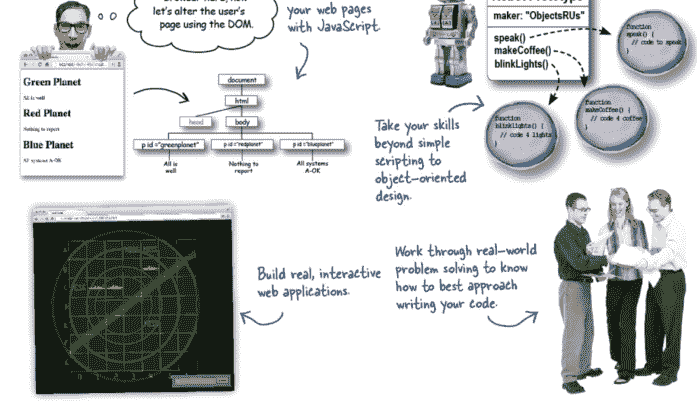

> "将编程的入门介绍与对象构造、继承和闭包等高级主题相结合，使读者能够从基础快速过渡到现代计算机编程中最有趣的一些概念。"
>
> ——Peter Casey  
> 教授，中奥勒冈社区学院

> "这本书带你深入了解 JavaScript 的内部机制，让你对这种非凡的编程语言有深刻的理解。"
>
> ——Chris Fuselier  
> 工程顾问

> "我希望我当初入门的时候有《深入浅出 JavaScript 编程》这本书！"
>
> ——Daniel Konopacki  
> 软件工程师，华特迪士尼公司

JavaScript / 编程

`headfirstlabs.com`

## 赞誉《深入浅出 JavaScript 编程》

> "警告：除非你想以一种有趣且有意义的方式学习 JavaScript 编程基础，否则不要阅读《深入浅出 JavaScript 编程》。可能还有一个额外的好处，那就是你可能比读完一般技术书籍后记住更多关于 JavaScript 的知识。"
>
> ——Jesse Palmer，高级软件开发者，Gannett Digital

> "如果每个小学生和中学生都学习 Elisabeth 和 Eric 的《深入浅出 HTML 和 CSS》，并且如果《深入浅出 JavaScript 编程》和《深入浅出 HTML5 编程》是高中数学和科学课程的一部分，那么我们的国家将永远不会失去竞争优势。"
>
> ——Michael Murphy，高级系统顾问，The History Tree

> "《深入浅出》系列运用了现代学习理论的元素，包括建构主义，让读者快速上手。作者们用这本书证明，专家级内容可以快速高效地教授。不要搞错，这是一本严谨的 JavaScript 书籍，而且，读起来很有趣！"
>
> ——Frank Moore，Web 设计师和开发者

> "想找一本让你保持兴趣（和笑声）但又能教你一些严肃编程技能的书？《深入浅出 JavaScript 编程》就是！"
>
> ——Tim Williams，软件创业者

> "无论你的编程技能水平如何，都把这本书加入你的书库吧！"
>
> ——Chris Fuselier，工程顾问

> "Robson 和 Freeman 又做到了！使用与他们在《深入浅出》系列前几本书相同的有趣且信息丰富的风格，《深入浅出 JavaScript 编程》带你完成有趣且有用的项目，逐章让程序员——即使是像我这样的非专业人士——打下现代 JavaScript 编程的坚实基础，用于解决实际问题。"
>
> ——Russell Alleen-Willems，数字考古学家，DiachronicDesign.com

> "Freeman 和 Robson 继续使用创新的教学方法，将复杂的概念传达为基本原理。"
>
> ——Mark Arana，战略与创新，华特迪士尼工作室

## 对 Eric T. Freeman 和 Elisabeth Robson 其他书籍的赞誉

> "对于我们每个人心中那个极客化、休闲酷感的程序员大师来说，语气恰到好处。实用开发策略的正确参考——让我的大脑运转起来，而不必费劲地啃那些乏味的、陈腐的教授式语言。"
>
> ——Travis Kalanick，Uber 首席执行官

> "这本书令人钦佩的清晰、幽默和大量巧妙的元素使其成为一种能帮助哪怕是非程序员也能好好思考解决问题的书。"
>
> ——Cory Doctorow，Boing Boing 联合编辑，科幻作家

> "我感觉像是一千磅的书刚刚从我头上被移走了。"
>
> ——Ward Cunningham，维基的发明者

> "我认为这是我读过的极少数几本不可或缺的软件书籍之一。（充其量，我大概会把 10 本书归到这个类别。）"
>
> ——David Gelernter，耶鲁大学计算机科学教授

> "我笑了，我哭了，它感动了我。"
>
> ——Daniel Steinberg，java.net 主编

> "我想不出比 Eric 和 Elisabeth 更好的导游了。"
>
> ——Miko Matsumura，Hazelcast 营销与开发者关系副总裁  
> 前 Sun Microsystems 首席 Java 布道师

> "我简直爱上了这本书。事实上，我在妻子面前亲了这本书。"
>
> ——Satish Kumar

> "高度图形化和渐进式的方法精确地模拟了学习这些内容的最佳方式……"
>
> ——Danny Goodman，《Dynamic HTML: The Definitive Guide》作者

> "Eric 和 Elisabeth 显然精通他们的领域。随着互联网变得越来越复杂，网页的精妙构建变得越来越关键。每一章的核心都是优雅的设计，每个概念都以同等的实用主义和机智来传达。"
>
> ——Ken Goldstein，Shop.com 前首席执行官兼《This is Rage: A Novel of Silicon Valley and Other Madness》作者

## Eric T. Freeman 和 Elisabeth Robson 的其他 O'Reilly 书籍

- 深入浅出设计模式
- 深入浅出 HTML 和 CSS
- 深入浅出 HTML5 编程

## 来自 O'Reilly 的其他相关书籍

- 深入浅出 HTML5 编程
- `JavaScript: The Definitive Guide`
- JavaScript 启蒙

## O'Reilly《深入浅出》系列的其他书籍

- 深入浅出 HTML 和 CSS
- 深入浅出 HTML5 编程
- 深入浅出设计模式
- 深入浅出 Servlets 和 JSP
- 深入浅出 SQL
- 深入浅出软件开发
- 深入浅出 C#
- 深入浅出 Java
- 深入浅出面向对象分析与设计（OOA&D）
- 深入浅出 Ajax
- 深入浅出 Rails
- 深入浅出 PHP & MySQL
- 深入浅出 Web 设计
- 深入浅出网络
- 深入浅出 iPhone 和 iPad 开发
- 深入浅出 jQuery

致 JavaScript——你并非含着金汤匙出生，但你已超越了所有在浏览器领域挑战过你的语言。

## Head First JavaScript Programming 的作者


Eric Freeman


**Eric** 被 Head First 系列的联合创作者 Kathy Sierra 描述为“那种罕见的、精通多个领域语言、实践和文化的人，从时尚黑客、企业副总裁、工程师到智囊团成员。”

在职业上，Eric 最近结束了近十年的媒体公司高管生涯——曾在华特迪士尼公司担任迪士尼在线及 Disney.com 的首席技术官。Eric 现在将时间投入到 WickedlySmart，这是一家他与 Elisabeth 共同创立的初创公司。

从专业背景看，Eric 是一位计算机科学家，曾在耶鲁大学师从行业巨擘 David Gelernter 攻读博士学位。他的博士论文被认为是桌面隐喻替代方案的开创性工作，也是活动流的首次实现——这是他和 Gelernter 博士共同开发的概念。

在业余时间，Eric 深度参与音乐活动；你可以找到 Eric 的最新项目，这是与环境音乐先驱 Steve Roach 的合作成果，可在 iPhone 应用商店以“Immersion Station”的名称获取。

Eric 与妻子和年幼的女儿住在 Bainbridge Island。他的女儿是 Eric 工作室的常客，她喜欢转动他的合成器和音频效果器的旋钮。

可以通过 `eric@wickedlysmart.com` 联系 Eric，或访问他的网站 `http://ericfreeman.com`。

**Elisabeth** 是一位软件工程师、作家和培训师。自从在耶鲁大学求学以来，她就对技术充满热情，在那里她获得了计算机科学理学硕士学位，并设计了一种并发、可视化的编程语言和软件架构。

Elisabeth 从互联网早期就参与其中；她共同创建了屡获殊荣的网站 The Ada Project，这是最早旨在帮助女性在计算机科学领域寻找职业和在线导师信息的网站之一。

她目前是 WickedlySmart 的联合创始人，这是一个专注于网络技术的在线教育平台，她在此创作书籍、文章、视频等。此前，作为 O'Reilly Media 的特别项目总监，Elisabeth 举办了关于各种技术主题的现场研讨会和在线课程，并培养了她对创建学习体验以帮助人们理解技术的热情。在加入 O'Reilly 之前，Elisabeth 曾在华特迪士尼公司“撒播仙尘”，在那里她领导了数字媒体的研发工作。

当不在电脑前时，你会发现 Elisabeth 在大自然中徒步、骑行或划皮划艇，身边带着相机，或者烹饪素食餐点。

可以通过 `beth@wickedlysmart.com` 发送邮件给她，或访问她的博客 `http://elisabethrobson.com`。

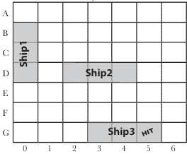

### 异步编码

**在本章之后，你将意识到自己已不在堪萨斯了。** 直到现在，你一直在编写的代码通常是从上到下执行的——当然，你的代码可能比那更复杂一些，并且用到了一些函数、对象和方法，但在某个时刻，代码只是按其流程运行。现在，我们非常抱歉在本书的这个阶段才告诉你这个，但**典型的 JavaScript 代码通常不是那样写的**。相反，大多数 JavaScript 是为了**响应事件**而编写的。什么类型的事件？嗯，比如用户点击你的页面、数据从网络到达、浏览器中的定时器到期、DOM 中发生的变化等等，这只是几个例子。事实上，各种各样的事件**一直在**你的浏览器中幕后发生。在本章中，我们将重新思考我们的 JavaScript 编码方法，并学习我们为什么以及如何编写响应事件的代码。


- 什么是事件？383
- 什么是事件处理器？384
- 如何创建你的第一个事件处理器 385
- 测试驱动你的事件 386
- 通过创建一个游戏来理解事件……388
- 实现这个游戏 389
- 测试驱动 390
- 让我们添加更多图片 394
- 现在我们需要为每个图片的 `onclick` 属性分配相同的事件处理器 395
- 如何为所有图片重用同一个处理器 396
- 事件对象如何工作 399
- 让事件对象发挥作用 401
- 测试驱动事件对象和 `target` 402
- 事件和队列 404
- 更多事件 407
- `setTimeout` 如何工作 408
- 完成图片游戏 412
- 测试驱动定时器 413


**理解函数，然后闪耀。** 每一门艺术、手艺和学科都有一个关键原则，它将中级玩家与摇滚明星般的艺术大师区分开来——对于 JavaScript 来说，真正理解**函数**就是那个区别所在。函数是 JavaScript 的基础，我们用来**设计和组织**代码的许多技术都依赖于对函数的高级知识和运用。学习达到这一水平函数的道路是有趣且常常令人费解的，所以做好准备……本章会有点像威利·旺卡带领参观巧克力工厂——当你了解更多关于 JavaScript 函数的内容时，你会遇到一些疯狂、古怪而美妙的东西。

- 关键字 `function` 的神秘双重生活 430
- 函数声明与函数表达式 431
- 解析函数声明 432
- 接下来是什么？浏览器执行代码 433
- 继续……条件语句 434
- 函数如何也是值 439
- 我们提过函数在 JavaScript 中拥有一等地位吗？442
- 乘坐头等舱 443
- 编写代码来处理和检查乘客 444
- 遍历乘客 446
- 将函数传递给函数 447
- 从函数返回函数 450
- 编写空乘人员饮料订单代码 451
- 空乘人员饮料订单代码：另一种方法 452
- 使用一等函数接受订单 454
- Webville 可乐 457
- 数组 `sort` 方法如何工作 459
- 整合起来 460
- 对排序进行测试驱动 462

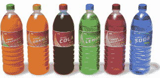

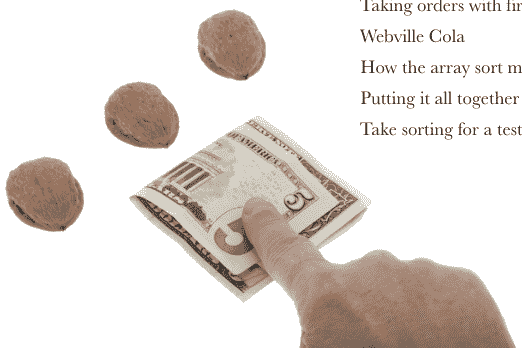

你已经让函数经历了各种考验，但还有更多要学习。

在本章中，我们将更进一步；我们要深入核心。我们将向你展示如何**真正驾驭**函数。这不是一个超级长的章节，但它会很紧张，到最后，你的 JavaScript 表达能力会比你想象的更加强大。你也准备好去接手同事的代码，或者投入一个开源 JavaScript 库，因为我们将涵盖一些关于函数的常见编码惯用法和约定。如果你从未听说过**匿名函数**或**闭包**，那么，伙计，你来对地方了。


- 看看函数的另一面……476
- 如何使用匿名函数 477
- 我们需要再谈谈你的冗长问题 479
- 函数何时被定义？视情况而定……483
- 刚刚发生了什么？为什么 `fly` 没有被定义？484
- 如何嵌套函数 485
- 嵌套如何影响作用域 486
- 简要回顾词法作用域 488
- 词法作用域的有趣之处 489
- 再访函数 491
- 调用函数（再访）492
- 到底什么是闭包？495
- 关闭一个函数 496
- 使用闭包实现一个神奇的计数器 498
- 幕后观察……499
- 通过将函数表达式作为参数传递来创建闭包 501
- 闭包包含的是实际环境，而不是副本 502
- 使用事件处理器创建闭包 503
- “Click me!”闭包如何工作 506

到目前为止，我们一直在手工制作对象。对于每个对象，我们都使用**对象字面量**来指定每一个属性。在小规模上这没问题，但对于严肃的代码，我们需要更好的方法。这就是**对象构造函数**的用武之地。有了构造函数，我们可以更容易地创建对象，并且可以创建所有都遵循相同**设计蓝图**的对象——这意味着我们可以使用构造函数来确保每个对象具有相同的属性并包含相同的方法。而且，使用构造函数，当我们创建大量对象时，可以编写更加**简洁**且更不容易出错的对象代码。所以，让我们开始吧，学完本章之后，你谈论构造函数的方式，就好像你是在“对象城”长大的一样。

- 使用对象字面量创建对象 522
- 使用对象约定 523
- 介绍对象构造函数 525
- 如何创建构造函数 526
- 如何使用构造函数 527
- 构造函数如何工作 528
- 你也可以在构造函数中放入方法 530
- 生产时间到了！536
- 让我们测试驱动一些新车 538
- 还别急着否定对象字面量 539
- 将参数重新配置为对象字面量 540
- 重构 `Car` 构造函数 541
- 理解对象实例 543
- 即使是构造出来的对象也可以有自己独立的属性 546
- 现实世界中的构造函数 548
- `Array` 对象 549
- 内置对象的更多乐趣 551


**学会创建对象只是个开始。** 是时候给我们的对象增添些“肌肉”了。我们需要更多方式来创建对象之间的**关系**，并在它们之间**共享代码**。同时，我们需要扩展现有对象、增强现有对象的方法。换句话说，我们需要更多的工具。在本章中，你将看到 JavaScript 拥有一个非常强大的**对象模型**，但它与主流面向对象语言有所不同。JavaScript 并没有采用典型的基于类的面向对象系统，而是选择了更强大的**原型**模型——对象可以继承和扩展其他对象的行为。这有什么用？你很快就会明白。让我们开始吧……

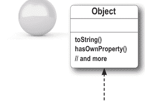

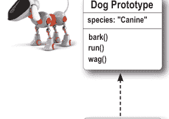


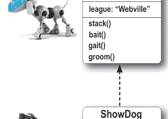

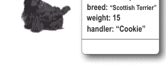

1. 嘿，在开始之前，我们有一种更好的方式来绘制对象图…… 565
2. 重新审视对象构造函数：我们在复用代码，但这样做够高效吗？…… 566
3. 复制方法真的有问题吗？…… 568
4. 什么是原型？…… 569
5. 从原型继承…… 570
6. 继承是如何工作的…… 571
7. 覆盖原型…… 573
8. 如何设置原型…… 576
9. 原型是动态的…… 582
10. `sit` 方法的一个更有趣的实现…… 584
11. 再次说明：`sitting` 属性是如何工作的…… 585
12. 如何设计展示犬…… 589
13. 建立原型链…… 591
14. 继承在原型链中是如何工作的…… 592
15. 创建展示犬原型…… 594
16. 创建展示犬实例…… 598
17. 展示犬的最终清理…… 602
18. 逐步分析 `Dog.call`…… 604
19. 链条并未终结于 `dog`…… 607
20. 利用继承的优势……通过覆盖内置行为…… 608
21. 利用继承的优势……通过扩展内置对象…… 610
22. 万物大统一理论…… 612
23. 通过对象实现更好的生活…… 612
24. 整合所有内容…… 613
25. 接下来学什么？…… 613


- #1 jQuery 624
- #2 更多 DOM 操作 626
- #3 Window 对象 627
- #4 Arguments 628
- #5 处理异常 629
- #6 使用 `addEventListener` 添加事件处理器 630
- #7 正则表达式 632
- #8 递归 634
- #9 JSON 636
- #10 服务端 JavaScript 637

# 如何使用本书

## 引言

> 真不敢相信他们把*那个*放进了一本 JavaScript 书里！

这本书适合你吗？这本书适合任何有钱买它的人。而且它也是送给那个特别的人的绝佳礼物。

在本节中，我们将回答那个令人迫切想知道的问题：“那么，他们为什么要把*那个*放进 JavaScript 书里？”


## 这本书适合谁？

如果以下问题你都回答“是”：

1. 你是否有一台装有**现代浏览器**和**文本编辑器**的电脑？

   我们认为 Safari、Chrome、Firefox 的最新版本或 IE 9 及以上版本都算现代浏览器。

2. 你想用最佳技术和最新标准来**学习**、**理解**并**记住**如何**用 JavaScript 编程**吗？
3. 你更喜欢**引人入胜的晚宴式交谈**，而不是**枯燥乏味的学术讲座**吗？

那么这本书就适合你。

> [来自营销部的说明：这本书适合任何有信用卡的人。]

## 谁应该远离这本书？

如果以下问题你回答了一个“是”：

1. 你是否是**网页开发的完全新手**？

   HTML 和 CSS 对你来说是陌生的概念吗？如果是的话，你可能需要先阅读《*Head First HTML and CSS*》来了解如何搭建网页，然后再来学习 JavaScript。

2. 你是否是一个厉害的网页开发者，正在寻找一本*参考书*？
3. 你是否**害怕尝试不同的事物**？你宁可去做根管治疗，也不愿把条纹和格子混搭在一起？你是否认为如果 JavaScript 对象被拟人化了，技术书籍就不能是严肃的？

那么这本书不适合你。


## 我们知道你在想什么

> “这怎么能是一本正经的书？”

> “那些图形是怎么回事？”

> “我真的能这样学会吗？”

## 我们也知道你的大脑在想什么

你的大脑渴望新鲜事物。它总是在搜索、扫描、*等待*不寻常的东西。它天生如此，这有助于你生存下来。

如今，你被老虎吃掉的可能性不大了。但你的大脑仍在搜索。你永远不知道会发生什么。

那么，你的大脑如何处理你遇到的所有日常的、普通的、正常的事情呢？它会尽其所能阻止这些事情干扰大脑的*真正*工作——记录*重要*的东西。它不会费心保存无聊的东西；它们根本通不过“这显然不重要”的过滤器。

你的大脑怎么*知道*什么重要？假设你在外出徒步，一只老虎跳到你面前。你的头脑和身体会发生什么？

神经元放电。情绪高涨。*化学物质涌动。*

你的大脑就是这样知道的……

**这一定很重要！别忘了！**

但想象一下，你在家，或在图书馆。这是一个安全、温暖、没有老虎的地方。你在学习。准备考试。或者试图弄懂某个老板觉得一周、最多十天就能搞定的高难度技术课题。

只有一个问题。你的大脑正在试图帮你一个大忙。它试图确保这个*显然*不重要的内容不会占用宝贵的资源。这些资源更适合用来存储真正*重大*的事情。比如老虎。比如火灾的危险。比如为什么你不该再穿短裤滑雪板。

而你没有办法简单地告诉大脑：“嘿，大脑，非常感谢，但不管这本书有多无聊，我现在在情感里氏刻度上的读数有多低，我确实*真的*希望你记住这些东西。”

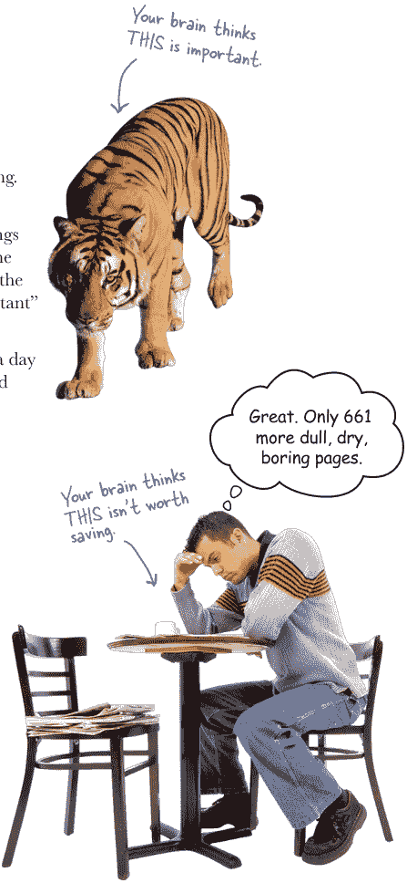

## 我们将“Head First”的读者视为学习者

那么*学习*需要什么？首先，你必须*理解*它，然后确保你不会*忘记*它。这不仅仅是把事实塞进脑子里。基于认知科学、神经生物学和教育心理学的最新研究，**学习**远不止是页面上的文字。我们知道什么能让你的大脑兴奋起来。

## 一些 Head First 的学习原则

**让内容可视化。** 图像远比单纯的文字更容易记住，而且使学习更有效（在记忆与迁移研究中提高了多达 89%）。它还使事物更易理解。**将文字放在相关图形的内部或附近**，而不是放在底部或另一页，学习者解决相关问题的可能性将提高近一倍。

**使用对话式和个性化的风格。** 在最近的研究中，如果内容以第一人称、对话式的风格直接与读者交流，而不是采用正式的语气，学生在课后测试中的表现提高了多达 40%。讲故事而不是说教。使用随意的语言。别太把自己当回事。你更愿意注意什么：一个引人入胜的晚宴伙伴，还是一场讲座？

**引导学习者进行更深层的思考。** 换句话说，除非你主动调动你的神经元，否则你的大脑不会有太大反应。读者需要被激励、投入、充满好奇心并受到启发去解决问题、得出结论、产生新知识。为此，你需要有挑战性的问题、练习和引人深思的问题，以及涉及左右脑和多种感官的活动。

**吸引并保持读者的注意力。** 我们都有过“我真的很想学这个，但我看了一页就撑不住了”的经历。你的大脑会关注那些非同寻常的、有趣的、奇特的、引人注目的、意想不到的东西。学习一个新的、困难的技术话题不必是无聊的。如果内容不无聊，你的大脑会学得更快。

**触动他们的情感。** 我们现在知道，你记住某件事的能力很大程度上取决于它的情感内容。你记住你关心的东西。你记住你*感受到*的东西。不，我们不是在讲一个男孩和他的狗的心碎故事。我们说的是像惊讶、好奇、趣味、“什么鬼？”之类的情感，以及当你解开一个谜题、学会其他人都觉得难的东西、或者意识到你懂得某个自以为比你懂技术的工程部 Bob 也不知道的东西时，那种“我超厉害！”的感觉。

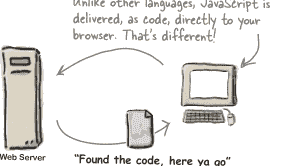

> 我真的觉得 JavaScript 应该放在 `<head>` 元素里。

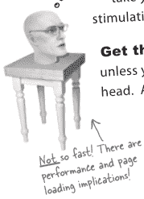

> 既然已经引起你的注意了，你应该更谨慎地使用全局变量。


### 元认知：思考你的思考

如果你真的想学习，并且想学得更快、更深入，请注意你是如何集中注意力的。思考你是如何思考的。学习你是如何学习的。

我们大多数人成长过程中都没有上过元认知或学习理论的课程。我们*被期望*去学习，却很少*被教导*如何学习。

但我们假设，如果你正拿着这本书，你是真的想学习如何创建 JavaScript 程序。你可能不想花费太多时间。而且你*记住*读过的内容，并能够应用它。为此，你必须*理解*它。要充分利用本书，或者*任何*书或学习体验，请对你的大脑负责。你的大脑正在处理*这个*内容。

关键是要让你的大脑将你正在学习的新材料视为**极其重要**。对你的幸福至关重要。如同老虎一般重要。否则，你将陷入一场持久战，你的大脑会竭尽全力阻止新内容被记住。

### 那么，你**究竟**该如何让你的大脑认为 JavaScript 和老虎一样重要？

有缓慢、乏味的方法，也有更快、更有效的方法。缓慢的方法就是纯粹的重复。你显然知道，即使是最枯燥的主题，只要你不断重复，你*是*能够学习和记忆的。经过足够多的重复，你的大脑会说：“这对他来说似乎不*重要*，但他一遍又一遍*地*看，所以我想这肯定很重要。”

更快的方法是***做任何能增加大脑活动的事情***，尤其是不同*类型*的大脑活动。前一页的内容是解决方案的重要部分，它们都是经过证明有助于大脑发挥作用的东西。例如，研究表明，将文字*嵌入*到它们描述的图片*中*（而不是放在页面的其他地方，如标题或正文中），会促使你的大脑试图理解文字和图片之间的关系，这会导致更多的神经元被激活。更多的神经元激活 = 你的大脑*明白*这是值得关注、甚至可能被记录下来的事物的机会更大。

对话式风格有所帮助，因为当人们认为自己正在参与对话时，往往会更加专注，因为他们需要跟进并参与其中。奇妙的是，你的大脑并不一定*在乎*这个“对话”是发生在你和一本书之间！另一方面，如果写作风格正式而枯燥，你的大脑会像你坐在一屋子被动听众中听讲座一样对待它。无需保持清醒。

但图片和对话式风格仅仅是个开始。

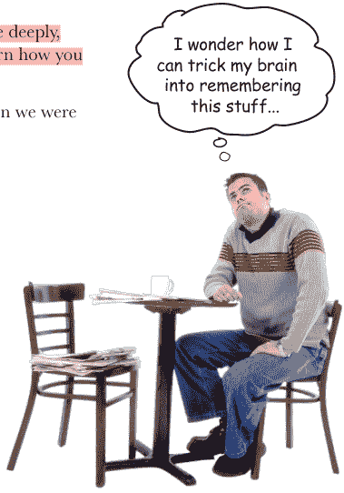

### 如何使用本书

#### 以下是我们的做法

我们使用了**图片**，因为你的大脑是为视觉而非文本而调优的。就你的大脑而言，一张图片真的*值*1024个字。当文字和图片协同工作时，我们将文字*嵌入*了图片*中*，因为当文字位于其所指内容*内部*时，你的大脑运作更有效，而不是放在标题或埋在正文某处。

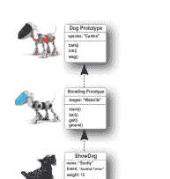

我们使用了**冗余**，用*不同的*方式和媒介类型说同一件事，以及**多种感官**，以增加内容被编码到大脑多个区域的机会。

我们以**意想不到的**方式使用概念和图片，因为你的大脑对新奇事物敏感；我们使用了至少带有一些**情感**内容的图片和想法，因为你的大脑倾向于关注情感的生化过程。那些能让你*产生*某种感觉的东西更有可能被记住，即使这种感觉只是小小的*幽默*、*惊讶*或**兴趣**。

我们采用了个性化的**对话式风格**，因为当你的大脑认为你正在参与对话时，它比认为你在被动地听演示会更加专注。即使在*阅读*时，你的大脑也会这样做。

我们包含了超过 100 个**活动**，因为你的大脑在*做*事情时比*读*东西时更倾向于学习和记忆。我们设计的练习既具挑战性又可完成，因为这是大多数*人*喜欢的。

我们使用了**多种学习风格**，因为*你*可能喜欢循序渐进的步骤，而其他人想先了解全局，又或者其他人只想看一个代码示例。但无论你自己的学习偏好如何，*每个人*都能从看到同一内容以多种方式呈现中受益。

我们包含了适合**大脑两侧**的内容，因为你调动的大脑区域越多，你学习和记忆的可能性就越大，保持专注的时间也越长。由于锻炼大脑的一侧通常意味着给另一侧休息的机会，你可以更高效地学习更长时间。

我们还包含了**故事**和呈现**多于一个观点**的练习，因为当你的大脑被迫进行评估和判断时，它更倾向于深度学习。

我们包含了**挑战**，以及练习，并提出**问题**（这些问题并不总有直接的答案），因为你的大脑在必须*努力*解决某事时，更倾向于学习和记住。想想看——你不可能仅仅通过*看*别人在健身房锻炼就让你的*身体*变好。但我们尽力确保当你努力学习时，是在*正确*的事情上。**你不会浪费一个额外的树突**去处理一个难以理解的例子，或是解析困难、充满术语或过于简略的文本。

我们使用了**人物**。在故事、示例、图片等中，因为，嗯，*你*就是一个人。你的大脑对*人物*的关注度高于对*事物*的关注。

我们使用了**80/20**法则。我们假设，如果你打算成为一个顶尖的 JavaScript 开发者，这不会是你的唯一一本书。所以我们不谈论*所有*东西。只讲你*真正*需要的东西。


#### 以下是你能做的，让你的大脑服从安排

所以，我们已经尽了我们的本分。剩下的就靠你了。这些提示是一个起点；倾听你的大脑，找出什么对你有效，什么无效。尝试新事物。

① **放慢速度。你理解得越多，需要记忆的就越少。**

不要只是*阅读*。停下来思考。当书问你问题时，不要只是跳到答案。想象真的有人在*问*这个问题。你迫使大脑思考得越深入，学习和记忆的机会就越大。

② **大声说出来。**

说话会激活大脑的不同部分。如果你正在试图理解某事，或者想增加以后记住它的机会，请大声说出来。更好的是，试着向别人大声解释它。你会学得更快，并且可能发现一些在阅读时未曾意识到的想法。

③ **做练习。写你自己的笔记。**

我们把它们放在这里了，但如果替你做，那就像是让别人替你锻炼。不要只是*看*练习。**使用铅笔。** 有大量证据表明，学习*同时*进行身体活动可以增强学习效果。

④ **倾听你的大脑。**

注意你的大脑是否超载。如果你发现自己开始浏览表面或忘记刚刚读了什么，就是时候休息一下了。一旦超过某个点，试图塞入更多东西不会让你学得更快，甚至可能损害这个过程。

⑤ **阅读“没有愚蠢的问题”**

意思是所有的那些问题。它们不是可选的侧栏——***它们是核心内容的一部分！*** 不要跳过它们。

⑥ **感受一些东西！**

你的大脑需要知道这*很重要*。投入到故事中去。为照片编你自己的标题。为一个糟糕的笑话呻吟*总比*毫无感觉要好。

⑦ **让这本书成为你睡前读的最后一本书。或者至少是最后一本*有挑战性的书。***

部分学习过程（尤其是转化为长期记忆的过程）发生在*你*放下书*之后*。你的大脑需要自己的时间，进行更多处理。如果在那段处理时间里你塞进了新东西，你刚刚学到的一些内容就会丢失。

⑧ **创造一些东西！**

将它应用到你正在设计的新东西上，或者重新制作一个旧项目。总之，*做*点什么，以获得本书练习和活动之外的经验。你需要的只是一支铅笔和一个要解决的问题……一个可能从使用 JavaScript 中受益的问题。

⑨ **喝水。多喝水。**

你的大脑在充足的液体中工作得最好。脱水（可能在你感到口渴之前就发生了）会降低认知功能。

⑩ **保证睡眠。**

为了学会编程，你需要创建大量新的大脑连接。经常睡觉；这很有帮助。

### 阅读须知

这是一次学习体验，而非参考手册。我们刻意删去了可能干扰当前学习进度的一切内容。初次阅读时，你必须从头开始，因为本书假设你已掌握此前的知识。

**我们教授 JavaScript 的优点，并警示其缺点。**

JavaScript 这门编程语言并非经过学术界长期严格评审后诞生。它因实际需求被推出，在早期浏览器环境中成长。因此请务必注意：JavaScript 既有出色之处，也有不尽人意之处。但总体而言，只要你善加运用，JavaScript 将非常出色。

本书将指导你如何充分发挥其优点，并会指出那些需要规避的缺陷。

**我们不会详尽涵盖该语言的每一个方面。**

关于 JavaScript 可以学习的内容很多。本书不是参考手册而是学习指南，因此不会覆盖所有知识点。我们的目标是教你掌握 JavaScript 基础，使你能够借助任何参考手册自如运用这门语言。

**本书确实会教授浏览器环境中的 JavaScript。**

浏览器不仅是 JavaScript 最普遍的运行环境，也是最便捷的——每人只需一台配备文本编辑器和浏览器的电脑即可入门。在浏览器中运行 JavaScript 意味着你能获得即时反馈：编写代码后只需刷新页面就能看到效果。

**本书倡导基于最佳实践的结构清晰、可读性强的代码。**

你需要编写自己和他人能读懂的代码，确保这些代码在未来浏览器中依然有效。要用最直接的方式完成编程，这样才能高效工作并投入更优的方案。本书将教授你编写清晰、有条理的代码，从一开始就预见变化。写出令你自豪、值得装裱挂墙的代码（约会前记得取下来）。

**我们鼓励你使用多种浏览器配合学习。**


我们教授的是基于标准的`JavaScript`，但不同浏览器对`JavaScript`的解释可能存在细微差异。虽然我们会尽力确保书中代码在所有现代浏览器中运行，并分享几个确保兼容性的技巧，但仍建议你选择至少两种浏览器进行测试。这将帮助你了解浏览器间的差异，并学会创建能在多种浏览器中稳定运行的`JavaScript`代码。

**编程是严肃的事业，有时需要刻苦钻研。**

若你已有编程经验，便知所言何意。如果你刚完成《深入浅出HTML与CSS》，会发现编程略有不同。编程需要不同的思维方式：注重逻辑，时而抽象，要求算法化思考。但不必担心，我们将以符合认知规律的方式教学。循序渐进，保证营养与睡眠，让这些编程概念真正融入思维。

**实践活动不可省略。**

书中的练习和活动并非附加内容，而是核心部分。有些用于巩固记忆，有些促进理解，有些帮助应用所学。请勿跳过练习。填字游戏是唯一可选内容，但能帮助大脑在不同语境中思考词汇。

**重复设计具有深意且至关重要。**

本书一大特点是让你真正掌握知识，并确保学完后仍能记住内容。普通参考手册不以记忆留存为目标，但本书聚焦学习，因此重要概念会多次出现。

**示例代码力求精简。**

读者反馈：在200行代码中寻找关键两行令人沮丧。因此本书多数示例都置于最小必要语境中，使学习重点清晰明了。不必期待所有示例都健壮完整——它们专为教学编写，未必能完全运行。

所有示例文件可从`http://wickedlysmart.com/hfjs`下载。

**“大脑练习”通常没有标准答案。**

部分问题本身无固定答案，部分则需要你在完成大脑练习后自行判断答案正确性。某些练习会提供提示引导思考方向。

## 如何使用本书

### 我们通常只提供代码，不含标记文本

学完前两章后，我们通常只给出`JavaScript`代码，假定你会将其嵌入合适的`HTML`结构。以下是适用于本书多数代码的简单`HTML`模板。若需使用其他`HTML`，我们会特别说明：

```html
<!DOCTYPE html>
<html lang="en">
  <head>
    <meta charset="utf-8">
    <title>Your HTML Page</title>
    <script>
      
    </script>
  </head>
  <body>
    
  </body>
</html>
```

← `JavaScript`代码通常放在此处。

← 网页内容将放在此处。

> 但无需担心；本书开头会带你逐步实践。

### 获取代码示例、帮助与讨论

本书所有资源均可在`http://wickedlysmart.com/hfjs`获取，包括示例代码文件、视频教程等补充材料。

### 技术审校

这些专家全程参与审校，提供了极其宝贵的详细反馈！

Jeff Straw

Ismaël Martin "Bing" Demiddel

Frank D. Moore

Alfred J. Speller

Bruce Forkush

Javier Ruedas

### 感谢出色的审校团队

本书经历了比以往任何著作更严谨的审校。超过270位WickedlySmart Insiders成员在本书写作过程中实时参与阅读和评论，其效果远超预期，对塑造《深入浅出JavaScript编程》的每个细节都至关重要。衷心感谢所有参与者，正是你们让本书更加出色。

上述技术审校专家提供了超越期待的反馈，每位都对本书做出了重要贡献。以下审校人员也在不同方面提供了协助：Galina N. Orlova, J. Patrick Kelley, Claus-Peter Kahl, Rob Cleary, Rebeca Dunn-Krahn, Olaf Schoenrich, Jim Cupec, Matthew M. Hanrahan, Russell Alleen-Willems, Christine J. Wilson, Louis-Philippe Breton, Timo Glaser, Charmaine Gray, Lee Beckham, Michael Murphy, Dave Young, Don Smallidge, Alan Rusyak, Eric R. Liscinsky, Brent Fazekas, Sue Starr, Eric (Orange Pants) Johnson, Jesse Palmer, Manabu Kawakami, Alan McIvor, Alex Kelley, Yvonne Bichsel Truhon, Austin Throop, Tim Williams, J. Albert Bowden II, Rod Shelton, Nancy DeHaven Hall, Sue McGee, Francisco Debs, Miriam Berkland, Christine H Grecco, Elhadji Barry, Athanasios Valsamakis, Peter Casey, Dustin Wollam and Robb Kerley.

评审团队

### 致谢

我们同样非常感谢我们敬爱的技术评审戴维·鲍尔斯。事实上，我们现在不跟戴维一起就写不了书了，他已经帮我们太多次了。这有点像埃尔顿和伯尼；我们开始问自己，没有他我们是否真的能写出一本书。戴维帮助我们——或者说逼迫我们——让这本书在技术上更完善、更准确，而他作为单口喜剧演员的第二职业，在我们润色书中更幽默的部分时真的派上了用场。再次感谢你，戴维——你是真正的专业人士，知道通过了他的技术审核，我们晚上都能睡得更香了。


*在 O'Reilly：*


我们向我们的编辑梅根·布兰切特致以巨大、无与伦比的感谢，她为这本书扫清了道路，移除了完成它的每一个障碍，耐心等待并牺牲了家庭时间来完成它。她也是那个在我们与 O'Reilly 的关系中保持我们理智的人（也在 O'Reilly 与我们的关系中保持他们的理智）。我们爱你，迫不及待地想再次与你合作！

别被这个微笑骗了，这家伙可是硬核的（当然是在技术方面）。

还要特别感谢我们的荣誉主编迈克·亨德里克森，他从最开始就领导了这本书的创作。再次感谢迈克；没有你，我们的书一本也出不来。十多年来你一直是我们的拥护者，我们为此爱你！


> 致谢名单这么长，是因为我们在测试一个理论：每个在书的致谢部分被提到的人都会至少买一本书，考虑到亲戚什么的，可能还不止一本。如果你想出现在我们下一本书的致谢中，而且你有一个大家庭，请写信给我们。

**同样在 O'Reilly：**

我们也向整个 O'Reilly 团队致以最诚挚的谢意：梅兰妮·雅布罗、鲍勃·法勒和丹·福克斯密斯，他们负责将这本书整理成形；感谢埃德·斯蒂芬森、于盖特·巴里埃和莱斯利·克兰德尔，他们在市场营销方面引领了方向，我们欣赏他们打破常规的方法。感谢艾莉·沃尔克豪森、兰迪·科默和卡伦·蒙哥马利，他们富有灵感的封面设计至今仍为我们带来良好效果。一如既往地感谢蕾切尔·莫纳汉，感谢她硬核的文字编辑（也感谢她让这一切都充满乐趣），以及感谢伯特·贝茨提供的宝贵反馈。

# 1 快速接触`JavaScript`

### 小试牛刀

来吧，水很舒服！我们要立刻投入进去，探索`JavaScript`，写一些代码，运行它，看着它与你的浏览器交互！你很快就能开始写代码了。


**JavaScript 赋予你超能力。**作为真正的网络编程语言，`JavaScript`让你为网页添加行为。不再有枯燥、无聊、静态的页面只是在那里看着你——有了`JavaScript`，你将能够接触并感动你的用户，对有趣的事件做出反应，从网络抓取数据用于你的页面，在网页中直接绘制图形，还有更多。而且一旦你了解了`JavaScript`，你也能为你的用户创造全新的行为。

你也会有很好的伙伴，`JavaScript`不仅是最流行的编程语言之一，它也在所有现代（以及大多数古老）浏览器中得到支持；`JavaScript`甚至正在扩展，被嵌入到许多浏览器之外的环境中。稍后会详细介绍；现在，让我们开始吧！

### `JavaScript`如何工作

### `JavaScript`的工作原理

如果你已经习惯于在网页中创建结构、内容、布局和样式，现在是不是也该添加一点行为了？如今，页面不需要只是呆在那里。优秀的页面应该是动态的、交互式的，它们应该以新的方式与你的用户互动。这就是`JavaScript`发挥作用的地方。让我们首先看看`JavaScript`如何融入网页生态系统：

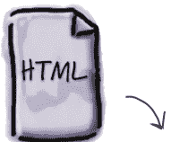

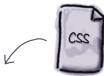

你已经知道我们使用`HTML`，或超文本标记语言，来指定页面的所有**内容**及其**结构**，如段落、标题和节。


你也已经知道我们使用`CSS`，或层叠样式表，来指定`HTML`如何呈现……颜色、字体、边框、边距以及页面的布局。`CSS`赋予你**样式**，并且它是以一种与页面结构分离的方式来实现的。

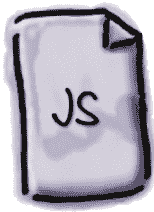

那么，让我们介绍一下`JavaScript`，`HTML`和`CSS`的计算学表亲。`JavaScript`让你为网页创建**行为**。需要在用户点击你的“接下来 30 秒特价！”按钮时做出反应？实时再次检查用户的表单输入？从 Twitter 抓取一些推文并显示它们？或者来玩个游戏？求助`JavaScript`。`JavaScript`为你提供了一种为页面添加编程的方法，这样你就可以计算、反应、绘制、通信、警报、修改、更新、改变……任何动态的东西，都是`JavaScript`在发挥作用。

### 你将如何编写`JavaScript`

`JavaScript`在编程世界中相当独特。对于典型的编程语言，你必须编写它、编译它、链接它并部署它。`JavaScript`更加流畅和灵活。有了`JavaScript`，你需要做的只是将`JavaScript`直接写入你的页面，然后将其加载到浏览器中。之后，浏览器会愉快地开始执行你的代码。让我们更仔细地看看这是如何工作的：

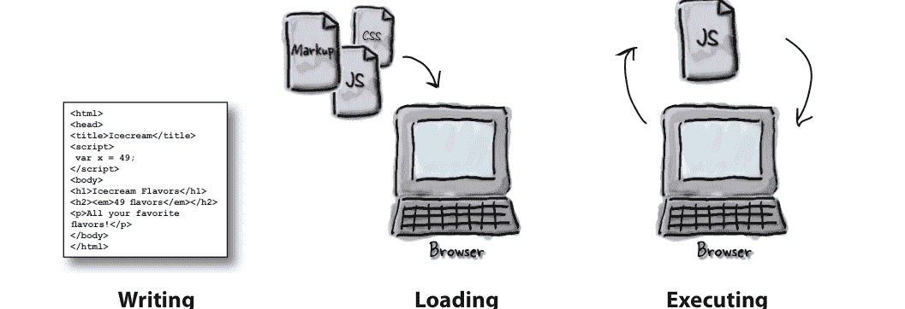

#### 编写

**1**

你像往常一样创建你的页面，使用`HTML`内容和`CSS`样式。你也将`JavaScript`包含在页面中。正如你将看到的，就像`HTML`和`CSS`一样，你可以将所有内容放在一个文件中，或者你可以将`JavaScript`放在它自己的文件中，然后将其包含在你的页面中。

#### 加载

**2**

像往常一样，将你的浏览器指向你的页面。当浏览器看到代码时，它会立即开始解析，准备执行。请注意，就像`HTML`和`CSS`一样，如果浏览器在你的代码中看到错误，它会尽力继续前进并读取更多的`JavaScript`、`HTML`和`CSS`。它最不想做的事情就是无法给用户一个可查看的页面。

#### 执行

**3**

浏览器一旦在你的页面中遇到代码就开始执行它，并在你的页面生命周期内持续执行。与早期版本的`JavaScript`不同，今天的`JavaScript`是一个强大的工具，使用先进的编译技术，以与许多原生编程语言几乎相同的速度执行你的代码。

> 我们稍后会讨论最佳实践……

> 供未来参考，浏览器还会构建一个`HTML`页面的“对象模型”，`JavaScript`可以利用它。把这个记在脑子里，我们稍后会回到这个话题……

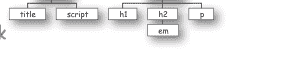

### 将`JavaScript`放入你的页面

### 如何将`JavaScript`放入你的页面

首先。如果你不知道如何将`JavaScript`放入页面，你将无法走得很远。那么，你该怎么做呢？当然是使用`<script>`元素！

让我们拿一个无聊的、普通的网页，并使用`<script>`元素添加一些动态行为。现在，此时，不要太担心我们放入`<script>`元素中的细节——你现在的目标是让一些`JavaScript`运行起来。

```html
<!doctype html>
<html lang="en">
  <head>
    <meta charset="utf-8">
    <title>Just a Generic Page</title>
    <script>
      setTimeout(wakeUpUser, 5000);
      function wakeUpUser() {
        alert("Are you going to stare at this boring page forever?");
      }
    </script>
  </head>
  <body>
    <h1>Just a generic heading</h1>
    <p>Not a lot to read about here. I'm just an obligatory paragraph living in an example in a JavaScript book. I'm looking for something to make my life more exciting.</p>
  </body>
</html>
```

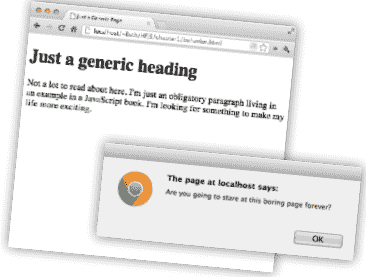

### 简单试用

请将这个页面输入到一个名为`behavior.html`的文件中。将文件拖到你的浏览器中（或使用“文件 > 打开”）来加载它。它做了什么？提示：你需要等待五秒钟才能知道答案。

### 快速了解`JavaScript`


放轻松。到目前为止，我们并不要求你能像母语者一样阅读`JavaScript`代码。事实上，我们现在只想让你对`JavaScript`的样貌有个初步印象。

话虽如此，你也不能完全放松，因为我们需要让你的大脑运转起来。还记得上一页的代码吗？我们一起来分析一下，看看它可能做了什么：

一种创建可复用代码并将其命名为`wakeUpUser`的方式？

```javascript
setTimeout(wakeUpUser, 5000);
function wakeUpUser() {
    alert("Are you going to stare at this boring page forever?");
}
```

或许是一种计算五秒时间的方法？提示：1000毫秒等于1秒。

显然，这是一种向用户显示警报消息的方式。

## 没有愚蠢的问题

问：我听说`JavaScript`是一种有点"弱"的语言。是这样吗？

答：`JavaScript`在其早期阶段确实算不上性能强劲，但自那时起，它对网络的重要性与日俱增。因此，许多资源（包括业内一些最优秀人才的智慧）都投入到了增强`JavaScript`性能的工作中。但是，你知道吗？即使在`JavaScript`变得超快之前，它一直是一门出色的语言。正如你将看到的，我们将用它来完成一些非常强大的任务。

问：`JavaScript`和`Java`有关吗？

答：仅仅是名称上的关联。`JavaScript`诞生于`Java`风靡一时的时代，其发明者利用了`Java`的知名度，借用了这个名字。两种语言都从`C`等编程语言中借鉴了一些语法，但除此之外，它们大相径庭。

问：`JavaScript`是创建动态网页的最佳方式吗？像`Flash`这样的解决方案呢？

答：曾几何时，`Flash`可能是许多人创建交互性更强、更动态网页的首选，但行业发展方向已强烈转向支持`HTML5`和`JavaScript`。而且，随着`HTML5`的出现，`JavaScript`已成为网络的标准脚本语言。大量资源正用于提升`JavaScript`的速度和效率，并创建扩展浏览器功能的`JavaScript API`。

问：我朋友在`Photoshop`里使用`JavaScript`，或者他至少是这么说的。这可能吗？

答：是的，`JavaScript`正突破浏览器的限制，成为许多应用程序（从图形工具到音乐应用，甚至服务器端编程）的通用脚本语言。你投入学习`JavaScript`，未来很可能在网页之外的更多领域获得回报。

问：你说许多其他语言是编译型的。这具体是什么意思，为什么`JavaScript`不是？

答：对于像`C`、`C++`或`Java`这样的传统编程语言，你需要在执行代码前先对其进行编译。编译会将你的代码转换为一种机器高效表示，通常针对运行时性能进行了优化。脚本语言通常是解释执行的，这意味着浏览器会在运行到每一行`JavaScript`代码时直接执行它。脚本语言不太强调运行时性能，更侧重于原型设计、交互式编码和灵活性等任务。早期`JavaScript`正是如此，这也是为什么多年来它的性能不尽如人意。不过，也存在一个折中方案；解释型语言可以即时编译，这正是浏览器制造商对现代`JavaScript`所采取的路径。事实上，`JavaScript`现在兼具脚本语言的便捷性和编译语言的高性能。顺便提一下，本书中我们将使用"解释"、"求值"和"执行"这些词汇。它们在不同语境下含义略有不同，但对我们而言，基本上意思相同。

### `JavaScript`，你已走过了漫长的发展之路，宝贝……

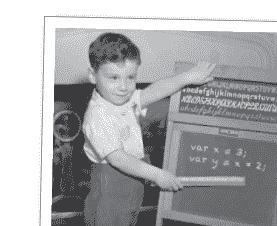


#### `JavaScript` 1.0


## JavaScript 1.3

## JavaScript 1.8.5

Netscape（网景公司）可能对你的时代来说有些久远，但它是第一家真正的浏览器公司。在20世纪90年代中期，浏览器竞争异常激烈，尤其是与微软的竞争，因此为浏览器添加新的、令人兴奋的功能成为首要任务。

为了实现这个目标，Netscape希望创建一种脚本语言，让任何人都能为他们的页面添加脚本。于是LiveScript应运而生，这是一门为了满足该需求而迅速开发出来的语言。如果你从未听说过LiveScript，那是因为大约在那个时候，Sun Microsystems推出了Java，并因此将其股价推升至前所未有的高度。那么，为什么不利用这一成功，将LiveScript更名为JavaScript呢？毕竟，谁在乎它们之间是否真的有关联呢？对吧？

我们提到过微软吗？他们在Netscape之后不久也创建了自己的脚本语言，名字嘛，叫JScript，而且，嗯，它与JavaScript非常相似。于是，浏览器战争开始了。

在1996年至2000年间，JavaScript逐渐成熟。事实上，Netscape将JavaScript提交进行标准化，ECMAScript由此诞生。没听说过ECMAScript？没关系，现在你知道了；只需了解ECMAScript作为所有JavaScript实现（无论是在浏览器内外）的标准语言定义。

在此期间，尽管JavaScript的使用已变得普遍，但开发者们仍在与JavaScript和浏览器战争带来的各种差异（因为不同浏览器间的差异）作斗争。虽然JavaScript和JScript之间的细微差异持续给开发者带来困扰，但随着时间的推移，这两种语言开始变得越来越相似。

JavaScript仍未摆脱其作为业余语言的名声，但这种情况即将改变……

最终，JavaScript走向成熟，并赢得了专业开发者的尊重！虽然你可能会说这都得益于像ECMAScript 5这样坚实的标准（如今所有现代浏览器都已实现），但真正将JavaScript推向专业舞台聚光灯下的是谷歌。2005年，他们发布了Google Maps，向世界展示了JavaScript在创建动态网页方面真正能实现的能力。

在所有这些新的关注下，许多最优秀的编程语言人才专注于改进JavaScript的解释器，并对其运行时性能进行了巨大提升。如今，JavaScript与其早期版本相比变化不大，尽管它匆忙地降临世界，却正展现出其作为一种强大且富有表现力语言的特质。

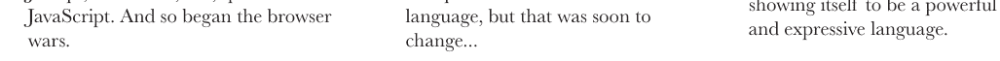

### 看看编写JavaScript是多么容易

### 动动脑筋

你还不了解JavaScript，但我们敢打赌你能对JavaScript代码的工作原理做出一些合理的猜测。看看下面每一行代码，试着猜测它的功能。在下方写下你的答案。我们已经为你完成了一个作为示例。如果卡住了，答案在下一页。

```javascript
var price = 28.99;
var discount = 10;
var total =
    price - (price * (discount / 100));
if (total > 25) {
    freeShipping();
}
```

| 创建一个名为`price`的变量，并为其赋值28.99。 |
| --- |
|  |
|  |
|  |
|  |
|  |
|  |
|  |
|  |
|  |
|  |
|  |
|  |
|  |
|  |
|  |
|  |
|  |
|  |
|  |
|  |
|  |
|  |

```javascript
var count = 10;
while (count > 0) {
    juggle();
    count = count - 1;
}
```

```javascript
var dog = {name: "Rover", weight: 35};
if (dog.weight > 30) {
    alert("WOOF WOOF");
} else {
    alert("woof woof");
}
```

```javascript
var circleRadius = 20;
var circleArea =
    Math.PI * (circleRadius * circleRadius);
```

### JavaScript练习解答

### 看看编写JavaScript是多么容易


你还不了解JavaScript，但我们敢打赌你能对JavaScript代码的工作原理做出一些合理的猜测。看看下面每一行代码，试着猜测它的功能。在下方写下你的答案。我们已经为你完成了一个作为示例。以下是我们提供的答案。

```javascript
var price = 28.99;
var discount = 10;
var total =
    price - (price * (discount / 100));
if (total > 25) {
  freeShipping();
}
```

- 创建一个名为`price`的变量，并为其赋值28.99。
- 创建一个名为`discount`的变量，并为其赋值10。
- 通过应用折扣计算新价格，然后将其赋值给变量`total`。
- 将变量`total`的值与25进行比较。如果大于25……
  - ……则执行`freeShipping`操作。
- 结束`if`语句

```javascript
var count = 10;
while (count > 0) {
  juggle();
  count = count - 1;
}
```

- 创建一个名为`count`的变量，并为其赋值10。
- 只要变量`count`大于0……
  - ……就进行一些杂耍操作，并且……
  - ……每次将`count`的值减少1。
- 结束`while`循环

```javascript
var dog = {name: "Rover", weight: 35};

if (dog.weight > 30) {
  alert("WOOF WOOF");
} else {
  alert("woof woof");
}
```

- 创建一个带有名字和重量的`dog`对象。
- 如果狗的体重大于30……
  - ……则在浏览器的网页上显示警报"WOOF WOOF"。
- 否则……
  - ……则在浏览器的网页上显示警报"woof woof"。
- 结束`if/else`语句

```javascript
var circleRadius = 20;
var circleArea =
  Math.PI * (circleRadius * circleRadius);
```

- 创建一个变量`circleRadius`，并为其赋值20。
- 创建一个名为`circleArea`的变量……
  - ……并将该表达式的结果赋值给它（1256.6370614359173）。

这是真的。

使用 HTML 和 CSS，你可以创建一些外观出色的页面。但一旦你掌握了 JavaScript，你就能真正扩展你所能创建的页面类型。事实上，你可能会开始将你的页面视为应用程序（甚至是体验！），而不仅仅是简单的页面。

现在，你可能会说，“当然，我知道。你为什么觉得我在读这本书？” 好吧，我们其实想借此机会聊聊学习 JavaScript 的事。如果你已经掌握了一门编程语言或脚本语言，那么你大概知道接下来会学什么。然而，如果你到目前为止主要使用的是 HTML 和 CSS，那么你应该知道，学习一门编程语言在根本上有所不同。

使用 HTML 和 CSS，你主要是在做声明性的工作——例如，你是在声明，比如说，某段文本是一个段落，或者“sale”类中的所有元素都应该是红色的。而使用 JavaScript，你是在为页面添加行为，为此你需要描述计算过程。你需要能够描述诸如“通过将所有正确答案相加来计算用户得分”或“执行此操作十次”或“当用户点击那个按钮时播放‘你赢了’的音效”，甚至“去获取我最新的推文，并将其放入此页面”这样的事情。

要完成这些事情，你需要一种与 HTML 或 CSS 截然不同的语言。让我们来看看它是如何做到的……

> 而且通常也能增加你的薪水！

### 如何编写一个语句

当你创建 HTML 时，你通常会**标记**文本来赋予其结构；为此，你需要向文本添加元素、属性和值：

```html
<h1 class="drink">Mocha Caffe Latte</h1>
<p>Espresso, steamed milk and chocolate syrup,
just the way you like it.</p>
```

使用 HTML，我们通过标记文本来创建结构。比如，“我需要一个名为 Mocha Cafe Latte 的大标题；这是一个饮料的标题。然后我需要在它后面放一个段落。”

CSS 略有不同。使用 CSS，你是在编写一组**规则**，其中每条规则选择页面中的元素，然后为这些元素指定一组样式：

```css
h1.drink {
    color: brown;
}
p {
    font-family: sans-serif;
}
```

使用 CSS，我们编写使用选择器（如`h1.drink`和`p`）的规则，来确定将样式应用于 HTML 的哪些部分。

让我们确保所有饮料标题都是棕色的……

……并且我们希望所有段落都使用无衬线字体。

使用 JavaScript，你编写的是**语句**。每条语句描述了计算过程的一小部分，所有语句合在一起，就创造了页面的行为：

一组语句。

每条语句完成一点小任务，比如声明一些变量来为我们存储值。

```javascript
var age = 25;
var name = "Owen";

if (age > 14) {
    alert("Sorry this page is for kids only!");
} else {
    alert("Welcome " + name + "!");
}
```

这里我们创建了一个变量来存储年龄25，还需要一个变量来存储值“Owen”。

或者做出决策，例如：用户的年龄是否大于14？

如果是，就提示用户他们对于这个页面来说年龄太大了。

否则，我们就按姓名欢迎用户，像这样：“Welcome Owen!”（但因为Owen是25岁，所以这种情况下我们不会这么做。）

### 变量和值

你可能已经注意到，JavaScript语句通常涉及变量。变量用于存储值。什么类型的值？这里有几个例子：

```javascript
var winners = 2;
```

```javascript
var name = "Duke";
```

```javascript
var isEligible = false;
```

变量除了可以存储数字、字符串和布尔值之外，还有其他类型的值，我们很快就会讲到，但是，无论变量包含什么，我们创建所有变量的方式都是一样的。让我们更仔细地看看如何声明一个变量：

```javascript
var winners = 2;
```

我们说“可选地”，因为如果你想的话，可以创建一个没有初始值的变量，然后稍后再给它赋值。要创建一个没有初始值的变量，只需省略赋值部分，像这样：

```javascript
var losers;
```

### 远离那个键盘！

你知道变量有一个名字，也知道它们有一个值。

你还知道变量可以存储的值包括数字、字符串和布尔值。

*但是你的变量可以叫什么名字？任何名字都可以吗？* 嗯，不行，但创建变量名的规则很简单：只需遵循以下两条规则，就能创建有效的变量名：

- 变量名以字母、下划线或美元符号开头。
- 之后，你可以使用任意数量的字母、数字、下划线或美元符号。

哦，还有一件事；我们真的不想因为使用任何内置关键字（如`var`或`function`或`false`）而让 JavaScript 感到困惑，所以这些字词对你的变量名来说是禁区。我们将在本书的后续部分讨论这些关键字及其含义，但这里先快速浏览一下这个列表：

| break | delete | for | let | super | void |
| --- | --- | --- | --- | --- | --- |
| case | do | function | new | switch | while |
| catch | else | if | package | this | with |
| class | enum | implements | private | throw | yield |
| const | export | import | protected | true |  |
| continue | extends | in | public | try |  |
| debugger | false | instanceof | return | typeof |  |
| default | finally | interface | static | var |  |

### 没有愚蠢的问题

> **问：什么是关键字？**
>
> **答：** 关键字是 JavaScript 中的保留字。JavaScript 将这些保留字用于其自身的用途，如果你开始将它们用于你的变量名，那么对你和浏览器来说都会造成混淆。
>
> **问：如果我使用关键字的一部分作为变量名的一部分会怎样？例如，我可以有一个名为`ifOnly`的变量（即包含关键字`if`的变量）吗？**
>
> **答：** 当然可以，只要不完全匹配关键字就行。编写清晰的代码也是好事，所以通常你不应该使用像`elze`这样的变量名，因为它可能与`else`混淆。
>
> **问：JavaScript 区分大小写吗？换句话说，`myvariable`和`MyVariable`是同一个东西吗？**
>
> **答：** 如果你习惯于 HTML 标记，你可能习惯于不区分大小写的语言；毕竟，浏览器对`<head>`和`<HEAD>`的处理是相同的。然而，在 JavaScript 中，变量、关键字、函数名以及几乎所有其他内容都区分大小写。所以要注意大小写的使用。

第 1 章 12

### WEBVILLE 时报

### 如何避免那些尴尬的命名错误

你在选择变量名时有很大的灵活性，所以这里有一些 Webville 的小贴士，让你的命名更简单：

**选择有意义的名字。**

像`_m`、`$`、`r`和`foo`这样的变量名可能对你来说有意义，但在 Webville，它们通常不受欢迎。随着时间的推移，你很可能会忘记它们，而且使用像`angle`、`currentPressure`和`passedExam`这样的名字会让你的代码可读性大大提高。

**创建多词变量名时使用“驼峰命名法”。**

在某些时候，你必须决定如何命名一个代表，比如说，一只会喷火的双头龙的变量。怎么做？只需使用驼峰命名法，即除第一个单词外，每个单词的首字母大写：`twoHeadedDragonWithFire`。驼峰命名法易于形成，在 Webville 中广泛使用，并且为你提供了足够的灵活性来创建你需要的尽可能具体的变量名。还有其他命名方式，但这是更常用的之一（甚至在 JavaScript 之外）。

**只在有充分理由的情况下使用以`_`和`$`开头的变量。**

以`$`开头的变量通常保留给 JavaScript 库使用，虽然有些作者使用以`_`开头的变量来表示各种约定，但我们建议你除非有充分的理由（你会知道是否有），否则远离这两者。

**安全第一。**

在变量命名上要安全；我们将在本书后面介绍更多保持安全的提示，但现在请确保命名清晰，避免关键字，并在声明变量时始终使用`var`。

### 语法乐趣

- 每条语句以分号结尾。

  `x = x + 1;`

- 单行注释以两个正斜杠开头。注释只是给你或其他开发者的关于代码的说明。它们不会被执行。

  `// I'm a comment`

- 空格无关紧要（几乎任何地方）。

  `x         =       2233;`

- 用双引号（或单引号，两者都行，但要保持一致）将字符串括起来。

  `"You rule!"`

  `'And so do you!'`

- 不要在布尔值`true`和`false`周围使用引号。

  `rockin = true;`

- 变量不必在声明时就被赋予值：

  `var width;`

- JavaScript 与 HTML 标记不同，它区分大小写，这意味着大小写字母很重要。变量`counter`与变量`Counter`是不同的。

### 化身浏览器

下面，你会看到一些包含错误的 JavaScript 代码。你的任务是假装自己是浏览器，找出代码中的错误。完成练习后，查看本章末尾，看看你找对了吗。

#### A

```javascript
// Test for jokes
var joke = "JavaScript walked into a bar....";
var toldJoke = "false";
var $punchline =
    "Better watch out for those semi-colons."
var %entage = 20;
var result

if (toldJoke == true) {
    Alert($punchline);
} else
    alert(joke);
}
```

现在不要太在意这段 JavaScript 的用途；只需专注于查找变量和语法方面的错误。

#### B

```javascript
// Movie Night
var zip code = 98104;
var joe'sFavoriteMovie = Forbidden Planet;
var movieTicket$    =    9;

if (movieTicket$ >= 9) {
    alert("Too much!");
} else {
    alert("We're going to see " + joe'sFavoriteMovie);
}
```

---

## 表达你自己


要在 JavaScript 中真正表达自我，你需要**表达式**。表达式会计算得出值。在之前的代码示例中，你已经见过一些了。以这个语句中的表达式为例：

```javascript
var total = price - (price * (discount / 100));
```


这是一条 JavaScript 语句，它将计算某个表达式的结果赋值给变量`total`。我们用`*`表示乘法，用`/`表示除法。这是变量`total`。这是赋值。而整个部分就是一个表达式。这个表达式计算的是一个折后价格，折扣是原价的某个百分比。所以如果你的价格是 10，折扣是 20，结果就得到 8。

如果你上过数学课、平衡过支票簿或报过税，相信这些数值表达式对你来说并不陌生。还有字符串表达式；这里有几个例子：

```javascript
"Dear " + "Reader" + ","
```

这会将这些字符串加在一起，或者说拼接起来，形成一个新的字符串`"Dear Reader,"`。

```javascript
"super" + "cali" + youKnowTheRest
```

这里也一样，只是我们有一个包含字符串的变量作为表达式的一部分。这计算结果为`"supercalifragilisticexpialidocious"`。

```javascript
phoneNumber.substring(0,3)
```

这只是另一个结果为字符串的表达式示例。我们稍后会详细讲解它的工作原理，但这是用来返回美国电话号码字符串中的区号。

我们也有计算结果为`true`或`false`的表达式，也就是所谓的布尔表达式。逐个理解一下，看看它们是如何得出`true`或`false`的：

```javascript
age < 14
```

如果一个人的年龄小于 14，这就是`true`，否则是`false`。我们可以用它来判断某人是否是儿童。

```javascript
cost >= 3.99
```

如果价格大于或等于 3.99，这就是`true`。否则是`false`。当它变成`false`的时候，准备好买打折商品吧！

```javascript
animal == "bear"
```

当`animal`包含字符串`"bear"`时，这是`true`。如果是的话，小心！

而表达式还可以计算为其他几种类型；我们会在本书后面讲到这些。目前，重要的是要认识到所有这些表达式都会计算得出某种结果：一个数值、字符串或布尔值。让我们继续前进，看看这能给你带来什么！

> * 当然，这是假设变量`youKnowTheRest`的值是`"fragilisticexpialidocious"`。

你在这里 ▸ 15

---

## 磨铅笔


拿出你的铅笔，让一些表达式活动活动筋骨。对于下面的每个表达式，计算它的值并写下你的答案。是的，写进去……忘了你妈妈告诉你不要在书上写字的话吧，直接在这本书里写下你的答案！一定要在章末核对答案。

`( 9 / 5 ) * temp + 32`

能说出“摄氏度转华氏度计算器”吗？

当`temp`为 10 时，结果是？__________

这是一个布尔表达式。`==`运算符用来测试两个值是否相等。

`color == "orange"`

当`color`的值为`"pink"`时，这个表达式是`true`还是`false`？

或者当值为`"orange"`时呢？__________

`name + ", " + "you've won!"`

当`name`为`"Martha"`时，这计算出的值是什么？

__________________________________

这用来测试第一个值是否大于第二个值。你也可以用`>=`来测试第一个值是否大于或等于第二个值。

`yourLevel > 5`

当`yourLevel`为 2 时，这计算的结果是什么？__________

当`yourLevel`为 5 时，这计算的结果是什么？__________

当`yourLevel`为 7 时，这计算的结果是什么？__________

`(level * points) + bonus`

好的，`level`是 5，`points`是 30,000，`bonus`是 3300。这计算的结果是什么？__________

`color != "orange"`

当`color`的值为`"pink"`时，这个表达式是`true`还是`false`？__________

`!=`运算符用来测试两个值是否不相等。

### 额外加分！

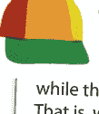

`1000 + "108"`有没有几种可能的答案？

只有一个是正确的。你会选哪个？__________

## 认真编码

你有没有注意到`=`运算符用于赋值，而`==`运算符用于测试相等性？也就是说，我们用一个等号来给变量赋值。我们用两个等号来测试两个值是否相等。将两者混淆是一个常见的编码错误。

---

## 重复做事

你会做很多重复的事情：

- 涂泡沫，冲洗，再重复……

- 上蜡，除蜡……

- 从碗里拿糖果吃，直到吃光为止。

当然，你经常需要在代码中重复做事，而 JavaScript 为你提供了几种在循环中重复执行代码的方式：`while`、`for`、`for in`和`forEach`。最终，我们会介绍所有这些循环方式，但现在让我们先专注于`while`。

我们刚讲过计算结果为布尔值的表达式，比如`scoops > 0`，而这种表达式正是`while`语句的关键。来看具体原理：

- `while`语句以关键字`while`开头。

- `while`使用一个布尔表达式，我们称之为**条件**测试，或简称**条件**。

- 如果**条件**为真，代码块中的所有内容都会被执行。

```javascript
while (scoops > 0) {
  document.write("Another scoop!");
  scoops = scoops - 1;
}
```

什么是代码块？花括号之间的所有内容；也就是`{}`之间的部分。

而且，如果我们的条件为真，那么在执行完代码块之后，我们会绕回来全部再做一遍。如果条件为假，我们就完事了。

就像我们说的，涂泡沫，冲洗，再重复！


```javascript
while (juggling) {
  keepBallsInAir();
}
```

JavaScript 快速入门

你在这里 ▶ 17

## `while`循环的工作原理

既然这是你的第一个`while`循环，让我们追踪一遍它的执行过程，看看它是如何具体工作的。注意，我们添加了一个`scoops`的声明，并将其初始化为值 5。

**现在开始执行这段代码。首先我们将`scoops`设为 5。**

```javascript
var scoops = 5;
while (scoops > 0) {
    document.write("Another scoop!<br>");
    scoops = scoops - 1;
}
document.write("Life without ice cream isn't the same");
```


**然后，我们遇到了`while`语句。当我们执行`while`语句时，首先要做的是计算条件，看它是否为真或假。**

```javascript
var scoops = 5;
while (scoops > 0) {
    document.write("Another scoop!<br>");
    scoops = scoops - 1;
}
document.write("Life without ice cream isn't the same");
```

`scoops`是否大于零？在我们看来确实如此！


**因为条件为真，我们开始执行代码块。块中的第一个语句将字符串`"Another scoop! <br>"`写入浏览器。**

```javascript
var scoops = 5;
while (scoops > 0) {
    document.write("Another scoop!<br>");
    scoops = scoops - 1;
}
document.write("Life without ice cream isn't the same");
```


下一条语句将勺数减一，然后将`scoops`设置为新值，即四。

```javascript
var scoops = 5;
while (scoops > 0) {
    document.write("Another scoop!<br>");
    scoops = scoops - 1;
}
document.write("Life without ice cream isn't the same");
```

这是代码块中的最后一条语句，所以我们循环回到条件判断处，重新开始。

```javascript
var scoops = 5;
while (scoops > 0) {
    document.write("Another scoop!<br>");
    scoops = scoops - 1;
}
document.write("Life without ice cream isn't the same");
```

再次评估我们的条件，这次`scoops`是四。但这仍然大于零。

```javascript
var scoops = 5;
while (scoops > 0) {
    document.write("Another scoop!<br>");
    scoops = scoops - 1;
}
document.write("Life without ice cream isn't the same");
```

我们再次将字符串“Another scoop! <br>”写入浏览器。

```javascript
var scoops = 5;
while (scoops > 0) {
    document.write("Another scoop!<br>");
    scoops = scoops - 1;
}
document.write("Life without ice cream isn't the same");
```

### JavaScript `while`循环

下一条语句将勺数减一，并将`scoops`设置为新值，即三。

```javascript
var scoops = 5;
while (scoops > 0) {
    document.write("Another scoop!<br>");
    scoops = scoops - 1;
}
document.write("Life without ice cream isn't the same");
```

这是代码块中的最后一条语句，所以我们循环回到条件判断处，重新开始。

```javascript
var scoops = 5;
while (scoops > 0) {
    document.write("Another scoop!<br>");
    scoops = scoops - 1;
}
document.write("Life without ice cream isn't the same");
```

再次评估我们的条件，这次`scoops`是三。但这仍然大于零。

```javascript
var scoops = 5;
while (scoops > 0) {
    document.write("Another scoop!<br>");
    scoops = scoops - 1;
}
document.write("Life without ice cream isn't the same");
```

我们再次将字符串“Another scoop! <br>”写入浏览器。

```javascript
var scoops = 5;
while (scoops > 0) {
    document.write("Another scoop!<br>");
    scoops = scoops - 1;
}
document.write("Life without ice cream isn't the same");
```

正如你所见，这个过程会继续……每次循环，我们都会递减（将`scoops`减 1），向浏览器写入另一个字符串，并持续进行。

```javascript
var scoops = 5;
while (scoops > 0) {
    document.write("Another scoop!<br>");
    scoops = scoops - 1;
}
document.write("Life without ice cream isn't the same");
```

并继续……

```javascript
var scoops = 5;
while (scoops > 0) {
    document.write("Another scoop!<br>");
    scoops = scoops - 1;
}
document.write("Life without ice cream isn't the same");
```

直到最后一次……这次情况有所不同。`scoops`为零，因此我们的条件返回`false`。就是这样，朋友们；我们不会再进入循环，也不会再执行代码块。这次，我们绕过代码块，执行它后面的语句。

```javascript
var scoops = 5;
while (scoops > 0) {
    document.write("Another scoop!<br>");
    scoops = scoops - 1;
}
→ document.write("Life without ice cream isn't the same");
```

现在我们执行另一个`document.write`，写入字符串“Life without ice cream isn't the same”。我们完成了！

```javascript
var scoops = 5;
while (scoops > 0) {
    document.write("Another scoop!<br>");
    scoops = scoops - 1;
}
document.write("Life without ice cream isn't the same");
```

### JavaScript 条件语句

```javascript
if (cashInWallet > 5) {
    order = "I'll take the works: cheeseburger, fries and a coke";
} else {
    order = "I'll just have a glass of water";
}
```

### 用 JavaScript 做决定

你刚刚看到了如何使用条件语句来决定在`while`语句中是否继续循环。你也可以使用布尔表达式在 JavaScript 中用`if`语句做决定。`if`语句仅在其条件测试为`true`时才执行其代码块。这里有一个例子：

```javascript
if (scoops < 3) {
    alert("Ice cream is running low!");
}
```

使用`if`语句，我们还可以通过添加一个或多个`else if`来连接多个测试，像这样：

```javascript
if (scoops >= 5) {
    alert("Eat faster, the ice cream is going to melt!");
} else if (scoops < 3) {
    alert("Ice cream is running low!");
}
```

### 快速了解 JavaScript

#### 并且，当你需要做大量的决定时

你可以根据需要连接任意多的`if`语句，如果你愿意，甚至可以有一个最终的兜底`else`，这样如果所有条件都不满足，你也能处理它。像这样：

在这段代码中，我们检查是否剩下五勺或更多……

```javascript
if (scoops >= 5) {
  alert("Eat faster, the ice cream is going to melt!");
} else if (scoops == 3) {
  alert("Ice cream is running low!");
} else if (scoops == 2) {
  alert("Going once!");
} else if (scoops == 1) {
  alert("Going twice!");
} else if (scoops == 0) {
  alert("Gone!");
} else {
  alert("Still lots of ice cream left, come and get it.");
}
```

……或者是否正好剩下三勺……

……或者剩下 2、1 或 0 勺，然后我们提供相应的提醒。

如果以上条件都不为真，则执行此代码。

## 没有愚蠢的问题

**问：什么是代码块？**

**答：**从语法上讲，一个代码块（我们通常简称其为块）是一组语句，可以是一条语句，也可以是你想要的任意多条语句，它们被分组在花括号之间。一旦你有了一个代码块，该块中的所有语句都被视为一个整体一起执行。例如，`while`语句中块内的所有语句都会在`while`的条件为`true`时执行。`if`或`else if`中的块也是如此。

**问：我见过一些代码，其中的条件只是一个变量，有时是字符串，而不是布尔值。这是如何工作的？**

**答：**我们稍后会详细讨论，但简短的回答是 JavaScript 对于什么是真值或假值非常灵活。例如，任何保存了（非空）字符串的变量都被认为是`true`，但尚未设置值的变量被认为是`false`。我们很快就会深入了解这些细节。

**问：你说过表达式的结果可以是数字、字符串和布尔值以外的东西。比如什么？**

**答：**现在我们专注于所谓的原始类型，即数字、字符串和布尔值。稍后我们将研究更复杂的类型，比如数组（值的集合）、对象和函数。

**问：布尔这个名字从何而来？**


答：布尔是以乔治·布尔（George Boole）的名字命名的，他是一位发明了布尔逻辑的英国数学家。你经常会看到布尔写作"Boolean"，以表示这些类型的变量是以乔治的名字命名的。

# 代码磁铁编码练习

## 代码磁铁

一个JavaScript程序在冰箱上被打乱了。你能把磁铁放回正确的位置，制作一个能产生如下输出的工作JavaScript程序吗？在继续之前，请在本章末尾检查你的答案。

排列这些磁铁以制作一个工作的JavaScript程序。

```javascript
document.write("Happy Birthday dear " + name + ",<br>");
```

```javascript
document.write("Happy Birthday to you.<br>");
```

```javascript
var i = 0;
```

```javascript
var name = "Joe";
```

```javascript
i = i + 1;
```

```javascript
}
```

```javascript
document.write("Happy Birthday to you.<br>");
```

```javascript
while (i < 2) {
```

你整理好的程序应该产生此输出。

在此处重新排列磁铁。

24 第1章

## 主动出击，与你的用户沟通

我们一直在讨论如何让你的页面更具交互性，而要做到这一点，你需要能够与你的用户沟通。事实证明，有几种方法可以做到，而且你已经见过其中一些了。让我们先快速概述一下，然后在本书中更详细地探讨这些方法：

- 创建一个警告框。

  正如你所见，浏览器提供了一种通过`alert`函数快速警告用户的方式。只需用一个包含警告消息的字符串调用`alert`，浏览器就会在一个漂亮的对话框中向你的用户显示该消息。不过，小小的坦白：我们有点过度使用它了，因为它很简单；`alert`真的应该只在你确实想暂停一切并让用户知道某事时才使用。

- 直接写入你的文档。

  把你的网页想象成一个文档（浏览器就是这么称呼它的）。你可以使用`document.write`函数在任意时刻将任意 HTML 和内容写入你的页面。一般来说，这被认为是不好的做法，尽管你会看到它被零星使用。我们在本章中也用了一点，因为它是一种简单的入门方式。

- 使用控制台。

  每个 JavaScript 环境也都有一个控制台，可以记录来自你代码的消息。要向控制台日志写入消息，你需要使用`console.log`函数，并传入你想要打印到日志的字符串（稍后将详细介绍如何使用控制台日志）。你可以将`console.log`视为调试代码的绝佳工具，但通常你的用户永远不会看到你的控制台日志，所以这不是与他们沟通的有效方式。

- 直接操作你的文档。

  这就是重头戏了；这才是你想要与页面和用户交互的方式——使用 JavaScript，你可以访问你实际的网页，读取和更改其内容，甚至修改其结构和样式！这一切都通过利用浏览器的*文档对象模型*来实现（稍后会详细介绍）。正如你将看到的，这是与你的用户沟通的最佳方式。但是，使用文档对象模型需要了解你的页面结构以及用于读写页面的编程接口。我们很快就会讲到这些。不过首先，我们还有一些 JavaScript 知识要学习。

## 比较 JavaScript 的输出方式

### 各显神通？

我们所有的沟通方式都戴着面具出场了。你能帮我们揭开每一个面具的真面目吗？请将右侧的描述与左侧的名称进行匹配。我们已经为你完成了一个。

| 名称 | 描述 |
|---|---|
| `document.write` | 我可以向文档插入一些 HTML 和文本。我不是向用户传递消息最优雅的方式，但我在每个浏览器上都能工作。 |
| `console.log` | 我只是为了简单的调试目的而来。使用我，我可以将信息写入一个特殊的开发者控制台。 |
| `alert` | 我会阻止你的用户继续操作，并传递一条简短的消息。用户必须点击“确定”才能继续。 |
| 文档对象模型 | 使用我，你可以完全控制一个网页：获取用户输入的值，修改 HTML 或样式，或者更新你页面的内容。 |

## 深入了解 `console.log`

让我们更仔细地看看`console.log`是如何工作的，这样我们就可以在本章中用它来查看代码的输出，并在整本书中用它来检查代码输出和调试代码。不过请记住，控制台并不是大多数普通网络用户会接触到的浏览器功能，所以你不会想在网页的最终版本中使用它。写入控制台日志通常是在开发页面时进行故障排除。话虽如此，在学习 JavaScript 基础知识时，它是观察代码运行情况的好方法。以下是它的工作原理：

```javascript
var message = "Howdy" + " " + "partner";
console.log(message);
```

获取任意旧字符串……

……然后将它传递给`console.log`，它就会显示在浏览器的控制台中，像这样。

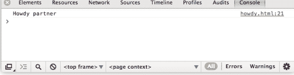

控制台包含你的代码记录的所有输出。

## 没有愚蠢的问题

**问：** 我明白`console.log`可以用来输出字符串，但它到底是什么？我的意思是，为什么 "console" 和 "log" 要用句点分隔？

**答：** 啊，好问题。我们有点超前了，但你可以把`console`想象成一个做事的对象，做一些控制台相关的事情。其中之一就是记录日志，为了告诉控制台为我们记录日志，我们使用语法`console.log`并在括号之间传递我们的输出。请记住这一点；我们稍后会在书中更详细地讨论对象。现在，你已经有足够的知识来使用`console.log`了。

**问：** 控制台除了记录日志还能做其他事情吗？

**答：** 能，但通常人们只用它来记录日志。有一些更高级的方式来使用`log`（和`console`），但它们往往特定于浏览器。请注意，`console`是所有现代浏览器都提供的功能，但它不是任何正式规范的一部分。

**问：** 呃，控制台看起来很棒，但我在哪里能找到它？我在代码中使用它，但没有看到任何输出！

**答：** 在大多数浏览器中，你必须明确打开控制台窗口。详情请查看下一页。

## 使用 JavaScript 控制台

### 打开控制台

每个浏览器对控制台的实现都略有不同。而且，更复杂的是，浏览器实现控制台的方式变化相当频繁——不是巨大的变化，但足以让你读到这本书时，你的浏览器控制台可能看起来和我们这里展示的有些不同。

所以，我们将向你展示如何在 Mac 上的 Chrome 浏览器（版本 25）中访问控制台，并且我们会在 http://wickedlysmart.com/hfjsconsole 上提供所有主流浏览器的访问说明。一旦你掌握了某个浏览器中的控制台，在其他浏览器中使用它就相当容易了，我们鼓励你至少在两种浏览器中尝试使用控制台，以便熟悉它们。

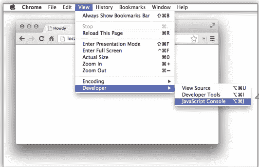

要在 Chrome（Mac 上）中访问控制台，请使用 View > Developer > JavaScript Console 菜单。

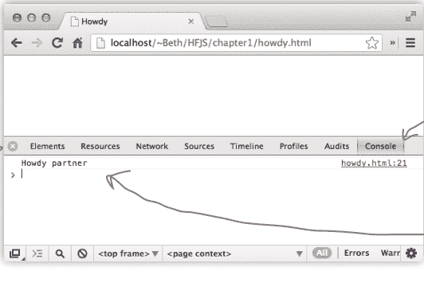

控制台将出现在浏览器窗口的底部部分。

确保在控制台顶部的标签栏中选中 Console 标签。

你应该会看到代码中通过`console.log`给出的任何消息都显示在此处的窗口中。

不要担心这些其他标签是做什么用的。它们很有用，但现在最重要的是 Console，这样我们就可以看到代码中的`console.log`消息。

## 编写一个严肃的 JavaScript 应用程序

让我们把这些新的 JavaScript 技巧和`console.log`用到一些实际的东西上。我们需要一些变量、一个`while`语句、一些带`else`的`if`语句。再稍微润色一下，我们很快就能拥有一个超级严肃的商业应用程序。但是，在你看代码之前，先想一想你会如何编写那个经典的老歌“99瓶啤酒”。


```javascript
var word = "bottles";

var count = 99;

while (count > 0) {

    console.log(count + " " + word + " of beer on the wall");

    console.log(count + " " + word + " of beer,");

    console.log("Take one down, pass it around,");

    count = count - 1;

    if (count > 0) {

        console.log(count + " " + word + " of beer on the wall.");

    } else {

        console.log("No more " + word + " of beer on the wall.");

    }

}
```

> 我们的代码中仍然有一个小缺陷。它运行正确，但输出并非 100% 完美。看看你是否能找到这个缺陷并修复它。

> > 我们不应该把这段代码放在实际的网页中以便看到输出吗？或者我们只是继续在纸上写答案？

**说得好！** 是的，是时候了。在那之前，我们想确保你掌握了足够的 JavaScript 知识，让它变得有趣。话虽如此，你在本章开头已经看到，你添加 JavaScript 到 HTML 中的方式和添加 CSS 一样；也就是说，你只需要用合适的`<script>`标签将它内联添加。

现在，和 CSS 一样，你也可以将你的 JavaScript 放在 HTML 外部的文件中。

让我们先把这个严肃的商业应用程序放到一个页面中，然后在我们彻底测试它之后，我们会将 JavaScript 移到一个外部文件中。

## 试一把

好了，让我们在浏览器里跑点代码……按照下面的指示，把你的正经业务应用启动起来吧！你会在下方看到我们的结果：

要下载本书所有的代码和示例文件，请访问 http://wickedlysmart.com/hfjs。

1. 查看下面的 HTML；你的 JavaScript 代码就放在这里。赶紧输入这段 HTML，然后把两页之前的 JavaScript 代码放到`<script>`标签之间。你可以用 Notepad（Windows）或 TextEdit（Mac）这样的编辑器，确保处于纯文本模式。或者，如果你有顺手的 HTML 编辑器，比如 Dreamweaver、Coda 或 WebStorm，也可以用。

```html
<!doctype html>
<html lang="en">
  <head>
    <meta charset="utf-8">
    <title>My First JavaScript</title>
  </head>
  <body>
    <script>

    </script>
  </body>
</html>
```

把这个输进去。

这是`<script>`标签。现在你知道了，代码就应该放在这里。

2. 把文件保存为 "index.html"。

3. 在浏览器中加载这个文件。你可以直接把文件拖到浏览器窗口里，或者在你喜欢的浏览器中使用 文件 > 打开（或 文件 > 打开文件）菜单选项。

4. 你在网页本身看不到任何东西，因为我们把输出都记录到控制台了，用的是`console.log`。所以打开浏览器的控制台，然后为你的正经业务应用祝贺自己吧。

这是我们运行这段代码的结果。这段代码会生成《99 Bottles of Beer》这首歌的完整歌词，并将文本记录到浏览器的控制台。

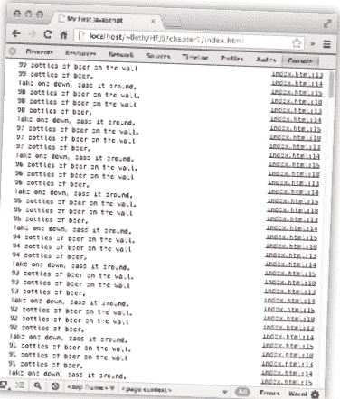

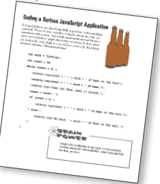

## 怎么把代码加到页面里？（让我数数有几种方法）

你已经知道可以把带有 JavaScript 代码的`<script>`元素放到页面的`<head>`或`<body>`里，但还有其他几种方法可以把代码加到页面中。我们来看看 JavaScript 都能放在哪些地方（以及为什么你可能想把它放在某个位置而不是另一个）：

**你可以把代码内联放在`<head>`元素中。** 把`<script>`元素放在`<head>`里是给页面添加代码最常见的方式。当然，这让你的代码容易找到，似乎也是个合乎逻辑的地方，但这并不总是最佳位置。为什么？继续读下去……

**或者，把代码放在单独的文件里，然后从`<head>`链接它。** 这和链接 CSS 文件一样。唯一的区别是，你要用`<script>`标签的`src`属性来指定 JavaScript 文件的 URL。

当代码放在外部文件中时，更容易维护（与 HTML 分离），而且可以在多个页面中复用。但这种方法仍然有一个缺点：所有代码都需要在页面主体加载之前加载。有没有更好的办法？继续读下去……

**或者，你可以把代码内联放在文档主体中。** 这样做的话，用`<script>`元素包裹你的 JavaScript 代码，并把它放在页面的`<body>`中（通常放在 body 的末尾）。

```html
Your HTML page
<head>
  <script>
    statement;
  </script>
  <script src="mycode.js"></script>
</head>
<body>
  <script>
    statement;
    statement;
  </script>
  <script src="somecode.js"></script>
</body>
```

这样好一点。为什么？浏览器加载页面时，会先加载`<head>`中的所有内容，再加载`<body>`。所以，如果你的代码在`<head>`里，用户可能要等一会儿才能看到页面。如果代码在`<body>`的 HTML 之后加载，用户就能在等代码加载的同时看到页面内容。

最后，你可以在页面主体中链接到外部文件。啊哈，两全其美。我们有了一个整洁、可维护的 JavaScript 文件，可以包含在任何页面中，而且从 body 底部引用，所以只在页面主体加载完成后才加载。不错。

不过，还有没有更好的办法？继续读下去……

> 尽管有相反的证据，我仍然觉得`<head>`是放代码的好地方。

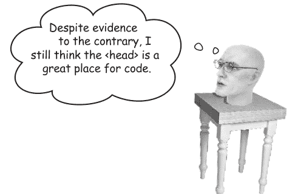

## 我们得把你们两个分开

分道扬镳让人难受，但我们知道必须这么做。是时候把你的 JavaScript 移到它自己的文件里了。以下是具体做法……

1. 打开`index.html`，选中所有代码；也就是，`<script>`标签之间的所有内容。你的选区应该看起来像这样：

```html
<!doctype html>
<html lang="en">
  <head>
    <meta charset="utf-8">
    <title>My First JavaScript</title>
  </head>
  <body>
    <script>
      var word = "bottles";
      var count = 99;
      while (count > 0) {
        console.log(count + " " + word + " of beer on the wall");
        console.log(count + " " + word + " of beer,");
        console.log("Take one down, pass it around,");
        count = count - 1;
        if (count > 0) {
          console.log(count + " " + word + " of beer on the wall.");
        } else {
          console.log("No more " + word + " of beer on the wall.");
        }
      }
    </script>
  </body>
</html>
```

2. 现在在你的编辑器中创建一个名为 "code.js" 的新文件，把代码放进去。然后保存 "code.js"。


3. 现在我们需要在 "index.html" 中放入对 "code.js" 文件的引用，这样页面加载时它就会被获取并加载。要做到这一点，从 "index.html" 中删除 JavaScript 代码，但保留`<script>`标签。然后在开头的`<script>`标签中添加`src`属性，引用 "code.js"。

```html
<!doctype html>
<html lang="en">
  <head>
    <meta charset="utf-8">
    <title>My First JavaScript</title>
  </head>
  <body>
    <script src="code.js"></script>
  </body>
</html>
```

使用`<script>`元素的`src`属性来链接到你的 JavaScript 文件。

代码原来的位置。

信不信由你，我们仍然需要结束标签`</script>`，即使两个标签之间没有代码。

4. 就这样，手术完成了。现在你需要测试一下。重新加载你的 "index.html" 页面，你应该看到和之前完全一样的结果。注意，使用`src="code.js"`时，我们假设代码文件与 HTML 文件在同一个目录中。

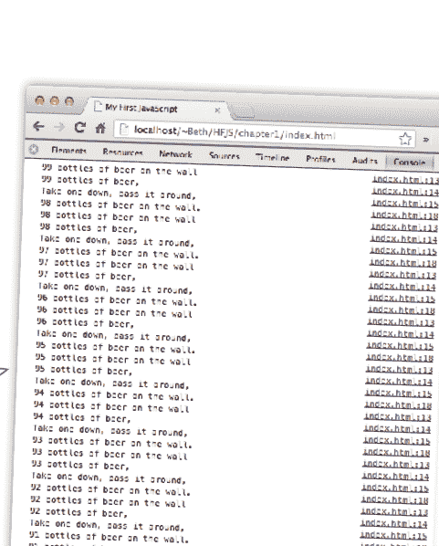


你应该得到和之前一样的结果。但现在你的 HTML 和 JavaScript 分别在独立的文件中了。是不是感觉更清爽、更易管理、更轻松无压力了？

### `Script` 元素解剖

你已经知道如何用 `<script>` 元素把代码添加到页面中，但为了真正掌握这个话题，让我们复习一下 `<script>` 元素，确保每个细节都覆盖到：

`type` 属性告诉浏览器你在写 JavaScript。不过，如果你省略它，浏览器会默认你用的是 JavaScript。所以我们建议你省略它，标准制定者们也是这么想的。

```html
<script type="text/javascript">
```

`<script>` 的开始标签。

别忘了开始标签上的右尖括号。

```javascript
alert("Hello world!");
```

脚本标签之间的所有内容必须是有效的 JavaScript。

```html
</script>
```

你必须用结束标签 `</script>` 来结束脚本，永远如此！

当你从 HTML 引用单独的 JavaScript 文件时，你会这样使用 `<script>` 元素：

添加 `src` 属性来指定 JavaScript 文件的 URL。

```html
<script src="myJavaScript.js" >
```

```html
</script>
```

JavaScript 文件使用 `.js` 作为扩展名。

再次提醒，别忘了结束标签 `</script>`！即使你链接的是外部文件，也需要它。

引用单独的 JavaScript 文件时，不要在 `<script>` 元素的内容中放任何 JavaScript。

> **内联和外部不能同时使用。**

如果你在使用 `src` 属性的同时，还试图在 `<script>` 标签之间塞点快速代码，这是行不通的。你需要两个独立的 `<script>` 元素。

```html
<script src="goodies.js">
    var = "quick hack";
</script>
```


### JavaScript 揭秘

本周访谈：

走近 JavaScript

**Head First：** 欢迎你，JavaScript。我们知道你超级忙，整天都在处理那些网页，所以很高兴你能抽出时间来和我们聊聊。

**JavaScript：** 没问题。而且，我现在确实比任何时候都忙；如今人们几乎在网页上的每个页面都在使用 JavaScript，从简单的菜单效果到完整的游戏。简直疯狂！

**Head First：** 这太惊人了，要知道就在几年前，还有人说你只是"半吊子的软弱脚本语言"，而现在你无处不在。

**JavaScript：** 别提了。从那时起我已经走了很长的路，许多伟大的头脑都在努力让我变得更好。

**Head First：** 怎么个更好法？看起来你的基本语言特性还是差不多嘛……

**JavaScript：** 嗯，我在几个方面都有提升。首先，我现在速度极快。虽然我被认为是一种脚本语言，但现在我的性能已经接近原生编译语言了。

**Head First：** 那第二呢？

**JavaScript：** 我在浏览器中处理事务的能力已经大幅扩展。使用所有现代浏览器中可用的 JavaScript 库，你可以获取你的位置、播放视频和音频、在网页上绘制图形，以及做更多的事情。但如果你想做这些，你必须了解 JavaScript。

**Head First：** 不过说到那些对你的批评，针对你这个语言。我听到过一些不太友好的话……我相信那个说法是"拼凑出来的语言"。

**JavaScript：** 我要用成绩说话。我基本上是世界上使用最广泛的语言之一，如果不是最广泛的话。我也击败了许多竞争者并获胜。还记得浏览器里的 Java 吗？哈，真是个笑话。VBScript？哈。JScript？Flash！？Silverlight？我可以一直说下去。那么，告诉我，我能有多差？

**Head First：** 有人批评你，嗯，"过于简单"。

**JavaScript：** 说实话，这是我最大的优势。你只需要打开浏览器，输入几行 JavaScript 就能运行起来，这很强大。而且对初学者也很友好。我听有人说没有比 JavaScript 更适合入门的语言了。

**Head First：** 但简单的代价是什么呢？

**JavaScript：** 这正是妙处所在，我简单之处在于你可以快速上手。但我又很深厚，包含了所有最新的现代编程结构。

**Head First：** 哦，比如什么？

**JavaScript：** 嗯，比如说，你知道动态类型、一等函数和闭包吗？

**Head First：** 我能说，但我不知道它们是什么。

**JavaScript：** 果然如此……没关系，如果你继续看这本书，你就会了解它们的。

**Head First：** 好吧，给我们讲讲要点。

**JavaScript：** 让我这么说吧，JavaScript 是为动态网页环境而构建的，那是一个令人兴奋的环境，用户与页面交互，数据实时传入，发生各种事件，而这种编程风格反映了这个语言的特点。当你对 JavaScript 了解更多的时候，在本书后面你会更理解这一点。

**Head First：** 好吧，听你这么一说，你简直是个完美的语言。是吗？

**JavaScript 眼眶湿润……**

**JavaScript：** 你知道，我不像大多数语言那样在学术界的常春藤围墙内长大。我出生在现实世界中，必须在生命早期就快速学会自救或沉没。鉴于此，我并不完美；我当然也有几个"糟糕的部分"。

**Head First 带着一丝芭芭拉·沃尔特斯式的微笑：** 我们今天看到了你新的一面。我认为这值得未来再做一次访谈。有什么临别赠言吗？

**JavaScript：** 不要凭我的糟糕部分来评判我，学好东西并坚持使用！

#### 要点

- JavaScript 用于为网页添加行为。
- 浏览器引擎执行 JavaScript 的速度比几年前快得多。
- 浏览器一旦在页面中遇到 JavaScript 代码就会开始执行。
- 使用 `<script>` 元素将 JavaScript 添加到你的页面。
- 你可以将 JavaScript 内联放在网页中，或者从 HTML 链接到一个包含 JavaScript 的单独文件。
- 使用 `<script>` 标签中的 `src` 属性来链接到单独的 JavaScript 文件。
- HTML 声明页面的结构和内容；JavaScript 计算值并为页面添加行为。
- JavaScript 程序由一系列语句组成。
- 最常见的 JavaScript 语句之一是变量声明，它使用 `var` 关键字声明一个新变量，并使用赋值运算符 `=` 为其赋值。
- JavaScript 变量命名有一些规则和准则需要遵循，这很重要。
- 记住在命名变量时避免使用 JavaScript 关键字。
- JavaScript 表达式计算值。
- 三种常见的表达式类型是数值、字符串和布尔表达式。
- `if/else` 语句允许你在代码中做出决策。
- `while/for` 语句允许你通过循环多次执行代码。
- 使用 `console.log` 而不是 `alert` 向控制台显示消息。
- 控制台消息应主要用于故障排除，因为用户很可能永远看不到控制台消息。
- JavaScript 最常见的用途是为网页添加行为，但也被用于编写 Adobe Photoshop、OpenOffice 和 Google Apps 等应用程序的脚本，甚至还被用作服务器端编程语言。

## JavaScript 填字游戏

是时候动动脑筋，用个谜题来帮助吸收所有内容了。

### 横向

- 2. 要从 HTML 链接到外部 JavaScript 文件，你需要 `<script>` 元素的 ________ 属性。
- 6. 为了避免尴尬的命名错误，使用 ________ 命名法。
- 7. JavaScript 为你的网页添加 ________。
- 10. 墙上有 99 ________ 瓶啤酒。
- 13. 每一行 JavaScript 代码称为一个 ________。
- 14. 3 + 4 是 ________ 的一个例子。
- 15. 所有 JavaScript 语句以 ________ 结尾。
- 16. 使用 ________ 来排查代码问题。

### 纵向

- 1. 在 JavaScript 程序中使用 ________ 循环可以多次执行操作。
- 3. JavaScript 变量名是 ________ 敏感的。
- 4. 要声明变量，使用这个关键字：________
- 5. 变量用于存储这些 ________
- 6. 每次循环时，我们评估一个 ________ 表达式。
- 8. 如今的 JavaScript 运行得比过去 ________ 得多。
- 9. `if/else` 语句用于做出 ________。
- 11. 你可以使用 `+` 运算符将 ________ 连接在一起。
- 12. 你将 JavaScript 放在 ________ 元素内。

38 第 1 章

### JavaScript 快速入门

### 化身浏览器 解答

下面，你会发现一些带有错误的 JavaScript 代码。你的任务是扮演浏览器，找出代码中的错误。完成练习后，查看本章末尾，看看你是否找全了。这是我们的解答。

```javascript
// 测试笑话
var joke = "JavaScript walked into a bar....";
var toldJoke = "false";
var $punchline = "Better watch out for those semi-colons.";
var percentage = 20;
var result;

if (toldJoke == true) {
    alert($punchline);
} else {
    alert(joke);
}
```

A

```javascript
// 电影之夜
var zipCode = 98104;
var joeFavoriteMovie = "Forbidden Planet";
var movieTicket$ = 9;

if (movieTicket$ >= 9) {
    alert("Too much!");
} else {
    alert("We're going to see " + joeFavoriteMovie);
}
```

B

你在这里 ▶ 39

### sharpening 铅笔 解答

拿出你的铅笔，让我们操练一些表达式。对于下面的每个表达式，计算其值并写下你的答案。是的，写上去……忘了你妈妈跟你说不要在书上写字的话，直接在这本书上写下你的答案！这是我们的解答。

你能说出"摄氏度转华氏度计算器"吗？

```javascript
( 9 / 5 ) * temp + 32
```

当 `temp` 为 10 时，结果是多少？**50**

这是一个布尔表达式。`==` 运算符测试两个值是否相等。

```javascript
color == "orange"
```

当 `color` 的值为 "pink" 时，这个表达式是真是假？**false**

或者，值为 "orange" 时？**true**

```javascript
name + ", " + "you've won!"
```

当 `name` 为 "Martha" 时，这计算出的值是什么？**"Martha, you've won!"**

这测试第一个值是否大于第二个值。你也可以使用 `>=` 来测试第一个值是否大于或等于第二个值。

```javascript
yourLevel > 5
```

当 `yourLevel` 为 2 时，这评估为？**false**

当 `yourLevel` 为 5 时，这评估为？**false**

当 `yourLevel` 为 7 时，这评估为？**true**

```javascript
(level * points) + bonus
```

好的，`level` 是 5，`points` 是 30,000，`bonus` 是 3300。这评估为多少？**153300**

```javascript
color != "orange"
```

当 `color` 的值为 "pink" 时，这个表达式是真是假？**true**

`!=` 运算符测试两个值是否不相等。

### 严肃编程

你注意到 `=` 运算符用于赋值，而 `==` 运算符用于测试相等性了吗？也就是说，我们使用一个等号给变量赋值。我们使用两个等号来测试两个值是否相等。将两者互换是一个常见的编码错误。

额外加分！

```javascript
1000 + "108"
```

有几个可能的答案吗？只有一个是对的。你会选哪个？**"1000108"**

### 代码磁铁解答

冰箱上散落着一堆凌乱的 JavaScript 程序磁贴。你能把它们放回正确的位置，拼出一个能正常运行并产生如下输出的 JavaScript 程序吗？这是我们的解答。

以下是拼好后的磁贴！

```javascript
var name = "Joe";
var i = 0;
while (i < 2) {
    document.write("Happy Birthday to you.<br>");
    i = i + 1;
}
document.write("Happy Birthday dear " + name + ",<br>");
document.write("Happy Birthday to you.<br>");
```

你拼好的程序应该产生如下输出。

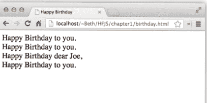

## 练习解答

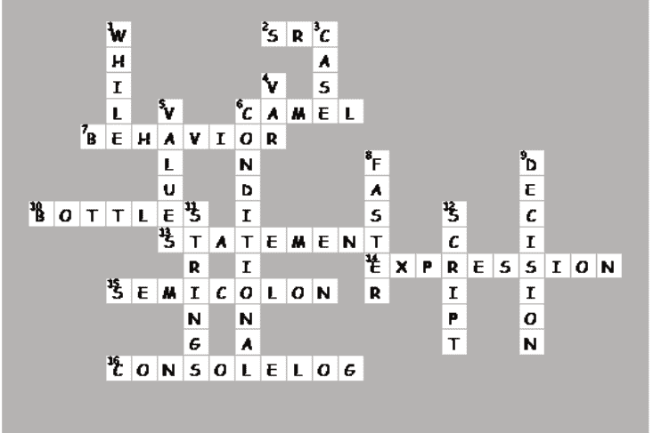

### 谁做什么？解答

我们所有的通信方法都戴着面具来参加派对。你能帮它们一一揭开面具吗？将右边的描述与左边的名称对应起来。这是我们的解答：

- **`document.write`：** 我会拦住你的用户，并传递一条简短的消息。用户必须点击"确定"才能继续。
- **`console.log`：** 我只是用来进行简单调试的。使用我，我可以把信息输出到一个专门的开发者控制台。
- **`alert`：** 我可以向文档中插入一点 HTML 和文本。我可不是向用户传递消息的最优雅方式，但我在每个浏览器上都管用。
- **document object model：** 使用我，你可以完全控制一个网页：获取用户输入的值、修改 HTML 或样式，或者更新页面内容。

# 2 编写真正的代码

### 更进一步

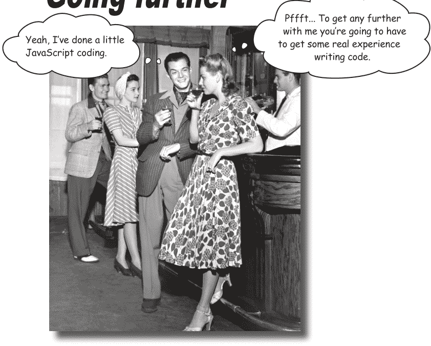

你已经了解了变量、类型、表达式……我们还可以继续列举。关键是，你已经对 JavaScript 有了一些了解。事实上，你已经足够了解，可以写一些真正的代码了。一些能做有趣事情的代码，一些有人会想要使用的代码。你所欠缺的是编写代码的实际经验，而我们将在这里立即解决这一问题。怎么做呢？直接一头扎进去，编写一个休闲小游戏，全部用 JavaScript 实现。我们的目标很有野心，但我们会一步一步来。来吧，让我们开始，如果你想创办下一个休闲游戏创业公司，我们绝不会拦着你；代码归你了。

### 构建战舰游戏

## 我们来构建一个战舰游戏

这是你和浏览器之间的对决：浏览器藏起了战舰，而你的任务就是找出它们并将其摧毁。当然，和真正的战舰游戏不同的是，在这个游戏中你不需要放置自己的战舰。相反，你的目标是用最少的猜测次数击沉电脑的战舰。

**目标：** 用最少的猜测次数击沉浏览器的战舰。你会根据表现获得一个评级。

**setup：** 当游戏程序启动时，电脑会在虚拟网格上放置战舰。完成后，游戏会要求你进行第一次猜测。

**玩法：** 浏览器将提示你输入猜测，然后你会键入一个网格位置。作为回应，你会看到"命中"、"未命中"或"你击沉了我的战舰！"的结果。当你击沉所有战舰时，游戏结束，并显示你的评级。

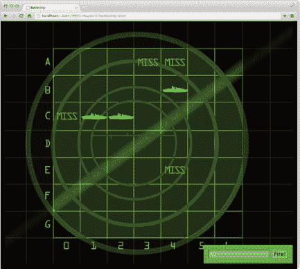

### 我们的第一次尝试……

### ……一个简化版的战舰游戏

> 这是我们追求的目标：一个漂亮的 7×7 网格，有三艘战舰需要猎杀。现在我们打算从更简单一点的开始，但等你多了解一些 JavaScript 后，我们会完成实现，让它看起来就像这样，包括图形等所有内容……声音部分留给你作为额外加分题。

对于我们的第一次尝试，我们将从比完整的 7×7 图形版本、三艘战舰更简单的版本开始。取而代之的是，我们将从一个简单的一维网格开始，有七个位置和一艘战舰需要寻找。这会很粗糙，但我们的重点是设计游戏的基本代码，而不是外观和感觉（至少目前如此）。

别担心；从简化版的游戏开始，你在稍后构建完整游戏时会获得巨大的先发优势。这也让你能有一个不错的切入点来写你的第一个真正的 JavaScript 程序（当然，不算第 1 章里的正经商业应用）。所以，我们将在本章构建这个简单版本，然后在本书稍后，等你多学了些 JavaScript 之后，再来实现豪华版。

> 不像上面那样的 7×7 网格，我们打算从一个简单的 1×7 网格开始。而且，目前只考虑一艘战舰。

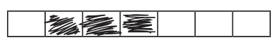

> 注意每艘战舰占据三个网格位置（和真正的棋盘游戏类似）。

44 第 2 章

### 首先，高层设计

我们知道我们会需要变量、一些数字和字符串、`if` 语句、条件测试和循环……但在哪里用、用多少？以及我们怎么把它们组合起来？要回答这些问题，我们需要更多关于游戏应该做什么的信息。

首先，我们需要弄清楚游戏的整体流程。基本思路如下：

1. **用户启动游戏**


A. 游戏在网格上的随机位置放置一艘战舰。

## 2. 游戏开始

在战舰被击沉前重复以下步骤：

A. 提示用户猜测（“2”、“0”等）。

B. 将用户的猜测与战舰位置对比，查看是命中、未命中还是击沉。

## 3. 游戏结束

根据猜测次数给用户一个评级。

现在我们对程序需要做的事情有了高层次的了解。接下来我们会为这些步骤补充更多细节。

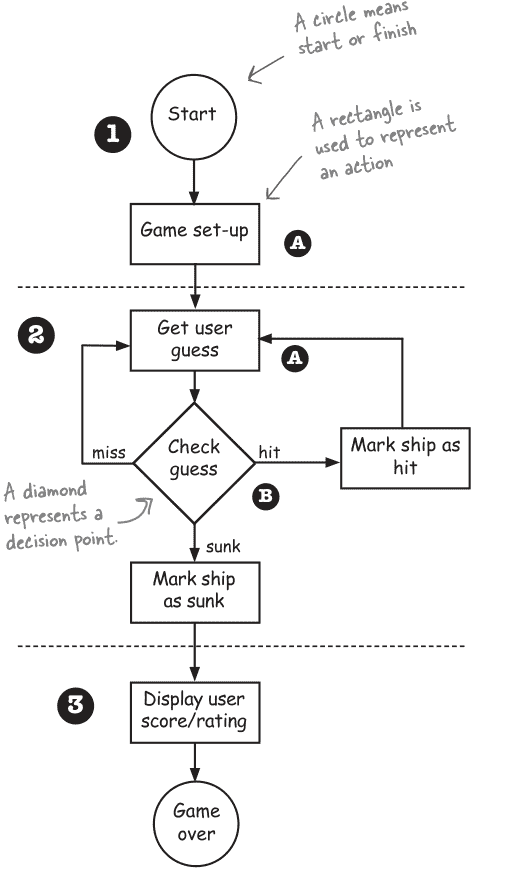

## 设计游戏

### 更多细节……

从高层设计和看起来专业的流程图来看，我们对这个游戏的工作方式已经有了相当好的了解，但在开始写代码之前，让我们再确定一些细节。

### 表示战舰

首先，我们可以先弄清楚如何在网格中表示一艘战舰。请记住，虚拟网格是……嗯，虚拟的。换句话说，它并不存在于程序中的任何地方。只要游戏和用户都知道战舰隐藏在七个可能位置（从零开始）中的三个连续单元格里，这一行本身就不需要以代码来表示。你可能会忍不住想要构建某种东西来保存全部七个位置，然后尝试把战舰放入这些位置。但我们不需要这么做。我们只需要知道战舰所在的单元格即可，比如，在单元格 1、2 和 3 中。

### 获取用户输入

那获取用户输入呢？我们可以用`prompt`函数来实现。每当我们需要从用户那里获得一个新位置时，我们就会使用`prompt`来显示消息并获取输入，也就是用户输入的一个 0 到 6 之间的数字。

### 显示结果

输出呢？目前，我们将继续使用`alert`来显示游戏输出。这有点笨拙，但能用就行。（对于真正的游戏，本书稍后我们会改为更新网页，但到那一步我们还有很长的路要走。）

1. **游戏启动**，创建一艘战舰，并将其放在七个单元格的单独一行中某三个单元格的位置上。

   位置只是整数；例如，1、2、3 就是下面这张图里的单元格位置：

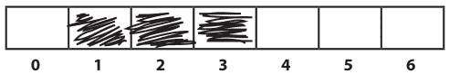

2. **游戏开始。** 提示用户猜测：

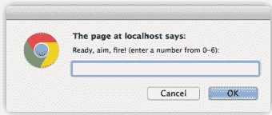

   A. 浏览器提示对话框用于用户输入。

   B. 检查用户的输入是否命中了战舰的任意一个单元格。用一个变量来记录命中次数。

3. **游戏结束**：当三个单元格都被命中，且我们的命中次数变量值为 3 时。我们告诉用户击沉战舰用了多少次猜测。

### 游戏交互示例

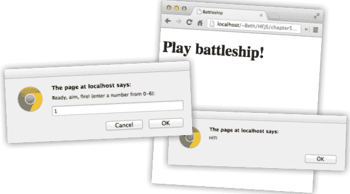

## 梳理伪代码

我们需要一种规划和编写代码的方法。我们将从编写*伪代码*开始。伪代码是真实 JavaScript 代码和纯英文程序描述之间的折中，正如你将看到的，它能帮助我们在不完全开发*真正的代码*的情况下，思考程序将如何工作。

在这段简单战舰游戏的伪代码中，我们包含了一个部分来描述需要的变量，以及一个部分来描述程序的逻辑。变量会告诉我们在代码中需要跟踪什么，而逻辑描述了代码必须忠实实现什么来创建游戏。

**声明**三个**变量**来保存战舰每个单元格的位置。我们称它们为`location1`、`location2`和`location3`。

**声明**一个**变量**来保存用户当前的猜测。我们称它为`guess`。

**声明**一个**变量**来保存命中次数。我们称它为`hits`，并**设置**其为 0。

**声明**一个**变量**来保存猜测次数。我们称它为`guesses`，并**设置**其为 0。

**声明**一个**变量**来跟踪战舰是否被击沉。我们称它为`isSunk`，并**设置**其为`false`。

```text
循环: 当战舰未被击沉时
    获取用户的猜测
    将用户的输入与有效输入值进行比较
        如果用户的猜测无效，
            告诉用户输入有效数字
        否则
            猜测次数加一
            如果用户的猜测匹配的是某个位置
                命中次数加一
                如果命中次数为 3
                    将 isSunk 设为 true
                    告诉用户"你击沉了我的战舰！"
                结束 如果
            结束 如果
        结束 否则
    结束 循环
告诉用户统计信息
```

> 我们需要的变量。

> 这是逻辑。

> 这不是 JavaScript，但你可能已经开始看到如何在代码中实现这个逻辑了。

> 注意我们使用缩进来帮助伪代码更易读。我们在真正的代码中也会这样做。

## 编写真正的代码

### 动动你的铅笔

假设我们的虚拟网格如下所示：

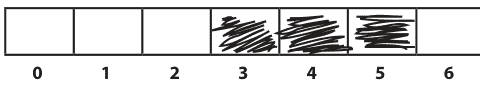

我们使用位置变量来表示战舰的位置，就像这样：

```javascript
location1 = 3;
location2 = 4;
location3 = 5;
```

使用以下序列作为你的测试用户输入：

```text
1, 4, 2, 3, 5
```

现在，使用前一页的伪代码，根据用户输入，逐步执行代码的每一步，看看它是如何工作的。在下面记录你的笔记。我们已经为你开始了这个练习。如果这是你第一次执行伪代码，请慢慢来，看看它是如何运作的。

> <- 如果你需要提示，可以快速查看本章末尾的答案。

| location1 | location2 | location3 | guess | guesses | hits | isSunk |
| :--- | :--- | :--- | :--- | :--- | :--- | :--- |
| 3 | 4 | 5 | --- | 0 | 0 | false |
| 3 | 4 | 5 | 1 | 1 | 0 | false |

> 第一行显示了变量在用户输入第一个猜测之前的初始值。我们没有初始化变量`guess`，所以它的值是`undefined`。

### 噢，在我们继续之前，别忘了 HTML！

没有一些 HTML 来链接你的代码，你走不远。请将下面的标记输入到一个名为“battleship.html”的新文件中。完成之后，我们将继续编写代码。

战舰游戏的 HTML 非常简单；我们只需要一个链接到 JavaScript 代码的页面，所有的动作都在那里发生。

```html
<!doctype html>
<html lang="en">
  <head>
    <title>Battleship</title>
    <meta charset="utf-8">
  </head>
  <body>
    <h1>Play battleship!</h1>
    <script src="battleship.js"></script>
  </body>
</html>
```

我们将 JavaScript 链接在页面的 `<body>` 底部，这样当浏览器开始执行“battleship.js”中的代码时，页面已经加载完毕。

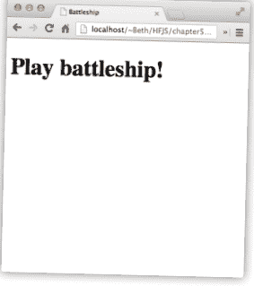

这是加载页面时你会看到的内容。我们需要编写一些代码来让游戏开始运行！

### 开动脑筋

活动一下你的脑细胞。

这有点超前思考，但你认为需要什么样的代码才能在每次加载页面时为战舰生成一个随机位置？为了正确放置战舰，你需要在代码中考虑哪些因素？可以在这里随意写下一些想法。

## 编写游戏代码

### 编写简单的战舰代码

我们将使用伪代码作为实际 JavaScript 代码的蓝图。首先，让我们处理所有需要的变量。再看一遍我们的伪代码，检查一下我们需要哪些变量：

**声明**三个*变量*来保存战舰每个单元格的位置。我们称它们为`location1`、`location2`和`location3`。

**声明**一个*变量*来保存用户当前的猜测。我们称它为`guess`。

**声明**一个*变量*来保存命中次数。我们将它称为`hits`，并**设置**为 0。

**声明**一个*变量*来保存猜测次数。我们将它称为`guesses`，并**设置**为 0。

**声明**一个*变量*来跟踪战舰是否被击沉。我们称它为`isSunk`，并**设置**为`false`。

我们需要三个变量来保存战舰的位置。

还需要另外三个（`guess`、`hits`和`guesses`）来处理用户的猜测。

以及另一个来跟踪战舰是否被击沉。

让我们将这些变量放入一个 JavaScript 文件中。创建一个名为“battleship.js”的新文件，并像这样输入你的变量声明：

```javascript
var location1 = 3;
var location2 = 4;
var location3 = 5;
```

这是我们三个位置变量。我们现在先在位置 3、4 和 5 设置一艘战舰，暂时先这样。

我们稍后会回来编写一些代码，为战舰生成一个随机位置，让用户更难猜中。

```javascript
var guess;
var hits = 0;
var guesses = 0;
```

变量`guess`在用户做出猜测之前不会有值。在此之前，它的值是`undefined`。

我们将为`hits`和`guesses`分配初始值 0。

```javascript
var isSunk = false;
```

最后，`isSunk`变量的值为`false`。当我们击沉战舰时，我们会将其设置为`true`。

> **严肃编码**

如果你不为变量提供初始值，JavaScript 会给它一个默认值`undefined`。可以将`undefined`值视为 JavaScript 表示“这个变量还没有被赋予值”的方式。我们稍后会更详细地讨论`undefined`和其他一些奇怪的值。

## 现在让我们编写游戏逻辑

我们已经处理好了变量，现在让我们深入研究实现游戏的实际伪代码。我们将把它分成几个部分。你首先要做的就是实现循环：当战舰没有被击沉时，它需要持续循环。然后，我们将处理从用户那里获取猜测并进行验证——你知道，确保它确实是一个 0 到 6 之间的数字——然后我们将编写检查是否命中战舰以及战舰是否被击沉的逻辑。最后，我们将为用户创建一个小报告，显示击沉战舰所用的猜测次数。


```text
循环：当战舰未被击沉时
    获取用户的猜测
    将用户输入与有效输入值进行比较
    如果用户的猜测无效，
        告诉用户输入一个有效的数字
    否则
        将猜测次数加一
        如果用户的猜测与某个位置匹配
            将命中次数加一
            如果命中次数是 3
                将 isSunk 设置为 true
                告诉用户“你击沉了我的战舰！”
            结束如果
        结束如果
    结束否则
结束循环
告诉用户统计数据
```

步骤 1：设置循环，获取用户输入并进行验证。

步骤 2：检查猜测。是命中了？还是未命中？

步骤 3：检查战舰是否被击沉。

步骤 4：向用户显示最终消息。

### 游戏逻辑步骤

- 创建循环并获取用户猜测
- 检查用户猜测
- 检查战舰是否被击沉
- 向用户显示统计信息

编写真实代码

你现在在这里 ➤ 51

## 游戏输入循环

### 第一步：设置循环，获取一些输入

- [ ] 创建循环并获取用户猜测
- [ ] 检查用户猜测
- [ ] 检查战舰是否被击沉
- [ ] 向用户显示统计信息

现在，我们将开始将游戏的逻辑转化为实际的 JavaScript 代码。伪代码到 JavaScript 之间没有完美的映射，所以你会看到一些地方需要调整。伪代码让我们很好地了解了代码需要*做什么*，现在我们必须编写 JavaScript 代码来实现*如何*做。

让我们从目前拥有的所有代码开始，然后我们将专注于我们正在添加的部分（以节省一些纸张，或者如果你在阅读电子版，则节省一些电子）：

**声明变量**

```javascript
var location1 = 3;
var location2 = 4;
var location3 = 5;
var guess;
var hits = 0;
var guesses = 0;
var isSunk = false;
```

我们已经介绍过这些了，但为了完整性，我们在这里将它们包含进来。

这是循环的开始。只要战舰没有被击沉，我们就还在游戏中，所以继续循环。

记住，`while`使用一个条件测试来确定是否继续循环。在这个例子中，我们测试`isSunk`是否仍然为`false`。一旦战舰被击沉，我们就会将其设置为`true`。

**循环**：当战舰未被击沉时

```javascript
while (isSunk == false) {
```

**获取**用户的猜测

```javascript
guess = prompt("Ready, aim, fire! (enter a number 0-6):");
```

```javascript
}
```

每次我们进入`while`循环，我们都会要求用户进行猜测。为此，我们使用`prompt`内置函数。关于这个函数，我们将在下一页详细介绍……

## prompt 的工作原理

浏览器提供了一个名为`prompt`的内置函数，你可以用它来从用户那里获取输入。`prompt`函数与你已经使用过的`alert`函数非常相似——`prompt`会显示一个带有你提供字符串的对话框，就像`alert`一样——但它也为用户提供了一个输入响应的地方。这个响应以字符串的形式返回，作为调用函数的结果。现在，如果用户取消对话框或没有输入任何内容，则返回`null`。

```javascript
guess = prompt("Ready, aim, fire! (enter a number 0-6):");
```

这里我们将`prompt`函数的结果赋值给`guess`变量。

你为`prompt`提供一个字符串，它将作为对话框中给用户的指令。

`prompt`函数的工作是从用户那里获取输入。根据你的设备，这通常在一个对话框中进行。

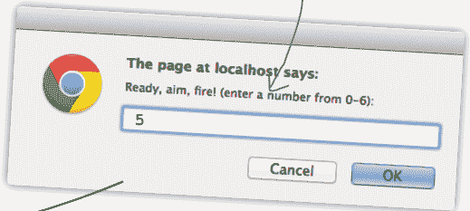

一旦`prompt`函数从用户那里获得输入，它就会将该输入返回到你的代码中。在这种情况下，输入以字符串的形式分配给变量`guess`。

### 小心！

……但别试。如果你试了，你的浏览器将开始一个*无限循环*，不断要求你输入猜测，然后又要求你输入猜测，如此循环往复，没有任何办法来停止循环（除了使用你的操作系统来强制停止浏览器进程）。

**你现在可能很想尝试这段代码……**

## 验证用户输入

### 检查用户的猜测

- ☑ 创建循环并获取用户猜测
- ☐ 检查用户猜测
- ☐ 检查舰船是否已被击沉
- ☐ 向用户显示统计信息

如果你查看伪代码，要检查用户的猜测，我们首先需要确保用户输入了有效的内容。如果是这样，那么我们还要检查猜测是命中还是未命中。我们还需要确保适当地更新`guesses`和`hits`变量。让我们从检查用户输入的有效性开始，如果输入有效，我们将递增`guesses`变量。之后，我们将编写代码来判断用户是命中还是未命中。

```javascript
// 变量声明放在这里

while (isSunk == false) {
    guess = prompt("准备，瞄准，开火！（输入一个 0 到 6 之间的数字）：");
    if (guess < 0 || guess > 6) {
        alert("请输入有效的单元格编号！");
    } else {
        guesses = guesses + 1;
    }
}
```

我们通过确保猜测值在零到六之间来检查有效性。

如果猜测无效，我们会用`alert`告知用户。

如果猜测有效，继续并将`guesses`加一，这样我们可以追踪用户猜测了多少次。

让我们更近距离地看看有效性测试。你知道我们在检查猜测是否在零到六之间，但这个条件判断究竟是如何工作的呢？让我们分解一下：

试着像读英语一样读这个：这个条件判断在用户猜测小于零**或者**用户猜测大于六时为真。如果其中任一条件成立，那么输入就是无效的。

```javascript
if (guess < 0 || guess > 6) {
```

这实际上只是将两个小的测试组合在一起。第一个测试检查`guess`是否小于零。

而这个检查`guess`是否大于六。

而这个，我们称为 **OR 运算符**，将两个测试组合起来，所以只要任一测试为真，整个条件判断就为真。如果两个测试都为假，那么该语句为假，且`guess`在 0 到 6 之间，这意味着它是有效的。

## 没有愚蠢的问题

**问：** 我注意到提示对话框上有一个取消按钮。**如果用户点击取消，`prompt`函数会返回什么？**

**答：** 如果你在提示对话框中点击取消，那么`prompt`会返回`null`而不是字符串。记住`null`意味着“无值”，这在当前情况下是合适的，因为你取消操作时没有输入任何值。我们可以利用`prompt`返回的值是`null`这一事实来检查用户是否点击了取消，如果确实如此，那么我们可以，比如说，结束游戏。我们的代码中没有这样做，但请把这个想法记在心里，因为我们可能会在本书后面用到它。

**答：** 在这种情况下，JavaScript 将无法将字符串转换为数字来进行比较。所以，你将会比较“six”和 6，或者“quit”和 6，而这种比较会返回`false`，导致**未命中**。在更健壮的战舰游戏版本中，我们会更仔细地检查用户输入，确保他们首先输入的是一个数字。

## 布尔运算符两分钟指南

布尔运算符用于布尔表达式，其结果为`true`或`false`。有两种布尔运算符：比较运算符和逻辑运算符。

### 比较运算符

比较运算符比较两个值。以下是一些常见的比较运算符：

| 运算符 | 含义 |
| :--- | :--- |
| `<` | 表示“小于” |
| `>` | 表示“大于” |
| `==` | 表示“等于” |


| `===` | 表示“完全等于”（我们稍后再详细讲这个！） |
|---|---|
| `<=` | 表示“小于或等于” |
| `>=` | 表示“大于或等于” |
| `!=` | 表示“不等于” |

**问：** 你说过 `prompt` 总是返回字符串。那么我们如何比较字符串值（如 `"0"` 或 `"6"`）和数字（如 `0` 和 `6`）呢？

**答：** 在这种情况下，JavaScript 会尝试将 `guess` 中的字符串转换为数字，以便进行比较 `guess < 0` 和 `guess > 6`。只要你只输入数字（如 `4`），JavaScript 就知道在需要时将字符串 `"4"` 转换为数字 `4`。我们将在后面更详细地讨论类型转换的话题。

**问：** 对于 OR 运算符，是只有其中一个为真时才为真，还是两个都可以同时为真？

**答：** 是的，两个都可以同时为真。OR 运算符（`||`）的结果是，如果任一测试为真，或者两者都为真，则结果为真。如果两者都为假，那么结果为假。

**问：** 如果用户在 `prompt` 中输入的不是数字怎么办？比如 `"six"` 或 `"quit"`？

**问：** 有 AND 运算符吗？

**答：** 有的！AND 运算符（`&&`）的工作方式与 OR 类似，只不过 AND 的结果只有在两个测试都为真时才为真。

**问：** 什么是无限循环？

**答：** 好问题。无限循环是困扰程序员的众多问题之一。记住，循环需要一个条件测试，只要该条件测试为真，循环就会继续。如果你的代码始终无法做出改变，使条件测试在某个点为假，那么循环就会永远继续下去。直到你关闭浏览器或重启电脑。

## 逻辑运算符

逻辑运算符组合两个布尔表达式，以产生一个布尔结果（`true` 或 `false`）。以下是两个逻辑运算符：

| 运算符 | 含义 |
|---|---|
| `||` | 表示 OR。如果**任一**表达式为真，则结果为真。 |
| `&&` | 表示 AND。如果**两个**表达式都为真，则结果为真。 |

另一个逻辑运算符是 NOT，它作用于一个布尔表达式（而不是两个）：

| 运算符 | 含义 |
|---|---|
| `!` | 表示 NOT。如果表达式为假，则结果为真。 |

## 判断命中

### 那么，我们命中了吗？

- ☑ 创建循环并获取用户猜测
- ☐ 检查用户猜测
- ☐ 检查舰船是否已被击沉
- ☐ 向用户显示统计信息

这里就是有趣的地方——用户已经猜测了舰船的位置，我们需要编写代码来判断该猜测是否命中了舰船。更具体地说，我们需要看看猜测是否与舰船的某个位置匹配。如果是这样，那么我们将递增 `hits` 变量。

以下是命中检测代码的首次尝试；让我们逐步分析：

```javascript
if (guess == location1) {
    hits = hits + 1;
} else if (guess == location2) {
    hits = hits + 1;
} else if (guess == location3) {
    hits = hits + 1;
}
```

如果 `guess` 等于 `location1`，那么我们命中了舰船，所以将 `hits` 变量加一。

否则，如果 `guess` 等于 `location2`，那么执行同样的操作。

最后，如果 `guess` 等于 `location3`，那么我们需要递增 `hits` 变量。

如果以上都不是，那么 `hits` 变量不会被递增。

注意我们使用缩进来表示每个 `if/else` 块中的代码。这让你的代码更易于阅读，尤其是当你有很多嵌套在块中的块时。

### 动动脑筋

你对这个首次尝试编写舰船命中检测代码有什么看法？它看起来比需要的更复杂吗？我们是不是在以一种似乎有点，嗯，冗余的方式重复代码？我们可以简化它吗？利用你对 `||` 运算符（也就是布尔 OR 运算符）的了解，你能简化这段代码吗？确保在继续之前，在章节末尾检查你的答案。

### 添加命中检测代码

让我们把前面几页的内容整合在一起：

```javascript
// 变量声明放在这里

while (isSunk == false) {
    guess = prompt("准备，瞄准，开火！（输入一个 0 到 6 之间的数字）：");
    if (guess < 0 || guess > 6) {
        alert("请输入有效的单元格编号！");
    } else {
        guesses = guesses + 1;
        if (guess == location1 || guess == location2 || guess == location3) {
            hits = hits + 1;
        }
    }
}
```

我们使用 `||`（OR）将三个条件合并为一个 `if` 语句。所以这样读：“如果 `guess` 等于 `location1` **或者** `guess` 等于 `location2` **或者** `guess` 等于 `location3`，则 `hits` 递增。”

### 嘿，你击沉了我的战舰！

我们就快完成了；游戏逻辑几乎已经搞定了。再看一遍伪代码，我们现在需要做的是测试我们是否有三次命中。如果有，那么我们就击沉了一艘战舰。而且，如果我们击沉了一艘战舰，那么我们需要将 `isSunk` 设置为 `true`，并告诉用户他们摧毁了一艘船。让我们在添加代码之前再勾勒一下：

```javascript
if (hits == 3) {
    isSunk = true;
    alert("你击沉了我的战舰！");
}
```

## 通知用户

### 提供一些游戏后分析

当 `isSunk` 被设置为 `true` 时，`while` 循环将停止循环。没错，这个我们已经如此熟悉的程序将停止执行 `while` 循环体，不知不觉游戏就会结束。但是，我们仍然需要向用户提供一些关于他们表现的统计信息。以下是一些完成此功能的代码：

```javascript
var stats = "You took " + guesses + " guesses to sink the battleship, " +
"which means your shooting accuracy was " + (3/guesses);

alert(stats);
```

这里我们创建了一个包含给用户信息的字符串，其中包括他们猜测的次数，以及他们射击的准确度。注意我们使用连接运算符 `+` 将字符串拆分成几部分（以便插入变量 `guesses`，也为了让字符串适应多行）。目前只需按原样输入即可，我们稍后会对此进行更多解释。

现在让我们将此代码和沉船检测添加到其余代码中：

```javascript
// Variable declarations go here

while (isSunk == false) {
    guess = prompt("Ready, aim, fire! (enter a number from 0-6):");
    if (guess < 0 || guess > 6) {
        alert("Please enter a valid cell number!");
    } else {
        guesses = guesses + 1;

        if (guess == location1 || guess == location2 || guess == location3) {
            hits = hits + 1;

            if (hits == 3) {
                isSunk = true;
                alert("You sank my battleship!");
            }
        }
    }
}

var stats = "You took " + guesses + " guesses to sink the battleship, " +
            "which means your shooting accuracy was " + (3/guesses);
alert(stats);
```

### 练习

记得我们说过伪代码通常并不完美吗？其实我们在最初的伪代码中遗漏了一些东西：我们没有告诉用户她的猜测是“击中”还是“未击中”。你能将这些代码片段插入到正确的位置来修正这一点吗？

```javascript
alert("HIT!");
else {
}
alert("MISS");
```

这是你需要插入的代码：

```javascript
// Variable declarations go here

while (isSunk == false) {
    guess = prompt("Ready, aim, fire! (enter a number from 0-6):");
    if (guess < 0 || guess > 6) {
        alert("Please enter a valid cell number!");
    } else {
        guesses = guesses + 1;
        if (guess == location1 || guess == location2 || guess == location3) {
            hits = hits + 1;
            if (hits == 3) {
                isSunk = true;
                alert("You sank my battleship!");
            }
        }
    }
}

var stats = "You took " + guesses + " guesses to sink the battleship, " +
    "which means your shooting accuracy was " + (3/guesses);

alert(stats);
```

> 这里有很多花括号需要匹配。如果你在匹配时遇到困难，可以直接在书上画线，将它们配对起来。

## 将所有代码整合在一起

### 这就完成了逻辑！

- [x] 创建循环并获取用户猜测
- [x] 检查用户猜测
- [x] 检查船是否被击沉
- [x] 向用户显示统计信息

好了！我们现在已将伪代码完全转换为实际的 JavaScript 代码。我们甚至发现了伪代码中遗漏的内容，并且已经将其纳入考虑。下面你可以找到完整的代码。确保你已经输入并将其保存在 `battleship.js` 文件中：

```javascript
var location1 = 3;
var location2 = 4;
var location3 = 5;
var guess;
var hits = 0;
var guesses = 0;
var isSunk = false;

while (isSunk == false) {
    guess = prompt("Ready, aim, fire! (enter a number from 0-6): ");
    if (guess < 0 || guess > 6) {
        alert("Please enter a valid cell number!");
    } else {
        guesses = guesses + 1;

        if (guess == location1 || guess == location2 || guess == location3) {
            alert("HIT!");
            hits = hits + 1;
            if (hits == 3) {
                isSunk = true;
                alert("You sank my battleship!");
            }
        } else {
            alert("MISS");
        }
    }
}
var stats = "You took " + guesses + " guesses to sink the battleship, " +
           "which means your shooting accuracy was " + (3/guesses);
alert(stats);
```

### 进行一点质量保证

QA，即质量保证，是测试软件以发现缺陷的过程。因此，我们将对这段代码进行一些质量保证。当你准备好了，在浏览器中加载 `battleship.html` 并开始游戏。尝试一些不同的操作。它工作得完美吗？还是你发现了一些问题？如果有的话，请在此列出。你也可以在本页看到我们的测试运行结果。

记下任何不能按预期工作或可以改进的地方。

以下是我们游戏交互的样子。

首先我们输入了一个无效数字，`9`。

然后我们输入 `0`，得到一个未击中。

但接着我们连续得到了三次击中！

在第三次也是最后一次击中时，我们击沉了战舰。

并且看到用了 `4` 次猜测击沉了这艘船，准确度为 `0.75`。

### 布尔运算符允许你编写更复杂的逻辑语句。

你已经见过足够多的条件语句，知道如何测试，比如，温度是否大于 `32` 度。或者，代表某个物品是否 `inStock` 的变量是否为 `true`。但有时我们需要测试更多。有时我们不仅需要知道一个值是否大于 `32`，还需要知道它是否小于 `100`。或者，一个物品是否 `inStock`，并且同时 `onSale`。又或者一个物品仅在用户是 VIP 会员的星期二打折。所以，你看，这些条件可能会变得复杂。

让我们逐步分析几个例子，以便更好地了解它们是如何工作的。

假设我们需要测试一个物品是否 `inStock` 并且 `onSale`。我们可以这样做：

```javascript
if (inStock == true) {
    if (onSale == true) {
        // sounds like a bargain!
        alert("buy buy buy!");
    }
}
```

注意这段代码只有在两个条件都为真时才会执行！

我们可以通过组合这两个条件来简化这段代码。与我们在简单战舰游戏中测试 `guess < 0` 或 `guess > 6` 不同，这里我们想知道 `inStock` 是否为真并且 `onSale` 是否为真。让我们看看如何做到这一点……

这是我们的 **AND**（与）运算符。使用 **AND**，这个组合条件仅在第一部分 **AND** 第二部分都为真时才为真。

```javascript
if (inStock == true && onSale == true) {
    // sounds like a bargain!
    alert("buy buy buy!");
}
```

这段代码不仅更简洁，而且更具可读性。将这段代码与前一页的代码进行比较看看。

我们不必止步于此；我们可以以多种方式组合布尔运算符：

现在我们在同一个条件表达式中同时使用了 **AND** 和 **OR**（或）。这个条件的意思是：如果一个物品有库存，并且它要么在打折，要么价格低于 `60`，那么就购买。

```javascript
if (inStock == true && (onSale == true || price < 60)) {
    // sounds like a bargain!
    alert("buy buy buy!");
}
```

注意我们使用了括号将条件分组，这样我们首先得到 **OR** 的结果，然后使用该结果来计算 **AND** 的结果。

### 磨练你的铅笔（动动脑筋）

下面有一堆需要求值的布尔表达式。填写空白处，然后在继续之前在本章末尾检查你的答案。

```javascript
var temp = 81;
var willRain = true;
var humid = (temp > 80 && willRain == true);

var guess = 6;
var isValid = (guess >= 0 && guess <= 6);

var kB = 1287;
var tooBig = (kB > 1000);
var urgent = true;
var sendFile =
    (urgent == true || tooBig == false);
```

```javascript
var keyPressed = "N";
var points = 142;
var level;
if (keyPressed == "Y" ||
        (points > 100 && points < 200)) {
    level = 2;
} else {
    level = 1;
}
```

**`humid`** 的值是多少？____________________

**`isValid`** 的值是多少？____________________

**`sendFile`** 的值是多少？____________________

**`level`** 的值是多少？____________________

## 布尔运算符练习

### 练习

来自会计部的鲍勃和比尔正在为公司网站开发一个新的价格查询应用。他们都用布尔表达式写了 `if/else` 语句，而且都确信自己的代码是正确的。哪位会计是对的呢？这些会计真的应该写代码吗？在继续之前，先查看本章末尾的答案。

```javascript
if (price < 200 || price > 600) {
    alert("Price is too low or too high! Don't buy the gadget.");
} else {
    alert("Price is right! Buy the gadget.");
}
```


```javascript
if (price >= 200 || price <= 600) {
    alert("Price is right! Buy the gadget.");
} else {
    alert("Price is too low or too high! Don't buy the gadget.");
}
```

### 我们能聊聊你的冗长吗……

不知道该怎么开口，但你在设定条件时有点过于啰嗦了。什么意思呢？看看这个条件：

我们经常将布尔变量与`true`或`false`进行比较来形成条件。

```javascript
if (inStock == true) {
    ...
}
```

而`inStock`是一个保存`true`或`false`布尔值的变量。

事实证明，这有点多此一举。条件语句的全部意义就在于它求值结果为`true`或`false`，但我们的布尔变量`inStock`本身就已经是这些值之一了。所以，我们不需要将变量与任何东西比较；它可以独立存在。也就是说，我们可以直接这样写：

```javascript
if (inStock) {
    ...
}
```

如果我们直接使用布尔变量本身，那么如果该变量为`true`，条件测试就为`true`，代码块就会执行。

而如果`inStock`为`false`，条件测试就失败，代码块就会被跳过。

现在，虽然有些人可能会说我们原来冗长的版本意图更清楚，但在实践中更常见的是看到更简洁的版本。而且，你会发现不那么啰嗦的版本更容易阅读。

### 练习

下面有两个语句，在条件语句中使用`onSale`和`inStock`变量来确定`buyIt`变量的值。为两个语句分别遍历`inStock`和`onSale`的所有可能值。哪个版本更"大手大脚"？

```javascript
var buyIt = (inStock || onSale);
```

| onSale | inStock | buyIt | buyIt |
|--------|---------|-------|-------|
| true   | true    |       |       |
| true   | false   |       |       |
| false  | true    |       |       |
| false  | false   |       |       |

```javascript
var buyIt = (inStock && onSale);
```

我跟你说，太残酷了。不管我们做什么，就好像……就好像……他们完全知道我们的船在哪里！

你觉得这`racket`跟你把船的位置硬编码了有关系吗？

### 完成简易战舰游戏

是的，我们还有一个小问题要处理，因为目前你把船的位置硬编码了——无论玩多少次游戏，船总是在位置 3、4 和 5。这对测试来说倒是不错，但我们真的需要随机放置船，这样对用户来说才更有趣。

让我们退一步，想想在七个格子的一维网格上放置船的正确方法。我们需要一个起始位置，使我们能把船放在网格上三个连续的位置。这意味着我们需要一个从 0 到 4 的起始位置。

### 如何分配随机位置

现在，一旦我们有了起始位置（在 0 到 4 之间），我们就简单地使用它和接下来的两个位置来放置船。

```javascript
var location1 = randomLoc;
var location2 = location1 + 1;
var location3 = location2 + 1;
```

好的，但如何生成随机数呢？这就需要借助 JavaScript 及其内置函数了。更具体地说，JavaScript 附带了一大堆与数学相关的内置函数，包括几个可以用来生成随机数的函数。现在我们要更深入地了解内置函数，以及通常意义上的函数，不过这在书中稍后的部分。目前，我们只是要使用这些函数来完成我们的工作。

### 生成随机数的举世闻名的配方

我们从`Math.random`函数开始。调用这个函数会返回一个随机小数：

```javascript
var randomLoc = Math.random();
```

我们需要的是 0 到 4 之间的整数——也就是 0、1、2、3 或 4——而不是像 0.34 这样的小数。首先，我们可以将`Math.random`返回的数乘以 5，这样就更接近了；我们的意思是……

### 使用随机数

首先，如果我们将随机数乘以 5，我们会得到一个介于 0 和 5 之间的数，但不包括 5。比如 0.13983、4.231、2.3451，或者比如说 4.999。

```javascript
var randomLoc = Math.random() * 5;
```

记住，`*`表示乘法。

这更接近了！现在我们需要做的就是截掉数字的末尾，得到一个整数。为此，我们可以使用另一个内置的 Math 函数，`Math.floor`：

我们可以用`Math.floor`将这些数字全部向下取整到最近的整数值。

```javascript
var randomLoc = Math.floor(Math.random() * 5);
```

所以，例如，0.13983 变成 0，2.34 变成 2，4.999 变成 4。

## 没有愚蠢的问题

**问：** 如果我们想生成一个 0 到 4 之间的数，为什么代码里用的是 5，就像`Math.floor(Math.random() * 5)`这样？

**答：** 好问题。首先，`Math.random`生成一个介于 0 和 1 之间的数，但不包括 1。你能从`Math.random`得到的最大数是 0.999……。当你把这个数乘以 5 时，你能得到的最大数是 4.999……。`Math.floor`总是向下取整，所以 1.2 变成 1，但 1.9999 也变成 1。如果我们生成一个从 0 到 4.999……的数，那么所有结果都会被向下取整到 0 到 4。这不是唯一的方法，而且在其他语言中通常做法不同，但这是你在大多数 JavaScript 代码中会看到的方式。

**问：** 那如果我想生成一个 0 到 100 之间的随机数（包括 100），我应该写`Math.floor(Math.random() * 101)`吗？

**答：** 没错！乘以 101，并使用`Math.floor`向下取整，能确保你的结果最大为 100。

**问：** `Math.random()`里的括号是干什么的？

**答：** 每当我们"调用"一个函数时，都要用到括号。有时我们需要向函数传递一个值，就像我们用`alert`显示消息时那样；有时则不需要，就像使用`Math.random`时那样。但每当你调用一个函数（无论是内置的还是其他的），你都需要使用括号。现在别担心这个；我们会在下一章详细介绍所有这些细节。

**问：** 我的战舰游戏没法运行。我的网页上除了"Play battleship"标题外什么也看不到。我怎么才能找出我哪里做错了？

**答：** 这时候使用控制台就能派上用场了。如果你犯了像忘记字符串的引号这样的错误，JavaScript 通常会抱怨程序的语法不对，甚至可能显示你的错误所在的行号。然而，有时错误更加微妙。例如，如果你不小心写了`isSunk = false`而不是`isSunk == false`，你不会看到 JavaScript 错误，但你的代码不会按你期望的方式运行。对于这种类型的错误，尝试使用`console.log`在代码的各个点显示变量的值，看看能否追踪到错误。

### 返回去做更多质量保证

这就是我们所需要的。让我们把这些代码拼凑起来（我们已经在下面做了），并用它替换你现有的位置代码。完成后，运行几次测试，看看你能多快击沉敌舰。

```javascript
var randomLoc = Math.floor(Math.random() * 5);
var location1 = randomLoc;
var location2 = location1 + 1;
var location3 = location2 + 1;
var guess;
var hits = 0;
var guesses = 0;
var isSunk = false;

while (isSunk == false) {
    guess = prompt("Ready, aim, fire! (enter a number from 0-6): ");
    if (guess < 0 || guess > 6) {
    // 你的其余代码放在这里……
```

> 继续用你的位置变量声明替换这些新语句。

这是我们的一次测试会话。既然船的位置是随机的，游戏变得更有趣了一些。但我们还是取得了相当不错的成绩……

## 找出 bug 的练习

等等，我们注意到有些地方看起来不对。提示：当我们输入 0, 1, 1, 1 的时候，结果看起来就不对！你能找出发生了什么吗？

### 练习

这是我们的猜测……

第一次猜测没中。

第二次猜测我们找到了飞船的一个位置。

然后我们一直输入同一个位置，一直得到命中！

第三次命中时，我们看到战列舰沉了！但有些地方不对。我们不应该通过击中同一个位置三次就击沉它`_three_hits_blob2:0!2+...`

`_Tiles_`我们输入了 0, 1, 1, 1，而飞船在 1, 2, 3。

### 悬念迭起！

我们会**找到**这个 bug 吗？

我们会**修复**这个 bug 吗？

敬请期待本书后面大幅改进的战舰游戏版本……

同时，看看你能不能想出如何修复这个 bug 的办法。

**质量保证说明**

发现一个 bug！

输入同一个命中数字会导致飞船被击沉，而这是不应该的。

### 恭喜你完成了第一个真正的 JavaScript 程序，以及关于代码复用的简短说明

你可能已经注意到，我们使用了一些内置函数，比如`alert`、`prompt`、`console.log`和`Math.random`。毫不费力地，这些函数让你拥有了弹出对话框、向控制台输出日志以及生成随机数的能力，几乎就像魔法一样。但是，这些内置函数只是已经为你写好的封装代码，正如你所见，它们的强大之处在于你可以随时调用它们来复用。

关于函数还有很多需要学习的内容：如何调用它们、可以传递哪些类型的值等等，我们将在下一章开始深入探讨这些，届时你将学习创建自己的函数。

但在那之前，你有要点回顾要完成，有填字游戏要做……哦，还要好好睡上一觉，让所有知识都沉淀下来。


#### 要点回顾

- 你可以使用流程图来概述 JavaScript 程序的逻辑，展示决策点和操作。
- 在开始编写程序之前，先用伪代码勾勒出程序需要完成的任务是个不错的主意。
- **伪代码**是对你的真实代码应该做什么的近似描述。
- 布尔运算符有两种类型：比较运算符和逻辑运算符。在表达式中使用时，布尔运算符的结果是`true`或`false`。
- **比较**运算符比较两个值，结果是`true`或`false`。例如，我们可以使用布尔比较运算符`<`（"小于"）像这样：`3 < 6`。这个表达式的结果是`true`。
- **逻辑**运算符组合两个布尔值。例如`true || false`结果是`true`；`true && false`结果是`false`。
- 你可以使用`Math.random`函数生成一个 0 到 1 之间的随机数（包括 0，但不包括 1）。
- `Math.floor`函数将小数向下取整到最近的整数。
- 使用`Math.random`和`Math.floor`时，确保`Math`的 M 是大写的，而不是小写 m。
- JavaScript 函数`prompt`显示一个带有消息和用户输入空间的对话框。
- 在本章中，我们使用`prompt`获取用户输入，使用`alert`在浏览器中显示战舰游戏的结果。

## JavaScript 填字游戏


## JavaScript 填字

填字游戏如何帮助你学习 JavaScript？那些思维的转折将把 JavaScript 刻进你的大脑！

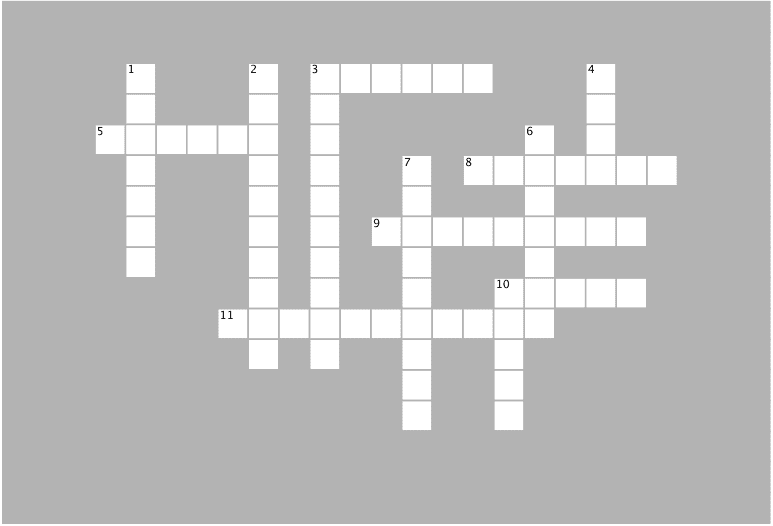

### 横向

- 3. 要获取用户输入，你可以使用`________`函数。
- 5. 要随机选择飞船的位置，使用`Math.________`。
- 8. 我们使用`________`变量来追踪飞船是否被击沉。
- 9. 如果你不初始化变量，它的值是`________`。
- 10. 布尔运算符的结果总是`true`或`________`。
- 11. `while`和`if`语句都使用`________`测试。

### 纵向

- 1. 如果你擅长测试程序，你可能会想成为一名`________`保证专家。
- 2. `==`是一个`____________`运算符，你可以用它来测试两个值是否相同。
- 3. 这帮助你思考程序将如何工作。
- 4. 要从 AND 运算符（`&&`）获得`true`值，条件的两部分都必须`__________`。
- 6. OR（`||`）和 AND（`&&`）是`____________`运算符。
- 7. JavaScript 有许多内置的`________`，比如`alert`和`prompt`。
- 10. 要从 OR 运算符（`||`）获得`false`值，条件的两部分都必须`__________`。

### 动动脑筋解答

假设我们的虚拟行看起来像这样：

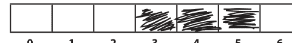

我们通过设置来表示：

```javascript
location1 = 3;
location2 = 4;
location3 = 5;
```

假设用户输入如下：

```text
1, 4, 2, 3, 5
```

现在，使用上一页的伪代码，逐步跟踪代码的执行，看看它是如何工作的。在下面记下你的笔记。我们已经在下面开始了跟踪。这是我们的解答。

| location1 | location2 | location 3 | guess | guesses | hits | isSunk |
|-----------|-----------|------------|-------|---------|------|--------|
| 3         | 4         | 5          | ---   | 0       | 0    | `false` |
| 3         | 4         | 5          | 1     | 1       | 0    | `false` |
| 3         | 4         | 5          | 4     | 2       | 1    | `false` |
| 3         | 4         | 5          | 2     | 3       | 1    | `false` |
| 3         | 4         | 5          | 3     | 4       | 2    | `false` |
| 3         | 4         | 5          | 5     | 5       | 3    | `true` |

## 练习解答

下面有两个语句，在条件判断中使用`onSale`和`inStock`变量来确定`buyIt`变量的值。针对两个语句，逐一分析`inStock`和`onSale`的所有可能值。哪个版本花钱更大胆？是 OR（`||`）运算符！

```javascript
var buyIt = (inStock || onSale);
```

| onSale | inStock | buyIt | buyIt |
|--------|---------|-------|-------|
| true   | true    | true  | true  |
| true   | false   | true  | false |
| false  | true    | true  | false |
| false  | false   | false | false |

```javascript
var buyIt = (inStock && onSale);
```

### 动动脑筋解答

下面我们有一大堆需要求值的布尔表达式。填空。这是我们的解答：

```javascript
var temp = 81;
var willRain = true;
var humid = (temp > 80 && willRain == true);
```

**humid** 的值是多少？**true**

```javascript
var guess = 6;
var isValid = (guess >= 0 && guess <= 6);
```

**isValid** 的值是多少？**true**

```javascript
var kB = 1287;
var tooBig = (kB > 1000);
var urgent = true;
var sendFile =
    (urgent == true || tooBig == false);
```

**sendFile** 的值是多少？**true**

```javascript
var keyPressed = "N";
var points = 142;
var level;
if (keyPressed == "Y" ||
    (points > 100 && points < 200)) {
    level = 2;
} else {
    level = 1;
}
```

**level** 的值是多少？**2**


来自会计部门的 Bob 和 Bill 正在为公司网站开发一个新的价格检查应用程序。他们都编写了使用布尔表达式的`if/else`语句。两人都确信自己写的是正确的代码。哪位会计师是对的？这些会计师应该写代码吗？这是我们的解答。


```javascript
if (price < 200 || price > 600) {
    alert("Price is too low or too high! Don't buy the gadget.");
} else {
    alert("Price is right! Buy the gadget.");
}
```


```javascript
if (price >= 200 || price <= 600) {
    alert("Price is right! Buy the gadget.");
} else {
    alert("Price is too low or too high! Don't buy the gadget.");
}
```

Bob 是更好的程序员（也可能，是更好的会计师）。Bob 的方案有效，但 Bill 的不行。要知道为什么，我们用三个不同的价格（太低、太高和刚好合适）来试试 Bob 和 Bill 的条件判断，看看我们得到什么结果：

| price | Bob's | Bill's |
| :---: | :--- | :--- |
| 100 | true | true |
| | alert: Don't buy! | alert: Buy! |
| 700 | true | true |
| | alert: Don't buy! | alert: Buy! |
| 400 | false | true |
| | alert: Buy! | alert: Buy! |

> 如果价格是 100，那么 100 小于 200，所以 Bob 的条件为 true（记住，使用 OR 时，只需要其中一个表达式为 true，整个表达式就为 true），我们弹出不要购买的 alert。

但 Bill 的条件也为 true，因为价格 <= 600！所以整个表达式的结果是 true，我们提醒用户购买，即使价格太低了。

> 结果发现 Bill 的条件总是 true，无论价格是多少，所以他的代码每次都告诉我们要购买！Bill 还是专心做会计吧。

## 练习解答

还记得我们说过伪代码往往并不完美吗？实际上，我们在最初的伪代码中遗漏了一点：我们没有告诉用户她的猜测是命中还是未命中。你能将这些代码片段插入到正确的位置来修正这一点吗？这是我们的解决方案：

```javascript
// 变量声明放在这里

while (isSunk == false) {
    guess = prompt("Ready, aim, fire! (enter a number from 0-6):");
    if (guess < 0 || guess > 6) {
        alert("Please enter a valid cell number!");
    } else {
        guesses = guesses + 1;
        if (guess == location1 || guess == location2 || guess == location3) {
            alert("HIT!");
            hits = hits + 1;
            if (hits == 3) {
                isSunk = true;
                alert("You sank my battleship!");
            }
        } else {
            alert("MISS");
        }
    }
}
var stats = "You took " + guesses + " guesses to sink the battleship, " +
            "which means your shooting accuracy was " + (3/guesses);
alert(stats);
```

### 动动脑筋解答

你觉得这份检测舰船被击中的初次代码尝试如何？它看起来是否比需要的更复杂，或者我们是否以某种方式重复了代码，显得有些冗余？我们能简化它吗？利用你所知道的`||`运算符（即布尔 OR 运算符），你能简化这段代码吗？这是我们的解决方案。

```javascript
if (guess == location1) {
    hits = hits + 1;
} else if (guess == location2) {
    hits = hits + 1;
} else if (guess == location3) {
    hits = hits + 1;
}
```

我们这里一遍又一遍地使用了相同的代码。

如果我们需要更改命中次数的更新方式，就得在三个地方修改代码。这类更改常常是代码中缺陷和问题的来源。

不仅如此，这段代码比需要的复杂得多。它比应有的更难阅读，而且花费了比需要更多的思考和输入。

但是，使用布尔 OR 运算符，我们可以将测试条件组合起来，这样如果`guess`匹配`location1`、`location2`或`location3`中的任何一个，那么`if`条件就会为真，`hits`变量就会被更新。

```javascript
if (guess == location1 || guess == location2 || guess == location3) {
    hits = hits + 1;
}
```

这不是看起来舒服多了吗？更不用说更容易理解了。

而且如果我们需要更改`hits`的更新方式，那么我们只需要在一个地方修改，这样出错的概率就小得多了。

### JavaScript 填字解答

填字游戏怎么能帮助你学习 JavaScript 呢？那些脑力曲折会把 JavaScript 直接刻进你的大脑！这是我们的解答。

# 3 函数入门

## 玩转函数

准备好迎接你的第一个超能力吧。你已经有了一定的编程基础；现在该是时候用函数来真正推动事情发展了。函数赋予你编写代码的能力，这些代码可以应用于各种不同的情况，可以反复使用，更加易于管理，可以被抽象出来并赋予一个简单的名称，这样你就可以忘掉所有的复杂性，专注于重要的事情。你会发现，函数不仅是从脚本编写者迈向程序员的门户，也是 JavaScript 编程风格的关键。在本章中，我们将从基础开始：函数的真正工作原理、来龙去脉，然后你将在本书的其余部分不断磨练你的函数技能。所以，让我们现在就打好基础，立刻开始。

随着我们在本书中的进展，会有更多相关内容。

## 代码分析

## 动动脑筋

对下面的代码做一点分析。它看起来怎么样？在下方选择尽可能多的选项，或者写下你自己的分析：

```javascript
var dogName = "rover";
var dogWeight = 23;
if (dogWeight > 20) {
  console.log(dogName + " says WOOF WOOF");
} else {
  console.log(dogName + " says woof woof");
}
dogName = "spot";
dogWeight = 13;
if (dogWeight > 20) {
  console.log(dogName + " says WOOF WOOF");
} else {
  console.log(dogName + " says woof woof");
}
dogName = "spike";
dogWeight = 53;
if (dogWeight > 20) {
  console.log(dogName + " says WOOF WOOF");
} else {
  console.log(dogName + " says woof woof");
}
dogName = "lady";
dogWeight = 17;
if (dogWeight > 20) {
  console.log(dogName + " says WOOF WOOF");
} else {
  console.log(dogName + " says woof woof");
}
```

- A. 这段代码看起来非常冗余。
- B. 如果我们想要更改输出的显示方式，或者添加另一个狗的体重范围，这将需要大量的修改工作。
- C. 看起来输入起来很繁琐！
- D. 这不是我见过最易读的代码。
- E. _________________________________

## 这段代码到底有什么问题？

我们刚看了一些被反复使用的代码。这有什么问题呢？嗯，表面上看，没什么问题。毕竟，它能正常工作，对吧？让我们仔细看看相关的代码：

```javascript
var dogName = "rover";
var dogWeight = 23;
if (dogWeight > 20) {
    console.log(dogName + " says WOOF WOOF");
} else {
    console.log(dogName + " says woof woof");
}

dogName = "lady";
dogWeight = 17;
if (dogWeight > 20) {
    console.log(dogName + " says WOOF WOOF");
} else {
    console.log(dogName + " says woof woof");
}
```

> 我们在这里做的是将狗的体重与 20 进行比较，如果大于 20，就输出一个大大的 WOOF WOOF。如果小于 20，就输出一个小一点的 woof woof。

> 而这段代码……哎呀！它做的是完全相同的事情。而且在代码的其余部分如此反复多次。

```javascript
dogName = "spike";
dogWeight = 53;
if (dogWeight > 20) {
    console.log(dogName + " says WOOF WOOF");
} else {
    console.log(dogName + " says woof woof");
}
dogName = "lady";
dogWeight = 17;
if (dogWeight > 20) {
    console.log(dogName + " says WOOF WOOF");
} else {
    console.log(dogName + " says woof woof");
}
```

当然，这段代码看起来无害，但它写起来很繁琐，读起来很痛苦，而且如果你的代码需要随时间变化，那将会是个问题。最后一点会随着你编程经验的增加而越来越有体会——所有代码都会随时间变化，而上面的代码简直是一场噩梦，因为我们把相同的逻辑重复了一遍又一遍，如果你需要改变这个逻辑，你就得在多个地方修改。而且程序越大，你需要做的修改就越多，导致出错的机会也就越多。我们真正想要的是找到一种方法，把这样的冗余代码放到一个地方，可以在需要时轻松重复利用。

> 我们如何改进这段代码？花几分钟想想几种可能性。JavaScript 有没有什么可以帮助我们的东西？

> 要是我能找到一种方法复用代码，这样每当我需要它的时候，就可以直接使用它，而不是重新输入它。而且能给它起个好记的名字，这样我就能记住它。当有什么变化时，只需要在一处修改，而不是很多地方。那就太完美了。但我知道这只是个幻想……

## 对了，我们有没有提到函数？

来认识一下函数。JavaScript 函数允许你取一小段代码，给它起个名字，然后在我们需要时反复引用它。这听起来正是我们需要的良药。

假设你正在编写一些代码，需要做很多“吠叫”的操作。如果你的代码处理的是大狗，那么叫声就是大大的“WOOF WOOF”。如果是小狗，叫声就是小小的“woof woof”。你需要在代码中多次使用这个吠叫的功能。让我们写一个可以反复使用的`bark`函数：

```javascript
function bark(name, weight) {
}
```

现在我们需要编写函数的代码；我们的代码将检查体重并输出相应大小的叫声。

```javascript
function bark(name, weight) {
    if (weight > 20) {
        console.log(name + " says WOOF WOOF");
    } else {
        console.log(name + " says woof woof");
    }
}
```

现在你有了一个可以在代码中使用的函数。让我们看看它是如何工作的……

## 好的，但它是如何实际工作的呢？

首先，让我们使用新函数`bark`来重构我们的代码：

```javascript
function bark(name, weight) {
    if (weight > 20) {
        console.log(name + " says WOOF WOOF");
    } else {
        console.log(name + " says woof woof");
    }
}

bark("rover", 23);
bark("spot", 13);
bark("spike", 53);
bark("lady", 17);
```

> 啊，这样很好，代码的所有逻辑都集中在一个地方了。

> 现在，所有那些代码变成了仅仅几次对`bark`函数的调用，将每只狗的名字和体重传递给它。

> 哇，现在变得简单多了！

哇，代码量减少了很多——而且对于需要进入你的代码并做快速修改的同事来说，它的可读性也强多了。我们也把所有逻辑都放在了一个方便的位置。

好的，但它到底是如何组合在一起并实际工作的呢？让我们一步一步地来讲解。

## 首先是函数

所以我们在代码的最顶部定义了`bark`函数。浏览器读取这段代码，看到这是一个函数，然后查看函数体中的语句。浏览器知道现在并不执行这些函数语句；它会等到函数在代码的其他地方被调用时才会执行。

还要注意这个函数是参数化的，这意味着它在被调用时接受一个狗的名字和体重。这使你可以为任意多只不同的狗调用这个函数。每次调用时，逻辑都会应用于你传递给函数调用的名字和体重。

```javascript
function bark(name, weight) {
    if (weight > 20) {
        console.log(name + " says WOOF WOOF");
    } else {
        console.log(name + " says woof woof");
    }
}
```

> 再次说明，这些是参数；它们在函数被调用时被赋予值。

> 函数内部的所有内容就是函数的函数体。

## 现在让我们调用函数

要调用或执行一个函数，只需使用其名称，后跟一个左括号，然后是任何需要传递给它的值（用逗号分隔），最后是一个右括号。括号中的值是参数。对于`bark`函数，我们需要两个参数：狗的名字和狗的体重。

下面是调用的工作原理：

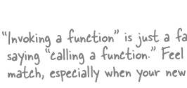


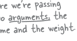

```javascript
bark("rover", 23);
```

```text
"rover"
```

```text
23
```

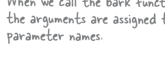

```javascript
function bark(name, weight) {
  if (weight > 20) {
    console.log(name + " says WOOF WOOF");
  } else {
    console.log(name + " says woof woof");
  }
}
```

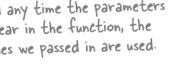

## 调用函数后，函数体完成所有工作

在我们知道了每个参数的值后——比如`name`是"rover"，`weight`是23——我们就准备好执行函数体了。

函数体中的语句从上到下执行，就像你一直在编写的所有其他代码一样。唯一的区别是，参数名`name`和`weight`已经被赋予了你传入函数的参数值。

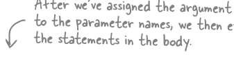

```javascript
function bark(name, weight) {
  if (23 > 20) {
    console.log("rover" + " says WOOF WOOF");
  } else {
    console.log("rover" + " says woof woof");
  }
}
```

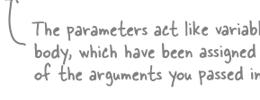

you are here ▶ 85

当它完成时……函数体的逻辑已经执行完毕（在这个例子中，你会看到 Rover 体重 23 磅，发出"WOOF WOOF"的声音），函数也就完成了。函数完成后，控制权返回到调用`bark`之后的语句。

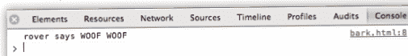

使用浏览器的开发者工具访问控制台，这样你就可以看到`bark`的输出。

```javascript
function bark(name, weight) {
    if (weight > 20) {
        console.log(name + " says WOOF WOOF");
    } else {
        console.log(name + " says woof woof");
    }
}

bark("rover", 23);
bark("spot", 13);
bark("spike", 53);
bark("lady", 17);
```

我们刚刚做了这个……

……接下来就做这个。

当函数完成后，浏览器从我们调用函数的位置之后开始执行下一行代码。

这里，我们再次调用函数，传递不同的参数，所以整个过程又重新开始了！


动动笔


下面有一些对`bark`的更多调用。在每个调用旁边，写下你认为输出应该是什么，或者你认为代码会导致错误。在继续之前，请在本章末尾检查你的答案。

```javascript
bark("juno", 20);
bark("scottie", -1);
bark("dino", 0, 0);
bark("fido", "20");
bark("lady", 10);
bark("bruno", 21);
```

在这里写下你认为控制台日志将显示的内容。

嗯，知道这些是做什么的吗？

### 代码磁贴

这段可工作的 JavaScript 代码全部被打乱放在冰箱上。你能重构这些代码片段，使其成为一个能产生下面列出输出的工作程序吗？注意，冰箱上可能有一些额外的代码，所以你可能不会使用所有的磁贴。请在本章末尾检查你的答案。


```javascript
,

,

,

}

}

}

(

{

function

)

whatShallIWear(80);

else {

    console.log("Wear t-shirt");

}

whatShallIWear

else if (temp < 70) {

    console.log("Wear a sweater");

}

temperature

if (temp < 60) {

    console.log("Wear a jacket");

}

temp

whatShallIWear(60);

whatShallIWear(50);
```

| JavaScript 控制台 |
| :--- |
| Wear a jacket |
| Wear a t-shirt |
| Wear a sweater |

← 我们用它来表示一个通用的控制台。

### 函数大揭秘

本周访谈：函数的亲密一面……

**Head First：** 欢迎函数！我们期待深入了解你究竟是什么。

**Function：** 很高兴来到这里。

**Head First：** 我们注意到许多 JavaScript 新手往往会忽略你。他们只是开始写代码，一行一行，从上到下，完全不用函数。你真的有必要吗？

**Function：** 那些新手错过了很多东西。这很不幸，因为我功能强大。可以这样想我：我给你一种方式，将代码写一次，然后反复重用它。

**Head First：** 嗯，请原谅我这么说，但如果你只是给了他们反复做同一件事的能力……这有点无聊，不是吗？

**Function：** 不，不，函数是参数化的——换句话说，每次你使用函数时，你传递给它参数，这样它就能计算与你需求相关的内容。

**Head First：** 呃，举个例子？

**Function：** 假设你需要向用户展示购物车中商品的费用，于是你编写了一个函数`computeShoppingCartTotal`。然后你可以将许多用户的购物车传递给该函数，每次我都会计算每个特定购物车的金额。

**Head First：** 如果你这么棒，为什么没有更多的新手程序员使用你呢？

**Function：** 甚至这不是一个真实的陈述；他们一直在使用我：`alert`、`prompt`、`Math.random`、`document.write`。不使用函数很难写出任何有意义的东西。与其说新手不使用函数，不如说他们只是没有定义自己的函数。

**Head First：** 嗯，对，`alert`和`prompt`，这些说得通，但拿`Math.random`来说——它看起来不太像一个函数。

**Function：** `Math.random`是一个函数，但它恰好附着在另一个新手程序员没有大量使用的强大事物上：对象。

**Head First：** 哦，是的，对象。我相信我们的读者将在后面的章节中学习它们。

**Function：** 说得对，关于那个我稍后再谈。

**Head First：** 现在这个参数/参数的东西看起来有点令人困惑。

**Function：** 可以这样想：每个参数在函数体中就像一个变量。当你调用函数时，你传递的每个值都被分配给对应的参数。

**Head First：** 那参数是什么？

**Function：** 哦，那只是你传递给函数的值的另一个名称……它们是函数调用的参数。

**Head First：** 嗯，你看起来没那么厉害；我的意思是，好吧，你让我可以重用代码，你还有这种将值作为参数传递的方式。就这样吗？我不明白围绕你的神秘之处。

**Function：** 哦，那只是基础，还有更多：我可以返回值，我可以在你的代码中匿名伪装，我可以做一个叫做闭包的巧妙技巧，并且我与对象有着亲密的关系。

**Head First：** 哦哦哦，真的吗！我们能在下次访谈中独家报道那种关系吗？

**Function：** 我们会谈谈的……

## 你可以向函数传递什么？

调用函数时，你会向它传递**实参**（arguments），而这些实参会与函数定义中的**形参**（parameters）相匹配。

你几乎可以传递任何 JavaScript 值作为实参，比如字符串、布尔值或数字：

```javascript
saveMyProfile("krissy", 1991, 3.81, false);
```

```javascript
function saveMyProfile(name, birthday, GPA, newuser) {
    if (birthday >= 2004) {
        // code for handling a child
    }
    // rest of code for this function here
}
```

你也可以传递变量作为实参，这通常是更常见的情况。下面是使用相同变量的函数调用：

```javascript
var student = "krissy";
var year = 1991;
var GPA = 381/100;
var status = "existinguser";
var isNewUser = (status == "newuser");
saveMyProfile(student, year, GPA, isNewUser);
```

而且，你甚至可以使用表达式作为实参：

```javascript
var student = "krissy";
var status = "existinguser";
var year = 1991;
saveMyProfile(student, year, 381/100, status == "newuser");
```

### 形参 vs. 实参


不，它们是不同的。

当你定义一个函数时，可以用一个或多个形参（parameters）来定义它。

这里我们定义了三个形参：`degrees`、`mode` 和 `duration`。

```javascript
function cook(degrees, mode, duration) {
    // your code here
}
```

当你调用一个函数时，你用实参（arguments）来调用它：

```javascript
cook(425.0, "bake", 45);
```

这些是实参。一共有三个实参：一个浮点数、一个字符串和一个整数。

```javascript
cook(350.0, "broil", 10);
```

所以你只会定义一次形参，但可能会用许多不同的实参来调用函数。

### 动动脑

这段代码输出什么？你确定吗？

```javascript
function doIt(param) {
    param = 2;
}
var test = 1;
doIt(test);
console.log(test);
```

第 90 章

### 练习

下面有一些 JavaScript 代码，包括变量、函数定义和函数调用。你的任务是识别所有的变量、函数、实参和形参。将每个名称写在右侧对应的方框中。在继续之前，请检查本章末尾的答案。

##### 变量

```javascript
function dogYears(dogName, age) {
    var years = age * 7;
    console.log(dogName + " is " + years + " years old");
}
var myDog = "Fido";
dogYears(myDog, 4);
```

##### 函数

```javascript
function makeTea(cups, tea) {
    console.log("Brewing " + cups + " cups of " + tea);
}
var guests = 3;
makeTea(guests, "Earl Grey");
```

##### 内置函数

```javascript
function secret() {
    console.log("The secret of life is 42");
}
secret();
```

##### 实参

```javascript
function speak(kind) {
    var defaultSound = "";
    if (kind == "dog") {
        alert("Woof");
    } else if (kind == "cat") {
        alert("Meow");
    } else {
        alert(defaultSound);
    }
}
```

##### 形参

```javascript
var pet = prompt("Enter a type of pet: ");
speak(pet);
```

### JavaScript 是按值传递的

这意味着传递的是副本。

理解 JavaScript 如何传递实参是很重要的。JavaScript 使用按值传递（pass-by-value）的方式将实参传递给函数。这意味着每个实参都会被复制到形参变量中。让我们看一个简单的例子来了解这是如何工作的。

1. 让我们声明一个变量`age`，并将其初始化为值`7`。

```javascript
var age = 7;
```


2. 现在让我们声明一个函数`addOne`，它有一个名为`x`的形参，将`x`的值加`1`。

```javascript
function addOne(x) {
    x = x + 1;
}
```


3. 现在让我们调用函数`addOne`，将变量`age`作为实参传递给它。`age`中的值被复制到形参`x`中。

```javascript
addOne(age);
```


4. 现在`x`的值增加了`1`。但记住`x`是一个副本，所以只有`x`增加了，`age`并没有。

```javascript
function addOne(x) {
    x = x + 1;
}
```


那我该如何理解这种按值传递的机制呢？一方面它感觉相当简单直接，另一方面我又觉得自己可能遗漏了什么。

**很高兴你在思考这个问题。** 理解 JavaScript 如何向函数传递值是很重要的。一方面确实相当简单直接：当实参被传递给函数时，它的值首先被复制，然后赋值给对应的形参。但是，如果你不理解这一点，就可能对函数、实参和形参如何协同工作做出错误的假设。

按值传递的真正影响在于，函数内部对形参值的任何更改只会影响形参本身，而不会影响传递给函数的原始变量。基本就是这样。

但当然，凡事都有例外，当我们学习对象时（将在几章之后讨论），我们不得不再次讨论这个话题。不过别担心，有了对按值传递的扎实理解，你已经为那次讨论做好了充分准备。

而现在，只要记住因为按值传递，函数中形参发生的任何事情，都会留在函数中。有点像拉斯维加斯。

还记得这个“动动脑”吗？现在了解了按值传递，你的想法有变化吗？还是你第一次就猜对了？

```javascript
function doit(param) {
    param = 2;
}
var test = 1;
doIt(test);
console.log(test);
```

### 更多关于函数实参的内容

#### 奇怪的函数

到目前为止，你已经看到了使用函数的常规方式，但当你稍微实验一下时会发生什么，比如说，向函数传递太多实参？或者不够？听起来很危险。让我们看看会发生什么：

#### 实验 #1：当我们没有传递足够的实参时会发生什么？

听起来很冒险，但实际上发生的就是每个没有对应实参的形参都被设置为`undefined`。下面是一个例子：

```javascript
function makeTea(cups, tea) {
  console.log("Brewing " + cups + " cups of " + tea);
}
makeTea(3);
```

注意形参`tea`的值是`undefined`，因为我们没有传入值。

JavaScript console

Brewing 3 cups of undefined

#### 实验 #2：当我们传递太多实参时会发生什么？

啊，在这种情况下 JavaScript 只是忽略多余的。下面是一个例子：

```javascript
function makeTea(cups, tea) {
  console.log("Brewing " + cups + " cups of " + tea);
}
makeTea(3, "Earl Grey", "hey ma!", 42);
```

工作正常，函数忽略了多余的实参。

实际上有一种方法可以获取多余的实参，但我们现在不必担心这个……

JavaScript console

Brewing 3 cups of Earl Grey

#### 实验 #3：当我们没有形参时会发生什么？

别担心，很多函数都没有形参！

```javascript
function barkAtTheMoon() {
  console.log("Woooooooooooooo!");
}
barkAtTheMoon();
```

JavaScript console

Woooooooooooooo!

### 介绍函数

#### 函数也可以返回值

你已经知道如何单向地与函数通信；也就是说，你知道如何向函数传递实参。但反过来呢？函数可以通信回来吗？让我们看看`return`语句：

```javascript
function bake(degrees) {
    var message;

    if (degrees > 500) {
        message = "I'm not a nuclear reactor!";
    } else if (degrees < 100) {
        message = "I'm not a refrigerator!";
    } else {
        message = "That's a very comfortable temperature for me.";
        setMode("bake");
        setTemp(degrees);
    }

    return message;
}

var status = bake(350);
```

这里我们有一个新的`bake`函数，它接收烤箱的温度（以度为单位）。

然后它将一个变量设置为取决于`degrees`形参中请求温度的字符串。

而且 presumably 一些实际工作正在这里完成，但我们现在不必担心那些细节……

我们关心的是`return`语句将`message`作为这个函数的结果返回。

现在，当函数被调用并返回时，作为结果返回的字符串将被赋值给`status`变量。

而在这种情况下，如果打印`status`变量，它将保存字符串`"That's a very comfortable temperature for me."`。仔细走读代码，确保你明白为什么！

350 度是烤出好饼干的完美温度。欢迎去烤一些，然后回到下一页。


## `return`语句

### 追踪带有`return`语句的函数

既然你已经了解了参数和形参是如何工作的，以及如何从函数返回值，那么让我们从头到尾追踪一次函数调用，看看每一步都发生了什么。请务必按顺序阅读这些步骤。

1. 首先，我们声明一个变量`radius`并将其初始化为`5.2`。
2. 接着，我们调用`calculateArea`函数，并将`radius`变量作为参数传入。
3. 参数被传递给形参`r`，`calculateArea`函数开始执行，`r`中包含值`5.2`。
4. 函数体开始执行，首先声明一个变量`area`。然后我们检查形参`r`的值是否`<= 0`。
5. 如果`r <= 0`，那么我们从函数返回`0`，函数停止执行。但我们传入的是`5.2`，所以这行代码不会执行。
6. 我们转而执行`else`子句。
7. 我们用形参`r`中的值`5.2`计算圆的面积。
8. 我们从函数返回`area`的值。这将停止函数的执行并返回值。
9. 函数返回的值被存储在变量`theArea`中。
10. 执行继续到下一行。

```javascript
function calculateArea(r) {
    var area;
    if (r <= 0) {
        return 0;
    } else {
        area = Math.PI * r * r;
        return area;
    }
}

var radius = 5.2;

var theArea = calculateArea(radius);

console.log("The area is: " + theArea);
```

**在此输出！**

> JavaScript 控制台

> The area is: 84.94866535306801


开发人员通常称之为“追踪执行流程”或简称“追踪”。如你所见，当你调用函数和返回值时，执行流程可能会跳转。慢慢来，一步一步来。

### 函数的剖析

既然你已经知道如何定义和调用函数，让我们确保语法掌握得滚瓜烂熟。以下是函数解剖的各个部分：

```javascript
function addScore(level, score) {
    var bonus = level * score * .1;
    return score + bonus;
}
```

## 没有愚蠢的问题

**Q：如果我把参数的顺序弄混了，把错误的参数传入形参会发生什么？**

A：一切都完了；事实上，我们敢说你几乎肯定会遇到运行时错误或者代码结果不正确。务必仔细查看函数的参数，以便了解函数期望传入哪些参数。

**Q：为什么参数名称前面没有 `var`？参数不是新变量吗？**

A：实际上是的。函数会自动为你完成变量的实例化工作，所以你不需要在参数名称前面加上 `var` 关键字。

**Q：函数命名的规则是什么？**

A：命名函数的规则与命名变量的规则相同。就像变量一样，你会希望使用读起来对你有意义的名称，并提供一些关于函数功能的提示，你可以使用驼峰命名法（例如 `camelCase`）来组合函数名称中的单词，就像变量一样。

**Q：如果我把参数变量和形参用同一个名字会怎样？比如我把两个都命名为 `x`？**

A：即使你的参数和形参同名，比如都叫 `x`，形参 `x` 获得的是参数 `x` 的副本，所以它们是两个不同的变量。改变形参 `x` 的值不会改变参数 `x` 的值。

**Q：如果函数没有 `return` 语句，它会返回什么？**

A：没有 `return` 语句的函数返回 `undefined`。

### 局部变量声明

问得好。是也不是。

这些声明在函数内部的工作方式与在函数外部完全相同，从这个意义上说，你都在将一个新变量初始化为一个值。然而，在函数*外部*声明的变量和在函数*内部*声明的变量之间的区别在于该变量可以在哪里使用——换句话说，在你的 JavaScript 代码中你可以在何处引用该变量。如果变量在函数外部声明，那么你可以在代码中*任何地方*使用它。如果变量在函数内部声明，那么你只能*在该函数内部*使用它。这被称为变量的*作用域*。作用域有两种：全局作用域和局部作用域。

98 第 3 章

### 全局变量和局部变量

了解区别，否则可能会出糗。

你已经知道，你可以在你的脚本中任何位置使用 `var` 关键字和一个名称来声明变量：

```javascript
var avatar;
var levelThreshold = 1000;
```

> 这些是全局变量；它们在你的 JavaScript 代码中随处可见。

而你也看到了，你还可以在函数内部声明变量：

```javascript
function getScore(points) {
  var score;
  var i = 0;
  while (i < levelThreshold) {
    //code here
    i = i + 1;
  }
  return score;
}
```

> `points`、`score` 和 `i` 变量都是在函数内部声明的。我们称它们为局部变量，因为它们只在函数内部本身局部可见。

> 如果变量在函数外部声明，它就是**全局的**。如果在函数内部声明，它就是**局部的**。

> 即使我们在函数内部使用 `levelThreshold`，它也是全局变量，因为它是在函数外部声明的。

但这有什么关系呢？变量就是变量，对吧？嗯，你在哪里声明变量决定了它们对代码其他部分可见程度，而且，稍后，理解这两种变量如何运作将帮助你编写更可维护的代码（更不用说帮助你理解他人的代码了）。

### 变量命名约定

> 嘿，只是随口一问……我们讨论过选择有意义的变量名称，但你刚才用了变量名 `i`。这似乎不太有意义吧。

**又一个好问题。**

使用字母 `i` 作为迭代变量的历史由来已久。这个约定源于空间有限的年代（比如我们用穿孔卡片编写代码的时候），短变量名有优势。现在这是所有程序员都理解的约定。你还会常见到 `j`、`k`，有时甚至 `x` 和 `y` 也以这种方式使用。然而，这是选择有意义变量名称这一最佳实践为数不多的例外情况之一。

### 了解局部变量和全局变量的作用域

你在哪里定义变量决定了它们的*作用域*；也就是说，它们对你的代码可见和不可见的地方。让我们来看一个局部作用域和全局作用域变量的例子——记住，在函数外部定义的变量是全局作用域的，函数内部的变量是局部作用域的：

```javascript
var avatar = "generic";
var skill = 1.0;
var pointsPerLevel = 1000;
var userPoints = 2008;

function getAvatar(points) {
    var level = points / pointsPerLevel;

    if (level == 0) {
        return "Teddy bear";
    } else if (level == 1) {
        return "Cat";
    } else if (level >= 2) {
        return "Gorilla";
    }
}

function updatePoints(bonus, newPoints) {
    var i = 0;
    while (i < bonus) {
        newPoints = newPoints + skill * bonus;
        i = i + 1;
    }
    return newPoints + userPoints;
}

userPoints = updatePoints(2, 100);
avatar = getAvatar(2112);
```

这四个变量是全局作用域的。这意味着它们在下面的所有代码中都有定义且可见。

请注意，如果你在页面中链接了其他脚本，它们也能看到这些全局变量，你也能看到它们的全局变量！

这里的 `level` 变量是局部的，只对 `getAvatar` 函数内部的代码可见。这意味着只有该函数可以访问 `level` 变量。

别忘了 `points` 参数，它在 `getAvatar` 函数中也有局部作用域。

请注意 `getAvatar` 也使用了全局变量 `pointsPerLevel`。

在 `updatePoints` 中，我们有一个局部变量 `i`。`i` 对 `updatePoints` 中的所有代码可见。

`bonus` 和 `newPoints` 也是 `updatePoints` 的局部变量，而 `userPoints` 是全局的。

而在我们的代码中，我们只能使用全局变量，我们无法访问函数内部的任何变量，因为它们在全局作用域中不可见。

### 变量作用域

我发誓变量就在我身后，但当我转身时，它却不见了……


### 变量的短暂生命

当你是一个变量时，你拼命工作，生命却可能很短暂。也就是说，除非你是全局变量，但即使是全局变量，生命也有尽头。那么，是什么决定了变量的生命周期呢？这样来想：

**全局变量与页面共存。** 全局变量在其 JavaScript 代码被加载到页面时开始它的生命。但是，当页面消失时，全局变量的生命也就结束了。即使你重新加载同一个页面，所有的全局变量都会被销毁，然后在新加载的页面中重新创建。

**局部变量通常在函数结束时消失。** 局部变量在函数首次被调用时创建，并一直存在到函数返回（无论是否返回值）。不过，你可以在局部变量“寿终正寝”之前，取出它们的值并从函数中返回。

我们说“通常”，是因为有一些高级方法可以让局部变量存活得更久一些，但现在我们不必担心这些。

所以，真的没有逃离页面的办法，对吗？如果你是一个局部变量，你的生命来去匆匆；如果你足够幸运是全局变量，只要浏览器不重新加载页面，你就安然无恙。

### 别忘了声明你的局部变量！

如果你使用一个变量而没有先声明它，该变量就会成为全局变量。这意味着即使你第一次使用某个变量是在函数内部（因为你想让它成为局部变量），该变量实际上会成为全局变量，并且在函数外部也可用（这可能会在之后造成混乱）。所以，别忘了声明你的局部变量！

```javascript
function playTurn(player, location) {
    points = 0;
    if (location == 1) {
        points = points + 100;
    }
    return points;
}
var total = playTurn("Jai", 1);
alert(points);
```

我们忘记在使用 `points` 之前用 `var` 来声明它。所以 `points` 自动变成了全局变量。

这意味着我们可以在函数外部使用 `points`！当函数执行完毕后，它的值并没有消失（本来应该消失的）。

这个程序的行为等同于你写了以下代码：

```javascript
var points = 0;
function playTurn(player, location) {
    points = 0;
    if (location == 1) {
        points = points + 100;
    }
    return points;
}
var total = playTurn("Jai", 1);
alert(points);
```

JavaScript 假定我们是想让 `points` 成为全局变量，因为我们忘记了使用 `var`，于是它的行为就像 `points` 是在全局级别声明的一样。

忘记声明局部变量可能会导致问题，如果你使用了与另一个全局变量相同的名称。你可能会意外覆盖一个你本不想修改的值。

如果你忘记在使用变量之前声明它，该变量将始终是全局变量（即使你第一次使用它是在函数内部）。


### 变量遮蔽


> 当我将一个局部变量命名为与已有全局变量相同的名称时，会发生什么？

#### 你“遮蔽”了你的全局变量。

这是什么意思：假设你有一个全局变量 `beanCounter`，然后你声明了这样一个函数：

```javascript
var beanCounter = 10;

function getNumberOfItems(ordertype) {
    var beanCounter = 0;
    if (ordertype == "order") {
        // do some stuff with beanCounter...
    }
    return beanCounter;
}
```

← *我们同时有了一个全局变量和一个局部变量！*

当你这样做时，函数内部对 `beanCounter` 的任何引用都指向局部变量，而不是全局变量。所以我们说全局变量被局部变量“遮蔽”了（换句话说，我们看不到全局变量，因为局部版本挡住了视线）。

↑ *请注意，局部变量和全局变量互不影响：你修改其中一个，对另一个没有任何影响。它们是独立的变量。*

104 第 3 章


### 练习

下面是一些 JavaScript 代码，包括变量、函数定义和函数调用。你的任务是识别所有参数、形参、局部变量和全局变量中使用的变量。将变量名写在右侧相应的方框中。然后圈出所有被遮蔽的变量。在本章末尾核对你的答案。

##### 实参

```javascript
var x = 32;
var y = 44;
var radius = 5;

var centerX = 0;
var centerY = 0;
var width = 600;
var height = 400;
```

##### 形参

```javascript
function setup(width, height) {
    centerX = width/2;
    centerY = height/2;
}
```

```javascript
function computeDistance(x1, y1, x2, y2) {
    var dx = x1 - x2;
    var dy = y1 - y2;
    var d2 = (dx * dx) + (dy * dy);
    var d = Math.sqrt(d2);
    return d;
}
```

##### 局部变量

```javascript
function circleArea(r) {
    var area = Math.PI * r * r;
    return area;
}
```

##### 全局变量

```javascript
setup(width, height);
var area = circleArea(radius);
var distance = computeDistance(x, y, centerX, centerY);
alert("Area: " + area);
alert("Distance: " + distance);
```

### 炉边夜话


今晚的话题：**全局变量和局部变量争论谁在程序中更重要。**

#### 全局变量：

#### 局部变量：

嘿，局部变量，我真不确定你为什么在这里，因为程序员可能需要的任何变量需求我都能满足。毕竟，我无处不在！

没错，但到处使用全局变量是一种糟糕的风格。很多函数需要局部变量。你知道的，它们需要自己专属的私有变量。全局变量到处都能被看到。

你不得不承认，我可以把你之前所有的局部变量都替换为全局变量，你的函数照样能正常工作。

嗯，对也不对。如果你极其小心的话，当然可以。但如此小心是很困难的，而且一旦你犯了错，就会出现函数使用了其他函数正在用于不同目的的变量的情况。你还会让程序充斥着那些只在一次函数调用中需要的全局变量……那只会搞得一团糟。

不一定非得是一团糟。程序员可以在程序顶部创建所有需要的变量，这样它们就都在一个地方了……

是啊，那如果你需要调用一个函数，它需要某个变量，比如，呃我想想，`x`，而你记不起来之前用 `x` 做过什么了，该怎么办？你得在整个代码中搜索，看看 `x` 是否在其他地方也被使用过！简直是一场噩梦。

好吧，如果你使用更好的变量名，你或许能更容易地追踪你的变量。

那参数呢？函数参数始终是局部的。这一点你没法绕过。

确实。但如果你已经在全局变量中拥有了所有需要的值，何必还要参数和实参呢？

打扰一下，你听到自己在说什么了吗？函数的全部意义就在于我们可以复用代码，根据不同的输入来计算不同的东西。

#### 全局变量：

#### 局部变量：

但你的变量就是太……临时了。局部变量随时来随时去。

面对现实吧。使用局部变量就是良好的编程实践，除非你确实需要全局变量。而全局变量会给你带来真正的麻烦。我见过一些 JavaScript 程序几乎完全不使用全局变量！

完全不使用？全局变量可是 JavaScript 程序员的支柱！

对于经验不足的程序员来说，确实如此。但随着程序员学会正确地构建代码以确保正确性、可维护性和良好的编码风格，他们会学会如何停止使用全局变量，除非必要。

我想我需要喝一杯。

他们让全局变量喝酒？现在，我们*真的*进入危险地带了。


## 没有愚蠢的问题

**问：** 追踪所有局部变量和全局变量的作用域太令人困惑了，为什么不直接使用全局变量呢？我一直都是这么做的。

**答：** 如果你编写的代码比较复杂，或者需要在很长时间内维护，那么你确实需要关注如何管理变量。当你过度热衷于创建全局变量时，就很难追踪你的变量在哪里被使用（以及你在哪里修改了变量的值），这可能导致代码出现 bug。当你与同事一起编写代码或使用第三方库时，这些问题变得更加重要（不过如果这些库写得好，它们的结构应该能避免这些问题）。

所以，在合适的地方使用全局变量，但要适度使用，并且尽可能让你的变量成为局部变量。随着你对 JavaScript 的经验越来越丰富，你可以研究更多的技术来组织代码，使其更具可维护性。

**问：** 我的页面中有全局变量，同时也在加载其他 JavaScript 文件。这些文件是否有各自独立的全局变量集合？

**答：** 只有一个全局作用域，所以你加载的每个文件看到的都是同一组变量（并且在同一个空间中创建全局变量）。这就是为什么你必须谨慎使用变量以避免冲突（并在可能的情况下减少或消除全局变量）如此重要的原因。

**问：** 如果我为参数使用了与全局变量相同的名称，参数会遮蔽全局变量吗？

**答：** 会的。就像你在函数中声明一个与全局变量同名的新的局部变量一样，如果你为参数使用了与全局变量相同的名称，你也会用该名称遮蔽全局变量。只要你不想在函数内部使用全局变量，遮蔽全局名称完全没有问题。但最好用注释记录你在做什么，这样以后阅读代码时就不会感到困惑。

**问：** 如果我在浏览器中重新加载页面，全局变量都会被重新初始化吗？

**答：** 是的。就变量而言，重新加载页面就像从头开始。如果你重新加载页面时有任何代码正在执行中，所有的局部变量也会消失。

**问：** 我们是否应该始终在函数顶部声明局部变量？

**答：** 就像全局变量一样，你可以在函数中首次需要使用时声明局部变量。然而，良好的编程实践是提前在函数顶部声明它们，这样阅读你代码的人就能轻松找到这些声明，并且一眼就能了解函数中使用的所有局部变量。此外，如果你推迟声明变量，然后决定在函数体中比你最初预期的更早使用该变量，你可能会得到意想不到的行为。JavaScript 会在函数开始时创建所有局部变量，无论你是否声明了它们（这被称为“变量提升”，我们稍后会回来讨论），但这些变量在被赋值之前都是 `undefined` 的，这可能不是你想要的。


**问：**每个人似乎都在抱怨 JavaScript 中全局变量的过度使用。为什么会这样？是语言设计得不好，还是人们不知道自己在做什么，或者是什么原因？我们该怎么办？

**答：**JavaScript 中全局变量经常被过度使用。部分原因是这门语言让你很容易直接上手编写代码——这是一件好事——因为 JavaScript 不会对你施加很多结构或开销。缺点是当人们以这种方式编写正式代码，而这些代码必须在长期内被修改和维护时（这几乎涵盖了所有网页）。尽管如此，JavaScript 是一门强大的语言，包含了对象等特性，你可以用它们以模块化的方式组织代码。仅这个主题就有很多相关书籍，我们将在第 5 章（就在几章之后）让你初窥对象的奥秘。

### 实际上，你可以将函数放在 JavaScript 文件中的任何位置

我们已经讨论了很多关于局部变量和全局变量以及它们应该在哪里声明的问题，但我们还没有讨论在哪里声明函数。我们应该把所有函数都放在 JavaScript 文件的顶部吗？

JavaScript 并不关心你的函数是在使用之前还是之后声明的。例如，看看这段代码：

```javascript
var radius = 5;
var area = circleArea(radius);
alert(area);

function circleArea(r) {
  var a = Math.PI * r * r;
  return a;
}
```

注意，我们在定义`circleArea`函数之前就在使用它了！在上面的代码中，`circleArea`函数实际上直到我们调用它之后才被定义。这到底是怎么工作的？

这可能看起来非常奇怪，特别是如果你记得浏览器加载页面时，它会从文件顶部到底部开始执行 JavaScript。但是，事实是 JavaScript 实际上会对你的页面进行两遍扫描：第一遍读取所有函数定义，第二遍开始执行你的代码。所以，这允许你将函数放在文件中的任何位置。

### The Thing-A-Ma-Jig

The Thing-A-Ma-Jig 是个相当复杂的装置——它发出哐当、咚咚甚至 thunk 的声音，但它到底做了什么，嗯，这可把我们难住了。程序员声称他们知道它是如何工作的。你能破解代码并找出它的怪癖吗？

```javascript
function clunk(times) {
    var num = times;
    while (num > 0) {
        display("clunk");
        num = num - 1;
    }
}
```

```javascript
function thingamajig(size) {
    var facky = 1;
    clunkCounter = 0;
    if (size == 0) {
        display("clank");
    } else if (size == 1) {
        display("thunk");
    } else {
        while (size > 1) {
            facky = facky * size;
            size = size - 1;
        }
        clunk(facky);
    }
}
```

```javascript
function display(output) {
    console.log(output);
    clunkCounter = clunkCounter + 1;
}
```

```javascript
var clunkCounter = 0;
thingamajig(5);
console.log(clunkCounter);
```

我们建议将数字 0, 1, 2, 3, 4, 5 等传递给 Thing-A-Ma-Jig。看看你是否知道它在做什么。

### Webville 代码卫生指南

在 Webville，我们喜欢保持事物整洁、有序并为扩展做好准备。没有哪个地方比你的代码更需要良好的维护，而 JavaScript 在组织变量和函数方面似乎相当随意。因此，我们为您准备了一份简洁的小指南，为 Webville 的新成员提出了一些建议。请拿一份，它们是免费的。

**全局变量，就放在最顶部！**

尽可能将你的全局变量集中在一起是个好主意，如果它们都在顶部，就很容易找到它们。现在你不必这样做，但如果它们都在顶部，你和别人是不是更容易定位代码中使用的变量呢？

**函数喜欢待在一起。**

嗯，并不是真的；它们实际上并不在乎，它们只是函数。但是，如果你把函数放在一起，就更容易定位它们。如你所知，浏览器实际上在执行任何其他操作之前会先扫描你的 JavaScript 以查找函数。所以你可以将它们放在文件的顶部或底部，但如果你将它们放在一个地方，你的生活会更轻松。在 Webville，我们通常从全局变量开始，然后将函数放在旁边。

**让你的局部变量在它们所在的函数顶部声明。**

将所有的局部变量声明放在函数体的开头。这使它们易于找到，并确保它们在使用前都已正确声明。

*就是这样，只要保持安全，我们希望您在 Webville 编码愉快！*

一群盛装打扮的 JavaScript 与会者正在玩一个聚会游戏，“我是谁？”。他们给你一个线索，你根据他们说的话尝试猜出他们是谁。假设他们总是如实描述自己。在每个句子旁边的空白处填写一位与会者的名字。

**今晚的与会者：**

`function`、`argument`、`return`、`scope`、`local variable`、`global variable`、`pass-by-value`、`parameter`、`function call`、`Math.random`、`built-in functions`、`code reuse`。

- 我被传递到一个函数中。
- 我将值返回给调用代码。
- 我是那个至关重要的关键字。
- 我是接收参数的东西。
- 它实际上意味着“制作一个副本”。
- 我无处不在。
- 调用一个函数的另一种说法。
- 附加到对象的函数示例。
- `alert` 和 `prompt` 是例子。
- 函数擅长的事情。
- 我可以被看到的地方。
- 当我的函数存在时，我就在附近。

### 一桩不值得调查的抢劫未遂案

福尔摩斯结束了与糊涂的警察局长雷斯垂德的电话，坐在壁炉前继续看报纸。华生期待地看着他。

“什么？”福尔摩斯没有抬头看报纸。

“那么？雷斯垂德说什么了？”华生问道。

“哦，他说他们在可疑活动发生的银行账户里发现了一点流氓代码。”

“然后呢？”华生试图掩饰自己的沮丧。

“雷斯垂德把代码发邮件给了我，我告诉他这不值得追查。罪犯犯了一个致命的错误，永远无法真正偷到钱，”福尔摩斯说。

“你怎么知道？”华生问道。

“如果你知道该往哪里看，这很明显，”福尔摩斯大声说道。“现在别再用问题烦我了，让我看完这份报纸。”

当福尔摩斯专注于最新消息时，华生偷偷瞥了一眼福尔摩斯的手机，打开了雷斯垂德的邮件查看代码。

```javascript
var balance = 10500;
var cameraOn = true;

function steal(balance, amount) {
    cameraOn = false;
    if (amount < balance) {
        balance = balance - amount;
    }
    return amount;
    cameraOn = true;
}

var amount = steal(balance, 1250);
alert("Criminal: you stole " + amount + "!");
```

这是账户中真实的、实际的银行余额。

*福尔摩斯为什么决定不调查这个案子？他怎么可能仅仅通过看代码就知道罪犯永远无法偷到钱？代码有一个问题吗？还是更多？*

#### 要点

- 使用`function`关键字声明一个函数，后跟函数名。
- 使用圆括号括起函数具有的任何`parameters`。如果没有参数，则使用空圆括号。
- 将函数的`body`括在花括号中。
- 当你调用一个函数时，函数体中的语句会被执行。
- `Calling`一个函数和`invoking`一个函数是同一回事。
- 你通过使用函数名并向函数的参数（如果有）传递参数来调用一个函数。
- 函数可以选择使用`return`语句返回一个值。
- 函数为参数以及函数使用的任何局部变量创建一个局部作用域。
- 变量要么在`global scope`中（在程序中任何地方可见），要么在`local scope`中（仅在声明它们的函数中可见）。
- 在函数体的顶部声明局部变量。
- 如果你忘记使用`var`声明局部变量，该变量将成为全局变量，这可能会在程序中产生意想不到的后果。
- 函数是组织代码和创建可重用代码块的好方法。
- 你可以通过向参数传递参数（并使用不同的参数来获得不同的结果）来自定义函数中的代码。
- 函数也是减少或消除重复代码的好方法。
- 你可以使用 JavaScript 的许多内置函数，如`alert`、`prompt`和`Math.random`，来在程序中执行操作。
- 使用内置函数意味着使用你不需要自己编写的现有代码。
- 组织你的代码，将函数放在一起，全局变量放在 JavaScript 文件的顶部，这是个好主意。

### JavaScript 越位

本章你掌握了函数式编程。现在，动动脑筋来完成这个填字游戏。


**横向**

4. 参数在函数体中的作用类似于 ______。
6. JavaScript 在向函数传递参数时使用 ______。
10. 你可以在 JavaScript 文件中 ______ 声明函数。
11. 没有`return`语句的函数返回什么。
13. 当 ______ 返回时，局部变量会消失。
16. 如果你忘记声明局部变量，它们会被当作 ______。
17. 局部变量可以 ______ 全局变量。

**纵向**

1. 具有全局 ______ 的变量在任何地方都可见。
2. 使用函数以便你可以 ______ 重复执行代码。
3. 参数传递给函数时落入的变量。
5. 要从函数获取返回值，请使用 ______ 语句。
7. 传递给函数的内容。
8. 当你重新加载页面时，所有的 ______ 都会重新初始化。
9. ______ 代码意味着逐行跟踪执行过程。
12. Watson 在手机上的 Sherlock ______ 中查看了银行劫案的代码。
14. 尽可能使用 ______ 变量总是更好。
15. 传递给函数的额外参数是 ______。

## 练习解答

### 铅笔练习解答

对下面的代码进行一点分析。它看起来怎么样？从下面的选项中选择你喜欢的，或者写下你自己的分析。以下是我们的解答。

```javascript
var dogName = "rover";
var dogWeight = 23;
if (dogWeight > 20) {
    console.log(dogName + " says WOOF WOOF");
} else {
    console.log(dogName + " says woof woof");
}
dogName = "spot";
dogWeight = 13;
if (dogWeight > 20) {
    console.log(dogName + " says WOOF WOOF");
} else {
    console.log(dogName + " says woof woof");
}
dogName = "spike";
dogWeight = 53;
if (dogWeight > 20) {
    console.log(dogName + " says WOOF WOOF");
} else {
    console.log(dogName + " says woof woof");
}
dogName = "lady";
dogWeight = 17;
if (dogWeight > 20) {
    console.log(dogName + " says WOOF WOOF");
} else {
    console.log(dogName + " says woof woof");
}
```

*我们全选了！*

- [x] A. 代码看起来非常冗余。
- [x] B. 如果我们想更改输出方式，或者想为狗增加另一个体重条件，这将需要大量修改。
- [x] C. 看起来打字很繁琐！
- [x] D. 这不是我见过的可读性最好的代码。
- [x] E. *看起来开发人员认为体重可能会随时间变化。*

### 铅笔练习解答

下面是一些对`bark`函数的调用。在每个调用旁边，写下你认为的输出结果，或者你认为代码是否会导致错误。以下是我们的解答。

```javascript
bark("juno", 20); // juno says woof woof
```

```javascript
bark("scottie", -1); // scottie says woof woof
```

> 我们的`bark`函数没有检查狗的体重是否大于 0。所以这个调用能工作，因为 -1 小于 20。

```javascript
bark("dino", 0, 0); // dino says woof woof
```

> `bark`函数只是忽略了额外的参数 0。并且使用 0 作为体重没有意义，但它仍然能工作。

```javascript
bark("fido", "20"); // fido says woof woof
```

> 我们将字符串`"20"`与数字 20 进行比较。"20"并不大于 20，所以 fido 输出`"woof woof"`。（你稍后会了解 JavaScript 如何比较 "20" 和 20。）

```javascript
bark("lady", 10); // lady says woof woof
```

```javascript
bark("bruno", 21); // bruno says WOOF WOOF
```

## 练习解答

#### 代码磁贴解答

这段可运行的 JavaScript 代码全部散落在冰箱上。你能重新组合这些代码片段，使其成为一个能产生以下输出的程序吗？注意，冰箱上可能有一些多余的代码，所以你可能不会用到所有的磁贴。以下是我们的解答。

```javascript
function whatShallIWear ( temp ) {
    if (temp < 60) {
        console.log("Wear a jacket");
    }
    else if (temp < 70) {
        console.log("Wear a sweater");
    }
    else {
        console.log("Wear t-shirt");
    }
}
whatShallIWear(50);
whatShallIWear(80);
whatShallIWear(60);
```

多余的磁贴。

`, `、`}`、`}`、`temperature`

```text
JavaScript console
Wear a jacket
Wear a t-shirt
Wear a sweater
```

在下面，你会找到一些 JavaScript 代码，包括变量、函数定义和函数调用。你的任务是识别所有的变量、函数、实参和形参。在右边相应的框中写下它们的名称。以下是我们的解答。

```javascript
function dogYears(dogName, age) {
    var years = age * 7;
    console.log(dogName + " is " + years + " years old");
}
var myDog = "Fido";
dogYears(myDog, 4);

function makeTea(cups, tea) {
    console.log("Brewing " + cups + " cups of " + tea);
}
var guests = 3;
makeTea(guests, "Earl Grey");

function secret() {
    console.log("The secret of life is 42");
}
secret();

function speak(kind) {
    var defaultSound = "";
    if (kind == "dog") {
        alert("Woof");
    } else if (kind == "cat") {
        alert("Meow");
    } else {
        alert(defaultSound);
    }
}
var pet = prompt("Enter a type of pet: ");
speak(pet);
```

##### 变量

- `myDog`、`guests`、`pet`、`years`、`defaultSound`

##### 函数

- `dogYears`、`makeTea`、`secret`、`speak`

##### 内置函数

- `alert`、`console.log`、`prompt`

##### 实参

- `myDog`、`4`、`guests`、`"Earl Grey"`、`pet`，以及所有传递给`alert`和`console.log`的字符串参数

##### 形参

- `dogName`、`age`、`cups`、`tea`、`kind`

## 练习解答

在下面，你会找到一些 JavaScript 代码，包括变量、函数定义和函数调用。你的任务是识别所有实参、形参、局部变量和全局变量中使用的变量。在右边相应的框中写下变量名。然后圈出任何被遮蔽的变量。以下是我们的解答。


```javascript
var x = 32;
var y = 44;
var radius = 5;

var centerX = 0;
var centerY = 0;
var width = 600;
var height = 400;

function setup(width, height) {
    centerX = width/2;
    centerY = height/2;
}

function computeDistance(x1, y1, x2, y2) {
    var dx = x1 - x2;
    var dy = y1 - y2;
    var d2 = (dx * dx) + (dy * dy);
    var d = Math.sqrt(d2);
    return d;
}

function circleArea(r) {
    var area = Math.PI * r * r;
    return area;
}

setup(width, height);
var area = circleArea(radius);
var distance = computeDistance(x, y, centerX, centerY);
alert("Area: " + area);
alert("Distance: " + distance);
```

不要忘记传递给`alert`函数的参数。

##### 实参

- `width`、`height`、`radius`、`x`、`y`、`centerX`、`centerY`、`"Area: " + area`、`"Distance: " + distance`

##### 形参

- `width`、`height`、`x1`、`y1`、`x2`、`y2`、`r`

##### 局部变量

- `dx`、`dy`、`d2`、`d`、`area`

局部变量`area`遮蔽了全局变量`area`。

##### 全局变量

- `x`、`y`、`radius`、`centerX`、`centerY`、`width`、`height`、`area`、`distance`

不要忘记`area`和`distance`。它们也是全局变量。

### 万能小装置

这个万能小装置真是个奇妙玩意儿——它哐当哐当响，甚至还有咚咚声，但它到底干什么用的，嗯，把我们难住了。程序员们声称知道它是如何工作的。你能破解代码并找出它的怪癖吗？

以下是我们的解答：

```text
JavaScript console
(120) clunk
120
```

如果你传递 5 给`thingamajig`，你将在控制台看到 "clunk" 120 次（或者你可能会看到你的控制台将 120 次 clunk 缩写显示，如上图所示），然后是最后的数字 120。

其他值呢？

#### 传入 0 的万能小装置

```text
JavaScript console
clank
1
```

#### 传入 1 的万能小装置

```text
JavaScript console
thunk
1
```

#### 传入 2 的万能小装置

```text
JavaScript console
(2) clunk
2
```

#### 传入 3 的万能小装置

```text
JavaScript console
(6) clunk
6
```

#### 传入 4 的万能小装置

```text
JavaScript console
(24) clunk
24
```

#### 传入 5 的万能小装置

```text
JavaScript console
(120) clunk
120
```

这一切意味着什么？我们听说这个万能小装置是由一个对重新排列单词着迷的好奇家伙发明的。你知道，就像 DOG 重新排列可以是 GOD、OGD、DGO、GDO 和 ODG。所以如果一个单词有三个字母，万能小装置说你可以用这些字母组成总共六种组合。如果你使用单词 "mixes"，你可以组成 120 种字母组合，哇！总之，我们是这么听说的。而我们原来还以为它只是在计算数学阶乘呢！谁知道呢！？

### 介绍函数

一群身着全套盛装的 JavaScript 与会者正在玩一个派对游戏——"我是谁？"。他们给你一个线索，而你根据他们说的话来猜出他们是谁。假设他们总是如实描述自己。在每句话旁边的空白处填上一位与会者的名字。这是我们的解答。

**今晚的与会者：**

`function`、`argument`、`return`、`scope`、`local variable`、`global variable`、`pass-by-value`、`parameter`、`function call`、`Math.random`、`built-in functions`、`code reuse`。

- 我被传入一个函数。`argument`
- 我将值发送回调用代码。`return`
- 我是至关重要的关键字。`function`
- 我是接收参数的那个。`parameter`
- 它的真正意思是"制作一份副本"。`pass-by-value`
- 我无处不在。`global variable`
- 调用函数的另一说法。`function call`
- 附加在对象上的函数的示例。`Math.random`
- `alert`和`prompt`就是例子。`built-in functions`
- 函数所擅长的事。`code reuse`
- 我能在何处被看到。`scope`
- 我的函数在时我就在。`local variable`

练习解答

## JavaScript 填字游戏解答

# 4 让你的数据井然有序

#### 数组

**JavaScript 不仅仅是数字、字符串和布尔值。** 到目前为止，你一直在用**基本类型**编写 JavaScript 代码——简单的字符串、数字和布尔值，比如 "Fido"、23 和 true。基本类型能做很多事，但到了某个时候，你必须处理**更多数据**。比如，购物车中的所有商品、播放列表中的所有歌曲、一组恒星及其视星等，或者整个产品目录。为此，我们需要更大的威力。对于这种有序数据，首选类型是 JavaScript **数组**，在本章中，我们将介绍如何将数据放入数组、如何传递数组以及如何操作数组。我们会在后面的章节中介绍一些**组织数据**的其他方法，但让我们先从数组开始吧。

### 你能帮帮 Bubbles-R-Us 吗？

来认识一下 Bubbles-R-Us 公司。他们孜孜不倦的研究确保各地的泡泡棒和泡泡机都能吹出最棒的泡泡。今天，他们正在测试几种新泡泡溶液的"泡泡系数"；也就是说，他们在测试某种溶液能产生多少泡泡。这是他们的数据：

| 变体 | 泡泡系数得分 |
| :--- | :--- |
| 1 | 60 |
| 2 | 50 |
| 3 | 60 |
| 4 | 58 |
| 5 | 54 |
| 6 | 54 |
| 7 | 58 |
| 8 | 50 |
| 9 | 52 |
| 10 | 54 |

当然，你想把所有这些数据放到 JavaScript 中，以便编写代码来帮助分析。但这里有大量的数值。你要如何构建代码来处理所有这些值呢？

### 如何在 JavaScript 中表示多个值

你知道如何用 JavaScript 表示单个值，比如字符串、数字和布尔值，但是如何表示多个值呢，比如十种泡泡溶液的所有泡泡系数得分？为此，我们使用 JavaScript数组。数组是一种可以容纳多个值的 JavaScript 类型。下面是一个包含所有泡泡系数得分的 JavaScript 数组：

```javascript
var scores = [60, 50, 60, 58, 54, 54, 58, 50, 52, 54];
```

这是全部十个值，被组合成一个数组，并赋值给`scores`变量。

你可以将所有值作为一个整体来处理，也可以在需要时访问单个得分。来看看：

要访问数组中的一项，我们使用这种语法：数组的变量名后跟该项的索引，并用方括号括起来。

注意，数组是从零开始的。因此第一种泡泡溶液是溶液 #0，其得分在`scores[0]`中；同样，第三种泡泡溶液是溶液 #2，其得分在`scores[2]`中。

```javascript
var solution2 = scores[2];
alert("Solution 2 produced " + solution2 + " bubbles.");
```

我的泡泡溶液 #2 肯定会是最棒的。

——Bubbles-R-Us 的某位泡泡学家

### 数组简介

### 数组的工作原理

在帮助 Bubbles-R-Us 之前，让我们确保已经掌握了数组。正如我们所说，你可以用数组来存储多个值（不同于只能保存一个值的变量，比如数字或字符串）。你最常在想要将相似的东西分组时使用数组，比如泡泡系数得分、冰淇淋口味、白天温度，甚至是一组判断题的答案。一旦你有一堆想要组合在一起的值，你就可以创建一个数组来保存它们，然后在需要时随时访问数组中的这些值。

### 如何创建数组

假设你想创建一个保存冰淇淋口味的数组。你可以这样做：

```javascript
var flavors = ["vanilla", "butterscotch", "lavender", "chocolate", "cookie dough"];
```

注意，数组中的每一项都用逗号隔开。

让我们将数组赋值给一个名为`flavors`的变量。

要开始数组，使用`[`字符……

然后列出数组的每一项……

……并用`]`字符结束数组。

当你创建一个数组时，每一项都被放置在数组中的一个位置，或者说索引处。在`flavors`数组中，第一项`"vanilla"`在索引 0 处，第二项`"butterscotch"`在索引 1 处，依此类推。下面是一种理解数组的方式：

### 如何访问数组项

数组中的每一项都有自己的索引，这是你访问和更改数组中值的关键。要访问一项，只需在数组变量名后跟上用方括号括起来的索引。你可以在任何使用变量的地方使用这种表示法：

```javascript
var flavorOfTheDay = flavors[2];
```

### 更新数组中的值

你还可以使用数组索引来更改数组中的值：

```javascript
flavors[3] = "vanilla chocolate chip";
```

所以，在这行代码之后，你的数组将如下所示：

### 获取数组的长度

### 那个数组到底有多大？

假设有人交给你一个包含重要数据的漂亮大数组。你知道里面有什么，但可能不知道它到底有多大。幸运的是，每个数组都有自己的`length`属性。我们会在下一章中更多地讨论属性及其工作原理，但现在，属性只是与数组关联的一个值。下面是使用`length`属性的方法：

每个数组都有一个属性`length`，它包含数组中当前项的数量。

要获取数组的长度，你使用数组的名称，然后是一个"."，再然后是`length`。

```javascript
var numFlavors = flavors.length;
```

现在`numFlavors`保存着数组中项目的数量，这里是 5。

长度是 5，因为有 5 个项目。

注意，因为我们从 0 开始对数组的索引进行编号，所以数组的长度总是比最后一个索引大 1。

## 动动笔

下面的`products`数组保存着 Jenn and Berry's 的冰淇淋口味。这些冰淇淋口味是按照它们被创造出来的顺序添加到这个数组中的。完成代码以确定他们创造的最新冰淇淋口味。

```javascript
var products = ["Choo Choo Chocolate", "Icy Mint", "Cake Batter", "Bubblegum"];
var last = ________________;
var recent = products[last];
```

130

第 4 章

### 短语生成器

> 试试我的新短语生成器，你就能像老板或市场部的人那样成为巧舌如簧的演说家。

看看这个热门新应用“短语生成器”的代码，在继续学习之前，试着弄清楚它的功能……↓

```html
<!doctype html>
<html lang="en">
<head>
    <title>Phrase-o-matic</title>
    <meta charset="utf-8">
    <script>
        function makePhrases() {
            var words1 = ["24/7", "multi-tier", "30,000 foot", "B-to-B", "win-win"];
            var words2 = ["empowered", "value-added", "oriented", "focused", "aligned"];
            var words3 = ["process", "solution", "tipping-point", "strategy", "vision"];

            var rand1 = Math.floor(Math.random() * words1.length);
            var rand2 = Math.floor(Math.random() * words2.length);
            var rand3 = Math.floor(Math.random() * words3.length);

            var phrase = words1[rand1] + " " + words2[rand2] + " " + words3[rand3];
            alert(phrase);
        }
        makePhrases();
    </script>
</head>
<body></body>
</html>
```

你觉得我们第1章那个严肃的商业应用还不够严肃吗？好吧。如果你需要向老板展示点东西，试试这个。

我们希望你已经弄清楚，这段代码是创建下一个创业公司营销口号的完美工具。它过去曾创造过诸如“共赢增值解决方案”和“全天候赋能流程”这样的赢家，我们对未来更多赢家的诞生寄予厚望。让我们看看这东西到底是怎么工作的：

1. 首先，我们定义了`makePhrases`函数，我们可以根据需要多次调用它来生成我们想要的短语：

```javascript
function makePhrases() {
  // makePhrases的所有代码都放在这里，我们稍后会讲到…
}

makePhrases();
```

2. 既然如此，我们可以编写`makePhrases`函数的代码了。让我们从设置三个数组开始。每个数组都将包含一些词语，我们用这些词来组成短语。在下一步中，我们将从每个数组中随机选取一个词，组成一个三个词的短语。

```javascript
var words1 = ["24/7", "multi-tier", "30,000 foot", "B-to-B", "win-win"];

var words2 = ["empowered", "value-added", "oriented", "focused", "aligned"];
var words3 = ["process", "solution", "tipping-point", "strategy", "vision"];
```

现在我们生成三个随机数，分别对应我们要选取的三个随机词中的每一个。回顾第2章，`Math.random`生成一个0到1之间（不包括1）的数字。如果我们将其乘以数组的长度，然后使用`Math.floor`来截断小数部分，就能得到一个介于0和数组长度减1之间的数字。

```javascript
var rand1 = Math.floor(Math.random() * words1.length);
var rand2 = Math.floor(Math.random() * words2.length);
var rand3 = Math.floor(Math.random() * words3.length);
```

`rand1`将是一个介于0和`words1`数组最后一个索引之间的数字。`rand2`和`rand3`同理。

现在我们通过将每个随机选择的词语拼接在一起，并在中间加上一个空格以提高可读性，来创建这个时髦的营销短语：

我们定义另一个变量来保存这个短语。

我们使用每个随机数作为索引来访问词组数组……

```javascript
var phrase = words1[rand1] + " " + words2[rand2] + " " + words3[rand3];
```

我们快要完成了；我们已经得到了短语，现在只需要显示它。我们将像往常一样使用`alert`。

```javascript
alert(phrase);
```

好了，完成最后一行代码，在加载到浏览器之前，再整体检查一遍，感受那种成就感吧。进行一次试驾，享受这些短语。

这就是我们的效果！

只需刷新页面，就能获得无尽的创业可能性（好吧，并非无尽，但请配合一下，我们正努力让这段简单的代码显得令人兴奋！）。

### 关于数组的“没有愚蠢的问题”

**问：数组中项目的顺序重要吗？**

**答：大多数时候很重要，但这取决于具体情况。** 在“泡泡公司”得分数组中，顺序非常重要，因为数组中得分的索引告诉我们哪个泡泡溶液获得了该得分——泡泡溶液0获得了60分，而这个得分存储在索引0处。如果我们打乱了数组中的得分，那么实验就毁了！然而，在其他情况下，顺序可能并不重要。例如，如果你只是使用数组来保存一组随机选择的词语，并且不关心顺序，那么它们在数组中的顺序就无关紧要。但是，如果你后来决定希望这些词语按字母顺序排列，那么顺序就重要了。所以这真的取决于你如何使用数组。你可能会发现，在使用数组时，顺序重要的情况比不重要的要多。

**问：可以往数组里放多少东西？**

**答：理论上，想放多少就放多少。** 但实际上，数量受限于你计算机的内存。每个数组项目都会占用内存中的一点空间。请记住，JavaScript是在浏览器中运行的，而浏览器只是你计算机上运行的众多程序之一。如果你不断向数组中添加项目，最终会耗尽内存空间。不过，根据你放入数组的项目类型，数组能容纳的最大项目数可能是数千个，甚至数百万个，而你大多数时候不太可能需要那么多。另外请记住，项目越多，程序运行速度就越慢，因此在大多数情况下，你应该将数组限制在合理的大小——比如几百个。

**问：可以有一个空数组吗？**


**答：可以；事实上，你很快就会看到使用空数组的例子。** 要创建一个空数组，只需写：

```javascript
var emptyArray = [ ];
```

如果你从一个空数组开始，可以稍后再向其中添加内容。

**问：到目前为止，我们在数组中看到过字符串和数字；数组里可以放其他东西吗？**

**答：可以；事实上，你几乎可以把 JavaScript 中找到的任何值放进数组，**包括数字、字符串、布尔值、其他数组，甚至对象（我们稍后会讲到）。

**问：数组中的所有值必须是相同的类型吗？**

**答：不是必须的；**尽管我们通常*确实*会将值设为相同类型。与许多其他语言不同，JavaScript 并不要求数组中的所有值都必须是相同类型。但是，如果你在数组中混合使用了不同类型的值，那么在使用这些值时需要格外小心。

原因是：假设你有一个数组，其值为`[1, 2, "fido", 4, 5]`。如果你编写代码来检查数组中的值是否大于`2`，那么当你检查`"fido"`是否大于`2`时会发生什么？为了确保你不会做一些没有意义的事情，你必须在代码的其他部分使用每个值之前检查它的类型。

这当然是可以做到的（我们将在本书后面看到如何做），但总的来说，如果你只在数组中使用相同类型的值，会更容易也更安全。

**问：如果你尝试用一个太大或太小（比如小于 0）的索引访问数组，会发生什么？**

**答：如果你有一个数组，比如：**

```javascript
var a = [1, 2, 3];
```

而你尝试访问`a[10]`或`a[-1]`，无论哪种情况，你都会得到结果`undefined`。因此，你或者需要确保只使用有效的索引来访问数组中的项目，或者需要检查你得到的值是否为`undefined`。

**问：那么，我知道如何用索引 0 获取数组中的第一个项目。但如何获取数组中的最后一个项目呢？我是否必须精确知道数组中有多少个项目？**

**答：你可以使用`length`属性来获取数组的最后一个项目。**你知道`length`总是比数组的最后一个索引大 1，对吧？所以，要获取数组中的最后一个项目，你可以这样写：

```javascript
myArray[myArray.length - 1];
```

JavaScript 获取数组的长度，减去 1，然后获取该索引位置的项目。所以如果你的数组有 10 个项目，它将获取索引为 9 的项目，这正是你想要的。当你不知道数组中到底有多少个项目时，你会经常使用这个技巧来获取最后一个项目。

**134** *第 4 章*

### 同时，在泡泡公司这边……

嘿，很高兴你们来了。我们刚完成了大量新的泡泡测试。来看看所有新的泡泡得分吧！我真的很需要有人帮忙理解这些数据。我很希望你们能把下面我画的草图编成代码。

```javascript
var scores = [60, 50, 60, 58, 54, 54,
      58, 50, 52, 54, 48, 69,
      34, 55, 51, 52, 44, 51,
      69, 64, 66, 55, 52, 61,
      46, 31, 57, 52, 44, 18,
      41, 53, 55, 61, 51, 44];
```

泡泡公司 CEO

我们需要构建什么：

新的泡泡得分。

> 嘿，我真的需要这份报告来快速决定生产哪种泡泡溶液！你能把这个编码出来吗？

- 泡泡公司 CEO

泡泡溶液 #0 得分：60

泡泡溶液 #1 得分：50

泡泡溶液 #2 得分：60

其余得分在这里……

泡泡测试次数：36

最高泡泡得分：69

获得最高分的溶液：#11、#18

### 思考泡泡得分报告

让我们仔细看看 CEO 到底想要什么：


### 整理你的数据

### 隔间对话


> 让我们看看这份报告，想想怎么编码实现它……

**Judy**：我们需要做的第一件事是显示每个得分及其对应的溶液编号。

**Joe**：而溶液编号就是得分在数组中的索引，对吧？

**Judy**：哦，是的，完全正确。

**Frank**：等一下。所以我们需要取出每个得分，打印它的索引（也就是泡泡溶液编号），然后打印对应的得分。

**Judy**：你理解了，得分就是数组中对应的值。

**Joe**：所以，对于泡泡溶液 #10，它的得分就是`scores[10]`。

**Judy**：没错。

**Frank**：好吧，但是得分有很多。我们怎么写代码来输出所有的得分呢？

**Judy**：迭代，我的朋友。

**Frank**：哦，你是说像`while`循环那样的？

**Judy**：对，我们循环遍历从零到长度……哦，我的意思当然是长度减一的所有值。

**Joe**：这听起来越来越可行了。我们来写些代码吧；我想我们知道该怎么做了。

**Judy**：我同意！开始吧，然后我们回头再处理报告的其余部分。

你在这里 ▸ 137

### 数组迭代

### 如何遍历数组

你的目标是输出看起来像这样的内容：

```text
Bubble solution #0 score: 60
Bubble solution #1 score: 50
Bubble solution #2 score: 60
.
.
.
Bubble solution #35 score: 44
```

得分 3 到 34 的部分在这里……我们省了一些纸张（或者说省了一些比特，取决于你看的是哪个版本的书）。


我们将通过输出索引零处的得分来实现，然后对索引一、二、三等做同样的操作，直到到达数组的最后一个索引。你已经知道如何使用`while`循环了；让我们看看如何用它来输出所有得分：

然后我们会马上给你展示一种更好的方式……

```javascript
var scores = [60, 50, 60, 58, 54, 54, 58, 50, 52, 54, 48, 69,
              34, 55, 51, 52, 44, 51, 69, 64, 66, 55, 52, 61,
              46, 31, 57, 52, 44, 18, 41, 53, 55, 61, 51, 44];
```

```javascript
var output;
```

我们在下面的循环中使用这个变量来创建要输出的字符串。

```javascript
var i = 0;
```

创建一个变量来跟踪当前索引。

```javascript
while (i < scores.length) {
```

当索引小于数组长度时持续循环。

```javascript
  output = "Bubble solution #" + i + " score: " + scores[i];

  console.log(output);

  i = i + 1;
}
```

然后创建一个字符串作为输出行，包含泡泡溶液编号（也就是数组索引）和得分。

然后我们用`console.log`输出这个字符串。

最后，在再次循环之前将索引加一。

### 代码磁铁

我们有一段测试代码，用来检查哪些冰淇淋口味含有泡泡糖。我们之前用冰箱磁铁把所有代码整齐地贴在冰箱上，但是磁铁掉到地上了。你的任务是把它们重新拼好。小心一点；有几块多余的磁铁混在了里面。在继续之前，请在本章末尾核对你的答案。

```javascript
while (i < hasBubbleGum.length)
```

```javascript
{
```

```javascript
i = i + 2;
```

```javascript
}
```

```javascript
i = i + 1;
```

```javascript
}
```

```javascript
var i = 0;
```

```javascript
{
```

```javascript
{
```

```javascript
if (hasBubbleGum[i])
```

```javascript
while (i > hasBubbleGum.length)
```

```javascript
var products = ["Choo Choo Chocolate",
    "Icy Mint", "Cake Batter",
    "Bubblegum"];
```

```javascript
var hasBubbleGum = [false,
        false,
        false,
        true];
```

```javascript
console.log(products[i] +
    " contains bubble gum");
```

这是我们期望的输出。

JavaScript 控制台：

```text
Bubblegum contains bubble gum
```


在这里重新排列磁铁。


### 使用`for`循环进行迭代

### 等等，还有一种更好的方式来遍历数组

我们真的应该道歉。我们不敢相信这已经到第 4 章了，居然还没有向你介绍`for`循环。可以把`for`循环想象成`while`循环的表亲。两者基本上做同样的事情，只不过`for`循环通常使用起来稍微方便一些。看看我们刚才使用的`while`循环，我们来看看它如何映射到`for`循环。

```javascript
A) var i = 0;
B) while (i < scores.length) {
   output = "Bubble solution #" + i + " score: " + scores[i];
   console.log(output);
   C) i = i + 1;
}
```

现在让我们看看`for`循环如何让这一切变得简单得多：

```javascript
A) for (var i = 0; B) i < scores.length; C) i = i + 1) {
   output = "Bubble solution #" + i + " score: " + scores[i];
   console.log(output);
}
```


### 削铅笔

重写你的冰箱磁铁代码（来自两页之前），使其使用`for`循环而不是`while`循环。如果你需要提示，请参考上一页`while`循环的每个部分，看看它如何映射到`for`循环中的相应位置。

```javascript
var products = ["Choo Choo Chocolate",
                "Icy Mint", "Cake Batter",
                "Bubblegum"];
```

```javascript
var hasBubbleGum = [false,
                     false,
                     false,
                     true];
```

```javascript
var i = 0;
```

```javascript
while (i < hasBubbleGum.length) {
```

```javascript
if (hasBubbleGum[i]) {
```

```javascript
console.log(products[i] +
            " contains bubble gum");
```

```javascript
}
```

```javascript
i = i + 1;
```

```javascript
}
```

把你的代码写在这里。

### 组合代码


我们已经有了报告第一部分的所有组件，让我们把它们组合在一起……

这是我们网页的标准 HTML 代码。我们不需要太多；只需要足够创建一个脚本就行。

这是我们的泡泡得分数组。

这是我们用来遍历所有泡泡溶液得分的`for`循环。

每次循环时，我们创建一个字符串，包含`i`的值（也就是泡泡溶液编号）和`scores[i]`（也就是该泡泡溶液获得的得分）。

```html
<!doctype html>
<html lang="en">
<head>
    <meta charset="utf-8">
    <title>Bubble Factory Test Lab</title>
    <script>
        var scores = [60, 50, 60, 58, 54, 54,
            58, 50, 52, 54, 48, 69,
            34, 55, 51, 52, 44, 51,
            69, 64, 66, 55, 52, 61,
            46, 31, 57, 52, 44, 18,
            41, 53, 55, 61, 51, 44];

        var output;

        for (var i = 0; i < scores.length; i = i + 1) {
            output = "Bubble solution #" + i +
                " score: " + scores[i];

            console.log(output);
        }
    </script>
</head>
<body></body>
</html>
```

然后我们在控制台显示这个字符串。就是这样！是时候运行这份报告了。

（另外请注意，我们在这里把字符串拆成了两行。这是可以的，只要你不在于界定字符串的引号之间创建换行符。在这里，我们在拼接运算符（`+`）之后换行，所以没有问题。请注意完全按照你在这里看到的方式输入。）

### 试运行泡泡报告

将此文件保存为`"bubbles.html"`并在浏览器中加载。确保控制台可见（如果在加载页面后才激活控制台，你可能需要重新加载页面），然后查看你刚刚为 Bubbles-R-Us 的首席执行官生成的精彩报告。

> 正是首席执行官想要的。

> 在报告中看到所有的泡泡分数很不错，但仍然很难找到最高分。我们需要继续完成报告的其余要求，让找到优胜者变得更容易一些。

```text
JavaScript 控制台
泡泡解决方案 #0 得分: 60
泡泡解决方案 #1 得分: 50
泡泡解决方案 #2 得分: 60
泡泡解决方案 #3 得分: 58
泡泡解决方案 #4 得分: 54
泡泡解决方案 #5 得分: 54
泡泡解决方案 #6 得分: 58
泡泡解决方案 #7 得分: 50
泡泡解决方案 #8 得分: 52
泡泡解决方案 #9 得分: 54
泡泡解决方案 #10 得分: 48
泡泡解决方案 #11 得分: 69
泡泡解决方案 #12 得分: 34
泡泡解决方案 #13 得分: 55
泡泡解决方案 #14 得分: 51
泡泡解决方案 #15 得分: 52
泡泡解决方案 #16 得分: 44
泡泡解决方案 #17 得分: 51
泡泡解决方案 #18 得分: 69
泡泡解决方案 #19 得分: 64
泡泡解决方案 #20 得分: 66
泡泡解决方案 #21 得分: 55
泡泡解决方案 #22 得分: 52
泡泡解决方案 #23 得分: 61
泡泡解决方案 #24 得分: 46
泡泡解决方案 #25 得分: 31
泡泡解决方案 #26 得分: 57
泡泡解决方案 #27 得分: 52
泡泡解决方案 #28 得分: 44
泡泡解决方案 #29 得分: 18
泡泡解决方案 #30 得分: 41
泡泡解决方案 #31 得分: 53
泡泡解决方案 #32 得分: 55
泡泡解决方案 #33 得分: 61
泡泡解决方案 #34 得分: 51
泡泡解决方案 #35 得分: 44
```

### 给你的数据排排序

### 炉边谈话

今晚的话题：`while`和`for`循环回答了“谁更重要？”这个问题。

#### WHILE 循环

#### FOR 循环

什么？你在开玩笑吗？喂？我才是 JavaScript 中*通用的*循环构造。我不是非要和一个傻乎乎的计数器一起循环。我可以和任何类型的条件语句一起使用。有人注意到在这本书里我是第一个被教的吗？

我不欣赏那种语气。

还有另一件事，你注意到`FOR`循环一点幽默感都没有了吗？我是说，如果我们整天都要做这种令人头晕的迭代，我想我们都会变成那样。

真可爱。但你注意到十次有九次，程序员都使用`FOR`循环吗？

哦，我不认为那可能是真的。

更不用说，对像数组这样具有固定数量项目的数组进行迭代，使用`WHILE`循环简直是一种糟糕、笨拙的做法。

这本书刚刚证明了`FOR`和`WHILE`循环几乎是同一回事，那怎么可能呢？

啊，所以你承认我们比你说的要平等得多，是吧？

我来告诉你为什么……

144 第 4 章

#### WHILE 循环

#### FOR 循环

当你使用`WHILE`循环时，你必须在单独的语句中初始化计数器和递增计数器。如果，在大量的代码更改之后，你不小心移动或删除了这些语句中的一个，那么，事情可能会变得很糟糕。但是使用`FOR`循环，一切都打包在`FOR`语句中，让所有人都能看到，并且没有机会让事情被更改或丢失。

嗯，你真是既整洁又漂亮。嘿，我看到的大多数迭代甚至都不包含计数器；是这样的东西：

```javascript
while (answer != "forty-two")
```

试试用`FOR`循环做这个！

好的：

```javascript
for (;answer != "forty-two";)
```

哈，我不敢相信这居然也能行。

哦，它确实能行。

给猪涂口红。

所以你就这些本事？当你有一个通用条件时你就会更好？

不仅更好，而且更漂亮。

哦，我没想到这也是选美比赛。

#### 后置递增

### 又是时候了……

我们能谈谈你的冗长吗？

你一直在写很多看起来像这样的代码：

```text
假设 myImportantCounter 包含一个数字，比如 0。
↓
myImportantCounter = myImportantCounter + 1;
↑
此语句完成后，myImportantCounter 比以前大 1。
```


事实上，这个语句非常常见，所以在 JavaScript 中有一个快捷方式。它被称为后置递增运算符，尽管名字花哨，但它非常简单。使用后置递增运算符，我们可以用这个替换上面那行代码：

```
只需在变量名后添加 "++"。
↓
myImportantCounter++;
↑
此语句完成后，myImportantCounter 比以前大 1。
```

当然，如果没有后置递减运算符，感觉就不完整了。你可以对变量使用后置递减运算符来将其值减一。像这样：

```
只需在变量名后添加 "--"。
↓
myImportantCounter--;
↑
此语句完成后，myImportantCounter 比以前小 1。
```

为什么我们现在告诉你这个？因为它常与 `for` 语句一起使用。让我们使用后置递增运算符来清理一下我们的代码……

### 用后置递增运算符重做 `for` 循环

让我们快速重写并测试一下，以确保代码与之前的功能相同：

```javascript
var scores = [60, 50, 60, 58, 54, 54,
    58, 50, 52, 54, 48, 69,
    34, 55, 51, 52, 44, 51,
    69, 64, 66, 55, 52, 61,
    46, 31, 57, 52, 44, 18,
    41, 53, 55, 61, 51, 44];

for (var i = 0; i < scores.length; i++) {
    var output = "泡泡解决方案 #" + i +
                 " 得分: " + scores[i];
    console.log(output);
}
```

> 我们所做的只是更新了使用后置递增运算符来递增循环变量的位置。

#### 快速试运行

是时候进行快速试运行，以确保改用后置递增运算符后能正常工作。保存你的文件 `"bubbles.html"` 并重新加载。你应该会看到和之前一样的报告。

| JavaScript 控制台 |
|---|
| 泡泡解决方案 #0 得分: 60 |
| 泡泡解决方案 #1 得分: 50 |
| 泡泡解决方案 #2 得分: 60 |
| ... |
| 泡泡解决方案 #34 得分: 51 |
| 泡泡解决方案 #35 得分: 44 |

> 报告看起来一模一样。

> 我们节省了一些树木，没有显示所有的泡泡解决方案分数，但它们都在那里。

### 规划报告的其余部分

#### 隔间对话续集……

> 我们已经显示了所有的泡泡解决方案分数，现在我们只需要生成报告的其余部分。

**朱迪：** 对，我们需要做的第一件事是确定泡泡测试的总数。这很简单；它就是 `scores` 数组的长度。

**乔：** 哦，对。我们还必须找到最高分，然后找到具有最高分的解决方案。

**朱迪：** 是的，最后一个将是最棘手的。我们先着手找出最高分。

**乔：** 听起来是个不错的起点。

**朱迪：** 为此，我认为我们只需要维护一个 `highestScore` 变量，在遍历数组时跟踪它。来，让我写一些伪代码：

```
声明一个变量 highScore 并设置为零。
FOR: var i=0; i < scores.length; i++
    显示泡泡解决方案 score[i]
    如果 scores[i] > highScore
        设置 highScore = scores[i];
    结束 如果
结束 FOR
显示 highScore
```

**乔：** 哦，很好；你只用了几行代码就加到了我们现有的代码中。

**朱迪：** 每次遍历数组时，我们都会检查当前分数是否大于 `highScore`，如果是，那么这就是我们的新最高分。然后，在循环结束后，我们只需要显示最高分。

### 削尖你的铅笔

继续，在上一页上实现伪代码，通过填写下面代码中的空白来找到最高分。完成后，通过更新 `"bubbles.html"` 中的代码并重新加载页面，在浏览器中试用。在控制台中检查结果，并在下面的控制台显示中填写泡泡测试数量和最高分的空白。在继续之前，请在本章末尾检查你的答案。

```javascript
var scores = [60, 50, 60, 58, 54, 54,
              58, 50, 52, 54, 48, 69,
              34, 55, 51, 52, 44, 51,
              69, 64, 66, 55, 52, 61,
              46, 31, 57, 52, 44, 18,
              41, 53, 55, 61, 51, 44];

var highScore = ____;
var output;
for (var i = 0; i < scores.length; i++) {
    output = "泡泡解决方案 #" + i + " 得分: " + scores[i];
    console.log(output);
    if (____________ > highScore) {
        ____________ = scores[i];
    }
}
console.log("泡泡测试次数: " + ___________);
console.log("最高泡泡得分: " + _____________);
```

……然后填写空白处，显示你在控制台中得到的输出。

```
JavaScript 控制台
泡泡解决方案 #0 得分: 60
泡泡解决方案 #1 得分: 50
泡泡解决方案 #2 得分: 60
...
泡泡解决方案 #34 得分: 51
泡泡解决方案 #35 得分: 44
泡泡测试次数: ____
最高泡泡得分: ____
```

**添加** *最高分*

> 嘿，伙计们，你们快完成了！剩下的就是收集所有最高分的解决方案并打印出来。记住，可能不止一个。

**“不止一个”……嗯。** 当我们需要存储不止一样东西时，我们用什么？当然是数组。那么，我们能否遍历分数数组，只寻找与最高分匹配的分数，然后将它们添加到一个数组中，以便稍后在报告中显示呢？当然可以，但要做到这一点，我们将学习如何创建一个全新的空数组，以及如何向其中添加新元素。

> 记住，这是我们剩下的内容

| 图标 | 描述 |
|---|---|
| Bubbles-R-Us | 嘿，我真的需要这份报告，以便快速决定生产哪种泡泡溶液！你能把它编码出来吗？- Bubbles-R-Us 首席执行官 |
| 泡泡溶液 #0 得分：60 | |
| 泡泡溶液 #1 得分：50 | |
| 泡泡溶液 #2 得分：60 | |
| 泡泡测试次数：36 | |
| 最高泡泡得分：69 | |
| 最高分解决方案：11, 18 | |

150 第4章

### 从头创建一个数组（并添加元素）

在完成这段代码之前，让我们先了解一下如何创建新数组以及如何向其中添加新项目。你已经知道如何创建一个带值的数组，像这样：

```javascript
var genres = ["80s", "90s", "Electronic", "Folk"];
```

这被称为数组字面量，因为我们字面上写出了数组中的内容。

但你也可以省略初始项目，只创建一个空数组：

```javascript
var genres = [];
```

一个全新的数组，准备就绪，没有任何项目，长度为零。

这也是一个数组字面量，只是它（暂时）没有任何内容。

你已经知道如何向数组添加新值了。为此，你只需为索引处的项目赋值，像这样：

```javascript
var genres = [];
genres[0] = "Rockabilly";
genres[1] = "Ambient";
var size = genres.length;
```

创建了一个新的数组项，它包含字符串 `"Rockabilly"`。

创建了第二个数组项，它包含字符串 `"Ambient"`。

这里 `size` 的值是 2，即数组的长度。

现在，在添加新项目时，你必须小心使用哪个索引。否则，你将创建一个稀疏数组，即数组中存在“空洞”（就像一个在索引 0 和 2 有值，但索引 1 没有值的数组）。拥有稀疏数组不一定是坏事，但它确实需要特别注意。目前，有另一种方法可以添加新项目而无需担心索引，那就是 `push`。以下是它的工作方式：

```javascript
var genres = [];
genres.push("Rockabilly");
genres.push("Ambient");
var size = genres.length;
```

在下一个可用索引（恰好是 0）创建一个新项，并将其值设置为 `"Rockabilly"`。

在下一个空闲索引（本例中为 1）创建另一个新项，并将其值设置为 `"Ambient"`。

## 关于迭代和数组的问题

### 没有愚蠢的问题

**问：** `for` 语句在语句的第一部分包含一个变量声明和初始化。你说过我们应该把变量声明放在顶部。那么，这是怎么回事？

**答：** 是的，把变量声明放在顶部（如果是全局变量，放在文件顶部；如果是局部变量，放在函数顶部）是一个好习惯。然而，有时在即将使用变量的地方声明它更有意义，`for` 语句就是这样一个时候。通常，你使用一个循环变量，比如 `i`，仅用于迭代，一旦循环结束，你就不再需要那个变量了。当然，你可能在代码的后面再次使用 `i`，但通常不会。所以，在这种情况下，直接在 `for` 语句中声明它可以使事情保持整洁。

**问：** 语法 `myarray.push(value)` 实际上是什么意思？

**答：** 嗯，我们一直对你保守了一个小秘密：在 JavaScript 中，数组实际上是一种特殊类型的对象。正如你将在下一章学到的，对象可以有与之关联的函数来操作对象。所以，把 `push` 想象成一个可以作用于 `myarray` 的函数。在这个例子中，这个函数的作用是向数组添加一个新项，这个新项就是你传递给 `push` 的参数。所以，如果你写：

```javascript
genres.push("Metal");
```

你就是在调用 `push` 函数并传递一个字符串参数 `"Metal"`。`push` 函数获取该参数并将其作为新值添加到 `genres` 数组的末尾。当你看到：

```javascript
myarray.push(value)
```

就想，“我正在把一个新值推送到我的数组末尾。”

**问：** 能再多说一点关于稀疏数组是什么吗？

**答：** 稀疏数组只是那些只有几个索引有值，而其他索引之间没有值的数组。你可以很容易地创建一个稀疏数组，像这样：

```javascript
var sparseArray = [];
sparseArray[0] = true;
sparseArray[100] = true;
```

在这个例子中，`sparseArray` 只有两个值，都是 `true`，分别在索引 0 和 100 处。所有其他索引处的值都是 `undefined`。数组的长度是 101，尽管只有两个值。

**问：** 假设我有一个长度为 10 的数组，我在索引 10000 处添加一个新项，那么索引 10 到 9999 会发生什么？

**答：** 所有这些数组索引都会得到值 `undefined`。如果你还记得，`undefined` 是分配给你尚未初始化的变量的值。所以，把这想象成你创建了 9989 个变量，但没有初始化它们。记住，即使这些变量没有值，它们也会占用你计算机中的内存，所以请确保你有充分的理由创建稀疏数组。

**问：** 那么，如果我正在遍历一个数组，而其中一些值是 `undefined`，我应该在使用它们之前检查一下吗？

**答：** 如果你认为你的数组可能是稀疏的，或者即使只有一个 `undefined` 值，那么，是的，你可能应该在使用它之前检查数组索引处的值是否为 `undefined`。如果你所做的只是在控制台中显示值，那没什么大不了的，但更有可能的是你确实想以某种方式使用该值，也许是在某种计算中。在这种情况下，如果你尝试使用 `undefined`，你可能会得到错误，或者至少是一些意外的行为。要检查是否为 `undefined`，只需写：

```javascript
if (myarray[i] == undefined) {
  ...
}
```

注意 `undefined` 周围没有引号（因为它不是字符串，它是一个值）。

**问：** 我们目前创建的所有数组都是字面量的。还有其他方法创建数组吗？

**答：** 是的。你可能见过这种语法：

```javascript
var myarray = new Array(3);
```

这样做的作用是创建一个新数组，其中有三个空位（即一个长度为 3 但还没有值的数组）。然后你可以像往常一样填充它们，通过在索引 0、1 和 2 处为 `myarray` 提供值。在你添加值之前，`myarray` 中的值是 `undefined`。

以这种方式创建的数组与数组字面量完全相同，在实践中，你会发现你更频繁地使用字面量语法，这也是我们在本书其余部分倾向于使用的。

现在不要担心上面语法的细节（比如 `"new"` 以及为什么 `Array` 首字母大写）；我们稍后会讲到所有这些！

152 第4章

### 为你的数据建立一些秩序

> 既然我们知道如何向数组添加项目，我们就可以完成这份报告了。我们可以在遍历分数数组寻找最高泡泡得分的同时，创建最高分解决方案的数组，对吧？

**Judy：** 是的，我们将从一个空数组开始，用来保存最高分的解决方案，并在我们遍历分数数组时，将每个具有该高分的解决方案逐一添加到其中。

**Frank：** 太好了，我们开始吧。

**Judy：** 但是等一下……我想我们可能需要一个单独的循环。

**Frank：** 我们需要吗？看起来应该有一种方法可以在我们现有的循环中完成。

**Judy：** 是的，我确定我们需要。原因是：我们必须*先*知道最高分是什么，*然后*才能找到所有具有该最高分的解决方案。所以我们需要两个循环：一个用来寻找最高分，我们已经写好了；然后第二个循环用来寻找所有具有该分数的解决方案。

**Frank：** 哦，我明白了。在第二个循环中，我们将每个分数与最高分进行比较，如果匹配，我们就将泡泡溶液得分的索引添加到我们为最高分解决方案创建的新数组中。

**Judy：** 完全正确！我们开始吧。

## 磨练你的铅笔

你能写出循环来寻找所有与最高分匹配的分数吗？在翻页查看解决方案并试运行之前，先在下面尝试一下。

记住，变量 `highScore` 包含最高分；你可以在下面的代码中使用它。

```javascript
var bestSolutions = [];
for (var i = 0; i < scores.length; i++) {

}
```

这是我们用来存储最高分泡泡解决方案的新数组。

你的代码写在这里。

## 锐化你的铅笔解答

你能写出循环来找出所有与高分匹配的分数吗？这是我们给出的解决方案。

```javascript
var bestSolutions = [];

for (var i = 0; i < scores.length; i++) {
    if (scores[i] == highScore) {
        bestSolutions.push(i);
    }
}

console.log("Solutions with the highest score: " + bestSolutions);
```

我们首先创建一个新数组，用于存放所有与最高分匹配的气泡解决方案。

接着，我们遍历整个 `scores` 数组，寻找那些具有最高分的项目。

每次循环中，我们将索引 `i` 处的分数与 `highScore` 进行比较，如果它们相等，我们就使用 `push` 将该索引添加到 `bestSolutions` 数组中。

最后，我们可以显示具有最高分的气泡解决方案。注意，我们使用 `console.log` 来显示 `bestSolutions` 数组。我们可以创建另一个循环来逐个显示数组项，但幸运的是，`console.log` 会为我们完成这项工作（而且，如果你查看输出，它还会在数组值之间添加逗号！）。

### 动动脑筋

看看上面锐化练习中的代码。假如你醒来发现 `push` 不再存在，你能不使用 `push` 重写这段代码吗？请在此写出你的代码：

## 试运行最终报告

请将生成具有最高分的气泡解决方案的代码添加到你的 `"bubbles.html"` 代码中，然后进行另一次试运行。下面展示了所有的 JavaScript 代码：

```javascript
var scores = [60, 50, 60, 58, 54, 54,
              58, 50, 52, 54, 48, 69,
              34, 55, 51, 52, 44, 51,
              69, 64, 66, 55, 52, 61,
              46, 31, 57, 52, 44, 18,
              41, 53, 55, 61, 51, 44];

var highScore = 0;
var output;
for (var i = 0; i < scores.length; i++) {
    output = "Bubble solution #" + i + " score: " + scores[i];
    console.log(output);
    if (scores[i] > highScore) {
        highScore = scores[i];
    }
}
console.log("Bubbles tests: " + scores.length);
console.log("Highest bubble score: " + highScore);

var bestSolutions = [];
for (var i = 0; i < scores.length; i++) {
    if (scores[i] == highScore) {
        bestSolutions.push(i);
    }
}
console.log("Solutions with the highest score: " + bestSolutions);
```

## 获胜者是……

气泡解决方案 #11 和 #18 的最高分都是 69！所以它们是这批测试解决方案中的最佳气泡解决方案。


```text
JavaScript console
Bubble solution #0 score: 60
Bubble solution #1 score: 50
...
Bubble solution #34 score: 51
Bubbles tests: 36
Highest bubble score: 69
Solutions with the highest score: 11,18
```

## 使用函数重新思考代码

我们在上一章花了很多时间讨论函数。为什么我们还没有使用任何函数？


**你是对的，我们应该使用。** 鉴于你刚学习了函数，我们想在使用它们之前先把数组的基础知识讲清楚。话虽如此，你总是要思考你的代码中哪些部分可以抽象成一个函数。不仅如此，比如说，你想重用，或者让其他人重用编写气泡计算的所有工作——你就想给其他开发者一套他们可以使用的漂亮函数。

让我们回到气泡评分代码，并将其*重构*为一组函数。重构意味着我们将重新设计其组织方式，使其更具可读性和可维护性，但不会改变代码的功能。换句话说，当我们完成时，代码将做与现在完全相同的事情，但组织得会好得多。

## 快速浏览代码

让我们概览一下我们编写的代码，并弄清楚我们想要将哪些部分抽象成函数：


```html
<!doctype html>
<html lang="en">
<head>
  <meta charset="utf-8">
  <title>Bubble Factory Test Lab</title>
  <script>
    var scores = [60, 50, 60, 58, 54, 54,
                  58, 50, 52, 54, 48, 69,
                  34, 55, 51, 52, 44, 51,
                  69, 64, 66, 55, 52, 61,
                  46, 31, 57, 52, 44, 18,
                  41, 53, 55, 61, 51, 44];

    var highScore = 0;
    var output;

    for (var i = 0; i < scores.length; i++) {
      output = "Bubble solution #" + i + " score: " + scores[i];
      console.log(output);
      if (scores[i] > highScore) {
        highScore = scores[i];
      }
    }
    console.log("Bubbles tests: " + scores.length);
    console.log("Highest bubble score: " + highScore);

    var bestSolutions = [];

    for (var i = 0; i < scores.length; i++) {
      if (scores[i] == highScore) {
        bestSolutions.push(i);
      }
    }

    console.log("Solutions with the highest score: " + bestSolutions);
  </script>
</head>
<body> </body>
</html>
```

> 这是 Bubbles-R-Us 的代码。

> 我们不希望在操作`scores`的函数内部声明`scores`，因为这些数组在每次使用函数时都会不同。相反，我们将`scores`作为参数传递给函数，这样函数就可以使用任何`scores`数组来生成结果。

> 我们使用这第一段代码来输出每个分数，同时计算数组中的最高分。我们可以将它放在一个`printAndGetHighScore`函数中。

> 我们使用这第二段代码来根据高分找出最佳结果。我们可以将它放在一个`getBestResults`函数中。

## 使用函数重构代码

### 编写`printAndGetHighScore`函数

我们已经有了`printAndGetHighScore`函数的代码。它就是我们已经写好的代码，但要使其成为一个函数，我们需要考虑我们传递了什么参数，以及它是否返回任何内容。

现在，传入`scores`数组似乎是个好主意，因为这样我们就可以在其他包含气泡分数的数组上重用该函数。而且我们希望返回函数中计算出的高分，这样调用该函数的代码就可以用它做一些有趣的事情（毕竟，我们将需要它来找出最佳解决方案）。

哦，还有一件事：通常你希望你的函数能很好地*做一件事*。这里我们做了两件事：我们显示数组中的所有分数，同时我们还计算最高分。我们可能想考虑将其拆分成两个函数，但鉴于目前的情况如此简单，我们将抵制住这种诱惑。如果我们在专业环境中工作，我们可能会重新考虑并将其拆分成两个函数：`printScores`和`getHighScore`。但现在，我们将坚持使用一个函数。让我们重构这段代码：


```javascript
function printAndGetHighScore(scores) {
    var highScore = 0;
    var output;
    for (var i = 0; i < scores.length; i++) {
        output = "Bubble solution #" + i + " score: " + scores[i];
        console.log(output);
        if (scores[i] > highScore) {
            highScore = scores[i];
        }
    }
    return highScore;
}
```


## 使用`printAndGetHighScore`重构代码

现在，我们需要更改其余代码以使用我们的新函数。为此，我们只需调用新函数，并将变量`highScore`设置为`printAndGetHighScore`函数的结果：

```html
<!doctype html>
<html lang="en">
<head>
  <title>Bubble Factory Test Lab</title>
  <meta charset="utf-8">
  <script>
    var scores = [60, 50, 60, 58, 54, 54, 58, 50, 52, 54, 48, 69,
                  34, 55, 51, 52, 44, 51, 69, 64, 66, 55, 52, 61,
                  46, 31, 57, 52, 44, 18, 41, 53, 55, 61, 51, 44];

    function printAndGetHighScore(scores) {
        var highScore = 0;
        var output;
        for (var i = 0; i < scores.length; i++) {
            output = "Bubble solution #" + i + " score: " + scores[i];
            console.log(output);
            if (scores[i] > highScore) {
                highScore = scores[i];
            }
        }
        return highScore;
    }

    var highScore = printAndGetHighScore(scores);
    console.log("Bubbles tests: " + scores.length);
    console.log("Highest bubble score: " + highScore);

    var bestSolutions = [];

    for (var i = 0; i < scores.length; i++) {
      if (scores[i] == highScore) {
        bestSolutions.push(i);
      }
    }

    console.log("Solutions with the highest score: " + bestSolutions);
  </script>
</head>
<body> </body>
</html>
```

这是我们的新函数，随时可以使用。

现在我们只需调用该函数，传入`scores`数组。我们将它返回的值赋给变量`highScore`。

现在我们需要将这段代码重构为一个函数，并对其余代码进行相应的修改。

## 重构代码练习


接下来我们一起完成这个练习。目标是编写一个函数，用于创建一个包含最高分泡泡方案的数组（可能不止一个，所以我们使用数组）。我们将把这个函数传入`scores`数组和通过`printAndGetHighScore`计算出的`highScore`。完成下面的代码。答案在下一页，但别偷看！先自己写代码，这样才能真正掌握。

```javascript
var bestSolutions = [];
for (var i = 0; i < scores.length; i++) {
    if (scores[i] == highScore) {
        bestSolutions.push(i);
    }
}
console.log("Solutions with the highest score: " + bestSolutions);
```

这是原始代码，供你参考。

我们已经开了个头，但需要你来完成它！

```javascript
function getBestResults(________, ________) {
    var bestSolutions = ________;
    for (var i = 0; i < scores.length; i++) {
        if (________ == highScore) {
            bestSolutions.________;
        }
    }
    return ________;
}

var bestSolutions = ________(scores, highScore);
console.log("Solutions with the highest score: " + bestSolutions);
```

160 第4章

## 整合起来

完成代码重构后，按照下面的示例对`bubbles.html`做出所有更改，然后重新加载泡泡报告。你应该得到和之前完全相同的结果。但现在你知道你的代码更加有组织、更可复用了。创建你自己的`scores`数组，尝试复用吧！

```html
<!doctype html>
<html lang="en">
<head>
    <meta charset="utf-8">
    <title>Bubble Factory Test Lab</title>
    <script>
        var scores = [60, 50, 60, 58, 54, 54, 58, 50, 52, 54, 48, 69,
                      34, 55, 51, 52, 44, 51, 69, 64, 66, 55, 52, 61,
                      46, 31, 57, 52, 44, 18, 41, 53, 55, 61, 51, 44];

        function printAndGetHighScore(scores) {
            var highScore = 0;
            var output;
            for (var i = 0; i < scores.length; i++) {
                output = "Bubble solution #" + i + " score: " + scores[i];
                console.log(output);
                if (scores[i] > highScore) {
                    highScore = scores[i];
                }
            }
            return highScore;
        }

        function getBestResults(scores, highScore) {
            var bestSolutions = [];
            for (var i = 0; i < scores.length; i++) {
                if (scores[i] == highScore) {
                    bestSolutions.push(i);
                }
            }
            return bestSolutions;
        }

        var highScore = printAndGetHighScore(scores);
        console.log("Bubbles tests: " + scores.length);
        console.log("Highest bubble score: " + highScore);

        var bestSolutions = getBestResults(scores, highScore);
        console.log("Solutions with the highest score: " + bestSolutions);
    </script>
</head>
<body></body>
</html>
```

> 好了，这就是新的`getBestResults`函数。

> 我们用这个函数的结果在报告中显示最佳方案。

## 更多泡泡计算

> 干得好！还有一件事……你能找出最具性价比的泡泡方案吗？有了这最后一项数据，我们绝对能占领整个泡泡方案市场。下面是一个包含每个方案成本的数组，你可以用它来计算。

这是那个数组。注意，它包含了`scores`数组中每个对应方案的成本。

```javascript
var costs = [.25, .27, .25, .25, .25, .25,
             .33, .31, .25, .29, .27, .22,
             .31, .25, .25, .33, .21, .25,
             .25, .25, .28, .25, .24, .22,
             .20, .25, .30, .25, .24, .25,
             .25, .25, .27, .25, .26, .29];
```

那么，任务是什么呢？就是找出领先的泡泡方案——也就是得分最高的方案——然后选择成本最低的那个。幸运的是，我们有一个与`scores`数组对应的`costs`数组。也就是说，`scores`数组中索引 0 处的泡泡方案得分对应`costs`数组中索引 0 处的成本（.25），`scores`数组中索引 1 处的泡泡方案得分对应`costs`数组中索引 1 处的成本（.27），以此类推。所以，对于任何一个得分，你可以在`costs`数组的相同索引处找到它的成本。有时我们把这些称为*并行*数组：

Scores 和 costs 是并行数组，因为每个得分在相同索引处都有对应的成本。

```javascript
var costs = [.25, .27, .25, .25, .25, .25, .33, .31, .25, .29, .27, .22, ..., .29];
```

索引 0 处的成本就是索引 0 处泡泡方案的成本……

数组中其他的成本和得分值也是一样。

```javascript
var scores = [60,  50,  60,  58,  54,  54,  58,  50,  52,  54,  48,  69,  ..., 44];
```

**Judy**：嗯，我们已经知道最高分了。

**Frank**：对，但怎么利用它呢？我们有这两个数组，怎么让它们配合工作呢？

**Judy**：我非常确定我们俩都能写一个简单的`for`循环，再次遍历`scores`数组并找出与最高分匹配的项。

**Frank**：是的，我能做得到。但然后呢？

**Judy**：每当我们碰到一个与最高分匹配的得分时，需要看看它的成本是否是我们见过的最低的。

**Frank**：哦我明白了，所以我们会有一个变量来追踪“最低成本最高分”的索引。哇，这名字真拗口。

**Judy**：没错。当我们遍历完整个数组后，那个变量中存储的索引就是不仅匹配最高分，而且成本最低的项的索引。


**Frank**：如果有两个项的成本相同呢？

**Judy**：嗯，我们得决定怎么处理。我觉得谁先出现就选谁。当然我们可以做更复杂的处理，但除非 CEO 有不同意见，我们就先这样。

**Frank**：这够复杂了，我想在写代码之前先画些伪代码。

**Judy**：我同意；当你在管理多个数组的索引时，事情会变得棘手。我们这样做吧；从长远来看，先做计划肯定会更快。

**Frank**：好的，我先来试试……


## 将伪代码转换为代码


> 我觉得我的伪代码写得很到位。看看下面。现在你来把它翻译成 JavaScript。记得检查你的答案。


```text
FUNCTION GETMOSTCOSTEFFECTIVESOLUTION (SCORE, COSTS, HIGHSCORE)
DECLARE a variable cost and set to 100.
DECLARE a variable index.
FOR: var i=0; i < scores.length; i++
    IF the bubble solution at score[i] has the highest score
        IF the current value of cost is greater than the cost of the bubble solution
            THEN
                SET the value of index to the value of i
                SET the value of cost to the cost of the bubble solution
        END IF
    END IF
END FOR
RETURN index
```

```javascript
function getMostCostEffectiveSolution(scores, costs, highscore) {


}
```

> ← 在这里将伪代码转换为 JavaScript。

```javascript
var mostCostEffective = getMostCostEffectiveSolution(scores, costs, highScore);
console.log("Bubble Solution #" + mostCostEffective + " is the most cost effective");
```

## 获胜者：方案 #11

你编写的最后一段代码帮助确定了真正的获胜者；也就是以最低成本产生最多泡泡的方案。恭喜你把大量数据精简成了 Bubbles-R-Us 可以据此做出实际商业决策的信息。

现在，如果你和我们一样，你一定迫不及待想知道泡泡方案 #11 里到底有什么。不用再找了；Bubbles-R-Us 的 CEO 说，在你做了这么多无偿工作之后，他很乐意把配方给你。

所以，你可以在下面找到泡泡方案 #11 的配方。花点时间让你的大脑消化一下数组的知识，出去吹吹泡泡，然后开始下一章。哦，但在你走之前别忘了完成要点总结和填字游戏！


## 泡泡方案 #11

- 2/3 杯洗洁精
- 1 加仑水
- 2 到 3 汤匙甘油（可在药店或化学用品店购买。）

使用说明：将所有材料混合在一个大碗里，尽情玩耍吧！

> 请在家尝试！


#### 要点

- 数组是一种用于存储有序数据的**数据结构**。
- 一个数组保存一组项目，每个项目都有自己的**索引**。
- 数组使用从零开始的索引，其中第一个项目的索引为零。
- 所有数组都有一个`length`属性，它包含一个表示数组中项目数量的数字。
- 你可以使用索引访问任何项目。例如，使用`myArray[1]`来访问项目一（数组中的第二个项目）。
- 如果一个项目不存在，尝试访问它将得到一个`undefined`的值。
- 给一个已存在的项目赋值会改变它的值。
- 给一个数组中不存在的项目赋值，将在数组中创建一个新项目。
- 你可以为数组项目使用任何类型的值。
- 数组中的所有值并不需要是相同的类型。
- 使用**数组字面量表示法**来创建一个新数组。
- 你可以用`var myArray = [ ]`创建一个空数组。
- **for 循环**通常用于遍历数组。
- for 循环将变量初始化、条件测试和变量递增封装在一个语句中。
- 当你不知道需要循环多少次，并且循环直到满足某个条件时，通常使用 while 循环。当你知道循环需要执行的次数时，通常使用 for 循环。
- 当数组中间有`undefined`的项目时，就会出现稀疏数组。
- 你可以使用**后递增**运算符`++`将变量加一。
- 你可以使用**后递减**运算符`--`将变量减一。
- 你可以使用`push`为数组添加一个新值。

## JavaScript 填字游戏

在做填字游戏时，让数组的概念深入你的大脑。

为你的**数据**建立一些**秩序**

### 横向

- 5. 一个包含`undefined`值的数组被称为一个 ______ 数组。
- 9. 要更改数组中的值，只需为该项目______一个新值。
- 10. 谁认为他会赢得气泡方案大赛？
- 14. 当你______你的代码时，你组织它使其更易于阅读和维护。
- 17. 数组中的每个值都存储在一个______。

### 纵向

- 1. 要向现有数组的末尾添加一个新值，请使用______。
- 2. 我们通常使用______循环来遍历数组。
- 3. 数组适合存储______值。
- 4. 数组的最后一个索引总是比数组的长度小一。
- 6. 我们用来递增循环变量的运算符。
- 7. 在遍历数组时，我们通常使用`length`属性来知道何时停止。
- 8. 数组中第一个项目的索引是______。
- 11. 如果没有指定，数组项目获得的值。
- 12. 函数可以帮助你______代码。

### 动动笔答案

下面的`products`数组保存了 Jenn 和 Berry 的冰淇淋口味。这些冰淇淋是按照它们的创建顺序添加到这个数组中的。完成代码以确定他们最近创建的冰淇淋口味。这是我们的解决方案。

```javascript
var products = ["Choo Choo Chocolate", "Icy Mint", "Cake Batter", "Bubblegum"];
var last = products.length - 1;
var recent = products[last];
```

我们可以使用数组的长度减一来获取最后一个项目的索引。长度是 4，最后一个项目的索引是 3，因为我们从 0 开始。

### 代码磁贴答案

我们有一些代码用来测试哪些冰淇淋口味含有泡泡糖颗粒。我们原本用冰箱磁贴把代码整齐地贴在冰箱上，但磁贴掉在地板上了。你的任务是把它们重新组合起来。小心，有几个多余的磁贴混进来了。这是我们的解决方案。

```javascript
var products = ["Choo Choo Chocolate",
  "Icy Mint", "Cake Batter",
  "Bubblegum"];

var hasBubbleGum = [false,
  false,
  false,
  true];

var i = 0;
while (i < hasBubbleGum.length) {
  if (hasBubbleGum[i]) {
    console.log(products[i] +
      " contains bubble gum");
  }
  i = i + 1;
}
```

剩余的磁贴：`{`、`i = i + 2;`、`while (i > hasBubbleGum.length)`

在这里重新排列磁贴。

这是我们的预期输出。

```text
JavaScript console
Bubblegum contains bubble gum!
```

### 动动笔答案

将你的冰箱磁贴代码（两页之前）重写，使用 for 循环代替 while 循环。如果你需要提示，请参考前一页中 while 循环的每个部分，并查看它如何对应到 for 循环中的相应位置。这是我们的解决方案。

```javascript
var products = ["Choo Choo Chocolate",
        "Icy Mint", "Cake Batter",
        "Bubblegum"];

var hasBubbleGum = [false,
            false,
            false,
            true];

var i = 0;
while (i < hasBubbleGum.length) {
  if (hasBubbleGum[i]) {
    console.log(products[i] +
      " contains bubble gum");
  }
  i = i + 1;
}
```

你的代码放在这里。

```javascript
var products = ["Choo Choo Chocolate",
        "Icy Mint", "Cake Batter",
        "Bubblegum"];

var hasBubbleGum = [false,
            false,
            false,
            true];

for (var i = 0; i < hasBubbleGum.length; i = i + 1) {
  if (hasBubbleGum[i]) {
    console.log(products[i] + " contains bubble gum");
  }
}
```

练习*答案*

### 动动笔答案

继续实现前一页的伪代码，通过填写下面代码中的空白来找出最高分。完成后，在浏览器中更新`bubbles.html`中的代码并重新加载页面进行测试。在控制台中检查结果，并在我们下面的控制台显示中填写气泡测试次数和最高分的空白处。这是我们的解决方案。

```javascript
var scores = [60, 50, 60, 58, 54, 54,
             58, 50, 52, 54, 48, 69,
             34, 55, 51, 52, 44, 51,
             69, 64, 66, 55, 52, 61,
             46, 31, 57, 52, 44, 18,
             41, 53, 55, 61, 51, 44];

var highScore = 0;
var output;
for (var i = 0; i < scores.length; i++) {
    output = "Bubble solution #" + i + " score: " + scores[i];
    console.log(output);
    if (scores[i] > highScore) {
        highScore = scores[i];
    }
}
console.log("Bubbles tests: " + scores.length);
console.log("Highest bubble score: " + highScore);
```

← 在此填写空白以完成代码……

……然后在下面填写你在控制台中得到的输出空白。

```text
JavaScript console
Bubble solution #0 score: 60
Bubble solution #1 score: 50
Bubble solution #2 score: 60
...
Bubble solution #34 score: 51
Bubble solution #35 score: 44
Bubbles tests: 36
Highest bubble score: 69
```

170 第 4 章

### 练习答案

这是`getMostCostEffectiveSolution`函数的解决方案，该函数接受一个分数数组、一个成本数组和一个最高分，并找出最高分且最低成本的气泡方案的索引。请继续在`bubbles.html`中测试驱动你的所有代码，并确保你看到相同的结果。

```javascript
function getMostCostEffectiveSolution(scores, costs, highscore) {
    var cost = 100; // 我们将跟踪成本最低的解决方案，存储在 cost 变量中... 我们将 cost 初始化为一个较高的数字，每次找到一个更低成本的解决方案（且具有最高分），我们就降低它。
    var index; // ... 以及最低成本解决方案的索引，存储在 index 变量中。

    for (var i = 0; i < scores.length; i++) { // 像之前一样遍历 scores 数组...
        if (scores[i] == highscore) { // ... 并检查分数是否是最高分。
            if (cost > costs[i]) { // 如果是，那么我们可以检查它的成本。如果当前成本大于该解决方案的成本，那么我们就找到了一个更低成本的解决方案，因此我们将确保跟踪它是哪个解决方案（它在数组中的索引），并将其成本存储在 cost 变量中，作为我们目前看到的最低成本。
                index = i;
                cost = costs[i];
            }
        }
    }

    return index; // 循环完成后，最低成本解决方案的索引存储在 index 中，因此我们将它返回给调用该函数的代码。
}

var mostCostEffective = getMostCostEffectiveSolution(scores, costs, highScore);
console.log("Bubble Solution #" + mostCostEffective + " is the most cost effective"); // 然后在控制台中显示索引（即气泡方案编号）。
```

| 标题 |
|---|
| JavaScript 控制台 |
| 气泡方案 #0 得分: 60 |
| 气泡方案 #1 得分: 50 |
| 气泡方案 #2 得分: 60 |
| ... |
| 气泡方案 #34 得分: 51 |
| 气泡方案 #35 得分: 44 |
| 气泡测试次数: 36 |
| 最高气泡得分: 69 |
| 具有最高分的方案: 11,18 |
| 气泡方案 #11 是最具成本效益的 |

最终报告表明，气泡方案 #11 凭借高气泡系数和低成本赢得了气泡测试。

额外收获：我们也可以使用`bestSolutions`数组来实现这一点，这样我们就不用再次遍历所有分数了。记住，`bestSolutions`数组保存了具有最高分的解决方案的索引。因此，在那段代码中，我们将使用`bestSolutions`数组中的项目来索引`costs`数组以比较成本。这段代码比当前版本稍微高效一些，但也稍微难懂一些！如果你感兴趣，我们已将代码包含在从`wickedlysmart.com`下载的书籍代码中。

你在这里 ▸ 171

习题解答

## JavaScript 填字游戏

在做填字游戏的同时，让数组深深印入你的脑海。


172 第 4 章

# 5 理解对象

## 对象之旅


> 我们要去对象城了！我们将永远离开这个尘土飞扬的旧式过程化小镇。我们会给你寄明信片的！

到目前为止，你一直在代码中使用原始类型和数组。而且，你一直在以一种**过程化的方式**编写代码——使用简单的语句、条件判断和 for/while 循环配合函数——这并不是真正的**面向对象**。事实上，它一点也不*面向对象*！我们确实在不知不觉中使用了一些对象，但你还没有编写过自己的对象。好吧，是时候离开这个无聊的过程化小镇，去创建一些你自己的**对象**了。在这一章中，你将发现使用对象为什么会让你的生活变得更好——好吧，是在**编程层面**上变得更好（我们没办法在一本书里同时帮你提升时尚品味*和*JavaScript技能）。先提醒一下：一旦你发现了对象，你就再也不想回头了。到了那里记得给我们寄张明信片。

# 有人说了“对象”吗？


啊，我们最喜爱的话题！对象将把你的 JavaScript 编程技能提升到一个新水平——它们是管理复杂代码、理解浏览器的文档模型（我们将在下一章介绍）、组织数据的关键，它们甚至也是许多 JavaScript 库的基础打包方式（本书后面会有更多相关内容）。话虽如此，对象是个难懂的主题，对吧？哈！我们将一头扎进去，你很快就能使用它们了。

*这就是 JavaScript 对象的秘诀*：它们只是一组属性的集合。

让我们举个例子，比如一辆汽车。汽车有属性：


汽车不仅有属性，它们**还能做事**。我们稍后会讨论对象的行为。现在让我们回到属性……

## 思考属性……

当然，一辆真正的汽车远不止几个属性那么简单，但从编码的角度来看，这些是我们想要在软件中捕获的属性。让我们用 JavaScript 数据类型来思考这些属性：


### 汽车对象

> ### 动动脑

*手写笔记：*“那些毛绒骰子看起来可能不错，但在对象中真的有用吗？”

你还会想在汽车对象中添加哪些属性？继续思考你能想到的所有汽车属性并写在下面。记住，只有部分现实世界的属性在软件中是有用的。

### 削尖你的铅笔

我们已经开始为汽车制作属性名和值的表格了。你能帮忙完成它吗？在继续之前，请确保将你的答案与我们的进行比较！

把你的属性名放在这里。

把对应的值放在那边。

```javascript
{
  make: "Chevy",
  model: ________,
  year: ________,
  color: ________,
  passengers: ________,
  convertible: ________,
  mileage: ________,
  ________: ________,
  ________: ________,
};
```

把你的答案放在这里。随意扩展列表，添加你自己的属性。

完成后请注意我们围绕属性和值所写的语法。说不定什么时候会有个随堂测验……先说好了。

### 动动脑

如果这辆汽车是出租车呢？它会和你的 `’57 Chevy` 共享哪些属性和值？它们会有哪些不同？它可能有哪些额外的属性（或者没有）？


### 如何创建对象

好消息是：在上一个*削尖你的铅笔*练习之后，你已经走完了创建对象的大部分路程。你真正需要做的就是将你在上一页写的内容赋值给一个变量（这样你就可以在创建对象后对它进行操作）。像这样：

为对象添加一个变量声明。

然后用左花括号开始一个对象。

接着把所有对象的属性放进去。

每个属性都有一个名称、一个冒号和一个值。这里我们有字符串、数字和一个布尔值作为*属性值*。

注意每个属性之间用逗号分隔。

```javascript
var chevy = {
    make: "Chevy",
    model: "Bel Air",
    year: 1957,
    color: "red",
    passengers: 2,
    convertible: false,
    mileage: 1021
};
```

我们用右花括号结束对象，就像任何其他变量声明一样，我们用分号结束这个声明。

这一切的结果是什么？当然是一个全新的对象。把对象想象成一个将所有名称和值（换句话说，你的属性）组合在一起的东西。

现在你有了一个活生生的对象，它完整地包含了一组属性。而且你已经将对象赋值给一个变量，你可以用它来访问和修改对象的属性。


我们已经取了上面对象的文字描述，并从中创建了一个真正的 JavaScript 对象。

现在你可以拿着你的对象，传递它，从中获取值，修改它，给它添加属性或移除属性。我们马上就会讲到如何做所有这些事情。现在，让我们创建更多对象来玩玩……


你不必局限于只有一个对象。对象的真正威力（你很快就会看到）在于拥有大量的对象，并编写能对任何你给它的对象进行操作的代码。试着从头开始创建另一个对象……另一个汽车对象。继续编写你的第二个对象的代码吧。

```javascript
var cadi = {
```

把你的凯迪拉克对象的属性放在这里。

```javascript
};
```

我们把这种颜色称为棕褐色。


这是一辆 1955 年的通用凯迪拉克。

它不是敞篷车，可以容纳五名乘客（它后面有一个漂亮的大桶形座椅）。

它的里程是 12,892。

## 对象

### 超速罚单

由 Webville 警察局开具

### 警告罚单

第 10 号

别担心，这次你轻松过关了；我们没有开罚单，而是请你复习以下创建对象的“交通规则”。

确保用花括号将你的对象括起来：

```javascript
var cat = {
    name: "fluffy"
};
```

用冒号分隔属性名和属性值：

```javascript
var planet = {
    diameter: 49528
};
```

属性名可以是任何字符串，但我们通常使用有效的变量名：

```javascript
var widget = {
    cost$: 3.14,
    "on sale": true
};
```

> 注意，如果属性名中使用带空格的字符串，需要用引号将名称括起来。

对象中不能有两个同名的属性：

```javascript
var forecast = {
    highTemp: 82,
    highTemp: 56
};
```

> 错误！这样不行。

每对属性名和值之间用逗号分隔：

```javascript
var gadget = {
    name: "anvil",
    isHeavy: true
};
```

最后一个属性值后面不要用逗号：

```javascript
var superhero = {
    name: "Batman",
    alias: "Caped Crusader"
};
```

> 这里不需要逗号！

你在这里 > 179

## 到底什么是面向对象？

到目前为止，我们一直把问题看作是一组变量声明、条件判断、`for`/`while` 语句和函数调用。这是*过程化*思维：先做这个，再做那个，如此下去。而使用*面向对象编程*，我们从对象的角度来思考问题。对象有状态（比如一辆汽车可能有油量和燃油液位），也有行为（比如汽车可以启动、行驶、停靠和熄火）。

意义何在？嗯，面向对象编程让你解放思维，在更高层次上进行思考。这就像两种烤面包的方式的区别：一种是从基本原理开始（用金属丝制作加热线圈，接通电源，打开电源，然后把面包举到足够近的位置来烤，更别提还要盯着看多久才能烤好，然后还要断开加热线圈），另一种是直接使用烤面包机（把面包放进烤面包机，按下烤面包按钮）。第一种是过程化的，第二种是面向对象的：你有一个烤面包机对象，它提供了一种简便的方法来放入面包并将其烤好。


### 你喜欢 OO 的哪些方面？

> “它帮助我以更自然的方式进行设计。事物有它自己的演变方式。”
>
> ——Joy，27岁，软件架构师
>
> “不用再去修改我已经测试过的代码，就能添加新功能。”
>
> ——Brad，32岁，程序员
>
> “我喜欢数据和操作这些数据的方法在同一个对象中。”
>
> ——Josh，22岁，啤酒爱好者
>
> “在其他应用中复用代码。当我编写一个新对象时，我可以把它设计得足够灵活，以后能在新的东西中使用。”
>
> ——Chris，39岁，项目经理
>
> “我简直不敢相信 Chris 刚刚说了那番话。他已经五年没写过一行代码了。”
>
> ——Daryl，44岁，为 Chris 工作


假设你要实现一个经典的乒乓球风格的视频街机游戏。你会选择哪些作为对象？你认为它们会有哪些状态和行为？


### 理解对象

```javascript
var fiat = {
  make: "Fiat",
  model: "500",
  year: 1957,
  color: "Medium Blue",
  passengers: 2,
  convertible: false,
  mileage: 88000
};
```

#### 属性如何工作

现在你已经将所有属性打包在一个对象中了。接下来呢？嗯，你可以查看这些属性的值、修改它们、添加新属性、删除属性，还可以用它们进行各种计算。让我们用 JavaScript 来尝试其中几项操作。

如何访问属性。要访问对象中的属性，先写对象名，接着写一个句点（也称为“点”），然后是属性名。我们通常称之为“点”表示法，它看起来像这样：

然后我们就可以在任何表达式中使用属性，像这样：

```javascript
var miles = fiat.mileage;
if (miles < 2000) {
    buyIt();
}
```

> 从保存对象的变量开始，加上一个句点（也就是点），然后写上你的属性名。

- **点表示法 `.`**
  - 点表示法 `.` 让你能够访问对象的属性。
  - 例如，`fiat.color` 是 `fiat` 中的一个属性，名称为 `color`，值为 `"Medium Blue"`。

#### 如何修改属性

你可以随时修改属性的值。你所需要做的就是将属性赋一个新值。比如，假设我们想将我们那辆酷炫的 Fiat 的里程数设为整整 10,000。你可以这样做：

```javascript
fiat.mileage = 10000;
```

> 只需指定你想要修改的属性，然后给它一个新值。注意：在某些州这可能是非法的！

#### 如何添加新属性

你可以随时用新属性扩展你的对象。要做到这一点，你只需指定新属性并给它一个值。例如，假设我们想添加一个布尔值来表示 Fiat 何时需要清洗：

```javascript
fiat.needsWashing = true;
```

> 只要该属性在对象中尚不存在，它就会被添加到对象中。否则，该名称的属性将被更新。

> 新属性会被添加到你的对象中。

#### 如何用属性进行计算

使用属性进行计算很简单：就像使用任何变量（或任何值）一样使用属性即可。以下是一些例子：

> 你可以像使用变量一样使用对象的属性，只不过你需要用点表示法来访问对象中的属性。

```javascript
if (fiat.year < 1965) {
    classic = true;
}

for (var i = 0; i < fiat.passengers; i++) {
    addPersonToCar();
}
```

#### 对象磁铁

这段代码在冰箱上被搞得乱七八糟。通过把它重新拼好来练习你的对象创建和点表示法技能。小心，可能混进了一些额外的磁铁！

使用这些磁铁来完成代码。

`dog` 对象。

Fido 希望你把他的所有属性都弄对。

```text
name: "Fido"
weight: 20.2
age: 4
breed: "mixed"
activity: "fetch balls"
```

**是的，你可以随时添加或删除属性。** 如你所知，要向对象添加属性，你只需给一个新属性赋值，像这样：

```javascript
fido.dogYears = 35;
```

从那时起，`fido` 就会有一个新属性 `dogYears`。很简单。

要删除属性，我们使用一个特殊的关键字，猜猜看……`delete`。你可以像这样使用 `delete` 关键字：

```javascript
delete fido.dogYears;
```

当你删除一个属性时，你不仅仅是在删除属性的值，你是在删除属性本身。而且，如果你在删除后尝试使用 `fido.dogYears`，它的值将是 `undefined`。

如果属性删除成功，`delete` 表达式返回 `true`。`delete` 只有在无法删除属性时才会返回 `false`（比如对于属于浏览器的受保护对象可能会发生这种情况）。即使你尝试删除的属性在对象中不存在，它也会返回 `true`。

## 没有愚蠢的问题

**问：** 一个对象可以有多少个属性？

**答：** 随你所愿，少到没有，多到数百个。你可以拥有没有属性的对象，也可以拥有包含数百个属性的对象。这完全取决于你。

**问：** 如何创建一个没有属性的对象？

**答：** 就像你创建任何对象一样，只是省略所有属性。像这样：

```javascript
var lookMaNoProps = {};
```

**问：** 我知道我刚才问了如何创建没有属性的对象，但我为什么要这样做呢？

**答：** 嗯，你可能想从一个完全空的对象开始，然后根据代码的逻辑动态地添加你自己的属性。随着我们继续使用对象，这种方式会变得越来越清晰。

```javascript
var lookMaNoProps = {};
lookMaNoProps.age = 10;
if (lookMaNoProps.age > 5) {
  lookMaNoProps.school = "Elementary";
}
```

**问：** 使用对象比仅仅使用一堆变量好在哪里？毕竟，`fiat` 对象中的每个属性都可以是它自己的变量，对吧？

**答：** 对象将你的数据复杂性打包封装，这样你就可以专注于代码的高层设计，而不是繁琐的细节。假设你想编写一个包含数十辆车的交通模拟器；你会想要关注汽车、红绿灯、道路对象，而不是数百个琐碎的变量。对象也让你的生活更轻松，因为它们封装或隐藏了对象状态和行为的复杂性，这样你就不必为此操心。随着你获得使用对象的经验，这一切是如何工作的会变得越来越清楚。

**问：** 如果我尝试向我的对象添加一个新属性，而对象已经有一个同名的属性，会发生什么？

**答：** 如果你尝试添加一个新属性，比如 `needsWashing`，到 `fiat` 对象中，而 `fiat` 已经有一个 `needsWashing` 属性，那么你将改变现有属性的值。所以如果你写：

```javascript
fiat.needsWashing = true;
```

但 `fiat` 已经包含一个值为 `false` 的 `needsWashing` 属性，那么你正在将这个值改为 `true`。

**问：** 如果我尝试访问一个不存在的属性会发生什么？比如我说，

```javascript
if (fiat.make) { ... }
```

但 `fiat` 没有 `make` 属性？

**答：** 如果 `fiat` 没有名为 `make` 的属性，表达式 `fiat.make` 的结果将是 `undefined`。

**问：** 如果我在最后一个属性后面加逗号会发生什么？

**答：** 在大多数浏览器中不会导致错误。然而，在某些浏览器的旧版本中，这会导致你的 JavaScript 停止执行。所以，如果你想让代码在尽可能多的浏览器中工作，请避免多余的逗号。

**问：** 我可以使用 `console.log` 在控制台中显示对象吗？

**答：** 可以。只需在代码中写入：

```javascript
console.log(fiat);
```

当你打开控制台加载页面时，你就会看到关于该对象的信息显示在控制台中。

```text
JavaScript console
> console.log(fiat)
Object {make: "Fiat", model: "500", year: 1957,
color: "Medium Blue", passengers: 2.}
```

#### 对象引用

#### 变量如何保存一个对象？好奇的人们想知道……

你已经知道变量就像一个容器，它保存着一个值。但数字、字符串和布尔值都是相当小的值。那对象呢？变量能保存任意大小的对象吗，无论你往里面放了多少属性？

- 变量实际上并不保存对象。
- 相反，它们保存的是对象的**引用**。
- 引用就像是指向**实际**对象的指针或地址。
- 换句话说，**变量保存的不是对象本身**，而是类似于指针的东西。而且，在 JavaScript 中我们并不真正知道引用变量里面**是什么**。我们**确实**知道的是，无论它是什么，它都指向我们的对象。
- 当我们使用点表示法时，JavaScript 解释器会负责使用引用来获取对象，然后为我们访问其属性。

所以，你不能把对象塞进变量里，但我们经常那样想。事实并非如此——并不存在可以膨胀到任意对象大小的巨型可扩展杯子。相反，对象变量只是保存了对对象的引用。

换一种方式来看：基本类型变量表示变量的实际*值*，而对象变量表示*获取对象的方式*。在实践中，你只需要把对象当作……嗯，对象来思考，比如狗和汽车，而不是引用。但是知道变量包含的是对象的*引用*在以后会派上用场（我们再过几页就会看到）。

还要这样想：你在引用变量上使用点表示法 `.` 来表达，“使用点*前面*的引用来获取具有点*后面*的属性的对象。”（把这句话多读几遍，好好理解。）例如：

```javascript
car.color;
```

意思是“使用变量 `car` 引用的对象来访问 `color` 属性。”

#### 比较原始值和对象

将对象引用想象成另一个变量值，这意味着我们可以像放置原始值一样，将这个引用放入一个杯子中。对于原始值，变量的值就是……*值*，比如 `5`、`-26.7`、`"hi"` 或 `false`。对于引用变量，变量的值是一个*引用*：一个表示如何访问特定对象的值。


*这些都是原始变量。每个都保存着你存储在变量中的值。*


这是一个引用变量，保存着一个指向对象的引用。

#### 初始化原始变量

当你声明并初始化一个原始值时，你给它一个值，这个值直接放入杯子中，就像这样：

```javascript
var x = 3;
```

这个变量保存着数字三。

一个数字原始值。

#### 初始化对象（一个引用）变量

当你声明并初始化一个对象时，你使用对象字面量来创建该对象，但该对象本身放不进杯子里。所以放入杯子的是指向该对象的一个引用。

```javascript
var myCar = { ... };
```

一个指向汽车对象的引用被放入变量中。

汽车对象本身并没有进入变量！

#### 底层原理


> 我们不知道（也不关心）JavaScript 解释器如何表示对象引用。
>
> 我们只知道我们可以使用点号表示法来访问对象及其属性。

#### 用对象做更多事情……

假设你在为 Webville 的居住寻找一辆好车。你的标准是什么？

比如：

- 1960年或更早制造。
- 10,000英里或更少。

你还想运用你的新编码技能（并让生活更轻松），所以你想编写一个函数来为你“预筛选”汽车——也就是说，如果汽车符合你的标准，函数返回 true；否则这辆车不值得你浪费时间，函数返回 false。

更具体地说，你将编写一个函数，该函数接受一个汽车对象作为参数，并对其进行测试，返回一个布尔值。你的函数将适用于任何汽车对象。

让我们试一试：

```javascript
function prequal(car) {
    if (car.mileage > 100000) {
        return false;
    } else if (car.year > 1960) {
        return false;
    }
    return true;
}
```

现在让我们试试这个函数。首先你需要一个汽车对象。比如这个：

```javascript
var taxi = {
    make: "Webville Motors",
    model: "Taxi",
    year: 1955,
    color: "yellow",
    passengers: 4,
    convertible: false,
    mileage: 281341
};
```


#### 进行预筛选


关于对象我们已经讨论得够多了。让我们实际创建一个，并使用 `prequal` 函数对其进行测试。拿起你最喜欢的、基本的 HTML 页面（"prequal.html"），放入下面的代码，加载页面，看看出租车是否符合资格：

```javascript
var taxi = {
    make: "Webville Motors",
    model: "Taxi",
    year: 1955,
    color: "yellow",
    passengers: 4,
    convertible: false,
    mileage: 281341
};

function prequal(car) {
    if (car.mileage > 10000) {
        return false;
    } else if (car.year > 1960) {
        return false;
    }
    return true;
}

var worthALook = prequal(taxi);

if (worthALook) {
    console.log("You gotta check out this " + taxi.make + " " + taxi.model);
} else {
    console.log("You should really pass on the " + taxi.make + " " + taxi.model);
}
```

#### 出租车合格吗？


这是我们的结果……让我们在下一页快速追踪代码，看看出租车是如何被拒绝的……

#### 预筛选是如何工作的

#### 逐步解析预筛选

1. 首先，我们创建出租车对象并将其赋值给变量 `taxi`。当然，`taxi` 变量保存的是指向出租车对象的引用，而不是对象本身。

    ```javascript
    var taxi = { ... };
    ```

2. 接下来，我们调用 `prequal`，将参数 `taxi` 传递给它，该参数绑定到函数中的形参 `car`。

    ```javascript
    function prequal(car) {
        ...
    }
    ```

    `car` 指向与 `taxi` 相同的对象！

3. 然后我们使用 `car` 参数中的出租车对象，在函数体内执行测试。

    ```javascript
    if (car.mileage > 10000) {
        return false;
    } else if (car.year > 1960) {
        return false;
    }
    ```

    在这个例子中，出租车的里程数远高于 10,000 英里，所以 `prequal` 返回 false。真遗憾；这可是辆很酷的车。

4. 不幸的是，出租车行驶里程很多，所以 `car.mileage > 10000` 这个第一个测试为 true。函数返回 false，因此 `worthALook` 被设置为 false。然后我们得到控制台显示“You should really pass on the Webville Motors Taxi”。

    ```javascript
    var worthALook = prequal(taxi);

    if (worthALook) {
        console.log("You gotta check out this " + taxi.make + " " + taxi.model);
    } else {
        console.log("You should really pass on the " + taxi.make + " " + taxi.model);
    }
    ```

`prequal` 函数返回 false，所以我们得到……

JavaScript 控制台

```text
You should really pass on the Webville Motors Taxi
```

### 动动脑筋

轮到你了。这里还有三个汽车对象；将每个汽车传递给 `prequal` 函数的结果是什么？先手动计算答案，然后编写代码来检查你的答案：


```javascript
var cadi = {
    make: "GM",
    model: "Cadillac",
    year: 1955,
    color: "tan",
    passengers: 5,
    convertible: false,
    mileage: 12892
};

prequal(cadi);
```


```javascript
var fiat = {
    make: "Fiat",
    model: "500",
    year: 1957,
    color: "Medium Blue",
    passengers: 2,
    convertible: false,
    mileage: 88000
};

prequal(fiat);
```

在这里写下 `prequal` 的值。


```javascript
var chevy = {
    make: "Chevy",
    model: "Bel Air",
    year: 1957,
    color: "red",
    passengers: 2,
    convertible: false,
    mileage: 1021
};

prequal(chevy);
```

#### 传递对象引用

#### 让我们多谈谈将对象传递给函数

我们已经讨论了一些关于参数如何传递给函数的问题——参数是按值传递的，这意味着按复制传递。所以如果我们传递一个整数，相应的函数参数会得到该整数值的一个副本供其在函数中使用。同样的规则也适用于对象，但是，我们应该更仔细地研究一下按值传递对对象意味着什么，以理解当你将对象传递给函数时会发生什么。

你已经知道，当一个对象被赋值给一个变量时，该变量保存的是指向该对象的引用，而不是对象本身。再次将引用想象为指向对象的指针：


因此，当你调用一个函数并传递一个对象时，你传递的是对象引用，而不是对象本身。所以使用我们的按值传递语义，引用的一个副本被传递给参数，而该引用仍然指向原始对象。


那么，这一切意味着什么？嗯，最大的影响之一是，如果你在一个函数中更改了对象的属性，你实际上更改的是原始对象中的属性。所以你在函数内部对对象所做的任何更改，在函数完成后仍然会存在。让我们通过一个例子来逐步说明……

#### 让 Fido 减肥……

假设我们正在测试一种新的狗减肥方法，我们希望将其干净地实现在一个 `loseWeight` 函数中。你只需要将你的狗对象和需要减少的体重传递给 `loseWeight`，就像变魔术一样，狗的体重就会减少。以下是它的工作原理：

1. 首先查看狗对象 `fido`，我们将把它传递给 `loseWeight` 函数：


```javascript
loseWeight(fido, 10);
```


2. `loseWeight` 函数的 `dog` 参数获得了对 `fido` 引用的一个副本。因此，对参数变量属性的任何更改都会影响传入的对象。


```javascript
function loseWeight(dog, amount) {
  dog.weight = dog.weight - amount;
}

alert(fido.name + " now weighs " + fido.weight);
```


### 对象练习

#### 动动脑筋

你获得了一份超级机密的文件，以及两个可以访问该文件内容的函数，但前提是你必须拥有正确的密码。第一个函数 `getSecret` 在密码正确时返回文件内容，并记录每次访问文件的尝试。第二个函数 `setSecret` 更新文件内容，并将访问追踪次数重置为 0。你的任务是在下面的空白处填入适当的内容，完成这段 JavaScript 代码并测试你的函数。


```javascript
function getSecret(file, secretPassword) {
    ______.opened = ______.opened + 1;
    if (secretPassword == ______.password) {
        return ______.contents;
    }
    else {
        return "Invalid password! No secret for you.";
    }
}

function setSecret(file, secretPassword, secret) {
    if (secretPassword == ______.password) {
        ______.opened = 0;
        ______.contents = secret;
    }
}

var superSecretFile = {
    level: "classified",
    opened: 0,
    password: 2,
    contents: "Dr. Evel's next meeting is in Detroit."
};

var secret = getSecret(______________, ____);
console.log(secret);

setSecret(______________, ____, "Dr. Evel's next meeting is in Philadelphia.");
secret = getSecret(______________, ____);
console.log(secret);
```

194

第 5 章

### 理解对象

> 我回来了，这次我带来了 Auto-O-Matic。这家伙会让你一整天都在推销新车。


```html
<!doctype html>
<html lang="en">
<head>
  <title>Object-o-matic</title>
  <meta charset="utf-8">
  <script>
    function makeCar() {
      var makes = ["Chevy", "GM", "Fiat", "Webville Motors", "Tucker"];
      var models = ["Cadillac", "500", "Bel-Air", "Taxi", "Torpedo"];
      var years = [1955, 1957, 1948, 1954, 1961];
      var colors = ["red", "blue", "tan", "yellow", "white"];
      var convertible = [true, false];

      var rand1 = Math.floor(Math.random() * makes.length);
      var rand2 = Math.floor(Math.random() * models.length);
      var rand3 = Math.floor(Math.random() * years.length);
      var rand4 = Math.floor(Math.random() * colors.length);
      var rand5 = Math.floor(Math.random() * 5) + 1;
      var rand6 = Math.floor(Math.random() * 2);

      var car = {
        make: makes[rand1],
        model: models[rand2],
        year: years[rand3],
        color: colors[rand4],
        passengers: rand5,
        convertible: convertible[rand6],
        mileage: 0
      };
      return car;
    }

    function displayCar(car) {
      console.log("Your new car is a " + car.year + " " + car.make + " " + car.model);
    }

    var carToSell = makeCar();
    displayCar(carToSell);

  </script>
</head>
<body></body>
</html>
```

Auto-O-Matic 与第 4 章的 Phrase-O-Matic 类似，只不过单词变成了汽车属性，而且我们生成的是一个新的汽车对象，而不是营销短语！

来看看它的作用和运作方式。

### Auto-O-Matic 的工作原理

## Auto-O-Matic

由 Phrase-O-Matic 的同一作者为你呈现，Auto-O-Matic 可以整天制造仿冒汽车。也就是说，这段代码不再生成营销信息，而是生成汽车的品牌、型号、年份以及汽车对象的所有属性。这简直就是你专属的汽车代码工厂。让我们仔细看看它是如何工作的。

1. 首先，我们有一个 `makeCar` 函数，可以随时调用它来制造一辆新车。我们有四个数组，分别包含汽车的品牌、型号、年份和颜色，还有一个数组包含是否敞篷的 true 和 false 选项。我们生成五个随机数，以便从这五个数组中随机选择品牌、型号、年份、颜色以及是否敞篷。另外，我们还生成一个随机数用于乘客数量。


```javascript
var makes = ["Chevy", "GM", "Fiat", "Webville Motors", "Tucker"];
var models = ["Cadillac", "500", "Bel-Air", "Taxi", "Torpedo"];
var years = [1955, 1957, 1948, 1954, 1961];
var colors = ["red", "blue", "tan", "yellow", "white"];
var convertible = [true, false];
```

```javascript
var rand1 = Math.floor(Math.random() * makes.length);
var rand2 = Math.floor(Math.random() * models.length);
var rand3 = Math.floor(Math.random() * years.length);
var rand4 = Math.floor(Math.random() * colors.length);
var rand5 = Math.floor(Math.random() * 5) + 1;
var rand6 = Math.floor(Math.random() * 2);
```

## 创建汽车对象

这次我们不是通过混合搭配各种汽车属性来创建字符串（像我们在 Phrase-O-Matic 中做的那样），而是创建一个新的对象`car`。这辆汽车具备你所期望的所有属性。我们使用步骤 1 中生成的随机数从数组中为`make`、`model`、`year`和`color`属性选择值，并添加`passengers`、`convertible`和`mileage`属性：

```javascript
var car = {
    make: makes[rand1],
    model: models[rand2],
    year: years[rand3],
    color: colors[rand4],
    passengers: rand5,
    convertible: convertible[rand6],
    mileage: 0
};
```

我们创建一个全新的汽车对象，属性值由数组中的值构成。

我们还将乘客数量设置为我们创建的随机数，并使用`convertible`数组将`convertible`属性设置为`true`或`false`。

最后，我们将`mileage`属性设为 0（毕竟这是新车）。

`makeCar`中的最后一条语句返回新的汽车对象：

```javascript
return car;
```

从函数中返回对象与返回任何其他值一样。现在让我们看看调用`makeCar`的代码：

```javascript
function displayCar(car) {
    console.log("Your new car is a " + car.year + " " + car.make + " " + car.model);
}
var carToSell = makeCar();
displayCar(carToSell);
```

别忘了；你返回（并赋值给`carToSell`变量）的是一个汽车对象的引用。

首先我们调用`makeCar`函数，并将其返回值赋值给`carToSell`。然后我们将`makeCar`返回的汽车对象传递给`displayCar`函数，该函数只是在控制台中显示它的几个属性。


## 加载 Auto-O-Matic

继续在浏览器中加载 Auto-O-Matic（`autoomatic.html`）并试一试吧。你会发现可以生成的新车络绎不绝，记住每分钟都有`sucker`出生。

这是你的新车！我们认为一辆 57 年的 Fiat Taxi 会是很酷的车。

| JavaScript 控制台 |
| --- |
| Your new car is a 1957 Fiat Taxi |
| Your new car is a 1961 Tucker 500 |
| Your new car is a 1948 GM Torpedo |

像我们一样刷新页面几次！

## 添加行为

### 规矩点！或者，如何为你的对象添加行为

你不会以为对象只是用来存储数字和字符串的吧？对象是*活跃的*。对象可以*做事*。狗不会只是坐在那里……它们会叫、跑、接球，而狗对象也应该如此！同样，我们驾驶汽车、停车、倒车、刹车。鉴于你在本章中学到的所有内容，你已经准备好为对象添加行为了。下面是我们实现的方法：

```javascript
var fiat = {
    make: "Fiat",
    model: "500",
    year: 1957,
    color: "Medium Blue",
    passengers: 2,
    convertible: false,
    mileage: 88000,
    drive: function() {
        alert.log("Zoom zoom!");
    }
};
```

> 你可以像这样直接将函数添加到对象中。

你所做的就是将函数定义赋值给一个属性。是的，属性也可以是函数！

注意我们在函数定义中不提供名称，只是使用`function`关键字后跟函数体。函数的名称就是属性的名称。

> 再说一点术语：我们通常将对象内部的函数称为*方法*。这是对象内部函数的常见面向对象术语。

要调用`drive`函数——抱歉——要调用`drive`*方法*，你再次使用点号表示法，用对象名`fiat`和属性名`drive`，只不过我们在属性名后面加上括号（就像调用任何其他函数时一样）。

```javascript
fiat.drive();
```

> 我们使用点号表示法来访问`fiat`中的函数，就像访问任何其他属性一样。我们说我们在“调用`fiat`对象中的`drive`方法”。


> 调用`fiat`的`drive`方法的结果。

## 改进驱动方法

让我们使菲亚特的行驶行为更像一辆汽车。大多数汽车在发动机启动前是无法驾驶的，对吧？我们来模拟这种行为。我们需要：

- 一个布尔属性来保存汽车的状态（发动机处于开启或关闭状态）。
- 几个用于启动和停止汽车的方法。
- 在`drive`方法中进行条件检查，确保在驾驶前汽车已启动。

我们将首先添加一个布尔`started`属性，以及用于`start`和`stop`汽车的方法，然后更新`drive`方法以使用`started`属性。

```javascript
var fiat = {
    make: "Fiat",
    model: "500",
    year: 1957,
    color: "Medium Blue",
    passengers: 2,
    convertible: false,
    mileage: 88000,
    started: false,

    start: function() {
        started = true;
    },

    stop: function() {
        started = false;
    },

    drive: function() {
        if (started) {
            alert("Zoom zoom!");
        } else {
            alert("You need to start the engine first.");
        }
    }
};
```

### 封装行为

> 我觉得有趣的是，你没有直接更改`started`属性，而是编写了一个方法来完成。为什么？直接更改属性不是代码更少吗？

**说得好。**你说得对；要启动汽车，我们本可以替换代码：

```javascript
fiat.start();
```

改为：

```javascript
fiat.started = true;
```

这将省去我们编写启动汽车方法的麻烦。

那么，为什么我们要创建并调用`start`方法，而不是直接更改`started`属性呢？使用方法来更改属性是封装的另一个例子，通过让对象关心如何完成任务，我们通常可以提高代码的可维护性和可扩展性。有一个知道如何启动汽车的`start`方法，比你必须知道“要启动汽车，我们需要将`started`变量设置为 true”要好得多。

现在你可能仍在说“这有什么大不了的？为什么不直接将属性设置为 true 来启动汽车？！”考虑一个更复杂的`start`方法，它在将`started`设置为 true 之前，会检查安全带、确保有足够的燃料、检查电池、检查发动机温度等等。你肯定不想每次启动汽车时都考虑所有这些。你只想调用一个方便的方法来完成工作。通过将所有这些细节放入一个方法中，我们为您创建了一种简单的方法，让对象完成一些工作，同时让对象自己关心如何完成这项工作。

## 带菲亚特去试驾 🚙

让我们带上我们全新改进的`fiat`对象去试驾。让我们好好测试一下——我们将在它启动前尝试驾驶，然后启动、驾驶并停止它。为此，请确保将`fiat`对象的代码输入到一个简单的 HTML 页面（“carWithDrive.html”）中，包括新方法`start`、`stop`和`drive`，然后在对象下方添加此代码：

```javascript
fiat.drive();  // First, we'll try to drive the car, which should
fiat.start();  // give us a message to start the car. Then we'll
fiat.drive();  // start it for real, and we'll drive it. Finally,
fiat.stop();   // when we're done we'll stop the car.
```

继续在浏览器中加载页面，让公路旅行开始吧！

## 糟糕，没那么快……

如果你无法驾驶你的菲亚特，你不是一个人。事实上，找到你的 JavaScript 控制台，你很可能会看到一个错误消息，类似于我们得到的，说`started`未定义。

那么，发生了什么？让我们在使用`fiat.drive()`尝试驾驶汽车时，听听`drive`方法，看看发生了什么：

## `this`关键字

### 为什么`drive`方法不知道`started`属性？

这就是难题：我们在`fiat`对象的方法中引用了`started`属性，通常，当我们试图在函数中解析一个变量时，该变量最终是一个局部变量、函数的参数或全局变量。但在`drive`方法中，`started`不属于这些类别中的任何一种；相反，它是`fiat`对象的*属性*。

这段代码不就应该正常工作吗？换句话说，我们在`fiat`对象中编写了`started`；JavaScript 不应该足够聪明地明白我们指的是`started`属性吗？

不。正如你所看到的，它不是。怎么会这样呢？

好吧，情况是这样的：方法中看起来像变量的东西实际上是对象的属性，但我们没有告诉 JavaScript 是哪个对象。你可能会对自己说，“嗯，显然我们指的是 THIS 对象，就是这个！这怎么会有任何混淆呢？”是的，我们想要这个对象的属性。事实上，JavaScript 中有一个名为`this`的关键字，这正是你告诉 JavaScript 你指的是*我们所在的这个对象*的方式。

所以，让我们添加`this`关键字，让这段代码工作起来：

```javascript
drive: function() {
    if (started) {
        ...
    }
}
```

```javascript
var fiat = {
    make: "Fiat",
    // other properties are here, we're just saving space
    started: false,

    start: function() {
        this.started = true;
    },

    stop: function() {
        this.started = false;
    },

    drive: function() {
        if (this.started) {
            alert("Zoom zoom!");
        } else {
            alert("You need to start the engine first.");
        }
    }
};
```

使用此方法，并在每次出现`started`属性之前使用点表示法，以告诉 JavaScript 解释器你指的是 THIS 对象的属性，而不是让 JavaScript 认为你引用的是一个变量。

202  第 5 章

## 使用“this”进行试驾

继续更新你的代码，并试驾一下！以下是我们得到的：

## 成为浏览器

下面，你会找到一些有错误的 JavaScript 代码。你的任务是扮演浏览器的角色，找出代码中的错误。完成练习后，查看本章末尾，看看你是否找到了所有错误。

```javascript
var song = {
    name: "Walk This Way",
    artist: "Run-D.M.C.",
    minutes: 4,
    seconds: 3,
    genre: "80s",
    playing: false,

    play: function() {
        if (!playing) {
            this = true;
            console.log("Playing "
                + name + " by " + artist);
        }
    },

    pause: function() {
        if (playing) {
            this.playing = false;
        }
    }
};

this.play();
this.pause();
```

## 理解`this`

### `this`如何工作

你可以将`this`想象成一个变量，它被赋值为刚刚调用其方法的对象。换句话说，如果你调用`fiat`对象的`start`方法，即`fiat.start()`，并在`start`方法体中使用`this`，那么`this`将指向`fiat`对象。让我们更仔细地看看当我们调用`fiat`对象的`start`方法时会发生什么。

首先，我们有一个代表菲亚特汽车的对象，它被赋值给`fiat`变量：

然后，当我们调用`start`方法时，JavaScript 负责将`this`赋值给`fiat`对象。

理解`this`的真正关键在于，每当调用一个方法时，在该方法体中，你都可以指望`this`被赋值为*调用其方法的对象*。为了加深理解，让我们在其他几个对象上尝试一下……

### 理解对象

如果你调用`chevy`对象的`start`方法，那么在方法体中`this`将指向`chevy`对象。

```javascript
start: function() {
    (this).started = true;
}
```

```javascript
chevy.start();
```

同样，在`taxi`对象的`start`方法中，`this`指向`taxi`。

```javascript
start: function() {
    (this).started = true;
}
```

```javascript
taxi.start();
```

## 磨练你的铅笔

运用你新的`this`技能帮助我们完成这段代码。在本章末尾查看你的答案。

```javascript
var eightBall = { index: 0,
    advice: ["yes", "no", "maybe", "not a chance"],
    shake: function() {
        this.index = ______.index + 1;
        if (______.index >= ______.advice.length) {
            ______.index = 0;
        }
    },
    look: function() {
        return ______.advice[______.index];
    }
};
```

```javascript
eightBall.shake();
console.log(eightBall.look());
```

you are here ▸ 205

## 关于函数的问题

### 没有愚蠢的问题

**问：** 方法和函数有什么区别？

**答：** 方法其实就是被赋值给对象属性名的函数。你使用函数名来调用函数，而使用对象点表示法和属性名来调用方法。你也可以在方法中使用关键字`this`来引用调用该方法的对象。

**问：** 是的。方法就是函数。我们之所以称它为方法，只是因为它存在于一个对象内部。因此，方法能够做到函数能做的任何事，恰恰是因为方法本身就是函数。

**问：** 如果我像上面那样添加一个方法`engageTurbo`，`this`关键字还会起作用吗？

**答：** 会的。请记住，`this`是在*方法被调用时*被赋值为调用该方法的对象。

**问：** 那么，方法也能返回值吗？

**答：** 是的。我们上一个回答中已经说过了！


**问：** `this` 的值是在什么时候被设置为对象的？是在定义对象的时候，还是在调用方法的时候？

**答：** `this` 的值是在你调用方法时被设置为对象的。所以当你调用`fiat.start()`时，`this` 被设置为`fiat`；而当你调用`chevy.start()`时，`this` 被设置为`chevy`。看起来 `this` 是在你定义对象时设置的，因为在`fiat.start`中，`this` 总是被设置为`fiat`，而在`chevy.start`中，`this` 总是被设置为`chevy`。但正如你稍后将看到的，`this` 的值在调用时而非定义时设置，是有充分理由的。这是一个重要的点，我们会在不同场合多次回顾。

**问：** 我注意到在对象内使用`function`关键字时，我们没有给函数一个显式的名称。函数名去哪了？

**答：** 问得好。为了调用方法，我们使用对象中的属性名，而不是显式地给函数命名并使用那个名称。现在，你只需将其作为我们使用的约定接受即可，但本书稍后会深入探讨匿名函数的主题（也就是你所说的没有显式名称的函数）。

**问：** 那向方法传递参数呢？我们也能这样做吗？

**答：** 呃，也许你没读两个问题之前的答案？可以！

**问：** 我能在对象创建后像添加属性一样添加方法吗？

**答：** 可以。可以把方法看作是赋值给属性的函数，所以你随时可以添加一个新的：

```javascript
// 添加一个 turbo 方法
car.engageTurbo =
    function() { ... };
```

> 如果你将`start`、`stop`和`drive`方法复制到我们之前创建的`chevy`和`cadi`对象中，你必须更改什么才能让这些方法正常工作？

## 理解对象

### 练习

是时候让整个车队运转起来了。为每个汽车对象添加`drive`方法。完成后，添加启动、驾驶和停止每个汽车的代码。在本章末尾检查你的答案。

```javascript
var cadi = {
    make: "GM",
    model: "Cadillac",
    year: 1955,
    color: "tan",
    passengers: 5,
    convertible: false,
    mileage: 12892
};
```

为每辆车添加`started`属性和方法。然后使用下面的代码进行试驾。

```javascript
started: false,

start: function() {
    this.started = true;
},

stop: function() {
    this.started = false;
},

drive: function() {
    if (this.started) {
        alert(this.make + " " +
              this.model + " goes zoom zoom!");
    } else {
        alert("You need to start the engine first.");
    }
}
```

我们改进了`drive`方法，所以请确保你使用了这段新代码。

```javascript
var chevy = {
    make: "Chevy",
    model: "Bel Air",
    year: 1957,
    color: "red",
    passengers: 2,
    convertible: false,
    mileage: 1021
};
```

```javascript
var taxi = {
    make: "Webville Motors",
    model: "Taxi",
    year: 1955,
    color: "yellow",
    passengers: 4,
    convertible: false,
    mileage: 281341
};
```

将这段代码放在汽车对象定义之后，对所有汽车进行试驾。

```javascript
cadi.start();
cadi.drive();
cadi.stop();
chevy.start();
chevy.drive();
chevy.stop();
taxi.start();
taxi.drive();
taxi.stop();
```

添加新属性时别忘了在`mileage`后面加一个逗号！

### 避免代码重复

> 看起来我们通过复制粘贴方法到各个汽车对象中，造成了代码重复。难道没有更好的方法吗？

#### 啊，观察得很仔细。

是的，当我们把`start`、`stop`和`drive`复制到每个汽车对象中时，我们确实在重复代码。与其他属性（其值取决于它们所在的汽车对象）不同，这些方法对所有对象都是相同的。

现在如果你说：“太好了，我们在重用代码！”……别高兴得太早。当然，我们是在重用它，但这是通过复制实现的，而且不止一次，是很多次！现在如果我们想让`drive`的工作方式有所不同怎么办？那么你就得在每个汽车对象中重写代码。这可不好。这不仅是浪费，而且容易出错。

但你发现的问题比简单的复制粘贴更大；我们假设仅仅因为我们在所有对象中放入了相同的属性，就使它们都成为了汽车对象。如果你不小心从一个对象中遗漏了`mileage`属性怎么办——它还是一辆汽车吗？

这些都是我们代码到目前为止存在的真实问题，我们将在即将到来的关于高级对象的章节中解决所有这些问题，届时我们将讨论一些在对象中正确重用代码的技术。

## 理解对象

你可以做的一件事是遍历对象的属性。为此，你可以使用我们尚未见过的一种迭代形式，称为`for in`。`for in`迭代器以任意顺序遍历对象中的每个属性。以下是如何显示`chevy`对象所有属性的方法：

```javascript
for (var prop in chevy) {
    console.log(prop + ": " + chevy[prop]);
}
```

`for in`一次遍历对象的一个属性，依次将每个属性赋值给变量`prop`。

你可以使用`prop`作为使用方括号表示法访问属性的方式。

这引出了另一个主题：还有另一种访问属性的方式。你注意到我们刚才用来访问`chevy`对象属性的替代语法了吗？事实证明，在访问对象的属性时，你有两种选择。你已经知道点表示法：

```javascript
chevy.color
```

我们只需使用对象名后跟一个点和属性名。

但还有另一种方式：方括号表示法，看起来像这样：

```javascript
chevy["color"]
```

这里我们使用对象名后跟方括号，方括号内是用引号括起来的属性名。

看起来有点像我们访问数组项的方式。

关于这两种形式需要知道的是，它们是等价的，做同样的事情。你唯一需要知道的区别是方括号表示法有时提供更大的灵活性，因为你可以将属性名作为一个表达式，像这样：

```javascript
chevy["co" + "lor"]
```

只要表达式的计算结果是一个由字符串表示的属性名，你就可以在方括号中放入任何你想要的表达式。

## 行为与状态

### 行为如何影响状态

#### 加点汽油

对象包含*状态*和*行为*。对象的属性让我们能够保存关于对象的状态——比如它的燃油量、当前温度，或者，比如说，当前正在播放的歌曲。对象的方法让我们能够拥有行为——比如启动汽车、调高温度或快进歌曲播放。你是否还注意到这两者会*互动*？比如，如果汽车没有燃料，我们就无法启动它，而且随着汽车行驶，燃料量应该减少。有点像现实生活，对吧？

让我们通过给汽车加点油，然后开始添加有趣的行为，来更深入地探讨这个概念。为了添加燃料，我们将添加一个新属性`fuel`和一个新方法`addFuel`。`addFuel`方法将有一个参数`amount`，我们将用它来增加`fuel`属性中的燃料量。那么，将这些属性添加到`fiat`对象：

```javascript
var fiat = {
    make: "Fiat",
    model: "500",
    // 其他属性放在这里，我们节省一些纸张...
    started: false,
    fuel: 0,
    start: function() {
        this.started = true;
    },
    stop: function() {
        this.started = false;
    },
    drive: function() {
        if (this.started) {
            alert(this.make + " " + this.model + " goes zoom zoom!");
        } else {
            alert("You need to start the engine first.");
        }
    },
    addFuel: function(amount) {
        this.fuel = this.fuel + amount;
    }
};
```

我们添加了一个新属性`fuel`来保存汽车中的燃料量。汽车一开始将是空的。

让我们也添加一个方法`addFuel`来给汽车加油。我们可以通过调用方法时指定数量来添加任意数量的燃料。

记住，`fuel`是一个对象属性，所以我们需要`this`关键字……

但`amount`是一个函数参数，所以我们不需要`this`就可以使用它。

## 理解对象

### 现在用状态来影响行为

既然我们现在有了燃油，就可以开始实现一些有趣行为了。比如，如果没有燃油，我们就不应该能发动汽车！所以，让我们先稍微调整一下`drive`方法，检查燃油量是否充足，然后每次发动汽车时将燃油减一。以下是实现代码：

```javascript
var fiat = {
    // other properties and methods here...
    drive: function() {
        if (this.started) {
            if (this.fuel > 0) {
                alert(this.make + " " +
                      this.model + " goes zoom zoom!");
                this.fuel = this.fuel - 1;
            } else {
                alert("Uh oh, out of fuel.");
                this.stop();
            }
        } else {
            alert("You need to start the engine first.");
        }
    },
    addFuel: function(amount) {
        this.fuel = this.fuel + amount;
    }
};
```

> 现在我们可以在发动汽车之前检查是否有燃油。而且，如果我们能发动汽车，就应该在每次发动时减少剩余的燃油量。

> 如果没有剩余燃油，我们会显示一条消息并关闭引擎。要再次发动汽车，你需要添加燃油并重新启动。

### 加油试驾

请继续更新你的代码，然后去试驾吧！以下是我们用这段测试代码得到的结果：

```javascript
fiat.start();
fiat.drive();
fiat.addFuel(2);
fiat.start();
fiat.drive();
fiat.drive();
fiat.drive();
fiat.stop();
```

> 首先，我们在没有燃油的情况下尝试发动汽车，然后添加了一些燃油并一直驾驶到燃油再次耗尽！试着添加你自己的测试代码，确保它能按你预期的方式运行。

### 整合燃油的练习

要将燃油属性完全整合到汽车中，我们还有更多工作要做。比如，如果没有燃油，你还能启动汽车吗？看看`start`方法：

```javascript
start: function() {
    this.started = true;
}
```

看起来确实可以。

帮助我们将燃油属性整合到这段代码中，在启动汽车之前检查燃油量。如果没有燃油，当`start`方法被调用时，通过一条便捷的提示告知驾驶员，比如 **"油箱已空，请在启动前加油！"** 在下方重写你的`start`方法，然后将其添加到你的代码中进行测试。在继续之前，请在本章末尾核对你的答案。

在这里写你的代码。

看看所有的`fiat`汽车代码。还有哪些地方可以使用燃油属性来改变汽车的行为（或创建行为来修改燃油属性）？将你的想法记在下方。

### 恭喜你完成了第一个对象章节！

你已经完成了第一个对象章节，准备继续前进。还记得你是如何开始学习 JavaScript 的吗？你曾经从底层的数字、字符串、语句、条件判断和`for`循环等角度来思考世界。看看你已经走了多远。你现在开始从更高的层次思考，用对象和方法来思考。看看这段代码：

```javascript
fiat.addFuel(2);
fiat.start();
fiat.drive();
fiat.stop();
```

这段代码更容易理解发生了什么，因为它将世界描述为一组具有状态和行为的对象。

而这仅仅是个开始。你可以走得更远，我们也会如此。既然你已经了解了对象，我们将继续提升你的技能，利用 JavaScript 的更多特性和大量最佳实践来编写真正的面向对象代码（这些最佳实践在对象中变得尤为重要）。

在你离开本章之前，还有一件事你需要知道……

### 更多对象

#### 猜猜看？你身边到处都是对象！

（它们会让你的生活更轻松）

既然你已经对对象有了一些了解，一个全新的世界将为你打开，因为 JavaScript 为你提供了大量对象（用于数学计算、操作字符串、创建日期和时间等等），你可以在自己的代码中使用它们。JavaScript 还提供了一些非常关键的对象，你需要用它们来编写浏览器端代码（我们将在下一章介绍其中一个对象）。现在，花点时间来熟悉一下这些对象，我们将在本书的剩余部分中逐步介绍它们：

所有这些对象都由 JavaScript 提供。

你会发现所有这些对象都由浏览器提供。它们是编写浏览器端应用的关键！

## 214 第 5 章

### 暴露的对象

本周专访：

对象自述心声……

**Head First：** 欢迎，对象，这是一个精彩的章节。将代码视为对象确实让人脑洞大开。

**Object：** 哦，嗯……我们才刚刚开始呢。

**Head First：** 怎么说？

**Object：** 对象是一组属性，对吧？其中一些属性用来保存对象的状态，而另一些实际上是函数——或者更准确地说，是方法——赋予对象行为。

**Head First：** 到目前为止我跟得上。我之前确实没想过方法也是属性，但如果可以把函数称为值的话，那它们确实只是另一个名称和值，对吧？

**Object：** 哦，当然可以！相信我，绝对可以。事实上，不管你是否意识到，这是一个巨大的领悟。记住这个想法；我猜关于这个话题你还有很多东西要学。

**Head First：** 但是你刚才说……

**Object：** 所以，你已经研究了这些带有属性的对象，也创建了很多对象，就像一堆不同类型的汽车。

**Head First：** 是的……

**Object：** 但这些都是*临时*的做法。真正的威力在于你能够创建某种模板，它基本上可以为你批量生成统一的对象。

**Head First：** 哦，你的意思是所有对象都属于同一类型？

**Object：** 差不多……正如你将看到的，在 JavaScript 中类型的概念很有趣。但你的方向是对的。你会发现，当你开始编写处理同类对象的代码时，你就拥有了真正的威力。比如你可以编写处理交通工具的代码，而无需关心它们是自行车、汽车还是公交车。这就是威力。

**Head First：** 听起来确实很有趣。要做到这些，我们还需要知道什么？

**Object：** 嗯，你需要更好地理解对象，还需要一种创建同类对象的方法。

**Head First：** 我们刚才不是已经这样做了吗？那些汽车？

**Object：** 它们按照惯例算是同一类，因为你碰巧编写了创建外观相似的汽车的代码。换句话说，它们具有相同的属性和方法。

**Head First：** 对，事实上我们之前也谈到过，我们是在所有这些对象中复制代码，从维护的角度来看，这不一定是件好事。

**Object：** 下一步是学习如何创建真正保证相同且使用相同代码的对象——所有代码集中在一处。这就进入了如何设计面向对象代码的问题。既然你已经掌握了基础知识，你差不多已经准备好了。

**Head First：** 我相信我们的读者听到这个会很高兴！

**Object：** 但关于对象还有一些需要注意的地方。

**Head First：** 哦？

**Object：** 现实世界中已经有很多对象可以在你的代码中使用。

**Head First：** 哦？我没注意到，在哪里？

**Object：** 比如`console.log`。你觉得`console`是什么？

**Head First：** 根据刚才的讨论，我猜它是一个对象？

**Object：** 答对了。那`log`呢？

**Head First：** 一个属性……呃，一个方法？

**Object：** 又答对了。那`alert`呢？

**Head First：** 我完全不知道。

**Object：** 它和一个对象有关，但我们稍后再说。

**Head First：** 好吧，对象，你确实给了我们很多值得思考的东西，希望你下次再来做客。

**Object：** 我相信我们可以安排的。

**Head First：** 太好了！那就下次再见。

### 破解密码挑战


在埃维尔博士追求世界统治的过程中，他意外地将一个包含其行动当前密码的内部网页暴露了出来。有了这个密码，我们终于可以占据上风了。当然，埃维尔博士一发现该页面在互联网上公开，就迅速将其下线了。幸运的是，我们的特工已经记录了该页面。唯一的问题是，我们的特工不懂 HTML 或 JavaScript。你能帮忙使用下面的代码找出访问密码吗？请记住，如果你错了，对女王和国家来说可能代价高昂。

### 绝密

```javascript
var access = document.getElementById("code9");
var code = access.innerHTML;
code = code + " midnight";
alert(code);
```

这是 JavaScript 代码。

看起来这段代码在使用文档对象。

你将在警报框中看到什么密码？

请将你的答案写在下面的警报对话框中。

这是 HTML 代码。

```html
<!doctype html>
<html lang="en">
  <head>
    <meta charset="utf-8">
    <title>Dr. Evel's Secret Code Page</title>
  </head>
  <body>
    <p id="code1">The eagle is in the</p>
    <p id="code2">The fox is in the</p>
    <p id="code3">snuck into the garden last night.</p>
    <p id="code4">They said it would rain</p>
    <p id="code5">Does the red robin crow at</p>
    <p id="code6">Where can I find Mr.</p>
    <p id="code7">I told the boys to bring tea and</p>
    <p id="code8">Where's my dough? The cake won't</p>
    <p id="code9">My watch stopped at</p>
    <p id="code10">barking, can't fly without umbrella.</p>
    <p id="code11">The green canary flies at</p>
    <p id="code2">The oyster owns a fine</p>
    <script src="code.js"></script>
  </body>
</html>
```

上述 JavaScript 代码在此处被包含。

#### 要点

- 对象是`属性的集合`。
- 要访问属性，请使用`点表示法`：包含对象的变量名，然后一个点，然后是属性名。
- 你可以随时通过给新属性名赋值来向对象添加新属性。
- 你也可以使用`delete`运算符从对象中删除属性。
- 与包含原始值（如字符串、数字和布尔值）的变量不同，变量实际上不能包含一个对象。相反，它包含一个对象的`引用`。我们说对象是“引用变量”。
- 当你将一个对象传递给函数时，函数获得的是该对象引用的副本，而不是对象本身的副本。因此，如果你更改了对象某个属性的值，原始对象中的值也会随之改变。
- 对象属性可以包含函数。当一个函数位于对象内部时，我们称它为方法。
- 你通过使用`点表示法`来调用方法：对象名，一个点，以及方法的属性名，后跟括号。
- 方法就像函数一样，只不过它位于对象中。
- 你可以像给普通函数传递参数一样，给方法传递参数。
- 当你调用一个对象的方法时，关键字`this`指的是你正在调用其方法的那个对象。
- 要在对象的方法中访问对象的属性，你必须使用点表示法，并用`this`代替对象名。
- 在面向对象编程中，我们思考的对象而非过程。
- 一个对象既有`状态`也有`行为`。状态可以影响行为，行为也可以影响状态。
- 对象`封装`或隐藏了该对象中状态和行为的复杂性。
- 一个设计良好的对象拥有抽象化如何用该对象完成工作细节的方法，因此你不必担心它。
- 除了你创建的对象，JavaScript 还有许多你可以使用的内置对象。在本书的剩余部分，我们将使用许多这些内置对象。

## JavaScript 填字游戏

来一个填字游戏对象怎么样？它有许多线索属性，能帮助对象在你脑海中扎根。

### 横向

- 2. 一个对象通过其方法变得_______。
- 6. 方法`log`是_______对象中的一个属性。
- 8. `this`是一个_______，而不是一个普通变量。
- 10. 要访问对象的属性，我们使用______表示法。
- 11. _______可以有局部变量和参数，就像普通函数一样。
- 13. 我们使用了一个______属性来表示汽车对象的品牌。
- 14. _______方法通过增加汽车中的燃料量来影响汽车对象的状态。

### 纵向

- 1. 菲亚特无法启动，因为我们没有使用______来访问`started`属性。
- 3. 对象引用是通过______传递给函数的，就像原始变量一样。
- 4. 当你将一个对象赋值给一个变量时，该变量包含一个对该对象的______。
- 5. 我们通常使用一个______作为属性名。
- 7. 对象中属性的名称和值由一个______分隔。
- 9. 除了最后一个属性值外，不要忘记在每个属性值后使用一个______。
- 12. 汽车和狗对象都可以同时拥有______和行为。

第 218 页 第 5 章

### 动动脑筋解答

我们开始为一辆汽车制作一个属性名和值的表格。你能帮忙完成它吗？以下是我们的解决方案。

把你的属性名放在这里。

把对应的值放在那边。

我们在适当的地方使用了字符串、布尔值和数字。

```javascript
{
  make : "Chevy",
  model : "Bel Air",
  year : 1957,
  color : "red",
  passengers : 2,
  convertible : false,
  mileage : 1021,
  accessories : "Fuzzy Dice",
  whitewalls : true
};
```

把你的答案放在这里。可以自由扩展列表以包含你自己的属性。

### 动动脑筋解答

运用你新学的`this`技能来帮我们完成这段代码。这是我们的解决方案。

```javascript
var eightBall = {
  index: 0,
  advice: ["yes", "no", "maybe", "not a chance"],
  shake: function() {
    this.index = this.index + 1;
    if (this.index >= this.advice.length) {
      this.index = 0;
    }
  },
  look: function() {
    return this.advice[this.index];
  }
};

eightBall.shake();
console.log(eightBall.look());
```

重复这个序列几次来测试你的代码。

| JavaScript 控制台 |
| --- |
| no |
| maybe |
| not a chance |

你不必局限于一个对象。对象的真正威力（你很快就会看到）在于拥有许多对象，并编写可以操作你给它的任何对象的代码。尝试亲手从头开始创建另一个对象……另一个汽车对象。继续，为你的第二个对象编写代码。这是我们的解决方案。

```javascript
var cadi = {
    make: "GM",
    model: "Cadillac",
    year: 1955,
    color: "tan",
    passengers: 5,
    convertible: false,
    mileage: 12892
};
```

以下是凯迪拉克的属性。

我们称之为棕褐色。

这是一辆 1955 年的通用凯迪拉克。

它不是敞篷车，可以容纳五名乘客（它后面有一个漂亮的大桶形座椅）。

它的行驶里程是 12,892 英里。

### 对象磁贴解答

通过用冰箱磁贴完成下面的代码，练习你的对象创建和点表示法技能。小心，一些多余的磁贴混进来了！这是我们的解决方案。

`name: "Fido"`

`weight: 20.2`

`age: 4`

`breed: "mixed"`

`activity: "fetch balls"`

狗对象。

多余的磁贴

```javascript
var dog = {
    name: "Fido",
    weight: 20.2,
    age: 4,
    breed: "mixed",
    activity: "fetch balls"
};

var bark;
if (dog.weight > 20) {
    bark = "WOOF WOOF";
} else {
    bark = "woof woof";
}

var speak = dog.name + " says " + dog.bark + " when he wants to " + dog.activity;
console.log(speak);
```

Fido 希望你能正确写出它的所有属性。

轮到你了。这里是另外三个汽车对象；将每个汽车传递给`prequal`函数的结果是什么？手动计算答案，然后编写代码来验证你的答案。这是我们的解决方案：

```javascript
var cadi = {
    make: "GM",
    model: "Cadillac",
    year: 1955,
    color: "tan",
    passengers: 5,
    convertible: false,
    mileage: 12892
};

prequal(cadi);
```

> false

```javascript
var fiat = {
    make: "Fiat",
    model: "500",
    year: 1957,
    color: "Medium Blue",
    passengers: 2,
    convertible: false,
    mileage: 88000
};

prequal(fiat);
```

> false

将`prequal`的值写在这里。

```javascript
var chevy = {
    make: "Chevy",
    model: "Bel Air",
    year: 1957,
    color: "red",
    passengers: 2,
    convertible: false,
    mileage: 1021
};

prequal(chevy);
```

> true

## 动动笔

### 解答

你获得了一个超级机密的文件，以及两个允许访问该文件内容的函数，但只有在你拥有正确密码时才能使用。第一个函数`getSecret`，在密码正确时返回文件内容，并记录每次访问文件的尝试。第二个函数`setSecret`，更新文件内容，并将访问追踪重置为 0。你的任务是填写下面的空白以完成这段 JavaScript，并测试你的函数。以下是我们的解答。

```javascript
function getSecret(file, secretPassword) {
    file.opened = file.opened + 1;
    if (secretPassword == file.password) {
        return file.contents;
    }
    else {
        return "Invalid password! No secret for you.";
    }
}
```

`superSecretFile`对象被传入`getSecret`函数，并获得参数名`file`。因此我们需要确保使用对象名`file`和点号表示法来访问对象的属性，如`opened`和`password`。

```javascript
function setSecret(file, secretPassword, secret) {
    if (secretPassword == file.password) {
        file.opened = 0;
        file.contents = secret;
    }
}
```

这里也一样。

```javascript
var superSecretFile = {
    level: "classified",
    opened: 0,
    password: 2,
    contents: "Dr. Evel's next meeting is in Detroit."
};

var secret = getSecret(superSecretFile, 2);
console.log(secret);

setSecret(superSecretFile, 2, "Dr. Evel's next meeting is in Philadelphia.");
secret = getSecret(superSecretFile, 2);
console.log(secret);
```

我们可以将`superSecretFile`对象传递给`getSecret`和`setSecret`函数。

### 扮演浏览器 解答

下面，你会发现一些带有错误的 JavaScript 代码。你的任务是像浏览器一样找出代码中的错误。以下是我们的解答。

```javascript
var song = {
    name: "Walk This Way",
    artist: "Run-D.M.C.",
    minutes: 4,
    seconds: 3,
    genre: "80s",
    playing: false,

    play: function() {
        if (!this.playing) {
            this.playing = true;
            console.log("Playing "
                + this.name + " by " + this.artist);
        }
    },

    pause: function() {
        if (this.playing) {
            this.playing = false;
        }
    }
};

song.play();
song.pause();
```

我们这里缺少了一个`this`。

这里也缺少`playing`属性名。

我们也需要使用`this`来访问这两个属性。

这里再次需要`this`来访问`playing`属性。

我们在方法外部不使用`this`；我们使用对象的变量名来调用对象。

### 理解对象

是时候让整个车队都跑起来了。为每个汽车对象添加`drive`方法。完成后，添加代码来启动、驾驶和停止它们。以下是我们的解答。

```javascript
var cadi = {
  make: "GM",
  model: "Cadillac",
  year: 1955,
  color: "tan",
  passengers: 5,
  convertible: false,
  mileage: 12892,
  started: false,
  start: function() {
    this.started = true;
  },
  stop: function() {
    this.started = false;
  },
  drive: function() {
    if (this.started) {
      alert(this.make + " " +
        this.model + " goes zoom zoom!");
    } else {
      alert("You need to start the engine first.");
    }
  }
};
```

```javascript
var taxi = {
  make: "Webville Motors",
  model: "Taxi",
  year: 1955,
  color: "yellow",
  passengers: 4,
  convertible: false,
  mileage: 281341,
  started: false,
  start: function() {
    this.started = true;
  },
  stop: function() {
    this.started = false;
  },
  drive: function() {
    if (this.started) {
      alert(this.make + " " +
        this.model + " goes zoom zoom!");
    } else {
      alert("You need to start the engine first.");
    }
  }
};
```

确保你在添加的任何新属性后面加上逗号。


```javascript
var chevy = {
  make: "Chevy",
  model: "Bel Air",
  year: 1957,
  color: "red",
  passengers: 2,
  convertible: false,
  mileage: 1021,
  started: false,
  start: function() {
    this.started = true;
  },
  stop: function() {
    this.started = false;
  },
  drive: function() {
    if (this.started) {
      alert(this.make + " " +
        this.model + " goes zoom zoom!");
    } else {
      alert("You need to start the engine first.");
    }
  }
};
```

```javascript
cadi.start();
cadi.drive();
cadi.stop();

chevy.start();
chevy.drive();
chevy.stop();

taxi.start();
taxi.drive();
taxi.stop();
```

我们将代码复制粘贴到每个对象中，因此每辆车都有相同的属性和方法。

现在我们可以使用相同的方法名来启动、驾驶和停止每辆车。

## 练习解答

要将`fuel`属性完全整合到汽车中，我们还有一些工作要做。例如，既然没有油，你真的应该能启动汽车吗？帮我们将`fuel`属性整合到这段代码中，在汽车启动前检查油量。如果没有油，并且调用了`start`方法，用一个友好的提示框告诉驾驶员，比如`"The car is on empty, fill up before starting!"`。在下方重写`start`方法，然后将其添加到你的代码中并进行测试。在继续之前，在章节末尾检查你的答案。以下是我们的解答。

```javascript
var fiat = {
    make: "Fiat",
    model: "500",
    year: 1957,
    color: "Medium Blue",
    passengers: 2,
    convertible: false,
    mileage: 88000,
    fuel: 0,
    started: false,

    start: function() {
        if (this.fuel == 0) {
            alert("The car is on empty, fill up before starting!");
        } else {
            this.started = true;
        }
    },

    stop: function() {
        this.started = false;
    },
    drive: function() {
        if (this.started) {
            if (this.fuel > 0) {
                alert(this.make + " " +
                    this.model + " goes zoom zoom!");
                this.fuel = this.fuel - 1;
            } else {
                alert("Uh oh, out of fuel.");
                this.stop();
            }
        } else {
            alert("You need to start the engine first.");
        }
    },
    addFuel: function(amount) {
        this.fuel = this.fuel + amount;
    }
};
```

## JavaScript 填字游戏解答

来猜个填字对象怎么样？它有很多线索属性，可以帮助你记住对象。

# 6 与网页交互

## 了解 DOM

**你在 JavaScript 方面已经取得了长足的进步。**事实上，你已经从新手成长为脚本编写者，再到一名**程序员**。但是，还缺点什么。要真正开始利用你的 JavaScript 技能，你需要知道如何与你代码所在的网页进行交互。只有那样，你才能编写出**动态的**页面，能够反应、响应、在加载后自我更新的页面。那么如何与页面交互呢？通过使用**DOM**，也就是**文档对象模型**（document object model）。在本章中，我们将剖析 DOM，看看如何使用它以及 JavaScript 来教你的页面一些新招数。

## 回顾破解密码挑战

在上一章中，我们给你留下了一个小挑战。那就是"破解密码挑战"。

你得到了一些 HTML 和外部文件中的代码，是从 Dr. Evel 的网站上截取的，看起来像这样：

```html
<!doctype html>
<html lang="en">
  <head>
    <meta charset="utf-8">
    <title>Dr. Evel's Secret Code Page</title>
  </head>
  <body>
    <p id="code1">The eagle is in the</p>
    <p id="code2">The fox is in the</p>
    <p id="code3">snuck into the garden last night.</p>
    <p id="code4">They said it would rain</p>
    <p id="code5">Does the red robin crow at</p>
    <p id="code6">Where can I find Mr.</p>
    <p id="code7">I told the boys to bring tea and</p>
    <p id="code8">Where's my dough? The cake won't</p>
    <p id="code9">My watch stopped at</p>
    <p id="code10">barking, can't fly without umbrella.</p>
    <p id="code11">The green canary flies at</p>
    <p id="code12">The oyster owns a fine</p>
    <script src="code.js"></script>
  </body>
</html>
```

这是 HTML。

注意每个段落都由一个`id`标识。

这是 JavaScript……

```javascript
var access =
  document.getElementById("code9");
var code = access.innerHTML;
code = code + " midnight";
alert(code);
```

`document`是一个全局对象，`getElementById`是一个方法。

确保方法名`getElementById`中的大小写正确，否则它将无法工作！

看，有点号表示法，这看起来像一个带有`innerHTML`属性的对象。

你需要用你的推理能力，根据这段代码找出 Dr. Evel 的密码。

第 230 页 第 6 章

### 那么这段代码做了什么？

让我们逐步分析这段代码，看看 Evel 博士是如何生成他的密码的。在我们分解每一步之后，你就会开始明白这一切是如何工作的：

**首先，代码将变量`access`设置为调用`document`对象的`getElementById`方法并传入`"code9"`的结果。返回的是一个元素对象。**

```javascript
var access = document.getElementById("code9");
var code = access.innerHTML;
code = code + " midnight";
alert(code);
```

获取 id 为`"code9"`的元素。那就是这个元素... `<p id="code9">My watch stopped at</p>`

**接下来，我们获取该元素（即 id 为`"code9"`的元素），并使用它的`innerHTML`属性来获取其内容，然后将其赋值给变量`code`。**

```javascript
var access = document.getElementById("code9");
var code = access.innerHTML;
code = code + " midnight";
alert(code);
```

id 为`"code9"`的元素是一个段落元素，该元素的内容（或者说它的`innerHTML`）是文本`"My watch stopped at"`。

**Evel 博士的代码将字符串`" midnight"`添加到`code`中包含的字符串末尾，即`"My watch stopped at"`。然后，页面创建一个 alert，显示包含在变量`code`中的密码。**

```javascript
var access = document.getElementById("code9");
var code = access.innerHTML;
code = code + " midnight";
alert(code);
```

所以我们将`" midnight"`加到`"My watch stopped at"`上，得到`"My watch stopped at midnight"`，然后弹出一个 alert 来显示这个密码。

我们将在本章中学习有关`document`和`element`对象的所有知识。

### 快速回顾

那么，我们刚才做了什么？我们有一些 JavaScript 代码深入页面（也就是所谓的*文档*），抓取了一个元素（id 等于`"code9"`的那个），获取了该元素的内容（即`"My watch stopped at"`），在末尾加上了一个`" midnight"`，然后将结果显示为一个密码。

现在，不管 Evel 博士和他的 JavaScript 技能有多厉害，我们祝他的安全方案一切顺利，但重要的是要注意到，网页是一个活生生的、有气息的*数据结构*，你的 JavaScript 可以与之交互——你可以访问和读取页面中元素的内容。你也可以反过来，使用 JavaScript 来改变页面内容或结构偏偏。要做到这一切，让我们先退一步，更好地理解 JavaScript 和 HTML 是如何协同工作的。

### JavaScript 是如何*真正*与你的页面交互的

JavaScript 和 HTML 是*两种不同的东西*。HTML 是标记，JavaScript 是代码。那么它们是如何交互的呢？这一切都是通过页面的一个表现形式实现的，称为*文档对象模型*，简称 DOM。DOM 从何而来？它是在浏览器加载你的页面时创建的。过程如下：

当你将页面加载到浏览器中时，浏览器不仅解析 HTML 并将其渲染到显示屏上，还会创建一组代表你的标记的对象。这些对象存储在 DOM 中。

你的 JavaScript 可以与 DOM 交互，以访问元素及其中的内容。JavaScript 还可以使用 DOM 来创建或删除元素。

当 JavaScript 修改 DOM 时，浏览器会动态更新页面，因此你会在页面上看到新的内容。

### 如何烘焙你自己的 DOM

让我们用一些标记来为它创建一个 DOM。这里有一个简单的做法：

```html
<!doctype html>
<html lang="en">
<head>
    <meta charset="utf-8">
    <title>My blog</title>
    <script src="blog.js"></script>
</head>
<body>
    <h1>My blog</h1>
    <div id="entry1">
        <h2>Great day bird watching</h2>
        <p>
            Today I saw three ducks!
            I named them
            Huey, Louie, and Dewey.
        </p>
        <p>
            I took a couple of photos...
        </p>
    </div>
</body>
</html>
```

**原料**

- 一个格式良好的 HTML5 页面
- 一个现代网络浏览器，预热完毕，准备就绪

**步骤**

1. 首先在顶部创建一个 document 节点。
2. 接下来，获取 HTML 页面的最顶层元素，在我们的例子中是 `<html>` 元素，称其为当前元素，并将其作为 document 的子元素添加。
3. 对于嵌套在当前元素中的每个元素，在 DOM 中将其作为当前元素的子元素添加。
4. 对于你刚刚添加的每个元素，返回到（3），重复执行直到没有元素为止。

第 234 页 第 6 章

### DOM 初体验

如果你按照创建 DOM 的步骤操作，最终会得到如下所示的结构。每个 DOM 顶部都有一个`document`对象，然后是一棵完整的树，为 HTML 标记中的每个元素都设有分支和叶节点。让我们仔细看看。

- `document`始终在顶部。`document`是树的一个特殊部分，你可以在 JavaScript 中使用它来访问整个 DOM。
- `document`也像一棵倒立的树的根。
- 我们将这种结构比作树，因为"树"是计算机科学中的一种数据结构，而且它看起来像一棵倒立的树，根在顶部，叶子在底部。
- 这些就像树枝。
- 这些就像树叶（因为里面没有元素，只有文本）。
- DOM 包含页面的内容以及元素。（我们绘制 DOM 时并不总是显示所有的 content 内容，但它是存在的）。

现在我们有了一个 DOM，我们可以用任何我们想要的方式检查或修改它。

### 与您的网页交互

### 制作 DOM 的练习

## 成为浏览器

你的任务是假装自己是浏览器。你需要解析 HTML 并从中构建你自己的 DOM。继续解析右侧的 HTML，并在下方画出你的 DOM。我们已经帮你开个头了。

在继续之前，查看本章末尾的解决方案来核对你的答案。

```html
<!doctype html>
<html lang="en">
  <head>
    <meta charset="utf-8">
    <title>Movies</title>
  </head>
  <body>
    <h1>Movie Showtimes</h1>
    <h2 id="movie1">Plan 9 from Outer Space</h2>
    <p>Playing at 3:00pm, 7:00pm.
      <span>
        Special showing tonight at <em>midnight</em>!
      </span>
    </p>
    <h2 id="movie2">Forbidden Planet</h2>
    <p>Playing at 5:00pm, 9:00pm.</p>
  </body>
</html>
```

第 236 页 第 6 章

### 或者说，两种截然不同的技术是如何结合在一起的。

HTML 和 JavaScript 肯定来自不同的星球。证据是什么？HTML 的 DNA 由声明式标记组成，允许你描述构成页面的一组嵌套元素。另一方面，JavaScript 由纯算法基因物质组成，用于描述计算。

它们相距如此之远，以至于无法沟通吗？当然不是，因为它们有一个共同点：DOM。通过 DOM，JavaScript 可以与你的页面通信，反之亦然。有几种方法可以实现这一点，但现在让我们专注于一种——它有点像一个小虫洞，允许 JavaScript 访问页面中的任何元素。那个虫洞就是`getElementById`。

#### 使用 getElementById 获取元素

### 让我们从一个 DOM 开始。

这是一个简单的 DOM；它有几个 HTML 段落，每个段落都有一个 id，分别标识它为首星、红星或蓝星。每个段落还有一些文本。当然还有一个 `<head>`元素，但我们省略了细节以保持简单。

### 现在让我们用 JavaScript 让事情变得更有趣。

假设我们想要将 greenplanet 的文本从`"All is well"`改为`"Red Alert: hit by phaser fire!"`。将来你可能希望根据用户的操作，甚至根据来自 Web 服务的数据来执行类似的操作。我们会讲到所有这些；现在让我们先更新 greenplanet 的文本。为此，我们需要 id 为`"greenplanet"`的元素。这里有一些代码可以做到这一点：

## 一旦 getElementById 为你获取到一个元素，你就可以开始对其进行操作了

一旦`getElementById`为你获取到一个元素，你就可以开始对其进行操作了（比如将它的文本更改为“红色警报：被相位炮击中！”）。为此，我们通常会将该元素赋值给一个变量，这样我们就能在整个代码中引用这个元素。让我们这样做，然后更改文本：

```javascript
var planet = document.getElementById("greenplanet");
```

```javascript
planet.innerHTML = "Red Alert: hit by phaser fire!";
```


对 DOM 的任何更改都会反映在浏览器对页面的渲染中，因此你会看到段落的内容发生了变化！

### `getElementById` 的工作原理

#### 使用 `getElementById` 获取元素

那么，我们刚才做了什么？让我们更详细地分解一下。我们正在使用 `document` 对象从我们的代码中访问 DOM。`document` 对象是一个内置对象，它带有一系列属性和方法，包括 `getElementById`，我们可以用它来从 DOM 中抓取一个元素。`getElementById` 方法接受一个 `id` 并返回具有该 `id` 的元素。过去你可能使用 `id` 来通过 CSS 选择和设置元素的样式。但在这里，我们做的是使用 `id` 从 DOM 中抓取元素——即具有 `id` `"greenplanet"` 的 `<p>` 元素。

一旦我们得到了正确的元素，我们就可以修改它。我们马上就会讲到这一点；现在，让我们通过追踪这些步骤来专注于 `getElementById` 的工作原理：


请遵循步骤 1、2、3。↑

```javascript
var planet = document.getElementById("greenplanet");
```


### 我到底从 DOM 中获取到了什么？

当你使用 `getElementById` 从 DOM 中抓取一个元素时，你得到的是一个元素对象，你可以用它来读取、更改或替换元素的内容和属性。神奇的是：当你更改一个元素时，*你也会更改页面上显示的内容*。

但是，首先让我们看看我们刚刚从 DOM 中抓取的元素对象。我们知道这个元素对象代表我们页面中 `id` 为 `"greenplanet"` 的 `<p>` 元素，并且该元素中的文本内容是 `"All is well"`。就像其他类型的 JavaScript 对象一样，元素对象也有属性和方法。对于元素对象，我们可以使用这些属性和方法来读取和更改元素。以下是一些你可以用元素对象做的事情：

- 获取内容（文本或 HTML）。
- 更改内容。
- 读取属性。
- 添加属性。
- 更改属性。
- 移除属性。


我们想要对我们的 `<p>` 元素（记住，是 `id` 为 `"greenplanet"` 的 `<p>` 元素）做的是将内容 `"All is well"` 更改为 `"Red Alert: hit by phaser fire!"`。我们已经将元素对象存储在代码的 `planet` 变量中；让我们使用它来修改其属性之一 `innerHTML`：


```javascript
var planet = document.getElementById("greenplanet");

planet.innerHTML = "Red Alert: hit by phaser fire!";
```


### 使用 `innerHTML`

#### 查找你的内部 HTML

`innerHTML` 属性是一个重要的属性，我们可以用它来读取或替换元素的内容。如果你查看 `innerHTML` 的值，你会看到元素中包含的内容，但不包括 HTML 元素标签。“内部” (withIN) 这个词解释了为什么它被称为“内部” (inner) HTML。让我们做一个小实验。我们将尝试通过记录 `innerHTML` 属性在控制台中显示 `planet` 元素对象的内容。结果如下：

```javascript
var planet = document.getElementById("greenplanet");
console.log(planet.innerHTML);
```


现在让我们尝试更改 `innerHTML` 属性的值。当我们这样做时，我们更改了页面中 `"greenplanet"` `<p>` 元素的内容，因此你也会看到你的页面发生变化！

```javascript
var planet = document.getElementById("greenplanet");
planet.innerHTML = "Red Alert: hit by phaser fire!";
console.log(planet.innerHTML);
```


### 快速回顾

嘿，坐下；休息一下。你可能会想，“等等，我记得 `id` 和 `class` 的一些事情，但我不记得具体细节了，而且它们不是和 CSS 有关吗？”没问题，让我们快速回顾一下，获取一些背景信息，我们很快就能让你回到正轨...

在 HTML 中，`id` 提供了一种唯一标识元素的方法，一旦元素是唯一的，我们就可以使用它来通过 CSS 选择该元素以进行样式设置。而且，正如你所看到的，我们也可以在 JavaScript 中通过 `id` 获取元素。

让我们看一个例子：

```html
<div id="menu">
   ...
</div>
```

我们给这个 `<div>` 一个唯一的 `id` `"menu"`。它应该是你页面中唯一一个具有 `id` `"menu"` 的元素。

一旦我们有了它，我们就可以通过 CSS 选择它来设置样式。像这样：

```css
div#menu {
    background-color: #aaa;
}
```

`div#menu` 是一个 `id` 选择器。

`div#menu` 选择了具有 `id` `menu` 的 `<div>`，因此我们可以为该元素（且仅为该元素）应用样式。

我们也可以在 JavaScript 中通过其 `id` 访问这个元素：

```javascript
var myMenu = document.getElementById("menu");
```

别忘了，还有另一种给元素打标签的方式：使用 `class`。`class` 提供了一种给一组元素打标签的方法，像这样：

```html
<h3 class="drink">Strawberry Blast</h3>
<h3 class="drink">Lemon Ice</h3>
```

这两个 `<h3>` 元素都属于 `"drink"` `class`。`class` 就像一个组；你可以在同一个组中有多个元素。

我们也可以通过 `class` 来选择元素，无论是 CSS 还是 JavaScript。我们稍后会看到如何在 JavaScript 中利用 `class`。顺便说一句，如果这个回顾还不够，请查看 *Head First HTML and CSS* 的第 7 章，或者你最喜欢的 HTML & CSS 参考指南。

### 更改 DOM

#### 更改 DOM 时会发生什么

那么，当你使用 `innerHTML` 更改元素的内容时，到底会发生什么？你是在动态地更改你网页的实际内容。当你在 DOM 中更改内容时，你也会立即在网页中看到这种变化。

#### 之前……


#### ……和之后。


## 没有愚蠢的问题

**问：** 如果我使用 `document.getElementById` 并传入一个不存在的 `id` 会怎样？

**答：** 如果你尝试通过 `id` 从 DOM 获取一个元素，而该 `id` 不存在于任何元素中，那么对 `getElementById` 的调用将返回一个 `null` 值。在使用 `getElementById` 时，测试 `null` 是一个好主意，以确保在尝试访问其属性之前元素确实存在。我们将在下一章中更多地讨论 `null`。

**问：** 我们可以使用 `document.getElementById` 通过 `class` 获取元素吗——比如说，我有一堆属于 `"planets"` `class` 的元素？

**答：** 不行，但你的思路是对的。你只能将 `getElementById` 与 `id` 一起使用。但是有另一个名为 `getElementsByClassName` 的 DOM 方法，你可以用它来通过类名获取元素。使用这个方法，你得到的是一个属于该类的元素集合（因为多个元素可以在同一个类中）。另一个返回元素集合的方法是 `getElementsByTagName`，它返回所有与你指定的标签名匹配的元素。我们稍后会在书中看到 `getElementsByTagName`，以及如何处理它返回的元素集合。

**问：** 元素对象到底是什么？

**答：** 好问题。元素对象是浏览器对你输入到 HTML 文件中的内容的内部表示，比如 `<p>some text</p>`。当浏览器加载并解析你的 HTML 文件时，它会为页面中的每个元素创建一个元素对象，并将所有这些元素对象添加到 DOM 中。因此，DOM 实际上只是一个由元素对象组成的大树。而且，请记住，就像其他对象一样，元素对象可以有属性，如 `innerHTML`，也可以有方法。我们将在本书后面探索更多元素对象的属性和方法。

**问：** 我本以为在元素对象中会有一个名为 `"content"` 或 `"html"` 的属性。为什么它被称为 `innerHTML`？

**答：** 我们同意，这个名字有点奇怪。`innerHTML` 属性表示元素中包含的所有内容，包括其他嵌套元素（比如一个段落除了文本外可能还包括 `<em>` 和 `` 元素）。换句话说，它是“在”你元素“内部”的 HTML。有 `outerHTML` 属性吗？有！这个属性可以让你获取元素内部的所有 HTML，以及元素本身。在实践中，你不会经常看到 `outerHTML`，但你会经常看到 `innerHTML` 用于更新元素的内容。

**问：** 那么通过给 `innerHTML` 赋值，我可以将任何元素的内容替换为其他东西。如果我用 `innerHTML` 来更改，比如说，`<body>` 元素的内容会怎样？

**答：** 是的，`innerHTML` 提供了一种方便的方法来替换元素的内容。而且，是的，你可以用它来替换 `<body>` 元素的内容，这会导致你的整个页面被替换为新的内容。

## 动动你的笔

这里有一个隐藏着秘密信息的 DOM。执行下面的代码来揭示秘密吧！答案在本页的倒置位置。

```javascript
document.getElementById("e7")
document.getElementById("e8")
document.getElementById("e16")
document.getElementById("e9")
document.getElementById("e18")
document.getElementById("e13")
document.getElementById("e12")
document.getElementById("e2")
```

写出每行代码选择的元素，以及该元素的内容，来揭示这个秘密信息！


答案："你可以翻回书页，却无法倒转时光。"

246 第6章

## 行星之旅

好的，你知道如何使用 `document.getElementById` 来获取一个元素，以及如何使用 `innerHTML` 来改变该元素的内容。现在，让我们来实践一下吧。


这是行星的 HTML 代码。我们在 `<head>` 中有一个 `<script>` 元素，用来放置代码，还有三个段落分别对应绿色、红色和蓝色行星。如果你还没输入，请输入 HTML 和 JavaScript 代码来更新 DOM：

```html
<!doctype html>
<html lang="en">
<head>
    <meta charset="utf-8">
    <title>Planets</title>
    <script>
        var planet = document.getElementById("greenplanet");
        planet.innerHTML = "Red Alert: hit by phaser fire!";
    </script>
</head>
<body>
    <h1>Green Planet</h1>
    <p id="greenplanet">All is well</p>
    <h1>Red Planet</h1>
    <p id="redplanet">Nothing to report</p>
    <h1>Blue Planet</h1>
    <p id="blueplanet">All systems A-OK</p>
</body>
</html>
```

输入完成后，请在浏览器中加载页面，看看 DOM 在绿色行星上展现的魔力。


> 哎呀！休斯顿，我们遇到问题了，绿色行星仍然显示“一切正常”。怎么回事？

## 思考代码为何无效

> 我已经仔细检查了我的标记和代码，但它就是不工作。我没有看到页面有任何变化。

## 哦，对了，我们忘了一件事。

当你处理 DOM 时，确保代码仅在页面*完全加载*后*执行*这一点非常重要。否则，很有可能当你的代码执行时，DOM 尚未创建完毕。

让我们思考一下刚刚发生了什么：我们把代码放在了页面的 `<head>` 中，所以它在浏览器甚至还没看到页面其余部分时就开始执行了。这是个大问题，因为那个 `id` 为“greenplanet”的段落元素此时还不存在。

那么具体会发生什么？对 `getElementById` 的调用返回的是 `null` 而不是我们想要的元素，导致了一个错误。而浏览器是个好样的，它继续前进，依然渲染了页面，只是没有改变绿色行星的内容。

我们该如何修复这个问题？嗯，我们可以把代码移到 `<body>` 的底部，但其实有一种更万无一失的方法来确保代码在正确的时间运行；一种告诉浏览器“在我完全加载页面并创建 DOM 之后，再运行我的代码”的方法。让我们接下来看看如何做到这一点。

> 当这个页面加载时，查看你的控制台，你会在大多数浏览器中看到错误。控制台工具对调试很有用。

```text
JavaScript console

Uncaught TypeError: Cannot set property 'innerHTML' of null
```

### 与网页交互

## 在页面完全加载前，别想运行我的代码！

啊，但是怎么做到呢？除了把代码移到 body 底部，还有一种更干净的方法：*用代码实现*。

原理如下：首先创建一个函数，里面放着你希望*在页面完全加载后*执行的代码。完成后，你获取 `window` 对象，并将该函数赋值给它的 `onload` 属性。

> `window` 对象是 JavaScript 的内置对象。它代表浏览器窗口。

这有什么用？`window` 对象会调用你赋值给其 `onload` 属性的任何函数，但仅*在页面完全加载之后*。所以，感谢 `window` 对象的设计者，它提供了一种方式来提供在页面加载后被调用的代码。看看这个：

> 首先，创建一个名为 `init` 的函数，并将你现有的代码放入该函数体中。

> 这个函数可以起任何名字，但按照惯例通常叫做 `init`。

> 这是我们之前的代码，只不过现在它放在了 `init` 函数的主体中。

```html
<script>
function init() {
    var planet = document.getElementById("greenplanet");
    planet.innerHTML = "Red Alert: hit by phaser fire!";
}
window.onload = init;
</script>
```

> 这里，我们将 `init` 函数赋值给 `window.onload` 属性。确保你在函数名后**不要**加括号！我们不是在调用该函数；我们只是将函数值赋值给 `window.onload` 属性。

## 让我们再试一次……🚗

继续加载带有新 `init` 函数和 `onload` 属性的页面。这次浏览器会完全加载页面，构建整个 DOM，*然后才*调用你的 `init` 函数。


> 啊，这下好了，现在绿色行星显示了红色警报，正如我们所愿。

you are here ▶ 249

### 浏览器与事件处理程序

## 你说“事件处理程序”，我说“回调”

让我们再多思考一下 `onload` 的工作原理，因为它使用了一种你在 JavaScript 中会反复见到的常见编码模式。

假设有一个重大的事件即将发生，而你*肯定*想知道它。比如这个事件就是“页面已加载”事件。嗯，处理这种情况的一种常见方式是通过*回调*，也称为*事件处理程序*。

回调是这样工作的：将一个函数交给知道该事件的对象。当事件发生时，该对象会回调你，或者通知你，方法就是调用那个函数。你将在 JavaScript 中看到这种模式用于各种事件。


明白了！我将我的 `onload` 属性设置为 `init`，这样我肯定能记住……

过了一会儿

呼，工作真辛苦，但页面加载完成了。让我看看……我需要调用我的 `onload` 属性引用的任何东西……啊对，`init` 函数。调用 `init`！

`init` 方法被调用并完成

嘿浏览器，谢谢你记得调用 `init`！一切顺利！

`init` 一旦被调用，我们就看到了页面的更新！


you are here ▸

> 有趣。所以我可以使用函数来打包代码，以便在某些事件发生时调用它们。还有其他哪些事件我可以像这样用函数来处理呢？

**没错，如果你想的话，有很多事件可以处理。** 有些事件，比如 `load` 事件，是由浏览器生成的，而其他事件则是由用户与页面交互生成的。

[注意：原文在此处被截断，翻译到此结束。]

## 为何止步不前？让我们更进一步

让我们先想一想你刚才做了什么：你获取了一个静态网页，并通过代码*动态*改变了其中一个段落的内容。这看起来似乎是一小步，但这确实是制作*真正交互式*页面的开端。

让我们迈出第二步：既然你已经知道如何在 DOM 中获取元素，那么让我们用代码来设置元素的*属性*。

这有什么意思呢？嗯，就拿我们简单的行星例子来说吧。当我们把段落内容设为“Red Alert”（红色警报）时，我们也可以把段落的颜色设为红色。那样肯定会更清楚地传达我们的信息。

我们是这样做的：

1. 为类名 `"redtext"` 定义一条 CSS 规则，指定段落文本为红色。这样，任何添加到这个类的元素都会显示红色文本。
2. 接下来，我们会添加代码，获取 `greenplanet` 段落元素并添加类名 `"redtext"`。

就这样。我们现在只需学习如何设置元素属性，然后就可以编写代码了。

> 这就是我们的目标，我们将在第 8 章中完全实现它。


## 动动脑筋

不如让你大脑的另一部分也活动起来？我们需要为类名 `"redtext"` 编写 CSS 样式，将行星段落的文本颜色设置为 `"red"`。如果你已经很久没有写 CSS 了，别担心；不管怎样都尽情尝试吧。如果你闭着眼睛都能写出来，那就太棒了。无论哪种情况，你都可以在本章末尾找到答案。

## 如何使用 `setAttribute` 设置属性

`Element` 对象有一个名为 `setAttribute` 的方法，你可以调用它来设置 HTML 元素的属性值。`setAttribute` 方法如下所示：

我们获取元素对象。

```javascript
planet.setAttribute("class", "redtext");
```

然后使用它的 `setAttribute` 方法来添加新属性或修改现有属性。

该方法接受两个参数，你要设置或修改的属性名称……

……以及你要将该属性设置的值。

注意，如果属性不存在，将会在元素中创建一个新属性。

我们可以在任何元素上调用 `setAttribute` 来更改现有属性的值，或者，如果属性尚不存在，则为元素添加一个新属性。例如，让我们看看执行上述代码如何影响我们的 DOM。

## 之前……

这是我们在其上调用 `setAttribute` 方法之前的元素。注意这个元素已经有一个属性，`id`。


## 之后

请记住，当我们调用 `setAttribute` 方法时，我们实际上是在改变 DOM 中的元素对象，这会立即改变浏览器中显示的内容。

这是调用 `setAttribute` 之后的元素。现在你可以看到它有两个属性，`id` 和 `class`。


## 获取属性的值

### 属性的更多乐趣！

（你也可以获取属性哦）

需要知道元素中某个属性的值？没问题，我们有一个 `getAttribute` 方法，你可以调用它来获取 HTML 元素的属性值。

```javascript
var scoop = document.getElementById("raspberry");
var altText = scoop.getAttribute("alt");
console.log("I can't see the image in the console,");
console.log(" but I'm told it looks like: " + altText);
```

首先使用 `getElementById` 获取元素的引用，然后使用元素的 `getAttribute` 方法来获取属性。

传入你想要获取值的属性名称。

## 如果我的属性在元素中不存在会怎样？

还记得当你调用 `getElementById` 而 `id` 在 DOM 中不存在时会发生什么吗？你会得到 `null`。`getAttribute` 也是一样。如果属性不存在，你会返回 `null`。以下是如何测试这种情况：

```javascript
var scoop = document.getElementById("raspberry");
var altText = scoop.getAttribute("alt");
if (altText == null) {
    console.log("Oh, I guess there isn't an alt attribute.");
} else {
    console.log("I can't see the image in the console,");
    console.log(" but I'm told it looks like " + altText);
}
```

测试确保确实有属性值返回。

如果没有属性值，我们执行这个……

……如果有的话，我们可以在控制台中显示文本内容。

> **别忘了 `getElementById` 也可能返回 `null`！**

> 任何时候你请求某个东西，都需要确保你得到了预期的结果……

> 如果元素 `id` 在 DOM 中不存在，`getElementById` 的调用会返回 `null` 值。因此，遵循最佳实践，你也需要在获取元素后测试 `null`。我们本可以自己也遵循这条规则，但那样这本书就会多出 1000 页。

## 与此同时，在遥远的太阳系牧场……

是时候把行星的所有代码整合在一起，进行最后的试驾了。

```html
<!doctype html>
<html lang="en">
<head>
	<meta charset="utf-8">
	<title>Planets</title>
	<style>
		.redtext { color: red; }
	</style>
	<script>
		function init() {
			var planet = document.getElementById("greenplanet");
			planet.innerHTML = "Red Alert: hit by phaser fire!";
			planet.setAttribute("class", "redtext");
		}
		window.onload = init;
	</script>
</head>
<body>
	<h1>Green Planet</h1>
	<p id="greenplanet">All is well</p>
	<h1>Red Planet</h1>
	<p id="redplanet">Nothing to report</p>
	<h1>Blue Planet</h1>
	<p id="blueplanet">All systems A-OK</p>
</body>
</html>
```

> 这是行星的所有 HTML、CSS 和 JavaScript 代码。

> 我们在这里包含了 `redtext` 类，所以当我们代码中将 `"redtext"` 添加为 `class` 属性的值时，它会使文本变成红色。

> 回顾一下：我们获取 `greenplanet` 元素，并将其值存储在 `planet` 变量中。然后我们更改元素的内容，最后添加一个 `class` 属性，使元素的文本变成红色。

> 我们只在页面完全加载时才调用 `init` 函数！

## 最后一次试驾行星……

在浏览器中加载此页面，你会看到绿色行星被相位炮击中，现在我们以鲜红色看到这条消息，这样我们就一定不会错过了！


## 那么，DOM 还有什么其他用途呢？

DOM 能做的远不止我们目前看到的这些，随着我们在书中继续前进，我们会看到它的其他功能，但现在让我们快速浏览一下，以便你心中有个印象：


## 从 DOM 获取元素

当然你已经知道这一点了，因为我们一直在使用 `document.getElementById`，但还有其他获取元素的方法；事实上，你可以使用标签名、类名和属性来检索元素，不仅限于一个元素，还可以检索整个元素集合（比如类名为 `"on_sale"` 的所有元素）。你还可以获取用户输入的表单值，比如 `input` 元素的文本。


## 创建并添加元素到 DOM

你可以创建新元素，也可以将这些元素添加到 DOM 中。当然，你对 DOM 所做的任何更改都会立即显示出来，因为浏览器会实时渲染 DOM（这是件好事！）。


## 从 DOM 中移除元素

你也可以通过获取父元素并删除其任意子元素来从 DOM 中移除元素。同样，一旦元素从 DOM 中删除，你就会在浏览器窗口中看到它被移除。


## 遍历 DOM 中的元素

一旦你获取了某个元素的引用，你就可以找到它的所有子元素，可以获取它的兄弟元素（同一层级上的所有元素），还可以获取它的父元素。DOM 的结构就像一棵家族树！

### 要点

- **文档对象模型**，或称 DOM，是浏览器对网页的内部表示。
- 浏览器在加载和解析 HTML 时，会为你的页面创建 DOM。
- 你可以在 JavaScript 代码中通过 `document` 对象访问 DOM。
- `document` 对象拥有属性和方法，可用于访问和修改 DOM。
- **`document.getElementById`** 方法通过元素的 `id` 从 DOM 中抓取一个元素。
- `document.getElementById` 方法返回一个**元素对象**，它代表页面中的一个元素。
- 元素对象具有属性和方法，可用于读取元素内容并修改它。
- **`innerHTML`** 属性保存元素的文本内容以及所有嵌套的 HTML 内容。
- 你可以通过更改元素的 `innerHTML` 属性值来修改元素的内容。
- 当你通过更改 `innerHTML` 属性来修改元素时，你会在网页上立即看到变化。
- 你可以使用 **`getAttribute`** 方法获取元素属性的值。
- 你可以使用 **`setAttribute`** 方法设置元素属性的值。
- 如果你将代码放在页面 `<head>` 中的 `<script>` 元素内，你需要确保在页面完全加载之前不要尝试修改 DOM。
- 你可以使用 `window` 对象的 **`onload`** 属性为加载事件设置一个**事件处理函数**（或回调函数）。
- `window` 的 `onload` 属性的事件处理函数将在页面完全加载后立即被调用。
- 在 JavaScript 中，我们可以用事件处理函数处理许多不同种类的事件。

## JavaScript 谜题

用这个谜题将 DOM 加载到你的大脑中。

### 横向

5. 处理事件的函数被称为事件 ______。
7. Evel 博士的密码线索在 `id` 为 _____ 的元素中。
9. 将一个 ________ 赋给 `window.onload` 属性以处理加载事件。
12. 使用元素对象的属性 ________ 来更改元素内的 HTML。
14. `setAttribute` 方法是 ________ 对象的方法。
15. DOM 的形状像一个 _____。

### 纵向

1. 哪个行星被相位炮击中？
2. 使用 ________ 来查看代码中是否有错误。
3. 确保在使用代码获取或更改页面中的元素之前，_____ 已完全加载，这一点很重要。
4. `getElementById` 方法通过元素的 ____ 获取元素。
6. 使用 ________ 方法更改元素的 `class`。
8. ________ 对象始终位于 DOM 树的顶部。
10. 使用 `getElementById` 时，最好检查 _____。
11. 当你将页面加载到浏览器中时，浏览器会创建一个 _____，代表页面中的所有元素和内容。
13. `getElementById` 是 `document` 对象的一个 ________。

## 与你的网页交互

### 化身浏览器（答案）

你的任务是扮演浏览器。你需要解析 HTML 并据此构建自己的 DOM。请继续解析右侧的 HTML，并在下面画出你的 DOM。我们已经为你开了个头。

```html
<!doctype html>
<html lang="en">
  <head>
    <meta charset="utf-8">
    <title>Movies</title>
  </head>
  <body>
    <h1>Movie Showtimes</h1>
    <h2 id="movie1" >Plan 9 from Outer Space</h2>
    <p>Playing at 3:00pm, 7:00pm.
      <span>
        Special showing tonight at <em>midnight</em>!
      </span>
    </p>
    <h2 id="movie2">Forbidden Planet</h2>
    <p>Playing at 5:00pm, 9:00pm.</p>
  </body>
</html>
```

### 这是我们的 DOM

## 练习解答

### 动笔练习（答案）

这是页面的 HTML。

这是一些歌曲播放列表的 HTML，但列表是空的。你的任务是完成下面的 JavaScript 代码，将歌曲添加到列表中。用能完成任务的 JavaScript 代码填空。这是我们的解答。

这是我们的脚本。这段代码应该会填充下面播放列表中的 `<ul>` 列表。

用缺失的代码填空，以填充播放列表。

```javascript
function addSongs() {
  var song1 = document.getElementById("song1");
  var song2 = document.getElementById("song2");
  var song3 = document.getElementById("song3");

  song1.innerHTML = "Blue Suede Strings, by Elvis Pagely";
  song2.innerHTML = "Great Objects on Fire, by Jerry JSON Lewis";
  song3.innerHTML = "I Code the Line, by Johnny JavaScript";
}

window.onload = addSongs;
```

这是空的歌曲列表。上面的代码应该会为播放列表中的每个 `<li>` 添加内容。

```html
<!doctype html>
<html lang="en">
<head>
  <meta charset="utf-8">
  <title>My Playlist</title>
  <script>
    ...
  </script>
</head>
<body>
  <h1>My awesome playlist</h1>
  <ul id="playlist">
    <li id="song1"></li>
    <li id="song2"></li>
    <li id="song3"></li>
  </ul>
</body>
</html>
```

这是加载页面后网页的外观。

### 动笔练习（答案）

让我们活动一下大脑的另一部分？我们需要为 class `"redtext"` 编写 CSS 样式，该样式将行星段落文本的颜色设置为 `"red"`。如果你已经很久没有写 CSS 了，别担心；尽管尝试一下。如果你能轻松搞定，那太棒了。这是我们的解答。

```css
.redtext { color: red; }
```

### JavaScript 谜题（答案）

用这个谜题将 DOM 加载到你的大脑中。

# 7 种类型、相等性、转换以及所有那些花哨的东西

## 认真对待类型

**是时候认真对待我们的类型了。** JavaScript 的一个伟大之处在于，你不需要了解语言的很多细节就能走得很远。但要真正**精通这门语言**，获得晋升，去做你人生中真正想做的事情，你必须在**类型**方面表现出色。还记得我们很早之前说过关于 JavaScript 的什么吗？它没有那种镀银汤匙般的、学术性的、经同行评审的语言定义。确实如此，但学术生活并没有阻止史蒂夫·乔布斯和比尔·盖茨，也没有阻止 JavaScript。这确实意味着 JavaScript 没有……嗯，最经过深思熟虑的类型系统，我们将在过程中发现一些**特殊性**。但是，别担心，在本章中，我们将解决所有这些问题，很快你就能避免所有那些因类型而产生的尴尬时刻。

### 思考类型

#### 真相就在那里……

现在你已经有了很多使用 JavaScript 类型的经验——有你的原始类型，如数字、字符串和布尔值，还有所有对象，有些由 JavaScript 提供（如 `Math` 对象），有些由浏览器提供（如 `document` 对象），还有些是你自己编写的——你难道不是沐浴在 JavaScript 简单、强大且一致的类型系统的光辉中吗？

用于数字、字符串、布尔值的底层基本类型。

用于表示问题空间中事物的高级对象。

原始类型

对象

这些都由 JavaScript 提供。

JavaScript 还提供了很多有用的对象，但你也可以创建自己的对象，或者使用其他开发人员编写的对象。

毕竟，你还期望从 Webville 的官方语言中得到什么呢？事实上，如果你仅仅是一个脚本员，你可能会想着坐下来，啜饮一杯 Webville 马天尼，好好休息一下……


但你不仅仅是一个脚本员，有些事情不太对劲。你有一种不祥的预感，在 Webville 的白栅栏背后，有些怪异的事情正在发生。你听说过一些字符串表现得像对象的目击报告，你在博客上读到过一种（可能具有放射性的）`null` 类型，你听说谣言说 JavaScript 解释器最近一直在做一些奇怪的类型转换。这一切意味着什么？我们不知道，但真相就在那里，我们将在本章中揭开它，当我们揭开它时，我们可能会彻底颠覆你对`true`和`false`的看法。

## 我是谁？


一群 JavaScript 值和不速之客，穿着全套服装，正在玩一个派对游戏，“我是谁？”。他们给你一个线索，你根据他们所说的话来猜测他们是谁。假设他们总是如实描述自己。将每句话与一位出席者的名字用箭头连起来。我们已经为你猜出了一位。在继续之前，请在本章末尾检查你的答案。

如果你觉得这个练习很难，可以偷看答案。

## 今晚的出席者

当函数没有返回语句时，我会被返回。

`zero`

当变量没有被赋值时，我就是它的值。

`empty object`

`null`

我是稀疏数组中不存在的数组项的值。

`undefined`

`NaN`

我是不存在的属性的值。

`infinity`

`area 51`

我是被删除的属性的值。

`...--...`

当你创建一个对象时，无法分配给属性的那个值就是我。

`{}`

`[]`

## 当心，你可能会在不经意间遇到 `undefined`

如你所见，每当情况变得不稳定时——你需要一个尚未初始化的变量，你想要一个不存在（或已被删除）的属性，你去访问一个不存在的数组项——你都会遇到 `undefined`。

但它到底是什么？其实并不那么复杂。把 `undefined` 想象成赋予那些尚未有值（换句话说，尚未初始化）的事物的值。

那它有什么用呢？嗯，`undefined` 提供了一种方法来测试变量（或属性、数组项）是否被赋予了值。让我们看几个例子，从一个未赋值的变量开始：

```javascript
var x;

if (x == undefined) {
    // x isn't defined! just deal with it!
}
```

或者，对象属性的情况呢：

```javascript
var customer = {
    name: "Jenny"
};
if (customer.phoneNumber == undefined) {
    // get the customer's phone number
}
```

## 没有愚蠢的问题

**问：我什么时候需要检查变量（或属性、数组项）是否是 `undefined`？**

**答：**这取决于你的代码设计。如果你编写的代码使得某个属性或变量在执行某段代码时可能没有值，那么检查 `undefined` 就提供了一种处理这种情况的方法，而不是用 `undefined` 值进行计算。

**问：如果 `undefined` 是一个值，它有类型吗？**

**答：**是的，有。`undefined` 的类型就是 `undefined`。为什么？嗯，我们的逻辑是（请理解一下）：它不是对象，不是数字、字符串、布尔值，也不是任何已定义的东西。那么，为什么不把类型也定义为 `undefined` 呢？这就是 JavaScript 那些古怪的灰色地带之一，你只能接受。

## 在实验室里

在实验室里，我们喜欢拆解事物，探究内部原理，戳戳戳，连接诊断工具，检查真正发生了什么。今天，我们正在研究 JavaScript 的类型系统，并且发现了一个名为`typeof`的小型诊断工具来检查变量。穿上你的实验服和护目镜，加入我们吧。


`typeof`运算符内置于 JavaScript 中。你可以用它来探测其操作数（你用来操作的东西）的类型。这里有一个例子：

```javascript
var subject = "Just a string";
var probe = typeof subject;
console.log(probe);
```

> `typeof` 运算符接受一个操作数，并计算该操作数的类型。


> 这里的类型是 `"string"`。注意 `typeof` 使用字符串来表示类型，比如 `"string"`、`"boolean"`、`"number"`、`"object"`、`"undefined"` 等等。

现在轮到你了。为以下实验收集数据：

```javascript
var test1 = "abcdef";
var test2 = 123;
var test3 = true;
var test4 = {};
var test5 = [];
var test6;
var test7 = {"abcdef": 123};
var test8 = ["abcdef", 123];
function test9(){return "abcdef"};

console.log(typeof test1);
console.log(typeof test2);
console.log(typeof test3);
console.log(typeof test4);
console.log(typeof test5);
console.log(typeof test6);
console.log(typeof test7);
console.log(typeof test8);
console.log(typeof test9);
```

> 以下是测试数据和测试项目。


> 将你的结果放在这里。有什么意外吗？

## 思考 `null`


**啊，是的，这引起了很多困惑。**许多语言都有表示“没有对象”的值的概念。而且，这主意不坏——以`document.getElementById`方法为例。它应该返回一个对象，对吧？那么，如果它找不到对象呢？那么我们想返回一个东西，说“如果有一个对象，我本来会是一个对象，但我们没有。”这就是`null`的作用。

你也可以直接将变量赋值为 `null`：

```javascript
var killerObjectSomeday = null;
```

将值 `null` 赋给变量意味着什么？可以理解为“我们打算在某个时候将一个对象赋给这个变量，但还没有。”

现在，如果你挠着头说“嗯，他们为什么不直接用 `undefined` 来表示这个呢？”那么你有很多同道中人。答案源于 JavaScript 的最初理念。想法是有一个值用于尚未初始化的变量，另一个值表示对象的缺失。这并不完美，而且有点冗余，但目前就是如此。只需记住每个（`undefined` 和 `null`）的意图，并知道通常在应该存在对象但无法创建或找到的地方使用 `null`，而在变量未初始化、对象缺少属性或数组缺少值的情况下最常遇到 `undefined`。

## 回到实验室

哎呀，我们在测试数据中忘了 `null`。以下是缺失的测试用例：

```javascript
var test10 = null;
console.log(typeof test10);
```


| JavaScript 控制台 |
| :--- |
| 将你的结果放在这里。 |

## 类型、相等性、转换以及诸如此类的事情

## 如何使用 `null`

世界上有很多返回对象的函数和方法，你经常需要确保你得到的是一个完整的对象，而不是 `null`，以防函数无法找到对象或创建对象返回给你。你已经见过需要检查的 DOM 示例：

```javascript
var header = document.getElementById("header");
if (header == null) {
    // okay, something is seriously wrong if we have no header
}
```

请记住，得到 `null` 不一定意味着出了问题。它可能只是意味着某样东西还不存在，需要创建，或者某样东西不存在，你可以跳过它。假设用户可以在你的网站上打开或关闭一个天气小部件。如果用户打开了它，就有一个 id 为 “weatherDiv” 的 `<div>`；如果没有打开，则没有。突然之间，`null` 变得非常有用：

```javascript
var weather = document.getElementById("weatherDiv");
if (weather != null) {
    // create content for the weather div
}
```

密苏里州，布莱恩

气温恒为 67 华氏度，降雨概率 40%。

## 记住，`null` 旨在表示一个不存在的对象。

## 信不信由你！

## 不是数字的数字


信不信由你，在 JavaScript 中有一些无法表示的数值！JavaScript 无法表达这些值，因此它有一个替代值：

## `NaN`

很容易写出导致未定义数值结果的 JavaScript 语句。

这里有几个例子：

```javascript
var a = 0/0;

var b = "food" * 1000;

var c = Math.sqrt(-9);
```

JavaScript 使用值 `NaN`，通常被称为“非数字”，来表示那些，嗯，无法表示的数值结果。以 `0/0` 为例。`0/0` 的计算结果在计算机中无法表示，因此在 JavaScript 中用 `NaN` 表示。

> 在数学中，这没有直接的答案，所以我们不能指望 JavaScript 知道答案！

> 我们不知道这结果是什么，但它肯定不是一个数字！


`NaN` 可能是世界上最奇怪的值。它不仅代表所有无法表示的数值，而且是 JavaScript 中唯一一个不等于自身的值！

你没听错。如果你将 `NaN` 与 `NaN` 比较，它们不相等！

> 如果你记得高中数学，负数的平方根是一个虚数，这在 JavaScript 中无法表示。

## `NaN != NaN`

272 第 7 章

### 处理 `NaN`

现在你可能会觉得处理 `NaN` 是个罕见的情况，但如果你正在使用任何涉及数字的代码，你会惊讶地发现它出现的频率有多高。你最常需要做的就是检测 `NaN`，而鉴于你目前所学的 JavaScript 知识，怎么做似乎显而易见：

```javascript
if (myNum == NaN) {
    myNum = 0;
}
```

任何理智的人都会假设这就是检测变量是否持有 `NaN` 值的方法，但这样做并不奏效。为什么呢？因为 `NaN` 不等于任何东西，甚至不等于它自己，所以任何与 `NaN` 的相等性检测都行不通。相反，你需要使用一个特殊的函数：`isNaN`。像这样：

```javascript
if (isNaN(myNum)) {
    myNum = 0;
}
```

### 还有更奇怪的

那么，让我们再深入思考一下。如果 `NaN` 代表 "Not a Number"（不是一个数字），那它到底是什么呢？如果它是根据它实际是什么来命名，而不是根据它不是什么来命名，岂不是更简单？你觉得它是什么？我们可以检查它的类型来寻找线索：

```javascript
var test11 = 0 / 0;
console.log(typeof test11);
```

什么鬼？`NaN` 的类型是 `number`？一个不是数字的东西怎么能有 `number` 类型？好吧，深呼吸。把 `NaN` 想象成一个命名不当的值就好了。有人应该把它命名为更像“无法被表示的数字”（好吧，我们也同意这个缩写就没那么好听了），而不是“不是一个数字”。如果你这样想，那么你就可以将 `NaN` 理解为一个确实是数字但无法被表示的值（至少，无法被计算机表示）。

把这个加入你的 JavaScript 诡异清单吧。

### 关于 `NaN` 和 `null` 的问题

## 没有愚蠢的问题

> **Q：** 如果我给 `isNaN` 传入一个字符串，它不是数字，会返回 `true` 吗？

**A：** 当然会，正如你所期望的。你可以预期一个持有 `NaN` 值的变量，或者任何其他不是实际数字的值，都会导致 `isNaN` 返回 `true`（否则返回 `false`）。这里有一些注意事项，我们在讨论类型转换时会看到。

> **Q：** 但是为什么 `NaN` 不等于它自己呢？

**A：** 如果你对这个话题非常感兴趣，可以去查阅 IEEE 浮点规范。不过，通俗的理解是，仅仅因为 `NaN` 代表一个不可表示的数值，并不意味着这些不可表示的数值是相等的。例如，取 `sqrt(-1)` 和 `sqrt(-2)`。它们肯定不相同，但它们都产生 `NaN`。

> **Q：** 当我们用 `0/0` 时得到 `NaN`，但我尝试 `10/0` 时得到了 `Infinity`。这和 `NaN` 不同吗？

**A：** 很好的发现。JavaScript 中的 `Infinity`（或 `-Infinity`）值代表所有（说得技术一点）超过计算机浮点数上限的数字，上限是 1.7976931348623157E+10308（或 -1.7976931348623157E+10308 代表 `-Infinity`）。`Infinity` 的类型是 `number`，如果你怀疑某个值变得有点大了，可以检测它：

```javascript
if (tamale == Infinity) {
    alert("That's a big tamale!");
}
```

> **Q：** 那个“`NaN` 是一个数字”的事情确实让我震惊。还有其他让人震惊的细节吗？

**A：** 你问得真巧。那 `Infinity` 减去 `Infinity` 等于……等着瞧吧……`NaN`。这个问题我们推荐你去请教一位优秀的数学家来理解。

> **Q：** 为了涵盖每个细节，我们说了 `null` 的类型是什么吗？

**A：** 一个快速找出答案的方法是使用 `typeof` 运算符检测 `null`。如果你这样做，你会得到结果 `"object"`。从 `null` 被用来代表一个不存在的东西这个角度来看，这是合理的。然而，这一点已经被激烈争论过，最新的规范将 `null` 的类型定义为 `null`。你会发现你的浏览器 JavaScript 实现可能与规范不符，但在实践中，你很少需要在代码中使用 `null` 的类型。


到目前为止，我们在本章中已经看到了一些相当，嗯，有趣的值。现在，让我们来看看一些有趣的行为。尝试将下面的代码添加到一个基本网页的 `<script>` 元素中，然后在加载页面时看看控制台中会得到什么。你现在还不会明白为什么，但看看你能否猜出可能发生什么。

```javascript
if (99 == "99") {
    console.log("A number equals a string!");
} else {
    console.log("No way a number equals a string");
}
```

在这里写下你得到的结果。


### 我们有个坦白


JavaScript 有一个方面我们一直在刻意隐瞒。我们本可以一开始就告诉你，但现在说会比那时候更有意义。

与其说是我们蒙蔽了你的双眼，不如说是故事比我们告诉你的要复杂。那么这个话题是什么呢？来，我们来看一看：

```javascript
/* 某个时刻变量被赋值，
   这次是数字 99。 */
var testMe = 99;

/* 之后在一个条件测试中
   与数字进行比较。 */
if (testMe == 99) {
    // 好事发生
}
```

够直接吧？当然，还有什么比这更简单的呢？然而，我们在本书中至少做过一次的事情，你可能没有注意到，是这样的：

```javascript
/* 某个时刻变量被赋值，
   这次是字符串 "99"。
   我们提过了吗，这次我们
   用的是字符串？ */
var testMe = "99";

/* 之后在一个条件测试中
   与数字进行比较。
   现在我们有一个字符串
   与数字进行比较。 */
if (testMe == 99) {
    // 好事发生
}
```

那么当我们比较一个数字和一个字符串时会发生什么呢？大规模混乱？电脑崩溃？街头暴动？

不，JavaScript 足够聪明，能够判断 `99` 和 `"99"` 在所有实际用途上都是相同的。但背后究竟发生了什么才使这成为可能？让我们来看一看……

快速提醒一下赋值和相等的区别：

- `var x = 99;` 是赋值运算符。它用于给一个变量赋值。
- `x == 99` 是比较运算符。它用于比较两个值是否相等。

### 理解相等运算符（也就是 `==`）

你会以为理解相等是个简单的话题。毕竟，`1 == 1`、`"guacamole" == "guacamole"` 和 `true == true`。但是，显然这里有更多门道，因为 `"99" == 99`。相等运算符内部究竟在做什么才使得这种情况发生呢？

原来，`==` 运算符在进行比较时会考虑其操作数（也就是你要比较的两个东西）的类型。这可以分解为两种情况：

#### 如果两个值的类型相同，直接比较它们

如果你比较的两个值具有相同的类型，比如两个数字或两个字符串，那么比较就如你所期望的那样工作：两个值相互比较，如果它们相同则结果为 `true`，否则为 `false`。够简单的。

#### 如果两个值的类型不同，尝试将它们转换成相同类型然后再比较

这是更有趣的情况。假设你有两个不同类型的值想要比较，比如一个数字和一个字符串。JavaScript 的做法是将字符串转换为数字，然后比较两个值。像这样：

*注意转换只是临时的，以便进行比较。*


```javascript
99 == "99"
```

当你比较一个数字和一个字符串时，JavaScript 将字符串转换为数字（如果可能的话）……

```javascript
99 == 99
```

……然后再次尝试比较。现在，如果它们相等，表达式结果为`true`，否则为`false`。

好吧，这有些直观易懂，但规则是什么呢？如果我比较一个布尔值和一个数字，或者`null`和`undefined`，或者其他某种值的组合呢？我怎么知道什么会被转换成什么？而且，为什么不把数字转换成字符串，或者使用其他某种方案来测试它们的相等性呢？

好吧，这由 JavaScript 规范中一套相当简单的规则所定义，这些规则决定了当我们用两个不同类型的值进行比较时，转换是如何进行的。这是你需要内化的东西之一——一旦做到这一点，你就能掌握如何在余下的 JavaScript 职业生涯中处理比较。

> 这也会让你超越你的同行，并帮助你在下一次面试中脱颖而出。

## 等号如何转换其操作数（听起来比实际更危险）

我们已经知道，当你比较两个不同类型的值时，JavaScript 会将一种类型转换为另一种类型以便进行比较。如果你来自其他语言，这可能看起来很奇怪，因为通常情况下你需要显式编写代码来完成转换，而不是让它自动发生。

但别担心，总的来说，这在 JavaScript 中是一个有用的功能，只要你知道它什么时候发生以及如何发生。而这正是我们现在需要弄清楚的：什么时候发生以及如何发生。

下面我们来看四种简单情况：

### 情况 #1：比较数字和字符串

如果你比较一个字符串和一个数字，每次都会发生同样的事情：字符串被转换为数字，然后比较两个数字。这并不总是顺利的，因为并非所有字符串都能转换为数字。让我们看看那种情况下会发生什么：

```text
99 == "vanilla"
    ↓
99 == NaN
    ↓
 false
```

我们再次比较一个数字和一个字符串。但这一次，当我们尝试将字符串转换为数字时，失败了。

当我们尝试将`"vanilla"`转换为数字时，得到`NaN`，而`NaN`不等于任何东西。因此结果为`false`。

### 情况 #2：比较布尔值与其他类型

在这种情况下，我们将布尔值转换为数字，然后进行比较。这可能看起来有点奇怪，但如果你记住`true`转换为`1`而`false`转换为`0`，就更容易理解了。

你还需要理解，有时这种情况需要进行不止一次类型转换。让我们看几个例子：

```text
1 == true
    ↓
 1 == 1
    ↓
  true
```

我们比较一个数字和一个布尔值。`true`值被转换为数字`1`。

然后我们比较`1`和`1`，结果为`true`。

再看另一个例子；这次是一个布尔值和一个字符串进行比较。注意这里需要更多的步骤。


### 情况 #3：比较`null`和`undefined`

比较这些值的结果为`true`。这可能看起来也很奇怪，但这就是规则。为了更好地理解，这些值本质上都代表“没有值”（即一个没有值的变量，或一个没有值的对象），因此它们被认为是相等的。


### 情况 #4：哦，实际上没有情况 #4

就这些。你基本上可以用这些规则来确定任何等式比较的值。

话虽如此，还有一些边界情况和注意事项。一个注意事项是我们仍然需要讨论比较对象，我们稍后会讲到。另一个是关于可能让你措手不及的类型转换。这里有一个例子：


要是我能找到一种方法在不担心类型被转换的情况下测试两个值的相等性就好了。一种只在两个值具有相同的值和相同的类型时才判断它们相等的方法。一种不必担心所有这些规则以及它们可能引起的错误的方法。

那真是太美好了。但我知道这只是幻想……

## 如何严格对待相等性

既然我们在坦白，这里还有一个：等号运算符不是一个，而是两个。你已经了解了`==`（相等），另一个运算符是`===`（严格相等）。

没错，三个等号。你可以在任何时候用`===`替代`==`，但在你开始这样做之前，让我们确保你理解它们的区别。

对于`==`，你现在已经了解了所有关于操作数在比较时如何转换的复杂规则（如果它们是不同类型的话）。而`===`的规则更加复杂。

开玩笑的，实际上`===`只有一条规则：


> 两个值严格相等，当且仅当它们具有相同的类型和相同的值。

再读一遍。这意味着，如果两个值具有相同的类型，我们就比较它们。如果不同，算了，不管怎样我们都会判定为`false`——没有转换，没有复杂规则，什么都没有。

你只需要记住，`===`会判定两个值相等，当且仅当它们是相同的类型和相同的值。

> 编者注：确保我们有 Doug Crockford 的照片授权。

| `==` | 结果 | `===` | 结果 |
|---|---|---|---|
| `"42" == 42` | `true` | `"42" === 42` | `false` |
| `"0" == 0` | `true` | `"0" === 0` | `false` |
| `"0" == false` | `true` | `"0" === false` | `false` |
| `"true" == true` | `false` | `"true" === true` | `false` |
| `true == (1 == "1")` | `true` | `true === (1 === "1")` | `false` |

很巧妙！（左列） | 很巧妙！（右列）

## 没有愚蠢的问题

**问：** 如果我将一个数字（如`99`）与一个无法转换为数字的字符串（如`"ninety-nine"`）进行比较，会发生什么？

**答：** JavaScript 会尝试将`"ninety-nine"`转换为数字，但会失败，产生`NaN`。因此这两个值不相等，结果为`false`。

**问：** JavaScript 如何将字符串转换为数字？

**答：** 它使用一种算法来解析字符串的各个字符，并尝试将每个字符转换为数字。所以如果你写`"34"`，它会查看`"3"`，发现可以是`3`，然后查看`"4"`，发现可以是`4`。你也可以将`"1.2"`这样的字符串转换为浮点数——JavaScript 足够智能，可以识别这样的字符串仍然是数字。

**问：** 那如果我尝试`"true" == true`呢？

**答：** 这是在比较一个字符串和一个布尔值，所以根据规则，JavaScript 会先将`true`转换为`1`，然后比较`"true"`和`1`。接着它会尝试将`"true"`转换为数字，但会失败，所以结果为`false`。

**问：** 如果同时存在`==`和`===`运算符，这是否意味着我们也有`<=`和`<`，`>=`和`>`呢？

**答：** 不是。不存在`<`和`>`的变体运算符。你只能使用`<=`和`>=`。这些运算符只知道如何比较字符串和数字（`true <= false`实际上没有意义），所以如果你尝试比较两个字符串或两个数字（或一个字符串和一个数字）之外的任何值，JavaScript 将使用我们讨论过的规则来尝试转换类型。

**问：** 如果我写`99 <= "100"`会发生什么？

**答：** 运用规则：`"100"`被转换为数字，然后与`99`进行比较。因为`99`小于或等于`100`（它小于），结果为`true`。

**问：** 有`!==`吗？

**答：** 有，就像`===`比`==`更严格一样，`!==`比`!=`更严格。你使用与`===`相同的规则来使用`!==`，只不过你检查的是不相等而不是相等。

**问：** 当我们使用`<`和`>`比较布尔值和数字时，比如`0 < true`，是否使用相同的规则？

**答：** 是的！在这种情况下，`true`被转换为`1`，所以你会得到`true`，因为`0`小于`1`。

**问：** 一个字符串等于另一个字符串是合理的，但一个字符串怎么能小于或大于另一个字符串呢？

**答：** 好问题。说`"banana" < "mango"`是什么意思？嗯，对于字符串，你可以使用字母顺序来判断一个字符串是否小于或大于另一个字符串。

因为`"banana"`以`"b"`开头，`"mango"`以`"m"`开头，`"banana"`小于`"mango"`，因为`"b"`在字母表中排在`"m"`前面。而`"mango"`小于`"melon"`，因为虽然首字母相同，但当我们比较第二个字母时，`"a"`排在`"e"`前面。

然而，这种字母顺序比较可能会让你犯错；例如，`"Mango" < "mango"`为`true`，即使你可能认为`"M"`比`"m"`大（因为它是大写的）。

字符串的排序与计算机中用于表示每个字符的 Unicode 值的顺序有关（Unicode 是一种数字化表示字符的标准），而这种顺序可能并不总是你所预期的！如需了解所有细节，请尝试搜索“Unicode”。但在大多数情况下，基本的字母顺序就足以判断一个字符串是否小于或大于另一个字符串。

## “松散相等”与“严格相等”的炉边谈话

### 炉边谈话

今晚的话题：**相等运算符和严格相等运算符，让我们看看谁说了算。**

### `==`

### `===`

啊，看看这是谁，老古板先生。

请记住，几位顶级的 JavaScript 大师都说过，开发者应该只使用我，而且只能使用我。他们认为你应该被彻底从语言中移除。

我敢打赌，如果把世界上所有的 JavaScript 代码拿出来统计`==`和`===`的使用次数，你会远远落后，根本不在一个档次。

你知道，也许你是对的，但人们正在慢慢开窍，那些数字正在改变。

我不这么认为。我提供的是有价值的服务。谁不想偶尔把字符串形式的用户输入和数字比较一下呢？

而伴随而来的是你必须牢记的所有使用规则。让生活让代码简单点；用`===`，如果你需要把用户输入转换成数字，有专门的方法来做。

你上中学的时候，是不是每天都要在雪地里走路上学，每天，上坡，而且是双向的？你就非得把事情搞得很复杂吗？

真有意思。严格一点，让比较有清晰明确的语义，这有什么错？如果你不把那些规则记牢，就会发生糟糕、意想不到的事情。

问题是，我不仅能做你做的所有比较，我还能在此基础上做类型转换，增加额外价值。

每次看你的规则我都想吐。比如说比较布尔值和其他任何东西，意味着我要把布尔值转换成数字？这在我看来根本不合理。

你宁愿双手一摊，说结果是`false`，然后回家？

### 类型、“相等”、“转换”以及诸如此类

到目前为止还行。看看外面那些代码，很多就是些……嗯，脚本小子写的。

你是说跟您聊完天之后得去洗个澡那种？

不，但人有时候会对你的复杂规则太过掉以轻心了。

那好吧，但网页正在变得越来越复杂、越来越精密。是时候采纳一些最佳实践了。

不，比如坚持用`===`。它让你的代码更清晰，也消除了比较中潜在的怪异边界情况。

嗯。好吧，有没有想过直接把我收购出局？我很乐意去海滩度假，躺着喝杯玛格丽塔。

我没料到这一招，我以为你会捍卫你作为**那个**相等运算符的地位直到最后。怎么回事？

争论`==`和`===`太老套了。我的意思是，生活中还有更有趣的事情可做。

我都不知道怎么接话了。

听着，这是你必须面对的现实：人们不会停止使用`==`。有时候它真的很方便。而且人们可以明智地使用它，在合适的时候利用它的优势。比如用户输入那个例子——干嘛不用`==`呢？

好吧，就像我说的，你永远不知道会发生什么。

我的新态度是，如果人们想用你，那很好。当他们需要的时候我 still 在，而且不管他们怎么做，我每个月 still 能领到支票！世界上有足够多使用`==`的遗留代码——我永远不会被裁掉的。

**深呼吸。**关于这个话题有很多争论，不同的专家会给你不同的说法。

我们的看法是：传统上，程序员大多使用`==`（相等），因为嗯，当时大家对这两个运算符及其区别了解不多。如今，我们更有见识了，对于大多数情况`===`（严格相等）完全够用，而且在某些方面是更安全的路线，因为你知道会得到什么。

当然，使用`==`你也知道会得到什么，但有了那么多转换，有时候很难想清楚所有可能性。

> 好吧。本来就已经够让人困惑了，现在又来两个相等运算符。我到底该用哪个？

当然，有时候`==`能提供一些便利（比如比较数字和字符串的时候），在这些情况下你应该放心使用`==`，尤其是现在不像很多 JavaScript 程序员那样，你完全清楚`==`的作用。

既然我们已经讨论过`===`了，你会看到在这本书里我们 mostly 会转向使用`===`，但如果某个场景下`==`让我们的生活更轻松而不会引入问题，我们也不会教条主义。

> 你也会听到开发者把`===`（严格相等）称为“恒等”运算符。

我们已经把这些运算符的描述都理清楚了，然后它们又全都混在一起了。你能帮我们搞清楚谁做什么吗？小心点，我们不确定每个候选者是匹配零个、一个还是多个描述。我们已经搞定了一个，如下所示：

| 运算符 | 描述 |
|---|---|
| `=` | 给变量赋值。 |
| `==` | 比较值是否相等。这是体贴的相等运算符。他会不辞辛劳地尝试转换你的类型，看看你们是否真的相等。 |
| `===` | 比较值是否相等。这家伙连类型不同的值都不会考虑。 |
| `====` | 比较对象引用，如果相同返回`true`，否则返回`false`。 |

## 更多类型转换……

条件语句不是你会看到类型转换的唯一地方。还有一些运算符也喜欢在有机会的时候转换类型。虽然这些转换是为了方便你作为程序员，而且通常也确实方便，但了解它们可能在哪里、什么时候发生还是很好的。我们来瞧瞧。

### 再看拼接与加法

你可能已经发现，用`+`运算符处理数字时得到的是加法，处理字符串时得到的是拼接。但当我们混合`+`的操作数类型时会发生什么呢？来一探究竟。

如果你尝试把数字和字符串相加，JavaScript 会把数字转换成字符串，然后把两者拼接起来。这和使用相等运算符时做的几乎相反：

```javascript
var addi = 3 + "4";
```

当我们把字符串加到数字上时，得到的是拼接，不是加法。

结果变量被设为`"34"`（不是`7`）。

```javascript
var plusi = "4" + 3;
```

这里也一样……我们得到`"43"`。

如果你先把字符串放前面，然后用`+`运算符加数字，同样的事情会发生：数字被转换成字符串，两者通过拼接连接在一起。

### 那其他算术运算符呢？

对于其他算术运算符——比如乘法、除法和减法——JavaScript 更倾向于把它们当作算术运算，而不是字符串运算。

```javascript
var multi = 3 * "4";
```

这里，JavaScript 把字符串`"4"`转换成数字`4`，然后乘以`3`，结果是`12`。

```javascript
var divi = 80 / "10";
```

这里字符串`"10"`被转换成数字`10`。然后`80`除以数字`10`，结果是`8`。

```javascript
var mini = "10" - 5;
```

对于减法，`"10"`被转换成数字`10`，所以我们有`10`减`5`，等于`5`。

## 类型、“相等”、转换以及诸如此类

### 没有愚蠢的问题

#### 问：当其中一个操作数是字符串时，`+`总是解释为字符串拼接吗？

**答：**是的。然而，由于`+`具有所谓的从左到右结合性，如果你有这样的情况：

```javascript
var order = 1 + 2 + " pizzas";
```

你会得到`"3 pizzas"`，而不是`"12 pizzas"`，因为从左到右，`1`先和`2`相加（两者都是数字），结果是`3`。接下来我们把`3`和字符串相加，所以`3`被转换成字符串，然后和`"pizza"`拼接。

为了确保得到你想要的结果，你总可以使用括号来强制某个运算符先计算：

```javascript
var order = (1 + 2) + " pizzas";
```

确保你得到 3 份披萨，而

```javascript
var order = 1 + (2 + " pizzas");
```

确保你得到 12 份披萨。

#### 问：就这些吗？还是还有更多转换？

**答：**还有一些其他地方会发生转换。例如，一元运算符`-`（用于生成负数）会把`-true`变成`-1`。把布尔值和字符串拼接会生成字符串（比如`true + " love"`就是`"true love"`）。这些情况相当少见，我们个人在实践中从没用过它们，但现在你知道它们存在了。

#### Q: 那如果我想让 JavaScript 把字符串转换成数字来和另一个数字相加，该怎么做呢？

**答：**有一个函数可以做这件事，叫做`Number`（没错，N 是大写的）。像这样用：

```javascript
var num = 3 + Number("4");
```

这条语句的结果是`num`被赋值为`7`。`Number`函数接受一个参数，如果可能的话，从中创建一个数字。如果参数无法转换成数字，`Number`返回……等着吧……`NaN`。

## 动动脑筋

是时候测试一下你的转换知识了。对于下面的每个表达式，在旁边的空白处写出结果。我们已经帮你做了一道。在继续之前，翻到本章末尾检查你的答案。

```javascript
Infinity - "1"
```

```javascript
"42" + 42
```

`"4242"`

```javascript
2 + "1 1"
```

```javascript
99 + 101
```

```javascript
"1" - "1"
```

```javascript
console.log("Result: " + 10 / 2)
```

```javascript
3 + " bananas " + 2 + " apples"
```

## 对象相等性

> 我们尚未真正讨论的一件事是相等性与对象的关系。例如，对象相等意味着什么？

**我们很高兴你在思考这个问题。**当涉及对象相等性时，有一个简单的答案和一个冗长而深刻的答案。

简单的答案解决了这个问题：这个对象等于那个对象吗？也就是说，如果我有两个引用对象的变量，它们是否指向完全相同的对象？我们将在下一页讨论这一点。

复杂的问题涉及对象类型，以及两个对象是否属于相同类型的问题。我们已经看到我们可以创建看起来像相同类型的对象，比如两辆汽车，但我们如何知道它们真的是同一类型呢？这是一个重要的问题，我们将在后面的章节中直接探讨。

## 类型、相等性、转换以及所有那些东西

### 如何确定两个对象是否相等


你的第一个问题可能是：我们讨论的是 `==` 还是 `===`？好消息是：如果你比较两个对象，这并不重要！也就是说，如果两个操作数都是对象，那么你可以使用 `==` 或 `===`，因为它们的工作方式完全相同。以下是测试两个对象相等性时发生的情况：

#### 当我们测试两个对象变量的相等性时，我们比较的是对这些对象的引用

请记住，变量保存的是对对象的引用，因此每当我们比较两个对象时，我们比较的是对象引用。

```javascript
if (var1 === var2) {
    // 哇，这是同一个对象！
}
```

#### 两个引用只有在引用同一个对象时才相等

两个包含对象引用的变量之间的相等性测试返回 `true` 的唯一方式是，两个引用指向同一个对象。

```javascript
if (var1 === var3) {
    // 哇，这是同一个对象！
}
```

### 动动脑筋

以下是一小段帮助在 Earl's Autos 停车场找到汽车的代码。跟踪这段代码，并在下面写下 `loc1` 到 `loc4` 的值。

```javascript
function findCarInLot(car) {
    for (var i = 0; i < lot.length; i++) {
        if (car === lot[i]) {
            return i;
        }
    }
    return -1;
}
var chevy = {
    make: "Chevy",
    model: "Bel Air"
};
var taxi = {
    make: "Webville Motors",
    model: "Taxi"
};
var fiat1 = {
    make: "Fiat",
    model: "500"
};
var fiat2 = {
    make: "Fiat",
    model: "500"
};
var lot = [chevy, taxi, fiat1, fiat2];
var loc1 = findCarInLot(fiat2);
var loc2 = findCarInLot(taxi);
var loc3 = findCarInLot(chevy);
var loc4 = findCarInLot(fiat1);
```

你的答案在这里。

### 真相在真值（Truthy）之外……

没错，我们说的是“truthy”而不是“truth”（真）。我们也会说“falsey”（假值）。我们到底在说什么？嗯，有些语言对真和假非常精确。JavaScript 就没那么严格了。事实上，JavaScript 对真和假有点宽松。它怎么宽松呢？嗯，JavaScript 中有些值既不是真也不是假，但在条件语句中却被当作真或假处理。我们之所以称这些值为“truthy”和“falsey”，正是因为它们在技术上不是真或假，但行为却像真或假（再次强调，是在条件语句中）。

现在，理解“truthy”和“falsey”的秘诀是：专注于知道什么是“falsey”，然后其他一切你都可以认为是“truthy”。让我们看一些在条件语句中使用这些“falsey”值的例子：

```javascript
var testThis;
if (testThis) {
    // 做点什么
}
```

好吧，这很奇怪，我们知道这个变量在条件测试中将是 `undefined`。这能行吗？这是合法的 JavaScript 吗？（答案：是的。）

```javascript
var element = document.getElementById("elementThatDoesntExist");
if (element) {
    // 做点什么
}
```

这里 `element` 的值是 `null`。这会怎样？

```javascript
if (0) {
    // 做另一件事
}
```

我们在测试 `0`？

```javascript
if ("") {
    // 这里的代码会被执行吗？下注吧。
}
```

现在我们在对一个空字符串进行条件测试。有人想下注吗？

```javascript
if (NaN) {
    // 嗯，NaN 出现在布尔测试中会怎样？
}
```

等等，现在我们在布尔条件中使用 `NaN`？这将计算为什么值？

> 有些人写作 "falsy"。

### truthy 和 falsey

#### JavaScript 认为哪些是 falsey

再次强调，学习什么是“truthy”什么是“falsey”的秘诀是，先学习什么是“falsey”，然后将其他一切都视为“truthy”。

JavaScript 中有五个“falsey”值：

> 要记住哪些值是“truthy”哪些是“falsey”，只需记住五个“falsey”值——`undefined`、`null`、`0`、`""` 和 `NaN`——并记住其他一切都是“truthy”。

- `undefined` 是 falsey。
- `null` 是 falsey。
- `0` 是 falsey。
- 空字符串是 falsey。
- `NaN` 是 falsey。

所以，上一页的每个条件测试都计算为 `false`。我们是否提到过每个其他值都是“truthy”（当然，`false` 除外）？以下是一些“truthy”值的例子：

```javascript
if ([]) {
    // 这会发生
}
```

```javascript
var element = document.getElementById("elementThatDoesExist");
if (element) {
    // 这个也会
}
```

```javascript
if (1) {
    // 会发生
}
```

```javascript
var string = "mercy me";
if (string) {
    // 这个也会发生
}
```

### 动动脑筋

是时候进行快速测谎测试了。通过确定哪些值是“truthy”哪些值是“falsey”，来弄清楚嫌疑人说了多少谎，以及他是否如所指控的那样有罪。在继续之前，请在章节末尾核对你的答案。当然，你也可以在浏览器中自己试试这些。

```javascript
function lieDetectorTest() {
    var lies = 0;

    var stolenDiamond = { };
    if (stolenDiamond) {
        console.log("你偷了钻石");
        lies++;
    }
    var car = {
        keysInPocket: null
    };
    if (car.keysInPocket) {
        console.log("哦哦，猜你偷了车！");
        lies++;
    }
    if (car.emptyGasTank) {
        console.log("你偷车后还开了车！");
        lies++;
    }
    var foundYouAtTheCrimeScene = [ ];
    if (foundYouAtTheCrimeScene) {
        console.log("有罪的确凿证据");
        lies++;
    }
    if (foundYouAtTheCrimeScene[0]) {
        console.log("抓到你带着赃物！");
        lies++;
    }
    var yourName = " "; // 一个包含一个空格的字符串。
    if (yourName) {
        console.log("猜你在名字上撒了谎");
        lies++;
    }
    return lies;
}
var numberOfLies = lieDetectorTest();
console.log("你说了 " + numberOfLies + " 个谎！");
if (numberOfLies >= 3) {
    console.log("如所指控的那样有罪");
}
```

### 关于字符串的一切

#### 动动脑筋

你认为这段代码是做什么的？关于这段代码，尤其是结合我们对原始类型的了解，你发现有什么奇怪之处吗？

```javascript
var text = "YOU SHOULD NEVER SHOUT WHEN TYPING";
var presentableText = text.toLowerCase();
if (presentableText.length > 0) {
    alert(presentableText);
}
```

#### 字符串的秘密生活

类型总是属于两个阵营之一：它们要么是原始类型，要么是对象。原始类型过着相当简单的生活，而对象则保持状态并具有行为（或者说，具有属性和方法）。对吧？

##### 就像电视上演的那样

嗯，实际上，虽然这些都是事实，但并非全部。事实证明，字符串有点更神秘。看看这段代码：

```javascript
var emot = "XOxxOO";
var hugs = 0;
var kisses = 0;
emot = emot.trim();
emot = emot.toUpperCase();

for(var i = 0; i < emot.length ; i++) {
    if (emot.charAt(i) === "X") {
        hugs++;
    } else if (emot.charAt(i) == "O") {
        kisses++;
    }
}
```

这看起来像一个普通的、原始类型的字符串。

等等，在字符串上调用方法？

一个带有属性的字符串？

更多方法？

#### 字符串如何能同时像原始类型和对象

字符串如何能同时伪装成原始类型和对象？因为 JavaScript 两者都支持。也就是说，在 JavaScript 中，你可以创建一个原始字符串，也可以创建一个对象字符串（它支持许多有用的字符串操作方法）。现在，我们从未讨论过如何创建一个对象字符串，在大多数情况下，你不需要自己显式创建，因为 JavaScript 解释器会根据需要为你创建字符串对象。

那么，在哪里以及为什么它会这样做呢？让我们看看字符串的生命周期：

```javascript
var name = "Jenny";
var phone = "867-5309";
var fact = "This is a prime number";
```

```javascript
var songName = phone + "/" + name;
```

```javascript
var index = phone.indexOf("-");
if (fact.substring(10, 15) === "prime") {
    alert(fact);
}
```

- 无聊的原始类型
- 具有超能力的对象

#### 关于字符串的疑问

这似乎非常令人困惑。我的字符串在基本类型和对象之间来回转换？我该如何跟踪这一切？

**你无需这样做。** 通常，你可以将字符串视为拥有大量出色方法的对象，这些方法可帮助你操作字符串中的文本。JavaScript 会处理所有细节。因此，换个角度看：你现在更深入地理解了 JavaScript 内部的工作原理，但在日常编码中，大多数开发者只是依赖 JavaScript 来做正确的事情（它确实做到了）。

## 没有愚蠢的问题

**问：确认一下，我是否需要始终跟踪我的字符串在何时是基本类型，何时是对象？**

**答：** 大多数情况下不需要。JavaScript 解释器会为你处理所有转换。你只需编写代码，假设字符串支持对象属性和方法，一切就会按预期工作。

**问：为什么 JavaScript 既支持字符串作为基本类型，又支持其作为对象？**

**答：** 这样想：只要你进行基本的字符串操作，如比较、连接、将字符串写入 DOM 等，你就能获得简单字符串基本类型的效率。但如果你需要进行更复杂的字符串处理，那么字符串对象就能随时供你使用。

**问：给定一个任意字符串，我如何知道它是对象还是基本类型？**

**答：** 字符串始终是基本类型，除非你使用对象构造函数以特殊方式创建它。我们稍后会讨论对象构造函数。你始终可以对变量使用 `typeof` 操作符，以查看它是字符串类型还是对象类型。

**问：其他基本类型可以像对象一样操作吗？**

**答：** 可以，数字和布尔值有时也可以像对象一样操作。然而，这两者都没有像字符串那么多有用的属性，因此你不会像使用字符串那样经常使用这个特性。请记住，这一切都在幕后发生，因此你实际上无需过多考虑。只需在需要时使用一个属性，让 JavaScript 为你处理临时转换即可。

**问：如何知道字符串对象所有可用的方法和属性？**

**答：** 这时一个好的参考手册就派上用场了。有许多在线参考资料很有帮助，如果你想要一本书，《JavaScript权威指南》中有一个参考指南，包含了 JavaScript 中每个字符串属性和方法的信息。Google 搜索也很好用。

第296页 第7章

### 字符串方法（和属性）五分钟概览

鉴于我们正在讨论字符串，并且你刚刚发现字符串也支持方法，让我们从讨论奇怪类型的话题中稍作休息，看看一些你可能想要使用的更常见的字符串方法。有几个字符串方法被反复使用，花时间了解它们非常值得。那么，开始概览吧。

> 一点鼓励：我们可以把你拉到一边，写一整章来讨论字符串支持的每个方法和属性。那不仅会让这本书重达40磅、厚达2000页，而且在这一点上，你真的不需要它——你已经掌握了方法和对象的基础知识，所有你需要的是一个很好的参考手册，如果你想深入了解字符串处理的细节。

### `length` 属性

`length` 属性包含字符串中的字符数。它对于遍历字符串中的字符非常方便。

```javascript
var input = "jenny@wickedlysmart.com";
for(var i = 0; i < input.length; i++) {
    if (input.charAt(i) === "@") {
        console.log("There's an @ sign at index " + i);
    }
}
```

> 我们使用 `length` 属性来遍历字符串中的每个字符。

> 并使用 `charAt` 方法获取字符串中特定索引处的字符。

JavaScript 控制台

索引5处有@符号

### `charAt` 方法

`charAt` 方法接受一个介于零和字符串长度减一之间的整数，并返回一个包含字符串中该位置单个字符的字符串。将字符串想象成一个数组，每个字符位于字符串的某个索引处，索引从0开始（就像数组一样）。如果你给出的索引大于或等于字符串的长度，它将返回空字符串。

> 请注意，JavaScript 没有字符类型。因此，字符是作为包含一个字符的新字符串返回的。

### `indexOf` 方法

此方法接受一个字符串作为参数，并返回该参数在字符串中首次出现的起始索引。

```javascript
var phrase = "the cat in the hat";
```

```javascript
var index = phrase.indexOf("cat");
console.log("there's a cat sitting at index " + index);
```

你也可以添加第二个参数，作为搜索的起始索引。

```javascript
index = phrase.indexOf("the", 5);
console.log("there's a the sitting at index " + index);
```

因为我们从索引5开始搜索，所以跳过了第一个 "the"，并在索引11处找到了第二个 "the"。

```javascript
index = phrase.indexOf("dog");
console.log("there's a dog sitting at index " + index);
```

注意，如果找不到该字符串，则返回索引 -1。

类型、相等、转换和所有相关事项

### `substring` 方法

给 `substring` 方法两个索引，它将提取并返回它们之间的字符串。

```javascript
var data = "name|phone|address";
var val = data.substring(5, 10);
console.log("Substring is " + val);
```

这是我们要调用 `substring` 的字符串。

我们希望返回从索引5开始到（但不包括）索引10的字符串。

我们得到了一个从索引5到10字符组成的新字符串。

你可以省略第二个索引，`substring` 将提取从第一个索引开始直到原始字符串结尾的部分。

```javascript
val = data.substring(5);
console.log("Substring is now " + val);
```

### `split` 方法

`split` 方法接受一个作为分隔符的字符，并根据分隔符将字符串分割成部分。

```javascript
var data = "name|phone|address";
var vals = data.split("|");
console.log("Split array is ", vals);
```

`split` 使用分隔符将原始字符串分割成片段，并以数组形式返回。

注意这里我们向 `console.log` 传递了两个参数，用逗号分隔。这样，`vals` 数组在显示到控制台之前不会被转换为字符串。

你现在的位置

第299页

### 字符串方法

#### 字符串大杂烩

- `toLowerCase`

  返回一个字符串，其中所有大写字符都转换为小写。

- `replace`

  查找子字符串并用另一个字符串替换它们。

- `slice`

  返回一个新字符串，其中移除了原始字符串的一部分。

- `lastIndexOf`

  与 `indexOf` 类似，但查找的是最后一次出现，而不是第一次。

- `concat`

  将字符串连接在一起。

- `substring`

  返回字符串的一部分。

- `match`

  使用正则表达式在字符串中搜索匹配项。

- `toUpperCase`

  返回一个字符串，其中所有小写字符都转换为大写。

- `trim`

  移除字符串两端的空白字符。在处理用户输入时非常方便。


学习字符串能做的所有事情真的是没有止境的。这里列出了更多可用的方法。现在只需大致了解，当你真正需要它们时可以查找详细信息……

## 类型、相等、转换和所有相关事项

### 椅子之争

#### 或者真正了解类型如何改变你的生活

从前在一个软件工作室，两名程序员收到了相同的规格说明，被告知“构建它”。那位极其烦人的项目经理迫使这两名程序员竞争，承诺谁先交付就能获得一把硅谷人都有的酷炫 Aeron™ 椅子。布拉德，那位资深的黑客脚本小子，和拉里，那位大学毕业生，都认为这将是小菜一碟。

拉里坐在他的小隔间里，心想：“这段代码需要做哪些事情？它需要确保字符串足够长，需要确保中间的字符是破折号，并且需要确保每隔一个字符是数字。我可以使用字符串的 `length` 属性，并且我知道如何使用 `charAt` 方法访问其字符。”

与此同时，布拉德在咖啡馆里放松，心想：“这段代码需要做什么？”他首先想到：“字符串是一个对象，我可以用很多方法来帮助验证电话号码。我会复习一下这些方法，并快速实现它。毕竟，对象就是对象。”继续阅读，看看布拉德和拉里是如何构建他们的程序的，以及你迫切想知道的问题答案：谁得到了那把 Aeron？

### 在拉里的小隔间

拉里开始根据字符串方法编写代码。他很快写好了代码：

规格说明

那把椅子

```javascript
function validate(phoneNumber) {
    if (phoneNumber.length !== 8) {
        return false;
    }
    for (var i = 0; i < phoneNumber.length; i++) {
        if (i === 3) {
            if (phoneNumber.charAt(i) !== '-') {
                return false;
            }
        } else if (isNaN(phoneNumber.charAt(i))) {
            return false;
        }
    }
    return true;
}
```

拉里使用字符串对象的 `length` 属性来查看它有多少个字符。

他使用 `charAt` 方法来检查字符串的每个字符。

首先，他确保第三个字符是破折号。

然后他确保索引 0 到 2 和 4 到 6 的每个字符都是数字。

## 使用和操作字符串

### 在布拉德的格子间里

布拉德编写代码来检查两个数字和一个短横线：

```javascript
function validate(phoneNumber) {
  if (phoneNumber.length !== 8) {
    return false;
  }
  var first = phoneNumber.substring(0,3);
  var second = phoneNumber.substring(4);
  if (phoneNumber.charAt(3) !== "-" || isNaN(first) || isNaN(second)) {
    return false;
  }
  return true;
}
```

布拉德一开始和拉里一样……

但他运用了自己对字符串方法的了解。他使用 `substring` 方法创建一个包含从零到第三个字符的字符串。

然后再次使用它，从第四个字符索引开始到字符串末尾。

接着他在一个条件语句中测试所有构成正确电话号码的条件。

有趣的是，无论他是否意识到，他都依赖了一些类型转换，将字符串转换为数字，然后用 `isNaN` 确保它确实是个数字。真聪明！

### 但是等等！需求规格发生了变化

“好吧，技术上你是先完成的，拉里，因为布拉德当时在查阅那些方法怎么用，”经理说，“但我们得在规格里加一个小功能。对于你们这样顶尖的程序员来说肯定不成问题。”

“要是我每次听到那种话都能赚一毛钱，”拉里心想，他知道规格变更-不成问题只是幻想。“可布拉德看起来怎么那么平静？怎么回事？”尽管如此，拉里仍然坚信布拉德那种花哨的方式虽然可爱，但只是在炫耀。而且他会在下一轮再次获胜，率先产出代码。

### 动动脑筋

等等，你能想到布拉德使用 `isNaN` 可能引入了什么 bug 吗？

以如下形式的电话号码为例：

#### “123-4567”

编写代码来接受或拒绝它。要被接受，该号码应包含七位数字，0 到 9，中间有可选的短横线。

规格中新增的内容

### 回到拉里的格子间

拉里觉得可以用上他大部分已有代码；他只需要处理缺少短横线这些边界情况。要么号码只有七位数字，要么是八位且第三位有短横线。拉里快速编写好了补充的代码（花了一点测试时间才调通）：

```javascript
function validate(phoneNumber) {
  if (phoneNumber.length > 8 ||
      phoneNumber.length < 7) {
    return false;
  }
  for (var i = 0; i < phoneNumber.length; i++) {
    if (i === 3) {
      if (phoneNumber.length === 8 &&
          phoneNumber.charAt(i) !== '-') {
        return false;
      } else if (phoneNumber.length === 7 &&
                 isNaN(phoneNumber.charAt(i))) {
        return false;
      }
    } else if (isNaN(phoneNumber.charAt(i))) {
      return false;
    }
  }
  return true;
}
```

拉里不得不对逻辑做一些补充。代码量不大，但已经有点难以理解了。

### 在海滩上布拉德的笔记本电脑前

布拉德微笑着，啜了一口玛格丽特，快速完成了修改。他简单地使用电话号码总长度减四作为 `substring` 的起点来获取号码的第二部分，而不是将起点硬编码为假设有短横线的位置。这几乎就搞定了，但他确实需要重写对短横线的检测，因为该检测只在电话号码长度为八时才适用。

### 思考字符串

```javascript
function validate(phoneNumber) {
    if (phoneNumber.length > 8 ||
        phoneNumber.length < 7) {
        return false;
    }

    var first = phoneNumber.substring(0,3);
    var second = phoneNumber.substring(phoneNumber.length - 4);

    if (isNaN(first) || isNaN(second)) {
        return false;
    }

    if (phoneNumber.length === 8) {
        return (phoneNumber.charAt(3) === "-");
    }

    return true;
}
```

- 修改量和拉里差不多，但布拉德的代码仍然更易读。
- 现在布拉德利用电话号码的总长度来获取起点，从而得到号码的第二部分。
- 而且他只在号码为八个字符时才验证短横线。
- 这里我们返回条件求值的结果，即 true 或 false。

呃，我们认为布拉德还有 bug。你能找到吗？

你会如何改写布拉德的代码来使用 `split` 方法？

#### 拉里勉强领先布拉德一点点

但当那个非常烦人的项目经理说“布拉德，你的代码可读性和可维护性都很好。干得不错”时，拉里脸上的得意笑容消失了。

但拉里不用太担心，因为正如我们所知，代码的优劣不仅仅是美观问题。这段代码还需要通过质量检验，而且我们不太确定布拉德的代码在所有情况下都能正常工作。你觉得呢？你认为谁应该得到那把椅子？

#### 急死我了。谁得到了那把椅子？

二楼的艾米。（所有人都不知道，项目经理把规格给了三个程序员。）

- 哇，一行代码！看看它在附录中是如何运作的！
- 这是艾米的代码。

```javascript
function validate(phoneNumber) {
    return phoneNumber.match(/^\d{3}-?\d{4}$/);
}
```

第 304 页 第 7 章

## 再次进入实验室

实验室团队继续使用 `typeof` 运算符探索 JavaScript，他们在语言深处发现了更多有趣的东西。在此过程中，他们发现了一个新的运算符：`instanceof`。有了这个运算符，他们真正站在了前沿。穿上你的实验服，戴上护目镜，看看你能不能帮忙解读这段 JavaScript 及其结果。警告：这绝对会是你目前为止见过的最奇怪的代码。

这是代码。读一读，运行一下，修改一下，摆弄一下，看看它做了什么……

```javascript
function Duck(sound) {
  this.sound = sound;
  this.quack = function() {console.log(this.sound);}
}
var toy = new Duck("quack quack");
toy.quack();
console.log(typeof toy);
console.log(toy instanceof Duck);
```

真奇怪。这看起来是不是有点像函数和对象的混合体？

嗯，`new`。我们之前没见过。但我们猜应该把它理解为，创建一个新的 Duck 并赋值给 `toy` 变量。

如果它看起来像对象，走起路来也像对象……我们来测试一下。

好的，这里还有 `instanceof`……

务必对照本章末尾的答案检查你的输出。但这一切究竟是什么意思呢？啊，再过几章我们就会讲到这些。而且，如果你没注意到的话，你已经快要成为一个相当高级的 JavaScript 程序员了。这可是些严肃的东西！

### JavaScript 控制台

把你的结果放在这里。有什么意外发现吗？

#### 要点

- JavaScript 中有两组类型：原始类型和对象。任何不是原始类型的值都是对象。
- 原始类型包括：数字、字符串、布尔值、`null` 和 `undefined`。其他一切都是对象。
- `undefined` 表示变量（或属性或数组项）尚未初始化为某个值。
- `null` 表示“没有对象”。
- “NaN”代表“Not a Number”（非数字），但更好的理解方式是把 `NaN` 看作是 JavaScript 中无法表示的数字。`NaN` 的类型是 `number`。
- `NaN` 永远不会等于其他任何值，包括它自己，所以要检测 `NaN` 请使用函数 `isNaN`。
- 使用 `==` 或 `===` 测试两个值是否相等。
- 如果两个操作数类型不同，相等运算符（`==`）会尝试将其中一个操作数转换为另一种类型，然后再测试相等性。
- 如果两个操作数类型不同，严格相等运算符（`===`）返回 `false`。
- 如果你希望确保不发生类型转换，可以使用 `===`，不过有时候 `==` 的类型转换也挺有用。
- 类型转换也用于其他运算符，如算术运算符和字符串连接。
- JavaScript 有五个假值（falsy）：`undefined`、`null`、`0`、`""`（空字符串）和 `false`。所有其他值都是真值（truthy）。
- 字符串有时会表现得像对象。如果你在原始字符串上使用属性或方法，JavaScript 会暂时将字符串转换为对象，使用该属性，然后再将其转换回原始字符串。这发生在幕后，所以你无需操心。
- 字符串有许多用于字符串操作的有用方法。
- 两个对象只有在包含对象引用的变量指向同一个对象时才相等。

## 类型、相等性、转换及相关内容

## JavaScript 纵横字谜

你正在真正拓展你的 JavaScript 技能。来做个字谜帮助巩固这些知识吧。所有答案均来自本章节。

### 横向

- 2. JavaScript 中唯一不等于任何值的值。
- 5. `Infinity` 的类型是 _______。
- 7. JavaScript 中有 _______ 个 falsy（假值）值。
- 8. 谁得到了 Aeron（椅子）？
- 10. 两个包含对象引用的变量，只有当它们 _______ 同一个对象时才相等。
- 12. 当你期望一个对象而该对象不存在时，返回的值。
- 13. _______ 方法是一个返回数组的字符串方法。
- 16. 密苏里州的 _______ 总是 67 度。
- 17. JavaScript 规范中 `null` 的类型。
- 18. _______ 相等运算符仅在操作数具有相同类型和相同值时才返回 `true`。

### 纵向

- 1. `typeof` 运算符可用于获取一个值的类型。
- 2. 世界上最奇怪的值。
- 3. 你的菲亚特停在 _____ 汽车。
- 4. 有时字符串会伪装成对象。
- 6. 不存在的属性的值。
- 9. 有很多方便的字符串方法可以使用。
- 11. `==` 运算符测试两个值是否相等，它会先尝试将操作数转换为相同类型。
- 14. `null == undefined`
- 15. 要查找字符串中特定索引处的字符，请使用 _______ 方法。

## 练习解答

一群 JavaScript 值和不速之客，身着盛装，正在玩一个聚会游戏，“我是谁？”。他们给你一个线索，你根据他们说的话来猜测他们是谁。假设他们对自己总是说真话。在每句话旁边的空白处填入一位参加者的名字。我们已经猜出了一个。

**这是我们的解答：**

#### 今晚的参加者：

- 当函数没有 `return` 语句时，我会被返回。
- 当一个变量未被赋值时，我是它的值。
- 在稀疏数组中，我是不存在的数组项的值。
- 我是不存在的属性的值。
- 我是被删除的属性的值。
- 当你创建一个对象时，我是一个无法赋值给属性的值。
- zero
- empty object
- `null`
- `undefined`
- `NaN`
- `infinity`
- area 51
- ...---...
- `{}`
- `[]`

### 实验室解决方案

在实验室里，我们喜欢拆解事物、深入探究、反复测试、连接诊断工具，并检查到底发生了什么。今天，我们正在研究 JavaScript 的类型系统，并发现了一个名为 `typeof` 的小型诊断工具来检查变量。穿上你的实验服和安全护目镜，一起来加入我们吧。

`typeof` 运算符是 JavaScript 内置的。你可以用它来探测其操作数（你用它来操作的东西）的类型。这里有一个例子：

```javascript
var subject = "Just a string";
var probe = typeof subject;
console.log(probe);
```

> `typeof` 运算符接受一个操作数，并对其求值以得到操作数的类型。

```text
string
```

> 这里的类型是 "string"。请注意，`typeof` 使用字符串来表示类型，如 "string"、"boolean"、"number"、"object"、"undefined" 等等。

现在轮到你了。收集以下实验的数据：

```javascript
var test1 = "abcdef";
var test2 = 123;
var test3 = true;
var test4 = {};
var test5 = [];
var test6;
var test7 = {"abcdef": 123};
var test8 = ["abcdef", 123];
function test9() {return "abcdef"};

console.log(typeof test1);
console.log(typeof test2);
console.log(typeof test3);
console.log(typeof test4);
console.log(typeof test5);
console.log(typeof test6);
console.log(typeof test7);
console.log(typeof test8);
console.log(typeof test9);
```

> 这是测试数据和测试过程。

```text
string
number
boolean
object
object
undefined
object
object
function
```

> 这是我们的结果。

### 返回实验室解决方案

哎呀，我们在测试数据中遗漏了 `null`。这是缺失的测试用例：

```javascript
var test10 = null;

console.log(typeof test10);
```

到目前为止，我们一直在看一些相当，嗯，有趣的值。现在，让我们看看一些有趣的行为。尝试将下面的代码添加到基础网页的 `<script>` 元素中，看看页面加载时控制台中会得到什么。你现在可能还不明白原因，但看看你能否猜测一下可能发生了什么。

```javascript
if (99 == "99") {
    console.log("A number equals a string!");
} else {
    console.log("No way a number equals a string");
}
```

### 磨练你的铅笔解决方案

对于下面的每个比较，在 `==` 或 `===` 运算符下方写 `true` 或 `false`，以表示比较的结果：

| 比较 | `==` | `===` |
|:---|:---|:---|
| `"42" == 42` | `true` | `false` |
| `"0" == 0` | `true` | `false` |
| `"0" == false` | `true` | `false` |
| `"true" == true` | `false` | `false` |
| `true == (1 == "1")` | `true` | `false` |

`"42" === 42`

`"0" === 0`

`"0" === false`


`"true" === true`

`true === (1 === "1")`

如果你将两个`==`都替换为`===`，那么结果是 false。

### 谁做什么？解决方案

我们本来为这些运算符都安排好了描述，然后它们全乱套了。你能帮我们弄清楚谁做什么吗？小心，我们不确定每个竞争者匹配零个、一个或多个描述。这是我们的解答：

- `=`：将值赋给变量。
- `==`：比较值以查看它们是否相等。这是体贴的相等运算符。他会不厌其烦地尝试转换你的类型，看看你们是否真的相等。
- `===`：比较值以查看它们是否相等。这家伙甚至不会考虑具有不同类型的值。
- `=====`：比较对象引用，如果它们是相同的则返回 true，否则返回 false。
- 注意：不存在这样的运算符。

## 练习解答

### 磨练你的铅笔解决方案

对于下面的每个表达式，在旁边的空白处写下结果。我们已经为你做了一个。这是我们的解答。

```javascript
Infinity - "1"
```

Infinity

`"1"` 被转换为 1，而 Infinity - 1 是 Infinity。

```javascript
"42" + 42
```

`"4242"`

```javascript
2 + "1 1"
```

`"2 1 1"`

```javascript
99 + 101
```

200

```javascript
"1" - "1"
```

0

两个字符串都被转换为 1，而 1-1 是 0。

```javascript
console.log("Result: " + 10/2)
```

`"Result: 5"`

10/2 先执行，结果被连接到字符串 `"Result:"`。

```javascript
3 + " bananas " + 2 + " apples"
```

`"3 bananas 2 apples"`

每个`+`都是连接，因为对于两个操作数，其中一个都是字符串。

### 磨练你的铅笔解决方案

是时候进行快速测谎仪测试了。通过确定哪些值是 truthy（真值）以及哪些值是 falsey（假值），来弄清楚嫌疑人说了多少谎，以及嫌疑人是否如指控那样有罪。这是我们的解答。你亲自在浏览器中尝试过这些了吗？

```javascript
function lieDetectorTest() {
    var lies = 0;

    var stolenDiamond = { };
    if (stolenDiamond) {
        console.log("You stole the diamond");
        lies++;
    }
    var car = {
        keysInPocket: null
    };
    if (car.keysInPocket) {
        console.log("Uh oh, guess you stole the car!");
        lies++;
    }
    if (car.emptyGasTank) {
        console.log("You drove the car after you stole it!");
        lies++;
    }
    var foundYouAtTheCrimeScene = [ ]; 
    if (foundYouAtTheCrimeScene) {
        console.log("A sure sign of guilt");
        lies++;
    }
    if (foundYouAtTheCrimeScene[0]) {
        console.log("Caught with a stolen item!");
        lies++;
    }
    var yourName = " ";
    if (yourName) {
        console.log("Guess you lied about your name");
        lies++;
    }
    return lies;
}
var numberOfLies = lieDetectorTest();
console.log("You told " + numberOfLies + " lies!");
if (numberOfLies >= 3) {
    console.log("Guilty as charged");
}
```

> 任何对象都是 truthy（真值），即使是空对象。

> 这个嫌疑人没有偷车，因为`keysInPocket`属性的值是 null，这是 falsey（假值）。

> 嫌疑人也没有开车，因为`emptyGasTank`属性是 undefined，这也是 falsey（假值）。

> 但是`[ ]`（空数组）是 truthy（真值），所以嫌疑人被当场抓住了。

> 数组中没有元素，所以索引 0 处的数组项是 undefined，这是 falsey（假值）。嗯，嫌疑人一定已经把赃物藏起来了。

> 一个只有一个空格的字符串。

> 任何非空字符串都是 truthy（真值），即使它只有一个空格！

> 谎言的数量是 3，所以我们认为嫌疑人有罪。

```text
JavaScript 控制台
You stole the diamond
A sure sign of guilt
Guess you lied about your name
You told 3 lies!
Guilty as charged
```

## 练习题解答

### 动动笔解答

下面是一小段代码，帮助在 Earl 的二手汽车停车场中查找汽车。请跟踪这段代码，并在下方写出 loc1 到 loc4 的值。

```javascript
function findCarInLot(car) {
    for (var i = 0; i < lot.length; i++) {
        if (car === lot[i]) {
            return i;
        }
    }
    return -1;
}

var chevy = {
    make: "Chevy",
    model: "Bel Air"
};

var taxi = {
    make: "Webville Motors",
    model: "Taxi"
};

var fiat1 = {
    make: "Fiat",
    model: "500"
};

var fiat2 = {
    make: "Fiat",
    model: "500"
};
```

这是我们给出的答案。来自 Earl's Autos 的 Earl。


```javascript
var lot = [chevy, taxi, fiat1, fiat2];

var loc1 = findCarInLot(fiat2);  // 3
var loc2 = findCarInLot(taxi);   // 1
var loc3 = findCarInLot(chevy);  // 0
var loc4 = findCarInLot(fiat1);  // 2
```

### 再进实验室

实验室团队继续使用`typeof`运算符探索 JavaScript，并且在这个过程中又发现了语言深处一些有趣的东西。他们还发现了一个新的运算符——`instanceof`。有了这个，他们真的走在了前沿。穿上实验服，戴好护目镜，看看你能否帮助破解这段 JavaScript 以及它的运行结果。警告：这绝对是你目前为止见过的最奇怪的代码。


下面是代码。读一读，运行一下，修改一下，调整一下，看看它做了什么……

```javascript
function Duck(sound) {
    this.sound = sound;
    this.quack = function() { console.log(this.sound); }
}

var toy = new Duck("quack quack");

toy.quack();

console.log(typeof toy);
console.log(toy instanceof Duck);
```

> 多奇怪啊。这看起来不就像是函数和对象的混合体吗？

> 嗯，`new`。我们之前没见过这个关键字。不过我们猜它的意思应该是：创建一个新的 Duck 并把它赋给 toy 变量。

> 如果它看起来像对象，行为也像对象……那就来验证一下吧。

> 好，接下来看看`instanceof`的结果……

这一切到底是什么意思？啊，再过几章我们就会讲到这些内容。另外，如果你没注意到的话，你现在已经是一个相当厉害的 JavaScript 高手了。这可是实打实的！


| JavaScript 控制台 | |
|---|---|
| quack quack | toy 的行为像一个对象……我们可以调用它的方法。 |
| object | 类型是 object。 |
| true | 但是它是一个 Duck 的“instanceof”，不管这意味着什么……嗯。 |
| | 这是我们的结果。 |

### JavaScript 纵横字谜解答

你真的在不断扩展你的 JavaScript 技能。做一道纵横字谜来帮助消化这一切吧。所有答案都来自本章。这是我们的解答。


# 第 8 章 融会贯通

## 构建一个应用

我很欣赏你把所有元素组合在一起，创造出真正出色的东西。


嘿！看上面！磅蛋糕在上面呢。

**系好你的工具腰带。** 也就是说，系好装有你所有新编码技能、DOM 知识，甚至一些 HTML & CSS 的工具腰带。在本章中，我们将把所有知识融会贯通，创建我们第一个真正的**Web 应用**。不再做只有一艘战舰和一行藏身之处的**幼稚玩具游戏**了。在本章中，我们要构建**完整的体验**：一个漂亮的大游戏面板、多艘战舰以及在网页中直接输入用户操作的功能。我们将用 HTML 创建游戏的页面结构，用 CSS 进行游戏的视觉样式设计，并用 JavaScript 编写游戏的行为逻辑。准备好：这是一次全力以赴、全速前进的开发章节，我们将编写大量严肃的代码。

*构建一个**真正的**战舰游戏*

### 这一次，让我们构建一个真正的战舰游戏

当然，你可以感到自豪，因为在第 2 章中你从零构建了一个不错的小战舰游戏，但让我们承认吧：那有点像个玩具游戏——它能用，可以玩，但它并不是那种能让你朋友印象深刻的游戏，更不可能用来融第一轮风投。要想真正令人印象深刻，你需要一个可视化游戏面板、炫酷的战舰图形，以及让玩家在游戏中直接输入操作的方式（而不是一个通用的浏览器对话框）。你还会希望改进之前的版本，支持全部三艘战舰。

换句话说，你希望创建一个类似这样的东西：


> **大脑力量**

先把 JavaScript 放一边……看看上面的战舰游戏原型。如果你专注于页面的结构和视觉表现，你会如何用 HTML 和 CSS 来创建它？

### 回溯……到 HTML 和 CSS

### 准备你的战舰开发工具包

要创建一个现代的、交互式的网页或*应用*，你需要使用三种技术：HTML、CSS 和 JavaScript。你已经知道那句口诀：“HTML 用于结构，CSS 用于样式，JavaScript 用于行为。” 但在本章中，我们不只是说说而已，我们要真正将其付诸实践。我们将先从 HTML 和 CSS 开始。

这是一个帮助你开始构建新版战舰游戏的工具包。

我们的首要目标是重现上一页中游戏面板的外观。但不仅仅是*重现*；我们需要实现游戏面板，使其具有一个可以在 JavaScript 中使用的结构，以便接受玩家输入并在页面上显示命中、未命中和消息。

**工具包包含……**

`board.jpg`


为了实现这些，我们将使用一张背景图像来呈现光滑的雷达网格效果，然后在其上覆盖一个更具功能性的 HTML 表格，这样我们就可以在上面放置东西（比如战舰）。我们还将使用 HTML 表单来获取玩家输入。

我们会在页面的背景中放置一张描绘游戏网格的图片。然后添加一个叠加在网格上的 HTML 表格。

`ship.png`


`miss.png`


然后我们就可以根据需要在表格单元格中放置战舰或未命中的图形。

这个工具包包含三张图片：`board.jpg`，是游戏的主背景板，包含网格；`ship.png`，是一艘用于放置在面板上的小战舰——注意它是一张带透明度的 PNG 图片，因此可以直接叠加在背景上；最后是`miss.png`，同样用于放置在面板上。忠实于原始游戏的规则，当我们击中战舰时在相应的单元格中放置战舰图片，当我们未命中时在那里放置未命中的图形。

在`http://wickedlysmart.com/hfjs`下载游戏所需的一切资源。

那么，让我们开始构建这个游戏。我们将退一步，先花几页篇幅讲解关键的 HTML 和 CSS，一旦这些准备就绪，我们就可以进入 JavaScript 部分了。

你在本书中的位置 ▸ 319

### 规划游戏的 HTML

## 创建 HTML 页面：全局规划

以下是创建战舰游戏 HTML 页面的作战计划：

1. 首先，我们将专注于游戏的背景，包括将背景图像设为黑色并在页面中放置雷达网格图像。
2. 接下来，我们将创建一个 HTML 表格并将其叠加在背景图像上。表格中的每个单元格将代表游戏中的一个面板格子。
3. 然后，我们将添加一个 HTML 表单元素，让玩家输入他们的猜测，比如`"A4"`。我们还会添加一个显示消息的区域，比如`"You sank my battleship!"`（你击沉了我的战舰！）
4. 最后，我们将研究如何使用表格将战舰（用于命中）和未命中（用于未命中）的图像放入面板中。


我们在背景中放置一张图片，赋予游戏那种酷酷的绿色磷光雷达感觉。


在背景之上放置一个 HTML 表格，为游戏创建一个可供操作的游戏面板。


一个用于玩家输入的 HTML 表单。


我们将根据需要将这些图片放入表格中。

### 步骤 1：基本 HTML

让我们开始吧！首先我们需要一个 HTML 页面。我们将从创建一个简单的 HTML5 标准页面开始；同时还会添加一些背景图像的样式。在页面中，我们将放置一个`<body>`元素，其中包含一个单独的`<div>`元素。这个`<div>`元素将用来容纳游戏网格。

请翻到下一页查看我们的初始 HTML 和 CSS。

> 有点生疏了？

如果你觉得 HTML 和 CSS 有点生疏了，*Head First HTML and CSS* 就是专门作为本书的配套书而编写的。


### 整合在一起

```html
<!doctype html>
<html lang="en">
  <head>
    <meta charset="utf-8">
    <title>Battleship</title>
    <style>
      body {
        background-color: black;
      }

      div#board {
        position: relative;
        width: 1024px;
        height: 863px;
        margin: auto;
        background: url("board.jpg") no-repeat;
      }
    </style>
  </head>
  <body>
    <div id="board">

    </div>
    <script src="battleship.js"></script>
  </body>
</html>
```

只是一个普通的 HTML 页面。

我们希望页面的背景是黑色的。

我们希望游戏板保持在页面中央，所以我们将其宽度设置为 1024px（游戏板的宽度），并将边距设为 auto。

这里是将`"board.jpg"`图片添加到页面上，作为`"board"` `<div>`元素的背景。我们将这个`<div>`设为相对定位，以便下一步添加的表格可以相对于这个`<div>`进行定位。

我们将在这里放置游戏板的表格和获取用户输入的表单。

我们将把代码放在`"battleship.js"`文件中。请继续创建一个空白文件。

### 试运行

继续将上面的代码输入（或从`http://wickedlysmart.com/hfjs`下载本书的所有代码）到`"battleship.html"`文件中，然后在浏览器中加载它。我们的测试运行如下。

到目前为止，网页看起来是这样的……


### 步骤 2：创建表格

接下来是表格。表格将覆盖背景图像中的视觉网格，并提供放置命中和未命中图形的区域，供你进行游戏。每个单元格（或者如果你还记得 HTML，每个`<td>`元素）都将正好位于背景图像中的一个单元格上方。现在关键来了：我们将给每个单元格分配自己的 id，以便稍后可以用 CSS 和 JavaScript 对其进行操作。让我们看看如何创建这些 id 并添加表格的 HTML：


这是表格的 HTML。请继续将其添加到`<div>`标签之间：

```html
<div id="board">
    <table>
        <tr>
            <td id="00"></td><td id="01"></td><td id="02"></td><td id="03"></td><td id="04"></td><td id="05"></td><td id="06"></td>
        </tr>
        <tr>
            <td id="10"></td><td id="11"></td><td id="12"></td><td id="13"></td><td id="14"></td><td id="15"></td><td id="16"></td>
        </tr>
        ...
        <tr>
            <td id="60"></td><td id="61"></td><td id="62"></td><td id="63"></td><td id="64"></td><td id="65"></td><td id="66"></td>
        </tr>
    </table>
</div>
```

### 步骤 3：玩家交互

好的，现在我们需要一个 HTML 元素来输入猜测（如"A0"或"E4"），以及一个元素来向玩家显示消息（如"You sank my battleship!"）。我们将使用一个`<form>`，其中包含一个文本`<input>`供玩家提交猜测，以及一个`<div>`来创建我们可以向玩家发送消息的区域：


```html
<div id="board">
    <div id="messageArea"></div>
    <table>
    </table>
    <form>
        <input type="text" id="guessInput" placeholder="A0">
        <input type="button" id="fireButton" value="Fire!">
    </form>
</div>
```

### 添加更多样式

如果你现在加载页面（去吧，试试看），大多数元素都会位置不对、大小不对。所以我们需要提供一些 CSS 来把所有东西放到正确的位置，并确保所有元素，比如表格单元格，都有正确的大小来与游戏板图像匹配。

为了将元素放到正确的位置，我们将使用 CSS 定位来布局所有内容。我们已经使用`position: relative`定位了"board"`<div>`元素，所以现在我们可以在"board"`<div>`内将消息区域、表格和表单定位到特定位置，使它们准确地显示在我们想要的地方。

让我们从"messageArea"`<div>`开始。它嵌套在"board"`<div>`内部，我们希望将其定位在游戏板的左上角：

```css
body {
    background-color: black;
}

div#board {
    position: relative;
    width: 1024px;
    height: 863px;
    margin: auto;
    background: url("board.jpg") no-repeat;
}

div#messageArea {
    position: absolute;
    top: 0px;
    left: 0px;
    color: rgb(83, 175, 19);
}
```


我们希望消息区域定位在游戏板的左上角。

"board"`<div>`是`relative`定位的，所以嵌套在这个`<div>`内的所有内容都可以相对于它来定位。

我们将消息区域定位在`board`的左上角。

`messageArea` `<div>`嵌套在`board` `<div>`内部，所以它的位置是相对于`board` `<div>`指定的。因此它将距离`board` `<div>`左上角顶部0px、左侧0px的位置。

#### 要点

- `position: relative`将元素定位在页面流中的正常位置。
- `position: absolute`根据最近的已定位父元素的位置来定位元素。
- `top`和`left`属性可用于指定将定位元素从其默认位置偏移的像素数。

我们也可以在"board"`<div>`内定位表格和表单，再次使用绝对位置来精确地将这些元素放到我们想要的位置。以下是其余的 CSS：

```css
body {
    background-color: black;
}

div#board {
    position: relative;
    width: 1024px;
    height: 863px;
    margin: auto;
    background: url("board.jpg") no-repeat;
}

div#messageArea {
    position: absolute;
    top: 0px;
    left: 0px;
    color: rgb(83, 175, 19);
}

table {
    position: absolute;
    left: 173px;
    top: 98px;
    border-spacing: 0px;
}

td {
    width: 94px;
    height: 94px;
}

form {
    position: absolute;
    bottom: 0px;
    right: 0px;
    padding: 15px;
    background-color: rgb(83, 175, 19);
}

form input {
    background-color: rgb(152, 207, 113);
    border-color: rgb(83, 175, 19);
    font-size: 1em;
}
```

我们将`<table>`定位在距离`board`左侧173像素、顶部98像素的位置，使其与背景图像中的网格对齐。

每个`<td>`都有特定的宽度和高度，以便`<table>`的单元格与网格的单元格匹配。

我们将`<form>`放在`board`的右下角。它稍微遮挡了右下角的数字，但没关系（你知道它们是什么）。我们还给`<form>`一个漂亮的绿色，以匹配背景图像。

最后，对两个`<input>`元素做一些样式设置，使它们符合游戏主题，我们就完成了！

### 试运行

现在是另一个游戏检查点。将所有 HTML 和 CSS 输入到你的 HTML 文件中，然后在浏览器中重新加载页面。你应该看到：

虽然你看不到它（因为它是不可见的），但表格正好位于网格的上方。

表单输入已准备好接收你的猜测，但在我们编写一些代码之前不会发生任何事情。


### 步骤 4：放置命中和未命中

游戏板看起来很不错，你不觉得吗？然而，我们还需要弄清楚如何直观地向板上添加命中和未命中——也就是说，如何为每次猜测在板上的适当位置添加`ship.png`图像或`miss.png`图像。现在我们只关心如何制作正确的标记或样式来实现这一点，然后稍后我们会在代码中使用相同的技术。


那么，我们如何在板上显示`ship.png`图像或`miss.png`图像呢？一个直接的方法是使用 CSS 将适当的图像添加到`<td>`元素的背景中。让我们试试这个方法，创建两个类，一个名为`hit`，另一个名为`miss`。我们将使用`background` CSS 属性配合这些图像，这样应用了`hit`类的元素会在其背景中显示`ship.png`，而应用了`miss`类的元素会在其背景中显示`miss.png`图像。就像这样：

```css
.hit {
    background: url("ship.png") no-repeat center center;
}
.miss {
    background: url("miss.png") no-repeat center center;
}
```

如果一个元素属于`hit`类，它就会得到`ship.png`图像。如果该元素属于`miss`类，它就会在其背景中得到`miss.png`图像。

每条 CSS 规则在所选元素中放置一个居中的图像。

### 将一切整合起来

#### 使用命中和未命中类

请确保您已将命中和未命中类定义添加到 CSS 中。您可能想知道我们将如何使用这些类。现在，让我们做一个小实验来演示：想象一下，您有一艘船隐藏在“B3”、“B4”和“B5”位置，而用户猜测“B3”——命中了！所以，您需要在 B3 位置放置一张`ship.png`图像。您可以这样做：首先将“B”转换为数字 1（因为 A 是 0，B 是 1，以此类推），然后在您的表格中找到 id 为“13”的`<td>`元素。现在，为该`<td>`添加`hit`类，如下所示：


我们在这里为`<td>`添加了`hit`类。

```html
<tr>
<td id="10"></td> <td id="11"></td> <td id="12"></td> <td id="13" class="hit"></td>
<td id="14"></td> <td id="15"></td> <td id="16"></td>
</tr>
```

现在，当您重新加载页面时，您将在游戏棋盘的“B3”位置看到一艘战舰。

请确保您已将上一页的`hit`和`miss`类添加到您的 CSS 中。

这就是我们为 id 为“13”的元素添加`hit`类后所看到的内容。

### 练习


在我们编写将命中和未命中标记放在游戏棋盘上的代码之前，让我们通过更多实践来了解 CSS 的工作原理。通过将下面玩家的移动所指定的`hit`和`miss`类手动添加到您的标记中来手动玩游戏。请务必检查您的答案！

记住，您需要将字母转换为数字，A = 0, ... G = 6。

舰船 1: A6, B6, C6

舰船 2: C4, D4, E4

舰船 3: B0, B1, B2

以下是玩家的猜测：

A0, D4, F5, B2, C5, C6

完成后，请移除您添加到`<td>`元素的任何类，这样我们开始编码时就可以使用一个空的棋盘。

在继续之前，请查看本章末尾的答案。

您正在阅读 ▶ 327

### 关于游戏的问题

#### 没有愚蠢的问题

**问：** 我不知道可以在表格的 id 属性中使用一串数字？

**答：** 是的。从 HTML5 开始，允许将纯数字用作元素 id。只要 id 值中没有空格，就没问题。对于战舰应用程序，为每个 id 使用数字作为跟踪每个表格位置的方法非常完美，因此我们可以快速轻松地访问该位置的元素。

**问：** 所以为了确保我理解，我们将每个`td`元素用作游戏板中的一个单元格，并通过 class 属性将单元格标记为命中或未命中？

**答：** 对，这里有几部分组成：我们有一个背景图像网格，仅用于视觉效果；我们有一个覆盖其上的透明 HTML 表格；并且我们使用“hit”和“miss”类在需要时将图像放入每个表格单元格的背景中。最后这部分将全部通过代码完成，当我们动态地将类添加到元素时。

**问：** 听起来我们需要将字母（如“A6”）转换为数字，从而得到“06”。JavaScript 会自动为我们执行此操作吗？

**答：** 不会，我们需要自己完成，但我们有一种简单的方法来做到这一点——我们将使用您关于数组的知识进行快速转换……敬请期待。

**问：** 我不确定我完全记得 CSS 定位是如何工作的。

**答：** 定位允许您为元素指定一个确切的位置。如果一个元素被定位为`relative`，那么该元素是根据其在页面流中的正常位置来定位的。如果一个元素被定位为`absolute`，那么该元素将相对于其最近的定位父元素被定位在特定位置。有时是整个页面，在这种情况下，您指定的位置可能是基于网页浏览器角落的左上角位置。在我们的例子中，我们将表格和消息区域元素绝对定位，但相对于游戏棋盘（因为棋盘是表格和消息区域最接近的定位父元素）。

如果您需要更深入地复习 CSS 定位，请查看*Head First HTML and CSS*的第 11 章。

**问：** 当我学习 HTML form 元素时，我被告知有一个 action 属性用于提交表单。为什么我们没有？

**答：** 我们不需要`<form>`中的 action 属性，因为我们不是将表单提交到服务器端应用程序。对于这个游戏，我们将使用代码在浏览器中处理所有内容。因此，我们将实现一个事件处理程序，以便在表单按钮被点击时得到通知，当这种情况发生时，我们将在我们的代码中处理所有事情，包括从表单中获取用户输入。请注意，表单按钮的类型是“button”，而不是“submit”，如果您实现过将数据提交到 PHP 程序或运行在服务器上的其他类型程序的表单，您可能会习惯看到“submit”。这是一个好问题；本章稍后会进一步介绍。

## 如何设计游戏

HTML 和 CSS 处理完毕后，让我们开始真正的游戏设计。回到第 2 章，我们还没有涵盖函数、对象、封装或学习面向对象设计，因此当我们构建战舰游戏的第一个版本时，我们使用的是过程式设计——也就是说，我们将游戏设计为一系列步骤，其中混合了一些决策逻辑和迭代。您也还没有学习过 DOM，因此游戏交互性不强。这一次，我们将把游戏组织成一组对象，每个对象都有自己的职责，并且我们将使用 DOM 与用户交互。您将看到这种设计如何使问题的处理变得更加直观。

让我们首先介绍我们将要设计和实现的对象。有三个：`model`（模型），它将保存游戏的状态，例如每艘船的位置以及被击中的位置；`view`（视图），负责更新显示；以及`controller`（控制器），通过处理用户输入、确保游戏逻辑被执行以及确定游戏何时结束，将所有内容粘合在一起。


### 构建视图的练习


现在是进行一些对象设计的时候了。我们将从`view`对象开始。现在，请记住，`view`对象负责更新视图。看看下面的视图，看看您能否确定我们希望`view`对象实现哪些方法。在下面写下这些方法的声明（仅声明；我们稍后将编写方法体），并附上一两个关于每个方法功能的注释。我们已经为您完成了一个。在继续之前检查您的答案：

这是一条消息。

消息将是诸如“HIT!”、“You missed.”和“You sank my battleship!”之类的内容。

这里显示在网格上放置了一个 MISS。

这里显示在网格上放置了一艘船。


注意我们正在定义一个对象并将其赋值给变量`view`。

```javascript
var view = {

    // 此方法接受一个字符串消息并将其显示在消息显示区域
    displayMessage: function(msg) {
        // 代码稍后提供！
    }

};
```

您的方法写在这里！

## 实现视图

> 如果没有，那可真不应该。现在就去做！

如果您查看了上一个练习的答案，您会看到我们将视图分解为三个独立的方法：`displayMessage`、`displayHit`和`displayMiss`。现在，并没有唯一的正确答案。例如，您可能只有两个方法：`displayMessage`和`displayPlayerGuess`，并向`displayPlayerGuess`传递一个参数，指示玩家的猜测是命中还是未命中。这是一个完全合理的设计。但我们现在坚持我们的设计……所以让我们思考一下如何实现第一个方法`displayMessage`：

> 这是我们的`view`对象。

```javascript
var view = {
    displayMessage: function(msg) {

    },
    displayHit: function(location) {
    },
    displayMiss: function(location) {
    }
};
```

> 我们将从这里开始。

### `displayMessage`如何工作

要实现`displayMessage`方法，您需要回顾 HTML，看看我们有一个 id 为“messageArea”的`<div>`，已准备好用于消息：

```html
<div id="board">
    <div id="messageArea"></div>
    ...
</div>
```


我们将使用 DOM 来访问这个 `<div>`，然后使用 `innerHTML` 设置其文本。请记住，只要您更改了 DOM，您就会在浏览器中立即看到更改。这就是我们将要做的事情……


## 思考对象设计

嘿，等一下……在获取玩家输入等操作之前，我们如何实现视图对象呢？

**这就是对象的一大优点。**我们可以确保对象履行其职责，而无需担心程序的其他所有细节。在本例中，视图只需要知道如何更新消息区域，以及在网格上放置命中和未命中标记。一旦我们正确实现了该行为，视图对象的工作就完成了，我们可以继续处理代码的其他部分。

这种方法的另一个优点是我们可以单独测试视图，确保其正常工作。当我们同时测试程序的多个方面时，不仅增加出错的几率，而且会让查找问题变得更加困难（因为必须检查更多代码区域才能找到问题）。

为了测试一个孤立的对象（在程序的其余部分尚未完成时），我们需要编写一些测试代码，之后将其丢弃；但这没关系。

那么，让我们完成视图，进行测试，然后继续前进！

### 实现 `displayMessage`

让我们继续编写 `displayMessage` 的代码。记住它需要：

- 使用 DOM 获取 id 为 `"messageArea"` 的元素。
- 将该元素的 `innerHTML` 设置为传递给 `displayMessage` 方法的消息。

所以打开你空白的 `"battleship.js"` 文件，添加视图对象：

```javascript
var view = {
    displayMessage: function(msg) {
        var messageArea = document.getElementById("messageArea");
        messageArea.innerHTML = msg;
    },
    displayHit: function(location) {
    },
    displayMiss: function(location) {
    }
};
```

现在，在测试这段代码之前，让我们继续编写另外两个方法。它们不会是非常复杂的方法，这样我们就可以一次性测试整个对象。

### `displayHit` 和 `displayMiss` 的工作原理

我们刚刚讨论过这个，但请记住，要在游戏板上显示图像，我们需要获取一个 `<td>` 元素，并向该元素添加 `"hit"` 或 `"miss"` 类。前者会在单元格中显示 `"ship.png"`，后者会显示 `"miss.png"`。

```html
<tr>
  <td id="10"></td> <td class="hit" id="11"></td> <td id="12"></td> ...
</tr>
```

现在在代码中，我们将使用 DOM 获取对 `<td>` 的访问，然后使用 `setAttribute` 元素方法将其 `class` 属性设置为 `"hit"` 或 `"miss"`。一旦我们设置了 `class` 属性，你就会在浏览器中看到适当的图像出现。我们要做的是：

- 获取一个由两个数字组成的字符串，表示命中或未命中的位置。
- 使用 DOM 获取具有该 id 的元素。
- 如果我们在 `displayHit` 中，将该元素的 `class` 属性设置为 `"hit"`；如果在 `displayMiss` 中，则设置为 `"miss"`。

### 实现 `displayHit` 和 `displayMiss`

`displayHit` 和 `displayMiss` 都是将命中或未命中的位置作为参数的方法。该位置应与 HTML 中表示游戏板的表格中的单元格（或 `<td>` 元素）的 id 匹配。所以我们需要做的第一件事是使用 `getElementById` 方法获取对该元素的引用。让我们在 `displayHit` 方法中尝试：

```javascript
displayHit: function(location) {
    var cell = document.getElementById(location);
},
```

下一步是向单元格添加 `"hit"` 类，我们可以用 `setAttribute` 方法这样做：

```javascript
displayHit: function(location) {
    var cell = document.getElementById(location);
    cell.setAttribute("class", "hit");
},
```

现在让我们将此代码添加到视图对象中，并同时编写 `displayMiss`：

```javascript
var view = {
    displayMessage: function(msg) {
        var messageArea = document.getElementById("messageArea");
        messageArea.innerHTML = msg;
    },

    displayHit: function(location) {
        var cell = document.getElementById(location);
        cell.setAttribute("class", "hit");
    },

    displayMiss: function(location) {
        var cell = document.getElementById(location);
        cell.setAttribute("class", "miss");
    }
};
```

确保将 `displayHit` 和 `displayMiss` 的代码添加到你的 `"battleship.js"` 文件中。

## 综合起来

### 另一次试驾……

在继续之前，让我们测试一下代码……事实上，让我们把之前练习中的猜测在代码中实现。这是我们想要实现的序列：

要在代码中表示该序列，请将其添加到你的 `"battleship.js"` JavaScript 文件的底部：

```javascript
view.displayMiss("00");
view.displayHit("34");
view.displayMiss("55");
view.displayHit("12");
view.displayMiss("25");
view.displayHit("26");
```

- `"A0"`
- `"D4"`
- `"F5"`
- `"B2"`
- `"C5"`
- `"C6"`

请记住，`displayHit` 和 `displayMiss` 接收棋盘上已经转换为位置的位置，该位置从字母和数字转换为与表格单元格的 id 相对应的两个数字组成的字符串。

而且，别忘了测试 `displayMessage`：

简单的测试用任何消息都可以……

```javascript
view.displayMessage("Tap tap, is this thing on?");
```

完成所有这些后，在浏览器中重新加载页面并查看显示更新。

`"tap tap"` 消息显示在视图的左上角。

将代码分解为对象并让每个对象只承担一个职责的好处之一是，我们可以测试每个对象以确保它正确完成工作。

而我们使用视图对象显示的命中和未命中会显示在游戏板上。

检查每一个，确保它在正确的位置。

你在这里

335

## 规划模型

### 模型

视图对象完成后，让我们继续处理模型。模型是我们保存游戏*状态*的地方。模型通常还包含一些关于状态如何变化的*逻辑*。在本例中，状态包括船只的位置、被击中的船位，以及已经沉没的船只数量。我们目前唯一需要的逻辑是判断玩家的猜测是否命中了船只，然后将该船只标记为命中。

以下是模型对象的样子：

这些都是保存游戏当前状态的属性。

这是处理向船只开火的方法。

| 属性 | 描述 |
| --- | --- |
| `boardSize` | 棋盘网格的大小。 |
| `numShips` | 游戏中的船只数量。 |
| `ships` | 船只位置和命中情况。 |
| `shipsSunk` | 已经沉没的船只数量。 |
| `shipLength` | 每艘船只占据的位置数量。 |
| `fire` | 向船只开火并判断是命中还是未命中的方法。 |

### 模型如何与视图交互

当游戏状态发生变化时——即当你命中船只或未命中时——视图需要更新显示。为此，模型需要与视图通信，幸运的是我们有一些模型可以使用的方法。我们会先在模型中设置好游戏逻辑，然后添加更新视图的代码。

嘿视图，你需要更新了。玩家刚刚在 `"B0"` 位置命中了一艘船。

收到，谢谢！我会负责更新显示来反映这一点。

```javascript
view.displayHit("10");
```

模型通知视图状态发生变化，以便视图可以负责更新显示。

336 第 8 章

## 综合起来

### 你需要一艘更大的船……和游戏棋盘

在开始编写模型代码之前，我们需要考虑如何在模型中表示船只的状态。回到第 2 章的简单战舰游戏，我们有一艘船在一个 1x7 的游戏棋盘上。现在情况稍微复杂一些：我们在一个 7×7 的棋盘上有*三*艘船。现在看起来是这样的：

每艘船在二维棋盘上占据三个格子。

这艘船位于 `"B0"`、`"C0"`、`"D0"` 位置。

另一艘船位于 D2 到 D4。

第三艘船位于 G3-G5。

你会注意到船只在棋盘上不重叠。这在实体战舰棋盘上是不可能的，而且会导致奇怪的游戏玩法。等我们稍后讨论如何随机放置船只时，会再回来看看如何确保船只不重叠。

我们还需要能够跟踪命中情况。每艘船有三个位置，所以我们也需要为每艘船存储三次命中情况。

### 动动铅笔

鉴于我们上面描述的新游戏棋盘，你会如何在模型中表示船只（只考虑位置，稍后再处理命中）。在下面的最佳方案前打勾。

- 使用九个变量来表示船只位置，类似于我们在第 2 章中处理船只的方式。
- 使用一个数组，包含整个棋盘的每个格子（共 49 项）。在每个包含船只部分的格子中记录船只编号。
- 使用一个数组来保存所有九个位置。第 0-2 项保存第一艘船，3-5 保存第二艘，依此类推。
- 使用三个不同的数组，每艘船一个，每个数组中包含三个位置。
- 使用一个名为 `ship` 的对象，包含三个 `location` 属性。将所有船只放在一个名为 `ships` 的数组中。
- _______________
- _______________
- _______________

或者写下你自己的答案。

### 表示船只的数据结构

如你所见，我们有很多种方式来表示船只，你甚至可能已经想到了其他几种方法。你会发现，无论你有什么样的数据，存储这些数据都有很多选择，每种选择都有不同的权衡——有些方法节省空间，有些优化运行时间，有些则更易于理解，等等。


我们选择了一种相当简单的表示船只的方式——我们将每艘船表示为一个对象，其中包含它所在的位置以及它受到的打击。让我们看看我们是如何表示一艘船的：

```javascript
var ship1 = {
  locations: ["10", "20", "30"],
  hits: ["", "", ""]
};
```

三艘船看起来会是这样：

```javascript
var ship1 = { locations: ["10", "20", "30"], hits: ["", "", ""] };
var ship2 = { locations: ["32", "33", "34"], hits: ["", "", ""] };
var ship3 = { locations: ["63", "64", "65"], hits: ["", "", "hit"] };
```

而且，与其用三个不同的变量来存储船只，我们将创建一个单一的数组变量来存储所有船只，像这样：

```javascript
var ships = [
  { locations: ["10", "20", "30"], hits: ["", "", ""] },
  { locations: ["32", "33", "34"], hits: ["", "", ""] },
  { locations: ["63", "64", "65"], hits: ["", "", "hit"] }
];
```

### 船只磁铁

使用以下玩家操作步骤，结合船只的数据结构，将船只和未命中磁铁放置到游戏板上。玩家是否击沉了所有船只？我们已经为你完成了第一步操作。

以下是操作步骤：

A6, B3, C4, D1, B0, D4, F0, A1, C6, B1, B2, E4, B6

```javascript
var ships = [
  { locations: ["06", "16", "26"], hits: ["hit", "", ""] },
  { locations: ["24", "34", "44"], hits: ["", "", ""] },
  { locations: ["10", "11", "12"], hits: ["", "", ""] }
];
```


## 动动笔头练习


让我们练习使用船只数据结构来模拟一些船只活动。使用下面定义的船只，完成下面的问题和代码填空。在继续之前，请确保检查你的答案，因为这是游戏工作原理的重要部分：

```javascript
var ships = [
  { locations: ["31", "41", "51"], hits: ["", "", ""] },
  { locations: ["14", "24", "34"], hits: ["", "hit", ""] },
  { locations: ["00", "01", "02"], hits: ["hit", "", ""] }
];
```

哪些船已经被击中？__________ 并且，在什么位置？__________

玩家猜测 `"D4"`，这会击中船吗？__________ 如果是，哪一艘？__________

玩家猜测 `"B3"`，这会击中船吗？__________ 如果是，哪一艘？__________

完成以下代码以访问第二艘船的中间位置并用 `console.log` 打印其值：

```javascript
var ship2 = ships[___];
var locations = ship2.locations;
console.log("Location is " + locations[___]);
```

完成以下代码以查看第三艘船的第一个位置是否被击中：

```javascript
var ship3 = ships[___];
var hits = ship3.___;
if (___ === "hit") {
    console.log("Ouch, hit on third ship at location one");
}
```

完成以下代码以在第三个位置击中第一艘船：

```javascript
var ____ = ships[0];
var hits = ship1.____;
hits[___] = ____;
```

## 融会贯通

### 实现模型对象

现在你知道了如何表示船只和命中情况，让我们开始编写一些代码。首先，我们将创建模型对象，然后将我们刚刚创建的船只数据结构添加为其属性。同时，我们还需要一些其他属性，比如 `numShips`，用来保存游戏中船只的数量。现在，如果你在想，“你什么意思，我们知道有三艘船，为什么还需要 `numShips` 属性？” 嗯，如果你想创建一个更难的、有四艘或五艘船的新版本游戏呢？通过不“硬编码”这个值，而是使用一个属性（然后在代码中使用该属性而不是数字），我们可以避免将来因需要更改船只数量而带来的麻烦，因为我们只需要在一个地方更改它。

说到“硬编码”，我们现在将暂时硬编码船只的初始位置。通过知道船的位置，我们可以更容易地测试游戏，现在先专注于核心游戏逻辑。我们稍后会处理在游戏板上随机放置船只的代码。

那么，让我们创建模型对象：


```javascript
var model = {
    boardSize: 7,
    numShips: 3,
    shipLength: 3,
    shipsSunk: 0,

    ships: [
        { locations: ["06", "16", "26"], hits: ["", "", ""] },
        { locations: ["24", "34", "44"], hits: ["", "", ""] },
        { locations: ["10", "11", "12"], hits: ["", "", ""] }
    ]
};
```

注意，我们还硬编码了 `locations` 和 `hits` 数组的大小。你将在本书后面学习如何动态创建数组。

### 思考 `fire` 方法

`fire` 方法是将玩家的猜测转化为命中或未命中。我们已经知道视图对象将负责显示命中和未命中，但 `fire` 方法必须提供游戏逻辑来判断是命中还是未命中。

判断一艘船被命中是直截了当的：给定玩家的猜测，你只需要：

- 检查每艘船，看看它是否占据该位置。
- 如果是，你就命中了，我们将在 `hits` 数组中标记相应的项（并让视图知道我们命中了）。我们还将从方法返回 `true`，表示我们命中了。
- 如果没有船占据猜测的位置，你就未命中。我们将让视图知道，并从方法返回 `false`。

现在，`fire` 方法还应该判断一艘船是否不仅被命中，而且被击沉。我们将先处理好其余逻辑后再考虑这一点。

### 设置 `fire` 方法

让我们建立 `fire` 方法的基本骨架。该方法将接受一个猜测作为参数，然后遍历每艘船以确定该船是否被命中。我们暂时还不会编写命中检测代码，但现在让我们把其余部分设置好：


```javascript
var model = {
    boardSize: 7,
    numShips: 3,
    shipsSunk: 0,
    shipLength: 3,
    ships: [{ locations: ["06", "16", "26"], hits: ["", "", ""] },
            { locations: ["24", "34", "44"], hits: ["", "", ""] },
            { locations: ["10", "11", "12"], hits: ["", "", ""] }],
    fire: function(guess) {
        for (var i = 0; i < this.numShips; i++) {
            var ship = this.ships[i];
        }
    }
};
```


### 寻找命中

那么现在，每次循环中，我们需要看看猜测是否是船只的位置之一：

```javascript
for (var i = 0; i < this.numShips; i++) {
    var ship = this.ships[i];
    locations = ship.locations;
}
```

情况是这样的：我们有一个字符串`guess`，我们正在一个数组`locations`中查找它。如果`guess`匹配其中一个位置，我们就知道命中了：

```javascript
guess = "16";
locations = ["06", "16", "26"];
```

我们可以再写一个循环来遍历`locations`数组中的每一项，将该项与`guess`进行比较，如果它们匹配，我们就命中了。

但与其再写一个循环，我们有一种更简单的方法：

```javascript
var index = locations.indexOf(guess);
```

因此，使用`indexOf`，我们可以这样编写找到命中的代码：

```javascript
for (var i = 0; i < this.numShips; i++) {
    var ship = this.ships[i];
    locations = ship.locations;
    var index = locations.indexOf(guess);
    if (index >= 0) {
        // 我们命中了！
    }
}
```

使用`indexOf`并不比写循环更高效，但它更清晰一些，而且代码肯定更少。我们还会认为，这段代码的意图比写循环更清晰：使用`indexOf`可以更容易地看出我们在数组中查找什么值。无论如何，你现在的编程工具箱里又多了一个工具。

**实现**发射方法

### 将所有部分整合起来……

为了完成这个，我们还需要在这里确定一件事：如果我们命中了，该怎么办？目前，我们需要做的就是在模型中标记命中，这意味着向`hits`数组添加一个`"hit"`字符串。让我们将所有部分整合起来：

```javascript
var model = {
    boardSize: 7,
    numShips: 3,
    shipsSunk: 0,
    shipLength: 3,
    ships: [ { locations: ["06", "16", "26"], hits: ["", "", ""] },
             { locations: ["24", "34", "44"], hits: ["", "", ""] },
             { locations: ["10", "11", "12"], hits: ["", "", ""] } ],
    fire: function(guess) {
        for (var i = 0; i < this.numShips; i++) {
            var ship = this.ships[i];
            var locations = ship.locations;
            var index = locations.indexOf(guess);
            if (index >= 0) {
                ship.hits[index] = "hit";
                return true;
            }
        }
        return false;
    }
};
```

这是我们的模型对象的一个良好开端。我们只需要再做几件事：确定一艘船是否被击沉，以及让视图知道模型中的变化，以便它可以更新玩家信息。让我们开始处理这些……

344 第8章

### 等等，我们能再谈谈你的冗长问题吗？

抱歉，我们不得不再次提起这个问题。你在引用对象和数组时有些冗长。再看一下代码：

```javascript
for (var i = 0; i < this.numShips; i++) {
  var ship = this.ships[i];
  var locations = ship.locations;
  var index = locations.indexOf(guess);
  ...
}
```

有些人会说这段代码过于冗长。为什么？因为其中一些引用可以使用链式调用来缩短。链式调用允许我们将对象引用串联在一起，这样我们就不必创建临时变量，比如上面代码中的`locations`变量。

现在你可能会问为什么`locations`是一个临时变量？那是因为我们只使用`locations`来临时存储`ship.locations`数组，以便我们可以调用它的`indexOf`方法来获取`guess`的索引。在这个方法中，我们不需要`locations`做任何其他事情。通过链式调用，我们可以摆脱那个临时的`locations`变量，像这样：

```javascript
var index = ship.locations.indexOf(guess);
```

### 链式调用的工作原理……

链式调用实际上只是一种简写，用于访问对象（和数组）的属性和方法的较长步骤序列。让我们仔细看看我们刚刚如何使用链式调用将两个语句组合在一起。

```javascript
var ship = { locations: ["06", "16", "26"], hits: ["", "", ""] };
var locations = ship.locations;
var index = locations.indexOf(guess);
```

我们可以通过链式调用表达式（并移除变量`locations`）来组合底部两个语句：

```javascript
ship.locations.indexOf(guess)
```

### 一艘船被击沉了吗？

现在我们需要编写代码来确定一艘船是否被击沉。你知道规则：当战舰的所有位置都被击中时，它就被击沉了。我们可以添加一个辅助方法来检查一艘船是否被击沉：

我们将这个方法命名为`isSunk`。它将接受一艘船，如果它被击沉则返回`true`，如果它还在漂浮则返回`false`。

```javascript
isSunk: function(ship) {
    for (var i = 0; i < this.shipLength; i++) {
        if (ship.hits[i] !== "hit") {
            return false;
        }
    }
    return true;
}
```

这个方法接受一艘船，然后检查每个可能的位置是否被击中。如果有一个位置没有被击中，那么船还在漂浮，所以返回`false`。否则，这艘船就被击沉了！返回`true`。

继续将这个方法添加到你的模型对象中，就在`fire`方法下面。

现在，我们可以在`fire`方法中使用这个方法来找出一艘船是否被击沉：

```javascript
fire: function(guess) {
    for (var i = 0; i < this.numShips; i++) {
        var ship = this.ships[i];
        var index = ship.locations.indexOf(guess);
        if (index >= 0) {
            ship.hits[index] = "hit";
            if (this.isSunk(ship)) {
                this.shipsSunk++;
            }
            return true;
        }
    }
    return false;
},
isSunk: function(ship) { ... }
```

我们在这里添加检查，就在我们确定命中之后。如果船被击沉，那么我们就增加模型的`shipsSunk`属性中被击沉的船只数量。

这是我们添加新的`isSunk`方法的位置，就在`fire`下面。不要忘记确保你的模型的每个属性和方法之间都有逗号！

346 第8章

### 一击必杀的视图……

模型对象差不多就这些了。模型维护游戏的状态，并具有测试猜测是否命中和未命中的逻辑。我们唯一缺少的是当我们在模型中获得命中或未命中时通知视图的代码。让我们现在就做：

```javascript
var model = {
    boardSize: 7,
    numShips: 3,
    shipsSunk: 0,
    shipLength: 3,
    ships: [ { locations: ["06", "16", "26"], hits: ["", "", ""] },
            { locations: ["24", "34", "44"], hits: ["", "", ""] },
            { locations: ["10", "11", "12"], hits: ["", "", ""] } ],
    fire: function(guess) {
        for (var i = 0; i < this.numShips; i++) {
            var ship = this.ships[i];
            var index = ship.locations.indexOf(guess);
            if (index >= 0) {
                ship.hits[index] = "hit";
                view.displayHit(guess);
                view.displayMessage("HIT!");
                if (this.isSunk(ship)) {
                    view.displayMessage("You sank my battleship!");
                    this.shipsSunk++;
                }
                return true;
            }
        }
        view.displayMiss(guess);
        view.displayMessage("You missed.");
        return false;
    },
    isSunk: function(ship) {
        for (var i = 0; i < this.shipLength; i++) {
            if (ship.hits[i] !== "hit") {
                return false;
            }
        }
        return true;
    }
};
```

这是完整的模型对象，这样你就可以看到完整的部分。

通知视图我们在`guess`位置命中了。并要求视图显示消息`"HIT!"`。让玩家知道这次命中击沉了战舰！通知视图我们在`guess`位置未命中。并要求视图显示消息`"You missed."`。

记住，视图对象中的方法将`"hit"`或`"miss"`类添加到`guess`字符串中行列对应的`id`的元素上。因此视图将`hits`数组中的`"hit"`转换为HTML中的`"hit"`。但请记住，HTML中的`"hit"`只是为了显示；模型中的`"hit"`代表实际状态。

you are here 347

#### 测试运行

将所有模型代码添加到`battleship.js`中。通过调用模型的`fire`方法，每次传入猜测的行和列来测试它。我们的船仍然是硬编码的，所以你可以很容易地击中它们。也尝试添加一些你自己的（多一些未命中的情况）。（下载`"battleship_tester.js"`查看我们的测试代码版本。）

你需要移除或注释掉之前的视图测试代码，以获得与我们在此显示的相同结果。你可以在`battleship_tester.js`中看到如何操作。

```javascript
model.fire("53");
model.fire("06");
model.fire("16");
model.fire("26");
model.fire("34");
model.fire("24");
model.fire("44");
model.fire("12");
model.fire("11");
model.fire("10");
```

重新加载`"battleship.html"`。你应该看到你的命中和未命中出现在游戏板上。

#### 没有愚蠢的问题

> **问：使用链式调用组合语句是否比保持语句分开更好？**
>
> **答：** 不一定更好。链式调用效率不会高多少（你节省一个变量），但它确实使你的代码更短。我们认为短链（最多2或3级）比多行代码更容易阅读，但这是我们的偏好。如果你想保持语句分开，那也没关系。如果你确实使用链式调用，请确保你不要创建非常长的链；如果它们太长，会更难阅读和理解。
>
> **问：我们在对象（`ship`）内部有一个数组（`locations`），而这个对象又在一个数组（`ships`）内部。像这样可以嵌套多深？**
>
> **答：** 几乎可以按你想要的深度嵌套。当然，实际上，你不太可能嵌套得太深（如果你发现自己嵌套超过三层或四层，可能意味着你的数据结构变得过于复杂，你应该重新思考一下）。
>
> **问：我注意到我们向模型添加了一个名为`boardSize`的属性，但我们在模型代码中还没有使用它。那是干什么用的？**
>
> **答：** 我们将在接下来的代码中使用`model.boardSize`以及`model`中的其他属性。模型的责任是管理游戏状态，`boardSize`肯定是状态的一部分。控制器将通过访问模型的属性来获取它所需的状态，我们稍后还会添加更多使用这些属性的模型方法。

## 实现控制器

既然视图和模型都已经完成了，我们接下来就要开始通过实现控制器来把整个应用整合在一起。从高层次来看，控制器通过获取猜测、处理猜测并将其传递给模型，将一切粘合在一起。它还负责一些管理性细节，比如当前猜测次数以及玩家在游戏中的进度。要做到这一切，控制器依赖于模型来维护游戏状态，并依赖于视图来显示游戏。

更具体地说，我们为控制器定义了以下职责：

- 获取并处理玩家的猜测（如`"A0"`或`"B1"`）。
- 跟踪猜测次数。
- 请求模型根据最新猜测更新自身。
- 判断游戏何时结束（即所有舰船都被击沉时）。

让我们从在控制器对象中定义一个属性`guesses`开始。然后我们将实现一个方法`processGuess`，它接收一个字母数字形式的猜测，进行处理并将其传递给模型。


以下是控制器代码的骨架；我们将在接下来的几页中填充它：

```javascript
var controller = {
    guesses: 0,

    processGuess: function(guess) {
        // more code will go here
    }
};
```

### 处理玩家的猜测

控制器的职责是获取玩家的猜测，确保其有效，然后将其传递给模型对象。但是，它从哪里获取玩家的猜测呢？别担心，我们稍后会讲到这一点。目前我们只是假设，在某个时候，某些代码会调用控制器的`processGuess`方法，并给它一个以下形式的字符串：

> 这是编码时的一个很好技巧。专注于你正在处理的具体代码的需求。一次性思考整个问题往往是不太成功的方法。
>
> 玩家肯定不会输入无效的猜测，对吧？哈！我们最好还是确保已经验证了有效输入。

现在，当你收到这种形式的猜测（一组字母数字字符，如`"A3"`）后，你需要将猜测转换成模型能理解的形式（两个数字字符组成的字符串，如`"03"`）。以下是我们如何将有效输入转换为仅数字形式的高层次视图：


但首先，我们还需要检查输入是否有效。让我们在编写代码之前先规划好这一切。

### 规划代码……

我们不打算把所有这些猜测处理代码都放进`processGuess`方法中，而是打算写一个小辅助函数（毕竟我们之后可能还能再用到它）。我们将这个函数命名为`parseGuess`。

在开始编写代码之前，让我们逐步了解它的工作原理：

1. **我们收到玩家按照经典战舰游戏风格的猜测，即一个字母后跟一个数字。**
2. **检查输入以确保其有效（不为`null`、长度不长不短）。**
3. **取出字母并将其转换为数字：A 对应 0，B 对应 1，依此类推。**
4. **检查步骤 3 中的数字是否有效（在 0 到 6 之间）。**
5. **检查第二个数字是否有效（也在 0 到 6 之间）。**
6. **如果任何检查失败，返回`null`。否则将两个数字连接成一个字符串并返回该字符串。**


### 实现`parseGuess`

我们对此已经有了一份可靠的编码计划，那就开始吧：

1. 让我们先处理步骤一和步骤二。我们需要做的只是接收玩家的猜测，并确保它是有效的。在这一点上，我们将有效性定义为接受一个非`null`的字符串，且该字符串恰好有两个字符。

```javascript
function parseGuess(guess) {
    if (guess === null || guess.length !== 2) {
        alert("Oops, please enter a letter and a number on the board.");
    }
}
```

2. 接下来，我们取出字母并通过使用一个包含 A-F 字母的辅助数组将其转换为数字。要得到该数字，我们可以使用`indexOf`方法来获取字母在数组中的索引，如下所示：

```javascript
function parseGuess(guess) {
    var alphabet = ["A", "B", "C", "D", "E", "F", "G"];
    if (guess === null || guess.length !== 2) {
        alert("Oops, please enter a letter and a number on the board.");
    } else {
        firstChar = guess.charAt(0);
        var row = alphabet.indexOf(firstChar);
    }
}
```

#### 4—5

现在我们将检查猜测的两个字符，看看它们是否都是 0 到 6 之间的数字（换句话说，确保它们都是棋盘上的有效位置）。

```javascript
function parseGuess(guess) {
    var alphabet = ["A", "B", "C", "D", "E", "F", "G"];

    if (guess === null || guess.length !== 2) {
        alert("Oops, please enter a letter and a number on the board.");
    } else {
        firstChar = guess.charAt(0);
        var row = alphabet.indexOf(firstChar);
        var column = guess.charAt(1);

        if (isNaN(row) || isNaN(column)) {
            alert("Oops, that isn't on the board.");
        } else if (row < 0 || row >= model.boardSize ||
                   column < 0 || column >= model.boardSize) {
            alert("Oops, that's off the board!");
        }
    }
}
```

在这里，我们添加了获取字符串中第二个字符的代码，它代表列。

并且我们使用`isNaN`函数检查行或列中的任意一个是否不是数字。

我们还确保这些数字在 0 到 6 之间。

注意，我们这里大量使用了类型转换！`column`是一个字符串，所以当我们检查它的值是否为 0–6 时，我们依靠类型转换将它转换为数字进行比较。

实际上，我们这里甚至更进了一步。我们没有把数字 6 硬编码进去，而是让模型告诉我们棋盘的大小，并使用该数字进行比较。


我们不是将值 6 硬编码为行或列能容纳的最大值，而是使用了模型的`boardSize`属性。你认为从长远来看这有什么优势？

### 完成`parseGuess`函数

6. 现在我们来写`parseGuess`函数的最后一点代码……如果任何有效输入检查失败，我们将返回`null`。否则我们将返回猜测的行和列，合并成一个字符串。

```javascript
function parseGuess(guess) {
    var alphabet = ["A", "B", "C", "D", "E", "F", "G"];

    if (guess === null rue" || guess.length !== 2) {
        alert("Opps, please enter a letter and a number on the board.");
    } else {
        firstChar = guess.charAt(0);
        var row = a的字母并转化为行号
        
        // 这里有一个拼写错误和截断，我将继续修复
        var row = alphabet.indexOf(firstChar);
        var column = guess.charAt(1);

        if (isNaN(row) || isNaN(column)) {
            alert("Oops, that isn't on the board.");
        } else if (row < 0 || row >= model.boardSize ||
                    column < 0 || column >= model.boardSize) {
            alert("Oops, that's off the board!");
        } else {
            return row + column;
        }
    }
    return null;
}
```

注意我们将行和列连接在一起形成一个字符串，并返回该字符串。我们这里又使用了类型转换：`row`是一个数字，`column`是一个字符串，所以最终我们会得到一个字符串。

← 此时，一切看起来都没问题，所以我们可以返回行和列。

← 如果我们执行到这里，说明之前的某个检查失败了，所以返回`null`。

## 试驾

好的，确保所有这些代码都已输入到`battleship.js`中，然后在它下面添加一些如下所示的函数调用：

```javascript
console.log(parseGuess("A0"));
console.log(parseGuess("B6"));
console.log(parseGuess("G3"));
console.log(parseGuess("H0"));
console.log(parseGuess("A7"));
```

JavaScript 控制台：

```text
00

16

63

null

null
```

重新加载`battleship.html`，并确保你的控制台窗口是打开的。你应该会在控制台中看到`parseGuess`的结果，可能还会看到一两个警告框。

354 第 8 章

## 与此同时，回到控制器……

既然我们已经写好了`parseGuess`辅助函数，接下来就可以继续实现控制器了。首先，让我们将`parseGuess`函数与现有的控制器代码集成起来：

```javascript
var controller = {
    guesses: 0,

    processGuess: function(guess) {
        var location = parseGuess(guess);
        if (location) {
            // 控制器的其余代码将放在这里。
        }
    }
};
```

这就完成了控制器的第一个职责。让我们看看还有哪些工作要做：

- ~~获取并处理玩家的猜测（如 "A0" 或 "B1"）。~~
- 记录猜测次数。
- 请求模型根据最新的猜测进行更新。
- 判断游戏何时结束（即，所有战舰都被击沉时）。

### 计数猜测并开火

下一项任务很直接：要记录猜测次数，我们只需要在玩家每次猜测时将`guesses`属性递增即可。正如你在代码中看到的，我们决定不因玩家输入无效的猜测而惩罚他们。

接下来，我们将通过调用模型的`fire`方法来请求模型根据猜测进行更新。毕竟，玩家猜测的目的就是开火，希望能击中战舰。现在记住，`fire`方法接收一个字符串参数，其中包含行和列，而碰巧我们通过调用`parseGuess`就能获得这个字符串。多方便啊。

让我们把所有这些整合起来，实现下一步……

### 游戏何时结束？

```javascript
var controller = {
    guesses: 0,

    processGuess: function(guess) {
        var location = parseGuess(guess);
        if (location) {
            this.guesses++;
            var hit = model.fire(location);
        }
    }
};
```

*如果玩家输入了有效的猜测，我们将猜测次数增加一。*

*记住，`this.guesses++`只是将`guesses`属性的值加一。它的工作方式与`for`循环中的`i++`完全相同。*

*然后我们将行和列以字符串的形式传递给模型的`fire`方法。记住，如果击中战舰，`fire`方法返回`true`。*

*还要注意，如果玩家输入了无效的棋盘位置，我们不会通过计数猜测来惩罚他们。*

### 游戏结束？

我们剩下的工作就是判断游戏何时完成。怎么做呢？我们知道，当三艘战舰被击沉时，游戏就结束了。所以，每次猜测命中时，我们都会检查是否有三艘战舰被击沉，使用`model.shipsSunk`属性。让我们把这一点泛化一下，不只是与数字 3 比较，而是使用模型的`numShips`属性来进行比较。你以后可能会决定将战舰数量设置为比如 2 或 4，这样你就不必重新访问这段代码来使其正确工作。

```javascript
var controller = {
    guesses: 0,

    processGuess: function(guess) {
        var location = parseGuess(guess);
        if (location) {
            this.guesses++;
            var hit = model.fire(location);
            if (hit && model.shipsSunk === model.numShips) {
                view.displayMessage("You sank all my battleships, in " +
                    this.guesses + " guesses");
            }
        }
    }
};
```

*如果猜测命中，且被击沉的战舰数量等于游戏中的战舰总数，那么向玩家显示一条消息，告诉他们已经击沉了所有战舰。*

*我们将向玩家显示他们击沉战舰所用的总猜测次数。`guesses`属性是`this`对象（即控制器）的属性。*

### 测试运行

好的，确保所有控制器代码都已输入到你的`battleship.js`文件中，然后在下面添加一些函数调用来测试你的控制器。重新加载你的`battleship.html`页面，并注意棋盘上的命中和未命中。它们的位置正确吗？（下载`battleship_tester.js`以查看我们的版本。）

> 同样，你需要移除或注释掉之前的测试代码，才能获得与我们这里展示相同的结果。你可以在`battleship_tester.js`中看到如何操作。

```javascript
controller.processGuess("A0");
controller.processGuess("A6");
controller.processGuess("B6");
controller.processGuess("C6");
controller.processGuess("C4");
controller.processGuess("D4");
controller.processGuess("E4");
controller.processGuess("B0");
controller.processGuess("B1");
controller.processGuess("B2");
```

> 我们调用控制器的`processGuess`方法，并传入战舰游戏格式的猜测。

在玩家击沉所有三艘战舰后，我们通过消息区域告知玩家游戏结束。但玩家仍然可以输入猜测。如果你想解决这个问题，让玩家在击沉所有战舰后不能再输入猜测，你会如何处理？

### 从表单获取值

#### 获取玩家的猜测

既然你已经实现了核心游戏逻辑和显示功能，你需要一种方式来输入和获取玩家的猜测，这样游戏才能真正进行。你可能还记得，在 HTML 中我们已经有了一个`<form>`元素用于输入猜测，但如何将其与游戏连接起来呢？

为此，我们需要一个*事件处理程序*。我们已经稍微讨论过事件处理程序了。目前，我们将花足够的时间再次了解事件处理程序，以确保游戏能够运行，至于事件处理程序的详细细节，我们将在下一章中学习。我们的目标是让你对事件处理程序如何与表单元素工作有一个高层的理解，但现在还不必理解所有细节。

以下是整体流程：

1. 玩家输入猜测并点击"开火！"按钮。
2. 当"开火！"被点击时，调用预先分配的事件处理程序。
3. "开火！"按钮的处理程序从表单中获取玩家的输入，并将其交给控制器。

```javascript
function handleFireButton() {
    // 从表单获取玩家的猜测
    // 并将其交给控制器。
}
```

#### 如何为"开火！"按钮添加事件处理程序

要让这一切开始运行，我们首先需要为"开火！"按钮添加事件处理程序。为此，我们首先需要使用按钮的`id`来获取对按钮的引用。再检查一下你的 HTML，你会发现"开火！"按钮的`id`是`"fireButton"`。有了它，你只需要调用`document.getElementById`就能获取对按钮的引用。一旦有了按钮引用，我们就可以将处理函数赋给按钮的`onclick`属性，像这样：

```javascript
function init() {
    var fireButton = document.getElementById("fireButton');
    fireButton.onclick = handleFireButton;
}

function handleFireButton() {
    // 从表单获取值的代码
}

window.onload = init;
```

#### 从表单获取玩家的猜测

"开火！"按钮是发起猜测的触发器，但玩家的猜测实际上包含在`"guessInput"`表单元素中。我们可以通过访问输入元素的`value`属性来获取表单输入的值。方法如下：

```javascript
function handleFireButton() {
    var guessInput = document.getElementById("guessInput");
    var guess = guessInput.value;
}
```

#### 将输入传递给控制器

这就是一切的汇合点。我们有一个控制器正在等待——*迫不及待*——获取玩家的猜测。我们只需要将玩家的猜测传递给控制器。让我们这样做：

```javascript
function handleFireButton() {
    var guessInput = document.getElementById("guessInput");
    var guess = guessInput.value;
    controller.processGuess(guess);
    guessInput.value = "";
}
```

> 我们将玩家的猜测传递给控制器，然后一切应该像魔法一样生效！

> 这一小行只是将表单输入元素重置为空字符串。这样你就不必在输入下一次猜测之前显式选择文本并删除它，那会很烦人。

### 测试运行

这可不是简单的测试运行。你终于准备好玩真正的游戏了！确保你已经将所有代码添加到`battleship.js`中，并在浏览器中重新加载`battleship.html`。现在记住，战舰位置是硬编码的，所以你会很清楚如何赢得这个游戏。下面你会找到获胜的走法，但一定要充分测试这段代码。输入未命中、无效猜测以及完全错误的猜测。

- `A6`
- `B6`
- `C6`
- `C4`
- `D4`
- `E4`
- `B0`
- `B1`
- `B2`

> 这些是获胜的猜测，按战舰顺序排列。但你不必全部按顺序输入。试着把它们打乱一些。在正确的猜测之间输入一些无效猜测。也输入一些未命中。这都是游戏质量保证测试的一部分。

### 正式编码

每次猜测都要点击"开火"按钮，是不是觉得有点麻烦？当然，点击能用，但既慢又不方便。要是能直接按回车键就好了，对吧？这里有一段快速代码来处理回车键按下：

```javascript
function init() {
  var fireButton = document.getElementById("fireButton");
  fireButton.onclick = handleFireButton;
  var guessInput = document.getElementById("guessInput");
  guessInput.onkeypress = handleKeyPress;
}
```

添加一个新的处理程序。这个处理程序处理来自 HTML 输入字段的按键事件。

下面是按键处理程序。当你在页面的表单输入框中按下任何键时，它都会被调用。

浏览器会传递一个事件对象给处理程序。这个对象包含了关于按下了哪个键的信息。


```javascript
function handleKeyPress(e) {
  var fireButton = document.getElementById("fireButton");
  if (e.keyCode === 13) {
    fireButton.click();
    return false;
  }
}
```

如果你按下回车键，事件的`keyCode`属性会被设置为`13`。如果是这种情况，我们就需要让“开火！”按钮表现得像是被点击了一样。我们可以通过调用`fireButton`的`click`方法来实现（基本上是骗它以为自己被点击了）。

我们返回`false`，这样表单就不会做其他事情（比如尝试提交自己）。

更新你的`init`函数，并在代码中的任何地方添加`handleKeyPress`函数。重新加载页面，游戏开始吧！

### 还剩下什么？哦对了，该死，那些硬编码的舰船！

此时，你已经用一点 HTML、一些图片和大约 100 行代码创建了一个相当惊艳的基于浏览器的游戏。但是，这个游戏有点令人不满意的地方是，舰船的位置总是固定的。你仍然需要编写代码，在每次开始新游戏时为舰船生成随机位置（否则，这会是一个相当无聊的游戏）。

现在，在我们开始之前，我们想让你知道，我们将以稍快的速度讲解这部分代码——你已经到了能更好地阅读和理解代码的程度，而且这部分代码没有太多新东西。那么，让我们开始吧。这是我们需要考虑的：

### 代码磁贴

一个生成舰船的算法被打乱了放在冰箱上。你能把磁贴放回正确的位置，生成一个有效的算法吗？在继续之前，请在本章末尾检查你的答案。

> 算法只是解决一系列步骤问题的花哨说法。

- 为新舰船生成一个随机位置。
- 循环生成我们想要创建的舰船数量。
- 为新舰船生成一个随机方向（垂直或水平）。
- 将新舰船的位置添加到舰船数组中。
- 测试新舰船的位置是否与任何现有舰船的位置冲突。

### 放置舰船的方法

#### 如何放置舰船

在游戏板上放置舰船时，有两件事需要考虑。第一是舰船可以垂直或水平定向。第二是舰船在板上不能重叠。我们即将编写的大部分代码都用来处理这两个约束。现在，正如我们所说，我们不会详细讲解代码，但你已经具备了理解它的所有基础，如果你花足够时间研究代码，你会详细理解每一部分。代码中没有你在本书中尚未遇到过的内容（有一个例外我们稍后会提到）。所以让我们深入看看……

我们将把代码组织成属于模型对象的三个方法：

- `generateShipLocations`：这是主方法。它在模型中为你创建一个`ships`数组，舰船数量由模型的`numShips`属性决定。
- `generateShip`：此方法创建单个舰船，位于板上的某个位置。该位置可能与其他舰船重叠，也可能不重叠。
- `collision`：此方法接收一艘舰船，并确保它不与板上的其他舰船重叠。

#### generateShipLocations 函数

让我们从`generateShipLocations`方法开始。此方法循环创建舰船，直到模型的`ships`数组填充了足够的舰船。每次它生成一艘新船（使用`generateShip`方法），它都会使用`collision`方法确保没有重叠。如果存在重叠，它会丢弃那艘船并继续尝试。

此代码中需要注意的一点是，我们使用了一个新的迭代器，`do while`循环。`do while`循环的工作方式与`while`几乎完全相同，不同之处在于你首先执行循环体中的语句，然后检查条件。你会发现某些逻辑条件（虽然罕见）使用`do while`比使用`while`语句更合适。

```javascript
// 我们将此方法添加到模型对象
generateShipLocations: function() {
    var locations;
    // 为我们想要生成位置的每艘舰船
    for (var i = 0; i < this.numShips; i++) {
        // 我们在这里使用 do while 循环！
        do {
            // 我们生成一组新的位置...
            locations = this.generateShip();
            // ... 并检查这些位置是否与板上的任何
            // 现有舰船重叠。如果重叠，我们需要
            // 再次尝试。因此，持续生成新位置，直到
            // 没有冲突。
        } while (this.collision(locations));
        // 一旦我们得到了有效的位置，我们将位置
        // 分配给 model.ships 数组中舰船的 locations 属性。
        this.ships[i].locations = locations;
    }
},
```

### 编写 generateShip 方法

`generateShip`方法创建一个包含随机位置的数组，用于一艘舰船，而不必担心与板上其他舰船重叠。我们将分几步讲解这个方法。第一步是随机选择舰船的方向：是水平还是垂直？我们将用随机数来确定。如果是`1`，舰船是水平的；如果是`0`，舰船是垂直的。我们将像以前一样，使用我们的朋友`Math.random`和`Math.floor`方法来完成。

此方法也添加到模型对象。

我们使用`Math.random`生成一个 0 到 1 之间的数字，然后将结果乘以 2，得到一个 0 到 2 之间（不包括 2）的数字。然后我们使用`Math.floor`将其转换为 0 或 1。

```javascript
generateShip: function() {
    var direction = Math.floor(Math.random() * 2);
    var row, col;

    if (direction === 1) {
        // 为水平舰船生成一个起始位置
    } else {
        // 为垂直舰船生成一个起始位置
    }
}
```

我们说如果方向是 1，意味着我们将创建一艘水平舰船……

……而如果方向是 0，意味着我们将创建一艘垂直舰船。

首先，我们将为新舰船创建一个起始位置，比如`row = 0, column = 3`。根据方向不同，我们需要不同的规则来创建起始位置（你马上就会看到原因）。

对于新舰船的位置，我们将从一个空数组开始，然后逐个添加位置。

```javascript
var newShipLocations = [];
for (var i = 0; i < this.shipLength; i++) {
    if (direction === 1) {
        // 为新的水平舰船将位置添加到数组
    } else {
        // 为新的垂直舰船将位置添加到数组
    }
}
return newShipLocations;
```

我们将循环舰船位置的数量……

……并在每次循环中向`newShipLocations`数组添加一个新位置。同样，我们需要根据舰船的方向编写略有不同的代码来生成位置。

一旦我们生成了所有位置，我们就返回该数组。

我们将从下一页开始填写这段代码的剩余部分……

### 计算船只的位置

#### 生成新船只的起始位置

既然你已经知道船只是如何定向的，你就可以生成船只的位置了。首先，我们会生成起始位置（船只的第一个位置），然后其余的位置就是接下来的两列（如果船只是水平放置）或者接下来的两行（如果船只是垂直放置）。

为此，我们需要生成两个随机数——一个行号和一个列号——作为船只的起始位置。这两个数字都必须在 0 到 6 之间，这样船只才能放入游戏棋盘。但请记住，如果船只将水平放置，那么起始列必须在 0 到 4 之间，这样我们才有空间放置船只的剩余部分：


同样地，如果船只将垂直放置，那么起始行必须在 0 到 4 之间，这样我们才有空间放置船只的剩余部分：


### 完成 generateShip 方法

将上述代码插入后，现在我们只需确保将起始位置以及接下来的两个位置添加到`newShipLocations`数组中。

```javascript
generateShip: function() {
    var direction = Math.floor(Math.random() * 2);
    var row, col;

    if (direction === 1) {
        row = Math.floor(Math.random() * this.boardSize);
        col = Math.floor(Math.random() * (this.boardSize - this.shipLength));
    } else {
        row = Math.floor(Math.random() * (this.boardSize - this.shipLength));
        col = Math.floor(Math.random() * this.boardSize);
    }

    var newShipLocations = [];
    for (var i = 0; i < this.shipLength; i++) {
        if (direction === 1) {
            newShipLocations.push(row + "" + (col + i));
        } else {
            newShipLocations.push((row + i) + "" + col);
        }
    }
    return newShipLocations;
}
```

以上是在棋盘上生成船只起始位置的代码。

我们用`this.shipLength`替换了前一页中的 3，以使代码通用化，这样我们就可以将其用于任何长度的船只。

这里，我们使用括号来确保`i`在转换为字符串之前先加到`col`上。

这是水平船只的代码。让我们分解一下……

我们正在将一个新位置推入`newShipLocations`数组。

该位置是一个字符串，由行（我们刚刚在上面计算出的起始行）……

……和`col + i`组成。第一次循环时，`i`是 0，所以它只是起始列。第二次，它是下一个列，第三次，是再下一个列。所以我们在数组中会得到类似`"01"`、`"02"`、`"03"`的结果。

这里也是一样，只是针对垂直船只。

所以现在，我们增加的是行而不是列，每次循环都在行上加`i`。

对于垂直船只，我们会在数组中得到类似`"31"`、`"41"`、`"51"`的结果。

记住，当我们把一个字符串和一个数字相加时，`+`是连接而不是加法，所以我们得到的是一个字符串。

一旦我们用船只的位置填充了数组，我们就将它返回给调用方法`generateShipLocations`。

### 避免碰撞！

`collision`方法接收一艘船，并检查是否有任何位置与棋盘上已存在的任何其他船只重叠——或碰撞。

我们使用了两个嵌套的`for`循环来实现这一点。外层循环遍历模型中的所有船只（在`model.ships`属性中）。内层循环遍历新船只`locations`数组中的所有位置，并检查这些位置是否已被棋盘上的现有船只占用。

```javascript
collision: function(locations) {
    for (var i = 0; i < this.numShips; i++) {
        var ship = model.ships[i];
        for (var j = 0; j < locations.length; j++) {
            if (ship.locations.indexOf(locations[j]) >= 0) {
                return true;
            }
        }
    }
    return false;
}
```

> 回顾第 364 页，看看我们在哪里调用了`collision`方法。

> `locations`是我们想放置在棋盘上的新船只的位置数组。

> 对于棋盘上已存在的每艘船……

> ……检查新船只的`locations`数组中的任何位置是否在现有船只的`locations`数组中。

> 从内层循环内部返回会立即停止两个循环的迭代，退出函数并返回`true`。

> 我们使用`indexOf`来检查位置是否已存在于船只中，因此如果索引大于或等于 0，我们就知道它匹配了一个现有位置，所以我们返回`true`（意味着，我们发现了碰撞）。

> 如果我们走到这里而没有返回，那么我们从未找到任何我们检查的位置的匹配项，所以我们返回`false`（没有碰撞）。

> 在这段代码中，我们有两个循环：一个外层循环用于遍历模型中的所有船只，一个内层循环用于遍历我们正在检查碰撞的每个位置。对于外层循环，我们使用了循环变量`i`，对于内层循环，我们使用了循环变量`j`。为什么我们使用了两个不同的循环变量名？

### 最后的两处修改

我们已经编写了生成船只随机位置所需的所有代码；现在我们只需要将其整合起来。对你的代码进行最后这两处修改，然后测试运行你的新战舰游戏！

```javascript
var model = {
    boardSize: 7,
    numShips: 3,
    shipLength: 3,
    shipsSunk: 0,
    ships: [ { locations: ["06", "16", "26"], hits: ["", "", ""] },
             { locations: ["24", "34", "44"], hits: ["", "", ""] },
             { locations: ["10", "11", "12"], hits: ["", "", ""] } ],
    ships: [ { locations: [0, 0, 0], hits: ["", "", ""] },
             { locations: [0, 0, 0], hits: ["", "", ""] },
             { locations: [0, 0, 0], hits: ["", "", ""] } ],
    fire: function(guess) { ... },
    isSunk: function(ship) { ... },
    generateShipLocations: function() { ... },
    generateShip: function() { ... },
    collision: function(locations) { ... }
};

function init() {
    var fireButton = document.getElementById("fireButton");
    fireButton.onclick = handleFireButton;
    var guessInput = document.getElementById("guessInput");
    guessInput.onkeypress = handleKeyPress;

    model.generateShipLocations();
}
```

> 删除硬编码的船只位置……并用初始化为 0 的数组替换它们。

> 当然，还要添加对生成船只位置的调用，这将填充模型中的那些空数组。

> 我们从`init`函数中调用`model.generateShipLocations`，这样它会在你加载游戏时立即发生，在你开始玩游戏之前。这样，当你开始玩游戏时，所有的船只都会有就绪的位置。

> 别忘了，你可以在 http://wickedlysmart.com/hfjs 下载战舰游戏的完整代码。

### 最终测试运行

这是真实游戏的最终测试运行，使用随机船只位置。确保你已经将所有代码添加到`battleship.js`中，在浏览器中重新加载`battleship.html`，然后玩游戏！好好玩一玩。玩几次，每次都重新加载页面，为每次新游戏生成新的船只位置。


### 哦，还有如何作弊！

要作弊，请打开开发者控制台，输入`model.ships`。按回车键，你应该会看到三个包含`locations`和`hits`数组的船只对象。现在你有了船只在游戏棋盘上位置的内部消息。但是，你可没从我们这里听到这个！

```javascript
model.ships
```

### 恭喜，创业时间到了！

你刚刚构建了一个很棒的 web 应用程序，总共只有大约 150 行代码和一些 HTML & CSS。就像我们说的，代码是你的。现在，阻碍你和你风险投资之间的唯一障碍就是一个真正的商业计划。但是话说回来，谁会让这个挡路呢！

所以，在所有艰苦的工作之后，你现在可以放松一下，玩几轮战舰了。相当引人入胜，对吧？

哦，但我们才刚刚开始。借助一点额外的 JavaScript 动力，我们将能够处理可与原生代码编写的应用程序相媲美的应用。

目前，我们在本章中已经学习了很多代码。吃点好东西，好好休息一下，让所有内容都消化吸收。但在你这样做之前，你有一些要点需要复习，还有一个填字游戏要做。不要跳过它们；重复是真正将学习内化的关键！


### 质量保证

#### QA 笔记


我发现了一个`bug`。当我击中一艘船后，如果再次输入同一个棋盘位置，会在同一个位置再次产生一次击中效果。试试看，你就知道了！

那么，这是一个`bug`吗？还是正确的行为？假设这是一个`bug`，你会如何修复它？在这里写下你的笔记：

372 第 8 章

## 要点回顾

- 我们使用 HTML 构建战舰游戏的结构，CSS 进行样式设计，JavaScript 实现交互行为。
- 表格中每个`<td>`元素的`id`用于更新该元素的图像，以表示命中（HIT）或未命中（MISS）。
- 表单使用`type`为`"button"`的输入元素。我们为按钮附加了一个事件处理程序，以便在代码中得知玩家输入了猜测。
- 要从表单输入文本元素中获取值，使用该元素的`value`属性。
- CSS 定位可以精确地将元素放置在网页中的指定位置。
- 我们使用三个对象来组织代码：模型（model）、视图（view）和控制器（controller）。
- 游戏中的每个对象都有一个主要责任。
- 模型的责任是存储游戏状态并实现修改该状态的逻辑。
- 视图的责任是在模型中的状态发生变化时更新显示。
- 控制器的责任是将游戏整合在一起，确保玩家的猜测被发送到模型以更新状态，并检查游戏何时结束。
- 通过设计每个对象都有独立责任的游戏，我们可以独立地构建和测试游戏的每个部分。
- 为了方便创建和测试模型，我们最初硬编码了船只的位置。在确保模型正常工作后，我们用代码生成的随机位置替换了这些硬编码的位置。
- 我们在模型中使用了`numShips`和`shipLength`等属性，这样就不用在方法中硬编码稍后可能想要更改的值。
- 数组有一个`indexOf`方法，类似于字符串的`indexOf`方法。数组的`indexOf`方法接收一个值，如果该值存在于数组中则返回其索引，如果不存在则返回`-1`。
- 使用链式调用，你可以将对象引用串在一起（使用点运算符），从而组合语句并消除临时变量。
- `do while`循环类似于`while`循环，不同的是在循环体中的语句执行一次后才检查条件。
- 质量保证（QA）是开发代码的重要部分。QA 要求不仅要测试有效输入，还要测试无效输入。

## JavaScript 填字游戏

本章的编程挑战让你的大脑快要烧焦了。做填字游戏来获得最后的滋滋声吧。

### 横向

- 2. 我们使用`__________`方法来设置元素的`class`。
- 4. 要在棋盘上添加船只或未命中的图像，我们将图像放在`<td>`元素的`_______`中。
- 6. `__________`循环至少执行一次其循环体中的语句。
- 8. 现代交互式网页应用使用 HTML、CSS 和`__________`。
- 10. 我们用`__________`来表示游戏中的每艘船。
- 11. `<td>`元素的`id`对应于游戏板上的`_____`。
- 12. `collision`函数的职责是确保船只不会`__________`。
- 15. 我们调用`__________`方法来请求模型根据猜测更新状态。
- 17. 谁负责状态？
- 18. 你可以作弊并使用`__________`来获取战舰游戏的答案。

### 纵向

- 1. 为了从表单输入中获取猜测，我们为`click`事件添加了一个事件`_______`。
- 3. 链式调用用于`__________`引用，不只是用于囚犯。
- 5. `__________`擅长将事物粘合在一起。
- 7. 要在显示中向游戏板添加“命中”，我们将`_____`类添加到相应的`<td>`元素。
- 9. 数组也有一个`__________`方法。
- 13. 我们游戏设计中的三个对象是模型、`_____`和控制器。
- 14. 13 是`_______`键的键码。
- 16. `__________`在其状态变化时通知视图。

## 练习演练解答

再过几页，你将学习如何使用 JavaScript 向游戏板添加未命中和船只图像。但在那之前，你需要在 HTML 模拟器中练习。我们已经准备好了两个 CSS class 供你练习。继续将这两条规则添加到你的 CSS 中，然后假设船只有如下隐藏位置：

- 船只 1：A6, B6, C6
- 船只 2：C4, D4, E4
- 船只 3：B0, B1, B2

并且玩家输入了以下猜测：

- A0, D4, F5, B2, C5, C6

你需要在网格中向正确的单元格（表格中正确的`<td>`元素）添加以下两个类之一，使你的网格在正确位置显示未命中和船只。

```css
.hit {
    background: transparent url("ship.png") no-repeat center center;
}

.miss {
    background: transparent url("miss.png") no-repeat center center;
}
```

这是我们的解答。`.hit`类的正确位置在`id`为以下值的`<td>`中："00"、"34"、"55"、"12"、"25"和"26"。要向元素添加类，你需要使用`class`属性，像这样：

```html
<td class="miss" id="55">
```

确保你已下载所有需要的内容，包括本练习所需的两个图像。

在正确位置添加类之后，你的游戏板应该看起来像这样。

## 综合运用

## 练习解答

## 练习解答

是时候进行一些对象设计了。我们将从视图对象开始。记住，视图对象负责更新视图。查看下面的视图，看看你能不能确定我们希望视图对象实现哪些方法。在下面写出这些方法的声明（只是声明；稍后我们会编写方法体），并为每个方法写一两句注释说明其作用。这是我们的解答：

这是一条消息。消息将是类似“命中！”、“你未命中。”和“你击沉了我的战舰！”这样的内容。

这里在网格上显示了一个未命中。

这里在网格上显示了一艘船。

```javascript
var view = {
    // 这个方法接收一个字符串消息，并将其
    // 显示在消息显示区域中
    displayMessage: function(msg) {
        // 稍后补全代码！
    },

    displayHit: function(location) {
        // 代码将放在这里
    },

    displayMiss: function(location) {
        // 代码将放在这里
    }
};
```

注意，我们定义了一个对象并将其赋值给变量`view`。

你的方法写在这里！

376 第 8 章

## 铅笔磨尖解答

鉴于我们上面描述的新游戏板，你会如何在模型中表示船只（只是位置，稍后我们会处理命中）。在下面勾选最佳方案。

- [ ] 使用九个变量表示船只位置，类似于我们在第 2 章中处理船只的方式。
- [ ] 使用一个数组，为整个棋盘的每个单元格（共 49 个）设置一个项目。在每个包含船只部分的单元格中记录船只编号。
- [ ] 使用一个数组来保存全部九个位置。索引 0-2 保存第一艘船，3-5 保存第二艘，以此类推。
- [ ] 使用三个不同的数组，每艘船一个，每个数组包含三个位置。
- [x] 使用一个名为`ship`的对象，包含三个`location`属性。将所有船只放入名为`ships`的数组中。

或写下你自己的答案。

> 任何这些方案都可以工作！（事实上，我们在寻找最佳方法时尝试了每一种。）这就是我们本章中使用的那一个。

## JavaScript 填字游戏解答

### 船只磁铁解答

使用以下玩家走法，以及船只的数据结构，将船只和未命中磁铁放到游戏板上。玩家是否击沉了所有船只？我们已经为你完成了第一步。

走法如下：

A6, B3, C4, D1, B0, D4, F0, A1, C6, B1, B2, E4, B6

这是我们的解答：

```javascript
var ships = [{ locations: ["06", "16", "26"], hits: ["hit", "hit", "hit"] },
            { locations: ["24", "34", "44"], hits: ["hit", "hit", "hit"] },
            { locations: ["10", "11", "12"], hits: ["hit", "hit", "hit"] }];
```

三艘船都被击沉了！

这是你的棋盘和磁铁。

leftover magnets.

让我们来练习使用`ships`数据结构来模拟一些舰船活动。使用下面的`ships`定义，完成下面的问题和代码，并填写空白处。确保在继续之前检查你的答案，因为这是游戏工作方式的一个重要部分：

```javascript
var ships = [{ locations: ["31", "41", "51"], hits: ["", "", ""] },
             { locations: ["14", "24", "34"], hits: ["", "hit", ""] },
             { locations: ["00", "01", "02"], hits: ["hit", "", ""] }];
```

哪些舰船已经被击中？**第2和第3艘** 在什么位置？**C4, A0**

玩家猜测`"D4"`，这击中了一艘舰船吗？**yes** 如果是，是哪一艘？**第2艘**

玩家猜测`"B3"`，这击中了一艘舰船吗？**no** 如果是，是哪一艘？________

完成这段代码，以访问第二艘舰船的中间位置，并使用`console.log`打印其值。

```javascript
var ship2 = ships[1];
var locations = ship2.locations;
console.log("Location is " + locations[1]);
```

完成这段代码，以查看第三艘舰船的第一个位置是否被击中：

```javascript
var ship3 = ships[2];
var hits = ship3.hits;
if (hits[0] === "hit") {
    console.log("Ouch, hit on third ship at location one");
}
```

完成这段代码，以在第三位置击中第一艘舰船：

```javascript
var ship1 = ships[0];
var hits = ship1.hits;
hits[2] = "hit";
```

## 代码磁铁解决方案

一个在冰箱上打乱顺序的生成舰船的算法。你能把磁铁放回正确的位置以产生一个可工作的算法吗？这是我们的解决方案。

1. 根据我们要创建的舰船数量进行循环。
2. 为新的舰船生成一个随机的方向（垂直或水平）。
3. 为新的舰船生成一个随机的位置。
4. 测试新舰船的位置是否与任何现有舰船的位置发生冲突。
5. 将新舰船的位置添加到`ships`数组中。

# 9 异步编码

## 处理事件

**在本章结束后，你将会意识到你已经不在堪萨斯了。**到目前为止，你一直在编写通常从上到下执行的代码——当然，你的代码可能比那更复杂一些，并使用了几个函数、对象和方法，但在某个时刻代码只是运行完毕。现在，我们很抱歉这么晚才告诉你，但这**并不是你 typically 编写 JavaScript 代码的方式**。相反，大多数 JavaScript 代码是为了**响应事件**而编写的。什么类型的事件呢？比如用户点击你的页面、来自网络的数据到达、浏览器中的计时器到期、DOM 中发生的变化，这只是几个例子。事实上，**各种事件一直在你浏览器的幕后发生**。在本章中，我们将重新思考我们的 JavaScript 编码方法，并学习如何以及为什么我们应该编写响应事件的代码。

## 脑力激荡

你知道浏览器是做什么的，对吧？它检索一个页面及其所有内容，然后渲染该页面。但浏览器做的事情远不止这些。它还在做什么？选择任何你认为浏览器在幕后正在执行的任务。如果你不确定，就猜一个最好的答案。

- [ ] 知道页面何时完全加载并显示。
- [ ] 监视所有鼠标移动。
- [ ] 跟踪你对页面所有的点击，无论是在按钮、链接还是其他地方。
- [ ] 监视时钟并管理计时器和定时事件。
- [ ] 知道用户何时提交表单。
- [ ] 为你的页面检索额外的数据。
- [ ] 知道用户何时按下键盘上的按键。
- [ ] 跟踪页面何时被调整大小或滚动。
- [ ] 知道元素何时获得用户界面焦点。
- [ ] 知道饼干何时烤好。

## 磨磨你的铅笔

从上面的事件中挑选两个。如果浏览器可以在这些事件发生时通知你的代码，你可能会写什么酷或有趣的代码？

> 不，你不能使用饼干事件作为你的例子之一！

## 什么是事件？

我们确信你现在知道，在浏览器检索并显示你的页面后，它不会只是坐在那里。在幕后，很多事情正在发生：用户正在点击按钮、鼠标位置正在被跟踪、额外的数据正在网络上变得可用、窗口正在被调整大小、计时器正在触发、浏览器的位置可能正在变化，等等。所有这些事情都会导致*事件*被触发。

每当有一个事件发生时，你的代码就有机会*处理它*；也就是说，提供一些在事件发生时将被调用的代码。现在，你不需要处理任何这些事件，但如果你想在它们发生时让有趣的事情发生，你就需要处理它们——比如，当按钮点击事件发生时，你可能想添加一首新歌到播放列表；当新数据到达时，你可能想处理它并显示在你的页面上；当计时器触发时，你可能想告诉用户前排音乐会门票的保留即将过期，等等。

浏览器的地理位置，以及许多其他*高级类型*的事件，是我们在*Head First HTML5 Programming*中涵盖的内容。在这本书中，我们将坚持使用*基础类型*的事件。

每当有一个**事件**时，你的代码就有机会**处理**它。

## 什么是事件处理程序？

我们编写处理程序来处理事件。处理程序通常是一些小程序，知道在事件发生时该做什么。在代码方面，处理程序只是一个函数。当事件发生时，其处理程序函数被调用。

要让你的处理程序在事件发生时调用，你首先需要注册它。正如你将看到的，根据不同的类型，有几种不同的方式可以做到这一点。我们会讲到所有这些，但现在让我们从一个简单的例子开始，一个你以前见过的例子：当页面完全加载时生成的事件。

> 你可能也会听到开发者使用`callback`或`listener`来替代`handler`。

> 嘿浏览器，我有一个处理程序，里面有一些代码需要在页面完全加载完成后运行。而且我有没有提过我赶时间？

> 这里从来没有什么压力吧？没问题，一旦我完成加载所有内容，我就准备好你的处理程序，并确保调用它。

> 处理程序，代码将在稍后页面加载时运行。

## 如何创建你的第一个事件处理程序

没有什么比编写一个处理程序并将其连接来处理一个真实的事件更好的方式来理解事件了。现在，记住，你已经见过几个处理事件的例子——包括页面加载事件——但我们从未完全解释过事件处理是如何工作的。页面加载事件在浏览器完全加载并显示页面中的所有内容（并构建出代表页面的 DOM）时触发。

让我们逐步了解编写处理程序并确保它在页面加载事件触发时被调用需要什么：

1. 首先，我们需要编写一个能够在页面加载事件发生时处理它的函数。在这种情况下，当函数知道页面完全加载时，它将向世界宣布`"I'm alive!"`。

```javascript
function pageLoadedHandler() {
    alert("I'm alive!");
}
```

处理程序只是一个普通的函数。

记住我们经常将其称为处理程序或回调函数。

这是我们的函数，我们将其命名为`pageLoadedHandler`，但你可以给它起任何你喜欢的名字。

这个事件处理程序做的事情不多。它只是创建一个警告。

2. 现在我们有了一个已经写好并准备就绪的处理程序，我们需要将它们连接起来，以便浏览器知道在加载事件发生时应该调用哪个函数。为此，我们使用`window`对象的`onload`属性，像这样：

```javascript
window.onload = pageLoadedHandler;
```

对于加载事件，我们将处理程序的名称赋值给`window`的`onload`属性。

现在，当页面加载事件生成时，`pageLoadedHandler`函数将被调用。

我们将会看到不同类型的事件以不同的方式分配处理程序。

3. 就是这样！现在，有了这个代码，我们可以坐下来知道浏览器会在页面加载时调用赋值给`window.onload`属性的函数。

### 测试事件处理器

**测试你的事件处理程序 🚗**

请继续创建一个新文件`"event.html"`，并添加代码来测试你的`load`事件处理程序。将页面加载到浏览器中，并确保你看到警告提示。


> **头脑风暴**

> 如果我们没有函数，我们还能有事件处理程序吗？

正如我们已经提到的，直到现在，你一直在采取一种相当……线性的方法来编写代码：你采用一个算法，比如计算最佳泡泡解决方案或生成 99 瓶歌，然后从上到下按步骤编写代码。

但还记得战舰游戏吗？那个游戏的代码并不完全符合线性模型——当然，你写了一些代码来设置游戏、初始化模型等等——但游戏的主体部分是以*不同的方式*运作的。每次你想向另一艘船开火时，你都会在表单输入元素中输入你的猜测并按下`"开火"`按钮。然后那个按钮会引发一系列动作，导致游戏的下一步被执行。在那种情况下，你的代码是在*响应*用户输入。

围绕响应事件来组织代码是思考如何编写代码的不同方式。要以这种方式编写代码，你需要考虑可能发生的事件，以及你的代码应该如何响应。计算机科学界的人喜欢说这种代码是*异步的*，因为我们编写代码是为了在事件发生时*稍后*被调用。这种编码方式还将你的视角从逐步将算法编码成代码，转变为将应用程序粘合在一起，该应用程序由许多处理许多不同事件的处理器组成。

### 通过创建一个游戏来理解事件……


理解事件的最佳方式是通过实践，所以让我们通过编写一个简单的游戏来获取更多经验。这个游戏是这样运作的：你加载一个页面并看到一张图片。不是任何图片，而是一张非常模糊的图片。你的工作是猜出图片是什么。然后，为了检查你的答案，你点击图片使其取消模糊。

像这样：


让我们从标记语言开始。我们将使用两张 JPG 图片。一张是模糊的，另一张不是。我们将它们分别命名为`zeroblur.jpg`和`zero.jpg`。以下是标记语言：

```html
<!doctype html>
<html lang="en">
<head>
    <meta charset="utf-8">
    <title> Image Guess </title>
    <style> body { margin: 20px; } </style>
    <script>  </script>
</head>
<body>
    
</body>
</html>
```

## 异步编码

### 实现这个游戏

请继续在浏览器中加载这个标记语言，你将看到模糊的图片。为了实现这个游戏，我们需要响应点击图片的事件，以便显示图片的未模糊版本。幸运的是，每次页面中的 HTML 元素被点击（或在移动设备上触摸）时，都会生成一个事件。你的工作是为该事件创建一个处理器，并在其中编写显示图片未模糊版本的代码。以下是你要做的方法：


1. **在 DOM 中访问图片对象并将其`onclick`属性分配给一个处理器。**
2. **在你的处理器中，编写代码将图片`src`属性从模糊图片更改为未模糊的图片。**

让我们逐步完成这些步骤并编写代码。

NB1：

#### 步骤 1：在 DOM 中访问图片

访问图片对你来说是老生常谈了；我们只需要使用我们的老朋友`getElementById`方法来获取它的引用。

```javascript
var image = document.getElementById("zero");
```

← 这里我们获取对图片元素的引用，并将其分配给`image`变量。

哦，但我们还需要这段代码仅在页面的 DOM 创建后运行，所以让我们使用`window`的`onload`属性来确保这一点。我们将代码放入一个函数`init`中，并将其分配给`onload`属性。

← 记住，在页面完成加载之前，我们无法从 DOM 中获取图片。

```javascript
window.onload = init;
function init() {
    var image = document.getElementById("zero");
}
```

← 我们创建一个函数`init`，并将其分配给`onload`处理器，以确保此代码在页面完全加载之前不会运行。

↑ 在`init`的代码中，我们将通过`id="zero"`获取图片的引用。

↑ 记住，在 JavaScript 中，定义函数的顺序并不重要。所以我们可以在将`init`分配给`onload`属性之后再定义它。

你在这里 ▶ 389

#### 步骤 2：添加处理器并更新图片

要添加一个处理图片点击的处理器，我们只需将一个函数分配给图片的`onclick`属性。让我们称这个函数为`showAnswer`，接下来我们将定义它。

```javascript
window.onload = init;

function init() {
    var image = document.getElementById("zero");
    image.onclick = showAnswer;  ← 使用来自 DOM 的`image`对象，我们正在
}                                 将一个处理器分配给它的`onclick`属性。
```

现在我们需要编写`showAnswer`函数，通过将图片元素的`src`属性重置为未模糊的图片来取消模糊图片：

```javascript
function showAnswer() {
    var image = document.getElementById("zero");
    image.src = "zero.jpg";
}
```

首先，我们必须再次从 DOM 中获取图片。

记住模糊版本命名为`zeroblur.jpg`，未模糊版本命名为`zero.jpg`。

一旦我们有了图片，我们就可以通过将其`src`属性设置为未模糊的图片来更改它。


## 测试驱动 🚗

让我们对这个简单的游戏进行一次测试驱动。确保你已将所有 HTML、CSS 和 JavaScript 输入到名为`image.html`的文件中，并且你从`http://wickedlysmart.com/hfjs`下载的图片也在同一个文件夹中。完成所有这些后，在浏览器中加载该文件并尝试一下！

点击图片上的任意位置以调用`showAnswer`处理器。当这种情况发生时，图片的`src`会更改为显示答案。


**啊，是的。在具有大量事件处理程序的代码中，跟踪执行流程可能会变得棘手。** 记住，`init`函数在页面加载时被调用。但是`showAnswer`函数直到你点击图片时才会被调用。所以这两个事件处理器是在两个不同的时间被调用的。

此外，记住你的作用域规则。在`init`函数中，我们将`getElementById`返回的对象放入一个*局部*变量`image`中，这意味着当该函数完成时，该变量会超出*作用域*并被销毁。所以后来，当`showAnswer`函数被调用时，我们必须再次从 DOM 中获取图片对象。当然，我们可以把它放在全局变量中，但过度使用全局变量会导致令人困惑和有 bug 的代码，我们希望避免这种情况。

## 没有愚蠢的问题

**问：设置图片的`src`属性与使用`setAttribute`设置`src`属性是一样的吗？**

**答：** 在这种情况下，是的，是一样的。当你使用`getElementById`从 DOM 获取 HTML 元素时，你得到的是一个包含多个方法和属性的元素对象。所有元素对象都有一个属性`id`，它被设置为 HTML 元素的 id（如果你在 HTML 中给它指定了一个的话）。图片元素对象还有一个`src`属性，它被设置为``元素的`src`属性中指定的图片文件。

然而，并非所有属性都有相应的对象属性，因此对于这些属性，你将需要使用`setAttribute`和`getAttribute`。对于`src`和`id`，你可以使用属性，或者使用`getAttribute`和`setAttribute`来获取/设置它们，效果是一样的。

**问：那么我们是否在一个处理器内部调用了另一个处理器？**

**答：** 并不完全是。`load`处理器是在页面完全加载时被调用的代码。当`load`处理器被调用时，我们将一个处理器分配给图片的`onclick`属性，但直到你实际点击图片时它才会被调用。当你这样做时（可能是在页面加载后很长时间），`showAnswer`点击处理器才会被调用。所以这两个处理器是在不同的时间被调用的。

## 练习执行流程

### 成为浏览器

下面你会看到你的游戏代码。你的工作是像浏览器一样运行，并找出每个事件后你需要做什么。完成练习后，查看本章末尾，看看你是否都答对了。我们已经为你完成了第一部分。

```javascript
window.onload = init;
function init() {
    var image = document.getElementById("zero");
    image.onclick = showAnswer;
}

function showAnswer() {
    var image = document.getElementById("zero");
    image.src = "zero.jpg";
}
```

这是你正在执行的代码……

当页面加载时……

| | |
|---|---|
| | 首先定义函数`init`和`showAnswer` |
| | |
| | |
| | |
| | |
| | |
| | |
| | |

当页面加载事件发生时……

当图片点击事件发生时……

你的答案填写在这里。

## 异步编码

如果你有一个页面，上面有大量图片，每张图片都可以通过点击单独去模糊化，你会怎么设计你的代码来处理？做一些笔记。最朴素的实现方式可能是什么？有没有一种方法能在你已有代码的基础上，只做最小的改动来实现？

**Judy：** 嘿，大家好。到目前为止，猜图游戏运行得很好。但我们应该扩展游戏，在页面上包含更多图片。

**Joe：** 所以同一个函数会被每张被点击的图片调用？

**Judy：** 对。我们会用`showAnswer`作为每张图片点击事件的处理器。

**Jim：** 当然，Judy，这正是我所想的。

**Jim：** 嗯，但我们怎么知道要去模糊化哪张图片？

**Joe：** 嘿，我已经准备好了一大堆图片，我们只需要代码。我遵循了`zero.jpg`、`zeroblur.jpg`、`one.jpg`、`oneblur.jpg`等命名约定……

**Joe：** 你是什么意思？点击处理器不知道吗？

**Jim：** 我们需要为每张图片编写一个新的点击事件处理器吗？那会产生大量重复代码。毕竟，每个事件处理器都会做完全相同的事情：用未模糊的图片替换模糊的图片，对吧？

**Jim：** 它会怎么知道？现在，我们的`showAnswer`函数假设我们点击了 id 为`"zero"`的图片。但如果我们为每张图片的点击事件都调用`showAnswer`，那么我们的代码需要适用于任何图片。

**Joe：** 这倒是真的。但我不确定我知道如何为多个图片使用同一个事件处理器。这甚至可能吗？

**Joe：** 哦……对……那我们怎么知道哪张图片被点击了？

**Judy：** 实际上我一直在研究事件，我认为有办法让点击处理器知道用户点击的是哪个元素。但让我们稍后再处理那部分。首先让我们在游戏里添加更多图片，并看看如何为它们设置相同的事件处理器……然后我们再来弄清楚如何确定用户点击了哪张图片。

**Judy：** 我们可以做的是分配相同的处理器，这实际上意味着同一个函数，给游戏中的每张图片的`onclick`属性。

**Joe, Jim：** 听起来不错！

## 为游戏添加更多图片

我们有一整套新图片，所以让我们先把它们添加到页面上。我们将再添加五张图片，总共六张。我们还将修改 CSS，在图片之间添加一点空白：

```html
<!doctype html>
<html lang="en">
<head>
  <meta charset="utf-8">
  <title> Image Guess </title>
  <style>
    body { margin: 20px; }
    img { margin: 20px; }
  </style>
  <script>
    window.onload = init;
    function init() {
      var image = document.getElementById("zero");
      image.onclick = showAnswer;
    }
    function showAnswer() {
      var image = document.getElementById("zero");
      image.src = "zero.jpg";
    }
  </script>
</head>
<body>
  
  
  
  
  
  
</body>
</html>
```

### 获取图片

你可以在从`http://wickedlysmart.com/hfjs`下载的`chapter9`文件夹中找到所有图片。

我们只是用这个 CSS 属性在图片之间添加了 20px 的外边距。

如果你快速测试一下，你的页面应该如下所示：

这里是我们要添加的五张新图片。注意，我们为每张图片使用了相同的 id 和 src 命名方案（以及图片命名方案）。你稍后就会明白这是如何工作的……

## 现在我们需要为每个图片的`onclick`属性分配相同的事件处理器

现在页面上有了更多图片，但我们还有更多工作要做。目前你可以点击第一张图片（蒙娜丽莎）并看到未模糊的图片，但其他图片怎么办？

我们可以为每张图片编写一个新的、独立的处理器函数，但从目前的讨论中你知道，那将是繁琐且浪费的。看看这个：

```javascript
window.onload = init;
function init() {
    var image0 = document.getElementById("zero");
    image0.onclick = showImageZero;
    var image1 = document.getElementById("one");
    image1.onclick = showImageOne;
    ...
}
function showImageZero() {
    var image = document.getElementById("zero");
    image.src = "zero.jpg";
}
function showImageOne() {
    var image = document.getElementById("one");
    image.src = "one.jpg";
}
...
```

> ← 我们可以从页面获取每个图片元素，并为每个图片分配一个单独的点击处理器。我们需要做六次……这里只展示了两个。

> ← 我们需要六个不同的点击处理器，每个图片一个。

> ← 我们需要在这里再编写四个处理器函数。

为每张图片编写单独的处理器有哪些缺点？勾选所有适用的选项：

- [ ] 每个处理器中都有大量冗余代码。
- [ ] 如果我们需要更改一个处理器中的代码，我们可能需要更改所有处理器。
- [ ] 会产生大量代码。
- [ ] 难以跟踪所有图片和处理器。
- [ ] 难以泛化以适应任意数量的图片。
- [ ] 其他人更难处理这些代码。

## 如何为所有图片重用同一个处理器

显然，为每张图片编写处理器并不是解决这个问题的好方法。所以我们将改用现有的处理器`showAnswer`来处理所有图片的所有点击事件。当然，我们需要稍微修改`showAnswer`以使其工作。要使用`showAnswer`处理所有图片，我们需要做两件事：

1. **将`showAnswer`点击处理器函数分配给页面上的每张图片。**
2. **修改`showAnswer`以处理任何图片的去模糊化，而不仅仅是`zero.jpg`。**

我们希望以一种通用的方式来完成这两件事，即使我们向页面添加更多图片也能工作。换句话说，如果我们编写代码正确，我们应该能够添加图片到页面（或从页面删除图片）而无需更改任何代码。让我们开始吧。

## 为页面上的所有图片分配点击处理器

我们的第一个障碍是：在当前代码中，我们使用`getElementById`方法获取图片`"zero"`的引用，并将`showAnswer`函数分配给其`onclick`属性。与其为每张图片硬编码一个`getElementById`调用，我们将向你展示一种更简单的方法：我们将一次性获取所有图片，遍历它们，并为每个图片设置点击处理器。为此，我们将使用一个你尚未见过的 DOM 方法：`document.getElementsByTagName`。此方法接受一个标签名称，如`img`或`p`或`div`，并返回匹配该标签的元素列表。让我们使用它：

```javascript
function init() {
    ~~var image = document.getElementById("zero");~~
    ~~image.onclick = showAnswer;~~

    var images = document.getElementsByTagName("img");
    for (var i = 0; i < images.length; i++) {
        images[i].onclick = showAnswer;
    }
}
```

## 异步编码

### 深入了解`document.getElementsByTagName`

`document.getElementsByTagName`方法的工作方式与`document.getElementById`非常相似，不同之处在于它不是通过 id 获取元素，而是通过标签名获取元素，在本例中标签名是`"img"`。当然，你的 HTML 可能包含多个``元素，因此该方法可能返回多个元素、一个元素，甚至零个元素，具体取决于页面中有多少张图片。在我们的图片游戏示例中，有六个``元素，因此我们会得到一个包含六个图像对象的列表。

我们得到的是一个与指定标签名匹配的元素对象列表。


```javascript
var images = document.getElementsByTagName("img");
```

返回的是一个类数组的对象列表。它不是一个真正的数组，但具有与数组类似的特性。

注意这里的`s`。这意味着我们可能会得到多个元素。

在这里把标签名放在引号中（并且不要包含`<`和`>`！）。

## 没有愚蠢的问题

**问：** 你说`getElementsByTagName`返回一个列表。你是指一个数组吗？

**答：** 它返回一个你可以像数组一样使用的对象，但它实际上是一个叫做`NodeList`的对象。`NodeList`是节点的集合，节点只是你在 DOM 树中看到的元素对象的技术名称。你可以通过使用`length`属性获取集合的长度来遍历这个集合，然后使用方括号表示法通过索引访问`NodeList`中的每个项目，就像使用数组一样。但`NodeList`和数组的相似之处基本到此为止，因此除此之外，你在处理`NodeList`对象时需要格外小心。通常在你想开始向 DOM 添加和移除元素之前，你不需要了解关于`NodeList`的更多信息。

**问：** 那我可以给任何元素分配点击处理程序吗？

**答：** 基本可以。选取页面上的任何元素，获取它的访问权限，然后将其`onclick`属性赋值为一个函数。搞定。正如你所看到的，该处理程序可能特定于那个元素，你也可能在多个元素的事件中复用同一个处理程序。当然，那些在页面中没有可视呈现的元素，如`<script>`和`<head>`元素，不会支持像点击这样的事件。

**问：** 处理函数会被传入参数吗？

**答：** 啊，好问题，而且问得很及时。它们确实会被传入参数，我们马上就会查看传递给某些处理程序的事件对象。

**问：** 元素支持其他类型的事件吗？还是只有点击事件？

**答：** 还有相当多的其他事件；事实上，你已经在战舰游戏的代码中看到了另一个：`keypress`事件。在那里，每当用户在表单输入中按下回车键时，就会调用一个事件处理函数。我们将在本章中介绍一些其他事件类型。

### 关于事件对象的对话

> 好的 Judy，现在我们有了一个单独的事件处理程序`showAnswer`来处理所有图片的点击。你说过你知道当`showAnswer`被调用时如何判断哪张图片被点击了？

Judy：是的，我知道。每当点击事件处理程序被调用时，它会被传入一个事件对象。你可以使用该对象来了解事件的详细信息。

Joe：比如哪张图片被点击了？

Judy：嗯，更一般地说，是事件发生的元素，它被称为目标（target）。

Joe：目标是什么？

Judy：正如我所说，它是生成事件的元素。比如你点击了一张特定的图片，目标就是那张图片。

Joe：所以如果我点击 id 为`"zero"`的图片，那么目标就会被设置为那张图片？

Judy：更准确地说，是代表那张图片的元素对象。

Joe：再说一遍？

Judy：把元素对象想象成你使用`document.getElementById`并传入`"zero"`时得到的完全相同的东西。它是代表 DOM 中该图像的对象。

Joe：好的，那我们如何获取这个目标？听起来这就是我们需要知道哪张图片被点击了的关键。

Judy：目标只是事件对象的一个属性。

Joe：太好了。这对`showAnswer`来说非常完美。我们很快就能完成了……等等，那么`showAnswer`被传入了事件对象？

Judy：没错。

Joe：那到目前为止我们的`showAnswer`函数代码是怎么工作的？它被传入了这个事件对象，但我们在函数中没有定义事件对象的参数！

Judy：记住，JavaScript 允许你在需要时忽略参数。

Joe：哦，对。

Judy：现在 Joe，别忘了，你需要想办法将图片的`src`更改为未模糊版本的正确名称。目前我们假设未模糊图片的名称是`"zero.jpg"`，但这不再适用了。

Joe：也许我们可以使用图片的`id`属性来确定未模糊图片的名称。所有图片的`id`都与每张图片未模糊版本的名称匹配。

Judy：听起来是个好计划！

### 事件对象的工作原理

当点击处理程序被调用时，它会被传入一个*事件对象*——事实上，对于与文档对象模型（DOM）相关的大多数事件，你都会被传入一个事件对象。事件对象包含关于事件的通用信息，例如是哪个元素生成了事件以及事件发生的时间。此外，你还会获得特定于事件的信息，因此如果发生了鼠标点击，例如，你会获得点击的坐标。

让我们逐步了解事件对象的工作原理：

> 还有其他类型的事件（即 DOM 事件之外的事件），我们将在本章后面看到一个示例……

```javascript
function showAnswer(eventObj) {
  ...
}
```

> 在处理程序中，你可以使用事件对象来确定关于事件的信息，比如发生了什么类型的事件、是哪个元素生成了事件等等。

那么，事件对象中*包含*什么？正如我们所说，包含关于事件的通用信息和特定信息。特定信息取决于事件的类型，我们稍后会回到这一点。通用信息包括`target`属性，它保存对生成事件的对象的引用。因此，如果你点击页面元素，比如一张图片，那就是目标，我们可以这样访问它：

```javascript
function showAnswer(eventObj) {
  var image = eventObj.target;
}
```

> `target`告诉我们是哪个元素生成了事件。

> 如果你正在使用 IE8 或更早版本，请查阅附录。在较早版本的 IE 中，你需要以稍微不同的方式设置事件对象。

### 谁做了什么？

你已经看到事件对象（对于 DOM 事件）具有提供更多关于刚刚发生的事件信息的属性。下面你会找到事件对象可能具有的其他属性。将每个事件对象属性与其功能进行匹配。

- `target`：想知道用户点击的位置距离浏览器窗口顶部有多远吗？使用我。
- `type`：我持有事件发生的对象。我可以是不同类型的对象，但大多数时候我是一个元素对象。
- `timeStamp`：使用触摸设备？那么使用我来找出有多少根手指触摸了屏幕。
- `keyCode`：我是一个字符串，比如`"click"`或`"load"`，告诉你刚刚发生了什么。
- `clientX`：想知道你的事件什么时候发生的吗？我是你该使用的属性。
- `clientY`：想知道用户点击的位置距离浏览器窗口左侧有多远吗？使用我。
- `touches`：我会告诉你用户刚刚按下了哪个键。

### 将事件对象投入实践

那么，现在我们已经对事件有了更多了解——或者更具体地说，了解了事件对象是如何传递给点击处理程序的——让我们弄清楚如何使用事件对象中的信息来解除页面上任何图片的模糊效果。让我们首先回顾一下 HTML 标记。

```html
<!doctype html>
...
<body>
    
    
    
    
    
    
</body>
</html>
```

> 这是 HTML 的内容。

每张图片都有一个`id`，这个`id`对应未模糊的图片名称。所以`id`为`"zero"`的图片，其未模糊图片是`"zero.jpg"`。`id`为`"one"`的图片，其未模糊图片是`"one.jpg"`，以此类推……

注意每个图片`id`的值对应未模糊图片的名称（不包括`".jpg"`扩展名）。现在，如果我们能访问这个`id`，那么我们只需获取该名称并添加`".jpg"`来创建相应未模糊图片的名称。一旦我们得到了这个，我们就可以将图片的`src`属性更改为该图片的未模糊版本。让我们看看怎么做：

记住，每次图片被点击时，你都会被传入一个事件对象。

```javascript
function showAnswer(eventObj) {
    var image = eventObj.target;
    
    var name = image.id;
    name = name + ".jpg";
    image.src = name;
}
```

事件对象的`target`属性是对被点击的图像元素的引用。

然后我们可以使用该对象的`id`属性来获取未模糊图片的名称。

最后，我们将图片的`src`设置为该名称。

如你所知，一旦你更改了图片的`src`属性，浏览器会立即获取新图片并在页面中替换模糊版本进行显示。

## 测试图片游戏

### 试驾事件对象和目标 🚗

确保你已更新`"image.html"`文件中的所有代码，并试驾一下。猜图片，点击，然后查看模糊版本被揭示的效果。思考一下，这个应用的设计并非自上而下运行的程序，而纯粹是一组由你点击图片时生成的事件所触发的操作。同时，思考一下你是如何用一段足够智能的代码来处理所有图片上的事件，使其能够知道点击了哪张图片。试试看，如果你点击两次会怎么样？有任何反应吗？

现在，我们可以点击任何图片来查看未模糊的版本。你做得怎么样？


## 没有愚蠢的问题

**问：** `onload`事件处理器也会被传递一个事件对象吗？

**答：** 是的，它包含诸如目标（即窗口对象）、事件发生的时间以及事件类型（例如只是`"load"`类型）等信息。可以说，在`load`处理器中通常不常见到事件对象被大量使用，因为对于这类事件，其中确实没有太多有用的东西。你会发现，根据事件类型的不同，事件对象有时对你有用，有时则没有。如果你不确定特定类型事件的事件对象包含什么，只需查阅 JavaScript 参考资料即可。

> 动动脑筋
>
> 如果你想在揭示答案几秒钟后让图片再次变模糊，该怎么做？这会如何实现？

### 事件揭秘


**本周访谈：**

**与浏览器聊事件**

**《深入浅出》：** 嘿，浏览器，占用你的时间总是好的。我们知道你有多忙。

**浏览器：** 我的荣幸，你说得对，处理所有这些事件让我保持忙碌。

**《深入浅出》：** 那你到底怎么处理它们？给我们看看幕后的魔法吧。

**浏览器：** 你知道，事件几乎是持续不断地发生的。用户移动鼠标，或在移动设备上做手势；东西通过网络传过来；计时器触发……这就像中央车站一样。有很多要处理。

**《深入浅出》：** 我本以为除非恰好有某个地方为某个事件定义了处理器，否则你不需要做太多事情？

**浏览器：** 即使没有处理器，也有工作要做。必须有人捕获事件、解释它，并查看是否有处理器在等待它。如果有，我必须确保那个处理器被执行。

**《深入浅出》：** 那么你如何跟踪所有这些事件？如果同时发生很多事件怎么办？毕竟你只有一个。

**浏览器：** 嗯，是的，很多事件可能在很短的时间内发生，有时快得我无法实时处理所有。所以我所做的是将它们全部放入一个队列。然后我处理队列，并在必要时执行处理器。

**《深入浅出》：** 天哪，这听起来像我当快餐厨师的日子！

**浏览器：** 当然，如果你每毫秒左右就有订单进来的话！

**《深入浅出》：** 你必须一个一个地处理队列？

**浏览器：** 我当然必须，这是关于 JavaScript 一个重要的认识：有一个队列和一个“控制线程”，意思是我只能一次一个地处理事件。

**《深入浅出》：** 这对我们学习 JavaScript 的读者到底意味着什么？

**浏览器：** 嗯，假设你编写了一个处理器，它需要大量计算——即需要很长时间来计算的东西。只要你的处理器还在计算，我就坐着等它完成。只有这样我才能继续处理队列。

**《深入浅出》：** 哦，哇。这经常发生吗？也就是，你最终在等待缓慢的代码？

**浏览器：** 这会发生，但 web 开发人员很快就能弄清楚页面或应用因为处理器太慢而没有响应，这也不需要太长时间。所以，只要 web 开发人员知道事件队列如何工作，这不是一个常见问题。

**《深入浅出》：** 现在我们所有的读者都知道了！现在，回到事件，有很多不同种类的事件吗？

**浏览器：** 有的。我们有基于网络的事件、计时器事件、与页面相关的 DOM 事件，以及其他一些。某些类型的事件，如 DOM 事件，会生成包含更多事件细节的事件对象——例如鼠标点击事件会有用户点击位置的信息，按键事件会有按下了哪个键的信息，等等。

**《深入浅出》：** 那么，你花了很多时间处理事件。这真的是你时间的最佳利用吗？毕竟，你必须处理检索、解析和渲染页面等所有事情。

**浏览器：** 哦，这很重要。如今你必须编写代码使你的页面具有交互性和吸引力，为此你需要事件。

**《深入浅出》：** 哦，当然，简单页面的时代已经过去了。

**浏览器：** 没错。哦，糟糕，这个队列快要溢出了。得走了！

**《深入浅出》：** 好吧……下次见！

### 事件和队列

你已经知道浏览器维护一个事件队列。并且在幕后，浏览器不断地从该队列中取出事件，并通过调用相应的事件处理器（如果有的话）来处理它们。


重要的是要知道浏览器一次处理一个事件，因此，在可能的情况下，你需要保持你的处理器简短而高效。如果不这样，整个事件队列可能会堆积等待事件，浏览器处理它们时会积压。对你有什么坏处？你的界面可能会真的开始变得缓慢和无响应。

> 如果情况变得非常糟糕，你会得到慢速脚本对话框，这意味着浏览器放弃了！

嗨，伙计！你手里有一张藏宝图，我们需要你的帮助来确定宝藏的坐标。为此，你将编写一小段代码，当你将鼠标移到地图上时，在地图上显示坐标。我们在下一页有一些代码，但你需要帮助完成它。

下面是地图，X 标记了宝藏的位置！

你的代码编写完成后，只需将鼠标移到 X 上即可查看宝藏的坐标。


## 练习


你的代码将在地图下方显示坐标。

附：我们强烈建议你做这个练习，因为我们认为如果海盗们得不到坐标，他们不会太高兴的……哦，你需要这个来完成你的代码：

### 坐标：10, 20

### `mousemove`事件


当鼠标移到特定元素上时，`mousemove`事件会通知你的处理器。你使用元素的`onmousemove`属性来设置处理器。一旦你这样做了，你将被传递一个提供以下属性的事件对象：

- `clientX, clientY`：你的鼠标距离浏览器窗口左侧（和顶部）的 x（和 y）位置（以像素为单位）。
- `screenX, screenY`：你的鼠标距离用户屏幕左侧（和顶部）的 x（和 y）位置（以像素为单位）。
- `pageX, pageY`：你的鼠标距离浏览器页面左侧（和顶部）的 x（和 y）位置（以像素为单位）。

### `mousemove`事件练习

天哪！代码在下面。到目前为止，它包括将地图包含在页面中，并创建一个段落元素来显示坐标。你需要让所有事件代码工作起来。祝你好运。我们可不想看到你这么快就去戴维·琼斯的储物柜（淹死）……


### 练习

```html
<!doctype html>
<html lang="en">
<head>
    <meta charset="utf-8">
    <title>Pirates Booty</title>
    <script>
        window.onload = init;
        function init() {
            var map = document.getElementById("map");
            _________________________
            }
            在这里设置你的处理器。

        function showCoords(eventObj) {
            var map = document.getElementById("coords");
            _________________________
            _________________________
            map.innerHTML = "Map coordinates: "
                            + x + ", " + y;
        }
    </script>
</head>
<body>
    
    <p id="coords">Move mouse to find coordinates...</p>
</body>
</html>
```

在这里获取坐标。

完成后，将此代码放入实际页面，加载它，并将你的坐标写在这里。

### 异步编码

#### 更多的事件

到目前为止，我们已经介绍了三种类型的事件：浏览器加载页面时触发的`load`事件；用户点击页面元素时触发的`click`事件；以及用户将鼠标移动到元素上方时触发的`mousemove`事件。你可能还会遇到许多其他类型的事件，例如网络数据到达的事件、关于浏览器地理位置的事件，以及基于时间的事件（仅举几例）。


对于你见过的所有事件，要设置处理程序，你总是将处理程序赋值给某个属性，如 `onload`、`onmouseover` 或 `onclick`。但并非所有事件都这样工作——例如，对于基于时间的事件，你不是将处理程序赋值给属性，而是调用一个函数 `setTimeout`，并将你的处理程序传递给它。

这是一个例子：假设你希望你的代码等待五秒后再执行某些操作。下面是使用 `setTimeout` 和一个处理程序来实现这一目标的方法。

首先，我们编写一个事件处理程序。这是时间事件发生时将被调用的处理程序。

```javascript
function timerHandler() {
    alert("Hey what are you doing just sitting there staring at a blank screen?");
}
```

在这个事件处理程序中，我们只是显示一个警报。

在这里，我们调用 `setTimeout`，它接受两个参数：事件处理程序和时间持续时间（以毫秒为单位）。

```javascript
setTimeout(timerHandler, 5000);
```

使用 `setTimeout` 有点像设置一个秒表。

这里我们让计时器等待 5000 毫秒（5 秒）。

然后调用处理程序 `timerHandler`。


你如何让警报每 5 秒重复出现一次？

#### 测试你的计时器

别干坐着了！是时候测试这段代码了！把这段代码放到一个基本的 HTML 页面中，然后加载该页面。起初你不会看到任何东西，但五秒钟后你会看到警报。

耐心等待，五秒钟后你将看到我们看到的内容。现在，如果你已经坐了几分钟，你可能想给你的机器一点“刺激”……开个玩笑，你最好还是检查一下你的代码。


#### `setTimeout` 如何工作

让我们逐步了解刚刚发生的事情。

1. 当页面加载时，我们做了两件事：定义一个名为 `timerHandler` 的处理程序，并调用 `setTimeout` 创建一个将在 5000 毫秒后生成的时间事件。当时间事件发生时，处理程序将被执行。
2. 浏览器在计时器以毫秒为单位倒计时的同时继续其正常工作。
3. 当浏览器的倒计时归零时，浏览器调用该处理程序。
4. 处理程序被调用，导致在浏览器中创建并显示一个警报。

```javascript
function timerHandler() {
    alert("Hey what are you doing just sitting there staring at a blank screen?");
}
```


> 关于 `setTimeout`，是我理解错了，还是你真的把一个函数传给了另一个函数？

**观察得很仔细！** 记得我们前面说过，在这一章中你会感觉“不再身处堪萨斯”吗？嗯，这就是电影中一切都从黑白变成彩色的时刻。回到你的问题；是的，我们定义了一个函数，然后获取该函数，并将其传递给 `setTimeout`（它实际上是一个方法）。

```javascript
setTimeout(timerHandler, 5000);
```

看这里，一个函数引用被传递给 `setTimeout`（另一个函数）。

我们为什么要这样做，这意味什么？让我们思考一下：`setTimeout` 函数本质上创建了一个倒计时计时器，并将一个处理程序与该计时器关联起来。当计时器归零时，该处理程序被调用。现在，为了告诉 `setTimeout` 调用哪个处理程序，我们需要传递一个对处理程序函数的引用。`setTimeout` 将该引用存储起来，以便在计时器到期时稍后使用。

如果你说“这很合理”，那很好。另一方面，你可能会说“抱歉？把函数传给函数？你说什么？”在那种情况下，你可能有使用 C 或 Java 等语言的经验，在这些语言中你不会像这样随意将函数传递给其他函数……嗯，在 JavaScript 中，你确实可以，事实上，能够传递函数功能非常强大，特别是在我们编写响应事件的代码时。

此时更可能的情况是，你会说，“我想我大概懂了，但不确定。”如果是这样，别担心。目前，只需将其视为给 `setTimeout` 一个对其在计时器到期时需要调用的处理程序的引用。我们将在下一章中更多地讨论函数以及你可以用它们做什么（比如将它们传递给其他函数）。所以现在先接受它吧。

### 关于事件的问题

看看下面的代码，看看你是否能弄清楚 `setInterval` 是做什么的。它类似于 `setTimeout`，但稍有不同。在本章末尾查看你的答案。


### 练习

这是代码。

```javascript
var tick = true;
function ticker() {
    if (tick) {
        console.log("Tick");
        tick = false;
    } else {
        console.log("Tock");
        tick = true;
    }
}
setInterval(ticker, 1000);
```


你的分析写在这里。

这是输出。

## 没有愚蠢的问题

**问：** 有办法停止 `setInterval` 吗？

**答：** 有。当你调用 `setInterval` 时，它返回一个计时器对象。你可以将该计时器对象传递给另一个函数 `clearInterval` 来停止计时器。

**问：** 你说 `setTimeout` 是一个方法，但它看起来像个函数。它是哪个对象的方法？

**答：** 问得好。技术上我们可以写 `window.setTimeout`，但因为 `window` 对象被视为全局对象，我们可以省略对象名，直接使用 `setTimeout`，这在实践中我们经常看到。

**问：** 我也能省略 `window.onload` 属性中的 `window` 吗？

**答：** 可以，但大多数人不会这样做，因为他们担心 `onload` 是一个足够常见的属性名（其他元素也可以有 `onload` 属性），如果不指定是哪个 `onload` 属性可能会引起混淆。

**问：** 对于 `onload`，我将一个处理程序赋值给一个事件。但对于 `setTimeout`，我似乎可以为任意多个计时器赋值任意多个处理程序？

**答：** 正是如此。当你调用 `setTimeout` 时，你正在创建一个计时器并将一个处理程序与之关联。你可以根据需要创建任意多个计时器。浏览器会跟踪将每个计时器与其处理程序关联起来。

**问：** 还有其他将函数传递给函数的例子吗？

**答：** 有很多。事实上，你会发现传递函数在 JavaScript 中相当常见。不仅许多内置函数（如 `setTimeout` 和 `setInterval`）使用了函数传递，而且你还会发现你自己编写的很多代码也接受函数作为参数。但这只是故事的一部分，在下一章中，我们将深入探讨这个主题，并发现你可以在 JavaScript 中用函数做各种有趣的事情。

**Joe：** 听起来很酷……我猜你用的是 `setTimeout`？

**Frank：** 这就是我的计划，尽管我不太确定如何知道要重新模糊哪张图片。

**Jim：** 什么意思？

**Frank：** 我的代码设置是，当你点击一张图片并显示它时，我会设置一个两秒后触发的计时器。当超时事件触发时，它调用我编写的一个名为 `reblur` 的新处理程序。

**Joe：** 在 `reblur` 中，你需要知道要重新模糊哪张图片？

**Frank：** 是的。我没有传递任何参数给处理程序，它只是在时间到期时被浏览器调用，所以我无法告诉我的处理程序要重新模糊哪张正确的图片。我有点卡住了。

**Jim：** 你看过 `setTimeout` 的 API 吗？

**Frank：** 没有，我只知道 Judy 告诉我的：`setTimeout` 接受一个函数和一个以毫秒为单位的时间持续时间。

**Jim：** 你可以在调用 `setTimeout` 时添加一个参数，当时间事件触发时，该参数会被传递给处理程序。

**Frank：** 哦，这太完美了。所以我可以传递一个对要重新模糊的正确图片的引用，当处理程序被调用时，这个引用会被传递给它？

**Jim：** 你说对了。

**Frank：** 看看稍微讨论一下代码能带来什么好处，Joe？

**Joe：** 哦，当然。让我们试试看……


### 在图像游戏中使用 `setTimeout`

### 完成图像游戏

现在是时候为图像游戏做最后的润色了。我们希望图片在被揭示几秒后能自动重新模糊。并且，正如我们刚刚学到的，我们可以在调用 `setTimeout` 时传递一个参数给事件处理程序。让我们来看看如何实现：

```javascript
window.onload = function() {
    var images = document.getElementsByTagName("img");
    for (var i = 0; i < images.length; i++) {
        images[i].onclick = showAnswer;
    }
};
```

这段代码和我们之前写的一模一样。这里没有改动……

```javascript
function showAnswer(eventObj) {
    var image = eventObj.target;
    var name = image.id;
    name = name + ".jpg";
    image.src = name;

    setTimeout(reblur, 2000, image);
}
```

但是现在，当我们向用户展示清晰图片时，我们也调用了 `setTimeout` 来设置一个两秒后触发的事件。

我们将使用下面的 `reblur` 作为我们的处理程序，并传递它 2000 毫秒（两秒）以及一个参数——需要重新模糊的图片。

```javascript
function reblur(image) {
    var name = image.id;
    name = name + "blur.jpg";
    image.src = name;
}
```

现在，当这个处理程序被调用时，它会接收到这个图片。

这个处理程序可以获取图片，得到图片的 `id`，并用它来创建模糊图片的名称。当我们把图片的 `src` 设置为这个名称时，它就会用模糊的图片替换清晰的图片。


### 注意！

**`setTimeout` 在 IE8 及更早版本中不支持额外的参数。**

没错。如果你使用的是 IE8 或更早版本，这段代码对你和你的用户都不会起作用。不过无论如何，你都不应该用 IE8 来学习本书！话虽如此，你将在本书稍后部分看到另一种处理方式，它可以在 IE8（及更早版本）中解决这个问题。

### 试驾计时器 🚗

添加的代码并不多，但它确实对图像游戏的工作方式产生了巨大的影响。现在当你点击时，在幕后，浏览器（通过计时器事件）正在跟踪何时需要调用 `reblur` 处理程序，以再次模糊图片。注意这感觉是多么*异步*——你控制着何时点击图片，但后台代码是基于点击事件和计时器事件在不同时间被调用的。这里没有一个超级算法在驱动一切，控制什么何时被调用；它只是一大堆设置、创建并对事件做出反应的小代码片段。

现在当你点击时，你会看到图片被揭示，然后在两秒后再次被模糊。


通过对大量图片进行快速连续点击来进行一次良好的质量保证测试。它是否总是有效？请回顾代码，并理解浏览器如何跟踪所有需要重新模糊的图片。

## 没有愚蠢的问题

> **问：** 我能只传递一个参数给 `setTimeout` 处理程序吗？
>
> **答：** 不，实际上你可以传递任意多个：零个、一个或多个。
>
> **问：** 那事件对象呢？为什么 `setTimeout` 不传递一个事件对象给它的处理程序？
>
> **答：** 事件对象主要用于与 DOM 相关的事件处理程序。`setTimeout` 不会传递任何类型的事件对象给它的处理程序，因为它不是在特定元素上发生的。
>
> **问：** `showAnswer` 是一个处理程序，然而它在其代码中创建了一个新的处理程序 `reblur`。这正确吗？
>
> **答：** 你说得对。你实际上在 JavaScript 中会经常看到这种情况。一个处理程序为各种事件设置额外的事件处理程序是完全正常的。这就是我们在本章开头提到的编程风格：*异步编程*。为了创建图像游戏，我们并没有简单地翻译一个自上而下运行的算法。相反，我们是将事件处理程序连接起来，以便在事件发生时处理游戏的执行。跟踪几个不同的图片点击示例，以及各种用于揭示和重新模糊图片的调用。
>
> **问：** 那么有基于 DOM 的事件，还有计时器事件……有很多不同种类的事件吗？
>
> **答：** 你在 JavaScript 中处理的许多事件是 DOM 事件（比如当你点击一个元素时），或者计时器事件（用 `setTimeout` 或 `setInterval` 创建）。还有一些特定于 API 的事件，比如由 JavaScript API（包括地理定位、本地存储、Web Workers 等）生成的事件（更多内容请参见《Head First HTML5 Programming》）。最后，还有一大类与 I/O 相关的事件：比如当你使用 `XmlHttpRequest`（同样，更多内容请参见《Head First HTML5 Programming》）或 Web Sockets 从 Web 服务请求数据时。

### 使用 `mouseover` 事件


**Judy**：要让这个工作，你需要使用 `mouseover` 事件。你可以使用 `onmouseover` 属性在任何元素上设置这个事件的处理程序：

```javascript
myElement.onmouseover = myHandler;
```

**Judy**：另外，`mouseout` 事件告诉你鼠标何时离开你的元素。你可以使用 `onmouseout` 属性设置它的处理程序。


修改你的代码，使图片通过鼠标移入和移出图片元素来揭示和重新模糊。务必测试你的代码，并在本章末尾查看你的答案：


### 练习

图像游戏完成后，Judy 写了一些代码在每周团队会议上进行评审。事实上，她发起了一场小竞赛，奖励第一个描述代码功能的人午餐。谁会赢？Jim，Joe，Frank？还是你？

```html
<!doctype html>
<html lang="en">
<head>
<meta charset="utf-8">
<title>Don't resize me, I'm ticklish!</title>
<script>
    function resize() {
        var element = document.getElementById("display");
        element.innerHTML = element.innerHTML + " that tickles!";
    }
</script>
</head>
<body>
<p id="display">
    Whatever you do, don't resize this window! I'm warning you!
</p>
<script>
    window.onresize = resize;
</script>
</body>
</html>
```


> 把你关于这段代码功能的笔记写在这里。涉及哪些事件？处理程序是如何设置的？事件何时发生？不要只是做笔记，要在你的浏览器中试一试。

### 代码实验室

我们发现了一些高度可疑的代码，需要你的帮助来测试。虽然我们已经对代码进行了初步分析，它看起来像是 100% 标准的 JavaScript，但其中有些地方看起来很奇怪。下面你会找到两个代码样本。对于每个样本，你需要识别代码中看似奇怪的地方，测试以确保代码有效，然后尝试分析它到底做了什么。请直接在这一页上做笔记。你会发现我们的分析在下一页。


```javascript
var addOne = function(x) {
    return x + 1;
};
var six = addOne(5);
```


```javascript
window.onload = function() {
    alert("The page is loaded!");
}
```


### 代码实验室：分析

```text
样本 #1

var addOne = function(x) {

        return x + 1;

};

var six = addOne(5);
```

乍一看，这段代码似乎只是定义了一个将数字一加到任何参数上并返回它的函数。


仔细看，这不是一个普通的函数定义。相反，我们是在声明一个变量，并将一个看似缺少名称的函数赋值给它。

此外，我们是用变量名而不是函数定义中关联的名称来调用该函数。

确实很奇怪（尽管这有点像对象方法的定义方式）。

### 样本 #2

```javascript
window.onload = function() {
    alert("The page is loaded!");
}
```

这里我们似乎有类似的东西。我们没有单独定义一个函数并将其名称分配给`window.onload`属性，而是直接将一个函数赋值给该属性。而且，这个函数没有定义自己的名称。

我们将这段代码添加到一个 HTML 页面并进行了测试。代码似乎按你预期的那样工作。对于样本 #1，当调用分配给`addOne`的函数时，我们得到的结果比传入的数字大一，这似乎是正确的。对于样本 #2，当我们加载页面时，我们得到了警报 "The page is loaded!"。

从这些测试来看，似乎可以在没有名称的情况下定义函数，并在期望表达式的地方使用它们。

## 章节总结

> 这一切意味着什么？敬请期待；我们将在下一章揭示关于这些奇特函数的 discoveries……

### 要点

- 大多数 JavaScript 代码都是为响应`事件`而编写的。
- 你的代码可以响应多种不同类型的事件。
- 要响应事件，你需要编写一个`事件处理程序`函数，并将其注册。例如，要为`click`事件注册处理程序，你需要将处理程序函数赋值给元素的`onclick`属性。
- 你不需要处理任何特定的事件。你可以选择处理你感兴趣的事件。
- 使用`函数`作为处理程序，是因为函数允许我们将代码打包，以便稍后（当事件发生时）执行。
- 为处理事件而编写的代码与从上到下执行然后完成的代码不同。事件处理程序可以在任何时间以任何顺序运行：它们是`异步的`。
- 发生在 DOM 元素上的事件（DOM 事件）会导致事件对象被传递给事件处理程序。
- `事件对象`包含有关事件的额外信息属性，包括类型（如`"click"`或`"load"`）和目标（事件发生的对象）。
- 旧版本的 IE（IE 8 及更早版本）与其他浏览器有不同的`事件模型`。更多细节请参见附录。
- 许多事件可能在非常接近的时间内发生。当发生的事件太多，浏览器无法及时处理时，这些事件会被存储在`事件队列`中（按照它们发生的顺序），以便浏览器依次执行每个事件的处理程序。
- 如果事件处理程序计算复杂，它会减慢队列中事件的处理速度，因为一次只能执行一个事件处理程序。
- 函数`setTimeout`和`setInterval`用于在经过一定时间后生成基于时间的事件。
- 方法`getElementsByTagName`返回 NodeList 中的零个、一个或多个元素对象（它是类数组的，因此你可以对其进行迭代）。

### 事件大杂烩

`click` — 当你点击（或轻触）网页时获得此事件。

`load` — 当浏览器完成加载网页时获得的事件。

`mousemove` — 当你在元素上移动鼠标时，会生成此事件。

`keypress` — 每次按下按键时生成此事件。

`unload` — 当你关闭浏览器窗口或离开网页时，会生成此事件。

`mouseover` — 当你将鼠标放在元素上时，会生成此事件。

`mouseout` — 当你将鼠标移出元素时，会生成此事件。

`resize` — 每当你调整浏览器窗口大小时，会生成此事件。

`dragstart` — 如果你在页面中拖动元素，会生成此事件。

`touchstart` — 在触摸设备上，当你触摸并按住元素时，会生成`touchstart`事件。

`play` — 页面中有`<video>`？当你点击播放按钮时，会获得此事件。

`drop` — 当你放下正在拖动的元素时，会获得此事件。

`touchend` — 当你停止触摸时，会获得此事件。

`pause` — 点击暂停按钮时，会获得此事件。

> 我们已经触及了事件的表面，使用了`load`、`click`、`mousemove`、`mouseover`、`mouseout`、`resize`和 timer 事件。来看看这碗美味的事件汤，你将在 Web 编程中遇到并想要探索这些事件。

## JavaScript 填字游戏

通过做这个填字游戏来练习你的事件反应速度。

### 横向

- 1. 使用事件对象的这个属性来了解事件何时发生。
- 3. 当你点击鼠标时，会生成一个 _______ 事件。
- 8. 事件是被 ________ 处理的。
- 12. 5000 毫秒是 _______ 秒。
- 13. 使用这个方法通过标签名从 DOM 获取多个元素。
- 14. 设计用来响应事件的函数称为事件 ________。
- 15. `setTimeout`方法用于创建一个 _______ 事件。
- 16. 浏览器只有一个 _______ 控制。
- 17. 浏览器一次只能执行一个事件 ________。
- 19. `mouseover`事件的事件对象具有 mouse 的 X 位置的这个属性。
- 20. 事件 _______ 被传递给 DOM 事件的事件处理程序。
- 21. 要给定时事件处理程序传递参数，将其作为`setTimeout`的 _______ 参数传递。

### 纵向

- 1. 如果你触摸触摸屏设备，会生成此事件。
- 2. `zero.jpg`是 ________。
- 4. 当你开始用事件编程时，你可能会感觉自己不在 _______ 了。
- 5. JavaScript 允许你向函数传递一个 _______。
- 6. 如果太多事件在相近时间内发生，浏览器会将这些事件存储在事件 ________ 中。
- 7. 很多事物都会生成事件，但烘焙 ________ 不会。
- 9. 要让定时事件反复发生，使用 ________。
- 10. 处理页面加载事件的`window` _______ 属性。
- 11. _______ 非常怕痒。
- 14. 要为定时事件分配处理程序，将 _______ 作为第一个参数传递给`setTimeout`。
- 15. 在图像游戏中，你知道点击了哪张图像的方法。
- 18. 包含处理事件代码的程序不是这个。

420

第 9 章

### 铅笔练习解答

从上面的事件中挑选两个。如果浏览器能在这些事件发生时通知你的代码，你可能会编写哪些酷或有趣的代码？

以用户提交表单时通知我们的事件为例。如果我们收到此事件通知，那么我们可以获取用户填写到表单中的所有数据，并检查确保其有效（例如，用户在电话号码字段中输入了看起来像电话号码的内容，或填写了必填字段）。完成该检查后，我们就可以将表单提交给服务器。

鼠标移动事件呢？如果我们能在用户移动鼠标时收到通知，那么我们可以在浏览器中创建绘图应用程序。

如果我们能在用户向下滚动页面时收到通知，我们可以做一些有趣的事情，比如在他们滚动时显示图像。

### 做浏览器解答

下面，你会找到图像游戏的代码。你的任务是扮演浏览器，弄清楚每次事件发生后需要做什么。完成练习后，查看章节末尾，看看你是否做对了。这是我们的解答。

```javascript
window.onload = init;
function init() {
    var image = document.getElementById("zero");
    image.onclick = showAnswer;
}

function showAnswer() {
    var image = document.getElementById("zero");
    image.src = "zero.jpg";
}
```

| 页面正在加载时…… | 首先定义函数`init`和`showAnswer` |
| --- | --- |
| | 将`load`处理程序设置为`init` |
| | （灰色行） |
| 页面加载事件发生时…… | 调用`load`处理程序`init` |
| | 获取 id 为`"zero"`的图像 |
| | 将图像的`click`处理程序设置为`showAnswer` |
| | （灰色行） |
| 图像点击事件发生时…… | 调用`showAnswer` |
| | 获取 id 为`"zero"`的图像 |
| | 将`src`属性设置为`"zero.jpg"` |

### 谁做什么？解答

你已经看到事件对象（对于 DOM 事件）具有提供刚刚发生的事件更多信息的属性。下面你会发现事件对象可以具有的其他属性。将每个事件对象属性与其功能匹配。

- `target`: 想知道用户点击位置距离浏览器窗口顶部有多远？使用我。
- `type`: 我持有事件发生所在的对象。我可以是不同类型的对象，但上市公司的市盈率是赔率比市赢率高，但最我经常是一个元素对象。
- `timeStamp`: 使用触摸设备？那么使用我来了解有多少根手指在触摸屏幕。
- `keyCode`: 我是一个字符串，比如`"click"`或`"load"`，告诉你刚刚发生了什么。
- `clientX`: 想知道你的事件何时发生？我就是适合你的属性。
- `clientY`: 想知道用户点击位置距离浏览器窗口左侧有多远？使用我。
- `touches`: 我会告诉你用户刚刚按下了哪个键。

> 注意：`timeStamp`在旧版本的 IE 中不受支持。

### 练习解答


嘿，伙计！你手上有一张藏宝图，我们需要你帮忙确定宝藏的坐标。为此，你要写一点代码，当你把鼠标移过地图时，在地图上显示坐标。

哎呀！代码就在下面。到目前为止，它已经在页面中包含了地图，并创建了一个段落元素来显示坐标。你需要让所有基于事件的代码都能工作。祝你好运。我们可不想看到你很快就被送到戴维·琼斯的 Locker 里去……这是我们的解决方案。


```html
<!doctype html>
<html lang="en">
<head>
  <meta charset="utf-8">
  <title>Pirates Booty</title>
  <script>
    window.onload = init;
    function init() {
      var map = document.getElementById("map");
      map.onmousemove = showCoords;
    }

    function showCoords(eventObj) {
      var coords = document.getElementById("coords");
      var x = eventObj.clientX;
      var y = eventObj.clientY;
      coords.innerHTML = "Map coordinates: "
                      + x + ", " + y;
    }
  </script>
</head>
<body>
  
  <p id="coords">Move mouse to find coordinates...</p>
</body>
</html>
```

当我们把鼠标移到 X 上面时，得到的坐标是：200, 190

看看下面的代码，看看你能不能弄清楚`setInterval`是做什么的。它类似于`setTimeout`，但有一点点不同。

这是我们的解答：

这是代码。

```javascript
var tick = true;

function ticker() {
    if (tick) {
        console.log("Tick");
        tick = false;
    } else {
        console.log("Tock");
        tick = true;
    }
}

setInterval(ticker, 1000);
```


你的分析写在这里。

这是输出。

就像`setTimeout`一样，`setInterval`也把事件处理函数作为第一个参数，把时间间隔作为第二个参数。

但与`setTimeout`不同的是，`setInterval`会多次执行事件处理函数……事实上它会一直运行下去。永远！（实际上，你可以让它停止，见下文）。在这个例子中，每隔 1000 毫秒（1 秒），`setInterval`就调用一次`ticker`处理函数。`ticker`处理函数检查`tick`变量的值，以决定是在控制台显示`"Tick"`还是`"Tock"`。

所以`setInterval`在定时器到期时生成一个事件，然后重新启动定时器。

```javascript
var t = setInterval(ticker, 1000);
```

要停止一个间隔定时器，将调用`setInterval`的结果保存到一个变量中……

```javascript
clearInterval(t);
```

……然后稍后在你想停止定时器时，把它传给`clearInterval`。


修改你的代码，使得当你把鼠标移入和移出图片元素时，可以显示和重新模糊图片。一定要测试你的代码。这是我们的解决方案：

```javascript
window.onload = function() {
    var images = document.getElementsByTagName("img");
    for (var i = 0; i < images.length; i++) {
        // images[i].onclick = showAnswer;
        images[i].onmouseover = showAnswer;
        images[i].onmouseout = reblur;
    }
};

function showAnswer(eventObj) {
    var image = eventObj.target;
    var name = image.id;
    name = name + ".jpg";
    image.src = name;
    // setTimeout(reblur, 2000, image);
}

function reblur(eventObj) {
    var image = eventObj.target;
    var name = image.id;
    name = name + "blur.jpg";
    image.src = name;
}
```

首先，我们移除将事件处理函数赋值给`onclick`属性的代码。

然后我们将`showAnswer`事件处理函数添加到图片的`onmouseover`属性……

现在我们要用`reblur`作为`mouseout`事件的处理函数（而不是作为定时器事件处理函数）。所以我们将`reblur`赋值给图片的`onmouseout`属性。

我们不再使用定时器来重新模糊图片；取而代之的是，当用户将鼠标移出图片元素时，我们再来重新模糊它。

现在我们使用`reblur`作为`mouseout`事件的事件处理函数，所以要获取正确的图片来重新模糊，我们必须使用事件对象。就像在`showAnswer`中一样，我们会使用`target`属性来获取图片对象。一旦获取到，`reblur`的其余部分就相同了。

## 练习解答

随着图片游戏的完成，Judy 写了一些代码在每周团队会议上进行审查。事实上，她发起了一个小比赛，第一个描述出代码功能是哪个的人将获得午餐。谁会赢？Jim、Joe、Frank？还是你？


```html
<!doctype html>
<html lang="en">
<head>
    <meta charset="utf-8">
    <title>Don't resize me, I'm ticklish!</title>
    <script>
        function resize() {
            var element = document.getElementById("display");
            element.innerHTML = element.innerHTML + " that tickles!";
        }
    </script>
</head>
<body>
    <p id="display">
        Whatever you do, don't resize this window! I'm warning you!
    </p>
    <script>
        window.onresize = resize;
    </script>
</body>
</html>
```

我们的`事件处理函数`名为`resize`。当它被调用时，它只是向 id 为`"display"`的段落添加一些文本。

我们感兴趣的事件是`resize`事件，所以我们设置了一个处理函数（名为`resize`），并将其赋值给`window`的`onresize`属性。

我们在页面底部的脚本中设置了`resize`事件。记住，这个脚本在页面完全加载之前不会运行，这确保了我们不会过早设置事件处理函数。

当你调整浏览器窗口大小时，`resize`事件处理函数被调用，它通过添加新的文本内容（`" that tickles"`）到`"display"`段落来更新页面。


## JavaScript 填字游戏答案

通过做这个填字游戏来练习你的是对事件的反应速度之一。这是我们的解答。


# 10 一等函数

## 解放的函数


**了解函数，然后摇滚起来。**每一种艺术、技艺和学科都有一个关键原则，将中等水平的玩家与摇滚明星般的大师区分开来——就 JavaScript 而言，真正理解`函数`才是取决点。函数是 JavaScript 的基础，我们用来**设计和组织**代码的许多技术都依赖于对函数的高级认知和使用。在这个层次上学习函数的道路是一条有趣且常常令人脑洞大开的道路，所以做好准备……这一章会有点像威利·旺卡带领参观巧克力工厂——在深入学习 JavaScript 函数的过程中，你会遇到一些狂野、古怪和精彩的东西。

> 我们会放过你，不让你唱 Oompa Loompas 的歌。

## 函数表达式入门

## `function` 关键字的神秘双重生活

到目前为止，我们一直像这样声明函数：

```javascript
function quack(num) {
  for (var i = 0; i < num; i++) {
    console.log("Quack!");
  }
}

quack(3);
```


这里没有什么意外的，但让我们把术语搞清楚：正式地说，上面的第一条语句是一个**函数声明**，它创建了一个有名字的函数——在这个例子中是`quack`——这个名字可以用来引用和调用该函数。

到目前为止一切顺利，但故事变得更加神秘了，因为正如你在上一章末尾看到的，还有另一种使用`function`关键字的方式：

```javascript
var fly = function(num) {
  for (var i = 0; i < num; i++) {
    console.log("Flying!");
  }
};

fly(3);
```


### 严肃编程

**函数引用**正是它听起来那样的东西：一个指向函数的引用。你可以使用函数引用来调用函数，或者，你会看到，你可以将它们赋值给变量、存储在对象中、传递给函数或从函数中返回（就像对象引用一样）。

现在当我们这样使用`function`关键字时——也就是说，在一个语句内部，比如赋值语句——我们称之为**函数表达式**。注意，与**函数声明**不同，这个函数没有名字。此外，这个表达式产生一个值，然后赋值给变量`fly`。那个值是什么？嗯，我们把它赋值给变量`fly`，然后再调用它，所以它一定是一个指向函数的引用。


### 函数声明与函数表达式

无论你使用函数声明还是函数表达式，得到的都是同一个东西：一个函数。那么它们有什么区别呢？函数声明只是更方便一些，还是函数表达式有什么特别之处使其有用？或者这只是做同一件事的两种方式？

乍一看，函数声明和函数表达式之间似乎没有太大区别。但实际上，这两者之间存在根本性的不同，为了理解这种区别，我们需要从你的代码在运行时如何被浏览器处理开始。那么让我们进入浏览器，看看它在解析和评估你页面中的代码时发生了什么：

啊，很好。这个页面有一些代码需要处理。

我做的第一件事总是扫描代码中的函数声明。

这个变量声明不是函数声明，所以我们继续往下看，暂时忽略它。

```javascript
var migrating = true;
```

```javascript
var fly = function(num) {
    for (var i = 0; i < num; i++) {
        console.log("Flying!");
    }
};
```

接下来我们有一个语句中的函数表达式。这不是一个声明……让我们继续往下看。

```javascript
function quack(num) {
    for (var i = 0; i < num; i++) {
        console.log("Quack!");
    }
}
```

啊，这里有一个函数声明。我们需要处理它。我们将在下一页处理……

```javascript
if (migrating) {
    quack(4);
    fly(4);
}
```

在我们处理了上面的声明之后，我们也不关心这段代码了，因为这里没有任何函数声明。

### 解析函数声明

当浏览器解析你的页面时——在它评估任何代码之前——它正在寻找函数声明。当浏览器找到一个时，它会创建一个函数并将生成的引用分配给一个与函数同名的变量。就像这样：

```javascript
var migrating = true;

var fly = function(num) {
  for (var i = 0; i < num; i++) {
    console.log("Flying!");
  }
};

function quack(num) {
  for (var i = 0; i < num; i++) {
    console.log("Quack!");
  }
}

if (migrating) {
  quack(4);
  fly(4);
}
```

好的，我们有一个函数声明，我们在做任何其他事情之前先处理它们……

这是这段代码中的函数声明。让我们看看浏览器将如何处理它……

我将抓住这个函数并将其保存起来，以便在调用函数时可以稍后检索它。

```javascript
function quack(num) {
  for (var i = 0; i < num; i++) {
    console.log("Quack!");
  }
}
```

并且，这个函数有一个名字，`quack`，所以我将设置一个名为`quack`的变量来保存函数引用。

这是我们存储的函数，以备后用，例如当函数被调用时。

432

第 10 章

### 接下来是什么？浏览器执行代码

现在所有的函数声明都已处理完毕，浏览器回到代码顶部并开始从上到下执行它。让我们在执行到这一点时检查一下浏览器：

```javascript
var migrating = true;

var fly = function(num) {
  for (var i = 0; i < num; i++) {
    console.log("Flying!");
  }
};

function quack(num) {
  for (var i = 0; i < num; i++) {
    console.log("Quack!");
  }
}

if (migrating) {
  quack(4);
  fly(4);
}
```

433

你在这里

### 继续……条件语句

一旦`fly`变量被处理完毕，浏览器继续往下执行。下一条语句是`quack`的函数声明，这在第一次遍历代码时已经处理过了，所以浏览器跳过该声明并继续执行条件语句。让我们跟着看……

```javascript
var migrating = true;

var fly = function(num) {
    for (i = 0; i < num; i++) {
        console.log("Flying!");
    }
};

function quack(num) {
    for (i = 0; i < num; i++) {
        console.log("Quack!");
    }
}

if (migrating) {
    quack(4);
    fly(4);
}
```

已经处理过了，继续往下看……

让我们看看，变量`migrating`是`true`，所以我需要执行`if`语句体。在它里面看起来有一个对`quack`的调用。我知道这是一个函数调用，因为我们使用了函数名`quack`，后面跟着括号。

```javascript
quack(4);
```

记住，`quack`变量是对我之前保存的函数的引用……

这是由`quack`的函数声明创建的函数。

函数调用中有一个参数，所以我将其传递给函数……

为了调用函数，我们将参数值的副本传递给参数……

```javascript
function quack(num) {
    for (var i = 0; i < num; i++) {
        console.log("Quack!");
    }
}
```

……然后执行函数体。

……并执行函数体中的代码，这会在控制台日志中打印四次“Quack!”。

434 第 10 章

### 完成……

剩下要做的就是调用由函数表达式创建的`fly`函数。让我们看看浏览器如何处理这个：

> 嘿看，另一个函数调用。我知道这是一个函数调用，因为我们使用了变量名`fly`，后面跟着括号。

```javascript
fly(4);
```

```javascript
var migrating = true;

var fly = function(num) {
    for (var i = 0; i < num; i++) {
        console.log("Flying!");
    }
};

function quack(num) {
    for (var i = 0; i < num; i++) {
        console.log("Quack!");
    }
}

if (migrating) {
    quack(4);
    fly(4);
}
```

> 记住`fly`变量是对我之前保存的函数的引用……

这是`fly`变量引用的函数。

```javascript
function(num) {
    for (var i = 0; i < num; i++) {
        console.log("Flying!");
    }
}
```

> 函数调用中有一个参数，所以我将其传递给函数……

```javascript
4
```

为了调用函数，我们将参数值的副本传递给参数……

```javascript
function(num) {
    for (var i = 0; i < num; i++) {
        console.log("Flying!");
    }
}
```

……然后执行函数体。

> 然后我将执行函数体中的代码，这会在控制台日志中打印四次“Flying!”。

### 磨砺你的铅笔

根据浏览器如何处理`quack`和`fly`代码，你可以对函数声明和函数表达式做出哪些推断？检查每个适用的陈述。在继续之前，检查你章节末尾的答案。

- 函数声明在其余代码被评估之前就被评估。
- 函数表达式稍后与其余代码一起被评估。
- 函数声明不返回对函数的引用；而是创建一个与函数同名的变量，并将新函数分配给它。
- 函数表达式返回由表达式创建的新函数的引用。
- 你可以在变量中保存函数引用。
- 函数声明是语句；函数表达式在语句中使用。
- 调用由声明创建的函数与调用由表达式创建的函数过程完全相同。
- 函数声明是经过验证的创建函数的方式。
- 你总是想使用函数声明，因为它们更早被评估。

## 没有愚蠢的问题

**问：我们见过像`3 + 4`和`Math.random() * 6`这样的表达式，但函数怎么能是表达式呢？**

**答：表达式是任何评估为值的东西。`3 + 4`评估为`7`，`Math.random() * 6`评估为一个随机数，而函数表达式评估为一个函数引用。**

**问：但函数声明不是表达式吗？**

**答：不，函数声明是一个语句。把它想象成有一个隐藏的赋值，它为你将函数引用分配给一个变量。函数表达式不会将函数引用分配给任何东西；你必须自己去做。**

**问：拥有一个指向函数的变量对我有什么好处？**

**答：嗯，首先你可以用它来调用函数：**

`myFunctionReference();`

但你也可以传递一个函数引用或从函数返回一个引用。但是，我们有点超前了。我们将在几页后回到这个话题。

**问：函数表达式只能出现在赋值语句的右侧吗？**

**答：完全不是。函数表达式可以出现在许多不同的地方，就像其他类型的表达式一样。敬请期待，因为这是一个非常好的问题，我们马上就会回到这个话题。**

**问：好的，一个变量可以保存一个函数引用。但这个变量真正引用的是什么？只是函数体中的一些代码吗？**

**答：这是思考函数的一个好方法，但要把它们想象成一个代码的微小结晶版本，随时可以拿出来调用。你稍后会看到，这个结晶函数包含的不仅仅是函数体中的代码。**

436 第 10 章

## 一等函数

> 我们刚刚看到，通过声明创建的函数和通过表达式创建的函数，调用方式完全相同。那么声明和表达式之间有什么区别呢？我感觉遗漏了一些微妙之处。

**确实有点微妙。**首先，你说得对——无论你使用函数声明还是函数表达式，最终都会得到一个函数。但两者之间存在一些重要区别。首先，使用声明时，函数会在其余代码被求值*之前*就被创建和设置好。而使用函数表达式时，函数是在代码执行过程中、在*运行时*才被创建的。

另一个区别与函数命名有关——当你使用声明时，函数名会被用来创建并设置一个引用该函数的变量。而当你使用函数表达式时，通常不会为函数提供名称，所以要么你最终会在代码中将函数赋值给一个变量，要么以其他方式使用函数表达式。

> 我们将在本章稍后部分看看这些用法是什么。

现在把这些区别暂且记在脑子里，因为很快就会派上用场。目前，只需记住函数声明和表达式是如何被求值的，以及名称是如何处理的。

### 函数声明与表达式练习

#### 化身浏览器

下面你会看到 JavaScript 代码。你的任务是假装自己是正在求值代码的浏览器。在右侧空白处，记录每个函数被创建的时刻。记住要对代码进行两遍扫描：第一遍处理声明，第二遍处理表达式。

按顺序写下函数被创建时的名称。如果函数是通过函数表达式创建的，则写下它被赋值到的变量名。第一个已经为你完成了。

```javascript
var midi = true;
var type = "piano";
var midiInterface;

function play(sequence) {
    // code here
}

var pause = function() {
    stop();
};

function stop() {
    // code here
}

function createMidi() {
    // code here
}

if (midi) {
    midiInterface = function(type) {
        // code here
    };
}
```

| play |
|---|

438 第 10 章

### 函数也是值

当然，我们都把函数看作可调用的东西，但你也可以把函数*当作值*来看待。这个值实际上是对函数的引用，而且如你所见，无论你用函数声明还是函数表达式来定义函数，都会得到该函数的引用。

我们可以对函数做的最直接的事情之一，就是将它们赋值给变量。像这样：

```javascript
function quack(num) {
    for (var i = 0; i < num; i++) {
        console.log("Quack!");
    }
}

var fly = function(num) {
    for (var i = 0; i < num; i++) {
        console.log("Flying!");
    }
};
```

我们的两个函数又来了。记住`quack`是用函数声明定义的，`fly`是用函数表达式定义的。两者都产生了函数引用，分别存储在变量`quack`和`fly`中。

函数声明负责将你提供的名称赋给一个变量来存放引用，这里是`quack`。

当你使用函数表达式时，你需要自己将产生的引用赋值给一个变量。这里我们将引用存储在`fly`变量中。

```javascript
var superFly = fly;
superFly(2);
```

我们将`fly`中的值赋给`superFly`后，`superFly`持有函数引用，所以加上括号和参数就可以调用它了！

```javascript
var superQuack = quack;
superQuack(3);
```

尽管`quack`是由函数声明创建的，`quack`中的值也是一个函数引用，所以我们可以将它赋值给变量`superQuack`并调用它。

换句话说，引用就是引用，无论你如何创建它们（即通过声明或表达式）！

#### 函数值练习

### 拿起你的铅笔

为了让“函数即值”这个概念深入你的大脑，我们来玩一点碰运气的小游戏。试试 shell 游戏。你会赢还是输？试一试就知道了。

```javascript
var winner = function() { alert("WINNER!") };
var loser = function() { alert("LOSER!") };

// let's test as a warm up
winner();

// let's assign to other variables for practice
var a = winner;
var b = loser;
var c = loser;

a();
b();

// now let's try your luck with a shell game
c = a;
a = b;
b = c;
c = a;
a = c;
a = b;
b = c;
a();
```


> 记住，这些变量持有对 `winner` 和 `loser` 函数的引用。我们可以像任何其他值一样，将这些引用赋值或重新赋值给其他变量。
>
> 记住，在任何时候，我们都可以调用一个函数的引用。
>
> 执行代码（用手动方式！）并判断你是赢了还是输了。

开始把函数当作值来思考，就像数字、字符串、布尔值或对象一样。函数值与其他值真正不同之处在于我们可以调用它。

# 第 10 章 函数揭秘

## 本周访谈：理解函数

**Head First：** 函数，很高兴终于又能请到你回来做节目。你相当神秘，我们的读者都非常想多了解你一些。

**Function：** 没错，我很深奥。

**Head First：** 我们从这个问题开始吧——你可以通过声明创建，也可以通过表达式创建。为什么有两种定义你的方式？一种不够吗？

**Function：** 嗯，记住，这两种定义函数的方式做的是两件略有不同的事情。

**Head First：** 但结果是一样的：一个函数，对吧？

**Function：** 是的，但这么来看。函数声明在幕后为你多做了一点工作：它创建函数，然后还创建一个变量来存储函数引用。函数表达式创建函数，产生一个引用，然后由你自己来决定如何处理它。

**Head First：** 但我们不总是把从函数表达式得到的引用存到变量里吗？

**Function：** 绝对不是。事实上，我们通常不会这样做。记住函数引用是一个值。想想你能对其他类型的值做些什么，比如对象引用。我也能做所有那些事情。

**Head First：** 但你怎么可能做其他值能做的所有事情呢？我声明一个函数，然后调用它。任何语言大概也就这些了吧？

**Function：** 错了。你需要开始把函数当作一个值来看待，就像对象或原始类型一样。一旦你掌握了一个函数，你可以对它做各种各样的事情。但函数与其他类型值之间有一个重要区别，那才是真正让我成为我的东西：函数可以被调用，以执行其函数体中的代码。

**Head First：** 那听起来非常令人印象深刻和强大，但我除了定义你和调用你之外，不知道还能做什么。

**Function：** 这就是区分高薪程序员和脚本小子的地方。当你能把函数像任何其他值一样对待时，各种有趣的编程构造都变得可能了。

**Head First：** 能给我们举一个例子吗？

**Function：** 当然。假设你想写一个能对*任何事物*进行排序的函数。没问题。你只需要一个函数，它接收两样东西：你需要排序的项目集合，以及*另一个函数*——知道如何比较你集合中任意两个项目。使用 JavaScript 你可以轻松写出这样的代码。你为每种集合写一个排序函数，然后通过传入一个知道如何做比较的函数来告诉它如何比较项目。

**Head First：** 呃……

**Function：** 就像我说的，这就是区分高薪程序员和脚本小子的地方。再说一遍，我们是在*传递一个函数*——知道如何做比较的那个函数——*给另一个函数*。换句话说，我们通过将函数作为*值*传递给另一个函数，来将函数当作值来对待。

**Head First：** 这除了让我们困惑之外，还能得到什么？

**Function：** 它能让你写更少的代码，减少工作量，提高可靠性、灵活性和可维护性，还有更高的薪水。

**Head First：** 这些听起来都不错，但我还是不太确定怎么做到。

**Function：** 达到这一步需要一些功夫。这绝对是一个需要你大脑稍微扩展一下的领域。

**Head First：** 好吧，函数，我的头扩张得快要爆炸了，所以我要去躺会儿了。

**Function：** 随时欢迎。谢谢邀请我！

## 我们提到过函数在 JavaScript 中具有头等地位吗？

如果你是从更传统的编程语言转向 JavaScript 的，你可能会认为函数嘛，就只是函数而已。你可以声明它们并调用它们，但当你不做这两件事的时候，它们就无所事事地待在那里。

现在你知道了，JavaScript 中的函数是值——可以赋值给变量的值。而且你也知道，对于其他类型的值，比如数字、布尔值、字符串甚至对象，我们可以对这些值做各种各样的事情，比如把它们传给函数、从函数返回它们，或者把它们存储在对象或数组中。

计算机科学家们实际上有一个术语来形容这类值：它们被称为*头等值*（first class values）。以下是你能对头等值做的事情：

- 将值赋值给变量（或将其存储在数组或对象等数据结构中）。
- 将值传递给函数。
- 从函数返回该值。

你猜怎么着？函数也可以做所有这些事。事实上，在 JavaScript 中，我们对函数所做的一切，与我们能对其他值所做的一切*完全*相同。因此，请将函数视为 JavaScript 中的头等值，与你已经知道的所有类型值并列：数字、字符串、布尔值和对象。

下面是关于“头等”的更正式定义：

> **头等（First class）：** 在编程语言中可以像任何其他值一样对待的值，包括能够被赋值给变量、作为参数传递，以及从函数返回的能力。

我们将会看到，JavaScript 函数完全称得上是头等值——事实上，让我们花点时间逐一深入了解函数在这些情况下成为头等值究竟意味着什么。首先给你一个小建议：别再认为函数在 JavaScript 中是什么特殊而不同于其他值的东西了。将函数当作值来对待蕴含着巨大的力量。我们在本章剩余部分的目标就是向你展示原因。

## 头等舱飞行

下次你在面试中被问到“是什么让 JavaScript 函数成为头等的？”时，你就会对答如流。但在你开始庆祝新职业之前，请记住，到目前为止，你对头等函数的所有理解都还只是*书本知识*。当然，你能够背诵头等函数的定义：

> 如果因为这个答案让你获得了理想的工作，别忘了我们！我们接受巧克力、披萨或比特币形式的捐赠。

- [x] 你可以将函数赋值给变量。*<-- 你已经见过这个了。*
- [ ] 你可以将函数传递给函数。*<-- 我们现在就来研究这个。*
- [ ] 你可以从函数返回函数。*<-- 这个我们稍后会讲……*

但你能在代码中运用这些技巧吗？或者知道什么时候运用会对你有帮助吗？别担心；我们现在就要通过“学习如何将函数传递给函数”来解决这个问题。我们从简单开始，循序渐进。事实上，我们要从一个简单的数据结构开始，它代表航空公司航班上的乘客：

这里是表示乘客的数据结构：

所有乘客都保存在一个数组中。

这里有四位乘客（你可以随意添加朋友和家人来扩展这个列表）。

```javascript
var passengers = [
  { name: "Jane Doloop", paid: true },
  { name: "Dr. Evel", paid: true },
  { name: "Sue Property", paid: false },
  { name: "John Funcall", paid: true }
];
```

每位乘客都用一个带有 `name` 和 `paid` 属性的对象来表示。

`name` 是一个简单的*文本字符串*。

而 `paid` 是一个布尔值，表示该乘客是否已支付航班费用。

这里我们的目标是：编写一些代码来检查乘客列表，确保在航班允许起飞前满足某些条件。例如，让我们确保没有乘客在禁 sounding 禁飞名单上。还要确保每个人都已支付航班费用。我们甚至可能想要创建一个航班上所有人员的列表。

> ### 脑力激荡
>
> 想想你会如何编写代码来完成这三项任务（禁飞名单、已付费客户和乘客列表）？

### 使用函数来检查乘客

## 编写处理和检查乘客的代码

通常你会为每个条件编写一个函数：一个用来检查禁飞名单，一个用来检查每位乘客是否已付费，还有一个用来打印所有乘客。但如果我们写了这些代码然后退后一步观察，会发现所有这些函数看起来大致相同，像这样：

```javascript
function checkPaid(passengers) {
    for (var i = 0; i < passengers.length; i++) {
        if (!passengers[i].paid) {
            return false;
        }
    }
    return true;
}

function checkNoFly(passengers) {
    for (var i = 0; i < passengers.length; i++) {
        if (onNoFlyList(passengers[i].name)) {
            return false;
        }
    }
    return true;
}

function printPassengers(passengers) {
    for (var i = 0; i < passengers.length; i++) {
        console.log(passengers[i].name);
        return false;
    }
    return true;
}
```

> 这里唯一不同的是检查已付费与检查是否在禁飞名单上的测试。

而打印函数的不同之处仅在于没有测试（相反我们将乘客传给 `console.log`），而且我们并不关心返回值，但我们仍然在遍历乘客。

这有大量的重复代码：所有这些函数都在遍历乘客并对每位乘客执行某些操作。如果将来需要额外的检查呢？比如，检查笔记本电脑是否已关机、查看乘客是否升舱、查看乘客是否有健康问题，等等。那就会有大量冗余代码。

更糟糕的是，如果存储乘客的数据结构从简单的对象数组变成了其他东西呢？那你可能不得不打开每一个这样的函数并重写。这可不好。

我们可以用头等函数来解决这个小问题。方法如下：我们将编写一个知道如何遍历乘客的函数，并向该函数传递第二个知道如何进行所需检查的函数（即，查看姓名是否在禁飞名单上、检查乘客是否已付费，等等）。

### 练习

让我们先为此做一点准备工作：首先编写一个以乘客为参数的函数，检查该乘客的姓名是否在禁飞名单上。如果是则返回 `true`，否则返回 `false`。再编写另一个以乘客为参数的函数，检查该乘客是否未付费。如果乘客未付费则返回 `true`，否则返回 `false`。我们在下面已经为你开始了代码；你只需要完成它。你会在下一页找到我们的解决方案，但不要偷看！

```javascript
function checkNoFlyList(passenger) {

}

function checkNotPaid(passenger) {

}
```

提示：假设你的禁飞名单上只有一个人：Dr. Evel。

### 动笔画一画

让我们先给你的大脑热热身，准备第一次将函数传递给另一个函数。在心中评估下面的代码，看看你得出什么结果。在继续之前务必检查你的答案。

```javascript
function sayIt(translator) {
    var phrase = translator("Hello");
    alert(phrase);
}

function hawaiianTranslator(word) {
    if (word === "Hello") return "Aloha";
    if (word === "Goodbye") return "Aloha";
}

sayIt(hawaiianTranslator);
```

### 将一个函数传递给另一个函数

## 遍历乘客

我们需要一个函数来接收乘客，以及另一个知道如何对单个乘客进行某种条件测试的函数，比如是否在禁飞名单上。方法如下：

```javascript
function processPassengers(passengers, testFunction) {
    for (var i = 0; i < passengers.length; i++) {
        if (testFunction(passengers[i])) {
            return false;
        }
    }
    return true;
}
```

现在我们只需要一些可以测试乘客的函数了（幸运的是你在前面的“动笔画一画”练习中已经写好了）。它们在这里：

```javascript
function checkNoFlyList(passenger) {
    return (passenger.name === "Dr. Evel");
}
```

```javascript
function checkNotPaid(passenger) {
    return (!passenger.paid);
}
```

# 将函数传递给函数

好了，我们已经准备好了一个可以接受函数作为参数的函数（`processPassengers`），还有两个准备作为参数传递给 `processPassengers` 的函数（`checkNoFlyList` 和 `checkNotPaid`）。

是时候把它们组合起来了。请鼓掌……

将函数传递给函数很简单。我们只需使用函数名作为参数即可。

```javascript
var allCanFly = processPassengers(passengers, checkNoFlyList);
if (!allCanFly) {
    console.log("The plane can't take off: we have a passenger on the no-fly-list.");
}
```

这里，我们传递的是 `checkNoFlyList` 函数。因此 `processPassengers` 会检查每位乘客，看他们是否在禁飞名单上。

如果有任何乘客在禁飞名单上，我们将得到 `false`，并会在控制台中看到这条消息。

```javascript
var allPaid = processPassengers(passengers, checkNotPaid);
if (!allPaid) {
    console.log("The plane can't take off: not everyone has paid.");
}
```

这里，我们传递的是 `checkNotPaid` 函数。因此 `processPassengers` 会检查每位乘客，看他们是否已付款。

如果有任何乘客尚未付款，我们将得到 `false`，并会在控制台中看到这条消息。

头等舱总是更好……我说的当然是函数……

# 试飞

要测试你的代码，只需将此 JavaScript 添加到一个基本的 HTML 页面中，然后在浏览器中加载它。

```text
JavaScript console
The plane can't take off: we have a passenger on the no-fly-list.
The plane can't take off: not everyone has paid.
```

好吧，看来我们终究无法起飞了。我们的乘客有问题！幸好我们检查了……

# 关于一等函数的问题

又到你了：编写一个函数，将乘客的姓名以及他们是否已付款打印到 `console.log`。将你的函数传递给 `processPassengers` 进行测试。我们在下面为你启动了代码；你只需要完成它即可。在继续之前，请在章节末尾检查你的答案。

```javascript
function printPassenger(passenger) {
    // 在这里编写你的代码。
}

processPassengers(passengers, printPassenger);
```

## 没有愚蠢的问题

**问：** 我们不能把所有这些代码都放到 `processPassengers` 里吗？我们可以把所有需要的检查放到一次迭代中，这样每次遍历都可以执行所有检查并打印列表。那样不是更高效吗？

**答：** 如果你的代码简短而简单，是的，那可能是一个合理的方法。然而，我们真正追求的是灵活性。如果将来你需要不断添加新的检查（每个人都把笔记本电脑收好了吗？）或者现有函数的需求发生变化？或者乘客的底层数据结构发生变化？在这些情况下，我们使用的设计允许你以降低整体复杂度的方式进行更改或添加，并且不太可能将 bug 引入你的代码。

**问：** 当我们将函数传递给函数时，传递的到底是什么？

**答：** 我们传递的是函数的引用。将那个引用想象成一个指针，它指向函数本身的内部表示。引用本身可以保存在变量中，并可以重新分配给其他变量或作为参数传递给函数。在函数引用后面加上括号会导致函数被调用。

# 活动活动脑筋

下面我们创建了一个函数并将其赋值给变量 `fun`。

```javascript
function fun(echo) {
    console.log(echo);
}
```

逐步分析这段代码，并将结果输出写在这个页面上。

先动脑子，再尝试在电脑上运行。

```javascript
fun("hello");

function boo(aFunction) {
    aFunction("boo");
}

boo(fun);

console.log(fun);

fun(boo);

var moreFun = fun;

moreFun("hello again");

function echoMaker() {
    return fun;
}

var bigFun = echoMaker();
bigFun("Is there an echo?");
```

> 加分题！（upcoming 内容的预览……）
>
> 超级重要：在继续之前，检查并理解答案！

### 更新乘客

# 从函数返回函数

到目前为止，我们已经实践了两个一等函数的要求：将函数赋值给变量和将函数传递给函数，但我们还没有见过从函数返回函数的例子。

- [x] 你可以将函数赋值给变量。
- [x] 你可以将函数传递给函数。
- [ ] 你可以从函数返回函数。

让我们扩展一下航空公司的例子，探索为什么以及何时我们可能想要从函数返回函数。为此，我们将为每位乘客添加另一个属性 `ticket`，根据乘客购买的机票类型将其设置为 `"coach"` 或 `"firstclass"`：


```javascript
var passengers = [ { name: "Jane Doloop", paid: true, ticket: "coach" },
                 { name: "Dr. Evel", paid: true, ticket: "firstclass" },
                 { name: "Sue Property", paid: false, ticket: "firstclass" },
                 { name: "John Funcall", paid: true, ticket: "coach" } ];
```

有了这个补充后，我们将编写一些代码来处理空乘人员需要做的各种事情：

以下是空乘人员为每位乘客服务时需要做的所有事情。

```javascript
function serveCustomer(passenger) {
    // 获取饮料订单
    // 获取晚餐订单
    // 收垃圾
}
```

现在你可能知道，头等舱的服务往往与经济舱的服务有所不同。在头等舱，你可以点鸡尾酒或葡萄酒，而在经济舱，你更可能被提供可乐或水。

450 第 10 章

# 编写空乘饮料订单代码

现在你第一次尝试可能是这样的：

```javascript
function serveCustomer(passenger) {
    if (passenger.ticket === "firstclass") {
        alert("Would you like a cocktail or wine?");
    } else {
        alert("Your choice is cola or water.");
    }

    // 获取晚餐订单
    // 收垃圾
}
```

不错。对于简单的代码来说，这很有效：我们查看乘客的机票，然后根据他们购买的机票类型显示警告。但让我们思考一下这段代码的一些潜在缺点。当然，点饮料的代码很简单，但如果问题变得更复杂，`serveCustomer` 函数会怎样。例如，我们可能开始为三类乘客服务（头等舱、商务舱和经济舱）。还有高端经济舱，那是四类！）。如果饮料供应变得更复杂呢？或者如果饮料的选择是基于出发或目的地机场的位置呢？

如果我们必须应对这些复杂性，那么 `serveCustomer` 很快会变成一个庞大的函数，更多的是关于管理饮料而不是服务乘客，而我们的设计原则是，一个函数只做一件事，但要做得非常好。

> 重新阅读本页最后两段中列出的所有潜在问题。然后，思考什么样的代码设计可以让我们保持 `serveCustomer` 的专注，同时允许我们将来扩展饮料供应能力。

# 空乘饮料订单代码：另一种方法

组织检查乘客的代码

我们的第一次尝试不错，但正如你所见，随着饮料服务代码变得越来越复杂，这段代码可能会带来问题。让我们稍微重构一下代码，还有另一种方法可以解决这个问题：将饮料订单的逻辑放在一个单独的函数中。这样做可以让我们把所有这些逻辑隐藏在一个地方，也为我们提供了一个明确的地方去更新饮料订单代码：

```javascript
function createDrinkOrder(passenger) {
  if (passenger.ticket === "firstclass") {
    alert("Would you like a cocktail or wine?");
  } else {
    alert("Your choice is cola or water.");
  }
}
```

现在我们可以重新审视 `serveCustomer` 函数，去掉所有饮料订单逻辑，替换为对这个新函数的调用。

```javascript
function serveCustomer(passenger) {
  createDrinkOrder(passenger);
  // 获取晚餐订单
  // 收垃圾
}
```

用一个函数调用替换所有内联的饮料订单逻辑，这肯定会更易读。它也很方便地将所有饮料订单代码放在了一个容易找到的地方。但是，在我们测试这段代码之前，等一下，我们刚刚听说了另一个问题……

# 等等，我们需要更多饮料！

停下印刷机，我们刚刚听说在航班上只点一次饮料是不够的。事实上，乘务员说一次典型的飞行看起来更像这样：

```javascript
function serveCustomer(passenger) {
    createDrinkOrder(passenger);

    // get dinner order
    createDrinkOrder(passenger);
    createDrinkOrder(passenger);

    // show movie
    createDrinkOrder(passenger);

    // pick up trash
}
```

> 我们已经更新了代码，以反映我们在飞行过程中多次调用 `createDrinkOrder` 的事实。

现在，一方面，我们的代码设计得很好，因为额外添加对 `createDrinkOrder` 的调用完全可以正常工作。但另一方面，我们每次下单时都在 `createDrinkOrder` 中不必要地重新计算我们正在服务的是什么类型的乘客。

“但这只有几行代码而已，”你说？当然，但这只是书中一个简单的例子。如果在现实世界中，你必须通过移动设备与 Web 服务通信来检查机票类型呢？那会变得耗时且昂贵。

不过别担心，因为有一个一等函数骑着白马来拯救我们了。你看，通过利用从函数中返回函数的能力，我们可以解决这个问题。

### 动动脑筋

你认为这段代码是做什么的？你能想出一些如何使用它的例子吗？

```javascript
function addN(n) {
    var adder = function(x) {
        return n + x;
    };
    return adder;
}
```

> 答案在这里。

从函数中返回函数

## 用一等函数来点餐

现在是时候理解一等函数如何在这种情况下提供帮助了。计划是这样的：与其为每位乘客多次调用 `createDrinkOrder`，不如我们把它调用一次，让它交给我们一个函数，这个函数知道如何为该乘客点饮料。然后，当我们需要点饮料时，我们只需要调用那个函数。

让我们从重新定义 `createDrinkOrder` 开始。现在当我们调用它时，它会将点饮料的代码打包到一个函数中，并返回这个函数供我们在需要时使用。

```javascript
function createDrinkOrder(passenger) {
    var orderFunction;

    if (passenger.ticket === "firstclass") {
        orderFunction = function() {
            alert("Would you like a cocktail or wine?");
        };
    } else {
        orderFunction = function() {
            alert("Your choice is cola or water.");
        };
    }
    return orderFunction;
}
```

> 这是新的 `createDrinkOrder`。它将返回一个知道如何点饮料的函数。

> 首先，创建一个变量来保存我们要返回的函数。

> 现在，我们仅执行一次条件代码来检查乘客的机票类型。

> 如果乘客是头等舱，我们创建一个知道如何点头等舱订单的函数。

> 否则创建一个为经济舱点单的函数。

> 然后返回该函数。

现在让我们重新设计 `serveCustomer`。我们首先调用 `createDrinkOrder` 来获取一个知道如何为乘客点单的函数。然后，我们反复使用同一个函数来为该乘客点饮料。

```javascript
function serveCustomer(passenger) {
    var getDrinkOrderFunction = createDrinkOrder(passenger);
    getDrinkOrderFunction();
    // get dinner order
    getDrinkOrderFunction();
    getDrinkOrderFunction();
    // show movie
    getDrinkOrderFunction();
    // pick up trash
}
```

> `getDrinkOrder` 现在返回一个函数，我们将其存储在 `getDrinkOrderFunction` 变量中。

> 我们在需要为该乘客点饮料时，使用从 `createDrinkOrder` 返回的函数。

## 试飞测试

让我们测试一下新代码。为此，我们需要编写一个快速函数来遍历所有乘客，并为每位乘客调用 `serveCustomer`。将代码添加到你的文件中后，在浏览器中加载它并开始点单。

```javascript
function servePassengers(passengers) {
    for (var i = 0; i < passengers.length; i++) {
        serveCustomer(passengers[i]);
    }
}

servePassengers(passengers);
```

> 我们在这里所做的只是遍历 `passengers` 数组中的乘客，并对每位乘客调用 `serveCustomer`。

> 当然，我们需要调用 `servePassengers` 来让一切运转起来。（做好准备，会有很多弹窗！）

## 没有愚蠢的问题

> **问：** 确认一下我理解得没错……当我们调用 `createDrinkOrder` 时，我们得到的是一个函数，必须再次调用它才能得到饮料订单，对吗？
>
> **答：** 没错。我们首先调用 `createDrinkOrder` 来获取一个函数 `getDrinkOrderFunction`，它知道如何向乘客询问订单，然后每次我们想点单时就调用那个函数。注意 `getDrinkOrderFunction` 比 `createDrinkOrder` 简单得多：`getDrinkOrderFunction` 所做的只是弹出 `alert`，询问乘客的订单。
>
> **问：** 那么 `getDrinkOrderFunction` 怎么知道要显示哪个 `alert` 呢？
>
> **答：** 因为我们是根据乘客的机票类型专门为他们创建的。再回头看看 `createDrinkOrder`。我们返回的函数对应于乘客的机票类型：如果乘客是头等舱，那么 `getDrinkOrderFunction` 就会被创建为显示要求头等舱订单的 `alert`。但如果乘客是经济舱，那么 `getDrinkOrderFunction` 就会被创建为显示要求经济舱订单的 `alert`。通过为特定乘客的机票类型返回正确类型的函数，点单函数变得简单、快速，并且每次我们需要点单时都易于调用。
>
> **问：** 这段代码为一位乘客提供饮料、播放电影等等。但乘务员通常不是应该先为所有乘客提供饮料，然后为所有乘客播放电影，以此类推吗？
>
> **答：** 看，我们在考验你呢！你通过了。你说得完全正确；这段代码是逐位乘客应用整个 `serveCustomer` 函数的。这并不是现实世界中的运作方式。但这是一个简单的例子，意在演示一个复杂的主题（返回函数），它并不完美。但既然你指出了我们的错误……同学们，拿出一张纸来：

## 脑力激荡

你如何重新设计代码，以便为所有乘客提供饮料、晚餐和电影，并且不根据他们的机票等级无休止地重新计算他们的订单？你会使用一等函数吗？

你的任务是在我们的代码中增加第三种服务等级。添加“高端经济舱”（简称“高端”）。高端经济舱除了可乐或水之外，还可以点葡萄酒。此外，实现 `getDinnerOrderFunction`，菜单如下：

- 头等舱：鸡肉或意大利面
- 高端经济舱：零食盒或奶酪拼盘
- 经济舱：花生或椒盐脆饼

在本章末尾查看你的答案！别忘了测试你的代码。

> 确保你使用一等函数来实现这个功能！

## Webville 可乐

Webville 可乐需要一点帮助来管理他们产品线的代码。来帮他们一把吧，我们先看看他们用来保存所生产汽水的数据结构：

看起来他们将产品存储为一个对象数组。每个对象都是一种产品。

```javascript
var products = [ { name: "Grapefruit", calories: 170, color: "red", sold: 8200 },
               { name: "Orange", calories: 160, color: "orange", sold: 12101 },
               { name: "Cola", calories: 210, color: "caramel",sold: 25412 },
               { name: "Diet Cola", calories: 0, color: "caramel", sold: 43922 },
               { name: "Lemon", calories: 200, color: "clear", sold: 14983 },
               { name: "Raspberry", calories: 180, color: "pink", sold: 9427 },
               { name: "Root Beer", calories: 200, color: "caramel", sold: 9909 },
               { name: "Water", calories: 0, color: "clear", sold: 62123 }
             ];
```

> 每种产品中都存储了名称、卡路里数、颜色以及每月售出瓶数。

> 我们真的需要一些帮助来对这些产品进行排序。我们需要按每一种可能的属性排序：名称、卡路里、颜色、销售数量。当然，我们希望尽可能高效地完成，并且保持灵活性，以便能够以多种不同方式进行排序。

Webville 可乐的数据分析人员

## 关于数组排序的对话

**弗兰克：** 嘿，伙计们，我刚接到韦伯维尔可乐公司的电话，他们在产品数据方面需要帮助。他们希望能够按任意属性对产品进行排序，比如名称、已售瓶数、汽水颜色、每瓶卡路里等等，但他们希望这种方式足够灵活，以防将来添加更多属性。

**乔：** 他们是如何存储这些数据的？

**弗兰克：** 哦，每种汽水都是数组中的一个对象，具有名称、销量、卡路里等属性……

**乔：** 明白了。

**弗兰克：** 我一开始的想法是找个简单的排序算法来实现。韦伯维尔可乐的产品不太多，所以只需要简单点就行。

**吉姆：** 哦，我有个更简单的办法，但需要用到你一等函数的知识。

**弗兰克：** 我喜欢听简单的！但一等函数怎么派上用场？听起来挺复杂的。

**吉姆：** 一点也不。简单到只需写一个知道如何比较两个值的函数，然后把它传给另一个真正负责排序的函数就行了。

**乔：** 我们要写的这个函数具体是怎么工作的？

**吉姆：** 嗯，你不用处理整个排序过程，你只需要写一个知道如何比较两个值的函数就好。比如说你想按产品属性排序，比如已售瓶数。你可以这样设置函数：

```javascript
function compareSold(product1, product2) {
  // code to compare here
}
```

细节我们可以稍后再填，但现在关键是，一旦有了这个函数，你只需把它传给一个排序函数，那个排序函数就会帮你完成工作——它只是需要你帮忙告诉它如何比较事物。

**弗兰克：** 等等，这个排序函数在哪里？

**吉姆：** 它实际上是一个你可以在任何数组上调用的方法。所以你可以在 `products` 数组上调用 `sort` 方法，把我们正要写的这个比较函数传给它。而且，当 `sort` 完成后，`products` 数组就会按照 `compareSold` 所使用的标准来排序。

**乔：** 所以如果我要按已售瓶数排序，那些都是数字，那 `compareSold` 函数只需要判断哪个值大哪个值小就行了吗？

## 数组排序方法的工作原理

JavaScript 数组提供了一个 `sort` 方法，只要给它一个知道如何比较数组中两项的函数，它就会帮你排序。以下是它的工作原理以及你的比较函数如何配合的概览：排序算法是众所周知且广泛实现的，它们的美妙之处在于排序代码几乎可以复用于任何项目集合。但有个要点：要知道如何排序特定的项目集合，排序代码需要知道这些项目如何比较。想想排序一组数字 vs 排序一串名字 vs 排序一组对象。我们比较值的方式取决于项目的类型：对于数字我们用 `<`、`>` 和 `==`，对于字符串我们按字母顺序比较（在 JavaScript 中，你也可以用 `<`、`>` 和 `==`），而对于对象我们会根据它们的属性有一些自定义的比较方式。

在继续处理韦伯维尔可乐的产品数组之前，我们先看一个简单的例子。我们将使用一个简单的数字数组，并用 `sort` 方法将它们按升序排列。这是数组：

```javascript
var numbersArray = [60, 50, 62, 58, 54, 54];
```

接下来我们需要编写自己的函数，让它知道如何比较数组中的两个值。这是一个数字数组，所以我们的函数需要一次比较两个数字。假设我们要按升序排序；为此 `sort` 方法期望我们在第一个数字大于第二个时返回大于 0 的值，相等时返回 0，第一个数字小于第二个时返回小于 0 的值。像这样：

```javascript
function compareNumbers(num1, num2) {
    if (num1 > num2) {
        return 1;
    } else if (num1 === num2) {
        return 0;
    } else {
        return -1;
    }
}
```

这个数组由数字组成，所以我们将一次比较两个数字。


我们首先检查`num1`是否大于`num2`。如果是，我们返回`1`。

如果它们相等，那么我们返回`0`。

最后，如果`num1`小于`num2`，我们返回`-1`。

## 重要提示

JavaScript 数组有许多有用的方法，可用于以各种方式操作数组。关于所有这些方法及其用法的绝佳参考资料是 David Flanagan（O'Reilly）所著的 *JavaScript: The Definitive Guide*。

## 动动笔

你知道我们传给`sort`的比较函数需要根据我们正在比较的两项返回大于`0`、等于`0`或小于`0`的数字：如果第一项大于第二项，我们返回大于`0`的值；如果第一项等于第二项，我们返回`0`；如果第一项小于第二项，我们返回小于`0`的值。

你能利用这一知识，结合我们在`compareNumbers`中比较两个数字的事实，用更少的代码重写`compareNumbers`吗？

在继续之前，在章节末尾查看你的答案。

## 整合起来

现在我们已经写好了比较函数，只需在`numbersArray`上调用`sort`方法，并把函数传给它。我们是这样做的：

```javascript
var numbersArray = [60, 50, 62, 58, 54, 54];
numbersArray.sort(compareNumbers);
console.log(numbersArray);
```

我们在数组上调用`sort`方法，把`compareNumbers`函数传给它。

当`sort`完成后，数组按升序排列，我们在控制台中显示结果作为验证。

这是按升序排列的数组。

```text
JavaScript console
[50, 54, 54, 58, 60, 62]
```

注意`sort`方法是破坏性的，也就是说它会改变数组，而不是返回一个排序后的新数组。

### 练习

`sort`方法将`numbersArray`按升序排列，因为当我们返回值`1`、`0`和`-1`时，我们是在告诉`sort`方法：

- `1`：将第一项放在第二项之后
- `0`：两项等价，可以保持在原位置
- `-1`：将第一项放在第二项之前

将代码改为降序排序只需反转这一逻辑，使得`1`表示将第二项放在第一项之后，`-1`表示将第二项放在第一项之前（`0`保持不变）。为降序编写一个新的比较函数：

```javascript
function compareNumbersDesc(num1, num2) {
    if (_____ > _____) {
        return 1;
    } else if (num1 === num2) {
        return 0;
    } else {
        return -1;
    }
}
```

## 回到韦伯维尔可乐

现在是时候用你新学的数组排序知识去帮助韦伯维尔可乐了。当然，我们真正需要做的只是为他们写一个比较函数，但在那之前让我们快速回顾一下`products`数组：

> 但我们不必告诉他们这一点。

```javascript
var products = [ { name: "Grapefruit", calories: 170, color: "red", sold: 8200 },
                    { name: "Orange", calories: 160, color: "orange", sold: 12101 },
                    { name: "Cola", calories: 210, color: "caramel", sold: 25412 },
                    { name: "Diet Cola", calories: 0, color: "caramel", sold: 43922 },
                    { name: "Lemon", calories: 200, color: "clear", sold: 14983 },
                    { name: "Raspberry", calories: 180, color: "pink", sold: 9427 },
                    { name: "Root Beer", calories: 200, color: "caramel", sold: 9909 },
                    { name: "Water", calories: 0, color: "clear", sold: 62123 }
              ];
```

> 记住，`products`数组中的每一项都是一个对象。我们不想比较对象本身，我们想比较对象中的特定属性，比如`sold`。

那么我们先排序什么？让我们从按已售瓶数升序排序开始。为此我们需要比较每个对象的`sold`属性。现在你应该注意的一点是，因为这是一个产品对象数组，比较函数将接收两个对象，而不是两个数字：

```javascript
function compareSold(colaA, colaB) {
    if (colaA.sold > colaB.sold) {
        return 1;
    } else if (colaA.sold === colaB.sold) {
        return 0;
    } else {
        return -1;
    }
}
```

> `compareSold`接收两个可乐产品对象，比较`colaA`的`sold`属性与`colaB`的`sold`属性。

> 这个函数将使`sort`方法按已售瓶数升序排列可乐。

> 如果你想的话，可以像之前的练习那样简化这段代码！

当然，要使用`compareSold`函数对`products`数组进行排序，我们只需调用`products`数组的`sort`方法：

```javascript
products.sort(compareSold);
```

> 记住`sort`方法可以用于任何类型的数组（数字、字符串、对象），以及任何类型的排序（升序或降序）。通过传入比较函数，我们获得了灵活性和代码复用！

*测试 Webville Cola 的产品排序*

## 来试试排序吧 🛻

是时候测试第一段 Webville Cola 代码了。你会发现前几页的所有代码都整合在了下面，还附带了一些额外内容以便正确测试。所以，只需创建一个简单的 HTML 页面（`cola.html`），然后用这些代码来做做 QA：

```javascript
var products = [ { name: "Grapefruit", calories: 170, color: "red", sold: 8200 },
                 { name: "Orange", calories: 160, color: "orange", sold: 12101 },
                 { name: "Cola", calories: 210, color: "caramel", sold: 25412 },
                 { name: "Diet Cola", calories: 0, color: "caramel", sold: 43922 },
                 { name: "Lemon", calories: 200, color: "clear", sold: 14983 },
                 { name: "Raspberry", calories: 180, color: "pink", sold: 9427 },
                 { name: "Root Beer", calories: 200, color: "caramel", sold: 9909 },
                 { name: "Water", calories: 0, color: "clear", sold: 62123 }
               ];
```

```javascript
function compareSold(colaA, colaB) {
    if (colaA.sold > colaB.sold) {
        return 1;
    } else if (colaA.sold === colaB.sold) {
        return 0;
    } else {
        return -1;
    }
}
```

这是我们要传给`sort`的比较函数……

……这是我们新写的一个函数，用来打印产品，让它们在控制台里看起来更美观。（如果你直接写`console.log(products)`，也能看到输出，但看起来不太美观）。

```javascript
function printProducts(products) {
    for (var i = 0; i < products.length; i++) {
        console.log("Name: " + products[i].name +
                    ", Calories: " + products[i].calories +
                    ", Color: " + products[i].color +
                    ", Sold: " + products[i].sold);
    }
}
```

首先我们使用`compareSold`对产品进行排序……

```javascript
products.sort(compareSold);
printProducts(products);
```

……然后打印结果。

这是使用`compareSold`排序函数运行代码后的输出。注意产品已按销量排序。

```text
JavaScript console

Name: Grapefruit, Calories: 170, Color: red, Sold: 8200
Name: Raspberry, Calories: 180, Color: pink, Sold: 9427
Name: Root Beer, Calories: 200, Color: caramel, Sold: 9909
Name: Orange, Calories: 160, Color: orange, Sold: 12101
Name: Lemon, Calories: 200, Color: clear, Sold: 14983
Name: Cola, Calories: 210, Color: caramel, Sold: 25412
Name: Diet Cola, Calories: 0, Color: caramel, Sold: 43922
Name: Water, Calories: 0, Color: clear, Sold: 62123
```

### 练习

现在我们已经能够按`sold`属性对可乐进行排序，是时候为产品对象的其他每个属性编写比较函数了：`name`、`calories`和`color`。仔细检查你在控制台中看到的输出；确保每种排序都能正确地对产品进行排序。在本章末尾查看答案。

在下方写出剩余三个排序函数的解决方案。↘

```javascript
function compareName(colaA, colaB) {
  // 提示：你也可以使用 <、> 和 == 来进行字母排序！

}

function compareCalories(colaA, colaB) {

}

function compareColor(colaA, colaB) {

}
```

你们太棒了！

```javascript
products.sort(compareName);
console.log("Products sorted by name:");
printProducts(products);

products.sort(compareCalories);
console.log("Products sorted by calories:");
printProducts(products);

products.sort(compareColor);
console.log("Products sorted by color:");
printProducts(products);
```

对于每个新的比较函数，我们调用`sort`，并在控制台中显示结果。↓

#### 要点

- 有两种定义函数的方式：**函数声明**和**函数表达式**。
- **函数引用**是指向函数的值。
- 函数声明在代码求值之前处理。
- 函数表达式在运行时与其余代码一起求值。
- 当浏览器求值函数声明时，它会创建一个函数以及一个与函数同名的变量，并将函数引用存储在该变量中。
- 当浏览器求值函数表达式时，它会创建一个函数，而如何处理函数引用由你决定。
- **一等**值可以被赋值给变量、包含在数据结构中、传递给函数，或从函数返回。
- 函数引用是一等值。
- 数组的`sort`方法接受一个知道如何比较数组中两个值的函数。
- 你传递给`sort`方法的函数应返回以下值之一：大于`0`的数字、`0`，或小于`0`的数字。

### 练习答案

> 动动笔 答案

根据浏览器对`quack`和`fly`代码的处理方式，你能对函数声明和函数表达式得出什么推论？勾选适用的陈述。继续之前，在本章末尾查看你的答案。

- [x] 函数声明在其余代码求值之前求值。
- [x] 函数表达式稍后与其余代码一起求值。
- [x] 函数声明不返回函数引用；而是创建一个与函数同名的变量，并将新函数赋值给它。
- [x] 函数表达式返回由表达式创建的新函数的引用。
- [x] 调用由声明创建的函数与调用由表达式创建的函数的过程完全相同。
- [x] 你可以在变量中保存函数引用。
- [x] 函数声明是语句；函数表达式用于语句中。
- [ ] 函数声明是创建函数的可靠方式。
- [ ] 你总是想使用函数声明，因为它们更早被求值。
  - *不一定！*

*练习答案*

## 扮演浏览器 答案

下面你会看到 JavaScript 代码。你的任务是扮演正在求值代码的浏览器。在右侧空白处，记录每个函数被创建的时刻。记住要进行两次遍历：第一次处理声明，第二次处理表达式。

按顺序写出被创建的函数的名称。如果用函数表达式创建函数，则写出它被赋值到的变量名。第一个我们已经帮你完成了。

```javascript
var midi = true;
var type = "piano";
var midiInterface;

function play(sequence) {
    // code here
}

var pause = function() {
    stop();
}

function stop() {
    // code here
}

function createMidi() {
    // code here
}

if (midi) {
    midiInterface = function(type) {
        // code here
    };
}
```

- `play`
- `stop`
- `createMidi`
- `pause`
- `midiInterface`

### 动动笔 答案

为了让“函数即值”这个概念深入你的大脑，我们来玩一个小小的运气游戏。试试猜贝壳游戏吧。你赢了还是输了？试试看就知道了。这是我们的解决方案。

```javascript
var winner = function() { alert("WINNER!") };
var loser = function() { alert("LOSER!") };
// 先热身测试一下
winner();
// 练习一下赋值给其他变量
var a = winner;
var b = loser;
var c = loser;
a();
b();
// 现在试试你的运气，玩猜贝壳游戏
c = a;
a = b;
b = c;
c = a;
a = c;
a = b;
b = c;
a();
```

> 记住，这些变量持有`winner`和`loser`函数的引用。我们可以像处理任何值一样，将这些引用赋值给或重新赋值给其他变量。

> 记住，在任何时候，我们都可以调用函数的引用。

`c`是`winner`

`a`是`loser`

`b`是`winner`

`c`是`loser`

`a`是`loser`

`a`是`winner`

`b`是`loser`

调用`a`……`winner`！！！

*练习答案*

### 动动笔 答案

为了让你的大脑为第一次将函数传递给另一个函数做好准备，求值下面的代码（在心中），看看你能得出什么结果。这是我们的解决方案：

```javascript
function sayIt(translator) {
    var phrase = translator("Hello");
    alert(phrase);
}

function hawaiianTranslator(word) {
    if (word == "Hello") return "Aloha";
    if (word == "Goodbye") return "Aloha";
}

sayIt(hawaiianTranslator);
```

我们定义了一个接受函数作为参数的函数，然后调用该函数。

我们将`hawaiianTranslator`函数传递给`sayIt`函数。

### 练习答案

再次轮到你了：编写一个函数，将乘客的姓名以及是否已付款输出到`console.log`。将你的函数传递给`processPassengers`进行测试。我们在下面已经为你开始了代码；你只需要完成它。这是我们的解决方案。


```javascript
function printPassenger(passenger) {
    var message = passenger.name;
    if (passenger.paid === true) {
        message = message + " has paid";
    } else {
        message = message + " has not paid";
    }
    console.log(message);
    return false;
}

processPassengers(passengers, printPassenger);
```

这个返回值不太重要，因为在这种情况下我们忽略了`processPassengers`的结果。

## 动动脑筋：解答

下面我们创建了一个函数，并将其赋值给变量`fun`。

```javascript
function fun(echo) {
    console.log(echo);
};
```

> 提示：你的浏览器可能会在控制台中显示`fun`和`boo`函数的不同值。请尝试在几个不同的浏览器中进行此练习。

逐步阅读这段代码，并在纸上写下最终的输出结果。在用电脑尝试之前，请先用你的大脑思考。

```javascript
fun("hello");
```

```text
hello
```

```javascript
function boo(aFunction) {
    aFunction("boo");
}
```

```javascript
boo(fun);
```

```text
boo
```

```javascript
console.log(fun);
```

```text
function fun(echo) { console.log(echo); }
```

```javascript
fun(boo);
```

```text
function boo(aFunction) { aFunction("boo"); }
```

```javascript
var moreFun = fun;
```

```javascript
moreFun("hello again");
```

```text
hello again
```

> 额外挑战！（提前预览即将到来的内容……）

```javascript
function echoMaker() {
    return fun;
}

var bigFun = echoMaker();
bigFun("Is there an echo?");
```

```text
Is there an echo?
```

超级重要：在继续之前，请检查并理解这些答案！

## 练习解答

你的任务是在我们的代码中添加第三种服务等级。添加“高级经济舱”等级（简称“高级”）。高级经济舱除了可乐或水之外，还可以获得葡萄酒。同时，根据以下菜单实现`getDinnerOrderFunction`：

- 头等舱：鸡肉或意面
- 高级经济舱：小吃盒或奶酪拼盘
- 经济舱：花生或椒盐脆饼

这是我们的解决方案。

```javascript
var passengers = [
    { name: "Jane Doloop", paid: true, ticket: "coach" },
    { name: "Dr. Evel", paid: true, ticket: "firstclass" },
    { name: "Sue Property", paid: false, ticket: "firstclass" },
    { name: "John Funcall", paid: true, ticket: "premium" }
];
```

在这次航班中，我们将 John Funcall 升级到了高级经济舱（以便测试我们的新代码）。

```javascript
function createDrinkOrder(passenger) {
    var orderFunction;
    if (passenger.ticket === "firstclass") {
        orderFunction = function() {
            alert("Would you like a cocktail or wine?");
        };
    } else if (passenger.ticket === "premium") {
        orderFunction = function() {
            alert("Would you like wine, cola or water?");
        };
    } else {
        orderFunction = function() {
            alert("Your choice is cola or water.");
        };
    }
    return orderFunction;
}
```

这是处理高级经济舱的新代码。现在，根据乘客的票务类型，我们返回三种不同的点餐函数之一。

请注意，将所有逻辑封装在一个函数中是多么方便，这个函数知道如何为顾客创建正确类型的点餐函数。

当我们点餐时，不必再执行这些逻辑；我们已经有了一个为乘客定制的点餐函数！

470 第10章

## 一等函数

```javascript
function createDinnerOrder(passenger) {
    var orderFunction;
    if (passenger.ticket === "firstclass") {
        orderFunction = function() {
            alert("Would you like chicken or pasta?");
        };
    } else if (passenger.ticket === "premium") {
        orderFunction = function() {
            alert("Would you like a snack box or cheese plate?");
        };
    } else {
        orderFunction = function() {
            alert("Would you like peanuts or pretzels?");
        };
    }
    return orderFunction;
}
```

我们添加了一个全新的函数`createDinnerOrder`，用于为乘客创建晚餐点餐函数。

它的工作方式与`createDrinkOrder`相同：查看乘客的票务类型，并返回一个为该乘客定制的点餐函数。

```javascript
function serveCustomer(passenger) {
    var getDrinkOrderFunction = createDrinkOrder(passenger);
    var getDinnerOrderFunction = createDinnerOrder(passenger);

    getDrinkOrderFunction();

    // 点晚餐
    getDinnerOrderFunction();

    getDrinkOrderFunction();
    getDrinkOrderFunction();
    // 看电影
    getDrinkOrderFunction();
    // 清理垃圾
}
```

我们为乘客创建了正确的晚餐点餐函数……然后在我们想要获取乘客的晚餐订单时调用它。

```javascript
function servePassengers(passengers) {
    for (var i = 0; i < passengers.length; i++) {
        serveCustomer(passengers[i]);
    }
}

servePassengers(passengers);
```

## 练习解答

## 动动脑筋：解答

你认为这段代码是做什么的？你能想出一些如何使用它的例子吗？这是我们的解决方案。

```javascript
function addN(n) {
    var adder = function(x) {
        return n + x;
    };
    return adder;
}
```

这个函数接受一个参数`n`。然后它创建一个也接受一个参数`x`的函数，并将`n`和`x`相加。该函数被返回。

所以我们用它来创建一个总是将数字加2的函数。像这样：

```javascript
var add2 = addN(2);
console.log(add2(10));
console.log(add2(100));
```

## 练习解答

`sort`方法已将`numbersArray`按升序排序，因为当我们返回值1、0和-1时，我们是在告诉`sort`方法：

- 1：将第一个元素放在第二个元素之后
- 0：元素相等，保持它们的位置
- -1：将第一个元素放在第二个元素之前

将你的代码改为降序排序，只需反转这个逻辑，使1表示将第二个元素放在第一个元素之后，-1表示将第二个元素放在第一个元素之前（0保持不变）。

编写一个新的用于降序排序的比较函数：

```javascript
function compareNumbersDesc(num1, num2) {
    if (num2 > num1) {
        return 1;
    } else if (num1 == num2) {
        return 0;
    } else {
        return -1;
    }
}
```

## 动动脑筋：解答

你知道，我们传递给`sort`的比较函数需要根据我们比较的两个元素返回一个大于0、等于0或小于0的数字：如果第一个元素大于第二个，我们返回一个大于0的值；如果第一个元素等于第二个，我们返回0；如果第一个元素小于第二个，我们返回一个小于0的值。

你能利用这个知识以及我们在`compareNumbers`中比较两个数字的事实，用更少的代码重写`compareNumbers`吗？

这是我们的解决方案：

```javascript
function compareNumbers(num1, num2) {
    return num1 - num2;
}
```

通过简单地返回`num1`减去`num2`的结果，我们可以将这个函数写成单行代码。运行几个例子来看看这是如何工作的。记住，`sort`期望的是大于、等于或小于0的数字，而不仅仅是1、0、-1（尽管你会看到很多代码为`sort`返回这些值）。

## 练习解答

现在我们有了按`sold`属性对可乐进行排序的方法，是时候为产品对象中的其他每个属性编写比较函数了：`name`、`calories`和`color`。仔细检查你在控制台中看到的输出；确保对于每种排序，产品都已正确排序。这是我们的解决方案。

这是我们每个比较函数的实现。

```javascript
function compareName(colaA, colaB) {
    if (colaA.name > colaB.name) {
        return 1;
    } else if (colaA.name === colaB.name) {
        return 0;
    } else {
        return -1;
    }
}
```

```javascript
function compareCalories(colaA, colaB) {
    if (colaA.calories > colaB.calories) {
        return 1;
    } else if (colaA.calories === colaB.calories) {
        return 0;
    } else {
        return -1;
    }
}
```

```javascript
function compareColor(colaA, colaB) {
    if (colaA.color > colaB.color) {
        return 1;
    } else if (colaA.color === colaB.color) {
        return 0;
    } else {
        return -1;
    }
}
```

完全正确！

> 你们做得很棒！

对于每个新的比较函数，我们调用`sort`，并在控制台中显示结果。

```javascript
products.sort(compareName);
console.log("Products sorted by name:");
printProducts(products);
```

```javascript
products.sort(compareCalories);
console.log("Products sorted by calories:");
printProducts(products);
```

```javascript
products.sort(compareColor);
console.log("Products sorted by color:");
printProducts(products);
```

# 匿名函数、作用域与闭包

## 函数的真谛

> 自从我学了匿名函数，我的表达能力提升了200%。


**你已经对函数有了深入的了解，但还有更多东西要学。**在本章中，我们将进一步深入；我们要硬碰硬地学。我们要向你展示如何**真正驾驭**函数。本章不会太长，但会很密集，学完这一章后，你的 JavaScript 表达能力将超过你自己的想象。你也将能够接手同事的代码，或者跳入开源 JavaScript 库中去工作，因为我们会涵盖一些围绕函数的常见编码习语和约定。如果你从未听说过**匿名函数**或**闭包**，那你可真是来对地方了。

> 如果你已经听说过闭包，但不太清楚它是什么，那你来的地方更对了！

## 看看函数的另一面……

你已经见过函数的两面了——你见过函数声明正式、声明式的一面，也见过函数表达式更松散、更具表现力的一面。好吧，现在是时候向你介绍函数的另一个有趣的方面：匿名的一面。

所谓匿名，我们指的是*没有名字的函数*。这怎么可能呢？嗯，当你用函数声明来定义函数时，你的函数*肯定会有名字*。但当你使用函数表达式来定义函数时，*你不需要给那个函数命名*。

你可能在想，好吧，这是个有趣的事实，也许这是可能的，但所以呢？通过使用匿名函数，我们通常可以让代码不那么冗长、更加简洁、更易读、更高效，甚至更易维护。

那么让我们来看看如何创建和使用匿名函数。我们从一段之前见过的代码开始，看看匿名函数如何派上用场：


```javascript
function handler() {
    alert("Yeah, that page loaded!");
}
window.onload = handler;
```

**动动笔**

运用你对函数和变量的知识，勾选下面正确的陈述。

- [ ] `handler`变量保存着函数引用。
- [ ] 当我们将`handler`赋值给`window.onload`时，我们是在赋值一个函数引用。
- [ ] `handler`变量存在的唯一原因就是将其赋值给`window.onload`。
- [ ] 我们永远不会再使用`handler`了，因为它的代码只在页面首次加载时运行。
- [ ] 调用两次`onload`处理程序不是个好主意——这样做可能会导致问题，因为这些处理程序通常会为整个页面做一些初始化。
- [ ] 函数表达式创建函数引用。
- [ ] 我们有没有提到过，当我们将`handler`赋值给`window.onload`时，我们是在赋值一个函数引用？

## 如何使用匿名函数

所以，我们正在创建一个函数来处理加载事件，但我们知道这是个「一次性」函数，因为加载事件在每个页面加载过程中只发生一次。我们还可以观察到`window.onload`属性正在被赋值为一个函数引用——也就是`handler`中的函数引用。但因为`handler`是个一次性函数，那个名字有点浪费，因为我们所做的只是把其中的引用赋值给`window.onload`属性。

匿名函数为我们提供了一种清理这段代码的方法。匿名函数只是一个没有名字的函数表达式，用在原本需要使用函数引用的地方。但要理解这一点，看看我们在代码中如何以匿名的方式使用函数表达式会很有帮助：

```javascript
function handler() {
    alert("Yeah, that page loaded!");
}
window.onload = handler;
```

```javascript
window.onload = function() {
    alert("Yeah, that page loaded!");
};
```

```javascript
window.onload = function() {
    alert("Yeah, that page loaded!");
};
```

现在简洁多了。我们直接把需要的函数赋值给`onload`属性。我们也没有创建一个函数名，以免在其他代码中被误用（毕竟，`handler`是个很常见的名字！）。


> 在你之前的代码中，有没有你觉得见过匿名函数却没意识到的地方？

提示：它们是不是藏在你的对象里的某个地方？

## 动动笔


在下面的代码中有几个可以利用匿名函数的机会。继续修改代码，尽可能使用匿名函数。你可以划掉旧代码，在需要的地方写上新的代码。哦，还有另一个任务：圈出代码中已经在使用的任何匿名函数。


```javascript
window.onload = init;
var cookies = {
    instructions: "Preheat oven to 350...",
    bake: function(time) {
        console.log("Baking the cookies.");
        setTimeout(done, time);
    }
};
function init() {
    var button = document.getElementById("bake");
    button.onclick = handleButton;
}
function handleButton() {
    console.log("Time to bake the cookies.");
    cookies.bake(2500);
}
function done() {
    alert("Cookies are ready, take them out to cool.");
    console.log("Cooling the cookies.");
    var cool = function() {
        alert("Cookies are cool, time to eat!");
    };
    setTimeout(cool, 1000);
}
```

# 匿名函数、作用域与闭包

## 我们得再聊聊你的冗长问题

好吧，我们不想再提这件事了，因为你在函数方面已经进步了很多——你知道如何传递函数、将它们赋值给变量、把她们传给其他函数、从函数中返回它们——但是，好吧，你还是有点过于冗长了（你也可以说你还可以更有表现力）。让我们看个例子：


这里有一个看起来正常的名为`cookieAlarm`的函数，它显示一个关于饼干烤好的提示：

```javascript
function cookieAlarm() {
    alert("Time to take the cookies out of the oven");
};
```

```javascript
setTimeout(cookieAlarm, 600000);
```

看来饼干10分钟后就好了，随便一说。

以防你忘了，这些是毫秒，所以`1000 * 60 * 10 = 600,000`。

在这里我们把这个函数作为参数传给`setTimeout`。

虽然这段代码看起来不错，但我们可以用匿名函数让它更紧凑一些。怎么做呢？想想看，在调用`setTimeout`时的`cookieAlarm`变量。这是一个引用函数的变量，所以当我们调用`setTimeout`时，传递的是一个函数引用。现在，使用引用函数的变量是获取函数引用的一种方式，但就像几页前的`window.onload`例子一样，你也可以使用函数表达式。让我们用函数表达式来重写这段代码：

现在不用变量了，直接把函数内联放在`setTimeout`的调用中。

在这里仔细注意语法。我们写了整个函数表达式，以右括号结尾，然后像任何参数一样，我们在添加下一个参数之前加上逗号。

```javascript
setTimeout(function() { alert("Time to take the cookies out of the oven"); }, 600000);
```

我们指定要调用的函数名`setTimeout`，后面跟着括号，然后是第一个参数，一个函数表达式。

这是第二个参数，在函数表达式之后。

> 你想骗谁？那是一团糟。谁想读那么长的一行？如果函数又长又复杂怎么办？

**对于一小段代码，一行就够了。**但是，超过那个长度，你说得对，那确实有点傻。但如你所知，JavaScript 中可以使用大量空白，所以我们可以插入所有需要的空格和换行来提高可读性。以下是我们对上一页`setTimeout`代码的重新格式化。

> 我们所做的就是插入一些空白——也就是一些空格和换行。

```javascript
setTimeout(function() {
    alert("Time to take the cookies out of the oven");
}, 600000);
```

> 很高兴你提出了这个问题，因为这样写代码可读性高多了。

> 嘿，等一下，我好像明白了。因为函数表达式会求值为一个函数引用，所以你可以在需要引用的地方用函数表达式来替代？

这话有点绕，但你理解对了。这其实是理解函数是一等值的关键之一。如果你的代码需要一个函数引用，那么你总是可以用一个函数表达式来替代它——因为它求值后就是一个函数引用。正如你刚才看到的，如果需要一个函数作为参数，没问题，你可以传一个函数表达式给它（同样，在传递之前会先求值为引用）。如果你需要从函数内部返回一个函数，也是一样——你只需返回一个函数表达式即可。

## 关于匿名函数的问题

### 练习

确保你已经掌握了将匿名函数表达式传递给其他函数的语法。将下面这段使用变量（此处为`vaccine`）作为参数的代码，改写为使用匿名函数表达式的版本。

```javascript
function vaccine(dosage) {
    if (dosage > 0) {
        inject(dosage);
    }
}

administer(patient, vaccine, time);
```

在这里写下你的版本。然后对照答案再继续！

## 没有愚蠢的问题

> **问：** 这样使用匿名函数看起来太玄学了。我真的需要了解这些吗？
>
> **答：** 你需要。匿名函数表达式在 JavaScript 代码中频繁使用，所以如果你想读懂别人的代码，或者理解 JavaScript 库，你就需要知道这些是如何工作的，以及如何在它们被使用时识别出来。

> **问：** 使用匿名函数表达式真的更好吗？我觉得它只会让代码更复杂，难以跟踪和阅读。
>
> **答：** 给它点时间。随着时间的推移，当你看到这样的代码时就能更容易地解析它，而且确实有很多情况下这种语法能降低代码复杂度，让代码的意图更清晰，并精简你的代码。话虽如此，过度使用这种技术确实可能导致代码相当难以理解。但坚持下去，当你上手之后，阅读起来会越来越容易，也会更加实用。你会遇到大量使用匿名函数的代码，所以把这个技巧纳入你的代码工具箱是个好主意。

> **问：** 如果一等函数这么有用，为什么其他语言没有呢？
>
> **答：** 啊，但它们确实有的（而且即使没有的语言也在考虑添加）。例如，像 Scheme 和 Scala 这样的语言与 JavaScript 一样拥有完全的一等函数。其他语言，如 PHP、Java（最新版本中）、C# 和 Objective C，也具有 JavaScript 的一些或大部分一等函数特性。随着越来越多的人认识到在编程语言中拥有一等函数的价值，越来越多的语言开始支持它们。不过，每种语言的实现方式略有不同，所以当你在其他语言中探索这个话题时，要做好面对各种不同方法的准备。

## 函数何时定义？这要看情况……

关于函数还有一个细微之处我们还没有提到。记住浏览器会分两次遍历你的 JavaScript 代码：第一次遍历中，所有的函数声明都会被解析并定义函数；第二次遍历中，浏览器从上到下执行你的代码，此时函数表达式才被定义。因此，通过声明创建的函数在使用表达式创建的函数**之前**就被定义了。而这反过来决定了你在代码中何处以及何时可以调用一个函数。

要理解这到底意味着什么，我们来看一个具体的例子。这是我们上一章的代码，稍微调整了一下。我们来分析它：

1. 我们从代码顶部开始，找出所有的函数声明。
2. 我们再次从顶部开始，这次执行代码。

```javascript
var migrating = true;
```

3. 创建变量`migrating`并将其设为`true`。

```javascript
if (migrating) {
    quack(4);
    fly(4);
}
```

4. 条件为真，因此执行代码块。
5. 从`quack`获取函数引用并用参数`4`调用它。
6. 从`fly`获取函数引用……哦等等，`fly`没有定义！

注意我们把这段条件语句从代码底部移到了上面。

**重要：** 按照数字顺序阅读。从 1 开始，然后到 2，依此类推。

```javascript
var fly = function(num) {
    for (i = 0; i < num; i++) {
        console.log("Flying!");
    }
};
```

7. 我们找到一个函数声明。我们创建函数并将其赋值给变量`quack`。

```javascript
function quack(num) {
    for (i = 0; i < num; i++) {
        console.log("Quack!");
    }
}
```

8. 我们到达底部。只找到一个函数声明。

## 函数何时定义？

## 发生了什么？为什么`fly`没有定义？

好的，我们知道尝试调用时`fly`函数是未定义的，但为什么呢？毕竟，`quack`工作得好好的。嗯，正如你现在可能已经猜到的，与`quack`——它在代码的第一次遍历中就被定义了，因为它是一个函数声明——不同，`fly`函数是在正常的从上到下执行代码的过程中才被定义的。我们再看一遍：

```javascript
var migrating = true;
if (migrating) {
    quack(4);
    fly(4);
}

var fly = function(num) {
    for (var i = 0; i < num; i++) {
        console.log("Flying!");
    }
};

function quack(num) {
    for (var i = 0; i < num; i++) {
        console.log("Quack!");
    }
}
```

那么这一切意味着什么？首先，这意味着你可以把函数声明放在代码的任何位置——顶部、底部、中间——并在你喜欢的任何地方调用它们。函数声明创建的函数在代码的*任何地方*都是已定义的（这被称为*提升*）。

函数表达式显然不同，因为它们在求值之前是不会被定义的。所以，即使你把函数表达式赋值给一个全局变量，就像我们对`fly`所做的那样，在定义之前你也不能使用那个变量来调用函数。

现在在这个例子中，我们的两个函数都具有*全局作用域*——意味着一旦定义，两个函数在代码的任何地方都是可见的。但我们还需要考虑嵌套函数——即在其他函数内部定义的函数——因为这会影响这些函数的作用域。我们来看看。

## 如何嵌套函数

在另一个函数内部定义函数是完全合法的，意味着你可以在一个函数内部使用函数声明或表达式。这是如何工作的呢？简短回答：在代码顶层定义的函数与在另一个函数内部定义的函数之间的唯一区别就是作用域问题。换句话说，将一个函数放在另一个函数中会影响该函数在代码中的可见范围。

为了理解这一点，我们通过添加一些嵌套的函数声明和表达式来扩展一下我们的例子。

```javascript
var migrating = true;
var fly = function(num) {
    var sound = "Flying";
    function wingFlapper() {
        console.log(sound);
    }
    for (var i = 0; i < num; i++) {
        wingFlapper();
    }
};
function quack(num) {
    var sound = "Quack";
    var quacker = function() {
        console.log(sound);
    };
    for (var i = 0; i < num; i++) {
        quacker();
    }
}
if (migrating) {
    quack(4);
    fly(4);
}
```

这里我们在`fly`函数表达式内部添加了一个名为`wingFlapper`的函数声明。

在这里我们调用它。

这里我们在`quack`函数声明内部添加了一个赋值给`quacker`变量的函数表达式。

在这里我们调用它。

我们把这段代码移回了底部，这样调用`fly`时就不会再出现那个错误了。

在上面的代码中，拿起铅笔标出你认为`fly`、`quack`、`wingFlapper`和`quacker`函数的作用域是哪里。同时，标出任何你认为函数可能在作用域内但未定义的地方。

# 函数嵌套与作用域

## 嵌套如何影响作用域

在代码顶层定义的函数具有全局作用域，而在另一个函数内部定义的函数则具有局部作用域。让我们逐步分析这段代码，查看每个函数的作用域。同时，我们也会查看每个函数的定义位置（或者说，如果你愿意，也可以看看它们在哪里*未定义*）：

```javascript
var migrating = true;
var fly = function(num) {
    var sound = "Flying";
    function wingFlapper() {
        console.log(sound);
    }
    for (var i = 0; i < num; i++) {
        wingFlapper();
    }
};

function quack(num) {
    var sound = "Quack";
    var quacker = function() {
        console.log(sound);
    };
    for (var i = 0; i < num; i++) {
        quacker();
    }
}

if (migrating) {
    quack(4);
    fly(4);
}
```

在代码顶层定义的所有内容都具有全局作用域。所以`fly`和`quack`都是全局变量。但请记住，`fly`仅在该函数表达式被求值后才被定义。

`wingFlapper`是通过`fly`函数中的函数声明定义的。因此，它的作用域是整个`fly`函数，并且在整个`fly`函数体内都是已定义的。

`quacker`是在`quack`函数中通过函数表达式定义的。所以它的作用域是整个`quack`函数，但它只在该函数表达式被求值后才被定义，并持续到函数体结束。

注意，在函数内部引用函数的规则与在顶层的规则相同。也就是说，在函数内部，如果你*使用声明*定义一个嵌套函数，那么该嵌套函数在整个函数体内都是已定义的。另一方面，如果你*使用函数表达式*创建一个嵌套函数，那么该嵌套函数仅在该函数表达式被求值后才被定义。

> **问：** 当我们将一个函数表达式传递给另一个函数时，该函数必须被存储在一个参数中，然后在我们传递给它的函数中被视为一个局部变量。这是正确的吗？
>
> **答：** 完全正确。将函数作为参数传递给另一个函数，会将我们传递的函数引用复制到被调用函数的参数变量中。就像任何其他参数一样，保存函数引用的参数是一个局部变量。

## 极限 JavaScript 挑战

**我们需要一位一等函数专家，我们听说就是你！** 下面你会发现两段代码，我们需要你的帮助来弄清楚这些代码是做什么的。我们被难住了。对我们来说，这些看起来像是几乎相同的代码段，只是一个使用了一等函数，另一个没有。根据我们对 JavaScript 作用域的所有了解，我们预期样本 #1 的结果是 008，样本 #2 的结果是 007。但它们的结果都是 008！你能帮我们弄清楚为什么吗？

```javascript
样本 #1

var secret = "007";

function getSecret() {
    var secret = "008";

    function getValue() {
        return secret;
    }
    return getValue();
}

getSecret();
```

```javascript
样本 #2

var secret = "007";

function getSecret() {
    var secret = "008";

    function getValue() {
        return secret;
    }
    return getValue;
}

var getValueFun = getSecret();
getValueFun();
```

我们建议你形成一个坚定的观点，把它写在这一页上，然后翻页。

先别看本章末尾的答案；我们稍后会重新审视这个挑战。

## 简要回顾词法作用域

既然我们谈到了作用域，让我们快速回顾一下词法作用域的工作原理：

```javascript
var justAVar = "Oh, don't you worry about it, I'm GLOBAL";

function whereAreYou() {
    var justAVar = "Just an every day LOCAL";

    return justAVar;
}

var result = whereAreYou();
console.log(result);
```

现在让我们引入一个嵌套函数：

```javascript
var justAVar = "Oh, don't you worry about it, I'm GLOBAL";

function whereAreYou() {
    var justAVar = "Just an every day LOCAL";

    function inner() {
        return justAVar;
    }

    return inner();
}

var result = whereAreYou();
console.log(result);
```

## 词法作用域变得有趣的地方

让我们再做一次调整。仔细观察这一步；这是个关键点：

```javascript
var justAVar = "Oh, don't you worry about it, I'm GLOBAL";
```


```javascript
function whereAreYou() {
    var justAVar = "Just an every day LOCAL";

    function inner() {
        return justAVar;
    }

    return inner;
}
```

```javascript
var innerFunction = whereAreYou();
var result = innerFunction();
console.log(result);
```

**弗兰克：** 你说你是什么意思？那就像违背了物理定律什么的。那个局部变量甚至都不存在了……我是说，当一个变量超出作用域时，它就不再存在了。它消失了！你没看过《电子世界争霸战》吗！？

**朱迪：** 也许在你们弱小的 C++ 和 Java 语言里是这样，但在 JavaScript 里不是。

**吉姆：** 说真的，这怎么可能？`whereAreYou` 函数已经执行完毕并消失了，`justAVar` 的局部版本不可能再存在了。

**朱迪：** 如果你听听我刚才告诉你的……在 JavaScript 里，事情不是那样运作的。

**弗兰克：** 好吧，给我们点提示，朱迪。它是如何运作的？

**朱迪：** 当我们定义 `inner` 函数时，局部变量 `justAVar` 在该函数的作用域内。现在，词法作用域说我们如何定义东西才是关键，所以如果使用词法作用域，那么每当 `inner` 被调用时，如果需要，它会假设它仍然拥有那个局部变量。

**弗兰克：** 是啊，但就像我已经说过的，这就像违背了物理定律。定义了 `justAVar` 变量局部版本的 `whereAreYou` 函数已经结束了。它不再存在了。

**朱迪：** 没错。`whereAreYou` 函数已经执行完毕，但它的作用域仍然存在，可供 `inner` 使用。

**吉姆：** 怎么会这样？

**朱迪：** 嗯，让我们看看当我们定义并返回一个函数时，*真正*发生了什么……

**编者按：** 乔在两页之间换衬衫了吗！？

我们有点事情要坦白。到目前为止，我们还没有告诉你关于函数的*所有*事情。即使你问“一个函数引用实际上指向什么？”我们也有些回避了问题。“哦，就把它想象成一个保存了函数代码块的结晶化函数吧，”我们说。

现在是时候向你展示一切了。

为了做到这一点，让我们从 `whereAreYou` 函数开始，逐步了解运行时实际发生了什么：

```javascript
function whereAreYou() {
  var justAVar = "Just an every day LOCAL";

  function inner() {
    return justAVar;
  }

  return inner;
}
```

1. 首先，我们遇到一个名为 `justAVar` 的局部变量。我们将字符串“Just an every day LOCAL”赋值给该变量。
2. 我们之前没有提到这一点，但所有局部变量都存储在一个环境中。
3. 然后，我们创建一个名为 `inner` 的函数。

   这是环境。它保存在局部作用域中定义的所有变量。

   *在此示例中，该环境只有一个变量，即 `justAVar` 变量。*

4. 最后，当我们返回该函数时，我们不仅仅是返回函数；我们返回的是带有附着环境的函数。

每个函数都有一个附着的环境，其中包含其封闭作用域内的局部变量。

那么，让我们看看当我们调用函数 `inner` 时，这是如何使用的……

# 函数与词法作用域

## 调用函数（重温）

现在我们有了内部函数及其环境，让我们调用 `inner` 看看会发生什么。这是我们要评估的代码：

```javascript
var innerFunction = whereAreYou();
var result = innerFunction();
console.log(result);
```

1. 首先，我们调用 `whereAreYou`。我们已经知道它返回一个函数引用。因此我们创建一个变量 `innerFunction` 并将该函数赋值给它。记住，该函数引用与一个环境相关联。

```javascript
var innerFunction = whereAreYou();
```

执行此语句后，我们有了一个变量 `innerFunction`，它指向从 `whereAreYou` 返回的函数（加上一个环境）。

`innerFunction`

我们的新变量。

函数及其环境。

2. 接下来我们调用 `innerFunction`。为此，我们在函数的上下文中评估函数体内的代码，如下所示：

```javascript
var result = innerFunction();
```

`innerFunction`

该函数包含一条返回 `justAVar` 的语句。要获取 `justAVar` 的值，我们需要在环境中查找。

`justAVar` 的值为 "Just an every day LOCAL"。因此我们返回该值。

最后，我们将函数的结果赋值给变量 `result`，然后在控制台中显示它。

```javascript
var result = innerFunction();
console.log(result);
```

接下来我们只需在控制台中显示该字符串即可。

```text
JavaScript console
Just an every day LOCAL
```

等等……Judy 还没有提到闭包？这看起来与我们正在做的事情有关。让我们看看是否能学习一下，并用它们来胜过她。

呃，各位……这**就是**闭包。你们最好好好研究一下。

# 关于词法作用域的问题

## 没有愚蠢的问题

**问：** 当你说**词法作用域决定了变量的定义位置**时，你是什么意思？

**答：** 词法作用域指的是 JavaScript 的作用域规则纯粹基于代码的结构（而不是基于某些动态运行时属性）。这意味着你可以通过简单地检查代码的结构来确定变量的定义位置。另外请记住，在 JavaScript 中只有函数才会引入新的作用域。因此，给定一个变量的引用，从最内层（使用它的地方）到最外层查找该变量的定义位置，直到找到为止。如果你在函数中找不到它，那么它一定是全局的，或者是未定义的。

**问：** 如果一个函数嵌套了很多层，环境是如何工作的？

**答：** 我们使用了一种简单的方式来展示环境以进行解释，但你可以将每个嵌套函数视为拥有自己的小型环境及其变量。然后，我们所做的就是从内到外创建所有嵌套函数环境的链。

因此，当涉及到在环境中查找变量时，你从最近的环境开始，然后沿着链查找，直到找到你的变量。如果你没有找到它，就在全局环境中查找。

**问：** 为什么词法作用域和函数环境是好的？我原本以为那个代码示例的答案会是“哦，别担心，我是全局的”。这对我来说很合理。真正的答案似乎令人困惑且违反直觉。

**答：** 我们理解你可能会这么想，但词法作用域的优点在于，我们总是可以查看代码来确定变量定义时的作用域，并据此推断出它的值应该是什么。而且，正如我们所看到的，即使你返回一个函数并在其原始作用域之外的某个地方调用它，这仍然成立。

现在你可能认为这是好事还有另一个原因，那就是利用这种能力我们可以在代码中做些什么。我们很快就会讲到这一点。

**问：** 参数变量也会包含在环境中吗？

**答：** 是的。正如我们之前所说，你可以将参数视为函数中的局部变量，因此它们也包含在环境中。

**问：** 我需要详细理解环境的工作原理吗？

**答：** 不需要。你需要理解的是 JavaScript 变量的词法作用域规则，我们已经涵盖了这一点。但现在你知道了，如果你有一个从函数内部返回的函数，它会携带其环境。

> **请记住，JavaScript 函数总是在其被定义的同一个作用域环境中进行评估。在一个函数内部，如果你想确定一个变量来自哪里，从最内层到最外层在其外层函数中搜索。**

494 *第 11 章*

# 到底什么是闭包？

当然，每个人都在谈论闭包是必备的语言特性，但有多少人真正理解它们是什么或如何使用它们？少之又少。这是每个人都想理解的语言特性，也是每种传统语言都想添加的特性。

问题在于，根据业内许多受过良好教育的人所说，闭包很难。但这对你来说真的不是问题。想知道为什么吗？不，不，这不是因为这是一本“对大脑友好的书”，也不是因为我们有一个需要构建来教你闭包的杀手级应用。而是因为你刚刚学会了它们。我们只是没有称它们为闭包。

那么，事不宜迟，我们给你超级正式的定义。

> 闭包，名词：闭包是一个函数加上一个引用环境。

如果你在这本书中得到了良好的训练，此时你应该会想：“啊，这是‘获得大幅加薪’的知识。”

好吧，我们承认这个定义并不完全清晰。但为什么叫闭包呢？让我们快速过一遍，因为——说真的——这可能是那些决定成败的工作面试问题之一，或者是将来能让你加薪的东西。

要理解闭包这个词，我们需要理解“关闭”一个函数的概念。

## 动动笔

这是你的任务：

1. 找出下面代码中所有的自由变量并圈出来。自由变量是那些没有在局部作用域中定义的变量。
2. 从右边选择一个“关闭”了该函数的环境。我们指的是它提供了所有自由变量的值。

```javascript
function justSayin(phrase) {
    var ending = "";
    if (beingFunny) {
        ending = " -- I'm just sayin!";
    } else if (notSoMuch) {
        ending = " -- Not so much.";
    }
    alert(phrase + ending);
}
```

圈出此代码中的自由变量。自由变量未在局部作用域中定义。

```javascript
beingFunny = true;
notSoMuch = false;
inConversationWith = "Paul";
```

```javascript
beingFunny = true;
justSayin = false;
oocder = true;
```

选择其中一个关闭了该函数的环境。

```javascript
notSoMuch = true;
phrase = "Do do da";
band = "Police";
```

# 定义闭包

## 关闭一个函数

你可能在上一个练习中已经弄清楚了，但让我们再过一遍：一个函数通常在它的代码体中有*局部变量*（包括它的任何参数），它也可能有一些没有在局部定义的变量，我们称之为*自由变量*。*自由*这个名字源于这样一个事实：在函数体内，自由变量没有绑定到任何值（换句话说，它们没有在函数内部局部声明）。现在，当我们有一个为每个自由变量提供值的环境时，我们说我们已经*关闭*了该函数。并且，当我们把函数和环境放在一起时，我们说我们得到了一个*闭包*。

> 如果我函数体中的一个变量没有在局部定义，也不是全局的，你可以肯定它来自我嵌套的某个函数，并且在我的环境中可用。

## 当我们将一个具有自由变量的函数与一个为所有这些自由变量提供变量绑定的环境结合时，就会产生一个闭包。

# 匿名函数、作用域和闭包

我们已经讲了大约十页的内容。我们还会回到真实的 JavaScript 世界吗？还是永远停留在理论的国度里？我为什么真的需要关心这些底层函数的工作原理？我只需要编写函数并调用它们，对吧？

## 如果闭包不是如此有用，我们也会同意。

我们很抱歉不得不带你经历学习闭包的曲线，但我们向你保证，这非常值得。你看，闭包不仅仅是某种理论性的函数式编程语言构造；它们也是一种强大的编程技巧。既然你已经掌握了它们的工作原理（我们没开玩笑，理解闭包将提升你在经理和同事中的可信度），现在是时候学习如何使用它们了。

而且关键是：它们被广泛使用。事实上，它们会变得如此自然而然，以至于你会发现自己在代码中大量使用它们。无论如何，让我们来看一些闭包代码，你就会明白我们在说什么。

# 使用闭包实现一个神奇的计数器

有没有想过实现一个计数器函数？通常是这样的：

```javascript
var count = 0;

function counter() {
    count = count + 1;
    return count;
}
```

我们有一个全局变量 `count`。

每次我们调用 `counter`，我们都递增全局 `count` 变量，并返回新值。

我们可以这样使用我们的计数器：

```javascript
console.log(counter());
console.log(counter());
console.log(counter());
```

所以我们可以这样计数并显示计数器的值。

唯一的问题是，我们必须使用一个全局变量 `count`，如果你在团队中开发代码，这可能会有问题（因为人们经常使用相同的名称，最终会导致冲突）。

如果我们告诉你有一种方法可以用一个完全局部和受保护的 `count` 变量来实现计数器呢？这样，你就有了一个其他代码永远无法冲突的计数器，而递增计数器值的唯一方法是通过函数（也称为闭包）。

要使用闭包实现这一点，我们可以重用上面的大部分代码。看好了，你会感到惊讶：

```javascript
function makeCounter() {
    var count = 0;

    function counter() {
        count = count + 1;
        return count;
    }
    return counter;
}
```

这里，我们将 `count` 变量放在函数 `makeCounter` 中。所以现在 `count` 是一个局部变量，而不是全局变量。

现在，我们创建 `counter` 函数，它递增 `count` 变量。

并返回 `counter` 函数。

这就是闭包。它在其环境中持有 `count`。

认为这个魔术会奏效吗？让我们试试看……

## 测试你的神奇计数器

我们添加了一些测试代码来测试计数器。试试看！

```javascript
function makeCounter() {
    var count = 0;

    function counter() {
        count = count + 1;
        return count;
    }
    return counter;
}

var doCount = makeCounter();
console.log(doCount());
console.log(doCount());
console.log(doCount());
```

我们的计数器工作了……我们得到了可靠的计数结果。

## 探究幕后原理……

让我们逐步分析代码，看看计数器是如何工作的。

1. 我们调用 `makeCounter`，它创建一个 `counter` 函数并返回它，连同包含自由变量 `count` 的环境。换句话说，它创建了一个闭包。从 `makeCounter` 返回的函数存储在 `doCount` 中。
2. 我们调用函数 `doCount`。这会执行 `counter` 函数的函数体。
3. 当我们遇到变量 `count` 时，我们在环境中查找它，并检索其值。我们递增 `count`，将新值保存回环境，并将该新值返回到 `doCount` 被调用的地方。
4. 每次调用 `doCount` 时，我们都重复步骤 2 和 3。

```javascript
function makeCounter() {
    var count = 0;

    function counter() {
        count = count + 1;
        return count;
    }
    return counter;
}

var doCount = makeCounter();
console.log(doCount());
console.log(doCount());
console.log(doCount());
```

这就是一个闭包。

> 当我们调用 `doCount`（它是 `counter` 的引用）并需要获取 `count` 的值时，我们使用闭包环境中的 `count` 变量。外部世界（全局作用域）永远看不到变量 `count`。但我们在每次调用 `doCount` 时都可以使用它。除了调用 `doCount` 之外，没有其他方法可以访问 `count`。

当我们调用 `makeCounter` 时，我们得到一个闭包：一个带有环境的函数。

轮到你了。尝试创建以下闭包。我们意识到一开始这并不是一件容易的任务，所以如果需要，可以参考答案。重要的是你要亲自完成这些例子，并达到完全理解的程度。

首先，10 分题：`makePassword` 以一个密码作为参数，并返回一个函数，该函数接受一个密码猜测，如果猜测与密码匹配则返回 `true`（有时你需要多次阅读这些闭包描述才能理解）：

```javascript
function makePassword(password) {
    return ________________ {
        return (passwordGuess === password);
    };
}
```

接下来，20 分题：`multN` 函数接受一个数字（称之为 `n`）并返回一个函数。该函数本身接受一个数字，将其乘以 `n` 并返回结果。

```javascript
function multN(n) {
    return ________________ {
        return ________________;
    };
}
```

最后，30 分题：这是对我们刚刚创建的计数器的修改。`makeCounter` 不接受参数，但定义了一个 `count` 变量。然后它创建并返回一个带有一个方法 `increment` 的对象。该方法递增 `count` 变量并返回它。

# 通过将函数表达式作为参数传递来创建闭包

从函数返回函数并不是创建闭包的唯一方式。*每当*你有一个指向具有自由变量的函数的引用，并且该函数在其创建的上下文之外执行时，你就创建了一个闭包。

我们创建闭包的另一种方式是将一个函数传递给另一个函数。我们传递的函数将在与其定义完全不同的上下文中执行。这里有一个例子：

```javascript
function makeTimer(doneMessage, n) {
    setTimeout(function() {
        alert(doneMessage);
    }, n);
}
makeTimer("Cookies are done!", 1000);
```


这里，我们传递一个包含自由变量 `doneMessage` 的函数表达式给函数 `setTimeout`。如你所知，发生的情况是，我们对函数表达式求值得到一个函数引用，然后将其传递给 `setTimeout`。`setTimeout` 方法持有这个函数（它是一个函数加上一个环境——换句话说，一个闭包），然后在 1000 毫秒后调用该函数。

同样，我们传递给 `setTimeout` 的函数是一个闭包，因为它附带一个将自由变量 `doneMessage` 绑定到字符串 `"Cookies are done!"` 的环境。

**脑力激荡**

如果我们的代码改成这样会怎样？

```javascript
function handler() {
    alert(doneMessage);
}
function makeTimer(doneMessage, n) {
    setTimeout(handler, n);
}
makeTimer("Cookies are done!", 1000);
```

**脑力激荡 2**

回顾第 9 章第 412 页的代码。你能否修改你的代码以使用闭包，从而消除对 `setTimeout` 的第三个参数的需求？

## 闭包包含实际的环境，而不是副本

学习闭包的人经常被误导的一点是，他们认为闭包中的环境必须拥有所有变量及其值的副本。它没有。事实上，环境引用的是你的代码正在使用的活动变量，因此，如果闭包函数外部的代码更改了一个值，那么在你的闭包函数被求值时，它会看到那个新值。

让我们修改我们的例子，看看这意味着什么。

```javascript
function setTimer(doneMessage, n) {
    setTimeout(function() {
        alert(doneMessage);
    }, n);

    doneMessage = "OUCH!";
}
setTimer("Cookies are done!", 1000);
```

1. 当我们调用 `setTimeout` 并传递给它函数表达式时，会创建一个包含该函数以及对环境引用的闭包。

    ```javascript
    setTimeout(function() {
        alert(doneMessage);
    }, n);
    ```

2. 然后，当我们在闭包外部将 `doneMessage` 的值更改为 `"OUCH!"` 时，它是在闭包使用的同一环境中更改的。

    ```javascript
    doneMessage = "OUCH!";
    ```

3. 1000 毫秒后，闭包中的函数被调用。该函数引用 `doneMessage` 变量，该变量现在在环境中设置为 `"OUCH!"`，所以我们看到 `alert` 中显示 `"OUCH!"`。

    ```javascript
    function() { alert(doneMessage); }
    ```

## 使用事件处理程序创建闭包

让我们再看一种创建闭包的方式。我们将使用事件处理程序来创建闭包，这在 JavaScript 代码中相当常见。我们先创建一个简单的网页，包含一个按钮和一个用于显示消息的 `<div>` 元素。我们将记录你点击按钮的次数，并在 `<div>` 中显示计数。

以下是创建该页面的 HTML 和少量 CSS。请继续将下面的 HTML 和 CSS 添加到一个名为 `divClosure.html` 的文件中。

```html
<!doctype html>
<html lang="en">
<head>
<meta charset="utf-8">
<title>Click me!</title>
<style>
    body, button { margin: 10px; }
    div { padding: 10px; }
</style>
<script>
    // JavaScript code here
</script>
</head>
<body>
    <button id="clickme">Click me!</button>
    <div id="message"></div>
</body>
</html>
```

接下来，我们编写代码。其实，这个示例完全可以不使用闭包来编写，但正如你将看到的，通过使用闭包，我们的代码更加简洁，甚至效率也稍微更高一些。

## 在事件处理程序中使用闭包

### 不用闭包的“Click me!”

让我们先看看如何在不使用闭包的情况下实现这个示例。

```javascript
var count = 0;
window.onload = function() {
    var button = document.getElementById("clickme");
    button.onclick = handleClick;
};

function handleClick() {
    var message = "You clicked me ";
    var div = document.getElementById("message");
    count++;
    div.innerHTML = message + count + " times!";
}
```

`count` 变量需要是全局变量，因为如果它是 `handleClick`（按钮上的点击事件处理程序，见下文）的局部变量，那么每次点击时它都会被重新初始化。

在加载事件处理函数中，我们获取按钮元素，并将其点击处理程序添加到 `onclick` 属性上。

这是按钮的点击处理函数。

我们定义了 `message` 变量……

……从页面中获取 `<div>` 元素……

……递增计数器……

……然后用包含点击次数的消息更新 `<div>`。

### 使用闭包的“Click me!”

不使用闭包的版本看起来完全合理，除了那个可能引发问题的全局变量。让我们用闭包重写代码，看看有什么对比。我们先在这里展示代码，测试完后再仔细分析。

```javascript
window.onload = function() {
    var count = 0;
    var message = "You clicked me ";
    var div = document.getElementById("message");

    var button = document.getElementById("clickme");
    button.onclick = function() {
        count++;
        div.innerHTML = message + count + " times!";
    };
};
```

现在，我们所有的变量都是 `window.onload` 的局部变量。不会有名称冲突的问题了。

我们将点击处理程序设置为赋值给按钮 `onclick` 属性的函数表达式，因此我们可以在函数中引用 `div`、`message` 和 `count`。（记住你的词法作用域！）

这个函数有三个自由变量：`div`、`message` 和 `count`，因此会为点击处理函数创建一个闭包。所以，赋值给按钮 `onclick` 属性的就是一个闭包。

## 测试你的按钮计数器

好的，让我们把 HTML 和代码一起放到你的 `divClosure.html` 文件中，然后进行测试。请加载页面，然后点击按钮来递增计数器。你应该能看到 `<div>` 中的消息更新了。再看一遍代码，确保你认为自己理解了它的工作原理。完成之后，翻到下一页，我们一起逐步分析。

这是我们得到的代码。

```html
<!doctype html>
<html lang="en">
<head>
<meta charset="utf-8">
<title>Click me!</title>
<style>
    body, button { margin: 10px; }
    div { padding: 10px; }
</style>
<script>
    window.onload = function() {
        var count = 0;
        var message = "You clicked me ";
        var div = document.getElementById("message");

        var button = document.getElementById("clickme");
        button.onclick = function() {
            count++;
            div.innerHTML = message + count + " times!";
        };
    };
</script>
</head>
<body>
    <button id="clickme">Click me!</button>
    <div id="message"></div>
</body>
</html>
```

像这样更新你的 `divClosure.html` 文件。

## 逐步解析闭包的工作原理

### “Click me!”闭包是如何工作的

要理解闭包的工作原理，让我们再次跟随浏览器，看看它是如何评估这段代码的……

> 页面已经加载，所以我可以运行加载处理程序。我有一些变量要定义……哦，我看到有一个函数表达式。让我看看……它引用了三个自由变量，所以我最好创建一个闭包。

```javascript
window.onload = function() {
    var count = 0;
    var message = "You clicked me ";
    var div = document.getElementById("message");

    var button = document.getElementById("clickme");
    button.onclick = function() {
        count++;
        div.innerHTML = message + count + " times!";
    };
};
```

浏览器为赋值给 `button.onclick` 属性的函数创建了一个闭包。环境中包含 `div` 变量、`message` 变量和 `count` 变量。

> 现在我将把那个闭包赋值给页面中“Click me!”按钮的 `onclick` 属性。好的，加载处理程序完成了……现在我只需等待有人点击按钮。

一旦 `window.onload` 函数执行完毕，直到你点击“Click me!”按钮之前，什么都不会发生。

> 嘿，有人点击了按钮！是时候执行我之前保存的那个点击处理函数了……

即使 `button` 变量已经不存在了（当 `window.onload` 函数完成后它就消失了），按钮对象仍在 DOM 中，而且它的 `onclick` 属性中保存着我们的闭包。

> 哦，我看到我们有一个闭包。很好，这意味着我可以在环境中找到自由变量的值。

请注意，闭包中的 `div` 变量保存的是一个对象。当 `div` 在 `window.onload` 中初始化时，我们将 `document.getElementById` 返回的对象存储在了 `div` 变量中，这样我们就不需要再次从 DOM 中获取该对象了；我们已经有了。这为我们节省了一点计算量，使代码稍微快了一点点。

```javascript
function() {
  count++;
  div.innerHTML = ...;
}
```

```javascript
var message = "You clicked me ";
var count = 0;
var div = [object]
```

```javascript
function() {
  count++;
  div.innerHTML = ...;
}
```

```javascript
var message = "You clicked me ";
var count = 1;
var div = [object]
```

直到你关闭页面之前，闭包都不会消失。它随时准备好在点击按钮时立即行动！

> 我已经将 `count` 变量递增了一，并确保环境里的值已更新。而且我已经更新了页面中的消息，所以现在我所要做的就是等待下一次点击。

## 重温极限 JavaScript 挑战

我们需要一位闭包专家，我们听说就是你！现在你已经知道闭包是如何工作的了，你能弄清楚为什么下面的两个示例都返回 008 吗？要弄清楚这一点，请写出下面函数被捕捉在环境中的变量。注意，环境为空也是完全可以的。在本章末尾检查你的答案。

## 示例 #1

```javascript
var secret = "007";

function getSecret() {
    var secret = "008";

    function getValue() {
        return secret;
    }
    return getValue();
}
getSecret();
```

## 示例 #2

```javascript
var secret = "007";

function getSecret() {
    var secret = "008";

    function getValue() {
        return secret;
    }
    return getValue;
}
var getValueFun = getSecret();
getValueFun();
```

### 动动脑筋

首先，看看这段代码：

```javascript
(function(food) {
    if (food === "cookies") {
        alert("More please");
    } else if (food === "cake") {
        alert("Yum yum");
    }
})("cookies");
```

> 这是将函数表达式置于极端情况，用以替代引用的一个例子。

你的任务不仅是弄清楚这段代码计算了什么，还要弄清楚它是*如何*计算的。为此，我们来倒推一下。也就是说，把匿名函数提取出来，赋值给一个变量，然后用这个变量替换掉原来的函数表达式。现在代码是不是更清晰了？那么，它做了什么？

## 要点总结

- **匿名函数**是一种没有名称的函数表达式。
- 匿名函数可以使你的代码更简洁。
- **函数声明**会在代码的其他部分被求值之前就定义好。
- **函数表达式**会和代码的其他部分一起在运行时求值，因此直到包含它的语句被求值时才会被定义。
- 你可以将函数表达式作为参数传递给另一个函数，也可以从函数中返回一个函数表达式。
- 函数表达式的求值结果是一个**函数引用**，因此你可以在任何使用函数引用的地方使用函数表达式。
- **嵌套函数**是在另一个函数内部定义的函数。
- 嵌套函数具有局部作用域，就像其他局部变量一样。
- **词法作用域**意味着我们可以通过阅读代码来确定变量的作用域。
- 要在嵌套函数中绑定变量的值，请使用在最近的外层函数中定义的值。如果找不到该值，则在全局作用域中查找。
- **闭包**是一个函数及其引用环境的组合。
- 闭包会捕获创建时作用域内变量的值。
- 函数体中的**自由变量**是指未在该函数体内绑定的变量。
- 如果在不同于创建它的上下文中执行一个函数闭包，自由变量的值将由引用环境决定。
- 闭包通常用于为事件处理程序捕获状态。

## 匿名函数、作用域和闭包


## JavaScript 纵横字谜

再来玩一个纵横字谜，把 JavaScript 知识烙印到神经通路中。


**横向**

4. 嵌套在另一个函数中的函数声明具有 __________ 作用域。

6. 当我们试图在定义 `fly` 之前调用它时，会得到这种错误。

9. `wingFlapper` 是一个 __________ 函数。

12. 我们经常使用 `setTimeout` 来创建用于 __________ 的计时器。

13. 在代码顶层赋值给变量的函数表达式具有 __________ 作用域。

14. 要获得加薪，你应该理解 __________ 是如何工作的。

16. __________ 变量是指未在局部作用域中定义的变量。

17. 我们在闭包中将 `doneMessage` 的值更改为 __________。

18. 为所有自由变量提供值的环境 __________ 一个函数。

**纵向**

1. __________ 永远是对的。

2. __________ 在书页之间换了衬衫。

3. 电影中使用了“derezzed”这个词。

5. 一个 __________ 函数是一种没有名称的函数表达式。

7. 一个附加了 __________ 的函数被称为闭包。

8. 函数表达式的求值结果是一个函数 __________。

10. 我们传递了一个函数 __________ 来设置饼干提醒。

11. 参数是 __________ 变量，因此它们被包含在定义变量的环境中。

15. __________ 作用域意味着你可以通过阅读代码结构来理解变量的作用域。

## 练习解答


下面的代码中有几个机会可以通过使用匿名函数来使代码更简洁。请着手重构代码，尽可能使用匿名函数。你可以在需要的地方划掉旧代码，写上新代码。哦，还有额外的任务：圈出代码中已经使用的任何匿名函数。以下是我们的解决方案。


```javascript
window.onload = init;

var cookies = {
    instructions: "Preheat oven to 350...",
    bake: function(time) {
        console.log("Baking the cookies.");
        setTimeout(done, time);
    }
};

function init() {
    var button = document.getElementById("bake");
    button.onclick = handleButton;
}

function handleButton() {
    console.log("Time to bake the cookies.");
    cookies.bake(2500);
}

function done() {
    alert("Cookies are ready, take them out to cool.");
    console.log("Cooling the cookies.");
    var cool = function() {
        alert("Cookies are cool, time to eat!");
    };
    setTimeout(cool, 1000);
}
```

我们重构了代码，创建了两个匿名函数表达式，一个用于`init`函数，一个用于`handleButton`函数。

现在我们将一个函数表达式赋值给`window.onload`属性……

```javascript
window.onload = function() {
    var button = document.getElementById("bake");
    button.onclick = function() {
        console.log("Time to bake the cookies.");
        cookies.bake(2500);
    };
};
```

……并将一个函数表达式赋值给按钮的`onclick`属性。

```javascript
var cookies = {
    instructions: "Preheat oven to 350...",
    bake: function(time) {
        console.log("Baking the cookies.");
        setTimeout(done, time);
    }
};
```

```javascript
function done() {
    alert("Cookies are ready, take them out to cool.");
    console.log("Cooling the cookies.");
    var cool = function() {
        alert("Cookies are cool, time to eat!");
    };
    setTimeout(cool, 1000);
}
```

如果你发现可以将`cool`函数直接传递给`setTimeout`，那么你将获得额外奖励，像这样：

```javascript
setTimeout(function() {
    alert("Cookies are cool, time to eat!");
}, 1000);
```

## 练习解答


让我们确保你掌握了将匿名函数表达式传递给其他函数的语法。将此代码从使用变量（本例中为`vaccine`）作为参数的版本，转换为使用匿名函数的版本。以下是我们的解决方案。

```javascript
administer(patient, function (dosage) {
    if (dosage > 0) {
        inject(dosage);
    }
}, time);
```

请注意，对于用作参数的函数表达式，使用多行是完全没问题的。但要注意语法；很容易出错！


轮到你了。尝试创建以下闭包。我们意识到起初这并非易事，因此如果需要，请参考答案。重要的是，你要亲手尝试这些示例，直到完全理解它们。

以下是我们的解答：

首先是10分题：`makePassword`接受一个密码作为参数，并返回一个函数，该函数接受一个密码猜测，并在猜测与密码匹配时返回`true`（有时你需要多读几遍这些闭包描述才能理解）：

```javascript
makePassword(password) {
    return function guess(passwordGuess) {
        return (passwordGuess === password);
    };
}
var tryGuess = makePassword("secret");
console.log("Guessing 'nope': " + tryGuess("nope"));
console.log("Guessing 'secret': " + tryGuess("secret"));
```

从`makePassword`返回的函数是一个闭包，其环境包含自由变量`password`。

我们传入值“secret”给`makePassword`，因此这是存储在闭包环境中的值。

注意这里我们使用了命名的函数表达式！我们不必这么做，但作为一种引用内部函数名称的方式，它很方便。但同时注意，我们必须使用`tryGuess`（而不是`guess`）来调用返回的函数。

当我们调用`tryGuess`时，我们将传入的词（“nope”或“secret”）与`tryGuess`环境中`password`的值进行比较。

解答在下一页继续……

514 第11章

## 匿名函数、作用域与闭包

## 练习解答

现在轮到你了。尝试创建以下闭包。我们理解这在一开始并非易事，因此如果需要可以参考答案。重要的是要亲自尝试这些例子，直到完全理解它们。

以下是我们提供的解答（续）：

接下来是20分题目：`multN`函数接收一个数字（称为`n`），并返回一个函数。该函数本身接收一个数字，将其乘以`n`并返回结果。

```javascript
function multN(n) {
    return function multBy(m) {
        return n*m;
    };
}
var multBy3 = multN(3);
console.log("Multiplying 2: " + multBy3(2));
console.log("Multiplying 3: " + multBy3(3));
```

从`multN`返回的函数是一个闭包，其环境包含自由变量`n`。

因此我们调用`multN(3)`，得到一个将任何传入数字乘以3的函数。

最后是30分题目：这是我们刚刚创建的计数器的一个变体。`makeCounter`不接收参数，但定义了一个`count`变量。然后它创建并返回一个对象，该对象有一个`increment`方法。这个方法递增`count`变量并返回它。

```javascript
function makeCounter() {
    var count = 0;
    return {
        increment: function() {
            count++;
            return count;
        }
    };
}
var counter = makeCounter();
console.log(counter.increment());
console.log(counter.increment());
console.log(counter.increment());
```

这与我们之前的`makeCounter`函数类似，不同之处在于我们现在返回一个带有`increment`方法的对象，而不是直接返回一个函数。

`increment`方法有一个自由变量`count`。因此，`increment`是一个闭包，其环境包含变量`count`。

现在，我们调用`makeCounter`，得到一个带有方法（该方法是一个闭包）的对象。

我们以常规方式调用该方法，当我们这样做时，方法在其环境中引用了变量`count`。

## 练习解答

## 动动笔解答

运用你关于函数和变量的知识，勾选以下正确的陈述。这是我们的解答：

- `handler`变量持有对一个函数的引用。
- 当我们将`handler`赋值给`window.onload`时，我们是在给它赋一个函数引用。
- `handler`变量存在的唯一目的就是将其赋值给`window.onload`。
- 我们不会再使用`handler`，因为这段代码是设计为仅在页面首次加载时运行的。
- 调用`onload`处理器两次不是一个好主意——这样做可能会引起问题，因为这些处理器通常会对整个页面进行一些初始化。
- 函数表达式会创建函数引用。
- 我们提到过吗，当我们将`handler`赋值给`window.onload`时，我们是在给它赋一个函数引用？

## 动动笔解答

你的任务是：（1）在以下代码中找出所有**自由变量**并圈出它们。自由变量是指在局部作用域中未定义的变量。（2）从右侧的环境选择一个能够**闭合该函数**的环境。我们的意思是它能为所有自由变量提供值。这是我们的解答。

```javascript
function justSayin(phrase) {
    var ending = "";
    if (beingFunny) {
        ending = " -- I'm just sayin!";
    } else if (notSoMuch) {
        ending = " -- Not so much.";
    }
    alert(phrase + ending);
}
```

圈出这段代码中的自由变量。自由变量在局部作用域中未定义。

选择一个能闭合该函数的环境。

这个环境闭合了两个自由变量`beingFunny`和`notSoMuch`。

```javascript
beingFunny = true;
notSoMuch = false;
inConversationWith = "Paul";
```

```javascript
beingFunny = true;
justSayin = false;
ocoder = true;
```

```javascript
notSoMuch = true;
phrase = "Do do da";
band = "Police";
```

## 极限JavaScript挑战

我们需要一位闭包专家，听说你就是！现在你已经了解了闭包的工作原理，你能弄清楚为什么下面两个示例都计算为008吗？要弄清楚它，请写出在以下函数环境中捕获的任何变量。请注意，环境为空是完全可以的。这是我们的解答。

## 示例 #1

```javascript
var secret = "007";

function getSecret() {
    var secret = "008";

    function getValue() {
        return secret;
    }

    return getValue();
}

getSecret();
```

`secret`是`getValue`中的一个自由变量……

……因此它被捕获在`getValue`的环境中。但我们没有从`getSecret`返回`getValue`，所以我们永远不会在创建它的上下文之外看到这个闭包。

## 示例 #2

```javascript
var secret = "007";

function getSecret() {
    var secret = "008";

    function getValue() {
        return secret;
    }

    return getValue;
}

var getValueFun = getSecret();
getValueFun();
```

`secret`是`getValue`中的一个自由变量……

……在这里，我们确实创建了一个从`getSecret`返回的闭包。所以当我们调用`getValueFun`（`getValue`）在一个不同的上下文（全局作用域）中时，我们使用的是环境中的`secret`值。

## 动动笔解答

这是对这个脑筋急转弯的解答！

```javascript
(function(food) {
    if (food === "cookies") {
        alert("More please");
    } else if (food === "cake") {
        alert("Yum yum");
    }
})("cookies");
```

你的任务不仅是弄清楚它计算什么，还要弄清楚它是如何计算的。为此，反向操作，即取出匿名函数，将其赋值给一个变量，然后用这个变量替换之前的函数。现在代码更清晰了吗？那么它做了什么？

```javascript
var eat = function(food) {
    if (food === "cookies") {
        alert("More please");
    } else if (food === "cake") {
        alert("Yum yum");
    }
};
(eat)("cookies");
```

> 这是提取出来的函数。我们只是称它为`eat`。如果你愿意，可以将其写成函数声明。
>
> 当然，你可以写成`eat("cookies")`，但我们这里展示的是如何用`eat`替换上面的函数表达式。
>
> 所以这段代码所做的就是内联一个函数表达式，然后立即用一些参数调用它。
>
> 我们所做的就是对`"cookies"`调用`eat`。但这些额外的括号是干什么用的？
>
> 问题是这样的。记得函数声明是以`function`这个词开头，后面跟着名字吗？记得函数表达式需要放在一个语句内部吗？好吧，如果你不在函数表达式周围使用括号，JavaScript解释器会认为这是一个声明，而不是一个函数表达式。但我们不需要括号来调用`eat`，所以你可以去掉它们。
>
> 哦，它返回`"More please"`。

## JavaScript纵横填字解答

匿名函数、*作用域*和*闭包*


# 12 高级对象构造

## 创建对象


**到目前为止，我们一直在手工构建对象。**对于每个对象，我们都使用**对象字面量**来指定每一个属性。这在小规模上还可以，但对于严肃的代码，我们需要更好的方法。这就是**对象构造函数**的用武之地。使用构造函数，我们可以更容易地创建对象，并且可以创建都遵循相同**设计蓝图**的对象——这意味着我们可以使用构造函数来确保每个对象都具有相同的属性并包含相同的方法。而且，使用构造函数，我们可以编写在创建大量对象时更加**简洁**且不易出错的对象代码。那么，让我们开始吧，在本章之后，你谈论构造函数的方式会像你在对象村长大一样熟练。

## 使用对象字面量

## 使用对象字面量创建对象

到目前为止，在本书中，你一直在使用*对象字面量*来创建对象。使用对象字面量，你可以通过写出……字面意思的方式来创建一个对象。像这样：

```javascript
var taxi = {
    make: "Webville Motors",
    model: "Taxi",
    year: 1955,
    color: "yellow",
    passengers: 4,
    convertible: false,
    mileage: 281341,
    started: false,

    start: function() { this.started = true;},
    stop: function() { this.started = false;},
    drive: function {
        // drive code here
    }
};
```


> 使用对象字面量，你在花括号内键入对象的每个部分。完成后，结果就是一个实际的JavaScript对象，你通常会将其分配给一个变量以供后续使用。

对象字面量为你提供了一种在代码中任何地方创建对象的便捷方式，但当你需要创建大量对象时——比如一整支出租车车队——你不会想输入一百个不同的对象字面量吧？


想想创建一支出租车对象车队。使用对象字面量可能导致哪些其他问题？

- 输入大量内容导致手指疲劳！
- 你能确保每辆出租车都有相同的属性吗？如果你犯了一个错误或拼写错误，或者遗漏了一个属性怎么办？
- 大量的对象字面量意味着大量的代码。这不会导致浏览器下载时间变慢吗？
- `start`、`stop`和`drive`方法的代码将不得不一遍又一遍地重复。
- 如果你决定添加或删除一个属性（或更改`start`或`stop`的工作方式），你必须在所有出租车中进行更改。
- 当我们有Uber时，谁还需要出租车？

## 使用约定来定义对象

到目前为止，我们一直在做的另一件事是*按约定*创建对象。例如，我们把属性和方法组合在一起，然后说“这是一辆车！”或者“这是一只狗！”，但让两个这样的对象成为车（或狗）的唯一原因，是我们遵循了我们自己的约定。


现在，这种技术在小规模上可能有效，但当我们有大量对象，甚至有很多开发人员在同一个代码库中工作，而他们可能并不完全了解或遵守这些约定时，它就会带来问题。

但别光听我们说。看看我们之前在书中看到的一些对象，那些我们被告知是汽车的对象：

> 这绝对看起来像我们一直在处理的那些车。它拥有所有相同的属性和方法。


```javascript
var taxi = {
    make: "Webville Motors",
    model: "Taxi",
    year: 1955,
    color: "yellow",
    passengers: 4,
    convertible: false,
    mileage: 281341,
    started: false,

    start: function() {
        this.started = true;
    },

    stop: function() {
        this.started = false;
    }
};
```

> 好吧，这看起来很像我们的其他汽车对象……但是等等。这个有一个火箭推进器。嗯，不确定这是否真的是一辆车。

> 这辆雷鸟看起来像一辆好车，但我们没有看到它所需的一些基本属性，比如里程或颜色。它似乎还有一些额外的属性。这可能会是个问题……

```javascript
var rocketCar = {
    make: "Galaxy",
    model: "4000",
    year: 2001,
    color: "white",
    passengers: 6,
    convertible: false,
    mileage: 60191919,
    started: false,

    start: function() {
        this.started = true;
    },

    stop: function() {
        this.started = false;
    },

    drive: function() {
        // drive code here
    },

    thrust: function(amount) {
        // code for thrust
    }
};
```

```javascript
var toyCar = {
    make: "Mattel",
    model: "PeeWee",
    color: "blue",
    type: "wind up",
    price: "2.99"
};
```

```javascript
var tbird = {
    make: "Ford",
    model: "Thunderbird",
    year: 1957,
    passengers: 4,
    convertible: true,
    started: false,
    oilLevel: 1.0,

    start: function() {
        if (oilLevel > .75) {
            this.started = true;
        }
    },

    stop: function() {
        this.started = false;
    },

    drive: function() {
        // drive code here
    }
};
```

> 等等，这可能是一辆车，但它看起来和我们其他的车完全不同。它确实有制造商、型号和颜色，但这看起来像个玩具，不是一辆车。它怎么会在这里？

要是我能找到一种方法来`创建共享相同基本结构的对象`就好了。这样，我的所有对象看起来都会是一样的，拥有所有正确的属性，而我所有的方法都将在一个地方定义。这就像一个饼干模具，可以为我印出对象的副本。那将太美妙了。但我知道这只是一个幻想……


## 介绍对象构造函数

对象构造函数，简称“构造函数”，是你实现更好对象创建的途径。把构造函数想象成一个可以创造无数相似对象的小工厂。

从代码的角度来看，构造函数非常类似于一个返回对象的函数：你定义它一次，每次你想创建一个新对象时就调用它。但正如你将看到的，构造函数还有一些额外的东西。

了解构造函数如何工作的最佳方式是创建一个。让我们回到我们之前的老朋友——狗对象，并编写一个构造函数来创建我们需要的任意数量的狗。这是我们之前使用过的狗对象的一个版本，包含名字、品种和体重。


现在，如果我们要用对象字面量定义这样一个狗对象，它看起来会是这样：

```javascript
var dog = {
    name: "Fido",
    breed: "Mixed",
    weight: 38
};
```

但我们不希望只有这一只 Fido 狗，我们希望有一种方法能创建任何有名字、品种和体重的狗。同样，为了做到这一点，我们将编写一些看起来像函数的代码，并加入一点对象语法。

有了这个介绍，你一定有点好奇了——翻到下一页，让我们把这些构造函数弄清楚并为我们所用。

> 对象构造函数和函数密切相关。在学习如何编写和使用构造函数时，请记住这一点。

> 只是一个由对象字面量创建的简单狗对象。现在我们需要弄清楚如何创建很多这样的小狗。


我个人觉得构造函数相当弗兰肯斯坦式。它们是函数和对象部件的混合体。还有什么比这更奇妙的吗？

下一页你就会知道为什么了。

## 如何创建构造函数


使用构造函数是一个两步过程：首先我们定义一个构造函数，然后我们使用它来创建对象。让我们先专注于创建一个构造函数。

我们需要一个可以用来创建狗的构造函数，更具体地说，是创建具有名字、品种和体重的狗。因此，我们将定义一个函数，称为构造函数，它知道如何创建狗。像这样：

```javascript
function Dog(name, breed, weight) {
  this.name = name;
  this.breed = breed;
  this.weight = weight;
}
```

### 动动脑筋

我们需要你的帮助。我们一直使用对象字面量来创建鸭子。根据你上面学到的内容，你能为我们编写一个构造函数来创建鸭子吗？你会在下面找到一个我们的对象字面量作为你构造函数的基础：

```javascript
var duck = {
  type: "redheaded",
  canFly: true
}
```

附注：我们知道你还没有完全弄清楚这一切是如何工作的，所以现在请专注于语法。

## 如何使用构造函数

我们说过使用构造函数是一个两步过程：首先我们创建一个构造函数，然后我们使用它。好了，我们已经创建了一个 `Dog` 构造函数，所以让我们使用它。我们是这样做的：

> 试着大声说出来：“要创建 Fido，我创建一个新的狗对象，名字是 Fido，品种是杂种，体重是 38 磅。”

```javascript
var fido = new Dog("Fido", "Mixed", 38);
```

所以，要创建一个新的狗对象，名字为 "Fido"，品种为 "Mixed"，体重为 38，我们以 `new` 关键字开头，后跟一个对构造函数函数的调用，并传递相应的参数。在此语句求值后，变量 `fido` 将保存对我们新狗对象的引用。

现在我们有了狗的构造函数，我们可以继续创建它们：

```javascript
var fluffy = new Dog("Fluffy", "Poodle", 30);
var spot = new Dog("Spot", "Chihuahua", 10);
```

这比使用对象字面量容易一些，不是吗？并且通过这种方式创建狗对象，我们知道每只狗都有一组相同的属性：名字、品种和体重。


### 练习

```javascript
function Dog(name, breed, weight) {
    this.name = name;
    this.breed = breed;
    this.weight = weight;
}
var fido = new Dog("Fylabel", "Mixed", 38);
var fluffy = new Dog("Fluffy", "Poodle", 30);
var spot = new Dog("Spot", "Chihuahua", 10);
var dogs = [fido, fluffy, spot];

for (var i = 0; i < dogs.length; i++) {
    var size = "small";
    if (dogs[i].weight > 10) {
        size = "large";
    }
    console.log("Dog: " + dogs[i].name
                + " is a " + size
                + " " + dogs[i].breed);
}
```

让我们来获取一些快速的实践经验来帮助理解这一切。把这个代码放在一个页面中并进行测试。把你的输出写在这里。

## 构造函数如何工作

我们已经看到了如何声明构造函数以及如何使用它来创建对象，但我们也应该看看幕后，了解构造函数实际上是如何工作的。关键在于：要理解构造函数，我们需要知道 `new` 运算符在做什么。

我们将从用来创建 `fido` 的语句开始：

```javascript
var fido = new Dog("Fido", "Mixed", 38);
```

看看赋值的右边，所有的动作都在那里。让我们跟踪它的执行过程：

1. `new` 做的第一件事是创建一个新的、空的对象：

   

2. 接下来，`new` 将 `this` 设置为指向新对象。

   

   回忆一下第五章，`this` 保存着代码当前正在处理的对象的引用。

3. 设置好 `this` 后，我们现在调用 `Dog` 函数，并传递 "Fido"、"Mixed" 和 38 作为参数。

   ```javascript
   function Dog(name, breed, weight) {
       this.name = name;
       this.breed = breed;
       this.weight = weight;
   }
   ```

   `"Fido" "Mixed" 38`

   

   

   

4. 接下来，函数体被调用。像大多数构造函数一样，`Dog` 将值分配给新创建的 `this` 对象中的属性。

执行 `Dog` 函数体会用三个属性自定义新对象，将它们分别赋值为相应参数的值。

```text
name: "Fido"

name: "Fido"

breed: "Mixed"

name: "Fido"

breed: "Mixed"

weight: 38

this

this

this

this
```

5. 最后，一旦 `Dog` 函数执行完毕，`new` 运算符就会返回 `this`，即对新创建对象的引用。注意，`this` 会自动返回给你；你不必在代码中显式地返回它。在新的对象被返回之后，我们将该引用赋值给变量 `fido`。

## 幕后揭秘


## 你来当浏览器

下面是一段包含一些错误的 JavaScript 代码。你的任务是扮演浏览器，找出代码中的错误。完成练习后，可以翻到本章末尾查看是否找全了所有错误。对了，这是第 12 章。欢迎随时发表风格方面的评论，你有这个资格。

```javascript
function widget(partNo, size) {
    var this.no = partNo;
    var this.breed = size;
}

function FormFactor(material, widget) {
    this.material = material,
    this.widget = widget,
    return this;
}

var widgtA = widget(100, "large");
var widgtB = new widget(101, "small");
var formFactorA = newFormFactor("plastic", widgetA);
var formFactorB = new ForumFactor("metal", widgetB);
```

## 为构造函数添加方法

### 你也可以把方法放进构造函数里

`Dog` 构造函数创建的 dog 对象和本书前面介绍的那些 dog 一样……只不过我们新构造出来的 dog 不会叫（因为它们没有 `bark` 方法）。这很容易解决，因为在构造函数中除了可以给属性赋值外，我们还可以设置方法。让我们扩展一下代码，加入一个 `bark` 方法：

顺便说一下，如你所知，对象中的方法也是属性，只不过它们的值恰好是函数罢了。

要添加 `bark` 方法，我们只需把一个函数（这里是一个匿名函数）赋值给 `this.bark` 属性。

```javascript
function Dog(name, breed, weight) {
    this.name = name;
    this.breed = breed;
    this.weight = weight;
    this.bark = function() {
        if (this.weight > 25) {
            alert(this.name + " says Woof!");
        } else {
            alert(this.name + " says Yip!");
        }
    };
}
```

现在每个 dog 对象都会有一个 `bark` 方法，你可以调用它。

注意，就像我们先前创建的所有其他对象一样，我们使用 `this` 来引用我们调用方法时所在的对象。

### 快速试驾一下 `bark` 方法

关于构造函数说得够多了，让我们把上面的代码添加到一个 HTML 页面中，然后添加下面的代码来测试它：

```javascript
var fido = new Dog("Fido", "Mixed", 38);
var fluffy = new Dog("Fluffy", "Poodle", 30);
var spot = new Dog("Spot", "Chihuahua", 10);
var dogs = [fido, fluffy, spot];

for (var i = 0; i < dogs.length; i++) {
    dogs[i].bark();
}
```


确保你的 dog 对象按预期那样吠叫。

### 练习

我们有一个用来创建咖啡饮品的构造函数，但还缺少方法。

我们需要一个 `getSize` 方法，根据咖啡的盎司数返回相应的字符串：

- 8oz 是 **small**（小杯）
- 12oz 是 **medium**（中杯）
- 16oz 是 **large**（大杯）

我们还需要一个 `toString` 方法，返回一个表示你订单的字符串，例如 "You've ordered a small House Blend coffee."。

在下方编写你的代码，然后在浏览器中测试。尝试创建几种不同尺寸的咖啡。继续之前先检查你的答案。

```javascript
function Coffee(roast, ounces) {
    this.roast = roast;
    this.ounces = ounces;
}
```

在此处为构造函数编写两个方法。

```javascript
var houseBlend = new Coffee("House Blend", 12);
console.log(houseBlend.toString());

var darkRoast = new Coffee("Dark Roast", 16);
console.log(darkRoast.toString());
```

下面是我们的输出，你的输出应该与此类似。

```text
JavaScript console
You've ordered a medium House Blend coffee.
You've ordered a large Dark Roast coffee.
```

---

## 关于构造函数的疑问

### 没有傻问题

> **Q: 为什么构造函数的名称以大写字母开头？**
>
> **A:** 这是 JavaScript 开发者使用的约定，以便轻松识别哪些函数是构造函数，哪些只是普通的旧函数。为什么呢？因为对于构造函数，你需要使用 `new` 运算符。总的来说，使用大写字母来命名构造函数，让你在阅读代码时更容易辨认出来。


> **Q：那么，除了设置 `this` 对象的属性之外，构造函数就和普通函数一样吗？**

**A：** 如果你指的是计算层面的话，是的。你可以在构造函数中做任何普通函数能做的事，比如声明和使用变量、使用 `for` 循环、调用其他函数等。唯一不要做的事是从构造函数中返回一个值（`this` 除外），因为这会导致构造函数无法返回它应该构造的对象。

> **Q：构造函数参数的名称必须与属性名称一致吗？**

**A：** 不需要。你可以使用任何你喜欢的名称作为参数。参数只是用来保存我们想要赋值给对象属性以定制对象的值。重要的是你为对象使用的属性名称。话虽如此，为了清晰起见，我们经常会使用相同的名称，这样通过查看构造函数定义就能知道我们在给哪些属性赋值。

> **Q：由构造函数创建的对象和用字面量创建的对象一样吗？**

**A：** 是的，直到你进入更高级的对象设计，我们将在下一章讨论这些内容。

> **Q：为什么我们需要用 `new` 来创建对象？难道我们不能在一个普通函数中创建对象并返回它吗（就像我们在第 5 章用 `makeCar` 做的那样）？**

**A：** 是的，你可以用那种方式创建对象，但就像我们在上一个回答中说的，使用 `new` 时会发生一些额外的事情。我们将在本章后面以及第 13 章中更深入地讨论这些问题。

> **Q：我对构造函数中的 `this` 还是有点困惑。我们用 `this` 来给对象的属性赋值，同时也在对象的方法中使用 `this`。这是一回事吗？**

**A：** 当你调用构造函数（创建对象）时，`this` 的值被设置为正在被创建的新对象，因此构造函数中所有被求值的代码都应用于那个新对象。

之后，当你调用对象的某个方法时，`this` 被设置为你调用其方法的那个对象。所以你的方法中的 `this` 始终会引用其方法被调用的那个对象。

> **Q：用构造函数创建对象比用对象字面量更好吗？**

**A：** 两者都有用。当你想创建大量具有相同属性名称和方法的对象时，构造函数很有用。使用构造函数方便、可复用代码，并让你的对象保持一致性。

但有时我们只需要一个快速的对象，也许只用一次的临时对象，而字面量对此来说简洁而富有表现力。

所以这其实取决于你的需求。两者都是创建对象的绝佳方式。


532 Chapter 12


## 危险区域

构造函数有一个方面你需要非常小心：别忘了使用 `new` 关键字。这很容易忘记，因为构造函数毕竟是一个函数，你可以在没有 `new` 的情况下调用它。但如果你在某个构造函数上忘记 `new`，可能会导致难以排查的错误代码。让我们看看忘记 `new` 关键字时会发生什么……

```javascript
function Album(title, artist, year) {
    this.title = title;
    this.artist = artist;
    this.year = year;
    this.play = function() {
        // code here
    };
}
var darkside = Album("Dark Side of the Cheese", "Pink Mouse", 1971);
darkside.play();
```

> Uncaught TypeError: Cannot call method 'play' of undefined

### 安全清单

好吧，让我们阅读一下清单，看看这可能是为什么：

- 记住，`new` 首先会创建一个新对象，然后才将其赋值给 `this`（再调用你的构造函数）。如果你不使用 `new`，新对象将永远不会被创建。
- 这意味着构造函数中任何对 `this` 的引用都不会指向一个新的 album 对象，而是会指向你应用程序的全局对象。
- 如果你不使用 `new`，构造函数就没有对象可以返回，这意味着没有对象被赋值给 `darkside` 变量，所以 `darkside` 是 `undefined`。这就是为什么当我们尝试调用 `play` 方法时，我们会收到错误提示，说试图调用该方法的对象是 `undefined`。

> 全局对象是顶层的对象，全局变量就存储在这里。在浏览器中，这个对象是 `window` 对象。

如果你在使用构造函数创建对象，但在引用这些对象时它们总是返回 `undefined`，请仔细检查你的代码，确保在构造函数前使用了 `new` 运算符。

另外，如果你手里拿着一个装有液体的敞口试管，倾斜着放在一台昂贵的笔记本电脑上方，你最好也检查一下！

## 构造函数揭秘

本周专访：认识 `new`

**Head First：** `new`，你之前躲在哪里？怎么到第 12 章才见到你？

**`new`：** 还有很多脚本不使用我，或者在不理解我的情况下使用我。

**Head First：** 为什么会这样？

**`new`：** 因为很多脚本编写者只是使用对象字面量，或者复制粘贴使用我的代码，却不了解我的工作原理。

**Head First：** 说得好……对象字面量确实方便，而且我自己也还不太清楚何时以及如何使用你。

**`new`：** 确实，我算是一种高级特性。毕竟，要知道如何使用我，你必须先了解对象是如何工作的，函数是如何工作的，以及 `this` 是如何工作的……在了解我之前，你需要掌握的东西太多了！

**Head First：** 能用电梯演讲的方式介绍一下自己吗？既然我们的读者已经了解了对象、函数和 `this`，让他们有动力来学习你。

**`new`：** 让我想想……好吧，给你：我是操作构造函数的运算符，用于创建新对象。

**Head First：** 嗯，我不想打击你，但这可不是最好的电梯演讲。

**`new`：** 饶了我吧，我是运算符，不是公关小弟。

**Head First：** 好吧，你的介绍确实引出了几个问题。首先，你是运算符？

**`new`：** 是的！我是运算符。把我放在函数调用前面，一切都会改变。运算符对其操作数进行操作。就我而言，我只有一个操作数，那就是函数调用。

**Head First：** 好吧，那具体说说你是怎么运作的。

**`new`：** 首先，我创建一个新对象。大家都以为是构造函数做的，但其实是我。这是一份没有功劳的工作。

**Head First：** 继续……

**`new`：** 然后，我调用构造函数，并确保我在函数体中创建的新对象被 `this` 关键字引用。

**Head First：** 你为什么这样做？

**`new`：** 这样函数体中的语句就能引用该对象了。毕竟，构造函数的全部意义就是通过新属性和方法来扩展那个对象。如果你用构造函数来创建像狗和汽车这样的对象，你肯定希望这些对象有一些属性，对吧？

**Head First：** 对。然后呢？

**`new`：** 然后，我确保创建的新对象从构造函数中返回。这是一个很贴心的便利，这样开发者就不用自己去记住返回它了。

**Head First：** 听起来确实很方便。那为什么学过你之后，还有人使用对象字面量呢？

**`new`：** 哦，对象字面量和我是老交情了。他是个好家伙，如果我要快速创建一个对象，我也会立刻使用他。但是，当你需要创建大量相似的对象时，当你希望对象充分利用代码复用时，当你希望确保一定的一致性时，以及在你多学一点之后，为了支持一些更高级的用法时，你就需要我了。

**Head First：** 更高级？快说说！

**`new`：** 现在现在，让我们让读者保持专注。下一章再聊。

**Head First：** 我想我需要再读一遍这篇访谈！到时候见……

*创建*一个汽车构造函数

## 生产时间到了！

你刚刚及时学会了对象构建技能，因为我们刚接到一份汽车的大订单，不能全部手工制作了。我们需要使用构造函数，以便按时完成工作。我们将以书中迄今为止使用的汽车对象字面量为指导，创建构造函数来制造汽车。

看看下面我们需要制造的各种汽车。注意，我们已经把它们的属性和方法统一了，所以每辆车都保持一致。目前，我们不必担心特殊选项、玩具车和火箭车（稍后我们会回到这个话题）。先看一看，然后我们来构建一个构造函数，可以为任何具有以下属性名和方法的汽车对象创建汽车：

```javascript
var chevy = {
    make: "Chevy",
    model: "Bel Air",
    year: 1957,
    color: "red",
    passengers: 2,
    convertible: false,
    mileage: 1021,
    started: false,

    start: function() {
        this.started = true;
    },

    stop: function() {
        this.started = false;
    },

    drive: function() {
        if (this.started) {
            console.log(this.make + " " +
                this.model + " goes zoom zoom!");
        } else {
            console.log("Start the engine first.");
        }
    }
};
```

```javascript
var cadi = {
    make: "GM",
    model: "Cadillac",
    year: 1955,
    color: "tan",
    passengers: 5,
    convertible: false,
    mileage: 12892,
    started: false,
    start: function() {...},
    stop: function() {...},
    drive: function() {...}
};
```

```javascript
var fiat = {
    make: "Fiat",
    model: "500",
    year: 1957,
    color: "Medium Blue",
    passengers: 2,
    convertible: false,
    mileage: 88000,
    started: false,
    start: function() {...},
    stop: function() {...},
    drive: function() {...}
};
```

```javascript
var taxi = {
    make: "Webville Motors",
    model: "Taxi",
    year: 1955,
    color: "yellow",
    passengers: 4,
    convertible: false,
    mileage: 281341,
    started: false,
    start: function() {...},
    stop: function() {...},
    drive: function() {...}
};
```

运用你所学的知识创建一个 `Car` 构造函数。我们建议按以下顺序进行：

1. 先提供 `function` 关键字（实际上我们已经为你做了），然后是构造函数名称。接下来提供参数；每个你想要提供初始值的属性都需要一个参数。
2. 然后，为对象中的每个属性赋初始值（确保使用 `this` 加上属性名）。
3. 最后，添加三个汽车方法：`start`、`drive` 和 `stop`。

```javascript
function _________________________(_________________________) {
    /* All your work goes here. */
}
```

在继续之前，请务必对照本章末尾的答案检查你的所有工作！

## 测试汽车构造函数

## 让我们试驾几辆新车

既然我们有了批量生产汽车对象的方法，那就制造一些，然后测试它们的性能。首先将 `Car` 构造函数放入 HTML 页面，然后添加一些测试代码。

> 注意：除非你已完成上一页的练习，否则你将无法进行此操作！

这是我们使用的代码；你可以随意修改和扩展：

> 首先我们使用构造函数来创建第 5 章中的所有汽车。

```javascript
var chevy = new Car("Chevy", "Bel Air", 1957, "red", 2, false, 1021);
var cadi = new Car("GM", "Cadillac", 1955, "tan", 5, false, 12892);
var taxi = new Car("Webville Motors", "Taxi", 1955, "yellow", 4, false, 281341);
var fiat = new Car("Fiat", "500", 1957, "Medium Blue", 2, false, 88000);
```

> 但何必止步于此？

```javascript
var testCar = new Car("Webville Motors", "Test Car", 2014, "marine", 2, true, 21);
```

> 让我们创建书中的试驾汽车！

你开始看到使用构造函数创建新对象有多容易了吗？现在让我们试驾这些汽车：

> 也可以添加你自己喜欢或虚构的汽车。

```javascript
var cars = [chevy, cadi, taxi, fiat, testCar];
```

### JavaScript console

```text
Chevy Bel Air goes zoom zoom!

Chevy Bel Air goes zoom zoom!

GM Cadillac goes zoom zoom!

GM Cadillac goes zoom zoom!

Webville Motors Taxi goes zoom zoom!

Webville Motors Taxi goes zoom zoom!

Fiat 500 goes zoom zoom!

Fiat 500 goes zoom zoom!

Webville Motors Test Car goes zoom zoom!

Webville Motors Test Car goes zoom zoom!
```

```javascript
for(var i = 0; i < cars.length; i++) {
    cars[i].start();
    cars[i].drive();
    cars[i].drive();
    cars[i].stop();
}
```

> 这是我们得到的输出。你把自己的车加进去了吗？试着改变一下汽车的行为（比如在汽车启动前驾驶）。或者，你可以让我们调用 `drive` 方法的次数随机化？

## 别急着否定对象字面量

我们已经讨论过对象构造函数与对象字面量的区别，并提到对象字面量仍然非常有用，但你还没有真正看到一个好的例子。那么，让我们对 `Car` 构造函数代码进行一些修改，这样你就能看到使用对象字面量实际上可以让代码更简洁、更具可读性和可维护性。

让我们再看一下 `Car` 构造函数，看看我们能如何改进它。

```javascript
function Car(make, model, year, color, passengers, convertible, mileage) {
    this.make = make;
    this.model = model;
    this.year = year;
    this.color = color;
    this.passengers = passengers;
    this.convertible = convertible;
    this.mileage = mileage;
    this.started = false;

    this.start = function() {
        this.started = true;
    };
    // 此处为其他方法
}
```

那么，我们这里要强调的问题是，`Car` 构造函数的参数实在太多了，使其难以阅读和维护。编写调用此构造函数的代码也很困难。虽然这看起来可能只是个小麻烦，但实际上它会导致比你想象的更多的 bug，而且不仅如此，这些 bug 往往很棘手，一开始很难诊断。

然而，当传递所有这些参数时，我们可以使用一种通用的技术，这种技术适用于任何函数，无论它是否是构造函数。该技术的工作原理是：将所有参数放入一个对象字面量中，然后将该字面量传递给你的函数——这样你就是在通过一个容器（字面量对象）传递所有值，你不必担心参数的顺序匹配。

让我们重写调用 `Car` 构造函数的代码，然后对构造函数代码进行一些修改，看看这是如何工作的。

## 使用对象字面量传递参数

## 将参数重组为对象字面量

让我们修改对 `Car` 构造函数的调用，将其参数重构成一个对象字面量：


```javascript
var cadi = new Car("GM", "Cadillac", 1955, "tan", 5, false, 12892);
```

```javascript
var cadiParams = {
    make: "GM",
    model: "Cadillac",
    year: 1955,
    color: "tan",
    passengers: 5,
    convertible: false,
    mileage: 12892
};
```

然后我们可以这样重写对 `Car` 构造函数的调用：


```javascript
var cadiParams = {make: "GM",
  model: "Cadillac",
  year: 1955,
  color: "tan",
  passengers: 5,
  convertible: false,
  mileage: 12892};

var cadi = new Car(cadiParams);
```

但我们还没有完成，因为构造函数本身仍然期望七个参数，而不是一个对象。让我们修改构造函数代码，然后测试一下。

# 高级对象构造

## 修改 `Car` 构造函数

现在你需要移除 `Car` 构造函数中的所有单独参数，并用我们传入对象的属性替换它们。我们将这个参数称为`params`。你还需要修改代码以使用这个对象。方法如下：

```javascript
var cadiParams = {make: "GM",
    model: "Cadillac",
    year: 1955,
    color: "tan",
    passengers: 5,
    convertible: false,
    mileage: 12892};
```

这里没有变化，我们只是重现了上一页的对象字面量和对`Car`构造函数的调用。

```javascript
var cadi = new Car(cadiParams);
```

首先，我们将`Car`构造函数的七个参数替换为一个参数，用于我们传入的对象。

```javascript
function Car(params) {
    this.make = params.make;
    this.model = params.model;
    this.year = params.year;
    this.color = params.color;
    this.passengers = params.passengers;
    this.convertible = params.convertible;
    this.mileage = params.mileage;
    this.started = false;

    this.start = function() {
        this.started = true;
    };
    this.stop = function() {
        this.started = false;
    };
    this.drive = function() {
        if (this.started) {
            alert("Zoom zoom!");
        } else {
            alert("You need to start the engine first.");
        }
    };
}
```

然后，对于每个对参数的引用，我们将其替换为传入函数的对象的对应属性。

在我们的方法中，我们从未直接使用参数。这样做没有意义，因为我们总是想使用对象的属性（我们通过`this`变量来使用）。因此，这段代码根本不需要任何更改。

> **试驾**

更新你的`cadi`和所有其他汽车对象，并测试你的代码。

```javascript
cadi.start();
cadi.drive();
cadi.drive();
cadi.stop();
```

你在这里

541

## 关于类型的问题

### 练习


将`Car`和`Dog`构造函数复制到一个文件中，然后添加下面的代码。运行并捕获输出。

```javascript
var limoParams = {make: "Webville Motors",
    model: "limo",
    year: 1983,
    color: "black",
    passengers: 12,
    convertible: true,
    mileage: 21120};

var limo = new Car(limoParams);
var limoDog = new Dog("Rhapsody In Blue", "Poodle", 40);

console.log(limo.make + " " + limo.model + " is a " + typeof limo);
console.log(limoDog.name + " is a " + typeof limoDog);
```

你会发现`Dog`构造函数在第 530 页。

将输出放在这里。


假设有人给了你一个对象，你想知道它是什么类型的对象（是`Car`吗？`Dog`吗？超人吗？），或者你想看看它是否与另一个对象是同一类型。`typeof`操作符会有帮助吗？

### 没有愚蠢的问题

> **问：**如果`typeof`不能告诉我我的对象是狗还是车，那我该如何确定它是什么？
>
> **答：**许多其他面向对象的语言，如 Java 或 C++，对对象类型有很强的概念。在这些语言中，你可以检查一个对象并精确地确定它是什么类型的对象。但是，JavaScript 以一种更宽松、更动态的方式处理对象及其类型。因此，许多开发者得出结论认为 JavaScript 的对象系统功能较弱，但事实是，它的对象系统实际上更通用和灵活。因为 JavaScript 的类型系统更动态，所以要确定一个对象是狗还是车有点困难，这取决于你认为狗或车是什么。然而，我们还有另一个操作符可以提供更多信息……所以请继续阅读。
>
> **问：**再提醒我一下`typeof`是做什么的？
>
> **答：**`typeof`操作符返回其操作数的类型。如果你传给它一个字符串，你会得到“string”；如果你传给它一个对象，你会得到“object”，以此类推。你可以传给它任何类型：数字、字符串、布尔值，或者更复杂的类型如对象或函数。但是`typeof`不能更具体地告诉你这个对象是狗还是车。

## 理解对象实例

你无法查看一个 JavaScript 对象并确定它是特定类型的对象，比如狗或车。在 JavaScript 中，对象是动态结构，所有对象的类型只是“object”，无论它有什么属性和方法。但是，如果我们知道创建该对象的*构造函数*，我们就可以获得一些关于对象的信息。

记住，每次你使用`new`操作符调用构造函数时，你都在创建一个对象的新实例。而且，如果你，比如说，使用`Car`构造函数来这样做，那么我们非正式地说，这个对象是一辆汽车。更正式地说，我们说该对象是`Car`的一个*实例*。


现在，说一个对象是某个构造函数的实例不仅仅只是说说而已。我们实际上可以编写代码，使用`instanceof`操作符来检查创建对象的构造函数。让我们看一些代码：

```javascript
var cadiParams = {make: "GM", model: "Cadillac", year: 1955, color: "tan",
    passengers: 5, convertible: false, mileage: 12892};

var cadi = new Car(cadiParams);

if (cadi instanceof Car) {
    console.log("Congrats, it's a Car!");
};
```

*`instanceof`操作符在对象由指定构造函数创建时返回 true。*

*在这个例子中，我们是在问“cadi 对象是由`Car`构造函数创建的实例吗？”*

事实证明，`new`操作符在对象创建时在幕后做的一件事就是存储信息，这些信息允许它在任何时候确定创建该对象的构造函数。`instanceof`就是利用这一点来确定一个对象是否是某个构造函数的实例。

*这比我们这里描述的要复杂一点，但我们将在下一章讨论这个问题。*

> **JavaScript 控制台**
>
> 恭喜，这是一辆 Car！

## `instanceof`练习


我们需要一个名为`dogCatcher`的函数，如果传递给它的对象是狗，则返回 true，否则返回 false。请编写该函数，并用下面的其余代码进行测试。在继续之前，别忘了在章节末尾检查你的答案！

```javascript
function dogCatcher(obj) {
}
```

*在这里添加你的代码来实现`dogCatcher`函数。*

*这是你的测试代码。*

```javascript
function Cat(name, breed, weight) {
    this.name = name;
    this.breed = breed;
    this.weight = weight;
}
var meow = new Cat("Meow", "Siamese", 10);
var whiskers = new Cat("Whiskers", "Mixed", 12);

var fido = {name: "Fido", breed: "Mixed", weight: 38};

function Dog(name, breed, weight) {
    this.name = name;
    this.breed = breed;
    this.weight = weight;
    this.bark = function() {
        if (this.weight > 25) {
            alert(this.name + " says Woof!");
        } else {
            alert(this.name + " says Yip!");
        }
    };
}
var fluffy = new Dog("Fluffy", "Poodle", 30);
var spot = new Dog("Spot", "Chihuahua", 10);
var dogs = [meow, whiskers, fido, fluffy, spot];

for (var i = 0; i < dogs.length; i++) {
    if (dogCatcher(dogs[i])) {
        console.log(dogs[i].name + " is a dog!");
    }
}
```


## 高级对象构造


> 那么，如果一个对象是使用`Dog`构造函数创建的，它就是狗，否则就不是，是这样吗？

**是的，就是这样工作的。**JavaScript 对对象的类型没有很强的概念，所以如果你需要比较对象，看看它们是否都是猫或都是狗，你需要检查它们是否以相同的方式构造的——也就是说，使用相同的构造函数。正如我们所说，猫是由`Cat`构造函数创建的，狗是由`Dog`构造函数创建的。

现在在下一章中，你会看到 JavaScript 的构造函数和对象比我们之前看到的还要灵活。例如，我们可能有一个对象是使用`Taxi`构造函数创建的，但我们知道它也是一辆汽车。不过现在，先把这个想法放在脑后，我们稍后再回来讨论。

### 即使构造出来的对象也可以拥有自己独立的属性

我们已经讨论了很多如何使用构造函数来创建一致的对象——具有相同属性集和相同方法的对象。但我们还没提到的是，使用构造函数仍然不能阻止我们将对象改变成其他东西，因为对象被构造函数创建后，仍然可以被修改。

我们到底在说什么？还记得我们介绍对象字面量的时候吗？我们看过如何在对象创建后添加和删除属性。你也可以对构造函数创建的对象做同样的事情：

```javascript
var fido = new Dog("Fido", "Mixed", 38);
fido.owner = "Bob";
delete fido.weight;
```

如果你愿意，甚至可以添加新方法：

```javascript
fido.trust = function(person) {
  return (person === "Bob");
};
```

注意，这里我们只修改了`fido`对象。如果我们给`fido`添加一个方法，只有`fido`拥有该方法。其他狗都没有：

```javascript
var notBite = fido.trust("Bob");

var spot = new Dog("Spot", "Chihuahua", 10);
notBite = spot.trust("Bob");
```


> 那么如果我创建了一个 car 对象后修改它，它仍然是 car 吗？

### 是的，car 仍然是 car，即使你稍后修改了它

我们的意思是，如果你检查你的对象是否仍然是`Car`的实例，它会是。例如，如果我们创建一个 car 对象：

```javascript
var cadiParams = {make: "GM", model: "Cadillac",
                  year: 1955, color: "tan",
                  passengers: 5, convertible: false,
                  mileage: 12892};
var cadi = new Car(cadiParams);
```

我们可以添加一个新属性`chrome`并删除`convertible`属性：

```javascript
cadi.chrome = true;
delete cadi.convertible;
```

然而，`cadi`仍然是 car：

```javascript
cadi instanceof Car // 结果为 true。
```

> 这就是我们之前所说的，JavaScript 具有动态类型系统的意思。

那么从实际意义上讲，它真的是 car 吗？如果我们删除了对象中的每一个属性呢？它仍然是 car 吗？`instanceof`运算符会告诉我们是的。但按我们自己的标准来判断，可能不是。

很可能，你不会经常想用构造函数创建一个对象，然后稍后把它改变得认不出是由该构造函数创建的对象。一般来说，你会使用构造函数来创建相对一致的对象。但如果你需要更灵活的对象，好吧，JavaScript 可以处理。作为代码设计师，你的职责是决定如何使用构造函数和对象，使其对你有意义（别忘了你的同事）。

## 真实世界中的构造函数：`date`对象


JavaScript 自带了一组构造函数，用于实例化一些方便的对象——比如懂得处理日期和时间的对象、擅长在文本中查找模式的对象，甚至能让你以全新视角看待数组的对象。现在你已经知道构造函数是如何工作的，也知道如何使用`new`关键字，你正处于一个很好的位置来利用这些构造函数，或者更重要的是利用它们创建的对象。让我们快速了解一下其中几个，然后你就可以自己去探索它们了。

让我们从 JavaScript 内置的 date 对象开始。要获取一个 date 对象，我们只需使用它的构造函数：

```javascript
var now = new Date();
```

创建一个新的表示当前日期和时间的日期。

调用`Date`构造函数会返回一个`Date`实例，它表示当前的本地日期和时间。有了 date 对象后，你就可以使用它的方法来操作日期（和时间），也可以检索日期和时间的各种属性。这里有几个例子：

```javascript
var dateString = now.toString();
```

返回一个表示日期的字符串，如 "Thu Feb 06 2014 17:29:29 GMT-0800 (PST)"。

```javascript
var theYear = now.getFullYear();
```

返回日期中的年份。

```javascript
var theDayOfWeek = now.getDay();
```

返回 date 对象所表示的星期几的数字，如 1（代表星期一）。

你可以通过向`Date`构造函数传递额外的参数来轻松创建表示任何日期和时间的 date 对象。例如，假设你需要一个表示 "1983年5月1日" 的 date 对象，你可以这样做：

```javascript
var birthday = new Date("May 1, 1983");
```

你可以像这样向构造函数传递一个简单的日期字符串。

你还可以通过包含时间来更具体地指定：

```javascript
var birthday = new Date("May 1, 1983 08:03 pm");
```

现在，我们在字符串中也包含了时间。

当然，我们只是让你快速浏览了一下 date 对象；你会想要在 *JavaScript: The Definitive Guide* 中查看它的完整属性和方法集。

## `Array`对象

接下来，另一个有趣的内置对象：array 对象。虽然我们一直在使用方括号表示法`[1, 2, 3]`来创建数组，但你也可以使用构造函数来创建数组：

```javascript
var emptyArray = new Array();
```

这里，我们创建了一个新的空数组对象。随时我们都可以向其中添加项目，像这样：

```javascript
emptyArray[0] = 99;
```

我们还可以创建具有特定大小的数组对象。假设我们想要一个有 3 个项目的数组：

```javascript
var oddNumbers = new Array(3);
oddNumbers[0] = 1;
oddNumbers[1] = 3;
oddNumbers[2] = 5;
```

这里我们创建了一个长度为 3 的数组。最初`oddNumbers`中的三个项目都是`undefined`，但我们随后将数组中的每个项目设置为值。如果你想的话，可以轻松地向数组中添加更多项目。


这些应该与你习惯使用的没有太大不同。`array` 对象的有趣之处在于它的一组方法。你已经知道数组的`sort`方法，这里还有一些其他有趣的：

```javascript
oddNumbers.reverse();
```

```javascript
var aString = oddNumbers.join(" - ");
```

```javascript
var areAllOdd = oddNumbers.every(function(x) {
    return ((x % 2) !== 0);
});
```

同样，这只是冰山一角，所以请查看 *JavaScript: The Definitive Guide* 来全面探索`array`对象。你已经掌握了所需的所有知识来应对它。

## 创建数组的两种方式

**好眼力。** 你一直在用来创建数组的方括号符号`[]`实际上只是直接使用`Array`构造函数的一种简写。看看这两种创建空数组的等效方式：

```javascript
var items = new Array();
var items = [];
```

同样，如果你这样写代码：

```javascript
var items = ["a", "b", "c"];
```

这只是以另一种方式使用构造函数的简写：

```javascript
var items = new Array("a", "b", "c");
```

而且，通过字面量符号或直接使用构造函数创建的对象是相同的，所以你可以对两者使用方法。

你可能会问，为什么我们有时会使用构造函数而不是字面量符号。当你需要创建一个在运行时确定特定大小的数组，然后再向其中添加元素时，构造函数就派上用场了，就像这样：

```javascript
var n = getNumberOfWidgetsFromDatabase();
var widgets = new Array(n);
for(var i=0; i < n; i++) {
    widgets[i] = getDatabaseRecord(i);
}
```

所以，要快速创建一个数组，使用数组字面量语法创建数组对象效果极佳，但在以编程方式创建数组时，使用`Array`构造函数可能更有意义。你可以随意使用其中任何一种或同时使用两者。

## 内置对象的更多乐趣

`Date`和`Array`并不是 JavaScript 中仅有的内置对象。语言中还有很多其他对象，你有时可能会觉得它们实用。这里列出了一小部分（还有更多，如果感兴趣，可以在线搜索“JavaScript 的标准内置对象”！）。

**Object** 通过使用`Object`构造函数，你可以创建对象。和数组一样，对象字面量`{}`等同于使用`new Object()`。稍后会详细介绍。

**Math** 这个对象包含用于执行数学运算的属性和方法。比如`Math.PI`和`Math.random()`。

**RegExp** 使用此构造函数创建正则表达式对象，允许你在文本中搜索模式，甚至是复杂的模式。

**Error** 此构造函数创建标准的错误对象，在捕获代码中的错误时非常方便。

## 没有愚蠢的问题

**问：** 我对`Date`和`Array`构造函数的工作方式感到困惑：它们似乎支持零个或多个参数。比如`Date`，如果我不提供参数，那么我会得到今天的日期，但我也可以传递参数来获取其他日期。这是如何工作的？

**答：** 是的，好眼力。可以根据参数的数量编写执行不同操作的函数。因此，如果`Array`构造函数没有参数，构造函数就知道它正在创建一个空数组；如果它有一个参数，就知道那是数组的大小；如果有更多参数，那么这些参数都是初始值。你可以使用`arguments`对象（关于`arguments`对象的更多信息，请查看附录）。还有其他技术是基于检查你的哪个参数被设置为`undefined`。

**问：** 我们之前在书中使用过`Math`。为什么我在使用之前不需要说`new Math`来实例化一个`math`对象？

**答：** 问得好。实际上，`Math`既不是构造函数，也不是函数。它是一个对象。如你所知，`Math`是一个内置对象，你可以用它来执行诸如获取 pi 的值（使用`Math.PI`）或生成随机数（使用`Math.random`）之类的操作。可以把`Math`想象成一个内置了大量有用属性和方法的对象字面量，供你在编写 JavaScript 代码时随时使用。它恰好首字母大写，以让你知道它是 JavaScript 的内置对象。

**问：** 我知道如何检查一个对象是否是某个构造函数的实例，但我该如何编写代码来询问两个对象是否具有相同的构造函数？

**答：** 你可以这样检查两个对象是否具有相同的构造函数：

```javascript
(fido instanceof Dog) && (spot instanceof Dog)
```

如果这个表达式的结果为`true`，那么`fido`和`spot`确实是由同一个构造函数创建的。

**问：** 我们能对我们的构造函数这样做吗？

**问：** 如果我用对象字面量创建一个对象，它是谁的实例？或者它不是任何东西的实例？

**答：** 当然可以。这是我们将要介绍的一个内容，但每个函数都会被传递一个`arguments`对象，其中包含传递给函数的所有参数。你可以使用这个对象来确定传递了什么并做出相应的反应。

**答：** 对象字面量是`Object`的实例。可以把`Object`看作是 JavaScript 中最通用对象的构造函数。在下一章中，你将更深入地了解`Object`如何融入 JavaScript 的对象系统。

## 创建对象的练习

**Webville Motors** 正在通过从一个原型汽车创建他们所有的汽车来革新汽车生产。这个原型为你提供了所有基础：启动、驾驶和停止的方法，以及一些属性，比如制造商和生产年份——但其余的就靠你了。想要它是红色还是蓝色？没问题，尽管定制。需要高级音响系统？没问题，尽情发挥，加上它吧。

所以，这是你设计完美汽车的机会。在下面创建一个`CarPrototype`对象，制造你梦想中的汽车。在继续之前，请查看我们本章末尾的设计。

```javascript
function CarPrototype() {
    this.make = "Webville Motors";
    this.year = 2013;
    this.start = function() {...};
    this.stop = function() {...};
    this.drive = function() {...};
}
```

> 哦，对了，我们接下来要做什么？你将在下一章找到答案！顺便说一句，你已经完成了这一章……哦，不过还有要点总结和填字游戏要做！

## 要点总结

- 当你需要创建少量对象时，**对象字面量**非常有效。
- 当你需要创建许多相似对象时，**构造函数**非常有效。
- 构造函数是旨在与`new`操作符一起使用的函数。按照惯例，我们将构造函数的名称大写。
- 使用构造函数，我们可以创建具有一致性的对象，它们拥有相同的属性名和方法。
- 将`new`操作符与构造函数调用一起使用，以创建一个对象。
- 当你对构造函数调用使用`new`时，它会创建一个新的空对象，并在构造函数体内被赋值给`this`。
- 在构造函数中使用`this`来访问正在被构造的对象并向该对象添加属性。
- 构造函数会自动返回新创建的对象。
- 如果你忘记对构造函数使用`new`，则不会创建对象。这会导致代码中的错误，并且可能难以调试。
- 要自定义对象，我们将参数传递给构造函数，并使用这些值来初始化正在创建的对象的属性。
- 如果一个构造函数有很多参数，考虑将它们合并为一个对象参数。
- 要知道一个对象是否由特定的构造函数创建，可以使用`instanceof`操作符。
- 你可以像修改对象字面量一样，修改由构造函数创建的对象。
- JavaScript 附带了许多构造函数，你可以使用它们来创建有用的对象，如日期对象、正则表达式和数组。

## JavaScript 填字游戏

通过这个填字游戏，在你的大脑中建立一些新的联系。

### 横向

- 2. 构造函数是一个 _____________。
- 7. 如果你想把我的生日保存在一个变量中，你需要一个 ______ 构造函数。
- 9. 当构造函数有很多这些时，你可以使用对象字面量向其传递参数。
- 10. 当你从构造函数创建一个对象时，我们说它是该构造函数的一个 ___________。
- 11. 构造函数有点像 _______ 切割机。
- 14. 构造函数返回新构造的 ____________。
- 15. 如果你忘记对构造函数使用`new`，你可能会看到一个 _____________。

### 纵向

- 1. 构造函数语法有点 ________________。
- 3. 你可以随时向由 ________ 创建的对象添加属性。
- 4. `new`是一个 ____________，不是一个公关随从。
- 5. Webville Motors 的测试车是这个颜色的。
- 6. 使用构造函数，我们可以让我们的汽车拥有所有相同的 ____________。
- 8. 永远不要把 _____________ 放在你的笔记本电脑上。
- 12. 豪华轿车和豪华轿车狗是同一个 __________。
- 13. 要用构造函数创建一个对象，你需要使用 ____ 操作符。

## 动动笔：解答

我们需要你的帮助。我们一直在使用对象字面量来创建鸭子。根据你上面所学的内容，你能为我们写一个构造函数来创建鸭子吗？你在下面会找到一个我们的对象字面量，基于它来编写你的构造函数。这是我们的解答。

```javascript
var duck = {
    type: "redheaded",
    canFly: true
}
```

```javascript
function Duck(type, canFly) {
    this.type = type;
    this.canFly = canFly;
}
```

下面是一个鸭子对象字面量的例子。

写一个用于创建鸭子的构造函数。

P.S. 我们知道你还没有完全搞懂这一切是怎么工作的，所以目前先专注于语法。

## 练习解答

```javascript
function Dog(name, breed, weight) {
    this.name = name;
    this.breed = breed;
    this.weight = weight;
}

var fido = new Dog("Fido", "Mixed", 38);
var fluffy = new Dog("Fluffy", "Poodle", 30);
var spot = new Dog("Spot", "Chihuahua", 10);
var dogs = [fido, fluffy, spot];

for (var i = 0; i < dogs.length; i++) {
    var size = "small";
    if (dogs[i].weight > 10) {
        size = "large";
    }
    console.log("Dog: " + dogs[i].name
                + " is a " + size
                + " " + dogs[i].breed);
}
```

亲自动手实践一下，帮助这些内容牢牢记住。继续把这些代码放到一个页面中并测试运行。在这里写下你的输出。

```text
JavaScript console
Dog: Fido is a large Mixed
Dog: Fluffy is a large Poodle
Dog: Spot is a small Chihuahua
```

## 充当浏览器：解答

下面你会找到一些含有错误的 JavaScript 代码。你的任务是扮演浏览器，找出代码中的错误。这是我们的解答。

```javascript
function widget(partNo, size) {
    var this.no = partNo;
    var this.breed = size;
}
```

> 如果`widget`是一个构造函数，它需要将 W 大写。这不会导致错误，但是个好习惯，应该遵循。
>
> 我们不需要在`this`前面加`var`。我们不是要声明新变量，而是要向对象添加属性。
>
> 另外，按照惯例，我们通常将参数命名得与属性名称相同。所以可能用`this.partNo`和`this.size`会更好。

```javascript
function FormFactor(material, widget) {
    this.material = material,
    this.widget = widget,
    return this;
}
```

> 我们使用了逗号而不是分号。记住，在构造函数中我们使用普通的语句，而不是逗号分隔的属性名/值对。
>
> 我们返回了`this`，但是不需要这样做。构造函数会帮我们完成这件事。这条语句不会导致错误，但没有必要。

```javascript
var widgetA = widget(100, "large");
var widgetB = new widget(101, "small");
var formFactorA = newFormFactor("plastic", widgetA);
var formFactorB = new ForumFactor("metal", widgetB);
```

> 忘了`new`！
>
> 需要在`new`和构造函数名称之间加空格。
>
> 构造函数的名称拼写错误。

## 练习解答

我们有一个用于创建咖啡饮品的构造函数，但它缺少方法。

我们需要一个方法`getSize`，根据咖啡的盎司数返回一个字符串：

- 8oz 是 small（小杯）
- 12oz 是 medium（中杯）
- 16oz 是 large（大杯）

我们还需要一个方法`toString`，返回一个字符串，说明你的订单。

在下方写下你的代码，然后在浏览器中测试。尝试创建几种不同大小的咖啡。这是我们的解答。

```javascript
function Coffee(roast, ounces) {
    this.roast = roast;
    this.ounces = ounces;
    this.getSize = function() {
        if (this.ounces === 8) {
            return "small";
        } else if (this.ounces === 12) {
            return "medium";
        } else if (this.ounces === 16) {
            return "large";
        }
    };
    this.toString = function() {
        return "You've ordered a " + this.getSize() + " "
               + this.roast + " coffee.";
    };
}
```

记住，`this`将是我们调用其方法的对象。所以如果我们调用`houseBlend.size`，那么`this`就是`houseBlend`对象。

`getSize`方法查看对象的`ounces`属性，并返回相应的大小字符串。

`toString`方法只是返回一个描述对象的字符串。它使用`getSize`方法来获取咖啡的大小。

我们创建两个咖啡对象，调用`toString`方法并显示结果字符串。

```javascript
var houseBlend = new Coffee("House Blend", 12);
console.log(houseBlend.toString());

var darkRoast = new Coffee("Dark Roast", 16);
console.log(darkRoast.toString());
```

这是我们的输出；你的应该看起来相似。

```text
JavaScript console

You've ordered a medium House Blend coffee.
You've ordered a large Dark Roast coffee.
```


运用你所学的一切来创建一个`Car`构造函数。我们建议按以下顺序进行：

1. 首先提供`function`关键字（实际上我们帮你做了），然后是构造函数名称。接下来提供参数；每个你希望提供初始值的属性都需要一个。
2. 接下来，为对象中的每个属性分配初始值（确保你使用`this`以及属性名称）。
3. 最后，添加三个汽车方法：`start`、`drive`和`stop`。

这是我们的解答。

构造函数名称是`Car`。

七个参数，每个对应我们要自定义的属性。


```javascript
function Car(make, model, year, color, passengers, convertible, mileage) {
    this.make = make;
    this.model = model;
    this.year = year;
    this.color = color;
    this.passengers = passengers;
    this.convertible = convertible;
    this.mileage = mileage;
    this.started = false;

    this.start = function() {
        this.started = true;
    };

    this.stop = function() {
        this.started = false;
    };

    this.drive = function() {
        if (this.started) {
            alert("Zoom zoom!");
        } else {
            alert("You need to start the engine first.");
        }
    };
}
```

新汽车对象中用参数自定义的每个属性都设置为参数名称。注意按照惯例我们对属性和参数使用相同的名称。

`started` 属性只是初始化为 `false`。

方法与之前的完全一样，但现在它们被赋值给对象中的属性，语法稍有不同，因为我们在构造函数中而不是对象字面量中。


将 `Car` 和 `Dog` 构造函数复制到一个文件中，然后添加下面的代码一起运行。运行并记录输出。这是我们的结果：

```javascript
var limoParams = {make: "Webville Motors",
    model: "limo",
    year: 1983,
    color: "black",
    passengers: 12,
    convertible: true,
    mileage: 21120};

var limo = new Car(limoParams);
var limoDog = new Dog("Rhapsody In Blue", "Poodle", 40);

console.log(limo.make + " " + limo.model + " is a " + typeof limo);
console.log(limoDog.name + " is a " + typeof limoDog);
```

```text
JavaScript console
Webville Motors limo is a object
Rhapsody In Blue is a object
```

← 我们得到的结果。

## 练习解答

我们需要一个函数 `dogCatcher`，如果传递给它的对象是 `Dog`，则返回 `true`，否则返回 `false`。编写该函数并用下面的剩余代码进行测试。这是我们的解答：

```javascript
function dogCatcher(obj) {
    if (obj instanceof Dog) {
        return true;
    } else {
        return false;
    }
}
```

或者更简洁地：

```javascript
function dogCatcher(obj) {
    return (obj instanceof Dog);
}
```

```javascript
function Cat(name, breed, weight) {
    this.name = name;
    this.breed = breed;
    this.weight = weight;
}
var meow = new Cat("Meow", "Siamese", 10);
var whiskers = new Cat("Whiskers", "Mixed", 12);
```

```javascript
var fido = {name: "Fido", breed: "Mixed", weight: 38};

function Dog(name, breed, weight) {
    this.name = name;
    this.breed = breed;
    this.weight = weight;
    this.bark = function() {
        if (this.weight > 25) {
            alert(this.name + " says Woof!");
        } else {
            alert(this.name + " says Yip!");
        }
    };
}
```

```javascript
var fluffy = new Dog("Fluffy", "Poodle", 30);
var spot = new Dog("Spot", "Chihuahua", 10);
var dogs = [meow, whiskers, fido, fluffy, spot];

for (var i = 0; i < dogs.length; i++) {
    if (dogCatcher(dogs[i])) {
        console.log(dogs[i].name + " is a dog!");
    }
}
```


```text
JavaScript console
Fluffy is a dog!
Spot is a dog!
```

**Webville Motors** 正在通过基于原型车来制造所有汽车的方式，彻底改变汽车生产。这个原型为你提供了所需的所有基本功能：启动、驾驶和停止的方法，以及一些属性，如制造商和生产年份——但其余部分由你决定。想让它是红色或蓝色？没问题，尽管定制。需要它配备高档音响？没问题，尽情发挥，加上去吧。

所以这是你设计你完美汽车的机会。看看我们下面的设计。

```javascript
var taxi = new CarPrototype();
taxi.model = "Delorean Remake";
taxi.color = "silver";
taxi.currentTime = new Date();
taxi.fluxCapacitor = {type: "Mr. Fusion"};
taxi.timeTravel = function(date) {...};
```

> 在这里定制原型。

```javascript
function CarPrototype() {
    this.make = "Webville Motors";
    this.year = 2013;
    this.start = function() {...};
    this.stop = function() {...};
    this.drive = function() {...};
}
```

哦，我们这是要往哪儿去？你在下一章就会知道！顺便说一下，你现在完成了这一章。

## 练习解答

## JavaScript 填字游戏解答

# 13 使用原型

## 超强对象

**学会如何创建对象只是开始。**

是时候给我们的对象增加些肌肉了。我们需要更多方式来创建对象之间的**关系**，并在它们之间**共享代码**。而且，我们需要能够扩展和增强现有对象的方法。换句话说，我们需要更多的工具。在本章中，你将看到 JavaScript 拥有一个非常强大的**对象模型**，但与典型的面向对象语言有所不同。JavaScript 没有选择基于类的典型面向对象系统，而是选择了一个更强大的**原型**模型，在这个模型中，对象可以继承和扩展其他对象的行为。这有什么好处呢？你很快就会看到。让我们开始吧……

### 聊聊对象和继承

**如果你习惯使用 Java、C++ 或任何基于经典面向对象编程的语言，让我们快速聊一下。** 如果你不是……怎么，你有约会吗？坐下来，一起兜个风——你可能也会学到一些东西。

我们直说吧：JavaScript 没有经典的面向对象模型，你不能从类创建对象。事实上，JavaScript 根本没有类。在 JavaScript 中，对象从其他对象继承行为，我们称之为原型继承，或基于原型的继承。

JavaScript 让那些受过面向对象编程训练的人发出很多抱怨（和困惑的表情），但要知道这一点：基于原型的语言比经典面向对象语言更具通用性。它们更灵活、高效和富有表现力。表现力如此之强，以至于如果你愿意，可以用 JavaScript 来实现经典继承。

所以，如果你受过经典面向对象编程的训练，请坐好、放松、打开思路，准备好迎接一些不同的东西。而如果你完全不知道我们在说"经典面向对象编程"时指的是什么，那意味着你是从零开始，这通常是一件非常好的事情。

## 嘿，在我们开始之前，我们有一种更好的方式来绘制我们的对象

我们一直在使用的对象图很可爱，但本章是严肃的对象章节，所以我们要更认真地对待对象图。实际上，我们真的很喜欢旧的图表，但本章中的对象图变得足够复杂，我们无法把所有需要的内容都塞进去。

所以，废话不多说，让我们介绍新格式：

> **sharpen your pencil** — 做一点练习，确保你掌握了新格式。把下面的对象用改进后的新对象图重新绘制。

### 仔细看看对象

#### 重新审视对象构造函数：我们在重用代码，但我们是否高效？

还记得我们在上一章创建的 `Dog` 构造函数吗？让我们再快速看一下，回顾一下使用构造函数能带来什么：

```javascript
function Dog(name, breed, weight) {
    this.name = name;
    this.breed = breed;
    this.weight = weight;
    this.bark = function() {
        if (this.weight > 25) {
            alert(this.name + " says Woof!");
        } else {
            alert(this.name + " says Yip!");
        }
    };
}
```

每只狗都可以有自己的自定义值和一组一致的属性。

而且每只狗都自带 `bark` 方法。

更好的是，我们在所有狗之间完全复用了代码。

所以通过使用构造函数，我们得到了一个不错、一致的狗对象，可以根据自己的喜好进行定制，而且我们还可以利用其中定义的方法（这里只有一个，`bark`）。此外，每只狗都从构造函数获得相同的代码，如果将来有变化，可以省去很多代码方面的麻烦。这一切都很棒，但让我们看看运行时下评估下面代码时会发生什么：

```javascript
var fido = new Dog("Fido", "Mixed", 38);
var fluffy = new Dog("Fluffy", "Poodle", 30);
var spot = new Dog("Spot", "Chihuahua", 10);
```

这段代码导致创建三个狗对象。让我们用新的对象图来看看那是什么样子：

这里是三个不同的狗对象，每个对象属性中都有自己的值。

而且这里每个对象都有一个指向 `bark` 函数的引用。

但等等，每只狗都有自己独立的 `bark` 函数。它们都做同样的事，但每只狗都有该函数的一个副本。

在代码层面我们有复用，但在运行时看起来每次创建一只狗都会得到一个新的重复函数。

> 我已经垄断了狗市场，这都要归功于你的 `Dog` 构造函数。看看……

嘿！上面的你！

浏览器。

> 你创建的那些额外的方法正在下面把我们搞死。我们就要耗尽内存了，然后游戏就结束了！

> 如果这是个移动设备，我们早就已经死了。

### 复用行为

#### 复制方法真的是个问题吗？

实际上，是的。一般来说，我们不希望每次使用构造函数实例化对象时都创建一组新的方法。这样做会损害应用程序的性能，并影响计算机上的资源，这可能是个大问题，特别是在移动设备上。而且，如你所见，还有更灵活、更强大的方式来构建你的 JavaScript 对象。

让我们退一步，想想我们最初使用构造函数的主要原因之一：我们试图复用行为。例如，记得我们有一堆狗对象，我们希望所有这些对象使用相同的 `bark` 方法。通过使用构造函数，我们在代码层面实现了这一点，即将 `bark` 方法放在一个位置——`Dog` 构造函数内部——所以我们每次实例化对象时都复用相同的 `bark` 代码。但是，我们的解决方案在运行时看起来不那么美好，因为每只狗实例都得到了 `bark` 方法的一个副本。

> 通常当我们谈论对象的"行为"时，我们指的是它支持的方法集合。

现在我们遇到这个问题的原因是，我们没有充分利用 JavaScript 基于原型理念的对象模型。在这个模型中，我们可以创建作为其他对象扩展的对象——也就是说，基于原型对象。

为了演示原型，嗯……如果手边有一个狗原型可以供我们使用就好了……

### 什么是原型？

JavaScript 对象可以从其他对象继承属性和行为。更具体地说，JavaScript 使用的是所谓的原型继承，而你所继承行为的对象则被称为原型。这种机制的核心目的是继承和复用已有的属性（包括方法），同时在自己的新对象中扩展这些属性。这些都还挺抽象的，所以让我们通过一个例子来理解。

我们先从一个狗对象的原型开始。它可能是这样的：

> 当一个对象继承自另一个对象时，它就能访问后者的所有方法和属性。


这是狗的原型。它是一个包含所有狗都可能需要的属性和方法的对象。

原型中不包含 `name`、`breed` 或 `weight`，因为这些对每个个体来说都是独一无二的，应由继承原型的真实狗对象来提供。

| 狗原型 (Dog Prototype) |
|---|
| species: "Canine" |
| bark() |
| run() |
| wag() |

包含对每条狗都有用的属性。包含我们希望在自己创建的每条狗中都能使用的行为。

既然我们有了一个好的狗原型，就可以创建从该原型继承属性的狗对象了。我们的狗对象也会用狗特有的属性或行为来扩展原型属性。例如，我们知道每条狗都会添加 `name`、`breed` 和 `weight`。

你会发现，如果这些狗中的任何一条需要叫、跑或摇尾巴，它们都可以依赖原型来实现这些行为，因为它们从原型继承了这些行为。那么，让我们创建几条狗对象，看看这一切是如何运作的。

### 从原型继承

首先，我们需要为 Fido、Fluffy 和 Spot 这几条狗创建对象图，让它们从新的狗原型继承。我们用一组从狗实例指向原型的虚线来表示继承关系。记住，我们只在狗原型中放入对所有狗都通用的方法和属性，因为所有狗都会继承它们。而像狗的 `name` 这种属于具体某条狗的特定属性，则放到狗实例中，因为每条狗的这些属性都不同。


### 继承如何运作

如果 `bark` 方法不在各个狗实例中，而是在原型里，我们怎么让狗叫起来呢？这就是继承发挥作用的地方了。当你在对象实例上调用一个方法，而该方法在实例中找不到时，就会去原型中查找这个方法。具体方式如下。


属性的工作方式也是如此。如果我们编写的代码需要 `fido.name`，这个值会来自 `fido` 对象。但如果我们想要 `fido.species` 的值，我们先检查 `fido` 对象，但当那里找不到时，我们就检查狗原型（并在那里找到）。

### 使用原型进行继承

既然现在有了这个新奇的东西——继承，我可以再次启动狗工厂了吗？

他已经开始生产大量狗狗了。这里有一堆他创建的实例，都继承自狗原型。

现在 `bark` 函数只有一个了。好多了。

| 狗原型 (Dog Prototype) |
| --- |
| species: "Canine" |
| bark() |
| run() |
| wag() |

```javascript
function bark() {
  // code to bark
}
```

| Dog |
| --- |
| name: "Fido" |
| breed: "Mixed" |
| weight: 38 |

| Dog |
| --- |
| name: "Barnaby" |
| breed: "Basset Hound" |
| weight: 55 |

| Dog |
| --- |
| name: "Smokey" |
| breed: "Chow Chow" |
| weight: 40 |

| Dog |
| --- |
| name: "Woofy" |
| breed: "Mixed" |
| weight: 20 |

| Dog |
| --- |
| name: "Max" |
| breed: "Hotdog" |
| weight: 38 |

| Dog |
| --- |
| name: "LadyBug" |
| breed: "Hound" |
| weight: 55 |

每条狗都定制了自己的 `name`、`breed` 和 `weight`，但 `species` 属性和 `bark` 方法则依赖原型提供。


既然你已经理解了如何使用继承，我们就可以创建大量狗了。所有的狗仍然都能叫，但现在它们依赖狗原型对象来提供`bark`方法。我们实现了代码复用，不仅仅是通过把代码写在一个地方，而是让所有狗实例在运行时都使用同一个`bark`方法，这意味着我们不会造成大量的运行时开销。

谢谢你！在你开始使用继承之前，我们在这下面都快累死了！

你会发现，通过使用原型，你可以快速组装起能复用代码的对象，并且这些对象还可以扩展新的行为和属性。

### 覆盖原型

从原型继承某个东西并不意味着你被它绑死了。我们总是在对象实例中提供属性和方法来覆盖它们。这样行得通是因为 JavaScript 总是先在对象实例中——也就是具体的狗对象中——查找属性，然后再去原型中查找。所以，如果你想给`spot`用自定义的`bark`方法，只需要把这个自定义的`bark`方法放到`spot`对象中就行了。一旦你这样做了，当 JavaScript 查找要调用的`bark`方法时，它会在`spot`中找到该方法，就不会再去原型中查找了。


让我们看看覆盖 Spot 的`bark`方法是什么样的，让它能够发出响亮的 "WOOF!" 叫声。


### 原型练习

#### 代码磁铁（Code Magnets）

我们冰箱上有一个对象图，然后有人把它弄乱了。你能帮忙把它复原吗？要重新组装，我们需要机器人原型的两个实例。一个是 Robby，1956 年制造，主人是 Morbius 博士，有一个开关，会去星巴克买咖啡。还有 Rosie，1962 年制造，负责打扫房子，主人是 George Jetson。祝你好运（哦，下面可能还有一些多余的磁铁）！

这是你的机器人可以继承的原型：

| 机器人原型 (Robot Prototype) |
| --- |
| maker: "ObjectsRUs" |
| speak() |
| makeCoffee() |
| blinkLights() |

在这里构建对象图：

| Robot |
| --- |
| name: "Robby" |
| onOffSwitch: true |
| year: 1956 |
| owner: Dr. Morbius |

| Robot |
| --- |
| name: "Rosie" |
| year: 1962 |
| owner: George Jetson |

```javascript
function speak() {
  // code to speak
}
```

```javascript
function makeCoffee() {
  // starbucks
}
```

```javascript
function cleanHouse() {
  // code 4 clean
}
```

```javascript
function blinkLights() {
  // code 4 lights
}
```

```javascript
function makeCoffee() {
  // code 4 coffee
}
```

### 那么，从哪里获得原型呢？

我们谈论了很多关于狗原型的话题，到现在，你可能已经准备好看一个用代码而不是图的例子了。那么，我们如何创建或获取一个狗原型呢？其实，你兜来兜去一直都有一个。只是你不知道而已。

以下是在代码中访问它的方式：

```javascript
Dog.prototype
```

> 如果你查看 Dog 构造函数，它有一个`prototype`属性，它持有对实际原型的引用。

现在，如果你取这个`prototype`属性……

> 等一下。Dog 是一个构造函数——也就是说，是一个函数。记得吗？你是说它有一个属性？

**别看幕后的那个人！**

开玩笑的；你说得对。我们试图略过那一点（而且我们真的还想继续略过，暂时）。简单说一下：在 JavaScript 中，函数是对象。事实上，在 JavaScript 中，几乎所有东西本质上都是对象，数组也不例外，如果你还没发现这一点的话。

但是，现在我们不想被这个问题带偏。只要知道函数除了能做你已经知道的一切之外，还可以拥有属性，而在这种情况下，构造函数总是有一个`prototype`属性。关于函数和其他作为对象的东西，我们稍后保证会详细介绍。


### 自定义原型

### 如何设置原型

正如我们所说，你可以通过 Dog 构造函数的`prototype`属性访问原型对象。但原型对象里有哪些属性和方法呢？好吧，在你自己设置之前，不太多。换句话说，向原型添加属性和方法的任务就交给你了。我们通常在使用构造函数之前完成这一步。

那么，来设置 dog 原型吧。首先我们需要一个构造函数作为基础，所以让我们看看对象示意图，了解如何创建它：

```javascript
function Dog(name, breed, weight) {
    this.name = name;
    this.breed = breed;
    this.weight = weight;
}
```

这是创建 dog 实例的构造函数。每个实例都有自己的`name`、`breed`和`weight`，所以我们将它们纳入构造函数。

但我们会从原型获取方法，因此不需要在构造函数中定义它们。

好了，现在我们有了构造函数，来设置 dog 原型吧。我们希望它有`species`属性以及`bark`、`run`和`wag`方法。具体做法如下：

```javascript
Dog.prototype.species = "Canine";
```

我们将字符串 "Canine" 赋值给原型的`species`属性。

```javascript
Dog.prototype.bark = function() {
    if (this.weight > 25) {
        console.log(this.name + " says Woof!");
    } else {
        console.log(this.name + " says Yip!");
    }
};
```

对于每个方法，我们分别将适当的函数赋值给原型的`bark`、`run`和`wag`属性。

```javascript
Dog.prototype.run = function() {
    console.log("Run!");
};
```

```javascript
Dog.prototype.wag = function() {
    console.log("Wag!");
};
```

### 严肃编程

别忘了链式访问：

`Dog.prototype.species`

从 Dog 开始，获取它的`prototype`属性，它是对一个具有`species`属性对象的引用。

### 用几条狗来测试原型 🚗

继续把这段代码输入到文件（"dog.html"）中，然后在浏览器中加载测试。我们重现了上一页更改后的所有代码，并添加了一些测试代码。确保你的所有狗都能如预期那样`bark`、`run`和`wag`。

```javascript
function Dog(name, breed, weight) {
    this.name = name;
    this.breed = breed;
    this.weight = weight;
}
```

```javascript
Dog.prototype.species = "Canine";
```

```javascript
Dog.prototype.bark = function() {
    if (this.weight > 25) {
        console.log(this.name + " says Woof!");
    } else {
        console.log(this.name + " says Yip!");
    }
};
```

```javascript
Dog.prototype.run = function() {
    console.log("Run!");
};
```

```javascript
Dog.prototype.wag = function() {
    console.log("Wag!");
};
```

```javascript
var fido = new Dog("Fido", "Mixed", 38);
var fluffy = new Dog("Fluffy", "Poodle", 30);
var spot = new Dog("Spot", "Chihuahua", 10);
```

```javascript
fido.bark();
fido.run();
fido.wag();
```

```javascript
fluffy.bark();
fluffy.run();
fluffy.wag();
```

```javascript
spot.bark();
spot.run();
spot.wag();
```

JavaScript 控制台

---

Fido says Woof!

Run!

Wag!

Fluffy says Woof!

Run!

Wag!

Spot says Yip!

Run!

Wag!

### 覆盖原型

### 让 Spot 在代码中大声 WOOF!

别担心，我们没忘记 Spot。Spot 要求更大的 WOOF!，所以我们需要覆盖原型，给他一个自定义的`bark`方法。来更新代码：

```javascript
var spot = new Dog("Spot", "Chihuahua", 10);
```

```javascript
spot.bark = function() {
    console.log(this.name + " says WOOF!");
};
```

```javascript
// 对 fido 和 fluffy 的调用保持不变
```

```javascript
spot.bark();
spot.run();
spot.wag();
```

### 测试自定义 bark 方法

添加上面的新代码，快速测试一下……

```text
JavaScript console
Fido says Woof!
Run!
Wag!
Fluffy says Woof!
Run!
Wag!
Spot says WOOF!
Run!
Wag!
```

第 578 章 第 13 章

还记得我们为 Robby 和 Rosie 机器人画的示意图吗？我们现在要实现它了。我们已经为你写好了 Robot 构造函数和一些测试代码。你的任务是设置 robot 原型并实现这两个机器人。确保用测试代码对它们进行测试。

> 这是基本的 Robot 构造函数。你还需要设置它的原型。

```javascript
function Robot(name, year, owner) {
  this.name = name;
  this.year = year;
  this.owner = owner;
}
Robot.prototype.maker = 

Robot.prototype.speak = 

Robot.prototype.makeCoffee = 

Robot.prototype.blinkLights = 

var robby = 
var rosie = 

robby.onOffSwitch = 
robby.makeCoffee = 

rosie.cleanHouse = 

console.log(robby.name + " was made by " + robby.maker +
            " in " + robby.year + " and is owned by " + robby.owner);
robby.makeCoffee();
robby.blinkLights();

console.log(rosie.name + " was made by " + rosie.maker +
            " in " + rosie.year + " and is owned by " + rosie.owner);
rosie.cleanHouse();
```

> 在这里设置 robot 原型。

> 在这里编写创建 Robby 和 Rosie 机器人的代码。确保为他们实例添加任何自定义属性。

> 使用这段代码测试你的实例，确保它们能正常工作并从原型继承。

### 思考原型

> 我在想，既然`bark`方法在原型中而不在原始对象里，`bark`方法中的`this.name`为什么还能工作。

**好问题。** 当我们没有使用原型时，这很容易理解，因为我们知道`this`被设置为调用其方法的对象。当我们在原型中调用`bark`方法时，你可能会认为`this`现在被设置为原型对象。但事实并非如此。

当你调用一个对象的方法时，`this`被设置为调用其方法的对象。如果在该对象中找不到该方法，而在原型中找到了，这并不会改变`this`的值。`this`总是指向原始对象——即调用其方法的对象——即使该方法在原型中。所以，如果我们在原型中找到`bark`方法，然后调用该方法，`this`被设置为原始 dog 对象，从而得到我们想要的结果，比如 "Fluffy says Woof!"。

### 使用原型

### 教所有狗狗新把戏

是时候教我们的狗狗新把戏了。没错，我们说的是"狗狗"复数，不是一只狗。你看，现在我们有了原型，如果向该原型添加任何方法，即使在我们已经创建了 dog 对象之后，所有从该原型继承的狗狗都会立即自动获得这个新行为。

假设我们想让所有狗狗学会坐。我们要做的就是为原型添加一个`sit`方法。

```javascript
var barnaby = new Dog("Barnaby", "Basset Hound", 55);

Dog.prototype.sit = function() {
    console.log(this.name + " is now sitting");
}
```

我们用 Barnaby 来试试：

```javascript
barnaby.sit();
```

### 仔细观察

让我们仔细看看这是如何工作的。确保你按照 1、2、3、4 的顺序理解。

### 关于原型的问题

#### 原型是动态的

很高兴看到 Barnaby 现在能坐了。但结果发现现在所有的狗狗都能坐了，因为一旦向原型添加一个方法，任何从该原型继承的对象都可以使用该方法：

> 当然，这对属性也同样适用。

> 任何具有 Dog 原型的 dog 对象现在都可以使用`sit`方法。

#### 没有愚蠢的问题

**问：** 那么当我向原型添加新方法或属性时，所有继承它的对象实例都会立即看到它吗？

**答：** 如果你说的"看到它"是指它们继承该方法或属性，那么你是正确的。注意，这为你提供了一种在运行时通过简单地更改它们原型的方式来扩展或改变所有实例行为的方法。

**问：** 我明白向原型添加新属性会让该属性对所有继承自该原型的对象可用。如果我更改原型中的现有属性，会以同样的方式影响那些对象吗？比如我把`species`属性从 "Canine" 改为 "Feline"，是不是意味着所有现有的狗现在都变成了 "Feline" 物种？

**答：** 是的。如果你更改原型中的任何属性，它会影响所有从该原型继承的对象，除非该对象已经覆盖了该属性。

Robby 和 Rosie 正在一个机器人游戏中被使用。你可以在下面找到它们的代码。在这个游戏中，每当玩家达到 42 级时，就会解锁一项新的机器人能力：激光束能力。完成下面的代码，以便在 42 级时，Robby 和 Rosie 都能获得它们的激光束。在继续之前，请在章节末尾检查你的答案。

```javascript
function Game() {
    this.level = 0;
}

Game.prototype.play = function() {
    // player plays game here
    this.level++;
    console.log("Welcome to level " + this.level);
    this.unlock();
}

Game.prototype.unlock = function() {

}

function Robot(name, year, owner) {
    this.name = name;
    this.year = year;
    this.owner = owner;
}

var game = new Game();
var robby = new Robot("Robby", 1956, "Dr. Morbius");
var rosie = new Robot("Rosie", 1962, "George Jetson");

while (game.level < 42) {
    game.play();
}

robby.deployLaser();
rosie.deployLaser();
```

> 我们的输出示例 当你完成代码后，运行一下，看看哪个机器人获胜并能够发射它的激光束！

### 使用 prototype 设置初始值

### 一个更有趣的 sit 方法实现

让我们让`sit`方法更有趣一些：狗最初处于不坐下的状态（换句话说，站着）。所以，当调用`sit`时，如果狗没有坐着，我们就让它坐下。否则，我们就告诉用户它已经坐着了。为此，我们需要一个额外的属性`sitting`，来跟踪狗是否在坐着。让我们编写代码：

我们从在`prototype`中设置`sitting`属性开始。

```javascript
Dog.prototype.sitting = false;

Dog.prototype.sit = function() {
    if (this.sitting) {
        console.log(this.name + " is already sitting");
    } else {
        this.sitting = true;
        console.log(this.name + " is now sitting");
    }
};
```

通过在`prototype`中将`sitting`设为 false，所有狗一开始都是不坐着的。


然后，在`sit`方法中，我们检查狗是否在坐着。起初，当我们检查`this.sitting`时，我们查看的是狗`prototype`中的值。

如果狗正在坐着，我们说它已经坐着了。

但是，如果狗没有坐着，我们说它现在坐下了，然后将`this.sitting`的值设为`true`。这会覆盖`prototype`属性，并在实例中设置该值。

注意，实例现在有了自己的本地`sitting`属性，设置为`true`。

这段代码的有趣之处在于，当狗实例刚开始存在时，它继承了`sitting`的默认值`false`。但是，一旦`sit`方法被调用，狗实例就会添加自己的`sitting`值，这会导致在实例中创建一个属性。这会覆盖`prototype`中继承的`sitting`属性。这为我们提供了一种为所有狗设置默认值的方法，然后在需要时为每只狗进行特殊化。

### 测试新的`sit`方法

让我们实际尝试一下。继续更新你的代码，添加新的属性和`sit`的实现。现在当我们测试这段代码时，你可以看到我们让`barnaby`坐下，然后让`spot`坐下，每只狗都单独跟踪自己是否坐着：

```
barnaby.sit()
barnaby.sit()
spot.sit()
spot.sit()
```

```
JavaScript console
Barnaby is now sitting
Barnaby is already sitting
Spot is now sitting
Spot is already sitting
```

### 再来一次：`sitting`属性是如何工作的

让我们确保我们已经掌握了这一点，因为如果你在这个实现上走得太快，可能会错过关键细节。关键在于：第一次获取`sitting`的值时，我们是从`prototype`中获取的。但是当我们把`sitting`设为`true`时，这发生在对象实例中，而不是`prototype`中。在该属性被添加到对象实例之后，每次我们获取`sitting`的值时，都是从对象实例中获取的，因为它覆盖了`prototype`中的值。让我们再一步一步地走一遍：

#### 使用`hasOwnProperty`

是的，有。你可以使用每个对象都有的`hasOwnProperty`方法。如果属性在对象实例中定义，`hasOwnProperty`方法返回`true`。如果不是，但你可以访问该属性，那么你可以假设该属性一定是在对象的`prototype`中定义的。

让我们在`fido`和`spot`上试试。首先，我们知道`s​​pecies`属性只在`dog` `prototype`中实现，`spot`和`fido`都没有覆盖这个属性。所以如果我们调用`hasOwnProperty`方法并传入属性名`"species"`作为字符串，两者都返回`false`：

```
spot.hasOwnProperty("species");
fido.hasOwnProperty("species");
```

现在让我们为`sitting`属性试试。我们知道`sitting`属性在`prototype`中定义并初始化为`false`。所以我们把值`true`赋给`spot.sitting`，这覆盖了`prototype`中的`sitting`属性，并在`spot`实例中定义了`sitting`。然后我们询问`spot`和`fido`是否拥有自己的`sitting`属性：

```
spot.hasOwnProperty("sitting");
spot.sitting = true;
spot.hasOwnProperty("sitting");
```

```
fido.hasOwnProperty("sitting");
```

我们为机器人`Robby`和`Rosie`增加了一项新能力：它们现在可以通过`reportError`方法在出错时进行报告。追踪下面的代码，特别注意这个方法从哪里获取它的错误信息，以及它是否来自机器人实例的`prototype`。

给出这段代码的输出：

```
function Robot(name, year, owner) {
    this.name = name;
    this.year = year;
    this.owner = owner;
}

Robot.prototype.maker = "ObjectsRUs";
Robot.prototype.errorMessage = "All systems go.";
Robot.prototype.reportError = function() {
    console.log(this.name + " says " + this.errorMessage);
};
Robot.prototype.spillWater = function() {
    this.errorMessage = "I appear to have a short circuit!";
};

var robby = new Robot("Robby", 1956, "Dr. Morbius");
var rosie = new Robot("Rosie", 1962, "George Jetson");

rosie.reportError();
robby.reportError();
robby.spillWater();
rosie.reportError();
robby.reportError();

console.log(robby.hasOwnProperty("errorMessage"));
console.log(rosie.hasOwnProperty("errorMessage"));
```

> `Robby`有他自己的`errorMessage`属性吗？

> `Rosie`呢？

Webville养犬俱乐部需要你。

### 最佳展示犬

你本章的所有辛勤工作已经开始得到回报。Webville养犬俱乐部看到了你在狗对象上的工作，他们立刻知道找到了合适的人来实现他们的犬展模拟器。唯一的问题是他们需要你更新`Dog`构造函数来创建展示犬。毕竟，展示犬不是普通的狗——它们不只是跑，它们步法。它们不会翻垃圾桶，它们表现出对气味物品的兴趣；它们不会乞求零食，它们表现出对诱饵的渴望。

更具体地说，他们想要的是：

`Dog`构造函数做得太棒了！我们很希望你能参与我们的犬展模拟器。展示犬有些不同，所以它们需要额外的方法（见下文）。

谢谢！——Webville养犬俱乐部

- `stack()` — 又称立正站好
- `gait()` — 这就像跑步。该方法接受一个字符串参数：`"walk"`、`"trot"`、`"pace"`或`"gallop"`。
- `bait()` — 给狗一个零食。
- `groom()` — 狗狗`shampoo`时间。

### 如何设计展示犬

那么我们该如何设计呢？显然，我们希望能复用现有的狗狗代码。毕竟，这正是Webville犬舍最初来找我们的原因。但具体怎么做呢？让我们思考一下可能的实现方式：


### 关于原型的讨论

> 伙计们，放松点。使用JavaScript，你可以拥有不止一个原型。

**Joe：** 不止一个原型？这到底是什么意思？

**Judy：** 把它想象成你自己的遗传。

**Joe：** 遗传？如果我有遗产继承，我就不用在这里工作了！开玩笑的……

**Judy：** 呃，你不仅仅从父母那里继承特质，对吧？你也会从祖父母、曾祖父母等那里继承一些。

**Joe：** 嗯，明白。

**Judy：** 在JavaScript中，你可以设置一个原型链，让你的对象从中继承。

**Frank：** 举个例子可能更好理解。

**Judy：** 假设你有一个鸟类原型，它知道大多数鸟类都会做的事情，比如飞翔。

**Frank：** 很简单，这就像我们的狗狗原型一样。

**Judy：** 现在假设你需要实现一整套鸭子——绿头鸭、红头鸭……

**Frank：** ……别忘了黑腹哨鸭。

**Judy：** 哎呀，谢谢你，Frank。

**Frank：** 没问题。我正好在读《Head First Design Patterns》那本书里关于所有这些鸭子的内容。

**Judy：** 好吧，但鸭子是一种不同的鸟类。它们会游泳，而我们不想把游泳放到鸟类原型中。但是使用JavaScript，我们可以创建一个鸭子原型，它继承自鸟类原型。

**Joe：** 所以让我确认一下我是否理解正确。我们有一个鸭子构造函数，它指向一个鸭子原型。但那个原型——也就是鸭子原型——它自己又指向鸟类原型？

**Frank：** 哇哦，换回一档吧。

**Judy：** 这样想吧，Frank。假设你创建了一只鸭子并调用它的`fly`方法。如果鸭子自身没有这个方法会怎样？你查看鸭子原型，仍然没有`fly`方法。于是你查看鸭子继承的原型——鸟类，然后在那里找到了`fly`。

**Joe：** 而且，如果我们调用`swim`，那么我们查看鸭子实例，什么都没有。我们查看鸭子原型，然后就找到了它。

**Judy：** 对……所以我们不仅仅是在复用鸭子原型的行为，当需要时，我们还会沿着原型链向上查找，使用鸟类原型的行为。

**Joe：** 这听起来非常适合将我们的狗狗原型扩展成展示犬原型。让我们看看能用这个做些什么。

### 使用原型：建立原型链

让我们开始从原型链的角度思考。你的实例可以继承自一个或多个原型组成的链，而不是仅仅从一个原型继承属性。这与我们之前思考问题的方式在逻辑上差别不大。

假设我们想要一个展示犬原型给我们的展示犬用，并且我们希望这个原型能依赖我们原始的狗狗原型来提供`bark`（吠叫）、`run`（奔跑）和`wag`（摇尾巴）方法。让我们搭建起来，感受一下它们如何协同工作：

我们仍然有我们最初的狗狗原型。

这个原型包含了每只狗都有的所有一般性东西：一个`species`（物种）属性，以及`bark`、`run`和`wag`其尾巴的方法。

为了保持图表简洁，我们省略了与每个方法相关联的函数。

我们仍然可以拥有所有我们需要的实例。它们直接从狗狗原型继承。

我们的新展示犬原型。

但我们还想拥有展示犬，它们很特殊。它们是狗，但它们有一系列普通狗没有的行为。

或者他们的驯犬师是这么说的……

然后我们会创建一些真实的`ShowDog`实例，比如这只苏格兰梗。

注意`ShowDog`现在包含了所有实例特定的属性，比如`name`（名字）、`breed`（品种）、`weight`（体重）和`handler`（驯犬师）。

哦，这是一个真正的驯犬师，带着皮带之类的，不要和事件处理器混淆。

### 继承在原型链中如何工作

我们已经为展示犬建立了原型链，那么让我们看看继承在这种环境下是如何工作的。查看页面底部的属性和方法，然后沿着原型链向上追溯到定义它们的对象。


### 代码磁贴

我们冰箱上还有另一张对象图，然后有人来把它弄乱了。又一次！！你能帮忙把它重新组装起来吗？要重新组装，我们需要一个新的太空机器人系列，它们从机器人继承属性。这些新的太空机器人覆盖了机器人的说话功能，并扩展了机器人的驾驶功能以及一个新的属性`homePlanet`（家园星球）。祝你好运（下面可能有一些多余的磁贴）！

在此处构建对象图。

这是机器人的原型。

这是太空机器人的原型。


| name | year | owner |
|---|---|---|
| Robby | 1956 | Dr. Morbius |

| name | year | owner |
|---|---|---|
| Rosie | 1962 | George Jetson |


- `speak()`
- `pilot()`
- `homePlanet: "Earth"`
- `homePlanet: "Tatooine"`
- `year: 1977`
- `year: 2009`


| name | year | owner |
|---|---|---|
| C3PO | 1977 | L. Skywalker |

| name | year | owner |
|---|---|---|
| Simon | 2009 | Carla Diana |

### 创建原型链：创建展示犬原型

当我们创建狗狗原型时，我们不需要做任何事——`Dog`构造函数的`prototype`属性已经提供了一个空对象。所以我们只需获取它，并添加我们希望狗狗实例继承的属性和方法。

但是对于展示犬原型，我们有更多工作要做，因为我们需要一个继承自另一个原型（狗狗原型）的原型对象。为此，我们将不得不创建一个继承自狗狗原型的对象，然后自己显式地连接好一切。

目前我们有一个狗狗原型和一堆从该原型继承的狗狗实例。而我们想要的是一个展示犬原型（它继承自狗狗原型），以及一堆从展示犬原型继承的展示犬实例。

设置这个需要几个步骤，所以我们将一步一步来。


#### 首先，我们需要一个继承自狗狗原型的对象

我们已经确定展示犬原型是一个继承自狗狗原型的对象。但是，创建继承自狗狗原型的对象，最佳方式是什么？嗯，这正是你在创建狗狗实例时一直在做的事情。记得吗？像这样：

要创建一个继承自狗狗原型的对象，我们只需使用`new`和`Dog`构造函数。

```
var aDog = new Dog();
```

我们稍后会讨论构造函数的参数发生了什么……

所以这段代码创建了一个继承自狗狗原型的对象。我们知道这一点，因为它与我们创建所有狗狗实例的方式完全相同，只不过这次我们没有给构造函数提供任何参数。这是因为目前我们不关心狗狗的具体细节；我们只需要狗狗从狗狗原型继承。

我们创建了一个新的狗狗实例。它没有名字、品种或体重，但我们知道它继承自狗狗原型，因为它是一只狗。


现在，我们真正需要的是一个展示犬原型。就像我们的狗狗实例一样，那只是一个继承自狗狗原型的对象。所以让我们看看如何利用我们空的狗狗实例来制作我们需要的展示犬原型。

### 接下来，将我们的`dog`实例转变为展示犬原型

好的，我们有一个`dog`实例，但如何让它成为我们的展示犬原型对象呢？我们通过将`dog`实例赋值给`ShowDog`构造函数的`prototype`属性来实现。哦，等等；我们还没有`ShowDog`构造函数……那就来创建一个：

```
function ShowDog(name, breed, weight, handler) {
    this.name = name;
    this.breed = breed;
    this.weight = weight;
    this.handler = handler;
}
```

现在我们有了构造函数，可以将其`prototype`属性设置为一个新的`dog`实例：

```
ShowDog.prototype = new Dog();
```

那么，让我们梳理一下当前的进展情况：我们有一个`ShowDog`构造函数，可以用来创建展示犬实例；同时我们也有了一个展示犬原型，它是一个`dog`实例。

让我们确保对象图准确地反映这些对象所扮演的角色，将标签`"Dog"`改为`"ShowDog Prototype"`。但请记住，展示犬原型仍然是一个`dog`实例。


现在我们有了`ShowDog`构造函数，并设置了展示犬原型对象，我们需要回过头来补充一些细节。我们将更仔细地看看构造函数，并且还需要为原型添加一些属性和方法，以便我们的展示犬拥有我们期望的额外展示犬行为。

### 现在该来填充原型了

我们已经设置好了展示犬原型（目前它只是一个空的`dog`实例）。现在，是时候用属性和行为来填充它，让它看起来更像一个展示犬原型了。

以下是一些展示犬特有的属性和方法，我们可以添加：

```
function ShowDog(name, breed, weight, handler) {
    this.name = name;
    this.breed = breed;
    this.weight = weight;
    this.handler = handler;
}

ShowDog.prototype = new Dog();
```

```
ShowDog.prototype.league = "Webville";

ShowDog.prototype.stack = function() {
    console.log("Stack");
};

ShowDog.prototype.bait = function() {
    console.log("Bait");
};

ShowDog.prototype.gait = function(kind) {
    console.log(kind + "ing");
};

ShowDog.prototype.groom = function() {
    console.log("Groom");
};
```

有了这些新增内容，我们的展示犬原型开始变得像一个展示犬了。让我们再次更新对象图，然后大概就可以对展示犬进行一次大型测试运行了。我们猜Webville犬舍看到这些会很兴奋的。


创建一个展示犬


### 创建展示犬实例

现在只剩下一件事要做：创建一个`ShowDog`的实例。这个实例将从我们的展示犬原型继承展示犬的属性和方法，因为我们的展示犬原型是`Dog`的实例，所以展示犬也会从`dog`原型继承所有犬类的行为和属性，这样它就能像其他狗狗一样吠叫、奔跑和摇尾巴了。

以下是到目前为止的所有代码，以及创建实例的代码：

```javascript
function ShowDog(name, breed, weight, handler) {
    this.name = name;
    this.breed = breed;
    this.weight = weight;
    this.handler = handler;
}

ShowDog.prototype = new Dog();

ShowDog.prototype.league = "Webville";

ShowDog.prototype.stack = function() {
    console.log("Stack");
};

ShowDog.prototype.bait = function() {
    console.log("Bait");
};

ShowDog.prototype.gait = function(kind) {
    console.log(kind + "ing");
};

ShowDog.prototype.groom = function() {
    console.log("Groom");
};

var scotty = new ShowDog("Scotty", "Scottish Terrier", 15, "Cookie");
```

| Dog 原型 |
|---|
| species: "Canine" |
| bark() |
| run() |
| wag() |

| ShowDog 原型 |
|---|
| league: "Webville" |
| stack() |
| bait() |
| gait() |
| groom() |

| Dog |
|---|
| name: "Max" |
| breed: "Mixed" |
| weight: 38 |


> 这就是我们的展示犬实例。它从展示犬原型继承，而展示犬原型又从 dog 原型继承。这正是我们想要的。如果你回到第 592 页看看，就会发现我们已经完成了原型链。

这是我们的新展示犬，`scotty`。

使用`原型`

### 展示犬试驾 🚗

把上一页的所有代码拿出来，再加上下面的质量保证代码，给`scotty`好好测试一下。嘿，顺便也加几只你自己的狗来测试测试：

```javascript
scotty.stack();
scotty.bark();
console.log(scotty.league);
console.log(scotty.species);
```


```text
JavaScript console
Stack
Scotty says Yip!
Webville
Canine
```


轮到你了。为 ObjectsRUs 机器人产品线添加一个太空机器人系列。这些机器人当然应该能做所有机器人能做的事，再加上一些太空机器人的额外行为。我们在下面已经开始了代码，把它完成然后进行测试。在继续之前，请查看本章末尾的答案。

```javascript
function SpaceRobot(name, year, owner, homePlanet) {

}

SpaceRobot.prototype = new ___________;

    _______________.speak = function() {
        alert(this.name + " says Sir, If I may venture an opinion...");
};

    _______________.pilot = function() {
        alert(this.name + " says Thrusters? Are they important?");
};

var c3po = new SpaceRobot("C3PO", 1977, "Luke Skywalker", "Tatooine");
c3po.speak();
c3po.pilot();
console.log(c3po.name + " was made by " + c3po.maker);

var simon = new SpaceRobot("Simon", 2009, "Carla Diana", "Earth");
simon.makeCoffee();
simon.blinkLights();
simon.speak();
```

你在这里 ▶

599

### 测试对象构造函数的练习

让我们更仔细地看看我们正在创建的这些狗狗。我们之前测试过`Fido`，知道他确实是只狗。但让我们看看他是否也是一只展示犬（我们认为不应该是）。那`Scotty`呢？我们认为他肯定是一只展示犬，但他也是狗吗？我们不确定。我们顺便也测试一下`Fido`和`Scotty`的构造函数……

```javascript
var fido = new Dog("Fido", "Mixed", 38);
if (fido instanceof Dog) {
    console.log("Fido is a Dog");
}

if (fido instanceof ShowDog) {
    console.log("Fido is a ShowDog");
}

var scotty = new ShowDog("Scotty", "Scottish Terrier", 15, "Cookie");
if (scotty instanceof Dog) {
    console.log("Scotty is a Dog");
}

if (scotty instanceof ShowDog) {
    console.log("Scotty is a ShowDog");
}

console.log("Fido constructor is " + fido.constructor);
console.log("Scotty constructor is " + scotty.constructor);
```

运行这段代码，并在下面提供你的输出。

你的输出写在这里：

JavaScript console

你可以在下一页找到我们的输出。

### 查看练习结果

以下是运行的输出结果：

```text
Fido is a Dog
Scotty is a Dog
Scotty is a ShowDog
Fido constructor is function Dog…
Scotty constructor is function Dog…
```


让我们花一点时间思考这些结果。首先，Fido 显然只是一只狗，不是展示犬——实际上，这完全在我们的意料之中；毕竟，Fido 是用`Dog`构造函数创建的，这与展示犬毫无关系。

接下来，Scotty 既是狗*又是*展示犬。这也说得通，但这是怎么做到的呢？嗯，`instanceof`不只是看你的对象类型是什么，它还会把你继承的所有对象都考虑进去。所以，Scotty 被创建为展示犬，但展示犬继承自狗，因此 Scotty 也是狗。

接下来，Fido 的构造函数是 Dog，这很合理，因为这就是他的创建方式。

最后，Scotty 的构造函数也是 Dog。这就不对了，因为 Scotty 是由`ShowDog`构造函数创建的。这是怎么回事呢？好吧，首先让我们想想这个构造函数是从哪里来的：我们看的是`scotty.constructor`属性，这是我们从未设置过的东西。所以我们一定是从 dog 原型继承来的（同样，因为我们没有为展示犬显式设置它）。

为什么会这样？说实话，这是一个我们需要清理的遗留问题。你看，如果我们不处理设置展示犬原型的`constructor`属性，没人会帮我们处理。现在要记住，即使没有它，一切也都运行正常；但如果不设置，当你或其他人尝试使用`scotty.constructor`并期望得到展示犬时，可能会导致困惑。

但别担心，我们会解决这个问题的。

### 清理代码

#### 最终清理 ShowDog

我们的代码几乎可以交付给 Webville Kennel 了，但我们还需要进行最后一遍润色。有两个小问题需要清理。

第一个我们已经看到：`ShowDog`实例的`constructor`属性设置不正确。它们继承了`Dog`的`constructor`属性。需要明确的是，我们现有的所有代码都能正常工作，但在对象上设置正确的`constructor`属性是一种最佳实践，将来其他开发者看到你的代码时，如果在检查`ShowDog`对象时会感到困惑。

要修复`constructor`属性，我们需要确保它在`ShowDog`原型中正确设置。这样，当构造一个`ShowDog`时，它将继承正确的`constructor`属性。具体做法如下：

```javascript
function ShowDog(name, breed, weight, handler) {
    this.name = name;
    this.breed = breed;
    this.weight = weight;
    this.handler = handler;
}
ShowDog.prototype = new Dog();
ShowDog.prototype.constructor = ShowDog;
```

这里，我们获取`ShowDog`的原型，并显式地将其`constructor`属性设置为`ShowDog`构造函数。

这就是你需要做的全部。当我们再次检查 Scotty 时，它应该具有正确的`constructor`属性，所有其他`ShowDog`也应该如此。

请记住这是一种最佳实践，没有它你的代码也能按预期工作。

请注意，我们不必为`Dog`原型这样做，因为`Dog`原型默认情况下已经正确设置了`constructor`属性。

### 练习

快速重新运行上一个练习的测试，确保你的 Scotty`ShowDog`实例具有正确的`constructor`。

这是我们得到的结果。注意 Scotty 的`constructor`现在是`ShowDog`。

```text
Fido is a Dog
Scotty is a Dog
Scotty is a ShowDog
Fido constructor is function Dog...
Scotty constructor is function ShowDog...
```

### 再清理一点

还有一个地方可以清理：在`ShowDog`构造函数代码中。让我们再次查看构造函数：

```javascript
function ShowDog(name, breed, weight, handler) {
  this.name = name;
  this.breed = breed;
  this.weight = weight;
  this.handler = handler;
}
```

如果你没有注意到，这段代码是从`Dog`构造函数中复制的。

正如你在本书中所看到的，任何时候我们看到重复的代码，警报就会响起。在这种情况下，`Dog`构造函数已经知道如何完成这项工作，那为什么不让构造函数来做呢？此外，虽然我们的示例代码很简单，但有时构造函数可能有复杂的代码来计算属性的初始值，而我们不想在每次创建一个继承自另一个原型的新构造函数时都复制代码。所以让我们修复它。我们将首先重写代码，然后逐步讲解：

消除重复代码的理念甚至有一个缩写：DRY。"Don't Repeat Yourself"，就像所有酷炫的程序员说的那样。

```javascript
function ShowDog(name, breed, weight, handler) {
  Dog.call(this, name, breed, weight);
  this.handler = handler;
}
```

这段代码将重用`Dog`构造函数代码来处理 name、breed 和 weight。

但我们仍然需要在代码中处理 handler，因为`Dog`构造函数对它一无所知。

如你所见，我们已经用一个名为`Dog.call`的方法调用替换了`ShowDog`构造函数中的冗余代码。其工作原理如下：`call`是一个内置方法，可以在任何函数上使用（记住 Dog 是一个函数）。`Dog.call`调用 Dog 函数，并将用作`this`的对象以及 Dog 函数的所有参数传递给它。我们来分解一下：

```javascript
Dog.call(this, name, breed, weight);
```

Dog 是我们要调用的函数。

`this`的值用于 Dog 函数体内的`this`。

其余参数像普通调用一样传递给 Dog。

使用这段代码，我们调用了 Dog 构造函数函数，但告诉它使用我们的`ShowDog`实例作为`this`，因此 Dog 函数将在我们的`ShowDog`对象中设置 name、breed 和 weight 属性。

`call`是我们调用的 Dog 的方法。`call`方法将导致 Dog 函数被调用。我们使用`call`方法而不是直接调用 Dog，这样我们可以控制`this`的值。

#### 步骤讲解 Dog.call

使用`Dog.call`来调用`Dog`有点难以理解，所以我们将再次逐步讲解，从修改后的代码开始。

```javascript
function ShowDog(name, breed, weight, handler) {
  Dog.call(this, name, breed, weight);
  this.handler = handler;
}
```

我们将依赖`Dog`构造函数的代码来处理赋值`name`、`breed`和`weight`属性。但`Dog`对`handler`一无所知，所以我们必须在`ShowDog`中处理它。

以下是如何思考其工作原理的方法。首先，我们使用`new`运算符调用`ShowDog`。记住`new`运算符会创建一个新的、空的对象，并将其赋值给`ShowDog`函数体内的变量`this`。

```javascript
var scotty = new ShowDog("Scotty", "Scottish Terrier", 15, "Cookie");
```

然后，我们执行`ShowDog`构造函数函数体。我们做的第一件事是使用`call`方法调用`Dog`。这会调用`Dog`，传入`this`，以及`name`、`breed`和`weight`参数作为参数。

```javascript
function ShowDog(name, breed, weight, handler) {
  Dog.call(this, name, breed, weight);
```

由`new`为`ShowDog`创建的`this`对象被用作`Dog`函数体内的`this`。

```javascript
  function Dog(name, breed, weight) {
    this.name = name;
    this.breed = breed;
    this.weight = weight;
  }

  this.handler = handler;
}
```

我们像往常一样执行`Dog`的函数体，只是`this`是一个`ShowDog`，而不是一个`Dog`对象。

这三个属性由`Dog`函数中的代码赋值给`this`。这个属性由`ShowDog`函数中的代码赋值给`this`。

一旦`Dog`函数完成（记住，我们没有用`new`调用它，所以它不会返回任何东西），我们就完成`ShowDog`中的代码，将参数`handler`的值赋给`this.handler`属性。然后，因为我们使用`new`来调用`ShowDog`，所以会返回一个`ShowDog`实例，包含其`name`、`breed`、`weight`和`handler`。

604 第 13 章

### 最终测试驱动


干得好，你创造了一个我们确信 Webville Kennel 会喜欢的绝佳设计。带着你所有的狗进行最后一次测试运行，让它们展示它们所有的狗狗能力。


```javascript
function ShowDog(name, breed, weight, handler) {
    Dog.call(this, name, breed, weight);
    this.handler = handler;
}

ShowDog.prototype = new Dog();
ShowDog.prototype.constructor = ShowDog;
ShowDog.prototype.league = "Webville";
ShowDog.prototype.stack = function() {
    console.log("Stack");
};

ShowDog.prototype.bait = function() {
    console.log("Bait");
};

ShowDog.prototype.gait = function(kind) {
    console.log(kind + "ing");
};

ShowDog.prototype.groom = function() {
    console.log("Groom");
};

var fido = new Dog("Fido", "Mixed", 38);
var fluffy = new Dog("Fluffy", "Poodle", 30);
var spot = new Dog("Spot", "Chihuahua", 10);
var scotty = new ShowDog("Scotty", "Scottish Terrier", 15, "Cookie");
var beatrice = new ShowDog("Beatrice", "Pomeranian", 5, "Hamilton");
fido.bark();
fluffy.bark();
spot.bark();
scotty.bark();
beatrice.bark();
scotty.gait("Walk");
beatrice.groom();
```


> 我们已经将所有的`ShowDog`代码汇集在这里。将其添加到包含你的`Dog`代码的文件中进行测试。
>
> 我们在下面添加了一些测试代码。
>
> 创建一些狗和一些`ShowDog`。
>
> 让它们进行测试，确保它们都在做正确的事情。

```
Fido says Woof!
Fluffy says Woof!
Spot says Yip!
Scotty says Yip!
Beatrice says Yip!
Walking
Groom
```

## 关于原型的常见问题

### 没有愚蠢的问题

**问：** 当我们为展品犬原型创建犬实例时，我们使用了无参数调用`Dog`构造函数。为什么？

**答：** 因为我们只需要从该犬实例获取它继承自犬原型这个事实。那个犬实例并非特定的狗（如`Fido`或`Fluffy`）；它只是一个继承自犬原型的通用犬实例。

此外，所有继承展品犬原型的狗都定义了自己的名字、品种和体重。因此，即使那个犬实例确实有这些属性的值，我们也永远看不到它们，因为展品犬实例总会覆盖它们。

**问：** 那么，用于展品犬原型的犬实例中的这些属性会怎样？

**答：** 它们从未被赋值，因此都是未定义（`undefined`）。

**问：** 如果我们从未将`ShowDog`的原型属性设置为犬实例，会发生什么？

**答：** 你的展品犬仍能正常工作，但它们将无法继承犬原型的任何行为。这意味着它们无法吠叫、奔跑或摇尾巴，也不会拥有“Canine”物种属性。你自己试试看。注释掉我们将`ShowDog.prototype`设置为`new Dog()`的那行代码，然后尝试让`Scotty`吠叫。会发生什么？

**问：** 我能创建一个对象字面量并用它作为原型吗？

**答：** 可以。你可以使用任何对象作为`ShowDog`的原型。当然，如果你这样做，你的展品犬将不会继承犬原型的任何东西。它们将继承你放在对象字面量中的属性和方法。

**问：** 我不小心将为`ShowDog.prototype`赋值犬实例的代码行放在了创建`scotty`实例的下面，结果代码不工作了。为什么？

**答：** 因为你创建`scotty`（`ShowDog`的一个实例）时，它会获取在你创建它时已赋给`ShowDog.prototype`的原型。所以，如果你在创建`scotty`之后才将犬实例对象赋值给原型，那么`scotty`将会有一个不同的对象作为其原型（`ShowDog`构造函数默认提供的对象）。而那个对象没有任何`Dog`原型的属性。你应该在创建构造函数后立即赋值展品犬原型，但在向原型添加任何内容或创建任何`ShowDog`实例之前。

**问：** 如果我更改犬原型中的一个属性，比如将`species`从“Canine”改为“Feline”，会影响我已创建的展品犬吗？

**答：** 会。你在原型中进行的任何更改，都会影响该原型链中继承自它的任何实例，无论你的链中有多少个环节。

**问：** 我的原型链长度有限制吗？

**答：** 理论上没有，但实际上可能有。你的原型链越长，解析方法或属性所需的工作就越多。不过，运行时系统通常非常擅长优化这些查找。

通常，你不会需要设计那么多层继承。如果你真的需要，可能得重新审视一下你的设计。

**问：** 如果我有另一类狗，比如比赛犬呢？我能创建一个比赛犬原型，让它继承与展品犬原型相同的犬原型吗？

**答：** 可以。你需要创建一个单独的犬实例作为你的比赛犬原型，一旦完成，你就可以继续了。只需遵循我们这里创建展品犬原型时使用的相同步骤。

## 链条并未止于`Dog`

你已经看到了几个原型链——我们的狗对象继承自最初的犬原型，我们还有更专门的展品犬实例，它们首先继承自展品犬原型，然后是犬原型。

但在两种情况下，`Dog`都是链条的终点吗？实际上不是，因为`Dog`有自己的原型——`Object`。

事实上，你创建的每个原型链最终都会指向`Object`。这是因为你创建的任何实例（假设你没有更改它）的默认原型都是`Object`。

## 什么是`Object`？

把`Object`想象成原始对象。它是所有对象最初继承的对象。`Object`实现了几个关键方法，它们是 JavaScript 对象系统的核心部分。其中许多你日常不会用到，但有些方法你会经常见到。

其中一个你已经在本章见过：`hasOwnProperty`，每个对象都继承了它（同样，因为每个对象最终都继承自`Object`）。记住，`hasOwnProperty`是我们之前用来确定一个属性是在对象实例中还是在其某个原型中的方法。

另一个从`Object`继承的方法是`toString`方法，它经常被实例重写。此方法返回任何对象的字符串表示。我们稍后将看到如何重写此方法，为我们自己的对象提供更精确的描述。

## `Object`作为原型

所以，无论你是否意识到，你创建的每个对象都有一个原型，那就是`Object`。你可以将对象的原型设置为另一种对象，就像我们用展品犬原型所做的那样，但最终，所有的原型链都会通向`Object`。

原型链以`Object`结尾。

`Object`是所有对象继承的对象。

## 重写`toString`方法

### 利用继承的优势……通过重写内置行为

如果你继承自一个内置对象，你可以重写这些对象中的方法。一个常见的例子是`Object`的`toString`方法。所有对象都继承自`Object`，所以所有对象都可以使用`toString`方法来获取任何对象的简单字符串表示。例如，你可能会配合`console.log`使用它，在控制台显示你的对象：

```javascript
function Robot(name, year, owner) {
    this.name = name;
    this.year = year;
    this.owner = owner;
}

var toy = new Robot("Toy", 2013, "Avary");

console.log(toy.toString());
```

```
[Object object]
```

我们从`Object`继承的`toString`方法做得不太好。

如你所见，`toString`方法在将玩具机器人转换为字符串方面做得不太好。所以我们可以重写`toString`方法，编写一个专门为`Robot`对象创建字符串的方法：

```
Toy Robot belonging to Avary
```

```javascript
function Robot(name, year, owner) {
    // same code here
}

Robot.prototype.toString = function() {
    return this.name + " Robot belonging to " + this.owner;
};

var toy = new Robot("Toy", 2013, "Avary");

console.log(toy.toString());
```

好多了！现在我们使用的是自己的`toString`方法。

注意，即使你没有直接调用`toString`方法，它也可能被调用。例如，如果你使用`+`运算符连接一个字符串和一个对象，JavaScript会先使用`toString`方法将你的对象转换为字符串，然后再与另一个字符串连接。

```javascript
console.log("Robot is: " + toy);
```

玩具对象在连接之前会使用`toString`转换为字符串。如果`toy`重写了`toString`，它将使用那个方法。

玩具？这个`Robot`运行的是 Arduino 栈，甚至可以用 JavaScript 控制！

## 危险区域

一旦你开始重写属性和方法，很容易就会做过头。在重写内置对象中的属性和方法时要特别小心，因为你不想改变可能依赖这些属性来执行某些操作的其他代码的行为。

所以，如果你正在考虑重写`Object`中的属性，请先阅读这份安全指南。否则，你可能会以意想不到的方式搞砸你的代码。（翻译：你会遇到非常难追踪的 bug。）

## 不要重写

以下是`Object`中你不想重写的属性：

| 属性 | 描述 |
|---|---|
| `constructor` | 构造函数属性指向与原型相关联的构造函数。 |
| `hasOwnProperty` | 你知道`hasOwnProperty`方法的作用。 |
| `isPrototypeOf` | `isPrototypeOf`是一个方法，你可以用来找出一个对象是否是另一个对象的原型。 |
| `propertyIsEnumerable` | `propertyIsEnumerable`方法检查一个属性是否可以通过遍历对象的所有属性来访问。 |

## 可以重写

既然你了解了原型，也知道如何安全地重写，以下是`Object`中你可以重写的属性：

| 属性 | 描述 |
|---|---|
| `toString` | （参见`toLocaleString`描述——`toString`将对象转换为字符串。） |
| `toLocaleString` | `toLocaleString`是一个像`toString`一样的方法，将对象转换为字符串。此方法旨在被重写，以提供关于对象的本地化字符串（例如，针对你的国家/语言）。 |
| `valueOf` | `valueOf`是另一个旨在被重写的方法。默认情况下，它只返回调用它的对象本身。但你可以重写它，根据需要返回另一个值。 |

### 利用继承来发挥优势……通过扩展内置对象

你已经知道，通过在原型上添加方法，可以为该原型的所有实例增加新功能。这不仅适用于你自己的对象，也适用于内置对象。

> 请记住，虽然通常我们将字符串视为原始类型，但它们也有对象形式。JavaScript 会在必要时自动将字符串转换为对象。

以`String`对象为例——你在代码中使用过`substring`等`String`方法，但如果你想添加自己的方法，让`String`的任何实例都能使用它呢？我们也可以在`String`上使用通过原型扩展对象的相同技术。

假设我们想用`cliche`方法扩展`String`原型，如果字符串包含已知的陈词滥调，则返回`true`。以下是实现方式：

```javascript
String.prototype.cliche = function() {
    var cliche = ["lock and load", "touch base", "open the kimono"];

    for (var i = 0; i < cliche.length; i++) {
        var index = this.indexOf(cliche[i]);
        if (index >= 0) {
            return true;
        }
    }
    return false;
};
```

> 这里我们将`cliche`方法添加到`String`原型上。
>
> 我们定义要查找的冒犯性短语。
>
> 然后使用`String`的`indexOf`函数来查看字符串是否匹配任何陈词滥调。如果匹配，立即返回`true`。
>
> 注意，`this`就是我们调用`cliche`方法的那个字符串。

现在让我们写一些代码来测试这个方法：

> 为了测试，我们创建一些句子，其中包含几个使用陈词滥调的句子。

```javascript
var sentences = ["I'll send my car around to pick you up.",
    "Let's touch base in the morning and see where we are",
    "We don't want to open the kimono, we just want to inform them."];
```

```javascript
for (var i = 0; i < sentences.length; i++) {
    var phrase = sentences[i];
    if (phrase.cliche()) {
        console.log("CLICHE ALERT: " + phrase);
    }
}
```

> 每个句子都是一个字符串，所以我们可以调用它的`cliche`方法。
>
> 注意，我们没有使用`String`构造函数和`new`来创建字符串。当我们调用`cliche`方法时，JavaScript 在后台自动将每个字符串转换为`String`对象。
>
> 如果返回`true`，我们就知道字符串中有一个陈词滥调。

610 第 13 章

### 试驾陈词滥调检测机 🚗

将代码放入 HTML 文件中，打开浏览器并加载它。

检查你的控制台，你应该会看到以下输出：

```
JavaScript console
CLICHE ALERT: Let's touch base in the morning and see where we are
CLICHE ALERT: We don't want to open the kimono, we just want to inform them.
```

运行良好。要是我们能说服美国企业界安装这段代码就好了！

> **注意！**
>
> 用你自己的方法扩展`String`等内置对象时要小心。
>
> 确保你为方法选择的名称不会与对象中已有的方法冲突。如果你链接到其他代码，还要注意该代码可能有的其他自定义扩展（同样，注意名称冲突）。最后，有些内置对象不是设计用来扩展的（比如`Array`）。所以在开始给内置对象添加方法之前，先做好功课。


### 练习

轮到你了。编写一个名为`palindrome`的方法，如果字符串正读反读都相同，则返回`true`。（只需判断单个单词，不用担心回文短语。）将该方法添加到`String.prototype`并进行测试。答案请参见本章末尾。

你在这里 ▸ 611

### JavaScript 万物统一理论

恭喜。你已经承担了学习一门全新编程语言的任务（可能是你的第一门语言），而且你已经做到了。假设你已经读到了这里，你现在比几乎任何人都更了解 JavaScript。

更严肃地说，如果你已经读到了这本书的这里，你正在成为一名 JavaScript 专家的道路上。现在你所需要的只是更多设计和编码 Web 应用程序（或任何类型的 JavaScript 应用程序）的经验。

> 我们的逻辑是，大约有 59 亿人完全不懂 JavaScript，所以懂 JavaScript 的人基本上只是一个舍入误差，这意味着你比几乎任何人都更懂 JavaScript。

### 通过对象实现更好的生活

当你学习 JavaScript 这样的复杂主题时，很难见林见树。但是一旦你理解了 JavaScript 的大部分内容，就更容易退一步来纵观全局。

学习 JavaScript 时，你一次学习它的一部分：你学习原始类型（可以随时像对象一样使用）、数组（有时表现得像对象）、函数（奇怪的是，它们像对象一样具有属性和方法）、构造函数（感觉像是部分函数、部分对象）以及……对象本身。这一切看起来相当复杂。

好吧，凭借你现在掌握的知识，你可以坐下来，放松，做一次净化呼吸，然后冥想“万物皆对象”的咒语。

因为你看，一切都是对象——哦，当然我们有几个原始类型，比如布尔值、数字和字符串，但我们已经知道随时可以把它们当作对象来使用。我们也有一些内置类型，比如`Date`、`Math`和`RegEx`，但那些也只是对象。甚至数组也是对象，正如你所见，它们看起来不同的唯一原因是 JavaScript 提供了一些很好的“语法糖”，我们可以用来让创建和访问对象变得更简单。当然，我们还有对象本身，有着简单的对象字面量和强大的原型对象系统。

但是函数呢？它们真的是对象吗？让我们来找出答案：


```javascript
function meditate() {
    console.log("Everything is an object...");
}
alert(meditate instanceof Object);
```

所以这是事实：函数只是对象。但是，说真的，此时这不应该是个 surprise。毕竟我们可以把函数赋值给变量（像对象一样）、把它们作为参数传递（像对象一样）、从函数中返回它们（像对象一样），而且我们已经看到它们有属性，比如这个：

而且没有什么能阻止你在函数上添加自己的属性，如果这样做有用的话。顺便说一句，为了把这一切串联起来，你有没有考虑过方法只是对象中设置为匿名函数表达式的一个属性？

## 将这一切结合起来

JavaScript 的强大和灵活性很大程度上来自于我们如何使用函数和对象之间的相互作用，以及我们可以将它们视为一等值的事实。如果你想想我们学习过的强大编程概念——构造函数、闭包、创建我们可以重用和扩展的带有行为的对象、参数化函数的行为等等等等——所有这些技术都依赖于你对高级对象和函数的理解。

好吧，现在你有能力将这一切更进一步……

## 接下来是什么？

既然你已经掌握了所有基础知识，是时候更进一步了。现在你真的准备好将你的经验应用到浏览器及其编程接口上了。你可以通过阅读 *Head First HTML5 Programming* 来实现这一点，它会带你了解如何将地理定位、画布绘图功能、本地存储、Web 工作人员等添加到你的应用程序中。但在放下这本书之前，务必阅读附录，那里有一系列其他值得探索的主题。


## 章节总结

### 要点

- JavaScript 的对象系统使用**原型继承**。
- 当你从构造函数创建对象的实例时，该实例具有自己的定制属性和构造函数中方法的副本。
- 如果你给构造函数的原型添加属性，从该构造函数创建的所有实例都会**继承**这些属性。
- 将属性放在原型中可以减少对象运行时的代码重复。
- 要**重写**原型中的属性，只需将该属性添加到实例上。
- 构造函数附带一个默认的**原型**，你可以通过函数的`prototype`属性访问它。
- 你可以将自己的对象赋值给构造函数的原型属性。
- 如果你使用自己的原型对象，确保将构造函数正确设置为`constructor`属性以保持一致性。
- 如果你在创建继承自该原型的实例之后给原型添加属性，所有实例都会立即继承新属性。
- 在实例上使用`hasOwnProperty`方法来查明属性是否定义在实例中。
- `call`方法可用于调用函数，并指定在函数体中作为`this`使用的对象。
- `Object`是所有原型和实例最终继承的对象。
- `Object`具有所有对象都继承的属性和方法，比如`toString`和`hasOwnProperty`。
- 你可以重写或添加到`Object`和`String`等内置对象的属性，但要小心，因为你的更改可能会产生深远的影响。
- 在 JavaScript 中，几乎所有东西都是对象，包括函数、数组、许多内置对象，以及你自己创建的所有自定义对象。

太棒了！

我们所有人恭喜你完成了这本书！

你做到了！这是书的结尾！

嘿，老兄，干得好！

太棒了！没有你我做不到！

哇呼！你搞定了！

没错！干得好！

你现在准备好进行真正的编码了！

## 代码磁铁解答

我们冰箱上有一个对象图，然后有人过来把它弄乱了。你能帮忙把它重新组装起来吗？要重新组装它，我们需要两个机器人原型的实例。一个是 Robby，创建于 1956 年，所有者是 Morbius 博士，有一个开/关开关，并且会去星巴克买咖啡。我们还有 Rosie，创建于 1962 年，她打扫房子，所有者是 George Jetson。祝你好运（哦，下面可能还有一些多余的磁铁）！

这是我们的解答：

*这是你的机器人可以继承的原型。*

还记得我们给 Robby 和 Rosie 机器人画的那个对象图吗？我们现在要实现它了。我们已经为你写好了`Robot`构造函数以及一些测试代码。你的任务是设置好机器人原型并实现这两个机器人。确保你用测试代码运行它们。这是我们的解答。

这是基本的`Robot`构造函数。

```javascript
function Robot(name, year, owner) {
    this.name = name;
    this.year = year;
    this.owner = owner;
}
Robot.prototype.maker = "ObjectsRUs";
Robot.prototype.speak = function() {
    alert("Warning warning!!");
};
Robot.prototype.makeCoffee = function() {
    alert("Making coffee");
};
Robot.prototype.blinkLights = function() {
    alert("Blink blink!");
};
var robby = new Robot("Robby", 1956, "Dr. Morbius");
var rosie = new Robot("Rosie", 1962, "George Jetson");
robby.onOffSwitch = true;
robby.makeCoffee = function() {
    alert("Fetching a coffee from Starbucks.");
};
rosie.cleanHouse = function() {
    alert("Cleaning! Spic and Span soon...");
};
console.log(robby.name + " was made by " + robby.maker + " in " + robby.year + " and is owned by " + robby.owner);
robby.makeCoffee();
robby.blinkLights();
console.log(rosie.name + " was made by " + rosie.maker + " in " + rosie.year + " and is owned by " + rosie.owner);
rosie.cleanHouse();
```

这里我们设置了一个带有`maker`属性的原型……

……以及三个所有机器人共享的方法。

我们在这里创建了我们的机器人，Robby 和 Rosie。

在这里，我们给 Robby 添加了一个自定义属性，以及一个制作咖啡的自定义方法（去星巴克买）。

而 Rosie 也获得了一个打扫房子的自定义方法（为什么女性机器人就得打扫呢？）

这是我们的输出（还有一些我们没有显示的 alert）。

## 练习解答

Robby 和 Rosie 正在一个机器人游戏中使用。你会在下面找到他们的代码。在这个游戏中，每当玩家达到 42 级时，就会解锁一项新的机器人能力：激光束能力。完成下面的代码，使得在 42 级时 Robby 和 Rosie 都能获得他们的激光束。

这是我们的解答。

```javascript
function Game() {
    this.level = 0;
}

Game.prototype.play = function() {
    // player plays game here
    this.level++;
    console.log("Welcome to level " + this.level);
    this.unlock();
}

Game.prototype.unlock = function() {
    if (this.level === 42) {
        Robot.prototype.deployLaser = function () {
            console.log(this.name + " is blasting you with laser beams.");
        }
    }
}

function Robot(name, year, owner) {
    this.name = name;
    this.year = year;
    this.owner = owner;
}

var game = new Game();
var robby = new Robot("Robby", 1956, "Dr. Morbius");
var rosie = new Robot("Rosie", 1962, "George Jetson");

while (game.level < 42) {
    game.play();
}

robby.deployLaser();
rosie.deployLaser();
```

我们的输出示例。当你完成代码后，运行一下，看看哪个机器人获胜并能够发射它的激光束！

> 我们每次玩游戏时都会调用`unlock`，但直到等级达到 42 级之前不会解锁任何能力。

> 这个游戏的诀窍是：当你达到 42 级时，一个新方法会被添加到原型中。这意味着所有机器人都会继承部署激光的能力！

我们为 Robby 和 Rosie 机器人增加了一项新能力：他们现在可以通过`reportError`方法报告错误。追踪下面的代码，特别注意这个方法从哪里获取错误信息，以及它是来自机器人实例的原型。

这是我们的解答。

```javascript
function Robot(name, year, owner) {
    this.name = name;
    this.year = year;
    this.owner = owner;
}

Robot.prototype.maker = "ObjectsRUs";
Robot.prototype.errorMessage = "All systems go.";
Robot.prototype.reportError = function() {
    console.log(this.name + " says " + this.errorMessage);
};
Robot.prototype.spillWater = function() {
    this.errorMessage = "I appear to have a short circuit!";
};

var robby = new Robot("Robby", 1956, "Dr. Morbius");
var rosie = new Robot("Rosie", 1962, "George Jetson");

rosie.reportError();
robby.reportError();
robby.spillWater();
rosie.reportError();
robby.reportError();

console.log(robby.hasOwnProperty("errorMessage"));
console.log(rosie.hasOwnProperty("errorMessage"));
```

> `reportError`方法只使用`errorMessage`的值，所以它不会覆盖该属性。

> `spillWater`方法给`this.errorMessage`赋了一个新值，这会覆盖任何调用该方法的机器人的原型中的属性。

> 我们在 Robby 上调用了`spillWater`方法，所以 Robby 得到了他自己的`errorMessage`属性，覆盖了原型中的属性。

> true

> false

> 但我们从未在 Rosie 上调用过`spillWater`，所以她继承了原型中的属性。

### 代码磁铁解答

我们冰箱上还有另一个对象图，然后有人过来把它弄乱了。又一次！！你能帮忙把它重新组装起来吗？要重新组装它，我们需要一个新的太空机器人系列，继承自机器人的属性。这些新的太空机器人覆盖了机器人的说话功能，并为机器人扩展了驾驶功能和一个新属性`homePlanet`。这是我们的解答。

太空机器人原型继承（并扩展了）机器人原型。我们在这个原型上添加了两个方法，`speak`和`pilot`，所以所有机器人都会继承这些方法。

而太空机器人实例继承自太空机器人原型。他们继承了`speak`和`pilot`方法，我们为每个实例添加了一个自定义的`homePlanet`属性。

轮到你了。在 ObjectsRUs 机器人系列中加入一个太空机器人系列。这些机器人当然应该能做机器人能做的所有事情，再加上一些太空机器人的额外行为。我们在下面已经开始了代码，完成它然后进行测试。这是我们的解答。

```javascript
function SpaceRobot(name, year, owner, homePlanet) {
  this.name = name;
  this.year = year;
  this.owner = owner;
  this.homePlanet = homePlanet;
}
```

> `SpaceRobot`构造函数与`Robot`构造函数类似，只是我们给`SpaceRobot`实例增加了一个额外的`homePlanet`属性。

> 我们希望`SpaceRobot`原型继承自`Robot`原型，所以我们将一个`Robot`实例赋值给`SpaceRobot`构造函数的原型属性。

```javascript
SpaceRobot.prototype = new Robot();
```

```javascript
SpaceRobot.prototype.speak = function() {
  alert(this.name + " says Sir, If I may venture an opinion...");
};
```

> 这两个方法被添加到了原型中。

```javascript
SpaceRobot.prototype.pilot = function() {
  alert(this.name + " says Thrusters? Are they important?");
};
```

```javascript
var c3po = new SpaceRobot("C3PO", 1977, "Luke Skywalker", "Tatooine");
c3po.speak();
c3po.pilot();
console.log(c3po.name + " was made by " + c3po.maker);
```

```javascript
var simon = new SpaceRobot("Simon", 2009, "Carla Diana", "Earth");
simon.makeCoffee();
simon.blinkLights();
simon.speak();
```

> 这是我们的输出（还有一些我们没有显示的 alert）。

```text
JavaScript console
C3PO was made by ObjectsRUs
```

## 练习解答

轮到你了。编写一个方法`palindrome`，如果字符串正读和反读相同，则返回 true。将该方法添加到`String.prototype`并进行测试。以下是我们的解决方案（仅适用于单词回文）。

```javascript
String.prototype.palindrome = function() {
    var len = this.length-1;
    for (var i = 0; i <= len; i++) {
        if (this.charAt(i) !== this.charAt(len-i)) {
            return false;
        }
        if (i === (len-i)) {
            return true;
        }
    }
    return true;
};
```

首先我们获取字符串的长度。

然后遍历字符串中的每个字符，检查索引`i`处的字符是否与索引`len-i`处的字符相同（即另一端的字符）。

如果它们不相等，则返回 false，因为不是回文。

如果到达字符串中间的位置，或者循环结束，则返回 true，因为这是一个回文。

```javascript
var phrases = ["eve", "kayak", "mom", "wow", "Not a palindrome"];
```

以下是一些用于测试的单词。

```javascript
for (var i = 0; i < phrases.length; i++) {
    var phrase = phrases[i];
    if (phrase.palindrome()) {
        console.log("'" + phrase + "' is a palindrome");
    } else {
        console.log("'" + phrase + "' is NOT a palindrome");
    }
}
```

我们只是遍历数组中的每个单词，并对其调用`palindrome`方法。如果返回 true，那么这就是一个回文。

## 超级高级解决方案

```javascript
String.prototype.palindrome = function() {
    var r = this.split("").reverse().join("");
    return (r === this.valueOf());
}
```

这里，我们首先将字符串拆分成字母数组，每个字母都是数组中的一个项目。然后反转数组，并将所有字母重新连接成字符串。如果原始字符串的值等于新字符串，那么这就是一个回文。注意，这里必须使用`valueOf`，因为`this`是一个对象，而不是像`r`那样的字符串原始值，所以如果不这样做，我们就是在比较字符串和对象，即使`this`是回文，它们也不会相等。

## 恭喜！

### 你读到了结尾。

当然，还有附录。

还有索引。

还有版权页。

然后还有网站……

根本逃不掉，真的。

# 附录：剩余内容

## 十大主题（我们未涵盖的）


**我们已经涵盖了很多内容，你也快读完这本书了。** 我们会想念你的，但在让你离开之前，如果不给你多一点准备，我们会感觉过意不去。我们不可能把所有你需要知道的东西都塞进这一章里。实际上，我们*确实*最初想把关于 JavaScript 编程的所有知识（其他章节未涵盖的）都包含进来，方法是将字号缩小到`.00004`。虽然都装下了，但没人能读。所以我们扔掉了大部分，把最好的留给了这个十大附录。这*真的*是书的结尾了。当然，除了索引（必读！）。

## jQuery 简介

### #1 jQuery

jQuery 是一个 JavaScript 库，旨在减少和简化操作 DOM 以及为页面添加视觉效果所需的 JavaScript 代码和语法。jQuery 是一个非常流行的库，被广泛使用，并且可以通过其插件模型进行扩展。

现在，jQuery 能做的事，用 JavaScript 都能做（正如我们所说，jQuery 只是一个 JavaScript 库）；然而，它确实有能力减少你需要编写的代码量。

jQuery 的 popularity 不言而喻，但如果你刚接触它，可能需要一些时间来适应。让我们看看 jQuery 可以做的一些事情，如果你认为它适合你，我们鼓励你进一步深入了解。

首先，还记得我们在本书中写的所有`window.onload`函数吗？比如：

```javascript
window.onload = function() {
    alert("the page is loaded!");
}
```

> 如今，掌握 jQuery 是在求职和理解他人代码方面的一项重要技能。

这是使用 jQuery 的相同功能：

```javascript
$(document).ready(function() {
    alert("the page is loaded!");
});
```

> 和我们的版本一样，当文档准备就绪时，调用我的函数。

或者你可以更简短地写成：

```javascript
$(function() {
    alert("the page is loaded!");
});
```

> 这很酷，但如你所见，一开始需要一点时间来适应。别担心，很快就会变成第二天性。

那么从 DOM 获取元素呢？那是 jQuery 的闪光点。假设你的页面中有一个`<a>`元素，其 id 为`"buynow"`，你想为该元素的点击事件分配一个点击处理程序（就像我们在本书中做过几次的那样）。你可以这样做：

```javascript
$(function() {
    $("#buynow").click(function() {
        alert("I want to buy now!");
    });
});
```

> 这里发生了什么？首先我们设置一个函数，在页面加载时被调用。

> 接下来我们获取 id 为`"buynow"`的元素（注意 jQuery 使用 CSS 语法来选择元素）。

> 然后我们在结果上调用 jQuery 方法`click`来设置 onclick 处理程序。

这真的只是开始；我们同样可以轻易地为页面中的每个`<a>`元素设置点击处理程序：

```javascript
$("a").click(function() {
    alert("I want to buy now!");
});
```

要做到这一点，我们只需要使用标签名。

将其与使用纯 JavaScript 而不使用 jQuery 时编写的代码进行比较。

或者，我们可以做更复杂的事情：

比如找到所有作为 id 为`playlist`元素的子元素的`<li>`元素：

```javascript
$(function() {
    $("#playlist > li").addClass("favorite");
});
```

然后为这些元素添加`"favorite"`类。

实际上，这只是 jQuery 的热身；jQuery 能做的事情比这复杂得多。

jQuery 还有另一面，允许你对元素进行有趣的界面转换，比如：

```javascript
$(function() {
    $("#specialoffer").click(function() {
        $(this).fadeOut(800, function() {
            $(this).fadeIn(400);
        });
    });
});
```

这使 id 为`specialoffer`的元素以不同的速率淡出，然后再淡入。

如你所见，jQuery 可以做很多事情，而且我们还没有谈到如何使用 jQuery 与 Web 服务通信，或者所有与 jQuery 配合工作的插件。如果你感兴趣，最好的做法是把浏览器指向`http://jquery.com/`，查看那里的教程和文档。

另外，也看看《Head First jQuery》吧！

## The document object

### #2 更多 DOM 操作

我们在本书中已经接触了一些 DOM 操作的内容，但还有更多需要学习。代表页面中文档的对象——即`document`对象，以及各种元素对象——充满了你可以用来与页面交互和操控页面的属性和方法。

你已经知道如何使用`document.getElementById`和`document.getElementsByTagName`从页面获取元素。`document`对象还有其他可以用来获取元素的方法：

| 方法 | 描述 |
| :--- | :--- |
| `document.getElementsByClassName` | 向此方法传入一个类名，你会获取到所有具有该类名的元素，作为`NodeList`返回。 |
| `document.getElementsByName` | 此方法检索具有`name`属性的元素，其属性值与你传入的名称匹配。 |
| `document.querySelector` | 此方法接受一个选择器（就像 CSS 选择器）并返回第一个匹配的元素。 |
| `document.querySelectorAll` | 此方法也接受一个选择器，但返回所有匹配的元素，作为`NodeList`。 |

以下是你如何使用`document.querySelector`来匹配嵌套在 id 为`"playlist"`的`<ul>`元素中的、具有`"song"`类名的列表项元素：

```javascript
var li = document.querySelector("#playlist .song");
```

这表示匹配 id 为`playlist`的元素，然后匹配第一个具有`song`类的元素。注意这个选择器和你用 CSS 写的完全一样吗？

如果你想从代码中向页面添加新元素呢？你可以结合使用`document`对象方法和元素方法来实现，像这样：

```javascript
var newItem = document.createElement("li");
newItem.innerHTML = "Your Random Heart";
var ul = document.getElementById("playlist");
ul.appendChild(newItem);
```

首先，我们创建一个新的`<li>`元素，并将其内容设置为一个字符串。然后获取要添加新`<li>`的`<ul>`元素（作为子元素），并将`<li>`附加到`<ul>`。

使用 JavaScript 还可以对 DOM 做很多事情。如需良好的入门介绍，请查看《Head First HTML5 Programming》。

### #3 window 对象

你可能听说过 DOM，但你应该知道还有一个 BOM，即浏览器对象模型。它并不是一个官方标准，但所有浏览器都通过`window`对象支持它。我们在使用`window.onload`属性时已经见过`window`对象，你可能记得我们可以为这个属性分配一个事件处理程序，当浏览器完全加载页面时就会触发它。

当我们使用`alert`和`prompt`方法时，你也见过`window`对象，尽管这可能不太明显。不太明显的原因是`window`对象充当全局命名空间。当你声明任何类型的全局变量或定义全局函数时，它都会作为`window`对象的属性存储。因此，我们每次调用`alert`时，都可以改用`window.alert`，因为它们是同一回事。

另一个你使用过`window`对象但可能没意识到的地方，是当你使用`document`对象执行诸如通过`document.getElementById`从 DOM 获取元素之类的操作时。`document`对象是`window`的属性，因此我们可以写成`window.document.getElementById`。但是，就像`alert`一样，我们不必这样做，因为`window`是全局对象，并且它是我们使用的所有属性和方法的默认对象。

除了作为全局对象，并提供`onload`属性以及`alert`和`prompt`方法之外，`window`对象还提供其他有趣的基于浏览器的属性和方法。例如，通常会利用浏览器窗口的宽度和高度来根据浏览器大小定制网页体验。你可以像这样访问这些值：

```javascript
window.innerWidth
window.innerHeight
```

使用这些属性可以获取浏览器窗口的宽度和高度（以像素为单位）。请注意，较旧的浏览器并不总是公开这些属性。

有关`window`对象的更多信息，请查阅 W3C 文档。以下是一些常见的方法和属性：

```javascript
window.close()
```

此方法关闭浏览器窗口。

```javascript
window.setTimeout()
window.setInterval()
```

你已经知道这些方法；它们由`window`对象提供。

```javascript
window.print()
```

启动将页面打印到你的打印机。

```javascript
window.confirm()
```

此方法类似于`prompt`，但它为用户提供“确定”或“取消”按钮的选择。

```javascript
window.history
```

此属性是一个包含浏览历史记录的对象。

```javascript
window.location
```

此属性是当前页面的 URL。你也可以设置此属性以指示浏览器加载新页面。

* http://www.w3.org/html/wg/drafts/html/CR/browsers.html#the-window-object

### #4 参数

一个名为`arguments`的对象在函数被调用时，在每个函数内部都可用。你永远不会在参数列表中看到这个对象，但每次调用函数时，它都通过变量`arguments`可用。

`arguments`对象包含传递给函数的每个参数，并且可以类似数组的方式访问。你可以使用`arguments`来创建一个接受可变数量参数的函数，或者创建一个根据传递给它的参数数量执行不同操作的函数。让我们通过这段代码看看`arguments`是如何工作的：

```javascript
function printArgs() {
    for (var i = 0; i < arguments.length; i++) {
        console.log(arguments[i]);
    }
}

printArgs("one", 2, 1+2, "four");
```

```text
one
2
3
four
```

虽然`arguments`看起来就像数组，但它实际上并不是数组；它是一个对象。它有一个`length`属性，你可以迭代它并使用方括号表示法访问其中的项，但这就是它与数组相似之处的全部。另外，请注意你可以在同一个函数中同时使用参数和`arguments`对象。让我们再写一段代码，看看如何编写一个具有可变数量参数的函数：

```javascript
function emote(kind) {
    if (kind === "silence") {
        console.log("Player sits in silence");
    } else if (kind === "says") {
        console.log("Player says: '" + arguments[1] + "'");
    }
}

emote("silence");
emote("says", "Stand back!");
```

```text
Player sits in silence
Player says: 'Stand back!'
```

### #5 处理异常

JavaScript 是一门相当宽容的语言，但有时事情会出错——错到浏览器无法继续执行你的代码。当这种情况发生时，你的页面会停止工作，如果你查看控制台，很可能会看到一个错误。让我们看一个导致错误的代码示例。首先创建一个简单的 HTML 页面，在`body`中包含一个元素：

```html
<div id="message"></div>
```

现在，添加以下 JavaScript：

```javascript
window.onload = function() {
    var message = document.getElementById("messge");
    message.innerHTML = "Here's the message!";
};
```

我们在这段代码中犯了一个错误。你能看出我们做错了吗？

在浏览器中加载此页面，确保控制台是打开的，你会得到一个错误。你能看出哪里出错了吗？我们拼错了`<div>`元素的 id，因此当你的代码尝试检索该`<div>`元素时就会失败，变量`message`为`null`。而你无法访问`null`的`innerHTML`属性。


当你遇到像这个错误一样导致代码停止执行的错误时，它被称为异常。JavaScript 有一种机制，称为`try/catch`，你可以用它来监视异常并在它们发生时捕获它们。其理念是，如果你能捕获其中一个异常，而不是让你的代码直接停止，你可以采取替代行动（尝试其他方法、为用户提供不同的体验等）。

#### try/catch

你使用`try/catch`的方式如下：将要尝试的代码放在`try`块中，然后编写一个`catch`块，其中包含在`try`块中的代码出现任何问题时将执行的代码。`catch`关键字后面跟着括号，其中包含一个变量名（其行为非常类似于函数参数）。如果出现问题并捕获到异常，该变量将被赋予一个与异常相关的值，通常是一个`Error`对象。以下是如何使用`try/catch`语句：

```javascript
window.onload = function() {
    try {
        var message = document.getElementById("messge");
        message.innerHTML = "Here's the message!";
    } catch (error) {
        console.log("Error! " + error.message);
    }
};
```

我们将代码移动到了`try`块中。

在这里，我们尝试将`message`的`innerHTML`属性（它为`null`）设置为一个字符串。

如果`try`块中的代码导致异常，那么这行代码就会被执行。我们所做的只是在控制台中显示`error`对象的`message`属性。然后执行继续到`try/catch`之后的行。

根据错误的不同，你可以在这里做一些更智能的事情。

### #6 使用 addEventListener 添加事件处理程序

在本书中，我们使用了对象属性来为事件分配事件处理程序。例如，当我们想处理 load 事件时，我们将一个事件处理程序分配给`window.onload`属性。而当我们想处理按钮点击时，我们将一个事件处理程序分配给该按钮的`onclick`属性。

这是一种分配事件处理程序的便捷方式。但有时，你可能需要一种更通用的分配事件处理程序的方式。例如，如果你想为一种事件类型分配多个处理程序，如果使用像`onload`这样的属性就无法实现。但使用名为`addEventListener`的方法可以实现：


```javascript
window.addEventListener("load", init, false);
function init() {
  // 页面已加载
}
```

你可以简单地通过再次调用`addEventListener`并传递一个不同的事件处理程序函数引用作为第二个参数，为`window`分配第二个 load 事件处理程序。如果你希望将初始化代码拆分为两个单独的函数，这很方便，但请记住——你不知道哪个处理程序会先被调用，因此在设计代码时请牢记这一点。

`addEventListener`的第三个参数决定事件是否“冒泡”到父元素。对于 load 事件这没有影响（因为`window`对象处于顶层），但如果你有一个嵌套在`<div>`元素内的`<span>`元素，并且你点击了`<span>`但希望`<div>`接收事件，那么你可以将 bubble 设置为 true 而不是 false。

完全可以混合使用事件属性（如`onload`）和`addEventListener`。另外，如果你使用`addEventListener`添加了事件处理程序，你稍后可以使用`removeEventListener`移除它，像这样：


```javascript
window.onload = function() {
  var div = document.getElementById("clickme");
  div.addEventListener("click", handleClick, false);
};
function handleClick(e) {
  var target = e.target;;
  alert("You clicked on " + target.id);
  target.removeEventListener("click", handleClick, false);
}
```

# 630 附录

## IE8 及更早版本中的事件处理

本书中我们已经处理了几种不同类型的事件——鼠标点击、加载事件、按键事件等等——希望你一直使用的是现代浏览器，并且代码都能正常运行。然而，如果你正在编写一个处理事件的网页（哪个网页不处理事件呢？），并且你担心部分受众可能正在使用版本 8 或更早的 Internet Explorer（IE），那么你需要注意事件处理方面的一个问题。

遗憾的是，直到 IE9 之前，IE 处理事件的方式都与其他浏览器不同。你可以使用`onclick`和`onload`等属性在所有浏览器中设置事件处理器，但是，旧版 IE 浏览器处理事件对象的方式有所不同。此外，如果你恰好使用了标准化的`addEventListener`方法，IE 直到 IE9 及更高版本才支持该方法。以下是需要注意的主要问题：

- IE8 及更早版本的浏览器确实支持大多数可用于分配事件处理器的`on`属性。
- IE8 及更早版本的浏览器使用名为`attachEvent`的方法，而不是`addEventListener`方法。
- 当事件被触发并调用你的事件处理器时，IE8 及更早版本不会将事件对象传递给处理器，而是将事件对象存储在`window`对象中。

因此，如果你想确保代码在所有浏览器（包括 IE8 及更早版本）中都能正常工作，可以像下面这样处理这些差异：

```javascript
window.onload = function() {
    var div = document.getElementById("clickme");
    if (div.addEventListener) {
        div.addEventListener("click", handleClick, false);
    } else if (div.attachEvent) {
        div.attachEvent("onclick", handleClick);
    }
};

function handleClick(e) {
    var evt = e || window.event;
    var target;
    if (evt.target) {
        target = evt.target;
    } else {
        target = evt.srcElement;
    }
    alert("You clicked on " + target.id);
}
```

# 7 正则表达式

本书中你已经顺便见过`RegExp`对象——“RegExp”代表*正则表达式*，从形式上讲，它是一种用于描述文本模式的语法。例如，使用正则表达式，你可以编写一个表达式来匹配所有以“t”开头、以“e”结尾的文本，中间至少有一个“a”且不超过两个“u”。

正则表达式可以很快变得复杂。事实上，当你第一次尝试阅读它们时，正则表达式几乎看起来像是一种外*星语言*。但你可以相当快地开始使用简单的正则表达式，如果你喜欢它们，可以查阅有关该主题的优秀参考资料。

## RegExp 构造函数

让我们来看几个正则表达式。要创建一个正则表达式，需要将搜索模式传递给`RegExp`构造函数，放在两个斜杠之间，像这样：

```javascript
var areaCode = new RegExp(/[0-9]{3}/);
```

> `RegExp`构造函数的参数是搜索模式。你如何解读这两个搜索模式呢？

```javascript
var phoneNumber = new RegExp(/^\d{3}-?\d{4}$/);
```

> 还记得第 7 章“椅子大战”中的这个吗？这是 Amy 的获胜代码。

> 像这样……

理解正则表达式的关键是学会如何阅读搜索模式。这些搜索模式是正则表达式中最复杂的部分，所以我们将在这里讲解两个例子，其余的则需要你自己探索。

> 这表示匹配 0-9 范围内的任意数字。[ ]表示你正在指定一个字母或数字的范围。

> 而这表示我们想要匹配前一个字符三次。换句话说，我们想要匹配 0-9 范围内的三个数字。

> `/`标记正则表达式的开始。

```text
/ [ 0 - 9 ] { 3 } /
```

> `/`标记正则表达式的结束。

> 整个表达式匹配任意三位数字字符串，如“201”或“503”。

> “2 0 1”

## 使用 RegExp 对象

要使用正则表达式，你首先需要一条要搜索的字符串：

```javascript
var amyHome = "555-1212";
```

然后，通过调用字符串的`match`方法，并将正则表达式对象作为参数传递，将正则表达式与字符串匹配：

```javascript
var result = amyHome.match(phoneNumber);
```

> `result`中的值是`["555-1212"]`，因为在这种情况下，变量`amyHome`中的整个字符串都匹配了。

结果是一个包含字符串中匹配部分的数组。如果结果为`null`，则表示字符串中没有与正则表达式匹配的部分：

```javascript
var invalid = "5556-1212";
var result2 = invalid.match(phoneNumber);
```

> `result2`中的值是`null`，因为变量`invalid`中的字符串没有与我们的正则表达式搜索模式匹配的部分。

一旦你有了像`phoneNumber`这样的正则表达式，你就可以一直使用它来匹配尽可能多的字符串。

# 8 递归

当你给函数命名时，它允许你做一件相当有趣的事情：从函数内部调用该函数。我们称之为*递归*，或递归函数调用。

为什么需要这样的东西呢？嗯，有些问题本身就是递归的。这里有一个来自数学的例子：计算斐波那契数列的算法。斐波那契数列是：

0, 1, 1, 2, 3, 5, 8, 13, 21, 34, 55, 89, 144……以此类推。

要计算斐波那契数，我们首先假设：

- 斐波那契数列的第 0 项是 1。
- 斐波那契数列的第 1 项是 1。

然后要计算数列中任何其他数字，我们只需将数列中前两个数字相加即可。所以：

- 斐波那契数列的第 2 项 = 斐波那契数列的第 1 项 + 斐波那契数列的第 0 项 = 2。
- 斐波那契数列的第 3 项 = 斐波那契数列的第 2 项 + 斐波那契数列的第 1 项 = 3。
- 斐波那契数列的第 4 项 = 斐波那契数列的第 3 项 + 斐波那契数列的第 2 项 = 5。

以此类推……计算斐波那契数的算法本身就是递归的，因为你使用前面两个斐波那契数的结果来计算下一个数。

我们可以创建一个递归函数来计算斐波那契数，如下：要计算数字`n`的斐波那契数，我们用`n-1`作为参数调用斐波那契函数，并用`n-2`作为参数调用斐波那契函数，然后将结果相加。

让我们用代码来实现。我们首先处理 0 和 1 的情况：

我们从接受`n`（即我们要找的数列中的数字）的函数开始。

```javascript
function fibonacci(n) {
    if (n === 0) return 1;
    if (n === 1) return 1;
}
```

然后我们知道如果数字是 0 或 1，我们返回 1。这被称为函数的*基线条件*，因为它不进行任何递归调用。

这些是*基线条件*——即不依赖前面的斐波那契数来计算的情况——通常先写好它们是个好主意。从那里你可以这样想：“要计算斐波那契数`n`，我返回`fibonacci(n-1)`和`fibonacci(n-2)`相加的结果。”

让我们来实现……

```javascript
function fibonacci(n) {
    if (n === 0) return 1;
    if (n === 1) return 1;
    return (fibonacci(n-1) + fibonacci(n-2));
}
```

如果你以前从未见过递归，这看起来有点像魔法，但这确实能计算斐波那契数。让我们把代码清理一下，并测试它：

```javascript
function fibonacci(n) {
    if (n === 0 || n === 1) {
        return 1;
    } else {
        return (fibonacci(n-1) + fibonacci(n-2));
    }
}
```

```javascript
for (var i = 0; i < 10; i++) {
    console.log("The fibonacci of " + i + " is " + fibonacci(i));
}
```

| JavaScript console |
|---|
| The fibonacci of 0 is 1 |
| The fibonacci of 1 is 1 |
| The fibonacci of 2 is 2 |
| The fibonacci of 3 is 3 |
| The fibonacci of 4 is 5 |
| The fibonacci of 5 is 8 |
| The fibonacci of 6 is 13 |
| The fibonacci of 7 is 21 |
| The fibonacci of 8 is 34 |
| The fibonacci of 9 is 55 |

# 9 JSON

JavaScript 不仅是 Web 的编程语言，它还正在成为存储和传输对象的通用交换格式。JSON 是“JavaScript Object Notation”（JavaScript 对象表示法）的缩写，是一种允许你将 JavaScript 对象表示为字符串的格式——这种字符串可以被存储和传输：

```javascript
var fidoString = '{ "name": "Fido", "breed": "Mixed", "weight": 38 }';
```

JSON 的酷之处在于，我们可以取这样的字符串并将它们转换为对象。我们这样做是通过 JavaScript `JSON`对象提供的两个方法：`JSON.parse`和`JSON.stringify`。我们将使用`parse`方法来解析上面的`fidoString`，并将其变成一只真正的狗（好吧，反正是一个 JavaScript 对象）：

```javascript
var fido = JSON.parse(fidoString);
```

你也可以反过来操作。如果你有一个对象`fido`，并且你想把它转换成字符串，你只需调用`JSON.stringify`方法，像这样：

```javascript
var fido = {
    name: "Fido",
    breed: "Mixed",
    weight: 38
};
var fidoString = JSON.stringify(fido);
```

请注意，JSON 格式不适用于方法（所以你不能在 JSON 字符串中包含，比如说，一个`bark`方法），但它适用于所有基本类型，以及对象和数组。

# 10 服务器端 JavaScript

在本书中，我们主要关注浏览器和客户端编程，但服务器端编程的世界同样广阔，你也可以在那里运用你的 JavaScript 技能。服务器端编程通常是互联网上的各种网络和云服务所必需的。如果你想为 Webville Taco 创建新的在线点餐系统，或者你认为下一个重大创意是反社交网络，你就需要编写运行在云端（互联网上的服务器）中的代码。

`Node.js`是如今首选的服务器端 JavaScript 技术，它包含自己的运行时环境和一组库（类似于客户端 JavaScript 使用浏览器的库）。而且与浏览器一样，`Node.js`在单线程模型中运行 JavaScript，即同一时间只能执行一个线程。这导致了与浏览器类似的编程模型，基于异步事件和事件循环。

例如，下面的方法会启动一个 Web 服务器来监听传入的 Web 请求。它接受一个处理程序，负责在请求发生时处理这些请求。请注意，为传入请求设置事件处理程序的惯例是向`createServer`方法传递一个匿名函数。


当然，要理解`Node.js`的工作原理，还有很多内容需要解释和深入。但是，鉴于你对对象和函数的了解，你已经做好了充分的准备来应对它。此外，讲解`Node.js`至少需要一整本书的篇幅，但你也可以在`http://nodejs.org`找到许多在线教程、文章和演示。

# 版权页


所有内页版式设计由 Eric Freeman 和 Elisabeth Robson 完成。

Kathy Sierra 和 Bert Bates 创造了 Head First 系列的外观和风格。本书使用 Adobe InDesign CS5.5 和 Adobe Photoshop CS5.5 制作。本书的字体包括 Uncle Stinky、Mister Frisky（没开玩笑）、Ann Satellite、Baskerville、Comic Sans、Myriad Pro、Skippy Sharp、Savoye LET、Jokerman LET、Courier New 和 Woodrow。

内页设计和制作完全在 Apple Macintosh 上完成——准确地说，是一台 Mac Pro、一台 iMac、一台 MacBook Pro 和两台 MacBook Air。

写作地点主要是华盛顿州班布里奇岛、德克萨斯州奥斯汀、苏格兰内斯港、佛罗里达州海滨。

写作时的音乐环境包括 BT、Daft Punk、Muse、The Fixx、Depeche Mode、Adam & the Ants、Men without Hats、Sleep Research Lab、Dousk、Uh Huh Her、Art of Noise、deadmau5 & Kaskade、David Bowie、Cheap Trick、The Who、Blank & Jones、Chris Isaak、Roy Orbison、Elvis、John Lennon、George Harrison、Amy Macdonald、Schiller、Sia、Sigur Ros、Tom Waits、OMD、Phillip Glass、Muse、Eno、Krishna Das、Mike Oldfield、Devo、Steve Roach、Beyman Brothers、Harry and the Potters，以及《冰雪奇缘》《哈利·波特》《回到未来》和《欢乐谷》的电影原声带。

# 索引

## 符号

- **$（美元符号）**
  - 开头用于 JavaScript 变量名 13
  - jQuery 中的函数 624
- **0（零）**，作为假值 292
- **&&（AND）**运算符 55, 62–63, 74
- **\*（星号）**运算符，作为乘法算术运算符 15, 286
- **:（冒号）**，分隔属性名和属性值 179
- **,（逗号）**，分隔对象属性 177, 179
- **{ }（花括号）**
  - 包围对象属性 177, 179
  - 函数体中 97
  - 代码块中 17
  - 代码中匹配 59
  - 与对象字面量一起使用 177, 522
- **.（点号表示法）**
  - 访问对象属性 181, 209, 230
  - 与引用变量一起使用 186
  - 与`this`对象一起使用 202
- **=（等号）**运算符，用于将值赋给变量 11, 16, 275
- **==（相等）**运算符
  - 作为比较运算符 16, 55, 275–285, 311, 459
  - 与`===`运算符对比 289
- **===（严格相等）**运算符
  - 作为比较运算符 55, 280–285, 311
  - 与`==`运算符对比 289
- **//（正斜杠）**，JavaScript 中注释的开头 13
- **/（正斜杠）**运算符，作为除法算术运算符 15, 286
- **>（大于）**运算符 16, 55, 459
- **>=（大于或等于）**运算符 16, 55
- **<（小于）**运算符 55, 459
- **<=（小于或等于）**运算符 55
- **-（减号）**运算符
  - 作为一元运算符 287
  - 与字符串和数字一起用作算术运算符 286–287, 312
- **!=（不等于）**运算符 16, 55
- **!（NOT）**运算符 55
- **||（OR）**运算符 54, 55, 62–63, 74
- **()（括号）**
  - 调用函数时 68, 430, 439
  - 参数中 97
- **+（加号）**
  - 作为算术运算符 286–287, 312
  - 连接字符串时 15, 133, 142, 354
- **--（后置递减运算符）**146–147
- **++（后置递增运算符）**146–147
- **" "（双引号）**
  - JavaScript 中包围字符串 13
  - 属性名周围使用 179
- **;（分号）**，JavaScript 中结束语句 11, 13
- **[ ]（方括号）**
  - 用于访问属性 209
  - 数组中 127, 129, 550
- **!==（严格不等于）**运算符 281
- **_（下划线）**，开头用于 JavaScript 变量名 13

## A

- **action 属性** 328
- **活动，关于实践** xxxiii
- **addEventListener 方法** 630
- **alert 函数**
  - 用于与用户通信 25–26, 42, 46


- 简化版战舰游戏中确定命中和未命中 59–60, 76
- `alt` 属性 256
- `AND (&&)` 运算符 55, 62–63, 74
- 匿名函数
  - 关于，475–476, 482, xx–xxi
  - 用于访问属性 509, 518
  - 赋值给构造函数中的方法 530–532, 557
  - 创建 477–478, 512–513
  - 使代码更简洁 479
  - 将函数传递给函数 482, 486, 514
  - 可读性 480
- `API` 特定事件 413
- 应用程序。*另见* 战舰游戏，高级版；战舰游戏，简化版
  - 编写 JavaScript 代码 29–35
  - 创建交互式应用程序 319
  - JavaScript 在应用程序中 5
  - 网页作为应用程序 9
- 参数，函数
  - 关于 85
  - 识别 91, 105, 119, 120
  - 顺序混淆 97
  - 对象作为参数 192
  - 传递 88–89, 92–94
  - 使用按值传递 92–93
  - 与参数对比 90
- `arguments` 对象 628
- 数组构造函数对象 549–551
- 数组字面量语法 550
- 数组
  - 关于，xiii–xv
  - 将代码抽象为函数 157–162
  - 访问数组中的项 129
  - 排列代码练习 139, 168
  - Auto-O-Matic 应用（示例）195–197
  - 创建
    - 空数组 151
    - 最高效的泡泡溶液代码 164–165, 171
    - 带值的数组 128
  - 关于数组的工位对话 148–149, 170
  - 在数组中声明变量 152
  - 空数组 134, 153–154, 365, 367, 549–550
  - 高级战舰游戏中用于确定命中 344–345
  - 高级战舰游戏中用于命中和战舰位置 338
  - 数组中的 `for` 循环 140–142, 144–145, 147, 169
  - 数组中的索引 129, 134, 152, 163
  - 初始化计数器 140
  - 遍历数组 138, 140
  - 数组中的 `length` 属性 130
  - 数组中的字面量 151–152
  - 嵌套对象的深度 348
  - 数组中事物的数量 134
  - 数组中项的顺序 134
  - Phrase-o-Matic 应用（示例）131–133
  - 使用数组填充播放列表项 253, 262
  - 在数组中复用代码 156
  - 稀疏数组 152
  - 测试运行 143, 147, 155
  - 数组与 `undefined` 值 268
  - 更新数组中的值 129
  - 数组中的值类型 134
  - 数组中的 `while` 循环 17–21
- `array sort` 方法 457–463, 472–473
- 星号（`*`）运算符，作为乘法算术运算符 15, 286
- 异步编码
  - 关于事件 383
  - `alt` 属性 256
  - 事件处理程序
    - 关于 383
    - 使用 `addEventListener` 添加 630
    - 赋值给属性 407
    - 回调与事件处理程序 250
    - 创建 385–386
    - 高级战舰游戏中 358–359, 361
    - 事件处理程序的种类 252
    - `onload` 249
    - `timerHandler` 407
    - 使用 `setInterval` 函数 410, 425
    - 使用 `setTimeout` 月间 407–413
  - DOM 中的 `Event` 对象 399–402, 423
  - 事件 404
  - 关于事件通知的练习 382, 421
  - 与浏览器关于事件的访谈 403
  - 对事件作出反应
    - 关于 387
    - 为猜图游戏添加图片 393–397
    - 分配点击处理程序 396–397
    - 将处理程序分配给 `onclick` 属性 390–391, 393–398

642 索引

## 索引

- 创建图片猜谜游戏 388–392, 411–414, 422, 426
- 相关练习 415, 427
- 异步编码事件处理器
  - 事件处理器
    - 使用闭包创建 503–507
- 属性
  - `action` 328
  - `alt` 256
  - `class` 255
  - 使用 `getAttribute` 获取 256
  - 不在元素中 256
  - 使用代码设置 254
  - 使用 `setAttribute` 设置 255
- Auto-O-Matic 应用（示例）195–197

## B

- 追踪船只 337
- 模型对象
  - 关于 329, 336
  - 确定命中 344–345
  - 确定船只是否沉没 346
  - 其中的 `fire` 方法 342
  - 实现 341–348
  - 与视图交互 336
  - 查找命中 343
  - 通知视图命中或 `miss` 347
  - `parseGuess` 函数询问棋盘大小 353
  - 其中船只的表示 338–340, 378–379
  - 表示船只状态 337, 377
  - 测试 348
- 质量保证 370–371
- 船只起始位置 366
- 测试 370
- 构建工具包 319
- 视图对象
  - 关于 329
  - 实现 329, 331–334
  - 与模型交互 336
  - 通知命中或 `miss` 347
  - 测试 335
- `background` CSS 属性 326
- 背景图片
  - 其中的单元格 322
  - 创建 HTML 页面 320–321
- 高级战舰游戏
  - 关于 , xvii–xix
  - 作弊 369
  - 控制器对象
    - 关于 329
    - 计数猜测并射击 355–356
    - 确定游戏结束 356
    - 开发 `parseGuess` 函数 351–354
    - 实现 349–357
    - 向其中传递输入 360
    - 处理玩家猜测 350–354
    - 测试 357
  - 创建 HTML 页面
    - 关于 320
    - 添加 CSS 324–326
    - 背景 320–321
    - 放置命中和 `miss` 326
    - 表格 322
    - 使用 `hit` 和 `miss` 类 327, 375
  - 设计游戏 329–330, 376
  - 触发按钮的事件处理器 359
  - 生成船只随机位置 362–368, 380
  - 获取玩家猜测 358–361
- 简化版战舰游戏
  - 关于 44
  - 添加命中检测代码 56–57, 77
  - 添加 HTML 链接代码 45–46
  - 分配随机船只位置 66–68
  - 检查船只是否沉没 57
  - 检查用户猜测 54
  - 设计 45–46
  - 向用户显示统计信息 58
  - 进行质量保证 61, 69–70
  - 查找代码中的错误 68
  - 其中的过程式设计 329
  - 伪代码
    - 确定命中和 `miss` 59–60, 76
    - 确定使用的变量 50
    - 使用循环实现 51
    - 翻译成 JavaScript 代码 52
    - 逐步分析 47–48, 73
  - 对象中的行为和状态 210–212, 226
  - 代码块 17, 23
- 你在这里 643
- `<body>` 元素
  - 关于 4
  - 在 HTML 页面向其中添加代码 32
  - 使用 `innerHTML` 属性替换元素内容 245
- 函数体
  - 在其中声明变量 97
  - 其中的参数 84–85
- BOM（浏览器对象模型）627
- 布尔表达式
  - `true` 和 `false` 值 13, 15–16, 291–293, 313
  - 用于做出决策 22
- 布尔运算符
  - 用于详细指定条件 65, 74
  - 比较与逻辑 71
  - 指南 55
  - 用于编写复杂语句 62–64, 74–75
- 布尔值
  - 关于 11, 23
  - 作为对象 296
  - 作为原始类型 266
  - 与其他类型使用 `==` 运算符 277–278, 281
- 浏览器对象模型（BOM）627
- 浏览器
  - 处理条件语句 434
  - 事件 404
  - 执行代码 433
  - 处理函数声明 431–433, 436, 465, 483
  - 处理函数表达式 434–436, 465
  - 处理事件 383, 403。*另见* 处理事件
  - 在其中加载和执行 JavaScript 3
  - 将代码加载到其中 31
  - 提供对象 214
  - 打开控制台 28
  - 解析 HTML 并构建 DOM 236, 261
  - 推荐 xxvi
  - 在其中运行 JavaScript xxxii
  - 在 IE8 及更早版本中设置 `Event` 对象 399
  - 在 IE8 及更早版本中设置事件对象 631
  - 调整窗口大小以适应网页 627
- 浏览器大战 6
- 内置函数 71, 91, 119
- 内置对象 548–551, 608–610

## C

- 回调。*另见* 事件处理器 250
- 调用（invoke）函数
  - 关于 85–86, 492–493
  - 浏览器处理函数声明和表达式 431–437
  - 相关练习 117
  - 其中的括号 68, 430, 439
  - 递归函数 634–635
  - 引用函数的变量 436
  - 带参数 90, 430
- `call` 方法 603–604
- 多词变量名中的驼峰命名法 13
- 层叠样式表（CSS）。*见* CSS（层叠样式表）
- JavaScript 中的大小写敏感性 12
- 使用 `catch`/`try` 处理异常 629
- 高级战舰游戏表格中的单元格 322
- 链式调用 345, 348
- 原型链
  - 其中的继承 592
  - 设置 591
- JavaScript 中的字符 297
- JavaScript 中的字符串引号 13
- `charAt` 方法 297
- 类
  - `class` 属性 255
  - 高级战舰游戏的 `hit` 和 `miss` 类 326–327, 375
  - 用于标记一组元素 243
- 经典面向对象编程 564
- 编写清晰的代码 12
- `cliche` 方法 610
- `click` 事件 407, 419, 624
- 分配点击处理器 396–397
- `close()` 方法 627
- 闭包
  - 关于 493, 495–497
  - 其中的实际环境 502
  - 使用事件处理器创建 503–507
  - 创建的相关练习 500, 514–515
  - 传递函数表达式作为参数来创建 501
  - 用于实现魔术计数器 498–499
- Coda，作为 HTML 编辑器 31
- 代码。*另见* 高级战舰游戏；简化版战舰游戏；编写 JavaScript
  - 分析 80, 116
  - 浏览器执行 433
  - 编译 5
  - 在对象中重复代码 208
  - 查找错误
    - 练习 14, 39, 203, 224
    - 使用控制台 68
    - 使用 `console.log` 函数 25, 27
  - JavaScript 应用程序的代码 29–35
  - 函数和代码复用 83–88
  - 代码规范指南 111
  - 加载到浏览器 31
  - 将 JavaScript 从 HTML 页面移到文件 33–34
  - 递归代码 635
  - 重构 156, tendencies
  - 复用 , 71, 79, xii
- 代码块 17, 23
  - 从 HTML 页面 `<body>` 元素链接外部文件 32
  - 从 HTML 页面 `<head>` 元素链接外部文件 32
- `collision` 方法 364, 368
- 冒号（`:`），分隔属性名和属性值 179
- 逗号（`,`），分隔对象属性 177, 179
- JavaScript 中的注释 13
- 比较运算符 55, 71
- 编译代码 5
- 字符串连接 15, 133, 142, 286–287, 312, 354
- `concat` 方法 300
- 条件语句
  - 作为变量或字符串 23
  - 详细指定 65, 74
  - 使用布尔运算符组合 62–63, 74
  - 浏览器处理 434
  - 数组中的测试 140
- 条件
  - 使用布尔表达式做出决策 22
  - 在 `while` 语句中使用 17–21
- `confirm` 方法 627
- 控制台
  - 关于 214
  - 用于在高级战舰游戏中作弊 370
  - 使用查找错误 68
  - 打开浏览器控制台 28
- `console.log` 函数
  - 用于与用户通信 25–27, 42
  - 用于在控制台中显示对象 185, 608
- 构造函数对象，数组 549–551
- 构造函数
  - 关于 , 521, 525, xxi
  - 创建 525–526, 536–538, 555, 558, 566–567
  - 创建对象
    - 按惯例 523
    - 使用对象字面量 522
  - 查找代码错误练习 529, 556
  - 独立属性 546–547
  - 命名 532
  - 参数名 532
  - 将方法放入 530–532, 557
  - 现实世界 548
  - 理解对象实例 543–545, 560
  - 更新构造函数
    - 其中的原型链 591–593, 606, 619
    - 清理代码 600–605
    - 创建继承自另一个原型的原型 594–599, 620
    - 设计 588–590
  - 使用 527, 555
  - 与 `new` 关键字一起使用 528, 532–535, 543, 548
  - 与字面量对比 532, 539–542, 559
  - 工作原理 528
- 控制器对象
  - 关于 329
  - 计数猜测并射击 355–356
  - 确定游戏结束 356
  - 开发 `parseGuess` 函数 351–354
  - 实现 349–357
  - 向其中传递输入 360
  - 处理玩家猜测 350–354
  - 测试 357
- 计数器，初始化，在数组中 140
- CSS（层叠样式表）
  - 关于 2
  - `background` 属性 326
  - 用于创建交互式网页 319
  - 用于标记文本 10
  - 定位 324–326, 328
  - 编写 254, 263
- 花括号（`{ }`）
  - 包围对象属性 177, 179
  - 函数体中 97
  - 代码块中 17
  - 代码中匹配 59
  - 与对象字面量一起使用 177, 522

## D

- `Date` 对象 214, 548, 551
- 函数声明
  - 赋值给变量 439
  - 评估代码 438, 466
  - 浏览器处理 431–433, 436, 465, 483
  - 匿名函数中 483–485
  - 解析 431
  - 与函数表达式对比 431, 437
- 定义函数，带参数 90
- `delete` 关键字 184
- 设计
  - 简化版战舰游戏 45–46
- 设计，高级战舰游戏 329–330, 376
- 对象图 565, 570
- `displayHit` 方法 331–334
- `displayMessage` 方法 331–334
- `displayMiss` 方法 331–334
- `<div>` 元素
  - 赋予唯一 `id` 243
  - 使用 CSS 定位 324–325
- `document` 对象
  - 关于 214, 240
  - `getElementById` 方法
    - 用于访问图片 388–392
    - 大小写敏感 230
    - 作为 `document` 对象 237
    - 获取元素 231, 240, 247–248
    - 在高级战舰游戏中获取开火按钮引用 359
    - 传递不存在的 `id` 245
    - 返回 `null` 256, 270–271
    - 用于定位元素并更改其内容 238–239
  - `getElementsByClassName` 方法 245, 626
  - `getElementsByName` 方法 626
  - `getElementsByTagName` 方法 245, 397
  - 在 DOM 中 235, 626
  - `write` 函数，用于与用户通信 25–26, 42
- 美元符号（`$`）
  - 作为 JavaScript 变量名开头 13
  - jQuery 中的函数 624
- DOM（文档对象模型）
  - 关于 , xv
  - 访问其中的图片 389–390
  - 更改 244
  - 用于与用户通信 25–26, 42
  - 创建 234–235
  - 创建、添加或删除元素 258
  - 其中的 `document` 对象 235, 626
  - DOM 结构作为树 235
  - 从其中抓取元素 241


- 其中的`Event`对象 399–402, 423
- 事件 413
- 从其中通过`id`获取元素 245
- 使用`jQuery`从其中获取元素 624
- `JavaScript`与交互 233
- 其中的`NodeList` 397
- 解析 HTML 并构建 236, 261
- 设置属性
  - 使用代码 254
  - 使用`setAttribute`方法 255, 333
- 更新 247–248
  - 使用秘密消息 246

- “不要重复自己”（`DRY`）603
- 点号（`.`）
  - 访问对象属性 181, 209, 230
  - 与引用变量一起使用 186
  - 与`this`对象一起使用 202
- `do while`循环 364, 373
- `dragstart`事件 419
- Dreamweaver，作为 HTML 编辑器 31
- 646 索引

## E

- `drop` event 419
- `DRY`（“不要重复自己”）603
- `ECMAScript 5` 6
- element objects（元素对象）
  - about 231, 245（关于）
  - returning list of 397（返回列表）
- elements（元素）。*另见* `getElementById` method（`getElementById`方法）
  - accessing with`getElementById` 238, 240（使用`getElementById`访问）
  - attribute does not exist in 256（属性不存在于其中）
  - classes used to label set of 243（使用类来标记一组）
  - getting by`id`from DOM 245（从 DOM 中按`id`获取）
  - getting, creating, adding, or removing 258（获取、创建、添加或移除）
  - grabbed from DOM 241（从 DOM 中获取）
  - identifying elements 243（识别元素）
  - labeling with classes set of 243（使用类集合进行标记）
  - `target` set to 398–399, 401（`target`设置为）
  - using CSS to position 324–326（使用 CSS 进行定位）
- `else if` statements（`else if`语句）
  - making decisions using 22–23（用于做出决策）
  - writing 56（编写）
- `else` statements（`else`语句）, using as catch-all with `if/else` statements 23（作为`if/else`语句的兜底方案使用）
- empty arrays（空数组） 134, 153–154, 365, 367, 549–550
- encapsulation（封装） 200
- equal sign (`=`) operator（等号运算符）, assigning values to variables using 11, 16, 275（用于给变量赋值）
- equality (`==`) operator（相等运算符）
  - as comparison operator 16, 55, 275–285, 311, 459（作为比较运算符）
  - vs. `===` operator 289（与`===`运算符对比）
- strict equality (`===`) operator（严格相等运算符）
  - as comparison operator 55, 280–285, 311（作为比较运算符）
  - vs. `==` operator 289（与`==`运算符对比）
- `Error` object（`Error`对象） 551, 629
- errors in code, finding（查找代码中的错误）
  - exercise 14, 39, 203, 224（练习）
  - finding errors using console 68（使用控制台查找错误）
  - handling exceptions 629（处理异常）
  - using`console.log`function 25, 27（使用`console.log`函数）
- event handlers（事件处理程序）
  - about 384（关于）
  - adding using`addEventListener` 630（使用`addEventListener`添加）
  - assigning to properties 407（赋值给属性）
  - asynchronous coding（异步编码）
    - assigning to properties 407（赋值给属性）
    - callbacks and 250（回调与）
    - creating 385–386（创建）
    - in advanced Battleship game 358–359, 361（在高级战舰游戏中）
    - kinds of 252（种类）
    - `onload` 249
    - `timerHandler` 407
    - using`setInterval`function 410, 425（使用`setInterval`函数）
    - using`setTimeout`function 407–413（使用`setTimeout`函数）
  - callbacks and 250（回调与）
  - creating 385–386（创建）
  - creating closure with 503–507（创建闭包）
  - event objects 399–402, 423（事件对象）
  - in advanced Battleship game 358–359, 361（在高级战舰游戏中）
  - kinds of 252（种类）
  - `onload` 249
  - `timerHandler` 407
  - using`setInterval`function 410, 425（使用`setInterval`函数）
  - using`setTimeout`function 407–413（使用`setTimeout`函数）
- `Event` object（`Event`对象）
  - event handlers and 399–402, 423（事件处理程序与）
  - for properties 401（属性）
  - setting up in IE8 and older browsers 399, 631（在 IE8 及更旧浏览器中设置）
- event objects（事件对象）
  - setting up in IE8 and older browsers 631（在 IE8 及更旧浏览器中设置）
- events（事件）
  - about 383, 419（关于）
  - API-specific 413（特定 API 的）
  - `click` 407, 419, 624（点击）
  - creating game that reacts to 388–392（创建对事件做出反应的游戏）
  - DOM 413
  - `dragstart` 419（拖拽开始）
  - `drop` 419（放置）
  - exercise on notification of 382, 421（关于事件通知的练习）
  - exercise on reacting to events 415, 427（关于响应事件的练习）
  - image game and（图像游戏与）
    - adding images to 393–397（向其中添加图像）
    - assigning click handlers 396–397（分配点击处理程序）
    - assigning handler to`onclick`property 390–391, 393–398（将处理程序分配给`onclick`属性）
    - creating 411–414, 422, 426（创建）
  - interview with browser about events 403（关于浏览器事件的访谈）
  - I/O 413
  - `keypress` 419（按键）
  - list of 419（列表）
  - `load` 419。*另见* load events（`load`事件）
  - `mousemove` 405–406, 419, 424（鼠标移动）
  - `mouseout` 419（鼠标移出）
  - `mouseover` 419（鼠标悬停）
  - `onclick` property 390–391, 393–398（`onclick`属性）
  - `pause` 419（暂停）
  - queues and 404（队列与）
  - reacting to 387（响应）
  - `resize` 419（调整大小）
  - `timer` 407–409（定时器）
  - `touchend` 419（触摸结束）
  - `touchstart` 419（触摸开始）
  - types of 407（类型）
  - `unload` 419（卸载）
  - using`setInterval`function 410, 425（使用`setInterval`函数）

## F

- example files, downloading xxxiii（示例文件，下载）
- exceptions, handling 629（异常，处理）
- exercises, about doing xxxiii（练习，关于完成）
- expressions（表达式） 15–16, 40
- expressions, function（函数表达式）
  - assigning to variables 439（赋值给变量）
  - evaluating code 438, 466（求值代码）
  - handled by browser 434–436, 465（由浏览器处理）
  - substituting 481（替换）
  - vs. declarations, function 431, 437（与函数声明对比）
- `false` (boolean value) 13（`false`（布尔值））
- falsey and truthy values 291–293, 313（假值和真值）
- `fire` method, advanced Battleship game 342, 346（`fire`方法，高级战舰游戏）
- first class values, functions as（函数作为一等值）
  - about 442–443（关于）
  - extreme JavaScript challenge 486, 508, 517（JavaScript 极限挑战）
  - passing functions to functions 443–448, 468, 482, 486, 514（将函数传递给函数）
  - returning functions from 450–456, 470, 472（从中返回函数）
  - substituting function expressions 481（替换函数表达式）
  - using array`sort`method 457–463, 472–473（使用数组`sort`方法）
- Flash, creating dynamic web pages using 5（Flash，用于创建动态网页）
- flowchart, for designing program 45（流程图，用于设计程序）
- `for/in` iterator 209（`for/in`迭代器）
- `for` loop（`for`循环）
  - in adding new ship locations in advanced Battleship game 365, 367（在高级战舰游戏中添加新战舰位置）
  - in guessing location of ships in advanced Battleship game 343（在高级战舰游戏中猜测战舰位置）
  - iterating arrays using 140–142, 169（用于迭代数组）
  - redoing 147（重做）
  - vs. `while` loop 144（与`while`循环对比）
- `<form>` element（`<form>`元素）
  - `action` attribute in 328（`action`属性）
  - adding inputs to 323（添加输入）
  - using CSS to position 325（使用 CSS 定位）
- forward slashes (`//`), beginning JavaScript comments 13（双斜杠，JavaScript 注释开始）
- forward slash (`/`) operator, as division arithmetic operator 15, 286（斜杠运算符，作为除法算术运算符）
- free variables 495–496, 501, 516（自由变量）
- functions（函数）
  - `$` (dollar sign), in jQuery 624（`$`（美元符号），在`jQuery`中）
  - about, 79, 88, xii（关于）
  - abstracting code from array for 157–162（从数组中抽象代码）
  - `alert`（警告）
    - communicating with users using 25–26, 42, 46（用于与用户通信）
    - determining hits and misses in simplified Battleship game 59, 76（在简化战舰游戏中确定命中和未命中）
  - anatomy of 97（解剖结构）
  - anonymous（匿名）
    - about, 475–476, 482, xx–xxi（关于）
    - assigning to method in constructors 530–532, 557（在构造函数中赋值给方法）
    - brain twister involving 509, 518（涉及的思维题）
    - creating 477–478, 512–513（创建）
    - making code tighter 479（使代码更紧凑）
    - passing functions to functions 482, 486, 514（将函数传递给函数）
    - readability of 480（可读性）
  - arguments in（参数）
    - about 85（关于）
    - identifying 91, 105（识别）
    - mixing up order of 97（弄混顺序）
    - passing 88–89, 92–94（传递）
    - using pass-by-value 92–93（使用按值传递）
    - vs. parameters 90（与形参对比）
  - `arguments` object in 628（`arguments`对象）
  - as first class values（作为一等值）
    - about 442–443（关于）
    - extreme JavaScript challenge 487, 508, 517（JavaScript 极限挑战）
    - passing functions to functions 443–448, 468, 482, 486, 514（将函数传递给函数）
    - returning functions from 450–456, 470, 472（从中返回函数）
    - substituting function expressions 481（替换函数表达式）
    - using array`sort`method 457–463, 472–473（使用数组`sort`方法）
  - as objects 612–613（作为对象）
  - assigning to variables 439, 449, 469（赋值给变量）
  - as values 439–440, 467（作为值）
  - body of（函数体）
    - declaring variables within 97（在其中声明变量）
    - parameters in 84–85（参数）
  - built-in 71, 91, 119（内置）
  - calling 85–86, 117（调用）
  - calling recursively 634–635（递归调用）
  - closures and（闭包与）
    - about 493, 495–497（关于）
    - actual environment in closures 502（闭包中的实际环境）
    - creating closure with event handlers 503–507（使用事件处理程序创建闭包）
    - exercise creating 500, 514–515（创建练习）
    - passing function expression as argument to create 501（传递函数表达式作为参数来创建）
    - using to implement counters 498–499（用于实现计数器）
  - `console.log`


- `communicating with users` using 25, 42（用于与用户通信）
- `displaying object in console` using 185（用于在控制台中显示对象）
- `creating` 83–87（创建）
- declarations（声明）
  - about 430（关于）
  - assigning to variables 439（赋值给变量）
  - evaluating code 438, 466（求值代码）
  - handled by browser 431–433, 436, 465, 483（由浏览器处理）
  - in anonymous functions 483–485（在匿名函数中）
  - parsing 431（解析）
  - vs. expressions 431, 437（与表达式对比）
- `defining` 132（定义）
- exercise identifying 91, 119（识别练习）
- expressions（表达式）
  - assigning to variables 439（赋值给变量）
  - evaluating code 438, 466（求值代码）
  - handled by browser 434–436, 465（由浏览器处理）
  - substituting 481（替换）
  - vs. declarations 431, 437（与声明对比）
- extreme JavaScript challenge 487, 508, 517（JavaScript 极限挑战）
- guide to code hygiene 111（代码卫生指南）
- `init` 249, 251, 359, 361, 369, 389–391
- `isNaN` 273, 353
- keyword 430（关键字）
- life span of variables 102（变量生命周期）
- location in JavaScript 109（在 JavaScript 中的位置）
- `Math.floor` 68, 131, 365–367
- `Math.random` 67–68, 88, 131, 365–367
- naming 97（命名）
- nesting 485–486, 488–490, 494（嵌套）
- No Dumb Questions 97, 108（没有愚蠢的问题）
- `onload handler` 249–250, 359, 389–390（onload 处理程序）
- order in defining 389（定义顺序）
- parameters in（形参）
  - about 84, 88（关于）
  - assigning argument values to 85（将实参值赋给）
  - identifying 91, 105（识别）
  - naming 97（命名）
  - none used in function 94（函数中未使用）
  - passing arguments to 89（传递实参给）
  - vs. arguments 90（与实参对比）
- parameters vs. arguments 90（形参与实参）
- parentheses (`()`) in calling 68, 430, 439（调用时的括号）
- passing functions to 409, 443–448, 468, 482, 486, 514（传递函数给）
- passing objects to 192–194, 198（传递对象给）
- `prompt` 46, 53, 55
- reference（引用）
  - about 430, 476（关于）
  - action in function 491, 494（函数中的行为）
  - assigning 477（赋值）
  - in calling function 491（在调用函数中）
  - in passing function argument to another function 486（在将函数实参传递给另一个函数时）
  - passing 479（传递）
  - substituting function expressions and 481（替换函数表达式与）
- returning functions from 450–456, 470, 472（从中返回函数）
- `return statement` in 95–97（return 语句）
- scope（作用域）
  - lexical scope of variables 488–490, 494（变量的词法作用域）
  - of local and global variables 101（局部变量和全局变量的）
- `setInterval` 410, 413, 425, 627
- `setTimeout` 407–413, 410, 480, 501, 627
- standard declaration for 430（标准声明）
- `timerHandler` 407
- tracing through 96（逐步跟踪）
- variables in（变量）
  - declaring inside and outside of functions 97–99（在函数内部和外部声明）
  - declaring local 103, 108（声明局部变量）
  - default value of 50（默认值）
  - lexical scope of 488–490, 494（词法作用域）
  - local vs. global 99, 106–107（局部与全局对比）
  - naming 12–13, 100, 103, 108（命名）
  - nesting of 486, 488–490, 494（嵌套）
  - passing into arguments 89（传递为实参）
  - reloading page and 108（页面重载与）
  - scope of local and global 101（局部和全局的作用域）
  - shadowing 103（遮蔽）
  - `var` keyword in declaring 97, 99（声明时的 var 关键字）
  - vs. methods 206（与方法对比）
  - weird 94（怪异）
- `write` 25–26, 42

## G

- `generateShipLocations` method 364, 367, 369（generateShipLocations 方法）
- `generateShip` method 364–365, 367（generateShip 方法）
- `getAttribute` method 256, 391（getAttribute 方法）
- `getDay` method 548（getDay 方法）
- `getElementById` method（getElementById 方法）
  - accessing images using 388–392（用于访问图像）
  - as case sensitive 230（区分大小写）
  - as document object 237（作为 document 对象）
  - getting element with 231, 240, 247–248（获取元素）
  - getting reference to fire button in advanced Battleship game 359（在高级战舰游戏中获取 fire 按钮的引用）
  - passing id that does not exist 245（传递不存在的 id）
  - returning `null` 256, 270–271（返回 null）
  - using to locate element and change its content 238–239（用于定位元素并更改其内容）
- `getElementsByClassName` method 245, 626（getElementsByClassName 方法）
- `getElementsByName` method 626（getElementsByName 方法）
- `getElementsByTagName` method 245, 396, 397（getElementsByTagName 方法）
- `getFullYear` method 548（getFullYear 方法）
- `getSize` method 531, 557（getSize 方法）
- global variables（全局变量）
  - guide to code hygiene 111（代码卫生指南）
  - identifying 105, 120（识别）
  - lexical scope of 488–490, 494（词法作用域）
  - life cycle of 102（生命周期）
  - nesting affecting 486, 488–490, 494（嵌套影响）
  - overuse in JavaScript 108（在 JavaScript 中过度使用）
  - overuse of 391（过度使用）
  - reasons for sparing use of 108（谨慎使用的原因）
  - scope of 101（作用域）
  - shadowing 104（遮蔽）
  - vs. local variables 99, 106–107（与局部变量对比）
- greater than (`>`) operator 16, 55, 459（大于运算符）
- greater than or equal to (`>=`) operator 16, 55（大于或等于运算符）
- guesses property, advanced Battleship game 349（guesses 属性，高级战舰游戏）

## H

- `handleFireButton` function 359（handleFireButton 函数）
- `handleKeyPress` function 361（handleKeyPress 函数）
- handling events（处理事件）
  - asynchronous coding（异步编码）
    - about 383（关于）
    - assigning to properties 407（赋值给属性）
    - creating 385–386（创建）
    - creating closure with 503–507（创建闭包）
    - in advanced Battleship game 358–359, 361（在高级战舰游戏中）
    - kinds of 253（种类）
    - `onload` 249
    - `timerHandler` 407
    - using `setInterval` function 410, 425（使用 setInterval 函数）
    - using `setTimeout` function 407–413（使用 setTimeout 函数）
  - event handlers（事件处理程序）
    - about 383（关于）
    - adding using `addEventListener` 630（使用 addEventListener 添加）
    - assigning to properties 407（赋值给属性）
    - callbacks and 250（回调与）
    - creating 385–386（创建）
    - creating closure with 503–507（创建闭包）
    - in advanced Battleship game 358–359, 361（在高级战舰游戏中）
    - kinds of 252（种类）
    - `onload` 249
    - `timerHandler` 407
    - using `setInterval` function 410, 425（使用 setInterval 函数）
    - using `setTimeout` function 407–413（使用 setTimeout 函数）
  - event objects 399–402, 423（事件对象）
  - exercise on notification of events 382, 383, 421（关于事件通知的练习）
  - interview with browser about events 403（关于浏览器事件的访谈）
  - reacting to events（响应事件）
    - about 387（关于）
    - adding images to image guessing game 393–397（向图像猜测游戏添加图像）
    - assigning click handlers 396–397（分配点击处理程序）
    - assigning handler to `onclick` property 390–391, 393–398（将处理程序分配给 onclick 属性）

## I

- 创建图像猜谜游戏 388–392, 411–414, 422, 426
- 相关练习 415, 427
- 使用 `setInterval` 函数 410, 425
- 使用 `setTimeout` 函数 407–413
- `hasOwnProperty` 方法 586, 607
- `<head>` 元素
  - 关于 4
  - 向其中添加 HTML 页面代码 32
  - 从其中链接 HTML 页面文件中的代码 32
- 《Head First HTML5 Programming》413, 613, 626
- 《Head First HTML and CSS》320, 328
- `history` 方法 627
- 命中，在高级战舰游戏中
  - 命中和未命中的类 326–327, 375
  - 确定 344–345
  - 确定战舰是否沉没 346
  - 查找 343
  - 通知视图 347
- HTML
  - 关于 2
  - 使用它创建交互式网页
    - 关于 319–320
    - 添加 CSS 324–326
    - 背景 320–321
    - 放置命中和未命中 326
    - 玩家交互 322
    - 表格 322
    - 使用 `hit` 和 `miss` 类 327, 375
  - 编辑器 31
  - 使用 `id` 标识元素 243
  - 在简化战舰游戏中链接代码 49
  - 标记文本 10
  - 解析并从中构建 DOM 236, 261
- HTML5
  - 标准文档类型 4
  - 使用数字字符串作为 `id` 属性 328
  - 与 JavaScript 一起使用 5
- `<html>` 元素 4
- HTML 页面
  - JavaScript 与之交互 233
  - 加载代码到其中 32
  - 代码位于外部文件中 230–232
  - 示例的 HTML 包装器 xxxiv
- `id` 属性
  - 通过它访问元素 238
  - 使用它标识元素 243
  - 使用数字字符串作为 328
- 恒等相等运算符 284。*另见*严格相等（`===`）运算符
- IE8（Internet Explorer 8）
  - 在比它更早的浏览器中设置事件对象 399, 631
- `if/else` 语句
  - 使用它做出决策 23
  - 编写 56
- `if` 语句，使用它做出决策 22
- 图像猜谜游戏
  - 向其中添加图像
    - 关于 393–397
    - 分配点击处理程序 396–397
    - 将处理程序分配给 `onclick` 属性 390–391, 393–398
  - 创建 388–392, 411–414, 422, 426
- `indexOf` 方法 298, 343, 345, 352, 368, 610
- 索引，在数组中 129, 134, 152, 163
- 无限循环 55
- `Infinity`（`-Infinity`），JavaScript 中的 274
- 继承
  - 扩展内置对象 610
  - 在原型链中 592–593, 619
  - 在对象中 569–572
  - 来自另一个原型的原型 594–599, 606, 620
  - 覆盖内置行为 608–609
- `init` 函数 249, 251, 359, 361, 369, 389–391, 630
- `innerHeight` 属性 627
- `innerHTML` 属性
  - 关于 245
  - 使用它更改 DOM 244
  - 用它替换 `<body>` 元素中的元素内容 245
  - 使用它设置文本 331
  - 使用它更改元素内容 239, 241–242, 247–248
- `innerWidth` 属性 627
- `<input>` 元素
  - 添加到 `<form>` 中 323
  - 使用 CSS 为其设置样式 325
- `instanceof` 运算符 305, 315, 543, 547
- 使用 jQuery 对元素进行界面转换 625
- Internet Explorer 8（IE8）
  - 在比它更早的浏览器中设置事件对象 399, 631
- 解释型语言 5
  - 在变量中 186–187
- 调用（执行）函数
  - 关于 85–86, 117, 492–493
  - 浏览器处理函数声明和表达式 431–437
  - 相关练习 117
  - 其中的括号 (`()`) 68, 430, 439
  - 递归函数 634–635
  - 其中引用函数的变量 436
  - 带参数 90, 430
- I/O 事件 413
- `isNaN` 函数 273, 353
- `isSunk` 方法，高级战舰游戏 346

## J

- Java
  - 引入 6
  - 与 JavaScript 对比 5
- Java，经典面向对象编程 564
- JavaScript
  - 关于，1–2, x–xi
  - API 特定事件 413
  - 数组 127, 132–134
  - 不区分大小写 12


`getElementById` 作为通往它的虫洞 237

将其放到网页上 4–5

大一统理论 612

处理异常 629

历史 6

重要性 5

在应用程序中 5

其中的 `Infinity` 274

与 DOM 交互 233

通过 DOM 与网页交互 237

在网页中 2–3

`jQuery` 624

学习 9

`node.js` 库 637

由它提供的对象 214

保留字 12

服务器端 637

语法 13–14, 39

思考 xxix

其中的值 272–274, 281, 292

与 Java 对比 5

编写。见编写 JavaScript

《JavaScript: The Definitive Guide》296

### `jQuery`

- 关于 624–625
- 在线文档和教程 625

`JScript` 6

`JSON` 对象 214, 636

## K

- `keypress` 事件 419
- 关键字 12

## L

- `lastIndexOf` 方法 300
- 学习
  - JavaScript 9
  - 技巧 xxxi
- 学习原则 xxviii
- `length` 属性 297, 301, 303
- 数组中的 `length` 属性 130
- 小于（`<`）运算符 55, 459
- 小于或等于（`<=`）运算符 55
- 变量的词法作用域 488, 494
- 变量的生命周期 102
- 列表
  - 使用 JavaScript 向播放列表添加歌曲（示例）253, 262
  - `NodeList` 397
  - 返回其中的元素对象 397

监听器 384。*另见* 事件处理程序

事件列表 419

列表

- 使用 JavaScript 向播放列表添加歌曲（示例）253, 262
- 使用 jQuery 查找 id 为 playlist 的元素的所有子 `<li>` 元素 625

字面量

- 使用它们创建对象 522
- 与构造函数的对比 532, 539–542, 559
- 数组中的字面量 151–152

`LiveScript` 6

### `load` 事件

关于 419

### `onload` 属性

- 为其分配处理程序 385–386, 389–390, 410
- 在匿名函数中 476–477
- 设置为函数 249, 359, 392, 394–395, 406–407, 422

局部变量

- 声明 103, 108
- 代码整洁指南 111
- 识别 105, 120
- 在方法中 206
- 词法作用域 488–489, 494
- 生命周期 102
- 嵌套影响 486, 488–490, 494
- 作用域 101
- 遮蔽全局变量 104
- 与全局变量的对比 99, 106–107

`location` 方法 627

逻辑运算符 55, 71

循环

- `do while` 364, 373
- `for`
  - 在高级战舰游戏中添加新战舰位置 365, 367
  - 在高级战舰游戏中猜测战舰位置 343
  - 使用它迭代数组 140–142, 169
  - 重做 147
  - 与 `while` 循环的对比 144–145
- 使用伪代码实现 51
- 无限 55
- 将伪代码转换为 JavaScript 代码 52
- 使用内外嵌套 368
- `while`
  - 关于 17
  - 使用它执行代码 18–21
  - 与 `for` 循环的对比 144–145

`match` 方法 300, 633

`Math.floor` 函数 68, 131, 365–367

`Math` 对象 214, 551

`Math.random` 函数 67–68, 88, 131, 365–367

元认知 xxix

方法

- 关于 198
- 添加到原型 581–582, 584
- JavaScript 中可用的 296
- 设计高级战舰游戏 330–331, 376
- 重复 568
- 使用方法扩展 String 原型 610–611, 621
- 在原型链中 592–593, 619
- 放入构造函数中 530–532, 557
- 字符串方法概览 297–300
- 在方法中使用 `this` 对象 202, 204–206, 219
- 与函数的对比 206
- 编写 199–200, 207, 225

Microsoft，引入 `JScript` 6

Mighty Gumball, Inc. 135–136, 148, 150

减号（`-`）运算符

- 作为一元运算符 287
- 作为字符串和数字的算术运算符使用 286–287, 312

未命中，在高级战舰游戏中

- 命中和未命中的类 326–327, 375
- 通知视图 347

模型对象，高级战舰游戏

- 关于 329, 336
- 确定命中 344–345
- 确定战舰是否沉没 346
- 其中的 `fire` 方法 342–343, 346
- 实现 341–348
- 与视图交互 336
- 跟踪战舰 337
- 通知视图命中或未命中 347
- `parseGuess` 函数询问棋盘大小 353
- 其中战舰的表示 338–340, 378–379
- 其中战舰状态的表示 337, 377
- 测试 348

`mousemove` 事件 405–406, 419, 424

`mouseout` 事件 419

`mouseover` 事件 419

## N

命名

- 构造函数 532
- 函数 97
- 相同名称的局部变量和全局变量 104
- 属性 179
- 变量 12–13, 100, 103, 108

`NaN`（非数字）值 272–274, 281, 292

嵌套函数 485–486, 488–490, 494

`Netscape` 6

`new` 关键字，与构造函数一起使用 528, 532–535, 543, 548

`node.js` 库 637

`NodeList` 397

记事本（Windows），作为文本编辑器 31

不等于（`!=`）运算符 16, 55

非（`!`）运算符 55

`null` 55, 256, 270–271, 274, 278, 292

数字

- 作为对象 296
- 作为原始类型 266
- 与字符串比较 275–277, 281
- 与 `NaN`（非数字）值的关系 273–274, 281, 292
- `prompt` 函数返回字符串形式的 55
- 与字符串一起使用 `+` 号 286–287

## O

### `Object`，作为对象

- 关于 551, 607
- 作为原型 607
- 覆盖内置行为 608–609

对象构造函数

- 关于 , 521, 525, xxi
- 创建 525–526, 536–538, 555, 558, 566–567
- 按惯例创建对象 523
- 查找代码错误的练习 529, 556
- 其独立属性 546–547
- 命名 532
- 其中参数名称 532
- 将方法放入其中 530–532, 557
- 真实世界 548
- 理解对象实例 543–545, 560

更新构造函数

- 其中的原型链 591–593, 606, 619
- 清理代码 600–605
- 创建继承自另一个原型的原型 594–599, 620
- 设计 588–590
- 使用 527, 555
- 与 `new` 关键字一起使用 528, 532–535, 543, 548
- 与字面量的对比 532, 539–542, 559
- 工作原理 528

对象实例 543–545, 560

构建对象模型 3

面向对象编程 180, 564

对象原型模型

- 关于 , xxii–xxiii
- 通过对象更好地生活 612–613

原型链

- 其中的继承 592–593, 619
- 设置 591
- 确定属性是在实例中还是在原型中 586–587, 592, 618
- 与方法重复 568
- 使用扩展 String 原型的方法 610–611, 621
- 实现代码 579, 583, 616–617

继承

- 扩展内置对象 610
- 在原型链中 592–593, 619
- 在对象中 569–572
- 来自另一个原型的原型 594–599, 606, 620
- 覆盖内置行为 608–609

### `Object`

关于 607

## 索引

### 原型中的

- 约 569
- 向其中添加方法 581–582, 584
- 在其中更改属性 582, 585
- 动态 582
- 获取 575
- 重写 573, 578
- 设置 575

重写内置行为 608–609

对象图练习 574, 615

- 约 569
- 向其中添加方法 581–582, 584
- 在其中更改属性 582, 585
- 动态 582
- 获取 575
- 重写 573, 578
- 设置 575

更新构造函数

- 原型链在其中 591–593, 606, 619
- 清理代码 600–605
- 创建继承自另一个原型的原型 594–599, 620
- 设计 588–590

对象引用 187

### 对象

- 关于， 173–174, 215, xiv–xv
- 向其中添加行为 198–201
- 参数 628
- 数组 549–551
- 数组构造函数 549–551
- Auto-O-Matic 应用 (示例) 195–197
- 行为 568
- 通过其获得更好的生活 612–613
- 布尔值作为 296
- 内置 548–551, 608
- 回调 250
- 比较 459
- 控制台 214
- 控制器 (高级战舰游戏)
  - 关于 329
  - 计数猜测并开火 355–356
  - 确定游戏结束 356
  - 开发 `parseGuess` 函数 351–354
  - 实现 349–357
  - 传递输入到 360
  - 处理玩家猜测 350–354
  - 测试 357
- 创建 177–179, 183, 185, 188–191, 220–222
- 使用对象字面量创建 522, 532, 539–542, 559
- 日期 214, 548
- 图解 565, 570
- 文档
  - 关于 214, 240
  - `getElementById` 方法作为 238。另见 `getElementById` 方法
  - 在 DOM 中 235, 626
  - `write` 函数，使用其与用户通信 25–26, 42
- 在其中重复代码 208
- 元素 231
- 相等性 288–290, 314
- 错误 551
- 事件
  - 事件处理程序和 399–402, 423
  - 属性的 401
  - 在 IE8 及更早浏览器中设置 399, 631

`this`

- 在构造函数中 528–529, 532
- 原型和 580
- 使用 202
- 与对象一起使用 204–206, 219
- 未定义值和 268
- 理解对象实例 543–545, 560
- 使用 `null` 270–271, 274
- 使用 `this` 202, 204–206, 219
- 变量声明 177
- 在变量中 186
- 与原始值比较 187

### 窗口

- 关于 214
- 为其创建 `onload` 事件处理程序 249, 402
- `history` 方法 627
- `innerHeight` 属性 627
- `innerWidth` 属性 627
- `location` 方法 627
- 可用的方法和属性 627
- `onload` 属性。见 `onload` 属性
- `onresize` 属性 415, 427
- `print` 方法 627
- `setInterval` 方法 627
- `setTimeout` 方法 407–413, 627
- BOM 支持 627

`onclick` 属性 390–391, 393–398, 504–507, 630

`onload` 事件处理程序 249, 359, 402

`onload` 处理函数 249–250, 359, 389–390

### `onload` 属性

- 向其分配处理程序 385–386, 389–390, 410, 630
- 在匿名函数中 476–477
- 设置为函数 249, 359, 392, 394–395, 406–407, 422
- 使用其支持 BOM 627

`onmousemove` 属性 405–406, 414, 424, 426

`onmouseout` 属性 414, 426

`onresize` 属性 415, 427

OR（`||`）运算符 54, 55, 62–63, 74

## P

### 参数，函数

- 关于 84, 88
- 向其分配参数值 85
- 识别 91, 105, 119, 120
- 构造函数中的名称 532
- 命名 97
- 函数中未使用 94
- 向其传递参数 89
- 与 `arguments` 比较 90

### 圆括号（`()`）

- 在调用函数中 68, 430, 439
- 在参数中 97

`parseGuess` 函数 351–354

`parse` 方法，JSON 中的 636

解析函数声明 432

按值传递 92–93

传递参数 88–89

按引用传递 192

按值传递 192

暂停事件 419

Phrase-o-Matic 应用程序 (示例) 131–133

### 播放列表

- 在 jQuery 中 625
- 使用 JavaScript 数组填充歌曲标题 253, 262
- 在其中使用文档对象 626

### 加号（`+`）

- 作为算术运算符 286–287, 312
- 在连接字符串中 15, 133, 142, 354

`position: absolute` 324–325, 328

定位，CSS 324–326, 328

`position: relative` 324, 328

后置递减运算符（`--`）146–147

后置递增运算符（`++`）146–147

### `<p>`（段落）元素

- 使用 JavaScript 更改 247
- `innerHTML` 属性更改 242

656

## 索引

## 索引

### 原始类型

- 关于 23, 266
- 识别未定义值 267–268, 308
- 字符串作为对象和 294–296
- 与对象比较 187

`print` 方法 627

过程式设计 329

`processGuess` 方法 349–350, 357

编程语言，学习 9

`prompt` 函数 46, 53, 55

### 属性

- 关于 175
- 访问 181
- 添加新的 182
- 随时添加或删除 184
- JavaScript 中可用的 296
- 更改 182
- 在原型中更改 582, 585
- 使用其进行计算 182
- 确定是在实例中还是在原型中 586–587, 592, 618
- 在代码中查找错误 (练习) 203
- 在原型链中 592–593, 619
- 独立构造函数 546–547
- 继承 571
- 遍历对象 209
- 方法与函数 206
- 命名 179
- 无愚蠢问题 185
- 对象作为属性的集合 174
- 字符串方法之旅 297–300
- 未定义值和 268
- 使用 `this` 对象 202, 204–206, 219
- 值和 176, 219

原型继承 569–572

### 原型模型，对象

- 关于， xxii–xxiii
- 原型链
  - 继承在其中 592–593, 619
  - 设置 591
- 确定属性是在实例中还是在原型中 586–587, 592, 618
- 重复方法和 568
- 使用方法扩展 String 原型 610–611, 621

实现代码 579, 583, 616–617

### 继承

- 扩展内置对象 610
- 在原型链中 592–593, 619
- 在对象中 569–572
- 原型从另一个原型继承 594–599, 606, 620
- 重写内置行为 608–609

`Object`

- 关于 607
- 作为原型 607
- 重写内置行为 608–609

对象图练习 574, 615

### 原型中的

- 关于 569
- 向其中添加方法 581–582, 584
- 在其中更改属性 582, 585
- 动态 582
- 获取 575
- 重写 573, 578
- 设置 575

### 更新构造函数

- 原型链在其中 591–593, 606, 619
- 清理代码 600–605
- 创建继承自另一个原型的原型 594–599, 620
- 设计 588–590

### 伪代码

- 确定简化战舰游戏中的命中与未命中 59–60, 76
- 使用其确定变量 50
- 使用其实现循环 51
- 转换为 JavaScript 代码 52, 164–165, 171
- 其中的工作 47–48, 73

`push` 方法 152

### 质量保证（QA）

- 关于 61
- 进行 61, 69–70
- 在高级战舰游戏中 370–371

`querySelectorAll` 方法 626

`querySelector` 方法 626

# Q

队列，事件和 404

引号，双引号（“ ”）

- 在 JavaScript 中围绕字符串 13
- 在属性名周围使用 179

## R

生成高级战舰游戏中舰船的随机位置 362–368, 380

生成随机数 67–68

读者作为学习者 xxviii

递归 634–635

重构代码 156, 159

### 引用，函数

- 关于 430, 476
- 函数中的动作 491, 494
- 赋值 477
- 在调用函数中 491
- 在将函数参数传递给另一个函数时 486
- 传递 479
- 函数表达式替换和 481

引用，对象 192

`RegExp` 对象 214, 551, 632

`removeEventListener` 630

`replace`，方法 300

`reportError` 方法 587, 618

保留字 12

`resize` 事件 419

`return` 语句，函数 95–97

创建对象的规则 179

## S

示例文件 xxxiv

作用域，变量 101

### `<script>` 元素

- 关于 4
- 解剖 35
- 开始和结束 35


`分号 (;)`，结束 JavaScript 中的语句 11, 13

服务器端 JavaScript 637

`setAttribute` 方法 255, 333, 391

`setInterval` 函数 410, 413, 425

`setInterval` 方法 627

`setTimeout` 函数 410, 480, 501

`setTimeout` 方法 407–413, 627

变量遮蔽 104

`showAnswer` 处理程序 413

`斜杠 (//)`，开始 JavaScript 注释 13

`斜杠 (/)` 运算符，作为除法算术运算符 15, 286

`slice`，方法 300

`sort` 方法，数组 457–463, 472

稀疏数组 152

`split` 方法 299

### 方括号 (`[]`)

- 使用其访问属性 209
- 在数组中 127, 129, 550

`src` 属性，`<script>` 元素的 34–35

`src` 属性 390, 391

状态和行为，对象中的 210–212, 226

### 语句

- 以分号结束 11, 13
- 变量在其中 11–13
- 编写 10

### 严格相等 (`===`) 运算符

- 作为比较运算符 55, 280–285, 311
- 与 `==` 运算符比较 289

`String` 原型，使用方法扩展 610–611, 621

### 字符串

- 秘密生活 294–296
- 方法和属性之旅 297

`substring` 方法 299–300, 302, 304

Sun Microsystems 6

支持材料 xxxiv

### 语法，JavaScript

- 关于 13
- 在其中查找错误 14, 39

对象的相等性 288–290, 314

`instanceof` 305, 315, 543, 547

了解 301–304

`typeof` 练习和 269

在不同上使用 `==` 和 `===` 运算符 275–285, 311

使用算术运算符进行转换 286–287, 312

使用 `null` 55, 270–271, 274, 310

值和 272–274, 281, 292

## T

### `<table>` 元素

- 创建 HTML 页面 322
- 使用 CSS 定位 325

目标 398–399, 401

`<td>` 元素 322, 325, 327–328, 333

TextEdit (Mac)，作为文本编辑器 31

文本编辑器 31

### `this` 对象

- 在构造函数中 528–529, 532
- 原型和 580
- 使用 202, 204–206, 219

计时器事件 407–409

`timerHandler` 函数 407–409

`toLowerCase`，方法 300

`toString` 方法 531, 548, 557, 607–608

`touchend` 事件 419

`touchstart` 事件 419

`toUpperCase`，方法 300

跟踪执行流程 (跟踪) 96

寻宝游戏 405–406, 424

树，DOM 结构作为 235

`trim`，方法 300

`true` 和 `false` (布尔值) 13, 15–16, 291–293, 313

真值和假值 291–293, 313

`try/catch`，使用其处理异常 629

`typeof` 运算符 269, 305, 309, 315, 542

### 类型

- 关于， xvi–xvii
- 转换 277–280

## U

`undefined`，作为变量的默认值 50

### 未定义值

- 关于 267–268, 308
- 作为假值 292
- 与 `null` 比较 278
- 由没有 `return` 语句的函数返回 97
- 与 `null` 比较 270, 310

下划线 (`_`)，变量名开头 13

Unicode 值 281

`unload` 事件 419

### 用户

- 与其通信
  - 使用 `alert` 函数 25–26, 46
  - 使用 `console.log` 函数 25–27
  - 使用文档对象模型 25
  - 使用 `prompt` 函数 46, 53

## V

### 值

- 相等性和 276
- 函数作为 439–440, 467
- 函数作为一等公民
  - 关于 442–443
  - 极限 JavaScript 挑战 487, 508, 517
  - 向函数传递函数 443–448, 468, 482, 486, 514
  - 从函数返回函数 450–456, 470, 472
  - 函数表达式替换 481
  - 使用数组 `sort` 方法 457–463, 472–473
- 识别 `undefined` 267–268, 308
- `NaN` (非数字) 272–274, 281, 292
- `null` 270

## 索引

对象属性和 176，219

对象 266

运算符和 286

用于排序的运算符 459

向函数传递值 92–93，192

原始类型 266

严格相等 280

字符串 291–297

真值和假值 291–293

类型转换和 276–281

数组中的类型 134

未定义 268

变量和 11

变量声明，对象 177

变量

关于 11

将函数赋值给 439，449，469

条件作为 23

在数组中声明 152

在函数内部和外部声明 98

声明局部变量 103，108

默认值 50

查找错误 39

自由变量 495–496，501，516

全局变量

代码规范指南 111

识别 105，120

词法作用域 488–490，494

嵌套影响 486，488–490，494

过度使用 391

作用域 101

与局部变量对比 99，106–107

代码规范指南 111

识别 的环境下运行 JavaScript xxxii

为 IE8 及更早版本设置事件对象 399

为 IE8 及更早版本设置事件对象 631

调整浏览器窗口大小以适应网页 627

浏览器大战 6

网页

向 HTML 页面添加代码 32

作为应用程序 9

创建动态页面 5–6

创建交互式页面 319

其中的 JavaScript 2–3

JavaScript 与网页的交互 233

调整浏览器窗口大小以适应网页 627

在网页中使用 `<script>` 元素 4

## `while` 循环

关于 17

使用 `while` 循环执行代码 18–21

与 `for` 循环对比 144–145

JavaScript 代码中的空白 13

wickedlysmart.com 640

## `window` 对象

关于 214

`addEventListener` 方法 630

`confirm` 方法 627

为其创建 `onload` 事件处理程序 249，359，402

`history` 方法 627

`innerHeight` 属性 627

`innerWidth` 属性 627

`location` 方法 627

可用的方法和属性 627

`onload` 属性

为其分配处理程序 385–386，389–390，410，630

在匿名函数中 476–477

设置为函数 249，359，392，394–395，406–407，422

使用此对象支持 BOM 627

`onresize` 属性 415，427

`print` 方法 627

`setInterval` 方法 627

`setTimeout` 函数 407–413

`setTimeout` 方法 627

在其中支持 BOM 627

`write` 函数 25–26，42

编写 JavaScript。*参见* 高级战舰游戏；简化战舰游戏；代码

关于 3，7–8

分析代码 80–81，116

详细说明条件语句 65，74

链式调用 345，348

比较数字和字符串 275–277，281

进行质量保证 61，69–70

在对象中重复代码 208

使用 `else if` 语句做出决策 22–23

其中的表达式 15–16，40

查找代码中的错误

练习 14，39，203，224

使用控制台 68

设计程序的流程图 45

函数和代码复用 83–88

生成随机数 67–68

代码规范指南 111

其中的 `null` 256，270–271，274，278

其中的 `prompt` 函数 46，53

### 伪代码

确定简化战舰游戏中的命中和未命中 59–60，76

使用伪代码确定变量 50

使用伪代码实现循环 51

将伪代码翻译成 JavaScript 代码 52，164–165，171

逐步分析 47–48，73

重构代码 156，159

复用代码，71，79，xii

语句 10

变量默认值为 `undefined` 50

使用 `=` 运算符为变量赋值 11，16，275

使用 `==` 运算符

作为比较运算符 16，55，275–285，311，459

与 `===` 运算符对比 289

使用 `===` 运算符

作为比较运算符 55，280–285，311

与 `==` 运算符对比 289

使用变量 11–13

其中的值 272–274，281

`while` 语句，使用 `while` 语句执行代码 18–21

## Z

零 (0)，作为假值 292

> 真不敢相信这本书就要结束了。在你离开之前，你真的应该读读索引。内容很棒。之后你还可以访问网站。所以我相信我们很快会再见面的……

## 别担心，这不是告别。

这也并非终点。既然你已经掌握了扎实的 JavaScript 基础，是时候成为大师了。打开浏览器访问 http://wickedlysmart.com/hfjs 来探索接下来的内容吧！

接下来是什么？还有更多！加入 http://wickedlysmart.com/hfjs，继续你的旅程。
