# 高性能 JavaScript

## 前言

1996 年，当 JavaScript 作为 Netscape Navigator 的一部分首次问世时，性能问题并不那么重要。当时的互联网尚处于萌芽阶段，从各个方面来说都很缓慢。从拨号连接到性能低下的家用电脑，浏览网页更多时候是对耐心的考验。用户习惯了等待网页加载，而当页面成功加载时，甚至值得庆祝一番。

JavaScript 最初的目标是改善网页的用户体验。对于表单验证这类简单任务，无需再返回服务器处理，JavaScript 允许将这些功能直接嵌入页面中。这样做省去了往返服务器的漫长等待。想象一下，填写一份冗长的表单、提交后等待 30 到 60 秒，却只收到一条提示说某个字段填写错误的沮丧心情。可以说，JavaScript 为早期互联网用户节省了大量时间。

## 互联网的演进

在随后的十年里，计算机和互联网持续发展。首先，两者的速度都大幅提升。微处理器的快速升级、廉价内存的普及以及光纤连接的出现，将互联网推入了一个新时代。随着高速连接比以往任何时候都更普及，网页开始变得愈发臃肿，嵌入了更多信息和多媒体内容。网络从原本由相互链接的文档构成的单调景象，转变为充满各种设计和界面的丰富世界。一切都在改变，唯独 JavaScript 除外。

曾经用于节省服务器往返次数的 JavaScript 开始变得无处不在。过去只有几十行 JavaScript 代码的页面，如今变成了几百行，甚至几千行。Internet Explorer 4 和动态 HTML（无需重新加载即可改变页面内容的能力）的出现，确保了页面上的 JavaScript 代码量只会与日俱增。

浏览器演进的最后一大步是文档对象模型（DOM）的引入，这是一种统一的动态 HTML 方法，被 Internet Explorer 5、Netscape 6 和 Opera 所采纳。紧随其后的是 JavaScript 标准化为 ECMA-262 第三版。随着所有浏览器都支持 DOM 以及（大致）相同版本的 JavaScript，一个 Web 应用平台诞生了。尽管取得了这一巨大飞跃，拥有了编写 JavaScript 的通用 API，但负责执行这些代码的 JavaScript 引擎却基本保持不变。

## 为何需要优化

1996 年支撑着只有几十行 JavaScript 代码网页的 JavaScript 引擎，如今仍在运行着拥有数千行 JavaScript 代码的 Web 应用。从很多方面来看，浏览器在语言管理以及为 JavaScript 大规模成功奠定基础方面已经落后了。这一点在 Internet Explorer 6 上表现得尤为明显——它刚发布时因其稳定性和速度而备受赞誉，后来却因其漏洞和缓慢速度而被诟病为糟糕的 Web 应用平台。

实际上，IE 6 并没有变慢，只是它被要求处理的任务比以往更多了。2001 年 IE 6 发布时，早期创建的 Web 应用要轻量得多，使用的 JavaScript 也比 2005 年创建的少得多。随着 IE 6 的 JavaScript 引擎因其静态垃圾回收机制而难以跟上步伐，JavaScript 代码量的差异变得显而易见。该引擎通过检查内存中固定数量的对象来决定何时回收垃圾。早期的 Web 应用开发者很少遇到这个阈值，但随着 JavaScript 代码量的增加，对象也越来越多，复杂的 Web 应用开始频繁触及这个阈值。问题变得清晰：JavaScript 开发者和 Web 应用已经进化，而 JavaScript 引擎却没有。

尽管其他浏览器拥有更合理的垃圾回收机制和稍好的运行时性能，但大多数仍然使用 JavaScript 解释器来执行代码。代码解释本质上比编译慢，因为在代码和必须运行的计算机指令之间存在一个翻译过程。无论解释器多么智能和优化，它们总会带来性能损失。

编译器充满了各种优化手段，允许开发者以任何方式编写代码，而无需担心是否最优。编译器可以根据词法分析判断代码的意图，然后通过生成最快的机器码来完成任务，从而优化代码。解释器几乎没有这样的优化，这通常意味着代码会完全按照编写的方式执行。

实际上，JavaScript 迫使开发者去执行那些在其他语言中通常由编译器处理的优化工作。

## 下一代 JavaScript 引擎

2008 年，JavaScript 引擎迎来了第一次重大性能提升。谷歌推出了全新的浏览器 Chrome。Chrome 是第一款搭载优化型 JavaScript 引擎（代号 V8）的浏览器。V8 JavaScript 引擎是一种针对 JavaScript 的即时编译（JIT）引擎，它将 JavaScript 代码生成机器码然后执行。由此带来的体验是 JavaScript 执行速度极快。

其他浏览器也很快跟进，推出了自己的优化型 JavaScript 引擎。Safari 4 采用了 Squirrel Fish Extreme（也称为 Nitro）JIT JavaScript 引擎，Firefox 3.5 则包含了 TraceMonkey 引擎，用于优化频繁执行的代码路径。

借助这些更新的 JavaScript 引擎，优化工作正在编译器层面进行——这正是它们应该发生的地方。总有一天，开发者可能完全无需担心代码中的性能优化问题。然而，那一天尚未到来。

## 性能依然值得关注

尽管核心 JavaScript 执行时间取得了进步，但这些新引擎仍然无法处理 JavaScript 的某些方面。由网络延迟和影响页面外观的操作所导致的延迟，是浏览器尚未充分优化的领域。虽然简单的优化如函数内联、代码折叠和字符串拼接算法在编译器中很容易实现，但 Web 应用的动态性和多面结构意味着这些优化只能解决部分性能问题。

尽管更新的 JavaScript 引擎让我们得以一窥更快速互联网的未来，但当今的性能经验教训在可预见的未来仍将具有相关性和重要性。


本书所教授的技术和方法涉及 JavaScript 的多个不同方面，包括执行时间、下载、与 DOM 的交互、页面生命周期等。在这些主题中，只有一小部分与核心（ECMAScript）性能相关的内容可能会因 JavaScript 引擎的进步而变得无关紧要，但这种情况尚未发生。

其他主题涉及更快的 JavaScript 引擎无法帮助的领域：DOM 交互、网络延迟、JavaScript 的阻塞和并发下载等。这些主题不仅将继续保持相关性，而且随着底层 JavaScript 执行时间的不断改善，它们将成为进一步关注和研究的领域。

## 本书的组织结构

本书的章节按照正常的 JavaScript 开发生命周期组织。从第 1 章开始，介绍将 JavaScript 加载到页面的最佳方式。第 2 章到第 8 章专注于特定的编程技术，帮助你的 JavaScript 代码尽可能快地运行。第 9 章讨论了构建和部署 JavaScript 文件到生产环境的最佳方式，第 10 章涵盖了性能工具，可以在代码部署后帮助你识别进一步的问题。其中有五章由贡献作者撰写：

*   第 3 章，*DOM 脚本*，作者：Stoyan Stefanov
*   第 5 章，*字符串与正则表达式*，作者：Steven Levithan
*   第 7 章，*Ajax*，作者：Ross Harmes
*   第 9 章，*构建与部署高性能 JavaScript 应用*，作者：Julien Lecomte
*   第 10 章，*工具*，作者：Matt Sweeney

这些作者都是经验丰富的 Web 开发者，为整个 Web 开发社区做出了重要贡献。他们的名字出现在各自章节的首页，以便更容易识别他们的工作。

## JavaScript 加载

第 1 章，*加载与执行*从 JavaScript 的基础开始：将代码加载到页面中。JavaScript 性能的真正起点是以最高效的方式将代码加载到页面中。本章重点介绍与加载 JavaScript 代码相关的性能问题，并提出了几种缓解影响的方法。

## 编码技术

JavaScript 中性能问题的一个主要来源是编写不佳的代码，使用了低效的算法或工具。接下来的七章专注于识别有问题的代码，并提供实现相同任务的更快替代方案。

第 2 章，*数据访问*重点介绍 JavaScript 如何在脚本中存储和访问数据。数据存储的位置与存储的内容同样重要，本章解释了作用域链和原型链等概念如何影响整体脚本性能。

精通 Web 浏览器内部工作原理的 Stoyan Stefanov 撰写了第 3 章，*DOM 脚本*。Stoyan 解释了 DOM 交互之所以比其他 JavaScript 部分慢，是因为其实现方式。他涵盖了 DOM 的各个方面，包括描述重绘和重排如何降低代码速度。

第 4 章，*算法与流程控制*解释了循环和递归等常见编程范式如何在运行时性能方面对你不利。讨论了诸如记忆化等优化技术，以及浏览器 JavaScript 运行时限制。

许多 Web 应用程序在 JavaScript 中执行复杂的字符串操作，这就是为什么字符串专家 Steven Levithan 在第 5 章，*字符串与正则表达式*中涵盖了这个主题。多年来，Web 开发者一直在与浏览器中糟糕的字符串处理性能作斗争，Steven 解释了一些操作缓慢的原因以及如何解决它们。

第 6 章，*响应式界面*将焦点牢牢放在用户体验上。JavaScript 在执行时可能导致浏览器冻结，让用户感到非常沮丧。本章讨论了几种确保用户界面始终保持响应的技术。

在第 7 章，*Ajax*中，Ross Harmes 讨论了在 JavaScript 中实现快速客户端-服务器通信的最佳方式。Ross 涵盖了不同数据格式如何影响 Ajax 性能，以及为什么`XMLHttpRequest`并不总是最佳选择。

第 8 章，*编程实践*是 JavaScript 编程特有的最佳实践集合。

## 部署

一旦 JavaScript 代码编写并测试完毕，就该让所有人都能使用这些更改了。然而，你不应该直接将原始源文件推送到生产环境。Julien Lecomte 在第 9 章，*构建与部署高性能 JavaScript 应用*中展示了如何在部署过程中提高 JavaScript 的性能。Julien 讨论了使用构建系统自动压缩文件，以及使用 HTTP 压缩将文件传输到浏览器。

## 测试

当所有 JavaScript 代码部署完成后，下一步就是开始性能测试。Matt Sweeney 在第 10 章，*工具*中涵盖了测试方法和工具。他讨论了如何使用 JavaScript 来测量性能，并描述了用于评估 JavaScript 运行时性能以及通过 HTTP 嗅探发现性能问题的常用工具。

## 本书读者对象

本书面向对 JavaScript 有中高级理解、希望提高 Web 应用程序界面性能的 Web 开发者。

## 本书使用的约定

本书使用以下排版约定：

*斜体*

> 表示新术语、URL、电子邮件地址、文件名和文件扩展名。

`等宽字体`

> 用于程序列表，以及在段落中引用程序元素，如变量或函数名、数据库、数据类型、环境变量、语句和关键字。

**`等宽粗体`**

> 表示用户应逐字键入的命令或其他文本。

*`等宽斜体`*

> 表示应替换为用户提供的值或由上下文确定的值的文本。

* * *

### 提示

此图标表示提示、建议或一般性说明。

* * *

* * *

### 警告

此图标表示警告或注意。

* * *

## 使用代码示例


本书旨在帮助你完成工作。通常情况下，你可以在自己的程序和文档中使用本书中的代码。除非你复制了代码中的大部分内容，否则无需联系我们获取许可。例如，编写一个使用本书中若干代码段的程序无需许可。销售或分发包含 O'Reilly 书籍示例的 CD-ROM 则需要许可。引用本书并引用示例代码来回答问题无需许可。将本书中的大量示例代码整合到你的产品文档中则需要许可。

我们感谢但不强制要求注明出处。出处通常包括书名、作者、出版商和 ISBN。例如：“*《高性能 JavaScript》*，作者 Nicholas C. Zakas。版权所有 2010 Yahoo!, Inc.，978-0-596-80279-0。”

如果你认为你对代码示例的使用超出了合理使用范围或此处授予的权限，请随时通过 *permissions@oreilly.com* 联系我们。

## Safari® Books Online

* * *

### 注意

Safari Books Online 是一个按需数字图书馆，让你能够轻松搜索超过 7,500 本技术和创意参考书籍及视频，快速找到你需要的答案。

* * *

订阅后，你可以在线阅读我们图书馆中的任何页面和观看任何视频。在手机和移动设备上阅读书籍。在新书印刷版上市前抢先阅读，并独家访问开发中的手稿，向作者提供反馈。复制粘贴代码示例、整理收藏、下载章节、标记关键部分、创建笔记、打印页面，并享受众多其他省时功能。

O'Reilly Media 已将本书上传至 Safari Books Online 服务。要获得本书以及 O'Reilly 和其他出版商类似主题的其他书籍的完整数字访问权限，请免费注册 [`my.safaribooksonline.com`](http://my.safaribooksonline.com/?portal=oreilly)。

## 如何联系我们

请将有关本书的评论和问题发送给出版商：

| O’Reilly Media, Inc. |
| 1005 Gravenstein Highway North |
| Sebastopol, CA 95472 |
| 800-998-9938（美国或加拿大） |
| 707-829-0515（国际或本地） |
| 707-829-0104（传真） |

我们为本书设立了一个网页，其中列出了勘误、示例和任何附加信息。你可以通过以下地址访问该页面：

| [`www.oreilly.com/catalog/9780596802790`](http://www.oreilly.com/catalog/9780596802790) |

如需对本书发表评论或提出技术问题，请发送电子邮件至：

| bookquestions@oreilly.com |

有关我们的书籍、会议、资源中心和 O'Reilly 网络的更多信息，请访问我们的网站：

| [`www.oreilly.com`](http://www.oreilly.com) |

## 致谢

首先，我要感谢所有撰稿作者：Matt Sweeney、Stoyan Stefanov、Stephen Levithan、Ross Harmes 和 Julien Lecomte。他们共同的专业知识和见解使本书的创作过程更加激动人心，最终成果也更具说服力。

感谢我有幸结识并交流过的所有性能专家，尤其是 Steve Souders、Tenni Theurer 和 Nicole Sullivan。你们三位帮助我拓宽了在 Web 性能方面的视野，我对此深表感激。

衷心感谢在本书出版前审阅本书的所有人，包括 Ryan Grove、Oliver Hunt、Matthew Russell、Ted Roden、Remy Sharp 和 Venkateswaran Udayasankar。他们早期的反馈为本书的准备工作提供了宝贵的帮助。

还要感谢 O'Reilly 和 Yahoo! 的每一位让本书得以问世的人。自 2006 年加入 Yahoo! 以来，我一直想为 Yahoo! 写一本书，而 Yahoo! Press 是实现这一目标的绝佳途径。

## 第 1 章 加载与执行

浏览器中的 JavaScript 性能可以说是开发者面临的最重要的可用性问题。由于 JavaScript 的阻塞特性，即执行 JavaScript 代码时其他任何事情都无法进行，这个问题变得复杂。事实上，大多数浏览器使用单个进程来处理用户界面（UI）更新和 JavaScript 执行，因此在任何给定时刻只能进行其中一项操作。JavaScript 执行时间越长，浏览器能够响应用户输入的时间就越长。

从基本层面来看，这意味着 `<script>` 标签的存在本身就足以让页面等待脚本被解析和执行。无论实际的 JavaScript 代码是内联在标签中还是包含在外部文件中，页面下载和渲染都必须停止并等待脚本完成才能继续。这是页面生命周期中必要的一部分，因为脚本在执行时可能会引起页面变化。典型的例子是在页面中间使用 `document.write()`（常用于广告）。例如：

```
<html>
<head>
   <title>脚本示例</title>
</head>
<body>
  <p>
  <script type="text/javascript">
    document.write("当前日期是 " + (new Date()).toDateString());
  </script>
  </p>
</body>
</html>
```

当浏览器遇到像这个 HTML 页面中的 `<script>` 标签时，无法知道 JavaScript 是否会向 `<p>` 中插入内容、引入额外元素，甚至可能关闭标签。因此，浏览器会在页面加载时停止处理，执行 JavaScript 代码，然后继续解析和渲染页面。对于使用 `src` 属性加载的 JavaScript 也是如此：浏览器必须首先从外部文件下载代码（这需要时间），然后解析并执行代码。在此期间，页面渲染和用户交互完全被阻塞。

* * *

### 注意

关于 JavaScript 影响页面下载性能的两个主要信息来源是 Yahoo! 卓越性能团队（[`developer.yahoo.com/performance/`](http://developer.yahoo.com/performance/)）和 Steve Souders，他是《*[高性能网站建设指南](http://oreilly.com/catalog/9780596529307/)*》（O'Reilly）和《*[更高效网站](http://oreilly.com/catalog/9780596522315/)*》（O'Reilly）的作者。本章深受他们共同研究的影响。

* * *

## 脚本放置

HTML 4 规范指出，`<script>` 标签可以放置在 HTML 文档的 `<head>` 或 `<body>` 标签内，并且可以在每个标签内出现任意次数。传统上，用于加载外部 JavaScript 文件的 `<script>` 标签会出现在 `<head>` 中，同时还有用于加载外部 CSS 文件的 `<link>` 标签以及其他关于页面的元信息。其理论是，最好将尽可能多的样式和行为依赖放在一起，先加载它们，这样页面就能以正确的外观和行为呈现。例如：

```
<html>
<head>
   <title>脚本示例</title>
   <-- 低效脚本放置示例 -->
   <script type="text/javascript" src="file1.js"></script>
   <script type="text/javascript" src="file2.js"></script>
   <script type="text/javascript" src="file3.js"></script>
   <link rel="stylesheet" type="text/css" href="styles.css">
</head>
<body>
  <p>你好，世界！</p>
</body>
</html>
```


虽然这段代码看起来无害，但实际上存在严重的性能问题：`<head>` 中加载了三个 JavaScript 文件。由于每个 `<script>` 标签都会阻塞页面继续渲染，直到该脚本完全下载并执行完毕，因此页面的感知性能会受到影响。请记住，浏览器在遇到开头的 `<body>` 标签之前，不会开始渲染页面上的任何内容。以这种方式将脚本放在页面顶部通常会导致明显的延迟，通常表现为空白页面，用户甚至无法开始阅读或与页面交互。为了深入理解这一过程，查看显示每个资源下载时间的水 fall 图会很有帮助。图 1-1 展示了页面加载时每个脚本和样式表文件的下载情况。

图 1-1. JavaScript 代码执行会阻塞其他文件下载

图 1-1 展示了一个有趣的模式。第一个 JavaScript 文件开始下载，并同时阻止其他任何文件的下载。此外，`file1.js` 完全下载完成与 `file2.js` 开始下载之间存在一个延迟。这个间隔是 `file1.js` 中包含的代码完全执行所需的时间。每个文件必须等待前一个文件下载并执行完毕后，下一个文件才能开始下载。与此同时，用户面对的是空白屏幕，因为文件正在逐个下载。这是当今大多数主流浏览器的行为。

Internet Explorer 8、Firefox 3.5、Safari 4 和 Chrome 2 都允许并行下载 JavaScript 文件。这是个好消息，因为 `<script>` 标签不一定阻塞其他 `<script>` 标签下载外部资源。不幸的是，JavaScript 下载仍然会阻塞其他资源（如图片）的下载。而且，即使脚本下载不阻塞其他脚本的下载，页面仍然必须等待 JavaScript 代码下载并执行后才能继续。因此，尽管最新浏览器通过允许并行下载提升了性能，但问题并未完全解决。脚本阻塞仍然是一个问题。

由于脚本会阻塞页面上所有资源类型的下载，建议将所有 `<script>` 标签尽可能靠近 `<body>` 标签的底部放置，以免影响整个页面的下载。例如：

```
<html>
<head>
   <title>脚本示例</title>
   <link rel="stylesheet" type="text/css" href="styles.css">
</head>
<body>
  <p>你好，世界！</p>

   <!-- 推荐的脚本放置位置示例 -->
   <script type="text/javascript" src="file1.js"></script>
   <script type="text/javascript" src="file2.js"></script>
   <script type="text/javascript" src="file3.js"></script>
</body>
</html>
```

这段代码展示了 HTML 文件中 `<script>` 标签的推荐位置。尽管脚本下载会相互阻塞，但页面的其余部分已经下载并显示给用户，因此整个页面不会显得缓慢。这是 Yahoo! 卓越性能团队关于 JavaScript 的第一条规则：将脚本放在底部。

## 分组脚本

由于每个 `<script>` 标签在初始下载期间会阻塞页面渲染，因此限制页面中包含的 `<script>` 标签总数是有帮助的。这既适用于内联脚本，也适用于外部文件中的脚本。每次在解析 HTML 页面时遇到 `<script>` 标签，都会在执行代码时产生延迟；最小化这些延迟可以提高页面的整体性能。

* * *

### 注意

Steve Souders 还发现，将内联脚本放在引用外部样式表的 `<link>` 标签之后，会导致浏览器在等待样式表下载时阻塞。这样做是为了确保内联脚本能够获得最准确的样式信息。Souders 建议因此永远不要将内联脚本放在 `<link>` 标签之后。

* * *

处理外部 JavaScript 文件时，问题略有不同。每个 HTTP 请求都会带来额外的性能开销，因此下载一个 100 KB 的文件比下载四个 25 KB 的文件更快。为此，限制页面引用的外部脚本文件数量是有帮助的。

通常，大型网站或 Web 应用程序会有多个必需的 JavaScript 文件。你可以通过将这些文件合并成一个文件，然后使用单个 `<script>` 标签调用该文件，从而最小化性能影响。合并可以在离线状态下使用构建工具（参见第 9 章）完成，也可以使用诸如 Yahoo! combo handler 之类的工具实时完成。

Yahoo! 创建了 combo handler，用于通过其内容分发网络（CDN）分发 Yahoo! 用户界面（YUI）库文件。任何网站都可以通过使用 combo-handled URL 并指定要包含的文件来拉取任意数量的 YUI 文件。例如，以下 URL 包含两个文件：`http://yui.yahooapis.com/combo?2.7.0/build/yahoo/yahoo-min.js&2.7.0/build/event/event-min.js`。

该 URL 加载了 `yahoo-min.js` 和 `event-min.js` 文件的 2.7.0 版本。这些文件在服务器上单独存在，但在请求此 URL 时会被合并。无需使用两个 `<script>` 标签（每个加载一个文件），可以使用单个 `<script>` 标签加载两者：

```
<html>
<head>
   <title>脚本示例</title>
   <link rel="stylesheet" type="text/css" href="styles.css">
</head>
<body>
  <p>你好，世界！</p>

   <!-- 推荐的脚本放置位置示例 -->
   <script type="text/javascript" src="
http://yui.yahooapis.com/combo?2.7.0/build/yahoo/yahoo-min.js&
2.7.0/build/event/event-min.js "></script>
</body>
</html>
```

这段代码在页面底部有一个 `<script>` 标签，加载了多个 JavaScript 文件，展示了在 HTML 页面中包含外部 JavaScript 的最佳实践。

## 非阻塞脚本

JavaScript 倾向于阻塞浏览器进程（包括 HTTP 请求和 UI 更新），这是开发者面临的最显著的性能问题。保持 JavaScript 文件小巧并限制 HTTP 请求数量只是创建响应式 Web 应用程序的第一步。应用程序所需的功能越丰富，所需的 JavaScript 代码就越多，因此保持源代码小巧并不总是可行的。限制自己只下载一个大型 JavaScript 文件只会导致浏览器长时间锁定，尽管它只是一个 HTTP 请求。为了应对这种情况，你需要以不阻塞浏览器的方式逐步向页面添加更多 JavaScript。

非阻塞脚本的秘诀是在页面加载完成后加载 JavaScript 源代码。从技术上讲，这意味着在 `window` 的 `load` 事件触发后下载代码。有几种技术可以实现这一结果。

### 延迟脚本


HTML 4 为 `<script>` 标签定义了一个名为 `defer` 的额外属性。`defer` 属性表示元素中包含的脚本不会修改 DOM，因此可以安全地延迟执行，直到稍后的时间点。`defer` 属性仅在 Internet Explorer 4+ 和 Firefox 3.5+ 中得到支持，这使得它不太适合通用的跨浏览器解决方案。在其他浏览器中，`defer` 属性会被直接忽略，因此 `<script>` 标签会按默认（阻塞）方式处理。不过，如果你的目标浏览器支持它，这个解决方案仍然有用。以下是一个示例用法：

```
<script type="text/javascript" src="file1.js" defer></script>
```

带有 `defer` 的 `<script>` 标签可以放置在文档中的任何位置。JavaScript 文件会在解析到 `<script>` 标签时开始下载，但代码不会执行，直到 DOM 完全加载完成（在 `onload` 事件处理程序被调用之前）。当延迟的 JavaScript 文件被下载时，它不会阻塞浏览器的其他进程，因此这些文件可以与页面上的其他文件并行下载。

任何标记了 `defer` 的 `<script>` 元素都不会执行，直到 DOM 完全加载完成；这一点对内联脚本和外部脚本文件都适用。以下简单页面演示了 `defer` 属性如何改变脚本的行为：

```
<html>
<head>
    <title>脚本延迟示例</title>
</head>
<body>
    <script defer>
        alert("defer");
    </script>
    <script>
        alert("script");
    </script>
    <script>
        window.onload = function(){
            alert("load");
        };
    </script>
</body>
</html>
```

这段代码在页面处理过程中会显示三个警告框。在不支持 `defer` 的浏览器中，警告框的顺序是 *“defer”*、*“script”* 和 *“load”*。在支持 `defer` 的浏览器中，警告框的顺序是 *“script”*、*“defer”* 和 *“load”*。请注意，延迟的 `<script>` 元素直到第二个脚本之后才执行，但在 `onload` 事件处理程序被调用之前执行。

如果你的目标浏览器只包括 Internet Explorer 和 Firefox 3.5，那么以这种方式延迟脚本会很有帮助。如果你需要支持更广泛的浏览器，还有其他更一致的解决方案。

### 动态脚本元素

文档对象模型（DOM）允许你使用 JavaScript 动态创建 HTML 文档的几乎任何部分。从根本上说，`<script>` 元素与页面上的其他元素并无不同：可以通过 DOM 获取引用，可以移动、从文档中删除，甚至创建。使用标准的 DOM 方法可以非常容易地创建一个新的 `<script>` 元素：

```
var script = document.createElement("script");
script.type = "text/javascript";
script.src = "file1.js";
document.getElementsByTagName("head")[0].appendChild(script);
```

这个新的 `<script>` 元素会加载源文件 `file1.js`。一旦元素被添加到页面，文件就会开始下载。这项技术的重要之处在于，无论下载从何处发起，文件都会在不阻塞其他页面进程的情况下下载并执行。你甚至可以将这段代码放在文档的 `<head>` 中，而不会影响页面的其余部分（除了用于下载文件的一个 HTTP 连接）。

* * *

### 注意

通常，将新的 `<script>` 节点添加到 `<head>` 元素比添加到 `<body>` 更安全，尤其是在页面加载期间执行这段代码时。如果 `<body>` 的内容尚未完全加载，Internet Explorer 可能会遇到“操作已中止”错误。^([1])

* * *

当使用动态脚本节点下载文件时，检索到的代码通常会立即执行（Firefox 和 Opera 除外，它们会等待之前的动态脚本节点执行完毕）。当脚本是自执行时，这很有效，但如果代码只包含供页面上其他脚本使用的接口，则可能会出现问题。在这种情况下，你需要跟踪代码何时完全下载并准备好使用。这可以通过动态 `<script>` 节点触发的事件来实现。

Firefox、Opera、Chrome 和 Safari 3+ 在 `<script>` 元素的 `src` 被检索到时都会触发一个 `load` 事件。因此，你可以通过监听此事件来获知脚本何时准备就绪：

```
var script = document.createElement("script")
script.type = "text/javascript";

//Firefox, Opera, Chrome, Safari 3+
script.onload = function(){
    alert("脚本已加载！");
};

script.src = "file1.js";
document.getElementsByTagName("head")[0].appendChild(script);
```

Internet Explorer 支持另一种实现，它会触发 `readystatechange` 事件。`<script>` 元素上有一个 `readyState` 属性，在下载外部文件的过程中会多次变化。`readyState` 有五个可能的值：

`"uninitialized"`

> 默认状态

`"loading"`

> 下载已开始

`"loaded"`

> 下载已完成

`"interactive"`

> 数据已完全下载但尚未完全可用

`"complete"`

> 所有数据已准备好使用

微软关于 `readyState` 及其每个可能值的文档似乎表明，并非所有状态都会在 `<script>` 元素的生命周期中使用，但没有说明哪些状态会被始终使用。在实践中，最受关注的两个状态是 `"loaded"` 和 `"complete"`。Internet Explorer 在这两个 `readyState` 值中哪个表示最终状态上并不一致，因为有时 `<script>` 元素会达到 `"loaded"` 状态但从未达到 `"complete"`，而其他时候则会达到 `"complete"` 而从未使用过 `"loaded"`。使用 `readystatechange` 事件最安全的方法是检查这两个状态，并在任一状态发生时移除事件处理程序（以确保事件不会被处理两次）：

```
var script = document.createElement("script")
script.type = "text/javascript";

//Internet Explorer
script.onreadystatechange = function(){
    if (script.readyState == "loaded" || script.readyState == "complete"){
        script.onreadystatechange = null;
        alert("脚本已加载。");
    }
};

script.src = "file1.js";
document.getElementsByTagName("head")[0].appendChild(script);
```

在大多数情况下，你会希望使用单一的方法来动态加载 JavaScript 文件。以下函数封装了标准功能和 IE 特有的功能：

```
function loadScript(url, callback){

    var script = document.createElement("script")
    script.type = "text/javascript";

    if (script.readyState){  //IE
        script.onreadystatechange = function(){
            if (script.readyState == "loaded" || script.readyState == "complete"){
                script.onreadystatechange = null;
                callback();
            }
        };
    } else {  //其他浏览器
        script.onload = function(){
            callback();
        };
    }

    script.src = url;
    document.getElementsByTagName("head")[0].appendChild(script);
}
```

这个函数接受两个参数：要检索的 JavaScript 文件的 URL，以及 JavaScript 完全加载后要执行的回调函数。使用特性检测来确定哪个事件处理程序应该监控脚本的进度。最后一步是分配 `src` 属性并将 `<script>` 元素添加到页面。`loadScript()` 函数的使用方式如下：

```
loadScript("file1.js", function(){
    alert("文件已加载！");
});
```


你可以在一个页面上动态加载任意数量的 JavaScript 文件，但必须确保考虑文件加载的顺序。在所有主流浏览器中，只有 Firefox 和 Opera 能保证脚本的执行顺序与你指定的顺序一致。其他浏览器会按照从服务器返回的顺序下载并执行各个代码文件。你可以通过链式下载来保证顺序，例如：

```
loadScript("file1.js", function(){
    loadScript("file2.js", function(){
        loadScript("file3.js", function(){
            alert("所有文件已加载！");
        });
    });
});
```

这段代码会等待 `file1.js` 可用后再开始加载 `file2.js`，并等待 `file2.js` 可用后再下载 `file3.js`。虽然可行，但如果需要下载并执行多个文件，这种方法会变得有些难以管理。

如果多个文件的顺序很重要，推荐的做法是将这些文件合并成一个文件，其中每个部分按正确顺序排列。然后下载这个单一文件，一次性获取所有代码（由于这是异步进行的，文件更大并不会带来额外惩罚）。

动态脚本加载因其跨浏览器兼容性和易用性，成为非阻塞 JavaScript 下载最常用的模式。

### XMLHttpRequest 脚本注入

另一种非阻塞脚本的方法是使用 `XMLHttpRequest`（XHR）对象获取 JavaScript 代码，然后将脚本注入页面。该技术包括创建一个 XHR 对象，下载 JavaScript 文件，然后通过动态 `<script>` 元素将 JavaScript 代码注入页面。以下是一个简单示例：

```
var xhr = new XMLHttpRequest();
xhr.open("get", "file1.js", true);
xhr.onreadystatechange = function(){
    if (xhr.readyState == 4){
        if (xhr.status >= 200 && xhr.status < 300 || xhr.status == 304){
            var script = document.createElement("script");
            script.type = "text/javascript";
            script.text = xhr.responseText;
            document.body.appendChild(script);
        }

    }
};
xhr.send(null);
```

这段代码向文件 `file1.js` 发送一个 `GET` 请求。`onreadystatechange` 事件处理程序检查 `readyState` 是否为 4，然后验证 HTTP 状态码是否有效（200 范围内的任何值表示有效响应，304 表示缓存响应）。如果收到有效响应，则创建一个新的 `<script>` 元素，并将其 `text` 属性设置为从服务器接收到的 `responseText`。这样做实际上创建了一个包含内联代码的 `<script>` 元素。一旦新的 `<script>` 元素被添加到文档中，代码就会执行并可供使用。

这种方法的主要优点是你可以下载 JavaScript 代码而不立即执行它。由于代码是在 `<script>` 标签之外返回的，它不会在下载时自动执行，从而允许你推迟执行直到准备就绪。另一个优点是相同的代码在所有现代浏览器中都能工作，没有例外情况。

这种方法的主要限制是 JavaScript 文件必须与请求它的页面位于同一域中，这使得无法从 CDN 下载。因此，XHR 脚本注入通常不用于大型 Web 应用程序。

### 推荐的非阻塞模式

向页面加载大量 JavaScript 的推荐方法是两步过程：首先，包含动态加载 JavaScript 所需的代码，然后加载页面初始化所需的其他 JavaScript 代码。由于第一部分代码尽可能小，可能只包含 `loadScript()` 函数，它下载和执行速度很快，因此不会对页面造成太多干扰。一旦初始代码就位，就使用它来加载剩余的 JavaScript。例如：

```
<script type="text/javascript" src="loader.js"></script>
<script type="text/javascript">
    loadScript("the-rest.js", function(){
        Application.init();
    });
</script>
```

将此加载代码放在结束的 `</body>` 标签之前。这样做有几个好处。首先，如前所述，这确保了 JavaScript 执行不会阻止页面其余部分的显示。其次，当第二个 JavaScript 文件下载完成时，应用程序所需的所有 DOM 都已创建并准备好进行交互，从而无需检查另一个事件（如 `window.onload`）来知道页面何时准备好进行初始化。

另一种选择是将 `loadScript()` 函数直接嵌入页面，从而避免额外的 HTTP 请求。例如：

```
<script type="text/javascript">
    function loadScript(url, callback){

        var script = document.createElement("script")
        script.type = "text/javascript";

        if (script.readyState){  //IE
            script.onreadystatechange = function(){
                if (script.readyState == "loaded" ||
                        script.readyState == "complete"){
                    script.onreadystatechange = null;
                    callback();
                }
            };
        } else {  //Others
            script.onload = function(){
                callback();
            };
        }

        script.src = url;
        document.getElementsByTagName("head")[0].appendChild(script);
    }

    loadScript("the-rest.js", function(){
        Application.init();
    });
</script>
```

如果你决定采用后一种方法，建议使用诸如 YUI Compressor（参见第 9 章）之类的工具来压缩初始脚本，以最小化对页面的字节大小影响。

一旦页面初始化的代码完全下载完毕，你就可以继续使用 `loadScript()` 根据需要加载额外的功能到页面中。

#### YUI 3 方法

页面上少量初始代码随后下载额外功能的概念是 YUI 3 设计的核心。要在你的页面上使用 YUI 3，首先包含 YUI 种子文件：

```
<script type="text/javascript"
src="http://yui.yahooapis.com/combo?3.0.0/build/yui/yui-min.js"></script>
```

种子文件大约 10 KB（gzip 后 6 KB），包含足够的功能来从 Yahoo! CDN 下载任何其他 YUI 组件。例如，如果你想使用 DOM 工具，你可以使用 YUI 的 `use()` 方法指定其名称（`"dom"`），然后提供一个回调函数，该函数在代码准备好时执行：

```
YUI().use("dom", function(Y){
    Y.DOM.addClass(docment.body, "loaded");
});
```

此示例创建一个新的 `YUI` 对象实例，然后调用 `use()` 方法。种子文件包含所有关于文件名和依赖关系的信息，因此指定 `"dom"` 实际上会构建一个包含所有正确依赖文件的组合处理程序 URL，并创建一个动态脚本元素来下载和执行这些文件。当所有代码可用时，回调方法被调用，并将 `YUI` 实例作为参数传入，允许你立即开始使用新下载的功能。

#### LazyLoad 库

作为一个更通用的工具，Yahoo! Search 的 Ryan Grove 创建了 LazyLoad 库（可在 [`http://github.com/rgrove/lazyload/`](http://github.com/rgrove/lazyload/) 获取）。LazyLoad 是 `loadScript()` 函数的一个更强大的版本。压缩后，LazyLoad 文件大约 1.5 KB（压缩后，未 gzip）。示例用法：

```
<script type="text/javascript" src="lazyload-min.js"></script>
<script type="text/javascript">
    LazyLoad.js("the-rest.js", function(){
        Application.init();
    });
</script>
```


LazyLoad 还能下载多个 JavaScript 文件，并确保它们在所有浏览器中以正确的顺序执行。要加载多个 JavaScript 文件，只需向 `LazyLoad.js()` 方法传递一个 URL 数组：

```
<script type="text/javascript" src="lazyload-min.js"></script>
<script type="text/javascript">
    LazyLoad.js(["first-file.js", "the-rest.js"], function(){
        Application.init();
    });
</script>
```

尽管这些文件是通过动态脚本加载以非阻塞方式下载的，但仍建议尽可能减少文件数量。每次下载仍然是一个独立的 HTTP 请求，并且回调函数只有在所有文件下载并执行完毕后才会被调用。

* * *

### 注意

LazyLoad 还能动态加载 CSS 文件。这通常不是什么大问题，因为 CSS 文件的下载总是并行进行的，并且不会阻塞其他页面活动。

* * *

### LABjs 库

另一种非阻塞 JavaScript 加载方案是 LABjs（[`labjs.com/`](http://labjs.com/)），这是一个由 Kyle Simpson 编写、Steve Souders 提供建议的开源库。该库提供了对加载过程更精细的控制，并尽可能多地并行下载代码。LABjs 也非常小巧，仅 4.5 KB（压缩后，未 gzip），因此对页面体积影响很小。使用示例：

```
<script type="text/javascript" src="lab.js"></script>
<script type="text/javascript">
    $LAB.script("the-rest.js")
        .wait(function(){
            Application.init();
        });
</script>
```

`$LAB.script()` 方法用于定义要下载的 JavaScript 文件，而 `$LAB.wait()` 用于指示执行应等待文件下载并执行完毕后，再运行给定的函数。LABjs 鼓励链式调用，因此每个方法都返回对 `$LAB` 对象的引用。要下载多个 JavaScript 文件，只需链式调用另一个 `$LAB.script()`：

```
<script type="text/javascript" src="lab.js"></script>
<script type="text/javascript">
    $LAB.script("first-file.js")
        .script("the-rest.js")
        .wait(function(){
            Application.init();
        });
</script>
```

LABjs 的独特之处在于其管理依赖关系的能力。使用 `<script>` 标签的正常包含方式意味着每个文件（如前所述，要么顺序下载，要么并行下载）然后按顺序执行。在某些情况下这确实是必要的，但在其他情况下则不然。

LABjs 允许你通过 `wait()` 指定哪些文件应等待其他文件。在前面的示例中，`first-file.js` 中的代码并不保证在 `the-rest.js` 中的代码之前执行。要确保这一点，你必须在第一个 `script()` 之后添加一个 `wait()` 调用：

```
<script type="text/javascript" src="lab.js"></script>
<script type="text/javascript">
    $LAB.script("first-file.js").wait()
        .script("the-rest.js")
        .wait(function(){
            Application.init();
        });
</script>
```

现在，`first-file.js` 中的代码保证在 `the-rest.js` 中的代码之前执行，尽管文件的内容是并行下载的。

## 总结

在浏览器中管理 JavaScript 很棘手，因为代码执行会阻塞其他浏览器进程，例如 UI 绘制。每当遇到 `<script>` 标签时，页面必须停下来等待代码下载（如果是外部文件）并执行，然后才能继续处理页面的其余部分。不过，有几种方法可以最大限度地减少 JavaScript 对性能的影响：

*   将所有 `<script>` 标签放在页面底部，紧挨着结束的 `</body>` 标签之前。这可以确保在脚本开始执行之前，页面几乎可以完全渲染完毕。

*   将脚本分组。页面上的 `<script>` 标签越少，页面加载和变得可交互的速度就越快。这既适用于加载外部 JavaScript 文件的 `<script>` 标签，也适用于包含内联代码的标签。

*   有几种方法可以以非阻塞方式下载 JavaScript：

    *   使用 `<script>` 标签的 `defer` 属性（仅限 Internet Explorer 和 Firefox 3.5+）

    *   动态创建 `<script>` 元素来下载并执行代码

    *   使用 `XHR` 对象下载 JavaScript 代码，然后将代码注入页面

通过使用这些策略，你可以极大地改善需要大量 JavaScript 代码的 Web 应用程序的感知性能。

^([1]) 有关此问题的更深入讨论，请参见“可怕的操作中止错误”，网址为 [`www.nczonline.net/blog/2008/03/17/the-dreaded-operation-aborted-error/`](http://www.nczonline.net/blog/2008/03/17/the-dreaded-operation-aborted-error/)。

## 第 2 章 数据访问

经典的计算机科学问题之一是确定数据应存储在何处以实现最佳读写。数据存储的位置与代码执行期间检索数据的速度有关。由于数据存储的选项较少，这个问题在 JavaScript 中有所简化。不过，与其他语言类似，数据存储的位置会极大地影响后续访问数据的速度。在 JavaScript 中，数据可以从四个基本位置访问：

字面量值

> 任何仅表示自身且不存储在特定位置的值。JavaScript 可以将字符串、数字、布尔值、对象、数组、函数、正则表达式以及特殊值 `null` 和 `undefined` 表示为字面量。

变量

> 任何开发者定义的、用于存储数据的位置，通过 `var` 关键字创建。

数组项

> JavaScript `Array` 对象中按数字索引的位置。

对象成员

> JavaScript 对象中按字符串索引的位置。

这些数据存储位置中的每一个都与涉及数据的读写操作有特定的成本。在大多数情况下，从字面量值访问信息与从局部变量访问信息之间的性能差异微乎其微。从数组项和对象成员访问信息的成本更高，但究竟哪个更昂贵在很大程度上取决于浏览器。图 2-1 显示了在各种浏览器中从这四个位置分别读取 200,000 个值的相对速度。

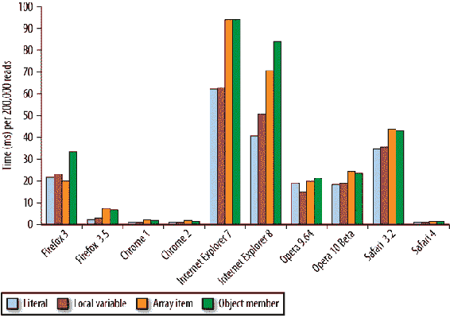  
图 2-1. 从不同数据位置读取 200,000 次所需时间

使用更传统 JavaScript 引擎的旧版浏览器（如 Firefox 3、Internet Explorer 和 Safari 3.2）在访问值时花费的时间远多于使用优化 JavaScript 引擎的浏览器。然而，总体趋势在所有浏览器中保持一致：字面量值和局部变量的访问速度通常快于数组项和对象成员的访问速度。唯一的例外是 Firefox 3，它优化了数组项访问，使其速度更快。即便如此，一般建议是尽可能使用字面量值和局部变量，并在关注执行速度时限制对数组项和对象成员的使用。为此，你需要在代码中寻找、避免并优化几种模式。

### 管理作用域

作用域的概念对于理解 JavaScript 不仅是从性能角度，而且是从功能角度都至关重要。作用域在 JavaScript 中有许多影响，从确定函数可以访问哪些变量到分配 `this` 的值。在处理 JavaScript 作用域时也存在性能方面的考虑，但要理解速度与作用域的关系，有必要确切了解作用域的工作原理。

#### 作用域链与标识符解析


JavaScript 中的每个函数都以对象的形式表示——更具体地说，是 `Function` 的一个实例。`Function` 对象与其他任何对象一样具有属性，这些属性既包括你可以通过编程方式访问的属性，也包括一系列由 JavaScript 引擎使用但无法通过代码访问的内部属性。其中一个属性是 `[[Scope]]`，如 [ECMA-262 第三版](http://www.ecma-international.org/publications/standards/Ecma-262.htm) 所定义。

内部属性 `[[Scope]]` 包含一个对象集合，这些对象表示函数创建时所处的作用域。这个集合被称为函数的*作用域链*，它决定了函数可以访问的数据。函数作用域链中的每个对象被称为*变量对象*，每个变量对象都包含以键值对形式存在的变量条目。当函数被创建时，其作用域链会被填充为表示函数创建时所在作用域中可访问数据的对象。例如，考虑以下全局函数：

```
function add(num1, num2){
    var sum = num1 + num2;
    return sum;
}
```

当 `add()` 函数被创建时，其作用域链被填充了一个变量对象：表示所有全局定义的变量的全局对象。这个全局对象包含 `window`、`navigator` 和 `document` 等条目，仅举几例。图 2-2 展示了这种关系（注意，该图中的全局对象仅显示少数全局变量作为示例；实际上还有很多其他变量）。

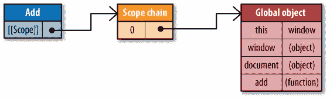图 2-2. add() 函数的作用域链

`add` 函数的作用域链随后在函数执行时被使用。假设执行以下代码：

```
var total = add(5, 10);
```

执行 `add` 函数会触发一个称为*执行上下文*的内部对象的创建。执行上下文定义了函数执行的环境。每个执行上下文对于函数的某次特定执行是唯一的，因此对同一函数的多次调用会导致创建多个执行上下文。一旦函数完全执行完毕，执行上下文就会被销毁。

执行上下文拥有自己的作用域链，用于标识符解析。当执行上下文被创建时，其作用域链被初始化为包含正在执行的函数的 `[[Scope]]` 属性中的对象。这些值按照它们在函数中出现的顺序被复制到执行上下文的作用域链中。完成后，会为执行上下文创建一个称为*活动对象*的新对象。活动对象充当本次执行的变量对象，包含所有局部变量、命名参数、`arguments` 集合以及 `this` 的条目。然后该对象被推送到作用域链的前端。当执行上下文被销毁时，活动对象也随之销毁。图 2-3 展示了前面示例代码的执行上下文及其作用域链。

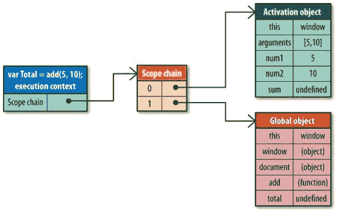图 2-3. 执行 add() 时的作用域链

每次在函数执行过程中遇到变量时，都会进行标识符解析过程，以确定在哪里检索或存储数据。在此过程中，会在执行上下文的作用域链中搜索具有相同名称的标识符。搜索从作用域链的前端开始，即执行函数的活动对象。如果找到，则使用具有指定标识符的变量；如果未找到，则继续搜索作用域链中的下一个对象。此过程持续进行，直到找到标识符或没有更多变量对象可搜索为止，在后一种情况下，该标识符被视为未声明。对于函数执行过程中遇到的每个标识符，都采用相同的方法，因此在之前的示例中，会对 `sum`、`num1` 和 `num2` 进行此操作。正是这个搜索过程影响了性能。

* * *

### 注意

请注意，两个同名的变量可能存在于作用域链的不同部分。在这种情况下，标识符会绑定到作用域链遍历中首先找到的变量，并且第一个变量被称为*遮蔽*了第二个变量。

* * *

### 标识符解析性能

标识符解析并非没有代价，事实上没有任何计算机操作是完全不带性能开销的。标识符在执行上下文作用域链中的位置越深，读取和写入的访问速度就越慢。因此，局部变量在函数内部总是访问最快的，而全局变量通常是最慢的（优化型 JavaScript 引擎能够在某些情况下对此进行调整）。请记住，全局变量始终存在于执行上下文作用域链的最后一个变量对象中，因此它们总是最远的解析目标。图 2-4 和 2-5 显示了基于作用域链深度的标识符解析速度。深度 1 表示局部变量。

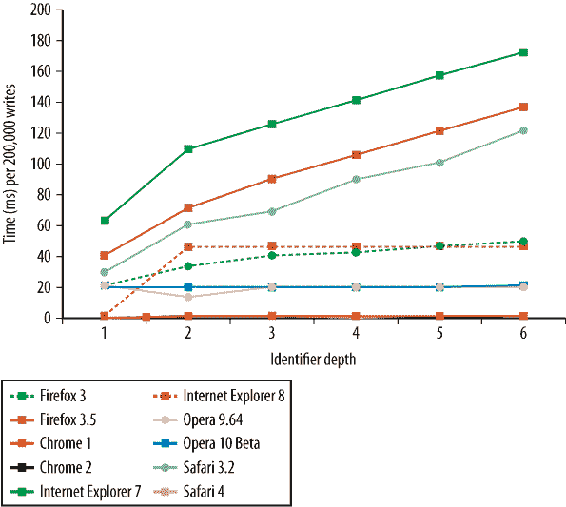图 2-4. 写操作的标识符解析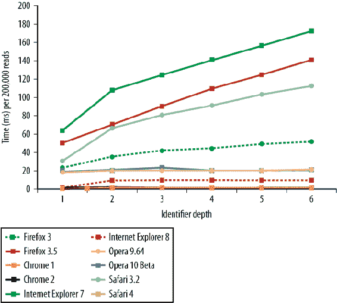图 2-5. 读操作的标识符解析

所有浏览器的总体趋势是：标识符在作用域链中的位置越深，读取或写入的速度就越慢。具有优化型 JavaScript 引擎的浏览器（如 Chrome 和 Safari 4）在访问作用域外的标识符时没有这种性能损失，而 Internet Explorer、Safari 3.2 及其他浏览器则表现出更显著的影响。值得注意的是，早期浏览器（如 Internet Explorer 6 和 Firefox 2）的曲线斜率非常陡峭，如果将其数据包含在内，它们甚至不会出现在该图表的范围内。

鉴于这些信息，建议尽可能使用局部变量，以提升在没有优化型 JavaScript 引擎的浏览器中的性能。一个很好的经验法则是：如果某个作用域外的值在函数内被多次使用，则始终将其存储在局部变量中。考虑以下示例：

```
function initUI(){
    var bd = document.body,
        links = document.getElementsByTagName("a"),
        i= 0,
        len = links.length;

    while(i < len){
        update(links[i++]);
    }

    document.getElementById("go-btn").onclick = function(){
        start();
    };

    bd.className = "active";
}
```

此函数包含对 `document` 的三次引用，而 `document` 是一个全局对象。对该变量的搜索必须遍历整个作用域链，最终才能在全局变量对象中解析。你可以通过先将引用存储在局部变量中，然后使用局部变量代替全局变量来减轻重复访问全局变量的性能影响。例如，前面的代码可以重写如下：

```
function initUI(){
    var doc = document,
        bd = doc.body,
        links = doc.getElementsByTagName("a"),
        i= 0,
        len = links.length;

    while(i < len){
        update(links[i++]);
    }

    doc.getElementById("go-btn").onclick = function(){
        start();
    };

    bd.className = "active";
}
```


`initUI()` 的更新版本首先将 `document` 的引用存储在局部变量 `doc` 中。这样，原本需要三次访问全局变量，现在减少到一次。访问 `doc` 比访问 `document` 更快，因为它是局部变量。当然，这个简单的函数不会带来巨大的性能提升，因为它做的事情不多，但想象一下更大的函数，其中反复访问数十个全局变量；那时才会发现更显著的性能改进。

### 作用域链增强

一般来说，执行上下文的作用域链不会改变。然而，有两种语句会在执行期间临时增强执行上下文的作用域链。第一种是 `with`。

`with` 语句用于为对象的所有属性创建变量。这模仿了其他具有类似特性的语言，通常被视为避免重复编写相同代码的便利手段。`initUI()` 函数可以写成如下形式：

```
function initUI(){
    with (document){     //避免使用！
        var bd = body,
            links = getElementsByTagName("a"),
            i= 0,
            len = links.length;

        while(i < len){
            update(links[i++]);
        }

        getElementById("go-btn").onclick = function(){
            start();
        };

        bd.className = "active";
    }
}
```

这个重写后的 `initUI()` 版本使用了 `with` 语句，以避免在其他地方编写 `document`。虽然这看起来更高效，但实际上却造成了性能问题。

当代码执行流入 `with` 语句时，执行上下文的作用域链会被临时增强。会创建一个新的变量对象，其中包含指定对象的所有属性。然后该对象被推送到作用域链的前端，这意味着函数的所有局部变量现在都位于第二个作用域链对象中，因此访问它们的成本更高（参见图 2-6）。

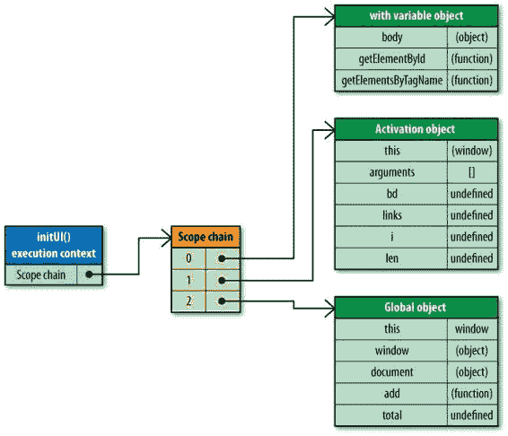图 2-6. with 语句中增强的作用域链

通过将 `document` 对象传入 `with` 语句，一个包含 `document` 对象所有属性的新变量对象被推送到作用域链的前端。这使得访问 `document` 的属性非常快，但访问局部变量（如 `bd`）则变慢。因此，最好避免使用 `with` 语句。如前所示，将 `document` 存储在局部变量中同样简单，并且能获得性能提升。

`with` 语句并不是 JavaScript 中唯一人为增强执行上下文作用域链的部分；`try-catch` 语句的 `catch` 子句也有同样的效果。当 `try` 块中发生错误时，执行会自动流向 `catch`，异常对象被推入一个变量对象，该对象随后被放置到作用域链的前端。在 `catch` 块内部，函数的所有局部变量现在都位于第二个作用域链对象中。例如：

```
try {
    methodThatMightCauseAnError();
} catch (ex){
    alert(ex.message);  //此处作用域链被增强
}
```

注意，一旦 `catch` 子句执行完毕，作用域链就会恢复到之前的状态。

`try-catch` 语句在适当使用时非常有用，因此不建议完全避免使用。如果你打算使用 `try-catch`，请确保了解错误发生的可能性。`try-catch` 绝不应被用作解决 JavaScript 错误的方法。如果你知道错误会频繁发生，那说明代码本身存在问题，应该修复。

你可以通过在 `catch` 子句中尽可能少地执行代码来最小化其性能影响。一个好的模式是让 `catch` 子句委托给一个错误处理方法，如下例所示：

```
try {
    methodThatMightCauseAnError();
} catch (ex){
    handleError(ex);  //委托给处理方法
}
```

这里，`handleError()` 方法是 `catch` 子句中唯一执行的代码。该方法可以自由地以适当方式处理错误，并接收由错误生成的异常对象。由于只执行了一条语句且没有访问局部变量，临时作用域链增强不会影响代码的性能。

### 动态作用域

`with` 语句、`try-catch` 语句的 `catch` 子句，以及包含 `eval()` 的函数，都被视为*动态作用域*。动态作用域仅通过代码执行而存在，因此无法通过静态分析（查看代码结构）来确定。例如：

```
function execute(code) {
  eval(code);

  function subroutine(){
    return window;
  }

  var w = subroutine();

  //w 的值是什么？
};
```

由于使用了 `eval()`，`execute()` 函数代表了一个动态作用域。`w` 的值会根据 `code` 的值而变化。在大多数情况下，`w` 等于全局的 `window` 对象，但考虑以下情况：

```
execute("var window = {};")
```

在这种情况下，`eval()` 在 `execute()` 中创建了一个局部变量 `window`，因此 `w` 最终等于局部变量 `window` 而不是全局变量。在代码执行之前无法知道是否如此，这意味着 `window` 标识符的值无法预先确定。

像 Safari 的 Nitro 这样的优化型 JavaScript 引擎试图通过分析代码来确定在任何给定时间哪些变量应该可访问，从而加速标识符解析。这些引擎试图避免传统的作用域链查找，而是通过索引标识符来实现更快的解析。然而，当涉及动态作用域时，这种优化就不再有效。引擎需要切换回更慢的基于哈希的方法来进行标识符解析，这种方法更接近传统的作用域链查找。

因此，建议仅在绝对必要时才使用动态作用域。

### 闭包、作用域与内存

闭包是 JavaScript 最强大的特性之一，它允许函数访问其局部作用域之外的数据。闭包的使用因 Douglas Crockford 的著作而普及，现在在大多数复杂的 Web 应用程序中无处不在。然而，使用闭包会带来性能影响。

要理解闭包的性能问题，请考虑以下代码：

```
function assignEvents(){

    var id = "xdi9592";

    document.getElementById("save-btn").onclick = function(event){
        saveDocument(id);
    };
}
```

`assignEvents()` 函数为一个 DOM 元素分配了一个事件处理程序。这个事件处理程序是一个闭包，因为它是在 `assignEvents()` 执行时创建的，并且可以访问包含作用域中的 `id` 变量。为了让这个闭包能够访问 `id`，必须创建一个特定的作用域链。

当 `assignEvents()` 执行时，会创建一个活动对象，其中包含 `id` 变量以及其他内容。这成为执行上下文作用域链中的第一个对象，全局对象紧随其后。当闭包被创建时，其 `[[Scope]]` 属性被初始化为这两个对象（参见图 2-7）。

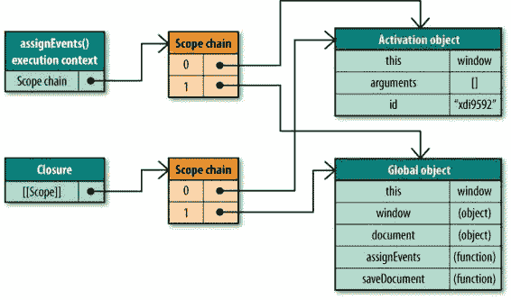图 2-7. assignEvents() 执行上下文和闭包的作用域链


由于闭包的 `[[Scope]]` 属性包含与执行上下文作用域链相同的对象引用，因此会产生一个副作用。通常，当执行上下文被销毁时，函数的激活对象也会被销毁。然而，当涉及闭包时，激活对象不会被销毁，因为闭包的 `[[Scope]]` 属性中仍然存在一个引用。这意味着闭包在脚本中比非闭包函数需要更多的内存开销。在大型 Web 应用中，这可能会成为一个问题，尤其是在 Internet Explorer 中。IE 将 DOM 对象实现为非原生 JavaScript 对象，因此闭包可能导致内存泄漏（更多信息请参见第 3 章）。

当闭包被执行时，会创建一个执行上下文，其作用域链使用 `[[Scope]]` 中引用的相同两个作用域链对象进行初始化，然后为闭包本身创建一个新的激活对象（参见图 2-8）。

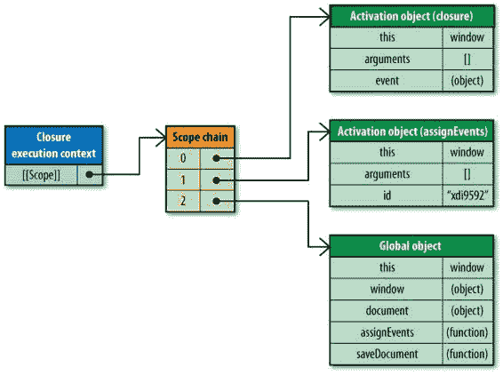图 2-8. 执行闭包

请注意，闭包中使用的两个标识符 `id` 和 `saveDocument` 都存在于作用域链的第一个对象之后。这是闭包的主要性能问题：你经常访问许多超出作用域的标识符，因此每次访问都会产生性能损失。

最好在脚本中使用闭包时保持谨慎，因为它们既涉及内存问题也涉及执行速度问题。不过，你可以通过遵循本章前面关于超出作用域变量的建议来减轻执行速度的影响：将任何频繁使用的超出作用域变量存储在局部变量中，然后直接访问局部变量。

## 对象成员

大多数 JavaScript 是以面向对象的方式编写的，无论是通过创建自定义对象还是使用内置对象（如文档对象模型（DOM）和浏览器对象模型（BOM）中的对象）。因此，通常会有大量的对象成员访问。

对象成员包括属性和方法，在 JavaScript 中两者差别不大。对象的命名成员可以包含任何数据类型。由于函数被表示为对象，因此成员除了传统数据类型外还可以包含函数。当命名成员引用一个函数时，它被视为方法，而引用非函数数据类型的成员则被视为属性。

正如本章前面所讨论的，对象成员访问通常比访问字面量或变量中的数据要慢，在某些浏览器中甚至比访问数组项还要慢。要理解原因，有必要了解 JavaScript 中对象的本质。

### 原型

JavaScript 中的对象基于 `prototypes`。原型是一个对象，它作为另一个对象的基础，定义并实现新对象必须拥有的成员。这与传统的面向对象编程中的类概念完全不同，类定义了创建新对象的过程。原型对象在给定对象类型的所有实例之间共享，因此所有实例也共享原型对象的成员。

对象通过一个内部属性与其原型关联。Firefox、Safari 和 Chrome 将这个属性暴露给开发者，称为 `__proto__`；其他浏览器不允许脚本访问此属性。每当你创建一个除 `Object` 之外的内置类型（如 `Date` 或 `Array`）的新实例时，这些实例会自动将 `Object` 的实例作为其原型。

因此，对象可以有两种类型的成员：实例成员（也称为“自有”成员）和原型成员。实例成员直接存在于对象实例本身，而原型成员则从对象原型继承。考虑以下示例：

```
var book = {
    title: "High Performance JavaScript",
    publisher: "Yahoo! Press"
};

alert(book.toString());   //"[object Object]"
```

在这段代码中，`book` 对象有两个实例成员：`title` 和 `publisher`。注意，没有定义 `toString()` 方法，但该方法被调用并正确执行，没有抛出错误。`toString()` 方法是 `book` 对象继承的原型成员。图 2-9 展示了这种关系。

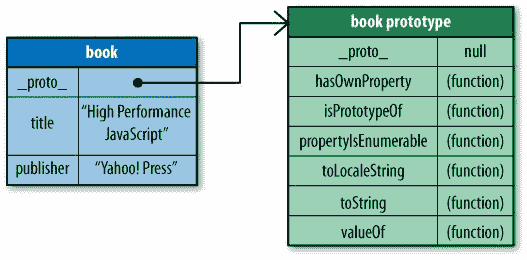图 2-9. 实例与原型之间的关系

解析对象成员的过程与解析变量非常相似。当调用 `book.toString()` 时，对名为“toString”的成员的搜索从对象实例开始。由于 `book` 没有名为 `toString` 的成员，搜索随后流向原型对象，在那里找到并执行 `toString()` 方法。这样，`book` 就可以访问其原型上的每个属性或方法。

你可以通过使用 `hasOwnProperty()` 方法并传入成员名称来确定对象是否具有给定名称的实例成员。要确定对象是否可以访问给定名称的属性，可以使用 `in` 运算符。例如：

```
var book = {
    title: "High Performance JavaScript",
    publisher: "Yahoo! Press"
};

alert(book.hasOwnProperty("title"));       //true
alert(book.hasOwnProperty("toString"));    //false

alert("title" in book);       //true
alert("toString" in book);    //true
```

在这段代码中，当传入“title”时，`hasOwnProperty()` 返回 `true`，因为 title 是一个实例属性；当传入“toString”时，该方法返回 `false`，因为它不存在于实例上。当每个属性名与 `in` 运算符一起使用时，两次结果都是 `true`，因为它会搜索实例和原型。

### 原型链

对象的原型决定了它是哪个或哪些类型的实例。默认情况下，所有对象都是 `Object` 的实例，并继承所有基本方法，如 `toString()`。你可以通过定义并使用构造函数来创建另一个类型的原型。例如：

```
function Book(title, publisher){
    this.title = title;
    this.publisher = publisher;
}

Book.prototype.sayTitle = function(){
    alert(this.title);
};

var book1 = new Book("High Performance JavaScript", "Yahoo! Press");
var book2 = new Book("JavaScript: The Good Parts", "Yahoo! Press");

alert(book1 instanceof Book);   //true
alert(book1 instanceof Object); //true

book1.sayTitle();         //"High Performance JavaScript"
alert(book1.toString());  //"[object Object]"
```

`Book` 构造函数用于创建 `Book` 的新实例。`book1` 实例的原型（`__proto__`）是 `Book.prototype`，而 `Book.prototype` 的原型是 `Object`。这创建了一个原型链，`book1` 和 `book2` 都从中继承它们的成员。图 2-10 展示了这种关系。

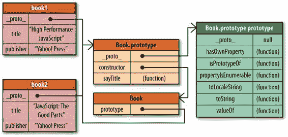图 2-10. 原型链

请注意，`Book` 的两个实例共享同一个原型链。每个实例都有自己的 `title` 和 `publisher` 属性，但其他所有内容都通过原型继承。现在当调用 `book1.toString()` 时，搜索必须深入原型链以解析对象成员“toString”。正如你可能猜到的，成员在原型链中越深，检索速度就越慢。图 2-11 展示了原型中成员深度与访问成员时间之间的关系。

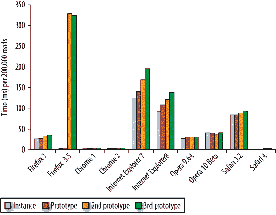图 2-11. 深入原型链的数据访问


尽管具有优化 JavaScript 引擎的新浏览器能够很好地执行此任务，但旧版浏览器（尤其是 Internet Explorer 和 Firefox 3.5）在原型链上每增加一步都会带来性能损失。请记住，查找实例成员的过程仍然比从字面量或局部变量访问数据更昂贵，因此增加遍历原型链的开销只会放大这种影响。

### 嵌套成员

由于对象成员可能包含其他成员，因此在 JavaScript 代码中经常看到诸如 `window.location.href` 这样的模式。这些嵌套成员会导致 JavaScript 引擎在每次遇到点号时都要执行对象成员解析过程。图 2-12 展示了对象成员深度与访问时间之间的关系。

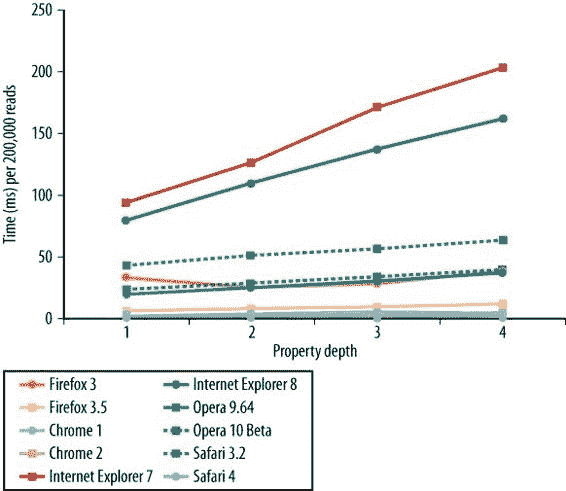图 2-12. 访问时间与属性深度的关系

因此，嵌套成员越深，数据访问速度越慢，这并不令人意外。评估 `location.href` 总是比 `window.location.href` 快，而 `window.location.href` 又比 `window.location.href.toString()` 快。如果这些属性不在对象实例上，那么成员解析将花费更长时间，因为每次都需要搜索原型链。

* * *

### 注意

在大多数浏览器中，使用点号表示法（`object.name`）与使用方括号表示法（`object["name"]`）访问对象成员之间没有明显区别。Safari 是唯一一个点号表示法始终更快的浏览器，但差异并不足以建议不要使用方括号表示法。

* * *

### 缓存对象成员值

考虑到对象成员相关的所有性能问题，很容易认为应尽可能避免使用它们。更准确地说，你应该只在必要时谨慎使用对象成员。例如，在单个函数中多次读取对象成员的值是没有理由的：

```
function hasEitherClass(element, className1, className2){
    return element.className == className1 || element.className == className2;
}
```

在这段代码中，`element.className` 被访问了两次。显然，这个值在函数执行过程中不会改变，但仍然执行了两次对象成员查找。你可以通过将值存储在局部变量中并使用该变量来消除一次属性查找：

```
function hasEitherClass(element, className1, className2){
    var currentClassName = element.className;
    return currentClassName == className1 || currentClassName == className2;
}
```

这个重写后的函数将成员查找次数限制为一次。由于两次成员查找都是在读取属性值，因此将值读取一次并存储在局部变量中是合理的。然后，该局部变量的访问速度要快得多。

一般来说，如果你要在函数中多次读取对象属性，最好将该属性值存储在局部变量中。然后可以用局部变量代替属性，以避免另一次属性查找的性能开销。在处理对执行速度影响更大的嵌套对象成员时，这一点尤其重要。

JavaScript 命名空间（例如 YUI 中使用的技术）是频繁访问嵌套属性的来源。例如：

```
function toggle(element){
    if (YAHOO.util.Dom.hasClass(element, "selected")){
        YAHOO.util.Dom.removeClass(element, "selected");
        return false;
    } else {
        YAHOO.util.Dom.addClass(element, "selected");
        return true;
    }
}
```

这段代码重复了三次 `YAHOO.util.Dom` 来访问三个不同的方法。每个方法都有三次成员查找，总共九次，使得这段代码效率相当低。更好的方法是将 `YAHOO.util.Dom` 存储在局部变量中，然后访问该局部变量：

```
function toggle(element){
    var Dom = YAHOO.util.Dom;
    if (Dom.hasClass(element, "selected")){
        Dom.removeClass(element, "selected");
        return false;
    } else {
        Dom.addClass(element, "selected");
        return true;
    }
}
```

这段代码中的成员查找总数从九次减少到了五次。除非值可能发生变化，否则永远不应在单个函数中多次查找对象成员。

* * *

### 注意

有一点需要提醒：不建议对对象方法使用此技术。许多对象方法使用 `this` 来确定它们被调用的上下文，将方法存储在局部变量中会导致 `this` 绑定到 `window`。改变 `this` 的值会导致程序错误，因为 JavaScript 引擎将无法解析它可能依赖的适当对象成员。

* * *

## 总结

在 JavaScript 中存储和访问数据的位置会对代码的整体性能产生可衡量的影响。有四种数据访问位置：字面量、变量、数组项和对象成员。这些位置具有不同的性能考量。

*   字面量和局部变量的访问速度非常快，而数组项和对象成员的访问速度较慢。

*   局部变量的访问速度比作用域外的变量快，因为它们存在于作用域链的第一个变量对象中。变量在作用域链中越深，访问所需的时间就越长。全局变量始终是最慢的，因为它们始终位于作用域链的最后。

*   避免使用 `with` 语句，因为它会扩充执行上下文的作用域链。同时，要小心 `try-catch` 语句的 `catch` 子句，因为它具有相同的效果。

*   嵌套对象成员会带来显著的性能影响，应尽量减少使用。

*   属性或方法在原型链中越深，访问速度就越慢。

*   一般来说，你可以通过将频繁使用的对象成员、数组项和作用域外的变量存储在局部变量中来提高 JavaScript 代码的性能。然后，你可以比原始数据更快地访问这些局部变量。

通过使用这些策略，你可以显著改善需要大量 JavaScript 代码的 Web 应用程序的感知性能。

## 第 3 章 DOM 脚本编程

### Stoyan Stefanov

DOM 脚本编程开销很大，并且是富 Web 应用程序中常见的性能瓶颈。本章讨论 DOM 脚本编程中可能对应用程序响应性产生负面影响的领域，并给出如何改善响应时间的建议。本章讨论的三类问题包括：

*   访问和修改 DOM 元素

*   修改 DOM 元素的样式并导致重绘和重排

*   通过 DOM 事件处理用户交互

但首先——什么是 DOM，为什么它很慢？

## 浏览器世界中的 DOM

文档对象模型（DOM）是一种与语言无关的应用程序接口（API），用于处理 XML 和 HTML 文档。在浏览器中，你主要处理 HTML 文档，尽管 Web 应用程序检索 XML 文档并使用 DOM API 访问这些文档中的数据也并不罕见。

尽管 DOM 是一种与语言无关的 API，但在浏览器中，该接口是用 JavaScript 实现的。由于客户端脚本编程的大部分工作都与底层文档有关，因此 DOM 是日常 JavaScript 编码的重要组成部分。


在浏览器中，DOM 和 JavaScript 的实现通常是相互独立的。例如，在 Internet Explorer 中，JavaScript 的实现被称为 JScript，位于名为 `jscript.dll` 的库文件中，而 DOM 的实现则位于另一个库 `mshtml.dll`（内部称为 `Trident`）中。这种分离使得其他技术和语言（如 VBScript）能够利用 DOM 以及 Trident 提供的渲染功能。Safari 使用 WebKit 的 `WebCore` 进行 DOM 和渲染，并拥有独立的 `JavaScriptCore` 引擎（其最新版本称为 `SquirrelFish`）。Google Chrome 也使用 WebKit 的 `WebCore` 库来渲染页面，但实现了自己的 JavaScript 引擎，名为 `V8`。在 Firefox 中，`SpiderMonkey`（最新版本称为 `TraceMonkey`）是 JavaScript 的实现，它是 `Gecko` 渲染引擎的一个独立部分。

### 天生缓慢

这对性能意味着什么？简单来说，两个独立的功能模块相互交互总是需要付出代价。一个很好的类比是将 DOM 视为一块土地，JavaScript（即 ECMAScript）视为另一块土地，两者之间由一座收费桥连接（参见 John Hrvatin, Microsoft, MIX09, [`videos.visitmix.com/MIX09/T53F`](http://videos.visitmix.com/MIX09/T53F)）。每次 ECMAScript 需要访问 DOM 时，都必须经过这座桥并支付性能通行费。你对 DOM 的操作越多，付出的代价就越大。因此，一般的建议是尽可能少地过桥，尽量留在 ECMAScript 的土地上。本章的其余部分将重点讨论这具体意味着什么，以及如何优化以使用户交互更快。

## DOM 访问与修改

仅仅访问一个 DOM 元素就需要付出代价——即前面提到的“通行费”。修改元素则更加昂贵，因为它通常会导致浏览器重新计算页面几何结构的变化。

自然，最糟糕的访问或修改元素的情况是在循环中进行的，尤其是在遍历 HTML 集合的循环中。

为了让你对 DOM 脚本编程的问题规模有一个概念，请考虑这个简单的例子：

```
function innerHTMLLoop() {
    for (var count = 0; count < 15000; count++) {
        document.getElementById('here').innerHTML += 'a';
    }
}
```

这个函数在循环中更新页面元素的内容。这段代码的问题在于，每次循环迭代中，元素被访问了两次：一次读取 `innerHTML` 属性的值，一次写入它。

这个函数的一个更高效的版本是使用局部变量来存储更新后的内容，然后在循环结束时只写入一次：

```
function innerHTMLLoop2() {
    var content = '';
    for (var count = 0; count < 15000; count++) {
        content += 'a';
    }
    document.getElementById('here').innerHTML += content;
}
```

这个新版本的函数在所有浏览器中运行速度都会快得多。图 3-1 显示了在不同浏览器中测量到的时间改进结果。图中的 y 轴（与本章所有图表一样）表示执行时间的改进，即使用一种方法比另一种方法快多少。例如，在这个例子中，使用 `innerHTMLLoop2()` 在 IE6 中比 `innerHTMLLoop()` 快 155 倍。

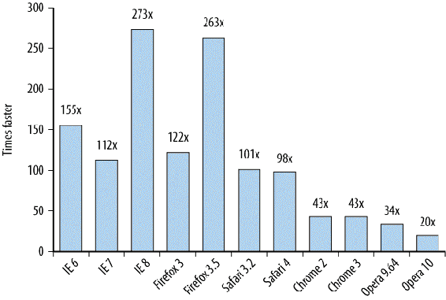图 3-1. 留在 ECMAScript 中的一个好处：innerHTMLLoop2() 比 innerHTMLLoop() 快数百倍

这些结果清楚地表明，你访问 DOM 的次数越多，代码执行得越慢。因此，一般经验法则是：轻触 DOM，尽可能留在 ECMAScript 中。

### innerHTML 与 DOM 方法

多年来，Web 开发社区一直在争论这个问题：是使用非标准但支持良好的 `innerHTML` 属性来更新页面的一部分更好，还是只使用纯粹的 DOM 方法（如 `document.createElement()`）更好？抛开 Web 标准讨论不谈，这对性能有影响吗？答案是：影响越来越小，但除了最新的基于 WebKit 的浏览器（Chrome 和 Safari）之外，`innerHTML` 在所有浏览器中仍然更快。

让我们考察一个示例任务，用两种方式创建一个包含 1000 行的表格：

* 通过拼接 HTML 字符串并使用 `innerHTML` 更新 DOM
* 通过仅使用标准 DOM 方法，如 `document.createElement()` 和 `document.createTextNode()`

我们的示例表格内容类似于来自内容管理系统（CMS）的内容。最终结果如图 3-2 所示。

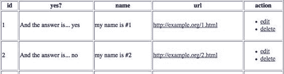图 3-2. 生成一个包含 1000 行和 5 列的 HTML 表格的最终结果

使用 `innerHTML` 生成表格的代码如下：

```
function tableInnerHTML() {
    var i, h = ['<table border="1" width="100%">'];

    h.push('<thead>');

h.push('<tr><th>id<\/th><th>yes?<\/th><th>name<\/th><th>url<\/th><th>action<\/th>
<\/tr>');
    h.push('<\/thead>');
    h.push('<tbody>');
    for (i = 1; i <= 1000; i++) {
        h.push('<tr><td>');
        h.push(i);
        h.push('<\/td><td>');
        h.push('And the answer is... ' + (i % 2 ? 'yes' : 'no'));
        h.push('<\/td><td>');
        h.push('my name is #' + i);
        h.push('<\/td><td>');
        h.push('<a href="http://example.org/' + i + '.html">http://example.org/'
+ i + '.html<\/a>');
        h.push('<\/td><td>');
        h.push('<ul>');
        h.push(' <li><a href="edit.php?id=' + i + '">edit<\/a><\/li>');
        h.push(' <li><a href="delete.php?id=' + i + '">delete<\/a><\/li>');
        h.push('<\/ul>');
        h.push('<\/td>');
        h.push('<\/tr>');
    }

    h.push('<\/tbody>');
    h.push('<\/table>');

    document.getElementById('here').innerHTML = h.join('');
};
```

为了仅使用 DOM 方法生成相同的表格，代码会稍微冗长一些：


```
function tableDOM() {

    var i, table, thead, tbody, tr, th, td, a, ul, li;

    tbody = document.createElement('tbody');

    for (i = 1; i <= 1000; i++) {

        tr = document.createElement('tr');
        td = document.createElement('td');
        td.appendChild(document.createTextNode((i % 2) ? 'yes' : 'no'));
        tr.appendChild(td);
        td = document.createElement('td');
        td.appendChild(document.createTextNode(i));
        tr.appendChild(td);
        td = document.createElement('td');
        td.appendChild(document.createTextNode('my name is #' + i));
        tr.appendChild(td);

        a = document.createElement('a');
        a.setAttribute('href', 'http://example.org/' + i + '.html');
        a.appendChild(document.createTextNode('http://example.org/' + i +
'.html'));
        td = document.createElement('td');
        td.appendChild(a);
        tr.appendChild(td);

        ul = document.createElement('ul');
        a = document.createElement('a');
        a.setAttribute('href', 'edit.php?id=' + i);
        a.appendChild(document.createTextNode('edit'));
        li = document.createElement('li');
        li.appendChild(a);
        ul.appendChild(li);
        a = document.createElement('a');
        a.setAttribute('href', 'delete.php?id=' + i);
        a.appendChild(document.createTextNode('delete'));
        li = document.createElement('li');
        li.appendChild(a);
        ul.appendChild(li);
        td = document.createElement('td');
        td.appendChild(ul);
        tr.appendChild(td);

        tbody.appendChild(tr);
    }

    tr = document.createElement('tr');
    th = document.createElement('th');
    th.appendChild(document.createTextNode('yes?'));
    tr.appendChild(th);
    th = document.createElement('th');
    th.appendChild(document.createTextNode('id'));
    tr.appendChild(th);
    th = document.createElement('th');
    th.appendChild(document.createTextNode('name'));
    tr.appendChild(th);
    th = document.createElement('th');
    th.appendChild(document.createTextNode('url'));
    tr.appendChild(th);
    th = document.createElement('th');
    th.appendChild(document.createTextNode('action'));
    tr.appendChild(th);

    thead = document.createElement('thead');
    thead.appendChild(tr);
    table = document.createElement('table');
    table.setAttribute('border', 1);
    table.setAttribute('width', '100%');
    table.appendChild(thead);
    table.appendChild(tbody);

    document.getElementById('here').appendChild(table);
};
```

使用 `innerHTML` 生成 HTML 表格与使用纯 DOM 方法的结果对比如图 3-3 所示。在较旧的浏览器版本中，`innerHTML` 的优势更明显（在 IE6 中 `innerHTML` 快 3.6 倍），但在较新版本中优势不那么显著。而在基于 WebKit 的新浏览器中情况则相反：使用 DOM 方法稍快一些。因此，选择哪种方法取决于用户常用的浏览器以及你的编码偏好。

在需要更新 HTML 页面大部分内容的性能关键操作中，使用 `innerHTML` 在大多数浏览器中会获得更快的执行速度。但对于大多数日常情况，差异并不大，因此在决定方法时，应考虑可读性、维护性、团队偏好和编码规范。

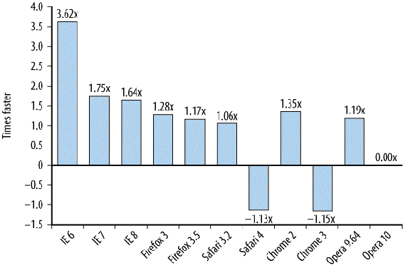图 3-3. 使用 innerHTML 比使用 DOM 方法创建 1000 行表格的优势；在 IE6 中 innerHTML 快三倍以上，而在最新的 WebKit 浏览器中稍慢

### 克隆节点

使用 DOM 方法更新页面内容的另一种方式是克隆现有 DOM 元素而不是创建新元素——换句话说，使用 `element.cloneNode()`（其中 `element` 是现有节点）代替 `document.createElement()`。

在大多数浏览器中，克隆节点效率更高，但提升幅度不大。通过只创建一次重复元素然后复制它们来重新生成前面示例中的表格，执行时间略有缩短：

*   在 IE8 中提升 2%，但在 IE6 和 IE7 中没有变化
*   在 Firefox 3.5 和 Safari 4 中提升高达 5.5%
*   在 Opera 中提升 6%（但在 Opera 10 中没有节省）
*   在 Chrome 2 中提升 10%，在 Chrome 3 中提升 3%

作为示例，以下是使用 `element.cloneNode()` 生成表格的部分代码：

```
function tableClonedDOM() {

    var i, table, thead, tbody, tr, th, td, a, ul, li,
        oth = document.createElement('th'),
        otd = document.createElement('td'),
        otr = document.createElement('tr'),
        oa  = document.createElement('a'),
        oli = document.createElement('li'),
        oul = document.createElement('ul');

    tbody = document.createElement('tbody');

    for (i = 1; i <= 1000; i++) {

        tr = otr.cloneNode(false);
        td = otd.cloneNode(false);
        td.appendChild(document.createTextNode((i % 2) ? 'yes' : 'no'));
        tr.appendChild(td);
        td = otd.cloneNode(false);
        td.appendChild(document.createTextNode(i));
        tr.appendChild(td);
        td = otd.cloneNode(false);
        td.appendChild(document.createTextNode('my name is #' + i));
        tr.appendChild(td);

        // ... 循环的其余部分 ...

    }

    // ... 表格生成的其余部分 ...
}
```

### HTML 集合

HTML 集合是包含 DOM 节点引用的类数组对象。集合的示例包括以下方法返回的值：

*   `document.getElementsByName()`
*   `document.getElementsByClassName()`
*   `document.getElementsByTagName()`

以下属性也返回 HTML 集合：

`document.images`

> 页面上的所有 `img` 元素

`document.links`

> 所有带有 `href` 属性的 `a` 和 `area` 元素

`document.forms`

> 所有表单

`document.forms[0].elements`

> 页面上第一个表单中的所有字段

这些方法和属性返回 `HTMLCollection` 对象，它们是类数组列表。它们不是数组（因为它们没有 `push()` 或 `slice()` 等方法），但提供 `length` 属性，就像数组一样，并允许通过索引访问列表中的元素。例如，`document.images[1]` 返回集合中的第二个元素。根据 DOM 标准，HTML 集合“被认为是*动态的*，这意味着当底层文档更新时，它们会自动更新”（参见 [`www.w3.org/TR/DOM-Level-2-HTML/html.html#ID-75708506`](http://www.w3.org/TR/DOM-Level-2-HTML/html.html#ID-75708506)）。

HTML 集合实际上是对文档的查询，每次需要最新信息（例如集合中的元素数量，即集合的 `length`）时，这些查询都会重新执行。这可能是效率低下的一个来源。

#### 昂贵的集合

为了演示集合是动态的，请考虑以下代码片段：

```
// 一个意外的无限循环
var alldivs = document.getElementsByTagName('div');
for (var i = 0; i < alldivs.length; i++) {
    document.body.appendChild(document.createElement('div'))
}
```

这段代码看起来只是将页面上的 `div` 元素数量翻倍。它遍历现有的 `div`，每次创建一个新的 `div` 并将其附加到 `body`。但这实际上是一个无限循环，因为循环的退出条件 `alldivs.length` 每次迭代都会增加 1，反映了底层文档的当前状态。

像这样遍历 HTML 集合可能会导致逻辑错误，而且由于每次迭代都需要运行查询，速度也会更慢（参见图 3-4）。


如第 4 章所述，不建议在循环控制条件中访问数组的`length`属性。访问集合的`length`甚至比访问普通数组的`length`更慢，因为这意味着每次都要重新执行查询。下面的例子演示了这一点：它获取一个集合`coll`，将其复制到数组`arr`中，然后比较遍历两者所需的时间。

考虑一个将 HTML 集合复制到普通数组的函数：

```
function toArray(coll) {
    for (var i = 0, a = [], len = coll.length; i < len; i++) {
        a[i] = coll[i];
    }
    return a;
}
```

以及创建一个集合及其副本：

```
var coll = document.getElementsByTagName('div');
var ar   = toArray(coll);
```

要比较的两个函数如下：

```
// 较慢
function loopCollection() {
    for (var count = 0; count < coll.length; count++) {
        /* 不执行任何操作 */
    }
}

// 较快
function loopCopiedArray() {
    for (var count = 0; count < arr.length; count++) {
        /* 不执行任何操作 */
    }
}
```

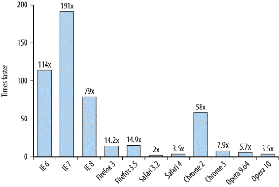图 3-4. 遍历数组比遍历相同大小和内容的 HTML 集合快得多

每次迭代访问集合的`length`时，会导致集合被更新，并在所有浏览器中产生显著的性能损失。优化方法是简单地将集合的`length`缓存到一个变量中，并在循环的退出条件中使用该变量进行比较：

```
function loopCacheLengthCollection() {
    var coll = document.getElementsByTagName('div'),
        len = coll.length;
    for (var count = 0; count < len; count++) {
        /* 不执行任何操作 */
    }
}
```

该函数的运行速度与`loopCopiedArray()`大致相当。

对于许多只需要对相对较小的集合进行单次循环的用例，仅缓存集合的`length`就足够了。但遍历数组比遍历集合更快，因此如果先将集合的元素复制到数组中，访问它们的属性会更快。请记住，这需要额外的步骤和对集合的另一次循环，因此务必进行性能分析，以确定在你的特定场景中使用数组副本是否有利。

请参考前面展示的`toArray()`函数，这是一个通用的集合转数组函数示例。

#### 访问集合元素时的局部变量

前面的例子只使用了空循环，但如果循环内访问了集合的元素，会发生什么？

一般来说，对于任何类型的 DOM 访问，当多次访问同一个 DOM 属性或方法时，最好使用局部变量。在遍历集合时，第一个优化是将集合存储在局部变量中，并在循环外缓存`length`，然后在循环内对多次访问的元素使用局部变量。

在下一个例子中，循环内访问了每个元素的三个属性。最慢的版本每次都访问全局`document`，优化版本缓存了对集合的引用，最快的版本还将集合的当前元素存储到一个变量中。所有三个版本都缓存了集合的`length`。

```
// 慢
function collectionGlobal() {

    var coll = document.getElementsByTagName('div'),
        len = coll.length,
        name = '';
    for (var count = 0; count < len; count++) {
        name = document.getElementsByTagName('div')[count].nodeName;
        name = document.getElementsByTagName('div')[count].nodeType;
        name = document.getElementsByTagName('div')[count].tagName;
    }
    return name;

};

// 较快
function collectionLocal() {

    var coll = document.getElementsByTagName('div'),
        len = coll.length,
        name = '';
    for (var count = 0; count < len; count++) {
        name = coll[count].nodeName;
        name = coll[count].nodeType;
        name = coll[count].tagName;
    }
    return name;

};

// 最快
function collectionNodesLocal() {

    var coll = document.getElementsByTagName('div'),
        len = coll.length,
        name = '',
        el = null;
    for (var count = 0; count < len; count++) {
        el = coll[count];
        name = el.nodeName;
        name = el.nodeType;
        name = el.tagName;
    }
    return name;

};
```

图 3-5 展示了优化集合循环的好处。第一个柱状图表示通过局部引用访问集合的速度提升倍数，第二个柱状图显示当多次访问集合项时，缓存这些项还有额外的好处。

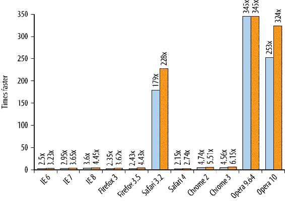图 3-5. 在循环中使用局部变量存储对集合及其元素的引用的好处

### 遍历 DOM

DOM API 提供了多种访问整个文档结构中特定部分的方法。当可以在不同方法之间选择时，使用针对特定任务最高效的 API 是有益的。

#### 爬取 DOM

通常你需要从一个 DOM 元素开始，处理周围的元素，可能还需要递归地遍历所有子元素。你可以通过使用`childNodes`集合，或者使用`nextSibling`获取每个元素的兄弟节点来实现。

考虑以下两种等效的非递归访问元素子节点的方法：

```
function testNextSibling() {
    var el = document.getElementById('mydiv'),
        ch = el.firstChild,
        name = '';
    do {
        name = ch.nodeName;
    } while (ch = ch.nextSibling);
    return name;
};

function testChildNodes() {
    var el = document.getElementById('mydiv'),
        ch = el.childNodes,
        len = ch.length,
        name = '';
    for (var count = 0; count < len; count++) {
        name = ch[count].nodeName;
    }
    return name;
};
```

请记住，`childNodes`是一个集合，应谨慎处理，在循环中缓存`length`，以免每次迭代都更新。

这两种方法在各浏览器中的执行时间大致相当。但在 IE 中，`nextSibling`的性能远优于`childNodes`。在 IE6 中，`nextSibling`快 16 倍，在 IE7 中快 105 倍。鉴于这些结果，在性能关键的场景中，对于旧版 IE，使用`nextSibling`是爬取 DOM 的首选方法。在其他所有情况下，这主要取决于个人和团队的偏好。

#### 元素节点

DOM 属性如`childNodes`、`firstChild`和`nextSibling`不区分元素节点和其他节点类型（如注释和文本节点，后者通常只是两个标签之间的空格）。在许多情况下，只需要访问元素节点，因此在循环中代码可能需要检查返回的节点类型并过滤掉非元素节点。这种类型检查和过滤是不必要的 DOM 工作。

许多现代浏览器提供了仅返回元素节点的 API。如果可用，最好使用这些 API，因为它们比你在 JavaScript 中自行过滤要快。表 3-1 列出了这些方便的 DOM 属性。

表 3-1. 区分元素节点（HTML 标签）与所有节点的 DOM 属性

| 属性 | 替代对象 |
| --- | --- |
| `children` | `childNodes` |
| `childElementCount` | `childNodes.length` |
| `firstElementChild` | `firstChild` |
| `lastElementChild` | `lastChild` |
| `nextElementSibling` | `nextSibling` |


| `previousElementSibling` | `previousSibling` |

表 3-1 中列出的所有属性在 Firefox 3.5、Safari 4、Chrome 2 和 Opera 9.62 中均受支持。在这些属性中，IE 6、7 和 8 仅支持`children`。

循环遍历`children`而不是`childNodes`更快，因为通常需要遍历的项目更少。HTML 源代码中的空白实际上是文本节点，它们不包含在`children`集合中。在所有浏览器中，`children`都比`childNodes`快，尽管通常差距不大——快 1.5 到 3 倍。一个显著的例外是 IE，其中遍历`children`集合比遍历`childNodes`快得多——在 IE6 中快 24 倍，在 IE7 中快 124 倍。

#### 选择器 API

在识别要操作的 DOM 元素时，开发者通常需要比`getElementById()`和`getElementsByTagName()`等方法更精细的控制。有时你会组合这些调用并遍历返回的节点，以获取所需的元素列表，但这种细化过程可能变得低效。

另一方面，使用 CSS 选择器是一种识别节点的便捷方式，因为开发者已经熟悉 CSS。许多 JavaScript 库为此提供了 API，而现在最新的浏览器版本提供了名为`querySelectorAll()`的方法作为原生浏览器 DOM 方法。自然，这种方法比使用 JavaScript 和 DOM 遍历并缩小元素列表更快。

考虑以下代码：

```
var elements = document.querySelectorAll('#menu a');
```

`elements`的值将包含一个引用列表，指向所有在`id="menu"`的元素内找到的`a`元素。方法`querySelectorAll()`接受一个 CSS 选择器字符串作为参数，并返回一个`NodeList`——一个包含匹配节点的类数组对象。该方法不返回 HTML 集合，因此返回的节点不代表文档的实时结构。这避免了本章前面讨论的 HTML 集合的性能（以及潜在的逻辑）问题。

要在不使用`querySelectorAll()`的情况下实现与前面代码相同的目标，你需要更冗长的代码：

```
var elements = document.getElementById('menu').getElementsByTagName('a');
```

在这种情况下，`elements`将是一个 HTML 集合，因此如果你想要与`querySelectorAll()`返回的完全相同的静态列表类型，你还需要将其复制到一个数组中。

当你需要处理多个查询的并集时，使用`querySelectorAll()`更加方便。例如，如果页面上有一些类名为“warning”的`div`元素和一些类名为“notice”的`div`元素，要获取所有它们的列表，你可以使用`querySelectorAll()`：

```
var errs = document.querySelectorAll('div.warning, div.notice');
```

不使用`querySelectorAll()`获取相同的列表需要更多的工作。一种方法是选择所有`div`元素并遍历它们，过滤掉不需要的元素。

```
var errs = [],
    divs = document.getElementsByTagName('div'),
    classname = '';
for (var i = 0, len = divs.length; i < len; i++) {
    classname = divs[i].className;
    if (classname === 'notice' || classname === 'warning') {
        errs.push(divs[i]);
    }
}
```

比较这两段代码可以看出，使用选择器 API 在所有浏览器中快 2 到 6 倍（图 3-6）。

图 3-6. 使用选择器 API 而非遍历`getElementsbyTagName()`结果的好处

选择器 API 在以下版本的浏览器中得到了原生支持：Internet Explorer 8、Firefox 3.5、Safari 3.1、Chrome 1 和 Opera 10。

如图中结果所示，检查`document.querySelectorAll()`的支持情况并在可用时使用它是一个好主意。此外，如果你正在使用 JavaScript 库提供的选择器 API，请确保该库在底层使用了原生 API。如果没有，你可能只需要升级库版本。

你还可以利用另一个名为`querySelector()`的方法，这是一个便捷的方法，只返回查询匹配的第一个节点。

这两个方法是 DOM 节点的属性，因此你可以使用`document.querySelector('.myclass')`查询整个文档中的节点，或者使用`elref.querySelector('.myclass')`查询子树，其中`elref`是对 DOM 元素的引用。

## 重绘与回流

一旦浏览器下载了页面的所有组件——HTML 标记、JavaScript、CSS、图片——它就会解析这些文件并创建两个内部数据结构：

DOM 树

> 页面结构的表示

渲染树

> DOM 节点如何显示的表示

渲染树为 DOM 树中每个需要显示的节点至少有一个节点（隐藏的 DOM 元素在渲染树中没有对应节点）。渲染树中的节点被称为*帧*或*盒子*，这符合 CSS 模型，该模型将页面元素视为具有内边距、外边距、边框和位置的盒子。一旦 DOM 树和渲染树构建完成，浏览器就可以在页面上显示（“绘制”）元素。

当 DOM 更改影响元素的几何形状（宽度和高度）时——例如边框厚度变化或向段落添加更多文本导致增加一行——浏览器需要重新计算该元素的几何形状以及可能受更改影响的其他元素的几何形状和位置。浏览器会使渲染树中受更改影响的部分失效，并重新构建渲染树。这个过程称为*回流*。回流完成后，浏览器会重新绘制屏幕的受影响部分，这个过程称为*重绘*。

并非所有 DOM 更改都会影响几何形状。例如，更改元素的背景颜色不会改变其宽度或高度。在这种情况下，只会发生重绘（没有回流），因为元素的布局没有改变。

重绘和回流是开销很大的操作，可能会降低 Web 应用程序 UI 的响应速度。因此，尽可能减少它们的发生非常重要。

### 回流何时发生？

如前所述，每当布局和几何形状发生变化时，就需要回流。这发生在以下情况：

*   可见的 DOM 元素被添加或移除
*   元素改变位置
*   元素改变大小（由于外边距、内边距、边框厚度、宽度、高度等的变化）
*   内容发生变化，例如文本改变或图片被替换为不同尺寸的图片
*   页面初始渲染
*   浏览器窗口大小改变

根据更改的性质，渲染树中较小或较大的部分需要重新计算。某些更改可能导致整个页面回流：例如，当滚动条出现时。

### 渲染树更改的排队与刷新

由于每次回流相关的计算成本，大多数浏览器通过将更改排队并批量执行来优化回流过程。然而，你可能会（通常是无意中）强制刷新队列，要求所有计划的更改立即应用。当你想要获取布局信息时，就会刷新队列，这意味着使用以下任何属性：

*   `offsetTop`, `offsetLeft`, `offsetWidth`, `offsetHeight`
*   `scrollTop`, `scrollLeft`, `scrollWidth`, `scrollHeight`
*   `clientTop`, `clientLeft`, `clientWidth`, `clientHeight`
*   `getComputedStyle()`（在 IE 中为`currentStyle`）


这些属性和方法返回的布局信息必须是最新的，因此浏览器需要执行渲染队列中的待处理更改并重新回流，才能返回正确的值。

在修改样式过程中，最好不要使用前面列出的任何属性。所有这些属性都会刷新渲染队列，即使你检索的是最近未更改或与最新更改无关的布局信息也是如此。

考虑以下示例，该示例对同一样式属性进行了三次更改（这在真实代码中可能不会出现，但能独立说明一个重要主题）：

```
// 连续设置和检索样式
var computed,
    tmp = '',
    bodystyle = document.body.style;

if (document.body.currentStyle) { // IE, Opera
    computed = document.body.currentStyle;
} else { // W3C
    computed = document.defaultView.getComputedStyle(document.body, '');
}

// 低效地修改同一属性并立即检索样式信息
bodystyle.color = 'red';
tmp = computed.backgroundColor;
bodystyle.color = 'white';
tmp = computed.backgroundImage;
bodystyle.color = 'green';
tmp = computed.backgroundAttachment;
```

在这个示例中，`body`元素的前景色被更改了三次，每次更改后都检索了一个计算样式属性。检索的属性——`backgroundColor`、`backgroundImage`和`backgroundAttachment`——与正在更改的颜色无关。然而，由于请求了计算样式属性，浏览器仍需刷新渲染队列并重新回流。

比这个低效示例更好的做法是，在更改布局信息时绝不请求它。如果将计算样式的检索移到末尾，代码将如下所示：

```
bodystyle.color = 'red';
bodystyle.color = 'white';
bodystyle.color = 'green';
tmp = computed.backgroundColor;
tmp = computed.backgroundImage;
tmp = computed.backgroundAttachment;
```

第二个示例在所有浏览器中都会更快，如图 3-7 所示。

### 最小化重绘和回流

回流和重绘可能代价高昂，因此响应式应用的良好策略是减少它们的次数。为了最小化次数，应将多个 DOM 和样式更改合并为一批，并一次性应用。

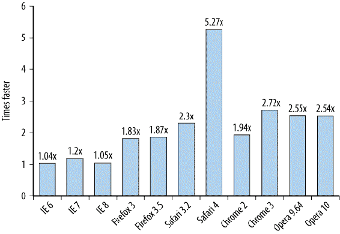图 3-7. 通过延迟访问布局信息来防止回流的好处

#### 样式更改

考虑以下示例：

```
var el = document.getElementById('mydiv');
el.style.borderLeft = '1px';
el.style.borderRight = '2px';
el.style.padding = '5px';
```

这里更改了三个样式属性，每个都会影响元素的几何形状。在最坏的情况下，这会导致浏览器回流三次。大多数现代浏览器会针对此类情况进行优化，只回流一次，但在旧浏览器中，或者同时发生独立的异步进程（例如使用计时器）时，仍可能效率低下。如果在此代码运行时其他代码请求布局信息，可能会导致多达三次回流。此外，代码四次访问 DOM，可以进行优化。

实现相同结果的更高效方法是将所有更改合并，一次性应用，只修改一次 DOM。这可以通过`cssText`属性实现：

```
var el = document.getElementById('mydiv');
el.style.cssText = 'border-left: 1px; border-right: 2px; padding: 5px;';
```

如上例所示修改`cssText`属性会覆盖现有样式信息，因此如果要保留现有样式，可以将新样式追加到`cssText`字符串中：

```
el.style.cssText += '; border-left: 1px;';
```

另一种只应用一次样式更改的方法是更改 CSS 类名，而不是修改内联样式。这种方法适用于样式不依赖于运行时逻辑和计算的情况。更改 CSS 类名更清晰、更易于维护；它有助于使脚本不包含表现代码，但可能会带来轻微的性能损失，因为更改类时需要检查层叠。

```
var el = document.getElementById('mydiv');
el.className = 'active';
```

#### 批量处理 DOM 更改

当需要对 DOM 元素进行多项更改时，可以通过以下步骤减少重绘和回流的次数：

1.  将元素从文档流中移除。
2.  应用多项更改。
3.  将元素重新放回文档流。

这个过程会导致两次回流——一次在步骤 1，一次在步骤 3。如果省略这些步骤，步骤 2 中的每次更改都可能导致自己的回流。

有三种基本方法可以在文档之外修改 DOM：

*   隐藏元素，应用更改，然后再次显示。
*   使用文档片段在活动 DOM 之外构建子树，然后将其复制到文档中。
*   将原始元素复制到文档外节点，修改副本，然后替换原始元素。

为了说明文档外操作，考虑一个需要更新更多信息的链接列表：

```
<ul id="mylist">
   <li><a href="http://phpied.com">Stoyan</a></li>
   <li><a href="http://julienlecomte.com">Julien</a></li>
</ul>
```

假设需要将已包含在对象中的额外数据插入到此列表中。数据定义如下：

```
var data = [
  {
    "name": "Nicholas",
    "url": "http://nczonline.net"
  },
  {
    "name": "Ross",
    "url": "http://techfoolery.com"
  }
];
```

以下是一个通用函数，用于用新数据更新给定节点：

```
function appendDataToElement(appendToElement, data) {
    var a, li;
    for (var i = 0, max = data.length; i < max; i++) {
        a = document.createElement('a');
        a.href = data[i].url;
        a.appendChild(document.createTextNode(data[i].name));
        li = document.createElement('li');
        li.appendChild(a);
        appendToElement.appendChild(li);
    }
};
```

最直接更新列表而不考虑回流的方法如下：

```
var ul = document.getElementById('mylist');
appendDataToElement(ul, data);
```

然而，使用这种方法，`data`数组中的每个新条目都会被追加到活动 DOM 树中，并导致一次回流。如前所述，减少回流的一种方法是通过更改`display`属性将`<ul>`元素暂时从文档流中移除，然后再恢复：

```
var ul = document.getElementById('mylist');
ul.style.display = 'none';
appendDataToElement(ul, data);
ul.style.display = 'block';
```

另一种最小化回流次数的方法是创建并更新一个文档片段，完全在文档之外操作，然后将其追加到原始列表中。文档片段是`document`对象的轻量级版本，专门用于帮助完成此类任务——更新和移动节点。文档片段的一个语法便利特性是，当你将片段追加到节点时，实际追加的是片段的子节点，而不是片段本身。以下解决方案少了一行代码，只导致一次回流，并且只访问一次活动 DOM：

```
var fragment = document.createDocumentFragment();
appendDataToElement(fragment, data);
document.getElementById('mylist').appendChild(fragment);
```

第三种解决方案是创建要更新节点的副本，在副本上操作，然后完成后用新更新的副本替换旧节点：


```
var old = document.getElementById('mylist');
var clone = old.cloneNode(true);
appendDataToElement(clone, data);
old.parentNode.replaceChild(clone, old);
```

建议尽可能使用文档片段（第二种方案），因为它们涉及的 DOM 操作和重排最少。唯一的潜在缺点是，使用文档片段的做法目前尚未普及，部分团队成员可能不熟悉这一技术。

### 缓存布局信息

如前所述，浏览器会通过将更改排队并批量执行来尽量减少重排次数。但当你请求布局信息（如偏移量、滚动值或计算后的样式值）时，浏览器会刷新队列并应用所有更改，以返回更新后的值。最好尽量减少对布局信息的请求次数，当确实需要请求时，将其赋值给局部变量，然后使用局部值进行操作。

考虑一个示例：将元素 `myElement` 沿对角线方向每次移动一个像素，从位置 100×100px 开始，到 500×500px 结束。在超时循环的主体中，你可以使用：

```
// 低效方式
myElement.style.left = 1 + myElement.offsetLeft + 'px';
myElement.style.top = 1 + myElement.offsetTop + 'px';
if (myElement.offsetLeft >= 500) {
    stopAnimation();
}
```

但这并不高效，因为每次元素移动时，代码都会请求偏移值，导致浏览器刷新渲染队列，无法利用其优化。更好的做法是只获取一次起始位置值，并将其赋值给一个变量，例如 `var current = myElement.offsetLeft;`。然后在动画循环中，使用 `current` 变量，不再请求偏移值：

```
current++
myElement.style.left = current + 'px';
myElement.style.top = current + 'px';
if (current >= 500) {
    stopAnimation();
}
```

### 将元素移出动画流

以展开/折叠的方式显示和隐藏页面部分内容是一种常见的交互模式。它通常涉及被展开区域的几何动画，从而将页面上的其余内容向下推。

重排有时只影响渲染树的一小部分，但也可能影响较大区域，甚至整个树。浏览器需要重排的次数越少，应用程序的响应速度就越快。因此，当页面顶部的动画将几乎整个页面向下推时，会导致一次大规模重排，代价高昂，用户会感到卡顿。渲染树中需要重新计算的节点越多，情况就越糟糕。

避免页面大部分区域重排的一种技术是采用以下步骤：

1.  对要动画化的元素使用绝对定位，将其从页面的布局流中移出。
2.  对元素进行动画处理。当它展开时，会暂时覆盖页面的一部分。这只是一次重绘，且只涉及页面的一小部分，而不是对整个大块页面进行重排和重绘。
3.  动画完成后，恢复定位，这样只需将文档的其余部分向下推一次。

### IE 与 :hover

从版本 7 开始，IE 可以在任何元素上应用 `:hover` CSS 伪选择器（在严格模式下）。然而，如果有大量元素使用了 `:hover`，响应性能会下降。在 IE 8 中问题更为明显。

例如，如果你创建一个包含 500–1000 行和 5 列的表格，并使用 `tr:hover` 来改变背景颜色并高亮用户所在的行，那么当用户在表格上移动时，性能会下降。高亮效果应用缓慢，CPU 使用率会升至 80%–90%。因此，在处理大量元素（如大型表格或长列表）时，应避免使用此效果。

## 事件委托

当页面上有大量元素，且每个元素都绑定了一个或多个事件处理程序（例如 `onclick`）时，这可能会影响性能。绑定每个处理程序都是有代价的——要么导致页面更重（更多的标记或 JavaScript 代码），要么增加运行时执行时间。你需要接触和修改的 DOM 节点越多，应用程序就越慢，尤其是事件绑定阶段通常发生在 `onload`（或 `DOMContentReady`）事件中，而这对每个交互丰富的网页来说都是一个繁忙的时刻。绑定事件需要处理时间，此外，浏览器还需要跟踪每个处理程序，这会占用内存。而且最终，这些事件处理程序中的很大一部分可能永远不需要（例如，用户只点击了一个按钮或链接，而不是全部 100 个），因此大量工作可能是不必要的。

处理 DOM 事件的一种简单而优雅的技术是事件委托。它基于事件会冒泡并由父元素处理这一事实。通过事件委托，你只需在包装元素上绑定一个处理程序，即可处理该父包装器下所有子元素发生的事件。

根据 DOM 标准，每个事件有三个阶段：

*   捕获阶段
*   目标阶段
*   冒泡阶段

IE 不支持捕获阶段，但冒泡阶段足以用于委托。考虑一个具有如图 3-8 所示结构的页面。

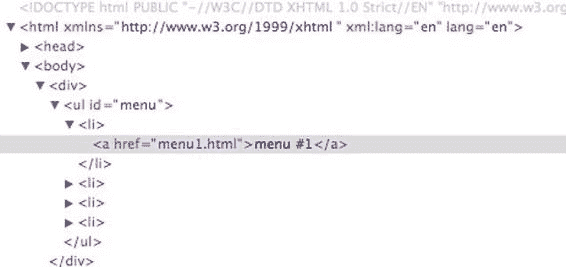图 3-8. 一个示例 DOM 树

当用户点击“菜单 #1”链接时，点击事件首先由 `<a>` 元素接收。然后它沿着 DOM 树向上冒泡，依次被 `<li>` 元素、`<ul>` 元素、`<div>` 元素等接收，一直到达文档顶部甚至 `window` 对象。这允许你只在一个父元素上绑定一个事件处理程序，就能接收所有子元素发生的事件通知。

假设你想为图中所示的文档提供渐进增强的 Ajax 体验。如果用户禁用了 JavaScript，那么菜单中的链接正常工作并重新加载页面。但如果 JavaScript 已启用且用户代理足够强大，你希望拦截所有点击，阻止默认行为（即跟随链接），发送 Ajax 请求获取内容，并更新页面的一部分而无需刷新。使用事件委托，你可以将点击监听器绑定到包含所有链接的 UL “menu” 元素上，并检查所有点击是否来自链接。

```
document.getElementById('menu').onclick = function(e) {

    // 跨浏览器目标
    e = e || window.event;
    var target = e.target || e.srcElement;

    var pageid, hrefparts;

    // 只对 href 感兴趣
    // 如果点击的不是链接，则退出函数
    if (target.nodeName !== 'A') {
        return;
    }

    // 从链接中获取页面 ID
    hrefparts = target.href.split('/');
    pageid = hrefparts[hrefparts.length - 1];
    pageid = pageid.replace('.html', '');

    // 更新页面
    ajaxRequest('xhr.php?page=' + pageid, updatePageContents);

    // 跨浏览器阻止默认行为并取消冒泡
    if (typeof e.preventDefault === 'function') {
        e.preventDefault();
        e.stopPropagation();
    } else {
        e.returnValue = false;
        e.cancelBubble = true;
    }

};
```

如你所见，事件委托技术并不复杂；你只需要检查事件是否来自你感兴趣的元素。这里有一些冗长的跨浏览器代码，但如果你将这部分代码移到可复用的库中，代码就会变得相当简洁。跨浏览器部分包括：

*   访问事件对象并识别事件源（目标）
*   取消向文档树冒泡（可选）
*   阻止默认行为（可选，但在此例中是必需的，因为任务是捕获链接而不跟随它们）

## 总结


DOM 访问和操作是现代 Web 应用的重要组成部分。但每次从 ECMAScript 跨入 DOM 领域时，都会付出代价。为了减少与 DOM 脚本相关的性能开销，请牢记以下几点：

* 尽量减少 DOM 访问，尽可能在 JavaScript 中完成操作。
* 使用局部变量存储需要重复访问的 DOM 引用。
* 处理 HTML 集合时要小心，因为它们代表实时、底层的文档。将集合的 `length` 缓存到变量中，并在迭代时使用它；对于集合上的繁重操作，将集合复制到数组中。
* 尽可能使用更快的 API，例如 `querySelectorAll()` 和 `firstElementChild`。
* 注意重绘和重排；批量处理样式变更，“离线”操作 DOM 树，并缓存和最小化对布局信息的访问。
* 在动画期间使用绝对定位。
* 使用事件委托来减少事件处理程序的数量。

# 第 4 章 算法与流程控制

代码的整体结构是决定其执行速度的主要因素之一。代码量很小并不一定意味着运行速度快，代码量很大也不一定意味着运行慢。许多性能影响直接与代码的组织方式以及你尝试解决特定问题的方法有关。

本章中的技术并非 JavaScript 独有，通常也被作为其他语言的性能优化方法教授。不过，与其他语言的建议相比，存在一些差异，因为需要处理更多的 JavaScript 引擎，并且需要考虑它们的特性，但所有技术都基于主流的计算机科学知识。

## 循环

在大多数编程语言中，大部分代码执行时间都花在循环中。遍历一系列值是编程中最常用的模式之一，因此也是必须集中精力改进性能的领域之一。理解 JavaScript 中循环的性能影响尤其重要，因为无限循环或长时间运行的循环会严重影响整体用户体验。

### 循环类型

ECMA-262 第 3 版（定义 JavaScript 基本语法和行为的规范）定义了四种循环类型。第一种是标准的 `for` 循环，其语法与其他类 C 语言相同：

```javascript
for (var i=0; i < 10; i++){
    //循环体
}
```

`for` 循环往往是最常用的 JavaScript 循环结构。`for` 循环有四个部分：初始化、前置条件、后执行和循环体。遇到 `for` 循环时，首先执行初始化代码，然后检查前置条件。如果前置条件求值为 `true`，则执行循环体。执行完循环体后，运行后执行代码。`for` 循环的封装性使其成为开发者的最爱。

***

#### 注意

请注意，在 `for` 循环的初始化部分放置 `var` 语句会创建一个函数级变量，而不是循环级变量。JavaScript 只有函数级作用域，因此在 `for` 循环内部定义新变量与在循环外部定义新变量相同。

***

第二种循环类型是 `while` 循环。`while` 循环是一个简单的前置测试循环，由前置条件和循环体组成：

```javascript
var i = 0;
while(i < 10){
    //循环体
    i++;
}
```

在执行循环体之前，会评估前置条件。如果条件求值为 `true`，则执行循环体；否则跳过循环体。任何 `for` 循环也可以写成 `while` 循环，反之亦然。

第三种循环类型是 `do-while` 循环。`do-while` 循环是 JavaScript 中唯一的后置测试循环，由两部分组成：循环体和后置条件：

```javascript
var i = 0;
do {
    //循环体
} while (i++ < 10);
```

在 `do-while` 循环中，循环体至少执行一次，后置条件决定是否应再次执行循环。

第四种也是最后一种循环是 `for-in` 循环。此循环有一个非常特殊的目的：枚举任何对象的命名属性。基本格式如下：

```javascript
for (var prop in object){
    //循环体
}
```

每次执行循环时，`prop` 变量都会被填充为 `object` 上存在的另一个属性名称（字符串），直到所有属性都被返回。返回的属性既包括对象实例上存在的属性，也包括通过其原型链继承的属性。

### 循环性能

关于循环性能的一个持续争论是使用哪种循环。在 JavaScript 提供的四种循环类型中，只有一种明显比其他循环慢：`for-in` 循环。

由于每次迭代都会在实例或原型上进行属性查找，`for-in` 循环每次迭代的开销相当大，因此比其他循环慢。对于相同数量的循环迭代，`for-in` 循环可能比其他循环类型慢七倍。因此，建议避免使用 `for-in` 循环，除非你的目的是遍历未知数量的对象属性。如果你有一个有限且已知的属性列表需要遍历，使用其他循环类型并采用如下模式会更快：

```javascript
var props = ["prop1", "prop2"],
    i = 0;

while (i < props.length){
    process(object[props[i++]]);
}
```

此代码创建一个数组，其成员是属性名称。`while` 循环用于遍历这一小部分属性，并处理 `object` 上的相应成员。代码不是查找 `object` 上的每个属性，而是只关注感兴趣的属性，从而节省循环开销和时间。

***

#### 注意

永远不要使用 `for-in` 来遍历数组的成员。

***

除了 `for-in` 循环之外，所有其他循环类型都具有相似的性能特征，因此试图确定哪种最快是没有意义的。循环类型的选择应基于你的需求，而不是性能考虑。

如果循环类型不影响循环性能，那什么会影响呢？实际上只有两个因素：

* 每次迭代的工作量
* 迭代次数

通过减少其中一个或两个，你可以积极影响循环的整体性能。

#### 减少每次迭代的工作量

显而易见，如果单次循环执行需要很长时间，那么多次循环将花费更长时间。限制循环体中昂贵操作的数量是加速整个循环的好方法。

一个典型的数组处理循环可以使用三种较快的循环类型中的任何一种来创建。代码最常写成如下形式：

```javascript
//原始循环
for (var i=0; i < items.length; i++){
    process(items[i]);
}

var j=0;
while (j < items.length){
    process(items[j++]);
}

var k=0;
do {
    process(items[k++]);
} while (k < items.length);
```

在每个循环中，每次执行循环体时都会发生几个操作：

1. 控制条件中的一次属性查找（`items.length`）
2. 控制条件中的一次比较（`i < items.length`）
3. 一次比较以查看控制条件是否求值为 `true`（`i < items.length == true`）
4. 一次递增操作（`i++`）
5. 一次数组查找（`items[i]`）
6. 一次函数调用（`process(items[i])`）


这些简单循环的每次迭代中都有很多操作，尽管代码量不大。代码执行速度很大程度上取决于 `process()` 对每个元素所做的操作，但即便如此，减少每次迭代的操作总数也能显著提升循环的整体性能。

优化循环工作量的第一步是尽量减少对象成员和数组元素的查找次数。正如第 2 章所讨论的，在大多数浏览器中，访问这些内容比访问局部变量或字面量要慢得多。前面的例子每次循环都要对 `items.length` 进行一次属性查找，这样做很浪费，因为该值在循环执行期间不会改变，因此造成了不必要的性能损失。只需进行一次属性查找，将值存储在局部变量中，然后在控制条件中使用该变量，就能轻松提升循环性能：

```
// 减少属性查找
for (var i=0, len=items.length; i < len; i++){
    process(items[i]);
}

var j=0,
    count = items.length;
while (j < count){
    process(items[j++]);
}

var k=0,
    num = items.length;
do {
    process(items[k++]);
} while (k < num);
```

这些重写后的循环在循环执行前只对数组长度进行一次属性查找。这样控制条件就只包含局部变量，因此运行速度更快。根据数组长度，在大多数浏览器中，你可以节省大约 25% 的总循环执行时间（在 Internet Explorer 中甚至可达 50%）。

你还可以通过反转循环顺序来提升性能。通常，数组元素的处理顺序与任务无关，因此从最后一个元素开始向前处理是一种可接受的替代方案。反转循环顺序是编程语言中常见的性能优化手段，但通常人们对其理解并不深入。在 JavaScript 中，反转循环确实能带来微小的性能提升，前提是你因此消除了额外的操作：

```
// 减少属性查找并反转循环
for (var i=items.length; i--; ){
    process(items[i]);
}

var j = items.length;
while (j--){
    process(items[j]);
}

var k = items.length-1;
do {
    process(items[k]);
} while (k--);
```

这个例子中的循环被反转，并将控制条件与递减操作合并。现在每个控制条件只是与零进行比较。控制条件与值 `true` 进行比较，任何非零数字都会自动转换为 `true`，因此零相当于 `false`。实际上，控制条件从两次比较（迭代器是否小于总数？以及该值是否等于 `true`？）减少为一次比较（该值是否为 `true`？）。每次迭代从两次比较减少到一次，进一步加快了循环速度。通过反转循环和减少属性查找，你可以看到执行时间比原始版本快 50%–60%。

与原始版本相比，以下是这些循环每次迭代执行的操作：

1.  控制条件中的一次比较（`i == true`）
2.  一次递减操作（`i--`）
3.  一次数组查找（`items[i]`）
4.  一次函数调用（`process(items[i])`）

新的循环代码每次迭代减少了两个操作，随着迭代次数的增加，性能提升也会更加明显。

* * *

### 注意

当循环复杂度为 `O(n)` 时，减少每次迭代的工作量最为有效。当循环复杂度高于 `O(n)` 时，建议将注意力集中在减少迭代次数上。

* * *

#### 减少迭代次数

即使循环体中的代码速度最快，当迭代数千次时，累积的开销也会变得可观。此外，执行循环体本身也有少量性能开销，这进一步增加了总执行时间。因此，减少整个循环的迭代次数可以带来更大的性能提升。限制循环迭代次数最著名的方法是一种称为“达夫设备”的模式。

达夫设备是一种展开循环体的技术，使得每次迭代实际上完成多次迭代的工作。Jeff Greenberg 被认为是第一个将达夫设备从 C 语言移植到 JavaScript 并公开发布的人。典型的实现如下：

```
// 致谢：Jeff Greenberg
var iterations = Math.floor(items.length / 8),
    startAt    = items.length % 8,
    i          = 0;

do {
    switch(startAt){
        case 0: process(items[i++]);
        case 7: process(items[i++]);
        case 6: process(items[i++]);
        case 5: process(items[i++]);
        case 4: process(items[i++]);
        case 3: process(items[i++]);
        case 2: process(items[i++]);
        case 1: process(items[i++]);
    }
    startAt = 0;
} while (iterations--);
```

这种达夫设备实现的基本思想是，每次循环最多允许调用 `process()` 八次。循环的迭代次数由总元素数除以八决定。由于并非所有数字都能被八整除，`startAt` 变量保存余数，并指示第一次循环中会调用多少次 `process()`。如果有 12 个元素，那么第一次循环会调用 `process()` 4 次，第二次循环调用 8 次，总共两次循环，而不是 12 次。

该算法的一个稍快版本去掉了 `switch` 语句，将余数处理与主处理分开：

```
// 致谢：Jeff Greenberg
var iterations = items.length % 8;
i	= items.length -1;

while(iterations){
	process(items[i--]);
	iterations--;
}

iterations = Math.floor(items.length / 8);

while(iterations){
    process(items[i--]);
    process(items[i--]);
    process(items[i--]);
    process(items[i--]);
    process(items[i--]);
    process(items[i--]);
    process(items[i--]);
    process(items[i--]);
    iterations--;
}
```

尽管这个实现现在有两个循环而不是一个，但由于去掉了循环体中的 `switch` 语句，它比原始版本运行得更快。

是否值得使用达夫设备（无论是原始版本还是修改版本），很大程度上取决于你已有的迭代次数。当循环迭代次数少于 1000 时，与使用常规循环结构相比，你可能只会看到微不足道的性能提升。然而，当迭代次数超过 1000 时，达夫设备的效果会显著增强。例如，在 500,000 次迭代时，执行时间比常规循环最多减少 70%。

### 基于函数的迭代

ECMA-262 第五版在原生 `array` 对象上引入了一个名为 `forEach()` 的新方法。该方法遍历数组的每个成员，并对每个成员运行一个函数。要运行的函数作为参数传递给 `forEach()`，调用时会接收三个参数：数组元素的值、数组元素的索引以及数组本身。以下是一个使用示例：

```
items.forEach(function(value, index, array){
    process(value);
});
```

`forEach()` 方法在 Firefox、Chrome 和 Safari 中已原生实现。此外，大多数 JavaScript 库都有逻辑等效的实现：


```
//YUI 3
Y.Array.each(items, function(value, index, array){
    process(value);
});

//jQuery
jQuery.each(items, function(index, value){
    process(value);
});

//Dojo
dojo.forEach(items, function(value, index, array){
    process(value);
});

//Prototype
items.each(function(value, index){
    process(value);
});

//MooTools
$each(items, function(value, index){
    process(value);
});
```

尽管基于函数的迭代是一种更便捷的迭代方式，但它比基于循环的迭代慢得多。这种性能下降可以归因于每个数组元素上额外调用方法所带来的开销。在所有情况下，基于函数的迭代耗时最多可达基于循环迭代的八倍，因此当执行时间成为重要考量时，它并不是一种合适的方法。

## 条件语句

与循环类似，条件语句决定了 JavaScript 的执行流程。关于使用 `if-else` 语句还是 `switch` 语句的传统争论同样适用于 JavaScript，正如它适用于其他语言一样。由于不同浏览器实现了不同的流程控制优化，因此并不总是清楚该使用哪种技术。

### `if-else` 与 `switch` 对比

关于使用 `if-else` 还是 `switch` 的主流理论基于所测试条件的数量：条件数量越多，就越倾向于使用 `switch` 而非 `if-else`。这通常归结为哪种代码更易读。争论点在于，当条件较少时 `if-else` 更易读，而当条件数量较多时 `switch` 更易读。考虑以下代码：

```
if (found){
    //do something
} else {
    //do something else
}

switch(found){
    case true:
        //do something
        break;

    default:
        //do something else
}
```

尽管两段代码执行相同的任务，但许多人会认为 `if-else` 语句比 `switch` 更易读。然而，增加条件数量通常会逆转这种看法：

```
if (color == "red"){
    //do something
} else if (color == "blue"){
    //do something
} else if (color == "brown"){
    //do something
} else if (color == "black"){
    //do something
} else {
    //do something
}

switch (color){
    case "red":
        //do something
        break;

    case "blue":
        //do something
        break;

    case "brown":
        //do something
        break;

    case "black":
        //do something
        break;

    default:
        //do something
}
```

大多数人会认为这段代码中的 `switch` 语句比 `if-else` 语句更具可读性。

事实证明，在大多数情况下，`switch` 语句比 `if-else` 更快，但只有在条件数量很大时才会显著更快。两者性能的主要区别在于，`if-else` 每增加一个条件的增量成本比 `switch` 更大。因此，我们在考虑性能时，自然倾向于在条件数量少时使用 `if-else`，在条件数量多时使用 `switch` 语句，这恰恰是正确的建议。

一般来说，当需要测试两个离散值或几个不同的值范围时，最好使用 `if-else`。当需要测试的离散值超过两个时，`switch` 语句是最优选择。

### 优化 `if-else`

在优化 `if-else` 时，目标始终是尽量减少在找到正确路径之前需要评估的条件数量。因此，最简单的优化是确保最常见的条件放在最前面。考虑以下代码：

```
if (value < 5) {
    //do something
} else if (value > 5 && value < 10) {
    //do something
} else {
    //do something
}
```

这段代码仅在 `value` 最常小于 5 时才是最优的。如果 `value` 通常大于或等于 10，那么每次都需要评估两个条件才能找到正确路径，最终增加了该语句的平均执行时间。`if-else` 中的条件应始终按从最可能到最不可能的顺序排列，以确保最快的执行速度。

另一种减少条件评估的方法是，将 `if-else` 组织成一系列嵌套的 `if-else` 语句。使用单个大型 `if-else` 通常会导致整体执行时间变慢，因为每个附加条件都会被评估。例如：

```
if (value == 0){
    return result0;
} else if (value == 1){
    return result1;
} else if (value == 2){
    return result2;
} else if (value == 3){
    return result3;
} else if (value == 4){
    return result4;
} else if (value == 5){
    return result5;
} else if (value == 6){
    return result6;
} else if (value == 7){
    return result7;
} else if (value == 8){
    return result8;
} else if (value == 9){
    return result9;
} else {
    return result10;
}
```

对于这个 `if-else` 语句，需要评估的最大条件数量是 10。如果假设 `value` 的可能值在 0 到 10 之间均匀分布，这会降低平均执行时间。为了尽量减少需要评估的条件数量，可以将代码重写为一系列嵌套的 `if-else` 语句，例如：

```
if (value < 6){

    if (value < 3){
        if (value == 0){
            return result0;
        } else if (value == 1){
            return result1;
        } else {
            return result2;
        }
    } else {
        if (value == 3){
            return result3;
        } else if (value == 4){
            return result4;
        } else {
            return result5;
        }
    }

} else {

    if (value < 8){
        if (value == 6){
            return result6;
        } else {
            return result7;
        }
    } else {
        if (value == 8){
            return result8;
        } else if (value == 9){
            return result9;
        } else {
            return result10;
        }
    }
}
```

重写后的 `if-else` 语句每次最多只需要评估四个条件。这是通过应用类似二分查找的方法实现的，将可能的值分成一系列范围进行检查，然后在该范围内进一步深入。当值在 0 到 10 之间均匀分布时，执行这段代码的平均时间大约是执行之前 `if-else` 语句的一半。这种方法最适合测试值范围的情况（与离散值相对，离散值情况下通常更适合使用 `switch` 语句）。

### 查找表

有时处理条件语句的最佳方法是完全避免使用 `if-else` 和 `switch`。当需要测试大量离散值时，`if-else` 和 `switch` 都比使用查找表慢得多。查找表可以在 JavaScript 中使用数组或普通对象创建，从查找表中访问数据比使用 `if-else` 或 `switch` 快得多，尤其是在条件数量很大时（参见图 4-1）。

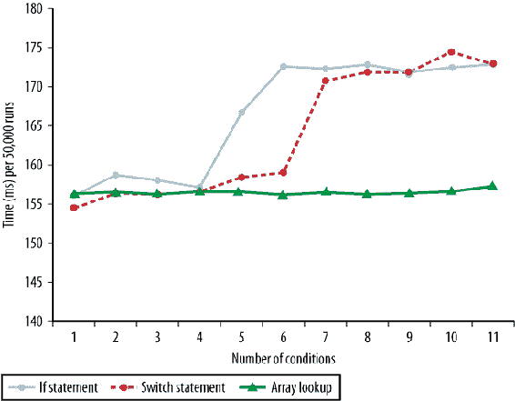图 4-1. 数组项查找与在 Internet Explorer 7 中使用 if-else 或 switch 的对比

与 `if-else` 和 `switch` 相比，查找表不仅速度非常快，而且在需要测试大量离散值时，还有助于使代码更具可读性。例如，当 `switch` 语句变得庞大时，会显得笨重，比如：


```
switch(value){
    case 0:
        return result0;
    case 1:
        return result1;
    case 2:
        return result2;
    case 3:
        return result3;
    case 4:
        return result4;
    case 5:
        return result5;
    case 6:
        return result6;
    case 7:
        return result7;
    case 8:
        return result8;
    case 9:
        return result9;
    default:
        return result10;
}
```

这段 `switch` 语句在代码中占据的空间可能与其重要性不成比例。整个结构可以用一个数组作为查找表来替代：

```
//define the array of results
var results = [result0, result1, result2, result3, result4, result5, result6,
               result7, result8, result9, result10]

//return the correct result
return results[value];
```

使用查找表时，你完全消除了所有条件判断。操作变成了数组项查找或对象成员查找。这是查找表的一大优势：由于没有条件需要评估，随着可能值的数量增加，几乎没有额外的开销。

当单个键与单个值之间存在逻辑映射时（如前面的示例），查找表最为有用。而当每个键需要执行独特的操作或一组操作时，`switch` 语句更为合适。

## 递归

复杂的算法通常通过递归更容易实现。事实上，有些传统算法预设递归作为实现方式，例如返回阶乘的函数：

```
function factorial(n){
    if (n == 0){
        return 1;
    } else {
        return n * factorial(n-1);
    }
}
```

递归函数的问题在于，未正确定义或缺失终止条件可能导致执行时间过长，从而冻结用户界面。此外，递归函数更容易遇到浏览器调用栈大小限制。

### 调用栈限制

JavaScript 引擎支持的递归深度各不相同，并且与 JavaScript 调用栈的大小直接相关。除了 Internet Explorer（其调用栈与可用系统内存相关）之外，所有其他浏览器都有静态的调用栈限制。与旧版浏览器相比，最新浏览器版本的调用栈大小相对较高（例如，Safari 2 的调用栈大小为 100）。图 4-2 显示了主要浏览器的调用栈大小。

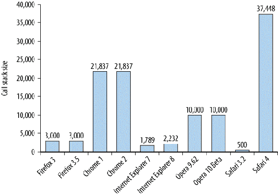图 4-2. 浏览器中的 JavaScript 调用栈大小

当通过引入过多递归超出最大调用栈大小时，浏览器会报错，并显示以下消息之一：

*   Internet Explorer：“第 x 行堆栈溢出”
*   Firefox：“递归过多”
*   Safari：“超出最大调用栈大小”
*   Opera：“中止（控制堆栈溢出）”

Chrome 是唯一在超出调用栈大小时不向用户显示消息的浏览器。

堆栈溢出错误最有趣的部分可能是，在某些浏览器中它们是实际的 JavaScript 错误，因此可以使用 `try-catch` 语句捕获。异常类型因使用的浏览器而异。在 Firefox 中，它是 `InternalError`；在 Safari 和 Chrome 中，它是 `RangeError`；而 Internet Explorer 抛出通用的 `Error` 类型。（Opera 不抛出错误，只是停止 JavaScript 引擎。）这使得可以直接从 JavaScript 处理此类错误：

```
try {
    recurse();
} catch (ex){
    alert("递归过多！");
}
```

如果未处理，这些错误会像其他错误一样向上冒泡（在 Firefox 中，最终出现在 Firebug 和错误控制台中；在 Safari/Chrome 中，显示在 JavaScript 控制台中），但 Internet Explorer 除外。IE 不仅会显示 JavaScript 错误，还会显示一个看起来像带有堆栈溢出消息的警告对话框。

* * *

### 注意

尽管可以在 JavaScript 中捕获这些错误，但不建议这样做。任何可能超出最大调用栈大小的脚本都不应部署。

* * *

### 递归模式

当你遇到调用栈大小限制时，第一步应该是识别代码中的任何递归实例。为此，需要注意两种递归模式。第一种是直接的递归模式，如前面 `factorial()` 函数所示，即函数调用自身。一般模式如下：

```
function recurse(){
    recurse();
}

recurse();
```

这种模式在发生错误时通常很容易识别。第二种更微妙的模式涉及两个函数：

```
function first(){
    second();
}

function second(){
    first();
}

first();
```

在这种递归模式中，两个函数相互调用，从而形成无限循环。这是更麻烦的模式，在大型代码库中识别起来要困难得多。

大多数调用栈错误都与这两种递归模式之一有关。堆栈溢出的常见原因是错误的终止条件，因此识别模式后的第一步是验证终止条件。如果终止条件正确，则算法包含的递归过多，无法在浏览器中安全运行，应改为使用迭代、记忆化或两者结合。

### 迭代

任何可以用递归实现的算法也可以用迭代实现。迭代算法通常由几个不同的循环组成，执行过程的不同方面，因此会引入自身的性能问题。然而，使用优化的循环代替长时间运行的递归函数可以带来性能提升，因为循环的开销低于执行函数的开销。

例如，归并排序算法最常使用递归实现。一个简单的 JavaScript 归并排序实现如下：

```
function merge(left, right){
    var result = [];

    while (left.length > 0 && right.length > 0){
        if (left[0] < right[0]){
            result.push(left.shift());
        } else {
            result.push(right.shift());
        }
    }

    return result.concat(left).concat(right);
}

function mergeSort(items){

    if (items.length == 1) {
        return items;
    }

    var middle = Math.floor(items.length / 2),
        left    = items.slice(0, middle),
        right   = items.slice(middle);

    return merge(mergeSort(left), mergeSort(right));
}
```

这段归并排序代码相当简单直接，但 `mergeSort()` 函数本身最终会被频繁调用。递归函数是浏览器中堆栈溢出错误的常见原因。

遇到堆栈溢出错误并不一定意味着整个算法必须改变；它只是意味着递归不是最佳实现。归并排序算法也可以使用迭代实现，例如：

```
//uses the same merge() function from previous example

function mergeSort(items){

    if (items.length == 1) {
        return items;
    }

    var work = [];
    for (var i=0, len=items.length; i < len; i++){
        work.push([items[i]]);
    }
    work.push([]);  //in case of odd number of items

    for (var lim=len; lim > 1; lim = Math.floor((lim+1)/2)){
        for (var j=0,k=0; k < lim; j++, k+=2){
            work[j] = merge(work[k], work[k+1]);
        }
        work[j] = [];  //in case of odd number of items
    }

    return work[0];
}
```


这个 `mergeSort()` 的实现与之前的版本功能相同，但没有使用递归。虽然归并排序的迭代版本可能比递归版本稍慢，但它不会像递归版本那样对调用栈造成同样的影响。将递归算法改为迭代算法只是避免栈溢出错误的方法之一。

### 记忆化

避免工作是性能优化的最佳技巧。代码需要做的工作越少，执行速度就越快。同理，避免重复工作也很有意义。多次执行相同的任务是对执行时间的浪费。记忆化是一种通过缓存先前计算结果以供后续重用，从而避免重复工作的方法，这使得记忆化成为递归算法中一项有用的技术。

当递归函数在代码执行过程中被多次调用时，往往会产生大量重复工作。前面在递归中介绍的 `factorial()` 函数就是一个很好的例子，展示了递归函数如何重复执行相同的工作。考虑以下代码：

```
var fact6 = factorial(6);
var fact5 = factorial(5);
var fact4 = factorial(4);
```

这段代码计算了三个阶乘，导致 `factorial()` 函数总共被调用了 18 次。最糟糕的是，所有必要的工作都在第一行完成了。由于 6 的阶乘等于 6 乘以 5 的阶乘，因此 5 的阶乘被计算了两次。更糟的是，4 的阶乘被计算了三次。更合理的做法是保存这些计算结果并重用它们，而不是每次函数调用都从头开始。

你可以按如下方式重写 `factorial()` 函数以利用记忆化：

```
function memfactorial(n){

    if (!memfactorial.cache){
        memfactorial.cache = {
            "0": 1,
            "1": 1
        };
    }

    if (!memfactorial.cache.hasOwnProperty(n)){
        memfactorial.cache[n] = n * memfactorial(n-1);
    }

    return memfactorial.cache[n];
}
```

这个记忆化版本的阶乘函数的关键在于创建了一个 `cache` 对象。该对象存储在函数本身，并预先填充了两个最简单的阶乘值：0 和 1。在计算阶乘之前，会检查 `cache` 是否已经执行过该计算。如果没有缓存值，则说明需要首次计算，并将结果存入 `cache` 以供后续使用。该函数的使用方式与原始 `factorial()` 函数相同：

```
var fact6 = memfactorial(6);
var fact5 = memfactorial(5);
var fact4 = memfactorial(4);
```

这段代码返回了三个不同的阶乘值，但总共只调用了 `memfactorial()` 八次。由于所有必要的计算都在第一行完成，接下来的两行无需执行任何递归，因为返回的是缓存的值。

每个递归函数的记忆化过程可能略有不同，但通常遵循相同的模式。为了更方便地对函数进行记忆化，你可以定义一个 `memoize()` 函数来封装基本功能。例如：

```
function memoize(fundamental, cache){
    cache = cache || {};

    var shell = function(arg){
        if (!cache.hasOwnProperty(arg)){
            cache[arg] = fundamental(arg);
        }
        return cache[arg];
    };

    return shell;
}
```

这个 `memoize()` 函数接受两个参数：一个需要记忆化的函数和一个可选的 `cache` 对象。如果你希望预先填充一些值，可以传入 `cache` 对象；否则会创建一个新的 `cache` 对象。然后创建一个 `shell` 函数，它包装了原始函数（`fundamental`），并确保只有在从未计算过的情况下才计算新结果。返回这个 `shell` 函数，以便你可以直接调用它，例如：

```
// 对阶乘函数进行记忆化
var memfactorial = memoize(factorial, { "0": 1, "1": 1 });

// 调用新函数
var fact6 = memfactorial(6);
var fact5 = memfactorial(5);
var fact4 = memfactorial(4);
```

这种通用记忆化方式不如针对特定函数手动优化算法，因为 `memoize()` 函数会缓存特定参数下的函数调用结果。因此，只有当 `shell` 函数多次以相同参数调用时，递归调用才会被保存。因此，对于存在显著性能问题的函数，最好手动实现记忆化，而不是应用通用的记忆化方案。

## 总结

与其他编程语言一样，代码的组织方式和所选算法会影响 JavaScript 的执行时间。与其他编程语言不同，JavaScript 可用的资源有限，因此优化技术更为重要。

*   `for`、`while` 和 `do-while` 循环具有相似的性能特征，因此没有哪种循环类型明显快于或慢于其他类型。

*   除非需要遍历未知数量的对象属性，否则避免使用 `for-in` 循环。

*   提高循环性能的最佳方法是减少每次迭代的工作量以及减少循环迭代次数。

*   一般来说，`switch` 总是比 `if-else` 快，但并非总是最佳解决方案。

*   查找表是使用 `if-else` 或 `switch` 进行多重条件求值的更快替代方案。

*   浏览器调用栈大小限制了 JavaScript 允许的递归深度；栈溢出错误会阻止其余代码的执行。

*   如果遇到栈溢出错误，请将方法改为迭代算法，或使用记忆化来避免重复工作。

执行的代码量越大，使用这些策略带来的性能提升就越大。

## 第 5 章 字符串与正则表达式

### Steven Levithan

几乎所有 JavaScript 程序都与字符串紧密相关。例如，许多应用程序使用 Ajax 从服务器获取字符串，将这些字符串转换为更易用的 JavaScript 对象，然后从数据生成 HTML 字符串。一个典型的程序需要处理大量类似的任务，这些任务要求你合并、拆分、重新排列、搜索、遍历以及以其他方式处理字符串；随着 Web 应用程序变得越来越复杂，浏览器中进行的此类处理也越来越多。

在 JavaScript 中，对于任何超出简单字符串处理的任务，正则表达式都是必不可少的。因此，本章的大部分内容将帮助你理解正则表达式引擎^([2])如何在内部处理你的字符串，并向你展示如何利用这些知识编写正则表达式。

* * *

### 注意

由于术语 *regular expression* 有点冗长，通常用 *regex* 作为简称，复数形式为 *regexes*。

* * *

此外，在本章中，你还将了解用于拼接和修剪字符串的最快跨浏览器方法，发现如何通过减少回溯来提高正则表达式性能，并掌握许多其他高效处理字符串和正则表达式的技巧。

## 字符串拼接

字符串拼接可能会带来令人惊讶的性能开销。在循环中不断向字符串末尾追加内容（例如，构建 HTML 表格或 XML 文档）是一项常见任务，但这种处理方式在某些浏览器中因性能低下而臭名昭著。

那么，如何优化这类任务呢？首先，合并字符串的方法不止一种（参见表 5-1）。

表 5-1. 字符串拼接方法

| 方法 | 示例 |
| --- | --- |


| `+` 运算符 | `str = "a" + "b" + "c";` |
| `+=` 运算符 | `str = "a";``str += "b";``str += "c";` |
| `array.join()` | `str = ["a", "b", "c"].join("");` |
| `string.concat()` | `str = "a";``str = str.concat("b", "c");` |

所有这些方法在零星拼接几个字符串时都很快，因此对于日常使用，选择最实用的方式即可。然而，随着需要合并的字符串长度和数量增加，某些方法开始显现其优势。

### 加号（+）与加等号（+=）运算符

这些运算符提供了最简单的字符串拼接方法。事实上，除 IE7 及更早版本外，所有现代浏览器都对其进行了充分优化，你无需考虑其他选项。不过，有几种技巧可以最大化这些运算符的效率。

首先看一个示例。以下是常见的拼接字符串赋值方式：

```
str += "one" + "two";
```

执行这段代码时，会经历四个步骤：

1.  在内存中创建一个临时字符串。
2.  将拼接后的值 `"onetwo"` 赋给临时字符串。
3.  将临时字符串与 `str` 的当前值拼接。
4.  将结果赋给 `str`。

这实际上是浏览器实现该任务的近似过程，但已经很接近了。

下面的代码通过两条独立的语句直接追加到 `str`，避免了临时字符串（列表中的步骤 1 和 2）。在大多数浏览器中，这能提升约 10%–40% 的性能：

```
str += "one";
str += "two";
```

实际上，你也可以用一条语句获得相同的性能提升，如下所示：

```
str = str + "one" + "two";
// 等价于 str = ((str + "one") + "two")
```

这避免了临时字符串，因为赋值表达式以 `str` 为基础，每次追加一个字符串，从左到右依次执行中间拼接。如果以不同顺序拼接（例如 `str = "one" + str + "two"`），则会失去这种优化。这是因为浏览器在合并字符串时分配内存的方式不同。除 IE 外，浏览器会尝试扩展表达式左侧字符串的内存分配，并将第二个字符串直接复制到其末尾（参见图 5-1）。如果在循环中，基础字符串始终位于最左侧，就可以避免重复复制逐渐变大的基础字符串。

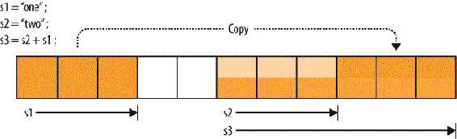图 5-1. 拼接字符串时的内存使用示例：s1 被复制到 s2 末尾以创建 s3；基础字符串 s2 未被复制

这些技巧不适用于 IE。在 IE8 中它们几乎没有效果，在 IE7 及更早版本中甚至可能拖慢速度。这是因为 IE 在底层执行拼接的方式不同。在 IE8 的实现中，拼接字符串仅存储对组成新字符串的现有字符串部分的引用。在最后一刻（实际使用拼接后的字符串时），这些字符串部分才会被复制到一个新的“真实”字符串中，然后替换之前存储的字符串引用，这样就不必在每次使用该字符串时都执行组装。

* * *

### 注意

IE8 的实现可能会干扰合成基准测试——使拼接看起来比实际更快——除非你在构建完测试字符串后强制进行拼接。例如，可以通过对最终字符串调用 `toString()` 方法、检查其 `length` 属性或将其插入 DOM 来实现。

* * *

IE7 及更早版本使用了一种较差的拼接实现，其中每对拼接的字符串都必须复制到新的内存位置。你将在后续章节中看到其潜在的重大影响。对于 IE8 之前的实现，本节中的建议可能会拖慢速度，因为将短字符串先拼接再与较大的基础字符串合并（从而避免多次复制大字符串）会更快。例如，对于 `largeStr = largeStr + s1 + s2`，IE7 及更早版本必须将大字符串复制两次：先与 `s1` 合并，再与 `s2` 合并。相反，`largeStr += s1 + s2` 先合并两个较小的字符串，然后将结果与大字符串拼接。创建 `s1 + s2` 的中间字符串对性能的影响远小于复制大字符串两次。

#### Firefox 与编译时折叠

当赋值表达式中所有拼接的字符串都是编译时常量时，Firefox 会在编译时自动合并它们。以下是一个演示示例：

```
function foldingDemo() {
    var str = "compile" + "time" + "folding";
    str += "this" + "works" + "too";
    str = str + "but" + "not" + "this";
}

alert(foldingDemo.toString());

/* 在 Firefox 中，你会看到：
function foldingDemo() {
    var str = "compiletimefolding";
    str += "thisworkstoo";
    str = str + "but" + "not" + "this";
} */
```

当字符串像这样折叠时，运行时不会产生中间字符串，拼接所花费的时间和内存降为零。这虽然很好，但并不常见，因为更常见的是从运行时数据构建字符串，而不是编译时常量。

* * *

### 注意

YUI Compressor 在构建时执行此优化。有关此工具的更多信息，请参见 JavaScript 压缩。

* * *

### 数组连接

`Array.prototype.join` 方法将数组的所有元素合并为一个字符串，并接受一个分隔符字符串插入到每个元素之间。通过传入空字符串作为分隔符，可以简单地将数组中的所有元素拼接起来。

在大多数浏览器中，数组连接比其他拼接方法慢，但它在 IE7 及更早版本中是唯一高效拼接大量字符串的方法，这一优势足以弥补其不足。

以下示例代码展示了数组连接所解决的性能问题：

```
var str = "I'm a thirty-five character string.",
    newStr = "",
    appends = 5000;

while (appends--) {
    newStr += str;
}
```

这段代码拼接了 5000 个 35 字符的字符串。图 5-2^([3]) 显示了在 IE7 中完成此测试所需的时间，从 5000 次拼接开始，然后逐渐增加次数。

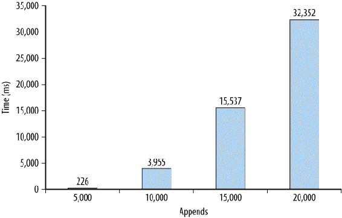图 5-2. 在 IE7 中使用 += 拼接字符串的时间

IE7 的朴素拼接算法要求浏览器在每次循环中反复复制和分配越来越大的字符串内存，导致运行时间和内存消耗呈二次增长。

好消息是，所有其他现代浏览器（包括 IE8）在此测试中表现要好得多，并且没有出现这种致命的二次复杂度。然而，这展示了看似简单的字符串拼接可能带来的影响：5000 次拼接耗时 226 毫秒已经是一个显著的性能损失，应尽可能减少；但为了拼接 20000 个短字符串而锁定用户浏览器超过 32 秒，对于几乎任何应用都是不可接受的。

现在考虑以下测试，它通过数组连接生成相同的字符串：

```
var str = "I'm a thirty-five character string.",
    strs = [],
    newStr,
    appends = 5000;

while (appends--) {
    strs[strs.length] = str;
}

newStr = strs.join("");
```

图 5-3 显示了此测试在 IE7 中的运行时间。


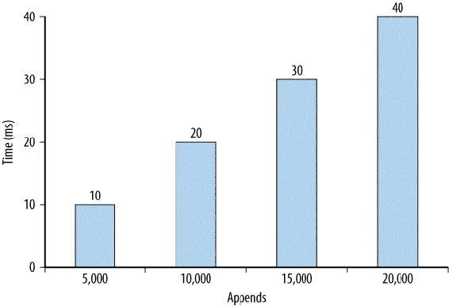图 5-3. 在 IE7 中使用数组合并拼接字符串的时间

这种显著的性能提升源于避免了重复为越来越大的字符串分配内存和复制。当合并数组时，浏览器会分配足够的内存来容纳完整的字符串，并且最终字符串的同一部分不会被复制超过一次。

### String.prototype.concat

原生的字符串 `concat` 方法接受任意数量的参数，并将每个参数追加到调用该方法的字符串上。这是最灵活的字符串拼接方式，因为你可以用它来追加一个字符串、一次追加几个字符串，或者追加整个字符串数组。

```
// 追加一个字符串
str = str.concat(s1);

// 追加三个字符串
str = str.concat(s1, s2, s3);

// 通过将数组作为参数列表，追加数组中的每个字符串
str = String.prototype.concat.apply(str, array);
```

不幸的是，在大多数情况下，`concat` 比简单的 `+` 和 `+=` 运算符稍慢，在 IE、Opera 和 Chrome 中可能会慢得多。此外，虽然使用 `concat` 合并数组中的所有字符串看起来类似于前面讨论的数组合并方法，但它通常更慢（Opera 除外），并且在 IE7 及更早版本中构建大字符串时，会遇到与 `+` 和 `+=` 相同的潜在灾难性性能问题。

## 正则表达式优化

不谨慎编写的正则表达式可能成为主要的性能瓶颈（接下来的章节 失控回溯 中包含几个示例，展示了这可能有多严重），但你可以采取很多措施来提高正则表达式的效率。两个正则表达式匹配相同的文本并不意味着它们以相同的速度匹配。

许多因素影响正则表达式的效率。首先，正则表达式所应用的文本本身就有很大差异，因为正则表达式在部分匹配上花费的时间比明显的非匹配要多。每个浏览器的正则表达式引擎也有不同的内部优化。^([4])

正则表达式优化是一个相当广泛且微妙的主题。本节只能涵盖有限的内容，但所包含的内容应该能让你很好地理解影响正则表达式性能的各种问题，并掌握编写高效正则表达式的艺术。

请注意，本节假设你已经对正则表达式有一定经验，并且主要关注如何让它们更快。如果你刚接触正则表达式或需要复习基础知识，网上和印刷品中有大量资源。Jan Goyvaerts 和 Steven Levithan（就是我！）合著的 *[正则表达式食谱](http://oreilly.com/catalog/9780596520694/)*（O'Reilly）是为喜欢通过实践学习的人编写的，同时涵盖了 JavaScript 和其他几种编程语言。

### 正则表达式的工作原理

为了高效地使用正则表达式，理解它们是如何施展魔法的很重要。以下是正则表达式经历的基本步骤的快速概述：

步骤 1：编译

> 当你创建一个正则表达式对象（使用正则表达式字面量或 `RegExp` 构造函数）时，浏览器会检查你的模式是否有错误，然后将其转换为用于实际执行匹配的原生代码例程。如果你将正则表达式赋值给一个变量，就可以避免对给定模式多次执行此步骤。

步骤 2：设置起始位置

> 当正则表达式被使用时，第一步是确定目标字符串中搜索应该开始的位置。这最初是字符串的开头或由正则表达式的 `lastIndex` 属性指定的位置，^([5]) 但当从步骤 4 返回此处时（由于匹配尝试失败），位置是上一次尝试开始位置之后的一个字符。浏览器制造商在其正则表达式引擎中内置的优化可以通过早期决定跳过某些不必要的工作来避免在此阶段进行大量无谓的工作。例如，如果正则表达式以 `^` 开头，IE 和 Chrome 通常可以确定在字符串开头之后无法找到匹配，从而避免愚蠢地搜索后续位置。另一个例子是，如果所有可能的匹配都包含 `x` 作为第三个字符，一个智能的实现可能能够确定这一点，快速搜索下一个 `x`，并将起始位置设置在找到它的位置之前两个字符处（例如，最新版本的 Chrome 包含了这种优化）。

步骤 3：匹配每个正则表达式标记

> 一旦正则表达式知道从哪里开始，它就会逐步遍历文本和正则表达式模式。当某个特定标记匹配失败时，正则表达式会尝试回溯到匹配尝试中的先前点，并沿着正则表达式的其他可能路径继续。

步骤 4：成功或失败

> 如果在字符串的当前位置找到了完全匹配，正则表达式宣布成功。如果已经尝试了正则表达式的所有可能路径但未找到匹配，正则表达式引擎会回到步骤 2，在字符串的下一个字符处再次尝试。只有当这个循环对字符串中的每个字符（以及最后一个字符之后的位置）都完成，并且没有找到任何匹配时，正则表达式才宣布整体失败。

记住这个过程将帮助你做出明智的决定，了解影响正则表达式性能的各种问题。接下来是对步骤 3 中匹配过程的一个关键特性的深入探讨：*回溯*。

### 理解回溯

在大多数现代正则表达式实现中（包括 JavaScript 所需的实现），回溯是匹配过程的基本组成部分。这也是使正则表达式如此富有表现力和强大的重要原因。然而，回溯在计算上是昂贵的，如果不小心，很容易失控。虽然回溯只是整体性能方程的一部分，但理解它的工作原理以及如何最小化它的使用，可能是编写高效正则表达式的最重要关键。因此，接下来的几节将对此主题进行一定篇幅的讨论。

当正则表达式在目标字符串中逐步前进时，它通过从左到右遍历正则表达式中的组件来测试每个位置是否可能找到匹配。对于每个量词和分支，^([6]) 必须决定如何继续。对于量词（如 `*`、`+?` 或 `{2,}`），正则表达式必须决定何时尝试匹配额外的字符；对于分支（通过 `|` 运算符），它必须从可用的选项中选择一个。

每次正则表达式做出这样的决定时，它会记住其他选项，以便在必要时稍后返回。如果选择的选项成功，正则表达式会继续遍历正则表达式模式，如果正则表达式的其余部分也成功，则匹配完成。但如果选择的选项无法找到匹配，或者正则表达式后面的部分失败，正则表达式会回溯到最后一个存在未尝试选项的决策点，并选择其中一个。它继续这样进行，直到找到匹配，或者正则表达式中所有量词和分支选项的可能排列都已尝试但未成功，此时它放弃并继续到字符串中的下一个字符，重新开始整个过程。

#### 分支与回溯

下面是一个示例，演示了分支情况下这个过程是如何进行的。

```
/h(ello|appy) hippo/.test("hello there, happy hippo");
```


这个正则表达式匹配“hello hippo”或“happy hippo”。它通过搜索一个`h`开始测试，这个`h`立即在目标字符串的第一个字符处找到。接下来，子表达式`(ello|appy)`提供了两种前进方式。正则表达式选择最左边的选项（交替总是从左到右工作），并检查`ello`是否匹配字符串中的后续字符。匹配成功，正则表达式也能匹配接下来的空格字符。然而，此时它遇到了死胡同，因为`hippo`中的`h`无法匹配字符串中接下来的`t`。但正则表达式还不能放弃，因为它还没有尝试所有选项，所以它回溯到上一个决策点（就在它匹配了开头的`h`之后），并尝试匹配第二个交替选项。这也不成功，由于没有更多选项可尝试，正则表达式确定无法从字符串的第一个字符开始找到匹配，于是继续从第二个字符开始尝试。那里没有找到`h`，所以它继续搜索，直到到达第 14 个字符，在那里它匹配了“happy”中的`h`。然后它再次遍历各个选项。这次`ello`不匹配，但在回溯并尝试第二个选项后，它能够继续，直到匹配整个字符串“happy hippo”（参见图 5-4）。成功。

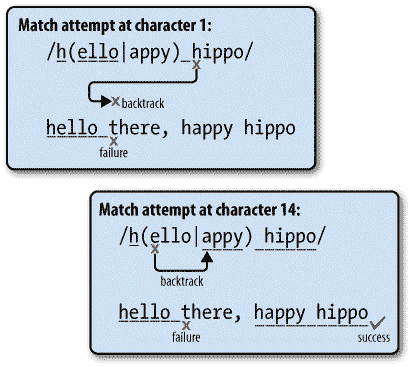图 5-4. 带有交替的回溯示例

#### 重复与回溯

下一个示例展示了回溯如何与重复量词一起工作。

```
var str = "<p>Para 1.</p>" +
          "" +
          "<p>Para 2.</p>" +
          "<div>Div.</div>";

/<p>.*<\/p>/i.test(str);
```

这里，正则表达式首先匹配字符串开头的三个字面字符`<p>`。接下来是`.*`。点号匹配除换行符以外的任何字符，贪婪的星号量词将其重复零次或多次——尽可能多地重复。由于目标字符串中没有换行符，这吞噬了字符串的其余部分！然而，正则表达式模式中还有更多内容需要匹配，所以正则表达式尝试匹配`<`。这在字符串末尾不起作用，因此正则表达式一次回溯一个字符，不断尝试匹配`<`，直到它回到`</div>`标签开头的`<`。然后它尝试匹配`\/`（一个转义的正斜杠），成功，接着匹配`p`，失败。正则表达式再次回溯，重复这个过程，直到最终匹配第二个段落末尾的`</p>`。匹配成功返回，范围从第一个段落的开头一直延伸到最后一个段落的结尾，这很可能不是你想要的。

你可以通过将贪婪的`*`量词替换为懒惰的（又称非贪婪的）`*?`来更改正则表达式以匹配单个段落。懒惰量词的回溯工作方式相反。当正则表达式`/<p>.*?<\/p>/`遇到`.*?`时，它首先尝试完全跳过它，继续匹配`<\/p>`。它这样做是因为`*?`将其前面的元素重复零次或多次，尽可能*少*地重复，而可能的最少重复次数是零。然而，当接下来的`<`在字符串的这个位置匹配失败时，正则表达式回溯并尝试匹配下一个最少的字符数：一个。它像这样向前回溯，直到量词后面的`<\/p>`能够在第一个段落的末尾完全匹配。

你可以看到，即使目标字符串中只有一个段落，因此该正则表达式的贪婪版本和懒惰版本是等价的，它们也会以不同的方式找到匹配（参见图 5-5）。

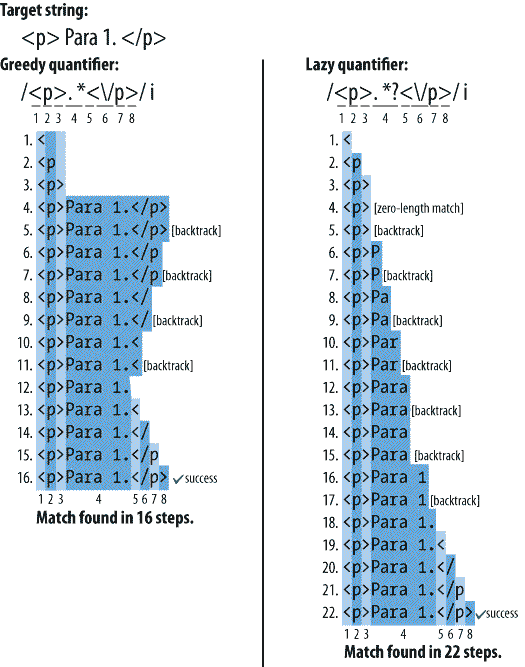图 5-5. 带有贪婪和懒惰量词的回溯示例

### 失控回溯

当一个正则表达式让你的浏览器停滞数秒、数分钟甚至更长时间时，问题很可能是一个糟糕的失控回溯案例。为了演示这个问题，考虑以下正则表达式，它旨在匹配整个 HTML 文件。为了适应页面宽度，正则表达式被跨多行书写。与大多数其他正则表达式风格不同，JavaScript 没有让点号匹配任何字符（包括换行符）的选项，因此这个示例使用`[\s\S]`来匹配任何字符。

```
/<html>[\s\S]*?<head>[\s\S]*?<title>[\s\S]*?<\/title>[\s\S]*?<\/head>
[\s\S]*?<body>[\s\S]*?<\/body>[\s\S]*?<\/html>/
```

这个正则表达式在匹配合适的 HTML 字符串时工作正常，但当字符串缺少一个或多个必需的标签时，情况就变得糟糕了。例如，如果缺少`</html>`标签，最后一个`[\s\S]*?`会扩展到字符串的末尾，因为找不到`</html>`标签，然后，正则表达式并没有放弃，而是发现之前的每个`[\s\S]*?`序列都记住了允许它们进一步扩展的回溯位置。正则表达式尝试扩展倒数第二个`[\s\S]*?`——用它来匹配之前由正则表达式中的字面模式`<\/body>`匹配的`</body>`标签——并继续扩展它以寻找第二个`</body>`标签，直到再次到达字符串末尾。当所有这些都失败时，倒数第三个`[\s\S]*?`扩展到字符串末尾，依此类推。

#### 解决方案：具体化

解决这类问题的方法是尽可能具体地指定在所需分隔符之间可以匹配哪些字符。以模式`".*?"`为例，它旨在匹配由双引号分隔的字符串。通过将过于宽松的`.*?`替换为更具体的`[^"\r\n]*`，你消除了回溯迫使点号匹配双引号并扩展到预期范围之外的可能性。

对于 HTML 示例，这种变通方法并不简单。你不能使用像`[^<]`这样的否定字符类来替代`[\s\S]`，因为在你搜索的标签之间可能还有其他标签。然而，你可以通过重复一个包含否定前瞻（阻止下一个所需标签）和`[\s\S]`（任何字符）元序列的非捕获组来重现这种效果。这确保了你在每个中间位置寻找的标签都失败，更重要的是，`[\s\S]`模式不能扩展到通过否定前瞻阻止的标签被发现的位置之外。以下是使用这种方法最终得到的正则表达式：

```
/<html>(?:(?!<head>)[\s\S])*<head>(?:(?!<title>)[\s\S])*<title>
(?:(?!<\/title>)[\s\S])*<\/title>(?:(?!<\/head>)[\s\S])*<\/head>
(?:(?!<body>)[\s\S])*<body>(?:(?!<\/body>)[\s\S])*<\/body>
(?:(?!<\/html>)[\s\S])*<\/html>/
```

虽然这消除了失控回溯的可能性，并允许正则表达式在线性时间内失败于匹配不完整的 HTML 字符串，但它并不会因效率而获奖。像这样为每个匹配的字符重复前瞻本身效率相当低下，并显著减慢成功匹配的速度。这种方法在匹配短字符串时效果不错，但由于在这种情况下，为了匹配一个 HTML 文件，前瞻可能需要被测试数千次，因此有另一种更好的解决方案。它依赖于一个小技巧，接下来将描述。

#### 使用前瞻和反向引用模拟原子组


某些正则表达式引擎（包括 .NET、Java、Oniguruma、PCRE 和 Perl）支持一种名为`原子分组`（atomic grouping）的功能。原子组——写法为 `(?>...)`，其中省略号表示任何正则表达式模式——是具有特殊之处之处的非捕获分组。一旦正则表达式离开原子组，该组内的任何回溯位置都会被丢弃。这为 HTML 正则表达式的回溯问题提供了一个得好的解决方案：如果你将每个 `[\s\S]*?` 序列及其随后的 HTML 标签一起放在原子组内部，那么每当找到一个所需的 HTML 标签时，到为止的匹配内容基本上就被锁定了。如果正则表达式的后续部分匹配失败，原子组内的量词将不会记住任何回溯位置，因此 `[\s\S]*?` 序列将无法尝试扩展到超出已匹配的内容。

这很棒，但 JavaScript 不支持原子分组，也没有提供任何其他消除无效回溯的功能。然而，事实证明你可以通过利用先行断言（lookahead）的一种不为人知的行为来模拟原子分组：即先行断言*就是*原子分组。区别在于，先行断言不会作为整体匹配的一部分消耗任何字符；它们仅仅是检查其包含的模式在该位置是否可以匹配。但是，你可以通过将先行断言的模式封装在一个捕获分组内部，并在先行断言外部对其添加一个反向引用来绕过这个问题。它的 own 如下：

```
(?=(要使其原子化的模式))\1
```

这种构造可以在任何你想要使用原子组的模式中复用。只需记住，如果你的正则表达式包含多个捕获分组，则需要使用适当的反向引用数字。

当应用于 HTML 正则表达式时，显示如下：

```
/<html>(?=([\s\S]*?<head>))\1(?=([\s\S]*?<title>))\2(?=([\s\S]*?
<\/title>))\3(?=([\s\S]*?<\/head>))\4(?=([\s\S]*?<body>))\5
(?=([\s\S]*?<\/body>))\6[\s\S]*?<\/html>/
```

现在，如果没有末尾的 `</html>` 且最后一个 `[\s\S]*?` 扩展到字符串末尾，正则表达式将立即失败，因为没有可以返回的回溯点。每当正则表达式找到中间标签并离开先行断言时，它都会丢弃先行断言内部所有的回溯位置。随后的反向引用只是重新匹配先行断言内找到字面字符，使其成为实际匹配的一部分。

#### 嵌套量词与失控回溯

所谓的嵌套量词（nested quantifiers）总是需要额外的关注和小心，以确保你没有创建出失控回溯的可能。当一个量词出现在一个本身被另一个量词重复的分组内部（例如 `(x+)*`）时，该量词就是嵌套的。

嵌套量词本身并不是一种性能隐患。然而，如果不小心，在尝试匹配字符串时，它很容易创建出一种在内部和外部量词之间划分文本的海量方式。

例如，假设你想匹配 HTML 标签，并得到了以下正则表达式：

```
/<(?:[^>"']|"[^"]*"|'[^']*')*>/
```

这可能过于简单了，因为它没有正确处理所有有效和无效标记的情况，但如果仅用于处理有效 HTML 片段，它可能运行良好。它相比于如 `/<[^>]*>/` 这样更幼稚的解决方案，优势在于它考虑了出现在属性值内部的 `>` 字符。它是通过非捕获分组中的第二个和第三替代方案实现的，这些方案单步匹配整个双引号和单引号属性值，允许除各自的引号类型以外的所有字符出现在其中。

到目前为止，尽管存在嵌套的 `*` 量词，但还没有失控回溯的风险。第二个和第三替代选项在组的每次重复中精确匹配一个引号字符串序列，因此潜在的回溯点数量随目标字符串的长度线性增加。

然而，看看非捕获分组中的第一个替代方案：`[^>"']`。它一次只能匹配一个字符，这看起来有点低效。你可能会认为在该字符类末尾添加一个 `+` 量词更好，这样在组的每次重复中（以及在正则表达式在目标字符串中找到匹配的位置处）就可以匹配多个合适的字符——你是对的。通过一次匹配多个字符，你将让正则表达式在通往成功匹配的途中跳过许多不必要的步骤。

可能没有显而易见的是，这种变化可能导致的负面后果。如果正则表达式匹配了起始字符 `<`，但后面没有后续的 `>` 允许匹配尝试成功完成，那么由于新的内部量词与外部量词（跟随非捕获分组）组合以匹配 `<` 之后文本的方式巨大，失控回溯将进入高速状态。正则表达式在放弃匹配尝试之前必须尝试所有这些排列组合。小心！

##### 变本加糟

对于嵌套量词导致失控回溯的更极端的例子，请将正则表达式 `/(A+A+)+B/` 应用于一个只包含 `A` 的字符串。虽然这个正则表达式写成 `/AA+B/` 会更好，但为了讨论起见，假设这两个 `A` 代表能够匹配某些相同字符串的不同模式。

当应用于一个由 10 个 `A` 组成的字符串（`"AAAAAAAAAA"`）时，正则表达式首先使用第一个 `A+` 匹配所有 10 个字符。然后正则表达式回溯一个字符，让第二个 `A+` 匹配最后一个。分组接着尝试重复，但由于没有更多的 `A` 且组的 `+` 量词已经满足了至少匹配一次的要求，正则表达式接着寻找 `B`。它没有找到 `B`，但不能放弃，因为还有更多未尝试过的正则表达式路径。如果第一个 `A+` 匹配了 8 个字符而第二个匹配了 2 个呢？或者如果第一个匹配了 3 个，第二个匹配了 2 个，且组重复了两次呢？如果在第一次重复中，组的第一个匹配了 2 个，第二个匹配了 4 个呢？虽然对你我来说认为任何回溯都能产生缺失的 `B` 显然是愚蠢的，但正则表达式会尽职地检查这些无效选项以及更多。该正则表达式的最坏情况复杂度是惊人的 $O(2^n)$，即 2 的 $n$ 次，其中 $n$ 是字符串的长度。使用这里使用的 10 个 `A$，正则表达式需要 1024 次回溯步骤才能匹配失败，而使用 20 个 `A`，这个数字就会爆炸到百万以上。35 个 `A` 就足以让 Chrome、IE、Firefox 和 Opera 卡住至少 10 分钟（如果不是永久的话），因为它们需要处理超过 340 亿次的回溯步骤。例外是最新版本的 Safari，它能够检测到正则表达式正在循环并快速中止匹配（Safari 还会对允许的回溯步骤设置上限限制，并在超过此限制时中止匹配尝试）。

防止此类问题的关键是确保正则表达式的两个部分不能匹配字符串的相同部分。对于这个正则表达式，修复方法是将其重写为 `/AA+B/`，但对于复杂的正则表达式，这个问题可能更难避免。添加模拟原子分组通常可以作为最后的手段，尽管在可行的情况下，其他解决方案通常会让你的正则表达式更容易理解。对于这个正则表达式，这样做看起来是 `/((?=(A+A+))\2)+B/`，并且完全消除了回溯问题。


由于正则表达式的性能会因所应用的文本而有很大差异，因此没有直接的方法来对正则表达式进行相互基准测试。为了获得最佳结果，你需要在不同长度的测试字符串上对正则表达式进行基准测试，这些字符串包括匹配、不匹配以及近似匹配的情况。

这就是本章花费大量篇幅介绍回溯的原因。如果没有对回溯的深入理解，你将无法预见和识别与回溯相关的问题。为了尽早发现失控的回溯，始终使用包含部分匹配的长字符串来测试你的正则表达式。思考你的正则表达式会近似匹配但不会完全匹配的字符串类型，并将这些字符串纳入测试中。

### 提高正则表达式效率的更多方法

以下是各种额外的正则表达式效率技巧。其中几点已经在回溯讨论中提及。

> 专注于更快地失败

> 正则表达式处理缓慢通常是由缓慢的失败而非缓慢的匹配引起的。此外，如果你使用正则表达式来匹配大字符串中的小部分，那么正则表达式在更多位置上会失败而非成功。一个使正则表达式匹配更快但失败更慢的改动（例如，通过增加尝试所有正则表达式排列所需的回溯步骤）通常是一种得不偿失的权衡。

> 以简单、必需的标记开头

> 理想情况下，正则表达式中的前导标记应该能够快速测试并排除尽可能多的明显不匹配位置。适合此目的的起始标记包括锚点（`^` 或 `$`）、特定字符（例如 `x` 或 `\u263A`）、字符类（例如 `[a-z]` 或像 `\d` 这样的简写）以及单词边界（`\b`）。如果可能，避免以分组或可选标记开头，并避免顶级交替，例如 `/one|two/`，因为这迫使正则表达式考虑多个前导标记。Firefox 对前导标记上任何量词的使用都很敏感，并且能够更好地优化，例如 `\s\s*` 优于 `\s+` 或 `\s{1,}`。其他浏览器大多会优化掉这些差异。

> 使量化的模式及其后续标记互斥

> 当相邻标记或子表达式能够匹配的字符重叠时，正则表达式尝试在它们之间划分文本的方式数量会增加。为了帮助避免这种情况，请尽可能使你的模式具体化。当你真正想要的是 `"[^"\r\n]*"` 时，不要使用 `".*?"`（它依赖于回溯）。

> 减少交替的数量和范围

> 使用竖线 `|` 的交替可能需要在字符串的每个位置测试所有交替选项。你可以通过使用字符类和可选组件，或者将交替推后到正则表达式的更后面（允许一些匹配尝试在到达交替之前失败）来减少对交替的需求。下表展示了这些技术的示例。

> | 代替 | 使用 |
> | --- | --- |
> | `cat|bat` | `[cb]at` |
> | `red|read` | `rea?d` |
> | `red|raw` | `r(?:ed|aw)` |
> | `(.|\r|\n)` | `[\s\S]` |

> * * *

> ### 注意

> 匹配任意字符的字符类（例如 `[\s\S]`、`[\d\D]`、`[\w\W]` 或 `[\0-\uFFFF]`）实际上等价于 `(?:.|\r|\n|\u2028|\u2029)`。这包括点号不匹配的四个字符（回车、换行、行分隔符和段落分隔符）。

> * * *

> 字符类比交替更快，因为它们使用位向量（或其他快速实现）而不是回溯来实现。当需要交替时，如果这不会影响正则表达式匹配的内容，请将频繁出现的选项放在前面。交替选项是从左到右尝试的，因此一个选项预期匹配的频率越高，你就越希望它尽早被考虑。请注意，Chrome 和 Firefox 会自动执行其中一些优化，因此受手动调整交替技术的影响较小。

> 使用非捕获组

> 捕获组会花费时间和内存来记住反向引用并保持其更新。如果你不需要反向引用，请使用非捕获组来避免这种开销——即使用 `(?:…)` 而不是 `(…)`。有些人喜欢在需要反向引用整个匹配时，将正则表达式包裹在捕获组中。这是不必要的，因为你可以通过例如 `regex.exec()` 返回的数组中的第零个元素或替换字符串中的 `$&` 来引用完整匹配。将捕获组替换为非捕获组在 Firefox 中影响很小，但在处理长字符串时，在其他浏览器中可能会产生很大差异。

> 捕获感兴趣的文本以减少后处理

> 作为上一条技巧的补充说明，如果你需要引用匹配的*部分*，那么请务必捕获这些部分并使用生成的反向引用。例如，如果你正在编写代码来处理由正则表达式匹配的带引号字符串的内容，请使用 `/"([^"]*)"/` 并处理第一个反向引用，而不是使用 `/"[^"]*"/` 然后手动从结果中去除引号。在循环中使用时，这种减少工作量的方式可以节省大量时间。

> 暴露必需的标记

> 为了帮助正则表达式引擎做出关于如何优化搜索例程的明智决策，请尽量使确定哪些标记是必需的变得容易。当标记用于子表达式或交替中时，正则表达式引擎更难确定它们是否是必需的，并且有些引擎不会费心去这样做。例如，正则表达式 `/^(ab|cd)/` 暴露了其字符串起始锚点。IE 和 Chrome 看到这一点，并阻止正则表达式在字符串起始之后尝试查找匹配，从而使此搜索几乎瞬间完成，无论字符串长度如何。然而，由于等价的正则表达式 `/(^ab|^cd)/` 没有暴露其 `^` 锚点，IE 不会应用相同的优化，最终会在字符串的每个位置无意义地搜索匹配。

> 使用适当的量词

> 如前面章节重复与回溯所述，贪婪量词和懒惰量词在查找匹配时方式不同，即使它们匹配相同的字符串。在它们同样正确的情况下，使用更合适的量词类型（基于预期的回溯量）可以显著提高性能，尤其是在处理长字符串时。在 Opera 9.`x` 及更早版本中，懒惰量词特别慢，但 Opera 10 消除了这一弱点。

> 通过将正则表达式赋值给变量来重用它们

> 将正则表达式赋值给变量可以避免重复编译它们。有些人会过度使用正则表达式缓存方案，旨在避免多次编译给定的模式和标志组合。不必费心；正则表达式编译很快，这样的方案可能增加的开销比它们避免的还要多。重要的是避免在循环内重复编译正则表达式。换句话说，不要这样做：

> ```
> while (/regex1/.test(str1)) {
>     /regex2/.exec(str2);
>     ...
> }
> ```

> 而应该这样做：

> ```
> var regex1 = /regex1/,
>     regex2 = /regex2/;
> while (regex1.test(str1)) {
>     regex2.exec(str2);
>     ...
> }
> ```

> 将复杂的正则表达式拆分为更简单的部分

> 尽量避免用一个正则表达式做太多事情。需要条件逻辑的复杂搜索问题，当拆分为两个或多个正则表达式时，每个正则表达式在上一个匹配结果中搜索，通常更容易解决且更高效。在一个模式中完成所有事情的正则表达式怪物难以维护，并且容易出现与回溯相关的问题。

### 何时不使用正则表达式


如果使用得当，正则表达式的速度非常快。然而，当你仅仅是在搜索字面字符串时，它们通常就大材小用了。如果你事先知道要测试字符串的哪个部分，这一点尤其明显。例如，如果你想检查一个字符串是否以分号结尾，你可以使用类似这样的代码：

```
endsWithSemicolon = /;$/.test(str);
```

不过，你可能会惊讶地发现，目前所有主流浏览器都不够智能，无法提前意识到这个正则表达式只能匹配字符串的末尾。它们实际做的是遍历整个字符串。每次找到分号时，正则表达式就会前进到下一个标记（`$`），检查匹配是否在字符串末尾。如果不是，正则表达式会继续搜索匹配，直到最终遍历完整个字符串。你的字符串越长（包含的分号越多），这个过程就越耗时。

在这种情况下，更好的方法是跳过正则表达式所需的所有中间步骤，直接检查最后一个字符是否为分号：

```
endsWithSemicolon = str.charAt(str.length - 1) == ";";
```

对于较小的目标字符串，这比基于正则表达式的测试只快一点点，但更重要的是，字符串的长度不再影响执行测试所需的时间。

这个例子使用了 `charAt` 方法来读取特定位置的字符。当你想要提取并检查特定位置多个字符的值时，字符串方法 `slice`、`substr` 和 `substring` 非常有用。此外，`indexOf` 和 `lastIndexOf` 方法非常适合查找字面字符串的位置或检查它们是否存在。所有这些字符串方法都很快，并且可以帮助你在搜索不依赖复杂正则特性的字面字符串时，避免调用正则表达式带来的开销。

## 字符串修剪

去除字符串开头和结尾的空白字符是一个简单但常见的任务。虽然 ECMAScript 5 添加了原生的字符串 `trim` 方法（因此你应该开始在即将推出的浏览器中看到这个方法），但 JavaScript 历史上并没有包含它。对于当前的浏览器版本，仍然需要自己实现一个 `trim` 方法，或者依赖包含该方法的库。

字符串修剪通常不是性能瓶颈，但它作为正则表达式优化的一个不错案例，因为实现它的方式多种多样。

### 使用正则表达式进行修剪

正则表达式允许你用很少的代码实现一个 `trim` 方法，这对于注重文件大小的 JavaScript 库来说很重要。可能最好的全面解决方案是使用两次替换——一次去除开头的空白，另一次去除结尾的空白。这样既简单又快速，尤其是在处理长字符串时。

```
if (!String.prototype.trim) {
    String.prototype.trim = function() {
        return this.replace(/^\s+/, "").replace(/\s+$/, "");
    }
}

// 测试新方法...
// 制表符（\t）和换行符（\n）包含在开头的空白中。

var str = " \t\n  test string  ".trim();
alert(str == "test string"); // 弹出 "true"
```

这段代码周围的 `if` 块避免了在 `trim` 方法已存在时覆盖它，因为原生方法经过优化，通常比你用 JavaScript 函数自己实现的任何方法都要快得多。后续的示例实现都假设这个条件判断已经存在，尽管每次都没有写出来。

你可以通过将 `/\s+$/`（第二个正则表达式）替换为 `/\s\s*$/`，使 Firefox 的性能提升大约 35%（具体取决于目标字符串的长度和内容）^([8])。虽然这两个正则表达式在功能上是相同的，但 Firefox 对以非量化标记开头的正则表达式提供了额外的优化。在其他浏览器中，差异不那么显著，或者被完全优化掉了。然而，将匹配字符串开头的正则表达式改为 `/^\s\s*/` 并没有产生可测量的差异，因为开头的 `^` 锚点已经负责快速排除不匹配的位置（从而避免了在长字符串中数千次匹配尝试中累积的微小性能差异）。

以下是另外几种基于正则表达式的 `trim` 实现，它们是你可能会遇到的一些常见替代方案。你可以在本节末尾的表 5-2 中看到这里描述的所有 `trim` 实现的跨浏览器性能数据。事实上，除了这里列出的方法之外，还有很多种编写正则表达式来帮助修剪字符串的方式，但在处理长字符串时，它们无一例外地比使用两次简单替换更慢（或者至少跨浏览器的一致性更差）。

```
// trim 2
String.prototype.trim = function() {
    return this.replace(/^\s+|\s+$/g, "");
}
```

这可能是最常见的解决方案。它通过交替将两个简单的正则表达式合并，并使用 `/g`（全局）标志来替换所有匹配，而不仅仅是第一个（当目标字符串同时包含开头和结尾空白时，它会匹配两次）。这种方法并不差，但在处理长字符串时，它比使用两次简单替换要慢，因为每个字符位置都需要测试两个交替选项。

```
// trim 3
String.prototype.trim = function() {
    return this.replace(/^\s*([\s\S]*?)\s*$/, "$1");
}
```

这个正则表达式通过匹配整个字符串，并捕获从第一个到最后一个非空白字符（如果有的话）的序列作为反向引用一。通过用反向引用一替换整个字符串，你就得到了修剪后的字符串。

这种方法概念上很简单，但捕获组内的惰性量词使得正则表达式做了大量额外的工作（即回溯），因此对于长目标字符串，这种方法往往很慢。当正则表达式进入捕获组后，`[\s\S]` 类的惰性 `*?` 量词要求它尽可能少地重复。因此，正则表达式一次匹配一个字符，每匹配一个字符后就停下来尝试匹配剩余的 `\s*$` 模式。如果因为字符串中当前位置之后还存在非空白字符而失败，正则表达式就会再匹配一个字符，更新反向引用，然后再次尝试剩余的模式。

在 Opera 9.x 及更早版本中，惰性重复尤其缓慢。因此，在 Opera 9.64 中使用这种方法修剪长字符串，其性能大约比其他主流浏览器慢 10 到 100 倍。Opera 10 修复了这个长期存在的弱点，使该方法的性能与其他浏览器保持一致。

```
// trim 4
String.prototype.trim = function() {
    return this.replace(/^\s*([\s\S]*\S)?\s*$/, "$1");
}
```

这与上一个正则表达式类似，但出于性能考虑，它将惰性量词替换为贪婪量词。为了确保捕获组仍然只匹配到最后一个非空白字符，需要添加一个尾随的 `\S`。然而，由于正则表达式必须能够匹配仅包含空白的字符串，因此整个捕获组通过添加一个尾随的问号量词变为可选。

这里，`[\s\S]*` 中的贪婪星号将其任意字符模式重复到字符串末尾。然后正则表达式一次回溯一个字符，直到能够匹配后面的 `\S`，或者回溯到组内匹配的第一个字符（之后它会跳过该组）。


除非存在比其他文本更多的尾部空白，否则这种方法通常比之前使用惰性量词的解决方案更快。实际上，它在 IE、Safari、Chrome 和 Opera 10 中甚至比使用两次替换还要快。这是因为这些浏览器对匹配任意字符的字符类贪婪重复进行了特殊优化。正则表达式引擎会直接跳到字符串末尾，而不评估中间字符（尽管仍需记录回溯位置），然后适当地回溯。不幸的是，这种方法在 Firefox 和 Opera 9 中明显较慢，因此至少目前，使用两次替换在跨浏览器方面仍然表现更好。

```javascript
// trim 5
String.prototype.trim = function() {
    return this.replace(/^\s*(\S*(\s+\S+)*)\s*$/, "$1");
}
```

这是一种相对常见的方法，但没有充分的理由使用它，因为在所有浏览器中，它始终是这里展示的选项中最慢的方法之一。它与最后两个正则表达式类似，都是匹配整个字符串并用你想要保留的部分替换它，但由于内部组每次只匹配一个单词，正则表达式必须执行许多离散步骤。在修剪短字符串时，性能影响可能不明显，但在包含许多单词的长字符串中，这个正则表达式可能会成为性能问题。

将内部组改为非捕获组——即将 `(\s+\S+)` 改为 `(?:\s+\S+)`——会有所帮助，在 Opera、IE 和 Chrome 中大约减少 20%–45% 的时间，在 Safari 和 Firefox 中也有轻微改进。尽管如此，非捕获组无法挽救这个实现。注意，外部组不能转换为非捕获组，因为它在替换字符串中被引用。

### 不使用正则表达式的修剪

尽管正则表达式很快，但考虑不使用正则表达式进行修剪的性能也是值得的。以下是一种实现方式：

```javascript
// trim 6
String.prototype.trim = function() {
    var start = 0,
        end = this.length - 1,
        ws = " \n\r\t\f\x0b\xa0\u1680\u180e\u2000\u2001\u2002\u2003
\u2004\u2005\u2006\u2007\u2008\u2009\u200a\u200b\u2028\u2029\u202f
\u205f\u3000\ufeff";

    while (ws.indexOf(this.charAt(start)) > -1) {
        start++;
    }
    while (end > start && ws.indexOf(this.charAt(end)) > -1) {
        end--;
    }

    return this.slice(start, end + 1);
}
```

这段代码中的 `ws` 变量包含了 ECMAScript 5 定义的所有空白字符。为了提高效率，在确定修剪版本的起始和结束位置之前，避免复制字符串的任何部分。

事实证明，当字符串两端只有少量空白时，这种方法远超正则表达式。原因是，虽然正则表达式非常适合从字符串开头移除空白，但在从长字符串末尾修剪时速度并不快。正如 何时不使用正则表达式 一节所述，正则表达式无法在不考虑沿途字符的情况下跳到字符串末尾。然而，这个实现正是这样做的，第二个 `while` 循环从字符串末尾向后工作，直到找到非空白字符。

尽管这个版本不受字符串整体长度的影响，但它有自己的弱点：长前导和尾部空白。这是因为循环遍历字符检查它们是否为空白，无法与正则表达式优化搜索代码的效率相媲美。

### 混合解决方案

本节最后的方法是将正则表达式在修剪前导空白方面的通用效率与非正则方法在修剪尾部字符方面的速度结合起来。

```javascript
// trim 7
String.prototype.trim = function() {
    var str = this.replace(/^\s+/, ""),
        end = str.length - 1,
        ws = /\s/;

    while (ws.test(str.charAt(end))) {
        end--;
    }

    return str.slice(0, end + 1);
}
```

这种混合方法在仅修剪少量空白时仍然非常快，并且消除了长前导空白和仅空白字符串的性能风险（尽管它仍然存在长尾部空白字符串的弱点）。注意，这个解决方案在循环中使用正则表达式来检查字符串末尾的字符是否为空白。虽然使用正则表达式会增加一些性能开销，但它让你可以将空白字符列表委托给浏览器，以保持简洁和兼容性。

这里描述的所有 `trim` 方法的总体趋势是：在基于正则表达式的解决方案中，字符串整体长度比要修剪的字符数影响更大；而基于非正则表达式、从字符串末尾向后工作的解决方案不受整体长度影响，但受要修剪的空白量影响更大。使用两次正则表达式替换的简单方法在不同字符串内容和长度下，跨浏览器提供了始终如一的可靠性能，因此可以说是最全面的解决方案。混合方法在处理长字符串时异常快速，但代价是代码稍长，并且在某些浏览器中处理长尾部空白时存在弱点。有关所有详细数据，请参见 表 5-2。

表 5-2. 各种 trim 实现的跨浏览器性能

| 浏览器 | Trim 1^([[b]](#part0042.html_ftn.CHP-5-FNOTE-10)) | Trim 2 | Trim 3 | Trim 4 | Trim 5^([[c]](#part0042.html_ftn.CHP-5-FNOTE-11)) | Trim 6 | Trim 7 |
| --- | --- | --- | --- | --- | --- | --- | --- |
| IE 7 | 80/80 | 315/312 | 547/539 | 36/42 | 218/224 | 14/1015 | 18/409 |
| IE 8 | 70/70 | 252/256 | 512/425 | 26/30 | 216/222 | 4/334 | 12/205 |
| Firefox 3 | 136/147 | 164/174 | 650/600 | 1098/1525 | 1416/1488 | 21/151 | 20/144 |
| Firefox 3.5 | 130/147 | 157/172 | 500/510 | 1004/1437 | 1344/1394 | 21/332 | 18/50 |
| Safari 3.2.3 | 253/253 | 424/425 | 351/359 | 27/29 | 541/554 | 2/140 | 5/80 |
| Safari 4 | 37/37 | 33/31 | 69/68 | 32/33 | 510/514 | <0.5/29 | 4/18 |
| Opera 9.64 | 494/517 | 731/748 | 9066/9601 | 901/955 | 1953/2016 | <0.5/210 | 20/241 |
| Opera 10 | 75/75 | 94/100 | 360/370 | 46/46 | 514/514 | 2/186 | 12/198 |
| Chrome 2 | 78/78 | 66/68 | 100/101 | 59/59 | 140/142 | 1/37 | 24/55 |

^([[a]](#part0042.html_CHP-5-FNOTE-9)) 报告的时间是通过修剪一个大字符串（40 KB）100 次得到的，首先在两端各添加 10 个空格，然后各添加 1000 个空格。

^([[b]](#part0042.html_ftn.CHP-5-FNOTE-10)) 测试时未使用 `/\s\s*$/` 优化。

^([[c]](#part0042.html_ftn.CHP-5-FNOTE-11)) 测试时未使用非捕获组优化。

## 总结

密集的字符串操作和草率编写的正则表达式可能成为主要的性能障碍，但本章的建议有助于你避免常见陷阱。

*   当连接大量或大型字符串时，数组连接是 IE7 及更早版本中唯一具有合理性能的方法。

*   如果不需要担心 IE7 及更早版本，数组连接是连接字符串最慢的方法之一。请改用简单的 `+` 和 `+=` 运算符，并避免不必要的中间字符串。

*   回溯既是正则表达式匹配的基本组成部分，也是正则表达式效率低下的常见来源。

*   失控的回溯可能导致通常能快速找到匹配的正则表达式运行缓慢，甚至在应用于部分匹配的字符串时导致浏览器崩溃。避免此问题的技术包括：使相邻的标记互斥，避免允许以多种方式匹配字符串同一部分的嵌套量词，以及通过重新利用前瞻的原子性来消除不必要的回溯。


*   存在多种技术可以通过帮助正则表达式更快地找到匹配项并减少考虑不匹配位置的时间来提高正则表达式的效率（参见更多提高正则表达式效率的方法）。
*   正则表达式并非总是完成工作的最佳工具，尤其是在你仅仅搜索字面字符串时。
*   尽管有多种方法可以修剪字符串，但使用两个简单的正则表达式（一个用于去除前导空白，另一个用于去除尾部空白）在字符串内容和长度变化的情况下，提供了简洁性与跨浏览器效率的良好结合。从字符串末尾循环查找第一个非空白字符，或者将这种技术与正则表达式结合使用，是一种很好的替代方案，受整体字符串长度的影响较小。

# 第 6 章 响应式界面

没有什么比在网页上点击某个东西却没有任何反应更令人沮丧的了。这个问题可以追溯到事务性 Web 应用的起源，并导致了现在无处不在的“请只点击一次”消息，该消息伴随着大多数表单提交。用户的本能是重复任何没有产生明显变化的操作，因此确保 Web 应用的响应性是一个重要的性能问题。

第 1 章介绍了浏览器 UI 线程的概念。回顾一下，大多数浏览器都有一个在 JavaScript 执行和用户界面更新之间共享的单一进程。这两个操作一次只能执行一个，这意味着当 JavaScript 代码执行时，用户界面无法响应输入，反之亦然。当 JavaScript 执行时，用户界面实际上被“锁定”；管理 JavaScript 执行所需的时间对于 Web 应用的感知性能至关重要。

## 浏览器 UI 线程

JavaScript 和用户界面更新共享的进程通常被称为浏览器 UI 线程（尽管“线程”一词对于所有浏览器来说不一定准确）。UI 线程在一个简单的队列系统上工作，任务被保留直到进程空闲。一旦空闲，队列中的下一个任务被取出并执行。这些任务要么是要执行的 JavaScript 代码，要么是要执行的 UI 更新，包括重绘和重排（在第 3 章中讨论）。也许这个过程最有趣的部分是，每个输入可能导致一个或多个任务被添加到队列中。

考虑一个简单的界面，其中点击按钮会在屏幕上显示一条消息：

```
<html>
<head>
    <title>浏览器 UI 线程示例</title>
</head>
<body>
    <button onclick="handleClick()">点击我</button>
    <script type="text/javascript">

        function handleClick(){
            var div = document.createElement("div");
            div.innerHTML = "已点击！";
            document.body.appendChild(div);
        }

    </script>
</body>
</html>
```

当此示例中的按钮被点击时，它会触发 UI 线程创建两个任务并将其添加到队列中。第一个任务是按钮的 UI 更新，需要改变外观以指示它被点击了；第二个是 JavaScript 执行任务，包含`handleClick()`的代码，因此唯一执行的代码就是这个方法及其调用的任何内容。假设 UI 线程空闲，第一个任务被取出并执行以更新按钮的外观，然后 JavaScript 任务被取出并执行。在执行过程中，`handleClick()`创建一个新的`<div>`元素并将其附加到`<body>`元素，从而有效地进行了另一个 UI 更改。这意味着在 JavaScript 执行期间，一个新的 UI 更新任务被添加到队列中，以便在 JavaScript 执行完成后更新 UI。参见图 6-1。

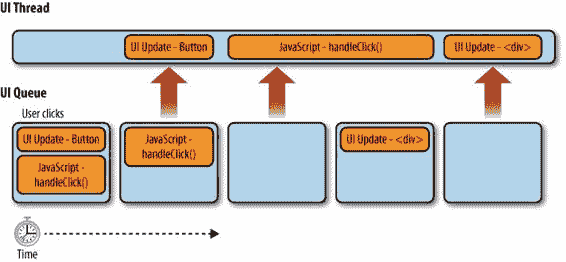图 6-1. 用户与页面交互时，UI 线程任务被添加

当所有 UI 线程任务执行完毕后，进程进入空闲状态，等待更多任务被添加到队列中。空闲状态是理想的，因为所有用户操作都会立即触发 UI 更新。如果用户试图在任务执行期间与页面交互，不仅不会有即时的 UI 更新，甚至可能不会创建和排队新的 UI 更新任务。事实上，大多数浏览器在 JavaScript 执行期间会停止为 UI 线程排队任务，这意味着必须尽快完成 JavaScript 任务，以免对用户体验产生不利影响。

### 浏览器限制

浏览器对 JavaScript 执行的时间设置了限制。这是一个必要的限制，以确保恶意编码者无法通过执行永远不会结束的密集操作来锁定用户的浏览器或计算机。存在两种这样的限制：*调用栈大小限制*（在第 4 章中讨论）和*长时间运行脚本限制*。长时间运行脚本限制有时被称为长时间运行脚本计时器或失控脚本计时器，但其基本思想是浏览器跟踪脚本运行的时间，并在达到某个限制时停止它。当达到限制时，会向用户显示一个对话框，例如图 6-2 中的对话框。

图 6-2. 当执行超过 500 万条语句时，会显示 Internet Explorer 的长时间运行脚本警告对话框

有两种衡量脚本执行时间的方法。第一种是跟踪自脚本开始以来执行的语句数量。这种方法意味着脚本在不同机器上可能运行不同的时间，因为可用内存和 CPU 速度会影响执行单个语句所需的时间。第二种方法是跟踪脚本执行的总时间。在设定的时间内可以处理的脚本数量也因用户机器的性能而异，但脚本总是在设定的时间后停止。毫不奇怪，每个浏览器对长时间运行脚本的检测方法略有不同：

*   Internet Explorer 从版本 4 开始，默认限制为 500 万条语句；此限制存储在 Windows 注册表设置中，键为`HKEY_CURRENT_USER\Software\Microsoft\InternetExplorer\Styles\MaxScriptStatements`。
*   Firefox 的默认限制为 10 秒；此限制存储在浏览器的配置设置中（通过在地址栏输入`about:config`访问），键为`dom.max_script_run_time`。
*   Safari 的默认限制为 5 秒；此设置无法更改，但你可以通过启用*开发*菜单并选择*禁用失控 JavaScript 计时器*来禁用计时器。
*   Chrome 没有单独的长时间运行脚本限制，而是依赖其通用的崩溃检测系统来处理此类情况。
*   Opera 没有长时间运行脚本限制，会继续执行 JavaScript 代码直到完成，但由于 Opera 的架构，这不会在执行完成期间导致系统不稳定。


当浏览器达到长时间运行脚本的限制时，会向用户显示一个对话框，无论页面上是否有其他错误处理代码。这是一个主要的可用性问题，因为大多数互联网用户并不精通技术，因此会对错误消息的含义以及哪个选项（停止脚本或允许其继续）合适感到困惑。

如果你的脚本在任何浏览器中触发了此对话框，意味着脚本完成其任务花费的时间过长。这也表明在 JavaScript 代码继续执行期间，用户的浏览器已对输入无响应。从开发者的角度来看，无法从长时间运行脚本对话框的出现中恢复；你无法检测到它，因此也无法调整可能由此产生的任何问题。显然，处理长时间运行脚本限制的最佳方法是首先避免它们。

### 多长时间算太长？

仅仅因为浏览器允许脚本持续执行到一定秒数，并不意味着你应该允许它这样做。实际上，为了创造良好的用户体验，你的 JavaScript 代码连续执行的时间应该远小于浏览器施加的限制。JavaScript 的创造者 Brendan Eich 曾说过：“[JavaScript] 如果执行时间达到整秒，很可能是在做错误的事情……”

如果整秒对于 JavaScript 执行来说太长，那么合适的时间是多少？事实证明，即使是一秒对于脚本执行来说也太长了。单个 JavaScript 操作应该花费的总时间（最大）是 100 毫秒。这个数字来自 Robert Miller 在 1968 年的研究。^([9]) 有趣的是，可用性专家 Jakob Nielsen 在他的书 *Usability Engineering*（Morgan Kaufmann, 1994）中指出，这个数字随着时间的推移没有改变，事实上，在 1991 年 Xerox-PARC 的研究中得到了再次确认。^([11])

Nielsen 指出，如果界面在 100 毫秒内响应用户输入，用户会感觉他正在“直接操作用户界面中的对象”。任何超过 100 毫秒的时间都意味着用户感觉与界面脱节。由于 JavaScript 执行时 UI 无法更新，如果执行时间超过 100 毫秒，用户就无法感觉控制界面。

另一个复杂因素是，某些浏览器在 JavaScript 执行时甚至不会排队 UI 更新。例如，如果在某些 JavaScript 代码执行时单击按钮，浏览器可能不会排队 UI 更新来重绘按钮为按下状态，也不会排队按钮触发的任何 JavaScript。结果就是 UI 无响应，看起来“挂起”或“冻结”。

每个浏览器的行为大致相同。当脚本执行时，UI 不会因用户交互而更新。在此期间由用户交互创建的 JavaScript 任务会被排队，然后在原始 JavaScript 任务完成后按顺序执行。由用户交互引起的 UI 更新此时会自动跳过，因为优先级被赋予页面的动态方面。因此，在脚本执行时单击的按钮永远不会看起来像被单击过，即使它的 `onclick` 处理程序会被执行。

* * *

### 注意

Internet Explorer 会限制由用户交互触发的 JavaScript 任务，使其仅连续识别两次重复操作。例如，在脚本执行时单击按钮四次，会导致 `onclick` 事件处理程序仅被调用两次。

* * *

尽管浏览器在这些情况下试图做一些合乎逻辑的事情，但所有这些行为都会导致脱节的用户体验。因此，最好的方法是通过将任何 JavaScript 任务限制在 100 毫秒或更短来防止此类情况发生。这个测量应该在必须支持的最慢浏览器上进行（有关测量 JavaScript 性能的工具，请参见第 10 章）。

## 使用定时器让出控制权

尽管你尽了最大努力，有时由于复杂性，JavaScript 任务无法在 100 毫秒或更短的时间内完成。在这些情况下，理想的做法是让出 UI 线程的控制权，以便 UI 更新可以发生。让出控制权意味着停止 JavaScript 执行，并在继续执行 JavaScript 之前给 UI 一个更新自身的机会。这就是 JavaScript 定时器发挥作用的地方。

### 定时器基础

定时器在 JavaScript 中使用 `setTimeout()` 或 `setInterval()` 创建，两者接受相同的参数：要执行的函数和等待的时间（以毫秒为单位）。`setTimeout()` 函数创建一个只执行一次的定时器，而 `setInterval()` 函数创建一个定期重复的定时器。

定时器与 UI 线程交互的方式有助于将长时间运行的脚本分解为更短的片段。调用 `setTimeout()` 或 `setInterval()` 会告诉 JavaScript 引擎等待一定时间，然后将一个 JavaScript 任务添加到 UI 队列中。例如：

```
function greeting(){
    alert("Hello world!");
}

setTimeout(greeting, 250);
```

这段代码在 250 毫秒后向 UI 队列插入一个执行 `greeting()` 函数的 JavaScript 任务。在此之前，所有其他 UI 更新和 JavaScript 任务都会被执行。请记住，第二个参数指示任务何时应被添加到 UI 队列，这并不一定是它被执行的时间；该任务必须等待队列中所有其他任务执行完毕，就像任何其他任务一样。考虑以下代码：

```
var button = document.getElementById("my-button");
button.onclick = function(){

    oneMethod();

    setTimeout(function(){
        document.getElementById("notice").style.color = "red";
    }, 250);
};
```

当此示例中的按钮被单击时，它会调用一个方法，然后设置一个定时器。更改 `notice` 元素颜色的代码包含在一个定时器中，该定时器设置为在 250 毫秒后排队。这 250 毫秒从调用 `setTimeout()` 的时刻开始计算，而不是从整个函数执行完毕时开始。因此，如果在时间点 *n* 调用了 `setTimeout()`，那么执行定时器代码的 JavaScript 任务将在 *n* + 250 时被添加到 UI 队列。图 6-3 显示了单击此示例中的按钮时的这种关系。

请记住，定时器代码永远无法在创建它的函数完全执行完毕之前执行。例如，如果修改前面的代码，使定时器延迟更小，并且在创建定时器之后还有另一个函数调用，那么定时器代码有可能在 `onclick` 事件处理程序执行完毕之前就被排队：

```
var button = document.getElementById("my-button");
button.onclick = function(){

    oneMethod();

    setTimeout(function(){
        document.getElementById("notice").style.color = "red";
    }, 50);

    anotherMethod();
};
```

图 6-3. `setTimeout()` 的第二个参数指示新的 JavaScript 任务何时应被插入到 UI 队列中


如果 `anotherMethod()` 的执行时间超过 50 毫秒，那么定时器代码会在 `onclick` 处理程序完成之前被添加到队列中。其效果是，定时器代码几乎在 `onclick` 处理程序完全执行后立即执行，没有明显的延迟。图 6-4 说明了这种情况。

无论哪种情况，创建定时器都会导致 UI 线程在从一个任务切换到下一个任务时产生暂停。因此，定时器代码会重置所有相关的浏览器限制，包括长时间运行脚本的定时器。此外，定时器代码内部的调用栈会被重置为零。这些特性使得定时器成为处理长时间运行 JavaScript 代码的理想跨浏览器解决方案。

* * *

### 注意

`setInterval()` 函数与 `setTimeout()` 几乎相同，区别在于前者会重复将 JavaScript 任务添加到 UI 队列中。主要区别在于，如果同一个 `setInterval()` 调用创建的任务已经存在于 UI 队列中，则不会再次添加该任务。

* * *

图 6-4. 如果调用 `setTimeout()` 的函数执行时间比定时器延迟更长，则定时器代码的执行可能没有明显延迟

### 定时器精度

JavaScript 定时器延迟通常不精确，可能会有几毫秒的偏差。你指定 250 毫秒作为定时器延迟，并不意味着任务会在 `setTimeout()` 调用后恰好 250 毫秒时被加入队列。所有浏览器都会尽量做到精确，但经常会出现几毫秒的偏差。因此，定时器不适合用于测量实际经过的时间。

Windows 系统上的定时器分辨率为 15 毫秒，这意味着它会根据系统时间上次更新的情况，将 15 毫秒的定时器延迟解释为 0 或 15。设置小于 15 毫秒的定时器延迟可能导致 Internet Explorer 中的浏览器锁定，因此建议的最小延迟为 25 毫秒（最终会变成 15 或 30），以确保至少 15 毫秒的延迟。

这个最小定时器延迟也有助于避免其他浏览器和系统上的定时器分辨率问题。大多数浏览器在处理 10 毫秒或更小的延迟时，定时器延迟都会出现一些变化。

### 使用定时器处理数组

长时间运行脚本的一个常见原因是循环执行时间过长。如果你已经尝试了第 4 章中介绍的循环优化技术，但仍无法将执行时间减少到足够短，那么定时器就是你的下一个优化步骤。基本方法是将循环的工作拆分成一系列定时器。

典型的循环遵循简单的模式，例如：

```
for (var i=0, len=items.length; i < len; i++){
    process(items[i]);
}
```

由于 `process()` 的复杂性、`items` 的大小或两者兼有，这种结构的循环可能执行时间过长。在我的书《Professional JavaScript for Web Developers》第二版（Wrox 2009）中，我提出了两个决定因素，用于判断一个循环是否可以使用定时器异步执行：

*   处理过程是否必须同步进行？
*   数据是否必须按顺序处理？

如果这两个问题的答案都是“否”，那么该代码就非常适合使用定时器来拆分工作。异步代码执行的基本模式如下：

```
var todo = items.concat();  //创建原始数组的副本

setTimeout(function(){

    //获取数组中的下一个项目并处理它
    process(todo.shift());

    //如果还有更多项目需要处理，则创建另一个定时器
    if(todo.length > 0){
        setTimeout(arguments.callee, 25);
    } else {
        callback(items);
    }

}, 25);
```

该模式的基本思想是创建原始数组的副本，并将其用作待处理项目的队列。第一次调用 `setTimeout()` 会创建一个定时器来处理数组中的第一个项目。调用 `todo.shift()` 会返回第一个项目并将其从数组中移除。该值被传递给 `process()`。处理完项目后，检查是否还有更多项目需要处理。如果 `todo` 数组中还有项目，则创建另一个定时器。由于下一个定时器需要运行与原始定时器相同的代码，因此将 `arguments.callee` 作为第一个参数传入。该值指向正在执行代码的匿名函数。如果没有更多项目需要处理，则调用 `callback()` 函数。

* * *

### 注意

每个定时器的实际延迟时间很大程度上取决于你的使用场景。一般来说，最好至少使用 25 毫秒，因为更小的延迟留给大多数 UI 更新的时间太少。

* * *

由于这种模式比常规循环需要更多的代码，因此封装此功能非常有用。例如：

```
function processArray(items, process, callback){
    var todo = items.concat();   //创建原始数组的副本

    setTimeout(function(){
        process(todo.shift());

        if (todo.length > 0){
            setTimeout(arguments.callee, 25);
        } else {
            callback(items);
        }

    }, 25);    
}
```

`processArray()` 函数以可重用的方式实现了上述模式，并接受三个参数：要处理的数组、对每个项目调用的函数，以及处理完成时执行的回调函数。该函数可以如下使用：

```
var items = [123, 789, 323, 778, 232, 654, 219, 543, 321, 160];

function outputValue(value){
    console.log(value);
}

processArray(items, outputValue, function(){
    console.log("Done!");
});
```

这段代码使用 `processArray()` 方法将数组值输出到控制台，然后在所有处理完成后打印一条消息。通过将定时器代码封装在函数内部，可以在多个地方重复使用，而无需多次实现。

* * *

### 注意

使用定时器处理数组的一个副作用是处理数组的总时间会增加。这是因为每个项目处理完后 UI 线程会被释放，并且在处理下一个项目之前会有延迟。然而，这是为了避免锁定浏览器导致用户体验不佳而必须做出的权衡。

* * *

### 拆分任务

我们通常认为的一个任务往往可以分解为一系列子任务。如果单个函数执行时间过长，请检查它是否可以分解为一系列更小的函数，这些函数在更短的时间内完成。这通常很简单，只需将单行代码视为一个原子任务，尽管多行代码通常可以组合成一个任务。有些函数已经可以根据它们调用的其他函数轻松分解。例如：

```
function saveDocument(id){

    //保存文档
    openDocument(id)
    writeText(id);
    closeDocument(id);

    //更新 UI 以指示成功
    updateUI(id);
}
```

如果这个函数执行时间过长，可以通过将各个方法分解到单独的定时器中，轻松地将其拆分为一系列更小的步骤。你可以通过将每个函数添加到一个数组中，然后使用类似于上一节中数组处理模式的模式来实现这一点：


```
function saveDocument(id){

    var tasks = [openDocument, writeText, closeDocument, updateUI];

    setTimeout(function(){

        //执行下一个任务
        var task = tasks.shift();
        task(id);

        //判断是否还有更多任务
        if (tasks.length > 0){
            setTimeout(arguments.callee, 25);
        }
    }, 25);
}
```

这个版本的函数将每个方法放入 `tasks` 数组，然后每次定时器只执行一个方法。本质上，这变成了一个数组处理模式，唯一的区别是处理每个项时执行的是该项中包含的函数。如上一节所述，这种模式可以封装起来以便复用：

```
function multistep(steps, args, callback){

    var tasks = steps.concat();   //克隆数组

    setTimeout(function(){

        //执行下一个任务
        var task = tasks.shift();
        task.apply(null, args || []);

        //判断是否还有更多任务
        if (tasks.length > 0){
            setTimeout(arguments.callee, 25);
        } else {
            callback();
        }
    }, 25);
}
```

`multistep()` 函数接受三个参数：一个待执行的函数数组、一个参数数组（在执行每个函数时传入），以及一个在过程完成时调用的回调函数。该函数可以像下面这样使用：

```
function saveDocument(id){

    var tasks = [openDocument, writeText, closeDocument, updateUI];
    multistep(tasks, [id], function(){
        alert("保存完成！");
    });
}
```

注意，`multistep()` 的第二个参数必须是一个数组，因此这里创建了一个只包含 `id` 的数组。与数组处理类似，当任务可以异步执行且不会影响用户体验或导致依赖代码出错时，这个函数最为适用。

### 定时代码

有时一次只执行一个任务效率较低。考虑处理一个包含 1000 个项的数组，处理单个项需要 1 毫秒。如果每个定时器处理一个项，且定时器之间间隔 25 毫秒，那么处理整个数组的总时间为 (25 + 1) × 1000 = 26000 毫秒，即 26 秒。如果改为每批处理 50 个项，批之间间隔 25 毫秒，那么总处理时间变为 (1000 / 50) × 25 + 1000 = 1500 毫秒，即 1.5 秒，而且用户界面永远不会被阻塞，因为脚本连续执行的最长时间仅为 50 毫秒。通常，批量处理项比一次处理一个要快。

如果你将 100 毫秒视为 JavaScript 允许连续运行的最长时间上限，那么就可以开始优化之前的模式。我的建议是将这个数字减半，绝不让任何 JavaScript 代码连续执行超过 50 毫秒，以确保代码永远不会接近影响用户体验的程度。

通过使用原生的 `Date` 对象，可以跟踪一段代码已经运行了多长时间。这是大多数 JavaScript 性能分析工具的工作方式：

```
var start = +new Date(),
    stop;

someLongProcess();

stop = +new Date();

if(stop-start < 50){
    alert("刚刚好。");
} else {
    alert("耗时太长。");
}
```

由于每个新的 `Date` 对象都会用当前系统时间初始化，你可以通过定期创建新的 `Date` 对象并比较它们的值来对代码计时。加号运算符（`+`）将 `Date` 对象转换为数值表示，这样后续的算术运算就不需要再进行类型转换了。同样的基本技术可以用来优化之前的定时器模式。

`processArray()` 方法可以通过加入时间检查来增强，使其每个定时器处理多个项：

```
function timedProcessArray(items, process, callback){
    var todo = items.concat();   //创建原始数组的克隆

    setTimeout(function(){
        var start = +new Date();

        do {
             process(todo.shift());
        } while (todo.length > 0 && (+new Date() - start < 50));

        if (todo.length > 0){
            setTimeout(arguments.callee, 25);
        } else {
            callback(items);
        }

    }, 25);
}
```

在这个函数中增加了一个 `do-while` 循环，可以在处理每个项之后检查时间。当定时器函数执行时，数组中至少会有一个项，因此后测试循环比前测试循环更合理。在 Firefox 3 中运行时，这个函数处理一个包含 1000 个项的数组（其中 `process()` 是一个空函数）只需 38–43 毫秒；而原来的 `processArray()` 函数处理同样的数组需要超过 25000 毫秒。这就是在将任务分解成更小的块之前进行时间检查的强大之处。

### 定时器与性能

定时器可以极大地影响 JavaScript 代码的整体性能，但过度使用也会对性能产生负面影响。本节中的代码使用了顺序定时器，即一次只存在一个定时器，并且只有在上一个定时器完成后才创建新的定时器。以这种方式使用定时器不会导致性能问题。

当同时创建多个重复定时器时，性能问题就开始出现了。由于只有一个 UI 线程，所有定时器都在竞争执行时间。Google Mobile 的 Neil Thomas 研究了这一主题，作为衡量 iPhone 和 Android 上移动 Gmail 应用性能的一种方法。^([12])

Thomas 发现，低频重复定时器——即间隔为一秒或更长的定时器——对整体 Web 应用响应性的影响很小。在这种情况下，定时器延迟太大，不会在 UI 线程上造成瓶颈，因此可以安全地重复使用。然而，当多个重复定时器以更高的频率（100 到 200 毫秒之间）使用时，Thomas 发现移动 Gmail 应用变得明显更慢且响应性更差。

从 Thomas 的研究中得出的结论是：限制 Web 应用中高频重复定时器的数量。相反，Thomas 建议创建一个单一的重复定时器，每次执行时执行多个操作。

## Web Workers

自从 JavaScript 问世以来，一直无法在浏览器 UI 线程之外执行代码。Web Workers API 改变了这一点，它引入了一个接口，通过该接口可以在不占用浏览器 UI 线程时间的情况下执行代码。Web Workers API 最初是 HTML 5 的一部分，后来被拆分成了独立的规范（[`www.w3.org/TR/workers/`](http://www.w3.org/TR/workers/)）；Firefox 3.5、Chrome 3 和 Safari 4 已经原生实现了 Web Workers。

Web Workers 为 Web 应用带来了巨大的性能提升潜力，因为每个新的 worker 都会启动自己的线程来执行 JavaScript。这意味着不仅 worker 中执行的代码不会影响浏览器 UI，而且也不会影响其他 worker 中执行的代码。

### Worker 环境

由于 Web Workers 不绑定到 UI 线程，这也意味着它们无法访问许多浏览器资源。JavaScript 和 UI 更新共享同一个进程的部分原因是它们之间经常相互影响，因此无序执行这些任务会导致糟糕的用户体验。Web Workers 如果从外部线程修改 DOM，可能会引入用户界面错误，但每个 Web Worker 都有自己的全局环境，其中只包含 JavaScript 功能的一个子集。Worker 环境由以下部分组成：

*   一个 `navigator` 对象，只包含四个属性：`appName`、`appVersion`、`userAgent` 和 `platform`


*   一个 `location` 对象（与 `window` 上的相同，但所有属性均为只读）
*   一个指向全局 worker 对象的 `self` 对象
*   一个用于加载外部 JavaScript 以供 worker 使用的 `importScripts()` 方法
*   所有 ECMAScript 对象，例如 `Object`、`Array`、`Date` 等
*   `XMLHttpRequest` 构造函数
*   `setTimeout()` 和 `setInterval()` 方法
*   一个用于立即停止 worker 的 `close()` 方法

由于 Web Worker 拥有不同的全局环境，你不能从任意 JavaScript 代码中创建它。实际上，你需要创建一个完全独立的 JavaScript 文件，其中仅包含 worker 要执行的代码。要创建一个 Web Worker，你必须传入 JavaScript 文件的 URL：

```
var worker = new Worker("code.js");
```

一旦执行此代码，就会为指定的文件创建一个带有新 worker 环境的新线程。该文件会被异步下载，并且 worker 只有在文件完全下载并执行后才会开始工作。

### Worker 通信

Worker 与网页代码之间的通信通过事件接口建立。网页代码可以通过 `postMessage()` 方法向 worker 传递数据，该方法接受一个参数，表示要传入 worker 的数据。同时还有一个 `onmessage` 事件处理程序，用于接收来自 worker 的信息。例如：

```
var worker = new Worker("code.js");
worker.onmessage = function(event){
    alert(event.data);
};
worker.postMessage("Nicholas");
```

Worker 通过触发 `message` 事件来接收这些数据。定义 `onmessage` 事件处理程序后，事件对象包含一个 `data` 属性，其中存放传入的数据。Worker 可以通过自己的 `postMessage()` 方法将信息传回网页：

```
// 在 code.js 内部
self.onmessage = function(event){
    self.postMessage("Hello, " + event.data + "!");
};
```

最终的字符串会出现在 worker 的 `onmessage` 事件处理程序中。这种消息传递系统是网页与 worker 之间唯一的通信方式。

只有特定类型的数据可以通过 `postMessage()` 传递。你可以传递原始值（字符串、数字、布尔值、`null` 和 `undefined`）以及 `Object` 和 `Array` 的实例；不能传递其他数据类型。有效数据会被序列化，传输到 worker 或从 worker 传出，然后再反序列化。尽管看起来对象是直接传递的，但这些实例实际上是同一数据的完全独立的表示。尝试传递不支持的数据类型会导致 JavaScript 错误。

* * *

### 注意

Safari 4 的 worker 实现只允许通过 `postMessage()` 传递字符串。规范在此之后进行了更新，允许传递可序列化的数据，这也是 Firefox 3.5 实现 worker 的方式。

* * *

### 加载外部文件

通过 `importScripts()` 方法可以将额外的 JavaScript 文件加载到 worker 中，该方法接受一个或多个要加载的 JavaScript 文件的 URL。在 worker 内部，`importScripts()` 的调用是阻塞的，因此脚本会等到所有文件加载并执行完毕后才会继续。由于 worker 在 UI 线程之外运行，因此这种阻塞不会影响 UI 的响应性。例如：

```
// 在 code.js 内部
importScripts("file1.js", "file2.js");

self.onmessage = function(event){
    self.postMessage("Hello, " + event.data + "!");
};
```

这段代码的第一行包含了两个 JavaScript 文件，以便它们在 worker 的上下文中可用。

### 实际用途

Web Worker 适用于任何长时间运行、处理纯数据且与浏览器 UI 无关的脚本。这看起来可能用途有限，但在 Web 应用程序中，通常存在一些数据处理方法，使用 worker 比使用定时器更有利。

例如，考虑解析一个大型 JSON 字符串（JSON 解析将在第 7 章中进一步讨论）。假设数据足够大，解析至少需要 500 毫秒。这显然太长，不允许 JavaScript 在客户端运行，因为它会干扰用户体验。这个特定任务很难用定时器分解成小块，因此 worker 是理想的解决方案。以下代码展示了在网页中的用法：

```
var worker = new Worker("jsonparser.js");

// 当数据可用时，调用此事件处理程序
worker.onmessage = function(event){

    // 返回 JSON 结构
    var jsonData = event.data;

    // 使用 JSON 结构
    evaluateData(jsonData);
};

// 传入要解析的大型 JSON 字符串
worker.postMessage(jsonText);
```

负责 JSON 解析的 worker 代码如下：

```
// 在 jsonparser.js 内部

// 当 JSON 数据可用时，调用此事件处理程序
self.onmessage = function(event){

    // JSON 字符串作为 event.data 传入
    var jsonText = event.data;

    // 解析结构
    var jsonData = JSON.parse(jsonText);

    // 将结果发送回去
    self.postMessage(jsonData);
};
```

请注意，即使 `JSON.parse()` 可能需要 500 毫秒或更长时间，也无需编写任何额外的代码来拆分处理。此执行发生在单独的线程上，因此你可以让它运行任意长时间，而不会干扰用户体验。

页面通过 `postMessage()` 将 JSON 字符串传入 worker。Worker 在其 `onmessage` 事件处理程序中将该字符串作为 `event.data` 接收，然后进行解析。完成后，生成的 JSON 对象通过 worker 的 `postMessage()` 方法传回页面。该对象随后在页面的 `onmessage` 事件处理程序中作为 `event.data` 可用。请记住，目前这仅在 Firefox 3.5 及更高版本中有效，因为 Safari 4 和 Chrome 3 的实现只允许在页面和 worker 之间传递字符串。

解析大型字符串只是 Web Worker 可以受益的众多任务之一。其他一些可能性包括：

*   编码/解码大型字符串
*   复杂的数学计算（包括图像或视频处理）
*   对大型数组进行排序

每当一个过程需要超过 100 毫秒才能完成时，你都应该考虑使用 worker 解决方案是否比基于定时器的方案更合适。当然，这取决于浏览器的能力。

## 总结

JavaScript 和用户界面更新在同一个进程中运行，因此一次只能执行一个操作。这意味着当 JavaScript 代码执行时，用户界面无法对输入做出反应，反之亦然。有效管理 UI 线程意味着确保 JavaScript 不会运行过长时间而影响用户体验。为此，应牢记以下几点：

*   任何 JavaScript 任务的执行时间都不应超过 100 毫秒。更长的执行时间会导致 UI 更新出现明显延迟，并对整体用户体验产生负面影响。
*   在 JavaScript 执行期间，浏览器对用户交互的反应方式各不相同。无论行为如何，当 JavaScript 执行时间过长时，用户体验都会变得混乱且不连贯。
*   定时器可用于安排代码稍后执行，这允许你将长时间运行的脚本拆分为一系列较小的任务。
*   Web Worker 是较新浏览器中的一项功能，允许你在 UI 线程之外执行 JavaScript 代码，从而防止 UI 锁定。

Web 应用程序越复杂，主动管理 UI 线程就越关键。没有任何 JavaScript 代码重要到应该对用户体验产生不利影响。


^([9]) Miller, R. B., “人机对话事务中的响应时间,” *Proc. AFIPS Fall Joint Computer Conference*, Vol. 33 (1968), 267–277. 可查阅 [`portal.acm.org/citation.cfm?id=1476589.1476628`](http://portal.acm.org/citation.cfm?id=1476589.1476628).

^([10]) 在线查阅 [www.useit.com/papers/responsetime.html](http://www.useit.com/papers/responsetime.html).

^([11]) Card, S. K., G.G. Robertson, and J.D. Mackinlay, “信息可视化工具：一个信息工作空间,” *Proc. ACM CHI’91 Conf.* (New Orleans: 28 April–2 May), 181–188. 可查阅 [`portal.acm.org/citation.cfm?id=108874`](http://portal.acm.org/citation.cfm?id=108874).

^([12]) 完整文章在线查阅 [`googlecode.blogspot.com/2009/07/gmail-for-mobile-html5-series-using.html`](http://googlecode.blogspot.com/2009/07/gmail-for-mobile-html5-series-using.html).

## 第 7 章 Ajax

### Ross Harmes

Ajax 是高性能 JavaScript 的基石。它可以通过延迟下载大型资源来加快页面加载速度；通过允许客户端和服务器之间异步传输数据，可以完全避免页面重新加载；甚至可以在一次 HTTP 请求中获取页面的所有资源。通过选择正确的传输技术和最高效的数据格式，你可以显著改善用户与网站的交互体验。

本章将探讨向服务器发送数据和从服务器接收数据的最快技术，以及编码数据的最有效格式。

## 数据传输

Ajax 最基本的形式是一种在不卸载当前页面的情况下与服务器通信的方式；可以向服务器请求数据，也可以向服务器发送数据。建立这种通信渠道有几种不同的方法，每种方法都有其优点和限制。本节简要介绍不同的方法，并讨论每种方法的性能影响。

### 请求数据

从服务器请求数据有五种常用技术：

*   `XMLHttpRequest` (`XHR`)
*   动态脚本标签插入
*   iframes
*   Comet
*   多部分 `XHR`

在现代高性能 JavaScript 中常用的三种技术是 `XHR`、动态脚本标签插入和多部分 `XHR`。Comet 和 iframes（作为数据传输技术）的使用通常非常特定于场景，这里不再赘述。

#### XMLHttpRequest

`XMLHttpRequest` (`XHR`) 是目前最常用的技术，它允许你异步发送和接收数据。它在所有现代浏览器中都得到良好支持，并且可以对发送的请求和接收的数据进行精细控制。你可以向请求添加任意标头和参数（包括 `GET` 和 `POST`），并读取服务器返回的所有标头以及响应文本本身。以下是一个使用示例：

```
var url = '/data.php';
var params = [
    'id=934875',
    'limit=20'
];

var req = new XMLHttpRequest();

req.onreadystatechange = function() {
    if (req.readyState === 4) {
        var responseHeaders = req.getAllResponseHeaders(); // 获取响应标头。
        var data = req.responseText; // 获取数据。
        // 在此处处理数据...
    }
}

req.open('GET', url + '?' + params.join('&'), true);
req.setRequestHeader('X-Requested-With', 'XMLHttpRequest'); // 设置请求标头。
req.send(null); // 发送请求。
```

此示例展示了如何从 URL 请求数据（带参数），以及如何读取响应文本和标头。`readyState` 为 4 表示已收到完整响应，可供操作。

通过监听 `readyState` 3，可以在服务器响应仍在传输过程中时与之交互。这称为流式传输，是提高数据请求性能的强大工具：

```
req.onreadystatechange = function() {

    if (req.readyState === 3) { // 已收到部分数据，但并非全部。
        var dataSoFar = req.responseText;
        ...
    }
    else if (req.readyState === 4) { // 已收到所有数据。
        var data = req.responseText;
        ...
    }
}
```

由于 `XHR` 提供了高度控制，浏览器对其施加了一些限制。你不能使用 `XHR` 从与当前代码运行域不同的域请求数据，并且旧版 IE 不允许访问 `readyState` 3，从而阻止了流式传输。请求返回的数据被视为字符串或 XML 对象；这意味着处理大量数据时会相当慢。

尽管存在这些缺点，`XHR` 仍然是最常用的请求数据技术，也是最强大的。它应该是你首先考虑的技术。

##### 使用 `XHR` 时的 `POST` 与 `GET`

使用 `XHR` 请求数据时，你可以选择使用 `POST` 或 `GET`。对于不改变服务器状态且仅拉取数据的请求（这称为*幂等操作*），请使用 `GET`。`GET` 请求会被缓存，如果多次获取相同数据，这可以提高性能。

仅当 URL 和参数的长度接近或超过 2048 个字符时，才应使用 `POST` 来获取数据。这是因为 Internet Explorer 将 URL 限制为该长度，超出该长度会导致请求被截断。

#### 动态脚本标签插入

这种技术克服了 `XHR` 的最大限制：它可以从不同域的服务器请求数据。这是一种 hack；不是实例化一个专用对象，而是使用 JavaScript 创建一个新的脚本标签，并将其 src 属性设置为不同域的 URL。

```
var scriptElement = document.createElement('script');
scriptElement.src = 'http://any-domain.com/javascript/lib.js';
document.getElementsByTagName('head')[0].appendChild(scriptElement);
```

但动态脚本标签插入提供的控制比 `XHR` 少得多。你不能在请求中发送标头。参数只能通过 `GET` 传递，不能使用 `POST`。你不能设置超时或重试请求；事实上，你甚至不一定知道它是否失败。你必须等待所有数据返回后才能访问任何数据。你无法访问响应标头，也无法将整个响应作为字符串访问。

最后一点尤其重要。由于响应被用作脚本标签的源，它*必须*是可执行的 JavaScript。你不能使用纯 XML，甚至不能使用纯 JSON；任何数据，无论格式如何，都必须包含在回调函数中。

```
var scriptElement = document.createElement('script');
scriptElement.src = 'http://any-domain.com/javascript/lib.js';
document.getElementsByTagName('head')[0].appendChild(scriptElement);

function jsonCallback(data) {

    // 在此处处理数据...
}
```

在此示例中，`lib.js` 文件会将数据封装在 `jsonCallback` 函数中：

```
jsonCallback({ "status": 1, "colors": [ "#fff", "#000", "#ff0000" ] });
```

尽管存在这些限制，这种技术可能非常快。响应作为 JavaScript 执行；它不会被当作需要进一步处理的字符串。因此，它有可能成为获取数据并将其解析为客户端可访问内容的最快方式。我们将在本章后面的 JSON 部分比较动态脚本标签插入与 `XHR` 的性能。


请注意，使用此技术从您无法直接控制的服务器请求数据时需谨慎。JavaScript 没有权限或访问控制的概念，因此通过动态脚本标签插入到页面中的任何代码都将完全控制该页面。这包括修改任何内容、将用户重定向到其他网站，甚至跟踪用户在此页面上的操作并将数据发送给第三方。在从外部来源引入代码时，请务必极其小心。

## 多部分 XHR

这里提到的最新技术是多部分 XHR（MXHR），它允许您仅使用一个 HTTP 请求将多个资源从服务器端传递到客户端。这是通过在服务器端将资源（无论是 CSS 文件、HTML 片段、JavaScript 代码还是 base64 编码的图像）打包，并将它们作为一长串字符发送到客户端，用某个约定的字符串分隔来实现的。JavaScript 代码处理这个长字符串，并根据其 MIME 类型和随附的任何其他“标头”解析每个资源。

让我们从头到尾跟踪这个过程。首先，向服务器发出请求以获取多个图像资源：

```
var req = new XMLHttpRequest();

req.open('GET', 'rollup_images.php', true);
req.onreadystatechange = function() {
    if (req.readyState == 4) {
        splitImages(req.responseText);
    }
};
req.send(null);
```

这是一个非常简单的请求。您正在向 `rollup_images.php` 请求数据，一旦收到数据，就将其发送给 `splitImages` 函数。

接下来，在服务器端，读取图像并将其转换为字符串：

```
// 读取图像并将其转换为 base64 编码的字符串。

$images = array('kitten.jpg', 'sunset.jpg', 'baby.jpg');
foreach ($images as $image) {

    $image_fh = fopen($image, 'r');
    $image_data = fread($image_fh, filesize($image));
    fclose($image_fh);
        $payloads[] = base64_encode($image_data);
    }
}

// 将这些字符串合并成一个长字符串并输出。

$newline = chr(1); // 这个字符不会自然出现在任何 base64 字符串中。

echo implode($newline, $payloads);
```

这段 PHP 代码读取三张图像，并将它们转换为 base64 字符的长字符串。它们使用单个字符（Unicode 字符 1）连接，并输出回客户端。

一旦到达客户端，数据由 `splitImages` 函数处理：

```
function splitImages(imageString) {

    var imageData = imageString.split("\u0001");
    var imageElement;

    for (var i = 0, len = imageData.length; i < len; i++) {

        imageElement = document.createElement('img');
        imageElement.src = 'data:image/jpeg;base64,' + imageData[i];
        document.getElementById('container').appendChild(imageElement);
    }
}
```

此函数接收连接后的字符串，并将其再次拆分为三个部分。每个部分用于创建一个图像元素，然后将该图像元素插入页面。图像*不会*从 base64 字符串转换回二进制数据；而是通过 `data:` URL 和 `image/jpeg` MIME 类型传递给图像元素。

最终结果是，三个图像通过单个 HTTP 请求传递给了浏览器。这可以扩展到 20 个或 100 个图像；响应会更大，但仍然只需要一个 HTTP 请求。它还可以扩展到其他类型的资源。JavaScript 文件、CSS 文件、HTML 片段以及多种类型的图像都可以合并到一个响应中。任何可以由 JavaScript 作为字符串处理的数据类型都可以发送。以下是用于处理 JavaScript 代码、CSS 样式和图像的字符串，并将其转换为浏览器可用资源的函数：

```
function handleImageData(data, mimeType) {
    var img = document.createElement('img');
    img.src = 'data:' + mimeType + ';base64,' + data;
    return img;
}

function handleCss(data) {
    var style = document.createElement('style');
    style.type = 'text/css';

    var node = document.createTextNode(data);
    style.appendChild(node);
    document.getElementsByTagName('head')[0].appendChild(style);
}

function handleJavaScript(data) {
    eval(data);
}
```

随着 MXHR 响应变得越来越大，有必要在接收到每个资源时立即处理，而不是等待整个响应。这可以通过监听 `readyState` 3 来实现：

```
var req = new XMLHttpRequest();
var getLatestPacketInterval, lastLength = 0;

req.open('GET', 'rollup_images.php', true);
req.onreadystatechange = readyStateHandler;
req.send(null);

function readyStateHandler{
    if (req.readyState === 3 && getLatestPacketInterval === null) {

        // 开始轮询。

        getLatestPacketInterval = window.setInterval(function() {
            getLatestPacket();
         }, 15);
    }

    if (req.readyState === 4) {

        // 停止轮询。

        clearInterval(getLatestPacketInterval);

        // 获取最后一个数据包。

        getLatestPacket();
    }
}

function getLatestPacket() {
    var length = req.responseText.length;
    var packet = req.responseText.substring(lastLength, length);

    processPacket(packet);
    lastLength = length;
}
```

一旦 `readyState` 3 首次触发，就会启动一个计时器。每 15 毫秒检查一次响应是否有新数据。然后收集每一段数据，直到找到分隔符字符，然后将所有内容作为一个完整的资源进行处理。

以健壮的方式使用 MXHR 所需的代码很复杂，但值得进一步研究。完整的库可以轻松在线找到，网址为 [`techfoolery.com/mxhr/`](http://techfoolery.com/mxhr/)。

使用此技术有一些缺点，最大的缺点是获取的资源都不会在浏览器中缓存。如果您使用 MXHR 获取某个特定的 CSS 文件，然后在下一页正常加载它，它将不在缓存中。这是因为打包的资源作为长字符串传输，然后由 JavaScript 代码拆分。由于无法以编程方式将文件注入浏览器的缓存，因此以这种方式获取的任何资源都不会进入缓存。

另一个缺点是旧版本的 Internet Explorer 不支持 `readyState` 3 或 `data:` URL。Internet Explorer 8 确实支持这两者，但对于 Internet Explorer 6 和 7，仍然必须使用变通方法。

尽管存在这些缺点，但在某些情况下，MXHR 仍然能显著提高整体页面性能：

*   包含大量在网站其他地方未使用的资源（因此不需要缓存）的页面，尤其是图像

*   已经在每个页面上使用独特的打包 JavaScript 或 CSS 文件以减少 HTTP 请求的网站；由于每个页面都是唯一的，除非重新加载该特定页面，否则永远不会从缓存中读取

由于 HTTP 请求是 Ajax 中最严重的瓶颈之一，减少所需请求的数量对整体页面性能有很大影响。当您能够将 100 个图像请求转换为单个多部分 XHR 请求时，这一点尤其明显。在现代浏览器上使用大量图像进行的临时测试表明，此技术比单独请求快 4 到 10 倍。您可以在 [`techfoolery.com/mxhr/`](http://techfoolery.com/mxhr/) 自行运行这些测试。

## 发送数据

有时您并不关心检索数据，而只想将数据发送到服务器。您可能正在发送用户的非个人信息以供后续分析，或者捕获所有发生的脚本错误并将其详细信息发送到服务器以进行记录和警报。当只需要将数据发送到服务器时，有两种广泛使用的技术：XHR 和信标。

### XMLHttpRequest


虽然 `XHR` 主要用于从服务器请求数据，但它也可以用来发送数据。数据可以通过 GET 或 POST 方式发送，也可以放在任意数量的 HTTP 标头中。这为你提供了极大的灵活性。当你要发送的数据量超过浏览器中 URL 的最大长度时，`XHR` 尤其有用。在这种情况下，你可以将数据作为 POST 请求发送：

```
var url = '/data.php';
var params = [
    'id=934875',
    'limit=20'
];

var req = new XMLHttpRequest();

req.onerror = function() {
    // 错误处理。
};

req.onreadystatechange = function() {
    if (req.readyState == 4) {
        // 成功处理。
    }
};

req.open('POST', url, true);
req.setRequestHeader('Content-Type', 'application/x-www-form-urlencoded');

var data = params.join("&");
req.setRequestHeader("Content-Length", data.length);
req.send(data);
```

如本例所示，如果 POST 失败，我们什么也不做。当 `XHR` 用于收集广泛的用户统计数据时，这通常没问题，但如果数据必须到达服务器，你可以添加代码在失败时重试：

```
function xhrPost(url, params, callback) {

    var req = new XMLHttpRequest();

    req.onerror = function() {
        setTimeout(function() {
            xhrPost(url, params, callback);
        }, 1000);
    };

    req.onreadystatechange = function() {
        if (req.readyState == 4) {
            if (callback && typeof callback === 'function') {
                callback();
            }
        }
    };

    req.open('POST', url, true);
    req.setRequestHeader('Content-Type', 'application/x-www-form-urlencoded');

    var data = params.join("&");
    req.setRequestHeader("Content-Length", data.length);
    req.send(data);

}
```

使用 `XHR` 将数据发送回服务器时，使用 GET 更快。这是因为对于少量数据，GET 请求会通过单个数据包发送到服务器。而 POST 至少需要两个数据包，一个用于标头，另一个用于 POST 正文。POST 更适合向服务器发送大量数据，因为额外的数据包影响不大，而且 Internet Explorer 的 URL 长度限制使得长 GET 请求不可行。

#### 信标（Beacons）

这种技术非常类似于动态脚本标签插入。JavaScript 用于创建一个新的 `Image` 对象，其 `src` 设置为服务器上某个脚本的 URL。该 URL 包含我们想要以键值对 GET 格式发送回的数据。注意，无需创建或插入 `img` 元素到 DOM 中。

```
var url = '/status_tracker.php';
var params = [
    'step=2',
    'time=1248027314'
];

(new Image()).src = url + '?' + params.join('&');
```

服务器接收这些数据并存储；它不必向客户端发送任何内容，因为图像实际上并不显示。这是将信息发送回服务器的最有效方式。开销非常小，而且服务器端错误完全不会影响客户端。

图像信标的简单性也意味着你能做的事情受到限制。你不能发送 POST 数据，因此在达到最大允许 URL 长度之前，你只能使用相当少的字符。你*可以*接收返回的数据，但方式非常有限。可以监听 `Image` 对象的 `load` 事件，它会告诉你服务器是否成功接收了数据。你还可以检查服务器返回的图像的宽度和高度（如果返回了图像），并用这些数字来了解服务器的状态。例如，宽度为 1 可能表示“成功”，宽度为 2 可能表示“重试”。

如果不需要在响应中返回数据，你应该发送 `204 No Content` 响应码，并且不包含消息体。这样可以防止客户端等待永远不会到来的消息体：

```
var url = '/status_tracker.php';
var params = [
    'step=2',
    'time=1248027314'
];

var beacon = new Image();
beacon.src = url + '?' + params.join('&');

beacon.onload = function() {
    if (this.width == 1) {
        // 成功。
    }
    else if (this.width == 2) {
       // 失败；创建另一个信标并重试。
    }
};

beacon.onerror = function() {
    // 错误；稍等片刻，然后创建另一个信标并重试。
};
```

信标是将数据发送回服务器最快、最高效的方式。服务器根本不需要返回任何响应体，因此你不必担心向客户端下载数据。唯一的缺点是你能接收的响应类型有限。如果需要向客户端传递大量数据，请使用 `XHR`。如果只关心向服务器发送数据（可能只需要非常简单的响应），请使用图像信标。

## 数据格式

在考虑数据传输技术时，你必须考虑几个因素：功能集、兼容性、性能以及方向（到服务器或从服务器）。在考虑数据格式时，唯一需要比较的尺度是速度。

没有一种数据格式总是优于其他格式。根据传输的数据及其在页面上的预期用途，一种格式可能下载更快，而另一种格式可能解析更快。在本节中，我们将创建一个用于搜索用户的组件，并使用四种主要数据格式类别中的每一种来实现它。这需要我们在服务器上格式化用户列表，将其传回浏览器，将该列表解析为原生 JavaScript 数据结构，然后搜索给定的字符串。每种数据格式将根据列表的文件大小、解析速度以及在服务器上形成的难易程度进行比较。

### XML

当 Ajax 首次流行时，XML 是首选的数据格式。它有很多优点：极高的互操作性（在服务器端和客户端都有出色的支持）、严格的格式化和易于验证。JSON 当时尚未被正式确定为交换格式，而服务器上使用的几乎所有语言都有用于处理 XML 的库。

以下是我们用户列表编码为 XML 的示例：

```
<?xml version="1.0" encoding='UTF-8'?>
<users total="4">
    <user id="1">
        <username>alice</username>
        <realname>Alice Smith</realname>
        <email>alice@alicesmith.com</email>
    </user>
    <user id="2">
        <username>bob</username>
        <realname>Bob Jones</realname>
        <email>bob@bobjones.com</email>
    </user>
    <user id="3">
        <username>carol</username>
        <realname>Carol Williams</realname>
        <email>carol@carolwilliams.com</email>
    </user>
    <user id="4">
        <username>dave</username>
        <realname>Dave Johnson</realname>
        <email>dave@davejohnson.com</email>
    </user>
</users>
```

与其他格式相比，XML 极其冗长。每个离散的数据片段都需要大量结构，数据与结构的比例极低。XML 的语法也有些模糊。当将数据结构编码为 XML 时，你是将对象参数作为对象元素的属性，还是作为独立的子元素？你是使用长而描述性的标签名，还是使用高效但难以理解的短标签名？解析这种语法同样模糊，你必须事先知道 XML 响应的布局才能理解它。

总的来说，解析 XML 需要 JavaScript 程序员付出大量努力。除了事先了解结构的细节外，你还必须确切知道如何拆解该结构，并费力地将其重新组装成 JavaScript 对象。这远非一个简单或自动的过程，与其他三种数据格式不同。

以下是将这个特定的 XML 响应解析为对象的示例：


```
function parseXML(responseXML) {

    var users = [];
    var userNodes = responseXML.getElementsByTagName('users');
    var node, usernameNodes, usernameNode, username,
        realnameNodes, realnameNode, realname,
        emailNodes, emailNode, email;

    for (var i = 0, len = userNodes.length; i < len; i++) {

        node = userNodes[i];
        username = realname = email = '';

        usernameNodes = node.getElementsByTagName('username');
        if (usernameNodes && usernameNodes[0]) {
            usernameNode = usernameNodes[0];
            username = (usernameNode.firstChild) ?
                usernameNode.firstChild.nodeValue : '';
        }

        realnameNodes = node.getElementsByTagName('realname');
        if (realnameNodes && realnameNodes[0]) {
            realnameNode = realnameNodes[0];
            realname = (realnameNode.firstChild) ?
                realnameNode.firstChild.nodeValue : '';
        }

        emailNodes = node.getElementsByTagName('email');
        if (emailNodes && emailNodes[0]) {
            emailNode = emailNodes[0];
            email = (emailNodes.firstChild) ?
                emailNodes.firstChild.nodeValue : '';
        }

        users[i] = {
            id: node.getAttribute('id'),
            username: username,
            realname: realname,
            email: email
        };
    }

    return users;
}
```

如你所见，它需要检查每个标签是否存在，然后才能读取其值。这种方法严重依赖于 XML 的结构。

更高效的做法是将每个值编码为 `<user>` 标签的属性。这样，在数据量相同的情况下，文件体积会更小。下面是一个将值编码为属性的用户列表示例：

```
<?xml version="1.0" encoding='UTF-8'?>
<users total="4">
    <user id="1" username="alice" realname="Alice Smith"
        email="alice@alicesmith.com" />
    <user id="2" username="bob" realname="Bob Jones"
        email="bob@bobjones.com" />
    <user id="3" username="carol" realname="Carol Williams"
        email="carol@carolwilliams.com" />
    <user id="4" username="dave" realname="Dave Johnson"
        email="dave@davejohnson.com" />
</users>
```

解析这种简化后的 XML 响应要容易得多：

```
function parseXML(responseXML) {

    var users = [];
    var userNodes = responseXML.getElementsByTagName('users');

    for (var i = 0, len = userNodes.length; i < len; i++) {
        users[i] = {
            id: userNodes[i].getAttribute('id'),
            username: userNodes[i].getAttribute('username'),
            realname: userNodes[i].getAttribute('realname'),
            email: userNodes[i].getAttribute('email')
        };
    }

    return users;
}
```

#### XPath

虽然这超出了本章的范围，但在解析 XML 文档时，XPath 可能比 `getElementsByTagName` 快得多。需要注意的是，XPath 并非在所有浏览器中都得到支持，因此你还必须编写使用旧式 DOM 遍历的回退代码。目前，Firefox、Safari、Chrome 和 Opera 已经实现了 DOM Level 3 XPath。Internet Explorer 8 有一个类似但功能稍弱的接口。

#### 响应大小与解析时间

让我们看看下表中 XML 的性能数据。

| 格式 | 大小 | 下载时间 | 解析时间 | 总加载时间 |
| --- | --- | --- | --- | --- |
| 冗长 XML | 582,960 字节 | 999.4 毫秒 | 343.1 毫秒 | 1342.5 毫秒 |
| 简洁 XML | 437,960 字节 | 475.1 毫秒 | 83.1 毫秒 | 558.2 毫秒 |

* * *

### 注意

每种数据类型都使用长度为 100、500、1,000 和 5,000 的用户列表进行了测试。每个列表在同一个浏览器中下载并解析了 10 次，并取下载时间、解析时间和文件大小的平均值。所有数据格式和传输技术的完整结果，以及你可以自行运行的测试，都可以在 [`techfoolery.com/formats/`](http://techfoolery.com/formats/) 找到。

* * *

如你所见，优先使用属性而非子标签可以减小文件体积并显著加快解析速度。这主要是因为你不必在 XML 结构上过多地遍历 DOM，而只需直接读取属性即可。

你是否应该考虑使用 XML？鉴于它在公共 API 中的普遍性，你往往别无选择。如果数据只有 XML 格式，你就得撸起袖子编写代码来解析它。但如果还有其他格式可用，则优先选择其他格式。与更先进的技术相比，这里展示的冗长 XML 的性能数据非常慢。对于支持 XPath 的浏览器，XPath 可以改善解析时间，但代价是需要编写和维护三条独立的代码路径（一条用于支持 DOM Level 3 XPath 的浏览器，一条用于 Internet Explorer 8，另一条用于所有其他浏览器）。简洁 XML 格式的表现相对较好，但速度仍然比最快的格式慢一个数量级。XML 在高性能 Ajax 中没有立足之地。

### JSON

JSON 由 Douglas Crockford 正式定义并推广，是一种轻量级且易于解析的数据格式，使用 JavaScript 对象和数组字面量语法编写。下面是用 JSON 编写的用户列表示例：

```
[
    { "id": 1, "username": "alice", "realname": "Alice Smith",
        "email": "alice@alicesmith.com" },
    { "id": 2, "username": "bob", "realname": "Bob Jones",
        "email": "bob@bobjones.com" },
    { "id": 3, "username": "carol", "realname": "Carol Williams",
        "email": "carol@carolwilliams.com" },
    { "id": 4, "username": "dave", "realname": "Dave Johnson",
        "email": "dave@davejohnson.com" }
]
```

用户被表示为对象，用户列表是一个数组，就像在 JavaScript 中写出任何其他数组或对象一样。这意味着，当被 `eval` 或包裹在回调函数中时，JSON 数据就是可执行的 JavaScript 代码。在 JavaScript 中解析 JSON 字符串就像使用 `eval()` 一样简单：

```
function parseJSON(responseText) {
    return eval('(' + responseText + ')');
}
```

* * *

### 警告

关于 JSON 和 `eval` 的说明：在代码中使用 `eval` 是危险的，尤其是在用它评估第三方 JSON 数据时（这些数据可能包含恶意或格式错误的代码）。只要可能，请使用 `JSON.parse()` 方法原生解析字符串。该方法会捕获 JSON 中的语法错误，并允许你传入一个函数来过滤或转换结果。目前，Firefox 3.5、Internet Explorer 8 和 Safari 4 已经实现了该方法。大多数 JavaScript 库都包含 JSON 解析代码，如果原生版本可用，则会调用它，否则会调用一个功能稍弱的非原生版本。非原生版本的参考实现可以在 [`json.org/json2.js`](http://json.org/json2.js) 找到。为了保持一致性，代码示例中将使用 `eval`。

* * *

与 XML 一样，也可以将这种格式简化为更简单的版本。在这种情况下，我们可以将属性名称替换为缩写版本（虽然可读性较差）：

```
[
    { "i": 1, "u": "alice", "r": "Alice Smith", "e": "alice@alicesmith.com" },
    { "i": 2, "u": "bob", "r": "Bob Jones", "e": "bob@bobjones.com" },
    { "i": 3, "u": "carol", "r": "Carol Williams",
        "e": "carol@carolwilliams.com" },
    { "i": 4, "u": "dave", "r": "Dave Johnson", "e": "dave@davejohnson.com" }
]
```

这样，我们得到了相同的数据，但结构更少，传输到浏览器的总字节数也更少。我们甚至可以更进一步，完全去掉属性名称。这种格式的可读性比前两种更差，也更加脆弱，但文件体积小得多：几乎是冗长 JSON 格式的一半。


```
[
    [ 1, "alice", "Alice Smith", "alice@alicesmith.com" ],
    [ 2, "bob", "Bob Jones", "bob@bobjones.com" ],
    [ 3, "carol", "Carol Williams", "carol@carolwilliams.com" ],
    [ 4, "dave", "Dave Johnson", "dave@davejohnson.com" ]
]
```

成功解析要求必须保持数据的顺序。也就是说，将这个格式转换为与第一种 JSON 格式保持相同属性名的格式是很容易的：

```
function parseJSON(responseText) {

    var users = [];
    var usersArray = eval('(' + responseText + ')');

    for (var i = 0, len = usersArray.length; i < len; i++) {
        users[i] = {
            id: usersArray[i][0],
            username: usersArray[i][1],
            realname: usersArray[i][2],
            email: usersArray[i][3]
        };
    }

    return users;
}
```

在这个例子中，我们使用 `eval()` 将字符串转换为原生的 JavaScript 数组。然后将这个数组的数组转换为对象数组。本质上，你是用更小的文件大小和更快的 `eval()` 时间来换取更复杂的解析函数。下表列出了三种 JSON 格式在使用 XHR 传输时的性能数据。

| 格式 | 大小 | 下载时间 | 解析时间 | 总加载时间 |
| --- | --- | --- | --- | --- |
| 冗长 JSON | 487,895 字节 | 527.7 毫秒 | 26.7 毫秒 | 554.4 毫秒 |
| 简单 JSON | 392,895 字节 | 498.7 毫秒 | 29.0 毫秒 | 527.7 毫秒 |
| 数组 JSON | 292,895 字节 | 305.4 毫秒 | 18.6 毫秒 | 324.0 毫秒 |

使用数组构成的 JSON 在每个类别中都胜出：文件大小最小、平均下载时间最快、平均解析时间最快。尽管解析函数必须遍历列表中所有 5000 个条目，但解析速度仍然快了 30% 以上。

#### JSON-P

JSON 可以被原生执行这一事实对性能有几个重要的影响。当使用 XHR 时，JSON 数据以字符串形式返回。然后使用 `eval()` 对该字符串求值，将其转换为原生对象。然而，当使用动态脚本标签插入时，JSON 数据被视为另一个 JavaScript 文件，并作为原生代码执行。为了实现这一点，数据必须包装在一个回调函数中。这被称为“带填充的 JSON”，即 JSON-P。以下是我们用户列表的 JSON-P 格式：

```
parseJSON([
    { "id": 1, "username": "alice", "realname": "Alice Smith",
        "email": "alice@alicesmith.com" },
    { "id": 2, "username": "bob", "realname": "Bob Jones",
        "email": "bob@bobjones.com" },
    { "id": 3, "username": "carol", "realname": "Carol Williams",
        "email": "carol@carolwilliams.com" },
    { "id": 4, "username": "dave", "realname": "Dave Johnson",
        "email": "dave@davejohnson.com" }
]);
```

JSON-P 通过回调包装器给文件大小增加了一点点，但与改进的解析时间相比，这种增加微不足道。由于数据被视为原生 JavaScript，它以原生 JavaScript 的速度被解析。以下是作为 JSON-P 传输的相同三种 JSON 格式。

| 格式 | 大小 | 下载时间 | 解析时间 | 总加载时间 |
| --- | --- | --- | --- | --- |
| 冗长 JSON-P | 487,913 字节 | 598.2 毫秒 | 0.0 毫秒 | 598.2 毫秒 |
| 简单 JSON-P | 392,913 字节 | 454.0 毫秒 | 3.1 毫秒 | 457.1 毫秒 |
| 数组 JSON-P | 292,912 字节 | 316.0 毫秒 | 3.4 毫秒 | 319.4 毫秒 |

文件大小和下载时间与 XHR 测试几乎相同，但解析时间快了近 10 倍。冗长 JSON-P 的解析时间为零，因为不需要解析；它已经是原生格式。简单 JSON-P 和数组 JSON-P 也是如此，但每个都需要遍历以转换为冗长 JSON-P 自然提供的格式。

最快的 JSON 格式是使用数组构成的 JSON-P。虽然这仅比使用 XHR 传输的 JSON 稍快，但随着列表大小的增加，这种差异会增大。如果你正在处理一个需要包含 10,000 或 100,000 个元素的列表的项目，请优先选择 JSON-P 而不是 JSON。

有一个与性能无关的理由要避免使用 JSON-P：由于 JSON-P 必须是可执行的 JavaScript，任何人都可以调用它，并通过动态脚本标签插入将其包含在任何网站中。另一方面，JSON 在被 `eval` 之前不是有效的 JavaScript，并且只能通过 XHR 作为字符串获取。不要在 JSON-P 中编码任何敏感数据，因为你无法确保其隐私性，即使使用随机 URL 或 cookie 也不行。

#### 你应该使用 JSON 吗？

与 XML 相比，JSON 有几个优点。它是一种更小的格式，整体响应大小中用于结构的部分更少，而数据部分更多。当数据包含数组而不是对象时尤其如此。JSON 具有极强的互操作性，大多数服务器端语言都有可用的编码和解码库。在客户端解析它很容易，让你有更多时间编写代码来实际处理数据。而且，对于 Web 开发者来说最重要的是，它是性能最好的格式之一，既因为它在网络上相对较小，也因为解析速度非常快。JSON 是高性能 Ajax 的基石，尤其是与动态脚本标签插入一起使用时。

### HTML

通常，你请求的数据将被转换为 HTML 以在页面上显示。在 JavaScript 中将大型数据结构转换为简单的 HTML 可以相对快速地完成，但在服务器上可以更快地完成。一种值得考虑的技术是在服务器上生成所有 HTML，然后将其完整地传递给客户端；JavaScript 只需使用 `innerHTML` 将其放入适当位置即可。以下是用户列表编码为 HTML 的示例：

```
<ul class="users">
    <li class="user" id="1">
        <a href="http://www.site.com/alice/" class="username">alice</a>
        <span class="realname">Alice Smith</span>
        <a href="mailto:alice@alicesmith.com"
            class="email">alice@alicesmith.com</a>
    </li>
    <li class="user" id="2">
        <a href="http://www.site.com/bob/" class="username">bob</a>
        <span class="realname">Bob Jones</span>
        <a href="mailto:bob@bobjones.com" class="email">bob@bobjones.com</a>
    </li>
    <li class="user" id="3">
        <a href="http://www.site.com/carol/" class="username">carol</a>
        <span class="realname">Carol Williams</span>
        <a href="mailto:carol@carolwilliams.com"
            class="email">carol@carolwilliams.com</a>
    </li>
    <li class="user" id="4">
        <a href="http://www.site.com/dave/" class="username">dave</a>
        <span class="realname">Dave Johnson</span>
        <a href="mailto:dave@davejohnson.com"
            class="email">dave@davejohnson.com</a>
    </li>
</ul>
```

这种技术的问题在于 HTML 是一种冗长的数据格式，甚至比 XML 还要冗长。除了数据本身之外，你可能还有嵌套的 HTML 标签，每个标签都有 ID、类和其他属性。HTML 格式占用的空间可能比实际数据还多，不过可以通过使用尽可能少的标签和属性来缓解这个问题。因此，只有在客户端 CPU 比带宽更受限的情况下，才应该使用这种技术。

在一个极端情况下，你有一种格式，它包含客户端解析数据所需的最小结构，例如 JSON。这种格式下载到客户端机器非常快；然而，将这种格式转换为 HTML 以在页面上显示需要大量的 CPU 时间。需要大量的字符串操作，这是 JavaScript 中最慢的操作之一。

在另一个极端情况下，你有在服务器上创建的 HTML。这种格式在网络上要大得多，下载时间也更长，但一旦下载完成，在页面上显示它只需要一个操作：

```
document.getElementById('data-container').innerHTML = req.responseText;
```


下表展示了使用 HTML 编码的用户列表的性能数据。请记住，这种格式与其他格式的主要区别在于：这里的“解析”指的是将 HTML 插入 DOM 的操作。此外，与原生 JavaScript 数组不同，HTML 无法轻松或快速地遍历。

| 格式 | 大小 | 下载时间 | 解析时间 | 总加载时间 |
| --- | --- | --- | --- | --- |
| HTML | 1,063,416 字节 | 273.1 毫秒 | 121.4 毫秒 | 394.5 毫秒 |

如你所见，HTML 在传输时体积明显更大，并且解析时间也很长。这是因为将 HTML 插入 DOM 的单一操作看似简单；尽管它只是一行代码，但将如此多的数据加载到页面中仍然需要相当长的时间。这些性能数据与其他格式略有不同，因为最终结果不是数据数组，而是页面上显示的 HTML 元素。尽管如此，它们仍然说明了 HTML 作为一种数据格式，既缓慢又臃肿。

### 自定义格式

理想的数据格式应包含足够的结构，以便将各个字段彼此分离。你可以通过简单地用分隔符连接数据来轻松创建这样的格式：

```
Jacob;Michael;Joshua;Matthew;Andrew;Christopher;Joseph;Daniel;Nicholas;
Ethan;William;Anthony;Ryan;David;Tyler;John
```

这些分隔符本质上创建了一个数据数组，类似于逗号分隔的列表。通过使用不同的分隔符，你可以创建多维数组。以下是我们以字符分隔的自定义格式编码的用户列表：

```
1:alice:Alice Smith:alice@alicesmith.com;
2:bob:Bob Jones:bob@bobjones.com;
3:carol:Carol Williams:carol@carolwilliams.com;
4:dave:Dave Johnson:dave@davejohnson.com
```

这种格式极其简洁，提供了非常高的数据与结构比（显著高于除纯文本外的任何其他格式）。自定义格式在网络上下载速度快，解析起来也快速简单；你只需在字符串上调用 `split()`，并将分隔符作为参数传入。更复杂的自定义格式（包含多个分隔符）需要循环来拆分所有数据（但请记住，这些循环在 JavaScript 中执行速度极快）。`split()` 是最快的字符串操作之一，通常可以在几毫秒内处理包含 10,000 多个元素的分隔符列表。以下是如何解析上述格式的示例：

```
function parseCustomFormat(responseText) {

    var users = [];
    var usersEncoded = responseText.split(';');
    var userArray;

    for (var i = 0, len = usersEncoded.length; i < len; i++) {

        userArray = usersEncoded[i].split(':');

        users[i] = {
            id: userArray[0],
            username: userArray[1],
            realname: userArray[2],
            email: userArray[3]
        };
    }

    return users;
}
```

在创建自己的自定义格式时，最重要的决策之一是选择什么作为分隔符。理想情况下，每个分隔符应是一个字符，并且不应自然出现在你的数据中。低编号的 ASCII 字符效果很好，并且在大多数服务器端语言中易于表示。例如，以下是在 PHP 中使用 ASCII 字符的方法：

```
function build_format_custom($users) {

    $row_delimiter = chr(1); // JavaScript 中的 \u0001。
    $field_delimiter = chr(2); // JavaScript 中的 \u0002。

    $output = array();
    foreach ($users as $user) {
        $fields = array($user['id'], $user['username'], $user['realname'],
$user['email']);
        $output[] = implode($field_delimiter, $fields);
    }

    return implode($row_delimiter, $output);
}
```

这些控制字符在 JavaScript 中使用 Unicode 表示法表示（例如 `\u0001`）。`split()` 函数可以接受字符串或正则表达式作为参数。如果你预计数据中会有空字段，请使用字符串；如果分隔符作为正则表达式传递，在 IE 中，当两个分隔符相邻时，`split()` 会忽略第二个分隔符。在其他浏览器中，这两种参数类型是等效的。

```
// 正则表达式分隔符。
var rows = req.responseText.split(/\u0001/);

// 字符串分隔符（更安全）。
var rows = req.responseText.split("\u0001");
```

以下是使用 XHR 和动态脚本标签插入的字符分隔自定义格式的性能数据：

| 格式 | 大小 | 下载时间 | 解析时间 | 总加载时间 |
| --- | --- | --- | --- | --- |
| 自定义格式（XHR） | 222,892 字节 | 63.1 毫秒 | 14.5 毫秒 | 77.6 毫秒 |
| 自定义格式（脚本插入） | 222,912 字节 | 66.3 毫秒 | 11.7 毫秒 | 78.0 毫秒 |

这种格式可以同时使用 XHR 或动态脚本标签插入。由于在这两种情况下响应都是作为字符串解析的，因此性能上没有实际差异。对于非常大的数据集，它无疑是最快的格式，在解析速度和总加载时间上甚至超过了原生执行的 JSON。这种格式使得在极短时间内将大量数据发送到客户端成为可能。

### 数据格式结论

总体上倾向于轻量级格式；最佳选择是 JSON 和字符分隔的自定义格式。如果数据集很大且解析时间成为问题，请使用以下两种技术之一：

*   JSON-P 数据，通过动态脚本标签插入获取。这将数据视为可执行的 JavaScript，而不是字符串，从而实现极快的解析。这可以跨域使用，但不应用于敏感数据。

*   字符分隔的自定义格式，通过 XHR 或动态脚本标签插入获取，并使用 `split()` 解析。这种技术解析非常大的数据集比 JSON-P 技术稍快，并且通常文件大小更小。

下表和图 7-1 再次显示了所有性能数据（按从慢到快的顺序），以便你可以在一个地方比较每种格式。HTML 被排除在外，因为它与其他格式不直接可比。请注意，大小和下载时间针对的是未压缩（非 gzip）的数据。

| 格式 | 大小 | 下载时间 | 解析时间 | 总加载时间 |
| --- | --- | --- | --- | --- |
| 冗长 XML | 582,960 字节 | 999.4 毫秒 | 343.1 毫秒 | 1342.5 毫秒 |
| 冗长 JSON-P | 487,913 字节 | 598.2 毫秒 | 0.0 毫秒 | 598.2 毫秒 |
| 简单 XML | 437,960 字节 | 475.1 毫秒 | 83.1 毫秒 | 558.2 毫秒 |
| 冗长 JSON | 487,895 字节 | 527.7 毫秒 | 26.7 毫秒 | 554.4 毫秒 |
| 简单 JSON | 392,895 字节 | 498.7 毫秒 | 29.0 毫秒 | 527.7 毫秒 |
| 简单 JSON-P | 392,913 字节 | 454.0 毫秒 | 3.1 毫秒 | 457.1 毫秒 |
| 数组 JSON | 292,895 字节 | 305.4 毫秒 | 18.6 毫秒 | 324.0 毫秒 |
| 数组 JSON-P | 292,912 字节 | 316.0 毫秒 | 3.4 毫秒 | 319.4 毫秒 |
| 自定义格式（脚本插入） | 222,912 字节 | 66.3 毫秒 | 11.7 毫秒 | 78.0 毫秒 |
| 自定义格式（XHR） | 222,892 字节 | 63.1 毫秒 | 14.5 毫秒 | 77.6 毫秒 |

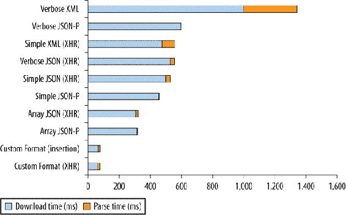图 7-1. 数据格式下载与解析时间对比

请记住，这些数字来自单个浏览器中的单次测试运行。结果应作为性能的一般指标，而非硬性数据。你可以在 [`techfoolery.com/formats/`](http://techfoolery.com/formats/) 自行运行这些测试。

## Ajax 性能指南

一旦选择了最合适的数据传输技术和数据格式，就可以开始考虑其他优化技术。这些技术可能高度依赖于具体场景，因此在考虑它们之前，请确保你的应用程序符合相应条件。

### 缓存数据

最快的 Ajax 请求是无需发出的请求。有两种主要方法可以避免不必要的请求：

*   在服务器端，设置 HTTP 头以确保你的响应将在浏览器中被缓存。


*   在客户端，将获取到的数据存储在本地，这样就不必再次请求。

第一种技术最容易设置和维护，而第二种技术则能提供最高程度的控制。

#### 设置 HTTP 头部

如果你希望浏览器缓存 Ajax 响应，必须使用 `GET` 发起请求。但仅仅使用 `GET` 还不够，你还必须在响应中发送正确的 HTTP 头部。`Expires` 头部告诉浏览器响应可以被缓存多长时间。其值是一个日期；超过该日期后，对该 URL 的任何请求将不再从缓存中提供，而是转发到服务器。以下是 `Expires` 头部的示例：

```
Expires:    Mon, 28 Jul 2014 23:30:00 GMT
```

这个特定的 `Expires` 头部告诉浏览器将此响应缓存到 2014 年 7 月。这被称为*远期* `Expires` 头部，适用于永远不会改变的内容，例如图片或静态数据集。

`Expires` 头部中的日期是 GMT 日期。可以使用以下 PHP 代码进行设置：

```
$lifetime = 7 * 24 * 60 * 60; // 7 天，以秒为单位。
header('Expires: ' . gmdate('D, d M Y H:i:s', time() + $lifetime) . ' GMT');
```

这将告诉浏览器将文件缓存 7 天。要设置一个远期 `Expires` 头部，可以将生命周期设置得更长；以下示例告诉浏览器将文件缓存 10 年：

```
$lifetime = 10 * 365 * 24 * 60 * 60; // 10 年，以秒为单位。
header('Expires: ' . gmdate('D, d M Y H:i:s', time() + $lifetime) . ' GMT');
```

`Expires` 头部是确保 Ajax 响应在浏览器中被缓存的最简单方法。你无需更改客户端代码，可以继续正常发起 Ajax 请求，因为浏览器只有在文件不在缓存中时才会将请求发送到服务器。在服务器端实现也很简单，因为所有语言都允许你以某种方式设置头部。这是确保数据被缓存的最简单方法。

#### 本地存储数据

除了依赖浏览器处理缓存，你也可以采用更手动的方式，即存储从服务器接收到的响应。这可以通过将响应文本放入一个对象中，并以用于获取它的 URL 作为键来实现。以下是一个 `XHR` 包装器的示例，它首先检查某个 URL 是否已被获取过：

```
var localCache = {};

function xhrRequest(url, callback) {

    // 检查本地缓存中是否有此 URL。

    if (localCache[url]) {
        callback.success(localCache[url]);
        return;
    }

    // 如果缓存中未找到此 URL，则发起请求。

    var req = createXhrObject();
    req.onerror = function() {
        callback.error();
    };

    req.onreadystatechange = function() {
        if (req.readyState == 4) {

            if (req.responseText === '' || req.status == '404') {
                callback.error();
                return;
            }

            // 将响应存储在本地缓存中。

            localCache[url] = req.responseText;
            callback.success(req.responseText);
        }
    };

    req.open("GET", url, true);
    req.send(null);
}
```

总体而言，设置 `Expires` 头部是更好的解决方案。它更容易实现，并且能在页面加载和会话之间缓存响应。但在某些情况下，手动缓存可能很有用，比如当你希望以编程方式使缓存过期并获取新数据时。想象一个场景：你希望每次请求都使用缓存数据，除非用户执行了某个操作导致一个或多个缓存响应失效。在这种情况下，从缓存中移除这些响应非常简单：

```
delete localCache['/user/friendlist/'];
delete localCache['/user/contactlist/'];
```

对于在移动设备上浏览的用户，本地缓存也很有效。这类设备上的大多数浏览器缓存很小或根本没有缓存，手动缓存是防止不必要请求的最佳选择。

### 了解 Ajax 库的局限性

所有 JavaScript 库都为你提供了访问 Ajax 对象的途径，该对象标准化了浏览器之间的差异，并提供了统一的接口。大多数情况下，这是一件好事，因为它让你能够专注于项目，而不是关注 `XHR` 在某些小众浏览器中的工作细节。然而，在提供统一接口的同时，这些库也必须简化接口，因为并非每个浏览器都实现了所有功能。这阻止了你访问 `XMLHttpRequest` 的全部能力。

本章介绍的一些技术只能通过直接访问 `XHR` 对象来实现。其中最值得注意的是多部分 `XHR` 的流式传输功能。通过监听 `readyState` 3，我们可以在大型响应完全接收之前开始对其进行分片。这使我们能够实时处理响应的各个部分，这也是 `MXHR` 能够大幅提升性能的原因之一。然而，大多数 JavaScript 库并不允许你直接访问 `readystatechange` 事件。这意味着你必须等到*整个*响应被接收（可能需要相当长的时间）之后，才能开始使用其中的任何部分。

直接使用 `XMLHttpRequest` 对象并不像看起来那么困难。除了一些小问题外，所有主流浏览器的最新版本都以相同的方式支持 `XMLHttpRequest` 对象，并且都提供了对不同 `readyState` 的访问。只需多写几行代码，你就可以支持旧版本的 IE。以下是一个返回 `XHR` 对象的函数示例，你可以直接与之交互（这是 YUI 2 Connection Manager 所用代码的修改版本）：

```
function createXhrObject() {

    var msxml_progid = [
        'MSXML2.XMLHTTP.6.0',
        'MSXML3.XMLHTTP',
        'Microsoft.XMLHTTP',  // 不支持 readyState 3。
        'MSXML2.XMLHTTP.3.0'  // 不支持 readyState 3。
    ];

    var req;
    try {
        req = new XMLHttpRequest(); // 首先尝试标准方式。
    }
    catch(e) {
        for (var i = 0, len = msxml_progid.length; i < len; ++i) {
            try {
                req = new ActiveXObject(msxml_progid[i]);
                break;
            }
            catch(e2) {  }
        }
    }
    finally {
        return req;
    }
}
```

这将首先尝试支持 `readyState` 3 的 `XMLHttp` 版本，如果这些版本不可用，则回退到不支持 `readyState` 3 的版本。

直接与 `XHR` 对象交互还能减少函数开销，进一步提升性能。但要注意，放弃使用 Ajax 库可能会在较旧或小众浏览器中遇到一些问题。

## 总结

高性能 Ajax 包括了解你的具体需求，并选择正确的数据格式和传输技术来匹配。

作为数据格式，纯文本和 HTML 具有很强的场景依赖性，但它们可以节省客户端的 CPU 周期。XML 广泛可用且几乎在所有地方都得到支持，但它极其冗长且解析缓慢。JSON 轻量且解析快速（当作为原生代码而非字符串处理时），并且几乎与 XML 一样具有互操作性。自定义分隔符格式极其轻量，对于大型数据集解析最快，但可能需要在服务器端进行格式化并在客户端进行解析，从而增加额外的编程工作。


在请求数据时，XHR 在从页面所在域拉取数据时提供了最大的控制和灵活性，但它将所有传入数据视为字符串，可能会减慢解析速度。另一方面，动态脚本标签插入允许跨域请求以及 JavaScript 和 JSON 的原生执行，但其接口不够健壮，且无法读取头部或响应码。多部分 XHR 可用于减少请求数量，并能在单个响应中处理不同的文件类型，但不会缓存接收到的资源。在发送数据时，图像信标是一种简单高效的方法。XHR 也可用于通过 POST 发送大量数据。

除了这些格式和传输技术外，还有一些指导原则有助于让你的 Ajax 看起来更快：

*   通过合并 JavaScript 和 CSS 文件，或使用 MXHR，减少请求数量。
*   通过使用 Ajax 在页面其余部分加载完成后获取次要文件，改善页面的感知加载时间。
*   确保你的代码优雅地失败，并能处理服务器端的问题。
*   知道何时使用健壮的 Ajax 库，何时编写自己的底层 Ajax 代码。

Ajax 为网站性能优化提供了最大的潜力之一，这不仅因为许多网站大量使用异步请求，还因为它能为一些看似不相关的问题（例如资源加载过多）提供解决方案。创造性地使用 XHR 可以区分一个迟缓、不友好的页面和一个响应迅速、高效的页面；也可以区分一个用户讨厌交互的网站和一个用户喜爱的网站。

## 第 8 章 编程实践

每种编程语言都会随着时间的推移出现一些痛点和不高效的模式。这些特征的出现是因为人们开始使用该语言并不断突破其边界。自 2005 年“Ajax”一词出现以来，Web 开发者将 JavaScript 和浏览器推向了前所未有的高度。因此，出现了一些非常具体的模式，既有最佳实践，也有次优方案。这些模式的出现源于 JavaScript 在 Web 上的本质特性。

## 避免双重求值

JavaScript 与许多脚本语言一样，允许你获取包含代码的字符串，并在运行中的代码内执行它。有四种标准方法可以实现这一点：`eval()`、`Function()` 构造函数、`setTimeout()` 和 `setInterval()`。这些函数都允许你传入一段 JavaScript 代码字符串并执行它。例如：

```
var num1 = 5,
    num2 = 6,

    //eval() 求值一段代码字符串
    result = eval("num1 + num2"),

    //Function() 求值代码字符串
    sum = new Function("arg1", "arg2", "return arg1 + arg2");

//setTimeout() 求值一段代码字符串
setTimeout("sum = num1 + num2", 100);

//setInterval() 求值一段代码字符串
setInterval("sum = num1 + num2", 100);
```

每当你在 JavaScript 代码内部求值 JavaScript 代码时，就会产生双重求值的开销。这段代码首先被正常求值，然后在执行过程中，另一次求值会执行包含在字符串中的代码。双重求值是一种代价高昂的操作，比原生包含相同代码要慢得多。

作为对比，访问数组项所需的时间因浏览器而异，但使用 `eval()` 访问数组项时，时间差异会变得非常显著。例如：

```
// 更快
var item = array[0];

// 更慢
var item = eval("array[0]");
```

如果使用 `eval()` 而不是原生代码读取 10,000 个数组项，不同浏览器之间的差异会变得非常显著。表 8-1 显示了此操作的不同时间。

表 8-1. 原生代码与 `eval()` 访问 10,000 个数组项的速度对比

| 浏览器 | 原生代码（毫秒） | `eval()` 代码（毫秒） |
| --- | --- | --- |
| Firefox 3 | 10.57 | 822.62 |
| Firefox 3.5 | 0.72 | 141.54 |
| Chrome 1 | 5.7 | 106.41 |
| Chrome 2 | 5.17 | 54.55 |
| Internet Explorer 7 | 31.25 | 5086.13 |
| Internet Explorer 8 | 40.06 | 420.55 |
| Opera 9.64 | 2.01 | 402.82 |
| Opera 10 Beta | 10.52 | 315.16 |
| Safari 3.2 | 30.37 | 360.6 |
| Safari 4 | 22.16 | 54.47 |

数组项访问时间的巨大差异是由于每次调用 `eval()` 时都会创建一个新的解释器/编译器实例。`Function()`、`setTimeout()` 和 `setInterval()` 也会发生同样的过程，自动导致代码执行变慢。

大多数情况下，不需要使用 `eval()` 或 `Function()`，最好尽可能避免使用它们。对于另外两个函数 `setTimeout()` 和 `setInterval()`，建议将函数作为第一个参数传入，而不是字符串。例如：

```
setTimeout(function(){
    sum = num1 + num2;
}, 100);

setInterval(function(){
    sum = num1 + num2;
}, 100);
```

避免双重求值是实现最佳 JavaScript 运行时性能的关键。

* * *

### 注意

优化 JavaScript 引擎通常会缓存使用 `eval()` 重复求值代码的结果。如果你重复求值相同的代码字符串，在 Safari 4 和所有版本的 Chrome 中会看到更大的性能提升。

* * *

## 使用对象/数组字面量

在 JavaScript 中创建对象和数组有多种方法，但没有什么比创建对象和数组字面量更快。如果不使用字面量，典型的对象创建和赋值如下所示：

```
// 创建一个对象
var myObject = new Object();
myObject.name = "Nicholas";
myObject.count = 50;
myObject.flag = true;
myObject.pointer = null;

// 创建一个数组
var myArray = new Array();
myArray[0] = "Nicholas";
myArray[1] = 50;
myArray[2] = true;
myArray[3] = null;
```

虽然这种方法在技术上没有错，但字面量的求值速度更快。额外的好处是，字面量在代码中占用的空间更少，因此整体文件大小更小。前面的代码可以使用字面量重写如下：

```
// 创建一个对象
var myObject = {
    name: "Nicholas",
    count: 50,
    flag: true,
    pointer: null
};

// 创建一个数组
var myArray = ["Nicholas", 50, true, null];
```

这段代码的最终结果与之前的版本相同，但在几乎所有浏览器中执行速度更快（Firefox 3.5 几乎没有差异）。随着对象属性和数组项数量的增加，使用字面量的好处也会增加。

## 不要重复工作

计算机科学中主要的性能优化技术之一是避免工作。避免工作的概念实际上意味着两件事：不要做不必要的工作，不要重复已经完成的工作。第一部分通常在重构代码时很容易识别。第二部分——不重复工作——通常更难识别，因为工作可能在任何地方、出于任何原因被重复。

最常见的重复工作类型是浏览器检测。许多代码根据浏览器能力进行分支。以事件处理程序的添加和移除为例。用于此目的的典型跨浏览器代码如下所示：

```
function addHandler(target, eventType, handler){
    if (target.addEventListener){  //DOM2 事件
        target.addEventListener(eventType, handler, false);
    } else {   //IE
        target.attachEvent("on" + eventType, handler);
    }
}

function removeHandler(target, eventType, handler){
    if (target.removeEventListener){  //DOM2 事件
        target.removeEventListener(eventType, handler, false);
    } else {   //IE
        target.detachEvent("on" + eventType, handler);
    }
}
```


该代码通过检测 `addEventListener()` 和 `removeEventListener()` 来判断是否支持 DOM Level 2 事件，除 Internet Explorer 外，所有现代浏览器都支持这些方法。如果 `target` 上不存在这些方法，则假定为 IE，并使用 IE 特有的方法。

乍一看，这些函数似乎针对其目的进行了相当优化。隐藏的性能问题在于每次调用任一函数时都会重复执行相同的工作。每次都会进行相同的检查，以确定某个方法是否存在。如果你假设 `target` 的唯一值实际上是 DOM 对象，并且用户在页面加载期间不会神奇地更换浏览器，那么这种评估就是重复的。如果第一次调用 `addHandler()` 时存在 `addEventListener()`，那么后续每次调用时它都会存在。每次调用函数时重复相同的工作是浪费的，有几种方法可以避免这种情况。

### 惰性加载

消除函数中重复工作的第一种方法是通过*惰性加载*。惰性加载意味着在需要信息之前不进行任何工作。在前面的例子中，只有在有人调用函数时，才需要确定附加或分离事件处理程序的方式。前面函数的惰性加载版本如下所示：

```
function addHandler(target, eventType, handler){

    //覆盖现有函数
    if (target.addEventListener){   //DOM2 Events
        addHandler = function(target, eventType, handler){
            target.addEventListener(eventType, handler, false);
        };
    } else {    //IE
        addHandler = function(target, eventType, handler){
            target.attachEvent("on" + eventType, handler);
        };
    }

    //调用新函数
   addHandler(target, eventType, handler);
}

function removeHandler(target, eventType, handler){

    //覆盖现有函数
    if (target.removeEventListener){   //DOM2 Events
        removeHandler = function(target, eventType, handler){
            target.addEventListener(eventType, handler, false);
        };
    } else {    //IE
        removeHandler = function(target, eventType, handler){
            target.detachEvent("on" + eventType, handler);
        };
    }

    //调用新函数
   removeHandler(target, eventType, handler);
}
```

这两个函数实现了惰性加载模式。第一次调用任一方法时，会进行检查以确定附加或分离事件处理程序的适当方式。然后，原始函数被一个新函数覆盖，该函数仅包含适当的操作步骤。第一次函数调用的最后一步是使用原始参数执行新函数。后续每次调用 `addHandler()` 或 `removeHandler()` 都避免了进一步的检测，因为检测代码已被新函数覆盖。

调用惰性加载函数第一次总是花费更长时间，因为它必须运行检测，然后调用另一个函数来完成任务。然而，后续对同一函数的调用要快得多，因为它们没有检测逻辑。惰性加载最适合在函数不会立即在页面上使用的情况下使用。

### 条件预加载

惰性加载函数的一种替代方案是*条件预加载*，它在脚本加载时提前进行检测，而不是等待函数调用。检测仍然只进行一次，但它在过程中更早发生。例如：

```
var addHandler = document.body.addEventListener ?
                 function(target, eventType, handler){
                     target.addEventListener(eventType, handler, false);
                 }:
                 function(target, eventType, handler){
                     target.attachEvent("on" + eventType, handler);
                 };

var removeHandler = document.body.removeEventListener ?
                 function(target, eventType, handler){
                     target.removeEventListener(eventType, handler, false);
                 }:
                 function(target, eventType, handler){
                     target.detachEvent("on" + eventType, handler);
                 };
```

此示例检查 `addEventListener()` 和 `removeEventListener()` 是否存在，然后使用该信息分配最合适的函数。如果这些方法存在，三元运算符返回 DOM Level 2 函数，否则返回 IE 特有的函数。结果是所有对 `addHandler()` 和 `removeHandler()` 的调用速度都相同，因为检测成本发生在前面。

条件预加载确保对函数的所有调用花费相同的时间。其代价是检测发生在脚本加载时，而不是稍后。预加载最适合在函数即将被使用，并且在页面生命周期中频繁使用的情况下使用。

## 使用快速部分

尽管 JavaScript 经常被指责为缓慢，但该语言中有一些部分非常快。这并不奇怪，因为 JavaScript 引擎是用低级语言构建的，因此是编译的。虽然当 JavaScript 看起来慢时很容易责怪引擎，但引擎通常是过程中最快的部分；实际上运行缓慢的是你的代码。引擎中有一些部分比其他部分快得多，因为它们允许你绕过慢速部分。

### 位运算符

位运算符是 JavaScript 中最常被误解的方面之一。普遍的看法是开发人员不知道如何使用这些运算符，并且经常将它们误认为是布尔运算符的等价物。因此，尽管位运算符有其优势，但在 JavaScript 开发中很少使用。

JavaScript 数字都以 IEEE-754 64 位格式存储。然而，对于位运算，数字会被转换为有符号的 32 位表示。然后每个运算符直接对这个 32 位表示进行操作以获得结果。尽管有转换，但与 JavaScript 中的其他数学和布尔运算相比，这个过程非常快。

如果你不熟悉数字的二进制表示，JavaScript 可以轻松地通过使用 `toString()` 方法并传入数字 2 将数字转换为包含其二进制等效项的字符串。例如：

```
var num1 = 25,
    num2 = 3;

alert(num1.toString(2));    //"11001"
alert(num2.toString(2));    //   "11"
```

请注意，这种表示省略了数字的前导零。

JavaScript 中有四个位逻辑运算符：

按位与

> 返回一个数字，其中两个数字都为 1 的位为 1

按位或

> 返回一个数字，其中任一数字为 1 的位为 1

按位异或

> 返回一个数字，其中恰好一个数字为 1 的位为 1

按位非

> 返回一个数字，其中数字为 0 的位为 1，反之亦然

这些运算符的使用方式如下：

```
//按位与
var result1 = 25 & 3;           //1
alert(result.toString(2));      //"1"

//按位或
var result2 = 25 | 3;           //27
alert(result2.toString(2));     //"11011"

//按位异或
var result3 = 25 ^ 3;           //26
alert(result3.toString(2));     //"11010"

//按位非
var result4 = ~25;              //-26
alert(result4.toString(2));     //"-11010"
```

有几种方法可以使用位运算符来加速你的 JavaScript。第一种是使用位运算代替纯数学运算。例如，通常通过计算给定数字模 2 来交替表格行颜色，如下所示：

```
for (var i=0, len=rows.length; i < len; i++){
    if (i % 2) {
        className = "even";
    } else {
        className = "odd";
    }

    //应用类
}
```


计算模 2 需要将数字除以 2 来确定余数。如果查看数字的底层 32 位表示，一个数字是偶数当且仅当其第一位为 0，是奇数当且仅当其第一位为 1。这可以通过对给定数字与数字 1 执行按位与运算轻松确定。当数字为偶数时，按位与 1 的结果为 0；当数字为奇数时，结果为 1。这意味着之前的代码可以重写如下：

```
for (var i=0, len=rows.length; i < len; i++){
    if (i & 1) {
        className = "odd";
    } else {
        className = "even";
    }

    //apply class
}
```

虽然代码改动很小，但按位与版本的执行速度比原始版本快高达 50%（取决于浏览器）。

使用位运算符的第二种方法是一种称为*位掩码*的技术。位掩码是计算机科学中一种流行的技术，适用于同时存在多个布尔选项的情况。其思想是利用单个数字的每一位来指示该选项是否存在，从而有效地将数字转换为一个布尔标志数组。每个选项被赋予一个等于 2 的幂的值，以便掩码正常工作。例如：

```
var OPTION_A = 1;
var OPTION_B = 2;
var OPTION_C = 4;
var OPTION_D = 8;
var OPTION_E = 16;
```

定义好选项后，可以使用按位或运算符创建一个包含多个设置的单一数字：

```
var options = OPTION_A | OPTION_C | OPTION_D;
```

然后，可以使用按位与运算符检查某个选项是否可用。如果选项未设置，运算返回 0；如果已设置，则返回 1：

```
//is option A in the list?
if (options & OPTION_A){
    //do something
}

//is option B in the list?
if (options & OPTION_B){
    //do something
}
```

诸如此类的位掩码操作非常快，因为如前所述，这些操作是在系统的较低层级进行的。如果有多个选项需要一起保存并频繁检查，位掩码有助于加速整体处理。

* * *

### 注意

JavaScript 还支持左移（`<<`）、右移（`>>`）和无符号右移（`>>>`）位运算符。

* * *

### 原生方法

无论你的 JavaScript 代码多么优化，它永远不会比 JavaScript 引擎提供的原生方法更快。原因很简单：JavaScript 的原生部分——即在你编写任何代码之前浏览器中已经存在的部分——都是用 C++ 等低级语言编写的。这意味着这些方法作为浏览器的一部分被编译成机器码，因此没有 JavaScript 代码的那些限制。

经验不足的 JavaScript 开发人员常犯的一个错误是在代码中执行复杂的数学运算，而内置的 `Math` 对象上已有性能更好的版本可用。`Math` 对象包含旨在简化数学运算的属性和方法。有几个可用的数学常量：

| 常量 | 含义 |
| --- | --- |
| `Math.E` | 自然对数的底数 E 的值 |
| `Math.LN10` | 10 的自然对数 |
| `Math.LN2` | 2 的自然对数 |
| `Math.LOG2E` | 以 2 为底的 E 的对数 |
| `Math.LOG10E` | 以 10 为底的 E 的对数 |
| `Math.PI` | π 的值 |
| `Math.SQRT1_2` | ½ 的平方根 |
| `Math.SQRT2` | 2 的平方根 |

这些值都是预先计算好的，因此你无需自行计算。还有一些用于处理数学计算的方法：

| 方法 | 含义 |
| --- | --- |
| `Math.abs(num)` | *num* 的绝对值 |
| `Math.exp(num)` | `Math.E`^(*num*) |
| `Math.log(num)` | *num* 的对数 |
| `Math.pow(num, power)` | *num*^(*power*) |
| `Math.sqrt(num)` | *num* 的平方根 |
| `Math.acos(x)` | *x* 的反余弦 |
| `Math.asin(x)` | *x* 的反正弦 |
| `Math.atan(x)` | *x* 的反正切 |
| `Math.atan2(y, x)` | *y/x* 的反正切 |
| `Math.cos(x)` | *x* 的余弦 |
| `Math.sin(x)` | *x* 的正弦 |
| `Math.tan(x)` | *x* 的正切 |

使用这些方法比在 JavaScript 代码中重新实现相同功能更快。每当需要执行复杂的数学计算时，应首先考虑使用 `Math` 对象。

另一个例子是选择器 API，它允许使用 CSS 选择器查询 DOM 文档。CSS 查询在 JavaScript 中原生实现，并由 jQuery JavaScript 库真正推广开来。jQuery 引擎被广泛认为是最快的 CSS 查询引擎，但它仍然比原生方法慢得多。原生 `querySelector()` 和 `querySelectorAll()` 方法完成其任务的平均时间仅为基于 JavaScript 的 CSS 查询所需时间的 10%。^([13]) 现在大多数 JavaScript 库已转向在可用时使用原生功能，以提升整体性能。

始终尽可能使用原生方法，尤其是在数学计算和 DOM 操作中。用编译代码完成的工作越多，你的代码运行速度就越快。

* * *

### 注意

Chrome 实际上用 JavaScript 实现了相当多的原生 JavaScript 功能。由于 Chrome 对原生功能和你的代码都使用即时 JavaScript 编译器，两者之间的性能差异有时很小。

* * *

## 总结

JavaScript 在代码组织方式上带来了一些独特的性能挑战。随着 Web 应用程序变得越来越复杂，包含越来越多的 JavaScript 代码行才能运行，一些模式与反模式也随之出现。需要牢记的一些编程实践：

*   避免使用 `eval()` 和 `Function()` 构造函数，从而避免双重求值的性能损失。同时，向 `setTimeout()` 和 `setInterval()` 传递函数而非字符串。

*   创建新对象和数组时，使用对象字面量和数组字面量。它们比非字面量形式创建和初始化得更快。

*   避免重复执行相同的工作。当需要浏览器检测逻辑时，使用惰性加载或条件预加载。

*   执行数学运算时，考虑使用直接操作数字底层表示的位运算符。

*   原生方法总是比你在 JavaScript 中编写的任何代码更快。尽可能使用原生方法。

与本书涵盖的许多技术和方案一样，当这些优化应用于频繁执行的代码时，你将看到最大的性能提升。

^([13]) 根据 SlickSpeed 测试套件，网址为 [`www2.webkit.org/perf/slickspeed/`](http://www2.webkit.org/perf/slickspeed/)。

## 第 9 章 构建和部署高性能 JavaScript 应用程序

### Julien Lecomte

根据雅虎卓越性能团队 2007 年的一项研究，雅虎 40%–60% 的用户拥有空缓存体验，并且大约 20% 的页面浏览量是在空缓存情况下完成的（[`yuiblog.com/blog/2007/01/04/performance-research-part-2/`](http://yuiblog.com/blog/2007/01/04/performance-research-part-2/)）。此外，雅虎搜索团队的另一项较新研究（经谷歌的 Steve Souders 独立确认）表明，美国大型网站提供的内容中约有 15% 未经压缩传输。


这些事实强调了确保基于 JavaScript 的 Web 应用程序尽可能高效交付的必要性。虽然这部分工作在设计及开发周期中已完成，但构建和部署阶段同样至关重要且常被忽视。如果在此关键阶段不够谨慎，无论你为提升速度投入了多少精力，应用程序的性能都会受到影响。

本章旨在为你提供高效组装和部署基于 JavaScript 的 Web 应用程序所需的知识。文中将使用 Apache Ant（一种基于 Java 的构建工具，已迅速成为 Web 应用程序构建的行业标准）来阐述多个概念。在本章末尾，将介绍一个用 PHP5 编写的自定义敏捷构建工具作为示例。

## Apache Ant

Apache Ant（[`ant.apache.org/`](http://ant.apache.org/)）是一个用于自动化软件构建过程的工具。它与`make`类似，但用 Java 实现，并使用 XML 描述构建过程，而`make`使用自己的`Makefile`格式。Ant 是 Apache 软件基金会（[`www.apache.org/licenses/`](http://www.apache.org/licenses/)）的一个项目。

Ant 相对于`make`和其他工具的主要优势在于其可移植性。Ant 本身可在多种不同平台上使用，且 Ant 构建文件的格式是平台无关的。

Ant 构建文件以 XML 编写，默认命名为`build.xml`。每个构建文件包含一个项目（project）和至少一个目标（target）。一个 Ant 目标可以依赖于其他目标。

目标包含任务元素：即原子执行的操作。Ant 内置了大量任务，必要时也可添加可选任务。此外，还可以用 Java 开发自定义任务，以便在 Ant 构建文件中使用。

一个项目可以拥有一组属性（properties）或变量。属性有名称和值。它可以在构建文件中通过`property`任务设置，也可以在 Ant 外部设置。属性可以通过将名称放在`${`和`}`之间来求值。

以下是一个示例构建文件。运行默认目标（`dist`）会编译源目录中的 Java 代码，并将其打包为 JAR 归档文件。

```
<?xml version="1.0" encoding="UTF-8"?>
<project name="MyProject" default="dist" basedir=".">

  <!-- 设置此构建的全局属性 -->
  <property name="src"   location="src"/>
  <property name="build" location="build"/>
  <property name="dist"  location="dist"/>

  <target name="init">
    <!-- 创建时间戳 -->
    <tstamp/>
    <!-- 创建编译所需的构建目录结构 -->
    <mkdir dir="${build}"/>
  </target>

  <target name="compile" depends="init" description="编译源代码">
    <!-- 将 ${src} 中的 Java 代码编译到 ${build} -->
    <javac srcdir="${src}" destdir="${build}"/>
  </target>

  <target name="dist" depends="compile" description="生成分发文件">
    <!-- 创建分发目录 -->
    <mkdir dir="${dist}/lib"/>
    <!-- 将 ${build} 中的所有内容放入 MyProject-${DSTAMP}.jar 文件中 -->
    <jar jarfile="${dist}/lib/MyProject-${DSTAMP}.jar" basedir="${build}"/>
  </target>

  <target name="clean" description="清理">
    <!-- 删除 ${build} 和 ${dist} 目录树 -->
    <delete dir="${build}"/>
    <delete dir="${dist}"/>
  </target>

</project>
```

尽管本章使用 Apache Ant 来阐述核心概念，但还有许多其他工具可用于构建 Web 应用程序。其中值得注意的是，`Rake`（[`rake.rubyforge.org/`](http://rake.rubyforge.org/)）近年来逐渐流行。`Rake`是一个基于 Ruby 的构建程序，功能与`make`类似。最显著的是，`Rakefiles`（Rake 版的`Makefiles`）使用标准 Ruby 语法编写，因此是平台无关的。

## 合并 JavaScript 文件

根据 Yahoo!卓越性能团队的说法，加速网站的第一条（可能也是最重要的一条）指导原则，尤其是对于首次访问者，是减少渲染页面所需的 HTTP 请求数量（[`yuiblog.com/blog/2006/11/28/performance-research-part-1/`](http://yuiblog.com/blog/2006/11/28/performance-research-part-1/)）。这是你应该着手优化的起点，因为合并资源通常工作量较小，且能为用户带来最大的潜在收益。

大多数现代网站使用多个 JavaScript 文件：通常是一个小型库，包含一组实用工具和控件，用于简化跨浏览器的富交互式 Web 应用程序开发；以及一些特定于站点的代码，这些代码被拆分为多个逻辑单元以保持开发者的清晰思路。例如，CNN（[`www.cnn.com/`](http://www.cnn.com/)）使用了 Prototype 和 Script.aculo.us 库。其首页共加载了 12 个外部脚本和超过 20 个内联脚本块。一个简单的优化方法是将这些代码（即使不是全部）分组到一个外部 JavaScript 文件中，从而大幅减少渲染页面所需的 HTTP 请求数量。

Apache Ant 通过`concat`任务提供了合并多个文件的能力。然而，重要的是要记住，JavaScript 文件通常需要按特定顺序连接以处理依赖关系。一旦确定了这些依赖关系，使用`filelist`或组合`fileset`元素可以保留文件的顺序。以下是 Ant 目标的样子：

```
<target name="js.concatenate">
    <concat destfile="${build.dir}/concatenated.js">
        <filelist dir="${src.dir}"
            files="a.js, b.js"/>
        <fileset dir="${src.dir}"
            includes="*.js"
            excludes="a.js, b.js"/>
    </concat>
</target>
```

此目标在构建目录下创建文件`concatenated.js`，其内容依次为`a.js`、`b.js`，然后是按字母顺序排列的源目录下所有其他文件。

请注意，如果任何源文件（可能除了最后一个）没有以分号或行终止符结尾，则生成的合并文件可能包含无效的 JavaScript 代码。可以通过指示 Ant 使用`fixlastline`属性检查每个合并的源文件是否以换行符结尾来解决此问题：

```
<concat destfile="${build.dir}/concatenated.js" fixlastline="yes">
    ...
</concat>
```

## 预处理 JavaScript 文件

> 在计算机科学中，预处理器是一种程序，它处理输入数据以生成输出，该输出用作另一个程序的输入。输出被称为输入数据的预处理形式，通常被后续程序（如编译器）使用。处理的数量和类型取决于预处理器的性质；有些预处理器只能执行相对简单的文本替换和宏展开，而另一些则具有完整编程语言的能力。—— [`en.wikipedia.org/wiki/Preprocessor`](http://en.wikipedia.org/wiki/Preprocessor)

预处理 JavaScript 源文件本身并不会使你的应用程序更快，但它能让你有条件地检测代码，从而衡量应用程序的性能。

由于没有专门为 JavaScript 设计的预处理器，因此有必要使用一个足够灵活的词汇预处理器，以便可以自定义其词法分析规则，或者使用一个为词法语法与 JavaScript 自身词法语法足够接近的语言而设计的预处理器。由于 C 编程语言的语法与 JavaScript 接近，C 预处理器（`cpp`）是一个不错的选择。以下是 Ant 目标的样子：


```
<target name="js.preprocess" depends="js.concatenate">
    <apply executable="cpp" dest="${build.dir}">
        <fileset dir="${build.dir}"
            includes="concatenated.js"/>
        <arg line="-P -C -DDEBUG"/>
        <srcfile/>
        <targetfile/>
        <mapper type="glob"
            from="concatenated.js"
            to="preprocessed.js"/>
    </apply>
</target>
```

这个目标依赖于`js.concatenate`目标，通过对之前拼接的文件运行`cpp`，在构建目录下创建`preprocessed.js`文件。注意，`cpp`使用了标准的`–P`（禁止生成行标记）和`–C`（不丢弃注释）选项。在这个例子中，还定义了`DEBUG`宏。

有了这个目标，你现在可以直接在 JavaScript 文件中使用宏定义（`#define`、`#undef`）和条件编译（`#if`、`#ifdef`、`#ifndef`、`#else`、`#elif`、`#endif`）指令，例如，允许你有条件地嵌入（或移除）性能分析代码：

```
#ifdef DEBUG

(new YAHOO.util.YUILoader({
    require: ['profiler'],
    onSuccess: function(o) {
        YAHOO.tool.Profiler.registerFunction('foo', window);
    }
})).insert();

#endif
```

如果你打算使用多行宏，请确保使用 Unix 换行符（`LF`）。你可以使用`fixcrlf` Ant 任务来自动修复这个问题。

另一个例子，虽然与性能不严格相关，但展示了 JavaScript 预处理功能的强大，即使用“可变参数宏”（接受可变数量参数的宏）和文件包含来实现 JavaScript 断言。考虑以下名为`include.js`的文件：

```
#ifndef _INCLUDE_JS_
#define _INCLUDE_JS_

#ifdef DEBUG
function assert(condition, message) {
    // Handle the assertion by displaying an alert message
    // possibly containing a stack trace for example.
}
#define ASSERT(x, ...) assert(x, ## __VA_ARGS__)
#else
#define ASSERT(x, ...)
#endif /* DEBUG */

#endif /* _INCLUDE_JS_ */
```

现在你可以编写如下所示的 JavaScript 代码：

```
#include "include.js"

function myFunction(arg) {
    ASSERT(YAHOO.lang.isString(argvar), "arg should be a string");
    ...
#ifdef DEBUG
    YAHOO.log("Log this in debug mode only");
#endif
    ...
}
```

断言和额外的日志代码仅在开发期间设置了`DEBUG`宏时出现。这些语句在最终的生产构建中消失。

## JavaScript 压缩

JavaScript 压缩是一个过程，通过该过程，JavaScript 文件中所有对执行无贡献的内容都被剥离。这包括注释和不必要的空白。该过程通常将文件大小减少一半，从而加快下载速度，并鼓励程序员编写更好、更广泛的内联文档。

`JSMin`（[`www.crockford.com/javascript/jsmin.html`](http://www.crockford.com/javascript/jsmin.html)）由 Douglas Crockford 开发，长期以来一直是 JavaScript 压缩的标准。然而，随着 Web 应用程序规模和复杂性的不断增长，许多人认为有必要将 JavaScript 压缩推进一步。这就是开发 `YUI Compressor`（[`developer.yahoo.com/yui/compressor/`](http://developer.yahoo.com/yui/compressor/)）的主要原因，该工具执行各种智能操作，以完全安全的方式提供比其他工具更高的压缩率。除了剥离注释和不必要的空白外，`YUI Compressor` 还提供以下功能：

*   将局部变量名替换为更短的（一个、两个或三个字符）变量名，以优化下游的 gzip 压缩
*   尽可能将方括号表示法替换为点表示法（例如，`foo["bar"]` 变为 `foo.bar`）
*   尽可能替换带引号的字面属性名（例如，`{"foo":"bar"}` 变为 `{foo:"bar"}`）
*   替换字符串中的转义引号（例如，`'aaa\'bbb'` 变为 `"aaa'bbb"`）
*   常量折叠（例如，`"foo"+"bar"` 变为 `"foobar"`）

与 `JSMin` 相比，通过 `YUI Compressor` 运行你的 JavaScript 代码无需任何额外操作即可获得巨大的节省。考虑 YUI 库核心文件（版本 2.7.0，可从 [`developer.yahoo.com/yui/`](http://developer.yahoo.com/yui/) 获取）的以下数据：

| 原始 `yahoo.js`、`dom.js` 和 `event.js` | 192,164 字节 |
| `yahoo.js`、`dom.js` 和 `event.js` + `JSMin` | 47,316 字节 |
| `yahoo.js`、`dom.js` 和 `event.js` + `YUI Compressor` | 35,896 字节 |

在这个例子中，`YUI Compressor` 开箱即用比 `JSMin` 节省了 24%。然而，你还可以采取一些措施来进一步增加字节节省。存储对象/值的局部引用、将代码包装在闭包中、对重复值使用常量、避免使用 `eval`（及其相关函数，如 `Function` 构造函数、`setTimeout` 和 `setInterval` 当第一个参数是字符串字面量时）、`with` 关键字以及 JScript 条件注释，都有助于使压缩后的文件更小。考虑以下函数，用于切换指定 DOM 元素上的 `selected` 类（220 字节）：

```
function toggle (element) {
    if (YAHOO.util.Dom.hasClass(element, "selected")){
        YAHOO.util.Dom.removeClass(element, "selected");
    } else {
        YAHOO.util.Dom.addClass(element, "selected");
    }
}
```

`YUI Compressor` 会将此代码转换为以下内容（147 字节）：

```
function toggle(a){if(YAHOO.util.Dom.hasClass(a,"selected")){
YAHOO.util.Dom.removeClass(a,"selected")}else{YAHOO.util.Dom.
addClass(a,"selected")}};
```

如果你通过存储 `YAHOO.util.Dom` 的局部引用并对 `"selected"` 值使用常量来重构原始版本，代码变为（232 字节）：

```
function toggle (element) {
    var YUD = YAHOO.util.Dom, className = "selected";
    if (YUD.hasClass(element, className)){
        YUD.removeClass(element, className);
    } else {
        YUD.addClass(element, className);
    }
}
```

这个版本在使用 `YUI Compressor` 压缩后显示出更大的节省（115 字节）：

```
function toggle(a){var c=YAHOO.util.Dom,b="selected";if(c.hasClass(a,b)){
c.removeClass(a,b)}else{c.addClass(a,b)}};
```

压缩率从 33% 提高到 48%，考虑到所需的工作量很小，这是一个惊人的结果。然而，需要注意的是，下游的 gzip 压缩可能会产生矛盾的结果；换句话说，最小的压缩文件不一定总是产生最小的 gzip 文件。这个奇怪的结果是降低原始文件中冗余度的直接后果。此外，这种微优化会带来少量的运行时开销，因为现在使用变量代替字面值，需要额外的查找。因此，我通常建议不要滥用这些技术，尽管在向不支持（或声明支持）gzip 压缩的用户代理提供内容时，仍然值得考虑它们。


2009 年 11 月，谷歌发布了一款更先进的压缩工具，名为 Closure Compiler（[`code.google.com/closure/compiler/`](http://code.google.com/closure/compiler/)）。这款新工具在使用其高级优化选项时，比 YUI Compressor 更进一步。在这种模式下，Closure Compiler 在转换代码和重命名符号方面极为激进。虽然它能带来惊人的体积缩减，但要求开发者非常谨慎，确保输出代码与输入代码行为一致。同时，由于几乎所有符号都被重命名，调试也变得更加困难。Closure 库附带了一个名为 Closure Inspector（[`code.google.com/closure/compiler/docs/inspector.html`](http://code.google.com/closure/compiler/docs/inspector.html)）的 Firebug 扩展，它提供了混淆符号与原始符号之间的映射。然而，该扩展仅在 Firefox 浏览器上可用，在调试特定浏览器的代码路径时可能会成为问题，而且调试难度仍然高于其他不那么激进的压缩工具。

## 构建时与运行时构建流程

拼接、预处理和压缩这些步骤既可以在构建时进行，也可以在运行时进行。运行时构建流程在开发过程中非常有用，但出于可扩展性考虑，通常不建议在生产环境中使用。构建高性能应用的一般原则是：所有能在构建时完成的工作都不应在运行时进行。

虽然 Apache Ant 绝对是一个离线构建程序，但本章末尾介绍的敏捷构建工具代表了一种折中方案：同一工具既可用于开发，也可用于创建最终将在生产环境中使用的资源。

## JavaScript 压缩

当 Web 浏览器请求资源时，它通常会发送一个 `Accept-Encoding` HTTP 头（从 HTTP/1.1 开始），以告知 Web 服务器它支持哪些编码转换。此信息主要用于允许文档被压缩，从而实现更快的下载速度，进而提升用户体验。`Accept-Encoding` 值的可能标记包括：`gzip`、`compress`、`deflate` 和 `identity`（这些值由互联网号码分配机构 IANA 注册）。

如果 Web 服务器在请求中看到此头，它将选择最合适的编码方法，并通过 `Content-Encoding` HTTP 头将决定通知给 Web 浏览器。

`gzip` 是目前最流行的编码方式。它通常能将有效负载大小减少 70%，因此成为提升 Web 应用性能的首选武器。请注意，gzip 压缩应主要应用于文本响应，包括 JavaScript 文件。其他文件类型（如图像或 PDF 文件）不应进行 gzip 压缩，因为它们已经过压缩，再次尝试压缩只会浪费服务器资源。

如果你使用 Apache Web 服务器（目前最流行的），启用 gzip 压缩需要安装并配置 `mod_gzip` 模块（适用于 Apache 1.3，可从 [`www.schroepl.net/projekte/mod_gzip/`](http://www.schroepl.net/projekte/mod_gzip/) 获取）或 `mod_deflate` 模块（适用于 Apache 2）。

Yahoo! Search 和 Google 最近独立进行的研究表明，美国大型网站交付的内容中约有 15% 未经压缩。这主要是由于请求中缺少 `Accept-Encoding` HTTP 头，该头被某些企业代理、防火墙甚至 PC 安全软件剥离。尽管 gzip 压缩对 Web 开发者来说是一个强大的工具，但必须注意这一事实，并努力编写尽可能简洁的代码。另一种技术是向无法从 gzip 压缩中受益的用户提供替代的 JavaScript 内容，让他们获得更轻量的体验（尽管应允许用户选择切换回完整版本）。

为此，有必要提一下 Packer（[`dean.edwards.name/packer/`](http://dean.edwards.name/packer/)），这是由 Dean Edwards 开发的一款 JavaScript 压缩器。Packer 能够将 JavaScript 文件压缩到 YUI Compressor 无法达到的程度。以下是对 jQuery 库（版本 1.3.2，可从 [`www.jquery.com/`](http://www.jquery.com/) 获取）的测试结果：

| jQuery | 120,180 字节 |
| --- | --- |
| jQuery + YUI Compressor | 56,814 字节 |
| `jQuery + Packer` | `39,351 字节` |
| 原始 jQuery + gzip | 34,987 字节 |
| `jQuery + YUI Compressor + gzip` | `19,457 字节` |
| `jQuery + Packer + gzip` | `19,228 字节` |

经过 gzip 压缩后，使用 Packer 或 YUI Compressor 处理 jQuery 库得到的结果非常相似。然而，使用 Packer 压缩的文件会产生固定的运行时开销（在我现代的笔记本电脑上大约为 200 到 300 毫秒）。因此，将 YUI Compressor 与 gzip 结合使用总能获得最佳效果。不过，对于使用不支持 gzip 压缩的慢速网络的用户来说，Packer 可以成功应用，因为解包的开销与下载大量代码的开销相比微不足道。为不同用户提供不同 JavaScript 内容的唯一缺点是增加了质量保证成本。

## 缓存 JavaScript 文件

使 HTTP 组件可缓存将极大改善重复访问你网站的用户体验。具体来说，加载 Yahoo! 首页（[`www.yahoo.com/`](http://www.yahoo.com/)）时，使用完整缓存比使用空缓存所需的 HTTP 请求减少 90%，下载的字节数减少 83%。往返时间（从请求页面到触发 `onload` 事件之间的时间）从 2.4 秒降至 0.9 秒（[`yuiblog.com/blog/2007/01/04/performance-research-part-2/`](http://yuiblog.com/blog/2007/01/04/performance-research-part-2/)）。虽然缓存最常用于图像，但它应应用于所有静态组件，包括 JavaScript 文件。

Web 服务器使用 `Expires` HTTP 响应头来告知客户端资源可以缓存多长时间。其格式为 RFC 1123 格式的绝对时间戳。使用示例为：`Expires: Thu, 01 Dec 1994 16:00:00 GMT`。要将响应标记为“永不过期”，Web 服务器会发送一个大约在响应发送时间之后一年的 `Expires` 日期。根据 HTTP 1.1 RFC（RFC 2616，第 14.21 节），Web 服务器不应发送超过未来一年的 `Expires` 日期。

如果你使用 Apache Web 服务器，`ExpiresDefault` 指令允许你设置相对于当前日期的过期日期。以下示例将此指令应用于图像、JavaScript 文件和 CSS 样式表：

```
<FilesMatch "\.(jpg|jpeg|png|gif|js|css|htm|html)$">
    ExpiresActive on
    ExpiresDefault "access plus 1 year"
</FilesMatch>
```

某些 Web 浏览器，尤其是在移动设备上运行时，可能具有有限的缓存能力。例如，iPhone 上的 Safari 浏览器不会缓存未压缩大小超过 25KB 的组件（参见 [`yuiblog.com/blog/2008/02/06/iphone-cacheability/`](http://yuiblog.com/blog/2008/02/06/iphone-cacheability/)），对于 iPhone 3.0 操作系统则为 15KB。在这种情况下，需要考虑在 HTTP 组件数量与其可缓存性之间进行权衡，通过将组件拆分为更小的块来实现。

如果客户端存储机制可用，你也可以考虑使用它们，此时 JavaScript 代码本身必须处理过期问题。


最后，另一种技术是使用 HTML 5 离线应用缓存，该功能已在 Firefox 3.5、Safari 4.0 以及从 iPhone OS 2.1 开始的 iPhone 上实现。此技术依赖于一个清单文件，其中列出了要缓存的资源。清单文件通过向 `<html>` 标签添加 `manifest` 属性来声明（注意使用 HTML 5 DOCTYPE）：

```
<!DOCTYPE html>
<html manifest="demo.manifest">
```

清单文件使用特殊语法列出离线资源，并且必须使用 `text/cache-manifest` MIME 类型提供。有关离线 Web 应用缓存的更多信息，请访问 W3C 网站 [`www.w3.org/TR/html5/offline.html`](http://www.w3.org/TR/html5/offline.html)。

## 解决缓存问题

适当的缓存控制确实能提升用户体验，但它也有一个缺点：当升级应用时，你需要确保用户获得最新版本的静态内容。这可以通过在静态资源发生变化时重命名它们来实现。

大多数情况下，开发者会在文件名中添加版本号或构建号。也有人喜欢附加校验和。就我个人而言，我喜欢使用时间戳。这个任务可以通过 Ant 自动化。以下目标通过附加 `yyyyMMddhhmm` 格式的时间戳来重命名 JavaScript 文件：

```
<target name="js.copy">
    <!-- 创建时间戳 -->
    <tstamp/>
    <!-- 通过附加时间戳重命名 JavaScript 文件 -->
    <copy todir="${build.dir}">
        <fileset dir="${src.dir}" includes="*.js"/>
        <globmapper from="*.js" to="*-${DSTAMP}${TSTAMP}.js"/>
    </copy>
</target>
```

## 使用内容分发网络

内容分发网络（CDN）是一个在地理上分布于互联网上的计算机网络，负责向最终用户交付内容。使用 CDN 的主要原因包括可靠性、可扩展性，以及最重要的性能。事实上，通过从离用户最近的位置提供内容，CDN 能够显著降低网络延迟。

一些大型公司维护着自己的 CDN，但通常使用第三方 CDN 提供商（如 Akamai Technologies ([`www.akamai.com/`](http://www.akamai.com/)) 或 Limelight Networks ([`www.limelightnetworks.com/`](http://www.limelightnetworks.com/))）更具成本效益。

切换到 CDN 通常只需进行相当简单的代码更改，并且有可能显著改善最终用户的响应时间。

值得注意的是，最流行的 JavaScript 库都可以通过 CDN 访问。例如，YUI 库直接从 Yahoo! 网络提供（服务器名为 `yui.yahooapis.com`，详情请访问 [`developer.yahoo.com/yui/articles/hosting/`](http://developer.yahoo.com/yui/articles/hosting/)），而 jQuery、Dojo、Prototype、Script.aculo.us、MooTools、YUI 等库都可以通过 Google 的 CDN 直接获取（服务器名为 `ajax.googleapis.com`，详情请访问 [`code.google.com/apis/ajaxlibs/`](http://code.google.com/apis/ajaxlibs/)）。

## 部署 JavaScript 资源

JavaScript 资源的部署通常涉及将文件复制到一个或多个远程主机，有时还需要在这些主机上运行一组 shell 命令，尤其是在使用 CDN 时，以便将新添加的文件分发到整个交付网络。

Apache Ant 提供了多种将文件复制到远程服务器的选项。你可以使用 `copy` 任务将文件复制到本地挂载的文件系统，或者使用可选的 `FTP` 或 `SCP` 任务。我个人倾向于直接使用 `scp` 工具，该工具在所有主流平台上都可用。以下是一个简单的示例：

```
<apply executable="scp" failonerror="true" parallel="true">
    <fileset dir="${build.dir}" includes="*.js"/>
    <srcfile/>
    <arg line="${live.server}:/var/www/html/"/>
</apply>
```

最后，为了在运行 SSH 守护进程的远程主机上执行 shell 命令，你可以使用可选的 `SSHEXEC` 任务，或者直接调用 `ssh` 工具，如下例所示，用于在 Unix 主机上重启 Apache Web 服务器：

```
<exec executable="ssh" failonerror="true">
    <arg line="${live.server}"/>
    <arg line="sudo service httpd restart"/>
</exec>
```

## 敏捷 JavaScript 构建流程

传统的构建工具很棒，但大多数 Web 开发者觉得它们非常繁琐，因为每次代码更改后都需要手动编译解决方案。相反，更可取的做法是只需刷新浏览器窗口，完全跳过编译步骤。因此，很少有 Web 开发者使用本章概述的技术，导致应用或网站性能不佳。幸运的是，编写一个结合所有这些高级技术的工具相当简单，使 Web 开发者能够高效工作，同时仍能从其应用中获得最佳性能。

`smasher` 是一个基于 Yahoo! Search 内部工具的 PHP5 应用程序。它可以合并多个 JavaScript 文件，对它们进行预处理，并可选地压缩其内容。它可以从命令行运行，也可以在开发期间处理 Web 请求并动态自动合并资源。源代码可在 [`github.com/jlecomte/smasher`](http://github.com/jlecomte/smasher) 找到，包含以下文件：

`smasher.php`

> 核心文件

`smasher.xml`

> 配置文件

`smasher`

> 命令行包装器

`smasher_web.php`

> Web 服务器入口点

`smasher` 需要一个 XML 配置文件，其中包含要合并的文件组的定义，以及一些关于系统的杂项信息。以下是该文件的一个示例：

```
<?xml version="1.0" encoding="utf-8"?>
<smasher>
    <temp_dir>/tmp/</temp_dir>
    <root_dir>/home/jlecomte/smasher/files/</root_dir>
    <java_bin>/usr/bin/java</java_bin>
    <yuicompressor>/home/jlecomte/smasher/yuicompressor-2-4-2.jar</yuicompressor>

    <group id="yui-core">
        <file type="css" src="reset.css" />
        <file type="css" src="fonts.css" />
        <file type="js" src="yahoo.js" />
        <file type="js" src="dom.js" />
        <file type="js" src="event.js" />
    </group>

    <group id="another-group">
        <file type="js" src="foo.js" />
        <file type="js" src="bar.js" />
        <macro name="DEBUG" value="1" />
    </group>

    ...

</smasher>
```

每个 `group` 元素包含一组 JavaScript 和/或 CSS 文件。顶层元素 `root_dir` 包含这些文件所在目录的路径。可选地，`group` 元素还可以包含预处理宏定义的列表。

保存此配置文件后，你可以从命令行运行 `smasher`。如果运行时不带任何必需参数，它将在退出前显示一些使用信息。以下示例展示了如何合并、预处理和压缩核心 YUI JavaScript 文件：

```
$ ./smasher -c smasher.xml -g yui-core -t js
```

如果一切顺利，输出文件将位于工作目录中，并以组名（本例中为 `yui-core`）命名，后跟时间戳和适当的文件扩展名（例如 `yui-core-200907191539.js`）。

类似地，你可以在开发期间使用 `smasher` 处理 Web 请求，方法是将文件 `smasher_web.php` 放置在 Web 服务器文档根目录下的某个位置，并使用类似以下的 URL：

```
http://<host>/smasher_web.php?conf=smasher.xml&group=yui-core&type=css&nominify
```

通过在开发和生产环境中为 JavaScript 和 CSS 资源使用不同的 URL，现在可以高效工作，同时仍能从构建过程中获得最佳性能。

## 总结


构建和部署过程对基于 JavaScript 的应用程序性能有着巨大影响。该过程中最重要的步骤包括：

*   合并 JavaScript 文件以减少 HTTP 请求数量
*   使用 YUI Compressor 压缩 JavaScript 文件
*   以压缩格式（gzip 编码）提供 JavaScript 文件
*   通过设置适当的 HTTP 响应头使 JavaScript 文件可缓存，并通过在文件名后附加时间戳来解决缓存问题
*   使用内容分发网络（CDN）提供 JavaScript 文件；CDN 不仅能提升性能，还应为你管理压缩和缓存

所有这些步骤都应使用公开可用的构建工具（如 Apache Ant）或根据你的特定需求定制的自定义构建工具来自动化。如果你让构建过程为你服务，你将能够显著提升需要大量 JavaScript 代码的 Web 应用或网站的性能。

## 第 10 章 工具

### Matt Sweeney

拥有合适的软件对于识别脚本加载和运行过程中的瓶颈至关重要。许多浏览器厂商和大型网站已经分享了相关技术和工具，以帮助 Web 变得更快、更高效。本章重点介绍一些可用的免费工具，用于：

性能分析

> 对脚本执行过程中的各种函数和操作进行计时，以识别可优化的区域

网络分析

> 检查图片、样式表和脚本的加载情况，以及它们对整体页面加载和渲染的影响

当某个特定脚本或应用程序性能不佳时，性能分析器可以帮助确定优化的优先级。由于支持的浏览器范围广泛，这可能会变得棘手，但许多厂商现在都在其调试工具中提供了性能分析器。在某些情况下，性能问题可能特定于某个浏览器；在其他情况下，症状可能跨多个浏览器出现。请记住，针对一个浏览器所做的优化*可能*对其他浏览器也有益，但也可能产生相反的效果。性能分析器不是假设哪些函数或操作较慢，而是确保优化时间花在系统中影响最多浏览器的最慢区域。

虽然本章大部分内容聚焦于性能分析工具，但网络分析器在帮助确保脚本和页面尽可能快地加载和运行方面也非常有效。在深入调整代码之前，你应该确保所有脚本和其他资源都以最佳方式加载。图片和样式表的加载会影响脚本的加载，具体取决于浏览器允许的并发请求数量以及正在加载的资源数量。

其中一些工具提供了如何提升网页性能的建议。请记住，解读这些工具提供的信息的最佳方式是深入了解这些规则背后的原理。与大多数规则一样，也存在例外情况，而对规则的深入理解能让你知道何时可以打破它们。

## JavaScript 性能分析

所有 JavaScript 实现自带的工具就是语言本身。使用 `Date` 对象，可以在脚本中的任何给定点进行测量。在其他工具出现之前，这是对脚本执行进行计时的常用方法，并且现在偶尔仍然有用。默认情况下，`Date` 对象返回当前时间，将一个 `Date` 实例减去另一个实例可以得到以毫秒为单位的经过时间。考虑以下示例，该示例比较了从头创建元素与从现有元素克隆（参见第 3 章，*DOM 脚本编程*）：

```
var start = new Date(),
    count = 10000,
    i, element, time;

for (i = 0; i < count; i++) {
    element = document.createElement('div');
}

time = new Date() - start;
alert('created ' + count + ' in ' + time + 'ms');

start = new Date();
for (i = 0, i < count; i++) {
    element = element.cloneNode(false);
}

time = new Date() - start;
alert('created ' + count + ' in ' + time + 'ms');
```

这种类型的性能分析实现起来很繁琐，因为它需要手动编写自己的计时代码。一个处理时间计算并存储数据的 `Timer` 对象将是下一步的好选择。

```
Var Timer = {
    _data: {},

    start: function(key) {
        Timer._data[key] = new Date();
    },

    stop: function(key) {
        var time = Timer._data[key];
        if (time) {
            Timer._data[key] = new Date() - time;
        }
    },

    getTime: function(key) {
        return Timer._data[key];
    }
};

Timer.start('createElement');
for (i = 0; i < count; i++) {
    element = document.createElement('div');
}

Timer.stop('createElement');
alert('created ' + count + ' in ' + Timer.getTime('createElement');
```

如你所见，这仍然需要手动编写代码，但它提供了一种构建纯 JavaScript 性能分析器的模式。通过扩展 `Timer` 对象的概念，可以构建一个性能分析器，用于注册函数并为其添加计时代码。

## YUI Profiler

YUI Profiler（[`developer.yahoo.com/yui/profiler/`](http://developer.yahoo.com/yui/profiler/)）由 Nicholas Zakas 贡献，是一个用 JavaScript 编写的 JavaScript 性能分析器。除了计时功能外，它还提供了用于分析函数、对象和构造函数的接口，以及性能分析数据的详细报告。它支持跨多种浏览器进行性能分析，并支持数据导出以实现更强大的报告和分析。

YUI Profiler 提供了一个通用计时器来收集性能数据。`Profiler` 提供了用于启动和停止命名计时以及检索性能分析数据的静态方法。

```
var count = 10000, i, element;
    Y.Profiler.start('createElement');

    for (i = 0; i < count; i++) {
        element = document.createElement('div');
    }

    Y.Profiler.stop('createElement');

    alert('created ' + count + 'in' +
            Y.Profiler.getAverage('createElement') + 'ms');
```

这明显改进了内联的 `Date` 和 `Timer` 方法，并提供了关于调用次数以及平均、最小和最大时间的额外性能分析数据。这些数据被收集起来，并可以与其他性能分析结果一起分析。

函数也可以注册以进行性能分析。注册的函数会被添加收集性能数据的代码。例如，要分析第 2 章中的全局 `initUI` 方法，只需提供名称：

```
Y.Profiler.registerFunction("initUI");
```

许多函数都绑定到对象上，以防止污染全局命名空间。对象方法可以通过将对象作为第二个参数传递给 `registerFunction` 来注册。例如，假设有一个名为 `uiTest` 的对象，它实现了两种 `initUI` 方法，分别为 `uiTest.test1` 和 `uiTest.test2`。每个方法都可以单独注册：

```
Y.Profiler.registerFunction("test1", uiTest);
Y.Profiler.registerFunction("test2", uiTest);
```

这已经足够好了，但对于分析许多函数或整个应用程序来说，扩展性并不好。`registerObject` 方法会自动注册绑定到对象上的所有方法：

```
Y.Profiler.registerObject("uiTest", uiTest);
```

第一个参数是对象的名称（用于报告目的），第二个参数是对象本身。这将为所有 `uiTest` 方法添加性能分析代码。

依赖原型继承的对象需要特殊处理。YUI 的性能分析器允许注册一个构造函数，该函数将为该对象的所有实例上的所有方法添加性能分析代码：

```
Y.Profiler.registerConstructor("MyWidget", myNameSpace);
```


现在，`myNameSpace.MyWidget` 每个实例上的每个函数都会被测量并报告。单个报告可以作为一个对象获取：

```
var initUIReport = Y.Profiler.getReport("initUI");
```

这会返回一个包含性能分析数据的对象，其中包括一个 `points` 数组，该数组按调用顺序记录了每次调用的耗时。这些数据点可以通过其他有趣的方式绘制和分析，以检查时间变化。该对象包含以下字段：

```
{
    min: 100,
    max: 250,
    calls: 5,
    avg: 120,
    points: [100, 200, 250, 110, 100]
};
```

有时你可能只需要某个特定字段的值。静态的 `Profiler` 方法提供了每个函数或方法的离散数据：

```
var uiTest1Report = {
    calls: Y.Profiler.getCalls("uiTest.test1"),
    avg: Y.Profiler.getAvg("uiTest.test1")
};
```

为了正确分析脚本的性能，真正需要的是一个能够突出显示代码中最慢部分的视图。还可以获取在对象或构造函数上调用的所有已注册函数的报告：

```
var uiTestReport = Y.Profiler.getReport("uiTest");
```

这会返回一个包含以下数据的对象：

```
{
    test1: {
        min: 100,
        max: 250,
        calls: 10,
        avg: 120
    },
    test2:
        min: 80,
        max: 210,
        calls: 10,
        avg: 90
    }
};
```

这提供了以更有意义的方式对数据进行排序和查看的机会，从而可以更仔细地审查代码中较慢的部分。还可以生成所有当前性能分析数据的完整报告。然而，这可能包含无用的信息，例如被调用零次或已经满足性能预期的函数。为了尽量减少这类噪音，可以传入一个可选的函数来过滤数据：

```
var fullReport = Y.Profiler.getFullReport(function(data) {
    return (data.calls > 0 && data.avg > 5);
});
```

返回的布尔值将指示该函数是否应包含在报告中，从而可以抑制不太有趣的数据。

当性能分析完成后，可以单独注销函数、对象和构造函数，清除性能分析数据：

```
Y.Profiler.unregisterFunction("initUI");
Y.Profiler.unregisterObject("uiTests");
Y.Profiler.unregisterConstructor("MyWidget");
```

`clear()` 方法会保留当前的性能分析注册表，但清除关联的数据。该函数可以针对每个函数或计时单独调用：

```
Y.Profiler.clear("initUI");
```

或者，通过省略名称参数，可以一次性清除所有数据：

```
Y.Profiler.clear();
```

由于采用 JSON 格式，性能分析报告数据可以通过多种方式查看。最简单的查看方式是在网页上以 HTML 形式输出。也可以将其发送到服务器，存储在数据库中以进行更强大的报告。这在跨浏览器比较各种优化技术时尤其有用。

值得注意的是，匿名函数对于这类性能分析器来说尤其麻烦，因为没有名称可供报告。YUI Profiler 提供了一种机制来检测匿名函数，使其能够被分析。注册匿名函数会返回一个包装函数，可以代替匿名函数调用：

```
var instrumentedFunction =
    Y.Profiler.instrument("anonymous1", function(num1, num2){
        return num1 + num2;
    });
instrumentedFunction(3, 5);
```

这会将匿名函数的数据添加到 Profiler 的结果集中，使其能够像其他性能分析数据一样被检索：

```
var report = Y.Profiler.getReport("anonymous1");
```

## 匿名函数

根据性能分析器的不同，某些数据可能会因使用匿名函数或函数赋值而变得模糊。由于这是 JavaScript 中的常见模式，许多被分析的函数可能是匿名的，这使得测量和分析变得困难甚至不可能。启用匿名函数性能分析的最佳方法是给它们命名。使用指向对象方法的指针而不是闭包，将允许最广泛的性能分析覆盖范围。

比较内联函数：

```
myNode.onclick = function() {
    myApp.loadData();
};
```

与方法调用：

```
myApp._onClick = function() {
    myApp.loadData();
};
myNode.onclick = myApp._onClick;
```

使用方法调用允许任何经过审查的性能分析器自动检测 `onclick` 处理程序。但这并不总是可行的，因为可能需要大量的重构才能启用性能分析。

对于自动检测匿名函数的性能分析器，添加内联名称可以使报告更具可读性：

```
myNode.onclick = function myNodeClickHandler() {
    myApp.loadData();
};
```

这也适用于声明为变量的函数，某些性能分析器难以从中提取名称：

```
var onClick = function myNodeClickHandler() {
    myApp.loadData();
};
```

现在匿名函数有了 `名称`，为大多数性能分析器提供了有意义的内容，可以与性能分析结果一起显示。这些名称几乎不需要付出什么努力就能实现，甚至可以作为调试构建过程的一部分自动插入。

* * *

### 注意

始终使用脚本的未压缩版本进行调试和性能分析。这将确保你的函数易于识别。

* * *

## Firebug

Firefox 是开发者中流行的浏览器，部分原因是 Firebug 插件（可在 [`www.getfirebug.com/`](http://www.getfirebug.com/) 获取），该插件最初由 Joe Hewitt 开发，现在由 Mozilla 基金会维护。该工具通过提供前所未有的代码洞察，提高了全球 Web 开发者的生产力。

Firebug 提供了一个用于记录输出的控制台、当前页面的可遍历 DOM 树、样式信息、内省 DOM 和 JavaScript 对象的能力等。它还包括一个性能分析器和网络分析器，这将是本节的重点。Firebug 还具有高度可扩展性，可以轻松添加自定义面板。

### 控制台面板性能分析器

Firebug 性能分析器是控制台面板的一部分（参见 图 10-1）。它测量并报告页面上 JavaScript 的执行情况。报告详细列出了性能分析器运行时调用的每个函数，提供了高度准确的性能数据，以及对可能导致脚本运行缓慢的原因的宝贵见解。

图 10-1. Firebug 控制台面板

运行性能分析的一种方法是单击“Profile”按钮，触发脚本，然后再次单击“Profile”按钮停止分析。图 10-2 显示了性能分析数据的典型报告。其中包括 `Calls`（函数被调用的次数）、`Own Time`（函数本身花费的时间）和 `Time`（函数及其可能调用的任何函数所花费的总时间）。性能分析是在浏览器 chrome 级别进行检测的，因此从控制台面板进行性能分析时开销最小。

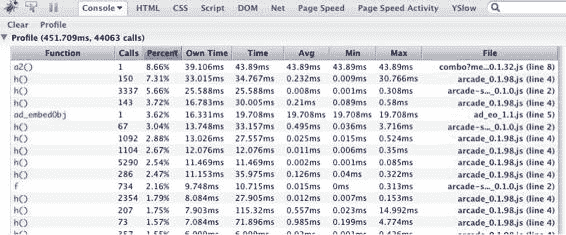图 10-2. Firebug 性能分析面板

### 控制台 API

Firebug 还提供了一个 JavaScript 接口来启动和停止性能分析器。这允许更精确地控制正在测量的代码部分。这还提供了命名报告选项，这在比较各种优化技术时很有价值。

```
console.profile("regexTest");
regexTest('foobar', 'foo');
console.profileEnd();
console.profile("indexOfTest");
indexOfTest('foobar', 'foo');
console.profileEnd();
```


在更感兴趣的时机启动和停止分析器，可以最大限度地减少其他可能正在运行的脚本带来的副作用和干扰。以这种方式调用分析器时需要注意的一点是，它确实会给脚本增加开销。这主要是由于调用 `profileEnd()` 后生成报告所需的时间，该过程会阻塞后续执行，直到报告生成完毕。较大的报告生成时间更长，可以考虑将对 `profileEnd()` 的调用包装在 `setTimeout` 中，使报告生成异步化并解除脚本执行的阻塞。

* * *

### 注意

JavaScript 接口也可以通过 Firebug 控制台命令行使用。

* * *

结束分析后，会生成一份新报告，显示每个函数花费的时间、调用次数、占总开销的百分比以及其他有趣的数据。这将有助于了解应在哪些方面投入时间优化函数速度并减少调用次数。

与 YUI Profiler 类似，Firebug 的 `console.time()` 函数可以帮助测量分析器未监控的循环和其他操作。例如，以下代码对包含循环的一小段代码进行计时：

```
console.time("cache node");
for (var box = document.getElementById("box"),
        i = 0;
     i < 100; i++) {
    value = parseFloat(box.style.left) + 10;
    box.style.left = value + "px";
}
console.timeEnd("cache node");
```

计时结束后，时间会输出到控制台。这在比较各种优化方法时非常有用。可以捕获额外的计时结果并记录到控制台，从而轻松地并排分析结果。例如，要比较缓存节点引用与缓存节点样式引用的效果，只需编写实现代码并插入计时代码即可：

```
console.time("cache style");
for (var style = document.getElementById("box").style,
        i = 0;
     i < 100; i++) {
    value = parseFloat(style.left) + 10;
    style.left = value + "px";
}
console.timeEnd("cache style");
```

控制台 API 为程序员提供了在不同层次上植入分析代码的灵活性，并将结果整合到报告中，可以通过多种有趣的方式进行分析。

* * *

### 注意

点击某个函数会在源文件上下文中显示该函数。这对于匿名或名称模糊的函数尤其有用。

* * *

### 网络面板

在遇到性能问题时，通常最好退一步审视代码，从更宏观的角度观察。Firebug 在网络面板中提供了网络资源的视图（图 10-3）。该面板可视化了脚本与其他资源之间的停顿，从而更深入地了解脚本对其他文件加载以及整个页面的影响。

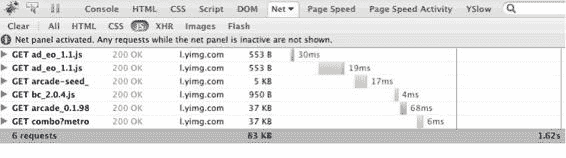图 10-3. Firebug 网络面板

每个资源旁边的彩色条将加载生命周期分解为各个阶段（DNS 查找、等待响应等）。第一条垂直线（显示为蓝色）表示页面的 `DOMContentLoaded` 事件已触发。该事件表明页面的 DOM 树已解析并准备就绪。第二条垂直线（红色）表示窗口的 `load` 事件已触发，这意味着 DOM 已就绪且所有外部资源已完成加载。这有助于了解解析和执行所花费的时间与页面渲染时间的对比。

如图所示，有许多脚本正在下载。根据时间线，每个脚本似乎都在等待前一个脚本完成后才开始下一个请求。提高加载性能的最简单优化是减少请求数量，尤其是脚本和样式表请求，因为它们会阻塞其他资源和页面渲染。在可能的情况下，将所有脚本合并到一个文件中，以最小化请求总数。这也适用于样式表和图片。

## Internet Explorer 开发者工具

从版本 8 开始，Internet Explorer 提供了一个包含分析器的开发工具包。该工具包内置于 IE 8 中，因此无需额外下载或安装。与 Firebug 类似，IE 分析器包含函数分析功能，并提供详细报告，包括调用次数、花费时间和其他数据点。它还增加了以调用树形式查看报告、分析原生函数以及导出分析数据的功能。虽然缺少网络分析器，但可以使用诸如 Fiddler 之类的通用工具来补充分析器，本章后面会介绍 Fiddler。更多详情请参见 [`msdn.microsoft.com/en-us/library/dd565628(VS.85).aspx`](http://msdn.microsoft.com/en-us/library/dd565628(VS.85).aspx)。

IE 8 的分析器可以在开发者工具（工具 → 开发者工具）中找到。按下“开始分析”按钮后，所有后续的 JavaScript 活动都会被监控和分析。点击“停止分析”（同一按钮，新标签）会停止分析器并生成新报告。默认情况下，F5 启动分析器，Shift+F5 结束分析。

报告提供了每个调用的时间和持续时间的平面函数视图，以及显示函数调用栈的树形视图。树形视图允许你遍历调用栈并识别慢速代码路径（参见图 10-4）。当函数没有名称时，IE 分析器会使用变量名。

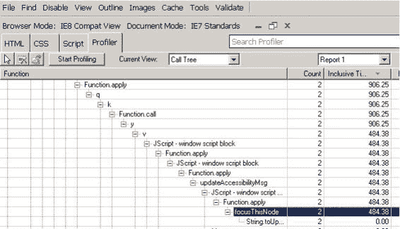图 10-4. IE 8 分析器调用树

* * *

### 注意

右键单击分析结果表格可以添加和删除列。

* * *

IE 分析器还提供了对原生 JavaScript 对象方法的洞察。这使你除了实现代码之外，还可以分析原生对象，从而可以比较 `String::indexOf` 与 `RegExp::test` 来确定 HTML 元素的 `className` 属性是否以某个值开头：

```
var count = 10000,
    element = document.createElement('div'),
    result, i, time;

element.className = 'foobar';

for (i = 0; i < count; i++) {
    result = /^foo/.test(element.className);
}

for (i = 0; i < count; i++) {
    result = element.className.search(/^foo/);
}

for (i = 0; i < count; i++) {
    result = (element.className.indexOf('foo') === 0);
}
```

如图 10-5 所示，这些不同方法之间的时间差异很大。请注意，每次调用的平均时间为零。原生方法通常是最不需要优化的地方，但在比较不同方法时，这可能是一个有趣的实验。同时要注意，由于数字很小，结果可能因舍入误差和系统内存波动而不确定。

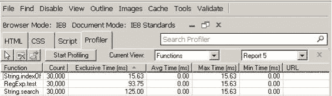图 10-5. 原生方法的分析结果

尽管 IE 分析器目前不提供 JavaScript API，但它确实有一个具有日志记录功能的控制台 API。可以利用这一点将 Firebug 的 `console.time()` 和 `console.timeEnd()` 函数移植过来，从而在 IE 中运行相同的测试。

```
if (console && !console.time) {
    console._timers = {};
    console.time = function(name) {
        console._timers[name] = new Date();
    };
    console.timeEnd = function(name) {
        var time = new Date() - console._timers[name];
        console.info(name + ': ' + time + 'ms');
    };
}
```

* * *

### 注意

IE 8 的分析结果可以使用“导出数据”按钮以 `*.csv` 格式导出。

* * *

## Safari Web Inspector


Safari 从版本 4 开始，在其捆绑的 Web 检查器中提供了分析器以及其他工具，包括网络分析器。与 Internet Explorer 开发者工具类似，Web 检查器会对原生函数进行分析，并提供可展开的调用树。它还包含一个类似 Firebug 的控制台 API，具有分析功能，以及一个用于网络分析的资源面板。

要访问 Web 检查器，首先确保“开发”菜单可用。可以通过打开“偏好设置”→“高级”，并勾选“在菜单栏中显示‘开发’菜单”来启用该菜单。然后，在“开发”→“显示 Web 检查器”（或快捷键 Option-Command-I）下即可找到 Web 检查器。

### 分析面板

点击“分析”按钮会弹出分析面板（图 10-6）。点击“启用分析”按钮以启用分析面板。要开始分析，请点击“开始分析”按钮（右下角的深色圆圈）。点击“停止分析”（同一按钮，此时变为红色）即可停止分析并显示报告。

* * *

### 注意

你也可以按 Option-Shift-Command-P 来开始/停止分析。

* * *

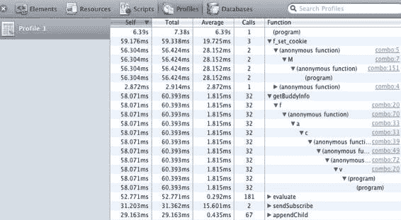图 10-6. Safari Web 检查器分析面板

Safari 模拟了 Firebug 的 JavaScript API（`console.profile()`、`console.time()` 等），以便以编程方式开始和停止分析。其功能与 Firebug 相同，允许你为报告和计时命名，以便更好地管理分析。

* * *

### 注意

也可以向 `console.profileEnd()` 传递一个名称。当运行多个分析时，这将停止特定的分析。

* * *

Safari 提供了分析函数的“重（自底向上）”视图和调用栈的“树（自顶向下）”视图。默认的“重”视图首先对最慢的函数进行排序，并允许向上遍历调用栈，而“树”视图则允许从最外层的调用者向下深入到代码的执行路径。分析调用树有助于发现与一个函数如何调用另一个函数相关的更微妙的性能问题。

Safari 还增加了对 `displayName` 属性的支持，用于分析目的。这提供了一种为匿名函数添加名称的方法，这些名称将用于报告输出。考虑以下赋值给变量 `foo` 的函数：

```
var foo = function() {
    return 'foo!';
};

console.profile('匿名函数');
foo();
console.profileEnd();
```

如图 10-7 所示，由于缺少函数名称，生成的分析报告难以理解。点击函数右侧的 URL 可在源代码上下文中查看该函数。

图 10-7. Web 检查器分析面板显示匿名函数

添加 `displayName` 将使报告变得可读。这也允许使用更具描述性的名称，而不限于有效的函数名称。

```
var foo = function() {
    return 'foo!';
};
foo.displayName = '我是 foo';
```

如图 10-8 所示，`displayName` 现在取代了匿名函数。然而，此属性仅在基于 Webkit 的浏览器中可用。它还需要重构真正的匿名函数，但这并不推荐。如前所述，内联添加名称是命名匿名函数的最简单方法，并且这种方法适用于其他分析器：

```
var foo = function foo() {
    return 'foo!';
};
```

图 10-8. Web 检查器分析面板显示 displayName

### 资源面板

资源面板帮助你更好地理解 Safari 如何加载和解析脚本以及其他外部资源。与 Firebug 的网络面板类似，它提供了资源的视图，显示请求何时发起以及耗时多久。资源按颜色编码以增强可读性。Web 检查器的资源面板将大小图表与时间分开，减少了视觉干扰（参见图 10-9）。

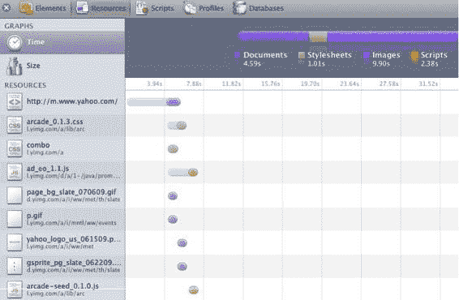图 10-9. Safari 资源面板

请注意，与某些浏览器不同，Safari 4 并行加载脚本且不阻塞。Safari 通过确保脚本按正确顺序执行来绕过阻塞要求。请记住，这仅适用于最初嵌入在 HTML 中的脚本（在加载时）；动态添加的脚本既不会阻塞加载也不会阻塞执行（参见第 1 章）。

## Chrome 开发者工具

Google 也为其 Chrome 浏览器提供了一套开发工具，其中部分基于 WebKit/Safari Web 检查器。除了用于监控网络流量的资源面板外，Chrome 还增加了所有页面和网络事件的时间线视图。Chrome 包含了 Web 检查器的分析面板，并增加了获取当前内存“堆”快照的功能。与 Safari 一样，Chrome 对原生函数进行分析，并实现了 Firebug 控制台 API，包括 `console.profile` 和 `console.time`。

如图 10-10 所示，时间线面板提供了所有活动的概览，分为“加载”、“脚本”或“渲染”三类。这使得开发者能够快速聚焦于系统中最慢的方面。某些事件包含其他事件行的子树，可以在记录视图中展开或隐藏以获取更多或更少的细节。

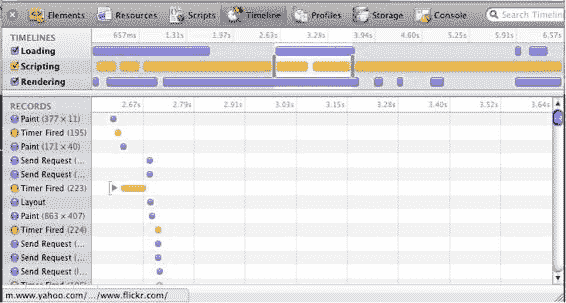图 10-10. Chrome 开发者工具时间线面板

点击 Chrome 分析面板上的眼睛图标可获取当前 JavaScript 内存堆的快照（图 10-11）。结果按构造函数分组，并可展开以显示每个实例。可以使用分析面板底部的“与快照比较”选项来比较快照。+/- 计数和大小列显示了快照之间的差异。

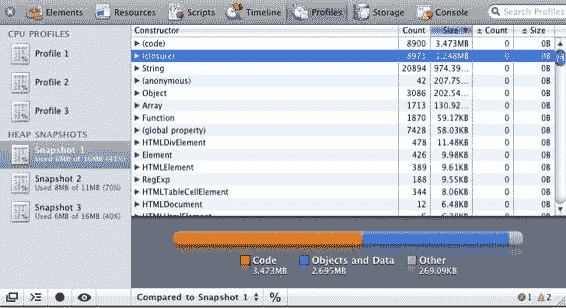图 10-11. Chrome 开发者工具 JavaScript 堆快照

## 脚本阻塞

传统上，浏览器一次只允许一个脚本请求。这是为了管理文件之间的依赖关系。只要一个依赖于另一个的文件在源代码中出现在后面，就能保证在执行前其依赖项已就绪。脚本之间的间隙可能表明存在脚本阻塞。较新的浏览器（如 Safari 4、IE 8、Firefox 3.5 和 Chrome）通过允许并行下载脚本但阻塞执行来解决此问题，以确保依赖项就绪。尽管这允许资源更快地下载，但页面渲染仍会被阻塞，直到所有脚本执行完毕。

脚本阻塞可能因一个或多个文件中的缓慢初始化而加剧，这值得进行分析，并可能进行优化或重构。脚本的加载可能会减慢或停止页面的渲染，让用户等待。网络分析工具可以帮助识别和优化资源加载中的间隙。可视化脚本交付中的这些间隙可以了解哪些脚本执行较慢。这些脚本可能值得推迟到页面渲染之后，或者进行优化或重构以减少执行时间。

## 页面速度


Page Speed 是一款最初为 Google 内部使用而开发的工具，后来作为 Firebug 插件发布。与 Firebug 的“网络”面板类似，它能提供网页上正在加载的资源信息。不过，除了加载时间和 HTTP 状态之外，它还能显示解析和执行 JavaScript 所花费的时间，识别可延迟的脚本，并报告未被使用的函数。这些宝贵信息有助于确定需要进一步调查、优化以及可能重构的区域。请访问 [`code.google.com/speed/page-speed/`](http://code.google.com/speed/page-speed/) 获取安装说明及其他产品详情。

Page Speed 面板上的 `Profile Deferrable JavaScript` 选项可以识别出可延迟或拆分的文件，以便减少初始加载的数据量。通常，渲染初始视图只需要页面上一小部分脚本。在 图 10-12 中，你可以看到大部分加载的代码在窗口的 `load` 事件触发之前并未被使用。延迟那些非立即使用的代码，可以让初始页面加载得更快。脚本和其他资源可以在后续按需选择性加载。

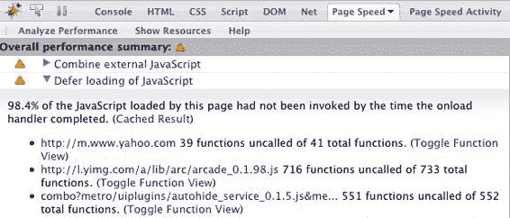图 10-12. Page Speed 可延迟 JavaScript 摘要

Page Speed 还在 Firebug 中添加了一个“Page Speed 活动”面板。该面板与 Firebug 自带的“网络”面板类似，但提供了每个请求更细粒度的数据。其中包括每个脚本生命周期的分解，包括解析和执行阶段，详细说明了脚本之间的间隔。这有助于确定需要进行性能分析和可能重构的区域。如图例所示，图 10-13 用红色显示解析脚本所花费的时间，用蓝色显示执行时间。较长的执行时间可能值得用性能分析器进一步仔细检查。

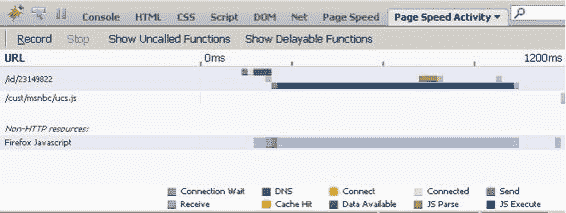图 10-13. Page Speed 解析和执行时间

在页面渲染完成之前，可能会花费大量时间解析和初始化那些尚未使用的脚本。Page Speed 活动面板还可以提供一份报告，显示哪些函数从未被调用，以及哪些函数可能可以延迟，依据是它们被解析的时间与首次被调用的时间之间的对比（图 10-14）。

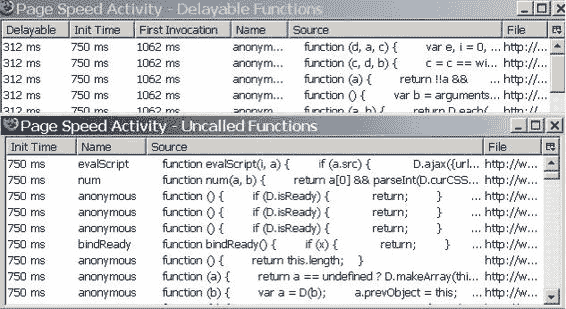图 10-14. 可延迟和未调用函数的报告

这些报告显示了初始化那些从未被调用或可以稍后调用的函数所花费的时间。考虑重构代码，移除未调用的函数，并延迟那些在初始渲染和设置阶段不需要的代码。

## Fiddler

Fiddler 是一个 HTTP 调试代理，用于检查网络传输中的资源，并帮助识别任何加载瓶颈。由 Eric Lawrence 创建，这是一款适用于 Windows 的通用网络分析工具，可为任何浏览器或 Web 请求提供详细报告。请访问 [`www.fiddler2.com/fiddler2/`](http://www.fiddler2.com/fiddler2/) 获取安装及其他信息。

安装过程中，Fiddler 会自动与 IE 和 Firefox 集成。IE 工具栏上会添加一个按钮，Firefox 的“工具”菜单下会添加一个条目。Fiddler 也可以手动启动。任何发出 Web 请求的浏览器或应用程序都可以被分析。运行时，所有 WinINET 流量都会经过 Fiddler，使其能够监控和分析下载资源的性能。某些浏览器（例如 Opera 和 Safari）不使用 WinINET，但只要在启动浏览器之前运行 Fiddler，它们会自动检测到 Fiddler 代理。任何允许代理设置的程序都可以通过指向 Fiddler 代理（`127.0.0.1`，端口：`8888`）来手动通过 Fiddler 运行。

与 Firebug、Web Inspector 和 Page Speed 类似，Fiddler 提供了一个瀑布图，可以深入了解哪些资源加载时间更长，以及哪些资源可能影响其他资源的加载（图 10-15）。

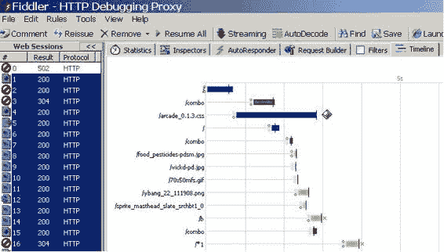图 10-15. Fiddler 瀑布图

从左侧面板中选择一个或多个资源，它们会显示在主视图中。单击“时间线”选项卡可以可视化网络传输中的资源。此视图显示了每个资源相对于其他资源的时间，使你可以研究不同加载策略的效果，并更清楚地看到何时有阻塞。

“统计”选项卡显示了所有选定资源的实际性能的详细视图——提供 DNS 查找和 TCP/IP 连接时间的洞察——以及所请求的各种资源的大小和类型的细分（图 10-16）。

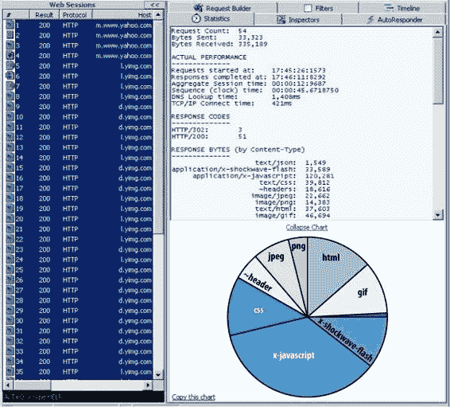图 10-16. Fiddler 统计选项卡

这些数据有助于你决定哪些区域需要进一步调查。例如，较长的 DNS 查找和 TCP/IP 连接时间可能表明网络存在问题。资源图表可以清楚地显示哪些类型的资源构成了页面加载的大部分内容，从而识别出可能适合延迟加载或性能分析（对于脚本而言）的候选对象。

* * *

### 注意

由于 Fiddler 仅适用于 Windows，因此值得一提的是一个名为 Charles Proxy 的共享软件产品，它同时适用于 Windows 和 Mac。请访问 [`www.charlesproxy.com/`](http://www.charlesproxy.com/) 获取免费试用版和详细文档。

* * *

## YSlow

YSlow 工具提供了关于初始页面视图整体加载和执行的性能洞察。该工具最初由 Steve Souders 在 Yahoo! 内部开发，作为 Firefox 插件（通过 GreaseMonkey）发布。它已作为 Firebug 插件向公众提供，并由 Yahoo! 开发人员定期维护和更新。请访问 [`developer.yahoo.com/yslow/`](http://developer.yahoo.com/yslow/) 获取安装说明及其他产品详情。

YSlow 对页面外部资产的加载进行评分，提供页面性能报告，并给出提高加载速度的建议。其评分基于性能专家进行的广泛研究。应用这些反馈并阅读评分背后的更多细节，有助于确保以最少的资源实现最快的页面加载体验。

图 10-17 显示了 YSlow 对已分析网页的默认视图。它会提出优化页面加载和渲染速度的建议。每个评分都包含一个详细视图，其中包含附加信息和规则原理的解释。

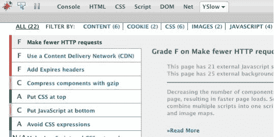图 10-17. YSlow：所有结果

通常，提高总体评分将导致脚本加载和执行速度更快。图 10-18 显示了按 JAVASCRIPT 选项过滤后的结果，并附带了一些关于如何优化脚本交付和执行的建议。

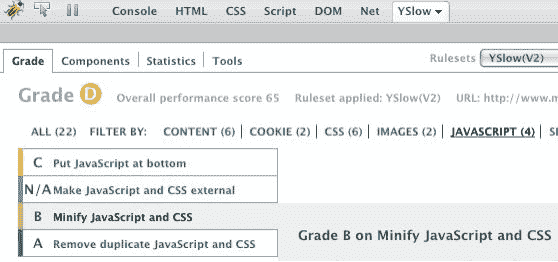图 10-18. YSlow：JavaScript 结果

在解释结果时，请记住可能存在需要考虑的例外情况。这些可能包括决定何时对脚本进行多次请求与合并为单个请求，以及哪些脚本或函数应延迟到页面渲染之后。

## dynaTrace Ajax 版


dynaTrace 是一款强大的 Java/.NET 性能诊断工具，其开发者发布了一个“Ajax 版本”，用于测量 Internet Explorer 的性能（Firefox 版本即将推出）。这款免费工具提供端到端的性能分析，涵盖网络、页面渲染、运行时脚本以及 CPU 使用率。报告将所有方面整合在一起，方便您快速定位可能存在的瓶颈。结果可以导出，以便进一步剖析和分析。如需下载，请访问 [`ajax.dynatrace.com/pages/`](http://ajax.dynatrace.com/pages/)。

图 10-19 所示的摘要报告提供了可视化概览，让您能够快速判断哪些区域需要更多关注。从这里，您可以深入查看各种更详细的报告，以获取关于性能特定方面的更精细信息。

图 10-20 所示的网络视图提供了高度详细的报告，分解了网络生命周期中每个环节所花费的时间，包括 DNS 查找、连接和服务器响应时间。这有助于您定位网络中可能需要调整的具体区域。报告下方的面板显示了请求和响应头（左侧）以及实际的请求响应（右侧）。

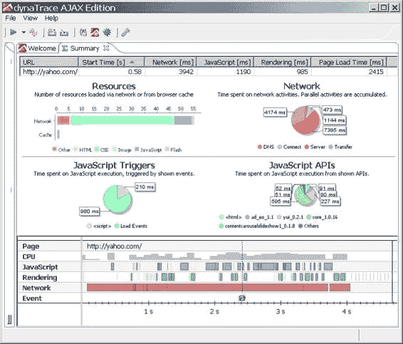图 10-19. dynaTrace Ajax Edition: 摘要报告

选择 JavaScript 触发器视图会显示跟踪期间触发的每个事件的详细报告（参见图 10-21）。从这里，您可以深入查看特定事件（`load`、`click`、`mouseover` 等），以找到运行时性能问题的根本原因。

此视图包括事件可能触发的任何动态（Ajax）请求，以及作为请求结果可能执行的任何脚本 `callback`。这有助于您更好地理解用户感知的整体性能，由于 Ajax 的异步特性，这些性能在脚本分析报告中可能并不明显。

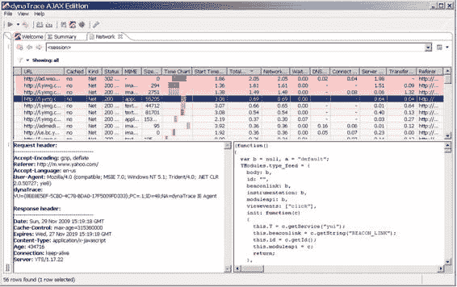图 10-20. dynaTrace Ajax Edition: 网络报告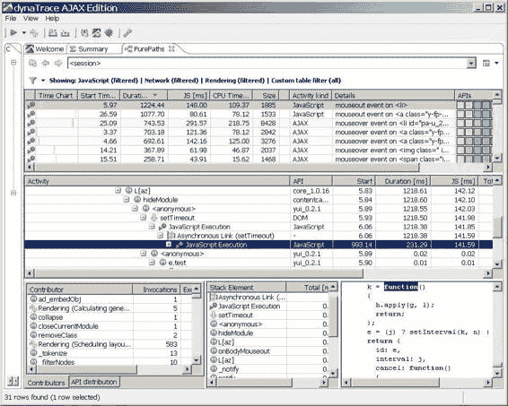图 10-21. dynaTrace Ajax Edition PurePaths 面板

## 摘要

当网页或应用程序开始感觉缓慢时，分析通过网络传输的资源并分析运行中的脚本，可以让您将优化工作集中在最需要的地方。

*   使用网络分析器来识别脚本和其他页面资源加载中的瓶颈；这有助于确定是否需要延迟脚本或进行分析。
*   尽管传统观点认为应尽量减少 HTTP 请求数量，但尽可能延迟脚本可以让页面更快渲染，为用户提供更好的整体体验。
*   使用分析器来识别脚本执行中的缓慢区域，检查每个函数花费的时间、函数被调用的次数以及调用栈本身，这些都能为优化工作的重点提供大量线索。
*   虽然花费的时间和调用次数通常是最有价值的数据，但更仔细地观察函数的调用方式可能会发现其他优化候选。

这些工具有助于揭开现代代码必须运行的通常不友好的编程环境的神秘面纱。在开始优化之前使用它们，将确保开发时间花在解决正确的问题上。

## 索引

* * *

### 关于数字索引的说明

索引条目中的链接显示为该条目所在的章节标题。由于某些章节有多个索引标记，一个条目可能包含指向同一章节的多个链接。点击任何链接都会直接跳转到标记所在的文本位置。

* * *

### 符号

`+`（加号）运算符，字符串拼接–Firefox 与编译时折叠
`+=`（加等于）运算符，字符串拼接–Firefox 与编译时折叠

### A

激活对象，作用域链与标识符解析
`add()` 函数，作用域链与标识符解析
`addEventListener()` 函数，避免重复工作
敏捷 JavaScript 构建流程，敏捷 JavaScript 构建流程
Ajax（异步 JavaScript 与 XML），Ajax–摘要

> 数据格式，数据格式–数据格式结论
> 数据传输，数据传输–信标
> 性能，Ajax 性能指南–了解 Ajax 库的局限性

算法，算法与流程控制–摘要

> 条件语句，条件语句–查找表
> 循环，循环–基于函数的迭代
> 递归，递归–记忆化

交替

> 与回溯，交替与回溯
> 性能，提高正则表达式效率的更多方法

动画，元素与流，将元素移出动画流
匿名函数

> 关于，匿名函数
> YUI 分析器，YUI 分析器

Apache Ant，Apache Ant，部署 JavaScript 资源
Apache Web 服务器，`ExpiresDefault` 指令，缓存 JavaScript 文件
API

> 控制台 API：Firebug，控制台 API
> CSS 选择器，选择器 API
> DOM，浏览器世界中的 DOM

数组项，定义，数据访问
数组合并，数组合并
数组处理，使用定时器，使用定时器处理数组
`array.join()` 方法，字符串拼接
数组

> 与 `HTMLCollection` 对象比较，HTML 集合
> 双重求值，使用对象/数组字面量
> for-in 循环，循环性能

`assignEvents()` 函数，闭包、作用域与内存
异步 JavaScript 与 XML（参见 Ajax）
原子分组，模拟，使用前瞻和后向引用模拟原子分组

### B

后向引用，模拟原子分组，使用前瞻和后向引用模拟原子分组
回溯，理解回溯–从糟糕到更糟

> 关于，理解回溯
> 失控回溯，失控回溯–从糟糕到更糟


批量 DOM 更改，批量 DOM 更改信标，发送数据，信标基准测试，正则表达式，基准测试说明最佳实践（参见编程实践）位掩码，位运算符位运算符，位运算符–位运算符阻塞脚本，脚本阻塞 BOM（浏览器对象模型），对象成员，对象成员括号表示法与点表示法，嵌套成员浏览器，加载与执行

> （另请参阅 Chrome；Firefox；IE；Safari）调用栈限制，调用栈限制 DOM 与 JavaScript 实现，浏览器世界中的 DOMDOM 脚本编程，浏览器世界中的 DOM 原生代码与 `eval()`，避免双重求值性能，加载与执行，数据访问脚本阻塞，脚本阻塞`trim`，混合解决方案 UI 线程，浏览器 UI 线程基于 WebKit 的浏览器与 `innerHTML`，`innerHTML` 与 DOM 方法`XPath`，`XPath`

构建过程，敏捷 JavaScript，敏捷 JavaScript 构建过程构建时与运行时构建过程，构建时与运行时构建过程

### C

缓存

> Ajax，缓存数据 JavaScript 文件，缓存 JavaScript 文件布局信息，缓存布局信息对象成员值，缓存对象成员值使用，处理缓存问题

调用栈大小限制，调用栈限制 CDN（内容分发网络），使用内容分发网络链（参见原型链；作用域链）`childNodes` 集合，遍历 DOMChrome

> 开发者工具，Chrome 开发者工具即时 JavaScript 编译器，原生方法时间限制，浏览器限制

克隆节点，克隆节点 Closure Compiler，JavaScript 压缩 Closure Inspector，JavaScript 压缩闭包，作用域，闭包、作用域与内存集合

> `childNodes` 集合，遍历 DOM 集合元素，访问集合元素时的局部变量 HTML 集合，HTML 集合–访问集合元素时的局部变量

合并 JavaScript 文件，合并 JavaScript 文件编译时折叠，Firefox，Firefox 与编译时折叠压缩，JavaScript 压缩`concat` 方法，`String.prototype.concat`拼接字符串，字符串拼接–`String.prototype.concat`条件预加载，条件预加载条件语句，条件语句–查找表

> if-else，if-else 与 switch，优化 if-else 查找表，查找表

控制台 API，Firebug，控制台 API 控制台面板分析器，Firebug，控制台面板分析器`console.time()` 函数，控制台 API 常量，数学常量，原生方法内容分发网络（CDN），使用内容分发网络遍历 DOM，遍历 DOMCSS 文件，加载，LazyLoad 库 CSS 选择器，API，选择器 API`cssText` 属性，样式更改

### D

数据访问，数据访问–总结

> 对象成员，对象成员–缓存对象成员值作用域，管理作用域–闭包、作用域与内存

数据缓存，缓存数据数据格式，数据格式–数据格式结论

> 自定义，自定义格式化 HTML，HTML`JSON`，`JSON`–是否应该使用 `JSON`？`XML`，`XML`–响应大小与解析时间

数据传输，数据传输–信标

> 请求数据，请求数据–多部分 XHR 发送数据，发送数据–信标

数据类型：函数、方法和属性，对象成员`Date` 对象，JavaScript 性能分析延迟脚本，延迟脚本委托，事件，事件委托部署 JavaScript 资源，部署 JavaScript 资源`displayName` 属性，分析面板 do-while 循环，循环类型文档片段，批量 DOM 更改，批量 DOM 更改 DOM（文档对象模型），对象成员，对象成员 DOM 脚本编程，DOM 脚本编程–总结


> 访问文档结构，遍历 DOM–选择器 API 浏览器，浏览器世界中的 DOM 克隆节点，克隆节点 事件委托，事件委托 HTML 集合，HTML 集合–访问集合元素时的局部变量 `innerHTML`，innerHTML 与 DOM 方法–innerHTML 与 DOM 方法 重绘与回流，重绘与回流–IE 与 :hover

点号表示法与方括号表示法，嵌套成员 双重求值，避免双重求值–避免双重求值 下载，加载外部文件

> （另请参阅 DOM 脚本；加载；非阻塞脚本；脚本）`<script>` 标签的阻塞，脚本定位 使用动态脚本节点，动态脚本元素

动态作用域，动态作用域 动态脚本元素，动态脚本元素–动态脚本元素 动态脚本标签插入，动态脚本标签插入 dynaTrace，dynaTrace Ajax 版

### E

元素节点，DOM，元素节点 元素，访问集合元素时的局部变量

> （另请参阅集合；`<script>` 元素；标签）DOM，重绘与回流 动态脚本元素，动态脚本元素–动态脚本元素 回流，将元素移出动画流

模拟原子组，使用前瞻和后向引用来模拟原子组 `eval()` 函数，动态作用域，JSON，避免双重求值 事件委托，DOM 脚本，事件委托 事件

> 消息事件，Worker 通信 onmessage 事件，Worker 通信 readystatechange 事件，动态脚本元素

`execute()` 函数，动态作用域 执行（参见脚本）Expires 头，设置 HTTP 头 ExpiresDefault 指令，Apache Web 服务器，缓存 JavaScript 文件 外部文件，加载，加载外部文件

### F

`factorial()` 函数，递归模式，记忆化 Fiddler，Fiddler 文件，加载外部文件

> （另请参阅 DOM 脚本；下载；加载；非阻塞脚本；脚本）缓存 JavaScript 文件，缓存 JavaScript 文件 合并 JavaScript 文件，合并 JavaScript 文件 加载外部文件，加载外部文件 预处理 JavaScript 文件，预处理 JavaScript 文件

Firebug，Firebug–网络面板 Firefox

> 编译时折叠，Firefox 与编译时折叠 时间限制，浏览器限制

流程控制，算法与流程控制–总结

> 条件语句，条件语句–查找表 循环，循环–基于函数的迭代 递归，递归–记忆化

流（参见回流）刷新渲染树更改，排队与刷新渲染树更改 折叠，编译时折叠与 Firefox，Firefox 与编译时折叠 for 循环，循环类型 for-in 循环，循环类型，循环性能 `forEach()` 方法，基于函数的迭代 `Function()` 构造函数，避免双重求值 函数，拆分任务

> （另请参阅方法；语句）`add()` 函数，作用域链与标识符解析 `addEventListener()` 函数，不要重复工作 匿名函数，YUI Profiler，匿名函数 `assignEvents()` 函数，闭包、作用域与内存 缓存对象成员值，缓存对象成员值 `console.time()` 函数，控制台 API 数据类型，对象成员 `eval()` 函数，动态作用域，JSON，避免双重求值 `execute()` 函数，动态作用域 `factorial()` 函数，递归模式，记忆化 `initUI()` 函数，标识符解析性能 `loadScript()` 函数，推荐的非阻塞模式 `mergeSort()` 函数，迭代 `multistep()` 函数，拆分任务 `processArray()` 函数，使用定时器处理数组 `profileEnd()` 函数，控制台 API `removeEventListener()` 函数，不要重复工作 `setInterval()` 函数，定时器基础，避免双重求值 `setTimeout()` 函数，定时器基础，避免双重求值 任务，拆分任务 执行中的变量，作用域链与标识符解析

### G


使用 XHR 时的 GET 与 POST，使用 XHR 时的 POST 与 GET 全局变量，性能，标识符解析性能 Google Chrome 开发者工具，Chrome 开发者工具 Google Closure Compiler，JavaScript 压缩脚本分组，脚本分组 gzip 压缩，JavaScript 压缩，JavaScript 压缩

### H

`handleClick()` 方法，浏览器 UI 线程`hasOwnProperty()` 方法，原型头部

> Expires 头部，设置 HTTP 头部 HTTP 头部，设置 HTTP 头部

:hover，IE，IE 与 :hoverHTML 集合

> 昂贵的集合，昂贵的集合局部变量，访问集合元素时的局部变量

HTML，数据格式，HTMLHTTP 头部，Ajax，设置 HTTP 头部

### I

幂等操作，使用 XHR 时的 POST 与 GET 标识符解析，作用域，作用域链与标识符解析–标识符解析性能 IE（Internet Explorer）

> 数组合并，数组合并动态脚本元素，动态脚本元素`nextSibling`，遍历 DOM 重排，IE 与 :hover 重复操作，多长时间算太长？时间限制，浏览器限制使用，Internet Explorer 开发者工具 XHR 对象，了解 Ajax 库的限制

if-else

> 优化，优化 if-else 与 switch 对比，if-else 与 switch 对比

`initUI()` 函数，标识符解析性能注入非阻塞脚本，XMLHttpRequest 脚本注入`innerHTML`

> 数据格式，HTML 与 DOM 对比，innerHTML 与 DOM 方法–innerHTML 与 DOM 方法

接口（参见用户界面）Internet Explorer（参见 IE）互操作性，JSON，应该使用 JSON 吗？iPhone（参见 Safari）迭代

> 基于函数的迭代，基于函数的迭代循环性能，减少每次迭代的工作量–减少迭代次数递归，迭代

### J

JavaScript 文件

> 缓存，缓存 JavaScript 文件合并，合并 JavaScript 文件预处理，预处理 JavaScript 文件

JavaScript 命名空间，嵌套属性，缓存对象成员值 JavaScript 性能分析，JavaScript 性能分析数组合并，数组合并 jQuery 库，gzip 压缩，JavaScript 压缩 JSMin，JavaScript 压缩 JSON（JavaScript 对象表示法），数据格式，JSON–应该使用 JSON 吗？JSON-P（填充式 JSON），JSON-P

### L

`$LAB.script()` 方法，LABjs 库`$LAB.wait()` 方法，LABjs 库 LABjs 库，加载 JavaScript，LABjs 库布局，缓存，缓存布局信息懒加载，懒加载 LazyLoad 库，加载 JavaScript，LazyLoad 库`length` 属性，昂贵的集合库

> Ajax，了解 Ajax 库的限制 LABjs 库，LABjs 库 LazyLoad 库，LazyLoad 库

限制

> 调用栈大小限制，调用栈限制长时间运行脚本限制，浏览器限制

字面值，定义，数据访问加载，加载外部文件

> （另请参见 DOM 脚本；下载；非阻塞脚本；脚本）条件预加载，条件预加载 CSS 文件，LazyLoad 库外部文件，加载外部文件 JavaScript，推荐的非阻塞模式懒加载，懒加载脚本，资源面板

`loadScript()` 函数，推荐的非阻塞模式局部变量

> HTML 集合，访问集合元素时的局部变量性能，标识符解析性能，DOM 访问与修改

长时间运行脚本限制，浏览器限制前瞻，模拟原子组，使用前瞻和反向引用模拟原子组查找表，查找表循环，循环–基于函数的迭代

> 基于函数的迭代，基于函数的迭代使用 `console.time()` 测量时间，控制台 API 性能，循环性能–减少迭代次数类型，循环类型

### M

数学常量和方法，列表，原生方法记忆化，递归，记忆化`mergeSort()` 函数，迭代消息事件，Worker 通信方法，原生方法


> （另请参阅函数；对象成员；属性；语句）`Array.prototype.join` 方法，数组连接 `concat` 方法，`String.prototype.concat` 数据类型，对象成员 `forEach()` 方法，基于函数的迭代 `handleClick()` 方法，浏览器 UI 线程 `hasOwnProperty()` 方法，原型 `$LAB.script()` 方法，LABjs 库 `$LAB.wait()` 方法，LABjs 库 数学方法，原生方法 原生方法，原生方法 `postMessage()` 方法，Worker 通信 `querySelector()` 方法，原生方法 `querySelectorAll()` 方法，选择器 API，原生方法 字符串连接，字符串连接 对象方法中的 this，缓存对象成员值 `toString()` 方法，原型 `trim` 方法，字符串修剪

压缩，JavaScript 压缩 `multistep()` 函数，拆分任务 MXHR（多部分 XHR），多部分 XHR–多部分 XHR

### N

命名空间，嵌套属性，缓存对象成员值 原生方法，原生方法 嵌套对象成员，嵌套成员 嵌套量词，失控回溯，嵌套量词与失控回溯 网络面板，Firebug，网络面板 Nielsen, Jakob，关于 UI 响应时间，多久算太久？ 节点，克隆，克隆节点 非阻塞脚本，非阻塞脚本–LABjs 库

> 延迟脚本，延迟脚本 动态脚本元素，动态脚本元素–动态脚本元素 加载 JavaScript，推荐的非阻塞模式 `XMLHttpRequest` 脚本注入，`XMLHttpRequest` 脚本注入

非捕获组，提高正则表达式效率的更多方法

### O

对象成员，对象成员

> （另请参阅方法；属性）缓存对象成员值，缓存对象成员值 数据访问，对象成员–缓存对象成员值 定义，数据访问 嵌套，嵌套成员 原型链，原型链 原型，原型

对象

> 激活对象，作用域链与标识符解析 `Date` 对象，JavaScript 性能分析 `HTMLCollection`，HTML 集合 编程实践，使用对象/数组字面量 `XHR` 对象，了解 Ajax 库的局限性

onmessage 事件，Worker 通信 Opera，时间限制，浏览器限制 运算符

> 位运算符，位运算符–位运算符 加号（`+`）与加等号（`+=`）运算符，字符串连接–Firefox 与编译时折叠

优化（参见性能）作用域外变量，闭包、作用域与内存

### P

Page Speed，Page Speed 面板

> 控制台面板分析器：Firebug，控制台面板分析器 网络面板：Firebug，网络面板 性能分析面板，性能分析面板 资源面板：Safari Web Inspector，资源面板

解析时间，XML，响应大小与解析时间 解析，`eval()` 函数与 JSON，JSON

性能

> Ajax，Ajax 性能指南–了解 Ajax 库的局限性 数组连接，数组连接 浏览器，数据访问 闭包，闭包、作用域与内存 DOM 脚本，DOM 脚本，天生缓慢 格式比较，数据格式结论 HTML 格式，HTML 标识符解析，标识符解析性能 JavaScript 引擎，动态作用域 浏览器中的 JavaScript，加载与执行 JSON 格式，JSON JSON-P 格式，JSON-P 循环，循环性能–减少迭代次数 原生代码与 `eval()`，避免双重求值 嵌套成员，嵌套成员 正则表达式，正则表达式优化，关于基准测试的说明 定时器，定时器与性能 `trim` 实现，混合解决方案 XHR 格式，自定义格式化 XML，响应大小与解析时间


加号（`+`）运算符，字符串拼接–Firefox 与编译时折叠加等号（`+=`）运算符，字符串拼接–Firefox 与编译时折叠定位，脚本，脚本定位使用 XHR 时的 POST 与 GET，使用 XHR 时的 POST 与 GET`postMessage()` 方法，Worker 通信预处理 JavaScript 文件，预处理 JavaScript 文件前置条件，循环，循环类型`processArray()` 函数，使用定时器处理数组`profileEnd()` 函数，控制台 API`Profiler`（YUI），YUI Profiler–YUI ProfilerProfiles 面板，Safari Web Inspector，Profiles 面板性能分析，JavaScript，JavaScript 性能分析编程实践，编程实践–总结

> 位运算符，位运算符–位运算符双重求值，避免双重求值–避免双重求值原生方法，原生方法对象/数组字面量，使用对象/数组字面量重复工作，不要重复工作

`prop` 变量，循环类型属性，对象成员

> （另请参阅方法；对象成员）`cssText` 属性，样式更改数据类型，对象成员`displayName` 属性，Profiles 面板 DOM 属性，元素节点`innerHTML` 属性，`innerHTML` 与 DOM 方法`length` 属性，昂贵的集合原型，原型在函数中读取，缓存对象成员值`readyState` 属性（`<script>` 元素），动态脚本元素`[[Scope]]` 属性，作用域链与标识符解析，闭包、作用域与内存

原型链，对象成员，原型链原型，对象成员，原型

### Q

量词

> 嵌套量词，嵌套量词与失控回溯性能，提高正则表达式效率的更多方法

查询，HTML 集合，HTML 集合`querySelector()` 方法，原生方法`querySelectorAll()` 方法，选择器 API，原生方法

### R

`readyState`

> MXHR，多部分 XHRXHR，`XMLHttpRequest``XMLHttpRequest`，了解 Ajax 库的局限性

`readyState` 属性（`<script>` 元素），动态脚本元素`readystatechange` 事件，IE，动态脚本元素递归，递归–记忆化

> 调用栈大小限制，调用栈限制迭代，迭代记忆化，记忆化模式，递归模式

重排，重绘与重排–IE 与 :hover

> 缓存布局信息，缓存布局信息元素，将元素移出动画流 IE，IE 与 :hover 最小化，最小化重绘与重排–批量处理 DOM 更改排队与刷新渲染树更改，排队与刷新渲染树更改

正则表达式（regexes），正则表达式优化–何时不使用正则表达式

> 关于，正则表达式的工作原理原子分组，使用前瞻和后向引用模拟原子分组回溯，理解回溯，理解回溯，失控回溯基准测试，关于基准测试的说明性能，正则表达式优化，关于基准测试的说明，何时不使用正则表达式重复，重复与回溯修剪字符串，使用正则表达式修剪，使用正则表达式修剪，混合解决方案何时不使用，何时不使用正则表达式

`removeEventListener()` 函数，不要重复工作渲染树

> DOM，重绘与重排重排，排队与刷新渲染树更改

重绘，最小化，最小化重绘与重排–批量处理 DOM 更改重复工作，不要重复工作重复与回溯，重复与回溯请求数据，Ajax，请求数据–多部分 XHRResources 面板：Safari Web Inspector，Resources 面板失控回溯，失控回溯运行时构建与构建时过程，构建时与运行时构建过程

### S

Safari

> 缓存能力，缓存 JavaScript 文件加载脚本，Resources 面板传递字符串，Worker 通信以编程方式启动和停止性能分析，Profiles 面板时间限制，浏览器限制

Safari Web Inspector，Safari Web Inspector–Resources 面板作用域，管理作用域–闭包、作用域与内存


> 闭包，闭包、作用域与内存动态作用域，动态作用域标识符解析，作用域链与标识符解析–标识符解析性能

作用域链

> 增强，作用域链增强标识符解析，作用域链与标识符解析性能，标识符解析性能

`[[Scope]]` 属性，闭包、作用域与内存，闭包、作用域与内存脚本阻塞，脚本阻塞脚本标签，动态插入，动态脚本标签插入`<script>` 元素

> `defer` 选项，延迟脚本 DOM，动态脚本元素性能，加载与执行，脚本分组放置位置，脚本定位

脚本，加载与执行–总结

> （另请参阅 DOM 脚本）调试与性能分析，匿名函数分组，脚本分组加载，资源面板非阻塞脚本，非阻塞脚本–LABjs 库定位，脚本定位

选择器，CSS，选择器 API 发送数据，Ajax，发送数据–信标`setInterval()` 函数，定时器基础，避免双重求值`setTimeout()` 函数，定时器基础，避免双重求值压缩工具，敏捷 JavaScript 构建流程速度（参见性能）栈，调用栈大小限制，调用栈限制语句，拆分任务

> （另请参阅条件语句；函数；方法）`try-catch` 语句，作用域链增强，调用栈限制`var` 语句，循环类型`with` 语句，作用域链增强

`string.concat()` 方法，字符串拼接字符串

> 拼接，字符串拼接–`String.prototype.concat`在 Safari 中传递，Worker 通信修剪，字符串修剪–混合解决方案

样式，重绘与回流，样式更改开关，`if-else` 与 `switch`，if-else 对比 switch

### T

表格，查找表，查找表标签，动态脚本标签插入

> （另请参阅元素）`<user>` 标签，XML 动态脚本标签插入，动态脚本标签插入

`this`，对象方法，缓存对象成员值 Thomas, Neil，关于多个重复定时器，定时器与性能线程，浏览器 UI 线程，浏览器 UI 线程时间限制，浏览器，浏览器限制–多久算太久？定时器

> 性能，定时器与性能通过定时器让步，通过定时器让步–定时器与性能

令牌，暴露，提高正则表达式效率的更多方法工具，工具–总结

> 与匿名函数配合使用，匿名函数 Chrome 开发者工具，Chrome 开发者工具 dynaTrace，dynaTrace Ajax 版 Fiddler，FiddlerFirebug，Firebug–网络面板 IE（Internet Explorer），Internet Explorer 开发者工具 JavaScript 性能分析，JavaScript 性能分析 Page Speed，Page SpeedSafari Web Inspector，Safari Web Inspector–资源面板脚本阻塞，脚本阻塞 YSlow，YSlowYUI Profiler，YUI Profiler–YUI Profiler

`toString()` 方法，原型树（参见渲染树）修剪字符串，字符串修剪–混合解决方案，使用正则表达式修剪，混合解决方案`try-catch` 语句，作用域链增强，调用栈限制

### U

用户界面，响应式界面–总结

> 浏览器 UI 线程，浏览器 UI 线程–多久算太久？Web Worker，Web Worker–实际用途通过定时器让步，通过定时器让步–定时器与性能

`<user>` 标签，XML

### V

值，缓存对象成员值，缓存对象成员值`var` 语句，循环类型变量，标识符解析性能

> （另请参阅局部变量）定义，数据访问函数执行，作用域链与标识符解析局部变量与全局变量，标识符解析性能作用域外变量，闭包、作用域与内存`prop` 变量，循环类型

### W

Web Inspector（Safari），Safari Web Inspector–资源面板 Web Worker，Web Worker–实际用途


> 通信，Worker 通信环境，Worker 环境加载外部文件，加载外部文件用途，实际用途

基于 WebKit 的浏览器，`innerHTML`，`innerHTML` 与 DOM 方法 while 循环，循环类型，循环性能 with 语句，作用域链增强

### X

`XHR` (`XMLHttpRequest`)

> 关于，`XMLHttpRequest`

`MXHR`，多部分 `XHR`–多部分 `XHR`

POST 与 GET，使用 `XHR` 时的 POST 与 GET

发送数据，发送数据–信标

`XHR` 对象，IE，了解你的 Ajax 库的局限性

XML 数据格式，XML–响应大小和解析时间

`XMLHttpRequest`，`XMLHttpRequest`，了解你的 Ajax 库的局限性

`XMLHttpRequest` 脚本注入，`XMLHttpRequest` 脚本注入

`XPath`，`XPath`

### Y

使用定时器让步，使用定时器让步–定时器与性能

YSlow，YSlow

YUI 3，加载 JavaScript，YUI 3 方法

YUI Profiler，YUI Profiler–YUI Profiler

## 关于作者

**Nicholas C. Zakas** 是一位 Web 软件工程师，专攻使用 JavaScript、动态 HTML、CSS、XML 和 XSLT 的 Web 应用程序的用户界面设计与实现。他目前是 Yahoo! 首页的首席前端工程师，并且是 Yahoo! 用户界面（YUI）库的贡献者，编写了 Cookie 工具、分析器（Profiler）和 YUI Test。

Nicholas 是《面向 Web 开发者的专业 JavaScript》的作者，也是《专业 Ajax》的合著者，并为其他书籍做出了贡献。他还为 WebReference、Sitepoint 和 YUI 博客撰写过多篇在线文章。

Nicholas 定期举办关于 Web 开发、JavaScript 和最佳实践的演讲。他曾在 Yahoo!、LinkedIn、Google 和 NASA 等公司，以及 Ajax Experience、Rich Web Experience 和 Velocity 等会议上发表演讲。

通过写作和演讲，Nicholas 致力于将他从世界上一些最流行、要求最高的 Web 应用工作中所学到的宝贵经验传授给他人。

关于 Nicholas 的更多信息：[`www.nczonline.net/about/`](http://www.nczonline.net/about/)

## 版权页

《高性能 JavaScript》封面上的动物是一只短耳鸮（*Asio flammeus*）。顾名思义，这种鸟标志性的耳羽簇很小，只是其大头顶部的脊状突起。然而，当猫头鹰感到威胁并进入防御姿态时，这些耳羽簇会变得更加明显。作为一种中型猫头鹰，它有着黄色的眼睛、斑驳的棕色羽毛、带有浅色条纹的胸部，以及宽大翅膀上的深色条纹。

作为世界上分布最广的鸟类之一，这是一种候鸟，可以在除澳大利亚和南极洲以外的每个大陆上找到。短耳鸮生活在开阔地带，如草原、沼泽或冻原。它通过低空飞行或栖息在矮树上然后俯冲捕食来捕捉小型哺乳动物，如田鼠（偶尔也捕鸟）。这些猫头鹰在黎明、傍晚和黄昏最为活跃。

短耳鸮的飞行常被比作飞蛾或蝙蝠，因为它以缓慢、不规则的翅膀拍打来回移动。在繁殖季节，雄性会展示壮观的空中求偶表演，它们拍打翅膀，盘旋上升至高空，然后迅速俯冲向地面。短耳鸮在动物界也算是个演员——它会装死以避免被发现，或者假装翅膀受伤以引诱捕食者远离巢穴。

封面图片来自《卡塞尔自然史》。封面字体是 Adobe ITC Garamond。正文字体是 Linotype Birka；标题字体是 Adobe Myriad Condensed；代码字体是 LucasFont 的 TheSansMonoCondensed。

## 特别升级优惠

如果您从 O'Reilly 以外的零售商处购买了此电子书，您可以在 oreilly.com 上以 4.99 美元的价格升级，请[点击此处](http://opds.oreilly.com/buy/9781449383152.EBOOK?source=kindle)。

# 高性能 JavaScript

### Nicholas C. Zakas

#### 编辑

### Mary Treseler

Copyright © 2010 Yahoo!, Inc.

本书采用 RepKover™，一种耐用且灵活的可平摊装订。

O'Reilly 书籍可用于教育、商业或销售推广用途。大多数图书也提供在线版本（[`my.safaribooksonline.com`](http://my.safaribooksonline.com/?portal=oreilly)）。如需更多信息，请联系我们的企业/机构销售部门：(800) 998-9938 或 corporate@oreilly.com。

Nutshell Handbook、Nutshell Handbook 徽标和 O'Reilly 徽标是 O'Reilly Media, Inc. 的注册商标。《高性能 JavaScript》、短耳鸮图像及相关商业外观是 O'Reilly Media, Inc. 的商标。

制造商和销售商用于区分其产品的许多名称被声明为商标。如果本书中出现这些名称，且 O'Reilly Media, Inc. 已知悉商标声明，则这些名称以全大写或首字母大写形式印刷。

尽管在编写本书时已采取一切预防措施，但出版商和作者对错误、遗漏或因使用本书所含信息而造成的损害不承担任何责任。

Yahoo Press 

2013-05-02T19:37:49-07:00

# 高性能 JavaScript

目录
