# 如何编程：成年人指南：家长和教师的故障排除手册


# 引言

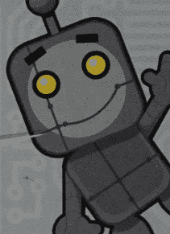

本指南支持《如何编程》的第 1 至 4 册。它旨在供帮助儿童学习编程的家长、教师或其他成年人使用。

# 如何使用本书

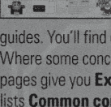

## 逐页指南

当儿童使用第 1 至 4 册探索编程时，您可以使用我们的逐页指南来跟踪他们的学习进度。您会找到涵盖的**核心概念**的解释。对于一些可能难以理解的概念，这些页面为您提供**额外帮助**，指导如何向他们解释。它还列出了儿童可能遇到的**常见困惑**以及克服它们的方法。当儿童发现某些想法易于掌握时，**深入探究**部分提供了额外的挑战。

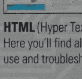

## 技术指南

本书末尾提供了本系列涵盖的五种语言的技术指南：`Logo`、`Scratch`、`Python`、`HTML`（超文本标记语言）和 `JavaScript`。在这里，您将找到所有需要的信息来获取、使用和解决这些语言的问题。

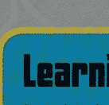

## 扩展项目

对于第 1 至 4 册中的每一册，您都会找到一些有趣的扩展项目，这些项目将巩固所学的核心概念，并让儿童的学习更深入。


## 附录

**语言比较**部分将帮助您理解本系列涵盖的每种语言之间的异同。**进阶说明**将使儿童能够认识到自己的进步，并确定他们下一步的学习方向。您还会在本书中找到所有挑战的**答案**以及**术语表**。

# 学习编程

本系列的四本书涵盖了若干核心概念，例如循环、变量和选择。随着从一册到下一册的进展，这些概念的复杂性逐渐增加。每本书使用两种编程语言来帮助儿童更深入地思考这些核心概念。

所有儿童的学习速度不同。有些儿童会与某些特定的想法作斗争，而发现编码的其他部分很容易。重要的是让他们以适合自己的速度进步，给予他们时间去探索和真正巩固他们的学习。

许多儿童会很乐意在电脑或平板电脑上花上几个小时。这并不推荐！重要的是要定期休息，做一些其他事情。虽然编程是未来一项非常重要的技能，但许多核心概念可以在远离电脑的情况下学习和巩固。问题解决和将解决方案分解为部分的高级技能，同样可以通过使用建构玩具和创造性游戏来发展。

即使您自己不是编程专家，也请让孩子们向您解释他们正在进行的活动是如何编码的——并且不要害怕自己也尝试一下。最重要的是，让孩子们在编程中探索并获得乐趣。

# 第 1 册

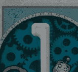

第 1 册向孩子们介绍了计算机需要被给予指令来告诉它们做什么的概念。孩子们了解到，**命令**需要清晰、精确，并且按正确的顺序给出，计算机才会按照他们的意愿行事。书中提供了许多活动来帮助教授这些想法，最初无需使用计算机。

然后介绍了两种计算机语言。第一种是 `Logo`，它用于教孩子们输入简单的指令并立即获得结果。当他们输入命令时，屏幕上的海龟会移动并绘制，鼓励他们进行实验。第二种语言 `Scratch` 将这些想法进一步拓展，并向孩子们介绍了**输入**。孩子们学习编程一个使用输入的简单游戏：按下按键将使 `Scratch` 精灵在屏幕上移动。

ISBN 978 1 78493 236 7

## 第 2 册

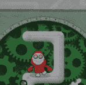

系列的第二册首先解释了编程中的一个核心概念——**循环**和重复的使用。使用 `Logo` 然后是 `Scratch`，向孩子们展示他们如何使用循环来绘制简单的形状，然后将它们组合成有趣的图案。他们了解到循环可以附加条件，因此它们会循环直到特定事件发生——例如在一个游戏中，一个精灵捕获另一个精灵。

通过使用**声音**，探索了除屏幕之外的输出的使用。孩子们学习如何创建基本的钢琴或合成器程序。接下来，使用**变量**向孩子们展示程序如何存储和更改数据，例如游戏中的分数。孩子们将在 `Scratch` 中构建自己的游戏和活动来练习这些技能。

ISBN 978 1 78493 237 4

# 第 3 册

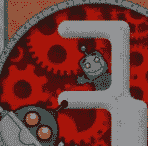

第 3 册探讨了**选择**的概念，使用 `Scratch` 构建一个问答游戏。孩子们通过将选择与变量结合，为他们的问答游戏添加计分功能，进一步发展了这一想法。他们还创建了一个游戏，其中精灵每“吃掉”一个苹果就得分。

第 3 册随后将这些概念带入专业的编程环境，使用 `Python` 语言。孩子们学习如何使用特殊的文本编辑器输入命令，并在 `Python` 中创建自己的程序。他们了解到如何使用编程**库**来生成**随机数**并创建**图形**。

ISBN 978 1 78493 238 1

## 第 4 册


系列的最后一册介绍了**万维网**及其工作原理，包括 `URL`（统一资源定位符）和**超链接**。孩子们学习使用 `HTML`（超文本标记语言）和文本编辑器创建网页。他们了解到如何使用**标签**向页面添加不同的对象或元素，以及如何将页面链接在一起。

然后第 4 册向孩子们展示如何在页面中添加 `JavaScript` 代码。`HTML` 是用于编码网页内容的语言，而 `JavaScript` 用于编码网页的行为。孩子们学习 `JavaScript` 如何处理循环，以及如何创建自己的**函数**。他们探索了网页如何包含图像和按钮，以及代码如何与它们关联。

ISBN 978 1 78493 239 8

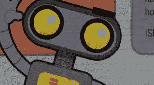

## 第 6-7 页：发出指令

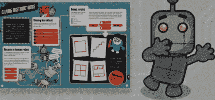

### 学习目标

成为优秀程序员的第一步是认识到计算机需要清晰且精确的指令才能完成任务。“发出指令”提供了一系列活动，帮助孩子们在开始使用电脑之前理解这一概念。通过轮流“扮演机器人”，孩子们将明白在开始编写代码之前，清楚地了解你希望程序做什么是至关重要的。

### 核心概念：精确性与顺序

我们需要确保孩子们理解指令必须精确。在计算机程序中只说“移动”是不够的——我们需要告诉计算机哪个对象以及朝哪个方向移动。

接下来我们需要做的是确保我们给程序的任何指令都按正确的顺序排列。我们可以通过打乱指令顺序并观察会发生什么来轻松地演示这一点。

### 额外帮助

将指令写在单独的卡片上会非常有效。然后你和孩子可以重新排列它们。

- 向前走
- 停！
- 右转
- 左转
- 捡起
- 向下
- 放下
- 向上
- 向右
- 向左

## 第 8-9 页：循序渐进

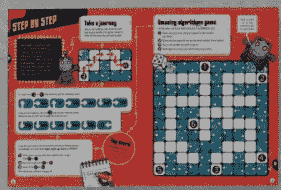

### 学习目标

在“循序渐进”中，孩子们将学习“算法”这个术语。算法被解释为程序为解决问题需要采取的步骤。在第 9 页的游戏中，孩子们写下从棋盘上的一个位置移动到另一个位置所需的步骤序列。这就是一个基本的算法。

### 拓展提升

随着孩子们成为更有经验的程序员，他们对“算法”的定义需要变得更加完善。一旦他们超越了简单的编程，他们的代码可能会向不同方向分支，或响应不同的输入。此时，他们将不再使用简单的指令或步骤序列，因此将算法视为一组解决问题或使游戏运行的规则可能更有帮助。随着他们进一步深入，他们将开始创建包含多个不同算法的程序。


## 第 10-11 页：编码信息

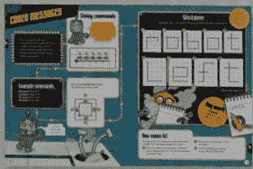

### 学习目标

在这里，孩子们将了解到我们给计算机的指令需要包含更多信息并且更加精确。我们不只是告诉机器人向上移动，而是引入了可以使用像`U5`这样的指令来向上移动 5 格的概念。这一概念进一步发展，用于创建简单的程序，例如`U4 R4 D4 L4`，可以用来绘制一个正方形。

### 拓展提升

在第 11 页的“你来命名！”游戏中，孩子们将编写程序来拼出自己的名字或首字母缩写。如果孩子们想进一步拓展游戏，可以请他们发明一些新命令来改变将要绘制的颜色。他们可以选择用`PR`表示“画笔 - 红色”或用`PY`表示“画笔 - 黄色”。使用这些新命令来创建更长的程序，甚至完整的单词。

例如，以下程序将写出“elsa”：

`PR`（画笔红色）`R3 U2 L3 D3 R4`

`PB`（画笔蓝色）`U5 D5 R1`

`PG`（画笔绿色）`R3 U2 L3 U1 R3`

`PO`（画笔橙色）`R4 D3 L3 U2 R3`

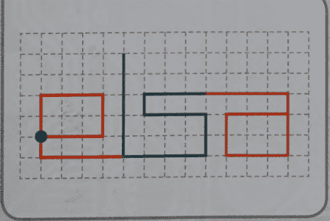

## 第 12-13 页：旋转绕行

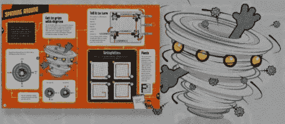

### 学习目标

要在地面上移动机器人，或在屏幕上移动小海龟，我们需要使用命令使其向前移动一定距离，或旋转一定角度。本页解释了如何用度数来衡量旋转的程度。为了保持简单，目前我们只使用 90 度的“四分之一转”。

### 额外帮助

当我们需要解释电脑屏幕上的物体大小时，通常用像素来衡量。电脑屏幕上的每个点都是一个像素（“picture element”的缩写）。如果孩子难以理解什么是像素，你可以用放大镜观察电脑屏幕，或者放大一张低质量的数码照片来演示。随着不断放大，图片会变得模糊或出现“马赛克”，各个像素就会显现出来。

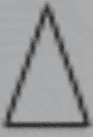

### 拓展提升

玩“人体机器人”游戏。不用方格纸，而是到户外的铺路石上或操场上进行。让孩子们两人一组合作。一个孩子发出指令，另一个扮演机器人执行指令。扮演机器人的伙伴可以在执行指令时用粉笔在地上画线。

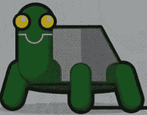

## 第 14-15 页：学习 Logo

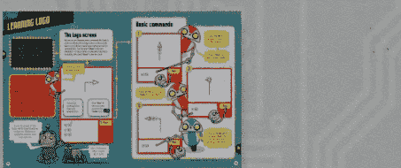

### 学习目标

在这里，孩子们将学习一种简单编程语言的基础知识：`Logo`。他们将进行第一次基础编程。孩子们将使用三个基本命令来编程控制屏幕上的小海龟（箭头）：向前移动、左转和右转。有关使用 `Logo` 的技术指南，请参阅本书第 50 页。

### 常见困惑

有些孩子发现很难判断该让小海龟左转还是右转，尤其是当小海龟朝下时。一个很好的辅助方法是制作一个小纸海龟，孩子们可以转动它来与屏幕上小海龟的方向保持一致。

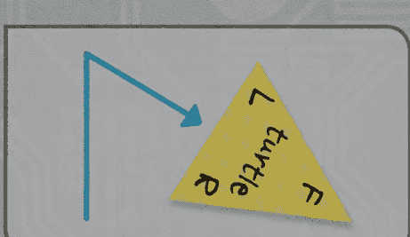

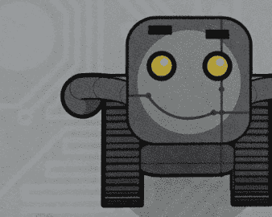

## 第 16-17 页：Logo 图形

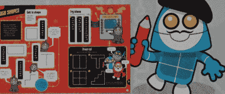

### 学习目标

既然孩子们已经学会了在 `Logo` 屏幕上移动小海龟，他们将学习编写更有目的性的程序来绘制特定图形。

### 拓展提升

如果孩子们已准备好将 `Logo` 编程提升到更高水平，可以请他们：

1. 设计一个简单图案并使用 `Logo` 创建它。写下代码并与伙伴分享，让他们也能制作出这个图案。
2. 为年幼的孩子制作一张海报，解释如何使用 `Logo`。
3. 与伙伴一起玩“人体机器人”游戏，使用 `Logo` 命令。让伙伴按照命令在操场上移动，同时用粉笔画出图形。
4. 使用 `Logo` 命令绘制你名字中的一些字母。写下你使用的命令。确保目前只使用水平线和垂直线。

```text
fd 100 rt 90 fd 50 rt 90
fd 50 rt 90 fd 50 rt 180
fd 50 rt 90 fd 50
```

# 第 18-19 页：Scratch 入门

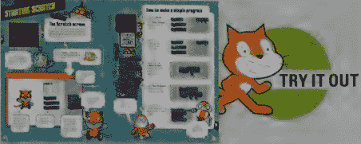

### 学习目标

在这里，孩子们将学习 `Scratch` 编程语言的基础知识。`Scratch` 是学习 `Logo` 之后的一个很好的进阶选择。它能让孩子们掌握更复杂的编程概念，但使用起来仍然非常简单。有关使用 `Scratch` 的技术指南，请参阅本书第 52 页。

### 额外帮助

在孩子们开始使用 `Scratch` 编程之前，你可以先给他们演示一下它是如何工作的。首先向他们展示不同类别的代码积木（如“事件”和“运动”）。然后演示如何将代码积木拖到脚本区（屏幕右侧）并连接起来组成简短的程序。向他们展示如何通过点击来运行每个代码积木。让他们看到如何通过将代码积木从脚本区拖出来将其从程序中移除，以及如何通过将下方的积木向下拖动来分离积木。

### 拓展提升

如果孩子们准备好尝试更多，可以请他们：

1. 将角色拖到屏幕左侧。通过点击**“运动”**组中的**“移动 10 步”**使其一直移动到右侧。你需要点击多少次？在第 62 页查看答案。
2. 更改每次点击时角色移动的步数。为了在 5 次点击内穿过屏幕，需要将步数改为多少？什么数字能让它在 2 次点击内穿过屏幕？你认为整个屏幕有多宽（多少步）？在第 62 页查看答案。

# 第 20-21 页：落笔绘图

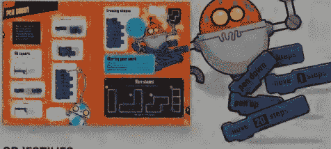

## 第一册：逐页指南

# 第 22-23 页：按下一个键

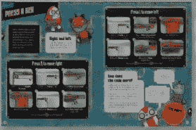

# 第 24-25 页：输入与方向

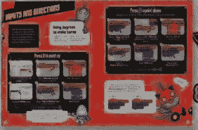

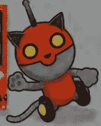

## 目标

“按下一个键”教授两个关键概念：输入和事件。孩子们将了解到，输入和事件对于创建几乎所有的游戏和更复杂的程序都至关重要。孩子们还将开始思考编程的含义。非常基础的编程是遵循一连串的命令。然而，当我们开始使用输入和事件时，程序会通过执行不同的命令序列来作出响应。

## 目标

孩子们将学习通过按不同的键来让 `Scratch` 角色向不同方向移动。这些练习是前几页“按下一个键”内容的延伸。孩子们需要对角度有非常基本的了解（参见第一册第 12-13 页）。

### 核心概念：输入和事件

输入是一种动作——比如按下一个键——它告诉计算机去做某事。我们将了解到，程序运行时，代码并非每次都以相同的方式执行，而是当不同的输入发生时，程序的不同部分会被执行。在第 22-23 页的示例中，按下 `R` 将运行 `Scratch` 代码使角色向右移动。按下 `L` 将运行另一段代码，使角色向左移动。

程序员将按键这样的输入动作称为事件。其他事件可能是用鼠标点击某个东西，或者程序启动。

此时，可能值得重新思考什么是算法——我们正开始超越最初将其定义为“解决问题的步骤”（参见第一册第 8-9 页），而更倾向于将其视为描述游戏或程序如何运行的“规则集”。

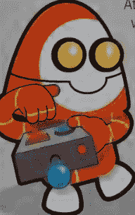

### 额外帮助

要进行这些练习，孩子们需要使用“面向方向”代码块，它以度为单位给出方向。为了保持简单，我们只使用 0、90、180、270 和 360 度角。“面向方向”块还提供了一个下拉菜单，其中包含提醒信息，例如“90°（右）”。`Scratch` 使用 -90° 来指向左——下拉菜单中同样有提示表示这是向左。

### 进一步探索

如果孩子们想更进一步，请他们编写许多简短、简单的程序（答案见第 62 页）：

1. 编写一个简单的程序，当按下**方向键**而不是 `U`、`D`、`L`、`R` 时，角色能上、下、左、右移动。
2. 编写一个程序，当按下 `B` 键时角色移动一大段距离，按下 `S` 键时移动一小段距离。
3. 编写一个程序，当按下**空格键**时角色能对角线移动。

## 第 26-27 页：用输入进行绘画

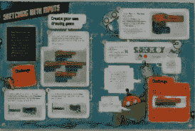

## 目标

孩子们将使用 `Scratch` 创建自己的绘画游戏。这个练习提供了大量练习使用输入的机会，也为拓展想法提供了广阔的空间。一旦孩子们让他们的绘画程序基本运行起来，你可以和他们谈谈计算机如何使用数字来表示颜色。

### 进一步探索

孩子们可以尝试给他们的游戏添加这些额外功能：

1. 从**事件**组中添加一个**“当按下键时”**积木，以及从**画笔**组中添加一个**“清除”**积木，这样画师就可以通过按键来清空屏幕。
2. 添加另一组积木，使画师在按下**“U”**键时能抬起画笔。
3. 添加另一组积木，使画师在按下**“P”**键时能重新开始绘画。
4. 添加更多积木（使用**事件**和**运动**组），使画师能对角线绘画。
5. 尝试设置画笔颜色（使用**画笔**组），并利用你的发现制作一个表格。在一列中写下颜色名称，在下一列中写下设置画笔颜色的值。

答案请核对第 62 页。

## 第 28-29 页：调试

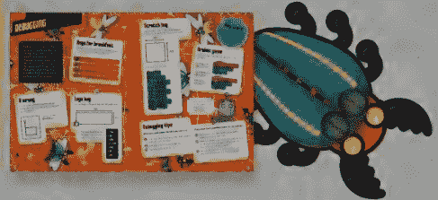

## 目标


孩子们将学习“调试”的含义，并练习修复 Logo 和 Scratch 代码中的一些简单错误。调试是一项需要培养的重要技能。然而，预防胜于治疗，因此这些页面也提供了关于规划和测试简短程序的指导原则。

> **额外帮助**

在教孩子如何调试时，建模和演示这个过程非常有用。例如，在 Scratch 中制作一个移动角色的简单程序。稍微修改其中一小部分，使其无法正常工作或角色向错误方向移动。询问孩子们是否能找出问题所在。如果你在教导一个小组，让成功调试的孩子解释他们是如何修复代码的，这样他们可以为其他人示范这种方法。

## 常见困惑

在这个编程阶段，一个常见的困惑是在倒置的角色周围移动时，哪个方向是左，哪个是右。为了帮助理解，可以用一小张纸制作一个简单的角色或三角形（参见本书第 8 页）。

> **小贴士**

有时对孩子们来说，重新开始可能比调试一个他们无法修复的代码更容易。让他们仔细计划或解释他们希望代码做什么，然后逐步重建和测试。确保他们计划切实可行。从简单的游戏或程序开始，然后逐步构建。

## 绘制 Scratch 图形

随着孩子们成为更熟练的编码者，他们将享受在自己的程序中创作自己图形的乐趣。这将鼓励他们更有创造力，释放他们的想象力。这里是在 Scratch 中创建图形的指南。

### 关键技巧学习

虽然我们可以在电脑上以类似在纸上绘画的方式绘制图像，但有一些重要的区别。了解这些区别将帮助你为程序创建更好的图像。你可以通过使用 Scratch 中的角色编辑器来练习本页的技巧。如果你使用的是 Windows 电脑，也可以使用 Microsoft Paint 这样的程序，或者使用更复杂的软件包如 Adobe Photoshop。你创建的任何图像都可以保存并在代码中使用。


### 撤销

当我们用铅笔画错了，可以用橡皮擦掉错误。尽管大多数绘画程序中都有橡皮工具，但通常在出错后立即点击“撤销”按钮（或者点击“编辑”然后“撤销”）要好得多。“撤销”会撤销你最后做的操作。


### 放大与缩小

用鼠标精确绘制东西可能很困难。当你试图让东西对齐或放到正确位置时，放大以使一切看起来更大要容易得多。当你完成某部分的工作后，再次缩小以查看整体图像。

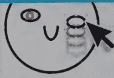

### 移动物品

在纸上，如果我们把东西画错了地方，我们必须擦掉重画。在电脑上，我们可以把它移动到正确的位置。如果你刚画了一个形状，可能会有手柄可以移动或调整大小。如果没有，使用`选择`工具在你的图画周围画一圈，然后将其拖动到需要的位置。


**或者使用选择工具。**

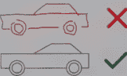

### 用形状构建图像

尽管你可以用画笔画任何东西，但用一系列形状构建数字图像通常更容易。线条会更直，曲线会更平滑。尝试使用`椭圆`工具绘制细节，如轮子、眼睛、头部、身体、花朵和火箭！何不尝试用`矩形`工具来画汽车、建筑、墙壁、道路、牙齿、机器人和树木。


**使用线条、椭圆和矩形工具。**

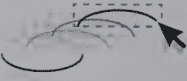

### 切割形状

如果你找不到或画不出需要的形状，就从另一个形状上分解出来。例如，用`椭圆`工具画一个椭圆，然后使用`选择`工具选择它的上半部分。把它拖出屏幕，你就得到了一个微笑！


**使用选择工具。**

## 绘制火箭

运用前述技巧，创建一个火箭作为 Scratch 程序中的角色，例如下一页中的`太空游戏`。

1. 在 Scratch 中，首先点击“绘制新角色”。
2. 选择`椭圆`工具。设置为填充模式。选择红色。现在绘制一个宽椭圆。
3. 使用`选择`工具在一端画一个框。将该端拖出绘图区域以移除它。对另一端重复此操作。
4. 放大视图。使用较深的颜色和`线条`工具绘制一个尖锐的火箭头部。
5. 使用`填充`工具为火箭头部上色，然后缩小视图。
6. 绘制另一个椭圆，然后用`选择`工具切掉一端。
7. 使用`选择`工具圈选上半部分并将其拖出，制作一个火箭尾翼。
8. 对另一侧重复相同操作。
9. 使用`椭圆`、`矩形`和`线条`工具装饰你的火箭。

你的图像将被存储为像素。

> 练习这些技巧，制作你自己的精彩角色。将它们用在你自己的程序中。

## 太空游戏

此活动向孩子们展示如何创建包含自定义图形的游戏。它也基于第 1 册中学到的所有 Scratch 技能。这个太空游戏使用绘制的火箭和背景图像。当按下不同按键时，火箭会飞行。一个键使火箭直线飞行，另外两个键使火箭向左或向右转弯。一旦孩子们构建了这个游戏，鼓励他们规划自己的简单游戏，创建图形并编写代码！

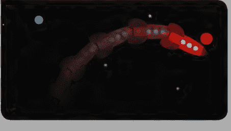

1. 启动 Scratch。右键点击主角色，然后选择“删除”来删除它。（在 Mac 上，点击角色时需要按住“Control”键。）
2. 现在绘制你自己的火箭角色，就像第 13 页上的那个。
3. 现在我们需要添加一些代码来让火箭前进，以及向左和向右转弯。

右键点击意味着点击鼠标右侧的按钮。

点击火箭角色。

然后点击脚本选项卡。

从事件组中拖出三个“当按下……键”积木。

从运动组中拖出“移动”和“转弯”积木。

选择你想要用来让火箭前进和左右转弯的按键。

```text
当按下 [空格 v] 键
移动 10 步

当按下 [左箭头 v] 键
移动 10 步
右转 (-15) 度

当按下 [右箭头 v] 键
移动 10 步
左转 (15) 度
```

空格键

现在为游戏绘制你自己的背景图。

首先，点击`“舞台”`。

| 角色 | |
|:---|:---|
| 舞台 | |
| 1 个背景 | |

角色 1

然后点击`“背景”`。

| 脚本 | |
|:---|:---|
| 背景 | |
| 声音 | |

新背景：背景 1

点击`填充`工具并选择黑色。

现在点击背景为其上色。

使用`画笔`工具绘制一些星星。

使用`画笔大小`滑块来改变星星的大小。

使用`椭圆`工具绘制一些行星。按住`“Shift”`键以绘制完美的圆形。

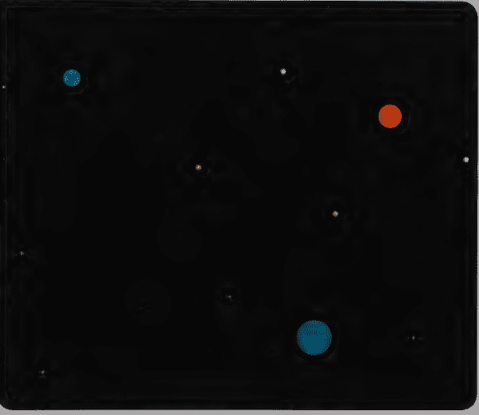

点击此按钮使你的程序最大化到屏幕大小！

## 保存代码

要保存你的工作，点击`“文件”`菜单（屏幕左上角），然后点击`“下载到你的计算机”`。

要再次打开你的工作，首先你需要在浏览器中打开 Scratch。然后点击`“文件”`菜单并选择`“从你的计算机上传”`。

# 逐页指南

## 第 2 册

### 第 6–7 页：循环

### 第 8–9 页：用循环绘制图案


## 目标

在任何编程语言中，一个关键概念是使用循环来一遍又一遍地重复指令。在这些练习中，孩子们将学习使用 Logo 来编程简单的循环，以绘制形状。

### 核心概念：循环

在接触计算机之前，和孩子们讨论我们在日常生活中如何使用循环，并让他们思考一些例子。比如每天步行上学（重复 5 次）还是穿鞋（重复 2 次）？解释使用重复是一种使指令更高效的方式。讨论告诉一只千足虫一次穿一只鞋——或者使用重复循环的想法。让孩子们写下一些指令，例如：

告诉一只 300 条腿的千足虫穿鞋：

`重复 300 [ 穿上鞋子 ]`

告诉一个学生每天步行上学：

`重复 5 [ 步行上学 ]`

## 目标

这些练习将把孩子们对循环的理解提升到一个新的水平。我们将探索在一个循环内运行另一个循环的威力。我们将使用这个概念在 Logo 中制作一个图案。

### 核心概念：循环中的循环

这个概念可能很难向孩子们解释，因此在接触计算机之前，使用一个有趣的类比会很有帮助。想象一家四口、每只有 300 条腿的千足虫正准备穿鞋。让我们用一个循环嵌套另一个循环来写下一些准备工作的命令：

```text
重复 4 [ 重复 300 [ 穿上鞋子 ] ]
```

提醒孩子们，他们需要将正在重复的命令用方括号括起来。因为有两个循环，所以需要两个左方括号和两个右方括号。

### 拓展练习

使用 Logo，让孩子们输入这段代码：

```text
重复 20 [ 重复 4 [ 前进 100 右转 90 ] 右转 5 ]
```

这段代码不会绘制出完整的图案。尝试使用第一个重复的不同值来完成图案。答案在第 62 页。

> **额外帮助**
>
> 如果孩子们在做“编写简单循环”练习时无法想象出形状，让他们大声朗读命令。他们甚至可以和伙伴一起拿着粉笔到户外去。一个孩子可以大声读出命令，而另一个则成为一个“人类机器人”——在地面上一边画一边遵守重复的命令。还要注意，在编程 Logo 循环时，孩子们可能会忘记输入两个括号，或者可能输入了花括号而不是方括号。

### 第 10–11 页：Scratch 中的循环

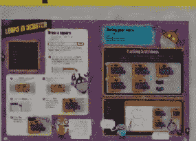

## 目标

孩子们现在将学习在 Scratch 中创建循环。Scratch 的工作方式与 Logo 类似，使得应用已学知识变得直接了当。在另一种编程语言中尝试循环将帮助孩子们专注于重复的概念。与孩子们讨论在两种语言中创建简单循环的相似之处和不同之处。

### 拓展练习

1. 向孩子们展示这段代码，并让他们预测它会绘制什么。（它是一个八边形。）

   ```text
   清空
   落笔
   重复 8
     右转 45 度
     移动 50 步
   ```

2. 让孩子们修改代码以绘制一个 12 边形（十二边形）。

大多数孩子会意识到，为了绘制 12 边形，他们需要将重复次数更改为 12。大多数孩子会发现确定需要转弯的角度更难。让他们尝试使用更大或更小的数值。

正确的转弯角度是 30 度。这是因为，为了完成形状，我们需要总共转弯 360 度。我们分 12 步完成，所以 360 度除以 12 得到 30 度。

### 第 12–13 页：无限循环

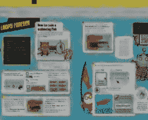

## 目标

到目前为止，我们已经研究了运行特定次数的循环。现在孩子们将学习使用永远运行——或者直到程序停止的循环。他们将使用“重复执行”循环在 Scratch 中为一个游泳的鱼编码。孩子们可以讨论大多数游戏都需要一个“主循环”一直运行的想法。主循环可以执行诸如在屏幕上移动对象或角色之类的事情。

### 拓展练习

如果孩子们准备好学习更多关于“重复执行”循环的知识，让他们进行以下练习：

1. 讨论一下，如果我们的游泳鱼不使用“重复执行”循环，而是使用“重复 100 次”循环，会发生什么。（游戏会在几秒钟后停止。）
2. 使用“重复执行”循环，在 Scratch 中制作另一个游戏，这次是一个在屏幕上飞行的飞机。
3. 设计你自己的游戏，让一个物体在屏幕上跟随鼠标移动。让你的想象力尽情驰骋吧！


## 第二册逐页指南

### 第 14–15 页：重复直到……

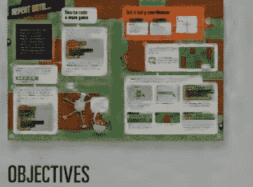

#### 教学目标

孩子们将学习在 Scratch 中使用“重复直到”循环。大多数使用循环的游戏都需要在某个时刻停止运行：例如，当汽车撞到墙壁时。

#### 核心概念：“重复直到”循环

在孩子们开始编程之前，值得先讨论一下重复一项任务直到某件事发生的概念。例如：

- 重复 [吃掉你的豌豆] 直到没有剩下
- 重复 [往杯子里倒水] 直到满

## 额外帮助

孩子们可能以前没有接触过坐标，或者没有使用过 `x` 和 `y` 这两个术语来描述事物在屏幕上的位置。如果是这样，请向孩子们展示下面的图示。解释绿点位于 `x=3` 和 `y=2` 的位置。红点位于 `x=6` 和 `y=4`。让他们计算其他点的 `x` 和 `y` 值。

当我们在 Scratch 中使用“将 x 设定为”或“将 y 设定为”时，我们是用 `x` 和 `y` 值来设定角色的位置。我们可以用以下代码将角色移动到蓝点的位置：

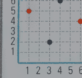

```text
set x to 4
set y to 6
```

### 第 16–17 页：重复直到被抓住

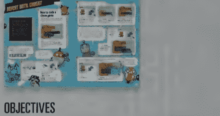

#### 教学目标

使用 Scratch，孩子们将编写一个追逐游戏，其中使用了另一个“重复直到”循环。在这个程序中，孩子们将学习为第二个角色编写代码，循环将重复直到两个角色彼此接触。

## 常见困惑

为第二个角色编程可能会比较棘手。孩子们需要仔细按照说明操作。确保猫和狗各自获得正确的代码。这里有两个不同的“小程序”或循环在运行——每个角色各一个。要更改某个角色的代码，请首先确保点击了该角色！

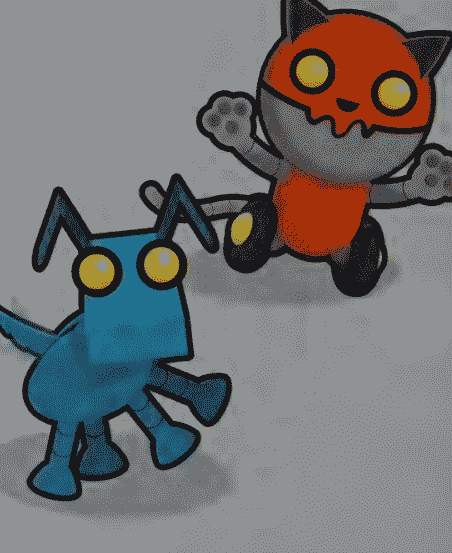

### 第 18–19 页：添加声音

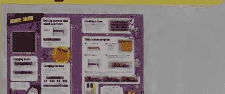

#### 教学目标

在“添加声音”中，我们介绍了将声音作为编程中的输出。使用 Scratch，我们将编写一段旋律并创建一个钢琴程序。Scratch 的“播放音符”命令需要两个值。第一个控制音符的音高，第二个控制音符持续的时间。

#### 拓展延伸

在孩子们完成钢琴程序后，他们可以添加一些新的按键事件来更换乐器。每个事件都将使用“设定乐器”代码块。现在让他们自由实验吧！

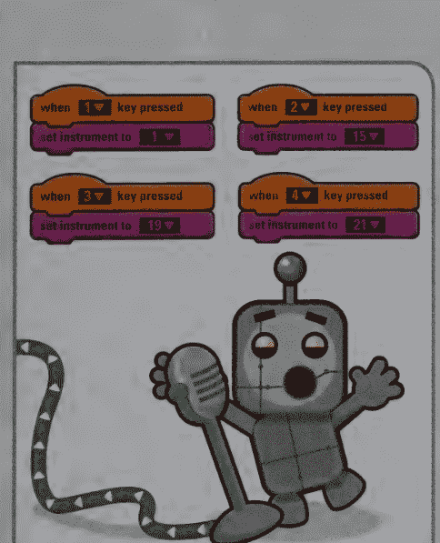

### 第 20–21 页：音效

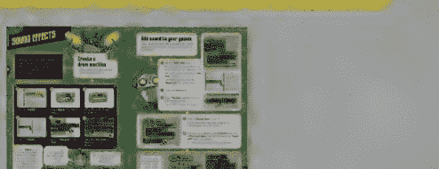

#### 教学目标

孩子们将通过学习如何在游戏和其他程序中添加声音来扩展他们的声音编程能力。这些页面上的练习将播放声音与循环结合起来。孩子们还将使用已录制的声音文件，例如为第二册第 16–17 页的追逐游戏录制猫的喵喵声。

#### 拓展延伸

孩子们可以在 Scratch 中录制自己的声音文件。你需要电脑内置的麦克风或外接麦克风。确保麦克风设置正确。

1. 要添加你自己录制的声音，将一个“播放声音”代码块拖到脚本区，然后点击“录制”。

   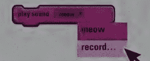

2. 点击“录制”按钮并创建你的声音。然后点击“停止”。

   

3. 点击“脚本”标签。

   

4. 点击`Recording1`选择你的录音，然后点击“播放声音”块。

   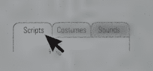

尝试将这个“播放声音”块放入程序中。

## 第二册逐页指南

### 第 22–23 页：变量

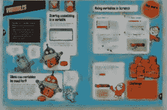

#### 教学目标

这些页面解释了变量，这是任何编程语言中的核心概念。在进入后面更复杂的练习之前，孩子们将通过在 Scratch 中创建一个使用单个变量的简单程序来掌握变量的概念。

#### 核心概念：变量

变量是计算机程序存储数据或信息的一种方式。与普通数字不同，变量可以在某事发生时改变其值。虽然变量可能看起来是一个相当抽象的概念，但孩子们对游戏中使用分数变量会很熟悉。他们习惯于这样的想法：游戏中的分数值从开始时的零可以变化——并且会随着游戏的进行而增加。

## 常见困惑

一些孩子可能会对字母 `a`、变量 `a` 和变量 `a` 的值之间的区别感到困惑。Scratch 处理变量的方式如下：

这只是意味着：显示字母 a。在许多其他编程语言中，它周围会有引号——`"a"`——并称为字符串。

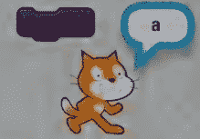

这意味着：显示变量 a 的值。在我们的代码中它看起来像一个 a，但当我们运行代码时，它显示的是 a 中的值。

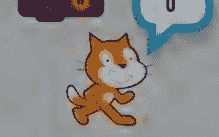

### 第 24–25 页：计分

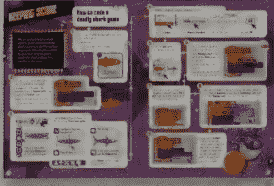

#### 教学目标

使用 Scratch，孩子们将学习为游戏创建一个分数变量（称为 `s`）。该变量将跟踪游戏运行了多长时间。在游戏开始时，`s` 的值被设定为 0。每次游戏中的主循环重复时，变量 `s`（我们的分数）的值就增加 1。

## 常见困惑

重要的是让孩子们理解将变量设定为特定值与增加变量之间的区别。尝试交换“将 s 设定为 0”和“将 s 增加 1”代码块的位置，演示会发生什么。

#### 拓展延伸

当孩子们准备好尝试更多内容时，请让他们：

1. 修改鲨鱼游戏，使分数以 2、5 或 10 为单位增加。然后在第 62 页检查答案。
2. 使用“说”代码块在游戏结束时显示分数。

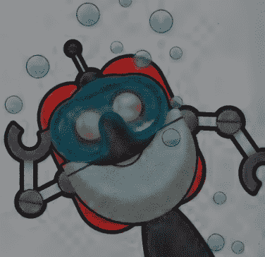

### 第 26–27 页：点击计数


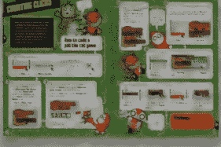

## 教学目标

这个项目将扩展孩子们对变量的理解：分数不是在主重复循环中增加，而是在点击角色时增加。这个项目还回顾了循环和坐标的使用。

## 代码工作原理

```scratch
when [green flag] clicked
set x to -180
set [s v] to [0]
repeat until <touching [edge v] ?>
    move (5) steps
end
say (s)

when this sprite clicked
change [s v] by (1)
```

1. 启动程序。
2. 将猫角色移动到屏幕左侧。
3. 将分数重置为 0。
4. 重复循环中的命令，直到角色到达屏幕边缘。
5. 移动角色。
6. 显示分数（如果程序因为角色到达边缘而跳出循环）。
7. 当角色被点击时……
8. 使分数增加。

## 第 28–29 页：调试

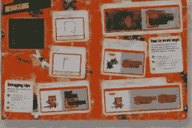

### 教学目标

这些页面将教授孩子们至关重要的调试技能，同时巩固他们对循环和变量的知识。现在孩子们编写的程序越来越长，他们会遇到更多的错误，需要培养修复错误的技能。这些页面还提供了从一开始就避免错误的技巧。

### 技巧

> 此时需要开始培养的一项技能是通读代码并理解每行代码作用的能力。大声说出每行代码，或者对同伴说，真的很有帮助。解释每行代码的行为可以让孩子们检查他们想要发生的事情是否就是程序被指示要做的事情。

这种技巧被专业程序员使用——以一种相当令人惊讶的方式。有一种公认的技术叫做“小黄鸭调试法”。程序员会通读任何不能正常工作的代码，并大声解释每行代码的作用……对着一只橡皮小黄鸭！

> 也许有一天小黄鸭也会学会编程呢！


## 第二册：扩展项目

# 赛车游戏

本项目将通过结合“重复直到”循环与变量来扩展孩子们的学习。我们将使用 Scratch 创建一个赛车游戏，其中循环会让汽车持续前进，直到撞到障碍物为止。变量用于计时汽车在不受损的情况下行驶了多长时间。


1. 启动 Scratch。右键点击主角色，然后选择“删除”以将其删除。（在 MAC 上，你需要在点击的同时按住“Control”键。）
2. 现在绘制你自己的汽车角色。

   首先点击“绘制新角色”。

   

   选择颜色并选中**矩形**工具。绘制车身。

   

   然后再添加一些矩形、车轮以及一位驾驶员（使用**椭圆**工具）。
3. 点击**缩小**图标，然后多次点击汽车，使汽车角色变小。

   

4. 现在绘制你自己的赛道供汽车行驶。不要把赛道画得太窄。

   点击“舞台”。

   

   然后点击“背景”。

   

   点击**填充**工具并选择绿色。现在点击背景为其着色。然后用灰色矩形绘制赛道。

   

5. 现在我们需要让汽车移动，直到它偏离赛道。

   点击**Sprite1**，确保我们正在为汽车角色添加代码。然后点击“脚本”选项卡。

   

   将所有这些代码块拖到脚本区域。

   ```scratch
   when 🟢 clicked
   set x to 0
   set y to 120
   point in direction 90 ▼
   repeat until touching color 🟩?
       move 2 steps
   end
   ```

   你需要将“**Touching color**”代码块设置为你草地的绿色。点击彩色方块，然后点击舞台区域上的草地。

   点击 Scratch 屏幕顶部附近的绿色旗帜图标来测试你的代码。

   如果你点击旗帜时汽车没有移动到赛道上，调整“**Set x to**”和“**Set y to**”的数值。“**Point in direction**”代码块会让它向右行驶。

6. 从**Events**组添加两个“**When key pressed**”代码块来控制汽车方向。测试你的代码并尝试按下方向键。

   ```scratch
   when ← key pressed
   turn ↺ 15 degrees

   when → key pressed
   turn ↻ 15 degrees
   ```

7. 现在创建一个变量来记录分数。

   选择**Data**组。

   ```text
   Pen | Operators
   Data | More Blocks
   ```

   点击“**Make a variable**”。

   

   将其命名为“**s**”（代表 score，分数）。

   

   然后点击“**OK**”。

8. 在游戏开始时放入一个“**Set s to 0**”代码块。

   ```scratch
   when 🟢 clicked
   set s to 0
   set x to 0
   set y to 120
   ```

9. 在主重复循环中放入一个“**Change s by 1**”代码块，使分数增加。

   ```scratch
   repeat until touching color 🟩?
       move 2 steps
       change s by 1
   end
   ```

点击这个按钮让游戏变大！


> **挑战！**
>
> 你能添加音效，让游戏结束时出现撞车声吗（尝试鼓声）？

# 变量的趣味应用

一旦孩子们掌握了变量并能自信地运用它们，就有许多方法可以扩展他们的理解。在这里，我们将使用 Scratch 将变量与循环、声音和图形结合起来。

## 变量与声音

试试这个程序，它结合了循环、变量和声音。

1. 从**Control**组中，将一个“Repeat”循环块拖到脚本区域。

   

2. 从**Sound**组添加一个“Play note”代码块。

   

3. 点击**Data**组，创建一个名为“a”的变量。

   

4. 在循环开始前放入一个“Set a to 0”代码块。将“a”设置为 60。

   ```scratch
   set a to 60
   repeat 10
     change a by 1
     play note a for 0.5 beats
   ```

将带有“a”的小圆圈拖到“Play note”代码块中。

将“Change a by 1”代码块放入重复循环中。测试你的代码。进行实验！

现在创建这 3 个程序。它们会为哪类游戏创造出有用的音效？

```scratch
set instrument to 17
set a to 60
repeat 12
  play note 8 for 0.1 beats
  change a by 5
  repeat 10
    play note 8 for 0.1 beats
    change a by -5
```

使用两个循环。

```scratch
set volume to 100%
set a to 100
repeat 10
  set volume to 8%
  play note 60 for 0.1 beats
  change a by -10
```

创建回声效果。

```scratch
set instrument to 16
set a to 100
repeat 20
  play note 8 for 0.05 beats
  change a by -5
```

尝试“a”的变化量以及循环重复次数。

## 变量与图形

既然你已经学会了用循环创建基本图形模式，试着添加变量吧。在循环中使用变量来改变图形的边长等属性，可以创造出一些有趣的效果。在 Scratch 中绘图时，记得代谢产物缩小猫角色，以免它碍事。

这个循环绘制一个正方形：

```scratch
pen down
repeat 4
  move 100 steps
  turn 90 degrees
```


现在添加一个变量来制作螺旋：

```scratch
pen down
set 'a' to 0
repeat 40
  move a steps
  turn 90 degrees
  change 'a' by 2
```

你能解释这个循环是如何工作的吗？

正方形程序的边长固定为 100 步。

螺旋图形的原理是每循环一次将边长增加 2 步，并将长度存储在名为“a”的变量中。

现在尝试改变转动角度或“a”的变化量。


这个程序绘制一条粗线：

```scratch
pen down
set pen size to 6
repeat 100
  move 2 steps
```


变量让线条变得越来越粗：

```scratch
pen down
set 'a' to 0
repeat 100
  set pen size to a
  move 2 steps
  change 'a' by 1
```


这个程序同时改变颜色和画笔大小。设置画笔颜色时，确保使用“Set pen color to 0”代码块。

现在尝试用不同的方式让变量改变绘制的内容。

```scratch
set pen size to 1
pen down
set 'a' to 0
repeat 200
  move 2 steps
  set pen color to a
  change 'a' by 1
  set pen size to a
  turn 1 degrees
```


# 第三册逐页指南

## 第 6–7 页：“如果”命令

## 第 8–9 页：问答时间


### 学习目标

“If commands”介绍了一个名为“选择”的概念。选择允许程序根据问题或输入运行不同的代码段。使用 Scratch，孩子们将利用选择编写一个问答程序。

孩子们将通过在 Scratch 中编写问答程序来扩展他们对选择的理解。本项目还使用变量来统计分数。

### 关键概念：选择

当孩子们开始编程时，他们的大多数程序每次都以相同的方式运行，按照顺序一个接一个地执行命令。这称为顺序代码。例如：


> **额外帮助**
>
> 孩子们可能需要回顾一下变量（本系列第二册中介绍过）的使用方法。变量是计算机程序存储数据或信息的一种方式。与普通数字不同，变量可以在某事发生时改变其值。虽然变量看起来是一个相当抽象的概念，但孩子们会很快理解使用变量来记录分数的概念。大多数孩子已经熟悉分数在游戏开始时从零开始——并随着游戏进行而增加的原理。
>
> 确保孩子们理解在测验开始时设置分数与答对时加 1 之间的区别。解释将**“Change s by 1”**放在“If then”代码块的“C”形部分内部时，只有在答案正确时才会执行 Southwest。

选择意味着程序可能会分支并运行不同的代码段，以响应某事的发生，例如问题被回答。例如：


程序员通常称之为“条件语句”。

## “Else”命令


### 目标

“Else 命令”延续了我们关于选择结构的教学。孩子们将学习如何在 Scratch 中使用“如果...那么...否则”命令。一个基本的“如果”代码块允许我们在条件为真时执行某些操作——例如，如果答案正确，就显示“干得好！”。在代码块中添加“否则”部分，则允许我们在答案错误时运行另一段代码。


### 额外帮助

离开电脑，玩玩这些演示“如果...那么...否则”概念的有趣游戏。这些练习也能让你了解孩子们是否理解了选择结构的关键概念。

提出这些问题，或者在电脑上打出这些问题（使用大字体或投影仪）：

- 如果你的年龄等于 10 **那么**站起来**否则**坐下。
- 如果你有黑头发**那么**挥挥你的手**否则**拍拍你的肚子。
- 如果你是个女孩**那么**跳舞**否则**把手指放进耳朵里。

或者给每个孩子一张扑克牌，并问这样的问题：

- 如果牌 = 5 **那么**挥手**否则**皱眉。
- 如果牌是红色的**那么**上下跳**否则**把手放在头上。

## 如果接触到角色……


### 目标

这个项目将把孩子们对选择结构的理解与他们的循环知识结合起来。循环在本系列的第 2 册中涵盖——请翻到本书的第 16 页进行复习。在这个苹果吃游戏中，一个“重复执行”循环让我们的小猫角色持续向鼠标指针移动。一个“如果那么”命令将在苹果角色被小猫接触到（或吃掉！）时让它们消失。

### 拓展挑战

如果孩子们对选择结构和循环都感到得心应手，他们可以尝试这些额外的活动：

1. 制作一个怪物必须吃掉外星人的游戏。
2. 为了增加游戏难度，让外星人在屏幕上移动。
3. 制作本书第 22–23 页的赛车游戏。从“重复直到”循环中移除“碰到颜色”部分，并添加一个“如果”语句。现在，如果车碰到草地，得分就减 1 分。
4. 尝试修改赛车游戏，使得如果车碰到草地，它就向前移动 -1 步。这会让车减速。


# 第三册逐页指南

## 第 14–15 页：Python 入门

## 第 16–17 页：Python 打印


### 目标

这些页面介绍了 Python 语言。在学习了 Logo 和 Scratch 之后，Python 是孩子们编码的绝佳下一步，因为它使用了更标准的基于文本的方法。

在“Python 打印”中，孩子们将学习如何使用 Python 在屏幕上打印文本并进行简单计算。在 Python 中输入程序需要非常注重细节。

### 额外帮助

关于安装 Python 的帮助，请参阅本书第 54 页。确保孩子们有信心启动 IDLE（Python 编辑器）。然后向他们展示如何设置屏幕，使带有输入代码的文本编辑器位于左侧。保存并运行一个简单的程序。会出现一个新窗口——这显示了程序的输出。向孩子们展示如何将其放在屏幕的右侧，以便于操作。

#### 提示

孩子们在输入 Python 代码时犯小错误是很常见的。不幸的是，Python 编辑器并不总是在有错误时提供有用的反馈。这里有一些避免问题的技巧：

1. Python 不会在单词输入错误时明显提示，但如果它识别出像`print`这样的命令，它会将文本变为紫色。
2. 当孩子们在输入`print`括号的内容时——例如`print(123)`——如果输入正确，括号和 123 将被高亮显示：`print(123)`。

孩子们需要学会寻找这些视觉线索，以知道他们的代码是正确的。

```python
print("hello")
>>>
hello
>>>
```

让孩子们练习编写简单的单行或两行程序，直到他们能熟练执行这些基本任务。注意，IDLE 识别命令（如`print`）并用不同颜色显示它们。这是为了帮助程序员发现代码中的错误。在我们的书中，我们用灰度来表示这些颜色。


## 第 18–19 页：Python 问题

## 第 20–21 页：Python 循环


### 目标

在第三册第 6–13 页的 Scratch 中使用过选择结构后，孩子们现在将在 Python 中使用选择结构。Python 简单的方法将帮助孩子们更好地理解选择结构。虽然所有命令都必须手动输入，但在 Python 中创建测验可能比在 Scratch 中更快且更少麻烦。

### 目标


在这里，我们将通过在`Python`中进行一些计数来扩展我们在循环方面的工作。编写`Python`循环将强化孩子们对这一概念的理解。

## 拓展挑战

让孩子们比较他们将如何在`Python`和`Scratch`中为同一个测验编程。例如：

1. 创建`Python`循环有一个快捷方式。如果你不在乎循环从哪个数字开始，你只需要写：

   ```python
   for n in range(10):
       print(n)
   ```

2. 如果我们希望循环以大于 1 的数字递增，我们可以在括号中使用 3 个值（或“参数”）。通过实验来观察它是如何工作的：

   ```python
   for n in range(0,50,5):
       print(n)
   ```

```python
answer=input("What is the capital of England?")
if answer=="London":
    print("Correct")
```


## 额外帮助

`Python`和`Scratch`处理循环的主要区别之一是，`Python`还引入了一个变量（例如，`n`），它在循环重复时递增。大多数现代编程语言都是这种情况。如果孩子们需要回顾一下变量，请记住我们在第三册第 8-9 页的“测验时间”中使用了一个变量来记录分数。比较这些`Scratch`和`Python`循环：

## 常见困惑

使用`Python`时，确保孩子们记得输入冒号（`:`）并在“`if`”命令后检查制表符（在这些书中，我们使用制表符来缩进`Python`，但许多程序员更喜欢使用 4 个空格）。还要注意，`Python`是程序员所说的“大小写敏感”——它在比较文本时区分大写字母。它认为“London”和“london”是不同的。相比之下，`Scratch`不区分大小写，将“london”视为等于“London”。

```text
repeat (10)
say [Hello!]

for n in range(0,10):
    print("Hello!")
```

# 第三册逐页指南

## 第 22-23 页

### Python 图形


## 目标

这些页面教孩子们如何通过导入一个名为“`turtle`”的代码库在`Python`中创建图形。`turtle`命令允许孩子们通过移动一个乌龟或精灵来绘图，方式类似于`Logo`和`Scratch`中的绘图功能。在“循环与图形”练习中，我们将使用循环来绘制形状。

## 拓展挑战

通过同时使用两个循环，一个嵌套在另一个内部，我们可以创建出在第 2 册第 8-9 页用`Logo`制作的一些图案。这个练习将强化孩子们对循环和`Python`的理解。

在`Logo`中：

```text
repeat 36 [ rt 10 repeat 4 [ fd 120 rt 90 ] ]
```

在`Python`中：

```python
from turtle import *
for r in range(0,36):
    rt(10)
    for s in range(0,4):
        fd(120)
        rt(90)
```

我们使用`fd`和`rt`而不是`forward`和`right`——但两者在`Python`中都有效。在任何绘图命令之前输入`speed(0)`将加快速度！

两个程序都绘制出这样的图案：


## 第 24-25 页

### Python 随机数


## 目标

在这里，我们介绍另一个可以添加到`Python`的库——这次是为了创建随机数。孩子们将了解随机性在计算机游戏中的用途。他们将编写`Python`程序来模拟掷硬币和制作“随机三明治”。

## 核心概念：随机数

孩子们掌握随机性概念的一个好方法是抛硬币。同样值得比较的是我们在`Python`和`Scratch`中如何编程实现随机性。在`Python`中，我们导入`random`库。在`Scratch`中，我们使用**运算符**组中的命令。在这两种语言中，选择随机数的命令非常相似：

在`Python`中：`randint(1,6)`

在`Scratch`中：


一旦孩子们学会了如何在`Scratch`中使用随机数，就可以将它们放入任何通常带有数字的白色框中。例如：

始终从左端拖动“在……和……之间取随机数”积木。


这样你就可以把它放入数字框中。


这将使一个精灵出现在屏幕上的随机位置。

## 第 26-27 页

### 随机艺术

## 目标

在“随机艺术”中，我们将回到`Scratch`，运用所学的关于随机数的知识。我们将使用随机坐标、画笔大小和颜色来制作一幅泡泡图。

## 代码如何工作

```text
1. 清空
2. 落笔
3. 将画笔大小设为 10
4. 重复执行 20 次
5.   抬笔
6.   将 x 坐标设为 -200 到 200 之间的随机数
7.   将 y 坐标设为 -150 到 150 之间的随机数
8.   将画笔大小设为 1 到 50 之间的随机数
9.   将画笔颜色设为 0 到 200 之间的随机数
10.  落笔
11. 循环返回
12. 隐藏
```

1. 清空屏幕。
2. 落笔（这样就会开始绘制）。
3. 将画笔大小设为 10 像素。
4. 在主循环内重复执行命令 20 次。
5. 抬笔（不连接每个点）。
6. 将 x 坐标（从左到右的位置）设为 -200 到 200 之间的随机数。
7. 将 y 坐标（从上到下的位置）设为 -150 到 150 之间的随机数。
8. 将点的大小设为 1 到 50 像素之间的随机数。
9. 选择一个随机颜色。
10. 落笔（绘制点）。
11. 循环返回到上方。
12. 最后隐藏角色。

## 第 28-29 页

### 调试

## 目标

这些`Scratch`和`Python`的调试练习将帮助孩子们培养发现和修复代码错误的关键技能。特别是，`Python`练习将鼓励良好的校对技能，这对于使用基于文本的编程语言至关重要。

> **额外帮助**
>
> 调试`Python`代码可能是一项尤其难以掌握的技能。有些孩子可能一眼就能看出练习 4-7 中的错误。许多孩子则需要一点额外的帮助。让他们将有错误的代码输入到`IDLE`中。虽然`Python`不会纠正拼错的单词，但当它识别出`print`等命令时，会改变这些命令的颜色。在使用`Python`编程时，提醒孩子们注意颜色变化和括号高亮显示，以检查代码是否输入正确。

## 拓展项目

### 第 3 册

#### 随机 Python 图形

这些活动将通过结合两个`Python`库——随机数和图形库——来扩展孩子们的学习。通过将这些库与一些循环和变量结合使用，我们可以创建出令人惊叹的图案。

#### 1. 随机正方形

启动`Python`编辑器`IDLE`，并打开一个新文件。

输入以下命令：

```python
from turtle import *
from random import *
```

> 这告诉`Python`从`turtle`和`random`库中导入所有命令，并将它们带入我们的程序。

首先，我们需要将海龟移动到屏幕上的一个随机位置。我们可以使用`goto`命令来完成此操作。它需要两个随机值：正方形的 x 坐标和 y 坐标。（关于 x 和 y 坐标的提醒，请参阅本书第 18 页。）

- 创建一个名为`x`的变量，其值为 0 到 300 之间的随机数。
- 创建一个名为`y`的变量，其值为 0 到 300 之间的随机数。
- 抬笔（不绘制）。
- 让海龟移动到屏幕上坐标为`(x,y)`的点。
- 落笔（开始绘制）。
- 此循环绘制一个正方形。

```python
from turtle import *
from random import *

x=randint(0,300)
y=randint(0,300)
pu()
goto(x,y)
pd()

for s in range(0,4):
    forward(100)
    right(90)
```

保存并运行你的代码进行测试。每次运行时，正方形都会绘制在不同的位置。

#### 绘制多个随机图案

现在我们将扩展程序，在屏幕上绘制 30 个花朵图案。每个花朵图案将由围绕一个点旋转的 6 个正方形组成。该程序需要 3 个循环：

- 一个**内部**循环用于绘制正方形。
- 一个用于重复 6 次以构成花朵图案的循环。
- 一个**外部**循环用于绘制 30 朵花，每朵花都在随机位置。

1. 启动`Python`编辑器`IDLE`，并打开一个新文件。
2. 输入以下代码：

```python
from turtle import *
from random import *

speed(0)

for p in range(0,30):
    x=randint(-300,300)
    y=randint(-300,300)
    pu()
    goto(x,y)
    pd()

    for r in range(0,6):
        right(60)

        for s in range(0,4):
            forward(50)
            right(90)
```

导入`turtle`库和`random`库。

让海龟快速移动。

重复外部循环 30 次。

创建一个 -300 到 300 之间的 x 随机值。

创建一个 -300 到 300 之间的 y 随机值。

抬笔（不绘制）。

将海龟移动到`(x,y)`点。

落笔（开始绘制）。

重复循环 6 次。

向右转 60 度。

现在绘制每个正方形：

重复内部循环 4 次。

向前移动 50 像素。

向右转 90 度。

3. 保存并运行你的代码进行测试。它应该看起来像这样：

### 挑战！

尝试添加一个额外的变量作为图案的大小。将其设置为一个随机值。在内部循环中使用它，而不是向前移动 50。

#### 随机 Python 测验

这个项目结合了迄今为止涵盖的许多关键概念：输入、变量和随机数。我们还将使用不同类型的变量。我们将创建一个测验，随机询问 10 个乘法表问题，并计算回答正确的总数。

#### 提问一个随机问题

在制作一个包含 10 个问题的测验之前，我们将尝试制作一个包含 1 个问题的测验。

- 首先我们需要为问题创建两个随机数——我们称它们为`a`和`b`。
- 接下来我们需要询问玩家`a`乘以`b`是多少。
- 最后我们需要检查玩家是否正确，然后告诉他们。

##### 1

启动`Python`编辑器`IDLE`，并打开一个新文件。

##### 2

输入以下命令：

导入`random`库。

```python
from random import *
```

创建一个名为`a`的变量，其值为 1 到 12 之间的随机数。创建一个名为`b`的变量，其值为 1 到 12 之间的随机数。

```python
a=randint(1,12)
b=randint(1,12)
```

```python
print("What is",a,"times",b)
```

提问，例如：“5 乘以 4 是多少？”

```python
answer=input("?")
```

等待玩家回答，并将其存储在一个名为`answer`的变量中。

```python
answer=int(answer)
```

答案将是一个“字符串”。我们将把它转换为整数，以便与`a`乘以`b`进行比较。

```python
if answer==a*b:
    print("correct")
else:
    print("wrong")
```

检查答案是否等于`a`乘以`b`。如果相等，显示`correct`。否则显示`wrong`。

`IDLE`会在你输入`if`后持续添加制表符。在输入`else`之前，你需要删除其中一个制表符。

#### 字符串和整数

我们使用变量来存储信息。有些信息，比如游戏中的得分，是一个数字。如果是整数，我们称之为整数。其他信息，比如你的名字，将由字母组成。由字母组成的信息被称为字符串。由输入语句创建的变量将是一个字符串，即使它包含数字。`Python`对字符串和整数的处理方式不同。它认为 20 和`"20"`是不同的。如果我们需要将字符串的值与整数进行比较，首先我们需要将字符串转换为整数。为了进行这种转换，我们在测验中使用了`answer=int(answer)`。

#### 添加更多问题和得分

为了使我们的测验能够提问 10 个问题，我们需要创建一个外部循环来包围代码的主要部分。我们还需要添加一个得分变量，它将在开始时设为零，并在玩家正确回答问题时增加。最后，我们需要在游戏结束时显示得分。

1. 开始一个新文件，或者编辑你当前的文件。
2. 输入以下代码：

```python
from random import *

s = 0
for q in range(1,11):
    a = randint(1,12)
    b = randint(1,12)
    print("Question", q, "What is", a, "times", b)
    answer = input("?")
    answer = int(answer)
    if answer == a * b:
        print("correct")
        s = s + 1
    else:
        print("wrong")
print("You scored", s, "out of 10")
```

将得分变量（`s`）设为零。

启动一个从 1 到 10 的循环。

提问——例如：“问题 3，3 乘以 8 是多少？”

如果答案正确，将得分（`s`）加 1。

显示正确回答的数量（`s`）。

确保你的代码像上面一样缩进。如果需要，请使用`Tab`或`Delete`键进行匹配。没有正确的缩进，你的代码将无法运行！

```text
>>>
Question 1 What is 4 times 7
?28
correct
```

# 第 4 册逐页指南

## 第 6-7 页

### 创建网页

## 第 8-9 页

### 使用 HTML


#### 学习目标

这些页面将帮助年轻程序员开始制作自己的网页。孩子们将学习网页如何使用特殊的`<标签>`来标记页面的不同部分。与大多数专业程序员一样，我们将从在电脑上创建页面并“本地”测试开始，而不是在线处理“实时”网页。孩子们将学习如何在文本编辑器中创建页面，将其保存为`.html`文件，并在网页浏览器中打开——在我们继续学习之前，需要掌握这一流程。

#### 学习目标

一旦孩子们熟悉了创建简单的三行网页、保存并在浏览器中打开，他们就可以开始学习使用不同的标签了。他们首先会遇到的标签是文档开头和结尾的`<html>`和`</html>`。现在我们将介绍段落标签和标题标签。孩子们还将学习如何使用`<em>`等标签来强调文本的某些部分。

## 深入拓展

为了 extra 标签练习，在文本编辑器中新建一个`HTML`文档。在页面中添加`<html>`和`</html>`标签。在它们之间写下一列动物。保存并测试页面。现在编辑页面，使用标题标签让不同的动物显示得更大或更小。例如：

## 额外帮助

在接触更复杂的`HTML`和`JavaScript`编码之前，孩子们最好先掌握文件保存和操作。以下是一些练习建议：

1. 练习使用文本编辑器。确保孩子们能够自己找到文本编辑器。如果 hypo 孩子们使用的是`Mac`，首先需要点击“`TextEdit`”菜单，然后选择“偏好设置”。选择“纯文本”并取消勾选“智能引号”。
2. 孩子们需要练习文件操作。确保他们知道如何保存文件，以及保存后如何找到文件。值得在桌面（或文档区域）创建一个文件夹，方便他们访问并存放所有作品。
3. 确保孩子们理解网页必须保存为`.html`文件，否则无法正常工作。

```html
Text editor – animals.html
<html>
  <h1>Elephant</h1>
  <h5>Mouse</h5>
  <h2>Tiger</h2>
  <h6>Fly</h6>
</html>
```


36

## 第 10–11 页

### 地址与链接


## 第 12–13 页

### 大量链接


#### 学习目标

这些页面首先教孩子们更多关于 URL（网页地址）的知识。然后我们转到关键技能——创建指向其他网页的超链接。孩子们将熟悉锚点标签：`<a>`。

#### 学习目标

现在孩子们已经熟悉了如何创建链接，他们将创建一页自己最喜欢的链接。他们将使用自己的锚点标签（`<a>`和`</a>`），并结合一些已经学过的标题和段落标签。

> ### 额外帮助
>
> 某些文本编辑器会使用“智能引号”，将直引号（`'`）替换为弯引号（`''`）。如果发生这种情况，请参考对页的“额外帮助”来关闭此功能，或考虑使用专用文本编辑器——参见右侧的“提示”。

## 常见困惑

一些孩子可能会混淆锚点标签中不同部分的用途——`<a>`和`</a>`。确保他们理解`<a href = >`部分需要包含 URL，而锚点标签之间的部分将显示为网页上可点击的文本以链接到该 URL。孩子们还需要记住在 URL 两侧加上引号。

## 深入拓展


让孩子们列出 URL 中使用的国际国家代码，从 `co.uk` 开始。域名的这部分称为“后缀”。孩子们能发现哪些后缀可以表明一个网站是由慈善机构、政府还是教育机构运营的吗？

> ### 提示
>
> 基础文本编辑器，如记事本或 TextEdit，可以让孩子们开始创建网页。这也会鼓励他们仔细观察页面的构建方式。一旦他们超越了简单的尝试，值得下载一个更专业的、更高级的 HTML 编辑器。有许多免费的选择：第 56 页有更多关于下载的信息。

一个好的 HTML 编辑器会要求孩子们学习如何编码，而不是替他们完成所有工作，但会提供一些功能来支持他们，例如：

- 自动为文本着色，以强调标签、关键字、字符串和数字。
- 自动补全代码以节省时间。
- 指示标签、括号和引号已关闭并匹配。
- 允许孩子们同时打开多个文件进行工作。


# 第 4 册逐页指南

## 第 14–15 页

### 给它上色！

## 第 16–17 页

### 添加 JavaScript


#### 学习目标

“给它上色！”将教孩子们如何更改网页上对象的颜色和样式。大型网站使用包含 CSS（层叠样式表；参见第 58 页）的附加文件来实现这一点。这里我们采用更简的方法来探索这个概念，即在标签内部放置 `style` 属性。

#### 学习目标

到目前为止，孩子们只使用 HTML 来编码他们的网页。为了让网页更具交互性，现在他们将学习如何将 HTML 编码与另一种语言 JavaScript 结合起来。他们将学习如何添加一个“监听器”，以便在点击按钮时运行一些 JavaScript 代码。

### 深入拓展

孩子们还可以学习如何更改文本显示的字体：

1. 在文本编辑器中新建一个 HTML 文件。
2. 输入以下代码：
3. 保存并测试你的页面。
4. 编辑第二行，添加 `style` 属性。
5. 尝试其他字体。先试试 Impact 和 Tahoma。

```html
<html>
  <h1>Fruit</h1>
  <p>Apples</p>
</html>
```

如果你设置的字体名称包含多个单词，需要在其周围加上引号。这些引号需要与用于设置 `style` 属性的引号不同！例如，这里字体名称使用单引号，`style` 属性使用双引号：

```html
<h1 style="font-family:'Comic Sans MS'">
```

### 深入拓展

一旦孩子们掌握了第 4 册第 16–17 页的练习，他们可以创建一个新网页，包含三个按钮。每个按钮上需要写一个谜语。为每个按钮添加 `onclick` 监听器，以便点击按钮时，答案会作为消息显示出来。例如，尝试使用以下代码（全部输入在一行中）：

```html
<button onclick='alert("A bee flying backwards")'>What goes zzub zzub?</button>
```


## 第 18–19 页

### JavaScript 循环


## 第 20–21 页

### JavaScript 函数


#### 学习目标

现在我们将使用 JavaScript 循环和变量来进行一些求和与计数。孩子们可能之前已经使用过循环和变量——无论是在 Logo 或 Scratch 中创建图案或记录分数（参见第 2 册），还是在 Python 中计数（参见第 3 册）。在本册书中，翻到第 16 页复习循环，第 20 页复习变量。

#### 学习目标

这些页面介绍了函数的概念。函数是一系列命令，每次“调用”（运行）该函数时执行特定任务。这个概念通过编写指令告诉机器人制作三明治的类比来解释。无论机器人使用什么三明治馅料，这些指令都有效。然后通过创建一个会提问并检查答案是否正确的函数来实践这一概念。孩子们将使用这个函数来编写一个测验。

### 深入拓展

在第 4 册第 19 页的计数练习中，循环显示的数字是并列显示的。我们可以通过告诉浏览器显示预格式化文本，使用 `<pre>` 标签来强制浏览器将每个数字显示在单独的行上：

### 关键概念：函数

函数是编程中的一个重要概念。以下是创建和使用自己函数的一些原因：

1. 使用函数意味着你不必重复代码行——只需在需要时“调用”函数，而不必一遍又一遍地重复相同的命令。
2. 函数使长程序更易于阅读。
3. 函数使程序更灵活——一个函数可以在多种情况下使用。
4. 在 HTML 监听器中添加对 JavaScript 函数的“调用”要比编写多行代码容易得多。

```html
<pre>
<script>
for(var n=1; n<10; n++)
  document.writeln(n);
</script>
</pre>
```


要让 JavaScript 循环以 5 为步长计数，将循环右侧的 `n++` 改为 `n+=5`。例如，要写出数字 0, 5, 10, 15, 20，使用：`for(var n=0; n<21; n+=5)`。现在尝试这些练习（答案在第 62 页）：

1. 制作一个显示 0, 10, 20, 30, 40 的循环。
2. 制作一个显示 2, 4, 6, 8, 10 的循环。


# 逐页指南

## 图书 4

## 第 22–23 页

### 配合 HTML 的 JS 函数


#### 学习目标

这几页继续学习 JavaScript 函数的内容。这次我们将结合 JavaScript 和 HTML 进行编程。这里的活动向孩子们展示如何创建一个改变网页背景颜色的函数。

#### 拓展提升

如果想尝试额外的挑战，我们可以创建一个类似的函数来改变网页上文字的颜色。

1. 在文本编辑器中新建一个网页。输入以下内容：

```html
Text editor – creepyhouse.html

<html>
<h1>The Creepy House</h1>
<p>Once upon a time</p>
<button onclick="setcol('red')">Red</button>
<button onclick="setcol('blue')">Blue</button>
<script>
function setcol(col){
  document.body.style.color=col;
}
</script>
</html>
```

这个程序与图书 4 第 23 页的程序非常相似，但它改变的是文字颜色而非背景颜色。它使用 `style.color` 来改变文字颜色。

2. 按照第 23 页的方法保存并测试你的文件。
3. 添加更多按钮和颜色——尽情享受实验的乐趣吧！

## 第 24–25 页

### 宠物项目


#### 学习目标

这个项目将教孩子们如何通过链接多个信息页面来创建一个简单的网站。他们还将学习如何在网页中添加图片。只要网站不会上线，孩子们可以使用任何他们喜欢的图片——但如果网站将公开展示，他们需要注意版权和网络安全问题（见图书 4 第 26–27 页）。孩子们从互联网下载图片时，应始终受到密切监督。

#### 拓展提升

创建包含多个页面的小型项目可以让孩子们很好地练习处理文件和创建链接。你可以通过为每个项目创建单独的文件夹来帮助他们。以下是一些额外的网站项目创意：

1. 本学期的历史主题，例如古代文明及其文物。
2. 你最喜欢的运动和体育明星。
3. 你最喜欢的书籍或电影的评论。
4. 科学主题，例如材料及其用途。

## 第 26–27 页

### 分享你的网站


#### 学习目标

这几页解释了孩子们如何上传他们创建的网站。孩子们可以在离线状态下（不上传）发展他们的编程和 HTML 技能，但有时他们也会享受让作品获得观众的机会。如果孩子们要在网上发布任何信息，请确保他们受到密切监督。请遵循以下的网络安全准则，以及你家中或学校关于互联网使用的任何其他规定。

#### 网络安全准则

如果你与一群孩子一起工作，值得将这些准则张贴在大家都能看到的地方，以便阅读和牢记：

1. 不要在网上分享个人信息——例如你的全名、地址或电子邮箱地址。
2. 不要包含你或你家人的照片。
3. 不要在你的网站上写任何关于他人的不友善内容。


## 第 28–29 页

### 调试


#### 学习目标

在这些练习中，孩子们需要修复一些有 bug 的 HTML 和 JavaScript 代码示例。这些代码片段涵盖了我们将在图书 4 中学到的所有关键概念：链接、样式、循环和函数。

#### 提示

孩子们可以尝试使用控制台，这是大多数网页浏览器内置的调试工具。这将帮助他们看到存在错误以及错误所在的位置，尽管这些消息一开始可能显得相当技术性。

#### 显示控制台：

在 Mac 上使用 Chrome：

`[alt] + [cmd] + [i]`

在 PC 上使用 Internet Explorer 或 Chrome：

`[F12]`


控制台将出现在此处或浏览器底部。

#### 控制台中的典型消息：

`'scor' is not defined - mypage.html:3`

表示浏览器不知道名为 `scor` 的变量或函数。当变量或函数拼写错误时，可能会出现此消息。错误可能出现在第 3 行。

`Unexpected token ILLEGAL` - mypage.html:7

或

`Unterminated string constant` - mypage.html:7

表示第 7 行某处缺少引号或双引号——例如，`alert('hello)`。

### 国家网站

这个项目将通过创建一个小型网站来扩展孩子们的 HTML 应用，其中包含多种新技术。他们将学习如何使用图片作为链接以及如何改变图片大小。这些是非常有用的技能，可以应用到其他项目中。

1. 在文本编辑器中新建一个网页，并输入以下文本：

```html
Text editor

<html>
<h1>Countries</h1>
</html>
```

2. 为你的项目新建一个名为 `Countries` 的文件夹。将你的文件保存在那里，并将其命名为 `index.html`。

在 Mac 上创建新文件夹，点击 `File` 后点击 `Save`，然后点击 `New folder`。在 PC 上，在保存框中右键单击，然后点击 `New` 和 `Folder`。

3. 打开 Countries 文件夹，双击 `index.html` 文件进行测试。
4. 安排你的桌面，使 Countries 文件夹、文本编辑器和浏览器都能同时看到。

双击 Countries 文件夹将其打开。你将在这个文件夹中保存网站的所有文件。

```text
Files: desktop/Countries

Text editor — index.html

//desktop/Countries/index.html

<html>
<h1>Countries</h1>
</html>
```

你需要巴黎和罗马的照片（如果你愿意，也可以是其他地方的照片！）。请成年人帮你在网上搜索一些。将照片拖入你的 Countries 文件夹，并将它们命名为 `paris.jpg` 和 `rome.jpg`。

在网上搜索照片时，请务必询问成年人。

5. 点击 `File` 和 `New` 开始下一页。输入以下代码：

```html
<html>
  <h1>France</h1>
  
</html>
```

将此页面保存为 Countries 文件夹中的 `france.html`。

6. 编辑你的 `index.html` 文件：

```html
Text editor – index.html

<html>
<h1>Countries</h1>
<a href="france.html">
  
  France
</a>
</html>
```

保存文件！

7. 刷新页面。点击 `France` 链接，法国页面将在你的浏览器中加载。


8. 两张图片都会相当大。法国页面上的图片可以保持该大小，但在索引页面上我们需要将其缩小。（对于在线网站，你还需要将照片变小以加快下载速度。）编辑 `index.html` 文件中第 4 行代码：

```html

```

将宽度设置为 `100`。这表示 100 像素。

保存文件并刷新页面进行测试。照片的高度也应该会自动改变。

9. 现在为意大利添加另一个页面并保存（参见步骤 5 的方法）。你还需要在索引文件中为它添加另一个链接，因此像这样编辑你的 `index.html` 文件：

使用 `<br>` 进行换行以开始新行。

```html
Text editor – index.html

<html>
<h1>Countries</h1>
<a href="france.html">
  
  France
</a>
<br>
<a href="italy.html">
  
  Italy
</a>
</html>
```

10. 在每个国家的页面上添加更多关于该国的信息。使用 `<p>` 段落 `</p>` 标签包裹信息。回顾图书 4 第 14 页以更改页面和文字的颜色。

## 拓展项目

## 图书 4

### 嵌入

本活动探讨孩子们如何在网页中添加额外的资源，如视频和地图。他们将学习如何在一个名为 iframe 的新 HTML 对象中包含这些对象，以及如何设置嵌入（添加）对象的大小。

### 嵌入视频

有时你想在网页中添加视频。如果你拥有该视频，并且它存储在你的电脑或服务器上，你可以像我们在上一个项目中添加照片一样来包含它。或者，如果它在另一个网站上，你可以创建一个链接到它。嵌入介于两者之间——看起来视频好像在你的网站上，但实际上它是从另一个网站显示的。

1. 在成年人的帮助下，找到你想嵌入的在线视频。

> 在网上搜索视频时，请务必询问成年人。

2. 在网页上找到 `Share` 按钮，然后点击它。
3. 点击 `Embed` 按钮。高亮显示所有代码。右键单击鼠标并选择 `Copy`。

| Share | Embed | Email |
|---|---|---|
| `<iframe width="560" height="315" src="https://www..."></iframe>` |  |  |

在 Mac 上，你必须在点击时按住 `Control` 键。

4. 在文本编辑器中新建一个 HTML 文件。输入一个基本的 HTML 文件：

```html
<html>
<h1>Videos</h1>
<p>Here is a video about London</p>
<iframe width="560" height="315" src...
</html>
```

> 在此处右键单击鼠标，并选择 `Paste`。


iframe 代码应该出现在你的 HTML 文件中。如果没有，返回视频页面并重新执行步骤 3。

保存并在浏览器中测试文件。

## 嵌入地图

我们可以用类似的方式嵌入地图。

1. 找到你想嵌入的在线地图。放大到你想要的级别。
2. 找到“分享”按钮并点击。（在谷歌地图上，需先点击齿轮图标。）
3. 点击“嵌入”按钮。选中所有代码，鼠标右键点击并选择“复制”。


在 Mac 电脑上，点击时需要按住 `Control` 键。

4. 在文本编辑器中新建一个 HTML 文件。输入一个基本的 HTML 文件：


> 在此处鼠标右键点击，然后选择“粘贴”。


iframe 代码应该会出现在你的 HTML 文件中。如果没有，请返回视频并重新执行步骤 3。

保存文件并在浏览器中测试。

## 更改 iframe 大小


查看你粘贴的 `iframe` 代码。里面应该有两个名为 `width` 和 `height` 的“属性”。这些属性告诉网页 `iframe` 应该有多大。如果你仔细地更改这些值，就可以让 `iframe`（以及它嵌入的地图或视频）变大或变小。

```html
<iframe width="560" height="315" src="https://www..."></iframe>
```

> 更改引号之间的值。

## Scratch 中的函数

在第 4 册中，我们学习了如何创建 JavaScript 函数。为了扩展孩子们对函数这一重要概念的理解，教他们如何在其他语言中创建函数会很有帮助——这里我们将看看 Scratch。这个活动也作为函数概念的一个简单介绍。有关使用 Scratch 的帮助，请参阅第 52 页。

### 绘制一个简单的正方形

在我们创建一个绘制正方形的函数之前，我们将先使用循环来绘制一个正方形。

1. 启动 Scratch。点击 **控制** 命令组。

   - 运动
   - 外观
   - 声音
   - 画笔
   - 事件
   - **控制**
   - 侦测
   - 运算符

2. 将一个“重复执行”模块拖到脚本区。

3. 将循环重复次数更改为 4。

4. 点击 **运动** 命令组。

   - **运动**
   - 外观
   - 声音
   - 画笔
   - 数据
   - 事件
   - 控制
   - 侦测
   - 运算符
   - 更多模块

5. 拖入一个“移动 10 步”模块和一个“旋转 15 度”模块，然后将旋转的角度更改为 90 度。

6. 从画笔模块组中拖出一个“落笔”模块。

7. 点击“落笔”模块来运行循环，并在屏幕上绘制一个正方形。你可以缩小你的小猫角色或将其移开，以查看你绘制的图形。

### 为什么使用函数？

上面的代码工作正常，但每次我们想绘制正方形时，都需要使用 4 行代码。如果我们想更改正方形的大小，还需要额外的代码。

我们现在将学习如何创建一个名为 `square` 的函数，这个词就能完成这项工作。我们将向 `square` 函数传递一个数字，以表示正方形的大小。

### 创建一个 `square` 函数

1. 点击 **更多模块** 组。画笔 运算符 数据 更多模块。

2. 点击“新建积木”。

3. 输入“square”作为函数的名称。

4. 先别点击“确定”。首先点击 **选项** 和“**添加数字输入**”。选项 添加数字输入：

5. 你的积木应该如下所示：`square number1`。点击“确定”。

6. 开始添加绘制正方形的代码（见对页）。

7. 完成代码。

8. 将“**Number1**”框拖到“**移动 10 步**”框上。

这将允许你选择正方形的大小并将其传递给函数。

### 使用 `square` 函数

现在我们可以使用 `square` 函数来绘制图案。对于每个图案，我们将向 `square` 函数传递一些数字，告诉它正方形会有多大。

点击 **更多模块** 组。将“**Square**”代码模块拖到脚本区。现在尝试在脚本区创建这 3 个程序。依次点击每个程序，查看它们绘制了什么。答案在第 62 页。

```text
1. square 50, square 100, square 150
```

```text
2. square 50, turn 15 degrees, square 50, turn 15 degrees, square 50, turn 15 degrees
```

```text
3. repeat 24: square 100, turn 15 degrees
```

## 拓展项目

### 第 4 册

## Python 中的函数

这些活动可以作为我们在前几页所做的 Scratch 函数工作的延伸。你也可以将它们作为独立的函数课程，以扩展孩子们对 Python 的理解。有关使用 Python 的帮助，请参阅第 54 页。

### 1. 绘制一个简单的正方形

启动 IDLE，即 Python 编辑器。

### 2

点击 **“文件”** 和 **“新建”**，然后输入：

```python
from turtle import *
for n in range(0,4):
    forward(200)
    right(90)
```

将程序保存为 `shapes.py`。

### 3

点击 **“运行”**，然后点击 **“运行模块”** 来测试程序。

一个新窗口将打开，显示海龟图形：

更多关于使用 Python 的想法，请参见第 3 册。

### 创建 `square` 函数

#### 1

新建一个文件，输入以下程序：

这一行开始定义函数。

该函数使用了与之前类似的代码，但不是使用 200 作为前进的距离，而是使用了一个名为 `s` 的变量。

```python
from turtle import *

def square(s):
    for n in range(0,4):
        forward(s)
        right(90)

square(100)
```

这一行“调用”了该函数，并向其传递一个值（100）用作正方形的边长。

#### 2

将程序保存为 `squaresaid.py`。

#### 3

点击 **“运行”**，然后点击 **“运行模块”** 来测试程序。

一个新窗口将打开，显示海龟图形：

### 使用 `square` 函数

现在编辑你代码的最后一部分，尝试这些程序。保存并运行它们进行测试。它们绘制了什么？在第 62 页查看答案。

```python
from turtle import *

def square(s):
    for n in range(0,4):
        forward(s)
        right(90)

square(50)
square(100)
square(150)
```

```python
from turtle import *

def square(s):
    for n in range(0,4):
        forward(s)
        right(90)

square(100)
right(15)
square(100)
right(15)
square(100)
right(15)
```

```python
from turtle import *

def square(s):
    for n in range(0,4):
        forward(s)
        right(90)

for r in range(0,24):
    square(50)
    right(15)
```

```python
from turtle import *

def square(s):
    for n in range(0,4):
        forward(s)
        right(90)

left(90)
forward(100)
for r in range(0,10):
    square(40)
    right(36)
```

```python
from turtle import *

def square(s):
    for n in range(0,4):
        forward(s)
        right(90)

for r in range(0,36):
    square(50)
    right(10)
```

> 使用 Python 时，我们需要小心使用“Tab”键来正确缩进代码行。

### 挑战！

现在尝试使用 `square` 函数绘制你自己的图案。

## 技术指南

简单的编程语言 Logo 是一个很好的工具，可以让孩子们学习一些简单的编码。他们输入的每条指令都会产生即时效果，使他们能够快速探索和实验。只需少量简短的命令，他们就能创建简单的绘图、形状和图案。

### 获取 Logo

由于 Logo 是在 40 多年前设计的，它不会允许你创建与其他一些计算机编程语言相同类型的游戏，但它是学习一些关键编码概念的好方法。

如果你使用的是 PC 电脑，值得下载 Logo。在线版本使用相同的指令，但使用起来可能有点繁琐。你可以从以下网址免费下载一个版本：

`www.softronix.com/logo.html`

或者，Mac 和 PC 用户都可以在线使用 Logo。访问：

`www.calormen.com/jslogo/`

或

`http://turtleacademy.com/playground/en`

### 使用 Logo

要开始使用 Logo，只需点击命令框并输入命令（有用的命令见对页）。例如，输入 `fd 50` 并按 **“回车”**。每个版本的 Logo 略有不同。有些有 **“运行”** 按钮，有些没有。如果你的版本没有，请在输入命令后按 **“回车”**。

输入包含多个命令的较长程序有两种方式。孩子们可以输入第一个命令，然后按“回车”，接着输入第二个命令，按“回车”，依此类推。或者，要一次性输入所有命令，可以输入第一个命令，然后按“空格”，输入第二个命令，按“空格”，依此类推。

例如：`fd 50 rt 90 fd 50 lt 90 fd 100` – 然后按“回车”。

按向上和向下箭头键可以调出你刚才输入的最后几条命令。


这是绘图区域。

这是海龟。

这是命令框。

在此输入你的程序。

点击 **“运行”** 测试你的代码，或按 **“回车”** 键。

```text
fd 50 rt 90 fd 50 lt 90 fd 100
```

## 实用的 LOGO 指令

### 控制海龟

| 指令 | 描述 |
| --- | --- |
| `fd 50` | 向前移动 50 步。 |
| `rt 90` | 向右转 90 度。 |
| `lt 90` | 向左转 90 度。 |
| `bk 50` | 向后移动 50 步。 |
| `cs` | 清除绘图区域。 |
| `seth 0` | 使海龟朝上。 |
| `st` | 显示海龟。 |
| `ht` | 隐藏海龟。 |

你可以输入 `forward` 代替 `fd`。在 Logo 中，使用大写字母或小写字母没有区别。大多数其他编程语言则更为严格。记住你可以更改指令后面的数字，以改变海龟转向或移动的距离。这个数字被称为参数。

### 定位海龟

| 指令 | 描述 |
| --- | --- |
| `setpos[ 100 200 ]` | 将海龟的位置设置为 100, 200。 |
| `setx 100` | 将 x 坐标（从左到右）设置为 100。 |
| `sety 200` | 将 y 坐标（从下到上）设置为 200。 |
| `wrap` | 当海龟移动到屏幕边缘时，环绕并从另一侧重新出现。 |
| `fence` | 当海龟到达屏幕边缘时，碰到隐形围栏并停止。 |

### 绘图

| 指令 | 描述 |
| --- | --- |
| `pu` | 提笔：抬起笔并停止绘图。 |
| `pd` | 落笔：放下笔开始绘图。 |
| `setpc 5` | 将笔的颜色设置为编号 5。（大多数计算机语言使用数字表示颜色。） |
| `setpensize 5` | 将海龟绘制的线条粗细设置为 5。 |

### 循环

| 指令 | 描述 |
| --- | --- |
| `repeat` | 将一组指令重复特定次数。例如：`repeat 4 [ fd 100 rt 90 ]` 将重复四次，向前 100 步然后向右转 90 度。两个方括号都必须包含才能使代码正常工作。 |

### 输出

| 指令 | 描述 |
| --- | --- |
| `print 10+10` | 在屏幕上输出 20。 |
| `print heading` | 在屏幕上打印海龟的朝向角度。 |
| `print xcor` | 在屏幕上打印海龟当前的 x 值。 |
| `print ycor` | 在屏幕上打印海龟当前的 y 值。 |
| `ct` | 清除屏幕上打印的任何文本。 |

### 角度

学习者需要对角度有基本的理解才能使用 Logo。知道 90 度构成一个直角或四分之一圈是绘制简单形状所必需的。然而，Logo 也为孩子们提供了一个完美的环境来探索和发展角度概念。一旦你的孩子掌握了如何使用 `rt 90` 转弯来绘制正方形，让他们尝试将 90 改为 45，看看会发生什么。

### 估算

一旦孩子们学会了如何让海龟向前移动 10 步或 20 步，试着问他们这样的问题：“我们需要向前移动多少步才能到达屏幕边缘？”或者把你的手指放在屏幕上问：“移动多少步海龟会到达我的手指？”

```text
fd 60
rt 45
fd 60
rt 45
fd 60
rt 45
fd 60
```

Logo!

## SCRATCH 技术指南

Scratch 是一种编程语言，它采用了与 Logo 类似的方法，让一只海龟（在 Scratch 中称为“角色”）在屏幕上移动。但是，在 Scratch 中，你是通过拖拽和连接命令来操作，而不是键入它们。Scratch 对于学习编写游戏、创建图形和音效非常有趣。

### 获取 SCRATCH

你可以在 PC 或 Mac 上使用 Scratch，方法是打开你的网络浏览器并访问：

`http://scratch.mit.edu`

然后点击“尝试一下”或“创建”。

有一个非常类似的网站叫“Snap”，它也可以在 iPad 上使用。在这里访问：

`http://snap.berkeley.edu/run`

如果你想在不使用互联网的情况下运行 Scratch，可以从这里下载：

`http://scratch.mit.edu/scratch2download/`

### 使用 SCRATCH

#### 保存你的作品

点击页面左上方的“文件”菜单。

然后点击：

- **下载到你的电脑** – 保存文件。
- **从你的电脑上传** – 打开你之前保存的文件。
- **新建** – 开始新的工作。

## 实用的 SCRATCH 指令

| 类别 | 指令描述 |
| :--- | :--- |
| **运动模块** | 使角色向前移动。 |
|  | 使角色向右旋转。 |
|  | 使角色向左旋转。 |
|  | 使角色朝上、下、左或右。 |
|  | 使角色朝向鼠标或其他角色。 |
|  | 设置角色的 x 坐标（从左到右）。 |
|  | 设置角色的 y 坐标（从上到下）。 |
| **外观模块** | 显示信息。 |
|  | 显示信息然后隐藏它。 |
|  | 显示角色。 |
|  | 隐藏角色（使其消失）。 |
| **声音模块** | 播放或录制声音文件。 |
|  | 播放一个音符。 |
|  | 选择用哪种乐器播放。 |
|  | 播放鼓点。 |
| **画笔模块** | 清除屏幕。 |
|  | 在角色移动时绘图。 |
|  | 不绘图。 |
|  | 选择绘图颜色。 |
|  | 选择线条粗细。 |
| **事件模块** | 当点击绿色旗帜时运行下方的指令。 |
|  | 当按下所选按键时运行下方的指令。 |
| **控制模块** | 将“C”形内的指令重复 10 次。 |
|  | 将“C”形内的指令无限重复。 |
|  | 重复执行指令，直到六边形中的条件为真。 |
|  | 如果六边形中的条件为真，则运行指令。 |
|  | 如果六边形中的条件为真，则运行上方“C”形中的指令，否则运行下方“C”形中的指令。 |
| **侦测模块** | 向用户提问。 |
|  | 存储问题的答案。 |
|  | 与“重复执行直到”或“如果”配合使用，检查对象是否接触。 |
|  | 与“重复执行直到”或“如果”配合使用，检查角色接触的颜色。 |
| **运算模块** | 与“重复执行直到”或“如果”配合使用，检查值是否相等。 |
|  | 生成一个随机数。 |

### 常见问题

1. 指令顺序错误。尝试交换积木块，看看是否能解决问题。

2. 孩子们经常混淆左转和右转，或者设置 x 坐标与设置 y 坐标。手边准备一张图表或一个标有“L”和“R”的“纸海龟”。

3. 当使用多个角色时，在添加或修改代码之前，很容易忘记点击正确的角色。

4. 某些设置会持续存在。例如，尝试在创建绘图形状的程序之前点击“落笔”（但在程序中省略“落笔”指令），然后保存该程序。形状会被绘制出来，因为 Scratch “记住”了“落笔”指令。然而，如果你第二天打开程序，形状将不会被绘制，因为“落笔”不是程序的一部分。

5. “碰到颜色”指令块使用起来比较棘手。确保正在检查的颜色与所需颜色完全相同，可以使用颜色选择器。

## PYTHON 技术指南

Python 是一种计算机语言，它将帮助孩子们学习更复杂的思想和技术。使用 Python，所有指令都需要仔细键入才能创建程序。Python 可以免费下载，并附带一个名为 IDLE 的工具，让你可以键入和编辑 Python 程序。

### 获取 PYTHON

| 在 PC 上安装和运行 Python | 在 Mac 上安装和运行 Python |
| :--- | :--- |
| 1. 访问 `www.python.org`。 | 1. 访问 `www.python.org`。 |
| 2. 点击“Downloads”，然后选择“Download Python”（版本 3.4 或更高）。 | 2. 点击“Downloads”，然后选择“Download Python”（版本 3.4 或更高）。 |
| 3. 双击下载的文件，然后按照屏幕上的说明操作。 | 3. 双击下载的文件，然后按照屏幕上的说明操作。 |
| 4. 点击“开始”按钮，点击“Python”，然后点击“IDLE”。（在 Windows 8 中，转到屏幕右上角并点击“搜索”，然后输入“idle”并点击程序以运行它。） | 4. 要快速开始使用 Python，点击“Spotlight”。 |
|  | 5. 输入“idle”，然后按“Enter”键。 |

### 使用 PYTHON

| 使用 PYTHON | 保存你的作品 |
| :--- | :--- |
| 当你想创建一个新的 Python 程序时： | 点击页面左上方的“文件”菜单。然后点击： |
| • 启动 IDLE，Python 编辑器。 | **保存** – 将文件保存到你的电脑上。 |


| 操作 | 功能 |
| --- | --- |
| • 点击“文件”然后点击“新建”。在 IDLE 窗口中键入你的代码。 | **打开** – 打开你之前保存的文件。或者点击“文件”和“最近使用的文件”，然后选择你的文件。 |
| • 在运行程序之前，你需要先保存它（见右侧）。 | **新建** – 开始新的工作。 |
| • 然后点击“Run”菜单和“Run module”来运行它，或者按“F5”。这将打开一个新窗口来显示程序的输出。如果你使用海龟库，另一个窗口将打开以显示你代码的图形输出。 | |

#### 为 Mac 上的 Python 创建图标

这将使 Python 在 Mac 上更容易找到：

1. 打开“Finder”。
2. 点击“应用程序”。
3. 点击“Python”。
4. 将 IDLE 图标拖到屏幕底部或侧面的“程序坞”（菜单栏）。

## 实用的 Python 命令、库和函数

| 命令 | 功能 | 示例 |
| :--- | :--- | :--- |
| `print` | 在屏幕上打印字符串。 | `print("Hello")` |
| `input` | 提示用户输入一个值。 | `n=input("How old are you?")` |
| `if` | 测试一个条件是否为真。 | `if n==10:` |
| `else` | 当条件为假时，运行 `if` 语句之后的一个代码块。 | `else: print("wrong")` |
| `for…in…range` | 创建一个重复循环。 | `for n in range(0,10):` |
| `from…import…` | 导入一个代码库，例如包含图形命令的库。 | `from random import *` |
| `turtle` | 一个图形库。 | `from turtle import *` |
| `forward` 或 `fd` | 让海龟向前移动。 | `forward(10)` |
| `left` 或 `lt` | 让海龟向左旋转。 | `left(90)` |
| `right` 或 `rt` | 让海龟向右旋转。 | `right(45)` |
| `pendown` 或 `pd` | 落笔：当海龟移动时进行绘制。 | `pd()` |
| `penup` 或 `pu` | 提笔：当海龟移动时不进行绘制。 | `penup()` |
| `goto` | 将海龟移动到特定的坐标。 | `goto(200,100)` |
| `color` | 设置海龟绘图的颜色。注意美式拼写：`color`。 | `color("orange")` |
| `random` | 一个用于创建和处理随机数的库。 | `from random import *` |
| `randint` | 创建一个介于两个值之间的随机数。 | `dice=randint(1,6)` |
| `choice` | 从一个列表中随机选择一个项目。 | `days=["M","Tu","W","Th","F"] print(choice(days))` |
| `int` | 将一串字符转换为整数。 | `n=int("10")` |
| `tab` | 在 `if` 语句和 `for` 循环之后，可以使用 `Tab` 键来缩进代码（Python 也接受 4 个空格）。 | `...print("You are ten.")` |

### 常见问题

1. 括号和引号缺失或不匹配。鼓励孩子们检查他们的输入。Python 会给出一些警告：“`EOL while scanning string literal`”表示缺少一个引号；“`unexpected EOF while parsing`”表示行尾缺少某些东西，通常是一个括号。
2. 缩进不正确。不要忘记在 `if` 命令和 `for` 循环之后使用 Tab 键。IDLE 会自动添加这些，但如果孩子们希望在 `if` 语句之后发生多件事，他们可能需要手动添加 Tab。如果他们只想发生一件事，则需要删除一个 Tab。
3. `for` 循环中的范围不正确。范围从第一个数字开始，但在第二个数字之前停止。例如，`for n in range(1,10)` 使循环从 1 运行到 9。创建随机数则不同：`randint(1,10)` 创建从 1 到 10 的随机数。
4. 尝试找回程序时，不小心选择了“`Save`”而不是“`Open`”，从而删除了保存的工作：这将用一个空白文件替换之前的文件！孩子们应该从“`Recent files`”列表中找回他们的工作。
5. 代码输入错误。鼓励孩子们等待 IDLE 在他们输入时自动为代码着色和高亮显示。

# HTML 技术指南

创建网页有很多不同的方法。本系列侧重于向孩子们介绍 HTML（超文本标记语言），即网络语言。开始编写 HTML 需要使用一个名为文本编辑器的程序（PC 上的记事本和 Mac 上的 TextEdit）。你需要一个浏览器（如 Internet Explorer、Safari 或 Chrome）来查看它。

### 使用文本编辑器


### 实用的 HTML 标签

| 标签 | 功能 | 示例 |
| --- | --- | --- |
| `<html>` `</html>` | 开始和结束一个 HTML 文件。 | `<html>`<br>`</html>` |
| `<body>` `</body>` | body 标签包围 HTML 文件的页面内容。 | `<html>`<br>`<body>`<br>`</body>`<br>`</html>` |
| `<h1>` `</h1>`<br>`<h2>` `</h2>`<br>`<h6>` `</h6>` | 标题标签用于制作标题。`<h1>` 标题是最重要的，因此也是最大的。 | `<h1>My Page</h1>` |
| `<p>` `</p>` | 段落标签用于开始和结束一段文本。 | `<p>Once upon a time there was a monster. His name was Glug.</p>` |
| `<br>` | 换行标签在网页中开始一个新行。 | `Line 1<br>Line 2` |
| `<a>` `</a>` | 锚点标签用于开始和结束一个链接，通常是链接到另一个页面。 | `<a href="page2.html">Next page`<br>`</a>` |
| `` | 图像标签用于在网页中插入图片或照片。 | `` |
| `<button>` `</button>` | 这会在页面上放置一个按钮。 | `<button>OK</button>` |
| `<title>` `</title>` | 页面标题（显示在浏览器栏中）通过使用 title 标签设置。 | `<title>This will show at the page top</title>` |
| `<strong>` `</strong>` | 将这些标签放在一个单词周围会使该单词加粗。 | `It was an <strong>amazing</strong> day.` |
| `<em>` `</em>` | 将 `<em>` 和 `</em>` 放在一个单词周围会使其变为斜体。 | `It was a <em>special</em> day.` |
| `<mark>` `</mark>` | 将 `<mark>` 和 `</mark>` 放在一个单词周围会突出显示它。 | `You chose Yes <mark>No</mark>.` |

> 我们书中的网页是用最少的 HTML 制作的，以保持简单。如果孩子们开始创建在线页面，他们应该在每个 HTML 文件的开头使用 `<!DOCTYPE html>` 并使用 `<body>` 和 `<title>` 标签。

### 常见问题

1. 文件类型错误。文件必须保存为 `.html`。孩子们还必须确保他们在文本编辑器中保存文件，并刷新浏览器以查看任何更改。
2. 你没有在“纯文本”模式下工作。如果你在 Mac 上使用 TextEdit，请确保在“偏好设置”中将其设置为“纯文本”。
3. 智能引号未关闭。确保在“偏好设置”中关闭这些选项。引号应该是垂直的，看起来像 `'` 或 `"` 而不是 `‘` 或 `“`。
4. 浏览器中打开的文件错误或未更新。有时孩子们编辑保存在一个文件夹中的文件，但在浏览器中查看保存在其他地方的文件。
5. 标签拼写错误或缺失。检查它们是否正确！在专用的 HTML 编辑器中这要容易得多。确保在适当的地方有结束标签（例如 `</script>`）。
6. 引号或括号不匹配。确保每个开括号都有一个闭括号，每个引号也是如此。单引号应与单引号匹配，双引号应与双引号匹配。

### 使用 HTML 进行样式设计

第 4 册让孩子们概览如何改变网页上对象的颜色和样式。大型网站将使用包含 CSS（层叠样式表）的附加文件来实现这一点。这里我们使用一种更简单的方法来探索这个概念，即在标签内放置样式属性。

### 样式标签

要理解样式标签，请尝试以下代码：

```html
<html>
<body style='background-color:yellow'>
<h1 style='color:red'>Web</h1>
<p style='color:green'>Internet</p>
</body>
</html>
```


样式属性可以通过使用分号组合起来：

`<p style='color:pink; text-align:left'>Hi</p>`

### HTML、JavaScript 和 CSS

大多数网页使用三种语言或技术的组合：HTML、JavaScript 和 CSS。

**HTML** 告诉浏览器网页上将放置什么内容。它指定了将显示哪些文本、图片、视频和其他对象。HTML 无法进行计算或响应用户的输入，除了加载新页面等简单操作。

**JavaScript** 旨在补充 HTML，添加交互功能，以便可以更改、移动或隐藏网页上的对象。JavaScript 可以进行计算，并且现在本身已经成为一种编程语言。

**CSS** 被设计者用来指定向查看网页的人显示内容的外观。随着网页在不同尺寸的设备（从智能手机到大屏幕电视）上被查看，它变得越来越重要。

### 实用的 HTML 样式属性

| 样式属性 | 功能 | 示例 |
| --- | --- | --- |
| `background-color` | 设置网页中某个元素的背景颜色。 | `background-color:red` |
| `color` | 设置某个元素的颜色，例如一些文本。 | `color:blue` |
| `font-size` | 设置包含一些文本的元素的大小。 | `font-size:36px` |
| `font-family` | 设置一些文本的字体名称。 | `font-family:'Times New Roman'` |
| `text-align` | 将文本居中，或向左或向右对齐。 | `text-align:center` |
| `border-style` | 在 HTML 元素周围创建一个边框。 | `border-style:dotted` |
| `padding` | 在元素的边缘及其内部内容之间留出一些空间。 | `padding:10px` |

当使用尺寸时，`px` 表示像素。注意 `color` 和 `center` 的美式拼写。

# JavaScript 技术指南

在孩子们学会使用 HTML 创建简单的网页后，值得学习一些 JavaScript。JavaScript 能让孩子们控制当用户点击按钮或加载页面时发生的事情，使他们的网页更具交互性。

### 添加 JavaScript

有多种方式可以将 JavaScript 添加到网页中。在较大的网站中，JavaScript 将从单独的文件加载。为了让孩子们体验这门语言，在本系列中，我们将 JavaScript 保留在页面中，并使用简单的 HTML 事件属性来运行代码。

在第 4 册的示例中，JavaScript 通过两种方式添加：

1. 在 HTML 页面中，`<script>` 和 `</script>` 标签之间，这意味着脚本将在页面加载时运行。
2. 在 `onclick` HTML 事件属性内。例如：`<button onclick='alert("Hi")'>点击</button>`


> 记住：
>
> HTML = 页面的内容。
>
> JavaScript = 页面的行为。
>
> CSS = 页面的外观。

### 实用的 JavaScript 命令

| 命令 | 功能 | 示例 |
| :--- | :--- | :--- |
| `alert()` | 向用户显示一条消息。 | `alert('Hello world')` |
| `var` | 定义一个要使用的变量。 | `var score=0` |
| `for` | 创建一个重复多次的循环。 | `for(var n=0; n<10; n++)` |
| `document.write()` | 向网页添加内容。 | `document.write(1)` |
| `document.writeln()` | 向网页添加内容并开始新行。（还需要在网页中添加 `<pre>` 标签。） | `document.writeln(1)` |
| `if` | 测试条件是否为真，如果为真则运行代码。 | `if(age==10)alert('Ten')` |
| `else` | 如果条件为假，则运行某些代码。 | `else alert('You are not ten.')` |
| `function` | 开始定义一个函数。 | `function sayHello() { alert('Hello!') }` |

# 语言比较

本系列涵盖的四种语言（或技术）——Logo、Scratch、Python 和 HTML/JavaScript——在帮助孩子们学习一些关键的编程概念方面都发挥了作用。每种语言都有其优点和缺点，并非所有语言都涵盖每个概念。

比较不同语言处理相似概念的方式会很有帮助。这种比较将在两个方面帮助孩子们。首先，它帮助孩子们更深入地思考编程概念。其次，它帮助他们从一种语言过渡到另一种语言，使他们的学习能够更进一步。

## 语言与概念

| 概念 | LOGO | SCRATCH | PYTHON | HTML/JAVASCRIPT |
| :--- | :--- | :--- | :--- | :--- |
| 循环 | `repeat 10 [ ... ]` |  | `for n in range(10):` | `for(var n=0;n<10;n++)` |
| 循环计数器 | `repeat 10 [print repcount]` |  | `for n in range(1,11):`<br>`print(n)` | `for(var n=1;n<=10;n++)`<br>`document.writeln(n);` |
| 选择 | 本系列不使用 Logo 讲解此概念。 |  | `answer=input("name?")`<br>`if answer=="Ada":`<br>`  print("Hello!")` | `var answer=prompt("Name?")`<br>`if(answer=="Ada")`<br>`  alert("Hello!")` |
| 结构* | 本系列不使用 Logo 讲解此概念。 |  | `if answer=="Ada":`<br>`  print("Hello!")`<br>`  print("World!")`<br><br>使用制表符缩进代码行。 | `if(answer=="Ada"){`<br>`  alert("Hello!");`<br>`  alert("World!");`<br>`}`<br><br>在代码行周围放置花括号 `{}`，并在行末加上分号。 |
| 变量 | 本系列不使用 Logo 讲解此概念。 |  | `a=10`<br>`a=a+20`<br>`a=a*2` 将值加倍 | `var a=10;`<br>`a=a+20;`<br>`a=a*2;`<br><br>第一次使用变量时，需要用 `var` 声明。 |
| 随机数 | 本系列不使用 Logo 讲解此概念。 |  | `randint(1,6)`<br><br>需要先使用 `from random import *` 导入随机数库 | `parseInt(1+6*Math.random())` |

> 请注意，这些都是简短的代码片段。它们需要放在程序中才能演示。
>
> *这有时被称为缩进风格或括号风格。它描述了不同语言在循环或 `if` 命令之后运行多行代码的方式。

# 进阶说明

所有孩子的学习进度都不同。当他们通过这一系列书籍并成为更好的编码者时，有许多关键概念需要理解和应用。此列表将帮助孩子们识别自己的进步。

## 第 1 册

- [ ] 我理解计算机需要指令才能做事。
- [ ] 我知道指令需要精确。
- [ ] 我知道指令需要按正确的顺序给出。
- [ ] 我可以使用 Logo 给出指令，让海龟在屏幕上移动。
- [ ] 我可以使用 Scratch 给出指令，让精灵在屏幕上移动。
- [ ] 我知道需要输入来改变程序的运行方式。
- [ ] 我可以制作一个使用按键输入让精灵四处移动的程序。
- [ ] 我可以制作自己的简单程序，让精灵在屏幕上移动。
- [ ] 我可以调试我的程序，找出并修复简单的错误。

## 第 2 册


- [ ] 我能解释什么是循环以及程序为什么使用它们。
- [ ] 我可以在 Logo 或 Scratch 中编程一个“重复”循环来绘制形状。
- [ ] 我理解重复固定次数的循环与无限循环之间的区别。
- [ ] 我可以制作一个使用“重复直到”循环的游戏。
- [ ] 我理解声音是程序的另一种输出，我可以制作一个播放声音的程序。
- [ ] 我理解什么是变量，以及如何用它来在游戏中记分。
- [ ] 我可以制作一个使用变量的游戏。
- [ ] 我可以调试我的程序以修复一些错误。

## 第 3 册

- [ ] 我理解选择以及“if”命令是什么。
- [ ] 我可以使用“if”和“else”命令制作一个简单的测验。
- [ ] 我可以使用 Python 在屏幕上打印消息并进行简单的计算。
- [ ] 我可以使用“for”循环打印一串数字。
- [ ] 我理解什么是随机数，并可以在简单的程序中使用它们。
- [ ] 我可以制作一个使用循环、变量和“if”命令的自己的简单游戏。
- [ ] 我可以检查我的代码并找出错误所在。

## 第 4 册

- [ ] 我理解网站使用 HTML 页面，以及互联网如何将计算机连接成网络。
- [ ] 我可以编写一个具有不同大小标题和文本的简单 HTML 页面。
- [ ] 我可以使用锚点标签将页面链接在一起。
- [ ] 我知道网页在按钮被点击或页面加载时如何调用 JavaScript。
- [ ] 我可以使用 JavaScript 制作简单的循环，在页面上打印一系列内容。
- [ ] 我能解释为什么制作函数是个好主意。
- [ ] 我能理解从调试工具获得的一些消息。
- [ ] 我可以制作一个将几个页面链接在一起并包含文本和图像的迷你网页项目。

# 答案

## 第 9 页

1. 48 次点击。
2. 5 次点击 = 移动 96 步，2 次点击 = 移动 240 步。屏幕宽度为 480 步。

绘制 1：

```text
落笔
朝向 0 度
移动 100 步
```

绘制 2：

```text
落笔
朝向 90 度
移动 50 步
右转 90 度
移动 50 步
右转 90 度
移动 50 步
右转 90 度
移动 50 步
右转 90 度
移动 50 步
```

绘制 3：

```text
落笔
朝向 90 度
移动 50 步
右转 90 度
移动 50 步
右转 90 度
移动 50 步
移动 -50 步
右转 90 度
移动 50 步
右转 90 度
移动 50 步
```

## 第 11 页

1. 当按下“e”键时

   清空

2. 当按下“a”键时

   抬笔

3. 当按下“p”键时

   落笔

4. 当按下“d”键时

   朝向 45 度

   移动 10 步

## 第 16 页

1. 重复 72 次 [重复 4 次 [前进 100 步 右转 90 度] 右转 5 度]

## 第 20 页

1. 将“将 s 增加 1”的积木编辑为“将 s 增加 2”、“将 s 增加 5”或“将 s 增加 10”。

## 第 10 页

1. 当按下“上箭头”键时

   朝向 0 度

   移动 10 步

   当按下“下箭头”键时

   朝向 180 度

   移动 10 步

   当按下“左箭头”键时

   朝向 -90 度

   移动 10 步

   当按下“右箭头”键时

   朝向 90 度

   移动 10 步

2. 当按下“f”键时

   移动 50 步

   当按下“s”键时

   移动 2 步

3. 当按下“空格”键时

   朝向 45 度

   移动 10 步

## 第 39 页

```javascript
for(var n=0; n<41; n+=10)
```

```javascript
for(var n=2; n<11; n+=2)
```

## 第 47 页

1. [插图：阶梯状图形]
2. [插图：旋转的正方形图形]
3. [插图：放射状圆形图形]

## 第 49 页

1. 2. 和 3. 与第 47 页相同。
2. [插图：星形放射状图形]
3. [插图：密集圆形放射状图形]

## 术语表

**算法**  
解决问题的步骤集合，或定义游戏或程序的一系列规则。

**属性**  
关于对象的额外信息，例如其宽度或高度。

**浏览器**  
用于查看网站和 HTML 页面的程序。流行的浏览器包括 Chrome、Internet Explorer、Firefox 和 Safari。

**命令**  
告诉计算机执行操作的词语或代码块。

**坐标**  
由对象的 x（从左到右）和 y（从下到上）值确定的位置。

**CSS（层叠样式表）**  
用于存储网页详细样式信息的语言。

**调试**  
修复计算机程序中的问题（错误）。

**域名**  
互联网中由以某种方式相关的计算机或网站组成的一部分。例如，它们可能都在英国，并且网址以 `.co.uk` 结尾。

**下载**  
使用互联网将数据从一台计算机复制到另一台。

**编辑器（或文本编辑器）**  
用于输入和编辑程序的程序。

**嵌入**  
将来自另一个网站的视频或地图包含在网页中。

**事件**  
程序运行时发生的事情；例如按下按键或程序启动。

**函数**  
创建的一系列命令，用于执行某项操作，例如每次函数运行或“调用”时绘制一个正方形。

**HTML（超文本标记语言）**  
用于定义网页上对象的语言。

**HTTP（超文本传输协议）**  
在互联网上传输 HTML 页面的规则。

**超链接**  
指向另一个网页的链接，可以通过单击鼠标或触摸触摸屏来访问。

**IDLE**  
用于编写 Python 代码的编辑器。

**If...then...else**  
编码中常见的选择形式，如果条件为真则运行一个命令，如果为假则运行另一个不同的命令。

**导入**  
将数据从一个程序取到另一个程序中。

**缩进**  
使用制表符或空格将一行代码从左侧向内移动。

**输入**  
告诉程序执行某项操作的动作（例如按键）。

**整数**  
一个完整的数字。在代码中，它指存储整数的变量类型。

**互联网**  
一个全球性的计算机网络。

**JavaScript**  
用于某些网页的编程语言。

**语言**  
用于编写程序的单词、数字、符号和规则的系统。

**库**  
一组已存储并准备使用的命令集合。

**监听器（或事件监听器）**  
仅在特定事件（如单击按钮）发生时运行的一行代码或函数。

**Logo**  
一种计算机语言，其中的命令移动屏幕上的海龟进行绘图。

**循环**  
重复执行一定次数的命令序列。

**主循环**  
游戏或程序中包含程序主要部分的循环。

**网络**  
通过导线或（如今通常是）无线链路连接的一组计算机。

**在线**  
连接到互联网。

**运算符**  
执行数学或逻辑操作的代码片段。

**输出**  
计算机程序为显示程序结果而执行的操作。

**参数**  
传递给命令的值。在代码行 `fd(50)` 中，参数是 50。

**像素**  
计算机或平板电脑屏幕上的一个小点。

**纯文本**  
存储的文本具有相同的大小、字体和颜色。

**程序**  
告诉计算机如何执行操作的特殊命令。

**Python**  
一种基于文本的编程语言。

**Scratch**  
一种使用积木块来制作程序的计算机语言。

**选择**  
计算机程序在简单问题或值检查后选择运行哪些命令的方式。

**服务器**  
存储和提供网页的计算机或计算机群组。

**精灵**  
在屏幕上移动的对象。

**字符串**  
字母或符号的序列。字符串是一种变量类型。字符串可以包含数字，但不能对它们进行数学运算。

**标签**  
用于描述网页上有哪些对象的特殊单词和符号。它们总是被尖括号 `<>` 包围。

**海龟**  
在 Logo 或 Python 中被移动来绘图的屏幕机器人。

**上传**  
将文件从你的计算机传输到另一台计算机，这台计算机通常更大且位于不同地点。

**URL（统一资源定位符）**  
网站或 HTML 页面的地址或位置。通常显示在浏览器窗口顶部。

**变量**  
计算机程序存储的值或数据片段。

**网页**  
使用 HTML 构建并与万维网相连的信息页面。

**万维网（或 Web）**  
全球性的 HTML 文件网络，我们可以通过互联网访问。

## 索引

|   |   |
|:---|:---|
| **A** | |
| - 算法 | 6, 10 |
| - 锚点标签 | 37 |
| **B** | |
| - 第 1 册 | 5, 6–15 |
| - 第 2 册 | 5, 16–25 |
| - 第 3 册 | 5, 26–35 |
| - 第 4 册 | 5, 36–49 |
| - 括号 | 16, 28, 55 |
| - 按钮 | 38 |
| **C** | |
| - 大小写敏感 | 29 |
| - 代码块 | 9, 10, 19, 27 |
| - 颜色 | 7, 11, 38, 40, 53 |
| - 命令 | 5, kti6, 7 |
|    - 函数 | 5, 39–40, 46–49 |
|    - JavaScript | 59 |
|    - Logo | 51 |
|    - 精确性与顺序 | 6, 7, 10 |
|    - Python | 55 |
|    - Scratch | 53 |
| - 计算机语言 | 5 |
| - 比较 | 60 |
| - 条件语句 | 26 |
| - 控制台 | 41 |
| - 坐标 | 18 |
| - 版权 | 40 |
| - 计数 | 29, 34, 39 |
| - 计数点击 | 21 |
| - 国家网站 | 42–43 |
| - CSS（层叠样式表） | 38, 58 |
| **D** | |
| - 调试 | 11, 21, 31, 41 |
| - 度数 | 7, 10, 51 |
| - 方向 | 10 |
| - 绘图 | 8, 9, 11, 12–13, 15, 17, 25, 30 |
| **E** | |
| - 网络安全 | 2, 40, 41 |
| - “else”命令 | 27 |
| - 嵌入 | 44–45 |
| - 事件 | 10 |
| **F** | |
| - 文件处理 | 36, 40 |
| - 字体 | 38 |
| - “forever”循环 | 17, 27 |
| - 函数 | 5, 39–40, 46–49 |
| **G** | |
| - 游戏 | 7, 14–15, 22–23, 26, 27, 34–35 |
| - 图形 | 5, 12–13, 14, 25, 30, 32–33 |
| **H** | |
| - HTML（超文本标记语言） | 5, 36, 37, 39, 40, 42, 60 |
|    - 样式属性 | 58 |
|    - 技术指南 | 56–58 |
| - 超链接 | 5, 37, 40, 43 |
| **I** | |
| - IDLE | 28, 31, 55 |
| - “if”命令 | 26 |
| - “if then else”命令 | 27 |
| - 内联框架 | 44, 45 |
| - 缩进 | 29, 35, 55 |
| - 输入 | 5, 10, 11, 34 |
| - 整数 | 35 |
| - 互联网安全 | 2, 40, 41 |
| **J** | |
| - JavaScript | 5, 38–40, 58, 60 |
|    - 技术指南 | 59 |
| **L** | |
| - 学习编程 | 4 |
| - 库 | 5, 30, 32, 33 |
| - 监听器 | 38, 39 |
| - Logo | 5, 8, 16, 60 |
|    - 技术指南 | 50–51 |
| - 循环 | 5, 16–18, 19, 21, 24, 25, 27, 29, 30, 33, 39, 51 |
| **M** | |
| - Mac | 36, 41, 50, 54, 56 |
| - 地图，嵌入 | 45 |
| - 移动 | 7, 8, 9, 10, 51, 53 |
| **P** | |
| - 模式 | 16, 30, 33 |
| - 宠物项目 | 40 |
| - 照片和图像 | 40, 42, 43 |
| - 钢琴程序 | 19 |
| - 像素 | 7 |
| - 顺序语句 | 61 |
| - Python | 5, 28–30, 31, 32–35, 48–49, 60 |
|    - 技术指南 | 54–55 |
| - Python 打印 | 28 |
| **Q** | |
| - 测验 | 26, 34–35 |
| - 引号 | 37, 38, 55, 57 |
| **R** | |
| - 赛车游戏 | 22–23 |
| - 随机艺术 | 31 |
| - 随机数 | 5, 30, 32, 34, 55 |
| - “repeat until”循环 | 18, 22 |
| - 重复 | 5, 16–18 |
| - 检索作品 | 15, 55 |
| - 机器人 | 6, 7 |
| - “橡皮鸭调试” | 21 |
| **S** | |
| - 保存作品 | 15, 36, 52, 54 |
| - 记分 | 20, 26 |
| - Scratch | 5, 9–13, 17–20, 22–25, 26–27, 29, 30, 31, 46, 60 |
|    - 技术指南 | 52–53 |
| - 选择 | 5, 26, 27, 29 |
| - 顺序代码 | 26 |
| - 形状，绘图 | 8, 9, 12 |
| - 智能引号 | 37, 57 |
| - 声音 | 5, 19, 24 |
| - 声音文件，录制 | 19 |
| - 太空游戏 | 14–15 |
| - 精灵 | 9, 10, 11, 18, 52 |
| - 正方形函数 | 46, 47–49 |
| - 字符串 | 20, 35 |
| - 后缀 | 37 |
| **T** | |
| - 标签 | 5, 36, 37, 39, 57, 58 |
| - 文本编辑器 | 36, 37, 56 |
| - 海龟 | 7, 8, 30, 32–33, 51 |
| **U** | |
| - 上传网站 | 41 |
| - URL（统一资源定位符） | 5, 37 |
| **V** | |
| - 变量 | 5, 20, 21, 23, 24–25, 26, 29, 34, 35, 39 |
| - 视频，嵌入 | 44 |
| **W** | |
| - 网页浏览器 | 36, 39, 56, 57 |
| - 网页，创建 | 36–45 |
| - 万维网 | 5, 36–45 |
| **X** | |
| - x 和 y 坐标 | 18 |

# 《如何编程》系列配套读物

## 成长指南

## 欢迎来到计算机编程的世界！

这本为父母和教师编写的重要手册介绍并解释了第 1–4 册中涵盖的编程的方方面面。

- 包含额外的背景信息和对主要概念的详细解释，以帮助大人支持他们的孩子或学生。
- 逐页指南涵盖了所有关键领域，并为准备进一步学习的孩子提供了额外的活动。
- 解释了算法、循环、变量、调试等等！
- 为本系列探索的每种语言（Logo、Scratch、Python、HTML 和 JavaScript）提供技术建议和故障排除技巧。

**包含了关于《如何编程》你需要知道的一切！**

## 本系列其他书籍


