# 互联网行为研究方法：HTML 与 CGI Perl 初学者指南

## 社会科学方法论系列

David A. Kenny，系列主编

- **结构方程建模的原理与实践**  
  Rex B. Kline

- **时间序列数据的谱分析**  
  Rebecca M. Warner

- **回归伪迹入门**  
  Donald T. Campbell 和 David A. Kenny

- **分类调节变量的回归分析**  
  Herman Aguinis

- **如何在互联网上进行行为研究：HTML 和 CGI/Perl 入门指南**  
  R. Chris Fraley

系列主编序言：David A. Kenny

## 关于作者

R. Chris Fraley 获得加州大学戴维斯分校社会人格心理学博士学位。他从事依恋理论与亲密关系、人格发展和情绪调节的研究。他目前是伊利诺伊大学心理学助理教授。

## 系列主编序言

R. Chris Fraley 所著的《如何在互联网上进行行为研究》是社会科学方法论系列中一本备受期待的新书。这是该系列中第一本专注于特定数据收集方法而非数据收集后统计分析的书；这个主题无疑同样重要。对许多读者来说，《如何在互联网上进行行为研究》将提供一种收集数据的新方式。

多年来，社会科学家看待互联网的方式发生了变化。我们这些从事研究 20 年或更长时间的人记得早期的互联网是一种邮件服务。它使我们能够立即与世界各地的同事联系。然而，在浏览器和网页出现之前，早期的互联网更多是一种新奇事物，而非研究工具。尽管如此，它最终确实成为了研究主题信息的来源——无论有用与否。我们大多数人并未超越这个角色去思考互联网在研究中的作用。然而，正如本书所描述的，互联网还有另一个目的，并且对于研究者来说，这个目的最终可能变得比信息收集（尤其是考虑到网络上有多少错误信息）更为重要：互联网作为数据的来源。

当我看到 Robins、Trzesniewski、Tracy、Gosling 和 Potter (2002) 进行的关于自尊发展变化的精彩研究时，我自己对互联网在数据收集方面的有用性有了顿悟。只有使用互联网，这些研究人员才能获得来自世界各地、年龄从 9 岁到 90 岁、参与者多达 326,000 人的样本！他们能够记录自尊随年龄、性别和种族的变化。在处理超过 25 万参与者的数据时，显著性检验并非特别必要。

但是，我们该如何进行像 Robins 等人那样的研究呢？R. Chris Fraley 撰写了一本书来展示如何做到这一点。这本书和他与之配套开发的网站（`www.web-research-design.net`——读者将从该网站下载本书中介绍的代码）为进行此类研究提供了手段。一个令人印象深刻的特点是，这本书对于从未创建过网页的人和不认为自己是程序员的人（几乎是我们所有人）都是可以理解的。此外，本书不仅展示了如何在互联网上进行调查，还提供了如何进行实验的细节。它展示了如何随机呈现刺激、测量反应时间、提供即时反馈等等。最后，本书提供了许多有用的提示，以使数据分析更轻松、更简单。人们不禁想知道，我们距离拥有一个能为我们撰写结果部分的程序是否已经不远了。

即使那些不打算进行此类研究的人，阅读本书也会受益匪浅。首先，我们都是研究的消费者，而要成为一个知识渊博的消费者，了解此类研究是如何进行的会很有帮助。本书无疑提供了这样的图景。其次，例如，如果我们想将互联网用于教学而非研究，本书详述的许多内容在教学和评估学生方面将非常有用。也就是说，这里的技术可以很容易地修改，用于任何数量的目的。

我认为《如何在互联网上进行行为研究》是一本开创性的书。它将推动我们许多人进入 21 世纪的数据收集工作。

## 参考文献

Robins, R. W., Trzesniewski, K. H., Tracy, J. L., Gosling, S. D., & Potter, J. (2002). 跨越一生的自尊。*Psychology and Aging, 17*, 423–434.

## 前言

我个人对互联网研究的兴趣始于 20 世纪 90 年代末。作为一名社会人格心理学家，我的很大一部分研究都集中在评估人与人之间的个体差异，并试图理解这些差异背后的机制和过程。在我对成人依恋模式的研究中（见 Fraley & Shaver, 2000），我和我的同事使用自我报告问卷来评估人们在亲密关系中感受到的安全感或不安全感程度。然而，不可避免的发放问卷、将数据手动输入 Microsoft Excel 或 SPSS（社会科学统计软件包）以及管理所有文书工作的过程，被证明是耗时的。找到一种尽可能实现流程自动化的方法是合理的。此外，为了让我的研究对象更满意，我希望他们能够立即获得他们在问卷上得分的反馈。

虽然我知道可以通过使用互联网来实现这些目标，但我不知道如何实现。我花了相当多的时间浏览书店的电脑书籍区域，希望能找到类似《互联网研究傻瓜书》之类的书。并不存在这样的书。我最终通过研究（即，解构和调整）包含问卷项目的现有网页，学会了如何制作在线调查。我还从阅读关于“HTML 表单”的在线教程（我们将在第 4 章讨论）中学到了很多。但我仍然不知道如何存储收集到的数据。

## 前言（续）

从这些问卷中，或者如何让网页对某人的回答进行评分并向参与者解释这些回答可能意味着什么。通过进一步剖析更多页面，我最终了解到标准网页无法完成这些任务，我需要借助运行在服务器上的动态程序——即 CGI 脚本——来实现我的目标。

我能找到的关于在线心理学研究的任何介绍都过于宽泛，概述了许多可能使用的工具，却让读者无法真正做任何特别有用的事情。另一方面，深入讲解 CGI 编程的书籍并非为研究人员而写。

我写这本书的目标是创建一本逐步指导手册，面向有兴趣使用互联网开展研究的社会科学工作者。这本书旨在成为一站式资源，帮助你从零开始创建创新且功能完善的在线研究。任何研究人员，只要拥有一台台式电脑、充足的好奇心和耐心——以及这本书——就应该能在几周内开展在线研究。

在这本书中，我首先向你展示如何搭建网络服务器并设计基础的 HTML 网页。接下来，我介绍用 Perl 编写 CGI 程序——这是本书的核心内容。CGI 程序设计为在网络服务器上运行，与标准 HTML 网页不同，这些程序可用于为用户创建动态、交互式的网络体验。通过使用 CGI 程序，研究人员可以随机化刺激呈现顺序、随机将受试者分配到不同条件、自动将反应数据保存到文件以供数据分析、根据受试者的反应提供定制化反馈、同时使用基于文本和图像的刺激、测量反应时间，以及在项目中运用复杂的分支操作。这些主题在第 5 章至第 14 章中介绍。每章展示一个或两个如何实现“通用”研究技术（即随机分配）的示例，深入解释代码，并描述如何针对不同应用调整代码。本书最后一章回顾了网络研究的一些优缺点。

本书面向目前正在从事或有意从事社会科学和行为科学研究（例如，心理学、社会学、流行病学、经济学、人类学、营销学）的任何人。虽然我讨论的许多技术和应用侧重于心理学应用，但非心理学工作者应该也能轻松理解如何修改这些工具以满足他们的需求。

我要向迈克尔·伯恩鲍姆、约翰·克兰茨、加里·麦克莱兰、肯·麦格劳、乌尔夫·赖普斯和威廉·施密特表示感谢，感谢他们组织了 2002 年 1 月由美国国家科学基金会赞助的互联网社会心理学实验高级培训研讨会。我从这群人那里学到了异常丰富的知识，我要感谢他们花时间组织研讨会并分享知识。我特别要感谢比利·施密特，他向我展示了如何搭建网络服务器，并教我 Perl 的基础知识。如果没有比利，我可能会长时间地在死胡同里徘徊。

我还要感谢我的学生和同事鼓励我写这本书。我写这本书时想着他们，我希望他们不仅能从中学到很多，而且阅读时也能享受其中。我要感谢吉尔福德出版社的大卫·米切尔为这本书付出的广泛工作。我很感激他有勇气在编辑本书的过程中学习 Perl；他的反馈使这本书比初稿清晰得多。最后，我要感谢我的妻子卡罗琳·坦克雷德，她耐心地阅读了本书的草稿，并促使我尽可能清晰地解释 CGI 编程的逻辑。

参考文献 291

索引 293

> 要下载本书中介绍的代码，并查找本书所述各种流程的更新信息，请访问作者为本书开发的网站：`www.web-research-design.net`。

# 第一章：简介

在过去的几年里，越来越多的行为科学家开始使用万维网作为进行心理学研究的工具。很容易理解使用网络进行研究的吸引力。几乎所有可以通过传统纸笔方法进行的研究都可以在线实现，但无需经历繁琐的转录或数据录入、研究参与者的安排以及纸张成本等问题。此外，在实验中使用计算机来操纵视觉或叙事刺激、随机化试次或创建定制评估的研究人员，可以轻松地将他们的研究在线实施。最后，尽管研究人员可能会使用网络从与不使用网络时相同的本科生群体中收集数据，但这也为我们向来自世界各地的参与者敞开实验室大门提供了可能性。

遗憾的是，对于希望创建在线研究项目的行为科学家来说，可用的资源非常少。市面上最好的书籍之一是迈克尔·伯恩鲍姆的《互联网行为研究导论》，它出色地广泛回顾了许多可用于互联网研究的工具，但只是简要提及了 CGI（通用网关接口）编程——这是一种用于设计动态和交互式在线研究应用的有用技术。其他著作，如杰奎琳·汉密尔顿的《CGI 编程 101》或伊丽莎白·卡斯特罗的《面向万维网的 Perl 和 CGI》，是 CGI 编程的精彩入门，但并非为科研人员而写。

我写这本书的目标是为有兴趣使用互联网进行研究的行为科学家创建一个基础的、循序渐进的指南。这本书，可以说，是一个一站式指南，从“零起点”开始，直到你能够创建创新且动态的在线研究项目。一个只能使用台式计算机、互联网连接、大量的好奇心和耐心，以及本书（当然）的研究人员，应该能够在两周或更短的时间内进行在线研究。

我认为，对研究人员来说，深入探讨一种进行互联网研究的方法是有利的，这种方法简单、所需资金投入尽可能少、不假设需要广泛或可能不需要任何编程知识，也不需要请求本地计算机专家的帮助。因此，本书我专注于 Perl 中的服务器端 CGI 编程。（这将在下文中更深入地解释。）我的目的不是回顾所有可用于在线研究的工具（例如，Java、JavaScript、ASP、PHP、C++）。我选择了一种对我来说有效的方法，并尽可能简单地在此呈现，以便其他研究人员也能加以利用。因此，我们讨论的一些编程代码可能不是世界上最优雅或最高效的代码。（如果你不知道将代码描述为“优雅”是什么意思，那是一件好事——你还没有被“腐蚀”。）然而，我们讨论的代码将得到彻底解释，并且它会完成任务。

本书的目标读者是任何目前从事或有兴趣在社会科学和行为科学领域（例如心理学、社会学、流行病学、经济学、人类学、市场营销）进行研究的人。作为一名心理学家，我发现以仿佛为心理学界的同事和学生写作的方式写这本书最容易。然而，我讨论的许多技术和应用并不限于心理学，其他学科的研究人员应该能够轻松理解如何使用这些工具来服务于他们的目的。

## 你将能够达成什么

我的意图是为你提供设计各种在线研究项目所需的技能和知识。为此，选择的例子说明了我认为是研究项目的通用组件——这些技术在各种研究设计和研究领域中都很常见。以下是你将从本书中学到的一些通用技能的简要示例：

- 你将学习如何创建基于网络的问卷，包括评分量表、自由回答、下拉菜单和复选框。
- 你将学习如何编写程序，将参与者的数据自动存储在文本文件中——该文件可以轻松导入常用的统计软件包和电子表格，如 Microsoft Excel、S-Plus、SAS（统计应用软件）或 SPSS（社会科学统计软件包）。
- 你将学习如何为参与者提供针对反应的刺激或特别定制的刺激。此外，你将学习如何编写程序来处理参与者的数据，并向他们提供即时反馈（例如，他们是否正确，他们在人格量表上的得分如何）。
- 你将学习如何随机化刺激的顺序，无论这些刺激是图像、文本还是问卷项目。
- 你将学习如何将参与者随机分配到在线实验的条件中。
- 你将学习如何在使用多个网页的研究中，将参与者的回答从一个网页带到下一个网页。
- 你将学习如何为学生创建由网络服务器评分或打分的在线测验。此外，我将向你展示如何创建一个在线讨论论坛，让你、你的学生或同事可以交流想法。
- 你将学习如何在线实施一些基本的绘图和数据分析技术。
- 你将学习如何实施登录、个人识别码（PIN 码）和密码，以便可以在多个会话中研究相同的参与者。
- 你将学习如何在线评估反应时间。

## 你需要什么

你启动和运行所需的唯一“东西”就是实验室、办公室或家里的一台简单的台式计算机。我将假设你的计算机已连接到互联网，并且你可以轻松地使用它来浏览网络或查看电子邮件。我还假设你的计算机运行的是 Microsoft Windows（95、98、2000、Me、XP）操作系统。当然，这不是进行网络研究的先决条件，但如果我试图同时向 PC 用户和 Macintosh 用户解释如何操作，那么阅读本书会更困难。（如果你是经验丰富的 Mac 用户，你应该能够轻松地将本书讨论的说明适应 Macintosh 环境。）

你还需要一些可以免费在线下载的特殊软件，我将在接下来的两章中向你展示如何操作。不言而喻，你应该已经有一些使用互联网的经验。如果你使用网络订购书籍、查看电子邮件或搜索有趣的文章，你就没问题了。我还假设你具有至少包含研究方法和统计学本科课程的研究背景。

## 关于互联网你需要知道的一些（非常）基本知识

为了充分利用本书，你需要了解一些反复出现的术语和概念。浏览器是用于查看网页的程序。两种最常用的浏览器是 Netscape 的 Navigator 和 Microsoft 的 Internet Explorer。

当你查看一个网页时，表面之下会发生几个复杂的事件，使得这一切成为可能。首先，当你输入一个 URL（统一资源定位符）或网址（例如，`http://www.web-research-design.net/index.htm`）时，你的计算机会向位于该地址的另一台计算机发送请求。这台计算机通常被称为服务器，它的任务是接收这样的请求，然后将请求的信息“提供”给你——用户。

发送到你浏览器的信息通常是超文本标记语言或 HTML 的形式。HTML 已成为在互联网上共享信息的标准方式。你的浏览器将 HTML 代码翻译成你在屏幕上看到和听到的文本、图像和声音。

## 如何充分利用本书

在第二章中，我将向你展示如何启动并运行一个 Web 服务器。我们将讨论两种访问 Web 服务器的不同方式，你需要选择最适合你的方法。

一种方法是将一台闲置的 PC 转换成 Web 服务器。这比听起来容易得多，我会一步步指导你，以确保整个过程顺利进行。这种方法的一个优势是，如果你有一台闲置的 PC，将它转换成服务器是免费的。

另一种方法是寻找专业的网络托管服务，并使用他们的 Web 服务器进行研究。你的大学或院系可能有一台可用于研究的服务器，但如果没有，许多专业的网络托管公司允许你在他们的计算机上建立你的研究网页，要么免费（如果你同意该公司在你的网页上展示小广告），要么收取很少的费用（例如，每月 5 到 20 美元不等，取决于你的需求）。这种方法的主要优点是，你无需承担服务器维护工作。事实上，如果你有额外的预算，我强烈建议初学者采用这种方法。

我建议你浏览第二章，决定哪种方法最适合你的需求，然后按照该方法的步骤来启动和运行你的服务器。

在第二章成功设置好服务器后，我鼓励你在阅读各章节时实践每个示例。学习编写程序有点像学习开车。你可以阅读《驾驶傻瓜书》，对换挡和侧方停车了如指掌，但直到你坐到驾驶座上开始实际操作，才能掌握必要的技能。

设计网络实验是一项技能，你熟练掌握这项技能的能力，与其说取决于记忆那些事实和细节（反正你可以在参考手册中查阅），不如说取决于对编程“逻辑”获得一定程度的熟悉感和直觉。因此，本书之所以是一本“初学者指南”，并非因为它解释的是简单的任务，而是因为我已尽力引导你穿越一片高度复杂的地形，而不假定你对此了如指掌。通过一些练习，你会逐渐熟悉这片地形。

一种结构化的使用本书方法是每天学习一章。阅读每一章时，你应该输入程序代码，并在实际的 Web 浏览器（如 Microsoft 的 Internet Explorer）中查看代码的结果。为了方便你，本书中呈现的所有代码都可以从本书的网站复制和粘贴：`http://www.web-research-design.net`。此外，我们讨论的各种研究和应用的“实时”演示也可以在该网站访问。

务必稍微修改一下代码，看看结果是否如你所预期那样变化。最后，在完成一章的学习后，休息一下然后重新阅读这一章可能是个好主意。当你专注于编程代码的细节时，很容易忽视“大局观”。

在每一章的末尾，我都在相关地方附上了一个表格，其中包含了该章引入的所有新的 HTML 或 CGI/Perl 代码。通过浏览本书，你会注意到，我大部分的编程代码都介绍在书的前半部分，即第 3 到第 7 章。

事实上，本书的后半部分使用的新代码非常少。当你开始学习 HTML 和 Perl 时，你会发现的一个事实是：要完成很多事情，你并不需要知道太多。我们将在本书后面讨论的许多复杂技术，例如跟踪用户在多次会话中的响应，涉及的是找到新颖而创造性的方式来使用你已经知道的代码，而不是学习新的命令。

考虑到这一点，在阅读本书时，我鼓励你跳出框框思考，尝试设想你正在学习的技能可以如何被重新组合，以解决此处未讨论的研究场景。

在本书的网站上，我创建了一些在线测验，你可以参加以测试你的学习成果。这些测验在第 14 章中有详细讨论，它们会自动评分并提供关于你表现的反馈。然而，与第 14 章中描述的测验不同的是，当你答错题目时，它们不会告诉你正确答案。在每一章结束时，你可能需要多次参加相应的测验，直到完全答对为止。

除了第 15 章外，我刻意以一种允许你建立在本书前面章节所学技能基础上的方式来组织各章节。因此，我建议你按顺序阅读各章节。即使你对将参与者随机分配到不同条件（第 8 章）不感兴趣，那一章涵盖的技能对于理解后面章节中你可能感兴趣的内容至关重要。

你可能觉得可以从本书的各章节中随意挑选，但我强烈不建议你以这种方式对待本书。我编写各章节的方式旨在让你逐步提升编程技能，因此你应该依次处理每一章——即使它侧重于一种看似与你兴趣无关的研究技术。

我在书中采用了一些惯例，旨在让你的阅读和编程体验更轻松。首先，所有代码，无论是 HTML 还是 Perl 代码，都将使用 Courier 字体打印。左边缘的标签标识了可从 `http://www.web-research-design.net` 下载的文件的代码。按钮和超链接已按此方式设置，第三类代表杂项项目（如命令、文件夹名称、对话框名称等）也已按此方式设置。

最后，我在正文中插入了括号内的评论或重要的限定说明。我没有将它们放在脚注中（那样容易被忽略），而是将它们标注为“注意”和“提示”。

---


将它从服务器接收到的 HTML 代码转换成我们熟悉的网页。顺便提一下，万维网（WWW）不过是全世界参与这一过程的计算机组成的网络。

在你日常的网络体验中，你可能除了浏览你最喜欢的网页或从一个页面链接到另一个页面以期发现新东西（或至少是有趣的东西）外，做得并不多。然而，有时你的网络体验可能比这更复杂。例如，你可能使用网络来管理你的电子邮件账户，或者你可能从在线零售商那里订购一本书或一张 CD。在这种情况下，服务器执行的任务比简单地“提供”给你和其他人相同的旧 HTML 文件更复杂。例如，它可能正在存储你的送货地址，或者跟踪你过去购买的物品，以便推荐你可能喜欢的其他产品。你在这些情况下看到的页面通常是“动态”生成的，专为你而创建。

简而言之，服务器可以用来执行许多任务，使用户的网络体验高度动态和互动。在本书中，我将向你展示如何让服务器以这些动态方式运行。因此，有必要从一开始就介绍一些有用的服务器特定术语。实现互动性的是服务器“运行”的程序——CGI 脚本。“CGI”是通用网关接口的缩写，这是一种服务器与服务器上的其他软件（例如数据库）以及网络上的其他计算机交互的方法或协议。有许多程序和编程语言可用于 CGI 编程（例如，Cold Fusion、PHP、ASP、C++）。在本书中，我们将专注于 Perl。Perl（实用报表提取语言）是一种高度通用的编程语言，也是 CGI 脚本最受欢迎的语言之一。

我应该做出最后一个区分，因为它将帮助你更好地理解我们将要做的事情如何融入更广泛的互联网背景。在本书中，我们将专注于服务器端编程——编写在服务器上运行的 CGI 程序。相比之下，客户端编程涉及编写在用户（有时称为客户端）浏览器上运行的程序。你可能以前听说过一些常见的客户端编程语言，例如 JavaScript。JavaScript 是一种特殊类型的代码，可以嵌入到 HTML 文档中。当 HTML 文档（实际上是一个文件）被传送到用户的浏览器时，JavaScript 程序由浏览器执行，所有相关的计算（例如，计算总价）都由用户的计算机完成。使用 JavaScript 的优点是，由于计算是由用户的计算机完成的，服务器无需同时为多个用户执行消耗资源的功能。JavaScript 的缺点是，不同的浏览器并不总是以相同的方式解释 JavaScript 代码。（事实上，同一浏览器的不同版本甚至也不以相同的方式解释 JavaScript 代码！）有时你可能需要根据用户使用的是 Netscape Navigator 还是 Internet Explorer 来编写单独的 JavaScript 程序。此外，有些用户在他们的浏览器上关闭了 JavaScript 选项。最重要的是，使用 JavaScript 来保存数据很困难，这使其几乎无法用于严肃的研究目的。在使用过服务器端和客户端程序之后，我认为服务器端编程更适合行为科学家的需要。

# 第 2 章 入门指南

## 使用 Web 服务器的分步指南

现在你已掌握了一些背景知识，并对即将学习的内容有了初步了解，让我们开始吧。在上一章中，你了解到当你访问一个网页时，你的计算机正在向位于该地址的另一台计算机（即服务器）请求信息。那台服务器将你请求的信息“传送”到你的计算机，然后你的计算机浏览器将这些信息（通常是 HTML 代码）渲染成网页的形式。为了通过互联网进行研究，你需要找到一台可以用作服务器的计算机——一台能够接收请求、处理和管理数据，并向你的用户或研究参与者发送新文件的计算机。

本章将向你展示两种访问 Web 服务器的替代方法。第一种方法涉及使用专业的网络托管服务。这种方法的优势之一是网络托管公司会提供、托管并维护服务器。你只需在自己的计算机上编写 HTML 和 CGI 程序，然后通过文件传输程序将文件传输到服务器即可。（我稍后会解释什么是文件传输程序，但现在，你可以将这个过程想象成通过电子邮件将文档发送给他人。）如果你选择的网络托管公司提供免费服务，该公司很可能会通过在你的网页上放置广告来覆盖成本。或者，你也可以选择付费托管服务以避免广告。在本章中，我将向你展示如何通过一家名为 Netfirms 的网络托管公司免费设置服务器。

我们将讨论的第二种方法涉及设置你自己的服务器。具体来说，我将向你展示如何将一台备用 PC 转变为一个功能齐全的 Web 服务器。拥有自己 Web 服务器的一个优势是，你可以根据计算机的存储能力在服务器上存储尽可能多的信息。相比之下，如果你使用网络托管公司，该公司会对你可以使用的服务器空间量设置限制。使用自己服务器的另一个优势是，你无需使用文件传输程序将编写的程序从你的计算机传输到服务器。如果你在服务器上创建所有程序，则无需传输任何内容。设置自己服务器的一个缺点是，拥有服务器需要你进行一定程度的维护。正如将在第 15 章中讨论的那样，当出现问题时，你需要定期重启机器，确保它不会意外关机，并轮换各种日志文件（即跟踪错误、Web 访问情况的文件）。简而言之，使用自己的服务器虽然具有优势，但对于通过互联网进行研究而言，可能是一种需要高维护的方法。

你应该使用这两种方法中的哪一种？相对缺乏经验的计算机用户可能会发现使用网络托管服务更容易。如果你觉得自己更有冒险精神，不想支付服务费，或者想对自己的服务器拥有更多控制权，你应该考虑设置自己的个人服务器。我将在本章中讨论这两种方法。如果你此时还不完全确定要采用哪种方法，我建议你略读本章剩余部分，以了解这两种方法涉及的内容。例如，你可能会发现设置自己的服务器对你来说不可行（例如，你可能没有备用计算机用于此目的）。因此，略读本章，选择一种似乎最适合你需求和资源的方法，然后系统地按照相应方法的步骤进行操作。如果你不习惯下载和安装程序，可能会觉得本章内容有些挑战性，但一旦你完成了这些基本任务，你将获得一个完全可操作的 Web 服务器作为回报！

## 方法一：使用专业的网络托管服务

在本节中，我将向你展示如何使用一家名为 Netfirms（http://www.netfirms.com/）的专业网络托管公司设置服务器。我选择这家特定的公司是因为我对其进行了充分研究，并相信 Netfirms 以合理的价格（起步价低至 0 美元）提供了最符合我们需求的服务。当然，Netfirms 并不是唯一可用的公司，但我选择它是为了能够专注于介绍某一个特定的托管服务。我想确保我能清晰无误地引导你掌握本书涵盖的技术。如果我只是描述使用网络托管服务的一般过程，而不向你展示如何使用某一个特定服务，你就不得不独自应对各种托管服务的独特之处。一旦你掌握了本书涵盖的技术，你将具备足够的知识来调整你的技能，以适应其他托管公司提供的服务器。（本章稍后将为那些敢于尝试其他托管服务的用户提供一些提示和指南。）对我们而言，Netfirms 最重要的特性如下：

- Netfirms 提供免费的网络托管服务。注册只需不到 5 分钟，你的账户会在几分钟内激活。
- 他们的免费和付费服务都允许你使用 Perl 和 CGI 脚本。这一点至关重要，因为很少有免费网络托管服务允许你使用自己的 CGI 脚本。
- 尽管 Netfirms 通过在你的网页上放置广告来提供免费托管服务，但你可以以象征性的费用升级你的服务。重要的是，你可以轻松地升级 Netfirms 的服务，而无需重组你的服务器或文件。只需点击几下鼠标，广告就会消失。

如果你选择使用 Netfirms 以外的托管公司，请确保该公司允许你发布自己的 CGI 脚本。有些公司会提供 CGI 功能，但如果你仔细阅读细则，会发现你只能运行公司提供的 CGI 程序，而不是你编写的脚本。你还需要了解他们的广告政策具体是什么，以及如果你决定升级服务，移除广告的难易程度如何。

### 在 Netfirms 注册

要开始使用，请访问 Netfirms 的主页：http://www.netfirms.com。在页面左下方附近，你应该会看到一个写着“Free Web Hosting”的链接。当你点击该链接时，将进入一个解释 Netfirms 免费提供什么服务的页面。点击标有“signup now”的按钮。你需要做的第一件事是选择一个域名。域名有点像你网站的商号。本书网站的域名是 `web-research-design`，对应的 URL 是 http://www.web-research-design.net/。你可以选择创建一个个性化域名（例如，`web-research-design`），每年大约 25 美元，或者如果你愿意让你的网站地址成为 Netfirms 的“子域名”（例如，`webbook.netfirms.com`），则可以选择免费域名。

为了说明注册过程，我使用其免费域名选项在 Netfirms 注册了一个免费账户。子域名是 `webbook`，我的免费站点的完整 URL 是 http://www.webbook.netfirms.com。目前，你可以选择免费选项；你随时可以升级你的账户并获得个人域名。要选择免费路径，请点击链接“我偏好免费的 Netfirms 子域名”，输入你想使用的名称，然后点击“搜索”。如果该名称尚未被他人选择，你将被允许进入下一步。如果该名称已被使用，Netfirms 会要求你尝试提交另一个名称。

在第 3 步，你将审核你的订单。除非你想升级服务，否则请点击“继续”按钮。接下来你需要输入你的邮寄地址。完成此信息后，请确保你同意 Netfirms 的“服务条款”（点击该链接，然后点击该页面上的内部链接“Netfirms 基本托管计划附加条款”）。然后，返回联系信息页面，勾选“我已阅读、理解并接受 Netfirms 服务条款”旁边的复选框，并按下“继续”按钮。在第 4 步，你将验证此信息并按下“继续”按钮。

一旦你点击“继续”按钮，将进入一个新页面，通知你注册已完成。Netfirms 将通过电子邮件发送给你需要的信息，例如你的密码。一旦收到这封电子邮件（应在几分钟内收到），你就可以开始自定义你的网站了。

### 将文件传输到你的 Netfirms 服务器

由于 Netfirms 服务器与你不在同一个地方，你需要一种方法将你电脑上编写的 HTML 和 CGI 程序传输到 Netfirms 服务器。为此，你需要一个用于你电脑的文件传输协议（FTP）程序。在本章中，我将向你展示如何使用名为 WS_FTP Pro 的 FTP 程序——这是目前最常用的文件传输程序之一。

WS_FTP Pro 是一个商业程序。下面的说明展示了如何下载该程序的免费评估版本，但评估版本仅在 30 天内有效。30 天后，你需要购买该程序。然而，如果你是大学的学生或教职员工，很可能你的电脑上已经安装了一个 FTP 程序，例如 WS FTP。（要检查你是否已经安装，只需点击你的“开始”按钮，将鼠标移动到“查找”和“文件或文件夹”，然后搜索 `*ftp*.exe`。务必包含星号；星号指示 Windows 搜索任何包含“ftp”的文件名。）如果你的电脑上没有 WS_FTP 或其他 FTP 程序，你很可能可以从你大学的计算机中心获得一个免费的“教育版”。与此同时，请先下载评估版；你可以稍后向你大学的计算机中心咨询。

如果你过去使用过 FTP 程序并且用起来很顺手，那么就不需要遵循下面的安装说明，你可以直接跳到配置部分，我在那里会向你展示如何通过 FTP 连接到你在 Netfirms 服务器上的空间。

#### 下载和安装 WS_FTP Pro

1. 访问 WS_FTP Pro 的下载、评估软件页面：http://www.ipswitch.com/Products/WS_FTP/。
2. 将出现一个新页面，显示你可以下载哪些类型的 FTP 程序。选择 WS_FTP Pro 的英文试用版。
3. 填写一个简短的信息收集页面，然后点击“提交”。
4. 现在你将有机会从多个网站下载 WS_FTP Pro。选择地理上离你最近的站点并点击其链接。
5. 一个文件下载窗口将打开。选择“将此文件保存到磁盘”选项，并将文件保存到你的“桌面”。在撰写本文时（2003 年 7 月），文件名为 `f_x86t32.exe`。
6. 下载文件后，双击你“桌面”上的 `f_x86t32.exe` 图标。
7. 应出现一个“安装向导”。按照说明操作，除非你有计算机经验并且有信心，否则请选择所有默认设置。安装完成后（这可能需要几分钟），你将可以选择运行 FTP 程序。现在，请关闭该程序。注意，你的“桌面”上有一个名为 WS_FTP Pro 的新图标。每次你想使用文件传输程序时，都可以双击此图标。

#### 配置 WS_FTP Pro

在你能够使用文件传输程序在你的电脑和 Netfirms 服务器之间来回移动文件之前，你需要配置 WS_FTP Pro，使其知道你想与哪个服务器交换文件。你只需配置一次 WS_FTP Pro。

1. 双击你桌面上的 WS_FTP Pro 图标。
2. 选择“Start Evaluation”按钮。
3. 如果“连接到远程主机”窗口没有弹出，请点击左下角标有“Connect”的按钮。
4. “连接到远程主机”窗口将出现。选择“Create Site”选项。
5. 将出现一个新窗口，要求你提供“Profile Name”（配置文件名称）。Profile Name 只是一个昵称——用于让你跟踪可能想要建立的各种 FTP 连接。选择一些简单的东西，例如“my server”（我的服务器），然后点击“Next”按钮。
6. 接下来，你需要提供你想要连接的服务器的“Host Address”（主机地址）。此信息将在 Netfirms 发送给你的电子邮件中提供。在那封电子邮件中查找以“FTP server name”或“FTP Address”开头的行。在提供的框中输入该名称，然后点击“Next”。对于我的免费帐户，主机地址是 `webbook.netfirms.com`。
7. 接下来，你需要输入你的“Login Credentials”（登录凭证）。简而言之，这是你的“Username”（用户名）或“Membername”（成员名），你将其放入“User ID”（用户 ID）框中，以及“Password”（密码）。此信息也将包含在你从 Netfirms 收到的电子邮件中。“Account”（帐户）框可以留空。点击“Finish”按钮。

> **注意：** WS_FTP Pro 软件会相当频繁地更新。然而，我上面描述的配置步骤在不同版本之间应该大致相同。需要输入的关键信息是：（1）“Profile Name”（例如，“my server”），（2）“host”（即你希望与之传输文件的计算机或服务器，例如 `yourname.netfirms.com`），以及（3）你的“Username”（例如，`yourname`）和“Password”。通常会有其他选项（例如，“Anonymous”（匿名）或“Account Information”（帐户信息）的复选框），你可以将其留空。

#### 使用 WS_FTP Pro 传输文件

你将使用 WS_FTP Pro 将文件从你的电脑传输到 Netfirms 的服务器。你也可以将文件从 Netfirms 服务器传输到你的电脑。不幸的是，如果你是文件传输过程的新手，你可能会觉得一开始有点难以理解。然而，通过一些实践经验，你很快就会变得熟练。当我第一次学习使用 FTP 程序时，我发现一个有用的概念是将该程序视为一个界面，让我可以把服务器当作一个磁盘驱动器来处理。例如，如果我想将硬盘驱动器上的文件复制到软盘，我只需使用应用程序（如“我的电脑”或 Windows 资源管理器）在硬盘驱动器上找到该文件，然后将其复制到软盘。同样，如果我想将软盘上的文件传输到硬盘驱动器，我只需在软盘上找到该文件并将其发送到硬盘驱动器。WS_FTP Pro 的工作原理相同——它为你提供一个用于 Netfirms 服务器的虚拟磁盘驱动器，以便你可以在电脑和服务器之间传输文件。我将在下面进一步扩展这个类比，但首先让我们运行程序，以便你可以看到如何使用它。

1. 双击你桌面上的 WS_FTP Pro 图标。
2. 当程序加载时，如果程序未注册，你可能需要点击“Begin Evaluation”或“Continue Evaluation”按钮。请继续点击该按钮。
3. 点击“Profile Name”（例如“my server”），然后点击“Connect”。
4. 你现在应该看到两个目录窗口（参见图 2.1）。左侧窗口显示你的电脑的目录结构。这通常称为“Local”（本地）目录窗口。此窗口的工作方式与你点击“桌面”上的“我的电脑”图标或在 Microsoft Word 等程序中打开或保存文件时使用的目录窗口相同。在图 2.1 的示例中，你可以看到我当前位于 `C:\Program Files\WS_FTP Pro` 目录中，窗口显示位于该目录中的所有文件夹和文件。我可以点击一个看起来像带有“向上”箭头的文件夹的图标，来在目录结构中“向后”或“向上”移动。在本章中，我将此图标称为“Up Button”（向上按钮）。如果我想在目录结构中“向下”或“向前”移动，我只需点击我想打开的文件夹。简而言之，要向前浏览目录结构，请点击你想打开的文件夹；要向后浏览结构，请点击“Up Button”。

   右侧窗口包含你的 Netfirms 服务器的目录结构。这通常称为“Remote”（远程）目录窗口，因为它包含的是除你当前所用电脑之外的另一台计算机（即远程位置的计算机）的目录结构。你应该会看到三个文件夹，一个名为 `admin`，一个名为 `cgi-bin`，一个名为 `www`。你将无法访问 `admin` 文件夹，所以忽略该文件夹。另外两个文件夹至关重要。你将使用 `www` 文件夹来存放创建的 HTML 网页，使用 `cgi-bin` 文件夹来存放创建的任何 CGI/Perl 程序。稍后我会更深入地解释这两个文件夹的功能。现在，请注意你可以通过双击来打开 `www` 文件夹，例如。要移出此文件夹，只需单击与远程目录窗口对应的“向上按钮”（参见图 2.1）。

**图 2.1。** WS_FTP Pro 布局。


如你所见，`WS_FTP Pro` 为你提供了两个并排的目录结构。左侧窗口显示你电脑的目录结构；右侧窗口显示你的 `Netfirms` 服务器的目录结构。如果我想将文件从电脑传输到服务器，我会在本地目录结构中找到该文件，选中目标文件以突出显示它，然后单击两个窗口之间带有绿色从左向右箭头的按钮（参见图 2.1）。这会指示程序获取我电脑上的文件并将它“发送过去”或复制到服务器。同样，如果我想将文件从服务器传输到电脑，我会在远程窗口中单击该文件以突出显示它，然后单击绿色从右向左箭头将其传输到本地窗口。

重要的是要记住，文件传输过程在概念上与将文件从硬盘复制到软盘或反之完全相同。在这两种情况下，我们所做的不过是将文件的副本从一个位置移动到另一个位置。初学者常犯的一个错误是，他们假设如果在电脑上更改或编辑 HTML 或 CGI 文件，更改会立即反映在服务器上。事实并非如此。请牢记软盘类比。想象你在电脑上创建了一个 Microsoft Word 文档并将其保存到软盘。如果你将磁盘邮寄给同事，但稍后决定从电脑上的文件中删除几个段落，你的同事仍然拥有包含那些段落的副本。如果你想更改或更新 HTML 文件，你需要将更新后的文件从本地电脑传输到服务器，这样网页用户才能看到修订后的文档。

### 创建数据目录

正如你在本书后面会发现的，我们将要写的一些程序会收集用户的数据并将这些数据保存到服务器。我们想创建一个专用目录来保存我们的数据文件，以免将它们与其他文件混淆。

1. 鉴于 `Netfirms` 配置其服务器的方式，我们需要将新的数据文件夹放在 `www` 文件夹内。要打开 `www` 文件夹，请双击它。
2. 单击远程窗口上的 `MkDir` 按钮来创建新目录。
3. 当“新建”目录窗口出现时，输入“data”（不带引号）并按 `OK` 按钮。

现在你应该有一个名为 `data` 的新目录，它嵌套在 `www` 目录中。确保你能熟练地进入和移出此目录。在创建此目录后首次建立 FTP 连接时，你需要双击 `www` 文件夹才能看到 `data` 文件夹。然后，要打开 `data` 文件夹，你需要双击它。要向后或移出文件夹，只需单击“向上按钮”。

### 关于服务器组织和运营的一些重要说明

#### 你的网页位置

如前所述，你的 `Netfirms` 服务器有两个值得关注的文件夹：`cgi-bin` 文件夹和 `www` 文件夹。`www` 文件夹有时被称为公共 HTML 文件夹，因为其内容可以被任何上网的人查看。当我们在第 3 章开始创建网页时，我们会将这些 HTML 页面放入你的公共 HTML 文件夹中，以便其他人可以查看它们。

> **注意。** 每当我在本书中让你创建一个标准 HTML 网页时，我都会要求你将它保存到 `Netfirms` 服务器上的 `www` 文件夹中。在本书的其余部分，我将此文件夹或目录称为公共 HTML 文件夹，因此，当我说保存文件到公共 HTML 文件夹时，我的意思是将其传输到 `Netfirms` 账户中的 `www` 文件夹。

#### 你的网页地址或 URL

你网站的完整 URL 应该包含在你从 `Netfirms` 收到的电子邮件中。在上面的例子中，我创建的免费网站的 URL 是 `http://webbook.netfirms.com/`，这个 URL 将是我创建的任何网页地址的一部分。如果我创建了一个名为 `MemoryStudy.htm` 的网页并将其保存到我的公共 HTML 文件夹中，该页面的地址将是 `http://webbook.netfirms.com/MemoryStudy.htm`。

#### CGI 文件夹

正如第 1 章所讨论的，我们将编写 CGI 脚本来执行一些特殊操作，例如存储我们的数据。与 HTML 文件（即你的标准网页）不同，这些文件将是可执行程序，它们将存储在名为 `cgi-bin` 的专用文件夹中。当你编写 CGI 程序时，你将始终将其保存到 `Netfirms` 账户上的 `cgi-bin` 目录中。

> **注意。** 每当你创建一个 `CGI 脚本`时，你都会将其保存到服务器上的 `cgi-bin` 目录中。在本书的其余部分，我将此目录称为 `cgi-bin` 目录。

### 传输文件

在本书中，我会要求你创建新的 HTML 和 CGI 文件并将它们保存到你的服务器。请记住，你需要先将文件保存到本地电脑，然后使用 FTP 程序将其传输到服务器上的相应文件夹。

如果我要求你将文件保存为公共 HTML 文件夹中的 `example1.htm`，你应该：

1. 将文件保存为电脑某处的 `example1.htm`（例如，在你的桌面或我的文档文件夹中）。
2. 打开你的 FTP 程序并与服务器建立连接。
3. 将文件 `example1.htm` 从你的电脑传输到服务器上的公共 HTML 文件夹。

如果我要求你将文件保存为服务器 `cgi-bin` 中的 `perlscript.pl`，你应该：

1. 将文件保存为电脑某处的 `perlscript.pl`（例如，在你的桌面或我的文档文件夹中）。
2. 打开你的 FTP 程序并与服务器建立连接。
3. 将文件 `perlscript.pl` 从你的电脑传输到服务器上的 `cgi-bin` 文件夹。

如果你使用的是 `Netfirms` 等网络托管服务，对于本书中讨论的所有示例，你都需要遵循这个一般流程。

### 超时

出于安全目的，许多网络托管公司会在一定时间内（例如 3 分钟）没有文件传输活动时自动终止你的 FTP 连接。如果发生这种情况，只需单击 `Close` 按钮，然后单击 `Connect` 按钮来重新启动 FTP 流程。

### 方法二：设置你自己的服务器

在本节中，我将向你展示如果你不想使用专业网络托管公司，如何设置自己的服务器。你需要做的第一件事是找到一台可以用于此目的的电脑。如果你的实验室中有一台运行 Windows 95/98/2000/ME/XP 并具有高速互联网连接的备用 PC，那就应该可以。

如果你只有一台电脑（例如，你的办公电脑），你可以将其用作服务器，同时仍然将其用于你的日常活动。但是，正如你所料，让你的电脑同时做的事情越多，它运行起来就越慢。如果你有一台在 1998 年之后购买的电脑，这可能不会对你的日常工作产生明显影响，除非你做大量的计算模拟或倾向于下载大文件。

首先，确保你未来的服务器已开启并连接到互联网。你要确保你未来的服务器具有静态 IP 地址。拥有静态 IP 地址意味着你的电脑关联着特定且不变的数字代码。如果你要将电脑用作服务器，这个代码必须保持不变。

如果你从家里使用电脑，并使用 AOL 或 SBC 等作为你的互联网服务提供商，那么你很可能拥有所谓的动态 IP 地址。如果是这样，与你电脑关联的 IP 地址每次你登录网络时都会改变。如果人们要能够可靠地从你的服务器请求网页，你需要一个不变的 IP 地址。（作为类比，静态 IP 地址就像永久邮寄地址，而动态 IP 地址有点像临时的邮政信箱号码。）

你可以向你的互联网服务提供商申请家庭电脑的静态 IP 地址，但这样做可能需要额外支付一点费用。如果你使用的是大学或办公室的电脑，你的电脑很有可能具有静态 IP 地址。但是，如果你有任何疑问，请联系你部门的信息技术专员。根据部门计算机网络的组织方式，配置你自己的服务器可能是可行的，也可能不可行。

如果你的电脑配置为在一天或一周的各个时间运行“定时检查”，请关闭这些选项。一旦你的服务器正常运行，你可能会想在收集数据期间让它一天 24 小时保持开机。如果你的电脑在用户试图了解他们的人格时正在对硬盘进行碎片整理，事情很快就会变得混乱。

如果你有一个扫描或过滤传入数据和邮件的反病毒程序，请保持它处于开启状态。但是，确保你的电脑没有计划定期扫描整个硬盘。如果你想执行此类扫描，请找一个使用率较低的时间，关闭服务器后手动执行扫描。

在计算机可以作为 Web 服务器运行之前，我们需要下载合适的软件。我们将下载三个程序：Microsoft Installer、ActiveState Perl 和 Apache 服务器软件。我将在下面介绍这些程序的用途时向你展示如何下载它们。

### 下载和安装微软 Windows Installer

使用你常用的浏览器打开互联网连接，例如微软的 Internet Explorer 或 Netscape 的 Navigator。

> **注意。** 我在这里描述的步骤适用于 2003 年 7 月。在此期间，这些程序可能已经发布了新版本。如果情况确实如此，只需下载最新版本，并记住某些步骤可能因此有所改变。一旦我了解到以下流程中有重大变化，我会在本书的网站上保持更新：`http://www.web-research-design.net/`。

微软的 Windows Installer 是一个程序，它将促进你将要下载的一些其他程序的安装。如果你使用的是 Windows 2000 或 XP，则不需要下载这个程序，你应该跳过下一节关于 ActivePerl 的内容。如果你使用的是 Windows 95/98/Me，则需要下载 Windows Installer。

1. 访问以下网站：`http://www.activestate.com`。这也是我们将要下载 ActivePerl（或 Perl）的网站。幸运的是，在微软 Windows Installer 的协助下，Perl 可以轻松安装，所以我们将先下载那个程序。
2. 在页面上找到标有 `Downloads` 的链接。点击与 `ActivePerl` 链接一起的较小 `download` 链接。
3. 点击此链接将进入一个页面，要求你提供电子邮件地址以便接收更新。严格来说，你不需要注册即可下载 ActivePerl。然而，我确实注册了，据我所知，我从未因此收到过不需要的电子邮件。一旦你完成注册（或决定不注册），请点击页面底部的 `Next` 按钮。
4. 下一页解释了 ActivePerl 的系统要求。此页面上有一个下载 Windows Installer 的链接。（截至 2003 年 7 月，包含链接的区域在页面右侧的灰色框中，位于提供下载 `Windows Installer 2.0+` 选项的部分。）点击适合你 Windows 系统的 Windows Installer 链接以下载安装程序。（除非你使用的是 Windows NT，否则选择标有 `download for 9x/Me` 的链接。如果你不知道自己在运行哪个版本的 Windows，请点击 Windows 资源管理器或我的电脑中的 `Help` 菜单，然后点击菜单底部的 `About Windows . . .` 选项即可知道。）
5. 点击 Windows Installer 链接后，应出现 `File Download` 窗口。选择 `Save this program to disk` 选项，然后点击 `OK`。为简单起见，我建议你将这个以及其他我们将要下载的程序保存到你的桌面。在撰写本文时，Windows Installer 文件名为 `InstMsiA.exe`。
6. 文件成功下载后，你应该能够在桌面上找到一个名为 `InstMsiA.exe` 的图标。双击该图标以安装程序。
7. 如果你打开了其他程序，安装程序可能会要求你关闭它们。程序成功安装后，你需要重新启动计算机。

### 下载和安装 ActivePerl

ActivePerl 是一个我们可以免费下载的软件包，其中包含 Perl 和一些其他有用的资源。如前所述，Perl 是我们将用于 CGI 脚本编写的编程语言。我们将要使用该语言的方面并不复杂，我们将使用许多示例来说明代码是如何运行的。事实上，你可能能够根据本书中讨论的许多示例来定制你的需求，而无需自己进行大量编程。我们可以从 ActiveState 网站下载 ActivePerl。

1. 返回 ActiveState 网站 `http://www.activestate.com`，回到我们下载 Windows Installer 时的页面（参见上面的说明）。
2. 你现在将可以选择为多个系统（例如，Windows、Linux）下载 ActivePerl。由于该软件包更新相当频繁，你可能会看到几个不同的版本——有时称为“builds”。找到构建号最高的版本。（在撰写本文时，最高的构建号或版本号为 806。）点击标有 `MSI` 的 Windows 选项。这将允许你下载一个可以使用微软 Windows Installer 轻松安装的 ActivePerl 版本。
3. 同样，`File Download` 窗口将会打开。选择 `Save this file to disk` 选项，并将文件（`ActivePerl-5.8.0.806-MSWin32-x86.msi`）保存到 `Desktop`。
4. 下载文件后，双击桌面上的 `ActivePerl-5.8.0.806-MSWin32-x86` 图标。
5. 将出现一个 `Installation Wizard`。请遵循所有说明，选择所有默认选项。（这条规则的唯一例外涉及软件许可。请务必接受协议条款——这不是默认选项。如果你不接受他们的条款，安装过程将中止。）安装完成后（这可能需要几分钟），你需要重新启动计算机。

### 下载和安装 Apache 服务器

我们将在整本书中使用术语 server 来既指代执行服务器功能的软件，也指代服务器计算机。既然你已经将一台计算机指定为你的物理服务器，我们现在就需要下载它所需的软件来表现得像一台服务器。

Apache 是最广泛使用的服务器程序之一。它基于开源代码，这意味着该软件是由独立程序员和开发团队开发的，他们认为重要的基础构建软件应该免费提供；这不是一个商业项目。定期地，最高效的代码版本会根据新发展进行修改或更新，并发布在 Apache 软件基金会网站上，供免费下载。

1. 访问 Apache 网站：`http://www.apache.org/`。
2. 点击左侧 `Apache Projects` 标题或链接下的 `HTTP Server` 链接。
3. 找到 Download! 部分。在撰写本文时，只有一个标有 `from a mirror` 的链接。点击该链接。（“镜像”是指除当前网站以外的另一个网站，存放你打算下载的软件。）
4. 下载页面应该有一个告诉你哪个版本的 Apache 是最稳定、最新版本的部分。在撰写本文时，该部分的标题是 `Apache 2.0.47 is the best available version`。在此部分中，有几个文件可以下载。选择 `Win32 Binary (MSI Installer)` 的链接。在撰写本文时，链接的文件名为 `apache_2.0.47-win32-x86-no_ssl.msi`。
5. `File Download` 窗口应该会打开。将文件 `apache_2.0.47-win32-x86-no_ssl.msi` 保存到 `Desktop`。随着 Apache 的改进版本不断创建和发布，我的说明中的一些（次要）方面可能不再适用。如果到你阅读本文时似乎有什么变化，你只需要确定哪个版本的 Apache 是最稳定的（这将在 Apache 网站上明确注明），并下载带有 `.msi` 扩展名的 Win32 binary 版本，以便 Windows Installer 程序可以安装它。
6. 文件下载完成后，双击 `Desktop` 上相应的图标。这应该打开一个 Apache 安装向导窗口。遵循所有说明，使用默认选项。其中一个窗口，如图 2.2 所示，很重要。你需要记下所有相关信息。`Server Name` 框，例如包含你未来网站的 URL。如图 2.2 所示，我正在一台 URL 将为 `http://P032.psch.uic.edu` 的计算机上安装我的 Apache 服务器。

这些框中的每一个都应该由安装程序自动填入内容。如果是这样，请不要更改任何内容，除了标有 `Administrator's Email Address` 的框中的内容。你应该在那个框中输入你的电子邮件地址。如果这些框是空的，请取消安装过程并查阅本章末尾的故障排除部分。

7. 程序成功安装后，你需要重启计算机。

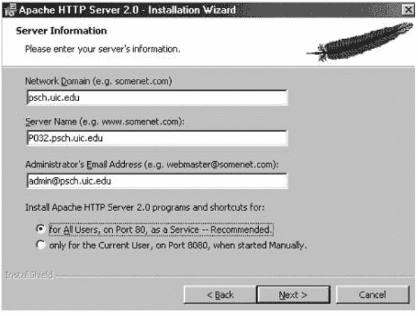

### 启动并运行你的服务器

既然你已经下载并安装了所有需要的程序，接下来就可以设置和测试你的服务器了。

1. 点击你的 Windows `开始` 菜单，按照以下顺序点击选项：程序 > Apache HTTP Server > Control Apache Server > Start Apache in Console。这将打开一个 MS-DOS 窗口。请不要关闭此窗口。最小化它没有问题，但不要关闭。服务器软件需要它保持打开状态才能运行。
2. 让我们测试 Apache。打开浏览器并输入以下 URL：`http://localhost`。
3. 如果你成功了，你将看到如图 2.3 所示的页面。如果你看到这个页面，你应该庆祝一下。为什么？今天早些时候，你还在怀疑自己是否能在几天内进行自己的互联网研究，现在你拥有自己的、完全可操作的服务器了。恭喜！

如果你没有看到类似图 2.3 所示的页面，请回溯你的步骤并确保所有操作都正确无误。在安装过程中很容易忽略一个简单的步骤。例如，你可能下载了错误的文件（例如，下载了源代码文件而不是二进制文件）。如果你无法解决问题，请查阅本章的故障排除部分。我将在本书的网站上维护一个最新的常见问题解答页面以及一个故障排除页面。

### 创建数据目录


正如你将在本书后面发现的，我们将编写的某些程序将从用户那里收集数据，并将这些数据保存到服务器上。通常的做法是创建一个特殊的目录来保存我们的数据文件，以便我们不会将它们与其他文件混淆。如果你使用自己的服务器，可以将此文件夹放在多个位置。然而，为了确保本书中使用的编程代码与你的服务器兼容，你需要创建一个特定的目录。

1. 使用桌面上的“我的电脑”应用程序，定位到`C:\Program Files\Apache Group\Apache2\htdocs\`目录。
2. 在该`htdocs`文件夹内，创建一个名为`www`的新文件夹。
3. 在新的`www`文件夹内，再创建一个名为`data`的文件夹。

在我们本书后面讨论的程序中，我们将从参与者那里收集数据，这些程序会自动将数据存储在以下目录：`C:\Program Files\Apache Group\Apache2\htdocs\www\data`。正如我将在第 5 章解释的那样，你可以通过简单地访问该文件夹来访问服务器上的数据。

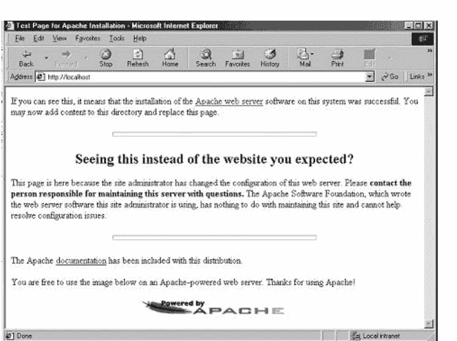

**图 2.3.** 如果你已成功安装 Apache 服务器软件，你应该会看到此屏幕。

在第 15 章，我将向你展示一种配置数据文件夹的替代方法，该方法将使内容更安全，但这种方法对于学习本书教授的技能来说是最简单的。

## 关于服务器组织和操作的一些重要说明

### 将文件传输到服务器

如果你过去创建过网页，但没有自己的服务器，你可能熟悉**文件传输协议（FTP）**程序，例如`WS_FTP Pro`。FTP 程序用于通过互联网将文档从一台计算机传输到另一台。既然你现在有了自己的服务器，你将*不*需要使用 FTP 程序。你可以在服务器本身上创建你的程序，并且，由于它们已经在服务器上，你不需要将它们传输过去。这将使过程更快、更令人满意。

### 你的网页位置

虽然你的计算机现在充当服务器，但这并不意味着你计算机上的所有目录和文件都可供人们查看。只有特定文件夹`htdocs`中的文件才能被访问你网站的人查看。如果你在安装 Apache 时遵循了所有默认设置，此文件夹应位于以下目录：`C:\Program Files\Apache Group\Apache2\htdocs\`。一旦你创建了一个 HTML 文档并将其放入此文件夹，任何输入正确 URL 的世界上的其他人都可以查看它。如果你在（比如说）“我的文档”文件夹中创建并保存了该文档，其他人将*无法*查看它。

> **注意。** 每当你创建一个标准的 HTML 网页时，你都应该将其保存到服务器上的`C:\Program Files\Apache Group\Apache2\htdocs\`目录中。在本书的其余部分，我将把这个文件夹或目录称为公共 HTML 文件夹。如果我要求你将文件保存到你的公共 HTML 文件夹，你应该将其保存到你的 Web 服务器上的`C:\Program Files\Apache Group\Apache2\htdocs\`文件夹中。

### 你的网页的地址或 URL

还记得我们安装 Apache 时出现的“Server Name”框吗？该框中出现的名称是你网站的“基础”或“根” URL（即你网站上所有页面的 URL 都将以该根开头）。所以，假设我创建了一个名为`MemoryStudy.htm`的网页并将其保存在我的公共 HTML 文件夹中。该页面的完整 URL 将是`http://P032.psch.uic.edu/MemoryStudy.htm`。任何人在其浏览器的 URL 栏中输入`http://P032.psch.uic.edu/MemoryStudy.htm`，都会直接访问该网页。（请注意，“P032”中的 0 是数字零，而不是大写字母 O。）

### CGI 文件夹

正如我们在第 1 章讨论的，我们将用 Perl 编写 CGI 脚本来执行特殊任务，例如存储我们的数据。与 HTML 文件（即你的标准网页）不同，这些文件将是*可执行*程序，它们将存储在一个名为`cgi-bin`的特殊文件夹中。如果你在安装 Apache 时遵循了所有默认设置，此文件夹应位于以下位置：`C:\Program Files\Apache Group\Apache2\cgi-bin\`。当你用 Perl 编写 CGI 程序时，你将*总是*将其保存到`cgi-bin`目录。

> **注意。** 每当你创建一个**CGI 脚本**时，你都应将其保存到服务器上的`C:\Program Files\Apache Group\Apache2\cgi-bin\`目录。在本书的其余部分，我将把此目录称为`cgi-bin`目录。

### 启动和关闭服务器

通常，你会让计算机一直开着。通过互联网收集数据的好处之一是，研究参与者可以在一天中的任何时间参与你的研究。如果你需要关闭计算机，你需要先关闭你的服务器。要做到这一点，只需转到打开的 Apache 命令窗口（MS-DOS 窗口），然后单击右上角的 X（通常用于关闭窗口的按钮）。你的计算机可能会对此提出警告，也可能不会，但没关系。关闭此窗口后，你就可以关闭计算机了。

要重启服务器，转到你的**开始**菜单并选择以下选项序列：程序 > Apache HTTP Server > Control Apache Server > Start Apache in Console。如前所述，这将打开一个 MS-DOS 窗口，该窗口必须保持打开状态（尽管你可以最小化它）服务器才能运行。

> **注意。** 在某些 Windows 操作系统（如 Windows 2000）上，每次你启动计算机时，Apache 都会自动开启。如果是这种情况，如果你尝试上述步骤，将会出现一条消息告诉你服务器已经在运行。

## 故障排除

如果你遵循此处概述的基本步骤，一切应该正常工作。如果某些东西似乎工作不正常，你可能需要回溯你的步骤并重新逐步完成每个步骤。我将在本书的网页`http://www.web-research-design.net`上维护一个最新的故障排除部分，以防出现本章未涉及的问题。

### 当我尝试安装 Apache 软件时，程序没有自动填充我的服务器名称等框

这些框没有自动填充至少有两个原因。首先，如果你使用的计算机的互联网连接使用的是动态 IP 地址（而不是静态 IP 地址），服务器软件将无法正常运行。其次，如果你的计算机没有完全配置特定的 IP 地址，这些框可能会显示为空。从长远来看这不会是个问题，但这会使安装过程稍微复杂一些。请要求你的大学或院系计算机支持人员配置你计算机的 IP 地址。**IP（互联网协议）**地址是一串数字（例如，`121.23.123.23`），它充当你计算机在网络上的地址或位置。所有连接到互联网的计算机都有一个与之关联的 IP 地址，但有些计算机在每次用户登录互联网时都会被分配一个不同的 IP 地址，而其他计算机在每次用户登录互联网时都使用相同的 IP 地址。（默认情况下，Windows 系统通常配置为自动获取 IP 地址，假设你是在家中使用计算机，并且你的互联网连接将由互联网服务提供商（如 AOL 或 Prodigy）动态分配。）

如果你的计算机未配置特定的 IP 地址，Apache 可能无法完成配置框中的信息。你应该要求你部门或大学的计算机支持人员将你的计算机配置为特定的 IP 地址。完成此操作后，尝试安装 Apache。Apache 然后应该会自动填充这些框。如果 Apache 仍然没有自动填充相关信息，但你有 IP 地址，你可以将该 IP 地址视为服务器 URL 的一部分。例如，如果你的 IP 号是`121.23.123.23`，你的网站完整 URL 将是`http://121.23.123.23/`，而不是像`http://p032.psch.uic.edu/`这样的地址。如果这样可以正常工作，请联系你的计算机支持人员，获取一个与该 IP 号对应的、更易于使用的 URL 或域名。

### 我无法在 Apache 网站上找到我需要的服务器文件

Apache 网站更新频繁，因此本书中描述的下载 Apache 软件的具体步骤可能很快就会过时。不过，一般来说，你可以遵循以下策略来获取正确的文件。每当你访问 Apache 的主网站时，(1) 找到并点击下载 HTTP Server 软件的链接，(2) 找到与 Windows 相关的任何链接，如“win32”或“win9x”，(3) 找到一个最近且稳定的安装包进行下载（页面应注明哪个版本是最稳定的），且扩展名为`.msi`。`.msi`扩展名意味着 Microsoft Windows Installer 可以安装该程序。

### 我顺利下载了 Apache 软件，但当我在浏览器的地址栏中输入`http://localhost`时，却看不到应该显示的页面

可能是你没有启动 Apache 服务器，或者之前启动过但重启了计算机后服务器现已停止运行。要启动 Apache 程序，请进入**开始**菜单，在**程序**或**应用程序**下找到 Apache 程序组，在**Control Apache Server**子组中寻找一个标为**Start console in window**或**Start**的选项。这应该会打开一个**MS-DOS**窗口（或**Command Prompt**窗口，因为 MS-DOS 程序在 Windows 2000 及之后版本中被更名）。你需要保持该窗口打开，服务器才能运行。

# 第 3 章

## HTML

### 如何从零开始创建网页

既然你已经有了一个可运行的服务器，就可以开始创建网页了。网页通常使用一种叫做**HTML**（超文本标记语言）的语言编写，因此本章我们将讨论如何创建基本的 HTML 页面。具体来说，我将向你展示如何创建一个简单的页面、格式化文本（即使用粗体、斜体、换行）、插入图片以及使用超链接。掌握了这些基础知识后，我将在第 4 章向你展示一些更复杂的 HTML 技术。

我们将“手工”编写 HTML 代码。市面上有很多程序，如 Microsoft 的 FrontPage、Macromedia 的 Dreamweaver 或 Netscape 的 Composer，它们可以让你像使用文字处理程序一样创建网页。例如，如果你想将某些文本设为粗体，只需选中文本并点击“粗体”按钮即可。使用这些**WYSIWYG**（所见即所得）程序，页面在屏幕上的显示效果就是最终产品的呈现效果。HTML 代码会在后台自动生成，因此你无需了解任何 HTML 知识就能创建精美的网页。

我对 WYSIWYG 程序没有任何偏见，我自己也经常使用 Dreamweaver 来管理大部分个人和教学相关的网页。然而，出于研究目的，你需要“手工”编写大部分 HTML 代码，原因有二。首先，在我们的大部分 CGI 脚本编写中，我们需要为特定用户或研究参与者创建定制的网页。为此，我们需要将*通用的*HTML 代码放入 CGI 脚本中。我们无法使用 WYSIWYG 程序来构建合适的 HTML。其次，WYSIWYG 程序往往会在你的页面中插入大量无用的、有时甚至有问题的 HTML 代码。此外，当你随时间修订页面时，许多 WYSIWYG 程序不能高效地更新 HTML 代码，这会导致格式问题，而这些问题在没有明确的 HTML 知识的情况下是无法修正的。你需要对用于研究目的的页面拥有*完全的*控制权，而这些程序无法提供你所需的控制。

在简单的文本编辑器中编写和编辑 HTML 代码最为方便。虽然你可以使用流行的 Microsoft Word 等文字处理程序来编辑文本（`.txt`）文件，但 MS Word 经常会在你不知情的情况下重新格式化你的文本。因此，我不建议你使用 MS Word 来创建 HTML 文件。我也不建议你使用标准的 Windows 文本编辑器 Notepad，因为它有一个讨厌的习惯，就是会为所有文件添加`.txt`扩展名，即使你指示程序使用其他扩展名保存文件也不行。

在本书中，我建议你使用一个叫做**1st Page**的文本编辑器。这个程序有几个理想的功能：(1) 你可以同时打开多个文件，并通过点击标签在它们之间轻松切换；(2) 该程序具有“代码智能识别”功能，会为各种 HTML（和 Perl）代码使用不同颜色，从而使编辑和故障排除更加容易；(3) 该程序包含一个预览窗格，允许你查看 HTML 代码在浏览器中的显示效果；(4) 与 Dreamweaver 类似，该程序会通过下拉菜单为你完成部分 HTML 编码工作，但方式更易于控制；(5) 该程序包含一个实用的拼写检查器，在你输入时检查拼写（类似于 Microsoft Word 的功能）。在下一节中，我将向你展示如何下载并安装 1st Page 的免费版本。如果你已经熟悉其他文本编辑器，请随意使用；本书不要求也不假设你必须使用 1st Page。

#### 下载和安装 1ST PAGE

在下载 1st Page 之前，你需要一个叫做**WinZip**的程序，它用于解压缩文件（即以`.zip`为扩展名的文件）。你的计算机上可能已经安装了 WinZip。要确认这一点，请点击 Windows **开始**按钮，查看 WinZip 是否出现在你的程序列表中。如果没有，你可以在 WinZip 网站上免费下载评估版。如果你已经安装了 WinZip，请直接跳到第 5 步。否则，请从下面的第 1 步开始下载并安装 WinZip。

1. 访问 WinZip 网站：`http://www.winzip.com`。
2. 点击[Download Evaluation Version](http://)链接。
3. 从 WinZip 服务器点击最新版本 WinZip 的链接。在撰写本文时，该链接标为[Download WinZip 8.1 SR-1](http://)。点击该链接后，将打开一个文件下载窗口。将文件`winzip81.exe`保存到你的**桌面**。文件应自动开始下载。
4. 双击**桌面**上的`winzip81.exe`文件以安装 WinZip 程序。
5. 访问 1st Page 网站：`http://www.evrsoft.com/`。
6. 点击[Download Now](http://)链接。

> **注意。** 如果该文件在 Evrsoft 网页上不可用，还有其他地方可以下载。本书网页`http://www.web-research-design.net`上提供了 1st Page 下载地址的最新链接。

7. 点击允许你下载 1st Page 最新版本的图标或按钮，并按照说明操作。
8. 将打开一个**Download File**窗口。将文件（例如`1stpage2.zip`）保存到你的**桌面**。
9. 右键点击**桌面**上的`1stpage2.zip`文件。选择`Extract to folder C:\Windows\Desktop\1stpage2`选项。该选项允许你使用 WinZip 将程序解压到桌面上一个名为`1stpage2`的文件夹中。
10. 打开桌面上的`1stpage2`文件夹，双击`setup.exe`程序图标。
11. 1st Page 现在应该已经成功安装。

### 所有 HTML 页面必备的内容

让我们一起创建我们的第一个网页。首先在文本编辑器中打开一个新文档。（在 1st Page 中，点击 File 菜单，然后选择以下选项：New > Blank Document。一个空白页面应该会出现在你的 1st Page 编辑器窗口中。）

所有 HTML 页面通常包含以下默认命令。

```
<HTML>
<BODY>
</BODY>
</HTML>
```

被“小于号”（`<`）和“大于号”（`>`）括起来的内容称为**标签**——用于修改网页内容的编程命令。所有 HTML 标签都被“小于号”和“大于号”括起来，从而使浏览器能够区分普通文本和 HTML 代码。许多（但不是全部）开始标签需要一个结束标签，结束标签包含一个反斜杠（例如`</HTML>`）。在本书中，我会将标签内的命令大写，以帮助将其与其余文本区分开来。你不必这样做，但你可能会发现这有助于组织代码。

第一个标签`<HTML>`告诉浏览器即将接收 HTML 信息。结束标签`</HTML>`告诉浏览器 HTML 代码已完成。BODY 标签不是必需的，除非你想更改某些页面属性，如背景颜色。我们可能偶尔需要更改这些属性，因此我在上面包含了 BODY 标签。

#### 输入基本标签

请继续在你的新文档中输入这些基本标签。我们将在后续示例中以此为基础进行扩展。

> **注意。** 严格来说，对于大多数 Web 应用程序而言，`<HTML>`标签并非必需，因为浏览器通常会假设它们接收的是 HTML 代码。尽管如此，在页面中包含这些标签通常被认为是良好的做法。

#### 创建文本

要在网页中插入文本，只需输入你希望别人浏览你的网页时显示的文本即可。例如，假设我想为我的研究创建一个主页，列出研究名称并说明其目的。以下 HTML 代码即可实现。

```
example1.htm
<HTML>
<BODY>
本实验的目的是更多地了解
我们对他人的感知方式。
</BODY>
</HTML>
```

这段代码（1）告知浏览器它即将接收 HTML 指令（第 1 行），（2）指示浏览器将文本“本实验的目的是更多地了解我们对他人的感知方式”打印到网页的主体部分（即页面本身，而非页眉或标题栏）（第 2 和第 3 行），以及（3）告知浏览器已完成发送主体和 HTML 信息（最后两行）。尝试将此代码输入你的文档中，并将文件保存为`example1.htm`。你需要将此文件（以及我们创建的所有 HTML 文档）保存到服务器的**Public HTML**文件夹中（如果你不记得**Public HTML**文件夹的位置，请参阅第 2 章）。

> **注意。** 如果你使用的是专业的网络托管服务，例如 Netfirms，你需要先将文件保存到本地计算机，然后使用 FTP 程序将其传输到服务器上的相应文件夹中。在本书中，当我指导你将文件保存为`example1.htm`，例如在你的**Public HTML**文件夹中时，你应该（1）将文件保存为`example1.htm`到你计算机上的某个位置，（2）打开 FTP 程序并与服务器建立连接，以及（3）将计算机上的`example1.htm`文件传输到服务器上的 Public HTML 文件夹中。对于本书中讨论的所有 HTML 示例，你都需要遵循这一通用流程。如果你选择自行搭建服务器而不使用网络托管服务，那么我将假设你正在自己的服务器上工作，你只需将文件保存到服务器上的适当位置即可（例如，`C:\Program Files\Apache Group\Apache2\htdocs\`）；无需将文件从一个位置传输到另一个位置。

> **注意。** HTML 文档通常保存为`.htm`或`.html`扩展名。为了一致性起见，本书中讨论的 HTML 文件我将使用`.htm`扩展名。


让我们看看页面的效果。打开计算机上的 Web 浏览器，输入你网站的 URL，后跟`example1.htm`。例如，我的服务器上的`example1.htm`位于以下网址：`http://www.web-research-design.net/example1.htm`。你应该会看到与图 3.1 所示类似的页面。

> **注意。** 编写 HTML 代码时，打开浏览器窗口通常会很有用。这样你可以一边编辑和保存到服务器，一边查看页面的效果。但是，要获得最新效果，每次编辑并保存到服务器后，你需要**刷新**或**重新加载**页面，因为浏览器会将网页副本存储在内存中。因此，一旦加载了某个页面，你的计算机不会持续重新加载其内容。如果服务器上的页面代码发生变化，除非你明确要求浏览器“重新加载”该页面，否则浏览器不会知晓。

> **注意。** 1st Page 的一个实用功能是它内置了预览窗格，因此你不一定需要打开浏览器就能看到页面的效果。只需单击窗口顶部附近的**预览**选项卡，即可在 HTML 代码和类浏览器的代码解释视图之间切换。

### 页面属性

你可以轻松操控网页的某些特性，例如背景颜色和页面标题（具体来说，是浏览器标题栏上显示的标题）。页面标题至关重要，因为它是许多搜索引擎用来索引网页的标题。你应该为页面起一个尽可能描述性的标题。将标题视为页面的广告。如果你希望正在搜索“人格测试”等关键词的人能够找到你的网站，你可以考虑将页面标题设为“免费心理学实验和人格测试”。如果你不希望人们通过简单的网络搜索发现你的页面（例如，该页面代表实验设计中的特定条件，你不希望人们看到，除非他们正在做该实验），那么你应该考虑省略标题。

要创建标题，请使用`<TITLE>`标签。以下是一个示例：

```html
example2.htm
<HTML>
<TITLE>社会知觉实验</TITLE>
<BODY>
本实验的目的是更多地了解
我们对他人的感知方式。
</BODY>
</HTML>
```

将此文件保存为服务器 Public HTML 文件夹中的`example2.htm`。要在 Internet 上查看该页面，请在浏览器窗口中输入相应的 URL。

## 40 如何通过互联网开展行为研究

在我的服务器上，相应的 URL 是`http://www.web-research-design.net/example2.htm`。请注意，实验的标题现在显示在浏览器标题栏的顶部，如图 3.2 所示。

你可能还希望修改网页的背景颜色。默认情况下，浏览器通常假设颜色为白色或灰色。如果你想显式指定背景颜色，可以在`<BODY>`标签中使用`BGCOLOR`命令来实现：

```html
<BODY BGCOLOR = blue >
```

> **注意。** 尽管在标签中为赋值加上双引号很常见，但我们将使用单引号。使用单引号的原因是，当我们开始在 CGI 程序中插入 HTML 代码时，CGI 程序通常会为特定目的保留双引号。如果从一开始就采用使用单引号的惯例，我们之后就不会遇到问题。

对于许多颜色，你可以直接插入常见的颜色名称（例如，`'white'`、`'blue'`、`'red'`），就像我们在这个例子中所做的。如果你想对使用的颜色有更多控制，可以输入各种颜色的十六进制代码。例如，`'#ffffff'`是白色的一种十六进制表示方式。关于十六进制代码和颜色混合的详细讨论，我鼓励你访问以下网站：`http://www.w3schools.com/html/html_colors.asp`。

你还可以在`<BODY>`标签中使用`TEXT`命令指定文本颜色。（大多数浏览器中的默认文本颜色为黑色。）

```html
<BODY BGCOLOR = blue TEXT = white >
```

### 格式化文本

有时你会希望修改某些文本的外观。例如，你可能希望将某些文字加粗、将其他文字设为斜体，或在文档中使用不同的字体大小。以下是一些常见格式设置替代方案的命令。在文档的`BODY`标签之间输入这些命令，以查看它们如何影响浏览器窗口中文本的外观。（你可能希望同时将所有这些命令输入到你的文档中，然后保存到服务器的 Public HTML 文件夹并查看结果。）

#### 粗体

使用`<B>`标签将文本设置为粗体。

```html
我想让以下单词<B>以粗体显示</B>，但这些不是。
```

#### 斜体

使用`<I>`标签将文本设置为斜体。

```html
我想<I>将一些单词</I>设为斜体。
```

#### 字体

要更改字体类型，请使用带有`FACE`属性的`<FONT>`标签。

一些文字在`<FONT FACE = arial >arial</FONT>`字体下看起来不错，而另一些则在`<FONT FACE = courier >courier</FONT>`字体下显得更好。

#### 文本大小

使用带有`SIZE`属性的`<FONT>`标签可以改变文本的大小。

```html
Some words are <FONT SIZE = 5 >bigger</FONT> than others.
```

> **注意。** 如果我们希望在几个单词后恢复到之前的字体设置（例如，浏览器默认值），我们需要使用闭合字体标签：`</FONT>`。

#### 文本颜色

如果我们想让某些文本的颜色与文本其余部分（在`<BODY>`标签中指定）不同，我们可以使用带有`COLOR`属性的`<FONT>`标签。

```html
Some words are <FONT COLOR= red >read</FONT> more than others.
```

#### 行间距

即使你在文本编辑器中将文本输入在不同的行上，浏览器也不会将文本显示在不同的行上，除非你明确要求它这样做。换行符的标签是`<BR>`。

```html
I want this to appear on one line. <BR>
And this to appear on the next. <BR>
<BR>
<BR>
This line will be separated from the previous by two blank lines.
```

> **注意。** 还有段落标签（即`<P>`和`</P>`），允许你将文本行分隔成离散的段落。在本书中我们不会过多使用段落标签，因为使用`<BR>`标签可以达到同样的效果。

#### 文本居中

默认情况下，文本将是“左对齐”——与页面的左侧对齐。如果你想让页面的某些部分居中，可以使用`<CENTER>`标签。

```html
<CENTER>
Results
</CENTER>
The age and sex breakdown for the sample is presented in Table 1.
```

#### 空白间隔

HTML 的一个有趣特性是，除非你明确要求，否则你无法在文本中插入两个或更多的空白间隔。因此，虽然你可以通过简单地使用空格键在句子末尾插入一个空白间隔，但你不能按两次空格键来插入两个空白间隔。

要插入超过一个字符宽度的空白间隔，你需要使用一个特殊的命令：`&nbsp;`。以下是使用方法：

```html
Two blank spaces follow this period.&nbsp;&nbsp;Nice, isn't it?
```

这是另一种实现相同效果的方法，基于我们可以通过使用空格键来创建一个空格的思路：

```html
Two blank spaces follow this period. &nbsp;Nice, isn't it?
```

让我们将这些东西组合到一个文件中，看看它是什么样子。将以下 HTML 代码复制到一个空白文档中，并将其保存为`example3.htm`到你服务器的 Public HTML 目录。通过在浏览器中输入相应的 URL 来查看页面。（在我的服务器上，URL 是`http://www.web-research-design.net/example3.htm`。）

```html
<HTML>
<TITLE>Social Perception Experiment</TITLE>
<BODY BGCOLOR= gray TEXT= white >

<B>Social Perception Experiment </B><BR><BR>
```

```html
The purpose of this experiment is to learn more about
  the way we perceive others. <BR><BR><BR>
I want the following words <B> to appear in boldface
  type</B>, but not these.<BR>

I would like to <I> italicize</I> some words.<BR>
Some words are <FONT SIZE = 5 > bigger</FONT> than
  others.<BR>
Some words look nice in <FONT FACE = arial COLOR =
  black > arial</FONT>, whereas others look better
  in <FONT FACE = courier COLOR = black >
  courier.</FONT>

Two blank spaces follow this period.&nbsp&nbspNice,
  isn't it?
</BODY>
</HTML>
```

此代码生成的网页应与图 3.3 中描绘的类似。

### 插入图像

要在文档中放置图像，你需要做两件事之一。首先，如果你想使用 WWW 上已存在的图像，你需要知道该图像的完整 URL。或者，如果你想将新图像放置在互联网上（例如，你扫描或自己创建的图像），你需要将该图像放入你服务器的 Public HTML 文件夹中。该图像的 URL 然后变为你网站的根 URL 加上图像名称。例如，如果我想使用名为`figure1.jpg`的图像，我会将其保存到我的 Public HTML 文件夹中，该图像的 URL 将变为`http://www.web-research-design.net/figure1.jpg`。

为了保持服务器文件的组织性，我建议创建一个名为`images`的特殊文件夹来存储你的图像文件。提示框解释了如何执行此操作，具体取决于你使用的是 Web 托管服务还是你自己的服务器；本书中的代码示例假设你的 Public HTML 目录中有一个名为`images`的特殊文件夹。

##### 提示：创建新的图像文件夹

如果你使用的是 Netfirms：使用你的 FTP 程序建立与服务器的连接。打开你的`www`文件夹，然后单击`MkDir`按钮创建一个新目录。输入“images”并单击`OK`。你现在应该有一个名为`images`的新文件夹，位于你的 Public HTML 或`www`目录内。你应该将任何希望使用的图像文件保存到此目录。

如果你使用的是自己的服务器：使用桌面上的`My Computer`应用程序转到以下位置：`C:\Program Files\Apache Group\Apache2\htdocs\`。在`htdocs`文件夹中，单击`File > New > Folder`。单击名称区域一次，然后输入新名称，将新文件夹命名为“images”。你现在应该有一个名为`images`的新文件夹，位于你的 Public HTML 或`htdocs`目录内。你应该将任何希望使用的图像文件保存到此目录。

> **提示：将本书中使用的图像保存到你的服务器**
>
> 要将本书中使用的图像保存到你的服务器，请访问本书的网页（`http://www.web-research-design.net/`）并转到`Downloads`部分。你将能够从该站点下载本书中使用的所有图像，方法是右键单击图像的文件名并选择`Save Target As`，这允许你将图像保存到计算机。如果你使用的是自己的服务器，你需要将图像保存到 Public HTML 文件夹中的`images`目录。如果你使用的是专业托管公司，请将图像保存到计算机，然后通过 FTP 将图像传输到 Public HTML 文件夹的`images`目录。

一旦图像已保存到服务器的`images`文件夹，你就可以使用``命令在网页上显示图像。以下是一个示例：

```html
This child can program in Perl.<BR> <BR>

```

将此代码放在`<BODY>`标签之间。此代码生成的网页应与图 3.4 中所示的类似。图像标签的`SRC`属性告诉服务器图像的 URL。有两种方法可以指定此地址。

首先，我们可以使用“绝对路径”——指定图像完整 URL 的路径。如果想在上面的示例中使用绝对路径，我们可以将`SRC`属性设置为`http://www.web-research-design.net/images/figure1.jpg`。

其次，我们可以使用“相对路径”——表示文件相对于当前网页位置的路径。在上面的示例中，我们使用了相对路径。因为用户已经访问了我网站上基础 URL 为`http://www.web-research-design.net/`的网页，我只需要指定扩展当前 URL 的 URL 部分。在这种情况下，我只需要指定`/images/figure1.jpg`。服务器会自动将此扩展名附加到当前页面的 URL（即`http://www.web-research-design.net`），从而请求来自`http://www.web-research-design.net/images/figure1.jpg`的图像。

在本书中我将使用相对路径，这样我的代码在你的服务器上将与在我的服务器上以相同的方式工作。在你的示例中，相对路径`/images/figure1.jpg`将从你的服务器上的 images 文件夹中获取图像；在我的情况下，它将从我的服务器上的 images 文件夹中获取图像。

如果你以这种方式指定标签，图像将以其*自然*大小或尺寸（即图像本身的大小）出现。如果你想调整图像的大小，可以使用`IMG`标签的尺寸属性（`HEIGHT`和`WIDTH`）来完成。度量单位是像素，即屏幕上微小的光点。以下是一个示例：

```html
Which of the following faces seems more friendly?<BR>


```

此代码应生成图 3.5 所示的网页。

当你有想要以相同尺寸呈现的视觉刺激，但图形文件的尺寸不完全相同时，指定`WIDTH`和`HEIGHT`属性可能很有用。只要原始文件在尺寸上差异不是太大，此方法将允许你以标准尺寸呈现刺激而不失真。

> **注意。** 请记住，如果你修改了 HTML 代码以尝试这些示例，你需要在浏览器中“刷新”或“重新加载”页面才能看到更改的效果。

一般来说，最好使用所需的尺寸保存图像，而不是调整呈现图像的尺寸。图片下载可能需要一段时间，因此你不希望用户花费大量时间下载大型图片文件，而你却计划在展示模式下将其缩小。如果你希望在研究中使用图片，但尚未拥有想要使用的图片，你应该考虑获取一些能够创建和编辑图片文件的软件。Adobe Photoshop（`http://www.adobe.com/products/photoshop/main.html`）是一款非常流行的图像处理程序。我使用的程序是 Paint Shop Pro（`http://www.jasc.com/`）。

下面哪张面孔看起来更友好？


**图 3.5.** 调整网页上的图片尺寸。

### 创建超链接

网页的一个有用功能是能够点击超链接，立即跳转到另一个网页。要创建超链接，你可以使用`<A>`标签或锚点标签。这里有一个示例：

```html
有关本书的更多信息，请点击
   <A HREF =  http://www.web-research-design-net >
   此处</A>。
```

当你希望用户点击链接时跳转到的 URL 是通过`HREF`属性指定的。这段代码应该生成一个类似于图 3.6 所示的网页。

有关本书的更多信息，请点击[此处](here)。

**图 3.6.** 一个超文本链接。

请注意，我们想要转换为超文本链接的文本位于开始标签和结束标签之间。另请注意，`HREF`属性用于指定链接的完整网址或 URL。如果链接指向与当前页面在同一目录中的另一个文件，则不需要完整的扩展名，你可以使用“相对”链接。

例如，如果我想从`example1.htm`创建一个指向名为`example2.htm`的文件的链接，我可以使用以下两个 HTML 命令中的任何一个：

`<A HREF = http://www.web-research-design-net/example2.htm > 点击此处转到下一页 </A>`

或：

`<A HREF = /example2.htm > 点击此处转到下一页 </A>`

无论哪种情况，当用户点击“点击此处转到下一页”的文本时，用户将从`example1.htm`跳转到`example2.htm`。

### 使用图片作为链接

有时你可能会发现使用图片而不是文本作为链接很有用。为此，你需要在超链接标签之间插入图片的 HTML 代码，而不是文本。这里有一个示例：

```html
请点击下方图片了解有关本书的更多信息。
<BR>
<A HREF = http://www.web-research-design-net >

</A>
```


这段代码将生成如图 3.7 所示的网页。同样，可以使用绝对路径或相对路径来指定图片的 URL。如果我在此示例中使用了相对路径，我需要先将`relationalstructures.jpg`图片文件下载到服务器的`images`目录中。

请点击下方图片了解有关本书的更多信息。


**图 3.7.** 基于图片的链接。

#### 有效使用表格

通常，你会发现将图片、文本或响应量表放在表格中很有用。创建一个简单表格涉及三个标签：

1. `<TABLE>`标签，用于开始和结束表格上下文。
2. 行标签`<TR>`，用于开始和结束一行。
3. 列标签`<TD>`，用于开始和结束一行中的列内容。

这里有一个示例：

```html
<TABLE>
<TR>
<TD>
第一行，第一列
</TD>
<TD>
第一行，第二列
</TD>
</TR>
<TR>
<TD>
第二行，第一列
</TD>
<TD>
第二行，第二列
</TD>
</TR>
</TABLE>
```

请注意，命令的流程是按行逐列进行的。换句话说，我们首先使用`<TR>`开始一行，然后在该行内使用`<TD>`和`</TD>`创建列，然后使用`</TR>`结束该行，并开始下一行。

此代码生成的网页如图 3.8 所示。请注意，默认情况下，列的宽度与最大单元格的内容一样宽。值得注意的是，我们不需要告诉浏览器我们将使用多少行或多少列；我们只需根据需要使用即可。这个特性在我们后面讨论如何为受试者自定义实验反馈但不知道事先需要多少行时，将会非常方便。

每个命令不必放在单独的行上。（事实上，如果需要，整个 HTML 文件可以写在一行上！）以下是我通常在文本编辑器中格式化前一组命令的方式：

```html
<TABLE>
<TR>
<TD>第一行，第一列</TD>
<TD>第一行，第二列</TD>
</TR>
<TR>
<TD>第二行，第一列</TD>
<TD>第二行，第二列</TD>
</TR>
</TABLE>
```

`<TABLE>`标签有许多属性，允许你以可能有用的方式更改表格的外观。例如，你可以通过向`<TABLE>`标签添加`BORDER`属性来为表格创建边框。此外，你可以使用`BORDERCOLOR`属性更改边框的颜色。你可以通过向`<TABLE>`标签添加`CELLSPACING`和`CELLPADDING`属性来调整单元格之间的间距和单元格内的内边距。

`CELLSPACING`标签影响表格中不同单元格之间的像素空间量。如果此属性设置为 2，则表格中所有单元格之间将放置 2 像素的空间。`CELLPADDING`标签影响单元格边框和单元格内容之间的像素空间量。如果此属性设置为 5，则单元格边缘和单元格内容之间将放置 5 像素的空间。

这里有一些属性如何影响表格外观的示例。我鼓励你尝试不同的像素尺寸，以便你可以看到这些属性如何影响表格的外观。

```html
<TABLE BORDER CELLSPACING = 2>
<TR>
<TD>第一行，第一列</TD>
<TD>第一行，第二列</TD>
</TR>
<TR>
<TD>第二行，第一列</TD>
<TD>第二行，第二列</TD>
</TR>
</TABLE>
```

这段代码将生成如图 3.9 所示的表格。

有时你会希望表格的特定行跨越一列或多列。你可以通过分别在`<TD>`或`<TR>`标签中使用`COLSPAN`和`ROWSPAN`属性来跨越列和行。这里有一个示例：

```html
<TABLE BORDER CELLSPACING = 2>
<TR>
<TD COLSPAN= 2 >因素 A</TD>
</TR>
<TR>
<TD>水平 1</TD>
<TD>水平 2</TD>
</TR>
<TR>
<TD>4.50</TD>
<TD>2.46</TD>
</TR>
<TR>
<TD>8.7</TD>
<TD>5.6</TD>
</TR>
</TABLE>
```

| 因素 A | |
| --- | --- |
| 水平 1 | 水平 2 |
| 4.50 | 2.46 |
| 8.7 | 5.6 |

**图 3.9.** 带边框的表格。

在这段代码中，我们将`COLSPAN`设置为 2，从而指示浏览器创建一个跨越 2 列的行。此代码创建的表格如图 3.10 所示。

有关你可以创建和格式化表格的各种方式的更多信息，请访问以下链接：<http://www.w3schools.com/html/html_tables.asp>。我们将在本书后面使用该页面上描述的一些技巧，例如在列或行内对齐和居中元素。

> **注意。** 遗憾的是，你在 HTML 文档中定义的各种文本属性（例如，字体、字体颜色）不适用于表格中的单元格。如果你不想使用浏览器默认的表格内元素设置，则需要在表格的每个单元格中重新输入这些属性。我将在下一个示例中说明如何做到这一点。

#### 整合起来

好的，现在让我们使用这些基本工具来为你的网站创建一个主页。这个页面的目的是向访客介绍你正在进行的研究类型。尽管我们尚未创建任何在线研究，表格仍然可以帮助我们组织网页内容。

| 因素 A | |
| --- | --- |
| 水平 1 | 水平 2 |
| 4.50 | 2.46 |
| 8.7 | 5.6 |

**图 3.10.** 一行跨越两列的表格。

## 总结

在本章中，你已经学习了如何制作一个基本的网页。让我们回顾一些关键要点：

1. HTML“标签”用于向浏览器传达如何显示信息的指令。
2. 所有网页都应以`<HTML>`标签开头，并以`</HTML>`标签结尾。
3. 许多（但并非所有）开始标签需要一个结束或关闭标签。例如，当你想将一些文本加粗时，你需要用`<B>`标签包围相应的文本以指示浏览器开始使用粗体，并用`</B>`标签指示浏览器停止使用粗体。
4. 你可以使用 HTML 标签来影响文本的外观，包括字体、字号、字体颜色和居中对齐。
5. 要插入换行符，请使用`<BR>`命令。`<BR>`命令不需要“关闭”或“结束”标签。
6. 要指示浏览器显示图像，请使用``标签。在此标签中，你必须使用`SRC`或“source”属性指定图像位置的 URL。你可以使用绝对路径（例如``）或相对路径（例如``）来指定 URL。你还可以使用`WIDTH`和`HEIGHT`属性来调整显示图像的宽度和高度。
7. 你可以使用`<A>`标签创建指向另一个网页的链接。使用`HREF`属性指定你要链接到的网页的 URL。例如，HTML 标签`<A HREF = http://www.guilford.com >点击此处前往Guilford出版社网站</A>`将创建一个指向 Guilford 出版社网站的超链接。
8. 表格是组织文本和图像排版的有用工具。要开始和结束一个表格，分别使用`<TABLE>`和`</TABLE>`标签。要创建一个新行，使用`<TR>`标签。要在一行中创建一个新单元格，使用`<TD>`标签开始单元格，使用`</TD>`标签结束单元格。使用`</TR>`标签结束一行。
9. 基本的 HTML 页面应保存到服务器上的**Public HTML**目录中。如果你使用的是 Netfirms 网络托管服务，你的**Public HTML**目录标记为“www”。如果你创建了自己的 Apache 服务器，你的**Public HTML**目录标记为“htdocs”。

在下一章中，我们将探讨 HTML 表单——从使用该页面的用户那里获取输入或响应的方式。

以下是基本 HTML 代码的回顾。其中许多在本章中已经讨论过；有些将在后续章节中讨论，但在此列出以便于查阅。

| HTML 标签 | 功能 | 示例 |
| --- | --- | --- |
| `<HTML>` `</HTML>` | 指示浏览器该文档包含 HTML 代码。此标签应放在你创建的每个 HTML 文档的开头，相应的`</HTML>`标签应放在末尾。 | `<HTML>`<br>网页内容<br>`</HTML>` |
| `<BODY>` `</BODY>` | body 标签用于指定 HTML 文档的属性（例如背景颜色）。 | `<BODY BGCOLOR = 'blue'>`<br>网页内容<br>`</BODY>` |
| `<B>` `</B>` | 指示浏览器将文本设置为粗体。 | This `<B>`word`</B>` will appear in bold type. |
| `<I>` `</I>` | 指示浏览器将标签之间的文本设置为斜体。 | `<I>This sentence will be italicized.</I>` |
| `<FONT>` `</FONT>` | 设置字体的属性（例如颜色、大小和字体类型）。 | `<FONT SIZE = '2' COLOR= 'gray' TYPE= 'arial'>`<br>文本显示在此处 `</FONT>` |
| `<BR>` | 创建换行。（不需要关闭标签。） | Line 1 `<BR>` Line 2 |
| `<CENTER>` `</CENTER>` | 将标签之间的文本和图像居中对齐。 | `<CENTER>General Discussion</CENTER>` |
| `&nbsp` | 指示浏览器在文本中包含一个空格。没有此命令，你只能在单词之间放置一个空格。 | Extra `&nbsp` `&nbsp` spaces |
| `` | 将图像插入 HTML 文档。`SRC`或 source 属性用于指定要显示的图像文件的 URL（使用相对路径或绝对路径）。其他属性（如`WIDTH`和`HEIGHT`）可用于调整图像的尺寸（以像素为单位）。 | 使用图像的绝对路径：<br><br>``<br><br>使用图像的相对路径：<br>`` |
| `<A>` `</A>` | 创建超链接。`HREF`属性指定链接页面的 URL（使用相对路径或绝对路径）。通过将文本或图像放在开始和结束标签之间，可以将它们转换为链接。 | 使用绝对 URL：<br>`<A HREF = 'http://www.web-research-design.net/page2.htm'>` Click here to link to go to Page 2`</A>`<br><br>使用相对 URL：<br>`<A HREF = '/page2.htm'>` Click here to link to go to Page 2 `</A>` |

| HTML 标签 | 功能 | 示例 |
| --- | --- | --- |
| `<TABLE>` `</TABLE>` | 指示浏览器创建一个表格。表格标签有几个可选的属性。`BGCOLOR`属性设置表格的背景色。`BORDER`属性以像素为单位指定表格边框的粗细。`BORDERCOLOR`属性指定边框的颜色。`BACKGROUND`属性将图像置于表格背景中。`CELLSPACING`和`CELLPADDING`属性分别以像素为单位指定单元格之间的空间以及单元格边框与其内容之间的空间。 | `<TABLE BGCOLOR='red' BORDER='1'>表格内容</TABLE>`或`<TABLE BACKGROUND='/images/figure1.jpg' CELLPADDING='2'>表格内容</TABLE>` |
| `<TR>` `</TR>` | 指示浏览器在表格内构建一个新行。`<TR>`标签必须包含在`<TABLE>`的开始和结束标签内。结束标签用于表示行的结束：`</TR>`。 | `<TABLE>` `<TR> 这是我的表格第一行 </TR>` `<TR> 这是我的表格第二行 </TR>` `</TABLE>` |
| `<TD>` `</TD>` | 指示浏览器在表格行内构建一个新单元格。`<TD>`标签（及其结束标签`</TD>`）必须嵌套在表格行内。可选属性：`WIDTH`属性以百分比形式指定表格中应分配给该单元格宽度的比例。`WIDTH`属性只需在一行中指定即可。`VALIGN`属性将单元格内容与单元格的顶部、中部或底部垂直对齐。`ROWSPAN`和`COLSPAN`属性允许单元格分别跨指定数量的行或列。 | `<TABLE>` `<TR>` `<TD WIDTH='80%' VALIGN='top'> 单元格 1 </TD>` `<TD WIDTH='20%' VALIGN='top'> 单元格 2 </TD>` `</TR>` `<TR>` `<TD VALIGN='bottom'/> 单元格 3 </TD>` `<TD VALIGN='bottom'/> 单元格 4 </TD>` `</TR>` `</TABLE>` |

# 第 4 章

### HTML 表单

#### 通过互联网从参与者收集研究数据

您可能在互联网上见过要求用户输入信息的网页。例如，您可能被要求在线订购单上输入您的邮寄地址，或使用评分量表对产品满意度进行评分。这些“输入”功能是通过使用表单实现的。**表单**是网页的特殊区域，允许用户提供信息（例如，书面评论、评分、从菜单中选择），这些信息由服务器处理。

表单有四个主要组成部分：

- 首先是**表单标签**，它告诉浏览器此 HTML 页面的这一部分将用于收集信息。表单以`<FORM>`标签开始，以`</FORM>`标签结束。
- 其次，`<FORM>`标签内的**属性**告诉浏览器在按下**提交**按钮（见下文）后如何处理输入。就本书而言，我们将涵盖两种选项：(1) 数据将被电子邮件发送到指定的电子邮件地址（研究人员的），或 (2) 数据将被发送到服务器上的 CGI 脚本进行处理（例如，操作它或将其保存到数据文件）。
- 第三，有一种**用户可以提供数据**的方式。用户可以通过打字、勾选复选框、单击按钮或从下拉菜单中选择列表来提供数据。
- 第四，有一个**提交**按钮，用户完成回答后会单击它。有时这些按钮上写着“提交”或其他内容，例如“前往结账”。图像链接也可用作**提交**按钮。

让我们依次讨论这些组成部分。然后，我们将通过几个示例来帮助说明表单在简单数据收集中的使用。

#### 表单标签

要创建一个接受用户输入的网页区域，您需要使用`<FORM>`标签。以下是一个此类标签的示例：

```html
<FORM ACTION = mailto:fraley@uic.edu METHOD = post
      ENCTYPE = text/plain >
```

此标签中有三个关键属性。第一个是`ACTION`，它告诉浏览器当用户单击**提交**按钮时该做什么。我们将处理两种操作：(1) 涉及通过电子邮件将数据发送给研究人员的操作，以及 (2) 涉及将数据发送到服务器进行 CGI 处理的操作。然而，就本章而言，我们将只处理电子邮件选项。*您需要在上面的代码中将我的电子邮件地址替换为您自己的。*

> **注意。** 只有用户的计算机正确配置，表单数据才能通过电子邮件提交。如果您经常使用办公室或实验室的计算机来检查电子邮件，那么您的计算机可能已正确配置，可以执行这些演示，尽管您的计算机可能会“警告”您即将通过互联网提交数据。通常，在真实的研究环境中，您不会希望通过电子邮件收集数据，因为参与者可能使用的是未配置为发送电子邮件的计算机（例如，公共实验室的计算机）。此外，使用电子邮件会暴露参与者的用户名，这可能危及数据的机密性。在下一章中，我将向您展示如何将数据从表单发送到服务器而不使用电子邮件。

第二个关键属性是`METHOD`属性。对于我们几乎要做的所有事情，它都将设置为`post`。

第三个属性`ENCTYPE`，仅在我们通过电子邮件发送数据时使用。它指示浏览器以简单的、未加密的文本形式发送数据。（除非您有特殊的解密软件，否则不应发送加密数据。此外，在没有加密的情况下，您不应对参与者请求私人或个人数据。）

#### 创建响应窗口和评分量表

有许多方法可以使用表单从用户收集响应。在这里，我们将讨论许多通用且简单的技术，包括文本框、单选按钮、下拉菜单、复选框和坐标图。在本节中，我将概述这些不同信息收集技术的基础知识。在介绍了每种技术之后，我们将通过一些示例进行讲解，以便您可以准确地看到网页上如何配置不同的组件（例如，`<FORM>`标签、**提交**按钮）。

##### 文本框

文本框是屏幕上的一个区域，用户可以在其中键入（或粘贴）响应。如果您正在收集叙述性数据，或者希望用户能够提供不受评分量表约束的评论，文本框选项非常有用。

以下是创建简单文本框的 HTML 代码；此代码的输出如图 4.1 所示。

```html
<INPUT TYPE = text box NAME = v1 MAXLENGTH = 25
        SIZE = 25 >
请输入您的代号或别名。<BR>
```

请输入您的代号或别名。

**图 4.1。** 文本框是从用户收集基于文本信息的一种方式。

请注意此标签的`MAXLENGTH`和`SIZE`属性。`SIZE`属性决定了文本框区域在屏幕上的大小。`MAXLENGTH`属性决定了框中允许的字符数（例如，字母）。如果您需要收集大量信息，明智的做法是将此属性设置为较高的值。但是，如果您不需要收集大量键入的信息，则将其设置为较小的值。如果此值未以某种方式加以限制，捣乱者可能会在这些框中粘贴一页又一页的文本，试图使您的服务器不堪重负或崩溃。

将`SIZE`属性设置得比`MAXLENGTH`属性小是可以的。即使无法一次查看全部文本，浏览器也会存储所有键入的信息。

这是另一种创建名为`TEXTAREA`的文本框的方法；此代码生成的网页如图 4.2 所示。

```html
请告诉我们您对这个实验的看法。<BR>
<TEXTAREA NAME = v1 COLS = 20 ROWS = 6 WRAP =
virtual >
请在此处输入。
</TEXTAREA>
```

请告诉我们您对这个实验的看法。

**图 4.2。** 文本区域框提供了一种从用户收集多行文本的方法。


`<TEXTAREA>` 标签类似于 `<INPUT>` 文本框标签，允许用户输入文本。不过，这个标签更灵活一些，允许你通过属性指定输入区域的行数（`ROWS`）和列数（`COLS`）。此外，`NAME` 属性用于为输入命名，而 `WRAP` 属性可以设置为 `'virtual'`（允许文本在框内自动换行）或 `'off'`（不强制文本换行）。`<TEXTAREA>` 标签需要一个结束标签：`</TEXTAREA>`。你可以在开始和结束标签之间放置预先创建的文本，当 HTML 页面加载时，这段文本会自动显示。

> **提示** `TEXTAREA` 选项的一个巧妙功能是，你可以在框内放置预先输入的文本。因此，如果你正在进行一项关于教育或学习的实验，需要人们校对并更正一段文本，你可以将刺激文本放入框中，指示参与者进行更正，然后你就能收到更正后的文本作为回复。

在 `<INPUT>` 文本框和 `<TEXTAREA>` 标签中，我们都有一个名为 `NAME` 的属性。此属性为回复提供一个名称（例如，变量标签或名称）。当数据通过电子邮件发送给你（或稍后发送给 CGI 脚本）时，对此输入框的回复将以变量名作为前缀。出于将在后续章节中解释的原因，我将采用在主要变量名后附加 `"v"`（代表变量）和一个数字的命名约定（例如，`v12` 将代表变量 12）。当变量超过 10 个时，我将使用 `v01`、`v02`、`v03` 等形式，而不是 `v1`、`v2`、`v3` 来表示前 9 个变量。

### 单选按钮

单选按钮是收集数据的非常灵活的工具。当一个问题存在多个响应选项，并且你不希望用户在每个问题中选择多个选项时，它们非常有用。以下是两个单选按钮的一些示例 HTML 代码：

```
Are you Female or Male?<BR>
<INPUT TYPE = radio NAME = v2 VALUE = F > Female
<BR>
<INPUT TYPE = radio NAME = v2 VALUE = M > Male
<BR>
```

此代码在网页上的显示效果如图 4.3 所示。


**图 4.3.** 单选按钮可用于收集互斥选项的回复。

这里有两点需要注意。首先，对于每个响应选项（男性和女性），都有一个单独的 `<INPUT>` 标签。还要注意，这些标签不需要闭合（即没有反斜杠标签）。其次，在这个示例中，选项被设计为互斥的。如果有人选择了“女性”然后选择了“男性”，之前选择的“女性”将消失。简而言之，我们创建了两个单选按钮，它们都使用相同的名称（`v2`）。`v2` 只能有一个值，因此当一个选项被选中时，另一个就不能被选中。需要注意的是，我们**没有**使用与之前问题（例如文本框示例）相同的变量名。

多个单选按钮可以串联在一起创建一个评分量表。以下是如何实现的一个示例：

```
I believe that American corporations have too much
  power.<BR>
Strongly Disagree
<INPUT TYPE = radio NAME = v3 VALUE = 1 >
<INPUT TYPE = radio NAME = v3 VALUE = 2 >
<INPUT TYPE = radio NAME = v3 VALUE = 3 >
<INPUT TYPE = radio NAME = v3 VALUE = 4 >
<INPUT TYPE = radio NAME = v3 VALUE = 5 >
<INPUT TYPE = radio NAME = v3 VALUE = 6 >
<INPUT TYPE = radio NAME = v3 VALUE = 7 >
Strongly Agree
<BR>
```

此代码的输出如图 4.4 所示。


**图 4.4.** 使用单选按钮获取量表评分。

请注意，我们为每个单选按钮使用了一个单独的输入标签，但为每个标签使用了相同的名称（即 `v3`）。我们还为每个单选按钮分配了不同的数值来量化个人的评分。如果用户点击最右边的单选按钮（即“非常同意”标签旁边的按钮），`v3` 的值将设置为 7；如果用户点击最左边的单选按钮，`v3` 的值将设置为 1。

> **提示** 可以在一个单选按钮组中预选一个按钮，以创建一个“默认”响应。例如，如果我们希望量表的中间点被预选，我们可以将上一个示例中对应的 `INPUT` 标签修改如下：`<INPUT TYPE = radio NAME = v3 VALUE = 4 CHECKED>`。当网页为用户显示时，第四个响应选项将已经被选中。如果用户认为默认选项不合适，他或她将必须选择另一个响应选项。

> **注意** 请务必牢记，如果你有几个单选按钮作为单个刺激或问卷项目的响应选项，那么所有单选按钮的 `NAME` 属性必须相同。当有两个或多个具有相同 `NAME` 属性的单选按钮时，用户只能选择这些按钮中的一个。即使这些按钮在网页上彼此不相邻，情况也是如此。如果你在页面顶部有一个名为 `"v03"` 的单选按钮，在页面底部有另一个名为 `"v03"` 的单选按钮，用户也只能选择其中一个按钮。请确保你所有用于单个刺激的按钮具有相同的名称，并且为不同的刺激使用不同的名称。

### 下拉菜单

当你有大量（但不是太多）的响应选项，并且希望你的用户选择一个时，下拉菜单非常有用。当被试者表明他们的性别、种族或原籍国时，我经常使用这些菜单。注意：下拉菜单会占用用户浏览器的大量内存。如果你使用超过二十个这样的菜单，页面可能会变得扭曲。

```
I am the kind of person who likes to program.
<SELECT NAME = v4 SIZE = 1>
<OPTION VALUE = 0 SELECTED> -Please select an
option -</OPTION>
<OPTION VALUE = 1>Strongly Disagree</OPTION>
<OPTION VALUE = 2>Disagree</OPTION>
<OPTION VALUE = 3>Agree</OPTION>
<OPTION VALUE = 4>Strongly Agree</OPTION>
</SELECT>
```

图 4.5 展示了浏览器解释此代码的方式。


**图 4.5.** 下拉菜单可用于在用户点击菜单时显示多个响应选项。

请注意，创建一个下拉菜单需要几个标签。第一对标签，`<SELECT>` 和 `</SELECT>`，指示浏览器创建一个下拉菜单，并在此示例中，将用户的响应标记在变量 `NAME` `v4` 下。`SIZE` 属性用于指定在打开菜单之前可以查看多少个选项。第二对标签，`<OPTION>` 和 `</OPTION>`，用于创建每个菜单选项。请注意，对于存在的每个菜单选项，都需要单独的选项标签。选项标签的 `VALUE` 属性用于指定分配给特定选择的值（定量或定性）。还要注意，我在第一个菜单选项中添加了 `SELECTED` 属性。此属性指示浏览器预选第一个选项。如果用户没有选择另一个选项，在此示例中，变量 `v4` 将自动编码为 `"0"`——一个代表无响应的值。`SELECT` 和 `OPTION` 标签都需要闭合标签。

### 复选框

当你有一个选项列表，并希望用户根据实际情况勾选时，复选框可能很有用。例如，如果你有一个情感状态列表（例如，悲伤、快乐、痛苦），你可能会要求用户勾选每个描述他或她当前感受的情感状态。

```
Please check the adjectives that describe your mood
  right now. <BR>
<INPUT TYPE = checkbox  NAME = v01  VALUE = 1 > Sad
  <BR>
<INPUT TYPE = checkbox  NAME = v02  VALUE = 1 > Happy
  <BR>
<INPUT TYPE = checkbox  NAME = v03  VALUE = 1 >
  Anxious <BR>
<INPUT TYPE = checkbox  NAME = v04  VALUE = 1 >
  Sleepy <BR>
```

图 4.6 展示了复选框在浏览器窗口中的显示方式。（我在图 4.6 中擅自勾选了“happy”和“sleepy”框。）请注意，用户可以根据自己的喜好选择任意数量的项目。然而，为了实现这一点，每个复选框需要一个单独的名称。将每个复选框选项视为一个独立的项目是有帮助的，用户可以选择回应或不回应它。

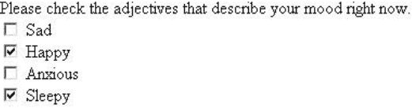

**图 4.6.** 当响应选项不是互斥的时，可以使用复选框。

### 提交按钮

当用户完成对所有问题或刺激材料的回答后，他或她需要点击一个特殊按钮，以告知浏览器自己已完成表单的填写。按钮被按下后，数据将被发送到指定的电子邮箱地址，或由 CGI 脚本进行处理。（具体发生哪一种情况，取决于 `FORM` 标签中 `METHOD` 属性的指定方式。）以下是创建提交按钮的 HTML 代码：

```
<INPUT TYPE =  submit  VALUE =  Please click here
when finished >
```

图 4.7 展示了这段代码在网页上的显示效果，与之前讨论的选择菜单组合在一起。`VALUE` 属性包含将显示在按钮内部的文本——即按钮标签。默认情况下，文本会显示为 `"Submit"` 或 `"Submit Query"`，但你可以让它更具信息量，例如 `"Click here to continue"`（点击此处继续）。

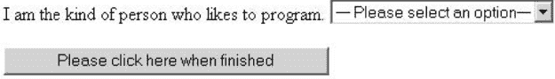

**图 4.7.** 一个**提交**按钮。

### 图像映射

图像映射可以以许多富有创意的方式用于从参与者那里收集数据。图像映射标签指示浏览器向用户呈现一幅图像。当用户点击图像时，浏览器会提交用户点击位置对应的 *X*（水平）和 *Y*（垂直）坐标，即图像中特定像素的位置坐标（坐标 0, 0 表示图像的左上角）。因此，图像既充当**提交**按钮，又作为一种信息收集方式。

要了解图像映射的工作原理，请看下面的例子。我们请用户在连续量表上评定他或她的情绪。然而，该量表本身是一幅图像，而不是一系列单选按钮。用户只需在量表上的某个位置点击，点击的精确位置（即 x 和 y 坐标）就会被记录为用户的回答。

```
How are you feeling right now?<BR><BR>
Please click anywhere on the scale below to indicate
your current mood. <BR>
<BR><INPUT TYPE= image   SRC= /images/imagemap1.jpg
NAME= coord >
```

图 4.8 展示了浏览器渲染这段代码的效果。当用户在量表上的某个位置点击时，点击的 x 和 y 坐标都会被记录，并且数据将被提交。由于点击涉及两条信息（对应 x 轴和 y 轴的坐标），浏览器在提交数据时会在图像映射的 `NAME` 属性后附加 `"x"` 和 `"y"`。在本例中，浏览器会自动将对应 x 轴的值标记为 `coord.x`，将对应 y 轴的值标记为 `coord.y`。我们将在第 9 章再次讨论图像映射。

How are you feeling right now?

Please click anywhere on the scale below to indicate your current mood.


图 4.8. 使用图像映射既可以收集评分，也可以提交数据。

### 隐藏标签

听起来很神秘吧？隐藏标签是你放置在表单中的标签，它们包含实用信息，但用户看不到这些信息。这个概念最好通过示例来说明。

```
<INPUT TYPE = hidden NAME = v0 VALUE = MoodSurvey >
```

当提交按钮被点击时，用户的回答以及隐藏标签的内容都会通过电子邮件发送给我。在本例中，这个名为 `v0` 的变量的值是调查的名称。如果我同时有多个调查在线，这条信息将让我知道数据来自哪个调查。正如下面的示例所示，用户在实际的网页上看不到这个变量；它是隐藏的。

> **注意。** 隐藏标签对于设计复杂的互联网实验来说绝对是必不可少的。在某些情况下，我们可能希望通过多个网页从用户那里收集数据（例如，每个页面包含来自被试内操纵不同水平的刺激）。隐藏标签可用于存储用户对每个刺激的回答，以便我们将这些信息从一个页面传递到下一个页面。这些标签现在看起来可能很神秘，甚至毫无意义，但它们的强大之处将在后续章节中变得更加明显。

#### 两个示例

让我们用一个简单的示例来说明到目前为止讨论的所有内容。在这个示例中，我们将创建一个页面，向参与者提出四个简单的问题。这将使我们能够探索到目前为止讨论的几种输入技术：单选按钮、下拉菜单、文本框和复选框。用户完成后，可以单击**提交**按钮，数据将通过电子邮件发送给研究人员。将此代码复制到空白文档中，并将其保存为 `examplesurvey1.htm`，放在你的 `Public HTML` 目录中。（你需要将电子邮件地址从我的改为你的。）请随意编辑和试验。要在浏览器窗口中查看该文件，请在浏览器地址栏中输入该页面的相应 URL。在我的服务器上，URL 是 `http://www.web-research-design.net/examplesurvey1.htm`。

```html
<HTML>
<FORM ACTION = mailto:fraley@uic.edu METHOD = post ENCTYPE = text/plain >
```

```html
<INPUT TYPE = hidden NAME = v0 VALUE = ExampleSurvey >Welcome to our survey! <BR><BR>
1. Which of the following foods do you enjoy? (Check all that apply) <BR>
<INPUT TYPE = checkbox NAME = v1 VALUE = 1 > Spinach <BR>
<INPUT TYPE = checkbox NAME = v2 VALUE = 1 > Eggplant <BR>
<INPUT TYPE = checkbox NAME = v3 VALUE = 1 > Rice <BR>
<INPUT TYPE = checkbox NAME = v4 VALUE = 1 > Anything deep fried <BR><BR><BR>
2. My country of origin is: <BR><SELECT NAME = v5 SIZE = 1 >
<OPTION VALUE = 0 SELECTED> -Please select an option -</OPTION>
<OPTION VALUE = 1 >USA</OPTION>
<OPTION VALUE = 2 >CANADA</OPTION>
<OPTION VALUE = 3 >MEXICO</OPTION>
<OPTION VALUE = 4 >OTHER</OPTION>
</SELECT><BR><BR>
3. I believe that corporations have too much power.
<BR>Strongly Disagree
<INPUT TYPE = radio NAME = v6 value= 1 >
<INPUT TYPE = radio NAME = v6 value= 2 >
<INPUT TYPE = radio NAME = v6 value= 3 >
<INPUT TYPE = radio NAME = v6 value= 4 >
<INPUT TYPE = radio NAME = v6 value= 5 >
<INPUT TYPE = radio NAME = v6 value= 6 >
<INPUT TYPE = radio NAME = v6 value= 7 >
Strongly Agree<BR><BR>
4. Please tell me what you think of this book so far.<BR>
<TEXTAREA NAME = v7 COLS = 20 ROWS = 6 WRAP = virtual >Please type here.</TEXTAREA><BR>
<INPUT TYPE = submit VALUE = Please click here when finished >
<BR><BR>Thank you for your participation!
</FORM></HTML>
```

图 4.9 展示了这段代码生成的网页。

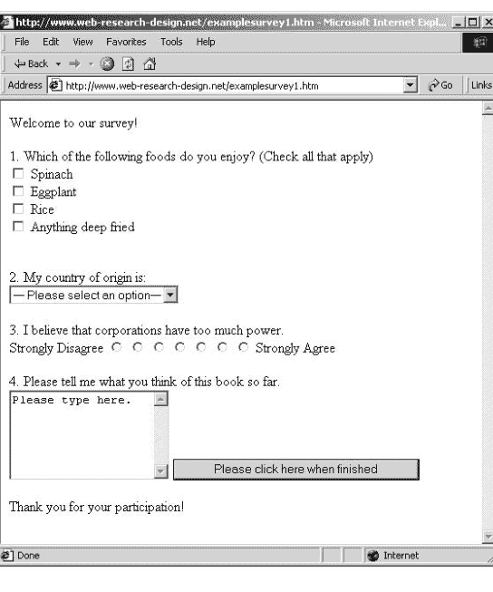

**图 4.9.** 该网页展示了我们讨论的许多不同回答选项。

最后，以下是电子邮件内容的可能样例：

```
v0=ExampleSurvey
v2=1
v4=1
v5=1
v6=6
v7=I like this book so far, Chris. I think it will be very helpful as I design my online studies.
```


请注意，关于`v1`和`v3`的信息没有通过电子邮件发送，因为这些选项未被选中。一般而言，浏览器只会通过电子邮件发送对问题的回答，而非未回答的内容。在第 5 章中，我们将讨论记录问题未回答情况的方法。以下是另一个涉及使用图像映射的示例。（我已将其作为`examplesurvey2.htm`保存在我的服务器上。）请记住，图像映射的行为类似于`提交`按钮；因此，我在此页面上没有放置单独的`提交`按钮。

```
examplesurvey2.htm
<HTML>
  <FORM ACTION = mailto:fraley@uic.edu METHOD = post
         ENCTYPE = text/plain >
  <INPUT TYPE = hidden NAME = v0 VALUE =
    ExampleSurvey2 >Welcome to our survey! <BR><BR>
  Please rate your current mood on the scale below.
      Please click somewhere on the scale to indicate
      how sad or happy you are feeling.<BR><BR>
  <INPUT TYPE=image SRC= /images/imagemap1.jpg
         NAME= coord >
  </FORM></HTML>
```

图 4.10 展示了这段代码渲染的网页。

以下是电子邮件内容的可能样例：

```
v0=ExampleSurvey2
coord.x=199
coord.y=25
```

在这个特定的示例中，`y`坐标的意义不大。然而，我们可以将`x`坐标作为用户当前情绪的连续测量指标。

还有一个示例。这里我没有介绍任何新技巧，但会结合上一章中的一些格式化代码，以说明一些使简单问卷看起来更专业的方法。具体来说，我将使用`TABLE`标签来帮助格式化和对齐一些问题，并加入一个图像使页面看起来更美观。将此代码复制到空白文档中，修改电子邮件地址，并将其保存为`moodsurvey.htm`，放在你的 Public HTML 文件夹中。

```
moodsurvey.htm
<HTML>
  <TITLE> Mood Questionnaire | HTML Demonstration
  </TITLE>
```

## 图 4.10. 一个用于收集和提交数据的图像映射

```html
<FORM ACTION = mailto:fraley@uic.edu METHOD = post
   ENCTYPE = text/plain >
<INPUT TYPE = hidden NAME = v0 VALUE =
   MoodSurvey >

<TABLE CELLPADDING = 2 >

<TR>
<TD bgcolor = 000066 ></TD>
<TD><FONT FACE = arial SIZE = 5 > Mood
   Questionnaire </TD>
</TR>

<TR>
<TD bgcolor = 000066 ></TD>
<TD>
<FONT FACE = arial SIZE = 2 >
请指出您<I>目前</I>是否正在经历以下情绪状态。<BR><BR>

<TABLE>
<TR>
<TD>
<FONT FACE = arial SIZE = 2>
<B>开心</B> &nbsp &nbsp </TD>
<TD>
<FONT FACE = arial SIZE = 2>
<I>否</I>
<INPUT TYPE = radio NAME = v1 VALUE = 0>
</TD>
<TD>
<INPUT TYPE = radio NAME = v1 VALUE = 1>
<FONT FACE = arial SIZE = 2>
<I>是</I>
</TD>
</TR>

<TR>
<TD>
<FONT FACE = arial SIZE = 2>
<B>焦虑</B> &nbsp &nbsp </TD>
<TD>
<FONT FACE = arial SIZE = 2>
<I>否</I>
<INPUT TYPE = radio NAME = v2 VALUE = 0>
</TD>
<TD>
<INPUT TYPE = radio NAME = v2 VALUE = 1>
<FONT FACE = arial SIZE = 2>
<I>是</I>
</TD>
</TR>

<TR>
<TD>
<FONT FACE = arial SIZE = 2><B>好奇</B> &nbsp
&nbsp </TD>
<TD>
<FONT FACE = arial SIZE = 2>
<I>否</I>
<INPUT TYPE = radio NAME = v3 VALUE = 0>
</TD>
<TD>
<FONT FACE = arial SIZE = 2>
<INPUT TYPE = radio NAME = v3 VALUE = 1>
<I>是</I>
</TD>
</TR>

<TR>
<TD>
<FONT FACE = arial SIZE = 2 ><B>悲伤</B>&nbsp &nbsp </TD>
<TD>
<FONT FACE = arial SIZE = 2 >
<I>否</I>
<INPUT TYPE = radio NAME = v4 VALUE = 0 >
</TD>
<TD>
<INPUT TYPE = radio NAME = v4 value= 1 >
<FONT FACE = arial SIZE = 2 >
<I>是</I>
</TD>
</TR>
</TABLE>
<BR><BR>
<FONT FACE = arial SIZE = 2 >
<INPUT TYPE = submit VALUE = 完成后点击此处提交 >
<BR><BR>
<I>感谢您的参与！</I>
</FORM>
</TD>
</TR>
</TABLE>
</HTML>
```

图 4.11 展示了该文件在浏览器中的样子（在我的服务器上，相应的 URL 是`http://www.web-research-design.net/moodsurvey.htm`）。当用户点击`提交`按钮时，一封包含每个变量（例如，`v1`、`v2`）及相应响应（编码为“否”对应 0，“是”对应 1）的电子邮件将发送到我的账户：

```
v0=MoodSurvey
v1=1
v2=0
v3=1
v4=0
```

## 图 4.11. 此页面结合了我们讨论过的一些表单元素，以及第 3 章回顾的一些格式化命令

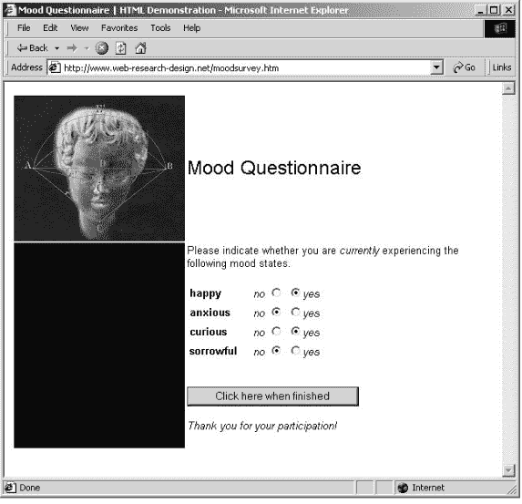

> **注意：** 您可能想知道为什么在这个例子中我们没有使用复选框。在这个例子中，“是”和“否”这两个选项是针对每个问题的互斥响应。如果我们使用单选按钮，我们可以为任何问题的“是”和“否”响应分配相同的名称。这确保了如果选择了另一个选项，先前选中的选项会自动消失。对于复选框，情况并非如此。即使多个复选框被赋予相同的名称，选中一个也不会“取消选中”其他复选框。如果在这个例子中使用了复选框，我们会要求用户仅在答案为“是”时勾选框；则没有“否”响应的框可选。

通过互联网进行研究的好处之一是，您可以编程让服务器自动存储数据。如果您只是就某个问题调查少数几个人，通过电子邮件接收数据并非坏事。但如果您有数百人参与您的研究，您肯定不希望邮箱被数百封电子邮件塞满。在下一章，我将向您展示如何将数据作为文本文件（一个可以轻松导入 Microsoft Excel 或 SPSS 的文件）自动存储在您的服务器上。这将为我们学习使用 Perl 编程以及利用 CGI 脚本提供绝佳的过渡。

以下是与输入表单相关的 HTML 代码回顾。其中许多已在本章讨论过；但在某些情况下，我包含了未讨论但您可能觉得有用的额外属性。

| HTML 标签 | 功能 | 示例 |
| --- | --- | --- |
| `<FORM>`<br>`</FORM>` | 创建一个用户可以提供信息的“输入”区域。`<FORM>` 标签有多个属性。`ACTION` 属性告诉浏览器在按下提交按钮时要做什么。此属性指定一个电子邮件地址或用于处理数据的 CGI 脚本的 URL。`METHOD` 属性指示表单数据的发送方式。（在本书中，我们将始终将此属性设置为“post”。）当数据通过电子邮件发送时，需指定`ENCTYPE`或加密属性。（在本书中，我们将始终将此属性设置为“text/plain”。） | 发送数据到电子邮件地址：`<FORM ACTION = 'mailto: fraley@uic.edu METHOD = 'post' ENCTYPE = 'text/plain'>` 输入区域和`提交`按钮`</FORM>`<br><br>发送数据到 CGI 脚本：`<FORM ACTION = '/cgi-bin/scriptname.pl' METHOD = 'post'>` 输入区域和`提交`按钮`</FORM>` |
| `<INPUT TYPE = 'textbox'>` | 文本框是一种允许用户输入其响应的输入方式。此标签有多个属性。`NAME` 属性指定对应于输入的变量名。`MAXLENGTH` 属性指定可输入的最大字符数。`SIZE` 属性指定在框内一次可显示的字符数。 | 请在此处输入您的评论。`<INPUT TYPE = 'textbox' NAME = 'comments' MAXLENGTH = '200' SIZE = '50'>` |
| `<TEXTAREA>`<br>`</TEXTAREA>` | `<TEXTAREA>` 标签允许用户输入文本。它还允许您指定输入区域的行数（`ROWS`）和列数（`COLS`）。`NAME` 属性命名输入。`WRAP` 属性应设置为“virtual”（允许文本在框内换行）或“off”（不强制文本换行）。您可以在开始和结束标签之间放置预先创建的文本。 | `<TEXTAREA NAME = 'mylife' COLS = '20' ROWS = '20' WRAP = 'virtual'> 请在此处告诉我们一些关于您生活的情况。 </TEXTAREA>` |
| `<INPUT TYPE = 'radio'>` | 此标签创建一个用户可以点击的单个单选按钮。单选按钮通常用于创建评级量表，其中每个按钮对应不同的评级，但只允许选择一个评级。`NAME` 属性命名输入信息。`VALUE` 属性在按下按钮时为变量分配一个定量或定性值。如果指定了`CHECKED`属性，按钮将被自动选中，用户需要手动取消选择。 | `您是咖啡爱好者吗？<BR> 否 <INPUT TYPE = 'radio' NAME = 'variable1' VALUE = 'no'><BR> 是 <INPUT TYPE = 'radio' NAME = 'variable1' VALUE = 'yes'>` 或 `您是咖啡爱好者吗？<BR> 否 <INPUT TYPE = 'radio' NAME = 'variable1' VALUE = '1' CHECKED><BR> 是 <INPUT TYPE = 'radio' NAME = 'variable1' VALUE = '2'>` |
| `<SELECT> </SELECT>` 和 `<OPTION> </OPTION>` | `<SELECT>` 标签允许用户使用下拉菜单进行选择。`NAME` 属性命名输入。`SIZE` 属性表示在菜单打开前可查看的选项数量。每个选项使用`OPTION`标签指定。`VALUE` 属性指定分配给特定选择的值（定量或定性）。`<SELECT>` 和`<OPTION>`标签都需要闭合标签。如果您希望某个选项被预选，可以在其内部指定`SELECTED`属性。 | `您的咖啡偏好是什么？ <SELECT NAME = 'coffee' SIZE = '1'> <OPTION VALUE = '1'>不喝咖啡</OPTION> <OPTION VALUE = '2' SELECTED>黑咖啡</OPTION> <OPTION VALUE = '3'>加奶油</OPTION> <OPTION VALUE = '4'>加糖的黑咖啡</OPTION> <OPTION VALUE = '5'>请加奶油和糖</OPTION> </SELECT>` |
| `<INPUT TYPE = 'submit'>` | 创建一个`提交`按钮。用户必须按下此按钮，表单信息才会发送给研究人员。`VALUE` 属性指定将出现在按钮本身上的文本。此标签不需要闭合标签。 | `<INPUT TYPE = 'submit' VALUE = '点击此按钮转到下一页'>` |
| `<INPUT TYPE = 'image'>` | 图像`<INPUT>`标签创建一个图像映射输入区域。当用户点击图像时，表单信息会自动提交，并附带点击位置在图像中的`x`和`y`坐标（以像素为单位）。`SRC`（或源）属性指定要用作映射的图像的 URL。`NAME` 属性命名提交的`x`和`y`坐标。（浏览器会自动在名称后附加“.x”和“.y”以区分`x`和`y`坐标。） | `<INPUT TYPE = 'image' SRC = '/images/imagemap1.jpg' NAME = 'coord'>` |

#### HTML 表单：收集研究数据

| HTML 标签 | 功能 | 示例 |
| --- | --- | --- |
| `<INPUT TYPE = 'hidden'>` | 隐藏标签用于向研究人员传递信息——这些信息不会出现在网页本身上；它对用户是隐藏的。`NAME` 属性指定信息的变量名。`VALUE` 标签指定要传递的隐藏信息。 | `<INPUT TYPE = 'hidden' NAME = 'condition' VALUE = '2x3'>` |
| `<INPUT TYPE='password'>` | 密码标签创建一个文本框，用户可以在其中输入密码。当用户输入密码时，文本将被一系列星号代替。这可以防止旁观者查看密码。与标准文本框一样，密码框具有`NAME`属性、`MAXLENGTH`属性和`SIZE`属性。 | `<INPUT TYPE='password' NAME='secretcode' MAXLENGTH='30' SIZE='25'>` |

# 第 5 章

## CGI 脚本简介

### 使用 Perl 自动将响应数据保存到文件

到目前为止，我们所做的一切都不需要服务器端编程。原则上，你可以使用第 3 章和第 4 章中教授的 HTML 技能来创建网页、收集数据，并将数据直接通过电子邮件发送给你。然而，为了将互联网用于更复杂的研究目的，你需要控制数据的存储方式、页面呈现给用户的方式以及刺激材料的呈现方式。为此，你需要编写在服务器上运行的程序。这些程序，即 CGI 脚本，将赋予你以真正交互式和动态的方式使用互联网的能力。

如第 1 章所述，CGI 代表通用网关接口——一种在计算机之间（例如用户的计算机和服务器之间）交换信息的标准。我们将使用 Perl 编写 CGI 脚本——Perl 是一种高度灵活的编程语言，广泛用于 CGI 编程。我们将从讨论一个简单的脚本开始，该脚本可用于接收从 HTML 表单提交的数据并将其保存到服务器上的文本文件数据库中。我们不会深入探讨所有编程代码的细节；我们只是将其作为示例来介绍 CGI 脚本的编写过程。在后面的章节中，你将了解更多关于具体命令的操作方式。

让我们从上一章的简单在线情绪调查（`moodsurvey.htm`）开始。如你所记得的，该调查的目的是评估用户是否正在经历四种情绪中的每一种。原始网页设计为在点击`提交`按钮时将数据通过电子邮件发送给我们。然而，现在我们希望将数据发送到我们服务器上的一个程序进行处理。我们可以通过更改`<FORM>`标签的`ACTION`属性来实现这一更改。让我们将表单标签从

```
<FORM ACTION = mailto:fraley@uic.edu METHOD = post
      ENCTYPE = text/plain >
```

更改为

```
<FORM ACTION = /cgi-bin/savedata1.pl METHOD = post >.
```

网页的完整 HTML 代码如下。在更改`<FORM>`标签后，将修改后的文件以`moodsurvey2.htm`的名称保存在你的 Public HTML 目录中。

`moodsurvey2.htm`


```html
<HTML>
<TITLE> Mood Questionnaire | HTML Demonstration
       </TITLE>
<FORM ACTION = /cgi-bin/savedata1.pl METHOD = post >

<INPUT TYPE = hidden NAME = v0 VALUE = MoodSurvey >

<TABLE CELLPADDING = 2 >

<TR>
<TD bgcolor = 000066 ></TD>
<TD><FONT FACE = arial SIZE = 5 > Mood Questionnaire </TD>
</TR>

<TR>
<TD bgcolor = 000066 ></TD>
<TD>
<FONT FACE = arial SIZE = 2 >
Please indicate whether you are <I>currently</I>
experiencing the following mood states.<BR><BR>

<TABLE>

<TR>
<TD>
<FONT FACE = arial SIZE = 2 >
<B>happy </B> &nbsp &nbsp </TD>
<TD>
<FONT FACE = arial SIZE = 2 >
<I>no</I>
<INPUT TYPE = radio NAME = v1 VALUE = 0 >
</TD>
<TD>
<INPUT TYPE = radio NAME = v1 VALUE = 1 >
<FONT FACE = arial SIZE = 2 >
<I>yes</I>
</TD>
</TR>

<TR>
<TD>
<FONT FACE = arial SIZE = 2 >
<B>anxious</B> &nbsp &nbsp </TD>
<TD>
<FONT FACE = arial SIZE = 2 >
<I>no</I>
<INPUT TYPE = radio NAME = v2 VALUE = 0 >
</TD>
<TD>
<INPUT TYPE = radio NAME = v2 VALUE = 1 >
<FONT FACE = arial SIZE = 2 >
<I>yes</I>
</TD>
</TR>

<TR>
<TD>
<FONT FACE = arial SIZE = 2 ><B>curious</B> &nbsp &nbsp </TD>
<TD>
<FONT FACE = arial SIZE = 2 >
<I>no</I>
<INPUT TYPE = radio NAME = v3 VALUE = 0 >
</TD>
<TD>
<FONT FACE = arial SIZE = 2 >
<INPUT TYPE = radio NAME = v3 VALUE = 1 >
<I>yes</I>
</TD>
</TR>

<TR>
<TD>
<FONT FACE = arial SIZE = 2 ><B>sorrowful</B>&nbsp &nbsp </TD>
<TD>
<FONT FACE = arial SIZE = 2 >
<I>no</I>
<INPUT TYPE = radio NAME = v4 VALUE = 0 >
</TD>
<TD>
<INPUT TYPE = radio NAME = v4 value= 1 >
<FONT FACE = arial SIZE = 2 >
<I>yes</I>
</TD>
</TR>
</TABLE>

<BR><BR>
<FONT FACE = arial SIZE = 2 >
<INPUT TYPE = submit VALUE = Click here when finished >
<BR><BR>
<I>Thank you for your participation!</I>
</FORM>
</TD>
</TR>
</TABLE>
</HTML>
```

通过这个微小的更改，我们现在指示用户的浏览器将数据发送到位于我们服务器`cgi-bin`目录中的名为`savedata1.pl`的 CGI 脚本。（注意：如果你在服务器上查看`moodsurvey2.htm`，请先不要点击**提交**按钮。在服务器处理数据之前，我们需要先启动并运行`savedata1.pl`。）

> 注意。`.pl`扩展名表明我们的脚本是一个 Perl 程序。本书中编写的所有 CGI 程序都将使用 Perl 编写，并以`.pl`扩展名结尾。

## 通过简单的 CGI 脚本保存数据

现在我们需要创建一个名为`savedata1.pl`的程序来处理已发送到我们服务器的数据包。我们希望这个程序做三件事。首先，我们希望它获取参与者发送的数据包，并以有用的方式进行解析。其次，我们希望程序将相关数据存储在一个文本文件中，该文件可以导入到流行的数据分析程序中，如 SPSS、Microsoft Excel 或 S-Plus。第三，我们希望程序向用户发送一条"感谢"消息，感谢其参与。

CGI 程序与 HTML 页面一样，可以在文本编辑器中编写，例如 1st Page。那么，让我们首先在文本编辑器中打开一个空白文档。在文档中输入以下代码，并将文件以`savedata1.pl`的名称保存在服务器的`cgi-bin`目录中。请记住，`cgi-bin`目录与我们之前使用的**Public HTML**目录是不同的目录。（如果想不起`cgi-bin`目录的位置，请参阅第 2 章。）

```perl
#!C:/perl/bin/perl.exe
use CGI;
$query = new CGI;

$v0= $query->param( v0 );
$v1= $query->param( v1 );
$v2= $query->param( v2 );
$v3= $query->param( v3 );
$v4= $query->param( v4 );

open(INFO,
    >>$ENV{ DOCUMENT_ROOT }/www/data/moodexample.txt );
print INFO  $v0, $v1, $v2, $v3, $v4 \n ;
close (INFO);

print $query->header;
print $query->start_html(-title=> Thank You );
print  <FONT FACE = arial  SIZE = 2 >Thank you for
    your participation in this research! </FONT> ;
print $query->end_html;
```

如果你是 Perl CGI 编程的新手，这乍一看可能有点令人不知所措。别担心；我们将逐步分解这个程序的每一步，以使操作变得清晰。

### 所有 Perl 脚本的第一行

以下是 CGI 程序的第一行：

```perl
#!C:/perl/bin/perl.exe
```

这行告诉服务器使用 Perl 执行脚本。*这一行需要是你编写的任何 CGI 程序的第一行。* 这一行有时被称为"shebang!"行，它将服务器指向 Perl 程序，该程序应位于`C:/perl/bin/perl.exe`。如果你搭建了自己的 Apache 服务器，你应该通过在计算机上搜索`perl.exe`文件并确认其是否位于此位置来仔细检查。如果不是，那么你应该调整 shebang! 行以指定正确的路径。如果你使用的是网络托管服务，该公司的帮助页面会说明在 shebang! 行中应填写什么内容。（上面这行在我的 Netfirms 服务器和我的 Apache 服务器上都可以正常工作，Apache 服务器我是使用所有默认选项安装的。）

### 指示服务器处理提交的数据

接下来的两行：

```perl
use CGI;
$query = new CGI;
```

在我们本书中讨论的每一个 CGI 脚本中，也会包含以下内容。第一句话告诉服务器使用通用网关接口来接收用户计算机提交的数据包。该数据包将包含大量信息，包括我们包含在某个 HTML 标签中的隐藏值（名为"v0"）、对四个情绪项目的回答（名为"v1"、"v2"、"v3"和"v4"），以及一些"环境"变量。**环境变量**包括诸如服务器的 IP 地址、激活或"调用"该脚本的网页的 URL，以及用户的 IP 地址等信息。稍后我们将更详细地讨论其中一些环境变量。目前，需要了解的重要一点是数据包包含大量信息，其中只有部分是我们关心的。下一行将数据包中的所有信息赋给一个万能变量`$query`。

> **注意。** 每行 Perl 代码都以分号结尾。这是 Perl 解析不同代码行的方式。Perl 中每条独立的命令行都需要以分号结尾。

### 从提交的数据中提取值并在 CGI 脚本中为其分配变量名

下一组命令展示了 Perl 中一个非常基础的功能。简言之，这些命令允许我们创建五个新变量（例如，`$v0-$v4`），它们将被赋值为`$query`中包含的值。例如，第一行翻译过来就是："创建一个名为`$v0`的新变量，并让它等于来自`$query`的参数`'v0'`的值。"现在，就有了一个名为`$v0`的 Perl 变量。类似地，第二行说："创建一个名为`$v1`的新变量，并让它等于来自`$query`的参数`'v1'`的值。"

```perl
$v0= $query->param( v0 );
$v1= $query->param( v1 );
$v2= $query->param( v2 );
$v3= $query->param( v3 );
$v4= $query->param( v4 );
```

> **注意。** **变量**一词在 Perl 中的含义实际上与其在标准行为研究中的含义相似。它指的是可以取两个或多个替代值之一的事物。在 Perl 中，所有变量都以美元符号开头。因此，每当您在 Perl 中创建或引用变量时（例如，`v01`），都需要在其前面加上美元符号（例如，`$query`）。这就是 Perl 将变量名与其他类型的对象和命令区分开来的方式。

从技术上讲，这种变量是**标量**变量，因为它表示单个值。稍后，我们将讨论称为**数组**或**向量**的变量，它们包含不止一个标量，并以`@`符号开头（例如，`@v01`），而不是美元符号。如果这个术语看起来有些抽象，这里还有另一种概念化这两种变量区别的方式。如果我们有五个人在智力测验上的分数，任何一个人的分数都是标量变量，并会用美元符号表示（例如，`$IQ`）。这五个人的分数集合将是一个智力测验分数的数组，并用`@`表示（例如，`@IQ`）。这个数组，或称向量，包含五个标量。

这段代码创建了五个新变量，以对应从网页用户提交的信息（包括隐藏在"v0"标签中的信息）。这些变量仅用于脚本内部使用；这种变量通常称为**局部变量**。

### 写入数据文件

现在我们想要将新变量的值保存到数据文件中。为此，我们首先需要打开（或创建）一个数据文件，将值放入文件中，然后关闭它。

以下是在本示例程序中如何操作的：

```perl
open(INFO,
    >>$ENV{ DOCUMENT_ROOT }/www/data/moodexample.txt );
print INFO  $v0, $v1, $v2, $v3, $v4 \n ;
close (INFO);
```

第一行指示服务器在服务器的**Public HTML**目录内的**data**文件夹中打开一个名为`moodexample.txt`的文件。如果文件已经存在，则路径名称中使用`>>`指示服务器**追加**，即将任何新信息放到已有文件的末尾。（换句话说，我们不会覆盖文件中已有的任何数据；我们只是添加更多内容。）如果文件不存在，Perl 会为我们创建它。`INFO`称为**文件句柄**，是在 Perl 程序中引用文件内容的快捷方式。代码中的`$ENV{ DOCUMENT_ROOT }/www/data/moodexample.txt`部分告诉服务器在服务器上的 data 目录中找到`moodexample.txt`数据文件。在本书的所有示例中，您都会将数据文件存储在同一位置（即服务器上的"data"目录），所以这一行（除了末尾的文件名外）在我们所有的示例中都是相同的。

既然数据文件已经打开，我们就可以向其中添加新数据。为此，我们使用`print`命令。上面列出的`print`命令翻译过来就是"获取变量`$v0`、`$v1`、`$v2`、`$v3`和`$v4`的值，并将它们放入我们已打开的文件中"。

请注意，我们一直在用逗号分隔这些变量。`print`命令按字面意思理解这些逗号。换句话说，该命令将这些变量的值*以逗号分隔*的形式打印到数据文件中。这将使我们最终能够在 Microsoft Excel 或 SPSS 中打开该文件作为"逗号分隔"的文本文件，从而便于将数据导入这些程序。如果我们省略逗号，这些值就不会彼此分开，除非我们插入其他符号，例如制表符或分号。

请注意，在 Perl 文件中该行的最后打印的是`\n`。这是 Perl 中表示换行符的说法，意味着计算机将知道在数据文件的新的一行或新一行中输入任何进一步的数据。如果没有`\n`，服务器会不断将新受试者的新数据追加到同一行的末尾。

由于行为科学家通常以人×变量的方式组织他们的数据电子表格（即，人代表行，变量代表列），因此在输入完一个受试者的最后一个变量后，始终包含`\n`符号是个好主意。这样做确保下一个提交数据的人的数据将存储在文件的新的一行中。

在下一行，*close*命令指示服务器关闭（并隐式保存）数据文件。写入数据文件后，您应该始终关闭它。

> **注意。** 如果几个人可能同时使用写入数据文件的 CGI 脚本，数据可能会被错误地写入。这个问题的一个解决方案是在用户运行访问该脚本的脚本时锁定数据文件（即，防止其他人使用它）。要做到这一点，您可以使用`flock`命令。以下是一个示例：
>
> ```perl
> open(INFO,
>     >>$ENV{ DOCUMENT_ROOT }/www/data/moodexample.txt );
> flock(INFO, 2);
> print INFO $v0, $v1, $v2, $v3, $v4 \n ;
> close (INFO);
> ```
>
> `flock`命令并非在所有系统上都有效。例如，它在我的 Windows 98 上运行的 Apache 服务器上不起作用。然而，它在我的 Netfirms 服务器上确实有效。您可能需要在有和没有`flock`命令的情况下测试您的程序，以查看它是否能在您的服务器上工作。幸运的是，不太可能有两个人同时写入一个文件。写入过程相当快，不大可能有多个研究参与者同时提交他们的数据。

### 将 HTML 代码插入 CGI 脚本

最后一组命令允许我们向用户的浏览器发送 HTML 代码。任何时候您想使用 CGI 创建 HTML 代码，以下命令都必须包含在您的脚本中。前两行类似于`<HTML>`标签：

```perl
print $query->header;
print $query->start_html(-title=> Thank You );
```

而最后一行类似于`</HTML>`标签：

```perl
print $query->end_html;
```

请注意，我们可以在 Perl 中使用 HTML 代码的方式与我们在处理 HTML 文档时完全相同！唯一的区别是我们现在将 HTML 代码插入到双引号内，前面加上`print`语句。

```perl
print <FONT FACE = arial SIZE = 2 >Thank you for your participation in this research! </FONT> ;
```

**注意。** 关于 Perl 中 CGI 脚本最让我欣赏的一点在于，我们可以使用之前章节中讨论的几乎所有 HTML 代码，直接从 CGI 脚本本身向用户交付基于 HTML 的内容。这一特性为我们创建网页提供了极大的灵活性。例如，稍后你会学到，我们可以将在 CGI 脚本中创建的局部变量与 HTML 代码混合，以定制代码，或者让脚本本身"创建"网页。

不过，我应该指出，这并非将 HTML 与 CGI/Perl 结合的唯一方式。**CGI.pm**是 Lincoln Stein 开发的一款工具，常用于整合 HTML 表单和 Perl 脚本。本书中会有少数情况使用 CGI.pm 代码（例如，隐藏变量），但一般而言，我会使用经典 HTML 代码而非 CGI.pm。我选择这样做是因为学习 HTML 和 Perl 已经足够具有挑战性了；只要能够在二者之间进行适配，我们就会这样做。有关 CGI.pm 的更多信息，请访问 Lincoln Stein 的网站：http://stein.cshl.org/WWW/software/CGI/。

## 测试代码

让我们用这个程序做一下实验，看看它究竟如何工作。在浏览器中打开情绪问卷并回答情绪问题。（在我的服务器上，相应的 URL 是 http://webbook.netfirms.com/moodsurvey2.htm。）当你点击**Submit**按钮时，你应该会看到一个新网页，上面只写着："Thank you for your participation in this research!"

让我们看看程序是否成功保存了数据。要查看数据文件，你需要使用以下两种方法之一，取决于你使用的是 Netfirms 等网络托管服务，还是使用的是自己的 Apache 服务器。


- 如果你使用的是网络托管服务，请建立与你的服务器的 FTP 连接。打开`Public HTML`目录中的`data`文件夹。单击一次数据文件（例如，`moodexample.txt`）以选中它，然后点击 WS_FTP Pro 中从`Remote`窗口指向`Local`窗口的绿色箭头。这将指示 FTP 程序将数据文件的副本从服务器传输到你的本地计算机。默认情况下，你的 FTP 程序可能会尝试将文件保存到计算机上的 FTP 目录中（例如，`C:\Program Files\WS_FTP\`）。你可能会发现将文件传输到另一个目录更容易，例如你的`Desktop`或专门为你的网络程序创建的文件夹。要选择另一个目录，只需在你的本地目录窗口中前后移动即可。

- 如果你使用的是 Apache 服务器，请转到`Public HTML`目录的`www`文件夹中的`data`文件夹。`moodexample.txt`数据文件应该就在其中。

使用文本编辑器打开名为`moodexample.txt`的文件。你应该会看到类似以下内容：

```text
MoodSurvey,1,0,1,0
```

这些值代表我们保存到数据文件中的五个变量的值：`$v0`、`$v1`、`$v2`、`$v3`和`$v4`。这些变量是从用户发送给我们的情绪问题回答中提取的。

关闭`moodexample.txt`文件，并尝试使用网页输入一些额外的回答。（换句话说，假装你是另一个受试者。）现在，再次打开`moodexample.txt`文件，看看程序是如何保存数据的。（如果你使用的是网络托管服务，不要忘记再次通过 FTP 将数据文件传输到你的计算机。一旦你提交了额外的数据，服务器上的`moodexample.txt`文件将会改变，你需要获取最新的副本。）

```text
MoodSurvey,1,0,1,0
MoodSurvey,0,1,0,1
```

注意，新的提交是作为数据文件中的下一行录入的。另外，请注意之前的提交并没有被删除。

在继续之前，让我们花点时间看看我们到目前为止取得了什么成就。

- 我们创建了一个使用 HTML 表单从受试者那里获取情绪评分的网页。
- 一旦受试者回答完问题并点击`Submit`按钮，他或她的回答就会被发送到服务器。
- 我们创建了一个名为`savedata1.pl`的简单 CGI 脚本，当用户提交数据时执行。
- 该脚本做三件事。首先，它从提交的数据中提取回答（和隐藏值），并在脚本本身内赋予它们易于使用的名称（例如，`$v1`）。其次，它打开（或根据需要创建）一个名为`moodexample.txt`的数据文件，并将用户的数据作为新行保存在该文件中。第三，它向用户发送 HTML 代码以感谢他或她的参与。

我们刚刚创建的脚本对于保存我们的情绪数据非常有用。而且，它可以很容易地修改以保存其他类型网络研究的数据。例如，假设我们创建了 11 个问题，并且在 HTML 代码中，每组单选按钮的回答被命名为`"v00"`到`"v10"`。为了从数据包中读取这些值，我们可以将 CGI 脚本的第一部分扩展为：

```perl
$v00 = $query->param( v00 );
$v01 = $query->param( v01 );
$v02 = $query->param( v02 );
$v03 = $query->param( v03 );
$v04 = $query->param( v04 );
$v05 = $query->param( v05 );
$v06 = $query->param( v06 );
$v07 = $query->param( v07 );
$v08 = $query->param( v08 );
$v09 = $query->param( v09 );
$v10 = $query->param( v10 );
```

以及：

```perl
open(INFO,
    >>$ENV{ DOCUMENT_ROOT }/www/data/moodexample.txt );
print INFO $v00, $v01, $v02, $v03, $v04, $v05, $v06,
    $v07, $v08, $v09, $v10 \n ;
close (INFO);
```

这样做将允许我们提取每个回答，在脚本内给它一个变量名，并将这些新的局部变量保存到数据文件中。

**注意。** 如果你在 Perl 脚本中输入了错误的内容，程序不太可能正常运行。事实上，更多情况下，文件根本无法运行，你会在浏览器窗口中收到一条错误消息。这些错误消息对于识别代码中的错误没有多大帮助。请参阅第 15 章，了解如何识别和修复 Perl 代码中的一些问题。

### 示例 2：为提交添加时间戳

作为前一个示例的扩展，让我们看看一些允许我们记录提交日期和时间的命令。

让我们创建一个名为`savedata2.pl`的新脚本：

```perl
#!C:/perl/bin/perl.exe
use CGI;
$query = new CGI;

$v0 = $query->param( v0 );
$v1 = $query->param( v1 );
$v2 = $query->param( v2 );
$v3 = $query->param( v3 );
$v4 = $query->param( v4 );

($sec,$min,$hour,$mday,$mon,$year,$wday,$yday,$isdst) =
    localtime(time);

$ip = $query->remote_addr();
$ref = $query->referer();
open(INFO,
    >>$ENV{ DOCUMENT_ROOT }/www/data/moodexample2.txt );
print INFO  $mon/$mday/$year\,  ;
print INFO  $hour:$min:$sec\,  ;
print INFO  $ip, $ref,  ;
print INFO  $v0, $v1, $v2, $v3, $v4  ;
print INFO  endline \n ;
close (INFO);

print $query->header;
print $query->start_html(-title=> Thank You );
print  <FONT FACE = arial  SIZE = 2 >Thank you for your participation in this research! </FONT> ;
print $query->end_html;
```

（请务必修改 HTML 文档`moodsample2.htm`中 FORM 标签的 ACTION 属性，使情绪数据的提交现在激活`savedata2.pl`脚本，而不是`savedata.pl`脚本。）

让我重点介绍一下代码中的新增内容以及它们为我们实现的功能。

#### 时间戳

对原始程序的第一个补充是以下代码：

```perl
($sec,$min,$hour,$mday,$mon,$year,$wday,$yday,$isdst) =
    localtime(time);
```

该命令从服务器的内部时钟提取当前时间和日期。当`savedata2.pl`脚本被激活时，会创建几个局部变量（例如，`$sec`、`$min`、`$hour`），它们对应于提交的日期和时间。以下是所创建变量的列表、它们代表的含义以及它们的数值限定方式：

| Variable | Description |
| :--- | :--- |
| `$sec` | 秒 (0 – 59) |
| `$min` | 分 (0 – 59) |
| `$hour` | 小时 (24 小时制: 0 – 23) |
| `$mday` | 一个月中的第几天 |
| `$mon` | 月份 (0 [一月] – 11 [十二月]) |
| `$year` | 年份 (1900 + `$year`的值等于当前年份) |
| `$wday` | 星期几 (0 [星期日] – 6 [星期六]) |
| `$yday` | 一年中的第几天 (1 – 365) |
| `$isdst` | 是否为夏令时? (0 = 否, 1 = 是) |

我们可以使用`print`命令将这部分信息中较为重要的内容打印到我们的数据文件中：

```perl
print INFO  $mon/$mday/$year,   ;
print INFO  $hour:$min:$sec,   ;
```

注意，我们将月份、一个月中的第几天和年份变量串联起来，用斜杠（`/`）分隔，以美国常见的日期表示法创建日期：mm/dd/yy。例如，2002 年 5 月 19 日在这里表示为 4/19/102。此外，我们将小时、分钟和秒串联起来，用冒号分隔，以标准方式表示时间（例如，10:24:33）。将变量和普通文本（例如上面例子中的斜杠和冒号）结合的能力是 Perl 的强大功能之一，我们将在下一章中更多地利用它，为用户设计定制化反馈。

#### 环境变量

如前所述，当用户点击**提交**按钮时，一个数据包会被发送到您的服务器，它不仅包含用户对问题的回答，还包含一些环境变量（例如，激活脚本的页面 URL）。当我们使用`$query = new CGI`命令时，所有这些信息都会被强制存入`$query`变量中。

通常您只会关心两个环境信息。第一个是**referrer**（来源页面）：用户提交数据的页面 URL。这对于追踪用户所在的条件很有用，前提是不同的页面对应不同的条件。它也可用于安全目的，这将在第 15 章讨论。此信息可通过以下命令从`$query`数据中提取：

```perl
$ref = $query->referer();
```

此命令创建一个名为`$ref`的新变量。

第二个重要的环境变量是用户的 IP 地址。IP（互联网协议）地址是一个数字序列，对每个计算机或互联网端口都是唯一的。IP 地址有助于确定用户是否最近提交过数据。我们将在本书的最后一章详细讨论这个问题。目前，需要记住的是，有时用户可能会在短时间内多次参与研究——尤其是当研究很有趣时。通过追踪 IP 号，您可以稍后筛选数据文件，以确定是否在例如 10 分钟的时间段内从同一台计算机收到了多次提交。用户的 IP 地址可通过以下命令从`$query`数据中提取：

```perl
$ip = $query->remote_addr();
```

这会创建一个名为`$ip`的新变量，其中包含用户的 IP 地址。

我们程序中的以下行只是将这两个新变量打印到数据文件中，后面跟着一个逗号：

```perl
print INFO $ip, $ref, ;
```

#### 让我们看看它的运作

要查看此脚本如何保存数据，请打开浏览器并转到您的情绪问卷的 URL。（确保您已经更改了 ACTION 属性，使其调用`savedata2.pl`而不是`savedata1.pl`。）回答问题，然后提交您的数据。点击浏览器上的**后退**按钮，再提交一些数据。

现在，在您的文本编辑器中，打开服务器`data`目录中的`moodexample2.txt`文件。（同样，如果您使用的是网络托管服务，不要忘记通过 FTP 将文件从服务器传输到您的计算机上，以便查看。）您应该会看到类似于图 5.1 中所示的信息。请注意，每次提交都作为单独的一行保存在文件中。此外，请注意您计算机的 IP 地址已被记录在文件中，以及调用 Perl 脚本的站点 URL（这应该是您的情绪问卷的 URL）。最后，请注意提交日期和时间已使用服务器的时钟记录下来。

#### 将数据导入 SPSS

将数据保存到文本文件的一个优点是，您可以稍后将这些数据导入到您喜欢的电子表格或数据分析程序中。为了说明如何做到这一点，我将通过一个示例，演示如何将数据导入到 Windows 版本的 SPSS 10.0 中。（相同的一般策略应适用于任何电子表格程序。）

1. 打开 SPSS。
2. 打开一个新数据文件：文件 > 打开 > 数据。
3. 在标记为“文件类型”的下拉菜单中，选择“文本（*.txt）”。
4. 选择`moodexample2.txt`文件。（如果您使用的是按第 2 章所述方式配置的 Apache 服务器，您的数据文件将位于 data 文件夹中：`C:\Program Files\Apache Group\Apache2\htdocs\www\data\`。如果您使用的是专业的网络托管服务，则需要使用 FTP 程序将数据文件从服务器的 data 目录传输到您的计算机，然后再在 SPSS 中打开。）
5. 选择文件后，一个名为“文本导入向导”的新窗口应该会出现。按照说明操作，并接受所有默认设置。唯一的例外是当出现以下问题时：“哪些定界符出现在变量之间？”在这种情况下，只选择“逗号”，因为我们使用逗号来分隔一行中不同变量的值。

```text
6/25/103, 14:45:16, 64.109.251.4, http://www.web-research-design.net/moodsurvey2.htm, MoodSurvey, 1, 0, 1, 0 endline
6/25/103, 14:45:20, 64.109.251.4, http://www.web-research-design.net/moodsurvey2.htm, MoodSurvey, 1, 1, 1, 0 endline
6/25/103, 14:45:27, 64.109.251.4, http://www.web-research-design.net/moodsurvey2.htm, MoodSurvey, 1, 1, 0, 1 endline
6/25/103, 14:45:32, 64.109.251.4, http://www.web-research-design.net/moodsurvey2.htm, MoodSurvey, 0, 1, 1, 0 endline
```

**图 5.1。** 您的数据保存为文本（.txt）文件时可能的样子示例。

## 总结

这是一个具有挑战性的章节。然而，这可能是您第一次接触 CGI 脚本。一旦您熟悉了 CGI 过程的基础知识，本书中我们将要使用的其余示例将会清晰得多。让我们回顾一下本章讨论的 CGI 过程的一些基本组成部分。

1. 当用户在其浏览器中点击“提交”按钮时，他/她正在向您的服务器发送一个数据包。在本书中，我将此数据包称为 CGI 数据包。
2. 数据包由 CGI 脚本处理。处理数据的具体脚本是在网页 FORM 标签的 ACTION 属性中命名的脚本。
3. CGI 脚本可以被编写成以多种方式处理数据。在本章中，我们研究了一个简单的脚本，该脚本提取用户的回答（以及一些环境变量）并将它们保存到服务器上的数据文件中。

除了这些整体概况外，还有一些重要的细节需要牢记：

1. 我们在本书中编写的每个 CGI 程序都将以以下三行开头：

```perl
#!C:/perl/bin/perl.exe
use CGI;
$query = new CGI;
```

第一行告诉服务器 Perl 可执行文件的位置。第二行指示服务器使用从用户浏览器发送的数据包。第三行创建一个名为`$query`的局部变量，该变量将包含 CGI 数据包的所有内容。

2. 任何时候我们希望 CGI 脚本向用户发送一些 HTML 代码（例如，创建一个“谢谢”页面或提出额外问题），我们需要包含以下代码：

```perl
print $query->header;
print $query->start_html();
print $query->end_html;
```

第一行和第二行类似于`<HTML>`标签；第三行充当`</HTML>`标签。您想发送给浏览器的任何 HTML 代码必须出现在第二行和第三行之间，必须以`print`命令开头，并且必须用双引号括起来。例如：

```perl
print $query->header;
print $query->start_html(-title=> Thank You );
print  <FONT FACE =  arial  SIZE =  2 >Thank you for
  your participation in this research! </FONT> ;
print $query->end_html;
```

3. 任何时候我们想将数据写入文本文件，我们需要使用以下通用命令打开数据文件：

```perl
open(INFO,
    >>$ENV{ DOCUMENT_ROOT }/www/data/filename.txt );
```

其中“filename”替换为您要创建并添加到的数据文件的名称。数据文件打开后，我们可以使用`print`命令向文件添加信息：

```perl
print INFO  $value,  ;
```

最后，当我们完成数据文件的处理后，使用以下通用命令关闭它：

```perl
close (INFO);
```

4. 在 Perl 中编程时，所有代码行都必须以分号结尾。最常见的编程错误之一就是忘记分号。
5. 脚本中创建和使用的所有标量变量前面都需要加美元符号（例如，`$age`、`$v01`、`$sex`）。
6. 您可以使用以下通用结构将提交的 CGI 数据包中的任何值赋给 CGI 脚本中的局部变量：

```perl
$age = $query->param( v2 );
```

在这个例子中，创建了一个名为`$age`的局部变量，并赋予其对应于 CGI 数据包中“v2”的值。此命令意味着 v2 是 HTML 表单中变量的名称。

以下是本章中我们学到的一些 Perl 命令的回顾。

| Perl 命令 | 功能 | 示例 |
| :--- | :--- | :--- |
| `#!C:/perl/bin/perl.exe`<br>`use CGI;`<br>`$query = new CGI;` | 这三行代码应该出现在您编写的每个 CGI 脚本的开头。（它们并不总是必要的，但 always including them 不会造成任何伤害。）第一行称为 shebang! 行，指定`perl.exe`的位置以便执行 Perl 代码。第二行指示脚本使用 CGI 数据包中的信息。第三行将该信息转储到一个名为`$query`的全能变量中。 | `#!C:/perl/bin/perl.exe`<br>`use CGI;`<br>`$query = new CGI;` |


| `$localvariable=<br>$query->param<br>('variablename');` | 此命令从 CGI 数据包中提取变量及其值。`$localvariable` 是在脚本中表示该变量的局部变量。`variablename` 是从 CGI 数据包中读取的变量名称（即 HTML `INPUT` 标签中 `NAME` 属性指定的名称）。 | `$v0= $query->param('v0');`<br>创建一个名为 `$v0` 的局部变量，将其设置为等于用户提交的 CGI 数据包中 `v0` 的值。 |

# 第 6 章

## 为研究参与者提供个性化反馈

利用互联网进行行为研究，其最有价值的特性之一在于，通过与用户的互动，我们能够为研究参与者提供比传统研究中通常能获取的更多信息。具体来说，你可以创建一个 CGI 脚本，它能分析用户的回答，并向用户解释这些回答可能意味着什么。你还可以编写脚本，分析其他用户的结果，并将当前用户的回答与他人进行比较，为其提供相关信息。这种反馈能使研究体验对参与者而言更加个性化且富有意义。此外，如果研究参与者知道他们将了解到一些关于自身的有趣信息，他们参与研究（并且认真参与）的内在动机会大大增强。

在本章中，我们将重点分析参与者的回答，并为其提供即时反馈。我们将通过创建一个旨在测量自尊的互联网问卷和一个相应的 CGI 脚本（用于处理回答并给用户一个自尊分数摘要）来演示这项技术。虽然本章将聚焦于一个特定的应用，但其背后的技术和技能可以应用于多种研究情境。

本章的内容比前面的章节复杂得多，可能需要一些尝试和重读，某些基本命令和策略才会开始感觉直观。如果编程命令或逻辑的某些方面起初显得晦涩难懂，请不要放弃。通读本章一次，完成练习，尝试修改代码，然后再次阅读本章。一旦你掌握了本章教授的技能，你就已经跨越了一个重要的障碍，并且应该能够想象这里讨论的许多技术如何以其他创造性的方式加以运用。

### 提供反馈：对用户回答求平均值

为了演示创建个性化反馈的技术，让我们创建一个旨在测量个人自尊的网页。罗森伯格自尊量表是一种常用的自我报告工具，用于评估成人的自尊水平（Blascovich & Tomaka, 1993; Rosenberg, 1965）。为简化起见，我们使用这个 10 项量表的前 5 个条目。

我们需要创建两个文件。第一个是问卷本身的 HTML 文件。第二个是用于处理数据的 CGI 脚本。将下面的 HTML 代码复制到你的文本编辑器中的一个空白文档中。（回想一下，这些脚本可以从本书的网页 `http://www.web-research-design.net/` 复制粘贴。）将文件保存为 `self-esteem.htm`，放在服务器的 Public HTML 目录中。

```html
<HTML>
	<TITLE>Self-Esteem Test</TITLE>
	<FONT FACE = arial  SIZE = 2 >
	<B>This page is designed to assess your self-esteem.</B><BR> <BR>
	Please answer the following questions. Once you have answered each question, click the button labeled <I> calculate my score.</I> The web page will then calculate your self-esteem score, and tell you more about how you compare to others.
	<FORM ACTION = /cgi-bin/self-esteem.pl METHOD = post >
	1. I feel that I am a person of worth, at least on an equal plane with others.<BR>Strongly Disagree
	<INPUT TYPE = radio NAME = v01 VALUE = 1 >
	<INPUT TYPE = radio NAME = v01 VALUE = 2 >
	<INPUT TYPE = radio NAME = v01 VALUE = 3 >
	<INPUT TYPE = radio NAME = v01 VALUE = 4 >
	<INPUT TYPE = radio NAME = v01 VALUE = 5 >
	Strongly Agree<BR><BR>
	2. I feel that I have a number of good qualities.<BR>Strongly Disagree
	<INPUT TYPE = radio NAME = v02 VALUE = 1 >
	<INPUT TYPE = radio NAME = v02 VALUE = 2 >
	<INPUT TYPE = radio NAME = v02 VALUE = 3 >
	<INPUT TYPE = radio NAME = v02 VALUE = 4 >
	<INPUT TYPE = radio NAME = v02 VALUE = 5 >
	Strongly Agree<BR><BR>
	3. All in all, I am inclined to feel that I am a failure.<BR>Strongly Disagree
	<INPUT TYPE = radio NAME = v03 VALUE = 1 >
	<INPUT TYPE = radio NAME = v03 VALUE = 2 >
	<INPUT TYPE = radio NAME = v03 VALUE = 3 >
	<INPUT TYPE = radio NAME = v03 VALUE = 4 >
	<INPUT TYPE = radio NAME = v03 VALUE = 5 >
	Strongly Agree<BR><BR>
	4. I am able to do things as well as most other people.<BR>Strongly Disagree
	<INPUT TYPE = radio NAME = v04 VALUE = 1 >
	<INPUT TYPE = radio NAME = v04 VALUE = 2 >
	<INPUT TYPE = radio NAME = v04 VALUE = 3 >
	<INPUT TYPE = radio NAME = v04 VALUE = 4 >
	<INPUT TYPE = radio NAME = v04 VALUE = 5 >
	Strongly Agree<BR><BR>
	5. I feel I do not have much to be proud of.<BR>Strongly Disagree
	<INPUT TYPE = radio NAME = v05 VALUE = 1 >
	<INPUT TYPE = radio NAME = v05 VALUE = 2 >
	<INPUT TYPE = radio NAME = v05 VALUE = 3 >
	<INPUT TYPE = radio NAME = v05 VALUE = 4 >
	<INPUT TYPE = radio NAME = v05 VALUE = 5 >
	Strongly Agree<BR><BR>
	</FONT>
</HTML>
```

| Perl 命令 | 功能 | 示例 |
| :--- | :--- | :--- |
| `open(INFO, ">>c:\\filename.txt"); print INFO "$v0 $v1 $v3 \n"; close (INFO);` | 这些命令用于打开一个文本文件、将信息打印到文本文件中，并最终关闭文本文件。`\n` 在数据文件中创建换行符——这是一种将一个人的数据与另一个人的数据分开的有效方式。`INFO` 是一个文件句柄——是在 Perl 脚本中引用相关数据文件的简写方式。`>>` 告诉服务器将数据追加到文件中，而不是覆盖文件中已有的内容。 | `open(INFO, ">>\$ENV{'DOCUMENT_ROOT'} /www/data/ demographics.txt"); print INFO "$name, $age, $sex \n"; close (INFO);`<br><br>在这个例子中，局部变量 `$name`、`$age` 和 `$sex` 的值被保存到服务器上名为 `demographics.txt` 的数据文件中。在变量之间使用逗号，其效果是在文本文件的值之间插入逗号，使其成为一个“逗号分隔”的文本文件——这种文件可以轻松导入到 Microsoft Excel、S-Plus 或 SPSS 中。 |
| `print $query->header; print $query->start_html (-title=>'Thank You');`<br><br>`print $query->end_html;` | 前两行用于从 CGI 脚本向浏览器发送 HTML 信息并指定网页的标题。它们的功能类似于 HTML 文档中的 `<HTML>` 标签。第三行的功能类似于 `</HTML>` 标签。每当从 CGI 脚本向浏览器发送 HTML 信息时，都必须包含这些行。 | `print $query->header; print $query->start_html (-title=>'Thank You'); print "<FONT FACE = 'arial' SIZE = '2'>Thank you for your participation in this research! </FONT>"; print $query->end_html;` |
| `print "text";` | `print` 命令用于将信息打印到文本文件或用户的浏览器。要将信息作为 HTML 代码打印到浏览器，必须首先使用上面讨论的代码。要将信息打印到文本文件，必须打开该文本文件并指定文件句柄（参见上面的 `open`）。 | **将 HTML 代码打印到浏览器：**<br>`print $query->header; print $query->start_html (-title=>'Menu'); print "<FONT FACE = 'arial' SIZE = '2'>Welcome to the menu page. </FONT>"; print $query->end_html;`<br><br>**将信息打印到文本文件：**<br>`open(INFO, ">>\$ENV{'DOCUMENT_ROOT'} /www/data/mydata.txt"); print INFO "$name, $age, $sex \n"; close (INFO);` |
| `$variable` | Perl 中的标量变量用美元符号后跟变量名表示。使用等号在 Perl 脚本中为局部变量赋值。 | `$name = "Chris";` 这创建了一个名为 `$name` 的局部变量并为其赋值 Chris。 |
| `@array` | Perl 中的数组用 `@` 符号后跟变量名表示。数组由多个值组成。数组的第一个元素索引为第 0 个元素。 | `@names = ("chris", "caroline", "bumpy");`<br>这创建了一个名为 `@names` 的数组，包含三个名字。<br><br>`$names[2] = "spappy";`<br>这将数组 `@names` 的第 2 个元素赋值为 spappy。 |
| `localtime(time);` | 此代码从服务器的时钟提取当前时间和日期。 | `($sec,$min,$hour,$mday,$mon,$year,$wday,$yday,$isdst) = localtime(time);`<br>此代码从服务器的时钟提取当前时间和日期，并将不同的信息片段保存为局部变量。 |
| `$query->referer();` | `referer` 命令提取激活 CGI 脚本的网页的 URL。 | `$ref= $query->referer();`<br>此代码提取 URL 并将其值赋给名为 `$ref` 的局部变量。 |
| `$query->remote_addr();` | `remote_address` 命令提取提交 CGI 数据包的计算机的 IP 地址。 | `$ip= $query->remote_addr();`<br>此代码提取用户的 IP 地址并将其值赋给名为 `$ip` 的局部变量。 |
| `flock(filehandle, 2);` | 锁定数据文件，以便一次只能由一个用户（或一个 CGI 脚本）访问。`"2"` 指示服务器请求独占访问。数据写入过程完成后，文件将自动解锁。文件写入过程通常非常快，因此两个用户在数据写入过程中“相互撞见”的可能性极低。 | `flock(INFO, 2);` |

### 提供反馈：计算用户回答的平均值并保存数据

现在，让我们将刚刚学到的技能与上一章所学的内容结合起来。具体来说，我们要计算用户的自尊水平，并将其保存到服务器上的数据文件中。首先，让我们修改最初的 HTML 文档。在文本编辑器中打开 `self-esteem.htm`，将这一行：

```html
<FORM ACTION = /cgi-bin/self-esteem.pl METHOD = post >
```

替换为：

```html
<FORM ACTION = /cgi-bin/self-esteem2.pl METHOD = post >
```

将修改后的 HTML 文档以 `self-esteem2.htm` 为名保存到你的 Public HTML 目录中。在文本编辑器中创建一个新文档，将以下代码复制到该文档中。将文件以 `self-esteem2.pl` 为名保存到服务器的 `cgi-bin` 目录中。

```perl
#!C:/perl/bin/perl.exe
use CGI;
$query = new CGI;

$v01= $query->param( v01 );
$v02= $query->param( v02 );
$v03= $query->param( v03 );
$v04= $query->param( v04 );
$v05= $query->param( v05 );
$esteem = ($v01 + $v02 + (6 - $v03) + $v04 + (6 -
    $v05) ) /5;

$esteem2 = sprintf( %.2f , $esteem);
($sec,$min,$hour,$mday,$mon,$year,$wday,$yday,$isdst) =
    localtime(time);

$ip= $query->remote_addr();

open(INFO,
    >>$ENV{ DOCUMENT_ROOT }/www/data/selfesteem.txt );
print INFO  $mon/$mday/$year\,  ;
print INFO  $hour:$min:$sec\,  ;
print INFO  $ip,  ;
print INFO  $v01, $v02, $v03, $v04, $v05, ;
print INFO  $esteem2,  ;
print INFO  endline \n ;
close (INFO);

print $query->header;
print $query->start_html(-title=> Thank You );

print  <FONT FACE = arial SIZE = 2 ><B>Self-Esteem
       Results Page</B><BR><BR>
       Your self-esteem score is $esteem2, on a scale
       ranging from 1 to 5.
       </FONT>";

print $query->end_html;
```

此脚本除了向用户提供其自尊平均分外，还会将用户的数据保存到一个文件中。具体来说，我们添加了日期、时间、用户的 IP 地址、用户对五个问题的回答以及用户的自尊平均分，并将它们写入名为 `self-esteem.txt` 的数据文件中。为实现这一点，我们只需将上一章讨论过的代码提取并插入到这里。我们所做的唯一新操作是，除了保存用户的回答之外，还保存了其自尊平均分——该分数是在脚本中计算得出的（`print INFO $esteem2, ;`）。在服务器上试用一下该网页，然后用文本编辑器打开服务器 `data` 目录中的 `self-esteem.txt` 文件。你应该能看到数据已被记录。

### 服务器上的数据分析：计算样本中所有用户的回答平均值

既然你已经了解了一个简单的示例，知道如何获取用户输入并在其上执行计算，接下来让我们使程序更加完善。我们接下来要做的是修改程序，使其除了向用户提供其自尊分数之外，还能告诉用户我们样本中所有人的平均分是多少。这需要指示服务器打开 `self-esteem.txt` 数据文件，读取现有数据并计算平均值。将以下代码复制并以 `self-esteem3.pl` 为名保存到服务器的 `cgi-bin` 目录中。

```perl
#!C:/perl/bin/perl.exe
use CGI;
$query = new CGI;

$v01= $query->param( v01 );
$v02= $query->param( v02 );
$v03= $query->param( v03 );
$v04= $query->param( v04 );
$v05= $query->param( v05 );

$esteem = ($v01 + $v02 + (6 - $v03) + $v04 + (6 -
    $v05) ) /5;
$esteem2 = sprintf( %.2f , $esteem);
```

### 使用 IF–ELSE 条件语句进一步定制反馈


另外，为了简单起见，请编辑你的 `self-esteem2.htm` 文件，使其将提交的数据发送到 `self-esteem3.pl` 而非 `self-esteem2.pl`。将修改后的文件保存为 `self-esteem3.htm`，放在你的 `Public HTML` 目录中。

我们使用的是与之前相同的代码，但添加了一些新内容。我将在下面解释这些新增内容，但不一定是按照它们在代码中出现的顺序。以下是第一个重要的变化：

```perl
open(INFO, $ENV{ DOCUMENT_ROOT }/www/data/self-esteem.txt );
@data = <INFO>;
close(INFO);
```

这组命令的含义是：“打开服务器 `data` 文件夹中名为 `self-esteem.txt` 的数据文件，将该文件的内容赋值给一个名为 `@data` 的数组，然后关闭数据文件。”现在我们将拥有一个名为 `@data` 的本地数组，其中包含数据文件中的所有信息。（请参阅第 5 章中关于标量变量和数组变量区别的说明。）

接下来是另一组命令：

```perl
foreach $key (@data)
{
    ($adate,$atime,$aip,$av01,$av02,$av03,$av04,$av05,
     $aesteem2,$aendline)=split(/,/, $key);
}
```

`foreach` 命令用于重复执行一组命令（即花括号之间的命令）。由几行代码重复执行的一组命令称为**循环**。本书将讨论两种循环：`foreach` 循环（我们在这里首次使用）和 `for-next` 循环（我们将在下一章讨论）。这段代码的含义是：“对于名为 `@data` 的数组中包含的每一行数据，根据逗号的出现位置将信息分割成不同的值，分别命名为 `$adate`、`$atime`、……`$aendline`。”

因此，程序将逐行循环遍历数据文件中的每一行，并对每一行执行操作。`$key` 是一个临时标签，用于在从 `@data` 中提取每行数据时引用该行。`split` 命令指示服务器将数据文件同一行上出现的信息分隔为不同的元素。在本例中，它基于逗号来进行区分。每当出现逗号时，程序就认为一个变量结束了，新的变量开始了。

> **注意。** 在 `split` 命令中，我们用斜杠将逗号包围起来：`/,/`。如你所见，逗号（和双引号）在 Perl 中经常使用。每当我们希望逗号表示特定的内容（即响应或文本文件中的信息），而不是表示 Perl 编程代码本身时，我们就用斜杠将其包围。这告诉 Perl 将逗号视为一条真正的信息，而不是一段编程代码。

在 `foreach` 循环内，我们还包含了以下两行代码：

```perl
$sum= $sum + $aesteem2;
$n= $n + 1;
```

这两行代码负责汇总数据文件中的信息。具体来说，当程序开始时，我们创建两个变量 `$sum` 和 `$n`，并将它们设为零：

```perl
$sum= 0;
$n= 0;
```

然而，当 `foreach` 例程从文件中读取每一行数据时，它将递增 `$sum` 和 `$n` 的值。具体而言，它会取出数据文件当前行中 `$aesteem2` 的值，并将其加到变量 `$sum` 上。对于 `$n`，每次我们处理 `@data` 数组的一行时，就将 `$n` 的当前值加 1。这种递增策略在 CGI 编程中会经常用到，因此让我们更详细地讨论一下具体发生了什么。

假设数据文件如下所示：

```text
4/22/102, 18:34:33, 131.193.133.59, 5, 5, 1, 5, 1, 5.00, endline
4/22/102, 18:34:48, 131.193.133.59, 2, 4, 2, 4, 2, 3.60, endline
4/22/102, 18:35:4, 131.193.133.59, 5, 4, 1, 4, 2, 4.40, endline
```

一位新用户完成问卷并点击 `Submit` 按钮。在 `foreach` 循环开始之前，我们将 `$n` 和 `$sum` 设为零。第一次进入 `foreach` 循环时，我们将 `@data` 的第一行分割成不同的变量，命名为 `$adate`、`$atime`、……`$aendline`。在第一次循环中，这些变量将代表第一位参与者的数据。例如，变量 `$aesteem2` 代表第一位参与者的自尊得分（即 5.00）。

> **注意。** 我们将为这些值使用与之前不同的名称。例如，`$v01` 这样的名称代表*当前*用户对问题 1 的回答。因为 `$v01` 在程序局部已经代表了一个关注的值，我们不想通过将第一位参与者对问题 1 的回答赋值给同一个变量名来覆盖它。因此，我们使用不同的名称，例如 `$av01`。

接下来，我们取出 `$aesteem2` 的值并将其加到 `$sum` 的当前值上。因为我们在循环开始时 `$sum` 等于 0，所以 `$sum + $aesteem2` 的运算相当于 0 + 5.00。现在 `$sum` 等于 5.00。接着，我们取出 `$n` 的当前值（为零）并加上 1：`$n + 1` 即 0 + 1。现在 `$n` 等于 1。我们已经执行了循环中的所有命令，因此回到 `foreach` 循环的开头，对 `@data` 数组中的第二行数据进行操作。

程序将再次执行相同的操作，但针对的是 `@data` 中的第二行数据。具体来说，它会将 `@data` 中的第二行数据分割成不同的变量。因为它使用的是与之前相同的变量名，所以会覆盖第一位参与者的值。例如，在第二次循环中，`$aesteem2` 将等于 3.60 而不是 5.00。

接下来，程序递增 `$sum` 和 `$n` 的值。因为 `$sum` 当前等于 5.00，我们将 3.60 加到 5.00 上，得到 8.60。换句话说，程序已将 `$aesteem2` 的当前值加到了 `$sum` 上。我们还递增了 `$n`。因为 `$n` 现在等于 1，执行 `$n= $n + 1` 即将 1 加到 1 上，得到 2。因此，当程序完成第二次循环时，`$sum` 等于 8.60，`$n` 等于 2。

在第三次也是最后一次循环中，程序将执行相同的操作。它将 `@data` 中的第三行数据分割成不同的值，覆盖之前由 `$adate`、`$aip` 等表示的值。`$aesteem2` 现在对应的值是第三位参与者的自尊得分：4.40。我们将该值加到 `$sum` 上，得到 8.60 + 4.40 = 13.00。同时我们将 `$n` 加 1，因此 `$n` 现在等于 3。

由于 `@data` 数组中不再有更多数据行，`foreach` 循环结束，服务器继续执行 `self-esteem3.pl` 中的下一行代码。请注意，我们现在有一个本地变量 `$sum`，它等于所有人自尊得分的总和。我们还有一个名为 `$n` 的本地变量，其中包含样本量。通过将 `$sum` 除以 `$n`，我们可以计算出样本的平均自尊得分。接下来的两行完成了这个操作：

```perl
$esteemmean = $sum/$n;
$esteemmean = sprintf( "%.2f" , $esteemmean);
```

新变量 `$esteemmean` 将等于 `$sum/$n`——即样本中的平均自尊得分。然后我们将该值四舍五入到两位小数，得到 4.33。

到目前为止我们已经涵盖了很多内容，所以在继续之前让我们回顾一下已学到的东西。使用 `self-esteem3.htm` 和 `self-esteem3.pl`，我们指示服务器读取自尊数据文件中的数据——该文件包含了我们迄今从研究参与者那里收集的所有信息。通过使用 `foreach` 循环，我们提取了每个人的自尊得分，并将该值添加到一个名为 `$sum` 的变量中。这使我们能够计算样本中所有自尊得分的总和。此外，每次循环时，我们将 `$n` 的值加 1。这样做使我们能够计算样本量。最后，当我们遍历文件中的每一行数据后，我们通过将 `$sum` 除以 `$n` 来计算样本均值。

最后，请注意我们已在发送给用户的 HTML 代码中包含了变量 `$esteemmean`。用户不仅了解到他或她的自尊得分，还了解到样本中人们的平均自尊得分。服务器已分析了样本中的数据，并将结果报告给了参与者。

让我们进一步告诉参与者他或她的得分是高于还是低于样本均值。我们可以通过替换以下 HTML 来实现这一点。

```perl
($sec,$min,$hour,$mday,$mon,$year,$wday,$yday,$isdst) =
    localtime(time);

$ip= $query->remote_addr();

open(INFO, ">>$ENV{ DOCUMENT_ROOT }/www/data/self-esteem.txt" );
print INFO  "$mon/$mday/$year,  " ;
print INFO  "$hour:$min:$sec,  " ;
print INFO  "$ip,  " ;
print INFO  "$v01, $v02, $v03, $v04, $v05,  " ;
print INFO  "$esteem2,  " ;
print INFO  "endline \n" ;
close (INFO);

$sum= 0;
$n= 0;

open(INFO, "$ENV{ DOCUMENT_ROOT }/www/data/self-esteem.txt" );
@data = <INFO>;
close(INFO);

foreach $key (@data)
{
    ($adate,$atime,$aip,$av01,$av02,$av03,$av04,$av05,$aesteem2,$aendline)=split(/,/, $key);
    $sum= $sum + $aesteem2;
    $n= $n + 1;
}

$esteemmean= $sum/$n;
$esteemmean = sprintf( "%.2f" , $esteemmean);

print $query->header;
print $query->start_html(-title=> "Thank You" );
print "<FONT FACE = arial SIZE = 2 ><B>Self-Esteem Results Page</B><BR><BR>
Your self-esteem score is $esteem2, on a scale
                    ranging from 1 to 5.<BR><BR>
The average self-esteem score for people who have
                    taken this survey is $esteemmean.<BR><BR>
To date, $n people have taken this survey.
</FONT>";
print $query->end_html;
```

# 如何在互联网上进行行为研究

```perl
print $query->header;
print $query->start_html(-title=> Thank You );
print <FONT FACE = arial SIZE = 2 ><B>Self-Esteem
  Results Page</B><BR><BR>
Your self-esteem score is $esteem2, on a scale
  ranging from 1 to 5.<BR><BR>
The average self-esteem score for people who have
  taken this survey is $esteemmean.<BR>";

if($esteem > $esteemmean){
print Your self-esteem is higher than that of the
  average participant. ;
}

if($esteem < $esteemmean){
print Your self-esteem is lower than that of the
  average participant. ;
}

print <BR><BR>To date, $n people have taken this
  survey.<BR></FONT> ;
print $query->end_html;
```

以下这组命令被包含在一个 `if–else` 逻辑条件之中。

```perl
if ($esteem > $esteemmean) { }
```

当程序遇到“if”命令时，它会判断括号内列出的条件是否已被满足。如果是，则执行大括号内的命令；如果不是，则跳过大括号内的命令。我们使用这些 `if-else` 条件语句来定制用户收到的反馈。此脚本中的条件语句大致可翻译为：“如果 `$esteem` 的值大于 `$esteemmean` 的值，则打印以下一行：‘Your self-esteem is higher than that of the average participant.’ 如果 `$esteem` 的值小于 `$esteemmean` 的值，则打印以下一行：‘Your self-esteem is lower than that of the average participant.’”

如图 6.2 所示，这两条信息中只有一条会被打印给用户。这些条件语句以互斥的方式设置：用户的自尊水平不可能同时高于*且*低于样本的平均分。如果用户的自尊水平恰好等于样本均值，则两个条件都不满足，不会为用户打印任何新的信息。

在上面的例子中，我们使用了一个 `if` 条件来判断 `$esteem` 是否大于 `$esteemmean`，又使用了另一个 `if` 条件来判断 `$esteem` 是否小于 `$esteemmean`。我们也可以使用与 `if` 条件配对的 `else` 条件来完成这项任务。

```perl
if($esteem > $esteemmean){
print   Your self-esteem is higher than that of the
    average participant. ;
}
else{
print   Your self-esteem is lower than or equal to
    that of the average participant. ;
}
```

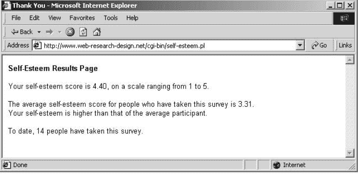

**图 6.2.** 该 CGI 脚本对用户的回答进行平均计算，为其提供一个单一的自尊分数，同时向用户汇总保存在文本文件中的先前用户的数据。

在这种情况下，如果用户的自尊分数高于平均用户，则用户会收到第一条反馈。如果该条件未被满足，程序将执行 `else` 语句后面大括号内的命令，用户会被告知他或她的自尊分数低于或等于典型参与者。

使用 `if-else` 条件语句是控制程序操作流程的一种有价值的手段。事实上，当你开始设计自己的互联网研究时，你可能会发现 `if-else` 方法是最有用的方法之一。我们这里用它来确定参与者收到何种反馈。在这本书的其余部分，你会看到更多使用 `if-else` 条件语句的例子。

**注意。** 在 `if-else` 命令中，可以测试多种**逻辑条件**，既适用于数字信息，也适用于文本信息。以下是一些常用于**数字**的逻辑条件：

| 条件 | 逻辑测试 |
| --- | --- |
| `$x` 等于 `$y` | `if($x == $y){}` |
| `$x` 不等于 `$y` | `if($x != $y){}` |
| `$x` 大于 `$y` | `if($x > $y){}` |
| `$x` 小于 `$y` | `if($x < $y){}` |
| `$x` 小于或等于 `$y` | `if($x <= $y){}` |
| `$x` 大于或等于 `$y` | `if($x >= $y){}` |
| `and` 连接词 | `if($x == $y && $x != 0){}` |
| （这允许你同时测试两个逻辑条件。要使该逻辑条件为真，必须同时满足两个条件。） | |
| `or` 连接词 | `if($x == $y || $x != 0){}` |
| （这允许你同时测试两个逻辑条件。要使该逻辑条件为真，至少有一个条件必须被满足。） | |

逻辑条件也可以用于**字符串**测试——字符串是一系列字符（字母、数字或符号）。例如，如果用户输入了一个密码，我们可能希望将其与我们数据库中已知的该用户密码进行对比。在这种情况下，我们想知道用户的回答 `$x` 是否等于存储的密码 `$y`。以下是一些常用于字符串测试的逻辑条件：

| 条件 | 逻辑测试 |
| :--- | :--- |
| `$x` 等于 `$y` | `if($x eq $y){}` |
| `$x` 不等于 `$y` | `if($x ne $y){}` |
| `$x` 大于 `$y` | `if($x gt $y){}` |
| `$x` 小于 `$y` | `if($x lt $y){}` |
| `$x` 小于或等于 `$y` | `if($x le $y){}` |
| `$x` 大于或等于 `$y` | `if($x ge $y){}` |
| `and` 连接词 | `if($x eq $y && $x ne $z){}` |
| `or` 连接词 | `if($x eq $y || $x ne $z){}` |

（这允许你同时测试两个逻辑条件。要使该逻辑条件为真，必须同时满足两个条件。）

（这允许你同时测试两个逻辑条件。要使该逻辑条件为真，至少有一个条件必须被满足。）

测试不一定非要在局部变量上进行；也可以使用实际文本。例如，我们可以进行如下测试：`if ($x eq happy)`。在这个例子中，我们将单词 `happy` 用引号括起来，因为它是一个字符串而非数值。当字符串以字面形式（而非变量或表示形式，如 `"happy"` 与 `$y`）使用时，需要用双引号括起来。

#### 样本量与反馈

如果你的研究中只有极少数参与者，你计算出的平均自尊分数将在统计上不稳定（即，每次有人参与研究时，平均分可能会变化很大），基于不稳定的统计数据向用户提供反馈是不明智的。

至少有两种方法可以解决这个问题。首先，如果你研究的是一个广为人知的主题，比如自尊，很容易找到其他样本中的平均自尊分数，并用该数值代替你目前从小样本中估计出的值。假设其他样本中的平均自尊分数通常为 4.2。我们可以在 CGI 程序中添加以下代码行，位置在 `print $query->header` 这一行之前：


```perl
if($n < 30){
$esteemmean= 4.2;
}
```

现在，如果样本量小于 30，程序将把`$esteemmean`的值改为 4.2。如果样本量大于或等于 30，它将使用从你的数据文件中计算出的实际样本均值。另一种解决方案是在样本量较小时不报告样本信息。这里我们使用一个`if-else`语句，只有当样本量大于 30 时，才打印关于样本均值的信息。

```perl
print $query->header;
print $query->start_html(-title=> Thank You );
print <FONT FACE = arial SIZE = 2 ><B>Self-Esteem Results Page</B><BR><BR>
Your self-esteem score is $esteem2, on a scale ranging from 1 to 5.<BR><BR>

if($n > 30){
print The average self-esteem score for people who have taken this survey is $esteemmean.<BR><BR>
To date, $n people have taken this survey.";

if($esteem > $esteemmean){
print Your self-esteem is higher than that of the average participant. ;
}

if($esteem < $esteemmean){
print Your self-esteem is lower than that of the average participant. ;
}
}

print </FONT> ;
print $query->end_html;
```

> **注意：**在这段代码中，我们将一些`if-else`条件语句（即关于是否打印高于或低于样本均值信息的那些）嵌套在另一个`if-else`条件语句（即关于是否打印样本均值信息的那个）之中。嵌套是一种非常有用的工具，但你需要确保所有开括号都有对应的闭括号，否则你的程序将无法正确运行。

## 本章总结

在本章中，我们学习了大量内容！在探索如何为参与者提供关于其反应的有价值反馈的过程中，我们掌握了多种通用的 Perl 技能，包括：

1. 如何将文本文件中的数据读入易于操作的变量数组。
2. 如何创建简单的`foreach`循环来处理文本文件中的每一行数据。
3. 如何使用`if-then`条件语句以特定方式定制反馈。
4. 如何将自定义变量（例如用户的自尊分数）插入到从服务器传递到用户浏览器的 HTML 代码中。

在进入下一章之前，让我们回顾一下每个要点。

### 1. 从文本文件中读取数据

要从服务器上已存在的文本文件中读取数据，请使用以下通用命令：

```perl
open(INFO,
    $ENV{ DOCUMENT_ROOT }/www/data/datafile.txt );
@data = <INFO>;
close(INFO);
```

这段代码的含义是：“打开服务器上`data`文件夹中名为`datafile.txt`的文本文件，将该文件的内容分配给一个名为`@data`的数组，最后关闭该数据文件。”

### 2. 使用 foreach 命令处理数据

我们可以使用`foreach`命令，通过逐行（即逐人或逐行）遍历数据来处理已从文本文件中提取的数据。

```perl
foreach $key (@data)
{
($adate,$atime,$aip,$av01,$av02,$av03,$av04,$av05,
  $aesteem2,$aendline)=split(/,/,$key);
$sum = $sum + $aesteem2;
}
```

例如，这段代码从名为`@data`的数组中获取信息，并对每一行数据，通过行中每个逗号将其拆分为单独的变量。这些值被临时分配给局部变量，例如`$adate`和`$av03`。在这段代码中，每一行数据的变量`$aesteem2`都会累加到变量`$sum`上。因此，每次我们遍历数组时，都会将该人的自尊分数加到先前自尊分数的总和中。

### 3. 使用 if-then 条件语句

为了向用户定制响应，我们使用`if-then`条件语句。例如，只有在`$n`的值大于 40 时，服务器才会执行以下花括号内的代码：

```perl
if($n > 40){
    print The sample size is larger than 40. ;
}
```

### 4. 将变量插入 HTML 代码

我们可以通过将 Perl 变量替换到发送给用户的 HTML 代码中来定制用户收到的反馈。例如，如果`$average`的值是 5.43，那么代码`print The average score is $average ;`将会打印“The average score is 5.43”，而不是字面上打印“The average score is $average。”Perl 明白你打算用变量`$average`的值来替换，而不是字面量变量的名称。这是 Perl 中 CGI 编程最强大的特性之一。

以下是本章介绍的 Perl 命令回顾。

| Perl 命令 | 功能 | 示例 |
| :--- | :--- | :--- |
| `sprintf("%.Xf", $variable);` | 此命令可用于将变量四舍五入到 X 位小数。 | `$esteem2 = sprintf("%.4f", $esteem);`（这会将`$esteem`的值四舍五入到四位小数，并将结果命名为`$esteem2`。） |
| `open(INFO, "ENV{'DOCUMENT_ROOT'} /www/data/textfile.txt"); @array = <INFO>; close(INFO);` | 这组命令打开一个文本文件，将信息提取到一个数组中，然后关闭文本文件。`INFO`是一个文件句柄，用于临时引用文件的内容。 | `open(INFO, "ENV{'DOCUMENT_ROOT'} /www/data/mydata.txt"); @data = <INFO>; close(INFO);`（此示例打开一个名为`mydata.txt`的文本文件，并将内容转储到名为`@data`的数组中。然后可以通过操作数组`@data`来操作脚本中的数据。） |
| `foreach $key (@array)`<br>`{`<br>`($variable01,`<br>`$variable02,`<br>`$variable03) =`<br>`split(/,/, $key);`<br>`}` | 在此上下文中，`foreach`命令用于构建一个循环，遍历数组中的每一行数据。`$key`是一个临时标签，用于在处理过程中引用数组中的每一行数据。花括号内指定了元素的处理方式。`split`命令用于指定行内元素如何分割为离散的变量。 | `foreach $key (@data)`<br>`{`<br>`($v01, $v02, $v03) =`<br>`split(/,/, $key);`<br>`$sum = $sum + $v02;`<br>`}`<br><br>（在此示例中，`@data`中的每一行信息被分别分割为三个变量。每次循环时，第二个变量`$v02`被加到`$sum`上。这使得程序员能够将数据集中所有`$v02`的值相加。） |
| `if (condition) {}`<br>`else {}` | `if-else`命令用于控制脚本内的操作流程。只有在满足括号内的条件时，才会执行花括号内的命令。如果条件不满足，则执行`else`花括号内的命令。 | `if ($n < 30) {`<br>`  $esteemmean = 4.2;`<br>`}`<br>`else {`<br>`  $esteemmean = 3.2;`<br>`}`<br><br>（在此示例中，如果`$n`的值小于 30，则`$esteemmean`的值设置为 4.2。如果该条件不满足，则执行`else`花括号内的命令。） |

# 第 7 章：随机化刺激呈现顺序

从研究设计的角度来看，我们在前几章创建的自尊调查有一个小局限性。具体来说，项目总是以相同的顺序呈现。例如，“我觉得自己有价值，至少与他人平等”这一项总是排在第一位，而“我觉得没有什么值得骄傲的”总是排在最后一位。当研究刺激对所有参与者都以相同的顺序呈现时，我们引入了可能存在与特定问题顺序相关的微妙效应的可能性，这可能会污染我们的结果。尽管这类效应对某些研究可能不会造成问题，但应该清楚，在其他研究背景下（例如那些需要重复测量设计的情况），在参与者之间使用相同的呈现顺序可能会严重削弱研究者从数据中得出的推论。

解决这个问题的一种方法是在可能的情况下随机化刺激的呈现顺序。使用普通的 HTML 网页很难做到这一点。每个用户访问一个 HTML 页面时，都会看到相同的页面——项目顺序相同。然而，可以通过编程 CGI 脚本以随机方式传递刺激。

在本章中，我们将利用 CGI 脚本可以向用户浏览器发送自定义 HTML 代码这一事实。我们将编写一个 CGI 脚本，以随机确定的顺序向每个参与者传递刺激。我们将基于上一章开发的自尊调查进行扩展，但我们将开发的通用技术可以应用于各种研究背景。正如问卷项目的呈现顺序可以随机化一样，我们也可以在以其他方式呈现刺激时（例如，使用一系列图像）进行随机化。

## 示例说明

将下面的 Perl 代码复制到文本编辑器的空白文档中。将文件保存为`randesteem1.pl`，并放在服务器上的`cgi-bin`目录中。

```perl
#!C:/perl/bin/perl.exe
use CGI;
$query = new CGI;

$v01= 'I feel that I'm a person of worth, at least
       on an equal plane with others.';
$v02= 'I feel that I have a number of good qualities.';
$v03= 'All in all, I am inclined to feel that I am a
       failure.';
$v04= 'I am able to do things as well as most other
       people.';
$v05= 'I feel I do not have much to be proud of.';

print $query->header;
print $query->start_html(-title=>'Self-Esteem Test');

print '<FONT FACE="arial" SIZE="2">';
print '<B>This page is designed to assess your self-
       esteem.</B><BR> <BR>
Please answer the following questions. Once you have
answered each question,
click the button labeled <I>calculate my score.</I>
The web page will then calculate';
```

## FOR-NEXT 循环

在深入分析`randesteem1.pl`的代码之前，我想暂时岔开话题，讨论一下`for-next`循环——这是另一个有用的工具，并且将在本书后面的许多示例中用到。正如我们在第 6 章的`foreach`示例中所见，循环是重复执行相同任务的编码指令。

`for-next`循环指示服务器执行相同的一系列任务，次数由程序员指定。`for-next`循环的一个重要特性是它使用一个**索引**变量来监控服务器已经循环的次数。

如果你想进行任何复杂的编程，理解并掌握`for-next`循环是必要的，所以让我们从讨论一个简单的`for-next`循环开始。将以下脚本输入到一个空白文档中，并将其保存为`fornextexample1.pl`到服务器的`cgi-bin`文件夹中。完成之后，在浏览器中运行该程序（即，在浏览器地址栏中输入脚本的完整 URL——包括`cgi-bin`文件夹，因为此文件位于`cgi-bin`文件夹内）。在我的服务器上，相应的 URL 是`http://www.web-research-design.net/cgi-bin/fornextexample1.pl`。

```perl
fornextexample1.pl
#!C:/perl/bin/perl.exe
use CGI;
$query = new CGI;

print $query->header;
print $query->start_html(-title=> For-Next Loop Example );

for($i = 0; $i <= 10; ++$i) {
    print "The index value is currently equal to $i. <BR><BR>;
}

print $query->end_html;
```

当你运行这个程序时，你应该会看到如图 7.1 所示的输出。

让我们剖析一下代码，看看这个循环是如何工作的。从输出中可以看出，`for-next`循环正在重复执行花括号内的`print`命令。它执行该命令的次数在`for-next`命令的第一行中给出。第一部分`$i = 0`告诉服务器*开始*循环，让索引变量`$i`等于零。第三部分`++$i`告诉服务器每完成一次花括号内命令的循环，就*递增*`$i`的值 1。（这是 Perl 中实现`$i = $i + 1`的一种简写方式。）第二部分`$i <= 10`告诉服务器当`$i`大于 10 时*停止*循环这些命令。只要`$i`小于或等于 10，循环就会继续。当`$i`等于 11 时，服务器停止循环。

在这个例子中，我们通过让`$i`等于 0 来开始循环。接下来，服务器执行花括号内的`print`命令（即，`print The index value is currently equal to $i. <BR><BR>`）。因为`$i`当前等于 0，用户看到以下消息：“The index value is currently equal to 0。”命令执行完毕后，服务器将`$i`的值递增 1，使`$i`等于 1（即 0 + 1 = 1）。因为`$i`小于 11，服务器返回到循环的开头。服务器再次执行花括号内的命令。然而，因为`$i`现在等于 1，用户看到以下消息：“The index value is currently equal to 1。”服务器执行完该命令后，将`$i`递增 1，使其现在等于 2（即 1 + 1 = 2）。因为`$i`仍然小于或等于 11，服务器返回到循环的开头。

这个过程持续进行，直到`$i`等于 11。注意，最后一次进入循环时，`$i`等于 10。然后服务器将`$i`递增 1，使`$i`等于 11。当它检查`$i`是否等于或小于 10 时，发现`$i`现在大于 10。因此，服务器停止执行花括号内的命令，并继续程序的下一部分（在本例中是`print $query->end_html`命令）。

`for-next`循环很有价值，因为它们允许你轻松执行重复性命令。它们也很有帮助，因为索引值`$i`可以以多种巧妙的方式使用。其中一种巧妙的方式对我们特别有用；请看以下代码：

```perl
fornextexample2.pl
#!C:/perl/bin/perl.exe
use CGI;
$query = new CGI;

print $query->header;
print $query->start_html(-title=> Self-Esteem Test );
@names= ( Bumpy Molasses , Spappy McNivens , Winslow Pentiballo );

print The first name is $names[0].<BR> ;
print The second name is $names[1].<BR> ;
print The third name is $names[2].<BR><BR><BR> ;

for($i = 0; $i <= 2; ++$i){
print The index value is currently equal to
$i.<BR> ;
print The name corresponding to this index value is
$names[$i].<BR><BR> ;
}

print $query->end_html;
```

将此代码复制到一个空白文档中，并将其保存为`fornextexample2.pl`到服务器的`cgi-bin`目录中。在浏览器中打开该程序。当你运行该程序时，你应该会看到如图 7.2 所示的输出。

在这个例子中，我们创建了一个名为`@names`的**数组**，其中包含三个人的名字。数组是 Perl 中包含多个值或元素的变量（更详细的讨论请参见第 5 章）。方便的是，我们可以通过在方括号内指定其在数组中的数字索引来引用该数组的任何元素。例如，我们可以将数组的第 #1 个元素引用为`$names[1]`。重要的是要注意，*Perl 从零开始计数*，而不是从 1 开始。因此，在前面讨论的三元素数组（即`@names`）中，我们通常认为是数组第一个元素的部分，在数字上被索引为第 0 个元素；第三个元素被索引为第 2 个。这一点很容易忘记并且可能造成混淆，所以，如果涉及数组的程序没有按预期工作，请检查数组中元素的索引。

**图 7.2。**索引值如何在循环中用于引用数组特定元素的示例。

> **注意：**当我们引用数组的*所有*元素（即数组本身）时，我们使用艾特符号（`@`）作为前缀（例如`@names`）。当我们引用该数组中的特定元素时，我们使用美元符号（`$`）作为前缀（例如`$names[2]`）。数组的任何单个元素都是单个值（标量），单个值使用美元符号引用。


我们可以在循环中使用索引号`$i`来引用数组中的特定元素。在这个例子中，循环执行花括号内的命令三次。第一次循环时，`$i`等于 0，服务器打印数组`@names`的第 0 个元素：“Bumpy Molasses。”第二次循环时，`$i`等于 1，服务器打印数组的第 1 个元素：“Spappy McNivens。”第三次循环时，`$i`等于 2，服务器打印数组的第 2 个元素：“Winslow Pentiballo。”第三次循环后，服务器将`$i`递增 1，使`$i`等于 3。因为 3 大于 2，服务器退出循环并继续程序代码的下一部分。

#### 分析代码

既然我们对`for–next`循环的工作原理有了更好的理解，让我们回到我们的随机化示例`randesteem1.pl`。程序以我们开始 CGI 脚本时总是使用的相同三行开始。代码的一个新方面如下所示：

```
$v01=  I feel that I'm a person of worth, at least
  on an equal plane with others. ;
$v02=  I feel that I have a number of good
  qualities. ;
$v03=  All in all, I am inclined to feel that I am a
  failure. ;
$v04=  I am able to do things as well as most other
  people. ;
$v05=  I feel I do not have much to be proud of. ;
```

我们正在创建五个局部变量（即`$v01`、`$v02`、...、`$v05`），它们包含五个自尊项目的文本内容。因为这些项目是字母数字信息，而不是纯粹的数字信息，我们将它们视为字符串，并将项目括在双引号中。

打开浏览器，转到此脚本的 URL。回想一下，由于此脚本是 CGI 脚本，它位于服务器的`cgi-bin`目录中。请注意，与我们之前的示例不同，我们不是在搜索 HTML 文件（`.htm`扩展名的文件）。相反，我们正在直接加载一个 CGI 脚本。

通过在浏览器中“重新加载”或“刷新”页面来试验该程序。每次重新加载页面时，你应该会看到五个自尊问题的新排序。现在还不要提交任何答案；我们还没有创建处理数据的 CGI 脚本。

```
your self-esteem score, and tell you more about how
    you compare to others.<BR><BR>";

print  <FORM ACTION =  /cgi-bin/self-esteem4.pl
   METHOD =  post > ;

@varlist = ( v01",  v02",  v03",  v04",  v05");

srand;
@new = ();
while (@varlist){
push(@new, splice(@varlist, rand @varlist,1));
}
@varlist= @new;

for($i = 0; $i <= 4; ++$i){
$question= $varlist[$i];
print    $$question <BR> ;
print"<I>Strongly Disagree </I>
<INPUT TYPE =  radio  NAME = $varlist[$i] VALUE =  1 >
<INPUT TYPE =  radio  NAME = $varlist[$i] VALUE =  2 >
<INPUT TYPE =  radio  NAME = $varlist[$i] VALUE =  3 >
<INPUT TYPE =  radio  NAME = $varlist[$i] VALUE =  4 >
<INPUT TYPE =  radio  NAME = $varlist[$i] VALUE =  5 >
<I>Strongly Agree</I><BR><BR><BR>";
}

print  <INPUT TYPE =  submit  VALUE =  Calculate my
   score > ;
print  </FORM></FONT> ;
print $query->end_html;
```

现在，你应该对接下来的这组命令（例如`print $query->header`）感到熟悉了。我们正在指示 CGI 程序向用户的浏览器发送一组 HTML 代码。具体来说，它会发送一组能够打印自尊问卷说明的代码。请注意，这些说明与我们在上一章中使用的完全相同；不过，在上一章中，页面是从一个真正的 HTML 文件创建的。而在这里，页面是完全由 CGI 脚本创建的。

接下来的代码段有点复杂。

```
@varlist = ( "v01", "v02", "v03", "v04", "v05");
srand;
@new = ();
while (@varlist){
push(@new, splice(@varlist, rand @varlist,1));
}
@varlist= @new;
```

这段代码的开头很简单。第一条命令指示服务器创建一个名为`@varlist`的局部数组，其中包含值 v01、v02、……、v05。接下来的几行代码负责获取这个变量并随机打乱其内容的顺序。

`srand`设置一个随机数种子——这是生成随机序列所需的数字。接下来，我们创建一个新的、临时的局部数组`@new`。通过将`@new`设置为等于空括号，我们告诉 Perl 创建一个数组，但不在其中插入任何内容。然后，我们使用`while`命令开始一个循环。`while`命令代表另一种循环，通过它我们将随机遍历`@varlist`的内容，一次一个，并将内容推送到数组`@new`中。一旦`@varlist`的每个元素都在这个新数组中被复制，`while`循环就结束了。最后，我们将`@varlist`的旧内容复制过去，用`@new`的内容（即新随机打乱的一组元素）替换它们。

理解这段代码的细节并非必要，因此我不会深入阐述。然而，理解其功能很重要。简而言之，这段代码获取数组`@varlist`的元素并随机重新排列它们。为了将此代码用于你的研究目的，你只需要将相应的内容插入`@varlist`即可。在这个例子中，我们正在随机化问卷项目呈现的顺序。因此，`@varlist`的内容是问题的符号名称。

下一段代码代表了程序的真正核心部分。该部分使用一个`for–next`循环来呈现每个问卷项目。

```
for($i = 0; $i <= 4; ++$i){
$question= $varlist[$i];
print   $$question <BR> ;
print"<I>Strongly Disagree </I>
<INPUT TYPE =  radio  NAME = $varlist[$i] VALUE =  1 >
<INPUT TYPE =  radio  NAME = $varlist[$i] VALUE =  2 >
<INPUT TYPE =  radio  NAME = $varlist[$i] VALUE =  3 >
<INPUT TYPE =  radio  NAME = $varlist[$i] VALUE =  4 >
<INPUT TYPE =  radio  NAME = $varlist[$i] VALUE =  5 >
<I>Strongly Agree</I><BR><BR><BR>";
}
```

回想一下，我们之前已经随机化了`@varlist`中元素的顺序。为了便于讨论，我们假设`@varlist`现在包含以下顺序的元素：v03、v01、v05、v02 和 v04。

服务器进入`for–next`循环后做的第一件事是创建一个索引变量`$i`，并将其赋值为零。接下来，它创建一个局部变量`$question`，它将等于数组`@varlist`的第 i 个元素。因为`$i`在第一次循环时等于零，`$question`将被赋值为 "v03"——`@varlist`的第 0 个元素。

下一条命令相当微妙。简而言之，它指示服务器打印`$question`的值。然而，重要的是，它也指示服务器在打印`$question`的值之前打印一个美元符号。因为`$question`等于 v03，所以服务器将`$$question`解释为`$v03`。服务器将 v03 附加到美元符号后面，并执行以下命令：

```
print   $v03 <BR> ;
```

因为`$v03`已被赋予文本值 "All in all, I am inclined to feel that I am a failure,"，所以程序会将该问卷项目打印到用户的浏览器中。

接下来的几行将响应选项打印为单选按钮，以便用户可以点击响应。这里需要注意的是单选按钮 NAME 属性中发生的情况。由于问题呈现的顺序是随机的，我们不能像以前那样简单地插入名称。尽管如此，我们仍然希望使用以前使用过的相同名称。例如，我们希望第 3 题的响应被命名为 v03。为了实现这一点，我们获取`@varlist`的第 i 个元素并用作变量名：`NAME = $varlist[$i]`。第一次循环时，当`$i`等于零时，服务器将打印问题`$v03`，用户的响应将被命名为 v03（`@varlist`的第 0 个元素）。

第二次循环时，`$i`将递增 1，等于 1。（命令`++$i`是命令`$i = $i + 1`的简写。尽管这个简写不如`$i = $i + 1`直观，但我在这里包含了它，因为它很常用，并且你会在可能在网上找到的 Perl 示例中经常看到它。）`@varlist`的第 1 个元素是 v01。因此，程序将 v01 附加到美元符号后面，并打印出`$v01`的内容。接下来，它创建单选按钮响应选项，并将响应选项命名为 v01。程序循环运行，打印每个问卷项目和相应的单选按钮，直到`$i`等于 6。此时，循环结束，服务器向浏览器发送 HTML 代码以生成提交按钮。

这个循环可能看起来相当复杂。我鼓励你深入研究这些命令，并尝试其他创建代码的方法（例如，看看如果你使用`print $question <BR> ;`这一行而不是`print $$question <BR> ;`会发生什么。一旦你自己尝试了一些代码，它应该会开始感觉更自然。熟悉这段代码很重要，因为我们在本书的其余部分将经常使用这个循环技巧来呈现刺激。在循环的上下文中呈现刺激，比为你想要呈现的每个刺激重复输入相应的代码要容易得多。

#### 处理和保存随机化数据

请注意，在`randesteem1.pl`中，我们已经指示服务器在点击提交按钮时运行`self-esteem4.pl`脚本。你可能还记得，这个脚本是在上一章创建的，旨在计算用户的自尊分数并将其保存到名为`self-esteem.txt`的数据文件中。你可能想知道，考虑到每个用户的问题顺序会不同，程序将如何正确计算被试的自尊分数。然而，请回想一下，我们能够恰当地命名响应选项。尽管用户看到的问题顺序是随机的，但每个响应选项的 NAME 属性保留了我们之前使用的相同名称（例如，v01、v02）。

要亲自验证这一点，请在浏览器窗口中再次打开`randesteem1.pl`，然后右键单击窗口中的空白处。这将打开一个新的菜单窗口；选择查看源文件选项。你应该能够看到 CGI 脚本发送到浏览器窗口的 HTML 代码。注意，我们以前在 HTML 文件中使用的相同响应名称（例如 v01、v02）在这里也被使用，但项目的列出顺序与之前不同。例如，图 7.3 中列出的第一个项目实际上是项目 v05，当它在 CGI 数据包中被发送到`self-esteem4.pl`进行处理时，该项目的响应将被命名为 v05。

每个项目的响应选项的 NAME 属性仍然与项目名称匹配，就像上一章一样，这一事实很重要。当执行`self-esteem4.pl`脚本时，它将能够从提交的数据包中提取正确的信息，因为响应已被分配了正确的名称。

你可能也想知道，由于问题对每个被试出现的顺序不同，我们将如何以标准方式将信息保存到数据文件中。幸运的是，当我们编写`self-esteem4.pl`脚本来保存数据时，我们使用了以下命令：

```
print INFO $v01, $v02, $v03, $v04, $v05, ;
```

因此，Perl 将以相同的顺序为每个参与者保存数据（即`$v01`将首先被保存，然后是`$v02`，依此类推），无论项目呈现给参与者的顺序如何。要亲自看到这一点，我鼓励你更多地尝试`randesteem1.pl`。具体来说，注意问题呈现给你的顺序，然后在一张纸上记录你实际给出的答案。提交数据后，打开`self-esteem.txt`数据文件。你应该注意到，你的响应是按变量名（即`$v01`、`$v02`、`$v03`、`$v04`和`$v05`）组织的，而不是按你回答问题的实际顺序。

#### 另一个例子，稍有变化

我想再举一个例子，以说明如何随机打乱数组元素——结合`for-next`循环的使用——来随机化不同类型的刺激。这次我们不随机化问卷项目的顺序，而是随机化视觉刺激呈现的顺序。我们将在这里使用三张图片。另外，我们将把数据通过电子邮件发送给我们自己（而不是保存到数据文件中，以保持示例简单）。

将以下代码复制到一个空白文档中，并将其保存为`randexample.pl`，放在你的`cgi-bin`目录中。（务必将 FORM 标签中的电子邮件地址更改为你自己的。另外，别忘了将相应的图片下载到服务器上的`images`文件夹中[参见第 3 章]。如果你的服务器上没有图片，参与者的图片将不会显示。）

```perl
randexample.pl

#!C:/perl/bin/perl.exe

use CGI;

$query = new CGI;

$v01= '/images/image1.jpg';

$v02= '/images/image2.jpg';

$v03= '/images/image3.jpg';

print $query->header;

print $query->start_html(-title=>'Mental Rotation');

print "<FONT FACE = arial SIZE = 2 >";

print "<B>Image Rating Example.</B><BR> <BR>";

print "Each image depicts two objects. In some cases, one

   object is a simple rotation of the other. In other

   cases, the two objects are not the same. For each

   image, decide whether the objects are the

   <I>same</I> (i.e., one is a simple rotation of the

   other) or whether they are <I>different</I>.

<BR><BR>";

print "<FORM ACTION = mailto:fraley\@uic.edu METHOD

   = post ENCTYPE = text/plain >";

@varlist = ("v01", "v02", "v03");

srand;

@new = ();

while (@varlist){

push(@new, splice(@varlist, rand @varlist,1));

}

@varlist= @new;

print "<CENTER>";

for($i = 0; $i <= 2; ++$i){

$image= $varlist[$i];

print "<BR>";

print "<TABLE><TR><TD ALIGN= center >

<I>Same</I><BR>

<INPUT TYPE = radio NAME = $varlist[$i] VALUE = 1 >

</TD>";

print "<TD ALIGN= center ><I> Different</I><BR>

<INPUT TYPE = radio NAME = $varlist[$i] VALUE = 2 >

</TD></TR></TABLE><BR>";

}

print "<INPUT TYPE =  submit  VALUE =  Submit my responses >";

print "</FORM></FONT></CENTER>";

print $query->end_html;
```


> **注意。** 在上面的代码中，我在电子邮件地址中的 `@` 前面使用了反斜杠：`fraley\@uic.edu`。虽然在正规的 HTML 文档中（即扩展名为 `.htm` 或 `.html` 的文件）不需要这样做，但当你将这段 HTML 命令嵌入到 CGI 脚本中（即扩展名为 `.pl` 的文件）时，服务器会以不同于此处预期用途的方式处理 `@` 符号。因此，为了指示服务器按字面意义解释 `@` 符号（即作为 `@`），需要加上反斜杠。

本演示使用的图像与 Shepard 和 Metzler（1971）在其关于心理表象和旋转的经典研究中使用的图像相似。图 7.4 中描述的屏幕应与您在浏览器中输入相应 URL 时看到的屏幕相似。

请注意，该脚本的结构与前一个相同。唯一例外如下：

- 我们有三个刺激，而不是五个。因此，`@varlist` 只包含三个元素，并且 `for–next` 循环中的命令只会执行三次。
- 这些刺激不是问卷项目，而是图像。我们将图像的 URL 分别赋值给了不同的变量（即 `$v01`、`$v02`、`$v03`），并将变量名替换到了显示图像的 HTML 标签中。
- 当程序执行到循环内的 `$image= $varlist[$i]` 命令时，它取 `@varlist` 的第 `i` 个元素，并将其赋值给 `$image`。第一次循环时，当 `$i` 等于 `0`，程序取 `@varlist` 的第 `0` 个元素 `v01`，并将其赋值给变量 `$image`。因此，如果我们假设 `@varlist` 没有随机化，且第 `0` 个元素是 `v01`，那么 `$image` 现在就等于 `v01`。在下一行，`print  <BR>` 中，我们在 `$image` 前面加了一个美元符号，从而欺骗程序使其看到 `$v01` 而不是仅仅看到 `v01`。由于代码会正确地将 `$v01` 解释为一个变量，因此它会将 `$v01` 的内容 `/images/image1.jpg` 替换到命令中。换句话说，程序读取该行时，就好像它写的是：`print <BR>`，而不是 `print <BR>`。

## 刺激的随机排序

### 图像评分示例

每张图像描绘两个物体。在某些情况下，一个物体是另一个的简单旋转。在其他情况下，两个物体并不相同。对于每张图像，判断这些物体是**相同**的（即一个是另一个的简单旋转）还是**不同**的。

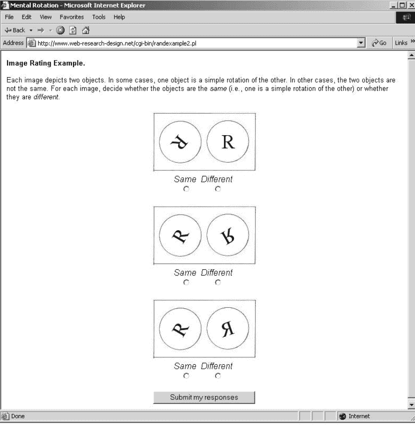

**图 7.4.** 图像和文本一样，可以以随机顺序呈现给每位参与者。

- 每次我们点击浏览器上的刷新或重新加载按钮时，都会获得一个新的刺激随机顺序。

> **注意。** 请记住，要使用图像作为刺激，这些图像需要保存在您 Public HTML 文件夹内的 `images` 文件夹中。

### 最后一个示例，带有更大的变化

在某些情况下，您可能希望向参与者呈现例如从总共十个项目中随机选取的五个项目。要实现这一点，您可以使用我们之前讨论过的相同技术，只需稍作变化。也就是说，我们不再让 `for-next` 循环呈现**所有**可用的刺激，而是将其限制为只呈现这些刺激的一个子集。

让我们回到自尊示例来说明。假设我们有一个包含 10 个可能的自尊项目的数据库，但我们只想向参与者呈现这 10 个项目中随机选取的 5 个。我们可以将 `for-next` 循环设置为不循环执行 10 次命令，而是指示它只循环 5 次。以下是一些可以试验的示例代码。将代码复制并保存为 `randesteem2.pl` 到您服务器的 `cgi-bin` 目录中。

```perl
randesteem2.pl

#!C:/perl/bin/perl.exe

use CGI;

$query = new CGI;

$v01= 'I feel that I m a person of worth, at least

  on an equal plane with others.';

$v02= 'I feel that I have a number of good

  qualities.';

$v03= 'All in all, I am inclined to feel that I am a

  failure.';

$v04= 'I am able to do things as well as most other

  people.';

$v05= 'I feel I do not have much to be proud of.';

$v06= 'I take a positive attitude toward myself.';

$v07= 'On the whole, I am satisfied with myself.';

$v08= 'I wish I could have more respect for myself.';

$v09= 'I certainly feel useless at times.';
```

## 刺激的随机排序

```perl
$v10= 'At times I think I am no good at all.';

print $query->header;

print $query->start_html(-title=>'Self-Esteem Test');

print "<FONT FACE = arial SIZE = 2 >";

print "<B>This page is designed to assess your self-

  esteem.</B><BR> <BR>";

print "<FORM ACTION = mailto:fraley\@uic.edu METHOD

  = post ENCTYPE = text/plain >";

@varlist = ("v01", "v02", "v03", "v04", "v05", "v06",

    "v07", "v08", "v09", "v10");

srand;

@new = ();

while (@varlist){

push(@new, splice(@varlist, rand @varlist,1));

}

@varlist= @new;

for($i = 0; $i <= 4; ++$i){

$question= $varlist[$i];

print "$$question <BR>";

print "<I>Strongly Disagree </I>

<INPUT TYPE = radio NAME = $varlist[$i] VALUE = 1 >

<INPUT TYPE = radio NAME = $varlist[$i] VALUE = 2 >

<INPUT TYPE = radio NAME = $varlist[$i] VALUE = 3 >

<INPUT TYPE = radio NAME = $varlist[$i] VALUE = 4 >

<INPUT TYPE = radio NAME = $varlist[$i] VALUE = 5 >

<I>Strongly Agree</I><BR><BR><BR>";

}

print "<INPUT TYPE = submit VALUE = Submit my

  scores >";

print "<BR><BR>Thank you.<BR></FORM></CENTER>";

print $query->end_html;
```

为了简化，我构建了这个示例，使数据将通过电子邮件发送给研究人员，而不是由服务器存储。但是，我鼓励您编写一个 CGI 脚本来处理和存储数据。这里的“挑战”在于，由于变量是随机选取的，因此表单每次发送的变量都会不同。这可以相对容易地处理，但需要您进行一些巧妙的代码操作。（有关本书的网页，`http://www.web-research-design.net/`，提供了一个简单的解决方案。）

## 小结

本章的目标是演示一种用于随机化刺激呈现顺序的通用技术。尽管我们主要关注随机化问卷项目，但应该清楚的是，我们可以使用这种技术来随机化我们希望通过互联网向人们呈现的其他类型的事物。

在本章中，我们学到了以下内容：

1. 可以使用 `for-next` 循环来执行重复命令。例如，如果我们在大量问卷项目中使用相同的反应量表，我们可以简单地将 `INPUT` 标签放入循环中，并在程序循环通过每次迭代时分别打印每个问卷项目。
2. `for-next` 循环是一种有用的循环类型，它使用**索引**数字来跟踪程序循环通过循环的次数。这个索引数字通常（但不一定）被指定为 `$i`，可用于标识或引用数组的特定元素。
3. 数组的元素可以随机打乱。因此，您可以轻松地对刺激顺序进行随机化。一旦顺序被随机化，您就可以逐个呈现您的刺激，由 `for-next` 循环控制。
4. 如果您想从更大的刺激库中只选取少数刺激，您可以随机打乱数组的元素，然后限制 `for-next` 循环，使其呈现的刺激数量少于可用刺激的总数。

### 随机化刺激呈现顺序

以下是对本章引入的 Perl 代码的回顾。

| Perl 命令 | 功能 | 示例 |
| --- | --- | --- |
| `for(begin, end, increment){}` | `for-next` 循环执行一组命令特定次数。该循环使用一个索引变量，每次执行大括号内的命令时，该变量都会递增。`begin` 指定循环开始时索引的值；`end` 指定导致循环结束的索引值，而 `increment` 指定每次循环中索引值的递增方式。`++$i` 是一个常用命令，用于每次循环递增 1 个单位。 | `for($i = 0; $i <= 10; ++$i){`<br>`print "The index value is currently equal to $i. <BR><BR>";`<br>`}`<br>（这些命令创建了一个从 `$i` 等于 0 开始的 `for-next` 循环。每次循环，`$i` 都会递增 1。每次都会执行大括号内的命令，直到 `$i` 的值大于 10。） |
| `@array = ("a", "b", "c");`<br>`srand;`<br>`@new = ();`<br>`while (@array){`<br>`push(@new, splice(@array, rand @array,1));`<br>`}`<br>`@array = @new;` | 这组命令可用于随机打乱先前定义的数组中的元素。这是随机化一组刺激呈现顺序的有用方法。 | `@varlist= ("v01", "v02", "v03", "v04", "v05");`<br>`srand;`<br>`@new = ();`<br>`while (@varlist){`<br>`push(@new, splice(@varlist, rand @varlist,1));`<br>`}`<br>`@varlist= @new;`<br>（这组命令随机打乱了 `@varlist` 数组的元素：`v01`、`v02`、`v03`、`v04`、`v05`。） |

# 第 8 章：随机分配条件

## 一个例子

行为科学中研究设计的最重要方面之一是将参与者随机分配到不同条件。使用随机分配有助于确保，除了实验操纵之外，没有其他系统性因素可能解释参与者的反应。在本章中，我将向你们展示如何基于前一章讨论的随机化技术，将人员随机分配到不同条件。

假设我们有兴趣研究人们评判求职者资格背后的因素。更具体地说，假设我们想知道求职者的性别在评估方式中有多重要。为了研究这个问题，我们可以构建一个简单的单因素、被试间实验，参与者阅读一段关于某人职位资格的简短描述，并对申请人的质量进行评分。在一个条件下，参与者被告知要评估的对象是一名男性。在另一个条件下，参与者被告知要评估的对象是一名女性。

让我们首先创建两个 HTML 网页，包含一个假设的、申请认知心理学虚构学术职位的候选人的资格信息。在其中一个页面上，申请人将被描述为男性。在另一个页面上，申请人将被描述为女性。以下是这两个页面的 HTML 代码。（为了节省空间，我已将内容尽可能缩短。）将第一个页面复制到空白文档，并将其保存在 **Public HTML** 文件夹中，命名为 `randassign-a.htm`。将第二个页面复制到空白文档，并将其保存在 **Public HTML** 文件夹中，命名为 `randassign-b.htm`。请务必将下面代码中的我的电子邮件地址替换为您的。

```html
<HTML>
<TITLE>Job Study</TITLE>
<FORM ACTION =  mailto:fraley@uic.edu  METHOD =  post
  ENCTYPE = text/plain >
<B>Please read the following description of a job
  candidate for a tenure-track cognitive position in
  your department. After reading this description,
  please indicate how qualified you believe this
  person to be for the job.</B>
<BR><BR>
<CENTER>Applicant 3<BR></CENTER>
This applicant received her PhD one year ago from the
  University of Illinois at Chicago. Her research is
  concerned with understanding the cognitive
  mechanisms underlying individual differences in
  working memory capacity. She has published four
  articles in peer-reviewed journals, on two of which
  she was first author.
<BR><BR><BR>
How qualified do you think this individual is for the
  job position?<BR>
<I>Not at all qualified </I>
<INPUT TYPE= radio  NAME =  v01  VALUE =  1 >
<INPUT TYPE= radio  NAME =  v01  VALUE =  2 >
<INPUT TYPE= radio  NAME =  v01  VALUE =  3 >
<INPUT TYPE= radio  NAME =  v01  VALUE =  4 >
<INPUT TYPE= radio  NAME =  v01  VALUE =  5 >
<I> Strongly qualified </I><BR><BR>
<INPUT TYPE= hidden  NAME =  condition  VALUE = female >
<INPUT TYPE =  submit  VALUE = Submit my evaluation ></FORM>
</HTML>
```

```html
<HTML>
<TITLE>Job Study</TITLE>
<FORM ACTION =  mailto: fraley@uic.edu  METHOD =  post ENCTYPE = text/plain >
<B>Please read the following description of a job candidate for a tenure-track cognitive position in your department. After reading this description, please indicate how qualified you believe this person to be for the job.</B><BR><BR>
<CENTER>Applicant 3<BR></CENTER>
This applicant received his PhD one year ago from the University of Illinois at Chicago. His research is concerned with understanding the cognitive mechanisms underlying individual differences in working memory capacity. He has published four articles in peer-reviewed journals, on two of which he was first author.<BR><BR><BR>
How qualified do you think this individual is for the job position?<BR>
<I>Not at all qualified </I>
<INPUT TYPE =  radio  NAME =  v01  VALUE =  1 >
<INPUT TYPE =  radio  NAME =  v01  VALUE =  2 >
<INPUT TYPE =  radio  NAME =  v01  VALUE =  3 >
<INPUT TYPE =  radio  NAME =  v01  VALUE =  4 >
<INPUT TYPE =  radio  NAME =  v01  VALUE =  5 >
<I> Strongly qualified </I><BR><BR>
<INPUT TYPE =  hidden  NAME =  condition  VALUE = male >
<INPUT TYPE =  submit  VALUE = Submit my evaluation ></FORM>
</HTML>
```

请注意，两位候选人的申请描述是相同的。我们唯一改变的是申请人被描述为女性（`randassign-a.htm`）还是男性（`randassign-b.htm`）。


我们的下一个任务是将参与者随机分配到只查看这两个网页中的一个。将以下脚本复制到空白文档，并将其保存为`randassign.pl`，放在服务器的`cgi-bin`文件夹中。

```perl
#!C:/perl/bin/perl.exe
use CGI;
$query = new CGI;

@filelist = ( randassign-a.htm ,  randassign-b.htm );
srand;
@new = ();
while (@filelist){
push(@new, splice(@filelist, rand @filelist,1));
}
@filelist= @new;

$selectedfile= $filelist[0];
print $query->redirect( /$selectedfile );
```

这个 CGI 脚本的目的是将参与者随机分配到两个条件之一。为了完成这项任务，请注意我们使用了前一章讨论的相同随机化技术。具体来说，我们创建了一个数组，其中包含与实验每个条件对应的文件名（即`randassign-a.htm`和`randassign-b.htm`）。接下来，我们随机打乱了这些文件的顺序。然后我们选择了`@filelist`的第 0 个元素。由于`@filelist`已被随机打乱，我们预计有 50% 的概率第 0 个元素是`randassign-a.htm`。最后，使用`$query->redirect()`命令，我们指示服务器跳转到随机选择的网页。

让我们测试一下这个脚本。在浏览器地址栏中输入 CGI 脚本`randassign.pl`的 URL。因为 CGI 脚本中不包含 HTML 代码，所以一开始您应该看不到任何内容。但是，该脚本会很快将您重定向到一个新页面，即`randassign-a.htm`或`randassign-b.htm`。运行几次`randassign.pl`脚本。（由于脚本已将您带到新页面，您可能需要再次输入 URL。）您应该会发现，平均而言，有 50% 的时间您会被重定向到男性页面。图 8.1 展示了`randassign-a.htm`页面在浏览器中外观的一个示例。

#### `randassign.pl`

## 150 如何在互联网上进行行为研究

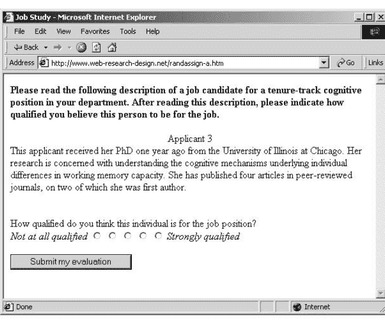

图 8.1. 该页面代表一个被试间设计两种条件中的一种条件。

> 注：为便于说明，我们将两个文件命名为`randassign-a`和`randassign-b`。然而，这种命名约定意味着该实验涉及多个页面。如果被试注意到文件名的这一特点，他们可能会好奇并开始输入类似的文件名来看看会发生什么。这当然会干扰你的实验。理想的文件名生成方式应使其看起来不像是同一主题的明显变体（例如，`a183721.htm`）。避免使用诸如`condition1.htm`或`femaletarget.htm`之类的文件名。在本章稍后，我将向你展示一种能够完全消除这一问题的随机分配方法。

请注意，我们在对应每个条件的两个网页中都放置了一个隐藏值。该值将与用户的评分一起通过电子邮件发送给我们。如果我们没有包含这个隐藏值，我们就无法知道用户的评分对应的是男性还是女性目标。

#### 另一种实现随机分配的方法

上面讨论的方法是一种相对简单的随机将人分配到不同条件的方式。此外，正如你可能想象的，该技术可以扩展到超过两个条件的情况。例如，如果我们正在进行一个 3 × 3 的被试间实验，我们将共有 9 种条件，我们可以扩展`@filelist`数组以包含对应于所有 9 种条件的 HTML 页面。

还有另一种实现随机分配的方法，该方法可能具有优势，特别是在刺激相对简单的情况下。具体而言，我们使用 CGI 脚本来呈现 HTML 代码，而不是将其重定向到多个不同的页面。这种技术的一个优点是用户不会看到文件名，从而不会使他或她意识到不同条件的存在。

将以下代码复制到空白文档中，并将其保存为`randassign2.pl`，放在服务器的`cgi-bin`目录中。

```perl
#!C:/perl/bin/perl.exe
use CGI;
$query = new CGI;

$conda=  This applicant received her PhD one year ago
  from the University of Illinois at Chicago. Her
  research is concerned with understanding the
  cognitive mechanisms underlying individual
  differences in working memory capacity. She has
  published four articles in peer-reviewed journals,
  on two of which she was first author. ;

$condb=  This applicant received his PhD one year ago
  from the University of Illinois at Chicago. His
  research is concerned with understanding the
  cognitive mechanisms underlying individual
  differences in working memory capacity. He has
  published four articles in peer-reviewed journals,
  on two of which he was first author. ;

@condlist = ( $conda ,  $condb );
srand;
@new = ();
while (@condlist){
push(@new, splice(@condlist, rand @condlist,1));
}
@condlist= @new;
$selectedcond= $condlist[0];

print $query->header;
print $query->start_html(-title=> Job Study );
print <FORM ACTION = mailto:fraley\@uic.edu METHOD
      = post ENCTYPE = text/plain > ;
print <B>Please read the following description of a
      job candidate for a tenure-track cognitive position
      in your department. After reading this description,
      please indicate how qualified you believe this
      person to be for the job.</B><BR><BR>
<CENTER>Applicant 3<BR></CENTER>";

print $selectedcond ;

print <BR><BR><BR>
How qualified do you think this individual is for the
job position?<BR>
<I>Not at all qualified </I>
<INPUT TYPE= radio NAME = v01 VALUE = 1 >
<INPUT TYPE= radio NAME = v01 VALUE = 2 >
<INPUT TYPE= radio NAME = v01 VALUE = 3 >
<INPUT TYPE= radio NAME = v01 VALUE = 4 >
<INPUT TYPE= radio NAME = v01 VALUE = 5 >
<I> Strongly qualified </I><BR><BR>";

if($condlist[0] eq $condb ){
print <INPUT TYPE= hidden NAME = condition VALUE=
      male > ;
}

if($condlist[0] eq $conda ){
print <INPUT TYPE= hidden NAME = condition VALUE=
      female > ;
}

print <INPUT TYPE = submit VALUE = Submit my
      evaluation ></FORM> ;
print </FORM> ;
print $query->end_html;
```

现在，在浏览器的地址栏中输入`randassign2.pl`的 URL。你应该会看到一个页面，看起来与我们之前看到的两个页面之一完全相同。点击几次**刷新**或**重新加载**。你应该会注意到，大约有一半的时间被试的性别为男性。

如果你研究代码，你会发现我们采用了随机打乱元素和简单变量替换相结合的方法来实现这一点。简而言之，我们定义了两个局部变量`$conda`和`$condb`，每个变量包含操纵的两个水平之一的适当文本。我们将这些变量放入名为`@condlist`的数组中，随机打乱该数组，然后从新数组中选择第 0 个元素。然后我们在打印到用户浏览器的 HTML 代码中使用这个元素，即`$conda`或`$condb`。这里唯一值得一提的另一段代码是隐藏值。如果`@condlist`的第 0 个元素等于`$condb`，则在 HTML 代码中发送一个编码条件为`"male"`的隐藏值。如果`@condlist`的第 0 个元素是`$conda`，则发送一个等于`"female"`的隐藏值。如果我们不随响应发送隐藏值，当数据提交时，我们就不知道用户被分配到了哪个条件。如果我们包含这个隐藏值，我们将收到一封电子邮件，告诉我们用户被分配到的条件以及他或她的评分。

#### 在组内操纵变量

在上一章中，我们说明了随机打乱数组的技术，以随机化刺激呈现的顺序。应该明确的是，相同的技术可用于在组内操纵变量。如果被打乱的“事物”是来自组内操纵不同水平的刺激，则可以将相同的随机化技术应用于随机化这些刺激的顺序。然而，在这种情况下，我们通常希望刺激出现在单独的网页上，而不是全部出现在同一页面上。在下一章中，我们将讨论在研究环境中使用多个页面的一种方法。

## 总结

在本章中，我们介绍了两种将人随机分配到不同实验条件的技术。一种实现随机分配的简单方法是为每个实验条件创建单独的网页或 HTML 文档，并让 Perl 脚本将用户重定向到其中一个页面。另一种方法是将作为局部变量的变化材料（例如，对工作候选人的叙述性描述）包含在 Perl 脚本中，并让脚本随机确定将呈现哪种材料。第二种方法更可取，因为（1）它只需要一个文件，并且（2）用户无法利用网页名称推断出其他条件的存在。

以下是本章介绍的 Perl 代码回顾。

| Perl 命令 | 功能 | 示例 |
|---|---|---|
| `print $query->redirect("URL");` | redirect 命令自动将用户重定向到不同的网页或 CGI 脚本。 | `print $query->redirect("http://www.google.com");` |

# 第 9 章

## 在研究中使用多个网页

#### 将响应从一页传递到下一页

到目前为止，我们关注的示例都是在单个网页上呈现*所有*刺激。然而，在某些情况下，你可能希望在单独的页面上呈现刺激。例如，如果你将图像作为刺激呈现，你可能希望每个页面只呈现一张图像，这样用户的浏览器就不会因为必须同时下载大量图像文件而不堪重负。此外，如果你在组内操纵变量，你可能不希望每个条件的刺激都出现在同一页面上。

遗憾的是，使用多个页面存在一个问题。当用户从网页向服务器提交数据时，服务器处理信息并立即“解除”与用户的关联。因此，如果用户从单独的页面提交新数据，服务器无法识别同一用户正在发送新信息。这些交易

## 如何在互联网上进行行为研究

用户计算机与服务器之间的交互被称为*无状态的*。换言之，一旦服务器将信息传递给用户（通过提交表单数据），它就不会保留该交互的记录。如果用户从研究的另一个网页回答问题并提交，服务器将无法得知这是同一研究中来自不同页面的新数据提交。

当然，解决这个问题的方法有多种，本章将重点介绍一种实用的方法。具体来说，我们将使用**隐藏标签**在服务器与用户浏览器之间来回传递信息。为了理解其工作原理，假设我们需要参与者回答五个问题，每页一个问题。当用户从第一页提交回答后，CGI 脚本会从表单中提取回答，将其编码为隐藏值，并将该回答连同新问题一起作为第二个 HTML 页面的一部分打印出来。这样，当用户提交对第二个问题的回答时，该回答*以及对第一个问题的回答*（已编码为隐藏值）都会被发送到服务器。通过在多个页面上延续这一过程，我们就可以记录用户之前的回答，尽管服务器本身在每次与用户交互时都会完全“遗忘”。

### 一个示例

为了说明这一过程，让我们回到自尊量表的示例。我们不在同一页上呈现五个自尊问题，而是每次只呈现一个问题，每个问题分别放在不同的页面上。请将以下两个脚本复制并分别保存为服务器`cgi-bin`目录中的`multiform1.pl`和`multiform2.pl`。

```perl
multiform1.pl
#!C:/perl/bin/perl.exe
use CGI;
$query = new CGI;

print $query->header;
print $query->start_html(-title=>'Self-Esteem Test');
print "<FONT FACE = 'arial' SIZE = '2'>";
print "<FORM ACTION = '/cgi-bin/multiform2.pl' METHOD
  = 'post'>";
print "Welcome to the self-esteem survey. Please click
  the button to begin.<BR>";
print "<INPUT TYPE = 'hidden' NAME = pass VALUE = 0>";
print "<INPUT TYPE = 'submit' VALUE = 'Next'>";
print "</FORM></FONT>";

print $query->end_html;
```


```perl
#!C:/perl/bin/perl.exe
use CGI;
$query = new CGI;

$v01= $query->param('v01');
$v02= $query->param('v02');
$v03= $query->param('v03');
$v04= $query->param('v04');
$v05= $query->param('v05');
$pass= $query->param('pass');

$q01= "I feel that I'm a person of worth, at least
  on an equal plane with others.";
$q02= "I feel that I have a number of good
  qualities.";
$q03= "All in all, I am inclined to feel that I am a
  failure.";
$q04= "I am able to do things as well as most other
  people.";
$q05= "I feel I do not have much to be proud of.";

@varlist= ("v01", "v02", "v03", "v04", "v05");
@qlist= ("q01", "q02", "q03", "q04", "q05");

print $query->header;
print $query->start_html(-title=>'Self-Esteem Test');

print "<FONT FACE = 'arial' SIZE = '2'>";
print "<FORM ACTION = '/cgi-bin/multiform2.pl' METHOD
  = 'post'> ";

if($pass <= 4){
$question= $qlist[$pass];
print " $$question <BR>";
print"<I>Strongly Disagree </I>
<INPUT TYPE = 'radio' NAME = $varlist[$pass] VALUE = '1'>
<INPUT TYPE = 'radio' NAME = $varlist[$pass] VALUE = '2'>
<INPUT TYPE = 'radio' NAME = $varlist[$pass] VALUE = '3'>
<INPUT TYPE = 'radio' NAME = $varlist[$pass] VALUE = '4'>
<INPUT TYPE = 'radio' NAME = $varlist[$pass] VALUE = '5'>
<I>Strongly Agree</I><BR><BR><BR>";
    for($i = 0; $i <= 4; ++$i)
    {
    $variable= $varlist[$i];
    print "<INPUT TYPE = 'hidden' NAME = $variable
    VALUE = $$variable > ";
    }
$pass = $pass + 1;
print "<INPUT TYPE = 'hidden' NAME = pass VALUE =
    $pass > ";
print "<INPUT TYPE = 'submit' VALUE = 'Next'>";
print "</FORM></FONT>";
}

else{
print "</FORM>";
print "<FORM ACTION = '/cgi-bin/self-esteem.pl' METHOD
    = 'post'> ";
print "You've answered all the questions. Click the
    button below to determine your self-esteem score.<BR><BR>";
    for($i = 0; $i <= 4; ++$i)
    {
    $variable= $varlist[$i];
    print "<INPUT TYPE = 'hidden' NAME = $variable
    VALUE = $$variable > ";
    }
    print "<INPUT TYPE = 'submit' VALUE = 'Calculate
    my score'>";
    }

print $query->end_html;
```

打开浏览器，在地址栏中输入`multiform1.pl`的 URL。你应该首先看到一个简单的页面，上面写着"Welcome to the self-esteem survey. Please click the button to begin"，以及一个标有 Next 的提交按钮。按下提交按钮后，下一页应包含一个问卷题目、一个回答量表和一个标有 Next 的提交按钮。当你回答该题目并点击 Next 按钮后，将加载一个包含不同自尊题目的新页面。在你回答完全部五个问题后，你会看到一个页面提示你已回答完所有题目。新的提交按钮将标为 Calculate my score。

## 代码分析

让我们来分析这段代码，看看它是如何工作的。到目前为止，所有代码你应该都已经熟悉了；这个程序中没有新的 Perl 命令。然而，新的是我们使用这些命令在页面间呈现题目的特定方式。让我们来关注其中的一些技巧。

第一个脚本`multiform1.pl`是一个简单的引导脚本，用于欢迎用户参与研究。不过，它还具有一个比这更重要的功能。具体来说，当用户点击提交按钮时，一个名为"pass"、值为 0 的隐藏变量将被提交到服务器。正如后文将详细解释的那样，这个隐藏值将用于告知下一个脚本`multiform2.pl`，用户在此之前尚未回答任何问题。

现在让我们研究下一个脚本——`multiform2.pl`。首先需要注意的是，该脚本中嵌入了两个 HTML 表单的命令。当被试回答的问题数少于 5 个时，即更准确地说，当`$pass`的值小于或等于 4 时，使用第一个表单。当被试回答完所有五个问题后，则构建一个新的表单。我们使用了 if-else 命令来决定将这两个 HTML 表单中的哪一个传输到用户的浏览器。

现在，让我们来检查当研究参与者尚未回答完所有问题时创建的 HTML 表单。首先需要注意的是，FORM 标签的 ACTION 属性包含该脚本的 URL。换言之，当用户点击提交按钮时，他或她会再次激活`multiform2.pl`，或者（在最后）激活`self-esteem.pl`。由于服务器与浏览器之间的关系是无状态的，服务器不会觉得这有什么异常。它只是像什么都没发生过一样再次运行脚本。幸运的是，该脚本的编写方式使其能够根据提交给它的信息类型而表现不同。每次被激活时，脚本都会处理不同的信息，因此它不会总是以相同的方式运行。

脚本的前几行旨在读取已提交给服务器的 CGI 数据。注意，即使用户尚未回答任何问题，脚本仍在读取问题 1 到 5 的值（即`v01`到`v05`）。这是可以的，不会导致程序运行错误。脚本会读取所有存在的值并将它们分配给相应的局部变量。如果 CGI 数据包中没有发送这些变量，脚本会简单地忽略相关命令。

脚本读取的变量之一是"pass"。具体来说，脚本会在 CGI 数据包中查找名为"pass"的变量，如果存在，则将其值赋给局部变量`$pass`。回想一下，当我们在`multiform1.pl`中点击提交按钮触发`multiform2.pl`时，我们提交了一个名为"pass"的隐藏变量。因此，`multiform2.pl`第一次被激活时，它会读取一个名为"pass"的隐藏变量，并将其值（恰好是 0）赋给一个名为`$pass`的局部变量。我们将使用这个变量来表示用户已回答了多少个问题——用户已经经过该脚本多少次。

下一个重要的代码段包含在`if ($pass <= 4)`条件中。当`$pass`的值小于或等于 4 时，这些命令会被执行。脚本第一次被激活时，用户尚未回答任何问题；因此`$pass`的值为 0。由于 0 小于 4，花括号内的命令将被执行。

这些命令做了什么？这些命令为用户打印一个问卷题目，以及一个回答量表和一个标有 Next 的提交按钮。由于`$pass`等于 0，`@qlist`的第 0 个元素就是呈现给用户的题目。回答值将以`@varlist`第 0 个元素对应的名称来命名。我们这里用于循环遍历题目的通用策略与第 7 章中使用的策略相同。

当用户按下提交按钮时，我们不仅想传递用户对该题目的评分，还想传递用户迄今为止已回答了多少个问题的信息。为此，我们只需将`$pass`的值加 1，然后创建一个包含更新后的`$pass`值的隐藏变量标签。现在，在回答完第一个问题后，用户将传递他或她的评分以及一个名为"pass"的隐藏变量，其值将等于 1。

请注意，我们还包含了一个简单的 for-next 循环，以便将每个回答的信息（即`v01`、`v02`、`v03`、`v04`和`v05`）作为隐藏值传递。这使我们能够在收集回答的同时将其传递出去，从而克服服务器与用户之间交互的固有无状态性。这一步骤的重要性将在下文中变得更加清晰。

#### 跨多个网页随机化试次

假设用户第一次浏览时点击了第三个单选按钮，从而将`v01`的值设为 3。用户输入答案并点击下一步后，刚才运行的同一个脚本会再次运行。不过，这一次的 CGI 数据包中包含的数据比之前更多。这次，数据包中有一个与`v01`对应的值 3，它是通过隐藏标签传递过来的。因此，系统会创建一个名为`$v01`的局部变量，并将其赋值为 3。我们还将其他项目（如`v02`、`v03`）的作答也作为隐藏值传递过来，但由于用户尚未对这些项目作答，隐藏标签中没有包含任何信息。结果，为这些变量创建的相应局部变量（如`$v02`、`$v03`）都是空的。另外，数据包中"pass"的值为 1，这一点很重要，所以脚本会创建一个名为`$pass`的局部变量，并将其设为 1。

创建这些局部变量后，脚本向用户呈现第 2 个问卷项目（这表示为`@qlist`的第 1 个元素）。假设用户为该题输入了数值 5，然后点击了提交按钮。现在，发送至服务器的数据包包含*三*个重要信息：`v01 = 3`、`v02 = 5`和`pass = 2`。第一条信息`v01 = 3`被编码为对应先前试次作答的隐藏值，第二条是用户对他/她刚看到的问卷项目的明确作答，同样作为隐藏值传递过去。

请注意，服务器与用户浏览器之间的这种交易循环会持续进行，直到第五题被施测完毕（即当`$pass`等于 5 时）。当最终题目的作答提交后，服务器提交的"pass"值为 5。因此，当脚本再次激活时，服务器会跳过`if($pass <= 4)`条件，因为该条件不再成立，转而执行`else`花括号内的命令。

```perl
else{
    print "</FORM>";
    print "<FORM ACTION = '/cgi-bin/self-esteem.pl' METHOD = 'post'> ";
    print "You've answered all the questions. Click the button below to determine your self-esteem score.<BR><BR>";
    for($i = 0; $i <= 4; ++$i)
    {
```

```perl
$variable= $varlist[$i];
print "<INPUT TYPE = 'hidden' NAME = $variable
VALUE = $$variable > ";
}

print "<INPUT TYPE = 'submit' VALUE = 'Calculate my
score'>";
```

这些命令执行了几项操作。首先，关闭之前打开的 FORM 标签：`print "</FORM>"`。其次，打开一个新的 FORM 标签：`print "<FORM ACTION = '/cgi-bin/self-esteem.pl' METHOD = 'post'>"`。该标签指示服务器在点击提交按钮时激活`self-esteem.pl`脚本。回顾一下前面几章的内容，`self-esteem.pl`脚本负责计算一个人的自尊分数并保存数据。第三，脚本向用户打印新信息。具体来说，它告诉用户已经答完了所有题目，并且应该点击提交按钮来计算他/她的自尊分数。最后，借助 for-next 循环，服务器将所有自尊作答作为隐藏值打印出来。当用户点击提交按钮时，这些数据会被传递给`self-esteem.pl`脚本。

我们刚刚探讨的示例对每个用户都以相同的顺序呈现自尊题目。我以这种方式构建程序，是为了尽可能简单地展示将信息从一个页面传递到下一个页面的技术。然而，在高级研究应用中，你会希望随机化刺激材料的顺序，并将它们分别呈现在不同的页面上。

要做到这一点，我们只需将之前讨论过的随机化技术与本章讨论的技术结合起来。下面的示例将随机化题目的顺序，同时将每个题目单独显示在一页上。我们将使用两个脚本来实现这一点。第一个脚本负责生成题目的随机顺序。第二个脚本负责按照该随机顺序呈现题目。

将以下代码复制到空白文档中，并将其保存为`randmultiform1.pl`，放在服务器的`cgi-bin`文件夹中。

```perl
randmultiform1.pl

#!C:/perl/bin/perl.exe
use CGI;
$query = new CGI;

@varlist= ("01", "02", "03", "04", "05");
srand;
@new = ();
while (@varlist){
push(@new, splice(@varlist, rand @varlist,1));
}
@varlist= @new;

print $query->header;
print $query->start_html(-title=>'Self-Esteem Test');
print "<FONT FACE = 'arial' SIZE = '2'>";
print "<FORM ACTION = '/cgi-bin/randmultiform2.pl'
  METHOD = 'post'> ";
print $query->hidden('varlist',@varlist);
print "Welcome to the self-esteem survey. Please click
  the button to begin.<BR><BR>";
print "<INPUT TYPE = 'hidden' NAME = pass VALUE = 0
  > ";
print "<INPUT TYPE = 'submit' VALUE = 'Begin'>";
print "</FORM></FONT>";

print $query->end_html;
```

同时将以下代码复制到空白文档中，并将其保存为`randmultiform2.pl`，放在服务器的`cgi-bin`文件夹中。

```perl
randmultiform2.pl

#!C:/perl/bin/perl.exe
use CGI;
$query = new CGI;

@varlist= $query->param('varlist');
$v01= $query->param('v01');
$v02= $query->param('v02');
$v03= $query->param('v03');
$v04= $query->param('v04');
$v05= $query->param('v05');
$pass= $query->param('pass');
```


```perl
$q01= "I feel that I'm a person of worth, at least
on an equal plane with others.";
$q02= "I feel that I have a number of good
qualities.";
$q03= "All in all, I am inclined to feel that I am a
failure.";
$q04= "I am able to do things as well as most other
people.";
$q05= "I feel I do not have much to be proud of.";

print $query->header;
print $query->start_html(-title=>'Self-Esteem Test');

print "<FONT FACE = 'arial' SIZE = '2'>";
print "<FORM ACTION = '/cgi-bin/randmultiform2.pl'
   METHOD = 'post'> ";

if($pass <= 4){
$question= $varlist[$pass];
$question= "q" . $question;
$variable= $varlist[$pass];
$variable= "v" . $variable;
print " $$question <BR>";
print"<I>Strongly Disagree </I>
<INPUT TYPE = 'radio' NAME = $variable VALUE = '1'>
<INPUT TYPE = 'radio' NAME = $variable VALUE = '2'>
<INPUT TYPE = 'radio' NAME = $variable VALUE = '3'>
<INPUT TYPE = 'radio' NAME = $variable VALUE = '4'>
<INPUT TYPE = 'radio' NAME = $variable VALUE = '5'>
<I>Strongly Agree</I><BR><BR><BR>";
   for($i = 0; $i <= 4; ++$i)
   {
   $variable= $varlist[$i];
   $variable= "v" . $variable;
   print "<INPUT TYPE = 'hidden' NAME = $variable
   VALUE = $$variable > ";
   }
$pass = $pass + 1;
print $query->hidden('varlist',@varlist);
print "<INPUT TYPE = 'hidden' NAME = pass VALUE =
   $pass > ";
print "<INPUT TYPE = 'submit' VALUE = 'Next'>";
print "</FORM></FONT>";
}
```

```perl
else{
  print "</FORM>";
  print "<FORM ACTION = '/cgi-bin/self-esteem.pl'
    METHOD = 'post'> ";
  print "You've answered all the questions. Click the
    button below to determine your self-esteem
    score.<BR><BR>";
  for($i = 0; $i <= 4; ++$i)
  {
    $variable= $varlist[$i];
    $variable= "v" . $variable;
    print "<INPUT TYPE = 'hidden' NAME = $variable
      VALUE = $$variable > ";
  }
  print "<INPUT TYPE = 'submit' VALUE = 'Calculate my
    score'>";
}

print $query->end_html;
```

第一个脚本执行了几项重要任务。首先，它随机化自尊题目的呈现顺序。注意，它使用了我们之前用过的相同随机打乱技术。其次，该页面作为介绍页面，向被试简要说明该网页的用途。第三，当点击“提交”按钮时，代码会激活一个新脚本 `randmultiform2.pl`，并向该脚本传递两个隐藏变量。

其中一个隐藏变量是我们上一节讨论过的 `pass` 变量。该变量表示用户已经通过 `randmultiform2.pl` 的次数，在研究开始时设为 0。第二个隐藏变量包含数组 `@varlist`，它代表呈现刺激材料的随机顺序。

> **注意。** 当信息是数组而非单个值时，不能简单地使用隐藏标签的标准 HTML 表达式（例如 `<INPUT TYPE = 'hidden' NAME = 'varlist' VALUE = @varlist>`）。不过，可以使用以下命令在隐藏标签中传递数组：
>
> `print $query->hidden('varlist',@varlist);`

第二个脚本 `randmultiform2.pl` 的工作方式与本章前面讨论的 `multiform2.pl` 脚本相同。不过，有几个这里的新技巧。

首先，这个脚本除了尝试从提交的数据包中读取 `v01`、`v02`、……、`v05` 外，还在读取 `@varlist`——这个数组包含了问题的随机呈现顺序。回想一下，这些信息是通过一个隐藏标签从 `randmultiform1.pl` 传递到此脚本的。

其次，此脚本将 `@varlist` 作为隐藏标签传递，以便在下次调用脚本时能够访问这些值。这个过程允许用户和服务器超越其交互的固有无状态性。

第三，此脚本在 Perl 中使用了一个非常有用的追加函数。请看以下代码行：

```perl
$question = "q" . $question;
$variable = "v" . $variable;
```

使用句点指示 Perl 将这两个片段拼接在一起。如果 `$question` 的值是 `01`，那么将其追加到 `"q"` 之后，我们最终得到 `q01`。

> **注意。** 在 Perl 中要**追加**两个字符串，我们可以在两个片段之间插入一个句点。例如，如果我们想从片段 `"coffee"` 和 `"cup"` 创建字符串 `"coffeecup"`，我们会使用以下命令：`$newstring = "coffee" . "cup";`
>
> 你可以像刚才演示的那样，使用句点来追加字面字符串，或者变量。例如，如果我们有两个变量 `$x` 和 `$y`，我们可以用以下命令追加它们：`$newvariable = $x . $y;` 如果 `$x` 等于 `"coffee"`，`$y` 等于 `"cup"`，这个命令将产生与上面所示相同的输出。

为了更好地理解这些脚本所做的一些事情，我鼓励你自己去剖析它们。包括打印某些变量和数组内容的命令，这样你就能确切地看到它们是什么样子，以及在处理过程中的不同时间点它们的值是什么。稍微修改一下内容，看看这对脚本的操作有何影响。

最后，尝试用你自己的问卷项目来定制这些脚本。（当然，如果你实验得太多，你需要修改 `self-esteem.pl` 程序。安全地实验这些程序的最简单方法是修改最终表单，使其不再将数据包传递给 `self-esteem.pl`，而是通过电子邮件将其发送给你。）

## 使用图像映射从一页跳转到下一页

我们刚刚讨论的技术的一个局限性是，每个页面需要用户点击两次鼠标，一次用于评价项目，一次用于提交响应并跳转到下一页。

最小化点击次数的一种方法是为响应量表和“提交”按钮都使用一个*图像映射*（参见第 4 章）。当用户点击图像映射时，浏览器会记录被点击的确切像素点，并自动提交收集到的任何数据。

要查看图像映射的实际效果，请在本书的网页上运行 `randmultiform3.pl` 脚本（`http://www.web-research-design.net/cgi-bin/randmultiform3.pl`）。在一个简短的介绍页面之后（该页面在后台随机化了刺激的顺序），你将被带到一个新页面，在那里你需要通过点击评分量表上与你的响应相对应的位置来评价一个自尊项目。图 9.1 展示了一个示例截图。

请注意，此网页上没有单独的“提交”按钮。一旦你点击了量表上的某个位置，你就会被带到下一页。通过将基于图像的评分量表用作图像映射，我们能够用一次点击同时记录响应并跳转到下一个页面或问题。

以下三个脚本用于实现此研究。将以下脚本复制到空白文档中，并分别保存为 `randmultiform3.pl`、`randmultiform4.pl` 和 `self-esteem-coord.pl`，放在服务器的 `cgi-bin` 文件夹中。

```perl
#!C:/perl/bin/perl.exe
use CGI;
$query = new CGI;

@varlist = ("01", "02", "03", "04", "05");
srand;
@new = ();
while (@varlist){
    push(@new, splice(@varlist, rand @varlist, 1));
}
@varlist = @new;
```

**图 9.1.** 这里一个图像映射收集响应，提交数据，并将用户推进到下一页或下一个项目。

```perl
print $query->header;
print $query->start_html(-title=>'Self-Esteem Test');

print "<FONT FACE = 'arial' SIZE = '2'>";
print "<FORM ACTION = '/cgi-bin/randmultiform4.pl'
    METHOD = 'post'> ";
print $query->hidden('varlist',@varlist);
print "Welcome to the self-esteem survey. Please click
    the button to begin.<BR><BR>";
print "<INPUT TYPE = 'hidden' NAME = 'pass' VALUE =
    '0'> ";
print "<INPUT TYPE = 'submit' VALUE = 'Begin'>";
print "</FORM></FONT>";

print $query->end_html;
```

### `randmultiform4.pl`

```perl
#!C:/perl/bin/perl.exe
use CGI;
$query = new CGI;

@varlist = $query->param('varlist');
$v01x = $query->param('v01.x');
$v02x = $query->param('v02.x');
$v03x = $query->param('v03.x');
$v04x = $query->param('v04.x');
$v05x = $query->param('v05.x');
$pass = $query->param('pass');

$q01 = "I feel that I'm a person of worth, at least
      on an equal plane with others.";
$q02 = "I feel that I have a number of good
      qualities.";
$q03 = "All in all, I am inclined to feel that I am a
      failure.";
$q04 = "I am able to do things as well as most other
      people.";
$q05 = "I feel I do not have much to be proud of.";

print $query->header;
print $query->start_html(-title=>'Self-Esteem Test');

print "<FONT FACE = 'arial' SIZE = '2'>";
print "<FORM ACTION = '/cgi-bin/randmultiform4.pl'
      METHOD = 'post'> ";

for($i = 0; $i <= 4; ++$i)
    {
    $variable = $varlist[$i];
    $hiddenvariablename = "v" . $variable . ".x";
    $variable = "v" . $variable . "x";
    print $query->hidden($hiddenvariablename,$$variable);
    }

if($pass <= 4){
    $question = $varlist[$pass];
    $question = "q" . $question;
    $variable = $varlist[$pass];
    $variable = "v" . $variable;
    print "<CENTER><BR>";

print "<B> $$question </B><BR><BR>";
print " <I>Please click on the rating scale below to
      indicate the degree to which you agree with the
      statement above.</I> <BR><BR>";
```

```perl
print "<INPUT TYPE='image' SRC='/images/scale.jpg' NAME
  = $variable ></CENTER><BR>";
$pass = $pass + 1;
print $query->hidden('varlist',@varlist);
print "<INPUT TYPE = 'hidden' NAME = pass VALUE =
  $pass > ";
print "</FORM></FONT>";
}
```

### `self-esteem-coord.pl`

```perl
#!C:/perl/bin/perl.exe
use CGI;
$query = new CGI;
$v01x = $query->param('v01.x');
$v02x = $query->param('v02.x');
$v03x = $query->param('v03.x');
$v04x = $query->param('v04.x');
$v05x = $query->param('v05.x');

$esteem = ($v01x + $v02x + (364 - $v03x) + $v04x +
  (364 - $v05x) ) /5;
$esteem2 = sprintf("%.2f", $esteem);

($sec,$min,$hour,$mday,$mon,$year,$wday,$yday,$isdst) =
  localtime(time);
$ip = $query->remote_addr();
open(INFO, ">>$ENV{'DOCUMENT_ROOT'}/www/data/self-
  esteem-coord.txt");
 print INFO "$mon/$mday/$year\, ";
 print INFO "$hour:$min:$sec\, ";
 print INFO "$ip, ";
 print INFO "$v01x, $v02x, $v03x, $v04x, $v05x,";
 print INFO "$esteem2, ";
 print INFO "endline \n";
close (INFO);

$sum = 0;
$n = 0;

open(INFO, "$ENV{'DOCUMENT_ROOT'}/www/data/self-esteem-
  coord.txt");
@data = <INFO>;
close(INFO);

foreach $key (@data)
```

```perl
{
    ($adate,$atime,$aip,$av01,$av02,$av03,$av04,$av05,
        $aesteem2,$aendline)=split(/,/,$key);
    $sum = $sum + $aesteem2;
    $n = $n + 1;
}

$esteemmean = $sum/$n;
$esteemmean = sprintf("%.2f", $esteemmean);

print $query->header;
print $query->start_html(-title=>'Thank You');
print "<FONT FACE = 'arial' SIZE = '2'><B>Self-Esteem
    Results Page</B><BR><BR>
    Your self-esteem score is $esteem2, on a scale
    ranging from 1 to 364.<BR><BR>
    The average self-esteem score for people who have
    taken this survey is $esteemmean.<BR><BR>
    To date, $n people have taken this survey.
    </FONT>";
print $query->end_html;
```


要运行此在线研究，请打开浏览器并在地址栏中输入`randmultiform3.pl`的 URL。第一个脚本`randmultiform3.pl`，就像我们之前讨论的`randmultiform1.pl`脚本一样，负责欢迎参与者并随机化刺激的顺序。它与`randmultiform1.pl`完全相同，只有一个例外：在随机化刺激之后，它运行`randmultiform4.pl`，该脚本负责以一种允许用户先前的响应从一页携带到下一页的方式呈现实际的问卷项目。然而，此脚本没有使用基于单选按钮的评分量表来收集评分，而是使用了一个图像映射。

当用户点击图像映射时，被点击像素的`x`和`y`坐标会与收集到的任何其他表单信息（例如，隐藏值、额外的表单响应）一起传递到服务器。正如第4章所讨论的，浏览器会在图像映射的名称后附加`.x`和`.y`，以区分这些不同的信息。因此，如果用户点击一个名为`v01`的图像映射，两个新变量`v01.x`和`v01.y`（代表被点击像素的`x`和`y`坐标）将被传递到服务器。因此，我们需要确保脚本能够处理浏览器自动在图像映射输入的名称后附加`.x`和`.y`这一事实。

# 第172章 如何在互联网上进行行为研究

为了解决这个问题，我们首先需要修改程序读取`$query`或CGI数据的代码行。例如，我们将代码行`$v01 = $query->param('v01')`修改为`$v01x = $query->param('v01.x')`。通过这样做，我们从一个名为`v01.x`的CGI变量中读取信息，并将其赋给一个名为`$v01x`的本地变量。其次，我们调整了每个项目的点击`x`坐标通过隐藏值标签从一页传递到下一页的方式。

```perl
$variable= $varlist[$i];
$hiddenvariablename= "v" . $variable . ".x";
$variable= "v" . $variable . "x";
print $query->hidden($hiddenvariablename,$$variable);
```

在这段代码中，我们创建了一个新变量`$hiddenvariablename`，它将代表特定试次的`x`坐标的名称。因此，如果我们传递为变量2（即`v02`）记录的`x`坐标，我们通过在`"v"`后追加`"02"`并再追加`".x"`来创建适当的变量名。这使我们能够创建一个名称`v02.x`，用于`x`坐标，我们可以通过隐藏值标签将其传递到下一页。重要的是，我们必须以浏览器相同的方式传递来自图像映射的信息。换句话说，我们通过在传递的图像映射值名称后附加`.x`来*模拟*浏览器的标签约定。

请注意，我们并没有改变变量的值；我们只是改变了变量所给的名称。通过以这种方式命名变量，我们可以成功地将先前的响应从一页传递到下一页，因为每次脚本被激活时，它都会在`$query`数据中搜索`v01.x`、`v02.x`、`v03.x`、`v04.x`和`v05.x`。

`self-esteem-coord.pl`脚本旨在保存Addiction、用户数据，并返回他或她的平均自尊分数，以及其他参与者的平均自尊分数。此脚本与第6章讨论的`self-esteem3.pl`脚本相似。主要区别在于它考虑了自尊项目的响应不会是1到5之间的范围。由于这个特定的评分量表宽363像素，`x`轴像素位置可以在0到363之间的任何位置。因此，我们需要适当地对两个项目进行反向计分，并向用户解释可能的分数范围。

需要注意的是，在这个例子中我们只使用了关于`x`坐标的信息。在某些情况下，关于点击的`y`坐标的信息也可能是可取的。用于获取和传递关于`y`坐标信息的过程与用于传递关于`x`坐标信息的过程完全相同。

## 摘要

在许多研究情境中，将刺激呈现在多个页面上而不是单个页面可能是可取的。不幸的是，服务器与用户之间的无状态交互性质并不自动支持从一个页面收集的信息被传递到下一个页面。为了克服这一限制，用户的响应可以以隐藏标签的形式传递。通过构建一个系统地读取数据包中每个响应并将迄今为止获得的响应作为隐藏标签打印的CGI脚本，你可以超越无状态性。

以下是本章介绍的Perl命令回顾。

| Perl命令 | 功能 | 示例 |
| --- | --- | --- |
| `print $query->hidden('arrayname', @array);` | 要传递隐藏数组，请使用此命令，其中`arrayname`代表变量/数组名称（类似于HTML隐藏标签的NAME属性），`@array`代表你要传递的数组。<br>一般来说，通过CGI脚本传递隐藏变量时，使用这种格式比HTML格式更有用。虽然HTML格式通常也能工作，但这种格式更健壮。 | `print $query->hidden('varlist', @varlist);`<br>（在本例中，数组`@varlist`通过名为`varlist`的隐藏标签传递。） |
| `$newvariable = $variable1 . $variable2;` | 使用句点可以将两个变量*连接*在一起。 | `$newvariable = "v" . "at";`<br>（此示例创建了等于`"vat"`的本地变量`$newvariable`。）<br>`$newvariable = "c" . $y;`<br>（此示例创建了等于`"cat"`的本地变量`$newvariable`；`$y`等于`"at"`。） |

# 第10章

## 使用条件分支结构

### 调查研究中“跳题模式”示例

在行为研究中，有许多情况下，一个试次中呈现的刺激类型将取决于参与者在先前试次中的回答方式。一个常见的例子是调查研究中*跳题模式*的使用。如果参与者表示他或她已婚，你可能希望更深入地探询参与者关于婚姻的情况。如果参与者未婚，你需要他或她跳到下一组相关问题。在纸笔环境中，跳题可能会分散参与者的注意力或使其困惑。参与者可能误解指示，或者可能在调查中跳得太远。然而，当问题在线管理时，我们可以让CGI脚本自动执行跳题操作。

在本章中，我将向你展示如何实现条件分支结构。我将重点介绍调查中的“跳题模式”案例，但当然，这些通用技术也可以用于其他研究情境中实现条件分支结构。让我们用一个简单的五题调查来工作。以下是它在纸面上的样子：

1. 你结婚了吗？
   - □ 是
   - □ 否（如果“否”，跳到第5题。）
2. 你结婚多久了？
   - __________ 年
3. 你和你现任配偶有孩子吗？
   - □ 是
   - □ 否（如果“否”，跳到第5题。）
4. 你有几个孩子？
   - __________
5. 你是男性还是女性？
   - □ 男性
   - □ 女性

请注意，调查的各种“路径”具有清晰的逻辑结构。例如，如果第1题的答案是“是”，受访者继续回答第2题。如果受访者回答“否”，受访者跳到第5题。

在构建CGI程序来实现这些分支模式之前，创建一个问题所蕴含的逻辑结构图将是有用的。图10.1显示了调查的逻辑结构。请注意，如果你知道受访者当前正在回答哪个问题，你就可以根据提供的答案准确确定他或她下一步需要去哪里。我们的目标是在CGI程序中实现这种逻辑结构。

将以下脚本复制到空白文档中，并将其保存为`skippatterns.pl`，放在服务器的`cgi-bin`目录中。

```perl
#!C:/perl/bin/perl.exe
use CGI;
$query = new CGI;
```

`skippatterns.pl`

**176 如何在互联网上进行行为研究**

**图10.1.** 此图展示了我们问卷所蕴含的分支结构。我们希望在我们的Perl脚本中实现这种逻辑结构。

```perl
$v01= $query->param('v01');
$v02= $query->param('v02');
$v03= $query->param('v03');
$v04= $query->param('v04');
$v05= $query->param('v05');
$lastposition= $query->param('lastposition');

#_______________
if($lastposition == 0){
    $thisposition=1;
}
#_______________
if($lastposition==1){
  if($v01==1){
    $thisposition= 2;
  }
  else{
    $thisposition=5;
  }
}
#_______________
if($lastposition==2){
$thisposition=3;
}
#-------------
if($lastposition==3){
  if($v03==1){
    $thisposition= 4;
    }
   else{
    $thisposition=5;
    }
}
#-------------
if($lastposition==4){
    $thisposition=5;
}
#-------------
if($lastposition==5){
    $thisposition=6;
}
#-------------

print $query->header;
print $query->start_html(-title=>'Branching Pattern Demonstration');
print "<FONT FACE = 'arial' SIZE = '2'>

if ($thisposition != 6){

    print "<FORM ACTION = '/cgi-bin/skippatterns.pl'
    METHOD = 'post'> ";

    if($thisposition ==1){
        print "Are you married? <BR>";
        print "<INPUT TYPE = 'radio alot NAME = 'v01' value = 0> No <BR>";
        print "<INPUT TYPE = 'radio' NAME = 'v01' value = 1> Yes <BR>";
        $lastposition=1;
    }

    if($thisposition==2){
        print "How many years have you been married? <BR>";
        print "<INPUT TYPE = 'textbox' NAME = 'v02' MAXLENGTH=2 SIZE=2> years<BR>";
        $lastposition=2;
    }
```

# 第十一章

## 高级反馈

### 使用条形图和二维图汇总数据

在第六章中，我们讨论了向被试提供关于其反应反馈的方法。具体而言，我描述了如何在样本内对反应求平均值，以便用户能够看到自己的分数与他人的比较情况。我们还讨论了使用`if-then`条件来进一步定制反馈。

到目前为止，我们提供给用户的反馈都是基于文本的，而非图形的。然而，在某些情况下，你可能希望为用户创建图形反馈。在CGI中实现图形技术至少有两种方法。第一种方法是下载并导入一个名为`GD.pm`的特殊程序（`http://stein.cshl.org/www/software/GD`）。`GD.pm`是由Lincoln Stein编写的一组Perl操作，旨在与Thomas Boutell的GD程序（`http://www.boutell.com.gd`）接口。`GD`和`GD.pm`可用于创建定制的、即时生成的Perl图形。不幸的是，安装和使用所需程序的文档稀少，并且假定用户具有高度的技术专长。

第二种方法涉及将简单的预制图像进行创造性组合，排列在HTML表格中。就我们的目的而言，这种方法比`GD.pm`有许多优势。首先，它不需要我们掌握任何新知识。实现这一目标所需的一切都在前面的章节中讲解过了。其次，使用HTML表格来格式化和组织简单图像不需要服务器进行大量计算。最后，获胜，我们不需要安装任何新软件即可使用这种方法。

在本章中，我们将讨论这种简单方法，以创建行为研究中常用的两种图表：条形图和二维坐标图。

#### 条形图

考虑以下图像：

这张图像非常小，你可能根本看不见它。图像文件`bargray.jpg`（可从本书网站下载：`http://www.web-research-design.net/`）仅包含一个灰色像素。

在HTML代码中，我们可以使用IMG标签插入这张图像：``。

回想一下，我们可以通过操纵WIDTH和HEIGHT属性来调整IMG标签中显示图像的高度和宽度：``。这段代码将生成一个类似于图11.1所示的条形。

请注意，我们获取了一张像素大小为1 × 1的图像，并将其拉伸至像素大小为80 × 20进行显示。通过调整这些尺寸，我们可以利用简单的1 × 1图像（即下载时间几乎可以忽略不计的文件）来创建任意长度或宽度的条形。

使用Perl进行CGI编程的一个优点是，Perl能够将本地变量和HTML代码无缝集成到程序中。我们有

**图11.1** 通过调整1 × 1灰色像素的WIDTH和HEIGHT属性生成的灰色条形。

---

```perl
if($thisposition==3){
    print "Do you have any children with your current spouse? <BR>";
    print "<INPUT TYPE = 'radio' NAME = 'v03' value = 0> No <BR>";
    print "<INPUT TYPE = 'radio' NAME = 'v03' value = 1> Yes <BR>";
    $lastposition=3;
}

if($thisposition==4){
    print "How many children do you have? <BR>";
    print "<INPUT TYPE = 'textbox' NAME = 'v04' MAXLENGTH=2 SIZE=2><BR>";
    $lastposition=4;
}

if($thisposition==5){
    print "Are you male or female? <BR>";
    print "<INPUT TYPE = 'radio' NAME = 'v05' value = 0> Male <BR>";
    print "<INPUT TYPE = 'radio' NAME = 'v05' value = 1> Female <BR>";
    $lastposition=5;
}

print "<INPUT TYPE = 'hidden' NAME = 'v01' VALUE = $v01>";
print "<INPUT TYPE = 'hidden' NAME = 'v02' VALUE = $v02>";
print "<INPUT TYPE = 'hidden' NAME = 'v03' VALUE = $v03>";
print "<INPUT TYPE = 'hidden' NAME = 'v04' VALUE = $v04>";
print "<INPUT TYPE = 'hidden' NAME = 'v05' VALUE = $v05>";
print "<INPUT TYPE = 'hidden' NAME = 'lastposition' VALUE = $lastposition>";
print "<INPUT TYPE = 'submit' VALUE = 'Next Question'>";
print "</FORM>";
}

else{
open(INFO, ">>$ENV{'DOCUMENT_ROOT'}/www/data/skipdemo.txt");
print INFO "$v01, $v02, $v03, $v04, $v05\n";
close(INFO);
print "Thank you for your participation. Your data have been saved.<BR>";
print "</FORM>";
}

print $query->end_html;
```

运行这个程序，看看它的作用。我们在这个脚本中没有引入任何新的Perl命令，所以我将大致概括程序的逻辑及其工作方式。我们首先从`$query`中读取变量。然而，脚本首次运行时，不会提交任何数据包。因此，各种本地变量（如`$v01`和`$lastposition`）都是空的。

代码的下一部分包含一系列`if-then`条件，使服务器能够确定用户在逻辑图中的位置。我们将使用变量`$lastposition`和`$thisposition`来分别代表我们来自哪里以及我们需要去哪里。

> **注意。** `#`号可以在Perl脚本中用作注释。换言之，如果你想对代码进行划分，或在代码中插入不希望Perl解释为实际命令的注释，请在文档行的开头或在希望注释开始的位置左侧插入一个井号。在上面的代码中，我使用了井号以及一系列破折号来帮助分隔代码的不同部分。当Perl遇到井号时，它会忽略该符号右侧直到行尾的所有内容。你可以利用这一点在代码中创建给自己的注释，或者在尝试调试程序时，将特定代码行“注释掉”，以查看这些行是否是问题的根源。通过将一行代码注释掉，你指示服务器暂时忽略它，而不是不得不删除它并在稍后重新输入。

第一次运行脚本时，`$lastposition`为空（类似于包含零值）。因此，满足第一个条件：“`$lastposition`等于零”。于是，创建了一个名为`$thisposition`的本地变量，并将其设置为等于1。这代表用户来自第0题（他/她还没有回答任何问题），因此需要呈现第1题。


在测试了下一个条件之后，服务器遇到了一个为真的条件：“`$thisposition` 等于 1”。因此，服务器执行大括号内的命令。这些命令将第一个问题及相应的回答选项打印到用户的浏览器。最后，服务器显示一个`提交`按钮，使用户在准备好时能够继续到下一个问题。值得注意的是，在此条件满足后，服务器将`$lastposition`的值更新为 1，并将该值放在一个隐藏标签中。因此，当用户点击`提交`按钮时，他/她不仅提交了第一个问题的回答，还提交了关于他/她在逻辑图中的位置的信息。

一旦按下`提交`按钮，脚本就会重新加载（FORM 标签的 ACTION 属性指向`skippatterns.pl`），读取当前 CGI 数据包中的信息，并根据该信息为新值分配本地变量。具体而言，第二次运行时，`$v01`现在包含一个数值，而`$lastposition`的值为 1。当服务器现在梳理各种条件时，发现满足条件“`$lastposition`等于 1”。这告诉服务器用户刚刚完成了第一个问题。为了确定下一步去哪里，服务器检查对第一个问题的回答。如果`$v01`等于 1，服务器将`$thisposition`设置为 2；如果不等于，服务器将`$thisposition`设置为 5。回想一下，我们使用变量`$thisposition`来编码服务器在当前轮次应该询问的问题。

如果`$thisposition`被设为 2，服务器继续询问第二个问题。如果`$thisposition`被设为 5，服务器询问第五个问题。在第五个问题之后，`$thisposition`被赋值为 6。我们刚刚研究的命令仅在`$thisposition`的值不等于（小于）6 时执行。现在它等于 6，服务器保存数据并感谢用户的参与。

## 总结

可以使用 CGI 脚本为访问者创建独特的路径。通过隐藏标签传递用户在分支图中的当前位置，并使用适当的 if-then 条件，可以省去用户手动跳过无关问题的麻烦。

我们已经看到，例如，我们可以使用像`print "Your name is $name"`这样的命令，Perl 会将变量`$name`的实际内容替换到句子中。方便的是，我们可以利用 Perl 的这个特性来创建即时条形图。如果我们有两个代表两组均值的局部变量（例如`$mean1`和`$mean2`），我们可以将这些变量用作 IMG 标签的属性，来创建特定尺寸的条形：

```html
<BR>
<BR>
```

让我们来看一个实际的例子。下面的脚本`graphbar.pl`旨在创建一个条形图，用于总结一个 $2 × 2 实验的单元均值。在我解释程序如何工作之前，我希望你先尝试修改一些数字，以便观察程序是如何运行的。将下面的两个脚本分别复制到空白文档中，并在你的服务器`cgi-bin`目录中将它们命名为`graphdemobar.pl`和`graphbar.pl`。（你可能已经下载了我服务器上的所有图像并保存到服务器的`images`文件夹中；如果没有，你需要先这样做。）脚本`graphdemobar.pl`并不是图形程序的实际部分，它只是为演示目的提供了一个界面。

```text
graphdemobar.pl
```

```perl
#!C:/perl/bin/perl.exe
use CGI;
$query = new CGI;

print $query->header;
print $query->start_html(-title=>'Bar graph demo');
print "<FORM ACTION='/cgi-bin/graphbar.pl'
  METHOD='post'>";

print "Please enter the means for each cell of the
  design.<BR>";
print "Factor 1 Level 1, Factor 2 Level 1 <INPUT
  TYPE='textbox' NAME='m1' MAXLENGTH=3 SIZE=3><BR>";
print "Factor 1 Level 1, Factor 2 Level 2 <INPUT
  TYPE='textbox' NAME='m2' MAXLENGTH=3 SIZE=3><BR>";
print "Factor 1 Level 2, Factor 2 Level 1 <INPUT
  TYPE='textbox' NAME='m3' MAXLENGTH=3 SIZE=3><BR>";
print "Factor 1 Level 2, Factor 2 Level 2 <INPUT
  TYPE='textbox' NAME='m4' MAXLENGTH=3 SIZE=3><BR>";
print "<INPUT TYPE='submit'>";
print "</FORM>";
print $query->end_html;
```

```text
graphbar.pl
```

```perl
#!C:/perl/bin/perl.exe
use CGI;
$query = new CGI;

$m1= $query->param('m1');
$m2= $query->param('m2');
$m3= $query->param('m3');
$m4= $query->param('m4');

$heightconstant=25;
#---------------
print $query->header;
print $query->start_html(-title=>'Bar graph demo');
print "<FONT FACE = 'arial' SIZE = '2'>";
print "<BR>";

#### Create legend
print "<TABLE><TR>";
print "<TR><TD><FONT FACE = 'arial' SIZE = '2'> <B>Factor 2</B></TD></TR>";
print "<TD><FONT FACE = 'arial' SIZE = '2'> Level 1 </TD></TR>";
print "<TD><FONT FACE = 'arial' SIZE = '2'> Level 2 </TD></TR>";
print "</TABLE>";

#### Create bars
print "<TABLE><TR>";
$tall= $m1*$heightconstant;
print "<TD VALIGN='bottom' ALIGN='center' BGCOLOR='#F8F8F8'>
<FONT FACE = 'arial' SIZE = '2'>$m1 <BR>
</TD>";

$tall= $m2*$heightconstant;
print "<TD VALIGN='bottom' ALIGN='center'
   BGCOLOR='#F8F8F8'>
</TD>";

$tall= $m3*$heightconstant;
print "<TD VALIGN='bottom' ALIGN='center'
   BGCOLOR='#F8F8F8'>
</TD>";

$tall= $m4*$heightconstant;
print "<TD VALIGN='bottom' ALIGN='center'
   BGCOLOR='#F8F8F8'>
</TD>";
print "</TR>";

print "<TR>
<TD COLSPAN=2 BGCOLOR='#F8F8F8' ALIGN='center'><FONT
   FACE = 'arial' SIZE = '2'> Level 1 </TD>
<TD COLSPAN=2 BGCOLOR='#F8F8F8' ALIGN='center'><FONT
   FACE = 'arial' SIZE = '2'> Level 2 </TD>
</TR>";
print "<TR>
<TD COLSPAN=4 BGCOLOR='#330066' ALIGN='center'><FONT
   FACE = 'arial' SIZE = '2' COLOR='white'> <B>Factor 1</B> </TD>
</TR>";
print "</TABLE>";

print $query->end_html;
```

当你在浏览器窗口中输入界面脚本`graphdemobar.pl`的网址时，你应该会看到一个如图 11.2 所示的页面。

在一个假设的 2 × 2 实验的四个条件中输入一些均值。当你按下`提交`按钮时，你应该会看到一个条形图，例如图 11.3 所示的那个，它直观地描绘了这些均值。尝试各种不同的值，看看程序是如何运行的。

## 如何通过互联网进行行为研究

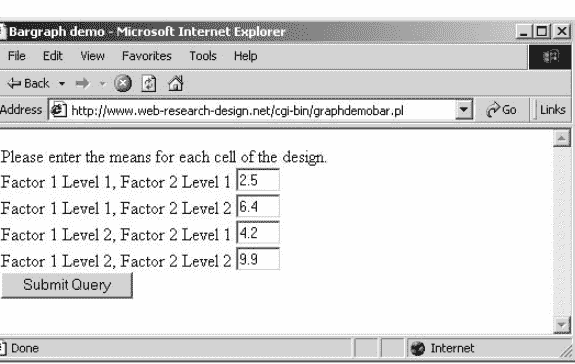

**图 11.2.** 条形图脚本的界面页面。

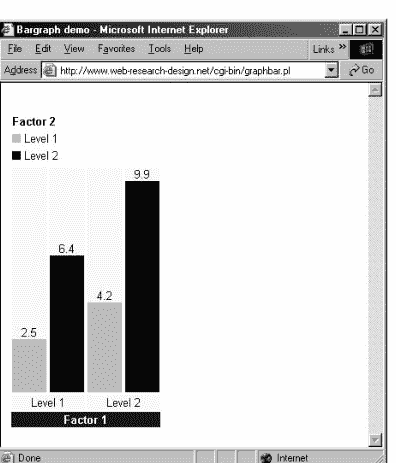

**图 11.3.** 通过在 Perl 中调整简单图像尺寸生成的条形图示例。

第一个文件创建了一个简单的界面网页，旨在通过获取一些绘图值来方便演示；第二个脚本`graphbar.pl`才是实际创建图形的脚本。在你的研究中，你可能会有一个脚本，它打开一个数据文件并计算单元均值。然后，你会希望通过隐藏标签将这些均值传递给`graphbar.pl`（或`graphbar.pl`的修改版本）来绘制它们。

让我们来研究`graphbar.pl`的代码。程序做的第一件主要事情是从提交的数据包中读取单元均值的值。这些单元均值被赋值给名称`$m1`、`$m2`、`$m3`和`$m4`。接下来，程序创建一个表格，并简单地将一个图像放置在表格的每个单元格中，使图像的高度与相应单元均值的值一样大。其余的代码只是为了使图形美观而进行的简单格式设置。例如，我们使用了 ALIGN 属性将条形沿其单元格的底部对齐。

我们做的一件事起初可能看起来有点不寻常，即我们将单元均值乘以一个名为`$heightconstant`的常量：`$tall= $m1*$heightconstant`。在这个例子中，`$heightconstant`被设置为 25。因为单元均值将以像素为单位表示条形的高度，如果条形只有 3 像素高，将很难看清。（回想一下，原始图像只有 1 像素高，几乎看不见。）如果我们将均值乘以一个常量，我们就可以在不扭曲均值之间关系的情况下使条形更高。

请注意，我们在这个图中只使用了两个图像：`bargray.jpg`和`barblack.jpg`。只涉及两个非常小的图像文件这一事实有助于页面快速加载。

如果你想使用这个脚本来为你参与者总结研究结果，你需要做以下几件事：

- 在调用脚本（即激活脚本）之前，你需要计算样本中的单元均值。我们在第 6 章讨论了从文件读取数据和计算平均分的方法。
- 如果提交给`graphbar.pl`的单元均值的名称不是 m1、m2、m3 和 m4，你需要修改`graphbar.pl`顶部的`$query->param`标签，以便它们导入正确的值。
- 你需要自定义图形内部和周围的文本。在这个例子中，我使用了“Factor 1”、“Level 1”等标签。显然，你应该用更具描述性的标签来替换它们。此外，包含一些有助于解释结果含义的文本会很有帮助。你可以为可能观察到的多种数据模式创建口头总结，并通过 if-then 条件语句打印出相应的总结。
- 如果你想扩展程序来表示，例如一个 2 × 3 实验的均值，你可以通过向代码添加新的行来轻松实现。

总之，我们可以通过将局部变量替换为简单图像文件的高度或宽度来即时创建条形图。此处提供的脚本足够通用，你应该能够轻松地调整它以满足你的需求。

### 二维坐标图

另一种可用于总结参与者数据——尤其是在个体差异研究中——的图表是二维坐标图。例如，假设你测量了两个变量，外向性和神经质，并且你想向你的用户展示他或她在由这些变量定义的二维空间中的位置。

下面的通用脚本`graph2d.pl`可用于在二维空间中绘制一个人的分数。将其复制到空白文档中，并保存为`graph2d.pl`到你服务器的`cgi-bin`目录。为了说明程序是如何工作的，你还需要复制演示界面：`graphdemo2d.pl`并将其保存到你服务器的`cgi-bin`目录。

```perl
#!C:/perl/bin/perl.exe
use CGI;
$query = new CGI;

print $query->header;
print $query->start_html(-title=>'2D Graph Demo');
print "<FORM ACTION='/cgi-bin/graph2d.pl'
      METHOD='post'>";
print "<FONT FACE = 'arial' SIZE = '2'>";
print "Two-dimensional graphing demo.<BR>";
```

```perl
#!C:/perl/bin/perl.exe
use CGI;
$query = new CGI;

$xcoord= $query->param('xcoord');
$ycoord= $query->param('ycoord');
$xmin= $query->param('xmin');
$xmax= $query->param('xmax');

#--------------------

$b = (17/($xmax - $xmin));
$a = -1*($b*$xmin);

$xcoordnew= $a + $b*$xcoord;
$ycoordnew= $a + $b*$ycoord;

$xcoordnew = sprintf("%.0f", $xcoordnew);
$ycoordnew = sprintf("%.0f", $ycoordnew);

#--------------------

print $query->header;
print $query->start_html(-title=>'2D Graph Demo');
print "<FONT FACE = 'arial' SIZE = '2'>";
```

```text
graph2d.pl
```

```perl
print "<CENTER>";
print "<TABLE background='/images/2dback360.jpg'
  border='0' cellspacing='0' cellpadding='0'";

for($y = 0; $y <= 17;++$y){
   print "<TR>";
      for($x = 0; $x <= 17; ++$x){
      print "<TD>";
      if($xcoordnew == $x && $ycoordnew ==$y){
        print "";
      }
      else{
        print "";
      }
      print "</TD>";
   }
print "</TR>";
}
print "</TABLE>";
print "</CENTER>";

print "原始 (x, y) 坐标：($xcoord,
  $ycoord)<BR>";
print "变换后的坐标：($xcoordnew,
  $ycoordnew)<BR>";

print $query->end_html;
```

要查看该程序的功能，请运行演示文件`graphdemo2d.pl`。你应该会看到如图 11.4 所示的屏幕内容。

输入你要绘制的点的 *x*（垂直）和 *y*（水平）坐标。同时，输入维度的最小值和最大值。例如，如果你的变量是按 1 到 7 的度量标准测量的，那么你应该在“最小值”处输入 1，在“最大值”处输入 7。该程序假设两个尺度都使用相同的度量标准进行测量；如果这不是一个合理的假设，程序可以很容易地进行修改以适应尺度的差异。

当你提交查询时，你应该会看到一个类似于图 11.5 所示的图表。请注意，这里描绘了一个二维空间，并在空间的适当位置放置了一个 ×。我们使用了两个尺度的中间值，即数值 4，作为此图的原点。因此，两个轴相交于坐标 (4, 4)，而不是 (0, 0)（代数文本中的常见原点）。

我们是如何实现的呢？我们在这里使用了三个技巧。第一个关键技巧是创建一个包含 18 行和 18 列的 HTML 表格，并在表格的相应单元格中放置一个 × 图像。让我们从剖析负责此部分的程序开始：


```perl
print "<TABLE background='/images/2dback360.jpg'
  border='0' cellspacing='0' cellpadding='0'>";

for($y = 0; $y <= 17;++$y){
    print "<TR>";
        for($x = 0; $x <= 17; ++$x){
        print "<TD>";
        if($xcoordnew == $x && $ycoordnew ==$y){
          print "";
        }
            else{
              print "";
            }
        print "</TD>";
       }
    print "</TR>";
    }
print "</TABLE>";
```

请注意，我们创建了两个 `for-next` 循环。第一个使用索引值 `$y` 来创建行。第二个使用索引值 `$x` 来创建行中的每个单元格。通过将一个循环嵌套在另一个循环内，我们创建了这样一种情况：创建一个行，在该行中创建 18 个单元格，然后进入下一行，直到我们创建了 18 行。

这里特别值得注意的是，在创建表格的每个单元格时，程序会通过 `if–else` 条件判断当前单元格（由 `$x` 和 `$y` 索引）的坐标是否等于要绘制的点的坐标。如果是，那么程序会在该单元格中插入一个名为 `dot.gif` 的 × 图像。如果不是，那么程序会插入一个与 `dot.gif` 尺寸相同的空白图像，名为 `blank.gif`。

我们刚刚看到了第二个主要技巧，即使用预先创建的图像。此图关联了三个图像文件：`dot.gif`、`blank.gif` 和 `2dback360.jpg`。`dot.gif` 是一个 20 × 20 像素的十字（即 ×）图像。`blank.gif` 是一个 20 × 20 像素的空白图像。`2dback360.jpg` 是一个 360 × 360 像素的图像，描绘了两个轴。在 `TABLE` 标签中，我们指示浏览器将此图像用作表格的背景。（此命令仅在 Microsoft 的 Internet Explorer 中有效；在 Netscape 中背景图像不会显示。在下一节中，我将向你展示如何设计一个不需要任何图像的二维坐标图，这样你就不会疏远那些使用 Netscape 的用户。）

为了确保表格和图像具有相同的尺寸，我们已将 `for-next` 循环编程为在每行（共 18 行）中创建 18 个单元格（0 到 17）。我们将在每个单元格中放置一个 20 × 20 像素的图像。通过在每个方向上这样做 18 次，我们将确保表格本身的宽度和高度为 (18 × 20) = 360 像素，从而与背景图像的尺寸相匹配。

`dot.gif` 和 `blank.gif` 都是使用“透明”背景创建的。因此，当这些图像被放置在背景图像（本例中为 `2dback360.jpg`）之上时，你仍然可以通过新图像的空白区域看到背景图像。因此，当我们将 `blank.gif` 放置在表格的每个未占用单元格中时，我们实际上并没有覆盖背景图像。`blank.gif` 就像一块 20 × 20 像素的玻璃，我们使用它只是为了确保单元格具有正确的尺寸。

第三个技巧涉及将变量的度量映射到适合表格的度量。回想一下，表格设置为创建 18 × 18 个单元格。因此，表格的 `x` 和 `y` 坐标范围在 0 到 17 之间。我们需要获取变量的度量，并将其转换为 0 到 17 的度量，并在此过程中，将我们希望绘制的数据点重新映射到这个新的度量。

以下代码正是这样做的：

```perl
$b = (17/($xmax - $xmin));
$a = -1*($b*$xmin);

$xcoordnew= $a + $b*$xcoord;
$ycoordnew= $a + $b*$ycoord;

$xcoordnew = sprintf("%.0f", $xcoordnew);
$ycoordnew = sprintf("%.0f", $ycoordnew);
```

要了解此代码如何工作，假设我们正在处理按 1 到 10 的度量标准测量的变量。我们需要将原始度量中可能的最小值 1 映射到表格度量中可能的最小值 0。同样，我们需要将原始度量中可能的最大值 10 映射到表格度量中可能的最大值 17。这是一个简单的线性代数问题，任何使用线性回归的研究人员都应该熟悉。我们试图找到一条形式为 `y = a + b × x` 的直线来连接这两个点，如图 11.6 所示。为此，我们构建了以下线性方程：

```text
0 = a + b × 1

17 = a + b × 10
```

并解出 `a` 和 `b`。为此，让我们首先将它们都用 `a` 表示：

```text
a = -b × 1
```


**图 11.6.** 我们试图找到一个方程，该方程将允许我们将每个原始坐标映射到表格的维度上。

```text
a = 17 - b × 10
```

如果我们将这两个式子设为相等，可以得到 `(-b × 1) = (17 - b × 10)`。我们现在可以解出 `b`。`b(-1 + 10) = 17`，即 `b = (17/9)`。我们现在可以将这个 `b` 值代入我们最初的方程之一来解出 `a`。如果我们使用第一个方程，可以得到 `0 = a + (17/9) × 1` 或 `a = -17/9`。因此，将我们原始 1 到 10 的度量值映射到表格 0 到 17 的度量值的线性方程为：

表格坐标 = `-(17/9) + (17/9) ×` 原始坐标。

我们可以取原始 1 到 10 度量中的任何坐标，并使用此方程来确定其应被绘制的表格单元格的坐标。我一直在使用坐标 3 和 7。请注意，如果我们使用上述方程将 `x` 坐标 3 映射到表格的 `x` 度量，我们得到的值为 3.77，我们将其四舍五入到 4。使用相同的方程，我们看到原始 `y` 度量中的值 7 映射到 11.33，在表格的 `y` 度量中四舍五入到 11。表格度量中该点的最终坐标为 (4, 11)。该点将被绘制在表格中 `x` 等于 4 且 `y` 等于 11 的单元格中。

请注意，解决方案的形式是通用的，编程代码利用了这一点。换句话说，每次使用新的度量时，你不需要重新推导数学过程。通过向程序提供原始变量的最小值和最大值，程序会自动确定原始度量和表格度量之间的适当映射。

要将此程序用于你的用途，你需要做以下操作：

- 在计算一个人两个维度的分数后，你需要通过隐藏标签将这两个值传递给 `graph2d.pl` 脚本。
- 你需要（1）通过隐藏标签告知脚本量表的最小值和最大值，或者（2）将这些值赋给 `graph2d.pl` 中的变量，而不是将这些值作为 CGI 数据读入。
- 请注意，`graph2d.pl` 脚本从 `$query` 中读取值，假设它们分别名为 `$xcoord` 和 `$ycoord`。如果这些不是你在程序中使用的名称，你需要在此处输入相应的名称。例如，如果你使用了 `$neuroticsmscore` 和 `$extraversionscore`，你需要修改这些语句为：`$xcoord = $query->param('neuroticism score')` 和 `$ycoord = $query->param('extraversion score')`。

## 创建不使用预制图形文件的二维坐标图

也可以在不使用任何预制图形文件的情况下创建二维坐标图。例如，尝试将 `graph2d.pl` 脚本中的 `for-next` 代码替换为以下内容：

`graph2dsimple.pl`

```perl
print "<CENTER>";

print "<TABLE border='1' BORDERCOLOR='lightblue' cellspacing='0' cellpadding='0'>";

for($y = 17; $y >= 0; -$y){

    print "<TR>";

    for($x = 0; $x <= 17; ++$x){

        print "<TD WIDTH='20' HEIGHT='10' ALIGN='center'>";

        if($xcoordnew == $x && $ycoordnew == $y){

            print "<B>X</B>";

        }

        else{

            if($y == 0){

                $labelx = $xmin + (($xmax-$xmin)/17)*$x;

                $labelx = sprintf("%.1f, " $labelx);

                print "$labelx";

            }

            if($x == 0 && $y != 0){

                $labely = $xmin + (($xmax-$xmin)/17)*$y;

                $labely = sprintf("%.1f, " $labely);

                print "$labely";

            }

            if($x != 0 && $y != 0){

                print " &nbsp ";

            }

        }

        print "</TD>";

    }

    print "</TR>";

}

print "</TABLE>";

print "</CENTER>";
```

将新文件保存为 `graph2dsimple.pl`，放在服务器的 `cgi-bin` 目录中。同时，修改 `graphdemo2d.pl` 以使其激活 `graph2dsimple.pl`，并将修改后的文件保存为 `graphdemo2dsimple.pl`，放在服务器的 `cgi-bin` 文件夹中。在浏览器中运行 `graphdemo2dsimple.pl`。

`graphdemo2dsimple.pl`

生成的图表使用相同的表格技术，但不使用背景图像。此外，程序不是插入图像来表示数据点，而是插入一段简单的文本：一个 X。最后，它使用表格的 `BORDERS` 属性以及 `BORDERCOLOR` 属性来创建类似坐标纸的外观。图 11.7 展示了使用坐标 (3, 7) 且最小值和最大值分别为 1 和 10 的此类图表。如果你想确保图表在各种浏览器上都能正确显示，这种生成二维坐标图的方法更为安全。

> 注意：在由 `$y` 索引的 `for-next` 循环中，请注意，我们没有从 0 计数到 17，而是从 17 倒数到 0。我们通过以下方式实现：（1）在 `for-next` 命令中使用 `--$y` 而不是 `++$y`，以及（2）从一个高于结束值的计数值开始。这使我们能够将垂直轴上的值从最高到最低排序。


**图 11.7.** 一个不需要使用图像的坐标图示例。

## 总结

在本章中，你学习了创建为自己和参与者总结数据的图表的技术。这些通用脚本可以轻松修改以适应不同类型的研究项目。

# 第 12 章：在多个会话中跟踪参与者

## 个人识别码、密码和菜单

互联网成为行为研究有用工具的一个原因是，它提供了一种在多次会话中研究人们的有效方法。例如，如果你有兴趣随时间测量人们的政治态度，你可以要求受试者每周访问你的网站完成一次态度测量，连续几周。通过在线参与，你的参与者可以在方便时登录，并且数据可以由服务器自动记录时间戳并存储。

为了将同一个人不同测量会话的数据组织起来，你可以为你的参与者分配**个人识别码**（PINs）。个人识别码可用于区分一个人的数据与另一个人的数据。此外，你可以使用个人识别码在合并来自不同会话的数据文件时匹配参与者的数据。简而言之，个人识别码是保持人们多次会话数据关联的有用工具。

### 一个示例

为了说明如何使用个人识别码来组织受试者对多次会话的响应，请访问我服务器上的以下网页：`http://www.web-research-design.net/cgi-bin/pindemo1.pl`。你看到的第一个页面将要求你输入个人识别码和密码（参见图 12.1）。为了演示目的，输入一个介于 100 和 200 之间的数字作为你的个人识别码，并使用 `web` 作为你的密码。（你可以在我的服务器上了解其工作原理后，在你自己的服务器上尝试。）这个特定的演示利用个人识别码将一个较大的调查分解为较小的部分。通过这样做，你可以确保数据逐部分保存。这将有助于避免用户因疲劳或拨号连接中断而需要过早结束参与时可能出现的问题。

在你输入个人识别码和密码后，你将被带到一个新页面。此页面有一个菜单，列出了构成一项大型研究的四个组成部分调查（即，“背景信息”、“政治态度”、“人格”、“关系”；参见图 12.2）。该菜单还指示了你迄今为止完成了哪些调查。此时，你还没有进行任何调查，因此每项调查在状态列中应显示为“未完成”。现在，通过点击**下一个调查**按钮开始第一个调查。


**图 12.1.** 登录页面。


**图 12.2.** 此菜单欢迎参与者，并显示哪些调查或实验已完成或未完成。

为了节省空间，我特意没有在本演示中包含真实的调查。因此，当你转到调查页面时，你会看到如图 12.3 所示的屏幕。假设你刚刚完成了一份问卷，点击**提交数据**按钮。你现在将被带回到主菜单。请注意，菜单现在显示你已经完成了第一个调查。如果你继续进行更多调查，此菜单将自行更新，如图 12.4 所示。因此，如果你需要在任何时候离开，你可以这样做，然后通过访问登录页面（即，`http://www.web-research-design.net/cgi-bin/pindemo1.pl`）并从你离开的地方继续来返回。一旦你完成了所有四个调查，菜单屏幕将告诉你已经完成。

### 剖析代码

现在你已经了解了程序的工作原理，让我们看看 CGI 脚本是如何实现这一点的。此程序涉及多个脚本。以下是简要概述。

### 12.3 系统演示

在实际研究中，调查问题会显示在此页面上。

用户完成调查后，菜单页面会更新，向用户显示已完成的调查及其完成时间。

#### 脚本说明

- `pindemo1.pl`：此脚本负责从用户处获取 PIN 和密码。PIN 和密码通过隐藏标签传递给 `pindemo2.pl`。
- `pindemo2.pl`：此脚本负责多项任务。首先，它根据一个预先存在的文本文件数据库（`passwords.txt`）检查 PIN 和密码是否合法。如果是，`pindemo2.pl` 会创建一个包含各种调查的菜单。在创建此菜单时，脚本会打开并读取名为 `participation.txt` 的文本文件，以确定用户已完成哪些调查。它利用此信息更新菜单的“状态”部分。当用户点击**下一个调查**按钮时，会激活以下四个脚本之一：
- `pindemosurvey0.pl`–`pindemosurvey3.pl`：这四个脚本包含四个问卷。在本演示中，这四个文件中没有任何真实的调查问题。这些虚拟脚本读取用户的 PIN 和密码，并将其传递给下一个被激活的脚本。
- `pindemosave.pl`：一旦提交了对某项调查的回复，此脚本就会被激活。此脚本使用一组通用命令将数据保存到适合给定调查的文件中。它还将用户的 PIN 添加到文件中，以便在项目完成后可以轻松合并各个数据集。最后，该脚本更新名为 `participation.txt` 的文本文件，该文件跟踪受试者已完成哪些调查。

以下是各个脚本的实际代码。请将这些脚本复制粘贴到服务器的 `cgi-bin` 目录中。在这些脚本能在您的服务器上正常工作之前，您还需要创建一个包含密码信息的文本文件。我将在带您浏览完一些代码后解释如何操作。

```perl
#!C:/perl/bin/perl.exe

use CGI;

$query = new CGI;

print $query->header;

print $query->start_html(-title=>'Password demo');

print "<FONT FACE = 'arial' SIZE = '2'>";

print "<FORM ACTION = '/cgi-bin/pindemo2.pl' METHOD = 'post'> ";

print "<BR>Welcome! To begin the session, please enter your Personal Identification Number (PIN) and password. </B><BR><BR>";

print "<TABLE>

<TR>

<TD><FONT FACE = 'arial' SIZE = '2'> PIN</TD>

<TD> <INPUT TYPE='textbox' NAME='pin' SIZE='25'

  MAXLENGTH='30'></TD>

</TR>

<TR>

<TD><FONT FACE = 'arial' SIZE = '2'> Password </TD>

<TD> <INPUT TYPE='password' NAME='password' SIZE='25'

  MAXLENGTH='30'></TD>

</TR>

</TABLE>";

print "<INPUT TYPE='submit' VALUE='Submit'>";

print "</FORM>";

print $query->end_html;
```


这第一个脚本使用`密码文本框`向用户询问其 PIN 和密码，该文本框在用户输入时显示星号，以防止他人偷窥密码。

**注意。** 这是我们本书中首次讨论`密码文本框`。此特殊类型文本框的通用 HTML 代码如下：

```html
<INPUT TYPE='password' NAME='name' MAXLENGTH='30'
SIZE='25'>
```

此标签的功能与文本框标签相同，但有两个例外。首先，输入框中的文本在屏幕显示时会被星号或点替代，这样旁观者就无法在用户输入时看到密码。其次，一旦用户提交信息，密码就会从文本框中清除，这意味着另一个用户无法简单地使用浏览器的`后退`按钮返回密码页面并发现密码。

当按下`提交`按钮时，PIN 和密码通过隐藏标签传递给下一个脚本`pindemo2.pl`。以下是`pindemo2.pl`的代码。

```perl
#!C:/perl/bin/perl.exe

use CGI;

$query = new CGI;

print $query->header;

print $query->start_html(-title=>'Password demo');

print "<FONT FACE = 'arial' SIZE = '2'>";

#-----------------------------------

$pin= $query->param('pin');

$password= $query->param('password');

$match= 0;

$v0 = "Background Information";

$v1 = "Political Attitudes";

$v2 = "Personality";

$v3 = "Relationships";

$numsurveys= 4;

#-----------------------------------

open(INFO,

     "$ENV{'DOCUMENT_ROOT'}/www/data/passwords.txt");

@passdata = <INFO>;

close(INFO);

#-----------------------------------

foreach $key (@passdata)

{

    ($pin2,$storedpassword,$e)=split(/,/, $key);

    if( ($pin eq $pin2) && ($password eq

        $storedpassword) )

    {

        $match= 1;

    }

}

#-----------------------------------

if ($match == 0)

{

    print "Invalid response. <BR><BR>";

    print "If you think you may have made a typo,

        please click your browser's <I>Back</I> button

        and try again. <BR><BR>";

}

#-----------------------------------

if ($match == 1)

{

    print "<B>Survey Menu</B><BR><BR>";

    open(INFO,

        "$ENV{'DOCUMENT_ROOT'}/www/data/participation.txt");

    @participation = <INFO>;

    close(INFO);

    $tasks = 0;

    @dates = ();

    foreach $key (@participation)

    {

        ($pin2,$section,$date)=split(/,/,/$key);

        if($pin2 eq $pin)

        {

            $tasks= $tasks + 1;

            @dates = (@dates, $date);

        }

    }

    print "<TABLE>";

    print "<TR BGCOLOR='darkblue'>

    <TD><FONT FACE='arial' SIZE='2'

        COLOR='white'><B>Survey</B></TD>

    <TD><FONT FACE='arial' SIZE='2'

        COLOR='white'><B>Status</B></TD>

    </TR>";

    for($i = 0; $i <= ($numsurveys - 1); ++$i)

    {

        $listing = "v" . $i;

        print "<TR BGCOLOR='beige'>

        <TD><FONT FACE='arial' SIZE='2'>$$listing</TD>";

        if($i < $tasks){

            print "<TD><FONT FACE='arial' SIZE='2'>Completed

                on $dates[$i]</TD>";

        }

        else{

            print "<TD><FONT FACE='arial' SIZE='2'>Not

                completed</TD>";

        }

        print "</TR>";

    }

    print "</TABLE>";

    if($tasks < $numsurveys){

        $nextaction = "/cgi-bin/" . "pindemosurvey" . $tasks . ".pl";

        print "<FORM ACTION=$nextaction METHOD='post'>";

        print "<INPUT TYPE='hidden' NAME='pin' VALUE=$pin>";

        print "<INPUT TYPE='hidden' NAME='password' VALUE=$password>";

        print "<BR>You have completed $tasks of the 4 surveys. Please click the button below to take the next survey.<BR>";

        print "<INPUT TYPE='submit' VALUE='Next Survey'>";

        print "</FORM>";

    }

    if($tasks >= $numsurveys){

        print "<BR>You have completed all the questionnaires.<BR><BR>Debriefing.";

    }

}

print $query->end_html;
```

此脚本首先从提交的 CGI 数据包中读取 PIN 和密码的值。这些值分别赋给局部变量`$pin`和`$password`。

下一个任务是确定 PIN 和密码是否合法。为此，脚本打开服务器数据文件夹中的文本文件`passwords.txt`，并将内容赋给数组`@passdata`。`password.txt`的内容大致如下：

```text
100,web,endline
101,web,endline
102,web,endline
103,web,endline
104,web,endline
```

每行中的第一个元素包含一个合法的 PIN。第二个值包含与该特定 PIN 对应的密码。（在此示例中，所有密码都相同。）第三个值只是一个占位符，表示该行的最后一个元素。为了让 CGI 脚本在您的服务器上正常运行，您需要在文本编辑器中创建一个新文件，输入一些类似上面的数据，并将文件保存为文本文件放在服务器的`data`文件夹中。您可以使用我这里使用的相同用户名和密码，也可以创建自己的用户名和密码列表。（您还可以为每个用户名设置唯一的密码。）

在脚本的下一段中，程序遍历`@passdata`的每一行，将三个值赋给临时变量（即`$pin2`、`$storedpassword`和`$e`）。如果`$pin2`的值等于`$pin`并且`$password`的值等于`$storedpassword`，程序就将`$match`的值赋为 1。因此，如果用户输入了有效的 PIN 和与该 PIN 对应的有效密码，`$match`的值就设置为 1。否则，`$match`的值等于 0。

在下一段代码中，程序判断`$match`是否等于 0。如果`$match`等于 0，程序会为用户打印一条错误信息。如果`$match`等于 1，程序将继续下一个主要任务：创建调查选项菜单。

回想一下，该菜单是定制的；它表明用户已完成哪些调查以及这些调查是何时完成的。为了确定此信息，脚本打开一个名为`participation.txt`的文本文件。该文件大致如下：

```text
100,0,4/15/2002
100,1,4/15/2002
100,2,4/15/2002
101,0,4/20/2002
102,0,4/21/2002
101,1,4/22/2002
102,1,4/23/2002
```

简而言之，每行包含*任何*用户参与的记录。（您不需要在服务器上创建`participation.txt`文件；当首次需要时，`pindemosave.pl`脚本会自动创建该文件。）每行有三条信息。第一条是完成调查的用户的 PIN。第二条是参与者完成的调查编号。第三条是提交调查的日期。脚本使用循环读取这些数据的每一行，并将值赋给临时变量：`$pin2`、`$section`和`$date`。在循环过程中，程序检查`$pin2`的值是否等于当前用户的 PIN（即`$pin`）。如果是，程序就将`$tasks`的值增加 1。

请注意，`$tasks`从 0 开始，每次程序找到参与记录时都会递增 1。程序将使用此信息来确定该人接下来需要完成哪项调查。此过程的结果是什么？在此示例中，如果此人的 PIN 是 100，则循环完成时`tasks`的值将为 3。（程序开始时`$tasks`的值为 0，每次在参与文件`participation.txt`中找到受试者 100 的记录时将其增加 1 [共三次]。）如果此人的 PIN 是 102，则循环完成时`tasks`的值将为 2。

接下来重要的代码部分创建表格并列出其中的各项调查。使用 if-else 条件，代码确定是否将某项调查标记为 Completed 或 Not completed。如果调查已完成，代码将列出提交调查数据的日期。此信息已在之前的循环中读入名为`@dates`的数组。最后，为用户提供一个`提交`按钮，使他或她可以进行下一项调查。

程序使用`$tasks`的值来确定接下来要执行四项调查中的哪一项。如果`$tasks`等于 2，则当点击`提交`按钮时，程序将激活`pindemosurvey2.pl`。请注意，我们使用了一些 Perl 技巧来追加字符串（参见第 9 章），以便创建必要的 URL：

```perl
$nextaction = "/cgi-bin/" . "pindemosurvey" . $tasks . ".pl";
```

我们基本上是将`$tasks`的值插入到了 URL 中恰好正确的位置。通过在 FORM 标签中用`$nextaction`替换我们的 ACTION 属性，我们可以确保当用户点击`提交`按钮时，会被带到下一个适当的调查。

请注意，这些命令仅在`$tasks`小于 4 时执行。如果`$tasks`等于 4，则用户已完成所有调查。使用 if-else 条件来确定是否是这种情况，如果所有任务都已完成，则会显示结束消息。

下一个脚本是`pindemosurvey0.pl`——四项调查中的第一项。正如我之前提到的，我根本没有在此脚本中插入调查项目。我把这部分留给了您。不过，我已经包含了一些使更大的程序有效运行所必需的功能。代码如下：

## 如何通过互联网开展行为研究

```perl
pindemosurvey0.pl

#!C:/perl/bin/perl.exe

use CGI;

$query = new CGI;

$pin= $query->param('pin');

$password= $query->param('password');

print $query->header;

print $query->start_html(-title=>'pindemosurvey');

print "<FORM ACTION = '/cgi-bin/pindemosave.pl' METHOD

  = 'post'> ";

print "<FONT FACE = 'arial' SIZE = '2'>";

print "Survey Questions appear here. <BR>";

print "<INPUT TYPE='hidden' NAME='survey' VALUE='0'>";

print "<INPUT TYPE='hidden' NAME='pin' VALUE=$pin>";

print "<INPUT TYPE='hidden' NAME='password'

  VALUE=$password>";

print "<INPUT TYPE = 'submit' VALUE = 'Submit

  Data'>";

print "</FORM></FONT>";

print $query->end_html;
```

该脚本读取`$pin`和`$password`的值。重要的是，当按下`提交`按钮时，它会传递这些值。回想一下，用户与服务器之间的交互是无状态的（参见第 9 章）。如果我们不以这种方式将用户的 PIN 和密码传递下去，服务器将会忘记它正在与之前交互的同一用户进行交互。请注意，我们还创建了一个名为`"survey"`的隐藏值，对应于正在呈现的调查。这由下一个脚本使用，该脚本负责保存数据。

`pindemosave.pl`在用户提交四项调查中任何一项的数据时被激活。代码如下：

```perl
pindemosave.pl

#!C:/perl/bin/perl.exe

use CGI;

$query = new CGI;
```

## 在多个 sessions 中跟踪参与者

```perl
$pin= $query->param('pin');

$password= $query->param('password');

$survey= $query->param('survey');

$filename = ">>$ENV{'DOCUMENT_ROOT'}/www/data/" .

  "pindata" . $survey  . ".txt";

($sec,$min,$hour,$mday,$mon,$year,$wday,$yday,$isdst) =

  localtime(time);

$year=$year+1900;

open(INFO, $filename);

  print INFO "$pin, ";

  print INFO "$mon/$mday/$year, ";

  print INFO "$hour:$min:$sec, ";

  foreach $key (sort($query->param))

    {

    $value = $query->param($key);

    print INFO "$value, ";

    }

  print INFO "endline \n";

close(INFO);

open(INFO,

  ">>$ENV{'DOCUMENT_ROOT'}/www/data/participation.txt")

  ;

print INFO "$pin, $survey, $mon/$mday/$year \n";

close(INFO);

print $query->header;

print $query->start_html(-title=>'Password demo');

print "<FONT FACE = 'arial' SIZE = '2'>";

print "<FORM ACTION = '/cgi-bin/pindemo2.pl' METHOD =

  'post'> ";

print "<INPUT TYPE='hidden' NAME='pin' VALUE=$pin>";

print "<INPUT TYPE='hidden' NAME='password'

  VALUE=$password>";

print "Thank you. Your data have been saved.<BR><BR>";

print "<INPUT TYPE='submit' VALUE='Return to menu'>";

print "</FORM>";

print $query->end_html;
```

该程序包含一大块旨在以通用方式保存调查数据的代码：

```perl
foreach $key (sort($query->param))
{
    $value = $query->param($key);
    print INFO "$value, ";
}
```


换句话说，程序对实际涉及的变量一无所知；它只是将收到的任何信息保存到适当的数据文件中。作为一般规则，你不应该使用这种方法来保存数据，因为它不会向你显示何时发生了无应答。相反，你应该通过从 CGI 数据包中显式读取每个变量并将其打印到数据文件中来保存数据，正如我们在前面的示例中所做的那样。我在这里包含这种方法，只是因为我们没有包含实际刺激，因此没有定义显式变量。

脚本如何知道要保存数据的调查文件是哪一个？回想一下，我们从调查本身向此脚本传递了一个名为`"survey"`的隐藏值。该变量的值用于确定在哪里保存数据。利用 Perl 追加变量和文本的能力，我们将`$survey`的值插入到要保存数据的文件名中：

```perl
$filename = ">>$ENV{'DOCUMENT_ROOT'}/www/data/"
          . "pindata" . $survey . ".txt";
```

因此，如果`$survey`的值为 0，我们将`$ENV{'DOCUMENT_ROOT'}/www/data/pindata0.txt`赋给变量`$filename`。现在，当我们将`$filename`插入到`open`命令中时，我们是指示程序在服务器的数据文件夹中打开`pindata0.txt`并在其中保存数据。（如果`pindata0.txt`不存在，则会自动创建。）

我们还打开数据文件`participation.txt`并记录该用户完成了另一项调查。因此，当`pindemo2.pl`稍后激活时，此文件中该用户会多一条记录，这将导致`$tasks`的值比之前高 1。

然后告知用户他或她的数据已保存，并提供一个按钮使其可以返回主菜单。请注意，我们通过隐藏标签传递`$pin`和`$password`，这样用户就不必再次登录。

## 自定义代码

为了将此代码用于你自己的目的，你需要执行以下操作：

- 将所有代码复制到单独的空白文档中，并将它们保存到服务器的`cgi-bin`目录。
- 在`pindemo2.pl`中，修改你希望出现在菜单中的调查名称。如果你想保持灵活性，可以使用`"Section 1"`、`"Section 2"`等标签。此外，如果你的部分数量与我这里的四个不同，请相应修改。
- 在`pindemo2.pl`中，将`$numsurveys`的值设置为等于构成你完整研究的试题或调查数量。
- 将你的每个调查或任务创建为单独的 CGI 脚本。请务必遵循上面`pindemosurvey0.pl`中提供的示例。你需要从 CGI 数据包中读取`$pin`和`$password`，并且需要通过隐藏标签传递这些值。你还需要通过隐藏标签传递调查或脚本编号。
- 如果你选择对调查或任务文件使用不同的名称（即，`pindemosurvey1.pl`以外的名称），请务必更新脚本中的适当 URL。
- 最后，你需要创建一个包含所有有效 PIN 和密码的文本文件。你应该按照我们上面说明的示例内容来建模。当人们注册你的研究时，你可以向他们发送 PIN 号码和相应的密码。或者，你可以创建一个特殊的脚本，允许用户创建自己的 PIN 和密码。
- 当你准备好分析数据时，你需要将调查文本文件导入到电子表格程序中（参见第 5 章），按 PIN 对案例进行排序，然后在按 PIN 匹配的同时合并各种文件。

## 总结

在本章中，你学习了如何使用个人识别号码（PIN）使研究参与者能够随时登录你的网站并参与你的研究。你还学习了如何使用隐藏标签将变量从一个 CGI 脚本传递到另一个 CGI 脚本。最后，你看到了如何创建一个简单而有效的系统来管理一系列在线调查并保存收集到的数据的示例。

# 第 13 章：测量反应时间

反应时间常被用于检验有关心理过程的假设。正如我们在第 5 章中所见，在在线研究中可以通过请求服务器内部时钟来获取时间测量值。通过记录 CGI 脚本向用户浏览器发送网页的时间以及用户提交对该页面响应的时间，用户花在页面上的总时间可以通过简单的减法计算出来。

以这种方式记录时，时间测量的精确度如何？正如你可能猜到的，对任何一次试次的反应时间测量都充满了问题。获得的数值会受到许多与所研究的心理过程无关的因素的影响。例如，一些用户使用的计算机处理器较慢或调制解调器较慢。因此，他们加载页面所需的时间可能更长，从而对刺激做出反应的时间也更长。此外，有时加载页面的时间会比平时稍长一些。即使在同一次测量会话中，某些试次的加载速度也可能比其他试次慢。这种延迟可能是由于服务器在某一时刻的繁忙程度，或是影响信息传输总体速度的网络流量随机波动造成的。

如果我们正在进行一项随机分配被试到不同条件的实验，那么上述因素（例如，浏览器类型、计算机速度、服务器活动、带宽限制）在理论上应与操纵不相关。如果人们被随机分配到不同条件，就没有理由预期速度问题在不同条件之间存在差异。当然，速度问题确实会影响我们对绝对反应时间的解释（即，速度误差会系统性地增加反应时间）。然而，我们预计这种系统性误差在各条件间是恒定的。因此，通过在不同条件间减去反应时间，系统性误差被消除了（即，恒定值减去相同值为零），条件间的差异将更加准确。

另一个值得考虑的问题是测量时间使用的单位。服务器记录的最小时间单位是秒。因此，任何一次试次的反应时间只能精确到最近的秒数。然而，在某些研究情境中，条件间的差异预计会达到毫秒级别。只要使用足够多的人数（或被试内设计中的试次数），这就不会成为问题。例如，考虑这样一个事实：一系列测量时间如 2、2、3 和 2 秒平均为 2.25 秒。虽然每次测量都是以秒记录的，但这些测量值的平均值却可以精确到秒的分数。以此类推，即使特定测量仅以秒为单位，条件间的差异也可以精确到秒的分数来测量。

最后一点值得注意的是，网页完全加载可能需要 0.5 到 2.5 秒的时间——即使所有相关文本已经可见。因此，参与者在`INPUT`标签中的信息完全加载之前，往往就可以开始处理刺激。如果用户准备好在页面准备好接收响应之前就做出反应，用户将不得不等待才能提交其响应。因此，在典型被试需要至少两秒才能做出反应的实验情境中研究反应速率可能是明智的。例如，要求人们解决问题、从记忆中提取复杂信息或阅读多词刺激的研究适合进行在线反应时间研究。涉及可以在一秒内做出简单决策的任务（例如，词汇判断任务）则不适合使用这里介绍的方法进行在线反应时间研究。

## 示例：情绪记忆的回忆

为了说明用于测量反应时间的服务器端时间戳技术，让我们来创建一个简单的实验。在这个演示中，我们将要求被试回忆他们过去经历的、以不同情绪为特征的事件（即，快乐、孤独、安全和焦虑）。我们将操纵情绪效价（即，积极 vs. 消极），并观察回忆积极 vs. 消极经历所需时间的差异。

为了利用 Perl 的时间戳功能，我们需要使用第 9 章讨论的多页面技术。具体来说，我们需要标记 HTML 代码发送到浏览器的时间，以及下一页 HTML 代码发送到浏览器的时间（这发生在用户提交响应时）。这两个时间之间的差异将被用作反应时间的测量。我创建了一个流程图（见图 13.1）来说明这一过程。

让我们从最简单的研究版本开始：即试次顺序不随机化的情况。一旦我们概述了记录反应时间的基本技术，我们将在此基础上构建程序，使其能够执行更复杂的任务。将以下代码复制到空白文档中，并将其保存为服务器`cgi-bin`文件夹中的`rtdemo1.pl`。同时，在浏览器中运行该程序，尝试了解程序的运行方式。

```perl
#!C:/perl/bin/perl.exe

use CGI;

$query = new CGI;

$trials= 4;

$previoussec= $query->param('trialsec');

$previousmin= $query->param('trialmin');

$previoushour= $query->param('trialhour');

$rt00= $query->param('rt00');

$rt01= $query->param('rt01');

$rt02= $query->param('rt02');

$rt03= $query->param('rt03');

$trialnumber= $query->param('trialnumber');

#-----------------
```

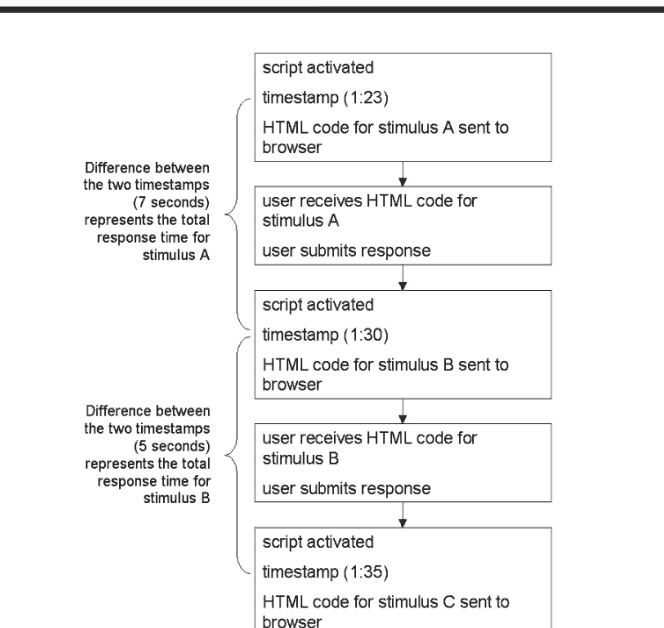

**图 13.1。**该图表说明了本章脚本中计算反应时间的方式。

```perl
@varnum = ("00","01","02","03");

@stimuli= ("happy", "lonely", "secure", "anxious");

($sec,$min,$hour,$mday,$mon,$year,$wday,$yday,$isdst) = localtime(time);

#-------------

if($trialnumber != 0){

    $currenthour = $hour;

    $currentmin = $min;

    $currentsec = $sec;

    $rt= 0;
}
```


参与多组件研究的被试。这些技术在多种研究情境中都可能有用。例如，如果你正在进行一项纵向研究，希望被试在几个月内每周完成一次态度测量，你可以要求你的被试每周登录你的网站并填写问卷。程序将确保每个被试的数据被正确记录。

如果你正在进行涉及多个组件的研究，你会希望让被试可以选择在不同时间完成这些组件。通过使用本章讨论的方法，你可以创建一个情境，让你的用户一次完成一个组件。每次用户完成一个组件时，数据都会被保存，而作为研究者的你，将无需担心数据丢失的问题。

以下是对本章介绍的`Perl`代码的回顾。

| Perl命令 | 功能 | 示例 |
| --- | --- | --- |
| `foreach $key (sort ($query->param)){ $value = $query->param($key); print INFO "$value, "; }` | 这段代码可用于将`CGI`数据包中的数据保存到数据文件。简而言之，这段代码按字母数字顺序对数据包中的变量名进行排序，然后将每个变量的值打印到数据文件中。虽然这种技术在特定情况下可能有用，但其缺点是如果用户遗漏或省略了问卷项目，它不会打印这些值到文件中。如果被试省略了某个回答，该无回应的指示不会随`CGI`数据包一起发送。 | `open(INFO, ">>c:\\data.txt");` `foreach $key (sort ($query->param)){ $value = $query->param($key); print INFO "$value, "; }` `print INFO "endline \n";` `close(INFO);` |

### subtract seconds

```perl
if($previoussec > $currentsec){
    $secdiff = ((60 + $currentsec) - $previoussec);
    $currentmin = $currentmin - 1;
}

if($previoussec <= $currentsec){
    $secdiff = $currentsec - $previoussec;
}
```

### subtract minutes

```perl
if($previousmin > $currentmin){
    $mindiff = ((60 + $currentmin) - $previousmin);
    $currenthour = $currenthour - 1;
}
if($previousmin <= $currentmin){
    $mindiff = $currentmin - $previousmin;
}
```

### subtract hours

```perl
if($previoushour > $currenthour){
    $hourdiff = ((24 + $currenthour) -
    $previoushour);
}

if($previoushour <= $hour){
    $hourdiff = $currenthour - $previoushour;
}
```

### convert difference to seconds

```perl
$rt = (3600*$hourdiff)+(60*$mindiff)+($secdiff);

$temp = "rt" . $varnum[($trialnumber - 1)];
$$temp = $rt;
}
else{
    $trialnumber = 0;
}

print $query->header;
print $query->start_html(-title=>'Trials');
print "<FONT FACE = 'arial' SIZE = '2'>";

if($trialnumber >= 1){
    print "Time to recall on previous trial (seconds):
    $rt.<BR>";
}

#_______________

if($trialnumber < $trials ){

    print "<FORM ACTION = '/cgi-bin/rtdemo1.pl' METHOD
        = 'post'>";
    $stimulus= $stimuli[$trialnumber];
    print "<CENTER>Recall a time when you felt:
        <BR><BR>";
    print "<FONT FACE = 'arial' SIZE =
        '5'><B>$stimulus</B></FONT><BR><BR>";
    print "<I>Press the button when you have a specific
        experience in mind.</I><BR><BR>";
    print "<INPUT TYPE = 'submit' VALUE =
        'Ready'></CENTER>";

    $count= $trialnumber + 1;

    print "<INPUT TYPE = 'hidden' NAME = 'trialsec'
        VALUE = $sec>";
    print "<INPUT TYPE = 'hidden' NAME = 'trialmin'
        VALUE = $min>";
    print "<INPUT TYPE = 'hidden' NAME = 'trialhour'
        VALUE = $hour>";
    print "<INPUT TYPE = 'hidden' NAME = 'trialnumber'
        VALUE = $count>";
    print "<INPUT TYPE = 'hidden' NAME = 'rt00' VALUE
        = $rt00>";
    print "<INPUT TYPE = 'hidden' NAME = 'rt01' VALUE
        = $rt01>";
    print "<INPUT TYPE = 'hidden' NAME = 'rt02' VALUE
        = $rt02>";
    print "<INPUT TYPE = 'hidden' NAME = 'rt03' VALUE
        = $rt03>";

    print "</FORM>";
}

else{
    print "Thank you. You have finished all trials.
        <BR>";
    print "Here are your response times: <BR><BR>";
    print "$stimuli[0] : $rt00 seconds<BR>";
    print "$stimuli[1] : $rt01 seconds<BR>";
    print "$stimuli[2] : $rt02 seconds<BR>";
    print "$stimuli[3] : $rt03 seconds<BR>";
}

#--------------------

print $query->end_html;
```

我们来剖析这个脚本。从程序`rtdemo1.pl`的`FORM`标签可以看出，这是一个递归脚本。换句话说，每次点击提交按钮时，同一个脚本都会被再次激活。当然，每次按下提交按钮时，脚本都会向自身发送一个`CGI`数据包，而该数据包中的值在每个试次或“提交”之间都会有所不同。因此，脚本每次被激活时的行为并不相同。

第一块代码的作用是从提交的`CGI`数据包中读取某些值。如果这些值为空，则按空值记录。第一次激活脚本时，不会有`CGI`数据包，因此所有这些变量都将是空的。

接下来的代码段创建了一些有用的局部变量。该部分的第一行代码创建了一个数组`@varnum`，其中包含各种刺激的占位符。第二行创建了一个数组`@stimuli`，其中包含实际的刺激：需要回忆的情绪记忆类型。该部分的第三行代码从服务器时钟读取当前时间。变量`$hour`、`$min`和`$sec`将分别表示脚本被激活时的小时、分钟和秒。

下一部分代码是一系列嵌套的`if-else`条件语句。第一个测试`$trialnumber`是否等于零。`$trialnumber`是我们用来表示被试在实验中任意时刻所处试次的变量。第一次运行脚本时，`$trialnumber`没有值；它是空的。因此，第一个条件不满足，因为“`$trialnumber`不等于零”这个条件为假。结果，程序执行`else`大括号内的命令。在这一部分中，脚本简单地将`$trialnumber`明确赋值为`0`。现在，`$trialnumber`包含了一个实际值（零），不再是空值。

在下一个代码段中，脚本设置了一些`HTML`参数并将当前刺激输出到用户的浏览器。请注意，它使用`$trialnumber`来选择`@stimuli`中要呈现给用户的特定元素：`$stimulus= $stimuli[$trialnumber]`。回想一下，`$trialnumber`当前等于`0`；因此，脚本选择`@stimuli`的第`0`个元素，即“happy”。因此，在这个试次中，要求被试回忆一段快乐的记忆。

一旦呈现刺激并再次运行脚本，`$trialnumber`的值就会增加`1`。（我额外包含了一个变量`$count`来更新`$trialnumber`，因为在基于这个脚本的其他后续脚本中，我们希望保留当前试次的信息，同时也要为下一个试次做准备，而这正是`$trialnumber`的功能。）因此，第一次运行脚本时，这个值从`0`更新为`1`。

接下来，创建了一些隐藏值。`$trialhour`、`$trialmin`和`$trialsec`表示脚本被激活的时间。已经增加`1`的`$trialnumber`现在表示下次脚本被激活时的相关试次编号。最后，`$rt00`到`$rt03`表示每个试次记录的反应时。第一次运行脚本时，这些值为空。一旦被试回忆了一段快乐记忆并点击“提交”按钮，这些隐藏值就会通过`CGI`数据包传递出去。

由于脚本是递归的，同一个脚本再次被调用。然而，这一次数据包中有一些值，脚本将`$trialnumber`赋值为`1`。它还创建了名为`$previoushour`、`$previousmin`和`$previoussec`的变量，并将这些变量赋值为服务器处理前一个试次数据时的小时、分钟和秒。我们将使用这个时间与当前脚本被激活的时间（由`$currenthour`、`$currentmin`和`$currentsec`表示）之间的差值，来估算前一个试次的反应时。

这次运行脚本时，当评估`if-else`条件时，请注意`$trialnumber`等于`1`。因为`1`不等于`0`，第一个条件满足。现在程序要计算前一个试次的反应时。我不打算解释这段代码的具体工作原理，但本质上它的功能是用当前试次被激活的时间减去前一个试次被激活的时间（以小时、分钟和秒表示）。由于分钟和秒采用的是`60`进制而非`10`进制，减法看起来可能有些奇怪。如果前一个试次在`1:25:10`开始，当前试次在`1:25:30`开始，则估算的反应时为`20`秒。

一旦完成适当的计算，就会将其转换为秒并赋值给变量`$rt`（`$rt = (3600*$hourdiff)+(60*$mindiff)+($secdiff);`）。回想一下，我们正在计算的是前一个试次的反应时，而不是当前试次的反应时。因此，为了将`$rt`赋值给适当的变量，我们使用以下命令：

```perl
$temp = "rt" . $varnum[($trialnumber - 1)];

$$temp = $rt;
```

在我们的示例中，`$trialnumber`当前等于`1`。因此，如果我们从中减去`1`，上面的第一个命令就会提取`@varnum`的第`0`个元素。这个元素等于“00”。结果，我们将字符串“rt”附加到“00”上，创建出以下字符串：`rt00`。我们将这个字符串赋值给变量`$temp`。因此，`$temp`等于`rt00`。

在下一行，我们将计算出的反应时`$rt`赋值给变量`$$temp`。由于我们在`$temp`前多加了一个美元符号，服务器将`$$temp`读取为`$rt00`（即一个美元符号加上`$temp`的值）。简而言之，服务器已经将第`0`个试次的计算反应时赋值给了变量`$rt00`。

> 注意。可以使用句点将一个字符串附加到另一个字符串。例如，命令`$temp = "coffee " . "is good"`将导致`$temp`等于`coffee is good`。字符串和变量可以以类似方式附加。例如，`$temp = "rt" . "$trialnumber"`将导致`$temp`等于`rt1`，如果`$trialnumber`等于“1”。更多信息请参见第9章。

请注意，下次脚本被激活时，`$trialnumber`的值将是`2`，计算出的反应时将被赋值给变量标签`$rt01`。这一过程会持续进行，直到`$trialnumber`等于`4`。此时，程序跳转到脚本末尾附近的`else`条件。这段代码列出了四个试次的反应时，并对用户的参与表示感谢。

#### 一个更复杂的扩展：保存数据并为受试者分析数据

现在我们已经有了一个可以从一个试次到另一个试次（或从一页到另一页）收集反应时间的通用脚本，让我们扩展这个程序使其更有用。具体来说，我们运用在第5章和第6章中学到的一些技能来保存数据，并分析来自之前受试者的数据。

为了实现这一点，我们需要修改最后一组`else`大括号内的命令。因此，将`rtdemo1.pl`中最后一组`else`大括号内的原有命令替换为下面的命令。将修改后的文档保存为`rtdemo2.pl`，放在服务器的`cgi-bin`文件夹中。同时替换`print "<FORM ACTION = '/cgi-bin/rtdemorand2.pl' METHOD = 'post'>";`，使其递归调用`rtdemo2.pl`。尝试运行该程序，观察其运行效果。

```perl
rtdemo2.pl

else{

    open(INFO,

         ">>$ENV{'DOCUMENT_ROOT'}/www/data/rtdemo.txt");

    print INFO "$mon/$mday/$year, $hour:$min:$sec, $ip, ";

    print INFO "$rt00, $rt01, $rt02, $rt03\n";

    close (INFO);

    open(INFO,

         "$ENV{'DOCUMENT_ROOT'}/www/data/rtdemo.txt");

    @data = <INFO>;

    close (INFO);

    print "Thank you. You have finished all trials. <BR>";

    print "Here are your response times: <BR><BR>";

    print "$stimuli[0] : $rt00 seconds<BR>";

    print "$stimuli[1] : $rt01 seconds<BR>";

    print "$stimuli[2] : $rt02 seconds<BR>";

    print "$stimuli[3] : $rt03 seconds<BR>";

    $mypos = ($rt00 + $rt02)/2;

    $myneg = ($rt01 + $rt03)/2;

    print "<BR>It took you $mypos seconds, on average,

    to recall positive memories and $myneg seconds

    to recall negative ones.<BR><BR>";

#-------------------

$sumpos = 0;

$sumneg = 0;

$n = 0;

  foreach $key (@data)

  {

    ($date,$time,$ip, $p01, $n01, $p02, $n02)=split(/,/,$key);

    $sumpos = $sumpos + (($p01 + $p02)/2);

    $sumneg = $sumneg + (($n01 + $n02)/2);

    $n = $n + 1;

  }

$meanpos = sprintf("%.4f", ($sumpos/$n));

$meanneg = sprintf("%.4f", ($sumneg/$n));

print "On average, people in this sample have taken

      $meanpos seconds to recall positive memories and

      $meanneg to recall negative memories.<BR>";

}
```

在这个版本中，脚本计算了两个积极效价试次（即`happy`和`secure`）和两个消极效价试次（即`anxious`和`lonely`）的平均反应时间。它通过以下命令实现：

```perl
$mypos = ($rt00 + $rt02)/2;

$myneg = ($rt01 + $rt03)/2;
```


注意，程序将这些变量插入到用户接收到的反馈中。这样，用户就能知道自己在两类试次上的表现如何。

还有一些代码用于计算更大样本中受试者的积极和消极试次的平均反应时间。为此，脚本从服务器上的`data`目录中的文本文件`rtdemo.txt`读取数据，并将其赋值给数组`@data`。使用`foreach`循环，脚本将数据文件每一行中的值赋给局部变量（有关`foreach`循环的更多信息，请参见第6章）。在遍历数据文件的每一行时，它将两个积极试次的平均时间加到一个名为`$sumpos`的累加和中。同样，它将两个消极试次的平均时间加到一个名为`$sumneg`的累加总和中。程序完成这些值的累加后，将其除以受试者总数`$n`，以获得两类试次的平均反应时间。这些平均值保留四位小数后打印给用户。

### 在此基础上扩展：随机化试次顺序

在第7章中，我们讨论了需要随机化呈现试次顺序的必要性，并讨论了一些实现方法。具体来说，我们回顾了一种技术，即在一个脚本中确定刺激顺序，然后将其传递给负责呈现试次的另一个脚本。我们这里采用相同的策略。将下面的两个脚本复制到空白文档中，分别保存为`rtdemorand1.pl`和`rtdemorand2.pl`，放到服务器的`cgi-bin`文件夹中。输入第一个脚本的URL，观察程序的运行方式。

#### `rtdemorand1.pl`

```perl
#!C:/perl/bin/perl.exe

use CGI;

$query = new CGI;

#---------------

@trialorder = ("00", "01", "02", "03");

srand;

@new = ();

while (@trialorder) {

    push(@new, splice(@trialorder, rand @trialorder,1));

}

@trialorder= @new;

#---------------

print $query->header;

print $query->start_html(-title=>'Reaction Time Demo | Random Trials');

print "<FONT FACE = 'arial' SIZE = '2'>";

print "<FORM ACTION = '/cgi-bin/rtdemorand2.pl' METHOD = 'post'> ";

print $query->hidden('trialorder',@trialorder);

print "In this demonstration, you will be asked to

recall different kinds of emotional experiences

from your past.

    As soon as you're able to recall an experience

that is characterized by the emotion printed in

bold, click the button. The web page will then

take you to the next recall trial. Please try to

recall these experiences as quickly as

possible.<BR><BR>";

print "<INPUT TYPE = 'submit' VALUE = 'Begin'>";

print "</FORM></FONT>";

print $query->end_html;
```

#### `rtdemorand2.pl`

```perl
#!C:/perl/bin/perl.exe

use CGI;

$query = new CGI;

#------------------

$trials= 4;

$previoussec= $query->param('trialsec');

$previousmin= $query->param('trialmin');

$previoushour= $query->param('trialhour');

$rt00= $query->param('rt00');

$rt01= $query->param('rt01');

$rt02= $query->param('rt02');

$rt03= $query->param('rt03');

$trialnumber= $query->param('trialnumber');

@trialorder= $query->param('trialorder');

#------------------

@varnum = ("00","01","02","03");

@stimuli= ("happy", "lonely", "secure", "anxious");

($sec,$min,$hour,$mday,$mon,$year,$wday,$yday,$isdst) = localtime(time);

#------------------

if($trialnumber != 0){

    $currenthour = $hour;

    $currentmin = $min;

    $currentsec = $sec;

    $rt= 0;

    $trialindex= $trialorder[$trialnumber];

    # subtract seconds

    if($previoussec > $currentsec){

        $secdiff = ((60 + $currentsec) - $previoussec);

        $currentmin = $currentmin - 1;

    }

    if($previoussec <= $currentsec){

        $secdiff = $currentsec - $previoussec;

    }

    # subtract minutes

    if($previousmin > $currentmin){

        $mindiff = ((60 + $currentmin) - $previousmin);

        $currenthour = $currenthour - 1;

    }

    if($previousmin <= $currentmin){

        $mindiff = $currentmin - $previousmin;

    }

    # subtract hours

    if($previoushour > $currenthour){

        $hourdiff = ((24 + $currenthour) - $previoushour);

    }

    if($previoushour <= $hour){

        $hourdiff = $currenthour - $previoushour;

    }

    # convert difference to seconds

    $rt = (3600*$hourdiff)+(60*$mindiff)+($secdiff);

    $temp = "rt" . $trialorder[($trialnumber - 1)];

    $$temp = $rt;

    }

    else{

        $trialnumber = 0;

        $trialindex= $trialorder[$trialnumber];

    }

    #-------------------------

    print $query->header;

    print $query->start_html(-title=>'Trials');

    print "<FONT FACE = 'arial' SIZE = '2'>";

    if($trialnumber >= 1){

        print "Time to recall on previous trial (seconds): "

             ."$rt.<BR><BR>";

    }

    #-------------------------

    if($trialnumber < $trials ){

        print "<FORM ACTION = '/cgi-bin/rtdemorand2.pl'

              METHOD = 'post'>";

        $stimulus= $stimuli[$trialindex];

        print "<CENTER>Recall a time when you felt:

               <BR><BR>";

        print "<FONT FACE = 'arial' SIZE =

              '5'><B>$stimulus</B></FONT><BR><BR>";

        print "<I>Press the button when you have a specific

              experience in mind.</I><BR><BR>";

        print "<INPUT TYPE = 'submit' VALUE =

              'Ready'></CENTER>";

        $count= $trialnumber + 1;

        print "<INPUT TYPE = 'hidden' NAME = 'trialsec'

              VALUE = $sec>";

        print "<INPUT TYPE = 'hidden' NAME = 'trialmin'

              VALUE = $min>";

        print "<INPUT TYPE = ' losing' NAME = 'trialhour'

              VALUE = $hour>";

        print "<INPUT TYPE = 'hidden' NAME = 'trialnumber'

              VALUE = $count>";

        print "<INPUT TYPE = 'hidden' NAME = 'rt00' VALUE

              = $rt00>";
```

# 第14章

## Perl的额外应用

### 讨论区与评分测验

如果你是一名教师，你可能已经考虑过运用本书中讨论的技术来辅助你的课程。一个显而易见的教学应用是创建在线课程大纲。将课程大纲置于网上，你可以根据需要随时更新（例如，提醒学生新的阅读任务、发布讲义、公布往届考试答案）。此外，你还可以为课程笔记、投影讲稿、Microsoft PowerPoint演示文件以及其他可能与你所授内容相关的网站创建超链接。

当然，即使你对CGI脚本一无所知，也可以完成所有这些事情。然而，使用CGI脚本可以让你和你的学生的学习体验变得更具动态性和互动性。例如，你可以轻松地运用前面章节学到的一些技巧，为学生创建在线小测验和作业。更重要的是，通过利用CGI脚本的交互特性，你可以创建能为学生提供成绩反馈的小测验。在本章中，我将向你展示一个可用于创建通用小测验的脚本。要使用它，你只需提供自己的问题和答案即可。当然，此类小测验可用于教学目的，但也可以在各种研究场景中使用。因此，尽管示例是一个教师用的小测验，但无论你是否是教师，本章内容都颇具实用价值。

我们还可以运用所学的读写文本文件的技能来创建一个在线讨论区。在线论坛在多方面大有裨益。在教学场景中，学生可以将问题和想法发布到在线论坛上，而你作为教师或助教可以发布你的回复。通过将这种交流放在网络上进行，你让班上的每位学生都能根据自己的便利时间和条件参与讨论并贡献内容。你可能还想使用在线论坛来发起对指定阅读材料的讨论。例如，如果你希望确保学生在课前阅读了相关材料，你可以在课前要求他们在讨论区发布对阅读内容的读后感。当然，在线论坛会对提交内容进行时间戳，这样你就能准确知道这些评论是何时“提交”的。在教学场景之外，讨论区也可用于主持在线焦点小组。焦点小组是获取人们定性数据的绝佳方式，而在线主持焦点小组可以确保对话记录的绝对准确。

本章的目标是阐明如何创建和使用在线小测验和讨论区。正如我之前所述，我们只需基于前面章节已处理过的“通用组件”（例如，使用CGI脚本动态创建HTML、打开并写入文本文件、创建问卷、使用定制化反馈），即可创建这两者。然而，我们将以新颖的方式组合这些组件来完成任务。

以下一组脚本实现了一个在线讨论区。要使用该论坛，你需要将下面列出的六个CGI脚本分别复制到单独的空白文档中，并将每个脚本保存到服务器的`cgi-bin`文件夹中。将这些脚本保存到服务器的`cgi-bin`目录后，在浏览器的地址栏中输入`forumdiscussion.pl`脚本的URL。（要查看一个有一些帖子的论坛，请访问我本书网站上的此地址：`http://www.web-research-design.net/cgi-bin/forumdiscussion.pl`。）

你应该会看到一个类似于图14.1所示的屏幕。由于这是你第一次使用该程序，你的论坛上还没有任何已发布的主题。让我们添加一个。点击**创建新主题**按钮。这将自动激活`forumnewtopic.pl`脚本，并带你进入一个新的屏幕（见图14.2）。

注意有一个用于输入密码的文本框。该论坛的默认密码是“stats”（我稍后会解释如何将密码更改为自选的密码）。输入你的姓名、密码、帖子主题以及你想要发布的确切消息。为了本演示和后续屏幕截图的目的，我输入了“Chris Fraley”、“stats”、

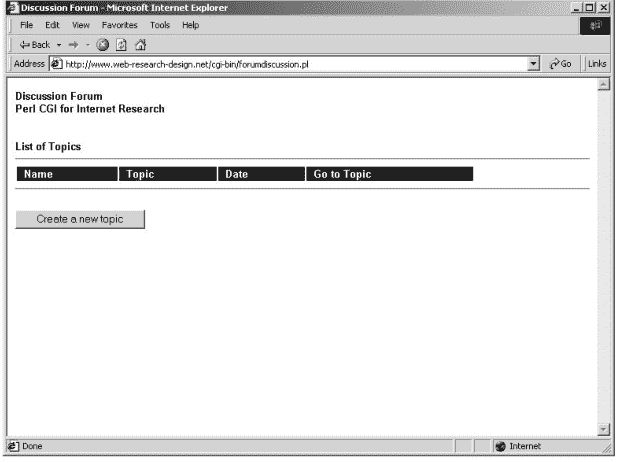

**图14.1.** 此页面展示了讨论区的主菜单页面。首次访问讨论区时，将没有活动主题。

### 在线讨论区

第一个脚本欢迎参与者来到实验，提供一些简要说明，并创建一个随机顺序来呈现试验。此顺序由数组`@trialorder`表示，并通过隐藏标签在按下**提交**按钮时传递给`rtdemorand2.pl`。

第二个脚本的结构与我们之前研究过的`rtdemo2.pl`脚本非常相似。然而，它结合了一些特性，使其能够按照`@trialorder`设定的随机顺序呈现刺激，并以适当的方式保存响应时间。以下是一些新特性：

```perl
$trialindex= $trialorder[$trialnumber];
```

这一行代码获取当前的试验编号（由`$trialnumber`表示），并用它来索引要使用的具体试验。让我们暂时假设`@trialorder`等于（“02”、“03”、“01”、“00”）。当`$trialnumber`等于1时，此代码选择`@trialorder`的第1个元素，即“03”，并将该值赋给`$trialindex`。（请记住，Perl从索引值0开始计算数组中的元素。因此，`@trialorder`的第0个元素是“02”。）

变量`$trialindex`现在将用于指定要呈现的刺激的索引值。

```perl
$stimulus= $stimuli[$trialindex];
```

在我们的例子中，`$trialindex`等于03。因此，这行代码获取`@stimuli`的第3个元素（即“anxious”），并将该字符串赋给`$stimulus`。

另一个需要注意的重要部分在以下代码中：

```perl
$temp = "rt" . $trialorder[($trialnumber - 1)];

$$temp = $rt;
```

通过在这里使用`@trialorder`而不是`@varnum`（正如我们在`rtdemo1.pl`和`rtdemo2.pl`中所做的那样），我们能够将响应时间保存到适当的变量名中，尽管试验是随机排序的。如果`$trialnumber`等于1，那么`$trialnumber - 1`等于0，`@trialorder`的第0个元素（即“02”）被附加到“rt”后并赋给`$temp`。因此，当我们计算反应时间时，它将是前一个试验的反应时间，该试验由`@trialorder`的第0个元素指定。

```perl
print "<INPUT TYPE = 'hidden' NAME = 'rt01' VALUE\n = $rt01>";

print "<INPUT TYPE = 'hidden' NAME = 'rt02' VALUE\n = $rt02>";

print "<INPUT TYPE = 'hidden' NAME = 'rt03' VALUE\n = $rt03>";

print $query->hidden('trialorder', @trialorder);

print "</FORM>";

}

else{

    open(INFO, 
        ">$ENV{'DOCUMENT_ROOT'}/www/data/rtdemo.txt");

    print INFO "$mon/$mday/$year, $hour:$min:$sec,
        $ip, ";

    print INFO "$rt00, $rt01, $rt02, $rt03\n";

    close (INFO);

    open(INFO, 
        "$ENV{'DOCUMENT_ROOT'}/www/data/rtdemo.txt");

    @data = <INFO>;

    close (INFO);

    print "Thank you. You have finished all trials.
        <BR>";

    print "Here are your response times: <BR><BR>";
```


```perl
print "$stimuli[0] : $rt00 seconds<BR>";
print "$stimuli[1] : $rt01 seconds<BR>";
print "$stimuli[2] : $rt02 seconds<BR>";
print "$stimuli[3] : $rt03 seconds<BR>";

$mypos = ($rt00 + $rt02) / 2;
$myneg = ($rt01 + $rt03) / 2;

print "<BR>It took you $mypos seconds, on average,

    to recall positive memories and $myneg seconds

    to recall negative ones.<BR><BR>";

$sumpos = 0;
$sumneg = 0;
$n = 0;

foreach $key (@data) {
    ($date, $time, $ip, $p01, $n01, $p02, $n02) = split(/,/, $key);

    $sumpos = $sumpos + (($p01 + $p02) / 2);
    $sumneg = $sumneg + (($n01 + $n02) / 2);
    $n = $n + 1;
}

$meanpos = sprintf("%.4f", ($sumpos / $n));
$meanneg = sprintf("%.4f", ($sumneg / $n));

print "On average, people in this sample have taken

    $meanpos seconds to recall positive memories and

    $meanneg to recall negative memories.<BR>";
}

print $query->end_html;
```

## 总结

在本章中，你学习了如何测量对网页的响应时间。通过对每次提交进行时间戳，通过从提交页面被服务器处理的时间减去其最初送达用户的时间，可以估算出在页面上花费的时间。尽管这种方法仅能对响应时间进行粗略估计，但可以通过对这些估计值在试验或参与者之间取平均值来提高准确性。

与非互联网研究一样，你可能希望在实施正式实验试验之前为参与者安排一些练习试验，或者计划删除对最初几次试验的响应。用户在适应界面时，倾向于在最初几次试验中花更长时间才做出响应。

## 236 如何在互联网上开展行为研究

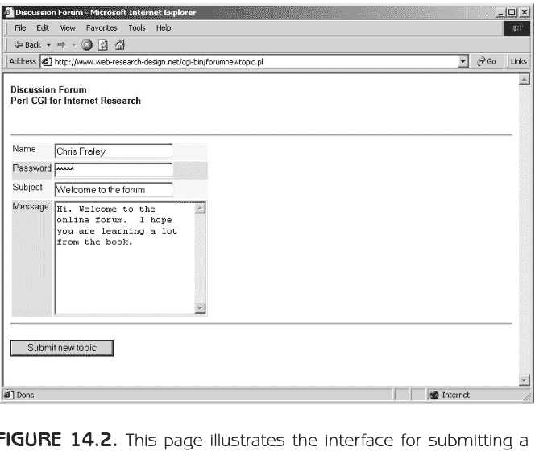

**图 14.2.** 本页展示了向论坛提交消息的界面。

在各自对应的文本框中输入“欢迎来到论坛，”和“你好。欢迎来到在线论坛。希望你从书中能学到很多”。完成后，点击“提交新主题”按钮。一旦点击，并且密码输入正确，你应该会收到确认信息。点击“返回主页”按钮。这将带你返回`forumnidiscussion.pl`。不过，现在你应该能看到一个更新后的菜单界面（见图 14.3）。

请注意，我们刚刚发布的主题已列在论坛上。主题作者显示为“Chris Fraley”，主题为“欢迎来到论坛”，并列出了主题发布的日期和时间。再多发布几个主题，这样你就能了解这些页面是如何协同工作的。你应该会注意到，每次返回`forumnidiscussion.pl`时，论坛主题列表都会更新，并且每个条目都作为新行列出（见图 14.4）。

每个列出的主题旁边都有一个标有“阅读”的按钮。选择一个主题，点击其对应的“阅读”按钮。这样做将激活脚本`forumgototopic.pl`。此脚本显示与所选主题相对应的消息（见图 14.5）。此脚本还允许论坛用户回复发布的主题。要回复发布的主题，点击标有“提交回复”的按钮，这将激活脚本`forumnewreply.pl`，并将你带到一个新页面（见图 14.6）。

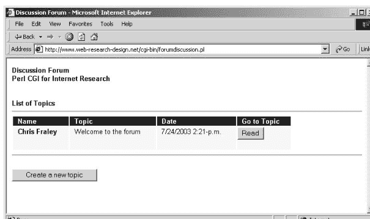

**图 14.3.** 菜单页面现在包含了我们提交到论坛的新主题。

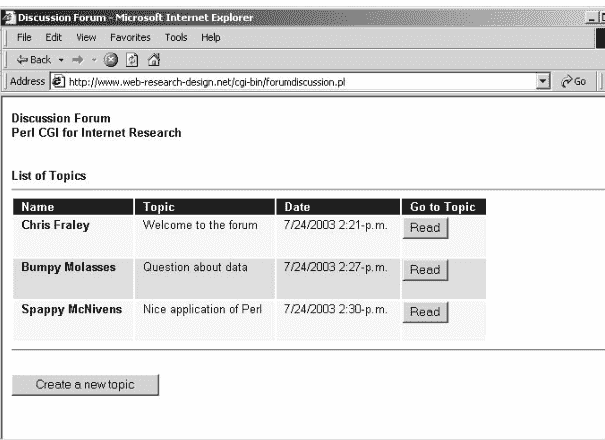

**图 14.4.** 论坛活跃度增加后，菜单页面的样貌。

用户现在可以输入其姓名、密码以及对该主题的回复。为了理解这些脚本的工作原理，请填写此表单。回想一下，默认密码是“stats”。点击“提交回复”按钮。在下一个页面，你可以选择返回同一主题或返回主页面（即`forumdiscussion.pl`）。如果返回主题页面，你应该能在原始消息下方看到你的回复。图 14.5 展示了一个示例，

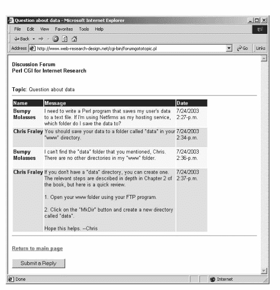

**图 14.5.** 回复现有主题的界面。

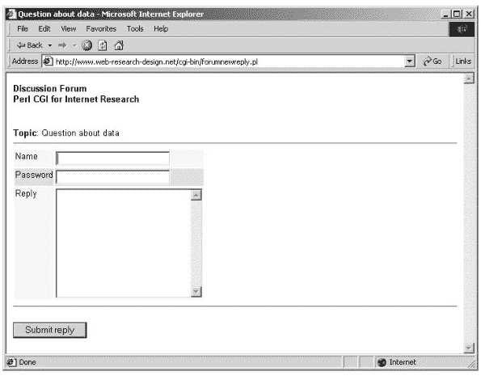

**图 14.6.** 关于特定主题的论坛讨论示例。

该页面在名为“Question about data”的主题下收到几条回复后的样子。

既然你已经获得了一些使用论坛的实践经验，让我们来看一下为存储数据而创建的一些文本文件。一旦你更好地理解了这些文件中信息的组织方式，我们就可以解析 CGI 代码并解释论坛的运作方式。在服务器的`data`目录中打开`topics.txt`文件。你应该能看到一个包含各种主题、每个主题作者的姓名、实际消息以及发布日期和时间的文件。（此文件在你提交新主题时自动创建，无需手动创建。）下面的文本代表了基于我的示例至今创建的部分`topics.txt`数据文件。

```text
Chris Fraley OOPHOIWelcome to the forum OOPHOIHI.

    Welcome to ...

Bumpy Molasses OOPHOIQuestion about data OOPHOII I need

    to writ ...

Spappy McNivens OOPHOINice application of Perl OOPHOIHere is ...
```

请注意，一行中的每条信息都由文本字符串“OOPHOI”分隔。在本书前面的示例中，我们使用文本文件时，通常用逗号分隔元素。在那些情况下，我们主要处理定量数据，而逗号不太可能是参与者回复的一部分。然而，在论坛的语境下，逗号很可能包含在一个人的消息中。为避免此问题，一种解决方案是使用一个用户不太可能输入的字母字符串（如 OOPHOI）来分隔数据文件中对不同问题的回复。

现在从`data`目录打开`replys.txt`文件。它的结构与`topics.txt`类似，包含对论坛中发布的各种主题的回复。主题及其回复存储在不同的文件中，这有助于服务器更高效地处理数据。如果你发现论坛活跃度很高，最好修改代码，为每个主题创建不同的数据文件，其中包含该主题的回复。

## CGI 脚本及其工作原理

让我们来解析 CGI 脚本。我将在下面介绍每个脚本，以及它们的功能和运作方式的简要描述。

### `forumdiscussion.pl` 程序

```perl
#!C:/perl/bin/perl.exe

use CGI;

$query = new CGI;

$spacer = "OOPHOI";

open(INFO, "$ENV{'DOCUMENT_ROOT'}/www/data/topics.txt");

@topics = <INFO>;

close(INFO);

print $query->header;

print $query->start_html(-title => 'Discussion Forum');

print "<FONT FACE='arial' SIZE='2'>";

print "<B>Discussion Forum<BR>Perl CGI for Internet

  Research<BR></B><BR><BR>";

$temp = 1;

print "<B>List of Topics</B>";

print "<HR><TABLE WIDTH='80%'>";

print "<TR BGCOLOR='#330099'>

<TD><FONT FACE='arial' SIZE='2'

  COLOR='white'><B>&nbsp Name &nbsp</B></TD>

<TD><FONT FACE='arial' SIZE='2'

  COLOR='white'><B>&nbsp Topic &nbsp</B></TD>

<TD><FONT FACE='arial' SIZE='2'

  COLOR='white'><B>&nbsp Date &nbsp</B></TD>

<TD><FONT FACE='arial' SIZE='2'

  COLOR='white'><B>&nbsp Go to Topic &nbsp</B></TD>

</TR>";

foreach $key (@topics) {
    if ($temp == 1) {
        print "<TR BGCOLOR='#F7F7F7' VALIGN='top'>";

        $temp = 2;
    } else {
        print "<TR BGCOLOR='#dfdfdf' VALIGN='top'>";

        $temp = 1;
    }

    ($name, $subject, $message, $date1, $date2) =
        split(/$spacer/, $key);

    $temp2 = "\"$subject\"";

    print "<TD><FONT FACE='arial' SIZE='2'><B>&nbsp

      $name &nbsp</B></TD>

    <TD><FONT FACE='arial' SIZE='2'>&nbsp $subject

      &nbsp</TD>

    <TD><FONT FACE='arial' SIZE='2'>&nbsp $date1

      $date2 &nbsp</TD>

    <TD><FORM ACTION='/cgi-bin/forumgototopic.pl'

      METHOD='post'>

    <INPUT TYPE='hidden' NAME='subjectselected'

      VALUE=$temp2>

    <INPUT TYPE='submit' VALUE='Read'></FORM></TD>

</TR>";
}

print "</TABLE><HR>";

print "<BR>";

print "<FORM ACTION='/cgi-bin/forumnewtopic.pl'

      METHOD='post'>";

print "<INPUT TYPE='submit' VALUE='Create a new

      topic'>";

print "</FORM>";

print $query->end_html;
```

`forumdiscussion.pl`程序充当论坛的起始或主页面。执行此程序时，它将打开服务器上的一个数据库（`topics.txt`），其中包含论坛上讨论过的所有主题，并将其呈现给用户。用户将能够看到每个主题、创建者以及主题提交的日期。如果用户想阅读某个主题的回复，可以点击标有“阅读回复”的按钮。此外，如果用户想发布新主题，也可以点击允许其操作的按钮。

我将深入审查此起始脚本的代码，因为它包含了其他脚本中重复的基本操作。代码的前三行与我们讨论过的所有 CGI 脚本的前三行相同。

```perl
#!C:/perl/bin/perl.exe

use CGI;

$query = new CGI;
```

接下来的一行创建了一个名为`$spacer`的局部变量，并为其赋值文本字符串“OOPHOI”。我们将使用此值在将信息保存到文本文件时分隔不同的信息片段。

```perl
$spacer = "OOPHOI";
```

接下来的三行代码打开或创建文本文件`topics.txt`，其内容被读入数组`@topics`。然后关闭文件。

```perl
open(INFO,

  "$ENV{'DOCUMENT_ROOT'}/www/data/topics.txt");

@topics = <INFO>;

close(INFO);
```

接下来的几行代码指示服务器向用户的浏览器发送包含网页标题“讨论论坛”的 HTML 代码。

```perl
print $query->header;

print $query->start_html(-title => 'Discussion Forum');
```

接下来，我们打印一些关于论坛目的的内容。这将显示在页面的顶部，使用粗体字。（您可能需要更改此文本以适用于您的论坛。）

```perl
print "<B>Discussion Forum<BR>Perl CGI for Internet

  Research<BR></B><BR><BR>";
```

接着，我们创建一个名为`$temp`的局部变量，并将其赋值为 1。这个变量的目的将在接下来的几节中变得清晰。

```perl
$temp = 1;
```

然后，我们指示服务器创建一个 HTML 表格。在表格的第一行，我们将在不同的列中打印“姓名”、“主题”、“日期”和“转到主题”这些词。回顾我们之前关于表格的讨论，我们使用`<TABLE>`标签开始一个表格，使用`<TR>`和`</TR>`标签开始和结束一行，并使用`<TD>`和`</TD>`标签开始和结束一列。注意，我们还通过在`<TR>`标签中使用`BGCOLOR`属性来指定行的背景颜色。

```perl
print "<B>List of Topics</B>";

print "<HR><TABLE WIDTH='80%'>";

print "<TR BGCOLOR='330066'>

<TD><FONT FACE='arial' SIZE='2'

  COLOR='white'><B>&nbsp Name &nbsp</B></TD>

<TD><FONT FACE='arial' SIZE='2'

  COLOR='white'><B>&nbsp Topic &nbsp</B></TD>

<TD><FONT FACE='arial' SIZE='2'

  COLOR='white'><B>&nbsp Date &nbsp</B></TD>

<TD><FONT FACE='arial' SIZE='2'

  COLOR='white'><B>&nbsp Go to Topic &nbsp</B></TD>

</TR>";
```

我们将如何让表格每一行的背景颜色在浅灰色和深灰色之间交替？在`for-each`循环开始之前，局部变量`$temp`被设置为 1。一旦`for-each`循环开始，一个`if-else`条件就会设置背景颜色为`#F7F7F7`（一种非常浅的灰色；参见第 3 章关于十六进制颜色代码的内容），前提是`$temp`等于 1。因此，在循环的第一次执行中，`$temp`等于 1，背景颜色被设置为浅灰色，然后`$temp`被更改为等于 2。在循环的下一次执行中，服务器将跳过第一个条件，因为`$temp`不再等于 1。相反，它执行`else`部分的命令，将颜色设置为更深的灰色（`#dedfdf`）并将`$temp`更改回 1。当`$temp`再次等于 1 时，在循环的下一次执行中，第一个条件将被满足，服务器将以浅灰色背景打印该行。简而言之，每当服务器循环执行时，它就会将`$temp`的值从 1 更改为 2，或者从 2 更改为 1，从而使其能够交替设置每一行的颜色。

```perl
if ($temp == 1) {
    print "<TR BGCOLOR='#F7F7F7' VALIGN='top'>";

    $temp = 2;
} else {
    print "<TR BGCOLOR='#dedfdf' VALIGN='top'>";

    $temp = 1;
}
```

我们的下一个任务是获取`@topics`（即包含数据文件`topics.txt`中信息的数组）中的每一行数据，将其解析为单独的变量，并将相关信息打印到网页上。为此，我们创建一个`for-each`循环。`foreach`命令指示服务器遍历`@topics`中的每一行数据。我们将把每行信息分成五个变量（即`$name`、`$subject`、`$message`、`$date1`和`$date2`）。注意，我们*不是*像之前的示例那样基于逗号来分割信息。在这种情况下，我们基于数据文件中`$spacer`的出现来分割信息，即“OOPHOI”。

```perl
foreach $key (@topics) {
    ($name, $subject, $message, $date1, $date2) =
        split(/$spacer/, $key);

    $temp2 = "\"$subject\"";

    print "<TD><FONT FACE='arial' SIZE='2'><B>&nbsp $name &nbsp</B></TD>

    <TD><FONT FACE='arial' SIZE='2'>&nbsp $subject &nbsp</TD>

    <TD><FONT FACE='arial' SIZE='2'>&nbsp $date1 $date2 &nbsp</TD>

    <TD><FORM ACTION='\\cgi-bin\\forumgototopic.pl' METHOD='post'>";
```


```html
<INPUT TYPE='hidden' NAME='subjectselected' VALUE=$temp2>

<INPUT TYPE='submit' VALUE='Read'></FORM></TD>

</TR>";
```

提取一行数据的这些变量后，我们按照解析的顺序，将除`$message`变量以外的所有变量打印到表格的不同列中。最后，我们创建一个表单（`<FORM...>`）、一个隐藏值、一个**提交**按钮并关闭表单（`</FORM>`）。此过程持续进行，直到`@topics`的每一行数据都被处理完毕。

回想一下，当用户点击这些行末尾的**阅读**按钮时，会激活一个脚本（`forumgototopic.pl`），该脚本会显示主题及其相应的回复。为确保脚本知道要显示哪个主题，我们将主题本身包含在上面代码中创建的隐藏标签中。

为此，我们创建了一个名为`$temp2`的局部变量。我们让`$temp2`等于`$subject`的值——即主题的标题或主题。因为主题可能是一个包含空格的复杂短语，所以在短语周围加上引号很重要。我们可以使用`\"`符号（即反斜杠后跟引号）来实现这一点。

如果我们在`$subject`周围不加引号，隐藏值标签将错误地解析信息。例如，如果`$subject`等于`"How do I solve this problem?"`，而我们使用以下命令：

```html
<INPUT TYPE='hidden' NAME='subjectselected'
       VALUE=$subject>
```

用户的浏览器会将其解释为：

```html
<INPUT TYPE='hidden' NAME='subjectselected' VALUE=How do I solve this problem?>
```

浏览器会将此标签的`VALUE`解释为等于`"How"`，并忽略其余文本，因为这些词不对应标签的任何合法属性。然而，通过在`$subject`的值周围加上引号，浏览器正确地看到类似下面的内容：

```html
<INPUT TYPE='hidden' NAME='subjectselected' VALUE='How do I solve this problem?'>
```

现在，整个主题短语作为此隐藏标签的`VALUE`传递。

> **注意。** 这是本书中我们第一次在单个 HTML 页面上使用多个表单。注意，这样做允许我们创建多个按钮来激活不同的脚本（或带有不同隐藏值的相同脚本）。

一旦循环完成，我们使用`</TABLE>`标签关闭表格并创建一个新表单。此表单将包含自己的**提交**按钮，使用户能够为论坛创建新主题。点击此按钮会激活`forumnewtopic.pl`。

```perl
print "</TABLE><HR>";

print "<BR>";

print "<FORM ACTION='/cgi-bin/forumnewtopic.pl' METHOD='post'>";

print "<INPUT TYPE='submit' VALUE='Create a new topic'>";

print "</FORM>";

print $query->end_html;
```

不过，回顾一下，当用户通过点击**阅读**按钮选择一个主题时，会激活`forumgototopic.pl`脚本。让我们来研究这个脚本。

```perl
#!C:/perl/bin/perl.exe

use CGI;

$query = new CGI;
```

```perl
$subjectselected= $query->param('subjectselected');

$spacer= "OOPHOI";

open (INFO,
    "$ENV{'DOCUMENT_ROOT'}/www/data/topics.txt");

@topics = <INFO>;

close (INFO);

open (INFO,
    "$ENV{'DOCUMENT_ROOT'}/www/data/replys.txt");

@replys = <INFO>;

close (INFO);

$temp=1;

print $query->header;

print $query->start_html(-title=>$subjectselected);

print "<FONT FACE = 'arial' SIZE = '2'>";

print "<B>Discussion Forum<BR>Perl CGI for Internet Research<BR></B><BR><BR>";

print "<B>Topic</B>: $subjectselected<BR>";

print "<HR><TABLE WIDTH='80%'>";

print "<TR BGCOLOR='#330099' VALIGN='top'>

<TD VALIGN='top'><FONT FACE = 'arial' SIZE = '2' COLOR='white'><B>Name &nbsp</B></TD>

<TD VALIGN='top'><FONT FACE = 'arial' SIZE = '2' COLOR='white'><B>Message &nbsp</B></TD>

<TD VALIGN='top'><FONT FACE = 'arial' SIZE = '2' COLOR='white'><B>Date &nbsp</B></TD>

</TR>";

foreach $key (@topics){

    ($name, $subject, $message, $date1,
        $date2)=split(/$spacer/,$key);

    if($subject eq $subjectselected){

        if($temp == 1){

            print "<TR BGCOLOR='#F7F7F7' VALIGN='top'>";

            $temp= 2;
```

# 如何在互联网上进行行为研究

```perl
        }

        else{

            print "<TR BGCOLOR='#dedfdf' VALIGN='top'>";

            $temp= 1;
        }

        print "<TD VALIGN='top'>

        <FONT FACE = 'arial' SIZE = '2'>

        <B>$name &nbsp <BR>&nbsp</B></TD>

        <TD VALIGN='top'> <FONT FACE = 'arial' SIZE =

        '2'>$message</TD>

        <TD VALIGN='top'> <FONT FACE = 'arial' SIZE =

        '2'>$date1 $date2 </TD></TR>";
    }
}

foreach $key (@replys){

    ($name, $subject, $message, $date1,
        $date2)=split(/$spacer/,$key);

    if($subject eq $subjectselected){

        if($temp == 1){

            print "<TR BGCOLOR='#F7F7F7' VALIGN='top'>";

            $temp= 2;

        }

        else{

            print "<TR BGCOLOR='#dedfdf' VALIGN='top'>";

            $temp= 1;
        }

        print "<TD VALIGN='top'>

        <FONT FACE = 'arial' SIZE = '2'>

        <B>$name &nbsp <BR>&nbsp</B></TD>

        <TD VALIGN='top'> <FONT FACE = 'arial' SIZE =

        '2'>$message</TD>

        <TD VALIGN='top'> <FONT FACE = 'arial' SIZE =

        '2'>$date1 $date2 </TD></TR>";
    }
}

print "</TABLE>";

print "<HR><BR><A HREF='/cgi-bin/forumdiscussion.pl'>

    <B>返回主页</B></A><BR>";

$temp2= "\"$subjectselected\"";
```

```perl
print "<FORM ACTION='/cgi-bin/forumnewreply.pl'

  METHOD='post'>";

print "<INPUT TYPE='hidden' NAME='date1'

  VALUE=$date1>";

print "<INPUT TYPE='hidden' NAME='date2'

  VALUE=$date2>";

print "<INPUT TYPE='hidden' NAME='subjectselected'

  VALUE=$temp2>";

print "<INPUT TYPE='submit' VALUE='提交回复'>";

print "</FORM>";

print $query->end_html;
```

考虑到我们目前所涵盖的内容，此脚本中的操作应该相当明显；因此，我将仅针对这些操作的基本功能进行注释说明。首先，服务器提取提交的部分数据，并将这些值分配给局部变量。CGI 数据包中的关键信息之一是`subjectselected`值。此值包含用户选择的主题，通过一个隐藏标签传递。

接下来，脚本打开`topics.txt`数据文件，并将其中的信息分配给局部数组`@topics`。它还打开服务器上`data`文件夹中一个名为`replys.txt`的文件。此文件包含对各个主题的回复。它将此文件中的信息分配给局部数组`@replys`。

使用`for-each`循环，服务器遍历`@topics`的每一行。当它找到`$subject`等于`$subjectselected`的行时，它会打印相应的消息（以及作者、日期和时间）。此循环完成后，它开始另一个`for-each`循环，以检测`@replys`中是否存在对当前主题的回复。当它找到`$subject`变量等于`$subjectselected`的行时，它会打印相应的回复，以及回复的作者和提交的日期时间。

脚本的最后部分提供了一个返回主页的链接，以及用户为当前页面上发布消息添加回复的方式。具体来说，它创建了一个表单，当按下**提交**按钮时，会激活一个名为`forumnewreply.pl`的脚本。此外，一些相关信息（即感兴趣的主题）通过隐藏标签传递给`forumnewreply.pl`脚本。

以下是`forumnewreply.pl`脚本。此脚本负责为用户提供一种回复已发布主题的方式。

```perl
#!C:/perl/bin/perl.exe

use CGI;

$query = new CGI;

$subjectselected= $query->param('subjectselected');

($sec,$min,$hour,$mday,$mon,$year,$wday,$yday,$isdst) =

  localtime(time);

$year = 1900 + $year;

$mon= $mon+1;

$ampm = "a.m.";

if($hour > 12){

    $hour= $hour - 12;

    $ampm = "p.m.";
}

$date1= "$mon/$mday/$year";

$date2= "$hour:$min" . "-" . "$ampm";

print $query->header;

print $query->start_html(-title=>$subjectselected);

print "<FONT FACE = 'arial' SIZE = '2'>";

print "<B>讨论论坛<BR>用于互联网研究的 Perl CGI<BR></B><BR><BR>";

print "<FORM ACTION='/cgi-bin/forumsavereply.pl'

  METHOD='post'>";

print "<B>主题</B>: $subjectselected<BR>";

print "<HR><TABLE>

<TR BGCOLOR='#F7F7F7'>

<TD VALIGN='top'><FONT FACE = 'arial' SIZE = '2'>

  姓名 </TD>

<TD> <INPUT TYPE='textbox' NAME='name' MAXLENGTH='30'

  SIZE='25'></TD>

</TR>

<TR BGCOLOR='#dedfdf'>

<TD VALIGN='top'><FONT FACE = 'arial' SIZE = '2'>

  密码 </TD>

<TD> <INPUT TYPE='password' NAME='password'

  MAXLENGTH='30' SIZE='25'></TD>

</TR>

<TR BGCOLOR='#F7F7F7'>
```

```html
<TD VALIGN='top'><FONT FACE = 'arial' SIZE = '2'>

    回复 </TD>

<TD> <TEXTAREA NAME='message' COLS=25 ROWS=10

    WRAP='virtual'></TEXTAREA></TD></TR>";

print "</TABLE><HR>";

print "<BR>";

$temp2= "\"$subjectselected\"";

print "<INPUT TYPE='hidden' NAME='date1'

    VALUE=$date1>";

print "<INPUT TYPE='hidden' NAME='date2'

    VALUE=$date2>";

print "<INPUT TYPE='hidden' NAME='subjectselected'

    VALUE=$temp2>";

print "<INPUT TYPE='submit' VALUE='提交回复'>";

print "</FORM>";

print $query->end_html;
```

此脚本创建了几个文本框，供用户输入其姓名、密码以及消息或回复的文本。用户完成后，他或她点击**提交回复**按钮，该按钮会激活`forumsavereply.pl`。有几个隐藏值传递给此脚本：日期（`$date1`）、时间（`$date2`）和主题本身（`$temp2`——即`subjectselected`的值加上引号）。

请注意，我们对日期信息进行了一些处理。正如您从第 5 章中回忆的那样，年份 2002 被编码为 102。要将此值转换为正确的年份，我们只需将`$year`加上 1900。此外，月份的值（`$mon`）的编码方式是：一月等于零，十二月等于 11。为了“修正”这种从零开始的编码，我们将`$mon`的值加 1。

最后，我们没有使用 24 小时制报告小时，而是使用了一个`if-then`条件语句，当`$hour`大于 12 时，从`$hour`的值中减去 12。因此，如果时间是 15 点，此更改会将小时设置为 3（即 3 点钟）。

下一个脚本`forumsavereply.pl`负责获取用户的回复并将其保存到`reply.txt`数据文件中。以下是该脚本：

```perl
#!C:/perl/bin/perl.exe

use CGI;
```

```perl
$query = new CGI;

$name= $query->param('name');

$subjectselected= $query->param('subjectselected');

$message= $query->param('message');

$date1= $query->param('date1');

$date2= $query->param('date2');

$password= $query->param('password');

$spacer= "OOPHOI";

print $query->header;

print $query->start_html(-title=>'讨论论坛');

if($password eq "stats"){

    $message =~ s/\n/<BR>/g;

    $message =~ s/\r/ /g;

    open (INFO, ">>$ENV{'DOCUMENT_ROOT'}/www/data/replys.txt");

    print INFO "$name$spacer";

    print INFO "$subjectselected$spacer";

    print INFO "$message$spacer";

    print INFO "$date1$spacer";

    print INFO "$date2\n";

    close (INFO);

    print "<FONT FACE = 'arial' SIZE = '2'>";

    print "<B>讨论论坛<BR>用于互联网研究的 Perl CGI<BR></B><BR><BR>";

    print "您的回复已保存。<BR>";

    print "<FORM ACTION='/cgi-bin/forumgototopic.pl' METHOD='post'>";
```


```perl
$temp2 = "\"$subjectselected\"";

print "<INPUT TYPE='hidden' NAME='subjectselected' VALUE=$temp2>";

print "<INPUT TYPE='submit' VALUE='返回主题'>";

print "</FORM>";

print "<FORM ACTION='/cgi-bin/forumdiscussion.pl' METHOD='post'>";

print "<INPUT TYPE='submit' VALUE='前往主页'>";

```

```

print "</FORM>";

}

else {

    print "<FONT FACE = 'arial' SIZE = '2'>";

    print "<B>讨论论坛<BR>";

    print "您输入了无效的密码。<BR>

    如果您认为有误，请使用浏览器的<I>后退</I>按钮，然后重试。";

}

print $query->end_html;

```

此脚本将 CGI 数据包中的一些值分配给局部变量。接下来，它打开文本文件`replys.txt`，并将这些值打印到文件中。注意，我们使用`$spacer`变量（等于 OOPHOI）分隔每个值。在将最后一段信息打印到文件后，我们使用换行符（`\n`）并关闭数据文件。然后，脚本告诉用户响应已成功保存，并为其提供返回单个主题页面或主页的选项。

需要注意的是，此脚本仅在密码输入正确时才保存数据。程序使用以下命令进行检查：

```perl
if ($password eq "stats") {
```

如果`$password`的值是`"stats"`，程序将执行保存响应的命令。如果`$password`的值是其他内容，程序将执行`else`大括号中的命令。具体来说，它告诉用户他或她输入了错误的密码。

> **注意。** 如果您想更改为自定义密码，请将单词`stats`替换为新密码。您需要在此脚本以及后面讨论的名为`forumsavetopic.pl`的脚本中进行此更改。如果希望为每个用户设置单独的密码，可以改编第12章中使用的代码。

## 如何在互联网上进行行为研究

> 以下这行代码可能看起来很陌生：`$message =~ s/\n/<BR>/g`。这条命令会将`$message`中每个出现的回车符替换为 HTML 换行符。如果不进行此替换，回车符会在数据文件中被编码为真正的回车符，并导致数据处理方式出现错误。

接下来的两个脚本与前面两个的工作方式相同。第一个是`forumnewtopic.pl`，当用户想在主页面创建一个新主题时激活。此脚本接受新信息，并通过隐藏标签将其传递给`forumsavetopic.pl`。`forumsavetopic.pl`会检查密码，并将新主题保存到`topics.txt`文件中。最后，它给用户一个返回主页面的选项。

### `forumnewtopic.pl`

```perl
#!/C:/perl/bin/perl.exe

use CGI;

$query = new CGI;

($sec, $min, $hour, $mday, $mon, $year, $wday, $yday, $isdst) =
    localtime(time);

$year = 1900 + $year;

$mon = $mon + 1;

$ampm = "a.m.";

if ($hour > 12) {
    $hour = $hour - 12;
    $ampm = "p.m.";
}

$date1 = "$mon/$mday/$year";

$date2 = "$hour:$min" . "-" . "$ampm";

print $query->header;

print $query->start_html(-title => 'Discussion Forum');

print "<FONT FACE = 'arial' SIZE = '2'>";

print "<B>Discussion Forum<BR>Perl CGI for Internet Research<BR></B><BR><BR>";

print "<FORM ACTION='/cgi-bin/forumsavetopic.pl' METHOD='post'>";

print "<HR><TABLE>";
```

## Perl 的更多应用

```html
<TR BGCOLOR='#F7F7F7'>

<TD VALIGN='top'><FONT FACE = 'arial' SIZE = '2'>

Name </TD>

<TD> <INPUT TYPE='textbox' NAME='name' MAXLENGTH='30' SIZE='25'></TD>

</TR>

<TR BGCOLOR='#dedfdf'>

<TD VALIGN='top'><FONT FACE = 'arial' SIZE = '2'>

Password </TD>

<TD> <INPUT TYPE='password' NAME='password' MAXLENGTH='30' SIZE='25'></TD>

</TR>

<TR BGCOLOR='#F7F7F7'>

<TD VALIGN='top'><FONT FACE = 'arial' SIZE = '2'>

Subject </TD>

<TD> <INPUT TYPE='textbox' NAME='subject' MAXLENGTH='30' SIZE='25'></TD>

</TR>

<TR BGCOLOR='#dedfdf'>

<TD VALIGN='top'><FONT FACE = 'arial' SIZE = '2'>

Message </TD>

<TD> <TEXTAREA NAME='message' COLS=25 ROWS=10 WRAP='virtual'></TEXTAREA></TD></TR>";

print "</TABLE><HR>";

print "<BR>";

print "<INPUT TYPE='hidden' NAME='date1' VALUE=$date1>";

print "<INPUT TYPE='hidden' NAME='date2' VALUE=$date2>";

print "<INPUT TYPE='submit' VALUE='Submit new topic'>";

print "</FORM>";

print $query->end_html;

#!C:/perl/bin/perl.exe

use CGI;

$query = new CGI;
```

### `forumsavetopic.pl`

## 如何在互联网上进行行为研究

```perl
$name = $query->param('name');

$subject = $query->param('subject');

$message = $query->param('message');

$date1 = $query->param('date1');

$date2 = $query->param('date2');

$password = $query->param('password');

$spacer = "OOPHOI";

print $query->header;

print $query->start_html(-title => 'Discussion Board');

if ($password eq "stats") {

    $message =~ s/\n/<BR>/g;

    $message =~ s/\r/ /g;

    open(
        INFO,
        ">>$ENV{'DOCUMENT_ROOT'}/www/data/topics.txt"
    );

    print INFO "$name $spacer";

    print INFO "$subject $spacer";

    print INFO "$message $spacer";

    print INFO "$date1 $spacer";

    print INFO "$date2\n";

    close(INFO);

    print "<FONT FACE = 'arial' SIZE = '2'>";

    print "<B>Discussion Forum<BR>Perl CGI for Internet Research<BR></B><BR><BR>";

    print "Your message has been saved.<BR>";

    print "<FORM ACTION='/cgi-bin/forumdiscussion.pl' METHOD='post'>";

    print "<INPUT TYPE='submit' VALUE='Return to main page'>";

    print "</FORM>";

}

else {

    print "<FONT FACE = 'arial' SIZE = '2'>";

    print "<B>Discussion Forum<BR>Perl CGI for Internet Research<BR></B><BR><BR>";

    print "You entered an invalid password.<BR>

    If you think you have made an error, please use"
```

```html
the <I>back</I> button on your browser and try again.";
```

```perl
}

print $query->end_html;
```

## 在线论坛程序总结

该在线论坛由六个脚本实现，每个脚本负责一个独特的功能。以下是每个脚本及其负责任务的简单概述。

- `forumdiscussion.pl`：此脚本创建主页面。它从`topics.txt`数据文件中读取所有现有主题，并以有序的方式将它们打印到网页上。它还为用户提供读取任何现有主题或创建新主题的选项。
- `forumgototopic.pl`：当用户点击`Read`提交按钮时激活。它打印与该主题相关的信息，并提供用户向页面添加自己消息的选项。
- `forumnewreply.pl`：当用户选择在主题内添加对讨论的回复时激活此脚本。该页面为用户提供了姓名、论坛密码和回复内容本身的输入框。
- `forumsavereply.pl`：当用户提交对主题的新回复时激活。此脚本检查密码是否有效。如果有效，脚本会将回复保存到`replys.txt`数据文件中。如果无效，脚本会告知用户密码不正确。
- `forumnewtopic.pl`：当用户在主页面选择创建新主题时激活此脚本。它为用户提供了姓名、论坛密码、主题和新主题内容本身的输入框。
- `forumsavetopic.pl`：当用户提交新主题时激活。此脚本检查密码是否有效。如果有效，脚本会将主题保存到`topics.txt`数据文件中。如果无效，脚本会告知用户密码不正确。

这些脚本足够通用，你可以根据自己的需要进行修改和使用。为此，你需要将每个脚本中读取 `"Discussion Forum, Perl CGI for Internet Research"` 的部分替换为相应的文本。

为你的目的修改信息。另外，如果你想更改密码，你需要修改`forumsavereply.pl`和`forumsavetopic.pl`脚本`if-then`部分中的默认密码`"stats"`。如果你想完全移除密码选项，请删除脚本中涉及密码的部分。这包括`forumnewreply.pl`和`forumnewtopic.pl`脚本中的密码文本框，以及`forumsavereply.pl`和`forumsavetopic.pl`脚本中的`if-else`条件。

> 如果你想为不同的目的创建多个论坛（例如，一个用于讨论组，一个用于班级），你需要做以下两件事之一。一个选项是为每个目的创建单独的目录，并在每个目录中保存脚本副本。另一个选项是为每个脚本文件名添加新名称。例如，如果你正在教授心理学101和心理学242，你可以创建两个`forumdiscussion.pl`文件副本，一个名为`psych101discussion.pl`，另一个名为`psych242discussion.pl`。（同样，你可以用相同的方式重命名其他脚本。）你需要更改负责激活其他脚本的各种`FORM`元素中的文件名。你还需要以类似的方式为`topics.txt`和`replys.txt`文件创建单独的文件。

## 在线测验

帮助学生准备考试的一种方法是给他们定期测验。不幸的是，在课堂上进行测验会占用宝贵的讲课和讨论时间。此外，批改纸笔测验会花费大量时间。在线测验可以解决这两个问题。学生可以在不占用你课堂时间的情况下完成在线测验。而且，通过使用 CGI 脚本，服务器会自动批改测验。它为你节省时间，并能给你的学生即时反馈。

下面介绍的通用脚本使用多选题格式来测验学生。一旦学生回答了每个问题，脚本就会对测验进行评分，告诉学生正确答案，并允许他或她重新参加测验。这个特定的测验脚本从一个更大的问题组中随机选择一部分问题。因此，每次学生重新参加测验时，他或她将获得一组随机选择的问题，这些问题可能与之前看到的有重叠，也可能没有。

将脚本复制到一个空白文档中，并保存为`onlinequiz.pl`，放在你的`cgi-bin`目录下。在浏览器地址栏中输入该URL，即可参加测验。这个特定的测验测试你对 HTML 和 Perl 中 CGI 编程的知识。我只包含了五个问题，脚本每次会从中选择三个来显示。图14.7展示了测验运行时的屏幕截图。

一旦你回答完问题并点击**Grade my quiz**按钮，你将收到关于答案的反馈。（图14.8展示了反馈内容）。

以下是脚本代码。下面我将对代码进行解释。

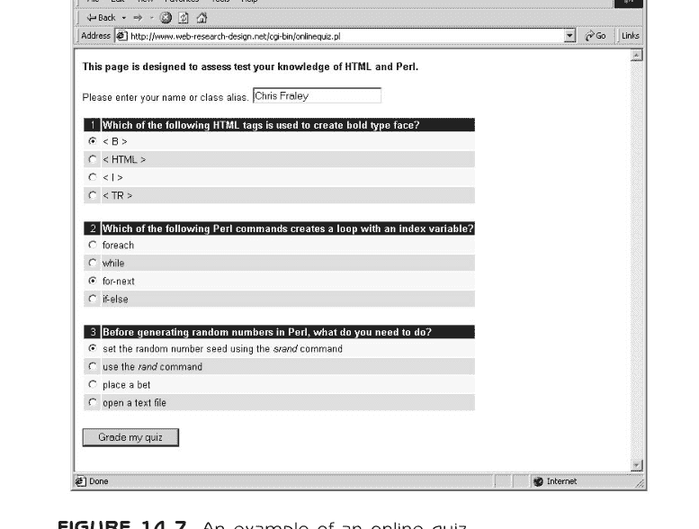

**图14.7.** 一个在线测验的示例。

### `onlinequiz.pl`

```perl
#!C:/perl/bin/perl.exe

use CGI;

$query = new CGI;

#

$n = 3;
```

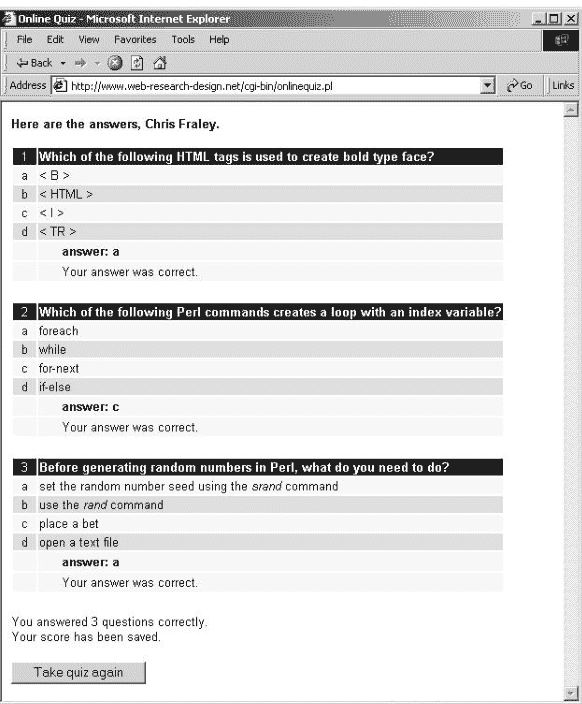

**图14.8.** Perl脚本自动为测验评分，并告知用户其表现。

```perl
$total = 5;

$q0 = "Which of the following HTML tags is used to
  create bold type face?";

$q0a = "\< B \> ";

$q0b = "\< HTML \> ";

$q0c = "\< I \> ";

$q0d = "\< TR \> ";

$q1 = "Which of the following HTML tags is used to
  create a new row in an HTML table?";

$q1a = "\< B \> ";

$q1b = "\< HTML \> ";

$q1c = "\< I \> ";

$q1d = "\< TR \> ";

$q2 = "Which of the following Perl commands creates a
  loop with an index variable?";

$q2a = "foreach";

$q2b = "while";

$q2c = "for-next";

$q2d = "if-else";

$q3 = "Which of the following <I>tricks</I> can be
  used to overcome statelessness?";

$q3a = "Use an if-else condition";

$q3b = "There is no adequate way of handling the
  statelessness problem";

$q3c = "Use JavaScript";

$q3d = "Use hidden tags to pass submitted data to new
  pages";

$q4 = "Before generating random numbers in Perl, what
  do you need to do?";

$q4a = "set the random number seed using the
  <I>srand</I> command";

$q4b = "use the <I>rand</I> command";

$q4c = "place a bet";

$q4d = "open a text file";

@answers = ("a", "d", "c", "d", "a");

#----------------------

$r0 = $query->param('r0');

$r1 = $query->param('r1');

$r2 = $query->param('r2');

$r3 = $query->param('r3');

$r4 = $query->param('r4');

$alias = $query->param('alias');

#--------------------------------------------

$timethrough = $query->param('timethrough');

@varlist = $query->param('varlist');

#--------------------------------------------

if ($timethrough != 1) {

    @varlist = ("0", "1", "2", "3", "4");
```


```perl
srand;

@new = ();

while (@varlist) {
    push(@new, splice(@varlist, rand @varlist, 1));
}

@varlist = @new;

print $query->header;

print $query->start_html(-title => 'Online Quiz');

print "<FONT FACE = 'arial' SIZE = '2'>";

print "<B>This page is designed to assess test your\n       knowledge of HTML and Perl.</B><BR> <BR>";

print "<FORM ACTION = '/cgi-bin/onlinequiz.pl'\n       METHOD = 'post'> ";

print "Please enter your name or class alias. ";

print "<INPUT TYPE='textbox' NAME='alias'\n       MAXLENGTH='35' SIZE='25'><BR><BR>";

print "<TABLE>";

for ($i = 0; $i <= ($n - 1); ++$i) {
    $questionnumber = $i + 1;

    $question = "q" . $varlist[$i];

    $optiona = $question . "a";

    $optionb = $question . "b";

    $optionc = $question . "c";

    $optiond = $question . "d";

    print "<TR BGCOLOR='#330099'><TD><FONT FACE='arial' COLOR='white' SIZE='2'> &nbsp $questionnumber</TD><TD><FONT FACE='arial' COLOR='white' SIZE='2'><B> $$question </B></FONT></TD></TR>

<TD BGCOLOR= '#F7F7F7'> <TD><INPUT TYPE = 'radio' NAME = r$varlist[$i] VALUE = 'a'></TD><TD>

<FONT FACE='arial' SIZE='2'> $$optiona

</TD></TR>

<TD BGCOLOR= '#dedfdf'> <TD><INPUT TYPE = 'radio' NAME = r$varlist[$i] VALUE = 'b'></TD><TD>

<FONT FACE='arial' SIZE='2'> $$optionb

</TD></TR>

<TD BGCOLOR= '#F7F7F7'> <TD><INPUT TYPE = 'radio' NAME = r$varlist[$i] VALUE = 'c'></TD><TD>

<FONT FACE='arial' SIZE='2'> $$optionc

</TD></TR>

<TD BGCOLOR= '#dedfdf'> <TD><INPUT TYPE = 'radio' NAME = r$varlist[$i] VALUE = 'd'></TD><TD>

<FONT FACE='arial' SIZE='2'> $$optiond

</TD></TR>

<TR BGCOLOR= 'white'><TD> &nbsp </TD><TD> &nbsp

</TD></TR>";
}

print "</TABLE>";

print $query->hidden('varlist', @varlist);

print "<INPUT TYPE='hidden' NAME='timethrough' VALUE='1'>";

print "<INPUT TYPE = 'submit' VALUE = 'Grade my quiz'>";

print "<BR></FORM></FONT>";

print $query->end_html;
}

#---------------------------------

else {
    $numbercorrect = 0;

    ($sec, $min, $hour, $mday, $mon, $year, $wday, $yday, $isdst) = localtime(time);

    $year = 1900 + $year;

    $mon = $mon + 1;

    $date = "$mon/$mday/$year/$hour/$min";

    print $query->header;

    print $query->start_html(-title => 'Online Quiz');

    print "<FONT FACE = 'arial' SIZE = '2'>";

    print "<B>Here are the answers,

   $alias.</B><BR><BR>";

    print "<TABLE>";

    for ($i = 0; $i <= ($n - 1); ++$i) {
        $correctanswer = $answers[$varlist[$i]];

        $questionnumber = $i + 1;

        $question = "q" . $varlist[$i];

        $optiona = $question . "a";

        $optionb = $question . "b";

        $optionc = $question . "c";

        $optiond = $question . "d";

        print "<TR BGCOLOR='#330099'><TD><FONT

        FACE='arial' COLOR='white' SIZE='2'> &nbsp

        $questionnumber &nbsp</TD><TD><FONT

        FACE='arial' COLOR='white' SIZE='2'><B>

        $$question </B></FONT></TD></TR>

    <TR BGCOLOR= '#F7F7F7'><TD><FONT FACE='arial'

        SIZE='2'> &nbsp a &nbsp </TD><TD><FONT

        FACE='arial' SIZE='2'> $$optiona </TD></TR>

    <TR BGCOLOR= '#dedfdf'><TD><FONT FACE='arial'

        SIZE='2'> &nbsp b &nbsp </TD><TD><FONT

        FACE='arial' SIZE='2'> $$optionb </TD></TR>

    <TR BGCOLOR= '#F7F7F7'><TD><FONT FACE='arial'

        SIZE='2'> &nbsp c &nbsp </TD><TD><FONT

        FACE='arial' SIZE='2'> $$optionc </TD></TR>

    <TR BGCOLOR= '#dedfdf'><TD><FONT FACE='arial'

        SIZE='2'> &nbsp d &nbsp </TD><TD><FONT

        FACE='arial' SIZE='2'> $$optiond </TD></TR>

    <TR BGCOLOR= '#F7F7F7'><TD> &nbsp </TD><TD><FONT

        FACE='arial' SIZE='2'><B> &nbsp &nbsp &nbsp

        answer: $correctanswer</B></TD></TR>

    <TR BGCOLOR= '#F7F7F7'><TD> &nbsp </TD><TD><FONT

        FACE='arial' SIZE='2'>";

        $answerselected = "r" . $varlist[$i];

        if ($correctanswer eq $$answerselected) {
            print " &nbsp &nbsp &nbsp Your answer was

        correct.";

            $numbercorrect = $numbercorrect + 1;
        }
        else {
            print " &nbsp &nbsp &nbsp Your answer,

            $$answerselected, was incorrect.";
        }

        print "<TR BGCOLOR= 'white'><TD> &nbsp </TD><TD>

    &nbsp </TD></TR>";
    }

    print "</TABLE>";

    #----------------------------------

    open(INFO, ">>$ENV{'DOCUMENT_ROOT'}/www/data/onlinequiz.txt");

    print INFO "$alias OOPHOI $date OOPHOI

    $numbercorrect\n";

    close(INFO);

    #----------------------------------

    print "You answered $numbercorrect questions

        correctly.<BR>";

    print "Your score has been saved.<BR>";

    print "<FORM ACTION = '/cgi-bin/onlinequiz.pl'

    METHOD = 'post'> ";

    print "<INPUT TYPE='hidden' NAME='timethrough'

    VALUE='0'>";

    print "<INPUT TYPE='hidden' NAME='alias'

    VALUE=$alias >";

    print "<INPUT TYPE = 'submit' VALUE = 'Take quiz

    again'>";

    print $query->end_html;
}
```

基本代码与我们之前随机排列自尊问题时使用的代码相同（参见第6章）。不过，这里有三点值得注意。

首先，为了使代码更紧凑，两个主要功能被强制合并到一个脚本中。这两个关键功能是：（1）展示测试题目，（2）对回答进行评分。我们本可以创建两个脚本来分别处理这些功能。服务器可以根据`if-else`命令来决定如何操作。

当脚本第一次被激活时，发送给`$timethrough`的CGI数据包值不存在，因为没有数据包被提交到服务器。因此，当服务器执行到以下命令：`if($timethrough != 1) {}`（读作“如果`$timethrough`的值不等于1，则执行花括号内的命令”）时，它处理花括号内的命令，因为`$timethrough`不等于1。

这些花括号内的命令指示服务器随机化问题的顺序，并向用户呈现其中的一个子集（`for ($i = 0; $i <= ($n - 1); ++$i)`）。还会创建一个**评分我的测验提交**按钮。按下此按钮会重新激活脚本，并将所有回答（以及隐藏值）发送到服务器。

请注意，其中一个隐藏值将`$timethrough`更改为1。因此，在脚本的第二次运行中，它会将本地变量`$timethrough`赋值为1。现在，当服务器到达`if($timethrough != 1) {}`命令时，它会跳过花括号中的命令，并执行`else`花括号中的命令。

这些命令再次打印问题，对问题进行评分，并显示正确答案。会创建一个**再次参加测验提交**按钮。当点击此按钮时，`$timethrough`被更改为0并编码为一个隐藏值，脚本被重新激活。用户会收到一个新的随机问题子集。

要根据你自己的目的自定义脚本，有几件事你需要做：

- 用你自己的问题（和回答选项）替换脚本中的问题。如果你想制作超过五个问题，请添加新问题并相应地增加`$a1`的名称。如果你使用超过10个问题，你需要将数字更改为两位数（例如，将0更改为00，1更改为01，2更改为02）。
- 变量`$total`代表可用问题的总数。如果你的问题库中有超过五个问题，你需要更改此值。变量`$n`表示要提问的问题数量。将此值设置为你希望一次提问的问题数量。如果你想呈现你项目库中的所有问题，请将`$n`设置为等于问题总数（`$total`）。
- 在名为`@answers`的数组中，按照你在脚本中放置问题的顺序，输入每个问题的正确答案。

这个程序有很多方法可以扩展或修改，以使其适合你的目的。例如，你可能想要记录哪些学生参加了测验、他们参加了多少次以及他们的表现。为此，你需要：(1) 创建一个供学生输入姓名的输入框，以及 (2) 一段代码，用于打开一个文本文件、保存学生的姓名和正确回答的问题数量，然后关闭文件。如果你想省略告诉学生正确答案，你可以删除打印答案的那部分代码。

# 第15章 总结

我在本书中的目标是教你一些可以组合起来创建各种研究的通用技能。到目前为止，我希望你已经合理掌握了一些技术。

虽然我的主要重点是教你*如何*创建在线研究，但还有一些与在线研究相关的问题我们尚未讨论。这些问题包括故障排除技术、让您的网站被知晓的方法、伦理问题、服务器维护、安全、抽样问题、参与者流失、数据质量控制和网页设计。在最后一章中，我将讨论这些问题中的每一个。有几个主题本身就可以写一整本书；在适当的时候，我会向你推荐有价值的资源。

## 故障排除

当你试图让代码运行起来，但由于某种未知原因，它没有按你想要的方式工作，或者更糟的是，它根本无法工作时，这可能是一种极其令人沮丧的体验。以下是在尝试排除CGI脚本故障或“调试”时需要记住的一些事项。

1. 确保Perl脚本中的每一行命令都以分号结尾。这是最常见的错误之一；所以，无论它听起来多么愚蠢，请务必仔细检查有问题的代码，确保每行末尾都有分号。

2. 确保每个左花括号（`{`）都有对应的右花括号（`}`）。同时，再次检查每个需要结束标签的HTML标签是否都有一个结束标签，以及每个开引号是否都有一个闭引号。一个常见的错误是使用`<FORM>`标签创建网页表单，但省略了`</FORM>`标签。

3. 确保Perl/CGI脚本位于服务器的`cgi-bin`目录中，并且你的HTML文件位于服务器的Public HTML目录中。如果你使用的是专业的网络托管服务，请确保新文件和文件的最新更新已传输到你的服务器。如果请求的文件缺失与请求的文件有错误，你将收到不同的错误消息。

4. 在错误的上下文中使用双引号很容易。请记住，除了我们讨论过的地方，你不应该在CGI脚本中使用双引号。在以下命令中使用双引号是可以的——也是必要的：`print "This coffee tastes good";`。但是，如果你想打印一个包含短语或单词引号的句子，最好使用单引号：`print "This 'coffee' tastes good";`。

5. 用Perl编程的一件令人沮丧的事情是，如果一个Perl脚本有语法错误，脚本通常根本不会运行，你可能会看到类似于图15.1所示的消息。不幸的是，这样的消息并不能帮助你识别问题的根源。

   聚焦问题的一种方法是使用一个名为“fatalsToBrowser”的调试功能。要使用此功能，在she-bang!行之后立即插入行`use CGI::Carp qw(fatalsToBrowser);`。现在，当服务器尝试运行脚本时，阻止其运行的错误将直接打印到你的浏览器窗口。这将使你能够看到代码中可能存在什么样的问题。

   为了看看这是如何工作的例子，请考虑下面有缺陷的程序：

```perl
#!C:/perl/bin/perl.exe

use CGI::Carp qw(fatalsToBrowser);

use CGI;

$query = new CGI;

print $query->header;

print $query->start_html(-title => 'Error Free Web Page');

$sum = 0;

print "The value of sum is now $sum <BR>";

for ($i = 0; $i < 10; ++$i) {
    $sum = $sum + 10;

    print "The value of sum is now $sum <BR>;
}

print $query->end_html;
```


如果你仔细研究这段代码，你会注意到在以下行中缺少一个引号：`print "The value of sum is now $sum <BR>;`。当执行此脚本时，浏览器窗口将产生如图 15.2 所示的输出。请注意，服务器已告诉我们它在第 14 行找不到预期的引号。此信息将使调试我们的程序更容易。

### 6. 调试语法正确但运行异常的脚本

有时脚本在语法方面没问题（即 Perl 不会报错），但它可能无法完全按照你预期的方式工作。在这种情况下，至少有两种有用的调试脚本方法。

一种方法是以系统化和战略性的方式“注释掉”脚本的一部分。正如我们在第 10 章中讨论的那样，你可以使用井号暂时指示 Perl 忽略一条指令：`#print "This coffee tastes good";`。通过以这种方式暂时“注释掉”一行，你可以查看脚本在没有它的情况下是否正确运行。如果在注释掉一行或几行代码后仍然存在问题，那么你就知道问题存在于其他地方。此时，你可以简单地移除井号，而无需重新输入这些行。

另一种有用的技术是在脚本的不同位置打印局部变量的值，以确保变量的值按预期更新。例如，假设你有一个变量 `$sum`，它应该在每次通过循环时递增。你可以在循环中插入以下行，以便在每次通过循环时查看 `$sum` 的值：`print "The value of sum is $sum";`。

**图 15.2.** 当使用`fatalsToBrowser`命令时，任何阻止 Perl 脚本运行的错误都会被发送到浏览器窗口。

### 7. 注意 Perl 的大小写

Perl 是区分大小写的。这意味着程序会将小写字母与大写字母区别处理。因此，变量 `$sum` 与 `$Sum` 并不相同。当一个变量的表现不符合你的预期时，请检查变量名中的字母大小写是否一致。

附带说明：URL 地址**不**区分大小写。因此，`http://www.web-research-design.net/` 与 `http://www.Web-Research-Design.net/` 是相同的。

### 8. 使用 Perl 编辑器检查语法

如果你已经尝试了上述所有方法，但脚本仍然无法正常运行，你可以尝试下载一个 Perl 编辑器来检查 Perl 脚本的语法。DZSoft Perl Editor 是一款很多人都会觉得实用的 Perl 编辑器。你可以在 DZSoft 网站免费下载该程序的试用版：`http://www.dzsoft.com/dzperl.htm`。

为了让该程序正确运行，你需要下载 Perl（参见第 2 章关于下载 ActiveState Perl 的内容）。除了提供像 1st Page 那样的代码和语法着色功能外，DZSoft 编辑器还允许你在自己的计算机上独立于网站环境“运行”代码，并指出可能存在的编码问题。这个功能非常实用，但对于复杂代码（例如涉及文件写入和读取的代码）并不总是可靠。

## 让你的网站为人所知

如果你想通过互联网招募参与者，有几种免费的方式可以让人们了解你的网站。

首先，你应该为你的实验室创建一个主页（参见第 3 章），上面列出你的网络实验室当前正在进行的各项在线研究。拥有一个稳定的页面（即，即使具体的研究项目有变化，该页面仍然存在），人们更有可能找到你的网站。

其次，你应该将网站主页的 URL 注册到各大搜索引擎。例如，Yahoo! 按主题领域组织搜索。你需要将网站的 URL 注册到最相关的领域（参见`http://docs.yahoo.com/info/suggest/`）。

第三，你需要确保主页的标题与那些对参与在线研究感兴趣的人可能使用的关键词 closely 匹配。一个好的标题可以包含这样的短语：“免费在线心理学研究”。

几年前，大多数搜索引擎严重依赖 META 标签中包含的关键词——这些隐藏的 HTML 标签包含页面的描述信息，但本身不包含实际的 HTML 代码。不幸的是，许多网页设计师滥用了这些标签，会在标签中加入你能想到的一切内容——无论是否相关——只是为了确保他们的页面能够排名靠前。因此，许多搜索引擎不再将 META 标签作为搜索结果排名的重要因素。

尽管如此，你仍然可以使用这些标签来帮助你的页面被收录。以下是一些 META 标签的示例，如果使用的话，应放置在页面 HTML 代码中 TITLE 标签的正下方：

```html
<META NAME='description' CONTENT='Learn more about your personality with this free, online personality test'>

<META NAME='keywords' CONTENT='personality, online, quiz, free, self-scoring'>
```

Google 是最有效的搜索引擎之一，它主要根据网页在互联网中的“中心性”来排名。也就是说，指向页面 x 的链接越多，页面 x 在搜索结果中排名靠前的可能性就越大。

Google 利用这些信息，结合强大的模式匹配算法来分析页面内容，从而对网页进行排名。因此，你可以考虑请同事在他们的网站上创建指向你主页的链接。

如果人们发现你的网站确实有用（即，如果你的实验为用户提供了有价值的反馈、时间相对较短，并且新研究频繁更新），人们可能会主动创建指向你网站的链接，而无需你明确要求。

有一点需要注意：搜索引擎不一定会索引你的 CGI 脚本；它们通常只索引你公共 HTML 目录中的页面。因此，请确保你的主页是存放在服务器公共 HTML 目录中的标准 HTML 文档。

许多心理学领域的科学组织都有列出在线研究 URL 的网页。例如，美国心理学会有一个由 John Krantz 维护的页面，上面列出了最新的在线研究：`http://psych.hanover.edu/Research/exponnet.html`。你可以访问该网站并提交你的页面 URL。

你还应该访问由 Ulf-Dietrich Reips 运营的 Web Experimental Psychology Lab：`http://www.psychologie.unizh.ch/genpsy/Ulf/Lab/WebExpPsyLab.html`，他是在线心理学研究的先驱之一。

## 伦理

如果你计划使用互联网开展研究，你需要设计一种获得参与者知情同意的方式。这在网上很容易实现。

对于你创建的任何一个实验，你都需要设计一个起始页面，除了提供研究说明外，还应简要概述研究的内容以及完成研究所需的时间。你还应该包含一个`Submit`按钮，用户需要点击该按钮才能开始实验。按钮上的文字应类似于：“点击此按钮，即表示我确认已阅读上述信息，且我已年满 18 周岁。”图 15.3 展示了我网络实验室中的一项研究的示例。

在通过互联网开展人体受试者研究之前，你还需要获得所在研究机构的 IRB（机构审查委员会）批准。

在伊利诺伊大学芝加哥分校，获得互联网研究的 IRB 批准在很大程度上只是一种形式，原因有二。首先，互联网参与是完全自愿的；研究对象可以随时退出研究——字面意义上的随时。第二个重要因素是，我们不会从研究对象那里收集个人身份信息。换句话说，我们无法知道数据来自何人。

对于我的大学来说，当研究违反这两个条件时，我们必须向 IRB 提交更复杂的方案。

如果一项研究为了有效而需要欺骗性手段，这在伦理上能否在网络环境中实现？目前尚不清楚这是否可行，我强烈建议你不要去实施需要使用欺骗手段的在线实验，原因有几点。

首先，一些社会科学学科在误导研究参与者方面已经 reputaon 不佳。尽管有研究表明，参与者并不介意实验室实验中的轻微欺骗（Epley & Huff, 1998），但在面对面的 debriefing 环节中解释欺骗的性质要容易得多。

此外，在教育机构中，大量的行为研究的开展，参与者可能更容易理解某些研究中欺骗的必要性。然而，对于一个访问你网站的非学生来说，他是否会理解“为了在某些问题上获得更真实的答案，有时轻微欺骗是必要的”这一事实，并不清楚。

最后，没有面对面的 debriefing，很难确定欺骗对受试者产生了怎样的影响。我认为，在网络研究中为使用欺骗手段辩护是困难的。

### Apache 服务器维护

如果你选择自己运营服务器，而不是使用专业的网络托管服务，你就需要维护服务器。虽然服务器几乎不需要太多关注或主动维护，但有一些事情你需要留意。

首先，你的 Apache 服务器会创建日志文件，记录你网站的活动。每次有人访问一个页面从你的网站访问时，服务器会记录访问发生的时间、访问的页面以及请求计算机的 IP 地址。这些信息会被追加到一个名为`access`的文本文件中，该文件通常位于你服务器的以下目录：`C:\Program Files\Apache Group\Apache2\logs\`。

如果你的网站比较活跃（即，在单次实验中有很多文件被访问，或者有很多人访问你的网站），访问日志会迅速变得很大，并极大地降低你服务器的性能。

每当访问文件的条目超过 10,000 条时，明智的做法是关闭你的服务器，删除访问日志，然后重新启动服务器。下次你的网站被访问时，会创建一个新的访问日志。（如果你不想删除访问日志，也可以简单地将其移动到另一个目录。我会保留一个旧访问日志的单独目录，以防将来需要参考。）

你的服务器还会将错误消息发送到一个错误日志文件。明智的做法是定期检查此错误日志，查看你的一个或多个网页是否存在问题。

如果你无法让一个页面按预期工作，通常可以在错误日志中找到程序出错位置的详细描述。与访问日志一样，此文件的大小会影响服务器的性能。务必定期删除或移动错误日志，以保持服务器平稳运行。

不言而喻，为你的网页、Perl 脚本和数据文件创建备份始终是一个好习惯。我尽量每两周将所有数据文件复制到一个 zip 磁盘上。

### 安全：保护你的服务器

你如何防止恶意程序员入侵你的服务器并破坏你的研究？并没有万无一失的方法来防止这种情况发生。宇宙的基本定律之一显然就是，无论一个系统看起来多么安全，它都可能被破解。

尽管如此，你可以采取一些措施来最大程度地降低技术不够熟练的黑客获取你服务器访问权限的可能性。

你如何判断是否有人试图入侵你的服务器？如果你使用自己的 Apache 服务器，可以检查服务器的错误日志。（如果你使用专业的网络托管服务，请联系该服务以获取访问错误日志的权限。）

你会不时注意到一些奇怪的错误消息——这些消息不像“第 13 行末尾缺少分号”那么简单。这可能表明有人试图访问他们无法访问的文件（因此记录了错误消息），或者试图从你的计算机上运行程序但未成功。

不要把这些入侵尝试放在心上。有许多病毒在传播，它们会控制人们的计算机，并向这些计算机过去访问过的 IP 地址发送这些恶意命令。换句话说，很可能并不是有人坐在昏暗、烟雾弥漫的房间里试图入侵你的服务器。大部分麻烦源于在被病毒感染的、无助的计算机上执行的自动化程序。

如果你注意到反复出现的入侵尝试来自同一个 IP 地址，你可能想在程序中加入一些代码，将来自该 IP 地址的用户拒之门外。

回顾第 5 章，确定调用你某个脚本的计算机的 IP 地址很容易。在你脚本的任何实质性内容执行之前，你可以包含一行代码，如果用户或他的 IP 地址在你禁止的 IP 列表中，就将其重定向到另一个网站（或你网站上一个写着类似“访问被拒绝”内容的页面）：

```perl
$ip= $query->remote_addr();

if($ip =~ /135.234.543.23/){

    print $query->redirect("http://www.google.com");

}
```

还有几件事你可以做来自我保护。首先，明智的做法是时不时备份你的文件——以防发生严重错误。我尽量每两周备份所有内容（即 HTML 文件、脚本和数据），方法只是将我关键服务器文件的内容复制到 zip 磁盘上。

其次，每当你的脚本从用户那里接受输入时，请删除该输入中任何不合适或不需要的信息。例如，你可以使用以下命令从名为`$value`的响应中移除回车符（这很容易搞乱文本文件）：

```perl
$value =~ s/\r//g;
```

人们破坏你服务器的一种方式是向你的 CGI 脚本发送并非来自你某个网页的数据。在一个典型的应用中，你可能会将表单数据发送到一个特定的脚本进行处理。

你网页的用户可以研究 HTML 代码，并确定按下`Submit`按钮时调用的 CGI 脚本的 URL。然后，他或她可以在自己的服务器上编写一个脚本，将数据传递给你的脚本。这些不需要的数据可能会污染你从受试者那里保存的数据，或者包含旨在入侵你系统的命令。

幸运的是，有一种方法可以检查数据是否来自你的网站。例如，以下 CGI 代码提取关于“引用者”的信息——即用户提交数据来源的网页的 URL——如果该 URL 不包含我的网站 URL，就将用户重定向到其他地方。

```perl
$ref= $query->referer();

if($ref !~ /web-research-design.net/){

    print $query->redirect("http://www.google.com");

}
```

据我所知，还没有人成功入侵过我的 Apache 服务器。我怀疑大多数试图入侵受保护系统的程序员通常这样做是因为他们喜欢挑战。

如果你是一家大型企业或高科技公司，你可能比作为心理学研究生更容易成为目标。然而，你的天真可能是黑客试图接管你系统的另一个原因。黑客可能想接管你的系统，并将其作为入侵其他系统的基地。

这可能不会直接干扰你的数据收集，但可能会带来许多其他问题。如果你确实怀疑有人试图入侵你的系统，应立即联系你所在机构或网络托管服务的技术支持。

### 安全：保护你的数据

在本书中，我们讨论了一些将参与者数据保存到服务器文本文件上的方法。我们还没有讨论如何保护这些文本文件不被其他网络用户查看。

如果你使用 Netfirms，你应该能够通过访问适当的目录来查看我们在本书中一直创建的数据文件：`yourdomain/data/textfile.txt`。同样，如果你设置了你自己的 Apache 服务器，可以通过访问适当的目录来查看文本文件：`yourdomain/web/data/textfile.txt`。

为了防止网络用户查看或访问你的数据文件，你需要更改这些文件的权限。我将分别为使用网络托管服务（如 Netfirms）的读者和拥有自己 Apache 服务器的读者解释如何操作。

**专业网络托管服务。** 如果你使用 Netfirms 或其他网络托管服务，你可以使用 FTP 程序来防止人们查看你`data`文件夹中的数据。

1. 打开到服务器的 FTP 连接。
2. 在`www`目录内点击`data`目录使其高亮显示。不要打开它；只需高亮它。
3. 使用鼠标，在文件夹上右键单击一次。将出现一个新菜单。选择**Properties**（属性）选项。（在较旧版本的`WS_FTP Pro`中，该选项可能称为**Permissions**（权限）或**Chmod**。）
4. 在**Owner**（所有者）选项下，确保每个框（即 Read（读取）、Write（写入）、Execute（执行））都被选中。对于**Group**（组）和**Other**（其他）选项，选择 Write（写入）选项，并*取消选择* Read（读取）和 Execute（执行）选项。这将指示服务器不允许除你以外的任何人查看数据文件夹的内容（参见图 15.4）。
5. 按下**OK**（确定）按钮。如果程序询问你是否希望将这些新权限应用到文件夹中的所有文件，请选择**Yes**（是）。

完成这些步骤后，没有人能通过简单地输入相应的 URL 来查看你`data`文件夹中的文件。然而，你仍然可以使用 FTP 程序登录到你的服务器，并将数据文件传输到你的计算机进行分析。

注意不要更改你`www`文件夹的权限。你确实希望人们能够查看你`www`目录的内容。

**你自己的 Apache 服务器。** 如果你设置了你自己的 Apache Web 服务器，你可以使用一个替代目录来存储数据文件。我建议在你的`Apache2`文件夹中创建一个名为`data`的新目录。

当你开始编写你自己的研究脚本时，请将本书示例中具有以下形式的代码行替换掉：

**图 15.4.** 如果你使用 FTP 程序更改服务器**数据**目录的权限，请确保按照此图所示的方式选中/取消选中相应的复选框。

```perl
open (INFO,

    ">>$ENV{'DOCUMENT_ROOT'}/www/data/datafile.txt");
```

或者：

```perl
open (INFO,

    "$ENV{'DOCUMENT_ROOT'}/www/data/datafile.txt");
```

替换为以下内容：

```perl
open (INFO, ">>C:\\Program Files\Apache Group\Apache2\

data\replys.txt");
```

或者：

```perl
open (INFO, "C:\\Program Files\Apache Group\Apache2\

data\replys.txt");
```


由于新的数据文件夹不再位于你的公共 HTML 文件夹（即 `htdocs` 目录）内，网络用户将无法查看其内容。你的服务器仍然可以在此文件夹中的文件写入数据，而你仍然可以像访问计算机上任何其他文件一样访问此文件夹的内容（例如，使用“我的电脑”应用程序）。

### 抽样问题

迄今为止，我 largely 将互联网作为一种从研究对象中收集数据的途径，但这些研究对象并非从互联网上招募而来。我经常使用我们系的学生被试库来招募参与者，然后让他们在线完成研究。在线参与使整个过程对我的参与者来说更加有趣和便捷，并且使我能够轻松随机化问卷项目、为被试提供定制化反馈，以及自动存储和处理数据。然而，正如我在开篇章节中指出的，互联网研究的一个令人兴奋的前景是能够从任何地方获取研究参与者。

在线招募研究对象当然会引发许多抽样方面的顾虑。如果允许任何上网的人参与你的研究，你很可能获得什么样的样本？

回答这个问题的最佳方式是亲自尝试，并研究样本的人口统计学和个人特征。在我的一项在线依恋风格问卷研究中（`http://P034.psch.uic.edu/crq.htm`），我发现以下人口统计学分布：样本中人们的平均年龄为 24 岁（`SD` = 9），约 80% 的参与者为女性。绝大多数为白人（70.1%），黑人、华人和拉丁裔是接下来三个占比最高的族群。在非美国籍参与者中，大多数来自加拿大、英国、新加坡和澳大利亚。最后，样本中约 13% 的人已婚。在未婚者中，约 59% 处于认真交往的关系中。

应当明确的是，通过互联网获得理想样本是不可能的（尽管我将在下面讨论一些可能的改进）。从实际角度来看，一个关键问题是：互联网样本与行为科学中最常用的样本——学生被试库——有何不同？使用学生被试库存在诸多问题，但行为科学中的资金限制通常使我们别无选择。

互联网样本显然比理想情况更受限制，因为所有参与者都能上网，因此他们可能比一般人的受教育程度更高（Reips, 2000）。尽管如此，我认为对于许多研究目的来说，网络可能是比学生被试库更好的招募参与者的替代方案。受访者在年龄、收入、原籍国和职业方面更可能有所差异。因此，从互联网样本获得的数据应该比从大学生样本获得的数据更加稳健。

我怀疑许多不愿使用互联网的研究人员之所以抵制它，并不是因为网络给研究带来了新问题，而是因为它是一种新的、不熟悉的事物。这里有一个有趣的思想实验。想象一下，你和你的同事们几十年来一直通过互联网 tens of thousands 的被试进行研究。你知道以这种方式招募被试存在局限性，但这一过程显然比从总体中招募真正随机的样本更具成本效益。此外，你的样本由来自各行各业、年龄范围广、不同国家的人组成。现在，有一天一位同事走进你的办公室说：“我有个好主意。我们不再从网络上招募被试了，转而从我们的入门课程中招募吧！”你很可能会对这个建议感到震惊，而且你也不太可能愿意放弃你的在线研究来进行这样的转变。

当然，部分抵制的原因并非 recruitment 或抽样问题本身，而是数据质量的问题。当你的研究对象是来自你所在学科入门课程的固定群体时，你基本可以确保他们会完成实验——无论实验多么枯燥。然而，在互联网上，你的参与者可能会感到无聊，并在研究中途退出。我将在下面讨论其中一些顾虑。

一些企业家将抽样科学与互联网技术相结合。Knowledge Networks（`http://www.knowledgenetworks.com/`）使用随机数字拨号技术抽取了美国家庭的随机样本，并在他们家中安装了免费的 WebTV。作为免费上网的交换，参与家庭同意每周参加一次网络研究。Knowledge Networks 的 panel 成员的人口统计学特征与美国人口的人口普查数据 closely 匹配。支付合理的费用后，Knowledge Networks 将为你的研究在其 panel 上进行施测，并以多种格式（例如，Excel、SPSS）为你提供数据。

总之，通过万维网招募被试不应被视为良好抽样技术需求的替代品。它也不应被视为适用于所有研究。某些研究（例如，变量之间描述性或因果关系的调查）显然比另一些研究（例如，美国人平均收入和职业的调查）更适合在互联网样本中进行。然而，在资源有限的情况下，通过万维网招募的样本似乎不会比学生被试库更差。

#### 被试流失

在实验室实验中，研究对象在研究中途退出是罕见的。然而，在线研究中，人们在研究完成前退出要常见得多。被试流失在所有研究背景下都是一个 problem，因为如果流失者与继续参与者之间存在系统性的区分因素，结果的解释就会受到影响。

幸运的是，你可以轻松地在线实验过程中监控流失率。如果你创建一个开场页面，将用户的 IP 地址保存到数据文件中，你就能区分访问你研究的人数和完成你研究的人数。如果你使用的是多页面研究（见第 9 章），你可能能够利用研究早期收集的信息，以确定是否存在系统性区分流失者与非流失者的因素。

为了帮助最小化被试流失，将互联网研究保持在尽可能短的时间范围内是明智的。我和我的学生迄今在线进行的研究完成时间不超过 10 分钟。此外，正如将在下面讨论的，你的网页设计得越好，参与者理解你的研究遇到的困难就越少，他们中途退出的可能性也就越低。请参见 Frick、Bachtiger 和 Reips（2001）以及 Knapp 和 Heidingsfelder（2001），以获得对被试流失的深入分析。

#### 数据质量控制

如果你有一个有趣的研究或信息丰富的网站，同一个人很可能 participated more than once。例如，有人可能会回去更改他或她的答案，“只是想看看”这样做会如何影响收到的反馈。尽管我认为用户的这种探索行为是你网站优质的一个标志，但你不会想让这些人“只是想看看”的数据成为你数据库的一部分。

处理这个问题有几种简单的方法。首先，在研究中的某个地方包含一个项目是个好主意，比如“我之前参加过这项研究”。你甚至可能希望将此项陈述的“是”选项预先选中，这样如果受访者之前没有参加过，他们必须故意取消选择。其次，如果你将用户的 IP 地址与他或她的数据一起保存，你之后可以研究数据集，以确定是否在同一短暂时间内从同一 IP 地址获得了多次提交。例如，如果你将数据导入 SPSS，你可以轻松地按 IP 列排序并查找相同地址的重复。然而，请记住，并非所有计算机都有固定的 IP 地址。例如，AOL 经常在其用户之间轮换 IP 地址，所以你不想简单地标记来自同一 IP 地址的数据，除非这些数据是快速连续提交的（即，在同一 15 分钟内）。另一件需要考虑的事情是，一些具有固定地址的计算机由不止一个人使用（例如，图书馆、咖啡馆或学生计算机教室的电脑）。因此，来自同一 IP 地址的多次提交可能来自不同的人。尽管存在这种可能性，谨慎起见，最好还是标记同一时间段内来自同一 IP 地址的多次提交。

也可能存在这样的情况：你收到同一用户的多次提交，是因为他或她按了多次`提交`按钮。网络用户忘记了，一旦按了`提交`按钮，服务器处理他们的信息通常会有延迟。如果看起来你收到很多双重提交的案例，你可能希望在提交按钮旁边放置一些文字，比如“只按一次`提交`按钮。按了按钮后可能会有短暂的延迟。”

还有其他方法可以帮助提高数据质量。你可以确定完成某些试次（trial）所需的合理时间（参见第 13 章），并标记那些用户耗时明显过长的案例。在某些研究情境中，你不希望被试在试次中途去喝杯咖啡。然而在其他研究中，完成试次的时间长短可能并不那么重要。

人们在浏览互联网时（或许在其他情况下也是如此）心思易变。作为通过网络招募参与者的人，你最需要关注的是吸引他们并让他们留下来。人们不太可能只是为了给你提供糟糕或无意义的数据而浪费时间参与你的实验。大多数人参与你的研究是因为他们希望能对自己有所了解。如果是这样，希望他们会因此有动力去诚实、准确地作答。

### 网页设计

我最喜欢的网站之一是文森特·弗兰德斯的“糟糕的网页”（`http://www.webpagesthatsuck.com`）。该网站的目标是通过研究设计不佳的例子来帮助人们学习好的网页设计。如果你浏览他的网站，会惊讶于那些基于网络的零售网站所做的事情多么愚蠢，这些做法会疏远潜在客户。正如弗兰德斯指出的，任何阻碍访客从页面获得所需内容的事情（例如，漫长的下载时间、令人困惑的导航、内容稀少、烦人的弹窗广告）都会给访客一个离开的理由。在网络营销的世界里，离开就等于消亡。

我怀疑同样的原则也适用于在线研究：任何妨碍用户轻松参与的因素都会降低用户完成研究的可能性。为了最大化参与度，在设计网络研究时，你应该考虑以下几个问题。

#### 屏幕尺寸

在不同屏幕分辨率的浏览器中测试你的网站外观。如果你使用 Windows，你可能知道，你可以通过右键单击桌面、选择“属性”选项，然后选择“设置”来手动设置虚拟屏幕大小。大约 50% 的网络用户将他们的显示器设置为 800 x 600 像素显示，尽管 1024 x 768 也很常见（参见 `http://www.thecounter.com/`）。就我个人而言，我更喜欢 1280 x 1024，因为我喜欢同时打开多个窗口。如果你设计的网页所用的屏幕尺寸比你的典型用户所用的大，你可能无意中创建了一个难以使用的页面。解决这个问题和其他可能问题的最佳方法是考虑最低标准。在低屏幕尺寸（例如 800 x 600）下测试你的网站，并确保它看起来符合你的预期。

#### 图底对比度

明智的做法是让你的文本尽可能易于阅读。这或许不言而喻，但某些配色方案看起来不错（例如，灰色文字配白色背景），但并不那么易于阅读。如果你想最大化参与度，最好使用黑色文字配白色背景。

#### 不要使用 JavaScript

正如介绍章节所讨论的，JavaScript 是一种在用户浏览器上运行的编程语言。可以使用 JavaScript 完成许多有趣的功能，包括所谓的“鼠标悬停”（mouseovers）——当鼠标移动到页面的特定部分时，浏览器显示不同内容的指令。不幸的是，由于 Netscape 和微软之间的竞争，不同的浏览器处理 JavaScript 代码的方式不同。例如，微软的 Internet Explorer 识别一些 Netscape 的 Navigator 不会识别的 JavaScript 代码，反之亦然。创建一个能兼容各种浏览器的使用脚本的网页可能是一件令人头疼的事。

此外，无论好坏，大约 11% 的网络用户在他们的浏览器上禁用了 JavaScript 选项（参见 `http://www.thecounter.com/`）。许多用户关闭 JavaScript 选项的原因之一是，浏览网页时看到的许多烦人的弹窗广告就是由这些脚本生成的。如果可以在不使用 JavaScript 的情况下进行你的研究，你应该认真考虑这样做。

#### 在不同浏览器中测试你的页面

虽然我们在本书中重点介绍的向网络用户呈现信息的技术依赖于 HTML，但不同的浏览器解释相同 HTML 代码的方式可能存在细微差异。这对你来说不太可能成为问题，但在不同的浏览器中测试你的研究页面总是明智的。事实上，我在写这本书时发现一个例子，一个 CGI 脚本的 HTML 代码被 Netscape 的 Navigator 和微软的 Explorer 以不同的方式解析。（据记录，Netscape 的浏览器错误地解析了该代码。旧版本的 Netscape 不允许在表格中放置背景图片[参见第 11 章]。）同样，这类问题应该很少见，但提前发现它们是明智的。

#### 最小化点击和滚动的需要

为了让你被试尽可能轻松地参与你的研究，你应该最小化被试滚动的需求。例如，如果你使用问卷，确保量表的锚点清晰。不要强迫你的被试滚动到页面顶部，以提醒他或她量表的适当锚点。你可能还想考虑每页只放置几个问题（取决于问题的长短），并让被试点击按钮进入下一页。简而言之，除非你的用户鼠标内置滚轮，否则对他或她来说，点击按钮进入下一组问题比手动向下滚动你的页面更容易。选择对用户最简单的方式去做。

#### 避免使用术语

尽量让你的知情同意书尽可能清晰。如果您的机构审查委员会（IRB）允许，尽量保持简洁。你在初步页面中添加的法律术语越多，参与者坚持下来的可能性就越小。你的同意书的目标是以尽可能简单和简洁的方式解释研究目的。你做的任何使事情复杂化的事情都可能让人们望而却步。

#### 避免使用插件

当前网页设计的一大热门是使用 Macromedia 的 Flash 程序。Flash 是创建动画和交互性的卓越工具。该程序依赖于矢量编码，这使其能够通过多种方式拉伸和压缩图像来高效地制作动画。这使得网络开发人员能够创建图形密集型网页，而无需消耗大量内存。我是 Flash 的超级粉丝，并已为研究进行了大量实验。不幸的是，标准浏览器（即 Navigator 和 Internet Explorer）无法在没有特殊插件的情况下解释 Flash 程序——插件是与浏览器接口的程序，需要从 Macromedia 单独下载。如果你的用户需要 Flash 插件——或任何其他插件——才能使用你的网站，他们很可能就不会使用了。

#### 让你的网站看起来专业

在我决定主修心理学之前，我是媒体艺术专业的。因此，我很难抗拒诱惑去制作前卫的网页，而不是功能性和用户友好的网页。我的倾向是以对我而言在审美上合理的方式设计网站，而且，如果你曾经遇到过媒体艺术家，你可能已经发现，媒体艺术家认为具有美感的东西，不一定能让其他人感到愉悦。

我怀疑，当涉及到基于科学的在线研究时，你的用户会希望看到一个看起来学术和科学的网站，而不是一个看起来花哨和有趣的网站。不过，我可能错了，我没有意识到任何关于这个问题的研究。尽管如此，你需要保持一种微妙的平衡。一方面，你希望网站能吸引人们想要了解自己的愿望。另一方面，你不希望你的网站像互联网上所有其他“流行心理学”网站一样；你希望它是科学的、学术的和专业的。作为平衡这一点的一种方式，在

在招募被试的过程中，你既要吸引人们了解自身的需求，也要确保你的研究方法在科学上是站得住脚的。在你的事后说明或反馈中，不要做出你在科学期刊上不会做的断言（例如，不要从相关数据中推断因果关系）。

## 摘要

希望你已经学到了足够多的知识，可以开始创建自己的互联网研究了。在本书中，我只涵盖了部分基础知识——刚好能让你起步并运行起来。当你继续探索如何使用 Perl 进行在线研究时，你会发现新的、有创意的在线数据收集方法。请经常访问本书的网站和在线论坛（`http://www.web-research-design.net/`）。欢迎读者贡献他们编写的、认为对其他研究人员有用的脚本，也欢迎提出问题、建议和技巧。祝你的 CGI 脚本编写顺利！

## 参考文献

Birnbaum, M. H. (2001). *互联网行为研究导论*. Upper Saddle River, NJ: Prentice Hall.

Blascovich, J., & Tomaka, J. (1993). 自尊测量. 载于 J. P. Robinson, P. R. Shaver, & L. S. Wrightsman (编), *人格与社会心理学态度测量* (第3版, pp. 115–160). San Diego, CA: Academic Press.

Castro, E. (2001). *Perl与万维网CGI编程* (第2版). Berkeley, CA: Peachpit Press.

Epley, N., & Huff, C. W. (1998). 心理学研究中欺骗行为引起的怀疑、情感反应及教育效益. *人格与社会心理学公报, 24*, 759–768.

Fraley, R. C., & Shaver, P. R. (2000). 成人浪漫依恋：理论发展、新兴争议与未解问题. *普通心理学评论, 4*, 132–154.

Frick, A., Bächtiger, M. T., & Reips, U.-D. (2001). 经济激励、个人信息与在线研究流失率. 载于 U.-D. Reips & M. Bosnjak (编), *互联网科学维度* (pp. 209–219). Lengerich, Germany: Pabst Science Publishers.

Hamilton, J. D. (2000). *CGI编程入门：Perl与万维网*. Cgi101.com (出版社).

Knapp, F., & Heidingsfelder, M. (2001). 流失率分析：调查设计的影响. 载于 U.-D. Reips & M. Bosnjak (编), *互联网科学维度* (pp. 221–230). Lengerich, Germany: Pabst Science Publishers.

Reips, U.-D. (2000). 网络实验方法：优势、劣势与解决方案. 载于 M. H. Birnbaum (编), *互联网心理学实验* (pp. 89–117). San Diego, CA: Academic Press.

Rosenberg, M. (1965). *社会与青少年自我形象*. Princeton, NJ: Princeton University Press.

Shepard, R. N., & Metzler, J. (1971). 三维物体的心理旋转. *科学, 171*, 701–703.

# 索引

### 符号

- `$i`, 198
- `-`, 109
- `#`, 179
- `$query->end_html`, 91, 100, 102
- `$query->header`, 91, 100, 102
- `$query->param()`, 88
- `$query->redirect()`, 149
- `$query->referer()`, 97, 103
- `$query->remote_addr()`, 97, 103
- `$query->start_html()`, 91, 100, 102
- `$query`, 88
- `&nbsp`, 43, 58
- `*`, 109
- `**`, 109
- `**(.5)`, 109
- `/`, 109
- `\"`, 245
- `\@`, 140
- `\n`, 90
- `+`, 109
- `++$i`, 130, 136

### HTML 标签

- `< <> < />`, 48–49, 58
- `<B> </B>`, 41, 58
- `<BODY> </BODY>`, 36, 58
- `<BR>`, 42, 58
- `<CENTER> </CENTER>`, 43, 58
- `<FONT> </FONT>`, 41–42, 58
- `<FORM> </FORM>`, 60–61, 79
- `<HTML> </HTML>`, 36–37, 58
- `<I> </I>`, 41, 58
- ``, 44–48, 58
- `<INPUT>`, 62–71, 79–81
- `<OPTION> </OPTION>`, 67, 80
- `<P> </P>`, 42
- `<SELECT> </SELECT>`, 66–68, 80
- `<TABLE> </TABLE>`, 50–53, 59
- `<TD> </TD>`, 50–51, 59
- `<TEXTAREA> </TEXTAREA>`, 63–64, 79
- `<TITLE> </TITLE>`, 39
- `<TR> </TR>`, 50–51, 59

### A

- 访问日志, 276
- ActivePerl, 23–24
- 加法（参见算术运算符）
- Adobe Photoshop, 48
- `ALIGN`, 187
- Apache 服务器软件, 24
  - 配置/运行, 26–28, 30, 32
  - 安装, 24–26
  - 故障排除, 31–32
- 追加, 89, 166, 173, 223
- 数组, 132
- 平均分计算, 105, 108–110

### B

- 条形图, 182–188
- `barblack.jpg`, 184–185, 187
- `bargray.jpg`, 182–185, 187
- 被试间操纵, 146–154
- `BGCOLOR`, 40, 243
- 空白区域, 43
- `blank.gif`, 190, 192–193
- 粗体, 41
- `BORDER`, 51
- 浏览器, 4

### C

- 区分大小写, 272
- `CELLPADDING`, 51–52
- `CELLSPACING`, 51–52
- 居中文本/图像, 43
- `cgi-bin` 目录, 20, 30
- CGI（通用网关接口）, 5, 82
- CGI 数据包, 88, 99
- CGI 脚本, 5
- CGI.pm, 92, 165, 173
- 复选框, 68
- `CHECKED`, 66, 80
- 客户端程序, 5
- `close()`（Perl）, 90, 102
- `COLOR`, 42
- HTML 中的颜色, 40–41
- `COLSPAN`, 52–53
- 逗号分隔文件, 90, 101
- 注释, 179
- 条件分支结构, 174–180

### D

- 数据质量, 282–285
- 事后说明, 104–125, 289
- 除法（参见算术运算符）
- `dot.gif`, 190, 192–193

### E

- `else`（Perl）, 119
- `ENCTYPE`, 61–62, 71
- 环境变量（参见变量）
- 错误日志, 276
- 伦理, 274–275
- `example1.htm`, 20, 37–38, 49
- `example2.htm`, 39–40, 49
- `example3.htm`, 43
- `examplesurvey1.htm`, 71
- Excel, 98–99
- 指数（参见算术运算符）
- 索引 295

### F

### G

- `fatalsToBrowser`, 269–270
- `figure1.jpg`, 44, 46–47, 57–59
- 文件句柄, 89–90
- 文件，在程序中使用（另见代码清单）
  - `barblack.jpg`, 184–185, 187
  - `bargray.jpg`, 182–185, 187
  - `blank.gif`, 190, 192–193
  - `dot.gif`, 190, 192–193
  - `figure1.jpg`, 44, 46–47, 57–59
  - `image1.jpg`, 139–140
  - `image2.jpg`, 139
  - `image3.jpg`, 139
  - `imagemap1.jpg`, 70, 74, 80
  - `passwords.txt`, 205, 207
  - `relationalstructures.jpg`, 49, 54, 75, 83
  - `scale.jpg`, 170
  - `2dback360.jpg`, 190, 192–193
  - 首页, 34–36
- Flash, 288
- `flock()`（Perl）, 90–91, 103
- `for-next`（Perl）, 129, 144
- `foreach`（Perl）, 114
- 格式化文本, 41–44
- 表单, 60–61, 99
- `fornextexample1.pl`, 129
- `fornextexample2.pl`, 131–132
- `forumdiscussion.pl`, 235–238, 240, 242, 248, 252, 256–258
- `forumgototopic.pl`, 238, 241, 245–246, 252, 257
- `forumnewreply.pl`, 249–250, 257–258
- `forumnewtopic.pl`, 235, 242, 246, 254, 257–258
- `forumsavereply.pl`, 250–251, 257–258
- `forumsavetopic.pl`, 253–255, 257–258
- FTP, 280
- GD.pm, 181
- `graph2d.pl`, 188–189, 195–196
- `graph2dsimple.pl`, 196
- `graphbar.pl`, 183–184, 187
- `graphdemo2d.pl`, 188, 190, 196
- `graphdemo2dsimple.pl`, 197
- `graphdemobar.pl`, 183, 185

### H

- 高度, 47
- 十六进制代码, 40–41
- 隐藏标签, 70–71
- 传递数组变量, 165, 173
- 传递标量变量, 71, 157
- `home.htm`, 55
- HTML（超文本标记语言）, 4
- 超链接, 48–49, 58
- HTML 代码, 48, 58
  - 使用图像作为链接, 49–50

### I

- `if-else`（Perl）, 117, 118
- 图像地图, 69–70, 74–75, 80, 167–168, 171–172
- `image1.jpg`, 139–140
- `image2.jpg`, 139
- `image3.jpg`, 139
- `imagemap1.jpg`, 70, 74, 80
- 图像, 44–48, 58
  - 调整尺寸, 47–48
  - HTML 代码, 46
  - 图像目录, 44–45
  - 保存图像, 46
- 导入数据, 98–99
- 索引变量, 129, 144
- 296 索引
- `index.htm`, 55
- 知情同意, 274–275, 287
- 插入 HTML 代码，到 CGI 脚本中, 91–92
- Internet Explorer, 4, 6, 7, 286, 287
- IP 地址, 21, 31
  - 从用户提取, 97
  - 静态, 21
  - 动态, 21
- 斜体, 41

### J

- JavaScript, 2, 5–6, 286–287

### K

- Knowledge Networks, 282–283

### L

- 换行, 42, 58
- 链接（参见超链接）
- 代码清单（另见文件，在程序中使用）
  - `example1.htm`, 20, 37–38, 49
  - `example2.htm`, 39–40, 49
  - `example3.htm`, 43
  - `examplesurvey1.htm`, 71
  - `home.htm`, 55
  - `index.htm`, 55
  - `moodsurvey.htm`, 74, 77, 83
  - `moodsurvey2.htm`, 73, 86, 92
  - `randassign-a.htm`, 147–149
  - `randassign-b.htm`, 147–149
  - `self-esteem.htm`, 105, 107, 110
  - `self-esteem2.htm`, 111, 114
  - `self-esteem3.htm`, 114, 117–118
  - `self-esteem4.htm`, 118
  - `fornextexample1.pl`, 129
  - `fornextexample2.pl`, 131–132
  - `forumdiscussion.pl`, 235–238, 240, 242, 248, 252, 256–258
  - `forumgototopic.pl`, 238, 241, 245–246, 252, 257
  - `forumnewreply.pl`, 249–250, 257–258
  - `forumnewtopic.pl`, 235, 242, 246, 254, 257–258
  - `forumsavereply.pl`, 250–251, 257–258
  - `forumsavetopic.pl`, 253–255, 257–258
  - `graph2d.pl`, 188–189, 195–196
  - `graph2dsimple.pl`, 196
  - `graphbar.pl`, 183–184, 187
  - `graphdemo2d.pl`, 188, 190, 196
  - `graphdemo2dsimple.pl`, 197
  - `graphdemobar.pl`, 183, 185
  - `multiform1.pl`, 156–160
  - `multiform2.pl`, 156–160, 165
  - `onlinequiz.pl`, 259–265
  - `pindemo1.pl`, 200–203
  - `pindemo2.pl`, 203–204, 211–213
  - `pindemosave.pl`, 203, 208, 210
  - `pindemosurvey0.pl`, 203, 209–210, 213
  - `randassign.pl`, 149
  - `randassign2.pl`, 151–152
  - `randesteem1.pl`, 127, 129, 133, 136–138
  - `randesteem2.pl`, 142
  - `randexample.pl`, 138
  - `randmultiform1.pl`, 163, 166, 171
  - `randmultiform2.pl`, 163–165
  - `randmultiform3.pl`, 167, 171
  - `randmultiform4.pl`, 167–171
  - `rtdemo1.pl`, 217, 220–221, 224, 232
  - `rtdemo2.pl`, 224, 231–232
  - `rtdemorand1.pl`, 226
  - `rtdemorand2.pl`, 226–227, 229, 231
  - `savedata1.pl`, 83, 86, 93, 98
  - `savedata2.pl`, 95–96, 98
- 局部变量（参见变量）
- `localtime()`（Perl）, 96
- 日志文件, 276
  - 访问日志, 276
  - 错误日志, 276
- 逻辑条件, 120–121
- 循环, 114
  - `for-next`（Perl）, 129
  - `foreach`（Perl）, 114
  - `while`（Perl）, 128, 134, 145
- 乘法（参见数学运算符）

### M

- 嵌套, 122, 192, 221
- Netfirms, 11
  - 使用 Netfirms 注册, 12–13
  - 使用 Netfirms 传输文件, 13, 15–19
- Netscape, 6, 193, 286, 287
- 不换行空格, 43, 58
- Macintosh, 4
- mailto, 61, 71, 74, 75, 79, 83, 139, 143, 147–148, 152
- 数学运算符, 109
  - 加法, 109
  - 除法, 109
  - 指数, 109
  - 平方根, 109
  - 减法, 109
- META 标签, 273
- METHOD, 61–62, 71
- Microsoft’s Windows Installer (MSI), 22–23
- `moodsurvey.htm`, 74, 77, 83
- `moodsurvey2.htm`, 73, 86, 92
- `multiform1.pl`, 156–160
- `multiform2.pl`, 156–160, 165
- 多次提交, 284

### O

- `onlinequiz.pl`, 259–265
- `open()`（Perl）, 89–91, 100, 102
- 运算顺序, 110

### P

- Paint Shop Pro, 48
- 密码, 81, 204
- `passwords.txt`, 205, 207
- Perl, 2, 5, 22–24, 30, 82
- 权限, 279–281
- PIN（个人识别码）, 3, 199, 213
- `pindemo1.pl`, 200–203
- `pindemo2.pl`, 203–204, 211–213
- `pindemosave.pl`, 203, 208, 210
- `pindemosurvey0.pl`, 203, 209–210, 213
- 插件, 288
- `post`, 61–62
- `print()`（Perl）, 90, 102
- 公共 HTML, 19, 55
- 推广您的网站, 272
- 下拉菜单, 66–68

### Q

- 测验, 14, 258–267
- 引用, 40, 269

### R

- 单选按钮, 64–66
- `randassign-a.htm`, 147–149
- `randassign-b.htm`, 147–149
- `randassign.pl`, 149
- `randassign2.pl`, 151–152
- `randesteem1.pl`, 127, 129, 133, 136–138
- `randesteem2.pl`, 142
- `randexample.pl`, 138
- `randmultiform1.pl`, 163, 166, 171
- `randmultiform2.pl`, 163–165
- `randmultiform3.pl`, 167, 171
- `randmultiform4.pl`, 167–171
- 随机分配, 146–154
  - 使用不同页面, 146–150
  - 在脚本内部, 151–153
- 随机化刺激, 126–145
  - 示例, 134, 149
  - 通用代码, 134
  - 管理变量名, 135–138
- 重定向, 149
- 刷新/重新加载, 38
- 注册 URL, 272–274
- `relationalstructures.jpg`, 49, 54, 75, 83
- 替换回车符, 254, 277
- 反应时间, 215–232
- 反向键, 109
- 罗森伯格自尊量表, 105
- 四舍五入, 110
- `ROWSPAN`, 52–53
- `rtdemo1.pl`, 217, 220–221, 224, 232
- `rtdemo2.pl`, 224, 231–232
- `rtdemorand1.pl`, 226
- `rtdemorand2.pl`, 226–227, 229, 231

### S

- 抽样, 281–283
- `savedata1.pl`, 83, 86, 93, 98
- `savedata2.pl`, 95–96, 98
- 保存数据, 86–94
  - 通用方法, 212, 214
  - 具体方法, 89–90
- 标量变量（参见变量）
- `scale.jpg`, 170
- 屏幕尺寸, 285–286
- 安全, 276–281
  - 个人数据安全, 278–281
  - 服务器安全, 276–278
- `SELECTED`, 67, 72, 80
- `self-esteem-coord.pl`, 167, 170, 172
- 自尊, 105
  - `self-esteem.htm`, 105, 107, 110
  - `self-esteem.pl`, 106, 108, 110, 158–159, 161–162, 165–166
  - `self-esteem2.htm`, 111, 114
  - `self-esteem2.pl`, 111, 114
  - `self-esteem3.htm`, 114, 117–118
  - `self-esteem3.pl`, 112, 114, 117, 118, 172
  - `self-esteem4.htm`, 118
  - `self-esteem4.pl`, 118, 128, 136–138
- 服务器端程序, 5
- 服务器, 4, 24
  - 创建您自己的 Apache 服务器, 21–32
  - 设置, 9–32
  - 使用专业的虚拟主机服务, 11–20
- 服务器维护, 275–276
- Shebang!, 87
- `SIZE`, 42

### T

- 跳过模式, 174–180
- `skippatterns.pl`, 175, 177, 180
- 空格, 43, 58
- `split`（Perl）, 114, 115
- `sprintf()`（Perl）, 110
- SPSS, 98–99
- 平方根（参见数学运算符）
- `srand`（Perl）, 134
- 无状态, 156
- 字符串, 120, 135
- `提交`按钮, 60–61, 69, 70, 99
- 替换, 110, 124, 135, 140, 183
- 减法（参见数学运算符）
- 表格, 50–53, 59
  - 调整单元格边距, 51–52
  - 调整单元格间距, 51–52
  - 调整边框, 51
  - 创建单元格, 50–51, 59
  - 创建行, 50–51, 59
  - HTML 代码, 50–51, 59
  - 合并行或列, 52–53
- 文本区域, 63–64
- 文本框, 62–63
- 时间，将 Perl 的时间格式转换为常规格式, 251
- 时间/时间戳, 95–96
- 超时, 20
- 传输文件
  - Apache, 28–29, 37–38
  - Netfirms, 13, 15–18, 37–38, 92–93
- 故障排除, 31–32, 94, 268–272
- `2dback360.jpg`, 190, 192–193
- 二维坐标图, 188–198

### U

- `向上`按钮, 16
- URL（统一资源定位符）, 4, 19, 29
- 用户, 4

### V

- 变量, 88–89
  - 数组变量, 89, 103
  - 环境变量, 88, 97
  - 局部变量, 89
  - 标量变量, 89, 102
- 病毒扫描, 21–22

### W

- 网页设计, 285–289
- 所见即所得（WYSIWYG）, 33–34
- `WIDTH`, 47
- 被试内操纵, 153, 226–232
- 写入，文本文件, 89–91, 100–101
- WS_FTP Pro, 13–19, 92–93
- WWW（万维网）, 5
- `www` 目录（参见公共 HTML）
