# JavaScript 全能实战指南


本书献给：

我的妻子，Liez'l。言语无法充分表达
你对我生命的重要性。

我的母亲，她教会了我力量与
毅力的真谛。愿上帝保佑。

我的父亲，此时此刻他肯定正在告诉身边的天使，
“那是我儿子。”我想你，爸爸。

## 关于作者

**Scott Duffy** 已为中型和大型企业及政府组织提供 IT 咨询服务超过六年。在投身咨询事业之前，Scott 曾在加拿大两家最大的公司担任软件开发人员。

他拥有 12 年的专业经验，涵盖广泛的平台和技术，包括在大型机、客户端-服务器和基于 Web 的应用程序环境中编程。他积极参与软件开发过程的每个阶段，包括团队管理。

当他不为客户设计软件应用时，Scott 忙于他的写作项目。他目前正在为 McGraw-Hill/Osborne 撰写他的下一本书，这是针对 Microsoft MCSD 70-300 考试的学习指南。

如需联系 Scott 讨论您组织的业务需求，或任何其他事宜，请发送电子邮件至 scott.duffy@mydemos.com 或访问他的网站 http://www.mydemos.com。


## 致谢

> 如今的编程竞赛是软件工程师与宇宙之间的较量——前者努力构建更大更好、不会出错的程序，后者则试图制造更大更好的傻瓜。到目前为止，宇宙赢了。
>
> ——里奇·库克

我非常感谢所有参与本书出版工作的每一个人。我当然不想想象如果让我独自一人会写出什么样的东西来。我对本书的最终成果非常满意，这要归功于许多人的大力帮助：

Megg Morin，我在 Osborne 的策划编辑。感谢你在开发概念方面提供的所有帮助，以及在最初阶段将本书推向正确方向的大力推动。

Leslie Tilley，我的文字编辑和项目编辑。谢谢你，谢谢你，真的非常感谢。我非常感谢你的辛勤工作和对细节的关注。你是本书如此出色的主要原因。

Tana Allen，我的策划协调员。感谢你让项目按计划推进。

Madhu Prasher。感谢你把工作做得如此出色。遇到一个热爱自己工作的人总是令人愉快的。

Warren Raquel，我的技术编辑。感谢你的辛勤努力。

Jawahara Saidullah，我在 Waterside Productions 的经纪人。感谢你为我争取到这次机会，希望未来还会有更多。

最后但同样重要的是，我的妻子 Liez'l。有你在我身边，我可以攀登高山，斩杀恶龙。


## 简介

网景公司于1995年12月隆重推出了JavaScript，将其定位为一种"开放的、跨平台的对象脚本语言"。它被誉为广受期待的Java编程语言的完美搭档，因为这两种语言可以在浏览器窗口内相互通信。

如今，近十年过去了，JavaScript已遍布互联网的各个角落。据估计，目前互联网上约有25%的网页包含JavaScript代码。其中一些代码用于实现非常基础的脚本效果，例如控制鼠标悬停效果和设置浏览器状态栏。许多网页包含复杂的动态菜单和自动化表单。在浏览器环境中，没有其他脚本语言能与JavaScript的统治地位相提并论。

JavaScript成功的关键在于其易用性。例如，一条JavaScript语句就能创造出有趣的浏览器效果，而只需少量语句就能构建出一个完全交互式的浏览器环境。

你甚至不需要任何特殊的工具来创建这些效果。只需一个简单的文本编辑器，如Windows记事本即可。如果你能创建HTML网页，你就已经拥有了所需的一切工具，可以马上开始。

随着2.0版本即将发布，JavaScript终于可以与C++和Visual Basic等编程语言并肩使用。例如，微软已在广受欢迎的.NET编程环境中包含了JavaScript 2.0的一个版本，称为JScript .NET。JScript .NET几乎可以访问所有.NET Framework类，并可用于创建在桌面上运行的Windows Forms应用程序。事实上，你下次使用的新文字处理器可能就是完全用JavaScript编写的。

## 谁应该阅读本书

本书旨在帮助任何有兴趣为个人网页添加交互元素的人。需要具备一定的PC操作经验，因为本书不会介绍如何连接互联网或如何使用浏览器。你不必是HTML专家，但如果你有一些HTML使用经验会有所帮助。当首次遇到新的HTML内容时，我会简要解释其作用，但始终围绕JavaScript的上下文展开。

## 本书的组织结构

《JavaScript全能手册》分为三个主要部分。每个部分聚焦于不同的JavaScript技能：

- 第一部分（第1-5章）带你学习JavaScript的基础知识。本部分涵盖编程语言的基本方面，包括语句、对象和数据类型。

- 第二部分（第6-12章）向你展示如何将JavaScript集成到网站中。本部分探讨如何将JavaScript与文档对象模型（DOM）、浏览器事件、框架和网页表单结合使用。

- 第三部分（第13-15章）涵盖JavaScript的高级主题。本部分涉及JavaScript程序的调试、代码的错误预防，以及与嵌入网页中的其他对象进行通信。

通常，学习JavaScript等编程语言的最佳方式就是动手实践。不要害怕尝试书中的一些JavaScript示例。将它们输入并修改为你自己的设计——你会对它们的工作原理有更好的理解。问问自己："如果我这样做会怎样？"然后大胆去尝试——不会出什么严重的问题。最坏的情况就是你尝试的东西不奏效。这没关系，耸耸肩，再试一次就好。

# 第一部分
## 学习JavaScript基础知识

# 第1章 准备用JavaScript编程

4 JavaScript全能手册

### 本章内容

- 选择开发环境
- 了解JavaScript能做什么和不能做什么
- 决定使用哪个版本的JavaScript
- 使用HTML测试JavaScript程序
- 使用HTML `<script>`标签
- 使用Microsoft Notepad创建JavaScript模板
- 与用户进行交互

每一部成功的电影背后，都有一位幕后人物掌控着演员、摄影师、编剧和其他工作人员之间的互动。这就是导演。虽然你通常不会在银幕上看到这个人，但电影的质量取决于他或她的工作成果。

JavaScript就是许多互联网网站的幕后"导演"。它的职责是协调对象和事件之间的交互，使两者能够无缝协作。通常，网站越复杂，就越依赖JavaScript来调度。灯光！摄影机！浏览器！开拍！

也许关于JavaScript首先需要问的问题是，它是什么？最简单的答案是：JavaScript是一种简单的编程语言，主要用于为网站增添交互性。它通常被称为*脚本*语言，因此得名，但它也有一种非脚本的形式。

在编程术语中，*脚本*是一种无需编译即可运行的程序。脚本通常执行特定任务后即退出，一般不具有图形用户界面（GUI）。JavaScript、Perl和VBScript是精明的互联网网站最常用的脚本语言。

### 了解JavaScript的历史

JavaScript诞生于将HTML（超文本标记语言）网页与嵌入内容（如Java小程序）协调配合的需求。但JavaScript的用途远不止于此。它常被用于帮助用户填写在线表单、通过动态菜单提供网站导航，以及驱动电子商务购物车。事实上，据说当今25%的网站都在以某种方式使用JavaScript。

> 虽然当今使用的绝大多数（99.5%或更多）网页浏览器软件都内置了对JavaScript的支持，但用户可以选择关闭该支持。在为互联网上的所有用户设计网站时，必须记住有些人将无法"看到"JavaScript。

考虑到其他网络相关技术在集成新功能方面的快速变化，JavaScript的发展一直相当稳定。JavaScript花了八年时间才从最初的1.0版本发展到下一个主要版本2.0。有人认为这种缓慢的步伐对该语言来说既是福音也是诅咒。

福音是JavaScript的支持在不同浏览器厂商和版本号之间相当一致。Web开发者可以实现一个JavaScript程序，而无需过多担心兼容性问题（只需避免使用某些不兼容的编码技术即可）。JavaScript之所以获得如此广泛的采用，主要是因为开发者可以信任它能够正常工作。

诅咒是，当JavaScript停滞不前时，其他语言已经出现来填补技术空白。使用Visual Basic Script（VBScript）或Java Server Pages（JSP）作为服务器端Web脚本语言的网站，远比使用JavaScript的网站更为常见。事实上，最近一个流行的Web服务器软件（iPlanet Web Server）版本已经完全放弃了对JavaScript的支持。然而，随着JavaScript 2.0引起开发者的关注，这种情况可能会有所改变。

#### JavaScript的起源

JavaScript于1995年首次出现在Netscape 2.0中。JavaScript最初旨在帮助将HTML页面与*Java小程序*——嵌入网页中的Java应用程序——进行集成。然而，开发者很快意识到了它的真正潜力，不久JavaScript就被用来为网站增添交互性——而且大多数时候并不需要Java的帮助。

图1-1展示了Navigator 2.0，即第一个支持JavaScript的网页浏览器。

#### JavaScript进入Internet Explorer

在网景公司通过其Navigator 2.0浏览器首次推出JavaScript后不久，微软就认识到了将这种语言纳入其Internet Explorer浏览器的重要性。由于网景公司不可能把源代码寄给微软，甚至连语言规范也是严格保密的，微软被迫对JavaScript进行逆向工程以创建自己的版本。微软将其版本命名为JScript，因为*JavaScript*这个词是网景公司的注册商标。

早期版本的JScript在某些功能上的表现与JavaScript不完全相同，因此开发者在编写网页脚本时，常常需要考虑两个浏览器之间JavaScript不兼容的问题。

#### JavaScript成为官方标准

在Web的早期，跨浏览器兼容性是一个大问题——比今天严重得多。两家主要的浏览器公司不断修改HTML和JavaScript语言，试图获得竞争优势，这让试图创建同时支持两种浏览器的网站的Web开发者头痛不已。幸运的是，两家公司后来都做出了让步。


# JavaScript 无所不能

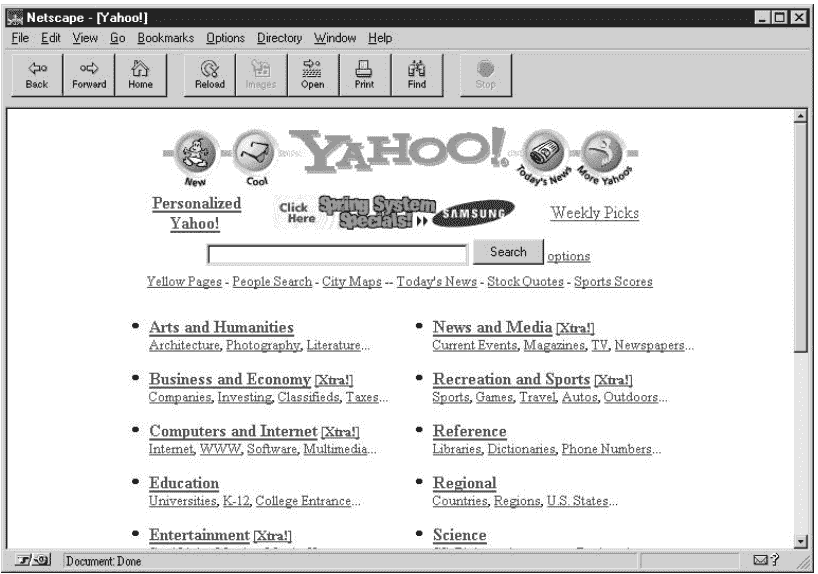

**图 1-1** 通过 Navigator 2.0 看到的 1995 年万维网的样子

ECMA 于 1997 年发布了其标准化的脚本语言 ECMAScript。在接下来的两年中，他们对标准进行了两次更新，分别称为第 2 版和第 3 版。JavaScript 1.5 符合该标准的第 3 版。

### JavaScript 的今天

ECMAScript 第 4 版将是四年多来的首次更新。JavaScript 2.0 符合 ECMAScript 标准的第 4 版，两者之间的差异极小。

> JavaScript 2.0 的规范可以在 Mozilla.org 网站上找到：http://www.mozilla.org/js/language/js20/index.html。

如今，Netscape 的 JavaScript 和 Microsoft 的 JScript 都符合 ECMAScript 标准，尽管每种语言仍然支持不属于标准的功能。

| JavaScript 版本 | 发布日期 | 浏览器 | 标准合规性 |
|---|---|---|---|
| 1.0 | 1995 年 12 月 | Navigator 2, Internet Explorer 3 | 无 |
| 1.1 | 1996 年 4 月 | Navigator 3 | 部分，符合 ECMAScript 1 |
| 1.2 | 1996 年 12 月 | Navigator 4, Internet Explorer 4 | 部分，符合 ECMAScript 1 |
| 1.3 | 1998 年 8 月 | Navigator 4.06, Internet Explorer 5 | ECMAScript 1, ISO-16262 |
| 1.4 | 1998 年 10 月 | 1.4 版本未出现在任何网络浏览器中 | ECMAScript 1, ISO-16262 |
| 1.5 | 2000 年 4 月 | Navigator 6 和 7, Internet Explorer 5.5 和 6, Mozilla 1 | ECMAScript 3 |
| 2.0 | 2003 年 |  | ECMAScript 4 |

表 1-1 按时间顺序列出了 JavaScript 的各个版本，包括支持每个版本的常用浏览器简短列表。

> 在撰写本文时，JavaScript 2.0 的确切发布日期以及将支持它的浏览器版本号尚未确定。

### 选择开发环境

JavaScript 最大的盘点之一是其对多种不同平台的支持，通常用于不同的目的。如今最常见的 JavaScript 应用程序类型是在网络浏览器内部运行的客户端脚本。JavaScript 长期以来也作为一种网络服务器端语言得到支持，在 IIS 和 LiveWire 等流行环境中。最近，开发者在不同环境中使用 JavaScript 有了更多选择。

在本节中，我们将了解 JavaScript 在这些环境中的使用情况。目前它们都还不支持 JavaScript 2.0，但了解潜在的支持环境仍然很重要，因为支持可能会在近期引入。

在本节中，我们还将讨论 JavaScript 开发者的开发环境。在 JavaScript 存在的最初几年里，开发者只能使用文本编辑器来创建 JavaScript 程序，没有集成开发环境（IDE）的辅助——许多人至今仍然如此。但随着 HTML 开发工具的发展，许多工具添加了对世界上最流行的脚本语言的开发支持。如今，所有大型工具都具备这种支持，我们将在本节后面看到。

#### 开发支持 JavaScript 的网页

设计为在浏览器内部运行的应用程序是迄今为止 JavaScript 最流行的用途。JavaScript 通过 DOM 与网络浏览器环境实现了非常紧密的集成。Netscape 在 JavaScript 1.0 中引入了最初的 DOM。

##### 客户端-服务器类比

在网络开发术语中，网络浏览器及其运行的计算机通常被称为*客户端*。同样，网络服务器软件及其运行的计算机被称为*服务器*。因此，术语*客户端 JavaScript*指的是嵌入在网页中并在客户端机器上运行的 JavaScript 程序。在服务器机器上运行的 JavaScript 被称为*服务器端 JavaScript*。

此后不久，DOM 的控制权被移交给了万维网联盟（W3C），一个标准化组织。DOM 标准已经从处理 JavaScript 如何与浏览器交互，发展到处理创建、读取和修改 HTML 和 XML 文档的标准方式。

> 注意：*W3C（http://www.w3.org）专门负责网络标准，包括 HTML、XML、DOM 和层叠样式表（CSS）。与 DOM 标准相关的各种文档可以在 http://www.w3.org/DOM/DOMTR 查看。需要注意的是，最初的 DOM（有时称为 Level 0）并非官方标准。*

设计为在浏览器内部运行的 JavaScript 应用程序受到诸多安全限制。这些应用程序通常无法访问用户的硬盘或用户计算机上安装的任何应用程序。对用户而言，这意味着 JavaScript 应用程序通常不会造成安全风险，因为它不可能包含病毒或其他恶意代码。

Netscape Navigator 4.0（也称为 Communicator）引入了签名脚本的概念。使用安全数字密钥签名的脚本可以在浏览器环境中请求额外的权限，例如发送电子邮件或从硬盘读取文件的能力。浏览器通常会提示用户，询问他们是否允许该脚本拥有此类权限。

Mozilla 网络浏览器及其近亲 Navigator 6 改变了签名脚本的处理方式，不再与 Navigator 4 兼容。Microsoft Internet Explorer（IE）则以完全不同的方式处理安全性（例如使用受信任区域）。由于这些异构的安全解决方案，目前仍然没有标准的方式来编写具有扩展权限的 JavaScript 应用程序。实际上，签名 JavaScript 很少被使用。

客户端应用程序开发仍然是 JavaScript 的核心优势之一。开发者如果选择 JavaScript 以外的任何语言进行客户端开发，实际上都会面临与许多操作系统和网络浏览器不兼容的风险！

#### 创建基于服务器的网络应用程序

尽管 JavaScript 在网络客户端编程方面占据主导地位，但服务器端编程的情况并非如此。JavaScript 是最早得到支持的服务器端语言之一（1996 年 Netscape 发布其网络服务器平台时），但它未能利用这一先发优势。Perl 很快成为流行的服务器端脚本工具，还有几种其他语言也 emerged 为流行的替代方案（包括 ASP 环境中的 VBScript、PHP 和 JSP）。

服务器端语言如此多样化的原因之一是，服务器环境可以在一定程度上由网络开发者控制。在大多数情况下，开发者对人们使用的浏览器几乎没有控制权。因此，虽然客户端编程语言的选择实际上是一个"最小公分母"的决策（哪种语言支持的浏览器最多），但服务器上的选择则是开发者想用什么都行。

对某些开发者来说，能够选择编程语言就像孩子在糖果店里一样。有许多服务器端编程语言可供选择，除了个人偏好之外，没有真正的理由选择这一种而非另一种。

#### 在 DOS 或 Windows 环境中使用 JavaScript

长期以来，Microsoft 一直将 Windows 脚本宿主（WSH）工具作为免费插件提供给 Windows，可从其网站下载。WSH 包括 Microsoft 两种脚本语言的最新版本——VBScript 和 JScript。

借助 WSH，你可以用 JScript 创建一个小程序，从 DOS 提示符运行。事实上，许多病毒编写者利用了这一能力（尤其是用 VBScript），因此这些宏和小脚本如今使用得较少了。事实上，许多邮件系统完全禁止它们作为电子邮件附件发送，因为有潜在的病毒风险。

*Windows Script，包括 JScript 和 VBScript 引擎，可以从 http://msdn.microsoft.com/scripting 免费下载。*

开发者仍然可以使用 JScript 创建小程序以在 Windows 环境中使用，尽管这样做的情况很少见。这些 JScript 程序依赖于 Windows 脚本环境的存在和启用，而在如今这个安全意识至上的时代，这是你不能太过依赖的东西。

#### JavaScript 开发工具

JavaScript 的优势之一是不需要昂贵的开发工具。使用 Windows 内置的 Notepad 等简单文本编辑器，你就可以相对轻松地创建相当复杂的 JavaScript 代码。由于它是在网络浏览器环境中解释执行的语言，你甚至不需要购买编译器。

*编译器是一种将编程代码转换为机器就绪形式的程序，通常称为二进制文件或可执行文件。*

但是，仅仅因为 JavaScript 可以在简单的文本编辑器中编辑，并不意味着它*应该*这样。开发环境提供了许多关键资源，往往能让开发变得更加快速和便捷，例如：

- 可以轻松添加到网页中的预定义脚本
- 集成帮助，方便快速查找函数语法
- 自动上传文件到 Web 服务器的 FTP 功能
- 集成调试工具

在本节中，我们将介绍四大顶级 HTML 编辑器。这些编辑器都对 JavaScript 开发提供了重要支持，包括现成可用的脚本、JavaScript 编辑工具以及内嵌帮助。

##### Microsoft FrontPage

Microsoft 开发了一款流行的 HTML 编辑器，名为 FrontPage。FrontPage 为 Web 开发人员提供了多种 JavaScript 工具，以协助创建交互式网站。FrontPage 曾经是 HTML 和 JavaScript 开发工具中无可争议的领导者。如今，该领域的其他一些竞争对手已经抢占了 Microsoft 相当大的市场份额——它们是 Macromedia 和 NetObjects。

FrontPage 仍然包含许多实用功能，例如在创建任何页面之前设计网站层级结构、配置网站安全性、设置全站样式以及创建自定义横幅图像。图 1-2 展示了如何使用 FrontPage Explorer 通过图形化方式将页面链接在一起来组织网站。Microsoft FrontPage 还有一个名为 FrontPage Server Extensions 的服务器端组件，使其能够与 Microsoft 的 IIS Web 服务器良好集成。

FrontPage 的购买价格为 90 到 170 美元，对于非专业网站开发者来说是一款非常经济实惠的工具。

> Microsoft 为有兴趣试用该软件的用户提供了 FrontPage 2002 的 30 天免费试用版。可以通过 http://www.microsoft.com/frontpage 订购试用光盘。

##### Macromedia Dreamweaver MX

Macromedia Dreamweaver MX 在专业 Web 开发人员中是一款非常流行的 HTML 和 JavaScript 编辑器。它功能丰富，包括能够编辑大多数流行的 Web 服务器编程语言（如 ASP、JSP 和 PHP），提供多种便捷的预构建 JavaScript 组件，与数据库良好集成，并且符合 XHTML 和 XML 等新标准。简而言之，它包含了许多专业人士认为实用，但许多家庭用户可能并不需要的功能。

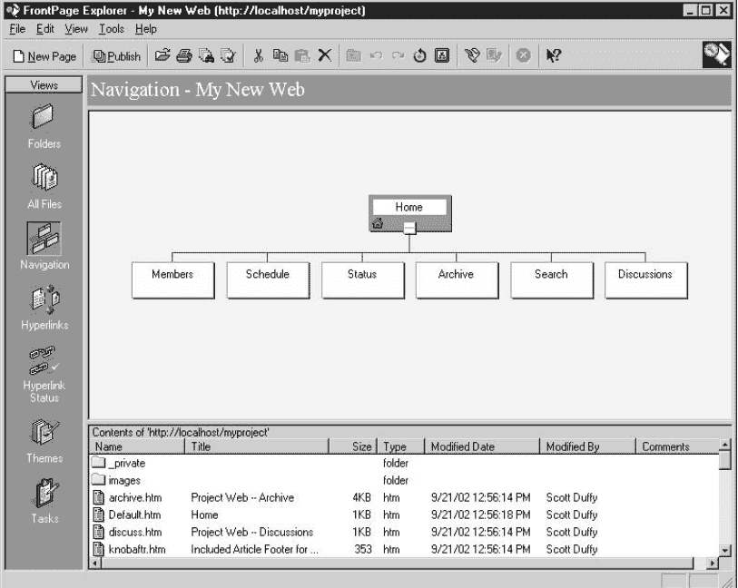

Dreamweaver MX 环境的强大功能如图 1-3 所示。
Macromedia Dreamweaver MX 的零售价在 200 到 400 美元之间，是专业开发者的理想工具。

> 你可以在 http://www.macromedia.com/software/dreamweaver 下载适用于 Windows 或 Mac 的 Macromedia Dreamweaver MX 免费试用版。

##### Macromedia HomeSite 5

Macromedia 收购了 Allaire Corporation，并接手了 Allaire 旗舰产品 HomeSite 的所有权。最新版本是 HomeSite 5，Macromedia 在每套 Dreamweaver 中都附带了一份 HomeSite 的免费副本。HomeSite 以其价格吸引家庭用户，尽管它缺少其姊妹产品的大部分高级功能。

用户只需花费 29 到 99 美元，就能获得一款广受好评的 HTML 和 JavaScript 编辑器，足以管理他们的个人网站。管理大型网站或多开发者协作的用户可能需要考虑投入更多资金来购买 Dreamweaver。

> Macromedia 在 http://www.macromedia.com/software/homesite 提供适用于 Windows 的 HomeSite 5 免费试用版。

##### Adobe GoLive

对大多数互联网冲浪者来说，Adobe 最为人熟知的是其 Acrobat 软件，该软件以流行的便携式文档格式（PDF）读写文档。然而，Adobe 在图形、数字视频和桌面出版软件领域同样是领导者，其产品包括 Photoshop、Premiere 和 PageMaker。

事实上，该公司生产的其他行业领先工具和软件套装可能使其 Web 出版工具业务相形见绌。然而，尽管 Adobe GoLive 在许多方面可能落后于竞争对手，但对于经常使用 Adobe 图形和视频编辑工具的开发者来说，GoLive 可能是一个简便的选择。

> 与其他 Web 创作工具一样，你可以下载 GoLive 6.0 的试用版。GoLive 提供 Windows 和 Mac 版本，可从 Adobe 网站 http://www.adobe.com/products/golive 下载。

##### NetObjects Fusion

FrontPage、Dreamweaver、GoLive 和 NetObjects Fusion 构成了当今使用最广泛的四大网站开发工具。遗憾的是，NetObjects 没有足够的资金或资源来与如此强劲的竞争对手抗衡。该公司已被出售，新东家 Website Pros 在现有品牌名下继续开发 Fusion 工具。

Fusion 的价格很有竞争力，在 70 到 150 美元之间。它包含许多有趣的新功能，例如与流行在线支付服务的集成、JavaScript 弹出菜单以及改进的嵌入式多媒体支持。它曾经是开发者们喜爱的工具，在新的管理下可能会再度流行。

> 可以从该公司网站 http://www.netobjects.com 下载适用于 Windows 的 NetObjects Fusion 7 免费试用版。完整版软件也可以在线购买和下载。

### 了解 JavaScript 能做什么和不能做什么

历史上，JavaScript 在以下方面与其他语言有所不同：

- 易于开发。
- 与其他语言和环境良好接口。
- 不需要特殊工具或编译器。
- 灵活性强。

这些特性使其特别适合 Web 开发。仅需一行 JavaScript 代码就能使网页变得动态，而且通常只需几行代码就能完成常见任务。DOM 使 JavaScript 能够访问浏览器、网页以及其中嵌入的所有对象（Java、多媒体等）。

尽管有了显著改进，JavaScript 2.0 并不是作为一种通用语言设计的。具体来说，它并不打算在 C、C++ 或 Java 目前占主导地位的领域与之竞争。相反，JavaScript 2.0 试图在现有语言优势的基础上进行改进，同时添加开发者在开发大型或复杂代码时经常希望使用的特性，即：

- 编写模块化和面向对象应用程序的能力
- 改进的与其他编程语言接口的能力
- 编写可编译脚本以获得更高性能的能力
- 限制函数和代码使用方式的能力

ECMA 实际上在设计 JavaScript 2.0 时就考虑了这些目标。

## 14 JavaScript 全能指南

### 将 JavaScript 用作客户端语言

核心 JavaScript 规范的一个独特之处在于，它不试图定义 JavaScript 如何与其环境交互。该规范中没有任何 JavaScript 方法或函数定义如何绘制用户界面或如何向屏幕写入文本。同样，也没有文件输入/输出例程允许该语言访问硬盘驱动器。

这个特性既可以被视为优势，也可以被视为劣势。缺乏标准 I/O 接口所带来的灵活性使 JavaScript 得以在许多不同的环境（浏览器、服务器、独立应用程序、移动设备等）中使用。这使得具有不同数据存储方式和不同输出显示方式的设备都能够运行 JavaScript 应用程序。

这种灵活性的缺点在于，同一个 JavaScript 应用程序不经过一些修改就无法在每个环境中运行。虽然大多数 Web 浏览器已经在文档对象模型上实现了标准化，但不同浏览器厂商的 DOM 之间仍然存在一些差异。例如，一个设计为在 Web 浏览器中运行的 JavaScript 应用程序，如果不考虑服务器自身的对象模型，就无法在 Web 服务器上运行。

如今，JavaScript 实际上是网页中唯一使用的脚本语言。尽管存在一些替代方案（最著名的是 VBScript），但 JavaScript 是（而且一直是）所有主要浏览器制造商都支持的唯一脚本语言。它是客户端开发唯一值得学习的脚本语言。

### 将 JavaScript 用作服务器端语言

JavaScript 作为一种 Web 服务器编程语言也获得了一定的普及。Netscape Enterprise Server 和 Microsoft IIS（20 世纪 90 年代中期流行的 Web 服务器）都支持服务器端 JavaScript 开发。Netscape 通过 LiveWire 服务器端语言提供了这种支持。Microsoft 允许 JScript 作为 ASP 开发的潜在语言之一。

遗憾的是，从版本 6 开始，Netscape Enterprise Server（现称为 iPlanet Web Server）不再在服务器端支持 JavaScript。这可能与 iPlanet 是 Sun Microsystems 的一部分有关，而 Sun Microsystems 更倾向于程序员使用 Java。

尽管 Microsoft 的 ASP 环境取得了巨大成功，但开发者在为该平台开发时更喜欢使用 VBScript。随着 Microsoft 的 ASP .NET 平台的推出，VB .NET 和 C# 已经成为开发者最常使用的两种语言。

Microsoft 在 Visual Studio .NET 开发环境中加入了 JScript .NET 支持，这对 JavaScript 社区算是一个小帮助。JScript .NET 可以访问 .NET Framework 的所有类，也是第一个（尽管非常早期）支持 ECMAScript 第 4 版提案特性的实现。


虽然 ECMA 赋予了 JavaScript 作为一门完整编程语言的能力，但 JavaScript 并不一定适用于所有环境。以下类型的任务，你可能不太适合使用 JavaScript 作为编程语言：

- 非常庞大的应用程序
- 注重性能的关键型应用程序
- 设备驱动程序和其他底层程序

毕竟，我们总不至于让那些 C++ 程序员都失业吧？

### 确定使用哪个版本的 JavaScript

JavaScript 开发者在开发过程的早期必须做出一个决定：他们希望支持该语言的哪个版本。这个决定涉及多个因素，例如：

- 当前编程任务的规模和范围
- 程序未来升级的可能性
- 程序是否需要与使用其他编程语言编写的程序轻松互操作
- 是否需要利用 JavaScript 2.0 仅提供的新特性（例如，新的内置对象）
- 你常用的开发工具支持哪个版本的 JavaScript
- 你的目标受众中绝大多数人所使用的浏览器支持哪个版本的 JavaScript

目前为止，最后一个考虑因素无疑是最重要的。如果你的大量目标受众仍在使用不支持 JavaScript 2.0 的浏览器，那么在网页中嵌入 JavaScript 2.0 代码就没有意义。当然，如果你的程序仅运行在服务器端（服务器端程序），那么唯一重要的就是服务器所支持的版本。

此外，牢记计算机编程的一条基本原则也很重要：永远不要写超出任务绝对必要范围的代码。所以，如果你的 JavaScript 程序只是一个将摄氏度转换为华氏度的三行脚本，就没有必要用 JavaScript 2.0 语法去创建包和类（如第 5 章所述）。你可能出于其他原因想这样做，比如为了程序未来的可扩展性。但也要记住*没坏就不要修*的道理……

因此，一般原则是：如果你的目标受众可能使用各种各样的 Web 浏览器，那么在客户端使用 JavaScript 2.0 代码开发时要非常谨慎。否则，如果你确切知道最低浏览器版本是什么，或者你是在服务器环境或嵌入式环境中开发，那么请尽情使用 JavaScript 2.0 的新特性和改进功能吧！

### 使用 HTML 测试 JavaScript 程序

在深入学习 JavaScript 基础知识之前，我们需要建立一种测试代码的方法。测试 JavaScript 程序最简单的方法是直接将其放入 HTML 页面中，然后在支持 JavaScript 的浏览器中加载运行。

要使用这种 HTML 方法运行本书中的任何代码示例，你需要一个 Web 浏览器。建议使用 IE 5 或 Navigator 4 及更高版本，因为某些示例在早期版本中无法运行。

如果你想将计算机上的浏览器升级到更新的版本，可以访问微软 IE 网站 http://www.microsoft.com/windows/ie，或 Netscape 浏览器中心 http://channels.netscape.com/ns/browsers。

### 创建 JavaScript 模板

`<script>` 标签是用来标识 JavaScript 代码的 HTML 元素。建议使用记事本（或你常用的 Web 开发工具）创建此文件作为模板，并将其保存在硬盘上。这样一来，以这段 HTML 代码为基础创建由 JavaScript 驱动的网页就会容易得多。

以下是在记事本中创建模板的步骤：

1. 在 Windows 中，点击"开始"菜单按钮。
2. 在弹出的菜单中选择"运行"。
3. 输入 **notepad**，如下图所示，然后按 ENTER 键。

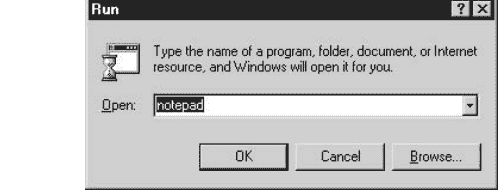

4. 在记事本中输入以下 HTML 代码：

```html
<html>
    <head>
        <title>JavaScript sample code</title>
    </head>
    <body>
        <h1>My Sample Code</h1>
        <script language="JavaScript" type="text/javascript">
        <!-- // Begin
            // NOTE:: Replace this line with JavaScript code
        // End -->
        </script>
    </body>
</html>
```

5. 选择"文件"菜单，然后点击"另存为"。

6. 导航到硬盘上的所需位置。"我的文档"文件夹是常用位置，但你也可以选择保存到任何你选择的目录。

> 我们将在本书中使用此 HTML 文件来运行 JavaScript 代码示例，所以请将其保存在方便找到的地方。

7. 给 HTML 文件起一个以 **.htm** 结尾的名字，例如 **JSTemplate.htm**。

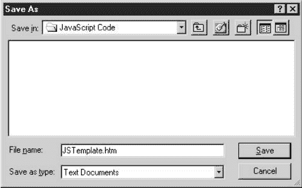

8. 关闭记事本。

9. 在 Windows 桌面上，选择"我的电脑"。这将打开 Windows 资源管理器，你可以导航到保存 HTML 文件的目录。

10. 双击该 HTML 文件。Web 浏览器（通常是 Microsoft Internet Explorer）将打开你的 HTML 文档。

11. 你应该会看到大字显示的"My Sample Code"。

12. 使用完毕后，关闭浏览器窗口。

图 1-4 展示了 HTML 模板在浏览器中的样子。这是 HTML 页面中最基本的 `<script>` 标签示例。

18 How to Do Everything with JavaScript

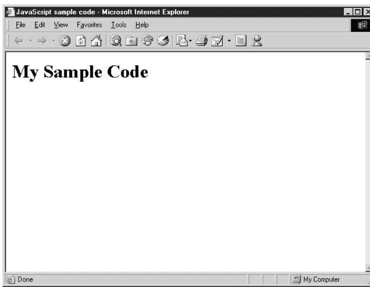

FIGURE 1-4 A simple HTML document containing a `<script>` tag that does nothing

### 理解 JavaScript 模板

请记住，HTML 文档分为两个不同的部分：头部区域和主体区域。HTML 文档始终以 `<html>` 标签开头，以 `</html>` 结束标签结尾。同样，HTML 头部区域以 `<head>` 和 `</head>` 标签界定，如下所示：

```html
<head>
    <title>JavaScript sample code</title>
</head>
```

通常，头部区域内的 HTML 标记用于描述出现在主体区域中的主要内容。最常见的是，头部区域包含：

- 文档的必需标题（`<title>`）
- 样式表定义（`<style>` 和 `<link>`）
- 元数据，例如搜索关键词（`<meta>`）
- JavaScript 函数（`<script>`）

# CHAPTER 1: Prepare to Program in JavaScript

HTML 文档的主体部分位于主体区域中，由 `<body>` 和 `</body>` 标签界定。在这个区域中，你会发现文本、图像、表单和嵌入式内容。JavaScript 也可以用于这个区域，以向屏幕输出动态文本。我们模板中的主体区域如下所示：

```html
<body>
    <h1>My Sample Code</h1>
    <script language="JavaScript" type="text/javascript">
    <!-- // Begin
        // NOTE:: Replace this line with JavaScript code
    // End -->
    </script>
</body>
```

我们的主体区域以必需的 `<body>` 和 `</body>` 标签开始和结束。`<h1>` 和 `</h1>` 标签表示标题文本。`<h1>` 是预定义的字体最大的标题。`<h2>`、`<h3>`、`<h4>`、`<h5>` 和 `<h6>` 标签表示字体大小递减的标题。

我在主体区域中包含了一个 `<script>` 元素以备后用。我为这个标签添加了两个属性：**language** 和 **type**。**language** 属性是用于指示标签内使用哪种脚本语言的原始方式。尽管最新版本的 HTML（及其后继者 XHTML）已逐步淘汰此属性的使用，但它仍然相当常见。**type** 属性是现在推荐的用于指示所使用的脚本语言deprecated属性，但仍有广泛的应用。

模板中的 `<script>` 部分包含三行代码：

```html
<!-- // Begin
    // NOTE:: Replace this line with JavaScript code
// End -->
```

这三行都是*注释*。在 Web 编程中，注释是浏览器在解释代码时忽略的一行或多行文本。程序员经常使用注释使程序更易于人类阅读，但在上述代码中，第一行和最后一行用于阻止不支持 JavaScript 的浏览器显示代码。随着时间的推移，这种技术变得越来越不重要。但它仍然相当普遍，而且确实没有理由不加上它。`<!--` 和 `-->` 是 HTML 注释的开始和结束标记。JavaScript 注释用双斜杠（`//`）标记，这就是为什么浏览器也会忽略第二行。

### 与用户通信

许多 JavaScript 程序默默地完成它们的任务。网页可能使用 JavaScript 来验证表单上的所有字段是否都已按照适当的方式完成。当它们完成后，

JavaScript 程序允许将表单提交到 Web 服务器进行进一步处理。但如果表单的某个字段填写不当，理想情况下，JavaScript 应该通知用户，以便他们更正问题并重新提交表单。

通常有两种方式可以将此类错误引起用户的注意。第一种是利用 JavaScript 警告框，它要求用户点击“确定”按钮才能继续处理。这被认为是一种稍微侵入性的技术，可以确保用户阅读并确认错误消息。

另一种方式是直接在网页中编写信息性消息。这显然是一种侵入性较小的技术，但你必须确保用户不会意外忽略该消息。

在本节中，我们将研究如何使用这两种方法与用户沟通，因为这对于我们学习下一章的内容至关重要。

#### 显示警告消息

JavaScript 提供了三种类型的弹出对话框供你的应用程序使用：

- 警告框
- 确认框
- 用户输入提示框

基本的警告消息使用内置的 `alert` 函数显示：

```
alert ("This message will be displayed to the browser");
```

你可以在括号内放置任何文本字符串或表达式。在 Internet Explorer 中显示的对话框如下所示。

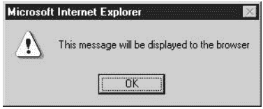

Netscape Navigator 显示类似的消息框。

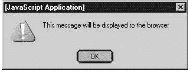

确认框的工作方式与警告框非常相似，不同之处在于它向用户显示“确定”和“取消”两个按钮。确认框会告知程序用户选择了哪个按钮，从而允许两种不同的结果。

```
result = confirm ("Would you like a piece of chocolate cake?");
```

如果用户选择“确定”按钮，`result` 变量将包含 `true`，否则为 `false`。以下是确认框在 Internet Explorer 中的外观。

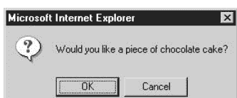

最后，用户输入提示框允许程序请求用户输入对消息的文本回复。这在 Internet 网页上很少使用，因为 HTML 网页表单是获取用户输入更常用的方式。

```
firstname = prompt ("What is your first name?",
    "Enter name here");
```

此 JavaScript 代码的结果如图所示。

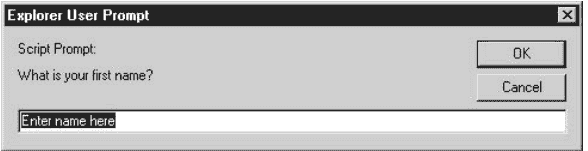

#### 将文本写入浏览器窗口

本书中的许多示例将使用 `document.write()` 函数将文本打印到 Web 浏览器窗口中。这不仅仅用于错误报告。实际上，经常可以看到网站使用 `document.write()` 来支持动态功能，如导航、用户帮助、横幅广告轮换等。

```
document.write ("<b>This text goes right into the browser</b>")
```

注意你可以在 `document.write()` 函数中包含 HTML 标签，浏览器将处理这些标签。通过在 HTML 模板中添加一些 `document.write()` 语句，我们可以创建一个内容更丰富的网页。

```
<html>
    <head>
        <title>JavaScript sample code</title>
    </head>
    <body>
        <h1>Hamlet, by Bill Shakespeare</h1>
        <script language="JavaScript" type="text/javascript">
        <!-- // Begin
            // NOTE:: Replace this line with JavaScript code
            document.write
                ("To be, or not to be: that is the question:<br>");
            document.write
                ("Whether 'tis nobler in the mind to suffer<br>");
            document.write
                ("The slings and arrows of outrageous fortune,<br>");
            document.write
                ("Or to take arms against a sea of troubles,<br>");
            document.write
                ("And by opposing end them.<br>");
        // End -->
        </script>
    </body>
</html>
```

如图 1-5 所示，我们的 `document.write()` 语句就像直接在 HTML 中输入一样被输出到屏幕上。当我们进入下一章，学习变量、函数和语句时，这种技术会变得更有用。

现在我们已经介绍了枯燥的内容——语言的历史及其用途——我们准备好进入一些真正的编程了。下一章将首先介绍 JavaScript 的基础知识，为你开始独立编码做好准备。

#### 了解更多关于本章讨论的主题

有几本好书可以让你更深入地了解 HTML 和 Java，例如：

- *《HTML 全能手册》*，作者 James Pence (McGraw-Hill/Osborne, 2001)
- *《HTML：初学者指南》*，第 2 版，作者 Wendy Willard (Osborne, 2002)
- *《Java 2：初学者指南》*，作者 Herbert Schildt (Osborne, 2000)
- *《用 Java 学习编程》*，作者 John Smiley (Osborne, 2001)

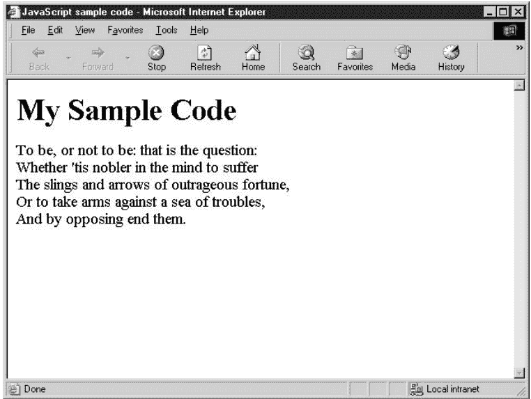

此外，你可能想查看以下一些网站：

- DevGuru: http://www.devguru.com
- W3 Schools: http://www.w3schools.com/html
- Sun Microsystems 的 Java 主页：http://java.sun.com
- JavaRanch: http://www.javaranch.com

# 第 2 章
学习 JavaScript 基础知识


### 如何...

- 定义变量
- 定义常量
- 理解程序流程
- 条件执行代码
- 使用循环重复语句
- 为你的代码添加注释
- 设置默认对象
- 处理错误
- 理解表达式的基础知识
- 将代码组织成函数
- 利用 JavaScript 2.0 的改进创建更强大的函数

JavaScript 极度依赖其他技术提供帮助。事实上，如果你试图编写一个不依赖官方 JavaScript 规范之外任何内容的程序，你的程序将无法完成太多工作。JavaScript 依赖外部组件与外界进行通信，例如写入屏幕、从网页表单检索数据以及接收浏览器事件的通知。

在本章中，我们将研究 JavaScript 的基础知识。我们将通过学习语句、变量和函数——任何程序的三个基本构建块——来了解编写程序的基础知识。

#### 理解基本术语

和其他领域的从业者一样，计算机程序员多年来也发展出了自己的行话。像 *变量*、*函数* 和 *字符串* 这样的普通英语词汇被赋予了与计算机相关的含义。表 2-1 列出了你将在本章和本书中遇到的一些编程术语。

##### 在变量中存储数据

归根结底，在现代计算中，只有三个地方可以存储信息：硬盘、数据库或内存。当然，还有其他数据存储介质，如软盘、CD、Zip 盘和备份磁带，可以保存信息，但这些介质所需的设备比硬盘驱动器慢得多——有时记录相同的数据需要花费 100 倍（或更多）的时间。因此，应用程序程序员通常不能——也不应该——在存储信息时依赖这些介质中的任何一种。

在硬盘上，信息以文件的形式存储。在数据库中，信息以记录的形式存储。但在内存中，程序数据使用变量进行存储和检索。*变量* 是内存中的命名部分。

**表 2-1** 常见的 JavaScript 编程术语

| 编程术语... | 指的是... |
|---|---|
| *语句* | 一行编程代码；在 JavaScript 中，语句通常用分号 (;) 分隔。 |
| *变量* | 用于存储值的命名位置，该值可以在程序执行期间更改。 |
| *常量* | 用于存储值的命名位置，该值在程序执行期间不能更改。 |
| *函数* | 一组执行某些操作的命名语句，可以选择性地返回单个值。 |
| *关键字* | 在 JavaScript 中具有预定义含义的词，不能用于任何其他目的。 |
| *运算符* | 通常是一个符号（如 +、-、* 或 /），接受一个或多个值（称为 *操作数*）并返回结果。 |
| *表达式* | 关键字、运算符、变量和/或函数的组合，可以从中计算出结果。 |
| *字符串* | 0 个或多个字母、数字或其他文本字符的序列；字符串通常用引号括起来，例如 "this is a string"。 |
| *布尔值* | 计算结果为 true 或 false 的值或表达式。 |
| *字面量* | 直接写在代码中的布尔值、数字或字符串；例如，表达式 ((3+2)/total) 包含两个数字字面量，3 和 2。 |
| *值* | 数字、布尔值、字符串或对象。 |

###### 定义变量

在 JavaScript 1.5 中，变量使用 **var** 关键字声明：

```
var counter;
```

这段代码告诉 JavaScript，我们打算在名为 "counter" 的变量中存储信息。以这种方式定义的变量可以包含任何类型的信息：数字、字符串、布尔值（true 和 false）或对象。为了方便起见，你可以为变量分配一个初始值，如下所示：

```
var counter = 5;
```

我们已经将名为 `counter` 的变量的初始值设置为 5。


[content]
JavaScript 2.0 在 JavaScript 编程中引入了数据类型的概念。在此版本发布之前，程序员无法预定义变量可以包含的数据类型——所有 JavaScript 变量都可以被赋予任何类型的数据。

但是，随着这个重要新版本的发布，我们现在可以将变量限制为特定的数据类型：例如，整数或字符串。尝试将不属于变量预定义数据类型的数据赋给它会导致错误。数据类型定义如下：

```
var counter : Integer;
```

这里定义的 `counter` 变量属于 `Integer` 数据类型。因此，该变量永远不能包含除整数以外的任何内容。（我们将在第 3 章中详细研究 JavaScript 2.0 中所有可用的数据类型。）

###### 定义常量

变量之所以被称为变量，原因在于：程序可以随时自由更改存储在变量内部的值。常量与变量类似，但一旦赋值，常量就不能被更改。

> 目前只有 Netscape 6 及更高版本或 Mozilla 网络浏览器支持常量。Microsoft IE 尚未包含对常量的支持，因此常量的使用应限于你绝对确定它们安全的场景。

常量从 JavaScript 1.5 版本开始引入，因此该语言的早期版本不支持它们。但其他编程语言（最著名的是 C）非常有效地使用了常量，它们在你的 JavaScript 编程中也很有用。

常量使用 **const** 关键字定义：

```
const ERR_INVALID_USERID;
```

在前面的代码中，我创建了一个名为 `ERR_INVALID_USERID` 的常量。注意我将名称大写了。这不是强制性的，但它是 C 语言中常用的编程约定，因此你有时也会看到 JavaScript 中的常量是大写的。

一旦设定了值，常量就不能被更改。

```
const ERR_INVALID_USERID = 300;
ERR_INVALID_USERID = 50;     // 这会导致错误！
```

常量通常用于为错误代码和其他“有含义”的数字赋予人类可读的名称。对于人类来说，阅读以下代码比直接使用错误数字要容易得多：

```
switch (returncode) {
    case ERR_INVALID_USERID:
        // 执行某些操作
    case ERR_INVALID_PASSWORD:
        // 执行其他操作
    case ERR_INVALID_DOMAIN_NAME:
        // 等等
}
```

与变量一样，在 JavaScript 2.0 中，常量也可以被分配数据类型。

###### JavaScript 可以存储非常大的数字

JavaScript 2.0 中的整数是双精度浮点数，这使得它们可以包含大约 +/-100 *undecillion*（1 后面跟 38 个零）范围内的值。

#### 理解程序流程

本章的大部分内容致力于学习 JavaScript 编程语言的基础知识、语句和函数。但在我们深入探讨之前，花一点时间研究一下 *程序流程* 是很重要的。

当我谈论程序流程时，我指的是 JavaScript 执行程序代码的顺序。假设你有一个五行的程序，JavaScript 总是先执行第一行代码。理论上，接下来执行第二行，然后是第三行，依此类推，直到最后一行（在我们的例子中是第 5 行）。图 2-1 展示了这一点。

实际上，这是对发生过程的极度简化。下一行要执行的内容取决于当前行要求 JavaScript 执行的任务。如果当前行调用了一个函数，在 JavaScript 继续执行下一行之前，将先执行函数内的所有代码。如果当前行包含一个循环，同一组代码行将被重复执行。如果当前行声明了一个要定义的新函数，JavaScript 会将该函数读入内存，但不会执行其中的任何内容（直到程序在其他地方调用它）。

**图 2-2** JavaScript 会停止执行程序，转而执行函数的内容。

但在大多数情况下，将程序描述为从头到尾按顺序执行仍然是合理的。图 2-2 显示了程序流程如何根据代码本身而跳转。我们可以看到，在程序继续执行之前，函数内的所有代码都已被执行。

##### 使用语句控制程序流程

我们在第 1 章定义的 HTML 模板（参见“创建 JavaScript 模板”）除了显示一些标题文本外，并没有真正做任何有用的事情。要让我们的 JavaScript 程序执行任何操作，唯一的方法就是添加一些语句。*语句* 是任何程序代码中的基本动作项。实际上，每条语句都在告诉计算机去做某事。语句可以分为五类：

-   条件语句
-   循环
-   对象操作
-   注释
-   表达式

典型的 JavaScript 程序使用属于这些类别中每一类的语句。通常，程序内部的语句也会被组织成函数和类，以使程序更易于管理，开发效率更高。我们将在本章后面更详细地探讨函数，并在第 5 章探讨类。

###### 条件执行代码

计算机程序几乎总是包含 *条件语句*。JavaScript 中有两种条件语句：**if** 和 **switch**。**if** 语句允许程序根据某个预定义的因素，在两个选项之间选择一个。在现实生活中，你可能会决定，如果不下雨，你就想去棒球比赛。当然，如果下雨，你就会决定呆在家里。你可以在 JavaScript 程序中使用以下代码做出同样的决定：

```
function stay_or_go (raining) {
    if (raining == false) {
        return "Go to baseball game!";
    } else {
        return "Got to stay home today.";
    }
}
```

所以你看，条件语句让程序在两个或多个选项之间做出选择，其方式与我们在现实生活中做出这些选择非常相似。

###### if 语句

根据你的使用方式，**if** 语句可以非常简单，也可以非常复杂。**if** 语句可以按以下方式使用。

| 语法 | 用法 |
|--------|-----|
| if (*expression*) {*statements*;} | 如果 *expression* 计算结果为 true，则执行 *statements*。 |
| if (*expression*) {*statements1*;} else {*statements2*;} | 如果 *expression* 计算结果为 true，则执行 *statements1*。否则，执行 *statements2*。 |
| if (*expression1*) {*statements1*;} else if (*expression2*) {*statements2*;} else {*statements3*;} | 如果 *expression1* 计算结果为 true，则执行 *statements1*。否则，如果 *expression2* 计算结果为 true，则执行 *statements2*。否则，执行 *statements3*。 |

**if** 语句通过计算一个表达式来确定执行哪一组语句（如果有的话）。由于 **if** 语句期望一个布尔表达式（计算结果为 true 或 false 的表达式），它会尝试将其他数据类型的表达式转换为 true 或 false。

> JavaScript 在从其他数据类型转换为布尔值时会做出某些假设。字符串 "true" 和 "false" 分别计算为布尔值 true 和 false。整数 1 和 0 也分别转换为布尔值 true 和 false。

在计算机编程术语中，表达式是一段代码，当它被计算时会返回一个值。在 JavaScript 中，以下内容可以用作表达式。

| 表达式 | 示例 |
|------------|---------|
| 变量 | if ( x ) {*statements*;} |
| 返回值的函数 | if ( myfunc(x) ) {*statements*;} |
| 字面量 | if ( true ) {*statements*;} |
| 使用运算符组合的变量、函数和字面量 | if ( a > 5 ) {*statements*;} |


 # 如何用 JavaScript 做任何事情

即使是同一个 **if** 语句，也可以用至少四种不同的方式编写，且全部有效：

- `if (expression) statement;`
- `if (expression)`
  
  `statement;`
- `if (expression) {statements;}`
- `if (expression) {`
  
  `statements;`
  
  `}`

上述各种形式的 **if** 语句在技术上是等价的。前两种只能包含一条语句。注意，第三种和第四种形式使用了花括号 { 和 } 来包裹语句。用花括号包裹的语句通常被视为一个整体，称为*语句块*。

**if** 语句可以包含一个可选的 **else** 子句，用于在两种备选方案之间做出选择。这种形式的语句有时被称为 *if-else 语句*：

```
if (expression) {statements1;}
else {statements2;}
```

**else** 子句允许你指定一条或一组语句，当表达式的求值结果不为 true 时执行。任何 **if** 语句中只允许有一个 **else** 子句。同样，该语句可以带花括号，也可以不带。

最后，**if** 语句可以在三个或更多备选方案之间进行选择。通过引入 **else-if** 子句，**if** 语句可以包含多个表达式，这些表达式将依次求值，直到其中一个求值结果为 true 或者遇到 **else** 子句。可以包含多个 **else-if** 子句，但请记住 **else-if** 子句必须始终位于任何 **else** 子句之前。

```
if (expression) {
    statements;
} else if (expression) {
    statements;
} else {
    statements;
}
```

> **提示** 如果你发现自己在单个 **if** 语句中使用了超过两三个 **else-if** 子句，你可能需要考虑改用 **switch** 语句，如下一节所述。

###### switch 语句

**switch** 语句在 JavaScript 中的作用与 **if** 语句非常相似。**switch** 语句对一个表达式求值，并将该值与一个或多个 **case** 子句进行比较。如果你需要将一个变量与两个或三个以上的值进行比较，**switch** 语句是最高效的方式。

以下代码展示了 **switch** 语句在 JavaScript 编程中的典型用法。在这个示例中，我们的程序将尝试根据官方三字母 ISO（国际标准化组织）国家代码来确定一个国家的名称。

```
// ISO official country codes
switch (countrycode) {
    case "ALB":
        countrystring="Albania";
        break;
    case "DZA":
        countrystring="Algeria";
        break;
    case "ASM":
        countrystring="American Samoa";
        break;
    case "AND":
        countrystring="Andorra";
        break;
    case "AGO":
        countrystring="Angola";
        break;

    // etc.

    case "", "?":
    default:
        countrystring="Unknown code";
}
```

同样的代码也可以使用 **if-else-if** 语句来编写，但那样做既低效又难以阅读。让我们来看看前面这段代码，了解它是如何工作的。

该语句的第一行使用了 **switch** 关键字，后面跟着需要求值的表达式。

```
switch (countrycode) {
```

在这个示例中，countrycode 是一个恰好包含字符串的变量。**switch** 语句中的接下来三行包含了第一个 **case** 子句。

```
case "ALB":
    countrystring="Albania";
    break;
```

**case** 子句表示我们想要将 countrycode（**switch** 语句所作用的表达式）的值与字符串 "ALB" 进行比较。如果完全匹配，JavaScript 将执行接下来的两行：

- 将 countrystring 变量设置为 "Albania"。
- 在 **break** 语句处退出 **switch** 语句。

当然，如果 countrycode 的值不匹配字符串 "ALB"，则 countrystring 变量不会被设置，**switch** 语句继续执行。下一个 **case** 子句将表达式与新的值进行比较：

```
case "DZA":
    countrystring="Algeria";
    break;
```

**switch** 语句按顺序对每个 case 语句进行求值，直到找到匹配的项。然后执行紧跟在 **case** 子句后面的代码，直到遇到第一个 **break** 语句。

> *一旦找到匹配项，JavaScript 将执行之后的所有代码，即使是在其他 **case** 子句内部，直到遇到 **break** 语句为止。*

在 JavaScript 中，**switch** 语句有一种特殊类型的 **case** 子句，称为 **default** 子句。**default** 子句仅在 JavaScript 无法将表达式与之前的任何子句匹配时执行。**default** 子句必须始终是 **switch** 语句中的最后一个子句。

```
case "", "?":
default:
    countrystring="Unknown code";
```

我们的示例中包含了一个空的 **case** 子句，尝试匹配空字符串 ("") 或问号 (?)。你可以在单个 **case** 子句中提供多个值与表达式进行匹配，只要它们用逗号分隔即可。如果表达式匹配我们的空 case，则 **default** 子句中的代码将被执行，因为没有 **break** 语句来阻止它。

JavaScript 中有四种循环语句：**while**、**do-while**、**for** 和 **for-in**。JavaScript 还提供了 **break** 和 **continue** 语句，使程序员能够对循环的执行方式有更多控制。在本节中，我们将逐一研究与循环相关的每条语句，并看看它们如何应用在我们的程序中。

##### while 循环

**while** 循环在执行一组语句之前对表达式进行求值。它将反复执行这些语句，直到表达式的求值结果不再为 true。

```
while (expression) {
    statements;
}
```

JavaScript 以以下方式处理 **while** 循环。首先对表达式求值，其值被解释为布尔值（true 或 false）。如果表达式的求值结果为 true，则花括号内的语句被执行一次。然后再次对表达式求值，如果仍然为 true，则语句将被第二次执行。如此无限循环，直到表达式的求值结果为 false。

一个常见的编程陷阱是*无限循环*。无限循环是一个永不停止的循环语句，这最容易在 **while** 语句中出现。大多数浏览器会在脚本执行时间过长时通知用户，从而使用户可以强制结束无限循环。

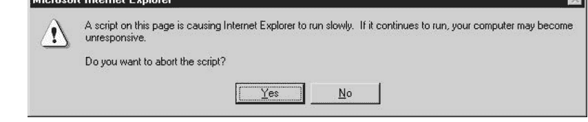

为了避免无限循环，常见的编程实践是确保表达式始终有机会求值为 false。以下 **while** 语句保证不会导致无限循环：

```
var counter = 1;

while (counter < 101) {
    document.write ("This is line number " + counter + "<br>\n");
    counter++;
}
```

这段代码将恰好执行 100 次。我们知道这一点是因为 counter 变量从 1 开始，在每次 **while** 循环迭代后递增一。（我们将在本章后面学习运算符，如 ++ 运算符。在这段代码中，++ 运算符将 counter 变量递增 1。）当它达到 101 时，循环将退出，因为 "counter < 101" 的求值结果将为 false。

如果我们把这段 **while** 循环粘贴到第 1 章的 HTML 模板中，会得到以下 HTML 代码：

```
<html>
    <head>
        <title>JavaScript sample code</title>
    </head>
    <body>
        <h1>My Sample Code</h1>
        <script language="JavaScript" type="text/javascript">
        <!-- // Begin
        var counter = 1;

        while (counter < 101) {
            document.write ("This is line number " + counter + "<br>\n");
            counter++;
        }
        // End -->
        </script>
    </body>
</html>
```

在 Web 浏览器中加载这段 HTML 代码，你会得到类似图 2-3 的效果。浏览器窗口已滚动到底部，以准确展示打印了多少行。

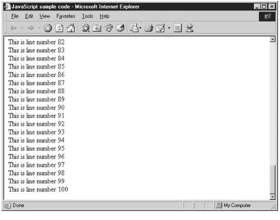

**图 2-3** **while** 循环恰好打印了 100 行。


##### do-while 循环

**do-while** 循环的行为与 **while** 循环完全相同，但有一个例外。在 **do-while** 循环中，表达式是在每次迭代结束后才求值的。这意味着该循环**保证至少执行一次**。而 **while** 循环在每次迭代前对其表达式求值，这意味着循环体可能根本不会被执行。

```
do {
    statements;
} while (expression);
```

尽管表达式是在循环的每次迭代后求值，但以下循环仍然恰好执行 100 次。因此，选择 **do-while** 而不是 **while** 循环，唯一受影响的只有循环的首次执行。

```
var counter = 1;

do {
    document.write ("This is line number " + counter + "<br>\n");
    counter++;
} while (counter < 101);
```

你可以将 **while** 和 **do-while** 循环视为同一语句的两个版本。所有你能用 **do-while** 做到的事情，你也可以用 **while** 做到。因此，**do-while** 循环在“现实世界”中不如 **while** 循环常见。

##### for 循环

刚才在讨论 **while** 循环时，我们使用了以下示例：

```
var counter = 1;

while (counter < 101) {
    document.write ("This is line number " + counter + "<br>\n");
    counter++;
}
```

那个 **while** 循环可以使用 **for** 循环重写。实际上，这种类型的循环（使用计数器变量）更适合用 **for** 循环。

```
for (var counter = 1; counter < 101; counter++) {
    document.write ("This is line number " + counter + "<br>\n");
}
```

如你所见，**for** 循环版本是循环预定次数的更高效方式。**for** 循环语法包含四个部分：

```
for (initializer; expression; incrementor) {
    statements;
}
```

*初始化部分*传统上用于定义变量并赋予其初始值。在我们的示例中，我们定义了一个名为 counter 的新变量并将其设置为值 1。初始化部分中的 JavaScript 代码只在循环开始前执行一次。

*表达式*在每次循环前求值。语句是否执行取决于此表达式的布尔结果。

*递增部分*包含在每次循环运行后执行的代码。传统上，这是计数器递增或递减的地方。在我们的示例中，我们使用此部分将 counter 变量加 1。

这些部分中的每一个都是可选的。如果所使用的变量已经定义并设置了值，则初始化部分可以为空。但不要忘记它们之间的分号是强制性的。实际上，以下代码是一个使用 **for** 语句的无限循环：

```
for (;;) {
    // do nothing
};
```

*尽管这是无限循环的另一个例子（这在编程中通常是个坏主意），但如果你在循环内有一段代码在满足特定条件时执行 **break** 语句，这个循环就是一个有效的技术。*

##### for-in 循环

出于上下文考虑，我只想在这里简单谈谈 **for-in** 循环。你将在第 5 章讨论类和对象时看到对其的正式讨论。

现在，你可以把对象想象成一个装满工具的工具箱。**for-in** 循环将从该工具箱中逐一提取每个工具，并允许你单独检查和操作它。

在下面的代码中，我们创建一个简单的对象（兼容 JavaScript 1.5），并使用 **for-in** 循环检索其每个属性。

```
<html>
    <head>
        <title>JavaScript Test</title>
    </head>
<body>
    <h1>for-in Loop</h1>
    <script language="JavaScript" type="text/javascript">
        <!-- // Begin
        // We define the tool chest object
        var toolchest = {tool1:"Wrench",
            tool2:"Hammer",
            tool3:"Cordless drill",
            tool4:"Needlenose pliers"};

        // for-in iterates over its properties
        for (var tool in toolchest) {
            document.write(toolchest[tool] + "<BR>");
        }

        // End -->
    </script>
</body>
</html>
```

此程序创建了一个名为 toolchest 的对象。该对象是使用对象字面量创建的，正如第 5 章所讨论的。

```
// We define the tool chest object
var toolchest = {tool1:"Wrench",
                    tool2:"Hammer",
                    tool3:"Cordless drill",
                    tool4:"Needlenose pliers"};
```

我们感兴趣的代码是 **for-in** 循环：

```
// for-in iterates over its properties
for (var tool in toolchest) {
    document.write(toolchest[tool] + "<BR>");
}
```

这段代码遍历 toolchest 对象的内容——tool1、tool2、tool3 和 tool4。执行时，程序会输出每个属性的值，如下所示。

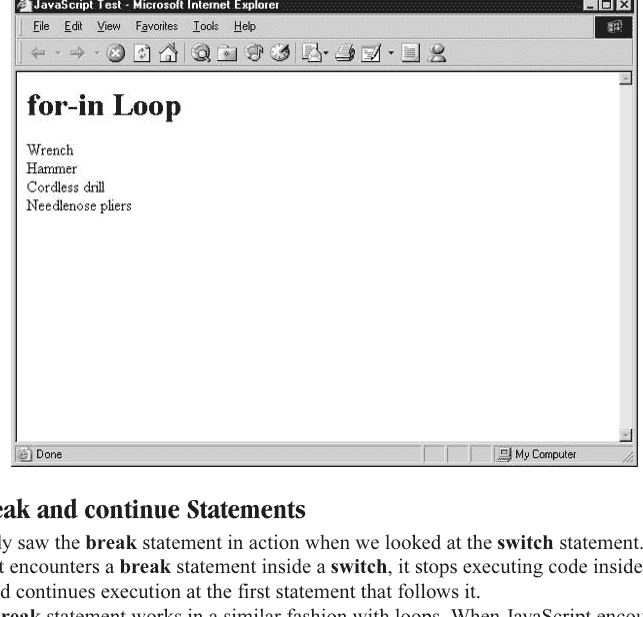

##### break 和 continue 语句

我们在研究 **switch** 语句时已经见过 **break** 语句的运作。当 JavaScript 在 **switch** 语句内遇到 **break** 语句时，它会停止执行 **switch** 内部的代码，并继续执行紧随其后的第一条语句。

**break** 语句在循环中的工作方式类似。当 JavaScript 遇到 **break** 语句时，它会停止执行循环内的代码，并从循环外的第一条语句重新开始执行。**break** 语句在循环或 **switch** 语句外部是无效的。

**continue** 语句也会导致 JavaScript 停止执行循环内的代码，但执行会继续到循环的下一次迭代。实际上，**break** 语句表示“退出循环”，而 **continue** 语句表示“跳过本次迭代并继续下一次”。**continue** 语句在循环外部同样无效。

```
var Fahrenheit, Celsius;
for (Celsius = -70; Celsius <= 70; Celsius += 10) {
    Fahrenheit = (Celsius * 9/5) + 32;
    document.write ("Celsius = " + Celsius);
    document.write (", Fahrenheit = " + Fahrenheit + "<br>");

    if (Fahrenheit > 100) {
        // It's getting hot in here
        break;
    }
}
```

此代码中的 **for** 循环设计为从 -70 开始遍历所有摄氏度，每次迭代增加 10 度，直到摄氏度达到 +70 度（-70, -60, -50, -40 等）。但如果你查看循环内的代码，它会在温度超过 100° 华氏度时让 JavaScript 跳出循环。由于 100° 华氏度大约等于 37° 摄氏度，循环实际上会在摄氏度达到 40 时退出，而不是 70。**break** 语句导致循环过早退出。

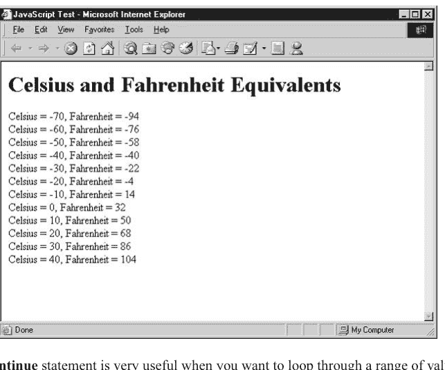

当你想遍历一系列值，忽略其中一些不符合特定条件的值时，**continue** 语句非常有用。但当你发现一些符合条件的值时，循环内又有很多代码要执行。与其用一个巨大的 **if** 语句包裹几十行代码，不如使用 **continue** 语句来跳到下一次迭代。

```
// Which numbers are evenly divisible by 23?
var iNumber;
for (iNumber = 1; iNumber <= 1000; iNumber++) {
    if (iNumber % 23 > 0) {
        // Not divisible by 23
        continue;
    }
    document.write("<b>" + iNumber + "</b>");
    document.write(" is evenly divisible by 23!<br>");
}
```

在此代码中，循环设计为执行 1,000 次，遍历从 1 到 1,000 的数字。循环内的 if 语句使用模运算符 (%) 检查数字是否能被 23 整除。如果不能被 23 整除，则执行 continue 语句——跳过当前循环的剩余部分，开始循环的下一次迭代。

每 23 个数字（其规律竟如此巧合），我们就会遇到一个能被 23 整除的数字。此时 continue 语句不被执行，循环的剩余部分有机会运行。在我们的示例中，我们使用 document.write() 函数输出了最终找到匹配数字的好消息。

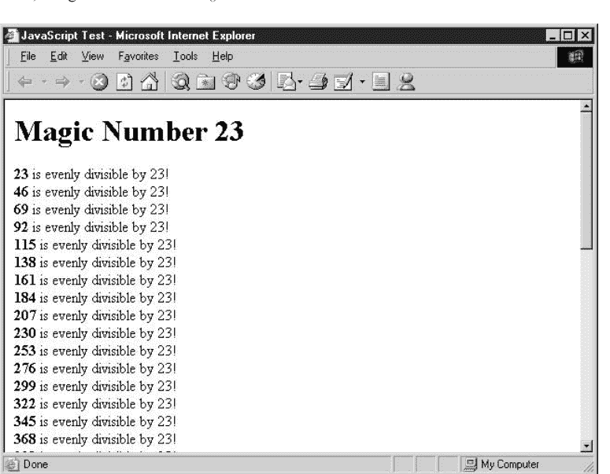

##### 使用标签

标签是一个命名的代码行。由于它们的唯一目的与循环（特别是嵌套循环）相关，标签在现实生活中很少使用，但了解它们的存在很重要。

> 注意：在编程术语中，当你将一个循环完全放置在另一个循环内部时——例如，你有一个 for 循环在一个 while 循环内部，你就创建了一个嵌套循环。在这种情况下，for 循环被称为内层循环，而 while 循环被称为外层循环。循环可以嵌套多层。


###### 标签

标签的创建相当简单。

1.  使用文本编辑器（如记事本）打开你的 JavaScript 程序。
2.  选择你想要命名的代码行。标签必须出现在有效语句的开头。
3.  输入一个标签名称，仅使用字母或数字。名称中不允许有空格或其他特殊字符。
4.  以冒号（:）结束标签。

例如，在以下代码中，我们有一组嵌套的循环，它们也带有标签。

```javascript
var x, y, z;
outer: for (x = 1; x < 20; x++) {
    middle: for (y = 1; y <= x; y++) {
        inner: for (z = 1; z <= y; z++) {
            document.write
                ("x = " + x + "; y = " + y + "z = " + z + "<br>");
        }
    }
}
```

在这段代码中，我们有三个循环。作用于变量 z 的最内层循环被标记为 "inner"。包围着名为 "inner" 循环的中间循环被称为 "middle"。而最外层循环被命名为 "outer"，它包围着中间和内部两个循环。

给循环添加标签的唯一原因在于 **break** 和 **continue** 语句被设计为可与标签配合使用。通过在最内层循环内 document.write 函数调用之后添加以下代码，你可以使所有三个循环提前退出：

```javascript
break outer;
```

当你需要在内部循环（不一定是最内层）中设置一个条件，该条件会使你希望停止处理所有循环——或者甚至只是停止处理两个最内层的循环而继续执行外层循环时，这非常方便。例如，将以下代码放在前面代码的最内层循环中，将导致变量 y 和 z 永远不会超过值 1，而 x 则被允许递增到 20：

```javascript
break middle;
```

#### 为你的代码添加注释

我们在第 1 章中简要讨论过注释。注释实际上并不是一种语句类型，尽管为了方便起见，它们经常与其他 JavaScript 语句归为一类。有两种方式可以在 JavaScript 程序中添加注释。

你可以通过以两个斜杠开头来添加单行注释。

```javascript
// 斜杠之后的所有内容都将被 JavaScript 忽略
```

也可以在同一行有效代码中包含注释。

```javascript
var Students = 3;       // 班上将有三名学生
```

另一种注释代码的方式是使用块注释。块注释以斜杠和星号（/*）开头。

```javascript
/* 这是块注释的开始
```

块注释会持续到遇到星号和斜杠（*/），即使注释跨越多行。

```javascript
/* 这是块注释的开始
  这部分也会被忽略
  document.write ("这部分也不会被执行！");
  因为它仍然被视为注释 */
```

当你为自己开发小型 JavaScript 程序时，你可能不愿意花太多时间来注释代码。这没问题——这被称为程序员的特权。然而，你可能会发现注释在以下方面很有用：

-   你可以在程序中包含版权声明。
-   你可以用“通俗英语”描述程序或函数的功能。
-   在开发阶段或调试时，有时你希望代码不执行，但又不想删除它。
-   注释也可以作为你将来想添加的代码的占位符。

如果你是专业开发程序的，你可能需要包含大量注释，以便他人更容易理解你的代码。

#### 设置默认对象

本书中我们尚未花时间探讨可编程对象的概念，我将把大部分讨论推迟到第 3 章和第 5 章，届时我们将讨论内置对象和用户定义类。但为了理解 **with** 语句及其为一组语句指定默认对象的能力，让我们花点时间看看什么是对象、方法和属性。

要理解编程中的对象概念，将其类比于现实世界会很有帮助。现实生活中几乎任何事物都可以被视为一个可编程对象——一辆汽车、一台电视、一个咖啡杯，甚至是一个人。在编程中，对象可以同时拥有 *方法* 和 *属性*。对象的方法是它能够执行的操作，而对象的属性则描述对象本身。

例如，假设我们在 JavaScript 中创建了一个 Person 对象。在现实生活中，一个人通常具有某些独特的特征，如名字、发色、眼睛颜色和身高。这些特征将被定义为 Person 对象的属性。在现实生活中，一个人可以执行诸如吃饭、睡觉、说话和倾听等动作。这些动作将转化为 Person 对象的方法。

##### with 语句

**with** 语句允许你访问对象的方法和属性，而无需在每一行都指定对象的名称。如果没有 **with** 语句，你将始终需要在每个你希望访问的属性或方法旁边指定你正在处理的对象名称：

```javascript
person.fullname = "Bob Jones";
person.haircolor = "Black";
person.eat();
person.sleep();
```

但当语句被 **with** 语句包围时，对象名称是隐含的，如：

```javascript
with (person) {
    fullname = "Bob Jones";
    haircolor = "Black";
    eat();
    sleep();
}
```

当 JavaScript 首次在 **with** 语句内遇到对 fullname 的引用时，它将首先检查是否存在名为 fullname 的变量。如果不存在，它将检查 person 对象是否具有名为 fullname 的属性。如你所见，当你需要在多行中重复访问同一对象时，将你的代码包裹在 **with** 语句中可能是有意义的。

**with** 语句对程序员来说可能是一个方便的语句——任何节省打字时间的东西都是方便的。但一些开发者认为使用 **with** 语句也会使你的程序更难阅读一点。由于大多数文本编辑器中存在复制粘贴技术，你可能没有太多理由需要在程序中使用此语句。

```javascript
with (document) {
    write("墙上有99瓶啤酒<br>");
    write("99瓶啤酒<br>");
    write("如果有一瓶碰巧掉下来<br>");
    write("墙上还有98瓶啤酒<br><br>");

    write("墙上有98瓶啤酒<br>");
    write("98瓶啤酒<br>");
    write("如果有一瓶碰巧掉下来<br>");
    write("墙上还有97瓶啤酒<br><br>");
}
```

在前面的代码中，我们首先声明希望将 document 作为默认对象。注意，我们随后可以开始使用 write() 方法，而完全无需引用 document。

> 使用 **with** 语句设置的默认对象仅适用于花括号内的代码。在花括号之外，则需要再次显式使用该对象。

#### 处理错误

也许大多数开发者经常面临的最困难的编程挑战是智能地处理错误。在 JavaScript 编程中，*错误* 是浏览器在尝试运行程序时遇到的问题。错误可能是由浏览器看到并认为有问题的东西引起的，称为 *系统错误*。或者它可能是由你的程序看到并认为有问题的东西引起的，称为 *应用程序错误*。

一个 JavaScript 程序如果添加合理数量的错误处理代码，其大小很容易翻倍。错误处理代码通常是程序员必须编写的额外代码，用于检查错误的存在并对其采取某种措施。在 JavaScript 中，如果程序不包含错误处理代码，默认行为通常是浏览器向用户显示问题。

错误处理的问题在于，编写良好的错误处理代码通常需要与编写程序其余部分一样多（或更多）的工作。因此，出于各种原因，程序员经常跳过这一步。

在任何语言中都很容易编写一个没有任何错误处理代码的程序。你可以告诉计算机去数据库，读取一些值，询问用户一些输入，将用户的输入添加到现有数据中，并将其放回数据库。这在 Visual Basic 等编程语言中大约用 30 行代码就能完成。但这假设永远不会出错。仔细想想，很多事情都可能出错：

-   数据库不可用。
-   数据库可用，但你无法登录。
-   你可以登录数据库，但数据不可用。
-   你从数据库检索到的数据包含无效值。
-   用户输入了无效值。
-   将用户数据添加到数据库数据中会导致错误。
-   你无法将数据保存回数据库。

因此，当你为程序添加代码来处理所有这些错误时，你突然看到的是一个 120 行的程序，而不是 30 行的程序。所以你看，当然避免担心这类事情更容易。

但是，当你专业地编写程序时，你 *必须* 担心错误的处理方式。当用户输入错误的值时，程序应该崩溃吗？还是你应该简单地

继续执行，将错误数据写入数据库，导致程序下次运行时出错？或者最佳解决方案是通知用户他们的错误并要求他们重试？这就是为什么这类错误需要被捕获并妥善处理的原因。

##### try-catch 语句

Web 浏览器被设计为根据浏览器类型和版本的不同，以及在一定程度上根据用户的浏览器设置，以不同的方式处理错误。在某些情况下，如果你在网页中包含一些有问题的 JavaScript 代码，浏览器可能根本不会运行它，没有任何错误消息或其他指示表明出了问题。在其他情况下，浏览器会弹出一个消息框，显示它遇到的错误详情，并询问用户下一步该怎么做。JavaScript 错误消息通常看起来像这样。

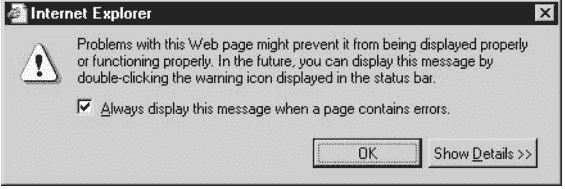

对于 JavaScript 开发人员来说，这两种默认的错误处理方式都不理想。完全忽略错误会阻止程序执行。而向用户显示一条丑陋的错误消息可能会让程序员感到尴尬——更不用说让用户感到沮丧了。

> Netscape 和 Microsoft 使用此语句的方式与官方 ECMA 规范定义之间存在一些细微差异。在本节中，我使用的是大多数 Web 浏览器支持的语句形式。

**try-catch** 语句用于让程序自己处理错误，而不是让浏览器来处理。它通常用于包装一条或多条可能失败的语句。该语句的语法如下：

```
try {
    statements;
}
catch (variable) {
    // error handling code
    statements;
}
```

> **try-catch** 语句仅在 JavaScript 1.4 中添加，因此只有较新的浏览器（如 IE 5.5 和 Netscape 6）支持它。

例如，你可以使用 **try-catch** 语句包围一个函数调用，如果失败则向用户报告更友好的错误消息。

```
try {
    open_database();
}
catch (err) {
    // error handling code
    alert("An error occurred connecting to the database." +
        " Please try again in a few minutes.");
}
```

这样，用户就不会收到看起来丑陋的 JavaScript 错误消息（或者根据浏览器设置可能什么都没有），而是会收到一条更友好的消息，要求他们几分钟后重试：

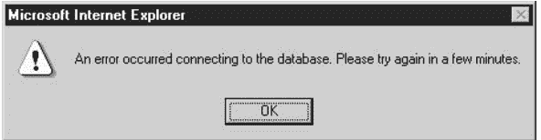

发生的官方系统错误消息仍然作为 catch 子句的参数传递给该语句。在我们的示例中，`err` 变量包含所发生错误的描述。因此，如果你需要在 catch 子句中确定发生了什么，你可以这样做。你甚至可以向用户显示原始的错误消息文本。

**try-catch** 语句不仅用于捕获系统错误；你也可以使用此构造来捕获你自己程序产生的错误。

当你的程序试图做一些可能导致错误的事情时，使用 **try-catch** 语句是一个好主意，例如，如果你的程序试图连接到一个嵌入式 Java 小程序。小程序可能会遇到问题而无法加载，或者浏览器的安全设置不允许某些 Java 小程序运行。如果你用 **try-catch** 语句包围此类代码，你就可以检测到这个问题并将用户重定向到该应用程序的非 Java 版本。

你的应用程序还可以通过编程方式检测到很多错误，包括：

- 表单中的无效用户输入
- 不支持的浏览器制造商或版本
- 缺失或无效的浏览器 Cookie

##### throw 语句

**throw** 语句允许 JavaScript 程序以与系统错误完全相同的方式声明错误。这意味着这些错误可以使用 **try-catch** 语句来捕获。

这也意味着用户声明的未被捕获的错误将以 JavaScript 弹出对话框的形式显示给用户。

> 注意：与 *try-catch* 语句一样，**throw** 语句也仅在 JavaScript 1.4 中添加，因此只有较新的浏览器（如 IE 5.5 和 Netscape 6）支持它。

以下是一个程序自行抛出错误的示例。

```
try {
    var errors = 0;
    // Do something
    errors++;
    if (errors > 0) {
        throw "Could not find the file.";
    }
}
catch (errorstring) {
    alert("The following error occurred:\n\n" +
        errorstring);
}
```

#### 理解表达式的基础知识

我们在本章中研究的许多编程语句都使用表达式来做出某种决策。*表达式*是任何返回值的东西。表 2-2 列出了常见的表达式类型及其使用示例。

| 表达式 | 示例 |
|---|---|
| 数字字面量 | 47 |
| 字符串字面量 | "Hello" |
| 布尔字面量 | true |
| 对象字面量 | {make : "Toyota"} |
| 程序定义的变量 | x |
| 程序定义的函数 | get_toast() |
| Null | null |
| 赋值表达式 | x = 5 |
| 数学运算 | x + y |
| 布尔运算 | x == y |
| 条件运算符 | x == 5 ? "yes" : "no" |
| 组合 | x = "You have " + messagecounter + " new messages" |

**表 2-2** 常见的表达式类型

##### 使用运算符创建复杂表达式

JavaScript 提供了许多运算符来在代码中执行数学运算和其他功能。一些运算符会修改它们操作的变量，但大多数不会。所有运算符都返回一个值，因此可以用来创建复杂表达式。

JavaScript 中有 12 种类型的运算符，每种类型包含若干个单独的运算符。大多数运算符由符号表示（如 +），而一些运算符由单词表示（如 **new**）。大多数运算符需要两个操作数，而一些运算符只需要一个（特别是一元运算符）。

表 2-3 列出了 JavaScript 1.5 中可用的运算符。

| 运算符类型 | 运算符 |
|---|---|
| 成员运算符 | 点 (.)<br>方括号 ([]) |
| 一元运算符 | new<br>delete<br>typeof<br>instanceof<br>void<br>++<br>--<br>取反 (-)<br>逻辑非 (!)<br>按位取反 (~) |
| 乘法运算符 | 乘 (*)<br>除 (/)<br>取模 (%) |
| 加法运算符 | 加 (+)<br>减 (-) |
| 按位移位运算符 | 左移 (<<)、无符号右移 (>>>)、有符号右移 (>>) |

### 第 2 章：学习 JavaScript 基础知识

| 运算符类型 | 运算符 |
|---|---|
| 关系运算符 | 小于 (<)<br>大于 (>)<br>小于等于 (<=)<br>大于等于 (>=)<br>in |
| 相等运算符 | 等于 (==)<br>不等于 (!=)<br>严格等于 (===)<br>严格不等于 (!==) |
| 按位逻辑运算符 | 按位与 (&)<br>按位或 (\|)<br>按位异或 (^) |
| 逻辑运算符 | 逻辑与 (&&)<br>逻辑或 (\|\|)<br>逻辑异或 (^^) |
| 条件运算符 | 条件 (? :) |
| 赋值运算符 | 等号赋值 (=)<br>快捷赋值 (*=, /=, +=, -=, %=, <<=, >>=, >>>=, &&=, \|\|=, ^=, &=, \|=, 和 ^=) |
| 特殊运算符 | 逗号 (,)<br>function<br>this |

**表 2-3** JavaScript 中可用的运算符*（续）*

**JavaScript 2.0 中的新增内容**

JavaScript 2.0 为该语言添加了两个新运算符，它们都被归类为关系运算符：

- is
- as

到目前为止，我们已经在本章中看到过其中一些运算符的实际使用，例如等于 (==)、大于 (>)、递增 (++)、in 和等号赋值 (=)。这些运算符大多源于数学。还有一些额外的运算符用于处理逻辑布尔值（如逻辑与和逻辑或），以及用于处理二进制数学中 0 和 1 的二元运算符。

#### 将代码组织为函数

偶尔可能会出现你可以坐下来编写一个完全没有函数的完整 JavaScript 程序的情况，但信不信由你，这种类型的 JavaScript 程序很少见。大多数 JavaScript 程序至少包含一个函数。


函数允许你在真正需要调用该代码之前，预先定义一组 JavaScript 语句。由于函数可以被反复调用，并能接收不同的参数，因此它们也是省时的便利工具。

##### 定义函数

函数使用 **function** 关键字来定义。函数必须被赋予一个名称，并且可以選擇性地接收一个或多个参数。参数包含在括号中，并用逗号分隔。

```
function name(parameter1, parameter2, ..., parameterN) {
    statements;
}
```

这是用于定义函数的 JavaScript 1.5 格式。JavaScript 2.0 通过允许参数具有数据类型、函数本身具有返回数据类型、参数可选、命名参数等功能，对这一基本格式进行了一些强大的扩展。我们将在本章后面介绍 JavaScript 2.0 的函数。

函数定义中指定的参数在函数内部被视为变量。参数名称必须是唯一的，也就是说，同一函数中的两个参数不能具有相同的名称。

根据基本的函数语法，我们可以定义一个基本函数：

```
function add_two(x, y) {
    if (x > 7) {
        x = x - 7;
    } else {
        x = x + 7;
    }
    if (y > 18) {
        y = y - 18;
    } else {
        y = y + 18;
    }
    return x + y;
}
```

上述代码创建了一个名为 add_two() 的函数。该函数接受两个参数，分别命名为 x 和 y。函数的名称及其接受的参数在代码的第一行中定义：

```
function add_two(x, y) {
```

该函数的代码定义了一种有些复杂的将两个数字相加的方法。首先，检查 x 和 y 的内容，并根据它们的值对每个变量进行加减运算。

```
if (x > 7) {
    x = x - 7;
} else {
    x = x + 7;
}
if (y > 18) {
    y = y - 18;
} else {
    y = y + 18;
}
```

然后将两个数字相加并返回结果。通过添加一个返回结果的 return 语句，该函数可以作为表达式使用，因为它返回了一个值。

```
return x + y;
```

目前，代码只是定义了一个函数。如果将其添加到我们的 HTML 模板中并尝试在 Web 浏览器中执行它，实际上不会发生任何事情。函数需要被调用才能运行。而且，如果函数定义了一个或多个参数，则还必须为这些参数提供值。要调用函数，必须执行以下操作：

- 1. 输入函数名，后跟一个左括号：
    add_two(
- 2. 如果需要，提供用逗号分隔的参数列表：
    add_two(12, 2
- 3. 后跟一个右括号和一个分号：
    add_two(12, 2);
- 4. 当然，对于我们的函数，我们需要将其返回值赋给一个变量，或在使用需要值的上下文中使用它：
    var result = add_two(12, 2);

我们可以将函数定义、我们的 HTML 模板以及一些使用各种参数调用我们函数的代码结合起来，如下所示：

```
<html>
    <head>
        <title>JavaScript sample code</title>
    </head>
    <body>
        <h1>Defining JavaScript Functions</h1>
        <script language="JavaScript" type="text/javascript">
```

##### 接受参数

在这段代码中，我们将 add_two() 函数定义插入了 HTML 模板的 <script> 部分。要执行该函数内部的代码，我们需要调用该函数。在我们的代码中，我们调用了该函数三次，使用了三组不同的参数。

当我们在浏览器中加载此代码时，我们会看到类似于图 2-4 的内容。由于我们在 document.write() 函数调用内部调用函数，因此函数的输出被写入到屏幕中。这也是函数本身可以作为参数传递给其他函数的一个好例子——必须执行 add_two 的值才能得出传递给 document.write 的值。

当然，函数可以不定义任何参数。在定义和调用此类函数时，仍然需要括号。

```
<!-- // Begin
function add_two(x, y) {
    if (x > 7) {
        x = x - 7;
    } else {
        x = x + 7;
    }
    if (y > 18) {
        y = y - 18;
    } else {
        y = y + 18;
    }
    return x + y;
}

document.write("add_two(2, 17) = " +
    add_two(2, 17) + "<BR>");
document.write("add_two(14, 9) = " +
    add_two(14, 9) + "<BR>");
document.write("add_two(100, 200) = " +
    add_two(100, 200) + "<BR>");
// End -->
</script>
    </body>
</html>
```

```
function print_header() {
```

```
print_header();
```

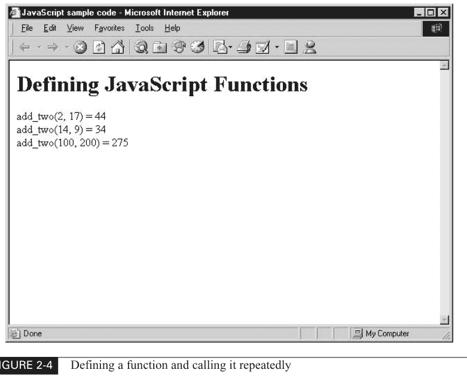

使用函数时需要考虑的另一个重要问题是变量甚至参数的处理方式。考虑以下 JavaScript 代码：

```
var counter;
counter = 5;
function add2(input) {
    input = input + 2;
    document.write("input = " + input + "<br>");
    return;
}
add2(counter);
document.write("counter = " + counter + "<br>");
```

在该程序结束时，什么值将被写入屏幕？我们首先定义了一个名为 counter 的变量，并为其赋值为 5。然后我们定义了一个名为 add2() 的函数，它似乎将传递给它的参数的值增加了 2。接着我们用 counter 变量调用此函数，并将其值打印到屏幕上。答案是，在程序结束时 counter 仍然具有值 5。

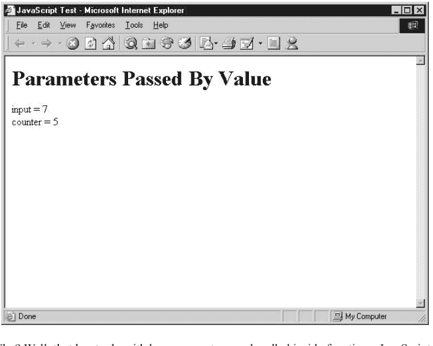

为什么？这与函数内部参数的处理方式有关。JavaScript 并不会将实际的 counter 变量传递到 add2() 函数中。它实际上会制作一份 counter 的副本，并将该副本传递给 add2()。因此，add2() 对参数所做的任何更改在函数退出后都会丢失。

> 注意：JavaScript 按值传递参数，这意味着任何参数的值在函数内部不能被永久更改。

##### 理解变量作用域

关于函数的另一个重要规则是变量作用域。在编程中，变量可以在何时何地被使用取决于你定义它的位置。如果你在函数内部声明一个变量，则只能在该函数内部使用它。当你退出函数时，该变量不再被定义，其值丢失。

```
// get_factors() 返回所有能整除参数的数字
function get_factors(inputValue) {
    var counter;
    var factorString = "";
    for (counter = 1; counter <= inputValue; counter++) {
        if ((inputValue % counter) == 0) {
            factorString = factorString + counter + " ";
        }
    }
}
get_factors(6777214);
document.write (factorString);
```

例如，在这段代码中，定义了一个名为 get_factors() 的函数。然后我们使用值 6,777,214 作为其参数来调用它。我们想使用 document.write() 打印生成的字符串，但为时已晚。factorString 变量只在函数内部有效，因为那是它的作用域。当我们尝试运行此程序时，会显示一条归因于我们程序最后一行的错误消息。变量 factorString 不能在定义它的函数外部使用。

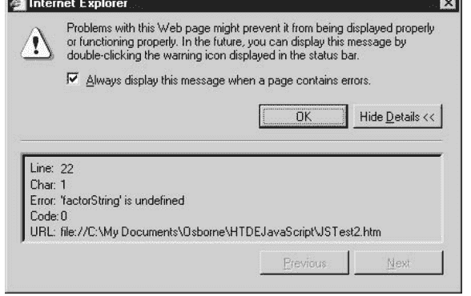

如果我们将 document.write() 语句移到函数调用内部，我们会看到更好的结果。

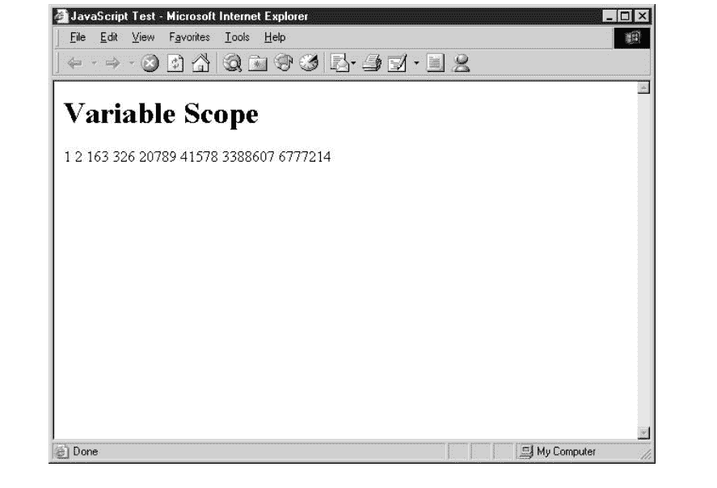

##### 返回值

在函数内部，**return** 语句有两个用途：

- 它使函数退出。
- 它可选地将一个值传递回调用它的代码行。

正如 **break** 语句导致循环退出一样，**return** 语句也会导致函数退出。由于函数可以通过向调用它的代码返回值来充当表达式，因此 **return** 语句可以将返回的值作为可选参数接受。

- `return;`
- `return "Hello";`
- `return 32;`
- `return true;`

所有这四种都是在函数内部使用 **return** 语句的有效方式。

##### 利用 JavaScript 2.0 的改进创建更强大的函数

JavaScript 2.0 为语言带来了许多改进。欧洲计算机制造商协会 (ECMA) 添加了许多增强功能和灵活性的特性：

- 类
- 包
- 命名空间
- 数据类型
- 更强大、更灵活的数据数组
- 访问控制，如公共和私有

凭借这些新增功能，JavaScript 现在可以用于以前需要更复杂的语言（如 C++ 或 Java）才能完成的任务，同时仍然保留了多年来让 JavaScript 在 Web 开发者中如此受欢迎的简洁性。

如果你以前使用过 JavaScript，你会注意到的第一个变化之一就是语言中增加了数据类型。**数据类型允许你限制变量可以包含或函数可以返回的值的范围。** 我们可以使用 JavaScript 2.0 语法修改本章前面定义的 add_two() 函数，为其所有变量、参数和函数本身使用数据类型：

```
function add_two(x : Number, y : Number) : Number {
    if (x > 7) {
        x = x - 7;
    } else {
        x = x + 7;
    }
    if (y > 18) {
        y = y - 18;
    } else {
        y = y + 18;
    }
    return x + y;
}
```

##### 用 JavaScript 做所有事情

既然我们已经为 x 和 y 参数添加了 Number 数据类型，JavaScript 就会报告错误。如果传递的不是数字，JavaScript 就会报错。这对于其他开发人员来说也更清楚地表明了每个参数期望的数据类型。

##### 使用命名可选参数

JavaScript 2.0 中参数使用方式的另一个变化是能够定义命名可选参数。**命名**关键字允许我们在定义函数的参数列表时，将某些参数标识为可选的。

例如，假设我们有一个函数，它期望一个人的名字以三个部分传递：

```
function sayHello
    (first : String,
     initial : String,
     last : String) : String {

    var fullname;
    if (initial <> "") {
        initial = initial + ". ";
    }
    fullname = first + " " + initial + last;
    return fullname;

}
```

如果我们使用前面的语法定义它，我们别无选择，只能以如下方式调用它：

```
sayHello ("Scott", "", "Duffy");
```

但是，通过在中间名首字母参数上使用 **named** 修饰符，我们可以允许在调用函数时不提供中间名首字母。

```
function sayHello
    (first : String,
     last : String,
     named initial : String = "") : String {
    var fullname : String;
    if (initial <> "") {
        initial = initial + ". ";
    }
    fullname = first + " " + initial + last;
    return fullname;
}
document.write (sayHello ("Scott", "Duffy") + "<br>");
document.write (sayHello ("Bobby", "Jones", initial:"H") + "<br>");
```

通过将中间名首字母参数定义为命名参数，我们就可以只指定名和姓来调用 sayHello() 函数。命名参数必须始终指定一个初始化器，以便在未指定该参数的值时分配一个值。如果要为命名参数提供值，必须按名称引用该参数。

##### 接受任意数量的参数

JavaScript 2.0 中的函数可以定义为接受无限数量的参数。当你的函数需要接受大量相同类型的参数，但你不想创建大量命名可选参数时，你会希望这样做。

剩余参数必须始终出现在任何已定义的未命名参数的末尾，使用三个点 (...)。命名参数（即使用 named 关键字定义的参数）仍然可以列在剩余参数之后。当然，单个函数只能有一个剩余参数。

以下代码定义了一个可以接受无限数量参数的函数。传递的前四个参数将被分配给定义的前四个参数：name、address、phoneNum 和 spouseName。传递的任何超出这四个的参数将被分配给一个名为 childName 的数组。我们可以使用 for-in 循环从该变量中获取姓名列表。（我们将在第 4 章深入研究数组。）

```
function printform (name : String,
    address : String,
    phoneNum : String,
    spouseName : String,
    ... childName : Array) {

    // An unlimited number of children can be provided
    with (document) {
        write ("Name: " + name + "<br>");
        write ("Spouse: " + spouseName + "<br>");
        write ("Address: " + address + "<br>");
        write ("Phone: " + phoneNum + "<br>");
        for (child in childName) {
            write ("Child " + childName[child] + "<br>");
        }
    }
    return;

}
```

在下一章中，我们将重点介绍 JavaScript 的一些最强大的功能——其内置对象和函数。

## 第 3 章

### 使用内置的 JavaScript 类

64 用 JavaScript 做所有事情

### 如何...

- 掌握 JavaScript 中的对象
- 理解 JavaScript 的内置类和数据类型
- 在 JavaScript 中创建 String 对象
- 执行数学函数
- 应用 JavaScript 的日期处理函数
- 将字符串转换为数字
- 在发送到 Web 服务器之前准备文本
- 决定何时使用正则表达式
- 使用 JavaScript 2.0 的强大新数据类型
- 决定何时使用 JavaScript 2.0 的特殊数据类型

JavaScript 一直包含许多内置类，程序员在开发程序时可以使用这些类。这些类——独立的数据和代码——提供了处理日期、数学函数和数组的实用功能。例如，如果你想在 JavaScript 中检索当前日期和时间，你可以创建一个 Date 类的实例，如下所示：

```
var today = new Date();
```

这段代码中的 today 变量实际上是一个对象。today 对象不仅包含一个值（实际上是今天的日期），还包含许多内置函数，用于检索和设置日期的各个部分，并将其转换为多种不同的格式（例如字符串）。Date 类及其所有功能将在本章后面的“应用 JavaScript 的日期处理函数”一节中探讨。

JavaScript 1.5 包含九个这样的类，但只有三个在实践中常用（Array、Date 和 Math）。JavaScript 2.0 将列表扩展到超过 18 个类，并且几乎所有这些类都很有用。在本章中，我们将研究其中的大多数类，并学习在我们的 JavaScript 程序中应用它们。

#### 了解 JavaScript 中的对象

我们即将迎来第一个高级编程语言 Fortran 开发 50 周年纪念，该语言于 1956 年开发。自那时以来，计算机科学家已经开发了几种编程方法论。表 3-1 列出了最常见的程序设计方法。

重要的是要记住，没有一种方法论适合所有情况。在 JavaScript 编程中，你可能会根据手头的任务使用表 3-1 中列出的四种方法中的任何一种。

| 方法论 | 描述 |
| :--- | :--- |
| 非结构化 | 对全局数据执行操作的语句序列 |
| 过程化 | 调用函数执行特定任务的主程序 |
| 模块化 | 使用模块对相关功能进行分组的主程序 |
| 面向对象 | 使用对象对相关数据和功能进行分组的主程序 |

表 3-1 常见的编程方法论

##### 编写非结构化程序

非结构化编程通常最适合用于简短、简单的脚本，因为它们不会从许多函数和对象中受益。非结构化程序只是一组 JavaScript 语句，不使用用户定义的函数或对象。

以下是在 HTML 网页上下文中的一个非结构化程序示例。请注意，程序中只有三行 JavaScript 代码。

```
<html>
    <head>
        <title>JavaScript sample code</title>
    </head>
    <body>
        <h1>Unstructured Program</h1>
        <script language="JavaScript" type="text/javascript">
        <!-- // Begin
        for (var counter = 1; counter < 101; counter++) {
            document.write ("This is line number " + counter + "<br>\n");
        }
        // End -->
        </script>
    </body>
</html>
```

##### 将代码组织成过程

过程化代码在 JavaScript 编程中也很常见。我们可以使用过程化方法轻松重写前面程序中的非结构化代码。

```
function printline(value) {
    document.write ("This is line number " + value + "<br>\n");
}

for (var counter = 1; counter < 101; counter++) {
    printline(counter);
}
```


## 66 如何用 JavaScript 完成所有事情

该程序创建了一个名为 printline() 的函数，其唯一作用是将包含传入参数值的文本输出到屏幕。在程序后面的部分，我们可以反复调用这个函数。

这种编程实践的好处是双重的：

- 同一个函数可以从程序中的多个位置调用，从而消除了非结构化方法中的代码重复。
- 将程序划分为函数使其更易于测试，通常能减少 bug。

##### 将程序拆分为模块

如果程序变得足够大（在规模和范围上），它会越来越难以管理和维护。程序员需要一种额外的技术（除了使用过程和函数之外）来将他们的程序分成更小、更易管理的部分。从过程化方法到下一个合乎逻辑的步骤，就是模块化方法。

模块化编程通常涉及将一个大型程序分成两个或更多个独立的文件。这些文件，或者说模块，不一定都是自包含的，但它们确实将相关的代码和函数组合在一起。通常，一个模块化程序由一个主程序加上一个或多个模块组成，例如：

- 主程序
- 数据库模块
- 用户界面模块
- 错误处理模块

从前面的模块化配置中可以推断，主程序完成了大部分工作，但它会在需要与数据库通信时调用数据库模块中存在的函数。同样，它会根据需要调用用户界面模块和错误处理模块来执行各自的任务。对于程序员来说，这种类型的程序在拆分为模块时比在一个大型单一模块中更容易管理。

要使用 JavaScript 创建模块化程序，你需要创建一个或多个 JavaScript 文件。当你使用 `<script>` 标签的属性将这些外部代码文件导入到 HTML 页面时，你的主程序就可以访问这些外部模块中定义的所有函数了。我们将在第 6 章中了解创建和导入 JavaScript 文件的更多内容。

##### 使用面向对象的方法

从模块化编程到下一个阶段就是面向对象编程。对象的概念一开始可能有点令人生畏，但这不应该阻止任何人至少尝试理解使用对象是如何让程序员的工作变得更加轻松的。

### 第 3 章：使用内置的 JavaScript 类

在编程中，对象只是一个拥有自己属性（称为*属性*）和相关函数（称为*方法*）的"东西"。你可以像思考现实生活中的对象一样来思考编程中的对象。让我给你举个例子。

我的汽车是一个具有特定属性和可以执行特定动作的物体。我的车的独特属性使它区别于路上的大多数其他车辆。即使我遇到另一辆与我自己的车相同品牌和型号的车辆，它们仍然是不同的车辆。以下是我的车的一些常见属性列表：

| 属性 | 值 |
|---|---|
| 年份 | 2001 |
| 品牌 | Toyota |
| 型号 | 4Runner SR5 |
| 轮胎 | 4 |
| 车门 | 4 |
| 颜色 | 雷云灰 |
| 速度表（mph） | 范围从 0 到 70 |
| 油量表（容积，加仑） | 范围从 0.0 到 16.0 |
| 等等 | |

我刚才所列的实际上是将要放入我的 Car 对象中的编程变量。事实上，前五个属性（年份、品牌、型号、轮胎和车门）是永久性的——用编程术语来说，它们是*常量*。其余的属性可以改变，因此它们是变量。记住，我们在第 2 章中考察了常量和变量。如果我要将与我的车相关的属性列表转换为 JavaScript 2.0 代码，它看起来会像这样。

```
const Year : Integer;
const Make : String;
const Model : String;
const Tires : Integer;
const Doors : Integer;
var Color : String;
var CurrentSpeed : Number;
var CurrentGas : Number;
```

除了拥有多个属性外，我的车还可以执行几个动作：

| 如果我这样做…… | 车就会这样做…… |
|---|---|
| 踩下油门踏板 | 增加速度；增加油耗 |
| 踩下刹车踏板 | 降低速度；减少油耗 |
| 向左或向右转动方向盘 | 使前轮向左或向右转 |
| 按方向盘中央 | 鸣笛 |
| 往油箱里加油 | 增加油量 |

同样，从程序员的角度来看，这些是车的功能。许多功能都与车的属性相关。例如，油门踏板和刹车踏板都会影响车的速度和汽油使用量。

如果我的车是一个可编程的对象，它将拥有以下 JavaScript 2.0 函数定义。

```
function depressGasPedal (howMuch : Integer) {}
function depressBrakePedal (howMuch : Integer) {}
function turnSteeringWheel (degrees : Integer) {}
function beepHorn () {}
function addGas (volume : Number) {}
```

仅仅定义汽车的常量、变量和函数的集合并不能使它成为一个对象。在代码集合成为对象之前，它必须首先成为一个类。

类是变量和函数的自包含分组。类的变量和函数（也称为它的*成员*）不能用于存储数据或执行操作。类仅仅是从中创建对象的蓝图。在我们的计算机程序中将只会有一个 Car 类，但可能会有多个 Car 对象。如果我们选择不创建任何对象，也可能没有 Car 对象。

> 关于类不能存储数据或执行操作的规则有一个例外。如果类成员被定义为静态（static）的，它可以在没有对象存在的情况下使用。静态类成员将在第 5 章中更详细地讨论。

我们将在第 5 章中考察用户定义的类。在 JavaScript 1 和 JavaScript 2 中创建类定义有不同的语法，理解其中的区别很重要。不用深入更多细节，这就是我们的 Car 类在 JavaScript 2.0 语法中的样子。

```
class Car {
    const Year : Integer;
    const Make : String;
    const Model: String;
    const Tires : Integer;
    const Doors : Integer;
    var Color : String;
    var CurrentSpeed : Number;
    var CurrentGas : Number;

    function depressGasPedal (howMuch : Integer) {
        // Gas pedal JavaScript code
    }
    function depressBrakePedal (howMuch : Integer) {
        // Brake pedal JavaScript code
    }
    function turnSteeringWheel (degrees : Integer) {
        // Steering wheel JavaScript code
    }
    function beepHorn () {
        // Horn JavaScript code
    }
    function addGas (volume : Number) {
        // Gas tank JavaScript code
    }
}
```

我们可以通过使用 **new** 运算符并带上 Car 类的名称来创建一个 Car 对象。我们将在本章后面的 "**new** 运算符实例化对象"一节中更详细地考察 **new** 运算符。

```
var myAuto = new Car();
myAuto.Year = 2001;
myAuto.Make = "Toyota";
// etc.
```

最后，JavaScript 2.0 中的类也会自动被定义为数据类型，因此可以定义只能包含指定对象的变量。

```
var Ferrari : Car = new Car();
```

### JavaScript 的内置类和数据类型

尽管该语言之前的版本缺乏真正的数据类型，JavaScript 一直都有类的概念。开发人员可以使用许多内置类，它们提供了有用的方法和函数来操作某些类型的数据。

表 3-2 列出了 JavaScript 1.5 中存在的类，以及每个类提供的功能的简要说明。

JavaScript 2.0 最重要的改进是该语言已经发展得比以前任何时候都更加面向对象。JavaScript 1.5 是基于对象的，但确


#### 表格：JavaScript 内置类

| 类名 | 描述 |
|---|---|
| Array | 允许在单个变量中存储数据列表 |
| Boolean | 布尔值的包装器 |
| Date | 允许处理日期和时间 |
| Function | 允许以编程方式定义函数 |
| Math | 包含方便的数学常量和函数 |
| Number | 原始数值的包装器 |
| Object | 所有对象都派生自此数据类型 |
| RegExp | 为 JavaScript 提供正则表达式支持 |
| String | 字符串值的包装器 |

JavaScript 2.0 满足了面向对象编程语言的许多关键属性。表 3-3 列出了 JavaScript 2.0 支持的类。该列表显然比表 3-2 中的要长得多。

##### 表 3-3：JavaScript 2.0 中的预定义数据类型

| 类名 | 描述 |
|---|---|
| Array | 允许在单个变量中存储 Object 类型的数据列表；等效于 Array[Object] 数据类型 |
| Array[*type*] | 允许在单个变量中存储 *type* 类型的数据列表 |
| Boolean | 支持只能存储 true 和 false 的变量 |
| char | 支持只能存储单个字符的变量 |
| ConstArray | 允许在单个常量中存储 Object 类型的数据列表；等效于 ConstArray[Object] 数据类型 |
| ConstArray[*type*] | 允许在单个常量中存储 *type* 类型的数据列表 |
| DynamicArray[*type*] | 允许在单个变量中存储可调整大小的 *type* 类型的数据列表 |
| Function | 函数的“数据类型” |
| Integer | 支持只能存储整数的变量 |
| Never | 支持不能包含任何值的变量 |
| Null | 支持只能存储“null”的变量 |
| Number | 支持只能存储数字的变量 |
| Object | 支持可以包含任何值的变量 |
| Prototype | 支持包含基于原型的对象（JavaScript 1.5 处理对象的方式）的变量 |
| StaticArray[type] | 允许在单个变量中存储可写入的 *type* 类型的数据列表 |
| String | 支持只能存储字符串的变量 |
| Type | 数据类型的“数据类型” |
| Void | 支持只能存储“undefined”的变量 |

> JavaScript 2.0 中的所有类，包括你自己创建的类，都可以用作数据类型。因此，表 3-3 中的类列表也是数据类型的部分列表。

除了表 3-3 中可用作数据类型的预定义类列表外，JavaScript 2.0 中还有许多*机器类型*。这些机器类型（在表 3-4 中列出）是可以在 JavaScript 中使用的底层数据类型，尽管并非所有 JavaScript 环境都支持它们。它们是为了与其他语言兼容而提供的——例如，当你的 JavaScript 程序需要与外部 C 语言应用程序交换数据时。

> NaN（Not a Number，非数字）是 JavaScript 中定义的一个常量，它实际上是一个数字，表示在处理该变量时发生了错误。

机器类型的使用方式与从类派生的数据类型相同，尽管它们本身不是类。例如，在以下 JavaScript 2.0 代码清单中，我们创建了一些定义为机器类型的变量。

```javascript
var counter : short = 14;
var account_balance : int = 1701330222;
var bigNumber : long = 74440000000000;
var anotherBigNumber = 312L;
```

> 表 3-4 中列出的机器类型后缀是为值分配机器类型的便捷简写符号。三个后缀——L、UL 和 F——指示 JavaScript 你希望将数字分别视为 long、unsigned long（ulong）或 float 类型。因此，表达式“0L”告诉 JavaScript 将值 0 视为 long，因为有 L 机器类型后缀。

在前面的代码中，变量 anotherBigNumber 将被视为长整数，因为我们将值 312L 赋给了它。后缀 L 强制将值 312 视为长整数。这仅在将数字字面量赋给变量时有效，对其他类型的表达式（如变量）无效。

##### 表 3-4：JavaScript 2.0 中定义的机器类型

| 类型 | 后缀 | 值范围 |
|---|---|---|
| sbyte | | -128 到 +127 之间的整数 |
| byte | | 0 到 +255 之间的整数 |
| short | | -32768 到 +32767 之间的整数 |
| ushort | | 0 到 +65535 之间的整数 |
| int | | 约 -21 亿到 +21 亿之间的整数 |
| uint | | 约 0 到 +43 亿之间的整数 |
| long | L | 约 -900 亿亿到 +900 亿亿之间的整数（9 后跟 18 个零） |
| ulong | UL | 约 0 到 +1800 亿亿之间的整数（18 后跟 18 个零） |
| float | F | 单精度浮点数，包括正负零、无穷大和 NaN |

### 使用 new 运算符实例化对象

从用户定义或系统定义的类创建对象的过程基本相同。JavaScript 提供了一个特殊的运算符 **new** 来实现此目的，这也称为*对象实例化*。

```javascript
var myAuto = new Car();
```

当使用现有类的名称（在此示例中为 *Car*）调用 **new** 运算符时，它会调用类的构造函数并返回一个对象实例。通过将该对象实例赋给变量 *myAuto*，我们保留了对该对象的引用，以便在程序中使用它。

*构造函数*是某些类中定义的特殊函数，它使对象准备就绪以供使用。初始化代码放置在构造函数中。一个类可以有多个构造函数，也可以没有。我们将在第 5 章中探讨创建你自己的类以及这些类的构造函数。

在我们的 **new** 运算符中包含的任何参数也会作为参数传递给构造函数。如果我们为 *Car* 类定义了一个构造函数，我们可能会希望允许用户传递大多数相关属性（*Make*、*Model*、*Year* 等）作为参数，以便构造函数可以使对象完全准备就绪以供使用。否则，我们将拥有一个没有预定义属性的 *Car* 对象，程序必须手动设置每个相关属性。

```javascript
var myAuto = new Car (2001, "Toyota", "4Runner SR5", "Thundercloud");
```

这种使用构造函数进行对象初始化的技术是推荐的编程技术。

### 使用 . 运算符访问对象

一旦使用 **new** 运算符创建了对象，我们就可以使用*点运算符*（.）访问其所有公共属性和方法。点运算符位于对象名称（不是类名称）和你希望访问的属性或方法名称之间。

```javascript
document.write ("Your car was created in " + myAuto.Year);
```

在此代码示例中，我们实际上使用了两次点运算符。我们用它来访问内置 document 对象的 write() 方法，以及访问我们用户定义的 myAuto 对象的 Year 属性（它是 Car 类的一个实例）。

> 你可以将属性和方法定义为私有，这限制了使用点运算符访问它们的能力。我们将在第 5 章中探讨私有属性和方法。

### 使用 [] 运算符访问对象

JavaScript 还允许使用*方括号运算符*（[]）访问对象的属性。该运算符相对于点运算符的一个优势是，你不需要知道要查找的属性的名称。例如，让我们看看下面的 **for-in** 循环。

```javascript
for (var tool in toolchest) {
    document.write(toolchest[tool] + "<BR>");
}
```

在此代码示例中，我们将一个名为 tool 的变量传递给方括号运算符，该运算符随后能够从 toolchest 对象中提取属性的值。在 JavaScript 2.0 中定义的任何类的公共属性都可以使用方括号运算符访问。这甚至适用于 JavaScript 的内置 DOM 对象（版本 1.5）。

```javascript
for (var prop in document) {
    document.write
    ("document." + prop + " = " + document[prop] + "<BR>");
}
```

此代码将整个 DOM document 对象的内容写入 Web 浏览器窗口，如图 3-1 所示。由于 DOM 在不同浏览器制造商甚至同一浏览器的不同版本之间略有不同，你自己的测试可能会揭示不同的属性和值。

### 在 JavaScript 中创建 String 对象

*字符串*仅仅是一个或多个 Unicode 字符的序列。以下都是有效的字符串：

+   - "" （一个空字符串）
- "How was work today, Sofia?"


#### 使用字符串字面量创建字符串对象

JavaScript 中的 *字符串字面量* 仅仅是被单引号或双引号包围的一个或零个字符的序列，如下所示：

```
var myString = "This is a string literal";
var myOtherString = 'So is this, using single quotation marks.';
```

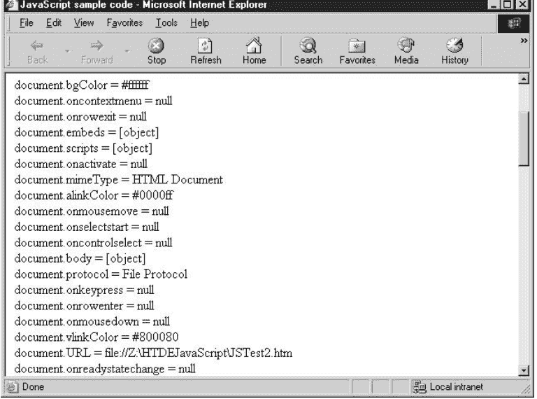

**图 3-1** Internet Explorer 6.0 中文档对象的内容

> **注意**
>
> 字符串字面量可用于任何版本的 JavaScript。

在 JavaScript 2.0 中，你甚至可以将变量指定为 String 数据类型，同时使用字符串字面量来创建对象。

```
var title : String = "How To Do Everything with Paper Clips";
```

重要的是要记住，使用字符串字面量创建字符串对象仍然允许你使用对象提供的所有属性和方法。

```
var myString = "This is a string literal";
var myOtherString = 'So is this, using single quotation marks.';
document.write ("\"" + myString + "\" = " +
    myString.length + " characters<br>");
document.write ("'" + myOtherString + "' = " +
    myOtherString.length + " characters<br>");
```

Length 是 String 对象的一个属性。访问 length 属性会得到字符串的实际长度，我们可以在下面的浏览器输出中看到这一点。

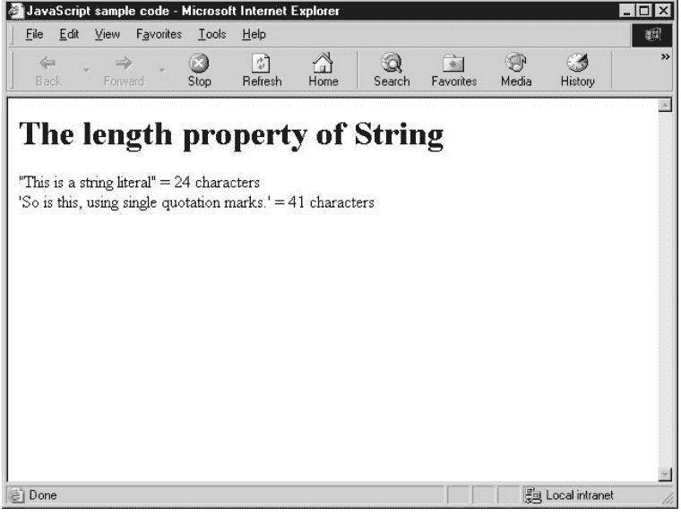

#### 使用 String 数据类型创建字符串对象

JavaScript 1.1 引入了使用 String 类构造函数创建字符串的功能。

```
var hometown = new String("Chicago");
```

通过将要创建的字符串文本传递给构造函数，我们最终得到一个 String 类型的 hometown 变量。这样创建字符串几乎没有任何优点，因此你很少会看到这种做法。

#### 使用 String 对象的内置功能

String 对象提供了许多预定义函数，允许你对其进行各种操作。表 3-5 列出了最常见的 String 方法。

> 表 3-5 中列出的四种方法涉及正则表达式模式。我们将在本章后面的“了解正则表达式基础”一节中探讨正则表达式。

| 方法 | 用途 |
| --- | --- |
| charAt(*索引*) | 返回字符串中的一个字符 |
| charCodeAt(*索引*) | 返回字符串中一个字符的 ASCII 码 |
| concat(*字符串*) | 连接两个字符串 |
| indexOf(*字符串, 索引*) | 查找一个字符串在另一个字符串中第一次出现的位置 |
| lastIndexOf(*字符串, 索引*) | 查找一个字符串在另一个字符串中最后一次出现的位置 |
| match(*正则表达式*) | 在字符串中搜索正则表达式模式，并返回所有匹配项 |
| replace(*正则表达式, 新字符串*) | 在字符串中搜索正则表达式模式，并用提供的字符串替换所有匹配项 |
| search(*正则表达式*) | 在字符串中搜索正则表达式模式，并返回第一个匹配项的索引 |
| split(*分隔符, 限制*) | 基于分隔符字符或正则表达式，将单个字符串分割成子字符串数组 |
| substring(*开始, 结束*) | 返回字符串的一部分 |
| toLowerCase() | 将字符串转换为小写字符返回 |
| toString() | 与 valueOf() 相同；返回字符串 |
| toUpperCase() | 将字符串转换为大写字符返回 |
| valueOf() | 返回字符串 |

表 3-5 中列出的每种方法都可以通过点运算符从任何 String 对象访问。

```
var msg = "ERROR: Invalid User ID or Password<br>";
document.write ( "<b>Original message:</b> " +
    msg.valueOf() );
document.write ( "<b>Upper case:</b> " +
    msg.toUpperCase() );
document.write ( "<b>Lower case:</b> " +
    msg.toLowerCase() );
document.write ( "<b>Partial string:</b> " +
    msg.substring(20, 22) + "<br>" );
document.write ( "<b>Single character:</b> " +
    msg.charAt(17) + "<br>" );
document.write ( "<b>Search from beginning:</b> " +
    msg.toLowerCase().indexOf("sword") + "<br>" );
document.write ( "<b>Search from end:</b> " +
    msg.lastIndexOf("User ID") + "<br>" );
```

从下面的截图可以看出，所有 String 属性都可以应用于 msg 对象，因为 msg 是 String 类型的。

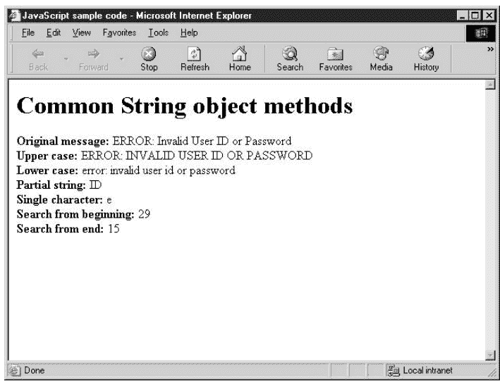

78 如何用 JavaScript 做一切

快捷提示 一个表达式中可以出现多个点运算符。以表达式“msg.toLowerCase()”为例——该表达式将返回 msg 字符串的全小写形式。你可以对该表达式再应用另一个 String 方法，例如“msg.toLowerCase().indexOf(“sword”)”。由于 indexOf() 方法返回一个整数，你可以再添加第三个点运算符来执行 Integer 对象的某个方法。

### 执行数学函数

JavaScript 提供了一个内置类，实际上无法用于创建对象——Math。Math 类的目的是提供各种数学函数和常量。由于 Math 类的所有成员都定义为静态成员，你可以直接使用 Math 对象调用它们。

尝试基于 Math 类创建对象会在 JavaScript 中导致错误。你可以使用点运算符调用 Math 的静态成员，就像调用任何其他类的实例成员一样。表 3-6 列出了 Math 类提供的所有预定义常量的名称。

Math 类还提供了许多对于执行复杂数学计算很有用的方法，如表 3-7 所示。

例如，如果我们想创建一些利用 Math 对象提供的数学常量和函数的 JavaScript 代码，可以这样做：

```
// area of a 12-inch circle, (PI * r^2)
var area = Math.PI * Math.pow (12/2, 2);

// length of the long side of a right angle triangle
// assume, 5 inch base and 7 inches high, (a^2 + b^2 = c^2)
var longside = Math.sqrt( Math.pow(5,2) + Math.pow(7,2) );
```

你知道吗？实例成员与静态成员
默认情况下，类的属性和方法将定义为实例成员。这意味着它们只能在基于该类的对象的实例内访问。这些对象使用 new 关键字创建，并且为每个新创建的对象会创建该类实例成员的新副本。如果你基于一个类创建 100 个对象，那么你就有每个方法和变量的 100 个独立副本。更改其中一个副本的值不会影响其他副本。

类的属性和方法可以选择定义为静态成员。静态成员只能直接从类访问，不属于基于该类创建的实例。本质上，静态类成员是全局的，因为无论创建了多少个对象，该成员始终只有一个版本。

| 常量 | 用途 |
| --- | --- |
| E | 欧拉常数，2.7183 |
| LOG2E | 以 2 为底 E 的对数 |
| LOG10E | 以 10 为底 E 的对数 |
| LN2 | 2 的自然对数 |
| LN10 | 10 的自然对数 |
| PI | 圆周率，3.1416 |
| SQRT2 | 2 的平方根 |
| SQRT1_2 | 二分之一 (0.5) 的平方根 |

**表 3-6** Math 类提供的静态常量列表

| 方法 | 用途 |
| --- | --- |
| abs (x) | x 的绝对值 |
| acos (x), asin (x), atan (x), atan2 (y, x), cos (x), sin (x), tan (x) | 三角函数 |
| ceil (x) | 返回大于 x 的最小整数（如果 x 是整数，则返回 x） |
| exp (x) | 返回常量 E 的 x 次幂 |
| floor (x) | 返回小于 x 的最大整数（如果 x 是整数，则返回 x） |
| log (x) | 返回 x 的自然对数 |
| max (x, y) | 返回 x 或 y 中较大的一个 |
| min (x, y) | 返回 x 或 y 中较小的一个 |
| pow (x, y) | 返回 x 的 y 次幂 |

**表 3-7** Math 对象的静态方法

### 应用 JavaScript 的日期处理函数

我们在本章开头已经简要了解了 Date 类，但值得再次更详细地查看它。Date 类允许你创建包含你指定的任何日期的 Date 对象，或者在不指定日期时使用今天的日期。使用 Date 对象，你可以：

- 检索日期的特定部分（例如月份）
- 更改或修改日期的某些部分
- 在不同字符串格式之间转换日期
- 在不同时区之间转换日期


# 80 用 JavaScript 做任何事

| 方法 | 用途 |
| --- | --- |
| random() | 返回一个介于 0 和 1 之间的伪随机数 |
| round(x) | 将 x 四舍五入为最接近的整数 |
| sqrt(x) | 返回 x 的平方根 |

**表 3-7** **Math 对象的静态方法（续）**

> JavaScript 的早期版本对 Date 对象进行了限制，使其无法处理 1970 年 1 月 1 日之前的日期。该问题在语言的 1.3 版本中得到了修正。现在日期范围可以是 1970 年 1 月 1 日前后各 1 亿天，大约相当于过去和未来各 27 万年。

JavaScript 中没有日期字面量，因此只能通过 Date 类来创建 Date 对象。Date 类的构造函数接受多种不同的输入参数。

```
var holiday = new Date("July 4, 2010");
var newyears = new Date(2010, 12, 31);
var today = new Date();
var midnight = new Date(2010, 12, 31, 23, 59, 59, 999);
```

如代码所示，Date 构造函数可以尝试解析以字符串字面量形式编写的日期。你也可以将年、月、日作为整数传入。你甚至可以精确指定日期和时间，精确到毫秒。如果未提供任何参数，则默认将对象设置为当天日期。

表 3-8 列出了 Date 对象支持的所有方法。使用这些方法，你可以提取日期的特定部分、更改日期或将其转换为不同的格式。

| 方法 | 用途 |
| --- | --- |
| getDate() | 根据本地时间返回月份中的日期（1–31） |
| getDay() | 根据本地时间返回星期几（1–7） |
| getFullYear() | 根据本地时间返回四位数年份 |
| getHours() | 根据本地时间返回时间的小时部分 |
| getMilliseconds() | 根据本地时间返回时间的毫秒部分 |
| getMinutes() | 根据本地时间返回时间的分钟部分 |
| getMonth() | 根据本地时间返回月份（0–11）；0 是一月，1 是二月，依此类推 |
| getSeconds() | 根据本地时间返回时间的秒部分 |

# 第 3 章：使用 JavaScript 内置类

**表 3-8** **Date 对象的方法**

| 方法 | 用途 |
|---|---|
| getTime() | 返回与时间对应的数值 |
| getTimezoneOffset() | 返回当前时间与世界时间（格林威治标准时间）相差的小时数 |
| getUTCDate() | 根据世界时间返回月份中的日期（1–31） |
| getUTCDay() | 根据世界时间返回星期几（1–7） |
| getUTCFullYear() | 根据世界时间返回四位数年份 |
| getUTCHours() | 根据世界时间返回时间的小时部分 |
| getUTCMilliseconds() | 根据世界时间返回时间的毫秒部分 |
| getUTCMinutes() | 根据世界时间返回时间的分钟部分 |
| getUTCMonth() | 根据世界时间返回月份（0–11）；0 是一月，1 是二月，依此类推 |
| getUTCSeconds() | 根据世界时间返回时间的秒部分 |
| getYear() | 根据本地时间返回年份 |
| parse(*string*) | 解析日期字符串并返回自 1970 年 1 月 1 日以来的秒数 |
| setDate() | 根据本地时间设置月份中的日期（1–31） |
| setFullYear() | 根据本地时间设置四位数年份 |
| setHours() | 根据本地时间设置时间的小时部分 |
| setMilliseconds() | 根据本地时间设置时间的毫秒部分 |
| setMinutes() | 根据本地时间设置时间的分钟部分 |
| setMonth() | 根据本地时间设置月份（0–11）；0 是一月，1 是二月，依此类推 |
| setSeconds() | 根据本地时间设置时间的秒部分 |
| setTime() | 设置与时间对应的数值 |
| setUTCDate() | 根据世界时间设置月份中的日期（1–31） |
| setUTCFullYear() | 根据世界时间设置四位数年份 |
| setUTCHours() | 根据世界时间设置时间的小时部分 |
| setUTCMilliseconds() | 根据世界时间设置时间的毫秒部分 |
| setUTCMinutes() | 根据世界时间设置时间的分钟部分 |
| setUTCMonth() | 根据世界时间设置月份（0–11）；0 是一月，1 是二月，依此类推 |
| setUTCSeconds() | 根据世界时间设置时间的秒部分 |
| setYear() | 根据本地时间设置年份 |
| toDateString() | 返回表示指定 Date 对象日期部分的字符串 |
| toGMTString() | 使用 Internet GMT 约定将日期转换为字符串 |

**表 3-8** **Date 对象的方法** *（续）*

| 方法 | 用途 |
| --- | --- |
| toLocaleDateString() | 使用当前区域设置的约定将日期部分转换为字符串 |
| toLocaleString() | 使用当前区域设置的约定将日期转换为字符串 |
| toLocaleTimeString() | 使用当前区域设置的约定将时间部分转换为字符串 |
| toString() | 返回表示指定 Date 对象的字符串 |
| toTimeString() | 返回表示指定 Date 对象时间部分的字符串 |
| toUTCString() | 使用世界时间约定将日期转换为字符串 |
| UTC() | 返回自 1970 年 1 月 1 日 00:00:00 世界时间以来 Date 对象中的毫秒数 |
| valueOf() | 返回 Date 对象的原始值 |

**表 3-8** **Date 对象的方法** *（续）*

Date 类的构造函数接受四种格式。对象实际表示的日期取决于传入参数的数量和类型。

| 要基于……创建日期 | 使用此格式… |
| --- | --- |
| 日期字符串 | new Date("January 1, 2008") |
| 日期组件 | new Date(2008, 0, 31) |
| 日期和时间组件 | new Date(2008, 0, 31, 12, 0, 0, 0) |
| 自 1970 年 1 月 1 日以来的毫秒数 | new Date(1034214221530) |
| 当前日期和时间 | new Date() |

> **注意**

JavaScript 使用 0 到 11 范围内的数字来表示一年中的月份：一月是第 0 个月，二月是第 1 个月，依此类推。

### 将字符串转换为数字

JavaScript 提供了两种内置方式将嵌入在字符串中的数字（如 "32"）转换为可用于数学运算的实际数字（如 32）——`parseInt()` 和 `parseFloat()`。

顾名思义，`parseInt` 函数将返回一个整数（没有小数部分的数字），而 `parseFloat` 将返回一个浮点数（包括任何小数部分）。

#### 使用 parseInt 和 parseFloat 函数

JavaScript 提供 `parseInt` 和 `parseFloat` 来帮助你将字符串中的数字转换为实际的数字数据类型。这对于 Internet 网页来说是一项重要技术，因为从 URL 和表单读取的数据通常以字符串形式传入。以下是它们的工作原理：

# 第 3 章：使用 JavaScript 内置类

1. 首先定义一个变量来存放你的字符串。

```
var myString;
```

2. 将包含有效数字的字符串赋值给该变量。这个数字不必是整数。

```
var myString;
myString = "3.14159265358979323846";  // The value of Pi...
```

3. 定义一个变量来存放你的整数。

```
var myString, myInteger;
myString = "3.14159265358979323846";  // The value of Pi...
```

4. 对字符串调用 `parseInt()` 函数，并将值赋给整数变量。

```
var myString, myInteger;
myString = "3.14159265358979323846";  // The value of Pi...
myInteger = parseInt(myString);
```

5. `parseInt()` 函数应从本例中定义的字符串返回值 3。我们可以通过调用 alert 消息框来验证这一点。

```
var myString, myInteger;
myString = "3.14159265358979323846";  // The value of Pi...
myInteger = parseInt(myString);
alert(myInteger);
```

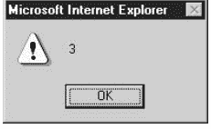

6. 如果 myString 不是有效的数字会怎样？让我们修改一下来看看结果。

```
var myString, myInteger;
myString = "Madrid, Spain"; // The value of Pi...
myInteger = parseInt(myString);
alert(myInteger);
```

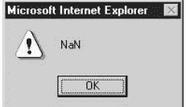


`parseFloat()` 函数的工作方式与 `parseInt()` 类似，区别在于它会包含小数点后的数字。我们可以通过更改函数名来验证这一点。

```
var myString, myInteger;
myString = "3.14159265358979323846";  // Pi的值...
myInteger = parseFloat (myString);
alert (myInteger);
```

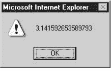

### 在发送到Web服务器之前准备文本

互联网上的每个网页都有一个唯一的URL（统一资源定位符）。即使是存储在硬盘上的网页也有自己唯一的URL。以下是URL的几个示例：

| URL | URL描述 |
| --- | --- |
| http://www.amazon.com/ | Amazon.com的默认网页 |
| news:comp.infosystems.www.servers.unix | Usenet新闻组 |
| file:///C:/temp/test.html | 存储在用户硬盘上的文件 |

#### 你知道吗？

#### 统一资源定位符（URL）的限制

URL格式只接受URL字符串中的以下字符：

-   字母—a 到 z
-   数字—0 到 9
-   标记—$ - _ + ! * ' ( ) ,
-   保留用于特殊目的的特殊字符—; / ? : @ = &

URL中不能出现任何其他字符。特殊字符只能在其指定的用途中使用。超出这些规则的字符必须被正确转义，如“使用escape和unescape函数”中所述。

想象一个具有冗长且独特创意名称的文件，例如`We're #1 & proud of it; no ifs ands or buts!.htm`。Windows确实允许这样的文件名。但是，当通过浏览器访问此文件时，我们会遇到问题。空格、#、&、!和;字符在URL命名方案中是不允许的。为了访问该文件，必须首先按照下一节所述进行转义。

#### 使用escape和unescape函数

转义文件是在将URL发送到服务器处理之前，将所有无效字符转换为特殊编码符号的过程。要转义文件名，我们必须使用JavaScript内置的`escape`函数。

1.  从一个包含一些无效字符的字符串开始。

```
var filename;
filename =
    "We're #1 & proud of it; no ifs ands or buts!.htm";
```

2.  定义一个变量来包含转义后的字符序列。

```
var filename, newFilename;
filename =
    "We're #1 & proud of it; no ifs ands or buts!.htm";
```

3.  将对字符串执行`escape`函数的结果赋值给新变量。

```
var filename, newFilename;
filename =
    "We're #1 & proud of it; no ifs ands or buts!.htm";
newFilename = escape(filename);
```

4.  要检查`escape()`函数的结果，我们应该使用警告框将其显示给用户。

```
var filename, newFilename;
filename =
    "We're #1 & proud of it; no ifs ands or buts!.htm";
newFilename = escape(filename);
alert (newFilename);
```


86 如何用JavaScript做一切

### 决定何时使用正则表达式

正则表达式是一种强大的搜索和替换技术，在其他环境（如Unix和Perl）中广泛使用，但在JavaScript中很少使用。也许，如果更多的程序员知道JavaScript中存在正则表达式，它们的使用就会流行起来。

> **注意** JavaScript仅在1.4版本中开始支持正则表达式，这意味着它们仅在Netscape 4或Internet Explorer 4及更高版本的Web浏览器中有效。

*正则表达式*是使用特殊正则表达式语言编写的字符序列，可用于匹配其他字符串中的模式。为了让你了解正则表达式模式匹配能力的强大之处，我编写了一个小的JavaScript程序（主要使用String对象的`substring()`方法）来检查字符串是否匹配标准电话号码格式—(XXX) XXX–XXXX，其中X代表0到9的任何数字。该程序包含69行JavaScript代码，仅用于检查一个电话号码。
幸运的是，该程序可以使用正则表达式重写，如下所示：

```
var phonenum = "(415) 555-1212";
var pattern = /^\(\d{3}\) \d{3}-\d{4}$/;
document.write ("Trying to match \"" + phonenum + "\" with pattern " +
    pattern.toString() + "...<br><br>");
if (pattern.test (phonenum)) {
    document.write ("This is a valid phone number.");
} else {
    document.write ("This is NOT a valid phone number.");
}
```

运行此JavaScript将向浏览器窗口输出以下内容。

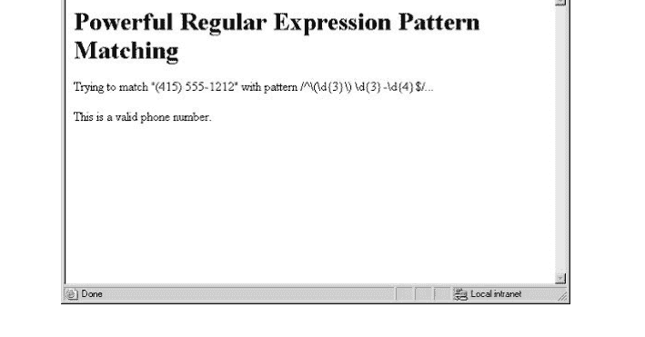

如你所见，使用正则表达式来检查字符串是否匹配模式，可以节省大量的时间和精力。我们将在下一节中研究此代码的工作原理。

### 理解正则表达式的基础知识

JavaScript中的正则表达式涉及模式匹配。其他编程语言允许正则表达式搜索和替换文本，但JavaScript程序员没有这个优势。尽管如此，正则表达式仍然是搜索复杂模式的强大方式。例如，你可以用它们来：

-   验证多种格式的电话号码
-   从字符串中提取所有数字
-   确保日期以有效格式输入
-   验证电子邮件地址是否具有正确的格式

正如我们在前面的代码示例中看到的，正则表达式模式相当复杂，可能有点令人望而生畏。

```
var pattern = /^\(\d{3}\) \d{3}-\d{4}$/;
```

正如我所提到的，正则表达式有自己的语言。有许多许多符号和特殊字符来表示不同的东西。以下是一些通用规则：

1.  首先，为我们的正则表达式模式定义一个变量。

```
var pattern;
```

2.  在JavaScript中，正斜杠（/）表示正则表达式字面量的开始和结束。正则表达式字面量允许我们创建正则表达式对象，而无需使用`RegExp`类。

```
var pattern = //;
```

3.  脱字符（^）和美元符号（$）表示行的开始和结束。它们也表示字符串的开始和结束。如果我们只想匹配字符串的一部分，我们可以省略它们。同样，如果我们想专门测试长字符串开头的模式，我们可以只使用脱字符（^）。以下模式到目前为止只匹配一个空字符串（""）。

```
var pattern = /^$/;
```

4.  `\d`表示单个数字。如果我们把`\d`添加到我们的模式中，它将只匹配一个包含0到9数字的单字符字符串。

```
var pattern = /^\d$/;
```

## 如何用JavaScript做一切

5.  如果我们想匹配多个数字（就像电话号码那样），我们可以将多个`\d`标记放在一起；`\d\d\d`表示三个数字。我们也可以用花括号指定数量：`\d{3}`。

```
var pattern = /^\d{3}$/;
```

6.  模式中的其他字符，如空格和连字符，只代表它们自身。因此，以下模式将匹配`999-999-9999`，这是表示电话号码的一种方式。

```
var pattern = /^\d{3}-\d{3}-\d{4}$/;
```

7.  由于括号字符在正则表达式语法中具有特殊含义，因此要包含它们，我们需要使用反斜杠进行转义：`\(`和`\)`。这给了我们一个匹配`(999) 999-9999`的模式，这正是我们想要的。

```
var pattern = /^\(\d{3}\) \d{3}-\d{4}$/;
```

正则表达式语法中有许多特殊标记用于匹配不同的字符集。表3-9中列出的标记是基本集合。

| 字符 | 含义 |
|---|---|
| \ | 要么表示特殊标记的开始（例如，`\d`匹配一个数字），要么表示特殊字符应被视为字面量（`\*`匹配一个星号） |
| ^ | 匹配行的开始；也匹配每个字符串的开始 |
| $ | 匹配行的结束；也匹配每个字符串的结束 |
| * | 一个特殊的量词，意味着前面的标记或标记组必须匹配零次或多次 |
| + | 一个特殊的量词，意味着前面的标记或标记组必须匹配一次或多次 |
| ? | 一个特殊的量词，意味着前面的标记或标记组必须匹配零次或仅一次 |
| . | 匹配除换行符（`\n`）外的任何单个字符 |
| (abcd) | 匹配"abcd"并记住匹配 |
| car\|bus | 匹配"car"或"bus"中的任意一个 |
| {3} | 精确匹配前面的标记或标记组三次 |
| {3,} | 匹配前面的标记或标记组三次或更多次 |
| {4,8} | 匹配前面的标记或标记组四到八次 |
| [abcdef] | 匹配*a*到*f*中的任意一个字符 |
| [a-f] | 匹配*a*到*f*中的任意一个字符 |
| [a-zA-Z0-9] | 匹配任何单个字母数字字符 |


 ## 第 3 章：使用内置 JavaScript 类

| 字符 | 含义 |
|---|---|
| [^aeiou] | 匹配除 *a*、*e*、*i*、*o* 和 *u* 以外的所有字符 |
| \d | 匹配一个数字；与模式 [0-9] 相同 |
| \D | 匹配一个非数字字符；与模式 [^0-9] 相同 |
| \s | 匹配一个空白字符（共有八种定义的空白字符） |
| \S | 匹配一个非空白字符 |
| \t | 匹配一个制表符 |
| \n | 匹配一个换行符 |
| \r | 匹配一个回车符 |
| \w | 匹配任何字母数字（单词）字符（*a*–*z* 和 0–9），包括下划线（_）；与模式 [a-zA-Z0-9_] 相同 |
| \W | 匹配任何非单词字符；与模式 [^a-zA-Z0-9_] 相同 |
| \0 | 匹配空值 |

## 表 3-9 JavaScript 正则表达式语法（续）

### 使用 RegExp 对象创建模式

我们已经了解了如何使用正则表达式字面量来创建模式。正则表达式字面量以正斜杠（/）开始和结束，如下所示：

```
var zipCodePattern = /^\d{5}(-\d{4})?$/;
```

JavaScript 还提供了一个名为 RegExp 的类来创建这些模式。我们可以使用这个类的构造器来重写该模式，如下所示：

```
var zipCodePattern = new RegExp("^\\d{5}(-\\d{4})?$");
```

> 反斜杠（\）字符在包含于字符串中时需要转义，RegExp 构造器也不例外。双反斜杠（\\）表示转义后的反斜杠字符。

RegExp 对象提供了两个主要方法来执行其搜索和匹配功能：`test()` 和 `exec()`。表 3-10 列出了 RegExp 对象最常用的方法。

| 方法 | 用途 |
|---|---|
| compile() | 编译一个正则表达式 |
| exec() | 在字符串中搜索模式并返回所有匹配项 |
| test() | 将字符串与模式进行比较，并根据结果返回 true 或 false |

### 表 3-10 RegExp 对象的方法

## 90 JavaScript 万能指南

一旦创建了 RegExp 对象，JavaScript 使你可以非常轻松地在任何字符串上测试该模式。

```
var myPattern = new RegExp("hat.*hat");
document.write("Pattern 1: \"hat.*hat\"<br>");
document.write(myPattern.test("That is a nice hat.") + "<br>");
document.write(myPattern.test("I love your hat!") + "<br><br>");

var myPattern2 = new RegExp("\\w+\\s\\w+");
document.write("Pattern 2: \"\\w+\\s\\w+\"<br>");
document.write(myPattern2.test("Jackie Gleason") + "<br>");
document.write(myPattern2.test("Cher!") + "<br>");
```

此模式检查的结果如图 3-2 所示。

### 了解 JavaScript 2.0 强大的新数据类型

到目前为止，我们一直在考察当今绝大多数 Web 浏览器支持的类。JavaScript 2.0 引入了许多新类，这些类先前已在表 3-3 中列出。对象的创建和访问方式与 JavaScript 的早期版本几乎相同，其中 `new` 和点号（.）运算符承担了大部分工作。

在本节中，我们将考察其中一些新数据类型，并学习如何在 JavaScript 程序中应用它们强大的功能。

> 注意：本章剩余的代码旨在支持 JavaScript 2.0 的环境中运行，在其他地方将无法工作。

#### 使用 Boolean、Integer 和 Number 数据类型

JavaScript 中有三种基本数据类型，称为*基本类型*：数字、字符串和布尔值。所有其他数据类型都是建立在这三个基本构建块之上的。

我们已经在本章前面考察了 String 数据类型。String 对象提供了许多方法来协助操作字符串，包括搜索（`indexOf`）、提取字符串的一部分（`substring`）以及确定字符串的长度（`length`）。

与 String 相比，Boolean 数据类型非常简单。你可以用它存储布尔值（`true` 或 `false`），也可以检索该布尔值。基本上就是这样。在你的编程中确实没有理由使用 Boolean 类，因为布尔字面量更容易创建而且同样有用。

```
var isFinished : Boolean = false;
var paidToll : Boolean = true;
```

数字基本类型实际上由两个 JavaScript 数据类型表示：Number 和 Integer。两者唯一的区别是 Integer 数据类型不能包含小数部分。除此之外，这两个类完全相同。同样，在大多数情况下，为了方便起见，我将继续使用数字字面量来创建简单的数字。

```
var counter : Integer = 0;
var invoice_amount : Number = 12363.22;
```

#### 使用 char 数据类型

也许比其他任何特征都更能区分 char 数据类型的是它那奇怪的命名方式。这种数据类型的首字母没有大写，而且它的名称不是一个完整的单词。（事实上，ECMA 技术委员会在语言开发过程中的某个时刻曾想将其命名为"Character 数据类型"，那样就更符合其他类的命名方式了。）

char 数据类型仅表示单个 16 位 Unicode 字符。有些语言称之为*字节*，通常在对内存空间分配有首要考虑时使用。它存在是为了与其他语言兼容，在现代 Web 编程中没有太多实际用途。

### 使用 Object 数据类型

JavaScript 中的每个类——无论是用户定义的还是系统定义的——都是该数据类型的成员。如果你想创建一个可以容纳系统中任何对象的变量，这就是你要使用的数据类型。

```
var myObject : Object = new Date();
myObject = new String("This is a string");
myObject = new Car(2002, "Ferrari", "Testarosa", "Cherry red");
```

一旦将 myObject 变量定义为 Object 数据类型的成员，它就可以充当系统中任何其他类的对象。这种能力，即一个类可以充当另一个相关类的对象，在面向对象编程中被称为*多态性*。继承和多态性将在第 5 章讨论，届时我们将创建自己的类。

### 了解特殊数据类型

JavaScript 2.0 还包含一些你可能在日常编程中不会使用——或者永远不会使用——的数据类型。正如你在上一章所学到的，函数可以返回值。而在 JavaScript 2.0 中，你可以为该值指定数据类型。

```
function addTwo(num1 : Number, num2 : Number) : Number {
    return num1 + num2;
}
```

#### 使用 Void 数据类型

嗯，你有时可能需要定义一个不返回任何结果的函数。以下程序执行其任务并在不返回值的情况下退出。

```
function errorMessage(msg : String) {
    alert("A serious error occurred\n" + msg +
            "\nPress OK to continue.");
    return;
}
```

像这段代码那样定义一个没有返回值的函数当然是有效的。但这样做会使返回值类型变得不明确。你的函数可以返回值，也可以不返回值，两者都不是错误。省略函数的数据类型只会告诉系统返回值的类型是未知的。

```
function errorMessage(msg : String) : Void {
    alert("A serious error occurred\n" + msg +
            "\nPress OK to continue.");
    return;
}
```

#### 使用 Never 数据类型

或者，也许你的函数报告错误然后完全停止运行。在 Web 浏览器环境中无法做到这一点，但在其他环境中可以，例如在服务器上。导致程序退出的函数应该具有 Never 的数据类型，意思是"此函数永远不会返回"。以下代码示例使用 IIS Web 服务器环境中的 JavaScript 编写。

```
function errorMessage(msg : String) : Never {
    response.write("A serious error occurred\n" + msg +
            "\nPress OK to continue.");
    response.end;
}
```

#### 使用 Null 数据类型

最后，Null 数据类型只能包含一个有效值——null。说实话，我想不出你为什么要这样做。

```
var useless : Null = null;
```

好了，我们已经看完了 JavaScript 允许我们使用的每一个对象和数据类型——差不多吧。我们还没有谈到数组。JavaScript 2.0 引入了五个新的数组类。在下一章中，我们将考察数组，看看它们如何用于存储大量易于访问的数据。


## 第 4 章：将数据组织成数组


### 如何……

- 创建 Array 对象
- 在数组中设置和检索值
- 使用多维数组
- 使用 JavaScript 2.0 的增强数组

在第 2 章中，我们研究了程序如何使用变量来存储数据以便稍后检索。程序可以定义的变量数量几乎没有限制。这个数量仅受程序员记住每个变量用途的能力所限。

但有时你可能会面临将数十甚至数百个相关值存储到变量名中以供日后使用的任务。例如，你会如何存储以下内容？

- 美国 50 个州的名称
- 一年中的月份名称
- 你收藏 CD 的专辑标题
- 商店库存中的产品列表

你可能能够想出方法将前两个列表（州名和月份名称）存储在 JavaScript 代码中，例如为每个名称分配自己的变量（例如，var Nebraska = "Nebraska"）。但虽然这是可能的，却并不那么实用。拥有值永远不会改变且值与变量名匹配的变量（甚至常量）有什么意义呢？

那么，你如何存储那些类型的列表（专辑标题和库存产品）呢？毕竟，这些列表可能会变得相当大（你的商店可能销售数百种产品），值可以（而且确实会）改变，甚至列表的长度也会随着时间的推移而不同。

JavaScript 提供了 *Array 对象* 来处理数据列表。数组可以处理长长的数据列表，其值可以轻松检索或修改。数组也可以根据需要增长或缩小。

```
for (counter = 0; counter < 50; counter ++) {
    document.write ("State #" + counter + ": " +
        statesArray[counter]);
}
```

在这段代码中，变量 statesArray 包含一个由美国 50 个州名组成的数组。我们可以使用其索引（值范围从 0 到 49）并通过方括号（[]）操作符来访问这个数组。

```
statesArray[counter];
```

当然，代码没有展示 Array 对象是如何创建的。有两种创建 Array 对象的方法：

- Array 类
- Array 字面量

不幸的是，官方规范与每个主要浏览器制造商在 JavaScript 中实现数组的方式之间存在一些不一致之处。在本章中，我们将研究数组是如何创建的，以及如何创建可在所有浏览器中工作的代码。我们还将看看 JavaScript 2.0 中数组的一些激动人心的改进。

#### 创建 Array 对象

使用 JavaScript Array 类有三种创建数组的方法：

- new Array ()
- new Array (size)
- new Array (element1, element2, ..., elementN)

##### 创建空数组

不向 Array 类的构造函数传递任何参数会创建一个 *空数组*，也称为长度为零的数组。（在 JavaScript 中，数组内项目的数量称为其长度。）然后我们可以手动填充数组，如下所示。

1. 我们首先定义一个变量来包含我们的数组。

```
var months;
```

2. 然后我们使用 **new** 操作符创建一个新的 Array 对象。

```
var months = new Array();
```

3. 我们手动为数组的第一个索引赋值。索引从值 0 开始。

```
var months = new Array();
months[0] = "January";
```

4. 现在我们的数组长度为 1。然后我们可以为数组填充其余的值。

```
var months = new Array();
months[0] = "January";
months[1] = "February";
months[2] = "March";
months[3] = "April";
months[4] = "May";
months[5] = "June";
months[6] = "July";
months[7] = "August";
months[8] = "September";
months[9] = "October";
months[10] = "November";
months[11] = "December";
```

5. 我们现在有了一个可以通过程序其余部分仅使用其数字索引来访问的数组。

```
var months = new Array();
months[0] = "January";
months[1] = "February";
months[2] = "March";
months[3] = "April";
months[4] = "May";
months[5] = "June";
months[6] = "July";
months[7] = "August";
months[8] = "September";
months[9] = "October";
months[10] = "November";
months[11] = "December";

for (var i = 0; i < 12; i++) {
    document.write (months[i] + "<br>");
}
```

6. 如你所见，JavaScript 能够将一系列相关值（一年中的月份）存储到单个变量中，然后轻松访问每个值以供日后使用。

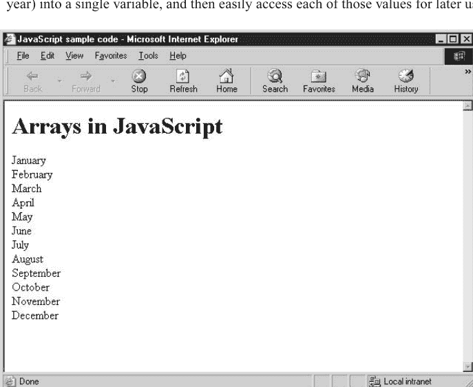

7. 这样的列表（一年中的月份）很方便，如果你想让程序将数字月份转换为其字符串等价物。幸运的是，Date 对象的 getMonth() 函数返回的月份范围是 0 到 11，所以我们甚至不需要在使用之前调整该值。

```
var today = new Date();
var monthnum = today.getMonth();
document.write ("Today is a lovely " +
    months[monthnum] + " day.");
```

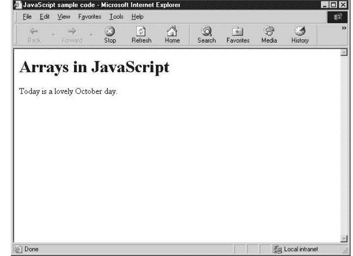

##### 指定初始数组长度

JavaScript 允许你通过传递单个整数作为参数来指定数组的初始长度。

```
var months = new Array(12);
```

像这样预先设置数组的长度在 JavaScript 1.5 中几乎没有什么优势，因为数组会自动增长。或许它提供的唯一好处是提醒你打算定义的数组有多大。

数组的长度也可以通过更改 Array 对象的 length 属性在程序中设置。

```
var months = new Array();
months.length = 12;
```

##### 用一行代码创建并初始化数组

看看前面定义的 months 数组，我们最终写了 13 行代码才创建并初始化数组。如果我们能用一行代码创建相同的数组就好了。

当然，如果 JavaScript 做不到这一点，我就不会提它了……

```
var months = new Array ("January", "February", "March", "April",
    "May", "June", "July", "August",
    "September", "October", "November", "December");
```

Array 类的构造函数还接受逗号分隔的数组初始值列表。列出的第一项被分配索引 0，下一项成为索引 1，依此类推。

这对于长列表的项目特别有帮助。例如，如果我们需要一个包含美国 50 个州的数组，用一行代码创建它比用 51 行或更多行要容易得多。

```
var USStates = new Array ("Alabama", "Alaska", "Arizona",
    "Arkansas", "California", "Colorado", "Connecticut",
    "Delaware", "Florida", "Georgia", "Hawaii", "Idaho",
    "Illinois", "Indiana", "Iowa", "Kansas", "Kentucky",
    "Louisiana", "Maine", "Maryland", "Massachusetts",
    "Michigan", "Minnesota", "Mississippi", "Missouri",
    "Montana", "Nebraska", "Nevada", "New Hampshire",
    "New Jersey", "New Mexico", "New York", "North Carolina",
    "North Dakota", "Ohio", "Oklahoma", "Oregon", "Pennsylvania",
    "Rhode Island", "South Carolina", "South Dakota", "Tennessee",
    "Texas", "Utah", "Vermont", "Virginia", "Washington",
    "West Virginia", "Wisconsin", "Wyoming");
```

##### 使用数组字面量

正如 JavaScript 提供了创建数字、字符串和正则表达式的方法，而无需手动创建对象，你也可以对数组执行相同的操作。

```
var months = ["January", "February", "March", "April",
    "May", "June", "July", "August"];
```

### 如何……将长代码行分成多行

为了使长代码行更具可读性（对你自己和查看你代码的其他程序员而言），在文本滚动到屏幕右侧之前插入回车符是一个明智的主意。JavaScript 支持跨多行编写的代码，只要它们被放在正确的位置。JavaScript 会忽略额外的空格和换行符，因为它将分号（;）视为语句的实际结尾。


 前面代码中的方括号会让 JavaScript 将其内容解释为一个新数组的内容。这等价于使用正确的构造函数语法来创建数组。

```
var months = new Array("January", "February", "March", "April",
    "May", "June", "July", "August",
    "September", "October", "November", "December");
```

Array 对象的所有属性和方法都可以用于使用数组字面量创建的对象。

### 调用 Array 对象的属性和方法

JavaScript 中的 Array 对象只公开三个属性。其中两个属性仅在调用数组是正则表达式模式匹配的结果时才被设置，这将在第 3 章中讨论。`length` 属性（所有数组都可用）是三个属性中唯一可以修改的，因为它表示数组的当前长度。

| Property | Description |
| --- | --- |
| index | 与正则表达式模式匹配相关；包含匹配子串的索引（只读） |
| input | 与正则表达式模式匹配相关；包含进行匹配的原始字符串（只读） |
| length | 检索或设置数组的长度 |

> 提示：数组中的每个元素不必都包含值。你完全可以创建一个跳过每隔一个索引号的数组，或者跳过任意数量索引号的数组。

`length` 属性会考虑数组中空（未使用）的索引数量以及数组包含的元素数量。因此，如果你跳过了大量的索引号，`length` 属性将远大于元素的数量。

```
var employee = new Array();
employee[127756] = "Tom Jones";
alert(employee.length);
```

这段代码返回 127,757 作为数组的长度，因为这是从 0 到 127,756 的元素数量（包括空的）。

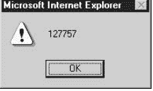

## How to Do Everything with JavaScript

Array 对象还包含许多有用的方法，使程序员更容易管理数组内容，如表 4-1 所示。使用表 4-1 中列出的 Array 对象方法可以对数组内容提供多种高级修改功能。其中四种方法允许我们将数组当作*调用栈*或*队列*来处理。

在编程中，调用栈类似于一叠煎饼。最后放到栈顶的煎饼必须被第一个拿走（或吃掉）。这种排列方式有时被称为*后进先出*（LIFO）方法。

队列很像银行里的队伍，第一个进入队伍的人是第一个被服务的。不出所料，这种排列方式有时被称为*先进先出*（FIFO）方法。

| Method | Description |
| --- | --- |
| pop() and push() | 后进先出（LIFO）；类似于调用栈 |
| shift() and unshift() | 先进先出（FIFO）；类似于队列 |

还有其他几个有趣的方法，允许你将数组转换为单个字符串、将数组拆分为子数组，甚至将两个或多个数组连接在一起。在下面的代码中，我们使用 Array 类创建了一些数组。

```
var MainMenu = new Array("File", "Edit", "View",
    "Window", "Help");
var FileMenu = new Array("New", "Open", "Close", "Save", "Exit");
var EditMenu = new Array("Undo", "Repeat", "Cut", "Copy", "Paste");
var ViewMenu = new Array("Normal", "Web Layout", "Outline");
var WindowMenu = new Array("New Window", "Arrange All", "Split");
var HelpMenu = new Array("Contents", "About", "Contact Us");
```

| Method | Description |
| --- | --- |
| concat(*array1, array2...arrayN*) | 将两个或多个数组合并为一个数组 |
| join (*separator*) | 将数组的所有元素连接为一个字符串，用指定的分隔符分隔，如果未指定则使用逗号 |
| pop () | 返回数组的最后一个元素并将其移除 |
| push (*element1, element2...elementN*) | 将一个或多个元素添加到数组末尾，并返回其新长度 |
| reverse () | 反转数组中元素的顺序 |
| shift () | 类似于 pop()；返回数组的第一个元素并将其移除 |

**TABLE 4-1** Array 对象的方法

| Method | Description |
| :--- | :--- |
| slice (begin, end) | 从现有数组的某个子部分创建一个新数组，由开始和结束索引定义 |
| splice (index, howMany, element1, element2...elementN) | 用于从数组中添加或移除元素 |
| sort (functionName) | 用于对数组的元素进行排序 |
| unshift (element1, element2...elementN) | 类似于 push()；将一个或多个元素添加到数组开头，并返回其新长度 |

**TABLE 4-1** Array 对象的方法（续）

这些数组代表一个假设网站的菜单。我们可以在每个数组上使用一些 Array 对象的方法来修改它或提取部分信息。

```
// 创建包含数组所有元素的字符串
// 数组本身不受影响
var MenuItemsStr = MainMenu.join(" | ");
document.write (MenuItemsStr + "<br><br>");

// 创建包含所有数组所有元素的新数组
// 现有数组均不受影响
var AllMenuItems = MainMenu.concat(FileMenu, EditMenu, ViewMenu,
    WindowMenu, HelpMenu);
document.write (AllMenuItems.join(", ") + "<br><br>");

// 反转数组中元素的顺序
// 修改现有数组
MainMenu.reverse();
document.write (MainMenu.join(" | ") + "<br><br>");

// 创建包含现有数组子集的新数组
// 现有数组均不受影响
var ChildMenuItems = AllMenuItems.slice(MainMenu.length);
document.write (ChildMenuItems.join(" <font size=+3>||</font> ")
    + "<br><br>");
```

这些数组操作的结果可以在下面的截图中看到。

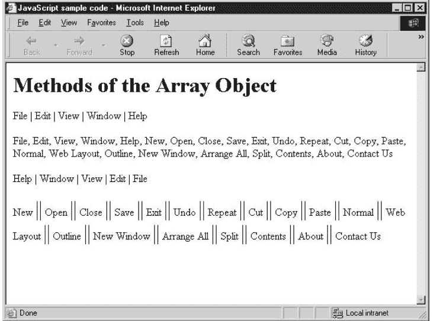

### 在数组中设置和检索值

JavaScript Array 对象内部的元素使用方括号运算符来访问。

```
var myArray = new Array();
myArray[16] = "Some value";
document.write (myArray[16]);
```

方括号中的数字称为*索引*。你可以将数组想象成一系列停车位，编号从 0 到无穷大。当停车员将你的车停入其中一个车位时，他必须记下该位置号码，以便之后能够再次找到你的车。JavaScript 数组支持使用字符串作为索引。当使用字符串作为索引时，这被称为*哈希表*。

```
var FruitColors = new Array();
FruitColors["Apple"] = "red";
FruitColors["Banana"] = "yellow";
FruitColors["Grape"] = "purple";
```

```
document.write ("Apples are " + FruitColors["Apple"] + ".<br>");
document.write ("Bananas are " + FruitColors["Banana"] + ".<br>");
document.write ("Grapes are " + FruitColors["Grape"] + ".<br>");
```

正如我们在第 2 章中看到的，数组也可以使用 **for-in** 语句来访问。**for-in** 语句将循环遍历数组中的每个元素，返回索引或键。

```
var FruitColors = new Array();
FruitColors["Apple"] = "red";
FruitColors["Banana"] = "yellow";
FruitColors["Grape"] = "purple";

for (var fruit in FruitColors) {
    document.write (fruit + "s are " + FruitColors[fruit]
        + ".<br>");
}
```

这里的 **for-in** 循环对 `document.write()` 函数迭代了三次，每次对应数组中的一个项目。结果输出可以在图 4-1 中看到。

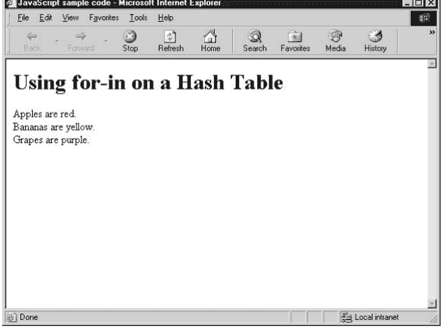

**FIGURE 4-1** **for-in** 循环遍历哈希表。

## How to Do Everything with JavaScript

同样的技术也可以用于具有数字索引的数组：

```
var Players = new Array();
Players[0] = "Jaime";
Players[1] = "Mom";
Players[2] = "Bart";
Players[3] = "Liez'l";

// 谁在玩桥牌？
for (var name in Players) {
    document.write (name + ": ");
    document.write (Players[name] + " is playing bridge.<br>");
}
```

从图 4-2 的输出中可以看到，**for-in** 循环也能够遍历我们的每个桥牌玩家。

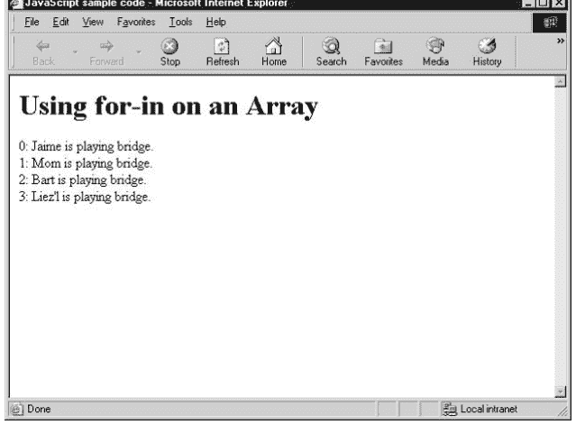

**FIGURE 4-2** **for-in** 循环遍历数组。


### 使用多维数组

到目前为止，我们在本章中看到的数组有时被称为*一维数组*。如果你将数组视为一个包含行和列的图形化表格，那么这些一维数组将只有一列，如图 4-3 所示。

二维数组是指在图形化表格中显示时包含多于一列的数组。当你需要在列表的每个项目中存储多个值时，就会用到二维数组。图 4-4 展示了一个二维数组的图形表示。

三维数组看起来更像是一个立方体，因为在图表中增加了一个深度维度。信不信由你，甚至存在四维数组或更高维的数组。然而，我们生活在一个三维世界中，这些复杂数据集的图形化显示会变得越来越困难。

一些编程语言允许将多维数组作为语言的核心特性进行定义。不幸的是，JavaScript 并不在此之列。如果你想在 JavaScript 应用程序中定义多维数组，你就必须在一维数组的限制下工作。

有两种技术可以在 JavaScript 中模拟多维数组：

- 你可以创建并行的一维数组。
- 你可以创建数组的数组。

## 使用 JavaScript 实现一切

| | 第 0 列: | 第 1 列: | 第 2 列: | 第 3 列: |
| --- | --- | --- | --- | --- |
| 第 0 行: | "一月" | "石榴石" | "红色" | "坚贞" |
| 第 1 行: | "二月" | "紫水晶" | "紫色" | "真诚" |
| 第 2 行: | "三月" | "血石" | "蓝色" | "勇气" |
| 第 3 行: | "四月" | "钻石" | "白色/透明" | "纯真" |
| 第 4 行: | "五月" | "祖母绿" | "绿色" | "爱情" |
| 第 5 行: | "六月" | "珍珠" | "奶油色" | "健康" |
| 第 6 行: | "七月" | "红宝石" | "红色" | "满足" |
| 等等。 | | | | |

**图 4-4** 二维数组包含多列。

我们在本章中首先看到的数组之一是一年中月份的列表。让我们继续使用这个例子。我们从以下一维数组开始：

```
var months = new Array ("January", "February", "March", "April",
    "May", "June", "July", "August",
    "September", "October", "November", "December");
```

假设我们想创建一个包含以下四个项目的列表：

- 一年中的月份
- 与每个月份相关的诞生石
- 每种诞生石的颜色
- 与每种诞生石相关的含义

目前，我们的数组只包含月份；如果我们随意添加另外三个我们希望列出的内容，只会让数组变得混乱并更难使用。

```
var months = new Array ("January", "February", "March", "April",
    "May", "June", "July", "August",
    "September", "October", "November", "December",
    "Garnet", "Amethyst", "Bloodstone or Aquamarine",
    "Diamond", "Emerald", "Pearl, Moonstone, or Alexandrite",
    "Ruby", "Sardonyx or Peridot", "Sapphire",
    "Opal or Tourmaline", "Topaz", "Turquoise or Lapis lazuli",
    "Red", "Purple", "Green/Red or Blue", "White/Clear",
    "Green", "Cream", "Red", "Light Green",
    "Blue", "Many Colors", "Orange/Brown", "Blue",
    "Constancy", "Sincerity", "Courage", "Innocence",
    "Love and success", "Health and longevity", "Contentment",
    "Married happiness", "Clear thinking", "Hope",
    "Fidelity", "Prosperity");
```

从这段代码可以看出，简单地将额外的列表添加到现有数组中并不是最佳解决方案。这不仅对人类来说难以阅读和理解，程序员在创建程序时也必须小心，以免内容混淆。

我们可以使用四个并行数组重写那个混乱的数组，如下所示。

```
var months = new Array ("January", "February", "March", "April",
    "May", "June", "July", "August",
    "September", "October", "November", "December");
```

```
var stones = new Array ("Garnet", "Amethyst",
    "Bloodstone or Aquamarine", "Diamond", "Emerald",
    "Pearl, Moonstone, or Alexandrite", "Ruby",
    "Sardonyx or Peridot", "Sapphire", "Opal or Tourmaline",
    "Topaz", "Turquoise or Lapis lazuli");
```

```
var colors = new Array ("Red", "Purple", "Green/Red or Blue",
    "White/Clear", "Green", "Cream", "Red", "Light Green",
    "Blue", "Many Colors", "Orange/Brown", "Blue");
```

```
var meaning = new Array ("Constancy", "Sincerity", "Courage",
    "Innocence", "Love and success", "Health and longevity",
    "Contentment", "Married happiness", "Clear thinking",
    "Hope", "Fidelity", "Prosperity");
```

每个数组中的元素与其他数组中的索引完全对应，所以假设我想找出关于一年中第七个月的一些信息。（请记住，数组从索引 0 开始，因此一年中的第七个月描述在第 6 个元素处。）

```
document.write ("The seventh month is <b>" + months[6]);
document.write ("</b>. Its birthstone is <b>");
document.write (stones[6] + "</b>. The " + stones[6]);
document.write (" is a <b>" + colors[6] + "</b> colored stone, ");
document.write ("and it means <b>" + meaning[6] + "</b>");
document.write (" traditionally.<br>");
```

通过这种方式，我们能够通过在自己的数组中定义它们，来存储关于每个月的多列信息。我们可以在图 4-5 的网页浏览器截图中看到这段代码的结果。

## 使用 JavaScript 实现一切

**图 4-5** 使用并行数组可以模拟二维数组。

创建多维数组的另一种方法是创建一个包含其他数组的数组——这被称为*数组的数组*。

要创建数组的数组，你需要执行以下步骤。

1.  首先，定义四个数组，就像定义并行数组一样。

```
var months = new Array ("January", "February", ...);
var stones = new Array ("Garnet", " Amethyst", ...);
var colors = new Array ("Red", "Purple", ...);
var meanings = new Array ("Constancy", "Sincerity", ...);
```

2.  接下来，定义一个主数组来容纳所有四个数组。

```
var marray = new Array();
```

3.  然后，将包含数据的四个数组分别赋值给这个主数组。

```
var marray = new Array();

marray[0] = months;
marray[1] = stones;
marray[2] = colors;
marray[3] = meanings;
```

4.  然后，你应该修改你的程序，通过使用主数组的名称和适当的数组索引来访问子数组。

```
var marray = new Array();

marray[0] = months;
marray[1] = stones;
marray[2] = colors;
marray[3] = meanings;

document.write ("The fourth month is <b>" + marray[0][3]);
document.write ("</b>. Its birthstone is <b>");
document.write (marray[1][3] + "</b>. The " + marray[1][3]);
document.write (" is a <b>" + marray[2][3] + "</b> "
    + "colored stone, ");
document.write ("and it means <b>" + marray[3][3] + "</b>");
document.write (" traditionally.<br>");
```

如你所见，我们现在必须使用主数组的名称和索引（例如 marray[0][3]）来引用该数组，而不是使用 months[3]。如图 4-6 所示，这种技术也是创建二维数组的有效方式。

### 使用 JavaScript 2.0 的增强数组

JavaScript 2.0 在传统的 Array 类中添加了三个不同的子类。每个子类与 JavaScript 中数组一直以来的工作方式非常相似，但也有一些独特的区别。表 4-2 列出了传统的 Array 类和三个新类，并描述了不同的类。

| 数组对象名称 | 描述 |
| --- | --- |
| Array [*数据类型*] | 这个（原始的 Array 类）是一个抽象类。当被调用时，它返回一个 DynamicArray 对象。如果未指定数据类型，则默认为 Object 类型。 |
| StaticArray [*数据类型*] | 这个新子类在添加新元素时不会自动增长。它不能包含空元素，并且不能在没有数据类型的情况下被调用。 |
| DynamicArray [*数据类型*] | 这个新子类就是传统的 JavaScript Array 对象。不能在没有数据类型的情况下被调用。 |
| ConstArray [*数据类型*] | 这个新子类创建一个常量数组，其值一旦设定就不能更改。它不能包含空元素。如果未指定数据类型，则默认为 Object 类型。 |

**表 4-2** JavaScript 2.0 中的数组类


# 第4章：将数据组织成数组

112 如何使用JavaScript做一切

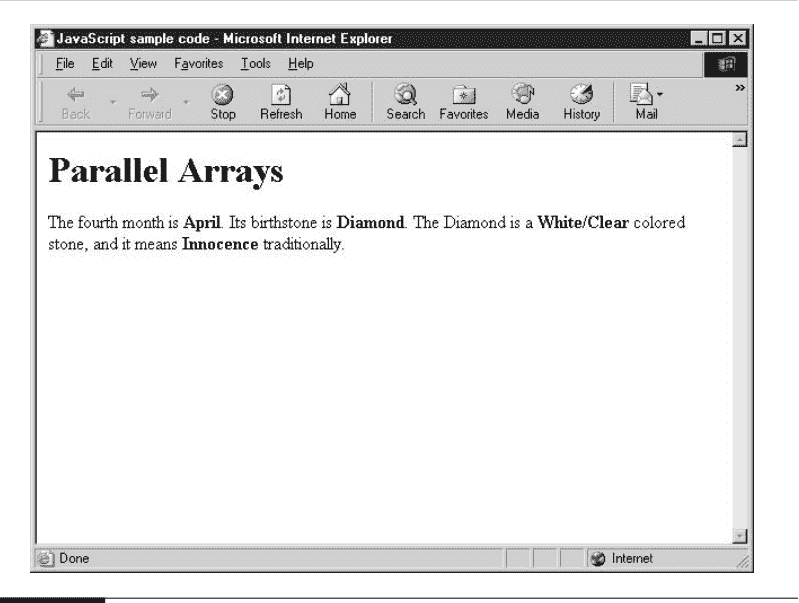

**图 4-6** 数组的数组技术可以非常接近地模拟真正的二维数组。

每种数组类型通常用一种数据类型来实例化。`Array` 和 `ConstArray` 为数据类型提供了默认值，而其他类型则没有。在定义数组时提供的数据类型会限制数组的内容只能是该数据类型的对象。在本节中，我们将研究三种新的数组类型中的每一种，并了解它们如何在JavaScript程序中使用。

#### StaticArray 类

`StaticArray` 类创建长度预先确定的数组，其值可以随时修改。创建新的 `StaticArray` 有两种方式：

- `new StaticArray [datatype] ()`
- `new StaticArray [datatype] (size)`

JavaScript 2.0 规范要求 `StaticArray` 必须用数据类型定义。要创建一个可以接受任何数据类型的数组，我们可以定义数组来接受类型为 `Object` 的值。由于 `Object` 是JavaScript中所有类的父数据类型，包括你自己创建的类，因此 `Object` 数组可以接受任何值。

创建 `StaticArray` 时不传入数据类型会导致数组可以包含任何对象。回顾上一章的内容，`Object` 是系统中每个类的数据类型，包括你自定义的类。

```
var myArray : StaticArray = new StaticArray[Object]();
myArray.length = 4;
myArray[0] = "This is the first element";
myArray[1] = 3.141;
myArray[2] = new Car(2001, "Toyota", "4Runner", "Thundercloud");
myArray[3] = new Date();
```

这段代码创建了一个类型为 `Object` 的新 `StaticArray` 变量。我们利用这一点，将一个字符串、一个数字、一个用户定义的 `Car` 对象和一个 `Date` 对象存储到这个数组中。

由于 `StaticArray` 必须具有预定义的长度，我们首先将数组的 `length` 属性初始化为 4，这是我们打算存储的项目数量。尝试添加额外的项目将导致JavaScript错误，除非我们手动增加 `length` 的值。

```
var myArray : StaticArray = new StaticArray[Object]();
myArray.length = 5;
myArray[0] = "This is the first element";
myArray[1] = 3.141;
myArray[2] = new Car(2001, "Toyota", "4Runner", "Thundercloud");
myArray[3] = new Date();
myArray[4] = "This is a new element.";
```

提供更具体的数据类型，例如 `Number`，将限制数组的元素只能是该类型。

```
var mySecondArray : StaticArray = new StaticArray[Number](6);
mySecondArray[0] = 14.2;
mySecondArray[1] = 13;
mySecondArray[2] = 21.9999;
mySecondArray[3] = 2141330119;
mySecondArray[4] = 0.0000003;
mySecondArray[5] = 1.0121E26;
```

> 类型为 `StaticArray` 的数组不能有缺失的元素；也就是说，你不能像使用 `DynamicArray` 那样跳过索引号。

尝试向一个只接受数字的 `StaticArray` 添加字符串将导致JavaScript错误。

```
mySecondArray[5] = "This is not allowed.";
```

#### DynamicArray 类

`DynamicArray` 与 `StaticArray` 类似，但数组的大小会根据你尝试添加的元素自动调整。创建 `DynamicArray` 有两种方式：

- `new DynamicArray [*datatype*] ()`
- `new DynamicArray [*datatype*] (size)`

这意味着你可以创建一个空数组，并在不考虑现有数组长度的情况下向其中添加元素。

```
var Nieces : DynamicArray = new DynamicArray[String]();
Nieces[0] = "Sofia";
Nieces[1] = "Monica";
Nieces[2] = "Tiffany";
Nieces[3] = "Liz";
Nieces[4] = "Elke";
Nieces[5] = "Christine";
Nieces[6] = "Leah";
```

这个名为 `Nieces` 的 `DynamicArray` 可以继续增长到几乎无限的大小，仅受计算机内存量的限制。`DynamicArray` 与其他类型数组的另一个区别是你不一定要填满每个元素。以下是使用 `DynamicArray` 的有效代码：

```
var emps : DynamicArray = new DynamicArray[String]();
emps[9931] = "John H. Smith";
```

即使我们没有为索引 0 到 9930 提供值，我们也可以直接跳到 9931 并为该数组元素提供值。

#### ConstArray 类

JavaScript 2.0 支持的第三种新数组类型是 `ConstArray`。`ConstArray` 与 `DynamicArray` 非常相似，有三个显著不同之处：

- 它们可以在不指定数据类型的情况下定义。
- 一旦设置，其值就不能更改。
- 它们不支持跳过的元素。

创建新的 `ConstArray` 有四种方式：

- `new ConstArray ()`
- `new ConstArray (size)`
- `new ConstArray *[datatype]* ()`
- `new ConstArray *[datatype]* (*size*)`

`ConstArray` 类从JavaScript的常量变量类型中汲取灵感。（我们在第2章中已经讨论过常量。）一旦设置，常量的值就不能更改。

```
var months : ConstArray = new ConstArray[String](12);
months[0] = "January";
months[1] = "February";
months[2] = "March";
months[3] = "April";
months[4] = "May";
months[5] = "June";
months[6] = "July";
months[7] = "August";
months[8] = "September";
months[9] = "October";
months[10] = "November";
months[11] = "December";
```

由于一年中月份的名称在程序执行期间不太可能改变，我们可以将它们定义为常量。然后我们就可以在程序的后面使用本章前面描述的方括号语法来访问这些字符串。

上两章的重点是JavaScript提供的内置类，特别是JavaScript 2.0提供的新类和数据类型。下一章将全部关于创建你自己的类，涵盖JavaScript 1.5和2.0。

# 第5章

### 创建你自己的JavaScript类


### 如何...

- 在JavaScript 1.x中创建对象
- 使用对象字面量
- 在JavaScript 2.0中创建对象
- 使用继承来组织类

过去几章讨论了如何使用JavaScript的内置类来存储多种类型的数据（Date、Number、Boolean等）。JavaScript还提供了一种让你创建自己的类的方式，以便你可以设计自己的数据类型。

在本章中，我们将研究JavaScript程序可以用来为自己定义对象的方法。我们还将研究在JavaScript 1.x中创建的对象与在JavaScript 2.0中创建的对象之间的区别。

#### 了解JavaScript中的类

在某些方面，JavaScript是一种面向对象的编程语言，在某些方面则不是。JavaScript一直具有创建和使用对象的能力。事实上，实际上不可能设计一个不以某种方式使用文档对象模型或JavaScript提供的任何基于对象的数据类型的JavaScript程序。

但JavaScript程序通常不像Java和C++程序那样围绕面向对象的编程模型设计。JavaScript不强制使用类，这会迫使程序员使用第3章中讨论的面向对象编程模型。JavaScript程序员可以自由地编写非结构化或过程式程序来适应手头的任务。

尽管如此，对用户定义的类和对象的支持是该语言在未来几个月和几年中将逐渐被接受的一个方面。JavaScript 1.x对类的支持有限，但它确实存在。JavaScript 2.0对类的支持已大大改进。我们将看到，随着程序员开始发现将代码组织成独立、可重用对象的好处，类的使用将会增长。

#### 在JavaScript 1.x中创建对象

在JavaScript 1.x中有四种创建自己的对象的方式：

- 调用构造函数
- 使用对象字面量
- 扩展现有类
- 扩展现有对象

在接下来的章节中，我们将研究每一种方法。


##### 调用构造函数

在 JavaScript 中，创建对象的一种方式是定义一个称为*对象构造函数*的特殊函数。该构造函数的作用是对对象进行初始化以供使用——本质上就是执行所有必要的设置任务。构造函数一开始看起来与普通函数一样，但会使用一个特殊的对象——*this 对象*——来为其自身添加属性。

要创建构造函数，请按以下步骤操作：

1. 定义一个空函数，名称为你希望创建的类名。
2. 特殊的 this 对象是类用来引用自身的。我们可以使用 this 对象在构造函数内部添加新属性。
3. 由于我们希望构造函数具有灵活性，并支持多种不同类型的 Car 对象，因此最好使用函数的参数来定义属性。
4. 然后我们可以添加更多属性，使 Car 对象更加完整。
5. 当然，我们也可以添加一个不依赖任何参数的属性。

```
function Car () {
}
```

```
function Car () {
    this.Make = "Toyota";
}
```

```
function Car (make) {
    this.Make = make;
}
```

```
function Car (make, model, year, color) {
    this.Make = make;
    this.Model = model;
    this.Year = year;
    this.Color = color;
}
```

```
function Car (make, model, year, color) {
    this.Make = make;
    this.Model = model;
    this.Year = year;
    this.Color = color;
    this.FullName = this.Year + " " + 
        "<b>" + this.Make + "</b> " + 
        this.Model;
}
```

6. 既然我们已经为 Car 类定义了构造函数，程序就可以调用它来创建 Car 对象。

```
function Car (make, model, year, color) {
    this.Make = make;
    this.Model = model;
    this.Year = year;
    this.Color = color;
    this.FullName = this.Year + " " + 
        "<b>" + this.Make + "</b> " + 
        this.Model;
}

var mySUV = new Car("Toyota", "4Runner SR5", 
    2001, "Thundercloud");
```

7. 创建了 mySUV 对象后，我们可以访问 Car 类的任何属性。

```
var mySUV = new Car("Toyota", "4Runner SR5", 
    2001, "Thundercloud");
document.write ("I drive a " + mySUV.FullName);
```

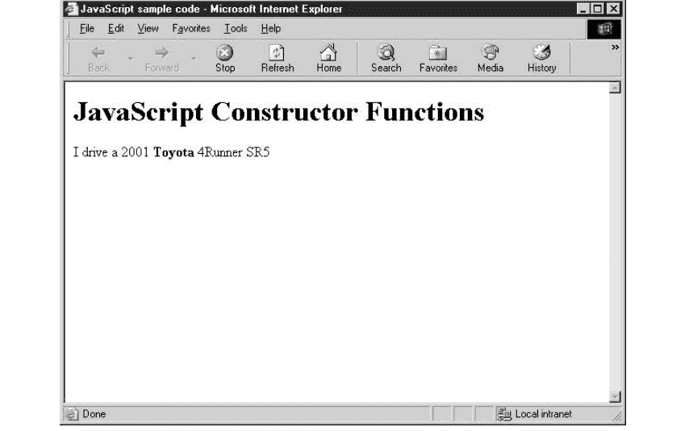

8. 事实上，我们可以从这个构造函数创建多个对象，它们都拥有各自独立的属性。更改一个对象的属性值不会影响其他对象中相同属性的值。

```
var mySUV = new Car("Toyota", "4Runner SR5", 2001, "Thundercloud");
var mySportsCar = new Car("Acura", "NSX-T", 1999, "Red");
var myDreamCar = new Car("Ferrari", "F355 F1", 2000, "Ferrari Red");

mySportsCar.Color = "Black";
document.write (mySUV.FullName + " = " + mySUV.Color + "<br>");
document.write (mySportsCar.FullName + " = " + mySportsCar.Color + "<br>");
document.write (myDreamCar.FullName + " = " + myDreamCar.Color + "<br>");
```

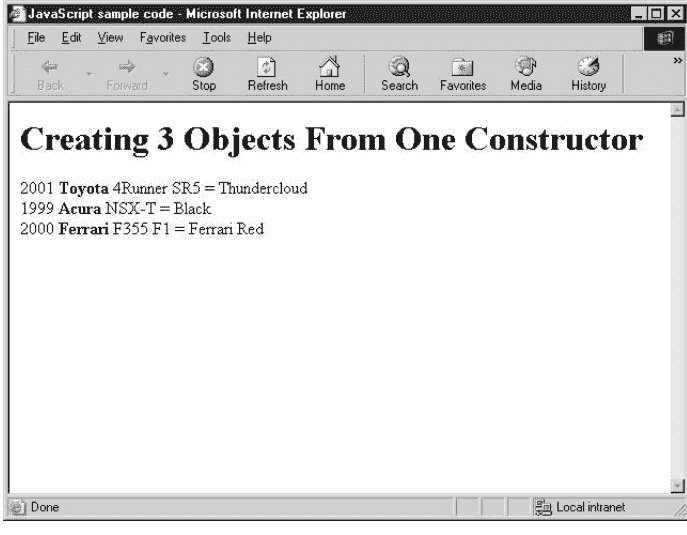

这种创建对象的方法在 JavaScript 中适用于所有浏览器，可追溯到 Internet Explorer 3.0 和 Netscape Navigator 3.0。

##### 使用对象字面量

JavaScript 的对象字面量是一种便捷的创建对象的方式，无需预先定义构造函数。实际上，它是一个无名的构造函数。JavaScript 最大的优点之一是它允许程序员快速创建程序，而对象字面量正是它如何实现这一点的典型例子。使用对象字面量快速创建对象的代价是，你将失去为其他对象或其他程序重用代码的能力。

对象字面量由若干属性-值对组成，这些属性-值对用一对花括号括起来。属性与值之间用冒号分隔，属性-值对之间用逗号分隔。

```
{ property1 : value , property2 : value , ... , propertyN : value }
```

我们可以使用对象字面量创建与上一节相同的 mySUV 对象，如下所示：

```
var mySUV = {Make:"Toyota",
        Model:"4Runner SR5",
        Year:2001,
        Color:"Thundercloud"};
```

要在对象字面量中定义 FullName 属性，我们需要使用一点技巧。在对象字面量内部，无法引用其他任何一个属性。以下代码展示了我们是如何被迫手动定义 FullName 的：

```
var mySUV = {Make:"Toyota",
        Model:"4Runner SR5",
        Year:2001,
        Color:"Thundercloud",
        FullName:"2001 Toyota 4Runner SR5"};
```

对于上一节中的另外两个对象（mySportsCar 和 myDreamCar），重用 mySUV 对象代码的唯一方法是复制粘贴，而大多数人都认同这不是最好的代码重用方式。

```
var mySportsCar = {Make:"Acura",
        Model:"NSX-T",
        Year:1999,
        Color:"Red",
        FullName:"1999 Acura NSX-T"};
```

```
var myDreamCar = {Make: "Ferrari",
    Model: "F355 F1",
    Year: 2000,
    Color: "Ferrari Red",
    FullName: "2000 Ferrari F355 F1"};
```

正如你所见，当你预计不会需要创建其他相同类型的对象时，对象字面量是最佳的选择。

##### 扩展现有类

JavaScript 允许你通过为类添加自己的方法和属性来扩展其功能。这包括为任何预定义的系统类添加新方法和新属性。它通过一个称为*原型*的系统来实现这一点。

JavaScript 自动为每个类提供一个名为 prototype 的属性，可用于在类级别扩展功能。

*ClassName.prototype.member1 = value1;*

可以为新成员（member1）分配一个默认值（value1），并将其添加到指定的类（ClassName）中。这个新成员是静态的，因为其值由该类的所有对象共享。在一个对象中更改该值，会对所有对象生效。

让我们从一个例子开始。在以下代码中，我们定义了一个函数，它接受一个 Date 对象作为参数，并返回一个表示该日期所属季节名称的字符串（"Spring"、"Summer"、"Fall" 或 "Winter"）。

```
function getSeason (obj) {
    var mon = obj.getMonth();
    var day = obj.getDay();
    if (mon < 2 || (mon == 2 && day < 20)) {
        return "Winter";
    } else if (mon < 5 || (mon == 5 && day < 21)) {
        return "Spring";
    } else if (mon < 8 || (mon == 8 && day < 23)) {
        return "Summer";
    } else if (mon < 11 || (mon == 11 && day < 22)) {
        return "Fall";
    } else {
        return "Winter";
    }
}
```

因此，我们可以使用 Date 对象调用上述函数，并得到该日期所属的正确季节。

```
var today = new Date();
document.write(getSeason(today));
```

你可能会认为，如果 getSeason() 函数是 Date 对象的方法，而不是外部代码，会更加方便。要将 getSeason() 函数附加到 Date 类，我们首先需要修改它，使其在特殊的 this 对象上工作，就像类中的所有方法一样。

```
function getSeason () {
    var mon = this.getMonth();
    var day = this.getDay();
    if (mon < 2 || (mon == 2 && day < 20)) {
        // Covers Jan 1 through Mar 19
        return "Winter";
    } else if (mon < 5 || (mon == 5 && day < 21)) {
        // Covers Mar 20 through June 20
        return "Spring";
    } else if (mon < 8 || (mon == 8 && day < 23)) {
        // Covers June 21 through Sept 22
        return "Summer";
    } else if (mon < 11 || (mon == 11 && day < 22)) {
        // Covers Sept 23 through Dec 21
        return "Fall";
    } else {
        // Covers Dec 22 through Dec 31
        return "Winter";
    }
}
```

然后我们必须将 getSeason() 函数附加到 Date 对象，如下所示：

```
Date.prototype.getSeason = getSeason;
```

然后我们就可以直接从我们创建的任何和所有 Date 对象调用 getSeason() 方法。

```
var today = new Date();
document.write("The season is currently " + today.getSeason());
```


尽管 `getSeason()` 方法在技术上仍不属于 Date 类的成员，但 JavaScript 足够智能，会检查它是否存在于原型成员列表中——我们正是在那里创建了它。

#### 扩展现有对象

就像可以使用原型属性扩展类一样，对象本身也可以附加新的属性和方法。

```
function Car (make, model, year, color) {
    this.Make = make;
    this.Model = model;
    this.Year = year;
    this.Color = color;
    this.FullName = this.Year + " " +
        "<b>" + this.Make + "</b> " +
        this.Model;
}
```

```
var mySUV = new Car("Toyota", "4Runner SR5",
    2001, "Thundercloud");
mySUV.mileage = 12323;
document.write(mySUV.FullName + " has traveled " +
    mySUV.mileage + " miles.<br><br>");
```

尽管 Car 类没有定义名为 `mileage` 的属性，但我们只需为 `mySUV` 对象赋值就能创建一个。由于我们将此属性应用于 `mySUV` 对象而非 Car 类，因此从 Car 类派生的其他对象将不会拥有 `mileage` 属性。

### 在 JavaScript 2.0 中创建对象

JavaScript 2.0 完全重新设计了类的定义方式。尽管大多数 JavaScript 环境仍会为了向后兼容而支持旧方法，但两种技术难以相提并论。原型和手动添加的属性不再是 JavaScript 中生成用户自定义类和对象的首选方法。

### 定义你自己的类

在 JavaScript 2.0 中，使用以下语法定义类：

```
class className { statements; }
```

如你所见，此语法相当简单。实际上，类的定义非常容易且直接。我们可以采用本章前面定义的 Car 类，并使用 JavaScript 2.0 语法重新定义它。

1.  使用类定义语法定义一个名为 Car 的类。

```
class Car {
}
```

2.  然后定义 Car 类将拥有的所有属性。

```
class Car {
    var Make;
    var Model;
    var Year;
    var Color;
    var FullName;
}
```

3.  请记住，JavaScript 2.0 支持变量的数据类型，因此让我们使定义更加具体。

```
class Car {
    var Make : String;
    var Model : String;
    var Year : Integer;
    var Color : String;
    var FullName : String;
}
```

4.  我们需要向 Car 类添加一个构造函数来初始化这些变量。构造函数通常与类同名，尽管可以使用特殊语法定义具有不同名称的构造函数。`this` 对象仍用于引用当前对象。

```
function Car (make, model, year, color) {
    this.Make = make;
    this.Model = model;
    this.Year = year;
    this.Color = color;
    this.FullName = this.Year + " " +
        "<b>" + this.Make + "</b> " +
        this.Model;
}
```

5.  Car 类的实例化方式与 JavaScript 1.x 中定义的类完全相同，使用 **new** 关键字。

```
var mySUV = new Car("Toyota", "4Runner SR5",
    2001, "Thundercloud");
```

6.  创建 `mySUV` 对象后，我们可以访问 Car 类的任何属性。

```
var mySUV = new Car("Toyota", "4Runner SR5",
    2001, "Thundercloud");
document.write ("I drive a " + mySUV.FullName);
```

使用 JavaScript 2.0 类创建方法更容易，因为可以在类的主体内定义函数。

```
class Book {
    var title : String;
    var author : String;
    var chapters : Array[String];
    function print_title () {
        document.write ("Title: " + this.title + "<br>");
    }
    function print_author () {
        document.write ("Author: " + this.author + "<br>");
    }
    function print_all () {
        var counter = 0;
        print_title();
        print_author();
        for (chapter in this.chapters) {
            counter++;
            document.write ("Chapter " + counter + ": " +
                this.chapters[chapter] + "<br>");
        }
    }
}
```

```
var thisBook = new Book();
thisBook.title = "How To Do Everything with JavaScript";
thisBook.author = "Scott Duffy";
thisBook.chapters = new Array(15);
thisBook.chapters[0] = "Prepare to Program in JavaScript";
thisBook.chapters[1] = "Learn JavaScript Fundamentals";
thisBook.chapters[2] = "Use Built-In JavaScript Classes";
thisBook.chapters[3] = "Organize Data into Arrays";
thisBook.chapters[4] = "Create Your Own JavaScript Classes";
// 等等。

thisBook.print_all();
```

一旦定义了 Book 类，我们就可以使用 **new** 关键字创建一个 Book 对象。由于我们的类没有构造函数，因此可以手动设置每个属性。调用该新对象的方法会产生我们预期的行为。

这将产生以下浏览器输出。

### 使用继承组织类

将程序组织成类的好处之一是可以使用*继承*在类之间建立关系。继承允许你做两件事：

-   节省编程时间，因为相关类可以共享代码
-   为相关类强制执行一组通用的标准属性和方法

JavaScript 2.0 允许一个类使用 **extends** 关键字继承另一个类。

```
class ClassName extends ParentClass { statements; }
```

这在 ParentClass 和 ClassName 类之间建立了父子关系。理解继承的最佳方式是将类结构想象成一个层次树。

树的顶端是 Object 类，它是系统中所有类的父类。系统中所有没有显式父对象的类默认都从 Object 类派生。而那些定义了显式父类的类，则从该类继承。

> 注意：JavaScript 2.0 中的所有类（系统类和用户自定义类）都将 Object 类作为直接或间接祖先，即使是那些从另一个类扩展而来的类也是如此。

我们可以用正常方式定义父类。

```
class Vehicle {
    var Maker;
    var Price;
    var Color;

    function Vehicle (maker, price, color) {
        this.Maker = maker;
        this.Price = price;
        this.Color = color;
    }
    function Vehicle () {
        this.Maker = "Default";
        this.Price = 0.0;
        this.Color = "Transparent";
    }
}
```

这段代码定义了一个 Vehicle 类，尽管只有三个属性。此类代表任何通用交通工具，无论是船、飞机还是汽车。该类应能处理任何可被视为交通工具的对象。

一个类可以包含多个构造函数，只要每个构造函数的参数数量和类型（称为函数签名）是唯一的。

然后我们可以通过定义类来更具体一些，这些类细分了交通工具的类型。通过扩展 Vehicle 类，我们的子类自动继承 Vehicle 类的属性和方法。

```
class LandVehicle extends Vehicle {
    // 陆地特定代码
    var Speed;
    var xPosition;
    var yPosition;
}
class WaterVehicle extends Vehicle {
    // 水上特定代码
    var Speed;
    var WaterDisplacement;
    var xPosition;
    var yPosition;
    var zPosition;
}
class AirVehicle extends Vehicle {
    // 空中特定代码
    var AirSpeed;
    var LandSpeed;
    var xPosition;
    var yPosition;
    var zPosition;
}
class SpaceVehicle extends Vehicle {
    // 太空特定代码
    var Thrust;
    var DistanceFromEarth;
}
```

我们可以继续定义从这些子类（LandVehicle、AirVehicle、WaterVehicle 和 SpaceVehicle）继承的类。其思想是每个子类都是父类的更具体版本。因此 LandVehicle 将有以下子类：

-   Car
-   Train
-   Bus
-   Truck


#### 你知道吗？

#### 接口的故事

ECMA，即 JavaScript 2.0 规范的设计者，最初计划在该规范中包含一个名为 *接口* 的面向对象编程概念，但最终在最后一刻被取消了。接口允许你定义一组标准的方法名和参数列表，而无需为它们提供具体代码。这样，一个类就可以声明：“我支持以下接口……”；这提供了一种可靠的方式来了解一个类支持哪些方法。

假设你定义了一个名为 DoorLock 的接口，其中包含两个方法：Lock() 和 Unlock()。我们知道 Car 类实现了 DoorLock 接口，因此我们可以确信 Car 对象也拥有 Lock() 和 Unlock() 方法。请注意，Car 不是 DoorLock 的一种类型，因此不应建立父子关系（由继承建立的那种关系）。

通过定义一个 DoorLock 接口，我们为需要定义门锁活动的类（例如 Car 类和 House 类）创建了一套标准的方法集合。

Car 是 LandVehicle 的一个更具体的类型，而 LandVehicle 又是 Vehicle 的一个更具体的类型。如果我们想进一步定义 Car，例如，我们可以创建从它继承的 SUV 和 SportsCar 类，以此类推。

让类以这种方式继承，显然有两个主要好处。第一是代码重用的能力。我们早在 Vehicle 类中就定义了一个构造函数。

```
function Vehicle (maker, price, color) {
    this.Maker = maker;
    this.Price = price;
    this.Color = color;
}
```

假设没有子类为自己定义构造函数，Vehicle 类的所有后代都可以使用原始的 Vehicle 构造函数。

```
class Vehicle {
    var Maker;
    var Price;
    var Color;

    function Vehicle (maker, price, color) {
        this.Maker = maker;
        this.Price = price;
        this.Color = color;
    }
}
```

```
class LandVehicle extends Vehicle {
    // 陆地特定的代码
    var Speed;
    var xPosition;
    var yPosition;
}
```

```
class Car extends LandVehicle {
    // 汽车特定的代码
    var Model;
    var Year;
}
```

```
// Car 继承了 Vehicle 构造函数
var myCar : Car = new Car ("Ford", 19500, "Blue");
myCar.Model = "Focus";
myCar.Year = 2002;
myCar.Speed = 32;
```

```
// Car 继承了 Vehicle 的属性
document.write ("Vehicle class properties: " + myCar.Maker + "<br>");
```

```
// Car 继承了 LandVehicle 的属性
document.write ("LandVehicle class properties: " + myCar.Speed + "<br>");
```

```
// Car 也有自己的属性
document.write ("Car class properties: " + myCar.Model + "<br>");
```

如图 5-1 所示，即使 Car 类本身只有两个属性，它确实继承了其父类的所有属性。

使用继承的另一个好处是计算机爱好者喜欢称之为 *多态* 的特性。本质上，一个定义为 Vehicle 数据类型的变量可以包含任何从 Vehicle 派生的对象（如 LandVehicle 或 Car）。这允许程序对对象执行操作，而无需知道或关心对象的确切类型是什么。如果它可以对父对象执行操作，那么相同的操作也可以对任何子对象执行。

### 子类从其父类继承

Vehicle class properties: Ford
LandVehicle class properties: 32
Car class properties: Focus

图 5-1  类继承其父类的属性和方法。

也许最好的演示方法是我们自己定义一种数字类型，称之为 SuperNumber。

```
class SuperNumber extends Number {
    override function toString() {
        return super.toString() + " !!!!";
    }
}
```

普通 Number 类和 SuperNumber 类之间的唯一区别是，当用户调用 toString() 函数时，SuperNumber 会在数字末尾附加四个感叹号并返回。

一旦我们定义了 SuperNumber，我们就可以像使用数字一样使用它。任何处理 Number 的函数都能够处理 SuperNumber，这得益于继承关系。甚至现有的算术运算符也无需修改就能处理这些变量。

```
var x : SuperNumber = new SuperNumber(13);
var y : SuperNumber = new SuperNumber(22);
var z : Number = x + y;
alert (z);
``]

我们可以在这里看到程序的结果。

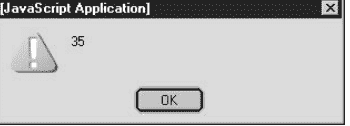

这幅图描绘了当最终发布兼容 JavaScript 2 的浏览器时，我们预期看到的结果。

### 在静态成员和实例成员之间选择

我们在第 3 章讨论内置 Math 方法时考察了静态类成员的概念。基本上，*静态成员* 是仅在类本身中定义，而不在从该类派生的任何对象中定义的任何属性或方法。你甚至不必定义某个类的对象就可以访问其静态成员。静态成员使用 **static** 关键字定义。

```
class Books {
    static const MAX_WIDTH = 8.5;
    static const MAX_HEIGHT = 11;
    static const MAX_WEIGHT = 10;
    var title;
    var author;
    var page_count;
}
```

在这里定义的 Books 类中，我们定义了三个静态成员。它们恰好被定义为常量，但变量甚至函数也可以被定义为静态。为了访问它们，我们通过 Books 类来调用它们，而不是通过任何基于 Books 创建的对象。

```
alert (Books.MAX_HEIGHT);
```

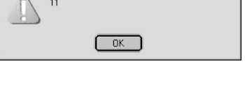

这幅图描绘了当最终发布兼容 JavaScript 2 的浏览器时，我们预期看到的结果。

*实例成员* 是指任何非静态的成员。实例成员通过已创建的对象访问，不能直接使用类来访问。

```
var myBooks = new Books();
myBooks.title = "How To Do Everything With a Pencil";
myBooks.author = "Mary Major";
```

在这段代码中，title 和 author 都是实例成员，它们只能通过基于 Books 类的对象（myBooks）来访问，而不能通过类本身访问。

### 将类成员设为公共或私有

面向对象编程中另一个常见任务是定义无法从类外部访问的成员。这主要用于安全性和数据完整性。

成员使用 **private** 关键字设为私有，使用 **public** 关键字设为公有。默认情况下，未明确指定为任何一种的成员都是公有的。

```
class Car {
    private var Make : String;
    private var Model : String;
    private var Year : Integer;
    private var Color : String;

    public function setMake (value) : Void {
        this.Make = value;
    }
    public function setModel (value) : Void {
        this.Model = value;
    }
    public function setYear (value) : Void {
        this.Year = value;
    }
    public function setColor (value) : Void {
        this.Color = value;
    }
}
```

在这段代码中，Car 类的所有属性都被定义为私有。这意味着它们无法从类外部访问。尝试执行以下操作将导致错误。

```
var myCar = new Car();
myCar.Make = "Mercedes";
```

### 第5章：创建你自己的 JavaScript 类

要设置属性，我们必须调用我们为自己创建的公共方法。以下代码将有效。

```
var myCar = new Car();
myCar.setMake ("Mercedes");
```

请注意我们如何创建了一个 Car 类，使得无法读取属性的值。在现实世界中，该类还将包含许多函数来检索这些值。

显然，关于 JavaScript 中的类还有更多需要学习的内容，包括 getter 和 setter、包和命名空间。但这些主题超出了本章和本书的范围。有关类的更多信息，请参阅 Mozilla 网站上的官方 JavaScript 2.0 规范，网址为 http://www.mozilla.org/js/language/js20/core/classes.html。

在下一章中，我们将开始学习如何应用前四章学到的概念，同时我们将在网页中使用 JavaScript。我们将学习一些关键的 HTML 标签以及 JavaScript 应该在网页中的位置。


# 第二部分
## 构建支持 JavaScript 的网站

## 第 6 章
## 在网页中嵌入 JavaScript

### 如何操作……

- 了解基本的 HTML 结构
- 使用 `<script>` 将 JavaScript 添加到网页中
- 使用 `<noscript>` 为不支持脚本的浏览器提供备选内容
- 加载外部 JavaScript 文件
- 通过超链接调用 JavaScript

到目前为止，本书一直聚焦于 JavaScript 的编程语法——构成这门语言骨架的语句和定义。如你所见，JavaScript 拥有众多特性，使其成为完成许多任务的理想语言，而它最强大的特性之一就是能够融入各种不同的环境。

JavaScript 存在于许多不同的环境中：

- 用于 Microsoft IIS Web 服务器的应用程序服务器页面（ASP）语言（其支持的多种语言之一）
- 用于 Netscape/iPlanet Web 服务器的服务端 JavaScript（SSJS）
- 用于其他 Web 服务器的服务端编程语言
- 用于 Adobe Acrobat PDF 文档的嵌入式语言
- 用于 Macromedia Flash 文件的嵌入式语言（ActiveScript）

但即便是在今天，距离 JavaScript 首次推出已近十年，它最大的成功仍然是作为网页的嵌入式编程语言。如今几乎每一个在用的 Web 浏览器都支持它——全球有数亿台 PC 安装了它。在本章中，我们将探讨如何将 JavaScript 嵌入 HTML 页面，以及一些基本的文本格式化技术。

#### 了解基本的 HTML 结构

超文本标记语言，简称 HTML，是编写网页的语言。HTML 被称为标记语言，因为它使用一组预定义的标签或*标记*来向 Web 浏览器提供格式化和其他指令。

例如，以下示例包含多个 HTML 标记标签：

```
<font size="2"><b>Now is the time</b> for all good men <u>to come to the aid</u> of <i>their party</i>.</font>
```

如你所见，HTML 标记标签始终包含在尖括号（< 和 >）中。大多数 HTML 标签都有一个起始标签（例如粗体文本标签 `<b>`）和一个闭合标签（如 `</b>`），尽管也存在一些例外。

下图展示了包含上述标记的 HTML 文档在标准 Web 浏览器中的显示效果。

> 闭合标签总是以正斜杠字符（/）开头，后跟相关起始标签的名称。例如，如果起始标签是 `<font>`，则闭合标签必须是 `</font>`。

关于 HTML 的书籍已经出版了无数本。实际上，更准确地说，相关书籍多到可以装满好几个书架（甚至书柜）。在本章及后续章节中，我的目标并非真正教授 HTML 的方方面面。但由于 JavaScript 程序很大程度上依赖于浏览器内部的运作（框架、表单、浏览器事件等），如果不先了解相关的 HTML，就无法理解 JavaScript 的行为。作为参考，附录 A 列出了每个 HTML 4.01 标签并简要说明了它们的用途。

> 主要的浏览器制造商（Microsoft 和 Netscape）在某些情况下添加了自己的标签，因此它们的标签列表可能与附录 A 中的官方列表不一致。

##### 为什么 XML 和 XHTML 是未来的趋势

虽然人类可以轻松地通过 Web 浏览器阅读 HTML 文档，但计算机本身很难从网页中提取特定数据。例如，要创建一个能够可靠地从所有航空公司网站下载每日航班时刻表的应用程序是非常困难的。

XML（可扩展标记语言）是在互联网上传输计算机数据的理想语言。HTML 是一种极其灵活的标记语言，只有很少的必选元素或属性，而 XML 有一套严格的格式化规则。程序员可以通过创建 XML 架构或 DTD 对特定类型的文档施加额外的规则。XML 是互联网数据格式化的新标准，也是许多 Web 服务计划的基础，包括 Sun ONE 和 Microsoft .NET。

HTML 的一个新版本已经创建，它允许网页文档同时也是有效的 XML，称为 XHTML。事实上，万维网联盟（W3C）已停止开发 HTML 标准（版本 4.01），并一直在致力于 XHTML 标准——版本 1.0 和 1.1 已经发布。

有关 XHTML 标准的更多信息，请访问 W3C 网站 http://www.w3c.org/markup。

此外，如第 1 章所述，HTML 中有一组特殊的标签用于表示注释：`<!--` 表示注释文本的开始，`-->` 表示注释的结束。注释可作为有用的文档或作者说明，例如以下内容：

```
<!-- Survey.html
    Purpose: To gather visitor opinions on this site
    Author: John Q. Doe
-->

<!-- Copyright 2003, Scott J. Duffy Incorporated
    All rights reserved. -->
```

如你所见，注释可以跨越多行。出现在 HTML 注释标记内的所有文本都会被浏览器忽略，不会在主显示区域中呈现给用户。

> **注意** *别忘了用户可以在大多数浏览器中通过选择菜单栏中的"查看 | 源文件"来查看底层 HTML 代码，因此你的注释并不会完全私密。*

##### "正式弃用"是什么意思

万维网联盟（W3C）——负责创建和维护包括 HTML 在内的多项互联网重要规范的组织——已经指出一些 HTML 标签已被*弃用*。

标记一个标签为弃用是一种委婉的说法，意味着该标签在规范中的支持可能会在未来的版本中被移除。W3C 希望鼓励 Web 开发者改用其他方法，例如使用层叠样式表（CSS）来定义字体。

然而，鉴于 `<font>`、`<center>` 和 `<u>` 等标签的广泛使用，主要的浏览器制造商不太可能在短期内放弃对它们的支持。

##### 构建 HTML 文档

HTML 的优势之一是简单性：只需几个基本标签就能轻松构建一个网页。构建网页有三个基本要素：

1. 每个 HTML 文档必须以 HTML 起始标签（`<html>`）开始，以 HTML 闭合标签（`</html>`）结束。唯一的例外是 `<!DOCTYPE>` 或 `<?xml?>` 声明语句，它们放在 HTML 标签之前。（`<?xml?>` 声明用于定义符合 XHTML 的文档，这超出了本书的范围。但我们将在下一节中介绍 `<!DOCTYPE>`。）

```
<html>
</html>
```

2. 然后 HTML 文档被分为两个部分：head 和 body。head 部分用于定义文档标题、描述性关键词、样式表和 JavaScript 函数。

```
<html>
  <head>
    <title>How to Do Everything with JavaScript</title>
  </head>
</html>
```

3. body 部分用于放置文档内容。通常内容是纯文本（句子和段落），并使用一些格式化 HTML 标签如 `<b>`、`<i>` 和 `<p>` 进行标记。

```
<html>
  <head>
    <title>How to Do Everything with JavaScript</title>
  </head>
  <body bgcolor="white">
    <h1>A typical document header</h1>
    <p>The start of a paragraph.</p>
    <p><b>Our second paragraph.</b></p>
  </body>
</html>
```

当然，示例中的网页非常简单，但即使是包含数百行代码的网页也始于三个简单的标签：`<html>`、`<head>` 和 `<body>`。

> **提示** *养成使用小写标签名称、正确嵌套标签和正确引用属性值的习惯来创建所有 HTML 文档。当你开始创建 XHTML 1.0 文档时，这将大有裨益，因为 XHTML 有非常严格的规则。*

你可能已经熟悉 HTML 的基础知识。如果不熟悉，由于无法将 HTML 教程压缩到一章中，我在本章末尾附上了一份实用网站列表。

##### 用 `<!DOCTYPE>` 指定文档类型

向浏览器（或任何其他读取 HTML 文件的应用程序）表明你的网页是基于哪个版本的 HTML 编写的，只有一种方式：`<!DOCTYPE>`。直到几年前，这个标签还完全被 Web 浏览器忽略。但最近版本的浏览器会查找这段代码，以确定应使用哪套规则来解释网页。

符合 HTML 4.01 规范的 HTML 文档，其页面的第一行（甚至在 `<html>` 标签之前）应为以下 `<!DOCTYPE>` 声明：

```
<!DOCTYPE HTML PUBLIC "-//W3C//DTD HTML 4.01 Transitional//EN"
  "http://www.w3.org/TR/html4/loose.dtd">
```

如果浏览器遇到使用了此 `<!DOCTYPE>` 标签的网页，它将期望文档其余部分是有效的 HTML 4.01 Transitional 代码。*Transitional* HTML 包含所有已弃用的标签（如 `<font>`）。还有一种称为 *Strict* 的 HTML 版本不包含已弃用的标签，另外还有一种称为 *Frameset* 的版本允许创建浏览器框架。（我们将在第 10 章中介绍浏览器框架。）

如果我们想使用其他版本的 HTML，比如 XHTML（符合 XML 规范的 HTML 版本），我们会使用不同的 `<!DOCTYPE>`，如下所示：

```
<!DOCTYPE html PUBLIC "-//W3C//DTD XHTML 1.0 Transitional//EN"
  "http://www.w3.org/TR/xhtml1/DTD/xhtml1-transitional.dtd">
```


当浏览器遇到这个 `<!DOCTYPE>` 时，它就会知道将文档内容作为 XHTML 1.0 Transitional 来处理。根据浏览器的不同，这可能与它处理 HTML 4.01 代码的方式略有不同。

#### 添加标题并定义文档关键词

HTML `<head>` 元素包含有关当前文档的信息，例如其标题、关键词以及其他不被视为内容的数据。HTML `<title>` 标签用于指定文档的标题，并且在 HTML 4.01 中是必需的。

```html
<html>
    <head>
        <title>This is the document title</title>
    </head>
    <body></body>
</html>
```

`<title>` 标签的内容通常显示在窗口的标题栏中，正如你在这里看到的：

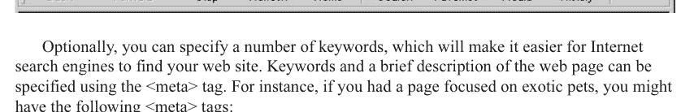

你可以选择指定一些关键词，这将使搜索引擎更容易找到你的网站。关键词和网页的简要描述可以使用 `<meta>` 标签来指定。例如，如果你有一个专注于奇异宠物的页面，你可能会使用以下 `<meta>` 标签：

```html
<meta name="description" content="Articles, pictures, and stories about exotic pets">
<meta name="keywords" content="exotic pets, reptiles, amphibians, frog, toad, salamander, newt, siren, lizard, iguana, gecko, monitor, chameleon, dragons, turtles, tortoises, leopard, butterfly, butterflies, moth, bees, flies, stick insects, beetles, wasps, hornet, roaches, ants, cricket, grasshopper, tarantula, scorpion, centipede, millipede">
```

当用于指定网页描述和关键词时，`<meta>` 标签采用两个属性：`name` 和 `content`。在前面的代码中，第一个 `<meta>` 标签设置了描述。

#### 使用 HTML 元素格式化文本

HTML 提供了多种元素来帮助网页开发者格式化和设置文本样式。这些标签大致分为两类：*短语元素* 和 *字体样式元素*。短语元素是用于组织文本的标签。这些元素呈现给用户的方式取决于浏览器。字体样式元素是为文本指定特定字体属性的标签。由于字体样式属性相当具体，开发者可以更确信浏览器将如何向用户呈现文本。

以下是 HTML 4.01 中的短语元素：

- `<abbr>` 表示缩写形式
- `<acronym>` 表示首字母缩略词
- `<cite>` 表示引用或参考其他来源
- `<code>` 指定一段计算机代码
- `<dfn>` 表示术语的定义实例
- `<em>` 表示强调；通常显示为斜体文本
- `<kbd>` 表示用户要输入的文本
- `<samp>` 表示来自程序、脚本等的示例输出
- `<strong>` 表示更强的强调；通常显示为粗体文本
- `<var>` 表示变量或程序参数的实例

同样，这些元素中的每一个都指示其包含的文本类型，但仅暗示浏览器应如何处理它们。

以下是 HTML 4.01 的字体样式元素标签：

- `<b>` 粗体文本
- `<big>` 比正常文本大
- `<i>` 斜体文本
- `<s>` 删除线文本（已正式弃用）
- `<small>` 比正常文本小
- `<strike>` 删除线文本；与 `<s>` 相同（已正式弃用）
- `<tt>` 电传打字机或等宽文本
- `<u>` 带下划线的文本（已正式弃用）

### 第 6 章：在网页中嵌入 JavaScript

在绝大多数 HTML 页面中，并没有使用短语元素。许多网页设计者更喜欢为他们的页面明确设置字体和样式。除了不同浏览器将如何渲染这些标签存在不确定性之外，使用这些预定义的文档结构元素也限制了设计者的设计选择。

存在数亿个网页，它们仅使用此处列出的 HTML 元素来设置页面上的文本样式。例如，以下 HTML 代码创建了一个使用了本章到目前为止讨论的许多样式标签的网页。

```html
<html>
    <head><title>Sample document</title></head>
    <body>
    <h1>Traveling to the Caribbean</h1>

    <p><b>Barbados</b> - Barbados is a lovely island, with
    <i>wonderful weather</i> and a <i>constant cool breeze</i>. The
    locals are friendly, and one can clearly see that a British
    influence still exists, even today.</p>

    <p><b>St. Lucia</b> - St. Lucia is a lush, tropical paradise.
    Fewer tourists tend to visit St. Lucia than some of the other
    islands, which means it is easier to explore the local way
    of life.</p>

    <p><b>Bahamas</b> - Bahamas is <strike>frequently visited
    by</strike> <u>a popular spot for</u> Americans. The islands have a
    number of casinos, the most spectacular of which is the <i>Atlantis
    Hotel on Paradise Island</i>. The rumor is that one of their hotel rooms
    goes for <big>$40,000 a night</big>, which is about $39,800 more than
    most people can afford to spend on a place to sleep.</p>
    </body>
</html>
```

## 如何用 JavaScript 做所有事

从下面的屏幕截图中可以看出，HTML 元素为文本设置样式，使输出更易于阅读。应该显示为粗体、斜体或带删除线的文本，其呈现方式完全符合预期。

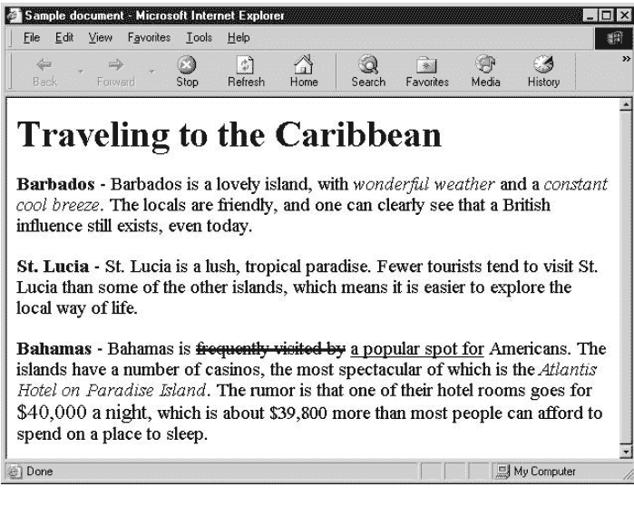

#### 使用样式表格式化文本

多年来，网页设计师一直想要一种更精确的方式来设置网页样式和布局，类似于桌面出版软件长期以来提供的工具。终于，样式表出现了，它缓解了设计师对网页样式化的大部分担忧。

> W3C 关于层叠样式表的主页是 http://www.w3.org/Style/CSS。毫不奇怪，该页面本身就是一个很好的例子，展示了样式表如何用于格式化网页。

样式表，有时也称为层叠样式表（简称 CSS），为网页开发者带来了诸多好处。它们提供了：

- 将样式与内容分离的能力
- 将单一样式应用于整个网站的能力
- 更精细的样式控制能力
- 指定精确布局定位的能力
- 使用 JavaScript（也称为动态 HTML）编写脚本并动态更改样式的能力
- 根据浏览器环境（例如，PC 与手机）指定不同样式的能力

事实上，HTML 规范正在逐步淘汰上一节列出的用于定义样式的 HTML 标签，转而支持样式表。使用样式表来定义文档样式是该语言的现在和未来。

样式表在 HTML `<style>` 元素内定义，该元素通常在文档 `<head>` 部分内定义。

```html
<html>
    <head>
        <title>HTML Style Sheets</title>
        <style type="text/css">

        // 样式表放在这里

        </style>
    </head>
    <body>
    <h1>Traveling to the Caribbean</h1>

        <p><b>Barbados</b> - Barbados is a lovely island, with
        <i>wonderful weather</i> and a <i>constant cool breeze</i>. The
        <!-- 等等 -->
    </body>
</html>
```

对于我们的 HTML 文档，我们可以定义一个自定义样式表来替换我们之前使用的一些格式。

```css
.island {font-weight: bold}
.highlight {font-style: italic}
.underlinethis {text-decoration: underline}
.bigmoney {font-size: larger}
```

事实上，你可以为我们的枯燥文档添加一些真正有趣的文本效果，如下例所示。一旦定义了样式表，你只需修改 HTML 以使用这些样式。

## 152 如何用 JavaScript 做所有事

```html
<html>
  <head>
    <title>Sample document</title>
    <style type="text/css">
      .island {
        color: white;
        background-color: black;
        font-weight: bold
      }
      .highlight {
        font-style: italic;
        background-color: yellow
      }
      .underlinethis {
        text-decoration: underline overline
      }
      .bigmoney {
        color: green;
        font-size: xx-large
      }
    </style>
  </head>
  <body>
    <h1>Traveling to the Caribbean</h1>
    <p><span class="island">Barbados</span> - Barbados is a lovely island, with <span class="highlight">wonderful weather</span> and a <span class="highlight">constant cool breeze</span>. The locals are friendly, and one can clearly see that a British influence still exists, even today.</p>
    <p><span class="island">St. Lucia</span> - St. Lucia is a lush, tropical paradise. Fewer tourists tend to visit St. Lucia than some of the other islands, which means it is easier to explore the local way of life.</p>
    <p><span class="island">Bahamas</span> - Bahamas is <strike>frequently visited by</strike> <span class="underlinethis">a popular spot for</span> Americans. The islands have a number of casinos, the most spectacular of which is the <span class="highlight">Atlantis Hotel on Paradise Island</span>. The rumor is that one of their hotel rooms goes for <span class="bigmoney">$40,000 a night</span>, which is about $39,800 more
```


```
than most people can afford to spend on a place to sleep.

生成的网页或许拿不到任何设计奖项，但你可以看到，样式表让你能够实现普通HTML做不到的事情。

显然，样式表涉及的内容远不止这个简短章节中我能为你浅尝辄止的那一点点。我在本章末尾列出了一些网站供你了解更多关于样式表的知识。我们还将在第12章重新探讨这个主题。

#### 使用 <script> 为网页添加 JavaScript

既然你已经接触了一些基本的HTML格式化元素，现在是时候将其与JavaScript的使用联系起来了。HTML `<script>` 标签允许网页开发者将JavaScript命令嵌入到他们的网页中。一个网页文档可以包含的 `<script>` 部分的数量没有限制，不过出于编程效率考虑，最好将单个页面上的脚本数量保持在最少。

当你使用嵌入式脚本内容时，HTML `<script>` 元素通常只接受两个属性：language 和 type。language 属性是为了向后兼容而存在的。JavaScript 是所有主要网页浏览器都支持的唯一脚本语言，因此如果省略此属性，“JavaScript” 将是默认值。

type 属性指定嵌入脚本的 MIME 类型，在我们的用途中是 “text/javascript”。MIME 是一种在互联网上描述文件内容的标准方式，例如 “text/plain” 和 “image/gif”。这解决了 MS-DOS 时代（20年前）遗留下来的三字母文件扩展名（.htm 或 .txt）的问题。

MIME 标准起源于电子邮件系统，它允许网络服务器告诉浏览器如何解释发送过来的比特流。例如，网页浏览器知道文件 http://www.example.com/ 是一个HTML文档的唯一途径，就是通过它的 MIME 类型。

```
<script language="JavaScript" type="text/javascript">
    var a = 1;
    var b = 2;
    var c = a + b;
    document.write (c);
</script>
```

在本章后面，我们将探讨 `<script>` 标签的另一个用途，它涉及外部JavaScript内容。

#### 使用 <noscript> 为不支持脚本的浏览器提供内容

即使在今天，随着网页浏览器和网络编程语言的所有技术进步，并非每个浏览器都支持JavaScript。例如，许多手机提供互联网接入，但它们在屏幕尺寸、色彩、音频和脚本能力方面都受到严重限制。还有一些PC上的网页浏览器（比如嵌入在Microsoft Word中的那个）不支持JavaScript等高级功能。并且一些前JavaScript时代的浏览器仍在使用，比如 Netscape Navigator 1.0。

然而，与1995年JavaScript首次出现时相比，支持非JavaScript兼容设备现在确实不那么重要了。但是，随着计算机操作系统和硬件设备种类的不断增加，为某些用户提供替代内容可能再次变得重要起来。

HTML `<noscript>` 标签用于向其浏览器不支持JavaScript的用户提供内容。它之所以有效，是因为启用了JavaScript的浏览器会忽略 `<noscript>` 标签之间的任何内容，例如：

```
<html>
    <head>
        <title>JavaScript Test</title>
    </head>
    <body>
        <h1>for Loop</h1>
        <script language="JavaScript" type="text/javascript">
            <!-- // Begin
            var Fahrenheit;
            for (var Celsius = 10; Celsius <= 60; Celsius = Celsius + 5) {
                document.write (Celsius + "&deg;C = ");
                Fahrenheit = (Celsius * 9/5) + 32;
                document.write (Fahrenheit + "&deg;F<BR>");
                if (Fahrenheit > 100) {
                    // It's getting hot in here
                    break;
                }
            }
            // End -->
        </script>
        <noscript>
            You must have a JavaScript-enabled browser
            to visit this web page.
        </noscript>
    </body>
</html>
```

这段代码将为拥有支持JavaScript浏览器的用户显示以下输出。

然而，浏览器不支持JavaScript的用户将看到此消息。

JavaScript 没有被一同输出到屏幕上的唯一原因，是脚本周围的HTML注释标签：`<!--` 和 `-->`。

在 `<noscript>` 标签内，你可以选择简单地告知用户需要一个支持JavaScript的浏览器。但你也可以为JavaScript提供替代内容，就像这个例子中那样：

```
<noscript>
    10°C = 50°F <BR>
    15°C = 59°F <BR>
    20°C = 68°F <BR>
    25°C = 77°F <BR>
    30°C = 86°F <BR>
    35°C = 95°F <BR>
    40°C = 104°F <BR>
</noscript>
```

这将使拥有各种浏览器和硬件设备的用户都能正确查看你的网站。挑战。当然，并非总是可能将JavaScript内容替换为纯HTML文本。

#### 加载外部 JavaScript 文件

JavaScript 不一定非要嵌入在HTML文件内部。通常，将JavaScript放在一个单独的文件中，然后让多个HTML文件导入以供使用，这样会更方便。使用这种技术，对JavaScript进行修改会更容易，因为你无需更改每个HTML文件。

首先，你必须有一个只包含JavaScript的文本文件。假设以下文件存在于网络服务器上，并命名为 sample.js。

```
// SAMPLE.JS
//
// isFloat() function:
//     Checks a string to see if it contains a
//     floating-point number; returns true or false
//
function isFloat (s)
{
    // Format accepts "9", "9.", "9.9", and ".9"
    var reFloat = /^((\d+(\.\d*)?)|(\d*\.?)?\d+)$/;

    return reFloat.test(s)
}
```

> 注意：.js 文件扩展名在Windows系统中通常用于表示文件包含JavaScript，尽管任何扩展名（如 .txt）都可以使用。

我们使用HTML `<script>` 标签的 src 属性来导入外部JavaScript文件。

```
<html>
    <head>
        <title>JavaScript Test</title>
        <script language="javascript" src="sample.js"></script>
    </head>
    <body>
        <h1>Check for a Floating Point Number</h1>

        <script language="JavaScript" type="text/javascript">
            document.write("Is \"12.344\" a float? " + 
                isFloat("12.345") + "<br><br>");
            document.write("Is \"Twelve\" a float? " + 
                isFloat("Twelve") + "<br><br>");
        </script>
    </body>
</html>
```

然后，我们可以在网页中其他地方的另一个 `<script>` 部分调用在外部JavaScript文件中定义的 isFloat() 函数。通过这种方式，isFloat() 函数可以轻松地在多个网页之间共享。

注意：导入外部JavaScript文件的HTML `<script>` 标签不能同时包含JavaScript。它们必须是空的。

导入外部JavaScript文件的结果如图6.1所示。

#### 使用超链接调用 JavaScript

并非所有JavaScript都在网页加载后立即执行。我们将在第9章探讨*网页浏览器事件*，它允许JavaScript响应用户操作而运行。响应用户事件的另一种调用JavaScript的方式是作为超链接的目标。

```
<A HREF="javascript:alert('Hello')">Click me</A>
```

将此HTML加载到网页浏览器中会导致一个可点击的超链接显示出来，并带有标题“Click me”。当用户点击该链接时，一个JavaScript alert() 消息框会弹出，显示“Hello”。其秘密在于HREF URL内部的特殊“javascript:”前缀。这告诉浏览器，我们真正想做的是调用一个JavaScript命令。

多个JavaScript命令可以连接在一个字符串中，如果用分号分隔的话。

```
<A HREF="javascript:alert('Hello');alert('Goodbye')">Click me</A>
```

更常见的是，JavaScript超链接用于调用预定义函数，而不是将一条或多条JavaScript语句嵌入到HREF属性值本身中。

```
<A HREF="javascript:submitform()">Click here to submit the form</A>
```

在这个例子中，当用户点击标有“Click here to submit the form”的超链接时，JavaScript将调用一个名为 submitform() 的函数，我们假设它在网页的其他地方已经定义。

在下一章，我们将探讨网页开发者在创建跨平台兼容JavaScript时所面临的挑战。在一个网页浏览器中有效的JavaScript程序，在另一个浏览器中不一定有效，因为存在着数十种浏览器、硬件平台和操作系统的组合。了解如何在现实世界的网页开发中绕过这些差异是很重要的。

#### 进一步了解本章主题

以下是一些你可以了解更多关于HTML和层叠样式表的网站：

- Webmonkey HTML Basics: http://hotwired.lycos.com/webmonkey/teachingtool
- SitePoint: http://www.webmasterbase.com
- Web Design Group CSS Reference: http://www.htmlhelp.com/reference/css
- Dave Raggett's Introduction to CSS: http://www.w3.org/MarkUp/Guide/Style
```


# 第7章

## 创建在所有浏览器中都能正常运行的脚本


## 用JavaScript实现一切

### 如何……

- 了解浏览器差异
- 检测用户正在使用哪种类型的浏览器
- 查询文档模型
- 遵循Web标准
- 编写跨浏览器代码

在JavaScript开发的早期，处理不同浏览器厂商和版本之间的差异是一项艰巨的任务。毕竟，有些浏览器完全不支持JavaScript（如Netscape 1.0）。即使你使用的是支持JavaScript的浏览器，不同浏览器背后的文档模型（DOM）也不相同，这意味着JavaScript错误司空见惯。

开发能在所有浏览器中正确运行的JavaScript代码之所以困难，主要是由以下几个因素造成的：

- 每隔几个月就有新的浏览器版本发布
- 浏览器公司之间持续不断地竞相添加新功能
- 缺乏HTML或JavaScript标准

这花了一段时间，但随着JavaScript逐渐稳定，问题最终开始消失。而且随着用户逐渐升级到4.0及以上版本的浏览器，JavaScript开发人员开发跨平台兼容代码的工作变得轻松了许多。

不幸的是，JavaScript的一些即将发生的变化将迫使Web开发人员再次开始针对浏览器差异进行编码。导致这一新不稳定时期的原因可能包括：

- 对JavaScript 2.0的支持不一致
- 每隔几个月就有新的浏览器版本发布（特别是来自Mozilla的）
- 对XML和CSS等新技术的JavaScript支持不一致

这些因素会给Web开发人员带来多少麻烦，只有时间能告诉我们。

#### 了解浏览器差异

根据最近的一项调查，Microsoft Internet Explorer（IE）被大约94%的网民使用。Netscape和Mozilla的合计使用率约为2%。剩余的4%在Opera等其他公司之间分配，或因四舍五入而丢失。

这些数字在未来几个月和几年内可能会发生变化。美国最大的互联网服务提供商（ISP）最近宣布将把Netscape作为其默认浏览器，这可能会对这些数字产生重大影响。

如果我们更仔细地看看最近的浏览器流行度统计数据，如表7-1所示，我们可以看到一半的用户尚未升级到他谬喜欢的网络浏览器的最新版本。

整整54%的网民使用的都不是Microsoft或Netscape最新发布的浏览器版本。因此，在创建过于依赖专有或最近添加功能的JavaScript程序时要小心。如果不采取适当的预防措施就使用这些功能，即使应用程序在你电脑上安装的浏览器中运行良好，也可能会导致相当一部分用户遇到错误。

##### 可能会出现什么样的错误？

在设计任何计算机程序时，重要的是要记住，尽管程序员尽了最大努力避免错误，但错误仍然可能发生。对于在多种浏览器和操作系统上使用的JavaScript程序来说尤其如此。在开发JavaScript代码时，你可能会发现以下错误来源：

- 各浏览器版本的文档对象模型存在差异
- 客户端计算机运行的是旧版浏览器（如Netscape 3.0），不支持某些JavaScript功能
- 客户端计算机的某些技术被关闭，如Cookie或Java
- 新的支持Web的技术，如手持设备、移动电话，甚至是冰箱等家电

在本章中，我们将介绍一些避免这类错误的常用技术。

| 浏览器 | 使用率 |
|---|---|
| IE 6 | 46% |
| IE 5 | 44% |
| IE 4 | 2% |
| Netscape 4 | 2% |
| Netscape 6、Netscape 7、Mozilla（合计） | 1% |
| 旧版IE | 不足1% |
| 旧版Netscape | 不足1% |

来源：TheCounter.com（http://www.thecounter.com）

表7-1 最近的Web浏览器使用统计

##### 检测用户正在运行哪种类型的浏览器

在旧版浏览器中运行现代或复杂的JavaScript程序很可能会导致大量问题。避免这类错误的最简单方法可能是检测用户正在运行哪种类型的浏览器，然后禁用程序的某些功能，或者提供以稍微不同方式执行相同任务的替代代码。

> **注意**
>
> 检测浏览器名称和版本信息通常被称为浏览器嗅探。就像猎犬能够探测到个体独特的气味一样，浏览器嗅探器试图检测并返回浏览器软件的独特细节。

要检测浏览器制造商和版本号，我们将依赖navigator DOM对象。navigator对象有几个方法和属性，但目前我们感兴趣的是以下三个：appName、appVersion和userAgent。

```
var browserString = navigator.appName;
var browserVersion = navigator.appVersion;
var browserAgent = navigator.userAgent;

alert (browserString);
alert (browserVersion);
alert (browserAgent);
```

##### 指定JavaScript版本号

浏览器制造商一开始出于好意。Netscape和IE都允许开发者在`<script>`标签的language属性中指定JavaScript版本号。这样可以防止脚本在不支持指定JavaScript版本号的浏览器中运行。要创建一个只在支持JavaScript 1.2的浏览器中运行的脚本，你可以使用以下代码：

```
<script language="JavaScript1.2">
```

对于所有最高到1.5版本的JavaScript，都可以这样做。（JavaScript版本号列表及其与浏览器的对应关系见第1章。）

不幸的是，很少有Web开发人员知道可以这样做，而实际在创建跨浏览器脚本时使用这种技术的人更是少之又少。除此之外，这种方法并不能帮助开发者解决各种浏览器之间与DOM相关的差异的眼中问题。

因此，尽管这种技术仍然可用，但不能指望它来解决跨浏览器脚本问题。

对于Netscape浏览器（包括开源的Mozilla浏览器），navigator.appName属性始终返回相同的值，与版本或操作系统无关。

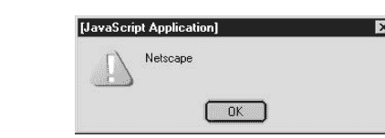

对于Microsoft Internet Explorer，navigator.appName属性也返回可预测的值，与版本无关。

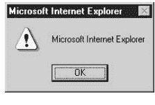

因此，如果你的网页需要根据个人访问者使用的浏览器显示不同的文本，你只需查询navigator.appName属性，如下所示：

```
var browserString = navigator.appName;

if (browserString == "Netscape") {
    // 在此处为Netscape/Mozilla执行某些操作
    document.write ("Long live the lizard.");

} else if (browserString == "Microsoft Internet Explorer") {
    // 在此处为Microsoft执行某些操作
    document.write ("You will be assimilated.");

} else {
    // 浏览器不是两大主流浏览器之一
    document.write ("Why must you always be so different?");
}
```

然而，navigator.appName提供的信息量极其有限。其他navigator属性能提供更有用的信息。例如，navigator.appVersion属性提供了更具体的浏览器版本信息。对于Netscape浏览器，该属性返回的字符串相当直接明了。

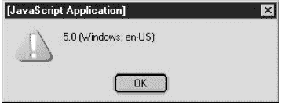

> 此截图来自在Windows 98上运行的Netscape 7.0。为了让Web开发人员的生活更加困惑，Netscape 6和7都将其版本号返回为"5.0"。然而，Netscape并没有发布5.0版本（版本号从4.8跳到了6.0），所以这个版本号并不准确。

同样，Microsoft Internet Explorer也在navigator.appVersion字符串中返回其版本信息，我们可以从以下取自Microsoft Internet Explorer 6.0的快照中看到。

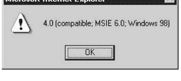

最新发布的Microsoft浏览器总是将其版本号报告为与4.0兼容。然而，实际的版本号嵌入在同一字符串的后面（在本例中，是MSIE 6.0）。

Mozilla 1.x、Netscape 6.0和Netscape 7.0浏览器都基于相同的源代码，因此它们的行为非常相似。如果你需要从这些浏览器中获取确切的浏览器名称和版本号，可以查询navigator对象的userAgent属性。正如你从以下图示中看到的，它包含了一些非常具体的版本号信息，精确到浏览器编译的确切日期。

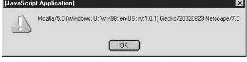


### 第七章：创建适用于所有浏览器的脚本

通过这三个属性，我们可以创建一个JavaScript函数来检测用户正在运行的具体浏览器类型：

```
function getBrowserInfo() {
    // Define variables to contain the results
    var browserName = navigator.appName;
    var browserVersionNum = parseFloat(navigator.appVersion);
    var browserAgent = navigator.userAgent;

    // Boolean (true or false) variables to detect browser type
    var is_IE = (browserAgent.indexOf("MSIE") != -1);
    var is_NN = (browserName.indexOf("Netscape") != -1);

    // Based on browser type, retrieve version number
    if (is_NN) {
        if (browserVersionNum >= 5.0) {
            var tempStart = browserAgent.indexOf("Netscape/");
            if (tempStart == -1) {
                // "Netscape/" not found; must be Mozilla
                tempStart = browserAgent.indexOf("rv:");
                tempStart += 3;
                browserName = "Mozilla"
                var tempEnd = browserAgent.indexOf(")", tempStart);
            } else {
                // "Netscape/" found; must be Netscape Gecko
                tempStart += 9;
                var tempEnd = browserAgent.length;
            }
            var browserVersion =
                browserAgent.substring(tempStart, tempEnd);
        } else {
            // version < 5.0; must be old Netscape
            var browserVersion = browserVersionNum;
        }

    } else if (is_IE) {
        var tempStart = browserAgent.indexOf("MSIE");
        tempStart += 5;
        var tempEnd = browserAgent.indexOf(";", tempStart);
        var browserVersion =
            browserAgent.substring(tempStart, tempEnd);
    }

    // Create new property of navigator object based on real
    //       version number
    navigator.appRealVersion = browserVersion;

    return;
}
```

```
getBrowserInfo();
```

```
document.write ("<h1>You appear to be running:<br><br>");
document.write ("<b>" + navigator.appName + "</b> <i>version</i> ");
document.write ("<b>" + navigator.appRealVersion + "</b></h1>");
```

如你所见，我们需要编写相当多的代码才能确定各种版本的Netscape浏览器的实际版本号。对于Netscape 4及更早版本，`navigator.appVersion`属性返回正确的值。由于Netscape 6、7以及Mozilla都将`navigator.appVersion`返回为5.0，我们必须开始搜索`navigator.userAgent`属性以获取相应的值。

> 注意：前面的代码已经为本示例进行了简化，因此未涵盖所有可能的浏览器类型或版本。关于一个优秀的浏览器检测脚本示例，我推荐查看Bob Clary的实用浏览器嗅探脚本（http://bclary.com/xbProjects-docs/ua），该脚本利用`navigator`对象的属性来确定浏览器类型和版本。该网站还包含一个脚本（http://bclary.com/xbProjects-docs/xbDOM），允许你在所有浏览器中使用一套标准的DOM对象。

以下插图展示了我们的小程序在Netscape 2.0和Netscape 7.0中的运行情况。

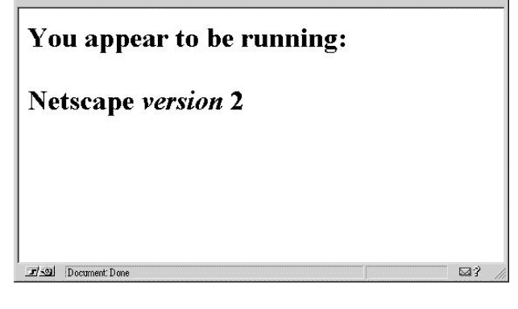

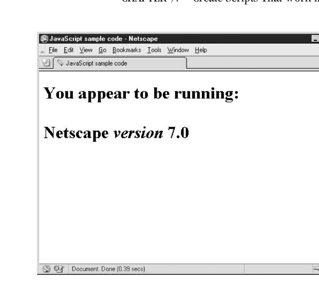

微软的Internet Explorer一直以完全相同的方式提供其版本号。它在`navigator.appVersion`属性中将自己报告为兼容Netscape 4.0，并将实际的软件版本号嵌入在同一字符串的其他位置。使用JavaScript的`String`对象的`indexOf()`方法相对容易地搜索到它。

#### 查询文档模型

依赖按名称和版本检查浏览器的代码的问题在于它并非万无一失。目前，大约96%的网络用户使用两个主要浏览器之一——Netscape或IE。但另外那4%呢——那些选择其他品牌，如Opera或Konqueror的用户呢？新的浏览器正在开发中，如果网站只为前两大品牌编写代码，其运行将不可靠。

另一个问题是，随着IE和Netscape新版本的发布，对不同功能的支持会发生变化。例如，Netscape 4支持一种名为`layers`的布局方法，但后来在Netscape 6推出时，该支持被放弃了。（我们将在名为“编写跨浏览器代码”的部分中更详细地讨论`layers`。）

解决当前和未来可用浏览器种类繁多问题的最简单方法是编写代码，在尝试使用DOM方法之前检查该方法是否存在。

文档对象模型的第一个官方版本（称为DOM 1）定义了一个名为`getElementById()`的`document`对象方法。较新的浏览器（如IE 5和Netscape 6）支持它，但较旧的浏览器不支持。

在不支持该方法的浏览器中直接调用`getElementById()`方法会导致错误：

```
var objptr = document.getElementById("carname");
```

因此，如果你想在使用前检查当前浏览器是否支持`getElementById()`方法，只需在调用前查询`document`对象是否拥有该名称的成员即可：

```
if (document.getElementById) {
    var objptr = document.getElementById("carname");
}
```

前面的代码在任何浏览器中都能工作，因为不支持该方法的浏览器不会执行`if`语句内的代码。当然，在这些浏览器中，变量`objptr`不会被设置，因此最好有备用代码来处理这些情况。

关于兼容性编码的话题，如果某个页面在一两个特定浏览器之外的所有浏览器上都出现问题，技术人员通常会包含一个“安全”的备用网站或信息中心。这可能会让试图寻找帮助资源却被无益地重定向的人感到沮丧。值得让此类“中心”页面尽可能在旧版和新版浏览器上都可访问，或者至少提供一个纯文本的替代途径。

)

---
```

```
if (document.getElementById) {
    var objptr = document.getElementById("carname");
} else {
    alert ("Sorry, this web page will not work in your browser.");
}
```

当然，如果你必须为每一个DOM方法的调用都加上自己的`if`语句，你的程序将变得冗长且效率低下。因此，最好的方法可能是将浏览器嗅探方法与DOM检测方法结合起来，以兼得两者之长。

#### 坚持网络标准

在网络开发的早期，最大的两家浏览器制造商正在激烈地争夺市场份额——或许过于激烈了。他们最喜欢的策略之一就是试图在功能上超越对方。消费者会下载并安装他们最喜爱浏览器的最新版本，而几天之内，下一个版本就可以下载了。那些通常需要数月时间来测试和批准新软件使用的大公司，发现自己落后于当前版本整整两个版本。

当然，这导致了两个HTML标准而不是一个，这使得网络开发者的工作比必要的要复杂得多。幸运的是，微软和Netscape最终都决定，在标准委员会批准之前，他们将推迟实施新的HTML和JavaScript功能。

然而，由于早期的“狂野西部”心态，存在一些非标准的编码实践，为实现跨平台兼容性应该避免使用。表7-2包含了一份不属于HTML 4标准的元素列表。

如果你希望创建在任何浏览器中都能一致运行的网页，应避免使用这些专有标记标签。

> 提示：如果你想检查你的网页是否符合官方标准，W3C网站提供了一个HTML验证服务，地址是http://validator.w3.org。这个工具是查看你的网页偏离官方标准程度的最简单方法。它甚至能识别任何包含问题的HTML代码。

| 专有标记 | 支持浏览器 |
|---|---|
| `<layer>` | 仅限 Netscape 4 |
| `<marquee>` | IE |
| `<bgsound>` | IE |
| `<embed>` | IE, Netscape |
| `<noembed>` | IE, Netscape |
| `<multicol>` | Netscape |
| `<spacer>` | Netscape |
| `<nobr>` | IE, Netscape |
| `<wbr>` | IE, Netscape |
| `<blink>` | Netscape |
| `<xmp>` | IE, Netscape |
| `<listing>` | IE, Netscape |
| `<plaintext>` | IE, Netscape |
| `<keygen>` | Netscape |
| `<layer>`, `<ilayer>` | Netscape |
| `<nolayer>` | Netscape |
| `<server>` | Netscape |

表7-2  专有标记标签，不属于官方HTML标准

#### 编写跨浏览器代码

本章前面，我们尝试了一些可用于检测客户端浏览器确切名称和版本号的JavaScript代码。在本节中，我们将把类似的代码用于*动态HTML*。

动态HTML（简称DHTML）是HTML标准的一种扩展，它允许JavaScript程序在网页加载到浏览器后对其进行更改和修改，而无需返回Web服务器获取新页面。在大多数情况下，JavaScript通过操作浏览器DOM中的方法和属性来实现这一点。

动态HTML被网站广泛用于提供花哨的下拉菜单、鼠标悬停时会变化的图像和文本，以及每次选中或取消选中一个复选框就会重新计算订单总成本的电子商务购物车。最近几个月，广告商也迷上了DHTML，正在创建在网页上移动的动态广告（而且无法关闭或避开）。

然而，跨浏览器的DHTML编码很困难，因为Netscape和微软浏览器所需的JavaScript代码有很大不同。虽然与仅仅几年前相比，标准化使得HTML和基础JavaScript编程变得容易多了，但浏览器间实现的DOM差异巨大，这是最后剩下的未开发领域之一。


## 172 使用 JavaScript 实现一切功能

图 7-1 展示了一个使用 DHTML 的网页示例。屏幕左侧的层次树只需简单点击鼠标即可展开和收缩。菜单项会动态地显示和隐藏，无需从 Web 服务器请求新的 HTML。这种 DHTML 菜单能为访问你网页的访客带来良好的视觉效果。

你可能遇到的首批难题之一，是 Netscape 4 使用一种称为 layers（层）的方法来定义可以应用样式的 Web 文档区域。

```
<html>
    <head><title>Layers sample</title></head>
    <body>
        
        <h1>Netscape Layers Example</h1>
        
        <layer id="mylayer">
        <font color="white"><b>A black square</b></font>
        </layer>
        
        <layer id="mylayer2">
        <b>A gray square</b>
        </layer>
        
        <script language="JavaScript" type="text/javascript">
            document.layers["mylayer"].bgColor = "black";
            document.layers["mylayer2"].bgColor = "#CCCCCC";
            document.layers["mylayer2"].moveBy (60, 10);
        </script>
    </body>
</html>
```

这段 HTML 代码仅适用于 Netscape 4.x 浏览器。我们的代码使用 HTML `<layer>` 标签定义了一个名为 mylayer 的 Netscape 层。我们还定义了第二个名为 mylayer2 的层。通过 JavaScript，我们能够改变两个层的背景颜色，并移动其中一个使其不会完全重叠。效果如图 7-2 所示。

不幸的是，前面的代码在 IE 的任何版本或较新的 Netscape 6 浏览器中都无法工作。我们需要稍微修改代码，以检测当前运行的浏览器类型，并根据检测结果执行不同的任务。

首先，我们需要修改代码使其能在所有浏览器中工作。以下代码不完全符合 HTML 标准（因为 `<layer>` 标签不是标准的一部分），但它能在 IE 和 Netscape 中都正常工作。

### 第 7 章：创建适用于所有浏览器的脚本

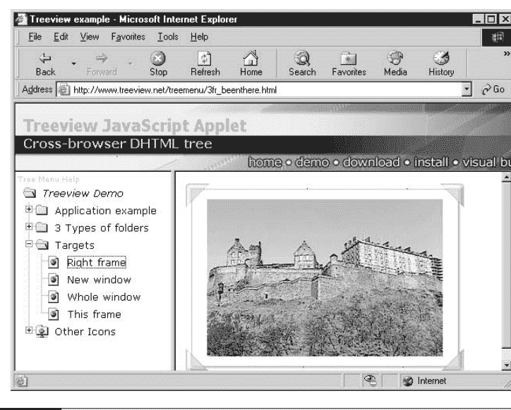

图 7-1 使用 DHTML 创建的可展开树形菜单

```
<layer id='mylayer'>
    <div id='mydiv' style='position:absolute'>
        <font color="white"><b>A black square</b></font>
    </div>
</layer>

<layer id='mylayer2'>
    <div id='mydiv2' style='position:absolute'>
        <b>A gray square</b>
    </div>
</layer>
```

174 使用 JavaScript 实现一切功能

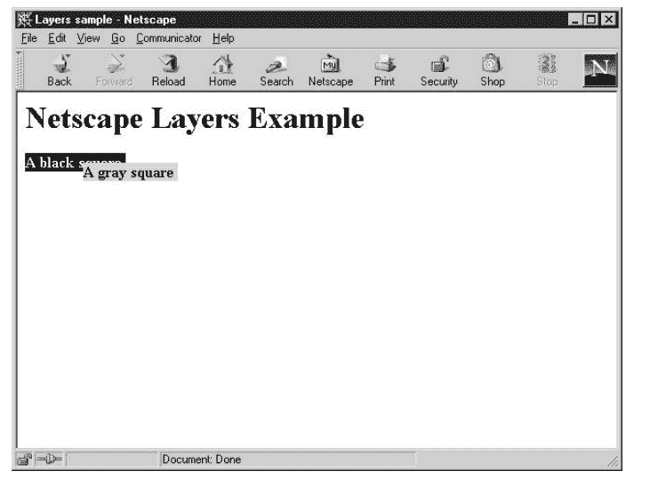

图 7-2 在 Netscape 4 中创建层

注意我们如何将符合 HTML 标准的 `<div>` 标签嵌套在非标准的 `<layer>` 标签内。不支持 `<layer>` 的浏览器会忽略它，而不支持 `<div>` 的浏览器也会忽略该标签。

接下来我们需要修改脚本来检测浏览器类型。我们可以使用本章前面介绍的 `getBrowserInfo()` 脚本，但我们的需求比那简单得多。我们只需要检测 Netscape 4、Netscape 6 和 IE 之间的区别。为此，我们可以使用以下 JavaScript 代码。

```
<script language="JavaScript" type="text/javascript">
    var ua = navigator.userAgent.toLowerCase();
    var ie4 = ua.indexOf("msie") != -1;

    if (document.layers) {
        // Netscape 4 code goes here
    } else if (document.getElementById && ie4) {
        // IE code goes here
    } else if (document.getElementById) {
        // Netscape 6 code goes here
```

### 第 7 章：创建适用于所有浏览器的脚本

175

```
}
</script>
```

这段代码的工作原理相当简单。Netscape 4 是唯一在 document 对象中具有 `layers` 属性的浏览器，因此检查该属性的存在即可确认浏览器类型为 Netscape 4。我们可以使用 document 对象的 `getElementById` 方法进行同样的判断，但仍需要区分 IE 4 和 Netscape 6。`navigator.userAgent` 属性可以帮我们做到这一点。

最后，我们添加针对特定浏览器的 DHTML 代码，来操控屏幕上的两个 `<layer>` 或 `<div>` 标签，从而创建视觉效果。

```
<html>
    <head><title>Layers sample</title></head>
    <body>
        <h1>Cross-Browser Style Sheets Example</h1>
        <layer id='mylayer'>
            <div id='mydiv' style='position:absolute'>
                <font color="white"><b>A black square</b></font>
            </div>
        </layer>
        <layer id='mylayer2'>
            <div id='mydiv2' style='position:absolute'>
                <b>A gray square</b>
            </div>
        </layer>
        <script language="JavaScript" type="text/javascript">
        var ua = navigator.userAgent.toLowerCase();
        var ie4 = ua.indexOf("msie") != -1;
        if (document.layers) {
            // Netscape 4 code goes here
            document.layers["mylayer"].bgColor = "black";
            document.layers["mylayer2"].bgColor = "#CCCCCC";
            document.layers["mylayer2"].moveBy (60, 10);
        } else if (document.getElementById && ie4) {
            // IE code goes here
            var div1 = document.getElementById("mydiv");
            var div2 = document.getElementById("mydiv2");
            div1.style.backgroundColor = "black";
            div2.style.backgroundColor = "#CCCCCC";
```

7

使用 JavaScript 实现一切功能

```
div2.style.pixelLeft = div1.offsetLeft + 60;
div2.style.pixelTop = div1.offsetTop + 10;

} else if (document.getElementById) {
    // Netscape 6 code goes here
    var div1 = document.getElementById("mydiv");
    var div2 = document.getElementById("mydiv2");
    div1.style.backgroundColor = "black";
    div2.style.backgroundColor = "#CCCCCC";
    div2.style.left = (div1.offsetLeft + 60) + "px";
    div2.style.top = (div1.offsetTop + 10) + "px";
}
</script>
</body>
</html>
```

生成的跨浏览器兼容代码在 IE 6 中的效果如图 7-3 所示，在 Netscape 7.0 中的效果如图 7-4 所示。结果与在 Netscape 4 中完全一致。


图 7-3 Microsoft IE 6 能正确解析 `<div>` 标签和 DHTML JavaScript 代码。


**图 7-4** 尽管 Netscape 7.0 需要稍有不同的 JavaScript 代码，但实现了相同的效果。

这是 JavaScript 程序员在开发跨浏览器兼容代码时常遇到的困难的一个典型示例。

在下一章中，我们将了解 JavaScript 在互联网上的主要职责之一——帮助用户填写表单。你将学习如何用 HTML 构建表单，了解表单中可以包含的所有控件，以及如何使用 JavaScript 在数据发送到服务器处理之前对输入的数据进行验证。

## 第 8 章 操作 Web 表单


180 使用 JavaScript 实现一切功能

### How to...

-   使用 HTML 表单请求用户输入
-   获取和设置表单控件的值
-   为表单提交准备数据
-   处理多个表单

在前面的章节中，我们已经了解了如何使用 JavaScript 提供动态网页，这些网页包含动画菜单，或者根据所使用的 Web 浏览器或一天中的不同时间而略有差异。随着时间的推移，开发者会发现将这些特殊的 JavaScript 技巧融入自己的个人主页变得前所未有的容易。

JavaScript 对大多数专业 Web 开发者来说之所以不可或缺，是因为它处理用户输入的能力。JavaScript 使用户信息的收集和处理变得更加简单——对用户和 Web 开发者都是如此。JavaScript 可以从多方面提供帮助：

-   在用户的计算机上存储和检索信息片段（称为 cookie）
-   验证所有必填表单字段是否已填写
-   验证用户输入数据的格式是否正确
-   无需访问 Web 服务器即可向用户提供即时反馈

最棒的是，完成所有这些操作通常非常简单——只需几行代码即可。

JavaScript 解决的问题远比它制造的多，因此它迅速成为专业 Web 开发者不可或缺的工具。

#### 理解 HTML 表单

请求用户输入的最佳且最灵活的方式是使用 HTML 表单。在 Web 编程中，表单是一系列用于捕获用户输入的一个或多个用户控件。用户控件通常是文本框、列表框或某种按钮，允许用户向 Web 浏览器提供信息。实际上，Web 表单是仿照纸质表单设计的，就像你求职申请或调查问卷中填写的那些表单一样。

HTML 中有 13 种用户控件：

-   **文本框** 允许输入单行文本
-   **密码框** 允许输入单行文本，以星号显示以保护隐私
-   **文本区域** 允许输入一行或多行文本
-   **隐藏域** 可以包含单行文本，对用户不可见
-   **列表框** 用户可以从一个或多个预定义选项中进行选择
-   **单选按钮** 用户可以从多个预定义选项中选择一个
-   **复选框** 用户可以从多个预定义选项中选择任意数量的选项


## 第八章：操作网页表单

- **文件**：用户可以从本地计算机上传文件到网络服务器
- **按钮**：触发程序定义的动作
- **提交按钮**：提交表单
- **图像按钮**：创建图形化的提交按钮
- **重置按钮**：清空表单内容
- **对象**：创建特殊的（用户定义的）输入控件

这些控件在请求用户输入时各自执行特定功能。具体使用哪种控件很大程度上取决于具体情况。例如，当需要用户从50个选项中选择（如选择居住的州）时，通常会使用列表框控件，因为它能在有限空间内提供数十个选项。若改用50个单选按钮则会占用更多空间，并可能导致表单其余部分滚动至屏幕底部之外。

##### 使用HTML表单请求用户输入

要了解典型HTML表单的外观，我们来查看图8-1所示的网页。美国邮政服务（www.usps.gov）提供此在线表单，用于注册搬家家庭或企业的地址变更，以便将邮件转发至新地址。


图8-1 美国邮政服务网站的地址变更表单

屏幕上第一个表单字段标记为"前缀称谓"，允许用户从多个称谓前缀中选择（如"博士"、"先生"和"女士"）。如果用户名前不使用前缀，可以选择"不适用"。此控件称为列表框，因为按下下拉箭头按钮时，用户可以看到多个可供选择的选项。


标记为"名字"的表单字段是文本框，允许用户使用键盘输入一个或多个字符。有时程序员会使用JavaScript对此字段施加限制，但通常用户可以输入字母、数字或特殊符号的任意组合。程序员可以使用HTML指定此字段的最大长度。

当用户完成个人数据输入后，系统会要求点击HTML提交按钮。提交按钮会将网页表单中的数据发送到等待在网络服务器上处理的程序。使用JavaScript，网页开发者可以在数据提交到网络服务器前进行验证。

##### 使用客户端JavaScript处理表单输入

表单填写并提交后，通常会被发送到网络服务器处理。需要注意的是，表单*不一定*必须发送到网络服务器——很多时候网页表单可以完全在客户端使用JavaScript处理。这些*客户端表单*常见于在线计算器和类似工具，JavaScript能智能计算所需结果并执行请求操作，无需网络服务器协助。

图8-2展示了此类客户端表单的示例。图中显示的网页（http://javascript.internet.com/calculators/amortization.html）可以根据提供的贷款金额、利率和摊还期限计算每月抵押贷款还款额。这是通过网页中嵌入的JavaScript函数计算实现的。

我们将在本章后续的"使用onsubmit捕获网页表单提交"部分探讨如何创建能响应网页表单的JavaScript代码。

##### 在网络服务器上处理表单输入

需要复杂处理的网页表单——例如访问数据库的表单——必须提交给服务器上等待的应用程序。目前有许多主流技术可用于创建这些表单处理程序：

- 服务器端JavaScript
- 应用程序服务器页面（ASP）
- Java Servlets
- Java服务器页面（JSP）
- Perl
- PHP
- 使用几乎任何语言（如C）编写的编译二进制程序


图8-2 使用HTML表单计算每月抵押贷款还款额

一旦这些程序接收到网页表单提交的数据，通常会进行必要的处理，然后通过另一个HTML页面响应浏览器。客户端与服务器之间的通信过程如图8-3所示。图中展示了用户在主要搜索引擎网站之一执行搜索的示例。网络服务器通过HTML表单接收关键词，在数据库中查找相关网页，然后返回包含结果的新HTML网页。

##### 将HTML表单插入网页

表单通过HTML标记添加到网页中，与图片、文本和其他页面元素的添加方式相同。开发者可以使用标准HTML标签定义表单的所有部分，包括其包含的控件及其排列方式。

##### 使用`<form>`标签

在HTML中，表单使用`<form>`标签定义。`<form>`标签允许你定义要创建的表单类型，包括等待接收用户输入的程序URL（如果有）。这些通过`<form>`元素的*属性*指定。属性是元素的命名参数及相关数据。属性按以下方式指定：

```
<element attribute1="value1" attribute2="value2" ... attribute3="value3">
```


**图8-3** 提交HTML表单时客户端与服务器之间的通信

`<form>`元素具有以下属性：

- **id**：在整个网页中必须唯一的字符串
- **class**：关联的CSS类列表
- **style**：内联CSS样式命令
- **title**：建议性标题
- **lang**：ISO语言代码
- **dir**：文本方向（从右到左或从左到右）
- **action**：处理表单数据的程序URI
- **method**：数据传输到服务器的方式（GET或POST）
- **enctype**：MIME编码类型
- **accept**：接受文件上传的MIME类型列表
- **accept-charset**：支持的字符集列表

除了这些属性外，`<form>`元素还可以包含多个事件处理器。*事件*通常是用户发起的操作，如鼠标移动或特定按键。*事件处理器*是设计为在特定事件发生时执行的JavaScript代码和函数。我们将在第九章更详细地探讨所有预定义的HTML事件处理器。

##### 如何...将表单内容通过邮件发送给你

`<form>`标签的**action**属性允许你指定处理表单的网络服务器URI。通常，此程序是目标网络服务器上运行的ASP页面、Java servlet或Perl脚本。

你也可以将浏览器定向为通过电子邮件发送表单内容。这可以通过使用mailto:协议为**action**属性提供电子邮件地址来实现。要使用mailto:协议构造URI，只需将实际电子邮件地址附加到mailto:字符串后，如下所示：

`mailto:president@whitehouse.gov`

如果使用上述字符串作为**action**属性的URI，网页表单的内容将被发送至美国总统。

但此技术不能保证成功，因为它使用用户计算机上安装的邮件程序。该程序可能未正确设置以发送电子邮件，或用户可能取消发送电子邮件。

目前，我们只关注网页表单可能发生的两个事件：

- **onsubmit**：表单提交前将运行的JavaScript代码
- **onreset**：表单数据被清除前将运行的JavaScript代码

某些HTML元素具有强制性属性，即必须始终存在的属性。`<form>`元素就是其中之一，因为为了HTML有效，必须始终指定**action**属性。

最基本的表单类型如下所示：

```
<form action="#">
</form>
```

此HTML代码创建了一个不包含任何控件的空表单。当然，此类表单毫无用处，因为它们没有任何目的。HTML `<form>`元素本身不可见，即它们没有视觉组件。表单控件（如按钮和文本框）是表单的视觉组件。表单还可以包含文本、表格和其他HTML元素。

> **提示**
> 当不需要指定**action**属性的值时，通常使用井号（#）作为`<form>`标签**action**属性的值，因为**action**属性是强制性的，不能省略。你可能会将其用于仅为客户端设计的表单，这些表单永远不需要提交给服务器。井号（#）是最短的有效URL之一。

#### 添加表单控件

如前所述，没有控件的表单相当无用。表单控件允许网页接受用户输入。一些控件允许用户自行输入文本，而另一些则为用户提供多个预定义选项供选择。表单控件通过各自的HTML添加到`<form>`元素中。表8-1列出了常见的输入控件及其添加到网页所需的HTML。

##### 使用文本框接受文本输入

最常见的表单控件类型可能是文本框。事实上，文本框控件是`<input>`元素的默认类型。以下HTML代码将创建一个包含单个文本框的网页表单。

```
<form action="#">
    <input>
</form>
```


##### 操作网页表单

| 控件名称 | HTML 代码 |
| --- | --- |
| 文本框 | `<input type="text"...>` |
| 密码框 | `<input type="password"...>` |
| 文本区域 | `<textarea...> </textarea>` |
| 隐藏文本 | `<input type="hidden"...>` |
| 列表框 | `<select...> </select>` |
| 单选按钮 | `<input type="radio"...>` |
| 复选框 | `<input type="checkbox"...>` |
| 文件上传 | `<input type="file"...>` |
| 按钮 | `<input type="button"...>` |
| 按钮 | `<button...>` |
| 提交按钮 | `<input type="submit"...>` |
| 图像按钮 | `<input type="image"...>` |
| 重置按钮 | `<input type="reset"...>` |
| 对象控件 | `<object...> </object>` |

表 8-1 HTML 表单控件列表

当然，像那样创建表单有几个缺点。首先，任何在网页浏览器中遇到该表单的人都不知道如何使用它——这个控件没有标签。它只是页面上的一个孤立的文本框。其次，查看该代码的网页开发者可能会觉得有点困惑，因为 `<input>` 控件有多种形式。最好明确设置控件类型。

一个更好的网页表单示例如下所示：

```
<form action="#">
    请输入您的年龄： <br>
    <input type="text" name="age">
</form>
```

这种类型的网页表单对网页开发者和网页访问者来说都更容易使用。

文本框控件有几个属性，可以让开发者更好地控制控件的外观和行为：

- **id** 在整个网页中必须唯一的字符串
- **class** 关联的 CSS 类列表
- **style** 内联 CSS 样式命令
- **title** 咨询性标题
- **lang** ISO 语言代码
- **dir** 文本方向（从右到左或从左到右）
- **name** 控件的名称
- **value** 默认值
- **size** 控件在屏幕上的大小，以字符为单位
- **maxlength** 可输入的最大字符数
- **readonly** 锁定控件，使其值不能被用户修改
- **accesskey** 设置键盘快捷键
- **tabindex** 设置控件在表单上接收焦点的顺序
- **disabled** 锁定控件，使其无法接收焦点或被用户修改

> **注意**

在 Web 编程中，我们说一个控件拥有焦点，是指它是当前活动的控件。浏览器通常通过使用闪烁的竖线（用于文本框）或其他高亮显示（用于按钮和其他控件）来让我们知道哪个控件拥有焦点。大多数浏览器会在拥有焦点的非文本控件周围绘制一个临时的虚线框。

除了前面的属性，我们的 input 控件还可以捕获许多事件。我们将在第 9 章更详细地研究所有预定义的 HTML 事件处理程序。现在，我们只关注以下 HTML 事件：

- **onfocus** 当控件接收焦点时将运行的 JavaScript 代码
- **onblur** 当控件失去焦点时将运行的 JavaScript 代码
- **onchange** 当控件失去焦点且其内容的值已被更改时将运行的 JavaScript 代码

通过在我们的文本框上使用其中一些属性，我们可以改善控件的外观和行为：

```
<form action="#">
    请输入您的<u>a</u>ge： <br>
    <input type="text" name="age" size="5" maxlength="3"
        value="" accesskey="A">
</form>
```

通过使用 `<input>` 控件上的 **size="5"** 属性，我们将控件的水平长度减少到五个字符宽。通过指定 **maxlength="3"**，我们将输入限制为最多三个字符长度。由于我们要求的是年龄，可以合理地假设三位数字就足够了。

**value=""** 属性将字段的默认内容设置为空字符串。**accesskey** 参数在我们的示例中设置为 "A"，允许用户在大多数 Windows 版本中使用 ALT-A 键组合跳转到该控件，或在大多数 Mac 系统中使用 CONTROL-A 键组合。

> **注意**

激活快捷键所需的键组合取决于浏览器类型和操作系统，因此如果无法使其正常工作，请查阅您的浏览器文档。

##### 提供列表框控件

当需要用户从多个选项中选择一个时，列表框是一个方便的控件。在 HTML 中，列表框使用 `<select>` 元素创建，列表中的项目使用 `<option>` 元素定义。您可以在基于 Web 的表单中使用两种类型的列表框：*下拉列表框* 和 *滚动列表框*。

##### 隐私与互联网

HTML 表单通常用于允许访问者登录网站。用户通常必须向服务器提供有效的用户 ID 和密码，才能被允许进入网站的受限区域。

从开发者的角度来看，应使用文本框向用户请求用户 ID。作为额外的安全级别，应使用密码框控件来请求用户的密码。密码框会将输入的字符替换为星号，因此密码会显示为 ********。这样做是为了让其他查看同一计算机显示器的人（例如，从用户身后看）无法读取密码。

但是，您应该知道这是一种非常弱的安全类型。除非表单数据使用安全套接字层 (SSL) 进行加密（通常使用 HTTPS 协议），否则密码将以明文形式通过 Internet 发送，沿途的任何人或有权访问 Web 服务器活动日志的任何人都可以轻松读取。

下拉列表框显示为一个文本框，旁边有一个小箭头按钮。单击箭头会导致控件创建一个可滚动的弹出窗口，用户可以在其中从多个选项中选择一个，如下所示。

用户无法在文本框中输入自己的文本——他们必须选择一个预定义的项目。当至少有三个选项可供选择时，最好使用此类型的控件，例如要求用户选择其所在州或国家/地区时。其他控件，如单选按钮和复选框，更适合用户仅从两个或三个选项中进行选择。

滚动列表框显示为一个组合控件，由多行文本框附加垂直滚动条组成，如下所示。

通过使用 HTML `<select>` 元素的 `size` 属性指定一次要显示的项目数，可以创建滚动列表框。如果开发者指定了 `multiple` 属性，用户可以从滚动列表框中选择多个选项。用户可以通过在从列表中选择项目时按住键盘上的 CTRL (PC) 或 COMMAND (Mac) 键来选择多个选项。

以下 HTML 将创建一个包含单个下拉列表框的表单。

```
<form action="#">
晚餐想吃什么？<br>
<select name="dinner">
    <option selected value="1">鸡肉</option>
    <option value="2">牛肉</option>
    <option value="3">猪肉</option>
    <option value="4">鱼肉</option>
    <option value="5">蔬菜</option>
</select>
</form>
```

通过指定 **size** 属性，我们可以将下拉列表框修改为滚动列表框。由于我们的 **size** 属性只允许一次显示三个项目，用户将能够通过使用滚动条看到剩余的两个项目。

```
<form action="#">
晚餐想吃什么？<br>
<select name="dinner" size="3">
<option value="1" selected>鸡肉</option>
<option value="2">牛肉</option>
<option value="3">猪肉</option>
<option value="4">鱼肉</option>
<option value="5">蔬菜</option>
</select>
</form>
```

HTML `<select>` 元素有几个属性，可以让网页开发者更好地控制列表框控件的外观和行为：

- **id** 在整个网页中必须唯一的字符串
- **class** 关联的 CSS 类列表
- **style** 内联 CSS 样式命令
- **title** 咨询性标题
- **lang** ISO 语言代码
- **dir** 文本方向（从右到左或从左到右）
- **name** 控件的名称
- **size** 一次显示的行数
- **multiple** 允许控件接受多个选择
- **tabindex** 设置控件在表单上接收焦点的顺序
- **disabled** 锁定控件，使其无法接收焦点或被用户修改

除了前面的属性，我们的列表框控件还可以捕获许多事件。我们将在第 9 章更详细地研究预定义的 HTML 事件处理程序。列表框可以捕获以下三个事件：

- **onfocus** 当控件接收焦点时将运行的 JavaScript 代码
- **onblur** 当控件失去焦点时将运行的 JavaScript 代码
- **onchange** 当控件失去焦点且其内容的值已被更改时将运行的 JavaScript 代码


HTML `<option>` 元素具有自己的若干属性：

- **id** 在整个网页中必须唯一的字符串
- **class** 关联的 CSS 类列表
- **style** 内联 CSS 样式命令
- **title** 建议性标题
- **lang** ISO 语言代码
- **dir** 文本方向（从右到左或从左到右）
- **selected** 将此列表项定义为默认项
- **disabled** 锁定控件，使其无法获得焦点或被用户修改
- **label** 为列表项定义标签
- **value** 用户选择该项时返回给服务器的字符串

`<option>` 元素还可以接收若干事件。我们将在第 9 章中更详细地探讨所有预定义的 HTML 事件处理程序。

##### 使用文本区域接收文本输入

文本框的一种变体是*文本区域*。文本区域控件接受多行输入，使用 HTML `<textarea>` 元素定义。文本区域控件的一个缺点是无法轻松限制用户添加到该控件中的数据量。

`<textarea>` 元素最常用的属性是 **rows**、**cols**（列数）和 **name**。正如你所期望的，你使用 **rows** 属性指定控件的高度，使用 **cols** 属性指定控件的宽度。例如，以下文本区域将容纳 5 行、每行 60 个字符宽度的内容。

```
<form action="#">
  <textarea rows="5" cols="60">
This is my example text area.
  </textarea>
</form>
```

默认文本插入在 `<textarea>` 和 `</textarea>` 标签之间。

##### 向表单添加按钮控件

与其他控件不同，*按钮*通常不用于提供用户输入。它们的目的是通过按钮的 onclick 事件处理程序使浏览器执行某些 JavaScript 代码。有一种特殊类型的按钮控件称为*提交按钮*，可用于提供用户输入。我们将在下一节中探讨提交按钮。

在 HTML 中，有两种方式创建简单的按钮：使用 `<input>` 元素和使用 `<button>` 元素。`<input>` 元素用于创建最基本的按钮类型，如下所示：

```
<form action="#">
    <input type="button" value="Push me" onclick="dothis()">
</form>
```

此表单中定义的按钮在按下时将调用名为 `dothis()` 的 JavaScript 函数。**value** 属性定义按钮的*标题*，即按钮上的文本标签。

`<button>` 元素允许开发者创建更复杂的按钮。`<button>` 元素接受复杂的 HTML 输入（包括文本和图片）作为其标题。例如，以下按钮在单词 OK 旁边显示一个勾选标记图片，其中 OK 为粗体。点击时同样会调用 JavaScript `dothis()` 函数。

```
<form action="#">
    <button onclick="dothis()">
        
        <font size="6"><b><i>OK</i></b></font>
    </button>
</form>
```

以下是这种特殊类型按钮在浏览器窗口中的显示效果。


##### 添加提交按钮

提交按钮是一种特殊类型的表单控件，它们会将表单提交到服务器。表单中定义的变量和数据将使用 `<form>` 元素 **method** 属性中定义的方法，发送到 **action** 属性中定义的 Web 服务器应用程序。

例如，以下代码定义了一个提交到 ASP 网页的表单。该 ASP 网页负责处理数据并发送一个新的网页供浏览器显示。

```
<form
    action="http://www.example.com/scripts/myscript.asp"
    method="GET">
    Full Name: <input type="text" name="fullname"><br>
    Age: <input type="text" name="age" size="5"><br>
    Date of Birth: <input type="text" name="DOB" size="10"><br>
    <input type="submit" value="Submit Form">
</form>
```

当用户点击 Submit Form 按钮时，表单上的其他三个表单控件（fullname、age 和 DOB）将与用户在这些字段中输入的文本一起发送到 ASP 网页。

> 只有命名的表单字段才会被提交到服务器进行处理。没有分配 **name** 属性的字段，即使是文本字段，也不会被提交到服务器。通常会省略提交按钮的名称。唯一需要为它们命名的情况是当表单上有多个提交按钮，而服务器需要知道使用了哪个按钮来提交表单时。

##### 使用 onsubmit 捕获表单提交

在本章前面的"使用 `<form>` 标签"一节中，我们看到 HTML `<form>` 元素具有若干预定义的事件处理程序。处理事件被称为*捕获*事件，在本节中我们将简要了解 `<form>` 元素的事件之一及其捕获方法。

**onsubmit** 属性允许我们指定一些 JavaScript 代码，这些代码将在 Web 表单提交到 Web 服务器之前执行。这些 JavaScript 代码通常存储在一个函数中，因此事件处理程序只引用该函数。但有时 JavaScript 代码会直接出现在事件处理程序属性中。

```
<script language="JavaScript" type="text/javascript">
function checkname() {
    alert("Your name is " + document.forms[0].fullname.value);
}
</script>
```

```
<form action="http://www.myserver.com/formhandler"
method="GET"
onsubmit="return checkname()">
What is your name? <br>
<input type="text" name="fullname"> <br>
<input type="submit" value="Submit Form">
</form>
```

在前面的 HTML 代码中，我们通过 `<form>` 元素的 **onsubmit** 事件处理程序属性指定了一个 JavaScript 函数，该函数将在表单提交到 Web 服务器时被调用。将被调用的函数是 `checkname()`，我们在表单正上方定义了该函数。`checkname()` 函数执行完毕后，表单数据将被发送到 URL `http://www.myserver.com/formhandler` 进行处理。

你可以看到所创建的 HTML 表单。我已经以自己的名字为例输入了五个字母。


标记为"Submit Form"的按钮实际上是一个提交按钮，它会将表单发送到 Web 服务器。然而，在提交之前，`checkname()` 函数会被调用。该函数只是检索文本框的内容并将其显示在 JavaScript 警告框中。一旦用户接受了警告框，表单就会将数据发送到 Web 服务器进行处理。


我们的 onsubmit 事件处理程序实际上具有阻止 Web 表单提交的能力。从函数返回布尔值 `false` 会停止处理，而不会将表单提交到服务器。

```
<script language="JavaScript" type="text/javascript">
function checkname() {
    var username = document.forms[0].fullname.value;
    if (username != "Scott") {
        alert("Sorry, " + username + ". I cannot let you proceed.");
        return false;
    } else {
        return true;
    }
}
</script>
```

当上述 JavaScript 函数被同一个 HTML 表单调用时，如果用户没有在姓名字段中输入 Scott，将不会提交到 Web 服务器。

##### 捕获表单控件上的事件

与 HTML `<form>` 标签一样，表单控件也可以有可编程事件。程序可以定义一个 JavaScript 函数或代码，在特定事件发生时执行。例如，JavaScript 可以检测鼠标光标何时经过某个控件、控件何时获得或失去焦点，或者其值何时发生了变化。

例如，以下代码演示了如何捕获文本框控件的部分事件。

```
<html>
    <head>
        <title>Capture Form Control Events</title>
        <script language="JavaScript" type="text/javascript">
        <!-- // Begin

        function modifylayer(changetext) {
            var lefield = document.getElementById("lastevent");
            lefield.innerHTML = changetext + "<br><br>&nbsp;";
        }
```


## 如何用JavaScript实现一切

```html
}

// End -->
</script>
</head>
<body>
    <h1>捕获表单控件事件</h1>

    <form action="#" method="get">
        将鼠标移入移出此字段，或更改其内容。<br>
        <textarea name="samplefield" rows="10" cols="30"
            onmouseover="modifylayer('mouseover')"
            onmouseout="modifylayer('mouseout')"
            onchange="modifylayer('change')"
            onkeypress="modifylayer('keypress')"
            >示例文本</textarea><br><br>

        最近捕获的事件：
        <div id="lastevent"
            style="background-color:#CCCCCC; font-weight:bold">
        <br><br>&nbsp;
        </div>
    </form>

</body>
</html>
```

HTML文档的主体包含一个HTML `<form>`，其中有一个控件——一个多行文本框，称为`<textarea>`。我们还定义了一个HTML `<div>`区域，其中包含我们可以使用JavaScript更改的文本。

`<textarea>`还定义了多个事件处理程序。如果该控件发生以下任一事件，Web浏览器将调用名为`modifylayer()`的JavaScript函数：

- **onmouseover**  鼠标光标进入控件时
- **onmouseout**  鼠标光标离开控件时
- **onchange**  控件内容已更改且控件失去焦点时
- **onkeypress**  按下键盘按键时

我们在文档头部分使用`<script>`标签定义了`modifylayer()`函数。该函数将事件名称写入我们已定义的`<div>`区域。

你可以在微软网站http://msdn.microsoft.com/workshop/author/dhtml/reference/events.asp上查看Internet Explorer支持的所有浏览器事件列表。我们还在第9章更深入地讨论了浏览器事件。

当然，也有一种方法可以在不使用**window.event** DOM对象显式传递事件名称的情况下捕获事件名称。我们可以将JavaScript代码修改如下，以利用此技术。

```javascript
function modifylayer() {
    var lefield = document.getElementById("lastevent");
    var ename = window.event.type;
    lefield.innerHTML = ename + "<br><br>&nbsp;";
}
```

使用这种类型的函数，我们不再需要在每个事件处理程序中传递事件名称。`modifylayer()`函数可以自行处理所有四种事件。

```html
<textarea name="samplefield" rows="10" cols="30"
    onmouseover="modifylayer()"
    onmouseout="modifylayer()"
    onchange="modifylayer()"
    onkeypress="modifylayer()"
    >示例文本</textarea><br><br>
```

从以下屏幕截图中，我们可以看到此网页在Web浏览器中的外观和行为。


#### 在JavaScript中检索和设置表单控件值

上一节中的代码示例演示了从Web表单中检索值的多种可能方法之一。DOM为JavaScript程序提供了多种访问表单上的控件及其值的方式，包括：

- 作为forms数组的属性
- 作为elements数组的键值
- 使用document对象的三种不同方法之一

> 并非所有这些技术在主流浏览器的旧版本中都有效，因此你可能需要采用第7章中讨论的一些跨浏览器脚本技术。

##### 使用forms数组访问表单值

一种在所有支持JavaScript的浏览器中都能工作的技术是使用forms数组访问表单控件。forms数组是DOM document对象的属性；它包含网页上所有表单的索引列表。JavaScript中的索引从零开始。

我们首先创建一个引用表单本身的变量。

```javascript
var myform = document.forms[0];
```

然后我们可以通过名称访问表单上的任何控件。例如，以下代码允许你访问名为fullname的文本框的内容：

```javascript
var fullname = myform.fullname.value;
```

就像本章前面的“使用文本框接受文本输入”中一样，value是文本框控件的属性。上面的代码将该文本框的内容放入我们称为fullname的变量中。

使用此技术，只要控件有名称，我们就可以访问表单上的任何控件。以下代码演示了一个包含文本框、列表框和一组单选按钮的表单。在表单提交之前，名为checkForm()的函数会验证用户是否在每个字段中输入了文本或做出了选择。

```html
<html>
  <head>
    <title>JavaScript测试</title>
    <script language="JavaScript" type="text/javascript">
    <!-- // 开始

    function checkform() {
      var myform = document.forms[0];

      // 访问文本框很简单
```

```javascript
var fullname = myform.fullname.value;
var emailaddr = myform.email.value;

// 选择了哪个下拉项？
var ageIdx = myform.age.selectedIndex;
var age = myform.age.options[ageIdx].value;

// 选择了哪个单选按钮？
var hearObj = myform.hear;
var hear = "";

for (var i = 0; i < hearObj.length; i++) {
    if (hearObj[i].checked) {
        hear = hearObj[i].value;
    }
}

// 检查是否有任何字段为空
if ((fullname == "") || (emailaddr == "") ||
    (age == "None") || (hear == "")) {
    alert("似乎缺少一些信息。");
    return false;
} else {
    return true;
}
```

```html
// 结束 -->
</script>
</head>
<body>
    <h1>JavaScript forms数组</h1>

    <form action="#" onsubmit="return checkform()">
    <center>
    <table width="400" cellspacing="12">
    <tr>
      <td align="right"><b>姓名：</b></td>
      <td><input type="text" name="fullname"></td>
    </tr>
    <tr>
      <td align="right"><b>电子邮件：</b></td>
```

```
        <td><input type="text" name="email"></td>
    </tr>
    <tr>
        <td align="right"><b>年龄：</b></td>
        <td><select name="age">
        <option value="None">-- 请选择 --</option>
        <option value="16-32">16-32</option>
        <option value="33-49">33-49</option>
        <option value="Over 50">50+</option>
        </select></td>
    </tr>
    <tr>
        <td align="right"><b>你是如何<br>
           得知我们的？</b></td>
        <td valign="top">
        <input type="radio" name="hear" value="t"> 电视<br>
        <input type="radio" name="hear" value="r"> 广播<br>
        <input type="radio" name="hear" value="n"> 报纸<br>
        <input type="radio" name="hear" value="o"> 其他</td>
    </tr>
    <tr>
        <td align="middle" colspan="2">
        <input type="submit" value="发送到服务器"></td>
    </tr>
    </table>

    </center>
    </form>
</body>
</html>
```

图8-4显示了此表单在典型Web浏览器中的外观。如果我们尝试在未填写某个字段的情况下提交此表单，checkform()函数将捕获此错误并报告：


##### 使用elements数组访问表单值

访问表单控件的另一种方法是通过*elements数组*。elements数组是网页上出现的所有表单控件的顺序列表。要访问特定控件的值，你需要事先知道它在数组中的位置。如果你需要访问数组中的所有控件或在数组中搜索特定控件，此数组非常方便。

```javascript
var earray = document.forms[0].elements;
for (var count = 0; count < earray.length; count++) {
    alert(earray[count].name);
}
```

上面的代码演示了如何查询elements数组。它成功找到了表单上的第一个控件。


##### 使用getElementById()访问表单值

我们刚刚研究的两种技术（forms数组和elements数组）是使用DOM的旧方式。这些方法的主要问题是它们特定于表单。如果你想访问`<h1>`元素（文档标题）的内容并更改它，你做不到。

getElementById() DOM方法是访问网页上任何对象的新首选方法——无论是表单控件、`<div>`标签，甚至是嵌入页面中的Java小程序。

要检索fullname文本框的值，我们可以按如下方式使用getElementById()函数：

```javascript
var fullname = document.getElementById("fullname").value;
```

此代码在当前文档中查找ID为fullname的元素。JavaScript此时不知道（也不关心）它是什么类型的对象——它可以是任何HTML元素。顾名思义，此函数尝试通过其ID查找元素。大多数HTML元素都有ID属性（id=""），为了在此函数上使用元素，你应该相应地设置ID属性。

```html
<input type="text" id="fullname" name="fullname">
```

> 大多数浏览器还会通过name属性搜索元素，如果它们找不到匹配的ID。

##### 使用getElementsByName()访问表单值

正如getElementById()函数通过ID属性搜索元素一样，getElementsByName()函数将通过它们的name属性搜索元素。这两个函数之间的一个区别是getElementsByName返回一个元素数组。因此，它可以返回多个元素。

```javascript
var hearObj = document.getElementsByName("hear");
```

此代码将返回网页上所有名为hear的元素的数组。之前我们创建了一些HTML，其中包括一组名为hear的单选按钮——页面上有四个名为hear的元素（请参阅“使用forms数组访问表单值”）。在该表单上使用此代码将返回一个包含四个元素的数组。我们使用的JavaScript代码将正确确定四个单选按钮中哪个被选中。

```javascript
for (var i = 0; i < hearObj.length; i++) {
    if (hearObj[i].checked) {
        hear = hearObj[i].value;
    }
}
```


##### 使用 getElementsByTagName() 访问表单值

JavaScript DOM 提供的最后一个方法是 getElementsByTagName()。这个方法在检索未命名元素时非常有用，比如我们之前表单示例中的提交按钮。该函数允许我们通过 HTML 元素名称在网页上查找对象。

```javascript
var mybutton = document.getElementsByTagName("input");
mybutton[6].value = "Please wait...";
mybutton[6].disabled = true;
```

通过将这段代码添加到我们的 checkform() 函数开头，我们可以禁用提交按钮，防止用户多次提交表单。getElementsByTagName("input") 函数返回网页上所有 `<input>` 元素的数组。我们知道提交按钮是使用 HTML `<input>` 标签创建的第七个元素——其他六个是两个文本框和四个单选按钮。由于数组从索引零开始，提交按钮位于数组的第六个索引位置。


按钮已被禁用，标题设置为 "Please wait."

如你所见，DOM 提供了多种访问表单内容的方法。在下一章中，我们将探讨浏览器事件的方方面面。我们将首先了解 HTML 中的不同类型事件以及如何编写事件处理程序来处理它们。我们还将了解一些在处理事件时出现的特殊跨浏览器兼容性问题。

# 第9章 处理浏览器事件


### 如何……

- 编写 JavaScript 事件处理程序
- 使用事件属性处理事件
- 在 JavaScript 中触发事件
- 克服浏览器不兼容性

字典将*事件*定义为"发生的事情"，在网页编程中也是这个意思。*事件处理程序*是设计为在每次特定事件发生时运行的 JavaScript 代码。当然，这意味着你的 JavaScript 代码可能执行数十次，或者根本不执行，这取决于具体情况。

HTML 4.01 规范中明确定义了 18 种事件。此外，支持官方 DOM Level 2 Events 规范的浏览器需要为程序员提供更多事件。然而，微软和网景公司超越了官方规范中列出的事件，提供了更多事件：IE 支持超过 75 种事件，网景至少支持 50 种。

> 注意：DOM Level 2 Events 规范可在 W3C 官方网站找到，地址为 http://www.w3.org/TR/DOM-Level-2-Events。

了解如何编写适当的事件处理程序的关键在于理解这些事件是什么以及它们何时发生。例如，以下事件只是官方 18 种 HTML 4.01 事件中的三种：

- **load 事件** 当 HTML 文档在浏览器窗口中加载完成时发生
- **click 事件** 当左键单击时发生
- **keypress 事件** 当按下键盘按键时发生

JavaScript 可用于在这些事件发生时拦截它们并采取某些操作（有时允许取消事件）。拦截事件称为*捕获*事件，通过编写事件处理程序代码来完成。如果没有编写事件处理代码，浏览器将继续使用默认行为正常处理事件。

在本章中，我们将研究大多数 HTML 元素提供的各种事件，以及如何为每种事件编写事件处理程序。我们还将了解 JavaScript 程序如何手动触发这些事件，以及不同浏览器之间事件处理的差异。

#### 编写 JavaScript 事件处理程序

你在上一章的"使用 onsubmit 捕获网页表单提交"部分看到了一些事件处理程序示例。编写 onsubmit 事件处理程序使我们的 JavaScript 程序能够在允许表单提交继续之前，检查表单上的所有字段是否已填写。

事件分为四大类：

- 用户界面事件
- 鼠标事件
- 按键事件
- HTML 事件

用户界面事件发生在网页上的控件或其他对象获得和失去焦点时。这些事件通常由其他用户操作（如按 Tab 键或鼠标单击）引起，但也可以以编程方式发生。

鼠标事件发生在用户移动鼠标或按下鼠标按钮时。这些事件允许网页响应鼠标移动，例如，当鼠标移过图像时高亮显示图像。

按键事件发生在用户按下和/或释放键盘按键时。只有某些 HTML 元素可以捕获键盘事件，我们将在本章后面看到。

最后，有几种特定于某些 HTML 元素的事件。它们通常与浏览器窗口本身或网页中嵌入的表单控件和其他对象相关。上一章讨论的 onsubmit 事件处理程序属于这一类。

##### 处理用户界面事件

用户界面事件专门处理网页内一个对象到另一个对象的焦点转移。大多数 Web 浏览器中定义了三种用户界面事件。

| 事件名称 | 事件处理程序名称 | 定义于 |
|---|---|---|
| focus | onfocus | HTML 4.01 |
| blur | onblur | HTML 4.01 |
| activate | onactivate | DOM Level 2 |

例如，假设我们有一个包含两个文本框的网页。

```html
<form action="#">
    <input type="text" name="box1"><br>
    <input type="text" name="box2">
</form>
```

假设当前活动光标位于名为 box1 的文本框内。当我们按键盘上的 TAB 键时，我们期望焦点转移到第二个文本框 box2。暂时忽略键盘事件，三个用户界面事件按可预测的顺序触发（发生）。

首先，activate 事件在 box2 上触发。接下来，blur 事件在 box1 上触发。最后，focus 事件在 box2 上触发。我们可以稍微修改网页以查看事件始终按可预测的顺序触发。

```html
<script type="text/javascript" language="javascript">
function upd(instr) {
    document.forms[0].statusbox.value += instr + "; ";
}
</script>
<form action="#">
    <input type="text" name="box1"
        onblur="upd('blur box1')"><br>
    <input type="text" name="box2"
        onfocus="upd('focus box2')"
        onactivate="upd('activate box2')"><br><br>
    事件触发顺序：
    <input type="text" name="statusbox" size="40">
</form>
```

在前面的代码中，我们在屏幕上添加了第三个名为 statusbox 的文本框，以显示我们的事件触发测试结果。我们为三个事件处理程序（onblur、onfocus 和 onactivate）提供了 JavaScript，它们会将事件和控制名称附加到 statusbox 文本框的末尾。

测试结果如图 9-1 所示。如你所见，状态框中列出的事件顺序与我们的预期一致。


**图 9-1** 用户界面事件按可预测的顺序触发。

##### 处理鼠标事件

下表中列出的七种鼠标事件都与用户使用鼠标的操作有关。JavaScript 程序能够跟踪鼠标移动和按钮点击，因为它们与网页和其中的控件相关。

| 事件名称 | 事件处理程序名称 | 定义于 |
|---|---|---|
| mousedown | onmousedown | HTML 4.01 |
| mouseup | onmouseup | HTML 4.01 |
| mouseover | onmouseover | HTML 4.01 |
| mousemove | onmousemove | HTML 4.01 |
| mouseout | onmouseout | HTML 4.01 |
| click | onclick | HTML 4.01 |
| dblclick | ondblclick | HTML 4.01 |

跟踪这些鼠标事件通常是为了增强用户体验，例如在鼠标指针悬停时高亮显示菜单项，或更新屏幕文本以提供指针下方元素的更多信息。例如，以下 HTML 代码使用 `` 元素将图像插入网页。通过捕获 mouseover 和 mouseout 事件，我们可以在鼠标指针位于图像上方时更改图像，并在离开后将图像切换回原始图像。

```html
<script type="text/javascript" language="javascript">
function changeimage(num) {
    var img = document.getElementById("SampleImage");
    if (num == 1) {
        img.src = "NewImg.gif";
    } else {
        img.src = "OriginalImg.gif";
    }
}
</script>


```

mouseover 事件在鼠标指针进入图像边界的瞬间触发。onmouseover 事件处理程序调用 changeimage() 函数并传入参数 1。changeimage() 函数首先根据图像的 id（SampleImage）将图像的引用赋值给一个变量。图像的 **src** 属性允许我们动态修改浏览器中显示的图像。


mouseout事件在鼠标指针离开图像边界时触发。changeimage()函数也处理此事件，使图像恢复到原始源。我们可以在图9-2中看到这种图像翻转效果。

##### 处理按键事件

JavaScript程序员很少使用按键事件处理器来捕获按键事件。虽然在某些情况下你可能想使用它们，但这类事件处理在Windows应用程序（如Visual Basic程序）中比基于Web的编程中更常见。与用户界面事件一样，按键事件按可预测的顺序触发。HTML中有三种主要的按键事件。

| 事件名称 | 事件处理器名称 | 定义于 |
| :--- | :--- | :--- |
| keypress | onkeypress | HTML 4.01 |
| keydown | onkeydown | HTML 4.01 |
| keyup | onkeyup | HTML 4.01 |

通过稍微修改“处理用户界面事件”部分中的代码，我们可以看到事件触发的可预测顺序。

```html
<script type="text/javascript" language="javascript">
function upd(instr) {
    document.forms[0].statusbox.value += instr + "; ";
}
</script>
<form action="#">
    <input type="text" name="box1"
        onkeypress="upd('keypress')"
        onkeydown="upd('keydown')"
        onkeyup="upd('keyup')"><br><br>
    Event firing order:
    <input type="text" name="statusbox" size="40">
</form>
```


### 第9章：处理浏览器事件


图9-3 按键事件的顺序是keydown、keypress和keyup。

从图9-3的截图中可以看出，事件的顺序是：
- 1. keydown
- 2. keypress
- 3. keyup

keydown事件在几乎任何 chromatic 键盘键被按下时发生，包括非字母数字键，如HOME、ESCAPE、INSERT和DELETE。另一方面，keypress事件仅在按下某些字母数字键时触发，包括标点、空格键和回车键。keyup事件是keydown的补充，因为它在几乎任何键被释放时触发。

keydown和keypress事件都可以被取消。要取消一个事件，你只需要让它的事件处理器返回false。取消keydown或keypress事件会导致浏览器忽略这些键。例如，如果你想限制输入到表单字段的字符类型，你可以捕获它的keydown事件，并在键不在可接受范围内时返回false。

# 如何用JavaScript做一切

```html
<script type="text/javascript" language="javascript">
function checkkey() {
    var keycode = window.event.keyCode;
    if (keycode < 48 || keycode > 57) {
        return false;
    } else {
        return true;
    }
}
</script>
<form action="#">
    <input type="text" name="box1"
        onkeydown="return checkkey()"><br>
</form>
```

前面的代码展示了如何捕获keydown事件。因为我们希望能够在事件处理器内部取消事件，所以我们包含了一个return语句以及对checkkey()函数的调用。

> Unicode字符集的前127个字符与相应的ASCII码字符一一对应。有关Unicode字符集的更多信息，请访问 http://www.unicode.org。

checkkey()函数通过检查window.event DOM对象的keyCode属性来获取与按键关联的Unicode字符代码。我们将keyCode的值与数字键的值范围（恰好是48-57）进行比较。如果我们拦截到的keyCode落在该可接受范围之外，我们就从函数中返回false以指示该键应被忽略。当然，如果键落在可接受范围内，我们返回true。

> window.event对象的keyCode属性仅在Netscape版本6及更高版本和Internet Explorer中可用。

这将产生一个只接受数字输入并忽略所有其他字符的文本框。下表列出了几个常见字符及其keyCode值。

| keyCode值 | 对应于 |
| --- | --- |
| 48到57 | 0到9 |
| 65到90 | A到Z（大写字母） |
| 97到122 | a到z（小写字母） |
| 46 | .（句点） |
| 44 | ,（逗号） |
| 40和41 | (和)（括号） |
| 36 | $（美元符号） |
| 35 | %（百分号） |
| 34 | "（引号） |

### 处理HTML事件

在此上下文中，*HTML事件*指的是不属于用户界面、鼠标或按键事件类别的任何事件。一些HTML事件直接由用户操作触发，而另一些仅作为用户操作的间接结果被触发。

下表列出了HTML事件、事件处理器名称以及定义它们的官方规范。

| 事件名称 | 事件处理器名称 | 触发时机（事件） | 定义于 |
| --- | --- | --- | --- |
| load | onload | 浏览器完成加载文档 | HTML 4.01 |
| unload | onunload | 浏览器即将卸载文档 | HTML 4.01 |
| submit | onsubmit | 表单即将被提交 | HTML 4.01 |
| reset | onreset | 表单即将被重置 | HTML 4.01 |
| select | onselect | 文本框内容被选中 | HTML 4.01 |
| change | onchange | 表单控件内容被更改 | HTML 4.01 |
| abort | onabort | 用户中止图像下载 | DOM Level 2 |
| error | onerror | 对象加载时发生错误 | DOM Level 2 |
| resize | onresize | 对象大小即将改变 | DOM Level 2 |
| scroll | onscroll | 用户使用滚动条 | DOM Level 2 |

让我们快速看看这些事件的作用。

- **load事件**：当HTML文档完成加载到浏览器窗口中时，会调用onload事件处理器。通常依赖此事件来执行文档所需的任何初始化。例如，如果需要为表单字段预加载文本，而这在HTML代码本身中未涵盖，最好等到文档完全加载后再初始化这些字段。
- **unload事件**：当浏览器离开当前文档时，会触发unload事件。这发生在浏览器窗口被关闭或用户已转到另一个文档时。此事件的主要目的是在文档关闭前执行清理任务。
- **submit事件**：submit事件在表单被提交到Web服务器之前发生。通常捕获此事件以在允许表单提交继续之前执行编辑检查。由于此事件可以被取消，JavaScript可以在一切未就绪时阻止表单被处理。
- **reset事件**：当表单上的重置按钮被点击时，reset事件发生。重置按钮通过将所有值重置为默认值来清除表单。
- **select事件**：当用户在文本框或文本区域内选择文本时，select事件发生。可以通过按住左键并拖动文本，或按住箭头键移动光标来选择文本。
- **change事件**：当控件失去焦点（用户切换出它）且其值已被更改时，change事件发生。这样，在文本框中，当用户输入值时，change事件不会在每次击键时触发，而只在用户离开字段时触发。此事件以相同的方式在单选按钮、复选框和选择列表上触发。
- **abort事件**：当浏览器停止尝试加载网页上的图像时，abort事件发生。这可能在用户点击浏览器的“停止”按钮或点击链接转到另一个页面时发生。根据我的经验，此事件很少使用。
- **error事件**：当网页加载过程中发生错误时，error事件发生。这可能是特定于某个对象的错误（例如Java小程序加载失败）或由编写的JavaScript代码引起的运行时错误。这是另一个在大多数网页中很少捕获的事件。
- **resize事件**：当对象正在被调整大小时，resize事件触发——例如，如果浏览器窗口或框架已被用户调整大小。有时你可能希望根据可用空间调整窗口内的各个控件的大小，尽管捕获此事件仍然很少见。
- **scroll事件**：对于可滚动的Web对象，如浏览器窗口或文本区域表单控件，当对象的滚动条被更改时，会触发scroll事件。这可以使用鼠标手动移动滚动条、使用箭头键或其他方式完成。

以下代码展示了如何使用onload事件处理器捕获load事件。我们的网页包含一个表单，onload事件处理器代码会用一些预定义的值填充该表单上的一个列表框。

```html
<html>
    <head>
        <title>JavaScript Sample Web Page</title>
        <script language="JavaScript" type="text/javascript">
        <!-- // Begin
            function initialize() {
                var lst = document.getElementById("samplelist");
                var opn = new Array(20);
                var temp;
                var counter;

                for (counter = 1; counter <= 10; counter++) {
                    opn[counter] = document.createElement("option");
                    lst.options.add(opn[counter]);
                    temp = counter * 10;
                    opn[counter].innerText = temp.toString();
```


在前面的 HTML 代码中，浏览器在将页面加载到浏览器窗口后会立即调用 JavaScript 的 initialize() 函数。这是通过在 `<body>` 标签中设置 onload 事件处理程序来实现的。

在 initialize() 函数内部，程序向网页 body 中定义的空 `<select>` 列表框添加了 10 个项目。我们可以在图 9-4 中看到该函数的运行结果。


**图 9-4** 已向 drop-down 列表框中添加了十个项目。

#### 使用事件属性处理事件

有两种方式可以为 HTML 标签设置 JavaScript 事件处理程序：

- 在 HTML 中设置事件处理程序属性
- 在 JavaScript 中设置事件处理程序属性

我们已经看到了如何在 HTML 中设置事件属性：

```

```

在这段代码中，我们使用相应的事件处理程序设置了处理 mouseover 和 mouseout 事件的 JavaScript 函数。

我们也可以使用 JavaScript 来设置事件处理程序：

```

```

```
<script type="text/javascript" language="javascript">
    var img = document.getElementById("SampleImage");
    img.onmouseover = changeimageover;
    img.onmouseout = changeimageout;
    function changeimageover() {
        img.src = "NewImg.gif";
    }
    function changeimageout() {
        img.src = "OriginalImg.gif";
    }
</script>
```

HTML 的 `` 标签有两个名为 **onmouseover** 和 **onmouseout** 的属性，可以通过 HTML 和 JavaScript 进行设置。使用 JavaScript 设置事件属性增加了一定的灵活性，因为用于处理事件的 JavaScript 函数可以在页面显示后动态更改。但是从示例代码中可以看到，使用此技术无法传递参数，因此在某些方面也存在局限性。

#### 事件冒泡的工作原理

假设你有一个包含按钮的网页表单。你已经为 `<form>` 标签和 `<input type="button">` 标签分别创建了 JavaScript onclick 事件处理程序。当你用鼠标点击按钮控件时，你认为哪个 onclick 事件处理程序会被调用——是按钮的还是表单的？事实上，浏览器会执行两个事件处理程序。
按钮的 onclick 事件处理程序会首先被调用，因为它是最内层的元素。接下来，表单的 onclick 事件处理程序会被调用。如果还有其他合格的 onclick 事件处理程序可以处理此事件（例如 `<body>` 标签上的），它们也会依次被调用。这种事件首先由最内层元素处理，然后依次传递给下一个外层元素的过程，称为*事件冒泡*。

#### 在 JavaScript 中触发事件

有时你可能希望让 JavaScript 程序主动触发某个事件。这被称为*触发*事件，网页中的许多对象都提供了可以调用以触发事件的方法。
在 JavaScript 中触发事件有两种方式：

- 调用与事件关联的方法
- 调用 fireEvent 方法手动触发事件

##### 调用与事件关联的方法

第一种技术是调用与事件关联的方法。大多数事件都有一个方法可以模拟触发该事件的操作。例如，HTML 的 `<form>` 对象有一个名为 submit() 的方法，它会尝试提交表单，从而触发 submit 事件。
我们可以通过以下 HTML 代码来演示这一点。该代码展示了如何使用超链接来模拟提交按钮。

```
<script type="text/javascript" language="javascript">
function clickme() {
    document.forms[0].submit();
}
</script>
<form action="http://www.example.com/cgi-bin/entry.pl"
method="get">
Please enter your full name: <br>
<input type="text" name="fullname"><br>
<a href="javascript:clickme()">Click here to
<b>submit</b> the form</a>
</form>
```

当用户点击表单中的超链接时，JavaScript 会调用 clickme() 函数。clickme() 函数调用表单对象上的 submit() 方法，这会导致表单自行提交。submit() 方法的效果与用户点击表单上的提交按钮完全相同，会触发 submit 事件。

> 在 IE 中，调用 submit() 方法会导致表单提交，但不会调用附加到表单上的任何 submit 事件处理程序。如果你的 `<form>` 有 onsubmit 属性，则必须在调用 submit() 方法之前手动调用这些 JavaScript 函数。

其他事件也有相关联的方法可以触发事件。例如，focus() 方法会使控件获得焦点，而 blur() 方法会使控件失去焦点。类似地，还有一个 click() 方法允许 HTML 对象模拟被鼠标点击。

##### 使用 fireEvent 方法

第二种技术是调用 fireEvent() 方法手动触发事件。在 IE 中，fireEvent() 是大多数 DOM 对象的方法，可以用来触发事件。例如，你可以通过以下方式触发按钮控件的 onclick 事件：

```
var btn1 = document.forms[0].helpButton;
btn1.fireEvent("onclick");
```

遗憾的是，这种方法不太可靠。尽管此技术理应能够触发任何对象上的事件，但我发现它对某些事件或对象不起作用，例如表单对象上的 onsubmit 事件或提交按钮对象上的 onclick 事件。

> 鉴于它不是官方 DOM 标准的一部分，且在 IE 以外的任何浏览器中都无法工作，开发者在使用此技术时应格外谨慎。

### 解决浏览器不兼容问题

浏览器事件在跨浏览器兼容性方面是一个薄弱环节。诚然，HTML 定义了少量标准事件，各种 DOM 规范（第 1 级和第 2 级）也在事件方面更进了一步。但浏览器厂商为 JavaScript 开发者添加了许多更多的可编程事件，Netscape 和 IE 都支持超过 50 种事件就是证明。其中一些额外事件是对现有事件的轻微修改。例如，IE 提供了 onbeforeactivate 和 onbeforeunload 事件处理程序，允许程序员在 onactivate 和 onunload 事件触发之前捕获它们。这些额外事件是可取消的，这意味着你可以阻止 activate 或 unload 事件的发生；而现有的 onactivate 和 onunload 事件是在事件发生之后触发的，因此无法取消。

其他事件处理程序允许程序员访问标准中未规定的事件：

- onbeforeprint 和 onafterprint 允许访问浏览器打印事件。
- ondrag、ondragstart 和 ondragend 允许访问拖放事件。
- onmousewheel 允许访问鼠标滚轮移动事件。
- oncut、oncopy 和 onpaste 允许访问复制和粘贴事件。

问题在于，这些事件通常只被某个浏览器支持，而不被另一个浏览器支持。而且它们通常只被较新版本支持，不被旧版浏览器支持。尽管从程序员的角度来看，能够使用这些有趣的事件可能很诱人，但你在依赖这些方法之前，必须采取第 7 章中列出的一些预防措施，并使用浏览器检测代码。

当然，这些专有事件的一个好处是，如果编码正确，它们通常不会导致浏览器崩溃。例如，以下代码尝试捕获文本框控件上的 onpaste 事件。

```
<form action="#">
    <input type="text" name="myctl" onpaste="pasteevent()">
</form>
```

当然，由于 onpaste 事件处理程序是在 HTML 元素内部设置的，如果浏览器不支持该控件上的粘贴事件，它会简单地忽略这段代码。唯一的后果是在不兼容的浏览器中无法捕获粘贴事件。

但是，如果你完全依赖此事件处理程序来执行某些关键代码（例如提交表单），则必须使用浏览器检测代码为不支持该事件的浏览器提供替代代码。

在下一章中，我们将讨论浏览器框架。JavaScript 程序在处理多框架环境时面临着特殊的挑战，我们将探讨其中的一些问题以及最佳的解决方案。


# 第10章 浏览器框架间通信

### 如何……

- 创建框架集
- 在框架集中定义并命名框架
- 从其他框架调用 JavaScript 函数
- 处理框架间的同步

在 Web 编程中，*框架集*用于将单个网页分割为两个或多个较小的部分。每个部分，即*框架*，都是一个独立的 HTML 网页。Web 开发者可以为这些框架定义若干重要属性，包括整体尺寸、位置以及边框的可见性。

在本章中，我们将研究当今互联网上框架集的使用。具体来说，我们将看到 JavaScript 程序员在使用框架时面临的一些挑战，并提供一些克服这些建议。

#### 了解 HTML 框架的基础知识

框架在显示网站的静态区域时极为有用，例如菜单、横幅和站点导航工具。由于框架集中的各个框架彼此独立，因此它们为网站开发者和访问者带来了若干重要好处。如果使用得当，框架可以

- 缩减浏览网站所需的时间
- 使网站对访问者来说更易用、更直观
- 使网站更便于开发者维护

图 10-1 展示了一个使用框架的网页示例。该图包含三个框架：顶部框架包含指向网站其他区域的链接，左侧框架包含一个菜单，中间框架（即*主框架*）包含网站的关键内容。

尽管框架对 Web 程序员和访问者都很方便，但仍有不少人不喜欢它们。当框架使用不当时，可能会引发许多问题：

- 浏览器书签无法正确设置。
- 在极小或极大的显示器分辨率下，网站显示效果极差。
- 搜索引擎无法准确索引框架集的内容。

这些问题之外，层叠样式表（CSS）的使用日益普及，浏览器对其支持也不断增强。样式表可以提供许多与框架相同的好处，包括用户友好的导航，甚至静态横幅和菜单。许多曾经使用框架集的热门网站现在都采用 DHTML 菜单和其他更现代的动态元素。

##### 在 HTML 中创建框架集

在 HTML 中，框架通过组合两个标签来创建：<frameset> 和 <frame>。<frameset> 标签用于定义框架集中各框架的尺寸和定位。<frame> 标签用于定义各个框架的属性，例如源 HTML 文档以及框架边框的可见性。

<frameset> 元素具有以下属性：

- **id** 在整个网页中必须唯一的字符串
- **class** 关联的 CSS 类列表
- **style** 内联 CSS 样式命令
- **title** 建议性标题
- **lang** ISO 语言代码
- **dir** 文本方向（从右到左或从左到右）
- **rows** 以逗号分隔的行高列表
- **cols** 以逗号分隔的列宽列表

<frameset> 标签还支持 onload 和 onunload 事件处理程序。

图 10-1 所示的网页由四个独立的 HTML 文件组成。一个 HTML 文件包含框架集布局——通常只有 <head> 部分以及 <frameset> 和 <frame> 标签。另外三个 HTML 文件分别包含三个框架各自的本内容——在本示例中，每个 HTML 文件恰好对应一个框架。

当然，情况并非总是如此。多个框架可以对应同一个 HTML 文件，有些框架也可以使用 JavaScript 动态生成，因此没有与之关联的文件。唯一的判断方法是查看代码。

以下代码是一个框架集文档的完整示例。

```
<html>
    <head>
        <title>Framesets</title>
    </head>
    <frameset rows="100, *">
        <frame src="banner.html" name="banner">
        <frameset cols="150, *">
            <frame src="menu.html" name="menu">
            <frame src="mainbody.html" name="bodyframe">
        </frameset>
    </frameset>
</html>
```

上述 HTML 代码定义了一个包含三个框架的框架集。它使用了本章后面"创建嵌套框架集"一节中讨论的技术。我们可以通过计算 <frame> 标签的数量来确定文档中的框架数。

请注意，框架集文档包含常见的 <html>、<head> 和 <title> 标签，但不包含 <body> 标签。这是因为框架集文档不能包含自己的 <body>——这是不允许的。但是，我们可以使用 <head> 部分中的所有有效内容，包括 JavaScript 代码、元数据以及使用适当 HTML 标签定义的样式表。

##### 处理不支持框架的浏览器

使用框架为站点提供服务可能对许多访问者来说都很方便。如今绝大多数网络用户（根据最新估计超过 99%）使用的浏览器都能够显示框架。但仍有少数网络浏览器不支持它们。许多早期浏览器，如 Windows 上的 IE 2 或 OS/2 上的 Netscape 2，就不支持。其他支持网络的设备，如 PDA 和手机，通常也难以正确渲染框架。

HTML 提供了 <noframes> 标签，允许 Web 开发者为浏览器不支持 <frameset> 标签的用户显示内容。支持该标签的浏览器会忽略任何 <noframes> 部分的内容。

例如，我们可以修改之前看到的 HTML 代码，加入 <noframes> 标签：

```
<html>
    <head>
        <title>Framesets</title>
    </head>
    <frameset rows="100, *">
        <frame src="banner.html" name="banner">
        <frameset cols="150, *">
            <frame src="menu.html" name="menu">
            <frame src="mainbody.html" name="bodyframe">
        </frameset>
        <noframes>
        It appears you are using a browser that does not support
        frames. If you would like to view this site, you will
        need to upgrade your browser. I suggest either Netscape
        or IE.
        </noframes>
    </frameset>
</html>
```

根据 HTML 4.01 规范，<noframes> 标签必须包含在 <frameset> 标签内。

###### 使用 rows 和 cols 属性设置框架尺寸值

正如本章前面所见，框架集中各框架的尺寸和定位由 HTML 的 <frameset> 标签处理。<frameset> 标签的两个主要属性是 **rows** 和 **cols**。**rows** 属性用于定义框架集中水平框架的行高，**cols** 属性用于定义垂直框架的列宽。每个属性接受一个或多个以逗号分隔的值。

在 **rows** 和 **cols** 属性中指定尺寸值有三种方式：

- 绝对大小，以像素为单位
- 相对大小，以百分比表示
- 绝对和相对大小的组合，使用星号

**rows** 和 **cols** 都是可选属性。它们的默认值均为"100%"；这定义了一个占据浏览器窗口所有可用空间的框架。

表 10-1 展示了三种尺寸值的示例及其代表的含义。

| 值 | 框架大小 |
|---|---|
| 250 | 250 屏幕或打印像素 |
| 25% | 总可用屏幕或打印像素的 25%（四分之一） |
| * | 在考虑其他框架的大小之后，平均分配可用空间 |
| 3* | 在考虑其他框架的大小之后，不均等地分配可用空间 |

**表 10-1** 尺寸值示例及其对框架集的影响

> **注意** 特殊星号值将在本章后面的"使用绝对和相对值设置框架尺寸"一节中作更详细的说明。

**rows** 和 **cols** 属性都接受一个或多个以逗号分隔的值。你提供的每个值都会在框架集中创建一个框架。

###### 使用绝对像素值设置框架尺寸

HTML 允许你定义框架的确切大小，称为*绝对大小*。框架的绝对大小通过为 **rows** 和/或 **cols** 属性指定正整数值来设置。

例如，要创建一个包含两个水平框架的框架集，一个高 200 像素，另一个高 280 像素，可以使用以下 HTML 代码：

```
<frameset rows="200, 280">
    <!-- <frame> tags go here -->
</frameset>
```

> **注意** 即使是绝对大小也并非总是绝对的。如果浏览器窗口的实际大小与各框架大小之和不匹配，浏览器会自动调整框架大小以适应可用空间。

当然，你不仅限于两个框架。你可以在框架集中设置任意数量的框架。以下代码示例定义了四个水平框架：

```
<frameset rows="200, 200, 400, 400">
    <!-- <frame> tags go here -->
</frameset>
```

> **提示** 尽管理论上你可以在一个框架集中定义任意数量的框架，但出于美观考虑，你可能希望将数量限制在三到四个。


 ## 使用相对值设置框架大小

除了指定框架的确切像素尺寸外，还有另一种定义框架大小的方式。开发者可以将大小指定为总可用空间的百分比。这称为*相对大小*，因为框架的大小纯粹基于浏览器窗口的大小，而浏览器窗口在不同计算机之间可能有所不同。

```
<frameset rows="50%, 50%">
    <!-- <frame> tags go here -->
</roop>
```

上述代码将创建两个框架，每个框架占据浏览器窗口中可用垂直空间的50%。在一个高度为480像素的窗口中，这将创建两个水平框架，每个高240像素。如果用户的浏览器窗口高于480像素，每个框架的实际像素高度将调整为适当的相对大小。

###### 同时使用绝对值和相对值设置框架大小

第三种选择是将两种方法结合起来——创建一些绝对大小的框架和其他大小相对于可用空间的框架。要实现这种有用的效果，请为固定框架指定像素数，并使用星号（*）代替相对大小。

例如，如果你想让第一个框架高200像素，并让第二个框架自动调整大小以适应窗口的其余部分，你可以在设置高度时使用星号（*）：

```
<frameset rows="200, *">
    <!-- <frame> tags go here -->
</frameset>
```

这将产生一个包含两个框架的框架集，一个高200像素，另一个占据所有剩余的垂直空间。

如果你多次使用星号，则Web浏览器将自动将这些框架等比例调整大小，以在固定高度框架之后填充可用空间。

```
<frameset rows="200, 200, *, *">
    <!-- <frame> tags go here -->
</frameset>
```

上述代码中的<frameset>标签将创建一个包含四个框架的框架集。前两个框架各高200像素，总共400像素。如果浏览器窗口的可视区域高度为480像素，最后两个框架将平均分配剩余的80像素，因此它们各自的高度为40像素。如果浏览器窗口的高度扩展到600像素，这两个框架的高度将各为100像素，因为它们将平均分配固定高度框架之后剩余的200像素。

## 230 如何使用JavaScript处理一切

还有一种方法可以指示浏览器在使用星号时不均匀地分配可用空间，即提供*星号乘数*。星号乘数是一个数字，可以选放在星号之前，使其获得更多的空间分配。

例如，以下框架集定义了四个框架，其中两个由浏览器自动调整大小。但剩余空间将不均匀分配。

```
<frameset rows="200, 200, *, 3*">
    <!-- <frame> tags go here -->
</frameset>
```

在定义最后一个框架的星号前加上数字3，将使该框架的高度是第三个框架的三倍。这意味着第四个框架将获得可用空间的四分之三，而第三个框架只能获得可用空间的四分之一。因此，如果浏览器窗口高度为800像素，浏览器将分配剩余的400像素，给第三个框架100像素，给第四个框架300像素。

#### 使用rows定义水平框架

到目前为止，在本章中你已经见过如下代码，它将创建三个水平框架。

```
<frameset rows="80, 45, *">
    <!-- <frame> tags go here -->
    <frame src="frame1.html">
    <frame src="frame2.html">
    <frame src="frame3.html">
</frameset>
```

这些被称为水平框架，因为每个框架跨越浏览器窗口的整个宽度。由于我们使用了**rows**属性，在上面的例子中，水平线将三个框架分隔开。在图10-2中，你可以看到这些水平框架在浏览器中的样子。

#### 使用cols定义垂直框架

定义一组垂直框架与定义水平框架没有太大的不同。<frameset>标签的**cols**属性允许你创建具有垂直边框而不是水平边框的框架。

```
<frameset cols="165, *">
    <!-- <frame> tags go here -->
    <frame src="frame1.html">
    <frame src="frame2.html">
</frameset>
```

上述HTML代码将创建一个包含两个框架的框架集。第一个框架的宽度为165像素，而第二个框架将占据浏览器窗口中剩余的水平空间。图10-3展示了垂直框架的外观。


**图 10-2** 使用**rows**属性创建的水平框架示例


**图 10-3** 使用**cols**属性创建垂直框架

#### 同时使用rows和cols定义框架

框架集不必仅仅是水平或垂直的。Web开发者可以创建同时包含行和列的框架集，就像网格一样。这是通过为**rows**和**cols**属性同时指定值来实现的。

例如，要创建一个具有三行和两列的框架集，你可以使用以下HTML代码：

```
<frameset rows="50, 100, *" cols="50%, 50%">
    <!-- <frame> tags go here -->
    <frame src="frame1.html">
    <frame src="frame2.html">
    <frame src="frame3.html">
    <frame src="frame4.html">
    <frame src="frame5.html">
    <frame src="frame6.html">
</frameset>
```

上述代码创建了一个包含六个框架的框架集，排列成三行两列。请注意，行数和列数不必相等。图10-4展示了将这个复杂的框架集在浏览器中的外观。


第10章：浏览器框架之间的通信 233

#### 创建嵌套框架集

同时使用**rows**和**cols**属性创建复杂的框架集有其局限性。具体来说，行和列是以网格模式创建的——一行中的所有列宽度相同，所有行的高度相同，如图10-4所示。它将始终是一个完美对齐的网格，尽管网格中单元格的大小可能不同。

如果你想创建不相等的行和列怎么办？如何创建只有一列的行，但为下一行定义几列？答案是嵌套框架集。

*嵌套框架集*是通过在一个框架集内部放置一个或多个框架集来实现的，从而将单个框架细分为更小的部分。所有嵌套框架集都必须从一个单一的、外部的框架集开始。

```
<frameset rows="80, *">
    <!-- <frame> tags go here -->
    <frame src="frame1.html">
    <frame src="frame2.html">
</frameset>
```

例如，上述HTML代码创建了一个包含两个水平框架的简单框架集。

现在假设我们想进一步将第二个框架细分为两列。这可以通过第二个框架集来实现：

```
<frameset rows="80, *">
    <!-- <frame> tags go here -->
    <frame src="frame1.html">
    <frameset cols="150, *">
        <frame src="frame2.html">
        <frame src="frame3.html">
    </frameset>
</frameset>
```

我已经用第二个框架集替换了原代码中的第二个框架。这个嵌套框架集将第二个框架分为两列。你可以在图10-5中看到这种框架集的效果。

#### 在框架集中定义和命名框架

既然你已经了解了如何使用`<frameset>`标签创建简单和复杂的框架集，我们应该简要了解一下框架本身是如何定义的。单个框架是使用`<frame>`标签定义的。`<frame>`标签具有以下属性：

- id 文档范围内唯一的ID
- class 相关CSS类的列表
- style 内联CSS样式命令


- **title** 咨询标题
- **longdesc** 指向框架较长描述的链接
- **name** 框架的内部名称
- **src** HTML 文档的 URI
- **frameborder** 框架边框的可见性
- **marginwidth** 垂直边框（或窗口框架）与 HTML 内容之间的像素间距
- **marginheight** 水平边框（或窗口框架）与 HTML 内容之间的像素间距
- **noresize** 控制用户是否可以调整框架大小
- **scrolling** 滚动条的可见性

以上所有属性都是可选的。但是，`<frame>` 标签几乎不会在没有显式 **src** 属性的情况下定义。该属性允许你指定框架的源 HTML 文件。


## **图 10-5** 使用嵌套框架集将框架划分为不等的部分

第十章：在浏览器框架之间通信 235

在将 JavaScript 与框架结合使用时，通常使用 **name** 属性为框架分配一个唯一的名称会比较方便。

```
<frame src="/dir/subdir/myframe.html" name="frame1">
```

框架的源可以是任何有效的 URI——它甚至不需要与其他框架位于同一台 Web 服务器上。

```
<frame src="http://www.cnn.com/" name="frame1">
```

> **注意** *在你自己的网站中使用其他网站的内容被称为网站框架嵌套（framing），这种做法可能涉及商标和版权法方面的一些潜在法律后果。关于这个话题，有一篇非常好的文章在 http://www.gigalaw.com/articles/2000-all/kubiszyn-2000-04-all.html ，如果你有兴趣在未经所有者许可的情况下框架嵌套另一个网站，应该阅读一下。*

默认框架使用可调整大小的边框创建。你可以通过指定 **noresize** 属性轻松创建不可调整大小的边框。

```
<frame src="myframe.html" name="frame1" noresize>
```

**noresize** 属性不需要赋值——它出现在 `<frame>` 标签内即表示固定边框。

> **注意** *在 XHTML（HTML 的 XML 兼容版本）中，每个属性都必须赋值。在 XHTML 中，你需要为 **noresize** 赋予它自身的名称作为值，例如 noresize="noresize"。*

默认情况下，框架具有可见的边框，用于分隔框架。然而，这并不总是理想的，因为这些边框并不总是与网站的样式匹配。幸运的是，使边框不可见相当容易，这样各个框架就不那么显眼了。

```
<frame src="myframe.html" name="frame1" noresize frameborder="0">
```

当然，你需要将此 **frameborder** 属性添加到框架集中每个框架标签上，才能移除所有边框。

#### 从其他框架调用 JavaScript 函数

正如本章第一节所述，由三个框架组成的网页实际上由四个独立的 HTML 文件组成——每个框架一个文件，框架集一个主文件。这些框架彼此独立，但它们之间并非完全隔离。每个框架都可以访问任何其他框架的内容，包括其中定义的任何 JavaScript 变量和函数。

##### 使用 JavaScript 访问另一个框架

正如第 8 章所述，我们可以使用以下 JavaScript 代码访问表单的内容：

```
var myform = document.forms[0];
var fullname = myform.fullname.value;
```

此代码将创建一个名为 myform 的变量，它直接引用网页上的第一个表单。然后它将使用 myform 变量访问名为 fullname 的控件及其内容。

但是，如果该表单位于另一个框架中，我们该如何访问它的内容呢？让我们假设我们有一个框架集，使用以下 HTML 代码定义。

```
<html>
    <head>
        <title>Framesets</title>
    </head>
    <frameset rows="100, *">
        <frame src="banner.html" name="banner">
        <frameset cols="150, *">
            <frame src="menu.html" name="menu">
            <frame src="mainbody.html" name="bodyframe">
        </frameset>
    </frameset>
</html>
```

如果我们位于该框架集的第二个框架（menu）中，该如何访问第三个框架（bodyframe）中表单的内容？

我们通过访问框架集的 window 对象来实现。JavaScript 提供了多种类型的 window 对象供程序使用。各种 JavaScript window 对象及其描述列于表 10-2 中。

> **注意**
> 
> window 对象和文档对象模型（DOM）将在第 11 章中进行更详细的讨论。

| 对象名称 | 描述 |
|-------------|-------------|
| window | 当前框架或窗口 |
| top | 最顶层窗口 |
| parent | 包含当前框架的框架集（不一定是最顶层窗口） |
| self | 当前框架或窗口；与 window 对象相同 |

**表 10-2** JavaScript Window 对象

第十章：在浏览器框架之间通信

表 10-2 中列出的每个 window 对象都包含一个名为 frames 的数组。当一个 window 对象引用整个框架集时，该对象的 frames 数组为文档中包含的每个框架包含一个元素。当一个 window 对象引用单个框架时，该数组通常为空。当然，如果各个框架本身也是框架集，则 frames 数组不为空。

要从 menu 框架中的 JavaScript 代码访问 bodyframe 框架的内容，我们从最顶层窗口开始，使用 top 对象。然后访问该数组中的第三个元素（索引为 2，因为数组从索引 0 开始）。

```
var bodyframe = top.frames[2];
```

bodyframe 变量表示对框架集中定义的第三个框架的引用。然后我们可以使用该框架的 document 对象访问该窗口包含的文档。

```
var bodyframe = top.frames[2];
var bodydocument = bodyframe.document;
```

最后，我们可以使用 bodydocument 所表示的 document 对象，以通常的方式访问表单及其上的元素。

```
var bodyframe = top.frames[2];
var bodydocument = bodyframe.document;
var myform = bodydocument.forms[0];
var fullname = myform.fullname.value;
```

这段代码被分成四行以提高可读性和可管理性。如果程序需要引用该表单上的多个元素，或者 bodyframe 框架上的其他对象，拥有一个指向该框架的局部变量会很方便。为了减少不必要的输入，前面的代码可以写成一行，如下所示。

```
var fullname = top.frames[2].document.forms[0].fullname.value;
```

然而，这种代码对普通程序员来说更难阅读，而且略微令人困惑。难以理解的代码往往是错误的根源。

除了使用 frames 数组外，还可以通过名称访问框架。

```
var fullname = top.bodyframe.document.forms[0].fullname.value;
```

通过名称访问框架使代码更易阅读，并且允许在不进行大量代码更改的情况下重新排列框架。

##### 调用位于另一个框架中的 JavaScript 函数

你已经了解了如何从外部框架访问框架的内容（其表单和其他 HTML 组件），因此 JavaScript 变量和函数也可以从外部访问也就不足为奇了。

为了演示，假设我们在 menu 框架中定义了一个名为 sayhello() 的 JavaScript 函数。

```
function sayhello() {
    // This function says "hello" to the user
    alert("Hello!");
}
```

我们可以在 bodyframe 框架中定义一个按钮，当点击时将调用 menu 框架中的 sayhello() 函数。

```
<form action="#">
    <input type="button" value="Say Hello"
        onclick="top.menu.sayhello()">
</form>
```

图 10-6 显示了在浏览器窗口中点击 Say Hello 按钮的结果。只要 JavaScript 变量定义在任何函数之外，它们也可以从另一个框架中访问。


**图 10-6** 调用定义在另一个框架中的 JavaScript 函数


*跨框架脚本*指的是一个源自某个域名（例如 www.myserver.com）的框架，尝试使用JavaScript访问另一个源自不同域名（例如 www.example.com）的框架时发生的情况。

跨框架脚本的问题在于，一个网站可以定义一个指向安全网站（如微软的Hotmail）的框架。然后，源网站可以访问该框架中的任何Cookie或其他敏感用户信息，并允许他们以恶意方式使用这些信息。由于这存在安全风险，所有IE浏览器从第4版开始都不允许跨框架脚本。

#### 处理框架之间的同步

在上一节中，我们看到一些JavaScript代码依赖于另一个框架中JavaScript函数的存在。

```
<form action="#">
    <input type="button" value="Say Hello"
           onclick="top.menu.sayhello()">
</form>
```

但是，如果用户在菜单框架甚至尚未完成加载之前就点击了按钮，会发生什么？大多数网页浏览器以无特定顺序加载框架，很可能（实际上，可能性很大）一些框架会比其他框架加载得更慢。在这种情况下，会发生JavaScript错误，因为找不到 `sayhello()` 函数。

这个问题可以被描述为同步问题。在处理相互通信的框架时，我们需要一种方法来确定所有框架是否已完全加载，然后再继续操作。JavaScript程序员可以采用几种技术来处理框架之间的同步。

第一种技术是在框架之间创建级联效果，每个框架负责加载依赖于它的框架。使用此方法，我们将让菜单框架加载 `bodyframe` 框架的内容。

```
top.bodyframe.document.location = "mainbody.html";
```

这样，我们就可以保证当 `bodyframe` 文档完成加载时，菜单框架已经加载到浏览器窗口中。

第二种技术是在框架集文档中创建一个或多个布尔型JavaScript变量。每个框架在完全加载后可以将其对应的布尔变量设置为true。例如，我们可以将框架集文档修改为以下HTML和JavaScript代码：

```
<html>
    <head>
        <title>Framesets</title>
        <script type="text/javascript" language="JavaScript">
        var banner_loaded = false;
        var menu_loaded = false;
        var body_loaded = false;
        </script>
    </head>
    <frameset rows="100, *">
        <frame src="banner.html" name="banner">
        <frameset cols="150, *">
            <frame src="menu.html" name="menu">
            <frame src="mainbody.html" name="bodyframe">
        </frameset>
    </frameset>
</html>
```

然后，我们可以在菜单框架的末尾添加以下JavaScript代码，以将相应的变量设置为true。

```
<script type="text/javascript" language="JavaScript">
    var menu_loaded = true;
</script>
```

在 `bodyframe` 的代码中，我们应该将调用 `sayhello()` 函数的代码移到一个单独的函数中，并为了安全起见，在其周围添加一个 `if` 语句。

```
<script type="text/javascript" language="JavaScript">
    function callhello() {
        // Check the variable named menu_loaded first
        if (top.menu_loaded == true) {
            top.menu.sayhello();
        }
    }
</script>
<form action="#">
    <input type="button" value="Say Hello" onclick="callhello()">
</form>
```

在这个例子中，"Say Hello"按钮将不会工作，直到菜单框架完全加载。

最后，我们可以使用类似于第7章中基于DOM的浏览器嗅探代码的技术。我们可以在访问框架和 `sayhello()` 函数之前，简单地检查它们是否存在。

```
<script type="text/javascript" language="JavaScript">
    function callhello() {
        // Check if the frame and function exist first
        if (top.menu) {
            if (top.menu.sayhello) {
                top.menu.sayhello();
            }
        }
    }
</script>
<form action="#">
    <input type="button" value="Say Hello" onclick="callhello()">
</form>
```

同样的技术可用于测试JavaScript变量或网页表单控件是否存在。

在下一章中，我们将研究构成DOM的各种对象。正是通过这些对象的方法和属性，我们才能够与网页浏览器进行交互。

### 第10章：在浏览器框架之间通信

此页有意留白

# 第11章

#### 与网页浏览器交互

## 244 使用JavaScript完成所有任务

### 如何...

- 操控网页内容
- 检查整个浏览器窗口
- 从网页浏览器软件中检索属性
- 检查操作系统的显示设置
- 访问网页浏览器历史记录列表
- 将浏览器导航到新位置

尽管JavaScript具有强大且灵活的核心语言语法，但它没有任何内置函数用于从文件、数据库或键盘输入读取数据，也没有用于将数据写入屏幕或打印机的函数。在其每种环境中，JavaScript都依赖于外部对象模型来为其提供基本的输入-输出功能。

表11-1列出了一些支持JavaScript（或其某种版本）的环境，以及提供超出核心JavaScript函数功能的附加功能的对象模型。

| JavaScript 环境 | 对象模型 |
| --- | --- |
| 网页浏览器 | DOM |
| .NET (JScript) | .NET Framework |
| ASP (JScript) | ASP 对象模型 |
| 服务器端 JavaScript | 服务器端扩展 |

**表 11-1** JavaScript 环境及其各自对象模型

网页浏览器使用的对象模型称为文档对象模型，简称DOM。DOM是一个标准的API（应用程序编程接口），用于访问文档结构。它使JavaScript开发者能够轻松访问文档内容（如表单、文本和样式）以及特定于浏览器的功能（如菜单、滚动条和事件）。自多年前第一个浏览器发布以来，DOM已经不断发展，但浏览器中的基本对象并未改变。

DOM规范由W3C管理，与HTML和XML规范一起管理。最新版本的DOM标准现在包括与浏览器事件、样式表操作、文档验证和XPath表达式相关的方法和属性。

DOM标准的许多扩展内容不会在本章中涵盖，因为它们要么与HTML不直接相关，要么对于我们的目的来说过于高级。如果您有兴趣了解更多关于新DOM的信息，我建议您查看W3C DOM网站上的规范和其他文档：http://www.w3.org/DOM。

#### 学习文档对象模型的基础知识

要理解DOM，您必须首先了解规范是如何演变的。最初的DOM中有六个基本对象，有时称为 *DOM Level 0*：

- document
- window
- history
- location
- screen
- navigator

DOM 0还定义了一些其他对象，例如表单、框架和图像。但要访问这些对象，程序必须通过上面列出的顶层对象。由于DOM 0是静态的，并且文档一旦被浏览器渲染后就无法更改，因此对象无法动态创建、修改或删除。

**图 11-1** 原始的 Netscape DOM

# 246 使用JavaScript完成所有任务

当W3C在1998年将DOM作为新的Web标准采用时，它被称为 *DOM Level 1*，有时缩写为 *DOM 1*。DOM 1是首次尝试将对象模型适应新兴的XML标准，该标准注定要革命性地改变结构化文档的格式。

> 与后续版本的DOM不同，DOM Level 0从未是官方标准。

DOM标准将HTML（和XML）文档视为数据层次结构（称为 *节点*）。在DOM中，文档的以下部分都被视为节点：

- 标记标签（元素）
- 属性
- 文本
- XML字符数据（CDATA）节
- 实体引用
- 实体
- 处理指令
- 注释
- 文档本身

包含在其他节点中的节点被视为这些节点的子节点，而与其他节点处于同一级别的节点被视为兄弟节点。

DOM 1允许程序员访问、添加、删除、移动或修改DOM树中几乎任何对象。更具体地说，DOM 1将一组核心API与一组特定于HTML的API分开。特定于HTML的API为在核心集中定义的对象添加了与浏览器相关的方法和属性。

例如，让我们考虑以下简单的HTML代码：

```
<html>
    <head><title>My title</title></head>
    <body>
        This is <b>a test</b> of the <i>emergency broadcast system</i>.
        I repeat, this is only a test.
    </body>
</html>
```

图11-2显示了上述HTML代码在DOM 1层次结构中的样子。此层次结构也称为 *DOM树*。

下一个版本的DOM，称为 *Level 2*，于2000年11月成为W3C官方标准。核心标准与之前的版本相比变化不大，因为DOM 2只向DOM 1中已定义的接口添加了一些新的属性和方法。

其主要目的是为DOM API添加视图、事件和样式表支持。它还定义了DOM遍历的规范，即能够在DOM层次结构中前后移动的能力。在本书出版时，DOM Level 3仍处于W3C工作草案阶段。DOM 3提议在核心规范中添加两个新接口，并将支持XPath。

## 你知道吗？XPath的用途

XPath是一种简单而强大的语言，用于寻址XML文档的部分内容。例如，你会使用以下XPath表达式来访问XHTML网页上的第一个`<form>`元素。

```
/html/body//form[1]
```

此表达式将匹配第一个作为`<body>`元素后代（但不一定是直接子元素）的`<form>`元素，而该`<body>`元素本身是根`<html>`元素的直接子元素。

### 操控网页内容

所有DOM对象中最有用的可能是document对象。document对象提供对整个网页内容的访问，因为它是HTML层次结构中所有其他对象的根。在图11-2中，document对象位于树的顶端，代替了`<html>`元素。

document对象在JavaScript中包含以下五个数组：

-   images
-   applets
-   links
-   forms
-   anchors

document对象的每个数组都包含网页上相关元素的枚举列表。images数组包含图像列表，applets数组包含Java applet列表，以此类推。我们已经看到，forms数组是访问网页上所有HTML `<form>`元素的便捷方式。

除了这五个数组，document对象还通过document.cookie属性提供对网站关联的所有cookie的JavaScript读写访问。Cookie是浏览器代表网站在本地存储的一段文本。Cookie经常用于存储用户ID和会话信息，以便网站在用户返回时能够识别已知用户。

document对象还包含以下六个方法：

-   `open()`
-   `close()`
-   `write()`
-   `writeln()`
-   `getElementById()`
-   `getElementsByName()`

`open()`、`close()`、`write()`和`writeln()`方法用于将原始HTML文本打印到网页上。在本书的示例代码中，我经常使用`document.write()`作为一种简单的输出结果的方式。

`getElementById()`和`getElementsByName()`方法允许我们快速在DOM中搜索特定元素。这比手动在DOM树中上下搜索我们需要的内容更好，因为这些函数经过优化可以快速返回结果。

如果我们希望在不使用各种数组（如forms数组）或即时搜索功能（如`getElementById`）的便利情况下浏览HTML文档的内容，我们可以直接访问document对象的body属性。body属性允许我们从HTML `<body>`元素开始，访问document对象下方的所有HTML对象。此属性在JavaScript编程中通常不使用，因为使用document数组或内置搜索函数搜索DOM通常更快、更容易。

#### 动态修改网页内容

将JavaScript和DOM结合使用的更有趣方式之一是创建可以根据用户行为自行更改的网页。这无需让Web服务器本身参与即可完成。

让我们从一个非常基础的网页开始。

```
<html>
    <head><title>Basic Web Page</title></head>
    <body>
        <h2>The time now is: <span id="time">00:00:00</span></h2>
    </body>
</html>
```

如图11-3所示，此HTML代码创建了一个静态网页。无论何时，它报告的时间始终为00:00:00（午夜）。

图11-3 添加JavaScript之前的简单网页

## 如何用JavaScript做一切

但是，如果我们想在页面上添加一个小的JavaScript脚本，使其不断将时间更新为正确的时间呢？我们可以使用DOM document对象来修改网页内容。

```
<script language="JavaScript" type="text/javascript">
    function update_time() {
        // The current date and time
        var rightnow = new Date();

        // Capture the hours as a string, "00" thru "23"
        var hours = rightnow.getHours();
        if (hours < 10)
            var hourstring = "0" + hours.toString();
        else
            var hourstring = hours.toString();

        // Capture the minutes as a string, "00" thru "59"
        var minutes = rightnow.getMinutes();
        if (minutes < 10)
            var minutestring = "0" + minutes.toString();
        else
            var minutestring = minutes.toString();

        // Capture the seconds as a string, "00" thru "59"
        var seconds = rightnow.getSeconds();
        if (seconds < 10)
            var secondstring = "0" + seconds.toString();
        else
            var secondstring = seconds.toString();

        // Put it all together, "00:00:00"
        var timestring = hourstring + ":" +
                         minutestring + ":" +
                         secondstring;

        // Manipulate the DOM, display it to the screen!
        var timeplace = document.getElementById("time");
        timeplace.childNodes[0].nodeValue = timestring;
    }
</script>
```

通过在文档首次加载时调用`update_time()`函数，我们可以让浏览器用当前时间替换字符串"00:00:00"。

```
<body onload="update_time()">
```

图11-4中的截图显示了浏览器如何用正确的时间替换原始的HTML字符串。

第11章：与Web浏览器交互 251

图11-4 使用document对象用正确的时间更新网页

使用浏览器定时器，我们甚至可以让网页每秒更新一次正确的时间。我们只需在`update_time()`函数末尾添加以下代码。

```
setTimeout('update_time()', 1000);
```

`setTimeout()`函数告诉JavaScript我们希望在将来的某个时间执行某些JavaScript代码。在上面的代码中，我们表示希望从现在起1000毫秒（1秒）后调用`update_time()`函数。这将导致`update_time()`函数每秒被调用一次，直到用户离开该网页。

##### 更改下拉列表框中的项目

开发人员不仅可以修改HTML网页的内容，甚至下拉列表框中的项目也可以在网页加载后更改。

```
How many calories does a cheeseburger contain?<br>
<select id="listbox1">
<option>-- Please Select One --</option>
</select>

<script language="JavaScript" type="text/javascript">
```

252 如何用JavaScript做一切

```
var counter;
var listbox = document.getElementById("listbox1");
for (counter = 100; counter < 500; counter += 50) {
    listbox.options[listbox.length] =
        new Option(counter + " - " + (counter+49));
}
</script>
```

上面的代码创建了一个HTML下拉列表框，其中包含一个项目——"Please Select One"。然后，使用JavaScript，它向列表中添加了另外八个项目。我们的JavaScript代码首先获取对列表框的引用，并将其存储在名为listbox的变量中。使用**for**循环，我们创建了几个新的Option对象，并将它们添加到options数组的末尾。

你可以看到浏览器如何显示我们的动态列表框。（但是，我并不想了解一个芝士汉堡到底含有多少卡路里。）

#### 检查整个浏览器窗口

window对象在技术上不是官方的DOM Level 1对象。它提供对其他框架或打开的浏览器窗口的访问。

在上一章中，我们发现JavaScript中有四种类型的window对象。表11-2总结了这些对象。


 # 第 11 章 原文不完整，与下一可用内容合并

#### 与网页浏览器交互

| 对象名称 | 说明 |
|---|---|
| window | 当前框架或窗口 |
| top | 最顶层窗口 |
| parent | 包含当前框架的框架集（不一定是最顶层窗口） |
| self | 当前框架或窗口；与 window 对象相同 |

这四个窗口对象在浏览器中可能指向（也可能不指向）不同的窗口。通常，对于不包含框架集的网页，这四个对象都引用同一个底层窗口。

window 对象提供了对三个底层 DOM 对象的访问：

- document
- history
- location

我们在上一节讨论了 document，在下一节将有机会了解 history 和 location。

window 对象还可以通过 status 属性访问浏览器状态栏。状态栏是主浏览器窗口下方的细长区域，通常报告页面加载进度，并在鼠标指针移到超链接上时显示 URL。以下 JavaScript 代码将浏览器状态栏修改为自定义值：

```
window.status = "欢迎访问我的网站！";
```

以下截图展示了网页加载后，这如何影响状态栏。


在上一章中，你还了解到 window 对象包含一个名为 frames 的数组，它枚举了框架集中的所有框架。正是通过这个 frames 数组，我们才能访问另一个框架中的 HTML 和 JavaScript 代码。

window 对象还提供了几个方法，可用于与用户通信或打开和关闭新的浏览器窗口。表 11-3 列出了一些更有趣的 window 方法。

| 方法 | 说明 |
| --- | --- |
| alert() | 创建警告对话框 |
| blur() | 使窗口失去焦点 |
| close() | 尝试关闭浏览器窗口 |
| focus() | 使窗口获得焦点 |
| moveBy(), moveTo() | 重新定位浏览器窗口 |
| navigate() | 将特定 URL 加载到浏览器中 |
| open() | 打开新的浏览器窗口 |
| print() | 尝试将浏览器内容打印到打印机 |
| resizeBy(), resizeTo() | 调整浏览器窗口大小 |
| scroll(), scrollBy(), scrollTo() | 使窗口滚动 |
| setTimeout(), clearTimeout() | 使 JavaScript 代码在指定延迟后执行 |

一个有趣的 window 方法是 open()。当你不想中断当前网页时，可以使用此方法创建新的浏览器窗口。遗憾的是，这是大多数弹出式网络广告所使用的技术。然而，当你想应用户请求引导他们前往某些在线帮助（如用户手册或在线词汇表）时，它仍然非常有用。

```
window.open("userhelp.htm", "_blank",
    "height=300,width=200,toolbar=no," +
    "status=no,menubar=no,location=no");
```

上面的代码将打开一个新的浏览器窗口，并将其定向到 HTML 文件 userhelp.htm。代码为窗口指定了特定的高度和宽度（300 x 200），并移除了所有工具栏、菜单栏和状态栏，留下一个精简的窗口。

图 11-5 展示了在典型网页浏览器中，这个新的 HTML 窗口的外观。

##### 获取 Web 浏览器软件属性

Netscape 的程序员们可能仍然为检索浏览器信息的标准对象被命名为 navigator 而感到些许欣喜，这个名称取自 Web 早期使用最广泛的浏览器。你可能还记得在第七章中，我们讨论过 navigator 对象的一些属性，当时它被用来从用户的浏览器中检索名称和版本信息。

navigator 对象包含一个名为 plugins 的数组。该数组包含浏览器插件的列表（不过列表内容因浏览器制造商而异）。浏览器插件是在浏览器内部运行的应用程序，通常用于提供对嵌入式多媒体的支持。Shockwave Flash 和 RealNetworks RealPlayer 是两个流行的插件。

在 Netscape 和 Mozilla 网页浏览器中，plugins 数组可用于确定哪些浏览器插件已安装在客户端 PC 上。在 Internet Explorer 中，plugins 数组中列出的唯一插件是当前网页正在使用的插件。

255

第 11 章：与网页浏览器交互


**图 11-5** 弹出窗口可用于提供快速的在线帮助。

例如，以下代码用于 Netscape 网页浏览器，检查用户的计算机上是否安装了 Macromedia Flash 插件。

```
var flashinstalled = false;
for (var i=0; i < navigator.plugins.length; i++) {
    if (navigator.plugins[i].name == "Shockwave Flash") {
        flashinstalled = true;
        break;
    }
}

if (flashinstalled) {
    document.write ("我看到你已经安装了 Macromedia Flash！");
} else {
    document.write ("如果你想查看安装在本网站上的多媒体内容，");
    document.write ("你需要安装 ");
    document.write ("Macromedia Flash。");
}
```

navigator 对象还支持几个属性，如下所示。

- appCodeName
- appName
- appVersion
- userAgent
- userLanguage

这些属性为 JavaScript 提供了有关客户端计算机上正在运行的确切浏览器类型的一些重要信息。例如，你可能希望为较旧的浏览器（版本 4）提供格式更简单的内容，而为使用较新浏览器的访问者提供依赖样式表的内容。

##### 检查操作系统的显示设置

Web 程序员在开发网页时，通常会考虑特定的屏幕尺寸。例如，某些网站是为宽高分别为 800 像素和 600 像素的屏幕开发的（通常称为 *800 x 600 分辨率*）。如果用户的分辨率较小，比如 640 x 480，他们将无法看到页面的某些部分。如果用户的分辨率较大，比如 1024 x 768，网页将会有很多空白区域。

设计最佳的网站通常会根据可用空间进行扩展或收缩。我们在使用相对大小设置的框架中看到过这一点，使用 HTML 表格也可以实现。这两种解决方案都允许浏览器根据可用屏幕空间自动调整组件大小。（你有时可能会听到可用屏幕空间被称为 *real estate*。）

但当涉及动态 HTML 时，元素经常被放置在屏幕上的特定 X 和 Y 坐标位置，因此了解屏幕分辨率的一些信息会很有帮助。DOM 提供了 screen 对象，让 JavaScript 能够获取更多关于用户显示技术属性的信息。

screen 对象不是 JavaScript 原始版本的一部分。它是在 IE 和 Netscape 浏览器的第 4 版中添加的。下表列出了该对象的一些属性。

| 属性名称 | 用途 |
| --- | --- |
| availHeight | 返回系统屏幕工作区的高度，不包括 Windows 任务栏 |
| availWidth | 返回系统屏幕工作区的宽度，不包括 Windows 任务栏 |
| colorDepth | 返回用于颜色的每像素位数 |
| height | 返回屏幕的垂直分辨率 |
| width | 返回屏幕的水平分辨率 |

例如，以下 JavaScript 代码允许你调整浏览器窗口大小，然后将其居中显示在用户的显示器上。

```
var newTopLeftX = (screen.availWidth - 640) / 2.0;
var newTopLeftY = (screen.availHeight - 480) / 2.0;
window.resizeTo (640, 480);
window.moveTo (newTopLeftX, newTopLeftY);
```

该代码使用 window.resize() 函数将浏览器调整为宽 640 像素、高 480 像素。然后，它使用一种常见的居中技术将窗口完美地放置在屏幕中央，无论用户显示器的分辨率设置如何。

##### 访问 Web 浏览器历史列表

JavaScript 通过 history 对象对浏览器历史列表有有限的访问权限。浏览器历史列表是你最近访问的网页的有序列表，由你的 Web 浏览器内部存储。你每次使用 Web 浏览器的后退和前进按钮时，都会访问浏览器历史列表。

通过 history 对象，JavaScript 能够将浏览器发送回上一个网页——或回退任意数量的网页。例如，以下 JavaScript 代码将浏览器发送到当前页面之前最近访问过的网页。

```
history.back();
```

程序员还可以通过向 history 对象的 go() 方法指定一个整数，告诉浏览器回退任意数量的页面。以下代码将浏览器后退五页。

```
history.go(-5);
```

history 对象只有一个属性 length。length 属性将返回历史列表中的项目数。

history 对象有三个方法。

| 方法名称 | 用途 |
|---|---|
| back() | 在历史列表中后退一项；模拟浏览器的"后退"按钮。 |
| forward() | 在历史列表中前进一项；模拟浏览器的"前进"按钮。 |
| go() | 在历史列表中后退或前进指定数量的项目；正数表示前进，负数表示后退。 |

history 对象常被用作引导用户返回上一页的简便方式。

```
<html>
    <head><title>用户登录脚本</title></head>
    <body>
        
        <h1>错误：无法登录</h1>
        
        抱歉，你提供的密码不正确。
        请使用浏览器的"后退"按钮重试，
        或者<a href="javascript:history.back()">点击这里</a>来
```


会自动发送到该位置。

> **注意** *出于安全原因，history 对象不会提供 JavaScript 访问你所访问过的网页名称或 URL 的权限。*

##### 将浏览器导航到新位置

location 对象为 JavaScript 提供了对浏览器地址栏的访问。具体来说，程序员可以确定当前页面的 URL、重新加载当前页面，或将浏览器导航到新的 URL。

location 对象有八个属性。

| 属性名 | 用途 |
| :--- | :--- |
| href | 以字符串形式获取或设置整个 URL |
| hash | 获取或设置 URL 中井号（#）之后的部分 |
| host | 获取或设置 URL 的主机名和端口号部分 |
| hostname | 获取或设置 URL 的主机名部分 |
| pathname | 获取或设置网页的文件名或路径 |
| port | 获取或设置 URL 的端口号部分 |
| protocol | 获取或设置 URL 的网络协议名称（例如 HTTP） |
| search | 获取或设置 URL 中问号（?）之后的部分 |

location 对象还有三个方法。

| 方法名 | 用途 |
| :--- | :--- |
| assign | 加载新的网页 |
| reload | 重新加载当前网页 |
| replace | 通过加载新的网页来替换当前网页 |

location 对象通常用于将浏览器重定向到新的网页。

```
location.href = "http://www.example.com/another/page.html";
```

但它也可以仅用于重新加载当前页面，类似于浏览器的刷新操作。

```
location.reload();
```

在下一章中，我们将研究如何使用 JavaScript、CSS 和动态 HTML 来执行一些简单的动画。通过使用一种称为*绝对定位*的技术，我们将能够在网页内将文本和图像放置在任意位置。

## 第 12 章

## 执行简单动画

JavaScript 完全指南

### 如何...

- 使用样式表格式化网页
- 控制文本和图像的定位
- 使用 JavaScript 修改样式
- 使用 JavaScript 执行基本动画

在第 11 章中，你了解了如何使用 JavaScript 操作浏览器 DOM 来修改已加载到浏览器中的网页的 HTML。这种技术常用于让 JavaScript 响应用户事件或输入，而无需返回 Web 服务器重新创建页面。

正如你将在本章中看到的，层叠样式表（CSS）允许开发人员指定网页上元素的确切布局和定位。样式表也可以在 JavaScript 中动态修改，从而允许改变元素的外观，甚至将其移动到屏幕上的不同位置。

动画往往不过就是使用 JavaScript 反复操作 DOM 和/或样式表。一只动画蝴蝶之所以看起来能在屏幕上翩翩起舞，不过是反复交换少量图片并缓慢地在页面上重新定位这些图片的结果。在本章中，我们将研究如何使用 JavaScript 动态修改样式表，以及如何利用该技术创建一些简单的动画效果。

#### 了解层叠样式表的基础

我们之前已经简要介绍过样式表的主题，但在本节中我们将对其进行更详细的探讨，以更好地了解样式表能为 Web 开发人员提供什么，以及 JavaScript 如何用于动态影响样式。

网页的样式是指网页内容（如文本和图形）的格式化和排列方式。样式涵盖了从字体和颜色的使用，到浏览器窗口内对象的大小和定位等所有内容。

当 Web 在 1991 年首次开发时，很少考虑样式——重点在于内容。Web 用于呈现和链接相关的文本文档。事实上，其设计的首要理念之一是 Web 客户端（通常是浏览器）应负责以它们认为最合适的方式渲染网页。

例如，`<h1>` 标签只是定义了一级标题，而显示标题文本所使用的确切字体类型和大小则由浏览器自行决定。理论上，`<h1>` 标签的内容在不同的浏览器品牌或操作系统下看起来可能完全不同。

当然，许多开发人员需要更精确的方法来格式化网页内容，因此有时会使用一些相当复杂的方案来提供复杂的页面布局，例如使用不可见的图像来帮助解决间距问题。

##### 为什么 CSS 是"层叠的"

我们说样式表是*层叠的*，因为除了一些例外情况外，HTML 元素会继承其所在元素的样式属性。例如，假设你有一个包含在 `<u>` 元素内的 HTML `<b>` 元素：

`<u>This is <b>some</b> text.</u>`

如果你设置了 `<u>` 元素的 CSS **font** 属性，`<b>` 元素也会继承该字体设置。但是，你可以通过为 `<b>` 元素分配不同的字体设置来覆盖层叠效果。

W3C 于 1996 年底引入了 CSS Level 1 标准。IE 3 是第一个支持部分此新标准的浏览器，Netscape 4 很快也紧随其后，提供了一些部分（尽管有大量 bug）的 CSS 支持。

*样式表*是一组定义，用于描述一组 HTML 元素的样式。使用样式表，你可以完全重新定义某个元素在 Web 浏览器中的呈现方式，因为每个元素都公开了多个可以更改其值的属性。

> W3C 有一个非常好的网站，可以了解更多关于样式表的信息；请访问 http://www.w3.org/Style。

##### 使用 HTML 元素为网页分配样式

格式化网页内容的原始方法是使用与 HTML 样式相关的元素和属性。例如，`<font>` 标签可用于设置文档中文本的字体、大小或颜色。`<b>` 标签可用于使文本加粗，`<i>` 用于创建斜体，依此类推。

然而，由于多种原因，这是一种非常低效的网页样式化方法：

- 网页的样式和布局无法轻松地在两个或多个 HTML 文件之间重用，这给网页制作者带来了额外的开发工作。
- 需要使用框架、嵌套表格、不可见图像以及其他复杂且混乱的技术来将文本或图形放置在特定位置。
- 重复的 HTML 样式标签（如 `<font>` 标签）需要在同一网页上多次重复。
- 更改网页或整个网站的样式需要大量的工作。
- 网页体积更大，这意味着下载到浏览器需要更长的时间。

##### 如何在 HTML 中指定颜色

在 HTML、CSS 和 JavaScript 中有多个地方需要程序员指定颜色。例如，HTML `<font>` 标签有一个 **color** 属性，可以用来指定字体的颜色。

颜色可以通过名称或 RGB（红-绿-蓝）值来指定。HTML 中有几种颜色具有预定义名称，如 black、white、yellow 和 blue。有数十种预定义颜色。

如果你想使用一个没有预定义名称的颜色，可以指定一个精确的 RGB 值。RGB 值以井号（#）开头，后跟三对十六进制数字，例如 #FF33C0。

第一对十六进制数字表示颜色中红色的量，范围从 00（最暗）到 FF（最亮）——即 256 种唯一的红色设置。第二对表示绿色的量，第三对表示蓝色的量。

因此，颜色 #FF33C0 代表亮红色、深绿色和中等蓝色的组合，看起来很像品红色（一种明亮的紫红色）。#FFFFFF 代表纯白色，#000000 代表纯黑色。

例如，以下 HTML 代码定义了一个具有中等复杂样式的页面。由于所有额外需要的 HTML 标签和属性，HTML 代码显得杂乱且难以阅读。

```
<html>
    <head><title>Style sheets example</title></head>
    <body bgcolor="white" link="purple" vlink="green">

    <center>
        <h1>
            <font color="#333399" face="Arial">
                Introduction to XML
            </font>
        </h1>
    </center>

    <p><font color="#993333" face="Arial" size="3">
    &nbsp;&nbsp;&nbsp;&nbsp;<b>XML is one of the most
    important new standards to come out of the W3C<br>
    &nbsp;&nbsp;&nbsp;&nbsp;since HTML.</b> All developers
```


### 第12章：实现简单动画

```html
<html>
    <head>
        <title>样式表示例</title>
    </head>
    <body>
        <div id="heading">
            XML简介
        </div>
        <div id="summary">
            <span id="boldintro">
                XML是自HTML以来W3C推出的最重要的新标准之一。
            </span>
            所有开发者都应了解XML是什么以及如何使用它。在本文中，我们将介绍XML的基础知识，包括关于DTD的讨论。
        </div>
    </body>
</html>
```

前面的代码包含许多格式化标签，如`<center>`、`<font>`和`<b>`。还有一些不间断空格（`&nbsp;`）用于帮助缩进段落，并且`<body>`标签包含三个与样式相关的属性。我还需要添加手动换行符（`<br>`）来人为设置文本换行的位置。

图12-1展示了浏览器如何根据我们的示例HTML代码渲染出一个样式精良的页面。


**图12-1** 使用HTML样式标签进行页面格式化的传统方法

264 如何用JavaScript做所有事情

#### 使用样式表为网页设置样式

当然，我们可以使用样式表创建与图12-1相同的效果。然而，样式表解决方案将更整洁、更易于开发，并且在未来更易于维护。我们甚至可以将此样式定义与任意数量的其他网页共享，从而节省宝贵的开发时间。通过这种方式，我们还能实现一些HTML样式标签无法实现的酷炫效果。

首先，我们将移除网页示例中的HTML样式标签和属性，改用HTML `<div>`标签来标记需要设置样式的文本。

```html
<html>
    <head><title>样式表示例</title></head>
    <body>
        <div id="heading">
            XML简介
        </div>
        <div id="summary">
            <span id="boldintro">
                XML是自HTML以来W3C推出的最重要的新标准之一。
            </span>
            所有开发者都应了解XML是什么以及如何使用它。在本文中，我们将介绍XML的基础知识，包括关于DTD的讨论。
        </div>
    </body>
</html>
```

我们可以为这个文档创建一个简单的样式表，并使用HTML `<style>`元素将其插入到网页中。`<style>`元素属于文档的`<head>`部分。

```css
<style type="text/css">
#heading {
    font: 24pt Arial;
    color: #333399;
    text-align: center;
    margin-bottom: 20pt;
}
#summary {
    font: 12pt Arial;
    color: #993333;
    margin-left: 20pt;
}
#boldintro {
    font-weight: bold;
}
</style>
```

我们将在本章后面探讨样式表本身的语法。但即使不知道样式表的确切含义，你也能看出它的作用。生成的网页与使用传统HTML样式的图12-1几乎完全相同，但样式表方法灵活和强大得多。

##### 使用`<div>`和`<span>`标记动态文本

HTML 4.01提供了两个特殊元素来支持CSS与HTML的集成：`<div>`和`<span>`。

`<div>`元素是文本块的标记。*文本块*是一个或多个必须在新行开始和结束的完整段落。`<div>`元素使得使用样式表为文档设置样式变得更加容易。

```html
<div id="FirstError">错误！您输入的用户ID和/或密码不正确。请重试，如果仍遇到问题，请联系系统管理员寻求帮助。</div>
```

`<span>`元素非常相似，但它处理的是行内文本。*行内文本*不必在新行开始或结束，因此`<span>`可用于对单个字符、单词或句子应用样式。

```html
<span style="font-size:14pt">H</span>e一生的主要目标是<span style="font-weight:bold">统治世界</span>，尽管今晚他愿意满足于一块美味的牛排和一杯冰啤酒。
```

`<div>`和`<span>`的主要属性是**id**、**style**和**class**。**id**允许你为包含的文本指定一个名称。这使得使用JavaScript或CSS访问文本变得容易。**style**属性允许你直接在HTML中指定CSS。**class**属性类似于**id**属性，区别在于多个标签可以有相同的**class**属性，而**id**属性对于单个标签是唯一的。

##### 定义内联样式

HTML标准允许使用一种称为*内联样式*的技术在文档正文中定义CSS样式语法。大多数HTML元素都有一个名为**style**的属性，可以接受CSS定义，如下所示：

```html
<p style="font:Arial;font-weight:bold">
    这是一些文本
</p>
```

266 如何用JavaScript做所有事情

使用这种技术快速方便，但你会失去使用样式表的一些好处。具体来说，文档的主体仍然复杂、杂乱且难以维护。样式表代码无法轻松重用。事实上，由于样式根本没有与内容分离，这种技术等同于使用HTML样式标签和属性。

你得到的一个好处是能够使用HTML样式标签方法无法实现的复杂样式。对于小型网页或具有独特样式要求的网页，这可能是一种可接受的方法。

##### 定义嵌入式样式表

比内联样式更进一步的是使用嵌入式样式表。*嵌入式样式表*是使用HTML `<style>`标签在文档头部部分内定义的样式表。以这种方式定义的样式对整个网页可用，因此完全有可能为一个大型复杂文档只定义一两个样式定义。

样式表由一条或多条规则组成。*规则*是样式的单个定义，格式如下：

```
选择器 {
    属性1 : 值;
    属性2 : 值;
    ...
    属性N : 值;
}
```

例如，在上一节中，我们有一个包含三条规则的样式表。其中一条规则是用以下代码定义的：

```
#summary {
    font: 12pt Arial;
    color: #993333;
    margin-left: 20pt;
}
```

该规则有一个选择器（`#summary`），并定义了三个属性（font、color和margin-left）的值。*选择器*决定哪些HTML标签的属性被设置为指定的值。顺便说一句，规则不必像我这样分多行编写。你可以将规则全部放在一行，或者根据需要将其分成更多行以提高可读性。

下表展示了选择器在CSS中是如何工作的。

| 选择器 | 受影响的HTML代码 |
| :--- | :--- |
| `h1` | 影响文档中所有的`<h1>`标签。 |
| `#heading` | 影响**id**属性设置为heading的标签。 |
| `.blue` | 影响所有**class**属性设置为blue的标签。 |
| `p#heading` | 影响文档中所有**id**属性设置为heading的`<p>`标签。 |
| `p.blue` | 影响文档中所有**class**属性设置为blue的`<p>`标签。 |
| `h1, h2, h3` | 影响文档中所有的`<h1>`、`<h2>`和`<h3>`标签。 |
| `p b` | 影响所有包含在`<p>`标签内的`<b>`标签；不在`<p>`标签内的`<b>`标签不受影响。 |
| `ul ul li` | 影响所有位于至少两个`<ul>`标签内的`<li>`标签。 |
| `div .red` | 影响所有**class**属性设置为red且位于`<div>`元素内的标签。 |

正如你所看到的，有方法可以一次性为整个文档设置样式，也有方法可以为文档中非常具体的元素设置样式。你最终可以使用复杂的选择器创建一些非常复杂且全面的样式表。

##### 导入外部样式

有两种方法可以从外部文件将样式表导入到HTML文档中：

- HTML `<link>`元素
- 样式表 `@import` 命令

这意味着你可以创建一个单一的样式表文件，将其应用于网站上的所有页面。只需在文本编辑器中按几个键，你就可以一次性彻底改变网站上所有页面的样式。

要使用`<link>`元素，请将以下HTML代码放在网页的`<head>`部分：

```html
<link rel="STYLESHEET" type="text/css"
      href="http://www.example.com/mystyle.css">
```

前面的代码将把位于`http://www.example.com/mystyle.css`的样式表导入到网页中。文件扩展名`.css`通常用于样式表。

要使用`@import`命令导入相同的样式表，我们实际上需要在文档头部添加一个`<style>`部分。

```html
<style type="text/css">
    @import url(http://www.example.com/mystyle.css);
</style>
```

所有三种类型的样式表（内联、嵌入式和外部）可以在单个文档中组合使用。如果样式冲突，内联样式优先，其次是嵌入式样式，最后是外部样式。


**268 如何用 JavaScript 实现所有功能**

#### 使用基本样式属性

如“定义嵌入式样式表”一节所述，样式表由一条或多条规则组成，而规则则由一个选择符加上一个或多个属性构成。本节我们将探讨可用于设置样式的不同类型属性。

官方 CSS 1 规范中定义了数十种属性——数量之多，本书甚至无法尝试全部涵盖。关于可用 CSS 属性的更多信息，我建议参考以下两个优秀资源：

-   官方的 W3C CSS 1 规范可在 http://www.w3.org/TR/REC-CSS1 找到。
-   微软的 MSDN 网站有一个优秀的参考指南，位于 http://msdn.microsoft.com/workshop/author/css/reference/css_ref_entry.asp。

MSDN 参考指南组织得特别好；CSS 属性与其相关的 HTML 元素进行了交叉引用。事实上，我相信这个网站是互联网上最完整的 Web 编程参考资源——不仅涵盖 CSS，还包括所有与 Web 相关的编程主题。

表 12-1 描述了一些最常用的 CSS 属性。

表 12-1 中列出的几个属性是*复合属性*；也就是说，它们允许你一次性设置元素的多个属性。例如，**font** 属性允许你在一行代码中设置多达 14 个与字体相关的属性：

```
BODY {
    font: italic normal bold 12pt Arial;
}
```

这种便捷的简写等同于以下代码：

```
BODY {
    font-style: italic;
    font-variant: normal;
    font-weight: bold;
    font-size: 12pt;
    font-family: Arial;
}
```

因此，如你所见，复合属性节省了时间和精力，但也增加了额外的复杂性，因为它们更难构建。

#### 在网页上定位元素

一些 CSS 属性与文本样式无关，而是涉及布局和定位。设置元素的定位可以让你指定对象的确切尺寸（高度和宽度）以及其在屏幕上的确切物理位置（x 和 y 坐标）。

## 第 12 章：执行简单动画

| 属性名称 | 用途 |
| :--- | :--- |
| font | 允许你设置多达十几个与字体相关的属性，包括大小和样式 |
| color | 允许你设置元素的前景色 |
| background | 允许你设置多达五个与背景相关的属性，包括颜色和图像 |
| text-align | 允许你设置文本的左对齐、居中或右对齐 |
| margin | 允许你设置元素周围空白区域的大小 |
| border | 允许你设置元素周围边框的大小、样式和颜色 |

表 12-1 常用 CSS 属性

例如，假设我们有以下 HTML 代码：

```
<html>
    <head>
        <title>样式表示例</title>
        <link rel="STYLESHEET" type="text/css"
            href="example.css">
    </head>
    <body>

    <div id="special">这是一个将内容与布局分离的绝佳示例。
    从 HTML 的角度来看，这段文本是一个相当简单的段落，
    没有格式要求。不支持样式表的浏览器将以简单朴素的方式
    将此文本呈现到屏幕上。
    </div>

    </body>
</html>
```

这段 HTML 代码不包含任何格式化指令。我们所做的只是提供了一个被 <div> 标签包围的段落文本。<div> 标签除了提供一种为文本块命名的方式外，没有其他作用。（我们在本章前面的“使用 <div> 和 <span> 标记动态文本”一节中探讨了 <div> 和 <span> 之间的区别。）

然而，我们的 HTML 代码确实包含了一个指向样式表文件的 <link> 引用。文件 example.css 将包含我们希望使用的格式化指令。在我们的例子中，它将定义 CSS 定位属性。

example.css 文件将包含以下代码：

```
#special {
    position: absolute;
    top: 50px;
    left: 100px;
    width: 3in;

    background-color: #CCCCCC;
    padding: 15px;
    font: 12pt Arial;
    border: solid 2pt black;
}
```

前面的样式表包含了四个 CSS 尺寸和定位属性：

-   **position** 告诉浏览器我们希望自己定位内容。
-   **top** 设置元素顶边的位置。
-   **left** 设置元素左边的位置。
-   **width** 设置元素的宽度。

在我们的例子中，元素是包围我们文本的 <div> 标签。<div> 标签有一个 **id** 属性值为 **special**，这与分配给该规则的 #special 选择符相匹配。

还有一些未使用的额外定位属性，最值得注意的是 **height**，它可用于设置元素的高度。在我们的例子中，我们允许浏览器根据文本内容的大小计算元素的适当高度。还有一个名为 **visibility** 的属性，可以使元素不可见。

图 12-2 显示了我们 HTML 文档中的文本是如何按照样式表中指定的方式精确地定位和设置大小的。

### 使用 JavaScript 修改样式

既然我们已经了解了什么是样式表以及如何使用它们来格式化网页，接下来我们可以看看如何使用 JavaScript 动态地修改样式。

DOM 提供了 JavaScript 访问页面上几乎任何对象与样式相关属性的能力。例如，假设我们定义了如下表单：

```
<form action="#" method="get">

    <div style="position:absolute;top:50px;left:100px;">

    全名：<br>
    <input type="text" name="fullname" id="fullname"><br><br>

    电子邮件地址：<br>
    <input type="text" name="email" id="email">

    </div>

</form>
```

我们的 JavaScript 程序可以通过 DOM 访问名为 fullname 的文本框控件并操作其样式。

```
var TextBoxes = document.getElementsByTagName("input");

for (var counter=0; counter < TextBoxes.length; counter++) {

    var myTextBox = TextBoxes[counter];
    myTextBox.style.backgroundColor = "black";
    myTextBox.style.color = "white";
    myTextBox.style.font = "22pt Arial";

}
```

前面的 JavaScript 代码将定位页面上的所有 <input> 元素并修改它们的样式属性。最终我们将得到两个具有黑色背景、白色文本以及 22 点 Arial 大字体的文本框。你可以在图 12-3 中看到此代码的结果。

样式已通过 JavaScript 动态修改。

> JavaScript 属性的名称通常与相应的 CSS 属性名称不同。例如，CSS 属性 background-color 是通过 JavaScript 属性 backgroundColor 设置的。

表 12-2 列出了一些我们使用过的 CSS 属性名称及其对应的 DOM 样式属性名称。

如你所见，CSS 样式属性与相应的 JavaScript DOM 属性在命名上存在一些一致性，但有时两个名称不同，因此在不确定正确名称时最好进行检查。

### 理解跨平台问题

以前，排名前两三位的浏览器制造商对 CSS 的支持极不一致。如今，绝大多数使用的浏览器都完全支持 CSS 1。大多数浏览器至少部分支持 CSS 2 规范，而 CSS 3 目前正在开发中。

273

| CSS 属性 | 对应的 DOM 属性 |
| :--- | :--- |
| background | background |
| background-color | backgroundColor |
| border | border |
| border-bottom | borderBottom |
| border-left | borderLeft |
| border-right | borderRight |
| border-top | borderTop |
| color | color |
| font | font |
| font-family | fontFamily |
| font-size | fontSize |
| font-weight | fontWeight |
| margin | margin |
| margin-bottom | marginBottom |
| margin-left | marginLeft |
| margin-right | marginRight |
| margin-top | marginTop |
| text-align | textAlign |

表 12-2 CSS 与 JavaScript DOM 样式之间的关系

Internet Explorer 是第一个包含样式表支持的浏览器，微软添加了他们自己的几个属性，这些属性不属于标准，并且在其他浏览器中不起作用。显然，如果你想让你的样式表在所有浏览器中都能工作，请坚持使用属于官方标准的属性和命令，避免使用专有扩展。

Netscape 4 包含了一个有缺陷的、部分实现的 CSS 标准。除了少数基本属性外，很难让样式表在该浏览器上正常工作，因此请理解，严重依赖样式表的网页在 Netscape 4 网页浏览器中可能看起来不像预期的那样。幸运的是，该浏览器的市场份额已降至 3% 以下，因此这个问题最终会自行消失。

提示 W3C 提供了一个 CSS 验证器服务。CSS 验证器位于 http://jigsaw.w3.org/css-validator，它将检查你指定的任何 HTML 网页（或单个样式表），以确保样式表完全有效。该工具提供了有用的反馈来发现问题所在，因此在开发支持 CSS 的网页时非常有用。


### 使用JavaScript执行基本动画

我们已经讨论了JavaScript如何用于修改DOM中的元素，以及CSS样式和定位属性。在本节中，我们将探讨两种使用JavaScript在网页上创建动画的最常用技术。

#### 动态加载图像

JavaScript中最简单的动画类型仅通过切换图像即可实现。你在网上随处可见类似的东西，当鼠标移过时，图形菜单或按钮会发生变化。事实上，你在第9章关于鼠标事件的讨论中就看到了这种效果的一个例子：

```html
<script type="text/javascript" language="javascript">
function changeimage(num) {
    var img = document.getElementById("SampleImage");
    if (num == 1) {
        img.src = "NewImg.gif";
    } else {
        img.src = "OriginalImg.gif";
    }
}
</script>


```

在JavaScript函数changeimage()中，我们使用了document.getElementById()函数来获取HTML文档主体中定义的图像对象。根据事件类型（onmouseover或onmouseout），图像的src属性被指向不同的文件。

鼠标悬停事件是最短的动画形式——有点像半秒钟的电影。为了创建更长的效果，我们需要连续进行多次快速的图像切换。例如，让我们构建一个相当简单的动画效果，它使用计时器事件：

- 1. 从一组构成动画的相关图像开始。


### 第12章：执行简单动画

- 2. 使用HTML ``标签将第一张图像放置在网页上。务必为``分配一个**id**属性。

```html

```

- 3. 然后创建一个名为animate()的JavaScript函数，该函数以固定间隔（例如每1/4秒）在三张图像之间交替显示。

```javascript
// 计数器变量控制动画
var counter = 0;

function animate() {
    var img = document.getElementById("anim");

    // 前进到下一张图像
    counter ++;
    // 只有四张图像，所以完成后重新开始
    if (counter > 3) counter = 0;

    if (counter == 0) {
        // 显示第一张图像
        img.src = "image1.gif";
    } else if (counter == 1) {
        // 显示第二张图像
        img.src = "image2.gif";
    } else if (counter == 2) {
        // 显示第三张图像
        img.src = "image3.gif";
    } else {
        // 显示第四张图像
        img.src = "image4.gif";
    }

    // 我们需要在0.10秒后再次调用animate函数
    // 第四张和第一张图像之间暂停1秒
    if (counter == 3) {
        setTimeout("animate()", 1000);
    } else {
        setTimeout("animate()", 100);
    }
}
```

- 4. 我们可以通过在`<body>`元素的onload事件处理程序中调用该函数来启动动画。

```html
<body onload = "animate()">
```

- 5. 最终结果是，我们的图形似乎在浏览器窗口内被动画化了。

快速地顺序切换不同的图形，创造出一种在浏览器窗口中画圆的动画。

#### 让内容在屏幕上移动

执行基本动画的另一种方式是让对象在屏幕上移动。我们已经看到，JavaScript可以访问页面上任何对象的CSS定位属性。那么，使用相同的技术来创建JavaScript动画将相当容易。

让我们从一个球的图像开始。


该图像使用HTML ``标签放置在网页上：

```html

<div class="boxstyle">&nbsp;</div>
```

我们还应该为此页面创建一个样式表，以便球和框从开始就具有正确的样式和定位。

```css
<style type="text/css">
.ballstyle {
    position: absolute;
    top: 50px;
    left: 100px;
}
.boxstyle {
    position: absolute;
    top: 50px;
    left: 100px;
    height: 250px;
    width: 400px;
    border: solid 1pt black;
}
</style>
```

我们需要一个名为moveball()的函数，通过修改其**top**和**left**样式属性来使图像动画化。

```javascript
// 设置起始坐标
var mytop, myleft;
mytop = 50;
myleft = 100;

function moveball() {
    img = document.getElementById("ball");
    mytop += 10;
    myleft += 2;

    if (mytop > 230) mytop = 50;
    if (myleft > 430) myleft = 100;

    img.style.top = mytop;
    img.style.left = myleft;

    setTimeout("moveball()", 100);
}
```

我们必须通过在`<body>`元素的onload事件处理程序中调用moveball()函数来启动球的运动。

正如你在图12-4中看到的，我们创造了一个相当有趣的效果。球的图像继续缓慢地向下和向右移动，直到到达框的边缘。一旦到达那里，它就切换回框的另一侧并继续运动。

文本也可以使用同样的技术进行动画化。我们可以不移动图像的位置，而是将一些文本用`<div>`标签包围并四处移动。显然，更复杂的动画，例如以随机方式移动或到达窗口边缘时改变方向的动画对象，需要更长且更复杂的脚本。

## 如何用JavaScript做所有事情


**图12-4** 通过修改CSS位置属性，我们能够让一个球移动。

在下一章中，我们将讨论调试JavaScript代码的基础知识。*错误*是软件缺陷，而*调试*是查找和修复程序中错误的过程。我们将看看一些开发人员可用的工具，以便发现这些错误，以及一些使错误更容易被发现的编程技术。

## 第三部分 将JavaScript提升到新水平


# 第13章 调试JavaScript程序


### 如何...

- 理解JavaScript错误消息
- 向程序中添加调试代码
- 使用JavaScript控制台
- 使用JavaScript调试器

对于网络冲浪者来说，没有什么比访问一个网页并立即出现错误消息更令人沮丧的了。访问者可能会警惕地继续深入该网站，并且不太可能想要返回。

确保你网页上的JavaScript脚本帮助你的访客，而不是惹恼他们，这可能就像使用各种浏览器类型、操作系统和版本号测试你的网页一样简单。是的，这听起来确实工作量很大，但如果你想确保你的观众对你网站上的内容感到满意，没有真正的测试可以替代。

但是，如果你正在处理的网页显示错误消息，你会怎么做？或者，也许你的代码没有按你预期的方式工作——或者根本没有工作。你会如何找到问题的根源并修复它？有几种工具可以帮助JavaScript开发人员完成这项任务，在本章中，我们将讨论如何调试JavaScript程序。

#### 理解错误的可能原因

在测试网页时发现错误消息，就像在人行道上发现一张5美元钞票一样——值得停下来捡起来。错误消息不仅告诉你有问题，还告诉你应该首先查看问题所在的位置，甚至简要描述了哪里出了问题。

当然，浏览器只是给出了它关于错误可能是什么的*最佳猜测*。当你实际查看代码并找出问题时，你可能会发现错误消息并没有准确定位问题。这是可以理解的，因为有些错误有太多可能的原因，计算机不可能选择正确的一个。

不同的浏览器报告错误的方式不同，甚至可以关闭错误报告。例如，在IE中，当错误报告打开时，JavaScript错误会导致以下消息框出现：


即使禁用了错误报告，IE 仍然会在浏览器窗口左下角显示一个视觉提示，表明页面未能成功加载，例如：


Netscape 总是对最终用户隐藏 JavaScript 错误——它甚至不会告诉你发生了错误。你需要加载 JavaScript 控制台（将在后文“使用 JavaScript 控制台”一节中讨论）才能查看是否出了问题。

JavaScript 中有三种基本类型的错误：

- **语法错误** — 语言基本编程语法中的错误，例如引号或括号不匹配
- **运行时错误** — 只能在运行时检测到的错误，例如尝试使用不存在的变量
- **逻辑错误** — 编程逻辑或算法中的错误，导致结果不正确，例如循环提前一次迭代退出

这三种类型的任何错误都可能导致 JavaScript 停止运行或返回不正确的结果。JavaScript 1.5 程序中发生错误的原因可能有数十种，包括：

- 调用未定义的函数或使用未定义的变量
- 尝试修改常量的值
- 将字符串传递给期望数字的函数或运算符
- 向函数传递错误数量的参数
- 在字符串中使用未转义的引号
- 错误使用 **for** 循环等语句

尽管 JavaScript 2.0 试图保留以前版本的灵活性，但一些新特性可能会引入新问题。此外，JavaScript 2.0 允许程序员选择执行更严格的错误检查级别（称为 *严格模式*）。JavaScript 2.0 程序的潜在错误包括：

- 将不正确的数据类型赋值给期望另一种数据类型的变量
- 尝试访问定义为私有的变量或函数
- 命名空间问题
- 在只支持 JavaScript 1.5 的浏览器中运行 JavaScript 2.0

我一直觉得，寻找和修复错误就像解开谜团一样。你一开始只有几条线索，通过细致的调查，也许再加上一点运气，最终就能找出问题所在。

# 如何……在 IE 中开启错误报告

Internet Explorer 有两个高级选项，影响 JavaScript 错误的报告和处理方式。可以通过从“工具”菜单中选择“Internet 选项”，然后选择“高级”选项卡来找到“高级选项”菜单。

在此选项卡上，我们关注的第一个选项设置是“显示每个脚本错误的通知”。应启用此选项，以便看到我们在本章中讨论的 JavaScript 错误消息。

另一个可能影响我们的选项是“禁用脚本调试”。根据你计算机上安装的软件，IE 可能会为你提供将网页加载到名为调试器的工具中以获取更多问题信息的选项。

通常，应启用此选项；也就是说，你不会希望被提供在调试器中查看代码的选项。（但是，如果你确实希望在每次出错时都进入调试器，并且你对此软件有一定经验，那么请务必禁用调试选项。）

##### 查找错误消息的来源

当 JavaScript 在脚本中遇到错误且程序未处理该错误时，用户会通过错误消息框收到错误通知。在 IE 中，错误的详细信息通常被隐藏，因为它们对新手用户来说可能过于技术性。相反，会显示如下相对友好的消息。


通过单击“显示详细信息”按钮，我们可以看到有关特定错误的一些技术细节。


IE 为程序员提供了关于错误来源的许多重要细节：

- **行** JavaScript 首次注意到问题的行号。这并不总是包含问题的那一行，尽管通常是。拥有一个显示行号的文本编辑器可以省去你手动计数的麻烦。Windows XP 上的记事本可以通过打开状态栏（查看 | 状态栏）来查看行号。
- **字符** 问题可能所在行的字符编号。
- **错误** 试图描述 JavaScript 认为出了什么问题的字符串。
- **代码** 一些错误附有错误代码。
- **URL** 有问题的 HTML 文件的网址，以防有任何疑问。

> **注意** 错误消息中列出的行号包括脚本之前的所有 HTML 行，除非脚本存在于单独的文件中（外部脚本），在这种情况下，它是脚本文件的实际行号。

错误消息详细信息中引用的行号通常是开始查找错误的最佳位置。你还需要阅读消息框提供的错误描述，因为这提供了破解这个谜团所需的第二条线索。

##### 解读错误消息

也许了解 JavaScript 错误消息与实际错误来源之间关联程度（或不关联程度）的最佳方式是看一个例子。在本节中，我们将研究一段有严重缺陷的 JavaScript 代码，并看看两个主要浏览器（Netscape 和 IE）如何报告该错误。

首先，让我们看一下以下 HTML 和 JavaScript 代码。

```
<html>
    <head><title>Interpreting error messages</title></head>
    <body>
    <script language="JavaScript" type="text/javascript">
    function add (input1, input2) {
        return input1 + input2;
    }

    var result = ad (1, 2);
    </script>
    </body>
</html>
```

当我们第一次运行这段代码时，我们期望在使用值 1 和 2 调用 add() 函数后，返回的结果将是 3。相反，我们遇到了一个 JavaScript 错误。IE 给出了相当晦涩的消息“需要对象”。


但它确实给了我们一个行号。记住，行号包括网页上脚本之前的所有 HTML 代码。第九行代码指向以下行的问题：

```
var result = ad (1, 2);
```

Netscape JavaScript 控制台在描述错误方面做得更好——尽管如本章前面所述，你必须打开控制台窗口才能知道有错误发生。控制台报告的内容更有用：“ad 未定义”。

### 第 13 章：调试 JavaScript 程序


仔细检查后，我们发现函数名拼写错误；应该是 add()，而不是 ad()。更正拼写错误后，两个浏览器中的错误都消失了。

#### 使用 JavaScript 验证器

检查 JavaScript 代码是否存在奇怪缺陷的一种方法是通过一个检查程序运行它，以确保它是有效的——即它遵循该语言的官方语法规则。这些程序被称为验证解析器，或简称为验证器，通常随商业 HTML 和 JavaScript 编辑器一起提供。

> 提示：一些验证解析器的局限性是，它们只能理解 ECMAScript 官方规范中的 JavaScript 语言组件。其中一些工具不理解 DOM 函数调用或浏览器制造商添加的、不属于 ECMAScript 规范的语言扩展。

也许最方便的 JavaScript 验证器是 Douglas Crockford 的 JavaScript Lint，可免费在线获取，网址为 http://www.crockford.com/javascript/jslint.html。只需访问该网页，将你的 JavaScript 代码粘贴到提供的文本区域中，然后单击 jslint 按钮。瞧！结果几秒钟内就出现在屏幕上。

JavaScript Lint 会解析你的 JavaScript 代码，确保任何变量和函数定义遵循正确的语法。它还会检查 JavaScript 语句，如 if 和 while，以确保它们也遵循正确的格式。该程序不会捕获你 JavaScript 程序中的所有错误，但会捕获明显的错误，例如缺少括号或未定义的变量和函数。

#### 向程序添加调试代码

通常，当 JavaScript 脚本未产生预期结果时，很难明显看出问题所在。例如，你可能期望在进行一系列数学运算后，变量会返回一个特定值——但它没有。JavaScript


### 第13章：调试 JavaScript 程序

// 将数字 "9999999" 转换为 "9,999,999"
function convert_number(input) {
    var counter, output;

    alert("input = " + input);
    alert("input length = " + input.length);

    // 长度不够，不需要添加逗号
    if (input.length < 4) return input;
    alert("length larger than 3");

    // 输出初始化为空字符串
    output = "";

    // 循环遍历输入字符串，每次处理三个字符
    for (counter = input.length-3; counter > 0; counter -= 3) {
        output = "," + input.substr(counter, counter+2) + output;
        alert("counter = " + counter + ", output = " + output);
    }

    // 添加最后一组数字
    output = input.substr(0, counter+3) + output;
    alert("counter = " + counter + ", output = " + output);

    return output;
}

错误信息可以帮助你定位到引发问题的代码行，即使 JavaScript 验证器有时也可能派不上用场。

程序员能做的一件有助于调试的事情是向程序中添加一些*调试代码*。调试代码纯粹是为了帮助开发者在修改代码时了解后台发生了什么。一旦页面的常规用户开始使用脚本，你通常会移除或注释掉这些调试代码。

程序员在向程序添加调试代码时，通常会使用 `alert()` 或 `document.write()` 方法。例如，下面的脚本中添加了许多 `alert()` 消息框，它们能让开发者了解程序内部发生了什么。

在前面的代码中，所有对 `alert()` 消息框的调用都仅用于调试目的。它们的唯一作用是为程序员提供一些线索，说明函数内部发生了什么：原始值是什么，循环每次迭代后发生了什么变化，以及最终结果是什么。

再次强调，一旦我们确认这个函数能正常工作，就应该移除或注释掉那些弹出框，以免给我们的访客带来大量不必要的鼠标点击。

一种类似的调试技巧是谨慎且逐步地使用注释。假设你有一个 JavaScript 函数似乎无法正常工作。你已经检查了源代码，但仍然找不到问题的根源。

```
// 将数字 "9999999" 转换为 "9,999,999"
function convert_number(input) {
    var counter, output;

    if (input.length < 4) return input;
    output = "";

    for (counter = input.length-3; counter > 0; counter -= 3) {
        output = "," + input.substr(counter, counter+3) + output;
    }
    output = input.substr(0, counter+3) + output;
    return output;
}
```

1.  首先，注释掉整个函数体的内容。如果函数应该返回一个值，可以强制它返回一个模拟你预期结果的硬编码值。测试脚本以确保使用硬编码值时它能正常工作。

```
// 将数字 "9999999" 转换为 "9,999,999"
function convert_number(input) {
//    var counter, output;
//
//    if (input.length < 4) return input;
//    output = "";
//
//    for (counter = input.length-3; counter > 0; counter -= 3) {
//        output = "," + input.substr(counter, counter+3) + output;
//    }
//}
//    output = input.substr(0, counter+3) + output;
//    return output;

// ** 硬编码的返回值 **
return "1,234,567";
```

2.  接下来，取消注释其中几行。例如，让函数返回其输入字符串而不是硬编码值。同样，测试这个预期结果（输入字符串）是否正常工作。

```
// 将数字 "9999999" 转换为 "9,999,999"
function convert_number(input) {
    var counter, output;

    if (input.length < 4) return input;
    output = "";

//    for (counter = input.length-3; counter > 0; counter -= 3) {
//        output = "," + input.substr(counter, counter+3) + output;
//    }
//    output = input.substr(0, counter+3) + output;
//    return output;

    // ** 返回输入值 **
    return input;
}
```

3.  仔细地从脚本中取消注释更多行。预先知道在取消每组注释后你期望的返回值是什么，然后重新测试。

4.  根据需要重复步骤 3。在某个时刻，你会发现返回值不是你所期望的。最近取消注释的几行最有可能是问题的根源！

添加调试代码和使用注释是手动找出脚本中错误根源的两种最有用的技巧。

#### 使用 JavaScript 控制台

Netscape 和 Mozilla 浏览器包含一个名为 JavaScript 控制台的实用工具。JavaScript 控制台会在自己的窗口中打开，这是 Netscape 输出其遇到的所有 JavaScript 错误的地方。控制台会持续累积来自网页的错误信息，直到浏览器关闭或控制台被手动清除。

**图 13-1** Netscape 控制台显示 JavaScript 错误。

要在 Netscape 7 中访问控制台，请转到“工具 | Web 开发”，然后选择“JavaScript 控制台”。（在 Netscape 6 中，“JavaScript 控制台”选项位于“任务 | 工具”中。）浏览器首次打开时控制台是空的，但当你在浏览多个网页和网站时，它会累积出现的错误信息。

控制台还允许开发者输入 JavaScript 代码供浏览器执行。只需在控制台中键入变量名，点击“评估”，控制台就会告诉你该变量的最后一个值。或者，你可以通过键入函数名及任何参数，让 JavaScript 手动调用一个函数。

图 13-1 展示了 Netscape 7 浏览器中控制台的样子。

#### 使用 JavaScript 调试器

程序员对抗 bug 的终极武器是使用调试软件。调试器是一个程序，它让你能够完全访问应用程序的内部工作原理。JavaScript 调试器通常包含一个用户友好的界面，并允许开发者逐行跟踪脚本。开发者可以看到任何变量的当前值，并获得更详细的反馈，以帮助他们找到 bug 的真正来源。

调试器通常随 HTML 和 JavaScript 编辑器一起提供。例如，Microsoft FrontPage 2002 包含一个名为 Microsoft Script Editor 的 JavaScript 编辑器和调试器。Macromedia Dreamweaver 在其 Dreamweaver MX 产品中也包含一个 JavaScript 调试器。还有许多第三方编辑器也包含调试器，例如 C Point 的 JavaScript Editor (http://www.c-point.com)。

292 使用 JavaScript 完成一切

对于那些不使用专业 HTML 编辑器的人，也有许多免费的 JavaScript 调试器可用。其中最著名的是来自开源 Mozilla 项目的 JavaScript Debugger。

如你所知，Netscape 和 Mozilla 网页浏览器基于相同的核心源代码集。然而，Netscape 的版本不包含 JavaScript Debugger，而 Mozilla 包含。因此，使用 Netscape 7（及更高版本）浏览器的开发者需要下载并安装调试器作为单独的工具。

> 注意 最新的 Netscape 网页浏览器可从 http://www.netscape.com 下载。适用于 Mozilla 和 Netscape 浏览器的最新版 Mozilla JavaScript Debugger（代号 Venkman）可从 http://www.hacksrus.com/~ginda/venkman 下载。

Mozilla JavaScript Debugger 支持多种操作系统（特别是 Windows、Mac OS 和 Unix），在帮助开发者跟踪 JavaScript 程序方面表现出色。我们可以在图 13-2 中看到该调试器的截图。

图 13-2 使用 Mozilla 调试器跟踪 JavaScript 程序


##### 什么是断点

在调试中，*断点* 是程序员指定的一行代码，调试器会在该点暂停（或 *中断*）程序的执行。程序员可以在调试器中执行多项任务，然后再让程序继续运行。

支持断点的调试器的好处在于，你不必手动逐行执行脚本中的每一条语句，而可以让调试器自动执行所有行，直到它遇到第一个断点。检查完一些数据变量的内容后，你可以选择手动逐步执行程序，或让它自动运行，直到到达下一个断点。

要在 Mozilla 1 或 Netscape 7 中访问 JavaScript 调试器，请转到"工具 | Web 开发"菜单，然后选择 JavaScript 调试器。

微软还提供了一个免费的调试器——Microsoft Script Debugger。可在 http://www.microsoft.com/script/debugger 下载。Script Debugger 支持许多关键的调试器功能，例如查看和逐步执行代码、设置断点以及查看和更改变量值。

无论你使用哪种浏览器，都会发现逐步执行复杂的 JavaScript 程序非常有用。对于小型脚本，添加调试代码可能就足以发现问题。但当程序包含大量函数并且你需要断点等高级调试功能时，一个好的 JavaScript 调试器可以成为程序员最好的帮手。

下一章将介绍一些重要的概念，涉及如何使用 **try-catch** 语句在浏览器之前拦截系统错误。你还将学习如何在自己的程序中使用异常。


# 第14章
让你的程序无懈可击


# 如何用 JavaScript 无所不能

### 如何……
- 理解异常及其成因
- 使用 **try** 和 **catch** 语句捕获异常
- 使用 **throw** 语句创建异常
- 从一开始就设计易于调试的程序

在使用 Visual Basic 和 Java 等编程语言时，设计开发能够抵御错误的程序本就不易。而使用 JavaScript 时，这在某些方面甚至更加困难。

原因之一是，作为一种脚本语言，JavaScript 通常以源代码形式分发。在正常情况下，没有编译器能在用户看到最终程序之前捕获语法错误。而对于其他语言，编译步骤可以防范某些类型的错误。

另一个困难的原因是，JavaScript 的开发往往仅使用基本的文本编辑器。而像 Visual Basic 这样的语言则是在集成开发环境（IDE）中创建的，这些环境帮助开发人员编写更好的代码，并内置了调试器。

还有一个原因是目标环境（浏览器和操作系统）的数量如此多样——实际上有数十种组合——以至于几乎不可能在所有可能的环境中测试程序。

但开发人员可以使用一些技术来确保他们创建的 JavaScript 程序能在尽可能多的环境中正常工作。在本章中，我们将研究一些最实用的方法来确保编程成功。

#### 学习异常的基础知识

在 Web 编程的早期，当 JavaScript 在执行程序时遇到错误，结果总是致命的：浏览器会停止执行代码并向用户报告错误。实际上，错误总是直接报告给浏览器——应用程序根本没有机会尝试自行处理错误。你可以想象，当你甚至无法检测到错误发生时，创建一个无懈可击的程序是多么不可能。

此外，JavaScript 开发人员不得不自己发明将错误返回给程序的方法。请看下面的例子：

```
function simple_addition(a,arti b) {
    // 此函数将两个数字相加，
    //     但前提是两个数字都在 0 到 9 之间
    if (a < 0 || a > 9) {
        return "First number is not between 0 and 9.";

    } else if (b < 0 || b > 9) {
        return "Second number is not between 0 and 9.";

    } else {
        return a + b;

    }
}
```

程序中调用该函数的每个地方都必须有额外的几行代码（更多的 **if** 语句）来检查返回值，以确认在使用数字之前是否发生了错误。其他程序员可能会用不同的方式解决同样的问题，使用特殊的返回代码（如使用值 -1）来返回错误。

JavaScript 使用 *异常* 将系统错误传递给程序进行处理。此外，JavaScript 程序员可以在代码内部使用相同的异常系统，从函数返回特定于应用程序的错误。例如，我们可以使用 **throw** 语句重写前面示例中的源代码，改用异常。

```
function simple_addition(a, b) {
    // 此函数将两个数字相加，但前提是两个数字都小于 10
    if (a < 0 || a > 9) {
        throw "First number is not between 0 and 9.";

    } else if (b < 0 || b > 9) {
        throw "Second number is not between 0 and 9.";

    } else {
        return a + b;

    }
}
```

在接下来的两节中，你将了解更多关于创建和捕获异常的语句。

##### 使用 try 和 catch 语句捕获异常

**try-catch** 语句是在 JavaScript 1.4 中引入的；它以 Java 和 C++ 中的类似语句为模型。当 JavaScript 在代码中遇到 **try-catch** 语句时，它将开始执行 **try** 子句内的代码块。如果该块内的任何语句导致异常发生，JavaScript 将不会执行该块内剩余的任何语句，并立即跳转到 **catch** 子句内的代码。当然，如果 **try** 子句内没有发生异常，**catch** 子句内的代码将永远不会被执行。

以下代码展示了如何使用 **try-catch** 语句来保护代码免受异常影响。

```
var isIE = (navigator.userAgent.indexOf("MSIE")) > -1;

try {
    var a = 1;
    var c = a / b;
    alert("The result of a / b is " + c);
}
catch (e) {
    var msg = "JavaScript encountered the following error:\n\n";
    // IE 和 Netscape 以不同的方式将错误传递给 catch 子句
    if (isIE) {
        msg += e.description;
    } else {
        msg += e;
    }
    alert (msg);
}
```

> IE 和 Netscape 各自有其将错误传递给 **catch** 子句的方式。IE 将错误作为 Error 对象传递——要获取实际的错误消息，你必须访问该对象的一个属性。Netscape 将错误作为字符串传递，可以像其他任何字符串一样使用。

前面的代码尝试在 **try** 块内使用未定义的变量 b。当我们的代码尝试在表达式中使用该变量时，就会发生异常，并且块内的其余代码不会执行。**catch** 子句为 IE 生成的错误消息如下所示。


Netscape 在执行 **try** 块内的代码时也会遇到相同的错误。不过，其错误消息的措辞略有不同：


##### 理解异常冒泡

**try-catch** 语句还可以捕获在 **try** 子句内函数调用中产生的错误。例如，假设我们将前面示例中的一些代码移到它自己的函数中。

```
var isIE = (navigator.userAgent.indexOf("MSIE")) > -1;

function calculate() {
    var a = 1;
    return a / b;
}

try {
    var c = calculate();
    alert("The result of a / b is " + c);
}
catch (e) {
    var msg = "JavaScript encountered the following error:\n\n";
    // IE 和 Netscape 以不同的方式将错误传递给 catch 子句
    if (isIE) {
        msg += e.description;
    } else {
        msg += e;
    }
    alert (msg);
}
```

即使错误发生在 calculate() 函数内部，**try-catch** 语句仍然会接收到错误的通知。这是因为异常与事件一样，会冒泡。*异常冒泡* 这个术语用于描述异常如何寻找第一个有资格处理它的 **try-catch** 语句的过程。如果出错的代码行周围没有立即包围的 **try-catch** 语句，控制权将跳回到调用包含错误的函数的代码。如果那里也没有 **try-catch**，控制权将继续回跳，依此类推，直到找到 **try-catch** 或者浏览器通过向用户显示来处理异常为止。


# 如何用 JavaScript 做一切事情

例如，以下代码在经过多层函数调用后会产生错误。异常仍然能够成功传递到包裹第一个函数调用的 **try-catch** 语句中。

```javascript
var isIE = (navigator.userAgent.indexOf("MSIE")) > -1;

function fn1 () {
    // The first function (fn1) calls the second (fn2)
    fn2();
}

function fn2 () {
    // The second function (fn2) calls the third (fn3)
    fn3();
}

function fn3 () {
    // The third function (fn3) calls the fourth (fn4)
    fn4();
}

function fn4 () {
    // The fourth function (fn4) calls the fifth (fn5)
    fn5();
}

function fn5 () {
    // The fifth function (fn5) contains an error
    return some_undefined_variable;
}

// MAIN program
try {
    fn1();
} catch (e) {
    var msg = "JavaScript encountered the following error:\n\n";
    // IE and Netscape pass errors differently to the catch clause
    if (isIE) {
        msg += e.description;
    } else {
        msg += e;
    }
    alert (msg);
}
```

### 第 14 章：让你的程序万无一失

从以下截图中可以看出，Netscape 和 IE 都能够正确地将异常传递给我们的 **catch** 子句。


> **注意**
> 你并不一定要通过向用户显示消息来响应异常。
> 你完全可以忽略错误并继续执行。

#### 使用 IE 错误对象

正如我们在上一节中所观察到的，Internet Explorer 会将一个 Error 对象传递给 **catch** 子句的参数。Error 对象包含两个属性：

- **number**：与错误相关的数值
- **description**：描述错误的字符串

> **注意**
> 本节中的代码仅在 Internet Explorer 中有效。

IE 在发生异常时会自动创建 Error 对象，但你也可以使用以下 **new** 语句语法自由地创建自己的错误：

```javascript
var myerr = new Error (1000,
    "Value falls outside acceptable range of 0-81.");
```

使用此对象可以让程序轻松区分不同类型的错误，同时保留通俗易懂的描述以显示给用户。

```javascript
// Error 1000: Ignore, set return code to 0
if (e.number == 1000) {
    var returncode = 0;
}

// Error 1001: Exit loop, set return code to 9999
else if (e.number == 1001) {
    var returncode = 9999;
}

// Other error code: Can't handle this, report to user
else {
    alert(e.description);
}
```

这种方法唯一的实际问题是 Netscape 使用了不同的方式，这意味着你必须编写浏览器检测代码才能创建跨平台兼容的代码。

#### 使用仅限 Netscape 的 catch 子句

Netscape 有一种特殊的 **catch** 子句语法，允许在一个 **try-catch** 语句中存在多个 catch 子句。Netscape 将它们称为 *条件捕获块*。

> *IE 不支持此语法，它也不是官方 ECMA 标准的一部分。*

基本上，Netscape 允许开发者插入一个 **if** 关键字来确定在抛出异常后调用哪个 **catch** 块：

```javascript
try {
    var input = get_user_input();
    edit_check (input);
}
catch (e if e == "Value too high") {
    // What do we do when the user enters a value that is too high?
    // ...
}
catch (e if e == "Value too low") {
    // What do we do when the user enters a value that is too low?
    // ...
}
catch (e if e == "No value entered") {
    // What do we do when the user does not enter a value?
    // ...
}
catch (e) {
    // Some other error occurred
    // ...
}
```

我建议尽可能避免使用这种专有方法。由于在单个 **catch** 子句中添加 **if-else** 语句可以产生相同的效果，因此没有理由以这种方式编写代码。

#### 使用非标准的 finally 子句

Java 和 C++ 程序员会认出 **try-catch** 语句中可选的 **finally** 子句，但熟悉官方 ECMAScript 规范的人则不会。Netscape 和 IE 浏览器都支持此子句，尽管它不在官方标准中，因此并非所有 JavaScript 环境都支持。

基本上，**finally** 子句包含的代码无论 **try** 块中是否发生异常，都将始终被执行。即使 **try** 或 **catch** 子句内部有 **return** 语句（会触发函数退出），**finally** 子句也保证会运行。

> **注意** ***finally** 子句唯一不会执行的情况是 **catch** 子句内部发生了未处理的异常。未处理的异常是指必须由浏览器处理的异常，因为没有剩余的 try-catch 语句来处理它。*

例如，以下代码在 **catch** 子句内部触发了一个异常，并且在控制权返回到函数外部之前，**catch** 子句中的代码和 **finally** 子句中的代码都会被执行。

```javascript
function function_that_will_fail() {
    var a = 1;
    var b = 2;
    this_function_does_not_exist(a, b);
}

function capture_error() {

    try {
        document.write("<b>try</b>: ");
        document.write("Calling the function.<br><br>");
        function_that_will_fail();
    }
    catch (err) {
        document.write("<b>catch</b>: ");
        document.write("An error has occurred.<br><br>");
        return;
    }
    finally {
        document.write("<b>finally</b>: ");
        document.write("This code is guaranteed to execute.<br>");
    }
}

capture_error();
```

从图 14-1 中可以看出，即使 **catch** 子句内部有一个 **return** 语句，**finally** 子句确实被执行了。

# 如何用 JavaScript 做一切事情


**图 14-1** **finally** 子句拥有最终发言权：无论是否有异常。

#### 使用 throw 语句创建异常

让 **try-catch** 语句更有用的一个特性是 **throw** 语句。**throw** 语句允许开发者创建自己的异常。这意味着你可以使用一组 **try-catch** 语句来捕获所有系统和应用程序错误，这无疑节省了大量的编码工作。

它还允许你利用异常冒泡机制，将错误消息从函数深处传递到等待多个函数调用之外的 **try-catch** 语句。如果没有这种异常冒泡机制，我们就必须编写大量额外代码来捕获每个函数内部的错误，然后再仔细地将它们传递到上一级。

例如，以下代码会导致异常发生。根据定义，函数内部的处理会立即停止，异常被传递到上一级等待的 **try-catch** 语句。

```javascript
function throw_an_error() {
    throw "Ouch! I stubbed my toe!";
}
```

```javascript
try {
    throw_an_error();
    document.write("This line will never be executed.");
} catch (myerr1) {
    document.write("The following error occurred: <br>");
    document.write(myerr1);
}
```

注意，我能够将 myerr1 变量作为字符串使用，而不需要包含浏览器检测代码来确定是否需要使用 IE Error 对象。原因是由于我们使用了 **throw** 语句传递字符串字面量，**catch** 子句只接收字符串。如果你选择抛出字符串，IE 不会自动为你创建 Error 对象。

不过，你可以创建自己的 Error 对象并抛出它。


##### 如何重新抛出异常

当 **try-catch** 语句遇到不想处理的异常时，它可以使用 **throw** 语句将异常发送回程序中其他地方定义的另一个 **try-catch**。这被称为 *重新抛出* 异常。

例如，以下代码重新抛出一个它不准备处理的错误：

```javascript
function calculate_total() {
    try {
        var subtotal = get_item_amount();
    } catch (e) {
        if (e = "No items remaining") {
            return 0;
        } else {
            // must have been a system error,
            // let JavaScript handle it
            throw e;
        }
    }
}
```


#### 设计从一开始易于调试的程序

某些编程风格能减少 bug（以及调试的麻烦），而其他风格则有相反的效果。当你的 JavaScript 程序看起来会变得冗长复杂时，如果从一开始就采取正确的设计方法，你可能会为自己节省一些时间和未来的头痛。我们在第 3 章详细讨论了四种编程风格：

-   **非结构化**：对全局数据执行操作的语句序列
-   **过程式**：调用函数执行特定任务的主程序
-   **模块化**：使用模块对相关功能进行分组的主程序
-   **面向对象**：使用对象对相关数据和功能进行分组的主程序

在编写无错误程序方面，每种方法都有其优缺点。非结构化技术适用于小型脚本，但对于大型脚本则非常糟糕。面向对象则相反——适用于大型程序，而不适用于短小脚本。预先大致了解程序的复杂程度将有助于你决定最佳方法。

##### 避免非结构化编程

非结构化方法通常最适合简短、简单的脚本。本质上，这种程序由一组 JavaScript 语句组成，不定义或使用任何函数、模块或对象。

从某些方面来说，非结构化技术是最简单的，但当你的程序超过一两页代码时，你就应该考虑将其分解为更易于管理的部分。

使用这种类型的大型程序会遇到的最大问题是代码的复杂性和相互依赖性。程序后面的语句将依赖于数百行之前设置的变量。对程序的一部分进行修改可能会破坏另一部分的代码。

以这种方式构建程序类似于用一整块大木头建造房子。进行一个小的调整，比如移动一扇窗户，如果不完全重来，几乎是不可能的。只有当你的房子非常小时，这还可以接受。

##### 将代码分解为可管理的块

房子不是用一整块大材料建造的，而是由一堵墙、屋顶、地板和楼梯分别建造而成，这是有原因的。这样，移动一扇窗户就不会影响其他墙壁或其他结构元素，这种调整最坏的情况就是导致你必须重建一堵墙。房子是由独立的组件构成的，计算机程序通常也应该如此。

“组件化”程序最简单的方法是将其组织成多个函数。如果可能的话，最好让这些函数各自负责不同的领域，这样两个或两个以上的函数就不会相互冲突或执行相同的任务。例如，以下代码片段展示了使用函数如何改善程序的组织结构和可读性：

```javascript
function groceries () {
    var grocerylist = get_grocery_list();
    drive_to_store();
    for (var item in grocerylist) {
        get_item(item);
    }
    pay_cashier();
    drive_home();
    put_food_away();

    return;
}
```

我们也可以选择使用一个非结构化程序来按顺序完成所有这些任务。但那样的程序将更难阅读、测试和修改。

要测试一个函数，我们只需要确保它执行预期的任务并返回预期的值。大多数函数依赖于程序其余部分的结构，因此你永远无法百分之百确定不会出问题。因为函数更容易测试，你会发现过程式编程比非结构化编程提供更高的可靠性。


##### 使用类和对象重用代码

组件化代码的另一种方法是将其分解为多个类和对象。类允许你将所有相关的函数和变量分离到单个模块中。这使你可以创建可以在其他应用程序中轻松重用的类。

例如，你可以创建一个表示用户在线购物车中某个商品的类。由于此商品代码是通用的，完全相同的代码可以在其他需要访问商品的应用程序中重用，比如库存管理程序。

```javascript
class Item {
    var SKU : String;
    var productName : String;
    var size : String;
    var color : String;
    var retailPrice : Number;
    var wholesalePrice : Number;

    function Item(inSKU : String, inName : String,
                  inSize : String, inColor : String,
                  inPrice1 : Number, inPrice2 : Number) {
        this.SKU = inSKU;
        this.productName = inName;
        this.size = inSize;
        this.color = inColor;
        this.retailPrice = inPrice1;
        this.wholesalePrice = inPrice2;
    }

    // 更多方法将紧随其后...
}
```

类和对象也更容易测试。你只需检查一次，确保对象按预期方式运行即可。只要类中的代码没有更改，该对象就可以被视为已完全测试。

##### 彻底测试你的 JavaScript 代码

确保程序免受错误影响的最后一个关键步骤是对其进行彻底的测试。测试涉及在许多不同的场景下多次运行程序，以确保其按预期运行。

对于简短的脚本，测试不必很复杂。例如，测试鼠标悬停效果可能只需要将鼠标在图像上移动几次，以确保它按预期切换。对于更复杂的脚本，比如涉及 DHTML 或帧间通信的脚本，则可能需要更严格的测试。

###### 创建测试工具

*测试工具*是一个用于帮助测试其他程序的程序。在 JavaScript 编程中，测试工具通常采用自定义网页的形式，该网页暴露用于测试后台脚本的按钮和表单字段。

图 14-2 显示了一个良好的测试工具示例。该网页允许开发人员或测试人员手动触发某些事件，或向页面上嵌入的函数强制输入某些值。


**图 14-2** 使用测试工具帮助测试 JavaScript 程序。

要了解测试工具的实际运作，让我们从一个希望测试的小型 JavaScript 脚本开始。

```javascript
// 此脚本将验证电子邮件地址
function validate_email (inputstr) {
    // 以下复杂的正则表达式模式用于检查
    // 有效的电子邮件地址： user.name@domain-name.com
    var pattern =
        /^[a-zA-Z0-9_\-.]+@([a-zA-Z0-9\-]+\.)+[a-zA-Z]{2,3}$/;

    if (inputstr.search(pattern) > -1) {
        return true;
    } else {
        return false;
    }
}
```

现在我们可以选择直接在程序中使用它，但在使用之前，先验证它是否完全正常工作是个好主意。通过创建以下包含我们脚本的 HTML 测试工具，我们可以以一种简单直接的方式测试数十个不同的电子邮件地址。

```html
<html>
  <head>
    <title>HTML 测试工具</title>
    <script language="JavaScript" type="text/javascript">
// 此脚本将验证电子邮件地址
function validate_email (inputstr) {
    // 以下复杂的正则表达式模式用于检查
    // 有效的电子邮件地址： user.name@domain-name.com
    var pattern =
        /^[a-zA-Z0-9_\-.]+@([a-zA-Z0-9\-]+\.)+[a-zA-Z]{2,3}$/;

    if (inputstr.search(pattern) > -1) {
        return true;
    } else {
        return false;
    }
}
    </script>
  </head>
  <body>
    <center>
      <h1>HTML 测试工具</h1>
```

```javascript
function throw_an_error() {
    var eobj = new Error(0, "哎哟！我踢到脚趾了！");
    throw eobj;
}
```

然而，这段代码仅在 Internet Explorer 中有效，因为 Netscape 中没有 Error 对象。因此，使用这种方法，我们还需要引入浏览器嗅探代码。最好的方法是抛出一个字符串，正如你所预期的那样。在 **catch** 子句中，测试传递的参数是字符串还是对象。

```javascript
catch (myerr1) {
    if (myerr1 instanceof Error) {
        var errstring = myerr1.description;
    } else {
        var errstring = myerr1;
    }
    document.write("发生以下错误：<br>");
    document.write(errstring);
}
```

前面的 **catch** 子句在 IE 和 Netscape 中都有效，并且会正确检测传递的参数是 Error 对象还是仅仅是一个字符串。


### 第14章：让你的程序万无一失

```html
<h2>for E-mail Checker</h2>
</center>

<form action="#" method="get">
 E-mail address: <br>
 <input type="text" name="email">
 <input type="button" value="Test"
        onclick="alert(validate_email(document.forms[0].email.value))">
</form>
</body>
</html>
```

前面的HTML代码仅用于测试JavaScript函数`validate_email()`。它由一个简单的HTML表单组成，表单包含一个文本框和一个按钮。使用此表单，测试人员和开发者可以输入几十种不同的测试电子邮件地址来验证我们的脚本是否按预期工作。

如果针对程序中的每个复杂函数重复此过程，你将降低用户在使用你的网页时发现奇怪行为的可能性。

#### 强制错误以测试错误处理代码

当开发者测试自己的程序时，有一件事会发生，我称之为"晴天综合症'。我们倾向于只使用有效日期，而当函数在参数字段中期望一个日期时，或者当函数期望数值时，我们只使用数字。

但重要的是要看到当你向这样的字段发送无效日期（如'02/29/2005'或'12/33/2005'）时会发生什么——或者甚至尝试发送一些不是日期的东西（比如字符串'Boo'）。你的函数如何响应无效输入？你的错误处理代码如何？

你可能甚至必须修改代码来强制出现此类错误。例如，在下面的代码中，我硬编码了一个数组为空，以查看代码如何处理空数组。这仅仅是为了测试调用此函数的代码的错误处理能力。

```javascript
function print_listing() {

    var itemarray = get_product_list();

    // BEGIN TESTING:: Empty array added just for testing
    //     Forcing an error
    itemarray = new Array();
    // END TESTING

    for (var item in itemarray) {
        // Rest of code ...
    }
}
```

我们修改代码只是为了看看如果出了问题会发生什么。这是测试现实生活中很少发生的事情的一种非常简单的方法。

#### 在许多不同的环境中测试你的程序

在你使用了**try-catch**语句来捕获和处理错误，并以模块化、易于测试的方式设计了你的程序之后，只剩下一件事要做：系统测试。*系统测试*是在所有可能运行该程序的不同软件环境中尝试运行程序的过程。

嵌入在网页中的JavaScript程序仍然需要在几种不同的浏览器和操作系统中进行检查，才能被认为是万无一失的。你可能没有那么多操作系统可供使用，但下载并安装两个或更多浏览器并不困难，这样你至少可以在那些环境中测试你的程序。

在同一台机器上运行多个版本的IE相当困难，但这是可以做到的。获得多个版本的Netscape总是容易得多——你所要做的就是将它们安装在不同的目录中。

> 提示：网站http://browsers.evolt.org包含了几乎所有曾经生产过的浏览器的副本。这是一个相当令人印象深刻的网站。如果你曾经想看看今天的互联网在Netscape 0.9中是什么样子，你可以下载并安装它来找出答案。

你可能不需要测试每一个曾经生产过的浏览器，但至少你应该使用IE 5、Netscape 4和7以及Mozilla 1来检查你的脚本。

下一章是本书的最后一章。它探讨了JavaScript如何用于与页面上的多媒体对象进行交互。JavaScript最初是为了与Java交互而开发的，但它也可以处理嵌入在网页中的电影和音乐。

# 第15章 使用JavaScript管理浏览器插件


### 如何…

- 将可脚本化对象插入HTML网页
- 包含Sun Java小程序
- 在网页中嵌入电影和音乐
- 在网页中使用Microsoft日历控件

自1995年12月首次发布以来，JavaScript主要用于网站自动化。已经为各种用途创建了数以万计的有用的脚本，从处理网站导航到运行在线购物车。JavaScript的广泛采用意味着网页现在以更有趣和动态的方式显示信息。

多年来，许多公司创建了自己的技术，以进一步增强用户的网络体验。这些公司已经开发并分发了自己的应用程序，称为*浏览器插件*，以便各种网络浏览器的用户可以查看这些增强功能。

创建这些浏览器增强功能有两个标准：Netscape插件API和Microsoft ActiveX。这两个标准不兼容，因此开发者必须为两者创建他们的插件版本。在本章中，为了方便起见，我将把在这两种架构下开发的组件统称为'插件'。

你可能从这两个标准的命名方式猜到，基于Mozilla引擎的浏览器（包括Netscape浏览器）只支持Netscape插件API标准，而Microsoft Internet Explorer只支持ActiveX标准。插件开发者通常需要支持两种类型的插件，因为浏览器公司似乎没有确定任何一种标准。

> 注意：你可以从http://activex.microsoft.com下载许多用于IE的ActiveX控件。Netscape也在http://home.netscape.com/plugins提供了一个下载插件的地方。

实际上有几十个插件可供下载，一些浏览器已经预装了几个流行的插件。以下列表包含一些最受欢迎的插件及其下载地址：

- Macromedia Flash，http://www.macromedia.com/software/flash
- Macromedia Shockwave，http://www.macromedia.com/software/shockwaveplayer
- Sun Java，http://sun.java.com
- RealNetworks RealOne Player，http://www.real.com
- Apple QuickTime，http://www.apple.com/quicktime
- Microsoft Windows Media Player，http://www.microsoft.com/windows/windowsmedia

用户需要安装插件才能查看某些内容，因为浏览器只知道如何在没有帮助的情况下显示两种类型的内容：文本和图像。对于包含其他类型内容的网页，如电影、音乐和3D虚拟现实模型，浏览器必须依赖外部插件来处理内容。

在本章中，我们将研究如何将这些不同类型的内容添加到网页中，以及如何使用JavaScript来控制它们。从Java小程序到ActiveX控件，我们将看到JavaScript如何调用这些对象提供的方法和函数。

#### 将可脚本化对象插入HTML网页

网络浏览器将插件管理的内容视为网页上的任何其他内容——就像一个对象一样。网页上嵌入的电影、音乐和Java小程序成为文档对象模型层次结构中的另一个节点。由于它们通常还提供可以由JavaScript操作的属性和方法，我们称它们为*可脚本化对象*。

有三个HTML标签可以将这些可脚本化对象添加到网页中：

- `<applet>`
- `<embed>`
- `<object>`

在这三者中，只有`<object>`是官方HTML标准的一部分。`<applet>`和`<embed>`自Netscape 2以来就已在网络浏览器中可用，但互联网标准机构已经决定这些标签是构思不周的，并鼓励网络开发人员使用替代的`<object>`元素。

##### 包含Sun Java小程序

Java是一种易于使用的编程语言，被许多不同类型的开发者使用——从严肃的企业类型到家庭用户。Java虚拟机是有史以来发布的第一个插件之一，它实际上包含在Netscape Navigator 2网络浏览器中。JVM的一个版本可用于数十个平台，包括：

- 手机
- 个人数字助理（PDA）
- 网络浏览器
- 运行Microsoft Windows XP、Apple Mac OS、Linux的个人电脑
- 运行Sun Solaris、Microsoft Windows 2000、Unix的商业计算机

*小程序*是设计在网络浏览器内运行的小型Java程序。在当今的互联网上，小程序经常用于提供股票行情、交互式图表和图形、填字游戏和聊天室。


##### 如何……下载 Java SDK

Sun Microsystems 向任何想要下载其 Java 平台组件的人免费提供多个组件，包括 JVM（它是 Java 运行时环境，即 JRE 的一部分）和 Java 编译器（它是 Java 软件开发工具包，即 SDK 的一部分）。

为了确保你拥有最新的 JVM，请访问 Sun Java 网站 http://java.sun.com/getjava/index.html。该页面将确保你的 Web 浏览器已安装并准备就绪最新版本的 Java。

如果你想下载编译器以便尝试创建 Java 小程序，你可以从 http://java.sun.com/j2se/downloads.html 免费下载你自己的 SDK。Sun Java 网站上提供了几个很好的教程来帮助你创建你的第一个 Java 程序。

为了了解在网页中包含 Java 小程序有多容易，让我们看一个简单的 Java 代码示例。以下代码需要保存在名为 HelloWorld.java 的文本文件中：

```
/* My first Java program */

import java.applet.Applet;
import java.awt.Graphics;

public class HelloWorld extends Applet {
  public void paint(Graphics g) {
    g.drawString("Hello world!", 75, 75);
  }
}
```

由于 Java 程序是编译型的，我们需要首先通过编译器运行此代码，然后才能在 Web 浏览器中使用它。编译过程将纯文本 .java 代码文件转换为二进制 .class 文件。此 .class 文件可以在任何具有 JVM 的计算机上执行，因为二进制 Java 文件是平台无关的代码，不依赖于特定的操作系统。

在 HTML 中，Java 程序使用 `<applet>` 标签添加到网页。尽管 `<applet>` 不是官方 HTML 4.01 规范的一部分，但 Netscape 和 IE 都支持它。例如，以下 HTML 将一个 Java 小程序嵌入到网页中：

```
<applet code="HelloWorld.class"
        width="250"
        height="150"
        id="myapplet">
</applet>
```

使用此 HTML 代码，Web 浏览器将尝试加载名为 HelloWorld.class 的 Java 小程序，并在屏幕上为其保留一个宽度为 250 像素、高度为 150 像素的区域。

HTML `<applet>` 标签具有许多可选属性，可用于进一步定义浏览器中小程序的属性。表 15-1 列出了这些属性。

| 属性 | 用途 |
| --- | --- |
| code | 类文件名 |
| codebase | 类文件子目录 |
| archive | 包含类文件的 .zip 文件名 |
| alt | 不支持 `<applet>` 标签的浏览器应显示的文本 |
| align | 小程序应如何与放置在其旁边的文本和图像对齐 |
| height | 小程序的高度，以像素或百分比为单位 |
| width | 小程序的宽度，以像素或百分比为单位 |
| hspace | 围绕小程序保留的水平空间，以像素为单位 |
| vspace | 围绕小程序保留的垂直空间，以像素为单位 |
| mayscript | 允许小程序访问 JavaScript |
| name | 要在 DOM 中使用的小程序名称 |

**表 15-1** HTML `<applet>` 标签的属性

网页开发人员也可以选择使用 HTML `<param>` 标签向 Java 小程序传递几个参数，以帮助对其进行自定义。例如，我们可以修改我们的 Hello World Java 小程序以接受一个参数：

```
/* My first Java program */

import java.applet.Applet;
import java.awt.Graphics;

public class HelloWorld extends Applet {
    String displayString;

    public void init() {
        // We are expecting a <param> named "display"
        displayString = getParameter("display");
    }

    public void paint(Graphics g) {
        g.drawString(displayString, 75, 75);
    }
}
```

然后，我们可以在 `<applet>` 标签内使用 HTML `<param>` 标签，将自定义的显示字符串传递给小程序，如下所示：

```
<applet code="HelloWorld.class"
        width="250"
        height="150"
        id="myapplet">
    <param name="display" value="This is my applet!">
</applet>
```

使用这个新参数，我们可以更改 Java 小程序显示的字符串，而无需重新编译代码。一个小程序可以接受多个参数，因此你的 Java 小程序可以设计成完全可从编译代码外部进行配置。

#### 使用 JavaScript 连接到 Java 小程序

正如你所料，JavaScript 能够调用任何 Java 小程序的公共方法和设置公共属性。我们在上一节创建的 Java 小程序已经具有许多公共属性和方法，其中一些是由 HelloWorld 的父类 Applet 自动提供的。

我们可以创建一个小型 JavaScript 函数，通过调用适当的公共属性和方法来修改正在显示的字符串并强制小程序刷新，如下所示：

```
<script language="JavaScript" type="text/javascript">
function displayString() {
    var applet = document.getElementById("myapplet");
    applet.displayString = "String is set here";
    applet.repaint();
}
</script>
```

此 JavaScript 函数首先使用熟悉的 `document.getElementById()` 函数创建一个变量，该变量将指向我们 HTML 网页上的 Java 小程序。

然后我们修改 `displayString` 属性，该属性是在 HelloWorld Java 小程序内部定义的。为了使 Java 将我们的新字符串显示在屏幕上，我们必须调用小程序的 `repaint()` 方法。

当然，在小程序窗口下方显示一个小按钮或其他用户控件，以便通过 onclick 事件触发此 JavaScript 函数也会很有帮助。

```
<applet code="HelloWorld.class"
    width="250"
    height="150"
    id="myapplet">
    <param name="display" value="This is my applet!">
</applet><br><br>

<form action="#">
<input type="button" value="Modify Applet"
    onclick="displayString()">
</form>
```

此 HTML 代码将在小程序窗口下方添加一个小型按钮控件。单击该按钮将导致我们小程序显示的字符串被更改，如图 15-2 所示。

#### 在网页中嵌入电影和音乐

在网页中嵌入电影和音乐的处理方式与嵌入 Java 小程序完全不同。首先，`<applet>` 标签不能用于将这些类型的文件嵌入到网页中（除非你使用 Java 小程序来显示它们）。

将多媒体文件插入网页的第一种方法是使用 `<embed>` 标签。使用 `<embed>` 标签当然比使用 `<object>` 标签更容易，但使用时请记住，`<embed>` 不是官方标准的一部分。

```
<embed src="myMovie.avi" autostart="true" loop="true"
       width="160" height="120"></embed>
```

使用 `<embed>` 标签，你通过标签本身的属性将所有参数传递给插件。对于 `<embed>` 没有 `<param>` 标签。`<embed>` 标签本身支持三个参数——src、width 和 height。嵌入内容的源 URL 通过 src 属性传递。浏览器中保留的空间量通过 width 和 height 属性传递。

注意

你的计算机需要能够处理 Windows AVI 文件的浏览器插件才能看到我们示例中的电影。然而，大多数流行的视频播放器都可以，包括 Windows Media Player、Apple Quicktime 和 RealNetworks RealOne Player。

在前面的示例中，负责播放电影的插件被传递了 autostart 参数以及 loop 参数。当然，由插件软件来解释它们的含义以及如何处理它们。

注意

IE 是目前唯一支持 ActiveX 控件（如 Windows Media Player）的浏览器。

我们也可以使用官方的 `<object>` 标签将电影嵌入到我们的网页中。`<object>` 标签稍微复杂一些，特别是因为插件是使用一个非常长的十六进制数字引用的。

```
<object id="ActiveMovie1"
    classid="CLSID:05589FA1-C356-11CE-BF01-00AA0055595A"
    width="320" height="240">
        <param name="ShowDisplay" value="1">
        <param name="ShowControls" value="1">
        <param name="AutoStart" value="1">
        <param name="PlayCount" value="10">
        <param name="FileName" value="myMovie.avi">
</object>
```

前面的 HTML 代码使用 Microsoft ActiveMovie 控件插入一个对象，该控件使用那个长长的 classid 属性标识。ActiveMovie 是随 Windows 安装的 ActiveX 控件。


##### 如何在...

##### 在网页中嵌入 Windows Media Player 9 对象

随着 Windows Media Player 9 的发布，微软进一步增强了其视频和音乐播放应用程序的功能。Windows Media Player 9 还包含一个 ActiveX 控件，允许开发人员在网页中嵌入音乐和电影。

但是，由于并非每个人都有机会升级到这个新播放器，最好不要强迫访问者下载它才能查看您的内容。不过，如果您能合理确定您的受众已安装此软件，则可以轻松地将新的 `<object>` 标签包含在您的网页中。

请注意，以下 HTML 代码中的 **classid** 值不同，用于指定媒体文件名称的参数名称也不同。

```html
<object id="Player" height="0" width="0"
  classid="CLSID:6BF52A52-394A-11d3-B153-00C04F79FAA6"
  width="160" height="120">
      <param name="URL" value="myMovie.avi">
</object>
```

Microsoft Windows Media Player 6.4 管理电影的显示和播放细节。开发人员可以将几个属性传递给 ActiveMovie 控件，以控制大小、音量、平衡和位置。您可以在图 15-3 中看到 ActiveMovie 控件的示例。

如果我们不想依赖 Windows Media Player 来播放电影，可以使用属于 Apple Quicktime Player 的 **classid** 属性，如下所示：

```html
<object id="QuicktimeMovie1"
    classid="clsid:02BF25D5-8C17-4B23-BC80-D3488ABDDC6B"
    width="320" height="240"
    codebase="http://www.apple.com/qtactivex/qtplugin.cab">
    <param name="src" value="myMovie.avi">
    <param name="autoplay" value="true">
    <param name="controller" value="false">
</object>
```

前面的代码将改用 Apple Quicktime Player 插件来显示我们的电影。同样，这仅在支持 ActiveX 控件的 Web 浏览器中有效。

#### 使用 JavaScript 连接到音乐和媒体对象

正如我们可以使用 JavaScript 来重置 Java applet 的属性和调用方法一样，我们在处理其他嵌入对象时也可以使用相同的原理。例如，以下 JavaScript 函数可用于停止和启动在 ActiveMovie 控件中显示的电影。

```html
<script language="JavaScript" type="text/javascript">
var movie = document.getElementById("ActiveMovie1");
function startMovie() {
    movie.Run();
}
function stopMovie() {
    movie.Stop();
}
</script>
```

前面的 JavaScript 代码获取了一个指向名为 ActiveMovie1 的元素的变量引用，该元素恰好是我们的嵌入式电影控件。然后，我们可以调用该控件的 Run() 和 Stop() 方法来启动和停止电影。

我们可以通过向网页添加两个 HTML 命令按钮控件来利用这些功能，允许用户自己停止和启动电影。

```html
<form action="#">
    <input type="button" value="Start Movie" onclick="startMovie()">
    <input type="button" value="Stop Movie" onclick="stopMovie()">
</form>
```

#### 在网页中使用 Microsoft 日历控件

Microsoft 提供了一些有趣的 ActiveX 控件，您可以在 HTML 网页中使用。其中一个控件是 Microsoft 日历控件，可用于显示日历，并允许您的用户选择日期。对于选择近期过去或未来的日期，此工具可以节省大量时间。

> IE 目前是唯一支持日历控件等 ActiveX 控件的浏览器。

图 15-4 展示了日历控件在网页浏览器中的外观。当然，知道日历控件的 class ID 就使得使用 `<object>` 标签将其添加到网页相当容易。


图 15-4    预定义的日历控件可用于选择日期。

```html
<object id="myCalendar" width="480" height="190"
    classid="CLSID:8E27C92B-1264-101C-8A2F-040224009C02">
    <param name="Year" value="2004">
    <param name="Month" value="7">
    <param name="Day" value="17">
</object>
```

我们可以使用熟悉的 `<param>` 语法传递当前要显示的年、月和日。

当然，与网页中嵌入的大多数其他对象一样，日历控件是可脚本化的。因此，我们只需要一个包含对对象的引用的变量，然后就可以使用 JavaScript 自由地修改其属性和设置。

本章介绍的基本原理可以扩展到您能想象的几乎任何类型的内容。Macromedia Flash 动画、虚拟现实 3D 模型和 Adobe Acrobat PDF 文档都可以在浏览器窗口内使用插件处理。并且大多数这些对象都可以使用 JavaScript 进行脚本化。

JavaScript 已牢固确立其作为网站开发核心技术的地位。随着互联网进入 XML 和 XHTML 时代，并远离 HTML 时代，我们可以相信 JavaScript 仍将是一个流行的标准，因为没有更好的技术能为网页带来自动化和交互性。

## 附录 A HTML 4.01 标签


## 用 JavaScript 做一切事情

下表列出了每个 HTML 4.01 标签及其简要用途描述。但请注意，Microsoft 和 Netscape 在某些情况下添加了自己的标签，因此它们的列表可能与此不完全匹配。

| 标签名 | 用途 |
|----------|----------|
| `<a>` | 创建超链接，或定义页面内的书签 |
| `<abbr>` | 表示缩写形式 |
| `<acronym>` | 表示首字母缩略词 |
| `<address>` | 表示邮件地址 |
| `<applet>` | 已正式弃用；嵌入 Java applet |
| `<area>` | 客户端图像映射语法的一部分 |
| `<b>` | 将包含的文本定义为粗体 |
| `<base>` | 定义文档的基 URI |
| `<basefont>` | 已正式弃用；定义文档的基本字体大小 |
| `<bdo>` | 国际化 (i18n 双向覆盖) |
| `<big>` | 将包含的文本定义为特大字体 |
| `<blockquote>` | 将包含的文本定义为块引用 |
| `<body>` | 表示网页的正文 |
| `<br>` | 插入新行 |
| `<button>` | 向表单添加命令按钮 |
| `<caption>` | 向表格添加标题 |
| `<center>` | 已正式弃用；水平居中文本 |
| `<cite>` | 引用 |
| `<code>` | 将包含的文本定义为代码 |
| `<col>` | 定义表格列的属性 |
| `<colgroup>` | 对表格中的列进行分组 |
| `<dd>` | 定义列表的定义描述 |
| `<del>` | 将包含的文本定义为已删除文本 |
| `<dfn>` | 实例定义 |
| `<dir>` | 已正式弃用；创建目录列表 |
| `<div>` | 将文本块定义为一个实体 |
| `<dl>` | 创建定义列表 |
| `<dt>` | 定义列表的定义术语 |
| `<em>` | 将包含的文本定义为强调显示 |
| `<fieldset>` | 表单控件组 |
| `<font>` | 已正式弃用；设置包含文本的字体类型 |
| `<form>` | 定义 HTML 网页表单 |
| `<frame>` | 定义框架内容 |
| `<frameset>` | 定义一组框架 |
| `<h1>` | 定义标题文本，级别 1（最大） |
| `<h2>` | 定义标题文本，级别 2 |
| `<h3>` | 定义标题文本，级别 3 |
| `<h4>` | 定义标题文本，级别 4 |
| `<h5>` | 定义标题文本，级别 5 |
| `<h6>` | 定义标题文本，级别 6（最小） |
| `<head>` | 表示网页的头部分 |
| `<hr>` | 插入水平线 |
| `<html>` | 所有其他元素的父标签 |
| `<i>` | 将包含的文本定义为斜体 |
| `<iframe>` | 定义浮动框架 |
| `` | 插入图像 |
| `<input>` | 向表单添加表单控件 |
| `<ins>` | 将包含的文本定义为插入文本 |
| `<isindex>` | 已正式弃用；单行提示 |
| `<kbd>` | 将包含的文本定义为用户输入的文本 |
| `<label>` | 向表单插入标签 |
| `<legend>` | 字段集的图例 |
| `<li>` | 列表的列表项 |
| `<link>` | 媒体独立的链接 |
| `<map>` | 定义客户端图像映射 |
| `<menu>` | 已正式弃用；定义菜单列表 |
| `<meta>` | 插入与 HTML 文档相关的数据（称为元数据） |
| `<noframes>` | 为不支持框架的浏览器提供替代内容 |
| `<noscript>` | 为不支持脚本的浏览器提供替代内容 |
| `<object>` | 向文档插入对象 |
| `<ol>` | 定义有序列表 |
| `<optgroup>` | 定义选项组 |
| `<option>` | 定义选择列表的选项 |
| `<p>` | 表示段落 |
| `<param>` | 提供要传递给嵌入内容的属性 |


# 如何用JavaScript实现一切功能

| 标签名 | 用途 |
| --- | --- |
| `<pre>` | 将包围的文本定义为预格式化文本 |
| `<q>` | 将包围的文本定义为简短的行内引用 |
| `<s>` | 已正式弃用；将包围的文本定义为删除线 |
| `<samp>` | 将包围的文本定义为示例程序输出 |
| `<script>` | 定义嵌入式脚本 |
| `<select>` | 在网页表单中插入列表框控件 |
| `<small>` | 将包围的文本定义为小号文本 |
| `<span>` | 将行内文本定义为一个实体 |
| `<strike>` | 已正式弃用；将包围的文本定义为删除线 |
| `<strong>` | 将包围的文本定义为强调文本 |
| `<style>` | 定义嵌入式样式表 (CSS) |
| `<sub>` | 将包围的文本定义为下标 |
| `<sup>` | 将包围的文本定义为上标 |
| `<table>` | 创建一个表格 |
| `<tbody>` | 定义表格主体 |
| `<td>` | 在表格中插入一个新单元格 |
| `<textarea>` | 在网页表单中插入多行文本表单控件 |
| `<tfoot>` | 定义表格页脚 |
| `<th>` | 在表格中插入一个新的表头单元格 |
| `<thead>` | 定义表格页头 |
| `<title>` | 为文档设置标题 |
| `<tr>` | 在表格中插入一个新行 |
| `<tt>` | 将包围的文本定义为等宽（固定宽度）文本 |
| `<u>` | 已正式弃用；将包围的文本定义为下划线 |
| `<ul>` | 创建无序列表（项目符号） |
| `<var>` | 将包围的文本定义为程序变量 |

## 附录 B

### JavaScript 快速参考


# 如何用JavaScript实现一切功能

本附录列出了可在 JavaScript 中使用的语句和系统对象。表 B-1 显示了 JavaScript 1.5 中可用的所有语句。JavaScript 2.0 没有在列表中添加任何新语句。表 B-2 和 B-3 分别列出了 JavaScript 1.5 和 2.0 的系统对象。

| 语句 | 描述 |
| --- | --- |
| // | 创建单行注释 |
| /* ... */ | 创建多行注释块 |
| break | 跳出循环或 **switch** 语句 |
| continue | 开始循环的下一次迭代 |
| do-while | 创建一个循环，只要指定条件为真就执行一条或多条语句，但至少执行一次 |
| for | 创建一个循环，执行一条或多条语句，直到计数器达到设定值 |
| for-in | 创建一个循环，遍历对象的属性或数组的内容 |
| if-else | 仅在指定条件为真时执行代码 |
| label | 允许 **break** 或 **continue** 语句跳出嵌套循环 |
| return | 使函数退出，可选择性地返回一个值 |
| switch | 根据指定表达式的值，选择执行多个 case 中的一个 |
| throw | 引发一个异常 |
| try-catch | 拦截异常并处理它 |
| while | 创建一个循环，只要指定条件为真就执行一条或多条语句 |
| with | 允许访问对象的属性和方法，而无需使用该对象 |

**表 B-1** JavaScript 1.5 和 2.0 中可用的语句

### 附录 B：JavaScript 快速参考

| 类名 | 描述 |
|------------|-------------|
| Array | 允许将数据列表存储在单个变量中 |
| Boolean | 布尔值的包装器 |
| Date | 允许处理日期和时间 |
| Function | 允许以编程方式定义函数 |
| Math | 包含便捷的数学常量和函数 |
| Number | 原始数值的包装器 |
| Object | 所有对象都派生自此数据类型 |
| RegExp | 提供 JavaScript 中的正则表达式支持 |
| String | 字符串值的包装器 |

**表 B-2** JavaScript 1.5 中可用的内置系统对象

| 类名 | 描述 |
|------------|-------------|
| Array | 允许将 Object 类型的数据列表存储在单个变量中；等同于 Array[Object] 数据类型 |
| Array[*type*] | 允许将 *type* 类型的数据列表存储在单个变量中 |
| Boolean | 支持只能存储 true 和 false 值的变量 |
| char | 支持只能存储单个字符的变量 |
| ConstArray | 允许将 Object 类型的数据列表存储在单个常量中；等同于 ConstArray[Object] 数据类型 |
| ConstArray[*type*] | 允许将 *type* 类型的数据列表存储在单个常量中 |
| DynamicArray[*type*] | 允许将可调整大小的 *type* 类型数据列表存储在单个变量中 |
| Function | 函数的“数据类型” |
| Integer | 支持只能存储整数的变量 |
| Never | 支持不能包含任何值的变量 |
| Null | 支持只能存储 null 值的变量 |
| Number | 支持只能存储数字的变量 |
| Object | 支持可以包含任何值的变量 |
| Prototype | 支持包含基于原型的对象的变量（JavaScript 1.5 处理对象的方式） |
| StaticArray[*type*] | 允许将可写的 *type* 类型数据列表存储在单个变量中 |
| String | 支持只能存储字符串的变量 |
| Type | 数据类型的“数据类型” |
| Void | 支持只能存储 undefined 值的变量 |

**表 B-3** JavaScript 2.0 中可用的内置系统对象

此页有意留白

# 索引

### 符号
- "" (双引号)，用于字符串字面量，74
- "" (空字符串)，34, 73, 87
- # (井号)
  - 作为有效 URL，186
  - 用于 RGB 值，262
- #special 选择器，270
- $ (美元符号)，在正则表达式中，87
- % (取模) 运算符，42
- ' (单引号)，用于字符串字面量，74
- () (圆括号)，用于参数列表，52
- (...) 剩余参数，61
- * (星号乘法器)，229-230
- */ (星号斜杠)，块注释结束，44
- ++ 运算符，35
- . (点) 运算符，73, 77-78
- .class 文件 (Java)，316
- .css 文件，267, 269-270
- .java 代码文件，316
- .js 文件扩展名，157
- .NET Framework (Microsoft)，14
- / (正斜杠)
  - 在 HTML 中，143
  - 在正则表达式中，87, 89
- /* (斜杠星号)，块注释开始，44
- // (双正斜杠)，作为注释标记，19, 44
- : (冒号)
  - 标签结束，43
  - 分隔属性和值，122
- ; (分号)
  - 用于追加 JavaScript 命令，159
  - 语句结束，100
- < 和 > (尖括号)，在 HTML 中，142
- <!-- 和 --> HTML 注释标记，19, 144, 156

### HTML 标签和元素
- <!DOCTYPE> 标签，146-147
- <?xml?> 声明，145
- <applet> 标签，315-317, 319
  - <applet> 标签属性，317
- <b> 标签，261, 263
- <body> 标签/元素，19, 276-277
- <br> 标签，263
- <button> 元素，194
- <center> 标签，263
- <div> 标签/元素，174-176, 198, 264-265, 269, 277
  - 属性，265
  - 带有特殊 id 属性，270
- <embed> 标签，315, 321-324
  - 属性，321
  - height 属性，321
  - src 属性，321
  - width 属性，321
- <font> 标签，261-263
  - <font> 标签 color 属性，262
- <form> 标签/元素，184-186
  - action 属性，185-186, 195
  - 属性，184-185
  - 事件处理程序，195
  - method 属性，195
  - onsubmit 属性，195-197, 220
  - submit() 方法，219-220
- <frame> 标签，225-226
  - 属性，233-234
  - frameborder 属性，235
  - name 属性，235
  - noresize 属性，235
  - src 属性，234
- <frameset> 标签/元素，225, 229
  - 属性，225
  - onload 和 onunload 事件处理程序，226
  - rows 和 cols 属性，227-232
- <head> 标签，18, 226
- <h1> 标题标签，19
- <html> 标签，18, 145
- <i> 标签，261
-  标签/元素，211, 276
  - 属性，218
  - id 属性，275
  - src 属性，211
- <input> 元素，187, 194, 271
  - 默认类型，186
  - maxlength 属性，189
  - size 属性，189
  - value 属性，189, 194
- <layer> 标签，172-175
- <link> 元素，267, 269
- <meta> 标签，147-148
  - <meta> 标签属性，147
- <noframes> 标签，226-227
- <noscript> 标签，154-156
- <object> 标签/元素，315, 321-322, 324
  - 偿债基金，218
  - <object> 标签 classid 属性，321-322
- <option> 元素，193
  - <option> 元素属性，193
- <param> 标签，318-319
- <script> 标签/元素，16, 153-154, 158, 198
  - 属性，19, 153-154
  - 在 HTML 页面中，17-18
  - language 属性，153
  - src 属性，157
  - type 属性，154
- <select> 元素，189
  - 属性，192
  - 用于列表框，217
  - multiple 属性，191
  - size 属性，191-192
- <span> 元素，265
  - <span> 元素属性，265
- <style> 标签/元素，151, 264, 266-267
- <textarea> 元素，193, 198
  - <textarea> 元素属性，193
- <title> 标签，147

### 其他符号
- ? (问号)，在表达式匹配中，34
- [] (方括号运算符)，73, 96, 104-106
- ^ (脱字符)，在正则表达式中，87
- { 和 }，用于包围语句，32
- {} (花括号)，用于对象字面量，122
- \ (反斜杠)，在正则表达式中，88-89
- \\ 双反斜杠（转义的反斜杠），89
- \d 标记，在正则表达式中，87-88
- , (逗号)
  - 分隔参数，52
  - 分隔属性-值对，122

## A

- Abort 事件，216
- 绝对定位，258
- 访问键，激活的组合键，189
- Accesskey 参数，189
- Active 事件，209
- ActiveMovie 控件 (Microsoft)，321-323
- ActiveScript，142
- ActiveX 控件，321, 324
- ActiveX (Microsoft)，314
- 地址栏（浏览器），258
- Adobe Acrobat PDF 文档，142
- Adobe GoLive，12-13
- 警报框，20-21, 197
- 警报消息，显示，20-21, 288-289
- 警报（消息）框，288-289
- Alert() 方法，288
- Allaire Corporation，11
- 祖先，类作为，130
- 尖括号 (`<` 和 `>`)，在 HTML 中，142
- Animate() 函数，创建，275
- 动画文本，277
- 动画，259-278
  - 解释，260
  - 使用 JavaScript 进行，274-278
  - 使用定时器事件，274
- API（应用程序编程接口），244
- Apple Quicktime Player，322
- Java 小程序（Applets），5, 315-320
- 应用程序错误，定义，46
- 数组的数组，110, 112
- Array 类，102
- Array 类子类，111
- 数组元素
  - 访问，104-106
  - 限制为类型，113
- 数组索引，96, 104-105
- 数组字面量，100-101
- 数组对象，96
  - 创建，97-104
  - index 属性，101
  - input 属性，101
  - length 属性，99, 101
  - 方法，102-104
  - 属性和方法，101-104
- 零长度数组，97
- 数组，95-115
  - 创建空数组，97-99
  - 在一行代码中创建和初始化，100
  - 使用 Array 类创建，102
  - JavaScript 2.0 增强，111-112
  - 长列表，100
  - 多维，107-115
  - 带数值索引，106
  - 并行，109-110
  - 在数组中设置和检索值，104-106
  - 指定初始长度，99


# 索引

作为运算符，51
ASCII码，214
ASP .NET平台，14
ASP（应用服务器页面），142
ASP网页，提交表单至自身，195
星号（*）乘法运算符，229-230
星号和斜杠（*/），块注释结束符，44
属性，解释，184
AVI文件，321

## B

反斜杠（\\），在正则表达式中，88-89
块注释，44
Blur事件，209-210
Blur事件触发顺序，210
Blur()方法，220
主体部分（HTML文档），18-19, 145
布尔数据类型，27, 91
- 将其他数据类型转换为布尔值，31
- 返回布尔值的表达式，50
- 已加载框架的布尔值，239-240
布尔字面量，91
Break语句，34, 40-41, 58
断点，调试中，293
浏览器地址栏，258
浏览器兼容性问题，162-170
- 代码的兼容性，171-177
- DHTML的兼容性，171
- 事件的兼容性，220-221
- 样式的兼容性，272-273
浏览器DOM，14, 162
浏览器错误消息，解读，282
浏览器事件，158
- 处理，207-221
- Internet Explorer支持的事件，199
浏览器框架。参见框架（浏览器）
浏览器历史列表，257-258
浏览器市场特性竞争，170
浏览器插件，254, 313-325
浏览器刷新，258
浏览器嗅探代码，221
浏览器软件属性，254-256
浏览器状态栏，253
浏览器对方法的支持，169-170
浏览器定时器，251
浏览器类型，检测，164, 167, 256
浏览器使用统计，163
浏览器版本
- 检测，164
- 了解所需的最低版本，15
浏览器窗口，252-254
- 调整大小和居中，256-257
- 向窗口写入文本，21-22

浏览器
- 在浏览器上检查你的代码，312
- 检测，174
- 检测运行的浏览器类型，164-169
- 浏览器的DOM，14, 162
- 首个支持JavaScript的浏览器，6
- 获取浏览器以测试你的代码，312
- 与浏览器交互，243-258
- 不支持框架的浏览器，226-227
- 重定向到新网页，258
- 浏览器对外部插件的依赖，315
- 返回到之前的页面，257
- 在所有浏览器上测试，312
- 不支持脚本的浏览器，154-156
- 使用最新版本，163
- 网页浏览者使用浏览器，162-163, 169
Bug（缺陷），定义，278
按钮标题，194
按钮控件（表单），193-194, 220, 320, 323
按钮（表单），193
字节，91

## C

计算器（在线），182-183
日历控件（Microsoft），324-325
调用栈，102
调用函数，53
按钮标题，194
捕获事件，解释，208
脱字符（^），在正则表达式中，87
Case子句，33-34
Catch块，Netscape条件性，302
Catch子句，297-304
捕获（Catching），解释，195
Change事件，216
Changeimage()函数，211-212, 274
Char数据类型，91-92
Checkform()函数，200-202
Checkkey()函数，214
子类，131
子节点，246
HTML元素的类属性，265
类继承的好处，132-133
类成员，68
- 公有 vs. 私有，136
- 静态 vs. 实例，135-136
类属性，78。另见属性
- 访问，120, 128
- 通过赋值创建，126
- 在JavaScript 2.0中定义，127
- 继承的，131, 134
类
- 向类添加构造函数，127
- 向类添加方法和属性，123-125
- 作为祖先，130
- 将函数附加到类，124
- 内置类，63-93
- 类与代码重用，308
- 包含多个构造函数的类，131
- 创建，117-137
- 使用类创建方法，128
- 在类中定义函数，128
- 在JavaScript 2.0中定义，127-129
- 扩展类，123-125
- 继承属性和方法，131, 134
- 使用new关键字实例化，128
- JavaScript 1.5中的类，70
- 使用继承组织类，130-135
- 购物车项目的类，308
- 测试类，308
- 将属性和函数转换为类，68-69
- 将类用作数据类型，71
- Classid属性（<object>标签），321-322
- Click()方法，220
- Clickme()函数，220
- 客户端，定义，8
- 客户端-服务器类比，8
- 客户端-服务器通信，184
- 客户端表单，182-183
- 客户端JavaScript
  - 定义，8
  - 处理表单输入，182-183
- 客户端语言，JavaScript作为，14
- 结束标签（HTML），142-143
- 代码重用
  - 通过类继承，132
  - 通过复制粘贴，122
  - 使用类和对象，308
- 冒号（:）
  - 标签结束符，43
  - 分隔属性和值，122
- 颜色，在HTML中指定，262
- Cols属性（<frameset>标签），227-232
- 逗号
  - 分隔参数，52
  - 分隔属性-值对，122
- 注释标记，HTML vs. JavaScript，19, 44
- 注释掉函数（在调试中），289-290
- 注释
  - HTML注释，19, 144, 156
  - JavaScript注释，19, 43-44
  - 用途，44, 289-290
- 编译器，定义，9
- 程序组件化，307
- 复合属性，解释，268
- 条件性catch块（Netscape），302
- 条件语句，30-34
- 确认框，21
- 控制台（JavaScript），283, 286-287, 290-291
- Const关键字，28
- 常量，27-29, 67, 114-115
- ConstArray，创建，114-115
- ConstArray类，114-115
- 构造函数（构造函数），72
  - 向类添加构造函数，127
  - 调用构造函数，119-121
  - 包含多个构造函数的类，131
  - 创建构造函数，119
  - 使用构造函数创建对象，121
- Continue语句，40-41
- 控制焦点，解释，188
- 控件名称，通过控件名称访问控件，200
- Cookie，解释，248
- 复制粘贴，通过复制粘贴重用代码，122
- 计数器变量，28, 55-56
- 跨浏览器兼容性问题，162-170
  - 代码的兼容性，171-177
  - DHTML的兼容性，171
  - 事件的兼容性，220-221
  - 样式的兼容性，272-273
- 跨框架脚本，安全风险，239
- CSS属性，268
  - 与JavaScript属性名的比较，272-273
  - 列表，269
  - 参考指南，268
- CSS（层叠样式表），150-153。*另见*样式表
  - 基础，260-273
  - 优点，150
  - 与框架的比较，224
  - 选择器，266-267
  - 尺寸和定位，269-270, 276-277
  - 为何是层叠的，261
- CSS第1级标准（W3C），261
- CSS定位属性，270
  - 使用CSS定位属性制作动画，276-277
  - 定义CSS定位属性，269
- CSS验证器服务（W3C），273
- 花括号（{{}}）
  - 用于包围语句，32
  - 用于对象字面量，122
- 当前日期和时间，获取，64

## D

- 数据完整性，用于数据完整性的私有类成员，136
- 数据列表。*参见*Array对象；数组
- 数据存储，26-29
- 数据类型（JavaScript 2.0），28, 59, 69-71, 91-93
  - 转换为布尔值，31
  - 将类用作数据类型，71
- Date类，64, 79-80
- Date类构造函数格式，82
- Date构造函数，80, 82
- Date对象，79-80, 124
- Date对象getMonth()函数，99
- Date对象方法，列表，80-82
- 日期处理函数，79-82
- 调试器，291-293
- 调试代码
  - 向程序添加调试代码，287-290
  - 解释，288
- 调试（JavaScript程序），281-293
  - 定义，278
  - 为易于调试而设计，306-308
  - 使用断点，293
  - 使用注释进行调试，289-290
- 调试软件，291-293
- Default子句（switch语句），34
- 默认对象，设置，44-46
- 已弃用的HTML标签，145-146
- 开发者测试自己的程序，311
- 开发环境，7-13
- DHTML（动态HTML），151, 171-177
- DHTML菜单，172
- 显示设置（操作系统），256-257
- 文档模型，查询，169-170
- Document对象，248-252
  - 数组，248
  - body属性，249
  - forms数组，200-202
  - 在Internet Explorer 6.0中，74
  - 方法，248
  - 使用Document对象更新时间，251
- 文档，使用注释进行文档编写，144
- Document.write()函数，21-22, 42, 54, 58, 248, 288
- 美元符号（$），在正则表达式中，87
- DOM（浏览器），14, 162
- DOM（文档对象模型），5, 8, 244
  - 基础，245-248
  - 文档部分被视为节点，246
  - 解释，244
  - DOM中的对象，245
- DOM（JavaScript），7
- DOM第1级（DOM 1），169, 246
- DOM第3级，247
- DOM第2级，246, 247
- DOM第2级事件规范，208
- DOM第0级，245
- DOM方法，使用前检查，169-170
- DOM第1级层次结构（DOM树），246
- DOM标准（W3C），8, 244
- DOM遍历，247
- DOM树，246-247

DOS/Windows环境，JavaScript在其中，9
点运算符（.），73, 77-78
Dothis()函数，194
双反斜杠（\\），89
双斜杠（//），用于注释标记，19, 44
双引号（"），用于字符串字面量，74
Douglas Crockford的JavaScript Lint验证器，287
Do-while循环，37
Dreamweaver MX，10-12, 291
下拉列表框控件，189-190, 217, 251-252
动态列表框，251-252
动态样式修改，270-272
动态文本，标记，265
动态加载图像，274-276
DynamicArray，创建，114
DynamicArray类，114

## E

ECMA（欧洲计算机制造商协会），5, 59
ECMAScript，6
ECMAScript第4版标准，6
ECMAScript规范，287
800 x 600分辨率，256
Elements数组，用于访问表单值，202-203
Else子句，32
Else-if子句，32
电子邮件，表单内容通过电子邮件发送，185
嵌入式多媒体，插件用于，254
嵌入式样式表，定义，266-267
空数组
- 创建，97-99
- 测试空数组的潜在使用，311
空函数，定义，119
空字符串（""），34, 73, 87
环境，不同环境中的JavaScript版本，142
错误检查，更严格的检查级别，283
IE中的错误详情，285
Error事件，216
错误处理，46-49
错误图标，283
错误消息框（在IE中），284
错误消息，47
- 找到错误来源，284-285
- 解读错误消息，282, 285-287
- JavaScript控制台中的错误消息，286-287
- 错误消息中列出的行号，285-286
Error对象（IE），298, 301
- 创建，301
- 属性，301
错误报告，开启和关闭，282-284
错误字符串（Netscape），298


## 340 如何用 JavaScript 完成一切

- JavaScript 中的错误类型, 283
- 测试错误处理代码, 311
- 使程序具备防错能力, 295-312
- 错误, 46
  - 原因, 282-287
  - 以编程方式检测, 48
  - 强制测试错误处理代码, 311
  - 返回程序, 296
  - 来源, 163
  - 可能出错的情况, 46
- Escape() 函数, 85
- 转义字符序列, 85
- 解释：转义文件, 85
- 设置事件属性, 218
- 事件冒泡, 219
- 事件触发测试, 210, 212-213
- 事件处理程序, 185, 208
  - <form> 元素, 195
  - 返回 false, 213
  - 为 HTML 标签设置, 218
  - 使用 event 属性, 218
  - 查看, 218
  - 编写, 208-217
- 事件处理（浏览器事件）, 207-221
- 捕获事件名称, 199
- event 属性, 218
- JavaScript 中的事件触发, 219-220
- 事件规范（DOM Level 2）, 208
- 事件（Web 表单）, 185-186, 188, 192, 208
  - 与浏览器不兼容性, 220-221
  - 取消, 213-214
  - 捕获, 208
  - 在表单控件上捕获, 197-199
  - 类别, 209
  - 由最内层元素首先处理, 219
  - 可编程的表单控件事件, 197-199
  - 拦截, 208
  - 响应事件调用 JavaScript, 158
  - 触发顺序, 209-210, 212-213
  - 非标准规定的事件, 221
- 异常冒泡, 299-301, 304
- 异常, 296-297
  - 使用 try-catch 捕获, 297-304
  - 使用 throw 语句创建, 304-306
  - 重新抛出, 305
  - 未处理的, 303
- 使用 DHTML 实现可展开的树形菜单, 173
- 表达式, 27, 31-32, 38, 49-50
  - 作为函数的参数, 50
  - 类型列表, 49
  - 返回布尔值的表达式, 50
- extends 关键字, 130
- 加载外部 JavaScript 文件, 157-158
- 导入外部样式, 267

## F

- F（浮点数）后缀, 71
- FactorString 变量, 57
- FIFO（先进先出）顺序, 102
- 转义文件, 85
- try-catch 语句中的 finally 子句, 302-304
- finally 子句（非标准）, 302-304
- FireEvent() 方法, 220
- 事件触发顺序, 209-210, 212-213
- Flash 文件（Macromedia）, 142
- 浮点数（F）后缀, 71
- 焦点（控件）解释, 188
- 焦点事件, 209-210
- 焦点事件触发顺序, 210
- Focus() 方法, 220
- font 属性, 268
- 字体样式元素（HTML 4.01）, 148-149
- for 循环, 37-38, 252
- for-in 循环, 38-40, 61, 73, 105-106
  - 遍历数组, 106
  - 遍历哈希表, 105
- 表单控件值, 200-205
  - 使用 getElementById() 访问, 204
  - 使用 getElementsByName() 访问, 204
  - 使用 getElementsByTagName() 访问, 205
  - 使用 elements 数组访问, 202-203
  - 使用 forms 数组访问, 200-202
- 表单控件
  - 在其上捕获事件, 197-199
  - 当前活动的, 188
  - 列表, 187
  - 可编程事件, 197
  - 访问前测试其是否存在, 241
- 创建表单处理程序的技术, 183
- forms 数组, 200-202, 248
- 表单（Web）, 179-206
  - 向其中添加控件, 186-195
  - 通过电子邮件获取, 185
  - 处理用户输入, 180
  - 初始化, 217
  - onfocus/onblur/onchange 事件, 188, 192
  - onsubmit 和 onreset 事件, 186
  - 使用客户端 JavaScript 处理, 182-183
  - 在 Web 服务器上处理输入, 183-184
  - 请求用户输入, 181-182
  - 使用 onsubmit 提交, 195-197

# 索引

341

- Fortran, 64
- 正斜杠 (/)
  - 在 HTML 中, 143
  - 在正则表达式中, 87, 89
- 使框架边框不可见, 235
- 框架尺寸值
  - 绝对值, 228-230
  - 相对值, 229-230
  - 设置, 227-230
- frames 数组, 237, 253
- 框架（浏览器）, 223-241
  - 绝对尺寸, 228-230
  - 通过名称访问, 237
  - 在不同域中访问, 239
  - 使用 JavaScript 访问, 236-237
  - 分配名称, 235
  - 优点, 224
  - 布尔变量表示已加载, 239-240
  - 不支持框架的浏览器, 226-227
  - 从框架调用 JavaScript 函数, 235-238
  - 框架间的级联效应, 239
  - 与 CSS 对比, 224
  - 定义, 224
  - 定义和命名, 233-235
  - 水平框架, 230-231
  - 限制数量, 228
  - 问题, 224
  - 相对尺寸, 229-230
  - 框架间同步, 239-241
  - 测试是否存在, 241
  - 垂直框架, 230-231
- 框架集文档 HTML 代码, 226
- 框架集 HTML 解释, 146
- 框架集布局, 226
- 框架集, 224
  - 同时包含行和列, 232
  - 在 HTML 中创建, 225-233
  - 在其中定义和命名框架, 233-235
  - 与框架尺寸, 228
  - 嵌套, 233-234
- FrontPage Explorer, 10-11
- FrontPage Server Extensions, 10
- FrontPage 2002, 10
- function 关键字, 52
- 函数参数, 52, 54-56
  - 作为表达式, 50
  - 命名参数, 60-61
  - 按值传递, 56
  - 无限数量, 61
  - 未命名参数, 61
- 函数语法, 52
- 函数（JavaScript）, 27, 51-59, 68, 277
  - 附加到类, 124
  - 附加到对象, 124-125
  - 调用, 53
  - 从框架调用, 235-238
  - 类中的函数, 68-69
  - 注释掉（用于调试）, 289-290
  - 调试, 289-290
  - 定义, 27, 68
  - 定义函数, 52-55, 119, 128
  - 在类内定义, 128
  - 检测浏览器类型的函数, 167
  - 空函数, 54, 119
  - 用于错误检查, 297
  - 强制返回硬编码值, 289-290
  - 超链接调用, 158-159
  - 用于提高组织性和可读性, 307
  - 版本 2.0 特有, 59-61
  - 语法, 52
  - 测试函数, 308
  - 访问前测试是否存在, 241
  - 导致程序退出的函数, 93
  - 不返回值的函数, 92-93
  - 使用 onclick 事件触发, 320

## G

- GetElementById() 方法, 169-170, 175, 204, 248, 274, 319
- GetElementsByName() 方法, 204, 248
- GetElementsByTagName() 方法, 205
- GetMonth() 函数, 99
- GoLive (Adobe), 12-13
- GUI（图形用户界面）, 4

## H

- 哈希表, 104-105
- 头部部分（HTML 文档）, 18-19, 145
- height 属性, 270
- 十六进制颜色值, 262
- 层级树, 130
- history 对象, 257-258
- history 对象 go() 方法, 257
- history 对象 length 属性, 257
- history 对象方法, 257
- HomeSite 5, 11-12
- 定义水平框架, 230-231
- HTML 注释, 19, 144, 156
- HTML 文档
  - body 部分, 145
  - 构建, 145-146
  - 在 DOM 树中, 247
  - head 部分, 145
  - 关键字, 147-148
  - 组成部分, 18-19
  - 标题, 147
- HTML 编辑器, 10-13
- HTML 元素
  - ID 属性, 204
  - 样式属性继承, 261
  - 样式属性, 261, 266
  - 样式/class/id 属性, 265
  - 使用元素分配样式, 261-263
- HTML 事件处理, 215-217
- HTML 事件, 209, 215-217
- 用于框架和框架集的 HTML 文件, 235
- HTML 表单控件列表, 187
- HTML 表单, 180-199
  - 向其中添加控件, 186-195
  - 提交时的客户端-服务器通信, 184
  - 使用客户端 JavaScript, 182-183
  - 插入到网页上, 184-199
  - onfocus/onblur/onchange 事件, 188, 192
  - onsubmit 和 onreset 事件, 186
  - 在 Web 服务器上处理输入, 183-184
  - 请求用户输入, 181-182
- HTML 4.01
  - 字体样式元素, 148-149
  - 短语元素, 148-149
- HTML 4.01 标签完整列表, 328-330
- HTML 框架, 224-235
- HTML（超文本标记语言）, 4. 另见 HTML 元素； HTML 标签
  - 基本结构, 142-153
  - 在其中创建框架集, 225-233
  - 使用 HTML 测试 JavaScript 程序, 16-19
  - 文本格式化, 148-153
  - 用户控件, 180-181
  - 查看底层代码, 144
- HTML 标记标签。参见 HTML 标签
- 将 HTML 标签名小写化, 146
- HTML 标签, 142
  - <A HREF>, 158
  - <noscript>, 154-156
  - <script>, 153-154, 157
  - <style>, 151
  - 用于添加可脚本化对象, 315
  - 结束标签, 142-143
  - 完整列表, 328-330
  - 已弃用标签, 145-146
  - 结束标签, 145
  - 用于格式化页面, 261-263
  - 用于格式化文本, 148-150
  - 专有标签, 170-171
  - 为标签设置事件处理程序, 218
  - 开始标签, 145
- HTML 测试工具, 310
- HTML 验证服务, 170
- HTTPS 协议, 190
- 超链接
  - 模拟提交按钮, 219
  - 使用超链接调用 JavaScript, 158-159

## I

- HTML 元素的 id 属性, 204, 265
- IDE（集成开发环境）, 7, 296
- IE（Microsoft Internet Explorer）, 8, 162
  - 其 ActiveX 控件, 314
  - 支持的浏览器事件, 199
  - 调用 submit() 方法, 220
  - 错误详情, 285
  - 错误消息框, 284
  - Error 对象, 298, 301
  - 其中的 JavaScript, 5
  - navigator.appName 属性, 165
  - navigator.appVersion 属性, 166
  - “需要对象”消息, 286
  - 开启和关闭错误报告, 282-284
- IE 6.0
  - 其中的 document 对象, 74
  - 解释 <div> 标签, 176
- IE 网站, 16
- if 关键字, 302
- if 语句, 31-32, 170, 240, 297
  - 检查其格式, 287
  - 形式, 32
- if-else 语句, 32
- if-else-if 语句, 33
- IIS Web 服务器, 142
- 图片翻转效果, 212
- 图像
  - 动态加载, 274-276
  - 插入, 211
  - 切换以产生动画效果, 274-276
- images 数组, 248
- 增量部分（for 循环）, 38
- 索引（数组）, 96, 104-105
- indexOf() 方法, 78
- 无限循环, 35, 38
- 继承, 130-135
  - 优点, 132-133
  - 网页样式属性的继承, 261
- Initialize() 函数, 217


我注意到这段文字似乎来自一本书的索引部分，但存在一个不寻常的结构问题：条目似乎没有按字母顺序排列，并且有些条目在不同部分之间显得混乱。让我仔细分析并适当地重构此内容。

更仔细地查看内容，这是一个跨越第362-343页（书中编号为343-345）的索引。条目按字母部分（I, J, K, L, M, N, O, P）进行字母顺序组织。我将在纠正OCR问题并正确格式化的同时，尽可能忠实地保留其结构。

然而，有些条目似乎放置不当或顺序错误（例如，在似乎是一个JavaScript 2.0部分下的“added features”、“breaking code”等条目，以及一个被拆分、条目出现在不同位置的Objects部分）。我将尽可能保持原始顺序，因为这看起来是一个真实的索引，包含子条目。

以下是纠正和格式化后的输出：

---

## 索引 343

初始化器部分（for循环），38

内联样式，定义，265-266

内联文本，265

输入-输出功能，244

实例成员，135-136

- 定义，78
- 与静态成员对比，78

实例化对象，72

整数数据类型，91

整数，取值范围，28

接口，132

互联网，隐私与，190

互联网搜索引擎，指定关键词，147-148

无效日期，测试潜在用途，311

无效输入，测试潜在用途，311

IPlanet Web服务器，14，142

Is运算符，51

- 它能做什么和不能做什么，13-15
- 它是什么，4
- 不应该用它做什么，15
- 它的现状，6-7
- 使用哪个版本，15

JavaScript控制台，283，286-287，290-291

JavaScript调试器，291-293

JavaScript DOM，5，7

JavaScript编辑器（C Points），291

JavaScript环境和对象模型，244

JavaScript文件，加载外部，157-158

JavaScript Lint验证器，287

## JavaScript 1.5

- 语句完整列表，332
- 核心类，70
- 在其中创建对象，118-126
- 系统对象列表，333
- 错误原因，283

JavaScript版本，发布时间顺序，7

JavaScript模板，16-19

## JavaScript 2.0

- 新增功能，13-14
- 将代码分解为可管理的部分，307
- 断开长行代码，100
- 不支持的浏览器，15
- 语句完整列表，332
- 在其中创建对象，126-137
- 数据类型，28，59，69-71
- 定义类，127-129
- 增强的数组，111-112
- 代码中的额外空格，100
- 函数，59-61
- 接口与，132
- 系统对象列表，333
- 新数据类型，91-93
- 新运算符，51
- 代码中的换行符，100

JavaScript版本，7

- 在不同环境中，142
- 指定版本号，164

Javascript: 前缀（在HREF URL中），159

支持JavaScript的网络浏览器，第一个，6

支持JavaScript的网页，开发，7

JavaScript（另见JavaScript 1.5；JavaScript 2.0）

- 添加到网页，153-154
- 追加，159
- 作为客户端语言，14
- 作为脚本语言，4
- 作为服务器端语言，14-15
- 作为官方标准，5
- 使用超链接调用，158-159
- 注释，19
- 调试，281-293
- 为易于调试而设计，306-308
- 使用文本编辑器开发，296
- 开发工具，9-13
- 作为源代码分发，296
- 防错，295-312
- 用于表单控件值，200-205
- 基础知识，25-61
- 历史，4-7
- 在DOS/Windows环境中，9
- 在Internet Explorer中，5
- 使用浏览器插件管理，313-325
- 起源，5
- 与其他语言对比，13
- 编程术语，27
- 快速参考，331-333
- 错误原因，283
- 用HTML文本替换，156
- 使用HTML测试，16-19
- 错误类型，283

JRE（Java运行时环境），317

JScript（微软），5-6，9

JSP（Java服务器页面），5

JVM（Java虚拟机），315，317

Java小程序，5，315-320

Java编译器，316-317

Java语言，315

Java SDK（软件开发工具包），317

## L

L（长）后缀，71

标签名，43

为循环添加标签，43

标签（命名代码行），42-43

语言属性（<script>标签），19

层（Netscape 4中），169，172-174

LIFO（后进先出）顺序，102

错误消息中的行号，285-286

列表框控件（表单），189-193

列表，存储，96

字面量，定义，27

LiveWire服务器端语言，14

加载事件，215-216

Location对象，258

Location对象方法，258

Location对象属性，258

逻辑错误，283

长整数，71

长行代码，断开，100

循环，34-43

- 标签，43
- 嵌套，42
- 用途，34

低级数据类型，71

## M

机器类型后缀，71

JavaScript 2.0中的机器类型，71-72

Macromedia Dreamweaver MX，10-12，291

Macromedia Flash文件，142

Macromedia Flash插件，检查，255

Macromedia HomeSite 5，11-12

Mailto: 协议，185

主框架，224

手动换行（<br>），263

主数组，110-111

Math类，78

Math类静态常量，列表，79

Math对象，78

Math对象静态方法，列表，79-80

数学函数，78

媒体对象，使用JavaScript连接，322-324

媒体播放器（Windows），321

- 嵌入媒体播放器9对象，322
- 媒体播放器6.4，322

成员（类），68

方法，44-45

- 添加到类，123-125
- 附加到对象，125-126
- 浏览器支持，169-170
- 调用，129，137
- 调用公共方法，137
- 使用前检查，169-170
- 类的，78，123-125
- 使用类创建，128
- 定义，67
- 继承的，131，134
- 私有，73

Microsoft ActiveMovie控件，321-323

Microsoft ActiveX，314

Microsoft ASP .NET平台，14

Microsoft日历控件，324-325

Microsoft FrontPage，10

Microsoft IE网站，16

Microsoft IIS Web服务器，142

Microsoft JScript，5-6

Microsoft .NET框架，14

Microsoft脚本调试器，293

Microsoft脚本编辑器，291

MIME标准，154

MIME类型，154

Modifylayer()函数，198-199

模块化编程，66

模块，66

取模（%）运算符，42

月份，数字转字符串，99

鼠标事件处理，211

鼠标事件，209

- 列表，211
- 追踪，211

Mouseout事件，211-212

Mouseover事件，211-212，274

Moveball()函数，创建，277

电影，在网页中嵌入，321-324

Mozilla JavaScript调试器，292

Mozilla网络浏览器，8

MSDN CSS属性参考指南，268

多维数组，107-115

音乐，在网页中嵌入，321-324

音乐对象，使用JavaScript连接，322-324

## N

命名关键字，60-61

命名参数，60-61

NaN（非数字）常量，71

## 索引 345

Navigator 4.0（Communicator），8

Navigator对象，164，254-256

- appName属性，165
- appVersion属性，166，168-169
- 属性，164-169，255-256
- userAgent属性，166，168，175

Navigator 6，8

Navigator 2.0浏览器，5-6

嵌套框架集，创建，233-234

嵌套循环，42

NetObjects Fusion 7，13

Netscape浏览器中心，16

Netscape通讯，5

Netscape企业服务器，14

Netscape 4网络浏览器

- 层，169，172-174
- 样式表，273

Netscape Navigator 4.0（Communicator），8

Netscape Navigator 6，8

Netscape Navigator 2.0浏览器，5-6

Netscape插件API，314

Netscape 7.0，解释<div>标签，177

Netscape网络浏览器

- 错误字符串，298
- navigator.appName属性，165
- navigator.appVersion属性，166
- 原始DOM，245
- catch子句语法，302

Netscape/iPlanet Web服务器，142

Never数据类型，93

New关键字/运算符，69，72，78，97，128-129，301

节点（数据的层次结构），246

不间断空格（&nbsp;），263

非标准编码实践，170

Null数据类型，93

Number数据类型，91

Number原始类型，91

数字，将字符串转换为，82-84

数字字面量，赋值给变量，71

数字到字符串转换，99

数字索引，带数字索引的数组，106

## O

- 对象数组，113
- 对象数据类型，92
- 使用new运算符实例化对象，72
- 对象字面量，122-123
- 对象方法。*参见* 方法
- 对象模型，JavaScript环境与，244
- 对象属性。*参见* 属性
- 面向对象编程，66-69，118
- 对象，44，64-69
  - 使用[]运算符访问，73
  - 将函数附加到，124-125
  - 将属性和方法附加到，125-126
  - 和代码重用，308
  - 创建，117-137
    - 作为对象字面量创建，122
    - 在JavaScript 1.x中创建，118-126
    - 在JavaScript 2.0中创建，126-137
    - 从单个构造函数创建，121
    - 使用new关键字创建，129
    - 使用对象字面量创建，123
  - 定义，67
  - 扩展，125-126
  - 设置默认值，44-46
  - 测试，308

官方已弃用，说明，145

Onblur事件（表单），188，192

Onchange事件（表单），188，192

Onclick事件（按钮），220，320

一维数组，107

Onfocus事件（表单），188，192

Onload事件处理程序，215-217，226，276-277

Onmouseout 标签属性，218

Onmouseover 标签属性，218

Onmouseover事件处理程序，211

Onpaste事件处理程序，221

Onpaste事件（文本框控件），221

Onreset事件（表单），186

Onsubmit事件（表单），186，195-197

Onunload事件处理程序，226

操作数，定义，27

操作系统

- 显示设置，256-257
- 在所有系统上测试，312

运算符，27，50-51

- JavaScript 2.0新运算符，51
- 类型，50

外部框架集，233

## P

- 并行数组，109-110
- 括号中的参数列表，52
- 参数（给函数），52，54-56
  - 表达式作为，50
  - 命名的，60-61
  - 按值传递，56
  - 无限数量的，61
  - 未命名的，61
- 父类，定义，130
- 父对象（窗口），253
- 父子关系，130
- 括号()，用于函数参数列表，52，54
- ParseFloat()函数，82，84


ParseInt() 函数, 82-83
- 显示星号的密码框, 190
- 模式匹配（正则表达式）, 86-87
- PDF 文档（Adobe Acrobat）, 12, 142
- PDF（便携式文档格式）, 12, 142
- Perl 语言, 9
- 短语元素（HTML 4.01）, 148-149
- 插件
  - 定义, 314
  - 解释, 254
  - URL 列表, 314
  - 使用 JavaScript 管理, 313-325
- Plugins 数组, 254
- 多态性, 92, 133
- 弹出对话框的类型, 20
- 弹出式网络广告, 254
- 弹出窗口, 254-255
- 位置属性（CSS），用于动画, 276-277
- 在网页上定位元素, 268-270
- 井号 (#)
  - 用于 \<form\> 的 action 属性, 186
  - 用于 RGB 值, 262
- 实用的浏览器嗅探脚本, 168
- 基本类型, 91
- 隐私与互联网, 190
- 私有类成员, 136
- private 关键字, 136
- 私有属性和方法, 73
- 过程式编程, 65-66, 308
- 过程, 65
- 捕获程序错误, 48-49
- 程序流程, 29-30
- 编程方法, 65-68, 306
- 编程术语, 27
- 属性, 44, 67
  - 访问, 120, 128
  - 使用 [] 操作符访问, 73
  - 添加到类, 123-125
  - 附加到对象, 125-126
  - 类的, 68-69, 78
  - 通过赋值创建, 126
  - 继承的, 131, 134
  - 私有的, 73, 136
- 属性名（JavaScript）
  - 大小写敏感性, 122
  - 与 CSS 属性名对比, 272-273
- 专有事件, 221
- 避免使用专有扩展, 273
- 专有标记标签, 170-171
- Prototype 属性, 123
- 原型, 123
- 公有类成员, 136
- public 关键字, 136
- 调用公有方法, 137
- 按钮控件（表单）, 193-194, 220, 320, 323

## Q

- 问号 (?)，在表达式匹配中, 34
- 队列, 102

## R

- 房地产, 256
- RegExp 对象
  - 使用其创建模式, 89-90
  - 其方法, 89
- 正则表达式语言, 87-88
- 正则表达式字面量, 89
- 正则表达式, 86-90
  - 模式匹配, 86-87
  - 特殊标记, 88-89
  - 语法, 88-89
  - 用途, 87
- Reset 事件, 215
- Resize 事件, 216
- 剩余参数 (...), 61
- 重新抛出异常, 305
- Return 语句, 53, 58-59
- 返回值（函数）, 58, 297
- RGB（红-绿-蓝）值, 262
- Rows 属性（\<frameset\> 标签）, 227-232
- 规则选择器, 266-267
- 运行时错误, 283

## S

- Screen 对象, 256
- Screen 对象属性, 256
- 屏幕尺寸, 256
- 基于屏幕空间调整组件大小, 256
- 脚本, 定义, 4
- Script Debugger（微软）, 293
- 在 IE 中禁用脚本调试, 284
- Script Editor（微软）, 291
- 可脚本化对象，插入网页, 315
- 脚本语言, 14
- 带有垂直滚动条的多行文本框, 191
- Scroll 事件, 216
- 可滚动的多项选择弹出窗口, 190
- 滚动列表框控件, 189, 191
- 使用正则表达式进行查找和替换, 86-90
- 使用私有类成员保证安全性, 136
- Select 事件, 216
- Self 对象（window）, 253
- 分号 (;)
  - 用于追加 JavaScript 命令, 159
  - 语句结束符, 100
- 服务器, 定义, 8
- 创建基于服务器的 Web 应用程序, 8-9
- 服务器端 JavaScript (SSJS), 8, 14-15, 142
- SetTimeout() 函数, 251
- Show Details 按钮（IE 错误消息框）, 284
- 同级节点, 246
- 签名脚本, 8
- 用于字符串字面量的单引号 ('), 74
- 用于块注释的斜杠和星号 (/\*), 44
- 特殊数据类型, 92-93
- 方括号 ([]) 操作符, 73, 96, 104-106
- Src 属性
  - \<embed\> 标签的, 321
  - \<frame\> 标签的, 234
  - \ 标签的, 211
  - \<script\> 标签的, 157
- SSL（安全套接字层）, 190
- 标准。参见 W3C
- 起始标签（HTML）, 142
- 语句块, 32
- 语句, 27, 30-49
  - 类别, 30
  - JavaScript 1.5 和 2.0 列表, 332
- 静态（类）成员, 68, 135
  - 定义, 78
  - 与实例成员对比, 78
- static 关键字, 135
- 创建 StaticArray, 112-113
- StaticArray 类, 112-113
- 状态栏（浏览器）, 253
- 存储数据, 26-29
- 存储列表, 96
- 严格 HTML 解释, 146
- 严格模式（错误检查）, 283
- String 类构造函数, 76
- String 数据类型, 76, 91
- 字符串字面量, 74-75
  - 定义, 74
  - throw 语句传递, 305-306
- String 对象
  - 创建, 73-78
  - 使用字符串数据类型创建, 76
  - 使用字符串字面量创建, 74-75
  - indexOf() 方法, 169
  - length 属性, 75
  - 方法, 76-77
- 字符串, 27
  - 转换为数字, 82-84
  - 将数字转换为, 99
  - 包含无效字符, 85
  - 用作数组索引, 104
  - 有效, 73
  - 创建方式, 74
- HTML 元素的 Style 属性, 265-266, 268
- 样式表 @import 命令, 267
- 样式表规则, 266
- 样式表, 150-153, 261
  - 优点, 264
  - 创建, 276
  - 定义内嵌样式, 266-267
  - 与框架对比, 224
  - 在 Netscape 4 浏览器中, 273
- 样式, 260
  - 使用 HTML 元素赋值, 261-263
  - 浏览器平台问题, 272-273
  - 一次性更改所有页面, 267
  - 导入外部样式, 267
  - 使用 JavaScript 修改, 270-272
  - 优先级, 267
  - 用于文本框, 271
  - 使用样式表, 264-267
- 提交按钮, 193, 195-196
  - 禁用, 205
  - 使用超链接模拟, 219
- Submit 事件, 215
- Submit() 方法（\<form\> 对象）, 219-220
- Sun Microsystems, 14, 317
- Sunny Day 综合症, 311
- switch 关键字, 33
- switch 语句, 33-34
- 语法错误, 283
- 系统类, 63-93。另见类
- 系统错误, 46, 48
- 系统对象（另见对象）
  - 在 JavaScript 1.5 中, 333
  - 在 JavaScript 2.0 中, 333
- 系统测试, 312

## T

- 标签（HTML）。参见 HTML 标签
- 模板（JavaScript）, 16-19
  - 主体部分, 19
  - 在记事本中创建, 16-17
- 创建测试工具, 309-311
- 测试你的代码, 282, 309-312
- 文本
  - 动画效果, 277
  - 标记动态文本, 265
  - 准备发送到 Web 服务器, 84-85
  - 写入浏览器窗口, 21-22
- 文本区域控件, 193
- 文本块
  - 解释, 265
  - 命名, 269
- 捕获文本框控件事件, 197
- 文本框控件（表单）, 186-189
  - 属性, 187-188
  - onpaste 事件, 221
  - 样式, 271
- 文本编辑器, 9-10
- 文本格式化
  - 用于格式化的 HTML 元素, 148-150
  - 使用样式表, 150-153
- This 对象, 119
- 三维数组, 107
- Throw 语句, 48-49, 297, 304-306
- 正确更新的时间, 250
- 使用计时器事件实现动画效果, 274
- Today 变量, 64
- Top 对象（window）, 253
- 过渡性 HTML 解释, 146
- 触发事件, 219-220
- Try 子句, 297-304
- try-catch 语句的 finally 子句, 302-304
- try-catch 语句, 47-48, 297-304
- 二维数组, 107-110, 112
- Type 属性（\<script\> 标签）, 19

## U

- UL (ulong) 后缀, 71
- 未处理的异常, 303
- Unicode 字符集, 214
- Unload 事件, 215
- 未命名参数, 61
- 无符号长整型 (ulong/UL), 71
- 非结构化编程, 65, 307
- Update_time() 函数, 250-251
- URL 格式, 84
- URL 字符串中的字符, 84
- URL（统一资源定位符）, 84
- 美国邮政服务地址变更表, 181
- HTML 中的用户控件, 180-181
- 用户 ID 和密码, 190
- 收集和处理用户信息, 180
- 使用 HTML 表单请求用户输入, 181
- 用户界面事件处理, 209-210
- 用户友好消息, 48
- 用户输入提示框, 21
- 与用户沟通, 19-22

## V

- 有效的 JavaScript 代码, 287
- 验证解析器（验证器）, 287
- 值, 定义, 27
- var 关键字, 27
- 变量作用域, 56-58
- 变量, 27, 67
  - 将数字字面量赋值给, 71
  - 在类中, 68
  - 定义为机器类型, 71
  - 定义, 27-29, 55
  - 程序定义的数量, 96
  - 作用域, 56-58
  - 访问前测试其是否存在, 241
- VBScript（Visual Basic Script）, 5, 9
- 不同环境中的 JavaScript 版本, 142
- 定义垂直框架, 230-231
- 带有垂直滚动条的多行文本框, 191
- visibility 属性, 270
- Visual Studio .NET, 14
- Void 数据类型, 92-93

## W

- Web 广告（弹出窗口）, 254
- Web 浏览器地址栏, 258
- Web 浏览器兼容性问题, 162-170
  - 代码的, 171-177
  - DHTML 的, 171
  - 事件的, 220-221
  - 样式的, 272-273
- Web 浏览器 DOM, 162
- 解释 Web 浏览器错误消息, 282
- Web 浏览器事件
  - 解释, 158
  - 处理, 207-221
  - IE 支持的, 199
- Web 浏览器框架。参见框架（浏览器）
- Web 浏览器历史记录列表, 257-258
- Web 浏览器市场特点竞争, 170
- 管理 Web 浏览器插件, 313-325
- Web 浏览器刷新, 258
- Web 浏览器嗅探代码, 221
- Web 浏览器软件属性, 254-256
- Web 浏览器状态栏, 253
- Web 浏览器计时器, 251
- 检测 Web 浏览器类型, 164-169, 256
- Web 浏览器使用统计, 163
- Web 浏览器版本
  - 检测, 164
  - 了解所需的最低版本, 15
- Web 浏览器窗口, 252-254, 256-257
- Web 浏览器
  - 在多个浏览器上测试代码, 312
  - 检测, 164-169, 174, 256
  - 其 DOM, 14
  - 第一个支持 JavaScript 的, 6
  - 获取以测试代码, 312
  - 与之交互, 243-258
  - 不支持框架的, 226-227


# 索引

不支持脚本，154-156
重定向到新网页，258
依赖外部插件，315
返回到之前的页面，257
在所有浏览器上测试，312
使用最新版本，163
网页浏览者的使用，162-163，169

- Web 表单。参见 表单（Web）
- Web 页面
  - 添加 JavaScript，153-154
  - 插入 HTML 表单，184-199
  - 支持 JavaScript，7
  - 在页面上定位元素，268-270
- Web 页面内容
  - 动态修改，249-251
  - 操作，248-252
  - 移动以制作动画，276-278
- Web 页面元素
  - 设为不可见，270
  - 定位，268-270
  - 调整大小，270
- Web 页面样式。参见 CSS；样式表；样式
- Web 服务器
  - 准备发送的文本，84-85
  - 处理表单输入，183-184
- Web 服务器编程语言，JavaScript 作为，14
- Web 站点框架，235
- Web 标准。参见 W3C
- 网页浏览者，使用的浏览器，162-163，169
- Website Pros，13
- While 循环，35-36，287
- While 语句，检查其格式，287
- Window 对象，252-253
  - 方法，254
  - open() 方法，254
  - resize() 方法，257
  - status 属性，253
  - 底层 DOM 对象，253
- Window 对象 (JavaScript)，236
- Window.event keyCode 属性，214
- Windows AVI 文件，321
- Windows 环境，JavaScript 在其中，9
- Windows Media Player，321-322
- Windows Script，9
- With 语句，44-46
- WSH (Windows 脚本宿主)，9
- W3C (万维网联盟)，8，170
  - CSS Level 1 标准，261
  - CSS 标准，150，261
  - CSS 验证服务，273
  - 已弃用的 HTML 标签，145-146
  - DOM Level 2 Events 规范，208
  - DOM 标准，8，244
  - HTML 验证服务，170
  - XHTML 标准，144

## X

- XHTML，144，146，235
- XML 文档，寻址各部分，247
- XML (可扩展标记语言)，144
- XPath，其用途，247

## Z

- 零长度数组，97
- ZVON.org 网站，225

# 349

## 国际联系方式

**澳大利亚**
McGraw-Hill Book Company Australia Pty. Ltd.
电话 +61-2-9900-1800
传真 +61-2-9878-8881
http://www.mcgraw-hill.com.au
books-it_sydney@mcgraw-hill.com

**南非**
McGraw-Hill South Africa
电话 +27-11-622-7512
传真 +27-11-622-9045
robyn_swanepoel@mcgraw-hill.com

**加拿大**
McGraw-Hill Ryerson Ltd.
电话 +905-430-5000
传真 +905-430-5020
http://www.mcgraw-hill.ca

**西班牙**
McGraw-Hill/Interamericana de España, S.A.U.
电话 +34-91-180-3000
传真 +34-91-372-8513
http://www.mcgraw-hill.es
professional@mcgraw-hill.es

**希腊、中东及非洲**
*（南非除外）*
McGraw-Hill Hellas
电话 +30-210-6560-990
电话 +30-210-6560-993
电话 +30-210-6560-994
传真 +30-210-6545-525

**英国、北欧、东欧及中欧**
McGraw-Hill Education Europe
电话 +44-1-628-502500
传真 +44-1-628-770224
http://www.mcgraw-hill.co.uk
computing_neurope@mcgraw-hill.com

**墨西哥** *（同时服务于拉美）*
McGraw-Hill Interamericana Editores S.A. de C.V.
电话 +525-117-1583
传真 +525-117-1589
http://www.mcgraw-hill.com.mx
fernando_castellanos@mcgraw-hill.com

**所有其他咨询请联系：**
Osborne/McGraw-Hill
电话 +1-510-549-6600
传真 +1-510-883-7600
http://www.osborne.com
omg_international@mcgraw-hill.com

**新加坡** *（服务于亚洲）*
McGraw-Hill Book Company
电话 +65-863-1580
传真 +65-862-3354
http://www.mcgraw-hill.com.sg
mghasia@mcgraw-hill.com
