# HTML 入门指南

## 关于作者

**Wendy Willard** 是一名自由顾问，为客户提供设计和艺术指导服务。她还从事相关领域的教学和写作，并著有其他几本书，包括《Web Design: A Beginner's Guide》（同样由 McGraw-Hill 出版）。她拥有加利福尼亚州帕萨迪纳艺术中心设计学院的插画学位，并于 1995 年首次学习 HTML。

Wendy 喜欢数字设计的各个方面、阅读、烹饪以及任何与 Web 相关的事物。她与丈夫 Wyeth 以及两个女儿在马里兰州居住和工作。

## 关于技术编辑

**Todd Meister** 十年来一直在开发和使用 Microsoft 技术。他曾担任 50 多本技术书籍的技术编辑，涉及范围从 SQL Server 到 .NET Framework。除了担任书籍的技术编辑外，他还是印第安纳州曼西市波尔州立大学计算服务部的助理主任。他与妻子 Kimberly 以及四个出色的孩子居住在印第安纳州中部。


纽约 芝加哥 旧金山

里斯本 伦敦 马德里 墨西哥城

米兰 新德里 圣胡安

首尔 新加坡 悉尼 多伦多

献给 Corinna 和 Caeli——愿你们永远记得，你们的妈妈曾经懂得一些“很酷的东西”，即使当 HTML 对你们来说就像 8 轨磁带对妈妈我来说一样过时。

> “天地要废去，但我的话却不能废去。”
>
> ——路加福音 21:33

# PART III Appendixes

## A Answers to Self Test

- Chapter 1: Getting Started …… 438
- Chapter 2: Basic Page Structure …… 439
- Chapter 3: Color …… 441
- Chapter 4: Working with Text …… 441
- Chapter 5: Working with Links …… 443
- Chapter 6: Working with Images …… 444
- Chapter 7: Working with Multimedia …… 446
- Chapter 8: Creating Lists …… 447
- Chapter 9: Using Tables …… 450
- Chapter 10: Developing Frames …… 452
- Chapter 11: Employing Forms …… 454
- Chapter 12: Positioning Page Elements …… 456
- Chapter 13: HTML for E-Mail …… 458
- Chapter 14: Creating Your Own Web Graphics ……
- Chapter 15: Web Content ……
- Chapter 16: Dynamic Content ……
- Chapter 17: Making Pages Available to Others ……

## 致谢

感谢 McGraw-Hill 的每一位成员，让编写和更新这本书变得如此轻松。感谢我的技术编辑，确保了内容的清晰、简洁和准确。感谢前几版的读者们，指出了勘误并提出了改进建议，使得这一版能够比上一版更好。

特别感谢 Chop Point，为本书提供了真实项目。

最后，感谢 Wyeth、Corinna 和 Caeli——你们是我的灵感和动力。

## 引言

当我最初被邀请撰写这本书时，我承认当时的想法是：“又是一本 HTML 书——我们需要这么多吗？”我是在只有 Netscape 一个版本的时代通过实践学习 HTML 的，而且我已经很久没有看过 HTML 相关的书籍了。但是，在研究了市面上其他的 HTML 书籍后，我觉得有必要写一本书，为读者提供一种现实且易于理解的 HTML 学习方法，同时提供相关的实践活动和建议。

《HTML：初学者指南》就是这样一本书，它为你提供了实用的工具和知识，可以轻松应用于各种开发场景，没有枯燥的说辞或冗长的技术废话。本书会在你需要的时候，告诉你需要知道的内容。在修订这本书时，我再次审视了竞争对手的书籍，以确定读者在一本“新”HTML 书中想要和需要什么。一次又一次地，我发现你们想要一本能以易于理解和使用的方式结合 HTML 和级联样式表的书。此外，读者们还迫切希望有一本入门级的 HTML 书，涵盖符合标准的、用于编写可用网页的编码方法。这就是那本书。

## 谁应该阅读这本书

由于本书面向任何具有很少或没有 HTML 知识的人，因此非常适合任何希望学习 HTML 的人。如果你想为你的家庭创建一个网站，你来对地方了。如果你是一名寻求获取 Web 开发技能的商务人士，这本书就是为你准备的。如果你有兴趣学习 HTML，这本书就是为你准备的。

你不需要了解任何关于计算机编程或 Web 开发的知识就能学习 HTML，当然也不需要了解这些内容就能从本书中获益良多。

## 本书涵盖的内容

本书分为三部分：HTML 基础、HTML 进阶和附录。第一部分“HTML 基础”涵盖了使用 HTML 开始编写有效且高效网页所需了解的所有知识。第一部分由 13 章组成，信息被分解为易于管理的块。每章包含一个或多个分步、实际项目，让你练习所建议的概念。除了教授 HTML 之外，每章还详细介绍了如何使用级联样式表来实现相同或类似的技术。

第 1 章“入门”帮助你理解 Web，通过回答诸如“谁创建了 HTML？”和“谁维护 HTML？”等常见问题，并介绍了网站、Web 浏览器和 HTML 的结构。同时还讨论了如何规划你的网站、使用 HTML 编辑器以及向专业人士学习等问题。

第 2 章“基本页面结构”解释了基本术语，如标签、属性和嵌套，同时描述了命名约定和正确的页面结构。

第 3 章“颜色”详细介绍了如何在网页中使用和引用颜色。同时讨论了十六进制颜色和网络安全调色板。

第 4 章“处理文本”教你如何使用 HTML 和级联样式表格式化网页中的文本，无论是更改字体样式或颜色、添加换行还是强调。

第 5 章“处理链接”讨论了 HTML 的核心：超链接。本章详细介绍了如何在网页中添加和自定义链接，无论是链接到另一个网页、网页的某个部分，还是一个电子邮件地址。

第 6 章“处理图片”通过描述不同类型的图片、如何将它们添加到页面以及如何链接到它们和从它们链接出去，帮助你使用网页中的图片。还提供了在网页中使用图片的额外技巧。

第 7 章“处理多媒体”解释了你可以添加到页面的不同类型的多媒体，并说明了如何在多种浏览器中都能正常工作的方式。

第 8 章“创建列表”教你如何创建和格式化 HTML 中可用的三种不同类型的列表，以及如何使用 CSS 设置它们的样式。

第 9 章“使用表格”探讨了 HTML 表格这个有点棘手但非常有用的主题。本章以分步的方式，带你从创建一个非常基本的表格结构开始，然后使用 CSS 进行格式化。

第 12 章“定位页面元素”探讨了如何在不接触 HTML 代码且仅更新单个样式表的情况下，在页面上移动内容。

第 13 章“用于电子邮件的 HTML”是本书本版中的全新章节，旨在帮助网页编辑人员将网页开发技能转化为 HTML 电子邮件领域（特别是用于商业营销目的）。

第二部分“HTML 进阶”向你介绍了使用 HTML 构建网页相关的几个额外领域。如果你只对学习 HTML 感兴趣，你可能可以跳过这些部分，但如果你想知道学习 HTML 之后接下来是什么，我建议你查看第二部分中的章节。第二部分的所有章节也包含名为“了解更多”的部分，为那些有兴趣深入研究该主题的人提供额外资源。

第 14 章“创建你自己的网页图形”包含对流行网页图形软件的回顾，以及你在为 Web 创建图像时可以使用的准则。本章还讨论了影响设计决策和网页图形文件格式的问题。即使你没有图形编辑器，本章也列出了几个可以免费下载演示版以练习所教概念的地方。

第 15 章“网页内容”讨论了确保网页在屏幕上可读性的方法，如何创建有效的链接和便于打印的页面。此外，本章还提供了处理网页内容时必须遵守和避免的基本准则。

第 16 章“动态内容”向你介绍了 JavaScript，一种用于为原本静态的 HTML 页面添加动态方面的技术，以及动态 HTML。示例脚本允许你向网页添加当前日期和时间、使表单字段为必填项，并在用户指向页面元素时更改它们。

第 17 章“使页面可供他人访问”教你如何为在线分发准备页面，然后指导你做出重要决策，例如在哪里托管你的网站、使用什么域名以及如何上传网站。同时讨论了测试、向搜索引擎和目录提交以及一般的营销技巧。

第三部分“附录”以快速参考格式提供了额外信息，并将常用细节置于初级和高级 HTML 编码人员的手边。

附录 A“掌握检查答案”包含每章末尾提出的问题的答案。

附录 B“HTML/CSS 参考表”以易于阅读的字母顺序参考格式概述了本书中教授的所有 HTML 标签和 CSS 属性。

附录 C“疑难解答（常见问题）”提供了初级和高级 HTML 编码人员常见问题的解答。

附录 D“特殊字符”列出了用于将特殊字符（如版权符号和 & 号）嵌入网页的字符实体。

附录 E“文件类型”包含你在创建网页时最可能遇到的文件类型列表，以及每种类型的简要描述和 MIME 类型。

## 如何阅读本书

内容结构设计为你可以根据需要阅读单个章节，或从头到尾阅读整本书。初学者应该通读全书，逐章学习，以便高效地掌握所教概念，而中级和高级用户可以将某些章节用作参考资料。

每章末尾的项目彼此之间是递进关系，但如果你不按顺序阅读，当然也可以根据自己的需要对特定项目进行调整。

## 特色功能

每章都包含提示和注释，在需要时提供额外的参考信息。书中包含了详细的代码清单，许多时候还会对某些标签或功能进行高亮标注并附上进一步的解释。

许多章节设有“问问专家”问答环节，以解决可能令人困惑的问题。每章还包含“动手试试”练习和分步项目，让你有机会实践迄今所学的概念。这些项目基于我为缅因州伍尔威奇一家名为 Chop Point 的非营利组织所开发的真实 Web 开发项目。

每章末尾都设有自测题，为你提供再次复习本章所学概念的机会。自测题的答案见附录 A。

你可以从我的网站（`www.wendywillard.com`）下载 Chop Point 项目的内容。

在本书编写过程中，我们的目标始终是为你提供一份连贯且易于理解的 HTML 编码指南，帮助你快速上手。正如你会无数次听我提到的，HTML 并没有那么难，你完全能够掌握。我赞赏你学习 HTML 的决心，并鼓励你在学习过程以及未来的 Web 开发中充分发挥互联网的潜力。正如第 1 章所讨论的，访问你喜欢的和又爱又恨的网站，去研究它们是如何实现各种功能的。点击书中提供的链接获取更多信息，别忘了自己动手搜索相关内容。祝你学得开心，好运！

# 第一部分：HTML 基础

此页有意留白

## 第 1 章：入门

HTML：初学者指南

### 关键技能与概念

- 了解互联网作为信息传播媒介的作用
- 了解 HTML 的当前版本
- 规划网站的受众、目标、结构、内容和导航
- 找到最适合你的 HTML 编辑器
- 通过主流网页浏览器的“查看源代码”命令向专业人士学习

自从我从事网页制作以来，就一直有人让我教他们这个过程。起初，很多人一想到要学 HTML 就感到畏惧。但别担心！毕竟，当初我决定去艺术学校的原因之一就是为了避开所有的数学和理科课程。所以，正如我常对学生们说的……如果我能学会 HTML，你也可以。

HTML 并不是什么高深莫测的技术。简单来说，它是告诉网页浏览器如何显示页面的一种方式。这就是为什么它被称为 HTML——Hypertext Markup Language（超文本标记语言）的缩写。像任何新技能一样，HTML 需要通过练习来理解你在做什么。

在我们深入探讨网页的实际创建之前，你首先需要了解一些关于互联网的知识。仅第一章的内容就足以写成一整本书，但以下内容应该能为你奠定坚实的基础。

### 了解互联网作为信息传播媒介的作用

当学校要求你写一篇学期论文时，你不会坐下来就直接开始写。首先，你需要做调研并学习如何排版论文。编写和设计网页的过程与此类似。

#### 网站的结构

毫无疑问，到目前为止你已经见过一些网站了。也许你认识某位网络高手，你看到过他通过截取网址的不同部分来浏览网站。你有没有想过他在做什么？其实并不难。他只是了解一点网站的结构以及底层架构的布局方式。

##### URL

“网址”的专业术语叫做统一资源定位符，也常用其缩写 URL 来表示（读作字母 U-R-L 或一个单词 url，与“girl”押韵）。即使你从未听人将网址称为 URL，你也可能见过它——URL 以 `http://` 开头，通常以 `.com`、`.org`、`.edu` 或 `.net` 结尾。（其他可能性还包括 `.tv`、`.biz` 和 `.info`。更多信息请参见 `www.networksolutions.com`。）

每个网站都有一个 URL——例如，Google 的 URL 是 `www.google.com`。下面的插图展示了另一个 URL 在常见浏览器（Mac 上的 Firefox）中的显示效果。

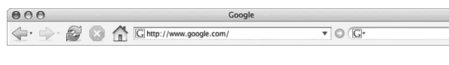

URL 的一部分是“域名”，它有助于在互联网上标识和定位计算机。为避免混淆，每个域名都是唯一的。你可以把域名看作一个标签或快捷方式。在这个快捷方式背后是一组数字，称为“IP 地址”，它给出了你所查找的网站在互联网上的具体位置。打个比方，如果说域名是你速拨列表中急救符号旁边写的“紧急联系人”这几个字，那么 IP 地址就是 9-1-1。

> **注意**
>
> 虽然许多 URL 以“www”开头，但这并非必须（取决于服务器的设置方式）。www 最初在 URL 中用来表示“World Wide Web”（万维网），后来作为一种通用做法被广泛采用。URL 中第一个句点之前的部分不属于已注册域名的一部分，几乎可以是任何内容。事实上，许多企业使用 URL 的这部分来区分公司内部的不同部门。例如，GO Network 包含 ABC、ESPN 和 Disney 等。这些都是 `go.com` 的子部门：`abc.go.com`、`espn.go.com` 和 `disney.go.com`。在你喜欢的浏览器地址栏中输入 `www.abc.com`，你会注意到 URL 变成了 `abc.go.com`。这是因为 `www.abc.com` 是 `abc.go.com` 的别名——或者说快捷方式。

企业通常注册以 `.com` 结尾的域名（表示商业机构），这些域名通常与企业名称或产品名称相似。域名注册就像在互联网上租赁办公空间。一旦你注册了一个域名，只要你持续支付租赁费用，你就有权在该域名下在互联网上发布网站。

> **提示**
>
> 想知道 `yourname.com` 是否已被使用？你可以通过访问注册服务机构如 `www.godaddy.com` 或 `www.networksolutions.com` 来查看哪些域名仍可注册。

#### Web 服务器

每个网站和网页都需要一台 Web 服务器。简单来说，Web 服务器是一台运行特殊软件并始终连接到互联网的计算机。

HTML：初学者指南

> **注意**
>
> 有些人将计算机称为服务器，比如说“我们需要买一台新的服务器。”另一些人将软件称为服务器，说“我们需要安装一个新的 Web 服务器。”这两种说法本质上指的是同一样东西——Web 服务器使信息可以被请求者访问。

当你在浏览器中输入 URL 或点击网页中的链接时，你就是向存储该信息的服务器发送了一个请求。这类似于你用电话拨打号码时发生的过程。你的请求“呼叫”了一台包含展示你所请求网页所需全部文件的计算机。然后，这台计算机向你“提供”并显示所有页面，通常是在你的浏览器中显示。

##### 站点

URL 通常与网站相关联。你肯定已经在广告牌和电视广告中见过大量此类地址。例如，`www.amazon.com` 是 Amazon 网站的 URL，而 `www.cbs.com` 是 CBS 的 URL。

最常见的是，这些网站位于服务器上的目录或文件夹中，就像你个人电脑上可能有 `C:` 盘一样。然后，在这个主站点中，可能有若干文件夹，用于存放网站的其他部分。

> **问问专家**
>
> 问：我听过“万维网”这个词很多次了，但我对它的实际含义以及它与互联网的关系有点困惑。
>
> 答：万维网（WWW 或 Web）经常与互联网混淆。虽然互联网的前身最初是在冷战时期创建的，作为紧急情况下将全国各部分连接起来的一种方式，但“Internet”这个术语直到 20 世纪 70 年代初才被使用。当时，学术研究机构开发了互联网以创建更好的通信方式并共享资源。后来，世界各地的大学和研究机构开始使用互联网。20 世纪 90 年代初，Tim Berners-Lee 创建了一套技术，允许通过文档中的链接将互联网上的信息相互连接。这些技术中的语言组件就是超文本标记语言（HTML）。如果你想了解更多，关于互联网历史的一个很好的资源可以在 `www.isoc.org/internet/history` 找到。
>
> 在 Marc Andreessen 于 1993 年创建第一个图形化网页浏览器 Mosaic 之前，Web 主要是基于文本的，Mosaic 为在互联网上使用视频、声音和照片铺平了道路。作为全球大量相互连接的计算机，互联网不仅包含 Web，还包括新闻组（在线公告板）和电子邮件等。许多人将 Web 视为互联网的图形化或带插图的部分。

例如，Chop Point 是缅因州的一个夏令营和 K-12 学校。它的网站有几个主要部分，包括“营地”、“学校”、“关于我们”和“商店”。如果你查看 Chop Point“关于我们”部分的网址，你可以在网站名称后看到文件夹的名称：

```text
www.choppoint.org/aboutus
```

如果你访问学校主页，网址会变为：

```text
www.choppoint.org/school
```

#### 页面

当你访问一个网站时，你看到的是包含所有文本、图形、声音和视频内容的页面。尽管网页的大小和格式与印刷页面不同，但“页面”这个词用于帮助我们区分页面、文件夹和网站。就像一本书可以包含许多页面和章节一样，一个网站也可以包含许多页面和文件夹（或部分）。


大多数网络服务器被设置为自动寻找名为“index”的页面作为任何文件夹中的主页。因此，如果你输入前面示例中使用的网址，服务器会在“aboutus”文件夹中寻找索引页，该页面可能如下所示。

```text
www.choppoint.org/aboutus/index.html
```

如果你想在`aboutus`文件夹中查找不同的页面，你可以在网站和文件夹名称后输入该页面的名称，记住HTML页面通常以`.html`或`.htm`结尾，例如：

```text
www.choppoint.org/aboutus/donate.html
```

## 网页浏览器

*网页浏览器*是一种在你的个人计算机上运行的软件，使你能够查看网页。网页浏览器通常简称为“浏览器”，它们解释`HTML`代码并提供在屏幕上显示的可视布局。浏览器通常也可用于查看基于网络的电子邮件和访问新闻组。

最受欢迎的浏览器是微软Internet Explorer（也称为`IE`）。在撰写本文时，一些估计认为`IE`拥有超过65%的市场份额。一种解释是`IE`是Windows预装的，很少有人寻找替代浏览器。苹果Mac操作系统预装的浏览器是Safari。

大多数其他流行的浏览器属于名为“基于Mozilla”的浏览器。这个名字源于每个浏览器都基于一个名为Mozilla的框架，该框架源于旧的Netscape浏览器。最受欢迎的基于Mozilla的浏览器是Firefox，它可用于Windows和Mac操作系统。

## HTML：初学者指南

> **提示**
>
> 要随时了解有关浏览器使用情况的统计数据，请访问`http://en.wikipedia.org/wiki/Usage_share_of_web_browsers`。

浏览器会定期更新，以适应HTML的新方面或新兴技术。然而，一些人继续使用旧版本的浏览器。这意味着在任何时候，一个浏览器可能有两个或三个活跃版本，而其他浏览器则有多个不同版本被公众使用。

如果存在几个版本的电视，它们都以不同的方式显示电视节目，会怎样？如果这是真的，那么你最喜欢的电视节目在别人家的电视上观看时，可能每次看起来都不同。这不仅会让你作为观众感到沮丧，也会让节目的创作者感到沮丧。

网络开发人员每天都必须处理这种挫败感。由于各种浏览器之间的差异以及计算机类型的大量存在，网页的外观和感觉可能会有很大不同。这意味着网络开发人员必须跟上新浏览器的最新功能，但我们还必须知道如何创建向后兼容的网页，以适应许多人可能仍在使用的旧浏览器。

> **提示**
>
> 大多数浏览器都可以轻松定制，这意味着你可以更改文本大小、样式和颜色，以及启动浏览器时出现的第一页。这通常称为你的“主页”或“起始页”，它是当你点击浏览器中的“主页”按钮时显示的页面。为了更方便地访问，许多人将他们的主页更改为搜索引擎或根据他们的需要定制的新闻网站。这些个性化网站通常称为门户网站，还为用户提供免费电子邮件。一些例子是Yahoo!、Google和MSN。

## 互联网服务提供商

你使用互联网服务提供商（`ISP`）来访问互联网。这种连接可以通过你的电话线与公司如Verizon、AT&T、AOL或Earthlink建立，或者你可以通过有线电视线路与公司如Comcast或Time Warner连接。

许多公司为你提供浏览器的选择，甚至可能提供一个特定的网页浏览器，其中包含用于检查电子邮件和阅读本地新闻等事项的快捷方式。然而，一些公司可能只支持一种浏览器，例如美国在线（AOL）。

## 了解HTML的当前版本

在其早期，HTML经历了快速的多次迭代，这导致了互联网上的标准化缺乏。万维网联盟（`W3C`——`www.w3.org`）介入并开始发布一系列称为标准的建议，用于HTML和其他网络语言。HTML的最后一个官方标准是HTML 4.01。

为了使标准远离旧式HTML并更接近更灵活的语言可扩展标记语言（`XML`），`W3C`在2000年重写了标准。由此产生的标准集称为*可扩展超文本标记语言（`XHTML`）*，为HTML处理替代设备（如手机和手持计算机）提供了一种方式。

`XHTML 1.0`提供了许多新功能，使网络开发人员的生活更轻松，但在2001年推出时，它并未得到网页浏览器的良好支持。在接下来的几年里，`W3C`将其建议更新为`XHTML 2.0`。然而，世界并没有像`W3C`预期的那样快速或热情地采用`XML`，该组织最终改变了方向。

2008年，`W3C`发布了一个关于超文本标记未来的工作草案：`HTML5`。这很大程度上是一个“进行中的工作”，可能需要几年时间才能最终确定并被采用。与此同时，你可以在`W3C`的网站上查看`HTML5`的状态：`www.w3c.org/TR/html5`。

与`XHTML`不同，`HTML5`旨在同时允许HTML和XML的最佳特性。开发团队试图研究HTML及其内容的现代使用，以创建能够轻松带我们进入下一代网络的代码标准。

虽然该标准仍在开发中，但已经确定了一些关键差异。在本课程中，我将在必要时指出这些差异。你可以在`www.w3.org/TR/2008/WD-html5-diff-20080610`上阅读有关具体差异的更多信息。然而，你实际上不需要为这些差异编码，直到大多数浏览器采用HTML5。

### 为你的网站规划受众、目标、结构、内容和导航

除了了解媒介之外，你还需要执行以下操作：

- 确定你的目标受众。
- 为你的网站设定目标。
- 创建你的网站结构。
- 组织你的网站内容。
- 发展你的网站导航。

#### 确定目标受众

如果你为一个企业、团体或组织创建网站，你的目标很可能是可能购买或使用该公司产品或服务的人们。即使你的网站纯粹是为了传播信息，你也必须针对特定的受众。考虑你是否拥有有关你的客户或用户群的现有研究。这可能包括人口统计数据、统计数据或其他营销信息，如年龄、性别和网络经验。

> **提示**
>
> 如果你的网站代表一家新公司或一家尚未拥有客户人口统计信息的公司，你可以看看竞争对手。很有可能，如果你的竞争对手有一个网站，你可以从他们那里了解你的目标受众。

了解你的目标受众将影响你设计和开发网站的方式。例如，如果你正在开发一个供初学者学习互联网的网站，你希望创建一个极其易于使用的网站，并且不偏离标准的计算机惯例。

一旦确定了目标受众，你就需要考虑该受众的每个部分可以在你的网站上执行哪些功能。尝试起草一个像表1-1这样的图表来制定你的计划。表中的示例是为银行设计的，但你可以将它作为你创建的任何网站的起点。

你可以使用这些信息来确定网站的适当方向。我喜欢将受众分为两大类：“偶然的游客”和“海豹突击队员”。大多数网站都有一点这两种类型。你是否曾经浏览过某个网站，然后想知道你是如何从这里到达那里的？这就是“偶然的游客”，也称为意外访客。在光谱的另一端是带着任务的学生——寻找作业所需的特定信息。我称他们为“海豹突击队员”。

> **提示**
>
> 你的网站主要针对“海豹突击队员”访客吗？这些人更喜欢搜索引擎，尤其是在试图快速定位信息时。在你的网站上提供一个好的搜索引擎或网站地图可以大大增加你的回头客。

| 用户组 | 执行的功能 | 年龄段 | 性别 | 网络经验 |
| --- | --- | --- | --- | --- |
| 现有客户 | - 银行在线服务<br>- 联系客户服务<br>- 研究其他服务/产品 | 16+ | 男/女 | 不一 |
| 潜在客户 | - 研究服务/产品<br>- 联系销售 | 16+ | 男/女 | 不一 |
| 潜在员工 | - 搜索职位空缺<br>- 研究公司<br>- 联系人力资源部 | 18–60 | 男/女 | 不一 |
| 财务顾问 | - 研究服务/产品<br>- 查看公司财务<br>- 联系销售 | 30–60 | 男/女 60/40 | 精明 |

**表 1-1** 目标受众执行的功能

### 设定目标

自互联网诞生以来，已有数百万个新网站诞生。要在如此庞大的市场中竞争，您需要为网站设定明确的目标。例如，网站可能旨在：

- 销售产品/服务
- 招募潜在员工
- 提供娱乐
- 进行教育
- 与客户沟通

在开发网站时，请始终牢记这些目标，以避免不必要的内容。如果您的网站中的某个页面或部分内容不符合目标之一，可能会使访客感到困惑或流失。

### 创建结构

一旦您将网站目标与目标受众执行的功能对齐，您就会看到一个结构正在形成。考虑一个主要目标是向企业销售办公用品，次要目标是招募潜在员工的网站。该网站很可能包含两个主要主题领域：购买办公用品和浏览可用职位。

许多人使用树状图（如图 1-1 所示）来帮助定义网站的结构。其他人则使用流程图或简单的提纲。

### 组织内容

网站的所有内容都应归入网站结构中的各个主题领域下，并且每个主题领域下可能有多个子类别。因此，前面示例中的“购买办公用品”部分可能会根据可用产品的不同类型细分为几个子类别。表 1-2 显示了类别名称如何与文件夹名称相关联。

### 开发导航

在定义了网站结构并将相应内容放入结构后，您需要规划访客如何在该网站的各个页面和部分之间导航。一个好的做法是在所有页面上包含一个标准导航栏，以保持一致性和易用性。该导航栏可能应包含指向您的主页和任何主要主题领域的链接。它可能还应包含您的公司名称或徽标，以便简单的视觉线索能让用户知道她没有意外离开您的网站。

在导航栏上突出显示当前部分非常重要，这样访客可以更容易地辨别他们在网站结构中的位置。这意味着如果您的网站有两个部分——职位和简历——当您在职位部分内部时，职位按钮看起来会有所不同，并且在某种程度上应将其标识为当前部分。

这些页面都存储在`shop`文件夹中。这些页面都存储在`jobs`文件夹中。

**图 1-1** 显示示例办公用品网站部分结构的树状图

| 类别名称 | 文件夹名称 |
| --- | --- |
| 纸张 | `shop/paper/` |
| 笔 | `shop/pens/` |
| 软件 | `shop/software/` |
| 家具 | `shop/furniture/` |
| 家具，书桌 | `shop/furniture/desks/` |
| 家具，椅子 | `shop/furniture/chairs/` |
| 家具，书柜 | `shop/furniture/bookcases/` |

**表 1-2** 内容组织

此外，请考虑为您的访客提供尽可能多的视觉线索，以帮助在您的网站中导航（参见图 1-2）。这可以通过在以下位置重复页面名称来实现：

- 页面的标题（出现在浏览器窗口顶部以及搜索引擎中的文本）
- 页面的文件名
- 标题
- 指向页面的按钮和链接（如果您正在查看该页面，则突出显示）

## 为您选择最佳的HTML编辑器

在某个时候，您可能会想：“如果我可以用一个程序来代替我做这件事，为什么要费心学习HTML呢？”考虑到有这么多新软件包可供使用来帮助您开发HTML，这是一个合理的问题。而且，确定最适合您需求的工具可能很困难。为了提供帮助，我在表1-3中为您概述了一些最受欢迎的工具。这绝不是所有有效HTML编辑器的详尽列表。它只是通过指出每个工具的主要优点来帮助您入门。

| 工具 | 平均价格（美元） | 主要特点 |
| :--- | :--- | :--- |
| `Amaya`<br>`www.w3.org/Amaya/` | 免费 | - 由W3C托管的开源软件项目<br>- Windows/Mac/Linux<br>- 所见即所得可视化编辑器（但无浏览器预览）<br>- 拼写检查 |
| `BBEdit`<br>`www.barebones.com` | 125 | - 还提供名为TextWrangler的免费精简版<br>- 仅限Mac<br>- 浏览器预览<br>- FTP上传<br>- 多用户编辑<br>- 基于文本的编辑器，能够处理许多流行的编程语言，包括C、C++、CSS、Java、JavaScript、JSP、Perl、PHP、Ruby、HTML、SQL和XML |
| `CoffeeCup`<br>`www.coffeecup.com` | 49 | - 仅限Windows<br>- 所见即所得可视化编辑器<br>- FTP上传<br>- 拼写检查<br>- 模板 |
| `Dreamweaver`<br>`www.adobe.com/products/dreamweaver` | 399 | - Windows/Mac<br>- 带浏览器预览的所见即所得可视化编辑器<br>- FTP上传<br>- 拼写检查<br>- 模板<br>- 服务器端脚本<br>- 多用户编辑 |

**表 1-3** 用于编辑HTML的常用工具

| 工具 | 平均价格（美元） | 主要特点 |
| --- | --- | --- |
| `Homesite`<br>`www.adobe.com/products/homesite`<br><br>**注意：** Adobe于2005年收购Macromedia时获得了Homesite。尽管Adobe没有更新Homesite，但忠实的粉丝们仍在继续使用2003年发布的最后一个版本（5.5）。 | 99 | - 仅限Windows<br>- 基于文本的HTML/XHTML/CSS编辑器<br>- FTP上传<br>- 多用户编辑<br>- 拼写检查 |
| `Expression Web`<br>`www.microsoft.com/expression`<br><br>**注意：** Expression Web取代了Microsoft的Front Page。 | 299 | - 仅限Windows<br>- 带浏览器预览的所见即所得可视化编辑器<br>- FTP上传<br>- 拼写检查<br>- 模板<br>- 服务器端脚本<br>- 多用户编辑 |
| `Visual Web Developer`<br>`www.microsoft.com/express/download` | 免费 | - 仅限Windows<br>- 带浏览器预览的所见即所得可视化编辑器<br>- FTP上传<br>- 拼写检查<br>- 模板<br>- 服务器端脚本<br>- 多用户编辑 |
| `NoteTab`<br>`www.notetab.com` | 免费/29.95 | - 提供免费版和专业版<br>- 仅限Windows<br>- 基于文本的HTML编辑器<br><br>专业版高度可定制，并包含拼写检查器和模板等功能 |
| `Smultron`<br>`http://tuppis.com/smultron/` | 免费 | - 开源，仅限Mac<br>- 基于文本的编辑器，能够处理许多流行的编程语言，包括C、C++、Java、Ruby、HTML、XML、CSS和D<br>- 浏览器预览 |

**表 1-3** 用于编辑HTML的常用工具 *（续）*

## HTML：初学者指南

**提示**

所见即所得编辑器不需要HTML知识。您可以查看页面在浏览器中的“预览”，而不仅仅是查看页面的HTML代码。这样，您可以根据需要简单地拖放布局的各个部分。

查看表1-3后，您可能注意到大多数工具属于以下两类之一。首先，基于文本的编辑器需要您了解一些HTML才能使用它们。它们可以自定义以帮助加快编码过程，并且通常具有复杂的检查和平衡机制来检查编码错误。存在数百个（如果不是数千个）编辑器。我在这里列出了一些最受欢迎的基于文本的HTML编辑器，并鼓励您在确定一个之前尝试几个。

其次，所见即所得编辑器不需要HTML知识。您可以查看页面在浏览器中的“预览”，而不仅仅是查看页面的HTML代码。这样，您可以根据需要简单地拖放布局的各个部分。这类程序可能有一些缺点，但它们对于学习HTML的不同方面或快速发布基本网页也非常有用。

## 哪个最好？

一些Web开发人员更喜欢使用基于文本的HTML编辑器，而不是让所见即所得编辑器代替他们完成，原因如下：

- **更好的控制**：所见即所得编辑器可能以多种方式编写HTML——尽管并非所有方式都会产生相同的结果。这意味着您的页面在每个浏览器中可能看起来不同。不幸的是，这导致一些较旧的所见即所得程序被贴上了“WYSINWYG”或“所见即*非*所得”的标签。
- **更快的页面**：所见即所得编辑器有时会过度补偿为正确渲染页面所需的代码量，因此最终会重复比必要多得多的代码。这会导致文件体积庞大和下载时间变长。
- **更快的编辑**：大型所见即所得编辑器通常占用大量内存和系统资源，从而拖慢计算机和开发过程。
- **更多的灵活性**：许多所见即所得编辑器被编程为“修复”它们认为有缺陷的代码。这可能会导致您无法根据需要插入代码或编辑现有代码。

话虽如此，现代所见即所得编辑器在控制和灵活性方面已经取得了长足进步。那些赞扬它们的开发者通常会发表以下评论：

- **预览**：所见即所得编辑器允许您在HTML编辑器中预览页面，这意味着您甚至在切换到浏览器视图之前就能了解页面的构建情况。
- **拖放编辑**：由于所见即所得编辑器具有预览工具，您实际上可以通过拖放元素来编辑HTML。

### 通过流行网页浏览器的“查看源代码”命令向专业人士学习

学习HTML的最佳方式之一是浏览网页，并查看你喜欢（以及不喜欢）的网站的HTML代码。大多数网页浏览器都允许你使用以下命令查看网页的HTML源代码：

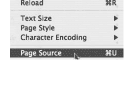

- 在你常用的网页浏览器中，打开你想要查看源代码的页面。
- 选择“查看”|“页面源代码”、“页面”|“查看源代码”或“查看”|“源代码”。

你会注意到通常还能看到其他类型的代码。例如，除了标准的HTML代码，你可能还会发现对服务器上其他文件的引用，甚至是完全不同的其他类型的脚本或代码。此外，你在“查看源代码”显示中看到的只是服务器发送给浏览器显示的内容。这意味着可能还使用了其他代码来实际指示服务器从哪里获取此代码、何时发送，甚至如何发送。

如果愿意，你甚至可以打印或保存这些页面以供日后查看或保存在参考库中。由于Web是*开源的*，意味着你的代码对任何人都是可见的，因此复制其他开发者的代码很有诱惑力。但要记住，你应该给予应有的荣誉，绝不要复制任何受版权保护的内容，如图形和文本内容。

### 注意


少数浏览器不允许你使用“查看源代码”。如果你发现无法查看某个网页的 HTML 源代码，可以尝试将页面保存到本地硬盘，然后用文本编辑器打开它。

## 动手实践 1-1：开发一个网站

练习 HTML 的最佳方式是开发网站。虽然开发个人网站可能很有趣，但我认为有时通过为商业机构或组织开发网站，你能学到更多关于整个开发过程的知识。事实上，志愿为非营利组织开发网站是一个很好的起点。

在本书的整个过程中，我将为你提供与开发此类组织网站相关的项目。如果你已经有一个想要为其开发网站的组织，那就使用那个。如果没有，你可以使用我在为本书创建示例时使用的组织——位于缅因州伍尔威奇的 Chop Point 夏令营和学校。

完成本书中所有 Chop Point 项目所需的文件都可以从`www.wendywillard.com`下载。此外，你随时可以通过访问`www.choppoint.org`查看我制作的网站版本。

这个具体项目将带你完成网站开发项目的规划阶段。本项目的目标包括：

- 确定目标受众
- 设定网站目标
- 创建网站结构
- 组织网站内容
- 开发网站导航

1. 花些时间研究你的组织。尽量了解其业务。如果你认识公司内部的人，可以进行一些访谈，帮助你确定目标受众以及网站目标。如果无法与他们交谈，可以访问其他类似的网站，以确定竞争对手的目标人群。需要考虑的一些问题包括：
   - 该网站将解决哪些业务问题？你希望实现什么？网站的目标是什么？
   - 网站的目标用户/访客是谁？你是否有关于客户或用户基础的现有研究，例如人口统计数据、统计数据或其他营销信息？
   - 为了确定网站的适当方向，你必须将目标用户与他们访问网站时将执行的功能相匹配。例如，目标用户是通过广告被引导至网站的“意外访客”，还是寻找财务信息的潜在投资者？受众人口统计数据如何影响这一点？（你可以使用如下表格来帮助你规划目标用户及其可能在网站上执行的功能。表中展示了 Chop Point 的一个示例。）

   | 用户组 | 在网站上执行的功能 | 年龄 | 网络经验 |
   | :--- | :--- | :--- | :--- |
   | 1. 潜在营员 | - 查看营期日期<br>- 报名<br>- 获取更多信息 | 10-18 | 中等-高 |
   | 2. | | | |
   | 3. | | | |

2. 确定目标受众和网站目标后，就该评估你的内容了。最好通过与你为之开发网站的人交谈来完成。如果不可能，可以发挥创意，列出你认为可能合适的内容列表。

3. 使用以下问题的答案作为构建网站结构的跳板。然后开发一个树状图，类似于图 1-1 所示的，以识别你网站的所有部分及其在整体结构中的位置。
   - 网站上是否必须使用官方标志？
   - 所有内容是否都已用数字格式编写并可用？
   - 网站的主要部分是什么？所有内容是否都适合这些部分？
   - 列出网站的所有内容。为每部分内容分配一个部分（如有必要），并定义文件名。

## 总结

在开始为你的网页编写实际的 HTML 之前，你需要了解一些关于你正在创建的网站的信息。本项目中提出的问题应该能让你有一个良好的开端，并帮助你为网站奠定坚实的基础。在下一章中，你将继续使用这个网站，并为其中一个页面编写代码。

## 第 1 章自测题

1. 什么是网页浏览器？
2. HTML 代表什么？
3. 识别以下 URL 的各个部分：`http://www.mcgrawhill.com/books/webdesign/favorites.html` __________://__________/__________/__________/__________
4. WYSIWYG 是什么？
5. 填空：当前正在开发的 HTML 版本是 __________。
6. Adobe Dreamweaver 程序是做什么用的？
7. 两个最流行的网页浏览器之一是什么？
8. 填空：当在网页浏览器中输入 URL 时，你会向存储该信息的 __________ 发送请求。
9. “URL”这个缩写代表什么？
10. 哪个组织维护 HTML 标准？
11. 如何为网站访问者提供视觉线索，让他们知道自己处于网站结构的哪个位置？
12. 填空：一个好做法是在所有页面上包含一个标准的 __________，以保持一致性并易于使用。
13. 填空：销售产品和招募潜在员工是网站 __________ 的例子。
14. 填空：在开始开发网站之前，你必须对网站的目标 __________ 有所了解。
15. 如果你的网站代表一家新公司或一家已经没有其客户人口统计信息的公司，你可以在哪里查找信息？

# 第 2 章

## 基本页面结构

### 关键技能与概念

- 创建 HTML 文件
- 在浏览器中预览 HTML 文件
- 描述并应用基本 HTML 文档格式
- 使用字符实体显示特殊字符
- 为 HTML 文件添加注释
- 在 HTML 文件中设置样式表

既然你已经对 Web 有了些许了解，也知道了创建网页前需要考虑哪些问题，接下来我们谈谈 HTML 页面的基本结构。

## 创建 HTML 文件

从最核心的角度看，HTML 文件就是文本文件，只是多了两个特点。

1. **HTML 文件使用`.html`或`.htm`作为文件扩展名。** *文件扩展名*是一种缩写，它将文件与访问它所需的相应程序或工具关联起来。在大多数情况下，这个缩写跟在句点后面，由三个或四个字母组成。在下面的例子中，请注意雅虎主页的文件扩展名是`.html`。
2. **HTML 文件包含标签。** 标签是用于告诉计算机如何显示页面内容的命令或代码。选择“查看 | 页面源代码”、“页面 | 查看源代码”或“查看 | 源代码”后，你就可以看到雅虎主页中的一些 HTML 标签。

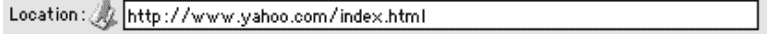

图 2-1：基本页面结构

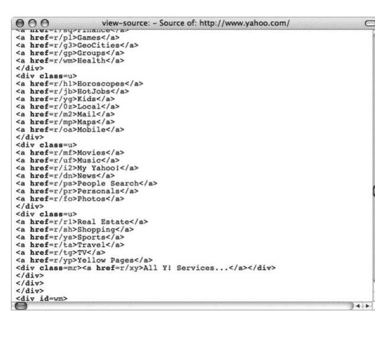

> **注意**
>
> 你可能还会在网上看到更高级的页面类型，例如微软的 Active Server Pages（`.asp`）或使用可扩展标记语言（`.xml`）编写的页面。这些超出了传统 HTML 页面的范畴，因此本书不作介绍。

## 命名约定

为 HTML 文件命名时，请记住以下几点。

- 尽管在大多数情况下使用`.html`还是`.htm`并无大碍，但为了不让自己、浏览器和用户感到困惑，你应该保持一致。

> **注意**
>
> 想知道为什么有些人用`.html`，有些人用`.htm`吗？像 Windows 3.1 和 DOS 这样的旧系统无法理解四个字母的文件扩展名，因此在这些系统上创建网页的人都使用`.htm`作为扩展名。无论如何，由于`.html`和`.htm`的前三个字母相同，这些系统会简单地忽略“l”并毫无问题地识别文件类型。

### HTML：初学者指南

有些 Web 服务器区分大小写，因此在命名和引用文件名时要记住这一点，并尽量保持一致。如果你将文件命名为`MyPage.html`，但后来引用它时使用了`mypage.html`，最终可能会导致链接失效。一个好的技巧是只使用大写或小写字母来命名文件。这样，如果你看到文件名中有一个字母大小写不匹配，你立刻就知道问题可能出在这里。即使是专业人士，也几乎每天都会遇到区分大小写的问题。

- 使用仅包含字母和数字的简单文件名。不要使用空格、标点符号或特殊字符，但连字符（`-`）和下划线（`_`）除外。好的例子包括`home.html`、`my-story.html`和`contactme.html`。

> **提示**
>
> 虽然在文件或文件夹名称中使用下划线（`_`）是完全可以接受的，但我建议改用连字符。下划线很容易与下划线格式混淆，特别是在网页上显示为链接时（因为链接通常带有下划线）。

这些建议同样适用于你使用的任何文件夹名称。如果你要创建一个包含你喜欢的链接、家庭照片和简历的网站，你可能会发现将每样东西放在一个单独的文件夹中会很有用。

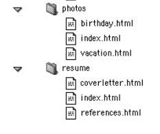

> **提示**
>
> 如果你决定使用 Microsoft Word 或 WordPad 来编写 HTML，你需要在第一次保存文件时选择文件类型为“文本文档”或“纯文本”，并给文件加上`.html`扩展名。这是因为这两个程序默认将“Word for Windows”或“Microsoft Word”文档保存为`.doc`或`.docx`扩展名。

## 在浏览器中预览 HTML 文件

你可以在自己的 Web 浏览器中查看位于个人计算机上的 HTML 文件。在准备好将文件发布到互联网上之前，无需将它们存储在 Web 服务器上。

当你想预览页面时，打开你的 Web 浏览器，选择“文件 | 打开”（或“打开页面”或“打开文件”，具体取决于你的浏览器），然后浏览你的硬盘驱动器，直到找到要打开的 HTML 文件。（注意，如果你在 IE 中没有看到任何“文件”菜单，请尝试按<kbd>ALT</kbd>键来显示这些菜单。）

如果你打算在文本编辑器中频繁修改 HTML 文件，然后再切换回 Web 浏览器来预览页面，那么同时打开两个程序（文本编辑器和 Web 浏览器）是合理的。使用基本文本编辑器编辑和预览 HTML 文件的步骤如下：

1. 在文本编辑器中打开/返回到你的 HTML 文件。
2. 在文本编辑器中编辑你的 HTML 文件。
3. 在文本编辑器中保存你的 HTML 文件。
4. 在 Web 浏览器中打开/返回到你的 HTML 文件。
5. 点击 Web 浏览器中的“刷新”或“重新加载”按钮，以更新 HTML 页面，反映你刚刚对其所做的更改。

通过同时在文本编辑器和浏览器中打开 HTML 文件，你可以轻松地进行更改和预览。

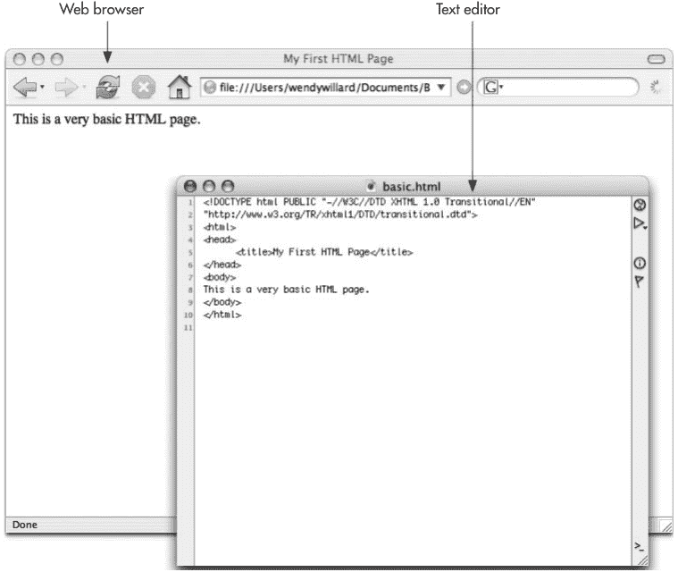

### HTML：初学者指南

如果你使用的是图形化或所见即所得编辑器，步骤会略有不同，因为这类程序包含浏览器预览选项。例如，Adobe Dreamweaver 提供了三种处理 HTML 文件的方式。一种选择是只查看代码，就像在基本文本编辑器中那样。另一种选择是在预览模式下工作，通过点击和拖动在页面上移动页面元素。最后，你可以使用组合视图，其中代码显示在屏幕的一部分，浏览器预览显示在另一部分（如图 2-1 所示）。

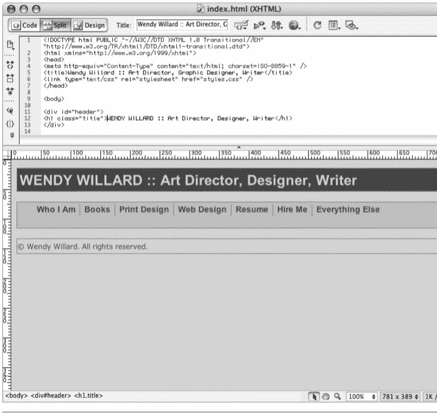

图 2-1：使用 Adobe Dreamweaver 同时访问代码和浏览器预览

## 描述并应用基本 HTML 文档格式

*HTML 实体*或*标签*是用于告诉浏览器如何显示页面内容的命令。这个命令类似于在文字处理程序中高亮选中一些文本并点击*斜体*按钮使文本变成斜体时在后台发生的事情。使用 HTML，你无需点击按钮来使文本斜体化，而是可以在要强调的文本前后输入一个标签，如下所示：

```html
<em>提醒：</em> 今天没有乐队练习。
```

你可以轻松地识别标签，因为它们被放置在*尖括号（< >）*内，或者称为*小于号*和*大于号*符号。你注意到使文本强调并变为斜体的标签是`em`吗？根据这个信息，你能猜出添加段落或创建列表项的标签吗？

| 用途 | 标签 |
| --- | --- |
| 创建段落 | `<p>` |
| 创建列表项 | `<li>` |
| 添加换行符 | `<br>` |

现在你相信我说 HTML 不是高深莫测的科学了吧？别担心——大多数标签都非常直观且易于记忆。

### 标签类型

在 HTML 中，通常既有*开始*标签也有*结束*标签。例如，如果你使用`<p>`作为开始标签来表示新段落的开始，你必须使用一个结束标签来表示该段落的结束（除非你希望整个页面都包含在一个段落中）。为此，请在相同的标签前加上一个正斜杠：`</p>`。表 2-1 列出了一些基本的 HTML 页面标签。

### 属性

许多标签都有可以自定义的附加方面。这些选项称为*属性*，放置在标签之后、最终的右尖括号之前。每个标签的具体属性将在本书后续内容中讨论。但为了让你对属性的工作原理有所了解，让我们看一个使用`img`标签的例子。

```html

```

在这个例子中，基础标签是`img`，它告诉浏览器我想在这个位置插入一张图片。属性是`src`、`width`、`height`和`alt`。每个属性都有一个*值*，该值跟在等号（`=`）后面，并放在引号内。

### HTML：入门指南

| 开始标签 | 结束标签 | 描述 |
| :--- | :--- | :--- |
| `!DOCTYPE` | 无 | - 告诉浏览器你的页面遵循哪套标准。<br>- 列出标准（参见本章后面的“Doctype”部分）。<br>- 通过链接到 URL 来标识标准的位置。 |
| `<html>` | `</html>` | - 框定整个 HTML 页面。 |
| `<head>` | `</head>` | - 框定页面的识别信息，例如标题，这些信息会传输给浏览器和搜索引擎。 |
| `<body>` | `</body>` | - 框定要在浏览器窗口中显示的页面内容。 |
| `<title>` | `</title>` | - 给出将显示在浏览器窗口顶部并被列入搜索引擎的页面名称。<br>- 包含在`<head>`和`</head>`内。 |

表 2-1：基本 HTML 页面标签

无需重复`img`标签，因为单个标签中可以包含多个属性。当你向标签添加属性时，只需将它们放在开始标签中。然后，你只需要关闭标签（而不是属性）。请注意，这是一个没有单独结束标签的标签。（实际上，旧版本的 HTML 根本不需要关闭`img`标签。）要关闭没有单独结束标签的标签，只需在最后的括号前放置一个斜杠（`/`），如前面的代码示例所示。

## 必需标签

所有 HTML 页面都需要有`html`、`head`和`body`标签，以及`DOCTYPE`标识符。这意味着，你的页面至少应包含以下内容：

```html
<!DOCTYPE html PUBLIC "-//W3C//DTD XHTML 1.0 Transitional//EN"
"http://www.w3.org/TR/xhtml1/DTD/transitional.dtd">
<html>
<head>
	<title>My First HTML Page</title>
</head>
<body>
This is a very basic HTML page.
</body>
</html>
```

以下是此页面在浏览器中显示的结果。

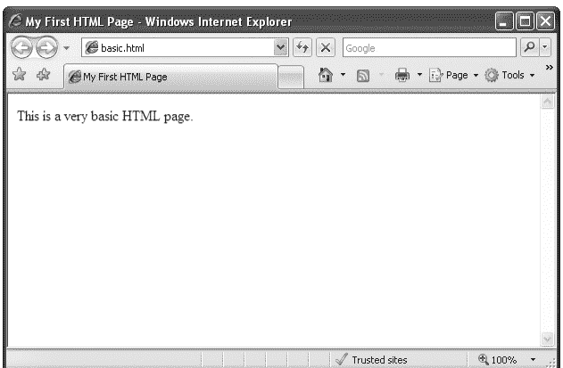

要亲自测试这个基本的 HTML 页面，请尝试以下操作：

1. 打开一个基本的文本编辑器，例如 TextEdit (Mac) 或记事本 (PC)。
2. 将前面的代码复制到一个新的文本文档中。
3. 将其另存为纯文本文件 (ASCII 文本)，并命名为`test.html`。
4. 启动你的浏览器，然后选择“文件 | 打开文件”（Firefox 或 Safari）或“文件 | 打开”（Internet Explorer）。
5. 浏览你的硬盘以找到`test.html`文件，然后就可以运行了！

> **注意**
>
> 如果你使用的是 IE7+ 并且看不到“文件”菜单，请按`ALT`键以显示这些菜单。

## Doctype

`DOCTYPE`标签是一个必需的标签，用于告诉浏览器文档中使用的是哪个版本的 HTML。当 W3C 发布 HTML4 和 XHTML 时，它指定了三种可能的类型或版本，以适应预期的过渡期，在此期间开发者和浏览器应该从 HTML 4.0 迁移到 XML：

- **XHTML Transitional（过渡型）**适用于包含新旧 HTML 代码组合的文档。
- **XHTML Strict（严格型）**适用于不包含任何过时代码且结构“干净”的文档。
- **XHTML Frameset（框架集型）**适用于包含框架的文档。

然而，W3C 最终放弃了过渡文档的概念，转而支持 HTML5，它将同时支持 HTML 和 XML。但在 HTML5 最终确定并被主要 Web 浏览器完全采用之前，你仍然需要使用这三种类型之一来标识你的页面，以帮助浏览器验证它。鉴于我们知道这三种类型将在未来几年内逐步淘汰，我建议使用最容易操作的类型（过渡型）来验证你当前的 Web 页面。要根据这种 XHTML 类型验证你的页面，请使用：

```html
<!DOCTYPE html PUBLIC "-//W3C//DTD XHTML 1.0
Transitional//EN" "http://www.w3.org/TR/xhtml1/DTD/transitional.dtd">.
```

> **注意**
>
> 为了让你一窥未来，在 HTML5 被采用之后，你只需使用一个 doctype 来标识你的页面是 HTML 还是 XML。例如，HTML 文件将使用`<!doctype html>`。很简单，对吧？总的来说，HTML5 似乎是这种强大语言的精彩下一步。

## 针对这些 Doctype 进行验证

想知道为什么你需要*验证*你的 HTML 是否符合特定的 doctype 吗？验证的目的是帮助识别浏览器在显示你的页面时可能遇到的潜在问题。因为浏览器根据官方 HTML 规范（由 W3C 制定）来呈现页面，所以在测试中对照这些规范检查你的页面是有意义的。

官方的 W3C 验证服务可以在`http://validator.w3.org`找到。一旦你到达那里，你会注意到可以使用几种不同的方法来测试或验证你的页面。

- **通过 URI 验证**：如果你的页面已经在 Internet 上运行，你可以简单地输入页面的 URI（地址），该工具将尝试验证你的页面。
- **通过文件上传验证**：如果你正在处理当前存储在你的硬盘上（但尚未在 Internet 上运行）的页面，你可以将这些页面上传到在线验证器。
- **通过直接输入验证**：或者，你可以简单地将代码复制并粘贴到验证服务的在线表单中。

无论你选择哪种方法，结果都是一样的。验证器会给你一个通过或失败的成绩。如果你的页面未能通过你在代码中列出的标准的验证，该工具还会告诉你页面失败的原因。例如，它可能会告诉你是否在错误的标签中使用了特定的属性，或者是否使用了规范中没有的标签。

## 专家问答


> **问：** 我将前面的 HTML 输入到一个文本文件中，但当我尝试在浏览器中预览页面时，什么也没有发生。为什么？
>
> **答：** 你的页面显示为空白可能有几个原因。首先，查看前面示例中的代码，并逐行与你输入的代码进行比较。忘记一个结束标签或者可能只是一个斜杠（`/`）是很容易的。有时，在重新仔细检查你的页面之前，短暂休息一下会有所帮助。如果你确实进行了更改，请务必在单击 Web 浏览器中的“刷新”或“重新加载”之前，在文本编辑器中保存文件。
>
> 如果你确定页面中的代码与示例匹配，请尝试以新名称重新保存文件。关闭浏览器，然后重新启动 Web 浏览器并再次在浏览器中打开该页面。
>
> 其他故障排除技术位于附录 C。

### 大小写

HTML 的原始版本不区分大小写，事实上，非常宽容。这意味着以下所有示例在浏览器看来都是相同的：

- `<html>`
- `<HTML>`
- `<HTml>`

也就是说，HTML4/XHTML 是*区分大小写*的，并且要求所有标签都使用小写字母。在前面的三个示例中，浏览器可能只正确解释第一个。

更令人困惑的是，HTML5 又回到了不区分大小写。鉴于当前使用的各种 HTML 版本之间的差异，我建议使用全小写标签。

### 引号

HTML4/XHTML 还要求所有值都放在直引号内，如下面的示例所示：

```html
<p style="font-family: verdana;">
```

### 嵌套

术语*嵌套*在本书中多次出现，指的是将一个 HTML 标签包含在另一个标签内的过程。

```html
<strong>This text is bold and <em>italic</em></strong>
```

嵌套标签有正确的方式和不正确的方式。所有标签都应从中间开始并结束，然后向外移动。另一种思考方式涉及“圆圈规则”。你始终应该能够画出半圆来连接每个标签的开始和结束版本。如果你的任何半圆相交，那么你的标签嵌套就不正确。使用以下示例，第一个是正确的，因为`strong`标签都在外面，而`em`标签都在里面。

```html
<strong><em>These tags are nested properly.</em></strong>
<strong><em>These tags are not nested properly.</strong></em>
```

尽管这两种方式在某些浏览器中都可能有效，但你需要以正确的方式嵌套标签，以确保你的页面在所有浏览器中的显示相同。

## 间距和换行

让我们仔细看看一些 HTML 示例，以确定在哪里应该进行适当的间距。（注意，`a`标签和`href`属性用于链接某些内容，在本例中是文本。）

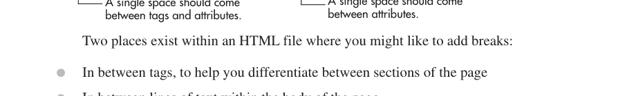

在 HTML 文件中有两个你可能想要添加换行的地方：

- 在标签之间，以帮助你区分页面的不同部分。
- 在页面正文中各行文本之间。

### 标签之间的间距和换行

你可能想要添加换行的第一个地方是在标签之间，如以下示例所示。

```html
<html>
<head>
    <title>My First Web Page</title>
</head>
```

虽然这不是必需的，但大多数人使用`ENTER`或`RETURN`键来用换行符分隔标签。其他人也会缩进包含在其他标签内的标签，如前面的示例：`title`标签被缩进以显示它包含或嵌套在`head`标签内。这可能有助于你在文本编辑器中查看页面时更快地识别标签。

### 文本行之间的间距

你添加换行的第二个地方是页面正文中各行文本之间。如果你使用键盘上的`RETURN`或`ENTER`键在页面的两行文本之间添加换行，当浏览器显示页面时，该换行将不会出现。

```html
<!DOCTYPE html PUBLIC "-//W3C//DTD XHTML 1.0 Transitional//EN"
"http://www.w3.org/TR/xhtml1/DTD/transitional.dtd">
<html>
<head>
	<title>My first Web page</title>
</head>
<body>
Welcome.

Thank you for visiting my first Web page. I have several other pages
that you might be interested in.
</body>
</html>
```

在这段代码中，我在单词“Welcome.”之后按了两次**回车键**。在这个例子中，你可以看到浏览器忽略了我的回车，将两行文字连在了一起。

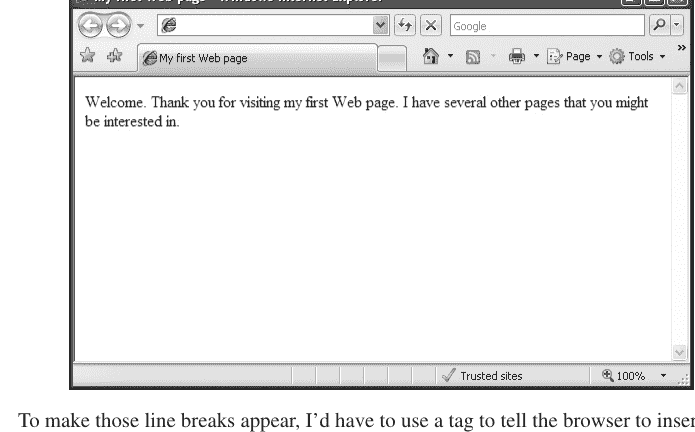

要让这些换行显示出来，我需要使用标签来告诉浏览器插入换行。有两个标签用于内容中的断行。

```html
<br />
<p></p>
```

`br`标签插入一个简单的换行。它告诉浏览器在继续之前跳到下一行。如果你插入多个`br`标签，浏览器会在继续之前向下跳几行。

`p`标签表示段落分隔。两者的区别在于，段落分隔会导致浏览器跳过一行，而换行不会。此外，`p`标签被认为是一个*容器*标签，因为它的开始标签和结束标签应该被用来包含段落内容。`br`和`p`标签在第 4 章中有更详细的讨论。

**注意**

因为`br`标签不像`p`标签那样包含任何文本，所以它没有开始和结束版本。相反，你在结束括号前放置一个斜杠来“终止”这个标签，如：`<br />`。

如果我用`p`标签将这些段落分别包裹起来，就像下面这样：

```html
<p>Welcome.</p>
<p>Thank you for visiting my first Web page. I have several other pages that you might be interested in.</p>
```

浏览器就会知道要用空白行将它们分开。下面的截图显示了浏览器现在如何显示已将每个段落用`p`标签包裹的文本。

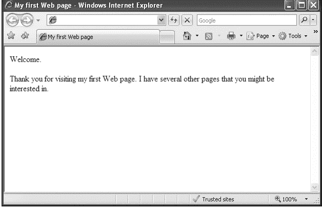

此外，HTML既不会识别多个连续空格，也不将制表符解释为一种缩进方式。这意味着，要缩进一个段落或在单词之间留出多个空格，你必须使用样式表（参见第 4 章）或特殊字符。

## 使用字符实体来显示特殊字符

尽管这听起来很疯狂，但从技术上讲，你不应该在HTML文件中包含任何不能用一根手指打出的字符。这意味着，如果你需要按住**shift**键来输入感叹号或美元符号，你应该使用*字符实体*来在HTML文件中包含那个特殊字符。

尽管你可能在自己的计算机系统上输入某些字符时没有任何问题，但当访问者查看你的网页时，某些字符可能无法正确显示。因此，我建议你使用字符实体来保持跨计算机系统的一致性。

字符实体可以输入为编号实体或命名实体。所有字符实体都以和号（`&`）开头，以分号（`;`）结尾。虽然每个字符实体都有编号版本，但并非每个都有命名版本。虽然附录 D 包含了特殊字符的完整列表，但下表中列出了几个示例，让你了解它们的样子。

**注意**

有几个字符在HTML中被保留并赋予特殊含义。例如，尖括号（`<`和`>`）用于表示HTML标签，而和号（`&`）用于开始这些实体。如果你需要在HTML页面的内容中使用尖括号，比如需要大于号时，在`3 > 2`的情况下，你应该使用相应的字符实体（`&gt;`）来这样做。

| 字符 | 编号实体 | 命名实体 |
| --- | --- | --- |
| `"` | `&#34;` | `&quot;` |
| `&` | `&#38;` | `&amp;` |
| （不间断空格） | `&#160;` | `&nbsp;` |
| © | `&#169;` | `&copy;` |
| ® | `&#174;` | `&reg;` |
| é | `&#233;` | `&eacute;` |
| `<` | `&#60;` | `&lt;` |
| `>` | `&#62;` | `&gt;` |

既然已经说明了使用字符实体的原因，让我在这里说一下，根据我的经验，某些字符实际上可以在网页中使用而不会引起任何问题。这些包括直引号——不是弯引号（`"`）、感叹号（`!`）、问号（`?`）、冒号（`:`）和括号（`()`）。虽然我还没有注意到这些在大多数浏览器中引起问题，但在使用任何特殊字符时，你仍然应该彻底测试你的页面。

## 在HTML文件中添加注释

有时你可能不想让网站访问者看到你在网页中添加的个人注释或备注。这些注释可能是给另一个人的指示，或给自己的提醒。

```html
<!-- Remember to update this page after the new product becomes available -->
```

在开括号之后，感叹号和两个连字符表示注释的开始。在开启注释代码之后应该有一个空格，在关闭注释代码之前也应该有一个空格。

注释在大小上没有限制，但可以一次跨越多行。结束注释代码（`-->`）不需要与开始注释代码在同一行。如果你忘记关闭注释标签，页面的其余部分将不会显示在浏览器中。如果发生这种情况，不要惊慌。只需回到代码中关闭该注释。当你保存文件并在浏览器中重新加载时，页面的其余部分将变得可见。

## 在HTML文件中设置样式表

我已经几次提到“样式表”这个短语，但还没有给出完整的解释。部分原因是，在HTML被重写为XHTML之前，样式表并不是HTML的一部分。*层叠样式表*（缩写为CSS）的目的是将网页的*样式*与其*内容*分离。

当前的 HTML“规则”规定，我们只使用 HTML 来标识页面的内容，然后使用样式表来指定该内容的呈现方式。这不仅使网页对所有用户都更易于访问和使用（无论他们使用什么浏览器、平台、操作系统、有无身体限制等），而且对搜索引擎和其他类型的软件也是如此。

> 如果你曾经在 Microsoft Word 中使用过“样式”下拉菜单，你已经使用过一种样式表了。最基本的样式表可能包含一个名为“正文”的样式，它指定网页正文文本应该是什么样的——使用哪种字体和颜色、周围留出多少空间，等等。

### 定义样式

要定义一个基本的格式样式，首先必须确定要影响哪个标签。这个标签在 CSS 中被称为*选择器*。所以，如果你想指定页面上所有二级标题（`<h2>`）的样式，你会使用`h2`作为你的选择器。

```css
h2
```

事实上，选择器本质上就是没有尖括号的标签。考虑到这一点，你能猜到`<p>`的选择器是什么吗？

```css
p
```

一旦你有了选择器，就可以定义它的属性。与 HTML 中的属性工作方式类似，CSS*属性*会改变选择器的特定属性。回到前面的例子，如果你想将页面上二级标题的样式改为 14 磅 Verdana 字体、斜体和蓝色，你可以使用以下属性：

```css
font-family
font-style
font-size
color
```

当你为属性指定值时，你就为该选择器创建了一个*声明*。声明和选择器一起被称为一组*规则*，或*规则集*。在典型的规则集中，声明被括在大括号中，放在选择器之后。

所以，这是我们规则集的前几个部分：

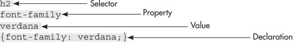

以下是它们如何组合在一起，告诉浏览器以 Verdana 字体显示所有二级标题。

```css
h2 {font-family: verdana;}
```

要指定字体大小、颜色和样式（斜体），我们只需再添加几个这样的属性。

```css
h2 {font-family: verdana;
    font-size: 14pt;
    color: blue;
    font-style: italic;}
```

此时，你可能开始看到规律了——CSS 属性后面跟着冒号，然后是它的值，值后面再跟着分号。

### 定义值

与 HTML 中的属性一样，属性也有值。大多数值可以用颜色、关键字、长度、百分比或 URL 来指定，如表 2-2 所列。长度和百分比单位也可以通过在值前面加加号（`+`）或减号（`−`）来变为正数或负数。

### 创建结构

在你了解了 CSS 的各个部分之后，你可以将它们组合起来创建一些样式。这些片段的组织方式取决于你正在创建哪种类型的样式表。CSS 提供三种类型样式表：

- **内联**样式直接嵌入在它们影响的 HTML 代码中。
- **内部**样式放在网页的头部信息中，然后影响*单个页面*上所有相应的标签。
- **外部**样式表在单独的文档中编码，然后从实际网页的头部引用。

### CSS值的类型

| 值的类型 | 描述 |
| --- | --- |
| 颜色 | 在 CSS 值中指定颜色时，可以通过以下三种方式之一（关于颜色的更多信息，请参阅第 3 章）：<br>- 十六进制代码，例如`#000000`<br>- RGB 值，例如`rgb(0,0,0)`或`rgb(0%, 0%, 0%)`<br>- 预定义的关键字之一 |
| 关键字 | 关键字是 CSS 中定义的一个词，由浏览器将其转换为数值。因此，关键字通常被认为是相对的，因为最终由浏览器决定如何呈现内容。一个关键字的例子是`small`。 |
| 长度 | 在 HTML 中，大多数单位以像素定义。然而，在 CSS 中，您可以选择使用许多其他类型的单位。例如，使用`font-size`属性指定文本大小时，您可以使用以下任何单位。（缩写显示在括号中。）<br>- 点（`pt`）— 每英寸 72 点<br>- 派卡（`pc`）— 每派卡 12 点<br>- 像素（`px`）— 屏幕上的点<br>- em（`em`）— 通常指字体的高度<br>- ex（`ex`）— 指特定字体中小写字母 x 的高度<br>- 英寸（`in`）<br>- 毫米（`mm`）<br>- 厘米（`cm`） |
| 百分比 | 在 CSS 中，使用相对百分比来定位页面上的元素非常有用。因为百分比允许元素根据屏幕和窗口的大小而移动。在 CSS 中使用时，数字值后跟一个百分号（`%`），例如 100%，表示与周围元素的关系。 |
| URL | 在 CSS 中引用绝对 URL 时，请使用以下形式：`url(http://www.osborne.com)`。类似地，相对 URL（通常是当前网站内的 URL）通过以下方式引用：`url(home.html)`。 |

**表 2-2** CSS值的类型

## 外部样式表

*外部*样式表在单独的文档中编码，然后从实际网页的头部引用。这意味着单个外部样式表可以用于影响一组网页的呈现。

您可以在单个文档中使用任何或所有这些类型的样式表。但是，如果您包含不止一种类型，*级联顺序*的规则就会生效：这些规则规定内联规则优先于内部样式，内部样式优先于外部样式。

简而言之，CSS 样式从一般到具体应用。这意味着文档`head`标签中的规则集会覆盖链接的样式表，而文档主体中的规则集会覆盖`head`标签中的规则集。此外，更局部的（或*内联*）样式仅在重叠处覆盖父属性。

### 内联样式

*内联*样式直接在页面的 HTML 中创建，因此得名。在前面的示例中，声明被花括号包围，但内联声明使用直引号括起来，并使用要影响的任意标签的`style`属性。

```html
<h2 style="font-family: verdana;">
```

您可以使用分号分隔多个规则，但整个声明应包含在引号内。

```html
<h2 style="font-family: verdana; color: #003366;">
```

内联样式最适合对页面进行快速更改，但不适合对整个文档或网站进行更改。原因是当样式添加到某个标签时，它们仅适用于该单个标签，而不适用于页面上的所有类似标签。

> **提示**
>
> 当同一页面上存在多种类型的样式表时，内联样式会覆盖内部和外部样式。

### 内部样式表

当您想要更改单个页面上所有`h2`标签的样式时，可以使用*内部*或*嵌入*样式表。不要向标签添加`style`属性，而是使用`style`标签来包含页面的所有指令。`style`标签位于页面的头部，在开始和结束的`head`标签之间。以下是内部样式表可能的样子示例。

```html
<head>
<title>CSS Example</title>
<style type="text/css">
h2 {font-family: verdana; color: blue;}
h3 {font-family: verdana; color: red;}
</style>
</head>
```

如本例所示，选择器放在声明之前，声明用花括号括起来。整个规则集可以包含在单行中，也可以分成多行，如以下示例。

```css
h2
{font-family: verdana;
color: blue;}
```

您可以用几种方式编写样式。以下示例与前一个示例同样有效，并且因为更易于阅读而受到一些人的青睐。

```css
h2 {font-family: verdana;
    color: blue;}
```

此外，您可以使用某些简写属性来减少必要的编码量。例如，不必同时指定字体系列（Verdana）和字体大小（12点），您可以输入以下内容，因为两个属性都以`font`开头。

```css
h2 {font: verdana 12pt;}
```

> **提示**
>
> 第 4 章将更详细地讨论如何设置文本样式。

## 外部样式表

外部样式表包含的信息与内部样式表基本相同，不同之处在于外部样式表包含在自己的文本文件中，然后从网页内引用。因此，外部样式表可能如下所示：

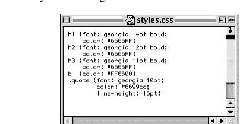

请注意，外部样式表不使用`style`标签或属性，而只是包含一系列规则集作为浏览器的指令。创建外部样式表后，将其保存为带有`.css`扩展名的文本文件。

然后，返回到 HTML 文件，并在页面头部添加`link`标签以引用外部样式表，如以下示例所示。

```html
<head>
<title>Using an External Style Sheet</title>
<link rel="stylesheet" type="text/css" href="styles.css">
</head>
```

这就是您的样式表名称所在的位置。

在这种情况下，我只需要编写`styles.css`，因为样式表与我的 HTML 页面位于同一文件夹中。但是，如果您的样式表与 HTML 页面位于不同的文件夹中，请确保相应地引用该路径。

> **注意**
>
> 外部样式表可以被内部和内联样式表覆盖。

## 动手实践 2-1：创建您网站的第一个页面

继续规划您在第一章开始规划的网站，我们现在开始创建您网站的第一个页面。此项目的主要目标是：

- 使用所有必要的标签创建一个基本网页。


- 使用字符实体向页面添加版权符号。
- 在页面的头部添加内部样式表的空间。
- 将页面保存为可由 Web 浏览器读取的 HTML 文件。
- 在 Web 浏览器中预览该页面。

> **注意**
>
> 完成本书中 Chop Point 网站项目所需的所有文件可以从 `www.wendywillard.com` 下载。此外，您随时可以通过访问 `www.choppoint.org` 查看我的网站版本。

1. 在您的计算机上打开一个文本编辑器（例如 Mac 上的 TextEdit 或 Windows 上的 Notepad）。复制以下代码以开始您的网页。请随意进行编辑，以个性化您的组织网站。

```html
<!DOCTYPE html PUBLIC "-//W3C//DTD XHTML 1.0 Transitional//
EN" "http://www.w3.org/TR/xhtml1/DTD/transitional.dtd">
<html>
<head>
<title>Chop Point Camp and School, located in Woolwich, Maine</title>
<style type="text/css">
</style>
</head>
<body>
<p>Chop Point </p>
<p>Chop Point is a non-profit organization operating a summer camp
and K-12 school in Woolwich, Maine.</p>
</body>
</html>
```

2. 在第二个段落结束后，使用本章学到的代码添加两个换行和一个版权符号（©），后跟组织的名称。（例如：© Chop Point Inc.）

3. 在您的硬盘上创建一个新文件夹，命名为 `choppoint`（或您的组织或网站的名称）。将此文件保存为 `index.html` 到您刚刚创建的文件夹中。

4. 打开您的 Web 浏览器，选择“文件 | 打开”（或“打开文件”，具体取决于您使用的浏览器）。找到您刚保存的文件 `index.html`。

*（续）*

5. 预览页面并将其与图 2-2 进行比较。如果您需要进行更改，请返回到您的文本编辑器（TextEdit 或 Notepad）进行操作。完成更改后，保存文件并切换回您的 Web 浏览器。在浏览器中点击“重新加载”或“刷新”按钮，以根据您刚才所做的更改更新页面。您页面的完整代码可能如下所示：

```html
<!DOCTYPE html PUBLIC "-//W3C//DTD XHTML 1.0 Transitional//EN"
"http://www.w3.org/TR/xhtml1/DTD/transitional.dtd">
<html>
<head>
<title> Chop Point Camp and School, located in Woolwich, Maine </title>
<style type="text/css">
</style>
</head>
<body>
<p>Chop Point </p>
<p>Chop Point is a non-profit organization operating a summer camp and
K-12 school in Woolwich, Maine.</p>
<br />
<br />
&copy; Chop Point Inc.
</body>
</html>
```

图 2-2 当在浏览器中显示时，您的页面看起来应该与此类似，具体取决于您的组织和内容。

### 提示

当您尝试预览页面时，浏览器窗口是否显示为空白？如果是，请返回您的文本编辑器，并确保您已包含所有必要的结束标签（例如 `</body>` 和 `</html>`）。此外，如果您使用的是 TextEdit 或 Notepad 之外的任何编辑器，请不要忘记将文件保存为“.html”扩展名的“纯文本”格式。有关更多提示，请参阅附录 C“故障排除”。

## 小结

每个网页都需要一些标签才能在浏览器中正确显示。本项目帮助您练习输入这些标签，并将它们按正确顺序放置在页面上。熟悉编辑、保存和预览页面的过程是很有益的，因为这在本书的其余部分以及您持续的 Web 开发过程中都会用到。

## 第 2 章自测题

1. HTML 文件使用什么文件扩展名？
2. 以下这行 HTML 代码包含错误。正确的写法是什么？

   `<p This is a paragraph of text p>`

3. 一个基本的 HTML 页面至少应包含哪些标签？
4. 在以下这行 HTML 代码中，指出标签名称、属性和值：

   `<a href="page.html">`

5. 填空：XHTML 要求所有标签都必须是 _________ 大小写。
6. 哪个选项**不**适合作为 HTML 文件名？

   A. `myfile.html`

   B. `my-file.html`

   C. `my file.html`

   D. `my1file.html`

7. 用于在网页中添加版权符号的命名字符实体是什么？
8. 您刚刚创建了一个网页，并在 Web 浏览器中预览它时发现了一个错误。修复错误并保存网页后，您应该点击浏览器中的哪个按钮来查看所做的更改？
9. 在 HTML4/XHTML 中，关闭 `br` 标签的正确方式是什么？

   A. `<br>`

   B. `</br>`

   C. `<br/>`

   D. `<br />`

   E. `</ br>`

10. 以下代码行中的标签嵌套不正确。重写代码，使标签正确嵌套。

```html
<p><strong><em>Hello World!</p></em></strong>
```

11. 如何改写以下文本，使其在浏览器中查看页面时不显示？

```text
Hide Me!
```

12. 当它们在网页中编写时，浏览器会忽略哪两个选项？

   A. `<p>`

   B. 制表符

   C. `<br>`

   D. `<br><br>`

   E. 使用空格键输入的单个空格

   F. 使用空格键输入的两个空格

13. 填空：`p` 标签是一个 ______________ 标签的示例，因为它包含文本部分。
14. 以下这行 HTML 代码包含错误。正确的写法是什么？

```html
< img src = "photo.jpg" >
```

15. 所有 HTML 标签必须以什么符号开始和结束？

# 第 3 章：颜色

## 关键技能与概念

- 识别在 Web 开发中引用颜色的方式
- 指定文档颜色

每个浏览器都有一套标准的网页颜色，用户可以进行自定义（参见图 3-1）。如果您不进行其他指定，您的页面将按照浏览器的设置进行显示。

要更改网页上的颜色，您需要知道要将其更改为什么颜色，以及相应的颜色值（在下一节中描述）。

**图 3-1** 在某个版本的 Firefox 中自定义颜色设置

## 识别在 Web 开发中引用颜色的方式

在 Web 时间的开端——在 HTML 页面中引用颜色的唯一方法是使用其十六进制颜色值。当 CSS 成为网页中引用颜色的首选方法时，我们被允许使用各种其他单位来衡量颜色，包括 RGB（代表红绿蓝）值、RGB 百分比、十六进制简写和颜色名称。

### 十六进制颜色

美国的“正常”数字系统是*十进制*——基于数字 10。这意味着我们有 10 个单位（0-9）可以使用，然后才需要重复一个单位（就像数字 10 一样，它使用了 0 和 1）。

*十六进制*系统（hex）Kelley Mortuary

| 颜色名称 | 十六进制值 | RGB 值 |
| --- | --- | --- |
| `black` | `#000000` | `0,0,0` |
| `white` | `#ffffff` | `255,255,255` |
| `silver` | `#c0c0c0` | `192,192,192` |
| `gray` | `#808080` | `128,128,128` |
| `lime` | `#00ff00` | `0,255,0` |
| `olive` | `#808000` | `128,128,0` |
| `green` | `#008000` | `0,128,0` |
| `yellow` | `#ffff00` | `255,255,0` |
| `maroon` | `#800000` | `128,0,0` |
| `navy` | `#000080` | `0,0,128` |
| `red` | `#ff0000` | `255,0,0` |
| `blue` | `#0000ff` | `0,0,255` |
| `purple` | `#800080` | `128,0,128` |
| `teal` | `#008080` | `0,128,128` |
| `fuchsia` | `#ff00ff` | `255,0,255` |
| `aqua` | `#00ffff` | `0,255,255` |
| `orange` | `#ffa500` | `255,165,0` |

**表 3-2** CSS 2.1 规范中的标准颜色名称

## 网页安全色

你是否曾在别人的显示器上查看过你喜爱的网站，并注意到颜色看起来有些不同？这可能是由于显示器设置不同造成的。例如，所有较新的计算机系统和显示器都能够显示数百万种颜色。但在几年前情况并非如此，那时大多数基于 DOS 的 PC 被设置为显示 256 种或更少的颜色。这种减少的调色板意味着你无法总是确保为网页选择的颜色能在观众的系统上显示。

更复杂的是，Macintosh 系统显示的 256 种颜色与基于 DOS 的 PC 所显示的集合不同。这两种计算机系统（Mac 和 PC）之间只有 216 种颜色是相同的！这 216 种颜色被称为网页安全色。长期以来，设计者被强烈鼓励使用此调色板中的颜色，以确保大多数观众能看到大约相同的选定颜色。

然而，在网页安全色诞生十几年后，大多数观众现在使用的是更好的显示器和计算机。这意味着使用网页安全色的必要性已大大降低，但我仍然提及它们，以便你在确实需要确保网页上特定颜色外观时熟悉此调色板。此外，一些设计软件应用程序在你为网页图形选择非网页安全色时，可能仍会发出警告。

你可以通过其十六进制值轻松识别网页安全色。每种网页安全色的 RGB 值都是 51 的倍数。因此，216 色网页安全色中的每种颜色都有一个由下表所示值组成的十六进制值。

| RGB | 十六进制 |
| --- | --- |
| `0` | `00` |
| `51` | `33` |
| `102` | `66` |
| `153` | `99` |
| `204` | `CC` |
| `255` | `FF` |

此插图中选择的颜色不是网页安全色。这很明显，因为绿色值是 `#55`，这不是一个网页安全色的十六进制值。要使此颜色变为网页安全色，你需要将绿色值更改为 `#66`。

此符号警告当前选择的颜色不是网页安全色。单击色块旁边的方框会将 Photoshop 中的颜色更改为最接近的网页安全色。

Photoshop 的颜色窗口在三个颜色条（红、绿、蓝）上都有小黑线，以显示网页安全色的值所在位置。

## 指定文档颜色

更改文档颜色（如背景和文本）的首选方法是使用样式表。

与任何样式声明一样，你可以在内联、内部或外部样式表中指定背景、文本和链接颜色。然而，无论使用哪种类型的样式表，实际用于此的属性都是相同的。与以前用于更改文档颜色的旧 HTML 标签不同，使用 CSS 时，你不受限于在 `body` 标签内指定此信息。事实上，你实际上使用 `a` 标签（用于向网页添加链接）来更改 CSS 中的链接颜色。要理解，请看以下内部样式表示例：

```html
<style type="text/css">
body {background-color: white;
	color: gray;}
a:link {color: blue;}
a:visited {color: purple;}
a:active {color: orange;}
</style>
```

52 HTML：初学者指南

> **注意**
>
> 请记住，内部样式表是放置在网页 HTML 代码的 `<head>` 开始和结束标签之间的。

使用 CSS 时，你必须考虑哪个标签实际创建了你想要更改颜色的内容，并将其用作 CSS 选择器。因此，在前面的内部样式表示例中，我首先告诉浏览器将整个页面的背景色更改为白色（`body` 标签决定了页面的基础特征，如背景色和默认文本颜色）。将 `color` 属性添加到 `body` 选择器也指定了页面上的所有文本，本例中为灰色。

接下来，我告诉浏览器选择所有受 `a` 标签影响的内容（`a:link`）并使其变为蓝色。当这些链接被访问后，我希望浏览器将其渲染为紫色，如行 `a:visited {color: purple;}` 所示。最后，活动链接的颜色——即用户点击链接时可见的颜色——是橙色，由以 `a:active` 开头的行定义。

> **提示**
>
> 虽然我们使用了相同的属性 `color` 来更改默认文本颜色和各种链接颜色，但请记住，是*选择器*（本例中为 `body` 和 `a`）告诉浏览器具体要更改哪种颜色。

## 展望未来

我最喜欢的网页开发即将实现的功能之一是透明度。在即将推出的 CSS3 规范中，W3C 定义了两种在网页中创建透明度的新方法。

## RGBA

一旦浏览器开始支持 RGBA，你将能够指定颜色的“alpha 值”或透明度。透明度由 0.0（完全透明）到 1.0（完全不透明）之间的数字定义。例如，你可能使用以下代码告诉浏览器以定义颜色的 50% 显示标题。

```css
h1 {color: rgba(255,68,253,0.5);}
```

在撰写本文时，最新版本的 Safari、Firefox 和 Google Chrome 都支持 RGBA 颜色规范。不幸的是，Internet Explorer 仍然不支持这种 alpha 透明度。因此，虽然这是一段有趣的代码，但我并不建议在大型网络受众中使用它，直到它得到全面支持。同时，如果你想在页面上使用 alpha 透明度，请查看此链接获取一个很好的 IE 解决方案：`http://css-tricks.com/rgba-browser-support/`。

> **提示**
>
> 数值越接近 0.0，背景显示得越多。

## 不透明度

CSS3 规范的另一个新增内容是 `opacity` 属性。与刚才描述的 RGBA 值类似，不透明度值定义在 0.0（完全透明）到 1.0（完全不透明）之间。

但即使在 W3C 将 `opacity` 属性添加到 CSS3 规范之前，Internet Explorer 用户也由于 IE 专有的 alpha 滤镜而在网页中看到了透明度。与 W3C 采用的 `opacity` 属性不同，IE 的专有代码使用 0 到 100 之间的数字，其中 100 表示完全不透明。

因此，在 CSS3 规范得到普遍支持之前，你需要同时使用 `opacity` 属性和 alpha 滤镜，以确保你的透明度在最流行的浏览器中正常工作。

```css
div.transparentbox {
    background-color:#036;
    opacity: 0.7;   /* CSS3标准 */
    filter:alpha(opacity=60);   /* 仅限IE */
}
```

## 动手实践 3-1：更改页面颜色

让我们取上一章的 `index.html` 页面，并更改该页面的背景和文本颜色。本项目的目标包括：

- 从网页安全色中选择颜色
- 指定网页的背景和文本颜色
- 使用适当的颜色代码引用颜色

> **注意**
>
> 完成本书 Chop Point 站点项目所需的所有文件可从 `www.wendywillard.com` 下载。此外，你可以随时访问 `www.choppoint.org` 查看我的网站版本。

1. 打开你的文本编辑器并加载从第 2 章保存的 `index.html` 页面。
2. 将 `background-color` 和 `color` 属性添加到你的内部样式表中，如下所示。（随意将这些颜色值替换为你认为合适的任何颜色值。）保存文件。

```css
<style type="text/css">
body {background-color: #ffe188;
      color: #602b00;}
</style>
```

（续）

你可以通过几种不同的方式找到颜色：

- 访问 `www.colorblender.com`，使用滑块选择你最喜欢的颜色。作为额外的好处，这个在线工具随后会建议匹配的颜色，以创建一个和谐的调色板。
- 使用表 3-2 中的颜色。
- 从你最喜欢的图形程序（如 Adobe Photoshop）中的颜色选择器中选一个。

3. 打开你的网络浏览器，选择“文件” | “打开页面”（或“打开文件”或“打开”，具体取决于你使用的浏览器）。找到你刚刚保存的文件 `index.html`。
4. 预览页面，以确定你是否喜欢你的颜色选择。如果不喜欢，返回你的文本编辑器进行更改。进行任何更改后，保存文件并切换回浏览器。选择“刷新”或“重新加载”以预览你刚刚所做的更改。

## 总结

使用样式表来更改网页的颜色并不困难，但它确实需要一些规划，以找到一组配合良好的颜色。在几个不同的计算机系统上查看你的页面，可以帮助确保它们都按照你想要的方式显示。

## 第 3 章自我测试

1. 十进制数和十六进制数有什么区别？
2. 六位十六进制代码中的后两位数字代表哪种颜色？
3. Web 安全调色板中有多少种颜色？
4. `#036` 是哪个完整十六进制颜色代码的十六进制简写？
5. 填空：十六进制系统没有为 9 之后的剩余单位创建新字符，而是使用了 ____________ 的前六个字母。
6. 你可以在传统 HTML 代码中使用 RGB 颜色值来指定颜色吗？
7. 对还是错：所有网页颜色都必须使用十六进制颜色值指定。
8. 填空：每种 Web 安全颜色的十进制 RGB 值都是 ____ 的倍数。
9. 当你想更改页面链接的颜色时，哪个标签用作 CSS 选择器？
10. 当你想更改页面的背景颜色时，哪个标签用作 CSS 选择器？

# 第 4 章：处理文本

## 关键技能与概念

- 组织文本部分
- 格式化段落和页面元素
- 添加标题
- 为文本部分添加逻辑强调
- 通过更改字体特性为文本部分设置样式


既然你已经学习了规划、打开、编辑和保存网页的基础知识，你准备好学习编辑内容了。HTML 的原始版本提供了许多格式化网页文本的方法。然而，当 W3C 后来修订 HTML 标准时，这些方法大多已被弃用。这意味着 W3C 不鼓励使用那些标签，而是推荐使用样式表。为什么？因为将样式细节与内容的其余部分分开，可以制作出更简洁、更高效的网页——一种更容易被浏览器、搜索引擎甚至你的网站访问者理解的网页。

本书的先前版本解释了那些已退役的 HTML 标签——比如 `<font>` 和 `<b>`，如果你听说过它们的话——以及使用样式表格式化文本的替代方法。我们继续使用这些旧标签的唯一原因是，当时许多新浏览器还不支持样式表。但时代已经变了，大多数网页开发者不再有任何有效的理由使用`font`标签（或任何其他退役的标签）。

话虽如此，本章的其余部分将重点介绍如何使用样式表来格式化你网页的文本。

### 组织文本部分

开发网页的一个重要方面是规划——尤其是在组织该页面上的内容部分方面。样式表的一个巨大优势是能够轻松地将一组格式化特性应用于整个文本部分。例如，假设你有三个段落和一个列表构成了页面的主体副本，你想看看该部分的文本使用不同的字体和字号是什么样子。使用旧的`font`标签，你需要进行多次代码更改才能尝试不同的字体。但只要你适当地组织了内容并使用了样式表，代码更改将是最小的。

这一切的关键是`div`标签。令人惊讶的是，在你的页面代码中添加一个简单的`<div>`，在浏览器中查看时不会导致外观上的任何明显变化。事实上，`div`标签本身什么也不做——它甚至不会导致换行。它只是被用作一个容器，让你以后可以用样式表来操作其内容。

#### 识别自然划分

网页通常会根据页面各区域的内容类型进行自然划分，这是正常的。页面的几个常见划分或部分可能包括导航、正文副本、页眉和页脚。用于分隔每个部分的代码可能类似于以下内容：

```html
<body>
<div id="header">
Header content goes here.
</div>
<div id="bodyCopy">
Body copy goes here.
</div>
<div id="footer">
Footer content goes here.
</div>
</body>
```

**注意**

注意我在为我的`div`分配名称时没有使用任何空格。相反，我添加了一个大写字母来提高可读性，当单个`div`名称中使用多个单词时。

一旦你像这样设置了基本划分——将格式化留给 CSS 而不是 HTML 表格——可能性就是无限的。需要将导航从页面顶部移到底部……在十个不同的页面上？如果你把它放在自己的`div`中……小菜一碟！移动整个导航栏不仅容易，而且你只需要编辑样式表——而不是单独的 HTML 页面——就能做到这一点。

#### DIV + ID

当使用`div`标签来分隔内容区域时，你还需要添加`id`属性来为每个划分命名（就像我在前面的代码示例中对`header`、`bodyCopy`和`footer`所做的那样）。就像为每个生活在美国的人分配一个唯一的社会安全号码作为识别——ID——一样，也应该为网页上的每个划分赋予一个唯一的名称。一旦你命名了你的划分，这些内容区域就可以在网站的样式表中轻松地设置格式，该样式表可能看起来像以下内容：

```css
#header {border: 1px;}
#bodyCopy {font-family: Verdana; font-size: 12pt;}
#footer {font-size: 10pt;}
```

在样式表中，每个内容区域名称前的`#`是必要的，因为这不是一个正常的选择器。我没有使用标签作为选择器，比如`p`，我基本上创建了自己的选择器，并给了它们像`header`和`footer`这样的名字。因为我使用了`id`属性来实现这一点，所以我在选择器名称前加上了一个井号（`#`）。

#### SPAN + CLASS

与`div`标签类似，`span`标签本身也没有任何独特的 HTML 特性。`span`标签的不同之处在于，它最适合用于设置内联——相对于容器级——内容的样式。

因此，虽然你可能会使用`div`标签来为页面的整个部分添加彩色背景，但你会使用`span`标签来突出显示段落中的单个单词或短语。以下是一些说明这一点的代码：

```html
<head>
<style type="text/css">
#introCopy {background-color: #cccccc;}
.highlight {background-color: #ffcc66;}
</style>
</head>
<body>
<div id="introCopy">
<p>Paragraph 1</p>
<p>Paragraph 2</p>
</div>
<p>Paragraph <span class="highlight">3</span></p>
<p>Paragraph 4</p>
</body>
```

你会注意到我在`introCopy`前加了一个井号（`#`），在`highlight`前加了一个句点。区别很简单：`introCopy`是用`id`属性创建的，而`highlight`是用`class`属性创建的。即使我为它们都命了名，它们也需要加上特定的字符，以便让浏览器知道在代码的其余部分中从哪里找到它们（换句话说，它们应该遵循`id`或`class`属性）。因此，当你使用`class`属性时，你总是在样式表中在类名前加上一个句点。同样，你在`id`名称前使用井号或井号符号。

**提示**

虽然一个班级里有很多人，但你的个人身份证明（ID）对你来说是唯一的。在 CSS 中也是如此——`id`选择器只能在页面上使用一次，而类可以根据需要在任意数量的标签中重复任意多次。

## 获取一些灵感

我在这个话题上最喜欢的一个灵感来源是 CSS 禅意花园（`www.csszengarden.com`）。这个网站展示了如何仅仅通过更改附加到页面的样式表，就能彻底改变一个网页。这个页面的每个内容区域在 HTML 代码中都有明确定义。有一个外部容器，其中包括诸如`intro`、`supportingText`和`linkList`之类的部分。

在将他的页面划分为这些部分之后，作者随后附加了一个样式表，其中包含如何显示每个内容区域的说明。样式表功能强大，只需对样式表进行一些简单的更改，就能使页面看起来完全不同，正如你在图 4-1 和 4-2 中看到的那样。

## 段落分隔

在将页面组织到关键内容区域后，你可以进一步组织这些区域内的文本。正如第 2 章简要讨论的，HTML 与传统文字处理软件不同，因为你不能简单地按回车键来结束一个段落，然后按制表键来缩进新段落。相反，你必须使用标签来告诉浏览器段落以及其他任何类型的分隔的开始和结束位置。

`p`标签专门作为段落的容器。这意味着你在段落开头使用一个开始的`p`标签，并在段落结尾使用一个结束的`p`标签。如果这首童谣的每一行都是一个段落，它可能看起来像这样：

```html
<p>Jack and Jill went up a hill</p>
<p>To fetch a pail of water</p>
<p>Jack fell down and broke his crown</p>
<p>And Jill came tumbling after</p>
```

**图 4-2** Shea 的一个额外设计，仅通过修改样式表（而非 HTML 代码）实现

图 4-3 展示了浏览器如何渲染这段代码。请注意，默认情况下`p`标签如何在段落或节之间强制插入空行。

尽管`p`标签最常用于包含文字段落，但它不会自动缩进它们。没有常规的 HTML 标签用于缩进，并且如第 2 章所述，浏览器会忽略你使用键盘输入的制表符和多个空格。

相反，你可以多次使用不间断空格字符实体（`&nbsp;`）来缩进你的段落。在下面的例子中，我在每个段落的开头使用了四次`&nbsp;`来实现一个短缩进。

> 这是“不间断空格”的命名字符实体；你必须使用这个特殊字符来强制插入空格。

```html
<p>&nbsp;&nbsp;&nbsp;&nbsp;Jack and Jill went up a hill to fetch a pail of water. Jack fell down and broke his crown and Jill came tumbling after.</p>
```

```html
<p>&nbsp;&nbsp;&nbsp;&nbsp;Mary had a little lamb, its fleece was white as snow. Everywhere that Mary went, the lamb was sure to go.</p>
<p>&nbsp;&nbsp;&nbsp;&nbsp;Twinkle, twinkle, little star, how I wonder what you are. Up above the world so high, like a diamond in the sky... Twinkle, twinkle, little star, how I wonder what you are.</p>
```

## 使用 CSS 进行缩进

缩进首行更有效的方法是在样式表中使用`text-indent`属性。在下面的例子中，我指定首行应从段落的左边缘缩进 25 像素：

```html
<p style="text-indent: 25px">This is the first sentence in my paragraph...
```

虽然前面的例子使用了仅影响此段落的内联样式，但你可以将相同的声明添加到内部或外部样式表中，以在页面或整个站点中的所有段落上实现此效果。例如，如果我希望页面中`bodyCopy`部分的所有段落都缩进 25 像素，我可能会在我的样式表中添加以下声明：

```css
#bodyCopy p {text-indent: 25px;}
```

通过将`p`标签选择器放在`bodyCopy`选择器之后，我告诉浏览器仅缩进那些位于我页面内`bodyCopy` div 中的段落。

> **注意**
>
> 在印刷页面上，例如书籍和报纸中，段落被缩进以提高可读性。但在网络上，`p`标签通过在段落之间自动添加空行来提高可读性，因此无需额外的缩进。

## 换行

你也可以使用`br`标签在 HTML 页面中添加换行。在 HTML 中输入`br`标签等同于在文字处理软件中点击键盘上的回车键或换行键。它会使浏览器停止在该行打印文本，并移动到页面的下一行。

以下代码在每一行之间使用了换行符而不是段落分隔符。图 4-4 展示了浏览器将如何显示这段代码。

> **注意**
>
> 之前，我提到过一些没有闭合版本的 HTML 标签。用于添加换行的`br`标签就是这样一个标签。要闭合`br`标签，你需要在最后一个括号前添加一个空格和一个正斜杠，例如：`<br />`。

```html
<p>
Jack and Jill went up a hill <br />
To catch a pail of water <br />
Jack fell down and broke his crown <br />
And Jill came tumbling after <br />
</p>
```

在大多数情况下，在输入`<br />`后点击回车键或换行键以开始下一行（如前面的代码所示）并无影响。事实上，如果你让所有文本连在一起，如下面的例子所示，代码的输出将是一样的：

```html
<p>
Jack and Jill went up a hill<br />To catch a pail of water<br />Jack fell down and broke his crown<br />And Jill came tumbling after<br />
</p>
```

与使用`p`标签不同（`p`标签不能重复使用来添加多个连续的段落分隔），你可以使用`br`标签来添加多个换行。要这样做，只需在你的 HTML 文件中重复使用该标签即可。图 4-5 展示了浏览器如何渲染这段代码。

```html
<p>
Jack and Jill went up a hill <br /><br /><br /><br /> To fetch a pail of water
</p>
```

**图 4-4** 浏览器将`br`标签理解为停止并开始下一行的信号。

图 4-5 你可以使用多个`br`标签在页面上添加任意多的换行。

## 预格式化

在页面中按下回车键或换行键在浏览器视图中创建换行的唯一情况是使用了`pre`标签。`pre`是预格式化的缩写，该标签在浏览器中渲染文本的方式与你输入的完全一样。那么，既然听起来容易得多，为什么我不直接使用`pre`标签来做所有事情呢？两个原因：

- `pre`标签通常使用等宽字体（如 Courier）显示文本，看起来类似于打字机打印的内容。虽然这对编程代码示例可能很合适，但你可能不希望整个网站都是这种外观。
- 输出不能保证保持你预想的样子。尽管你可以在`pre`标签中使用制表键来格式化文本，但浏览器可能会将制表符解释为比你文本编辑器更多或更少的空格。这可能导致你布局的任何表格渲染不正确。

话虽如此，`pre`标签对于显示代码示例甚至创意插图可能非常有用。

```html
<pre>
This text will display exactly as I type it. Watch this:
    x  |  o  |  o
  ---------
    x  |  x  |
  ---------
    o  |     |  x
</pre>
```

以下是一个浏览器显示前面代码的方式：

## 引用块和文本框

`blockquote`标签使你能够将一段可能在段落文本中被忽略的长引文或注释单独设置出来。此标签会将整个选中内容在左右两边缩进，并在上方和下方添加空行。浏览器决定缩进的具体程度，因此可能因浏览器而异。以下代码的结果如图 4-6 所示。

```html
<p>Campers sleep in cabins that hold 10-12 people, including 2 college-age counselors. The girls' cabins all have showers and toilets, whereas the boys share a latrine.</p>
<blockquote>Would you like to see a video clip of a cabin? The cabin shown is called "Manana" and usually houses the oldest girls.</blockquote>
<p>Each summer, campers, ages 12-18, come from all over the world to spend 3 or 6 weeks at Chop Point. In recent years, we have had campers from foreign countries such as Italy, Switzerland, France, Canada, Mexico, Puerto Rico, Japan, Germany, Ireland and Brazil (just to name a few).</p>
```

这告诉浏览器开始缩进这部分文本。

浏览器继续缩进文本，直到它看到闭合的`blockquote`标签。

> **提示**
>
> 你可以在`blockquote`的内容中包含`br`或`p`标签，以创建一组全部缩进的文本行。此外，你可以嵌套`blockquote`标签以进一步缩进文本。

要实现特定的缩进量，并控制上下方的空白，你可以在样式表中使用 CSS 的`margin`和`padding`属性。网页上的每个元素都包含在某种盒子中，或者至少在编码中被认为是一个盒子。

## 第 89 页

在上一个示例中，请注意内边距实际上包含在文本框的边框内。这意味着你可以使用样式表中的`padding`属性，为内容在一侧、两侧、三侧或所有四侧创建一个空白缓冲区，正如我在下面示例中为`blockquote`标签所做的那样。

```css
blockquote {padding-bottom: 25px;
    padding-top: 25px;
    padding-right: 25px;
    padding-left: 25px;}
```

## 第 90 页

如果你指定了某个特定的内边距，例如`padding-right: 25px`，那么这 25 像素会从内容框的总宽度中减去。因此，如果你的框宽 200 像素、高 200 像素，并且你在所有四侧都设置了 25 像素的内边距，那么实际内容将只剩下 150 像素的宽度和 150 像素的高度。

外边距（`margin`）属性影响的是框边界之外的缓冲空间，因此它不会从内容框的总体尺寸中减去空间。与`padding`属性一样，你可以为框的一侧、两侧、三侧或所有四侧定义外边距，如下所示：

```css
p {margin-bottom: 25px;
   margin-top: 25px;
   margin-right: 15px;
   margin-left: 15px;}
```

**提示**

你可以把外边距和内边距想象成一幅带框的画。内边距影响的是画作距离画布边缘的距离，而外边距则对应于卡纸（matte）和/或画框的宽度。

### 水平线与边框

分隔网页不同部分的一种方法是使用`hr`标签。默认情况下，这个标签会生成一条细的灰色水平线，称为水平线。

```html
<p>12/5</p>
<p>Tonight's homework is to read chapter 13. Be prepared to answer
several questions about the chapter in class tomorrow.</p>
<hr />
<p>W. Willard, Instructor<br />
Fall Semester</p>
```

尽管不同的浏览器显示水平线的方式略有不同，但基本的水平线通常看起来就像下图所示的那样。

## 第 91 页

**注意**


由于`<hr>`标签没有闭合标签（即，你不会使用`<hr></hr>`），W3C建议使用`<hr />`来正式地开始和结束这个标签。

创建水平线的一种更好的方法是在样式表中使用表4-1所示的边框属性。在网页上使用样式表创建线条比使用HTML灵活得多。例如，你不仅可以创建水平线，还可以创建垂直线。此外，你可以轻松地改变页面上线条的大小和样式，并可以在各种页面元素（从图像到文字段落）周围添加边框。以下代码片段展示了如何使用`border`属性（而不是水平线）在段落下方添加一条一像素的黑线。

```html
<p style="border-bottom-width:1px;border-color:#000;border-style:solid;">
```

**注意**

你看到所有这些边框样式声明时，是否在想有没有更简单的方法来编写它们？是有的。使用CSS简写形式，你也可以编写以下代码来为段落下方指定一条一像素的黑边框。虽然旧版的网页浏览器对简写形式支持不佳，但所有现代浏览器都能毫无问题地理解这样的代码：

```html
<p style="border: 1px solid #000;">
```

## 对齐

正常的文本对齐方式取决于文本在浏览器默认语言中的阅读方向。如果文本从左到右阅读，正常对齐方式是左对齐。但是，如果文本从右到左阅读，正常对齐方式是右对齐。无论哪种情况，当文本向一侧对齐时，另一侧就是*参差不齐*的，因为它不会一直延伸到边距。当文本延伸到两侧边距时，则称为*两端对齐*。

| 示例属性和值 | 描述 | 可能的值 |
| :--- | :--- | :--- |
| `border-bottom-width: thick`<br>`border-left-width: 4px`<br>`border-right-width: 6px`<br>`border-top-width: thin`<br>`border-width: medium` | 控制元素边框的大小，可以分别控制（前四项中的任何一项）或整体控制（`border-width`）。 | 可以使用长度单位或关键字（`thin`、`medium`或`thick`）。 |
| `border-color: #ffffff, #cccccc, #999999, #666666` | 指定边框的颜色。 | 可以使用一到四个颜色值。 |
| `border-style: double` | 指定边框的样式。 | 可以使用`none`、`dotted`、`dashed`、`solid`、`double`、`groove`、`ridge`、`inset`或`outset`。 |

表4-1 用于控制边框和线条的样式表属性

## 第92页

`text-align`样式表属性允许你以以下任何一种方式重新对齐页面上的文本：

- `left`（左对齐）
- `right`（右对齐）
- `center`（居中对齐）
- `justify`（两端对齐）

在这一领域使用样式表的一个好处是，它们还使你能够使用`vertical-align`属性来垂直对齐文本，如表4-2所列。（在标准HTML中，文本的垂直对齐只能在表格单元格内进行。）

以下代码提供了一个示例，展示了内嵌样式表如何改变三个不同段落的文本对齐方式。图4-7显示了浏览器如何解释此代码。

```html
<p style="text-align: right;">CHOP POINT is a summer camp devoted to teenagers that combines a strong residential camping program with the excitement of an adventurous trip program. Each summer, 80 teenagers between the ages of twelve and eighteen come to Chop Point from all over the world to have one of the best summers of their lives. The camp is located two hours up the Maine coast in the town of Woolwich. The property includes 50 wooded acres of land at the end of a peninsula, and a mile of shoreline on picturesque and historic Merrymeeting Bay, along the Kennebec River.</p>
<p style="text-align: center;">Buildings include a dining hall, a lodge, two homes, eight cabins, and a boathouse. The boathouse was renovated into a Library and Learning Center, housing staff and computers in the summer. Chop Point also has a full size athletic field, tennis courts, basketball courts, a volleyball court, a gymnasium, and a well-equipped waterfront facility.</p>
<p style="text-align: justify;">We firmly believe our greatest asset is our top-notch staff. Sixteen counselors, having completed at least a year of college, come from throughout the world. They bring their skill, enthusiasm and love of teenagers to camp, and strive to be a genuine friend to each camper.</p>
```

| 示例属性和值 | 描述 | 可能的值 |
|---|---|---|
| `text-align: left` | 更改文本的对齐方式。 | 可以是`left`、`right`、`center`或`justify`。 |
| `vertical-align: text-bottom` | 允许文本在不使用表格的情况下进行垂直对齐。 | 可以通过相对关键字（`baseline`、`middle`、`sub`、`super`、`text-top`、`text-bottom`、`top`、`bottom`）或百分比指定。（注意：负百分比会导致文本位于基线下方。） |

表4-2 样式表文本对齐属性

## 第93页

图4-7 示例代码在此演示，展示了`text-align`属性的不同对齐可能性。

但如果你想将所有这三个段落都设置为两端对齐——你必须将相同的样式表信息添加到每个`<p>`标签中吗？当然不需要！首先，如果你正确规划了页面，并用`<div>`标签分隔了内容区域，你可以利用这种规划，将`text-align`属性添加到样式表中相应的`<div>`选择器，而不是每个内容区域内的任何单独标签。例如，以下代码显示了我如何用一个`div`来命名包含这三个段落的部分。

```html
<div id="CampDescription">
<p>Paragraph 1</p>
<p>Paragraph 2</p>
<p>Paragraph 3</p>
</div>
```

然后，在我网站的主样式表中，我在分配该部分格式时使用了这个名称——`CampDescription`。请记住，`CampDescription`前面的`#`是必要的，因为这不是一个普通的样式表选择器。我没有使用像`<p>`这样的标签作为选择器，而是自创了一个选择器，并给它命名为`CampDescription`。而且因为我使用了`id`属性来实现这一点（而不是`style`属性），所以我在选择器名称前加上了井号（`#`）。

```css
#CampDescription {text-align: justify;}
```

### 70 HTML：初学者指南

**注意**

除了这种最基本的对齐方式，级联样式表还提供更高级的对齐和定位选项。更多详情请参阅第12章。

#### 动手实践4-1：格式化段落和页面元素

本章的这个初始项目将让你练习使用`p`、`blockquote`和`div`标签来格式化段落和其他页面元素。本项目的目标包括：

- 使用`div`标签格式化页面的一个部分
- 添加`p`标签来格式化段落
- 使用`blockquote`标签来格式化长段引用
- 添加水平分隔线来分隔不同部分

**注意**

完成本书所有Chop Point项目所需的文件，均可从`www.wendywillard.com`下载。此外，你可以随时访问`www.choppoint.org`来查看我制作的网站版本。

1. 打开你的文本/HTML编辑器，并加载从“动手实践3-1”保存的`index.html`页面。进行以下更改并保存文件。
2. 在现有段落和版权信息之间，添加两到五个新的文本段落。使用一个`div`标签和一个`id`属性，将这些段落包含在一个名为“campOverview”的区块中（或根据你的具体页面内容，使用一个合适的名称）。如果你使用的是Chop Point，你可以使用`.zip`文件中包含的文本，这些文本也显示在此编号列表之后。
3. 为页面上的每个段落添加`p`标签。
4. 在两个段落之间添加一段引文（也显示在此编号列表之后）。使用`blockquote`标签进行格式化。
5. 移除两个`br`标签，并在最后一个段落和版权信息之间添加一个水平分隔线。
6. 使用一个`div`标签和一个`id`属性，将版权信息包含在一个名为“footer”的区块中。
7. 打开你的网页浏览器，选择“文件”|“打开页面”（或“打开文件”或“打开”，具体取决于你使用的浏览器）。找到你刚刚保存的文件`index.html`。
8. 预览页面以检查你的工作。如果需要更改，请返回你的文本编辑器进行操作。进行任何更改后，保存文件并切换回浏览器。选择“刷新”或“重新加载”来预览你刚刚做的更改。

#### 新增段落

以下段落是新增的文本（如前所述，在步骤2中），可以添加到你的网页中。该文本也包含在我的网站上的`.zip`文件中。

Chop Point于1967年获得美国露营协会的认证，并在缅因州作为一个营地开始运营。在Chop Point成立之前，该地产作为Merrymeeting营地已运营了超过五十年。

Chop Point夏令营将一个专为青少年设计的强大住宿营地项目，与激动人心的冒险旅行项目相结合。每年夏天，来自世界各地的80名12至18岁的青少年来到Chop Point，度过他们一生中最美好的夏天之一。营地位于缅因州海岸线上两小时车程的Woolwich镇。该地产包括位于半岛末端的50英亩林地，以及肯纳贝克河上风景如画、历史悠久的Merrymeeting Bay的一英里海岸线。

建筑包括一个餐厅、一栋小木屋、两栋住宅、八间小屋、一个全新的最先进的体育馆和一个船屋。船屋被翻新成图书馆和学习中心，在夏季容纳工作人员和电脑。Chop Point还有一个全尺寸运动场、网球场、篮球场、排球场和一个设备齐全的滨水设施。

Chop Point是一个公认的非营利组织，并努力使营员和学生的费用尽可能低廉。为此，并在一定程度上依赖外部捐赠来维持我们所提供的项目水平。我们得到了来自前营员、学生、工作人员和朋友们的慷慨支持。对场地、设施和设备的许多重大改进，都直接源于他们对Chop Point的投入。

#### 引文

以下引文是新增的文本（如前所述，在步骤4中），可以添加到你的网页中。它也包含在我的网站上的`.zip`文件中。

> Chop Point最宝贵的财富是什么？创始人Peter Willard说得好：“我们坚信，我们最宝贵的财富是我们顶尖的员工。十六名辅导员，每个人都至少完成了一年大学学业，来自世界各地。他们将他们的技能、热情和对青少年的热爱带到营地，并努力成为每个营员真正的朋友。”

#### 检查你的工作

如果你使用的是Chop Point，你可以将你的文件与以下代码和图4-8进行比较。

```html
<!DOCTYPE html PUBLIC "-//W3C//DTD XHTML 1.0 Transitional//EN"
"http://www.w3.org/TR/xhtml1/DTD/transitional.dtd">
<html>
<head>
<title> Chop Point Camp and School, located in Woolwich, Maine </title>
```

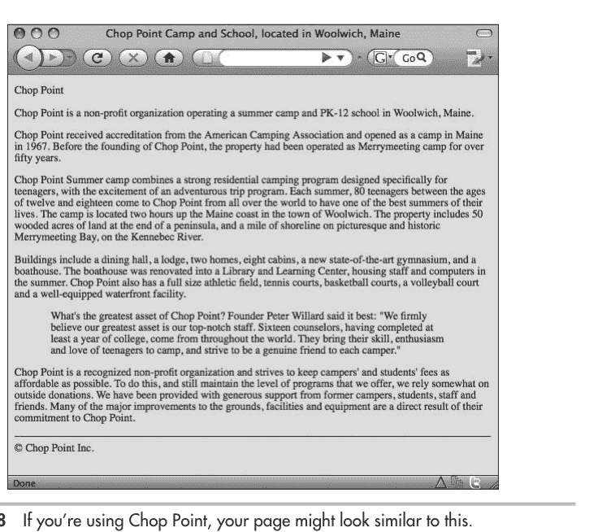

图4-8 如果你使用的是Chop Point，你的页面可能与此类似。


```html
<style type="text/css">
body {background-color: #ffe188;
      color: #602b00;}
</style>
</head>
<body>
<p>Chop Point </p>
<p>Chop Point is a non-profit organization operating a summer camp and K-12 school in Woolwich, Maine.</p>
<div id="campOverview">
<p>Chop Point received accreditation from the American Camping Association and opened as a camp in Maine in 1967. Before the founding of Chop Point, the property had been operated as Merrymeeting camp for over fifty years.</p>
<p>Chop Point Summer camp combines a strong residential camping program designed specifically for teenagers, with the excitement of an adventurous trip program. Each summer, 80 teenagers between the ages of twelve and eighteen come to Chop Point from all over the world to have one of the best summers of their lives. The camp is located two hours up the Maine coast in the town of Woolwich. The property includes 50 wooded acres of land at the end of a peninsula, and a mile of shoreline on picturesque and historic Merrymeeting Bay, on the Kennebec River.</p>
<p>Buildings include a dining hall, a lodge, two homes, eight cabins, a new state-of-the-art gymnasium, and a boathouse. The boathouse was renovated into a Library and Learning Center, housing staff and computers in the summer. Chop Point also has a full size athletic field, tennis courts, basketball courts, a volleyball court and a well-equipped waterfront facility.</p>

> What's the greatest asset of Chop Point? Founder Peter Willard said it best: "We firmly believe our greatest asset is our top-notch staff. Sixteen counselors, having completed at least a year of college, come from throughout the world. They bring their skill, enthusiasm and love of teenagers to camp, and strive to be a genuine friend to each camper."

<p>Chop Point is a recognized non-profit organization and strives to keep campers' and students' fees as affordable as possible. To do this, and still maintain the level of programs that we offer, we rely somewhat on outside donations. We have been provided with generous support from former campers, students, staff and friends. Many of the major improvements to the grounds, facilities and equipment are a direct result of their commitment to Chop Point.</p>
</div>
<hr>
<div id="footer">
&copy; Chop Point Inc.
</div>
</body>
</html>
```

页面元素可以使用`p`标签或`div`标签进行对齐和格式化。由于文本和元素格式化几乎在所有网页上都会用到，因此在 HTML 中练习并理解其功能是很重要的。

## 额外挑战

尝试使用内部样式表重新格式化你刚刚完成的页面。一些可能的格式化选项包括：

- 使包含在`campOverview`部分中的段落两端对齐。
- 指定包含在`blockquote`标签中的段落仅在左侧缩进 20 像素（右侧不缩进）。
- 移除`hr`标签，改为使用样式表中的`border`属性在`footer`上方添加边框。

## 添加标题

最早的文本格式化方式之一就是标题标签。它提供从`<h1>`到`<h6>`共六个级别的重要性等级，如以下代码和图 4-9 所示。你可以将这些标题理解为文本段落的标题。

这是告诉浏览器开始将该文本作为一级标题处理的起始标签。

```html
<!DOCTYPE html PUBLIC "-//W3C//DTD XHTML 1.0 Transitional//EN"
"http://www.w3.org/TR/xhtml1/DTD/transitional.dtd">
<html>
<head>
    <title>Header Example</title>
</head>
<body>
<h1>This is an example of a level 1 header. </h1>
<p>This is the text that follows the level 1 header. This is the text that follows the level 1 header. This is the text that follows the level 1 header.</p>
<h2>This is an example of a level 2 header.</h2>
<p>This is the text that follows the level 2 header. This is the text that follows the level 2 header. This is the text that follows the level 2 header.</p>
<h3>This is an example of a level 3 header.</h3>
<p>This is the text that follows the level 3 header. This is the text that follows the level 3 header. This is the text that follows the level 3 header.</p>
<h4>This is an example of a level 4 header.</h4>
<p>This is the text that follows the level 4 header. This is the text that follows the level 4 header. This is the text that follows the level 4 header.</p>
<h5>This is an example of a level 5 header.</h5>
<p>This is the text that follows the level 5 header. This is the text that follows the level 5 header. This is the text that follows the level 5 header.</p>
<h6>This is an example of a level 6 header.</h6>
<p>This is the text that follows the level 6 header. This is the text that follows the level 6 header. This is the text that follows the level 6 header.</p>
</body>
</html>
```

这个结束标签告诉浏览器停止将该文本作为一级标题处理，并恢复为默认文本格式。

标题标签类似于你在 Microsoft Word 等文字处理器中使用的标题。它们也类似于大纲中的标题，因为它们应该按照正确的顺序从`<h1>`到`<h6>`依次使用。

例如，你不会创建一个以小写字母`a`开头，后面跟着罗马数字`I`的提纲。相反，你应该以罗马数字`I`开始，后面跟大写字母`A`，然后很可能再跟数字`I`。同理，`<h1>`之后应该跟`<h2>`，而不是`<h3>`。

**注意**

使用标题标签会自动在标题前后添加换行，因为这些标签是块级容器标签。

你使用标题标签来告诉浏览器哪些文本片段充当标题，然后通过 CSS 指定如何设置它们的样式。因此，你可以使用`<h3 style="text-align: right;">`通过内联样式快速调整标题的对齐方式。同样，你可以在内部样式表（放置在页面的`<head>`起始标签和结束标签之间）中使用`h3`作为选择器来指定页面上所有三级标题的格式选项。

```css
<style type="text/css">
h3 {text-align: right;}
</style>
```

## 为文本段落添加逻辑强调

HTML 允许使用不同类型的格式化标签来添加强调。大多数可用的标签可以归类为以下两种样式之一：

- 逻辑样式
- 物理样式

你可以将逻辑样式视为类似于人的性格特征，而物理样式则更接近于人的外貌。

### 逻辑样式

*逻辑样式*定义受影响的文本在页面上的用途，而不是它的显示方式。这意味着最终由浏览器决定如何显示文本（见表 4-3）。例如，如果你正在为本段的第一句话编写 HTML，你可以使用`dfn`标签告诉浏览器“逻辑样式”这个短语应该作为定义术语高亮显示。

```html
<dfn>Logical styles</dfn> define how the affected text will be used on the page.
```

> **注意**
>
> `<h>`（标题）标签也是一种逻辑样式。

| 标签 | 描述 | 典型图形浏览器显示效果 |
| :--- | :--- | :--- |
| `<abbr>` | 表示缩写。 | 在图形浏览器中不显示（在音频浏览器中会朗读每个字母） |
| `<acronym>` | 表示首字母缩略词。 | 在图形浏览器中不显示（在音频浏览器中会朗读每个字母） |
| `<cite>` | 标记对另一个来源的引用或短引用。 | 斜体 |
| `<code>` | 显示代码示例。 | 等宽字体（如 Courier） |
| `<dfn>` | 高亮定义或已定义的术语。 | 斜体 |
| `<em>` | 提供通用强调。 | 斜体 |
| `<kbd>` | 标识用户将要输入的文本（`kbd`是 keyboard 的缩写）。 | 等宽字体（如 Courier） |
| `<samp>` | 描述示例文本或代码，通常是程序的输出。 | 等宽字体（如 Courier） |
| `<strong>` | 提供比`<em>`更强的通用强调。 | 粗体 |
| `<var>` | 表示可变的单词或短语，应替换为特定值。 | 斜体 |

表 4-3 HTML 中的逻辑样式

在前面的示例中，`dfn`标签会告诉浏览器将短语“逻辑样式”与句子的其余部分区分开来。具体如何区分取决于不同的浏览器，但大多数浏览器将其显示为斜体文本。所有逻辑样式在 HTML 文档中使用时都必须有开始标签和结束标签。图 4-10 展示了这些标签的典型显示方式。

### 物理样式

与逻辑样式相反，*物理*样式定义如何显示受影响的文本。在大多数情况下，这些样式无论在什么浏览器中显示效果都是一样的。由于在浏览器显示方面更加可靠，物理样式比逻辑样式使用得更频繁。如表 4-4 所示，所有物理样式在 HTML 文档中使用时都需要有开始标签和结束标签。这些样式的可视化表示见图 4-11。

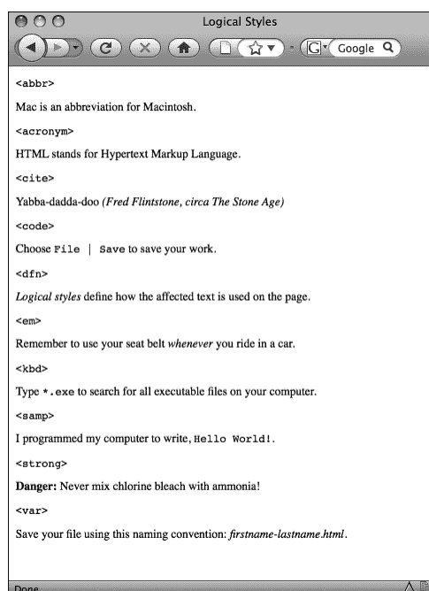

**图 4-10** 这是 Mozilla 浏览器（此处为 Firefox）显示逻辑样式的方式。

| 标签 | 描述 |
| :--- | :--- |
| `<b>` | **粗体** |
| `<big>` | 每次使用时字体大小增加 1（最大值为 7，默认值为 3） |
| `<i>` | *斜体* |
| `<tt>` | 打字机字体 |
| `<small>` | 每次使用时字体大小减小 1（最小值为 1，默认值为 3） |
| `<sub>` | <sub>下标</sub> |
| `<sup>` | <sup>上标</sup> |

表 4-4 HTML 中的物理样式

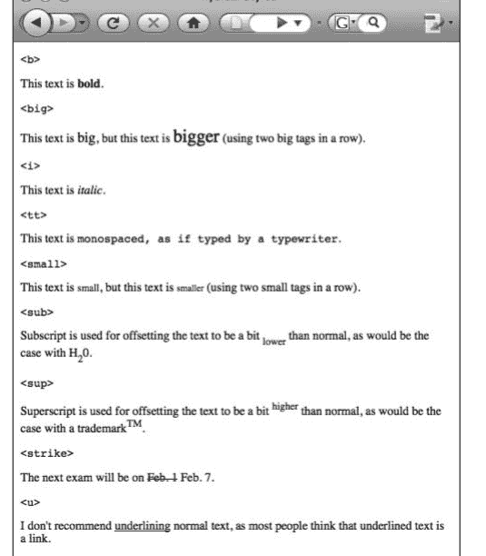

图 4-11 此屏幕截图展示了物理样式的典型渲染效果。

## 使用样式表添加强调

每种 HTML 物理和逻辑样式都有对应的样式表属性。CSS 还允许你以 HTML 无法实现的多种方式添加强调。例如，虽然 HTML 只允许为文本添加下划线，但 CSS 包含可以创建上划线的属性。该属性及其他常用属性列于表 4-5 中。

| 示例属性和值 | 描述 | 可选值 | 备注 |
|---|---|---|---|
| `font-style: italic` | 更改文本样式，使其显示为竖直或略微倾斜。类似于在 HTML 中使用`<i>`。 | 可选`normal`、`italic`或`oblique`。 | 在大多数情况下`italic`和`oblique`显示效果相同。 |
| `font-variant: small` | 将文本指定为小型大写字母。 | 可选`normal`或`small caps`。 | 不适用 |
| `font-weight: bold` | 更改字体显示的粗细程度。类似于在 HTML 中使用`<b>`。 | 可使用关键字（`normal`、`bold`、`bolder`、`lighter`）或数字（`100`、`200`、`300`...`900`）。`normal`为 400，`bold`为 700；`bolder`和`lighter`使字重比其余文本深一级或浅一级。 | 部分浏览器仅识别`normal`和`bold`。 |
| `letter-spacing: 10em` | 更改字母之间的间距。类似于其他程序和印刷方式中的字距调整。 | 可通过长度值（如`5em`）或关键字`normal`指定。 | 负值会使显示更加紧凑，字母排列更紧密。 |
| `line-height: 2` | 更改行间距。类似于其他程序和印刷方式中的行距。 | 可指定为字体大小的百分比（如`200%`以实现“双倍行距”效果）、字体大小的倍数（`1.5`或`2`）、长度值（`72px`），或关键字`normal`。 | 不适用 |
| `text-decoration: overline` | 允许以多种方式更改文本外观。 | 可选`none`、`underline`、`overline`、`line-through`或`blink`。 | 非链接文本默认为`none`，链接文本默认为`underline`。 |
| `text-transform: uppercase` | 更改文本的大小写。 | 可选`none`、`capitalize`（每个单词首字母大写）、`uppercase`（全部大写）或`lowercase`（全部小写）。 | 不适用 |
| `word-spacing: 20em` | 更改单词之间的间距。类似于其他程序或印刷方式中的字间距调整。 | 可通过长度值（如`20em`）或关键字`normal`指定。 | 负值会使显示更加紧凑，单词排列更紧密。 |

表 4-5 用于添加强调的 CSS 属性

80 HTML：初学者指南

| 示例属性与值 | 描述 | 可能的值 | 备注 |
| --- | --- | --- | --- |
| `font-stretch: wider` | 允许你拉伸或压缩字体中的字符。 | 可以是绝对关键字（`ultra-condensed`、`extra-condensed`、`condensed`、`semi-condensed`、`normal`、`semi-expanded`、`expanded`、`extra-expanded`、`ultra-expanded`）或相对关键字（`wider`和`narrower`）。 | 浏览器支持情况各异。 |
| `text-shadow: 10px, 20px, 5px, blue` | 允许文本具有阴影效果。 | 可以指定阴影在顶部和左侧的长度值，以及颜色和可选的颜色模糊半径。（这些值用逗号分隔。） | 浏览器支持情况各异。 |

表 4-5 用于添加强调的 CSS 属性（续）

## 通过更改字体特性设置文本样式


在开始更改网页的字体特性之前，你应该注意到，访问你网站的访客对这些字体特性拥有最终的控制权。下面的屏幕截图展示了用户如何自定义一个浏览器。用户甚至可以选择使用他们自己的字体，覆盖页面指定的字体，因此你应该将这些标签视为给浏览器的建议，但永远不要依赖它们来显示你的页面。

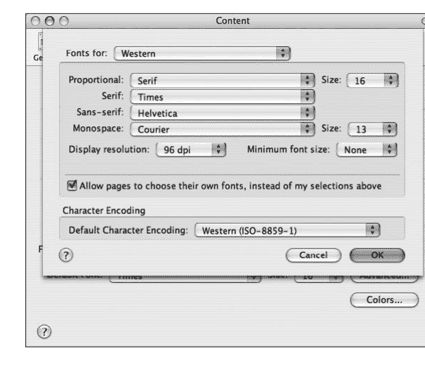

## 字体族

当与“字体”一词连用时，“字体族”指的是你想在页面上使用的字体的名称。在样式表中，我们使用`font-family`属性来指定字体族。

你可以使用`font-family`属性来指定几乎任何你能想到的字体名称，但除非访问者已经在其计算机上安装了该字体，否则他将无法以该字体族查看你的网页。因此，如果你将页面指定为使用 Gill Sans 字体显示，但访问者没有安装 Gill Sans，他将看到你的页面使用浏览器的默认字体族（通常是 Times New Roman）。

```html
<p style="font-family:'gill sans';">This text will be displayed in Gill Sans.</p>
```

为了补偿并非所有访客都拥有你所指定字体的可能性，你可以在`font-family`属性的值中指定备用字体。如果浏览器在访客的计算机上找不到列出的第一个字体族，它会接着查找第二个、第三个，依此类推，直到找到匹配项。同样，如果浏览器在访客的系统上找不到你 HTML 文件中列出的任何字体族，它将使用默认字体（通常是 Times New Roman）显示页面。

> **注意**
>
> 这种提供备用字体名称的过程也被称为“级联”。

```html
<p style="font-family:'gill sans', verdana, arial, helvetica;">Here I have given the browser four choices, in hopes that it will find one of them on the viewer's system.</p>
```

在前面的代码中，浏览器首先查找 Gill Sans。如果找不到该字体族，它会查找 Verdana，然后是 Arial 和 Helvetica。如果这些字体族都不可用，它将使用浏览器的默认字体显示文本。

一些字体族在 Web 上非常流行。这是因为这些字体族最有可能安装在大多数访客的系统上。此外，大多数这些字体在 Web 上被发现比其他字体更具可读性。（有关最具可读性 Web 字体的很好比较，请参阅[http://dev.opera.com/articles/view/fonts-for-web-design-a-primer/](http://dev.opera.com/articles/view/fonts-for-web-design-a-primer/)。）表 4-6 列出了许多适合你页面的可读字体族。

一个字体随附的产品越多，你的网站访客拥有该字体的可能性就越大。关于字体可用性的信息来源于微软关于 Web 排版的讨论以及 Visibone 的字体调查。要了解更多，请访问`www.microsoft.com/typography/`和`www.visibone.com/font/FontResults.html`。

| 字体名称 | 示例文本 | 可用性 |
| --- | --- | --- |
| Arial | ABCdefg 123456 !?@ | 至少 99% 的 Windows 和 Mac 系统 |
| Arial Black | **ABCdefg 123456 !?@** | 至少 97% 的 Windows 和 Mac 系统 |
| Arial Narrow | ABCdefg 123456 !?@ | 至少 84% 的 Windows 和 Mac 系统 |
| Century Gothic | ABCdefg 123456 !?@ | 至少 80% 的 Windows 系统和 60% 的 Mac 系统 |
| Comic Sans MS | *ABCdefg 123456 !?@* | 至少 96% 的 Windows 和 Mac 系统 |
| Courier | ABCdefg 123456 !?@ | 至少 97% 的 Windows 和 Mac 系统 |
| Courier New | ABCdefg 123456 !?@ | 至少 96% 的 Windows 和 Mac 系统 |
| Georgia | ABCdefg 123456 !?@ | 至少 95% 的 Windows 和 Mac 系统 |
| Helvetica | ABCdefg 123456 !?@ | 至少 88% 的 Windows 系统和 99% 的 Mac 系统 |
| Impact | **ABCdefg 123456 !?@** | 至少 95% 的 Windows 系统和 84% 的 Mac 系统 |
| Tahoma | ABCdefg 123456 !?@ | 至少 88% 的 Windows 系统和 55% 的 Mac 系统 |
| Times | ABCdefg 123456 !?@ | 至少 87% 的 Windows 系统和 99% 的 Mac 系统 |
| Times New Roman | ABCdefg 123456 !?@ | 至少 98% 的 Windows 和 Mac 系统 |
| Trebuchet MS | ABCdefg 123456 !?@ | 至少 96% 的 Windows 和 Mac 系统 |
| Verdana | ABCdefg 123456 !?@ | 至少 98% 的 Windows 和 Mac 系统 |

表 4-6 流行且广泛支持的 Web 字体

> **提示**
>
> 字体名称在不同计算机系统上可能略有不同。因此，我建议使用小写字母，有时甚至为同一字体包含两个可能的名称。例如，字体 Comic Sans 有时可能安装为 Comic Sans 或 Comic Sans MS。你可以编写页面代码来兼顾这两种情况：使用`'comic sans, comic sans ms'`。

## 字体大小

你还可以使用样式表来更改文本大小。这可以通过`font-size`属性和以下任何可能的值来实现，例如：`font-size: 12pt`。

- **关键字**：`xx-small`、`x-small`、`small`、`medium`、`large`、`x-large`或`xx-large`
- **相对大小**：`smaller`或`larger`
- **绝对大小**：数字后跟单位，例如`12pt`（12 点）或`8px`（8 像素）

## 专家问答

> **问：** 如果我想使用表 4-6 中未列出的字体，我有哪些选择？
>
> **答：** 问得好。假设，例如，你正在为一个客户的网站工作，其标志包含一种相当独特、通常在大多数用户系统上找不到的字体。你绝对应该将标志作为图像包含，以确保它在尽可能广泛的受众中一致显示。但你永远不想将网站上的“所有”文本都包含为图像，因为那样文本将无法被搜索，也无法被非基于图像的浏览器（如视力障碍读者使用的浏览器或某些手机浏览器）访问。
>
> 那么，这是否意味着你只能使用表 4-6 中列出的字体？对于你网站上的大部分文本来说，是的。但是，你可以为显示文本（如标题和引用）使用图像或基于 Flash 的字体替换工具，为你的页面增添一点亮点。（可以查看 Mike Davidson 的 sIFR 工具，这是一种选择，它用保存在你 Web 服务器上的正确字体副本替换每个字母：`www.mikeindustries.com/blog/sifr`）
>
> 表 4-7 试图解释`font-size`关键字与其他文本尺寸测量方式之间的关联。我使用“试图”这个词，因为文本大小会因用于显示文本的操作系统和浏览器而有很大差异。
>
> 尽管这些大小与你在文字处理程序中使用的点大小大致对应，但网页上的大多数文本在 Mac 上看起来比在 PC 上稍小（因为两个系统渲染字体的方式不同）。图 4-12 和 4-13 展示了相同的文本大小在 Mac 和 PC 上可能呈现的不同效果。

| 默认 HTML 字体大小 | HTML 标题 | CSS 绝对大小值 | 大致点大小 |
| --- | --- | --- | --- |
| 1 | `h6` | `xx-small` | 8 |
|  |  | `x-small` | 9 |
| 2 | `h5` | `small` | 10 |
| 3 | `h4` | `medium` | 12 |
| 4 | `h3` | `large` | 14 |
| 5 | `h2` | `x-large` | 16 |
| 6 | `h1` | `xx-large` | 18 |
| 7 |  |  | 24 |

**表 4-7** 字体大小

## 字体颜色

正如第3章所述，CSS的`color`属性用于更改网页前景中任何项目的颜色，包括文本。或者，`background-color`属性用于更改网页背景中任何项目的颜色。这意味着你可以为一个段落附加两种颜色特性。以下代码展示了如何通过内联样式表实现这一点，为紫色文本添加黄色高亮背景。

```html
<p style="color: purple;background-color: yellow;">请记得明天把笔记本带回课堂，因为我们将开始一个新的英语文学单元。</p>
```

## 快速参考

总之，表4-8列出了用于修改字体特性的最常用样式表属性。

| 属性和值示例 | 描述 | 可能的值 | 备注 |
| :--- | :--- | :--- | :--- |
| `font-family: verdana` | 更改字体族。 | 可以使用字体名称。多个值用逗号分隔。 | 不适用 |
| `font-size: 14pt` | 更改文本大小。 | 可以使用绝对或相对大小。绝对大小可以用数字值加单位（如`12pt`）或关键字（`xx-small`、`x-small`、`small`、`medium`、`large`、`x-large`、`xx-large`）指定。相对关键字是`larger`和`smaller`。 | 默认通常是`medium`，但大小最终取决于用户的浏览器和平台。 |
| `color: black` | 更改文本颜色。 | 可以使用十六进制代码：`#000000`，RGB值：`rgb(0,0,0)`，或颜色名称：`black`。 | 不适用 |
| `background-color: #336699` | 更改页面或元素的背景颜色。 | 可以使用十六进制代码：`#000000`，RGB值：`rgb(0, 0, 0)`，或颜色名称：`black`。 | 可与多种类型的元素（不仅仅是文本）一起使用。 |
| `font-size-adjust: 1.5` | 根据实际用于显示页面的字体调整字体大小，适用于在`font-family`属性中指定了多种不同大小的字体的情况。 | 可以是`none`或一个十进制值。`None`表示不进行大小调整。当需要大小调整时，使用十进制值（如`.75`）指定必要的变化量。 | 浏览器支持不一。 |
| `font-weight: bold` | 选择字体的粗细。 | 可以使用关键字或数字值（`100`、`200`、`300`、`400`、`500`、`600`、`700`、`800`、`900`），其中`700`是“bold”，`400`是“normal”。也可以使用相对关键字：`bolder`和`lighter`。 | 不适用 |
| `font-style: italic` | 在字体族内选择常规（罗马）和斜体字形。 | 可以使用关键字`normal`、`italic`或`oblique`。 | 不适用 |

**表4-8** 用于修改字体特性的样式表属性

## 动手实践 4-2：为你的网页添加样式

回到`index.html`页面，让我们改变该页面上文本的字体特性，并添加一些物理和逻辑样式。本项目的目标包括：

- 在页面必要处添加强调。
- 更改页面上文本的字形、大小和颜色。

1. 打开你的文本/HTML编辑器，加载从动手实践4-1保存的`index.html`页面。
2. 将“Chop Point”设置为一级标题。
3. 在第一个和第二个段落之间，添加“Summer Camp”作为二级标题，包含在`campOverview`部分内。将此标题居中对齐。
4. 在第一个段落中，为短语“Chop Point”添加强调。
5. 将第一个段落的字体更改为表4-6中列出的字体之一。
6. 将第一个段落的字体大小更改为大约14pt。
7. 将`campOverview`部分的字体更改为与之前使用的不同的字体。
8. 将`campOverview`部分的字体大小更改为大约12pt。
9. 将页脚文本的颜色更改为比页面上其他文本更浅的颜色。
10. 将页脚部分的字体大小更改为大约10pt。
11. 打开你的网页浏览器，选择“文件 | 打开页面”（或“打开文件”或“打开”，具体取决于你使用的浏览器）。找到你刚刚保存的`index.html`文件。

**提示**

如果你正在使用Internet Explorer并且没有立即在浏览器中看到文件菜单，请按键盘上的**ALT**键以显示文件菜单。

12. 预览页面以检查你的工作。如果需要进行更改，请返回你的文本编辑器进行更改。进行任何更改后，保存文件并切换回浏览器。选择刷新或重新加载以预览你刚刚所做的更改。如果你正在使用Chop Point完成此练习，你可以将你的文件与以下代码和图4-14进行比较。

**图4-14** 如果你正在为Chop Point制作页面，结果可能与此类似。

（续）

## HTML代码


```html
<!DOCTYPE html PUBLIC "-//W3C//DTD XHTML 1.0 Transitional//EN"
"http://www.w3.org/TR/xhtml1/DTD/transitional.dtd">
<html>
<head>
<title>Chop Point Camp and School, located in Woolwich, Maine</title>
<style type="text/css">
body {background-color: #ffe188;
    color: #602b00;}
#footer {font-size: 10px;
    color: gray;}
#campOverview {font-size: 12pt;
    font-family: verdana;}
</style>
</head>
<body>
<h1>Chop Point</h1>
<p style="font-family: georgia; font-size: 14pt;"><em>Chop Point</em> is a
nonprofit organization operating a summer camp and K-12 school in Woolwich,
Maine.</p>
<div id="campOverview">
<h2 style="text-align: center;">Summer Camp</h2>
<p>Chop Point received accreditation from the American Camping Association
and opened as a camp in Maine in 1967. Before the founding of Chop Point, the
property had been operated as Merrymeeting camp for over fifty years.</p>
<p>Chop Point Summer camp combines a strong residential camping program
designed specifically for teenagers, with the excitement of an adventurous trip
program. Each summer, 80 teenagers between the ages of twelve and eighteen
come to Chop Point from all over the world to have one of the best summers
of their lives. The camp is located two hours up the Maine coast in the town
of Woolwich. The property includes 50 wooded acres of land at the end of a
peninsula, and a mile of shoreline on picturesque and historic Merrymeeting
Bay, on the Kennebec River.</p>
<p>Buildings include a dining hall, a lodge, two homes, eight cabins, a new
state-of-the-art gymnasium, and a boathouse. The boathouse was renovated into
a Library and Learning Center, housing staff and computers in the summer. Chop
Point also has a full size athletic field, tennis courts, basketball courts, a
volleyball court and a well-equipped waterfront facility.</p>
<blockquote>What's the greatest asset of Chop Point? Founder Peter Willard said
it best: "We firmly believe our greatest asset is our top-notch staff. Sixteen
counselors, having completed at least a year of college, come from throughout
the world. They bring their skill, enthusiasm and love of teenagers to camp,
and strive to be a genuine friend to each camper."</blockquote>
<p>Chop Point is a recognized non-profit organization and strives to keep
campers' and students' fees as affordable as possible. To do this, and still
maintain the level of programs that we offer, we rely somewhat on outside
donations. We have been provided with generous support from former campers,
students, staff and friends. Many of the major improvements to the grounds,
facilities and equipment are a direct result of their commitment to Chop Point.</p>
</div>
<hr>
<div id="footer">
&copy; Chop Point Inc.
</div>
</body>
</html>
```

## 总结

HTML 和 CSS 都能让你为页面添加强调，尽管 CSS 比 HTML 提供了更多选项。在屏幕上强调某些文本部分时，关键问题是要确保你的页面对尽可能广泛的受众来说是可读和可用的。

### 提示

你的任何更改是否延续到了你想要它们停止的地方？请确保使用适当的结束标签来告诉浏览器在哪里停止。更多提示，请参见附录 C。

## 第 4 章自我测试

1. HTML 中的物理样式和逻辑样式有什么区别？
2. `<br>` 标签的用途是什么？
3. 当你连续编写三个 `<p>` 标签时会发生什么？
4. 列出两种用于文本对齐的样式表属性。
5. 写出 `font-size` CSS 属性的四个可能值。
6. 使用 `<tt>` 标签样式渲染的文本有什么特点？
7. 填空：你使用 `<font>` 标签的 `________` 属性来指定应渲染文本的字体名称。
8. 哪个标签用于标记对另一个来源的引用或短引用？
9. 写出 `align` 属性或 `text-align` CSS 属性的四个可能值。
10. 填空：在 `font-family` 属性中提供备用字体名称的过程也称为 `________`。

### 关键技能与概念

- 添加指向其他网页的链接
- 添加指向同一网页内各部分的链接
- 添加指向电子邮件地址和可下载文件的链接
- 设置链接样式
- 通过设置 Tab 顺序、键盘快捷键和目标窗口来自定义链接

HTML 的核心在于其能够轻松引用互联网上无数其他信息。这一点显而易见，因为 HTML 这个缩写的前两个字母代表的就是*超文本*（hypertext），即链接到其他信息的文本。

HTML 使我们能够链接到其他网页，以及图形、多媒体、电子邮件地址、新闻组和可下载文件。你可以在浏览器中访问的任何内容，都可以从 HTML 文档中进行链接。事实上，标识你想要链接的页面 URL 的最简单方法之一，就是从浏览器的地址栏或位置栏中复制它，然后直接粘贴到你的 HTML 文件中。

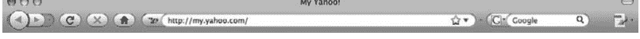

### 添加指向其他网页的链接

你可以添加指向其他网页的链接，无论这些网页是你自己网站的一部分还是其他人的网站。要做到这一点，需要使用 `a` 标签：

```html
<a href="http://www.google.com">使用此链接搜索 Google。</a>
```

### 提示

> 虽然在网页上添加指向你喜欢网站的链接通常被认为是可以接受的，但未经他人许可复制其内容是绝对不可接受的。如果你有任何疑问，在链接到非你自己拥有的网站时，请与网站管理员确认。

`a` 标签本身如果没有属性，作用不大。最常见的属性是 `href`，它是*超文本引用*（hypertext reference）的缩写：它告诉浏览器你链接的信息在哪里。其他属性包括 `name`、`title`、`accesskey`、`tabindex` 和 `target`，这些都在本章中讨论。

在起始 `a` 标签和结束 `a` 标签之间包含的文本是浏览你网页的人可以点击的内容。在大多数情况下，这段文本会显示为与周围文本不同的颜色并带有下划线，如图 5-1 所示。

在决定用作 `href` 属性值的内容时，请考虑你要使用什么类型的链接。以下两种是基本的链接类型。

- 绝对链接
- 相对链接

### 提示

> 创建链接时，请仔细考虑你想要用来突出显示链接的措辞。我建议永远不要使用“点击此处”这个短语作为你的链接，因为它没有告诉访问者当他们“点击此处”时会找到什么。大多数人浏览网页时会寻找感兴趣的链接。如果你页面上的所有链接都写“点击此处”，访问者将被迫详细阅读内容以确定点击哪里。不幸的是，考虑到大多数人在典型网站上停留的时间很短，这种做法可能会导致你失去的访问者比获得的更多。比较图 5-2 和图 5-3，看看更具描述性的链接如何更易于使用。

## 绝对链接

*绝对链接*是指包含完整路径的链接。在大多数情况下，当链接到不属于你自己网站的页面或站点时，你会使用绝对链接。绝对链接必须在链接开头包含协议（如 `http://`）。例如，如果你要从你的网站链接到 Yahoo!，你需要输入 `http://www.yahoo.com` 作为你的链接。

```html
<a href="http://www.yahoo.com">访问 Yahoo！</a>
```

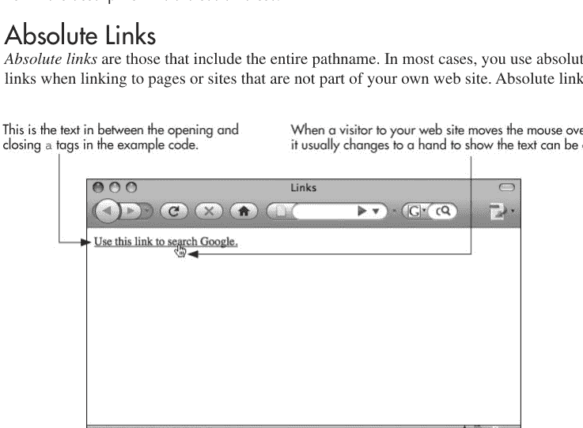

图 5-1 此屏幕显示了前面示例代码的浏览器视图。

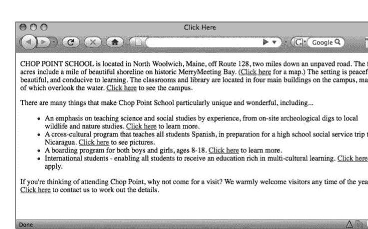

图 5-2 此屏幕显示了一个页面，其中每个链接都使用了“点击此处”。

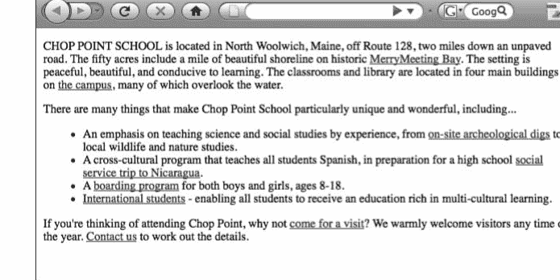

图 5-3 此屏幕显示了与图 5-2 相同的页面，但使用了更具描述性的链接名称，使扫描页面内容变得更容易。

## 相对链接

之所以称为*相对链接*，是因为你不包含要链接页面的完整路径名。相反，你使用的路径名是相对于当前页面的。这类似于说“我住在 Summershade 街，离这里大约三英里”，这是相对于“这里”这个位置的。更*绝对的*说法可能是“我住在 Anytown 美国 55104 的 Summershade 街 410 号”。

相对链接最常用于你想从自己网站中的一个页面链接到另一个页面时。以下是相对链接可能看起来的样子的示例：

```html
<a href="contactme.html">联系我</a>
```

此链接在包含此页面的同一文件夹中查找 `contactme.html` 文件。如果你要链接到*当前文件夹下方的另一个文件夹*中的文件，则你的 `href` 值可能如下所示：

```html
<a href="wendy/contactme.html">联系我</a>
```

如果你需要链接到比你页面所在文件夹更高一级的文件夹中的文件，你可以为树状结构中每向上一个目录添加 `../`。因此，如果你要链接的文件比你所在的文件夹高两级，你可以使用：

```html
<a href="../../contactme.html">联系我</a>
```

设想你正在为你自己和你的家人构建一个网站，使用以下目录结构。你可能还记得第一章中类似的内容，当时我们讨论了文件命名和 URL 的解剖结构。文件夹和文件通过缩进表示它们位于不同的层级。

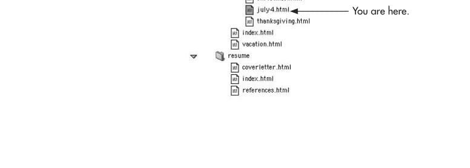

你正在处理突出显示的文件：`july4.html`。该文件位于主页（`index.html`）下方两个文件夹中，在一个名为 `holidays` 的文件夹里。如果你想从 `july4.html` 页面链接回该主页，你会包含一个类似这样的相对链接：

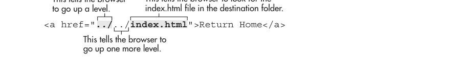

现在，假设你正在处理 `birthday.html` 文件，并且想要链接到 `july4.html` 页面。你能想象你会怎么做吗？

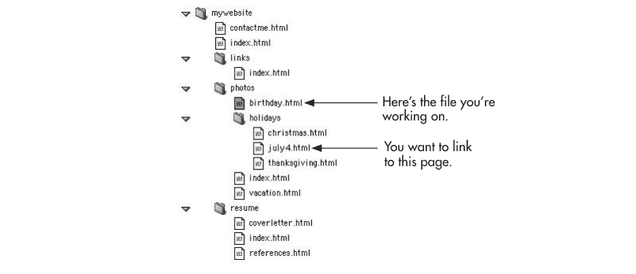

要从 `birthday.html` 链接到 `july4.html`，请使用以下代码：

```html
<a href="holidays/july4.html">查看这些七月四日的照片。</a>
```

因为 `july4.html` 文件比你当前正在处理的 `birthday.html` 文件低一个文件夹，所以你只需列出文件夹名称，后跟一个正斜杠和文件名（如前面的示例所示）。

### 添加指向同一网页内各部分的链接

当你链接到某个页面时，浏览器知道要查找什么，因为每个页面都有一个名称。但有时你可能想要链接到网站页面*内*的某个文本部分（参见图 5-4 的示例）。要链接到网页的某个部分，你必须首先为该部分命名。

#### 创建锚点

*锚点*（anchor）是页面内被赋予特殊名称的位置，使你可以稍后链接到它。如果不先命名某个部分，你就无法链接到它。以下是锚点的示例：

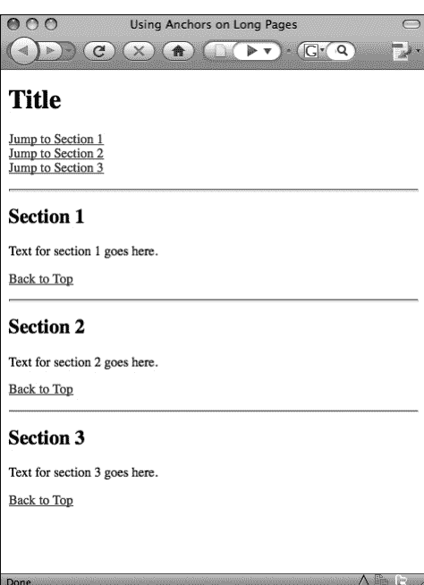

**图 5-4** 当你想在单个页面上有多个部分并链接到它们时，可以使用锚点来命名它们。

```html
This opens the a tag. The value of the name attribute is the name of your section. Use easy-to-remember section names without any spaces or punctuation.

<a name="section1">第 1 部分</a>

This closes the a tag.

This attribute of the a tag enables you to name a section of your web page. This is the actual name of the section that prints out on the screen.
```

在此示例中，起始 `a` 标签和结束 `a` 标签之间的短语显示在网页中，并将锚点标记为“第 1 部分”。如果你不希望为锚点包含标签，可以将该空间留空，如下例所示：

```html
<a name="top"></a>
```

这里，你可以在页面顶部使用这个不可见的锚点，然后从页面底部链接到它。这将使访问者只需单击一下无需滚动即可轻松返回长页面的顶部（参见图 5-5 的示例）。

## 第 5 章自我测试

11. `div` 标签与 `p` 标签有何不同？
12. 填空：`h` 标签是 __________ 样式的示例。
13. 判断正误：`blockquote` 标签在左右两侧都会缩进文本。
14. 哪种样式表属性是比 `hr` 标签更好的为页面添加水平线的方式？
15. 当 W3C 弃用某些标签时，这意味着什么？


## 专家问答

**问：** 如何判断何时使用相对路径还是绝对路径？

**答：** 当你链接到*不属于你网站*的页面时，通常需要使用绝对路径。例如，如果你正在制作 Chop Point 的网站，并且想要链接到一个全国性的夏令营协会，你需要使用完整的（绝对）路径来实现这一点。

但是，如果你链接的是*你自己网站上*包含该协会信息的页面，那么你可以使用相对路径。

请记住，如果你决定使用*绝对*路径来链接到网站中同一文件夹内的页面，长远来看可能会造成维护问题。如果以后你决定更改这些文件所在文件夹的名称，你需要回去更改所有的绝对链接。而如果使用相对链接，则无需做任何更改。


## 链接到锚点

要创建指向锚点的链接，你需要使用 `a` 标签和 `href` 属性，就像创建任何其他类型的链接一样。要完成链接，你需要在 `href` 属性的值中包含一个井号（`#`）和锚点名称。

```html
<a href="#top">Return to the top of the page</a>
```

- 这是 `a` 标签的开始。
- 井号告诉浏览器我们要链接到页面的特定部分。
- 这是 `a` 标签的结束。
- 这是我们要链接到的锚点名称。
- `href` 属性告诉浏览器我们要链接到其他位置。
- 这段文字将带有下划线，并链接到“top”锚点所在的位置。

以下展示了在 HTML 文档中编写时的完整效果：

```html
<!DOCTYPE html PUBLIC "-//W3C//DTD XHTML 1.0 Transitional//EN"
"http://www.w3.org/TR/xhtml1/DTD/transitional.dtd">

<html>

<head>
```


# Links and Anchors

## Cabin Life

Campers sleep in cabins with eight or nine other campers of similar age and two counselors. The cabins are rustic but comfortable. The girls' cabins all have a large closet and drawer space, two sinks, a toilet and a shower. Three of the boys' cabins share a latrine with plenty of sinks and toilets and two showers. They also have a number of other bathrooms available to them. The oldest boys' cabin has bathrooms with showers and sinks. All cabins are equipped with comfortable bunk beds.

Campers are responsible for keeping their own cabins clean, taking a turn at waiter duty, and sharing the upkeep of the common area. On a typical night, campers return to their cabins at 9pm to spend time with their cabin-mates before lights-out at 10pm. A weekly laundry service is provided. Friends of similar age who come to camp together may request to be placed in the same cabin. Due to space limitations however, we may not be able to accommodate all such requests.

Foreign camper enrollment is limited, so that no more than two campers from the same foreign country are in one cabin.

## Awesome Food

Breakfast is usually served at 8:00 AM. Lunch is at 1:00 PM and dinner is enjoyed at 6:00 PM. Breakfast usually includes juice and fresh fruit. Bacon and eggs are served a couple of times each week.

Hot waffles go right from the waffle iron to your plate. Pancakes and french toast are popular, as are homemade sweet breads, muffins, and donuts. Cereal (hot and cold) is always available. Every other Sunday breakfast is served to order.

Freshly made tossed salads are served at lunch and dinner with a variety of dressings and condiments. Sandwiches and homemade soups are frequently offered. Milk, water, iced tea, juice, hot tea, and coffee are available at all meals. The weekly menu typically includes BBQ chicken, roast beef, hamburgers, roast turkey, or ham. On alternate weeks, a combination seafood plate of haddock, fried clams, and shrimp is served. (Steak is available for those who don't enjoy seafood.) Our cooks bake our own rolls, cookies, bread, and cakes. Other desserts include fresh fruit, homemade ice cream, and "make your own" sundaes.

[Return to the top of this page.](#top)

- 此标签链接到预定义的锚点`top`。

如上所述，使用锚点的一个好场景是包含许多小章节的长页面，如图 5-4 所示的示例。当你确实有带有目录和多个章节的长页面时，为访客提供一个“返回顶部”链接来方便他们回到目录是非常好的做法。以下展示了用于创建此页面的 HTML 代码。

```html
<!DOCTYPE html PUBLIC "-//W3C//DTD XHTML 1.0 Transitional//EN"
"http://www.w3.org/TR/xhtml1/DTD/transitional.dtd">

<html>
<head>
<title>Using Anchors on Long Pages</title>
</head>

<body>

<h1><a name="top">Title</a></h1>

<p>
<a href="#one">Jump to Section 1</a><br />
<a href="#two">Jump to Section 2</a><br />
<a href="#three">Jump to Section 3</a>
</p>

<hr />

<h2><a name="one">Section 1</a></h2>
<p>Text for section 1 goes here.</p>
<p><a href="#top">Back to Top</a></p>

<hr />

<h2><a name="two">Section 2</a></h2>
<p>Text for section 2 goes here.</p>
<p><a href="#top">Back to Top</a></p>

<hr />

<h2><a name="three">Section 3</a></h2>
<p>Text for section 3 goes here.</p>
<p><a href="#top">Back to Top</a></p>

</body>
</html>
```

- 此链接指向页面下方名为“one”的锚点。
- 此链接指向页面下方名为“two”的锚点。
- 此链接指向页面下方名为“three”的锚点。
- 锚点将此处命名为“one”。
- 锚点将此处命名为“two”。
- 锚点将此处命名为“three”。

第 5 章：使用链接

101

> **注意**
>
> 如果你链接的锚点在屏幕上已经可见（例如图 5-4 中第一部分已经可见），那么浏览器可能不会跳转到该锚点。同样，如果被链接的锚点位于屏幕的最底部（如图 5-4 中的第三部分），浏览器也可能不会跳转到该锚点，具体取决于你的屏幕尺寸。原因是，如果浏览器已经在页面底部，它无法再向下滚动，因此只能尽量靠近锚点。

如果你需要创建指向另一个页面（不是你当前正在编辑的页面）特定章节的链接，那么你需要使用该页面的文件名和锚点名称，中间用井号（`#`）分隔，如下例所示。

```html
<a href="genealogy.html#intro">View names beginning with an "A" on our genealogy page.</a>
```

在这种情况下，浏览器会先查找`genealogy.html`，然后在该页面上定位名为“intro”的锚点。

## 添加电子邮件地址和可下载文件的链接

虽然指向网页内和网页间的链接是你最常创建的链接类型，但你也可以链接到互联网上的其他类型内容。

### 电子邮件地址

当你想让别人方便地获取你的电子邮件地址时，你可以在页面上将其设为`mailto`链接。这意味着你不在链接前使用`http://`，而是使用电子邮件协议`mailto:`来作为电子邮件地址的前缀。

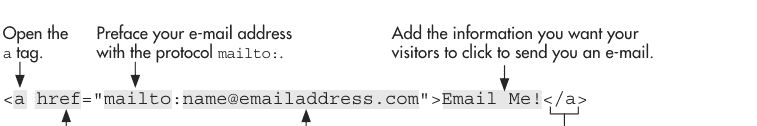

> **注意**
>
> 要使`mailto`链接正常工作，访问你网站的访客必须在计算机上安装了电子邮件程序（如 Outlook 或 Mac Mail）。如果访客仅使用基于网页的电子邮件服务（如 Gmail 或 Hotmail），此类电子邮件链接可能无法正常工作。

## 自定义电子邮件内容

某些浏览器甚至允许你通过在`href`值中添加额外文本来添加电子邮件的主题和抄送字段内容。为此，你需要在电子邮件地址末尾添加一个问号，然后输入`Subject`，后跟一个等号（`=`），以及你想要用作主题的词语或短语。这对于帮助你区分通过网站发送的邮件和其他电子邮件特别有用。

```html
<a href="mailto:name@emailaddress.com?Subject=HTMLBook&cc=htmlbook@emailaddress.com">Email me about this book</a>
```

请记住，`href`属性的值中不应包含空格，除非空格是主题行的一部分。

## 保护你的电子邮件链接免受垃圾邮件

许多发送垃圾邮件的人使用称为邮件采集器的程序来搜索网络上的电子邮件地址。这意味着任何时候你的电子邮件地址被列出、显示或以其他方式包含在网页上，你都可能面临潜在的垃圾邮件骚扰。

这些采集程序识别的关键是电子邮件地址中的`@`符号，因为大家都知道没有`@`符号就不可能有电子邮件地址。所以保护你的电子邮件地址免受垃圾邮件侵扰的关键就是不要显示带有`@`符号的地址。

### 使用`[at]`代替`@`符号

一种快速的纯文本方法是在网页上避免显示完整的电子邮件地址，即将`@`符号替换为`[at]`之类的内容，这样精明的访客仍然可以获取你的电子邮件地址，但采集程序无法识别。你的电子邮件地址可能看起来像这样：

`me[at]mail.com`

这仅在你仅仅显示电子邮件地址而非链接它时有效。有关更多信息，请继续阅读。

### 使用图片代替`@`符号

保护已显示的电子邮件地址免受垃圾邮件的第二种最简单方法是用图形`@`符号替换文本`@`符号。这样网站访客可以看到完整的电子邮件地址，但由于邮件采集程序无法读取图片，因此可以欺骗它们。

然而，此方法和前一种技巧仅适用于隐藏仅在浏览器中显示的电子邮件地址。如果你是将电子邮件地址作为链接供人们点击发送邮件，你还必须隐藏嵌入在`a`标签中的电子邮件地址版本。为此，请尝试以下两种技巧之一。

## 使用代码替换`@`符号

前两种防止电子邮件地址被垃圾邮件收集的方法有一个问题，那就是它们只在电子邮件地址被显示而不是链接时才有效。例如，请看以下代码：

```html
<a href="mailto:me@mail.com">Email Me</a>
```

虽然电子邮件地址在浏览器视图中没有显示出来，但它仍然嵌入在代码中。当你将实际的电子邮件地址放在`mailto`链接的代码中时，那些读取实际 HTML 的收集程序仍然能够发现它！

隐藏`mailto`链接中电子邮件地址的一种方法是将`@`符号和句点替换为它们的十进制等效值。这意味着`me@home.com`可能看起来像这样：

```html
me&#64;home&#46;com
```

这里，`&#64;`是`@`符号的十进制等效值，而`&#46;`是句点的等效值。使用这种技术的完整`a`标签看起来像这样：

```html
<a href="mailto:me&#64;home&#46;com">
```

绝大多数电子邮件程序都能识别这些十进制字符，并在准备实际电子邮件时将其替换为相应的符号。

## 使用 JavaScript 隐藏电子邮件地址

可以说，避免垃圾邮件同时又能包含`mailto`链接的最有效方法，是使用某种脚本语言或 HTML 之外的其他类型（如 JavaScript）来隐藏电子邮件地址。以下示例脚本应放置在你的 HTML 代码中原本应该放置`<a href="mailto:me@home.com">`的位置。

```html
<script language="JavaScript">
<!--
var name = "me"
var domain = "mail"
var ext = "com"

document.write('<a href="' + 'mailto:' + name + '@' + domain + '.' + ext + '">E-mail Me</a>');
//-->
</script>
```

在浏览器中显示时，此脚本会打印“E-mail Me”并将其链接到`me@mail.com`，同时始终不会以垃圾邮件收集程序能够解读的方式显示完整的电子邮件地址。

### 提示

避免将电子邮件地址公之于众（从而被收集）的最佳方法之一，是为访客创建一个网页表单来发送电子邮件。更多信息请参阅第 11 章。

## 专家问答

> **问：** 链接到 RSS 源怎么样？
>
> **答：** RSS（Really Simple Syndication，简易信息聚合）近年来发展迅速，即使你可能不知道它的含义，但很可能已经在某个网站或另一个地方见过它的引用。许多新闻网站和网络博客在可供公众使用的内容旁边会放置小的橙色或蓝色矩形按钮。例如，访问`www.foxnews.com/rss`可以查看可供聚合使用的 FoxNews 内容列表。
>
> 要“阅读”这类聚合内容，你需要在新闻阅读器（也称为聚合器）中打开 RSS 源。查看`http://blogspace.com/rss/readers`以了解一些流行的新闻阅读器。
>
> 任何人都可以创建自己的 RSS 源。访问`www.mnot.net/rss/tutorial`获取有关如何创建 RSS 源的优秀教程。创建了自己的聚合内容后，你需要在页面上放置一个链接来推广该内容（类似于你可能在其他网站上看到的那些小橙色按钮）。链接到 RSS 源的格式与其他 HTML 链接非常相似，只是有少许变化：`<a type="application/rss+xml" href="feed.rss">RSS feed for this page</a>`。

## FTP 和可下载文件

互联网为许多公司提供了一种向客户传输文件的便捷方式。例如，假设你购买了一款用于保护电脑免受病毒侵害的软件。最终，你的软件必须更新，以便能够识别新的病毒。获取此类更新最快、最简单的方法是从公司网站下载。

当从互联网下载无法在浏览器中显示的文件时（如软件应用程序和插件），你通常是通过访问公司的 FTP 站点来进行下载的。

`FTP`，即`File Transfer Protocol`（文件传输协议），是你在互联网上发送和接收文件的一种方式。许多公司既有 HTTP 服务器（存放其网站），也有 FTP 服务器（存放其可下载文件）。

要引用 FTP 站点上的文件，你需要使用`a`标签和带有 FTP 协议的`href`属性，如下例所示：

```html
<a href="ftp://sunsite.unc.edu/pub/">Visit the SunSite FTP</a>
```

虽然有些 FTP 站点是匿名的，不需要密码即可访问，但大多数是私有的。安全内容通常面向有限的受众，这些人会获得访问内容的特定凭据。没有合格的用户名和密码，你将无法访问私有 FTP 站点。如果你要链接到私有 FTP 站点，还应考虑为访客提供注册或申请用户名和密码的方式。

当然，在某些情况下，你可以将可下载文件直接放在与网页相同的网络服务器上。这些可能是电影、声音、程序或其他你想提供给访客的文件。你可以像链接任何其他网页一样链接到这些文件，同时注意使用正确的文件扩展名。

```html
<a href="http://www.wendywillard.com/downloads/baby.mov">View the baby movie!</a>
```


## 动手实践 5-1 添加链接

回到`index.html`页面，让我们为网站添加链接。提醒一下：完成本书中 Chop Point 夏令营项目所需的所有文件都可以从`www.wendywillard.com`下载。此外，你可以随时访问`www.choppoint.org`查看我的网站版本。

如果你没有使用 Chop Point，可以根据自己的具体需求调整项目。本项目的目标包括：

- 添加指向网页的链接
- 添加指向网页内各部分的链接
- 添加指向电子邮件地址的链接

1. 打开你的文本/HTML 编辑器，加载从第 4 章保存的`index.html`页面。
2. 添加一个指向`trips.html`的链接，文字为："Learn more about our summer camp's adventure trips."
3. 保存文件。
4. 创建一个名为`trips.html`的新文件。包含`trips.txt`中的文本（可在我的网站上与 *HTML: A Beginner's Guide* 文件一起找到）。
5. 将第四段末尾的短语 "e-mail us" 格式化为电子邮件链接。邮件应发送至`camp@choppoint.org`。主题为 "Trips"。
6. 保存此文件。
7. 打开你的网页浏览器，选择 File | Open Page（或 Open File 或 Open，具体取决于你使用的浏览器）。找到你刚刚保存的`index.html`文件。
8. 点击你添加的链接以确保其有效。该链接应显示`trips.html`页面。
9. 如果需要进行更改，请返回文本编辑器进行更改。进行任何更改后，保存文件并切换回浏览器。选择 Refresh 或 Reload 预览你刚刚所做的更改。
10. 在文本编辑器中返回`trips.html`文件。
11. 为每个小节标题添加锚点，使用小节名称（不带空格）作为锚点名称。
12. 为你刚刚创建的每个锚点添加链接，使页面顶部附近的类别名称变成指向下方实际类别内容的链接。
13. 在页面顶部添加一个名为`top`的锚点。
14. 在每个小节的末尾添加 **Back to Top** 链接，使访客能够轻松返回页面顶部的类别列表。
15. 保存文件。
16. 返回浏览器并选择 Refresh 或 Reload 确认你的更改。如果你使用的是 Woolwich Historical Society，可以将你的文件与以下代码和图 5-6 进行比较。

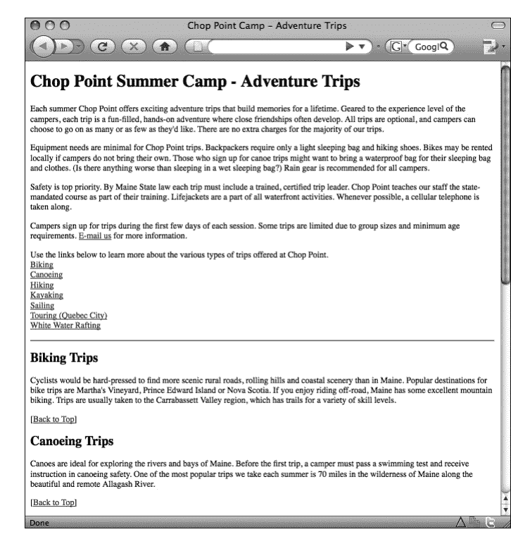

### 提示

你的链接是否有效？如果没有，请确保路径名正确。`index.html`和`trips.html`页面应位于同一文件夹中。如果不是，你需要更改路径名以反映正确的文件夹名称。此外，请务必检查你的大小写（或缺少大小写）。请记住，此类链接区分大小写，因此如果你将某个部分命名为带大写 I 的"Intro"，但链接到的是小写 i 的"intro"，那么你的链接将无法工作。更多提示请参阅附录 C。

```html
<!DOCTYPE html PUBLIC "-//W3C//DTD XHTML 1.0 Transitional//EN" "http://www.w3.org/TR/xhtml1/DTD/transitional.dtd">

<html>

<head>

<title> Chop Point Camp - Adventure Trips </title>

</head>

<body>

<h1>Chop Point Summer Camp - Adventure Trips</h1>

<p>Each summer Chop Point offers exciting adventure trips that build memories for a lifetime. Geared to the experience level of the campers, each trip is a fun-filled, hands-on adventure where close friendships often develop. All trips are optional, and campers can choose to go on as many or as few as they'd like. There are no extra charges for the majority of our trips.</p>

<p>Equipment needs are minimal for Chop Point trips. Backpackers require only a light sleeping bag and hiking shoes. Bikes may be rented locally if campers do not bring their own. Those who sign up for canoe trips might want to bring a waterproof bag for their sleeping bag and clothes. (Is there anything worse than sleeping in a wet sleeping bag?) Rain gear is recommended for all campers.</p>

<p>Safety is top priority. By Maine State law each trip must include a trained, certified trip leader. Chop Point teaches our staff the state-mandated course as part of their training. Lifejackets are a part of all waterfront activities. Whenever possible, a cellular telephone is taken along.</p>

<p>Campers sign up for trips during the first few days of each session. Some trips are limited due to group sizes and minimum age requirements. <a href="mailto:camp@choppoint.org?Subject=Trips;">E-mail us</a> for more information.</p>

<p>Use the links below to learn more about the various types of trips offered at Chop Point.<br />

<a href="#biking">Biking</a><br />

<a href="#canoeing">Canoeing</a><br />

<a href="#hiking">Hiking</a><br />

<a href="#kayaking">Kayaking</a><br />

<a href="#sailing">Sailing</a><br />

<a href="#touring">Touring (Quebec City) </a><br />

<a href="#rafting">White Water Rafting</a></p>

<hr />

<a name="biking"><h2>Biking Trips</h2></a>
```

## HTML：初学者指南

自行车爱好者在缅因州很难找到比这里更风景如画的乡村道路、连绵起伏的山丘和海岸风光了。自行车旅行的热门目的地包括玛莎葡萄园岛、爱德华王子岛或新斯科舍省。如果你喜欢越野骑行，缅因州有一些非常棒的山地自行车道。通常，旅行会前往卡拉巴塞特山谷地区，那里有适合各种技能水平的步道。

[返回顶部](#top)

## 独木舟之旅

独木舟是探索缅因州河流和海湾的理想工具。在第一次旅行之前，露营者必须通过游泳测试并接受独木舟安全指导。我们每年夏天最受欢迎的旅行之一，是沿着美丽而偏远的阿勒加什河，在缅因州的荒野中进行70英里的旅程。

[返回顶部](#top)

## 徒步旅行

对于徒步旅行者来说，白山、阿卡迪亚国家公园和巴克斯特州立公园有数百英里的步道可供选择。白山的风景如此令人叹为观止，以至于马戏团创始人 P.T. 巴纳姆在登上海拔一英里的华盛顿山顶时评论道：“这是地球上第二大奇观。”旅行形式在隔夜背包旅行和从大本营出发的日间徒步之间变化。

[返回顶部](#top)

## 皮划艇之旅

皮划艇之旅在沿海河流和海湾的安全庇护下进行。海中皮划艇是在缅因州水面上快速高效的旅行方式；它们提供与传统独木舟不同的体验。

[返回顶部](#top)

## 帆船之旅

许多人认为体验缅因州的唯一方式是从水面上乘船。每个夏天，我们每个班次会进行一次隔夜旅行，乘坐像斯蒂芬·泰伯号这样的历史帆船。在这些旅行中，有许多岛屿和港口可供参观。斯蒂芬·泰伯号是美国有记录以来持续服役时间最长的帆船，也是国家历史地标。

[返回顶部](#top)

## 魁北克城之旅

距离300英里，魁北克是加拿大最有趣的地区之一。魁北克城一直很受欢迎，非常适合购物和观光。亮点包括参观议会大厦、亚伯拉罕平原和圣安妮德博普雷大教堂。住宿通常在拉瓦尔大学的宿舍进行，随后是丰盛的早餐。此行程需额外收费。

[返回顶部](#top)

## 激流漂流之旅

驱车三小时前往福克斯的肯纳贝克河源头，开始对峡谷四级急流的壮丽挑战。

注册的缅因州向导使用自排水筏让这次惊险体验成为难忘的记忆。需要支付75美元的额外费用并签署家长同意书。

`a`标签使你能够添加指向互联网上多种类型信息的链接。本项目让你练习使用该标签链接到另一个网页、一个电子邮件地址，以及同一网页内的部分。

### 提示

你的每个目标链接都有效吗？如果没有，请确保锚点名称正确。记住，在大多数情况下链接区分大小写，所以如果你在锚点名称中使用了大写字母，那么在链接时也需要大写。此外，检查一下你是否在链接到锚点名称时包含了井号（#）（即，`href="#a"`）。更多提示，请参阅附录 C。

## 额外学分

1. 为下一个项目做准备，从使用内部样式表切换到外部样式表。（使用`index.html`中的内部样式表作为你外部样式表的基础。）
2. 将其命名为`styles.css`，并与其他两个文件保存在同一文件夹中。
3. 从`index.html`和`trips.html`都添加一个指向你外部样式表的链接。

### 注意

如果你想看看我的外部样式表，我已经在我的网站上的 *HTML：初学者指南* 文件中包含了一个外部样式表的副本。

## 链接样式

在第 3 章中，我们讨论了更改页面的文本和背景颜色。与更改 HTML 页面中颜色的其他属性一样，你需要通过十六进制代码、RGB 值或预定义颜色名称来指定颜色。（关于如何查找颜色值的更多信息列在第 3 章中。）

你使用样式表来指定这些颜色。与任何样式声明一样，你可以在内联、内部或外部样式表中指定背景、文本和链接颜色。无论你使用哪种类型的样式表，用于实现此目的的实际属性都是相同的。

实际上，你使用`a`标签通过样式表更改链接颜色，如以下示例所示：

```html
<style type="text/css">
body {background-color: white;}

a:link {color: blue;}

a:visited {color: purple;}

a:hover {color: orange;}

a:active {color: red;}
</style>
```

这允许你指定链接在被点击之前的颜色。

这允许你指定链接在被点击并访问之后的颜色。

这允许你指定光标悬停在链接上时的颜色（与“翻转”效果相同）。

这允许你指定链接被点击时的颜色。

虽然这个特定的样式声明更改了整个页面上的链接，但你也可以使用类来调整某些链接的颜色。例如，如果你页面上的大多数链接是默认的蓝色，但导航栏的背景也是深蓝色，这就特别方便。解决这个问题的一种方法是创建一个具有不同颜色链接的`class`，就像我在下面的样式表中所做的那样：

```css
a.navlinks:link {color: white;}

a.navlinks:visited {color: gray;}

a.navlinks:hover {color: yellow;}

a.navlinks:active {color: orange;}
```

句点告诉浏览器后面跟着一个类名，这意味着此声明仅适用于具有该类名的`a`标签。

在内部或外部样式表中创建这些类之后，你只需要将其应用到你希望受影响的链接即可。这通过向相应的`a`标签添加`class`属性来实现，如：

```html
<a href="link.html" class="navlinks">Home</a>
```

## 默认链接颜色

在大多数情况下，浏览器的默认链接颜色是蓝色。默认的已访问链接颜色是紫色，活动链接颜色是红色。记住，与网络浏览器的许多其他功能一样，用户最终控制这些默认颜色。

> **提示**
>
> 虽然不是必需的，当然也并非总是可能，但坚持使用蓝色/紫色/红色的配色方案来设置链接/已访问链接/活动链接颜色是很好的。如果你网站的配色方案与其他网站相似，访问者可能会更快地适应导航。

我建议在网站的所有页面上使用相同的链接颜色，以在整个页面中提供一致的外观和感觉。此外，明智的做法是选择不像未访问链接那样突出的已访问链接颜色。这两个建议都能让访问者轻松地浏览你的页面，并识别出他们访问过的页面和未访问过的页面。

最后，记得在许多不同的计算机系统上测试你的颜色，以确保它们按你的预期显示。我还建议将你的显示器设置更改为黑白模式一分钟，以确保你的链接在灰度环境中可见。

## 超越颜色

如果你曾经使用过旧的 HTML 标签更改链接颜色，你就知道除了更改颜色之外，你无法对链接做太多其他事情。使用 CSS，你可以为你的链接设置样式，使其真正从页面上的其余文本中脱颖而出。事实上，你可以以与你在前一章中学习设置普通文本内容样式大致相同的方式格式化链接。这意味着你可以替换链接字体颜色、使链接加粗或斜体，甚至更改文本链接默认带有的永久下划线。表 5-1 包含了一些代码，希望能给你一些启发。

可能性是无穷无尽的，所以我鼓励你尝试创造性地为链接设置样式。话虽如此，我有几点警示：

- 避免在每个链接状态下使用不同大小的字体，除非大小变化不会影响周围内容。（当你的鼠标移过网页时，如果链接变得足够大以至于挡住了周围的文本，导致你无法阅读页面内容，这可能会非常烦人。）
- 避免进行任何导致链接被激活时页面上的文本移动或跳动的更改。
- 确保选择能与页面其余部分相辅相成的颜色。虽然你希望链接可见，但你不希望它们分散读者的注意力。

| 链接状态 | 描述 | 使用的代码 |
| --- | --- | --- |
| 普通 | 蓝色<br>加粗 | `a:link {color: blue;`<br>`font-weight: bold;}` |
| 已访问 | 紫色 | `a:visited {color: purple;}` |
| 悬停 | 橙色<br>加粗<br>无下划线<br>黄色高亮 | `a:hover {color: orange;`<br>`font-weight: bold;`<br>`text-decoration: none;`<br>`background-color: yellow;}` |
| 活动 | 红色<br>加粗 | `a:active {color: red;`<br>`font-weight: bold;}` |

**表 5-1** 用于设置链接样式的示例代码说明

### 通过设置 Tab 键顺序、键盘快捷键和目标窗口来自定义链接

你可以通过设置标题、Tab 键顺序、键盘快捷键和目标窗口，进一步自定义页面上的链接。尽管前三个选项在旧版浏览器中不受支持，但我建议你熟悉它们，因为它们能为用户带来额外的便利，尤其是对有障碍（如听力或视力受损）的用户，以及通过支持网页的手机或 PDA 访问网站的用户而言。

#### Title（标题）

`title`属性的使用和理解非常简单，而且能极大地帮助用户浏览网站。当你将它添加到链接（或任何其他页面元素）时，你向浏览器和用户提供了有关内容的更多细节——在本例中，即所链接文件的内容。浏览器对`title`属性内容的处理方式各不相同，但在大多数情况下，当光标悬停在链接上时，文本会作为“提示工具”（tool tip）显示。

例如，在下面的代码片段和图示中，`title`属性用于提醒用户，点击该链接将跳转到另一个网站。

```html
<a href="http://www.yahoo.com" title="Click this link to leave our
site and visit Yahoo!">Visit Yahoo!</a>
```

> **提示**
>
> W3C 鼓励你尽可能多地将`title`属性添加到页面元素中——从图像和链接，到段落和文本片段——因为`title`属性还有助于样式表的开发和提升页面整体可用性。

#### Tab Order（Tab 键顺序）

经常使用屏幕表单的用户都知道，按`TAB`键可以将鼠标指针移动到下一个可用的表单字段。通常，这些字段的 Tab 键顺序由创建表单的程序员指定。

同样，你可以使用`tabindex`属性来自定义网页上链接和表单字段元素的 Tab 键顺序。

该属性定义了 Tab 键顺序。

```html
<a href="page1.html" tabindex="1">Page 1</a><br />

<a href="page2.html" tabindex="2">Page 2</a><br />
```


当访问者使用 `TAB` 键浏览网页时，`tabindex` 属性的值定义了哪个链接首先被高亮显示，其次是第二个，依此类推。

当访问者使用 `TAB` 键浏览你的网页时，页面上每个链接或可点击元素会依次被高亮显示。如果没有通过 `tabindex` 属性指定顺序，浏览器将尽力使用合理的 `TAB` 键顺序，通常是从页面顶部到底部。

成功使用 `TAB` 键高亮显示用户想要访问的链接后，他可以按 `RETURN` 或 `ENTER` 键访问该链接。

你可以使用 0 到 32,767 之间的任何数字作为 `tabindex` 属性的值，或者使用负数将某个元素完全排除在 `TAB` 键顺序之外。

#### Keyboard Shortcuts（键盘快捷键）

许多计算机用户熟悉一些常见的键盘快捷键，例如复制（`CTRL-c`/Windows 或 `COMMAND-c`/Mac）和粘贴（`CTRL-v`/Windows 或 `COMMAND-v`/Mac）。同样，你可以为网页上的链接分配键盘快捷键。为此，需要在 `a` 标签中添加 `accesskey` 属性。

一个好的做法是在链接旁边显示键盘快捷键；否则，访问你网页的人不会知道它的存在。请注意，在某些 Windows 版本的 IE 中，用户在输入 `accesskey` 后必须按 `ENTER` 键才能真正访问网页。

> 在设置自己的键盘快捷键时，尽量记住一些通用的快捷键。例如，你不会希望禁用了某人的打印功能，只为了网页上的一个链接。

#### Target Windows（目标窗口）

你是否曾经访问过某个网站，点击链接时注意到第二个浏览器实例打开了？这是因为网页开发者使用了 `target` 属性，在不同于当前使用的窗口中加载链接。

例如，你可能想为网站访问者提供一个搜索 Yahoo! 的链接，但不想鼓励他们离开你的网站。如果你在指向 Yahoo! 的链接中将 `_blank` 作为 `target` 属性的值，浏览器将启动一个新的浏览器窗口来加载 `http://www.yahoo.com`。

| `target` 属性的值 | 说明 |
|---|---|
| `_blank` | 在新的未命名浏览器窗口中打开链接 |
| `_self` | 在当前正在使用的同一窗口中打开链接 |
| `name`（其中 `name` 是你为窗口指定的任何名称） | 在具有该名称的窗口中打开链接（如果当前没有打开该名称的窗口，浏览器将启动一个新窗口并赋予该名称） |

*表 5-2 `target` 属性的值*

除了定位新窗口之外，你还可以定位你已经命名的特定窗口。例如，你可以使用 `"cars"` 来启动一个名为 `"cars"` 的窗口，而不是使用 `_blank` 来启动新窗口。然后，每当你有与汽车相关的链接时，可以在链接中添加 `target="cars"`，所有这些链接都将在 `"cars"` 窗口中加载。表 5-2 列出了 `target` 属性的三种可能选项。其他选项将在第 10 章中讨论。

#### 试一试 5-2 自定义链接

本章的最后一个项目让你练习通过更改默认颜色、`TAB` 键顺序、键盘快捷键和目标窗口来自定义链接。该项目的目标包括：

- 更改页面的链接颜色
- 将链接设置为在新的浏览器窗口中打开
- 为页面上的所有链接添加标题

> **注意**
>
> 完成本书中 Chop Point 项目所需的所有文件都可以从 `www.wendywillard.com` 下载。此外，你可以随时访问 `www.choppoint.org` 查看我的网站版本。

1. 打开你的文本编辑器（Mac 上的 TextEdit，或 PC 上的 Notepad），并打开在 Try This 5-1 中保存的 `index.html` 页面和 `trips.html` 页面。
2. 将两个页面上的链接颜色更改为你喜欢的配色方案。保存所有文件。（如果你在上个项目的中途创建了 `styles.css`，只需在该文件中更改链接颜色即可同时更改两个页面的颜色！如果错过了，请回顾 Try This 5-1 的末尾。）
3. 关闭 `index.html`。
4. 切换到 `trips.html`，在页面上的某个位置添加一个指向美国营地协会（`http://www.acacamps.org`）的链接。将此链接设置为在新的浏览器窗口中打开。
5. 使用 `title` 属性为每个链接添加标题。
6. 保存文件。
7. 打开你的 Web 浏览器，选择 File | Open Page（根据你使用的浏览器，可能是 Open File 或 Open）。找到你刚刚保存的 `trips.html` 文件。

预览页面以检查你的工作。如果需要更改，请返回文本编辑器进行修改。进行任何更改后，保存文件并切换回浏览器。选择 Refresh 或 Reload 预览你刚才所做的更改。如果你使用的是 Chop Point，可以将你的 `trips.html` 页面与图 5-7 进行比较。添加的链接可能像这样编写：

```html
Chop Point is a member of the <a href="http://www.acacamps.org"
title="Visit the ACA Web Site" target="_blank">American Camping
Association</a>.
```

*图 5-7 当你将鼠标移到添加的链接上时，可以在屏幕底部的状态栏中看到链接的位置。（续）*

尽管用户和浏览器最终控制着页面上链接的颜色，但你可以在样式表中提出建议。本项目让你练习更改这些颜色，以及自定义链接的目标窗口。

## 第 5 章自测题

1. `href` 属性的作用是什么？
2. 以下哪项可以归类为相对链接？
   - A. `<a href="../email.html">`
   - B. `<a href="http://www.yahoo.com/email.html">`
   - C. `<a href="/email.html">`
   - D. `<a href="http://email.yahoo.com">`
3. 要在网站中使用电子邮件链接，用户的机器上必须安装和激活什么？
4. 如何告诉浏览器在新窗口中打开链接？
5. 哪个样式表选择器能够让你在链接被点击后更改其颜色？
6. 在 Windows 中，用户必须按什么键才能高亮显示以下链接？

   `<a href="contact.html" tabindex="2" accesskey="t">Contact Me</a>`

7. 填空：成功使用 `TAB` 键高亮显示链接后，你必须按 __________ 键才能真正访问该链接。
8. 修正以下代码。

   `< ahref="contact.html" >Contact Me</a>`

9. 添加适当的代码，使该链接允许用户向你的个人电子邮件地址发送电子邮件。

   `<                > Email Me </ >`

10. 哪个标签链接到当前页面内的某个部分？
    - A. `<a href="page1">Page 1</a>`
    - B. `<a href="#page1">Page 1</a>`
    - C. `<a href="*page1 ">Page 1</a>`
    - D. `<a href="page1.html" >Page 1</a>`

## 第 6 章：处理图像

### 关键技能与概念

- 将图像作为网页前景中的元素
- 指定图像的高度和宽度
- 为图像提供替代文本和标题
- 将图像链接到网站上的其他内容
- 为前景图像设置样式
- 将图像作为网页背景中的元素

互联网上的信息页面最初只有文本，不包含任何图像。自那时起，我们已经取得了长足进步，现在有些网站完全由图像构成。虽然在大多数情况下，我不主张仅使用图像，但我确实主张在适当的地方使用图像来丰富你的网页。俗话说“一图胜千言”，这在互联网上绝对适用。

### 将图像作为网页前景中的元素

你可以轻松地使用 `img` 标签在网页的任何位置添加图像，其中 `img` 是 `image` 的缩写。添加 `src` 属性（`source` 的缩写），提供适当的值，即可开始使用。

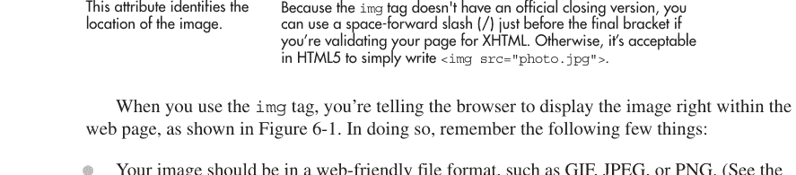

当你使用 `img` 标签时，你是在告诉浏览器直接在网页中显示图像，如图 6-1 所示。在这样做时，请记住以下几点：

- 你的图像应采用适合网络的文件格式，如 GIF、JPEG 或 PNG。（请参阅下一节“图像文件类型”。）

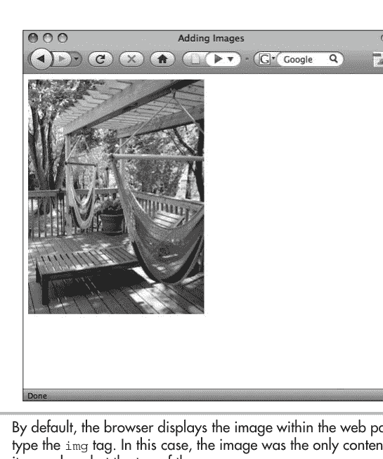

**图 6-1** 默认情况下，浏览器会在你输入 `img` 标签的网页位置显示图像。在这种情况下，图像曾是页面上的唯一内容，因此被放置在页面顶部。

- 你的 `src` 属性的值应包含文件的正确路径名和位置。因此，如果你想使用的图像与你正在处理的 HTML 页面不在同一文件夹中，你需要告诉浏览器该图像位于哪个文件夹。例如，如果你想包含一个位于当前目录上一级目录的图像，你应使用 `src="../photo.jpg"`，其中 `../` 告诉浏览器在查找图像文件之前先向上移动一个目录。如果你想引用另一个网站的图像，你可以使用 `src="http://www.websitename.com/images/photo.jpg"`，其中 URL 是该图像在另一网站上的完整位置名称。
- 一般来说，每张图像都应服务于一个独特的目的，并为你的网页增添内容。因为访问者必须等待图像下载到他们的计算机上，所以明智的做法是避免让页面充斥着毫无用处或作用甚微的多余图形。

#### 图像文件类型

最常见且广泛支持的图像文件类型有：

- GIF（通常发音为软 g，就像花生酱一样——可以想想“挑剔的设计师选择 GIF”来帮助记忆——但很多人确实发音为硬 g）——*Graphics Interchange Format*（图形交换格式）的首字母缩写
- JPEG（发音为 *jay-peg*）——*Joint Photographic Experts Group*（联合图像专家小组）的首字母缩写

由于其压缩格式，GIF 文件类型最适合用于纯色图形，如漫画、插图、字体和线条艺术。相比之下，JPEG 专门用于摄影图像，不应用于纯色图形。

第三种文件类型 PNG 在近年来也得到了广泛支持和使用。*PNG* 代表 *Portable Network Graphics*（便携式网络图形），它兼具 JPEG 和 GIF 的许多最佳特性。它流行起来花了一些时间，只是因为在过去，它并非所有浏览器都支持。

有关网页图像文件类型的更多信息，请参见第 14 章。

#### 使用现有图形

无论何时创建网站，你都无疑希望包含图像。并非总是有必要创建自己的图像。事实上，成千上万的素材图像可以在计算机商店或互联网上找到。有些需要支付少量费用，而有些则是免费的。让我们来了解几种不同的类型，以帮助你决定使用什么。

##### 图库摄影

使用摄影通常可以为商业网站增添专业感，但许多企业没有预算聘请摄影师为他们进行私人拍摄。如果你处于这种困境，别担心。许多图库摄影公司提供免版税的摄影，可用于几乎任何目的，除了转售。

你可以在当地的计算机或办公用品商店购买包含特定主题的完整照片光盘。这些光盘的成本从 40 美元到 500 美元不等，具体取决于作品质量和你获得的许可证类型。

你也可以在线搜索并购买使用单张照片的权利。费用根据你计划的使用方式而有所不同。例如，如果你想购买仅在网站上使用一张照片的权利，你可以预期支付低至几美元的最低费用（特别是在像 `istockphoto.com` 这样的网站上）。然而，如果你想在所有印刷出版物以及任何数字演示文稿中使用同一图像，费用通常从 100 美元左右开始并上涨。

你也可以检查随你喜欢的图形或演示文稿软件附带的软件许可证。例如，Microsoft Office 的注册用户可以访问 Microsoft 的免费图像库：`http://office.microsoft.com/clipart`。

在使用任何图库摄影时，请务必仔细阅读使用条款和许可证。虽然你可能会找到免费的图库摄影，但它通常仅限于非商业用途。更多链接，请访问我的网站：`www.wendywillard.com`。

##### 剪贴画

每当你需要素材按钮、卡通、线条画、插图或其他图形时，你可能会尝试搜索一些剪贴画库。你可以在当地的计算机或办公用品商店找到装满各种类型剪贴画的光盘，价格在 10 美元到 150 美元之间。（成本通常取决于你收到的图形数量。）

可能有成千上万的在线剪贴画库，你可以在其中搜索你想要的图形类型。许多艺术家在互联网上发布他们的剪贴画，并提供免费用于个人使用。此类剪贴画商业用途的许可费用通常负担得起，但根据艺术家的不同差异很大。

与图库摄影一样，你可能会在购买其他软件程序时免费获得一些剪贴画。例如，Microsoft Office 的注册用户可以访问 Microsoft 的免费剪贴画库：`http://office.microsoft.com/clipart`。

有关在线图库摄影和剪贴画来源的列表，请访问我的网站：`www.wendywillard.com`。

#### 创建自己的图形

如果你不在页面上使用现有图形，你可能需要创建一些自己的图形，或者聘请网页设计师来这样做。最好的网页设计师通常具有平面设计背景，并知道如何为网络制作加载速度快、外观美观的图形。你可以通过口碑或搜索在线目录来找到网页设计师，例如 The Firm List：`www.firmlist.com`。

有关创建自己图形的更多信息，请参见第 13 章。

#### 实践练习 6-1：向你的网页添加图像

回到 Chop Point（或你自己的组织）的 `trips.html` 页面，让我们向该页面添加一个图像。打开你的文本/HTML 编辑器，并加载你从第 5 章第二个项目保存的 `trips.html` 页面。

> **注意** 完成本书中 Chop Point 项目所需的所有文件都可以从 `www.wendywillard.com` 下载。此外，你可以随时访问 `www.choppoint.org` 来查看我版本的网站。如果你不使用 Chop Point，你可以根据你的特定需求调整你的项目。

1. 在你的 `.zip` 压缩包中的第 6 章文件夹中找到 `hiking.jpg` 图像。
2. 将图像复制并粘贴到存放你的 `trips.html` 文件的同一文件夹中。
3. 添加适当的代码，将图像插入到 `trips.html` 页面中，就在标题“Hiking Trips”的正下方。
4. 保存文件。
5. 打开你的网页浏览器，并选择“文件”|“打开页面”（或“打开文件”或“打开”，具体取决于你使用的浏览器）。找到你刚刚保存的 `trips.html` 文件。
6. 查看页面，确保图片已显示。如果需要进行修改，请返回你的文本编辑器进行操作。进行任何修改后，保存文件并切换回浏览器。选择“刷新”或“重新加载”以预览你刚做的更改。如果你使用的是 Chop Point，你可以将你的文件与以下代码和图 6-2 进行比较。

## 骑行旅行

自行车手很难在缅因州以外找到比这里更风景如画的乡村道路、连绵的山丘和海岸风光。热门的骑行目的地包括玛莎葡萄园岛、爱德华王子岛或新斯科舍省。如果你喜欢越野骑行，缅因州有一些出色的山地自行车道。旅行通常前往卡拉巴塞特谷地区，那里有适合各种技能水平的步道。

[返回顶部]

## 独木舟旅行

独木舟是探索缅因州河流和海湾的理想选择。在第一次旅行之前，露营者必须通过游泳测试并接受独木舟安全指导。我们每年夏天最受欢迎的旅行之一，是在缅因州荒野中沿着美丽而偏远的阿拉加什河进行 70 英里的航行。

[返回顶部]

## 徒步旅行

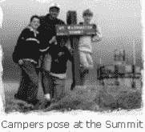

露营者们在 NH 的华盛顿山顶峰摆姿势留念。

对于徒步旅行者来说，白山国家森林、阿卡迪亚国家公园和巴克斯特州立公园有数百英里的步道可供选择。白山的风景如此令人叹为观止，以至于马戏团创始人 P.T. 巴纳姆在到达一英里高的华盛顿山顶峰时评论道：“这是地球上第二伟大的表演。”旅行形式多样，从隔夜背包徒步到从大本营出发的一日游。

[返回顶部]

完成

**图 6-2** Chop Point 的 `trips.html` 页面已更新，包含了一张图片。

```html
... 本节之前的代码保持不变...

<a name="hiking"><h2>Hiking Trips</h2></a>


<p>For hikers, there are literally hundreds of miles of trails to choose
from in the White Mountains, Acadia National Park, and Baxter State
Park. The scenery is so breathtaking in the White Mountains that circus
founder P.T. Barnum, upon reaching the top of mile-high Mt. Washington,
observed, "This is the second greatest show on earth." Trips vary
between overnight backpacking and day hikes out of a base camp.</p>

...本节之后的代码保持不变...
```

### 提示

你的图片显示出来了吗？如果没有，请确保路径名正确。HTML 页面（`trips.html`）和图片（`hiking.jpg`）应位于同一个文件夹中。如果它们不在同一个文件夹，你需要更改路径名以反映正确的文件夹名称。更多提示，请参见附录 C。

`img` 标签使你能够向网页添加图片。这个项目让你练习使用该标签最基本的形式，之后我们再进入额外的格式化技术。

## 指定图片的高度和宽度

在你开始向网页添加多张图片后，你可能会注意到它们有时会导致浏览器在显示页面前等待一小会儿。因为浏览器不知道图片的大小，有些浏览器实际上会等待图片全部加载完才显示网页。

因此，你可以通过在 `img` 标签内直接告诉浏览器图片的尺寸来帮助加速网页的显示。你可以使用 `height` 和 `width` 属性来做到这一点。


```html

```

此属性使你能够指定图片的宽度。

此属性使你能够指定图片的高度。

`width` 和 `height` 属性的值都应该是以像素为单位（而不是英寸或厘米）。

如果你不知道图片的尺寸，你可以在图形编辑器（如 Adobe Photoshop 或 Fireworks）中打开它来查找。或者你可以使用浏览器来确定图片的尺寸。

- 在 Mac 和 PC 上的 Firefox/Mozilla，以及 Mac 上的 Safari 中：首先，将图片单独加载到浏览器窗口中（选择“文件”|“打开”或“文件”|“打开页面”，并在你的电脑上找到图片文件）。然后，查看浏览器窗口顶部通常显示标题的位置。当你查看图片文件时，这些浏览器会在标题中打印图片的宽度和高度（按此顺序）。

  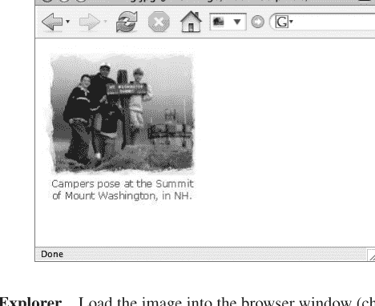

- **在 Internet Explorer 中**：将图片加载到浏览器窗口中（选择“文件”|“打开”，并在你的电脑上找到图片文件，或者从桌面将图片拖放到一个打开的浏览器窗口中）。然后，右键单击图片并选择“属性”。尺寸显示为 *尺寸（宽度 × 高度）*。

  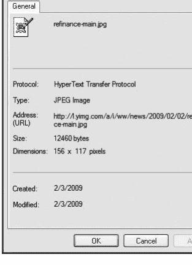

### 提示

你也可以使用`height`和`width`属性来更改图片的尺寸。例如，如果你得到一个高50像素、宽60像素的图片，你可以通过在 HTML 中指定不同的尺寸（如宽50像素、高50像素）来改变其大小。这会导致浏览器尝试以新指定的尺寸重绘图片。不过，我不建议这样做，因为它不仅可能减慢页面的显示速度，还可能导致图片失去正确的比例。最好在创建图片时，就在你需要的尺寸下创建它。关于创建图片的更多提示，请参见第14章。

## 为图片提供替代文本和标题

一些访问你网站的人可能无法看到你页面上的图片。这可能有多种原因，但以下是一些最常见的原因：

- 他们已在浏览器中关闭了图片显示。大多数浏览器在首选项中都有一个设置，可以禁用页面上的图片。通过关闭图片，访问者可以更快地查看网页，然后选择他们想看哪些图片（如果有的话）。
- 他们使用的是纯文本浏览器。虽然使用台式机的纯文本浏览器用户占少数，但许多使用手持设备的人每天都会使用纯文本浏览器。这些手持设备可能包括可上网的电话、寻呼机和掌上电脑。此外，视力受损者经常使用带有附加软件的纯文本浏览器，这些软件可以为他们朗读页面内容。在这些情况下，你的替代文本可能是视力受损者理解你图片目的的唯一途径。
- 图片未显示。有时，即使你正确编写了页面代码，网站访问者也可能看不到页面上的每一张图片。如果流量过大，或者访问者在页面完全加载之前点击了浏览器中的“停止”按钮，就可能发生这种情况。

好消息是，你可以采取一些措施来帮助网站访问者理解你图片的内容，即使他们看不到图片。你可以使用`img`标签的`alt`属性来为图片提供替代文本。

```html

```

如果浏览器找不到图片或未设置为显示图片，`alt`属性的文本值将显示在图片本应所在的框中（见图 6-3）。

除了`alt`属性，在`img`标签中添加`title`属性也是一个好主意。`alt`属性用于在图片无法加载时指定替代文本，而`title`属性则会在指针箭头位于图片上方时，在指针附近的一个框中显示。此外，`title`属性可以添加到图片、链接和其他页面元素。它作为一条快速提示，用于简要解释页面元素或（在此情况下）图片的内容。

```html

```

### 提示

这种当鼠标悬停在图片上时显示信息性文本的过程，在其他软件程序中也称为*工具提示*。

## 将图像链接到网站上的其他内容

在上一章中，你学会了如何创建链接到互联网上的其他信息。使用文本短语来标记链接，让访问者可以点击。你也可以使用图像来标记链接，并可以附加或不附加额外的文本标记。图 6-4 展示了一个没有额外文本标签的图像链接示例，而图 6-5 中的链接图像则有文本标签。

## 链接整个图像

要链接整个图像，如图 6-4 和图 6-5 所示，你只需要在图像周围添加`a`标签和`href`属性。两图都显示了链接的横幅广告。相关代码如下所示：

```html
<a href="http://www.choppoint.org"></a>
```

**图 6-4** 在这里，一个图像——本例中是一个动画横幅广告——被用作链接到另一个网页。

与网页中任何其他链接元素一样，当访问者将鼠标移到链接图像上时，指针会变成手形（参见图 6-4 和图 6-5 的示例）。

> **提示**
> 当我链接图像时，我喜欢在替代文本的开头加上“链接：”。这能立即让看不到图像的用户知道它也是一个链接。

## 链接图像的特定区域

你还可以链接图像的特定区域，创建所谓的*图像映射*。当只有图像的部分区域被链接时（而非整个图像），只有当访问者将鼠标移到图像上预定义的热点区域时，指针才会变成手形。图像映射中的每个*热点*都可以链接到其自己的网页。

**图 6-5** 作为替代方案，本例中添加了文本标签以帮助用户理解链接将把他们带到何处。

因此，回顾海龟的绘图，图像映射可以用来将眼睛链接到一个网页，将龟壳链接到另一个网页。图像映射的另一个例子是美国地图，其中每个州都可以被指定为热点，并拥有自己的链接。

在这个例子中，当你将鼠标移到德克萨斯州上方时，指针会变成手形，告诉你德克萨斯州是一个链接。你可以在底部的状态栏中看到德克萨斯热点链接到一个名为`texas.html`的页面。如果你将鼠标移到另一个州，例如新墨西哥州，你会看到它链接到`newmexico.html`。

这里讨论的图像映射的技术术语是“客户端图像映射”。*客户端图像映射*之所以这样命名，是因为所有工作都在客户端（或访问者）的计算机上完成。我所指的“工作”是计算热点的位置以及它对应哪个链接。关于哪个热点在哪里以及它链接到哪里的所有信息都包含在原始 HTML 文件中。这使得访问者的网页浏览器可以轻松访问，因为它不必去其他地方查找信息。以下示例展示了该代码的样子。首先，我们必须告诉浏览器这张图像将用作图像映射。使用`usemap`属性来做到这一点，并告诉浏览器在哪里查找映射文件：

```html
<br />Click the state in which you currently live.
```

然后我们命名映射：

```html
<map name="usa">
```

……并定义每个热点：

```html
<area shape="poly" coords="193,174,247,178,244,236,187,243,192,175"
href="/newmexico.html" alt="New Mexico" />

<area shape="poly" coords="215,243,304,309,335,260,326,214,275,210,275,
184,248,182,245,238,216,244" href="/texas.html" alt="Texas" />
```

在定义了图像中的所有热点之后，别忘了关闭`map`标签：

```html
</map>
```

你使用`img`标签的`usemap`属性将图像指定为客户端图像映射。此属性的工作方式与你在上一章中学到的类似：页面内的链接。原因是`map`标签包含一个`name`属性，使你能够链接到它。

当你使用`usemap`属性时，你引用在`map`标签中给映射起的任何名称。因此，在前面的示例中，图像引用了一个名为“usa”的图像映射（`usemap="#usa"`），该映射在页面下方由`<map name="usa">`定义。

> **注意**
> 记住，每当你引用客户端图像映射时，你需要在映射名称前使用井号（`#`），以告诉浏览器你正在引用页面中命名部分包含的内容。

让我们更仔细地看看代码。

```html
<br />Click the state in which you currently live.
```

这是你的基本`img`标签，附加了`usemap`属性。`usemap`属性的值（在本例中为`usa`）应使用引号括起来，并在前面加上井号（`#`）。

Мексиканская версия не изменилась, продолжая использовать стандартный тег`map`：

```html
<map name="#usa">
```

`map`标签围绕着定义图像中所有热点的其他信息。开始和结束标签都是必需的。`map`标签及其包含的信息实际上可以位于 HTML 页面中的任何位置，不必紧接在相应的`img`标签下方。`name`属性与`map`标签一起使用，使你能够从页面上的任何其他地方引用它（或任何其他页面，就此而言）。

```html
<area shape="poly" coords="193,174,247,178,244,236,187,243,192,175"
href="/newmexico.html" alt="New Mexico" />

<area shape="poly" coords="215,243,304,309,335,260,326,214,275,210,275,
184,248,182,245,238,216,244" href="/texas.html" alt="Texas" />
```

在`map`的开始和结束标签之间是每个热点的`area`标签。`area`标签有四个基本属性（参见表 6-1）。

> **注意**
> 由于`area`标签没有结束标签，如果你想让你的页面符合 XHTML 标准，则需要在标签末尾包含正斜杠作为结束字符。

```html
</map>
```

最后，通过关闭`map`标签来结束这一部分。

## 查找热点坐标

如果需要，你可以使用图形程序或 HTML 工具来查找热点的坐标。事实上，甚至有在线工具可以帮助你找到热点并为你编写图像映射代码。访问`www.kolchose.org/simon/ajaximagemapcreator`查看一个实际运行的示例。

我通常使用 Dreamweaver 来编写图像映射代码，因为我使用这个工具来编写 95% 的网页代码。在 Dreamweaver 中，你使用其中一个图像映射工具在热点周围绘制形状，然后在热点选项中分配`href`和`alt`属性的值，如下所示：

点击你目前居住的州。

| 属性 | 值 | 描述 |
| :--- | :--- | :--- |
| `shape` | `rect`、`poly`或`circle` | 定义热点的形状：`rect`表示矩形，`poly`表示多边形，`circle`表示圆形。 |
| `coords` | `rect: x1, y1, x2, y2`<br>`poly: x1, y1, x2, y2, x3, y3`<br>`circle: x, y, r` | 定义热点的边界，其中`x`和`y`分别是水平和垂直坐标，`r`是半径（仅用于圆形）。<br>- 矩形由其左上角和右下角点定义。<br>- 多边形由其每个点定义，以`x,y`对形式。<br>- 圆形由其中心点的`x,y`坐标和半径定义。 |
| `href` | `filename.html` | 定义你希望此热点链接到的页面。 |
| `alt` | 文本字符串 | 定义该热点的替代文本。 |

表 6-1 `area`标签的属性

或者，如果你使用 Notepad 等工具自己编写代码，可以使用 Windows 附带的标准画图程序来查找坐标。在此程序中，当你使用选择工具并将鼠标移到相关点时，坐标会显示在底部菜单栏中。

最后，沿着热区的周边走一圈，写下每一组坐标。有了这些信息，你就可以创建图像映射所需的代码。

> **注意**
> 许多其他图像编辑工具以及 HTML 编辑器都有帮助你创建图像映射的功能。此外，你甚至可以下载免费或共享软件程序来辅助编写图像映射。其中一个例子是 Mapedit，它适用于 PC、Mac、UNIX 和 Linux。你可以从`www.boutell.com/mapedit`下载它。

## 为前景图像设置样式

虽然基本的`img`标签提供了一种将图像添加到网页的简单方法，但你 likely 想要做的远不止只是将这些图像放到页面上。样式表使你能够自定义边框、将图像与文本对齐，以及实现更多功能。

## 边框

你可能已经注意到，许多链接图像周围都有边框。这是因为所有链接图像都会自动带有边框，就像所有链接文本都会自动带有下划线一样。早期的 HTML 规范允许使用`border`属性来指定图像边框的大小，如下例所示：

```html
<br />Click the state in which you
currently live.
```

> **注意**
> 某些版本的 Internet Explorer 默认会关闭图像的边框。然而，由于并非所有浏览器都如此，如果你确实想要关闭边框，应该自己手动关闭。

`border`属性的值以像素表示，其中链接图像的默认值为 1，非链接图像的默认值为 0。如果你想让边框更粗，可以使用更大的数字，比如 4。在这个例子中，值为 0。这会完全关闭边框，使其不可见。

> **注意**
> 你也可以使用`border`属性为未链接的图像添加边框，只需将值指定为大于 0 的任意数字即可。

话虽如此，W3C 已经废弃了`border`属性，现在更倾向于使用样式表来调整边框的显示。原因之一是样式表提供了对边框更精细的控制。例如，如果你的页面上有多个图像，并且希望关闭所有图像的边框，你不必在每个`img`标签上添加`border=0`，而只需在页面的样式表中添加以下代码：

```css
img {border-width: 0;}
```

实际上，你可以使用`border-style: none;`代替`border-width: 0;`，这样也能使边框不可见。下面列出了与边框相关的其他样式表属性。

- **`border-width`** 控制边框的大小，可以单独控制（`border-left-width`、`border-right-width`等），也可以整体控制（`border-width`）。值可以用长度单位（如 0 或 1）或关键字（`thin`、`thick`或`medium`）指定。
- **`border-color`** 通过指定一到四个值来控制边框颜色。当指定一个值时，该颜色会应用于四条边框边。当指定两个值时，上下边采用第一个值的颜色，左右边采用第二个值的颜色。当指定三个值时，上边设置为第一个值，左右边设置为第二个值，下边设置为第三个值。当指定四个值时，分别设置上、右、下、左边，如下例所示：`img {border-color: #ccc #666 #333 #999;}`。要仅为一侧指定值，只需在属性中添加该侧的名称（`top`、`bottom`、`right`或`left`），如`border-top-color`。
- **`border-style`** 更改边框的样式。选项包括：
  - `none`
  - `dotted`
  - `dashed`
  - `double`
  - `solid`
  - `groove`
  - `ridge`
  - `inset`
  - `outset`

如你所见，边框属性的另一个强大之处在于，它们可以整体更改（使四条边看起来相同），也可以单独更改。要单独更改特性，你只需在`border`之后、任何最终特性之前添加边指定（`top`、`bottom`、`right`或`left`）。为了让你了解这是如何实现的，请考虑以下示例和图 6-6。在这里，我创建了一个名为`headshot`的类，然后在样式表中设置了边框属性。

```css
.headshot {
    border-style: double;
    border-left-style: none;
    border-right-style: none;
    border-width: 10px;
    border-left-width: 0px;
    border-right-width: 0px;
    border-color: #C00;
}
```

将该样式声明添加到样式表后，我就可以将类引用添加到我的`img`标签中以完成该任务。

```html

```


> **提示**
>
> 如第 4 章所述，使用样式表，这类边框不仅可以添加到图像，还可以添加到页面上的任何其他元素！这意味着你可以快速为表格单元格、引用块或几乎任何其他内容片段添加边框样式。

*HTML: A Beginner's Guide*

**图 6-6** `headshot` 类告诉浏览器在照片的顶部和底部边缘添加双边框、10 像素宽的边框，但让左右边缘保持空白。

## 浮动

每当图像出现在某段文本中时，你可能希望改变对齐方式，使图像在文本流中浮动，而不是位于其上方或下方。（默认情况下，文本从图像结束的位置开始，并在其下方流动，如前所述，见图 6-6。）

虽然第 4 章讨论的`text-align`属性适用于文本的基本对齐，但它不能对齐图像。第 12 章将指导你完成更复杂的对齐和定位过程，但在你跳到那里之前，我想提一个非常快速简便的方法来让图像在页面上“浮动”——CSS`float`属性，其值可以是`left`或`right`。

## 在文本中浮动图像

`float`属性本质上告诉浏览器将浮动元素放置在指定的浏览器边缘最近的位置，然后让页面其余的内容围绕它流动。换句话说，内容会自动沿着左浮动图像的右侧流动，并沿着右浮动图像的左侧流动。例如，如果你有一段很长的文本，并希望将图像放在该段落的右上角，像这样：

你可以在该图像上使用`float`属性，并将值设置为`"right"`，告诉浏览器将图像保持在文本的右侧。`float`属性的可能值为`left`、`right`或`none`。

```html

```

> **注意**
>
> 编写浮动时，你的浮动内容必须“放在”任何其他要围绕它排列的内容“之前”。

## 清除浮动

有时你会遇到需要停止或清除浮动的实例。一个例子可能涉及我刚才使用的相同情况——浮动到几段文本右侧的图像。假设你想将长段落分成两个段落，然后你只想要第一个段落围绕图像。剩余的段落将占据页面的整个宽度。为了实现这一点，你必须通过向相关部分添加`clear`属性来“清除浮动”，例如：

```html
<p style="clear: right;">Remaining paragraph of text. . .</p>
```

这会使段落被“向下推”，直到它位于浮动图像的底边下方，像这样：

> **注意**
>
> `clear`属性的可能值为`left`、`right`、`both`或`none`。

## 浮动图像组

假设你有一个包含大量图像的页面，比如一个包含公司每位员工作缩略图的页面。如果所有图像大小相同，使用`float`属性并让浏览器自动将它们排列在页面上的各行中会非常容易。以下代码展示了实现此任务的一种方法，通过将每个图像（及其配套说明）分别放入单独的`div`中。

```html
<div class="thumbnail">
  <br />
  <p>Jeff S<strong>(CEO)</p>
</div>

<div class="thumbnail">
  <br />
  <p>Mary Clark,absorbed note Unclosed bracket shows abrupt truncation - matches source"> CEO</p>
</div> ante_plateauင်းင်အ
```

```html
<br />
<p>Laura Daniels, CTO</p>
</div>
```

然后你需要将该缩略图类的声明添加到你的样式表中：

添加此属性可确保我的图片之间有一定的间隔（15 像素）。

```css
.thumbnail {float: left; padding: 15px;}
```

`float: left`代码告诉浏览器将第一张图片放置在页面的左边缘旁边。然后，每张后续带有`float: left`样式的图片也会依次排成一行，紧挨着第一张图片，直到到达浏览器的右边缘。如果浏览器窗口足够宽，所有浮动的图片能够在一行内容纳，它们就会排成一行。如果用户的浏览器窗口只够容纳两张图片在一行，那么剩余的图片将在第一行下方开始新的一行（从左边缘附近重新开始）。

这就是网页设计中“流式布局”的真正含义，因为页面能够根据浏览器窗口的大小进行伸缩。对比图 6-7 和图 6-8，可以看到这种浮动原则的实际效果示例。

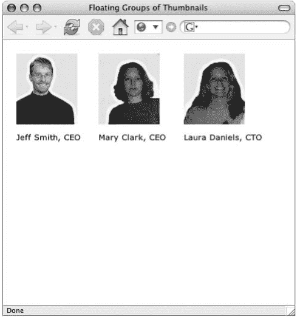

**图 6-7** 一个非常简单的样式表使这三张照片能够在页面上相互浮动排列。

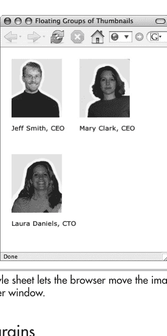

**图 6-8** 同一个样式表使浏览器能够根据浏览器窗口的宽度调整图片的位置。

## 内边距和外边距

第 4 章“引用块和文本框”一节讨论了如何使用`padding`和`margin`属性在元素边框内部和周围添加空白空间。同样的属性——`margin`和`padding`——也可以应用于图片，以指定图片在一个、两个、三个或所有四个方向上的间距。

例如，假设你想在图片的左侧添加一小块空白空间，但不想在右侧添加任何空间，因为右侧恰好与另一张图片衔接。如果你在样式表或`img`标签中添加`margin-left`属性，就可以只在左侧添加空间。

```html

```

## 居中对齐

到这里，关于图片和对齐可能还有一个很大的问题悬而未决……如何居中？！虽然图片没有“center”属性，但你可以使用一个技巧来将图片在页面或某个区域内居中。关键在于改变我们对“居中”元素的理解——实际上我们做的是让它的左右外边距完全相等。

首先，我们必须告诉浏览器将图片显示为*块级元素*。在 CSS 中，块级元素会自动填满所有可用空间。因此，如果一张图片成为块级元素，它的外边距会不断增长，直到达到浏览器窗口的边缘。

接下来，如果你告诉浏览器让左右外边距相同，你就实际上将图片居中了。以下是将图片居中可能用到的代码示例。首先是样式表：

```css
img.centered {display: block; margin-left: auto; margin-right: auto;}
```

然后，将该类的名称（本例中为“centered”）添加到`img`标签中。图 6-9 展示了浏览器中的最终效果。无论浏览器窗口打开得多宽（或多窄），图片始终保持水平居中。

```html

```

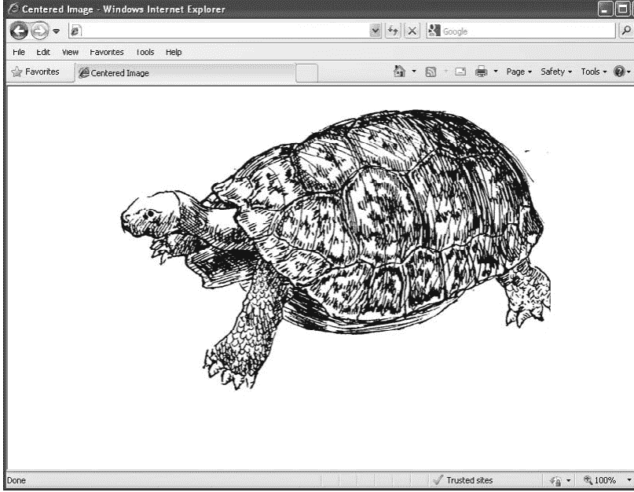

**图 6-9** 虽然 CSS 中没有“center”属性，但可以通过其他方式利用样式表来居中图片。

144 HTML：入门指南

## 动手实践 6-2：更改图片特征

回到`index.html`页面，让我们对上一个项目中添加的图片进行特征变换。此外，我们将在页面顶部添加另一张图片。本项目的目标包括：

- 为图片指定高度和宽度
- 为图片提供替代文本和标题
- 将图片链接到另一个网页
- 关闭链接图片的边框
- 将图片与周围的文本对齐
- 在图片周围添加一些缓冲空间

1. 打开你的文本或 HTML 编辑器，加载从动手实践 6-1 保存的`trips.html`页面。
2. 为徒步旅行图片添加`height`和`width`属性。
3. 为图片添加替代文本和标题。
4. 在图片周围添加 10 像素的缓冲空间。
5. 将图片链接到`"hiking.html"`并关闭图片的边框。
6. 在漂流旅行部分添加另一张照片（`rafting.jpg`），确保指定高度、宽度和替代文本。
7. 将`hiking.jpg`图片与该部分文本右对齐。
8. 将`rafting.jpg`图片与该部分文本左对齐。
9. 保存文件。
10. 打开你的网页浏览器，选择“文件”|“打开页面”（或“打开文件”或“打开”，取决于你使用的浏览器）。找到你刚保存的文件`trips.html`。
11. 验证所有更改是否按预期完成。如果需要进行额外更改，请返回文本编辑器进行修改。完成后，保存文件并切换回浏览器。选择“刷新”或“重新加载”以预览你刚做的更改。如果你使用的是 Chop Point，可以将你的文件与以下代码和图 6-10 进行对比。

```html
Code before this section stays the . . .
<a name="hiking"><h2>Hiking Trips</h2></a>
<a href="hiking.html" title="Click to learn more about our hiking trips"></a>
<p>对于徒步旅行者来说，白山、阿卡迪亚国家公园和巴克斯特州立公园有数百英里的步道可供选择。白山的风景令人叹为观止，马戏团创始人 P.T. 巴纳姆在登上海拔一英里的华盛顿山顶时感叹道："这是地球上第二伟大的奇观。"旅行形式包括过夜背包徒步和从营地出发的一日徒步。</p>
```

（续）

```text
... code between these sections stays the same. ...
```

## 激流漂流之旅

驱车三小时到达福克斯（Forks）的肯纳贝克河（Kennebec River）源头，开启一场惊险刺激的四级急流峡谷挑战。注册缅因州导游使用自排水式充气筏，让这次激动人心的体验令人难忘。需额外支付75美元费用，并提交家长免责同意书。

[返回顶部](#top)

你可以通过多种方式自定义网页前景中显示的图像的外观和样式。本项目让你练习多种图像属性，包括链接、对齐、边框和替代文本。

## 将图像用作网页背景元素

图像在网页中还有另一个角色，那就是用作背景。正如戏剧中，演员可能在前景移动，而布景在背景中移动一样，网页设计中也存在两个层次。

旧的 HTML 规范允许你添加单个图像作为网页背景的“布景”。这是通过`body`标签的`background`属性实现的，例如`<body background="picture.jpg">`。然而，W3C 废弃了`background`属性，转而使用样式表来指定背景。后者是通过为`body`标签的样式声明添加`background-image`属性来实现的：

```css
body {background-image: url("picture.jpg");}
```

样式表中背景属性的一个巨大优势是，它可以添加到各种页面元素中，从段落到列表再到表格单元格，使用与`body`标签相同的格式：

```css
p {background-image: url("pattern.jpg");}
```

相对于前景，在背景中使用图像有几个好处：

- 你可以通过这种方式在设计中实现分层效果，因为前景图像实际上可以放置在背景图像之上。
- 背景图像从页面顶部开始，一直延伸到四边。相比之下，前景元素受顶部和左边框的约束，类似于打印时出现的情况。
- 为页面元素（如导航栏或页脚）添加背景是将其与页面其他内容区分开来的好方法。

用 HTML 插入背景图像时，你还需要记住以下几点：

- *所有背景图像默认都会平铺。* 平铺意味着背景图像在浏览器窗口中重复显示，直到覆盖整个屏幕。
- *背景中只能包含一个图像。* 因此，如果你想在背景中使用两种不同的图案，它们需要包含在单个图像文件中。
- *前景文本必须在背景上可阅读。* 如果你使用深色背景，请确保页面上的文字颜色浅得多。同样，尽量避免使用高对比度背景，因为它们会使放置在其上的任何文本极难阅读。
- *背景图像的文件大小应该很小。* 这样可以避免长时间下载。利用浏览器会重复背景图像这一特性，尽可能精简你的图像大小。

为了帮助阐明这些要点，请看图 6-11。如果我告诉你顶部较深的横条，以及“Corinna”字样和星星都在背景中，你能想象出当背景图像没有平铺时它本身是什么样子的吗？图 6-12 给出了答案。

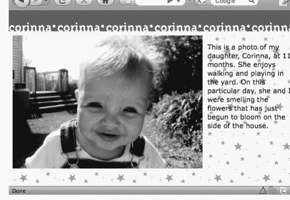

**图 6-11** 在这里，背景图像使我能够实现分层效果，因为前景照片位于背景图像之上。

148 HTML 入门指南

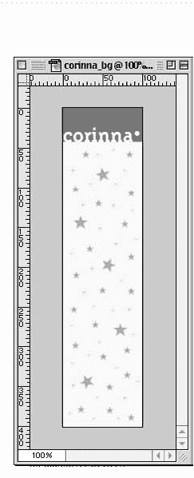

**图 6-12** 在图 6-11 中被浏览器平铺之前，图像看起来是这样的。

由于原始图像只有 400 像素高，当窗口打开得更大时，浏览器不得不重复它，如图 6-13 所示。为了弥补这一点，我可以为图像添加额外的空间，使其足够长以避免垂直平铺。在不同屏幕尺寸上测试你的页面很重要，以确保背景图像按预期重复。图 6-14 展示了另一个例子。

另一种强制背景图像保持静止的方法是向页面的样式表添加`background-attachment`属性。该属性允许背景保持不动（设置为`"fixed"`时）或随页面滚动而移动（设置为`"scroll"`时）。同样，你甚至可以使用`background-repeat`属性告诉浏览器是否重复你的背景图像。

```css
body {
  background-image: url("picture.gif");
  background-attachment: fixed;
  background-repeat: no-repeat;
}
```


# 第 6 章：图像处理

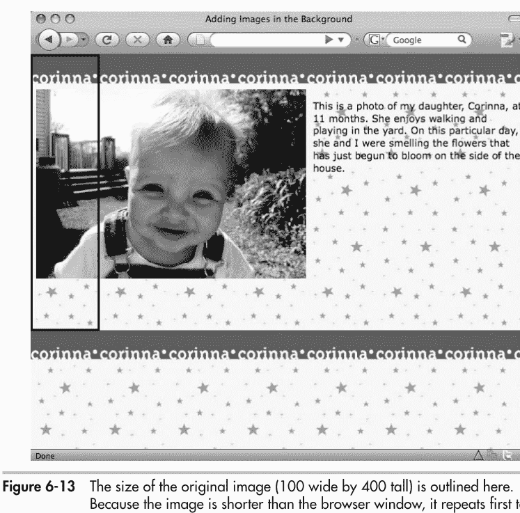

**图 6-13** 原始图像的尺寸（宽100像素，高400像素）在此处标出。由于图像比浏览器窗口短，它首先向右重复，然后向下重复。

`background-repeat`属性的可能值有：

- `repeat` 指定文件应在水平方向和垂直方向都重复（默认值）。
- `repeat-x` 指定文件仅在水平方向重复。
- `repeat-y` 指定文件仅在垂直方向重复。
- `no-repeat` 指定文件不应重复。

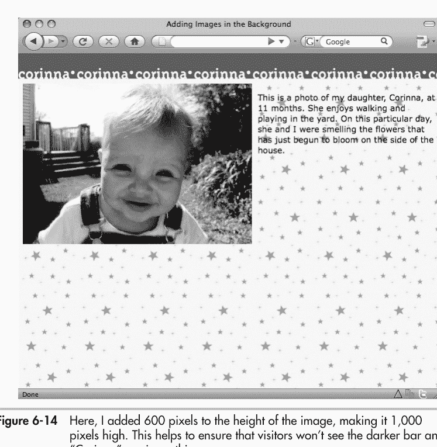

**图 6-14** 在这里，我为图像的高度添加了600像素，使其达到1000像素高。这有助于确保访问者不会在此页面上再次看到较深的横条和“Corinna”。

你能想象如果我想让深色横条沿屏幕左侧而不是顶部运行，我的原始图像会是什么样子吗？查看图6-15和6-16来了解。

> **提示**
> 你可以在本章前面提到的剪贴画目录中找到许多适合作为背景平铺的图像。有关创建此处所示的网页图形的更多信息，请参阅第14章。

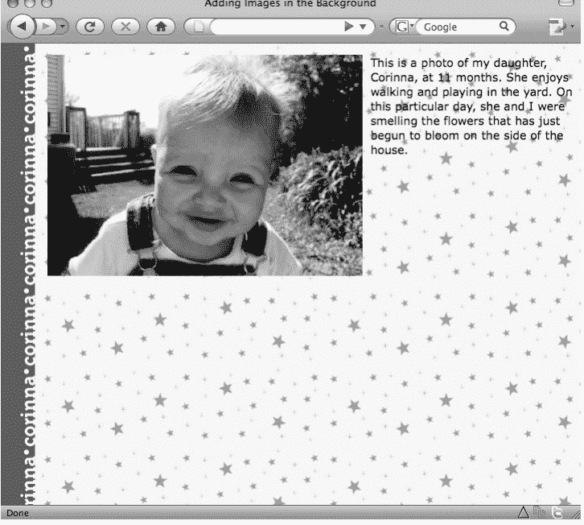

**图 6-15** 当原始图像在图形程序中逆时针旋转90度时，它在左侧创建了一条彩色横条。

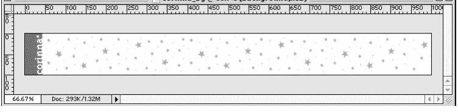

**图 6-16** 此处显示了用于创建图6-15背景的原始图像。它宽1000像素，高100像素。

## 试一试 6-3：添加背景图像

这是第6章的最后一个项目，让你有机会为页面添加背景图像。

1. 打开你的文本或HTML编辑器，并加载从“试一试6-2”保存的`trips.html`页面。
2. 将`Chapter06.zip`文件中找到的一个图案图像添加到页面背景中。
3. 对页面上文本的颜色进行必要的更改，以确保在新背景上仍可阅读。
4. 保存文件。
5. 打开你的网页浏览器，选择文件 | 打开页面（或打开文件或打开，取决于你使用的浏览器）。找到你刚刚保存的`trips.html`文件。
6. 预览页面以检查你的工作。如果需要进行更改，请返回你的文本编辑器。进行任何更改后，保存文件并切换回浏览器。选择刷新或重新加载以预览你刚做的更改。如果你使用的是Chop Point，可以将你的文件与以下代码和图6-17进行比较。

```html
<!DOCTYPE html PUBLIC "-//W3C//DTD XHTML 1.0 Transitional//EN"
"http://www.w3.org/TR/xhtml1/DTD/transitional.dtd">

<html>

<head>

<title> Chop Point Camp - Adventure Trips </title>

<style type="text/css">

body {background-image: url("backgrounds/blue-gradient.gif");
font-family: verdana;}

h1 {color: white;}

</style>

</head>

<body>

...代码的其余部分保持不变
```

合理使用背景图像可以为你的网页增添深度和吸引力。这个活动让你练习使用`body`标签的`background-image`属性来添加背景图像。

## Chop Point 夏令营——探险之旅

每年夏天，Chop Point 都会提供令人兴奋的探险之旅，为您留下终生难忘的回忆。每次旅行都根据营员的经验量身定制，是一次充满乐趣、动手的冒险，在此过程中常常会发展出深厚的友谊。所有旅行都是可选的，营员可以选择参加任意多次或**一次都不参加**。我们的大多数旅行不收取额外费用。

Chop Point 旅行的装备需求很少。背包客只需要一个轻便睡袋和登山鞋。自行车可以在当地租用，如果营员没有自带的话。报名参加独木舟旅行的营员可能想为他们的睡袋和衣物准备一个防水袋。（还有什么比睡在湿漉漉的睡袋里更糟糕的吗？）建议所有营员携带雨具。

安全是重中之重。根据缅因州法律，每次旅行必须有一名经过培训、持有证书的旅行领队。Chop Point 将州规定的课程作为员工培训的一部分。救生衣是所有水上活动的必备装备。只要可能，都会携带手机。

营员在每个营期开始的几天内报名参加旅行。由于团队规模和最低年龄要求，部分旅行有人数限制。如需更多信息，请发邮件给我们。Chop Point 是美国露营协会的成员。

使用下面的链接了解更多关于 Chop Point 提供的各种旅行类型。

- [骑行](https://example.com/biking)
- [独木舟](https://example.com/canoeing)
- [徒步](https://example.com/hiking)
- [皮划艇](https://example.com/kayaking)
- [帆船](https://example.com/sailing)
- [观光（魁北克市）](https://example.com/touring)
- [激流漂流](https://example.com/rafting)

## 骑行之旅

骑行者很难找到比缅因州更美的乡村道路、起伏的山丘和海岸风光。自行车旅行的热门目的地包括玛莎葡萄园、爱德华王子岛或新斯科舍。如果你喜欢越野骑行，缅因州有一些很棒的山地自行车运动。旅行通常前往卡拉巴塞特山谷地区，那里有适合各种技能水平的步道。

**图 6-17** 当添加到页面时，这张图片创造了无缝背景渐变的效果。

> **提示**
> 背景无法正常显示？如果是这样，请确保图像文件与 HTML 文件位于同一目录中。如果不是，你需要在`background-image`属性中指定正确的文件位置。如需更多提示，请参阅附录 C。

## 额外练习

尝试使用内部样式表重新格式化你刚刚完成的页面。一些可能的格式化选项包括：

- 指定背景图像应仅沿水平轴重复。你也可以尝试仅沿垂直轴重复。
- 指定背景图像应固定在页面顶部，不应随页面滚动而移动。或者，你可以指定背景图像应始终显示在屏幕顶部，即使用户已经滚动页面。

## 第 6 章自测题

1. `src` 属性的作用是什么？
2. 为什么在网页中指定图像的高度和宽度很重要？
3. 哪些样式表属性可以让你在图像周围添加空白空间？
4. 必须在`img`标签中添加哪个属性才能将图像指定为客户端图像映射？
5. 定义客户端图像映射的名称和热点时使用哪两个标签？
6. 你正在创建客户端图像映射的代码，其中一个矩形热点具有以下坐标：0,0（左上）；50,0（右上）；50,50（右下）；以及 0,50（左下）。以下`coords`属性中应使用哪些？

   ```html
   <area shape="rect" coords="__________" href="maryland.html">
   ```

7. 填空：`height` 和 `width` 属性的值以 __________ 为单位。
8. 修正以下代码。

   ```html
   
   ```

9. 为以下网页代码添加适当的样式声明，以使用`wallpaper.gif`作为背景。注意该图像与 HTML 文件位于同一文件夹中。

   ```css
   body {
   }
   ```

10. `clear` 属性（用于清除浮动）的四个可能值是什么？
11. 填空：`border` 属性的默认值对于链接图像是 ____ 像素，对于非链接图像是 ____ 像素。
12. 判断正误：当前景图像放置在背景图像之上时，你可以在设计中实现分层效果。
13. 使用本章讨论的方法居中图像之前，`display` 属性必须使用什么值？

   ```css
   img.centered {
       display:    ;
       margin-left: auto;
       margin-right: auto;
   }
   ```

14. 哪个属性用于为图像添加替代文本？
15. 关于背景图像，哪项陈述不正确？
    - A. 所有背景图像默认平铺。
    - B. 背景中只能包含一张图像。
    - C. 背景图像是通过`background`标签添加到网页中的。
    - D. 背景图像从页面顶部开始，一直延伸到四个边的每一个方向。

# 第 7 章：使用多媒体

## 关键技能与概念

- 了解插件如何在网络浏览器中使用
- 从网页链接到不同类型的媒体
- 将不同类型的媒体嵌入到网页中

在互联网上，术语*多媒体*用于指代整合了音频、视频、文本、图形或动画等各种媒体类型的演示文稿，这些内容被集成到单一文件格式中。你可能在新闻或天气网站上看到过多媒体演示文稿，它们用于向观众展示音频、视频和文本。其他网站使用多媒体来娱乐观众，通常以卡通或动画故事的形式。

许多多媒体形式使访客能够与演示文稿互动。例如，访客可能正在观看动画故事，然后点击单个角色以了解更多信息，然后继续。

Web 本身通常被认为是多媒体，因为任何网页都可以包含多种不同类型的媒体文件。然而，默认情况下，大多数 Web 浏览器只能理解 HTML 文件、GIF 和 JPEG 等图形文件以及纯文本文档（`.txt`）。任何其他文件类型都必须通过插件或辅助应用程序来处理。有时这些控件预先安装在浏览器中，但其他时候必须由用户下载。

## 了解插件如何在网络浏览器中使用

*辅助应用程序*是试图执行浏览器无法完成的操作的附加软件或代码。如果你把自己想象成浏览器，那么辅助程序可能是帮你割草的人，而插件则是帮助你亲自操作的骑乘式割草机。

*插件*（或微软所称的*ActiveX 控件*）帮助浏览器自己完成某事，而不是由辅助应用程序为浏览器执行操作。

> **注意**
> ActiveX 是微软使用的品牌名称，用于指代其提供 Web 浏览器附加功能的各种技术。

例如，如果你的 Web 浏览器不知道如何显示某种类型的视频文件，它首先会寻找能够执行此操作的插件。如果你的 Web 浏览器找不到插件，它可能会提示你下载一个，或者寻找计算机上已加载的可以显示该视频的辅助应用程序。如果浏览器找不到合适的插件或辅助应用程序，并且没有下载，那么它将无法显示该文件。因此，除非你也提供纯文本替代版本，否则我不建议在需要插件或辅助应用程序的文件中包含重要信息。

辅助程序是独立于浏览器的独立程序，你可以为计算机购买。相比之下，插件通常是免费的，可以从互联网轻松下载。在某些情况下，Web 浏览器甚至附带了某些插件。当你下载插件时，你应该会收到关于如何安装它的说明，如有必要。

很多时候，插件会自行安装，你只需关闭并重新打开 Web 浏览器即可。其他时候，系统会要求你将插件放在计算机上的适当文件夹中，然后重新启动浏览器。一旦你同意下载 ActiveX 控件，浏览器就会下载并安装该控件，通常无需重新启动浏览器。

### 识别已安装的组件

你可以通过几种不同的方式找出浏览器下安装了哪些插件。例如，检查已安装组件最根本的方法是查看浏览器应用程序文件夹中的`plug-ins`目录。Firefox 用户可以选择工具 | 附加组件，然后点击插件选项卡。

如果你使用的是 Internet Explorer，请从浏览器中的工具菜单选择 Internet 选项。接下来，点击程序选项卡，然后点击管理加载项按钮以查看 Internet Explorer 使用的所有加载项（包括 ActiveX 控件和插件）的列表。

### 识别文件类型、扩展名和适当的插件

你可能想要在网页中链接或嵌入许多不同的文件类型，但附录 E 列出了一些更流行的类型。大多数文件类型至少可以通过一个插件或辅助应用程序“播放”，而且通常可以通过多个。如果你想对访问者有所帮助，请列出他们可能用于打开你文件的插件或辅助应用程序。你还可以提供下载适当插件的链接。

例如，Flash 这种需要插件的文件类型已经变得非常流行，以至于它随大多数当前浏览器一起提供。即便如此，你可能访问过某个网站并注意到一个弹出窗口，上面显示着关于“下载 Flash 播放器”的内容。Flash 文件很受欢迎，因为它们很小（这意味着“下载速度快！”），并且可以包含声音、视频、交互性和动画。Flash 如此流行的另一个原因是，用于显示 Flash 文件的插件在多种平台和浏览器上广泛可用。

不过，有些插件和辅助应用程序并不能用于多种计算机系统和浏览器。然而，这个插件列表每天都在变化。一个不断增长的列表 maintained 在`www.webdevelopersnotes.com/design/list_of_browser_plugins.php3`，包括开发者网站地址和受支持的系统（Windows、UNIX 和 Mac）。

> **注意**
> 有关文件类型、扩展名和描述的列表，请参阅本书后面的附录 E。

当你准备在 HTML 页面中包含多媒体文件时，请考虑你希望如何包含它们。你是希望*链接*到它们，让访问者可以选择立即下载或查看？还是希望将它们*嵌入*到页面中，使其直接显示在网页浏览器窗口内？本章的其余部分将重点介绍如何链接和嵌入几种不同类型的多媒体。

## 从网页链接到不同类型的媒体

指向多媒体文件的链接本质上与其他任何链接相同。虽然嵌入文件有时可能会遇到问题（如下一节所述），但链接到文件尤其有用，因为所有网页浏览器都支持链接。图 7-1 显示了以下代码在浏览器中的显示效果，而图 7-3 则展示了点击视频链接后的结果。

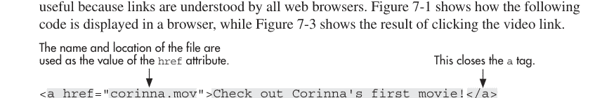

> **提示**
> 为媒体文件包含正确的文件扩展名非常重要，这样浏览器和操作系统才能理解并显示它。如果你不确定应使用哪种文件扩展名，请查阅本书附录 E。

点击图 7-1 中所示的链接可能会导致以下三种情况之一发生，具体取决于系统的设置方式。

- 它可能会提示用户下载文件，并选择立即查看或保存供以后查看（见图 7-2）。

  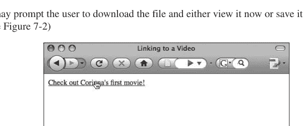

  **图 7-1** 指向多媒体文件的链接与其他任何链接相同，因为它同样使用`a`标签和`href`属性。

  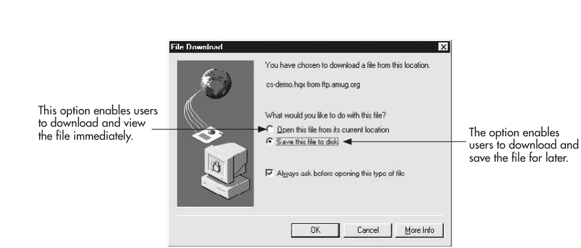

  **图 7-2** 当浏览器无法识别某种文件类型为应在浏览器内“播放”的类型时，它可能会提示用户下载该文件。

- 如果浏览器识别出该文件是其设置为自动显示的类型，它可能会接管并直接播放（见图 7-3）。

鉴于许多系统可能会以不同方式处理你的多媒体文件，请尽量为访问者提供尽可能多的指导和建议。例如，列出你要求他们下载的文件大小，以便他们考虑是否愿意等待文件加载到他们的系统中。此外，提供获取信息的替代方式，并尽可能将其包含在多媒体文件中。

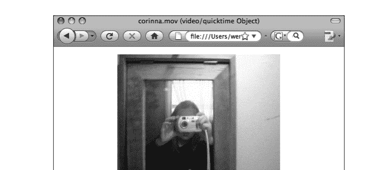

**图 7-3** 点击链接时，如果已安装适当的插件或 ActiveX 控件，浏览器可能能够自行播放视频。

## 将不同类型的媒体嵌入网页

当你嵌入多媒体文件而不是链接到它们时，它们会直接出现在页面的上下文中。只要用户的计算机上安装了适当的插件或 ActiveX 控件，文件就会加载并播放，与页面上的其他内容一起显示。

嵌入多媒体的原始方法是使用`embed`标签。然而，该标签是 Netscape 创建的专有标签。因此，W3C 创建了`object`标签，作为嵌入各种类型媒体的方法，从图像到 Flash 影片等等。Internet Explorer 3（及更高版本）以及所有当前基于 Mozilla 的浏览器（如 Safari 和 Firefox）都支持它。

> **提示**
> 如果你复制 YouTube 提供的嵌入代码，你会发现它们同时包含了`embed`和`object`标签。虽然过去这种做法是为了覆盖尽可能广泛的受众，但由于所有现代浏览器都支持`object`标签，因此现在已经不再需要这样做了。

## 使用 object 标签

当你使用`object`标签时，你必须告诉浏览器你正在嵌入的文件类型以及在哪里找到该文件。为此需要使用`type`和`data`属性。

```html
<object type="application/x-shockwave-flash" data="movie.swf" height="60" width="200">
```

然后，在`object`开始标签之后，你可以使用`param`标签（*parameters* 的缩写）添加任何你想指定的附加属性。（请注意，`object`标签允许你在`object`标签或`param`标签中指定`height`和`width`属性，具体取决于使用的插件。）使用正斜杠使`param`标签符合 XHTML 规范，因为它没有结束标签。

```html
<param name="movie" value="movie.swf" />
<param name="BGCOLOR" value="#ffffff" />
```

最后，关闭`object`标签。

```html
</object>
```


表 7-1 列出了 `object` 标签的一些可选属性。表 7-2、7-3、7-4 和 7-5 列出了在嵌入 Real Media 文件、其他类型的声音文件、QuickTime 影片或 Flash 文件时可能使用的一些其他参数。此处列出的插件和参数并不详尽，但旨在让你了解使用它们时的一些可能性。如需了解更多信息，请访问相应插件制造商的网站。

> **提示**
>
> 当你在网页中嵌入声音时，显示至少部分控件总是被认为是良好的做法。这让访问者可以关闭声音或根据需要调整音量。

**表 7-1：**`object` 标签的属性

| 属性 | 可能的值 | 说明 |
| --- | --- | --- |
| `width="#"` | 像素数 | 指定窗口（视频/动画）或控制器（声音）的宽度。 |
| `height="#"` | 像素数 | 指定窗口（视频/动画）或控制器（声音）的高度。 |
| `border="#"` | 像素数 | 定义边框的宽度，以像素为单位。 |
| `name="name"` | 名称 | 为文件指定一个（区分大小写的）名称，以便脚本或其他方法可以引用它。 |
| `type="value"` | MIME 类型（参见前面的提示） | 指定要嵌入的文件类型，从而定义所需的插件。 |
| `standby="Text goes here"` | 要显示的文本 | 指定在对象加载时显示的文本。 |
| `tabindex="1"` | 数值 | 指定该元素在页面 Tab 键顺序中的位置。 |

**表 7-2：**Real Media 的可选参数

| 参数名称 | 可能的值 | 说明 |
| --- | --- | --- |
| `autostart` | `true`、`false` | 定义页面加载时文件是否立即开始播放。 |
| `backgroundcolor` | 十六进制代码或颜色名称 | 更改嵌入文件的背景颜色。实际效果因使用的插件而异。 |
| `center` | `true`、`false` | 将嵌入的文件在窗口中居中。 |
| `console` | 名称 | 通过命名来标识此嵌入控件和其他嵌入控件。 |
| `controls` | `all`、`controlpanel`、`controlpanel, statusbar`、`controlpanel, infovolumepanel`、`playbutton`、`stopbutton` | 指定网页中显示的控制器样式。 |
| `Loop` | `true`、`false` | 定义文件是否重复播放。 |
| `nojava` | `true`、`false` | 阻止 Java 虚拟机运行，使嵌入的文件仅使用插件运行（而非 Java）。 |
| `nolabels` | `true`、`false` | 停止在控制器上显示标签信息（如作者、版权和标题）。 |
| `nologo` | `true`、`false` | 阻止显示 RealLogo。 |
| `numloop` | `number` | 指定文件重复播放的次数。 |
| `shuffle` | `true`、`false` | 随机顺序播放多个声音。 |

**表 7-3：**大多数声音播放器的可选参数

| 参数名称 | 可能的值 | 说明 |
| --- | --- | --- |
| `bgcolor` | 十六进制代码 | 更改嵌入文件的背景颜色。实际效果因使用的插件而异。 |
| `controls` | `console`、`playbutton`、`pausebutton`、`smallconsole`、`stopbutton`、`volumelever` | 指定网页中显示的控制器样式。 |
| `loop` | `true`、`false`、`#（次数）` | 定义文件如何重复播放。True 告诉浏览器无限循环文件。False 指定从不循环。或者，你可以指定确切的循环次数。 |
| `volume` | 0 到 100 之间的数字 | 指定声音文件的音量。 |

**表 7-4：**Flash 的可选参数

| 参数名称 | 可能的值 | 说明 |
| --- | --- | --- |
| `Base` | URL | 指定所有包含链接的基本目录。 |
| `Play` | `true`、`false` | 定义页面加载时文件是否开始播放。 |
| `Quality` | `best`、`high`、`autohigh`、`autolow`、`low` | 定义嵌入文件的质量级别。 |
| `Scale` | `showall`、`noborder`、`exact fit` | 定义嵌入文件如何适应网页的其余部分。 |

**表 7-5：**QuickTime 影片的可选参数

| 参数名 | 可选值 | 描述 |
| --- | --- | --- |
| `autoplay` | `true`、`false` | 定义文件在页面加载后是否立即开始播放。 |
| `bgcolor` | 十六进制代码 | 更改嵌入文件的背景颜色。实际效果取决于所使用的插件。 |
| `controller` | `true`、`false` | 打开影片控制器。（当设为 `true` 时，需要将影片高度增加 16 像素。） |
| `kioskmode` | `true`、`false` | 当设为 `true` 时，禁用影片的弹出菜单，使用户无法复制或保存它。 |
| `loop` | `true`、`false` | 定义文件是否重复播放。 |
| `qtnext`、`qtnext#` | URL | 指定一个 URL，当当前影片播放完毕时加载该 URL 指向的影片。如果你想按顺序列出多个影片，可以使用 `qtnext#`，其中 `#` 表示播放顺序。 |
| `qtsrc` | URL | 强制浏览器使用 QuickTime 插件加载文件，而不是任何其他视频插件。 |
| `scale` | `tofit`、`aspect`、`#` | 定义嵌入的文件如何适应网页的其余部分。 |
| `volume` | 0 到 100 之间的整数 | 定义影片的起始音量。 |

> **提示**
>
> 你可以通过访问在线教程（例如 `www.w3schools.com/flash`）来了解更多关于嵌入 Flash 文件的知识。

`object` 标签可以包含其他 HTML 标签和属性，包括其他的 `object` 标签。如果浏览器能够解释 `object` 标签，它会这样做，并忽略 `object` 开始和结束标签之间包含的 HTML 内容。如果它不理解 `object` 标签，它会使用其中包含的 HTML 内容。这样做的好处是，你可以为可能没有或不想使用该插件的访客提供一个无需插件的替代方案。这可以通过类似以下的代码来实现：

```html
<object type="application/x-shockwave-flash" data="movie.swf">
  <param name="height" value="60" />
  <param name="width" value="200" />
  <param name="movie" value="movie.swf" />
  <param name="bgcolor" value="#ffffff" />
  <param name="loop" value="false" />
  <a href="http://www.adobe.com/products/flashplayer" title="You must install Flash to access this movie."></a>
</object>
```

在这个例子中，我包含了一个指向 Adobe 网站的链接，并附带了一个工具提示（使用 `title` 属性），解释用户需要在查看此文件之前下载 Flash。然后，我添加了影片的屏幕截图，让用户了解下载相应插件后可能看到的内容。请注意，链接和图片是在 `param` 标签之后、`object` 结束标签之前添加的。

## Java 小程序

你也可以使用 `object` 标签在你的网页中嵌入 Java 小程序。*Java 小程序*是用 Java 编程语言编写的小型应用程序（这也是我们术语 *applet* 的来源），它们可以在你的浏览器窗口中运行。网页开发者使用这些小程序来实现通过 HTML 或其他方式不易完成的功能。

Java 小程序可用于为你的网页添加功能，无论是实时时钟、抵押贷款计算器、股票行情显示器还是交互式游戏。

> **提示**
>
> 访问 `dir.yahoo.com/Computers_and_Internet/Programming_and_Development/Languages/Java/Applets/` 获取所有与 Java 小程序相关的链接。

以下是如何使用 `object` 标签嵌入这些小程序的示例。

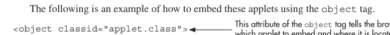

你可能能够使用许多不同类型的属性来自定义你的小程序外观，但大多数情况下，这些属性将取决于你使用的小程序类型。

## 专家问答

> **问：** 哇！这些表格有点吓人。我真的需要了解所有这些吗？
>
> **答：** 我完全理解。所有这些信息一开始确实让人望而生畏。但是，请放心，我包含它只是因为当你将来想要嵌入特定类型的文件时，可以回到这一部分，找到与你所用插件相关的具体信息。这些信息放在这里，并不是要你记住每一个属性。考虑到市面上有那么多插件（和 ActiveX 控件），记住每个属性是不可能完成的任务！

重要的是要明白，你手头有这些标签可供使用，并且可以根据需要在需要时对它们进行自定义。

别担心——如果你在网上搜索免费或共享软件小程序，开发者通常会给你提供关于如何嵌入文件的详细说明。如果你自己编写小程序，你可以在 Java 代码中调整小程序的外观。

## 动手实践 7-1：为网页添加多媒体

现在你将创建一个指向视频文件的链接。如果你使用 Chop Point 网站作为你的项目，你将链接到一个存储在 YouTube 上的宣传视频。

请注意，完成本书中 Chop Point 项目所需的所有文件都可以从 `www.wendywillard.com/` 下载。此外，你可以随时访问 `www.choppoint.org` 查看我版本的网站。如果你不使用 Chop Point，可以根据你的特定需求调整这个项目。

1. 打开你的文本编辑器或 HTML 编辑器，然后打开第 4 章动手实践 4-2 中保存的 `index.html` 页面。
2. 找到“夏令营”标题下的第一段，并在该段落的 `p` 开始标签之前添加 `promoclip.gif` 图片。
3. 将图片浮动到文本的左侧。
4. 在图片右侧添加十像素的缓冲空间。
5. 关闭图片的边框。
6. 将图片链接到 `http://www.youtube.com/watch?v=FK-s2ek_5Cc`。
7. 保存文件。
8. 打开你的网页浏览器，选择“文件”|“打开页面”（或“打开文件”或“打开”，取决于你使用的浏览器）。找到你刚刚保存的文件。确保链接有效且影片可以播放。
9. 如果需要进行更改，请返回文本编辑器进行修改。进行任何更改后，保存文件并切换回浏览器。选择“刷新”或“重新加载”以预览你刚刚做的更改。如果你使用的是 Chop Point 项目，你可以将你的文件与图 7-4 和以下代码进行比较。

```html
... 此部分之前的代码保持不变...

<a href="http://www.youtube.com/watch?v=FK-s2ek_5Cc" title="Click to view a short movie showing the inside of one of our cabins"></a>

<p>Chop Point received accreditation from the American Camping Association and opened as a camp in Maine in 1967. Before the founding of Chop Point, the property had been operated as Merrymeeting camp for over fifty years..</p>

... 其余代码保持不变 . . .
```

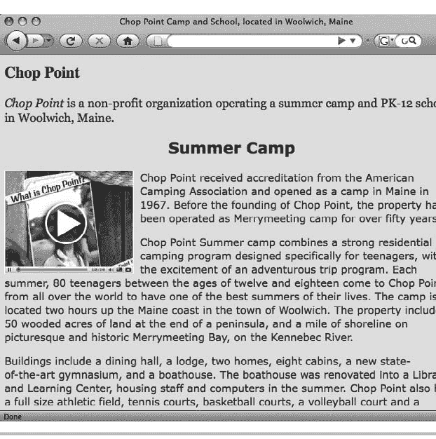

图 7-4 如果你使用的是 Chop Point 网站，可以将你的文件与此示例进行比较。

多媒体可以为网页增添很多趣味。这个项目让你练习了链接到多媒体文件。准备好迎接更多挑战了吗？尝试附加任务来真正测试你的技能。

## 附加任务

为了额外练习，尝试使用以下 URL 嵌入影片文件（而不是链接到它）：`http://www.youtube.com/v/FK-s2ek_5Cc&rel=1`（提示：参考 `www.choppoint.org` 的在线版本以获取答案。）访问 `http://www.youtube.com/sharing` 获取关于嵌入 YouTube 文件的提示。

## 第 7 章自我测试

1. 插件和辅助应用程序有什么区别？
2. W3C 推荐使用哪个标签来在网页中嵌入多媒体？
3. 用户如何确定他们的计算机上安装了哪些插件，以及如何下载新的插件？
4. 在网站中包含多媒体文件的两种方式是什么？
5. 判断题：点击指向声音文件的链接会自动下载该文件并保存以供以后收听。
6. 使用 `object` 标签嵌入的多媒体文件，指定其高度和宽度的两种方式是什么？
7. 修复以下代码。

```html
<embed href="sillyme.mov" height="100" width="50" />
```

8. 在此处添加适当的代码以链接到 `wendy.mov`。请注意，影片与 HTML 文件在同一文件夹中。

```html
<html>
  <head>
    <title>Home Movie</title>
  </head>
  <body>
    <                     >View my home movie!<            >
  </body>
</html>
```

9. 哪个属性可以限制文件在播放一次后不再重播？
10. 你如何提供一种替代方式来查看需要插件的文件？
11. 判断题：指向多媒体文件的链接与任何其他链接相同，因为它也使用 `a` 标签。
12. `param` 标签的用途是什么？
13. `object` 标签的哪个属性指定了媒体文件的位置？
14. Java 小程序是什么？

# 第八章：创建列表

## 核心技能与概念

- 在网页中使用有序列表
- 在网页中使用无序列表
- 在网页中使用定义列表
- 在网页中组合并嵌套两种或多种列表
- 为列表设置样式

列表无处不在——你的冰箱上、课本里、电话旁、账单中，以及各种其他文档里。正因如此，HTML 专门提供了一组用于创建列表的标签。本章将重点介绍 HTML 中三种不同类型的列表：

- 有序列表
- 无序列表
- 定义列表

在网页中，列表对于吸引读者注意简短信息特别有用。创建列表时请牢记这一点，尽量在每个列表项中使用简短的短语，而非冗长的句子。

## 在网页中使用有序列表

*有序列表*是指每个列表项前都带有数字或字母的列表。例如：

我最喜欢的水果是：

1. 树莓
2. 草莓
3. 苹果

如果你想在网页中创建上述列表，应该使用有序列表。HTML 代码如下所示：

```html
My favorite fruits are

<ol>
  <li>raspberries</li>
  <li>strawberries</li>
  <li>apples</li>
</ol>
```

虽然并非必须，但我会缩进列表项，以便更清晰地看出列表结构。

注意，我在列表中没有包含任何数字。这是因为我使用了 `ol` 标签来告诉浏览器这是一个有序列表。当浏览器看到有序列表时，就会自动在每个列表项前添加数字。

有序列表的默认类型使用阿拉伯数字，但你可以使用 `type` 属性来更改。表 8-1 列出了使用 `type` 属性可以创建的不同类型的有序列表。

要更改有序列表的类型，请将 `type` 属性及其值添加到 `ol` 开始标签中。

```html
<ol type="I">
  <li>Introduction</li>
  <li>Understanding the Medium</li>
  <li>Basic Page Structure</li>
</ol>
```


| Type 属性值 | 编号样式 | 示例 |
| :--- | :--- | :--- |
| 1 | 阿拉伯数字 | 1,2,3,... |
| a | 小写字母 | a,b,c,... |
| A | 大写字母 | A,B,C,... |
| i | 小写罗马数字 | i,ii,iii,... |
| I | 大写罗马数字 | I, II, III,... |

**表 8-1** 有序列表类型

**注意**

`type` 和 `start` 属性已被 W3C 弃用，W3C 建议使用样式表来自定义列表的外观，但这些属性仍然被浏览器广泛支持。本章稍后部分将讨论如何使用样式表为列表设置样式。

在这里，我将类型更改为 `I`，这告诉浏览器在每个列表项前放置大写罗马数字。因此，上述代码将创建如下列表：

- I. Introduction
- II. Understanding the Medium
- III. Basic Page Structure

你还可以使用 `start` 属性为有序列表指定起始数字或字母。默认的起始数字是 1。要更改此设置，请将 `start` 属性添加到 `ol` 标签中。

```html
<ol type="a" start="3">
    <li>Color</li>
    <li>Working with Text</li>
    <li>Working with Links</li>
</ol>
```

尽管 `type` 属性的值可能是阿拉伯数字以外的其他类型，但 `start` 属性的值始终是整数。因此，在上面的示例中，`start="3"` 实际上告诉浏览器从第三个字母开始，因为 `type="a"`。

如果你想更改单个值——例如，想让列表中的第三项使用字母 `g`——可以将 `value` 属性添加到特定的 `li` 标签中。

```html
<ol type="a" start="3">
    <li>Color</li>
    <li>Working with Text</li>
    <li value="7">Working with Links</li>
</ol>
```

与 `start` 属性一样，`value` 属性的值始终是整数。浏览器会查看第三个列表项的值，并将其更改为 `g`，因为类型是 `a`。

## 在网页中使用无序列表

第二种列表与第一种类似，区别在于无序列表不使用数字或字母。顾名思义，无序列表不依赖顺序来表示重要性。这类列表使用项目符号来引导每个列表项。下面是无序列表的一个示例：

- Red
- Green
- Blue

你仍然使用 `li` 标签来标识列表中的每个项目，但无序列表以 `ul` 标签开始，而不是 `ol` 标签。

```html
<ul>
    <li>red</li>
    <li>green</li>
    <li>blue</li>
</ul>
```

除此之外，创建前两种列表的代码几乎完全相同。事实上，你甚至可以使用 `type` 属性来更改项目符号的样式。项目符号样式有三种可选选项：

- `disc` 通常显示为一个小实心圆
- `circle` 通常显示为一个空心圆
- `square` 通常显示为空心（Mac）或实心（Windows）方块

最初，所有无序列表默认为 `disc` 样式，通常表示为一个小实心圆。但是，如果你嵌套无序列表——即在一个无序列表中包含另一个无序列表——默认值会发生变化。

## 在网页中使用定义列表

你可以在 HTML 中创建的第三种列表称为定义列表。顾名思义，你可以使用定义列表来展示术语及其定义。例如，在下面的列表中，术语列在第一行，定义则在术语下方的行中。

- **W3C**：The World Wide Web Consortium was created in 1994 to develop standards and protocols for the World Wide Web.
- **HTML**：Hypertext Markup Language is the authoring language used to create documents for the World Wide Web.

定义列表的工作原理与此相同，即使用 HTML 标签来标识每个列表项中的术语和定义。

创建上述所示页面的代码如下所示：

```html
<dl>
    <dt>W3C</dt>
    <dd>The World Wide Web Consortium was created in 1994 to develop
        standards and protocols for the World Wide Web.</dd>
    <dt>HTML</dt>
    <dd>Hypertext Markup Language is the authoring language used to
        create documents for the World Wide Web.</dd>
</dl>
```

如果需要，你可以为每个 `dt` 使用多个 `dd`；浏览器只需将每一行缩进到 `dt` 下方即可。

> **注意**
>
> 尽管在定义列表之外使用 `<dd>` 标签来缩进文本可能非常有用，但这并非有效的 HTML，而且在某些浏览器中可能会产生不可预知的结果。因为使用 `<dd>` 标签缩进文本与 `<blockquote>` 标签的作用相同，所以你不妨使用该标签来缩进文本块。

## 在网页中组合并嵌套两种或多种列表

你也可以在一个列表内部使用另一个列表，甚至可以在一种类型的列表内部嵌套另一种类型的列表。每次在一个列表内部使用另一个列表时，就是进行了嵌套列表。也许嵌套列表的最佳例子就是学期论文大纲之类的提纲。

I. Introduction  
II. Part 1  
A. Description  
B. Examples  
1. Reference One  
2. Reference Two  
III. Part 2  
IV. Summary

你能想象出上述提纲的 HTML 代码会是什么样子吗？最佳解决方案是使用一系列嵌套的有序列表，如下图所示和代码所示。

```html
<ol type="I">
    <li>Introduction</li>
    <li>Part I
        <ol type="A">
            <li>Description</li>
            <li>Examples
                <ol type="1">
                    <li>Reference One</li>
                    <li>Reference Two</li>
                </ol>
            </li>
        </ol>
    </li>
    <li>Part 2</li>
    <li>Summary</li>
</ol>
```

## HTML：初学者指南

如前所述，你也可以将一种列表嵌套在另一种列表中。例如，你可以在定义列表中包含一个项目符号列表，以进一步澄清定义描述。查看以下插图和代码，看看我的意思。

```html
<dl>
    <dt><b>Morning</b></dt>
    <dd>Corinna wakes up around 7:00.</dd>
    <dd>Change her diaper and dress her.</dd>
    <dd>Feed her breakfast. Some of her favorites are:
        <ul>
            <li>Waffles</li>
            <li>Oatmeal</li>
            <li>Cereal</li>
            <li>Fruit</li>
        </ul>
    </dd>
</dl>
```

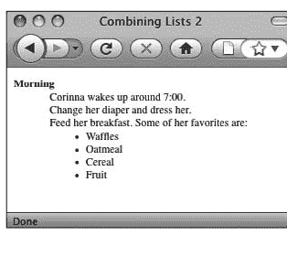

> **提示**
>
> 嵌套列表时最重要的事情是始终确认你已关闭了每个列表。如果你注意到嵌套列表的某一部分缩进超过了应有的程度，或者延续到了上方列表中，请尝试从列表的开始和结束标签处画半圆。如果任何圆圈交叉或没有结束点，你可能需要重新检查你的工作是否有误。

## 动手实践 8-1：在你的网页上使用列表

Chop Point 夏令营每年夏天提供四个不同的营期，每个营期对营员都有不同的要求。在这个项目中，你将创建一个列出营期和要求的网页。此项目的目标包括：

- 在网页中使用有序列表
- 在网页中使用无序列表

**注意**

完成本书中 Chop Point 所需的所有项目文件都可以从`www.wendywillard.com`下载。此外，你可以随时访问`www.choppoint.org`来查看我的网站版本。如果你不使用 Chop Point 站点，你可以根据你的特定需求调整此项目。

1. 打开你的文本/HTML 编辑器，创建一个名为`sessions.html`的新文件。
2. 输入基本网页所需的所有 HTML 标签。
3. 指定白色背景颜色，并使整个页面使用 Verdana 字体。
4. 输入以下部分（紧随这些步骤之后）标题为 *要添加的文本* 中列出的内容（或从`.zip`文件的第 8 章文件夹中复制），并适当格式化。因此，文本中粗体的内容将在网页中显示为粗体，依此类推。
5. 将顶部标题格式化为 1 级标题。
6. 将营期列表格式化为使用罗马数字的有序列表。
7. 将营期要求列表格式化为无序列表。
8. 将第一和第二个营期详情中的短语“trip program”链接到`trips.html`。
9. 将最后一段中的单词“email”链接到电子邮件地址：`camp@choppoint.org`。
10. 保存文件。
11. 打开你的网络浏览器，选择“文件” | “打开页面”（或“打开文件”或“打开”，具体取决于你使用的浏览器）。找到你刚刚保存的文件`sessions.html`。确保文件按你预期的方式显示。
12. 如果需要进行更改，请返回文本编辑器进行修改。进行任何更改后，保存文件并切换回浏览器。选择“刷新”或“重新加载”以预览你刚刚进行的更改。如果你使用的是 Chop Point 站点，你可以将你的文件与以下代码和图 8-1 进行比较。

```html
<!DOCTYPE html PUBLIC "-//W3C//DTD XHTML 1.0 Transitional//EN"
"http://www.w3.org/TR/xhtml1/DTD/transitional.dtd">

<html>
<head>
<title> Chop Point Summer Camp Sessions </title>

<style type="text/css">
body {
    background-color: white;
    font-family: verdana;
}

.contact {
    font-weight: bold;
}
</style>
</head>

<body>

<h1>Chop Point Summer Camp Sessions</h1>

<p>Each summer, Chop Point holds a total of four camp sessions from June
to August. We have spaces for 40 boys and 40 girls during each session.
Additional details such as session length and camper ages are listed below:</p>

<ol type="I">
    <li>KIDS KAMP
        <ul>
            <li>Traditional overnight residential camping program</li>
            <li>Five days, four nights</li>
            <li>Just for kids ages 8-12* who reside in the state of Maine</li>
            <li>Usually held during the third week of June</li>
        </ul>
    </li>

    <li>COMMUNITY PROGRAM
        <ul>
            <li>Traditional overnight residential camping program</li>
            <li>Five days, four nights</li>
            <li>Just for teens ages 12*-18 who reside in the state of Maine</li>
            <li>Usually held during the last full week of June</li>
        </ul>
    </li>

    <li>FIRST SESSION
        <ul>
            <li>Traditional overnight residential camping program plus an adventurous <a href="trips.html">trip program</a></li>
            <li>Three weeks</li>
            <li>For teens ages 12-18 from all over the world</li>
            <li>Usually held the first three weeks in July</li>
        </ul>
    </li>

    <li>SECOND SESSION
        <ul>
            <li>Traditional overnight residential camping program plus an adventurous <a href="trips.html">trip program</a></li>
            <li>Three weeks</li>
            <li>For teens ages 12-18 from all over the world</li>
            <li>Usually held the last week of July and the first two weeks in August</li>
        </ul>
    </li>
</ol>

<p>Campers can stay for a minimum of three weeks, or, by attending both three-week
sessions, a maximum of six weeks. In order to ensure that English is the primary
language spoken, we limit the number of French-speaking campers to 12 per session.
The same is true for other nationalities (no more than 12 Spanish speaking, etc.).
Spaces for foreign campers fill quickly, so we recommend signing up as early as possible.</p>

<p><em>*Local campers who are 12 must choose one program to attend (Kids Kamp or
Community Program) but may not attend both local programs</em>.</p>

<p class="contact">If you are interested in attending a session, please
<a href="mailto:camp@choppoint.org">e-mail</a> us or call 207-443-5860.</p>

</body>
</html>
```


## 要添加的文本

以下段落（前面在步骤 4 中提到过）应添加到你的网页中。文本也包含在可从我的网站下载的`.zip`文件中。

### Chop Point 夏令营营期

每年夏天，Chop Point 从六月到八月共举办四个营期。每个营期我们提供 40 个男孩和 40 个女孩的名额。诸如营期时长和营员年龄等附加详细信息如下所列：

#### I. 儿童营（KIDS KAMP）

- 传统的过夜住宿露营项目
- 五天四夜
- 仅面向居住在缅因州的 8-12 岁*儿童
- 通常在六月的第三周举行

#### II. 社区项目（COMMUNITY PROGRAM）

- 传统的过夜住宿露营项目
- 五天四夜
- 仅面向居住在缅因州的 12*-18 岁青少年
- 通常在六月的最后一周举行

#### III. 第一期（FIRST SESSION）

- 传统的过夜住宿露营项目加上一个冒险的旅行项目
- 三周
- 面向来自世界各地的 12-18 岁青少年
- 通常在七月的前三周举行

#### IV. 第二期（SECOND SESSION）

- 传统的过夜住宿露营项目加上一个冒险的旅行项目
- 三周
- 面向来自世界各地的 12-18 岁青少年
- 通常在七月的最后一周和八月的前两周举行

营员至少可以参加三周，或者，通过参加两个三周的营期，最多可以参加六周。为了确保英语是主要交流语言，我们将每个营期说法语的营员数量限制为 12 人。其他国籍（西班牙语等）的营员也是如此（不超过 12 人）。外国营员的名额很快就会满员，因此我们建议尽早报名。

*12 岁的本地营员必须选择一个项目参加（儿童营或社区项目），但不能同时参加两个本地项目。*

如果你有兴趣参加某个营期，请通过电子邮件联系我们或致电`207-443-5860`。

图 8-1 如果你正在使用 Chop Point 项目，你应该会看到一个类似这样的页面。

## 样式列表

虽然没有用于实际创建列表的样式表属性——这仍然需要用你刚学到的 HTML 来完成——但有三个属性在格式化列表时特别有用。表 8-2 提供了详细信息。请注意，这三个属性只能用于格式化列表，不能用于其他 HTML 元素。最后，每个属性仅被主流浏览器的最新版本识别。

> **注意**
>
> Internet Explorer 最终在第 8 版中增加了对`list-style-item`属性所有可能值的支持。

| 属性和值示例 | 描述 | 可能的值 |
|---|---|---|
| `list-style-image: url(bullet.gif)` | 通过用图像替换来改变项目符号的外观。 | 指定图像的位置（URL）。 |
| `list-style-position: inside` | 指定列表项中额外行的缩进。 | 可以是`inside`（第一行之后的行不缩进）或`outside`（列表项中的所有行都缩进）。 |
| `list-style-type: decimal` | 改变每个列表项开头的项目符号或字符的外观。 | 可以是`none`（无项目符号）、`disc`、`circle`、`square`、`decimal`（数字）、`lower-roman`（小写罗马数字）、`upper-roman`（大写罗马数字）、`lower-alpha`（小写字母）、`upper-alpha`（大写字母）、`decimal-leading-zero`（01.、02.，等等）。 |

**表 8-2** 用于格式化列表的样式表属性

## 自定义项目符号

例如，假设你想在网页上创建一个列表，其中每个项目前都有一个星形图像。你可以通过在定义列表中每个项目的开头添加图像标签来实现这一点，例如使用以下代码：

```html
<dd>万维网联盟成立于1994年</dd>
```

但如果你的列表中有 20 个项目怎么办？给每个列表项目都添加那个长的`img`标签会很繁琐。一个更有效的替代方法是切换到无序列表（默认带项目符号），并在页面头部使用样式表将常规项目符号更改为你的选择图像。以下代码和插图展示了这可能如何实现：

```html
<style type="text/css">
li {list-style-image: url(star.gif);}
</style>
```

> **提示**
>
> 为了获得最佳效果，请选择与每个列表项中文本高度大致相同的图像。

## 自定义间距

如你所知，HTML 列表标签默认会缩进每个列表项。不幸的是，确切的缩进量会根据浏览器的不同而有所变化。值得庆幸的是，有 CSS 属性可以调整缩进。两个属性——`margin`和`padding`——特别会影响列表中每个项目周围以及列表整体周围的间距。

当应用于`ul`或`ol`标签时，`margin`属性会影响整个列表周围的空间。但当它应用于`li`标签时，`margin`属性会改变每个单独列表项周围的空间。

`padding`属性决定了列表项中文本周围的缓冲空间量，在到达列表项边缘之前。请查看以下插图以帮助可视化其工作原理（首先，我将向您展示一个带有额外间距的列表的可视化表示，然后是用于创建该示例的代码）。

```html
<!DOCTYPE HTML PUBLIC "-//W3C//DTD HTML 4.0//EN">
<HTML>
<HEAD>
<TITLE>边距、填充和边框示例</TITLE>
<STYLE type="text/css">
ul {
    background: green;
    margin: 12px 12px 12px 12px;
    padding: 12px 12px 12px 12px;
    font: Verdana, Arial, Helvetica, sans-serif; /* 未设置边框 */
}

li {
    color: black;           /* 文本颜色为黑色 */
    background: #ccc;       /* 内容、填充将为灰色 */
    margin: 12px 12px 12px 12px;
    padding: 12px 0px 12px 12px; /* 注意右侧填充为0px */
    list-style: none;       /* 列表项前没有字形 */ /* 未设置边框 */
}

li.withborder {
    border-style: dashed;
    border-width: medium;   /* 设置所有边框宽度 */
    border-color: black;
}
</STYLE>
</HEAD>
<BODY>
<UL>
    <LI class="style1">列表的第一个元素 - 此文本周围的额外阴影是 <strong>LI 填充</strong>。</LI>
    <LI class="withborder style1">列表的第二个元素更长，用于说明列表项中的换行。注意：每个列表项周围较深的阴影区域是（<strong>LI 边距</strong>）和（<strong>UL 填充</strong>）的组合</LI>
</UL>
</BODY>
</HTML>
```

需要特别注意的是，每当您更改列表和列表项周围的间距时，必须在 Internet Explorer 和另一个符合标准的浏览器（如 Firefox 或 Safari）中测试您的页面。不幸的是，Internet Explorer 6 和 7 在正确显示更改了间距的列表方面存在问题。IE 8 承诺纠正这种情况，但在您的网站访问者中大多数人不再使用 IE 6 或 7 之前，您需要针对两种浏览器进行编码和测试。

### 提示

有关在 IE 6 和 7 中成功使用`margin`和`padding`属性的提示，请查看这篇文章：http://tinyurl.com/ywyfpt。

## 自定义整体布局

如果你想完全改变列表的布局，使其不再像典型的带项目符号和缩进的列表，该怎么办？过去，网页作者使用表格（例如在文字处理程序或电子表格中创建的表格）来容纳不规则列表中的每个“项目”。但样式表提供了一种常被忽视的方法来轻松更改列表的布局，无论是简单地移除项目符号和缩进，还是将整个布局从垂直切换到水平。

## 垂直导航

玩转列表布局最常见的原因可能是将其用作导航栏。考虑图 8-2 中所示的导航栏。它看起来肯定不像一个列表；事实上，它更像一堆图形按钮。链接之间有分隔线，当鼠标悬停在链接上时，颜色甚至会发生变化。

用于创建该列表的实际 HTML 代码如下：

整个列表根据样式表中的`navlist`类进行样式设置。

```html
<ul id="navlist">
<li class="active">首页</li>
<li><a title="链接：学校日历" href="">学校日历</a></li>
<li><a title="链接：查看上学日天气" href="">今日上学日天气</a></li>
<li><a title="链接：每个年级的班级笔记" href="">班级笔记和用品清单</a></li>
<li><a title="链接：家长新闻" href="">家长重要信息</a></li>
<li><a title="链接：认识教职员工" href="">认识老师/教职员工</a></li>
<li><a title="链接：支持学校" href="">如何支持我们的学校</a></li>
<li><a title="链接：午餐菜单" href="">午餐吃什么？</a></li>
<li><a title="链接：公交路线" href="">公交时刻表</a></li>
<li><a title="链接：学校简介" href="">学校简介</a></li>
<li><a title="链接：PTA" href="">HWES的PTA</a></li>
<li><a title="链接：恶劣天气新闻" href="">恶劣天气政策</a></li>
</ul>
```

注意列表的 HTML 看起来与本章开头创建的列表相同。事实上，所有的格式都是通过样式表实现的，其样式如下：

```css
<style type="text/css">
body {
    font-family: Verdana, Arial, Helvetica, sans-serif;
    font-size: 10pt;
}

#navlist {
    width: 250px;
    padding-left: 0;
    margin-left: 0;
    border-bottom: 1px solid #cccccc;
}

#navlist li {
    list-style: none;
    margin: 0;
    border-top: 1px solid #666666;
    line-height: 200%;
}
</style>
```

## 水平导航

如果你想让导航栏在页面上水平排列，而不是垂直向下排列呢？列表默认向下排列的原因是，它们在 HTML 中属于块级元素。如前所述，块级元素会自动填满可用空间。

考虑到这一点，我们只需将列表指定为内联元素显示，而非块级元素，通过`display: inline`即可轻松让列表水平显示。图 8-3 展示了一个非常基础的无序列表，并应用了样式表将其转变为水平导航栏。列表代码如下所示：

```html
<ul id="navlist">
<li class="active">Home</li>
<li><a title="LINK: About Us" href="aboutus.html">About Us</a></li>
<li><a title="LINK: Services" href="services.html">Services</a></li>
<li><a title="LINK: Clients" href="clients.html">Clients</a></li>
<li><a title="LINK: Contact Us" href="contactus.html">Contactus</a></li>
</ul>
```


图 8-3 将列表从块级改为内联，可以使列表项在页面上水平排列。

样式表如下所示：

```css
<style type="text/css">
body {
    font-family: Verdana, Arial, Helvetica, sans-serif;
    font-size: 10pt;
}

#navlist {
    margin: 0;
    padding: 0;
    text-align: center;
}

#navlist li {
    list-style: none;
    display: inline;
}

#navlist li a {
    color: #fff;
    background-color: #900;
    padding: .2em 1em;
    text-decoration: none;
}

#navlist li a:hover {
    color: #ffffff;
    background-color: #333333;
}

.active {
    border: 1px solid #900;
    color: #900;
    font-weight: bold;
    padding: .2em 1em;
}
</style>
```

这里，我移除了项目符号，并告诉浏览器以内联方式显示列表（一个接一个，水平排列在页面上）。

这指定了每个列表项中链接的显示样式。

这指定了当用户将鼠标悬停在列表项中的链接上时颜色的变化方式。

最后一条声明为`active`按钮设置了样式，为其添加红色边框和加粗的红色文本。

## 动手试试 8-2：为网页中的列表添加样式

在这个项目中，我们将使用样式表来自定义在动手试试 8-1 中创建的列表。本项目的目标包括：

- 为无序列表的项目符号设置样式
- 创建用于导航目的的内联列表

1. 打开你的文本或 HTML 编辑器，返回到上一个项目中保存的`sessions.html`文件。
2. 将有序列表中的罗马数字替换为本章`.zip`文件中包含的某种图形项目符号，例如`star.gif`。（提示：尝试使用`ol>li`作为选择器，告诉浏览器仅对页面上有序列表内的列表项使用星号，而非页面上所有的列表项。）
3. 在页面底部添加一个新的 division，并命名为`navigation`。
4. 在该 division 中创建一个无序列表，包含以下列表项：
   - Home
   - Camp Sessions
   - Adventure Trips
5. 将“Home”链接到你已创建的`index.html`页面。
6. 将“Adventure Trips”链接到你已创建的`trips.html`页面。
7. 指定“Camp Sessions”应使用样式表中的`active`类。
8. 在样式表中添加适当的样式声明，使 navigation division 中的列表显示为水平导航栏。
9. 移除导航栏中链接的下划线。
10. 继续添加样式表属性，为列表项设置 1 像素、实线、黑色边框。
11. 创建一个名为`active`的类，并为该类设置灰色背景颜色。
12. 保存文件。
13. 打开你的网页浏览器，选择“文件”|“打开页面”（或“打开文件”或“打开”，取决于你使用的浏览器）。找到你刚保存的文件。确保文件显示效果符合预期。
14. 如果需要修改，返回文本编辑器进行修改。修改完成后保存文件并切换回浏览器。选择“刷新”或“重新加载”以预览你所做的更改。如果你使用的是 Chop Point 项目，可以将你的文件与以下代码和图 8-4 进行比较。

```html
<!DOCTYPE html PUBLIC "-//W3C//DTD XHTML 1.0 Transitional//EN"
"http://www.w3.org/TR/xhtml1/DTD/transitional.dtd">

<html>
<head>
<title>Chop Point Summer Camp Sessions</title>

<style type="text/css">
body {
    background-color: white;
    font-family: verdana;
}

.contact {
    font-weight: bold;
}

ol>li {
    list-style-image: url(star.gif);
}

#navigation ul {
    margin: 0;
    padding: 0;
}

#navigation li {
    display: inline;
    list-style: none;
    border: 1px solid black;
    padding: 0em .6em 0em .6em;
}

#navigation li a {
    text-decoration: none;
}

.active {
    background-color: #ccc;
}
</style>
</head>
```


图 8-4 如果你使用的是 Chop Point 项目，你的营地课程页面应与此类似。

```html
<body>
... 这两部分之间的代码保持不变 ...

<div id="navigation">
<ul>
<li><a href="index.html" title="LINK: Return home">Home</a></li>
<li class="active">Camp Sessions</li>
```


```html
<li><a href="trips.html" title="LINK: Camp adventure trips">Adventure Trips</a></li>

</ul>

</div>

</body>

</html>
```

样式表使得将简单列表转变为优雅的导航栏变得非常容易。这个项目为你提供了使用各种样式表属性来实现此目标的实践机会。

## 第 8 章 自测题

1. 无序列表和有序列表有什么区别？
2. 哪个标签用于在有序列表和无序列表中包裹列表项？
3. 你创建了一个包含四个列表项的无序列表。第四个列表项之后的所有正常文本内容都被缩进到了列表下方。这个问题最可能的原因是什么？
4. 哪个 HTML 属性可以更改列表的编号样式？
5. 判断正误：每个`dt`标签可以使用多个`dd`标签。
6. 哪个 HTML 属性可以更改列表的起始字母或数字？
7. 填空：在浏览器中显示时，无序列表中的每个项目前面默认有一个 __________。
8. 修复以下代码。

```html
<dl>
  <dt>HTML</dt>
  <dd>Hypertext Markup Language is the authoring language used to create documents for the World Wide Web.</dd>
</dl>
```

9. 添加适当的代码，将以下文本转换为有序列表。

```html
<html>
<head>
  <title>My favorite fruits</title>
</head>
<body>
  My favorite fruits, in order of preference, are:

  <ol>
    <li>Raspberries</li>
    <li>Strawberries</li>
    <li>Apples</li>
  </ol>
</body>
</html>
```

10. 添加适当的代码，使以下列表中的每个项目前面显示方形项目符号。

```html
<html>
<head>
  <title>My favorite colors</title>
</head>
<body>
  My favorite colors, in no particular order, are:

  <ul style="list-style-type: square;">
    <li>Red</li>
    <li>Blue</li>
    <li>Green</li>
  </ul>
</body>
</html>
```

11. 填空：`dl`标签代表 _______________________。
12. 判断正误：当你嵌套无序列表时，项目符号样式保持不变。
13. `display`属性使用什么值可以将列表从垂直方向改为水平方向？
14. 如何将列表从使用阿拉伯数字改为使用小写字母？
15. 哪个 CSS 属性用于将列表中的标准项目符号替换为图片？

## 第 9 章：使用表格

### 关键技能与概念

- 理解网页中表格的概念与用途
- 创建基本的表格结构
- 在网页中设置表格格式
- 设置表格单元格内内容的格式

到目前为止，你已经学完了创建网页所需的大部分基础标签。接下来的几章涉及的内容可能比你刚学过的要复杂一些。不过别担心，即使是专业人士在刚开始时也会在这些概念上挣扎（我自己也不例外）。

### 理解网页中表格的概念与用途

即使你可能不熟悉这个术语，但无疑在其他印刷品或电子文档中见过表格。事实上，在整本书中，我都是用表格来组织某些否则可能会令人困惑的章节。简单地说，表格是一段信息，被分割成列和/或行的块，称为单元格。

使用 Microsoft Word 的人可能熟悉该程序中名为“表格”的菜单项，它能让你创建与网页中类似的表格。Microsoft 的文字处理软件并不是唯一支持表格的软件。大多数文字处理软件都能让你用表格来格式化内容。

> **提示**
>
> 在考虑是否在网页中使用表格时，首先想想你会如何在标准文字处理程序中呈现同样的信息。如果你在文字处理程序中会用到表格，那你的网页很可能也应该用表格。如果不是，那就考虑在网页中使用其他方式来呈现信息。

表格的另一种形式，无论是印刷的还是电子的，就是电子表格。沿着这个思路，你可以把表格想象成一张大号的方格纸，你可以自己决定用来容纳信息的单元格大小。

要决定单元格和表格应该多大或多小，你需要做一些规划。尽管 HTML 表格是在数字文档中创建的，但规划表格的最佳方式——在你刚开始学习时——是用纸笔。当你对表格的结构更加熟悉后，也许就能在头脑中规划，而不必先画出来了。

我们先来想想一个简单的井字棋游戏的表格会是什么样子的。

1. 在纸上画一个大框。
2. 将这个框分成三列三行。
3. 在每个框中放入`X`或`O`，不要留空。

按照这些步骤，你得到的纸上的图画很可能与我的类似。

| O | X | O |
|---|---|---|
| X | O | X |
| X | O | X |

现在，假设你想把这个井字棋游戏放到网页中。你会怎么做呢？你已经知道，在 HTML 中，你不能像在电子表格应用程序中那样直接按 Tab 键跳到下一列然后输入`X`。不过，你可以使用表格来布局井字棋游戏的结构。

### 创建基本的表格结构

首先，决定你想要表格多大，或者说，你想要井字棋游戏多大。记住，屏幕上的度量单位是像素；英寸或厘米在 HTML 中派不上用场。开始的时候，在你的图纸上写出尺寸可能会对你有帮助。不过别担心，你现在做的任何事情都不是一成不变的。以后有需要时你还可以修改。

规划好表格的尺寸后，就该开始在 HTML 中构建表格结构了。

### 表格结构

你需要了解四个基本的表格标签，如下所述：

| 标签 | 说明 |
| :--- | :--- |
| `<table>` | 表格标签是 HTML 中创建表格所用到的所有其他标签的容器。开始和结束表格标签应分别放置在表格的开头和结尾。 |
| `</table>` | |
| `<tr>` | `tr`标签代表表格行（table row）。开始和结束`tr`标签包围着该行的单元格。 |
| `</tr>` | |
| `<th>` | `th`标签代表表头（table header）。这是一个可选标签，用来代替`td`标签，定义包含标题信息的单元格。默认情况下，标题单元格中的内容会加粗并居中。 |
| `</th>` | |
| `<td>` | `td`标签代表表格数据（table data），保存单元格的实际内容。每一行的每个单元格都有开始和结束`td`标签。 |
| `</td>` | |

有了这些标签，你就可以根据需要创建简单或复杂的表格结构了。假设你想创建一个基本的表格结构，如下所示：

| 受欢迎的女孩名字 | 受欢迎的男孩名字 |
| :--- | :--- |
| Emily | Jacob |
| Sarah | Michael |

你的代码可能如下所示：

```html
<table>
  <tr>
    <th>Popular Girls' Names</th>
    <th>Popular Boys' Names</th>
  </tr>
  <tr>
    <td>Emily</td>
    <td>Jacob</td>
  </tr>
  <tr>
    <td>Sarah</td>
    <td>Michael</td>
  </tr>
</table>
```

### 注意

虽然你不一定需要对`td`或`th`标签进行缩进，但我在这里这样做是为了帮助你区分表格行和单元格。

开始和结束`table`标签包围着整段代码。这告诉浏览器这些标签内的所有内容都属于表格。表格的每一行都有开始和结束`tr`标签。它们包围着`td`或`th`标签，而这些标签又包含着浏览器要显示的实际内容。

> **注意**
>
> 某些浏览器默认会在每个单元格周围显示边框。我在标题为“边框”的部分会详细讨论边框相关内容。

### 单元格内容

你可以在表格单元格中包含几乎任何类型的内容，就像你在网页其他位置所包含的内容一样。这些内容应输入到相应单元格的开始和结束`td`标签之间。用于格式化该内容的所有标签也应包含在`td`标签之间。

> **提示**
>
> 想包含一个没有内容的空白单元格？在开始和结束`td`标签之间输入不间断空格（`&nbsp;`）的代码，你的单元格就会显示为空白。如果你有很多空白单元格，可以在`table`标签的样式声明中添加`empty-cells: show;`。

如果我们回到井字棋游戏，以下是该表格的标记。

```html
<table>
  <tr>
    <td>O</td>
    <td>X</td>
    <td>O</td>
  </tr>
  <tr>
    <td>X</td>
    <td>O</td>
    <td>X</td>
  </tr>
  <tr>
    <td>X</td>
    <td>O</td>
    <td>X</td>
  </tr>
</table>
```

如果你用这段代码创建一个基本的 HTML 页面，保存并在浏览器中预览，你会看到类似如下的内容：

默认情况下，每个单元格的大小仅取决于单元格内容的大小。如果你在每一个单元格中输入三个 X 或 O，并在中间单元格添加一句话，表格就会变成如下所示的样子：

在达到一定数量的字符后，浏览器可能会换行显示内容。这意味着它停止在该行打印，并继续到下一行。这种情况通常发生在表格碰到页面中的另一个元素或到达窗口边缘之前。内容换行的默认触发点因浏览器而异。

### 文本

你可以使用前几章学到的标签来自定义每个单元格中的文本。例如，你可以添加`strong`标签来使单元格中的文本加粗。

```html
<table>
  <tr>
    <td>OOO</td>
    <td>XXX</td>
    <td>OOO</td>
  </tr>
  <tr>
    <td>XXX</td>
    <td>This is the center point of the <strong>tic-tac-toe board</strong> for the game I am playing.</td>
  </tr>
</table>
```

这段文本是通过在单元格中使用`strong`标签来加粗的。

```html
<td>XXX</td>
</tr>
<tr>
  <td>XXX</td>
  <td>OOO</td>
  <td>XXX</td>
</tr>
</table>
```

将中间单元格中的“tic-tac-toe board”这几个词用`strong`标签的开始和结束版本包围起来，就是告诉浏览器将该文本加粗显示。

如果你想让所有单元格中的文本都具有相同的特征，最佳解决方案是使用样式表，以`td`标签作为选择器。例如，下面的样式表可以放在开始和结束`head`标签之间，用来改变整个页面中由`td`标签创建的所有单元格内文本的字体和大小。

```html
<style type="text/css">
td {
  font-family: verdana;
  font-size: 10pt;
}
</style>
```

### 图像

你也可以在 HTML 表格的任意单元格中添加图像。为此，在希望图像出现的单元格中添加图像引用（使用`img`标签）。在下面的示例中，我在游戏棋盘上出现`O`的位置用了一张`O`的图像代替文本。

```html
<table>
  <tr>
    <td></td>
    <td>XXX</td>
    <td></td>
  </tr>
  <tr>
    <td>XXX</td>
    <td></td>
    <td>XXX</td>
```

```html
<table>
  <tr>
    <td>XXX</td>
    <td></td>
    <td>XXX</td>
  </tr>
</table>
```

在浏览器中查看时，图片`O`出现在文本`O`原先所在的位置，如下所示：


你还可以通过运用前面章节讨论过的许多标签，将文本、图片和其他类型的媒体（如动画、声音和视频）组合在表格单元格中。关键在于确定哪些元素应该放在哪些单元格中。

## 在网页中设置表格格式

你可能已经注意到，表格中的所有文本都靠每个单元格的左侧对齐。这一点以及表格的许多其他特性，都可以通过几个表格属性或样式表轻松自定义。

## 边框

表格因其设计本质而具有内部和外部边框。默认情况下，大多数浏览器将边框大小设为零，使其不可见。然而，边框对于统计信息表格来说可能非常有用，例如，需要看到列才能更好地理解数据的情况。关键在于理解与边框使用相关的三个属性。

> **提示**
>
> 当带有边框的表格在基于文本的浏览器（即设置为仅显示纯文本、无额外格式或图片的浏览器）中查看时，水平边框用短横线表示，垂直边框用竖线（`|`）表示。

> **注意**
>
> 你也可以使用样式表中的`border`属性来设置表格边框的格式，特别是`border-width`、`border-style`和`border-color`属性。详见第 4 章中标题为“水平线和边框”的部分。

### border 属性

即使你最终希望表格边框不可见，在构建表格时，一个查看表格效果的好方法是临时开启所有边框。你可以通过在`table`标签中添加`border`属性并指定一个大于零的整数来实现。

```html
<table border="3">
```

将井字棋表格的边框大小改为“3”，可以让你更清楚地看到每个单元格的起始和结束位置，因为它开启了所有内部和外部边框。你指定的数字越大，边框就越粗。


> **注意**
>
> 如果你不希望任何边框显示，最好在`table`标签中指定`border="0"`。这样可以确保边框不可见，即使浏览器默认值不同。

### frame 属性

`frame`属性指定表格周围要显示哪些外部边框。该属性有多个可选值，如表 9-1 所述。

你可以在单个表格中多次使用此属性，例如，可以仅开启顶部和左侧边框。实现此功能的代码可能如下所示。

> 请注意，要使用`frame`属性，必须将`border`属性设置为大于零的整数。

```html
<table border="2" frame="lhs" frame="above">
```

### rules 属性

`rules`属性可用于指定表格中应显示的内部边框。与`frame`属性一样，此属性仅在你指定了大于零的边框大小时才有效。当同时指定了`rules`属性和`border`属性时，在支持`rules`属性的浏览器中，`rules`属性优先。

值为`cols`时，浏览器仅显示列之间的垂直内部边框。

```html
<table border="1" rules="cols">
```


`rules` 属性有多个可选值，如表 9-2 所列。以下插图展示了当 `rules` 设置为 `"none"`、`frame` 设置为 `"box"`（边框大小为 3）时，浏览器如何显示井字棋表格。


| 值 | 描述 |
| :--- | :--- |
| `void` | 关闭四边（等同于 `border="0"`）。 |
| `above` | 仅开启顶部边框。 |
| `below` | 仅开启底部边框。 |
| `hsides` | 仅开启水平边框（左侧和右侧）。 |
| `vsides` | 仅开启垂直边框（顶部和底部）。 |
| `lhs` | 仅开启左侧边框。 |
| `rhs` | 仅开启右侧边框。 |
| `box` | 开启四边（等同于 `border="n"`）。 |
| `border` | 开启四边（等同于 `border="n"`）。 |

表 9-1 frame 属性的可选值

| 值 | 描述 |
| :--- | :--- |
| `none` | 关闭所有内部边框。 |
| `groups` | 开启列组和/或行组之间的垂直内部边框。* |
| `rows` | 仅开启行之间的内部边框（水平）。 |
| `cols` | 仅开启列之间的内部边框（垂直）。 |
| `all` | 开启所有内部边框。 |

*你将在本章稍后的“分组和对齐列”部分学习如何指定列组。

表 9-2 rules 属性的可选值

## 单元格间距和填充

当表格的边框可见时，更容易看到内容周围以及单元格之间有多少空间。可以在 `table` 标签中添加两个属性，以便你控制这些类型的间距。

- `cellpadding`：单元格内容与单元格边缘之间的空间。
- `cellspacing`：各个单元格之间的空间。

首先，`cellpadding` 影响内容与单元格边缘之间的空间量。当边框可见时，增加单元格填充可以在文本周围提供额外的*缓冲空间*，使其不会与边框重叠。

其次，`cellspacing` 影响表格中各单元格之间的空间量。虽然不位于实际单元格内部，但可以增加此空间以在多个单元格之间留出间隔，类似于报纸中列之间的空白区域。

这两个属性的值都应以像素为单位表示，是一个大于 0 的整数。值为 0 实际上会关闭单元格填充或单元格间距，导致单元格紧挨在一起。

以下插图展示了两个不同 `cellpadding` 和 `cellspacing` 值的示例。


在第一个表格中，`border` 为 5 像素宽，`cellpadding` 为 15 像素宽，`cellspacing` 为 5 像素宽。这在单元格内容周围创建了一个相当大的缓冲区域，但各单元格之间的间距很小。

```html
<table border="5" cellpadding="15" cellspacing="5">
```

当在第二个表格中将这些值反转，即 `cellpadding` 为 5 像素宽、`cellspacing` 为 15 像素宽时，单元格之间的间距增大，而每个单元格中文本周围的空间减小。

```html
<table border="5" cellpadding="5" cellspacing="15">
```

最新版本的 CSS 规范还提供了一个样式表属性，用于更改网页中的表格间距。具体来说，`border-collapse` 属性在你需要关闭所有单元格填充和间距，使单元格之间完全没有空间时非常有用。此属性可以通过以下两种方式之一使用：

- `border-collapse: collapse`：关闭单元格边框之间的所有空间。
- `border-collapse: separate`：保留单元格边框之间的空间。（使用 `border-spacing` 属性来指定具体的空间大小。）

> **提示**
>
> 为了获得更精细的控制，你还可以在样式表中使用 `padding` 和 `margin` 属性来设置表格的单元格填充和间距。请注意，整个表格可以同时使用 `padding` 和 `margin` 属性设置样式，而单个单元格可以包含填充，但不能设置边距。详见第 4 章中的“引用块和文本框”部分。

## 宽度和高度

在最初介绍表格时，我提到了提前规划表格大小。如果你创建的表格需要适应页面上的预定空间，这一点尤为重要。在过去，我们使用 `table` 标签中的 `height` 和 `width` 属性来指定表格的所需尺寸。虽然 W3C 现在不推荐这种做法，但你仍然可以通过在样式表中添加 `height` 和 `width` 属性来达到相同的效果。如果你不在代码中指定这些值，浏览器会根据每个单元格中的内容量和窗口中的可用空间来选择大小。

假设我想在网页中包含那个井字棋游戏，但页面上只有一个 200 像素宽、200 像素高的可用空间。由于表格往往会根据其中的内容量“增长”，我可能想要限制表格的高度和宽度，以避免它超出我指定的 200 x 200 像素区域。我可以通过在样式表中指定尺寸来实现。如果页面上只有一个 `table` 标签，我甚至可以使用 `table` 作为选择器。

```css
table {width: 200px; height: 200px; border: 3px solid black;}
```

> **注意**
>
> 如果页面上有多个表格，我可以通过为每个 `table` 标签添加 `class` 属性，然后在样式表中为这些类设置不同的样式，来独立设置每个表格的样式。

在这种情况下，我会为表格指定一个*绝对尺寸*，即使浏览器窗口变大或变小，这个尺寸也不会改变。


另一方面，如果我不关心表格的具体尺寸，只想让它占据窗口宽度的 50%，不超过这个比例，我可以在这些属性的值中使用百分比。

```css
table {width: 50%; height: 50%; border: 3px solid black;}
```

这被称为*相对尺寸设置*，因为我没有指定绝对的像素尺寸，而是设置了相对于浏览器窗口大小的尺寸。比较下面两幅图，看看在相对尺寸设置下，表格大小如何根据窗口大小而变化。


## 基本对齐

正如前一章关于图片的讨论，你可以使用 `float` 属性使表格对齐到其周围文本的右侧或左侧。如果页面上只有一个表格，你甚至可以使用 `table` 标签作为选择器，如下所示：

```css
table {float: right;}
```

下图展示了我们的井字棋表格对齐到窗口右侧，文本在其左侧环绕。此处也列出了页面的完整源代码，以便你更好地理解样式表如何影响表格格式。

```html
<html>
<head>
<title> 浮动表格  </title>
<style type="text/css">
body {font-family: verdana;}
table {width: 200px;
    height: 200px;
    border: 3px solid black;
    float:right;}
td {border: 3px solid black;
    text-align: center;}
</style>
</head>
<body>
<table>
<tr>
	<td></td>
	<td></td>
	<td></td>
</tr>
<tr>
	<td></td>
	<td></td>
	<td></td>
</tr>
<tr>
	<td></td>
	<td></td>
	<td></td>
</tr>
</table>
```

```html
<h1>井字棋</h1>
<p>网上有很多地方可以玩井字棋，无论是自己玩还是与其他网络用户对战。访问 <a href="http://dir.yahoo.com/Recreation/Games/Puzzles/Tic_Tac_Toe/">Yahoo Games</a> 查看一些热门的井字棋游戏列表。</p>
<p>像这样无人获胜的游戏，通常被称为“猫的游戏”。关于为什么这样称呼有很多理论，但我个人最喜欢的是这个：在许多其他游戏中，当无人获胜时被称为平局游戏。因为猫会抓挠，你可以理解“猫的游戏”这个短语可能的起源。</p>
</body>
</html>
```


## 专家问答

**问：** 等等！当我尝试时，我的表格并没有在垂直方向上填充屏幕的 50%，只是水平方向！

**答：** 如果你正在按照这些代码示例输入到自己的 HTML 编辑器中，然后在浏览器中查看页面，那么在尝试复制我设置表格高度为浏览器窗口高度 50% 的示例时，你可能遇到了障碍。别担心——这个问题有解释，它涉及浏览器如何实际定义 100% 高度。

你看，当你指定表格应为 50% 时，浏览器会将其理解为“父对象的 50%”。在这种情况下，父对象是 HTML 页面本身。因为 HTML 页面不是块级元素，它们不会自动填充所有可用空间。这就产生了一个难题，特别是当浏览器认为“屏幕”在页面内容结束处就停止了时，如果你希望表格填充屏幕的一半。

解决方案是在你的样式表中添加一小段代码，强制浏览器表现得像一个块级元素，或者更确切地说，填充整个浏览器窗口，无论可见内容的数量是多少。

```css
html, body {
    height:100%;
    margin: 0;
    padding: 0;
    border: none;
    }
```

一旦你这样做了，`height:50%` 声明就会在你的 `table` 标签上真正生效！

**注意**

你也可以通过样式表实现更复杂的对齐（例如将表格放置在页面的特定位置并禁止其移动）。第 12 章将更深入地讨论这一点。

## 颜色

要更改整个表格的背景颜色，你可以在样式表中添加 `background-color` 属性，使用 `table` 标签作为选择器。以下示例展示了这在内部样式表中的样子，假设你正在格式化的表格是页面上唯一的表格。

```css
table {background-color: #999;}
```


但是，如果你的页面上有多个表格呢？请注意，使用前面的代码会导致页面上所有表格都以相同的背景颜色呈现。要为包含多个表格的页面中的每个表格创建特定样式，你可以使用类：

```css
.table1 {background-color: #999;}
.table2 {background-color: #333;}
```

然后，你在开始的 `table` 标签中引用类名（不带点），例如：

```html
<table class="table1">
```

根据渲染表格的浏览器不同，你指定的背景颜色可能会也可能不会显示在边框内。在多个浏览器中测试你的页面以确保无误。

## 背景图像

`background-image` 属性可以添加到你的样式表中，以将图像应用到整个表格背景。当应用于表格时，`background-image` 属性的工作方式与应用于其他网页对象相同。这意味着它会自动从左到右、从上到下重复。但是，如果你愿意，可以使用第 6 章中讨论的其他背景属性（如 `background-repeat` 和 `background-attachment`）来更改重复选项。

添加背景图像是实现带纹理或图案表格背景的一种方式，如图 9-1 所示。这只需要一个小的重复图像，例如：


以及添加到你样式表中的一点代码：

```css
table {background-image: url('images/stripes.gif');}
```

## 标题

`caption` 标签使你能够为表格指定标题。这不是 `table` 标签的一个属性；它是一个独立的元素，用于 `table` 标签之后，但在第一个表格行之前。以下是表格标记的开始部分：

```html
<table border="3" align="right" bgcolor="#999">
<caption>这是一个无人获胜的井字棋“猫的游戏”。</caption>
<tr>
    <td>O</td>
    <td>X</td>
    <td>O</td>
</tr>
```

开始和结束的 `caption` 标签包围着你想要显示为表格标题的实际文本。默认情况下，标题在表格顶部居中对齐。两个 CSS 属性可用于更改标题对齐方式：

- **`text-align`**：使用此属性调整文本在其所在一侧的对齐方式，左对齐、右对齐或居中。
- **`caption-side`**：使用此属性指定标题应放置在哪一侧（顶部、右侧、底部或左侧）。

考虑到这些属性，你能弄清楚如何将标题沿表格底边对齐，然后将文本设置为沿该边右对齐吗？图 9-2 提供了一个视觉示例，以下代码给出了答案。

```css
caption {text-align: right; caption-side: bottom;}
```

### 提示

你还可以使用其他格式属性来吸引更多注意标题，例如使其加粗或使用不同的颜色。


图 9-1 `background-image` 属性可以应用于表格以产生图案效果。


图 9-2 `caption` 标签被设置样式以指定标题中文本的确切对齐方式。

# 试一试 9-1：创建一个基础表格

Chop Point 夏令营维护着一张探险旅行表格，为家长和营员提供一种便捷方式，查看每期都提供哪些旅行项目。你将运用刚刚学到的技能在网页中添加这样一张表格。本项目的目标包括：

- 创建基础表格结构
- 向表格结构中添加文本内容
- 设置表格格式

**注意**

完成本书中 Chop Point 相关项目所需的所有文件都可以从 `www.wendywillard.com` 下载。此外，你可以随时访问 `www.choppoint.org` 查看我制作的网站版本。如果你不使用 Chop Point 站点，可以根据自身需求调整本项目。

1. 打开文本编辑器或 HTML 编辑器，新建一个名为 `trips.html` 的文件。
2. 输入基础网页所需的所有 HTML 标签。
3. 在样式表中，指定你喜欢的背景、文本和链接颜色。
4. 在页面中创建一个表格，以如下表格为指导。注意第一行是表头行。（该文本也包含在 `Chapter09.zip` 文件中。）

| 第一期 | 第二期 | 旅行类型 | 旅行时长 | 旅行地点 |
| :---: | :---: | :--- | :--- | :--- |
| X | | 皮划艇 | 2 天 | 肯纳贝克河 |
| X | | 皮划艇 | 4–5 天 | 阿拉加什河 |
| | X | 皮划艇 | 4 天 | 穆斯河 |
| X | X | kayak | 2 天 | 肯纳贝克河 |
| X | X | 激流漂流 | 1 天 | 肯纳贝克河 |
| X | | 骑行 | 3 天 | 阿卡迪亚国家公园 |
| | X | 山地骑行 | 3 天 | 卡拉巴萨特山谷 |
| | X | 徒步 | 3 天 | 巴克斯特州立公园 |
| X | | 徒步 | 3 天 | 华盛顿山 |
| X | X | 观光 | 3 天 | 魁北克市 |
| X | X | 钓鱼 | 1 天 | 缅因州海岸 |
| | X | 观鲸 | 1 天 | 缅因州海岸 |
| X | X | 帆船 | 2 天 | 缅因州海岸 |

5. 指定边框大小为 1。
6. 在表格上方添加以下一级标题：**可选探险旅行**。
7. 在表格和标题之间添加以下段落：

> 每年夏天，我们都会安排几个可选的探险旅行，营员们觉得这些旅行既刺激又有意义。这些旅行总能提供难忘的体验。只要你愿意，可以参加任意多个或任意少的旅行，只要它们之间没有冲突。旅行时长不一，并且会根据参与营员的能力进行规划。

8. 保存文件。
9. 打开网页浏览器，选择“文件 | 打开页面”（或“打开文件”或“打开”，取决于你使用的浏览器）。找到你刚刚保存的文件。确保其显示效果符合预期。
10. 如果需要进行修改，返回文本编辑器进行操作。完成任何修改后，保存文件并切换回浏览器。选择“刷新”或“重新加载”以预览刚刚做的更改。如果你使用的是 Chop Point 站点，可以将你的文件与以下代码和图 9-3 进行比较。


**图 9-3** 如果你使用的是 Chop Point 站点，应该能看到与此类似的页面。

*（未完待续）*

> **注意**
>
> 尝试查看页面时，你的表格没有显示吗？如果是这样，请检查确保你已关闭表格标签（`</table>`）。更多提示，请参阅附录 C。

```html
<!DOCTYPE html PUBLIC "-//W3C//DTD XHTML 1.0 Transitional//EN" "http://www.w3.org/TR/xhtml1/DTD/transitional.dtd">
<html>
<head>
<title> Optional Adventure Trips </title>
<style type="text/css">
body {font-family: verdana;
  background-color: white;}
</style>
</head>
<body>
<h1>Optional Adventure Trips</h1>
<p>Each summer, we schedule several optional adventure trips that campers find exciting and rewarding. The trips always provide memorable experiences. You can participate in as many or as few trips as you'd like, as long as none conflict with each other. Trips vary in length and are planned for the abilities of the participating campers.</p>
<table border="1">
<tr><th>Session 1</td>
  <th>Session 2</td>
  <th>Trip Type</td>
  <th>Trip Duration</td>
  <th>Trip Location</td>
</tr>
<tr><td>X</td>
  <td></td>
  <td>Canoeing</td>
  <td>2 days</td>
  <td>Kennebec River</td>
</tr>
<tr><td>X</td>
  <td></td>
  <td>Canoeing</td>
  <td>4-5 days</td>
  <td>Allagash River</td>
</tr>
<tr><td></td>
  <td>X</td>
  <td>Canoeing</td>
  <td>4 days</td>
  <td>Moose River</td>
</tr>
<tr><td>X</td>
  <td>X</td>
  <td>Kayaking</td>
  <td>2 days</td>
  <td>Kennebec River</td>
  </tr>
<tr><td>X</td>
  <td>X</td>
  <td>White Water Rafting</td>
  <td>1 day</td>
  <td>Kennebec River</td>
  </tr>
<tr><td>X</td>
  <td></td>
  <td>Biking</td>
  <td>3 days</td>
  <td>Acadia National Park</td>
  </tr>
<tr><td></td>
  <td>X</td>
  <td>Mountain Biking</td>
  <td>3 days</td>
  <td>Carrabassett Valley</td>
  </tr>
<tr><td></td>
  <td>X</td>
  <td>Hiking</td>
  <td>3 days</td>
  <td>Baxter State Park</td>
  </tr>
<tr><td>X</td>
  <td></td>
  <td>Hiking</td>
  <td>3 days</td>
  <td>Mount Washington</td>
  </tr>
<tr><td>X</td>
  <td>X</td>
  <td>Sightseeing</td>
  <td>3 days</td>
  <td>Quebec City</td>
  </tr>
<tr><td>X</td>
  <td>X</td>
  <td>Fishing</td>
  <td>1 day</td>
  <td>Maine Coast</td>
  </tr>
<tr><td></td>
    <td>X</td>
    <td>Whale Watching</td>
    <td>1 day</td>
    <td>Maine Coast</td>
    </tr>
<tr><td>X</td>
    <td>X</td>
    <td>Sailing</td>
    <td>2 days</td>
    <td>Maine Coast</td>
    </tr>
</table>
</body>
</html>
```

表格在数字和印刷行业中被广泛用于各种用途。本项目让你练习创建基础表格结构，使用 Chop Point 夏令营的旅行详情作为内容。

## 设置表格单元格内容格式

正如你可以设置整个表格的格式一样，也可以设置表格中每个单元格的格式。这意味着可以更改对齐方式、宽度、高度和背景颜色，还可以限制换行以及让内容跨越多列或多行。

## 对齐

如果你参照“试一试 9-1”中创建的表格，或参照图 9-3，你可能会注意到某些单元格的对齐方式有所不同，这取决于浏览器窗口的打开宽度。例如，在图 9-3 中，第一行单元格中的文本居中对齐，而其他行中的其余单元格则是左对齐。

要更改垂直和水平对齐方式，可以将 `text-align` 属性（用于水平对齐）或 `vertical-align` 属性（用于垂直对齐）添加到 `tr`、`th` 或 `td` 标签中。

- `tr`：将 `text-align` 或 `vertical-align` 属性添加到 `tr` 标签会使你指定的对齐方式对该行中的所有单元格生效。
- `td, th`：将 `text-align` 或 `vertical-align` 属性添加到 `td` 或 `th` 标签会使你指定的对齐方式仅对那个单元格生效。

表 9-3 列出了这两个属性在表格中使用时可能的取值。

| 属性 | 可能的值 |
| :--- | :--- |
| `text-align` | `left`<br>`right`<br>`center`<br>`string`（例如，`text-align: '.'` 会告诉浏览器沿小数点对齐，这对于一列货币值可能很有用） |
| `vertical-align` | `baseline`（将元素基线与父元素基线对齐）<br>`sub`（下标）<br>`super`（上标）<br>`top`（将元素顶部与行中最高的部分对齐）<br>`text-top`（将元素顶部与父元素的字体对齐）<br>`text-bottom`（将元素顶部与父元素的底部对齐）<br>`bottom`（将元素底部与行中最低的部分对齐）<br>`middle`（将元素中点与基线加上父元素中字母“x”高度的一半对齐）<br>`percentage`（相对于元素的 `line-height` 值） |

### 表 9-3 表格的文本对齐选项

> **注意**
>
> `text-align` 和 `vertical-align` 属性的默认值分别是 `left` 和 `middle`。然而，对于表头单元格（使用 `th` 标签），水平对齐默认是 `center` 而不是 `left`。

如果你想以类似方式对齐表格中的所有单元格，可以很容易地在样式表中使用 `td` 标签作为选择器，方式如下：

```css
td {text-align: center;}
```

但如果你希望每一列单元格的对齐方式不同呢？你可以创建三个类：

```css
.left {text-align: left; vertical-align: top;}
.right {text-align: right; vertical-align: bottom;}
.center {text-align: center; vertical-align: middle;}
```

然后从适当的 `td` 标签中引用每个类。图 9-4 展示了这种样式表应用到我们的井字棋棋盘时的结果。

```html
<tr>
    <td class="left">O</td>
    <td class="center">X</td>
    <td class="right">O</td>
</tr>
```

**图 9-4** 已创建三个不同的类，用于以三种不同的方式对齐此表格的单元格。

## 宽度和高度

在本章前面，你使用了 `width` 和 `height` 属性来指定整个表格的大小。你也可以通过向 `td` 或 `th` 标签添加这些属性来指定单个单元格的大小。

> **提示**
>
> 如果你希望各列大小相同，这将特别有用，因为在未指定宽度时，大多数浏览器不会使列大小相同。

你可能记得，这两个属性的值可以由像素长度或百分比来指定。无论调整哪个元素的大小，这一点都是相同的。但是，当混合使用像素值和百分比时要小心，因为在不同的浏览器中可能会产生不可预测的结果。

查看以下示例中的表格。虽然表格本身的宽度设置为窗口宽度的 100%，但没有任何单元格设置宽度尺寸。这使得每个单元格应该有多宽由浏览器决定。


如果我想使所有三列的宽度相同，无论浏览器窗口大小如何，我可以在样式表中指定每个 `th` 标签应占表格总宽度的三分之一：

```css
th {width: 33%;}
```

然后，该列中的每个后续单元格都应具有相同的宽度（和/或高度）。此规则的一个例外可能是当一个单元格包含一串极长且没有空格的文本时，例如 `abcdefghijklmnopqrstuvwxyz`。在这种情况下，浏览器可能必须将该单元格放大以适应长文本字符串。无需在每一列中的每个单元格中都放置宽度属性——只需在第一个单元格中放置即可。我再次建议在多个浏览器中测试你的页面，以验证表格是否按预期显示。


## 关于单元格宽度和内边距的最后一点说明

关于宽度的一个额外说明：虽然表格单元格没有外边距（至少根据 CSS 标准没有），但它们确实有内边距。这意味着如果你想在单元格内容周围留出一些缓冲空间（内边距），在设置单元格宽度时就需要考虑这一点。所以，假设你有一列内容大约需要 100 像素的宽度，并且你还希望在每侧有 10 像素的内边距。那么你实际上需要将列宽设置为 120 像素（100 像素的内容，加上左侧 10 像素的内边距和右侧 10 像素的内边距）。样式表可能如下所示：

```css
td {width: 120px;
    padding: 10px;}
```

## 颜色

虽然将 `background-color` 属性添加到表格样式声明中可以让你更改整个表格的颜色，但将此属性与 `tr`、`td` 或 `th` 标签一起使用，可以让你指定单个行或单元格的颜色。

```css
tr {background-color: green;}
```

使用不同的色调为表格中的行或列着色可以使表格更具可读性，尤其是当表格很长时。样式表使得通过使用类来创建这样的模式变得容易。考虑图 9-5 所示的表格。如果你必须将样式声明添加到表格中的每一行，随着表格包含更多行，这可能会变得非常繁琐。相反，在你的内部或外部样式表中创建两个类：

```css
.hilite {background-color: #ccc;}
.lolite {background-color: #999;}
```

然后在你的表格的交替行中引用每一个。

> 在为类命名时，请坚持使用引用类目的的名称，而不是类的样式。例如，避免使用像 `bluerow` 和 `orangerow` 这样的名称，因为如果你最终改变了行的颜色，这些名称会变得令人困惑。相反，尝试使用 `hilite` 和 `lolite` 来表示像这样的交替颜色行。

```html
<tr class="hilite"><td>出生</td>
   <td>19.5"</td>
   <td>7 磅 9 盎司</td>
   </tr>
<tr class="lolite"><td>6 个月</td>
   <td>25"</td>
   <td>17 磅 8 盎司</td>
   </tr>
<tr class="hilite"><td>12 个月</td>
   <td>29.5"</td>
   <td>22 磅 5 盎司</td>
   </tr>
```


**图 9-5** 样式表和类使得创建像这样的交替颜色行变得容易。

> **注意**
>
> 当你同时为单个单元格和整个表格包含背景颜色时，表格的背景颜色也可能在单元格之间（在边框中）显示出来。然而，这在不同浏览器之间确实会有所变化。关于这个话题，我的建议是在多种设置下测试你的页面，以确保你在每种不同的浏览器下都对它们的外观感到满意。

## 禁止换行

有时，你可能需要在单元格中将内容保持在单行上。在这种情况下，你可以使用 `white-space` 属性，值为 `nowrap`，以告诉浏览器尽可能将该单元格中的所有内容保持在单行上。（如果浏览器窗口太小，无法在一行内呈现内容，则可能无法实现。）样式表可能如下所示：

```css
td.nowrap {
    white-space: nowrap;}
```

而对 HTML 表格的唯一更改是添加了类引用。

```html
<td class="nowrap">此内容不会换行。</td>
```

## 跨列

到目前为止，在本章中，你只使用了网格状的表格，其中每一行和每一列的单元格数量相等。虽然这是默认设置，但你可以向 `td` 或 `th` 标签添加一个属性，使其与下方的另一个单元格合并，如下所示：

| 这两个单元格已合并，因此第一个单元格的内容流入第二个单元格。 | 3 | |
| --- | --- | --- |
| 4 | 5 | 6 |

要实现这一点，请使用 `colspan` 属性。默认情况下，每个单元格仅跨一列。使用 `colspan` 属性可以更改这一点，使单元格跨两列或更多列。以下 HTML 展示了你可能如何编码上述表格。

```html
<table border="1">
<tr>
    <td colspan="2">这两个单元格已合并，因此第一个单元格的内容流入第二个单元格。</td>
    <td>3</td>
</tr>
<tr>
    <td>4</td>
    <td>5</td>
    <td>6</td>
</tr>
</table>
```

## 跨行

就像你可以跨两列或更多列合并单元格一样，你也可以跨两行或更多行合并单元格。用于此目的的属性是 `rowspan`。

如果你将上一节中使用的表格中的右侧两个单元格（#3 和 #6）合并为一个，表格可能如下所示。

| 这两个单元格已合并，因此第一个单元格的内容流入第二个单元格。 | 这两个单元格已合并，因此顶部单元格的内容流入底部单元格。 |
| --- | --- |
| 4 | 5 |

在这里，第一行中的两个单元格已合并，而第一行中的第三个单元格与第二行中的第三个单元格合并。以下是用于创建此表格的 HTML：

```html
<table border="1">
<tr>
    <td colspan="2">这两个单元格已合并，因此第一个单元格的内容流入第二个单元格。</td>
    <td rowspan="2">这两个单元格已合并，因此顶部单元格的内容流入底部单元格。</td>
</tr>
<tr>
    <td>4</td>
    <td>5</td>
</tr>
</table>
```

`rowspan` 属性可以单独在 `td` 标签中使用，使一个单元格与其下方的单元格合并，也可以与 `colspan` 属性结合使用，使一个单元格与其下方的单元格和旁边的单元格合并。

尽管 `colspan` 和 `rowspan` 属性为 Web 开发人员提供了强大的功能来构建富有创意的表格结构，但它们为表格增加了一定程度的复杂性，这种复杂性通常难以掌握。别担心——每个人一开始都会在这些概念上挣扎。如果你有困难，请回到使用纸笔来规划你的表格结构，然后再输入任何按键。

> **提示**
>
> 如果你心中有表格最终输出的画面，请先画出来。然后，回去在图片周围添加表格或网格结构，将每个部分放入一个单元格或一组单元格中。这也是所见即所得 HTML 编辑器可能派上用场的地方之一，因为它使你在创建表格时能够看到它。

## 其他格式化技术

HTML 有额外的标签，旨在帮助 Web 开发人员构建更用户友好的表格。这些标签和属性使你能够对行和/或列进行分组，以便浏览器更清楚地理解每个元素的目的。

## 对行分组

有三个标签特别用于对表格中的行进行分组。

- `thead` 表头
- `tfoot` 表尾
- `tbody` 表体

当你使用这些标签时，浏览器能够区分页眉和页脚信息与页面的主要内容。这样做的好处是，当用户查看包含长表格的页面时，表格的页眉信息会出现在表格的每个页面或屏幕视图的顶部，即使表格被打印出来也是如此。这有助于用户在查看第四页时，不会疑惑第三列原本应该是什么内容，而第三列的标题只在第一页列出过。

虽然这三个标签从来不是必需的，但当它们被使用时，每个标签必须包含至少一个由 `tr` 标签定义的表格行。此外，如果你包含 `thead` 和/或 `tfoot`，你还必须包含至少一个 `tbody`。因此，使用这三个标签的表格布局可能如下所示：


```html
<table>
<thead>
<tr>
<th>年龄</th>
<th>高度</th>
<th>体重</th>
</tr>
</thead>
<tfoot>
<tr>
<td colspan="3">数据来源于科琳娜研究协会</td>
</tr>
</tfoot>
<tbody>
<tr>
<td>出生时</td>
<td>19.5英寸</td>
<td>7磅 9盎司</td>
</tr>
<tr>
<td>6个月</td>
<td>25英寸</td>
<td>17磅 8盎司</td>
</tr>
<tr>
<td>12个月</td>
<td>29.5英寸</td>
<td>22磅 5盎司</td>
</tr>
</tbody>
</table>
```

使用这些标签的另一个好处是，它使得表格样式设置变得更加容易。例如，假设你想以一种方式格式化表格的数据行，以另一种方式格式化表头，再以又一种方式格式化表页脚。只要 `thead`、`tbody` 和 `tfoot` 标签到位，你只需在样式表中引用这些标签即可实现。图9-6展示了在包含以下样式表的情况下，上述代码在浏览器中的显示效果：

```css
body {font-family: verdana;}

thead {background-color: black;
    color: white;}

tbody {background-color: #ccc;}

tfoot {font-size: 10pt;
    font-style: italic;}
```

## 列分组

沿着同样的思路，你可以使用 `col` 和 `colgroup` 元素对列进行分组。理解这些标签的浏览器可以增量式地渲染表格，而不是一次性渲染。这使得长表格的加载速度可能比原本更快。此外，使用 `colgroup` 使你能够将样式和特性应用于整个列区块，而不是逐列应用。

**图9-6** 当你使用 `<thead>`、`tbody` 和 `<tfoot>` 标签时，设置表格行样式变得轻而易举。

### 提示

简而言之，`colgroup` 和 `col` 标签是在表格开头向浏览器传递有关结构和样式信息的方法，以帮助其渲染。

开始和结束的 `colgroup` 标签将列组中的一列或多列括起来，并可以指定这些列应如何渲染。这意味着你可以将 `colgroup` 标签用作样式表中的选择器，以相同的方式格式化该组中的所有列。你还可以为此标签添加 `span` 属性，以告诉浏览器该组应包含多少列。

### 注意

如果你同时使用了 `colgroup` 和 `thead`，`colgroup` 将放在表格结构中 `thead` 的前面。

在这个例子中，第一个 `colgroup` 包含五列，而第二个 `colgroup` 包含两列。你可以看到 `colgroup` 标签放在表格顶部，位于所有表格行和表格单元格之前。

```html
<table border="1">

<colgroup span="5" id="group1"></colgroup>

<colgroup span="2" id="group2"></colgroup>

<tr>

    <td>
```

这个例子中的每个 `colgroup` 都被分配了一个ID：`group1` 和 `group2`。如果你在相应的ID样式声明中设置格式规范，它们将对该组中的所有列生效。如果你需要更改组中特定列的宽度或对齐方式，那么你只需在样式表中更改一次。下文展示了样式表可能的样子，它将 `group1` 中所有列的宽度设置为50像素，而 `group2` 中列的宽度为25像素。

```css
colgroup#group1 {width:50px;}

colgroup#group2 {width:25px}
```

在下面的例子中，包含五列的组中每列都被设置为75像素宽。但是，第四列（用 `class="col4"` 属性表示）的宽度被覆盖并重置为25像素。默认情况下，文本是左对齐的。最后一列（`col5`）是唯一有背景色的列。

```html
<style type="text/css">

colgroup#tuition {width: 75px;}

colgroup col#books {width: 25px;}

colgroup col#total {background-color: yellow;}

</style>

</head>

<body>

<table border=1>

<colgroup span="5" id="tuition">
    <col id="year"></col>
    <col id="base"></col>
    <col id="roomboard"></col>
    <col id="books">
    <col id="total">
</colgroup>

<tr>

    <td>
```

### 注意

截至撰写本文时，`col` 或 `colgroup` 中唯一可以设置样式的方面是边框、背景、宽度和可见性。不幸的是，这意味着你无法使用 `colgroup` 来调整该列中所有单元格的对齐方式（那该多好啊！）。唯一的方法是为你想要设置样式的每个单元格添加一个类，然后在样式表中使用 `text-align` 属性配合该类。

无论是用在 `colgroup` 还是 `col` 标签中，列宽都可以如表9-4所示指定。

## 第9章：使用表格

229

| 值 | 描述 | 示例 |
|---|---|---|
| 像素 | 以像素为单位设置每列的宽度。 | `colgroup {width: 50px;}` `col {width: 20px;}` |
| 百分比 | 以相对于整个表格大小的百分比设置每列的宽度。 | `colgroup {width: 50%;}` `col {width: 10%;}` |

表9-4 设置列宽

## 动手实践9-2 格式化单元格内容

回到你在动手实践9-1中开始的 `trips.html` 页面，让我们格式化一些单独的单元格，并添加一个横跨整个表格宽度的水平线。本项目的目标包括：

- 更改表格单元格内内容的对齐方式
- 使单元格跨越多列

1. 打开你的文本或HTML编辑器，打开在动手实践9-1中创建的文件 `trips.html`。
2. 在表格的最顶部添加一个新行。
3. 在第一行中添加 Sessions 和 Trip Details，并将其格式化为如下显示：

| SESSIONS | TRIP DETAILS |
|---|---|
| 1st | 2nd | Type | Duration | Location |

4. 在前两行（无论你选择哪种颜色）后面添加背景色。
5. 创建两个列组——一个用于前两列，另一个用于后三列。
6. 为每列分配ID，以便你可以从样式表中引用它们。
7. 将第一列的样式设置为有彩色背景。
8. 将第二列的样式设置为不同颜色的背景。
9. 将表格标题行的样式设置为具有非常深的背景色和白色（或非常浅色）文本。
10. 为表格单元格添加四像素的内边距，以在内容周围留出一点缓冲空间。
11. 调整边框，使其只显示表格周围的外框和每行之间的水平线（但不显示列之间的垂直线）。

（续）

12. 保存文件。
13. 打开你的网页浏览器，选择 文件 | 打开页面（或 打开文件 或 打开，具体取决于你使用的浏览器）。找到你刚刚保存的文件。确保文件按你预期的显示。
14. 如果需要更改，请返回文本编辑器进行。进行任何更改后，保存文件并切换回浏览器。选择 刷新 或 重新加载 以预览你刚才所做的更改。如果你使用的是 Chop Point 站点，你可以将你的文件与以下代码和图9-7进行比较。

**图9-7** 如果你正在为 Chop Point 制作 Optional Adventure Trips 页面，它可能会在 Firefox 浏览器中这样显示。（IE 和其他浏览器有时对 `frame` 和 `rules` 属性值的显示有所不同。）

### 注意

请根据你的特定表格设计，随意尝试其他类型的格式化。

```html
<!DOCTYPE html PUBLIC "-//W3C//DTD XHTML 1.0 Transitional//EN" "http://www.w3.org/TR/xhtml1/DTD/transitional.dtd">

<html>

<head>

<title> Optional Adventure Trips </title>

<style type="text/css">

body {font-family: verdana;
   background-color: white;}

th {background-color: black;
   color: white;
   padding: 4px;}

td {padding: 4px;}

#first {background-color: #999;}

#second {background-color: #ccc;}

.center {text-align: center;}

.uppercase {text-transform: uppercase;}

</style>

</head>

<body>

<h1>Optional Adventure Trips</h1>

<p>Each summer, we schedule several optional adventure trips that
campers find exciting and rewarding. The trips always provide
memorable experiences. You can participate in as many or as few trips
as you'd like, as long as none conflict with each other. Trips vary
in length and are planned for the abilities of the participating
campers.</p>

<table rules="rows" frame="box">

<colgroup id="sessions">
   <col id="first"></col>
   <col id="second"></col>
</colgroup>

<colgroup id="trip-details">
   <col id="type"></col>
   <col id="duration"></col>
   <col id="location"></col>

<tr class="uppercase"><th colspan="2">Sessions</th>
   <th colspan="3">Trip Details</th>
   </tr>

<tr><th>1st</th>
   <th>2nd</th>
   <th>Type</th>
```

## 第9章 自我测试

1. `td`和`th`标签有什么区别？
2. `td`和`th`标签被包含在哪个其他的表格标签中（除了`table`标签本身）？
3. 如何强制单元格的内容沿单行显示？
4. 使表格的所有内部和外部边框不可见的最广泛支持的方法是什么？
5. 判断对错：你不能在`td`的开标签和闭标签之间使用其他HTML标签。
6. 哪个属性只影响表格内部边框的外观，而不影响外部边框？
7. 填空：____________属性影响各个表格单元格之间的间距。
8. 修正以下代码。

```html
<table>
<td>HTML</td>
<td>Hypertext Markup Language is the authoring language used to
create documents for the World Wide Web.</td>
</table>
```

9. 哪两种测量方式可以用来定义表格的宽度？
10. 添加适当的代码，使此表格填满整个浏览器窗口，无论用户的屏幕尺寸如何。

```html
<html>

<head>

  <title>A Big Table</title>

  <style type="text/css">
  </style>

</head>

<body>

<table>

<tr>

  <td>X</td>
  <td>X</td>
  <td>O</td>

</tr>

</table>

</body>

</html>
```

11. 填空：你可以在样式表中添加____________属性来更改整个表格的背景颜色。
12. 判断对错：要向表格添加标题，你需要在开标签`table`中使用`caption`属性。
13. 如果你在一个表格中包含了`thead`或`tfoot`分组，你必须同时包含哪个其他分组？
14. 哪个CSS属性（及值）用于将单元格内的所有文本右对齐？
15. 判断对错：如果你在单个表格中同时有`colgroups`和`theads`，那么在表格结构中，`colgroups`会放在`theads`之前。

# 第10章：开发框架

## 关键技能与概念

- 理解网页中框架的概念与用途
- 创建基本的框架集
- 在框架集中格式化框架
- 在框架之间创建链接
- 嵌套框架集
- 创建内联框架
- 适应不支持框架的浏览器

你是否曾访问过一个网站，点击了其中的链接，并注意到点击后只有页面的一部分发生了变化？这种类型的网站可能是使用框架创建的，让你能够同时看到两个不同的网页。本章将带你理解什么是框架，以及它们如何在网站中使用，还包括如何根据你的需求格式化框架。

## 理解网页中框架的概念与用途

在网站上使用框架类似于电视的画中画功能。虽然画中画让你可以同时观看两个电视节目，而网站中的框架则让你可以同时查看两个（或更多）独立的HTML页面。

作为网页开发者，你可以指定额外的页面出现在屏幕的什么位置——以列、行或两者的组合方式。例如，你可能选择将网站的链接加载到屏幕左侧的一个列中，然后将实际的内容页面加载到屏幕右侧的另一个框架中。这一组框架被称为*框架集*。

## 专家问答

**问：在我们开始之前……我听说*专业的*网页设计师不再使用框架了。这是真的吗？如果是，你为什么在本书中还包含它们？**

**答：** 我想这件事确实无法回避了……是的，这是真的。框架在网页社区中一直褒贬不一。而且既然现在可以通过将内容分割成 `div` 然后使用样式表来格式化它们来达到相同的效果，大多数网页开发者都避开了框架。

尽管浏览器仍然支持框架，但它们可能很难进行样式设计。这是因为没有“合法的”或官方的方法来关闭所有的框架边框……而大多数设计师为了实现无缝的外观都希望这样做。

在为本书第三版进行修订时，我决定在书中保留一个有所缩减的关于框架的讨论，以满足那些确实需要使用真实框架的读者。当时，我想知道W3C是否会完全放弃对框架的支持。

现在，当我写第四版时，我可以告诉你，W3C并没有放弃对框架的支持，而是给了它们自己的规范（称为XFRAMES），现在归属于XML主题下。我没有理由认为框架不能用于那些CSS不合理或无法作为实现预期结果的可行方式的网站。事实上，在为本版进行研究时，我发现大量网站仍然继续使用内联框架（你稍后会读到）来放置他们的大部分广告。

话虽如此，请记住，框架可能会给希望收藏你的网站的用户带来一些麻烦，对于通过搜索引擎进入你网站的用户也是如此（如果他们从搜索引擎进入单个页面，可能看不到所有的“框架”）。我建议你查阅本章的信息，以及替代方法（如第12章讨论的那些），以确定最适合你特定需求的最佳解决方案。

最后，如果你发现自己正在维护一个使用框架的旧网站，我希望我加入这一节内容有助于你保持基于框架的内容的新鲜感。

框架集中的每个框架显示一个不同的HTML页面，就像电视上的每个画面显示不同的频道一样。有时可能会让人困惑的是，需要跟踪哪个页面显示在哪个框架中，以及更新这些页面的过程——有点像试图同时观看两个电视节目。在本章中，我将提供一些优化此过程并跟踪你的框架的技巧。

此外，本章还介绍了两种不同类型的框架：

- 标准（锚定）框架
- 内联（浮动）框架

每当你看到“*框架*”这个术语时，你可以假设我指的是标准框架。当我在本章末尾深入讨论“*内联框架*”时，我总是使用这个名称以避免混淆。

## 浏览器对框架的支持

正如某些类型的电视能够画中画功能一样，某些浏览器也能处理框架。Netscape 2.0 是首个引入并支持框架的浏览器，但微软很快在其 Internet Explorer 3.0 浏览器中添加了支持。然而，框架直到 W3C 的 HTML 4.0 规范才成为官方标准的一部分，这意味着起初许多其他浏览器并不支持框架。不过，目前所有浏览器不仅支持标准框架，也支持浮动内联框架。

一个主要的例外是用于手持 PDA 和网络手机的浏览器。这类浏览器在显示基于框架的网站以及任何其他依赖同时显示大量信息的网站时存在困难。因此，如果你在网站中使用了框架，仍应为那些使用不支持框架浏览器的访问者提供网站的替代版本。你将在本章末尾学习如何做到这一点。

## 创建基本框架集

有一种特殊类型的 HTML 文件用于框架集。与本书迄今为止讨论的页面不同，框架集页面没有 `body` 标签。这是因为框架集 HTML 文件包含一组指令，告知浏览器如何分割浏览器窗口，以及将哪些页面加载到窗口的每个框架（或部分）中。以下是一个典型框架集的示例。

```html
<!DOCTYPE HTML PUBLIC "-//W3C//DTD HTML 4.01 Frameset//EN"
"http://www.w3.org/TR/html4/frameset.dtd">

<html>

<head>

    <title>Frameset Number 1</title>

</head>

<frameset>

    <frame />

    <frame />

</frameset>

</html>
```


框架集文档的 DOCTYPE 标识符略有不同。

`<frame>` 标签用于引用应显示在框架中的 HTML 页面（你可以添加一个空格和斜杠使其符合 XHTML 规范）。

你必须始终关闭 `<frameset>` 标签。

框架集文档没有 `body` 标签，而是有开启和关闭的 `<frameset>` 标签，它们包裹页面上的其余标签。区别在于，`<frameset>` 标签不像 `body` 标签那样包含文本、图像或其他类型的内容。`<frameset>` 标签仅使用 `<frame>` 标签包含对构成框架集的各个部分的引用。

`<frameset>` 和 `<frame>` 标签使用了多个属性，使你能够识别框架的内容并自定义它们的外观。

## 列和行

你在开启的 `<frameset>` 标签中添加 `cols` 和 `rows` 属性来指定每个框架的大小和位置。根据你打算创建的布局，你可能只使用 `cols` 属性（用于垂直框架），只使用 `rows` 属性（用于水平框架），或同时使用 `cols` 和 `rows` 属性以实现混合布局。

> **提示：** 如果不指定要加载到每个框架中的页面，你无法测试你的框架集。如果你尚未准备好加载实际页面，只想尝试你的列和行，请创建一个名为 `blank.html` 的空白 HTML 页面，并在测试期间将其用作每个框架的内容。

以下代码告诉浏览器第一个框架宽度应为 200 像素。

```html
<frameset cols="200,*">
    <frame src="blank.html" />
    <frame src="blank.html" />
</frameset>
```

以下代码告诉浏览器第二个框架应占据浏览器窗口中剩余的所有空间。

`<frame>` 标签的 `src` 属性告诉浏览器应在该框架中加载哪个 HTML 页面。

无论你使用 `cols` 还是 `rows` 属性，它们的值都以像素值、百分比或变量（`*`）来指定。第一个大小（本例中为 200）对应第一个 `<frame>` 标签，第二个大小（本例中为 `*`）对应第二个 `<frame>` 标签，依此类推。

当你使用星号（`*`）表示可变框架大小时，浏览器会考虑浏览器窗口的总宽度，然后减去任何绝对框架大小（以像素表示），以确定可变框架的大小。

在上面的例子中，第一个框架设置为绝对大小 200 像素宽，而第二个框架是可变的（由星号表示）。如果浏览器窗口打开到 600 像素宽，那么该可变框架的大小将是 400 像素（600 – 200 = 400）。

> **提示：** 与表格一样，如果你想创建一个能扩展以填充各种窗口大小的布局，相对大小（使用百分比或变量）优于绝对大小。不过，并非所有框架都需要是可变大小的。你可以通过使用一个或多个固定大小的列和一个设置为可变（`*`）大小、可以扩展和收缩以填充可用空间的列来混合固定和可变大小的框架。

### 仅列

不使用 `rows` 属性而仅使用 `cols` 属性，将实现一个只有列的框架设置，如下所示。

```html
<frameset cols="200,*">
    <frame src="page1.html" />
    <frame src="page2.html" />
</frameset>
```

在这个例子中，你可以很容易地看到每个框架的轮廓，因为分隔两个框架列的边框是可见的。要向此框架集添加第三列，你必须在 `<frameset>` 标签的 `cols` 值中添加另一个宽度，并添加另一个 `<frame>` 标签来指定第三列的源。

```html
<frameset cols="200,*,50">
    <frame src="page1.html" />
    <frame src="page2.html" />
    <frame src="page3.html" />
</frameset>
```

### 仅行

不使用 `cols` 属性而仅使用 `rows` 属性，将实现一个具有水平行的框架设置，如下所示。

```html
<frameset rows="75,*">
    <frame src="page3.html" />
    <frame src="page4.html" />
</frameset>
```

要添加另一行，过程与添加另一列相同。逗号分隔列和/或行的大小，并且每一列或行对应一个大小。因此，一个具有四个等大小行的布局可以像下面这样表示：

```html
<frameset rows="*,*,*,*">
```

或者像下面这样：

```html
<frameset rows="25%,25%,25%,25%">
```

在这两种情况下，窗口都被分成四个相等的水平框架。

### 混合布局

你可以在单个框架集中同时使用 `cols` 和 `rows` 属性，以组合水平和垂直布局。混合布局的结构可能变得复杂，但请始终记住，你是从顶部开始，从左到右、从上到下移动，创建一个框架网格。这是一个包含四个框架的示例，由两行两列创建：

```html
<frameset rows="*,*" cols="*,*">
    <frame src="blank.html" />
    <frame src="blank.html" />
    <frame src="blank.html" />
    <frame src="blank.html" />
</frameset>
```

> **注意：** 当你在框架集中混合列和行时，列的数量受限于行的数量。如果你希望在布局中拥有不同数量的列和行，你必须嵌套 `<frameset>` 标签，正如本章后面“嵌套框架集”部分所讨论的那样。

**图 10-1** 此布局使用 `cols` 和 `rows` 属性来实现框架的网格状结构。

因为所有的行和列都是可变的（由星号作为大小表示），所以图 10-1 中的框架大小都相同。

### 标识框架内容

一旦你确定了框架集的结构，你需要告诉浏览器在每个框架中加载哪些页面。使用 `<frame>` 标签中的 `src` 属性来实现这一点，但请记住，在向右和向下移动之前，必须先定义左上角的框架。在这个例子中，我采用了图 10-1 中的混合布局，并在示意图中重现了它，以帮助确定哪些框架对应哪些 HTML 页面。

这种准备工作可以帮助我在编码框架集时，从上到下、从左到右地进行。

```html
<frameset rows="*,*" cols="*,*">
    <frame src="circle.html" />
    <frame src="square.html" />
    <frame src="triangle.html" />
    <frame src="diamond.html" />
</frameset>
```

最终输出（如图 10-2 所示）根据我的示意图，将每个 HTML 页面显示在窗口的相应框架中。

**图 10-2** 此框架集包含两行两列，创建了一个由四个框架组成的网格。每个框架包含一个不同的 HTML 页面。

> **提示**
>
> 要查看特定框架的源代码，请先点击您感兴趣的框架内部，然后选择“查看|框架源代码”或“查看|源代码”，具体取决于您的浏览器。或者，在相应框架内右键单击并选择“查看源代码”。

在浏览器中查看此页面时，其文件名为 `frameset_shapes.html`，很容易忘记这个屏幕（图 10-2）是由五个不同的 HTML 文件创建的（一个用于框架集，四个用于单独的页面）。但是，如果您需要对其中的任何页面进行更改，则必须：

1. 打开有问题的特定 HTML 文件。
2. 进行更改并保存文件。
3. 返回浏览器并单击“重新加载”或“刷新”。如果您所做的更改没有立即显示，请尝试选择“文件|打开”或“文件|打开页面”，而不是“重新加载”或“刷新”。

## 格式化框架集中的框架

现在您已经知道如何定义框架集的结构以及为每个框架标识页面内容，让我们讨论如何使用 `frameset` 或 `frame` 标签的几个属性来自定义框架的外观。

## 命名

我讨论的第一个属性使您能够为框架命名。这很重要，因为稍后，当您需要在一个框架中添加指向页面的链接时，您可以告诉浏览器在哪个框架中加载该链接。

要为框架命名，请将 `name` 属性添加到每个 `frame` 标签，并指定与框架内容相关的名称。例如，如果您在两列框架集的左侧框架中放置所有链接，则可以将该框架命名为“links”。

```html
<frameset cols="150, *">
    <frame src="links.html" name="links" />
    <frame src="intro.html" name="intro" />
</frameset>
```

然后，如果右侧框架包含有关您公司的介绍，您可以将该框架称为“intro”。

此处使用的概念与链接到同一网页中的部分（在第 5 章中讨论）相同。在您设置任何指向它的链接之前，必须首先为要链接到的位置命名。创建指向这些框架的链接的过程将在本章后面的“在框架之间创建链接”一节中讨论。

## 边框

如果您参考图 10-1 或 10-2，您可以看到，默认情况下，浏览器用灰色边框分隔框架集中的每个框架。有时，可能需要使这些边框不可见，从而呈现无边框或无缝框架的外观。关闭框架的边框类似于获得没有线条的双光眼镜——框架仍然存在，但您再也看不到边缘。

HTML 4.01 包含 `frameborder` 属性以更改框架之间的边框。将此属性设置为 0 会告诉浏览器不显示框架之间的边框。默认值是 1，这告诉浏览器继续显示所讨论的框架与任何相邻框架之间的边框。

```html
<frameset cols="150,*">
    <frame src="links.html" name="links" frameborder="0" />
    <frame src="intro.html" name="intro" frameborder="0" />
</frameset>
```

此属性的问题是，某些浏览器在 `frameborder` 设置为 0 时不会关闭所有边框空间。有时它可能会在两个框架之间留下灰色或空白空间。

为了消除三维边框以及剩余的空间（如图 10-3 所示），许多开发人员在 `frameset` 标签中使用值为 0 的 `border` 属性。在 `frame` 标签中保留 `frameborder` 属性有助于确保您的框架在尽可能多的浏览器中无边框。


**图 10-3** 完全关闭框架之间空间的最佳方法是将 `border` 和 `frameborder` 属性都设置为 0。

在 `frameset` 标签中使用 `border` 属性的唯一缺点是：它不是官方 W3C 规范的一部分，这意味着您的页面将无法针对这些标准进行“验证”。但是，在某些情况下，您的框架看起来无缝可能比验证更重要。截至撰写本文时，还没有办法用 CSS 完成此任务。最后，您需要权衡这些可能性并确定最佳的前进方式。

```html
<frameset cols="150,*" border="0">
    <frame src="links.html" name="links" frameborder="0" />
    <frame src="intro.html" name="intro" frameborder="0" />
</frameset>
```

> **注意**
>
> 虽然 `frameborder` 属性应该只在 `frame` 标签中使用（如前面的示例所示），但大多数浏览器也能识别它在 `frameset` 标签中的使用。这意味着您可以在 `frameset` 标签中使用一次，而不必在每个 `frame` 标签中使用两次。请记住，如果您尝试按照 XHTML 规范进行编码，此变通方法将无法验证。

## 边距高度和宽度

在上一章中，您学习了如何使用 `cellpadding` 属性调整表格单元格中的内容与这些单元格的边之间的空间。您可以使用 `frame` 标签的 `marginheight` 和 `marginwidth` 属性来执行类似的操作。

- **marginheight** 调整框架的内容与该框架的顶部和底部边缘之间的空间。
- **marginwidth** 调整框架的内容与该框架的左侧和右侧边缘之间的空间。

由于大多数常见浏览器使用大约八像素的默认边距大小，因此每个框架中的文本从浏览器边缘缩进那么多。要理解我的意思，请将本章前面的任何图与图 10-4 进行比较，在图 10-4 中，我更改了框架边距的高度和宽度的尺寸。用于创建图 10-4 的代码如下所示。

左框架的侧边距为 0，导致文本紧贴该边缘。左框架的顶部边距为 20 像素。

```html
<frameset cols="150,*">
    <frame src="links.html" name="links" marginheight="20" marginwidth="0" />
    <frame src="intro.html" name="intro" marginheight="0" marginwidth="20" />
</frameset>
```

在右框架中，这些值被交换。


**图 10-4** `marginheight` 和 `marginwidth` 属性可用于更改每个框架中的缩进量。

您还可以使用样式表来格式化框架周围的间距和边框。特别是，我们已经讨论过的三个 CSS 属性可以使用——`padding`、`margin` 和 `border-style`。（有关这些属性的详细信息，请参阅第 4 章。）在以下代码示例中，`frame` 和 `frameset` 标签都用作 CSS 选择器，以将 `padding`、`margin` 和 `border` 属性应用于页面上的两个标签。

```css
frame, frameset {
    padding: 0px;
    margin: 0px;
    border-style: none;
}
```

> **提示**
>
> 虽然这将关闭框架内外的边距，但各个框架仍然会有边距和填充。要同时关闭这些，请将这些属性添加到影响每个框架中显示的各个页面的样式表中。

## 滚动

每当页面包含的信息比当前窗口长时，浏览器会在屏幕右侧包含一个垂直滚动条。同样，当信息比可显示的要宽时，浏览器会在屏幕底部包含一个水平滚动条。

| 属性和值 | 描述 |
| :--- | :--- |
| `scrolling="yes"` | 告诉浏览器显示框架的滚动条。 |
| `scrolling="no"` | 告诉浏览器永远不要显示框架的滚动条。 |
| `scrolling="auto"` | 告诉浏览器仅在必要时根据框架的内容提供滚动条。（这是每个框架的默认值。） |

**表 10-1** `scrolling` 属性的值

> **提示**
>
> 滚动条的宽度可能在 10 到 15 像素之间，具体取决于浏览器。分配框架大小时，请记住为滚动条留出空间。

使用 `frame` 标签中的 `scrolling` 属性，您可以强制浏览器显示或不显示每个框架的滚动条。表 10-1 列出了此属性的可能选择。

## 调整大小

默认情况下，浏览器允许用户根据需要调整可变大小或相对大小的框架。这是通过在框架之间的可见边框上点击并拖动来完成的。

> **注意**
>
> 用户无法调整边框已关闭的框架，或者那些具有绝对大小的框架。

您可以点击并拖动边框向左和向右（如果是垂直边框），或向上和向下（如果是水平边框）。当您这样做时，鼠标光标会变为看起来像两个小箭头相互拉开的样子。

虽然这对许多网站来说是一个有用的技巧，但有时您可能希望限制用户无法调整框架的大小。为此，请将 `noresize` 属性添加到 `frame` 标签。

```html
<frame src="links.html" name="links" marginheight="20" marginwidth="0" noresize="noresize" />
```

## 在框架之间创建链接

每当您在网站上使用框架时，都必须处理框架之间的链接问题。默认情况下，当用户点击框架内的链接时，页面会在同一框架内加载。有时需要在*另一个*框架中加载链接的页面。

在链接到另一个框架之前，必须先为其命名。在本章的前面部分，你已经学习了如何与 `frame` 标签一起使用 `name` 属性来按名称标识框架：

```html
<frameset cols="150,*">
    <frame src="links.html" name="links" />
    <frame src="intro.html" name="intro" />
</frameset>
```


为框架命名后，只需在链接中添加`target`属性。

## 目标

假设你有一个用于双列框架集的 HTML 页面，名为`frameset_cols.html`。此结构中的框架在左侧命名为`links`，在右侧命名为`intro`。当用户点击左框架中的“About Us”时，你希望“About Us”页面在右框架中加载。


完成此任务需要两个步骤：

1. 确保框架已命名（使用`name`属性），如框架集 HTML 文档中的`<frame src="intro.html" name="intro" />`。
2. 然后，在包含链接的 HTML 页面中，在`a`标签中使用`target`属性指定链接应在哪个框架中加载。例如，`<a href="page3.html" target="intro">`。

> **注意**
>
> 这与本章迄今讨论的所有其他属性不同，因为这需要编辑框架内的 HTML 页面，而不是框架集的 HTML 页面。

要更改“About Us”链接的目标窗口，你必须编辑包含该链接的 HTML 页面。在本例中，你要编辑的页面保存为`links.html`。


如插图所示，添加`target="value"`，其中`value`是你为希望链接加载的框架所取的名称。

```html
<a href="aboutus.html" target="intro">About Us</a>
```

此属性将导致`aboutus.html`页面出现在`intro`框架中（右侧的那个），而不是在`links`框架中。

还有几个标准的框架名称，每个都以`_`开头：

- `target="_blank"`使链接在新未命名浏览器窗口中打开。
- `target="_self"`使链接在当前正在使用的同一窗口中打开。
- `target="_top"`使链接在完整原始窗口中打开，没有任何框架。
- `target="_parent"`使链接在当前框架的框架集中打开，从而移除当前框架集（但如果当前框架集嵌套在另一个框架集内，则保留任何其他可能存在的框架）。

## 基础目标

如果你希望此页面上的所有链接都在`intro`框架中加载，可以使用`<base>`标签来简化操作。

```html
<head>
  <title>Links</title>
  <base target="intro">
</head>
```

`base`标签放在开始和结束`head`标签之间，通常在`title`标签下方，如前面的示例所示。通过在`base`标签中使用`target`属性而不是在每个链接中使用，可以避免在页面上每个链接后都键入`target="intro"`（或你的框架名称）。

如果你确实希望某个链接在`base`标签指定的框架以外的框架中加载，只需将该`target`属性添加到该特定链接。`a`标签中的`target`属性会覆盖`base`标签中的任何`target`属性。

## 嵌套框架集

在本章开始时，我提到在单个框架集中，列和行的数量必须相等。如果你想创建具有不规则列和行结构的框架结构，需要嵌套两个或多个框架集。


例如，在这种情况下，你需要创建两个框架集。框架集 A 包含两个垂直列，而框架集 B 包含两个水平行。虽然一开始看，这些似乎可以包含在单个框架集中，但这是不可能的，因为两个列（在框架集 A 中）都位于框架集 B 的单行中。这无法通过单个框架集实现。

嵌套框架的实际 HTML 采用与任何其他嵌套标签相同的结构。首先，考虑框架集的整体结构，决定哪个包含另一个。在本例中，我们已经确定框架集 B——具体来说，是该框架集中的第一行——包含框架集 A。HTML 编码如下（参见图 10-5 的直观表示）。

```html
<frameset rows="*,50">
  <frameset cols="150,*">
    <frame src="links.html" name="links" />
    <frame src="intro.html" name="intro" />
  </frameset>
  <frame src="banner.html" name="banner" noresize="noresize" />
</frameset>
```


**图 10-5** 你可以使用嵌套框架集创建不规则形状的框架结构。

嵌套任何标签都容易让人困惑，但框架尤其令人困惑。最近打开的`table`必须先关闭，所以你要从内到外工作。（还记得第 2 章中那些不接触的半圆吗？）

处理不规则形状框架结构的另一种方法避免嵌套。在这种技术中，你引用另一个带有框架的 HTML 文件，而不是将这些框架嵌入当前 HTML 文件。例如，以下是更改前面代码以避免使用嵌套框架集的方法。

```html
<frameset rows="*,50">
  <frame src="frameset-A.html" name="columns" />
  <frame src="banner.html" name="banner" noresize="noresize" />
</frameset>
```

如果你使用此 HTML 代码而不是嵌套框架集示例，还必须创建`frameset-A.html`以包含带有列的框架集。以下是`frameset-A.html`中包含的代码：

```html
<frameset cols="150,*">
  <frame src="links.html" name="links" />
  <frame src="intro.html" name="intro" />
</frameset>
```

## 创建内联框架

有时你可能希望在一个网页中包含另一个完整的网页。虽然你可以使用`object`标签来实现这一点（如第 7 章所述），但 HTML 还允许你使用`iframe`标签来达到相同目的。

内联框架最大的优点是它们的灵活性：它们可以包含在网页上的任何位置，很像图像或多媒体组件。例如，Amazon 建议在网站上显示他们的广告横幅时使用内联框架。图 10-6 显示了我网站上的一个网页，使用以下代码显示 Amazon 礼品卡广告：

```html
<iframe src="http://rcm.amazon.com/e/cm?t=willardesigns&o=1&p=42&l=url&category=gift_certificates&banner=1F7G1NMTT9G02WG9ET02&f=ifr" width="234" height="60" scrolling="no" border="0" marginwidth="0" style="border:none;" frameborder="0">Amazon Ad</iframe>
```

> **提示**
>
> 你还可以使用样式表进一步格式化内联框架。你可以使用样式来调整框架的边框、边距等。


| 属性和值 | 描述 |
| :--- | :--- |
| `src="filename.html"` | 标识要包含的 HTML 页面。 |
| `name="frame name"` | 为框架指定名称，以便可以将链接加载到其中。 |
| `width="#"` | 以像素尺寸指定框架的宽度。 |
| `height="#"` | 以像素尺寸指定框架的高度。 |
| `marginwidth="#"` | 指定框架内容与其水平边框之间的空白量。 |
| `marginheight="#"` | 指定框架内容与其垂直边框之间的空白量。 |
| `scrolling="value"` | 定义框架的滚动条是否可见。可能的值为 yes、no 和 auto。 |
| `frameborder="#"` | 指定框架是否有可见边框。可能的值为 0（关闭边框）和 1（打开边框）。 |

**表 10-2** `<iframe>`标签的属性

关于内联框架，还需记住以下事项：

- 在不支持内联框架的浏览器中，在开始和结束`<iframe>`标签之间包含替代文本。
- 不支持内联框架的浏览器可能会在加载原本应该加载到内联框架中的链接时启动新的浏览器窗口。发生这种情况是因为不支持内联框架的浏览器中，该框架指定的名称不存在。当尝试在找不到的命名框架中加载链接时，浏览器通常会启动一个新的浏览器窗口，并给予该名称。
- 可在`<iframe>`标签中使用的属性包括表 10-2 中列出的那些。

### 提示

大多数 HTML 标签可用于替代文本中，但要谨慎使用`<p>`标签。在我的测试中，此标签导致替代文本即使在某些支持内联框架的浏览器中也会可见——文本出现在内联框架旁边。

## 适配不支持框架的浏览器

在创建 HTML 框架之前，你还需要了解最后一件信息。因为某些浏览器不支持框架，尤其是手持设备上的浏览器，你需要为无法查看你框架内容的用户提供替代内容。这是通过使用`<noframes>`标签来实现的。

### 注意

如果您不包含`noframes`标签，那些使用不支持框架的浏览器访问您页面的访客将只会看到一个空白页面。

`noframes`标签——放置在 HTML 文档中`frame`标签之后，但在`</frameset>`结束标签之前——最好用于将访客链接到框架集之外的独立 HTML 页面。例如，在以下代码中，`noframes`标签为访客提供了一个指向替代 HTML 页面的链接，该页面包含了框架文档中的所有重要信息。

```html
<frameset cols="50%,50%">
  <frame src="links.html" name="links" />
  <frame src="intro.html" name="intro" />
  <noframes>
    <p>This site uses frames to display its content but, unfortunately,
    your Web browser is not capable of displaying frames. We have created
    an <a href="noframes.html">alternative page</a> with all the same
    content for you.</p>
  </noframes>
</frameset>
```

您也可以将`noframes`标签添加到常规 HTML 页面中，特别是那些您计划在框架结构中加载的页面。`noframes`标签的内容将仅在页面不在框架集上下文中查看时显示。

### 注意

这一点对于通过搜索引擎访问您网站的用户尤其重要，因为大多数搜索引擎会索引框架引用的页面以及框架文档本身。

例如，如果您有一个网站，其站点链接包含在第二个框架中，那么在框架外查看内容页面的访客将看不到这些链接。通过在您网站的每个页面上包含一个带有`noframes`标签的这些链接，您可以确保所有查看者都能访问这些链接，即使他们在没有框架的情况下查看页面。

## 动手实践 10-1：创建基本框架集

框架的一个常见用途是，当一个站点提供指向其他网站的链接，但同时又想为用户提供一个“钩子”，或一种快速返回原始页面的方式。本项目将指导您为 Chop Point 网站创建这样一个框架集的步骤。本项目的目标包括：

- 创建一个基本框架集
- 设置框架集中框架的格式

（续）

本书中所有完成 Chop Point 项目所需的文件都可以从**www.wendywillard.com**下载。此外，您可以随时访问**www.choppoint.org**查看我制作的网站版本。如果您没有使用 Chop Point 网站，可以将项目调整为适合您特定需求的版本。

1. 打开您的文本或 HTML 编辑器，创建一个新文件，命名为`frameset.html`。
2. 输入一个包含两个水平行的基本框架集页面所需的所有 HTML 标签。
3. 将顶部框架的高度格式化为 25 像素，第二个框架占据剩余空间。
4. 将顶部框架命名为“`hook`”，底部框架命名为“`links`”。
5. 将顶部框架的边距高度和宽度均设置为 2。
6. 使用`http://www.acacamps.org`作为顶部框架的源，以模拟当用户真正点击来自 Chop Point 页面的链接时，页面可能如何显示。
7. 为顶部框架的源创建一个新页面，命名为`hook.html`。
   - 包含一个基本 HTML 页面所需的所有 HTML 标签，以及以下链接：`< Return to the Chop Point Summer Camp Site`
   - 该链接应指向您创建的`index.html`页面，并应加载以填充页面并移除框架。
   - 为该页面选择您喜欢的背景颜色，确保您的链接颜色在背景上清晰可见。选择您喜欢的字体样式，确保文本足够小，适合在允许的空间内显示，无需滚动条。
8. 在`framset.html`的`noframes`标签中包含替代文本，以便为不支持框架的浏览器链接到`index.html`页面。
9. 保存文件。
10. 打开您的 Web 浏览器，选择“文件”|“打开页面”（或“打开文件”或“打开”，具体取决于您使用的浏览器）。找到您刚刚保存的`frameset.html`文件。确保文件按您预期的方式显示。
11. 如果需要更改，请返回文本编辑器进行操作。进行任何更改后，保存文件，然后切换回浏览器。选择“刷新”或“重新加载”以预览您刚刚进行的更改。

> 您的屏幕是否显示为空白？如果是，请检查以确保您关闭了*框架集*标签（`</frameset>`）。有关更多提示，请参见附录 C。

如果您使用的是 Chop Point 网站，可以将您的文件与以下代码和图 10-7 进行比较。

## `frameset.html`

```html
<!DOCTYPE HTML PUBLIC "-//W3C//DTD HTML 4.01 Frameset//EN"
"http://www.w3.org/TR/html4/frameset.dtd">

<html>
<head>
  <title>Links from the Chop Point Summer Camp</title>
</head>

<frameset rows="25,*">
  <frame src="hook.html" name="hook" marginheight="2"
    marginwidth="2" />
  <frame src="http://www.acacamps.org" name="links" />
  <noframes>
    Since your browser does not understand Web documents
    created with frames, please use our <a href="index.html">page without
    frames</a>.
  </noframes>
</frameset>
</html>
```

**图 10-7** 网站通常使用此类“钩子”为用户提供快速返回原始页面的方式。

（续）

## `hook.html`

```html
<!DOCTYPE html PUBLIC "-//W3C//DTD XHTML 1.0 Transitional//EN"
"http://www.w3.org/TR/xhtml1/DTD/transitional.dtd">

<html>
<head>
  <title>Chop Point Hook</title>
  <style type="text/css">
    body {
      background-color: yellow;
      font-size: 10px;
      font-family: verdana;
    }
  </style>
</head>

<body>
  &lt; Return to the <a href="index.html" target="_top">Chop Point
  Summer Camp</a> site
</body>
</html>
```

当正确使用并考虑到网站用户时，框架可以为 Web 开发人员提供额外的布局可能性。本项目让您实践了为钩子栏创建基本框架集，这是 Web 上框架的一种典型用途。

## 第 10 章自我测试

1. 填空：一组框架被称为一个________________。
2. 大多数 HTML 页面的哪个基本结构标签在框架集页面中不被包含？
3. 如何告诉浏览器，在所有其他框架放置后，一个框架应填充浏览器窗口中剩余的任何空间？
4. 要在特定框架中加载链接，您必须首先在框架标签中做什么？
5. 判断题：要在大多数浏览器中完全关闭框架边框，请在开始的框架集标签中添加`frameborder="0"`。
6. 框架的`scrolling`属性的默认值是什么？
7. 填空：________________属性调整框架内容与其上下边缘之间的空间。
8. 修复以下代码。

```html
<frameset cols="20%,80%">
  <frame src="top.html">
  <frame src="navigation.html">
</frameset>
```

9. 哪两个标签在网页中嵌入内联框架？
10. 添加适当的代码以创建一个包含两个垂直框架的框架集——第一个框架宽度为 250 像素，第二个框架占据浏览器窗口的其余部分。第一个框架填充`navigation.html`，第二个框架填充`content.html`。

```html
<html>
<head>
  <title>Frames</title>
</head>

<frameset cols="250,*">
  <frame src="navigation.html" />
  <frame src="content.html" />
</frameset>
</html>
```


```
11. 填空：使用______标签和______属性可以强制页面上的所有链接在特定框架中加载。
12. 判断题：默认情况下，相对宽度的框架是可调整大小的。
13. 哪个标签为不支持框架的浏览器显示内容？
14. 您应该在框架集标签中添加哪个属性以在页面上创建两个水平框架？
15. 填空：框架标签的______属性告诉浏览器将哪个HTML页面加载到该框架中。
```

此页有意留白

## 第11章 使用表单

### 关键技能与概念

- 理解网页中表单的概念和用途
- 创建基本表单
- 为您的表单提供处理方式
- 使用表单的其他格式技术
- 设置表单样式

Web最棒的功能之一是其能够实现新型通信并与现有方法建立连接。在线表单是促进此类通信的流行方式。例如，表单允许网站访客对网站发表评论、订购产品、在公告板上发帖、签署访客簿以及注册服务。本章讨论如何创建此类表单并有效使用它们。

## 理解网页中表单的概念和用途

任何表单最基本的目的都是收集信息。当您登记投票时，您会填写一份表格，指定您的姓名、地址、出生日期和政党归属。该表格被收集和处理。同样的基本概念也适用于在线表单——它们被填写、收集和处理。例如，图11-1显示了一个带有表单的页面，供人们在Craigslist上发布出售物品。

正如纸质表格必须经过手写、打字或其他方式创建一样，在线表格也需要编码。这可以仅通过HTML完成，也可以通过将HTML与其他技术结合来完成。在本章中，我们将使用HTML来创建我们的表单。

## 创建基本表单

即使是最基本的表单也具有相同的结构。这包括开始和结束的`form`标签、输入控件以及处理方法。`form`标签包围整个表单，就像`html`标签包围整个HTML文档一样。

```html
<form>

    ... content goes here ...

</form>
```

**图 11-1** 在线表单有多种用途，从发送消息到搜索关键词。

首先，我们来讨论*输入控件*，即用户输入数据的方式。例如，要在表单中输入你的名字，必须有一个供你输入的区域。当使用“输入控件”或简称“控件”这个术语时，我指的就是这个区域。图 11-1 包含了以下一些输入控件。

- 文本输入框
- 复选框
- 单选按钮
- 选择菜单
- 文件选择器
- 按钮（提交按钮、重置按钮和普通按钮）
- 隐藏控件

> **注意**
>
> 你也可以使用`object`标签（在第 7 章讨论）在表单内嵌入对象。这些被称为*对象控件*。

因为这些控件中的大部分都是用`input`标签创建的，所以实际描述你希望包含哪个控件是通过`type`属性来完成的，如下面的示例所示：

```html
<form>

    <input type="text" />

</form>
```

接下来的章节将解释使用`input`标签创建的特定类型的控件，以及一些不是由它创建的控件。

## 文本输入

HTML 提供了两种类型的文本输入：单行文本框（称为*文本字段*）和多行文本区域。

### 单行文本字段

最基本的输入控件类型是单行文本字段。这个控件是一个类似于方框的空间，可以包含一行文本。通常，文本字段前面会有描述性文本，告诉用户在框中输入什么。例如：

```html
<form>

    Please enter your first name: <input type="text" /><br />

    Please enter your last name: <input type="text" />

</form>
```

如下图所示，文本字段是单行的白色空间，在页面中略微凹陷。除非你通过`size`属性另行指定，否则文本字段的长度通常为 20 个字符。

> **注意**
>
> 文本字段的大小以字符为单位指定。然而，这最终取决于查看器浏览器中的默认字体大小。这意味着，即使你可能指定一个文本字段长度为 25 个字符，它在别人系统上出现的大小也可能更大或更小，这取决于那个人的浏览器设置。

表 11-1 中列出的任何属性都可以添加到此`input`标签中，以自定义文本字段。在这些属性中，最重要的一个可能是`name`。为了处理表单中的所有控件，每个控件都必须用一个名称来标识。例如，当处理表单时，你可以告诉它获取用户在你命名为"FirstName"的控件中输入的任何内容，并在电子邮件消息的顶部打印该文本。

> **提示**
>
> 某些属性值中单词之间的空格可能会在 HTML 和其他编码方法中引起问题。为了避免使用`name`属性时出现此类问题，许多开发者喜欢将任何短语连在一起，并将每个单词的首字母大写。例如，不要使用"Middle Initial"作为`name`属性的值，而是使用"MiddleInitial"。请记住，这些值区分大小写，这意味着当你以后引用该控件时，你也必须将每个单词的首字母大写。此外，确保使用唯一的名称以避免在表单处理时产生混淆。

```html
<form>

Please enter your first name: <input type="text" name="FirstName" />

<br />

Please enter your last name: <input type="text" name="LastName" />

</form>
```

另外三个属性——`size`、`maxlength`和`value`——是可选的。你可以使用`size`属性以字符为单位指定文本字段的长度，而`maxlength`属性使你能够限制可以在该框中输入的字符数。例如，如果你创建了一个文本字段，用户可以按照以下格式输入他们的生日：mm-dd-yy，你可以指定最大长度为八个字符。

| 属性 | 值 | 描述 |
| --- | --- | --- |
| `name` | 名称 | 标识控件，以便在处理表单时正确处理它。当通过浏览器查看表单时，此信息不会显示。 |
| `size` | 数字 | 以字符为单位指定文本字段的长度。 |
| `maxlength` | 数字 | 指定用户可以在文本字段中输入的最大字符数。 |
| `value` | 值 | 定义当文本字段在页面上初始显示时，其中应该包含的文本（如果有的话）。 |

**表 11-1** 文本字段的属性

每个控件都有一个初始值和一个当前值。初始值是你在编写表单代码时为控件指定的可选值，而当前值是用户输入的任何内容，然后随表单一起处理。例如，你可能不是在文本字段前的区域给出说明，而是使用`value`属性将说明放在文本字段内。如果你这样做，而用户没有输入任何数据，那么当你输入的初始值会随表单一起发送。

```html
<form>

<input type="text" name="FirstName" value="Enter First Name" /><br />

<input type="text" name="LastName" value="Enter Last Name" size="20" />

</form>
```

然而，当页面被查看时，用户可能必须在输入信息之前删除该短语。

### 密码文本字段

HTML 允许你创建两种类型的文本字段：一种用于常规文本（如你刚才所学），另一种用于密码。两者之间的主要区别是密码文本字段显示的输入文本是项目符号而不是纯文本。

你使用`input`标签中`type`属性的值`password`来创建这种类型的控件。以下是前面插图的代码示例：

```html
<form>

Please enter your username: <input type="text" name="UserName"><br />

Please enter your password: <input type="password" name="Password">

</form>
```

尽管这似乎为你的页面增加了一层安全性，但它仅仅是一种防止窥视用户肩膀的人看到密码的方法。在处理表单时，实际密码并未以任何方式加密，因此，此控件不应作为密码页面的唯一安全手段。

### 多行文本区域

当需要允许网站访客输入多于单行的文本时，请使用文本区域而不是文本字段。与大多数其他表单输入控件不同，*文本区域*使用`textarea`标签而不是`input`标签。

```html
<form>

We welcome your thoughts and opinions about our products.<br />

<textarea name="Comments"></textarea>

</form>
```

要指定文本区域的大小，请使用`cols`和`rows`属性。

- `cols`属性根据平均字符宽度标识文本区域的可见宽度。
- `rows`属性根据文本行数标识文本区域的可见高度。

因为`rows`和`cols`属性的大小与浏览器中的字符宽度有关，所以文本区域的实际大小可能会有所不同，这取决于用户的设置。当用户试图输入的数据超过可见文本区域所能显示的内容时，可能会出现滚动条。你不需要在此标签中使用`value`属性来创建打印在文本区域内的初始值。相反，将任何你希望打印在文本区域内的文本包含在开始和结束的`textarea`标签之间。图 11-2 显示了以下代码在浏览器中的显示方式。

```html
<form>

We welcome your thoughts and opinions about our products.<br />

<textarea name="Comments" cols="30" rows="5">Type your comments here.</textarea>

</form>
```

> **提示**
>
> 你可以通过 CSS 的 `overflow` 属性来控制文本区域是否显示滚动条。例如，设置 `overflow: scroll` 会强制显示滚动条，而 `overflow: auto` 则让浏览器根据输入的文本量自行决定。

## 单选按钮

*单选按钮*是小的圆形按钮，允许用户从一系列选项中选择一个。这是通过`input`标签和`type`属性值为"radio"来实现的。你可以使用单选按钮，允许那些希望接收更多信息的人选择通过电子邮件、电话、传真或普通邮件接收。当用户通过按下单选按钮选择其中一个选项时，圆圈会被一个黑点填充。

**图 11-2** 文本区域允许用户输入多行文本。您在起始和结束 `textarea` 标签之间输入的任何文本都将用作文本区域的初始值。

> **提示**
>
> 单选按钮对于需要回答“是”或“否”的问题特别有用。

`name` 和 `value` 属性对于单选按钮尤其重要，因为它们有助于确保数据被正确处理。考虑以下用于创建下图所示插图的 HTML 代码。

```html
<form>

How would you like to receive more information about our company?<br />

<input type="radio" name="ContactMe" value="e-mail"> e-mail<br />

<input type="radio" name="ContactMe" value="phone"> phone<br />

<input type="radio" name="ContactMe" value="fax"> fax<br />

<input type="radio" name="ContactMe" value="mail"> regular mail<br />

</form>
```

请注意，所有四个选项的 `name` 属性都包含相同的值。这确保了在处理表单时，这四个控件是关联在一起的。由于控件类型是“radio”，浏览器知道只能选择一个选项。

当表单被处理时，它会定位所选选项（即查找用户按下的单选按钮），并连同其 `name` 一起传输该选项的 `value`。如果我按下了“fax”旁边的单选按钮，传输的相应名称和值将是：ContactMe – fax。你可以看出，使用实际有意义的单词和短语可能很重要。

如果你想在页面初始加载时默认选中其中一个单选按钮，请在 `input` 标签中使用 `checked` 属性。用户如果愿意可以选择不同的选项。

```html
<input type="radio" name="ContactMe" value="fax" checked="checked"> fax<br />
```

## 复选框

*复选框*类似于单选按钮，因为它们不允许用户输入任何数据；只能点击选中或取消选中。但是，复选框允许用户从选项列表中选择多个选项。例如，你可以使用复选框让用户选择他们想了解更多信息的哪些服务。当复选框被按下时，框内通常会出现一个小的 *x* 或勾选标记，具体取决于浏览器。

要在在线表单中包含复选框，请使用 `input` 标签和 `type` 属性，其值为 `checkbox`（注意，作为 HTML 值使用时，复选框是一个单词）。与单选按钮一样，所有选项的 `name` 属性的值应该相同。使用 `value` 属性来标识每个选项的不同之处，如以下示例所示：

```html
<form>

Which services are you interested in?<br />

<input type="checkbox" name="Services" value="graphic design"> graphic design<br />

<input type="checkbox" name="Services" value="illustration"> illustration<br />

<input type="checkbox" name="Services" value="packaging"> packaging

</form>
```

当表单被处理时，用户按下的任何复选框的值将与 `name` 属性的值一起传输到服务器。因此，在前面的示例中，如果我按下了“graphic design”和“illustration”旁边的复选框，传输的相应名称和值将是：Services – graphic design, illustration。

当你希望在页面加载时默认选中一个复选框时，请使用 `checked` 属性。用户如果愿意可以取消选中该框。

```html
<input type="checkbox" name="Services" value="packaging"

checked="checked"> packaging
```

## 选择菜单

每当你想让用户从一个很长的选项列表中进行选择时，你可能会考虑使用选择菜单，而不是复选框或单选按钮。选择菜单是压缩成一个或多个可见选项的列表，类似于你在其他软件应用程序顶部找到的菜单。

> **注意**
>
> 菜单可能因所使用的浏览器或计算机系统不同而显示不同。这些示例显示了来自 Macintosh 和 Windows 系统的菜单。

也称为下拉菜单，这种类型的菜单允许用户点击一个最初可见的选项，然后向下拉以显示其他选项。除非在 `size` 属性中指定大于 1 的数字，否则页面加载时只有一个选项可见。此选项旁边有一个小箭头，表示菜单会展开。当 `size` 属性为 2 或更多时，该数量的选项将在可滚动列表中可见。图 11-3 显示了两个选择菜单。第一个使用默认大小 1，而第二个设置为 `size=3`。

最初创建菜单使用 `select` 元素，而 `option` 标签包围菜单中的每个项目。一个要求用户选择他们最喜欢颜色的菜单可以编码如下：

```html
<form>

Please choose your favorite color:

<select name="FavoriteColor" size="3">

<option value="blue">blue</option>

<option value="red">red</option>

<option value="yellow">yellow</option>

<option value="green">green</option>

<option value="other">other</option>

</select>

</form>
```

> **注意**
>
> 如果你没有在每个 `option` 标签中使用 `value` 属性，当表单被处理时，菜单中显示的文本将作为该选项的值传输。根据我的经验，我建议尽可能使用 `value` 属性，以避免在处理表单时产生混淆。

默认情况下，用户可以从列表中选择一项。如果你希望他们能够选择多个选项，请在你的起始 `select` 标签中添加 `multiple` 属性。用户选择多个菜单项的方式取决于他们的计算机系统。例如，Macintosh 用户在点击时按住 `COMMAND` 键，而 Windows 用户按住 `SHIFT` 键或 `CONTROL` 键来选择列表中的非连续选项，然后点击。

```html
<select name="FavoriteColors" size="3" multiple="multiple">
```

此外，你可以通过将 `selected` 属性添加到该项目的起始 `option` 标签中，来指定在页面加载时已选中的任何项目。用户如果愿意可以选择不同的菜单项。

**图 11-3** `size` 属性使你能够指定选择菜单中同时显示多少个选项。

> **注意**
>
> 除非你还将 `multiple` 属性添加到 `select` 标签中以允许用户选择多个选项，否则不要指定多个项目为 `selected`。

```html
<option value="red" selected="selected">red</option>
```

## 子菜单

`optgroup` 元素用于将长菜单划分为子菜单类别。`label` 属性与 `optgroup` 元素一起使用，为子菜单命名。以下是使用 `optgroup` 标签创建子菜单的示例，后面是浏览器如何显示它们的视觉表示。

```html
<form>

Please choose the time and day that is best to reach you.

<select name="TimeDay">

<optgroup label="Monday">

    <option value="Monday AM">Monday AM</option>

    <option value="Monday PM">Monday PM</option>

</optgroup>

<optgroup label="Tuesday">
```


```html
<option value="Tuesday AM">Tuesday AM</option>

<option value="Tuesday PM">Tuesday PM</option>

</optgroup>

</select>

</form>
```

## 文件上传

一些在线表单可能需要将文件与表单中的任何数据一起传输。例如，你可以为潜在员工提供一个选项，让他们在线填写工作申请时提交一张照片。这可以通过将`type="file"`与`<input>`标签一起使用来实现。

```html
<form>
    <input type="file" name="PhotoUpload" />
</form>
```

> 通过为控件命名，你可以在处理表单时引用它。

> 这告诉浏览器期望用户提供文件输入。

**注意**

在将文件上传添加到你的网页表单之前，请咨询你网站的系统管理员，因为出于安全原因，某些主机不允许用户通过网络浏览器上传文件。此外，即使你网站的系统允许文件上传，也可能需要对主机计算机进行一些调整。

对于文件上传，大多数浏览器会显示一个文本字段，后面跟着一个通常标记为“浏览”的按钮。通过点击该按钮，用户可以在他们的计算机上定位他们想随表单发送的文件（参见图11-4）。他们这样做之后，浏览器会在提供的文本字段中打印文件的位置和名称。

你可以通过向`<input>`标签添加`size`属性来增加文本字段的大小。因为许多文件位置可能很长，你可能想指定大小为30–40个字符。

```html
<input type="file" name="PhotoUpload" size="40" />
```

**图11-4** 用户点击标记为“浏览”的按钮后，可以在其计算机上定位他们想要上传的文件。

## 隐藏字段

根据您创建的表单类型，可能需要包含一个隐藏字段。例如，许多教师会创建多个版本的试卷，以避免学生偷看同学的答案而作弊。在这种情况下，您可能会在试卷上做一个特殊标记，以标识它属于哪个答案密钥。在网页表单中，这些特殊标记被称为*隐藏字段*。

隐藏字段是附加到表单并随表单一起处理的数据，用户无法查看或更改。您可以在表单中使用任意数量的隐藏字段，只需使用`input`标签，并将`type`属性设置为`hidden`即可。

```html
<input type="hidden" name="TestVersion" value="3" />

<input type="hidden" name="Creator" value="Wendy Willard" />
```

> **提示**

当您开始构建多页表单时，这也是将信息从一个表单传递到下一个表单的方式。

## 按钮

*按钮*使用户能够与表单进行交互。例如，为了告诉浏览器您已完成填写表单并准备好进行处理，您可能会单击一个标有“提交”的按钮。您可以使用HTML创建三种类型的按钮：

- **提交按钮**：用于处理表单
- **重置按钮**：用于重置表单
- **其他按钮**：满足表单中按钮的任何其他需求

您可以使用`input`或`button`标签创建其中任何一种按钮。虽然`input`标签在许多版本的Internet Explorer中都支持作为向页面添加按钮的方式，但`button`标签直到Internet Explorer 4版本才开始被支持。无论哪种情况，请添加`type`属性和适当的`value`来标识您正在创建的按钮（请参见表11-2）。

> **提示**

在PC上，这些按钮默认显示为带有直边的矩形。在Mac上，这些按钮则带有圆角边缘。

## 使用button标签进行格式化

您可能想知道，为什么`input`标签因为存在时间更长而更受欢迎，而我还要提及`button`标签。嗯……虽然`input`和`button`标签都会创建一个带有内部文本的灰色基本`button`，但`button`标签具有额外的格式化可能性。您可能已经注意到表11-2中，与没有结束标签的`input`标签不同，`button`元素既有开始标签也有结束标签。这使您可以输入文本、图像和其他HTML，这些内容将在浏览器中查看时显示在按钮上。

**表11-2 按钮类型**

| 按钮类型 | 描述 | HTML | 浏览器视图 |
|---|---|---|---|
| 提交 | 按下时，此按钮处理表单。 | `<input type="submit" value="Submit" />` 或 `<button type="submit">Submit</button>` | 提交 |
| 重置 | 按下时，此按钮将所有表单字段重置为其初始值。 | `<input type="reset" value="Reset" />` 或 `<button type="reset">Reset</button>` | 重置 |
| 按钮 | 按下时，根据预定义的脚本或函数触发某个操作或事件。（这通常涉及某种脚本语言，例如JavaScript。更多信息，请参见第16章。） | `<input type="button" value="Verify Data" />` 或 `<button type="button">Verify Data</button>` | 验证数据 |

例如，如果我在`button`的开始和结束标签之间包含一个`img`标签，那么该图像在浏览器中查看时将显示在按钮的中心。

```html
<button type="submit" name="Submit" value="Submit">
    
</button>
```

在支持`button`标签的现代浏览器中查看时，该按钮可能如下所示：


> **提示**

请记住，所有按钮默认都有灰色背景色。如果您希望图像在按钮上无缝显示，请使用相同的灰色作为图像的背景色，或使图像的背景透明。有关创建网络图形的更多提示，请参见第14章。

## 使用input标签创建图形按钮

您还可以通过将类型更改为`image`，使用`input`标签将图像作为按钮使用，如下例所示。此时需要`src`属性来指定图像的位置。同样，您还应添加`alt`属性，以便在图像不显示时显示文本描述。

```html
<input type="image" src="sendmessage.gif" name="Submit" alt="Send Message" />
```

使用`input`标签创建的图形按钮与使用`button`标签创建的不同，因为它们在浏览器中不是放置在按钮上。相反，它们被一个边框包围，就像默认情况下任何其他链接图像周围的边框一样。您可以根据需要使用样式表来关闭该边框。


## 动手实践11-1 创建一个基本表单

所有网站都应该提供某种方式让访问者联系企业或组织。否则，就像在电话簿中刊登广告却没有列出您的电话号码一样！这可以通过简单的电子邮件链接、列出的电话号码，甚至是一个*联系我们*表单来实现。在本项目中，您将为Chop Point创建一个*联系我们*表单。本项目的目标包括：

- 创建一个基本表单
- 在表单中使用几种不同的输入控件
- 创建提交和重置按钮

**注意**

完成本书中项目所需的所有文件都可以从**www.wendywillard.com**下载。此外，您可以随时访问**www.choppoint.org**查看我的网站版本。如果您没有使用Chop Point网站，可以根据自己的特定需求调整项目。

1. 打开您的文本或HTML编辑器，创建一个名为**contactus.html**的新文件。
2. 输入基本HTML页面所需的所有HTML标签。
3. 输入`form`的开始和结束标签。
4. 参照图11-5，输入创建表单所需的HTML标签。（文本也包含在本章的.zip文件中。）
5. 保存文件。
6. 打开您的网页浏览器，选择“文件”|“打开页面”（或根据您使用的浏览器选择“打开文件”或“打开”）。找到您刚刚保存的`contactus.html`文件。确保文件显示符合您的预期。注意：当您尝试“提交”表单时不会发生任何事情，但不用担心——我们将在下一节中处理表单处理。现在，我们专注于创建表单本身。

> **提示**

使用新版IE但看不到“文件”菜单？尝试按下**ALT**键显示主菜单。

7. 如果需要更改，请返回文本编辑器进行更改。进行任何更改后，保存文件并切换回浏览器。选择“刷新”或“重新加载”以预览您刚刚进行的更改。
8. 如果您使用的是Chop Point网站，可以将您的文件与以下代码和图11-5进行比较。

> **提示**

您的文本字段、选择菜单和其他控件是否显示？如果没有，请检查确保已关闭`form`标签（`</form>`）。更多提示，请参见附录C。

```html
<!DOCTYPE html PUBLIC "-//W3C//DTD XHTML 1.0 Transitional//EN"
"http://www.w3.org/TR/xhtml1/DTD/transitional.dtd">

<html>
<head>
<title> 给营员发邮件 </title>
</head>

<body>

<h1>给营员发邮件</h1>

<p>您可以使用此表单向您选择的营员或工作人员发送电子邮件。您需要输入您的姓名和电子邮件地址，以便您联系的人回复。如果您希望对方通过电话回复，请输入您的电话号码。</p>

<p>电子邮件在每晚下载，并在第二天早餐时分发给收件人。营地活动让每个人都相当忙碌，电子邮件几天内没有回复是正常的。</p>

<form>

<p>您的姓名：<input type="text" size="25" name="author" /></p>

<p>您的电子邮件：<input type="text" size="25" name="email" /></p>

<p>您的电话：<input type="text" size="25" name="phone" /></p>

<p>此消息发送给谁？<br />

<select name="who">

<option value="">请选择</option>

<option value="Camper;">营员：</option>

<option value="Counselor;">辅导员：</option>

<option value="Senior Staff;">高级员工：</option>

</select> <input type="text" size="25" name="recipient" /></p>
```

（续）

```html
Your Message:
<textarea rows="10" cols="50" name="message"></textarea>

Would you like a response?
<input type="radio" name="response" value="none" />No response necessary, just have fun!
<input type="radio" name="response" value="email" />E-mail me back, please
<input type="radio" name="response" value="phone" />Give me a call when you can
<input type="submit" name="submit" value="Send Message" />
</form>
</body>
</html>
```


**图11-5** 以此图为参考，创建一个允许访客给露营者（或员工）发送电子邮件的表单。

在线表单是获取客户反馈的好方法。此外，表单让访客能够方便地就产品和服务提出问题。本项目让你练习制作一个基础表单。

## 为表单提供处理方式

短语*处理方法*指的是用户在输入所有数据并按下提交按钮后，表单会发生什么情况。是通过电子邮件发送给网站管理员，还是存储在数据库中？又或者它被写入网站上的另一个网页，就像留言簿或公告板那样。存在许多可能性，最终取决于表单的用途。

在`form`的开始标签内部，你需要告诉浏览器如何处理表单。这是通过`action`属性（必需）以及`method`和`enctype`属性（可选）来实现的。

## action属性

`action`属性指定表单信息应发送到的位置。这可以是电子邮件地址：

```html
<form action="mailto:name@emailaddress.com">
```

或者是CGI脚本的URL：

```html
<form action="../cgi-bin/form.cgi">
```

虽然将表单数据发送到电子邮件地址是更简单的处理方式，但我不推荐这种方法。由于HTML中没有使用电子邮件处理表单的官方规范，使用这种方法获得的结果因浏览器而异。事实上，许多浏览器根本不支持这种方法。也许最好的用途是在实现CGI脚本之前测试你的表单。

> **提示**

你可以将CGI程序类比为邮局的邮递员。这个人取走你的邮件，并将其往返于邮局之间运送。有些邮递员开卡车，有些开汽车，有些步行。无论他们如何到达，他们都会把邮件送到邮局，再把邮件带回给你。同样地，CGI脚本，无论它们是用哪种语言编写的，都将信息传输到服务器并从服务器传输回来。

*CGI*代表*通用网关接口*，指的是一种将信息发送到服务器并从服务器接收信息的程序。这种程序，也称为*脚本*，可以用多种不同的脚本语言编写，如ASP、PHP或CFM。其中最常用的是Perl，因为它易于使用，且能编写它的人很多。

CGI脚本必须驻留在你的服务器上（即托管你的网页供互联网上所有人访问的计算机），并且存放在具有特殊设置的目录中，以便它们能够被*执行*或运行。因此，使用CGI脚本需要你咨询托管网站的公司，了解其是否支持CGI脚本，如果支持，又该如何实现。大多数托管公司经常收到关于CGI脚本的问题，并在其网站上设有专门的页面来介绍这一主题。如有疑问，请访问托管公司的网站或致电咨询下一步该怎么做。

**注意**

一些托管服务商不允许在其服务器上使用CGI脚本的原因之一是它们可能侵犯网站的安全性。如果你的托管服务商不让你使用CGI脚本，别担心。已有一些服务专门用于托管这些脚本并为你处理表单。请向你自己的托管服务商咨询推荐，或访问[http://dir.yahoo.com/Computers_and_Internet/Internet/World_Wide_Web/Programming/Forms/](http://dir.yahoo.com/Computers_and_Internet/Internet/World_Wide_Web/Programming/Forms/)查看提供这类服务的公司列表。

## CGI脚本长什么样？

CGI脚本不能用HTML编写，但这并不意味着你不能学习如何编写它。正如我之前提到的，我不认为自己是计算机程序员，我在学校也没有学过计算机科学。不过，我可以理解并编写基础的Perl脚本来处理我的HTML表单。

虽然创建CGI脚本（无论是用Perl还是其他语言）超出了本书的范围，但图11-6展示了一个用Perl编写的CGI脚本的样子。通过展示这个，我希望让你了解用户点击提交按钮后，表单数据会发生什么。

## 在哪里可以获取CGI脚本？

网络上literally有数千个免费的CGI脚本可用，还有数千个只需小额费用即可获取。首先，向你的托管服务商咨询推荐。你的服务商可能甚至有一些现成的脚本供你使用，这些脚本已经配置好可以在他们的系统上运行。

如果你需要自己寻找脚本，可以看看以下这些网站：

- **Matt's Script Archive**：[www.scriptarchive.com](http://www.scriptarchive.com)
- **HotScripts.com**：[www.hotscripts.com](http://www.hotscripts.com)
- **The CGI Resource Index**：[www.cgi-resources.com](http://www.cgi-resources.com)

请注意每个脚本附带的文档，因为它应该告诉你如何根据你的需求自定义脚本，以及如何在你的服务器上安装它。

## method和enctype属性

另外两个你可能在`form`开始标签中使用的属性是`method`和`enctype`。`method`属性告诉浏览器如何将数据发送到服务器。该属性有两个可能的值：`get`和`post`。


脚本的这部分提供背景信息，帮助服务器定位任何必要的文件。

表单数据实际上是在这里处理的。

这部分告诉服务器在处理完表单后该做什么。

这是`name`属性值如何被使用的一个示例。

**图11-6** 这个用Perl编写的CGI脚本用于处理一个让父母和朋友给夏令营的孩子发送电子邮件的表单。

### 提示

如需帮助决定使用哪种方法或`enctype`，请咨询你的托管服务商或CGI脚本的创建者。

`get`方法获取表单提交的所有数据，并将其附加到URL末尾发送给服务器。例如，假设脚本位置是**http://www.yoursite.com/cgi-bin/form.cgi**，且表单中唯一的data是用户的名字（这里我们用**wendy**）。如果`method`设置为`get`，那么当用户点击提交按钮时，发送给服务器的内容如下：

```text
http://www.yoursite.com/cgi-form.cgi?name=wendy
```


这种方法最适合搜索等只需要向服务器传输少量信息的情况，例如你要搜索的关键词。对于更全面的表单，可以使用`post`方法。`post`方法不是将信息附加到脚本的 URL 上，而是直接将信息发送到脚本文件的位置。

`enctype`属性，全称`encoding type`（编码类型），告诉浏览器当`method`属性设置为`post`时如何格式化数据。默认值是`application/x-www-form-urlencoded`。由于这应该适用于你的大多数表单，因此除非你想更改该值，否则不需要在表单标签中包含`enctype`属性。

例如，如果你允许用户通过表单上传文件，则需要将`enctype`更改为`multipart/form-data`，如下例所示。

```html
<form action="myscript.cgi" method="post" enctype="multipart/form-data">
```

## 使用额外的表单格式化技巧

你可以使用前几章讨论的许多格式化技巧来格式化表单。例如，要使文本字段的标签加粗，只需在文本周围添加`b`或`strong`标签。

```html
<b>First Name:</b> <input type="text" name="FirstName">
```

如果你参考前面项目中的图 11-5，你会注意到文本字段散布在页面上。反之，如果你想让所有文本字段在一列中对齐，可以使用表格来格式化表单。

## 表格

当使用表格来布局表单时，你可能会将每个独立的元素放在它自己的表格单元格中。也许表单的标签（告诉人们要输入什么信息）可以放在第一列的单元格中，而输入控件（文本字段等）可以放在第二列中。

```html
<form action="..." method="post">
<table>
<tr>
    <td>First Name</td>
    <td><input type="text" name="FirstName" /></td>
</tr>
<tr>
    <td>Last Name</td>
    <td><input type="text" name="LastName" /></td>
</tr>
<tr>
    <td>Mailing Address</td>
    <td><input type="text" name="AddressLine1" /></td>
</tr>
<tr>
    <td>&nbsp;</td>
    <td><input type="text" name="AddressLine2" /></td>
</tr>
```

这个文本标签单独位于第一列的单元格中。

第二列的这个单元格只包含用户名字的输入控件。

这个单元格是空的。

这个文本字段供用户输入邮寄地址的第二行。

这一行中的两列被合并，以便让“提交”和“重置”按钮能够在表格底部自由排列。

```html
<tr>
    <td colspan="2"><input type="submit" value="Send Form" /><input type="reset" value="Start Over" /></td>
</tr>
</table>
</form>
```

像这样使用表格可以让你的表单看起来更加统一。请注意下图所示，所有的文本字段都在垂直方向上对齐，无论前面的文字是长是短。

### 提示

由于确定每个文本标签和输入控件的位置一开始可能会令人困惑，我建议你先将表单本身创建好，再将其放入表格中。就像任何表格一样，在编写代码之前先在纸上规划好表单会有所帮助。

## Tab 顺序和键盘快捷键

第5章讨论了如何使用`tabindex`和`accesskey`属性来更改链接的 Tab 顺序和添加键盘快捷键。你也可以使用这些属性来格式化表单中的输入控件。请记住，Tab 索引从 0 开始，而不是 1。

这个属性使得文本字段在用户按 Tab 键三次后变为活动状态。

```html
Enter your first name (alt-f):

<input type="text" name="FirstName" tabindex="2" accesskey="f">
```

这使得文本字段在用户按下 F 键和另一个键时（在 PC 上是 Alt，在 Mac 上是 Command）变为活动状态。

有关使用这两个属性的详细信息，请参阅第5章。

## 专家问答

> 问：我使用表格来布局我的网页，并在其中一个单元格中放置了一个搜索表单。但这样做之后，我注意到该单元格中有很多额外空间，而且似乎无法通过调整 `padding` 或 `margin` 来删除。这是怎么回事？
>
> 答：不幸的是，这是一个常见问题。问题的根源在于理解 `form` 标签是什么类型的标签。HTML 中的标签通常分为两类：块级元素或内联元素。块级元素，如 `form` 标签和 `table` 标签，用于页面上的结构和布局，而内联元素用于改变文本的外观。例如，`b` 标签是一个内联元素，用于使文本加粗，但它不会改变文本的位置。块级元素会改变文本或其他元素在页面上的位置，而且默认情况下，它们中的许多会在页面内强制换行。这意味着无论你将 `form` 标签放在哪里，都会插入一个空行。
>
> 问：是的，但是否有任何解决方法？
>
> 答：最简单的解决方法是用 CSS 关闭表单的边距。使用 `form` 标签作为选择器，添加 `margin:0` 和 `padding:0` 到样式声明中，将这两个值重置并删除任何额外空间。如果这是页面上的一个大问题，更好的选择是使用样式表而不是表格来布局表单。本章后半部分“使用样式和字段集消除表格布局”一节中会对此进行更多讨论。

## 标签

每当你在某个输入控件前面添加描述性文字时，你就是在为 users 标注它，帮助他们理解应该输入什么类型的信息。为了正式链接标签和相关的控件，你

### 注意

截稿时，使用`label`标签或`id`属性都不会改变页面在图形浏览器中的显示方式。

这种正式的标记过程在 HTML 4.01 版本中是全新的。自那时起，它成为链接标签和控件的重要技术，特别是为了确保你的页面对所有用户都可访问。原因是，当使用表格时，控件及其标签往往被分隔在不同的表格单元格中。这对非可视化浏览器来说尤其麻烦，因为它们试图将控件与适当的标签关联起来。

```html
<form action="..." method="post">
<table>
<tr>
    <td><label for="fname">First Name</label></td>
    <td><input type="text" name="FirstName" id="fname" /></td>
</tr>
<tr>
    <td><label for="lname">Last Name</label></td>
    <td><input type="text" name="LastName" id="lname" /></td>
</tr>
</table>
</form>
```

## 分组

虽然`label`标签用于正式地将名称附加到控件上，但`fieldset`标签使你能够分组标签和控件集合。例如，如果你有一个员工申请表，其中有三个不同的部分，如教育背景、工作经验和技能，你可以使用`fieldset`标签将所有标签和控件分组到这些标题下。如果你想包含标题，`legend`标签则为该组提供标题。

```html
<form action="..." method="post">
<fieldset>
    <legend>Schooling</legend>
    <p>High School: <input type="text" name="HighSchool" /><br />
    College: <input type="text" name="College" /></p>
</fieldset>
<fieldset>
    <legend>Work Experience</legend>
    <p>Current Job: <input type="text" name="CurrentJob" /><br />
    Previous Job: <input type="text" name="PreviousJob1" /><br />
    Previous Job: <input type="text" name="PreviousJob2" /></p>
</fieldset>
<fieldset>
    <legend>Skills</legend>
    <p>Skill 1: <input type="text" name="Skill1" /><br />
    Skill 2: <input type="text" name="Skill2" /><br />
    Skill 3: <input type="text" name="Skill3" /></p>
</fieldset>
</form>
```

大多数支持`fieldset`标签的浏览器会在每个组周围添加边框，并将`legend`标签的标题放在边框内作为标题。

## 禁用表单元素

当你想限制用户对特定元素的输入时，可以使用以下两个属性之一：

- `readonly`
- `disabled`

`readonly`属性可以添加到输入控件中，使用户无法更改值。例如，在以下代码中，文本字段中显示 ww1234，但用户无法更改。如果你尝试在设置为`readonly`的文本字段中输入，会显示或听到警告，但除此之外，框的外观没有任何变化。

```html
Your username: <input type="text" value="ww1234" name="UserName" readonly="readonly" />
```

`disabled`属性的工作方式基本相同，只是禁用的输入控件也会以灰色或淡化文字显示，以降低它们在表单中的重要性。你无法在设置为`disabled`的文本字段中点击。

```html
Your username: <input type="text" value="ww1234" name="UserName" disabled="disabled" />
```

## 样式化表单

你刚学到的大多数`form`标签也可以用样式表进行修改。这意味着如果你想的话，你可以轻松地将所有文本框变成绿色。这也意味着你可以最终摆脱那些无聊的白色和灰色表单元素！而且因为`form`标签是一个块级元素（就像`p`标签一样），你甚至可以为整个表单设置特定的背景颜色或边框。

为了进一步说明这一点，请参见图 11-7 和图 11-8。第一个图显示了一个基本的 HTML 表单（使用本章讨论的标签创建），它被放置在一个表格中。用于创建此表单的 HTML 如下所示。

**图 11-7** 这是我们在应用 CSS 之前非常基本的 HTML 表单（在表格内）。

不幸的是，浏览器对复选框和单选按钮的样式支持充其量也只是零散的。

**图 11-8** 这是相同的 HTML 代码，应用了样式表。

```html
<form action="..." method="post" id="salesform">
<table>
<tr><td width="50%">Name:</td>
<td width="50%"><input name="name" type="text" size="25" /></td>
</tr>
<tr><td>Company:</td>
<td><input name="company" type="text" size="25" /></td>
</tr>
<tr><td>Preferred contact method:</td>
<td><select name="contact-type"><option value="Email">Email</option>
<option value="Phone">Phone</option></select></td>
</tr>
<tr><td>Email address/phone number:</td>
<td><input type="text" size="25" name="contact-method" /></td>
</tr>
<tr><td>Identify whether this is your first time here:</td>
<td><input type="radio" name="first-visit" value="yes" class="radio">
Yes, this is my first visit<br />
<input type="radio" name="first-visit" value="no" class="radio"> No,
I've been here before</td>
</tr>
```

## 图 11-8

```html
<tr><td>Select those products you're considering:</td>
<td><input type="checkbox" name="products" value="Photoshop"> Photoshop<br />
<input type="checkbox" name="products" value="Illustrator"> Illustrator<br />
<input type="checkbox" name="products" value="Acrobat"> Acrobat<br />
<input type="checkbox" name="products" value="InDesign"> InDesign</td>
</tr>
<tr><td>Comments/questions:</td>
<td><textarea cols="25" rows="5" name="comments"></textarea></td>
</tr>
<tr>
<td colspan="2">When finished, click this button to transmit your
information to our sales team: <input type="submit" name="Submit"
value="Submit"
id="submit" /></td>
</tr>
</table></form>
```

然而，图 11-8 添加了一个样式表，以自定义表单元素和表格的设计。请注意，HTML 代码完全没有改变——唯一的增加是以下的内部样式表：

```html
<style type="text/css">
body {
    font-family: verdana;
    font-size: 10px;
}
form#salesform {
    border: 2px dotted #F60;
    background-color: #fde6a2;
}
input, select, textarea {
    border: 1px solid #F60;
    background-color: #FC3;
}
textarea {
    overflow: auto;
    padding: 5px;
}
td {
    vertical-align: top;
}
input#submit {
    color: #F60;
    font-weight: bold;
}
</style>
```

### 提示

为表单（或任何其他页面元素）设置样式的关键在于，在开始编写样式表之前，就先正确地准备好 HTML 代码。根据你的需求，这可能意味着要为每个表单元素添加`ID`属性，以便后续引用。或者，使用`colgroup`标签可以方便地访问每一列（以便于设置样式）。

## 使用样式和 Fieldset 消除表格布局

如果你想更进一步，使用样式表来布局整个表单，甚至消除使用表格进行布局的需要，该怎么办？这不仅是一个很好的选择，实际上还能使表单的设计和维护变得更加容易。请看与前面相同的表单，这次编码时没有使用任何表格标签：

```html
<form action="…" method="post" id="salesform">
<fieldset>
<legend>Contact Information</legend>
<label for="name">Name:</label> <input name="name" type="text" size="25" id="name" />
<label for="company">Company:</label> <input name="company" type="text" size="25" id="company" />
<label for="contact-type">Preferred contact method:</label> <select name="contact-type" id="contact-type"><option value="Email">Email</option><option value="Phone">Phone</option></select><label for="contact-method">Email address/phone number:</label><input type="text" size="25" name="contact-method" id="contact-method" />
</fieldset>
<fieldset>
<legend>New Customer?</legend>
<label for="first-visit">Identify whether this is your first time here:</label>
```


```html
<input type="radio" name="first-visit" value="yes" class="radio"> Yes, this is my first visit<br />

<input type="radio" name="first-visit" value="no" class="radio"> No, I've been here before

</fieldset>

<fieldset>

<legend>Product Interest</legend>

<label for="products">Select those products you're considering:</label>

<input type="checkbox" name="products" value="Photoshop"> Photoshop<br />

<input type="checkbox" name="products" value="Illustrator"> Illustrator<br />

<input type="checkbox" name="products" value="Acrobat"> Acrobat<br />

<input type="checkbox" name="products" value="InDesign"> InDesign

</fieldset>

<fieldset>

<legend>Message</legend>

<label for="comments">Please enter your comments/questions here:</label>

<textarea cols="25" rows="5" name="comments"></textarea>

</fieldset>

<label for="Submit">When finished, click this button to transmit your

information to our sales team:</label>

<input type="submit" name="Submit" value="Submit" id="Submit" />

</form>
```

图 11-9 显示了上述表单的编码效果，没有任何样式。虽然仅从`fieldset`标签可以看出一点结构，但大部分内容在屏幕上是混在一起的。为了防止这种情况，你可以指定每个表单元素的标签显示为块级元素。你可能还记得，这会使浏览器用相关元素填满屏幕的水平宽度。因此，对于我们的表单字段标签，它会迫使每个标签后的表单字段换到下一行。请看图 11-10 以了解我的意思。以下是用于显示样式化表单的完整样式表。

**图 11-9** 此表单是用`fieldset`而不是表格创建的。尽管现在看起来有点混乱，但一个样式表将使这个表单焕然一新。

## HTML：初学者指南

以下是用于显示样式化表单的完整样式表：

```html
<style type="text/css">

body {

    font-family: verdana;

    font-size: 10px;

}

form#salesform {

    border: 2px dotted #F60;

    background-color: #fde6a2;

    padding: 10px;

}

input, select, textarea {

    border: 1px solid #F60;

    background-color: #FC3;

    clear: both;

}

textarea {

    overflow: auto;

    padding: 5px;

}

input#submit {

    color: #F60;

    font-weight: bold;

}

label {

    padding-top: 10px;

    display: block;

    font-weight: bold;

}

legend {

    font-size: 14pt;

    font-weight: bold;

    color: #F60;

}

fieldset {

    border-width: 1px 0px 0px 0px;

    border-style: solid none none none;

    border-color: #F60;

    margin-bottom: 10px;

}

</style>
```

# 第 11 章：使用表单

正如你所看到的，通过比较基于表格的表单和基于`fieldset`/样式的表单，你可以通过两种不同类型的编码方法实现有些相似的结果。然而，后者——当与样式表结合时——编码和维护起来都很容易，并且提供了显著更多的自定义选项。有关创建功能性和美观的 Web 表单的更多帮助，请查看`http://wufoo.com/gallery/`。这个在线示例图库拥有大量可下载的表单和样式表，可以帮助你入门。

## 尝试此操作 11-2 格式化表单

回到在“尝试此操作 11-1”中创建的“联系我们”页面，使用额外的格式化技术，使标签和控件的外观更统一。此项目的目标包括：

- 使用`fieldset`和`legend`标签对表单元素进行分组
- 为表单设置样式
- 为`form`标签添加`method`和`action`属性

1. 打开你的文本或 HTML 编辑器，并打开“尝试此操作 11-1”中的`contactus.html`文件。
2. 将前三个控件分组到一个标记为 **Your Contact Information** 的`fieldset`中。将收件人和消息分组到一个名为 **Your Message** 的`fieldset`中，并将剩余的控件放入其自己的`fieldset`中，标记为 **Your Response**。
3. 使用`label`标签将每个表单控件与其文本描述相关联。
4. 添加一个样式表，以类似于图 11-10 中讨论的方式格式化页面。（请随意根据你的喜好调整颜色、字体等。）
5. 在开头的`form`标签中添加`action`和`method`属性。为了测试，你可以将结果通过电子邮件发送到你的电子邮件地址，或者简单地为 CGI 脚本使用一个虚拟地址。将`method`设置为`post`。
6. 保存文件。
7. 打开你的 Web 浏览器，选择“文件”|“打开页面”（或“打开文件”或“打开”，具体取决于你使用的浏览器）。找到你刚刚保存的`contactus.html`文件。确保文件按照你的预期显示。
8. 如果你需要进行更改，请返回你的文本编辑器进行操作。进行任何更改后，保存文件并切换回浏览器。选择“刷新”或“重新加载”以预览你刚刚所做的更改。
9. 如果你使用的是 Chop Point 站点，你可以将你的文件与以下代码和图 11-11 进行比较。

```html
<!DOCTYPE html PUBLIC "-//W3C//DTD XHTML 1.0 Transitional//EN"

"http://www.w3.org/TR/xhtml1/DTD/transitional.dtd">

<html>

<head>

<title> Email a Camper </title>

<style type="text/css">

body {

    font-family: verdana;

    font-size: 10px;

}

</style>
```

图 11-11 如果您正在使用 Chop Point 网站，您最终可能会得到与此类似的页面。

```html
input, select, textarea {

    border: 1px solid #F60;

    background-color: #FC3;

    clear: both;

}

textarea {

    overflow: auto;

    padding: 5px;

}

input#submit {

    color: #F60;

    font-weight: bold;

}

label {

    padding-top: 10px;

    display: block;

    font-weight: bold;

}

legend {

    font-size: 14pt;

    font-weight: bold;

    color: #F60;

}

fieldset {

    border-width: 1px 0px 0px 0px;

    border-style: solid none none none;

    border-color: #F60;

    margin-bottom: 10px;

}

</style>

</head>

<body>

<h1>Email a Camper</h1>

<p>You can use this form to send email to the camper or staff member of your choice. You are required to enter your name and email address, in case the person you're writing would like to reply. Enter your phone number if you want the person to respond by phone.</p>

<p>Email is downloaded each evening and given to the recipients each morning at breakfast. Camp activities keep everyone quite busy, and it is normal for emails to go unanswered for a few days.</p>

<form action="mailto:email@email.com" method="post">

<fieldset>

<legend>Your Contact Information</legend>

<label for="author">Your Name: </label><input type="text" size="25" name="author" />

<label for="email">Your E-mail: </label><input type="text" size="25" name="email" />

<label for="phone">Your Phone: </label><input type="text" size="25" name="phone" />

</fieldset>

<fieldset>

    <legend>Your Message</legend>

    <label for="who">Who is this message for?</label>

    <select name="who">

      <option value="">Please Select</option>

      <option value="Camper:">Camper:</option>

      <option value="Counselor:">Counselor:</option>

      <option value="Senior Staff:">Senior Staff:</option>

    </select> <input type="text" size="25" name="recipient" />

    <label for="message">Your Message:</label>

    <textarea rows="10" cols="50" name="message"></textarea>

</fieldset>

<fieldset>

  <legend>Your Response</legend>

  <label for="response">Would you like a response?</label>

  <input type="radio" name="response" value="none" />No response

  necessary, just have fun!<br />

  <input type="radio" name="response" value="email" />E-mail me

  back, please<br />

  <input type="radio" name="response" value="phone" />Give me a

  call when you can</p>

</fieldset>

<input type="submit" name="submit" value="Send Message" />

</form>

</body>

</html>
```

许多用于表单的额外格式化技术有助于使它们更高效且更易于访问。本项目让您有机会练习使用其中一些技术，使现有表单更加用户友好。

## 第 11 章自测

1. 填空：`______________`标签必须包围所有 Web 表单。
2. 在 HTML Web 表单中，文本输入有哪两种类型？
3. 哪个属性用于标识输入控件，以便在表单处理时正确处理？
4. 对于只需要简单“是”或“否”回答的问题，哪种输入控件最有用？
5. 判断正误：单选按钮是小圆形的按钮，使用户能够从选项列表中选择单个选项。
6. 哪个属性可以禁止文本区域中的文本在超长行中延续到可见窗口之外？
7. 填空：`_______`属性根据平均字符宽度标识文本区域的可见宽度。
8. 修正以下代码，使用户能够在评论框中输入多行数据，该评论框应为 30 个字符宽、5 行高。

```html
Enter your comments here:

<input size="30,5"></input>
```

9. 如何让选择菜单中的三个选项同时可见？
10. 添加适当的代码以创建一个单行文本字段，在其中输入数据后，所有内容在浏览器中显示为项目符号或星号。将该字段命名为`secret`，并使其符合 XHTML 规范。

```html
Please enter your secret word:

<                    >
```

11. 填空：`_______`标签包围选择菜单中的每一项。
12. 判断正误：`fieldset`标签用于将长选择菜单划分为子菜单类别。
13. 添加适当的代码以创建一个位置，用户可以从其个人计算机上传图形文件到 Web 服务器。将该字段命名为`upload`，并使其符合 XHTML 规范。

```html
Please select the file to upload:

<                    >
```


- 14. 哪个属性被添加到 `form` 标签中，用于指定表单信息应发送到的位置？
- 15. 哪个属性和值被添加到 `form` 标签中，以告诉浏览器获取随表单提交的所有数据，并将其附加到文件 URL 的末尾发送到服务器？

## 第 12 章

### 页面元素定位

### 关键技能与概念

- 理解用于页面布局的样式表概念和用途
- 创建单列、居中、流式页面布局
- 创建多列流式页面布局
- 在布局中分层内容
- 使用外部样式表

在本书的前两个版本中，我建议使用表格来完成大部分页面布局。这意味着教授表格的章节规模是现在的两倍，并且详细介绍了一些非常复杂的编码，以创建看似不可见的表格用于页面布局。谢天谢地，这一切都已成为过去！过时的表格讨论已被移除，以便为更当前的页面布局形式——样式表——腾出空间。

## 理解用于页面布局的样式表概念和用途

到目前为止，在本书中，您已经学习了如何格式化各种类型的内容，从文本片段到图像、多媒体和响应式表单。本书的这一部分旨在*闭环*，即讨论如何将它们整合成有效、用户友好的 Web 页面。因此，在本章中，全是关于布局的。

总结我之前关于 CSS 的讨论，样式表的创建是为了提供一种将网站内容与设计分离的方法。理论上，内容为王（在大多数情况下应该是这样），因此其他任何东西都只是*锦上添花*。因此，我们将内容保留在主 HTML 文档中，将设计方面提取到样式表中。

这种安排最显著的好处在于网站的维护。过去，例如，如果您想更改网站所有页面上的链接颜色，您必须在每个页面上编辑每个 `body` 标签。但现在，如果该信息包含在单个样式表中，而该样式表又从网站上的每个页面链接，那么您只需进行一次更改即可修改整个网站的链接颜色。

这也适用于整体页面布局。过去，企业每隔几年重新设计网站是一个昂贵且耗竭的过程。如果内容通过样式表与设计分离，网站可以更快地进行重新设计，成本仅为原来的一小部分。原因很简单——无需重新编码网站上的每个页面，开发人员只需重新编码网站的样式表。

> **提示**
>
> 还记得前面章节提到的 CSS Zen Garden 吗？那个网站就是这个概念的完美示例。访问 `www.csszengarden.com`，看看在只更改单个样式表后，整个网站的外观和感觉是如何完全改变的。

## 创建单列、居中、流式页面布局

既然您已经理解了使用样式表来布局网页的关键原因，让我们开始吧！在表格统治页面布局的时代，居中的*框*成为了标准设计。因为屏幕尺寸从小到很大（640 × 480 到 1024 × 768）不等，所以那个框通常是固定宽度的，以免向使用小显示器的用户隐藏任何内容。

谢天谢地，时代已经改变，现在不再需要为 640 × 480 的显示器进行设计。事实上，截至撰写本文时，典型的屏幕尺寸是 1024 × 768，而且越来越多的人正在使用更大的显示器。我仍然建议限制图形的水平尺寸，这样就不会迫使用户为了查看其余内容而水平滚动。但话虽如此，我认为您的页面文本内容没有理由不能是流式的，以便根据浏览器窗口的大小进行增长和收缩。

许多其他设计师也同意这一点，居中的流式页面布局非常流行，无论是用于一列还是多列内容。对于我们的第一个使用样式表的页面布局，我决定保持简单，创建一个单列、居中、流式的页面设计。比较图 12-1 和图 12-2，看看这个布局如何根据浏览器窗口的大小而增长。

这个布局的样式表非常简单。事实上，布局部分仅包括以下声明，用于样式化 `body` 标签和标记为 `"content"` 的内容分区：

```css
body {
    margin: 0px;
    padding: 0px;
}

#content {
    margin: 50px;
    padding: 20px;
    color: black;
    background-color: #ccc;
    border: 1px dashed black;
}
```


图 12-1 居中流动布局在相对较小的浏览器窗口中的显示效果。

## 解析代码

尽管用于定位此布局的样式相对简单，但将每个部分分解开来有助于真正理解每个样式表属性的工作原理。因此，我们来看一下应用于 `body` 标签的属性。

```css
body {
    margin: 0px;
    padding: 0px;
}
```

当你开始使用样式表来定位页面上的元素时，最好有一个良好的开端。这通常意味着让所有浏览器确切地知道从哪里开始显示你的内容，因为一些浏览器有不同的默认“起始点”。如果你记得把浏览器窗口内的可用空间想象成一个大盒子，那么“起始点”就确定了该盒子外部的边距和内部的内边距。


图 12-2 居中流动布局在较大浏览器窗口中的显示效果。

就本布局而言，我们实际上关闭了所有的边距和内边距。这意味着我们可以将内容一直放置到浏览器窗口的边缘（如果我们选择这样做），并赋予我们相应的设计灵活性。

## `#content`

主要内容区域（在图 12-1 和 12-2 中用虚线勾勒）包含在一个名为 `"content"` 的分区内，使用如下代码：

```html
<div id="content"> Content goes here </div>
```

该内容的所有格式化都是通过向该部分的样式表声明添加属性来实现的。

```css
#content {
    margin: 50px;
    padding: 20px;
    color: black;
    background-color: #ccc;
    border: 1px dashed black;
}
```

`margin` 属性在内容盒子的所有四侧添加了 50 像素的边距。因为 `div` 标签在 HTML 中是块级元素，所以内容盒子会填充剩余的可用空间。并且，由于四周有相等的空间，内容盒子在浏览器窗口中就居中了。看！

为了在盒子边缘和其内部内容之间创建一些空白，添加了 `padding` 属性。这在盒子的所有内部边缘创建了 20 像素的缓冲区。`background-color`、`color` 和 `border` 属性并非用于定位，而是为盒子本身增添特色。

## 综合运用

如图 12-1 和 12-2 所示，用于创建此布局的完整代码如下：

```html
<!DOCTYPE html PUBLIC "-//W3C//DTD XHTML 1.0 Transitional//EN"
"http://www.w3.org/TR/xhtml1/DTD/transitional.dtd">

<html>
<head>
<title> Single-Column, Centered, Fluid Layout </title>

<style type="text/css">
body {
    margin: 0px;
    padding: 0px;
}

#content {
    margin: 50px;
    padding: 20px;
    color: black;
    background-color: #ccc;
    border: 1px dashed black;
}

p {
    font-size: 10pt;
    line-height: 20pt;
    font-family: verdana, arial, helvetica, sans-serif;
    margin: 0px 0px 12px 0px;
}

h1 {
    font-size: 14pt;
    font-family: georgia;
}

h2 {
    font-size: 12pt;
    font-family: georgia;
    font-style: italic;
}
</style>
</head>

<body>
<div id="content">
<h1>Chop Point Summer Camp</h1>
<h2>See why campers call it "the best summer you'll ever have!* "</h2>

<p>CHOP POINT is a Maine summer camp devoted
to teenagers that combines a strong residential camping program with
the excitement of an adventurous trip program. Each summer,
80 teenagers between the ages of twelve and eighteen come to Chop
Point from all over the world to have one of the best summers of their
lives. The camp is located two hours up the Maine coast in the town
of Woolwich. The property includes 50 wooded acres of land at the end
of a peninsula, and a mile of shoreline on picturesque and historic
Merrymeeting Bay, on the Kennebec River.</p>

<p>&gt;<a href="">Learn More</a></p>

<p>*Unless you come back next year.</p>
</div>
</body>
</html>
```

> **提示**
>
> 我总是在示例中展示内部样式表，因为在教学时这样更简单。但是，如果你要将这些布局添加到多个页面，将样式表保存为外部样式表，并在每个页面中简单地引用它，则更有意义。本章的最后一节讨论了完成此任务的几种方法。

## 浏览器支持

这种样式表布局实际上在主流浏览器中得到了广泛支持。它的概念足够简单，确实没有使用任何有问题的属性或值。但对于任何 CSS 页面布局，在尽可能多的浏览器中测试你的页面都很重要。如果你自定义此布局以添加额外的列，这一点就更为重要。

## 创建多列流动页面布局

可能最广泛使用的网页布局是三列布局，其中一列或多列根据浏览器窗口的大小而增长。通常，网站的导航放在左栏，而广告或其他补充信息则添加到最右栏。

这就把中心列留给了网站的真正核心——其文本内容。在这种情况下，左右两列保持静态大小，而中心列则根据浏览器窗口的宽度增长或缩小。还可能有一个页眉和页脚区域，以完成布局，如下例所示。


> **注意**
>
> 提供的代码旨在作为帮助你构建基本页面结构的起点。根据每个内容区域中使用的内容长度，你可能需要对你的样式表进行一些修改。

继续我们的三列流动页面布局，下图展示了样式表可能的样子：

```css
body {
    margin: 10px 10px 0px 10px;
    padding: 0px;
}

#header {
    height: 50px;
    background-color: #ccc;
    padding: 5px;
}

#navigation {
    position: absolute;
    left: 10px;
    top: 70px;
    width: 150px;
    border: 1px solid #000;
    padding: 5px;
}

#extras {
    position: absolute;
    right: 10px;
    top: 70px;
    width: 150px;
    border: 1px solid #000;
    padding: 5px;
}

#content {
    margin-left: 162px;
    margin-right: 162px;
    padding: 5px;
}

#footer {
    border-top: 2px solid #000;
    padding: 5px;
}
```

而相应的 HTML 代码在这种情况下相当简单：

```html
<div id="header">Header</div>
<div id="content">Content</div>
<div id="navigation">Navigation</div>
<div id="extras">Extras</div>
<div id="footer">Footer</div>
```

> **提示**
>
> 注意在 HTML 代码中，内容部分位于导航部分之前，但在浏览器视图中却出现在其右侧吗？这是有意为之，并且非常重要。搜索引擎和其他“读取”代码的工具需要尽快“看到”网站的核心内容。CSS 使我们能够将该内容放置在其他不太重要的方面（如导航）之前，因为实际的内容放置是在样式表中完成的，而不是在 HTML 代码中。这意味着，例如，盲文阅读器可以更快地访问内容。事实上，许多搜索引擎会额外重视代码开头部分的关键词。

## 解析代码

为了真正理解这个样式表中发生了什么，以便在页面上恰当地定位元素，让我们将其分解一下。首先，看一下 `body` 标签的样式表声明：

```css
body {
    margin: 10px 10px 0px 10px;
    padding: 0px;
}
```

> 当你使用 CSS 简写表示具有四个边的属性时，请记住按照以下顺序指定值：上 右 下 左。

这个特定布局允许顶部、右侧和左侧边缘有 10 像素的边距，但底部边缘没有边距。在内部，样式表关闭了所有四侧的内边距。以下是我们目前所创建内容的图形化表示：


## `#header`

接下来，通过查看其对应的样式表部分来考虑名为 `"header"` 的分区。

```css
#header {
    height: 50px;
    background-color: #ccc;
    padding: 5px;
}
```

这个元素的样式声明非常基础，只指定了其高度、背景色和内边距大小。即便如此，这个元素也有几个重要的方面。首先，即使页眉的高度是 50 像素，它实际上将覆盖从可用窗口空间顶部边缘开始的 60 像素，如下图所示。

# 第 12 章：定位页面元素

311

为什么？因为我们要记住，根据 W3C 规范，内边距是*加*在宽度或高度上的。这意味着我们的页眉内容高度占 50 像素，加上顶部边缘 5 像素的内边距和底部边缘 5 像素的内边距，总高度为 60 像素。在接下来讨论导航框时，请牢记这一点。

> **注意**
>
> 想知道浏览器是如何在我们未指定宽度的情况下，将页眉框绘制到屏幕全宽的吗？答案在于页眉包含在一个 `div` 标签中，而 `div` 是 HTML 中的块级元素。默认情况下，浏览器通常会将块级元素从上到下依次排列在页面上，并在水平方向上填满可用空间。因此，我们的页眉区域会自动跨越浏览器窗口的整个宽度。

## `#navigation`

页眉定位完成后，让我们来看多栏布局中的第一栏——导航栏。

```css
#navigation {
    position: absolute;
    left: 10px;
    top: 70px;
    width: 150px;
    border: 1px solid #000;
    padding: 5px;
}
```

我们立刻遇到了一个新的样式表属性：`position`。`position` 属性的可选值包括：

- **static** 这是标准 HTML 产生的文档默认正常流。在很多方面，你可以将其视为没有定位，因为声明 `position: static` 最终是让浏览器来决定元素的放置位置。
- **relative** 这实际上是一种相对于元素自身来调整其在页面上位置的方式。例如，要将一张图片从其在页面上的正常位置向上移动 50 像素，你可以使用 `position: relative` 和 `bottom: 50px`（从而在图片底部边缘增加 50 像素，将其向上推那么多）。
- **absolute** 绝对定位用于将元素精确放置在页面上的特定位置，从而将其从正常流中移除。这意味着一个绝对定位的元素实际上可以被放置在另一个元素的上方。关于绝对定位还有一点需要注意：元素是相对于其*父*元素进行绝对定位的，或者更准确地说，是相对于包含它的对象进行定位的。

## 专家问答

> **问：** 等等，我有点困惑。你说**绝对定位可以将元素精确地放置在页面上**，但又说这些元素是相对于其他东西来定位的？这怎么能算*绝对*呢？
>
> **答：** 要对一个元素进行绝对定位，你需要通过 `top`、`bottom`、`left` 和 `right` 属性来指定其确切位置。这里可能比较微妙的部分在于：元素随后是*相对于*其包含块来放置的。所以，是的，即使你指定了元素的位置，你也必须相对于包含该对象的已定位块来进行。在很多情况下，如果不存在任何这样的定位“祖先”，最终就是相对于你页面的实际 `body`，因此元素是相对于*浏览器窗口*来定位的。
>
> 不过，假设你想对页面上一篇新闻报道中包含的一张图片进行绝对定位。这时相对定位和绝对定位的组合就派上用场了。通过将新闻报道放在一个 `div` 中，并将其定位设置为 `relative` 但不做进一步调整，你就实现了目标：你可以在新闻报道区域的上下文中对图片进行绝对定位，因为新闻报道区域现在充当了图片的已定位容器。

因此，对于我们导航栏的情况，我们是将其绝对定位在页面上的特定位置。因为它不包含在任何其他 HTML 元素中，浏览器窗口就是相对于其定位的第一栏的父对象。让我们再看一下代码，看看它具体被定位在哪里：

```css
#navigation {
    position: absolute;
```


```css
left: 10px;
top: 70px;
width: 150px;
border: 1px solid #000;
padding: 5px;
}
```

`left` 属性指定了该栏左边缘的放置位置（相对于浏览器窗口）。需要注意的是，即使我们指定该栏距离浏览器窗口边缘 10 像素，我们也必须考虑已经应用于浏览器窗口的其他样式表属性。考虑到这一点，你能推算出导航栏的左边缘实际会被放置在哪里吗？

导航栏的左边缘将从距离浏览器窗口边缘 10 像素处开始，因此它位于上方页眉区域的正下方。

再考你一个脑筋急转弯：你能判断出我是如何得出 `top` 属性的值 70 的吗？要回答这个问题，你可能需要回顾一下 `#header` 的代码：

```css
#header {
    height: 50px;
    background-color: #ccc;
    padding: 5px;
}
```

导航栏需要被定位在页眉下方。我们已经确定页眉占据了 60 像素的垂直空间（50px + 顶部 5px 内边距 + 底部 5px 内边距）。因此，为了将导航栏正好放在页眉下方，我在 10 像素的上边距基础上加上了 60，从而得出 `top` 属性的值为 70。

导航栏样式声明的其余部分确定了栏的宽度（150px）、边框样式和内边距（四周各 5px）。下面的图示有助于直观地了解我们目前取得的成果。

> **提示**
>
> 想看看有人用 CSS 在页面布局方面挑战极限的例子吗？样式表大师 Eric Meyer 为此专门创建了 CSS/edge。请访问 `www.meyerweb.com/eric/css/edge` 查看。

## `#extras`

布局中最右侧的栏与导航栏非常相似。我将这一栏命名为"extras（附加内容）"，因为它通常用于放置不属于页面核心内容的附加元素。例如，你可以在该区域放置广告或相关信息的链接。

回顾一下 extras 栏的样式声明，就会发现它与导航栏非常相似。事实上，唯一的区别是这一栏放置在距离浏览器*右*边缘 10 像素处，而导航栏则放置在距离*左*边缘 10 像素处。

```css
#extras {
    position: absolute;
    right: 10px;
    top: 70px;
    width: 150px;
    border: 1px solid #000;
    padding: 5px;
}
```

这意味着我们的图形化表示现在包含了我们要创建的三栏中的两栏，我已经相应地更新了图示。

## `#content`

虽然导航栏和附加内容栏是绝对定位的，但中间的内容栏被设计为适应文档的正常（static）流。然而，这并不意味着我们不能指定该元素在页面上的位置。请参考样式声明来理解我的意思。

```css
#content {
    border: 1px solid #000;
    margin-left: 162px;
    margin-right: 162px;
    padding: 5px;
}
```

首先，我们不需要指定该栏在页面上向下显示的位置，因为它默认会显示在页眉下方。（如果我们想在页眉和该区域之间留出空间，就需要使用 `margin-top` 属性将元素向下推一些。）但是，如果我们对中间栏的四个边都放任不管，它最终会与导航栏重叠。通过在栏的两侧添加外边距，我实际上是告诉浏览器在这两侧留出多少空间，这意味着该元素将填满两个绝对定位栏之间的剩余空间。

这个技巧的关键在于精确计算元素两侧各留出多少空间，使其完美地居中。在本例中，我首先需要考虑导航栏所占据的总水平空间，因为它位于主内容栏的左侧

## `#footer`

在我们的多列流式布局中，最后一个部分是底部页脚。这里可以放置简单的版权声明，或其他内容，如文本链接和补充图形。样式表声明反映了这个内容区域的简洁性。

```css
#footer {
    border-top: 2px solid #000;
    padding: 5px;
}
```

与头部区域一样，这个部分会自动填充浏览器窗口的水平空间。除非我们另行指定，否则高度将由页脚区域内放置的内容量决定。实际上，在我的样式表中，我只添加了五像素的内边距来为内容周围提供一些缓冲空间，以及顶部两像素的边框来帮助将页脚与上方内容分隔开。下图完成了我们对该布局的图形化表示。


## 重新整合起来

在浏览器中查看这个布局，可以让我们真正领略到它的流畅性和灵活性有多强。对比图12-3和图12-4，可以看到布局在不同浏览器窗口大小下的表现。

## 浏览器支持

如果没有几个警告，这还能算是一个布局示例吗？只要涉及样式表，就会存在关于兼容性（样式表属性在不同主流浏览器中的支持是否一致）和退化（当某些属性不受支持时，元素会发生什么）的问题。所以就此而言，我有好消息也有坏消息。

好消息是，浏览器对样式表的支持在过去几年里已经取得了长足的进步。在样式表支持不佳方面，最大的罪魁祸首是 Internet Explorer (IE) 5。值得庆幸的是，到2008年7月，IE 5在整个浏览器市场中的占比已不到0.5%，因此通常不值得为其进行设计。

截至本文撰写之时，最流行的浏览器是 Internet Explorer，约占全球浏览器市场的68%以上。Firefox 拥有仅次于 IE 的最大用户群（21%），Netscape、Opera、Safari 和 AOL 则是另外几个拥有大量用户的浏览器。访问 [http://en.wikipedia.org/wiki/Usage_share_of_web_browsers](http://en.wikipedia.org/wiki/Usage_share_of_web_browsers) 以了解当前最流行的网络浏览器。

那么，如果你使用我们的多列流式布局，这一切对你意味着什么呢？该布局在 IE 6+ 和所有其他现代版本的主流浏览器中都能正确显示。但是，它在 IE 5 或其他旧版浏览器中无法正确显示。当 IE 5 用户数量较多时，大多数网页开发者会使用巧妙的"hack"技术来尝试让他们的样式表布局在 IE 5 和其他旧版浏览器中工作。

> **注意**
>
> 如果你将浏览器窗口宽度缩小到大约400像素以下，这个布局也会"崩坏"。这一点很重要，因为它意味着你应该为使用手持网络设备的用户提供不同的样式表，如果这些用户是你目标受众的重要组成部分的话。

这些 hack 技术让开发者既困惑又沮丧，因为它们需要更多的代码和更多的测试时间。最终，你需要为特定的受众确定最佳的行动方案。对于个人网站来说，这可能意味着你只需忽略旧版浏览器，前提是你自己不是使用这类浏览器的人之一！这个故事的寓意是测试、测试、再测试，直到你对目标受众使用的浏览器中的结果感到满意为止。

## 其他 CSS 页面布局

前面的两节列出了两个 CSS 页面布局示例，一个非常基础的和一个稍复杂一些的。这些只是 CSS 页面布局的冰山一角，旨在向你展示一些可能的示例。

Web 本身最精彩的方面之一就是它的开源特性。如果你看到一个令你受启发的页面布局，选择"查看 | 源文件"（或类似选项，取决于你的浏览器）来学习该网站作者的实现。（当然，我并不是在提倡抄袭——如果你想明确复制代码，请联系作者请求许可。）

以下列表提供了 CSS 页面布局的 additional 在线资源。

- [www.meyerweb.com/eric/css/edge](http://www.meyerweb.com/eric/css/edge)
- [www.alistapart.com](http://www.alistapart.com)
- [www.mezzoblue.com](http://www.mezzoblue.com)
- [www.whatdoiknow.org](http://www.whatdoiknow.org)
- [friendlybit.com/css/beginners-guide-to-css-and-standards](http://friendlybit.com/css/beginners-guide-to-css-and-standards)
- [glish.com/css](http://glish.com/css)

## 在布局中分层内容

如果你曾经使用过 Adobe Photoshop 这样的图形程序，你就知道图层的强大之处。我喜欢这样解释图层：想象你有两张透明胶片（你知道的，就像老师在学校用投影仪时用的那种），每张上面都有不同的图片。如果你把一张透明胶片放在另一张后面，前面的图像会遮挡住后面图像的一部分。如果你把它们调换位置，后面的图像就会遮挡住前面图像的一部分。

在网页上使用图层与此非常相似。在上一节中，我讨论过如果没有指定正确的左边距，布局的中心内容区域会如何与导航重叠。这是对的，但我还没提到的是，当多个部分确实发生重叠时，你实际上可以控制哪个内容区域在"上面"。事实上，你可以使用 `z-index` 属性来控制整个堆叠顺序。

> **注意**
>
> `z-index` 属性只对已定位的元素有效（换句话说，那些将 `position` 属性设置为 `relative` 或 `absolute` 的元素）。

为了帮助解释这个概念，让我们来个苹果和橘子的对比。以下代码在屏幕上创建两个盒子。第一个标记为"Apples"，距离浏览器窗口顶部和左边缘各20像素绝对定位。第二个盒子标记为"Oranges"，采用相对定位。这意味着它允许相对于页面上的其他任何元素流动。但是，由于绝对定位的元素*脱离*了正常的页面流，Oranges 盒子周围没有其他元素可以环绕！因此 Oranges 盒子只是简单地被放置在屏幕的左上角，如图12-5所示。

```html
<html>
<head>
<title> Layers </title>
<style type="text/css">
body {
    font-family: verdana;
}

#apples {
    position: absolute;
    top: 20px;
    left: 20px;
    width: 200px;
    padding: 10px;
    text-align: center;
    background-color: #ccc;
    border: 1px dashed black;
}

#oranges {
    position: relative;
    width: 200px;
    padding: 10px;
    text-align: center;
    background-color: #333;
    color: #fff;
    border: 3px solid #999;
}
</style>
</head>
<body>
<div id="apples">APPLES</div>
<div id="oranges">ORANGES</div>
</body>
</html>
```

如果你不介意这些区域重叠，只是想让 Apples 图层位于 Oranges 图层前面，该怎么做呢？实现这一点的一种方法是使用 `z-index` 属性。对比图12-5和图12-6可以看到效果。在图12-6中，标记为"Apples"的内容区域被赋予 `z-index` 属性值为2，而"Oranges"的 `z-index` 属性值为1。有了这个属性，`z-index` 值最高的元素就是"在上面"的那个。用于创建图12-6的代码如下所示。


图12-5 默认情况下，在此布局中相对定位的元素（Oranges）被放置在绝对定位的元素（Apples）之上。

**图 12-6** 当 Apples 层被赋予比 Oranges 层更高的 `z-index` 后，它变得可见了。

> **提示**
>
> 你也可以使用负的 `z-index` 值来强制让某个层置于其他层后面。

```html
<html>
<head>
<title> Layers </title>
<style type="text/css">
body {
    font-family: verdana;
}

#apples {
    position: absolute;
    top: 20px;
    left: 20px;
    width: 200px;
    padding: 10px;
    text-align: center;
    background-color: #ccc;
    border: 1px dashed black;
    z-index: 1;
}

#oranges {
    position: relative;
    width: 200px;
    padding: 10px;
    text-align: center;
    background-color: #333;
    color: #fff;
    border: 3px solid #999;
    z-index: 2;
}
</style>
</head>
<body>
<div id="apples">APPLES</div>
<div id="oranges">ORANGES</div>
</body>
</html>
```

## 层在网页中的实际应用

虽然苹果和橘子的对比可能不是最贴近现实的网页布局场景，但它确实有助于解释网页中层层的概念。那么，这个强大的完工具有哪些更实际的用途呢？以下是几个例子：

- **广告** 你是否曾经点击过横幅广告中的链接，然后看到该广告似乎变大了，而实际的网页并没有改变？很可能，放大的广告版本是一个*隐藏*的层，在你点击该链接时被设置为显示。
- **游戏** 虽然许多在线游戏使用 Flash 来实现交互性，但有些游戏使用一种称为动态 HTML 的 JavaScript 和 CSS 组合。这些游戏通常将不同元素放在层上，以便它们可以轻松地在页面上移动，独立于其他页面内容。
- **导航** 你可能访问过这样的网站，使用具有子菜单或下拉菜单的导航系统。这类导航系统可以通过将下拉菜单内容放入一个层中来实现，该层通过点击特定链接"被带到前面"或"变得可见"。

> **提示**
>
> 层是通过将样式表声明中的 `visibility` 属性设置为 `"hidden"` 来隐藏的。

你可能已经注意到，网页中层的大多数实际例子都涉及到用户的某种交互，无论是让层可见还是在游戏中移动玩家。不幸的是，这种交互不能仅通过 HTML 或 CSS 实现，而是需要使用某种脚本，比如 JavaScript。虽然这在技术上超出了本书的范围，但我想让你了解什么是可能的。更多信息以及在线参考资料和其他学习途径，请参阅第 16 章。

## 使用外部样式表

本书中的绝大多数样式表示例都是以内嵌式或嵌入式样式展示的，这意味着它们被放置在它们所影响的实际网页中。但当你将样式表用于布局目的时，你通常计划在你网站的其他页面上使用相同（或非常相似）的布局。在这种情况下，使用内部样式表几乎会违背使用样式表的本意，因为你必须编辑每一个页面才能对布局进行更改。

一个更好的解决方案是创建一个包含页面布局信息的外部样式表，然后从每个受影响的页面引用该样式表。引用外部样式表基本上有两种方式——链接或导入。

> **提示**
>
> 在开发我网站的样式表时，我通常会先在测试页面中将其创建为内部样式表。然后，在对结果满意后，我将其复制并粘贴到外部样式表中，并从所有应该受影响的页面中添加对它的引用。

## 链接到外部样式表

链接到外部样式表的概念在之前的章节中已经介绍过，但我想在这里再强调一下，因为这是最合适的地方。这是通过使用 `link` 标签来实现的，如下所示：

```html
<link rel="stylesheet" href="styles.css" />
```

这段代码只是告诉浏览器在显示当前页面时使用 `styles.css` 的内容。

更进一步，你可以在 `link` 标签中添加 `media` 属性，以指定样式表适用于哪种媒介。这意味着你可以为多种媒介链接到多个样式表。以下示例指定了一个在页面上屏幕显示时使用的样式表，另一个在页面发送到打印机时使用的样式表。

```html
<link rel="stylesheet" href="screen.css" media="screen" />
<link rel="stylesheet" href="print.css" media="print" />
```

`media` 属性的其他可能值如下：

- `projection`（用于投影演示）
- `aural`（用于语音合成器）
- `braille`（用于盲文触觉反馈设备上的演示）
- `tty`（用于使用等宽字体显示）
- `tv`（用于电视）
- `all`

### 提示

如果某个链接的样式表适用于多种媒介，请用逗号分隔它们，例如 `media="screen,projection"`。

## 导入外部样式表

引用外部样式表的另一种方式是将其样式导入到当前文档中。这不是通过单独的 HTML 标签来实现的，而是通过在开标签和闭标签 `style` 之间使用 `@import` 语句来完成的。

```html
<style type="text/css" media="screen">
    @import "/layouts/screen.css";
</style>
```

因为 `@import` 语句放置在 `style` 的开标签和闭标签之间，所以你可以用这种方法混合使用内部和外部样式表。如果你希望在你网站的所有页面上使用相同的一般布局（通过导入的样式表），但又想在某些页面上包含一些自定义的内部样式，这可能会特别有用。

这种方法的另一个重要方面是能够导入多个样式表。例如，假设你有一个用于页面布局的样式表，另一个用于不同的设计方面（颜色、字体等）。这可以通过如下代码实现：

```html
<style type="text/css" media="screen">
    @import "/styles/layout.css";
    @import "/styles/design.css";
```


</style>

### 注意

每当你组合使用不同的样式表时，最好记住优先级规则。这些规则规定样式按以下重要性顺序应用：嵌入式样式优先于内部样式，内部样式优先于外部样式。

## 试一试 12-1：使用 CSS 进行页面布局

到目前为止，你完成的项目文件大多缺乏任何真正具体的页面布局。在这个项目中，你选择其中一个已创建的文件并应用 CSS 页面布局。该项目的目标包括：

- 使用 CSS 进行页面布局
- 创建在大多数现代浏览器中工作的样式表
- 使用外部样式表

### 注意

完成本书项目所需的所有文件都可以从`www.wendywillard.com`下载。此外，你可以随时访问`www.choppoint.org`查看我的网站版本。如果你不使用 Chop Point 网站，可以根据你的具体需求调整项目。

1. 打开你的文本编辑器或 HTML 编辑器，加载迄今为止你开发的任何页面。

2. 确定哪种布局类型最适合你选择的页面。首先，考虑以下问题：页面是否有易于放入两列或更多列的内容？还是页面内容最适合以单列形式流动，也许顶部有页眉和底部有页脚用于导航等？

3. 选择布局后，返回你的 HTML 页面并添加必要的`div`标签和 ID，将内容划分为可管理的部分。

### 提示

记住要使用描述内容本身的 ID 名称，而不是你打算如何对其进行样式设置。例如，如果你计划将活动日历放在第三列，并且还想给该列一个黄色背景，那么将你的 ID 命名为`"events"`会比`"column3"`或`"yellowcolumn"`好得多。为什么？在某些时候，你可能会将活动移到另一列，或者你可能会更改背景颜色，但它们将始终是活动。

4. 使用你的内部样式表添加适当的 CSS 属性来布局页面。参考本章提供的示例，以及我建议的在线资源。

5. 保存文件并经常在你喜欢的浏览器中测试它，以及任何你能接触到的其他浏览器。

第12章：页面元素的定位 327

一些在线网站提供在多种网页浏览器上显示您网站的功能，这样您无需在设备上安装这些浏览器就能看到效果。`Siteviewer`（`www.anybrowser.com/siteviewer.html`）提供免费兼容性工具，可针对浏览器使用的不同 HTML 规范检查页面代码；而`BrowserCam`（`www.browsercam.com`）则对其综合浏览器查看服务按月收费。

6. 对布局满意后，将内部样式表（不含`<style>`标签）复制粘贴到空白文本文档中。然后将其保存为`style.css`。

7. 返回 HTML 文件，使用`<link>`标签或`@import`语句引用刚刚创建的外部样式表。保存文件并切换回浏览器。选择“刷新”或“重新加载”预览刚才所做的更改，并确保外部样式表正常工作。

如果从内部样式表切换到外部样式表后样式表不再起作用，请检查外部样式表的位置。它与 HTML 文件在同一文件夹中吗？如果不是，请务必在`<link>`标签或`@import`引用中添加文件夹路径。更多技巧请参阅附录 C。

层叠样式表已经取得了长足进步，现在为网页设计师提供了出色的页面布局选项。本项目让您练习使用样式表开发自己的布局。

如需更多练习，请在使用本书过程中开发的其他页面上再次执行本项目。

## 第12章自测题

1. 填空：`__________`定位将元素从正常的页面流中取出，并将其定位到页面上的特定位置。

2. 哪个属性决定图层是隐藏还是可见？

3. 在`body`标签中设置哪两个属性，以确保所有浏览器使用相同的页面布局“起点”？

4. 根据 W3C 规范，如果一个框宽 150 像素，四边各有 10 像素内边距，边框为 2 像素，那么该框占用的总水平空间是多少？

5. 哪个版本的 Internet Explorer 是最后一个不遵循 W3C 框模型和页面布局规范的？

6. 哪个 HTML 标签用于创建要用样式表设置格式的内容区块？

7. 填空：`__________`属性标识特定外部样式表应使用的媒介。

8. 添加适当的代码，使内容区域在顶部、右侧和左侧有 20 像素的边距，但底部只有 5 像素的边距。

```css
#content {

}
```

9. 哪个 HTML 标签可用于引用外部样式表？

10. 添加适当的代码以导入名为`design我们就能design.css`的样式表。

```html
<style type="text/css">

</style>
```

11. 填空：`__________`定位是默认的定位类型。

12. 判断题：相对定位相对于元素自身调整其在页面上的位置。

13. 添加适当的代码，将内容区域放置在距浏览器左边缘 50 像素、距顶部边缘 150 像素的位置。

```css
#content {

}
```


## 复习题

14. 哪个属性用于指定元素在页面上的堆叠顺序？

15. 判断题：调整元素在页面上的堆叠顺序时，较低的值优先于较高的值。

# 第 13 章 电子邮件中的 HTML

## 关键技能与概念

- 确定 HTML 电子邮件是否适合您的需求
- 不要发送垃圾邮件
- 确定完成任务所需的工具
- 为电子邮件阅读器编码，而非网页浏览器
- 测试，测试，再测试

2009 年是《HTML：初学者指南》（HTML: A Beginner's Guide）首版问世十周年。在这十年间，CSS 的崛起对网页设计师和开发人员（以及最终对网页用户）产生了最大的影响。对于网页设计师来说，或许第二重要的变化是电子邮件阅读器对 HTML 和 CSS 的广泛支持。

确实，十年前您的电子邮件收件箱色彩要少得多（而且很可能空得多）。HTML 电子邮件比纯文本邮件带来了更丰富的色彩、图像、格式和交互性。虽然大多数公司仍然为要求纯文本邮件的客户提供这种格式，但现在发送的绝大多数商业营销和广告邮件都是基于 HTML 的。

> **注意**
>
> 由于绝大多数 HTML 邮件来自企业 industrial 用途，本章重点介绍用于营销和广告目的的 HTML 电子邮件。

对于网页设计师而言，这带来了全新的工作机会，也带来了新的烦恼。为什么？因为 HTML 电子邮件本质上就是一个网页。所以如果您能设计和编写网页，您就能设计和编写 HTML 电子邮件。

造成烦恼的原因是：虽然电子邮件阅读器对 HTML 和 CSS 的支持正在增长，但在许多方面仍然滞后。事实上，2009 年为电子邮件编写 HTML 有点像 1999 年为网页浏览器编写 HTML——这意味着您将花费大量时间进行测试、测试、再测试，以及修改和更多测试。

## 电子邮件标准项目

在本书开头，我讨论了 W3C 及其在创建网络标准方面的作用。2007 年 11 月，一群人联合起来成立了电子邮件标准项目（Email Standards Project）。该组织与电子邮件客户端开发人员和设计社区合作，提高电子邮件中对网络标准的支持和可访问性。

电子邮件标准项目的发起人已经与雅虎（Yahoo!）、谷歌（Gmail）和 IBM（Lotus Notes）就改进各自的电子邮件客户端进行了沟通。虽然这无疑将是一个缓慢的过程，但设计界对该组织抱有极大的希望，期待它能像 W3C 在网页浏览器领域所带来的那样，促进共识的形成。

您可以下载电子邮件标准项目的“Acid 测试”，了解他们如何测试每个电子邮件客户端。您还可以在`www.email-standards.org`查看他们的测试结果，并了解更多关于这一运动的信息。

## 确定 HTML 电子邮件是否适合您的需求

在深入 HTML 电子邮件编码细节之前，我们需要简要讨论一下它是否适合您或您的项目。要做出这一判断，请考虑以下优缺点。

### 电子邮件的目的是沟通

归根结底，我们使用电子邮件来相互沟通。虽然沟通形式多种多样，但电子邮件传统上一直使用书面语言进行沟通。所有电子邮件阅读器都允许用户阅读书面文本。这是任何电子邮件阅读器最基本的要求。

当您开始用颜色和其他格式来设置文本样式时，您就不再仅仅依靠文字来传达信息了。例如，假设您收到一位朋友的电子邮件。邮件中列出了您下周末帮忙举办的新娘送礼会的菜单，然后在底部附有这句话：“谢谢你来帮忙！我高亮显示了还需要的东西。你能帮忙带一些吗？”

如果您的电子邮件程序设置为仅文本模式阅读邮件，那么邮件中将没有任何高亮显示的文本。在这种情况下，沟通方式就从纯文字转变为包含高亮等视觉线索。在决定发送 HTML 电子邮件之前，您需要确定所要发送邮件的具体内容，以及额外的格式将如何影响或是否会影响该信息。

### 终端用户显示环境未知

与网页浏览器不同，后者在显示效果和对 HTML 的支持方面已经变得更加统一，而电子邮件阅读器种类繁多，彼此之间差异巨大。考虑一下您阅读电子邮件的所有方式。如果您有雅虎、Hotmail/Live Mail 或 Gmail 账户，您可能会在网页浏览器中阅读电子邮件。

但是，您仍然可以选择在独立的电子邮件程序（如 Outlook 或 MacMail）中阅读邮件。而且如果您和越来越多人一样，您可能还会在黑莓（Blackberry）或 iPhone 等手机上查看电子邮件。我刚刚列举了七种不同的电子邮件阅读方式，而这还只是开始！

你几乎无法知道你的 HTML 电子邮件在终端用户阅读时会如何显示。在尽可能多的主流电子邮件客户端中进行测试当然很重要，但最终你必须做出明智的设计决策，以确保最广泛的受众仍然能够获取所传达的信息。在决定 HTML 是否是特定电子邮件的最佳投递方式时，请牢记这一点。

### 纯文本电子邮件更安全、体积更小

由于 HTML 垃圾邮件的泛滥，一个简单的事实是，纯文本电子邮件更有可能真正到达读者手中。这可能意味着与客户最重要的电子邮件通信——例如收据——应该保持纯文本格式。

例如，许多电子邮件客户端会阻止来自未知发件人或疑似垃圾邮件发送者的图像和附件。这种情况发生的原因之一是，任何附加到电子邮件中的内容都可能隐藏病毒和其他恶意代码。此外，当你发送带有存储在 Web 服务器上的图像的 HTML 电子邮件时，你只需查看网站的访问日志，就能知道电子邮件是否被打开，从而确认图像是否被显示。这让垃圾邮件发送者能够区分活跃的电子邮件地址和无效的电子邮件地址。

事实上，HTML 电子邮件仅仅因为包含嵌入式图像就更有可能被标记为垃圾邮件。这意味着你精心设计的 HTML 电子邮件可能会进入客户的垃圾邮件文件夹，最终进入回收站，而客户甚至都不知道。

HTML 电子邮件可能无法到达目标目的地的另一个原因是大小。如果你使用大量大图像和沉重的附件，可能会导致某人的电子邮件系统严重变慢甚至崩溃。

> **提示**
>
> 请参阅第 14 章，了解如何创建文件更小、下载更快的 Web 图形。

### 但是……HTML 电子邮件营销确实有效

既然我已经给了你好几个 HTML 电子邮件可能不适合的理由，我必须说明一个显而易见的事实：HTML 电子邮件确实可以更具吸引力。说实话，在炎热的夏天，我们大多数人看到双球巧克力冰淇淋蛋筒的图片时，比看到那些文字混在拥挤段落中的反应要快得多。俗话说，“一图胜千言”。

简单的事实是，如果做得好，HTML 电子邮件营销确实有效。以下是一些原因：

- **成本效益高**：过去依赖昂贵的印刷邮寄活动的广告商，现在大多正在接受 HTML 电子邮件，作为一种更高效的方式，更快、更便宜地将信息呈现在客户面前。虽然设计成本可能相似，但发送一千封电子邮件的成本明显低于印刷并 snail-mail 一千张明信片给客户的成本。
- **精准定位**：虽然大多数公司在发送 snail-mail 广告时确实会针对某些邮编，但电子邮件广告允许你针对非常特定的人口统计特征和行为。例如，假设你是某家杂货店的顾客，该店最近开始提供送货服务。你对这项服务感兴趣，在公司网站上浏览了描述这项新服务的页面，但实际上你从来没有购买过。由于你当时在该公司登录了自己的账户，他们决定向你发送一封定向电子邮件广告，为你的下一笔订单提供**免费**送货服务。这类定向电子邮件往往非常成功。
- **及时性强**：电子邮件广告可以在某些事件发生的几秒钟内发送。醒来发现下雪了？为什么不向小学生的家长发送一封特别的“雪天特惠”电子邮件？客户可能正在阅读你的 HTML 电子邮件（并做出购买决定），而此时 snail-mail 的同等邮件甚至还没到达印刷厂。
- **促进关系**：公司早就知道，忠诚的客户往往是最优质的客户。如果你能让客户满意，你就很有机会留住她作为客户。电子邮件——尤其是带有一些互动性的 HTML 电子邮件——为建立和维护客户关系提供了有效的工具。

归根结底，你可以通过合适的软件来衡量任何电子邮件营销活动的效果。企业可以知道有多少人打开了邮件，哪些链接被点击了，谁看到了哪个版本（HTML 或纯文本），甚至每个版本产生的收入。因此，停止发送效果不佳的营销活动并尝试新方法相对容易。

## 不要发送垃圾邮件

在你开始撰写 HTML 电子邮件之前，你必须了解受众。从法律角度来看，关于受众最重要的一点是，你是否获得许可以这种方式和目的联系他们。简而言之，垃圾邮件是指任何未经收件人许可而发送的邮件。

### 给正确的人发电子邮件

那么如何获得收件人的许可呢？以下是一些相关指导：

- 你可以向现有客户发送电子邮件。大多数人认为在过去两年内从你这里购买过商品的人都是“现有”客户。
- 你可以向亲自或在线向你索取信息的人发送电子邮件。请记住，你只能向他们发送相关主题的电子邮件。换句话说，如果有人回应了公司网站上的职位发布但没有被录用，你不能开始向他发送有关你的产品的营销电子邮件。

这意味着你不能从电子邮件转发中或在网上搜集电子邮件地址。仅仅因为我在个人网站上公布了我的电子邮件地址，并不意味着我想收到任何访问我网站的企业的营销电子邮件。

虽然向陌生人群发电子邮件可能非常有吸引力，希望其中一人可能成为新客户，但针对那些已经对你的业务或产品表达过兴趣的人要有效得多。

#### 提示

如果你正在与一家不确定其营销列表是否合法的企业合作，可以考虑向他们提供 Campaign Monitor 的免费“许可指南手册”：`www.campaignmonitor.com/downloads/permission-guidelines-handout/`

### 始终提供退订方式

联邦法规要求你始终提供一种方式，让某人告知你他不再希望收到你的电子邮件。最低限度，这意味着你必须提供一个有效的回复地址，用户可以向其发送“请将我移出列表”的电子邮件。大多数信誉良好的电子邮件系统提供高效的退订机制，允许收件人通过所有电子邮件中链接的在线表单选择退出。

联邦法规进一步要求你在发送电子邮件后至少 30 天内保持此类退订方法可用。在收到退订请求后，公司有 10 天时间停止向该收件人发送电子邮件。

### 遵守其他 FTC 规定

为避免你的电子邮件被视为垃圾邮件，你还必须使用合法的邮件头和主题行。换句话说，你不能发送主题为“下一笔订单**免费**送货”的电子邮件，除非该优惠有效且确实对收件人可用。发件人和回复电子邮件地址也必须是活跃的。

你公司的商业名称和实体邮寄地址也必须在电子邮件中可见。

#### 提示

访问`www.ftc.gov/bcp/edu/pubs/business/ecommerce/bus61.shtm`了解更多关于联邦贸易委员会 CAN-SPAM 法规的信息。

## 确定任务所需的必要工具

既然我们已经讨论了为什么要发送 HTML 电子邮件，让我们继续讨论如何发送。你已经了解到，几乎可以在任何文本编辑器中输入 HTML 代码，但要让 Web 浏览器查看，必须将其保存为特定的文件扩展名（例如`.html`或`.htm`）。同样，你可以在电子邮件中输入 HTML 代码，但如果不通过正确的渠道发送，它只会看起来像一堆代码。

### 使用个人电子邮件账户发送实时网页

正如我所提到的，HTML 电子邮件实际上就是一个网页。你有没有想过给某人发送一个网页？方法取决于你的电子邮件软件。如果你有 Apple 的 Safari 浏览器中，你只需导航到想要发送的页面，然后选择“文件”|“通过邮件发送此页面内容”（如图 13-1 所示）。接下来，该页面会显示在 MacMail 的电子邮件中。只需填写收件人地址并发送即可！

以下是使用 Outlook 2007 发送实时网页的步骤：

1. 在 Outlook 中，选择“视图”|“工具栏”|“Web”。
2. 输入你要发送的页面的 URL。
3. 接下来，选择“操作”|“新建邮件”。
4. 新邮件将包含你刚刚查看的网页。填写地址并点击“发送”。

图 13-1 Safari 可以轻松通过电子邮件发送任何实时网页。

你也可以使用 Internet Explorer 7+ 通过电子邮件发送网页。如果你使用的是基于网页的 Hotmail/Live Mail，请选择“页面”|“通过 Windows Live 发送电子邮件”。如果你不使用基于网页的电子邮件，但在系统上安装并设置了 Outlook 或其他电子邮件软件，请选择“页面”|“通过电子邮件发送”。（如果你的系统上没有设置电子邮件账户，此选项会显示为灰色。）

这些方法在你想与家人或朋友分享网页时非常有用。然而，你不会使用这些方法发送大量商业电子邮件，原因有以下几点。首先，大多数互联网服务提供商（ISP）会限制你每日或每月可使用的带宽量。发送大量 HTML 电子邮件很可能会让你的 ISP 很快找上门来。此外，通过你的商业或个人服务器发送批量电子邮件会使你面临所有电子邮件被屏蔽为垃圾邮件的风险。

### 使用电子邮件服务提供商

发送批量 HTML 电子邮件的最佳方法是使用电子邮件服务提供商（ESP）。与互联网服务提供商类似，ESP 处理批量电子邮件发送的所有方面，从管理收件人列表（包括订阅和退订功能）到跟踪每封电子邮件被打开和点击的次数。

正如市面上有数百家 ISP 一样，你也可以从相当多的 ESP 中进行选择。作为一名自由职业者，我曾为不同企业使用过不少 ESP。各有所长，各有所短，具体取决于企业及其受众。

在研究 ESP 时，以下是一些需要关注的功能：

- 联系人管理工具，用于处理你的订阅者列表
- 电子邮件创建工具，帮助格式化和排版内容
- 电子邮件发送工具，帮助你测试电子邮件
- 设计服务，协助平面设计和创意支持
- 电子邮件报告工具，帮助你跟踪点击率、打开率和转化率等数据
- 易用性
- 技术支持

与任何软件一样，我建议你在购买前先试用。ESP 通常收取月费或按电子邮件/按收件人计费（或两者结合）。许多 ESP 还提供品牌重塑工具，让设计师能够创建客户的电子邮件，然后为客户提供发送和管理这些邮件的工具。一些最受欢迎的 ESP 包括：

- Blue Hornet（`www.bluehornet.com`）
- Campaign Monitor（`www.campaignmonitor.com`）
- Constant Contact（`www.constantcontact.com`）
- Emma（`www.myemma.com`）
- iContact（`www.icontact.com`）
- Lyris（`www.lyris.com`）
- MailChimp（`www.mailchimp.com`）

#### 注意

如果你正在考虑发送批量邮件，请尽快（而不是慢慢走去）选择这些 ESP。我强烈反对使用你的个人电子邮件账户和电子邮件软件发送任何数量的批量邮件。风险太大，收益太小，得不偿失。

## 为电子邮件客户端编写代码，而非网页浏览器

现在我要告诉你一些关于 HTML 的事项，这些仅在你为电子邮件编写 HTML 时适用。例如，由于电子邮件客户端对 CSS 的支持不一致，我甚至会建议你使用 HTML 表格进行布局！天哪！虽然我从不会建议你用 HTML 表格来布局整个网页（就像我们在 CSS 兴起之前那样），但我确实建议你用表格来布局电子邮件中的复杂设计。我知道这听起来像是退步，但请暂且忍耐几分钟。

为电子邮件客户端编写代码与为网页浏览器编写代码的主要区别将在以下章节中概述。但在深入探讨之前，我们首先需要确定我们所说的到底是哪些电子邮件客户端。

根据 Fingerprint（`www.fingerprintapp.com`）的数据，2008 年商业收件人使用的三大电子邮件客户端是 Outlook、Live Mail 和 Yahoo!。当我们看消费者收件人时，三大客户端保持不变，但市场份额有所变化。完整的列表请参阅表 13-1 和表 13-2。

最终，你必须根据项目的目标受众来确定要针对哪些电子邮件客户端。而且就像传统的网页一样，你必须尽可能在目标电子邮件客户端中进行测试。作为一名经常为客户创建 HTML 电子邮件的设计师，我在前五大电子邮件客户端中都设置了电子邮件账户，专门用于测试 HTML 电子邮件。

现在，让我们来看看这些建议。

### 绝对路径

所有链接和图片都必须使用绝对路径。`inians_annarbor316.jpg` 还记得第 5 章中我让你可以选择使用绝对路径或相对路径名来创建链接吗？因为你的电子邮件是在收件人的系统上下载和显示的，你需要确保所有图片都存储在 Web 服务器上，并用完整的绝对 URL（即以`http://`开头的 URL）引用。同样，所有指向其他网页或内容的链接都需要包含`http://`。

### 图片

关于在 HTML 电子邮件中使用图片，我有三个要点要说。

#### 商业电子邮件客户端

| 商业电子邮件客户端 | 市场份额 |
| --- | --- |
| Outlook | 36% |
| Outlook 2003 及更早版本 | 29% |
| Outlook 2007 | 7% |
| Hotmail/Live Mail | 33% |
| Yahoo! Mail | 14% |
| Gmail | 6% |
| MacMail | 4% |
| Windows Live Mail | 3% |
| Thunderbird | 2.4% |
| iPhone | 1.3% |
| Lotus Notes | 0.2% |
| AOL Mail | 0.1% |

**表 13-1** 商业收件人使用的十大电子邮件客户端（数据来源：`fingerprintapp.com/email-client-stats`）

#### 消费者电子邮件客户端

| 消费者电子邮件客户端 | 市场份额 |
| --- | --- |
| Yahoo! Mail | 29% |
| Outlook | 27% |
| Outlook 2003 及更早版本 | 14% |
| Outlook 2007 | 13% |
| Hotmail/Live Mail | 25% |
| MacMail | 4% |
| Gmail | 4% |
| Comcast | 3% |
| AOL Mail | 3% |
| Thunderbird | 2% |
| Windows Live Mail | 2% |
| iPhone | 1% |

**表 13-2** 消费者收件人使用的十大电子邮件客户端（数据来源：`fingerprintapp.com/email-client-stats`）

### 不能依赖图片来传递信息

图片屏蔽在电子邮件客户端中比在网页浏览器中常见得多，因此你需要为收件人提供纯文本方式来获取你的信息。这不仅发生在图片被丢入垃圾邮件文件夹时。事实上，一些电子邮件程序（如 Outlook、AOL 和 Gmail）有默认设置，会屏蔽来自未认证发件人的电子邮件中的图片。

图 13-2 展示了一封来自 Sears 的电子邮件在我的 Gmail 收件箱中默认显示的效果。收到此类电子邮件后，用户可以告诉 Gmail 在单封邮件中显示图片，或者始终显示该发件人发送的电子邮件中的图片（将 Sears 设为“可信发件人”）。表 13-3 和表 13-4 列出了截至本文撰写之时，热门电子邮件客户端的默认设置，由 Campaign Monitor 提供。有关此类信息的最新资源，请参考`www.campaignmonitor.com`。

现在你知道了面临的挑战，以下是一些可以帮助确保即使图片被屏蔽，你的电子邮件仍然可用的措施：

1. 始终包含替代文本，这样那些支持替代文本的电子邮件客户端仍能在被屏蔽的图片位置显示一些内容。
2. 始终提供查看信息的替代方式。这可能是纯文本内容，或是一个在网页浏览器中查看电子邮件的链接。
3. 务必在`img`标签中包含每张图片的高度和宽度值。这样电子邮件阅读器可以留出适当的空间作为占位符，从而避免整个布局被破坏。
4. 务必在关闭图片的情况下测试你的电子邮件，以便了解实际效果。

图 13-2 Gmail 默认屏蔽来自未认证发件人的电子邮件中的图片。

#### 基于 Web 的客户端

| 基于 Web 的客户端 | 默认显示图片 | 受信任发件人显示图片 | 渲染 ALT 内容 |
| :--- | :--- | :--- | :--- |
| 旧版 Yahoo Mail | 开 | 否 | 否 |
| 新版 Yahoo Mail | 开 | 是 | 是 |
| Windows Live Mail | 关 | 是 | 否 |
| Gmail | 关 | 是 | 取决于文本长度 |
| MobileMe (.Mac) | 开 | 否 | 取决于文本长度 |
| Hotmail | 开 | 是 | 否 |
| AOL | 开 | 是 | 是 |

**表 13-3** 基于 Web 的电子邮件客户端中的图片拦截

#### 桌面客户端

| 桌面客户端 | 默认显示图片 | 受信任发件人显示图片 | 渲染 ALT 内容 |
| :--- | :--- | :--- | :--- |
| MacMail | 开 | 否 | 否 |
| Thunderbird | 开 | 是 | 是 |
| Outlook '07 | 关 | 是 | 用安全提示替换 ALT 内容 |
| Outlook '03 | 关 | 是 | 是 |
| Windows Mail | 开 | 否 | 是 |
| Lotus Notes | 开 | 是 | 是 |
| Eudora | 开 | 否 | 用图片的 URL 替换 ALT 内容 |
| Entourage | 开 | 否 | 是 |
| AOL | 关 | 是 | 否 |

**表 13-4** 桌面电子邮件客户端中的图片拦截

### 所有图片必须存放在实时 Web 服务器上

我知道我在前面几页已经提到过这一点，但我再强调也不为过。为了让 HTML 电子邮件中的图片在收件人下载后能够正常显示，它们必须存放在实时 Web 服务器上，并使用绝对 URL 引用。

所以，如果你的代码是这样的，图片将无法正常工作：

```


## 图片存放位置

应该将图片存放在哪里？以下是最常见的两种方案：

1. 在公司的 Web 服务器上创建一个文件夹来存放所有电子邮件文件。在这种情况下，你的图片引用可能如下所示：``。

2. 将图片存放在你的 ESP 的 Web 服务器上。许多 ESP 为其客户提供空间来存放所有与电子邮件相关的文件。如果选择这种方式，你的图片引用可能如下所示：``。

## 图片文件大小应尽量小

虽然许多人已经大幅提高了连接互联网的速度，但电子邮件带宽完全是另一回事。大多数人都不会拥有无限量的电子邮件存储空间。如果你发送体积庞大的 HTML 电子邮件，可能会导致收件人的电子邮件运行缓慢，甚至更糟糕的是，填满她的收件箱。

> **提示**
>
> 关于减小图片文件大小的技巧，请参阅第 14 章。

## 使用表格进行布局

你应该使用表格来构建内容结构。如果你需要在电子邮件中创建多栏布局（这在电子邮件通讯中很常见），唯一广泛支持的方法就是使用 HTML 表格。

我知道，我知道……如果你在互联网行业待了几年，你可能以为一致性会出现，而且大多数设计师预期到那时应该会用 CSS 来进行电子邮件布局。

但不幸的是，微软在设计 Outlook 2007 时，采用了 Microsoft Word 的渲染引擎来显示 HTML 电子邮件，而不是 Internet Explorer。这一消息公布后，在 HTML 电子邮件编码人员中引起了一片哗然。如果你曾经在 Microsoft Word 中查看过网页，你可能已经在叹息了。

以下是 Outlook 2007 的主要问题：

- 不支持 `div` 或表格单元格中的背景图片
- 不支持嵌套表格或 `div` 中的背景颜色
- 不支持 CSS 中的 `float` 和 `position` 属性
- 对 `padding` 和 `margins` 的支持非常差

第三点——不支持 `float` 和 `position` 属性——导致我们不得不重新使用表格进行布局。这两个 CSS 属性使我们在网页浏览器中查看页面时摆脱了表格的束缚。如果没有这两个属性，我们就必须退回到将所有页面内容放入表格单元格中的“老派”方法。

> **提示**
>
> 如需复习表格的使用方法，请参阅第 9 章。

对比图 13-3 和图 13-4，可以了解基于表格的布局如何适用于 HTML 电子邮件。图 13-3 展示了在 Dreamweaver 的“扩展表格模式”下的布局，该模式可以让你轻松看到设计的各个部分分别位于哪个单元格中。图 13-4 展示了最终的完整布局（表格边框已隐藏）。


图 13-3 借助 Dreamweaver 的扩展表格模式，你可以轻松看到设计的各个部分分别放在哪里。


**图 13-4** 隐藏表格边框并恢复正常视图后，布局看起来浑然一体。

> **注意**
>
> 在 HTML 电子邮件中使用表格进行布局时，务必定义表格单元格的宽度，以确保布局保持你所期望的样子。

## 内联 CSS

所有 CSS 都应该是内联的。这实质上意味着，当你为电子邮件编写 HTML 时，可以忽略我在第 12 章中关于内部和外部样式表的说明，因为许多电子邮件阅读器都会忽略这些样式表。查看表 13-5 和表 13-6，了解主流电子邮件客户端在内部、外部和内联样式表支持方面的表现。

## 专家问答

> **问：在前面的章节中，你讨论了创建固定宽度页面与流体式页面的对比。这一论点如何适用于 HTML 电子邮件？**
>
> **答：** 虽然我鼓励你在网页上尽可能使用灵活（流体式）的页面布局，但 HTML 电子邮件有所不同。事实上，如果你收到过任何商务电子邮件，你可能已经发现大多数是固定宽度而非流体式。这部分是由于电子邮件布局依赖于表格（CSS 更容易适应不同的页面尺寸）。但此外，HTML 电子邮件是在电子邮件阅读器中显示的，还有许多其他元素在争夺屏幕空间。大多数人都有一个邮箱列表，然后是各个邮箱中的邮件，再加上其他导航，全都围绕着实际的电子邮件。因此，建议你将 HTML 电子邮件的宽度设计为不超过约 600 像素。
>
> 至于高度，你必须考虑电子邮件中有多大一部分需要在“预览窗格”中可见。这是收件人决定点击阅读更多之前，默认可见的电子邮件部分。一些研究表明，平均预览窗格高度约为 300–500 像素。考虑到人们浏览收件箱的速度之快，将电子邮件中最吸引人、最引人注目的部分放在预览窗格可见的顶部区域是明智之举。
>
> 此外，考虑在电子邮件最顶部加入一行简短的概述性文字，介绍邮件包含的内容。这对于 Gmail 用户尤为重要，因为他们只能在预览窗格中看到第一行文字。一个合理的例子可能是：本期内容：即将举行的车展、如何节省保险费用、儿童安全座椅等……

> **提示**
>
> 在 Yahoo Mail 的两个不同版本之间切换时，旧版 Yahoo Mail 通常被称为“Yahoo Mail Classic”。

## 专家问答：移动电子邮件客户端

> **问：移动电子邮件客户端呢？**
>
> **答：** 啊，是的……而且测试环境的数量似乎每天都在增加！是的，越来越多的人经常在 iPhone 和 Blackberry 等移动设备上查看电子邮件。好在 Mailout Interactive 的 Gregg Oldring 已经对各种主流移动设备进行了测试。
>
> 总的来说，他发现 Blackberry 和 Treo 设备对 CSS 几乎没有（或者完全没有）支持。iPhone 在他的测试中表现好得多。它支持大多数主流 CSS 样式，但不支持 `background-position` 和 `float` 属性。查看他的完整测试结果，请访问 **http://isendemailforaliving.blogspot.com/2008/12/mobile-email-rendering.html**。

| | Outlook '03 | Outlook '07 | Windows Mail | MacMail | Entourage 2004 | Entourage 2008 | Thunderbird 2 | AOL 9 | AOL 10 | AOL Mac | Notes 8 |
| :--- | :---: | :---: | :---: | :---: | :---: | :---: | :---: | :---: | :---: | :---: | :---: |
| | | | | | | | | | | | |

HTML：初学者指南

| | 旧版雅虎邮箱 | 新版雅虎邮箱 | 旧版 Gmail | 新版 Gmail | Live Mail | Hotmail | AOL Web | MobileMe (.Mac) |
|---|---|---|---|---|---|---|---|---|
| `<style>` 放在 `<head>` 中 | Y | Y | N | N | Y | N | Y | Y |
| `<style>` 放在 `<body>` 中 | Y | Y | N | N | Y | Y | Y | Y |
| 标签添加 `style` 属性 | Y | Y | Y | Y | Y | Y | Y | Y |

## HTML 电子邮件中的交互性与多媒体

当你为某人设计了几封 HTML 电子邮件后，他们很可能会开始询问如何在这些邮件中添加更多“亮点”。因此，关于在 HTML 电子邮件中加入 Flash、视频和表单的问题总是会被提起。

### 电子邮件中的视频

视频在电子邮件中并不常见，这主要是由于安全顾虑和缺乏广泛的支持。与所有多媒体一样，在考虑如何添加之前，你必须首先考虑它是否合理，以及你的目标受众是否接受。

值得庆幸的是，已经进行了一些测试以确定具体存在哪些支持。（完整的测试结果请参考 [www.campaignmonitor.com/videoemail](http://www.campaignmonitor.com/videoemail)。）但不幸的是，结果并不理想。就目前情况而言，在电子邮件中包含任何视频的唯一可靠方式是使用动画 GIF。而且，任何邮件客户端都不支持声音。因此，简而言之，你实际上无法在 HTML 电子邮件中添加视频。

### Flash

恐怕 Flash 爱好者的遭遇也好不到哪里去。事实上，Apple 的 MacMail 是唯一提供对视频和 Flash 文件原生支持的邮件客户端。虽然在普通网页中嵌入 Flash 文件时，你可以包含一个“备用”图像，以便在 Flash 播放器不可用时由浏览器显示，但大多数邮件客户端甚至不允许你这样做。

所以再次说明，你实际上无法在 HTML 电子邮件中添加 Flash。

### 表单

想象一下通过电子邮件发送邀请函。如果能在电子邮件中嵌入一个表单，让客人只需点击“是”或“否”，然后点击提交按钮来回复，那岂不是很好？虽然这个概念听起来很棒，但邮件客户端还没有完全跟上。

尽管 Campaign Monitor 测试的大多数邮件客户端确实能正确显示表单（除 Outlook 2007 外全部），但只有一半左右允许表单具备功能性。那些允许表单功能的邮件客户端包括：Yahoo! Mail（仅限新版）、Gmail、MacMail、Thunderbird、Penelope（又名 Eudora 8）、Outlook Express、Windows Live Mail、Lotus Notes 8 和 Entourage。值得注意的是，不在该名单上的有 AOL、Hotmail 和 Outlook（2003 和 2007 版）。

鉴于这些信息，在邮件客户端提供更广泛支持之前，最好的选择是将表单链接到在网页浏览器中显示的表单。

### 测试，测试，再测试

编码好 HTML 电子邮件后，真正的乐趣才开始。虽然我们现在已经到了这样一个阶段：在 Firefox 和 Internet Explorer 中都能正常显示的网页对于整个网络来说被认为是“安全”的，但 HTML 电子邮件仍然需要在多个客户端中进行广泛测试。

值得庆幸的是，许多 ESP 提供服务来简化这个过程。例如，Campaign Monitor 提供截图，显示你的电子邮件在超过 15 个最受欢迎的邮件客户端（包括 Outlook 2007、Yahoo、Gmail 和 Lotus Notes）中的显示效果。访问 **www.campaignmonitor.com/testing** 了解更多信息。图 13-5、13-6 和 13-7 显示了同一封测试电子邮件在不同邮件客户端中的不同显示效果。这些截图是使用 Campaign Monitor 的测试工具获取的样本。

另一个很好的选择是像 Litmus 这样的独立测试工具。它自称是“网络专业人士的高级测试工具”，提供标准网页和 HTML 电子邮件的测试服务。Litmus 的基本账户提供每月最多 50 次测试，支持 IE 7、Firefox 2、Outlook 2003 和 Gmail。额外的付费选项允许在 23 种网页浏览器和 16 种邮件客户端中进行测试。详情请访问 **http://litmusapp.com**。

## 垃圾邮件测试

你可以测试的一个独特方面是你的电子邮件被标记为垃圾邮件的可能性。许多流行的 ESP 在其电子邮件消息服务中提供此测试。（如果你的服务没有，你也可以下载其他工具来本地测试 HTML 电子邮件。**www.mailingcheck.com** 上提供的 MailingCheck 是一款免费的基于 Windows 的垃圾邮件检查工具。）

**图 13-6** 示例电子邮件在 Blackberry 上的显示效果

SpamAssassin 是最广泛使用的垃圾邮件过滤器，用于处理 ISP 接收的电子邮件。如果你的电子邮件被 SpamAssassin 列入黑名单，你将很难将内容展示给任何订阅者。详情请参考 **http://spamassassin.apache.org**。想知道什么可能导致电子邮件被标记为垃圾邮件吗？以下是众多原因中的几个例子，它们可能导致 SpamAssassin 给你更高的“垃圾邮件评分”（在这种情况下，分数越高越不好）。

- HTML 链接文本写着“click here”。（我在第 5 章已经警告过你不要这样做！）
- 检测到一整行的喊叫文字
- 包含“Dear Friend”或“Dear (Name)”的消息
- 包含“call”或“dial”或“toll free”后跟 800、888、877、866、855、844、833 或 822 的消息（例如，“Call 1-877-555-5555 for your offer now!”）
- 包含“risk free”短语的消息
- HTML 标题包含“Untitled”（始终为你的网页设置标题，即使它们是通过电子邮件发送的！）

**图 13-7** 示例电子邮件在 Yahoo! Mail 中的显示效果

> **提示**
>
> 想了解更多关于垃圾邮件过滤器如何工作的信息吗？查看 **www.mailchimp.com/resources/how_spam_filters_think.phtml**。

### 实践练习 13-1：设计一封 HTML 电子邮件

何不让你的 HTML 技能接受真正的考验，将它们展示给一些老派的电子邮件读者？这个项目要求你创建一封 HTML 电子邮件，为你为 Chop Point 创建的新网站做广告。本项目的目标是：

- 为电子邮件读者（而非网页浏览器）编写一个 HTML 页面
- 在邮件客户端中测试一个 HTML 页面

> **注意**
>
> 本项目要求你将测试电子邮件上传到一个实际的 Web 服务器。如果你目前无法访问 Web 服务器，请咨询你的 ISP（可能为客户免费提供其站点上的空间）、学校或业务部门。如果没有对实际 Web 服务器的访问权限，你将无法测试 HTML 电子邮件，因为 HTML 电子邮件中的所有图像必须存储在互联网上，以便邮件客户端访问。或者，你可以在本章前面列出的 ESP 中注册一个账户。

1. 打开你的文本或 HTML 编辑器，创建一个新的 HTML 页面。
2. 添加你在本书学习过程中创建的图形和文本，为 Chop Point 夏令营的新网站做广告。在引用图像和其他链接时，请务必使用完整的绝对路径。
   > **提示**
   >
   > 对于 HTML 电子邮件，少即是多。所以我建议使用几个关键图像，也许还有新网站的截图，并配以简短的段落解释网站的新功能。
3. 按照本章前面讨论的，格式化内容，使其在最流行的邮件客户端中正确显示。
4. 确保所有图像和一些突出显示的文本都链接到新网站。
5. 保存文件。
6. 将你保存的文件上传到一个实际的 Web 服务器。
7. 在 Mac 上打开 Safari 或在 PC 上打开 IE。
8. 在浏览器的地址框中输入你刚刚上传的文件的地址。
9. 在 Safari 中，选择“文件”>“将此页面内容通过电子邮件发送”。在 IE 中，如果你在 Outlook 中设置了电子邮件账户，请选择“页面”>“通过电子邮件发送”，或者如果你使用基于 Web 的电子邮件工具，请选择“页面”>“使用 Windows Live 通过电子邮件发送”。输入几个不同的电子邮件地址，发送你的 HTML 电子邮件的测试消息。
10. 如果你需要进行更改，请返回文本或 HTML 编辑器进行操作。更改后，保存文件，重新上传，然后切换回浏览器。选择“刷新”或“重新加载”以预览更改，然后重复步骤 9。

HTML 电子邮件是一个完全不同的物种。虽然网页浏览器在显示 HTML 页面方面相当统一，但邮件客户端还有很长的路要走。设计 HTML 电子邮件需要大量的耐心，因为你要设计、测试和重新设计。本项目让你通过 Chop Point 的示例营销电子邮件，一窥这个过程。

准备好进行更多练习了吗？我鼓励你在本章提到的某个 ESP 注册一个免费的测试账户。然后，尝试使用他们的基于 Web 的创作工具重新创建你的示例营销电子邮件。每个 ESP 提供不同的选项，但所有 ESP 都提供必要的消息服务，以安全可靠地发送大量 HTML 电子邮件。

## 第 13 章自测

1. 判断正误：W3C 为 HTML 电子邮件维护了一套专门的规范。
2. 填空：__________ 是指未经收件人许可而发送的任何电子邮件。
3. ISP 和 ESP 有什么区别？
4. 填空：HTML 电子邮件中所有图像和链接都必须使用 __________ 路径。
5. 为什么应该避免在 HTML 电子邮件中依赖图像来传递关键信息？
6. HTML 电子邮件应使用哪种类型的样式表？
   - A. 内联
   - B. 内部
   - C. 外部
   - D. 链接
7. 为什么 HTML 电子邮件中必须依赖表格来实现基于列的布局？
8. 哪些为 HTML 电子邮件添加交互性的方法被电子邮件客户端广泛支持？（选择所有适用项。）
   - A. Flash
   - B. 视频
   - C. 表单
   - D. 以上都不是
9. 判断正误：在 HTML 电子邮件中使用 CSS 简写是可接受的。
10. 为什么应该避免在 HTML 电子邮件的表格中使用背景图像？

# 第二部分：超越 HTML

# 第 14 章：创建你自己的网页图形

360 HTML：初学者指南

## 关键技能与概念

- 熟悉图形软件
- 了解影响设计决策的因素
- 识别网页图形文件格式

为网站创建图形图像对任何人来说都可能是一种愉快的体验，无论是否有艺术方面的经验，但要在这方面取得成功需要一定的决心和创造力。本章简要介绍创建自己网页图形所涉及的问题。

## 熟悉图形软件

如果你走一走当地电脑商店的软件区，你可能会对可供选择的图形相关软件的巨大数量感到惊讶。你可以购买剪贴画和摄影素材、字体、扫描工具、动画标题、照片编辑程序、桌面出版应用程序、绘图工具等等。

> **注意**
>
> 在讨论图形软件时，你会经常听到图层这个术语。在图形程序中使用图层类似于铺床。你将床单、毯子和枕头铺在床垫上，但如果你不喜欢其中任何一件，都可以随意更换。图层也是如此——你可以在一个图层上绘制，如果不喜欢的话以后可以将其删除。图层在图形程序中提供了极大的灵活性。

在本章中，我将重点介绍那些能为创建网页图形提供最佳工具的软件。主要有两类软件：矢量软件和位图软件。

位图应用程序，也称为光栅应用程序，使用称为像素的小点来创建图形。这类图像调整大小更为困难，因为必须更改每一个单独的点，但它们的历史更悠久，且拥有更多的文件格式支持。GIF 和 JPEG 就是位图图像。

矢量应用程序，也称为面向对象应用程序，基于数学计算的线条和曲线，可以轻松更改和更新。使用矢量创建的图像文件尺寸往往更小，因此在互联网上越来越受欢迎。

> **提示**
>
> 不确定该购买哪个图形程序？这里列出的所有产品都有免费试用版或演示版。请访问各公司的网站了解详情。

这里讨论的程序绝非创建网页图形的唯一可用产品。但考虑到本书的范围，我认为最好将讨论限制在最流行的程序上。如果这些工具都不适合你的需求，可以尝试在 Yahoo!（**www.yahoo.com**）或 CNET 的下载中心（**www.downloads.com**）搜索“web graphics”，也许你能找到更适合你需求的软件。

## Adobe Photoshop

Adobe 是全球图形和成像软件的领导者。它提供了诸如 Photoshop 和 Illustrator 等知名产品，这些产品在印刷和设计行业已使用多年。

> **提示**
>
> Adobe 的产品适用于 Windows 和 Macintosh 系统。更多信息请访问 **www.adobe.com**。

Photoshop 是一款位图程序，以其图像处理能力最为著名，使用图层在设计中提供几乎无限的灵活性。事实上，如果你最近购买了新的扫描仪，你可能随附获得了一个简化版的 Photoshop。另一方面，Illustrator 是一款矢量工具，更适合手绘和插图创作。两款产品都可以保存和打开网页文件格式。

在许多设计圈中，Adobe 的 Photoshop 是首选产品。然而，对于普通家庭用户来说，完整版的价格有点高（约 600 美元）。如果你熟悉 Adobe 的产品并喜欢使用，我建议继续使用 Photoshop。同样，如果你对创建网页图形以及编辑用于印刷出版的图像都感兴趣，Photoshop 是最佳选择。

如果你不属于上述两类，你可能会对 Photoshop Elements 感兴趣（简化版，但仍然出色），价格约为 100 美元。虽然这个版本没有专业人员使用的所有高级图像编辑工具，但对于初学者来说完全够用，它甚至有一些完整版所没有的特色功能。Photoshop Elements 提供 Mac 和 PC 版本，是普通家庭用户入门图形处理的绝佳选择。

> **提示**
>
> 如果你是学生或在学术机构工作，记得查看此类软件的学术定价，因为 Adobe 提供大幅学术折扣。

## Adobe Fireworks

Fireworks（**www.adobe.com/fireworks**）是一款专为网页设计的图形创建工具。我使用专为网页设计这个术语是因为，与许多其他图形软件不同，Fireworks 是专门为网页而创建的。

Fireworks 提供网络动画、文件优化、图像切片、悬停效果创建和网页预览等功能。它还与 Dreamweaver 无缝集成，Dreamweaver 是一款顶级的所见即所得网页创作和页面布局工具，这两款软件组成了一套备受推崇且功能强大的网页开发套件。

Fireworks 在从未迷上 Adobe 产品的网页设计师中拥有特别忠实的用户群，因为在 2006 年之前，Fireworks 归 Adobe 最激烈的竞争对手所有：Macromedia。（Adobe 于 2006 年收购了 Macromedia。）虽然它的学习曲线比本节末尾讨论的其他选项稍陡峭一些，但约 300 美元的价格对于注重成本的家庭用户来说仍然是一个可行的选择。

> **提示**
>
> Fireworks 与 Flash 的集成也很好，值得一提的是，Flash 虽然不与这里的其他任何产品直接竞争。Flash 是一款矢量应用程序，专门用于在网页上创建动画和交互式演示。

## 其他选项

虽然 Photoshop 和 Fireworks 是目前最受欢迎的网页图形应用程序，但还有其他一些可能更适合你的选择。Corel 的粉丝喜欢 Paint Shop Pro（**www.corel.com**）。零售价约 100 美元，这个价格物超所值。功能包括动画、直接数码相机支持、图层、滤镜、水印、特效以及高级文字工具，例如沿曲线或自定义路径输入文字。

另一个适合注重成本的用户的选择是 GIMP，它是 GNU Image Manipulation Program（GNU 图像处理程序）的首字母缩写。GIMP 最大的优点是它是免费的！GIMP 可以从 **www.gimp.org** 免费下载，支持 Mac、Windows 和 UNIX 平台。其功能包括照片修饰、图像合成和图像创作。如果你刚开始创建自己的网页图形，并且在确定是否想投入之前不愿意花太多钱，GIMP 可能是完美的入门方式。谁知道呢，你甚至可能发现不需要其他任何工具了。

## 了解影响设计决策的因素

想想一本印刷杂志。无论杂志在哪里购买，其中显示的图像看起来都是一样的。事实上，只有色盲或视力障碍的人才会在印刷图形中遇到差异。网页图形则不是这样，因为每个查看网站的人都有不同的体验，这受到他或她的电脑、浏览器、显示器、光线和调制解调器等因素的影响，仅举几例。

创建自己的网页图形时，有几个问题直接影响结果，必须予以考虑。这些问题包括：

- 平台
- 目标受众人口统计特征
- HTML
- 浏览器
- 颜色
- 带宽

虽然其中一些主题有完整的书籍专门论述，但接下来的几节将为你提供基础的理解框架。本章末尾设有一个名为“了解更多”的部分，为你提供了一系列资源，以便对其中任何主题进行更深入的探讨。

## 平台

一个人的网络体验受到其平台（或用于访问网络的设备类型）的影响。虽然计算机和电话之间存在明显的差异，但两者都用于查看网页。此外，不同类型的计算机之间也存在许多差异——例如，考虑手持计算机、笔记本电脑和台式机之间的差异。

在这些不同类型的计算机中，运行着 Windows、Macintosh、UNIX、Linux 以及许多其他操作系统。许多计算机甚至允许你通过电视上网。毫无疑问，未来会出现更多此类设备。

关于平台，最重要的考虑因素是，你正在使用的平台很可能不是你的访客唯一会使用的平台。以下是针对多平台设计时需要记住的一些通用事项：

- 图形在大多数运行 Windows 的 PC 上通常比在 Mac 上显得更暗，但 Windows 的伽马值（或亮度）可能差异很大。在一个 Windows PC 上看起来正常的图形，在另一个设置不同的 Windows PC 上可能看起来暗得多。
- 你的平台可用的软件（如浏览器、插件和 ActiveX 控件）可能在其他平台上不可用。
- 你的访客所使用的观看设备（无论是 17 英寸显示器、27 英寸电视还是两英寸的手持屏幕）的尺寸和设置，都会改变你的图形的外观。

本节的要点是，你需要意识到这些差异并做出相应规划。此外，在各种平台上测试你的网络图形，以确保你达到预期的效果。

## 目标受众人口统计

第 1 章包含一个关于网站规划的简要部分。这包括将确定目标受众作为网站开发规划阶段的关键步骤。确定目标受众如此重要的一个原因是，它直接影响图形应如何创建。

> **提示**
>
> 一些关于受众人口统计的在线调查可能在这一类别上对你有所帮助。访问 `http://dir.yahoo.com/Computers_and_Internet/Internet/Statistics_and_Demographics/` 获取相关资源的链接。

页面在 Macintosh 计算机上。同样，如果你知道网络上的每个人都使用 21 英寸显示器，你就可以按照该尺寸进行设计。

虽然这些场景可能并非常态，但了解你的目标受众将有助于确定你应该发展的风格。考虑一下，一个面向 12–18 岁青少年的网站，其使用的颜色可能与一个面向 63 岁以上人群的网站不同。此外，一个面向幼儿的网站应该使用与青少年网站不同的调色板和图形风格。

## 为特定尺寸设计

第 12 章讨论了使用样式表和 `div` 进行网页布局。在那一章中，我提到，只要可能，最好创建灵活的表格，使其随浏览器窗口的大小成比例地增长或缩小。

即使你确实设计了页面使其随窗口大小而增长或缩小，请记住，台式机和笔记本电脑的最小屏幕分辨率是 640 × 480 像素。如果考虑到滚动条和浏览器窗口的边缘，你的图形大约只能使用 600 像素的宽度。

在垂直方向上，你需要处理浏览器中的许多按钮和工具栏。根据任何给定时间可见的工具栏数量，你可能会在屏幕顶部损失 100–200 像素的高度，在底部的状态栏损失约 25 像素。（开始菜单位于屏幕底部的 Windows 用户可能会再损失 50–100 像素。）

因此，即使是在最小的窗口尺寸下，如果你希望页面适当地显示，请确保最重要的信息位于页面顶部 600（宽）× 300（高）像素的区域内。图 14-1 是在 640 × 480 分辨率下查看我的网站时的默认可查看部分示例。


图 14-1 当此页面以 640 × 480 分辨率查看时，页面的可查看部分约为 600 × 300 像素。

## HTML

正如你可能已经注意到的，HTML 有一些限制，这些限制会影响图形在网页上的使用方式。例如，网页中的所有图形都必须包含在一个矩形框内，即使该框对观众来说并不明显。任何环绕图形的文本都必须遵循框的矩形形状，或者包含在图形内部。

如果不理解这些限制，就很难创建能在 HTML 页面中正常工作的网络图形。这一点尤其如此，因为图形编辑器允许你混合文本和图形。像这样的布局在图形编辑器中完全可能实现。


有 HTML 经验的人会认识到，这种布局在标准 HTML 中是不可能的，除非文本本身包含在该图形中。使用相同的文本和图形，一个更合适的布局可能是下面这样。


## 浏览器

虽然最受欢迎的浏览器可能是 Internet Explorer，但网络冲浪者还在使用许多其他浏览器。特别是 Firefox，近年来获得了显著的发展。像 CNET 的 **browsers.com** 这样的网站列出了许多其他浏览器，例如 Safari、Google Chrome、Opera、NetCaptor、NetPositive、Lynx、iCab 和 NeoPlanet。总的来说，**browsers.com** 列出了超过 200 种不同版本的浏览器，其中绝大多数可以免费下载。

这对你作为网络开发者意味着什么？这取决于情况。正如我之前提到的，了解你的受众不仅仅影响营销计划。它影响你为哪些浏览器构建网站以及原因。因为最终是浏览器创建者决定支持哪些标签，你可能会发现一些浏览器显示你的页面与其它浏览器大不相同。

事实上，一些替代浏览器是纯文本浏览器，用于无法显示图形的系统。使用这些浏览器的任何人将无法看到你网页上包含的图形。因此，请记住，如果你网站上最重要的信息是以图形形式展示的，那么也应该提供替代的纯文本版本。图 14-2 显示了一个不带图形查看的页面。

以下是为不同浏览器设计网络图形时需要记住的几点：

- **使用标准 HTML 标签**：在本书中，我提到了一些可能由特定软件开发者引入但其他浏览器不支持的标签。虽然在某些情况下使用这些专有标签可能被认为是可接受的，但如果你试图覆盖最广泛的受众，你不应该这样做。尽量坚持使用 W3C（**www.w3.org**）认可的标准 HTML 标签，这样你将更有条件覆盖最多的人群。
- **提供替代方案**：无论这意味着为无法查看图像的人使用 `alt` 属性编码你的页面，还是包括不同的信息访问方式，提供替代的导航和查看你网站的方式都很重要。
- **测试，测试，再测试**：不要满足于只在你个人电脑的 Internet Explorer 上查看你的页面。去你邻居的家或你办公室的电脑上查看这些页面。你无疑会发现一些你可能喜欢也可能不喜欢的差异。

> **注意**
>
> 不要忘记支持网络的移动电话！虽然 iPhone 使用 Apple 的 Safari 浏览器，但其他电话使用它们自己的（仅限手机的）浏览器。如果你的网站预计会有频繁使用手机的访客，请务必在支持网络的手机上测试你的图形。（如果这意味着你需要说服你的老板给你买一部新手机……为了“测试”目的……何乐而不为呢？）

由于此页面使用了 `alt` 属性进行编码，当图像因各种原因无法显示时，文本将会显示出来。


**图 14-2** 当关闭图像显示后查看图 14-1 所示的页面时，本该显示图形的位置会出现空白。只要使用 `alt` 属性添加了替代文本，用户就能了解该图形所展示的内容。

如需了解有关浏览器差异的更多资源，请访问以下任一网站：

- `www.browsers.com`
- `http://dir.yahoo.com/Computers_and_Internet/Software/Internet/World_Wide_Web/Browsers/`

## 颜色

对于网页图形开发人员来说，颜色是一个重要考量。虽然为印刷品创建的图形在所有查看者眼中看起来大致相同，但网页图形在不同计算机上可能会呈现出截然不同的效果。

正如第 3 章“使用 Web 安全色”一节所讨论的，这种颜色差异可能是由于系统调色板的不同，以及与用户显示器相关的照明和伽马问题造成的。每当你需要渲染一种特定颜色，并希望它在尽可能多的系统上看起来完全相同时，请坚持使用 Web 安全色。

您可以在任何图形编辑器中通过调整红色、绿色和蓝色值来创建 Web 安全色。为方便起见，您还可以将预制的 Web 安全色样加载到大多数图形编辑器中。这些色样通常被称为 CLUT，即颜色查找表（color lookup tables）的缩写。您可以在 Visibone 的网站 **www.visibone.com/swatches** 上找到适用于许多图形程序的各种 CLUT。

## 带宽

Web 图形与其他几乎所有媒介图形的另一个重要区别是带宽。带宽一词指的是 Web 用户访问互联网的速度。电话调制解调器用户的接入速度为 28.8 Kbps 至 56 Kbps，而电缆和 DSL 用户的速度则显著提升，平均达到 2–3 Mbps（2,000–3,000 Kbps）。由于访问您网站的人可能使用各种不同的接入速度，因此您必须相应地设计图形。

与带宽最相关的问题是文件大小。如果网页上的图形文件较大，它们的下载时间就会更长。每当我问朋友或家人愿意等待网页下载多长时间时，他们通常以秒而非分钟来回答。确实，如果当前网站需要几秒钟以上才能吸引我们的兴趣，我们大多数人都会很快点击鼠标按钮，迅速跳转到新的网站。这意味着您网页上的图形需要保持相当小的文件大小。

## 确定文件大小

那么，究竟多小才算小呢？我们以 56 Kbps（Kbps 表示每秒千比特）调制解调器连接为例。一个 56 Kbps 的调制解调器每秒可下载约 7,000 个字符的信息。这相当于约 2.5 页单倍行距的打印文本，或约 6–7 千字节（K）的 Web 内容每秒。

如您所知，网页由文本和图像组成。要估算网页的大小，您需要将文本（HTML 文件）和图像（GIF 和 JPEG）的大小相加。使用前面的估算，一个总计 30K 内容的页面在 56 Kbps 调制解调器上可能需要五秒钟才能下载完毕。表 14-1 显示了最常见的连接类型每秒的平均下载速度。

如果您为普通公众创建网页，一条保守的经验法则是将页面总大小限制在不超过 40–60K。HTML 文件通常约为 1–3K，因此这仅留下 37–59K 用于图形等其他内容。事实上，这一容量往往会限制您在页面上只能使用最重要和必需的图形。

| 连接类型 | 每秒平均下载速度 |
| :--- | :--- |
| T1/T3 网络 | 40,000 Kbps+ |
| 电缆调制解调器/DSL | 3,000 Kbps |
| 56 Kbps 调制解调器 | 6–7 Kbps |
| 33.6 Kbps 调制解调器 | 4–5 Kbps |
| 28.8 Kbps 调制解调器 | 3–4 Kbps |

**表 14-1** 常见连接类型的平均下载速度

> **提示**
>
> 为了更直观地理解，请考虑一下：一张软盘（还记得吗？）可容纳 1.4MB，即约 1,400K 的数据。一张 CD 通常可容纳 700MB 或 700,000K 的数据！

您可以通过多种方式确定图像的实际文件大小。许多图形编辑器直接在程序内显示文件大小和预计下载速度。例如，图 14-3 展示了在 Photoshop 的“存储为 Web 所用格式”功能中如何显示 Web 图形的大小。

> **提示**
>
> IE7 用户可以右键单击图形以查看其大小。


**图 14-3** 在 Photoshop 的“存储为 Web 所用格式”功能中，您可以查看文件大小和预计下载时间。

说了这么多关于平均下载速度的内容，我必须提醒您，许多因素可能会导致连接在任何给定时刻变慢。正如开车时可能会遇到绕行一样，从您的计算机到存放特定网站的计算机之间的路由也可能发生绕行。因此，虽然您可以使用表 14-1 中的数字来了解页面可能的下载速度，但请记住，对于某些用户来说，实际速度可能会显著更慢。

而且，随着家庭用户和办公用户速度的提升，我们决不能忘记手机用户！近年来，支持 Web 的手机数量大幅增加，这意味着越来越多的人正从偏远地区（现在能听到我说话吗？）以不太理想的连接速度登录网络。虽然大多数网站无法在其主首页上迎合这类访问者，但大型公司为移动用户提供其网站的定制版本已变得越来越普遍。请参阅第 12 章，了解有关为网站添加“移动友好”外部样式表的技巧。

## 减小图像文件大小的方法

减小图像文件大小有两条基本规则：

- 减小实际的高度和宽度。
- 压缩图像。

当您减小图像的高度或宽度时，您会使其在物理尺寸和文件大小上都变得更小。这可以通过缩小整个图像或裁剪图像以仅显示原始图像的一部分来实现。

> **提示**
>
> 减小页面总体大小的另一种方法是完全移除图像。在某些情况下，您可能会发现文本解决方案同样适用，甚至效果更好。

假设以下照片用于网页。在 275 × 350 像素的情况下，这幅插图约为 27K。


只需裁剪到最重要的部分，我就可以将文件大小削减到不足 5K。


如果文件需要保持原始大小，我可以尝试对其进行压缩。文件压缩指的是数据存储或打包的方式。正如不同的人可以在一个行李箱中塞进更多或更少的衣物一样，不同的压缩类型可以在一个文件中打包更多或更少的数据。

特定的压缩方法——GIF、JPEG 和 PNG——最适合 Web 图形。本章接下来的几节将更详细地讨论这些文件格式及其压缩方法。

## 识别 Web 图形文件格式

如果您尝试将 TIFF 或 PICT 加载到网页中，用户将看到破损的图像符号。这是因为网页中的图形必须采用 Web 浏览器能够理解的格式。Web 浏览器支持的最流行的图形文件格式是 GIF、JPEG 和 PNG。

### 术语

在深入研究实际的文件类型之前，您需要了解一些与 Web 文件格式相关的术语。

#### 压缩方法

Web 图形文件格式会对原始图像进行压缩，使其在 Web 和电子邮件传输中更小。Web 图形使用两种类型的压缩方法：

- 有损
- 无损

有损压缩需要从图像中永久移除数据，以压缩文件并使其变小。通常，随着有损压缩程度的增加，带有小细节的区域会丢失。无损压缩与有损相反，文件压缩时不会丢失任何数据。在这些情况下，实际数据在压缩和未压缩状态下看起来是相同的。

#### 分辨率

在之前的章节中，你已经了解了显示器分辨率，但在这里我专门指的是文件分辨率。每当你在图形编辑器中创建或编辑文件时，都需要指定文件分辨率（见图 14-4）。网页图形的标准文件分辨率是 72 像素每英寸（ppi）。

> **注意**
>
> 如果看到 dpi（每英寸点数）与 ppi 互换使用，请不要困惑。严格来说，dpi 更多地与打印机的“每英寸点数”相关联，而显示器则被认为具有“每英寸像素”。

#### 透明度

当你查看一张图像并且能够透过其中的某些部分看到背景时，该图像就具有透明度。一些图形编辑器会通过在图像背后显示灰白相间的棋盘格来展示这种透明度。图 14-5 展示了 Paint Shop Pro 中的一个示例。

当网页图形包含透明度时，页面的背景颜色或背景平铺图案会透过透明区域显示出来。

支持透明度的文件类型分为两类：二进制和可变。二进制透明度意味着任何给定的像素要么是透明的，要么是不透明的。可变透明度，也称为 Alpha 通道，允许像素部分透明或部分不透明；因此，它能够创建微妙的渐变效果。

某些文件类型不支持透明度。如果图 14-5 所示的图像以不支持透明度的文件格式保存，那么以棋盘格显示的区域将被填充为纯色。


图 14-4 处理网页图形时，请使用 72 ppi 的文件分辨率。


**图 14-5** 当具有透明度的文件在图形程序中显示时，你通常会在图像的透明区域看到灰白相间的棋盘格。

#### 隔行扫描

你是否曾经在浏览网页时注意到，网页图形最初呈现出块状或模糊状态，然后才逐渐变得清晰？隔行扫描是一种让图形以多种清晰度级别显示的过程，从模糊到清晰。


当隔行 JPEG 在浏览器中加载时，它首先显得斑驳模糊。一旦完全加载，模糊感就会消失。

非隔行图像必须完全加载后，浏览器才会在页面上显示它们。如果页面上有大图像，图形下载时间较长时，用户可能只能看到空白区域。如果耗时过长，用户可能会离开。

> **注意**
>
> 一些图形程序在提到使用隔行扫描的 JPEG 时会使用“渐进式”一词。

由于隔行扫描的图形出现得更快，即使它们看起来模糊，用户可能也更愿意等待页面完全下载。最终，使用隔行扫描还是非隔行扫描图形的选择取决于页面上图形的大小和风格。我通常对占用屏幕空间较大的大型图形使用隔行扫描，而不是那些加载速度本来就很快的小按钮或图标。（除了下载方式之外，隔行扫描和非隔行扫描图形之间没有其他可见的区别。）

#### 动画

一些网页文件格式除了支持静态图像外，还支持动画。这些动画文件包含两个或更多的独立文件，称为动画帧。下图展示了动画的三个帧。注意，摇铃的位置从帧到帧略有变化。


当文件通过浏览器播放时，观众会看到动画的各个帧依次出现。帧变化的速度可以从快速的电影胶片到缓慢闪烁的按钮不等。在前面的示例中，摇铃看起来在摇晃。

这种类型动画最常见的例子——位图动画——是 GIF 动画。更强大的动画工具是那些使用矢量而非位图的工具。这意味着动画以一系列指令的形式发送，而不是实际的像素渲染。结果是更加流畅的动画，下载时间仅为类似位图动画的一小部分。Flash 是最常见的矢量动画类型。

### GIF

GIF 是图形交换格式（graphic interchange format）的缩写。最初于 1980 年代为在线使用而设计，GIF 使用一种非常适合某些类型网页图形的压缩方法。这种方法称为 LZW 压缩，是无损的，不会导致文件数据丢失。然而，GIF 的几个特点限制了能够保存为 GIF 的文件类型。表 14-2 列出了这些及其他 GIF 文件类型的特点。

| 特点 | 说明 |
| --- | --- |
| 颜色模式 | 限于不超过 256 种精确颜色（8 位） |
| 压缩方法 | 无损 |
| 动画 | 支持 |
| 透明度 | 支持（仅限二进制） |
| 隔行扫描 | 支持 |

表 14-2 GIF 文件格式特点

> **注意**
>
> 根据其创建者的说法，GIF 官方发音为软 *g*。但由于该词是首字母缩略词，许多人发硬 *g* 的音。

由于这些特点，以下类型的图像适合保存为 GIF。注意这些都是颜色有限的。

- 文本
- 线条画
- 卡通
- 纯色图形

> **提示**
>
> GIF 中的 *g* 可以提示你哪种类型的图像最适合保存为 GIF：图形（graphics，而不是照片）。

### 保存 GIF

当你在图形程序中将文件保存为 GIF 时，可能会看到它被称为 GIF、GIF87、GIF89、GIF89a 甚至 CompuServe GIF。在大多数情况下，这些选项中的任何一个都可以使用。如果你的文件包含透明度或动画，请使用 GIF89 或 GIF89a。

你可以选择保存图像时是否使用抖动。GIF 调色板只有有限数量的颜色，颜色越少，文件大小越小。当你想减少调色板中的颜色数量时，程序必须知道如何处理图像中包含你要移除的颜色的区域。

> **注意**
>
> 你可能还记得第 3 章中讨论过的“抖动”一词，那里提到了它在网页安全色方面的应用。

如果你告诉程序使用抖动（你可以指定 0 到 100% 之间的任何抖动量），它可能会在这些区域使用多种颜色以棋盘格图案排列，以呈现你移除的颜色的外观。如果不使用抖动，移除的颜色将被另一种纯色替代（见图 14-6）。抖动在呈现渐变或微妙颜色变化方面很有用，但要注意，它会增加文件大小。


图 14-6 在此示例中，左侧的图形经过抖动处理，而右侧的图形未经过抖动处理。

> **提示**
>
> 实际上很少有图像需要 GIF 调色板中所有 256 种颜色。尝试将颜色数量一直减少到 8 或 16，然后逐步提高，直到图像看起来可以接受。这样能比你从最多颜色开始往下调整更容易达到最小颜色数。记住，调色板中的颜色越少，文件大小越小。

### JPEG

JPEG 文件格式（发音为 jay-peg）由联合图像专家小组（Joint Photographic Experts Group）创建，他们致力于创建一种更适合压缩摄影图像的格式。阅读表 14-3 后，请回顾表 14-2，将 JPEG 的特点与 GIF 的特点进行比较。

GIF 和 JPEG 之间的一个主要区别是，JPEG 不包含精确的颜色集合。当你将照片保存为 JPEG 时，你可以认为文件中的所有颜色都是建议性的，因为有损压缩可能需要改变某些颜色。此外，所有网页 JPEG 文件必须采用 RGB（红、绿、蓝）颜色模式，而不是印刷标准——CMYK（青、品红、黄、黑）。

> **专家问答**
>
> **问：** 我注意到照片不在这个列表中。我见过很多在网页上使用的照片——它们不能保存为 GIF 吗？
>
> **答：** 包含摄影内容的图像通常不应该保存为 GIF，除非它们属于动画的一部分或需要透明度。其他文件类型更能胜任照片的压缩。事实上，JPEG 文件格式是专门为照片创建的，不应该用于其他类型的图像，如纯色图形和文本。

| 特性 | 描述 |
|---|---|
| 颜色模式 | 以 24 位色显示，也称为百万色。如果用户的显示器未设置为查看 24 位色，文件将以可用颜色数量显示 |
| 压缩方法 | 有损压缩 |
| 动画 | 不支持 |
| 透明度 | 不支持 |
| 隔行扫描 | 支持，作为渐进式 JPEG |

**表 14-3 JPEG 文件格式特性**

### 保存 JPEG

当你将图像保存为 JPEG 时，需要在几种不同的质量级别之间进行选择。最高质量的 JPEG 压缩程度最低，因此删除的数据最少。最低质量的 JPEG 删除了最多的数据，通常看起来斑驳、模糊且粗糙。我通常以中等质量保存 JPEG 图像。决策基于在不损害文件完整性的前提下能接受的最低质量：质量等级越低，文件大小越小。

> **注意**
>
> 不要费心将 JPEG 设为 Web 安全色。它们不仅看起来会很糟糕，而且因为 JPEG 文件格式无法指定精确颜色，Web 安全色会很快变得不再 Web 安全。

### PNG

PNG 代表便携式网络图形，发音为 ping，是这三种图形文件格式中最最新且最灵活的。查看表 14-4 中 PNG 的特性列表后，你可能会认为 PNG 兼具 GIF 和 JPEG 格式的优点。

> **提示**
>
> 32 位颜色格式类似于 24 位颜色，因为它也包含数百万种颜色。然而，32 位颜色还具有一个蒙版通道，可用于 Alpha 透明度。

PNG 的另一个优点是其伽马校正。PNG 文件格式能够校正计算机和显示器解释颜色值时的差异。

| 特性 | 描述 |
|---|---|
| 颜色模式 | 可存储为 8 位、24 位或 32 位 |
| 压缩方法 | 无损压缩 |
| 动画 | 不支持 |
| 透明度 | 支持（可变/Alpha） |
| 隔行扫描 | 支持（二维） |

**表 14-4 PNG 文件格式特性**

需要注意的一点：虽然所有这些特性使 PNG 几乎适用于任何类型的网络图形，但有一个缺点限制了某些人的使用——因为它不是最初的网络文件格式，使用旧浏览器的用户必须下载插件才能查看以 PNG 格式保存的网络图形。但只要你彻底测试 PNG 文件的使用情况，并且它在所有目标浏览器中表现令人满意，就没有理由不使用这种功能丰富的格式。

### 保存 PNG

将文件另存为 PNG 时，你必须首先选择要在其调色板中包含多少种颜色。另存为 PNG-8 使用 256 种或更少颜色的精确调色板。PNG-8 设置中可用透明度和抖动。PNG-24 和 PNG-32 分别提供 24 位（百万色）和 32 位（百万色加一个 Alpha 通道）颜色模式。

### 选择最适合任务的文件格式

既然你了解了不同的网络图形文件格式，你可能想知道如何为任务选择最佳格式。虽然我希望给你一个万无一失的方法，但答案最终在于你自己的测试。

幸运的是，许多流行的图形程序使这种测试变得容易。例如，Photoshop 和 Fireworks 允许你比较单个图像以这些文件格式中的任何一种保存时的外观。


放大到 200% 时，你可以更好地看到较低质量如何影响图像。

> **提示**
>
> 如果你使用的图形程序不允许你比较和预览文件类型，请保存同一文件的几个不同版本，并在浏览器中预览每个版本。比较它们的文件大小（下载速度）和外观，以确定哪种文件类型和设置最佳。

在前面的示例中，我使用了 Photoshop 的“存储为 Web 所用”功能来比较 JPEG 文件格式的三个不同质量级别。设置和文件大小打印在每个示例下方，以帮助决定哪个最合适。

选择最佳文件格式就像购物——你在寻找外观最佳但成本最低的文件格式。在这种情况下，成本体现为网页访问者的下载时间。

## 动手实践 14-1：保存网络图形

设计师经常通过光盘、电子邮件甚至印刷格式收到用于网页的图像。收到这些文件后，你需要通过将它们另存为 GIF、JPEG 或 PNG 来使其成为网络就绪格式。

如果你有图形程序，此项目为你提供了一个机会来练习将不同类型的图像保存到适当的网络文件格式中。如果你还没有图形程序，你可以访问本章开头列出的网站来下载试用版或演示版本。此项目的目标包括以下内容：

- 将照片保存为适当的网络文件格式
- 将插图保存为适当的网络文件格式

> **注意**
>
> 完成本书中 Chop Point 站点项目所需的所有文件都可以从我的网站（**www.wendywillard.com**）下载。此外，你可以随时访问 **www.choppoint.org** 查看我的网站版本。如果你没有使用 Chop Point 站点，你可以根据自己的特定需求调整项目。

1. 打开你的图形编辑器并加载名为 `lighthouse.tif` 的文件，该文件位于第 14 章文件夹中。
2. 调整 DPI 和像素尺寸，使其更适合将此图像放置在网页中。
3. 使用以下任何技术确定哪种文件格式最适合此图像。必要时，通过在下表中输入每个文件的设置来跟踪你的进度。前两行给出了表格可能如何使用的示例。
   - 查阅本章中的指南。
   - 如果可用，使用程序的预览和比较功能。
   - 保存文件的多个版本，每个版本使用不同的设置，并在 Web 浏览器中查看它们。
4. 对第 14 章文件夹中的 `choppoint_logo.tif` 重复此过程。

| 文件名 | 文件类型 | 颜色/调色板 | 隔行扫描 | 抖动 | 质量 | 文件大小 |
|---|---|---|---|---|---|---|
| `lighthouse.gif` | GIF | 128 选择性 | 是 | 85% | – | 72K |
| `lighthouse.jpg` | JPEG | – | 是 | – | 中等 (50%) | 21K |
| | | | | | | |
| | | | | | | |
| | | | | | | |
| | | | | | | |
| | | | | | | |
| | | | | | | |

## 了解更多

本章只是浅尝辄止地介绍了如何创建你自己的网页图形。如果你发现这是你感兴趣的方向，我鼓励你考虑以下任何一个获取更多信息的来源。

- **xTrain**：如果你正在寻找旨在帮助你入门（并持续学习）网页设计的在线培训视频，**xtrain.com** 是一个很好的起点。xTrain 提供免费和基于订阅的课程，具体取决于你感兴趣的主题。因为我在 xTrain 教授过几门课程，我可以为你提供 **wendy** 促销码，享受 15% 的折扣。
- **Lynda Weinman**：Lynda 是网页图形领域知名的专家，曾撰写过许多关于该主题的优秀书籍。除了在网上和她位于加利福尼亚州奥海的工作室亲自授课外，Lynda 还制作培训视频和信息网站。访问 **www.lynda.com** 可了解 Lynda 的任何项目详情。
- **Jakob Nielsen**：Nielsen 先生是网站可用性方面的专家，尤其擅长帮助开发者创建有效的网站。他关于网页可用性的书籍是任何创建网站者的必读之作。他的网站 **www.useit.com** 提供了关于创建可用信息技术的更多信息。
- **WebMonkey**：这本在线杂志位于 **www.webmonkey.com**，里面满是面向网页开发者的技巧、技术和建议。主题包括网页制作（HTML、JavaScript 等）、设计（图形、字体等）、开发（数据库、Perl 等）、电子商务、多媒体和后端（网络、安全及其他主题）。

# 第 reloading 章：网页内容

## 关键技能与概念

- 确保文本的屏幕可读性
- 识别有效的链接
- 提供适合打印的页面

由于互联网上大部分信息都是以文本格式存在的，你必须小心确保用户能够以最快、最高效的方式找到并查看这些信息。本章将对如何实现这一目标进行初步探讨。

## 确保文本的屏幕可读性

在屏幕上阅读大量文本不仅伤眼，而且令人疲劳、不便。即便如此，许多人仍将在纸上印刷的相同文本内容直接用于他们的网站。这种内容的重复利用会损害公司的整体形象，并且可能使阅读网站内容变得相当困难。

> **提示**
>
> 在他的网站“为网络写作”部分，可用性专家 Jakob Nielsen 指导道：“所写文本不要超过你在纸质出版物中使用量的 50%”（[www.useit.com/papers/webwriting/](http://www.useit.com/papers/webwriting/)）。尽管这里的一些文章是在几年前撰写的，但内容仍然具有参考价值。

为了让网页读者更轻松，请尝试遵循以下准则：

- **保持简短精练。** 大多数网页读者很可能无法看完网页上超过几屏的文本。如果你有一篇长文章需要提供给网民，尝试将其拆分成几页，以避免超长的页面滚动。记住，你只有几秒钟的时间来吸引用户的注意力，冗长的“演讲”（即使它们在网上）很少奏效。
- **用空行分隔段落。** 在印刷页面上，段落通过在首行缩进来表示。在屏幕上，这样的段落容易混在一起。为了便于屏幕阅读，使用段落标签（`<p>`）在段落之间留出一行空白。
- **限制列宽。** 有没有想过为什么报纸的专栏如此短？原因之一是它使读者阅读更轻松、更快速。在线同样如此，所以要警惕 500 像素宽的栏目。我喜欢保持在 200 到 400 像素之间。
- **避免使用下划线。** 在网上，下划线文字表示链接。当你使用 `u` 标签给非链接文字添加下划线时，会让用户感到困惑。
- **居中文字时要适度。** 避免将整段或整节文字居中，因为超过一两行的居中文字难以阅读。
- **确实要强调重要文字，但不要过度强调。** 虽然粗体和斜体能吸引对重要文字的注意，但如果你用粗体太多，很容易做过头。
- **避免全部使用大写字母。** 想想看，街道和高速公路标志上更常用的是哪种：全大写还是大小写混用？你很少在街道标志上看到全大写，因为混合使用大小写字母的单词更容易阅读。此外，在全大写在线上沟通中被视为“尖叫”。
- **使用列表和分组相关信息。** 列表能提高页面的“可扫描性”，使其更容易快速浏览以寻找特定信息。标题也能帮助区分不同部分，并让用户快速了解该部分的内容。
- **将最重要的信息放在页面顶部。** 如果用户必须滚动才能看到，你可能会失去他们。通过将每段限制为一个主要观点、每页不超过七个主要选项或想法，避免页面过于繁杂。
- **使用描述性的标题和副标题。** 眼动追踪软件结合可用性测试已经表明，网页用户实际上阅读网页和电子邮件通讯的程度有多么少（参见 **www.useit.com/alertbox/newsletters.html**）。这就是为什么用信息丰富的标题来分割大段文字如此重要，以帮助你的读者决定在哪里暂停——并希望阅读——页面上的内容。
- **让信息易于查找。** 大多数研究表明，用户在网站上不会点击超过三次来尝试找到他们想要的信息。如果你期望有人能找到内容，避免将内容埋藏在超过三层的地方。而且，如果你的网站有搜索引擎（如果网站包含超过 100 页，你应该有），要注意确保每个页面的标题都是描述性的。

总的来说，记住大多数人是在扫描网页，而不是阅读网页。当你创建网页时，把它放一两天，然后从用户的角度审视它。如果你因为偶然发现它而不知道页面的用途，你能在五秒内挑出主要要点吗？如果不能，你可能需要重新调整内容。

或者，请朋友查看页面，并指出首先、其次和第三跳出的是什么。如果这三件事不是页面上最重要的，也许你需要重新评估这个页面。

## 识别有效的链接

网络的核心在于链接。如果用户无法在你的页面上找到链接并成功使用它们，那些链接的内容不如删除。许多网页存在的常见问题之一就是所谓的“点击此处综合症”。

> **注意**
>
> 即使在这本书第一版出版九年后，我仍然看到网页设计师沦为“点击此处综合症”的受害者。因此，我觉得有必要添加这个注释，以进一步强调“点击此处”这个短语有多么糟糕！请、请永远不要在你的网页中下划线（链接）“点击此处”这些词。相反，链接那些描述用户点击链接后实际会找到什么的词语！

在第 5 章简要讨论过，这种情况发生在短语 `click here` 被用作链接的标签文本时。考虑以下示例：

伍尔维奇是肯纳贝克河东岸的一个乡村社区，与历史悠久的巴斯市相对，距大西洋约 12 英里。该地于 17 世纪首次定居，1759 年建镇，镇名取自英格兰的伍尔维奇，后者同样位于一条大型可航行河流沿岸。（点击此处了解英格兰伍尔维奇的信息。）

前面示例中的 `click here` 并没有说明点击该链接后确切会找到什么。更好的示例可能是：

伍尔维奇是肯纳贝克河东岸的一个乡村社区，与历史悠久的巴斯市相对，距大西洋约 12 英里。该地于 17 世纪首次定居，1759 年建镇，镇名取自[英格兰的伍尔维奇]，后者同样位于一条大型可航行河流沿岸。

现在，当你扫描这段文字时，英格兰的伍尔维奇这几个词就会跳出来，你知道点击链接词语可以找到关于那个地方的更多信息。

另一个常见的陷阱是使用整句作为链接标签。比较下一段中的两个链接。末尾较短的链接更容易被发现，因为你必须阅读整句第一句话才能理解链接的内容。

伍尔维奇是肯纳贝克河东岸的一个乡村社区，与历史悠久的巴斯市相对，距大西洋约 12 英里。该地于 17 世纪首次定居，1759 年建镇，镇名取自英格兰的伍尔维奇，后者同样位于一条大型可航行河流沿岸。

如果你需要在一段文字中放置多个链接，最好将段落转换为列表，其中每个链接位于列表项的开头。

伍尔维奇是肯纳贝克河东岸的一个缅因州乡村社区。

- 历史悠久的巴斯位于伍尔维奇对面
- 大西洋距下游约 12 英里
- 首次定居于 17 世纪
- 建镇于 1759 年
- 英格兰的伍尔维奇赋予了这个镇名字

总之，从用户的角度审视你的网页非常重要，可以判断你的链接是否易于发现和使用。简短、有意义的词语和短语比冗长的营销术语更有效。

## 提供可打印的页面

尽管许多人使用电子文档以避免办公桌上堆满纸张，但仍有大量用户从网络上打印网页。事实是，如果文章是打印出来的，我们更有可能阅读长篇文本。问题在于，大多数网页并非为打印而设计，因此打印效果不佳。

## PDF

解决这一问题的一种方案是允许用户下载 PostScript 格式的文档。与 HTML 文件不同，PostScript 文件是为打印机而创建的，包含关于如何打印该文件的具体指令。不同类型的 PostScript 文件可以通过各种软件创建，无论使用何种计算机平台。

例如，Adobe 的便携式文档格式（PDF）允许你从其他程序（如 Microsoft Publisher 或 Adobe InDesign）中获取任何文件，并将其保存为通用的可识别文件格式，其特征是 `.pdf` 文件扩展名。Adobe PDF 因其易用性、可靠性和稳定性，已成为电子文档交付的标准。

与 HTML 页面因浏览器和计算机系统的不同而呈现不同外观不同，PDF 文件在不同平台上看起来完全一致，即使打印也是如此。这使得分发文档（如你公司的年度报告或通讯）变得非常方便。

> **提示**
>
> 某些程序（如 Adobe Photoshop 和 Adobe InDesign）能够自动将文件保存为 PDF。在购买 Adobe Acrobat 之前，请查阅你的页面排版或出版软件的手册。此外，Mac 用户在大多数应用程序中默认即可保存为 PDF。Microsoft Office 用户可以从 Microsoft 下载一个插件，允许你直接在 Word 和 Excel 等工具中保存为 PDF（参见 <http://tinyurl.com/2v77sn>）。

要将文本文件保存为 PDF 格式，通常需要在系统上安装 Adobe Acrobat 软件。安装后，只需选择几个菜单项即可将文件转换为 PDF 格式。

要查看 PDF 文件，通常需要在系统上安装 Adobe Acrobat Reader。这个免费工具可从 Adobe 的网站获取。即使你从未下载过 Reader，你也可能已经安装了它，因为它随许多其他软件和计算机系统一同附带。如果你在网页中包含了指向 PDF 文件的链接，记得告知用户查看文件所需的内容以及从哪里下载 Reader。

> **注意**
>
> 访问 **www.adobe.com/products/acrobat/readermain.html** 下载免费的 Acrobat Reader。

由于用户必须拥有 Reader 才能查看 PDF，请避免将 PDF 作为交付重要信息的唯一电子方式。尽可能同时提供 HTML 版本——用于在线查看——和 PDF 版本——用于打印——重要文档。（访问 `http://access.adobe.com` 获取创建可访问 PDF 的技巧，以及将 PDF 转换为 HTML 文档和反向转换的工具。）

## 打印机专用样式表

是否曾访问过某个网页，看到标有“点击获取打印版本”或类似内容的按钮？虽然该链接可能指向页面的 PDF 版本，但它更可能指向页面的另一个 HTML 版本——这个版本使用了打印机专用的样式表。

正如第 12 章所述，使用外部样式表时，可以为 `link` 标签添加 `media` 属性，以告诉浏览器何时使用特定的样式表。例如，以下代码加载了两个不同的样式表：一个用于页面打印，一个用于页面在屏幕上显示。

```html
```


`<link type="text/css" media="print" href="print.css" />`

`<link type="text/css" media="screen" href="screen.css" />`

一旦你链接了打印机专用样式表，只需编辑该样式表，使页面在打印时能够正确显示。我建议从正常样式表的副本开始，然后根据需要进行编辑。那么你应该更改哪些内容呢？以下介绍了一些需要注意的事项。

## 背景

始终将背景颜色设置为白色，并移除你可能已分配给页面的任何背景图片。这将确保用户不会无谓地浪费宝贵的墨水来打印黑底白字。在屏幕上看起来可能很吸引人的效果，打印在纸上可能只是一大片墨迹。

```css
body {background: white;}
```

## 链接

如果你关闭了链接下划线，请确保将其重新打开。同样，考虑将链接设为加粗或其他强调方式，以便在黑白打印时也能突出显示。CSS-2 甚至允许你指定在链接后显示链接的 URL。当有人打印你的页面并在日后想要访问其中的链接时，这将非常有用，因为链接地址会打印在页面上。以下代码指定在已访问和未访问的链接后都打印 URL。（虽然接下来的代码看起来与你迄今在本书中学到的其他代码不同，但它是正确的。特别是空格，对代码很重要，因此请务必按照你看到的样子准确输入此 CSS。）

```css
a:link:after, a:visited:after {
    content: " (" attr(href) ")";
}
```

如果你的页面上有大量内部链接，可能需要在此代码中添加你的域名。否则，用户可能只看到打印出来的部分 URL：`index.html` 或 `aboutus/address.html`。以下代码展示了如何使这些链接完整显示。

```css
a:link:after, a:visited:after {
  content: " (http://www.mywebsite.com " attr(href) ") ";
}
```

最后，在为打印版本的页面设置样式时，考虑关闭任何图形导航栏或按钮。网页导航栏不仅通常打印效果差，而且对打印页面的读者来说往往没有用处。

## 字体

打印页面的标准字体度量单位是磅（点）。因此，如果你在屏幕页面上使用了其他度量单位（如像素），请确保在打印机专用样式表中进行更改。

```css
body {
  background: white;
  font-size: 12pt;
}
```

## 页边距和内边距

如果你为了使内容紧贴边缘而移除了页面上的所有页边距和内边距，你应该在打印版本中移除这些样式声明。我喜欢将页边距和内边距保持为默认值，以避免打印时内容被裁切。然而，许多设计师更喜欢在两侧各添加 5% 或 10% 的页边距，以便打印时内容有足够的缓冲空间。

最终，选择权在你手中。与所有网页一样，测试你的打印机专用页面非常重要（至少使用两种不同的浏览器在两种不同的打印机上打印），直到你对结果满意为止。

### 注意

如果你将页面的某些方面设置为绝对定位，请考虑移除该声明，允许内容在打印页面上自由流动。

## 打印友好页面的最终提示

无论何时创建将被打印的页面，无论是 PDF 文件还是打印机专用样式表，请记住以下事项：

- **页面尺寸**：网页是为屏幕格式设计的（横向、800 × 600 像素等），而打印页面应为将要打印在上面的纸张设计。美国的大多数用户可能会使用标准信纸大小（8.5" × 11"）以纵向格式打印。请确保在所有四边留出至少 1/2" 的页边距。
- **颜色**：避免在打印页面上使用深色背景颜色。许多浏览器本来就不会打印背景颜色，因此用户最终可能会得到白纸上的浅色文字，阅读起来非常困难。记住，许多人使用的是黑白打印机而非彩色打印机，因此打印文档应在两种格式下都可读。
- **参考信息**：始终在打印页面上包含网页地址（URL），以便用户可以根据需要返回页面获取更多信息。
- **图像分辨率**：为网络创建的图像具有较低的屏幕分辨率（72 dpi），因为这使下载更快。但这并不能使它们在打印时看起来好看。事实上，打印的网页图形往往看起来很糟糕。因此，在创建将要打印的网页替代版本时，应尽可能避免使用图形。

## 实践练习 15-1：优化文本内容

每个网页都可以经过一两次编辑来验证内容是否已针对在线阅读（或浏览）进行优化。本项目要求你对之前为 Chop Point 创建的主页进行此类编辑。本项目的目标是：

- 编辑一页文本内容以提高在线可读性

1. 打开你的文本或 HTML 编辑器，加载之前项目中使用的主页 `index.html`。（最有可能你上次编辑此文件是在第 7 章。）
2. 重新调整此页面，仅专注于 Chop Point 夏令营，移除列出营地和学校信息的介绍性内容。新标题应为"Chop Point Summer Camp"。
3. 使用本章的指南，编辑页面以提高在线可读性。首先，从用户的角度审视页面，确定最重要的信息及其呈现方式。
4. 检查确保所有链接清晰简洁。
5. 根据需要，可以自由删除重复信息或将内容移至你创建的其他页面。
6. 保存文件。
7. 打开你的网页浏览器，选择"文件 | 打开页面"（或"打开文件"或"打开"，取决于你使用的浏览器）。找到你刚刚保存的文件 `index.html`。像网络浏览者一样快速浏览页面，以确保文件按你的预期显示。
8. 如果需要进行更改，返回你的文本编辑器进行修改。完成更改后，保存文件并切换回浏览器。选择"刷新"或"重新加载"以预览你刚做的更改。
9. 将你的页面与图15-1和图15-2进行比较，看看针对网页可读性进行彻底编辑能带来多大的不同。


## Chop Point

*Chop Point*是一家非营利组织，在缅因州伍尔维奇经营着夏令营和PK-12学校。

## Summer Camp

Chop Point于1967年获得美国露营协会认证，并在缅因州作为夏令营开始运营。在Chop Point成立之前，该物业已作为Merrymeeting营地运营了五十多年。

Chop Point夏令营将专门为青少年设计的强住宿式露营项目与冒险旅行项目的刺激性相结合。每年夏天，来自世界各地的80名12至18岁的青少年来到Chop Point，度过他们一生中最美好的夏天之一。营地位于缅因州海岸以北两小时的伍尔维奇镇。该物业包括半岛尽头的50英亩林地，以及肯纳贝克河上风景如画且历史悠久的Merrymeeting湾的一英里海岸线。


点击此图片可观看女孩小屋内部的视频片段。（2MB）

建筑包括餐厅、`lodge`、两栋住宅、八间小屋、一座现代化的先进体育馆和一座船屋。船屋被翻新为图书馆和学习中心，夏季容纳员工和电脑。Chop Point还拥有全尺寸运动场、网球场、篮球场、排球场和设施齐全的水上活动场所。

> Chop Point最宝贵的资产是什么？创始人Peter Willard说得最好："我们坚信，我们最宝贵的资产是我们优秀的员工。十六名辅导员，至少完成了一年大学学业，来自世界各地。他们带着技能、热情和对青少年的爱来到营地，努力成为每个营员的真诚朋友。"

Chop Point是一家公认的非营利组织，努力使营员和学生的费用尽可能实惠。要做到这一点，同时仍然保持我们所提供的项目水平，我们在一定程度上依赖外部捐赠。我们得到了前营员、学生、员工和朋友的慷慨支持。场地、设施和设备的许多重大改进直接得益于他们对Chop Point的投入。

Done

**图15-1** 此屏幕显示了我编辑之前的 `index.html` 页面。


**图15-2** 经过网页可读性编辑后，页面可以更容易被忙碌的网民浏览。

考虑到我们大多数人在许多网站上花费的时间如此之少，为在线可读性编辑文本内容是任何维护网站的人的重要技能。这个项目让你有机会使用Chop Point网站上未经编辑的页面内容来练习这项技能。

> **提示**
>
> 如需额外练习，请为此页面添加样式表，从设计的角度关注可读性。例如，哪些字体样式更易读？哪些颜色组合更令人愉悦并促进可读性？

## Chapter 15 Self Test

1. 填空：大多数人不会*阅读*网页，他们会__________网页。
2. 网页上最重要的信息应该放在哪里？
3. 哪种文件类型是包含有关如何打印的具体说明文件的例子？
4. 由于易用性、可靠性和稳定性，哪种文件格式已成为电子文档交付的标准？
5. 判断正误：应避免在网页文本中使用全部大写字母。
6. 为什么应避免在网页文本中使用下划线？
7. 填空：使用列表可以帮助你网页的__________。
8. 网页上栏宽的合理范围是多少？
9. 设计网页可打印版本时，需要考虑哪三个关键因素？
10. 网页上应避免使用哪两个词作为链接标签？

## Learn More

本章向你介绍了为网络写作的主题。如果你发现这是你感兴趣的内容，我鼓励你考虑以下其他信息来源。

- **Jakob Nielsen**：Nielsen先生是网站可用性方面的专家，特别是在帮助开发人员创建有效的网站方面。他关于网络可用性的书籍是任何创建网站的人的必读之作。Nielsen先生的网站`www.useit.com`提供了有关创建可用信息技术的更多信息。
- **usableweb.com**：该网站是关于人为因素、用户界面问题和网络可用设计的链接集合。特别地，请访问`usableweb.com/topics/001310-0-0.html`以获取有关为网络撰写内容的文章链接。

This page intentionally left blank

# 第十六章：动态内容

## 关键技能与概念

- 理解 JavaScript 和 DHTML 在网页中的概念和用途

虽然 HTML 使你能够创建静态的、或不变的网页，但 JavaScript 扩展了 HTML 的功能，使你能够创建动态页面，这些页面要么发生变化，要么对用户的输入做出反应。JavaScript 和层叠样式表（CSS）的结合为我们提供了通常所说的动态 HTML 或 DHTML。本节无意教你成为网络编程人员，而是帮助你在页面中以简单的格式使用它。

为此，本章简要介绍了 JavaScript 和 DHTML 的原理和原因，然后重点介绍了一些在网页中使用动态内容的典型示例。如果这激发了你对基本网页脚本编写的兴趣，并且你想了解更多，请不要错过本章末尾列出的优秀额外资源。

## 理解 JavaScript 和 DHTML 在网页中的概念和用途

与它的名称所暗示的相反，JavaScript 与 Java 并不相同。Sun Microsystems 创建了 Java 编程语言，而 Netscape 开发了 JavaScript。与可以作为迷你应用程序独立运行的 Java 不同，*JavaScript* 内置于网络浏览器中，不能独立存在。本质上，它只是一组语句或脚本，是对浏览器的指令。

> **注意**
>
> 并非所有网络浏览器都支持 JavaScript。此外，用户可以从其个人浏览器中关闭对 JavaScript 的支持。这意味着你在依赖 JavaScript 向用户传输重要信息时应谨慎行事。

当你编写 JavaScript 时，它实际上就放在页面的 HTML 中。这意味着你可以像你学习 HTML 一样，通过浏览器查看 HTML 源代码，从你最喜欢的网站学习 JavaScript。

但是，在这样做之前，你必须知道 JavaScript *看起来* 是什么样子以及在哪里可以找到它。以下是一个基本示例：

```html
<html>
<head>
    <title>My Web Page</title>

    <script language="JavaScript" type="text/javascript">
        document.write("I can write JavaScript!");
    </script>
</head>
<body>
</body>
</html>
```

开始和结束的 `script` 标签是 HTML，而它们之间的所有内容都是用 JavaScript 编写的。这是一个重要的区别，因为 JavaScript 在几个方面与 HTML 有很大不同：

- JavaScript 区分大小写；某些形式的 HTML 不区分。
- 在 JavaScript 中，引号是必需的；在某些形式的 HTML 中，引号是可选的。
- JavaScript 有必须遵守的特定格式；大多数形式的 HTML 对间距和格式要求较宽松。
- JavaScript 被认为是一种编程语言，而 HTML 被称为标记语言。

鉴于这些限制，排除 JavaScript 故障可能有点棘手。每当你从网站或书籍中复制脚本时，请务必准确按原样复制，除非另有说明。例如，在前面的示例中间插入换行符可能会导致在浏览器中查看页面时产生错误。

```html
<script language="JavaScript" type="text/javascript">
    document.write("I can write JavaScript!" // <--- 这个放错位置的换行符会导致浏览器在查看页面时显示错误。
    );
</script>
```

## 排除 JavaScript 故障

如果你有基于 Mozilla 的浏览器的副本，例如 Firefox，你就有一个排除 JavaScript 故障的好方法。选择工具 | 错误控制台以显示与最近网络浏览相关的任何错误信息。（如果你最近访问过任何网站，很可能你会看到很多错误，就像我截取此屏幕截图时看到的那样！）


您可以使用此控制台查看页面中的错误，甚至可以通过在控制台中输入代码字符串并点击“Evaluate”来测试它们。

如果您使用的是 Internet Explorer，您可能曾经看到浏览器左下角显示一个小警告图标。当 Internet Explorer 中显示的页面存在错误时，就会发生这种情况。（您甚至可能在浏览器窗口底部看到“Done, but with errors on page”之类的语句。）点击该语句左侧的图标，可以查看有关错误的信息。

### 提示

Firefox 用户可以下载一个名为 Firebug 的优秀附加组件，下载地址是`https://addons.mozilla.org/en-US/firefox/addon/1843`。这个流行的工具不仅允许您在实时网页中编辑、查看和排查 JavaScript 问题，还可以处理 CSS 和 HTML。

## 隐藏脚本

如果您查看网页上的一些 JavaScript 代码，您可能会注意到许多代码看起来实际上是被注释掉的——在 HTML 中被隐藏了。

```html
<script language="JavaScript" type="text/javascript">
<!-- This hides the script from older browsers
    document.write("I can write JavaScript!");
// This stops hiding the script from older browsers --->
</script>
```

这是 JavaScript 添加注释的方式。如果在关闭的 HTML 注释代码（`-->`）之前没有这些双斜杠，浏览器可能会感到困惑。

这样做是为了让那些无法理解 JavaScript 的旧版浏览器直接跳过脚本，而不会产生任何错误。

## 术语

在使用任何 JavaScript 之前，您应该学习几个新术语。以下是最常见的术语解析。

### 注意

许多网站和其他书籍都包含官方 JavaScript 规范。详情请参阅本章末尾的“了解更多”部分。

## 对象和方法

要理解这些术语，让我们先回顾一下前面的示例，并识别其中的部分。

```javascript
document.write("I can write JavaScript!");
```

在这个例子中，`document` 充当一个 JavaScript 对象。简单来说，*对象*是任何可以由脚本操作或更改的东西。在这种情况下，`document` 对象告诉浏览器其后面的代码指的是 HTML 文档本身。

对象可以有 *方法*，这些是实际应用于对象的操作（在本例中，是向文档写入内容）。例如，`car` 对象可能有一个名为 `drive` 的方法。同样地，您还能想象出 `car` 对象有哪些其他方法？（比如 `clean` 或 `park`……）方法后面跟着一组圆括号，其中包含关于如何执行该方法的具体说明。在前面的示例中，圆括号内的文本被写入当前文档中。

### 属性

就像现实世界中的对象（例如汽车）具有特征（轮胎、刹车等）一样，JavaScript 对象也可以有 *属性*。例如，如果您想操作文档的特定部分，这将很有用。对象和属性之间用点号分隔。当您想指定属性的 *值*（例如背景颜色）时，您需要在属性后添加该值，如以下示例所示。

```javascript
document.body.style.backgroundColor="#333333";
```

这会将页面样式表中的背景色属性更改为灰色。

### 注意

一个对象甚至可以拥有一个本身是另一个对象的属性。例如，`document.location.href` 包含一个 `document` 对象、其 `location`（它本身是一个对象，也是 `document` 的属性）和一个 `href`（`location` 的属性）。

## 变量、运算符和函数

在 JavaScript 中，*变量*是您根据自身需求定义的东西。您可以将变量视为单个脚本中使用的可变值的标签。要定义一个变量，请键入 `var`，后跟变量的单个单词名称。

```javascript
var VotingAge;
```

### 提示

请记住，JavaScript 区分大小写。如果您在首次定义变量时使用了大写字母，那么以后每次引用该变量时也必须使用大写字母。

*运算符*执行某些操作，例如计算或比较两个或多个变量。用于执行此操作的符号（在表 16-1 中列出）应该看起来很熟悉，因为它们也用于简单的数学运算中。您可以使用运算符的一个地方是定义变量的值，如以下示例所示：

告诉浏览器我们正在定义一个变量。

为我们的变量命名，以便我们稍后可以引用它。


`var VotingAge = 18;`

为变量赋值。

`var DrivingAge = VotingAge - 2;`

为第二个变量命名。

引用与名为`VotingAge`的变量（值为 18）相关联的变量。

## 运算符

| 运算符 | 描述 | 运算符 | 描述 |
| :--- | :--- | :--- | :--- |
| `+` | 加 | `-` | 减 |
| `*` | 乘 | `/` | 除 |
| `++` | 加一 | `--` | 减一 |
| `=` | 赋值 | `==` | 等于 |
| `<` | 小于 | `>` | 大于 |
| `<=` | 小于或等于 | `>=` | 大于或等于 |
| `!=` | 不等于 | `||` | 逻辑或 |
| `&&` | 逻辑与 |  |  |

**表 16-1 JavaScript 运算符**

同样，函数是一组命令，您为其命名，以便稍后可以在页面中引用该组。要创建函数，请键入`function`，后跟函数名和一组圆括号。然后，在函数名下方键入属于该函数的命令，并用花括号括起来。如以下示例所示。

```javascript
function functionName()
{
    commands go here
}
```

您不能随意使用任何名称作为变量或函数名，因为存在一个保留字列表，这些单词具有_null_。

浏览器会根据用户是否安装了 Internet Explorer 来显示不同的内容。

```html
<script language="JavaScript" type="text/javascript">
<!-- Begin hiding script from older browsers

if (navigator.appName == "Microsoft Internet Explorer") {
    document.write("The Magic 8-ball says: Your browser is Internet Explorer.");
}
else {
    document.write("The Magic 8-ball says: Your browser is not Internet Explorer.");
}

// End hiding script from older browsers -->
</script>
```

脚本的这一部分检查浏览器的名称是否为 Microsoft Internet Explorer。注意其中的两个等号（表示“等于”）。

如果浏览器是 IE，它将执行以下操作。

如果浏览器不是 IE，它将执行以下操作。

这类`if . . . then`语句被称为*条件语句*，它告诉浏览器：如果`x`为真，则执行某个操作；如果`x`为假，则执行另一个操作。请注意，实际的操作指令包含在花括号`{ }`中。这里的空格很重要，因为左花括号应与`if`或`else`位于同一行。右花括号在指令结束后单独占一行。此外，所有语句（指令）都以分号结尾。以下是布局的简单示例。

```javascript
if (something) {
    do this;
}
else {
    do this;
}
```

它也可能以以下形式出现，虽然不太常见，但更容易区分不同的条件。

```javascript
if (something)
{
    do this;
}
else
{
    do this;
}
```

## 示例脚本

接下来的几节包含供你在网页中尝试的示例脚本。请记住，这些仅作为示例提供，可能不适用于所有情况。由于本书无法像教授 HTML 那样深入地教授 JavaScript，请参阅本章末尾的附加资源以获取更多帮助。

## 添加当前日期和时间

将当前日期和时间添加到网页中最基本的方式如下所示。当你对 JavaScript 有了更多了解后，可以自定义此脚本。例如，你可以让浏览器只打印月份和日期，或者以 00/00/00 格式打印月份、日期和年份。

将此脚本放在网页的`body`中你需要显示日期的位置。

```html
<script language="JavaScript" type="text/javascript">
<!--
document.write(Date());
// -->
</script>
```

## 设置必填表单字段

为了避免收到无法使用的表单回复，你可以使用 JavaScript 将某些表单字段设为必填。例如，如果你的页面包含一个用于发布公告的表单，你可能希望将评论字段设为必填，以防止有人意外发布空白消息。同样，如果你希望通过电子邮件回复用户，你可能希望将要求输入电子邮件地址的字段设为必填。

如果用户在必填字段中没有输入任何文本，使用此脚本后浏览器会弹出提示消息，告知用户在提交表单前必须填写。

> **注意**
>
> 像这样的 JavaScript 验证发生在用户计算机上（而不是 Web 服务器上），因此并非万无一失。例如，如果用户在浏览器中禁用了 JavaScript，JavaScript 验证将失效。因此，如果需要在表单字段中实现真正的数据验证，最好在服务器端执行此类任务。根据你的服务器配置，可以使用 ASP 和 VBScript 等工具来实现。

## 说明和脚本

将用`<script>`和`</script>`标签括起来的 JavaScript 代码放在 HTML 页面的`head`部分（而不是`body`中）。然后，在 HTML 页面`body`中的表单标签内放置相应的事件处理程序。

该脚本本质上是检查输入控件（单选按钮、文本框等）的值是否为空（空白）。如果为空，则会显示一个弹出窗口，要求用户完成该项的填写。条件语句的最后一行`return false`用于防止在所有必填输入控件完成之前提交表单。

> **注意**
>
> 粗体文本突出显示了你需要自定义的脚本部分。

```html
<script language="JavaScript" type="text/javascript">
<!-- Start hiding script from older browsers

function checkInput(formName) {
    if (formName.fieldName.value == "") {
        alert("Please enter your name");
        formName.fieldName.focus();
        return false;
    }
}

// End hiding script -->
</script>
```

此`onSubmit`事件处理程序需要放在表单的起始标签中，然后使用`name`属性为表单命名，如下所示：

```html
<form onSubmit="return checkInput(this);" name="formName"
action="processForm.cgi">
```

需要将多个表单元素设为必填吗？只需复制并粘贴条件语句即可重复这些步骤。以下是要求填写名字和姓氏的示例：

```html
<script language="JavaScript" type="text/javascript">
<!-- Start hiding script from older browsers

function checkInput(contactForm) {
    if (contactForm.firstName.value == "") {
        alert("Please enter your first name");
        contactForm.firstName.focus();
        return false;
    }

    if (contactForm.lastName.value == "") {
        alert("Please enter your last name");
        contactForm.lastName.focus();
        return false;
    }
}

// End hiding script -->
</script>
```

然后继续编写表单的其余部分，确保为每个表单字段设置适当的名称：

```html
<body>
<form action="form-action.asp" method="get">
First Name: <input type="text" size="20" name="firstName" /><br />
<input type="submit" value="submit" />
...continue with the rest of your form here...
</form>
</body>
```

## 当用户指向图片时替换它

如果你在网页上有过一定的浏览经历，你可能已经注意到当光标移到页面元素上时，它们有时会发生变化。例如，你是否曾经将鼠标移到一个图形链接上，发现它发生了变化？这类效果可以使用 JavaScript 中的事件处理程序来实现。

你可以使用`onMouseOver`事件处理程序在鼠标移到图片上时替换该图片。此处理程序放在`a`标签内，因此只能在用户将鼠标悬停在链接上（无论是图片本身还是文本链接）时替换图片。

此脚本需要将 JavaScript 代码放在 HTML 页面的`head`部分以及`body`中。页面顶部的代码和`a`标签中的代码都必须存在，图片替换才能生效。

你还需要为每张要更改的图片准备两个版本：一个是页面首次加载时显示的，另一个是鼠标悬停在图片或链接上时显示的——并且两个版本的尺寸应相同。为图片命名，以便你能够识别何时使用哪个版本。例如，一个名为“camp”的章节的原始链接可能称为`campOff`，而用户悬停时显示的版本可能称为`campOver`。

## 说明和脚本

将此脚本放在页面的`head`部分（在起始和结束`head`标签之间）。粗体文本突出显示了你需要自定义的脚本部分。

```javascript
<script language="JavaScript" type="text/javascript">
<!--

campOff = new Image;
campOff.src = "/images/link_campOff.gif";

campOver = new Image;
campOver.src = "/images/link_campOver.gif";

function replaceImg(oldImg,newImg) {
    document [oldImg].src=eval(newImg + ".src");
}

// -->
</script>
```

将`onMouseOver`和`onMouseOut`事件处理程序放在需要更改图片的链接的`a`标签中。在`img`标签中放置`name`属性，以标识要更改的图片。

以下是将脚本放在图片的`a`标签中时的示例：

在这里，我们告诉浏览器查找名为`campOff`的图片……

……当鼠标移到链接上时，将其替换为名为`campOver`的图片。

```html
<a href="/camp/index.html"
    onMouseOver="replaceImg('campOff','campOver')"
    onMouseOut="replaceImg('campOff','campOff')">
    
</a>
```

……并将其恢复为原始状态，即名为`campOff`的图片。

你必须记住在`img`标签内使用`name`属性来标识图片。

然后，当鼠标移开链接时，我们告诉浏览器再次查找名为`campOff`的图片位置……

### 格式化新窗口

虽然你在前面的章节中已经了解到可以使用`target`属性将链接加载到另一个浏览器窗口中，但你无法使用标准 HTML 控制该浏览器窗口的大小和样式。相反，你可以使用 JavaScript 来指定设置，例如窗口的大小以及是否显示滚动条。

你可以指定的一些特性包括：

- `toolbar=yes or no`：在新窗口中开启或关闭浏览器工具栏——后退、停止、刷新等。
- `location=yes or no`：在新窗口中开启或关闭浏览器地址栏。
- `status=yes or no`：在新窗口中开启或关闭浏览器状态栏。
- `menubar=yes or no`：在新窗口中开启或关闭浏览器菜单——文件、编辑、视图等。
- `resizeable=yes or no`：指定用户是否可以调整新窗口的大小。
- `scrolling=yes, no or auto`：允许或禁止滚动，或由浏览器根据需要自行决定。
- `width=#`：以像素为单位指定新窗口的宽度。
- `height=#`：以像素为单位指定新窗口的高度。

### 说明和脚本

将此脚本放在页面的`head`部分（在起始和结束`head`标签之间）。粗体文本突出显示了你需要自定义的脚本部分。

在脚本的开头，我们看到`function NewWindow(link)`。这部分定义了我们用于打开新窗口的函数，以便后续引用。脚本末尾的`MonthWindow.focus()`会将名为 MonthWindow 的窗口带到屏幕最前面。

```javascript
<script language="JavaScript" type="text/javascript">
<!--

function NewWindow(link) {
    var MonthWindow = window.open(link, 'Month', 'toolbar=no,location=no,
status=yes,menubar=no,resizeable=yes,scrollbars=yes,width=200,height=200');
    MonthWindow.focus();
}

// -->
</script>
```

然后，在页面的主体部分，通过适当的链接引用在前一个脚本中创建的函数。你可以使用以下代码在新窗口中加载其他链接，只需更改括号中列出的 URL。

```html
<a href="javascript:NewWindow('january.html');">January</a><br />
```

```html
<a href="javascript:NewWindow('february.html');">February</a><br />
```

如果你想让用户能够轻松关闭窗口，可以在新加载页面的底部添加以下代码。

```html
<a href="javascript:window.close();">Close Window</a>
```

## 创建动态导航栏

在第 12 章中，我讨论了如何在你的网页中隐藏内容层。虽然这些层可以通过 CSS 创建和隐藏，但你可以使用 JavaScript 在用户与网页交互时使它们可见。这在网页中最常见的用途是用于动态导航栏，当你点击链接后，子菜单或下拉菜单会出现，提供额外的链接选择，而无需刷新 HTML 页面本身。

这些动态导航栏可以变得极其复杂，但核心概念相对简单，这就是本节讨论的内容——调用子菜单的最基本方法。关于如何让你的导航栏“更大更好”，请参考本章末尾的资源部分。图 16-1 和 16-2 展示了这种基础 DHTML 的实际效果，完成此任务的代码包含在下面的章节中。

## 说明和脚本

将此 JavaScript 放置在页面头部（在开头和结尾的`head`标签之间）。粗体文本突出显示了你应该自定义的脚本部分。

```javascript
<script language="JavaScript" type="text/javascript">
<!--

function showLayer() {
    document.getElementById("aboutus-sub").style.visibility="visible";
}
```


```javascript
function hideLayer() {
    document.getElementById("aboutus-sub").style.visibility="hidden";
}

//-->
</script>
```

将其替换为你要更改其可见性的层的名称。

接下来，调整你的样式表以格式化可见的导航按钮/链接和隐藏的子菜单。确保设置定位，使子菜单显示在顶部菜单下方。以下是我用于创建图 16-1 和 16-2 所示菜单的样式表。


```css
body {
    font-family: verdana;
}

#aboutus {
    position: absolute;
    top: 20px;
    left: 20px;
    width: 100px;
    padding: 10px;
    text-align: center;
    background-color: #ccc;
    border: 1px solid black;
    cursor: pointer;
}

#aboutus-sub {
    position: absolute;
    visibility: hidden;
    top: 60px;
    left: 20px;
    width: 100px;
    padding: 0px 10px;
    text-align: center;
```


```css
background-color: #333;
color: #fff;
border: 1px solid #999;
cursor: pointer;
}

ul {
padding: 0px;
margin: 0px;
}

li {
list-style: none;
padding: 5px 0px;
border-bottom: 1px dashed white;
}

li a {
color: #fff;
text-decoration: none;
}

.last {
border: 0px;
}
```

这将光标更改为指针，以帮助指示内容是可链接的。

我将可见性设置为隐藏，以便页面首次加载时子菜单不可见。

这个 DHTML 的最后一部分是内容的实际 HTML 代码，放置在开头和结尾的 body 标签之间。

## HTML：初学者指南

```html
<div id="aboutus" onClick="showLayer('aboutus-sub');">ABOUT US</div>

<div id="aboutus-sub">
<ul>
    <li><a href="history.html">History</a></li>
    <li><a href="location.html">Location</a></li>
    <li class="last"><a href="team.html">Team</a></li>
</ul>
</div>
```

`onclick` JavaScript 事件处理程序告诉浏览器，当用户点击 `"aboutus"` 内容区域中的任何位置时，显示 `"aboutus-sub"` 层。

如前所述，这真的只是关于 DHTML 可能性的冰山一角。如果它激发了你想用 JavaScript 和 CSS 做更多事情的愿望，不要错过本章末尾的"了解更多"部分。

## 试一试 16-1：使用 JavaScript 打开新的浏览器窗口

JavaScript 可以为网站添加许多 HTML 本身无法实现的功能。网络上许多流行的 JavaScript 技术使网站看起来更加动态。在这个项目中，我们使用 JavaScript 从 Chop Point Camp Adventure Trips 页面的链接打开一个新的浏览器窗口。这个项目的目标是使用 JavaScript 打开并控制一个新的浏览器窗口。

完成本书中 Chop Point 网站项目所需的所有文件都可以从`www.wendywillard.com`下载。此外，你可以随时访问`www.choppoint.org`查看我的网站版本。如果你没有使用 Chop Point 网站，可以根据你的具体需求调整项目。

1. 在文本或 HTML 编辑器中打开文件`trips.html`（从第 9 章保存的）。
2. 在页面头部添加必要的 JavaScript，以设置打开新浏览器窗口的函数。
3. 将窗口命名为`MapWindow`。
4. 将标题设为`'Map'`。
5. 在新窗口中关闭菜单栏、状态栏、工具栏和地址栏。
6. 将滚动设置为自动。
7. 将新窗口格式设置为 500 × 500 像素大小。
8. 从第一个皮划艇旅行描述中的短语`Kennebec River`创建一个链接。使用 JavaScript，指定文本应链接到名为`canoetrip-map.html`的页面，并应在`MapWindow`中打开。

> **注意**
>
> `canoe_trip-map.html`文件已为你创建，位于本书网站上第 16 章文件夹中。

9. 保存文件。
10. 打开你的网页浏览器，选择 文件 | 打开页面（或 打开文件 或 打开，取决于你使用的浏览器）。找到你刚刚保存的`trips.html`文件。点击标记为 *Kennebec River* 的链接，验证链接的页面是否在新浏览器窗口中打开，并具有适当的自定义设置。
11. 如果需要进行更改，返回你的文本编辑器进行更改。进行任何更改后，保存文件并切换回浏览器。选择 刷新 或 重新加载 以预览你刚刚进行的更改。

> **提示**
>
> 你在新浏览器窗口中看到错误或者什么都没有显示？确保`canoe_trip-map.html`页面与`trips.html`页面位于同一文件夹中。如果收到其他错误，请根据以下脚本验证你的脚本，或尝试使用浏览器的 JavaScript 控制台进行故障排除。

```html
<!DOCTYPE html PUBLIC "-//W3C//DTD XHTML 1.0 Transitional//EN"
"http://www.w3.org/TR/xhtml1/DTD/transitional.dtd">

<html>
<head>
<title>Optional Adventure Trips</title>

<script language="JavaScript" type="text/javascript">
<!--
function NewWindow(link) {
    var MapWindow = window.open(
        link,
        'Map',
        'toolbar=no,location=no,status=no,menubar=no,resizeable=yes,scrollbars=auto,width=500,height=500'
    );

    MapWindow.focus();
}
// -->
</script>

... 这两部分之间的代码保持不变。

<tr>
    <td class="center">X</td>
    <td class="center"></td>
    <td>Canoeing</td>
    <td>2 days</td>
    <td>
        <a href="javascript:NewWindow('canoetrip-map.html');">
            Kennebec River
        </a>
    </td>
</tr>

... 页面的其余部分保持不变。
```

虽然 JavaScript 与 HTML 不同，但两者可以一起使用，使网页更具动态性。这个项目让你有机会练习一种 JavaScript 技术——控制浏览器窗口。

## 第 16 章自我测试

1. 填空：JavaScript 是区分_______________的。
2. 说出 JavaScript 与标准 HTML 不同的两种方式。
3. 如何从支持 JavaScript 的旧版浏览器中隐藏 JavaScript？
4. 填空：在以下代码中，_______________ 是 JavaScript 对象。

   `document.write("This is a text!");`

5. 真/假：加号（`+`）是 JavaScript 变量的一个例子。
6. 当放置在网页头部时，所有 JavaScript 都被哪些开头和结尾标签包围？
7. 填空：对象可以有_______________，这些是发生在对象上的实际事情，例如以下语句中的 write：

   `document.write("I can write JavaScript");`

8. 给定 JavaScript 的某个方面，你根据自己的需要进行指定，用作可变值的标签，这个术语是什么？
9. 填空：_______________ 是一组命令，你给它们命名，以便以后在脚本中引用。
10. 嵌入页面 HTML 中并响应用户交互的 JavaScript 方面是什么？
11. 条件语句在 JavaScript 中是如何使用的？
12. 当添加到网页标签上时，以下 JavaScript 有什么作用？

    `onClick="document.body.style.backgroundColor='green'"`

13. 如何指定新的浏览器窗口不应具有任何滚动条？
14. 什么标点符号结束所有 JavaScript 语句？
15. 在 JavaScript 中使用`onFocus`有什么作用？

## 了解更多

虽然我没想到本章会教你关于 JavaScript 或 DHTML 的所有知识，但我希望它让你对这些脚本可以做的事情类型有了基本的了解。如果你想了解更多，关于这个主题有许多额外的信息来源可供选择。以下部分列出了一些最受欢迎的。

此外，此处列出的网站还提供许多免费脚本，你可以借用并在自己的网站上使用。这种做法被认为完全正常，只要在代码中注明原始作者即可。

## 在线参考和脚本

- **SitePoint.com**：该网站包含 DHTML 和 JavaScript 文章（`www.sitepoint.com/subcat/javascript`），以及一个关于这些内容的完整博客（`www.sitepoint.com/blogs/category/dhtml-css`）！
- **Web Reference JavaScript Articles**：该网站（`www.webreference.com/programming/javascript`）包含教程、技巧和工具评测。
- **Mozilla Developer Center**：Mozilla 开发者中心的这一部分（`http://developer.mozilla.org/en/docs/DHTML`）专为所有 DHTML 开发人员设计，包含帮助文档和支持社区。
- **javascripts.com**：你可以找到数千个免费脚本以及有关如何使用它们的信息。
- **DHTML Center**：该网站有数千个可供下载和定制的免费脚本，以及教程和帮助论坛（`www.dhtmlcentral.com`）。

### 注意

在使用 JavaScript 和 DHTML 时，务必寻找你能够找到的最新参考资料。原因是：旧脚本是为旧浏览器编写的，今天可能有效也可能无效。通常，那些旧浏览器要求 Web 开发人员在 JavaScript 和 DHTML 中使用特殊的变通方法，称为 hack。许多这样的 hack 已不再必要，而且在某些情况下，它们甚至可能在现代浏览器中"失效"。

## 书籍

- *DHTML and CSS for the Web*（Visual Quickstart Guide），作者 Jason Cranford Teague（Peachpit Press，2004），是初学者入门的好地方。
- *JavaScript: The Definitive Guide*，作者 David Flanagan（O'Reilly，2006），为有一定编程经验的用户提供更高级的信息。
- *JavaScript & DHTML Cookbook*，作者 Danny Goodman（O'Reilly，2007），适合寻找易于使用的配方式脚本的人。
- *The JavaScript Anthology: 101 Essential Tips, Tricks & Hacks*，作者 Cameron Adams 和 James Edwards（SitePoint，2006），是另一本配方式脚本集。
- *DHTML Utopia: Modern Web Design Using JavaScript & DOM*，作者 Stuart Langridge（SitePoint，2005），是一本专门针对现代浏览器的书籍，这意味着它避免了过时的 hack 和低效的代码。

## 第 17 章：让页面对他人可用

### 关键技能与概念

- 为你的网站选择可能的域名
- 确定最适合你网站的托管类型
- 将你的网站上传到主机计算机
- 测试你的网站
- 宣传你的网站

在这本书的过程中，你已经在个人计算机上创建和查看了网页。在某些时候，你肯定想向其他人展示你的网页。要做到这一点，你的网站必须被传输或上传到一个 24 小时可访问互联网的主机计算机，在那里它有合适的 URL。然后，为了吸引流量到该网站，你需要考虑将你的网站提交给搜索引擎并使用其他营销技巧。

## 为你的网站选择可能的域名

在深入本章的实际内容之前，我想简要提及域名。许多人低估了一个易于猜测且令人难忘的域名的威力。考虑一家名为 Acme Landscaping Incorporated 的公司。虽然对其企业主来说，购买域名`alinc.com`可能看起来合乎逻辑，但这可能不是潜在客户首先会想到的东西。

> **提示**
>
> 网上可能有成千上万个地方可以研究和注册域名。一些选项包括`www.networksolutions.com`和`www.godaddy.com`。

`acmelandscaping.com`会是我的第一猜测，但如果那个已经被占用，我可能会尝试`acmelandscapers.com`、`acmelawns.com`，甚至是`beautifullawns.com`这样的名字。如果其中多个可用，你甚至可以注册多个。购买多个域名是一种廉价的方式，可以带来一些额外的客户并在网上建立你的品牌形象。在适当的时候，你也可以购买相同域名但不同后缀的版本，例如`beautifullawns.com`和`beautifullawns.net`。

## 确定最适合你网站的托管类型

有许多不同的选项可供那些想在互联网上发布网站的人选择。就本章而言，我将这些选项分为两类：个人网站托管和商业网站托管。

### 个人网站托管

当你想发布个人网站而不关心拥有自己的域名（如`wendywillard.com`）时，你有广泛的免费选项可用。例如，以下所有网站都为任何提出要求的人提供个人网站的免费网络空间。如果你目前有这些网站中任何一个的电子邮件账户，你已经完成了一半。

- Homestead（`www.homestead.com`）
- Google Sites（`sites.google.com`）
- Tripod（`www.tripod.com`）

因为这些网站主要针对初学者，它们使上传和维护你的网页变得轻而易举。大多数使用基于网络的工具来做到这一点，这意味着你甚至不需要任何额外的软件。

#### 博客

前面关于个人网站的建议列表包括为任何希望上传网页的人提供服务器空间的公司（尽管有些确实提供安装博客等附加功能的选项）。但是那些想在线"写日记"而不想费心为此目的创建自定义网页的人呢？有许多网站提供免费博客，你可以在上面写日记、发泄、八卦或简单地尽情分享——几乎不需要 HTML 知识。

作为额外的好处，如果你能处理一些 HTML 编码（当然你可以，因为你正在读这本书），你将能够根据你的特定需求定制你的博客。以下两个网站是最受欢迎的免费博客工具。两者都提供教程帮助你入门，以及大量模板用来定制你博客的外观。

- Google's Blogger（`www.blogger.com`）
- Wordpress（`www.wordpress.com`）

虽然所有这些网站都向任何提出要求的人提供免费托管，但记住首先咨询你当前的互联网服务提供商（ISP）。ISP 通常会在互联网接入中附带一些免费的网络空间。如果这些免费选项都不适合你的需求，或者你需要注册自己的域名，请继续阅读下一节关于商业网站托管的内容。

> **注意**
>
> 在注册任何 ISP 之前，务必检查服务条款以验证你的网站符合 ISP 要求的范围。例如，大多数 ISP 禁止传播色情内容或非法计算机软件副本的网站。此外，免费 ISP 通常会限制你可以使用的空间和/或带宽。最后，如果你更换 ISP，你需要找到新的主机。我提到这些只是为了指出限制确实存在，明智的做法是仔细审查所有条款和细节，以避免产生意外费用。

> **专家问答**
>
> **问：** 域名可以使用哪些有效字符，域名可以有多长？
>
> **答：** 根据 Network Solutions（`www.networksolutions.com`）的说法，你可以使用字母和数字。你也可以使用连字符，但它们不能出现在网址的开头或结尾。空格或其他字符如问号和感叹号永远不被允许。
>
> 你的完整域名（包括后缀——如`.com`、`.edu`、`.net`、`.org`、`.biz`、`.tv`或`.info`）最多可达 67 个字符。记住，`www`不包括在你注册的域名中，所以你不需要计算这些字符。话虽如此，越短越好……我们大多数人很难记住十位数的电话号码（555-555-5555）！

## 商业网站托管

在商业方面，你的选择从现场托管到托管托管到异地托管不等。在现场托管的情况下，你的企业购买服务器、软件和专用的互联网连接，能够一年 365 天、一天 24 小时向网络用户提供服务。对于小型企业来说，这不是一个可行的选择，因为它需要昂贵的启动成本和内部信息技术（IT）人才。

对于已经拥有适当设备并有经验丰富的网络管理员但不想为昂贵的专用互联网连接花钱的企业来说，托管托管是一个选择。在这种情况下，你使用自己的设备和人员，但从主机公司租用空间和高速互联网连接。你的设备 housed 在该空间中，你的人员可以随时访问，从而使你能够根据需要维持对网站更高水平的控制。

对于绝大多数中小型企业来说，异地托管是最具成本效益和最受欢迎的解决方案。这可以是在共享或专用服务器上。虽然共享服务器可能比专用服务器便宜得多，但并非在所有情况下都可行。例如，如果你的网站运行自定义 Web 应用程序、需要高安全性或需要大量空间，首选专用服务器。

共享异地托管存在许多服务级别，因此存在许多价格级别。因此，要警惕将苹果与橙子进行比较。当你考虑两个在最终决定仅基于价格选择服务之前，请务必仔细阅读细则，确保他们提供类似的服务。

以下是在寻找商业主机服务时可以提出的一些问题：

- 我将获得服务器上的多少空间？如果超出该空间，我需要额外支付多少费用？
- 我的网站一个月可以产生多少流量？您托管的类似网站的平均流量是多少？如果网站产生的流量超过允许量，我需要额外支付多少费用？
- 是否支持多媒体流媒体？如果支持，任何给定活动支持多少流量，在什么情况下系统会过载？处理超量流量的流程是什么？
- 此账户包含多少个电子邮件账户？
- 我可以使用自己的域名吗（而不是`www.hostcompany.com/mybusiness`）？您会帮助我注册域名吗？（如果您尚未注册。）如果我为一个网站有多个域名，您会额外收费吗？如果是，多多少？
- 我将拥有对网站的何种访问权限？例如，是否可以使用 FTP（文件传输协议）访问来上传文件？
- 您提供什么样的支持？（例如，如果我需要帮助为网站添加密码保护，您会帮助我吗？）您的支持人员何时在线？


- 我可以在服务器上加载其他应用程序（数据库工具、电子商务工具等）吗？您对此有何要求或限制？是否涉及额外费用？
- 您提供哪些额外服务？（例如，您也能托管我的在线商店吗？如果可以，除了当前费用外，我需要额外支付多少？）
- 您有多少个互联网连接？（托管商拥有的连接越多，如果一个连接出现故障，您的网站保持“在线”的机会就越大。）
- 您多久进行一次备份？如果我需要备份，获取备份有多容易？
- 初始费用是多少？每月费用是多少？是否有任何保证？
- 您是否提供为我的网站测量统计信息的服务，例如有多少人访问过？如果可以，我能看一个例子吗？
- 如果我需要，您也能提供互联网接入吗？
- 您能提供推荐信吗？

网上有许多服务可以让您比较不同的网站托管公司。要开始，您可以尝试：

- `www.hostsearch.com`
- `reviews.cnet.com/web-hosting`

或者尝试在 Yahoo! 中使用短语 `web site host` 进行搜索，以查看托管公司列表。最终，通过询问朋友或商业伙伴，您可能会获得关于使用哪个托管服务的最佳建议。

## 搜索引擎和搜索目录

在本书中，我多次指导您在互联网上搜索更多信息。大多数网络用户在某个时候会使用搜索引擎或搜索目录来定位信息。如果网络是一本大书，您可以将它们视为不同类型的索引——一些按字母顺序排列，另一些则按主题排列。

*搜索目录* 如 Yahoo!（`www.yahoo.com`）按类别组织庞大的网站列表，并允许您通过关键字搜索这些列表。搜索目录通常在每个列表旁边包含简短描述，有时甚至包含编辑评论。其他流行的搜索目录包括 Open Directory（`www.dmoz.org`）、LookSmart（`www.looksmart.com`）和 Snap（`www.snap.com`）。

除了这些大型搜索目录外，还有数千个针对特定主题的较小搜索目录。因此，如果您的网站销售儿童服装，将网站提交到儿童产品或专门为父母设计的搜索目录可能是明智之举。搜索这些关键字以找到相关的搜索目录。

> **提示**
>
> 找出应该在哪里列出您的网站的一个好方法是查看您的竞争对手。如果您在 Google 中输入 `link:competitor.com`（其中 `competitor.com` 替换为您竞争对手的网站 URL），您可以看到所有链接到竞争对手的网站。如果您想从竞争对手那里获得一些客户，很可能从这些相同的网站获得链接对您有益。

搜索引擎维护着网络上内容的大型数据库。您可以根据关键字搜索该数据库以返回结果页面。一些搜索引擎现在正在添加目录功能，试图为用户提供两全其美的体验。流行的引擎包括 Google（`www.google.com`）、AltaVista（`www.altavista.com`）、MSN（`www.live.com`）、AOL（`search.aol.com`）和 Go（`www.go.com`）。其中一些引擎现在允许用户以句子格式提问，例如“我如何为我的网站做广告？”。其中最受欢迎的是 Ask Jeeves（`www.ask.com`）。

搜索引擎和搜索目录不必遵守任何既定标准，因此您可能读到的关于它们的任何细节或特殊技巧都可能发生变化。为了帮助您了解这些最新动态，请访问 `www.searchenginewatch.com`。

## 为网站的公开亮相做准备

在将网站上传到托管计算机并将其提交给目录和引擎之前，最好对其进行一些整理。考虑以下注意事项。

### 要做的

- 确保所有图片都有替代文本。目录和引擎看不到图片——它们只“查看”替代文本作为描述。
- 为您的页面提供描述性的 5 到 13 个单词的标题，使用页面中的关键字。目录和引擎会查看您页面的标题，并经常用它们来列出您的网站。因此，像“第 2 页”这样的标题肯定不如“待售草坪护理产品”这样的标题吸引访客。
- 在整个页面中重复关键字。在一个标题为“待售草坪护理产品”的页面上，您应该在标题、正文和页面上图片的替代文本中包含相同的词语。当有人搜索这些词时，这会增加页面的相关性。

### 不要做的

- 偏离主题。如果页面是关于草坪护理产品的，不要在同一页面上包含您最喜欢的链接或电视节目的信息。无关信息只会削弱您页面的相关性，因为搜索引擎通常会在结果列表顶部显示具有最相关信息的页面。
- 过度重复关键字。搜索引擎以因涉嫌垃圾邮件而从其列表中删除网站而闻名——在一个页面上过度重复某个词是垃圾邮件的重大警示信号。要现实和诚实。在适当时使用这些词，您就不会有问题。
- 使用不相关的关键词只是为了吸引人。不要包含不适合您网站的关键词。用户会感到恼火并投诉，导致您的网站被搜索引擎彻底删除。

## 元标签

最后，使用元标签来帮助那些支持它们的引擎或目录识别您的内容。元标签是关于您页面的隐藏指令，例如描述和关键字。

> **注意**
>
> 请注意，一些引擎和目录完全忽略元标签。因此，不应将它们视为准备网站的“全部和终极”。

这些标签应添加到您网站每个页面的开始和结束 `head` 标签之间。以下是在销售手工儿童服装的页面上如何使用元标签的示例。

```html
<head>
    <title>Wendy's Handmade Children's Clothing For Sale</title>
    <meta name="description" content="We sell handmade children's clothing for boys and girls, sizes 6-12. Our children's clothing - pants, shirts, dresses, and more - is made to last generations.">
    <meta name="keywords" content="kids children clothing clothes handmade pant shirt suit dress skirt">
</head>
```

自定义这些标签的内容，以一两句话（20-40 个单词是一个好的起点）适当解释您网站的目的，并使用与用户可能搜索的内容平行的关键字。因为大多数用户搜索小写字母的单词，您可以在关键字中避免使用大写字母。您可以使用的关键词数量根据搜索引擎或目录的不同而略有不同；请确保您最重要的关键词首先列出，因为许多搜索引擎将关键词内容限制在 900 个字符。

您还可以使用 `robots` 版本的元标签来限制页面被索引。这对于私有页面或正在开发中的页面可能很有用。

```html
<meta name="robots" content="none">
```

此标签的可能值包括：

- **all**：索引页面并跟踪其链接（默认）。
- **none**：不索引页面也不跟踪其任何链接。
- **index**：索引页面。
- **noindex**：不索引页面。
- **follow**：跟踪页面上的所有链接。
- **nofollow**：不跟踪页面上的所有链接。

最后四个值可以根据需要一起使用，因此 `content="index, nofollow"` 会告诉引擎索引页面，但不跟踪其任何链接。

> **提示**
>
> 访问 Search Engine Watch（`http://searchenginewatch.com/2167931`）获取更多关于使用最新元标签的提示。

## 试一试 17-1：添加元标签

如前所述，帮助提升在某些搜索引擎中排名的一种方法是使用元标签为所有网页添加关键词和描述。本项目要求你为 Chop Point 网站的某些页面添加这些标签。本项目的目标包括使用与调研相关的网站来确定合适的关键词，以及添加元标签来为网页添加描述和关键词。

1. 使用网络浏览器访问 `www.google.com`。
2. 在搜索框中输入可能适合你组织的关键词。如果你使用的是 Chop Point，这些关键词可能是 `"maine summer camp"`、`"teen summer camp"`、`"adventure trip camp"` 等。
3. 查看结果第一页上列出的网站，以确定它们页面中包含哪些关键词使其能够上升到搜索结果的顶部。如有必要，查看页面的 HTML 源代码以查看任何元标签。
4. 在 `www.yahoo.com` 中重复此过程，看看结果有多么不同。
5. 在文本编辑器或 HTML 编辑器中打开 `index.html` 文件。
6. 为此页面添加元标签，以标识页面的描述和合适的关键词。
7. 保存文件。

为你的网站做广告是网站开发中一个必要但耗时的环节。本项目让你练习了两种用于提升搜索引擎排名的技巧。最终，将你的网站带到搜索列表的顶部（并保持在顶部）需要投入和耐心——还有一点运气。

> **提示**
>
> 若想额外练习，请尝试为所有你创建的页面添加独特的元标签。

## 将你的网站上传到主机

在你的网站完成后，当你准备使其“上线”或让访问者可以在网络上访问时，就是将页面传输到主机的时候了。你可以使用文件传输协议（FTP）程序来完成此操作。使用 FTP 程序的概念类似于在你自己的个人电脑上移动文件。关键的区别在于，你不是将文件从电脑上的一个文件夹移动到另一个文件夹，而是实际上将它们从电脑上的一个文件夹移动到另一台电脑上的另一个文件夹。

正如你可以在自己的电脑上更改关于谁有权查看或编辑文件的设置和信息一样，你也可以在主机上进行这些更改。有关这些设置如何运作的信息，最好咨询你的 ISP 或主机公司。

根据你使用的电脑类型以及谁在为你的网站提供托管服务，你可能会使用许多不同类型的桌面 FTP 程序之一。或者你可能会使用随 HTML 编辑器附带的 FTP 工具，例如 Adobe Dreamweaver 内置的 FTP 功能。以下部分概述了一些热门选项。

## 桌面 FTP 程序

桌面 FTP 程序多不胜数（只要谷歌一下 FTP 程序就明白我的意思了）。许多是免费的，许多则不是。其中最受欢迎的跨平台免费 FTP 程序之一是 FileZilla。它可以从 `www.filezilla-project.org` 下载。以下概述介绍了如何使用这个特定工具，但基本步骤无论你选择哪种 FTP 程序都是相同的。

程序下载并安装后，双击应用程序图标即可开始。启动程序后你遇到的第一个屏幕可能看起来类似于图 17-1（取决于你的操作系统）。

首先，你必须选择要访问哪台计算机。如果你想将文件上传到你的网络服务器，请在屏幕顶部的空格中输入该计算机的信息（主机、用户名、密码），然后按下快速连接。

> **注意**
>
> 你在注册托管服务时应该收到所有必要的信息。如果不确定，请查看主机公司的网站或拨打其客户支持热线寻求帮助。

如果连接成功，FileZilla 会在右侧窗口中显示你正在访问的公司，称为远程站点。你本地计算机上的文件在左侧窗口中可见（如图 17-1 所示）。

你可以通过几种不同的方式在这两台计算机之间传输文件。最简单的传输方法是双击你要传输的文件。如果你想更精确地控制操作，可以右键单击（在 Mac 上为按住 CTRL 单击）文件，然后从可用选项中进行选择（图 17-2）。

你还可以通过单击文件夹名称来展开或折叠它们，以浏览任一计算机的目录结构。右键单击（在 Mac 上为按住 CTRL 单击）可快速添加新文件夹或删除现有文件夹。

> **提示**
>
> 你可以通过两种不同的方式传输文件：ASCII 或二进制。HTML 和文本文件应使用 ASCII 模式传输，而图形、多媒体和大多数其他文件类型应使用二进制模式传输。FileZilla（以及大多数 FTP 程序）默认使用“自动”模式，即程序会尝试为每种文件类型确定最佳的传输方法。


### 图 17-1：FileZilla 启动屏幕

以上就是 FTP 最基本的方法——将文件从一台计算机传输到另一台计算机。如果你有一个计划经常访问的 FTP 站点，你可以将该服务器的登录信息存储在 FileZilla 的站点管理器中以节省时间（见图 17-3）。要访问站点管理器，请单击主 FileZilla 窗口左上角第一个按钮。当站点管理器显示时，选择新建站点并添加必要的登录信息，然后单击保存或连接以保存信息，或立即保存并连接到远程站点。

### 图 17-2：在 FileZilla 中右键单击文件会显示此上下文菜单，提供下载文件或执行其他必要操作的选项。

这些文件夹位于本地计算机上。

状态信息会在此空间中打印。

这些文件位于本地计算机上的“svn”文件夹中。

这些文件夹位于远程计算机上。

这些文件位于远程计算机上的“src”文件夹中。


### 图 17-3：使用 FileZilla 的站点管理器来存储常用 FTP 站点的用户名和密码。

有关使用 FileZilla 的更多信息，请访问 `www.filezilla-project.org`。或者，如果你愿意，可以尝试以下其他优秀的 FTP 程序：

**Windows：**

- CoffeeCup Free FTP（`www.coffeecup.com/free-ftp`）
- SmartFTP（`www.smartftp.com`）
- FTP Voyager（`www.ftpvoyager.com`）
- WS-FTP（`www.ipswitch.com`）

**Mac：**

- YummyFTP（`www.yummyftp.com`）
- Fetch（`www.fetchsoftworks.com`）
- VicomsoftFTP（`www.vicomsoft.com`）
- Transmit（`www.panic.com`）

## 基于 Web 的 FTP

如果你正在使用免费服务来托管你的网页，你可能通过该公司的网站拥有 FTP 功能。这被称为基于 Web 的 FTP，因为你不需要任何额外的软件来传输文件——事实上，你直接在网络浏览器中传输文件。

即使你的主机公司不提供基于 Web 的 FTP，如果你使用 Firefox 网络浏览器，你还有一个更好的选择。虽然我通常使用 Dreamweaver 中内置的 FTP 功能，因为那是我首选的 HTML 开发工具，但有时我需要在 Dreamweaver 之外进行文件传输。如果是这样，我会使用一款名为 FireFTP 的强大 Firefox 插件。

要安装 FireFTP（或另一个适用于 Firefox 的基于 Web 的 FTP 工具），请打开 Firefox 并访问 `https://addons.mozilla.org`。搜索 FTP。找到你要添加的 FTP 应用，然后单击相应的“添加到 Firefox”按钮。

FTP 应用安装后，你可以在 Firefox 的工具菜单下找到它。与之前讨论的 FTP 程序的功能类似，FireFTP 在左侧显示你的本地文件，在右侧显示远程文件。看看图 17-4 就明白我的意思了。


### 图 17-4：基于 Web 的 FTP 是将文件上传到网络服务器的超级简单的方法。

## 测试你的网站

在你的网站上传到服务器后，你需要再次浏览每个页面，以验证所有内容都按预期传输了。此外，测试以确保所有链接都能正常工作，图像也能正常显示。

完成初步检查之后，是时候检查跨浏览器和跨平台的一致性了。在整本书中，我都提到了在多个浏览器和多个计算机系统上检查你的页面的重要性，以确保它们按照你的预期显示。然而，如果你之前因为手边没有其他电脑或浏览器而无法做到，现在就是时候了。

本章的 `.zip` 压缩包（可从 `www.wendywillard.com` 下载）包含一个测试清单，以帮助你完成此任务。在你的网站上传到主机之后，你应该再次浏览每个页面，以验证所有内容都按预期传输了。此外，测试以确保所有链接都能正常工作，并且每张图像都能正常显示。

## 第 17 章：让页面可供他人访问

> **提示**
>
> 发现错误？请参阅附录 C 了解故障排除方法。

即使你没有多种类型的电脑或浏览器，既然页面已经上线，你可以请朋友或家人帮忙测试。让他们记录下自己使用的浏览器类型、显示器大小、屏幕分辨率以及运行的电脑操作系统。这样，当他们报告页面上的错误或问题时，你就能更有效地确定问题所在。

## 宣传你的网站

网站上线后，你可以开始向搜索引擎和搜索目录提交其 URL。当你向搜索目录提交网站时，通常需要填写一份详细说明网站及其目的的表格。要开始这个过程，请访问一个目录网站，寻找“建议网站”（如 Yahoo!）或“添加 URL”（如 Open Directory）的链接，以便将你的网站列入其中。但请注意——修改目录中的列表很困难，因此一定要首次就输入正确的信息。你的网站可能需要长达 8 到 12 周（如 Yahoo!）才能在目录中显示出来。

相比之下，向搜索引擎提交网站则简单得多，只需输入你的网站 URL，可能还需要一个联系电子邮箱地址。就像目录一样，你应该寻找标有“添加 URL”或“添加网站”的链接。你的列表通常几天内就会显示，但可能需要一周左右的时间。

不同类型的搜索引擎在索引网站的方式上差异很大。因为大多数搜索引擎的结果是基于网页与搜索词的相关性排名的，所以你可能在某天排名第 10，第二天又跌到第 1000 位。另一个保持网站在搜索引擎排名靠前的关键方面是提升其受欢迎程度。不幸的是，这似乎有点像“鸡生蛋还是蛋生鸡”的困境。

你的网站需要被点击（在搜索结果中）才能变得“受欢迎”（按搜索引擎的标准），但如果你的网站因为是新的而排在搜索列表的底部，可能很少有人能发现并点击它！这就是为什么如今搜索引擎上的付费广告如此重要。你有没有在谷歌上搜索过，看到右侧出现小广告，正好在推销你搜索的内容？这些企业正是这样做的——他们付费“赞助”某些搜索词。例如，一个夏令营可能会付费，以便在用户每次在谷歌上搜索“夏令营”时都出现。理论上，你只需要为这些广告支付很短一段时间的费用，前提是它们有效并能吸引人们点击你的网站链接。理想情况下，一旦你的网站在谷歌上变得受欢迎，它自然会升至搜索结果的顶部。

> **注意**
>
> 不幸的是，你不能仅仅通过点击自己网站的链接一千次来提高它在谷歌上的受欢迎程度。搜索引擎不仅记录链接被点击的次数，还记录点击该链接的电脑地址。如果它检测到潜在的欺诈行为，它将忽略任何从你的电脑上点击的链接。抱歉！


我从网站所有者那里收到的最常见问题之一是：如何提高我的页面在搜索引擎中的排名？这个问题的答案因人而异。搜索引擎优化（SEO）已经成为一个利基市场，专门从事 SEO 的公司和顾问会在网站开发的整个过程中提供协助。

正如我之前提到的，在网络上，内容为王。因此，当试图提高你的网站在搜索引擎中的排名时，首先必须审查你的内容。其次，当你有了引人入胜、有意义、高质量的内容时，就该宣传和推广你的内容，以鼓励他人链接到它。从其他网站获得链接不仅能增加你的流量，还能改善你的搜索引擎排名。

> **提示**
>
> 始终记住，搜索引擎优化并非一蹴而就！它需要耐心和勤奋的工作才能成功。

由于 SEO 的细节可能难以驾驭，我通常建议企业聘请 SEO 专家。在寻找 SEO 顾问时，请考虑以下几点：

- 对那些给你发邮件、声称访问过你的网站并注意到你“未列入主要搜索引擎”的公司要持怀疑态度。这些通常是骗局。
- 避免那些声称能让任何特定搜索引擎排名第一的代理机构。这根本不可能。
- 彻底研究被考虑的公司。使用搜索引擎是一个很好的起点。
- 你为他们的`时间`付费，`而不是`排名费用。信誉良好的搜索引擎不会接受金钱来提升你的列表。话虽如此，如果你选择在搜索引擎上做广告（如谷歌 AdWords），产生临时广告费用是可以接受的。

最后，提供几个链接帮助你开始 SEO 之旅：

- SEO Fast Start（`www.seofaststart.com`）
- Search Engine Land（`www.searchengineland.com`）
- The Official Google Analytics Blog（`analytics.blogspot.com`）
- Web Analytics Demystified（`www.webanalyticsdemystified.com`）

> **注意**
>
> 因为许多搜索引擎和搜索目录有自己的一套规则和指南，在提交网站之前，阅读它们提供的任何提示或帮助文件非常重要。例如，在某些网站上，如果你提交网站过于频繁，他们实际上会将你的网站从列表中完全移除。

## 营销技巧

除了向搜索引擎和搜索目录提交网站外，你还可以在线上线下采取许多其他方式来推广你的网站。

- 与相关网站交换链接。考虑向内容相关的网站请求链接，以换取你的网站链接到他们的网站。不要忘记你所属的组织，比如你当地的商会或行业协会。这些是交换链接的好地方。另一个可以交换链接的地方是一组相关网站，称为`网站环`。访问`www.webring.com`查看一些示例。
- 创建有新闻价值的内容。每个人都喜欢免费宣传，线上线下的媒体机构成千上万，你应该也能获得一些宣传。如果你有一个有趣的产品或对旧想法有新的创意，告诉别人！给新闻机构发电子邮件，发送新闻稿，给当地报纸撰稿，为协会的通讯撰稿……别忘了宣传你的网站。
- 利用你的客户并向你认识的所有人宣传。向现有客户赠送免费的别针、保险杠贴纸、钢笔或任何印有你网站地址的物品。如果你的服务和产品好，他们会很乐意告诉别人。此外，通过行业活动传播消息，在那里你可以建立人脉并推销你的业务。
- 不要忘记传统广告！如果你有信纸，加上你的网站地址。如果你已经投放广播或平面广告，加入你的网站地址。考虑投放特别广告来宣传你的新网站或改版网站。
- 如果你有预算，考虑付费在线广告。如果针对正确的受众，横幅广告和目录中的付费列表可能会有好处。有时，一个成本较低的替代方案是赞助相关的非营利网站。例如，如果你销售学校用品，考虑赞助一个非营利的作业帮助网站。另一个选择是赞助免费的电子邮件或互联网服务提供商。Facebook（`www.facebook.com`）的网站服务是免费的，它通过向所有用户展示广告来创收。因为用户在注册 Facebook 账户时提供了人口统计信息，你可以针对特定用户投放广告。
- 最重要的是，创建有用的内容。如果你的网站无聊或毫无用处，人们不会来，也不会帮助你推广它。虽然`你的`业务最好的营销者是满意的客户，但`你的竞争对手`最好的营销者是不满意的客户。

## 上线网站！

作为创建网站的最后一步，请研究可能的托管解决方案。请参阅本章开头关于寻找个人和商业托管服务的链接和提示。

[PAGE 456]

## 提示

如果你只是想测试一下本书中创建的 HTML 页面，建议你在本章开头提到的某家主机服务商那里注册一个免费站点。

选择主机服务商后，使用 FTP 程序将你的网站传输到服务器上。在多个浏览器和不同的计算机系统上测试这些页面，以确认你已成功创建并上传了你的网站。为了练习，试着在页面上线后对其进行修改。然后重新上传该页面，并在浏览器中选择“刷新”或“重新加载”来查看更改。

如果条件允许，将你的网站提交到搜索引擎和搜索目录，并继续尝试其他推广技巧。请记住，推广你的网站是一项持续的任务，需要经常维护。

## 小结

恭喜你！如果你已成功将页面上传到服务器并使其上线，你绝对应该为此感到自豪。

## 第 17 章 自测题

1. 填空：ISP 代表 ________________________________。
2. 包括扩展名在内，域名最多可以有多少个字符？
3. 哪种商业主机服务让你可以使用自己的设备和人员来维护服务器，但可以向主机公司租用空间并使用高速互联网连接？
4. 说出搜索引擎和搜索目录之间的一个关键区别。
5. 判断正误：某些搜索引擎会忽略 meta 标签。
6. 在以下代码中添加适当的代码，使搜索引擎不索引该页面，也不跟踪其链接。

```html
<meta name="________________" content="________________">
```

7. meta 标签放置在网页的什么位置？
8. 判断正误：所有搜索引擎都使用同一套索引网页的标准。
9. 填空：测试网站时，你应该测试跨______________ 和跨______________ 的一致性。
10. FTP 代表什么？

## 扩展阅读

许多在线教程可以帮助你进一步了解如何在互联网上传输文件。请咨询你的主机服务商，因为他们可能会有关于此主题的额外帮助文件。以下是一些最受欢迎的：

- AOL 的 FTP 帮助（`www.aol.com/nethelp/ftp/ftp.html`）
- Web Know How（`www.webknowhow.net`）—包含在线教程，以及帮助寻找网络主机的内容
- WebMonkey（`www.webmonkey.com`）—面向 Web 开发人员的绝佳综合资源

## 搜索引擎和搜索目录

本章只是触及了 Web 开发人员面临的一个复杂问题的表面——在互联网上推广网站。我建议你查看以下一些额外的信息来源，以帮助提高你的网站在市场中的地位。

- [Search Engine Watch](https://www.searchenginewatch.com) 被认为是查找有关提高网站在线排名信息的最佳网站之一。它包含搜索引擎技巧和方法、评测、测试、资源以及最新头条。
- [The Search Engine Guide](https://www.searchengineguide.com) 提供搜索引擎和搜索目录的新闻、信息和一般技巧。
- 许多网站可以帮助你分析网站上最受欢迎的关键词，并将其与竞争对手进行比较。在 Google 中搜索 `keyword count` 以查看该市场中最受欢迎的企业。
- [Web Marketing Info Center](https://www.wilsonweb.com/webmarket) 提供有关网络营销的建议和文章链接。
- [The Workz Network](https://www.workz.com) 是一个大型信息网，包括有关网站线上线下有效推广的版块。

此外，搜索引擎和搜索目录本身也是查找有关网站广告信息的好地方。它们中的大多数都有专门回答用户关于此话题问题的网站版块。以下是一些主要引擎和目录的字母顺序列表。

- Alta Vista（`www.altavista.com`）
- AOLNetfind（`search.aol.com`）
- AskJeeves（`www.ask.com`）
- Excite（`www.excite.com`）
- Go（`www.go.com`）
- GoTo（`www.go2.com`）
- Google（`www.google.com`）
- HotBot（`www.hotbot.com`）
- LookSmart（`www.looksmart.com`）
- Lycos（`www.lycos.com`）
- MSN Live Search（`www.live.com`）
- Netscape（`www.netscape.com`）
- Open Directory（`dmoz.org`）
- Yahoo!（`www.yahoo.com`）

## 第三部分

## 附录


本页有意留空

## 附录 A

## 自测题答案

### 第 1 章：入门

#### 1. 什么是 Web 浏览器？

Web 浏览器是一种运行在计算机上的软件程序，使你能够查看网页。

#### 2. HTML 代表什么？

HTML 代表超文本标记语言（Hypertext Markup Language）。

#### 3. 识别以下 URL 的各个部分：

`http://www.mcgrawhill.com/books/webdesign/favorites.html`

`___________________://___________/____________/___________/`

该 URL 的各个部分如下：协议://域名/文件夹/文件夹/文件

#### 4. 什么是 WYSIWYG？

WYSIWYG 是“所见即所得”（what-you-see-is-what-you-get）的缩写。它指的是这样一种理念，例如，你不需要键入代码来使某段文本加粗，而只需单击一个按钮即可实现加粗。

#### 5. 填空：目前正在开发中的 HTML 版本是 ___________。

目前正在开发中的 HTML 版本是 HTML5。

#### 6. Adobe Dreamweaver 程序是用来做什么的？

Dreamweaver 是一款 WYSIWYG 网页开发和编辑工具。

#### 7. 两种最受欢迎的 Web 浏览器之一是什么？

Internet Explorer 和 Firefox 是两种最受欢迎的 Web 浏览器。

#### 8. 填空：当你在 Web 浏览器中输入 URL 时，你向存储该信息的 ___________ 发送了一个请求。

当你在 Web 浏览器中输入 URL 时，你向存储该信息的 Web 服务器发送了一个请求。

#### 9. 缩写“URL”代表什么？

URL 代表统一资源定位符（uniform resource locator）。

#### 10. 哪个组织负责维护 HTML 标准？

万维网联盟（W3C）负责维护 HTML 标准。

#### 11. 如何让你网站的访问者直观地知道他们在网站结构中的位置？

以下列表并不详尽；你可能会想出很多其他好主意。

- A. 在导航栏中高亮显示当前版块。
- B. 在页面标题（浏览器窗口顶部）中重复页面名称。
- C. 在文件名中包含页面名称。
- D. 在页面上添加适当的标题。

#### 12. 填空：良好的做法是在所有页面上包含一个标准的 ___________，以保持一致性和易用性。

良好的做法是在所有页面上包含一个标准的导航栏，以保持一致性和易用性。

#### 13. 填空：销售产品和招募潜在员工是网站 __________ 的示例。

销售产品和招募潜在员工是网站目标的示例。

#### 14. 填空：在开始开发你的网站之前，你必须了解一些有关网站目标 __________ 的信息。

在开始开发你的网站之前，你必须了解一些有关网站目标受众的信息。

#### 15. 如果你的网站代表一家新公司或一家没有现有客户人口统计信息的公司，你可以在哪里查找信息？

关注竞争对手。如果你的竞争对手有一个成功的网站，你很可能会从中了解你的目标受众。

### 第 2 章：基本页面结构

#### 1. HTML 文件使用什么文件扩展名？

HTML 使用 `.htm` 或 `.html` 文件扩展名。

#### 2. 以下 HTML 代码行包含错误。正确的写法是什么：

```html
<p>This is a paragraph of text</p>
```

#### 3. 一个基本的 HTML 页面至少应包含哪些标签？

一个基本的 HTML 页面应包含以下标签：`!DOCTYPE`、`html`、`head`、`title` 和 `body`。

#### 4. 识别以下 HTML 代码行中的标签名、属性和值：

```html
<a href="page.html">
```

这里，`a` 是标签名，`href` 是属性，`page.html` 是值。

#### 5. 填空：XHTML 要求所有标签都使用 __________ 大小写。

XHTML 要求所有标签都使用小写。

#### 7. 用于在网页中添加版权符号的命名字符实体是什么？

序列 `&copy;` 是用于在网页中添加版权符号的命名字符实体。

#### 8. 你刚刚创建了一个网页，正在浏览器中预览时发现了一个错误。修复错误并保存网页后，你应该点击浏览器中的哪个按钮来查看所做的更改？

使用`刷新`或`重新加载`按钮来查看你所做的更改。

#### 9. 在 HTML4/XHTML 中，`br` 标签的正确编码方式是什么？

A. `<br>`

B. `</br>`

C. `<br/>`

D. `<br />`

E. `</ br>`

D. `<br />` 是在 HTML4/XHTML 中打开和关闭 `br` 标签的正确方式。

#### 10. 下列代码行中的标签没有正确嵌套。重新编写代码，使标签正确嵌套：

`<p><strong><em>Hello World!</p></strong></em>`

`<p><strong><em>Hello World!</em></strong></p>`

#### 11. 你可以在下方的文本中添加什么，使其在浏览器中查看页面时不显示？

`<!-- Hide Me! -->`

#### 12. 当在网页中编码时，浏览器会忽略哪两个选项？

A. `<p>`

B. 制表符

C. `<br>`

D. `<br><br>`

E. 使用空格键输入的单个空格

F. 使用空格键输入的双倍空格

答案 B 和 F 是正确的。当在网页中编码时，浏览器会忽略制表符和使用空格键输入的双倍空格。

#### 13. 填空：`p` 标签是 _________ 标签的一个例子，因为它包含文本段落。

`p` 标签是容器标签的一个例子，因为它包含文本段落。

#### 14. 下列这行 HTML 代码包含错误。正确的写法是什么：`< img src = "photo.jpg" >`？

``

#### 15. 所有 HTML 标签必须以什么符号开始和结束？

左右尖括号（`< >`）必须以所有 HTML 标签的开始和结束。

### 第三章：颜色

#### 1. 十进制数和十六进制数有什么区别？

十进制数系统基于数字 10，而十六进制系统基于数字 16。

#### 2. 六位十六进制代码中的第二个数对指的是哪种颜色？

六位十六进制代码中的第二个数对指的是绿色。

#### 3. 网页安全调色板中有多少种颜色？

网页安全调色板中有 216 种颜色。

#### 4. `#036` 是哪种完整十六进制颜色代码的缩写？

`#003366`

#### 5. 填空：十六进制系统不使用新字符来表示 9 之后的剩余单位，而是使用 _____________ 的前六个字母。

十六进制系统不使用新字符来表示 9 之后的剩余单位，而是使用英文字母表的前六个字母。

#### 6. 可以在传统 HTML 代码中使用 RGB 颜色值来指定颜色吗？

不可以，在传统 HTML 代码中，你只能使用十六进制代码和预定义颜色名称来指定颜色。

#### 7. 判断正误：所有网页颜色必须使用十六进制颜色值来指定。

错误。如果你使用 CSS 来指定页面颜色，则不限于十六进制颜色值。

#### 8. 填空：网页安全颜色中的每一种的十进制 RGB 值都是 ___ 的倍数。

网页安全颜色中的每一种的十进制 RGB 值都是 51 的倍数。

#### 9. 当你想更改页面链接的颜色时，哪个标签用作 CSS 选择器？

`a` 标签用作 CSS 选择器，当你想更改页面链接的颜色时。

#### 10. 当你想更改页面的背景颜色时，哪个标签用作 CSS 选择器？

`body` 标签用作 CSS 选择器，当你想更改页面背景的颜色时。

### 第四章：处理文本

#### 1. HTML 中的物理样式和逻辑样式有什么区别？

逻辑样式命名文本在页面中的用途，但不指定它的外观。物理样式告诉文本在浏览器中渲染时应该是什么样子，但不说明它们在页面中将如何使用。

#### 2. 当你连续编码三个 `p` 标签时会发生什么？

浏览器只使用第一个标签，而忽略其他标签。

#### 3. 列出两个用于文本对齐的样式表属性。

CSS 属性 `text-align` 和 `vertical-align` 用于文本对齐。

#### 4. 说出 `font-size` CSS 属性的四个可能值。

`font-size` CSS 属性的可能值包括磅值大小（`12pt`、`14pt` 等）、像素大小（`10px`、`12px` 等）、em 大小（`24em`、`36em` 等）和关键字（如 `xx-small`、`x-small`、`small`、`medium` 等）。

#### 5. `tt` 标签样式渲染的文本有什么特征？

它以打字机字体渲染。

#### 6. 填空：在 CSS 中指定文本应渲染的字体名称时，你使用 `_______` 属性。

你使用 `font-family` 属性在 CSS 中指定文本应渲染的字体名称。

#### 7. 哪个标签用于标记对另一个来源的引用或短引文？

`<cite>` 标记对另一个来源的引用或短引文。

#### 8. 说出 `text-align` CSS 属性的四个可能值。

`align` 属性和 `text-align` 属性的四个可能值是 `left`、`right`、`center` 和 `justify`。


## 第4章：样式与标签

### 9. 填空

在 `font-family` 属性中提供备用字体名称的过程也称为 `_______`。

在指定字体时提供备用字体名称的过程也称为 `cascading`（级联）。

### 10. `div` 标签与 `p` 标签有什么不同？

`p` 标签在段落周围添加空白行，而 `div` 标签本身没有任何格式属性。相反，`div` 标签携带与其一起使用的任何属性的属性。这意味着在页面中放置 `div` 标签不会影响它在浏览器中的外观，但放置 `<div style="text-align:right;">` 会将该标签之后的文本元素向右对齐。

### 11. 填空

`h` 标签是 `_______` 样式的一个例子。

`h` 标签是 `logical`（逻辑）样式的一个例子。

### 12. 判断正误

`blockquote` 标签在左右两侧都缩进文本。

正确。

### 13. 哪个样式表属性是比 `hr` 标签更好的向页面添加水平线的方法？

`border` 属性是比 `hr` 标签更好的向页面添加水平线的方法。

### 14. 当 W3C 弃用标签时，这意味着什么？

这意味着 W3C 已经淘汰了这些标签，并强烈建议不要使用它们，通常是为了支持样式表。

## 第五章：处理链接

### 1. `href` 属性有什么作用？

`href` 属性给出你正在链接的内容的位置。

### 2. 以下哪些可以归类为相对链接？

A. `<a href="../email.html">`

B. `<a href="http://www.yahoo.com/email.html">`

C. `<a href="/email.html">`

D. `<a href="http://email.yahoo.com">`

答案 A 和 C 是相对的。

### 3. 要利用网站中的电子邮件链接，用户的机器上必须安装和激活什么？

要利用网站中的电子邮件链接，用户必须安装并激活电子邮件程序，如 Microsoft Outlook 或 MacMail。

### 4. 如何告诉浏览器在新窗口中打开链接？

向 `a` 标签添加 `target` 属性。

### 5. 哪个样式表选择器使你能够在有人点击链接后更改页面上链接的颜色？

`a:vlink` 选择器使你能够在有人点击链接后更改页面上链接的颜色。

### 6. 在 Windows 中，用户必须按什么键才能高亮显示以下链接？

`<a href="contact.html" tabindex="2" accesskey="t">Contact Me</a>`

Windows 用户必须按 ALT-T 才能高亮显示所示的链接。

### 7. 填空

成功使用 TAB 键高亮显示链接后，你必须按 ____________ 键才能真正访问该链接。

成功使用 TAB 键高亮显示链接后，你必须按 RETURN 或 ENTER 键才能真正访问该链接。

### 8. 修复以下代码

`< ahref="contact.html" >Contact Me</a>`

正确的代码是 `<a href="contact.html">Contact Me</a>`。

### 9. 添加适当的代码，使此链接允许用户向你的个人电子邮件地址发送电子邮件

`< > Email Me </ >`

答案应类似于以下内容（使用你的电子邮件地址）：

`<a href="mailto:name@emailaddress.com"> Email Me </a>`

### 10. 哪个标签链接到当前页面的某个部分？

A. `<a href="page1">Page 1</a>`

B. `<a href="#page1">Page 1</a>`

C. `<a href="*page1">Page 1</a>`

D. `<a href="page1.html">Page 1</a>`

答案 B 链接到当前页面的某个部分。

### 11. 命名链接时应始终避免使用哪个常见短语？

命名链接时，应始终避免使用短语`点击此处`。

### 12. 填空

默认情况下，所有链接文本都____________。

默认情况下，所有链接文本都带有<u>下划线</u>。

### 13. 判断正误

点-点-斜杠告诉浏览器在查找文件之前，先向上移动一级目录结构。

正确。

### 14. 哪个链接指向名为 `genealogy.html` 的网页中名为 `Intro` 的部分？

A. `<a href="genealogy.html">Intro</a>`

B. `<a href="genealogy.html#intro">Intro</a>`

C. `<a href="genealogy.html#Intro">Intro</a>`

D. `<a href="genealogy.html=Intro">Intro</a>`

E. `<a href="genealogy.html=intro">Intro</a>`

答案 C 链接到名为`genealogy.html`的网页中名为`Intro`的部分。

### 15. 当用作 `name` 属性的值时，`_blank` 有什么作用？

它会使浏览器在一个新的、未命名的浏览器窗口中打开链接。

## 第6章：处理图像

### 1. `src` 属性有什么作用？

`src`属性指定了你要用`img`标签添加到页面的图像的位置。

### 2. 为什么在网页中指定图像的高度和宽度很重要？

在网页中指定图像的高度和宽度很重要，因为此信息使浏览器能够继续显示页面的其余部分，而不必等待并计算图像的大小。

### 3. 哪个样式表属性可以让你在图像周围添加空白区域？

CSS属性`margin`和`padding`可以让你在图像周围添加空白区域。

### 4. 必须将哪个属性添加到 `img` 标签以将图像指定为客户端图像映射？

必须将`usemap`属性添加到`img`标签以将图像指定为客户端图像映射。

## 附录A：自测答案

### 5. 定义客户端图像映射的名称和热点时使用哪两个标签？

定义客户端图像映射的名称和热点时使用`map`和`area`标签。

### 6. 你正在为客户端图像映射创建代码，其中一个矩形热点具有以下坐标：0,0（左上角）；50,0（右上角）；50,50（右下角）；0,50（左下角）。在 `coords` 属性中使用哪些坐标？

`<area shape="rect" coords="______" href="maryland.html">`

正确的代码使用左上角和右下角的坐标：

`<area shape="rect" coords="0, 0, 50, 50" href="maryland.html">`

### 7. 填空

`height`和`width`属性的值以____________为单位。

`height`和`width`属性的值以像素为单位。

### 8. 修正以下代码

``

正确的代码如下所示：

``

### 9. 为以下网页代码添加适当的样式声明，以将 `wallpaper.gif` 用作背景

注意，该图形文件与 HTML 文件在同一文件夹中。

```css
body {background-image: url("wallpaper.gif");}
```

### 10. `clear` 属性（用于清除浮动）的四个可能值是什么？

`clear`属性的可能值是`left`、`right`、`all`和`none`。

### 11. 填空

`border`属性的默认值，对于链接图像是___像素，对于非链接图像是____像素。

`border`属性的默认值，对于链接图像是1像素，对于非链接图像是0像素。

### 12. 判断正误

当一个前景图像放置在背景图像之上时，你可以在设计中实现分层效果。

正确。

### 13. 在使用本章讨论的方法居中图像之前，必须将哪个值与 `display` 属性一起使用？

```css
img.centered {display: ;
 margin-left: auto;
 margin-right: auto;}
```

正确的代码是：

`img.centered {display:block; margin-left: auto; margin-right: auto;}`

### 14. 哪个属性用于为图像添加替代文本？

`alt`用于为图像添加替代文本。

### 15. 关于背景图像，以下哪个说法不正确？

A. 默认情况下，所有背景图像都会平铺。

B. 你只能在背景中包含一个图像。

C. 背景图像通过`background`标签添加到网页。

D. 背景图像从页面顶部开始，一直延伸到四个边。

答案 C 是正确的，或者在这种情况下，答案 C 是关于背景的唯一不正确的说法。背景图像通过`body`标签和`background`属性添加到网页，而不是通过`background`标签。

## 第7章：处理多媒体

### 1. 插件和辅助应用程序之间有什么区别？

插件帮助浏览器显示文件，而辅助应用程序则代替浏览器执行此操作。

### 2. W3C 推荐使用哪个标签在网页中嵌入多媒体？

W3C推荐使用`object`标签在网页中嵌入多媒体。

### 3. 用户如何确定他们的计算机上安装了哪些插件，和/或下载新插件？

大多数用户可以查看浏览器的应用程序或程序文件夹中的插件目录。Firefox用户可以选择“工具”|“附加组件”，然后单击“插件”选项卡。Internet Explorer用户在浏览器中选择“工具”菜单中的“Internet选项”，然后单击“程序”选项卡和“管理加载项”按钮以查看所有加载项的列表。

### 4. 将多媒体文件包含在网站中的两种方法是什么？

你可以通过链接或嵌入的方式将多媒体文件包含在网站中。

### 5. 判断正误

单击指向音频文件的链接会自动下载该文件并保存以供以后收听。

错误。

### 6. 指定使用 `object` 标签嵌入的多媒体文件的高度和宽度的两种方法是什么？

你可以在`object`标签本身中，或在嵌套在开始和结束`object`标签之间的`param`标签中指定高度和宽度。

### 7. 修正以下代码

`<embed href="sillyme.mov" height="100" width="50" />`

正确的代码是`<embed src="sillyme.mov" height="100" width="50" />`

```html
<html>
<head>
  <title>Home Movie</title>
</head>
<body>
<a href="wendy.mov">View my home movie!</a>
</body>
</html>
```

正确的代码是：

```html
<html>
<head>
 <title>Home Movie</title>
</head>
<body>
<a href="wendy.mov">View my home movie!</a>
</body>
</html>
```

### 8. 哪个属性可以限制文件在播放一次后不再重复播放？

`loop`

### 9. 如何为需要插件的文件提供替代查看方式？

你可以将信息（例如所需插件的链接）放在开始和结束`object`标签之间。

### 10. 判断正误

指向多媒体文件的链接与任何其他链接相同，因为它也使用`a`标签。

正确。

### 11. `param` 标签的目的是什么？

`param`标签允许你为使用`object`标签嵌入的多媒体添加任何额外属性。

### 12. `object` 标签的哪个属性指定了媒体文件的位置？

`data`

### 13. 什么是 Java 小程序？

Java小程序是用Java编程语言编写的小型应用程序，可以在浏览器窗口中运行。

## 第8章：创建列表

### 1. 无序列表和有序列表之间有什么区别？

无序列表的项目没有特定的排列顺序，而有序列表的项目有。此外，无序列表的项目前面有项目符号，而有序列表的项目前面是数字或字母。

### 2. 哪个标签用于在有序列表和无序列表中包围列表项？

`li`标签用于在有序列表和无序列表中包围列表项。

### 3. 你创建了一个包含四个列表项的无序列表。第四个列表项之后的所有应为普通文本的内容都缩进在列表下面。这个问题最可能的原因是什么？

最可能的原因是缺少结束标签，例如`</ul>`。

### 4. 哪个 HTML 属性可以更改列表的编号样式？

`type`属性可以更改列表的编号样式。

### 5. 判断正误

你可以为每个`dt`标签使用多个`dd`标签。

正确。

### 6. 哪个 HTML 属性可以更改列表的起始字母或数字？

`start`属性可以更改列表的起始字母或数字。

### 7. 填空

在浏览器中显示时，默认情况下，无序列表中的每个项目前都有一个____________。

在浏览器中显示时，默认情况下，无序列表中的每个项目前都有一个`项目符号`。

### 8. 修正以下代码

```html
<dl>
    <dd>HTML</dd>
    <dt>Hypertext Markup Language is the authoring language used to
    create documents for the World Wide Web.</dt>
</dl>
```

正确的代码是：

```html
<dl>
    <dt>HTML</dt>
    <dd>Hypertext Markup Language is the authoring language used to
    create documents for the World Wide Web.</dd>
</dl>
```

### 9. 添加适当的代码，将以下文本转换为有序列表

```html
<html>
<head>
    <title>My favorite fruits</title>
</head>
<body>

    My favorite fruits, in order of preference, are:

    Raspberries
```

草莓

苹果

```html
</body>
</html>
```

正确的代码是：

```html
<html>
<head>
 <title>我最喜欢的水果</title>
</head>
<body>
<ol>我最喜欢的水果，按偏好顺序排列，分别是：
 <li>覆盆子</li>
 <li>草莓</li>
 <li>苹果</li>
</ol>
</body>
</html>
```

### 10. 添加适当的代码，使下列列表中的每一项前面都显示方形项目符号

```html
<html>
<head>
 <title>我最喜欢的颜色</title>
</head>
<body>

 我最喜欢的颜色，不分先后，分别是

 红色

 蓝色

 绿色

</body>
</html>
```

正确的代码是：

```html
<html>
<head>
 <title>我最喜欢的颜色</title>
</head>
<body>
<ul type="square">我最喜欢的颜色，不分先后，分别是：
<li>红色</li>
<li>蓝色</li>
<li>绿色</li>
</ul>
</body>
</html>
```

### 11. 填空

`dl`标签代表 ______________________。

`dl`标签代表<u>定义列表（definition list）</u>。

### 12. 判断题

当嵌套无序列表时，项目符号的样式保持不变。

错误。

### 13. 使用 `display` 属性的哪个值可以将列表从垂直排列改为水平排列？

使用`display: inline`可以将列表从垂直排列改为水平排列。

### 14. 如何将列表从使用阿拉伯数字改为使用小写字母？

要将列表从使用阿拉伯数字改为使用小写字母，可以使用`type="a"`。

### 15. 哪个 CSS 属性用于将列表中的标准项目符号替换为图像？

`list-style-image`属性用于将列表中的标准项目符号替换为图像。

## 第9章：使用表格

### 1. `td` 标签和 `th` 标签有什么区别？

`td`标签用于标准表格单元格，而`th`标签用于包含标题信息的单元格。默认情况下，`th`标签中的内容会被加粗并居中显示。

### 2. `td` 标签和 `th` 标签包含在哪个其他表格标签中（`table` 标签本身除外）？

`td`标签和`th`标签包含在`tr`标签中。

### 3. 如何强制单元格内容在一行中显示？

在样式表中使用`white-space`属性，并将其值设为`nowrap`，可以强制单元格内容在一行中显示。

### 4. 使表格的所有内部和外部边框都不可见的最广泛支持的方法是什么？

在`table`的开始标签中添加`border="0"`。

### 7. 填空

`______________`属性影响各个表格单元格之间的间距。

`cellspacing`属性影响各个表格单元格之间的间距。

### 8. 修正以下代码

```html
<table>
<td>HTML</td>
<td>超文本标记语言是用于创建万维网文档的创作语言。</td>
</table>
```

正确的代码是：

```html
<table>
<tr>
<td>HTML</td>
<td>超文本标记语言是用于创建万维网文档的创作语言。</td>
</tr>
</table>
```

### 9. 你可以使用哪两种度量单位来指定表格的宽度？

像素和百分比可以用来指定表格的宽度。

### 10. 添加适当的代码，使这个表格填满整个浏览器窗口，无论用户的屏幕大小如何

```html
<html>
<head>
<title>一个大表格</title>
</head>
<body>
<table>
<tr>
<td>X</td>
<td>X</td>
<td>O</td>
</tr>
</table>
</body>
</html>
```

正确的代码是


```html
<html>
<head>
<title>一个大表格</title>
</head>
<body>
<table width="100%">
<tr>
<td>X</td>
<td>X</td>
<td>O</td>
</tr>
</table>
</body>
</html>
```

**11. 填空：你可以在你的样式表中添加 `________` 属性，以更改整个表格的背景颜色。**

你可以在你的样式表中添加 `background-color` 属性，以更改整个表格的背景颜色。

**12. 判断题：要为表格添加标题，你需要在 `table` 的开始标签中使用 `caption` 属性。**

错误。

**13. 如果你在表格中包含了 `thead` 或 `tfoot` 组，那么你还必须包含哪个其他组？**

如果你在表格中包含了 `thead` 或 `tfoot` 组，那么你还必须包含 `tbody`。

**14. 哪个 CSS 属性（和值）用于将单元格中的所有文本右对齐？**

使用 `text-align: right` 可以将单元格中的所有文本右对齐。

**15. 判断题：如果你在单个表格中同时有 `colgroups` 和 `theads`，那么 `colgroups` 将被放在表格结构中的 `theads` 之前。**

正确。

## 第 10 章：开发框架

**1. 填空：一组框架称为 ________。**

一组框架称为 `frameset`（框架集）。

**2. 大多数 HTML 页面中的哪个基本结构标签不包含在框架集页面中？**

`body` 标签不包含在框架集页面中。

**3. 如何让浏览器知道某个框架应该在放置完所有其他框架后，填充浏览器窗口中剩余的所有空间？**

使用星号作为该框架的可变长度值，使其填满屏幕。

**4. 要在特定框架中加载链接，你必须首先在 `frame` 标签中做什么？**

要在特定框架中加载链接，请使用 `name` 属性指定该框架的名称。

**5. 判断题：要在大多数浏览器中完全关闭框架边框，请在 `frameset` 的开始标签中添加 `frameborder="0"`。**

错误。

**6. 框架的 `scrolling` 属性的默认值是什么？**

`auto` 是框架的 `scrolling` 属性的默认值。

**7. 填空：`________` 属性调整框架内容与其顶部和底部边缘之间的空间。**

`marginheight` 属性调整框架内容与其顶部和底部边缘之间的空间。

**8. 修正以下代码：**

```html
<frame cols="20%,80%">
<frameset src="top.html">
<frameset src="navigation.html">
</frame>
```

正确的代码是：

```html
<frameset cols="20%,80%">
  <frame src="top.html">
  <frame src="navigation.html">
</frameset>
```

**9. 哪两个标签可以在网页中嵌入内联框架？**

`object` 标签和 `iframe` 标签可用于在网页中嵌入内联框架。

**10. 添加适当的代码，创建一个包含两个垂直框架的框架集——第一个框架宽 250 像素，第二个占据浏览器窗口的其余部分。第一个框架加载 `navigation.html`，第二个框架加载 `content.html`。**

```html
<html>
<head>
  <title>框架</title>
</head>

</html>
```

正确的代码是：

```html
<html>
<head>
  <title>框架</title>
</head>
<frameset cols="250,*">
  <frame src="navigation.html">
  <frame src="content.html">
</frameset>
</html>
```

**11. 填空：使用 `__________` 标签和 `__________` 属性可以强制页面上的所有链接在特定框架中加载。**

使用 `base` 标签和 `target` 属性可以强制页面上的所有链接在特定框架中加载。

**12. 判断题：默认情况下，相对宽度框架是可调整大小的。**

正确。

**13. 哪个标签为不支持框架的浏览器显示内容？**

`noframes` 标签为不支持框架的浏览器显示内容。

**14. 你应该在 `frameset` 标签中添加哪个属性来在页面上创建两个水平框架？**

在 `frameset` 标签中添加 `rows` 属性来创建两个水平框架。

**15. 填空：`frame` 标签的 `__________` 属性告诉浏览器将哪个 HTML 页面加载到该框架中。**

`frame` 标签的 `src` 属性告诉浏览器将哪个 HTML 页面加载到该框架中。

## 第 11 章：使用表单

**1. 填空：`__________` 标签必须包围所有的 Web 表单。**

`form` 标签必须包围所有的 Web 表单。

**2. HTML Web 表单中有哪两种文本输入类型？**

单行文本框（text fields）和多行文本区域（text areas）是 HTML Web 表单中的两种文本输入类型。

**3. 哪个属性标识输入控件，以便在表单处理时正确处理它？**

`name` 属性标识输入控件，以便在表单处理时正确处理它。

**4. 哪种输入控件最适合用于需要简单“是”或“否”回答的问题？**

单选按钮（radio button）最适合用于需要简单“是”或“否”回答的问题。

**5. 判断题：单选按钮是圆形小按钮，允许用户从选项列表中选择单个选项。**

正确。

附录 A：自测题答案 455

**6. 哪个 CSS 属性可以禁止文本区域中的文本因过长而超出可视窗口？**

`overflow` 属性在设置为 `auto` 或 `scroll` 时，可以禁止文本区域中的文本因过长而超出可视窗口。

**7. 填空：__________ 属性用于根据平均字符宽度标识文本区域的可视宽度。**

`cols` 属性用于根据平均字符宽度标识文本区域的可视宽度。

**8. 修正以下代码，使用户可以在评论框中输入多行数据，评论框应为 30 个字符宽、5 行高。**

```html
Enter your comments here:
<input size="30,5"></input>
```

正确代码为：

```html
Enter your comments here:
<textarea cols="30" rows="5"></textarea>
```

**9. 如何让下拉菜单中同时显示三个选项？**

```html
<select size="3">
```

**10. 添加适当的代码，创建一个单行文本字段，在输入数据时，所有内容在浏览器中显示为项目符号或星号。将该字段命名为 `secret`，并使其符合 XHTML 规范。**

```html
Please enter your secret word:
< >
```

正确代码为：

```html
Please enter your secret word:
<input type="password" name="secret" />
```

**11. 填空：`__________` 标签用于包围下拉菜单中的每个项目。**

`option` 标签用于包围下拉菜单中的每个项目。

**12. 判断正误：`fieldset` 标签用于将较长的下拉菜单划分为类别——子菜单。**

错误。

**13. 添加适当的代码，创建一个位置，使用户可以从其个人计算机上传图形文件到 Web 服务器。将该字段命名为 `upload`，并使其符合 XHTML 规范。**

```html
Please select the file to upload:
< >
```

正确代码为：

```html
Please select the file to upload:
<input type="file" name="upload" />
```

**14. 哪个属性被添加到 `form` 标签中以指定表单信息应发送到的位置？**

`action` 属性指定了表单信息应发送到的位置。

**15. 哪个属性及值被添加到 `form` 标签中，以告知浏览器将表单提交的所有数据附加到文件 URL 末尾后发送给服务器？**

`method="get"` 属性及值告知浏览器将表单提交的所有数据附加到文件 URL 末尾后发送给服务器。

## 第 12 章：页面元素定位

**1. 填空：______ 定位将元素从正常页面流中取出，并将其定位在页面上的特定位置。**

绝对（Absolute）定位将元素从正常页面流中取出，并将其定位在页面上的特定位置。

**2. 哪个属性决定图层是隐藏还是可见？**

`visibility` 属性决定图层是隐藏还是可见。

**3. 在 `body` 标签中设置哪两个属性可以确保所有浏览器使用相同的页面布局“起点”？**

应在 `body` 标签中设置 `padding` 和 `margin` 属性，以确保所有浏览器使用相同的页面布局“起点”。

**4. 根据 W3C 规范，如果你有一个宽 150 像素的盒子，四边各有 10 像素的内边距，以及四边各 2 像素的边框，那么该盒子总共占用的水平空间是多少？**

174 像素（150 像素宽 + 10 像素左内边距 + 10 像素右内边距 + 2 像素左边框 + 2 像素右边框）。

**5. 哪个版本的 Internet Explorer 是最后一个不遵循 W3C 盒模型和页面布局规范的？**

IE 5 是最后一个忽略 W3C 盒模型规范的 Internet Explorer 版本。IE 6 及之后的每个版本都遵循 W3C 关于盒模型和页面布局的规范。

**6. 哪个 HTML 标签用于创建可通过样式表格式化的内容区块？**

`div` 标签用于将内容分割为格式化区域。

**7. 填空：______ 属性用于标识特定外部样式表应使用的媒介。**

`media` 属性用于标识特定外部样式表应使用的媒介。

**8. 添加适当的代码，使内容区域在顶部、右侧和左侧有 20 像素的边距，但底部只有 5 像素的边距。**

```css
#content {
  padding: 20px 20px 5px 20px;
}
```

正确的代码是：

```css
#content {
  padding: 20px 20px 5px 20px;
}
```

**9. 哪个 HTML 标签可用于引用外部样式表？**

`link` 标签可用于引用外部样式表。

**10. 添加适当的代码以导入名为 `design.css` 的样式表。**

```html
<style type="text/css">

</style>
```

正确代码为：

```html
<style type="text/css">
  @import "styles.css";
</style>
```

**11. 填空：________________ 定位是默认的定位类型。**

静态（Static）定位是默认的定位类型。

**12. 判断正误：相对定位调整元素相对于其自身在页面上的位置。**

正确。

**13. 添加适当的代码，将内容区域放置在距离浏览器左边缘 50 像素、上边缘 150 像素的位置。**

```css
#content {

}
```

正确代码：

```css
#content {
  left: 50px;
  top: 150px;
}
```

**14. 哪个属性用于指定元素在页面上的堆叠顺序？**

`z-index` 属性用于指定元素在页面上的堆叠顺序。

## 第 13 章：电子邮件 HTML

**1. 判断正误：W3C 维护着专门针对电子邮件 HTML 的规范。**

错误。电子邮件标准项目（Email Standards Project）维护着这些建议。

**2. 填空：_______ 是任何未经收件人许可发送的电子邮件。**

垃圾邮件（Spam）是任何未经收件人许可发送的电子邮件。

**3. ISP 和 ESP 有什么区别？**

ISP 为客户提供互联网接入服务，而 ESP 提供批量消息发送服务。

**4. 填空：在电子邮件 HTML 中，所有图像和链接必须使用 _______ 路径。**

在电子邮件 HTML 中，所有图像和链接必须使用绝对（absolute）路径。

**5. 为什么应避免在电子邮件 HTML 中依赖图像来传达关键信息？**

应避免在电子邮件 HTML 中依赖图像来传达关键信息，因为许多电子邮件阅读器默认会阻止图像。

**6. 所有电子邮件 HTML 应使用哪种类型的样式表？**

A. 内联（Inline）

B. 内部（Internal）

C. 外部（External）

D. 链接（Linked）

A. 内联（Inline）是正确答案。

**7. 为什么我们在电子邮件 HTML 中必须依赖表格进行基于列的布局？**

我们在电子邮件 HTML 中必须依赖表格进行基于列的布局，因为电子邮件阅读器对 CSS 布局的支持普遍不足。

**8. 哪些为电子邮件 HTML 添加交互性的方法被电子邮件阅读器广泛支持？（选择所有适用的选项）**

A. Flash

B. 视频（Video）

C. 表单（Forms）

D. 以上都不是

D. 以上都不是正确答案。

**9. 判断正误：在电子邮件 HTML 中使用 CSS 缩写是可接受的。**

错误。

**10. 为什么应避免在电子邮件 HTML 的表格中使用背景图像？**

应避免在电子邮件 HTML 的表格中使用背景图像，因为 Outlook 2007 不支持它们。

## 第 14 章：创建你自己的 Web 图形

**1. 填空：______ 应用程序使用微小的点创建图形。**

位图（Bitmap）应用程序使用微小的点创建图形。

**2. 说出影响 Web 设计决策的三个关键问题。**

与 Web 设计相关的关键问题包括平台、目标受众人口统计、HTML、浏览器、颜色和带宽。

**3. 如果你设计的 Web 图形需要在 640 × 480 的显示器中无需滚动即可完整显示，那么此类图形的最大宽度应是多少？**

A. 640

B. 600

C. 540

D. 500

E. 480

F. 400

答案 B 正确。

**4. 什么是 CLUT？**

色彩查找表（Color lookup tables，简称 CLUTs）是你可以加载到大多数图形编辑器中的色板。

**5. 判断正误：图形在 PC 上通常看起来比在 Mac 上更亮。**

错误。

**6. 说出两种减小图形文件大小的方法。**

要减小图形文件大小，可以执行以下一项或多项操作：减小实际高度或宽度、减少颜色数量、压缩图像，或完全省略它。

**7. 填空：Web 图形的标准文件分辨率是 ______。**

Web 图形的标准文件分辨率是 72 dpi。

**8. 哪种文件压缩类型需要从图像中移除数据以压缩文件并使其更小？**

有损压缩（Lossy compression）需要从图像中移除数据。

**9. 二进制透明度和可变透明度有什么区别？**

二进制透明度要求每个像素要么完全透明，要么完全不透明，而可变透明度允许像素具有部分透明度。

**10. GIF 文件的色彩模式是什么？**

GIF 仅限于不超过 256 种精确颜色。

**11. 填空：__________________ 是一个过程，在此过程中，图形以从模糊到清晰的多级清晰度进行显示。**

隔行扫描是一个过程，在此过程中，图形以从模糊到清晰的多级清晰度进行显示。

**12. 判断题：JPEG 文件格式支持透明度。**

错误。

**13. 如果一张照片要成为动画的一部分，应将其保存为何种文件格式？**

如果照片将成为 GIF 动画的一部分，请将其保存为 GIF 格式。然而，Flash 文件可以处理多种文件格式，其中 JPEG 是照片最常用的格式。

**14. PNG 文件可以存储在哪些颜色模式中？**

PNG 可以存储为 8 位、24 位或 32 位颜色模式。

**15. 填空：保存 GIF 时，可以使用 __________________ 来呈现细微颜色渐变的外观，但这会增加文件大小。**

保存 GIF 时，可以使用抖动来呈现细微颜色渐变的外观，但这会增加文件大小。

## 第 15 章：网页内容

**1. 填空：大多数人并不阅读网页，他们 __________________ 它们。**

大多数人并不阅读网页，他们浏览它们。

**2. 网页上最重要的信息应该放在哪里？**

网页上最重要的信息应放在顶部，这样用户无需滚动即可看到。

**3. 哪种类型的文件包含关于如何打印它的具体说明？**

PostScript 文件是包含关于如何打印它的具体说明的文件示例。

**4. 由于其易用性、可靠性和稳定性，哪种文件格式已成为电子文档交付的标准？**

PDF（便携式文档格式）已成为电子文档交付的标准。

**5. 判断题：应避免在网页文本中使用全大写字母。**

正确。

**6. 为什么应避免在网页文本中添加下划线？**

链接文本默认带有下划线，因此在同一页上同时看到带下划线的链接和非链接文本可能会造成混淆。

**8. 网页列宽的合理范围是多少？**

200–400 像素是网页列宽的合理范围。

**9. 设计网页的可打印版本时，需要考虑哪三个关键事项？**

设计网页的可打印版本时，请考虑尺寸、颜色和参考信息。

**10. 作为网页链接标签应避免使用哪两个词？**

应避免使用 “Click here” 作为网页上的链接标签。

## 第 16 章：动态内容

**1. 填空：JavaScript 区分大小写。**

JavaScript 区分大小写。

**2. 列举 JavaScript 与标准 HTML 的两个不同之处。**

JavaScript 区分大小写；标准 HTML 不区分大小写。JavaScript 中必须使用引号；在标准 HTML 中，引号是可选的。JavaScript 有必须遵循的特定格式；标准 HTML 对于间距和格式更为宽松。

**3. 如何对不支持 JavaScript 的旧版浏览器隐藏 JavaScript？**


通过将实际脚本放在 HTML 注释标签之间。

4. 填空：在以下代码中，`document` 是 JavaScript 对象。

```javascript
document.write("This is a text!");
```

在以下代码中，`document` 是 JavaScript 对象。

5. 判断题：加号（`+`）是 JavaScript 变量的一个示例。

错误。

6. 当放置在网页头部时，哪些开始和结束标签围绕所有 JavaScript？

当放置在网页头部时，使用 `script` 标签围绕所有 JavaScript。

7. 填空：对象可以有 __________，它们是对象实际发生的事情，例如在以下语句中：`document.write("I can write JavaScript");`。

对象可以有方法，它们是对象实际发生的事情。

8. 为满足自身需求而指定的 JavaScript 方面，作为可变值的标签，被称为什么术语？

变量是为满足自身需求而指定的 JavaScript 方面，作为可变值的标签的术语。

9. 填空：__________________ 是一组命令，您为其命名，以便在脚本中稍后引用。

函数是一组命令，您为其命名，以便在脚本中稍后引用。

10. JavaScript 的哪个方面嵌入在页面的 HTML 中并响应用户交互？

事件处理器嵌入在页面的 HTML 中并响应用户交互。

11. 条件语句在 JavaScript 中如何使用？

JavaScript 使用称为条件语句的 `if...then` 语句，告诉浏览器如果 `x` 为真则执行某件事，如果 `x` 为假则执行另一件事。

12. 将以下 JavaScript 添加到网页上的 `a` 标签时会做什么？

`onClick="document.body.style.backgroundColor='green'"`

当用户单击链接时，它会更改文档的背景颜色。

13. 如何指定新的浏览器窗口不应有任何滚动条？

在 JavaScript 中添加 `scrolling=no`。

14. 哪种标点符号结束所有 JavaScript 语句？

分号（`;`）结束所有 JavaScript 语句。

15. `onFocus` 在 JavaScript 中使用时做什么？

它指定当用户将对象（如浏览器窗口）带到前台时应发生某个操作。

## 第 17 章：使页面可供他人访问

1. 填空：ISP 代表 ____________________。

ISP 代表互联网服务提供商。

2. 包括扩展名，域名的字符限制是多少？

域名的字符限制是 67，不包括 `"www."`。

3. 哪种类型的商业托管允许您使用自己的设备和人员来维护服务器，但从托管公司租赁空间和高速互联网连接？

服务器托管允许您使用自己的设备和人员来维护服务器，但从托管公司租赁空间和高速互联网连接。

4. 指出搜索引擎和搜索目录之间的一个关键区别。

搜索目录按类别列出页面。

5. 判断题：某些搜索引擎会忽略元标记。

正确。

6. 在以下内容中添加适当的代码，以使搜索引擎不索引该页面或不跟踪其链接。

```html
<meta name=" " content=" ">
```

正确的代码是：

```html
<meta name="robots" content="none">
```

7. 元标记放置在网页的什么位置？

所有元标记都放置在开始和结束的 `head` 标签之间。

8. 判断题：所有搜索引擎都使用相同的索引网页标准集。

错误。

9. 填空：测试网站时，您应该测试跨________和跨________的一致性。

测试网站时，您应该测试跨浏览器和跨平台的一致性。

10. FTP 代表什么？

FTP 代表文件传输协议。

*此页有意留白*

## 附录 B：HTML/CSS 参考表

本资源作为本书中学习的标签和属性的参考表。它按字母顺序组织，HTML 标签和 CSS 属性一起包含以便于比较。由于本书的范围是初级水平，我决定不讨论一些标签和属性。如果您遇到此处或索引中未列出的内容，请尝试访问在线参考库，例如：

- `http://webdesign.about.com/od/htmltags/a/bl_index.htm`
- `www.w3schools.com/css/css_reference.asp`

**注意**

HTML 规范的最新版本可在 W3C 的网站 `www.w3.org` 上找到。

## 通用属性

以下属性组可被 HTML 中的大量标签使用。在本参考表的其余表格中，如果某个特定标签接受以下任何通用属性组，则会在属性列中列出代码。

- 核心属性（`*core`）为元素提供渲染和可访问性信息。
- 事件处理器（`*events`）提供了一种在页面上发生事件时触发操作的方法。注意：并非列出了所有事件处理器。
- 国际属性（`*intl`）提供了一种使用多种语言或字符集渲染文档的方法。

### 组类型：核心

| 属性 | 用途 |
| --- | --- |
| `accesskey` | 为元素分配键盘快捷键。 |
| `class` | 为元素分配类别标签。 |
| `ID` | 为元素分配唯一标识符。 |
| `style` | 给出关于如何渲染元素的说明。 |
| `tabindex` | 分配元素的制表符顺序。 |
| `title` | 给出元素的简要描述。 |

### 组类型：事件

| 属性 | 用途 |
| --- | --- |
| `onClick` | 当元素被点击时触发事件。 |
| `onDblClick` | 当元素被双击时触发事件。 |
| `onMouseDown` | 当指针在元素上按下时触发事件。 |
| `onMouseUp` | 当指针在元素上释放时触发事件。 |
| `onMouseOver` | 当指针经过元素上方时触发事件。 |
| `onMouseOut` | 当指针移离元素时触发事件。 |
| `onKeyPress` | 当按键被按下并立即释放时触发事件。 |
| `onKeyDown` | 当按键被按下并持住时触发事件。 |
| `onKeyUp` | 当按下的按键被释放时触发事件。 |

### 组类型：国际化

| 属性 | 用途 |
| --- | --- |
| `dir` | 指示内容流的方向。 |
| `lang` | 指示内容的语言。 |

## HTML 标签

下表提供了本书中讨论的 HTML 标签参考。虽然我已从此表中删除了大多数已废弃（过时）的标签，但仍保留了一些已废弃的属性。这些属性用 (D) 标记，以便于识别。在大多数情况下，这些属性已被弃用，转而使用样式表。

另外说明一点——某些属性仅在特定情况下才被废弃。例如，虽然不允许在 `p` 标签中使用 `align` 属性，但在表格中使用它是可以的（例如在 `colgroup` 或 `tr` 标签中）。

| HTML 标签 | 属性 | 用途 |
| --- | --- | --- |
| `<!-- ... -->` | 无 | 在页面中插入注释，在浏览器中查看页面时不可见。 |
| `<!DOCTYPE>` | 无 | 指示所使用的 X/HTML 版本。必须放在文档的第一行。 |
| `<a></a>` | `*核心`, `*事件`, `*国际化` | 创建链接和锚点。 |
|  | `coords` | 定义图像映射中热点的大小。 |
|  | `href` | 指定链接的位置（URL）。 |
|  | `name` | 标识一个锚点。 |
|  | `shape` | 定义图像映射中热点的形状。 |
|  | `target` | 标识链接将在其中显示的目标窗口。 |
| `<abbr></abbr>` | `*核心`, `*国际化` | 指示内容是缩写。 |
| `<acronym></acronym>` | `*核心`, `*事件`, `*国际化` | 指定一个首字母缩略词。 |
| `<address></address>` | `*核心`, `*事件`, `*国际化` | 格式化页面的联系信息。 |
| `<area />` | 无 | 在图像映射中定义链接和锚点。 |
|  | `coords` | 指定热点的大小。 |
|  | `href` | 指定链接的位置（URL）。 |
|  | `nohref` | 指定热点未链接。 |
|  | `shape` | 定义图像映射中热点的形状。 |
|  | `target` | 标识链接将在其中显示的目标窗口。 |
| `<b></b>` | `*核心`, `*事件`, `*国际化` | 使文本加粗。 |
| `<base />` | 无 | 标识文档中指定链接的默认路径。 |
|  | `href` | 定义链接的位置（URL）。 |
|  | `target` | 指定 URL 应在其中打开的窗口。 |
| `<big></big>` | `*核心`, `*事件`, `*国际化` | 将文本格式化为比默认大小大一号。 |
| `<blockquote></blockquote>` (D) | `*核心`, `*事件`, `*国际化` | 将一段文本留出，在两侧缩进。 |
| `<body></body>` | `*核心`, `*事件`, `*国际化` | 包含文档的内容。 |
|  | `alink` (D) | 指定页面上活动链接的默认颜色。（请改用 `color` CSS 属性。） |
|  | `background` (D) | 定义页面的背景图像。（请改用 `background-image` CSS 属性。） |
|  | `bgcolor` | 指定页面的默认背景颜色。 |
|  | `link` (D) | 指定页面上链接的默认颜色。（请改用 `color` CSS 属性。） |
|  | `text` (D) | 指定页面上已访问链接的默认颜色。（请改用 `color` CSS 属性。） |
|  | `vlink` (D) | 指定页面上已访问链接的默认颜色。（请改用 `color` CSS 属性。） |
|  | `topmargin`, `leftmargin` | 以像素为单位指定上边距和左边距的大小。（不在官方 HTML 规范中；浏览器支持情况各异。） |
|  | `marginheight`, `marginwidth` | 以像素为单位指定上边距和左边距的大小。（不在官方 HTML 规范中；浏览器支持情况各异。） |
| `<br />` | `*核心`, `*事件`, `*国际化` | 造成换行。 |
|  | `clear` (D) | 使文本停止环绕图像，并在下一行重新开始。（请改用 `clear` CSS 属性。） |
| `<button></button>` | `*核心`, `*事件`, `*国际化` | 创建按钮。 |
|  | `name` | 定义按钮的名称。 |
|  | `value` | 指定按钮的值或类型。 |
| `<caption></caption>` | `*核心`, `*事件`, `*国际化` | 定义表格标题。 |
| `<cite></cite>` | `*核心`, `*事件`, `*国际化` | 格式化短引用或参考文献。 |
| `<code></code>` | `*核心`, `*事件`, `*国际化` | 将文本格式化为代码（通常使用等宽字体）。 |
| `<col />` | `*核心`, `*事件`, `*国际化` | 指定列组内的子列组，使它们能够共享属性。 |
|  | `align` | 水平对齐子列组。 |
|  | `span` | 指定子列组跨越的列数。 |
|  | `valign` | 垂直对齐子列组。 |
|  | `width` | 使用百分比或像素指定列的宽度。 |
| `<colgroup></colgroup>` | `*核心`, `*事件`, `*国际化` | 定义一组列。 |
|  | `align` | 水平对齐列组。 |
|  | `span` | 指定列组跨越的列数。 |
|  | `valign` | 垂直对齐列组。 |
|  | `width` | 使用百分比或像素指定列的宽度。 |
| `<dd></dd>` | `*核心`, `*事件`, `*国际化` | 定义定义列表中术语的描述。 |
| `<del></del>` | `*核心`, `*事件`, `*国际化` | 通过在文本上划一条线来格式化已删除的文本。 |
|  | `cite` | 使用 URL 引用另一个文档。 |
|  | `datetime` | 标识删除的日期和时间。 |
| `<dfn></dfn>` | `*核心`, `*事件`, `*国际化` | 指定一个定义。 |
| `<div></div>` | `*核心`, `*事件`, `*国际化` | 标识页面的一个部分（或分区）。 |
| `<dl></dl>` | `*核心`, `*事件`, `*国际化` | 创建一个定义列表。 |
| `<dt></dt>` | `*核心`, `*事件`, `*国际化` | 定义定义列表中的一个术语。 |
| `<em></em>` | `*核心`, `*事件`, `*国际化` | 对文本进行强调（通常使其变为斜体）。 |
| `<fieldset></fieldset>` | `*核心`, `*事件`, `*国际化` | 创建一组表单控件。 |
| `<form></form>` | `*核心`, `*事件`, `*国际化` | 创建一个用户可以输入信息的表单。 |
|  | `action` | 指定处理表单的脚本的位置（URL）。 |
|  | `enctype` | 指定用于编码表单内容的 MIME 类型。 |
|  | `method` | 定义表单的处理方式（get 或 post）。 |
| `<frame />` | `id`, `class`, `title`, `style` | 创建框架。 |
|  | `frameborder` | 指定框架之间的边框是否可见。 |
|  | `longdesc` | 为不支持框架的浏览器定义框架内容长描述的位置（URL）。 |
|  | `marginheight` | 定义框架上下边距的大小。 |
|  | `marginwidth` | 定义框架左右边距的大小。 |
|  | `name` | 为框架定义一个名称，以便将其用作目标窗口。 |
|  | `noresize` | 指定用户不能更改框架的大小。 |
|  | `scrolling` | 定义滚动条在框架中的显示时机（yes、no 或 auto）。 |
|  | `src` | 定义应加载到框架中的初始文档（URL）。 |
| `<frameset></frameset>` | `id`, `class`, `title`, `style` | 为一组框架创建布局。 |
|  | `cols` | 定义框架集中的列数和大小。 |
|  | `rows` | 定义框架集中的行数和大小。 |

## 附录 B：HTML/CSS 参考表

| HTML 标签 | 属性 | 用途 |
| --- | --- | --- |
| `<h1></h1>` | `*core`, `*events`, `*intl` | 创建六级标题（`h1` 为最大且最重要；`h6` 为最小且最不重要）。 |
| `<head></head>` | `*intl` | 包含页面的头部信息（如标题和搜索引擎相关信息）。 |
| `<hr />` | `*core`, `*events` | 使用水平线分隔各节。 |
| `<html></html>` | `*intl` | 包含并标识文档。 |
| `<i></i>` (D) | `*core`, `*events`, `*intl` | 将文本格式化为斜体。 |
| `<iframe></iframe>` | `id`, `class`, `title`, `style` | 创建内联浮动框架。 |
|  | `align` (D) | 在页面中对齐框架。（请改用 `text-align` 或 `float` CSS 属性，或其他 CSS 定位属性。） |
|  | `frameborder` | 定义框架的边框是否可见。 |
|  | `height` | 定义框架的高度，以像素或百分比表示。 |
|  | `longdesc` | 包含指向框架内容长描述的链接（URL）。 |
|  | `marginheight` | 定义框架的上下边距。 |
|  | `marginwidth` | 定义框架的左右边距。 |
|  | `name` | 定义框架的名称。 |
|  | `scrolling` | 定义框架中滚动条出现的时间（`yes`、`no` 或 `auto`）。 |
|  | `src` | 定义应加载到框架中的初始文档（URL）。 |
|  | `width` | 定义框架的宽度，以像素或百分比表示。 |
| `</img>` | `*core`, `*events`, `*intl` | 在页面中嵌入图像。 |
|  | `alt` | 指定图像的文本描述。（必需） |
|  | `height` | 定义图像的高度，以像素表示。 |
|  | `longdesc` | 定义图像较长文本描述的位置（URL）。 |
|  | `src` | 定义图像文件的位置。 |
|  | `usemap` | 将图像定义为客户端图像映射，并指定映射属性的位置（URL）。 |
|  | `width` | 定义图像的宽度，以像素表示。 |

| HTML 标签 | 属性 | 用途 |
| --- | --- | --- |
| `<input />` | `*core`, `*events`, `*intl` | 为用户创建各类表单输入控件。 |
|  | `accept` | 定义文件上传控件中允许的文件类型。 |
|  | `alt` | 定义替代文本描述。 |
|  | `checked` | 指定页面加载时默认选中该输入控件。 |
|  | `disabled` | 指定该输入控件不可使用。 |
|  | `maxlength` | 定义用户在文本字段或密码框中可输入的最大字符数。 |
|  | `name` | 定义输入控件的名称，在处理表单时使用。 |
|  | `readonly` | 指定用户可以查看但无法编辑输入控件。 |
|  | `size` | 定义文本字段或密码框的大小。 |
|  | `src` | 定义输入控件中所用图像的位置（URL）。 |
|  | `type` | 标识输入控件的类型（文本、复选框、单选按钮等）。 |
|  | `usemap` | 将控件标识为客户端图像映射，并指定映射属性的位置（URL）。 |
|  | `value` | 定义输入控件的初始值。 |
| `<ins></ins>` | `*core`, `*events`, `*intl` | 将文本格式化为自上次更改以来插入的内容。 |
|  | `cite` | 用 URL 引用另一个文档。 |
|  | `datetime` | 标识插入的日期和时间。 |
| `<kbd></kbd>` | `*core`, `*events`, `*intl` | 将文本格式化为用户应在键盘上输入的内容。 |


| HTML 标签 | 属性 | 用途 |
| --- | --- | --- |
| `<label></label>` | `*core, *events, *intl` | 为表单输入控件指定标签。 |
| | `for` | 标识该标签所属的的输入控件。 |
| `<li></li>` | `*core, *events, *intl` | 定义有序或无序列表中的项目。 |
| | `type (D)` | 指定列表的样式。（已由 `list-style-type` CSS 属性替代。） |
| | `value` | 指定列表中第一个项目的初始值。 |
| `<link></link>` | `*core, *events, *intl` | 指示当前文档与另一资源（如样式表）之间的关系。 |
| | `href` | 指定资源的位置。 |
| | `rel` | 指定资源的类型。 |
| | `type` | 定义 MIME 类型。 |
| `<map></map>` | `*core` | 定义客户端图像映射的属性。 |
| | `name` | 为映射命名，以便页面的其他部分引用。 |
| `<meta />` | `*intl` | 提供关于文档的信息。 |
| | `content` | 包含指定的信息。 |
| | `http-equiv` | 分配一个头字段，然后可用于将用户转移到另一页面或以其他方式处理文档。 |
| | `name` | 定义 `content` 属性指定哪种类型的信息。 |
| `<noframes></noframes>` | `*core` | 为不支持框架的浏览器提供替代内容。 |
| `<noscript></noscript>` | `*core` | 定义不支持脚本的浏览器中显示的内容。 |
| `<object></object>` | `*core, *events, *intl` | 在页面中嵌入对象。 |
| | `classid codebase` | 定义一个 URL，指示对象应如何实施。 |
| | `codetype type` | 指定 `classid` 属性引用的代码的 MIME 类型。 |
| | `height` | 定义对象的高度，以像素表示。 |
| | `name` | 定义对象的名称。 |
| | `standby` | 定义对象加载时显示的消息。 |
| | `usemap` | 将对象标识为客户端图像映射，并指定映射属性的位置（URL）。 |
| | `width` | 定义对象的宽度，以像素表示。 |
| `<ol></ol>` | `*core, *events, *intl` | 创建有序列表。 |
| | `type (D)` | 指定列表的样式。（请改用 `list-style-type` CSS 属性。） |
| | `value` | 指定列表中第一个项目的初始值。 |
| `<option></option>` | `*core, *events, *intl` | 创建表单选择菜单中的选项。 |
| | `disabled` | 将特定选项指定为可见但不可选择。 |
| | `selected` | 定义页面加载时默认选中该选项。 |
| | `value` | 定义选项的初始值，在处理表单时使用。 |
| `<p></p>` | `*core, *events, *intl` | 指定文本段落（默认在段落上方插入空行）。 |
| `<param />` | `id` | 包含对象的参数。 |
| | `name` | 定义参数的唯一名称。 |
| | `value` | 定义参数的值。 |
| | `valuetype` | 定义值的 MIME 类型。 |
| `<pre></pre>` | `*core, *events, *intl` | 标识预格式化文本（通常以等宽字体显示）。 |
| `<q></q>` | `*core, *events, *intl` | 格式化短引用。 |
| `<samp></samp>` | `*core, *events, *intl` | 将文本格式化为计算机样本输出，通常以等宽字体显示。 |
| `<script></script>` | `None` | 包含由浏览器在页面中执行的脚本，如用 JavaScript 编写的脚本。 |
| | `defer` | 指示脚本不会生成任何文档内容，浏览器可继续绘制页面。 |
| | `src` | 引用外部脚本，给出其位置（URL）。 |
| | `type` | 指定脚本的 MIME 类型。（必需） |
| `<select></select>` | `*core, *events, *intl` | 创建用户可从中选择选项的表单菜单（使用 `option` 标签）。 |
| | `disabled` | 将菜单指定为可见但不可用。 |
| | `multiple` | 允许用户选择多个选项。 |
| | `name` | 标识菜单的名称，在处理表单时使用。 |
| | `size` | 定义页面加载时菜单中可见的选项数量。 |
| `<small></small>` | `*core, *events, *intl` | 将文本格式化为比默认大小小一号的字号。 |
| `<span></span>` | `*core, *events, *intl` | 定义内容的一个章节。 |
| `<strong></strong>` | `*core, *events, *intl` | 对文本给予更强的强调，通常使其加粗显示。 |
| `<style></style>` | `*intl` | 向页面添加内部样式表。 |
| | `media` | 指定样式信息的目标介质（如 `print`、`screen`、`all` 等）。 |
| | `type` | 定义内容的 MIME 类型。（必需） |
| `<sub></sub>` | `*core, *events, *intl` | 将文本格式化为下标。 |
| `<sup></sup>` | `*core, *events, *intl` | 将文本格式化为上标。 |
| `<table></table>` | `*core, *events, *intl` | 创建表格。 |
| | `align (D)` | 在页面中对齐表格。（请改用 `text-align` 或 `float` CSS 属性，或其他 CSS 定位方式。） |
| | `bgcolor (D)` | 指定表格的背景色。（请改用 `background-color` CSS 属性。） |
| | `border` | 指定表格周围边框的厚度，以像素表示。 |
| | `cellpadding` | 指定单元格内容与单元格边框之间的间距。 |
| | `cellspacing` | 指定单元格之间的间距。 |
| | `cols` | 标识列数。 |
| | `frame` | 定义表格的哪些外边缘可见。 |
| | `height` | 指定表格的高度，以像素或百分比表示。 |
| | `rules` | 定义表格的哪些内部线条可见。 |
| | `summary` | 为语音合成或非可视化浏览器指定表格的摘要。 |
| | `width` | 指定表格的宽度，以像素或百分比表示。 |
| `<textarea></textarea>` | `*core, *events, *intl` | 创建表单输入控件，使用户可以输入多行文本。 |
| | `cols` | 定义文本区域的宽度，以可见字符列数表示。 |
| | `disabled` | 阻止用户在区域中输入文本。 |
| | `name` | 标识文本区域的名称，在处理表单时使用。 |
| | `readonly` | 将文本区域指定为可查看但不可编辑。 |
| | `rows` | 定义文本区域的高度，以可见字符行数表示。 |
| `<tbody></tbody>` | `*core, *events, *intl` | 定义表格的主体部分（必须与 `tfoot` 和 `thead` 一起使用）。 |
| | `align` | 水平对齐单元格内容。 |
| | `valign` | 垂直对齐单元格内容。 |
| `<td></td> <th></th>` | `*core, *events, *intl` | 定义一个单元格（`td`）或标题单元格（`th`）。 |
| | `align (D)` | 水平对齐单元格内容。（已被 `text-align` CSS 属性取代。） |
| | `bgcolor (D)` | 定义单元格的背景颜色。（已被 `background-color` CSS 属性取代。） |
| | `colspan` | 定义单元格跨越的列数。 |
| | `height (D)` | 以像素或百分比定义单元格的高度。（已被 `height` CSS 属性取代。） |
| | `nowrap (D)` | 指定单元格内容应保持在单行显示。（已被 `white-space` CSS 属性取代。） |
| | `rowspan` | 定义单元格跨越的行数。 |
| | `valign (D)` | 垂直对齐单元格内容。（已被 `vertical-align` CSS 属性取代。） |
| | `width (D)` | 以像素或百分比定义单元格的宽度。（已被 `width` CSS 属性取代。） |
| `<tfoot></tfoot>` | `*core, *events, *intl` | 定义表格的页脚部分（必须与 `thead` 和 `tbody` 一起使用）。 |
| | `align` | 水平对齐单元格内容。 |
| | `valign` | 垂直对齐单元格内容。 |
| `<thead></thead>` | `*core, *events, *intl` | 定义表格的头部部分（必须与 `tbody` 和 `tfoot` 一起使用）。 |
| | `align` | 水平对齐单元格内容。 |
| | `valign` | 垂直对齐单元格内容。 |
| `<title></title>` | `*intl` | 为你的页面命名，该名称将显示在浏览器的标题栏中。 |
| `<tr></tr>` | `*core, *events, *intl` | 定义表格中的一行。 |
| | `align` | 水平对齐该行单元格的内容。 |
| | `bgcolor (D)` | 指定行的背景颜色。（请改用 `background-color` CSS 属性。） |
| | `valign` | 垂直对齐该行单元格的内容。 |

## 附录 B：HTML/CSS 参考表

| HTML 标签 | 属性 | 用途 |
| --- | --- | --- |
| `<u></u>` (D) | `*core, *events, *intl` | 为文本添加下划线。 |
| `<ul></ul>` | `*core, *events, *intl` | 创建一个无序列表。 |
| | `type (D)` | 指定列表的样式。（也可以通过 `list-type-style` CSS 属性实现。） |

### CSS 属性

本表作为本书中使用的样式表属性参考。由于这是一本入门指南，此表并未包含所有可能的 CSS 属性。在列出值时，方括号内的值，如 `<length>`，表示值的概念而非实际值。例如，当值列为 `<length>` 时，你可能使用像素尺寸，如 `10px`。相比之下，`left` 这样的值是实际的值术语，如 `float:left`。以下是一些关于值概念的提示：

- 长度单位使用两个字母的缩写，数字和单位之间没有空格，如 `width: 100px` 或 `padding-top: 2cm`。
- 百分比单位是根据其默认大小计算的。
- 颜色单位可以通过十六进制代码指定：`color: #ffffff`；RGB 值：`color: rgb(255, 255, 255)`；或名称：`color: white`。
- URL 相对于样式表，*而不是 HTML 文档*，定义如下：`list-style-image: url(star.gif)`。

| 属性 | 用途 | 值 | 默认值 |
| --- | --- | --- | --- |
| `background` | 所有背景属性的简写。 | | |
| `background-attachment` | 定义背景图像在页面滚动时是滚动还是保持在原始位置固定。 | `scroll`, `fixed` | `scroll` |
| `background-color` | 定义元素的背景颜色。 | `<color>`, `transparent` | `transparent` |
| `background-image` | 定义用作背景图案的图像。 | `<URL>`, `none` | `none` |
| `background-position` | 定义背景颜色或图像的起始位置。 | `<percentage>`, `<length>`, `top`, `center`, `bottom`, `left`, `center`, `right` | `0% 0%` |
| `background-repeat` | 指定背景图像的重复方式。 | `repeat`, `no-repeat`, `repeat-x`, `repeat-y` | `repeat` |
| `border` | 所有边框属性的简写。 | | |
| `border-collapse` | 指定每个表格单元格的边框是合并还是分开。适用于表格元素。 | `collapse`, `separate` | `collapse` |
| `border-color` | 定义元素的边框颜色。可以为每一边单独指定（如 `border-top-color`）。 | `<color>`, `transparent` | 因元素而异 |
| `border-style` | 定义元素的边框样式。可以为每一边单独指定（如 `border-top-style`）。 | `none`, `hidden`, `dotted`, `dashed`, `solid`, `double`, `groove`, `ridge`, `inset`, `outset` | `none` |
| `border-width` | 定义元素的边框宽度。可以为每一边单独指定（如 `border-top-width`）。 | `thin`, `medium`, `thick`, `<length>` | `medium` |
| `bottom` | 指定定位元素底部的位置。 | `<length>`, `<percentage>`, `auto` | `auto` |
| `caption-side` | 指定表格标题的位置。 | `top`, `bottom`, `left`, `right` | `top` |
| `clear` | 指定元素周围是否可以有浮动元素。 | `none`, `left`, `right`, `both` | `none` |
| `color` | 通过十六进制代码、RGB 值或关键字指定元素的颜色。 | `<color>` | 因元素而异 |
| `cursor` | 更改光标的显示。 | `<URL>`, `auto`, `crosshair`, `default`, `pointer`, `move`, `e-resize`, `ne-resize`, `nw-resize`, `n-resize`, `se-resize`, `sw-resize`, `s-resize`, `w-resize`, `text`, `wait`, `help` | `auto` |
| `direction` | 指定文本流动的方向。 | `ltr`, `rtl` | `ltr`（从左到右） |
| `display` | 指定项目在页面流中的显示方式。 | `inline`, `block`, `list-item`, `run-in`, `compact`, `marker`, `table`, `inline-table`, `table-row-group`, `table-header-group`, `table-footer-group`, `table-row`, `table-column-group`, `table-column`, `table-cell`, `table-caption`, `none` | `inline` |
| `empty-cells` | 指定是否显示空表格单元格。 | `show`, `hide` | `show` |
| `float` | 将元素推送到页面其他元素的左侧或右侧。可应用于任何不是绝对定位或相对定位的元素。 | `left`, `right`, `none` | `none` |
| `font` | 所有字体属性的简写。 | | |
| `font-family` | 更改显示文本的字体族。 | `<family name>`, `<generic family>` | 因元素而异 |
| `font-size` | 更改显示文本的字体大小。绝对大小包括像素、em、点和派卡。相对大小是诸如小、中、大之类的关键词。 | `<absolute size>`, `<relative size>`, `<length>`, `<percentage>` | `medium` |
| `font-size-adjust` | 相对于当前字体大小调整字体大小（向上或向下）。 | `<number>`, `none` | `none` |
| `font-stretch` | 更改字体的水平宽度。 | `normal`, `wider`, `narrower`, `ultra-condensed`, `extra-condensed`, `condensed`, `semi-condensed`, `semi-expanded`, `expanded`, `extra-expanded`, `ultra-expanded` | `normal` |
| `font-style` | 调整文本是否为斜体。 | `normal`, `italic`, `oblique` | `normal` |
| `font-variant` | 调整文本是否以小型大写字母显示。 | `normal`, `small-caps` | `normal` |
| `font-weight` | 调整文本的粗细。 | `normal`, `bold`, `bolder`, `lighter`, `100`, `200`, `300`, `400`, `500`, `600`, `700`, `800`, `900` | `normal` |
| `height` | 指定元素的高度。（不适用于表格列或列组。） | `<长度>`, `<百分比>`, `auto` | `auto` |
| `left` | 指定定位元素左边缘的位置。 | `<长度>`, `<百分比>`, `auto` | `auto` |
| `letter-spacing` | 调整字母之间的间距。 | `normal`, `<长度>` | `normal` |
| `line-height` | 调整文本行之间的间距。 | `<长度>`, `<百分比>` | `normal` |


| 属性 | 用途 | 值 | 默认值 |
|---|---|---|---|
| `list-style` | 所有列表样式属性的简写。 |  |  |
| `list-style-image` | 在列表中每个项目前使用一个图像。 | `_URL_`, `none` | `none` |
| `list-style-position` | 指定列表中的项目显示在“项目符号”的内部还是外部。 | `inside`, `outside` | `outside` |
| `list-style-type` | 指定列表项目前“项目符号”的类型。 | `disc`, `circle`, `square`, `decimal`, `decimal-leading-zero`, `lower-roman`, `upper-roman`, `lower-greek`, `lower-alpha`, `upper-alpha`, `upper-latin`, `lower-latin`, `hebrew`, `armenian`, `georgian`, `cjk-ideographic`, `hiragana`, `katakana`, `hiragana-iroha`, `katakana-iroha`, `none` | `disc` |
| `margin` | 所有外边距属性的简写。 |  |  |
| `margin-top`<br>`margin-right`<br>`margin-bottom`<br>`margin-left` | 定义元素盒子外部周围空白区域的大小。 | `_外边距宽度_` | `0` |
| `max-height`<br>`min-height` | 定义元素允许的最大和最小高度。（不适用于表格元素。） | `_长度_`, `_百分比_`, `none` | `none` |
| `max-width`<br>`min-width` | 定义元素的最大和最小允许宽度。（不适用于表格元素。） | `<length>`, `<percentage>`, `none` | `0` |
| `overflow` | 定义如何处理无法容纳在特定块级框中的内容。 | `visible`, `hidden`, `scroll`, `auto` | `visible` |
| `padding` | 所有 `padding` 属性的简写。 |  |  |
| `padding-top`<br>`padding-right`<br>`padding-bottom`<br>`padding-left` | 指定框内内容周围的空白区域量。 | `<padding width>` | `0` |
| `position` | 指定元素在页面上的定位方式。 | `static`, `relative`, `absolute`, `fixed` | `static` |
| `right` | 定位元素的右边缘位置。 | `<length>`, `<percentage>`, `auto` | `auto` |
| `text-align` | 定义文本和块级元素的水平对齐方式。 | `left`, `right`, `center`, `justify`, `<string>` | 取决于用户代理 |
| `text-decoration` | 在文本上方、下方或中间添加线条。 | `none`, `underline`, `overline`, `line-through`, `blink` | `none` |
| `text-indent` | 指定文本的缩进量。 | `<length>`, `<percentage>` | `0` |
| `text-transform` | 更改文本的大小写。 | `capitalize`, `uppercase`, `lowercase`, `none` | `none` |
| `top` | 定位元素的顶部边缘位置。 | `<length>`, `<percentage>`, `auto` | `auto` |
| `vertical-align` | 指定文本和内联级元素（包括表格单元格）的垂直对齐方式。 | `baseline`, `sub`, `super`, `top`, `text-top`, `middle`, `bottom`, `text-bottom`, `<percentage>`, `<length>` | `baseline` |
| `visibility` | 指定元素在页面首次加载时是否/如何显示。 | `visible`, `hidden`, `collapse` | `inherit`（默认值继承自父元素） |
| `white-space` | 定义块级元素内的空白符如何处理。 | `normal`, `pre`, `nowrap` | `normal` |
| `width` | 定义元素的宽度。（不适用于表格行或行组。） | `<length>`, `<percentage>`, `auto` | `auto` |
| `word-spacing` | 定义单词之间显示的间距量。 | `normal`, `<length>` | `normal` |
| `z-index` | 指定元素的堆叠顺序。（仅适用于绝对或相对定位的元素。） | `auto`, `<integer>` | `auto` |

**注意**

所有这些属性也可以有一个值 `inherit`，它告诉浏览器使用已分配给元素父/容器对象的任何值。

## 附录 C

### 疑难解答（常见问题解答）

## 484 HTML：入门指南

本资源列出了一些编写 HTML 时遇到的最常见问题。如果这些答案都不能解决你遇到的问题，请尝试通过在线验证器（如 W3C 在 `validator.w3.org` 提供的那个）运行你的页面。这样的服务会根据 HTML 规范测试你的页面，并打印一份错误列表，便于定位问题。

或者，你可以使用 Dave Raggett 的 HTML Tidy 程序（可从 `http://sourceforge.net/projects/tidy/` 下载）。这个便捷的程序实际上会尝试修复你页面上的任何问题（如果可能的话）。它还可以打印错误列表，提醒你未来可以留意的事项。

最后，考虑为你的 Firefox 浏览器下载一些非常有用的免费附加组件。（没有 Firefox？在这里下载：`www.firefox.com`。）下面这两个附加组件是我在编写 HTML 时发现最有用的，尤其是在处理诸如对齐 CSS 盒子或调整 CSS 样式等棘手细节时。通过搜索 `addons.mozilla.org` 可以找到这些以及许多其他附加组件。

- **Web Developer** 为你提供一个特殊的工具栏，其中包含许多功能，可帮助你在浏览器内调试和测试页面。有关该附加组件创建者的更多信息，请访问 `http://chrispederick.com/work/web-developer/`。
- **Firebug** 与 Web Developer 的不同之处在于，它实际上允许你在浏览器中实时编辑 HTML 和 CSS。有关 Firebug 创建者的更多信息，请访问 `http://getfirebug.com/`。

## 我的页面在浏览器中是空白的！

天啊！你丢失了一切？别担心——内容可能都在那里，但某处未闭合的标签或引号可能导致浏览器忽略页面上的其他所有内容。

根据我的经验，页面在浏览器中显示为空白或空页面的首要原因是未闭合的 `table` 标签。所以，如果你的页面使用了表格，请回头检查代码，找出每个开头和结尾的 `table` 标签，确保你没有意外地漏掉一个。

页面缺失部分的第二个常见原因是未闭合的引号。例如，在下面的代码中，第一个 `a` 标签中缺少结束引号导致其后的所有文本都被视为链接 URL 的一部分。在遇到另一组可以被视为第一个链接结束引号的引号之前，浏览器中不会显示任何文本。

```
Missing 
<a href="link1.html">Link 1</a> / <a href="link2.html">Link 2</a>
Ignored by browser
```

## 我在浏览器中只看到代码！

当页面没有 HTML 扩展名（如 `.htm` 或 `.html`）或者页面保存为非纯文本格式时，就会发生这种情况。如果你遇到此问题，请返回文本编辑器并重新保存文件，确保从任何格式类型列表中选择“纯文本”或“ASCII 文本”。命名文件时，务必确保文本编辑器没有添加 `.txt` 扩展名，因为只有 `.htm` 或 `.html` 扩展名会被浏览器识别为 HTML。最后，确保你的页面包含开头和结尾的 `html` 标签。

## 我的图片没有出现！

当图片在页面中不显示时，它们通常被替换为问号图形或破损的图片符号。如果你遇到此问题，可以快速检查以下清单。

- **检查文件名** 也许你将文件命名为 `image.jpg`，但在 HTML 中，你将其引用为 `IMAGE.JPG`。任何大小写差异都会导致图片在浏览器中显示为“破损”。此外，请确保你的文件名不包含空格，因为空格也会导致问题。
- **检查文件位置** 如果你在编写 HTML 时告诉浏览器你的图片在 `photos` 文件夹中，请确保将图片上传到该文件夹。如果图片在不同的文件夹中，浏览器将无法找到它。
- **检查文件类型** 请记住，大多数图形编辑器只能查看 GIF、JPEG 和 PNG 文件。如果浏览器不理解其他文件类型（如 BMP 或 TIFF），则可能显示为破损的图片。
- **检查 `img` 标签** 初学者在引用图片时，常写成 `image` 而不是 `img`。然而，标签是 `img`，而不是 `image`，因此你必须这样书写。

## 我尝试更改字体，但没有任何效果！

首先，确保字体名称拼写正确。如果拼写正确，请确保你的系统上确实安装了该字体。尝试启动文字处理程序，看看该字体在该程序中是否可用。如果不可用，很可能你的系统上没有加载该字体。你可以尝试使用其他字体或下载该字体。并且，请记住，你的用户也可能没有该字体。

## 当我使用特殊字符时，它没有显示！

这通常由以下两个原因之一引起：

- **缺少和号和/或分号** 请记住，所有实体——无论是命名实体还是数字实体——都必须以和号开头，以分号结尾。
- **浏览器不支持** 某些浏览器不支持某些实体。如果你已经仔细检查并确认输入的实体正确，但它仍然不显示，那可能是你的浏览器不支持它。

对于像商标符号（并非所有浏览器都支持）这样的情况，可以尝试使用上标标签（`<sup>`）代替，如下例所示：

```
My Product<sup>TM</sup>
```

## 我的链接不起作用！

如果你的链接不起作用，请检查并确保你输入正确。例如，指向另一个网站的链接应该类似于：

```
<a href="http://www.wendywillard.com">Wendy Willard</a>
```

而指向你网站中另一个页面的链接可能类似于：

```
<a href="contactme.html">Contact Me</a>
```

确保用引号将链接名称括起来，如果你链接到另一个网站，别忘了加上 `http://`。

不幸的是，如果你链接到另一个人的网站，可能无法保证链接始终有效。如果用户从你的页面点击链接到另一个网站，而该网站不可用，链接就会失效。因此，经常检查你的链接非常重要，确保它们没有失效。你也可以联系你链接页面的链接所有者，因为他或她可能能够提供一个保证不会更改的具体链接地址。

## 我的页面在一个浏览器中看起来很棒，但在另一个中很糟糕！

不幸的是，我必须说这是一个不罕见的问题。不过，在大多数情况下，页面的开发者从未花时间在另一个浏览器中查看该网站，因此从来不知道页面看起来有多糟糕。振作起来——你知道存在问题，就已经完成了让页面在两个浏览器中都看起来不错的旅程的一半！以下是当你遇到此问题时可以考虑的一些事项。

- *你是否使用 Microsoft Word 或 Microsoft FrontPage 创建了页面？* 这些程序有时会创建专有代码，这些代码在 Internet Explorer 中运行良好，但在任何其他浏览器中看起来都很糟糕。你可以使用验证服务（如 [validator.w3.org](http://validator.w3.org)）来识别任何不符合 HTML 4.01 规范的代码。此外，一些 HTML 编辑器（如 Dreamweaver）具有从 Microsoft Word 文档中删除所有 Microsoft HTML 代码的功能。如果这不起作用，请继续阅读……
- *你是否使用了层叠样式表或动态 HTML (DHTML) 的其他功能？* 某些技术方面在不同浏览器中的支持程度不同。这意味着如果格式对页面显示很重要，你可能需要创建页面的多个版本，或者只需了解你的页面会根据使用的浏览器而有所不同。

但在你开始为页面创建多个版本之前，请先通过验证器检查你的页面，寻找隐藏的代码错误。页面在多个浏览器中显示不一致的最常见原因，仅仅是某些浏览器在处理代码错误时比其他浏览器更宽容。

最后，请记住，有些 HTML 标签在不同浏览器中的渲染效果可能不同。即使你完美地编写了页面代码，在某些浏览器中查看时，它仍可能看起来不同。我能给你的最佳建议是：测试，让你的朋友帮你测试，然后继续测试。尽可能在多种不同的浏览器和计算机系统中预览页面，有助于确保你了解页面在大多数用户眼中的样子。

## 当我为图片添加链接时，旁边会出现彩色短横线！

当浏览器在找到链接的结束标签 `</a>` 之前先遇到了回车符，就会发生这种情况，例如以下示例：

```html
<a href="home.html">

</a>
```

要消除图片旁边的彩色短横线，请将整个链接代码放在一行，如下所示：

```html
<a href="home.html"></a>
```

## 我将图片保存为 JPEG 格式，但浏览器说这不是有效的文件格式！

在像 Photoshop 这样的图形程序中打开你的图片，并检查颜色模式（在 Photoshop 中，选择“图像”|“模式”）。JPEG 文件必须是 RGB 颜色模式，浏览器才能正常显示。JPEG 图片被错误地保存为 CMYK 颜色模式的情况并不少见。

当这种情况发生时，即使文件保存为 JPEG 格式，浏览器也无法显示图片。要解决此问题，请将颜色模式更改为 RGB，然后将图片重新保存为 JPEG。

## 我的页面顶部出现了奇怪的字符！

如果你使用文字处理器编写 HTML，在浏览器中查看时，页面顶部可能会出现一些你未输入的字符。当页面包含隐藏的格式指令时，就会发生这种情况。为避免此问题，请在编辑器中返回你的文件，并将其保存为“纯文本”或“ASCII 文本”格式，扩展名为 `.html` 或 `.htm`。

## 我为网页的各个部分添加了内部链接，但点击时浏览器却打开了一个全新的窗口！

当页面内部的链接定义不正确时，就会发生这种情况。例如，假设你试图在网页底部创建一个链接，让用户返回页面顶部。你可能会使用以下代码：

```html
<a href="#top">Back to Top</a>
```

但是，除非你实际上添加了代码来告诉浏览器页面的顶部在哪里，否则浏览器将不知道该做什么，只会打开一个新窗口。在这种情况下，你需要在页面顶部附近添加以下代码：

```html
<a name="top"></a>
```

如果你在想：“等等，我页面顶部已经有那个代码了，但它仍然不起作用！”那么请确保 `<a name>` 引用和 `<a href>` 引用完全匹配。所以，如果你在 `<a name>` 引用中使用了“TOP”，请确保在 `<a href>` 引用中也使用“TOP”而不是“top”。

## 我指定了一种颜色，但得到了完全不同的颜色！

这种情况我遇到过好几次，它是由一个容易修复但难以发现的原因引起的。考虑以下代码：

```html
<body bgcolor="#336699" text="#ffffff">
```

你注意到背景颜色值后面缺少引号了吗？这个简单的遗漏会导致背景颜色被渲染为 `#336699` 和 `#ffffff` 颜色的奇怪混合体。所以，如果你的颜色开始表现异常，首先检查你的引号。然后确保你没有忘记井号（#），因为缺少井号也会导致颜色显示不正确，或者根本不显示！

## 我需要保护我的某些页面免受不速之客的访问！

假设你将孩子的照片上传到了一个网站，现在想限制页面，只让朋友和家人访问。你可以为你的网站添加简单的密码保护来做到这一点，但请记住，大多数简单的密码保护脚本无法阻止专业人士。（如果有人真的决心进入，除非你为托管网站的计算机添加更安全的特性，否则他们将能够进入。）

无论如何，如果你有兴趣为网站添加密码保护，请查看以下网站获取一些有用的脚本。

- **JavaScript** `http://javascript.internet.com/passwords/`
- **CGI** `http://cgi.resourceindex.com/Programs_and_Scripts/Perl/Password_Protection/`

## 我需要防止别人盗用我的图片！

与密码保护的问题一样，这是另一个我经常被问到的问题：“如何保护我的照片不被网络小偷偷走？”老实说，你无法做到。而且很可能，你不需要这样做。想想我们在说什么——在绝大多数情况下，你放在网站上的照片都只有 72 dpi（屏幕分辨率）。

这意味着当有人打印你的 72 dpi 照片时，他们会看到相当差的图像质量，因为文件分辨率太低了。要真正获得高质量的图像打印件，你需要至少 300 dpi 的文件分辨率。我猜，没有人能在不向你索取（或闯入你家从硬盘上偷走）的情况下获得那么高分辨率的文件，所以没什么好担心的。嘿，如果卢浮宫博物馆（`www.louvre.fr`）可以接受在网站上发布*他们的*艺术品照片，你也可以接受。

话虽如此，确实有一些脚本可以尝试防止用户右键点击你的图片并将其保存到硬盘。一个例子可以在 `http://javascript.internet.com/page-details/no-right-click.html` 找到。然而，知道如何操作的用户可以在他们的浏览器中禁用 JavaScript，或者以其他方式绕过此限制。

如果你是摄影师或艺术家，我建议你使用 Photoshop 或其他图形程序为图片添加版权和水印。

## 我尝试通过电子邮件发送我的网页，但页面看起来很糟糕！


这里可能发生几种情况。首先，你需要确保收件人的电子邮件程序兼容 HTML。并非所有电子邮件程序都能显示 HTML，而那些能显示的有时只支持 HTML 的某些方面。例如，许多电子邮件程序不支持表格或框架，即使它们确实支持图像、链接和文本格式。此外，那些能够显示 HTML 的电子邮件程序通常会为用户提供一个选项，可以关闭电子邮件中的 HTML 显示。关于如何编写在大多数邮件阅读器中看起来不错的页面，请参阅第 13 章的提示。

## 我更新了网页，但在浏览器中看不到更改！

首先，仔细检查你是否已保存文件。如果你确实保存了更改，并且点击“刷新”或“重新加载”按钮没有帮助，请尝试通过选择“文件”|“打开页面”或“文件”|“打开位置”，然后选择相关文件来强制重新加载。这确保浏览器查看的是文件的最新版本。

在某些情况下，你可能还需要清除浏览器磁盘上的缓存。缓存是浏览器存储网页文件临时副本的地方，以避免多次返回服务器获取它们。你可以通过在 Firefox 中选择“Firefox”|“首选项”|“隐私”，或在 Internet Explorer 中选择“工具”|“删除浏览历史记录”或“工具”|“选项”|“隐私”来访问浏览器的缓存。

## 我的整个页面都是______！（填空）

例如，你的整个页面可能是粗体、链接或橙色等等。尽管这可能看起来像一个严重的错误，但它相对容易修复。很可能你只是在某个地方遗漏了一个结束标签。例如，如果你的整个页面是一个巨大的链接，请在你的代码中查找你实际想要创建链接的地方，确保你包含了结束标签`</a>`。或者，如果你页面上的所有文本都是粗体，请检查是否包含了结束标签`</b>`。输入如下内容实际上相当常见：

```html
<b>Welcome to my Web site.<b>
```

乍一看它看起来不错，但仔细一看，结束标签实际上缺少了一个斜杠。它应该如下所示：

```html
<b>Welcome to my Web site.</b>
```

## 我的页面在 Internet Explorer 中是白色背景，但在其他浏览器中不是！

Internet Explorer 的最新版本将网页的默认背景颜色设置为白色，而一些其他浏览器使用默认的灰色。如果你只在 Internet Explorer 中测试页面，并且忘记指定背景颜色，其他用户可能会抱怨你的页面看起来截然不同。为避免此问题，请始终在样式表中指定背景颜色，即使你只想将颜色设置为白色。

```css
body {background-color: white;}
```

> **提示**
>
> 当你指定背景颜色时，请确保将文本颜色设置为可读的颜色。这是“空白”页面的常见原因：文本和背景是相同的颜色！

## 我缩小了图片，但下载仍然需要很长时间！

你是如何缩小图片的？你是否使用 HTML 的`img`标签的`height`和`width`属性来缩小它们？如果是这样，那么你并没有真正缩小图片。你只是指定了它们在浏览器中显示得更小。要真正缩小你的图片并减小文件大小，你需要在图形编辑器中打开它们，并缩减图像的实际高度和宽度。

## 我嵌入了一个 Flash 文件，在我电脑上运行正常，但在其他电脑上无法正常工作！

我怀疑是其他电脑没有安装最新版本的 Flash Player，而你没有包含代码来处理这种不兼容性。如果是这种情况，你可以在网页上通知用户并提供手动更新 Flash Player 的说明。或者，如果你想尝试更高级的方案，可以尝试部署检测工具包，地址是`www.adobe.com/products/flashplayer/download/detection_kit/`，它可以检测用户是否没有适当版本的 Flash Player，并自动重定向他们。（大多数插件会自动检测旧版本播放器，但 Flash Player 并非在所有情况下都如此。）

## 我的表格在一个浏览器中看起来不错，但在另一个浏览器中一团糟！

首先，确保你关闭了`table`标签，并且所有的`tr`和`td`标签都有成对的开始和结束标签。参考以下示例：

```html
<tr>
    <td>Cell 1
    <td>Cell 2
<tr>
    <td>Cell 3
    <td>Cell 4
```

虽然有些浏览器在遇到未包含结束标签的松散 HTML 时能够容错显示，但其他浏览器则会拒绝显示内容。使表格在多个平台上看起来一致的关键在于使用正确的 HTML 并提前在几个浏览器中进行测试。

```html
<tr>
    <td>Cell 1</td>
    <td>Cell 2</td>
</tr>
<tr>
    <td>Cell 3</td>
    <td>Cell 4</td>
</tr>
```

如果你仍然遇到表格问题，尝试打开边框（在开始的`table`标签中添加`border=1`即可）以帮助你看到表格单元格的轮廓。有时，仅仅使这些边框可见就能揭示问题所在。修复问题后，可以使用`border=0`移除边框。

## 我仍然有疑问！

如果前面的部分没有回答你的问题，以下是一些可以尝试的其他方法：

- **休息一下。** 无论你经验如何，长时间盯着 HTML 代码都会相当累人。如果你遇到困难，休息一下，等到你有足够的精力时再回来处理问题页面。
- **检查拼写错误。** 这听起来可能很简单，但在 HTML 中并非如此。我无法告诉你有多少次我为某个页面苦苦挣扎，结果三天后才发现是因为我拼错了一个标签或漏掉了一个引号。打印页面并突出显示任何看起来可能是潜在问题的区域，这对我有帮助。此外，在纸上阅读代码而不是在屏幕上，有时能帮助你以不同的方式看待它。我从学生或同事那里收到的 HTML 问题中，有多达 90% 都涉及拼写错误！
- **移除样式。** 如果页面结构导致问题，尝试注释掉你的样式表。查看基本的页面元素有时有助于使结构性代码问题更加明显。或者，它可能有助于确定样式表就是问题所在。如果是这种情况，尝试一次重建一个样式声明，直到你找到罪魁祸首。
- **调试。** 回到本章开头，我提到了 Firefox 的 Firebug 和 Web Developer 插件。这些对于所有 HTML 编码人员来说都是无价的调试工具，特别是当你感觉某段代码让你碰壁的时候。
- **从头开始。** 创建一个新的 HTML 页面，然后从问题页面中逐部分添加内容。例如，首先添加`header`和`title`标签。然后保存页面并在浏览器中尝试。如果它有效，再添加其他内容。虽然这可能需要一段时间，但如果你还不知道问题所在，它确实可以帮助你准确定位问题。
- **重读章节。** 如果你遇到表格问题，尝试返回到那一章，甚至可能重新创建一些示例。毕竟，熟能生巧，对吧？嗯，至少它有所帮助……。
- **询问他人。** 如果你没有同学或同事可以询问，你可以尝试在在线故障排除公告板上发布你的问题 HTML，看看是否有其他人遇到过同样的问题。

# 附录 D：特殊字符

## 特殊字符

在 HTML 中，使用 SHIFT 键输入的非字母字符应该通过实体来表示，而不是直接键入。实体可以是数字或名称形式，但都以 ampersand 符号（`&`）开始，以分号（`;`）结束。有些实体不被所有浏览器支持，因此请务必在多个浏览器中测试你的页面，以确保它们按你意图的方式显示。更多信息，请访问`www.htmlhelp.com/reference/charset`。

> **注意**
>
> 下表列出了最常用的实体，按描述的字母顺序排列。大多数非标准或支持最少的实体不在此列。

### 标准 HTML 实体

| 字符 | 数字实体 | 命名实体 | 描述 |
| --- | --- | --- | --- |
| `&` | `&#38;` | `&amp;` | And 符号 |
| `*` | `&#42;` | n/a | 星号 |
| `@` | `&#64;` | n/a | “At”符号 |
| `´` | `&#180;` | `&acute;` | 尖音符，无字母 |
| `<` | `&#60;` | `&lt;` | 尖括号（小于符号），左 |
| `>` | `&#62;` | `&gt;` | 尖括号（大于符号），右 |
| `\` | `&#92;` | n/a | 反斜杠 |
| `{` | `&#123;` | n/a | 花括号，左 |
| `}` | `&#125;` | n/a | 花括号，右 |
| `[` | `&#91;` | n/a | 方括号，左 |
| `]` | `&#93;` | n/a | 方括号，右 |
| `•` | `&#8226;` | `&bull;` | 项目符号 |
| `À` | `&#192;` | `&Agrave;` | 大写 A，重音符 |
| `Á` | `&#193;` | `&Aacute;` | 大写 A，尖音符 |
| `Â` | `&#194;` | `&Acirc;` | 大写 A，抑扬符 |
| `Ã` | `&#195;` | `&Atilde;` | 大写 A，波浪符 |
| `Ä` | `&#196;` | `&Auml;` | 大写 A，分音符或元音变音符 |
| `Å` | `&#197;` | `&Aring;` | 大写 A，圆圈符 |
| `Æ` | `&#198;` | `&AElig;` | 大写 AE 双元音（连字） |
| `Ç` | `&#199;` | `&Ccedil;` | 大写 C，软音符 |
| `È` | `&#200;` | `&Egrave;` | 大写 E，重音符 |
| `É` | `&#201;` | `&Eacute;` | 大写 E，尖音符 |
| `Ê` | `&#202;` | `&Ecirc;` | 大写 E，抑扬符 |
| `Ë` | `&#203;` | `&Euml;` | 大写 E，分音符或元音变音符 |
| `Ì` | `&#204;` | `&Igrave;` | 大写 I，重音符 |
| `Í` | `&#205;` | `&Iacute;` | 大写 I，尖音符 |
| `Î` | `&#206;` | `&Icirc;` | 大写 I，抑扬符 |
| `Ï` | `&#207;` | `&Iuml;` | 大写 I，分音符或元音变音符 |
| `Ñ` | `&#209;` | `&Ntilde;` | 大写 N，波浪符 |
| `Ò` | `&#210;` | `&Ograve;` | 大写 O，重音符 |
| `Ó` | `&#211;` | `&Oacute;` | 大写 O，尖音符 |
| `Ô` | `&#212;` | `&Ocirc;` | 大写 O，抑扬符 |
| `Õ` | `&#213;` | `&Otilde;` | 大写 O，波浪符 |
| `Ö` | `&#214;` | `&Ouml;` | 大写 O，分音符或元音变音符 |
| `Ø` | `&#216;` | `&Oslash;` | 大写 O，斜杠符 |
| `Ù` | `&#217;` | `&Ugrave;` | 大写 U，重音符 |
| `Ú` | `&#218;` | `&Uacute;` | 大写 U，尖音符 |
| `Û` | `&#219;` | `&Ucirc;` | 大写 U，抑扬符 |
| `Ü` | `&#220;` | `&Uuml;` | 大写 U，分音符或元音变音符 |
| `Ý` | `&#221;` | `&Yacute;` | 大写 Y，尖音符 |
| `^` | `&#94;` | n/a | 脱字符 |
| `¸` | `&#184;` | `&cedil;` | 软音符 |
| `¢` | `&#162;` | `&cent;` | 分币符号 |
| `:` | `&#58;` | n/a | 冒号 |
| `,` | `&#44;` | n/a | 逗号 |
| `©` | `&#169;` | `&copy;` | 版权符号 |
| `°` | `&#176;` | `&deg;` | 度符号 |
| `$` | `&#36;` | n/a | 美元符号 |
| `«` | `&#171;` | `&laquo;` | 左双角引号 |
| `»` | `&#187;` | `&raquo;` | 右双角引号 |
| `"` | `&#34;` | `&quot;` | 双引号 |
| `...` | `&#8230;` |  | 水平省略号 |
| `—` | `&#8212;` | `&mdash;` | 全角破折号 |
| `–` | `&#8211;` | `&ndash;` | 半角破折号 |
| `=` | `&#61;` | n/a | 等号 |
| `!` | `&#33;` | n/a | 感叹号 |
| `ª` | `&#170;` | `&ordf;` | 阴性序数 |
| `/` | `&#47;` | n/a | 正斜杠（virgule） |
| `¼` | `&#188;` | `&frac14;` | 四分之一分数 |
| `½` | `&#189;` | `&frac12;` | 二分之一分数 |
| `¾` | `&#190;` | `&frac34;` | 四分之三分数 |
| `€` | `&#164;` | `&curren;` | 通用货币符号 |
| `` ` `` | `&#96;` | n/a | 重音符，无字母 |
| `¡` | `&#161;` | `&iexcl;` | 反向感叹号 |
| `¿` | `&#191;` | `&iquest;` | 反向问号 |
| `ß` | `&#223;` | `&szlig;` | 小写尖音 s，德语（sz 连字） |
| `à` | `&#224;` | `&agrave;` | 小写 a，重音符 |
| `á` | `&#225;` | `&aacute;` | 小写 a，尖音符 |
| `â` | `&#226;` | `&acirc;` | 小写 a，抑扬符 |
| `ã` | `&#227;` | `&atilde;` | 小写 a，波浪符 |
| `ä` | `&#228;` | `&auml;` | 小写 a，分音符或元音变音符 |
| `å` | `&#229;` | `&aring;` | 小写 a，圆圈符 |
| `æ` | `&#230;` | `&aelig;` | 小写 ae 双元音（连字） |
| `ç` | `&#231;` | `&ccedil;` | 小写 c，软音符 |
| `è` | `&#232;` | `&egrave;` | 小写 e，重音符 |
| `é` | `&#233;` | `&eacute;` | 小写 e，尖音符 |
| `ê` | `&#234;` | `&ecirc;` | 小写 e，抑扬符 |
| `ë` | `&#235;` | `&euml;` | 小写 e，分音符或元音变音符 |
| `ì` | `&#236;` | `&igrave;` | 小写 i，重音符 |
| `í` | `&#237;` | `&iacute;` | 小写 i，尖音符 |
| `î` | `&#238;` | `&icirc;` | 小写 i，抑扬符 |
| `ï` | `&#239;` | `&iuml;` | 小写 i，分音符或元音变音符 |
| `ñ` | `&#241;` | `&ntilde;` | 小写 n，波浪符 |

## 附录 D：特殊字符

| 字符 | 数字实体 | 命名实体 | 描述 |
| --- | --- | --- | --- |
| `ò` | `&#242;` | `&ograve;` | 小写字母 o，重音符 |
| `ó` | `&#243;` | `&oacute;` | 小写字母 o，尖音符 |
| `ô` | `&#244;` | `&ocirc;` | 小写字母 o，扬抑符 |
| `õ` | `&#245;` | `&otilde;` | 小写字母 o，波浪号 |
| `ö` | `&#246;` | `&ouml;` | 小写字母 o，分音符或元音变音符 |
| `÷` | `&#247;` | `&divide;` | 除号 |
| `ø` | `&#248;` | `&oslash;` | 小写字母 o，斜线 |
| `ù` | `&#249;` | `&ugrave;` | 小写字母 u，重音符 |
| `ú` | `&#250;` | `&uacute;` | 小写字母 u，尖音符 |
| `û` | `&#251;` | `&ucirc;` | 小写字母 u，扬抑符 |
| `ü` | `&#252;` | `&uuml;` | 小写字母 u，分音符或元音变音符 |
| `ý` | `&#253;` | `&yacute;` | 小写字母 y，尖音符 |
| `ÿ` | `&#255;` | `&yuml;` | 小写字母 y，分音符或元音变音符 |
| `¯` | `&#175;` | `&macr;` | 长音符 |
| `º` | `&#186;` | `&ordm;` | 阳性序数符号 |
| `µ` | `&#181;` | `&micro;` | 微符号 |
| `·` | `&#183;` | `&middot;` | 中点 |
| `−` | `&#45;` | n/a | 减号 |
| `×` | `&#215;` | `&times;` | 乘号 |
|  | `&#160;` | `&nbsp;` | 不间断空格 |
| `¬` | `&#172;` | `&not;` | “非”符号 |
| `#` | `&#35;` | n/a | 数字符号 |
| `¶` | `&#182;` | `&para;` | 段落符号 |
| `)` | `&#41;` | n/a | 右括号 |
| `(` | `&#40;` | n/a | 左括号 |
| `%` | `&#37;` | n/a | 百分号 |
| `.` | `&#46;` | n/a | 句点 |
| `+` | `&#43;` | n/a | 加号 |
| `±` | `&#177;` | `&plusmn;` | 正负号 |
| `£` | `&#163;` | `&pound;` | 英镑符号 |
| `?` | `&#63;` | n/a | 问号 |
| `®` | `&#174;` | `&reg;` | 注册商标符号 |
| `§` | `&#167;` | `&sect;` | 节符号 |

# HTML：入门指南

| 字符 | 数字实体 | 命名实体 | 描述 |
| --- | --- | --- | --- |
| `;` | `&#59;` | n/a | 分号 |
| `'` | `&#39;` | n/a | 单引号 |
| `¹` | `&#185;` | `&sup1;` | 上标一 |
| `²` | `&#178;` | `&sup2;` | 上标二 |
| `³` | `&#179;` | `&sup3;` | 上标三 |
| `~` | `&#126;` | n/a | 波浪号（等价符号） |
| `™` | `&#153;` | `&trade;` | 商标符号 |
| `¨` | `&#168;` | `&uml;` | 分音符，无字母 |
| `_` | `&#95;` | n/a | 下划线 |
| `|` | `&#124;` | n/a | 竖线 |
| `¥` | `&#165;` | `&yen;` | 日元符号 |

# 附录 E

## 文件类型

多用途互联网邮件扩展（MIME）是计算机系统中使用的一套被广泛接受的扩展标准体系。这种标准化使得指定文件类型变得容易，并能确信其他计算机会理解它。此表包含了一些在创建网页时可能遇到的流行文件类型。

| MIME 类型 | 文件扩展名 | 名称与描述 |
| --- | --- | --- |


| MIME 类型 | 文件扩展名 | 名称与描述 |
| --- | --- | --- |
| `application/excel` `application/msexcel` | `.xl` `.xls` `.xlsx` | Microsoft Excel（电子表格） |
| `application/mac-binhex40` | `.hqx` | Macintosh Binhex 格式（文件压缩） |
| `application/msword` | `.doc` `.word` `.docx` | Microsoft Word 文档（文字处理） |
| `application/octet-stream` | `.exe` | Windows/DOS 程序 |
| `application/pdf` | `.pdf` | Adobe 的便携式文档格式（适用于 PostScript/打印机的文件） |
| `application/postscript` | `.ai` `.eps` `.ps` | PostScript 文档 |
| `application/rtf` | `.rtf` | 富文本格式（文字处理） |
| `application/vnd.m-realmedia` | `.rm` | RealMedia 文件（音频和视频） |
| `application/x-director` | `.dcr` `.dir` `.dxr` | Macromedia Director 文件（演示/动画/多媒体） |
| `application/x-javascript` | `.js` | JavaScript 文件 |
| `application/x-macbinary` | `.bin` | Macintosh 二进制文件（文件压缩） |
| `application/x-shockwave-flash` | `.swf` | Macromedia Flash 2.0+ 文件（演示/动画/多媒体） |
| `application/x-stuffit` | `.sit` | Stuffit 压缩包（文件压缩） |
| `application/zip` | `.zip` | ZIP 压缩包（文件压缩） |
| `audio/basic` | `.au` `.snd` | AU/mlaw（基本音频） |
| `audio/vnd.m-realaudio` | `.ra` `.ram` | RealAudio 文件 |
| `audio/x-aiff` | `.aif` `.aiff` `.aife` | 音频交换文件格式 |
| `audio/x-mpeg` | `.mp2` `.mp3` | MP2/MP3 音频文件 |
| `audio/x-mpegurl` | `.m3u`<br>`.mp3url` | MP3 文本文件（链接到声音文件） |
| `audio/x-wav` | `.wav` | Windows 波形音频格式 |
| `audio/x-midi` | `.mid` | 乐器数字接口（MIDI）声音文件 |
| `audio/x-pn-realaudio` | `.ra`<br>`.ram` | RealAudio 文件 |
| `audio/x-pn-realaudio-plugin` | `.rpm` | RealAudio 插件页面 |
| `image/gif` | `.gif` | 图形交换格式（GIF） |
| `image/jpeg` | `.jpeg`<br>`.JPG` | 联合图像专家小组（JPEG） |
| `image/pict` | `.pic`<br>`.pict` | Macintosh 图片 |
| `image/tiff` | `.tif`<br>`.tiff` | TIFF 图像 |
| `image/x-bitmap` | `.xbm`<br>`.bmp` | Windows 位图格式（BMP） |
| `text/html` | `.html`<br>`.htm`<br>`.shtm`<br>`.shtml`<br>`.xhtml` | 超文本标记语言文档（HTML） |
| `text/plain` | `.txt` | 纯文本文档（无格式） |
| `text/xml` | `.xml` | 可扩展标记语言文档（XML） |
| `video/mpeg` | `.mpg`<br>`.mpeg`<br>`.mpe`<br>`.mp4`<br>`.wmv` | MPEG 视频文件 |
| `video/quicktime` | `.qt`<br>`.mov` | QuickTime 既指文件格式，也指用于播放它的辅助应用程序或插件 |
| `video/vnd.m-realvideo` | `.rv` | RealVideo 文件 |
| `video/x-msvideo` | `.avi` | 音频/视频交错格式是标准的非流式 Microsoft Windows 视频格式 |

# 索引

图表引用采用斜体。

- `@` 符号，102–103
- `@import` 语句，325

## A

- `a` 标签，92，129
- 绝对链接，93–94，98
- 绝对路径，与 HTML 电子邮件，337
- 绝对尺寸，207
- `accesskey` 属性，113
- `action` 属性，281–282
- ActiveX 控件，158
- Adobe Fireworks，361–362
- Adobe Photoshop，361
- 广告，与层，323
- 对齐，67–70
  - 在表格中，208–210，218–220
- Alpha 通道，372
- `alt` 属性，127–129
- Amaya，14
- 锚点，96–98
  - 链接到，99–101
- Andreessen, Marc，6
- 动画，374
- 自测题答案。*参见* 自测题答案
- 小程序，166–167
- `area` 标签，133
- 属性，27–28
  - `accesskey` 属性，113
  - `action` 属性，281–282
  - `alt` 属性，127–129
  - `border` 属性，203
  - `cellpadding` 属性，205–206
  - `cellspacing` 属性，205–206
  - `class` 属性，58
  - `colspan` 属性，223–224
  - 核心属性，466
  - `enctype` 属性，282–284
  - 事件处理程序，466，467
  - `frame` 属性，203，204
  - 高度和宽度属性，125–127
  - `href` 属性，92，129
  - `id` 属性，57
  - 国际化属性，466，467
  - `marginheight` 属性，248–249
  - `marginwidth` 属性，248–249
  - `media` 属性，324–325
  - `method` 属性，282–284
  - `rowspan` 属性，224–225
  - `rules` 属性，203–204
  - `src` 属性，120，121
  - `tabindex` 属性，112–113
  - `target` 属性，113–114
  - 用于文本字段，267
  - `title` 属性，112，127–128
  - `usemap` 属性，132

## B

- `border` 属性，203
- 边框，66–67，135–138
  - 在框架中，247–248
  - 在表格中，202–206
- `br` 标签，61–63
- 换行，32–34
  - 段落换行，59–64
- 浏览器
  - 定义，7–8
  - 与图形，366–367
  - 不支持框架的，256–257
  - 在浏览器中预览页面，24–26，486–487
  - 对页面布局的支持，307，317–319
- 缓冲空间，205
- 商业网站托管，418–420
- `button` 标签，276–277

## C

- 受众
  - 识别目标受众，9–10
  - 目标受众人口统计，363–364
- 背景色，388，490
- 背景图像，146–151，211–212，213
- 带宽，与图形，368–371
- 横幅广告，323
- 基准目标，252–253
- BBEdit，14
- Berners-Lee, Tim，6
- 二进制透明度，372
- 位图应用程序，360
- 空白页，31，484
- 块级元素，142–143，286
- `blockquote` 标签，64–66
- 博客，417–418
- 大小写，31
- 标题，212，213
- 层叠样式表。*参见* CSS
- 大小写敏感性，31
- `cellpadding` 属性，205–206
- `cellspacing` 属性，205–206
- 元素居中，142–143
- CGI 脚本，281–282，283
- 字符实体，34–35
- `class` 属性，58
- “点击此处”综合症，385–387
- 客户端图像映射，131–132
- 剪贴画，123
- 结束标签，27，490
- CLUTS，368
- 浏览器中可见的代码，484–485
- CoffeeCup，14
- 托管，418

## 索引 505

颜色，46

- 背景，388，490
- CLUTS，368
- 字体颜色，85–86
- 与图形，367–368
- 十六进制颜色，47–48
- 十六进制简写，48–49
- 名称，49，50
- 不透明度，53
- 与打印友好页面，390
- 引号，488
- RGB，47，49
- RGBA，52
- 指定文档颜色，51–52
- 样式链接，109–111
- 在表格中，210–211，222–223
- 透明度，52
- 引用方式，47
- 网络安全颜色，50–51

- `colspan` 属性，223–224
- 注释，35–36
- 条件语句，402
- 核心属性，参考表，466
- CSS
  - 用于强调，79–80
  - 用于字体颜色，85–86
  - 用于格式化列表，183–189
  - `position` 属性，312
  - 参考表，477–482
  - 用于文本对齐，68–69
  - 用于表格中的文本对齐，219
  - `visibility` 属性，323
- CSS 禅意花园，58–59，303

## D

- CSS，36
  - 声明，37
  - 定义样式，36–37
  - 缩进，61
  - 规则集，37
  - 选择器，36
  - 样式链接，109–111
  - 样式表类型，37–40
  - 值，37，38
- CSS 页面布局
  - 多列流式布局，307–319
  - 其他布局，319
  - 单列居中流式布局，303–307
- CSS 属性，36
  - 用于边框和规则，67，136–138
- 破折号，24
- 定义列表，176
- 已弃用标签，56
- DHTML，17
  - 另请参阅 JavaScript
- DHTML Center，413
- 抖动，375–376
- `div` 标签，56–59
- `dl` 标签，176
- `doctype` 标签，29–30
- 域名，5，417
  - 选择，416
- 下载速度，368
- 可下载文件，链接到，104–105
- Dreamweaver，14
- 动态 HTML。参见 DHTML

## E

- 编辑器。参见 HTML 编辑器
- 电子邮件
  - 最终用户显示，331–332
  - HTML 电子邮件营销，332–333
  - 纯文本，332
  - 用途，331
  - 垃圾邮件，333–334
  - 另请参阅 HTML 电子邮件
- 电子邮件地址，链接到，101–103
- 电子邮件服务提供商，336
- 电子邮件标准项目，330–331
- 发送电子邮件页面，489
- 嵌入式样式表。参见内部样式表
- `enctype` 属性，282–284
- ESP。参见电子邮件服务提供商
- 事件处理程序，401，466
  - 参考表，467
- Expression Web，15
- 可扩展超文本标记语言。参见 XHTML
- 可扩展标记语言。参见 XML
- 外部样式表，38，40，324
  - 导入，325
  - 链接到，324–325
  - 另请参阅 CSS

## F

- 常见问题，484–492
- `fieldset`，292–295
- 文件压缩，371
  - LZW 压缩，374
- 文件扩展名，22，159
  - `.htm` 与 `.html`，23
  - 参考表，500–501
- 文件分辨率，372
- 文件大小
  - 确定，368–370
  - 减小方式，370–371
- 文件类型，159
  - 图像文件，122
  - 参考表，500–501
  - 与 MS Word 或 WordPad 一起使用，24
- FileZilla，424–426，427
- Firebug，484
- Firefox，7
  - 附加组件，484
- 指定图像的高度和宽度，125–126
- Fireworks，361–362
- FireFTP，427–428
- Flash 与 HTML 电子邮件，351
- Flash Player，491
- 参数，164
- `float` 属性，208
- 浮动，138–142
- 字体，80
  - 更改，485
  - 颜色，85–86
  - 字体系列，81–82
  - 与打印友好页面，389
  - 大小，82–85
- 表单
  - 按钮，276–278
  - 复选框，271–272
  - 创建，264–266
  - 禁用表单元素，288–289
  - 文件上传，274–275
  - 分组，287–288
  - 隐藏字段，276
  - 在 HTML 电子邮件中，351
  - 输入控件，265–266
  - 键盘快捷键，285
  - 标签，286–287
  - 概述，264
  - 处理方法，281–284
  - 单选按钮，269–271
  - 选择菜单，272–274
  - 表单样式，289–295
  - 子菜单，274
  - Tab 顺序，285
  - 文本输入，266–269
  - 使用表格格式化表单，284–285
- `frame` 属性，203，204
- 与浏览器，366–367
- 框架
  - 适应不支持框架的浏览器，256–257
  - 边框，247–248
  - 浏览器支持，240
  - 列，240–242
  - 在框架集中格式化，246–250
  - 识别框架内容，244–246
  - 内联，255–256
  - 链接，250–253
  - 边距高度和宽度，248–249
  - 命名，246
  - 概述，238–239
  - 调整大小，250
  - 行，240–243
  - 滚动，249–250
- 选择最佳文件格式，378–379
- 颜色，367–368
- 为特定尺寸设计，364
- 文件压缩，371
- 文件分辨率，372
- GIF 文件，374–376
- HTML 的局限性，365–366
- 交错，373–374
- 影响设计决策的问题，362–363
- JPEG 文件，376–377
- 平台，363
- PNG 文件，377–378
- 目标受众统计，363–364
- 透明度，372–373
- 框架集，238–239
  - 创建，240–244
  - 在框架集中格式化框架，246–250
  - 嵌套，253–254
- 图形软件
  - Adobe Fireworks，361–362
  - Adobe Photoshop，361
  - GIMP，362
  - 概述，360–361
  - Paint Shop Pro，362
- FTP，423–424
  - 桌面 FTP 程序，424–427
  - 链接到，104–105
  - 基于 Web 的 FTP，427–428
- 分组，287–288

## G

- 游戏与层，323
- GIF 文件，122，374–376
- GIMP，362
- 目标，11
  - 发布上线，431–432
- 图形
  - 动画，374
  - 与带宽，368–371
  - 选择最佳文件格式，378–379
  - 颜色，367–368
  - 为特定尺寸设计，364
  - 文件压缩，371
  - 文件分辨率，372
  - GIF 文件，374–376
  - HTML 的局限性，365–366
  - 交错，373–374
  - 影响设计决策的问题，362–363
  - JPEG 文件，376–377
  - 平台，363
  - PNG 文件，377–378
  - 目标受众统计，363–364
  - 透明度，372–373

## H

- 标题，74–75
- `height` 属性，125–127
- 辅助应用程序，158–159
- Homesite，15
- 水平线，66–67
- 主机托管
  - 商业网站托管，418–420
  - 托管型，418
  - 异地托管，418
  - 本地托管，418
  - 个人网站托管，417–418
  - 另请参阅域名
- 热点，130–135
- `hr` 标签，66–67
- `href` 属性，92，129
- HTML，4，6
  - 当前版本，8–9
  - HTML 编辑器，选择，14–17
- HTML 电子邮件
  - 绝对路径，337
  - 与 CSS 支持，345–350
  - Flash，351
  - 表单，351
  - 图片屏蔽，340
  - 其中的图像，339–341
  - 与内联 CSS，343–346
  - 营销，332–333
  - 移动电子邮件客户端，344
  - 发送在线网页，334–336
  - 垃圾邮件测试，352–354
  - 使用表格布局，341–343
  - 测试，351–354
  - 主流电子邮件客户端，337，338
  - 使用电子邮件服务提供商，336
  - 视频，351
  - 另请参阅电子邮件
- 电子邮件地址，链接到，101–103
- HTML 实体。参见标签
- HTML 标签。参见标签
- HTML Tidy，484
- 超文本标记语言。参见 HTML
- `id` 属性，57
- `iframe` 标签，255–256
- 图像地图，130–135
- 图像
  - 表格中的背景图像，211–212，213
  - 与边框，135–138
  - 居中，142–143
  - 剪贴画，123
  - 创建图形，123
  - 文件类型，122
  - 浮动，138–142
  - 高度和宽度，125–127
  - 在 HTML 电子邮件中，339–341
  - 链接，487
  - 链接整个图像，129–130
  - 链接图像的某个区域，130–135
  - 链接到其他内容，129–135
  - 未显示，485
  - 内边距和外边距，142
  - 与打印友好页面，390
  - 保护，489
  - 提供替代文本和标题，127–129
  - 为图像提供替代文本和标题，421
  - 缩小，490–491
  - 素材图片，122
  - 在表格中，201–202
  - 用作网页背景，146–151
  - 用作网页前景内容，120–123
- `img` 标签，120–123，132
- 使用 CSS 缩进，61
- 内联框架，255–256
- 内联样式表，37，39
  - 在 HTML 电子邮件中，343–346
  - 另请参阅 CSS
- `input` 标签，266，278
- 交错，373–374
- 内部链接，488
- 内部样式表，37，39–40
  - 另请参阅 CSS
- 国际属性，466
  - 参考表，467
- Internet Explorer (IE)，7
- Internet Explorer，指定图像的高度和宽度，126
- 互联网服务提供商。参见 ISP
- ISP，8

## J

- Java 小程序，166–167


JavaScript，17，396–397

添加当前日期和时间，403

创建动态导航栏，407–410

事件处理程序，401

格式化新窗口，406–407

函数，400

隐藏脚本，398

逻辑，401–402

设置必填表单字段，403–404

方法，398–399

对象，398–399

运算符，399–400

属性，399

用户指向时替换图像，405–406

保留字，400

示例脚本，402–410

故障排除，397–398

变量，399

`javscripts.com`，413

JPEG 文件，122，376–377，487

## K

键盘快捷键，113，285

关键词，421

## L

标签，286–287

层

- 在布局中，320–324
- 用途，323

布局。参见页面布局

换行，61–63

禁止换行，223

`link` 标签，324–325

链接

- 绝对链接，93–94，98
- 有效的链接，385–387
- 到电子邮件地址，101–103
- 框架之间的链接，250–253
- 到 FTP 和可下载文件，104–105
- 图像，487
- 内部链接，488
- 将图像链接到其他内容，129–135
- 到多媒体文件，160–161
- 不工作，486
- 到其他网页，92–96
- 与打印友好页面，388–389
- 相对链接，95–96，98
- 到 RSS 订阅源，104
- 到同一页内的各个部分，96–101
- 样式链接，109–111

列表

- 合并和嵌套，177–178
- 自定义布局，186–189
- 定义列表，176
- 格式，183–189
- 有序列表，172–175
- 无序列表，175
- 逻辑样式，76–77
- 无损压缩，371
- 有损压缩，371
- LZW 压缩，374

## M

- `MailingCheck`，352
- `mailto` 链接，101–103
- `marginheight` 属性，248–249
- 外边距，142
  - 在框架中，248–249
  - 与打印友好页面，389
- `marginwidth` 属性，248–249
- 营销技巧，431
- `media` 属性，324–325
- 元标签，421–422
- `method` 属性，282–284
- MIME，参考表，500–501
- Mozilla 开发者中心，413
- 基于 Mozilla 的浏览器，7
- 多媒体，158
  - 在网页中嵌入多媒体文件，162–167
  - 链接到多媒体文件，160–161

## N

- 命名约定，23–24
- 导航
  - 开发，11–13
  - 水平，188
    - 与层，323
    - 垂直，186–188
- 嵌套，31–32
  - 框架集，253–254
  - 列表，177–178
- 新闻组，6
- 尼尔森，雅各布，382，384，393
- `NoteTab`，15

## O

- `object` 标签，162–166
- 面向对象应用程序，360
- 外部托管，418
- `ol` 标签，172–175
- 在线验证器，484
- 内部托管，418
- 不透明度，53
- 开源，18
- 开始标签，27
- 有序列表，172–175
- 组织内容，11，12

## P

- `p` 标签，59–64
- 内边距，142
  - 在单元格中，205–206，221–222
  - 与打印友好页面，389
- 页面布局
  - 在布局中分层内容，320–324
  - 多列流式布局，307–319
  - 单列居中流式布局，303–307
  - 与样式表，302–303
- 页面尺寸，389

页面。参见网页

`Paint Shop Pro`，362

段落分隔，59–64

`param` 标签，162

密码保护页面，488–489

密码，用于密码的文本字段，268–269

PDF，387–388

个人网站托管，417–418

摄影，素材，122

`Photoshop`，361

物理样式，77–78

平台，363

插件，158–159

PNG 文件，122，377–378

`position` 属性，312

`pre` 标签，63–64

预览页面，24–26，486–487

打印友好页面，387–390

保护图片，489

推广你的网站，429–431

## Q

`QuickTime` 影片，参数，165

引用块，64–66

引文，31

## R

光栅应用程序，360

可读性，384–385

`Real Media` 文件，参数，163–164

相对链接，95–96，98

相对尺寸，207

必需标签，28–29

分辨率，372

与打印友好页面，390

限制页面访问。参见密码保护页面

RGB，47

值与百分比，49

另请参见颜色

RGBA，52

`rowspan` 属性，224–225

RSS 订阅，链接到，104

分隔线，66–67

`rules` 属性，203–204

## S

Safari，7

指定图像的高度和宽度，125–126

搜索目录，420，433–434

搜索引擎优化（SEO），430

搜索引擎，420，433–434

自测答案，438–463

自测题

- 第 1 章，20
- 第 2 章，43–44
- 第 3 章，54
- 第 4 章，89–90
- 第 5 章，116–117
- 第 6 章，154–155
- 第 7 章，169
- 第 8 章，192–193
- 第 9 章，234–235
- 第 10 章，260–261
- 第 11 章，299–300
- 第 12 章，327–328
- 第 13 章，356
- 第 14 章，381
- 第 15 章，393
- 第 16 章，412
- 第 17 章，432

## SEO

SEO，430

## SitePoint.com

`SitePoint.com`，413

## 站点

站点。参见网站

## 软件

软件。参见图形软件

## Smultron

`Smultron`，15

## 声音播放器

声音播放器，参数，164

## 间距

间距，32–34

- 在单元格中，205–206
- 自定义列表中的间距，184–186

## 垃圾邮件

垃圾邮件，333–334

- 测试 HTML 电子邮件的垃圾邮件特性，352–354

## SpamAssassin

`SpamAssassin`，353

## 防垃圾邮件电子邮件链接

防垃圾邮件电子邮件链接，102–103

## `span` 标签

`span` 标签，58

## 特殊字符

特殊字符，34–35，485–486

- 参考表，494–498

## `src` 属性

`src` 属性，120，121

## 素材摄影

素材摄影，122

## 奇怪的字符

奇怪的字符，487

## 网站结构

网站结构，11，12

## 样式链接

样式链接，109–111

## 样式表

样式表

- 外部，38，40，324–325
- 内联，37，39
- 内部，37，39–40
- 打印机专用，388–389
- 另请参见 CSS

## T

- 标签顺序，112–113，285
- `tabindex` 属性，112–113
- `table` 标签，198
- 表格
  - 绝对尺寸，207
  - 对齐，208–210，218–220
  - 背景图像，211–212，213
  - 边框，202–206
  - 标题，212，213
  - 单元格内容，199–202
  - 单元格，196
  - 颜色，222–223
  - 颜色，210–211
    - 在不同浏览器中，491–492
  - 列分组，226–229
  - 行分组，225–226
  - 在 HTML 电子邮件中，341–343
  - 图像在表格中，201–202
  - 概述，196–197
  - 内边距，221–222
  - 禁止换行，223
  - 相对尺寸，207
  - 跨列，223–224
  - 跨行，224–225
  - 结构，197–199
  - 标签，198
  - 文本在表格中，200–201
  - 使用表格格式化表单，284–285
  - 宽度和高度，206–208，220–222
- 标签，22–23，27
  - `area` 标签，133
  - `blockquote` 标签，64–66
  - `br` 标签，61–63
  - `button` 标签，276–277
  - 结束标签，27，490
  - 已废弃标签，56
  - `div` 标签，56–59
  - `dl` 标签，176
  - 文档类型，29–30
  - 标题标签，74–75
  - `hr` 标签，66–67
  - `iframe` 标签，255–256
  - `img` 标签，120–123，132
  - `input` 标签，266，278
  - `link` 标签，324–325
  - 元标签，421–422
  - 嵌套，31–32
  - `object` 标签，162–166
  - `ol` 标签，172–175
  - 开始标签，27
  - `p` 标签，59–64
  - `param` 标签，162
  - `pre` 标签，63–64
  - 参考表，467–477
  - 必需标签，28–29
  - `span` 标签，58
  - `table` 标签，198
  - `a` 标签，92，129
  - `td` 标签，198，218
  - `th` 标签，198，218
  - `tr` 标签，198，218
  - 类型，27，28
  - `ul` 标签，175
  - 另请参见属性
- `target` 属性，113–114
- 目标受众
  - 人口统计，363–364
  - 识别，9–10
- 目标框架，251–252
  - 基准目标框架，252–253
- `td` 标签，198，218
- 测试你的网站，428–429
- 文本
  - 对齐，67–70
  - 替代文本，421
  - 划分，56–59
  - 标题，74–75
  - 水平分隔线和边框，66–67
  - 屏幕可读性，384–385
  - 组织文本部分，56
  - 段落分隔，59–64
  - 为图像提供替代文本和标题，127–129
  - 引用块和文本框，64–66
  - 在表格中，200–201
  - 另请参见字体
- 文本框，64–66
- 表单中的文本字段，266–269
- `th` 标签，198，218
- `title` 属性，112，127–128
- `tr` 标签，198，218
- 透明度，52，372–373
- 故障排除
  - 常见问题，484–492
  - JavaScript，397–398

## U

- `ul` 标签，175
- 下划线，24
- 统一资源定位符。参见 URL
- 无序列表，175
  - 自定义项目符号，184
- 更新页面，489–490
- 上传网站到主机计算机，423–428
- URL，4–5
  - 与打印友好页面，390
- `usableweb.com`，393
- `usemap` 属性，132

## V

- 验证
  - 针对文档类型，30
  - 在线验证器，484
- 可变透明度，372
- 矢量应用程序，360
- 视频，与 HTML 电子邮件，351
- 查看源代码命令，17–18
- `Visual Web Developer`，15

## W

W3C，8–9

万维网，定义，6

网页浏览器。参见浏览器

`Web Developer`，484

网页，7

网页服务器，定义，5–6

网站，定义，6–7

基于 Web 的电子邮件。参见 HTML 电子邮件

`WebMonkey`，382

网页安全颜色，50–51

另请参见颜色

Weinman，Lynda，382

`width` 属性，125–127

World Wide Web。参见万维网

World Wide Web Consortium。参见 W3C

WWW。参见万维网

所见即所得编辑器，14–17

预览页面，26

另请参见 HTML 编辑器

## X

XHTML，9

XHTML 框架集，29

XHTML 严格型，29

XHTML 过渡型，29

XML，8–9

`xTrain`，382
