# HTML 4 入门指南

## 关于作者

**Ed Tittel** 是一名全职独立作家、培训师和顾问，他在美丽的德克萨斯州奥斯汀家中办公。Ed 自 1986 年起为行业出版物撰稿，已参与超过 130 本书的编写。除了本书之外，Ed 还参与了 Wiley 的 35 余本书的编写，包括《Windows NT Server 网络入门》、《XML 入门》和《NetWare 网络入门》。

Ed 是《Certification》杂志的技术编辑，为 Cramsession.com 撰写双月刊“必知新闻”通讯，同时也为多家网站和杂志供稿。当不忙于工作时，Ed 喜欢旅行、打台球、与家人共度时光（尤其是和小格雷戈里一起散步），以及和他那只名叫 Blackie 的拉布拉多犬玩耍。

你可以通过电子邮件 `etittel@yahoo.com` 联系 Ed Tittel。

**Mary Burmeister** 是一名编辑、项目经理和作家。她编辑和管理了 75 余本计算机相关书籍。Mary 除了负责项目管理和编辑工作外，还为《HTML 入门》和《XML 入门》的多个版本提供了素材。Mary 目前大部分时间都在为 Powered, Inc. 进行课程的项目管理、编辑和写作。

## 作者致谢

因为这是《HTML 入门大全》的第九次修订，我们首先要感谢众多读者让这本书得以延续。我们还要感谢他们和 Wiley 的编辑们提供的反馈，正是这些反馈推动了本书的持续改进。请不要停止——告诉我们你想了解什么，以及你喜欢和不喜欢本书的哪些方面。

首先，我要感谢我出色的合著者 Mary Burmeister，感谢她为本次修订所做的努力。我还要感谢 Rich Wagner、Brock Kyle 和 Chelsea Valentine，尤其要感谢 Kim Lindros 的贡献。我永远感激你们的想法、辛勤工作以及在面向 Web 新手群体方面积累的经验。感谢你们为这个项目注入了新的活力！

接下来，我要感谢我在 LANWrights（现为 Thomson 旗下）的同事和前同事们，以及 Wiley 团队为本书所做的努力。在奥斯汀，我要向 Mary Burmeister 和 Kim Lindros 表示衷心的感谢，感谢他们为本书提供的服务和付出的时间。在 Wiley，我要感谢 Bob Woerner 和 Pat O'Brien 的杰出贡献，以及 Marnie Knue-Merkel 在文字润色方面的出色表现。我们还需要感谢排版服务部门精美的页面设计，以及媒体开发团队在 Dummies.com 上《HTML 4 入门大全》网站方面的协助。

我要感谢我可爱的妻子 Dina Kutueva-Tittel，在整个项目期间忍受疯狂的时间安排和因为电脑故障而产生的烦躁情绪。我还要向我们可爱的儿子 Gregory 表示热烈的欢迎，他于 2004 年 2 月 6 日在 Seton 医院出生。感谢所有的鬼脸和不眠之夜！最后，我要感谢我的父母 Al 和 Ceil，感谢他们为我所做的一切美好之事。我还要感谢我的好伙伴 Blackie，它总是准备好把我从键盘前拉走——有时候真的是字面意思——去探索大自然。

*Ed Tittel*

我要感谢 Ed Tittel 和 Kim Lindros 拉我加入这个项目。你们不仅仅是同事，更是珍贵的朋友。我还要感谢我的导师、同事和最好的朋友 Dawn Rader，感谢多年的友谊和指导。再次感谢我优秀的家人和朋友——你们知道自己是谁。最后但绝非 least……我要感谢我的心灵和灵魂：Steven，我找不到合适的语言来描述你给我的生活带来的快乐和圆满。我迫不及待地想要嫁给你！

*Mary Burmeister*

# 出版者致谢

我们为这本书感到自豪；请通过位于 `www.dummies.com/register/` 的在线注册表格向我们发送您的意见。

以下人员为本书的出版提供了帮助。

## 策划、编辑与媒体开发

- **项目编辑：** Pat O'Brien
  - （上一版：Linda Morris）
- **策划编辑：** Bob Woerner
- **文字编辑：** Andy Hollandbeck
- **技术编辑：** Marnie Knue-Merkel
- **编辑经理：** Kevin Kirschner
- **媒体开发经理：** Laura VanWinkle
- **媒体开发主管：** Richard Graves
- **编辑助理：** Amanda Foxworth
- **漫画：** Rich Tennant（`www.the5thwave.com`）

## 排版服务

- **项目协调员：** Shannon Schiller
- **版式与图形：** Carl Byers, Andrea Dahl, Joyce Haughey, Barry Offringa, Lynsey Osborn, Heather Ryan
- **校对员：** Leeann Harney, Jessica Kramer, Carl William Pierce
- **索引编制：** TECHBOOKS Production Services

## 技术类 Dummies 出版与编辑

- **Richard Swadley，** 副总裁兼执行集团出版人
- **Andy Cummings，** 副总裁兼出版人
- **Mary Bednarek，** 执行策划总监
- **Mary C. Corder，** 编辑总监

## 消费者类 Dummies 出版

- **Diane Graves Steele，** 副总裁兼出版人
- **Joyce Pepple，** 策划总监

## 排版服务

- **Gerry Fahey，** 生产服务副总裁
- **Debbie Stailey，** 排版服务总监

# 目录

## 第四部分：将脚本与 HTML 集成

## 第 12 章：为网页编写脚本

- JavaScript 能为你的页面做什么
- 动态排列内容
- 操作浏览器窗口
- 征求和验证用户输入
- 且慢……还有更多！

## 第 13 章：JavaScript 基础

- 在网页中包含脚本
- 在多个页面中使用相同脚本
- 探索 JavaScript 语言
  - 基本语法规则
  - 变量和数据类型
  - 操作表达式
  - 使用语句
  - 循环
  - 函数
  - 数组
  - 对象
- 事件和事件处理
- 文档对象模型（DOM）
- 精彩杂锦
- 参考资料和资源

## 第 14 章：使用表单

- 表单的用途
  - 搜索
  - 数据收集
- 创建表单
  - 结构
  - 输入标签
  - 验证
- 处理数据
  - 使用 CGI 脚本和其他程序
  - 通过电子邮件发送数据
- 设计用户友好的表单
- 精彩杂锦

## 第 15 章：客户端脚本乐趣

- 向页面添加悬停效果
  - 使用 JavaScript 实现图像悬停
  - 使用 CSS 实现文本悬停
- 在页面上显示动态内容
  - HTML 和 JavaScript
  - JavaScript 和 DOM
- 显示弹出窗口
- 使用 Cookie
- 精彩杂锦

## 第 20 章：十大酷 HTML 工具

- HTML 编辑器
  - 辅助编辑器
  - 所见即所得编辑器
- 图形工具
  - Photoshop Elements：业余冠军
  - 专业竞争者
- 链接检查器
  - Web Link Validator：冠军
  - 竞争者
- HTML 验证器
  - W3C 验证器
  - 内置验证器
- FTP 客户端
- 瑞士军刀

## 第 21 章：十大 HTML 注意事项

- 专注于内容
  - 永远不要忽视你的内容
- 构建文档和站点结构
- 适度使用图形、花哨效果和饥饿的恐龙
  - 以少胜多
  - 构建吸引人的页面
- 创建格式良好的 HTML 并进行测试
  - 跟踪那些标签
  - 避免浏览器依赖性
  - 导航你 Wild and Woolly 的 Web
- 建成后保持有趣！
  - 思考进化，而非革命
  - 打破二维文本陷阱
  - 通过警惕克服惰性

## 第 22 章：消灭 Web 漏洞的十种方法

- 避免死胡同和拼写错误
  - 列个清单并检查——两遍
  - 掌握文本技巧
- 保持你的易腐品新鲜！
  - 缺乏有效链接——令人厌恶的遗留问题
  - 当旧链接必须保留时
  - 让你的内容反映你的世界

# 第十八章 HTML 4 入门（第五版）——速查表

- 检查你的网站，然后再次检查！
  - 在关键位置寻找问题
  - 通过同行评审全面覆盖
  - 使用测试行业的最佳工具
  - 安排网站审查时间
- 让用户反馈助力你的网站成长
  - 促进反馈
  - 投桃报李！

# 简介

欢迎来到万维网——简称 *Web*——这个充满狂野、离奇与无限可能的世界。在本书中，我们将带你探索超文本标记语言（HTML）及其后继者 XHTML 的奥秘。因为 HTML 和 XHTML（本书中我们使用 *(X)HTML* 同时指代这两种版本）被用于构建网页，学习它们将使你跻身网页作者和内容开发者的行列。

如果你曾尝试构建自己的网页，却发现它过于艰深，现在你可以放松了。如果你能拨打电话，或者在早上找到你的钥匙，你也能成为一名 (X)HTML 作者。绝非玩笑！

本书力求最大限度地减少技术术语，并尽可能使用通俗易懂的语言。除了关于超文本、(X)HTML 和 Web 的平实讲解外，我们还包含了大量示例，以及逐标签的指导，帮助你以最少的周折构建自己的网页。我们还提供了更多关于网页创建后如何操作的示例，以便你与世界分享。此外，我们解释了 HTML 4 与 XHTML 的区别，让你决定是坚持使用最知名、最悠久的网页标记语言（HTML），还是采用最新、最优秀的网页标记语言（XHTML）。

我们还为本书配套了一个网站，其中包含书中各章节可用的 (X)HTML 示例——以及指向有趣小工具的指引，你可以用它们来美化自己的文档，给朋友们留下深刻印象。请访问 `www.dummies.com/extras` 并从列表中选择 “HTML 4 For Dummies, 5th Edition”。

# 关于本书

将本书视为一本友好、平易近人的指南，它引导你拿起 HTML 工具，为 Web 构建可读、美观的页面。HTML 不难学，但它包含大量细节。在构建网页时，你需要处理其中的一些细节。你在本书中会找到的主题包括：

- 设计和构建网页
- 上传网页，向全世界发布
- 测试和调试你的网页

你无需经过多年艰苦训练、拥有高超的审美能力，或在冰冷的溪流中进行仪式性沐浴，就能构建网页。如果你能告诉别人如何开车穿过城镇来到你家，你就能构建一个有用的 Web 文档。本书的目的不是要把你变成火箭科学家（或者，同样地，把火箭科学家变成网站）。目的是向你展示构建一个外观精美、可读性强的网页所需的设计和技术要素，并给你实践的信心！

# 如何使用本书

本书告诉你如何使用 (X)HTML 将你的网页发布到万维网上运行。我们告诉你设计和构建有效的 Web 文档所涉及的内容，这些文档可以将你的想法和信息传递给整个在线世界——如果那是你想要做的——并且可能在交流过程中获得一些高科技的乐趣。

所有 (X)HTML 代码都以等宽字体显示，例如：

```html
<head><title>What's in a Title?</title></head>...
```

当你输入 (X)HTML 标签或其他相关信息时，务必完全按照你在尖括号（`<` 和 `>`）之间看到的信息进行复制，包括尖括号本身，因为这是使 (X)HTML 运作的神奇之处的一部分。除此之外，你将学习如何组织和管理使你的页面与众不同的内容，我们会准确告诉你如何将 (X)HTML 元素与你自己的作品融合。

书籍的页边距不像广阔的网络空间那样给我们提供足够的空间。因此，一些较长的 (X)HTML 标记行，或网站指定地址（称为 *URLs*，即 *统一资源定位符*）可能会自动换行到下一行。请记住，你的计算机将此类换行显示为 *单行 (X)HTML*，或单个 URL——因此，如果你输入那一大段代码，请保持它在一行中。如果你看到这样的换行行，不要插入硬回车。我们通过在斜杠或其他适当字符处换行（暗示“等等，还有更多！”）并略微缩进超出部分，来提示你该 (X)HTML 标记应全部在一行内，如下所示的示例：

```text
http://www.infocabra.transylvania.com/nexus/plexus/lexus/
    praxis/okay/this/is/a/make-believe/URL/but/some/real/
    ones/are/SERIOUSLY/long.html
```

HTML 不介意你输入的标签文本是大写、小写还是混合大小写（字符实体或字符代码除外）。然而，XHTML 要求标签文本只能小写，以确保完全正确。因此，为了让你自己的作品尽可能与我们的保持一致，请仅以小写输入所有 (X)HTML 标签文本。（如果你拥有本书的早期版本，这与之前的说明完全相反。HTML 永恒且宽宏大量的标准的维护者，万维网联盟（W3C），已经重新定义了这个游戏的规则，所以我们遵循他们的指引。我们不制定规则，但我们 *知道* 如何玩游戏！）

## 三个大胆的假设

有人说，做假设会让做假设的人和被假设的人出丑（而且他们到底是谁？我们 *假设* 我们知道，但……算了）。

你不需要成为逻辑大师或编程深奥艺术的巫师，也不需要计算机科学的博士学位。你甚至不需要详细了解计算机内部的工作原理，就能处理本书中的材料。

即便如此，出于实用性考虑，我们对你——亲爱的读者——做几个假设：你能开关电脑；你知道如何使用鼠标和键盘，并且你想出于乐趣、盈利或工作而构建自己的网页。我们还假设你已经拥有可用的互联网连接和网页浏览器。

如果你能写一个句子，并且知道标题和段落的区别，你就能在 Web 上构建和发布你自己的文档。其余的都是细节，我们会帮助你解决！

## 本书的组织结构

*（注：由于原文此处缺失部分内容，以下翻译基于上下文衔接推断）*

……（假设此处是关于服务器端软件和服务的部分）……


(X)HTML 文档，也称为`网页`，是 Web 上信息组织和交付的基本单元。在这里，你还会发现 HTML 是关于什么的，以及超文本如何丰富普通文本。接下来，你在 Web 世界漫步，构建你的第一个 (X)HTML 文档。

## 第二部分：使用 (X)HTML 格式化网页

HTML 将普通文本与特殊的字符串混合，称为`标记`，用于指示浏览器如何显示 (X)HTML 文档。在本书的这一部分，你将了解标记，特别是 (X)HTML。我们首先对 (X)HTML 文档的组织和结构进行引人入胜的讨论。（嗯……我们认为它很有趣，也希望你这么认为。）接下来，我们解释如何将文本组织成块和列表。然后我们探讨将`H`注入 (X)HTML 的超链接是如何工作的。之后，我们讨论如何在网页中查找和使用图形图像，并进行一些花哨的格式操作来美化这些页面。

在本书的这一部分中，我们讨论了 (X)HTML 标记元素（`标签`）及其工作原理。当你完成第二部分时，希望能对 HTML 是什么以及如何使用它有一个良好的整体认识。

## 第三部分：精确控制网页

第三部分首先讨论级联样式表（CSS）——另一种形式的标记语言，它让 (X)HTML 专注于内容，而 CSS 处理网页在浏览器中的显示外观。在探索 CSS 语法和结构并发现如何使用它们之后，你将学习如何操作网页中文本的颜色、字体、背景等。你还将在详细探索和观察表格功能的同时，学习更复杂的标记集合——具体来说是表格。我们提供了大量示例，帮助你设计和构建商业级的 (X)HTML 文档。你可以开始处理相关的 (X)HTML 标签语法和你需要了解的结构，以便构建复杂的网页。

## 第四部分：将脚本与 HTML 结合使用

(X)HTML 在展示文本和图形方面并不擅长（而这正是 CSS 的强项）。而且 (X)HTML 本身几乎`做`不了太多事情。Web 设计师通常通过使用脚本工具为 (X)HTML 框架添加交互性，来构建交互式的动态 Web 页面。

在本书的这一部分，你将学习脚本语言，这些语言使 Web 页面能够与用户交互，并提供响应用户输入或操作以及在过程中获取和处理数据的方法。你将了解通用的脚本语言，我们将直接深入探讨此类语言中最受欢迎的一种——JavaScript。你可以发现这种脚本语言的基本元素，以及如何为 Web 页面添加交互性。你还可以探索脚本的一个典型用途，你可以将其扩展并添加到你自己的网站中。我们将继续探讨如何从基于 Web 的数据输入表单中创建和提取数据，以及如何创建和使用脚本，在用户访问你的 Web 页面时对其操作做出反应。

在本书的这一部分，示例、建议和细节将向你展示这些脚本组件如何能够增强和改进你网站的功能——以及用户在访问你页面时的体验。

## 第五部分：HTML 项目

这一部分处理典型的复杂 Web 页面。你可以将这些作为你自己的 Web 页面中类似功能的模型。这些项目包括“关于我”和“关于我们公司”页面、eBay 拍卖页面、产品营销页面，甚至是一个带有自己购物车的特定产品目录页面！

## 第六部分：“十”的部分

我们总结并提炼了 (X)HTML 神秘奥秘的精髓。在这里，你可以进一步了解很酷的 Web 工具，有机会再次复习 HTML 标记的“该做”与“不该做”的要点，并学习如何在其他人看到之前发现并消除页面中潜在的漏洞和错误。

## 第七部分：附录

本书以技术术语附录和词汇表结束。

## 本书中使用的图标

此图标标示技术细节，这些细节内容丰富且有趣，但对于编写 HTML 并非至关重要。

此图标标记有用信息，这些信息使得 HTML 标记或其他重要内容比你担心的要简单得多。

此图标指出你不应错过的信息——不要忽视这些温和的提醒（你拯救的可能是你自己的生命、理智或页面）。

看到此图标时请小心。它警告你不该做的事情；如果你忽略附带的智慧箴言，后果可能很严重。

此图标标记的文本包含关于可在本书配套网站上找到的内容的信息。首先，你可以找到本书中的所有代码示例。只需访问 Dummies.com 的“附加内容”部分（`www.dummies.com/extras`），并点击本书的链接即可。我们也用此图标来指出非常有用的 Web 资源。

此图标突出显示的信息提供了最佳实践——我们希望当初开始时就能得到的建议！这些技巧可以为你节省大量时间和止痛药的钱。

## 从这里开始

现在是你选择方向并上路的时候了！从哪里开始并不重要。别担心。你能应付得来。谁在乎别人是否觉得你只是在瞎搞？我们知道你正准备享受人生中最美好的时光。享受吧！

# 第一部分：认识 (X)HTML

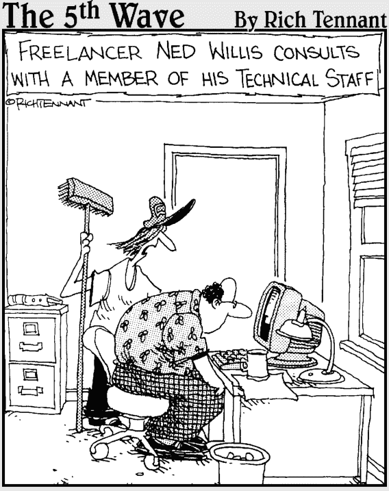

> “……这基本上就是将文档转换为 HTML 文件的全部内容。”

## 本部分概览

在本书的这一部分，我们将探索和解释基本的 HTML 文档链接和结构。我们还将解释 Web 浏览器在将所有这些内容传送到人们桌面上所扮演的关键角色。我们甚至解释了“(X)”的由来——即，使用 XML 语法重新设计了原始的 HTML 标记描述，以创建 XHTML——并继续帮助你理解是什么使 XHTML 与普通的 HTML 不同（并且根据一些人的说法，可能更好）。我们还将看看网页的解剖结构，并考察构成网页的各个部分和组件。

接下来，我们将带你练习创建和查看一个简单的网页，以便你可以理解自己动手做时涉及哪些内容。我们还将解释对现有网页进行更改以及将你的更改（或新页面）发布到网上所涉及的内容。

本部分以一个强有力的告诫结束：在开始大量标记之前，先弄清楚你在做什么。就像一栋精心建造的房子始于一套蓝图和建筑图纸一样，一个网页（和网站）也应该始于一个计划或地图，大致了解你的页面在赛博空间中的位置，以及大量用户如何能找到它们。

## 第 1 章：关于 HTML 和 Web 你需要知道的最少知识

### 本章内容

- 在文本文件中创建 HTML
- 提供和浏览网页
- 理解链接和 URL
- 理解基本 HTML 语法

欢迎来到 Web 和 HTML 的奇妙世界。只需掌握一点点知识，加上一些练习，以及一些想表达的内容，你就可以构建自己的一小片赛博空间，或者扩展现有的工作。

这本书是你组装第一个网页、美化现有网页，或创建融合了复杂设计、多媒体和脚本的激动人心的复杂页面的简明指南。

开始使用 HTML 的最佳方式是直接上手，因此本章正是如此：它将带你快速了解 HTML 在网页背后如何工作的基础知识，向你介绍 HTML 的构建块。当你完成本章的学习后，你将了解 HTML 的工作原理，从而可以立即开始创建网页。

### 网页的自然栖息地

网页可以包含多种类型的内容，例如文本、图形、表单、音视频文件以及交互式游戏。

## 10 第一部分：认识 (X)HTML

随便浏览一下网络，你就会看到以多种方式展示的丰富信息和内容。每个网站都是不同的，但大多数都有一个共同点：超文本标记语言（HTML）。

无论网页包含什么信息，每个网页都是用 HTML（或某种合理的模拟格式）创建的。HTML 是将网页粘合在一起的砂浆；而图形、内容和其他信息则是砖块。


生成网页的 HTML 文件只是文本文档。这就是 Web 能如此良好运作的原因。文本是计算机的通用语言。你在 Windows 计算机上创建的任何文本文件，包括 HTML 文件，在任何其他操作系统上都能同样良好地工作。

但网页`不仅仅是`文本文档。它们是用一种特殊的、缺乏注意但富含糖分的文本创建的，这种文本称为`HTML`。HTML 是你包含在文本文件中的一组指令，以及指向内容的指针，指定了你的页面应如何显示和运行。

请继续阅读，以发现你需要了解的所有关于 HTML 的细节！

### 超文本

HTML 中的特殊指令允许文本指向（`链接`）其他东西。这样的指针称为`超链接`。超链接是将万维网粘合在一起的胶水。在你的 Web 浏览器中，超链接通常显示为蓝色并带有下划线。当你点击一个超链接时，它会将你带到别处。

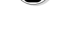

无论是否是超文本，网页就是一个文本文件。你可以在任何能创建纯文本的应用程序（如记事本）中创建和编辑网页。当你开始学习 HTML 时，文本编辑器是最好的工具。只需打开记事本，你就可以开始了。一些软件工具有花哨的选项和应用程序（在第 20 章介绍），可以帮助你创建网页，但它们生成的文本文件与你使用纯文本编辑器创建的是相同的。

万维网名副其实。它确实是由全世界 Web 服务器托管的页面组成的网络，以数百万种方式连接在一起。这些连接是通过将一个页面与另一个页面连接起来的超链接实现的。没有这样的链接，Web 就只是一堆独立的页面。

Web 的大部分价值来自于它能够链接到同一网站或另一个网站上的页面和其他资源（如图像、可下载文件和媒体演示）。例如，FirstGov（`www.firstgov.gov`）是一个`门户`网站——它的唯一功能是提供对其他网站的访问。如果你不确定哪个政府机构处理首次购房贷款，或者想知道如何安排国会大厦的参观，可以访问这个网站（如图 1-1 所示）来查找信息。

## 第一章：关于 HTML 与 Web 的基础知识

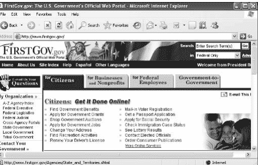

### 标记

Web 浏览器专门用于读取 HTML 指令（称为`标记`）并显示生成的网页。

标记存在于文本文件（包含你的内容）中，用于向浏览器发出指令。

例如，查看图 1-2 所示的页面。通过检查其底层 HTML，你可以了解页面的构成以及格式。

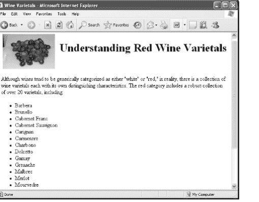

此页面包含一张图片、一个描述页面的标题、一段关于红酒的文本以及一个常见葡萄品种列表。

然而，页面的不同部分使用不同的格式：

- ✔ 页面顶部的标题比段落文本更大。
- ✔ 列表中的项目前有项目符号（大点）。

浏览器之所以知道如何以特定方式显示这些页面组件，要归功于代码清单 1-1 中所示的`HTML 标记`。

### 代码清单 1-1：示例 HTML 标记

```html
<!DOCTYPE html PUBLIC "-//W3C//DTD XHTML 1.0 Transitional//EN"
 "http://www.w3.org/TR/xhtml1/DTD/xhtml1-transitional.dtd">
<html xmlns="http://www.w3.org/1999/xhtml">
 <head>
 <title>Wine Varietals</title>
 </head>
 <body>
 <h1>
 Understanding Red Wine Varietals
 </h1>
 <p>Although wines tend to be generically categorized as
 either "white" or "red," in reality, there is a
 collection of wine varietals each with its own
 distinguishing characteristics. The red category
 includes a robust collection of over 20 varietals,
 including:
 </p>
 <ul>
 <li>Barbera</li>
 <li>Brunello</li>
 <li>Cabernet Franc</li>
 <li>Cabernet Sauvignon</li>
 <li>Carignan</li>
 <li>Carmenere</li>
 <li>Charbono</li>
 <li>Dolcetto</li>
 <li>Gamay</li>
 <li>Grenache</li>
 <li>Malbrec</li>
 <li>Merlot</li>
 <li>Mourvedre</li>
 <li>Nebbiolo</li>
 <li>Petite Sirah</li>
 <li>Pinot Noir</li>
 <li>Sangiovese</li>
 <li>Syrah</li>
 <li>Tempranillo</li>
 <li>Zinfandel</li>
 </ul>
</body>
</html>
```

任何包含在小于号和大于号（`< >`）之间的文本都是一个 HTML 标签（通常称为`标记`）。例如，括号中的`p`（`<p>...</p>`标签）将关于红酒品种的文本标识为一个段落；`li`（`<li>...</li>`标签）标记标识列表中的每个品种。真的就是这么简单。你将标记嵌入文本文件中，连同供读者查看的文本，以让浏览器知道如何显示你的网页。

标签以及标签之间和内部的内容统称为`元素`。

### 浏览器

用户在网络拼图中的部分是一个 Web 浏览器。Web 浏览器读取用 HTML 编写的指令，并使用这些指令在你的屏幕上显示网页的内容。

#### 众多浏览器

网络世界充满了各种形状和大小的浏览器——或者更确切地说，是各种版本和功能集。两个更受欢迎的浏览器是 Microsoft Internet Explorer 和 Netscape Navigator。其他浏览器，如 Mozilla Firefox 和 Opera，也被广泛使用。作为 HTML 开发者，你必须超越你自己的浏览器经验和偏好进行思考。每个用户都有他或她自己的浏览器偏好和设置。

每个浏览器渲染 HTML 的方式都略有不同。每个浏览器处理 JavaScript、多媒体、样式表和其他 HTML 附加组件的方式也不同。再加上不同的操作系统，事情就变得真正有趣了。

通常，浏览器之间的差异很小。但有时，HTML、文本和媒体的组合会让特定浏览器束手无策。

当你使用 HTML 时，你需要在尽可能多的不同浏览器上测试你的页面。在你自己的系统上安装至少三个不同的浏览器进行测试。我们推荐使用 Internet Explorer、Navigator 和 Opera 的最新版本。

Yahoo! 有一个相当完整的浏览器列表，位于：

`http://dir.yahoo.com/Computers_and_Internet/Software/Internet/World_Wide_Web/Browsers`

你编写 HTML 时应始终考虑到人们将使用 Web 浏览器查看内容。只需记住，那里不止一种浏览器，而且每种浏览器都有多个版本。

通常，Web 浏览器从 Web 服务器请求并显示通过互联网可用的网页。你也可以显示你保存在自己计算机上的 HTML 页面，然后才将其放在互联网上的 Web 服务器上。当你开发自己的 HTML 页面时，你可以在浏览器中查看这些页面（称为`本地`页面）。你可以使用本地页面来很好地了解人们在页面上线后看到的内容。

`每个 Web 浏览器都以其自己的方式解释 HTML。`相同的 HTML 在不同浏览器之间看起来并不完全相同。当你使用基本 HTML 时，差异并不显著，但当你整合其他元素（如脚本和多媒体）时，渲染标记可能会变得棘手。

第 2 章将介绍如何使用 Web 浏览器查看你的第一个网页的本地副本。

有些人使用纯文本 Web 浏览器，如 Lynx，因为他们：

- 他们视力受损，无法使用图形显示。
- 他们喜欢一个只显示文本的精简、快速的 Web 浏览器。

### Web 服务器

如果你不能与世界分享你的 HTML 页面，那么它们就没什么用。Web 服务器使这成为可能。`Web 服务器`是一台计算机，它：

- 连接到互联网
- 运行 Web 服务器软件
- 响应 Web 浏览器对网页的请求

几乎任何计算机都可以成为 Web 服务器，包括你的家用计算机。但 Web 服务器通常是专门用于此任务的计算机。你不需要成为互联网或计算机大师就可以发布你的网页，但你必须找到一个 Web 服务器来提供你的页面：

- 如果你正在为公司网站构建页面，你的 IT 部门可能有一个 Web 服务器。（向你的 IT 专家询问信息。）
- 如果你要创建一个新站点，你需要一个托管你页面的主机。

找到一个经济实惠的主机很容易。第 3 章将介绍如何确定你的托管需求并找到完美的提供商。

### URL 的组成部分

网络由数百万个资源组成，每个资源都可以链接。资源的准确位置是链接到它的关键。没有准确的地址（`统一资源定位符`，或 URL），你就不能直接在 Web 浏览器的地址栏中访问网页。

URL 是网络上资源的标准寻址系统。每个资源（网页、网站或单个文件）都有一个唯一的 URL。URL 的工作方式与你的邮政地址非常相似。图 1-3 标识了 URL 的组成部分。

#### 图 1-3：URL 的组成部分有助于定义文件在网上的确切位置

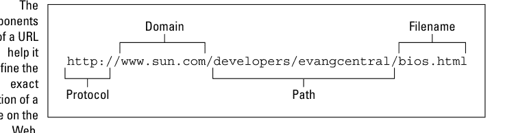

每个 URL 组成部分都有助于定义网页或资源的位置：

- **协议：** 指定浏览器请求文件所遵循的协议。网页协议是`http://`（大多数 URL 的通常开头）。
- **域名：** 指向文件所在的通用网站（例如`www.sun.com`）。一个域名可以托管几个文件（如个人网站）或数百万个文件（如公司网站，例如`www.sun.com`）。
- **路径：** 命名你必须导航以到达特定文件的文件夹序列。例如，要到达位于`developers`文件夹中的`evangcentral`文件夹中的文件，你需要使用路径`/developers/evangcentral/`。
- **文件名：** 指定浏览器访问目录路径中的哪个文件。

图 1-3 中显示的 URL 指向 Sun 域，并提供了一个路径，该路径通向一个名为`bios.html`的特定文件：`http://www.sun.com/developers/evangcentral/bios.html`

```text
http://www.sun.com/developers/evangcentral/bios.html
```

### 互联网协议简介

浏览器与服务器之间的交互是通过一组计算机通信指令实现的：超文本传输协议（HTTP）。该协议定义了浏览器应如何请求网页，以及 Web 服务器应如何响应这些请求。

HTTP 并非互联网上唯一运作的协议。简单邮件传输协议（SMTP）和邮局协议（POP）使电子邮件交换成为可能，而文件传输协议（FTP）则允许你在互联网上传输、下载、移动、复制和删除文件及文件夹。好消息是，Web 浏览器和服务器会替你完成所有 HTTP 工作，因此你只需将页面放到服务器上，或在浏览器中输入 Web 地址即可。


要了解 HTTP 的工作方式，请查看 Webmonkey 的文章《HTTP Transactions and You》：<http://hotwired.lycos.com/webmonkey/geektalk/97/06/index4a.html>

第 6 章详细介绍了你如何使用 HTML 和 URL 为网页添加超链接，第 3 章则展示了在你准备将网站迁移到 Web 服务器后，如何为自己的网站获取 URL。

### (X)HTML 的组成部分

以下部分将为你揭开 X 的神秘面纱。本节将介绍：

- HTML 与 XHTML 之间的区别
- HTML 的编写方式（其语法）
- 约束其使用的规则
- HTML（和 XHTML）标记中重要片段和部分的名称
- 如何最好、最正确地利用其功能

### HTML 与 XHTML：有何区别？

HTML 是超文本标记语言，是 20 世纪 80 年代末和 90 年代初开发的一种用于描述网页的表示法。HTML 现已在万维网联盟（W3C）的众多标准描述（规范）中得到确立。最后一版 HTML 规范于 1999 年定稿。

#### HTML 与 XHTML 规范

描述 HTML 和 XHTML 的正式文档位于 W3C 网站：<www.w3.org>。

标记语言通常包含版本号以识别自身。HTML 的当前版本是 4.01。它可追溯到 1997 年 12 月；你可以在 <www.w3.org/TR/html4> 找到该文档。

XHTML 经历了两个主要版本草案，即 1.0 和 1.1。1.1 版本比 1.0 更为先进，但大多数 Web 内容开发者和软件工具遵循 1.0 规范。XHTML 2.0 规范目前处于“工作草案”状态（其作者尚未最终确定其内容和结构）。当 W3C 规范完成时，它被称为 W3C 推荐标准。

你可以找到 XHTML 三个版本的规范：

- **XHTML 2.0 工作草案（7/4/2004）**  
  <www.w3.org/TR/2004/WD-xhtml2-20040722/>

- **XHTML 1.1 基于模块的 XHTML 推荐标准（5/31/2001）**  
  <www.w3.org/TR/xhtml11/>

- **XHTML 1.0 推荐标准（1/26/2000）**  
  <www.w3.org/TR/xhtml1/>

阅读 W3C 规范需要一定的学习，并且随着反复接触会有所提高。不要让这些文档的正式语言和符号吓倒你：一旦你理解了其中的门道，你就会欣赏其精确性和详细程度！但你也可能决定永远不去看这些规范——这完全取决于你！

HTML 4.01 规范是 HTML 的规则手册，正如 XHTML 1.0 规范之于 XHTML——每一部都精确地告诉你哪些元素可用、哪些属性与这些元素配套，以及你如何组合使用元素来创建列表、表单、表格和框架等页面结构。本书以 XHTML 1.0 规范为基础。

当你在 HTML 前面加上 X 得到 XHTML 时，你就获得了一个基于可扩展标记语言（XML）的全新改进版 HTML。XML 旨在与计算机、软件和互联网良好地协同工作。

HTML 的原始表述存在一些不规则之处，可能会给读取 HTML 文档的软件带来麻烦。另一方面，XHTML 采用了极其规则和可预测的语法，更易于软件处理。XHTML 终有一天会取代 HTML，但 HTML 仍在继续运转。本书涵盖两种变体，并向你展示如何在自己的 HTML 文档前面加上 X，将其转换为 XHTML 的步骤。

## 第一部分：认识 (X)HTML

- 大多数 HTML 和 XHTML 标记是相同的。
- 在少数情况下，HTML 和 XHTML 标记看起来略有不同。
- 在少数情况下，HTML 和 XHTML 标记必须以不同方式使用。

本书展示了如何创建在 HTML 和 XHTML 中都能正常工作的代码。

### (X)HTML 的类型

HTML 和 XHTML 规范使用以标准通用标记语言（SGML）——所有标记语言的鼻祖——编写的文档类型定义（DTD）来定义细节。

在其早期版本中，HTML 使用元素进行格式化；随着时间的推移，开发者意识到：

- 格式化需要自己的语言（现在称为层叠样式表，或 CSS）。
- HTML 元素应该只描述页面的结构。

这导致了三种 HTML 风格，它们同样适用于 XHTML。这些是 XHTML DTD：

- **XHTML 过渡型**：使用 HTML 的元素来描述字体样式和页面颜色。XHTML 过渡型涵盖了旧版 HTML 中的格式化元素。XHTML 过渡型中的格式化元素已被弃用（视为过时），因为 W3C 希望开发者远离它们，转而采用 XHTML 严格型和 CSS 的组合。本书使用 XHTML 过渡型 DTD 作为标记。

- **XHTML 严格型**：不包含任何描述格式的元素。此版本旨在让 CSS 主导页面格式化。

  CSS 与 XHTML 严格型相结合是一种雄心勃勃的网页构建方式，但在实践中它有利有弊。CSS 提供了对页面格式的更多控制，但创建在所有浏览器中都能正常工作的样式表可能很棘手。第 9 章更详细地介绍了样式表及其使用中的问题。

- **XHTML 框架集型**：包含框架，这是一种标记，允许你在同一浏览器窗口中同时显示多个网页或资源。框架在一些网站中仍有使用，但它们的流行程度已不如 20 世纪 90 年代末。我们的建议是，只有在你必须于单个浏览器窗口中同时显示来自多个 HTML 文档的信息时，才使用它们。

所有 Web 浏览器都支持 HTML 过渡型中的所有元素（如果使用适当的标签格式，也支持 XHTML 1.0 过渡型）；你可以选择使用其中的元素，或坚持使用 (X)HTML 严格型。如果你使用框架，从技术上讲你是在使用 (X)HTML 框架集型，但所有元素仍然以相同方式工作。

本书涵盖了所有版本中所有 (X)HTML 标签（将它们归为 (X)HTML 这一类别），因为所有真实世界的 Web 浏览器都支持这三种风格。

## 第 1 章：关于 HTML 和 Web 你必须知道的最低限度知识

### 语法和规则

HTML 是一种直接明了的语言，用于描述网页内容。XHTML 的要求甚至更低。它们的组件易于使用——当你知道如何使用一点点 (X)HTML 时。HTML 和 XHTML 标记都有三种类型的组件：

- **元素：** 使用标签来识别 HTML 页面的不同部分
- **属性：** 关于元素实例的信息
- **实体：** 非 ASCII 文本字符，如版权符号（©）和重音字母（É）

每一段描述网页内容的 HTML 和/或 XHTML 标记都包含元素、属性和实体的某种组合。


本章涵盖了元素、属性和实体的基本形式和语法。本书的第二部分和第三部分详细介绍了元素和属性如何：

- 描述文本种类（如段落或表格）
- 在页面上产生效果（如更改字体样式）
- 向页面添加图像和链接

### 元素

元素是 (X)HTML 的构建模块。你用它们来描述页面上每一段文字。元素由标签和这些标签内的内容组成。主要有两种类型的元素：

- 内容由标签对和位于该对中打开标签与关闭标签之间的任何内容组成的元素
- 使用单个标签向页面插入某些内容的元素

### 标签对

描述内容的元素使用标签对来标记元素的开始和结束。开始和结束标签对看起来像这样：

```html
<tag>...</tag>
```

内容——例如段落、标题、表格和列表——始终使用一对标签：

- ✓ 起始标签（`<tag>`）告诉浏览器：“元素从这里开始。”
- ✓ 结束标签（`</tag>`）告诉浏览器：“元素在这里结束。”

实际内容出现在起始标签和结束标签之间。例如，清单 1-1 中的红葡萄酒品种页面使用段落元素（`<p>`）来包裹段落的文本：

```html
<p>Although wines tend to be generically categorized as
    either "white" or "red," in reality, there is a
    collection of wine varietals each with its own
    distinguishing characteristics. The red category
    includes a robust collection of over 20 varietals,
    including:
</p>
```

### 单标签

在页面中插入内容的元素称为空元素（因为它们不包含任何内容），并且只使用单个标签，如下所示：

```html
<tag />
```

图像和换行会在 HTML 文件中插入内容，所以它们使用单个标签。

XHTML 和 HTML 之间的一个关键区别是，在 XHTML 中，所有空元素必须在结束的大于号之前以斜杠结尾。这是因为 XHTML 基于 XML，而 XML 的规则是空元素以斜杠闭合，如下所示：

```html
<tag/>
```

然而，为了使这种标记在旧版浏览器中可读，你必须在结束斜杠之前插入一个空格，如下所示：

```html
<tag />
```

这个空格允许旧版浏览器忽略结束斜杠（因为它们不了解 XHTML）。了解 XHTML 的新版浏览器会忽略这个空格，并按预期准确解释标签，即 `<tag/>`（根据 XML 规则）。

HTML 不要求空元素带有斜杠，但这种标记已被弃用。HTML 空元素如下所示：

```html
<tag>
```

清单 1-1 使用图像元素（``）在页面中包含一张图像：

```html

```

`` 元素引用一张图像。当浏览器显示页面时，它会用 `` 元素指向的文件替换该元素（它使用一个属性来执行指向，这将在下一节中展示）。遵循前面介绍的 XHTML 规则，在 HTML 中显示为 `` 的内容在 XHTML 中显示为 ``（这适用于所有单标签元素）。

你不能编造 HTML 或 XHTML 元素。(X)HTML 中合法的元素是一套非常具体的集合——如果你使用不属于 (X)HTML 集合的元素，每个浏览器都会忽略它们。你可以使用的元素在 HTML 4.01 或 XHTML 1.0 规范中定义。

### 嵌套

许多页面结构会组合嵌套元素。将你的嵌套元素想象成 neatly 相互嵌套的行李箱。

例如，项目符号列表使用两种元素：

- ✔ `<ul>` 元素指定该列表为无序（项目符号）列表。
- ✔ `<li>` 元素标记列表中的每个项目。

当你使用这种方法组合元素时，请确保在关闭外部元素之前完全关闭内部元素：

```html
<ul>
    <li>Barbera</li>
    <li>Brunello</li>
</ul>
```

#### 属性

属性允许元素在描述内容或工作方式方面具有多样性。属性让你根据不同情况以不同方式使用元素。例如，`` 元素使用 `src` 属性来指定你想在页面特定位置包含的图像的位置：

```html

```

在这小段 HTML 中，`` 元素本身是向浏览器发出的一个通用标志，表示你想包含一张图像；`src` 属性提供了关于你想包含的图像的具体信息——在这个实例中是 `red_grapes.jpg`。其他属性（如 `width`、`height`、`align` 和 `hspace`）提供了关于如何显示图像的信息，而 `alt` 属性提供了图像的文本替代，纯文本浏览器可以显示该替代文本。

第 7 章详细介绍了 `` 元素及其属性。

你将属性包含在想要使用它们的元素的起始标签内——在元素名称之后、结束符号之前，如下所示：

```html
<tag attribute="value" attribute="value">
```

XML 语法规则规定属性值必须始终用引号括起来，但你可以在任何顺序中在起始标签或单个标签内包含属性及其值。

每个 (X)HTML 元素都有一组可以与之一起使用的属性，你不能混合搭配属性和元素。有些属性可以接收任何文本作为值，因为该值可以是任何东西，比如图像的位置或你想链接到的页面。其他属性有属性可以采用的特定值列表，比如表格单元格中文本对齐的选项。

HTML 4.01 和 XHTML 1.0 规范精确定义了你可以将哪些属性用于任何给定元素，以及每个属性（如果明确定义）可以采用哪些值。

第二和第三部分中的每一章都介绍了你可以与每个 (X)HTML 元素一起使用的属性。此外，请参阅附录 A 了解已弃用 (X)HTML 标签和属性的完整列表。

### 实体

文本使 Web 成为可能，但它有局限性。实体是你可以在网上显示的特殊字符。

#### 非 ASCII 字符

基本美国信息交换标准代码（ASCII）文本定义了相当少数量的字符。它不包括一些特殊字符，例如商标符号、分数和带重音符号的字符。

例如，图 1-4 中的白葡萄酒品种列表包括两个带重音符号的 e 字符（é）和两个带变音符号的 u 字符（ü）。

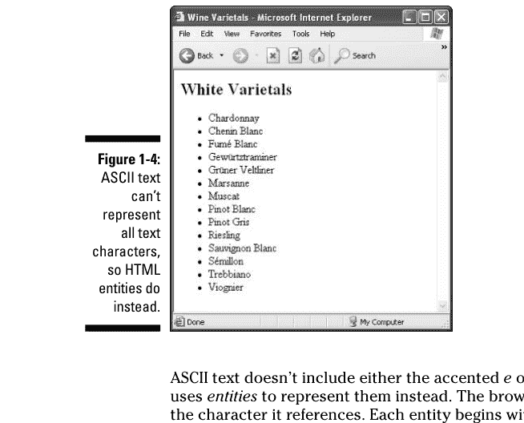

ASCII 文本既不包括带重音符号的 e，也不包括带变音符号的 u，所以 HTML 使用实体来表示它们。浏览器用实体引用的字符替换实体。每个实体以与号（&）开始，以分号（;）结束。以下标记以粗体显示实体：

```html
<html>
<head>
<title>Wine Varietals</title>
</head>

<body bgcolor="#FFFFFF">
  <h2>White Varietals</h2>
  <ul>
    <li> Chardonnay</li>
    <li>Chenin Blanc</li>
    <li>Fum**&eacute;** Blanc</li>
    <li>Gew**&uuml;**rztraminer</li>
    <li>Gr**&uuml;**ner Veltliner</li>
    <li>Marsanne</li>
    <li>Muscat</li>
    <li>Pinot Blanc</li>
    <li>Pinot Gris</li>
    <li>Reisling</li>
    <li>Sauvignon Blanc</li>
    <li>S**&eacute;**millon</li>
    <li>Trebbiano</li>
    <li>Viognie</li>
  </ul>
</body>
</html>
```

表示带锐音重音符号的 e 的实体是 `&eacute;`，表示带变音符号的 u 的实体是 `&uuml;`。

### (X)HTML 字符编码

ISO-Latin-1 字符集的编码默认提供，相关的实体（指向完整表格的指针出现在表 1-1 中）无需特殊操作即可调用和使用。但使用表 1-1 中提到的其他编码需要包含特殊标记，告诉浏览器必须准备好解释 Unicode 字符代码。（Unicode 是一项国际标准——实际上是 ISO 标准 10646——它包含足够的字符代码来处理大多数独特的字母表，以及大量其他符号和非字母字符。）这种特殊标记的形式为 `<meta http-equiv="Content-Type" content="text/html; charset=UTF-8">`；当 `charset` 的值更改为 UTF-8 时，你可以引用表 1-1 中显示的常见 Unicode 代码表。

**表 1-1 (X)HTML 字符编码的在线参考**

| 名称 | 网址 |
|---|---|
| Unicode 代码表 | <www.unicode.org/charts/> |
| ISO-Latin-1 字符集 | <www.htmlhelp.com/reference/charset/> |
| 希腊字符 | <www.unicode.org/charts/PDF/U0370.pdf> |
| 货币符号 | <www.unicode.org/charts/PDF/U20A0.pdf> |
| 杂项符号 | <www.unicode.org/charts/PDF/U2600.pdf> |
| 箭头字符 | <www.unicode.org/charts/PDF/U27F0.pdf> <www.unicode.org/charts/PDF/U2900.pdf> |
| 数学字符 | 在 <www.unicode.org/charts/> 搜索 `math`（有六个不同的相关代码表） |
| 通用标点符号 | <www.unicode.org/charts/PDF/U2000.pdf> |

### 标签字符

了解 HTML 的软件假定某些 HTML 字符，如大于号和小于号，应该隐藏起来，不应显示在完成的网页上。以下实体显示通常作为隐藏 HTML 标记一部分的字符：

- ✓ 小于号（<）：`&lt;`
- ✓ 大于号（>）：`&gt;`
- ✓ 与号（&）：`&amp;`

`<` 和 `>` 符号用于标记，但这些符号是给浏览器的指令，不会显示在页面上。如果你需要在网页上显示这些符号，请在标记中包含它们的实体，例如：

```html
<p>The paragraph element identifies some text as a paragraph:</p>
<p>&lt;p&gt;This is a paragraph.&lt;/p&gt;</p>
```

在上述标记中，第一行使用标签来描述一个段落，第二行展示了实体如何描述 `<` 和 `>` 符号。

图 1-5 在浏览器窗口中显示了这些实体字符。

**图 1-5：** 实体让 <、> 或 & 符号能在浏览器窗口中显示。

### 部分即部分：网页的构成

注释包含在 (X)HTML 文件中、不会在最终页面上显示的文本。每个注释由两组特殊的标记字符序列标识：

- 每个注释以字符串 `<!--` 开始。
- 每个注释以字符串 `-->` 结束。


在下面的代码中，注释解释了每个标记元素的功能及其在 HTML 标记层次结构中的位置。

元素被组织成一种结构：

- 某些元素只能出现在其他元素内部。
- 某些元素是构建结构良好的 (X)HTML 文档所必需的。

**26 第一部分：认识 (X)HTML**

```html
<html> <!-- This tag should always occur at or near the beginning of any well-formed HTML document -->
<head> <!-- The head element supplies information to label the whole HTML document -->
<title>Wine Varietals</title> <!-- The text in the title element appears in the title bar of the browser window when the page is viewed -->
</head> <!-- closes the head element -->
<body bgcolor="#FFFFFF"> <!-- The content that appears on any Web page appears or is invoked from inside the body element -->
<h2>White Varietals</h2> <!-- heading elements start with the letter h followed by a number from 1 to 6 to indicate hierarchy. This is a level 2 heading, h2. -->
<ul> <!-- This is an unordered list element, ul, which produces a bulleted list of list items, li -->
<li> Chardonnay</li> <!-- A whole bunch of individual list items -->
<li>Chenin Blanc</li>
<li>Fum&eacute; Blanc</li>
<li>Gew&uuml;rztraminer</li>
<li>Gr&uuml;ner Veltliner</li>
<li>Marsanne</li>
<li>Muscat</li>
<li>Pinot Blanc</li>
<li>Pinot Gris</li>
<li>Riesling</li>
<li>Sauvignon Blanc</li>
<li>S&eacute;millon</li>
<li>Trebbiano</li>
<li>Viognier</li>
</ul> <!-- End of the unordered/bulleted list -->
</body> <!-- End of the body section -->
</html> <!-- End of the HTML document -->
```

上述文档被分为 `head` 和 `body` 两部分。在每个部分内，都会出现特定类型的元素。多种组合方式都是可能的，这正是你在本书中看到的内容！

## 组织 HTML 文本

除了分为头部和主体部分外，HTML 文档中的文本还可以用多种方式进行组织。

### 文档头部

在 `head` 部分内，你可以定义除标题外的各种标签和信息，主要用于描述后续文档，例如使用的字符集、要调用的脚本和样式信息。主体部分是实际内容所在之处，也是大多数 (X)HTML 元素出现的地方。

# 第一章：关于 HTML 和 Web 的必备知识

### 文档标题

标题（使用 `h1` 到 `h6` 元素表示）与 HTML 文档头部（`head`）不同。单个标题用于组织其后的文本，而 `head` 则标识或描述整个文档。

在葡萄酒品种示例中，`h2` 元素为一个葡萄品种列表添加了标题。

### 段落及其他

当你想在网页上放置连续文本时，段落元素 `p`（包含 `<p>` 和 `</p>` 标签）会将文本分成段落。你还可以：

- 使用换行元素 `<br />` 来强制换行。
- 使用 `<hr />` 元素创建水平线（分隔线）。

HTML 还包含了各种在段落内强调或标识文本的方式；本书的第二部分和第三部分对此有展示。

### 列表

HTML 允许轻松定义无序列表或项目符号列表。也可以使用各种机制来创建其他类型的列表，包括编号列表。列表可以嵌套在列表中，以创建与你的列表需求尽可能多的层级结构（例如在概述复杂主题或建模包含多个标题层级的目录时）。第 5 章将更详细地介绍创建列表。

### 表格

HTML 包含用于定义表格的标记。第 11 章涵盖表格。结构是标记工作原理的一部分，因此在表格定义内，你可以：

- 区分列标题和表格数据。
- 管理行和列的布局。

### HTML 文档中的图像

向任何 HTML 文档添加图像都很简单。仔细且有计划地使用图像能极大地丰富网页。第 7 章展示了如何从文件中获取图像。第 9 章展示了如何使用复杂的标记来定位图像并让文本环绕图形流动。你还将了解如何选择和使用有趣且引人注目的图像，为你的网页增添趣味和信息。

## 链接和导航工具

网页的结构应该帮助访客在网页集合中导航、查找（并希望找到）感兴趣的项目，并快速轻松地到达他们最想去的地方。链接提供了将人们引入你网页的机制，因此第 6 章展示了如何：

- 引用外部项目或资源。
- 从一页跳转到下一页。
- 在页面内跳转。
- 为你的页面添加结构和组织。

> 当你想要呈现给访客的信息量增加时，结构和组织的重要性也随之增加。

导航工具（它为网站内部导航建立了标准机制和工具）提供了创建和向访客展示你的网页（和网站）结构的方法，以及让用户获取和使用组织化菜单选项的机制。

当你把一切加起来，你的成果应该是一组易于理解、使用和导航的、组织良好的信息和图像。

# 第二章

## 创建和查看网页

### 本章内容

- 规划你的网页。
- 编写一些 HTML。
- 保存你的页面。
- 离线和在线查看你的页面。

创建你自己的网页可能看起来有点令人生畏，但这绝对很有趣，我们的经验告诉我们，最好的开始方式就是立刻投入其中。你一开始可能会手忙脚乱，但只要不乱扑腾，你就能让头保持在水面之上。

本章将引导你完成创建网页的四个简单步骤。我们不会停下来解释你所用标记的每一个细微之处——我们将那些内容留到其他章节。相反，我们希望让你能够舒适地处理标记和内容，以创建和查看网页。

### 开始之前

创建 HTML 文档与在 Microsoft Word 等应用程序中创建文字处理文档不同，因为你需要使用两个应用程序：

- 你在文本或 HTML 编辑器中创建网页。
- 你在 Web 浏览器中查看结果。

尽管许多 HTML 编辑器（如 Dreamweaver 和 HTML-Kit）都提供了浏览器预览功能，但在实际的 Web 浏览器（如 Internet Explorer 和 Firefox）中预览你的网页仍然很重要，这样你才能像最终用户一样查看它们。在一个应用程序中编辑，然后切换到另一个应用程序查看你的作品，这有点麻烦，但你很快就能像专业人士一样在文本编辑器和浏览器之间来回切换（几乎是）毫无延迟。

有几个原因：

- 高级 HTML 编辑器（如 FrontPage 或 Dreamweaver）通常会将你的 HTML 代码隐藏起来。对于你的第一个页面，你想看到你的 HTML 代码以其（有限的）全部风采呈现出来。

  在你更熟悉 HTML 标记、语法和文档结构之后，可以平稳过渡到更高级的编辑器。

- 文字处理软件（如 Microsoft Word）通常在后台存储大量额外的文件信息（例如，用于显示或打印文件的格式化指令）。你看不到也改变不了这些额外信息，但它们会干扰你的 HTML。

### 从头开始创建页面

使用 HTML 从头开始创建网页涉及四个直接的步骤：

1. 规划你的页面设计。
2. 在文本编辑器中结合 HTML 和文本，将设计变为现实。
3. 保存你的页面。
4. 在 Web 浏览器中查看你的页面。

所以，拿出你的文本编辑器和 Web 浏览器，挽起袖子开始干吧。

#### 步骤 1：规划简单设计

我们发现，在开始工作前花几分钟规划页面的大致方法，会使页面创建过程变得更加容易。

#### 步骤 1：规划你的页面设计

在这一阶段，你不必创建复杂的图表或精细的图形展示。只需草记下一些关于*页面上放什么*以及*如何布局*的想法。

> 你甚至不必坐在桌前就能规划你的简单设计。拿上记事本和铅笔到户外，在阳光下设计，或者在午餐时在餐巾纸上涂画。记住，这本应是件有趣的事。

本章中的示例是我们对传统“Hello World”练习的一种演绎，这个练习在几乎所有现存编程语言中都有使用。也就是说，当你学习一门新编程语言时，首先要学的就是如何在屏幕上显示短语 `Hello World`。在我们的示例中，我们创建的是给世界的一封简短信件，因此页面内容更丰富，也为你提供了更多可供处理的文本。图 2-1 展示了本页面的基本设计。

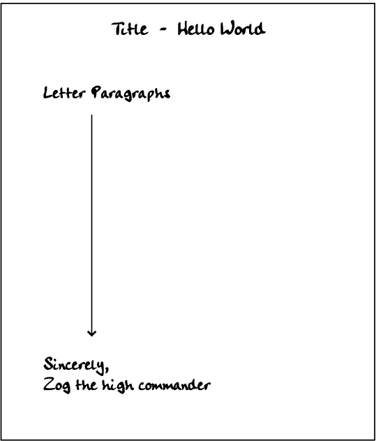

## 第一部分：了解 (X)HTML

页面的基本设计包含四个基本组成部分：

- 一个合适的标题：“Hello World”。
- 几段文字，解释页面作者计划如何帮助地球完成其每年的 Znufengerbs 配额。
- 一个结尾：“诚挚地”。
- 一个签名。

草记下你想在页面上使用的配色方案笔记。为了达到效果，我们决定示例页面应采用黑色背景和白色文字，标题应为“来自您未来的 Znufengerb 部长的问候”。

当你确定了页面上要放什么信息后，就可以进入步骤 2——编写标记语言了。

#### 步骤 2：编写一些 HTML

当你准备创建 HTML 时，有几种不同的选择。最终，你可能会结合使用以下几种方法：

- 如果你已有一些只想用 HTML 来描述的文本，将该文本保存为纯文本文件，并在周围添加 HTML 标记。
- 直接开始创建标记，并在过程中添加内容。

我们本章的示例从 Word 文档格式中的一些文本开始。我们将内容保存为文本文件，在文本编辑器中打开该文件，并在文本周围添加标记。

要将 Word 文件保存为文本文档，请选择“文件” > “另存为”。在出现的对话框中，从“保存类型”下拉列表中选择“纯文本 (*.txt)”。

图 2-2 展示了我们的草稿信件在转换为页面文本之前，在 Microsoft Word 中的外观。

**清单 2-1：完整的 Zog 信件 HTML 页面**

```html
<!DOCTYPE html PUBLIC "-//W3C//DTD XHTML 1.0 Transitional//EN"
    "http://www.w3.org/TR/xhtml1/DTD/xhtml1-transitional.dtd">
<html xmlns="http://www.w3.org/1999/xhtml">

<head>
    <title>Greetings From Your Future Znufengerb Minister</title>
</head>
<body bgcolor="black" text="white">

<h1>Hello World</h1>

<p>It has come to our attention that Earth has fallen well short of producing its yearly quota of Znufengerbs. To help you improve your production and establish a plentiful Znufengerb colony, I, Zog, the Minister of Agriculture of Grustland, will be arriving on your planet within the week along with my herd experts to take command of your Znufengerb enterprise.</p>

<p>Do not fear, I have the highest expectations for a smooth transition from your current production of the creatures you call cows to our beloved Znufengerbs. The future of the galaxy hinges on Earth's ability to meet its Znufengerb quota, and I will do all in my power to make you the most productive source of Znufengerbs in the universe.</p>

<p>I have studied your history extensively and feel that I am the best candidate for the position of Znufengerb Minister. I look forward to placing a Znufengerb in every home to bring you joy.</p>

<p>Sincerely,<br />
Zog, Minister of Agriculture</p>

</body>
</html>
```

完整的 HTML 页面如清单 2-1 所示。

HTML 标记包含一系列描述信件内容的标记元素和属性：

- `<html>` 元素将文档定义为 HTML 文档。
- `<head>` 元素为文档创建头部区域。
- `<title>` 元素定义一个显示在浏览器标题栏中的文档标题。
  - `<title>` 元素位于 `<head>` 元素*内部*。
- `<body>` 元素包含在浏览器窗口中显示的文本。
  - `bgcolor` 和 `text` 属性与 `<body>` 元素配合使用。这些属性将背景颜色设置为黑色，文本颜色设置为白色。（这些属性已弃用，但使用起来非常简单。第 8 章和第 9 章将展示如何使用 CSS 实现相同效果，这是推荐的方法。）
- `<h1>` 元素将 `Hello World` 文本标记为一级标题。

## 第一部分：了解 (X)HTML


图 2-2：以文字处理形式呈现的、作为我们页面文本的信件。

- `<p>` 元素标识文档中的每个段落。
- `<br />` 元素在“Sincerely”后添加手动换行。

无需担心所有这些元素具体如何工作的细节。它们在第 4 章和第 5 章中有详细介绍。

在你创建一个完整的 HTML 页面（或你想要检查的第一部分）后，必须先保存它，然后才能在浏览器中查看你的作品。

#### 步骤 3：保存你的页面

你使用文本编辑器创建 HTML 文档，并用网页浏览器查看它们，但在让浏览器加载你的 HTML 页面之前，你必须先保存该页面。在构建页面时，应将其副本保存到本地硬盘，并在本地用浏览器查看。

##### 为文件选择位置和名称

将文件保存到硬盘时，请记住以下几点：

- 你需要能够再次找到它。

  在硬盘上创建一个专门用于存放网页的文件夹。将其命名为“Web Pages”或“HTML”（或任何对你有意义的名称），并确保将其放在易于找到的位置。

- 文件名应该对你有意义，这样你无需打开文件就能识别其内容。
- 文件名在网页浏览器中应能良好运行。

  不要在文件名中使用空格。某些操作系统——最著名的是 Unix 和 Linux（目前最流行的网页托管操作系统）——不容忍文件名中的空格。

在我们的示例中，我们将文件保存在名为“Web Pages”的文件夹中，并将其命名为（鼓点声，请注意）`zog_letter.html`，如图 2-3 所示。

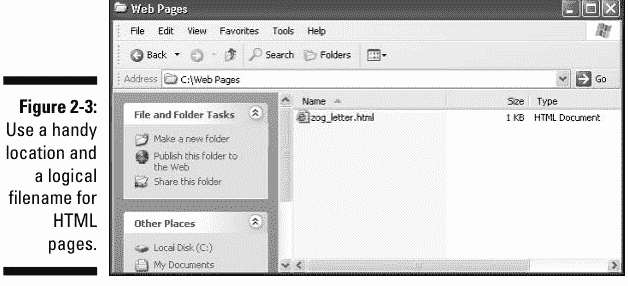

##### `.htm` 还是 `.html`

实际上，你可以为页面选择两种后缀之一：`.html` 或 `.htm`。（我们的示例文件名 `zog_letter.html` 使用了 `.html` 后缀。）

较短的 `.htm` 是 8.3 DOS 时代的遗留物，当时的文件名只能有八个字符，后面跟着一个描述文件类型的三字符后缀。如今，操作系统可以支持长文件名和超过三个字母长的后缀，因此我们建议你坚持使用 `.html`。

## 第一部分：了解 (X)HTML

Web 服务器和 Web 浏览器对 `.htm` 和 `.html` 的处理同样良好。

> 坚持使用一种文件名选项。浏览器和服务器对 `.html` 和 `.htm` 文件的处理方式相同，但它们是不同的后缀，因此会创建不同的文件名。（`zog_letter.html` 与 `zog_letter.htm` 是不同的。）这在你创建超链接时（第 6 章涵盖）很重要。

#### 步骤 4：查看你的页面

保存页面副本后，你就可以在网页浏览器中查看它了。按照以下步骤在 Internet Explorer 中查看你的网页。（如果你使用不同的浏览器，步骤可能有所不同。）

1. 如果你尚未打开浏览器，请现在打开。
2. 选择 `文件 > 打开`，然后单击“浏览”按钮。
3. 导航你的文件系统，直到找到你的 HTML 文件，然后选择它，使其出现在“文件名”区域。

图 2-4 显示了一个高亮显示的 HTML 文件，准备被打开。

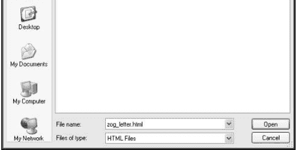

图 2-4：使用 Internet Explorer 导航到你的网页。

4. 单击“打开”按钮，然后单击“确定”。

页面以其全部风采显示在你的网页浏览器中，如图 2-5 所示。

# 第 2 章：创建和查看网页

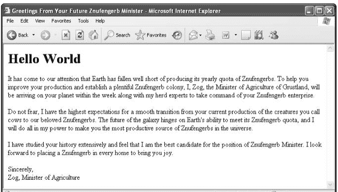

图 2-5：在网页浏览器中查看本地文件。


你实际上还无法在 Web 上查看这个文件；你只是在查看保存在本地硬盘上的副本。你还不能把这个文件的 URL 发给任何人，但你可以编辑并查看你所做的更改。

### 编辑现有网页

你第一次用浏览器查看页面后，很可能会想对页面做至少一处修改。毕竟，你在创建标记时是看不到页面最终效果的，你可能会觉得一级标题太大，或者真的想要紫色文字配绿色背景。

要对已在文本编辑器中创建好并正在浏览器中查看的网页进行修改，请重复以下步骤，直到你对页面的最终外观满意为止：

1. 保持显示 HTML 页面的浏览器窗口处于打开状态，然后返回文本编辑器。
2. 如果 HTML 页面没有在文本编辑器中打开，请将其打开。

你应该在浏览器和文本编辑器中打开同一个文件，如图 2-6 所示。

3. 在文本编辑器中对 HTML 及其内容进行修改。
4. 保存更改。

这是非常重要的一步。如果你不保存更改，就无法在网页浏览器中看到它们。

5. 返回网页浏览器并点击刷新按钮。

> 如果你工作时让 HTML 文件同时在文本编辑器和浏览器中保持打开状态，检查更改将会非常轻松。你可以快速在编辑器中保存更改，切换到浏览器刷新，再切换回编辑器做更多修改，再切换回浏览器刷新，如此反复。

在我们这封信的例子中，在 HTML 页面的初稿完成后，我们决定应该在信中添加一个日期。图 2-7 展示了我们对 HTML 所做的添加日期的修改，以及在网页浏览器中显示的相应结果。

> 这种编辑 HTML 页面的方法仅适用于保存在本地硬盘上的页面。如果你想编辑已经存储在 Web 服务器上的页面，你必须先将页面副本保存到本地硬盘，进行编辑，验证更改，然后再次将文件上传到服务器，具体内容见下一节。

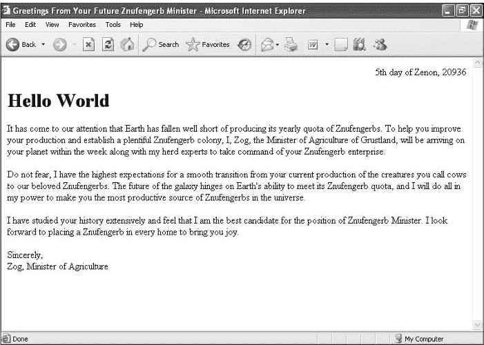

图 2-7：HTML 中的更改在快速保存和刷新后显示在浏览器中。

### 将页面发布到网上

当你对网页满意后，就该把它放到网上了。第 3 章将详细讨论将页面发布到网上所需做的工作，但简而言之，只需以下几个快速步骤：

1. 找到一个网页托管提供商来存放你的网页。

你的网页主机可能是公司 Web 服务器，也可能是你向互联网服务提供商（ISP）付费购买的空间。如果你还没有主机，请向你使用的互联网接入 ISP 再确认一下——了解你的接入服务是否包含一些 Web 服务器空间。无论在哪里找到空间，都要向提供商获取有关将站点文件移动到何处以及你的 URL 将是什么的详细信息。

2. 使用 FTP 客户端或网页浏览器连接到你的 Web 服务器。

使用托管提供商提供信息中的用户名和密码，在 Web 服务器上打开一个 FTP 会话。

3. 将 HTML 文件从本地硬盘复制到 Web 服务器。
4. 使用网页浏览器通过互联网查看该文件。

# 第一部分：认识 (X)HTML

例如，要将我们的信在线托管到`ftp.io.com/~natanya`，我们使用 Internet Explorer 访问该站点并提供相应的用户名和密码，这些可以从你的 ISP 处获得。随后出现了一系列文件夹和文件。

我们通过简单的拖放操作，从 Windows Explorer 将文件复制到 Internet Explorer。

该页面的 URL 是`http://www.io.com/~natanya/zog_letter.html`，现在该页面由 Web 浏览器提供，而不是来自本地文件系统，如图 2-8 所示。

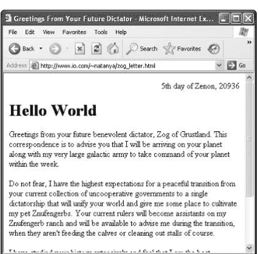

第 3 章详细介绍了如何将你的网页发布给全世界。

# 第 3 章

## 合理规划避免页面性能不佳

**本章内容**

- 规划你的网页
- 定义你的网站层次结构
- 创建用户友好的导航
- 托管你的站点
- 上传和编辑你的网站

站点的整体设计就是你的*用户界面*（UI）。当你设计良好的 UI 时，你就为用户提供了能够以最少麻烦浏览站点的工具。本章概述了 HTML 的标准网站设计原则。这些原则可以确保 UI 的可用性和有效性。

UI 是让用户访问你网站上信息的机制。每个 UI 都是独特的，但它们都由相同的组件组成（*文本*、*图形*和*媒体文件*），并且都由 HTML 将它们组合在一起。

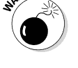

如果网站存在以下情况，访问者可能不会再次访问：

- 难以导航
- 充斥着闪烁的文字和杂乱的色彩
- 无助于人们找到他们想要的内容

如果你做到以下几点，就说明你创建了一个稳固的 UI：

- 你站点的导航是直观的。
- 图像和媒体能够点缀你的设计，而不会喧宾夺主。
- 你尽你所能帮助人们找到他们想要的信息。

本章将带你了解设计网站和基本网页的简单步骤。（其他章节会详细解释标记的每个细节。）

### 规划你的站点

为站点创建有效 UI 的重要第一步与标记无关，但与规划息息相关。在站点变得太大之前（或者如果你还没有开始，在构建站点之前），仔细确定站点的确切目的和目标。当你了解了站点的范围和目标后，你就能更好地创建能够体现它们的界面。

在设计站点之前，问问自己这些问题：

- 你为什么要创建这个站点？
- 你想向用户传达什么？
- 你的目标受众是谁？例如：
  - 用户的平均年龄是多少？
  - 你的受众使用互联网的能力如何？
- 你的站点需要多少页面？
- 你将使用什么类型的层次结构来组织页面？例如，你可以让用户线性浏览站点，也可以让他们在各个主题之间跳转。

#### 设计很重要

本章推荐的是良好的设计原则，但配色方案和整体外观风格的选择权在你。一个人觉得好看的东西，另一个人可能觉得难看。

如果你是为自己的企业建站，该站点可能会为潜在客户或合作伙伴留下第一印象。站点应该反映你的商业风格。例如，如果你经营一家建筑公司，强烈的线条和简洁的外观可能是展示公司形象的最佳方式。如果你经营一家花店，你的站点可能更加有机和装饰性（好吧，花团锦簇），让访客想起如果他们走进你的商店会看到什么。

如果你是网页设计或图形设计的新手，并且需要一个标志你的企业在 Web 上存在的站点，可以考虑寻求专业网页设计师的帮助。使用他们创建的图像、布局和导航辅助工具来自己构建和管理站点。一旦确立，站点独特且一致的外观和风格就很容易维护。

无论谁设计你的站点，都要花时间向同行、朋友、家人以及任何愿意诚实评价站点好坏的人征求反馈。来自认识和尊重你的人的负面但建设性的批评，胜过你试图争取业务的人的一句“哎呀，真难看”。

## 第 3 章：妥善规划避免页面性能不佳

如果你能回答这些问题，你就能更好地理解网站的目标和需求。例如，一个在线商店可能有以下目标：

- 让访客浏览在线目录并将商品加入购物车。
- 为访客提供在线购买购物车中商品的方式。
- 帮助用户做出明智的购买决策。
- 简化商品的退货和换货流程。
- 向用户征求反馈，了解他们希望在目录中看到哪些产品，或如何让网站变得更好。

这份简短的目标清单也表明了你的网站可能包含的领域以及网站需要支持的活动。

除了只有一个领域（如产品目录）之外，你的网站可能还需要一些专业领域，例如：

- 在线目录和购物车
- 购买指南或其他能帮助用户做出更好购买决策的信息
- 帮助与反馈板块
- 一套加快退货和换货流程的工具

当你确立网站的目标后，你就能确定最适合网站的元素，例如：

- 一个导航系统，用于标识网站的主要区域，帮助用户：
  - 快速识别自己所在的部分
  - 在网站的不同部分之间顺畅切换而不会迷路
- 一套标准设计元素，如按钮、页面标题样式和颜色规范，让用户在同一网站的不同页面之间移动时保持方向感
- 目录中商品的标准展示方式，包括与产品相关的信息，如产品图片和描述、价格和库存信息
- 设计良好的表单，帮助用户在目录中查找产品、购买购物车中的商品、申请退款或帮助退货，以及向网站提交意见
- 长文本页面，提供关于购买选项、产品退货和其他有用信息的详尽内容——但仍易于阅读和导航

## 第一部分：了解 (X)HTML


你网站的目标应该决定你网站的：

- UI 元素
  - 当你向现有网站添加内容时，确定以下 UI 元素：
    - 满足网站新板块的目标
    - 与网站整体 UI 设计相协调
- 设计
- 组织架构

### 规划你的网站

如果你知道如何到达，就更容易到达目的地。规划网站地图可能是规划——以及后续运营——网站的关键步骤。这个过程涉及两个创意阶段：

- 在纸上或以电子方式创建视觉指南，用以指导网站的开发
- 在网站上创建视觉指南，帮助访客找到方向

两者在良好的 UI 设计中都有其一席之地，因此各有一个专门的章节。

### 将地图用于网站开发

当你在网站开发过程中使用网站地图时——即使是只有几个页面的网站——你可以确定：

- 你需要构建的页面
- 页面之间的相互关系
- 你需要的导航元素


作为额外收获，地图为你提供了一份页面*清单*。

例如，图 3-1 展示了 Citrixxperience 网站（`www.citrixxperience.com/map.htm`）视觉地图的一部分。

这张地图显示该网站有多个主要板块。其中三个板块——首页、模拟考试和学习资料——各自又进一步细分为子板块。每个子页面列出与该特定子板块相关的信息和链接。

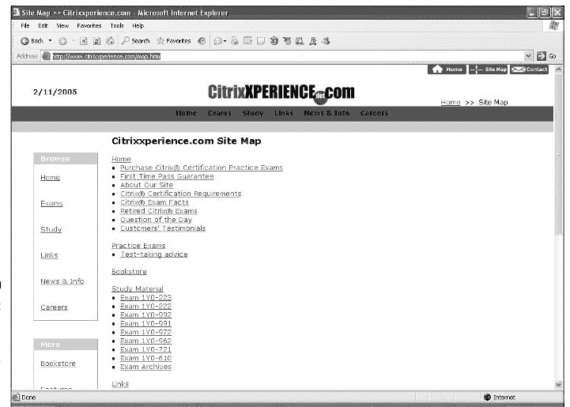

**图 3-1：** Citrixxperience 网站的网站地图。

### 逐块构建网站

如果你计划一次构建网站的一个页面或一个板块，你可以先创建最终网站的地图，然后决定首先构建哪些页面最为合理。当你对网站将如何扩展有了清晰的工作思路后，你就可以在每个阶段进行规划。例如，假设你为公司的网站创建了一个网站地图，而网站需要一个常见问题解答板块。如果该板块在网站上线时还未完成，灾难未必会发生——前提是有人提前规划以适应新板块，并将这种能力构建到网站中。上线时只需省略指向该板块的链接即可。

当书籍示例板块准备好后，你可以：

- 将该板块添加到网站中。
- 向主要导航元素添加链接。

如果你知道资源即将到来，你可以创建一个导航方案，在书籍示例板块准备好添加时能够轻松容纳它。然而，如果没有网站地图和网站的完整规划，整合新板块可能会耗费大量时间和精力。

**警告！** 不要创建*建设中*的板块，其中除了暗示某天会出现某些内容外几乎没有任何东西。如果你的网站只是暗示信息而实际上并不提供，用户会感到失望。相反，可以考虑在首页的一小块区域突出显示“即将推出”的项目，让访客知道稍后会有新信息。

### 将地图用作用户的视觉指南

网站地图可以作为一种补充导航工具，为用户找到所需内容提供另一种方式。网站地图展示了你网站的所有内容，让访客能够一次性看到所有选项。

人们寻找信息有多种方式。尽可能（在合理范围内）为访客提供多种浏览网站的选项：

- 有些人喜欢被引导。
- 有些人喜欢四处翻找。
- 有些人喜欢看到所有可能的选项然后选择一个。

**警告！** *网站地图随着网站的增长而增长。* 如果你的网站规模庞大且结构复杂，你的地图可能需要多个屏幕才能显示。当你浏览网页时，像`Microsoft.com`、`HP.com`和`Amazon.com`这样的大型网站不提供网站地图，因为它们的网站地图会过于庞大且难以操作。但较小的网站（如`Symantec.com`）则有效地使用了网站地图。

你必须决定网站地图是否适合你网站的导航工具。在做出这个决定时，可以考虑以下几点：

- 如果你只有少量页面，网站地图可能是*不必要*的。
- 网站地图可能是*最佳*选择，如果：
  - 你的网站有多个板块。
  - 你想不出其他访问内容的方式。

### 构建可靠的导航

网站上使用的导航可以成就或毁掉一个网站。如果访客在你的网站上找不到他们要找的内容，他们很可能会离开并且永远不会回来。你网站上使用的导航类型取决于：

- **网站的页面数量**

  如果你只有少量页面，你的导航可能只是首页上的一组简单链接，帮助用户跳转到每个页面。

#### 你如何组织页面

如果你的网站有很多页面，组织成不同的板块，你的首页可能只链接到这些板块（而不是每个页面）。

例如，Dummies.com 网站收录了大量页面，组织成各种板块；在任何导航方案中链接所有页面都是不现实的。此外，该网站包含各种主题的文章以及图书信息。网站可以按图书和文章来组织，但访客更可能寻找特定主题的信息，因此网站按主题组织。首页如图 3-2 所示，在左侧突出显示了这些不同的主题区域。

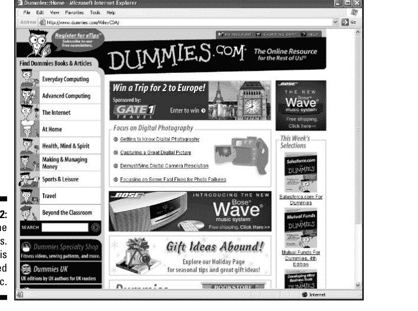

当你点击其中一个主题区域时，其余的主题区域会显示在页面顶部的导航栏中（如图 3-3 所示）。你不必返回首页就能在不同主题之间跳转。

图 3-3 显示每个主题都有自己的子导航区域（在左侧，呼应首页的布局），列出了该主题下的子主题。链接各不相同，但整个网站的导航方案保持一致。这告诉访客他们在网站中移动时可以期待什么。

# 第一部分：了解 (X)HTML

每个页面的顶部导航区域都包含一组常规链接，这些链接会出现在网站的每个页面上，以帮助访客快速访问重要区域，如：网站搜索、帮助、账户信息和购物车。每个页面都有一组相同的链接，指向 For Dummies 网站上的信息、注册电子提示的表单、如何联系出版商、网站版权声明以及网站隐私政策。与购物车和帮助链接一样，这些链接也必须出现在每个页面上，但无需突出显示。将它们添加到一致的网站页脚中，既能保持访客可访问性，又不会掩盖任何给定主题或子主题的关键内容。

如果你创建了一个网站地图来辅助网站开发，它还可以帮助你选择为网站创建何种类型的导航工具。依次考虑地图上的每个页面；列出每个页面必须包含的链接。通常，一种模式会浮现，帮助你识别网站所需的主要导航工具（如链接到所有主要主题区域和版权信息，就像 For Dummies 网站那样），以及子导航工具（如主题页面上链接到子主题的链接）。

在了解你需要哪些工具之后，你就可以开始为你的用户界面设计视觉方案了。你想在顶部使用按钮，在侧边使用按钮，还是两者兼用？你是否需要一个链接到版权或隐私信息的页脚？

如果你的网站有层层嵌套的板块，如何才能最好地帮助人们在其中导航？回答类似这样的问题，是建立一个稳固导航系统的途径，它能帮助用户在你的网站中找到方向——让他们专注于来的目的，而不是如何到达那里。

无论你设计何种导航方案，都要始终为访客提供一种方法，让他们无论身处网站何处都能返回你的主页。你的网站主页是通往网站其余部分的门户。如果访客迷路了或想重新开始，确保他们能毫不费力地回到起点。

在设计好网站的导航方案并搭建了几个页面后，找一个不熟悉你网站的人来尝试使用它。为了帮助他们测试，给他们列出一个包含三四个任务的列表，比如需要访问的页面或填写的表单。如果你的测试访客迷路了，或者对如何导航网站有很多疑问，你就应该重新设计你的方案。你的审查者可能还会就如何使导航功能更清晰、更易用提出建议。你可能对自己的网站和内容*过于熟悉*，以至于无法发现初次用户可能立即发现的导航空白。

### 规划外部链接

没有超链接，网络就不成其为网络——毕竟，超链接将你的网站与网络其余部分连接起来，并将一组页面变成一个有凝聚力的网站。但是，过度使用或滥用链接会损害你的网站，甚至可能让你失去一些业务。

#### 明智地选择站外链接

与外部链接相比，内部链接几乎像在公园散步一样轻松——毕竟，当你链接到自己网站上的页面时，这些链接指向的页面*受你控制*。你知道它们今天上面有什么，明天会有什么，甚至明天是否还存在。然而，当你链接到其他网站上的资源时，一切都无法保证了：

- 你并不维护那些页面。
- 你无法修改它们的内容。
- 你当然也不知道它们何时会消失。

你的访客也不会知道——直到他们碰到一个`404 File or directory not found`消息（这通常是*死链*的标志，现已指向无效地址）。404 消息中的文本因托管网站的服务器而异。

# 第一部分：了解 (X)HTML

当外部链接稳定且不易失效时，它们会更有用。我们建议遵循以下准则：

- **链接到网站的一个部分，而不是该网站上的特定页面。**

  页面会来来去去，但总体结构通常保持不变。

- **链接到公司网站。**

  公司网站比个人维护的网站更具持久性。

- **不要直接链接到媒体文件，如 PDF 和图像。**

  如果你想链接到另一个网站上的资源，请链接到包含该资源的网页，而不是实际的媒体文件。网站经常更新资源并为其赋予新名称。然而，链接到资源的网页几乎总是会被更新以反映新名称。因此，链接到网页是更安全的选择。

链接到其他网站*意味着你对这些网站的支持或认可*。当访客从你的网站通过链接访问其他网站时，他们假定你认可那个新网站。这就使得几条准则变得必要：

- **如果你不想与另一个网站上的内容产生关联，就不要链接到该网站。**

  确定你是否认可一个看似相关的网站的唯一方法是，在链接之前亲自访问并查看它。

- **定期审查你的链接。** 确保：
  - 网站所有者未变。
  - 内容仍然合适。

  当域名过期时，新所有者可能会接管并发布新的内容，这些内容可能：

  - 完全不相关
  - 有损你的形象，例如色情内容

#### 精心制作有用的链接文本

你与链接关联的文本与你网站上使用的链接本身一样重要。该文本给用户一个提示，告诉他们链接会将他们带往何处，以便他们决定是否要前往。例如，`访问 Dummies.com 阅读更多关于本书的内容`**比**`阅读更多关于本书的内容`**更有帮助**。

第一个示例告诉访客，他们将离开当前网站，访问 Dummies.com 并在那里阅读更多关于一本书的信息。第二个示例只是告诉他们要阅读更多关于这本书的内容——他们可能会惊讶地发现自己被从一个网站甩到了另一个网站。

通常，当你创建链接文本时，让用户了解以下信息：

- 他们是否正在离开你的网站
- 他们链接到的页面包含何种信息
- 链接的网站与当前内容或页面有何关联

你的链接文本的目标应该是告知用户并建立他们的信任。如果你的链接文本没有给他们提供关于链接内容的可靠线索，他们就不会信任你的链接——也就不会点击它们。

> 避免在你创建的任何链接中使用“点击此处”。如果你的链接文本制作精良，你就不需要额外的词语来提示用户点击链接。链接文本本身就应该说明一切。

### 托管你的网站

将你的页面上线的第一步（也是最重要的一步）是在网络上找到一个地方来展示它们——一个托管服务。一般来说，托管页面有两种选择：

- 自己托管。


- 付费请他人托管。

在 Web 行业中，单词 `host` 被用来表示一台设置好以存放网页（及相关文件）的 Web 服务器，以便世界其他地方可以访问它们。本章将 `host` 既用作：

- **名词：** 存放网页的物理机器
- **动词：** 提供网页服务的行为

你需要决定是自己托管页面，还是付费请他人为你托管。本章展示了两种托管方法——并为你提供了每种方法的详细信息。你可以决定哪种选择最适合你。

**52 第一部分：了解 (X)HTML**

> 你并非要终生坚守你的托管决定。如果你发现自己托管页面力不从心，你可以将文件转移到服务提供商（反之亦然）。为了决定哪种托管选择最适合你，请考虑你未来一年的需求，但计划在几个月后重新评估你的需求。

## 托管你自己的网站

本节以一个中等规模的网站（大约100个页面）为例进行说明，该网站不包含超过几个多媒体文件，也没有任何特殊的安全或电子商务（e-commerce）应用。

如果你需要运行一个复杂的网站，例如大型企业网站或在线商店，你需要比本节概述的更多的专业知识、设备和软件。以下资源可以提供帮助：

- 像 `E-Commerce For Dummies` 和 `Webmastering For Dummies`，第2版（均由 Wiley Publishing 出版）这样的书籍可以帮助你入门，建立电子商务和其他复杂网站。
- 咨询一位拥有构建和维护复杂网站实践经验的 Web 专业人士。

你可以设置自己的 Web 服务器并自己托管你的网页。为此，你需要：

- **一台指定为 Web 服务器的计算机：** Web 服务器通常专用于此任务，将文字处理和其他活动留给另一台计算机。
- **Web 服务器软件：** 常见的 Web 服务器软件包包括 Apache 和 Microsoft 的 Internet Information Server (`IIS`)，在 Windows 2000 及更高版本中称为 Internet Information Services。

在 Web 世界中，术语 `Web 服务器` 指的是：

- 一台专用计算机（实际硬件）
- Web 服务器软件

两者缺一不可。

- **专用互联网连接：** 如果你的 Web 服务器只在你启动拨号连接时才连接到互联网，那么它既不实用也不可靠。

如果自己托管网站听起来有点复杂和昂贵，你是对的。你不仅需要为设备和专用互联网连接付费，还必须知道如何设置和管理 Web 服务器，并让所有部分全天候（24/7）正常运行。请考虑使用托管服务提供商。

# 第三章：周密规划防止网页性能低下

## 使用托管服务提供商

托管服务提供商管理着从硬件到软件再到互联网连接的网络托管技术层面。你只需管理自己的 HTML 页面即可。在网络发展初期，托管服务提供商的选择寥寥无几，而且当时可用的服务价格昂贵。时代变迁，需求增长，如今价格合理的托管服务提供商比比皆是。

如果你决定让别人托管你的页面，那么在付费方面你有两个选择：

- **零费用：** 一些服务实际上会免费托管你的页面。没错，你只需支付零元、零成本就能将页面发布到网络上。那么代价是什么呢？你必须以其他方式付费，通常是在你的页面上附加广告。
- **付费服务：** 然而，大多数网络托管服务会收取一定的费用，从每月几美元到三位数不等。要充分利用托管资金的诀窍在于，找到最合适的托管服务来满足你的网站需求。

在 Webmonkey 的文章《十美元以下的网络托管》中了解更多关于低成本网络托管选项的信息。

```text
http://webmonkey.wired.com/webmonkey/02/01/index4a.html?tw=design
```

## 获取你自己的域名

`域名` 是任何给定网站的顶级地址。域名的示例包括 `microsoft.com`、`apple.com`、`w3c.org` 和 `dummies.com`。

你可能想要一个能反映你企业名称（甚至你的个性）的自己的域名（因此拥有自己的域）。如果你没有自己的域名，你的页面将成为别人域名的一部分——通常是你的托管服务提供商的域名。例如，一个托管在 `io.com` 上但没有域名的个人网站，其顶级 URL 是：

```text
http://www.io.com/~lanw
```

而拥有 `lanw.com` 域名的同一个网站，则托管在：

```text
http://www.lanw.com
```

其中一个比另一个更容易记。这是拥有自己域名的充分理由吗？也许是……也许不是。关键在于，企业或其他希望保持持续网络存在的实体，或许应该投资注册一个域名；而爱好者或业余人士则不需要。

任何好的托管服务提供商都能提供详细说明，告诉你如何在其系统中注册域名，或如何将你的域名附加到其计算机上的网站。如果你从一个提供商更换到另一个，新的提供商应该帮助你转移域名。大多数提供商要么预先提供这些信息，要么提供在线帮助来指导你完成操作。如果设置域名的方法不是立即明了，请寻求帮助。如果你得不到帮助，那就更换提供商。

## 将文件移动到你的 Web 服务器

在你确定了网站托管服务或决定搭建自己的 Web 服务器后，你需要一种方法将你本地计算机上创建的 HTML 页面移动到 Web 服务器上。这也不是一次性的活动。当你维护网站时，需要将在本地计算机上构建的文件移动到 Web 服务器，以刷新你的站点。

如何将文件移动到你的 Web 服务器，完全取决于你的 Web 服务器是如何设置的。通常，你有几种传输选项：

- 文件传输协议（`FTP`）
- 由你的托管服务提供商提供的用于移动和管理文件的 Web 界面

## UI 设计资源

如果你想创建出色的用户界面，我们推荐以下网站和关于网站及界面设计的书籍：

- 要快速学习网络设计基础知识，请阅读 Webmonkey 的“设计基础”，网址为 `http://hotwired.lycos.com/webmonkey/html/97/05/index2a.html`。
- Webmonkey 的“网站重设计教程”为重新设计网站所需的工作提供了有趣的视角。请在 `http://hotwired.lycos.com/webmonkey/design/site_building/tutorials/tutorial4.html` 阅读。
- Jakob Nielsen 致力于创建可访问的网络内容。他的网站 `http://useit.com` 充满了关于创建可访问网站的资源和文章。
- 嘿，反面例子也很有用。《Web Pages That Suck》通过评估糟糕的设计来引导你走向好的设计。确保你的网站看起来不像 `www.webpagesthat suck.com` 上展示的任何一个。
- 由 Lisa Lopuck（Wiley）所著的《Web Design For Dummies》，是朝着打造一个既精致又外观惊艳的网站迈出的又一步。
- 由 Richard Mander 和 Bud Smith（Wiley）所著的《Web Usability For Dummies》，可以帮助你微调网站，使其变得惊人地易于使用，这对吸引访客再次回访大有帮助。

### 通过 FTP

在这两种选项中，`FTP` 几乎总是可行的。`FTP` 是互联网上传输文件的标准，任何托管服务提供商都应该为你提供对 Web 服务器的 `FTP` 访问权限。当你与托管服务提供商设置网站时，提供商通常会为你提供书面文档（纸质或在线），明确说明如何将文件传输到你的 Web 服务器。这些信息中包含一个通常采用 `ftp://ftp.domain.com` 格式的 `FTP URL`。

你可以使用 FTP 客户端（如 WS_FTP（`www.ipswitch.com/Products/WS_FTP/`）或 CuteFTP（`www.globalscape.com/products/cuteftp/index.asp`））来连接此 URL。你的提供商将提供一个用户名和密码，用于访问 FTP 站点上的 Web 服务器目录。然后，你可以使用客户端的界面将文件移动到你的网站。就这么简单。如果你想从网站获取文件的副本并进行修改，只需：

1. 使用 FTP 客户端的界面下载副本。
2. 进行修改。
3. 使用 FTP 客户端的界面上传文件。

每个 FTP 客户端的界面都不同，但它们都相当直观易用。第20章包含更多关于寻找优质 FTP 客户端的信息；因此，当你找到一个时，请花几分钟时间阅读其文档。

你可能不需要单独的 FTP 客户端来将文件移动到 Web 服务器：

- 大多数较新的网络浏览器，如当前版本的 Internet Explorer 和 Netscape 6，都内置了一些 FTP 功能。你可以轻松地上传和下载文件。（你可能无法创建或删除目录。）
- 许多网络实用程序，如 Dreamweaver，都具有文件管理功能。

### 通过你的托管服务提供商网站

为了方便使用和减少技术支持电话，许多网络托管服务提供商建立了网页，帮助你无需使用单独的 FTP 实用程序甚至 HTML 编辑器内的 FTP 工具，就能上传和管理网站文件。这些工具大多允许你以各种方式管理网站，例如：

- 上传和下载文件
- 创建和删除目录
- 移动文件
- 删除文件

如果你已经有托管服务提供商，请查明它是否提供一组基于 Web 的工具来管理你的网站。

在选择提供商时，请记住以下几点：

- 在开始传输文件之前，请阅读提供商的文档。每个提供商的界面都不同。
- 大多数提供 Web 界面的提供商不会阻止你使用 FTP 来管理你的网站。

如果提供商的界面很笨重，或者你更喜欢 FTP，就使用 FTP。

# 第二部分

## 使用 (X)HTML 格式化网页

*The 5th Wave* 作者：Rich Tennant

“好吧，我想我忘了提这个，但我们现在有一个网站管理功能，当水族馆网站上出现断链时，它会自动提醒我们。”

### 本部分内容……

在本书的这一部分，我们将描述使网页既实用又吸引人的标记和文档结构。首先，我们检查宏观的 HTML 文档结构，包括文档头和文档体，以及如何将各个部分正确组合在一起。之后，我们讨论如何组织文本块和列表。接着，我们解释 HTML 中链接的工作原理，以及它如何像胶水一样将整个万维网粘合在一起。最后，我们还会解释如何为你的页面添加图形。因此，我们将涵盖构建结构良好、比例协调的网页的基本构建块——这并非巧合。

# 第 4 章

## 创建（X）HTML 文档结构

**本章内容**

- 创建基本的（X）HTML 文档结构
- 定义（X）HTML 文档头
- 创建完整的（X）HTML 文档

一个简单的（X）HTML 文档框架由头部和主体构成。*头部*向浏览器提供关于文档的信息，而*主体*包含在浏览器窗口中显示的信息。创建（X）HTML 文档的第一步是定义该文档的框架。

本章涵盖用于设置基本（X）HTML 文档结构的主要元素——包括文档的头部和主体。我们还将向你展示如何告诉浏览器你正在使用哪个版本的 HTML 或 XHTML。虽然版本信息对于用户来说并非必需，但浏览器会利用它来确保为你的用户正确显示文档内容。

### 建立文档结构

虽然没有两个（X）HTML 页面是完全相同的——每个页面都采用独特的内容和元素组合来定义页面——但每个正确构建的（X）HTML 页面都需要相同的基本文档结构，包括：

- 一个声明文档为（X）HTML 文档的语句
- 一个文档头
- 一个文档主体

每次创建（X）HTML 文档时，都从这三个元素开始；然后你可以填入其余的内容和标记来创建一个独立的页面。

虽然基本文档结构是每个（X）HTML 文档的必需部分，但反复创建它可能会有点单调。大多数（X）HTML 编辑工具在你打开新文档时，会自动为你设置基本文档结构。

### 标记你的（X）HTML 文档

在你的（X）HTML 文档顶部应该是文档类型声明，或 `DOCTYPE` 声明。这行代码指定了你使用的 HTML 或 XHTML 版本，这反过来让浏览器知道如何解释文档。我们在本章中使用 XHTML 1.0 规范，因为它是最新的规范，并且是大多数浏览器和编辑工具所使用的。

#### 添加 HTML DOCTYPE 声明

如果你选择创建一个 HTML 4.01 文档而不是 XHTML 文档，你可以从三个可能的 DOCTYPE 声明中选择：

- HTML 4.01 Transitional：这是 HTML 4.01 最具包容性的版本，它包含了所有 HTML 结构元素以及所有表现元素。

```html
<!DOCTYPE HTML PUBLIC "-//W3C//DTD HTML 4.01 Transitional//EN"
  "http://www.w3.org/TR/html4/loose.dtd">
```

- HTML 4.01 Strict：这个 HTML 的精简版本排除了所有表现相关的元素，转而使用样式表作为驱动显示的机制。

```html
<!DOCTYPE HTML PUBLIC "-//W3C//DTD HTML 4.01//EN"
  "http://www.w3.org/TR/html4/strict.dtd">
```

- HTML 4.01 Frameset：这个版本从 HTML 4.01 Transitional 开始，并包含了使框架成为可能的所有元素。

```html
<!DOCTYPE HTML PUBLIC "-//W3C//DTD HTML 4.01 Frameset//EN"
  "http://www.w3.org/TR/html4/frameset.dtd">
```

#### 添加 XHTML DOCTYPE 声明

要创建一个 XHTML 文档，请使用以下 `DOCTYPE` 声明之一：

- XHTML 1.0 Transitional
- XHTML 1.0 Strict
- XHTML 1.0 Frameset

```html
<!DOCTYPE html PUBLIC "-//W3C//DTD XHTML 1.0 Transitional//EN"
"http://www.w3.org/TR/xhtml1/DTD/xhtml1-transitional.dtd">

<!DOCTYPE html PUBLIC "-//W3C//DTD XHTML 1.0 Strict//EN"
"http://www.w3.org/TR/xhtml1/DTD/xhtml1-strict.dtd">

<!DOCTYPE html PUBLIC "-//W3C//DTD XHTML 1.0 Frameset//EN"
"http://www.w3.org/TR/xhtml1/DTD/xhtml1-frameset.dtd">
```

XHTML DTD 描述与 HTML DTD 描述类似，并在第1章中定义。

#### `<html>` 元素

在你指定了文档遵循的（X）HTML 版本之后，添加一个 `<html>` 元素来容纳页面中的所有其他（X）HTML 元素：

```html
<!DOCTYPE html PUBLIC "-//W3C//DTD XHTML 1.0 Transitional//EN"
"http://www.w3.org/TR/xhtml1/DTD/xhtml1-transitional.dtd">
<html>

</html>
```

#### 添加 XHTML 命名空间

*命名空间*是 XML 文档中元素和属性使用的名称集合。XHTML 使用 XHTML 名称集合，因此需要一个命名空间，其形式如下：

```html
<!DOCTYPE html PUBLIC "-//W3C//DTD XHTML 1.0 Transitional//EN"
"http://www.w3.org/TR/xhtml1/DTD/xhtml1-transitional.dtd">
<html xmlns="http://www.w3.org/1999/xhtml">

</html>
```

不要纠结于命名空间的含义。如果你使用其他 XML 词汇表，你需要了解命名空间。对于简单的 XHTML 文档，你只需要知道包含 XHTML 命名空间。所以，当然，前面的代码片段正是向你展示如何做到这一点！

### 添加文档头

（X）HTML 文档的头部是文档的两个主要组件之一。（文档主体是另一个主要组件。）头部或页眉提供关于文档的基本信息，包括其标题和元数据（关于信息的信息），例如关键词、作者信息和描述。如果你打算在页面中使用样式表，你需要在头部包含该样式表的信息。

第8章包含了创建级联样式表（CSS）的完整概述，并向你展示如何在（X）HTML 文档中包含它们。

定义页面头部的 `<head>` 元素紧随 `<html>` 开始标签之后：

```html
<!DOCTYPE html PUBLIC "-//W3C//DTD XHTML 1.0 Transitional//EN"
    "http://www.w3.org/TR/xhtml1/DTD/xhtml1-transitional.dtd">

<html xmlns="http://www.w3.org/1999/xhtml">
<head>

</head>
</html>
```

#### 为页面添加标题

每个（X）HTML 页面都需要一个描述性的标题，告诉访客这个页面是关于什么的。这个标题出现在浏览器窗口最顶部的标题栏中，如图4-1所示。页面标题应该简洁而信息丰富。（例如，*我的主页*就远不如*Ed 的 IT 咨询服务*信息量丰富。）

你通过在 `<head>` 元素内部使用 `<title>` 元素来定义页面的标题：

```html
<!DOCTYPE html PUBLIC "-//W3C//DTD XHTML 1.0 Transitional//EN"
    "http://www.w3.org/TR/xhtml1/DTD/xhtml1-transitional.dtd">
<html xmlns="http://www.w3.org/1999/xhtml">
<head>
    <title>Ed's IT Consulting Service</title>
</head>
</html>
```

搜索引擎在根据查询列出网页时会使用 `<title>` 栏的内容。你的页面标题可能是网络冲浪者阅读关于你的网页的第一样东西，特别是如果她是通过搜索引擎找到它的话。搜索引擎很可能会在搜索结果页面上将你的页面标题与许多其他标题一起列出，这意味着你只有一次机会来吸引网络冲浪者的注意力并说服她选择你的页面。一个精心制作的标题可以做到这一点。

标题也用于书签和浏览器的历史记录中；因此，保持你的标题简短而精炼。

#### 定义元数据

术语*元数据*指的是关于数据的数据；在网络上下文中，它意味着描述你网页上数据的数据。你的页面的元数据可能包括：

- 关键词
- 页面描述
- 关于页面作者的信息
- 你用于创建页面的软件应用程序

### 元素和属性


你可以通过以下方式为你的（X）HTML 页面定义每一块元数据：

- `<meta />` 元素
- `name` 和 `content` 属性

例如，以下元素为一个咨询服务页面创建关键词列表和描述：

```html
<!DOCTYPE html PUBLIC "-//W3C//DTD XHTML 1.0 Transitional//EN"
        "http://www.w3.org/TR/xhtml1/DTD/xhtml1-transitional.dtd">

<html xmlns="http://www.w3.org/1999/xhtml">
  <head>
    <title>Ed's IT Consulting Service</title>
    <meta name="keywords" content="IT consulting, MCSE, networking guru" />
    <meta name="description" content="An overview of Ed's skills and services" />
  </head>
</html>
```

#### 自定义名称

（X）HTML 规范并不：

- 预定义你可以在页面中包含的元数据类型
- 指定如何为不同的元数据（如关键词和描述）命名

因此，例如，你可以不使用 `keywords` 和 `description` 作为关键词和描述元数据的名称，而同样可以使用 `kwrd` 和 `desc`，如以下标记所示：

```html
<!DOCTYPE html PUBLIC "-//W3C//DTD XHTML 1.0 Transitional//EN"
        "http://www.w3.org/TR/xhtml1/DTD/xhtml1-transitional.dtd">

<html xmlns="http://www.w3.org/1999/xhtml">
  <head>
    <title>Ed's IT Consulting Service</title>
    <meta name="kwrd" content="IT consulting, MCSE, networking guru" />
    <meta name="desc" content="An overview of Ed's skills and services" />
  </head>
</html>
```

如果你可以为 `<meta>` 元素的 `name` 和 `content` 属性使用任何旧值，那么系统如何知道如何处理你的元数据？答案是——它们不知道。每个搜索引擎的工作方式都不同。虽然 `keywords` 和 `description` 是常用的元数据名称，但许多搜索引擎可能无法识别或使用你包含的其他元数据元素。

## 第四章：创建（X）HTML 文档结构

许多开发者使用元数据来：

- 为其他可能查看页面源代码的人留下信息
- 为未来使用该元数据的浏览器和搜索引擎做准备

虽然关键词和页面描述是可选的，但搜索引擎通常会使用它们来收集关于你网站的信息。如果你希望搜索引擎机器人能够发现你的网站，请务必在 `<meta />` 标签中包含详细而简洁的信息。

### 自动将用户重定向到另一个页面

你可以在头部使用元数据向 Web 浏览器发送关于如何显示或处理你的网页的消息。Web 构建者通常以这种方式使用 `<meta />` 元素，将页面访问者从一个页面自动重定向到另一个页面。例如，如果你曾经遇到过一个页面，上面写着 `此页面已移至新地址。请等待 10 秒，您将自动跳转到新位置。`（或类似的内容），那么你就见证了这个技巧的应用。

要使用 `<meta />` 元素向浏览器发送消息，你需要遵循以下一般步骤：

1. 使用 `http-equiv` 属性代替 `name` 属性。
2. 从预定义的值列表中选择，这些值代表给浏览器的指令。

这些值基于你也可以通过 HTTP 头发送给浏览器的指令，但更改文档的 HTTP 头比将指令嵌入到网页本身更难。

要指示浏览器将用户从一个页面重定向到另一个页面，你需要特别执行以下操作：

1. 使用带有 `http-equiv="refresh"` 的 `<meta />` 元素。
2. 调整 `content` 的值，以指定刷新发生前需要多少秒以及你想要跳转到哪个 URL。

例如，以下标记中加粗显示的行创建了一个刷新，在 15 秒后跳转到 `www.w3.org`：

```html
<!DOCTYPE html PUBLIC "-//W3C//DTD XHTML 1.0 Transitional//EN"
    "http://www.w3.org/TR/xhtml1/DTD/xhtml1-transitional.dtd">

<html xmlns="http://www.w3.org/1999/xhtml">
  <head>
    <title>All About Markup</title>
    <meta http-equiv="refresh" content="15; url= http://www.w3.org/" />
  </head>

  <body>
    <p>This page is still in development. Until we are done, please visit
      the <a href="http://www.w3.org">W3C Website</a> for the definitive
      collection of markup-related resources.
    </p>

    <p>Please wait 10 seconds to be automatically redirected to the W3C.</p>
  </body>
</html>
```

较旧的 Web 浏览器可能不知道如何处理使用 `http-equiv` 元素创建重定向页面的 `<meta />` 元素。请务必在你的页面上包含一些文本和链接，以便在你的 `<meta />` 元素未能成功完成任务时，访问者可以手动链接到你的重定向页面。

如果用户的浏览器不知道如何处理你的重定向信息，用户只需点击页面正文中的链接即可转到新页面，如图 4-2 所示。

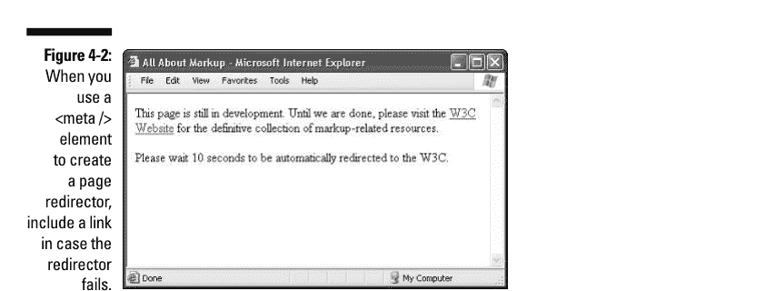

你可以将 `http-equiv` 属性与 `<meta />` 元素一起用于各种其他目的，例如设置页面的过期日期和指定页面使用的字符集（语言）。要了解你的 `http-equiv` 选项有哪些（以及如何使用它们），请查看以下 URL 上的 HTML META 标签字典：

```text
http://vancouver-webpages.com/META/metatags.detail.html
```

### 创建（X）HTML 文档主体

在设置好页面标题、创建标题并定义一些元数据之后，你就可以创建将在浏览器窗口中显示的（X）HTML 标记和内容了。`<body>` 元素包含你的文档内容。

> **记住**
>
> 如果你想在浏览器窗口中看到某些内容，请将其放在 `<body>` 元素中，如下所示：

```html
<!DOCTYPE html PUBLIC "-//W3C//DTD XHTML 1.0 Transitional//EN"
  "http://www.w3.org/TR/xhtml1/DTD/xhtml1-transitional.dtd">
<html xmlns="http://www.w3.org/1999/xhtml">
  <head>
    <title>Ed's IT Consulting Service</title>
    <meta name="kwrd" content="IT consulting, MCSE, networking guru" />
    <meta name="desc" content="An overview of Ed's skills and services" />
  </head>
  <body>
    <p>Ed's IT Consulting Service Homepage</p>
    <p>Ed has over 20 years of IT consulting experience and is available
      to help you with any IT need you might have. From network design
      and configuration to technical documentation and training, you can
      count on Ed to help you create and manage your IT infrastructure.</p>
    <p>For more information please contact Ed by e-mail at ed@itguru.com or
      by phone at 555.555.5555.</p>
  </body>
</html>
```

图 4-3 显示了浏览器如何显示此完整的（X）HTML 页面：

- `<title>` 元素的内容位于窗口的标题栏中。
- `<meta />` 元素完全不影响页面外观。
- 只有 `<p>` 元素（在 `<body>` 元素中）包含的段落文本才会实际显示在浏览器窗口中。

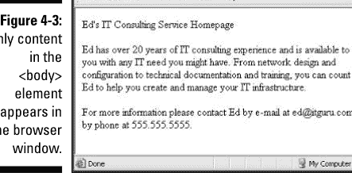

### 精彩杂项

表 4-1 列出了其他你可能会在 HTML 文件中找到的用于文档结构标记的（X）HTML 属性。

| 名称 | 功能/值等于 | 值类型 | 相关元素 |
|---|---|---|---|
| `profile` | 链接到属性定义 | URI | `<head>` |
| `scheme` | 描述如何解码数据 | CDATA | `<meta />` |

# 第五章：文本与列表

## 本章内容

- 使用基本的文本块
- 操作文本块
- 创建项目符号列表、编号列表和定义列表

HTML 文档由文本、图像、多媒体文件、链接和其他内容片段组成，你通过使用标记元素和属性将它们组合到一个页面中。你使用文本块来创建诸如标题、段落和列表之类的文档元素。创建一个可靠的 HTML 文档的第一步是奠定坚实的基础，以确立文档的结构。

### 文本格式化

这是一个超技术性的 `文本块` 定义：在 HTML 元素内从一行换行到另一行的某段内容。

你的 HTML 页面是文本块的庞大集合：

- 你网页上的每一点内容都必须是某个块元素的一部分。
- 每个块元素都位于页面的 `<body>` 元素内。

HTML 识别几种可以在文档中使用的文本块，包括（但不限于）：

- 段落
- 标题
- 块引用
- 列表
- 表格
- 表单

### 内联元素与文本块

内联元素和文本块之间的区别很重要。本章中描述的 HTML 元素描述的是文本块。`内联元素` 是块元素**内部**的一个单词或一串单词（例如，文本强调元素如 `<em>` 或 `<strong>`）。内联元素必须嵌套在块元素内；否则，你的 HTML 文档在语法上就是不正确的。

内联元素，如链接和格式化元素，旨在从这些块内找到的几个单词或几行内容链接或改变其外观。

### 段落

段落在网页中的使用比任何其他类型的文本块都更频繁。

HTML 浏览器无法识别你在编辑器中创建页面时输入的硬回车。你必须使用 `<p>` 元素来告诉浏览器将包含的文本块作为段落分隔开。

### 格式化

要创建段落，请遵循以下步骤：

1. 在文档主体中添加 `<p>`。
2. 输入段落的内容。
3. 添加 `</p>` 来关闭该段落。

其形式如下所示：

```html
<!DOCTYPE html PUBLIC "-//W3C//DTD XHTML 1.0 Transitional//EN"
        "http://www.w3.org/TR/xhtml1/DTD/xhtml1-transitional.dtd">
<html xmlns="http://www.w3.org/1999/xhtml">
  <head>
    <meta http-equiv="Content-Type" content="text/html; charset=ISO-8859-1" />
    <title>All About Blocks</title>
  </head>

  <body>
    <p>This is a paragraph. It's a very simple structure that you will use
       time and again in your Web pages.</p>
    <p>This is another paragraph. What could be simpler to create?</p>
  </body>
</html>
```

此 HTML 页面包含两个段落，每个段落都用单独的 `<p>` 元素标记。大多数 Web 浏览器会在页面上的每个段落之后添加一个换行和整行空格，如图 5-1 所示。

**第 5 章：文本与列表** 71

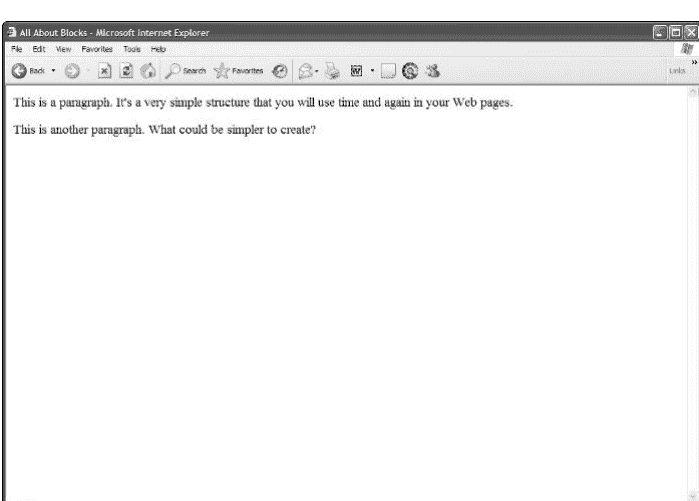

**图 5-1：** Web 浏览器通过换行来区分段落。

警告！有些人在创建段落时不使用闭合标签 `</p>`。尽管某些浏览器对此睁一只眼闭一只眼，但省略闭合标签会导致：

- 不符合正确的语法
- 引发样式表问题
- 可能导致页面在不同浏览器中显示不一致

你可以使用层叠样式表（CSS）来控制段落的格式（颜色、样式、大小和对齐方式），相关内容我们将在第 8 章和第 9 章中介绍。

### 对齐方式

默认情况下，段落左对齐。你可以使用 `align` 属性，并将其值设为 `center`、`right` 或 `justify`，来覆盖默认设置并控制任意段落的对齐方式。

```html
<p align="center">This paragraph is centered.</p>
<p align="right">This paragraph is right-justified.</p>
<p align="justify">This paragraph is double-justified.</p>
```

图 5-2 展示了 Web 浏览器如何根据 `align` 属性的值来对齐每个段落。

# 第二部分：使用（X）HTML 格式化网页

`align` 属性已被弃用（视为过时），推荐使用 CSS（参见第 8 章）。

### 标题

标题将文档划分为多个部分。本书使用标题和副标题将每一章分成多个节，你也可以用同样的方式来组织网页。标题可以：

- 创建组织结构
- 打破页面的视觉单调
- 提供视觉线索，帮助读者理解内容的归属关系

HTML 提供了六个元素，用于在文档中定义六种不同的标题级别：

- `<h1>` 是最突出的标题（一级标题）
- `<h6>` 是最不突出的标题（六级标题）

> 使用 HTML 标题级别时，请遵循从高到低的顺序。也就是说，在使用二级标题之前要先使用一级标题，在使用三级标题之前要先使用二级，依此类推。如果你想改变标题在浏览器中的显示方式，第 8 章和第 9 章将介绍如何使用样式表。

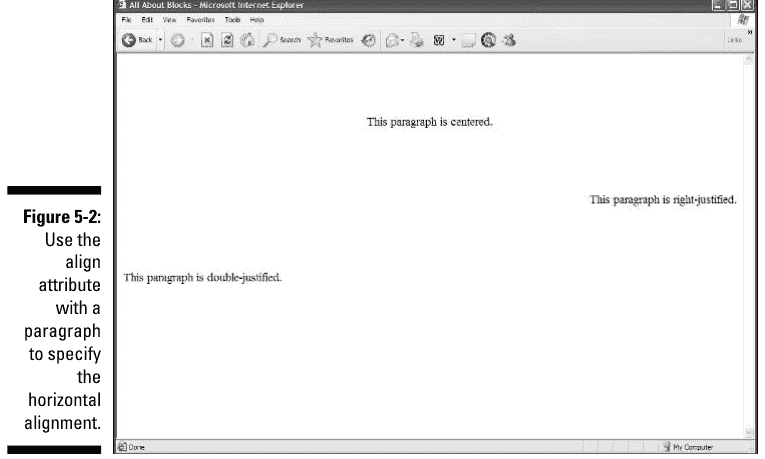

# 第 5 章：文本与列表

## 格式化

创建标题的步骤如下：

1. 在文档的主体部分添加 `<hn>`。
2. 输入标题的内容。
3. 添加 `</hn>`。

### 浏览器显示

每个浏览器显示标题级别的方式各不相同，我们将在接下来的两节中介绍。

#### 图形浏览器

大多数图形浏览器使用独特的字号和字体来显示标题：

- 一级标题（`<h1>`）最大（通常比段落默认文本大两到三个字号）。
- 六级标题（`<h6>`）最小，可能比默认段落文本小两到三个字号。

以下 HTML 标记片段展示了六种标题的实际应用：

```html
<!DOCTYPE html PUBLIC "-//W3C//DTD XHTML 1.0 Transitional//EN"
        "http://www.w3.org/TR/xhtml1/DTD/xhtml1-transitional.dtd">
<html xmlns="http://www.w3.org/1999/xhtml">
  <head>
    <meta http-equiv="Content-Type" content="text/html; charset=ISO-8859-1" />
    <title>All About Blocks</title>
  </head>

  <body>
    <h1>First-level heading</h1>
    <h2>Second-level heading</h2>
    <h3>Third-level heading</h3>
    <h4>Fourth-level heading</h4>
    <h5>Fifth-level heading</h5>
    <h6>Sixth-level heading</h6>
  </body>
</html>
```

图 5-3 展示了该 HTML 页面在浏览器中的渲染效果。

你可以使用 CSS 来设置标题的颜色、大小、行高和对齐方式等格式。


默认情况下，大多数浏览器对所有标题都使用 Times New Roman 字体。随着标题级别的增加，字号会逐渐减小。（一级到六级标题的默认大小分别为 24、18、14、12、10 和 8。）你可以使用 CSS 来覆盖这些默认格式。

# 第二部分：使用（X）HTML 格式化网页


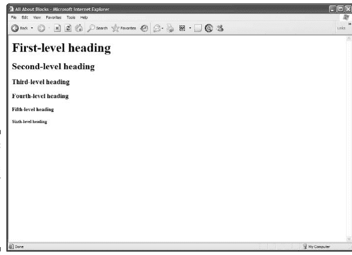

## 纯文本浏览器

纯文本浏览器使用与图形浏览器不同的标题显示约定，因为纯文本浏览器只能使用单一字号和字体来显示所有内容。

### 控制文本块

文本块是页面的基础。你可以对这些块进行拆分，以更好地引导读者阅读你的内容。

### 块引用

块引用是指在页面中单独列出的一段较长的引文或摘自印刷来源的摘录。你使用`<blockquote>`元素来标识块引用：

```html
<!DOCTYPE html PUBLIC "-//W3C//DTD XHTML 1.0 Transitional//EN"
    "http://www.w3.org/TR/xhtml1/DTD/xhtml1-transitional.dtd">
<html xmlns="http://www.w3.org/1999/xhtml">
<head>
    <meta http-equiv="Content-Type" content="text/html; charset=ISO-8859-1" />
    <title>Famous Quotations</title>
</head>
<body>
  <h1>An Inspiring Quote</h1>
  <p>When I need a little inspiration to remind me of why I spend my days
  in the classroom, I just remember what Lee Iococca said:</p>
  <blockquote>
    In a completely rational society, the best of us would be teachers
    and the rest of us would have to settle for something else.
  </blockquote>
</body>
</html>
```

大多数 Web 浏览器会略微缩进块引用内容的左侧，如图 5-4 所示。

### 预格式化文本

通常情况下，HTML 会忽略文档中的空白字符。浏览器不会显示块元素中的：

- 硬回车
- 换行符
- 大量空白

以下标记包含多个硬回车、换行符和大量空格字符。图 5-5 显示 Web 浏览器会忽略所有这些空白。

```html
<p>This is a paragraph

                with a lot of white space

                          thrown in for fun (and as a test of course).</p>
```

预格式化文本元素（`<pre>`）指示浏览器在显示内容时保留所有空白字符（如下例所示）。使用`<pre>`元素替代`<p>`元素，使浏览器应用你所有的空白字符，如图 5-6 所示。

```html
<!DOCTYPE html PUBLIC "-//W3C//DTD XHTML 1.0 Transitional//EN"
    "http://www.w3.org/TR/xhtml1/DTD/xhtml1-transitional.dtd">
<html xmlns="http://www.w3.org/1999/xhtml">
  <head>
    <meta http-equiv="Content-Type" content="text/html; charset=ISO-8859-1" />
    <title>White space</title>
  </head>

  <body>
    <pre>This is a paragraph
with a lot of white space

thrown in for fun (and as a test of course).
</pre>
</body>
</html>
```

76 第二部分：使用 (X)HTML 格式化网页

在 HTML 页面中，你可能希望浏览器显示空白字符，尤其是在需要精确定格的场合，例如：

- 代码示例
- 文本表格

你可以将`<pre>`元素嵌套在`<blockquote>`元素内部，以精确控制引文行在页面上的显示方式。

### 换行

默认情况下，浏览器通常会换行显示块元素（如段落、标题和块引用）中的文本。如果一行文本到达浏览器窗口的末尾，下一个字会自动开始新行。你可以使用换行符（由`<br />`元素表示）手动控制文本行的结束位置。

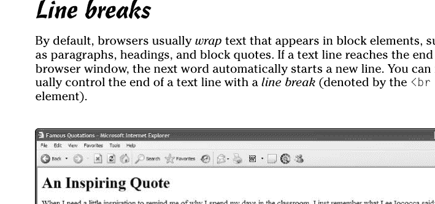

图 5-4：Web 浏览器通常会缩进块引用，以将其与段落区分开来。

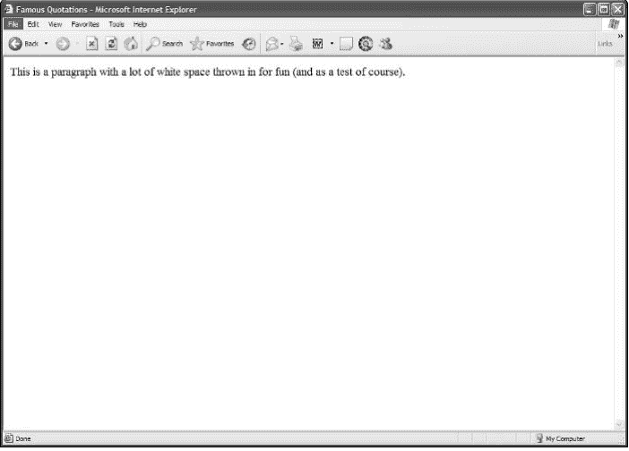

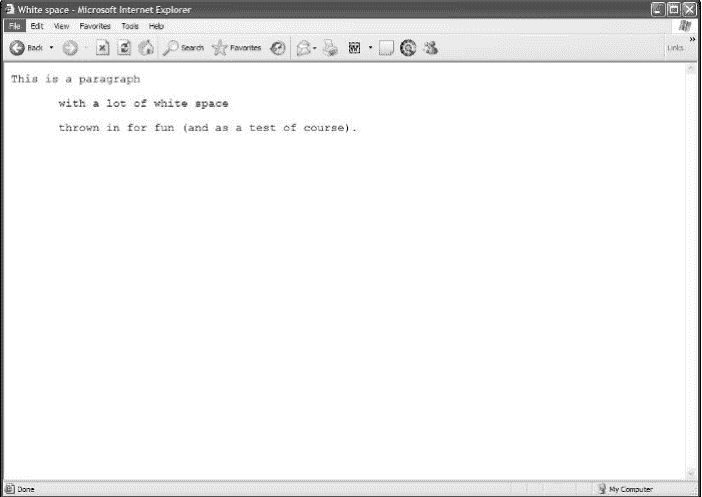

# 第二部分：使用 (X)HTML 格式化网页

`<br />`元素相当于你在文字处理程序中对段落和其他文本块使用的手动换行。当浏览器看到`<br />`时，会在该处结束当前行并开始新的一行。

换行与段落的区别在于，换行不会应用任何你可以在段落末尾或开头使用的特殊格式，例如：

- 额外的垂直间距
- 首行缩进

以下标记使用换行符来格式化诗歌中的各行文本。整首诗被描述为一个段落，`<br />`元素标记每行的结束：

```html
<!DOCTYPE html PUBLIC "-//W3C//DTD XHTML 1.0 Transitional//EN"
    "http://www.w3.org/TR/xhtml1/DTD/xhtml1-transitional.dtd">
<html xmlns="http://www.w3.org/1999/xhtml">
<head>
  <meta http-equiv="Content-Type" content="text/html; charset=ISO-8859-1" />
  <title>Shakespeare in HTML</title>
</head>
<body>
<h1>Shakespeare's Sonnets XVIII: Shall I compare thee to a summer's day?</h1>
  <p>
    Shall I compare thee to a summer's day? <br />
    Thou art more lovely and more temperate. <br />
    Rough winds do shake the darling buds of May, <br />
    And summer's lease hath all too short a date. <br />
    Sometime too hot the eye of heaven shines, <br />
    And often is his gold complexion dimm'd; <br />
    And every fair from fair sometime declines, <br />
    By chance or nature's changing course untrimm'd; <br />
    But thy eternal summer shall not fade <br />
    Nor lose possession of that fair thou ow'st; <br />
    Nor shall Death brag thou wander'st in his shade, <br />
    When in eternal lines to time thou grow'st: <br />
    So long as men can breathe or eyes can see, <br />
    So long lives this, and this gives life to thee. <br />
  </p>
</body>
</html>
```

图 5-7 展示了浏览器如何处理每个换行符。在本例中，诗歌没有左缩进，因为`<p>`元素替代了`<blockquote>`元素。

## 第 5 章：文本与列表

### 水平分隔线

水平分隔线元素（`<hr />`）可以帮助你在页面中添加一条实线（分隔线）。

浏览器根据`<hr />`元素创建分隔线，因此用户无需等待图片下载。水平分隔线是一个很好的选择，可以用于：

- 将页面划分为逻辑部分。
- 将页眉和页脚与页面其余部分分隔开。

#### 格式设置

当你在页面中包含一个`<hr />`元素时，如下面的 HTML 所示，浏览器会将其替换为一条线，如图 5-8 所示。

```html
<!DOCTYPE html PUBLIC "-//W3C//DTD XHTML 1.0 Transitional//EN"
    "http://www.w3.org/TR/xhtml1/DTD/xhtml1-transitional.dtd">
<html xmlns="http://www.w3.org/1999/xhtml">
  <head>
    <meta http-equiv="Content-Type" content="text/html; charset=ISO-8859-1" />
    <title>Horizontal Rules</title>
  </head>
  <body>
    <p>This is a paragraph followed by a horizontal rule.</p>
    <hr />
    </p>This is a paragraph preceded by a horizontal rule.</p>
  </body>
</html>
```

> 水平分隔线必须始终单独占据一行；你不能将`<hr />`元素添加到段落（或其他块级元素）的中间，并期望分隔线仅出现在块的中间。

#### 属性

四个不同的属性控制每条水平分隔线的外观：

- **`width`**：以像素或显示区域宽度的百分比来指定线的宽度（在接下来的讨论中我们称之为“页面”）。例如，分隔线可以有 50 像素宽，或者占据页面的 75%。

- **`size`**：以像素为单位指定线的高度。默认值为 1 像素。

- **`align`**：将分隔线的水平对齐方式指定为`left`（默认）、`center`或`right`。如果你不为分隔线定义宽度，它将占据整个页面宽度。对齐方式将不会产生任何效果。

- **`noshade`**：指定无阴影的实线。默认情况下，大多数浏览器显示的分隔线带有阴影。

这些格式属性已被弃用，建议使用 CSS。

这段 HTML 代码创建了一条水平分隔线，它占据页面的 45%，高度为 4 像素，居中对齐，并关闭阴影：

```html
<p>This is a paragraph followed by a horizontal rule.</p>
<hr width="45%" size="4" align="center" noshade="noshade" />
<p>This is a paragraph preceded by a horizontal rule.</p>
```

图 5-9 展示了这些属性的添加如何改变浏览器显示分隔线的方式。

图 5-10 展示了如何在现实世界中使用水平分隔线来突出重要内容。LANWrights 公司网站使用彩色实线分隔线在其主页上框住关键声明。这些分隔线使声明从页面其余部分脱颖而出。

图 5-10：LANWrights 公司网站使用实线分隔线来吸引你对页面上重要信息的注意。

> CSS 让你对水平分隔线的位置有更多控制；你甚至可以使用颜色和阴影选项来美化它们。

### 组织信息

列表是用于将相似元素排列在一起的强大工具，它们为网站访问者提供了一种简单的方式来聚焦信息组。你几乎可以在列表中放置任何内容，从一组操作说明到一组导航超链接。

列表使用元素的组合——至少两个组成部分：

- ✔ 一个标记元素，表示“嘿，浏览器！以下项目是列表。”
- ✔ 标记元素，表示“嘿，浏览器！这是列表中的一项。”

HTML 提供了三种不同的列表：

- ✔ 编号列表
- ✔ 项目符号列表
- ✔ 定义列表

### 编号列表

编号列表至少包含两个项目，每个项目前面都有一个数字。通常，当项目顺序重要时，人们会为列表编号。

编号列表使用两种元素：

- 有序列表元素（`<ol>`）指定这是编号列表。
- 列表项元素（`<li>`）标记列表中的每个项目。

#### 格式设置

包含三个项目的编号列表需要按以下顺序排列元素和内容：

1. `<ol>`
2. `<li>`
3. 第一个列表项的内容
4. `</li>`
5. `<li>`
6. 第二个列表项的内容
7. `</li>`
8. `<li>`
9. 第三个列表项的内容
10. `</li>`
11. `</ol>`

以下标记代码定义了一个包含三个项目的编号列表：

```html
<!DOCTYPE html PUBLIC "-//W3C//DTD XHTML 1.0 Transitional//EN"
        "http://www.w3.org/TR/xhtml1/DTD/xhtml1-transitional.dtd">
<html xmlns="http://www.w3.org/1999/xhtml">
  <head>
    <meta http-equiv="Content-Type" content="text/html; charset=ISO-8859-1" />
    <title>Numbered Lists</title>
  </head>
  <body>
    <h1>Things to do today</h1>
    <ol>
      <li>Feed cat</li>
      <li>Wash car</li>
      <li>Grocery shopping</li>
    </ol>
  </body>
</html>
```

图 5-11 展示了浏览器如何渲染此标记。你实际上不必为列表中的每个项目指定数字；浏览器从标记中识别列表项并添加数字。

如果你交换列表中的前两个项目，它们仍然会在页面出现时按顺序编号，如图 5-12 所示。

```html
<ol>
  <li>Wash car</li>
  <li>Feed cat</li>
  <li>Grocery shopping</li>
</ol>
```

#### 编号

两个不同的`<ol>`元素属性控制编号列表的外观：

- **`start`**：指定列表中的第一个数字。
  - 默认起始数字为 1。
  - 你可以指定任何数字作为新列表的起始数字。在取消编号的段落或其他块级元素之后恢复列表时，指定起始数字。

- **`type`**：指定列表的编号样式。你可以从五种预定义编号样式中选择：
  - `1`：十进制数字。
  - `a`：小写字母。
  - `A`：大写字母。
  - `i`：小写罗马数字。
  - `I`：大写罗马数字。

以下标记代码使用有序列表元素和属性创建了一个使用大写罗马数字并从 5（罗马数字中的 V）开始编号的列表：

```html
<ol start="5" type="I">
    <li>Wash car</li>
    <li>Feed cat</li>
    <li>Grocery shopping</li>
</ol>
```

图 5-13 展示了这些属性如何影响列表在浏览器中的外观。

### 项目符号列表

项目符号列表包含一个或多个项目，每个项目前面都有一个项目符号（通常是一个大圆点；本书使用对勾作为项目符号）。

如果项目呈现的顺序对于理解所呈现的信息不是必需的，你可以使用这种列表类型。

#### 格式设置

项目符号列表需要以下内容：

- 无序列表元素（`<ul>`）指定你正在创建项目符号列表。
- 列表项元素（`<li>`）标记列表中的每个项目。
- 无序列表元素的结束标签（`</ul>`）表示列表已结束。

如果你使用 CSS 来定义格式，你对列表有更多控制权。这就是为什么列表标记的`start`和`type`属性已被弃用；参见附录 A 了解有关已弃用属性的信息。

包含三个项目的无序列表需要按以下顺序排列元素和内容：

1. `<ul>`
2. `<li>`
3. 第一个列表项的内容
4. `</li>`
5. `<li>`
6. 第二个列表项的内容
7. `</li>`
8. `<li>`
9. 第三个列表项的内容
10. `</li>`
11. `</ul>`

以下标记代码将一个包含三个项目的列表格式化为项目符号列表：

```html
<!DOCTYPE html PUBLIC "-//W3C//DTD XHTML 1.0 Transitional//EN"
 "http://www.w3.org/TR/xhtml1/DTD/xhtml1-transitional.dtd">
<html xmlns="http://www.w3.org/1999/xhtml">
 <head>
 <meta http-equiv="Content-Type" content="text/html; charset=ISO-8859-1" />
 <title>Bulleted Lists</title>
 </head>
 <body>
 <h1>Things to do today</h1>
 <ul>
 <li>Feed cat</li>
 <li>Wash car</li>
 <li>Grocery shopping</li>
 </ul>
 </body>
</html>
```

图 5-14 展示了浏览器如何用项目符号渲染此代码。

#### 样式

你可以将`type`属性（已弃用）与`<ul>`元素一起使用，以指定你希望列表使用哪种项目符号。

- **`disc`**：实心圆形项目符号（默认）
- **`square`**：实心方形项目符号
- **`circle`**：空心圆形项目符号

## 第二部分：使用 (X)HTML 格式化网页


图 5-14：无序列表使用项目符号而非数字来标记项目。

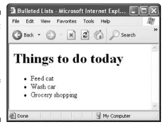

在刚刚给出的带项目符号列表标记中添加 `type` 属性，可以将项目符号从实心圆改为方块，如图 5-15 所示。相关标记如下所示：

```html
<ul type="square">
  <li>Feed cat</li>
  <li>Wash car</li>
  <li>Grocery shopping</li>
</ul>
```

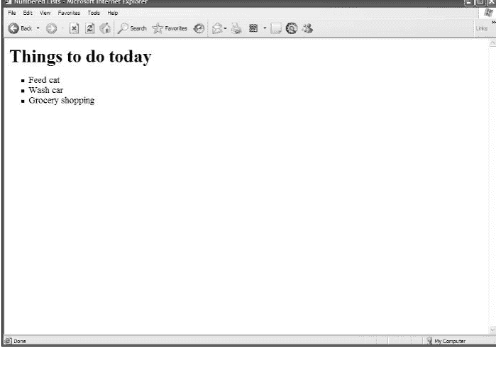

图 5-15：使用 `type` 属性更改无序列表的项目符号样式。

如果你想对列表的格式进行更多控制，请使用 CSS。

### 定义列表

定义列表将术语和定义组合成一个列表，需要三个不同的元素来完成列表：

- `<dl>`：存放列表定义。
- `<dt>`：定义列表中的一个术语。
- `<dd>`：定义一个术语的解释。

你可以在一个列表中根据需要放入任意数量的术语（由 `<dt>` 定义）。每个术语可以有一个或多个定义（由 `<dd>` 定义）。

要创建一个包含两个项目的定义列表，需要按以下顺序排列元素和内容：

1. `<dl>`
2. `<dt>`
3. 第一个术语名称
4. `</dt>`
5. `<dd>`
6. 第一个项目的定义内容
7. `</dd>`
8. `<dt>`
9. 第二个术语名称
10. `</dt>`
11. `<dd>`
12. 第二个项目的定义内容
13. `</dd>`
14. `</dl>`

以下定义列表包含三个术语，其中有两个定义的是 HTML：

```html
<!DOCTYPE html PUBLIC "-//W3C//DTD XHTML 1.0 Transitional//EN"
    "http://www.w3.org/TR/xhtml1/DTD/xhtml1-transitional.dtd">
<html xmlns="http://www.w3.org/1999/xhtml">
<head>
<meta http-equiv="Content-Type" content="text/html; charset=ISO-8859-1" />
<title>Definition Lists</title>
</head>

<body>
  <h1>Markup Language Definitions</h1>
  <dl>
    <dt>SGML</dt>
      <dd>The Standard Generalized Markup Language</dd>
    <dt>HTML</dt>
      <dd>The Hypertext Markup Language</dd>
      <dd>The markup language you use to create Web pages.</dd>
    <dt>XML</dt>
      <dd>The Extensible Markup Language</dd>
  </dl>
</body>
</html>
```

如果你觉得列表中的项目间距太紧密，你可以：

- 在每个 `</li>` 或 `</dd>` 元素之前放置两个 `<br/>` 元素以增加更多空白。
- 使用 CSS 样式来精确控制列表外观的所有方面，如第 8 章所示。

### 嵌套列表

你可以通过在其他列表中嵌套列表来创建子类别。嵌套列表的一些常见用途包括：

- 站点地图和其他导航工具
- 在线书籍和论文的目录
- 大纲

你可以组合三种列表中的任意一种来创建嵌套列表，例如多级目录，或者将编号标题与项目符号列表项混合使用作为最低大纲级别的大纲。

以下示例以一个编号列表开始，定义了当天要做的事情，并使用三个项目符号列表进一步将这些项目细分为具体任务：

```html
<!DOCTYPE html PUBLIC "-//W3C//DTD XHTML 1.0 Transitional//EN"
    "http://www.w3.org/TR/xhtml1/DTD/xhtml1-transitional.dtd">
<html xmlns="http://www.w3.org/1999/xhtml">
<head>
  <meta http-equiv="Content-Type" content="text/html; charset=ISO-8859-1" />
  <title>Nested Lists</title>
</head>
<body>
  <h1>Things to do today</h1>
  <ol>
    <li>Feed cat</li>
    <ul>
      <li>Rinse bowl</li>
      <li>Open cat food</li>
      <li>Mix dry and wet food in bowl</li>
      <li>Deliver on a silver platter to fluffy</li>
    </ul>
    <li>Wash car</li>
    <ul>
      <li>Vacuum interior</li>
      <li>Wash exterior</li>
      <li>Wax exterior</li>
    </ul>
    <li>Grocery shopping</li>
    <ul>
      <li>Plan meals</li>
      <li>Clean out fridge</li>
      <li>Make list</li>
      <li>Go to store</li>
    </ul>
  </ol>
</body>
</html>
```

所有嵌套列表都遵循相同的标记模式：

- ✓ 顶层有序列表中的每个列表项后面都跟着一个完整的二级列表。
- ✓ 二级列表位于顶层列表内部，而不是在列表项内部。

图 5-16 展示了浏览器如何在其显示中反映这种嵌套关系。


在构建嵌套列表时，要仔细注意你的开始和结束标签。最后打开的最先关闭在这里是一个尤其重要的原则。如果你没有正确地打开和关闭标签，列表可能无法显示一致的缩进或编号，或者文本可能因为某个列表未正确关闭而被错误地缩进。

### 文本控制与注释

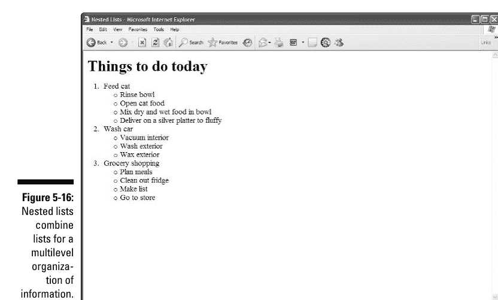

一些通用的 (X)HTML 元素定义了通用文本控制功能或允许你对文档进行注释。这些内容在表 5-1 中介绍。

#### 表 5-1：(X)HTML 文本控制与注释

| 元素 | 常用名称 | 空元素？ | 类别 | 描述 |
| :--- | :--- | :--- | :--- | :--- |
| `bdo` | 双向算法 | 否 | 语言定义 | 控制文本显示方向 `{ltr\|rtl}`（从左到右、从右到左） |
| `del` | 删除文本 | 否 | 文本控制 | 标记当前草稿中已删除的文本 |
| `ins` | 插入文本 | 否 | 文本控制 | 标记当前草稿中已插入的文本 |
| `kbd` | 键盘文本 | 否 | 文本控制 | 需要在键盘上输入的文本 |
| `samp` | 示例文本 | 否 | 文本控制 | 程序输出示例 |
| `tt` | 电传文本 | 否 | 文本控制 | 打字机或电传输出 |
| `var` | 变量文本 | 否 | 文本控制 | 突出显示输入或输出变量 |

#### 精彩杂谈

表 5-2 列出了其他与文本相关的 (X)HTML 属性，你可能会在 HTML 文件中遇到。

#### 表 5-2：其他 (X)HTML 文本属性

| 名称 | 功能/值等于 | 值类型 | 相关元素 |
| :--- | :--- | :--- | :--- |
| `cite` | 指定源材料的位置 | URL | `<blockquote>` `<q>` |
| `cite` | 说明添加、删除的原因 | 文本 | `<del>` `<ins>` |
| `datetime` | 为文档内容添加时间戳 | ISO 日期 | `<del>` `<ins>` |
| `dir` | 指定内容的文本方向 | `{ltr\|rtl}` | 除 `<base>` `<br />` `<frame />` `<frameset>` `<iframe>` `<param />` `<script>` 之外的所有元素 |
| `id` | 为标记实例提供唯一标识符 | ID | 除 `<base />` `<head>` `<html>` `<meta />` `<param />` `<script>` `<style>` `<title>` 之外的所有元素 |
| `lang` | 指定使用的内容语言 | 语言代码 | 除 `<base />` `<br />` `<frame />` `<frameset>` `<iframe>` `<param />` `<script>` 之外的所有元素 |
| `title` | 将建议信息关联到内容 | 文本 | 除 `<base />` `<head>` `<html>` `<meta />` `<param />` `<script>` `<style>` `<title>` 之外的所有元素 |

# 第 6 章：链接在线资源

### 本章内容

- 创建简单链接
- 在新窗口中打开链接页面
- 设置指向网页内特定位置的链接
- 创建指向非网页内容的链接

*超链接*，或简称*链接*，将 (X)HTML 页面和 Web 上的其他资源连接起来。当你在页面中添加链接时，你可以让访问者从你的页面跳转到另一个网站、你网站上的另一个页面，甚至是同一页面上的另一个位置。没有外部链接，页面就是孤立的，与 Web 的其他部分断开连接。有了外部链接，该页面就成为几乎无限的信息集合的一部分。

## 基本链接

要创建一个链接，你需要：

- **Web 地址**（称为统一资源定位符，即 URL）：你想链接到的网站或文件的地址。通常以 `http://` 开头。
- **一些文本**：在你的网页中用于标记或描述链接的文字。请尽量确保所使用的文字对被链接的资源有一些有用的说明。
- **一个锚点元素**（`<a>`）及 `href` 属性来将它们组合在一起。用于创建链接的元素被称为*锚点元素*，因为你可以用它将一个 URL 锚定到页面上的某些文字。当用户在浏览器中查看你的页面时，他们可以点击文字来激活链接并访问你指定的 URL 页面。你将完整的 URL 插入 `href` 属性中，这告诉链接它需要跳转到哪里。

## 第二部分：使用 (X)HTML 格式化网页

你可以把基本链接的结构想象成一个芝士汉堡（或者你偏爱的素食替代品）。URL 是奶酪，肉饼是链接文本，而锚点标签就是面包。很美味，对吧？

例如，如果你有一个描述 HTML 标准的网页，你可能希望引导网络浏览者访问万维网联盟 (W3C)——这个组织管理着与 (X)HTML 标准相关的一切。一个指向 W3C 网站 `www.w3.org` 的基本链接如下所示：

```html
<p>The <a href="http://www.w3.org">World Wide Web Consortium</a> is the standards body that oversees the ongoing development of the XHTML specification.</p>
```

你在锚点元素的 `href` 属性中指定链接 URL (`http://www.w3.org`)。锚点元素开始和结束标签 (`<a>` 和 `</a>`) 之间的文本 (`World Wide Web Consortium`) 标记或描述了该链接。

图 6-1 展示了浏览器如何显示这段标记。

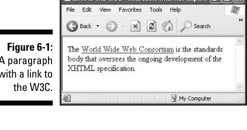

## 锚点元素不是块级元素

锚点元素是*行内元素*——它们应用于文本块（你希望用作链接的文本）中的几个单词或字符，而不是为文本块定义格式。锚点元素位于段落 (`<p>`) 元素内部。当你创建链接时，应始终将其创建在一个块级元素内，例如段落、列表项、标题甚至表格单元格。关于块级元素的更多信息，请参阅第 5 章。

虽然许多 Web 浏览器可以很好地显示你的锚点（即使你没有将它们嵌套在块级元素中），但有些浏览器对这种违反 (X)HTML 语法的处理并不好，例如：

- 用于 Palm 设备和手机的纯文本浏览器
- 为视障人士提供的文本转语音阅读器

基于文本的浏览器依赖块级元素来正确划分页面的各个部分。如果没有块级元素，这些浏览器可能会将你的链接显示在错误的位置。

你还可以将 URL 锚定到图像上，这样用户可以点击图像来激活链接。（有关创建链接图像的更多信息，请参阅第 7 章。）

关于 URL 来龙去脉的详细讨论，请参阅第 1 章。

## 链接选项

你可以链接到各种在线资源：

- 其他 (X)HTML 页面（你的网站上或其他网站上的）
- 同一 (X)HTML 页面上的不同位置
- 根本不是 (X)HTML 页面的资源，例如电子邮件地址、图片和文本文件

链接的位置、标题和目的地对链接价值有很大影响。第 3 章涵盖了在站点设计中使用链接的最佳实践。

你创建的链接类型取决于你链接的位置。

### 绝对链接

*绝对链接*使用完整的 URL 将浏览器连接到网页或在线资源。

使用完整 URL 指向资源的链接被称为*绝对链接*，因为它们提供了通往另一个 Web 资源的完整、独立的路径。当你链接到别人网站上的页面时，Web 浏览器需要 URL 中的每一部分信息来找到该页面。浏览器从 URL 中的域名开始，沿着路径找到特定文件。

> 当你链接到其他人站点上的文件时，必须始终在锚点元素的 `href` 属性中使用绝对 URL（例如，`http://www.website.com/directory/page.html`）。

### 相对链接

*相对链接*使用一种简写方式来指定你指向的资源的 URL。

在 (X)HTML 页面中使用相对链接时，请遵循以下准则：

- 你在同一域名内的资源之间创建相对链接。
- 因为两个资源都在同一域名内，所以你可以从 URL 中省略域名信息。

*相对* URL 使用你链接源的资源位置来识别你链接到的资源的位置（例如，`page.html`）。

相对链接类似于告诉某人他或她需要去东区购物中心。如果这个人已经知道东区购物中心在哪里，他或她就不需要额外的指示。Web 浏览器的行为方式相同。

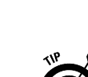

如果你在网站上使用相对链接，即使你更改了以下内容，你的链接仍然有效：

- 服务器
- 域名

**简单链接**

你可以在同一网站上的页面之间创建链接时利用相对 URL。如果你想从 `http://www.mysite.com/home.html` 创建一个链接到 `http://www.mysite.com/about.html`，你可以在 `home.html` 上的锚点元素中使用这个简化的相对 URL：

```html
<p>Learn more <a href="about.html">about</a> our company.</p>
```


当浏览器看到一个没有域名的链接时，它会假设该链接是*相对的*，并使用链接页面的域名和路径来找到被链接的页面。

**站点链接**

随着你的站点变得越来越复杂，并且你将文件组织到各种文件夹中，你仍然可以使用相对链接。但是你必须在 URL 中提供额外的信息，以帮助浏览器找到与你链接的文件不在同一目录中的文件。

在文件名前使用 `../`（两个句点和一个斜杠）表示浏览器应在目录结构中向上移动一级。

此过程的标记如下所示：

```html
<a href="../docs/home.html">Documentation home</a>
```

此锚点元素中的表示法指示浏览器：

1. 从存储链接文档的文件夹向上移动一级文件夹。
2. 找到一个名为 `docs` 的文件夹。
3. 找到一个名为 `home.html` 的文件。


当你创建相对链接时，你链接到的文件的位置总是相对于你链接的源文件。在创建相对 URL 时，请追踪浏览器必须采取的路径，如果它从你链接的页面开始，然后才能到达你链接到的页面。该路径定义了你的相对链接的 URL。

## 常见错误

每个 Web 资源，例如站点、页面和图像，都有一个唯一的 URL。你的 URL 中哪怕一个字母不正确，都可能导致*链接失效*。失效的链接会导致错误页面（通常是 HTTP 错误 `404 文件或目录未找到`）。

URL 是如此挑剔，以至于一个简单的拼写错误就会破坏链接。

如果 URL 不起作用，请尝试以下策略：

- **检查大小写。** 一些 Web 服务器（最著名的是 Linux 和 Unix）是*区分大小写的*（意味着它们区分大小写字母）。这些服务器将文件名 `Bios.html` 和 `bios.html` 视为 Web 服务器上的不同文件。这也意味着浏览器必须在必要时使用大写和小写字母。确保链接中的大小写与 URL 的大小写匹配。

  为了避免网站上文件的问题，请遵循标准命名约定。通常，只使用小写字母可以简化你的工作。

- **检查扩展名。** `Bios.htm` 和 `Bios.html` 是两个不同的文件。如果你的链接的 URL 使用一个扩展名，而实际文件名使用另一个，你的链接将不起作用。

  为了避免网站上扩展名的问题，请选择 `.html` 或 `.htm` 中的一个，并坚持使用该扩展名。

- **检查文件名。** `bio.html` 和 `bios.html` 是两个不同的文件。


- **复制和粘贴。** 如果可以复制 URL，请避免重新输入。创建有效 URL 的最佳且最万无一失的方法是：

1. 在浏览器中加载一个页面。
2. 从浏览器的地址栏或链接文本框中复制 URL。
3. 将 URL 粘贴到你的 (X)HTML 标记中。

## `http://` 在 (X)HTML 链接中的重要性

浏览器使网络冲浪尽可能简单。如果你在浏览器的地址窗口中输入 `www.sun.com`、`sun.com`，或者通常甚至只输入 `sun`，浏览器会殷勤地打开 `http://www.sun.com`。虽然当你在浏览器窗口中输入 URL 时此技巧有效，但当你编写标记时它将不起作用。

你在 HTML 标记中使用的 URL 必须是完整的形式。浏览器不会解释不包含页面协议的 URL。如果你忘记了 `http://`，你的链接将不起作用。

# 第二部分：使用 (X)HTML 美化网页

## 自定义链接

你可以自定义链接以实现以下功能：

- 在新窗口中打开链接的文档
- 链接到网页*内部*的特定位置
- 链接到 (X)HTML 页面以外的项目，例如：
  - 便携式文档格式 (PDF) 文件
  - 压缩文件
  - 文字处理文档

## 新窗口

互联网之所以能运作，是因为你可以使用简单的锚点元素，将你网站上的页面链接到其他网站上的页面。但是，当你链接到别人的网站时，你就把用户从你自己的网站上引走了。

为了让用户留在你的网站上，HTML 可以在新窗口中打开链接的页面。只需在锚点元素中添加 `target` 属性，就能让该链接在新的浏览器窗口中打开，而不是在当前窗口中打开：

```html
<p>The <a href="http://www.w3.org" target="_blank">World Wide Web Consortium</a> is the standards body that oversees the ongoing development of the XHTML specification.</p>
```

当你为 `target` 属性指定 `_blank` 值时，这会告诉浏览器：

1. **在当前窗口中保持链接页面打开。**
2. **在新窗口中打开链接的页面。**

`target="_blank"` 属性的效果如图 6-2 所示。


弹出窗口会让一些用户感到恼火。

你可以使用 JavaScript 来控制弹出窗口的大小和外观，也可以在弹出窗口上放置按钮，以帮助用户快速关闭它们。第 12 章将更详细地介绍弹出窗口。

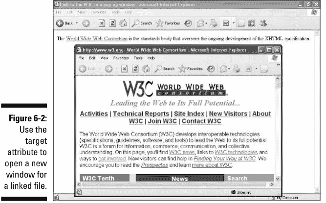

## 网页中的位置

网页内的位置可以被标记，以便通过以下位置的链接直接访问：

- 同一页面
- 同一网站
- 其他网站

在为网页添加链接时，请记住以下几点：

- 对于读者来说，多个短页面可能比一个带有内部链接的长页面更方便地呈现信息。
  - 大型页面内的链接对于快速访问目录、目录表和术语表非常有效。
- *文档内*链接在你自己的网站上效果最好，因为你可以创建并控制标记。
  - 当你链接到别人网站上的某个位置时，你就得看那个人的脸色了。那个人控制着可链接的位置。如果网站设计师移除或重命名了你链接的任何位置，你的链接就会失效。

102 第二部分：使用 (X)HTML 美化网页

## 命名链接位置

要在页面内标识和创建一个位置，以便其他链接直接访问，请使用一个带有 `name` 属性的空锚点元素，如下所示：

```html
<a name="top"></a>
```


标记位置的锚点元素不会影响一级标题的外观。你可以根据需要在任何地方标记位置，而不用担心你的页面会因此如何变化（或改变）。

## 链接到已命名的位置

正如我们之前提到的，你可以标记位置，以便通过以下位置的链接直接访问：

- 同一页面内
- 同一网站内
- 其他网站上

### 同一页面内

链接可以帮助用户浏览单个网页。文档内超链接是诸如以下非常常见的功能：

- “返回顶部”链接
- 目录表

文档内超链接使用如下所示的 URL：

```html
<a href="#top">Back to top</a>
```

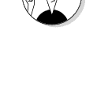

井号 (`#`) 表示你指向的是当前页面上的一个位置，而不是其他页面上的位置。

清单 6-1 展示了两个锚点元素如何协同工作，以链接到同一页面上的某个位置。（使用文档内链接的文档通常长得多。这个文档较短，所以你可以轻松了解如何使用 `top` 锚点元素。）

### 清单 6-1：文档内超链接

```html
<html>
  <head>
    <title>Intradocument hyperlinks at work</title>
  </head>

  <body>
    <h1><a name="top"></a>Web-Based Training</h1>

    <p>Given the importance of the Web to businesses and
other organizations, individuals who seek to improve
job skills, or fulfill essential job functions, are
turning to HTML and XML for training. We believe
this provides an outstanding opportunity for
participation in an active and lucrative adult and
continuing education market.</p>

<p><a href="#top">Back to top</a></p>

</body>
</html>
```

图 6-3 展示了此 HTML 标记在网页浏览器中的显示效果。如果用户点击“返回顶部”链接，浏览器会跳回 `top` 位置——由 `<a name="top"></a>` 标记的位置。

**图 6-3：** 使用锚点元素标记和链接页面上的位置。

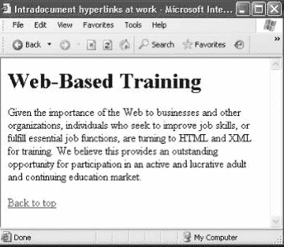

### 同一网站内

你可以结合文档内和文档间链接，将访问者引导至你网站内另一个网页上的某个位置。例如，如果你想指向你网站上名为 `home.html` 的页面上一个名为 `descriptions` 的位置，链接如下所示：

```html
<p>Review the <a href="home.html#descriptions">document descriptions</a>
to find the documentation for your particular product.</p>
```

### 其他网站上

如果你知道另一个网站的页面上有标记的位置，你可以使用绝对 URL 指向该页面上的位置，如下所示：

```html
<p>Find out how to
<a href="http://www.yourcompany.com/training/
online.htm#register">register</a> for upcoming training
courses led by our instructors.</p>
```

104 第二部分：使用 (X)HTML 美化网页

请务必定期检查所有链接，以发现并修复损坏的链接。

开放目录项目提供了一系列免费和商业工具，使查找和修复损坏的链接变得更加容易：

```text
http://dmoz.org/Computers/Software/Internet/Site_Management/Link_Management/
```

## 非 HTML 资源

链接几乎可以连接到任何类型的文件，例如：

- 文字处理文档
- 电子表格
- PDF 文件
- 压缩文件
- 多媒体文件

锚点元素通常不是链接多媒体文件的好选择。

非 HTML 链接的一个很棒用途是在软件和 PDF 下载页面上。

### 文件下载

非网页文件和 HTML 页面一样，拥有唯一的 URL。Web 服务器上的任何文件（无论其类型是什么）都可以通过其 URL 进行链接。

例如，如果用户需要从一个网页下载一个名为 `doc.pdf` 的 PDF 文件和一个名为 `software.zip` 的 `.zip` 压缩包，你可以使用以下 HTML：

```html
<h1>Download the new version of our software</h1>
<p><a href="software.zip">Software</a></p>
<p><a href="doc.pdf">Documentation</a></p>
```

你无法知道任何用户的浏览器在点击非网页文件链接时会如何响应。浏览器可能会：

- 提示用户保存文件
- 在不下载的情况下显示文件（这对 PDF 很常见）
- 显示错误消息（如果浏览器无法处理该文件）

为了帮助用户成功下载文件，你应该向他们提供：

- 关于文件格式的尽可能多的信息。
- 他们处理文件所需的任何特殊工具。
- 要处理 Zip 文件的内容，如果用户的操作系统不原生支持 Zip 文件，他们需要一个压缩工具，例如 WinZip 或 ZipIt。
- 要查看 PDF 文件，用户需要 Adobe Acrobat Reader。

你可以通过添加辅助文本和链接来使下载标记更用户友好，如下所示：

```html
<h1>Download the new version of our software</h1>
<p> <a href="software.zip">Software</a> <br />
    <b>Note:</b>
    You need a zip utility such as
    <a href="http://www.winzip.com">WinZip</a> or
    <a href="http://www.maczipit.com">ZipIt</a>
    to open this file.</p>
<p><a href="doc.pdf">Documentation</a> <br />
    <b>Note:</b>You need the free
    <a href="http://www.adobe.com/products/
    acrobat/readstep2.html">Acrobat Reader</a>
    to view this file.</p>
```

图 6-4 展示了浏览器如何渲染此 HTML 以及当你点击软件链接时它显示的对话框。

## 电子邮件地址

指向电子邮件地址的链接可以自动打开一个新的电子邮件，并将其地址设置为正确的收件人。

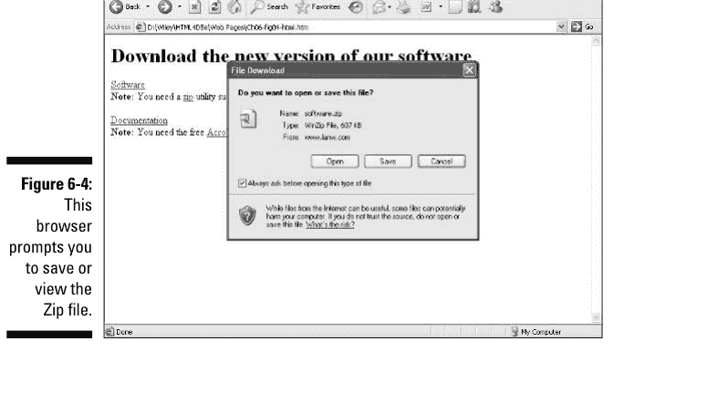

# 第二部分：使用 (X)HTML 格式化网页

这是帮助用户通过电子邮件向您发送评论和请求的好方法。

电子邮件链接使用标准的锚元素和 `href` 属性。`href` 属性的值是以 `mailto:` 开头的收件人电子邮件地址。

```html
<p>Send us your
<a href="mailto:comments@mysite.com">comments</a>.</p>
```

用户浏览器的配置控制着浏览器如何处理电子邮件链接。大多数浏览器会自动：

1. 在默认的电子邮件程序中打开一个新消息窗口。
2. 将 `href` 属性中的地址插入到消息的“收件人”字段中。

不幸的是，网页的 `mailto:` 链接是垃圾邮件发送者获取电子邮件地址的主要来源。创建一个表单来接收反馈通常是更好的主意。

### 精彩杂项

表 6-1 列出了您可能在 HTML 文件中发现的其他与链接相关的 (X)HTML 属性及其特性。

| 名称 | 功能/值等于 | 值类型 | 相关元素 |
| --- | --- | --- | --- |
| `accesskey` | 跟随链接的快捷键 | 文本 | `<a>`, `<area />`, `<button>`, `<input />`, `<label>`, `<legend>`, `<textarea>` |
| `charset` | 链接项目的字符集 | 文本 | `<a>`, `<link />`, `<script>` |
| `hreflang` | 链接项目的语言 | 语言代码 | `<a>`, `<link />` |
| `type` | 链接内容的建议信息 | 文本 | `<a>`, `<link />` |

# 第 7 章：查找和使用图像

### 本章内容

- 确定图像的合适格式
- 将图像添加到网页
- 创建触发链接的图像和图像映射

网页设计师使用图像来传递重要信息、引导网站导航，并为网页的整体外观和感觉做出贡献。但您需要正确使用图像，否则可能会降低其效果。

使用得当时，图像是页面设计的关键元素。使用不当时，它们可能使您的页面难以阅读或无法访问。

本章是关于在网页上使用图像的速成课程。您将了解哪些图像格式适合 Web，以及如何使用 (X)HTML 元素将图像添加到您的网页。您还将了解如何将链接附加到图像上，以及如何为您的网页创建图像映射。

## 图像在网页中的作用

网站中的图像可能是标志、可点击的导航辅助工具或展示内容；它们也可能使页面看起来更漂亮，或者用于统一或说明页面的主题。白宫主页 `www.whitehouse.gov`（如图 7-1 所示）是图像如何增强和贡献于网页的多种不同方式的一个绝佳示例。

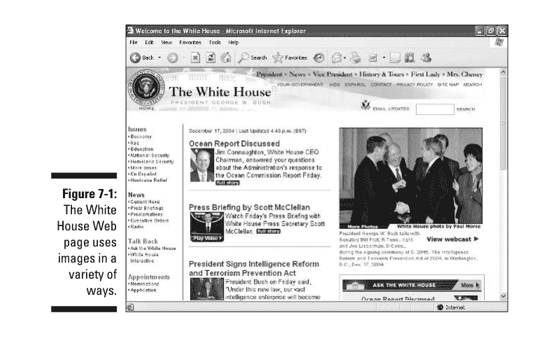

## 创建适合 Web 的图像

您可以以多种方式创建和保存图形，但只有少数几种格式真正适合您打算在 Web 上使用的图像。在创建适合 Web 的图像时，您必须考虑文件格式和大小。

通常，图形文件格式是特定于操作系统或软件应用程序的。但您无法预测访客的计算机和软件（除了 Web 浏览器）。因此，您需要任何人都能使用任何浏览器查看的图像。这意味着您需要使用*跨平台*文件格式，用户可以使用任何版本的 Microsoft Windows、Mac OS 或 Linux 查看。

只有这三种压缩格式适合在 Web 上一般使用：

- **图形交换格式 (GIF)**：保存为 GIF 的图像通常比保存为其他文件格式的图像更小。GIF 仅支持最多 256 种颜色，因此如果您尝试将使用数百万种颜色创建的图像保存为 GIF，您会丢失图像质量。GIF 是不太复杂、非摄影图像（如线条图和剪贴画）的最佳格式。

- **联合图像专家小组 (JPEG)**：JPEG 文件格式支持 24 位色（数百万种颜色）和复杂图像，如照片。JPEG 是跨平台且与应用程序无关的。一个好的图像编辑工具可以帮助您调整压缩，以便在图像质量和图像文件大小之间取得最佳平衡。

- **便携式网络图形 (PNG)**：PNG 是最新的跨平台且与应用程序无关的图像文件格式。它的开发旨在汇集 GIF 和 JPEG 的优点。PNG 具有与 GIF 相同的压缩方式，但像 JPEG 一样支持 24 位色（甚至 32 位色）。


Internet Explorer 4、Netscape 4 和其他较旧的浏览器不支持 PNG，因此许多设计师会避免使用它。

任何好的图形编辑工具，例如第 20 章中的那些，都允许您将图像保存为这些文件格式中的任何一种。您可以尝试每一种，看看将图形从一种格式转换为另一种格式如何改变其外观和文件大小，然后选择能产生最佳结果的格式。

表 7-1 显示了按类型选择图像文件格式的指南。

**表 7-1：选择正确的文件格式**

| 文件格式 | 最适合用于 | 注意事项 |
| --- | --- | --- |
| GIF | 线条图和其他颜色较少、细节较少的图像。 | 如果图像是复杂的图像或照片，请不要使用此格式。 |
| JPEG | 照片和其他具有数百万种颜色和大量细节的图像。 | 不要与线条图一起使用。压缩文件时不要过多牺牲质量。 |
| PNG | 照片和其他具有数百万种颜色和大量细节的图像。 | 不要与线条图一起使用。较旧的浏览器不支持 PNG，因此即使 PNG 在质量和文件大小之间提供了最佳平衡，您仍可能失去一些网络用户。 |

## 优化图像

在为网页构建图形时，您需要在文件质量和大小之间保持健康的平衡。Webmonkey 有两篇关于减小图像文件大小和优化整个网站以加快下载速度的优秀教程。有关于帮助您构建下载快速的页面的技巧和窍门集合，请查看：

- **优化您的图像**

  `http://hotwired.lycos.com/webmonkey/99/15/index0a.html`

- **网站优化教程**

  `http://hotwired.lycos.com/webmonkey/design/site_building/tutorials/tutorial2.html`

有关图形格式的完整概述，请访问：

- **Builder.com 的“检查图形通道和空间”**

  `http://builder.cnet.com/webbuilding/0-3883-8-4892140-1.html`

- **Webmonkey 的“Web 图形概述”**

  `http://webmonkey.wired.com/webmonkey/01/28/index1a.html`

## 将图像添加到网页

当图像准备好用于 Web 时，您需要使用正确的标记将图像添加到您的页面。但您需要知道将图像存储在哪里。

### 图像的位置


您可以将网站的图像存储在多个地方。如果图像是相对的（与其他 (X)HTML 文件一起存储在网站上的某个位置），则图像存储是最佳的。您可以将图像存储在与 (X)HTML 文件相同的根文件中，如果您有很多文件，这可能会变得混乱，或者您可以在网站的根文件中创建一个`graphics`或`images`目录。

相对链接连接来自同一网站的资源。您使用绝对链接在两个不同网站上的资源之间建立连接。有关相对链接和绝对链接之间差异的完整讨论，请参阅第 6 章。

将图像存储在您自己的网站上的三个令人信服的理由是：

- **控制：** 当图像存储在您的网站上时，您可以完全控制它们。您知道您的图像不会消失或改变，并且您可以努力优化它们。
- **速度：** 如果您链接到其他网站上的图像，您永远不知道该网站何时可能会宕机或慢得令人难以置信。链接到其他网站上的图像也会导致其他网站所有者为在您的网站上显示它所需的带宽付费。
- **版权：** 如果您链接到另一个网站上的图像以在您的网站上显示它们，您可能违反版权法。（在这种情况下，请获得版权所有者的许可，以便在您的网站上存储和显示这些图像。）

### 使用``元素

图像（``）元素是一个空元素（有时称为单标签），您将其放置在页面上您希望图像出现的位置。

空元素只有一个标签，没有明确的开标签和闭标签。

下面的标记将一个名为`07fg02-cd.jpg`的图像放在了两个段落之间，该图像与 (X)HTML 文件保存在同一目录下：

```html
<!DOCTYPE html PUBLIC "-//W3C//DTD XHTML 1.0 Transitional//EN"
        "http://www.w3.org/TR/xhtml1/DTD/xhtml1-transitional.dtd">
<html xmlns="http://www.w3.org/1999/xhtml">
<head>
    <meta http-equiv="Content-Type" content="text/html; charset=ISO-8859-1" />
    <title>CDs at Work</title>
</head>
<body>
    <h1>CD as a Storage Media</h1>
    <p>CD-ROMs have become a standard storage option in today's computing world
    because they are an inexpensive and easy to use media.</p>
    
    <p>To read from a CD, you only need a standard CD-ROM drive, but to create
    CDs, you need either a CD-R or a CD-R/W drive.</p>
</body>
</html>
```

Web 浏览器用`src`属性值所指定的图像文件替换``元素，如图 7-2 所示。

`src`属性类似于你在锚点（`<a>`）元素中使用的`href`属性。`src`属性指定要在页面上显示的图像的位置。前面的示例指向与引用它的 HTML 文件在同一文件夹中的图像文件。

### 添加替代文本

替代文本是对图像的描述，这样由于某些原因无法看到图像的用户可以访问替代文本，了解图像内容。

添加替代文本是一种良好的做法，因为它考虑到了：

- 视障用户可能无法看到图像，依赖替代文本来让文本转语音阅读器朗读给他们。
- 使用功能有限的手机浏览器访问网站的用户。
- 使用慢速调制解调器连接而不显示图像的用户。

一些搜索引擎和编目工具使用替代文本来索引图像。

你的大多数用户会看到你的图像，但要为那些看不到的用户做好准备。(X)HTML 规范要求你为网页上的每个图像提供替代文本。使用``元素的`alt`属性将这些信息添加到你的标记中，如下所示：

```html
<!DOCTYPE html PUBLIC "-//W3C//DTD XHTML 1.0 Transitional//EN"
    "http://www.w3.org/TR/xhtml1/DTD/xhtml1-transitional.dtd">
<html xmlns="http://www.w3.org/1999/xhtml">
<head>
    <meta http-equiv="Content-Type" content="text/html; charset=ISO-8859-1" />
    <title>Inside the Orchestra</title>
</head>

<body>
    <p>Among the different sections of the orchestra you will find:</p>
    <p> Strings</p>
    <p> Brass</p>
    <p>
        Woodwinds</p>
</body>
</html>
```

当浏览器不显示图像时（或者无法显示，如 Lynx 等纯文本浏览器），它们会显示替代文本，如图 7-3 所示。

当浏览器显示图像时，一些浏览器（包括 Internet Explorer、Netscape 和 Opera）在你将鼠标悬停在图像上几秒钟时会显示替代文本作为弹出提示，如图 7-4 所示。然而，Firefox 不会这样做。

这意味着你可以使用替代文本来描述图像给那些无法看到它的人，或者提供有关图像的有用或有趣信息。

> **提示：** W3C 的 Web 无障碍倡议（WAI）提供了有关创建有用且可用的视觉内容替代方案的有用提示，请访问`www.w3.org/TR/WCAG10-TECHS/#gl-provide-equivalents`。

### 指定图像大小

你可以使用``元素的`height`和`width`属性让浏览器知道图像的高度和宽度（以像素为单位）：

```html
<p>Brass</p>
```

大多数浏览器在下载所有页面图形之前会先下载与页面相关的 HTML 和文本。为了让用户不必等待整个页面下载完成，浏览器通常会先显示文本，并在图形可用时填充图形。如果你告诉浏览器图形有多大，浏览器就可以在页面显示中为它预留位置。这使得图形添加到网页时的过渡更加平滑。

你可以在任何图像编辑程序或 Windows 和 Mac OS 内置的图像查看器中检查图像的宽度和高度（以像素为单位）。（你也可以在 Windows 或 Mac OS 中直接查看图像属性来了解其高度和宽度。）

`height`和`width`属性的另一个好用途是使用小彩色方块在页面上创建彩色线条。例如，此标记向网页添加一个 10×10 像素的蓝色方框：

```html

```

当``元素的`height`和`width`属性等于图像的实际高度和宽度时，它在浏览器窗口中显示为一个蓝色方框（如图 7-5 所示）。

然而，更改标记中`height`和`width`的值会将这个小蓝色方框变成一条高 20 像素、长 500 像素的线条：

```html

```

浏览器将图像扩展以适应标记中指定的高度和宽度，如图 7-6 所示 (`../images/1815025264_453741.png`)；当`height`和`width`属性等于图像实际大小时，它显示为蓝色方框。

使用这种技术，你可以将单个图像（如蓝色方框，仅 1K 大小）变成各种线条甚至方框：

- 这可以确保页面上所有分隔线和其他边框元素使用相同的颜色——它们都基于同一个图形。
- 如果你决定将所有蓝色线条改为绿色，你只需更改图像。你创建的每条线条都会改变颜色。

当你为图像指定的高度和宽度与图像的实际高度和宽度不同时，你依赖浏览器来缩放图像显示。这对于单色图像（如蓝色方框）效果很好，但对于多色图像或显示实际照片的图像效果不佳。浏览器不能很好地调整图像大小，最终会得到一张失真的图片。图 7-7 展示了当标记将图像高度和宽度加倍时，浏览器放大小号图像的处理效果有多差：

```html
<p>Brass</p>
```

如果你需要同一图像的多种尺寸，例如，logo 或导航按钮，请使用最大的图像在图像编辑工具中制作较小的版本，以便更好地控制图像的最终外观和感觉。

### 设置图像边框

默认情况下，每个图像的边框为 1，但在你将图像变成链接之前，大多数浏览器不会显示它（如后面“作为链接的图像”部分所示）。你可以使用``元素的`border`属性来更好地控制浏览器在图像周围显示的边框。此标记将单簧管图像的边框设置为 10 像素：

```html

```

浏览器将此边框应用于图像的四边，如图 7-8 所示。

在图 7-8 中，边框是黑色的，适用于图像的四边。如果你想控制边框的颜色，或者让边框在图像的每边显示不同，你有两个选择：

- 在图像编辑工具中将边框构建到图像中。
- 使用层叠样式表（CSS），我们在第 8 章中介绍。

如果你使用图像编辑工具创建边框，你可以使用工具的功能创建图案边框或应用独特效果。但是，图像中的额外信息可能会使它变大。仔细平衡图像大小及其外观，以免下载时间过长。

如果你使用 CSS 来应用边框，图片本身不会变大，但在对 CSS 支持不佳的旧版浏览器中，边框可能无法显示。你的选择取决于边框对图片的重要性（如果非常重要，就把它嵌入到图片中），以及你认为访客使用的是什么浏览器（新版浏览器对样式表的支持更好）。

### 控制图片对齐方式

`align`属性与``元素配合使用，控制图片相对于周围文本的显示方式。该属性的可选值包括：

- `top`：将图片周围的文本与图片的顶部对齐。
- `middle`：将图片周围的文本与图片的中部对齐。
- `bottom`：将图片周围的文本与图片的底部对齐。
- `left`：图片位于左侧，文本浮动到图片的右侧。
- `right`：图片位于右侧，文本浮动到图片的左侧。

默认情况下，大多数浏览器将图片左对齐，并让所有文本浮动到右侧。以下标记展示了五个不同的``元素如何使用`align`属性来改变文本在老鼠图片周围的浮动方式：

```html
<p> 
    This text is aligned with the top of the image.
</p>

<p> 
    This text is aligned with the middle of the image.
</p>

<p> 
    This text is aligned with the bottom of the image.
</p>

<p> 
    This image floats to the left of the text.
</p>

<p> 
    This image floats to the right of the text, and overlaps with
    the image to the left.
</p>
```

## 第二部分：使用 (X)HTML 格式化网页

图 7-9 展示了浏览器如何解释不同的对齐属性。

``属性可能无法提供你对图片对齐的所有控制。第十一章展示了表格与图片的联合使用。第八章展示了控制图片在页面中位置的 CSS 属性。

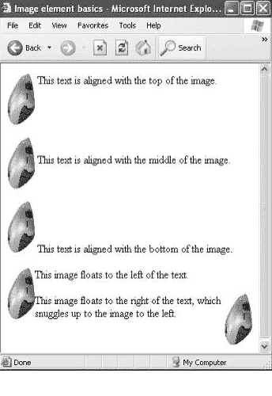

图 7-9：你可以通过改变图片对齐方式来控制图片在页面中的位置。

### 设置图片间距

大多数浏览器在图片与相邻的文本或其他图片之间保留约一个像素的白色空间。你可以通过以下方式为图片留出呼吸空间：

- `vspace`（垂直间距）属性用于顶部和底部。
- `hspace`（水平间距）属性用于左侧和右侧。

以下 HTML 为老鼠图片左右各设置了 20 像素的白色空间，上下各设置 25 像素：

```html
<p>
    This text doesn't crowd the image on top.<br />
    
    And this text is a little further away from the sides.
</p>
```

图 7-10 展示了浏览器如何在图片周围添加空间。


`hspace`和`vspace`的默认值是 1。如果你希望图片彼此靠近到边侧相接触（例如一组导航按钮），将这些属性的值设为 0 以消除额外的那一个像素空间。

**图 7-10：** `hspace`和`vspace`控制图片周围的白色空间。

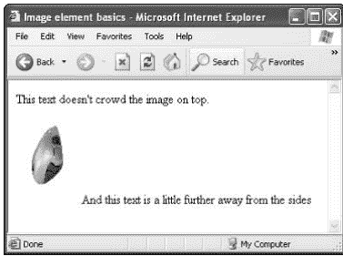


你可以使用 CSS 在页面对图片进行定位。你可以精确地定位图片，并控制其放置位置、间距、白色空间以及文本在图形周围的流动方式。第九章详细介绍了如何定位元素。

### 作为链接的图片

网页经常使用图片进行导航。它们比普通文本链接更美观，而且你可以用一个元素同时实现形式和功能。

#### 触发链接

要创建触发链接的图片，你需要用``元素替换原本作为链接锚点的文本。以下标记将文本链接：

```html
<p><a href="http://www.w3.org">Visit the W3C</a></p>
```

以下标记将文本`Visit the W3C`替换为适当的图标：

```html
<p><a href="http://www.w3.org"></a>
</p>
```

上述标记创建了一个指向`http://www.w3.org`的链接图片。在前面的例子中，替代文本现在显示为`Visit the W3C Web Site`，这样看不到图片的用户就能知道链接指向何处。当用户将鼠标指针移到图片上时，光标会从箭头变成指向手（或浏览器用于链接的任何图标），如图 7-11 所示。

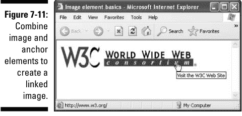

轻轻一点图片就能打开 W3C 网站。就这么简单。

如本章前面所示，你应该将用作链接的任何图片的边框设为`0`，以防止浏览器用难看的蓝线包围你的图片。然而，没有这条线的话，用户需要其他视觉（或替代文本）线索才能知道图片是一个链接。务必让作为链接的图片向用户醒目地（当然要得体地）传达“我是一个链接！”

#### 构建图像映射

当你使用``元素与锚点元素一起创建链接图片时，只能为图片附加一个链接。要创建在页面上不同区域连接不同链接的大图片，你需要一个图像映射。

要创建图像映射，你需要两样东西：

- 一张具有多个明显不同区域的图片，这些区域对用户来说是显而易见的。（例如，一张公园的图片可能显示游乐区、野餐区和池塘区。）
- 将地图上的不同区域映射到不同 URL 的标记。

#### 元素和属性

你使用``元素将地图图片添加到你的页面中，就像添加任何其他图片一样。此外，你需要包含`usemap`属性，让浏览器知道有图像映射信息与该图片相关联。`usemap`属性的值是你的地图名称。


你使用两个元素和一组属性来定义图像映射：

- `<map>` 保存映射信息。`<map>` 元素使用 `name` 属性来标识地图。`name` 的值应与 `` 元素中 `usemap` 的值相匹配，该元素与地图配合使用。

- `<area />` 将地图的特定部分链接到 URL。`<area />` 元素接受以下属性来定义地图每个部分的具体信息：

  - `shape`：指定区域的形状（一个可点击的热点，使图像映射生效）。你可以选择 `rect`（矩形）、`circle`（圆形）和 `poly`（三角形或多边形）。

  - `coords`：定义区域的坐标。矩形的坐标包括 `left`（左）、`right`（右）、`top`（上）和 `bottom`（下）点。圆形的坐标包括圆心的 `x` 和 `y` 坐标以及圆的 `radius`（半径）。多边形的坐标是每个顶点的 `x` 和 `y` 坐标集合。

  - `href`：指定区域链接到的 URL。这可以是绝对 URL 或相对 URL。

  - `alt`：为图像区域提供替代文本。

#### 标记

以下定义了一个名为 `NavMap` 的三区域地图，链接到 `navigation.gif`：

```html

<map name="NavMap" />
    <area shape="rect" coords="0,0,99,30" href="home.html" alt="Home" />
    <area shape="rect" coords="102,0,202,30" href="about.html" alt="About" />
    <area shape="rect" coords="202,0,301,30" href="products.html"
        alt="Products" />
</map>
```

图 7-12 展示了浏览器如何显示这段标记。

> 当鼠标悬停在地图的某个区域上时，光标会变成指向手（就像它在任何其他超链接上变化一样）。因此，充分利用替代文本来包含有关链接的有用信息。

图像地图的常见用途是将地图（如州、国家、城市等）转换为可链接的地图。Webmonkey 的图像地图教程（`http://webmonkey.wired.com/webmonkey/96/40/index2a.html`）提供了更多关于优化图像地图和最大化此 (X)HTML 功能的详细信息。

手动创建图像地图可能很棘手。你需要使用图像编辑器识别地图中的每个点，然后为其创建相应的标记。大多数 (X)HTML 工具都包含帮助你制作图像地图的实用程序。如果你利用这些工具，可以快速且更少错误地创建图像地图。有关 (X)HTML 工具的更多信息，请参阅第 20 章。

## 精彩杂录

表 7-2 列出了其他 (X)HTML 图像和图像地图属性（以及使用图像地图的其他输入相关标签），这些你可能会在 HTML 文件中遇到。

**表 7-2 其他 (X)HTML 图像和地图属性**

| 名称 | 功能/值等于 | 值类型 | 相关元素 |
|---|---|---|---|
| `name` | 为 `usemap` 属性提供名称 | CDATA | `<map>` |
| `nohref` | 图像地图上的非活动区域 | `"nohref"` | `<area />` |
| `usemap` | 告诉浏览器运行客户端地图 | URI | `` `<input />` `<object>` |

# 第三部分：精确控制网页

> "在互联网出现之前，我们只能'在本地大展身手'。但现在，有了我们的网站，我们可以在'世界各地大展身手'。"

## 本部分内容……

本书的这一部分，我们将介绍和描述层叠样式表 (CSS)，这是一种强大的标记语言，通常用于补充 (X)HTML 并管理其在 Web 浏览器中的显示方式。(X)HTML 可以通过包含外部样式表或在 (X)HTML 文档中内联 CSS 标记来引用 CSS。

在这里，你将从学习 CSS 的各种功能开始，了解不同类型的样式表，以及了解当多个样式表应用于单个 Web 页面时的处理规则（这就是 CSS 中 *Cascading* 的由来）。当然，你还将学习如何构建和使用 CSS 来完成诸如创建视觉布局、定位单个项目以及处理字体等任务。因为 CSS 还提供了对颜色和页面上文本显示方式的控制，所以你也将学习如何处理这些功能。

表格是在 (X)HTML 中组织和表示数据的重要方式。本书的这一部分展示了基本的表格设置、结构和语法，并解释了如何使用 CSS 来管理表格外观。

# 第 8 章：介绍层叠样式表

## 本章内容

- 理解层叠样式表
- 介绍 CSS
- 创建样式规则
- 将样式规则链接到网页
- 介绍 CSS 属性
- 理解继承和样式层叠

层叠样式表 (CSS) 的目标是将网页的样式与其结构分离，并使你更容易维护已创建的网页。页面的结构元素（如标题 `<h1>` 到 `<h6>` 和正文）不影响这些元素的外观。通过将样式应用于这些元素，你可以指定元素在页面上的布局并添加设计属性（如字体、颜色和文本缩进）。

样式表让你能够精确控制结构元素在网页上的显示方式。更棒的是，你可以为整个网站创建一个样式表，以确保你的内容在页面之间的布局和外观保持一致。而锦上添花的是：样式表易于构建，甚至更容易集成到你的网页中。实际上，你可以向单个 (X)HTML 元素添加样式标记（称为内联样式），在 (X)HTML 文档的头部创建一系列样式指令（称为内部样式表），或者通过某种链接或其他引用方式在你的 (X)HTML 文档中引用一个单独的独立样式表（称为外部样式表）。有多种方法可以为网页添加样式！

随着 HTML 的发展，以及越来越多的网站过渡到 XHTML，标记语言权威机构的目标是最终废弃（使过时）HTML 元素集合中的所有格式标记，例如 `<font>` 元素。

## 使用 CSS 与已废弃的 HTML

层叠样式表 (CSS) 为你提供了更大的灵活性，允许你以 HTML 无法实现的方式控制对齐、颜色、行高、字距等。使用 CSS 还允许你将格式与内容分离，从而实现更整洁的标记、更好的可维护性和更轻松的故障排除。毫无疑问：CSS 更好。

你可以通过要求所有用户使用 Internet Explorer (IE) 5.0 或更新版本来安全地使用 CSS。但是，如果你创建的是面向广大公众的网站，你无法控制访问者使用哪种浏览器。例如，仍然使用 IE 4.0 的访问者无法查看由 CSS 控制的内容——文本会看起来挤在一起，没有任何可见的格式。

然而，有一个小小的注意事项。CSS 支持在 1990 年代末出现在 Web 浏览器中。到目前为止，大多数用户已经升级到了完全支持 CSS 的浏览器。然而，研究表明，大约 10% 的用户尚未升级，并且可能不会很快升级。这意味着你必须决定这 10% 是否属于你的目标受众。如果是，请相应地进行规划。

因此，同时适应新旧浏览器的最佳方法是使用 CSS 样式表和已废弃的 HTML 格式标签。（请查看本书末尾的附录 A，其中涵盖了所有*已废弃*的 (X)HTML 元素和属性。）CSS 样式表在新浏览器中会覆盖 HTML 格式标签，因此那些已废弃的标签仅在浏览器无法识别 CSS 时才起作用。这不是一个优雅的解决方案，但它确实有效！

当你想精确控制网页的显示时，样式表是可行的途径：

- 通常，样式表比标记提供了更多的灵活性。
- HTML 元素集合将来不会再包含任何面向显示的标签。

> 大多数现代浏览器能很好地处理 CSS。然而，一些旧浏览器，如 4.0 版本的 Internet Explorer 和 Netscape Navigator 浏览器，在正确显示 CSS 方面存在困难。更早的浏览器根本无法显示 CSS。如果你知道你网站的许多用户仍然使用这些过时浏览器中的一种或多种，请在这些浏览器中测试你的页面，以确保它们是可读的。

## 样式表的优势

HTML 的格式化能力至少可以说是有限的。当你在 HTML 中设计页面布局时，你只能使用表格、字体控制和一些内联样式，如粗体和斜体。样式表提供了许多工具，可以精确控制地格式化网页。使用样式表，你可以：

- **精确控制页面显示的各个方面**：指定页面项目，如行间距、字符间距、页边距和图像位置。你还可以指定页面上元素的位置。

- **全局应用更改**：通过将相同的样式表应用于每个网页，你可以保证整个网站设计的一致性。只需修改一个文档（样式表）而不是每个页面上的标记，即可快速轻松地修改整个网站的外观和感觉。需要更改标题的外观吗？在样式表中重新定义标题的样式属性并保存该样式表。标题的外观就会在整个网站中改变。

- **指示浏览器控制外观**：为 Web 浏览器提供更多关于你希望页面如何显示的信息，而不仅仅是你能用 HTML 传达的信息。

- **创建动态页面**：使用 JavaScript 或其他脚本语言与样式表一起，创建响应用户操作而移动、出现或隐藏的文本和其他内容。

## CSS 能为网页做什么

样式表的工作原理要点如下：

1. 你在样式表中定义规则，指定你希望由一组标记描述的内容如何显示。例如，你可以指定每个一级标题 (`<h1>`) 以紫色、Garamond 字体、24 磅大小并带有黄色背景显示（不是说你*会*这样做，但你可以）。
2. 你将样式规则与标记链接起来。
3. 浏览器完成剩下的工作。

当前的规范 CSS2.1 可以：

- 指定字体类型、大小、颜色和效果
- 设置背景颜色和图像
- 控制文本布局的许多方面，包括对齐和间距
- 设置边距和边框
- 控制列表显示
- 定义表格布局和显示

## CSS 能做什么

当你编写样式规则时，你有一个丰富的属性集合可供使用。你几乎可以控制页面显示的各个方面——从边框到字体大小，以及介于两者之间的一切：

- **背景属性**控制与文本块和图像相关的背景颜色。你也可以使用这些属性为页面或单个元素添加背景颜色。

- **边框属性**控制与页面、列表、表格、图像和块级元素（如段落）相关的边框。你可以指定边框的宽度、颜色、样式及其与元素内容的距离。

- **分类属性**控制图像等元素相对于页面上其他元素的流动方式。你可以使用这些属性将图像和表格与页面上的文本融合在一起。

- **列表属性**控制列表在页面上的呈现方式，例如：
  - 管理列表标记
  - 使用图像代替项目符号

- **外边距属性**控制页面的外边距以及围绕块级元素、表格和图像的外边距。这些属性提供了对页面上空白区域的终极控制。

- **内边距属性**控制页面上任何块级元素周围的空白区域大小。当与外边距和边框属性结合使用时，你可以创建一些复杂的布局。

- **定位属性**控制元素在页面上的位置，使你能够将元素放置在页面的特定位置。

- **尺寸属性**控制你的元素（包括文本和图像）在页面上占据的空间（高度和宽度）。它们对于限制文本框和图像的尺寸特别有用。

- **表格属性**控制表格的布局。你可以使用它们来控制单元格间距和其他表格布局细节。

- **文本属性**控制文本在页面上的呈现方式。你可以设置诸如字体大小、字体系列、行高、文本颜色、字间距和行间距、对齐方式以及空白处理等属性。与 `font` HTML 元素相比，这些属性让你通过样式表对文本拥有更多控制权。

## CSS3：下一代样式表

下一代 CSS——CSS3——是一个*模块*集合，这些模块针对网页排版的不同方面，例如字体、背景颜色、列表和文本颜色。其中第一批模块在 2004 年中期成为了标准（正式称为*候选推荐标准*）。但大多数 CSS3 模块预计要到 2005 年底或 2006 年才会成为候选推荐标准，而且很少有浏览器实现 CSS3 功能。简而言之，你暂时还不需要担心 CSS3。

W3C 在其网站 `www.w3.org/style/css` 上专门为此主题设立了一个部分。你可以在那里找到通用的 CSS 信息，以及了解 CSS3 的最新状态。该网站链接到优秀的 CSS 参考资料和教程，并包含有关可以使你的样式表工作更轻松的软件包的信息。

## 属性度量值

许多 HTML 属性使用度量值。我们会在本书中告诉你哪些度量值适用于哪些属性。标准属性度量以两种方式规定属性的大小。

*绝对值*度量可以通过以下值之一指定特定的长度或高度：

- **英寸**，例如 `.5in`
- **厘米**，例如 `3cm`
- **毫米**，例如 `4mm`
- **派卡**，例如 `1pc`

  一英寸大约等于六派卡。

- **磅**，例如 `16pt`

  一派卡等于 12 磅。

- **像素**，例如 `13px`（这些值与计算机显示器上的单个点相对应）。

*相对值*度量基于文档中*父元素*的值来确定长度或高度：

- **p%**：当前 `font-size` 值的百分比，例如 `150%`

  例如，你可以为所有段落定义 `80%` 的字体大小。如果你的文档主体定义为 15 磅字体，那么段落的字体大小就是 12 磅（15 的 80%）。

- **ex**：相对于当前字体 x-height 的值。x-height 等于字体中小写字母的高度，例如 `1.5ex`
- **em**：相对于当前字体大小的值，例如 `2em`

  `1em` 和 `100%` 都等于当前大小。

使用这些值时要小心，因为某些属性只允许使用部分度量值，例如只允许长度值而不允许相对值。不要让这些术语吓到你。只需用你熟悉的值来定义大小。

### 130 第三部分：精确控制网页

有专门的书籍和网站致力于详细讲解这些类别中每一个属性的使用细节。我们建议参考以下资源之一：

- 由 Damon A. Dean 编写、Wiley Publishing 出版的《*CSS 入门经典*》。
- Westciv 网站上的 CSS2 参考：

  [www.westciv.com/style_master/academy/css_tutorial/index.html](www.westciv.com/style_master/academy/css_tutorial/index.html)

尽管 CSS 语法很简单，但要将 CSS 样式与标记结合以微调页面布局可能会有些复杂。但要成为 CSS 大师，你只需要：

- 了解不同属性的工作细节。
- 通过实验了解浏览器如何处理 CSS。

实践能告诉你在网页上用 CSS 传达信息的正确方法。

## CSS 结构和语法

样式表由*样式规则*组成。每个样式规则有两部分：

- **选择器：** 指定样式规则应用到的标记元素。
- **声明：** 指定由标记描述的内容的外观。

你使用一组标点符号和特殊字符来定义样式规则。样式规则的语法始终遵循此模式：

```css
selector {declaration}
```

声明进一步分解为两个项目：

- **属性**是计算机显示文本和图形的各个方面（例如，字体大小或背景颜色）。
- **值**是指定你希望文本和图像在页面上如何显示的数据（例如，24 磅字体大小或黄色背景）。

你使用冒号在声明中分隔属性和值：

```css
selector {property: value}
```

例如，以下三个样式规则设置了一级、二级和三级标题的颜色：

```css
h1 {color: teal}
h2 {color: maroon}
h3 {color: black}
```

CSS 规范列出了你可以在样式规则中使用的确切属性及其可以接受的不同值。大多数是相当不言自明的（例如 `color` 和 `border`）。有关 CSS2 规范包含哪些属性的快速概览，请参阅本章前面的“CSS 能做什么”。

样式表会覆盖浏览器的内部显示规则；你的格式规范会影响*页面在用户浏览器中的最终外观*。这意味着你可以更好地控制内容的外观，并为访问者创造更一致和合适的体验。

例如，以下样式规则指定了用于一级、二级和三级标题的字体大小（以像素为单位）：

```css
h1 {font-size: 24px}
h2 {font-size: 18px}
h3 {font-size: 16px}
```

图 8-1 显示了一个简单的 HTML 页面，其中包含所有三个标题级别（以及一些正文文本），但没有应用样式表。浏览器使用其默认设置以不同的字体大小显示标题。

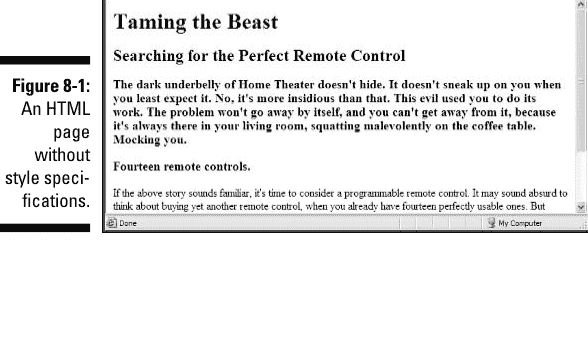

### 132 第三部分：精确控制网页

图 8-2 显示了应用样式表后的同一网页。标题比前面的图中小得多。这是因为样式表规则覆盖了浏览器的设置。

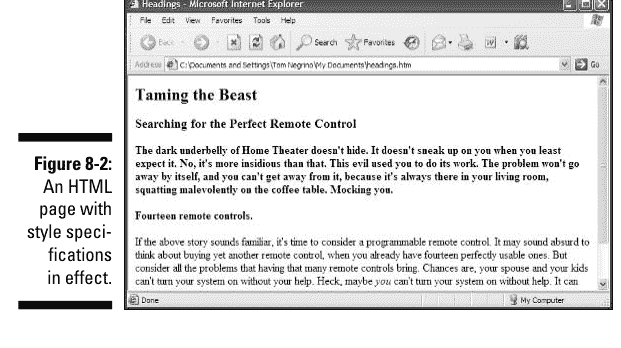

用户可以更改其首选项，使浏览器忽略你的样式表。（大多数用户会使用你的样式表）。请在关闭样式表的情况下测试你的网页，以确保在没有样式表的情况下它看起来不错（或可以接受）。

### 选择器和声明

你可能希望一个样式规则影响给定选择器的多个属性显示。你可以为单个选择器创建多个样式规则，每个规则包含一个声明，像这样：

```css
h1 {color: teal}
h1 {font-family: Arial}
h1 {font-size: 36px}
```

然而，这样大量的样式规则变得难以管理。CSS 允许你将多个声明组合在一个样式规则中，该规则影响单个选择器的显示特性，像这样：

```css
h1 {color: teal;
    font-family: Arial;
    font-size: 36px}
```

### 字体族

为 `font-family` 属性赋值时，可以提供一组以逗号分隔的字体名称。这些名称必须与用户 Web 浏览器可用的字体相匹配。如果字体名称（如 "Times New Roman"）包含空格，则必须将其用引号括起来。

```css
h1 {font-family: Verdana; "Times New Roman", serif;}
```

浏览器首先尝试使用 Verdana，如果不可用，则查找 Times New Roman，最后使用通用衬线字体作为备选。第 10 章将详细介绍 CSS 中的字体。


所有为`h1`选择器声明的内容都在同一组大括号（`{ }`）内，并以分号（`;`）分隔。你可以在样式规则中放置任意数量的声明；只需在每个声明末尾加上分号即可。


最后一个声明末尾的分号是可选的。有些人会加上它以保持一致性，让每个声明都以分号结尾，但这并非必需。在本书中，我们两种方式都会使用。

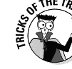

从纯粹技术的角度来看，样式表中的空格无关紧要（正如 HTML 中一样），但你应该使用一致的间距方案，以便轻松阅读和编辑样式表。这个空格规则的一个例外是在`font-family`声明中声明多个字体名称时。更多信息请参阅“字体族”侧边栏。

你也可以让同一组声明应用于一组选择器：只需用逗号分隔选择器即可。以下样式规则将文本颜色、字体族和字体大小的声明应用于`h1`、`h2`和`h3`选择器：

```css
h1, h2, h3 {color: teal;
font-family: Arial;
font-size: 36px}
```

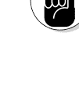

本节中的示例样式规则表明，样式表语法在很大程度上依赖于标点符号。当样式规则未按预期正常工作时，请确保语法中没有在需要冒号的地方使用分号，也没有在需要大括号的地方使用圆括号。

W3C 的验证服务可以帮助你查找样式表中的问题：

```text
http://jigsaw.w3.org/css-validator/
```

## 第三部分：精确控制网页

### 使用样式类

有时你需要仅应用于 HTML 标记元素特定实例的样式规则。例如，如果你想创建一个仅应用于包含版权信息的段落的样式规则，就需要一种方法来告诉浏览器该规则的作用范围有限。

要更精确地定位样式规则，请将`class`属性与标记元素结合使用。以下示例展示了两种段落的 HTML：

- 普通段落（没有`class`属性）
- `class`属性值为`copyright`的段落

```html
<p>这是一个普通段落。</p>
```

```html
<p class="copyright">这是一个 class 为 copyright 的段落。</p>
```

要创建仅应用于版权段落的样式规则，请在样式规则中的段落选择器之后加上：

- 一个句点（`.`）
- `class`属性的值，如`copyright`

最终形成的规则如下所示：

```css
p.copyright {font-family: Arial;
    font-size: 12px;
    color: white;
    background: black}
```

此样式规则规定，所有 class 为`copyright`的段落均以 12 像素 Arial 字体显示白色文本和黑色背景。图 8-3 展示了浏览器如何仅将这一样式规则应用于带有`copyright`属性的段落。

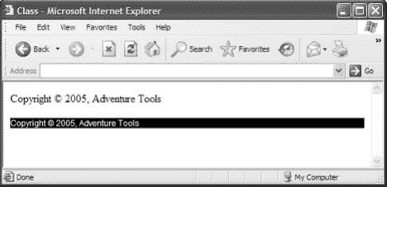

你还可以创建不与任何元素关联的样式规则类，如下例所示：

```css
.warning {font-family: Arial;
                font-size: 14px;
                background: black;
                color: white}
```

你可以通过向任何元素添加`class="warning"`来使用此样式类。图 8-4 展示了浏览器如何将 warning 样式应用于段落和标题，但不应用于下面 HTML 中的引用块：

```html
<p class="warning">这是一个没有应用 warning 类的段落。</p>
<blockquote>这是一个没有定义类的引用块。</blockquote>
<p class="warning">这是一个应用了 warning 类的段落。</p>
```

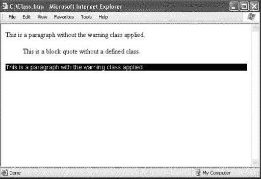

**图 8-4：**你可以使用类来创建适用于任何元素的样式规则。

### 继承样式

HTML（以及通常的标记）中的一个基本概念是标签的嵌套：

- 你的整个 HTML 文档嵌套在`<html>`和`</html>`标签内。
- 浏览器在窗口中显示的所有内容都嵌套在`<body>`和`</body>`标签内。（这仅仅只是开始，实际上还有更多。）

CSS 规范认识到你经常将一个元素嵌套在另一个元素内部，因此希望确保与父元素关联的样式能够传递到子元素。这种机制称为*继承*。

当你为某个元素指定样式时，相同的样式会应用于该元素内部嵌套的所有元素。例如，为 body 元素设置的样式规则，用于设置页面背景、文本颜色、字体大小、字体族和边距，如下所示：

```css
body {background: black;
    color: white;
    font-size: 18px;

    font-family: Garamond;
    margin-left: 72px;
    margin-right: 72px;
    margin-top: 72px}
```

如果你想为整个文档设置样式规则，Redraw，请在 body 元素中进行设置。例如，更改整个页面的字体要容易得多；这比逐个更改每个元素要好得多。

当你将以下 HTML 与前面仅应用于 body 元素的样式规则关联时，格式设置会继承到所有元素（如图 8-5 所示）：

```html
<body>
  <p>此段落继承页面样式。</p>
  <h1>此标题也是如此</h1>
  <ul>
     <li>此列表中的项目也是如此</li>
     <li>项目</li>
     <li>项目</li>
  </ul>
</body>
```

图 8-5：继承意味着样式规则适用于嵌套元素。

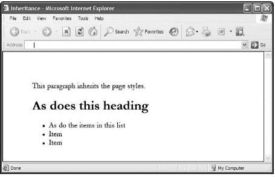

> **注意继承**
>
> 当你构建指导页面每个方面外观的复杂样式表时，请记住继承。例如，如果你在 body 样式规则中为页面设置了边距，那么为页面上所有其他元素设置的边距都是基于为 body 设置的边距。如果你了解样式规则是如何协同工作的，就可以利用继承来减少样式规则的重复，并为页面创建统一的显示效果。

本章介绍了基本的 CSS 语法，但你可以通过高级技术来微调样式规则。CSS 语法规则的完整概述可在 Web Design Group 的“CSS Structure and Rules”教程中找到，网址为`www.htmlhelp.com/reference/css/structure.html`。

### 使用不同类型的样式表

完成样式规则的创建后，你可以通过以下选项之一将其与 HTML 页面关联：

- **将样式信息插入文档。**你可以：
  - 使用`<style>`元素在网页中构建样式表。这是*内部样式表*。
  - 使用`style`属性直接向标签添加样式信息。这是*内联样式*。
- **使用*外部样式表*。**你可以：
  - 使用`<link>`标签将网页*链接*到外部样式表。
  - 使用 CSS 的`@import`语句将外部样式表*导入*网页。

### 内部样式表

内部样式表存在于你的 HTML 页面中。只需在文档头部的`<style>`元素中添加样式规则即可。你可以在内部样式表中包含任意数量（或尽可能少）的样式规则。（参见清单 8-1。）

## 第三部分：精确控制网页

### 清单 8-1：向 HTML 文档添加内部样式表

```html
<!DOCTYPE html PUBLIC "-//W3C//DTD XHTML 1.0 Transitional//EN"
		"http://www.w3.org/TR/xhtml1/DTD/xhtml1-transitional.dtd">
<html xmlns="http://www.w3.org/1999/xhtml">
<head>
	<title>Internal Style Sheet Example</title>
	<style type="text/css">
		body {background: black;
				color: white;
				font-size: 16px;
				font-family: Garamond;
				margin-left: 72px;
				margin-right: 72px;
				margin-top: 72px}

		h1, h2, h3 {color: teal;
					font-family: Arial;
					font-size: 36px}

		p.copyright {font-family: Arial;
					font-size: 12px;
					font-color: white;
					background: black}

		warning {font-family: Arial;
					font-size: 16px;
					font-color: red}
	</style>
</head>
<body>

<!-- 文档内容放在此处 -->

</body>
</html>
```

内部样式表的优点是方便：你的样式规则与标记在同一页面上，因此可以快速调整两者。但如果你希望相同的样式规则控制多个 HTML 页面的外观，请将这些样式从单个网页移至外部样式表。

### 外部样式表

外部样式表将所有样式规则保存在一个单独的文本文档中，你可以从站点上的任何 HTML 文件引用它。你必须维护单独的样式表文件，但外部样式表为整体站点维护带来了好处。如果你的站点页面使用相同的样式表，你可以通过更改样式表来一次更改所有页面的任何格式特性。

我们建议您在自己的网站上使用外部样式表。

## 链接

要引用外部样式表，请在网页的头部使用`link`元素，例如：

```html
<html>
<head>
  <title>External Style Sheet Example</title>
  <link rel="stylesheet" type="text/css" href="styles.css" />
</head>
<body>

<!-- Document content goes here -->

</body>
</html>
```

`<link>`元素中的`href`属性可以使用：

- 相对链接（您自己网站上的样式表）
- 绝对链接（不在您自己网站上的样式表）

通常，您不应该使用不在您网站上的样式表——您需要控制自己网站的外观和体验。

如果您想快速为网页添加样式（或试验浏览器如何处理不同的样式），请使用绝对 URL 指向 W3C 的核心样式表之一。在[www.w3.org/StyleSheets/Core/](www.w3.org/StyleSheets/Core/)了解更多相关信息。

第 6 章将介绍相对链接和绝对链接之间的区别。

#### 导入

`@import`语句指示浏览器加载外部样式表并使用其样式。您在`<style>`元素内使用它，但要放在任何单独的样式规则之前，如下所示：

```html
<style>
  @import "http://www.somesite.edu/stylesheet.css";
</style>
```

导入的样式表中的样式规则优先于`@import`语句之前的所有规则。因此，如果您的页面上有多个外部样式表通过多个`@import`引用，规则将从后面的样式表（页面中更靠下的那些）开始应用。

### 谨慎使用内联样式

您可以将单独的样式规则（称为*内联样式*）附加到 HTML 文档中的单个元素。附加到元素的内联样式规则如下所示：

```html
<p style="color: green">Green text.</p>
```

将样式规则添加到元素其实并不是最佳方法。我们通常建议您为规则选择内部或（最好）外部样式表，而不是将规则附加到文档中的单个元素。原因如下：

- ✔ 您的样式规则混杂在页面中，难以查找。
- ✔ 您必须将整个规则放在`style`属性的值中，这使得复杂的规则难以编写和编辑。
- ✔ 您会丧失在外部样式表中对选择器进行分组和重用样式规则的所有好处。

### 理解层叠

多个样式表可以影响页面元素并相互构建。这就像在网页中继承样式一样。这就是 CSS 的*层叠*部分。

这里有一个现实世界的例子：一所大学英语系的网站。英语系隶属于人文学院，而人文学院只是整个大学中的一个学院。这些实体——大学、学院和英语系——都有自己的样式表。

1. 大学的样式表为整个网站的所有页面提供样式规则。
2. 学院的样式表链接到大学的样式表（使用`@import`语句），并添加更多特定于学院网站外观的样式规则。
3. 英语系的样式表链接到学院的样式表。因此，该系的页面既*有自己的样式规则*，又*继承了来自学院和大学样式表的样式规则*。

但是如果多个样式表为同一个元素定义规则呢？例如，如果所有三个样式表都为`h1`元素指定了规则怎么办？在这种情况下，距离您正在处理的页面或元素最近的规则胜出：

- ✔ 如果系样式表上存在`h1`规则，它将优先于学院和大学的`h1`样式。
- ✔ 如果系内的某个单独页面在`<style>`标签中为`h1`应用了样式规则，则该规则适用。

# 第 9 章：使用层叠样式表

## 本章内容

- 了解如何使用 CSS
- 在页面上定位对象
- 创建字体规则
- 创建用于打印的样式表
- 了解听觉样式表

理解 CSS 的结构和语法很容易。学习 CSS 可以应用于 (X)HTML 文档的属性需要花费多一点时间和精力。然而，真正让学习曲线变得有趣的是学习如何使用 CSS 将一个普通或平常的网页“提升一个档次”。本章介绍如何将 CSS 付诸实践，而不是专注于其结构和内部工作原理。

第 8 章是 CSS 及其工作原理的高级概述。如果您需要复习 CSS 样式规则和属性，请阅读第 8 章，然后返回本章将 CSS 付诸行动。

现在是时候制作一个页面并赋予它一些样式了！

要高效地使用 CSS，请遵循以下一般准则：

- 当您测试页面的外观时，请使用内部样式，这样您就可以尽情调整。（本章展示内部样式表。）
- 当您的测试页面看起来恰到好处时，将这些样式移动到外部样式表，然后在整个网站中应用它们。

### 管理布局、定位和外观

您可以使用 CSS 来布局页面，使图像和文本块：

- 准确地出现在您想要的位置
- 完全适合您想要它们占据的空间

在文档中创建样式后，您可以创建外部样式表，将相同的样式应用于您想要的任何页面。

#### 开发特定样式

清单 9-1 展示了一个没有任何定义样式的网页。

**清单 9-1：一个相当乏味的页面**

```html
<!DOCTYPE html PUBLIC "-//W3C//DTD XHTML 1.0 Transitional//EN"
    "http://www.w3.org/TR/xhtml1/DTD/xhtml1-transitional.dtd">
<html xmlns="http://www.w3.org/1999/xhtml">
<head>
    <title>Pixel's Page</title>
    <meta http-equiv="Content-Type" content="text/html; charset=ISO-8859-1" />
</head>
<body>
    <h1>I'm Pixel the Cat. Welcome to my page.</h1>
    <div class="navbar">
        Links of interest:<br />
        <a href="http://www.google.com/">Google</a><br />
        <a href="http://www.amazon.com/">Amazon</a><br />
        <a href="http://www.yahoo.com/">Yahoo</a>
    </div>
    
</body>
</html>
```

这只猫看起来不错，但这个页面肯定没有展示它的潜力。添加一些样式会极大地改善这个页面。方法如下！

#### 视觉布局

我们希望链接出现在左侧，这是导航工具的典型位置，而不是像图 9-1 中那样出现在图像上方。以下标记将搜索网站链接的文本浮动到图像左侧：

```html
<style type="text/css">
.navbar {
    background-color: #CCC;
    border-bottom: #999;
    border-left: #999;
    border-width: 0 0 thin thin;
    border-style: none none groove groove;
    display: block;
    float: left;
    margin: 0 0 0 10px;
    padding: 0 10px 0 10px;
    width: 190px;
}
</style>
```

图 9-1：这个无样式的页面没有达到这只猫的潜力。

在前面的规则中，我们：

- 添加了一个`<style>`标签
- 在`<style>`标签内定义了`navbar`类


- 使用 `navbar` 类指示内容浮动到图像左侧，使它们出现在页面左侧的同一部分，而不是在图形上方。

这条规则说明，页面上任何具有 `navbar` 类的东西（如图 9-2 所示）都应显示为：

- 浅灰色背景
- 底部和左侧的深灰色细凹槽线边框
- 无顶部或右侧边框
- 向左浮动的块（因此页面上的其他所有内容向右移动，如图 9-2 中的猫图像）
- 左边距 10 像素
- 顶部和底部各 10 像素的内边距
- 导航栏区域总宽度 190 像素

**图 9-2：** 导航栏现在看起来更像标准的左侧导航。

请注意，声明中的几个属性被称为*简写属性*，它们接受多个值，例如 `margin` 和 `padding`。（它们被称为简写属性，因为它们从多个相关的 CSS 属性[如 `margin-height`、`margin-width` 等]收集值。请参阅附录 B 获取完整列表。）这些值对应于导航栏框的上、右、下、左边缘的设置。`margin` 在框周围创建一个空白区域，`padding` 定义框的边缘或边框与框内内容之间的空间。以下是有关如何将值与处理边距、边框、内边距等的属性相关联的规则：

- 如果所有边的值相同，单个值即可。
- 如果*任何*一边与其他边不同，*每一*边都需要单独的值。

要记住什么是关键，请按顺时针顺序考虑元素框的边缘，从顶部边缘开始：`top`、`right`、`bottom`，然后是 `left`。

# 第九章：使用层叠样式表

## 定位

CSS 提供了多种方式来精确指定页面元素应出现在页面上的具体位置。这些控制使用基于元素框与其父元素框之间关系的各种定位方式，帮助页面设计师将页面元素放置在他们想要的位置。以下几节将讨论涉及的属性类型。

### 位置

你可以控制图像的水平和垂直位置。不必让它自动显示在导航栏右侧，你可以将它放在下方和左侧，如图 9-3 所示：

```css
#theCat {position: absolute; top: 100px; left: 100px;}
```

你可能在想，为什么 `navbar` 规则以句点开头的，而 `theCat` 规则以井号（也称为哈希符号或 octothorpe）开头。这是因为句点应用于 class 属性，而井号应用于 id 属性。你可以应用 class 或 id；两者的区别在于，class 可以被使用多次，但 id 在页面上必须是唯一的。页面上不能有其他元素的 id 为 `theCat`。简单来说，区别在于，class 让你可以用单个引用指代某种类型的所有元素，而 id 只能针对单个元素实例。

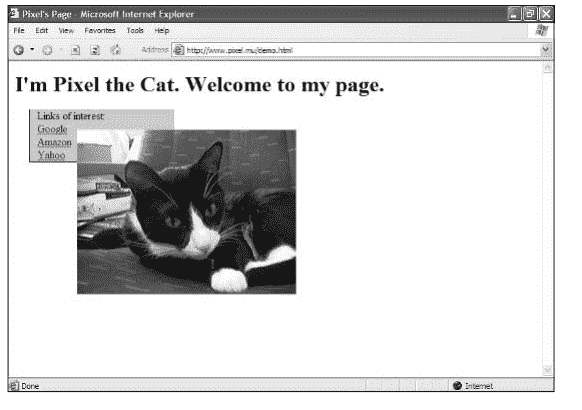

**图 9-3：** 图像在这个位置上显眼得多。

#### 重叠

两个对象*可以*被分配到网页上的同一位置。当这种情况发生时，浏览器必须决定显示顺序，以及显示哪些对象、隐藏哪些对象。

`z-index` 添加到任何规则中，告诉 CSS 你希望对象在页面中已知其他对象之上或之下的堆叠方式：

- 较低的数值向下移动堆叠。
- 较高的数值向上移动堆叠。
- `z-index` 的默认值是 `auto`，这意味着与其父元素相同。

给 `theCat` 一个 `z-index` 值为 -1 会自动将其置于页面上所有其他未设置 `z-index` 的元素之后（如图 9-4 所示）。

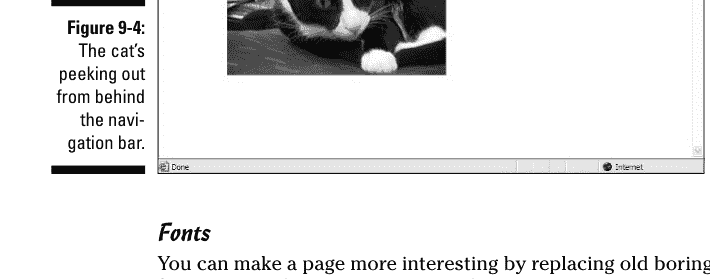

## 字体

通过替换老旧乏味的默认字体，可以让页面更有趣。首先从指定通用正文字体开始，同时设置一些其他默认规则，如背景颜色和文本颜色。

### 正文文本

以下示例设置 `body` 标签内文本的样式：

```css
body {font-family: verdana, geneva, arial, helvetica, sans-serif;
     font-size: 12px; line-height: 16px; background-color: white;
     color: black;}
```

因为 `body` 元素包含网页的所有内容，所以这会影响页面上的所有元素。前述规则指示浏览器按以下方式显示 `body` 元素内的所有文本：

- 文本使用所列字体中的一种渲染。我们将 Verdana 放在列表首位，因为它是首选字体，浏览器会按照标记中列出的顺序检查可用字体。（注意，通用字体——此处为 `sans-serif`——几乎总是出现在此类列表的末尾，因为浏览器几乎总能自行提供此类字体。）

你可以列出多种字体。浏览器会使用列表中在浏览器可用的第一种字体。例如，浏览器按以下顺序从我们的列表中查找字体：

1. Verdana
2. Geneva
3. Arial
4. Helvetica
5. 浏览器的默认 `sans-serif` 字体

- 12 像素字体大小
- 16 像素行高

行间距基于字体高度为 16 像素来计算，因此行与行之间有更多的垂直空间。

图 9-5 表明：

- 所有更改适用于整个页面，包括导航栏。
- `h1` 标题中的 `font-family` 已更改，但 `font-size` 和 `line-height` 均未更改。

因为标题对 `font-size` 和 `line-height` 有特定的默认值，所以需要另一条规则来修改它们。

在图 9-5 中，标题顶部略有截断。这是 Windows 版 Internet Explorer 的一个 bug，在其他浏览器中不会出现。不幸的是，CSS 渲染的不确定性足以让你必须在各种浏览器中测试样式规则，观察其效果，然后相应调整。

#### 标题

如果我们为 `h1` 元素显式指定样式属性，显示结果会更可预测。以下是一组示例样式：

```css
h1 {font-family: "trebuchet ms", verdana, geneva, arial, helvetica, sans-serif;
    font-size: 24px; line-height: 26px;}
```

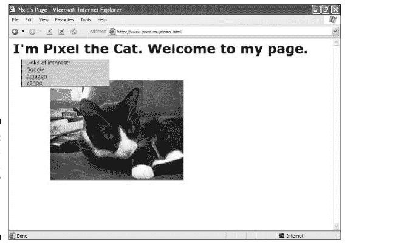

**图 9-5：** 字体更好看了，但仍有改进空间。

图 9-6 展示了使用我们想要的字体系列和字号的一级标题：24 像素的 Trebuchet MS，行高 26 像素。如果我们的系统上没有 Trebuchet MS 字体，标题将以 Verdana 显示。

> 当字体名称包含空格（如 `trebuchet ms` 或 `times new roman`）时，完整名称必须放在引号内。更多信息请参阅第八章。

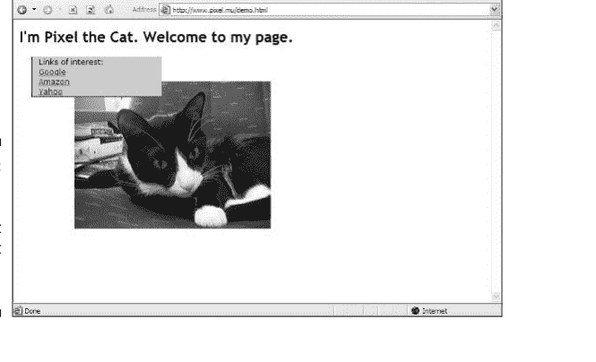

**图 9-6：** 为 `h1` 声明一条规则，使其按我们想要的方式显示。

### 超链接

我们认为让超链接带下划线会让菜单看起来有点杂乱，所以通常关闭下划线。但我们仍希望超链接看起来像超链接，所以我们告诉 CSS：

- 让链接加粗。
- 当光标悬停在链接上时显示下划线。
- 以特定颜色显示链接。

以下样式规则定义了浏览器应如何显示超链接：

```css
a {text-decoration: none; font-weight: bold}
a:link {color: blue}
a:visited {color: #93C}
a:hover {text-decoration: underline}
```

这是怎么回事？从上到下，我们为页面上的所有 `<a>` 标签设置了两个规则：

- `text-decoration` 声明将其值设为 `none`。这会移除所有链接的下划线。
- `font-weight` 声明的值为 `bold`。这使页面上所有链接显示为粗体。

前面代码中的其余规则是*伪类选择器*。它们最常见的用途是修改链接在不同状态下的显示方式。有关伪类的更多信息，请参阅第十章。图 9-7 展示了应用前述样式规则后页面的显示效果。

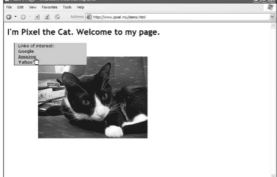

### 外部化样式表

当最终页面符合你的要求时，你就可以将经过测试、批准的内部样式表移入外部样式表了。

- 网站的每个页面只需添加一行代码，就能使用整个样式表。
- 只需在外部样式表中更改一次，即可实现全站范围的更改。

要从经过充分测试的内部样式表创建外部样式表，请按以下步骤操作：

1. **复制 `<style>` 和 `</style>` 标签之间的所有文本。**
2. **将该文本粘贴到其自己的文档中。**

   此文本应仅包含 CSS 标记，不能有任何 HTML 标签或标记。

3. **在文档名称后添加 `.css` 后缀（例如，`myStyles.css`）。**

   这样可以一眼看出它是 CSS 文件。

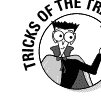

以下是将 HTML 文件链接到外部样式表的两种方法：

- **使用 `<link>` 标签。**

  所有支持 CSS 的浏览器都理解 `link` 标签。

- **使用带有 `@import` 关键字的 `<style>` 标签。**

  只有较新的浏览器理解 `<style>` 和 `@import` 的组合。

#### 兼容新旧浏览器的样式表

要包含新旧浏览器都能处理的规则，你可以为网站创建**两个**样式表：

- 一个基本样式表，仅包含最简单的样式
- 一个复杂样式表，利用最强大新浏览器的能力
- `<link>` 标签引入 `simpleStyles.css`，一个面向旧浏览器的基本样式表。

以下代码使用了两个样式表：

- `<style>` 标签和 `@import` 关键字的组合引入 `complexStyles.css`，一个面向新浏览器的复杂样式表，它会覆盖 `simpleStyles.css` 中的样式。

```html
<link href="simpleStyles.css"
      rel="stylesheet" />
<style type="text/css">
  @import "complexStyles.css";
</style>
```

新旧浏览器都能获得它们恰好能够处理的规则。

### 多媒体

你可以根据不同的*媒体类型*来指定网页的外观或行为。

表 9-1 列出了所有媒体类型及其用途。

**表 9-1 已识别的媒体类型**

| 媒体类型 | 描述 |
|---|---|
| `all` | 适用于所有设备 |
| `aural` | 用于语音合成器 |
| `braille` | 用于盲文触觉反馈设备 |
| `embossed` | 用于分页盲文打印机 |
| `handheld` | 用于手持设备（如具有小屏幕、单色显示器和有限带宽的设备） |
| `print` | 用于分页、不透明材料以及在屏幕上以打印预览模式查看的文档 |
| `projection` | 用于投影演示，如投影仪或透明胶片 |
| `screen` | 用于彩色计算机屏幕 |
| `tty` | 用于使用固定间距字符网格的媒体，如电传打字机、终端或具有有限显示能力的便携设备 |
| `tv` | 用于电视类型的设备（如具有低分辨率、彩色显示、有限滚动屏幕和部分音频功能的设备） |

CSS 可以进行更改，以自定义相同页面在不同媒体上的呈现效果：

- ✔ 在计算机屏幕上渲染
- ✔ 打印到纸上
- ✔ 大声朗读时发出声音

> 一个漂亮的彩色背景在黑白激光打印机上打印时可能会使你的页面变得一团糟，但正确使用打印媒体样式可以避免这种情况！

#### 可视媒体样式

表 9-2 列出了你在典型网页中最可能使用的 CSS 属性。本书前面的速查表包含了最常用的 CSS 属性以及 (X)HTML 标签和属性的简要说明。

**表 9-2 可视媒体样式**

| 属性 | 值 | 默认值 | 描述 |
| :--- | :--- | :--- | :--- |
| `background-color` | 任意颜色，按名称或十六进制代码 | `transparent` | 页面的背景色 |
| `background-image` | URL | `none` | 用于页面背景显示的图像 URL |
| `color` | 任意颜色，按名称或十六进制代码 | UA 相关 | 前景文本的颜色 |
| `font-family` | 任意命名字体、`cursive`、`fantasy`、`monospace`、`sans-serif`、`serif` | UA 相关 | 要显示的字体 |
| `font-size` | 数字 + 单位、`xx-small`、`x-small`、`small`、`medium`、`large`、`x-large`、`xx-large` | `medium` | 要显示的字体大小 |
| `font-weight` | `normal`、`bold`、`bolder`、`lighter` | `normal` | 字体的粗细（加粗或变细的程度） |
| `line-height` | `normal`、数字 + 单位 | `normal` | 文本行之间的垂直间距 |
| `text-align` | `left`、`center`、`right`、`justify` | UA 相关 + 书写方向 | 页面上文本的对齐方式 |
| `text-decoration` | `none`、`underline`、`overline`、`line-through`、`blink` | `none` | 特殊文本效果 |
| `list-style-image` | URL | `none` | 用作列表项目符号的图像 URL |
| `list-style-position` | `inside`、`outside` | `outside` | 列表文本在项目符号内部还是外部换行 |
| `list-style-type` | `disc`、`circle`、`square`、`decimal`、`decimal-leading-zero`、`lower-alpha`、`upper-alpha`、`none` | `disc` | 列表的项目符号类型 |
| `display` | `block`、`inline`、`none` | `inline` | 页面中已定义区域的格式 |
| `top` | 百分比、数字 + 单位、`auto` | `auto` | 对于绝对定位的对象，距定位上下文顶边的偏移量 |
| `right` | 百分比、数字 + 单位、`auto` | `auto` | 对于绝对定位的对象，距定位上下文右边的偏移量 |
| `bottom` | 百分比、数字 + 单位、`auto` | `auto` | 对于绝对定位的对象，距定位上下文底边的偏移量 |
| `left` | 百分比、数字 + 单位、`auto` | `auto` | 对于绝对定位的对象，距定位上下文左边的偏移量 |
| `position` | `static`、`absolute`、`relative`、`fixed` | `static` | 元素框相对于定位上下文的布局方式 |
| `visibility` | `collapse`、`visible`、`hidden`、`inherit` | `inherit` | 指示对象是否会在页面上显示 |
| `z-index` | 数字、`auto` | `auto` | 对象的堆叠顺序 |
| `border-style` | `none`、`dotted`、`dashed`、`solid`、`double`、`groove`、`ridge`、`inset`、`outset` | 未定义 | 对象边框的显示样式。可分解为 `border-top-style`、`border-right-style`、`border-bottom-style` 和 `border-left-style` |
| `border-width` | `thin`、`medium`、`thick`、数字 | 未定义 | 对象周围边框的宽度。可分解为 `border-top-width`、`border-right-width`、`border-bottom-width` 和 `border-left-width` |
| `border-color` | 任意颜色，按名称或十六进制代码；`transparent` | 未定义 | 对象边框的颜色。可分解为 `border-top-color`、`border-right-color`、`border-bottom-color` 和 `border-left-color` |
| `border` | `border-width + border-style + border-color` | 未定义 | 对象周围边框的组合特征。可分解为 `border-top`、`border-right`、`border-bottom` 和 `border-left` |
| `float` | `left`、`right`、`none` | `none` | 指定对象是否应浮动到文档的一侧 |
| `height` | 百分比、数字 + 单位、`auto` | `auto` | 对象的显示高度 |
| `width` | 百分比、数字 + 单位、`auto` | `auto` | 对象的显示宽度 |
| `margin` | 百分比、数字 + 单位、`auto` | 未定义 | 对象的显示外边距。可分解为 `margin-top`、`margin-right`、`margin-bottom` 和 `margin-left` |
| `padding` | 百分比、数字 + 单位、`auto` | 未定义 | 对象周围的显示空白区域。可分解为 `padding-top`、`padding-right`、`padding-bottom` 和 `padding-left` |
| `cursor` | `auto`、`crosshair`、`default`、`pointer`、`move`、`text`、`help` | `auto` | 浏览器窗口中的光标外观 |

> 某些浏览器不支持所有 CSS 属性。如果你正在使用 CSS 功能，请使用你预期访客会使用的浏览器来测试你的页面。

如果你想随时随地携带一份极其详尽的 CSS 指南，可以把它放在你的 iPod 上！Westciv 的免费 podGuide 是一个小型文本文件的文件夹。下载压缩文件并按照安装说明操作，你就随时拥有完整的文档了。你还将赢得"世界上最大的 CSS 极客"的称号。podGuide 的地址是：

```text
www.westciv.com/news/podguide.html
```

#### 分页媒体样式

CSS 可以自定义页面打印时的外观。我们建议遵循以下准则：

- 将无衬线字体替换为衬线字体。衬线字体在打印时比无衬线字体更易于阅读。


- 插入的广告应：
  - 在不带动画时也能表达清楚
  - 无需点击即可提供有用信息

总的来说，分页媒体样式有助于确保文本在打印时的效果与在浏览器中显示时一样好。参见表 9-3 了解 CSS 中分页媒体属性的说明，这些属性可以帮助你的用户在打印网页时获得最佳效果。

**表 9-3 分页媒体属性**

| 属性 | 值 | 默认值 | 描述 |
| --- | --- | --- | --- |
| `orphans` | 数字 | 2 | 段落中必须保留在页面底部的最少行数 |
| `page-break-after` | `auto`、`always`、`avoid`、`left`、`right` | `auto` | 元素之后的分页行为 |
| `page-break-before` | `auto`、`always`、`avoid`、`left`、`right` | `auto` | 元素之前的分页行为 |
| `page-break-inside` | `auto`、`avoid` | `auto` | 元素内部的分页行为 |
| `widows` | 数字 | 2 | 段落中必须保留在页面顶部的最少行数 |

代码清单 9-2 中的示例使用了以下分页媒体样式选项：

- 使输出为白底黑字。
- 将无衬线字体替换为衬线字体。

## 第三部分：精确控制网页

### 清单 9-2：添加打印样式表

```html
<!DOCTYPE html PUBLIC "-//W3C//DTD XHTML 1.0 Transitional//EN"
    "http://www.w3.org/TR/xhtml1/DTD/xhtml1-transitional.dtd">
<html xmlns="http://www.w3.org/1999/xhtml">
<head>
<title>This is my page</title>
<meta http-equiv="Content-Type" content="text/html; charset=ISO-8859-1" />
<style>
    body {background-color: black; color: white; font-family: sans-serif;}

    @media print {
        body {background-color: white; color: black; font-family: serif}
    }
</style>
</head>
<body>
    This page will look very different when sent to the printer.
</body>
</html>
```

如果你现在想知道为什么表 9-3 中的属性都没有设置，而其他属性却设置了，那是因为（在这个例子中）它们的默认值效果很好。而且，仅仅因为这些页面属性可以被设置，并不意味着你不能设置其他属性——这并非非此即彼的关系。

### 听觉（语音）样式

听觉浏览器和样式不仅服务于视觉障碍人士。对于以下 Web 用户也很有用：

- 有阅读困难的人
- 驾驶时需要信息的人

下面的示例建议使用男性和女性角色的声音播放，以明确哪个角色在说话：

```css
@media aural {
    p.stanley {voice-family: male;}
    p.stella {voice-family: female;}
}
```

通常，你不必太担心在页面中添加听觉样式。如果满足以下条件，默认的阅读器应该就能工作得很好：

- 你的页面主要是文本。
- 你对声音效果没有特别要求，任何清晰的男声或女声都可以。

也就是说，你可以在本书末尾的附录 B 中找到所有听觉样式属性的完整列表。

### 精彩杂项

表 9-4 列出了其他一些你可能会在文档中发现的 CSS 属性。

**表 9-4：其他 CSS 属性**

| 属性 | 值 | 默认值 | 描述 |
| :--- | :--- | :--- | :--- |
| `@page` | 分页媒体 | `{page selector\| page-pseudo-class\|page context}` | 为给定内容框定义页面上下文 |
| `content` | 文本 | `{string\|uri\| counter\|attr(x)\| open-quote\| close-quote\| no-open-quote\| no-close-quote\| inherit}` | 描述在生成内容操作期间要插入的内容 |
| `counter-increment` | 通用 | `{name:integer\| none\|inherit}` | 用于递增命名计数器的值 |
| `counter-reset` | 通用 | `{name: integer\| none\|inherit}` | 用于将命名计数器的值重置为特定值 |
| `empty-cells` | 表格 | `{hide\|show\| inherit}` | 描述如何处理不包含内容的单元格 |
| `margin-bottom` | 盒模型 | `{auto\|length\| percentage\| inherit}` | 设置元素底部的外边距宽度 |
| `margin-left` | 盒模型 | `{auto\|length\| percentage\| inherit}` | 设置元素左侧的外边距宽度 |
| `margin-right` | 盒模型 | `{auto\|length\| percentage\| inherit}` | 设置元素右侧的外边距宽度 |
| `margin-top` | 盒模型 | `{auto\|length\| percentage\| inherit}` | 设置元素顶部的外边距宽度 |

（续）

| 属性 | 值 | 默认值 | 描述 |
| --- | --- | --- | --- |
| `marker-offset` | 盒模型 | `{auto\|length\|inherit}` | 设置标记边缘与最近的主包含框边缘之间的偏移量 |
| `marks` | 分页媒体 | `{crop\|cross\|none\|inherit}` | 定义渲染页面输出时应包含何种页面边缘、裁剪或修整标记 |
| `overflow` | 通用 | `{auto\|hidden\|scroll\|visible\|inherit}` | 确定如何处理溢出元素内容区域的内容 |
| `page` | 分页媒体 | `{page selector\|inherit}` | 调用通过 `@page` 定义的页面选择器 |
| `padding-bottom` | 盒模型 | `{length\|percentage\|inherit}` | 设置元素底部内边距的宽度 |
| `padding-left` | 盒模型 | `{length\|percentage\|inherit}` | 设置元素左侧内边距的宽度 |
| `padding-right` | 盒模型 | `{length\|percentage\|inherit}` | 设置元素右侧内边距的宽度 |
| `padding-top` | 盒模型 | `{length\|percentage\|inherit}` | 设置元素顶部内边距的宽度 |
| `quotes` | 文本 | `{none\|string\|inherit}` | 设置引号的开始和结束符号（当提供 1 个字符串时，两者都使用；当提供 2 个时，第一个用于开始，第二个用于结束） |
| `size` | 分页媒体 | `{auto\|length\|landscape\|length\|portrait\|inherit}` | 指定页面框的方向和大小 |
| `table-layout` | 表格 | `{auto\|fixed\|inherit}` | 确定用于布局表格内容的方法 |

# 第 10 章：发挥创意，运用颜色和字体

*本章内容*

- 使用 CSS 定义文本格式
- 处理页面颜色和背景
- 更改字体显示
- 添加文本处理效果

在样式表出现之前，HTML 标记控制着网页上的背景、颜色、字体和文本大小。然而，样式表以及将样式信息与内容分离的能力，让设计师可以使用层叠样式表（CSS）来控制字体、颜色和其他样式信息。

使用 CSS 控制这些元素：

- 在更新或编辑格式信息时提供更好的控制
- 防止 HTML 文档被 `<font>` 标签弄得杂乱无章
- 为文本格式化提供更多选项，例如定义行高、字体粗细和文本对齐方式，以及将文本转换为*大写*（大写字母）或小写

> (X)HTML 仍然包含一些格式化元素，如 `<tt>`、`<i>`、`<big>`、`<b>` 和 `<small>`；然而，其余的格式化元素，如 `<font>`，已*弃用*。这意味着它们不再被推荐使用（尽管它们仍然有效，并且大多数浏览器都支持它们）。

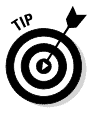

## 颜色值

(X)HTML 通过两种方式定义颜色值：

- 通过名称（从有限的列表中选择）
- 通过数字（更难记住，但选项多得多）

### 颜色名称

HTML 规范包含 16 个颜色名称，你可以在页面中使用它们来定义颜色。

本书前面装订的速查表提供了关于这 16 种命名颜色的信息，包括名称、相应的十六进制代码（用于定义颜色的六位十六进制数）和颜色样本。你可以在 CSS 标记中安全地使用颜色名称，并确信浏览器会识别它们并在你的网页中使用正确的颜色。


访问`www.htmlhelp.com/reference/html40/values.html#color`查看你的浏览器如何显示这些颜色。如果可能，请在两三台不同的电脑上查看此页面，看看浏览器、操作系统、显卡和显示器如何微妙地改变显示效果。

这个 CSS 样式声明表示 `<p>` 标签内的所有文本都应该是蓝色：

```css
p {color: blue;}
```


如果你在寻找烧赭色、黄绿色或鲑鱼色，那你就没那么幸运了。这不是一盒 64 色的蜡笔。不过，你也可以在速查表中找到网络安全色的十六进制代码及其颜色样本。这些颜色虽然没有名称，但它们是网络安全的，因为它们在大多数彩色计算机显示设备和打印机上的再现相当可靠。

### 颜色数字

颜色数字允许你在网页上使用任何颜色（甚至是鲑鱼色）。

#### 十六进制颜色代码

十六进制表示法使用六个字符——数字和字母的组合——来定义任何颜色。如果你知道某种颜色的十六进制代码（通常简称为十六进制码），你就拥有了在 HTML 页面中使用该颜色所需的一切。

#### 查找任何颜色的十六进制代码

你不能仅仅挥动魔杖就得到任何颜色的十六进制代码。但这并不意味着你不能通过不那么神奇的手段找到它。颜色转换器遵循精确的公式，将颜色的标准 RGB 表示法转换为十六进制表示法。因为你的时间更适合做比计算十六进制代码更有意义的事情，所以你有几种方法可以找到你选择的颜色的代码，包括本书速查表中的网络安全色。这些方法都不需要你使用计算器：

- **在网上：** 一些好的十六进制颜色图表资源包括`www.hypersolutions.org/pages/rgbhex.html`、`www.colorschemer.com/online.html`、`http://webmonkey.wired.com/webmonkey/reference/color_codes`。你只需找到你喜欢的颜色，然后将其旁边的十六进制代码输入到你的 HTML 中。

- **使用转换器：** 如果你已经知道某种特定颜色的 RGB 值，可以将它们输入到`www.univox.com/home/support/rgb2hex.html`上的在线转换器中，以获得十六进制等效值。例如，一种漂亮的天蓝色的 RGB 值是 159、220 和 223。将这些值输入转换器，你会得到等效的十六进制代码`#9FDCDF`。

- **使用图像编辑软件：** 许多图像编辑应用程序，如 Adobe Photoshop 或 Jasc Paint Shop Pro，都会显示任何颜色的十六进制表示法。即使是 Microsoft Word 的颜色拾取器也会显示图像中颜色的十六进制代码。如果你有一张喜欢的图片，并想将其用作网页的颜色来源，请在你最喜欢的编辑器中打开该图片，找出颜色的十六进制代码。


当你使用十六进制代码定义颜色时，应在前面加上井号（`#`）。

这个 CSS 样式声明使 `<p>` 标签包含的所有文本变为蓝色：

```css
p {color: #0000FF;}
```


与使用 10 个数字表示所有可能数字的熟悉基数 10（十进制）系统不同，十六进制（基数 16）系统使用 16 个“数字”。如果你想了解更多关于十六进制系统或想将数字从十进制转换为十六进制，请访问`http://mathforum.org/library/drmath/view/55830.html`

#### RGB 值

你可以使用两种 RGB 值来定义颜色。这些值类型不如十六进制值常见，但同样有效：

- **`rgb(r,g,b)`：** `r`、`g` 和 `b` 是介于 0 到 255 之间的整数，分别代表颜色的红色、绿色和蓝色分量。

## 第三部分：精确控制网页

`rgb(r%, g%, b%)`：其中 `r%`、`g%` 和 `b%` 分别表示颜色中红色、绿色和蓝色的百分比。

每种颜色都可以定义为红色、绿色和蓝色（RGB）的混合。你可以使用 RGB 值或等效的十六进制代码来向 Web 浏览器描述某种颜色的 RGB 值。

## 颜色定义

你可以为网页上的任意文本定义单独的颜色，也可以为整个网页或其某个部分定义背景色。

CSS 使用以下属性来定义颜色：

- `color` 定义字体颜色，也用于定义链接在各种状态（活动状态、已访问状态）下的颜色。
- `background` 或 `background-color` 定义整个页面的背景色，或定义特定元素的背景（例如，为所有一级标题设置背景色，类似于在 Word 文档中高亮某些内容的概念）。

### 文本

要更改网页上文本的颜色：

1. 确定选择器。例如，颜色将应用于所有一级标题、所有段落，还是特定段落？
2. 使用 `color` 属性。
3. 指定颜色名称或十六进制值。

样式声明的基本语法为：

```css
selector {color: value;}
```

以下是使用 `color` 属性的一组样式声明：

```css
body {color: olive; font-family: Verdana, sans-serif;
        background-color: #FFFFFF; font-size: 85%;}
h1 {text-align: center;}
.navbar {font-size: 75%; text-align: center;}
h1 {color: #808000;}
p.chapternav {text-align: center;}
.footer {font-size: 80%;}
```

在上述 CSS 规则中，页面上所有文本的颜色通过使用 `body` 选择器来定义。除非另有定义，否则该颜色将应用于文档主体中的所有文本。例如，通过使用十六进制表示法，一级标题被定义为森林绿。

## 链接

伪类允许你基于文档树之外的信息来定义样式规则。

CSS 中最常见的伪类用法是为文档树中的给定元素定义样式规则——“文档树”是一个技术术语，仅仅意味着浏览器构建文档中所有元素的分层表示，很像家谱，其中每个元素都有父元素，并且可能包含子元素。例如，`:link` 是一个伪类，为尚未访问的任何链接定义样式规则。

有五个常见的伪类可用于超链接：

- `:link` 定义尚未访问的链接的格式。
- `:visited` 定义已访问链接的格式。
- `:focus` 定义通过键盘选中的链接（例如，使用 Tab 键）并即将通过按 Enter 键激活的链接的格式。
- `:hover` 定义鼠标光标悬停在其上时链接的格式。
- `:active` 定义被选中（用鼠标点击）时链接的格式。

伪类名称前面有一个冒号（`:`）。

伪类可用于：

- 元素（例如定义超链接的 `<a>` 元素）
- 类
- ID

例如，要为已访问和未访问的链接定义样式规则，请使用以下语法：

这将指向未访问 URL 的任何超链接的颜色设置为使用其十六进制值的红色：

```css
a:link {color: #FF0000;}
```

这将指向已访问 URL 的任何超链接设置为显示为命名颜色绿色：

```css
a:visited {color: green;}
```

这将指定类为`internal`的未访问链接显示为（命名颜色）黄色：

```css
a.internal:link {color: yellow;}
```

链接可以同时处于多种状态。例如，链接可以同时处于已访问和悬停状态。始终按以下顺序定义链接样式规则：`:link`、`:visited`、`:focus`、`:hover`、`:active`。

CSS 应用*最后看到的规则*来显示你的页面。在这种情况下，如果你将伪类选择器放在错误的顺序中，结果可能不是你想要的。例如，如果`visited`跟在`hover`之后，并且两者有重叠的规则，则悬停效果仅适用于尚未访问的链接。

以下 CSS 规则将未访问的链接颜色渲染为橄榄色，已访问的链接颜色渲染为黄色：

```css
body {color: #808000; font-family: Verdana, sans-serif; font-size: 85%;}
a:link {color: olive;}
a:visited {color: yellow;}
```

Netscape 4 忽略`hover`。但在 Netscape 4 中使用`hover`不会造成任何损害（它只是被忽略），除非它是访客*唯一*的线索表明该文本是链接。


某些浏览器不支持与`input`或`select`等元素的伪类（这些是表单元素）。当前浏览器支持与`a`元素一起使用它们。如果你想将伪类用于`<a>`以外的元素，请测试你的结果。

CSS 规范将`:link`和`:visited`定义为互斥的，由浏览器应用程序决定何时更改任何给定链接的状态（已访问与未访问）。例如，如果你清除历史数据，浏览器可能会确定某个链接是未访问的。

## 背景

要更改网页或该网页某个部分的背景色，请按照以下步骤操作：

1. **确定选择器。** 例如，颜色将应用于整个背景，还是仅应用于特定部分？
2. 使用`background-color`或`background`**属性**。
3. **指定颜色名称或十六进制值。**

样式声明的基本语法为：

```css
selector {background-color: value;}
```

在以下样式声明集合中，第一个样式声明使用`background-color`属性并通过十六进制表示法将其设置为浅绿色：

```css
body {color: #808000; font-family: Verdana, sans-serif;
      background-color: #EAF3DA; font-size: 85%;}
```

你可以将背景色应用于文本块——例如，一个段落——就像你定义整个页面的背景色一样。

你可以将`background`作为所有单独背景属性的简写属性，或使用`background-color`仅设置颜色。

```css
selector {background: value value value}
```

更多信息请参阅第 8 章或 Webmonkey 的 "Mulder's Stylesheets Tutorial" 中的"The Shorthand Property"部分。

```text
http://webmonkey.wired.com/webmonkey/98/15/index3a_page6.html?tw=authoring
```

## 字体

你可以使用以下方式为不同的 HTML 元素定义单独的字体属性：

- 单独的 CSS 属性，例如`font-family`、`line-height`和`font-size`
- 包罗万象的简写`font`属性中的一组字体属性

### 字体族

要通过字体族定义字体：

1. **确定样式声明的选择器。**

   例如，将`p`作为选择器会为所有`<p>`标签定义字体族。

2. **添加属性名**`font-family`。

   并非所有浏览器都支持所有字体族。CSS 允许你指定多个字体族，以防浏览器不支持你喜欢的字体族。你可以列出多个字体族名称，用逗号分隔。浏览器使用其运行计算机上可用的列表中的第一个名称。

3. 为属性定义`value`（字体族的名称）。

如果字体族名称包含空格，请在其周围使用单引号或双引号。

要将所有一级标题格式化为使用 Verdana 字体，请使用如下样式声明：

```css
h1 {font-family: Verdana, Helvetica, sans-serif;}
```

在上述声明中，另外还指定了两个字体族，以防浏览器不支持 Verdana 字体族。

我们建议在你的样式声明中包含以下字体族：

至少一种*常用*字体族：

- Arial: 示例 示例
- Helvetica: 示例 示例
- Times New Roman: 示例 示例
- Verdana: 示例 示例

至少一种*通用*字体族：

- serif: 示例 示例
- sans-serif: 示例 示例
- cursive: *示例 示例*
- fantasy: 示例 示例
- monospace: 示例 示例

不同的元素可以使用不同的字体族进行格式化。这些规则为超链接定义了不同的字体族（参见图 10-1）：

```css
body {color: #808000; font-family: Verdana, sans-serif; font-size: 85%;}
hr {text-align: center;}
a {font-family: Courier, "Courier New", monospace;}
```

### 大小设置

以下属性允许你控制文本的尺寸。

#### 字体大小

指定文本大小的样式声明为：

```css
selector {font-size: value;}
```

## 图 10-1

超链接的字体系列与文本其余部分的字体系列不同。


该声明的值可以是：

- 标准字体属性度量值之一（在第 8 章中列出）
- 以下用户定义关键字之一：`xx-small`、`x-small`、`small`、`medium`、`large`、`x-large`或`xx-large`

每个关键字的值由浏览器确定，而不是样式规则。

以下规则定义了：

- 所有文本的相对字体值
- 所有一级标题的绝对字号值

```css
body {color: #808000; font-family: Verdana, sans-serif; font-size: 85%;}
h1 {color: #808000; font-family: Arial, Helvetica, sans-serif;
    font-weight: 800; font-size: 24pt;}
```

效果如图 10-2 所示。

## 行高

段落的行高是段落内每行之间的空间量。

行高类似于文字处理软件中的行距。

要更改段落行之间的间距量，请使用`line-height`属性：

```css
selector {line-height: value;}
```

`line-height`属性的值可以是：

- 标准字体属性度量值之一（在第 8 章中列出）
- 一个乘以元素字号的数字，例如`1.5`

在本章中，我们将`quotation`类分配给第一个段落，以便您可以看到变化。这允许我们通过在 HTML 文档中使用以下内容将这些样式应用于第一个段落：

```html
<p class="quotation">
```

以下规则将第一个段落设置为斜体、缩进该段落并增加行高以提高可读性（参见图 10-3）：

```css
body {color: #808000; font-family: Verdana, sans-serif; font-size: 85%;}
.quotation {font-style: italic; text-indent: 10pt; line-height: 150%;}
```

# 第 10 章：发挥创意，运用颜色和字体


## 字符间距

你可以通过使用这些属性来*增加*或*减少*字母或单词之间的间距量：


- **`word-spacing`：**`word-spacing`的样式声明为`selector {word-spacing: value;}`。设计师将单词之间的空间称为*字间距*。
- **`letter-spacing`：**`letter-spacing`的样式声明为`selector {letter-spacing: value;}`。设计师将字母之间的空间称为*字距调整*。


任一间距属性的值都必须是标准字体属性度量值定义的*长度*（在第 8 章中列出）。

以下代码增加第二个段落的字距调整（字母间距）（参见图 10-4）：

```css
body {color: #808000; font-family: Verdana, sans-serif; font-size: 85%;}
.quotation {font-style: italic; text-indent: 10pt; letter-spacing: 6px;}
```

## 定位

对齐属性允许您控制文本块的*形状*。

### 对齐

对齐决定文本块的左右两侧是：

- **平齐：**在同一位置开始或结束
- **参差不齐：**在不同位置开始或结束

### 语法

对齐使用`text-align`属性定义。用于对齐文本的样式声明为：

```css
selector {text-align: value;}
```

`text-align`属性的值必须是以下关键字之一：

- **`left`** 将文本左对齐。文本块的右侧是*参差不齐*的。
- **`right`** 将文本右对齐。文本块的左侧是*参差不齐*的。
- **`center`** 将文本居中显示在窗口中间。文本块的两侧都是*参差不齐*的。
- **`justify`** 对齐文本的左右两侧。调整每行文本中的间距，使文本块的两侧都*平齐*。

两端对齐文本会影响段落中的字母或单词间距。在向全世界展示您的网页之前，请测试效果。


#### 标记

以下示例定义了一级标题和第一个段落的对齐方式（参见图 10-5）：

```css
body {color: #808000; font-family: Verdana, sans-serif; font-size: 85%;}
h1 {color: #808000; font-family: Arial, Helvetica, sans-serif;
    font-weight: 800; font-size: 24pt; text-align: center}
.quotation {font-style: italic; text-indent: 10pt; text-align: left;}
```


图 10-5：一级标题居中；第一个段落左对齐。

### 缩进

你可以使用`text-indent`属性定义段落第一行之前应留出的空间量。

这不会缩进整个段落。缩进整个段落需要 CSS 盒模型属性，例如`margin-left`和`margin-right`（参见第 9 章）。


### 语法

用于缩进文本的样式声明为：

```css
selector {text-indent: value;}
```

该值必须是标准长度属性度量值之一（在第 8 章中列出）。

#### 标记

如本章所述，`quotation`类的`text-indent`为 10 点。

```css
body {color: #808000; font-family: Verdana, sans-serif; font-size: 85%;}
.quotation {font-style: italic; text-indent: 10pt;}
```

## 文本修饰

CSS 允许你使用粗体、斜体、下划线、上划线或删除线来装饰文本，甚至允许你的文本闪烁（当浏览器支持时）。

### 粗体

使用粗体字是设计师较常用的文本装饰之一。要在 HTML 中应用粗体，请使用`<b>`标签。但是，CSS 为你提供了对加粗文本字重的更多控制。

### 语法

此样式声明使用`font-weight`属性：

```css
selector {font-weight: value;}
```

`font-weight`属性的值可以是以下之一：

- **`bold`：**以平均粗体字重呈现文本
- **`bolder`：**相对值，呈现比当前字重（可能由父元素分配）更粗的字重
- **`lighter`：**相对值，呈现比当前字重（可能由父元素分配）更细的字重
- **`normal`：**移除任何粗体格式
- 以下整数值之一：`100`（最细）、`200`、`300`、`400`（正常）、`500`、`600`、`700`（标准粗体）、`800`、`900`（最粗）

#### 标记

以下示例将超链接加粗（参见图 10-6）：

```css
body {color: #808000; font-family: Verdana, sans-serif; font-size: 85%;}
a {font-weight: bold;}
a:link {color: olive; text-decoration: underline;}
a:visited {color: olive; text-decoration: none;}
```

### 斜体

斜体通常用于区分引文或强调文本。要在 HTML 中应用斜体，请使用`<i>`标签。但是，CSS 通过`font-style`属性为你提供了对文本字体样式的更多控制。

### 语法

此样式声明使用`font-style`属性：

```css
selector {font-style: value;}
```


`font-style`属性的值可以是以下之一：

- `italic`：以*斜体*（一种通常*倾斜*的特殊字体）呈现文本
- `oblique`：以*倾斜体*（正常字体的倾斜版本）呈现文本。
- `normal`：移除任何斜体或倾斜格式。

#### 标记

以下示例为一级标题分配斜体字体样式：

```css
body {color: #808000; font-family: Verdana, sans-serif; font-size: 85%;}
h1 {color: #808000; font-family: Arial, Helvetica, sans-serif;
    font-style: italic; font-weight: 800; font-size: 24pt; text-align: center;}
```

### 大小写转换

你使用`text-transform`属性来设置文档中的大小写。

### 语法

此样式声明使用`text-transform`属性：

```css
selector {text-transform: value;}
```

`text-transform`属性的值可以是以下之一：

- `capitalize`：将每个单词的首字母大写
- `uppercase`：将指定元素文本的所有字母渲染为大写。

# 第三部分：精确控制网页

#### 标记

以下示例将一级标题渲染为大写：

```css
body {color: #808000; font-family: Verdana, sans-serif; font-size: 85%;}
h1 {color: #808000; font-family: Arial, Helvetica, sans-serif;
    font-weight: 800; font-size: 24pt;
    text-align: center; text-transform: uppercase;}
```

`text-transform`属性的值包括：

- `lowercase`：将指定元素的文本所有字母渲染为小写。
- `none`：保留继承元素的值。
- `uppercase`：将指定元素的文本所有字母渲染为大写。
- `capitalize`：将每个单词的首字母大写。

## `text-decoration`属性

`text-decoration`属性可以实现一些更有趣的文本格式化效果。不过它并不常用。

### 语法

此样式声明使用`text-decoration`属性：

```css
selector {text-decoration: value;}
```

`text-decoration`属性的值可以是以下之一：

- `underline`：为文本添加下划线。
- `overline`：在文本上方渲染一条线。
- `line-through`：在文本中间渲染一条删除线。
- `blink`：使文本在屏幕上闪烁。
  - 你*确定*要使用闪烁文本吗？
  - `blink`并非所有浏览器都支持。
  - `blink`可能会非常烦人且令人分心。
- `none`：移除所有文本装饰。

#### 标记

以下示例在鼠标悬停时更改链接样式。在此例中，它取消了链接的下划线：

```css
body {color: #808000; font-family: Verdana, sans-serif; font-size: 85%;}
a:link {color: olive; text-decoration: underline;}
a:visited {color: olive; text-decoration: underline;}
a:hover {color: olive; text-decoration: none;}
```

## 万能的`font`属性

许多字体属性可以通过简写`font`属性归纳为一条样式声明。使用时，只需一条样式规则即可定义字体属性的组合：

```css
selector {font: value value value;}
```

`font`属性的值是对应各种字体属性的值列表：

- 以下值必须按以下顺序定义，但无需相邻：
  - `font-size`**（必需）**
  - `line-height`（可选）
  - `font-family`（必需）
- `font-family`值列表必须以分号结尾。
- 使用逗号分隔多个字体族名称。
- 以下值为可选值，可在声明中以任意顺序出现。各值之间用空格分隔：
  - `font-style`
  - `font-variant`


- `font-weight`

例如，你可以使用以下样式声明为一级标题创建特定样式：

```css
h1 {font: italic bold 150% Arial, Helvetica, sans-serif;}
```

上述标记按以下顺序使用属性：`font-style`、`font-weight`、`font-size` 和 `font-family`（列表使用逗号分隔具体字体族），并以必需的分号结尾。有关 CSS 简写属性的完整列表，请参阅本书末尾的附录 B。

# 第 11 章：使用表格打造惊艳页面

## 本章内容

- 了解表格的优势
- 规划表格设计
- 构建简单表格
- 跨多个单元格延伸内容
- 向表格单元格添加图像、超链接或文本
- 表格技巧与窍门

从历史上看，表格用于容纳和布局表格数据。然而在 (X)HTML 中，表格有着完全不同的用途——控制网页布局。大多数网页至少包含一个表格——有些甚至将表格嵌套在表格内部。(X)HTML 表格可以高效且美观地在页面上展示从文本到图像的一切内容。

此外，CSS 提供了强大的定位能力，让设计师在处理表格时拥有更大的灵活性和精确度——堪称“绝配组合！”

本章提供构建和使用 (X)HTML 表格的分步指导，并使用 CSS 控制其呈现效果。运用我们经过反复验证的最佳技巧和窍门，让你的工作更加快捷、高效。

## 表格能为你做什么

传统上，表格以易于阅读和理解的格式展示数据。(X)HTML 改变了这一切。许多网站都使用表格。像 Amazon.com、eBay、Yahoo! 和 Google 这样的网站都使用表格来展示内容，即使你无法明显地看到它们。事实上，这种不可见的表格主导了整个互联网。驱动它们的理念是：

- 使用表格来安排网页上的元素。
- 关闭边框，让用户看不到这些表格。

网页本质上是以线性方式呈现的。表格让你能够跳出线性模式，将文本和图像放置在页面上更有趣的位置。

你可以通过几种方式使用表格：

- **传统（平淡无奇）方法：** 你可以使用绝对数值来定义表格或各个单元格的宽度。这种类型的表格在用户调整浏览器窗口大小时不会随之调整。有些设计师更喜欢将表格用于传统目的——展示数据——这是一种直接、平衡且易于实现的方法。
- **展示优先（令人惊叹）方法：** 你可以使用`百分比`来定义表格和单元格的宽度。这种表格会在用户调整浏览器窗口大小时自动调整。大多数设计师会利用表格施展富有创意、复杂的技巧。

尽管本章涵盖了 HTML 表格的各个方面，但重点在于布局技巧和窍门。

使用表格进行布局时，可能会产生以下几种结果：

- 表格可以创建复杂的布局结构。（其他一些复杂表格的示例可以在`www.amazon.com`和`www.yahoo.com`上查看。）在浏览器中打开这些网页后，查看每个页面的 HTML 源代码（尝试从菜单栏中选择“查看 > 源文件”）。观察标记有多复杂。
- 一些网页设计模型采用“少即是多”的理念保持界面简洁——因此也更容易使用。`www.google.com`使用一个简单的表格来安排导航。

## 在表格中使用 (X)HTML 和 CSS

(X)HTML 表格可能需要一些技巧才能使其完全满足你的需求。但大约有 10% 的网络冲浪者使用的浏览器不支持 CSS。这意味着表格通常应该作为页面设计的基本基础。我们建议使用：

- (X)HTML 表格作为页面的基本基础
- CSS 提供额外的表格格式化

如果你知道目标用户使用的是更新的浏览器，你可以将 CSS 用于所有定位需求。例如，如果你正在为一群计算机程序员设计内部网站，你可以要求其访问者仅使用较新的浏览器，并完全删除表格元素（如果你愿意的话）。

图 11-2：此网页使用一个包含三个单元格的简单表格进行布局。

## 表格基础

HTML 表格的复杂性建立在三个基本元素之上：

- **边框：** 每个基本表格必须始终有*恰好*四条边框，组成一个矩形。
- **单元格：** 这些是表格边框内的各个方块（空间）。
- **单元格跨越：** 在这个四面围墙的结构中，你可以删除或添加单元格壁。当你删除单元格壁时，就使一个单元格*跨越*多行或多列——这正是使表格成为灵活布局工具的关键所在。

单元格跨越和单元格宽度的工作方式不同：

- 当你跨越单元格时，你通过组合或合并单元格来改变单元格空间。此步骤会移除单元格壁。
- 当你增加单元格宽度时，你只改变了该单元格内部的空间。

### 草拟表格

表格可能会变得复杂。你需要仔细规划它们。映射到最近的像素可能会变得繁琐，并且可能需要多次尝试，但这是设计一个布局良好的页面的重要步骤。

### 发展布局构想

从一个大致的想法开始，逐步规划你的布局，直到它变得更加明确和具体。遵循以下基本步骤：

1. **拿一张纸和一支铅笔（信不信由你）来勾画你的想法。** 首先对页面上所有元素的摆放位置有一个*大致的*构想。
2. **评估网页中应包含哪些内容，并确定整体布局。**

这样，你就可以开始确定：

- 你需要多少列和多少行
- 表格和单元格的宽度
- 是否要让某些单元格跨行或跨列

你需要做出以下设计选择：

- 表格是居中、左对齐还是右对齐。
- 你是否想包含超链接，以及可能想把它们放在哪里。

例如，许多网站，如图 11-1 中的网站，都包含一个提供指向网站主页超链接的 logo 图像，这样无论你在哪个页面，你总能回到首页。

3. **确定你想要使用的图像的像素尺寸。** 确保表格能很好地填充浏览器窗口，而不会强迫用户左右滚动来查看所有内容。

决定是使用文本还是图像进行导航，如下所示：

- 如果你想对导航有更多的字体控制权，请考虑使用图像作为导航项目。

  字体嵌入在图像中；因此，用户的浏览器设置无法覆盖你选择的字体。
- 如果你不需要额外的字体控制，请使用文本导航。
- 决定主 logo 应该放在哪里以及它的大小应该是多少。

在图 11-2 中，logo 是主要的焦点。其尺寸为 276 像素宽，110 像素高。

专注于管理表格的宽度。让表格的内容来决定单元格的高度。高度不太重要，因为用户习惯于上下滚动网页。然而，他们可能会因为左右滚动来阅读内容而感到沮丧。

### 起草表格

当你知道设计元素的大小和数量后，你就可以在纸上画一个粗略的表格。

如果你选择简单的方法，每个主要元素（logo、超链接图像和导航）都有自己的单元格。在图 11-4 中，这意味着只有三个单元格。

如果你只有很少的单元格，你可能不得不合并单元格，以便内容能填满页面的宽度。

- 复杂的设计可能需要几行。
- 简单、干净的设计（如图 11-4 中的设计）可能只需要两行。

图 11-4 展示了你的表格的最终草图：

- 第一行*跨*两列。
- 第二行包含两个*独立的*列。

我们示例网站的作者使用图像代替文本来表示导航元素；然而，出于可用性的原因，请尽可能尝试使用文本代替图像。即便如此，如果你想完全控制文本显示的字体，你可能必须使用图像——并创建一个用你选择的字体书写的文本图像。

## 构建基本表格

当你有了一个相当明确地指示页面和表格布局的草图时，你就可以打开你的 HTML 编辑器并创建表格的框架了。

### 组件

你表格框架的构建块是任何表格的三个基本组件：

- 表格：`<table>`
- 表格行：`<tr>`

  `<tr>`始终包含在`<table>`内。
- 表格（数据）单元格：`<td>`

  `<td>`始终包含在`<tr>`内。

有了这三个元素，你就可以构建一个简单的表格。

`<table>`、`<tr>`和`<td>`的*开始*和*结束*标签是必需的。如果你忘记包含任何一个，你的表格在大多数浏览器中将无法正确显示。

### 布局

表格有多种形式，复杂程度各不相同。作为网页一部分的简单二维数据表格比包含整个网页的更复杂的表格布局更容易设计和实现。当你阅读以下章节时，你将清楚地看到并理解这种区别。

### 创建一个简单的表格

`<table>`标签及其标记通常出现在文档的`<body>`标签之间。但是，你也可以在大多数块级元素内以及`<td>`和`<th>`标签内使用它们来嵌套表格。（请参阅本章后面的“在表格中嵌套表格”部分。）使用以下标记创建一个具有两行两列（四个数据单元格）的简单表格——将`cell 1`、`cell 2`等替换为你的文本：

```html
<!DOCTYPE html PUBLIC "-//W3C//DTD XHTML 1.0 Transitional//EN"
    "http://www.w3.org/TR/xhtml1/DTD/xhtml1-transitional.dtd">
<html xmlns="http://www.w3.org/1999/xhtml">
<head>
    <title>Tables</title>
</head>
<body>
 <table>
  <tr>
   <td> cell 1 </td>
   <td> cell 2 </td>
  </tr>
  <tr>
   <td> cell 3 </td>
   <td> cell 4 </td>
  </tr>
 </table>
</body>
</html>
```

上面的示例基于图 11-4 中的草图创建了一个有两行的表格。第一个表格行包含单元格 1 和 2；第二个表格行包含单元格 3 和 4。

表格行始终水平延伸，每个单元格的内容——在这种情况下是`cell 1`、`cell 2`等——都包含在各自的`<td>`元素中。别忘了你必须关闭表格标签，否则你的表格将无法正确显示。

### 创建基于表格的网页

要创建基于表格的网页框架（例如，基于上一节中的草图，图 11-4），请按照以下步骤操作：

1. **从`<table>`元素开始：**

   ```html
   <table>
     ...
   </table>
   ```

   `<table>`元素可以有许多可选属性（例如，`border="1"`或`bgcolor="black"`）——但是现在，保持简单。

2. **决定你想要表格有多少*行*：**

   以下标记创建了一个有两行的表格：

   ```html
   <table>
     <tr>…</tr>
     <tr>…</tr>
   </table>
   ```

3. **使用表格数据单元格（`<td>`）元素在每行中创建*单元格*。**

   每个`<td>`元素创建一个单元格，所以一行中`<td>`元素的数量就是列数。

图 11-4 中的草图显示了一个有*三个*单元格的两列表格：第一行包含一个单元格，第二行包含两个单元格。这种安排的标记如下所示：

```html
<!DOCTYPE html PUBLIC "-//W3C//DTD XHTML 1.0 Transitional//EN"
  "http://www.w3.org/TR/xhtml1/DTD/xhtml1-transitional.dtd">
<html xmlns="http://www.w3.org/1999/xhtml">
<head>
  <title>Tables</title>
</head>
<body>
<table>
  <tr>
    <td> contents </td>
  </tr>
  <tr>
    <td> contents </td>
    <td> contents </td>
  </tr>
</table>
</body>
</html>
```

## 其他表格元素

虽然表格最初是为了包含和显示数据而发明的，但它们现在最常用于控制网页布局。本章重点介绍设计师用于控制布局的元素。如果你想创建一个传统的表格，你可以使用以下这些表格元素：

- ✓ `<th>`：表头元素以粗体显示文本，默认居中对齐。

  你可以在表格的任何行中使用`<th>`元素，但你最常见到并使用它是在表格顶部或表头的第一行。除了它们的位置和突出性之外，它们的行为与表格数据（`<td>`）标签完全一样，也应该被如此对待。
- ✓ `<caption>`：这是表格标题元素。它被设计为存在于`<table>` ... `</table>`标签内的任何位置，但不在表格行或单元格内（因为那样它们就不会为任何内容添加标题了）。每个表格只能出现一次此元素。

  类似于表格单元格，标题可以容纳任何可以在文档主体中出现的 HTML 元素（换句话说，内联元素），但仅限于此。默认情况下，标题与表格水平居中对齐，并且它们的行会自动换行以适应表格的宽度。`<caption>`元素接受`align`属性。
- ✓ `<tbody>`：你可以使用表格主体（`<tbody>`）将表格行分组到一个表格主体部分中。

  这是 HTML 4 规范最近添加的内容，这些元素允许表格主体独立于表头（`<thead>`）和表尾（`<tfoot>`）滚动。表格主体应包含表格数据行。`<tbody>`元素必须包含至少一个表格行（`<tr>`）。
- ✓ `<thead>`：你可以使用表头（`<thead>`）元素将表格行分组到一个表头部分中。表头包含有关表格列的信息。

  `<thead>`元素必须包含至少一个表格行。
- ✓ `<tfoot>`：与`<thead>`元素非常相似，你可以使用表尾（`<tfoot>`）元素将表格行分组到一个表尾部分中。表尾包含有关表格列的信息，并且必须包含至少一个表格行。

  将你的页脚信息包含在第一个`<tbody>`元素实例之前，以便浏览器在渲染所有内容数据单元格之前先渲染这些信息。
- ✓ `<colgroup>`：此元素创建一个显式的列组。你通过使用`span`属性或使用`<col>`元素（我们稍后定义）来指定列数。

  你使用`span`属性来为一组列指定统一的宽度。
- ✓ `<col>`：`<col>`元素是一个空元素。你使用`<col>`元素来进一步定义列结构。`<col>`元素不应用于对列进行分组——那是`<colgroup>`元素的工作。你在定义了列组并设置了统一宽度之后使用`<col>`元素，来为列的子集指定统一的宽度。

# 第 11 章：使用表格打造精美页面

表格的使用可能有点复杂。一个行列数相等（比如两行两列）的简单表格是小菜一碟——但随着你在页面设计中越来越得心应手，你会发现你的需求往往不会产生如此对称的表格。如果某个单元格需要跨越多行或多列（就像前面示例中的第一个单元格），你就需要添加一个属性来告诉浏览器哪个单元格需要进行跨行或跨列操作。

属性中的数字对应你希望单元格跨越的列数或行数，也就是说，如果你要创建如示例所示的表格，就需要在第一个`<td>`元素中添加`colspan="2"`属性。（表格中的第一个单元格横跨两列。）

更多信息请参阅本章后面“添加跨度”一节。不过现在，假设你正在创建一个像我们这样的表格。标记代码如下：

```html
<table>
  <tr>
    <td colspan="2"> contents </td>
  </tr>
  <tr>
    <td> contents </td>
    <td> contents </td>
  </tr>
</table>
```

恭喜你，你的第一个表格完成了。嗯，算是吧。要有效地使用表格进行布局，你需要了解如何控制多种显示问题，比如边框、表格宽度以及表格内空白空间的处理。（例如，没有边框的话，你根本看不出表格的存在——它在浏览器中不会显示。这不是坏事也不是好事，但如果你想让边框在浏览器中显示，是可以进行更改的。）继续阅读以获取更多信息，完成你的表格并将其整合到页面中。

## 添加边框

表格边框定义了表格的外边缘。

当表格用于在页面上排列元素时，你不希望有*可见的*边框。有两种方法可以开启或关闭表格边框：


- 在`<table>`元素内设置`border`属性。`border`属性的值必须是一个整数，用于定义边框的像素厚度。

  要关闭边框，将`border`属性设置为 0：`<table border="0">`
- 使用 CSS 边框属性来定义边框。

  你可以使用 CSS 来定义边框样式、宽度或颜色。（请参阅后面“使用 CSS 边框属性”一节。）

### 使用 (X)HTML border 属性

对于 (X)HTML 表格，*边框*指的是：

- 外边框
- 单个单元格边框

你可以使用`border`属性将这些表格边框全部打开*或*关闭。

要打开表格（和单元格）边框，将`border`属性添加到`<table>`开始标签中，如下面加粗的标记所示：

```html
<!DOCTYPE html PUBLIC "-//W3C//DTD XHTML 1.0 Transitional//EN"
    "http://www.w3.org/TR/xhtml1/DTD/xhtml1-transitional.dtd">
<html xmlns="http://www.w3.org/1999/xhtml">
<head>
  <title>Tables</title>
</head>
<body>
<table border="1">
  <tr>
    <td colspan="2"> contents </td>
  </tr>
  <tr>
    <td> contents </td>
    <td> contents </td>
  </tr>
</table>
</body>
</html>
```

`border`属性的值定义了边框的像素厚度。例如，`border="5"`会产生一个 5 像素的边框。如果省略此属性，大多数浏览器不会显示边框。但是，如果你不希望边框可见，我们建议添加`border="0"`来确保关闭边框。

在需要清晰区分单元格内容的情况下，比如价格表、真实数据表以及其他文本或数值数据的集合，边框可以帮助访问者将所看到的内容分解成独立的信息片段。但是，当表格用于组织一个整体协调的网页时，关闭边框有助于强化这种整体感。


默认情况下，大多数浏览器在表格上使用不可见的 2 像素边框。在设计表格时，你应该执行以下操作之一：

- 在设计中考虑这些不可见的 2 像素边框。
- 配置你自己的边框。
- 通过将`border`属性设置为 0（`border="0"`）来消除边框。


在初次创建和调整表格时打开表格边框。有时没有边框很难看清到底发生了什么。调整完表格后，你可以关闭边框。

如果你使用表格来布局内容，在向公众展示网页时应该关闭表格边框，因为边框可能会分散注意力，并使原本应该连贯阅读的文本变得难以阅读。

### 使用 CSS 边框属性

与 (X)HTML `border` 属性不同，CSS 允许你为任意或所有边框边定义边框样式。例如，你可以为表格的左侧定义一个点状灰色边框，而将其余边框保持不可见。

#### 样式

如你所料，`border-style` 属性允许你定义边框的样式（如点状或实线）。

用于添加边框样式的样式声明是：

```
selector {border-style: value;}
```

`border-style` 属性的值必须是以下预定义关键字之一：

- `dotted`
- `dashed`
- `solid`
- `double`
- `groove`
- `ridge`
- `inset`
- `outset`

要创建实线边框，请使用以下样式声明：

```
table {border-style: solid;}
```

#### 宽度

与使用 (X)HTML `border` 属性类似，你可以用像素定义边框宽度。但是，CSS 提供了额外的宽度值数据类型供你选择。用于添加边框宽度的样式声明是：

```
selector {border-width: value;}
```

`border-width` 属性的值可以是：

- **预定义关键字**：`thin`、`medium` 或 `thick`
- **绝对或相对长度**：更多信息请参阅第 8 章的边栏“属性测量值”。该边栏中描述的值适用于 HTML 以及 CSS。

要将边框宽度设置为 1 像素，请使用以下样式声明：

```
table {border-width: 1px;}
```

#### 颜色

用于定义边框颜色的样式声明是：

```
selector {border-color: value;}
```

`border-color` 属性的值必须使用预定义颜色名称或十六进制值来定义：

- **颜色名称**：`aqua`、`black`、`blue`、`fuchsia`、`gray`、`green`、`lime`、`maroon`、`navy`、`olive`、`purple`、`red`、`silver`、`teal`、`white` 或 `yellow`
- **十六进制值**：请参阅第 10 章。

要将边框颜色设置为黑色，请使用以下样式声明：

```
table {border-color: black;}
```

#### 使用通用 `border` 属性

与定义字体属性类似，你可以使用简写的 `border` 属性来一次性定义多条样式规则：

```
table {border: 1px solid gray;}
```

有五个通用 `border` 属性可用于表格或盒子：

- `border`：定义所有四条边的格式。
- `border-left`：定义左侧的格式。
- `border-right`：定义右侧的格式。
- `border-top`：定义顶部的格式。
- `border-bottom`：定义底部的格式。


边框属性不仅适用于表格，它们是 CSS 盒模型的一部分。它们几乎可以为任何 (X)HTML 元素提供边框，只要不是内联元素。

## 调整高度和宽度

大多数浏览器通过判断单元格内容（图像和/或文本）来确定单元格的宽度。


浏览器会尽可能提供空间来容纳内容。但是，图像和文本都有一定的限制：

- 并排的图像必须适合浏览器窗口的宽度。例如，如果你有一张 200 像素宽的图像，单元格会扩展以容纳该图像。但是，如果一行中有多个单元格，每个单元格中的图像都超过 400 像素宽，单元格只能扩展到浏览器窗口允许的范围。
- 文本可能会扩展并破坏布局。如果单元格包含大量文本，单元格会一直扩展，直到第一个换行符或文本结束。这可能会导致表格非常不美观。

大多数表格用于帮助控制布局，因此控制单元格和表格的宽度非常重要。你有两种控制宽度的方法：

- 在 `<table>` 或 `<td>` 元素中使用 (X)HTML `width` 属性。
- 使用 CSS `width` 属性为 `<table>` 或 `<td>` 元素指定宽度值。

### (X)HTML `width` 属性

如果不设置表格和单元格宽度，用户的浏览器会根据其内容的宽度来确定每个单元格的宽度——不多也不少。

# 194 第三部分：精确控制网页

例如，假设你想将一个标志放在第一个单元格中，而导航项放在它左边的单元格里。如果你不为第一个单元格（包含标志）分配宽度，导航项会被紧挨着标志放置，两者之间几乎没有空间。为了避免这种局促的外观，你可以使用 `width` 属性来策略性地定义标志与导航项之间的精确像素数。

如果你使用表格进行布局，我们建议你为表格和单元格设置宽度。

#### 语法

使用 `width` 属性定义宽度非常简单。例如，你可以像这样将表格的宽度设置为 630 像素：

```
<table border="1" width="630">
...
</table>
```

`width` 属性的值可以通过以下方式定义：

- 像素（一个正整数，例如 630）
  - 这是一个绝对值。
- 显示区域宽度的百分比（一个正整数后跟一个百分号，例如 95%）
  - 这是一个相对值，允许你的表格根据浏览器窗口的大小进行调整。

这些值也可以用于设置单个单元格的宽度。

#### 标记

要为本章前面构建的表格添加宽度（并为其单个单元格设置宽度），请添加以下以粗体文本显示的标记：

```
<!DOCTYPE html PUBLIC "-//W3C//DTD XHTML 1.0 Transitional//EN"
    "http://www.w3.org/TR/xhtml1/DTD/xhtml1-transitional.dtd">
<html xmlns="http://www.w3.org/1999/xhtml">
<head>
    <title>Tables</title>
</head>
<body>
    <table border="1" width="630">
        <tr>
            <td colspan="2" width="630"> contents </td>
        </tr>
        <tr>
            <td width="400"> contents </td>
            <td width="230"> contents </td>
        </tr>
    </table>
</body>
</html>
```

图 11-5 和图 11-6 显示了未定义表格和单元格宽度的网站与使用 `width` 属性的网站之间的差异。


> 如果你设置的像素宽度小于内容的像素尺寸，浏览器会忽略 `width` 属性，并默认显示所有单元格内容。因此，请检查所有尺寸。

### CSS `width` 属性

用于定义宽度的样式声明如下：

```
selector {width: value;}
```

`width` 属性的值必须是以下之一：

- **auto**
  
  此关键字允许浏览器确定必要的宽度。

- **绝对或相对长度**
  
  有关更多信息，请参见第 8 章侧栏“属性测量值”。

要设置图 11-6 中显示的表格宽度，请使用以下样式声明：

```
table {width: 630px;}
td.cellone {width: 630px;}
td.celltwo {width: 630px;}
td.cellthree {width: 630px;}
```

## 内边距和间距

确定单元格之间的空白区域对于正确的布局至关重要。请记住图 11-4 中的草图，你必须精确到像素地确定表格中将如何使用空间。

### (X)HTML 属性

有两个属性可以通过在单元格之间留出一些空间来帮助你定义空白区域：`cellpadding` 和 `cellspacing`。这些属性使用两种不同的技术在单元格之间留出一些空间：

- `cellspacing` 在单元格**之间**添加空间（边框宽度会被调整）。
- `cellpadding` 在单元格**内部**添加空间（在单元格边框内）。

任一属性的值都以**像素**为单位定义。例如，`cellpadding="5"` 为每个单元格添加 5 像素的内边距。

要定义任一属性，请将其添加到 `<table>` 开始标签中，如下所示：

```
<table cellpadding="5" cellspacing="5">
```

当使用表格进行布局时，没有可见的边框，你使用哪个属性影响不大。但是，如果你为表格添加颜色——或出于任何原因使用边框——你会看到显著的差异。这是因为 `cellpadding` 增加了边框内的空间，而 `cellspacing` 增加了边框本身的宽度，如图 11-7 和图 11-8 所示。

`cellpadding` 的默认值是 1；`cellspacing` 的默认值是 2。如果你不定义 `cellpadding` 和 `cellspacing`，用户的浏览器会采用默认值。在你的草图中考虑这些像素是个好主意。

# 第 11 章：使用表格打造惊艳页面 197


图 11-7：`cellpadding` 属性增加了每个单元格内的空间。


图 11-8：`cellspacing` 属性增加了边框的宽度。

# 198 第三部分：精确控制网页


使用 `cellpadding` 和 `cellspacing` 来使表格布局恰到好处可能有点令人头疼。有时你需要创建空单元格来帮助控制布局。虽然这个技巧有点变通，但许多设计师都在使用它。你只需：

1. 创建一个单元格。
2. 用以下内容填充单元格：
   - `<br />`
   - 一个间距图像（一个 1 x 1 像素的透明 `.gif`），你可以用它来操纵宽度。

### CSS

你可以使用 CSS 来控制单元格内边距和单元格之间的间距。

#### 单元格内部

要控制单元格内部的内边距，你可以使用 `padding` 属性，如下所示：

```
selector {padding: value;}
```

`padding` 属性的值必须通过绝对或相对长度，或百分比来定义。

要设置表格单元格的内边距，请使用以下样式声明：

```
td {padding: 10px;}
```


`padding` 属性可以与大多数 (X)HTML 元素一起使用。例如，如果你创建了一个页脚并为其分配了一个类名，你可以使用以下样式规则为该元素定义内边距：

```
.footer { padding: 5px;}
```

#### 单元格之间

你可以使用 `border-spacing` 属性来控制单元格之间的间距：

```
selector {border-spacing: value;}
```

`border-spacing` 属性的值必须通过绝对或相对长度，或百分比来定义：

要设置表格单元格的内边距，请使用以下样式声明：

```
td {padding: 10px;}
```

`border-spacing` 属性只能与 `<td>` 元素结合使用。

## 对齐调整

如果你使用表格来定义布局，你需要控制它们在浏览器窗口中的位置。你可以通过使用 (X)HTML 或 CSS 来实现。

你使用作为 HTML 标准一部分的属性来对齐表格（水平方向）和表格内容（水平和垂直方向）。

对齐表格与对齐图像类似。

### 水平对齐

你可以使用各种表格元素中的 `align` 属性来水平对齐单元格内容。

- 要水平对齐表格，请将 `align` 属性与 `<table>` 元素一起使用。
  - `align` 属性与 `<table>` 元素一起使用时，具有以下可能的值：`left`（文档左侧）、`right`（文档右侧）或 `center`（文档居中）。
- 你可以将 `align` 属性与 `<td>`（单元格）或 `<tr>`（行）元素一起使用，以对齐单元格或行内的文本。
  - `<td>` 或 `<tr>` 元素中 `align` 属性可以使用的值有：
    - `align="right"`：将表格或单元格内容右对齐。
    - `align="left"`：将表格或单元格内容左对齐。（这是默认设置。）
    - `align="center"`：将表格或单元格内容居中。
    - `align="justify"`：在中间对齐单元格内容（支持度不高）。
    - `align="char"`：围绕特定字符对齐单元格内容（支持度不高）。

以下示例将表格在页面中居中对齐（参见图 11-9）：

```
<!DOCTYPE html PUBLIC "-//W3C//DTD XHTML 1.0 Transitional//EN"
    "http://www.w3.org/TR/xhtml1/DTD/xhtml1-transitional.dtd">
<html xmlns="http://www.w3.org/1999/xhtml">
<head>
    <title>Tables</title>
</head>
<body>
  <table border="1" width="630" align="center">
    <tr>
      <td width="630" colspan="2"> contents </td>
    </tr>
    <tr>
      <td width="400"> contents </td>
      <td width="230"> contents </td>
    </tr>
  </table>
</body>
</html>
```


### 垂直对齐

你可以通过使用 `valign` 属性来垂直对齐单元格内容。它只能与 `<tr>`（行）和 `<td>`（单元格）元素一起使用。

- 可能的值有：
  - `valign="top"`：将单元格内容垂直对齐到单元格顶部。
  - `valign="bottom"`：将单元格内容垂直对齐到单元格底部。
  - `valign="middle"`：垂直居中对齐单元格内容。（这是默认设置。）
  - `valign="baseline"`：为同一行中的所有其他单元格定义一个基线，因此所有单元格的对齐方式保持一致。

你也可以在以下表格元素中使用 `align` 和 `valign` 属性：`<col>`、`<colgroup>`、`<tbody>`、`<tfoot>`、`<th>` 和 `<thead>`。

如果你为行（`<tr>`）设置了对齐方式，然后又为该行内的单元格（`<td>`）设置了对齐方式，则你添加到单元格的设置将**覆盖**该行的设置。

你现在已经习惯于学习大多数 (X)HTML 格式化属性已弃用，转而使用 CSS，并且尽管 `align` 属性对于大多数 (X)HTML 元素已弃用，但在与表格元素一起使用时仍然允许。

你不能在 `<table>` 标签中使用 `valign` 属性。

### 使用 CSS 定义对齐方式

要通过 CSS 控制表格对齐方式，你可以使用两个属性：`text-align` 和 `vertical-align`。它们的功能与前面的 `align` 和 `valign` 属性相同。

要使用 `text-align` 属性，你可以为其分配以下值之一：

- `right`：将表格或单元格内容靠右对齐。
- `left`：将表格或单元格内容靠左对齐。（这是默认设置。）
- `center`：将表格或单元格内容居中对齐。
- `justify`：将单元格内容两端对齐在中间可用区域：即中间。

要使用 `vertical-align` 属性，你可以为其分配以下值之一：

- `top`：将单元格内容垂直对齐到单元格的顶部。
- `bottom`：将单元格内容垂直对齐到单元格的底部。
- `middle`：垂直居中对齐单元格内容。（这是默认设置。）
- `baseline`：为同一行中的所有其他单元格定义一个基线，因此所有单元格的对齐方式保持一致。

你可以通过为 `<tr>` 元素分配对齐属性来控制整行的对齐方式。

你不能使用 `text-align` 属性来使表格居中——它仅用于文本对齐。目前，你有几种方法可以使整个表格居中。虽然都不是完美的，但都有效：

- 使用已弃用的 `<center>` 标签包裹表格。
- 在表格内使用已弃用的 `align` 属性：`<table align="center">`。
- 将表格包裹在 `<div>` 元素中，并使用 `text-align` 属性使其内容居中：`div.mytable {text-align: center;}`。

## 添加合并

合并是表格能够灵活替代网页布局元素的主要原因之一。

合并允许你将项目跨越多个单元格；本质上你打破了单元格之间的隔墙。无论你需要合并行还是列，你都可以使用合并的概念来调整表格以适应几乎任何布局。

列和行合并需要仔细规划。该规划应在草图阶段进行（正如我们本章前面在“绘制你的表格”部分所描述的那样）。

要合并单元格，你需要在 `<td>`（单元格）元素中添加以下属性之一：

- `colspan` **水平**（跨越多个**列**）扩展单元格。


- `rowspan` *垂直*（跨越多个*行*）扩展单元格。

合并单元格只能通过 (X)HTML 属性来完成；CSS 不提供等效的功能。

### 列合并

要合并列，你需要在 `<td>` 元素中使用 `colspan` 属性，并将其值设置为要合并的单元格数量。

图 11-10 展示了一个跨越两列的单元格。

在这个示例中，第一个单元格跨越了下一行中的两个单元格。你将 `colspan` 属性设置为 2，如下面的标记所示，因为该单元格跨越了两列：

```html
<!DOCTYPE html PUBLIC "-//W3C//DTD XHTML 1.0 Transitional//EN"
    "http://www.w3.org/TR/xhtml1/DTD/xhtml1-transitional.dtd">
<html xmlns="http://www.w3.org/1999/xhtml">
<head>
    <title>Tables</title>
</head>
<body>
<table border="1" width="630">
  <tr>
    <td width="630" colspan="2"> contents </td>
  </tr>
  <tr>
    <td width="400"> contents </td>
    <td width="230"> contents </td>
  </tr>
</table>
</body>
</html>
```

> 在添加 `colspan` 属性后

- 验证你在第一行中是否有适当数量的 `<td>` 单元格。例如，如果你定义了一个跨越两列的单元格，则该行应少一个 `<td>`。如果你使用 `colspan="3"`，则该行应少两个 `<td>` 单元格。
- 确保其他行具有适当数量的 `<td>` 单元格。例如，如果你定义了一个跨越两列的单元格，则该表格中的其他行应有两个 `<td>` 单元格来填充这两列。

### 行合并

你在 `<td>` 标签中使用 `rowspan` 属性。图 11-11 展示了一个跨越两行的单元格。

要合并行，你需要在 `<td>` 元素中使用 `rowspan` 属性，并将其值设置为要合并的单元格数量。

> 首先绘制你的表格，以便你知道哪些单元格应该跨越哪些列和行。我们在本章大部分时间使用的示例设计在第一个单元格上使用了 `colspan` 属性。然而，如果我们对包含导航项目的最后一个单元格使用 `rowspan`，设计同样可以很简单。无论哪种方式，表格的布局都是高效的。

修改后的表格来自以下标记（注意加粗的 `rowspan`）：

```html
<!DOCTYPE html PUBLIC "-//W3C//DTD XHTML 1.0 Transitional//EN"
"http://www.w3.org/TR/xhtml1/DTD/xhtml1-transitional.dtd">
<html xmlns="http://www.w3.org/1999/xhtml">
<head>
<title>Tables</title>
</head>
<body>
<table border="1" width="630">
<tr>
<td width="400"> contents </td>
<td width="230" rowspan="2"> contents </td>
</tr>
<tr>
<td width="630"> contents </td>
</tr>
</table>
</body>
</html>
```

## 填充表格单元格

在绘制表格并定义表格属性（如宽度、单元格边距和间距以及单元格合并）之后，你就可以用图像、超链接、文本以及几乎所有其他 (X)HTML 元素来填充表格单元格了。这是一个简单的过程：你将图像、超链接和文本添加到 `<td>` 元素中，类似于将它们添加到 `<body>` 元素的方式。

以下标记显示了一个已填充的表格，其中添加的数据以粗体显示：

```html
<!DOCTYPE html PUBLIC "-//W3C//DTD XHTML 1.0 Transitional//EN"
"http://www.w3.org/TR/xhtml1/DTD/xhtml1-transitional.dtd">
<html xmlns="http://www.w3.org/1999/xhtml">
<head>
<title>Tables</title>
</head>
<body>
<table border="1" width="630" align="center" cellpadding="5" cellspacing="5">
<tr>
<td colspan="2" valign="bottom" align="left">
<a href="http://www.ropeadope.com">

</a>
</td>
</tr>
<tr>
  <td valign="top" align="right" width="400">
    
  </td>
  <td valign="top" align="left" width="230">
    <br /><br /><br />
    
    <br>
    <a href="q/">
      
    </a>
    <br />
    <a href="ilovemyself/">
      
    </a>
    <br />
    <a href="http://www.pwolf.com">
      
    </a>
    <br /><br />
    
    <br />
    <a href="http://www.anthropos.org">
      
    </a>
    <br /><br />
    
    <br />
    <a href="darth/">
      
    </a>
    <br />
  </td>
</tr>
</table>
</body>
</html>
```

## 测试你的表格

测试是你的表格上线前的最后一步。你必须在所有流行的浏览器中测试你的表格——包括 Internet Explorer、Netscape 和 Opera。如果不这样做，你的用户可能不得不眯着眼睛看你的页面，或者他们可能看到你的表格是一团糟。


在创建表格时，请同时打开浏览器窗口。每次更改单元格宽度或向单元格添加项目时，保存文档并在浏览器窗口中查看。这样，当你测试表格时，可能不需要做太多调整。

许多设计师面临的挑战是创建能在所有浏览器中正常工作的表格设计。感谢许多标准倡导者，目前最流行浏览器的最新版本——Netscape、Internet Explorer 和 Opera——都支持 HTML 标准。如果你的受众技术能力有限，设计表格时请考虑旧版浏览器。


始终在用户可能使用的任何浏览器中测试你的网站。例如，如果你的表格使用 `align="center"` 对齐，但在旧版 Internet Explorer 中表格仍然紧贴左侧，你可能需要为表格添加一对 `<center>` 标签。不过，如果你遵循标准，表格方面不会有太多问题。

## 表格制作技巧

我们在构建、维护和排除表格故障方面积累了多年经验，期间发现了一些巧妙的技巧。以下技巧将帮助你创建有效的表格。

### 遵循标准

第一条——也是我们认为最重要的——技巧是坚持已建立的标准。Web Standards Project（Web 标准项目）的相关人员自 1998 年以来一直致力于推动浏览器和 HTML 创作应用程序对完整标准的支持。他们的辛勤工作应该让你的生活更轻松。

就在几年前，如果你构建一个 HTML 表格，你将不得不创建不同版本的网页（每个版本包含特定于浏览器的元素和属性）来定义一些基本的表格属性。正如你可能想象的，创建和维护同一网页的不同版本会使开发成本飙升。为了规避这些成本，许多开发人员会精心设计他们的表格，使用在 Internet Explorer 和 Netscape 中有效的特定标记——但 Opera 呢？幸运的是，这些都是过去的问题了。Internet Explorer、Netscape 和 Opera 的最新版本*全部*支持 HTML，以及 CSS 和 XHTML。想了解更多关于 Web 标准之争的信息，请访问 `www.webstandards.org`。

### 清理标记

高效编写的标记更容易排除故障和维护。许多设计师使用空白来分隔元素。例如，以下标记没有使用太多空白，难以阅读：

```html
<table border="1" width="630">
<tr><td width="630" colspan="2"> contents </td></tr>
<tr><td width="400"> contents </td>
<td width="230"> contents </td></tr></table>
```

看看这个干净的版本：

```html
<table border="1" width="630">
  <tr>
    <td width="630" colspan="2"> contents </td>
  </tr>
  <tr>
    <td width="400"> contents </td>
    <td width="230"> contents </td>
  </tr>
</table>
```


我们在标记中包含的空白是在元素*之间*，而不是在元素内部。例如，如果你在 `<td>` 和 `</td>` 标签之间添加空白，它会影响单元格内容的显示方式，而这通常不是你想做的。

### 在表格中嵌套表格

许多设计师不得不在表格中嵌套表格以达到预期效果。这既是*合法的*，也是*常见的*。


少量嵌套表格不会对用户造成太大影响。但在表格中嵌套大量表格会延长下载时间。

要嵌套表格，只需在 `<td>` 元素内添加 `<table>` 元素，如下所示：

```html
<!DOCTYPE html PUBLIC "-//W3C//DTD XHTML 1.0 Transitional//EN"
  "http://www.w3.org/TR/xhtml1/DTD/xhtml1-transitional.dtd">
<html xmlns="http://www.w3.org/1999/xhtml">
<head>
  <title>Nesting Tables</title>
</head>
<body>
<table border="1">
  <tr>
    <td> contents </td>
    <td> contents </td>
  </tr>
  <tr>
    <td>
      <table border="1">
        <tr>
          <td> contents </td>
          <td> contents </td>
        </tr>
        <tr>
          <td> contents </td>
          <td> contents </td>
        </tr>
      </table>
    </td>
    <td> contents </td>
  </tr>
</table>
</body>
</html>
```

此标记生成的表格如图 11-12 所示。


图 11-12：嵌套表格。

#### 使用嵌套表格时

- 检查单元格宽度——第三个单元格的宽度应与嵌套表格的宽度匹配。
- 单独创建*并测试*你打算嵌套的表格，然后再将其添加到你的主表格中。

### 避免密集的表格

我们鼓励创意，但要小心，不要把屏幕塞满密集而难以穿透的信息——尤其是数字。一长串不间断的数字会很快赶走所有除真正的受虐狂之外的人——这基本上否定了表格存在的意义。把这些数字放进一个美观的表格中（更好的是，*多个*表格，其间穿插一些精心挑选的图片）。看着你的页面的吸引力和可读性飙升；听着访问者舒一口气。

单个表格单元格可能出奇地宽敞。你可以在其中精确定位图形。如果你想要在表格中放置图形，请务必：

- 选择大小和外观相似的图片。
- 测量这些图片以像素为单位确定其高度和宽度。（诸如 Paint Shop Pro 和 GraphicConverter 之类的共享软件会自动完成此操作。）
- 使用 HTML 标记在这些图片的表格单元格中定位它们。

一个简洁的表格可以控制图形，并保证文本始终在其右侧整齐排列。

还有两个实用的图形放置技巧可以产生一致、连贯的图像布局：

- 将包含图片的单元格行列大小调整为可容纳*最大的*图形。
- 在每个单元格中将所有图形*居中*（包括垂直和水平方向）。

### 为表格单元格添加颜色

你可以使用 CSS 或 (X)HTML 来更改单元格或表格的背景颜色。在 CSS 出现之前，设计师使用 `bgcolor` 属性来更改表格单元格的背景，其方式与它影响整个 HTML 文档的背景类似。只需将 `bgcolor` 属性添加到任何表格单元格即可更改其背景颜色：

```html
<td bgcolor="teal">...</td>
```

然而，现在你有更多的灵活性，可以使用 `background` 属性来添加一些颜色：

```css
td {background: red;}
```

我们在第 10 章介绍了 `background` 属性。

> `bgcolor` 属性可用于任何表格元素。但是，单元格的 `bgcolor` 会覆盖为行或表格定义的任何 `bgcolor`。请注意，`bgcolor` 也已被弃用，大多数 Web 专家使用 CSS 标记代替。

### 精彩杂项

表 11-1 列出了你可能在 HTML 文件中找到的其他表格相关 (X)HTML 属性。

**表 11-1 其他表格相关 (X)HTML 属性**

| 名称 | 功能/值等于 | 值类型 | 相关元素 |
|---|---|---|---|
| `abbr` | 缩写表格标题 | 文本 | `<td>` `<th>` |
| `axis` | 设置相关表格标题的逗号分隔列表 | CDATA | `<td>` `<th>` |
| `char` | 为表格元素定义对齐字符 | ISO 10646 字符 | `<col />` `<colgroup>` `<tbody>` `<td>` `<tfoot>` `<th>` `<thead>` `<tr>` |
| `charoff` | 使用对齐字符 `char` 时定义偏移量 | 长度（像素/百分比） | `<col />` `<colgroup>` `<tbody>` `<td>` `<tfoot>` `<th>` `<thead>` `<tr>` |
| `frame` | 标识表格结构中的可见组件 | {"above"\|"below"\|"border"\|"box"\|"hsides"\|"lhs"\|"rhs"\|"void"\|"vsides"} | `<table>` |
| `rules` | 控制表格中规则线的显示 | {"all"\|"cols"\|"groups"\|"none"\|"rows"} | `<table>` |
| `scope` | 描述表格标题单元格的范围 | {"col"\|"colgroup"\|"row"\|"rowgroup"} | `<td>` `<th>` |
| `summary` | 描述表格的用途 | 文本 | `<table>` |
| `span` | 设置 `col` 属性应用的表格列数 | 数字 | `<col />` |

# 第四部分

## 将脚本与 HTML 整合

“看到了吗？我创建了一个小逃犯角色，它在我们的网站上到处跑，躲在横幅广告后面。在最后一页，我们的徽标会把它扼住（非致命）并带回主页。”

### 在本部分中……

在本书的这一部分，我们将介绍并描述在网页中运行的各类脚本语言，并深入探讨 `JavaScript`——它是当今使用最广泛的 Web 脚本语言。脚本语言有助于将静态、不变的网页变成能够主动请求和响应用户输入的动态文档。你将从学习 `JavaScript` 的基本元素、数据类型和值开始，逐步深入到包括即时重新排列网页内容、执行计算并显示结果、请求和检查用户输入等更多主题。


接下来，你将更深入地钻研 JavaScript，以便理解并在你的网页中使用这门脚本语言。你还将学习如何将 JavaScript 整合到网页中，以及它如何即时处理和更改网页内容。你还会了解如何检查你的工作，以及如何使用 cookie（那些有趣但难以捉摸、依附于 Web 用户的数据包）。

本部分最后三章将向你展示如何在网页中运用 JavaScript。你将探索如何定义和使用导航栏，它为用户提供动态菜单选项和信息，让他们更轻松地浏览你的网站。你将学习如何使用 JavaScript 在网页中创建和使用各种数据输入表单，以请求、检查和响应用户输入。你还将学习创建动态 HTML（有时称为 DHTML）的基本概念和技术，以及使用客户端 JavaScript 和预制代码执行基本任务，例如显示日期和时间信息、统计网站访客人数或汇总当前统计数据。

# 第 12 章：为网页编写脚本

## 本章内容

- 了解 JavaScript 是什么
- 探索 JavaScript 能为你的网页做什么
- 剖析三个示例脚本

当与 HTML 标记结合使用时，脚本——即你添加到网页中的小程序——可以帮助你的网页响应用户操作。脚本创造了你在 Web 上看到的交互式和动态效果，例如当访客将鼠标指针移到其上时自动变化的图像、页面加载时弹出的额外浏览器窗口，以及动画导航栏。

由于脚本是微型程序，它们通常用一种称为`JavaScript`的编程语言编写。如果你不熟悉这个术语，JavaScript 听起来可能像是一部被咖啡浸泡过的好莱坞剧本。然而，它实际上是一种直接内置于所有主流 Web 浏览器中的脚本语言。

幸运的是，由于诺贝尔奖级别的“复制粘贴”发明，你不必成为技术大师就能为网站添加脚本。Web 上有许多网站提供即开即用的`JavaScript`脚本，你可以随意复制，然后直接粘贴到你的网页中。（第 13 章列出了一些最出色的 JavaScript 网站。）

在本章中，你将通过剖析三个用`JavaScript`编写的示例脚本，探索脚本在你的网页中是如何工作的。第 13 章将继续这一讨论，深入 JavaScript 语言本身。

> 💡 **提示**
>
> 许多优秀的网页编辑器（如 Macromedia Dreamweaver 和 Adobe GoLive）都有内置工具来帮助你创建脚本——即使你对编程一无所知。

**216** 第四部分：将脚本与 HTML 整合

## JavaScript 不是 Java

在 20 世纪 90 年代末，JavaScript 脚本语言的创始人想借助 Java 编程语言的巨大人气来沾光，于是给它取了个 catchy 的名字——JavaScript。然而，当他们做出这个决定时，也因为两个名字的相似性而引入了诸多混淆。需要明确的是，功能完备的 Java 编程语言并非 Web 上的脚本语言。Java 是 C 和 C++ 编程语言的后继者。程序员可以创建能够在 Windows、Macintosh、Linux 及其他计算机平台上运行的 Java 应用程序：

- 在客户端，Java 用于创建 applet（通过网络下载并在 Web 浏览器内运行的小程序）。由于 Java 被设计为跨平台，这些 applet 应该在任何支持 Java 的浏览器上运行一致。
- 在服务器端，Java 用于创建许多基于 Web 的应用程序。

## JavaScript 能为你的网页做什么

为网站添加脚本就像那些改造真人秀节目一样，将一座房子或一个人的外观变成全新的、精彩的东西。JavaScript 也是如此。你可以将平淡乏味的网页转变为互动且动态的 Web 盛宴，让你的访客享受多年欢乐和愉悦。好吧，也许我们有点夸张了，但你明白意思。

例如，如果你访问 Dummies.com（[www.dummies.com](http://www.dummies.com)）并在未输入搜索词的情况下点击搜索框旁的红色按钮，浏览器会显示一个友好的警告框，提醒你在搜索之前先输入搜索词，如图 12-1 所示。

# 第 12 章：为网页编写脚本

一段简短的脚本会在搜索引擎执行查询之前验证你是否输入了搜索词：

- ✔ 如果你输入了搜索词，就不会看到这个警告。
- ✔ 如果你没有输入搜索词，内嵌在页面中的脚本会促使警告对话框出现。

这小段脚本使页面成为动态的，这意味着它为网页添加了程序化功能，使它们能够响应用户在页面上的操作——例如，填写表单或将鼠标指针移到图像上。当你为页面添加脚本后，页面会与用户交互，并根据用户的操作改变其显示或行为。

> **记住**
>
> 当你尝试空搜索时，页面 URL 不会改变，也不会打开另一个浏览器窗口。页面会响应你的操作，而无需向 Web 服务器发送请求以获取新页面。这就是为什么该页面被认为是动态的。

如果你没有使用脚本就尝试这个技巧（即，没有动态功能），浏览器会将空搜索字符串发送回 Web 服务器。然后服务器会返回一个单独的警告页面，提醒用户输入搜索词。所有工作都将在 Web 服务器上完成，而不是在 Web 浏览器中。这样会更慢（因为请求必须先到达服务器，然后服务器必须将警告页面传回你的浏览器），而且用户体验会感到流畅得多。更好的方式是只需点击页面上的按钮，instantly 就有弹窗出现来帮助用户。

在接下来的部分中，我们将展示 JavaScript 在网页中使用的三种常见方式。

> **记住**
>
> 不必担心以下示例中 JavaScript 代码的细节。只需关注 JavaScript 脚本如何能够粘贴到你的网页中，并与你的 HTML 标记协同工作。

### 动态排列内容

JavaScript 可以与 CSS（在第 8 章和第 9 章中介绍）结合使用，以响应用户操作来改变页面上内容的外观。这里有一个例子：两位作者共同维护一个名为 Backup Brain 的网络日志（www.backupbrain.com）。其中一位作者喜欢小号的无衬线字体，另一位则觉得更大的衬线字体更容易阅读。因此，这个网络日志设置了按钮，可以改变网站的外观以匹配每位作者的偏好。当然，网站的访客也可以使用这些按钮来切换字体样式，而且网站会通过设置 cookie（一种写入用户计算机的小型偏好文件）来记住访客的选择，以便将来访问时使用。图 12-2 展示了该页面的两种外观。

JavaScript 和 CSS 可以通过在两个样式表之间切换来实现这种效果：

- 无衬线字体样式表，`sansStyle.css`
- 衬线字体样式表，`serifStyle.css哨`

Listing 12-1 展示了一个包含此切换机制的示例页面的源代码。

- 当用户点击页面上的 Sm Sans 按钮时，`<head>`元素中引用的`styleSwitcher.js`脚本会运行，并将活动样式表切换为`sansStyle.css`。（第 13 章将介绍`.js`文件。）
- 当用户点击 Lg Serif 按钮时，同一脚本会切换到`serifStyle.css`样式表。

### 清单 12-1：样式切换

```html
<!DOCTYPE html PUBLIC "-//W3C//DTD XHTML 1.0 Transitional//EN"
    "http://www.w3.org/TR/xhtml1/DTD/xhtml1-transitional.dtd">
<html xmlns="http://www.w3.org/1999/xhtml">
<head>
    <title>Style Changer</title>
    <link href="simpleStyle.css" rel="stylesheet" rev="stylesheet" />
    <link href="sansStyle.css" rel="stylesheet" rev="stylesheet"
        title="default" />
    <link href="serifStyle.css" rel="alternate stylesheet"
        rev="alternate stylesheet" title="serif" />
    <style type="text/css" media="all">@import "complexStyle.css";</style>
    <script src="styleSwitcher.js" language="javascript1.5"
```

### 操作浏览器窗口

你可以在以下地址亲自查看示例页面：

`www.javascriptworld.com/scripts/chap16/ex6/index.html`


此示例依赖于多个不同的文件（HTML、CSS 和 JavaScript）。你可以在以下地址查看所有文件的完整列表：

`www.javascriptworld.com/scripts/script16.06.html`

JavaScript 可以指示你的浏览器打开和关闭窗口。

你可能见过这个技巧的烦人版本：当你试图离开一个网站时弹出的广告窗口。

但这项技术既可以用于善，也可以用于恶。例如，你可以用小缩略图版本来预览一组大图像文件。点击缩略图图像可以执行诸如以下操作：

- 打开一个包含图像较大版本的窗口。
- 打开一个带有文本链接的页面，点击链接会打开一个包含该文本插图的窗口，如图 12-3 所示。

实现这种弹出窗口所需的代码相当直接，如代码清单 12-2 所示。

### 代码清单 12-2：弹出窗口

```html
<!DOCTYPE html PUBLIC "-//W3C//DTD XHTML 1.0 Transitional//EN"
    "http://www.w3.org/TR/xhtml1/DTD/xhtml1-transitional.dtd">
<html xmlns="http://www.w3.org/1999/xhtml">
<head>
    <title>Opening a Window</title>
    <script language="Javascript" type="text/javascript">

        function newWindow() {
            catWindow = window.open("images/pixel2.jpg", "catWin",
                "width=330,height=250")
        }
    </script>
</head>
<body bgcolor="#FFFFFF">
    <h1>The Master of the House</h1>
    <h2>Click on His name to behold He Who Must Be Adored<br /><br />
    <a href="javascript:newWindow()">Pixel</a></h2>
</body>
</html>
```

如果你过多地使用弹出窗口，可能会适得其反。许多网站使用弹出窗口来投放广告，因此用户对此变得不敏感（或充满敌意），他们要么直接忽略（要么安装软件来阻止）。在你为网站添加弹出窗口之前，请务必确保它是绝对必要的。

关于如何用 JavaScript 创建弹出窗口的更多细节，请参见第 13 章。

### 请求并验证用户输入

JavaScript 的一个常见用途是，在浏览器实际将表单提交到 Web 服务器上的表单处理程序之前，验证用户是否已填写表单中的所有必填字段。代码清单 12-3 将一个表单检查函数`checkSubmit`放置在 HTML 页面的`<script>`元素中，并在`<form>`元素的`onsubmit`属性中引用它。

### 代码清单 12-3：表单验证

```html
<!DOCTYPE html PUBLIC "-//W3C//DTD XHTML 1.0 Transitional//EN"
  "http://www.w3.org/TR/xhtml1/DTD/xhtml1-transitional.dtd">
<html xmlns="http://www.w3.org/1999/xhtml">
<head>
  <title>Linking scripts to HTML pages</title>
  <script type="text/javascript" language="javascript">
    function checkSubmit ( thisForm ) {
      if ( thisForm.FirstName.value == '' ) {
        alert('Please enter your First Name.');
        return false;
      }

      if ( thisForm.LastName.value == '' ) {
        alert('Please enter your Last Name.');
        return false;
      }

      return true;
    }
  </script>
</head>

<body>
  <form method="POST" action="/cgi-bin/form_processor.cgi"
    onsubmit="return checkSubmit(this);">
  <p>
    First Name: <input type="text" name="FirstName" /><br />
    Last Name: <input type="text" name="LastName" /><br />
    <input type="submit" />
  </p>
  </form>
</body>
</html>
```

当用户点击“提交”按钮时，如果任一表单字段未填写，此脚本将执行以下两种操作之一：

- 它指示浏览器显示警告，让用户知道他或她忘记填写某个字段。
- 它向浏览器返回值`false`，这会阻止浏览器实际将表单提交给表单处理应用程序。

## 服务器端脚本

JavaScript 是一种在浏览器内运行的脚本语言，但还有其他在服务器端运行的脚本语言，例如 Perl、ASP（Active Server Pages）、PHP、Python、.NET、ColdFusion 等。用这些语言编写的程序驻留在服务器上，通常由网页调用，以响应用户填写的表单。编写这些网页的人可能会包含小段代码，将 HTML 页面的信息传递到服务器上的程序。当被调用时，程序运行，然后向用户返回某种结果。

Amazon.com 是一个熟悉的电子商务 Web 应用程序，它主要使用服务器端脚本在服务器上运行。因此，当你访问 Amazon 时，浏览器显示的网页是服务器端脚本在页面传送到浏览器之前进行处理的结果。

如果字段填写正确，浏览器不会显示警告，并返回值`true`，这告诉浏览器该表单已准备好传递到 Web 服务器。图 12-4 显示了当名字字段为空时浏览器如何显示警告。


图 12-4：

JavaScript 的一个良好用途是验证表单数据。

> 尽管此示例仅验证用户是否填写了表单字段，但你可以创建更高级的脚本来检查特定的数据格式（例如电子邮件地址中的 @ 符号和电话号码字段中的纯数字）。


当你创建包含必填字段的表单时，我们建议你始终包含 JavaScript 字段验证，以便在脚本返回服务器之前就能捕获缺失的数据。当访客花时间填写表单，却被告知单击浏览器中的“后退”按钮以提供缺失信息时，他们会感到沮丧。使用 JavaScript 时，脚本可以在表单页面消失之前捕获任何缺失的信息，这样用户就可以快速进行更改并尝试再次提交。

### 但是，等等……还有更多！

你可以用 JavaScript 做更多的事情。以下列表突出了这种脚本语言的几个常见用途：

- 检测用户是否安装了处理多媒体内容的浏览器插件
- 构建图像幻灯片
- 自动将用户重定向到不同的网页
- 为你的页面添加条件逻辑，这样如果用户执行某个操作，就会触发其他操作
- 创建、定位和滚动新的浏览器窗口
- 创建导航栏并动态更改这些栏上的菜单
- 在页面上自动显示当前日期和时间
- 结合 JavaScript 和 CSS 为页面元素添加动画效果

JavaScript 更具创新性的用途之一是 Gmail，这是 Google 提供的基于 Web 的免费电子邮件服务，你可以在`www.gmail.com`找到它。Gmail 使用 JavaScript 将整个电子邮件用户界面加载到用户的浏览器中，这使得 Gmail 比大多数其他基于 Web 的邮件程序更能快速响应用户操作。Gmail 使用 JavaScript 将页面需要从 Gmail 服务器获取额外信息的次数保持在绝对最小值。通过在用户的浏览器中完成大部分处理，Gmail Web 应用程序感觉更像是你在计算机上运行的电子邮件程序。图 12-5 显示了由 JavaScript 驱动的 Gmail 界面。这是 JavaScript 强大功能的一个绝佳示例。

# 第 13 章：JavaScript 的基础与核心

## 本章内容

- 在页面中放置脚本
- 使用外部脚本页面
- 深入了解 JavaScript 语言
- 在哪里可以学到更多知识

网络上有很多优秀的“现成的 JavaScript”可供免费使用；你知道我们的意思——就是别人写好的脚本，你只需复制粘贴到你的 HTML 页面中即可。但是，无论现成的脚本有多好，复制粘贴的方法总有局限。迟早，你会遇到一些独特的、无法通过免费脚本来满足的需求。

现成的 JavaScript 就像现成的午餐肉罐头：方便时很棒，但你大概不想以此为唯一食谱。相反，懂得如何编写脚本——或者至少懂得如何修改预先写好的脚本——就像懂得如何做一顿正宗家常菜一样重要。


在本章中，我们将“打开”JavaScript 语言这个罐头，看看里面到底是什么。（别担心；你不会遇到任何粉红色的肉类物质。）你将了解如何将脚本插入页面，如何将脚本打包到外部 JavaScript 文件中以节省时间和精力，以及 JavaScript 语言的基础与核心是如何工作的。最后，在本章结尾，我们将为你指出获取更多 JavaScript 相关信息的优质来源。随着你的脚本编写需求变得更加高级，这些资源将派上用场。

## 在网页中包含脚本

因为 JavaScript 脚本与 HTML 标记是完全不同的东西，你必须将这个 JavaScript 野兽装进一个 HTML 容器标签中，即`<script>`和`</script>`。你可以将脚本放在 HTML 页面的两个位置之一：

- 在`<head>`和`</head>`标签之间（这称为头部脚本）
- 在`<body>`和`</body>`标签之间（这称为主体脚本）

头部脚本包含你希望在页面加载之前处理，或者希望可供页面中其他脚本调用的代码。主体脚本在处理`<body>`标签时执行。通常，主体脚本用于生成页面的 HTML 内容。

代码清单 13-1 展示了一个头部脚本的例子。这个简单的脚本在用户加载页面时弹出一个欢迎消息框。

**代码清单 13-1：头部脚本**

```html
<!DOCTYPE html PUBLIC "-//W3C//DTD XHTML 1.0 Transitional//EN"
    "http://www.w3.org/TR/xhtml1/DTD/xhtml1-transitional.dtd">
<html xmlns="http://www.w3.org/1999/xhtml">
<head>
    <title>My JavaScript page</title>
    <script language="Javascript" type="text/javascript">
        alert("Welcome to my JavaScript page!")
    </script>
</head>
<body bgcolor="#FFFFFF">
    <h2>This script pops up a message box for the user.</h2>
</body>
</html>
```

上面的`<script>`标签有两个属性：

- `language="Javascript"`告诉浏览器文档使用的脚本语言。
- `type="text/javascript"`告诉浏览器该脚本是 JavaScript 纯文本。

脚本本身`alert("Welcome to my JavaScript page!")`很简单。`alert()`方法显示一个弹出在浏览器窗口顶部的消息框，并向网页访问者展示一条自定义消息。你可以通过将文本用引号括起来，并将该文本字符串放入`alert()`方法的括号中，来指定你想要显示的消息，如代码清单 13-1 所示。（注意：弯引号和单引号不起作用。）确保你用`</script>`标签关闭脚本，这样你的脚本就可以运行了。

## 在多个页面上使用同一个脚本

如果你有一个使用 JavaScript 脚本的网页，将所有脚本代码包含在单个`<script>`标签中是很方便的。然而，假设你有很多页面，每个页面都需要调用同一个脚本。你总是可以将脚本复制粘贴到每个页面，但这种方法有两个缺点。首先，你必须将脚本添加到每个页面，并确保它设置正确且能正常工作。其次，任何时候你对脚本进行任何调整，你都必须更新每一个使用它的 HTML 页面。如果你有两个页面，这没什么大不了的。但如果有三个以上，就可能导致维护上的头痛问题。

然而，这种头痛是可以避免的——甚至不需要布洛芬！相反，你可以使用外部 JavaScript 文件，也称为`.js`文件（发音为“dot jay ess”）。`.js`文件是一个普通的文本文件，用于存储你的 JavaScript 脚本。你可以将一个或多个 JavaScript 脚本存储在一个`.js`文件中，并从多个 HTML 页面访问它们。

要在多个页面上使用同一个脚本，你应该：

1. 将脚本放入外部 JavaScript 文件。

   如果脚本已经在你的 HTML 页面中，请移除`<script>`标签内的所有 JavaScript 代码，并将其粘贴到一个单独的文件中。

2. 在需要该脚本的任何 HTML 页面中引用该文件。

   在你的网页的 head 部分定义一个`<script>`标签，但不要在其中添加任何代码。相反，使用`<script>`标签中的`src`（表示*源*）属性来调用外部`.js`文件。

代码清单 13-2 展示了对外部文件的引用。

**代码清单 13-2：外部脚本引用**

```html
<!DOCTYPE html PUBLIC "-//W3C//DTD XHTML 1.0 Transitional//EN"
    "http://www.w3.org/TR/xhtml1/DTD/xhtml1-transitional.dtd">
<html xmlns="http://www.w3.org/1999/xhtml">
<head>
    <title>My JavaScript page</title>
<script src="external.js" language="JavaScript" type="text/javascript">
</script>
</head>
(你 HTML 页面的其余部分在这里)
```

你不需要在 script 开始和结束标签之间包含任何东西。在代码清单 13-2 中，源文件名`external.js`被放在双引号中。你可以使用相对或绝对链接引用此文件`external.js`，因此你可以引用服务器上其他目录中的外部 JavaScript 文件，甚至可以引用其他服务器上的文件（如果你有权访问这些服务器）。

在`<script>`标签中添加`src`属性会告诉浏览器在指定路径中查找该外部文件。生成的网页看起来和运行起来就像脚本在页面的头部或主体 script 标签中一样，尽管脚本实际上是在外部的`.js`文件中。

使用这种技术，你只需要在网站上的外部文件中更改一次 JavaScript，而不是在网站上的每个单独页面中更改。所有引用该外部文件的页面都会自动接收更新后的代码。在更新网站时，这是一个巨大的省时技巧。

如果你只在页面上使用一个脚本，通常更简单直接地在页面上的主体或头部脚本中放置该脚本。

如果你有多个外部`.js`文件，你可以在任何 HTML 页面上使用其中任何一个或全部。只需在页面上包含多个`<script>`引用。一个页面包含多个脚本，并且既引用外部`.js`文件又在`<script>`标签中包含自己的脚本，这是完全可以的。

当你的网页中定义了多个`<script>`标签时，浏览器会按照它们声明的顺序来处理。如果出于某种原因，你有一个外部的`.js`文件与`<script>`标签内的脚本冲突，那么最后一个定义的会生效。

`.js`文件内部没有什么神奇之处——它是纯粹的 JavaScript 代码。不允许有 HTML 标签。代码清单 13-3 展示了一个外部`.js`文件中的脚本示例。这个脚本为网页实现了按钮鼠标悬停效果。当用户将鼠标指针移到按钮图像上时，图像会改变以突出显示该选择。

**代码清单 13-3：一个外部 JavaScript 文件**

```javascript
homeOff = new Image
productsOff = new Image
contactOff = new Image
pressOff = new Image

homeOver = new Image
productsOver = new Image
contactOver = new Image
pressOver = new Image

homeOff.src = "images/home_off.jpg"
productsOff.src = "images/products_off.jpg"
```

## 探索 JavaScript 语言

如果你前往一个当地人不讲你母语的国家，你通常会买一本袖珍语言指南来帮助你游历。你未必需要了解该语言的所有细节和特性，但你确实需要掌握基本要素——诸如“洗手间在哪里？”或“哪里可以买到浓缩咖啡？”之类的短语——以便生存下去。

同样，如果你想使用 JavaScript，你无需成为顶尖的脚本专家。然而，你需要对这门脚本语言有足够的了解，能够进行相当于点餐或询问洗手间位置的编程操作。

像任何其他编程语言一样，JavaScript 由几个部分组成，包括：

- 基本语法规则
- 命令、值和变量
- 运算符和表达式
- 语句
- 循环
- 函数
- 数组
- 面向对象

以下各节将探讨这些内容。

## 基本语法规则

每种语言都有其自身的一套规则，以便进行交流。例如，英语使用句号结束句子，引号表示引用，感叹号表示某事令人兴奋！JavaScript 也不例外。

以下是你在开始了解这门脚本语言时应理解的一些基本语法规则。

### 语句

正如英语或法语文档由句子组成，JavaScript 脚本也由一个或多个*语句*组成。例如，代码清单 13-1 中的脚本有一条语句，而代码清单 13-3 中的脚本有 20 多条语句。语句可以通过将下一条语句放在下一行来结束。你也可以选择在语句末尾加上分号。

### 大小写

JavaScript 是一种区分大小写的语言。你在脚本中输入的文本不仅必须拼写正确，还必须使用正确的大小写。例如，我们本章前面使用的`alert()`方法就是该方法的正确语法。如果我们使用`Alert()`或`ALERT()`，脚本将无法工作。

### 空白字符

JavaScript 忽略语句之间的空格和制表符（通常称为*空白字符*），但使用空格可以让你的代码更具可读性。例如，以下两个代码示例功能相同，但第一个比第二个更容易阅读。

以下代码使用空格和换行符来分隔和组织语句，因此易于阅读和理解：

```javascript
if (document.images) {
    arrowRed = new Image
    arrowBlue = new Image

    arrowRed.src = "images/redArrow.gif"
    arrowBlue.src = "images/blueArrow.gif"
}
```

以下代码使用分号分隔语句，没有使用空格和换行符进行组织，因此更难阅读：

```javascript
if (document.images) {arrowRed = new Image; arrowBlue = new Image;
arrowRed.src ="images/redArrow.gif"; arrowBlue.src = "images/blueArrow.gif"}
```

### 注释

注释是脚本中的文本，浏览器在运行脚本时会忽略它。注释对以下人员非常有帮助：

- **其他人**，他们试图理解你的代码。
- **你自己。** 编写脚本数月后，注释可以使代码更容易修改。

#### 单行注释

你可以通过在适合单行的注释前添加两个斜杠来添加 JavaScript 注释，如下所示：

```javascript
//The code that runs below displays a snazzy pop-up window
```

#### 多行注释

如果你的注释很长且需要跨越多行，你可以每行以两个斜杠开头，或者用`/*`和`*/`标记将注释括起来。

```javascript
/* The code that runs below displays a really nifty, snazzy,
   jazzy, wicked-cool pop-up window.
   Last modified: June 10, 2005    */
```

## 变量和数据类型

在 JavaScript 中，你可以执行语言本身内置的各种命令，如代码清单 13-1 所示的`alert()`。但是，你经常使用命令来处理称为*值*的信息片段。例如，`alert()`显示包含在其括号中的字符串值。值可以是字面值（如数字或字母数字字符串）或变量。每个值都按其类型分类。

### 变量

*变量*是值的占位符。例如，变量`favPerson`包含字符串值*Gilligan*。在 JavaScript 中，你可以将其写为`favPerson = "Gilligan"`。

等号读作“被设置为”。换句话说，变量`favPerson`现在包含值“Gilligan”。（等号是赋值运算符，将在本章后面解释。）将值赋给变量时，请记住以下规则：

- 变量名始终在等号左侧。
- 变量值始终在等号右侧。

以下是变量及其包含值的示例：

```javascript
x = 5
first_Time = false
formZipcode = "92683"
```

在上面的示例中，`x`包含数字值 5。但是，`formZipcode`变量包含的是文本字符串，而不是数字，因为字符串值用双引号括起来。

如果你需要对变量执行数学运算，请为其分配一个数字值，而不是带引号的字符串。

创建变量并为其赋值的实际过程称为声明变量。因此，要声明变量`pi`等于 3.14，你可以这样写：

```javascript
pi = 3.14
```

当你声明变量时，请记住：

- **JavaScript 区分大小写。** `myname`、`MyName`和`myName`被视为三个单独的变量，因为它们的大小写不同。
- **变量名只能使用字母、数字和下划线。** 它们不能包含空格或其他标点符号。
- **变量名不能以数字开头。**
- **变量名不能与保留字相同。** 保留字是 JavaScript 用于其核心功能的特殊关键字，如`if`或`with`。确保避免将变量命名为与这些单词之一相同。完整的保留字列表可在`www.javascripter.net/faq/reserved.htm`获取。

### 数据类型

当你处理字面值或变量时，JavaScript 会将其归类为特定的数据类型。表 13-1 显示了常见的值类型。

#### 表 13-1 数据类型

| 类型 | 描述 | 示例 |
|---|---|---|
| 数字 | 任何数值 | `42` |
| 字符串 | 引号内的文本字符 | `"My name is Inigo Montoya"` |
| 对象 | JavaScript 对象，可由语言定义或自行创建 | `window` |
| 函数 | 函数返回的值 | `myFunction()` |
| 布尔值 | 真或假的值 | `true` |
| 空值 | 空；无值 | `null` |

## 表达式运算

正如前面章节所讨论的，字面值（如 5 和`"Lightbulb"`）或变量可以表示特定类型的值。然而，在 JavaScript 中，一个完整的语句，称为*表达式*，也可以返回一个值。例如，考虑以下两个表达式：

```javascript
2 + 1 + 2                         // Evaluates to a value of 5
"A" + "three" + "hour" + "tour"   // Evaluates to "Athreehourtour"
```

从这两个示例中可以看出，JavaScript 在评估、处理和处理表达式时经常使用符号。这些符号称为*运算符*。在上面显示的示例中，`+`符号用于将数字值相加或将两个或多个字符串连接成一个字符串。

JavaScript 有几种不同类型的运算符，包括赋值、算术、计数和比较类型。

### 赋值运算符

*赋值运算符*将值放入变量中。例如，`x = 8`将值 8 赋给变量`x`。表 13-2 显示了赋值运算符，但正如你所看到的，它们实际上结合了赋值和算术功能。

#### 第四部分：将脚本与 HTML 集成

#### 表 13-2

| 运算符 | 赋值 | 说明 |
|---|---|---|
| `=` | `x = y` | 将 x 设置为 y 的值 |
| `+=` | `x += y` | 等同于`x = x + y` |
| `-=` | `x -= y` | 等同于`x = x - y` |
| `*=` | `x *= y` | 等同于`x = x * y` |
| `/=` | `x /= y` | 等同于`x = x / y` |

### 算术运算符

当你需要进行数值计算时，使用算术运算符。你会很快认出这些来自高中数学课的符号。表 13-3 列出了最常见的运算符表达式。

#### 表 13-3

| 运算符 | 示例 | 说明 |
|---|---|---|
| `+` | `x + y`（数值） | 将 x 和 y 相加 |
| `-` | `x - y` | 用 x 减去 y |
| `*` | `x * y` | 将 x 和 y 相乘 |
| `/` | `x / y` | 用 x 除以 y |
| `-` | `-x` | 反转 x 的符号 |

### 计数运算符

JavaScript 提供了专门设计用于在进程运行时向上或向下计数的运算符。同一个运算符可以：

- 获取变量
- 向上计数或向下计数

表 13-4 展示了计数运算符。

#### 表 13-4

| 运算符 | 说明 |
|---|---|
| `++x` | 在赋值之前将 x 增加 1（等同于`x = x + 1`） |
| `x++` | 在赋值之后将 x 增加 1 |
| `--x` | 在赋值之前将 x 减少 1（等同于`x = x - 1`） |
| `x--` | 在赋值之后将 x 减少 1 |

#### 在赋值之前改变

当你将`++`或`--`运算符放在变量*之前*时，变量的值会在你使用变量*之前*改变。例如，如果`x`是 8，`y = ++x`会按以下顺序改变变量：

1. 将`x`设置为 9。
2. 将`y`设置为 9。

#### 在赋值之后改变

当你将`++`或`--`运算符放在变量*之后*时，变量的值会在你使用变量*之后*改变。例如，如果`x`是 8，`y = x++`会按以下顺序改变变量：

1. 将`y`设置为 8。
2. 将`x`设置为 9。

### 比较运算符

*比较运算符*用于判断运算符两侧的表达式是否相同或不同。比较运算的结果要么是`true`，要么是`false`。表 13-5 展示了比较运算符。


| 运算符 | 示例 | 说明 |
|---|---|---|
| `==` | `x == y` | 如果 `x` 和 `y` 相等，则返回 `true` |
| `!=` | `x != y` | 如果 `x` 和 `y` 不相等，则返回 `true` |
| `>` | `x > y` | 如果 `x` 大于 `y`，则返回 `true` |
| `>=` | `x >= y` | 如果 `x` 大于或等于 `y`，则返回 `true` |
| `<` | `x < y` | 如果 `x` 小于 `y`，则返回 `true` |
| `<=` | `x <= y` | 如果 `x` 小于或等于 `y`，则返回 `true` |

## 第四部分：将脚本与 HTML 集成

| 运算符 | 示例 | 说明 |
|---|---|---|
| `||` | `x || y` | 如果 `x` 或 `y` 中任意一个为 `true`，则返回 `true` |
| `&&` | `x && y` | 如果 `x` 和 `y` 都为 `true`，则返回 `true` |
| `!` | `!x` | 如果 `x` 为 `false`，则返回 `true` |

### 使用语句

正如“基本语法规则”部分所讨论的，JavaScript 语句是脚本的基本单元。两种常见类型是表达式语句和条件语句。

#### 表达式语句

表达式语句返回一个值。例如，考虑以下语句：

```javascript
fullName = firstName + " " + lastName
```

这个表达式的结果是将变量 `fullName` 赋值为以下内容的拼接值：

- ✔ 变量 `firstName` 的值
- ✔ 一个空格
- ✔ 变量 `lastName` 的值

加号表示结果会被拼接在一起形成一个字符串。

#### 条件语句

条件语句可以检查你的数据并决定做什么。它有三个步骤：

1. *测试*一个值。测试的结果始终是 `true` 或 `false`。
2. 根据测试的结果*选择*一个动作。
3. *执行*所选的动作。

最常见的条件语句是 `if` 和 `if/else` 语句。考虑以下 `if` 语句：

```javascript
if ( x = "Boxen" ) {
    y = 1
    alert( "You are a smarty! The correct answer is Boxen. Well done!" )
}
```

`if` 语句测试括号内的表达式，判断 `x = "Boxen"` 是否成立。如果测试结果为 `true`，则执行花括号内的语句。如果测试结果为 `false`，则跳过这些行。

`if/else` 语句还可以用于指定当 `if` 测试结果为 `false` 时要处理的代码：

```javascript
if ( x = "Boxen" ) {
    y = 1
    alert( "You are a smarty! The correct answer is Boxen. Well done!" )
}
else {
    y = 0
    alert( "You are totally wrong! The correct answer is Boxen. Bad!" )
}
```

第二个示例有助于说明 `if/else` 条件语句中涉及的步骤：

```javascript
if (confirm("Are you sure you want to do that?")) {
alert("You said yes")
}
else {
alert("You said no")
}
```

该语句的工作方式如下：

1. `if` 部分显示一个对话框，要求用户确认选择（使用 `confirm()` 方法）。
2. `confirm()` 方法根据用户的响应返回 `true` 或 `false`。
   - 如果用户点击对话框中的 OK 按钮，`confirm()` 方法返回 `true`。
   - 如果用户点击 Cancel 按钮，`confirm()` 方法返回 `false`。
3. 然后根据 `confirm()` 方法返回的值执行相应的操作。
   - 如果方法返回 `true`，会弹出一个提示框，显示消息 “You said yes”，如图 13-1 所示。
   - 如果方法返回 `false`，会弹出一个提示框，显示消息 “You said no”。

#### 循环

当你需要在 JavaScript 脚本中重复某个动作时，你使用*循环*。例如，使用循环的脚本可以：

- ✔ 确保邮政编码字段中的每个字符都是数字。
- ✔ 检查列表中的每个项目是否包含特定值。

`for` 循环重复执行特定次数的步骤。

如果你不知道需要重复执行某些步骤多少次，请使用 `while` 循环而不是 `for` 循环。

清单 13-4 中的 `for` 循环计算一个乘法表。图 13-2 展示了浏览器中的结果。

### 清单 13-4：`for` 循环

```html
<!DOCTYPE html PUBLIC "-//W3C//DTD XHTML 1.0 Transitional//EN"
    "http://www.w3.org/TR/xhtml1/DTD/xhtml1-transitional.dtd">
<html xmlns="http://www.w3.org/1999/xhtml">
<head>
<title>A For Loop</title>
</head>
<body>
<script type="text/javascript" language="javascript">

document.write("<h3>Multiplication table for 7</h3>")

for (loopCount = 0; loopCount <= 10; loopCount++)
{
    document.write("7 X ", loopCount, " = ", 7 * loopCount, "<br />");
}
</script>
</body>
</html>
```

**图 13-2：**

该脚本的 `for` 循环计算并显示乘法结果。

`for` 循环有三个步骤：

1. *初始化步骤*设置循环变量的起始值。

   在清单 13-4 中，`loopCount = 0` 是初始化步骤。

2. *限制步骤*告诉循环何时停止循环。

   在清单 13-4 中，`loopCount <= 10` 是限制步骤。只要 `loopCount` 的值小于或等于 10，循环就会重复。

3. *增量步骤*告诉循环在执行完 `for` 块（包含在花括号内的一组语句）后将变量 `loopCount` 增加特定的量。

   在清单 13-4 中，`loopCount++` 是增量步骤。每次循环时它将 `loopCount` 的值增加 1。

### `while` 循环

`while` 循环重复执行步骤，直到获得某种特定结果（例如在列表中找到某个名字）。

如果你确切知道需要重复执行步骤多少次，请使用 `for` 循环而不是 `while` 循环。

清单 13-5 展示了 `while` 循环的结构。

### 清单 13-5：`while` 循环

```html
<!DOCTYPE html PUBLIC "-//W3C//DTD XHTML 1.0 Transitional//EN"
    "http://www.w3.org/TR/xhtml1/DTD/xhtml1-transitional.dtd">
<html xmlns="http://www.w3.org/1999/xhtml">
<head>
<title>A While Loop</title>
</head>
<body>
<script type="text/javascript" language="javascript">
con = confirm("Do you want to continue?")
while (con == false)
{
    document.write("Continuing to wait<br />");
    con = confirm("Do you want to continue?")
}
</script>
</body>
</html>
```

`while` 循环的**工作方式**如下：

1. `while` 语句对其括号内的表达式进行求值。

   在清单 13-5 中，对 `con == false` 进行求值。`con` 的值取决于用户在确认消息框中点击的是 yes 按钮还是 no 按钮。

2. 只要表达式求值为 `true`，花括号内的代码（`while` 块）就会重复执行。

   在清单 13-5 中，注意 `confirm` 语句在 `while` 块末尾再次被触发，以确定循环是否应继续。

### 函数

*函数*是一组组合在一起的 JavaScript 语句，它：

- 通过名称标识
- 与脚本的其他部分分隔开
- 执行特定任务
- 必须由脚本的其他部分调用才能执行

当你想要将代码组织成独立的单元，或者在脚本中多次使用同一段代码时，函数就非常有用。例如，用户可能会在表单中输入信息。你可以使用一个函数来保存这些信息，对其进行计算，并允许脚本的其他部分调用该函数来获取计算结果。

一个函数由以下部分组成：

- *函数声明*，包含关键字 `function`、唯一的函数名和圆括号。你可以选择在圆括号内添加参数来向函数传入值。
- *函数块*，即由一对花括号包围的一条或多条语句。

函数的基本结构如下所示：

```javascript
function name_of_function(argument) {
    // One or more statements
}
```

下面是一个函数的示例：

```javascript
function alertMessage() {
    alert("Please enter a value in this field.")
}
```

当你的页面加载到浏览器中并且脚本被浏览器处理时，函数代码不会自动运行。相反，它必须在脚本中被显式调用。因此，要触发 `alertMessage()` 函数，你需要按名称调用它：

```javascript
alertMessage()
```

清单 13-6 展示了一个包含函数的脚本，该函数用于根据用户按下的按钮显示不同的提示信息。

### 清单 13-6：调用函数

```html
<!DOCTYPE html PUBLIC "-//W3C//DTD XHTML 1.0 Transitional//EN"
    "http://www.w3.org/TR/xhtml1/DTD/xhtml1-transitional.dtd">
<html xmlns="http://www.w3.org/1999/xhtml">
<head>
<title>Function calling</title>
<script language="javascript" type="text/javascript">
function saySomething(message) {
    alert(message)
}
</script>
</head>
<body>
<h2>Famous Quotes</h2>
<hr />
<form action="#">
<input type="button" value="George Orwell" onclick=
"saySomething('To write or even speak English is not a science but
an art.')" />
<input type="button" value="Arthur Conan Doyle" onclick=
"saySomething('We cannot command our love, but we can our actions.')" />
<input type="button" value="H.G. Wells" onclick=
"saySomething('If we do not end war, war will end us.')" />
</form>
</body>
</html>
```

此脚本的结果如图 13-3 所示。


在该脚本中，当用户点击页面上的某个按钮时，`saySomething` 函数被调用，并传入引号中的信息，函数将其存储在变量 `message` 中。然后函数显示提示框，显示 `message` 的值，即传入的引言。

### 数组

`数组`是一组值的集合。数组非常有用，因为你可以用它们来操作和排序一组数据。

数组中信息的位置基于一个称为 `索引` 的编号位置。索引的编号始终从 0 开始递增。JavaScript 有一个特殊的对象——`Array` 对象——专门用于处理数组。

#### 创建数组

要创建一个数组实例，必须使用 `new` 操作符配合 `Array` 对象，如下所示：

```javascript
x = new Array()
```


你可以在创建 `Array` 对象时填充数组，用逗号分隔数组元素，如下所示：

```javascript
theDays = new Array("Monday", "Tuesday", "Wednesday", "Thursday", "Friday",
    "Saturday", "Sunday")
```

#### 访问数组

一旦数组被创建，你可以使用 `[ ]` 操作符对其进行读写。通过在此操作符中放置一个位置编号，你可以访问存储在该索引编号处的数据。

例如，前面示例中 `theDays[2]` 的值是 `Wednesday`（数组位置始终从 0 开始，因此 `Monday` 为 0）。

##### 读取元素

要从数组中读取元素，可以创建一个变量并为其分配数组中的一个值，如下所示：

```javascript
thisDay = theDays[6]
```

`thisDay` 的值现在是 `Sunday`。

##### 写入元素

要向数组写入值，请按照以下步骤操作：

1. 确定要更改的值的索引。
2. 为数组元素分配一个新值，如下所示：

   ```javascript
   theDays[0] = "Mon"
   ```

##### 循环

所有数组都有一个 `length` 属性，它对于了解数组包含多少个元素非常有用，也经常用于循环遍历数组元素，如下例所示：

```javascript
planets = new Array("Mercury", "Venus", "Earth", "Mars")
for (i = 0; i < planets.length; i++)
    alert(planets[i]);
```

这会使浏览器显示一系列四个提示框，每个提示框包含 `planets` 数组中的一个名称。`planets.length` 的值为 3（因为编号从 0 开始），脚本会逐步遍历数组的每个元素，直到计数变量 `i` 的值大于 3，此时脚本结束。

### 对象

大多数 JavaScript 脚本旨在为浏览器中的对象赋予“生命”。鼠标悬停效果使图片链接变得生动。经过验证的电子邮件地址字段能够智能判断接受何种电子邮件地址。文档根据网页访问者的响应动态显示新文本。

在 JavaScript 中，你可以操作各种对象，如浏览器窗口、按钮、表单字段、图片，甚至文档本身。由于 JavaScript 的主要用途是操作对象，因此这种脚本语言被称为*基于对象的语言*。

试想一下现实世界中存在的对象，例如一辆汽车或一台 MP3 播放器。这些对象中的每一个都有描述该对象特征的属性，如颜色、重量和高度。许多对象还有可以触发的行为。汽车可以启动；MP3 播放器可以播放。

这些现实世界的类比可以应用到 JavaScript 中。你操作的对象具有描述性特征（称为*属性*）和行为（称为*方法*）。例如，`document` 对象表示浏览器中的 HTML 页面。它有属性，如 `linkColor`、`title` 和 `location`，以及方法，如 `open()`、`clear()` 和 `write()`。（方法名后面始终带有圆括号。）

JavaScript 使用句点（或点）来访问对象的属性或方法：

```javascript
object.property
object.method()
```

例如，要获取 `document` 的 `title` 并将其赋值给一个变量，可以这样写：

```javascript
mytitle = document.title
```

要调用 `document` 的 `clear` 方法，可以这样写：

```javascript
document.clear()
```

### 事件和事件处理

事件是浏览器执行或用户在访问页面时执行的操作。加载网页、将鼠标移动到图片上、关闭窗口和提交表单都是事件的例子。

JavaScript 通过使用称为*事件处理程序*的命令来处理事件。用户在页面上的任何操作都会触发脚本中的事件处理程序。表 13-6 是 JavaScript 事件处理程序的列表。

| 事件处理程序 | 描述 |
|---|---|
| `onabort` | 用户取消页面加载。 |
| `onblur` | 元素失去焦点，因为用户将焦点转移到了另一个元素。 |
| `onchange` | 用户更改表单元素的内容或选择不同的复选框、单选按钮或菜单项。 |
| `onclick` | 用户用鼠标点击某个元素。 |
| `ondblclick` | 用户用鼠标双击某个元素。 |
| `onerror` | 浏览器在页面的脚本或其他指令中遇到错误。 |
| `onfocus` | 某个元素成为用户注意力的焦点，例如当你开始在表单字段中输入内容时。 |
| `onkeydown` | 用户按下并按住键盘上的某个键。 |
| `onkeypress` | 用户按下并立即释放键盘上的某个键。 |
| `onkeyup` | 用户释放一个被按下的键。 |
| `onload` | 浏览器加载一个 HTML 页面。 |
| `onmousedown` | 用户将鼠标指针移到某个元素上，按下鼠标按钮并按住不放。 |
| `onmousemove` | 用户在页面上移动鼠标指针。 |


| 事件处理器 | 说明 |
| --- | --- |
| `onmouseout` | 用户将鼠标指针移出某个元素。 |
| `onmouseover` | 用户将鼠标指针移到某个元素上。 |

246 第四部分：将脚本与 HTML 集成

表 13-6（续）

| 事件处理器 | 说明 |
| --- | --- |
| `onmouseup` | 用户释放按住的鼠标按钮。 |
| `onreset` | 用户点击表单的 Reset 按钮。 |
| `onresize` | 用户调整浏览器窗口大小。 |
| `onselect` | 用户在表单中选择复选框、单选按钮或菜单项。 |
| `onsubmit` | 用户点击表单的 Submit 按钮。 |
| `onunload` | 浏览器停止显示当前网页，因为它即将加载另一个网页。 |

并非所有对象都支持每一个事件处理器。例如，`onload` 处理器仅 `window` 和 `image` 对象支持。`onsubmit` 事件处理器仅 `form` 对象支持。

处理事件处理器的一种常见方式是将它们用作 HTML 元素的属性。这称为内联事件处理器。以下是 `onsubmit` 内联事件处理器用作 `<form>` 标签属性的示例：

```html
<form onsubmit="submitIt(this)" action="submitForm.cgi">
```

此示例在用户点击表单 Submit 按钮时调用 `submitIt` 函数。你还可以将 JavaScript 命令嵌入 HTML 中，如下所示：

```html
<input type="button" value="Click Me!"
       name="button1" onclick="alert('That tickles!');" />
```

使用事件处理器的第三种方式是在 JavaScript 代码中表达，如下所示：

```javascript
document.button1.onclick = function () { alert("That tickles!") }
```

第 15 章提供了事件处理器的示例。

### 文档对象模型（DOM）

JavaScript 为你提供了操作网页中对象的工具。文档对象模型（DOM）是所有这些对象如何表示的规范。DOM 是一种 Web 标准，由万维网联盟（W3C）定义；关于 DOM 规范的详细信息，请访问 `www.w3.org/DOM`。

DOM 允许 JavaScript 以编程方式访问和操作文档的内容。DOM 定义了：

- 网页上的每个对象
- 与这些对象关联的属性
- 可用于操作这些对象的方法

通过使用 DOM，JavaScript 可以动态更新网页的内容、结构和样式。这意味着你可以使用 JavaScript 在网页中实现各种效果，例如：

- 即时重写文档
- 更改样式和样式表
- 页面布局

### 精彩杂项

表 13-7 列出了你可能在 HTML 文件中找到的其他与脚本和表单相关的 (X)HTML 标记属性。

**表 13-7 其他与脚本和表单相关的 (X)HTML 属性**

| 名称 | 功能/值等于 | 值类型 | 相关元素 |
| --- | --- | --- | --- |
| `declare` | 声明文档对象但不调用它 | `"declare"` | `<script>` |
| `defer` | 允许用户代理推迟脚本执行 | `"defer"` | `<script>` |

### 参考资料和资源

本书的这一部分介绍了 JavaScript 语言的基础知识，以及如何将你在网上找到的脚本添加和适配到自己的 HTML 页面中。但 JavaScript 语言的功能远不止于此。

248 第四部分：将脚本与 HTML 集成

如果你想开始编写自己的代码，你需要更多信息。获取问题的最佳答案的地方是网络。网上有许多资源可以帮助你使用 JavaScript。请访问 `www.dummies.com/extras`，在列表中点击 "HTML 4 For Dummies, 5th Edition"，然后进入第 13 章的链接，查看可以帮助你创建和使用 JavaScript 的网站和书籍的详细列表。

# 第 14 章

## 使用表单

### 本章内容

- 在网页中使用表单
- 创建表单
- 处理表单数据
- 设计易用的表单

你编写的大多数 HTML 有助于向用户显示内容和信息。但有时，你希望网页*收集*用户信息，而不是向他们提供静态信息。HTML *表单标记标签*为你提供了丰富的元素和属性集合，用于创建表单以收集网站访问者的信息。

本章涵盖了表单的多种不同用途。它还向你展示了如何使用表单标记标签来创建恰到好处的表单以向用户收集信息，回顾了你处理所接收数据的选项，并为你提供了一些创建易用表单的技巧，这些表单真正能帮助用户提供你所需的信息。

### 表单的用途

Web 上包含数百万个表单，但每个表单都由同一组标记标签驱动。Web 表单可以短也可以长，可以简单也可以复杂，它们有无数种用途。但它们都属于两大类别之一：

- **搜索表单**：让用户搜索网站或整个 Web
- **数据收集表单**：为在线购物、技术支持、网站偏好和个性化等用途提供信息

第四部分：将脚本与 HTML 集成

在创建任何表单标记之前，你需要确定访问者将在你的网站上搜索什么样的数据，以及/或者你需要从访问者那里收集什么样的数据。你的数据决定了你使用的表单元素——以及如何将它们组合在页面上。

#### 搜索

搜索表单帮助你为访问者提供信息。

以下搜索表单来自美国国税局（IRS）的热情工作人员。这些搜索表单之间的区别在于 IRS 网站为其搜索需要从我们这里获取的数据：

- IRS 主页（如图 14-1 所示）是一个简单的搜索表单，使用两个不同的单字段表单帮助访问者搜索一般信息和税表。这种表单可以产生数十个相关响应。访问者可以：
  - 选择最佳选项。
  - 查看多个选项。
- 更复杂的搜索表单，例如 Get Refund Status 页面（如图 14-2 所示），仅产生*一个*特定的响应。它在 IRS 记录中搜索*你的*退税状态。此页面要求详细信息，因为 IRS 不希望看到你看到其他人的退税；因此，它既：
  - 找到访问者需要的数据。
  - 隐藏访问者不应看到的数据。

#### 数据收集

数据收集表单接收你想要处理或保存的信息。当你创建收集信息的表单时，所需信息决定了表单的结构和复杂程度：

- 如果你只需要少量信息，表单可能很短且（相对）简单。国会图书馆（LC）使用表单从教师那里收集信息以订阅免费电子通讯，如图 14-3 所示。LC 不需要太多信息来设置订阅，因此表单简短而简单。
- 如果你需要大量信息，你的表单可能长达几页。RateGenius 使用冗长详细的表单收集所需信息，以帮助客户获得最佳的贷款利率。图 14-4 中的页面只是访问者必须填写的几个页面中的第一个，以提供所有必要的信息。

252 第四部分：将脚本与 HTML 集成

### 创建表单

HTML 表单标记标签和属性可以：

- 定义整体表单结构。
- 告诉 Web 浏览器如何处理表单数据。

每个表单都具有相同的基本结构：

- 创建输入对象（如文本字段和下拉列表）。

使用哪些输入元素取决于你收集的数据。

#### 结构

与单个表单关联的所有输入元素都：

- 包含在 `<form>` 标签内
- 由同一个*表单处理程序*处理

*表单处理程序*是 Web 服务器上的程序（或简单的 `mailto` URL），用于管理用户通过表单发送给你的数据。Web 浏览器只能通过表单*收集*信息；它不知道一旦有了信息后该做什么。你必须提供其他机制来实际对你收集的数据*做*些有用的事情。本章稍后将详细介绍表单处理程序。

#### 属性

`<form>` 标签始终使用以下两个关键属性：

- **action**：表单处理程序的 URL。
- **method**：你希望表单数据如何发送到表单处理程序。

你的表单处理程序决定了 `method` 使用以下哪个值：

- `get` 将表单数据发送到 URL 上的表单处理程序。
- `post` 在超文本传输协议（HTTP）标头中发送表单数据。

Webmonkey 在其 "Good Forms" 文章中提供了 `get` 和 `post` 之间差异的良好概述：

```text
http://hotwired.lycos.com/webmonkey/99/30/index4a_page3.html
```

#### 标记

清单 14-1 中的标记创建了一个表单，使用 `post` 方法将用户输入的信息发送到表单处理程序（`guestbook.cgi`）以在 Web 服务器上进行处理。

**清单 14-1：由表单处理程序处理的简单表单**

```html
<!DOCTYPE html PUBLIC "-//W3C//DTD XHTML 1.0 Transitional//EN"
        "http://www.w3.org/TR/xhtml/DTD/xhtml1-transitional.dtd">
<html xmlns="http://www.w3.org/1999/xhtml">
<head>
    <title>表单</title>
```

254 第四部分：将脚本与 HTML 集成

```html
<meta http-equiv="Content-Type" content="text/html; charset=ISO-8859-1" />
</head>
<body>
    <form action="cgi-bin/guestbook.cgi" method="post">

        <!-- 表单输入元素放在这里 -->

    </form>
</body>
</html>
```

`action` 属性的值是一个 URL，因此你可以使用绝对或相对 URL 来指向服务器上的表单处理程序。

### 输入标签

用于从网站访问者那里收集输入的标签构成了表单的主体。HTML 支持各种不同的输入选项——从文本框到单选按钮，从文件到图像。

每个输入控件都关联一个名称和某个值：

- 当你创建控件时，会给它一个名称。
- 控件会根据用户在表单中的操作返回一个值。

例如，如果创建一个收集用户名字的文本框，你可能会将该字段命名为 `firstname`。当用户在该字段中输入其名字并提交表单时，与 `firstname` 关联的值就是用户在该字段中输入的内容。

表单的全部意义在于收集与输入控件关联的值，因此你为每个控件设置名称和值的方式非常重要。以下各节将说明如何处理每种输入控件的名称和值。

### 输入字段

你可以在表单中使用各种输入字段。

对于需要用户`选择`选项（例如复选框或单选按钮）而非在字段中键入内容的输入元素，你需要同时定义名称和值。当用户选择一个框或按钮并点击提交按钮时，表单会返回分配给该元素的名称和值。

#### 文本

文本框是用户可以键入信息的单行字段。

- 你使用 `<input />` 元素来定义文本框，并使用 `type` 属性，其值为 `text`。
- 你使用 `name` 属性为输入字段命名。
- 用户在字段中键入内容时提供值。

以下标记创建了两个文本输入字段——一个用于名字，一个用于姓氏：

```html
<form action="cgi-bin/guestbook.cgi" method="post">
  <p>名字：<input type="text" name="firstname" /></p>
  <p>姓氏：<input type="text" name="lastname" /></p>
</form>
```

除了 `<input />` 元素外，前面的标记还包括段落（`<p>`）元素和一些文本作为每个字段的标签。大多数表单元素本身并不能给用户提供多少关于你想要收集何种信息的线索。你还必须使用 HTML 块级和内联元素来格式化表单的外观。图 14-5 展示了浏览器如何显示此 HTML。


## 第 256 页：将脚本与 HTML 集成

你可以使用以下属性来控制文本框的大小：

- **size**：文本框的长度（以字符为单位）
- **maxlength**：用户可以在字段中输入的最大字符数

以下标记创建了一个表单，将两个字段的 `size` 都设置为 30，`maxlength` 都设置为 25。每个字段将显示约 30 个字符长；即便如此，用户在每个字段中最多只能输入 25 个字符，如图 14-6 所示。

```html
<form action="cgi-bin/guestbook.cgi" method="post">
<p>名字：<input type="text" name="firstname" size="30"
                         maxlength="25" /></p>
<p>姓氏：<input type="text" name="lastname" size="30"
                        maxlength="25" /></p>
</form>
```

#### 密码

密码框是一个不显示用户输入内容的文本框。从用户肩膀后偷看的人会在屏幕上看到每个按键都由一个*占位符*（如星号或圆点）表示。

你可以通过使用 `<input />` 元素并将 `type` 属性设置为 `password` 来创建密码框，如下所示：

```html
<form action="cgi-bin/guestbook.cgi" method="post">
<p>名字：<input type="text" name="firstname" size="30"
                         maxlength="25" /></p>
<p>姓氏：<input type="text" name="lastname" size="30"
                        maxlength="25" /></p>
<p>密码：<input type="password" name="psswd" size="30" maxlength="25" /></p>
</form>
```


## 第 14 章：处理表单

密码框的编程方式与文本框类似。

图 14-7 展示了浏览器如何用圆点替换你输入的内容。某些浏览器可能会用星号或其他字符替换文本。这取决于浏览器的默认设置。


### 复选框和单选按钮

如果只有少数几个可能的值供用户选择，你可以提供一系列选项供其选择：

- **复选框**：可以选择*多个*选项。
- **单选按钮**：只能选择*一个*选项。

如果有许多选项可用，请使用*下拉列表*而不是单选按钮或复选框。

要创建单选按钮和复选框，你需要：

- 使用 `<input />` 元素，并将 `type` 属性设置为 `radio` 或 `checkbox`。
  - 如果属性值是 `radio`，则会显示一个圆形的单选按钮。
  - 如果是 `checkbox`，则会显示一个复选框。

单选按钮与复选框的不同之处在于，用户可以从一组选项中选择一个单选按钮，但可以选择任意数量的复选框（包括零个）。

## 第四部分：将脚本与 HTML 集成

**使用以下属性创建每个选项：**

- `name` 属性：为选项命名。
- `value` 属性：指定如果用户选择该选项，将返回什么值。

你可以使用 `checked` 属性（值为 `checked`）来指定当浏览器显示表单时，某个选项应已被选中。这是在列表中指定默认选项的好方法。

以下标记展示了如何格式化复选框和单选按钮选项：

```html
<form action="cgi-bin/guestbook.cgi" method="post">
<p>你喜欢哪些食物？</p>
<p><input type="checkbox" name="food" value="pizza" checked="checked" /> 披萨<br />
    <input type="checkbox" name="food" value="icecream" /> 冰淇淋<br />
    <input type="checkbox" name="food" value="eggsham" /> 绿鸡蛋和火腿<br />
</p>

<p>你的性别是？</p>
<p><input type="radio" name="gender" value="male" /> 男性<br />
    <input type="radio" name="gender" value="female" checked="checked" /> 女性</p>
</form>
```

在前面的代码中，每组选项为每个输入控件使用相同的名称，但为每个选项赋予不同的值。你为一组选项中的每个项目赋予相同的名称，是为了让浏览器知道它们是一个集合的一部分。图 14-8 展示了浏览器如何显示此标记。


### 隐藏字段

隐藏字段提供了一种方法，可以收集用户看不见的名称和值信息，并与其余表单数据一起发送。如果你想跟踪与表单关联的信息（例如其版本或名称），隐藏字段很有用。


如果你的互联网服务提供商（ISP）为留言簿或反馈表单提供通用应用程序，你可能需要在表单的隐藏字段中放入你的姓名和电子邮件地址，以便数据专门发送给你。

要创建隐藏字段，你需要：

- 使用 `<input />` 元素，并将其 `type` 属性设置为 `hidden`。
- 提供你希望发送给表单处理程序的名称和值对。

以下是隐藏字段的标记示例：


```html
<form action="cgi-bin/guestbook.cgi" action="post">
<input type="hidden" name="e-mail" value="me@mysite.com" />
<p>名字：<input type="text" name="firstname" size="30"
    maxlength="25" /></p>
<p>姓氏：<input type="text" name="lastname" size="30" maxlength="25" /></p>
<p>密码：<input type="password" name="psswd" size="30" maxlength="25" /></p>
</form>
```


一般来说，在隐藏字段中使用你的电子邮件地址，只会招致你的地址被垃圾邮件发送者获取。如果你的 ISP 说你应该用这种方式制作反馈表单，可以问问他们对于如何将损害降到最低有什么建议。访问你页面的用户看不到你的电子邮件地址，但垃圾邮件发送者的爬虫可以读取底层的标签。

### 文件上传

表单可以接收用户提交的文档和其他文件，如图像。当用户提交表单时，浏览器会获取文件的副本，并与其他表单数据一起发送。要创建此*文件上传字段*：

- 使用`<input />`元素，并将`type`属性设置为`file`。
- 文件本身就是表单字段的值。
- 使用`name`属性为控件命名。

以下是文件上传字段的标记示例：

```html
<form action="cgi-bin/guestbook.cgi" method="post">
<p>请以Microsoft Word或纯文本格式提交您的简历：<br />
    <input type="file" name="resume" />
</p>
</form>
```

浏览器会渲染一个带有浏览按钮的文件上传字段，允许用户浏览本地硬盘并选择要发送给你的文件，如图 14-9 所示。


> **警告！**
>
> 当你通过表单接收用户文件时，可能会收到体积巨大的文件或携带病毒的文件。请与负责编写表单处理程序的人员沟通，讨论保护文件存储系统的方案。以下几种措施可以帮助你降低风险：
>
> - 病毒扫描软件
> - 文件大小限制
> - 文件类型限制

### 下拉列表

下拉列表是一种在有限的屏幕空间中为用户提供大量选项的好方法。你需要使用两个不同的标签来创建下拉列表：

- `<select>`用于容纳整个列表。
  - 使用`<select>`元素的`name`属性为整个列表命名。
- 一组`<option>`元素用于标识列表中的选项。
  - `value`属性为每个`<option>`元素分配一个唯一的值。

以下是下拉列表的标记示例：

```html
<form action="cgi-bin/guestbook.cgi" action="post">
<p>What is your favorite food?</p>
<select name="food">
    <option value="pizza">Pizza</option>
    <option value="icecream">Ice Cream</option>
    <option value="eggsham">Green Eggs and Ham</option>
</select>
</form>
```

浏览器会将此标记渲染为一个包含三个项目的下拉列表，如图 14-10 所示。


你可以通过更改列表的*默认设置*来让用户从下拉列表中选择多个项目：

1. 如果你希望用户能够选择多个选项（通过按住 Alt [Windows] 或 ⌘ [Mac] 键并点击列表中的选项），请在`<select>`标签中添加`multiple`属性。`multiple`的值为`multiple`。

   由于 XHTML 的规范要求，独立属性不能独立存在；因此，其值与属性名称相同。

2. 默认情况下，浏览器只显示一个选项，直到用户点击下拉菜单的箭头才能显示列表的其余部分。使用`<select>`标签的`size`属性来指定显示的选项数量。

   如果你指定的数量少于选项总数，浏览器会在下拉列表中包含滚动条。

你可以指定下拉列表中的某个选项在浏览器加载页面时就已被选中，就像你可以指定复选框或单选按钮为选中状态一样。只需在你希望作为默认选项的`<option>`标签中添加值为`selected`的`selected`属性即可。

以下标记：

- 允许用户从列表中选择多个选项
- 显示两个选项
- 默认选中列表中的第三个选项

```html
<form action="cgi-bin/guestbook.cgi" action="post">
<p>What are some of your favorite foods?</p>
<select name="food" size="2" multiple="multiple">
  <option value="pizza">Pizza</option>
  <option value="icecream">Ice Cream</option>
  <option value="eggsham" selected="selected">Green Eggs and Ham</option>
</select>
</form>
```

图 14-11 展示了添加这些属性后列表在浏览器中的外观变化。


**图 14-11：**经过修改的下拉列表。

### 多行文本框

如果单行文本字段没有足够的空间供用户填写回复，请创建一个*文本框*来替代文本字段：

- `<textarea>`元素定义了文本框及其参数。
- `rows`属性根据文本框中的字体指定文本框的高度（以行为单位）。
- `cols`属性根据文本框中的字体指定文本框的宽度（以列为单位）。

用户在文本框中输入的文本即为值，因此你只需使用`name`属性为文本框命名即可：

```html
<form action="cgi-bin/guestbook.cgi" action="post">
  <textarea rows="10" cols="30" name="comments">
    Please include any comments here.
  </textarea>
</form>
```

你在`<textarea>`和`</textarea>`标签之间包含的任何文本都会显示在浏览器中的文本框内，如图 14-12 所示。然后用户在文本框中输入信息并覆盖你的文本。


### 提交和重置

提交和重置按钮帮助用户告知浏览器如何处理表单。你可以使用带有`type`和`value`属性的`<input />`元素来创建提交或重置表单的按钮。

#### 提交

访问者需要告知浏览器他们已完成表单填写并希望发送内容。你可以使用以下标记创建一个*提交*表单的按钮：

```html
<input type="submit" value="Submit" />
```

提交和重置按钮不需要使用`name`属性。相反，你使用`value`属性来指定浏览器为按钮显示的标签文本。

#### 重置

如果访问者想重新开始或决定不填写表单，他们需要清空表单。你可以使用以下标记创建一个重置（即*清空*）表单的按钮：

```html
<input type="reset" value="Clear" />
```

> 你可以将`value`设置为任何你希望显示在按钮上的文字。在我们的示例中，我们将其设置为 Clear。你也可以根据需要使用更合适的文字。

以下是创建分别命名为 Send 和 Clear 的提交与重置按钮的标记示例：

```html
<form action="cgi-bin/guestbook.cgi" action="post">
<p>First Name: <input type="text" name="firstname" size="30"
                     maxlength="25" /></p>
<p>Last Name: <input type="text" name="lastname" size="30" maxlength="25" /></p>
<p>Password: <input type="password" name="psswd" size="30" maxlength="25" /></p>

<p>What are some of your favorite foods?</p>
<p><input type="checkbox" name="food" value="pizza" checked="checked" />
    Pizza<br />
    <input type="checkbox" name="food" value="icecream" />Ice Cream<br />
    <input type="checkbox" name="food" value="eggsham" />Green Eggs and Ham<br />
</p>

<p>What is your gender?</p>
<p><input type="radio" name="gender" value="male" />Male<br />
    <input type="radio" name="gender" value="female" checked="checked" />
    Female</p>

<p>
    <input type="submit" value="Send" />
    <input type="reset" value="Clear" />
</p>
</form>
```

图 14-13 展示了浏览器在表单中渲染这些按钮的效果。

**图 14-13：**标签分别为 Send 和 Clear 的提交和重置按钮。

### 自定义

如果你不喜欢浏览器默认创建的提交和重置按钮，可以通过以下方式替换为自定义图形按钮：

1. 使用`type`为`image`的`<input />`元素。
2. 使用`src`属性指定图片的位置。
3. 使用`value`定义该字段的功能：
   - 对于提交表单的图片，将`value`设置为`submit`。
   - 对于清空表单的图片，将`value`设置为`reset`。

> 使用`alt`属性为不显示图片的浏览器（或无法看到图片的用户）提供替代文本。

以下标记创建了自定义的提交和重置按钮：

```html
<p><input type="image" value="submit" src="submit_button.gif" alt="Submit" />
    <input type="image" value="reset" src="reset_button.gif" alt="Clear" />
</p>
```

### 验证

无论你网站的访客多么出色，总有可能会出现他们输入意料之外的数据的情况。JavaScript 来拯救了！

表单验证是指在用户输入的数据存入数据库之前对其进行检查。可以使用*JavaScript*和服务器上的通用网关接口（*CGI*）脚本来检查数据。

#### JavaScript

你可以在数据发送到服务器之前使用 JavaScript 验证输入。这意味着访客无需等待服务器来检查数据——如果出现问题，系统会迅速给出提示（如果你愿意，可以在用户点击提交按钮之前告知）。

> **提示**
>
> 你可以在以下网站了解更多关于 JavaScript 和表单的知识，以便在你的网站中使用：
>
> - `www.w3schools.com/js/default.asp`
> - `www.quirksmode.org/js/forms.html`
> - `http://webmonkey.wired.com/webmonkey/programming/javascript`

#### CGI

你需要在服务器端验证表单数据，因为用户可能在关闭 JavaScript 的情况下浏览网页。（他们的验证过程会更慢。）你可以在下一节以及以下网站中了解更多关于 CGI 的内容：

- `www.4guysfromrolla.com/webtech/LearnMore/Validation.asp`
- `www.cgi101.com/book`

### 处理数据

获取表单数据其实只是表单处理工作的一半。你创建表单元素来获取用户数据，但接下来你需要对这些数据进行处理。当然，每次表单和数据都是独一无二的，因此没有一个通用的表单处理程序能够管理所有表单的数据。在找到（或编写）能够处理你表单数据的程序之前，你必须明确希望如何处理这些数据。例如：

- 如果你只是想通过电子邮件接收来自网页表单的评论，你可能只需要一个简单的`mailto:` URL。
- 如果表单收集用户信息并显示在留言板中，你需要：
  - 将数据添加到文本文件或小型数据库中以存储这些条目。
  - 创建一个网页来展示留言板中的条目。

如果你需要一个购物车，你需要能够处理库存、客户订单信息、运输数据和成本计算的程序和数据库。

你的网站托管服务提供商——无论是内部 IT 团队还是你支付月费的互联网服务提供商（ISP）——对你能在网站上使用何种应用程序来处理表单数据拥有最终决定权。如果你想在网站上使用表单，请确保你的托管服务提供商支持你需要在服务器上运行的、用于处理表单输入数据的应用程序（这通常会使用本章前面讨论过的`post`或`get`方法）。第 3 章包含了更多关于寻找合适的 ISP 来托管你页面的信息。

### 使用 CGI 脚本和其他程序

通常，表单数据通过某种编程语言（如 Perl、Java、AppleScript 或许多其他在 Web 服务器上运行的语言）编写的公共网关接口（CGI）脚本来处理。这些脚本通过以下方式使你的表单数据变得有用：

- 将其放入数据库
- 根据数据创建定制的 HTML
- 将其写入平面文件

如果你不熟悉 CGI 脚本及其工作原理，Webmonkey 上的“CGI Scripts for Fun and Profit”文章提供了一个很好的概述：

```text
http://hotwired.lycos.com/webmonkey/99/26/index4a.html
```

你不必是程序员才能充分利用表单。许多 ISP 支持（并提供）用于处理常见表单（如留言板、评论表单甚至购物车）的脚本。你的 ISP 可能会提供给你：

- 让程序启动和运行所需的所有信息
- 要包含在你页面中的 HTML

你可以调整管理表单在 ISP 提供的标准 HTML 中如何显示的标记，但不要更改表单本身——特别是`form`标签的名称和值。Web 服务器程序使用这些来使整个流程工作。

一些在线脚本仓库提供免费脚本，你可以下载并和你的表单一起使用。其中许多还附带一些通用的 HTML，你可以进行修饰和调整以适合你的网站。你只需将处理表单的程序放入网站上存放程序的文件夹（通常称为`cgi-bin`），将 HTML 添加到你的页面，就可以立即使用了。网上一些可以立即下载并使用的脚本的好去处包括：

- Matt's Script archive：`www.scriptarchive.com/nms.html`
- The CGI Resource Index：`http://cgi.resourceindex.com`
- ScriptSearch：`www.scriptsearch.com`

如果你想在网站上使用 ISP 未提供的程序，你需要完全访问网站的`cgi-bin`文件夹。每个 ISP 的设置都不同，因此请阅读你的文档以查明：

- 你的 ISP 是否允许你在网页中使用 CGI 脚本
- ISP 支持的语言（Perl 是一个安全的选择，但最好确认一下。）

### 通过电子邮件发送数据

你可以选择通过电子邮件而不是使用脚本或其他工具来处理表单数据。你将收到一个包含名称和值对的文本文件，发送到你的电子邮件地址，但这不一定是件坏事。你可以在网站上包含一个简短的联系表单，要求人们向你发送反馈（这总是一个*专业*的功能）；然后你只需在操作 URL 中包含你希望数据发送到的电子邮件地址：

```html
<form action="mailto:me@mysite.com" action="post">
```

许多垃圾邮件公司通过在网站上搜索`mailto` URL 来获取电子邮件地址。考虑设置一个专门的电子邮件账户来接收评论，这样你每天使用的电子邮件地址就不会有另一种方式被拉入垃圾邮件列表。

### 设计用户友好的表单

设计有用的表单与设计易于使用的表单是不同的任务。你的表单可能收集了你需要的数据，但如果访客使用起来很困难，他们可能在完成前就放弃了。

在使用本章中的标记元素以及驱动页面布局的其他元素时，请记住以下准则：

- **为所有表单提供文本提示。** 要清楚说明：
  - 你想要的信息
  - 你需要的格式

  例如，告诉用户诸如以下输入细节：日期是否必须输入为`mm/dd/yy`（或`mm/dd/yyyy`）。字段可容纳的字符数是否有限制。字符数可以通过`maxlength`属性进行限制。

- **使用字段宽度和字符限制提供视觉线索。** 例如，如果用户应输入电话号码为`xxx-xxx-xxxx`，考虑创建三个文本字段——每个部分一个字段。

- **将相似的字段分组在一起。** 逻辑地分组字段使填写表单更容易。如果你先询问访客的名字，然后是生日，然后是姓氏，会让人感到困惑。

- **将长表单分成易于管理的部分。** 简短部分的表单不那么令人生畏，更有可能被完成。主要的在线零售商（如 Amazon.com）使用这种方法来获得订单所需的细节，而不会让过程过于痛苦。


- **清晰标记必填字段。** 如果表单的某些部分在用户提交时*不能*留空，请清晰标记这些字段。你可以通过以下方式识别必填字段：
  - 使它们加粗
  - 使用不同的颜色
  - 在它们旁边放置星号

- **告诉用户表单需要什么样的信息。** 如果用户在填写你的表单之前需要掌握任何信息，一个*表单入口*页面可以详细说明用户在开始填写表单之前应准备的一切。图 14-14 所示的 RateGenius 申请贷款页面，为即将填写长表单的访客清楚地列出了在开始之前要准备的确切信息。

RateGenius 用于收集汽车贷款和贷款再融资信息的一系列表单，是使用所有可用表单标记元素来收集各种不同类型数据的长表单的绝佳示例。访问 `www.rategenius.com` 以查看其表单技术。

### 图 14-14：一个表单入口页面帮助用户准备填写长表单

### 精彩杂项

表 14-1 列出了其他与表单相关的 (X)HTML 标记属性，你可能会在 HTML 文件中找到它们。

| 名称 | 功能/值等于 | 值类型 | 相关元素 |
|---|---|---|---|
| `Accept` | 列出可接受的文件上传 MIME 类型 | CS 媒体类型 | `<form>` `<input />` |
| `accept-charset` | 列出字符编码 | SS 编码 | `<form>` |
| `Checked` | 为选择列表预选选项 | `"checked"` | `<input />` |
| `Disabled` | 禁用表单元素 | `"disabled"` | `<button>` `<input>` `<optgroup>` `<option>` `<select>` `<textarea>` |

### 表 14-1：其他与表单相关的 (X)HTML 属性

## 第 14 章：使用表单

| 名称 | 功能/值等于 | 值类型 | 相关元素 |
|---|---|---|---|
| `enctype` | 指定表单输入数据的编码方法 | 媒体类型 | `<form>` |
| `for` | 从其他属性指向 ID 引用 | Idref | `<label>` |
| `label` | 在表单中标识选项组 | 文本 | `<optgroup>` |
| `label` | 在表单中指定选项名称 | 文本 | `<option>` |
| `method` | 提交表单时使用的 HTTP 方法 | `{"get" | "put"}` | `<form>` |
| `multiple` | 允许在表单中进行多选项选择 | `"multiple"` | `<select>` |
| `name` | 命名特定的表单控件 | CDATA | `<button>` `<textarea>` |
| `name` | 命名特定的表单输入字段 | CDATA | `<select>` |
| `name` | 为脚本访问命名表单 | CDATA | `<form>` |
| `readonly` | 阻止编辑表单中的文本字段 | `"readonly"` | `<input />` `<textarea>` |
| `size` | 指定下拉菜单要显示的文本行数 | 数字 | `<select>` |
| `tabindex` | 定义表单字段的制表顺序 | 数字 | `<a>` `<area />` `<button>` `<input />` `<object>` `<select>` `<textarea>` |
| `type` | 定义表单中的按钮功能 | `{"button" | "reset" | "submit"}` | `<button>` |

### 表 14-1（续）

| 名称 | 功能/值等同于 | 值类型 | 相关元素 |
|---|---|---|---|
| `type` | 指定表单输入字段所需的输入类型 | `{"button"\|"checkbox"\|"file"\|"hidden"\|"image"\|"password"\|"radio"\|"reset"\|"submit"\|"text"}` | `<input />` |
| `value` | 提供点击时发送到服务器的值 | CDATA | `<button>` |
| `value` | 将值与单选按钮和复选框关联起来 | CDATA | `<input />` |

# 第 15 章：客户端脚本的乐趣

### 本章内容

- 什么是 DHTML？
- 图像和文字翻转效果
- 添加动态内容
- 显示弹出窗口
- 使用 Web Cookie

如果你是户外运动爱好者，攀岩、山地自行车或者发明一项新运动（比如降落伞钓鱼或下水道浮潜）都能让你肾上腺素飙升。但如果你正在阅读这本书，你很可能正坐在电脑前试图创建一个网站。如果是这样，那么我们有一个终极 Web 肾上腺素飙升的创意：动态 HTML！

动态 HTML，也称为 `DHTML`，是技术人员对一组实用且强大的技术的称呼。它是 HTML、级联样式表（`CSS`）、文档对象模型（`DOM`）和 `JavaScript` 的组合。如果你同时使用这四种技术，那你就是在编写 `DHTML`。

`DHTML` 就像一份印刷文档，其中 `DOM` 充当名词，`JavaScript` 充当动词，`CSS` 充当形容词，而 HTML 就是纸张本身。各个部分都很有用，但只有将它们组合在一起，才能真正变得强大。如果你能把它们全部整合起来，你就掌握了 `DHTML`。

在本章中，我们将探索如何使用 `DHTML` 及其组成技术为网页带来动态内容。具体来说，我们将探讨如何创建翻转效果、向页面添加动态内容、显示弹出窗口，以及利用 Cookie 的强大功能。

### 为页面添加翻转效果

如果你是 HTML 新手，翻转效果听起来可能像宠物把戏。但实际上，翻转效果可能是 Web 上最常见的 `DHTML` 应用。当鼠标悬停在图像或文字上时，翻转效果能让你的网页活起来。

### 使用 JavaScript 实现图像翻转效果

如果所有的 `JavaScript` 脚本都去上学，图像翻转效果肯定是校园里的风云人物。它无疑是 `JavaScript` 最受欢迎的应用。没有图像翻转效果，你的图像按钮看起来单调乏味；如果按钮在光标移过时不发生任何变化，访问者甚至可能认为这些按钮并非真正的活动链接。而有了图像翻转效果，每次鼠标悬停时，你的页面都会释放出一股肾上腺素。

考虑图 15-1 和图 15-2 中所示的图像翻转的两种状态：

- 图 15-1 显示按钮处于未激活（`off`）状态。
- 图 15-2 显示当光标移到按钮上时同一按钮的状态，即激活（`on`）状态。


清单 15-1 展示了 `JavaScript` 图像翻转的代码。

### 清单 15-1：JavaScript 图像翻转效果

```html
<!DOCTYPE html PUBLIC "-//W3C//DTD XHTML 1.0 Transitional//EN"
    "http://www.w3.org/TR/xhtml1/DTD/xhtml1-transitional.dtd">
<html xmlns="http://www.w3.org/1999/xhtml">
<head>
    <title>JavaScript Image Rollover</title>
    <meta http-equiv="Content-Type" content="text/html; charset=ISO-8859-1" />
    <script type="text/javascript" language="javascript">
        function chgImg(imgField, imgState) {
            document[imgField].src = "images/" + imgField + imgState + ".gif"
        }
    </script>
</head>
<body>
    <a href="index.html" onmouseover="chgImg('homeButton','On')"
            onmouseout="chgImg('homeButton','Off')">
        </a>
</body>
</html>
```

`images` 子目录中包含两个尺寸完全相同的独立图像文件：

- `homeButtonOff.gif` 在按钮处于 `off` 状态时显示（页面加载时）。
- `homeButtonOn.gif` 在按钮处于 `on` 状态时显示（当光标移到按钮上时）。

# 第四部分：将脚本与 HTML 集成 第 276 页

如果你想在现有网页中添加 `JavaScript` 翻转效果，请按照以下步骤操作：


**1. 为翻转按钮确定一个属性名称。**

你需要为每个按钮指定一个唯一的名称。例如，如果你有一个指向“关于”页面的按钮，可以将其命名为 `aboutMeButton`。将链接到主页的按钮命名为 `homeButton`。

**2. 在你喜欢的图像编辑应用程序中创建按钮图像。**

每个按钮需要两个尺寸相同的图像。

**3. 使用属性名命名 On 和 Off 按钮图像文件。**

例如，`aboutMeButton` 按钮需要两个图像文件：

```text
aboutMeButtonOn.gif
aboutMeButtonOff.gif
```

**4. 将按钮图像文件放入包含翻转效果的页面所在目录下的 `images` 子目录中。**

**5. 将清单 15-1 中的 JavaScript 代码添加到你的页面中。**

即 `<script>` 和 `</script>` 标签之间（包括这两个标签）的所有内容。将其放在页面顶部的 `<head>` 标签内。

**6. 将每个图像的 `off` 版本添加到你的页面中。**

**7. 为页面中的每个 `` 标签添加 `name` 属性。**

**8. 用 `<a href>` `</a>` 标签包围每个 `` 标签。**

**9. 为每个 `<a href>` 标签添加以下事件处理程序：**

添加以下属性以使用 `homeButton`：

```html
onmouseover="chgImg('homeButton','On')"
onmouseout="chgImg('homeButton','Off')"
```

接下来，添加以下属性以使用 `aboutMeButton`：

```html
onmouseover="chgImg('aboutMeButton','On')"
onmouseout="chgImg('aboutMeButton','Off')"
```

使用这个图像翻转脚本，请注意以下行为：

> ✓ 对于使用拨号上网的访问者，该翻转脚本在访问者首次将鼠标悬停在图像上时，需要一点时间来下载活动图像文件。

不过，你可以预加载图像的活动状态，即告诉 `JavaScript` 在页面初始加载时就加载所有按钮的 `on` 版本。这种技术使你的页面在翻转时能够瞬间切换图像。清单 15-2 展示了用于预加载图像的附加代码。


微软 Internet Explorer 的较新版本（5.x 和 6.x）存在一个可能导致预加载失效的 bug。在某些情况下，浏览器会忽略已下载到本地缓存中的图像，而是在访问者每次将鼠标移到翻转图像上时重新请求该图像。如果你遇到这个问题，可以考虑使用文字翻转效果，这将在本章后面的“使用 CSS 实现文字翻转效果”一节中讨论。

- 此脚本依赖于按钮具有特定的名称；如果你需要更大的灵活性，代码就需要相应地编写以处理这种情况。
- 此脚本在某些古老浏览器中会出现问题，特别是 Netscape 1 和 2 版本以及 Internet Explorer 1、2 和 3 版本。

### 清单 15-2：带预加载功能的增强型 JavaScript 图像翻转效果

```html
<!DOCTYPE html PUBLIC "-//W3C//DTD XHTML 1.0 Transitional//EN"
    "http://www.w3.org/TR/xhtml1/DTD/xhtml1-transitional.dtd">
<html xmlns="http://www.w3.org/1999/xhtml">
<head>
  <title>JavaScript Image Rollover</title>
  <meta http-equiv="Content-Type" content="text/html; charset=ISO-8859-1" />
  <script type="text/javascript" language="javascript">

    //Preloads images
    if (document.images) {
      homeButtonOn = new Image
      homeButtonOff = new Image
      homeButtonOn.src = "images/homeButtonOn.gif"
      homeButtonOff.src = "images/homeButtonOff.gif"
    }

    function chgImg(imgField,imgState) {
        document[imgField].src = "images/" + imgField + imgState + ".gif"
    }
  </script>
</head>
<body>
  <a href="index.html" onmouseover="chgImg('homeButton','On')"
     onmouseout="chgImg('homeButton','Off')">
  </a>
</body>
</html>
```

### 使用 CSS 实现文字翻转效果

多年来，创建翻转效果的唯一选择就是创建按钮图像，然后使用 `JavaScript` 来“激活”它们（如“使用 JavaScript 实现图片翻转”部分之前）。

## 第四部分：将脚本集成到 HTML 中 第 278 页

然而，随着 `CSS` 终于被新版浏览器所接受，你有了另一种无需使用任何图片即可创建翻转效果的替代方法。

与 `JavaScript` 图片翻转相比，文本翻转有其优缺点：

- **好消息：** 文本加载速度更快，对搜索引擎更有意义，而且与图片翻转需要创建两张图片再添加到页面中相比，直接添加文本要简单得多。此外，你也不必担心图片预加载的问题。
- **坏消息：** 虽然你可以控制文本的字体、样式和边框，但无法做到图片所能实现的各种精美视觉效果，比如抗锯齿。此外，这种方法仅在较新的浏览器中有效。（不过，如果你的目标受众使用的浏览器是本世纪发布的，那么应该没问题。）

图 15-3 展示了一个朴素的网页，上面有两个文本翻转链接：*首页*和*关于我*。如图 15-4 所示，将光标移到其中一个链接上时，会显示翻转后的文本效果。清单 15-3 展示了实现这种翻转效果所需的 HTML 和 `CSS`。

无论你是否访问过链接页面，该页面都能正常显示。图 15-5 展示了访问过该网站主页后页面的显示效果。虽然该链接呈灰色显示，但它仍然是一个链接，因此鼠标悬停时仍会产生与图 15-4 相同的效果。


**图 15-3：** 一个使用 `CSS` 处理文本翻转的页面。


**图 15-4：** 将光标移到链接文本上会改变文本和背景颜色。


**图 15-5：** 访问过某个页面后，链接文本颜色会显示该页面已被访问。

### 清单 15-3：使用 CSS 的文本翻转效果


```html
<!DOCTYPE html PUBLIC "-//W3C//DTD XHTML 1.0 Transitional//EN"
    "http://www.w3.org/TR/xhtml1/DTD/xhtml1-transitional.dtd">
<html xmlns="http://www.w3.org/1999/xhtml">
<head>
  <title>CSS Text Rollover</title>
  <meta http-equiv="Content-Type" content="text/html; charset=ISO-8859-1" />
  <style type="text/css">
    h4 {font: 18px geneva, sans-serif; margin: 0; color: #000;
        background: #FFF;}

        a {text-decoration: none;}

        div#navbar {width: 100px;}
        div#navbar a {display:block; margin: 0; padding: 0.3em;}
        div#navbar a:hover {background: #FFF; color: #000;}
        div#navbar a:link {color: #000; background-color: transparent;}
        div#navbar a:link:hover {color: #FFF; background: #000;}
        div#navbar a:visited {color: #CCC; background-color: transparent;}
        div#navbar a:visited:hover {color: #CCC; background: #000;}
    </style>
</head>
<body>
<div id="navbar">
    <h4><a href="index.html">Home</a></h4>
    <h4><a href="aboutMe.html">About Me</a></h4>
</div>
</body>
</html>
```

在这个例子中，当光标悬停在链接上时，我们将文本从白底黑字变为黑底白字，以便你在黑白印刷图中看清效果。你的网站可能希望采用更丰富多彩的方案。

将这种导航方式添加到你的网站非常简单：

1. 在`<head>`标签内，添加上面的代码（来自清单 15-3），包括`<style>`和`</style>`标签。
2. 在独立的`<h4>`标签内添加链接。
3. 确保整个菜单位于一个`id`属性为`navbar`的`<div>`标签内。

如果你通过链接到站点级外部样式表的方式来添加 CSS（有关样式表的更多信息，请参阅第 8 章和第 9 章），那么你随时可以添加、修改或删除网站上的菜单栏链接，而无需触碰任何一行 CSS 或 JavaScript。你只需添加或修改你的`<a href>`标签即可。很简洁吧？

## 在页面上显示动态内容

网页可以利用 JavaScript 自动改变，无需任何用户输入或 Web 服务器的更新。为了演示 JavaScript 如何实现这一点，我们创建一个简单的时钟，它可以每秒自动更新一次。我们首先向你展示如何使用 JavaScript 和 HTML 来实现，然后再展示如何使用 JavaScript 和 DOM 以更好的方式来实现。

### HTML 和 JavaScript

你可以使用 JavaScript 和普通的 HTML`<input>`标签来创建一个支持 JavaScript 的时钟。清单 15-4 展示了实现这一功能所需的代码，图 15-6 展示了屏幕上的显示效果。


**图 15-6：** 该页面在文本字段中显示每秒更新的当前时间。

**清单 15-4：** 一个简单的 HTML 和 JavaScript 时钟

```html
<!DOCTYPE html PUBLIC "-//W3C//DTD XHTML 1.0 Transitional//EN"
    "http://www.w3.org/TR/xhtml1/DTD/xhtml1-transitional.dtd">
<html xmlns="http://www.w3.org/1999/xhtml">
<head>
    <title>HTML Clock</title>
    <meta http-equiv="Content-Type" content="text/html; charset=ISO-8859-1" />
    <script type="text/javascript" language="javascript">
        window.onload = theClock

        function theClock() {
            now = new Date;

            theTime = ((now.getHours() > 0 && now.getHours() < 13)) ? now.getHours() : (now.getHours() == 0) ? 12 : now.getHours()-12;
            theTime += (now.getMinutes() > 9) ? ":" + now.getMinutes() : ":0" + now.getMinutes();
            theTime += (now.getSeconds() > 9) ? ":" + now.getSeconds() : ":0" + now.getSeconds();
            theTime += (now.getHours() > 12) ? " pm" : " am";
            document.clockForm.clock.value = theTime;
            setTimeout("theClock()", 1000);
        }
    </script>
</head>
<body>
    <form name="clockForm">
        The current time is: <input type="text" name="clock" size="10" />
    </form>
</body>
</html>
```

在清单 15-4 中，时钟在表单文本字段内更新，这样 JavaScript 就可以写入页面而无需每秒重新加载整个页面。文本字段在页面上的位置就是时间显示的位置。时钟显示的是用户计算机上设置的时间，而不是提供网页的 Web 服务器的时间。

要将这个时钟添加到你的页面，只需：

1. 复制清单 15-4 中从开始`<script>`标签到结束`</script>`标签的所有内容。

   本书的完整代码清单可在`www.dummies.com/extras`获取。
2. 将代码粘贴到你页面的`<head>`部分。
3. 在你希望时钟出现的位置添加`<form>`和`<input>`标签（包括每个标签上的`name`属性）。

网页加载时，JavaScript 要做的第一件事就是将窗口的`onload`事件处理器设置为触发`theClock`函数。这没什么大不了的——除非你想在页面加载时运行另一个脚本。然而，这个脚本的编写方式使其永远不会返回去运行其他任何东西，因为时钟在不断地自我更新。

### JavaScript 和 DOM

当你在页面上同时添加 JavaScript 和一些 DOM 操作时，你可以更新页面本身的文本，如清单 15-5 所示。图 15-7 展示了一个每秒更新的时钟，但它在视觉上看起来与行中的其他文本完全一样。

### 清单 15-5：一个稍微复杂一点的 JavaScript 和 DOM 时钟

```html
<!DOCTYPE html PUBLIC "-//W3C//DTD XHTML 1.0 Transitional//EN"
    "http://www.w3.org/TR/xhtml1/DTD/xhtml1-transitional.dtd">
<html xmlns="http://www.w3.org/1999/xhtml">
<head>
  <title>DOM-based Clock</title>
  <meta http-equiv="Content-Type" content="text/html; charset=ISO-8859-1" />
  <script type="text/javascript" language="javascript1.5">
    window.onload = theClock

    function theClock() {
      now = new Date;

      theTime = ((now.getHours() > 0 && now.getHours() < 13)) ?
        now.getHours() : (now.getHours() == 0) ? 12 : now.getHours()-12;
      theTime += (now.getMinutes() > 9) ? ":" + now.getMinutes() : ":0"
        + now.getMinutes();
      theTime += (now.getSeconds() > 9) ? ":" + now.getSeconds() : ":0"
        + now.getSeconds();
      theTime += (now.getHours() < 12) ? " am" : " pm";

      clockSpan = document.getElementById("myClock");
      clockSpan.replaceChild(document.createTextNode(theTime),
        clockSpan.firstChild);

      setTimeout("theClock()",1000);
    }
  </script>
</head>
<body>
  <p>The current time is: <span id="myClock"></span></p>
</body>
</html>
```

图 15-7：该页面将当前时间以纯文本形式显示，每秒更新一次。


### 清单 15-5（续）

```html
|
</script>
</head>
<body>
The current time is <span id="myClock">?</span>
</body>
</html>
```

清单 15-5 中的脚本与清单 15-4 几乎完全相同，只有几行 JavaScript 有所不同。利用 DOM，脚本可以获取该文本并每秒将其替换为新文本。

- **好消息：** 你可以用 CSS 来设置该文本的样式，使其与页面上的其他内容看起来一样。视觉效果远优于将动态文本放在`<input>`标签内。
- **坏消息：** 旧版浏览器不支持`<span>`标签，因此如果你的访客使用旧版 Netscape 或 Microsoft 浏览器，请考虑改用 HTML 和 JavaScript 版本。


本书中的其他示例将初始`<script>`标签的`language`属性设置为`javascript`。这个特定脚本指定的是`javascript1.5`，它告诉浏览器：如果你使用的不是现代浏览器，就忽略所有正在发生的事情。如果你用旧版浏览器访问此页面，不会收到错误，但也无法获得动态效果。

要将支持 DOM 的脚本时钟添加到你的页面，请按照以下步骤操作：

1. 将开始和结束`<script>`标签之间的所有内容添加到你页面的`<head>`部分。
2. 在页面任意位置添加一个`id`属性为`myClock`的`<span>`标签。

时钟就会出现！


当你尝试将基于 DOM 的时钟添加到页面时是否遇到错误？某些浏览器在`<span>`标签中没有任何内容或只有空格时会出问题。解决方案：如清单 15-5 所示的示例那样，在`<span>`标签初始加载时放入某些内容（任何内容）。在本例中，有一个问号，但网页访客永远看不到它。

## 显示弹出窗口

弹出窗口既是网上最有用、也是被滥用最严重的工具之一。能够在不让访客离开页面的情况下提供额外信息非常有用。不幸的是，太多不道德的人给弹出窗口（尤其是广告弹出窗口）带来了坏名声，以至于许多网民安装了弹出窗口拦截器。因此，如果你在网站中添加弹出窗口，请确保它们不是访客获取信息的唯一途径。

图 15-8 显示了一个简单的弹出窗口，其中包含来自清单 15-5 的时钟。这个小窗口是一个漂亮的浮动时钟，会持续更新，即使在你离开调用页面后仍能保持显示。清单 15-6 展示了如何创建这个弹出窗口，它是一个新的浏览器窗口，不显示地址栏、菜单栏、滚动条、状态栏或工具栏，如图 15-8 所示。


**图 15-8：** 点击链接会打开一个新的浏览器窗口。

### 清单 15-6：打开一个新的浏览器窗口

```html
<!DOCTYPE html PUBLIC "-//W3C//DTD XHTML 1.0 Transitional//EN"
    "http://www.w3.org/TR/xhtml/DTD/xhtml1-transitional.dtd">
<html xmlns="http://www.w3.org/1999/xhtml">
<head>
    <title>Window opener</title>
    <meta http-equiv="Content-Type" content="text/html; charset=ISO-8859-1" />
    <script type="text/javascript" language="javascript">
        function OpenWindow (newPage) {
            window.open(newPage,"newWin","width=200,height=50,resizable=yes");
        }
    </script>
</script>
</head>
<body>
<a href="domClock.html"
  onclick="OpenWindow(this.href);return false">Open a new clock</a>
</body>
</html>
```

点击“Open a new clock”链接时，会调用一个简短的 JavaScript 函数，该函数打开一个宽 200 像素、高 50 像素且可调整大小的新窗口。

按照以下步骤将这个新窗口添加到你自己的网站：

1. 从开始到结束`<script>`标签之间的所有内容添加到你页面的`<head>`中。
2. 在正文中，确定你想要放置链接的位置。
3. 将`onclick`事件处理程序属性添加到围绕文本或图像的`<a href>`标签中。

你可以在同一页面上有多个链接，每个链接都打开一个新窗口，它们都可以有相同的`onclick`处理程序并调用相同的 JavaScript 函数。


该脚本被编写为关闭所有不同的栏。你可以更改代码，使大小不同，或者通过改变`window.open`函数中最后一个字段的内容来决定显示或不显示各种字段。表 15-1 显示了此参数的有效条目；只需将它们全部用逗号分隔（但不要有空格），放入单个字符串中，你就能获得想要的结果。

每个参数的默认值都是`no`，因此将条目设置为`no`与完全省略它之间没有区别。

**表 15-1：Window.open 参数**

| 名称 | 值（斜体为默认值） | 说明 |
|---|---|---|
| `location` | *yes*, no | 新窗口是否显示位置栏（也称为地址栏）？ |
| `menubar` | *yes*, no | 新窗口是否显示菜单栏？（仅适用于 Windows 和 Unix。） |
| `resizable` | yes, *no* | 是否允许用户调整新窗口的大小？ |
| `scrollbars` | yes, *no* | 是否允许用户滚动新窗口？ |
| `status` | yes, *no* | 新窗口是否显示状态栏？ |
| `toolbar` | yes, *no* | 新窗口是否显示工具栏？ |
| `height` | 数值 | 新窗口的高度，以像素为单位 |
| `width` | 数值 | 新窗口的宽度，以像素为单位 |

## 使用 Cookie

每次我们开始谈论 cookie 时，都忍不住想冲到冰箱拿一杯牛奶，准备蘸着吃。但随后我们提醒自己，网络 cookie 尽管很有用，但实际上味道相当平淡。事实上，它们尝起来更像鸡肉，而不是那种著名的 Toll House 配方。虽然它们可能不好吃，但你会发现 cookie 在创建网站时仍然很有帮助。


Cookie 允许你在访客计算机上存储信息，以便日后调用。Cookie 可以是维护网页“状态”的最强大方式之一。

清单 15-7 中的代码在访客加载页面时读取和写入两个 Cookie：

- `pageHit` 包含访客加载页面的次数。
- `pageVisit` 包含访客上次访问的日期和时间。

图 15-9 显示了页面在首次访问时的外观，图 15-10 显示了在后续访问时的外观。

# 第四部分：将脚本与 HTML 集成


**图 15-9：**Cookie 知道你以前从未访问过此页面。


**图 15-10：**Cookie 不仅知道你以前来过这里，还知道是什么时候。

### 清单 15-7：Cookie 处理脚本

```html
<!DOCTYPE html PUBLIC "-//W3C//DTD XHTML 1.0 Transitional//EN"
  "http://www.w3.org/TR/xhtml/DTD/xhtml1-transitional.dtd">
<html xmlns="http://www.w3.org/1999/xhtml">
<head>
  <title>Cookie Demo</title>
  <meta http-equiv="Content-Type" content="text/html; charset=ISO-8859-1" />
  <script type="text/javascript" language="javascript">
    now = new Date
    expireDate = new Date
    expireDate.setMonth(expireDate.getMonth()+6)

    hitCt = parseInt(cookieVal("pageHit"))
    hitCt++
    lastVisit = cookieVal("pageVisit")
    if (lastVisit == 0) {
        lastVisit = ""
    }

    document.cookie = "pageHit="+hitCt+";expires=" + expireDate.toGMTString()
    document.cookie = "pageVisit="+now+";expires=" + expireDate.toGMTString()

    function cookieVal(cookieName) {
        thisCookie = document.cookie.split("; ")
        for (i=0; i<thisCookie.length; i++) {
            if (cookieName == thisCookie[i].split("=")[0]) {
                return thisCookie[i].split("=")[1]
            }
        }
        return 0
    }
  </script>
</head>
<body>
  <h2>
    <script type="text/javascript" language="javascript">
      document.write("You have visited this page " + hitCt + " times.")
      if (lastVisit != "") {
          document.write("<br />Your last visit was " + lastVisit)
      }
    </script>
  </h2>
</body>
</html>
```

与前面的示例不同，清单 15-7 在 `head` 和 `body` 中都有一个 `<script>` 部分：

- 页面加载时，Cookie 在头部脚本中读取和写入。
- 正文脚本动态写出页面本身的内容。

## 第四部分：将脚本与 HTML 简体整合

按照以下步骤将处理 Cookie 的脚本添加到页面中：

- 复制两个 `<script>` 部分，并将它们放入页面的适当位置。
- 修改 `<body>` 部分，使其包含您希望页面显示的文本。

`document.write()` 语句内部的代码行会即时将文本写入文档。

Cookie 有有效期，过期后将不再可用。本示例创建的有效期为六个月的 Cookie。如果您希望 Cookie 持续更长时间或更短时间，请调整 JavaScript 代码顶部附近设置 `expireDate` 值的代码行。

### 精彩内容荟萃

您可以使用（XHTML）`<object>` 元素在网页中嵌入内容。它提供了一种通用机制来嵌入各种内容，从其他文本文件到多种类型的活动内容，例如用 JavaScript 以外的语言编写的程序（您已经知道这适用于 `<script>` 元素）和多媒体（例如 Flash 动画）。这是网页制作者的高级用法，因此我们在表 15-2 中仅列出与 `object` 相关的（XHTML）属性，然后以指向如何使用此元素的详细信息作为结尾。

如果您想在网页中使用 Perl、Python、Java 等编程语言，或各种类型的多媒体，您应该熟悉 `<object>` 元素。

| 名称 | 功能/值等于 | 值类型 | 相关元素 |
|---|---|---|---|
| `archive` | 标识压缩文件的位置（URI） | URI | `<object>` |
| `classid` | 标识对象实现的 URI | URI | `<object>` |
| `codebase` | 标识 `classid`、`data` 和 `archive` 的基础 URI | URI | `<object>` |
| `codetype` | 标识代码的内容类型 | 媒体类型 | `<object>` |
| `data` | 按位置标识对象数据 | URI | `<object>` |
| `standby` | 指定对象加载时显示的消息 | 文本 | `<object>` |
| `type` | 标识对象数据的内容类型 | 媒体类型 | `<object>` |

以下资源很好地介绍了（X）HTML `<object>` 标签：

- W3Schools 在线提供（X）HTML 标签信息；关于 `<object>` 的覆盖范围包括指向 `www.w3schools.com/tags/tag_object.asp` 的完整标签列表链接。
- Juicy Studio 在 `www.juicystudio.com/tutorial/html/object.asp` 提供了关于 `<object>` 元素的详细讨论。
- 在 HTML 4 推荐标准中，W3C 在 `www.w3.org/TR/REC-html40/struct/objects.html` 包含了“对象、图像和小程序”部分。

298 第四部分：将脚本与 HTML 整合

# 第五部分

## HTML 项目

*第 5 波* 作者：Rich Tennant

“显然，他在个人网站上进行了马拉松式的动画制作后自然死亡。而且不，摩根施特恩——我并没有忽视其中的讽刺意味。”

### 在本部分中……

在本书的这部分中，您可以探索、理解并查看一些典型的网页项目，包括构成它们的所有标记、底层脚本、图形和其他材料。这些是可以编辑或定制以满足您自己需求和情况的现成示例，因此这些项目旨在作为模板，您可以调整并用作自己的网页。

在这里，您可以找到个人网页（“关于我”）和公司简介页面（“关于我的公司”）的典型实现。您还可以找到一个 eBay 拍卖页面、一个产品营销页面，以及一个融入了真正购物车应用程序的产品目录页面。这是第二部分、第三部分和第四部分中所学知识在实际有用、有吸引力的网页中的应用，您可以根据自己的需求进行调整。

# 第 16 章

## 关于我的页面

- **本章内容**
  - 决定页面需要包含什么
  - 一个可行的受众群体
  - 构建页面
  - 使用模板

是时候构建您自己的页面了，一个向世界介绍您是谁、您是什么样的人的页面。

您只有一次机会给人留下良好的第一印象，而您的网站是全世界人们了解您的途径。因此，请展现您最好的一面，让您的首页准确反映出您想要展示的形象。

### 概述与设计考虑

每个网站都应该从目标和预期受众的计划开始，一个简单的首页也不例外。请考虑：

- 谁会访问该网站
- 您希望他们从中获得什么
- 您希望多久更新一次网站
- 要包含的内容

### 受众分析

您的网站将是您面向世界的公众形象，因此请分析您认为谁会访问，以及您希望他们访问后获得什么。例如，一个让您的朋友开心娱乐的网站可能正是您不想让潜在雇主看到的！

即使您没有向人们提供您网站的 URL，他们仍然很可能通过搜索引擎找到它。谷歌搜索（通过 Google.com 搜索网络）潜在员工和约会对象是再常见不过的事了。您真的想让您的父母、兄弟姐妹或同事阅读到关于您上周末所做一切的所有细节吗？

### 组成元素

最简单的情况下，首页仅由一个 HTML 文本文件组成。如果您是一位优秀的设计师，这就足够了。不过，您可能还是想添加一两张图片来为网站增添一些视觉趣味。本章中的两个首页示例各使用了三个文件：首页本身和两个小图形。

## 页面标记

在您有了网页模板之后（参见“*HTML 4 For Dummies* 页面模板”边栏），只需填空即可。在新的标题（以下示例中的 `<h2>` 标签）和新的段落（及其对应的 `<p>` 标签）中包含您的内容。

### 您的首页

清单 16-1 是一个典型首页的 HTML 代码。图 16-1 显示了它在浏览器中显示的效果。

```html
Listing 16-1: A Home Page

<!DOCTYPE html PUBLIC "-//W3C//DTD XHTML 1.0 Transitional//EN"
    "http://www.w3.org/TR/xhtml1/DTD/xhtml1-transitional.dtd">
<html xmlns="http://www.w3.org/1999/xhtml">
<head>
    <title>My Home Page</title>
    <meta http-equiv="Content-Type" content="text/html; charset=ISO-8859-1" />
</head>
<body>
    <h1>Welcome to my home page!</h1>
    <h2>About me:</h2>
    <p>My name is Sean. I'm a high school student, and I'm interested in
    math, science, and sports.</p>
    <h2>Sites I like:</h2>
    <p>My parents have a weblog: <a href="http://www.backupbrain.com">
        Backup Brain</a></p>
    <p>My cat has a Web site: <a href="http://www.pixel.mu">Pixel.mu</a></p>
    <h2>Send me email: <a href="mailto:sean@example.com">
        </a></h2>
</body>
</html>
```

这个页面已经算是最简单的了：没有样式信息，没有 JavaScript，只有两张图片，文字也不多。但它足以让您了解建立这个网站的人是什么样的，以及他的喜好。

这个页面包含两个小图形：

- `crosskick.gif` 是一个简单的图像，增添了一抹色彩，同时暗示了页面所有者最喜欢的运动。
- `email.gif` 是一个访客可以点击的按钮。当访客点击它时，她的电子邮件客户端会弹出一个窗口，里面有一封预填好地址的电子邮件。

从一个超级简单的网站过渡到一个相当吸引人但又不至于过于复杂的网站并不难。清单 16-2 和图 16-2 展示了一个风格更强、复杂度仅稍高一点的网站。

298 第五部分：HTML 项目

### 清单 16-2：另一个首页

```html
<!DOCTYPE html PUBLIC "-//W3C//DTD XHTML 1.0 Transitional//EN"
    "http://www.w3.org/TR/xhtml1/DTD/xhtml1-transitional.dtd">
<html xmlns="http://www.w3.org/1999/xhtml">
<head>
    <title>My Home Page</title>
    <meta http-equiv="Content-Type" content="text/html; charset=ISO-8859-1" />
    <style type="text/css">
        body {color: #000; background-color: #9C6;}
        h1 {font: 48px "monotype corsiva", fantasy;}
        h2 {margin-top: 20px; font: 20px "trebuchet ms", verdana,
            arial, helvetica, geneva, sans-serif;}
        p {margin-left: 20px; font: 14px/16px verdana, geneva, arial,
            helvetica, sans-serif}
    </style>
</head>
<body>
    <h1>Welcome to my home page!</h1>
    <h2>About me:</h2>
    <p>My name is Susan. I'm a high school student, and I'm interested in math,
        science, and sports.</p>
    <h2>Sites I like:</h2>
    <p>There's a good site about Web design at
        <a href="http://www.wise-women.org">Wise-Women.org</a></p>
    <p>My cat has a Web site: <a href="http://www.pixel.mu">Pixel.mu</a></p>
    <h2>Send me email: <a href="mailto:susan@example.com">
        </a></h2>
</body>
</html>
```

`<body>` 元素内的文本和标签与第一个示例大致相同，但由于 `<head>` 中的样式规则，结果有所不同。

样式规则设置了页面的背景颜色，并指定了要使用的字体。尽管两个页面的内容几乎相同，但后者给人的个性印象要强得多。

### 看起来不错

为页面添加酷炫的字体和鲜艳的颜色是增添视觉趣味的好方法——但如果过度使用，会让您的网站显得俗气。

## 第 16 章：“关于我”页面


遵循以下技巧，打造色彩丰富、专业美观的页面：

- **选择一张图片，并将其颜色运用到页面其他地方。**
  - 图 16-2 中女士图像的颜色被运用到页面其他地方：
    - 图片的背景色用作整个页面的背景色（这样图片的背景就能与页面融为一体）。
    - 她衬衫的颜色用作电子邮件图标的颜色。
- **在其他电脑上检查你的页面，确保颜色确实呈现为你想要的效果。**
  - 颜色在不同显示器上通常显示不同，而且并非所有人的显示器都设置正确。
- **选择字体和字体颜色时要有所取舍。**
  - 你电脑上的某种字体可能并不存在于其他电脑上。在样式规则中提供备用字体作为备份。
  - 不要在同一个页面上使用太多不同的字体，否则最终看起来会像一封勒索信。
  - 使用与背景形成对比的字体颜色，以便人们能够阅读你写的内容。

清单 16-3 是一个基础模板，其中的注释告诉你应在哪里添加自己的内容。从此入手，最终成果仅受你的想象力和创造力所限。

### 清单 16-3：主页模板


```html
<!DOCTYPE html PUBLIC "-//W3C//DTD XHTML 1.0 Transitional//EN"
    "http://www.w3.org/TR/xhtml1/DTD/xhtml1-transitional.dtd">
<html xmlns="http://www.w3.org/1999/xhtml">
<head>
    <title>My Home Page</title>
    <meta http-equiv="Content-Type" content="text/html; charset=ISO-8859-1" />
    <style type="text/css">
        body {color: #000; background-color: #FFF;}

        /* Add additional style rules here */

    </style>
</head>
<body>
    <h1>Welcome to my home page!</h1>

    <h2>About me:</h2>
    <!-- Add something here about you and your interests -->

    <h2>Sites I like:</h2>
    <!-- Add links here to sites that you like to visit -->

    <h2><a href="mailto:yourName@example.com">Send me email!</a></h2>
</body>
</html>
```

### 使用《HTML 4 入门》页面模板

本书第五部分（第16—19章）包含专门设计的页面模板，方便你轻松复制并修改以满足个人喜好。你可以：

- 自己手动输入
- 从`www.dummies.com/extras`下载

如果你正在寻找更多模板，可以在大多数所见即所得（WYSIWYG）HTML编辑器中找到大量可供复制、粘贴并添加内容的优秀模板。第20章将介绍这些内容。

# 第17章：eBay 拍卖页面

## 本章内容

- 设计在线拍卖页面
- 拍卖物品销售的更好方法
- 模板标记

无论你是想买车、稀有CD，还是一张与卡尔文·柯立芝惊人相似的二明治，eBay都已成为21世纪街头市场的替代品。事实上，eBay拥有超过5000万活跃参与者，有时被称为“全球最大的车库拍卖会”。然而，如果这些惊人的数字让你对预期利润感到眼花缭乱，请务必小心：数以百万计的物品在售，你的“看起来像柯立芝的二明治”很容易就会被淹没在人群中。

鉴于此，拍卖物品的展示越吸引人，描述写得越好，你的物品就越有可能售出，而且能以更高的价格成交。

在本章中，我们将向你展示如何有效使用HTML让你的eBay拍卖看起来酷毙了。你将发现如何：

- 突出描述中的部分内容。
- 添加图片。

虽然eBay是最受欢迎的在线拍卖网站，但你也可以在其他大多数在线拍卖网站的物品描述中使用HTML，例如Half.com、Yahoo! Auctions和ubid。

## 设计你的拍卖页面

在线拍卖网站允许你在拍卖物品页面中包含一些特定元素，例如：

- **标题**（有时还有副标题）
- **描述**
  - 本章重点介绍物品描述，因为这里可以使用HTML标记来增强描述的外观并添加图片。
- **图片**

图17-1展示了eBay上一个使用HTML添加样式和嵌入式图片的拍卖描述示例。


拍卖网站通常允许你使用一系列在线表单来列出待售物品。如果你想在物品描述中使用HTML，需要将HTML标记包含在拍卖网站提供的描述文本字段中，如图17-2所示。

## 图17-2：在eBay的在线描述表单字段中输入HTML


eBay只允许你在物品描述中使用HTML进行样式设置；不能在标题或副标题行中使用。

由于拍卖网站本身会创建大部分在线拍卖页面，你不必创建完整的HTML标记页面。你只需要为页面的物品描述部分创建标记即可。这意味着你：

- 不需要包含`<html>`、`<title>`或`<body>`标签
- 不能在描述中包含任何脚本

创建拍卖物品页面时，请注意并非所有浏览器都是一样的。

- 如果你使用Microsoft Internet Explorer 6作为浏览器，eBay会提供一个HTML编辑器，让你直接设置文本样式，然后将其转换为HTML标记，如图17-3所示。
- 其他浏览器，包括Macintosh上的Mozilla Firefox和Safari，则显示一个简单的文本表单，供你输入或粘贴HTML标记。

## 图17-3：在Internet Explorer 6中使用eBay的HTML编辑器设置文本样式


在设计物品标题和描述时，不要急于添加花哨的HTML格式。相反，你的首要任务是创建能有效展示产品的描述。在考虑HTML标记之前，先写一个引人注目的标题和描述。撰写文字时请考虑以下技巧：

- **写一个出色的描述性标题。** 好的标题包含能清晰、具体地识别你所售物品的词语。eBay的搜索引擎使用这些标题帮助人们找到你的物品，如果买家找不到，你就卖不出东西。
- **查看已结束的拍卖listing，了解成功的描述。** 用这些想法来激发你自己的灵感。但是，不要抄袭别人的描述（或盗用他们的图片）。
- **正确拼写标题和描述中的单词。** 拼写错误的单词不会被搜索你物品的用户找到。事实上，我们曾经以远低于其实际价值的价格购买到了价值数千美元的设备，仅仅因为卖家在拍卖标题中把物品名称拼错了，所以没有其他人出价。
- **确保你将物品列在正确的拍卖类别中。** 如果你列错了类别，你的物品就会被淹没、埋没、遮蔽、掩盖……好吧，你懂的。
- **抵制使用大字体和大量样式的诱惑。** 买家希望尽快看到你的物品描述和照片。保持你的文字和图片简洁、视觉清爽、直截了当。

## 需要考虑的表现问题

创建listing时，请记住各种各样的用户会使用不同的浏览器和操作系统来查看你的页面。考虑到这一点，以下是创建listing的一些有用技巧：

- **设计页面时使其尽可能兼容多种浏览器。** 任何网络浏览器都可能查看你的listing。（例如，你不能假设你的买家拥有能够正确渲染CSS的浏览器。）
- **使用合适的字体大小。** 你使用的字体大小应足够大，以便在各种屏幕分辨率下都能清晰阅读。标准字体大小（如10到12磅字体）就是不错的例子。如果字体太小，有些买家就不会费心阅读你的物品描述。同时，也不要把字体设得太大。过大的字体会让你的拍卖物品页面显得不专业。
- **不要使用需要用户频繁滚动页面的超大字号。** 例如，四个48磅字体的标题就太多了。
- **使用不会分散用户对网站文字和图片注意力的背景。**
  - 色盲人士可能难以阅读。
  - 彩色背景在单色打印机上打印时可能难以阅读。（许多用户会打印拍卖listing作为库存记录。）
  - 它们可能让你的页面显得不专业。
- **使用优质照片。** 有图片的物品销售情况要好得多：
  - 你的物品照片（通常多张更好）应清晰锐利，物品的重要特征清晰可见。
  - 确保你的图像文件大小合理；买家讨厌加载缓慢或需要滚动的大照片。
  - 使用照片编辑程序将数码相机或扫描仪生成的图片缩小为更小尺寸和更低分辨率的jpeg文件。你需要的是加载快速、无需滚动即可查看的尺寸，具体讨论见第7章。
- **像避开瘟疫一样避免动画和音乐。** 如果你的物品描述中有这些烦人的东西，认真的竞拍者会立即关闭你的页面。
- 避免使用彩色或图案背景，因为

306 第五部分：HTML项目

## 使用模板展示你的拍卖商品

在本节中，我们提供一个实用的HTML模板，帮助你在商品描述旁展示商品图片：

- 左栏包含两张拍卖商品的图片。

  本示例假设你将图片文件托管在自己控制的Web服务器上。在使用该模板之前，你应准备好图片文件并将其上传至你的服务器。
- 右栏包含描述商品的文本。

清单17-1展示了拍卖商品描述的HTML标记。你可以在任何文本编辑器中输入它，将HTML注释标签标出的部分替换为注释标签文本中所指示的相应信息。

## 清单17-1：拍卖商品HTML模板

```html
<!-- Begin Description Table -->
<!-- Picture column -->

<table align="center" cellpadding="8" border="7"
       cellspacing="0" bgcolor="#FFFFFF">
<tr>
<td valign="top" align="Left" width="1%"><br /><br />

<!-- First picture goes below; replace URL with the location of your picture -->


<br /><br />

<!-- Next picture goes below; replace URL with the location of your picture -->

</td>

<!-- Text column -->

<td valign="top" align="Left">

<!-- This table-within-a-table for the headline makes your description
look better -->

<table border="0" >
  <tr><td align="Left" ><font face="Times New Roman" color="#000000" size="6">
    Your Exciting Item Title Goes Here!</font>
  </td></tr>
</table><br />

<p><font face="Times New Roman" color="#000000" size="3">
<!-- Begin Description -->

Replace this text with the description of your auction item.

<!-- End Description -->

</font></p>

<p><font face="Times New Roman" color="#000000" size="2">
<!-- Enter your payment terms and details here. -->

</font></p>

<p><font face="Times New Roman" color="#000000" size="2">
<!-- Enter your shipping terms and details here. -->

</font></p>

</td>
</tr>
</table>

<!-- End Description Table -->
```

在图17-4中，你可以看到上述拍卖商品描述模板的效果。我们在eBay上成功售出了多件该商品。

许多拍卖网站（包括eBay）可以为你的商品托管图片——通常是免费的。例如，eBay免费托管一张图片，但额外的图片需要付费。你也可以考虑Andale（`www.andale.com`）等提供在线拍卖卖家图片托管服务的网站。

308 第五部分：HTML项目

## 图17-4：该模板在eBay上的显示效果

SAS袖珍生存指南 全新！！！

《SAS生存指南》是畅销全球的《SAS生存手册》的紧凑袖珍版，原版销量达百万册。由约翰·“洛夫蒂”·怀斯曼撰写。这本优秀的书应该放在每个人的背包里，以及汽车后备箱中的应急装备中。

无底价！

卖方保留拒绝向具有负面评价的出价者销售的权利。成交反馈数为零或较低的获胜出价者可能需要接受额外的验证。付款必须在拍卖结束后7天内收到。接受美国邮政汇票或PayPal。

该商品通过USPS优先邮件的运费为4.50美元。对于售价超过100美元的商品，我将获取运输保险费用并加至最终购买价格中。

# 第18章

## 公司网站

### 本章内容

- 确定你的网站需要包含什么
- 包含网站的基本组成部分
- 将内容与展示分离
- 构建网站

无论大公司还是小公司，办公着装政策各不相同——从要求在办公室穿三件套西装到允许穿着海绵宝宝T恤和破洞短裤工作。然而，尽管正式程度存在差异，所有公司都希望有效地向外界展示自己。因此，他们希望自己的网站散发出**自信、能力和专业精神**。没有人愿意把辛苦赚来的钱交给一个网站看起来廉价低俗的公司（除非该公司销售奶酪和图钉）。

在本章中，你将探索创建公司网站的基础知识，并了解设计贵公司网站时通常希望利用的典型元素。

### 设计网站时需要考虑的问题

当你开始规划公司网站时，最重要的任务是考虑将要访问你网站的人群——潜在客户、现有客户、合作伙伴。确定访客类型列表后，集思广益他们希望从你的网站获得什么。

采用“用户画像”的概念会很有价值，即设想几位网站访客以及他们各自希望从网站获得什么。在规划网站布局时，思考这些假想人物中的每一位如何与你的设计互动。他们能发现自己想要的内容吗？

如果你为拥有多个部门的公司设计网站，你会发现各部门有不同的目标。例如，营销部门希望网站首页是一个展示公司所有产品的巨大Flash动画，而管理层则希望网站上的每一页看起来都完全像公司宣传册，并且在人类所知的每一种浏览器中都一模一样。

作为网页设计师和开发者的你，不仅要设计网站，还要向身边的人普及什么是实际可行且具可操作性的——同时还要控制在一定预算内。

### 公司网站的基本要素

在考虑创建公司网站时，请记住以下通常希望包含在网站中的基本要素。我们的网站由六个文件组成：

- **初始网页**`index.html`是网站的首页。它包含关于公司及其产品的基本营销信息。

  网站的首页可以有多种文件名，例如`index.html`、`default.html`和`home.html`。你需要咨询Web管理员或Web托管提供商以确定应使用的准确文件名。不过，一般来说，文件名`index.html`几乎总是有效的。
- **产品页面**`products.html`包含公司各产品的摘要信息。
- **联系我们页面**`contact.html`包含一个表单，访客可以填写该表单向公司反馈他或她的意见。
- **新闻页面**`press.html`包含：
  - 指向公司发布的新闻稿的链接
  - 营销部门认为媒体成员可能想要的信息

  本页在本章后续内容中不再讨论，但你可以轻松修改针对其他网站页面讨论的基本HTML模板，以创建这个独特的页面。
- 图片`building.gif`显示在网站首页上，给访客留下公司及其网站的初步印象。这可以是任何图片，从公司标志到员工作业的照片。
- 样式表`stylesheet.css`包含网站每一页的格式说明。

  每一页都使用`<link>`标签链接到这个样式表。更改此文件会改变网站上每一页的外观。

### 首页

清单18-1展示了我们虚构的公司MegaCorp的首页标记。图18-1展示了它在浏览器中显示的效果。

## 清单18-1：我们公司的首页（`index.html`）


```html
<!DOCTYPE html PUBLIC "-//W3C//DTD XHTML 1.0 Transitional//EN"
    "http://www.w3.org/TR/xhtml1/DTD/xhtml1-transitional.dtd">
<html xmlns="http://www.w3.org/1999/xhtml">
<head>
    <title>MegaCorp Home Page</title>
    <meta http-equiv="Content-Type" content="text/html; charset=ISO-8859-1" />
    <link rel="stylesheet" href="stylesheet.css" />
</head>
<body>
<div id="navbar">
    <h4>Home&nbsp;&larr;</h4>
    <h4><a href="products.html">Products</a></h4>
    <h4><a href="press.html">Press</a></h4>
    <h4><a href="contact.html">Contact&nbsp;Us</a></h4>
</div>
<div id="main">
<h1>
Welcome to MegaCorp</h1>
<!-- Insert text for your company here -->
</div>
<div id="footer">
    All contents of this site &copy; 1999-2005 MegaCorp International,
    All Rights Reserved
</div>
</body>
</html>
```

查看清单 18-1 中的标记时，你可以看到它不包含任何关于颜色、字体或页面本身应如何显示的信息。所有这些信息都在样式表中，这使得未来更新网站时具有最大的灵活性。

## 产品页面

清单 18-2 和图 18-2 展示了公司的产品页面，并演示了对于内部站点页面，其整体外观如何既保持一致又略有不同。

```html
清单 18-2：我公司的产品页面 (products.html)

<!DOCTYPE html PUBLIC "-//W3C//DTD XHTML 1.0 Transitional//EN"
  "http://www.w3.org/TR/xhtml1/DTD/xhtml1-transitional.dtd">
<html xmlns="http://www.w3.org/1999/xhtml">
<head>
  <title>MegaCorp 的产品</title>
  <meta http-equiv="Content-Type" content="text/html; charset=ISO-8859-1" />
  <link rel="stylesheet" href="stylesheet.css" />
</head>
<body>
<div id="navbar">
  <h4><a href="index.html">首页</a></h4>
  <h4>产品&larr;</h4>
  <h4><a href="press.html">新闻</a></h4>
  <h4><a href="contact.html">联系我们</a></h4>
</div>
<div id="main">
<h1 align="center">MegaCorp 的产品</h1>
<p>在此处介绍你的产品</p>
<ul>
  <li>在此处放置产品 1</li>
  <li>在此处放置产品 2</li>
</ul>
</div>
<div id="footer">
  本网站所有内容 &copy; 1999-2005 MegaCorp 国际公司。
  版权所有
</div>
</body>
</html>
```

第 314 页 第五部分：HTML 项目

要使用清单 18-2 中所示的模板，请执行以下步骤：

1. 为你的页面自定义标题、标题和导航栏。
2. 在 `<p>` 标签内添加描述你产品的描述性文本。
3. 在每个单独的 `<li>` 标签内具体描述每个产品。

> **提示**
>
> 你可以在各个产品描述内添加指向子页面的链接。如果这样做，请使用此页面作为各个产品页面的模板，但请确保导航栏中的“产品”链接是启用的。这样，网站访问者就可以无需点击“后退”按钮，即可追溯他们的浏览路径。

### 我对希腊文一窍不通

|  |  |
|---|---|
| 如果你想为一个尚无实际内容的页面制作模型，我们建议使用希腊文文本。*希腊文文本*是一种占位符文本，通常以拉丁短语 “Lorem Ipsum.” 开头。 | 如果你想在页面中添加希腊文文本，请访问`www.lipsum.com`，该网站允许你选择所需希腊文文本的单词数、段落数和字节数等选项。然后，你可以将占位符文本复制并粘贴到你的页面中。 |

## 联系页面

这个简单的页面允许网站访问者直接将他们的反馈发送给公司。它只要求提供姓名、电子邮件地址和要发送的消息，如清单 18-3 和图 18-3 所示。

#### 清单 18-3：联系我们公司 (contact.html)

```html
<!DOCTYPE html PUBLIC "-//W3C//DTD XHTML 1.0 Transitional//EN"
  "http://www.w3.org/TR/xhtml1/DTD/xhtml1-transitional.dtd">
<html xmlns="http://www.w3.org/1999/xhtml">
<head>
  <title>联系 MegaCorp</title>
  <meta http-equiv="Content-Type" content="text/html; charset=ISO-8859-1" />
  <link rel="stylesheet" href="stylesheet.css" />
</head>
<body>
  <div id="navbar">
    <h4><a href="index.html">首页</a></h4>
    <h4><a href="products.html">产品</a></h4>
    <h4><a href="press.html">新闻</a></h4>
    <h4>联系我们&nbsp;&larr;</h4>
  </div>
  <div id="main">
    <h1 align="center">联系 MegaCorp</h1>
    <h2>MegaCorp 重视您的意见！</h2>
    <form action="mailto:contact@example.com" method="post" enctype="text/plain">
      <p>姓名：<input type="text" size="20" /></p>
      <p>电子邮件：<input type="text" size="20" /></p>
      <p>您的留言：<br />
      <textarea name="Message" rows="10" cols="30"></textarea></p>
      <input type="submit" value="提交" />&nbsp;
      <input type="reset" value="重置" />
    </form>
  </div>
  <div id="footer">
    本网站所有内容 &copy; 1999-2005 MegaCorp 国际公司，
    版权所有
  </div>
</body>
</html>
```

你可以通过添加一点 JavaScript 来验证每个字段是否输入了有效信息，从而使联系页面变得更加智能。你需要确保：

- 输入了姓名。
- 在消息 `<textarea>` 字段中输入了一些文本。
- 在电子邮件地址字段中提供了类似电子邮件地址的内容。（但无法验证该电子邮件地址是否属于填写表单的个人。）

像这样将电子邮件地址嵌入 HTML 标记中通常不是一个好主意。它能用，但垃圾邮件发送者通常会在 HTML 文件中找到该电子邮件地址并滥用它。长远来看，使用公共网关接口（CGI）在服务器端处理地址是更明智的做法。有关表单处理的更多信息，请参阅第 14 章，或联系你的网站管理员或虚拟主机提供商寻求帮助。

## 样式表

清单 18-4 是一个非常基础的样式表版本。此网站中的所有 HTML 页面都引用此样式表。使用样式表来定义格式指令的最大优势在于，你可以更新这一个文件，从而为整个网站赋予全新的外观。

#### 清单 18-4：全站样式表 (stylesheet.css)

```css
body {color: #000; background-color: #FFF}
body, p {font: 11px/14px verdana, geneva, arial, helvetica, sans-serif}

h1 {font: 24px "trebuchet ms", verdana, arial, helvetica, geneva, sans-serif}
h2 {font: 20px "trebuchet ms", verdana, arial, helvetica, geneva, sans-serif}
h4 {font: 18px geneva, sans-serif; margin: 0; color: #000;
    background-color: #FFF}
a {text-decoration: none}

div#navbar {width: 120px; float: left}
div#navbar a {display:block; margin: 0}
div#navbar a:link, a:visited {color: #000}
div#navbar a:hover {color: #FFF; background-color: #000}

div#main {width: 80%; float:right}

div#footer {border-color: gray; border-width: 2px 0px 0px 0px;
            border-style: solid; color: gray; padding: 6px 0px 10px 0px;
            display: block; float: none; clear: both;
            margin: 20px 0px 0px 0px}

li {margin-bottom: 10px}
```

第 18 章：公司网站

第 317 页

如本章前面的图 18-1 所示，该网站的样式表会将菜单项从黑底白字变为白底黑字，当光标悬停时。这在本书中效果很好，因为它是黑白印刷的。对于一个实际的网站，你可以通过修改以`div#navbar a:hover`开头的行中的颜色，将其改为不那么突兀的效果。你也可以修改样式表以更改诸如以下属性：

- 整个页面背景
- 导航背景色
- 字体

# 第19章：产品目录

## 本章内容

- 设计产品目录
- 选择购物车
- 为页面添加 PayPal 购物车
- HTML 模板示例

过去，制作产品目录是一项庞大的工程和投资。不仅印刷彩色目录的成本高昂，而且将它寄送给世界各地无数的“乔治”、“杰里”和“克雷默”们，意味着只有大公司才能负担得起。除非你的名字是 J. 彼得曼、J.C. 彭尼或埃迪·鲍尔，否则你无法通过目录接触到广泛的受众。

当然，互联网改变了一切。现在，无论你是大公司还是小公司的一员，你都可以经济高效地在网站上制作和维护一个看起来很专业的目录。而且，无需大量投资，你甚至可以通过在线商店直接向客户销售。

本章介绍在网页上创建产品目录和销售商品的基础知识。

## 解构产品目录

一个产品目录通常包含以下组件：

- 一个导航界面，帮助用户轻松浏览目录。导航界面通常是一个菜单系统。第 3 章简要讨论了导航界面。
- **至少一个类别页面**，每个类别下列出多个商品。从菜单系统中选择一个类别会将用户带到一个类别页面，该页面通过以下方式标识单个商品：
  - 缩略图
  - 简要描述

商品的图像和标题链接到该商品的详情页面。用户点击链接以获取商品的详细信息。

网站可能允许用户从类别页面购买商品。（有些网站要求从商品详情页面购买。）

- **目录中每个商品的详情页面**，通常显示：
  - 商品的至少一张大图。
  - 商品的详细描述。
  - 一个按钮，如果网站允许购买，则将商品添加到网站的*购物车*中。（本章稍后介绍购物车。）

## 设计基础

无论你是*直接向*在线买家*销售*，还是仅仅*展示*你零售店的库存，请牢记以下设计原则：

- **保持目录简洁。** 你的在线商店应鼓励用户*浏览*。用户应能快速看到许多商品，并轻松获取他们感兴趣的商品的更多详情。
- **使你的网站设计色彩丰富、有趣且令人愉悦。**（但要保持图形文件尽可能小——每张照片小于 30k——以便页面快速下载。）
- **让导航变得简单。** 你的网站导航应该简单、合乎逻辑且显而易见。如果网站访客能快速找到有趣的商品，他们就会购买。否则，他们会失去兴趣，去别处寻找想要的东西。
- **提供详细信息。** 访客无法看到或触摸商品，因此印刷的详细信息是必不可少的。网络上没有空间限制（不像印刷目录），因此你可以包含用户可能想要的关于商品的所有详细信息。（关于运费、退货和联系方式的信息也应该容易找到。）
- **如果你在销售，请让购买变得简单。** 尽可能简化购买流程。在线购买不应超过三个页面。你将获得更多销售额并赢得回头客。

惊人数量的在线商店使用的购物车软件似乎极其*不友好*。买家必须填写一页又一页的选择和确认屏幕才能完成购买。

本章的产品目录示例使用以下资源：

- 两个产品目录模板：
  - 一个类别页面，包含该类别内商品的小图
  - 一个示例商品的详情页面
- 导航菜单系统

图 19-1 显示了一个虚构的户外装备店“冒险工具”的类别页面示例。网站访客可以点击商品的缩略图或商品名称，进入商品详情页面。

访客点击类别页面中的商品后，商品详情页面会出现，如图 19-2 所示。此页面包含重要的“添加到购物车”按钮，允许访客购买商品。


## 选择购物车

如果你想让人们从你的网站购买，你需要一个*购物车*。购物车允许买家购买商品并付款（通常使用信用卡或银行转账）。

购物车软件（运行在 Web 服务器上）引导买家完成在线购买产品的步骤：

1. 买家选择一个商品并将其添加到购物车。
2. 如果买家想选购其他商品，他或她可以继续购物并将其他商品放入购物车。
3. 准备好购买时，买家选择进入*结账*流程。

在结账时，购物车软件：

- 计算购买总额
- 添加运费（如有必要）
- 引导买家完成支付流程，输入信用卡号、送货地址等详细信息

> **提示**
>
> 概念上，在线商店的购物车相当简单。但在执行中，它可能变得复杂。本章仅概述电子商务的基础知识。如果你打算深入其中，我们推荐以下书籍：
>
> - *Starting an Online Business For Dummies* (Wiley)
> - *MySQL/PHP Database Applications* (Wiley)

### PayPal

在本章中，我们重点介绍使用知名电子商务网站 PayPal 的购物车。PayPal 隶属于 eBay，其购物车供你免费在网站上使用。你的客户可以使用单次付款购买多件商品，你可以接受信用卡和银行账户付款。（PayPal 在你收到付款时会收取交易费。）

PayPal 提供一个按钮生成器，它根据你待售商品的名称和价格信息，创建一个“添加到购物车”按钮的 HTML 代码，然后你可以直接将其插入到产品目录页面中。

> **技术细节**
>
> 此按钮生成器和 PayPal 购物车需要 PayPal 高级或商家账户。（PayPal 个人账户无法接受借记卡或信用卡付款；它们只能发送和接收银行账户转账。）

### 其他电子商务解决方案

PayPal 是最容易在你的网站上实施的购物车之一，但还有许多其他选择可用。

> **警告！**
>
> 以下技术需要你对建立在线业务做出更严肃的业务和财务承诺。

#### 托管电子商务服务

托管电子商务服务允许你在你的网站上建立一个在线店面，但让服务提供商处理你店面的技术方面和交易处理。

在线店面服务的一个很好的例子是 Yahoo! 商业解决方案 (`http://smallbusiness.yahoo.com/merchant`)。你可以在 Yahoo! 服务器上创建一个托管店面，具有以下功能：你自己的域名、产品目录、网站构建工具（如果你想避免使用原始 HTML）、安全的购物车、电子邮件订单确认、与 UPS 集成的运输以及订单统计工具。在 Yahoo! 上建立在线商店相当容易设置和运营，尤其是如果你更偏向商人而非网页开发者。价格从每月约 40 美元起。

#### 自助软件

如果你真的是技术专家且不胆怯，你可以在自己的 Web 服务器上安装功能齐全的购物车软件并手动配置。


如果你选择此选项，你需要技术知识、Web 服务器和持续的互联网连接来托管你的电子商务网站。


一个自助购物车软件包是 Zen Cart（`www.zen-cart.com`）。它是一个用 PHP 编写的免费、开源购物车。使用 Zen Cart 创建的商店几乎可以无限定制，并具有许多有用的功能，例如允许客户对你的产品进行评论，以及能够为你销售商品的每个地方定制税率和运费。


如果你使用 Zen Cart，你应该期望在你准备好营业之前，至少要花几天时间来设置你的商店。你需要知道如何在服务器上上传和安装 Zen Cart 软件，如何重命名文件和在服务器上设置 Unix 权限，以及如何创建 MySQL 数据库。然后你需要为你商店的页面模板进行创建或修改，并设置许多其他服务器端参数。


总的来说，我们建议你坚持使用 PayPal 或托管电子商务解决方案，以避免试图自己完成所有事情的复杂性。

## 整合 PayPal 购物车

为购物车创建 HTML 代码很容易；使用 PayPal 网站的按钮生成器，然后将代码复制并粘贴到你的网页中。

要使用 PayPal 购物车，您必须是 PayPal 高级（Premier）或商家（Merchant）账户持有者。在建立账户后，您可以按照以下各节所示的说明，创建自己的“添加到购物车”按钮和“查看购物车”按钮。

### 添加到购物车按钮

按照以下步骤在您的页面中插入“添加到购物车”按钮：

1. **在网页浏览器中，访问 PayPal 网站：**[https://www.paypal.com](https://www.paypal.com)。

   该网站是安全的，因此所有交易在网站与您的浏览器之间都是加密的。

2. **登录您的高级或商家账户。**

   您的账户概览将出现，如图 19-3 所示。出于安全原因，我们对姓名和电子邮件进行了模糊处理。

   

3. 点击“商家工具”（Merchant Tools）选项卡。

4. 在“商家工具”页面，点击“PayPal 购物车”（PayPal Shopping Cart）链接。

5. 在 PayPal 购物车页面，填写您要销售的商品信息，如图 19-4 所示。

   您必须输入商品名称、价格和接受的货币。商品编号（用于 PayPal 在售后为您提供的报告中）和买家付款表单的默认国家/地区为可选项。

   

6. 在“选择添加到购物车按钮”（Select an Add to Cart Button）部分，点击选择所示的按钮样式，如图 19-5 所示。

   

   **图 19-5：**选择您喜欢的“添加到购物车”按钮样式。

   如果您不喜欢所示的样式，可以点击“选择其他按钮”（Choose a Different Button）链接来挑选其他按钮样式。

   您可以创建一个按钮图片，并将其与 PayPal 购物车配合使用：

   - a. 在图像编辑程序中创建按钮图形。
   - b. 将图形上传到 Web 服务器。
   - c. 在 PayPal 购物车页面选择“是的，我想使用自己的图片”（Yes, I Would Like to Use My Own Image）单选按钮。
   - d. 填写您 Web 服务器上图形的 URL。

7. 点击页面底部的**立即创建按钮**（Create Button Now）按钮。

8. 在**将按钮添加到您的网站**（Add a Button to Your Website）页面，选择“添加到购物车按钮代码”（Add to Cart Button Code）字段中的**全部**文本（如图 19-6 所示），然后在浏览器中选择“编辑➪复制”（Edit➪Copy）。

   

   **图 19-6：**复制“添加到购物车”按钮代码。

9. 切换到您的 HTML 页面编辑器，将购物车代码粘贴到您希望按钮出现的位置，如图 19-7 所示。

   **图 19-7：**将代码粘贴到您的 HTML 页面中。

   

10. 保存并在网页浏览器中预览您刚刚修改的 HTML 页面，以查看页面上的按钮，如图 19-8 所示。

    **图 19-8：**页面中完成添加的“添加到购物车”按钮。

    

### 查看购物车按钮

如果您在页面中添加了“查看购物车”按钮，如图 19-8 所示，请按照以下步骤操作：

1. 前往 PayPal 的“将按钮添加到您的网站”（Add a Button to Your Website）页面。

   此 HTML 标记与“添加到按钮”（Add to Button）HTML 标记同时生成。

2. 选择“查看购物车按钮代码”（View Cart Button Code）字段中的**全部**文本。

3. 将代码复制并粘贴到您的 HTML 页面中。

## 页面标记

清单 19-1 包含分类页面的标记。

### 清单 19-1：分类页面模板

```html
<!DOCTYPE html PUBLIC "-//W3C//DTD XHTML 1.0 Transitional//EN"
    "http://www.w3.org/TR/xhtml1/DTD/xhtml1-transitional.dtd">
<html xmlns="http://www.w3.org/1999/xhtml">
<head>
<title>Your Title Here</title>
<meta http-equiv="Content-Type" content="text/html; charset=ISO-8859-1" />
<!-- External stylesheet for the menu system -->
<link rel="stylesheet" href="menu.css" />
<!-- Stylesheet for this page -->
    <style type="text/css">
        body {color: #000; background-color: #FFF;}
        body, p {font-family: tahoma, verdana, arial; font-size: 12px;}
        hr {color: #369; height: 1px}
        h1 {font: 24px "trebuchet ms", verdana, arial, helvetica, geneva,
            sans-serif;}
        h2 {margin-bottom: 0px; margin-top: 0px; font-size: 18px; color:
            #DBEAF5;}
        .darkline {background: #4682B4;}
        .cright {font-family:应聘_bod, Verdana, sans-serif; font-size: 12px;
                color: #FFF; background: #4682B4; text-align: right;}
        body,p {font: 11px/14px verdana, geneva, arial, helvetica,
            sans-serif;}
        .style1 {font-size: 14px;}
    </style>
</head>
<body bgcolor="#ffffff">
<!-- External script references for the menu system -->
<script language="JavaScript" src="menu.js" type="text/javascript"></script>
<script language="JavaScript" src="menu_items.js"
    type="text/javascript"></script>
<script language="JavaScript" src="menu_tpl.js" type="text/javascript"></script>
<script language="JavaScript" type="text/javascript">
<!--//
    new menu (MENU_ITEMS, MENU_POS, MENU_STYLES);
//-->
</script>
<div style="height: 50px;">&nbsp;</div>
<!-- Enter your logo image and category headline below. -->
<h1 align="left">Your Headline </h1>
<p align="left" class="style1">
<!-- Replace this comment with a description of the category. -->
</p>
<p align="left" class="yourstyle">&nbsp;</p>
<table width="642" height="352" border="0" align="left">
    <tr>
        <!-- First item picture -->
        <td width="300" height="204"></td>
<td width="28">&nbsp;</td>
<!-- Second item picture -->
<td width="300"></td>
</tr>
<tr>
<th align="right" height="35"><h1 align="center">Item 1 Name</h1>
<h1 align="center">Item 1 price</h1>
<p align="left">Item 1 short description.</p></td>
<td>&nbsp;</td>
<td height="35">
<h1 align="center"><br />Item 2 Name</h1>
<h1 align="center">Item 2 price</h1>
<p align="left">Item 2 short description.</p></td>
</tr>
</table>
<p>&nbsp;</p>
</body>
</html>
```

清单 19-2 包含详情页面模板的标记。

### 清单 19-2：详情页面模板

```html
<!DOCTYPE html PUBLIC "-//W3C//DTD XHTML 1.0 Transitional//EN"
"http://www.w3.org/TR/xhtml1/DTD/xhtml1-transitional.dtd">
<html xmlns="http://www.w3.org/1999/xhtml">
<head>
<title>Your Page Title Here</title>
<meta http-equiv="Content-Type" content="text/html; charset=ISO-8859-1" />
<!-- External stylesheet for the menu system -->
<link rel="stylesheet" href="menu.css" />
<!-- Stylesheet for this page -->
<style type="text/css">
body {color: #000; background-color: #FFF;}
body, p {font-family: tahoma, verdana, arial; font-size: 12px;}
h1 {color: #369; height: 1px;}
h1 {font: 24px "trebuchet ms", verdana, arial, helvetica, geneva,
sans-serif;}
h2 { margin-bottom: 0px; margin-top: 0px; font-size: 18px; color:
#DBEAF5;}
.darkline { background: #4682B4;}
.cright {font-family: Tahoma, Verdana, sans-serif; font-size: 12px;
color: #FFF; background: #4682B4; text-align: right;}
body,p {font: 11px/14px verdana, geneva, arial, helvetica, sans-serif;}
.style1 {font-size: 14px;}
</style>
```

（续）

### 清单 19-2（续）

```html
</head>
<body bgcolor="#ffffff">
<!-- External script references for the menu system -->
<script language="JavaScript" src="menu.js" type="text/javascript"></script>
<script language="JavaScript" src="menu_items.js"
type="text/javascript"></script>
<script language="JavaScript" src="menu_tpl.js"
type="text/javascript"></script>
<script language="JavaScript" type="text/javascript">
<!--
new menu (MENU_ITEMS, MENU_POS, MENU_STYLES);
//-->
</script>
<div style="height: 50px;">&nbsp;</div>
<h1 align="left">
<!-- Add your logo and headline below. -->
Your Headline Here</h1>
<!-- Begin detail table -->
<table width="604" height="352" border="0" align="left">
<tr>
<!-- Add your item's detail picture here. -->
<td width="598" height="204"><div align="center"></div></td>
</tr>
<tr>
<td height="35"><p align="left">
<!-- Replace this comment with your item description. -->
</p>
<h1 align="center">Replace with your item's price.</h1>
<h1 align="center">
<!-- Begin PayPal Add to Cart button code -->
<!-- Replace this comment with the pasted Add to Cart button code. -->
<!-- End PayPal Add to Cart button code -->
<!-- Begin PayPal View Cart button code -->
<!-- Replace this comment with the pasted View Cart button code. -->
<!-- End PayPal View Cart button code -->
</h1></td>
</tr>
</table>
<p>&nbsp;</p>
</body>
</html>
```

# 第六部分

## 列举篇

### 第五波

作者：Rich Tennant

> “作为一名网站设计师，我从来没想过自己会这么说，但我认为你的网站特效还不够多。”

### 本部分内容包括 . . .

在这里，我们会为你介绍一些非常酷的 HTML 工具，涵盖 HTML 标记的 top 注意事项，并帮助你发现网页中潜在的 bug 和错误。我们可能会拍着胸脯夸张一点说（虽然这样说话有点困难，你懂的），我们试图总结本书中一些最重要的建议和信息。祝你阅读愉快！

# 第 20 章

## 十大酷 HTML 工具

### 本章内容

- 确定你的 HTML 工具箱需求
- 发现你最喜欢的 HTML 编辑器
- 为你的工具箱添加图形应用程序
- Web 创作系统


- 了解 Web 发布的基本实用工具

HTML 文档由纯文本组成。你可以使用基本的文本编辑器（如记事本）来创建一个 HTML 文档。曾经，这就是所有 Web 作者使用的全部工具。

随着 Web 的发展，创建网页的工具也在不断进化。如今，Web 创作已经如此复杂，以至于除非：

- 你不关心图形和 HTML 验证。
- 你只是快速进入并修改现有 HTML 文档的小改动。

否则，简单的文本编辑器一定会让你头疼不已。

随着你对 HTML 经验的积累，你会建立起自己的 HTML 工具箱。本章将帮助你充实这个工具箱。其中一些工具可能已经存在于你的系统中，静静地等待帮助你创建出色的网页。

在为你的 HTML 工具箱选购工具时，要寻找划算的购买途径。学生和教育工作者通常可以享受主要品牌软件的大幅折扣，但仔细购物可以节省几乎任何软件购买支出。尝试在 CNET Shopper (`www.shopper.com`) 或 PC Magazine (`http://pcmag.shopping.com`) 等网站进行比价购物。

## HTML 编辑器

本书解释了如何使用不比瑞士军刀和一团绳子更复杂的工具来创建和维护 (X)HTML 页面。但 HTML 编辑器可以将创建复杂 (X)HTML 页面的繁琐工作变成一项轻松的任务。

HTML 编辑器有两种类型。你需要的类型取决于你要创建或编辑的网页的复杂程度。

- **辅助型编辑器**功能较少。
- **WYSIWYG（所见即所得）编辑器**几乎无所不能（除了帮你洗衣服）。

### 辅助型编辑器

HTML 辅助编辑器名副其实。它帮助你创建 HTML，但不会为你完成所有的标记工作。

在辅助编辑器中，HTML 以“原始”形式显示——包括所有标签。你可以直接深入代码进行修改（如果你有《HTML 4 For Dummies》这本书的话）。

但好的辅助编辑器可以节省时间、减轻负担。以下功能让 HTML 开发更加轻松有趣：

- 标签与内容显示不同颜色。
- 拼写检查器知道标签不是拼写错误的单词。

**提示** 在构建复杂表格或多级列表时使用辅助型编辑器。你的标记越复杂，辅助型编辑器能提供的帮助就越大！

#### HomeSite+：冠军

HomeSite+ 是一款适合初学者和专业人员的 HTML 编辑器。它需要 HTML 知识才能使用，但会在每一步为你提供协助。

**提示** 如果你有 Macromedia Dreamweaver MX，你就已经拥有 HomeSite+ (`www.macromedia.com/software`)。

我们喜欢 HomeSite+ 的界面。你可以：

- 在编辑器中直接浏览图像。
- 根据个人需求自定义工具栏和菜单。
- 点击标签即可立即创建浏览器视图。
- 通过鼠标右键使用上下文菜单。

文本的增强和修改变得轻松便捷，借助：

- 彩色编码的 HTML
- 集成拼写检查器
- 搜索和替换工具，可更新整个项目、文件夹和文件
- 内部 HTML 验证
- 全面的在线帮助，可访问 HTML 及其他流行脚本语言的文档

HomeSite+ 帮助你执行：

- 项目管理
- 链接验证
- 将文件上传到远程 Web 服务器

如果你没有 HomeSite+，可以尝试以下竞争者之一作为你的辅助型编辑器。

## 竞争者

优秀的 HTML 辅助型编辑器比优秀的 WYSIWYG 编辑器要多得多。以下是我们推荐的其他选择。

#### BBEdit

BBEdit 主宰 Macintosh 世界。它有两个版本：

- 之前免费的 BBEdit Lite 仍然免费，但已被一款更新的免费文本编辑器 TextWrangler 所取代。
- BBEdit（零售价 $200）

> 如果你不需要 BBEdit 强大而专业的 HTML 编辑、预览和清理工具，那就使用 TextWrangler 并省下这笔钱吧！（详细的功能比较，包括 BBEdit Lite，可在线访问 `www.barebones.com/products/bbedit/threeway.shtml`。）

如果你使用 Macintosh，可以在 `www.barebones.com` 查看 BBEdit。

#### HTML-Kit

HTML-Kit 是一款紧凑的 Windows 工具，具有以下特点：

- 菜单驱动的 HTML 和层叠样式表（CSS）标记支持
- 漂亮的预览窗口，可从浏览器视角查看你的标记

如果你想下载 HTML-Kit，请访问 `www.chami.com/html-kit`。

### WYSIWYG 编辑器

WYSIWYG 编辑器在你计算机显示屏上创建和布局网页内容时为你生成 HTML（通常通过拖拽可视化元素，或使用 GUI 菜单和选项），一路上保护你脆弱的眼睛免受裸露标记的伤害。这些工具看起来很像文字处理器或页面布局程序；它们为你完成了大量工作。

WYSIWYG 编辑器让你的工作更轻松，节省无数小时的编码时间——你是有生活的，对吧？——但你应该只在初始设计阶段使用 WYSIWYG 编辑器。例如，你可以使用 WYSIWYG 编辑器在不到一分钟内创建一个复杂的表格，然后使用辅助型编辑器直接精炼和调整你的 HTML 标记。

#### Dreamweaver：冠军

Dreamweaver 是 Macintosh 和 PC 系统上最好的 WYSIWYG Web 开发工具。许多（如果不是大多数）Web 开发人员都使用 Dreamweaver。Dreamweaver 是一个一体化产品，支持：

- 网站创建
- 维护
- 内容管理

当前版本是 Dreamweaver MX 2004。它也属于一个产品套件 Studio MX 2004，它们协同工作提供全面的互联网解决方案。Studio MX 还包括 Fireworks MX 2004、Flash MX 2004、ColdFusion MX 和 Freehand MX。

Dreamweaver 拥有易于理解和学习的对话框，让你即使不知道什么是样式规则，也可以用 CSS 设计网页！Dreamweaver 的许多优势源于其简洁的用户界面和对干净 HTML 的尊重。你可以访问 Macromedia 网站 `www.macromedia.com` 了解更多关于 Dreamweaver 的信息。

如果你手头紧，买不起像 Dreamweaver MX 这样的顶级 WYSIWYG HTML 编辑器（建议零售价约为 $500，但可提供高达 $200 的折扣），还有其他选择。你可以考虑下一节中的建议，或在 Web 上搜索（搜索字符串 `"WYSIWYG HTML editor"` 应该很有效）来找到更多工具！

## 竞争者

WYSIWYG 编辑器会产生看似毫无意义的忠诚度，就像福特和雪佛兰卡车车主之间的敌意一样。以下两款编辑器都有粉丝，而且它们都能制作出色的网页。

- **FrontPage 2003** 是微软最新版本的获奖网站构建工具。它包含在所有 MS Office 2003 版本中。`www.microsoft.com/frontpage/`
- **GoLive CS** 是 Adobe 最新版本的 Web 出版工具集。它包含在 Adobe Creative Suite Premium 中。`www.adobe.com/products/golive`

## 图形工具

图形应用程序是庞然大物。它们可以做奇妙的事情，但起初学习如何使用可能会让人不知所措。

如果你没有艺术天赋，考虑花钱请别人帮你做图形工作。图形应用程序可能价格昂贵且复杂。但你应该备有一些高功能（即使不是高端）的图形程序，以便在需要时调整图像。我们的最高评分给予 Adobe Photoshop，但考虑到其成本和一般新手 HTML 爱好者的预算，我们先在下一节讨论一个低成本的替代方案。

### Photoshop Elements：业余冠军

Adobe Photoshop Elements 售价约 $150，是完整版 Photoshop（图形处理的黄金标准）的 PC 和 Mac 入门版本。你可以在初学者和中级图形编辑中完成 Photoshop Elements 几乎任何你可能需要的操作。该程序的当前版本是 Photoshop Elements 3.0。

如果你希望为网站添加图片，但又不想以图形艺术为全职工作（或全职爱好），这款产品适合你。

要了解更多关于 Photoshop Elements 的信息，请访问 `www.adobe.com`，选择 Products➢Digital Imaging，然后从 Digital Imaging Products 下拉菜单中选择你想要了解的 Photoshop Elements 版本（PC 或 Mac）。

如果你的预算确实非常紧张，可以考虑在 `www.jasc.com` 查看售价 100 美元、仅限 PC 的 Paint Shop Pro。它几乎能实现 Photoshop Elements 的所有功能，价格却便宜了大约三分之一。

### 专业级竞争者

如果你经常处理大量照片或其他高分辨率、高质量的图像或艺术作品，你可能需要这些工具中的一个来制作网页图形。

## Adobe Photoshop

如果不是因为它实在昂贵，我们会将最高荣誉授予 Photoshop。唉，650 美元对于许多新手的预算来说实在太高了。想知道是否应该从 Photoshop Elements 升级？Adobe 在其“升级的首要理由”中提到了以下功能：

- **改进的文件浏览器**：能显示并告诉你更多种类的图形文件信息，并提供更强大的搜索工具。
- **阴影/高光校正**：强大的内置工具可添加或处理图像中的阴影和高光。
- **更强大的颜色控制**：带有 Elements 所缺乏的详细控制的颜色调色板和颜色匹配工具。
- **路径上的文本**：功能完备的 Photoshop 允许你以图形方式定义任何类型的路径，然后指示文本沿该路径排列。这提供了 Elements 无法匹配的精美布局。

如果你需要对高分辨率的逼真图像应用复杂的特效、编辑或调整，功能完备的 Photoshop 是你的最佳选择。然而，对于大多数基础网站，Photoshop Elements 完全能够胜任——这也是它成为最受欢迎的图形编辑工具的原因。

与其小弟 Photoshop Elements 一样，功能完备的 Photoshop 同时支持 Macintosh 和 PC 操作系统。当前版本是 Adobe Photoshop CS。它包含在所有 Adobe 的产品套件中。

Photoshop CS 的附加组件和插件提供专门功能——例如复杂纹理或特殊图形效果。这种可扩展性很好，因为需要这些功能的图形专业人士可以购买它们（大多数价格在 100 美元以上，300 美元是相当典型的价格）并轻松添加。但不需要这些功能的人则不必购买，因此无需为基本软件支付额外费用。

## Macromedia Fireworks

Fireworks 是专为网页使用设计的图形程序，因此它为此目的提供了许多出色的功能和特性。当前版本是 Macromedia Fireworks MX 2004。

Fireworks 与其他 Macromedia 产品紧密集成，因此如果你正在使用（或考虑使用）Dreamweaver，它可能非常有用。简而言之，这种 Macromedia 产品的组合使得为网页添加图形元素变得非常容易。

有关 Fireworks 和相关 Macromedia 产品的更多信息，请查看 `www.macromedia.com/software/fireworks`。

## 链接检查器

网站上的失效链接会令人尴尬。为避免你的用户遇到可怕的“404 对象未找到”错误信息，请使用链接检查器确保你的链接：

- 在发布前格式正确
- 在发布后仍然有效

其他网站在你发布后可能会改变或消失。定期检查网站的链接，确保它们仍然有效。

最糟糕的失效链接是指向你自己网站上某个页面的链接。

许多 HTML 编辑器和网页服务器都包含内置的本地链接检查器，它们甚至可能遍历网络来检查外部链接。

## Web Link Validator：冠军

Web Link Validator 3.5 是一款专业级工具，价格实惠（27 美元）。我们推荐它是因为它能处理多种链接，并清晰、简洁地报告其状态。

你可以在整个网络上找到 Web Link Validator。一个好的获取地点是 `www.download.com`（搜索程序名称即可立即找到）。

## 竞争者

以下两个程序都是相当不错的链接检查器。它们需要一点精力来学习和使用，但价格很合适：*免费*。

### W3C Link Checker

这是由万维网联盟志愿者创建的一个实用程序。你可以：

- 从 `http://validator.w3.org/docs/checklink.html` 下载它。你有几种下载选择：
  - 获取针对你的计算机和操作系统的编译版本并直接运行。
  - 获取源代码并根据你的需求和情况进行调整。
- 使用在线版本 `http://validator.w3.org/checklink`。

### MOMspider

Roy Fielding 的 MOMspider 是一款充满情怀的偏爱之选。它是最早为网页用户设计的链接检查器之一。它可以在任何能够编译 Perl 的机器上运行（我们所知道的每台机器），并且有很多选项来处理繁重的任务。

资源位于 `http://ftp.ics.uci.edu/pub/websoft/MOMspider`。

## HTML 验证器

*验证*将文档与一组文档规则——文档类型定义（DTD）进行比较。简而言之，验证会根据 DTD 检查实际的标记和内容，并标记出发现的任何偏差。

通常，文档作者遵循以下流程：

1. **在 HTML 编辑器中创建 HTML 文档。**

   假设此步骤生成了一个名为 `mypage.htm` 的文件。

2. **将 `mypage.htm` 提交给 HTML 或 XHTML 验证站点进行检查和验证。**

   如果检测到任何问题或语法错误，验证器会在原始 HTML 文档的注释版本中报告这些错误。

3. **如果验证器报告错误，作者更正这些错误并重新提交文档进行验证。**

有时，违反 HTML 规则是让页面在旧版 Web 浏览器中正确显示的唯一方法。但文档规则的存在是有原因的：非标准或不正确的 HTML 标记通常会产生奇怪或不可预测的结果。

浏览器通常会宽容标记错误。大多数浏览器可以识别没有 `<html>` 元素的 HTML 页面。但总有一天，标记语言会变得如此复杂和精确，以至于浏览器将无法猜测你是在发布 HTML 还是另一种可扩展标记语言。从一开始就正确标记，可以为你省去很多麻烦。

HTML 验证功能内置于许多 HTML 编辑器中。

## W3C 验证器

W3C 有一个免费的基于 Web 的验证系统，位于 `http://validator.w3.org`。

W3C 验证工具允许你选择：

- 用于检查文档的 HTML 或 XHTML DTD 版本
- 输出格式：
  - *简洁*输出仅列出文档中的行号、错误以及每个错误的简要描述。
  - *详细*输出则列出关于每个错误的详细信息，并链接到 HTML 规范中的相关信息。

## 内置验证器

本章中的许多工具都提供 HTML 验证。这些包括 HTML-Kit、HomeSite+ 和 BBEdit。如果有就用它们；如果没有，就去获取它们！

## FTP 客户端

在你的计算机上创建好网站后，你必须与世界分享它。因此你需要一个工具将你的网页传输到你的网页服务器。

## 网页服务器承担繁重工作

网页服务器容纳网站的内容集合，如页面和图形。你可能有自己的服务器。如果你不确定是否有，那就是没有。但不要跑去买一个！

网页服务器运行专门用于呈现和维护网页文件（以及其他几个与 Web 相关的任务）的特殊软件。如果你没有这样的超级计算机，你的 ISP（如 EarthLink 或 MSN）可以为你托管页面，但需付费。许多服务提供商在其基本账户服务中包含网站支持（通常最大 100MB）。

选择服务器主机并知道如何访问网页服务器（你的服务提供商应提供此信息）后，通过 FTP 将你的页面上传到该服务器。这意味着你需要一个 FTP 程序。

所有 FTP 程序都类似且易于操作。我们推荐这些：

- **WS_FTP Professional**（Windows 版）位于 `www.ipswitch.com`。
- **Fetch**（Mac 版）位于 `http://fetchsoftworks.com`。

## 瑞士军刀

工具集合可以帮助你管理和控制你的网站。它们是瑞士军刀的网页版本，每种用途都有一个工具。我们称这些为*瑞士军刀*。

- **HTML Toolbox**（NetMechanic 出品）是工具箱中最锋利的工具。这个小家伙包含了我们在本章推荐的大部分功能，包括链接和拼写检查以及验证。

  这个方便的小工具包每年大约花费你 60 美元。如果这不算太贵，请查看 `www.netmechanic.com/maintain.htm`。
- **HTML-Kit** 支持插件以添加链接检查和拼写检查等功能。大多数这些插件是免费或价格低廉的。

  `www.chami.com`
- **Easy HTML Construction Kit** 提供了一系列有用的转换、重排格式和模板管理工具。它位于：

  `www.heretic.ch/html.htm`

# 第 21 章

## 十大 HTML 行为准则与禁忌

### 本章内容

- 聚焦内容
- 少用花哨的图形、动画效果和饥饿的恐龙
- 创建格式规范的 HTML，然后反复测试、测试、再测试
- 建站完成后，保持页面的趣味性！

HTML 本身既不太复杂，也不至于难到无法掌握。正如一些高科技段子手（包括几位火箭科学家）所说的那样，*HTML 不是火箭科学！*尽管如此，重要的行为准则和禁忌可能决定你用 HTML 构建的网页的成败。请将这些朴素的忠告视为指导原则，让你在充分利用 HTML 的同时，既不与用户脱节，也不会看到你的页面在发布时就崩溃。

如果本书某些地方反复出现的观点在这里也再次强调（尤其是关于 HTML 的正确和错误用法），那绝非偶然。请牢记这些准则，避开那些禁忌。不过话说回来，这是你的页面，你想怎么做就怎么做。用户会决定最终结果。（我们*从不会*说“我们早就告诉过你了”。不。绝不是我们！）

## 聚焦内容

任何网站的生死都取决于其内容。一个有意义的网站，能直接、轻松、高效地传递信息，并且每次访问都能合理期待发现新的、有趣的内容，这些都是加分项。但所有这些（甚至更多）都取决于扎实、有用的内容，才能给访问者一个来访（以及日后再次光顾）的理由。

### 永远不要忽视你的内容


我们再次回到核心问题：有效载荷，即页面内容。为什么？嗯，正如达雷尔·皇家（Darrell Royal，60 和 70 年代德克萨斯大学长角牛队传奇橄榄球教练）据传对球员们说过的话：“和带你来的人跳舞。”用正常的英语（而非德克萨斯方言）来说，意思是你应该忠于一直支持你的人，把你的忠诚给予那些给予你忠诚的人。

我们不确定这对橄榄球意味着什么，但对网页而言，这意味着要忠于用户，内容至上。如果你没有强有力的、扎实的、信息丰富的内容，用户很快就会产生那种访问无内容网页时的空虚感。然后他们就会去网上更丰富的狩猎场，在别处寻找内容。

为了满足用户的渴求，请将最重要的内容放在网站的主要页面上。把花哨的装饰和辅助材料留给次要页面。这个原则用 HTML 来简要表述就是：“标签很重要，但标签之间的内容——才是真正的关键。”第 2 章和第 3 章介绍了如何让你的内容尽可能优秀。

### 构建你的文档和网站结构

对于用户来说，清晰的内容路线图无论是对于单个主页还是在线百科全书都同样重要。当更长或更复杂的文档发展为一个成熟的网站时，路线图就变得更加重要了。这个路线图最好采用（你猜对了）页面组织和链接的流程图形式。如果你喜欢有目的性的图形，这个图表可以以图形形式出现在明确标注的网站地图中。

我们强烈推崇自顶向下的页面设计：在理解你要表达什么以及如何组织素材之前，不要开始编写内容或放置标签。然后用纸笔（或你喜欢的任何建模工具）开始构建你的 HTML 文档或文档集。在动工之前，先勾勒出内容之间以及各页面之间的关系。在动工之前先了解你要建什么。

好的内容源于好的组织。它能帮助你在页面设计、测试、交付和维护过程中保持正轨。组织结构能帮助用户在你的网站中找到方向。还需要我们多说吗？嗯，是的：别忘了组织结构会随时间而变化。定期回顾和审视你的组织结构，不要害怕为了跟上内容或焦点的变化而做出调整。

## 少用花哨的图形、动画效果和饥饿的恐龙

标记语言、脚本和样式表让许多事情成为可能。但并非所有可能性都值得实现，网站也不能仅靠炫目的图形、特效和闪烁的跑马灯生存。让你的设计和内容驱动标记、图形和交互，你的网站就能在不让人眼花缭乱以至于忘记来意的情况下完成它的使命。

### 少即是多

多并不总是好，尤其是在网页方面。尽量使用最少的装饰和简单的布局来设计和构建你的页面。不要用图形或尽可能多的标题层级来填满页面。相反，尽一切努力确保你的内容易于阅读和理解。为了将干扰和偏离降到最低，还要确保你添加的任何超链接都能为你的网站增加真正的价值。

无意义地链接到无用信息对谁都没有好处；如果你忍不住想链接到一个显示漏水水龙头的网络摄像头，请克制、克制、再克制！

结构和图像是用来突出内容的。花哨的动画效果、特效和恐龙吼叫在页面上越突出，用户就越容易偏离你的内容。请谨慎、明智、小心地使用结构和图形。任何过度使用都可能成为内容传递的障碍。少用动画、链接和布局标签，否则你的信息（甚至你的页面）可能会被饥饿的霸王龙吞噬。

### 构建有吸引力的页面

当用户访问一个以内容为核心、框架一致的网页时，他们很可能会感到宾至如归。重要的是用图形和链接来补充内容——而不是用铺天盖地的图片和链接来碾压用户。让网页既美观又易于导航，这只会增加网站的基本吸引力，让你的网络访客更加开心。

如果你需要灵感，可以浏览互联网，寻找适合你的布局和图形。如果你花时间分析你喜欢的东西，就可以借鉴别人的设计理念，而不必抄袭他们布局或外观的细节（反正这也不是个好主意）。

设计网页文档时，先从基本的、标准的页面布局开始。挑选一组小巧有趣的图形符号或图标，采用一致的导航风格。少用图形（是的，你已经听过这个建议了）；让它们尽可能小——限制尺寸、颜色数量、阴影等，同时保持视觉吸引力。当你构建简单、一致的导航工具时，要清晰标注并在所有页面上使用。如果你投入足够的时间和精力，你的页面既能吸引人又富有信息量。

346 第六部分：十大精选

## 创建格式规范的 HTML 并进行测试

如果你从扎实的标记和优质的内容开始，然后仔细检查你所构建的一切，确保一切正常运作（并传达应有的信息），那么你就正在通往优秀网站的道路上。但一旦建设完成，测试就开始了。只有当测试返回积极结果时，你才应该向公众敞开你的虚拟大门。

### 注意跟踪标签

虽然你在构建文档，但很容易忘记使用闭合标签，即使在需要的时候也是如此（例如，关闭开始锚点标签 `<a>` 的 `</a>`）。当你测试网页时，有些浏览器可以补偿你的错误，这会让你产生虚假的安全感。

> 请记住
>
> 互联网不是依赖陌生人的善意的地方。仔细检查你的标签，以防那些可能不那么宽容（或视情况而可能比较宽松）的浏览器带来潜在问题。

至于一些 HTML 创作工具厂商的宣称（“你甚至不需要了解任何 HTML！”），我们只能说，“嗯哼，那当然。”HTML 本身就是网页运作的重要组成部分；如果你理解它，就能以最少的麻烦排除故障。此外，只有你才能确保你的页面内部机制对于你的文档来说是正确和完整的，无论你是自己构建还是由程序为你构建。

我们可以就此没完没了地说下去，但我们会发发慈悲，将我们的建议限制在最相关的事项上：

- 在手写编写或编辑 HTML 时，自己跟踪标签。如果你打开一个标签——无论是锚点、文本区域还是其他什么——立刻就创建它的闭合标签，即使你还有内容要添加。大多数 HTML 编辑器会为你自动完成这一步。
- 在测试过程中使用语法检查器来验证你的工作。语法检查器是自动工具，可以找到缺失的标签或错误——以及其他让你抓狂的方式！无论你是手动构建页面还是使用软件构建，都要使用这些工具。W3C 的（免费）HTML 验证器位于 `http://validator.w3.org`。
- 测试页面时，获取并使用尽可能多的浏览器。这不仅可以提醒你缺失的标签，还可以揭示潜在的设计缺陷或浏览器依赖性（本章后面“避免浏览器依赖性”一节会介绍）。这个练习也强调了替代文本信息的重要性。这就是为什么我们还用 Lynx（一个纯文本浏览器）来检查我们的页面。

## 第21章：十项HTML注意事项

- 始终遵循HTML文档语法和布局规范。仅仅因为大多数浏览器不需要 `<html>`、`<head>` 和 `<body>` 这类元素，并不意味着你可以省略它们。这只意味着浏览器不在乎你是否使用它们。但浏览器本身并非你的受众。你的用户（以及未来的浏览器）可能确实会在意。

尽管HTML并非真正的编程语言，但将其视为编程语言来对待仍然有意义。遵循格式和语法有助于避免麻烦，仔细测试和复查你的工作则能确保高质量、符合标准，并减少网站出现问题的可能性。

## 避免依赖特定浏览器

在构建网页时，很难避免根据你喜欢的浏览器来审视网页。这就是为什么你应该始终记住，用户通常是从多种角度——通过许多不同的浏览器——来查看网络（尤其是你的页面）。

在设计和编写阶段，你可能会在HTML和浏览器视角之间切换。在这个阶段，你应该在不同浏览器之间切换，并在多个浏览器（至少包括一个字符模式浏览器）中测试你的页面。这有助于平衡你可视化页面的方式，并使你更专注于内容。

你可以使用安装了Lynx（一种字符模式浏览器）的公共Telnet服务器，这些服务器免费且无需安装软件。访问 `www.brainstormsandtraves.com/articles/browsers/lynx`，可以找到关于在测试网页时使用Lynx的精彩讨论。

在测试和维护阶段，你必须从许多不同的角度浏览你的页面。在多个平台上工作；在每个页面上尝试使用图形和字符模式浏览器。测试需要时间，但回报是页面易于所有人阅读和遵循。它还能帮助那些从非你使用的平台访问你内容的用户，并帮助你的页面真正独立于任何单一视角。为什么要限制自己的选择呢？

如果你网站的多个页面使用相同的基本HTML，就为这些页面创建一个模板。尽可能多地用浏览器测试这个模板。当你确定模板与浏览器无关后，用它来创建其他页面。这有助于确保每个页面看起来都很棒，无论访问者使用何种浏览器，并让你走向真正的HTML精通之路。

## 导航你那广袤而繁杂的网络

欣赏你网站壮丽景象的用户，不想被告知“你无法从这里到达那里”。导航辅助工具是优质网站上的重要便利设施。导航栏是一个一致的图形区域，用于放置帮助用户从A点到达B点的按钮。通过明智地使用链接，并仔细观察什么构成一个完整的屏幕（或满屏）文本，你可以帮助你的用户最小化（甚至避免）滚动。文本锚点可以轻松移动到上一屏、下一屏，以及任何文档的顶部、索引和底部。就是这么容易，就是这么简单——至少在用户看来是这样。

我们信奉低滚动规则：用户应该能够从焦点或入口点出发，在任一方向上滚动不超过一个屏幕，就能找到让他们跳转（而不是滚动）到下一个兴趣点的导航辅助工具。

我们并不认为导航栏是强制性的，也不认为控件的名称必须始终相同。但我们确实相信，你给予用户对其阅读的控制越多，他们就越喜欢。文档越长，此类控件就越重要；在较长的文档中，大约每30行出现一次效果最好（如果你使用HTML框架，则可以放在一个单独的、始终可见的框架中）。

## 建成之后也要保持趣味性！

在启动网站后，倾向于安于现状（如果不是躺在功劳簿上）几乎是难以抗拒的。坐下休息没问题，但长期放任不管或因缺乏关注和更新而让内容过时则不行。如果你在网站准备好投入重要使用后仍保持对其内容的兴趣，你的内容可能就不会过时。尽你所能（也尽你所必需）地掌握最新情况，你就能保持投入——你的网站访问者也应如此！

## 思考演进，而非革命

随着时间的推移，网页会变化和发展。用新的眼光审视你的工作，并不断从那些尚未见过你作品的人中招募新的目光，以避免我们所说的“有机接受”现象。

这个概念最好用你照镜子中的脸来类比：你每天都看到它；你对它了如指掌，因此你不像其他人那样对随时间推移而发生的变化那么敏感。然后你在视频、照片或一位老友的眼中看到自己。那时，对世界显而易见的变化向你揭示，你会惊呼：“我全白了！”或者“我的游泳圈都能给卡车当备胎了！”

网页的变化通常是演进式的，而非革命性的。它们以小步推进；巨大的飞跃很少见。尽管如此，在页面演变过程中，你必须对底层基础设施和内容的可读性保持敏感。也许，当你的产品目录只有三种产品时，缺少指向每个部分的屏幕上链接无关紧要——但既然你现在提供了25种，它们就成了必备项。你听说过形式追随功能；用网络术语来说，你网站的结构需要追随其内容的变化。如果你定期评估网站的沟通效果，你就知道何时该做出改变，无论大小。

这就是为什么用户反馈至关重要。如果你没有通过表单或其他方式获得反馈，就要积极向用户征求。如果你不确定自己的表现如何，请考虑：如果你不寻求反馈，你怎么能知道呢？

## 打破二维文本陷阱

由于几个世纪的印刷品以及书籍的线性特性，我们的思维定式可能需要调整。超媒体的非线性潜力赋予了网络“文档”一词新的定义。但很容易将页面塞满超链接功能，以至于它们看起来像一匹驮着炸药的驿马，同时朝多个方向狂奔。安全的做法是：根据超媒体是否

- 增加了趣味性
- 扩展了你的内容
- 对用户产生了严肃而相关的影响

来评判它。

在这些限制下，此类材料可以极大地提升任何用户对你网站的体验。

明智地跳出陈旧的线性思维，可以提升用户对你网站的体验，并让你的信息更容易被受众所获取。这就是为什么我们鼓励谨慎使用文档索引、交叉引用、相关文档链接以及其他工具来帮助用户在你的网站内导航。在查看他人的网络材料时，持续思考链接的影响；这是摆脱线性文本陷阱的最快方法。（印刷机在当时是高科技，但那已是500年前的事了！）如果你在为网站的行为寻找范例，不要考虑你的新三折四色宣传册，无论它多么引人注目；想想你的客户服务人员如何在电话上与新客户互动。（“今天我能为您做些什么？”）

## 通过警惕性克服惯性

在发布后处理你的网络材料时，完成一项大工程后放松一下是人之常情。维护不如创作那样英勇或鼓舞人心，但它代表了维持任何文档健康活力的大部分活动。未经维护的网站常常会变成“鬼魂网站”；当开发者停止工作时，用户就会停止访问这些网站。永远不要害怕——一点点工作和关注细节就能让你的页面保持新鲜。如果你从有价值的东西开始，并不断增值，网站的价值会随时间推移而增长——就像任何其他艺术杰作一样。从有价值的东西开始然后放任不管，它很快就会过时并失去价值。

从一位飞机机械师的角度来考虑你的网站：正确的维护是真实、关键且持续不断的成就，否则你将面临崩溃的风险。网站作为重要信息的载体，值得定期关注；维护网站需要纪律和尊重。访问 `www.disobey.com/ghostsites/index.shtml`，可以幽默地看看那些“鬼魂网站”。

跟上变化意味着创建（并遵守）一个定期的维护计划。安排某人定期花时间在网站上；检查确保工作得以完成。如果指定了人员负责处理定期的网站更新、变更和改进，他们会在计划内的网站维护时间到来时，督促其他参与者分配任务。很快，每个人都会参与进来，保持信息的新鲜——这正是他们应该做的。这会让你的访客不断回访！

# 第二十二章：消灭网页错误的十种方法

### 本章内容

- 避免标记和拼写错误
- 保持链接的活跃与新鲜
- 招募测试人员，对你的网站进行检查、复核和多次核验
- 根据用户反馈改进你的网站

在你为一组网页进行最后润色（但在你将其发布到万维网上让全世界看到之前），是时候对其进行一番严格测试了。测试是控制网站质量的最佳途径。

彻底的测试必须包括内容审查、HTML语法与语义分析、链接检查以及各种合理性检查，以确保你所构建的正是你真正想要的。阅读本章，获取一些宝贵的测试智慧（源自一生的网络探险经历），我们将帮助你清除网页中的错误、失误、笨拙之处以及潜在的瑕疵。

## 避免死链和拼写错误

一种确保网站运行良好、外观精美的紧迫感，将永远激励你保持网站的顺畅运行。话虽如此，如果你能根据网站（或应有）的视觉结构图进行工作，你将能更好地检查其结构、组织和导航。同样，如果你定期（或至少在每次更改时）使用拼写检查器对网页进行严格检查，你将能避免不想要的打字错误。

### 制定清单并反复检查

你的设计应包含一个路线图（通常称为网站地图），它能告诉你网站中每个独立HTML文档的内容位置及其页面之间的关系。如果你真的足够聪明，你在从设计转向实现的过程中会一直保持这个地图的更新。（根据我们的经验，走上这条路，事情总会发生变化。）如果你没那么聪明，别自责——现在就更新那个地图吧。务必包括所有文档内和文档间的链接。

网站地图是测试计划的基础。没错，确实如此——有效的测试不是随意的。利用你的地图来：

- 系统地检查和验证每个页面与每个链接。
- 确保一切都按你预期的方式运作——并且你构建的东西与你的设计存在某种关联（无论多么出人意料）。
- 在测试过程中定义需要检查的项目清单。
- 每样东西至少检查两遍。（红色套装和驯鹿缰绳可选。）

### 掌握文本处理技巧

当一组网页汇集在一起时，你面对的通常是成千上万的词，甚至更多。然而，许多网页未经拼写检查就发布了，这就是为什么我们建议——不，是要求——你在测试和检查材料时将拼写检查作为一个步骤。（好吧，我们没有用枪指着你的头，但你知道这是为你好。）许多HTML工具，如FrontPage、HomeSite和Dreamweaver，都内置了拼写检查器，这是你应该使用的首要拼写检查方法。这些HTML工具也懂得忽略HTML标记，只检查你的文本。

即使你只是偶尔使用HTML工具，大部分HTML都是手工编写的，也要在将文档发布到网上之前进行拼写检查。（想了解这一步为何重要，可以试试记录你在网络漫游中发现的拼写和语法错误。务必注明这些错误如何反映了创建相关网页的人。明白了吧？）

第六部分：十大专题

你可以使用喜爱的文字处理器来检查网页的拼写。在检查之前，将HTML标记添加到你的自定义词典中，很快拼写检查器运行得就更顺畅了——只会在URL和HTML文件中偶尔出现的其他奇怪字符串上卡住。

如果你更喜欢另一种方法，可以尝试现在网络上提供的众多基于HTML的拼写检查服务。我们喜欢Doctor HTML网站上的那个，你可以在 `www2.imagiware.com/RxHTML` 找到它。

如果Doctor HTML的拼写检查不合你意，可以访问搜索引擎，如 `www.yahoo.com` 或 `www.google.com`，并使用 `web page spell check` 作为搜索字符串。这样做可以帮助你列出专门为网页制作的拼写检查工具列表。

无论如何，坚持下去，直到你根除所有打字错误和拼写错误。你的用户可能不会因为你完美的语言使用而感谢你——但如果他们在浏览你的作品时没有被错误绊倒，他们会更看重你的网页（及其创造者），即使他们不知道原因。这叫做隐秘外交！

## 保持新鲜内容！

新鲜的内容和与当前相关资源的活跃连接，是一个维护良好的网站的标志。没有持续（有时是不断的）努力，你无法实现这些目标，因此你需要规划持续的活动。回报可能是巨大的，从用户真正为他们下次访问网站时可能揭示的新奇事物和宝藏而感到兴奋开始。这种期待几乎是无法模仿的（除非你一开始就不得不去做那些保持事物新鲜的事情）。

### 缺乏活跃链接——一个讨厌的遗留问题

我们进行了一项非科学的随机抽样测试，以再次验证我们自己的怀疑；用户告诉我们，对某个网站的正面印象与他们发现的可工作链接的数量成正比。这项调查的寓意是：始终检查你的链接。这一步在发布页面之前和之后同样重要。没有什么比一个链接产生令人畏惧的 `404 File not found` 错误，而不是他们寻求的好内容更让用户恼火的了！还要记住，链接检查对于页面维护就像对于测试一样不可或缺。

第六部分：十大专题


如果你具备21世纪的街头智慧，就雇个机器人来替你完成这项工作：它们工作时间超长（没有咖啡休息），收费不高，能检查你网站（甚至更远，如果你允许的话）中的每一个链接。机器人最大的好处是你可以安排它们定期完成工作：它们总是准时出现，总是做得很好，而且从不抱怨（尽管我们还没找到一个会带自家烤饼干或记得生日的）。你只需要在网上搜索像链接检查器这样的短语。你会发现很多选择！

我们喜欢一个叫MOMspider的机器人，由W3C的Roy Fielding创建。访问MOMspider网站：`http://ftp.ics.uci.edu/pub/websoft/MOMspider`。这个蜘蛛使用起来需要一些工作，但你可以设置它只检查本地链接，它在用户发现之前就能很好地捕捉过时的链接。（一些HTML软件，如HomeSite，内置了链接检查器，可以在你发布页面之前和之后检查你的链接。）


如果一个`URL`指向一个页面，而该页面立即指向另一个页面（一个指针），你无权只留下该链接不变。当然，从技术上讲它是有效的，但能维持多久？而且多么烦人！所以，如果你的链接检查显示一个指针指向另一个指针（哎呀），请为自己（和你的用户）做件好事，将`URL`更新为直接指向真实位置。你为用户节省了时间，减少了网络流量，并获得了良好的网络福报。

### 当旧链接必须保留时

如果你必须在`URL`过时后仍然保持其活跃，以便给用户时间收藏你的新位置，可以通过在旧文档的`<head>`部分包含以下`HTML`命令，指示浏览器直接从旧页面跳转到新页面：

```html
<meta http-equiv="refresh" content="0"; url="newurlhere" />
```

这行巧妙的代码告诉浏览器应该刷新页面。切换到新页面前的延迟由`content`属性的值指定，目标`URL`由`url`属性的值决定。如果你必须构建这样的页面，请务必在其`<body>`部分也包含一个普通链接，以便使用旧版浏览器的用户可以手动跟随链接，而不是自动跳转。你可能还想添加文本，告知访问者使用新`URL`更新他们的书签。到达那里可能不是一半的乐趣，但它是全部目标。

### 让内容反映你的世界

说到内容，保持新鲜的最佳方式是跟上网站所在世界的步伐。随着事物变化、消失或出现，只要外部世界中存在这种情况，你的网站也应该如此。既然新事物总是层出不穷，旧有方式或观念也在不断消逝——即便在研究古代文化或信仰时也是如此——那么如果你报道新鲜事物，并对正在淡出视野的事物加以思考，你就能不断为访客提供回访的理由。此外，如果你能准确而诚实地反映（并反思）你感兴趣领域正在发生的事情，你就能赢得忠诚、尊重以及持续的关注。

## 检查你的网站，然后再检查一遍！

任何类型的公开内容都需要持续的质量控制，但这种需求在网络上尤为迫切，因为全世界都可能随时访问（而成功往往取决于是非能够吸引访客，并让他们再次光顾）。你必须在搭建网站时检查你的工作，并持续不断地检查。这能让你以全新和不断变化的视角重新审视你的材料，评估周围世界中什么是新的、什么发生了变化。这就是为什么测试和检查永远不会真正结束；它们只是来来去去——最好，按照固定的时间表进行！

## 在正确的所有地方寻找问题

在你与全世界分享网站之前，你和有限的用户群体应该彻底测试你的网站——而且不止一次。这个过程称为`beta测试`，对于构造良好的网站来说，它是货真价实的、五星级的必须环节，尤其是面向商业用途的网站。当`beta测试`的时机到来时，尽量找来最难搞、最挑剔的一群人。如果你的客户很挑剔（或者你的同事强势、固执己见、爱争论），请欣慰地知道你已经为他们找到了更高使命：这样的人是理想的`beta测试者`——如果你能让他们配合的话。

不要等到最后一刻才测试你的网站。有时`beta测试`阶段发现的故障可能需要数周才能修复。切记：尽早测试、频繁测试，从长远来看你会感谢我们的！

`beta测试者`会以你从未想象过的方式使用你的页面。他们对你的内容的理解与你原本的意图天差地别。他们让你抓狂，肆意践踏你珍视的信念和原则。而这一切，他们都先于你的真实用户做到了！相信我，这是一种福气——即便它披着令人恼火的伪装。

这些同事还会发现大大小小你从未意识到的陷阱。他们能抓住文字处理器发现不了的错别字。他们会告诉你遗漏了什么，也会指出本该删掉的内容。他们为你的网页带来全新视角，帮助你从极端的角度审视它们。

这一切煎熬的结果，信不信由你，都是积极的。你的页面会变得比你独自测试时更清晰、更直接、更准确。（如果你不相信我们，你当然可以跳过这一步。当真实用户开始猛攻你的网站时，请原谅我们无法围观。）

## 通过同行评审全面覆盖

如果你只是拥有简单主页的用户，或者只是收集关于个人癖好的一些事实和数据，这条建议可能不适用于你。不过随便看看也无妨——说不定将来哪天就派上用场了呢。

如果你的页面表达了代表某个组织的观点和内容，那么你有，哦，大约`100%`的概率，应该在发布到全世界之前让你的页面接受同行和管理层的评审。事实上，我们建议你建站过程中每一步都融入评审机制——从获取整体设计等基础方面的专业反馈开始，到为每个页面撰写文案，再到将页面组装成功能完整的站点。这些评审帮助你避免潜在的绊脚石，比如无意的低俗幽默或不经意的政治表态。如果你对版权事宜、引用、`logo`使用或其他重要细节有任何疑问，让法务部门参与进来。（如果你没有法务部门，你可能需要考虑为此寻求一些咨询帮助。）

在评审中建立签字确认流程，以便证明相关责任人已审阅并批准了你的材料，这是个好主意。我们希望你在发布网页时不必那么正式，但安全总是比后悔好得多。（这个过程最好称为全面覆盖，或者实际上是覆盖别的东西？你说了算。）

## 使用测试行业最佳工具

当你仔细审查已完成的网页，检查链接和`HTML`时，请记住自动化帮助是可用的。如果你访问`W3C HTML验证器`[`http://validator.w3.org`](http://validator.w3.org)，你就已经踏上了寻找计算机化协助的道路，让你的`HTML`纯净如空气、洁净如新雪、符合标准如，呃，写得极好的`HTML`。（我们可知道如何混合隐喻了，对吧？）

同样，调研本章前面讨论的链接检查器是个好主意；定期使用它们检查页面上的链接。这些忠实的仆人会告诉你哪些内容已不更新，这样你就知道从哪里开始寻找需要修复的链接了。

## 安排网站评审

每次更改或更新网站时，你都应该测试其功能、运行拼写检查、执行`beta测试`，以及其他重要的环节，以便在网上展现最好的一面。但有时你只做了一个小改动——新的电话号码或地址、单个产品列表、反映升职的姓名或头衔变更——你不会为“就这么一点小事”走完整套正式的测试流程。

这完全可以理解，但一件事不可避免地会引出另一件事，如此往复。此外，如果你征求反馈，很有可能收到一些指出你从未注意或考虑过的问题的回复。即使你自上次评审以来没有进行重大更改或更新，定期安排网站评审也是必不可少的。信息会变得陈旧，事物会发生变化，微小错误有办法随着一次又一次的小改动而悄然潜入。

就像你会定期给汽车换机油或更换空调滤网一样，你应该计划定期检查你的网站。我们接触的大多数大型组织大约每三个月做一次；其他组织频率更高。即使你认为没有什么`bug`需要抓、没有什么错误需要修复、没有什么过时信息需要刷新，评审的结果往往也会让你惊讶。把这项任务纳入你的日常工作，你的意外会减少——而且补救起来也更省力！

## 让用户反馈滋养你的网站

还有谁能比使用（但愿还依赖）你网站的人更好地告诉你什么有效、什么无效呢？还有谁能更好地指出什么多余、什么缺失呢？但如果你想让用户反馈推动网站的成长和演进，你不仅要主动征求，还要想办法鼓励反馈自由、诚实地涌向你，然后付诸行动，让这股源泉持续流淌。

### 培育反馈

即使发布网站后，测试也永远不会结束。（你是不是想到了高中或大学的噩梦？我们当然也是。）你可能不认为用户反馈是测试的一种形式（或结果），但它代表着你网页所能获得的最佳现实检验，这就是为什么你应该尽一切所能——包括提供奖品或其他实物——鼓励用户填写你网站上的`HTML`表单。

这种现实检验也是为什么阅读你收到的所有反馈是必须的。走出去，尽可能多地收集你能承受的反馈。（别担心；你很快就会有更多。）但最好的做法是仔细考虑你阅读的反馈，然后实施那些确实有望改善你网络服务的想法。哦，用个人电子邮件回复反馈也是个非常好的主意，确保你的用户知道你在阅读他们的留言。如果你没时间做这件事，那就挤出时间来！

即使是最挑剔、最吹毛求疵的用户也可能是难以置信的资产：还有谁更适合仔细审查你最新的页面，并指出他们喜欢挑出来的那些细微错误和瑕疵呢？你的页面将为社会进步做出巨大贡献，因为它实际上为普遍存在的吹毛求疵找到了正当用途。你的用户也可能在提升网站成功方面培养出真正的参与感。与用户合作可能意味着一些人变得更加投入，帮助你指导网页的内容（如果不是你职业或兴趣爱好中其他方面的话）。还能要求更多吗？换句话说：你还没发现这一切可能带来的帮助，而那可能是非常有益的。

### 如果你给予他们，他们也会给予你！

有时，简单地请求反馈或提供调查问卷让用户填写，并不能产生你想要的结果——无论是质量还是数量。还记得以前的日子吗，你偶尔会收到邮寄来的一美元钞票，鼓励你填写表格？通过互联网发送冷冰冰的现金很难，但你只要稍动脑筋，就能轻松为用户提供一些有价值的东西，以换取他们的时间和投入。可能是额外的订阅时长、产品或服务的折扣，或某种邮寄赠品。（也许你终于可以处理掉去年为那个展会购买的那些填充吉拉毒蜥了……）

但还有另一种回馈用户的方式，甚至可能不会花你太多。承诺向参与者发送调查结果，或以其他方式分享你的发现，这可能是参与者愿意花时间告诉你他们的想法或回答你的问题所需的全部激励。请记住，你是在要求用户付出他们的时间和精力，所以礼尚往来才是礼貌之举。

# 第七部分

## 附录

> “孩子们就是这样——不能随便给他们买网页制作软件。”

### 本部分介绍……

本书的这一部分为主文提供了有用的资源和摘要信息。它包括一些网页地址，这些网页提供了`HTML`和`XHTML`元素的完整列表，包括语法信息和简要描述及说明，同样也针对层叠样式表（`CSS`）标记提供了同样的内容。此外，它还收录了本书其他部分出现的专业术语词汇表。

希望你能熟悉这些配角，并且经常、充分地使用它们！

# 附录 A

## 已弃用的 (X)HTML 元素和属性

在标记术语中，元素或属性可能被弃用。这意味着它们仍被承认，但注定会过时。如果你看到本书其他地方没有介绍或找不到的`(X)HTML`标记，那它很可能是已弃用的。（如果使用的是严格`DTD`，`XHTML`不会承认已弃用的项目，但`XHTML`过渡型和框架集`DTD`会承认它们。）

表 A-1 列出了已弃用的`(X)HTML`元素；表 A-2 列出了已弃用的`(X)HTML`属性（按字母顺序排列，便于查阅）。

### 表 A-1 已弃用的 (X)HTML 元素

| 元素 | 常用名称 | 空元素？ | 类别 | 说明 |
|---|---|---|---|---|
| `applet` | 小程序 | 否 | 嵌入 | 在`(X)HTML`文档中嵌入`Java`小程序 |
| `basefont` | 基准字体 | 是 | 表现 | 为未应用样式表或`font`元素的文本设置默认字体 |
| `center` | 居中文本 | 否 | 表现 | 将包含的文本在当前显示区域居中 |
| `dir` | 目录列表 | 否 | 列表 | 用于短字符串列表（如文件名）的列表样式 |
| `font` | 字体信息 | 是 | 表现 | 设置元素内容的字号、字体和颜色 |
| `isindex` | 单行输入 | 是 | 表单相关 | 提示用户输入单行内容 |
| `menu` | 菜单列表 | 否 | 列表 | 创建紧凑的列表格式 |
| `param` | 对象参数 | 是 | 嵌入 | 向`Java`小程序传递“命令行”输入 |
| `s` | 删除线 | 否 | 表现 | 对元素内容使用删除线字体 |
| `strike` | 删除线 | 否 | 表现 | 对元素内容使用删除线字体 |
| `u` | 下划线 | 否 | 表现 | 对元素内容使用下划线字体 |

### 表 A-2 已弃用的 (X)HTML 属性

| 名称 | 弃用于 | 说明 |
|---|---|---|
| `align` | `<caption><table><hr><div><h1..6><p>` | 将内容设置为顶端、底端、左对齐或右对齐 |
| `alink` | `<body>` | 设置活动文档链接的颜色 |
| `background` | `<body>` | 为文档主体设置背景图片（目标为`URL`） |
| `bgcolor` | `<body><table><tr><td><th>` | 为文档主体设置背景色 |
| `border` | `<object>` | 设置图片周围的边框宽度 |
| `clear` | `<br>` | 设置浮动对象不可位于换行符的哪一侧 |
| `color` | `<basefont><font>` | 设置`basefont`（默认值）或`font`元素内容的颜色 |
| `compact` | `<ol><ul>` | 为列表元素提供特殊的紧凑格式 |
| `hspace` | `<object>` | 设置图片或对象周围的水平边距 |
| `link` | `<body>` | 设置文档链接的默认颜色 |
| `noshade` | `<hr>` | 指示浏览器绘制无 3D 阴影效果的水平线 |
| `nowrap` | `<td><th>` | 指示浏览器不进行自动换行 |
| `size` | `<basefont><font><hr>` | 设置`<basefont>`或`<font>`的大小（1 至 7），或`<hr>`的像素大小 |
| `start` | `<ol>` | 设置有序列表的起始编号 |
| `text` | `<body>` | 设置文档主体中文本（前景）的颜色 |
| `type` | `<li>` | 设置列表样式（有序列表：`1\|a\|A\|i\|I`，无序列表：`disc\|circle\|square`） |
| `value` | `<li>` | 设置列表项的值，以数字指定 |
| `vlink` | `<body>` | 设置已访问文档链接的颜色 |
| `vspace` | `<object>` | 设置图片的垂直边距 |
| `width` | `<hr><pre><td><th>` | 设置对象尺寸或间距的宽度（百分比或像素） |

# 附录 B

## CSS 简写属性和听觉属性

本附录完整涵盖了我们在第 8 章和第 9 章中介绍的两种特殊类别的`CSS`属性：

- **简写属性**是一种通用`CSS`属性，允许样式表中的单个选择器语句涵盖所有相关的属性，例如背景、内边距、边框、音频提示等。参见表 B-1。
- **听觉属性**涉及样式如何帮助控制文本以语音形式呈现（通常面向视障网页浏览者）。参见表 B-2。

### 表 B-1 CSS 简写属性

| 名称 | 值 | 说明 |
|---|---|---|
| `background` | `{background-attachment\|background-color\|background-image\|background-position\|background-repeat\|inherit}` | 设置所有背景属性 |
| `border` | `{color\|border-style\|border-width\|inherit}` | 设置元素周围的所有边框属性 |
| `border-bottom` | `{border-bottom-width\|border-style\|color\|inherit}` | 设置元素的所有下边框属性 |
| `border-left` | `{border-left-width\|border-style\|color\|inherit}` | 设置元素的所有左边框属性 |
| `border-right` | `{border-right-width\|border-style\|color\|inherit}` | 设置元素的所有右边框属性 |
| `border-style` | `{dashed\|dotted\|double\|groove\|hidden\|inset\|none\|outset\|ridge\|solid\|inherit}` | 设置元素的所有边框样式 |
| `border-top` | `{border-top-width\|border-style\|color\|inherit}` | 设置元素的所有上边框属性 |
| `border-width` | `{length\|medium\|thick\|thin\|inherit}` | 设置元素周围的所有边框宽度属性 |
| `cue` | `{cue-before\|cue-after\|inherit}` | 设置文本转语音呈现时听觉提示的所有控件 |
| `font` | `{Caption\|Font-family\|Font-size\|Font-style\|Font-variant\|Font-weight\|Icon\|Line-height\|Menu\|Message-box\|Small-caption\|Status-bar\|Inherit}` | 控制所有类型的文本显示控件 |
| `list-style` | `{list-style-image\|list-style-position\|list-style-type\|inherit}` | 控制元素的所有列表样式属性的显示 |
| `outline` | `{outline-color\|outline-style\|outline-width\|inherit}` | 控制元素的所有轮廓属性 |
| `padding` | `{padding-width\|inherit}` | 设置元素四边周围的内边距宽度 |
| `pause` | `{pause-before\|pause-after\|inherit}` | 控制元素呈现前后静默暂停的持续时间 |
| `azimuth` | `{left-side\|far-left\|left\|center-left\|center\|center-right\|right\|far-right\|right-side\|behind\|leftwards\|rightwards\|inherit}` | 描述声音源的水平位置 |
| `cue-after` | `{none\|URI\|inherit}` | 定义元素呈现后播放的听觉提示 |
| `cue-before` | `{none\|URI\|inherit}` | 定义元素呈现前播放的听觉提示 |
| `elevation` | `{above\|angle\|below\|higher\|lower\|inherit}` | 描述声音源在听音环境中的垂直位置 |
| `pause-after` | `{time\|percentage\|inherit}` | 控制元素呈现后静默暂停的持续时间（百分比基于`speech-rate`） |
| `pause-before` | `{time\|percentage\|inherit}` | 控制元素呈现前静默暂停的持续时间 |


| 属性 | 值 | 描述 |
| --- | --- | --- |
| `pitch` | `{frequency\|high\|low\|medium\|x-high\|x-low\|inherit}` | 设置用于呈现文本的语音的平均音高 |
| `pitch-range` | `{number\|inherit}` | 设置用于呈现文本的语音中音高变化的程度 |
| `play-during` | `{auto\|mix\|none\|repeat\|URI\|inherit}` | 控制文本转语音呈现时播放的背景声音 |
| `richness` | `{number\|inherit}` | 定义语音的穿透程度（数值越高，穿透越远） |
| `speak` | `{none\|normal\|spell-out\|inherit}` | 定义内容应以何种方式（如有）进行听觉呈现 |

## 附录 C：术语表

**绝对：** 当用于修饰路径名或 URL 时，指完整且详尽的文件规范（相对于相对路径而言）。绝对规范包含主机标识符、完整的卷和路径规范。

**锚点：** 在 HTML 中，锚点是指作为指向给定文档内部或外部其他位置链接的带标签文本或图形元素；或者锚点也可以是指文档中作为传入链接目标的位置。后一种定义是本书中最常用的含义。

**数组：** 编程语言变量中的一组数据值；JavaScript 是众多支持数组类型数据值的语言之一。

**属性：** 与特定 HTML 元素关联的命名特征。某些属性是必需的，其他属性是可选的。某些属性还接受值；如果是这样，其语法为 `attribute="value"`。

**带宽：** 从技术上讲，是指设备能够处理的电频率范围；更常见的是，带宽被用作衡量通信技术承载能力的指标。

**Beta 测试：** 在将网站分享给其他用户之前，你和有限的用户群体对其进行测试的过程。

**块级元素：** (X)HTML 中用于标记文本块的元素之一，例如用于定义段落、标题、块引用、列表、表格和表单的元素。块级元素有助于按块组织（或定义）文本结构。另请参见行内元素。

**正文：** (X)HTML 文档中包含实际文档内容的部分，尤其是文档显示时出现的所有文本。位于 `<body>` 和 `</body>` 标签之间；即作为 `body` 元素的内容。也称为文档正文。

**书签：** Netscape 浏览器保存的 URL 列表中的一个引用。书签允许快速加载网站，无需重新输入 URL。书签的功能与 Microsoft Internet Explorer 的收藏夹相同。

**浏览器：** 一种 Web 访问程序，可以从 Web 服务器请求 HTML 文档并在用户的显示设备上呈现这些文档。另请参见客户端。

**缺陷：** 软件中的重大或轻微错误、失误和陷阱。

**客户端：** 客户端/服务器架构中的最终用户端；通常，“客户端”指的是网络服务的消费者（而非提供者）；因此 Web 浏览器是与 Web 服务器通信的客户端程序。

**通用网关接口（CGI）：** 规范 Web 浏览器如何与 Web 服务器通信并从中请求服务的标准；同时也是通过 HTML 表单或基于文档的查询将信息从浏览器传递到服务器的格式和语法。CGI 的当前版本为 1.1。

**内容：** 对于 HTML 来说，内容是其存在的根本原因；虽然形式很重要，但内容才是用户访问 Web 文档并持续回访的理由。

**Cookie：** 为跟踪用户行为、偏好和其他持久信息而创建并按用户存储的数据集合，可跨页面浏览或站点访问进行追踪。

**CSS（层叠样式表）：** 一种编码方法，允许用户使用样式规则（而非额外的标记）来定义某些 HTML、XHTML 或 XML 结构元素（如段落和标题）的显示方式。CSS 的版本有 CSS1 和 CSS2，其中 CSS2 是最新的版本。

**默认值：** 在一般计算机术语中，指在用户未指定明确选择时程序自动做出的选择。对于 HTML，默认值是指未提供属性值时分配给该属性的值。

**已弃用：** 我们用来标记 HTML 元素或属性的术语，表示该元素或属性将被后续版本的 HTML 淘汰。

**DHTML（动态 HTML）：** HTML、CSS、DOM 和 JavaScript 的组合，用于创建交互式网页。

**DOCTYPE 声明：** 告诉处理器 DTD 的位置，并包含特定文档的声明。也称为文档类型声明，缩写为 DTD。

**文档：** HTML 信息的基本单元，文档指的是任何单个 HTML 文件的全部内容。由于这个定义并不总是与通常的文档概念一致，我们将可以正式称为 HTML 文档的内容与网页交替使用，这也是浏览器渲染这些文档以供显示的方式。

**DOM（文档对象模型）：** 由 W3C 定义的 Web 标准，允许 JavaScript 以编程方式访问和操作文档内容。DOM 定义了网页上的每个对象及相关属性，并定义了可用于操作这些对象的方法。

**域名：** 作为 Internet 庞大分布式域名系统（DNS）一部分注册的唯一名称，在某台域名服务器上定义，因此可以被转换为相应的数字 IP 地址，按需定位和访问（对任何正常运行的网站都至关重要）。

**点语法：** JavaScript 使用句点分隔对象、属性和方法的表示法，如 `automobile.headlight.left` 和 `document.image.name`。

**DTD（文档类型定义）：** 文档的正式 SGML 规范，DTD 规定了用于创建文档实例的结构元素和标记定义。

**元素：** 由开始标签和结束标签或空标签定义的文档部分。

**空标签：** 不需要使用结束标签的 HTML 元素。实际上，在空标签中使用结束标签是被禁止的。

**实体：** 表示另一组字符的字符字符串。

**错误消息：** 程序向用户传达的信息，通常用于告知用户进程未能正常运行（如果能够运行的话）。

**事件：** 用户在访问网页时执行的活动，例如将鼠标指针移到图片上或点击链接。

**表达式：** 一种特定类型的编程构造，例如可以被解释为返回某种值（如数字值、真/假值等）的 JavaScript“短语”。

**外部样式表：** 存放在 Web 文档外部独立文件中的样式表。

**页脚：** HTML 文档的结尾部分，页脚应包含联系信息、版本、日期和归属信息，以帮助识别文档及其作者。大多数人使用 `<address>` 元素来标识这些信息。

**表单处理程序：** Web 服务器上的程序，甚至可能是一个简单的 `mailto` URL，用于管理用户通过表单发送给你的数据。

**表单：** 在 HTML 中，表单提供了一种机制，让用户与 Web 上的服务器进行交互。表单基于特殊标记构建，允许浏览器从用户那里获取数据，然后将该数据传递到 Web 服务器上专门指定的输入处理程序。

**函数：** 执行特定任务的一组 JavaScript 语句；当代码片段在脚本中被多次使用时尤为有用。

**网关：** 充当整个虚拟社区入口门户的网站，从而作为入口点和资源地图。（这与应用网关不同，应用网关用于在互不兼容的通信协议或数据表示之间进行转换。）

**图形：** 在 HTML 文档中，图形是指属于有限类型家族（通常是 `.GIF` 或 `.JPG`）的文件，通过 URL 引用在网页上进行内联显示。

**GUI（图形用户界面）：** 发音为“gooey”，GUI 使图形化 Web 浏览器成为可能；它们创建了一个以视觉为导向的界面，使用户能够轻松地与各种计算机化信息进行交互。

**头部：** 提供有关文档的基本信息，包括其标题和元数据，如关键词、作者信息、描述等。如果在文档主体中引用了外部样式表，也会在文档头部进行链接。在 (X)HTML 文档中，这部分位于开始 `<head>` 和结束 `</head>` 标签之间；即作为 `head` 元素的内容。也称为文档头、文档头部或头部。

**标题：** 对于 HTML 来说，标题是用于添加文档结构的标记元素。有时该术语指的是 `<head>` ... `</head>` 标签之间的 HTML 文档初始部分，通常在此处提供标题和上下文定义。

**辅助应用程序：** 如今，浏览器可以显示多种图形文件（有时还有其他类型的数据）；有时，浏览器必须将特定文件——例如影片或音频文件——传递给其他应用程序来渲染其中包含的数据。此类程序被称为辅助应用程序，因为它们帮助浏览器将 Web 信息传递给用户。

**十六进制：** 由六个字母和十个数字组成的编号系统，用于压缩二进制数字。在 HTML 中，十六进制编号与元素及其属性一起用于标识网页中背景和其他元素的颜色；在此上下文中，这些数字通常被称为“十六进制代码”。

**HTML（超文本标记语言，Hypertext Markup Language）：** 一种源自 SGML 的标记语言，用于创建网页。HTML 算不上真正的编程语言，但它提供了丰富的词汇和语法，用于设计和创建实用的 Web 超文本文档。

**HTTP（超文本传输协议，Hypertext Transfer Protocol）：** 一种互联网协议，用于管理 Web 客户端（浏览器）与服务器之间的通信。

**hyperlink（超链接）：** `hypertext link`（超文本链接）的简称。（另见 `hypertext link`。）

**hypermedia（超媒体）：** 通过 Web 上的超文本链接可获取的各种计算机媒体，包括文本、图形、视频、声音等。

**hypertext（超文本）：** 一种组织文本、图形及其他数据供计算机使用的方法，使单个数据元素能够相互指向；一种非线性的信息组织方式，尤指文本。

**image map（图像映射）：** `clickable image`（可点击图像）的同义词，指覆盖在图形上的一组像素坐标集合，可用于确定用户在图形上选择的区域，进而选择相关的超文本链接以进行进一步的 Web 导航。

**image rollover（图像悬停效果）：** 当用户光标位于图像（或按钮）上方时，图像（通常为按钮）行为发生变化的效果。

**inheritance（继承）：** 一种样式特性，即嵌套在特定元素内的所有元素都会从其父元素获取样式信息。例如，更改 `body` 元素会同时更改其中出现的所有其他文本元素，从而改变整个网页。

**inline content（内联内容）：** 块级元素内部的一个词或一串词。

**inline element（内联元素）：** 以元素为单位控制呈现的任意元素。内联元素不表示结构，它是一种文本元素（例如 `<b>` 元素）。

**internal style sheet（内部样式表）：** 驻留在您正在处理的 Web 文档内部的样式表。

**IP（互联网协议，Internet Protocol）：** IP 是用于将计算机通过互联网连接在一起的同名特定网络协议。

**ISP（互联网服务提供商，Internet Service Provider）：** 为个人或其他组织提供互联网接入服务的机构，通常收取一定费用。ISP 通常为其客户提供多种通信选项，范围从模拟电话线路到各种更高带宽的租用线路，再到 ISDN 和其他数字通信服务。

**Java（Java 语言）：** 一种面向对象、跨平台、安全且紧凑的编程语言，专为 Web 应用程序部署而设计。大多数系统供应商都支持 Java，该语言由 Sun Microsystems 公司创建。

**layout（布局）：** 文档中各元素的整体排列方式。

**link（链接）：** 对于 HTML 而言，链接是文档某一部分中的一个指针，可以将用户带到同一文档的另一部分，或者完全不同的另一个文档。这一能力赋予了超文本中的“超”（hyper）含义。换句话说，链接是两个概念或思想之间的一对一关系/关联。

**markup（标记）：** 在文本文件中嵌入特殊字符（元字符）的一种方式，用于指示计算机程序如何处理文件内容。

**markup language（标记语言）：** 一组正式的特殊字符及相关功能的集合，用于定义处理包含标记的文件的具体方法；HTML 是一种标记语言，它是 SGML 的子集，用于设计和创建网页。

**media types（媒体类型）：** CSS 指令，用于控制页面在计算机显示器上的呈现方式、打印方式以及大声朗读时的发声方式。因此，这些样式分为视觉媒体（用于屏幕显示）、分页媒体（用于打印显示）和听觉媒体（用于将文本渲染为语音）等类型或类别。

**metadata（元数据）：** 专门定义的元素，用于描述文档的结构、内容或渲染方式，可以在文档内部或通过外部引用实现。（Metadata 字面意思就是关于数据的数据。）

**method（方法）：** 在编程和脚本语言的语境中，方法描述的是对象能够执行的操作（或者反过来说，对象可能遭受的操作类型）。在 JavaScript 中，方法名称很容易识别，因为它们后面跟着括号（例如，`click()`、`open()` 和 `selected()` 都是广为人知的方法标识符）。

**multimedia（多媒体）：** 在单个复合计算机文档中结合文本、声音、图形和全动态或动画视频的一种方法。

**nameservers（域名服务器）：** 互联网上的计算机，负责将域名转换为该域名所指资源（如计算机、服务器或其他设备和接口）的实际互联网位置。

**navigation（导航）：** 在 Web 的语境中，导航指的是使用超链接在 HTML 文档和其他 Web 可访问资源内部或之间移动。

**navigation bar（导航栏）：** 在网页的单行上排列一系列超文本链接的一种方式，为一篇或多篇 HTML 文档提供一组导航控件。

**nesting（嵌套）：** 在计算机术语中，一个结构出现在另一个结构内部即称为嵌套；在 HTML 中，嵌套最常见于列表结构，各种类型的列表结构可以自由地相互嵌套。

**object（对象）：** 在编程和脚本语言的语境中，对象指的是具有关联属性（特征）和方法（可对特定对象执行的操作）的命名实体。

**operator（运算符）：** JavaScript 中用于处理变量的符号。这些包括常见的算术运算（`+`、`-`、`/` 等）以及各种逻辑运算符（`!=` 或“不等于”、`||`“x 或 y 任一者为真”等）和比较运算符（`>` 或“大于”、`<` 或“小于”等）。

**pages（页面）：** Web 用户在其浏览器上查看的 HTML 文档的通用术语。

**Perl（Perl 语言）：** 一种功能强大且紧凑的编程语言，借鉴了 C、Pascal、sed、awk 和 BASIC 等语言；Perl 是 CGI 程序的首选语言，部分原因在于其可移植性和当前支持的众多平台，部分原因在于其能够快速便捷地利用操作系统服务。

**plug-in（插件）：** 添加到系统中以添加特定功能的硬件或软件，例如允许 Netscape Navigator 播放视频的插件。

**properties（属性）：** 在 CSS 中，它们是指文本和图形显示的不同方面，如字体大小或背景颜色。在使用脚本语言（以及一般的面向对象编程语言）时，属性描述的是与命名和定义的对象相关联的特征。

**pseudo classes（伪类）：** 可以使用 CSS 修改的四种链接状态：`link`（正常状态，无活动）、`visited`（用户已访问过此链接）、`hover`（光标位于链接上）和 `active`（用户正在点击链接）。CSS 允许链接颜色或特征反映伪类状态。

**relative（相对）：** 应用于 URL 时，相对地址提供了一个简化的文档地址，可以与 `<base>` 元素结合以创建完整地址，或者是同一目录下本地文件的完整地址。

**resource（资源）：** 通过 Web 可获取的任何 HTML 文档、功能或其他项目或服务。URL 指向资源。

**robot（机器人）：** 一种特殊的 Web 漫游程序，广泛地遍历网络，跟踪并记录 URL 及相关标题，供搜索引擎日后参考。

**screen（屏幕）：** 计算机显示器前面发光的部分，您可以在上面看到 Web 的运行情况（以及计算机可能想要显示给您的任何其他内容）。

**script（脚本）：** 一组编程指令，在您定义的事件发生时激活。

**scripting language（脚本语言）：** 一种特殊的编程语言，计算机同时读取和执行（这意味着计算机在语言出现在文档中时或使用时才弄清楚如何处理它。JavaScript 是一种与 Web 使用相关的常见脚本语言）。

**search engine（搜索引擎）：** 一种特殊的 Web 程序，搜索可获取的网页和其他资源的数据库内容，以提供与用户提供的特定主题或关键字相关的信息。也称为 `crawler`（爬虫）。

**selector（选择器）：** 在 CSS 中，标识样式规则所适用的元素。

**server（服务器）：** 网络上的一种计算机，其工作是侦听特定的服务请求，并对它知道如何满足的请求作出响应。

**SGML（标准通用标记语言，Standard Generalized Markup Language）：** 一种 ISO 标准的文档定义、规范和创建机制，使多台计算机之间的平台和显示差异与文档的交付和渲染无关。

**site map（站点地图）：** 对网站结构和组件的可视化指南，您可以自行构建、维护和使用，也可以将其以 (X)HTML 形式实现为用户辅助和导航工具。

**specification（规范）：** 一种正式文档，描述特定软件、标记语言或通信协议的功能、特性和接口。

**statement（语句）：** JavaScript 或其他编程语言中一条完整的命令或其他语法正确的代码行。JavaScript 有 `expression`（表达式）、`conditional`（条件）和 `loop`（循环）等语句类型。

**style sheet（样式表）：** 保存某类文档布局设置的文件。样式表与模板类似，包含页眉和页脚、制表位、页边距、字体、列等设置。

## 索引

### 符号与数字

- **&（and 符号，ampersand）**
  - 实体以该符号开头，23
  - 显示该符号的实体，25
- **< >（尖括号，angle brackets）**
  - 显示这些符号的实体，24、25
  - 复制代码时包含在内，2
  - 标记被其包围，13
- `*`（星号，asterisk）用于多行注释（JavaScript），231
- **{ }（大括号，brackets）**用于 CSS 声明，133
- **:（冒号，colon）**分隔属性与值（CSS），130


- `-`（短横线，dashes）位于注释标签（`<!--` 和 `-->`）中，25
- `.`（点，dot）。另见`.`（句点）
- `!`（感叹号，exclamation mark）位于开始注释标签（`<!--`）中，25
- `404 File or directory not found message`，49、99
- `>`（大于号，greater than sign）。另见`< >`（尖括号）
- `#`（井号，hash mark）。另见`#`（磅符号）
- `<`（小于号，less than sign）。另见`< >`（尖括号）
- `#`（octothorpe，井号的别称）。另见`#`（磅符号）
- `( )`（圆括号，parentheses）用于 JavaScript 方法，226
- `"`（引号，quotation marks）
  - 属性值被其包围，22
  - 用于 JavaScript 方法的字符串，226
- `;`（分号，semicolon）
  - 用于 CSS 声明，133
  - 实体以该符号结尾，23
- `/`（斜杠，slash）
  - 空元素以该符号结尾，20
  - 用于 JavaScript 注释，231
  - 站点链接中（`../`），98
- `[ ]`（方括号，square brackets）作为数组运算符，243

## A

- `<a>` 元素。另见 anchor 元素（`<a>`）
- `abbr` 属性，211
- “关于我”页面（About Me page）
  - 添加字体和颜色，298–300
  - 受众分析，295–296
  - 组成部分，296
  - 主页，296–298
  - 标记，296–300
- `absolute`，定义见 369
- 绝对链接（absolute links），97。另见 links
- 绝对属性度量值（absolute property measurement values），129
- `accept` 属性，270
- `<form>` 元素的 `accept-charset` 属性，270
- 访问数组（JavaScript），243
- `accesskey` 属性，106
- Acrobat Reader（Adobe），105
- `<form>` 元素的 `action` 属性，253、254
- `:active` 伪类（CSS），165、166
- 加入购物车按钮（PayPal 购物车），325–327
- Adobe
  - Acrobat Reader，105
  - GoLive HTML 编辑器，337
- `.`（句点，period）
  - 用于访问 JavaScript 属性或方法，244
  - 仅将样式规则应用于类（CSS），134
  - 站点链接中（`../`），98
  - 启动 CSS 样式规则，145
- `#`（磅符号，pound sign）
  - 用于文档内链接，102
  - 位于十六进制颜色代码前，163
  - 启动 CSS 样式规则，145
- Adobe（续）
  - Photoshop，338–339
  - Photoshop Elements，337–338
- `alert()` 方法（JavaScript），226、231
- `align` 属性
  - 已弃用，362
  - `<hr />` 元素，80
  - `` 元素，117–118
  - `<p>` 元素，71–72
  - `<table>` 元素，199–200
- 对齐（aligning）
  - 水平线元素，80
  - 图像和文本，117–118
  - 文本两端对齐，71–72
  - 表格，199–202
  - 使用 CSS 对齐文本块，171–173
- `alink` 属性（已弃用），362
- `all` 媒体类型（CSS），151
- `alt` 属性
  - `<area />` 元素，121
  - `` 元素，112
- 图像的替代文本，112–113
- Amazon.com
  - 服务器端脚本，222
  - 使用表格进行布局，180
- and 符号（`&`）
  - 实体以该符号开头，23
  - 显示该符号的实体，25
- 锚点（anchor），定义见 369
- 锚点元素（`<a>`）。另见 links
  - 定义，95
  - 用于电子邮件，105–106
  - 用于文件下载，104–105
  - `href` 属性，95
  - 用于图像悬停效果，276
  - 与 `` 元素一起使用，119–120
  - 作为内联元素，96
  - 向上移动一级目录，98
  - `name` 属性，102
  - 用于弹出窗口，285
  - `target` 属性，100–101
- Andale 图像托管服务，307
- 尖括号（`<>`）
  - 显示这些符号的实体，24、25
  - 复制代码时包含在内，2
  - 标记被其包围，13
- 动画，避免在 eBay 拍卖页面中使用，305
- `applet` 元素（已弃用），361
- 小程序（applets），216
- `<object>` 元素的 `archive` 属性，290
- `<area />` 元素，121
- 算术运算符（JavaScript），234
- Array 对象（JavaScript），243
- 数组（JavaScript）
  - 访问，243
  - 创建，243
  - 定义，242、369
  - 索引，243
  - `length` 属性，243–244
  - 循环遍历，243–244
  - 读取元素，243
  - 写入元素，243
- 赋值运算符（JavaScript），233–234
- 星号（`*`）用于多行注释（JavaScript），231
- 属性。另见已弃用的元素和属性；具体的属性和元素
  - 定义，19、369
  - 已弃用（表），362–364
  - 文档结构相关，68
  - 表单相关，270–272
  - 图像映射相关，121、122
  - 图像相关，122
  - 链接相关，106
  - 元数据相关，64
  - 对象相关，290–291
  - 概述，21–22
  - 属性值使用引号包围，22
  - 脚本和表单相关，247
  - 表格相关，211–212
  - 文本相关，93–94
- 拍卖网站，301。另见 eBay 拍卖页面
- “关于我”页面的受众分析，295–296
- 听觉媒体类型（CSS），151
- 听觉属性（CSS），367–368
- 听觉（语音）样式（CSS），158

## 附录

**syntax（语法）：** 字面意思是说话的正式规则。但在本书中，我们用语法来描述支配 HTML 标记在 HTML 文档中的外观和行为的规则。HTML 的真正语法定义来自 SGML 文档类型定义（DTD）。

**syntax checker（语法检查器）：** 一个检查特定 HTML 文档标记是否符合使用规则的程序；是所有 HTML 文档测试流程中推荐的组成部分。

**tag（标签）：** HTML 标记片段的正式名称，它在某种程度上表示一个命令，通常被尖括号（⟨ ⟩）包围。

**template（模板）：** 字面意思是效仿的模型，我们在本书中用模板来描述网页的骨架，包括其页眉和页脚的 HTML 代码，以及一致的布局和一整套导航元素。

**text document（文本文档）：** 一种数据文件，仅包含来自定义明确且通常有限的字符数据集（如 7 位或 8 位 ASCII，或 ISO-Latin-1）的文本字符。

**thumbnail（缩略图）：** 图形图像的微型渲染图，用作全尺寸版本的链接。

**title（标题）：** 网页显示时提供给其标题栏的文本，被许多网络搜索引擎用作数据。

**transparency（透明）：** 一种编辑网页图像的技术，使图像能够与周围页面背景融合。被指定为透明的任何颜色都会让页面显现出来。

**URL（Uniform Resource Locator，统一资源定位符）：** 用于标识 Web 资源的主要命名方案，URL 定义了要使用的协议、Web 服务器所在的域名、用于通信的端口号，以及访问命名的 Web 文件或资源的目录路径。

**user interface（用户界面）：** 网站的整体设计。有时缩写为 `UI`。

**valid（有效）：** 遵循文档类型定义中定义的所有语法规则的代码，使文档能够通过验证程序而无错误。

**validation（验证）：** 将文档与一组文档规则进行比较的过程，在此上下文中指 DTD。

**variable（变量）：** 编程语言（如 JavaScript）中具有名称的值，程序使用运算符和/或在表达式中对其进行操作。

**W3C（World Wide Web Consortium 的缩写，万维网联盟）：** 国际标准组织，负责监管重要 Web 标记语言（包括 CSS、HTML、XML 和 XHTML 等）的规范。

**Web（万维网）：** 也称为 World Wide Web、WWW 或 W3。Internet 上所有可用 Web 服务器的完整集合，它几乎包含了人类的全部知识。

**Web pages（网页）：** HTML 文档的同义词，我们在本书中用网页来指代*一组*相关的、相互链接的 HTML 文档，通常由单个作者或组织制作。

**Web server（Web 服务器）：** 通常位于 Internet 上的一台计算机，用作 `httpd` 和相关 Web 服务软件的主机。

**Web site（网站）：** 通常位于 Internet 上的一个有地址的位置，提供对与给定站点的 URL 对应的网页集合的访问；因此，网站由 Web 服务器和命名的 Web 文档集合组成，两者都可以通过单个 URL 访问。

**well-formed document（格式良好的文档）：** 遵循使计算机易于解释的规则 HTML 文档。

**white space（空白）：** 页面上的“呼吸空间”，空白指的是显示或文档中未被文本或其他视觉元素占据的部分。一定量的空白对于使文档具有吸引力和可读性是必不可少的。

**WYSIWYG（What You See Is What You Get，所见即所得）：** 文本编辑器或其他布局工具（如 HTML 创作工具），试图向用户展示最终成品文档在屏幕上的外观。

**XHTML（Extensible Hypertext Markup Language，可扩展超文本标记语言）：** 将 HTML 4.0 重新表述为 XML 1.0 的应用程序。

**XML（Extensible Markup Language，可扩展标记语言）：** 一个用于定义、验证和共享文档格式的系统。

- `axis` 属性，211
- `azimuth` 属性（CSS），367

## B

- 返回顶部链接，102–103
- `background` 属性（已弃用），362
- 背景颜色
  - `background` 属性（CSS），164, 166–167
  - `background-color` 属性（CSS），152, 166–167
- `bgcolor` 属性（已弃用），33, 211
  - 用于 eBay 拍卖页面，305
  - 在 CSS 中设置，166–167
  - 用于表格单元格，210–211
- `background` 属性（CSS）
  - 与 `background-color` 属性的对比，167
  - 概述，164, 365
  - 用于表格单元格，211
  - 使用，166–167
- `background-color` 属性（CSS）
  - 与 `background` 属性的对比，167
  - 概述，152, 164
  - 使用，166–167
- `background-image` 属性（CSS），152
- Backup Brain Weblog，217–219
- 带宽，369
- `basefont` 元素（已弃用），361
- BBEdit 辅助编辑器，335
- `bdo` 元素，93
- 网页的 beta 测试，355–356, 369
- `bgcolor` 属性，33, 211, 363
- 闪烁文本，CSS 样式，176–177
- 块级元素。另见文本块
  - 在其中创建链接，96
  - 定义，369
- 块引用，74–75, 76
- `<blockquote>` 元素，74–75
- 文本块。另见文本；特定类型
  - 使用 CSS 对齐，171–173
  - 块引用，74–75, 76
  - 定义，69
  - 标题，27, 33, 72–74
  - 水平线，27, 79–82
  - HTML 页面作为文本块的集合，69
  - 使用 CSS 缩进，173
  - 与行内元素的对比，70
  - 种类，69
  - 换行，27, 76, 78–79
  - 段落，70–72
  - 预格式化文本，75–76, 77
- `body`，定义，369
- `<body>` 元素
  - 用于 cookie，290
  - 创建，67
  - 文本的 CSS 样式，146–147
  - 用于“Hello World”示例，33
- body 脚本，226
- 粗体，CSS 样式，174
- 书签，63, 370
- boolean 数据类型（JavaScript），233
- `border` 属性
  - 弃用，363
  - `` 元素，116
  - `<table>` 元素，189–191
- `border` 属性（CSS），155, 192–193, 365
- `border-bottom` 属性（CSS），365
- `border-color` 属性（CSS），155, 192
- `border-left` 属性（CSS），365
- 边框
  - CSS 样式，117
  - 图像编辑工具，116
  - 使用 `border` 属性设置，116
  - 用于表格，182, 189–193
- `border-spacing` 属性（CSS），198–199
- `border-style` 属性（CSS），154, 191–192, 366
- `border-top` 属性（CSS），366
- `border-width` 属性（CSS），154, 192, 366
- `bottom` 属性（CSS），154
- 花括号（`{ }`）与 CSS 声明，133
- `braille` 媒体类型（CSS），151
- `br` 元素（`<br />`）
  - 定义，27
  - 用于“Hello World”示例，34
  - 概述，76, 78
  - 与 `<p>` 元素的对比，78
  - 使用，78–79

## 382 HTML 4 For Dummies，第 5 版

- 失效链接
  - 错误消息，49, 99
  - 链接检查器，339–340, 354
  - 测试，353–354
- 浏览器
  - 避免依赖，347
  - 显示块引用，75, 76
  - 颜色显示测试页面，162
  - CSS 和，126
  - 定义，370
  - 覆盖显示规则，131–132
  - eBay 拍卖页面和，303, 305
  - FTP 功能，55
  - 显示标题，73–74
  - 图像格式和，109
  - 图像悬停和，277
  - 在线列表，13
  - 在新窗口中打开链接页面，100–101
  - 预览页面，13, 29
  - 伪类和，166
  - 刷新已更改页面的视图，38
  - 缩放，114–115
  - 用于打开和关闭窗口的脚本，100, 219–220
  - 表格显示和，193
  - 在多种浏览器上测试页面，13, 346
  - 测试表格，206–207
  - 纯文本浏览器，14, 74
  - 查看“Hello World”示例，36–37
  - 换行，76
  - 显示 (X)HTML 页面，67
- bug，370
- Builder.com（“Examine Graphic Channels and Space”），110
- `building.gif` 图像，311
- 项目符号列表。另见列表
  - 用于列表的 CSS，89
  - 定义，86
  - 格式化，86–87
  - 嵌套元素，21
  - 概述，27
  - 指定项目符号种类，87–88
  - 用途，86
- 商业网站
  - 公司网站项目，309–317
  - 为第一印象而设计，42
  - eBay 拍卖页面项目，301–308
  - 产品目录项目，319–330

## C

- 调用（JavaScript）
  - 函数，241–242
  - 方法，244
- 现成的 JavaScript，215, 225
- 大小写。另见 case
- `<caption>` 元素，188
- 层叠样式表。另见 CSS
- *Cascading Style Sheets For Dummies*（Dean, Damon A.），130
- 大小写
  - 失效链接和，99
  - CSS 样式用于大写，175–176
  - HTML 与 XHTML 和，2
  - JavaScript 和，230
- 产品目录的分类页面
  - 描述，320
  - 图示，321
  - 模板，327–329
- 单元格跨距
  - 属性，202


- 与单元格宽度的对比，182
- 列跨距，202–204
- 定义，182
- 行跨距，204–205
- 表格设计和，185
- 用于基于表格的网页，189

- `cellpadding` 属性，196–198
- 单元格（表格），182
- `cellspacing` 属性，196–198
- `center` 元素（已弃用），361
- 居中。另见对齐
- CGI（Common Gateway Interface）脚本，266, 267–268, 370
- "CGI Scripts for Fun and Profit"（Webmonkey），267
- `char` 属性，211
- 字符间距设置，171
- `charoff` 属性，211
- `charset` 属性，106
- 表单的复选框，257–258
- `<input />` 元素的 `checked` 属性，258, 270
- `checkSubmit` 函数，221
- `cite` 属性，93–94
- class 属性（CSS）
  - 与 id 属性的对比，145
  - 概述，134–135
- 类（CSS）
  - `navbar` 类，143–144
  - 概述，134–135
  - `quotation` 类，170, 171, 173
- `<object>` 元素的 `classid` 属性，290
- `clear` 属性（已弃用），363
- 表单的清除按钮，263–265
- 避免"点击此处"链接，51
- 客户端，370
- 客户端脚本。另见 DHTML（动态 HTML）
- 弹出窗口时钟，285–286
- 时钟，自动更新
  - 添加到网页，282, 284
  - 描述，280–281
  - 使用 HTML 和 JavaScript，281–282
  - 使用 JavaScript 和 DOM，282–284
- CNET Shopper 网站，333
- 本书中的代码清单，2
- `<object>` 元素的 `codebase` 属性，291
- `<object>` 元素的 `codetype` 属性，291
- `<col>` 元素，188
- `<colgroup>` 元素，188
- 冒号（`:`）分隔属性与值（CSS），130
- `color` 属性（已弃用），363
- color 属性（CSS）
  - 颜色名称与，162
  - 概述，152, 164
  - 用于文本，164–165
- 颜色
  - About Me 页面示例，298–300
  - 背景色，33, 152, 166–167, 211
  - background 属性（CSS），164, 166–167
  - background-color 属性（CSS），152, 166–167
  - `bgcolor` 属性（已弃用），33, 211
  - border-color 属性（CSS），155
  - color 属性（CSS），152
  - 用于公司网站，316–317
  - CSS 属性，164
  - 用于 eBay 拍卖页面，305
  - 十六进制代码，162–163
  - 用于链接，165–166
  - 名称，162
  - 数字，162–164
  - 用于产品目录，320
  - RGB 值，163–164
  - 用于表格，210–211
  - 浏览器显示测试页面，162
  - 用于文本，164–165
- `<textarea>` 元素的 `cols` 属性，263
- `<td>` 元素的 `colspan` 属性，202–204
- 注释（JavaScript），231
- Common Gateway Interface（CGI）脚本，266, 267–268, 370
- `compact` 属性（已弃用），363
- 本书的配套网站，1
- 公司网站
  - 基本元素，310–311
  - 联系页面，310, 315–316
  - 设计问题，309–310
  - 主页，310, 311–313
  - 图像，311
  - 导航工具，312–313
  - 新闻页面，310
  - 产品页面，310, 313–314
  - 样式表，311, 316–317
- 比较运算符（JavaScript），235–236
- 比价购物网站，333
- 连接（JavaScript），236
- 专注于内容，343–344
- 条件语句（JavaScript）
  - `if` 语句，237
  - `if`/`else` 语句，237–238
  - 步骤，236
- `confirm()` 方法（JavaScript），237–238
- 公司网站的联系页面，310, 315–316
- 内容
  - 专注于，343–344
  - 定义，370
  - 行内内容，373
  - 保持新鲜，354–355
  - 保持网站有趣，348–350
- `<meta />` 元素的 `content` 属性，64
- `content` 属性（CSS），159
- cookie
  - 添加到网页，290
  - 定义，287, 370
  - 图示，287–288
  - 脚本，288–289
- `<area />` 元素的 `coords` 属性，121
- 版权法，链接和，110
- `counter-increment` 属性（CSS），159
- `counter-reset` 属性（CSS），159
- 计数运算符（JavaScript），234–235
- 创建网页。另见特定项目
  - About Me 页面项目，295–300
  - 公司网站项目，309–317
  - eBay 拍卖页面项目，301–308
  - 编辑现有页面，37–39
  - 规划页面设计，30–32
  - 在线发布页面，39–40
  - 产品目录项目，319–330
  - 保存页面，34–36
  - 所需软件，29–30
  - 步骤，30
  - 避免"正在建设中"部分，46
  - 使用本书中的模板，300
  - 查看页面，36–37
  - 编写基本 HTML，32–34
- `crosskick.gif` 文件，297
- CSS（层叠样式表）。另见特定属性
  - 附加属性（表），159–160
  - 优点，126–127, 161
  - 用于对齐表格，201–202
  - 仅将样式规则应用于类，134
  - 听觉属性，367–368
  - 听觉（语音）样式，158
  - 背景色，166–167
  - 覆盖浏览器显示规则，131–132
  - 候选推荐，128
  - 功能，127–130
  - 层叠解释，140
  - 用于单元格内边距和间距，198–199
  - 颜色属性，164
  - 公司网站样式表，311, 316–317
  - CSS3，128
  - 声明，130–131, 132–133
  - 定义，370
  - 已弃用的 HTML 和，126
  - 开发特定样式，142–149
  - 在 DHTML 中，273
  - 外部样式表，125, 137, 138–139
  - 外部化样式表，150
  - 字体样式，146–149, 167–178
  - 更多信息，130, 137
  - 目标，125
  - 使用指南，141
  - 与水平线元素（`<hr />`）的对比，82
  - 嵌套元素的样式继承，135–137
  - 列表样式，125, 137, 140
  - 内部样式表，125, 137–138
  - 与 JavaScript 一起，217–219
  - 最后看到的规则，166
  - 链接颜色，165–166
  - 媒体类型，151
  - 旧浏览器和，126
  - 重叠元素的规则，146
  - 概述，125–126
  - 分页媒体样式，156–158
  - Pixel the Cat 页面示例，142–149
  - 定位元素，145–146
  - 多条规则的优先级，140, 166
  - 打印样式表，158
  - 属性测量值，129
  - 优缺点，18
  - 伪类选择器，149, 165–166
  - 标点符号很重要，133
  - 选择器，130, 131, 132–133
  - 简写属性，144, 365–366
  - 使用步骤，127
  - 样式类，134–135
  - 样式规则，130–133
  - 表格边框，191–193
  - 在表格中使用 (X)HTML，181
  - 文本颜色，164–165
  - 文本悬停效果，279–280
  - 视觉布局，142–144
  - 视觉媒体样式，152–156
  - 空白区域，133
  - W3C 验证服务，133
  - 与 XHTML Strict，18
  - 避免密集的表格，210
  - 已弃用的元素和属性
- "CSS Structure and Rules"（Web Design Group），137

```text
cue property (CSS), 366
cue-after property (CSS), 367
cue-before property (CSS), 367
```

- CSS 声明中的花括号（`{ }`），133
- cursor property (CSS)，156
- CuteFTP 客户端软件，55
- `align` 属性，72，201，202
- `bgcolor` 属性，33，211
- `<body>` 属性，33
- 表格的 `<center>` 标签，202
- CSS 和，126
- 定义，18，161，370
- 没有斜杠的空元素，20
- 格式化元素，161
- 弃用的目的，125
- `<hr />` 属性，80
- 编号列表属性，86
- 已弃用属性表，362–364
- 已弃用元素表，361–362
- `text` 属性，33
- 项目符号列表的 `type` 属性，87
- 在 XHTML Transitional 中，18
- 注释标签中的破折号（`<!--` 和 `-->`），25
- `<object>` 元素的 `data` 属性，291
- 数据收集表单，249，251–252
- 数据类型（JavaScript），232–233
- `datetime` 属性，94
- `<dd>` 元素，89–90
- 元数据中的描述，64
- Dean, Damon A.（*Cascading Style Sheets For Dummies*），130
- "Design Basics"（Webmonkey），54
- 网站设计
  - 避免华而不实，344–345
  - 良好规划的好处，30–31，41
  - 公司网站，309–310
  - eBay 拍卖页面，302–305
  - 鼓励访客回访，41
  - 第一印象和，42
  - 表单设计，268–270
  - 目标和需求，42–44
  - "Hello World" 示例，31–32
  - 识别合适的元素，43
  - 链接，49–51
  - 网站地图，44–46
  - 导航，46–49
  - 产品目录，320
  - 专业帮助，42
  - 使用表格进行布局，183–185
  - UI 设计资源，54
- CSS 声明
  - 应用于选择器集合，133
  - 定义，130
  - 每个选择器的多条样式规则，132–133
  - 属性，130
  - 文本颜色和，164–165
  - 值，130
- 产品目录的详情页
  - 描述，320
  - 图示，321–322
  - 模板，329–330

```text
`declare` attribute of `<script>` element, 247
declaring (JavaScript)
  functions, 241
  variables, 232
```

- DHTML（动态 HTML）
  - cookie，287–290
  - 定义，273，371
  - 动态内容，280–284
  - 弹出窗口，284–287
  - 悬停效果，274–280
- 默认，定义，370
- `<script>` 元素的 `defer` 属性，247
- 定义列表，89–90。*另见* 列表
- `del` 元素，93

386 HTML 4 达人迷，第 5 版

- HTML META 标签词典，66
- `dir` 属性，94
- `dir` 元素（已弃用），361
- 目录或文件夹
  - 图像的，110
  - 相对链接中上移一级目录，98
  - 网页的，通过的，35
- `disabled` 属性，270
- `display` 属性（CSS），153
- `<dl>` 元素，89–90
- DOCTYPE 声明
  - 定义，370
  - HTML 的，60
  - XHTML 的，61
- 文档，定义，370
- 文档对象模型。*见* DOM
- 文档结构
  - 基本元素，59–60
  - 主体，67
  - DOCTYPE 声明，60–61
  - `<head>` 元素，62
  - 头部，62–66
  - `<html>` 元素，61
  - 标识文档，60–62
  - 重要性，344
  - 其他属性，68
  - XHTML 命名空间，61–62
- 文档类型定义（DTDs）
  - 定义，371
  - HTML 的，60
  - HTML 验证使用，340–341
  - XHTML 的，18，61
- DOM（文档对象模型）
  - 定义，371
  - 在 DHTML 中，273
  - 使用 JavaScript 和动态内容，282–284
  - 概述，246–247
- 域名
  - 定义，53，371
  - 获取自己的，53–54
  - 域名服务器，374
  - 在 URL 中，15
- 该做和不该做的
  - 避免华而不实，344–345
  - 专注于内容，343–344
  - 创建格式良好的 HTML 并进行测试，346–348
  - 保持网站有趣，348–350
- 点（`.`）
  - 访问 JavaScript 属性或方法，244
  - 仅将样式规则应用于类（CSS），134
  - 站点链接中（`../`），98
  - 开始 CSS 样式规则，145
- 点语法，371
- 两端对齐段落，71
- 下载时间。*见* 性能
- 文件下载，链接用于，104–105
- Dreamweaver HTML 编辑器（Macromedia）
  - 浏览器预览，30
  - 文件管理功能，55
  - 隐藏的 HTML 代码，30
  - 概述，336–337
- 表单的下拉列表，260–262
- `<dt>` 元素，89–90
- DTD（文档类型定义）
  - 定义，371
  - HTML 的，60
  - HTML 验证使用，340–341
  - XHTML 的，18，61
- Dummies.com 网站
  - JavaScript 示例，216–217
  - JavaScript 资源，248
  - 导航示例，47–48
  - 页面模板，300
- 动态内容
  - 添加到网页，282，284
  - 描述，280
  - 使用 HTML 和 JavaScript，281–282
  - 使用 JavaScript 和 DOM，282–284
- 动态 HTML（DHTML）
  - cookie，287–290
  - 定义，273，371
  - 动态内容，280–284
  - 弹出窗口，284–287
  - 悬停效果，274–280

索引 387

# ● E ●

- Easy HTML Construction Kit 工具，342
- eBay 拍卖页面
  - 设计，302–305
  - 图像托管服务，307
  - 概述，口述
  - 展示问题，305
  - 使用模板，306–308
- 电子商务。*见* 公司网站；eBay 拍卖页面；产品目录
- *E-Commerce For Dummies*（Wiley 出版），52
- 编辑网页，37–39
- 元素。*另见* 已弃用的元素和属性；标签；*特定元素*
  - 定义，13，19，371
  - 已弃用的（表），361–362
  - 空元素，20，110–111
  - 图像映射的，121
  - 内联，定义，70
  - 内联，文本块与，70
  - 仅限于指定的，21
  - 嵌套，21
  - 单例标签，20–21，110
  - 表格组件，185–186，188
  - 标签对，19–20
  - 文本控件，93
  - 类型，19
  - (X)HTML 结构和，25–26
- elevation property (CSS)，367
- 电子邮件地址
  - 公司网站联系页面，316
  - 链接到，105–106，266，268
- `email.gif` 文件，297
- 使用 `<object>` 元素嵌入内容，290–291
- embossed 媒体类型（CSS），151
- 空元素
  - 定义，20，371
  - HTML 与 XHTML 和，20
  - `` 元素作为，110–111
- empty-cells property (CSS)，159
- `<form>` 元素的 `enctype` 属性，271
- 实体
  - 定义，19
  - 非 ASCII 字符，22–24
  - 标签字符，24–25
  - (X)HTML 字符代码，24
- 实体，定义，371
- 错误信息
  - 断链的，49，99
  - 定义，371
- 事件（JavaScript）
  - 定义，245，371
  - 事件处理程序，245–246
  - 图像悬停的，276
  - 弹出窗口的，285
- 网站演进，348–349
- "Examine Graphic Channels and Space"（Builder.com），110
- 开始注释标签中的感叹号（`<!--`），25
- 扩展，规划，45–46
- 过期日期，使用 `<meta />` 元素设置，66
- 表达式（JavaScript）
  - 定义，233，371
  - 运算符，233–236
  - 语句，236
- 可扩展超文本标记语言（XHTML）。*另见* HTML（超文本标记语言）
  - 大小写和，2
  - 字符代码，24
  - 颜色值，162–164
  - 组件，19
  - 代码列表约定，2
  - 表格中使用 CSS，181
  - 定义，378


DOCTYPE 声明，61

DTD，18

HTML 与，2，16–18，20

命名空间，61–62

规范，17

文本控件和注释（表），93

文本相关属性，93–94

本书中的用法，1

本书中的换行，2

XML 作为基础，17

**可扩展标记语言（XML）**

定义，378

空元素和，20

XHTML 基于，17

**外部脚本文件（JavaScript）**

示例，228–229

由`<script>`元素引用，227–228

**外部样式表（CSS）**

好处，138

从内部样式表创建，150

定义，125，137，371

导入，139

链接到，139，150

# F

**反馈**

网站设计反馈，获取，42

用户反馈，征求，43，357–358

**Fetch** FTP 客户端软件，342

**Fielding, Roy**（MOMspider 创建者），340，354

**表单输入字段。*另见* 表单输入标签**

复选框，257–258

下拉列表，260–262

文件上传字段，259–260

隐藏字段，259

概述，254

密码字段，256–257

单选按钮，257–258

文本字段，255–256

值与名称关联，254

**文件下载**，链接用于，104–105

**文件传输协议（FTP）**

客户端，55，341–342

描述，16

通过其发布网页，39，55

表单的文件上传字段，259–260

**文件扩展名**

断链和，99

`.htm`与`.html`，35–36

**文件名**

断链和，99

避免空格，35

在 URL 中，15

**Fireworks**（Macromedia），339

**FirstGov** 网站，10–11

`float`属性（CSS），155

`:focus`伪类（CSS），165，166

**文件夹或目录**

图像的，110

相对链接中上移一级目录，98

网页的，35

`font`元素（已弃用），362

`font`属性（CSS），177–178，366

**字体样式（CSS）**

文本块对齐，171–173

`body`文本的，146–147

粗体，174

大小写，175–176

常见字体族，168

公司网站的，316–317

字体设置，167–168

字号设置，168–169

通用字体族，168

标题的，147–148

斜体，174–175

字间距（字距调整），171

行高设置，169–171

链接显示的，149

使用 JavaScript 动态切换，217–219

`text-decoration`属性（CSS），149，153，176–177

词间距（追踪），171

`font-family`属性（CSS），133，147，152，167–168

**字体。*另见* 字体样式（CSS）**

About Me 页面的，299

eBay 拍卖页面的，305

`font-size`属性（CSS），152，168–169

`font-style`属性（CSS），174–175

`font-weight`属性（CSS），149，152，174

## 索引 389

- 页脚，371
- `for`属性，271
- For Dummies 网站
  - JavaScript 示例，216–217
  - JavaScript 资源，248
  - 导航示例，47–48
  - 页面模板，300
- `for`循环（JavaScript），238–239
- `<form>`元素
  - `action`属性，253
  - 用于动态时钟，282
  - 与之关联的表单输入元素，253
  - `method`属性，253
  - `onsubmit`属性，221
- 表单处理程序
  - 定义，253，372
  - 用于简单表单，253–254
- 表单输入标签
  - 复选框，257–258
  - 下拉列表，260–262
  - 文件上传字段，259–260
  - 隐藏字段，259
  - 输入字段，254–262
  - 多行文本框，262–263
  - 密码字段，256–257
  - 单选按钮，257–258
  - 重置按钮，263–265
  - 提交按钮，263–265
  - 文本字段，255–256
  - 通过它将值与名称关联，254
- 在线示例，250–252，269–270
- 表单处理程序，253
- 输入标签，254–265
- 处理数据，266–268
- 搜索表单，249，250–251
- 通过电子邮件发送数据，266，268
- 结构，253–254
- 用途，249–252
- 验证，221–223，265–266
- `404 找不到文件或目录`消息，49，99
- `frame`属性，212
- 框架，18
- FrontPage HTML 编辑器（Microsoft）
  - 隐藏 HTML 代码，30
  - 概述，337
- FTP（文件传输协议）
  - 客户端，55，341–342
  - 描述，16
  - 通过它发布您的网页，39，55
- `function`数据类型（JavaScript），233
- 函数（JavaScript）
  - 基本结构，241
  - 调用，241–242
  - 声明，241
  - 定义，240，372
  - 函数块，241
  - 用途，241
- 未来扩展，规划，45–46
- 格式化文本。*另见* CSS（层叠样式表）；字体样式（CSS）；列表
  - 块引用，74–75，76
  - 标题，27，33，72–74
  - 水平线，27，79–82
  - 对齐，71–72
  - 换行，27，76，78–79
  - 段落，70–72
  - 使用预格式化文本，75–76，77
- 表单。*另见* 表单输入标签
  - 属性，247，270–272
  - 用于它们的 CGI 脚本，266，267–268
  - 创建，252–266
  - 数据收集表单，249，251–252
  - 定义，372
  - 设计用户友好的表单，268–270

# G

- 网关网站，10，372
- 幽灵网站，350
- GIF（图像交换格式）图像，108，109
- Gmail，223–224
- 目标
  - CSS 的，125
  - 网站设计与，42–44
- GoLive HTML 编辑器（Adobe），337
- Google
  - Gmail，223–224
  - 用于布局的表格，180，182
- 图形浏览器。*见* 浏览器
- 图形用户界面（GUI），372

## HTML 4 For Dummies，第 5 版

- 图形。*见* 图像
- 图形文件，372
- 图像交换格式（GIF）图像，108，109
- 大于号（>）。*见* 尖括号（< >）
- 虚拟文本，314
- GUI（图形用户界面），372

# H

- 手持设备媒体类型（CSS），151
- 硬回车，HTML 忽略，70，75
- 井号（#）
  - 文档内链接中，102
  - 十六进制颜色代码前，163
  - 开始 CSS 样式规则，145
- 头部，定义，372
- `<head>`元素
  - 添加到文档，62
  - 头部动态内容，282，284
  - 用于“Hello World”示例，33
  - 头部分概述，26
  - 用于弹出窗口，285
  - `profile`属性，68
  - 用于文本翻转效果，280
  - 其中的`<title>`元素，62–63
- 页眉
  - `<head>`元素，62
  - 元数据，63–65
  - 概述，62
  - `<title>`元素，62–63
- 头部脚本，226
- 标题
  - 对齐，172–173
  - 浏览器显示，73–74
  - 创建，73
  - CSS 样式，147–148
  - 定义，372
  - 第一层（`h1`），33
  - 用于“Hello World”示例，33
  - `<h1>`到`<h6>`元素，27，72
  - 概述，27
  - 用于表格（`<thead>`元素），188
  - 用于它们的文本翻转效果，279–280
  - 用途，72
- ``元素的`height`属性，114–115
- `height`属性（CSS），155
- `height`窗口参数（JavaScript），287
- “Hello World”网页
  - 编辑，37–38
  - 规划，30–32
  - 在线发布，39–40
  - 保存，34–36
  - 示例 URL，40
  - 查看，36–37
  - 编写 HTML，32–34
- 辅助应用程序，372
- 辅助编辑器，334–336
- 十六进制颜色代码，162–163
- 十六进制，定义，372
- 表单的隐藏字段，259
- 浏览器历史列表，文档标题与，63
- 主页
  - 关于我页面，296–298
  - 公司网站，310，311–313
- HomeSite+ HTML 编辑器（Macromedia），334–335
- `<h1>`到`<h6>`元素。*见* 标题
- 表格的水平对齐，199–200，201–202
- 水平线元素（`<hr />`）
  - 属性，80–81
  - CSS 与，82
  - 定义，27，79
  - LANWrights, Inc 网站示例，80，82
  - 用途，79
  - 使用，79–80
- 主机，定义，51
- 托管您的网站
  - 改变决定，52
  - 选择，51
  - 定义，51
  - 自行托管，52
  - 寻找，39
  - 表单处理应用程序与，267
  - 更多信息，52
  - 获取域名，53–54
  - 将文件移至 Web 服务器，54–56
  - 专业帮助，52
  - 使用托管服务商，52
- `:hover`伪类（CSS），165，166
- `<hr />`。*见* 水平线元素
- 锚元素的`href`属性。*另见* 链接
  - 用于文件下载，104–105
  - 用于文档内链接，102–104
  - 用于`mailto:`链接，106
  - 概述，95
  - 其中指定的 URL，95，96
- `<area />`元素的`href`属性，121
- `hreflang`属性，106
- `hspace`属性
  - 弃用，363
  - ``元素，118–119
- `.htm`后缀，35–36，99
- HTML 编辑器
  - 优点，334
  - 浏览器预览，14
  - 辅助编辑器，334–336
  - 隐藏 HTML 代码，30
  - 所见即所得编辑器，336–337
- `<html>`元素
  - 文档结构中，61
  - 用于“Hello World”示例，33
- *HTML 4 For Dummies*（Tittel, Ed 和 Negrino, Tom 以及 Smith, Dori）
  - 读者假设，3
  - 配套网站，1
  - 组织结构，3–5
  - 概述，1–2
  - 页面模板，300
  - 使用，2–3，6
- HTML Frameset DOCTYPE 声明，60
- HTML（超文本标记语言）。*另见* XHTML（可扩展超文本标记语言）
  - 用于拍卖网站商品描述，301
  - 大小写与，2
  - 字符代码，24
  - 颜色值，162–164
  - 组成部分，19
  - 代码列表示例约定，2
  - 表格中的 CSS，181
  - 定义，10，373
  - DHTML 中的，273
  - META 标签词典，66
  - DOCTYPE 声明，60
  - 使用 JavaScript 的动态内容，281–282
  - 超文本，10–11
  - 标记，11–13
  - 组织文本，26–27
  - 规范，16–17
  - 文本控件和注释（表格），93
  - 文本相关属性，93–94
  - 本书中的用法，1
  - 本书中的换行，2
  - 与 XHTML 对比，2，16–18，20
- HTML Strict DOCTYPE 声明，60
- `.html`后缀，35–36，99
- HTML 工具箱。*另见* 图像编辑工具；软件
  - FTP 客户端，55，341–342
  - 辅助编辑器，334–336
  - HTML 验证器，340–341，346，356–357
  - 链接检查器，339–340，354
  - 概述，333
  - 瑞士军刀，342
  - 所见即所得编辑器，336–337
- HTML Toolbox（NetMechanic），342
- HTML Transitional DOCTYPE 声明，60
- HTML 验证器，340–341，346，356–357
- HTML-Kit 编辑器，30，336，342
- HTTP（超文本传输协议），16，373
- 链接 URL 中的`http://`，99
- “HTTP 事务与你”（Webmonkey），16
- `<meta />`元素的`http-equiv`属性，65–66，354
- 超链接。*见* 链接
- 超媒体，373
- 超文本，10–11
- 超文本标记语言。*见* HTML
- 超文本传输协议（HTTP），16，373

392 HTML 4 For Dummies，第 5 版

# I

- `id`属性
  - 与`class`属性对比（CSS），145
  - 用于文本，94
- `if`语句（JavaScript），237
- `if/else`语句（JavaScript），237–238
- IIS（Internet 信息服务）（Microsoft），52
- 图像映射
  - 添加到网页，121
  - 描述，120
  - 元素和属性，121，122
  - 图像编辑工具，122
  - 标记，121–122
  - 创建要求，120
  - 用途，122
- 图像翻转效果
  - 激活（on）状态，274，275
  - 添加到网页，276
  - 浏览器与，277
  - 描述，373
  - 图像文件，275
  - 非激活（off）状态，274
  - JavaScript 代码，275
  - 预加载，276–277
  - 与文本翻转效果对比，278
- 图像编辑工具
  - 用于边框，116
  - 十六进制颜色代码与，163
  - 用于图像映射，122
  - Macromedia Fireworks，339
  - Photoshop，338–339
  - Photoshop Elements，337–338
  - 用于调整图像大小，116
- 图像。*另见* ``元素
  - 添加到网页，110–119
  - 文本对齐与，117–118
  - 替代文本，112–113
  - 用于有吸引力的网页，345
  - 边框设置，116–117
  - 用于公司网站，311
  - 创建 Web 友好图像，108–110
  - 用于 eBay 拍卖页面，302，304–305，306，307–308
  - 有效与无效使用，107
  - 格式，108–109
  - 适度使用，344–345
  - 图形格式在线信息，110
  - 图像托管服务，307
  - 使用它们的链接，119–122
  - 存储位置，110
  - 用于导航，文本与，184
  - 优化，109
  - 用于产品目录，320
  - JavaScript 翻转效果，274–277
  - 大小规格，114–116
  - 表格设计与，184
  - 表格中的，205–206，210
  - 用途，107–108
  - 空白设置，118–119
- ``元素
  - `align`属性，117–118
  - `alt`属性，112
  - 与锚元素（`<a>`），119–120
  - `border`属性，116
  - `height`属性，114–115
  - `hspace`属性，118–119
  - 用于图像翻转效果，276
  - 概述，21
  - `src`属性，21–22，111
  - `usemap`属性，121
  - 使用，110–111
  - `vspace`属性，118–119
  - `width`属性，114–115
- `@import`语句（CSS），139，150
- 导入外部样式表（CSS），139
- 使用 CSS 缩进文本，173
- 数组索引（JavaScript），243
- 公司网站的`index.html`页面，310，311–313
- CSS 样式的继承
  - 复杂样式表与，137
  - 描述，373
  - 概述，135–136
- 内联内容，373
- 内联元素
  - 锚元素作为，96
  - 描述，70，373
  - 与文本块对比，70

## 索引

### 内联样式（CSS）

- 注意事项，140
- 定义，125，137
- 使用，140

### `<input />`元素

- 用于复选框，257–258
- `checked`属性，258
- 用于自定义按钮，265
- 用于动态时钟，282
- 用于文件上传字段，259
- 用于隐藏字段，259
- 用于 JavaScript 时钟，281–282，284
- `maxlength`属性，255
- `name`属性，258，259
- 用于密码字段，256
- 用于单选按钮，257–258


- 用于重置按钮，263–265
- `size`属性，255
- `src`属性，265
- 用于提交按钮，263–265
- 用于文本字段，255–256
- `type`属性，255，256，257，259，263–264，265
- `value`属性，258，263–264，265

输入标签。参见表单输入标签

`<ins>`元素，美国国税局（IRS）搜索表单，250–251

## 内部样式表（CSS）

- 从内部样式表创建外部样式表，150
- 定义，125，137，373
- 使用，137–138

## 托管网站的互联网连接

52

## 互联网协议（IP）

374

## 互联网资源

- Backup Brain博客，217
- BBEdit辅助编辑器，335
- CGI信息，266，267
- CGI脚本，268
- 字符编码信息，24
- 浏览器颜色显示测试页，162
- 本书配套网站，1
- 比价网站，333
- CSS信息，130，137
- CSS3信息，128
- HTML META标签词典，66
- DOM信息，247
- Dreamweaver HTML编辑器，336
- Dummies.com网站，47–48，216–217，248，300
- FirstGov网站，10–11
- 表单示例，250–252
- FrontPage HTML编辑器，337
- FTP客户端，55，342
- 幽灵网站信息，350
- Gmail，223–224
- GoLive HTML编辑器，337
- 图形格式信息，110
- 希腊文本，314
- `"Hello World"`网页，40
- 十六进制颜色图表，163
- 十六进制系统信息，163
- HomeSite+ HTML编辑器，334
- HTML和XHTML规范，17
- HTML-Kit编辑器，336
- `"HTTP Transactions and You"`文章，16
- 图片托管服务，307
- JavaScript示例，219
- JavaScript信息，248，266
- 链接检查器，340，354
- Macromedia Fireworks，339
- `<object>`元素信息，291
- 优化教程，109
- 本书中的页面模板，300
- PayPal网站，325
- 网站地图示例，44–45，46
- 拼写检查工具，353
- 瑞士军刀，342
- 表格布局示例，180，181，182
- TextPad文本编辑器，30
- UI设计信息，54
- Web辅助功能倡议（WAI），113
- `"Web Hosting for Under Ten Bucks"`文章，53
- 白宫主页，107–108
- W3C HTML验证器，341，356
- W3C网站，17
- Yahoo!浏览器列表，13
- Yahoo! Merchant Solutions，324
- Zen Cart软件，324

## 互联网服务提供商（ISP）

373

## 文内链接

- 考虑事项，101
- 链接到同一页面中的命名位置，102–103
- 链接到同一网站中的命名位置，103
- 链接到其他网站上的命名位置，103–104
- 命名链接位置，102
- 使用井号，102

## IP（互联网协议）

374

## IRS（美国国税局）搜索表单

250–251

## `isindex`元素（已弃用）

362

## ISP（互联网服务提供商）

373

## 斜体，CSS样式

174–175

## 外部脚本引用

227–228

- 用于表单验证，221–223，265–266
- 函数，240–242
- 更多信息，248，266
- Gmail的使用，223–224
- 头部脚本示例，226
- 头部脚本与主体脚本，226
- 图像悬停效果，274–277
- 在网页中包含脚本，225–226
- Java与JavaScript的区别，216
- 循环，238–240
- 对象，244
- 运算符，233–236
- 为图像悬停效果预加载，276–277
- 脚本和表单相关属性，247
- `<script>`元素作为容器，225–226
- 脚本定义，215
- 语句，230，236–238
- 用于用户输入验证，221–223，265–266
- 在多个页面上使用相同脚本，227–229
- 变量，231–232
- 空白字符，230–231
- 窗口参数，286–287

## JPEG（联合图像专家组）

- 图像，108，109

## `.js`文件

- 示例，228–229
- 由`<script>`元素引用，227–228

## Juicy Studio网站

291

## 段落两端对齐

71

## • J •

### Java

- 定义，374
- JavaScript与Java的区别，216

### JavaScript。参见方法（JavaScript）

- 用于动态排列内容，217–219
- 数组，242–244
- 基本语法规则，230–231
- 现成脚本，215，225
- 区分大小写，230
- 注释，231
- 常见用途，223–224
- 组件，229–230
- 连接，236
- 用于控制弹出窗口，100，219–220，285–286
- 用于Cookie，288–290
- 与CSS配合使用，217–219
- 数据类型，232–233
- 在DHTML中，273
- 文档对象模型（DOM），246–247
- Dummies.com示例，216–217
- 使用DOM实现动态内容，282–284
- 使用HTML实现动态内容，281–282
- 用于动态页面，216–217
- 事件和事件处理，245–246
- 表达式，233
- 外部脚本文件，228–229

## • K •

### `kbd`元素

93

### 字距调整（字间距）

171

### 元数据中的关键词

63，64

## • L •

### `label`属性

271

### `lang`属性

94

### LANWrights公司网站

80，82

### 布局。参见设计网站

- 定义，374
- 遵循布局规则，347
- 用于表单，268–269
- 表格用于布局，179–180，182，183–185
- 使用CSS进行视觉布局，142–144

### `left`属性（CSS）

154

### `length`属性（JavaScript数组）

243–244

### 小于号（`<`）。参见尖括号（`<>`）

### `letter-spacing`属性（CSS）

171

### `<li>`元素

- 定义，21，83，86
- 在编号列表中，83–84

### 国会图书馆（LOC）表单

252

### 换行。参见换行元素（`<br />`）

- HTML忽略换行，75
- 浏览器自动换行，76

### 行高设置

169–171

### `line-height`属性（CSS）

152，170–171

### 线条。参见水平线元素（`<hr />`）

### `link`属性（已弃用）

363

### `<link>`元素（CSS）

- 用于外部样式表，137，150
- 使用，139

### `:link`伪类（CSS）

165，166

### 链接

- 绝对链接，97
- 相关属性，106
- 返回顶部，102–103
- 基本链接结构，95–96
- 断链，49
- 避免使用"点击这里"，51
- 颜色，165–166
- 版权法，110
- 用于显示链接的CSS样式，149
- 定义，95，374
- 链接到外部样式表（CSS），139，150
- 用于文件下载，104–105
- URL中的`http://`，99
- 超链接定义，10
- 图像映射用于链接，120–122
- 图像作为链接，119–120
- 目标类型，97
- 链接检查器，339–340，354
- 链接到网页内的位置，101–104
- 链接到非HTML资源，104–106
- 选择站外链接，49–50
- 在新窗口中打开文档，100–101
- 概述，28
- 填充表格单元格，205–206
- 优缺点，49
- 伪类选择器配合使用（CSS），149，165–166
- 用于重定向页面，65–66，354
- 相对链接，97–98
- 创建链接的要求，95
- 简单链接，98
- 站点链接，98
- 链接文本，50–51，95
- 链接URL，95

### 列表。参见特定类型

- 项目符号列表，21，27，86–88
- 组件，82
- 用于列表的CSS样式，86，89，90
- 定义列表，89–90
- 列表类型，82
- 嵌套，27，91–92
- 编号列表，83–86
- 概述，27
- 列表项间距，90

### `list-style`属性（CSS）

366

### `list-style-image`属性（CSS）

153

### `list-style-position`属性（CSS）

153

### `list-style-type`属性（CSS）

153

### LOC（国会图书馆）表单

252

### 本地页面

- 定义，14
- 修改后刷新浏览器，38
- 查看，14，36–37，38

### `location`窗口参数（JavaScript）

286

### 循环（JavaScript）

- `for`循环，238–239
- 遍历数组，243–244
- 用途，238
- `while`循环，238，239–240

### Lopuck, Lisa（*Web Design For Dummies*）

54

### 小写。参见大小写

### Lynx纯文本浏览器

14

## M

### Macromedia

- Dreamweaver HTML编辑器，30，55，336–337
- Fireworks，339
- HomeSite+ HTML编辑器，334–335

### `mailto:`链接

- 用于邮件的锚元素，105–106
- 用于表单，266，268

### Mander, Richard（*Web Usability For Dummies*）

54

### `<map>`元素

121

### 网站地图绘制

- 决定是否使用网站地图，46
- 示例地图，44–45，46
- 导航工具选择，48
- 为扩展做规划，45–46
- 用于网站开发，44–45
- 网站地图定义，376
- 使用网站地图进行测试，351，352
- 作为用户的视觉指南，46

### `margin`属性（CSS）

144，155

### `margin-bottom`属性（CSS）

159

### `margin-left`属性（CSS）

159

### `margin-right`属性（CSS）

159

### `margin-top`属性（CSS）

159

### `marker-offset`属性（CSS）

160

### `marks`属性（CSS）

160

### 标记。参见元素；标签

- 用尖括号括起来，13
- 定义，11，374
- 用于图像映射，121–122
- HTML标记示例，12–13
- 表格的清理标记，208
- 用于简单表单的标记，253–254
- 标记中的空白字符，208

### 标记语言

374

### `<input />`元素的`maxlength`属性

255

### 测量值祖先

129

### 媒体样式（CSS）

- 听觉（语音）样式，158
- 分页媒体样式，156–158
- 视觉媒体样式，152–156

### 媒体类型（CSS）

151，374

### `menu`元素（已弃用）

362

### `menubar`窗口参数（JavaScript）

286

### `<meta />`元素

- 自动重定向用户，65–66，354
- HTML META标签词典，66
- `http-equiv`属性，65–66
- `name`和`content`属性，64
- 不影响页面外观，67
- `scheme`属性，68
- 设置页面过期日期，66
- 开发者的用途，65

### 元数据

- 定义，63，374
- 元素和属性，64
- 网页包含的类型，63
- 开发者的用途，65

### `<form>`元素的`method`属性

253，271

### 方法（JavaScript）

- `alert()`，226，231
- 调用，244
- `confirm()`，237–238
- 定义，244，374

### Microsoft

- FrontPage HTML编辑器，30，337
- IIS，52
- Word，保存文件为文本文档，32

### MOMspider链接检查器

340，354

### 移动文件。参见发布你的网页

### 表单的多行文本框

262–263

### 多媒体

- 定义，374
- 使用`<object>`元素嵌入内容，290–291

### `<select>`元素的`multiple`属性

271

### 音乐，避免在eBay拍卖页面上使用

305

### *MySQL/PHP Database Applications*（Wiley Publishing）

323

## N

### `name`属性

- 锚点元素（`<a>`），102
- 用于表单控件，271
- `<form>`元素，271
- `<input />`元素，258、259
- `<map>`元素，121、122
- `<meta />`元素，64
- `<select>`元素，260、271

### 名称

- 颜色名称，162
- 域名，53–54
- 文件夹名称，35
- 链接位置的名称，102
- 链接到命名位置，102–104
- 元数据，64
- 网页文件的后缀，35–36
- 网页标题，62–63
- 变量（JavaScript），232
- 网页文件名称，35

### 名称服务器

374

### 命名空间

61–62

### `navbar`类

143–144

### 导航栏，定义

375

### 导航，定义

375

### 导航工具

- 用于公司站点，312–313
- 定义，28
- Dummies.com示例，47–48
- 影响类型的因素，46–47
- 目标与设计，43
- 图像悬停，274–277
- 图像与文本，184
- 导航栏，47、48
- 用于产品目录，319、320、321
- 回访者，41
- 站点地图，46、48
- 子导航区域，47–48
- 文本悬停，277–280
- 技巧，348

### Negrino, Tom（《HTML 4 For Dummies》）

1–6

### 嵌套

- 最后打开的最先关闭规则，92
- 定义，21、375
- CSS样式的继承，135–137
- 列表，27、91–92
- `<pre>`元素嵌套在`<blockquote>`元素内，76
- 表格，208–210

### NetMechanic's HTML Toolbox

342

### Nielson, Jakob（网站设计师）

54

### `<area />`元素的`nohref`属性

122

### `noshade`属性

- 已弃用，363
- `<hr />`元素，80

### 记事本文本编辑器

- 编辑网页，10
- 作为Windows原生编辑器，30

### `nowrap`属性（已弃用）

363

### `null`数据类型（JavaScript）

233

### `number`数据类型（JavaScript）

233

### 编号列表

- CSS，86
- 定义，83
- 使用的元素，83
- 格式设置，83–84
- 编号样式，85–86
- 起始编号，84–85

### 颜色数字

- 十六进制颜色代码，162–163
- RGB值，163–164

## O

### `object`数据类型（JavaScript）

233

### `<object>`元素

290–291

### “Objects, Images, and Applets”（W3C）

291

### 对象（JavaScript）

- 访问属性或方法，244
- 定义，375
- 概述，244

### 倾斜文本，CSS样式

174–175

### 井号（`#`）

- 文档内链接，102
- 十六进制颜色代码前缀，163
- 开始CSS样式规则，145

### `<ol>`元素

- 属性，84–86
- 定义，83

### `<form>`元素的`onsubmit`属性

221

### 打开。另见弹出窗口

- 用链接打开电子邮件消息窗口，105–106
- 在新窗口中打开链接页面，100–101

### 运算符（JavaScript）

- 用于访问数组，243
- 算术运算符，234
- 赋值运算符，233–234
- 比较运算符，235–236
- 计数运算符，234–235
- 定义，233、375

### `<option>`元素

- 用于下拉列表，260–261、262
- `selected`属性，262
- `value`属性，260

### `orphans`属性（CSS）

157

### `outline`属性（CSS）

366

### `overflow`属性（CSS）

160

### 上划线，CSS样式

176–177

## P

### `<p>`元素

- `align`属性，71–72
- 与`<br />`元素对比，78
- 结束标签的用法，71
- 创建段落，70–71
- 定义，27
- 用于"Hello World"示例，34
- 用于表单中的文本字段，255

### `padding`属性（CSS）

- 概述，156、366
- 作为简写属性，144
- 用于表格，198

### 表格单元格填充

- 使用`cellpadding`属性，196–198
- CSS样式，198
- 定义，196

### `padding-bottom`属性（CSS）

160


- `padding-left` 属性（CSS），160
- `padding-right` 属性（CSS），160
- `padding-top` 属性（CSS），160
- `page` 属性（CSS），160
- `@page` 属性（CSS），159
- 页面模板。参见模板
- `page-break-after` 属性（CSS），157
- `page-break-before` 属性（CSS），157
- `page-break-inside` 属性（CSS），157
- 分页媒体样式（CSS），156–158
- 页面，定义，375
- 段落。参见`<p>`元素
- `param`元素（已弃用），362
- 括号（`()`）用于 JavaScript 方法，226
- 表单的密码字段，256–257
- URL 中的路径，15
- `pause` 属性（CSS），366
- `pause-after` 属性（CSS），367
- `pause-before` 属性（CSS），367
- PayPal 购物车
  - 账户，323、325
  - 加入购物车按钮，325–327
  - 添加到网页，324–325
  - 概述，323
  - PayPal 站点，325
  - 查看购物车按钮，327
- PC Magazine 网站，333
- PDF 文件链接，104–105
- 同行评审，356
- 性能
  - JavaScript 和，217
  - 图像存储位置，110
  - 嵌套表格，208
- 句点（`.`）
  - 用于访问 JavaScript 属性或方法，244
  - 仅将样式规则应用于类（CSS），134
  - 站点链接中（`../`），98
  - 开始 CSS 样式规则，145
- Perl，375
- 用户角色，310
- 照片。参见图像
- Photoshop（Adobe），338–339
- Photoshop Elements（Adobe），337–338
- `pitch` 属性（CSS），367
- `pitch-range` 属性（CSS），367
- Pixel the Cat 网页
  - 字体样式，146–149
  - 元素定位，145–146
  - 视觉布局，142–144
  - 无样式，142、143
- 规划
  - 鼓励回访者，41
  - 未来扩展，45–46
  - 目标与站点设计，42–44
  - `"Hello World"`示例，31–32
  - 链接，49–51
  - 站点地图，44–46
  - 导航，46–49
  - 页面设计，30–31、41

# HTML 4 For Dummies，第 5 版

- `play-during` 属性（CSS），367
- 插件，375
- PNG（便携式网络图形）
  - 图像，109
- POP（邮局协议），16
- 填充表格单元格，205–206
- 弹出窗口
  - 添加到网页，286
  - 使用 JavaScript 控制，100、219–220、285–286
  - JavaScript 参数，286–287
  - 在其中打开链接页面，100–101
  - 简单示例，285–286
  - 用途和滥用，219、284–285
- 便携式网络图形（PNG）
  - 图像，109
- `position` 属性（CSS），145、154
- 使用 CSS 定位元素，145–146
- 邮局协议（POP），16
- 发布网页
  - 选择，54
  - 步骤，39–40
  - 使用 FTP，55
  - 使用托管提供商的网站，55–56
- 井号（`#`）
  - 文档内链接，102
  - 十六进制颜色代码前缀，163
  - 开始 CSS 样式规则，145
- `<pre>`元素
  - 嵌套在`<blockquote>`元素内，76
  - 显示空白字符，75–76、77
- 预格式化文本，75–76、77
- 图像悬停的预加载，276–277
- 公司站点的新闻页面，310
- `print` 媒体类型（CSS），151
- 处理表单数据
  - 确定需求，266–267
  - 通过电子邮件发送数据，268
  - 使用 CGI 脚本和其他程序，267–268
- 产品目录
  - 分类页面，320、321、327–329
  - 组件，319–320
  - 设计基础，320
  - 详情页面，320、321–322、329–330
  - 电商书籍，323
  - 导航界面，319、320、321
  - 印刷版与在线版，319
  - 使用的资源，321
  - 购物车，320、322–327
- 公司站点的产品页面，310、313–314
- `<head>`元素的`profile`属性，68
- 编程语言
  - 用于 CGI，267
  - 使用`<object>`元素嵌入内容，290–291
- 程序。参见软件；具体程序
- `projection` 媒体类型（CSS），151
- 属性。另见具体属性
  - 声明的属性（CSS），130
  - 定义，375
  - 对象的属性（JavaScript），244
- 属性测量值，129
- URL 中的协议，15
- 伪类选择器（CSS），149、165–166
- 伪类（CSS）
  - `:active`，165、166
  - 定义，375
  - `:focus`，165、166
  - `:hover`，165、166
  - `:link`，165、166
  - `:visible`，166
  - `:visited`，165、166

# Q

- `quotation` 类（CSS），170、171、173
- 引号（`"`）
  - 属性值由引号括起，22
  - JavaScript 方法中的字符串，226
- `quotes` 属性（CSS），160

# R

- 表单单选按钮，257–258
- RateGenius 数据收集表单，251–252、269–270
- 读取数组元素（JavaScript），243
- `readonly` 属性，271
- 重定向页面
  - `<meta />`元素的`http-equiv`属性，65–66，354
  - 手动链接，66
- 注册域名，53–54
- `relative`，已定义，375
- 相对链接。另见链接
  - 已定义，97
  - 指导原则，97–98
  - 向上移动一级目录，98
  - 简单链接，98
  - 站点链接，98
- 相对属性测量值，129
- 表单的“重置”按钮，263–265
- 可调整大小窗口参数（JavaScript），287
- 调整图像大小，114–116
- 资源，376
- `rgb` 属性（CSS），163–164
- 颜色的 RGB 值，163–164
- `richness` 属性（CSS），367
- 段落右对齐，71
- `right` 属性（CSS），153
- 机器人，376
- 翻转效果
  - 已定义，274
  - 图像翻转，使用 JavaScript，274–277
  - 文本翻转，使用 CSS，279–280
- `<textarea>`元素的`rows`属性，263
- `<td>`元素的`rowspan`属性，202，204–205
- `rules` 属性，212

# S

- `s`元素（已弃用），362
- `samp`元素，93
- `sansStyle.css`样式表，218
- 保存
  - 对网页的更改，38
  - 网页，34–36
  - Word 文件另存为文本文档，32
- `<meta />`元素的`scheme`属性，68
- `scope` 属性，212
- 屏幕，376
- `screen` 媒体类型（CSS），151
- `<script>`元素
  - 其中的`checkSubmit`函数，221
  - 用于 cookie，290
  - `declare`属性，247
  - `defer`属性，247
  - 用于动态时钟，282，284
  - 带有外部脚本引用，227–228
  - 页眉脚本示例，226
  - 用于图像翻转，276
  - 用于弹出窗口，285
  - 作为脚本容器，225–226
  - `src`属性，227，228
- 脚本语言，376
- 脚本。另见 DHTML（动态 HTML）；JavaScript
  - 用于动态排列内容，217–219
  - 预制 JavaScript，215，225
  - 常见用途，223–224
  - 用于控制弹出窗口，100，219–220，285–286
  - 用于 cookie，288–290
  - 已定义，215，376
  - eBay 拍卖页面和，303
  - 外部脚本引用，227–228
  - 用于表单验证，221–223，265–266
  - 页眉脚本示例，226
  - 页眉与页身，226
  - 包含在网页中，225–226
  - `<script>`元素作为容器，225–226
  - 服务器端脚本，222
  - 在多个页面上使用，227–229
- `scrollbars`窗口参数（JavaScript），287
- 搜索引擎
  - 已定义，376
  - `<title>`元素内容和，63
- 搜索表单，249，250–251
- `<select>`元素，260–261
- `<option>`元素的`selected`属性，262
- 选择器（CSS）
  - 将声明应用于选择器集合，133
  - 已定义，130，376
  - 每个选择器的多个样式规则，132–133
  - 伪类选择器，149，165–166
  - 文本颜色和，164–165
- 索引
- 分号（`;`）
  - 用于 CSS 声明，133
  - 实体以分号结尾，23
- 表单的“发送”按钮，263–265
- `serifStyle.css`样式表，218
- 服务器，已定义，376
- 服务器端脚本，222
- SGML（标准通用标记语言），18，376
- `<area />`元素的`shape`属性，121
- 购物车
  - 自己动手软件，324
  - 电子商务托管服务，324
  - PayPal，323，324–327
  - 使用步骤，322–323
  - 简化购买流程，320
- 简写属性（CSS），144，365–366
- 简单链接，98。另见链接
- 简单邮件传输协议（SMTP），16
- SimpleText 文本编辑器，30
- 单例标签，20–21，110
- 站点链接，98。另见链接
- 站点地图。见网站规划
- “网站重新设计教程”（Webmonkey），54
- 网站评审，安排，357
- `size`属性
  - 已弃用，363
  - `<hr />`元素，80
  - `<input />`元素，255
  - `<select>`元素，271
- `size`属性（CSS），160
- 调整图像大小，114–116
- 草拟表格，183–185
- 斜杠（`/`）
  - 空元素以此结尾，20
  - 用于 JavaScript 注释，231
  - 在站点链接中（`../`），98
- Smith，Bud（《Web 可用性入门》），54
- Smith，Dori（《HTML 4 入门》），1–6
- SMTP（简单邮件传输协议），16
- 软件。另见 HTML 工具箱；图像编辑工具；特定程序
  - FTP 客户端，55，341–342
  - 创建网页所需，29–30
  - PDF 文件阅读器，105
  - 用于处理表单数据，267
  - 购物车软件包，324
  - 语法检查器，346
  - 用于 Web 服务器，52
  - 用于 Zip 文件，105
- 空格。另见空白
  - 文件名中避免使用空格，35
  - 字母间距，171
  - 单词间距，171
- 表格单元格间距
  - `cellspacing`属性，196–198
  - CSS 样式，198–199
  - 已定义，196
- `span` 属性，212
- `<span>`元素，284
- 跨表格单元格。见单元格跨列
- `speak` 属性（CSS），367
- `speak-header` 属性（CSS），368
- `speak-numeral` 属性（CSS），368
- `speak-punctuation` 属性（CSS），368
- 规范，376。另见标准
- 语音声音（听觉）样式（CSS），158
- `speech-rate` 属性（CSS），368
- 速度。见性能
- 网页拼写检查，352–353
- 方括号（`[ ]`）作为数组运算符，243
- `src`属性
  - ``元素，21–22，111
  - `<input />`元素，265
  - `<script>`元素，227，228
- 标准通用标记语言（SGML），18，376
- 标准
  - CSS 候选推荐，128
  - HTML 和 XHTML 规范，16–17
  - 表格标准，遵循，207
  - Unicode，24
- `<object>`元素的`standby`属性，291
- `<ol>`元素的`start`属性，84–85，86，363
- 《开始在线创业入门》（Wiley 出版），323
- 语句（JavaScript）
  - 条件语句，236–238
  - 已定义，230，376
  - 表达式语句，236
- `status`窗口参数（JavaScript），287

# HTML 4 For Dummies，第 5 版

- `stress` 属性（CSS），368
- `strike`元素（已弃用），362
- 删除线，CSS 样式，176–177
- 字符串数据类型（JavaScript），233
- 文档结构
  - 基本元素，59–60
  - 主体，67
  - DOCTYPE 声明，60–61
  - `<head>`元素，62
  - 页眉，62–66
  - `<html>`元素，61
  - 标识文档，60–62
  - 重要性，344
  - 其他属性，68
  - XHTML 命名空间，61–62
- `style`属性（CSS）
  - 用于内联样式，139
  - 谨慎使用，140
- `<style>`元素（CSS）
  - 在其中定义`navbar`类，143–144
  - `@import`关键字，139，150
  - 用于内部样式表，137
  - 用于文本翻转，280
  - 使用，137–138
- 样式表，377。另见 CSS（层叠样式表）
- `stylesheet.css`文件，311，316–317
- `styleSwitcher.js`脚本，218–219
- 表单的“提交”按钮，263–265
- 文件扩展名
  - 断链和，99
  - `.htm`与`.html`，35–36
- `summary` 属性，212
- 瑞士军刀，342
- 赛门铁克，使用的站点地图，46
- 语法，377
- 语法检查器，340–341，346，377

# T

- `tabindex` 属性，271
- `<table>`元素
  - `align`属性，199–200
  - `border`属性，189–191
  - 表格必需，186
  - 用于简单表格，186
  - 用于基于表格的网页，187，189
  - `width`属性，193–195
- `table-layout` 属性（CSS），160
- 表格
  - 对齐，199–202
  - 属性，211–212
  - 基础知识，182–183
  - 边框，182，189–193
  - 浏览器显示，193
  - 单元格跨列与单元格宽度，182
  - 单元格跨列，182，185，202–205
  - 颜色，210–211
  - 创建简单表格，186–187
  - 创建基于表格的网页，187，189
  - 边框的 CSS 样式，191–193
  - 宽度的 CSS 样式，195–196
  - 避免过于密集，210
  - 元素，185–186，188
  - 高度和宽度调整，193–196
  - 水平对齐，199–200，201–202
  - 用于布局，179–180，182，183–185
  - 嵌套，208–210
  - 填充和间距，196–199
  - 填充单元格，205–206
  - 面向演示的 sizing，180
  - 清理标记，208
  - 草拟，183–185
  - 遵循标准，207
  - 开发布局构思的步骤，183–184
  - 测试，206–207
  - 技巧，207–211
  - 传统用途，179，180
  - 打开和关闭边框，189–190
  - 垂直对齐，200–201
  - 其中的（X）HTML 与 CSS，181
- 标签。另见元素；表单输入标签；特定标签和元素
  - 注释标签，25
  - 已定义，377
  - 字面显示标签字符，24–25
  - 表单输入标签，254–265
  - HTML 与 XHTML 的大小写，2
  - 跟踪标签，346–347
  - 嵌套元素和，21
  - 单例标签，20–21，110
  - 开始和结束标签对，19–20
- 锚元素的`target`属性，100–101
- `<tbody>`元素，188
- 索引 403
- `<td>`元素
  - `bgcolor`属性，211
  - `cellpadding`属性，196–198
  - `cellspacing`属性，196–198
  - `colspan`属性，202–204
  - 包含在`<tr>`元素内，186
  - 填充表格单元格，205–206
  - 表格必需，186
  - `rowspan`属性，202，204–205
  - 用于简单表格，186
  - 嵌套在`<table>`元素中，208–210
  - `valign`属性，200–201
  - `width`属性，193–195
- 模板
  - 公司网站联系页面，315–316
  - 公司网站首页，311–313
  - 公司网站产品页面，313–314
  - 已定义，377
  - eBay 拍卖页面，306–308
  - 产品目录分类页面，327–329
  - 产品目录详情页面，329–330
  - 本书中模板的使用，300
- 测试和检查网页
  - 测试版，355–356
  - 断链检查，353–354
  - 获取用户反馈，43，357–358
  - HTML 验证器，340–341，346，356–357
  - 保持内容新鲜，354–355
  - 链接检查器，339–340，354
  - 在多种浏览器上测试，13，346
  - 同行评审，356
  - 安排网站评审，357
  - 站点地图用于，351，352
  - 拼写检查，352–353
  - 表格，206–207
- 文本。另见字体样式（CSS）；格式化文本；文本块
  - 图像对齐和，117–118
  - 图像的替代文本，112–113
  - 颜色属性（CSS），164–165
  - eBay 拍卖页面文本，302，304，306–308
  - 表单文本，269
  - 虚拟文本，314
  - 链接文本，50–51，95
  - 跳出线性思维，348–349
  - 导航文本，图像与，184
  - 组织文本，26–27


- 填充表格单元格，205–206
- 产品目录文本，320
- CSS 文本翻转，279–280
- Word 文件另存为文本文档，32
- 纯文本浏览器，14

`text` 属性

- 已弃用，363
- 描述，33

文本块。*另见* 文本；特定类型

- 使用 CSS 对齐，171–173
- 块引用，74–75，76
- 已定义，69
- 标题，27，33，72–74
- 水平线，27，79–82
- HTML 页面作为文本块集合，69
- 使用 CSS 缩进，173
- 与内联元素相对，70
- 类型，69
- 换行，27，76，78–79
- 段落，70–72
- 预格式化文本，75–76，77

表单的文本框，262–263

文本文档，377

文本编辑器

- 选择，30
- 用于编辑网页，10
- 局限性，333
- 使用原因，30

表单的文本字段，255–256

文本翻转

- 添加到网页，280
- CSS 和 HTML 代码，279–280
- 图示，278–279
- 与图像翻转对比，278

`text-align` 属性（CSS）

- 概述，153
- 用于表格，201–202
- 用于文本块，172–173

`<textarea>` 元素，263

`text-decoration` 属性（CSS），149，153，176–177

`text-indent` 属性（CSS），173

纯文本浏览器

- 图像的替代文本，112–113
- 锚元素和，96
- 标题显示，74
- 使用原因，14

`text-transform` 属性（CSS），175–176

### `tfoot` 元素，188

### `th` 元素，188

### `thead` 元素，188

缩略图，377

`title` 属性，94

### `title` 元素

- 添加到文档中，62–63
- 用于“Hello World”示例，33

网页标题

- 定义，377
- eBay 拍卖页面，302，304
- 概述，62–63

Tittel, Ed（*HTML 4 For Dummies*），1–6

工具栏窗口参数（JavaScript），287

`top` 属性（CSS），153

### `tr` 元素

- 包含在 `table` 元素中，186
- 表格必需元素，186
- 用于简单表格，186
- 用于基于表格的网页，187，189
- `td` 元素包含在其中，186
- `valign` 属性，200–201

字间距（字母间距），171

传输文件。*参见* FTP（文件传输协议）；发布你的网页

透明度，377

`tt` 元素，93

`tty` 媒体类型（CSS），151

`tv` 媒体类型（CSS），151

`type` 属性。*另见* `input` 元素的 `type` 属性

- 已弃用，363
- 用于表单，271–272
- 用于链接，106
- `object` 元素，291
- `ol` 元素，85–86
- `ul` 元素，87–88

#### `input` 元素的 `type` 属性

- `checkbox` 值，257
- `file` 值，259
- `hidden` 值，259
- `image` 值，265
- 概述，272
- `password` 值，256
- `radio` 值，257
- `reset` 值，263–264
- `submit` 值，263–264
- `text` 值，255

---

## U

`u` 元素（已弃用），362

UI（用户界面）。*另见* 设计网站；导航工具

- 定义，377
- 设计资源，54
- 目标与设计，42–44
- 好的与差的，41
- 站点地图作为视觉指南，46
- 视觉方案设计，48–49

### `ul` 元素

- 用于项目符号列表，87
- 结束标签，86
- 定义，21，86
- `type` 属性，87–88

避免使用“正在建设中”部分，46

下划线，CSS 样式用于，176–177

Unicode 字符码

- 在线信息，24
- 使用，24

统一资源定位符。*参见* URL

无序列表。*参见* 项目符号列表

大写。*参见* 大小写

URL（统一资源定位符）。*另见* 网络资源

- 作为 `action` 属性值（`form` 元素），253，254
- 常见错误，99
- 定义，2，15，377
- 用于 FTP，55
- 链接中的 `http://`，99
- 用于链接，95，96
- 概述，15

`usemap` 属性

- `img` 元素，121
- 总结表格，122

用户反馈，获取，43，357–358

用户输入。*另见* 表单

- 使用 JavaScript 确认操作，237–238
- 使用 JavaScript 验证，221–223，265–266

用户界面。*参见* UI

---

## V

有效，定义，377

验证

- HTML，340–341，346
- 链接，339–340
- 用户输入，221–223，265–266

验证，定义，378

`td` 和 `tr` 元素的 `valign` 属性，200–201

`value` 属性

- `button` 元素，272
- 已弃用，363
- `input` 元素，258，263–264，265，272
- `option` 元素，260

声明的值（CSS），130

`var` 元素，93

变量（JavaScript）

- 数据类型，232–233
- 声明，232
- 定义，231，378
- 使用，231–232

表格的垂直对齐，200–201

`vertical-align` 属性（CSS），201

查看购物车按钮（PayPal 购物车），327

查看

- “Hello World”示例，36–37
- 本地页面，14，36–37，38
- 在浏览器中预览页面，13，29

`visibility` 属性（CSS），154

`:visible` 伪类（CSS），166

`:visited` 伪类（CSS），165，166

视觉媒体样式（CSS），152–156

`vlink` 属性（已弃用），364

`voice-family` 属性（CSS），368

`volume` 属性（CSS），368

`vspace` 属性

- 已弃用，364
- `img` 元素，118–119

---

## W

WAI（Web 无障碍倡议），113

网络地址。*参见* 网络资源；URL（统一资源定位符）

Web 浏览器。*参见* 浏览器

Web，定义，378

*Web Design For Dummies*（Lopuck, Lisa），54

Web Design Group（“CSS Structure and Rules”），137

“Web Graphics Overview”（Webmonkey），110

“Web Hosting for Under Ten Bucks”（Webmonkey），53

Web Link Validator 软件，339–340

网页。*另见* 创建网页；网络资源

- 创建基于表格的网页，187，189
- 定义，378
- 使用 `object` 元素嵌入内容，290–291
- 文档内链接，102–104
- 网页上的内容种类，9–10
- 链接到网页内的位置，101–104
- 本地页面，14
- 保存，34–36
- 在多个浏览器上测试，13
- 作为文本文件，10
- 在多个页面上使用相同的脚本，227–229

Web Pages That Suck 网站，54

Web 服务器

- 专用服务器，52
- 定义，14，378
- 概述，342
- 发布你的网页，39–40，54–56
- 服务器软件，52

网站，定义，378

网站托管

- 更改决定，52
- 选择，51
- 定义，51
- 自己动手，52
- 寻找，39
- 表单处理应用程序和，267
- 更多信息，52
- 获取域名，53–54
- 将文件移动到 Web 服务器，54–56
- 专业帮助，52
- 使用托管服务提供商，52

*Web Usability For Dummies*（Mander, Richard 和 Smith, Bud），54

*Webmastering For Dummies*（Wiley Publishing），52

Webmonkey

- “CGI Scripts for Fun and Profit”，267
- “Design Basics”，54
- “HTTP Transactions and You”，16
- 优化教程，109
- “Site Redesign Tutorial”，54
- “Web Graphics Overview”，110
- “Web Hosting for Under Ten Bucks”，53

格式良好的文档，378

Westciv 的 CSS2 在线参考，130

所见即所得（WYSIWYG），378

`while` 循环（JavaScript）

- 定义，239
- 示例，240
- 与 `for` 循环的比较，238，239

白宫主页，107–108

空白。*另见* 空格

- 表格中的单元格边距和间距，196–199
- 字符间距设置，171
- CSS 样式表和，133
- HTML 忽略，75
- 在 JavaScript 中，230–231
- 行高设置，169–171
- 用于显示的格式化文本元素，75–76，77
- 图像设置，118–119
- 表格标记中，207

`widows` 属性（CSS），157

`width` 属性

- 已弃用，364
- `hr` 元素，80
- `img` 元素，114–115
- `table` 或 `td` 元素，193–195

`width` 属性（CSS）

- 概述，155
- 用于表格，195–196

`width` 窗口参数（JavaScript），287

Wiley Publishing

- *E-Commerce For Dummies*，52
- *MySQL/PHP Database Applications*，323
- *Starting an Online Business For Dummies*，323
- *Webmastering For Dummies*，52

窗口。*参见* 弹出窗口

WinZip 软件，105

Word（Microsoft），将文件另存为文本文档，32

文字处理器

- HTML 编辑和，30
- 将 Word 文件另存为文本文档，32

`word-spacing` 属性（CSS），171

编写数组元素（JavaScript），243

WS_FTP 客户端软件，55，342

W3C（万维网联盟）

- 网站基本链接，96
- 修订的大小写规则，3
- CSS 验证服务，133
- CSS3 信息，128
- 定义，378
- DOM 信息，247
- HTML 和 XHTML 规范，16–17
- HTML 验证器，341，356–357
- 链接检查工具，340
- “Objects, Images, and Applets”，291
- 建议，17
- Web 无障碍倡议（WAI），113

W3Schools 网站，291

WYSIWYG 编辑器，336–337

WYSIWYG（所见即所得），378

---

## X

XHTML（可扩展超文本标记语言）。*另见* HTML（超文本标记语言）

- 大小写和，2
- 字符码，24
- 颜色值，162–164
- 组件，19
- 代码清单惯例，2
- 与 CSS 在表格中，181
- 定义，378
- DOCTYPE 声明，61
- DTD，18
- 与 HTML 的比较，2，16–18，20
- 命名空间，61–62
- 规范，17
- 文本控件和注释（表格），93
- 文本相关属性，93–94
- 本书中的用法，1
- 本书中的换行，2
- XML 作为其基础，17

### XHTML Frameset

- DOCTYPE 声明，61
- DTD，18

### XHTML Strict

- DOCTYPE 声明，61
- DTD，18

### XHTML Transitional

- DOCTYPE 声明，61
- DTD，18

(X)HTML 在本书中的用法，1

### XML（可扩展标记语言）

- 定义，378
- 空元素和，20
- XHTML 基于，17

---

## Y

Yahoo!

- 浏览器列表，13
- Merchant Solutions，324
- 用于布局的表格，180

---

## Z

Zen Cart 软件，324

`z-index` 属性（CSS），146，154

Zip 文件，链接用于，104–105

ZipIt 软件，105

#### 注释

#### 注释

#### 注释

# 商业、职业与个人理财

另有：

- *Accounting For Dummies* †  
  0-7645-5314-3
- *Business Plans Kit For Dummies* †  
  0-7645-5365-8
- *Cover Letters For Dummies*  
  0-7645-5224-4
- *Frugal Living For Dummies*  
  0-7645-5403-4
- *Leadership For Dummies*  
  0-7645-5176-0
- *Managing For Dummies*  
  0-7645-1771-6
- *Marketing For Dummies*  
  0-7645-5600-2
- *Personal Finance For Dummies* *  
  0-7645-2590-5
- *Project Management For Dummies*  
  0-7645-5283-X
- *Resumes For Dummies* †  
  0-7645-5471-9
- *Selling For Dummies*  
  0-7645-5363-1
- *Small Business Kit For Dummies* *†  
  0-7645-5093-4

# 家用与商用计算机基础

另有：

- *ACT! 6 For Dummies*  
  0-7645-2645-6
- *iLife '04 All-in-One Desk Reference For Dummies*  
  0-7645-7347-0
- *iPAQ For Dummies*  
  0-7645-6769-1
- *Mac OS X Panther Timesaving Techniques For Dummies*  
  0-7645-5812-9
- *Macs For Dummies*  
  0-7645-5656-8
- *Microsoft Money 2004 For Dummies*  
  0-7645-4195-1
- *Office 2003 All-in-One Desk Reference For Dummies*  
  0-7645-3883-7
- *Outlook 2003 For Dummies*  
  0-7645-3759-8
- *PCs For Dummies*  
  0-7645-4074-2
- *TiVo For Dummies*  
  0-7645-6923-6
- *Upgrading and Fixing PCs For Dummies*  
  0-7645-1665-5
- *Windows XP Timesaving Techniques For Dummies*  
  0-7645-3748-2

# 饮食、家居、园艺、爱好、音乐与宠物

另有：

- *Bass Guitar For Dummies*  
  0-7645-2487-9
- *Diabetes Cookbook For Dummies*  
  0-7645-5230-9
- *Gardening For Dummies* *  
  0-7645-5130-2
- *Guitar For Dummies*  
  0-7645-5106-X
- *Holiday Decorating For Dummies*  
  0-7645-2570-0
- *Home Improvement All-in-One For Dummies*  
  0-7645-5680-0
- *Knitting For Dummies*  
  0-7645-5395-X
- *Piano For Dummies*  
  0-7645-5105-1
- *Puppies For Dummies*  
  0-7645-5255-4
- *Scrapbooking For Dummies*  
  0-7645-7208-3
- *Senior Dogs For Dummies*  
  0-7645-5818-8
- *Singing For Dummies*  
  0-7645-2475-5
- *30-Minute Meals For Dummies*  
  0-7645-2589-1

# 互联网与数字媒体

另有：

- *2005 Online Shopping Directory For Dummies*  
  0-7645-7495-7
- *CD & DVD Recording For Dummies*  
  0-7645-5956-7
- *eBay For Dummies*  
  0-7645-5654-1
- *Fighting Spam For Dummies*  
  0-7645-5965-6
- *Genealogy Online For Dummies*  
  0-7645-5964-8
- *Google For Dummies*


- `0-7645-4420-9`
- *Home Recording For Musicians For Dummies*  
  `0-7645-1634-5`
- *The Internet For Dummies*  
  `0-7645-4173-0`
- *iPod & iTunes For Dummies*  
  `0-7645-7772-7`
- *Preventing Identity Theft For Dummies*  
  `0-7645-7336-5`
- *Pro Tools All-in-One Desk Reference For Dummies*  
  `0-7645-5714-9`
- *Roxio Easy Media Creator For Dummies*  
  `0-7645-7131-1`

* 另有独立的加拿大版本

† 另有独立的英国版本

各书店均有售。如需更多信息或直接订购：美国顾客请访问`www.dummies.com`或致电`1-877-762-2974`。英国顾客请访问`www.wileyeurope.com`或拨打`0800 243407`。加拿大顾客请访问`www.wiley.ca`或致电`1-800-567-4797`。

## 运动、健身、育儿、宗教与灵性

`0-7645-5146-9`

`0-7645-5418-2`

**另有：**

- *Adoption For Dummies*
- *Basketball For Dummies*
- *The Bible For Dummies*
- *Buddhism For Dummies*
- *Catholicism For Dummies*
- *Hockey For Dummies*
- *Judaism For Dummies*
- *Martial Arts For Dummies*
- *Pilates For Dummies*
- *Religion For Dummies*
- *Teaching Kids to Read For Dummies*
- *Weight Training For Dummies*
- *Yoga For Dummies*

## 旅游

`0-7645-5438-7`

`0-7645-5453-0`

**另有：**

- *Alaska For Dummies*
- *Arizona For Dummies*
- *Cancún and the Yucatán For Dummies*
- *Cruise Vacations For Dummies*
- *Europe For Dummies*
- *Ireland For Dummies*
- *Las Vegas For Dummies*
- *London For Dummies*
- *New York City For Dummies*
- *Paris For Dummies*
- *RV Vacations For Dummies*
- *Walt Disney World & Orlando For Dummies*

## 图形、设计与网页开发

`0-7645-4345-8`

`0-7645-5589-8`

**另有：**

- *Adobe Acrobat 6 PDF For Dummies*
- *Building a Web Site For Dummies*
- *Dreamweaver MX 2004 For Dummies*
- *FrontPage 2003 For Dummies*
- *HTML 4 For Dummies*
- *Illustrator cs For Dummies*
- *Macromedia Flash MX 2004 For Dummies*
- *Photoshop 7 All-in-One Desk Reference For Dummies*
- *Photoshop cs Timesaving Techniques For Dummies*
- *PHP 5 For Dummies*
- *PowerPoint 2003 For Dummies*
- *QuarkXPress 6 For Dummies*

## 网络、安全、编程与数据库

`0-7645-6852-3`

`0-7645-5784-X`

**另有：**

- *A+ Certification For Dummies*
- *Access 2003 All-in-One Desk Reference For Dummies*
- *Beginning Programming For Dummies*
- *C For Dummies*
- *Firewalls For Dummies*
- *Home Networking For Dummies*
- *Network Security For Dummies*
- *Networking For Dummies*
- *TCP/IP For Dummies*
- *VBA For Dummies*
- *Wireless All In-One Desk Reference For Dummies*
- *Wireless Home Networking For Dummies*

## 健康与自助

另有提供：

- ✓ 《阿尔茨海默病入门》`0-7645-3899-3`
- ✓ 《哮喘入门》`0-7645-4233-8`
- ✓ 《控制胆固醇入门》`0-7645-5440-9`
- ✓ 《抑郁症入门》`0-7645-3900-0`
- ✓ 《节食入门》`0-7645-4149-8`
- ✓ 《生育入门》`0-7645-2549-2`
- ✓ 《纤维肌痛入门》`0-7645-5441-7`
- ✓ 《增强记忆力入门》`0-7645-5435-2`
- ✓ 《怀孕入门》† `0-7645-4483-7`
- ✓ 《戒烟入门》`0-7645-2629-4`
- ✓ 《人际关系入门》`0-7645-5384-4`
- ✓ 《甲状腺入门》`0-7645-5385-2`

`0-7645-6820-5` *† `0-7645-2566-2`

## 教育、历史、参考与考试准备

另有提供：

- ✓ 《代数入门》`0-7645-5325-9`
- ✓ 《英国历史入门》`0-7645-7021-8`
- ✓ 《微积分入门》`0-7645-2498-4`
- ✓ 《英语语法入门》`0-7645-5322-4`
- ✓ 《法医学入门》`0-7645-5580-4`
- ✓ 《GMAT入门》`0-7645-5251-1`
- ✓ 《西班牙语入门》`0-7645-5427-1`
- ✓ 《意大利语入门》`0-7645-5196-5`
- ✓ 《拉丁语入门》`0-7645-5431-X`
- ✓ 《刘易斯与克拉克探险入门》`0-7645-2545-X`
- ✓ 《研究论文入门》`0-7645-5426-3`
- ✓ 《SAT I考试入门》`0-7645-7193-1`
- ✓ 《科学展览项目入门》`0-7645-5460-3`
- ✓ 《美国历史入门》`0-7645-5249-X`

`0-7645-5194-9` `0-7645-4186-2`

## 在`dummies.com®`获取智能

- • 查找完整的 Dummies 书目列表
- • 浏览大量免费网站文章
- • 注册获取每周发送的免费电子技巧
- • 了解其他带有 Dummies 品牌的产品
- • 直接从 Dummies 网上书店购买
- • 每月参与抽奖赢取新奖品！

* 另有加拿大独立版本

† 另有英国独立版本

各大书店均有销售。欲了解更多信息或直接订购：美国客户请访问`www.dummies.com`或致电`1-877-762-2974`。英国客户请访问`www.wileyeurope.com`或致电`0800 243407`。加拿大客户请访问`www.wiley.ca`或致电`1-800-567-4797`。

## 更多精彩尽在 Dummies

为普通人打造的产品！

从兴趣爱好到健康生活，探索琳琅满目的趣味产品。

DVD/视频 • 音乐CD • 游戏

消费电子产品 • 软件

工艺套装 • 烹饪套装 • 更多！

请访问`www.dummies.com`的 Dummies 专卖店了解更多信息！
